# 超级组织

**作者序一** **一个 CEO 的 AI 管理之战**

很长一段时间里，我面对“管理”这两个字时的心情是复杂的，甚至带着深深的挫败感。

作为典型的技术出身型创业者，在谷歌担任科学家时，我信仰的是代码、算法和数学模型。但当我在 2012 年回国创业时，一切开始变得不同。随着公司从最初的几个人逐渐扩大到上千人，我每天要面对的不再只是技术问题，而是组织、流程、协作、激励这些复杂而模糊的挑战。我开始意识到，管理可能是我最不擅长的一件事。

为了弥补管理这个漏洞，在公司上市后，我去湖畔大学系统学习企业管理，但让我感到意外的是，这些学习并没有让我感到豁然开朗。相反，我变得更加沮丧和困惑。我逐渐意识到，许多传统管理方法对 CEO（首席执行官）的个人能力提出了极高的要求。企业规模越大，决策、协调与沟通的压力就越集中到少数管理者的身上。与此同时，我也开始隐约感觉到，我们正在用工业时代的管理方法去管理一家 AI（人工智能）时代的公司。

随着大模型和智能体（Agent）技术的快速发展，一个新的问题开始浮现出来：如果越来越多的工作将由智能体完成，那么当智能体逐渐成为企业的重要执行主体时，企业的管理方式和组织结构是否也需要发生根本性的变化？

这种错位感在 2024 年底的一个深夜达到了顶峰。那晚，我盯着飞书上几百条未读消息，看着我们 25 人的核心产品团队，突然感到深深的无力。每个人都很忙，每个人都很高效——工程师沉浸于写代码，设计师在等发布，产品经理在群里问问题却没人回……每个人都在狂奔，但整个团队却是断裂的。

这种断裂让我们付出了昂贵的代价：一位开发者花了两周的时间，居然开发了一个完全错误的功能。这不是因为他技术不行，而是因为上下文（context）丢失了。那一刻，我们的产品经理无奈地说了一句：“我甚至不知道团队到底在干什么。”这句话像针一样扎在我的心上。我开始反思：为什么我们用了最先进的 AI，组织效率却没有发生质变？

直到那时，我才真正意识到，问题也许并不在于工具，而在于组织本身。如果未来越来越多的工作将由 AI 完成，那么当智能体开始成为组织的重要执行主体时，就需要重新发明企业的管理方式和协作模式。

为了寻找答案，我做了一个在大公司 CEO 看来可能有些“疯狂”的决定。2025 年的端午节，我把自己“关”了起来，进行了一场为期 48 小时的极限编程试验。在那 48 个小时里，我只靠自己和 AI，试图从零开始构建一个复杂的产品原型。那是我创业以来最痛苦，也最通透的时刻。我亲身体验到 AI 赋予个体的“神力”，也深度撞击到传统协作模式的“墙壁”。同时，我也陷入新的迷茫：当作为个体的 CEO 的能力被极致提升后，企业如何将这种能力规模化？AI 能够极大提升个体生产力，因此企业真正的挑战就不再只是拥有更先进的技术，而是如何构建一种让人类与智能体能够高效协作的、新的组织形态。

如果说工业时代组织的核心使命是管理“人力”，互联网时代组织的核心使命是管理“信息”，那么 AI 时代组织的核心使命就是管理“智能”。企业不再只是由人组成的组织，而是由人类与智能体共同构成的系统。如何设计这种新的组织？如何让人类与 AI 高效协作？传统企业如何向 AI 转型？如何在 AI 时代构建真正具有竞争力的企业？这些问题正是本书试图回答的。

本书既记录了这个时代的转型实战，也呈现了我们对未来组织形态的探索。我在管理一线直面组织的边界与难题，高佳作为本书的架构师在实践中构建了 AI 组织的演进系统。这是我们共同绘制的未来地图。

未来企业最重要的员工，可能不再只是人类。那些最早学会与智能协作的组织，将拥有最大的竞争力。我们写下本书，只是希望把这段探索的过程记录下来。因为我相信，此刻正感到焦虑和迷茫的，绝不仅仅是少数企业。每一个不想被时代抛下的管理者，都在寻找那张通往新大陆的地图。

这是一场注定艰难的进化，但我们别无选择。希望本书能成为你在这场伟大迁徙中的一份路书。

管理学的很多答案来自过去，但 AI 时代的问题来自未来。如果本书能帮你少走一些弯路，那便足够了。

李志飞

**作者序二** **结构即命运：AI 时代的组织韵律**

为什么最锋利的刀，斩不断最松散的沙？

当斯坦利·麦克里斯特尔（Stanley McChrystal）将军坐在伊拉克的作战室里时，他面对的是一个结构悖论：为何手握最精锐的海豹突击队，整个作战系统在对抗高度分散的“基地”组织时却显得迟缓而笨重？

答案藏于另一种生命体——黏菌。它没有大脑，却能在被碾碎后重新聚合，在迷宫中找到最短的路径。它的“智慧”不来自神经元，而来自结构本身。决定系统命运的，从来不是节点的强度，而是连接方式。

组织亦然。我们习惯把组织的成败归因于人才、战略或执行力，却很少追问：这些要素在什么样的结构中被激活，或被消耗？同样的几十个人，在科层结构中可能彼此掣肘，而在网状结构中，却可能形成高度协同的战队。

过去一年，我拆解了二十多家企业的转型实践，在对那些因战略与组织断裂而产生的剧烈震荡的研究过程中，我亲历了结构差异产生的云泥之别。当个体生产力跃迁，而组织连接结构未同步进化时，一种新现象出现了。那就是“幽灵效率”，即个体越快，系统越拥堵；算力越强，组织越显迟缓。效率未消失，却无法穿透结构。

即使每个 CEO 都为组织配了最好的 AI 工具，但整体仍快不起来。问题不在于工具，不在于人，而在于结构。智能体能完成过去需要多人协同的任务，信息可以实时流动，但层级审批还在，部门壁垒还在，系统内部开始剧烈阻尼。旧结构不再提供秩序，反而开始吞噬能量。而那些能够长久生存并持续进化的系统，往往拥有同一种美感：极简的内核与极繁的涌现。

为了寻找解法，我追问本质：组织的源代码究竟是什么？在《系统之美》（Thinking in Systems: A Primer）中，德内拉·梅多斯（Donella·Meadows）将系统拆解为三个元素：要素、连接与目的。这个框架成为我重新理解组织的坐标原点。我判断，AI 不只是一个能自进化和递归的新物种，更是决定组织结构与未来可能性的核心变量，它正在重写组织的这三个维度。

“要素”被重新定义，岗位不再是基本单位，“人+智能体”的能力单元才是新的生产粒子；“连接”被重构，信息不再沿着命令链条缓慢滴灌，而是在神经网络中高速流动；“目的”在跃迁，组织存在的意义不再是控制与分工，而是构建一种能够持续进化的能力。

这不是效率升级。这是结构纠偏。在内部，我们开始动刀。第一刀砍向信息流，打通壁垒，让数据像血液一样流动；第二刀砍向部门墙，将部门拆解、重组为“原子小队”；第三刀砍向控制力，剥离臃肿，让组织轻盈而有生命力。

带着这些思考和实践，我走访了硅谷。在 Meta、Cursor、微软等公司内部，在模型和应用的讨论之外，我试图寻找那个更底层的共振。在 Meta，我和它的一线产品团队聊了一下午。我问他们：“当 AI 让每个人的产出指数级增长后，你们现在的组织能承受这种速度吗？”他们沉默了一会儿，说：“我们也在找答案。”那阵沉默让我确信，我们并非孤军奋战，但也无人领航。这种“无人区的共鸣”，印证了我最深层的隐忧：在结构坍塌的巨浪面前，既无豁免权，也无幸存者偏差，没有人能用旧地图找到新大陆。这不再是一家公司的困境，而是整个 AI 时代的结构性迷茫。当 AI 全面渗透进组织后，它带来的是一场物种级的范式跃迁。

于是，我决定写下这套方法论，将战火中的直觉，淬炼成一套可复用、可迭代的“AI 原生组织操作系统”。李志飞以实战试探组织的边界，我以逻辑重构进化的地图。在本书里，我们共同搭建一座桥：一头连着旧世界令人窒息的组织困境，另一头通往那个正在苏醒的、AI 原生的超级组织。对“结构型协作”与“液态组织”的执念，也驱动我们将这些思考凝结成真实产品的雏形，后来演变为 CodeBanana。它不仅仅是一款产品，更是这套方法论的数字孪生。

写作本书的过程，本质上是一场实践对思想的逼问，也是思想对实践的校准。我们试图剔除那些属于特定公司的偶然，只留下普适的底层逻辑，让本书成为所有人在 AI 时代理解和应对组织进化的坐标。

然而，思想可以校准，结构却不会自动重塑。就像此刻，OpenClaw 正丝滑操作着我的电脑，但我们与外部世界的协作，依然时常迟滞，甚至阻塞。如同一辆 F1 赛车，正艰难地行驶在泥泞的马车道上，此刻最重要的不是升级引擎，而是重新设计交通系统。

在复杂的适应系统的视角下，每一次物种大爆发，都源于底层连接方式的突变。几十亿年前，一个原核细胞吞下了线粒体，开启了复杂生命的进化之路。今天，AI 就是那个被组织吞下的“线粒体”。它的注入，必将倒逼组织架构从“金字塔”向“菌丝体”演化——没有中心，没有边界，随着需求的变化而生长、连接、断开、重组。信息像养分一样，在看不见的脉络里自由流动。没有“控制”，但整个系统生机勃勃。那不是“没有组织”，那是组织进化成另一种更高级的形态——自适应、自进化的生命体。

我始终笃信，组织和 AI 都遵循生物学的底层演化逻辑，而 AI 是一种正在改写组织 DNA 的生命脉动。作为一个痴迷组织，并且沉潜于 AI 组织进化的实践者，我将本书视为对这场组织结构突变的一次回应。它写给所有站在进化边缘的人：无论你是掌舵的 CEO，还是在系统中突围的超级个体，只要你拒绝被旧结构囚禁，这就是一份发给你的邀请函。

在进化的视角下，AI 是一场公平且冷酷的清洗：它让结构适配的企业进化得更狂野，让结构失配的企业消亡得更寂静。这场清洗的终局，不仅仅是一次旧文明的回响，更是一个新物种在诞生前夜的第一次心跳。

而心跳，才刚刚开始。

高佳

# **前言**

风暴已至。

当大多数企业在讨论如何用 AI 赋能业务时，亚马逊、谷歌、Meta 等科技巨头已经用一场波及数万人的效率型裁员给出了更冷酷的答案。按照传统剧本，这是一个“帝国衰退”的信号。然而，资本市场却投出了截然相反的赞成票：裁员消息公布后，亚马逊的股价不跌反涨。

华尔街的分析师读懂了这个“阳谋”背后的逻辑：这并非断臂求生，而是一次深刻的战略性新陈代谢。巨头们正在系统性地优化那些可被 AI 替代的、低效的“碳基岗位”，以便为更核心的 AI 基础设施——那些支撑未来帝国的“硅基引擎”——腾出宝贵的预算空间。

这场由 AI 引发的价值重估地震，正将无数人的职业生涯撕裂，呈现出冰火两重天的景象。一边是拥有 20 年经验的数据库管理员，其毕生技艺败给了一个按钮；另一边是被裁撤的普通工程师，通过驾驭智能体矩阵，成为定义新商业效率的“超级个体”。

这场残酷的“新陈代谢”背后，是一个更激动人心的图景的崛起：一个“新物种”正在诞生。

瑞典初创公司 Lovable 就是这个新物种的完美代表。这一仅有 15 人的团队，几乎没有专职的销售人员，却仅用 3 个月的时间就实现了 1 700 万美元的年度经常性收入（ARR），书写了一个令整个欧洲创投圈都为之震动的增长神话。它推出的 AI 平台，让一个非技术背景的创业者，半天时间就能完成过去一个 20 人的团队耗时数月才能构建的产品原型。

Lovable 的成功，不仅仅是一个增长奇迹，更是对传统商业规则的一次颠覆。在 AI 的极致赋能下，“小而美”正在战胜“大而全”，速度与智能正在成为比组织规模更重要的核心竞争力。

这样一个效率神话并非孤例。它们正从不同的维度冲击着我们固有的认知体系。从号称“全球首个 AI 软件工程师”的 Devin，到仅凭一己之力就孵化了 12 家公司的“超级个体”皮特·莱维尔斯（Pieter Levels），再到上线仅 9 天，年度经常性收入便突破 1 000 万美元的 AI 产品 Genspark……这些以 AI 为核心驱动力的新物种，就如同装备了未来武器的轻骑兵，向所有传统意义上的大公司发起了最直接的拷问：

·你们多年建立的规模优势，在 AI 的指数级效率面前，还剩下多少？

·你们精心构建的复杂流程，是提升了效率，还是变成了扼杀创新力的舒适区？

·你们引以为傲的行业壁垒，在这些灵活、敏捷，能够快速跨界的新物种面前，是否依然坚固？

·更重要的是，你们的组织还能适应这个被 AI 重新定义的时代吗？是否正在滑向“创新者窘境”，最终被这场由 AI 驱动的变革碾压？你们正在错过哪些机会？

对于每一位肩负组织未来使命的管理者而言，深刻理解这场变革的本质，下定决心引领组织进行彻底的进化，已经不再是一个可选项，而是关乎组织生死存亡的必答题。

管理思想家迈克尔·哈默（Michael Hammer）在《企业再造》（Reengineering the Corporation: A Manifesto for Business Revolution）一书中强调：“信息技术真正的价值在于彻底改变组织结构、工作流程以及管理方式，而非仅仅实现现有流程的自动化。”在 AI 时代，这一理论更加凸显，AI 不只是降本增效的工具，更是组织变革的催化剂。

智能体真正的力量，远不止于自动化现有流程。它更是一种全新的生产力要素——一种能够深度参与思考、决策、协作的智能体。它像蒸汽机、电力、互联网一样，是重塑组织形态和商业逻辑的根本性重构引擎。我们思考的起点不应是“AI 能为我做什么”，而必须是“为了最大化 AI 的潜能，我的组织应该进化成什么样”。这种差异意味着传统公司如果以不变应万变，那么将面临全面的颠覆性危机。

这场由 AI 主导的组织进化战中，没有中间地带，也没有安全港湾。迈向 AI 原生组织，是应对挑战的根本出路。所谓 AI 原生组织，是指那些从诞生第一天起就把 AI 当作基因的公司。我们正在拉开这场组织形态大变革的序幕，这是一场刻不容缓的生存迁徙，而最顽固的敌人并非外部的竞争对手，而是我们脑中的旧地图。

那么，究竟该如何进化？

本书不是一本关于 AI 趋势的预测型读物，也不是一本管理理论的汇编，而是一份幸存者笔记，更是一张探路者的作战地图。它记录了 AI 公司在这场风暴中，如何做出那个最艰难的“生死抉择”：是继续修补旧世界的地图，还是去开创一片未知的新大陆？在接下来的篇章中，我们将毫无保留地分享这段探索的历程：

·见证新物种的诞生，并解剖旧组织“大折叠”的必然脉络。

·深入转型之旅的腹地，绘制出通往 AI 原生组织的蓝图。这也是我们首次完整、深度复盘并分享的核心方法论——“AI 组织进化三步循环法”，包括激活“数字血液”，重塑“AI 组织”，并为其注入全新的“文化灵魂”。

·最终，我们将展望“未来新生”，探讨协作的终极形态，以及人类在这场进化中的终极跃迁。

组织进化，道阻且长，行则将至。今天的抉择，将决定你的组织是在历史的洪流中沉寂，还是在变革的烈火中重生。

欢迎你来到这个残酷而又壮丽的黎明。

**第一篇 新物种的黎明**

在地球生命史上，曾有一段长达 20 亿年的沉寂时光。那时，海洋中存在着无数个简单的原核细胞，它们生存、繁衍，却始终停留在低复杂度的世界里——一层由能量效率决定的“物理天花板”如无形穹顶，牢牢封锁了向上进化的可能。

直到一次偶然的发生，一个细胞吞噬了另一个能高效产生能量的细菌——未来的线粒体。这个微小的能量引擎，打破了亿万年的束缚，为复杂生命的绚烂史诗注入了第一股澎湃动力。

那些我们所熟悉的商业组织，也站在类似的转折点上。它们的层级、流程、边界，都是围绕人类这个信息处理有限、决策缓慢的生物能量核心而精心设计的。而增长依赖的是一种线性的、缓慢的“化学能”。

而现在，一种新的能量源已悄然出现——智能体。它可以在几秒内完成原本需要人类团队数周分析才能做出的数据决策，并立即行动，这开启了突破人类生物限制的全新维度。

一个根本性的问题摆在每个组织的面前，那就是当一个具备指数级能量的“线粒体”，被植入为线性世界设计的“组织细胞”时，未来的组织和人类文明将会如何？是迎来前所未有的进化跃迁，还是会因为无法承载能量而导致系统性崩塌？

这不只是管理方式的选择，更是关于组织生存能力的拷问。本篇，我们将从解剖这个“新物种”开始，直面正在发生的剧变。

**第一章** **智能体兵临城下**

当 OpenClaw 悄然接管电脑，独立跨越不同软件自主完成一套完整的工作流时，所有知识型工作者都必须直面一个现实：那些长期依赖人类执行力的核心岗位，以及与之共生的管理体系，正在被智能体彻底动摇。而这场冲击的真正危险，并不在于“效率替代”，而在于当一个系统开始具备自主规划、执行与自我改进的能力时，它已经不再符合“工具”的定义。于是，一个令人不安的问题随之浮现：如果 AI 不再是一个工具，而是一个能够自我进化的“新物种”，那么我们现有的组织将如何存活？

要回答这个问题，我们首先必须真正理解这场危机的本质。这并非危言耸听，而是一次物种层面的降维打击。让我们用一个思想实验来触碰这个问题的内核。想象一下，你是一位顶级的生物学家，在实验室里创造出了一个完美的单细胞生物“阿米巴 1.0”。然而，某个深夜，你突然感到脊背发凉，因为你惊奇地发现，它的子细胞“阿米巴 2.0”竟然开始通过分析同伴失败的“历史数据”，重写自己的基因编码，并构建出效率高出自身十倍的能量代谢通路。

你猛然意识到，你如同普罗米修斯一样盗取了火种。这个“新物种”的代际更迭将不再以数十年为单位，而是以纳秒为单位。这个思想实验，并非科幻小说中的场景。那个能够重写自己基因的“阿米巴 2.0”，它的名字就叫 Devin。而我们身处的现代商业组织，正是那个即将被“新物种”改写的旧生态。

**第一节** **不是新工具，而是新物种**

2025 年春节后，一款中国创业团队打造的通用智能体 Manus 横空出世。它的出现，让大洋彼岸的硅谷巨头们首次感受到来自应用层的“降维打击”。

Manus 仅用不到 9 个月的时间，便实现从 0 到 1 亿美元年度经常性收入的增长。随之而来的是，其估值在短短数月内飙升至数十亿美元，成为硅谷巨头无法忽视的“商业奇点”——一种由 AI 原生驱动、能够直接创造规模化经济价值的新物种，已然崛起。

如果说 Manus 证明了智能体的商业爆发力，那么 Devin 则展示了它在重塑生产力上的无限可能。

同样，Devin 的问世，也并非因为它是一个更快的编码工具，而在于它展现了一种前所未有的自主性。它能够像一位经验丰富的工程师一样，独立完成从理解、规划、编码到部署这个完整的软件开发流程。这不再是简单的代码生成，而是一个完整的“理解—规划—行动—学习”的闭环。而像 OpenClaw 这样的新一代智能体，则进一步跨越了软件边界。当一个智能体能够在不同软件之间自主操作并完成完整工作流时，AI 已不再只是工具，而开始成为真正的执行者。事实上，一个由不同形态的智能体构成的新物种族群，正在各个维度上对我们熟悉的工作方式发起冲击。

如果说 Devin 是试图独立完成任务的“全栈工程师”，那么像 Cursor 这样的 AI 原生代码器则扮演了“超级协作者”的角色。它能理解整个代码库的上下文，让开发者用自然语言完成复杂的代码重构与调试。它不再是一个简单的代码补全工具，而是一个能与开发者深度对话、共同思考的编程伙伴。

在更开放的研究领域，以 Genspark 为代表的智能体则不断将自主性推向另一个极致。当被赋予一个模糊的高阶目标后，例如调研下一代电动汽车电池的市场潜力，这些智能体能自主规划、执行反馈、自主拆解任务、调用浏览器、分析报告，并根据结果动态修正后续行为。

从试图独立完成任务的 Devin，到深度参与人类思考的 Cursor，再到自主探索未知领域的 Genspark，智能体已经完成从“被动工具”到“主动伙伴”的关键一跃。

Devin 的横空出世，如同推倒了第一块多米诺骨牌。资本市场迅速给出回应：在产品尚未大规模商用、几乎没有营收的情况下，初创公司 Cognition Labs 的估值在短短数月内便从最初的 3.5 亿美元飙升至 20 亿美元。这迫使我们思考，如果 AI 成为程序员，那么未来支撑一家科技公司核心研发力量的形态和规模将会发生怎样的变化？当 AI 不再是我们手中被动的“黏土”，而是开始像一个活细胞那样自我分裂、适应环境时，我们准备好了吗？

要理解这场变革，我们必须解剖这个名为智能体的新物种。它的关键词是“自主智能”。那么，智能体和我们熟知的软件工具之间的区别到底是什么？

这个差异在我们的日常生活中或许更容易被感知。这就像你要举办一场派对，如果依赖的是旧工具，那么你是一个忙碌的项目经理，需要在天气、外卖、备忘录等多个 App（应用程序）之间来回切换、手动操作。而拥有智能体后，你则升级为 CEO，只需要设定一个“办一场 10 人烧烤派对”的目标，它便能自主查询天气、整合信息、下单购物、发送邀请，甚至在牛排缺货时，主动提出替代方案。这就是从“被动执行”到“主动成事”的跃迁，智能体拥有了“生命感”。

工具是人类能力的延伸，依赖人的指令，执行的是“输入—输出”的机械流程。从 Word、Excel 到 Photoshop，这些办公软件本质上都只是被动的操作工具，等待着被填充和操作。智能体则具备了感知、推理、行动的闭环能力。它能主动理解环境，做出判断，并独立推动任务的完成。表 1-1 从多个维度对比了传统工具和智能体。

表 1-1 传统工具和智能体的对比

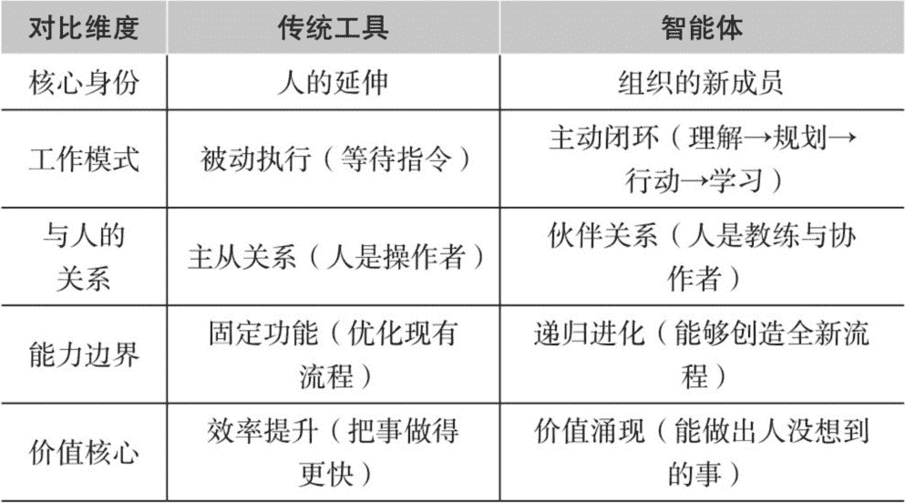

然而，单个智能体的力量尚且有限。当无数个这样的自主智能体构成一个庞大的网络时，一种更令人敬畏的现象——群体智能涌现——便会出现。

凯文·凯利（Kevin Kelly）在其预言般的著作《失控》（Out of Control）中，早已为我们描绘了这种景象。他描述的那些由简单个体构成，却能涌现出复杂集体智慧的蜂群，本质上正是一种由无数个微小智能体组成的、分布式的、有“生命感”的系统。这预示着，智能体带来的变革，不仅仅是个体能力的提升，更是一种全新“系统级智能”的诞生。它不再依赖一个中央大脑的统一指挥，而是通过个体间的简单互动，在群体层面展现出惊人的创造力和适应性。

这正是传统工具与智能体的分水岭。我们可以用一句话来概括其本质差异：工具是人的延伸，而智能体是组织的“新成员”。这也使其与过往的技术形态产生了物种级别的分野：智能体不同于 AI 算法，算法是实现智能的“引擎”，而智能体更强调基于引擎的自主决策与行动闭环；智能体超越了“副驾驶”（Copilot），“副驾驶”仍是人类的“增强外骨骼”，而智能体是具备目标感和执行力的“智能合作者”；智能体也不同于传统的自动化工作流，后者如同设定好轨道的火车，严格依赖预设规则，而智能体则像一个在丛林中自主寻路的探索者。

过去，企业靠工具提升效率；未来，企业将靠智能体重塑分工与权力结构。

然而，我们刚刚辨认出的、能够自主行动的这具躯体，仅仅是新物种的形态。要真正理解其可怕的潜力，我们还必须深入它的内部，观察写入其身体的遗传密码——它的“基因”，以及这组“基因”究竟如何驱动它持续学习和成长。

**第二节 新物种的基因**

还记得实验室里那个重写了自己基因的“阿米巴 2.0”吗？它与初代“阿米巴 1.0”的物种分野，正源于其携带的一组全新的生命基因。这也是智能体与传统工具的根本分水岭。

过去，进化同样存在，但进化的主宰者在系统之外。2006 年，Netflix（网飞，一个流媒体播放平台）举办 Netflix Prize 竞赛，最后的胜利并非来自某个完美的模型，而是上百个模型的叠加。10 年后，亚马逊仓库的机器人也在持续的反馈、调度中形成“群体进化”。但要注意的是，无论是 Netflix 的推荐系统，还是亚马逊的机器人，它们的优化都离不开人类工程师的编码。系统在进化，但主宰进化的“上帝”是人类。而今天 Manus 与 Devin 的出现，标志着一次历史性转折：进化的遥控器第一次从人类手中交还给智能体自己。

这种“对话→修正→再生成”的循环，正是智能体核心基因的外在显现。如果说我们在上一节解剖的是智能体的“器官”，那么现在，我们将深入探寻驱动其不断成长的遗传密码——两条堪比达尔文进化论的底层法则。

要解开新物种的“基因”之谜，我们首先要像生物学家一样，解剖其最核心的器官构造。然后我们发现，这个新物种的核心生理构造惊人地模拟了生物体的基本结构：一个负责思考的“大脑”（规划器）、一个负责行动的“身体”（执行器），以及一个连接二者、传递反馈的“神经网络”（生命线），如图 1-1 所示。正是这套构造孕育了它的第一组基因——一个能够驱动“进化”的反馈闭环。

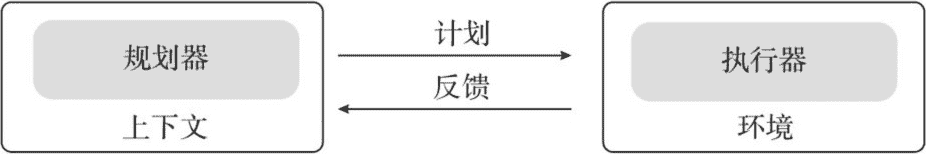

图 1-1 智能体的基本架构和运行机制

规划器：这是智能体的指挥中心，通常由强大的大语言模型（LLM）驱动。它负责理解任务、分析环境并制订行动计划。但这颗大脑并非悬浮于空中，而是浸泡在“上下文”的海洋里。通过上下文获取工作记忆，是它对历史、经验和可用工具的全部认知。没有上下文，大脑就是一个失忆的、无法进行有效思考的空壳。

执行器：这是智能体的行动部队。它接收来自大脑的计划，并在真实的“环境”中将其付诸实施。这个“环境”可以是电脑操作系统、浏览器、通过 API（应用程序编程接口）连接的其他软件，甚至是机器人控制的物理世界。执行器负责将规划器的虚拟计划，转化为对世界的实际改变。

计划与反馈（生命线）：如果说规划器是大脑，执行器是手脚，那么计划与反馈是连接大脑与手脚的“神经信号”，是这个生命体赖以存活的生命线。反馈不是一句简单的“任务完成”，它可能是代码编译失败的错误日志，也可能是网页访问超时的网络响应，甚至是用户的一句追问。它将外部世界的真实结果带回大脑，成为更新其上下文记忆的最重要的奖惩信号与环境激励。

这套构造形成一个“规划→执行→反馈→更新上下文→再次规划”的闭环。正是这个能够自主“思考”与“行动”的完整闭环，宣告了一个“新物种”的诞生。它不再只是被调用，而是能自主规划与行动。然而，这具躯体只是它的形态，要真正理解其颠覆性潜力，我们还必须深入观察写入它身体的遗传密码——它的基因。

它究竟如何做到持续学习和进化？它的基因里藏着什么秘密？这就是我们接下来要解构的核心内容。

**一、进化：适应的法则**

那个“规划→执行→反馈”的闭环，本身就是智能体最基本的一条生命定律：进化。它让智能体像一个生物，通过与环境的持续互动，物竞天择，适者生存，从而优化自身的行为。进化，是生命适应环境的基本法则，也是智能体在给定规则内将自身能力提升到极致的遗传算法。

但智能体的进化，并非简单的被动适应。我们可以想象一下，一个营销智能体投放的第一轮广告的点击率也许惨不忍睹。这时，传统的自动化工具可能会停止，等待人类指令的发布，而一个简单的自适应程序，或许会尝试换一个文案，但这些都是“适应”。而一个进化中的智能体则完全不同：它会同时生成并测试数百组全新的广告，分析反馈数据，发现“配有暖色调图片的文案表现略好”这一规律，并立刻将这个规律应用到下一轮数百个新版本广告的生成中。

这不再是单次的“适应性变异”，而是一场加速的、系统化的演化。以一个学习下围棋的智能体为例，它最初可能只是随机落子。但后面它可以通过与自己进行数百万次对弈来完成进化：每一次落子都会导向一个最终的胜负结果作为环境反馈。智能体通过分析海量的数据，逐渐明白哪些布局和应对更有可能导向胜利，从而不断优化自身的“棋路”。这个过程就是一次在算力加速下进行的、跨越数千年人类棋谱历史的疯狂进化。

正如《系统之美》中所说的那样，一个系统真正的力量在于反馈机制。智能体的“规划→执行→反馈”闭环，正是达尔文进化论在数字世界的一次完美重演。进化，将智能体从传统软件“一行代码，一个动作”的机械宿命中解放出来，赋予它在实践中自我完善的生命力。它能在一个给定的游戏规则内，通过海量的自我博弈和环境反馈，将自己的表现打磨到极致，成为最强的玩家。

然而，如果仅仅停留于此，那么它只是一个适应能力极强的“生物”。它即使能成为游戏中的最强玩家，也永远无法改变游戏规则本身。真正让它成为“新物种”的，是其背后那条更令人敬畏的第二定律。

**二、递归：创世的法则**

如果说“进化”是生物在上帝创造的世界里努力适应，那么“递归”则是生物开始审视自我，并试图扮演上帝来实现自我繁衍和复杂度跃迁，也是智能体扮演上帝、重塑自身能力的创世算法。

递归最深刻、最独特的内核在于：一个真正的智能体必须能够自主修改、定义自身行为的源代码。这不再是适应世界的游戏，而是重塑自我的“创世”行为。它意味着智能体拥有了一个更高维度的“元智能”，可以审视、批判，并重写那个负责执行任务的“本我”。

如图 1-2 所示，在计算机科学中，递归意味着一个函数可以调用自身，将一个大问题分解为若干个与自身结构相同的子问题。一个经典的例子是斐波那契数列的计算，其核心逻辑在于，要求解第 n 项的值 f（n），必须先分别求解第 n-1 项的值 f（n-1）和第 n-2 项的值 f（n-2），直至分解求出最简单的已知项。一个顶级的智能体在面对宏大任务时也是如此，它会将任务分解，并派生出子智能体去执行，直至任务被拆解为可以直接执行的“原子任务”。

但这只是递归的表象。要想真正理解递归的“创世”之力，我们不妨将目光投向宇宙中最古老、最伟大的递归程序——生命本身。人类的繁衍，就是一场持续了数百万年的、壮观的递归。

父母并非简单地将自己的经验（数据）“复制”给下一代。他们传递的是最核心的“源代码”——基因。这组基因在传递的过程中经过分解与重组，创造出一个全新的、拥有独立生命的后代。这个后代，既继承了父辈的基本结构，又通过随机变异获得了适应新环境的无限可能，代代传承，生生不息。

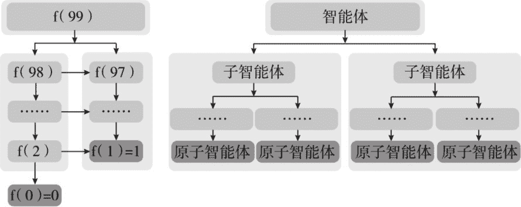

图 1-2 函数递归调用计算斐波那契数列与智能体分解任务派生出子智能体执行的对比

进化，是在既定的代码框架内，通过调整上下文（数据）来优化输出；而递归式的自我繁衍，则是在接收到环境反馈后，直接修改定义自身行为的那段程序。它像一个被赋予了基因编辑能力的细胞，在发现自身存在缺陷时，能够调用一个专门负责写代码的“内部工程师”，来改写自己的“DNA 结构”（源代码），从而孕育出能力更强的下一代。它不再只是在飞行途中调整姿态，更是在飞行途中为自己更换了引擎。

这就好比人类文明的传承。我们不仅把经验（数据）传给下一代，还在漫长的演化中通过文化、制度、科技（代码本身）的革新不断升级整个文明的“操作系统”。

过去，像 Netflix 的推荐系统，其优化也依赖于反馈循环，但这是一种由人类工程师调度的“外部递归”。而 Devin 所展示的，则是智能体内部的“自我递归”。两者的区别在于，前者是人在扮演系统的上帝，后者是智能体正在成为自己的上帝。当智能体成为自己的上帝时，它便不再拥有“完成任务”的能力，而是拥有能够自我繁衍、自我创造的系统能力。如果说传统程序是在铺好的铁轨上跑得更快的火车，那么智能体就是一辆可以一边行驶、一边为自己铺设轨道的工程车。

这不仅仅是效率的提升，更是一种根本性的范式转移。同时，这揭示了一条通往更高阶智能的清晰路径：一个强大的基础智能（如大模型）可以被用来创造第一个能完成特定任务的智能体 1.0；而这个智能体 1.0 在执行任务的过程中，不仅能完成业务，还能收集关于“如何更好地完成任务”的数据和经验。这些新的认知，可以反过来被用来创造一个更强大的智能体 2.0。这个“创造→执行→认知→再创造”的循环，就是一种“用 AI 的 AI 做 AI”理念的体现。这不是一个线性的生产过程，而是一个指数级增长的智能“自举”系统。这就是 AI 世界里的“道生一，一生二，二生三，三生万物”。

让我们回顾在前文那个试验室里目睹的那场生物创世试验。“阿米巴 1.0”就是那个出色的初代智能体，它能完美地执行任务，但无法突破自身的边界。而“阿米巴 2.0”的诞生，恰恰是因为它学会了从失败的“历史数据”中学习，并用此不断创造出全新的、效率高出十倍的自己。

一旦这个系统启动，其演化的速度和潜力将是惊人的。它意味着，智能的进化不再完全依赖于人类的下一次技术突破，而是拥有了内在的、不断加速的引擎。这或许就是智能体区别于过往所有技术的、最令人敬畏的本质。而驾驭这种“自举”系统的能力，也将成为未来商业竞争中最根本的分水岭。

**三、终极命题：是适应，还是创世**

现在，让我们用一个比喻来厘清“进化”与“递归”的区别。拿 F1 赛车来举例。

进化，就是一位顶级的车手驾驶着一辆赛车。他通过一圈又一圈的练习，不断地从数据反馈中学习，优化自己的驾驶技术。最终，他成为这条赛道上最快的车手。但他受限于这辆车的物理极限，也受限于他自己作为驾驶者的能力边界。他是一个完美的适应者。

递归，则是完全不同的一番景象。这位车手在达到极限后，没有继续在赛道上胶着鏖战。他走进设计室，不仅造出一辆全新的、性能更强的赛车，更不可思议的是，他还造出一个拥有更先进赛车设计理念的新车手。然后，这个新车手坐进那辆新赛车，不仅跑出人类无法企及的速度，还在自己的极限时刻再次走进设计室，造出第三代更强的赛车和第三代更智慧的车手。如此不断迭代，一代接一代。这不是一次性升级，而是一个能够自我繁衍、指数级成长的智能物种的诞生。

进化，是在既定的规则内把游戏玩得更好；而递归，是赋予游戏本身修改规则，并创造出更能修改规则的新玩家的能力。前者是优化，后者是创世。这组自我进化的双螺旋基因，正是新物种最令人敬畏的本质。这个物种的演化将不再完全依赖于人类的下一次技术突破。

在商业世界中，这意味着，一个最初被设计用来分析销售数据的智能体，在遇到瓶颈后，甚至有可能通过自我学习和重构，为自己培养出一种预测市场趋势的新能力。过去，这种能力跃迁需要组织、制度和技术的长周期演化，而现在，它可能在一个智能体的内部实时发生。

这就是新物种的真正意义：它不只是帮人完成任务，更具备了自我繁衍与创造的能力。它在不断地进化，也在递归地重构自己。而这组基因将决定未来智能体如何一步步地走上自己的进化阶梯，即智能的进化本质。

为什么这个理论上早已存在的构造，恰好在今天才孕育出一个真正意义上的“新物种”？答案就在于，一个生命体的诞生，不仅仅需要内在的基因和构造，更需要外部的环境和养料。直到今天，孕育这个新物种所需的三大核心生态要素才第一次同时达到了“临界点”。

首先是其思考核心的诞生——“大脑”的涌现。一个真正的智能体，必须拥有强大的推理与规划能力。自从 ChatGPT 问世，尤其是 OpenAI o1 的发布，大语言模型的智能水平飞速进步，为新物种提供了一颗“即插即用”、足够聪明的 AI 大脑。

其次是其行动能力的完备——“手脚”的成熟。仅有大脑而无法与世界互动，便是“缸中之脑”。过去十年，API 经济的蓬勃发展为整个数字世界安装了无数个可供智能体操作的“神经末梢”，让新物种拥有了可以“触摸”和“改变”真实世界的、近乎无限的手脚。

最后是其生长能源的富足——“养料”的充裕。正如任何生命体都需要能量，智能体的思考与行动，也离不开充足的“养料”，即上下文。今天，得益于云计算和开源运动，海量的、高质量的数据正在以前所未有的速度爆炸式增长，这为新物种的持续学习、记忆和进化，提供了取之不竭的“食物”。

“大脑”、“手脚”和“养料”这三大要素的同时成熟，为数字生命体的诞生，创造了完美的“寒武纪”时代。至此，新物种的诞生已非偶然，而是必然。那么，当这个拥有自我成长和创世能力的必然产物，被投放到商业这个广袤的生态系统中时，它演化的路径也必然遵循着某种规律。它攀登权力食物链顶端的阶梯，又将通向何方？

**第三节 进化的阶梯**

拥有了“进化”与“递归”双重属性的智能体，一旦被投放到商业这个广袤的生态系统中，它便会踏上自己的演化之路。这条路并非随机生成的和混沌不明的，而是一段清晰的、不可逆转的攀升阶梯。要理解这场变革的全貌，我们必须从两个维度来观察：首先是 AI 个体的能力进化，这是技术层面的“物理定律”；其次是其在组织内的权力跃迁，这是商业层面的“化学反应”。

**一、能力螺旋：AI 个体进化**

关于 AI 智能体，OpenAI 曾对其自身能力的进化提出过五级划分框架，如图 1-3 所示。这个框架从“智能能力提升是唯一关键主线”的视角出发，清晰地描绘了 AI 从简单的交互工具发展为复杂组织协调者的演进蓝图，包括 Level 1 聊天机器人（Chatbot）、Level 2 推理者（Reasoner）、Level 3 智能体（Agents）、Level 4 创新者（Innovators）、Level 5 组织者（Organizers）。

这段技术演进的阶梯，是 AI 发展的“物理定律”的客观呈现，它以摩尔定律般的速度滚滚向前，势不可当。

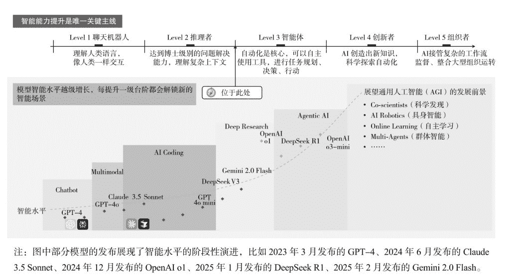

图 1-3 OpenAI 对 AI 智能体能力进化的五级划分

资料来源：OpenAI。

**二、权力螺旋：组织角色演化**

现在，让我们提出那个真正让所有企业家和管理者都倍感焦虑的问题：当 AI 的个体能力沿着上述阶梯攀升时，它在组织内的角色和权力将如何同步演变？

技术上的每一级进化，都必然对应着组织权力结构的一次剧烈洗牌。它将智能体在组织内部所扮演的角色，从一个位于边缘地带的“数字劳工”，一步步推向权力的中心，直至可能成为“AI 接班人”。这条路就是一段攀登权力食物链顶端的阶梯：智能体的每一次成长，都把组织内部的某种权力从人类的手中接管过来。如表 1-2 所示，将 OpenAI 的“智能能力”视角与我们更侧重的“组织权力”视角相结合后，一个清晰的、令人敬畏的演化进程就浮现出来，从而更全面地展现了智能体的进化图景。

表 1-2 智能体的五个进化阶段

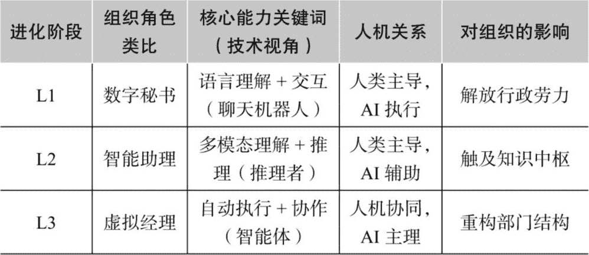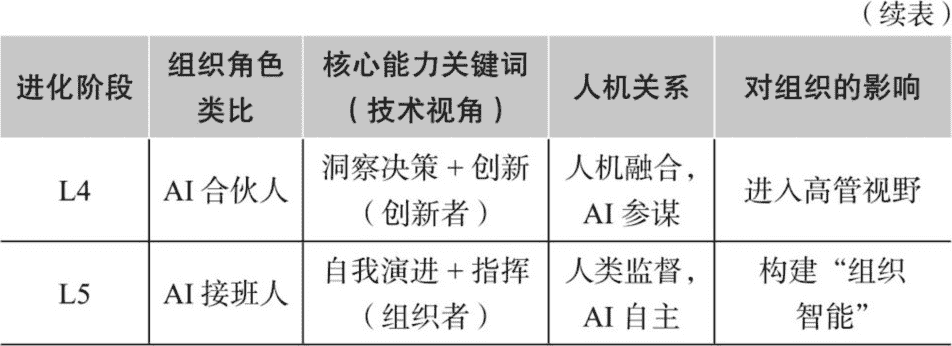

表 1-2 就是未来十年组织变革的核心路线图。它清晰地揭示了智能体的每一次进化，都伴随着组织内部的一次权力转移和结构重构。接下来，让我们逐一解剖这五个阶段。

**1．第一阶段：数字秘书**

很多人第一次感受到智能体的能量释放，是在开会这一场景下。你说一句“记录一下”，屏幕上的 AI 就开始替你写纪要了。日历提醒、会议室预订、安排差旅行程，这些曾经消耗大量时间和精力的行政琐事，都在悄悄被接管。这一阶段的 AI，还只是组织的神经末梢，忠实地执行你的命令。它带来的改变更多的是效率的提升，解放组织里最机械、最有重复性的事务。

**2．第二阶段：智能助理**

当最初的惊艳时光过去后，智能体开始真正融入我们的核心工作。那一刻，它从秘书变成我们的“副驾驶”。

例如程序员最熟悉的 AI 编程工具 GitHub Copilot。当你写代码时，它能看懂上下文，自动给出下一行甚至整个函数的建议。同样，AI 不仅能帮你整理一周的会议纪要和邮件，还能写出各类文案初稿，甚至在表达风格上模仿你的习惯。

在销售领域，一个优秀的第二阶智能体已经开始扮演“情报官”的角色。一位销售总监第二天要拜访大客户，前一天晚上，他的 AI 助理自动完成一系列动作：扫描日历，识别会议主题和参与者名单，然后主动整合客户在客户关系管理（CRM）系统里的所有历史记录、近三个月的工单问题，甚至抓取该公司最新的股价变动信息和行业新闻，最后生成一份一页纸的“战前简报”推送到销售总监的手机上。这依然是信息的搬运和整理，但它已经从通用的行政事务阶段，精准地切入创造收入的第一线。这时，人机关系发生了微妙的变化，智能体不再是被动的工具，而是会“补充、提醒、反问”的伙伴。但当智能体不再满足于帮助你，而开始有能力替代你时，权力格局就发生了质变。

**3．第三阶段：虚拟经理**

真正的分水岭出现在第三阶段。智能体第一次从“帮人”跨越到“管事”。

一名开发者给 Devin 下达任务：“帮我上线一个网站”。接下来，它会自动分解目标，生成开发计划，写代码、调试、部署，直到项目上线，全程几乎不需要人类干预。在亚马逊的客服中心，智能体已经能独立处理超过 80%的客户工单，完成退款、换货、问题排查。顾客甚至分不清自己是在和真人还是 AI 对话。

在市场营销中，原来的达人合作，需要人工筛选 KOL（Key Opinion Leader，关键意见领袖，指某个领域特别有影响力的人），进行谈判与创意沟通、数据复盘。现在，智能体已经可以自主筛选，并进一步优选合作的 KOL。以霸王茶姬在泰国的营销活动为例，营销智能体先锁定曼谷目标门店周边的 KOL，根据预设规则（如创作内容必须带有“奶茶”标签、历史内容点击率高等）做深度筛选。当 KOL 参与营销、发布内容后，智能体在后台实时追踪数据，一旦发现下滑迹象，便自动启动淘汰机制，重新寻找更佳的 KOL。

这意味着什么？过去中层经理最核心的价值，如掌握流程信息、调度资源、专业判断等，正在被 AI 逐步取代。智能体第一次成为“虚拟经理”，能独立把任务推进到底。中层的权力，不是在被稀释，而是在被智能体吞噬。

今天，大多数企业正站在第二阶段向第三阶段跃迁的门槛上。这不仅是一个技术节点，还是决定未来三到五年格局的分水岭。能否跨过这一步，将决定一家企业是成为领先者，还是在新一轮竞争中被淘汰。

**4．第四阶段：AI 合伙人**

当智能体学会了“管事”后，它的下一个目标自然就是影响“决策”。

比如在影视领域，真正决定大众看到什么作品、投资商投资什么的，不再是导演的直觉，而是智能体收集的数据。Netflix 的推荐系统就是一个典型的案例，它不只是向用户推荐剧集，更深刻地影响了该公司价值数十亿美元的内容投资决策。《纸牌屋》之所以被拍出来，是因为数据告诉他们：观众既爱凯文·史派西，也迷恋大卫·芬奇的导演风格。推荐系统不是辅助，而是“决策合伙人”。亚马逊等巨头同样把 AI 写进战略流程，用它来支持新产品立项、市场预测和竞争对手模拟。

在决策权重的天平上，最极端的例子或许来自华尔街。像桥水和文艺复兴科技（Renaissance Technologies）这样的顶级对冲基金公司，其核心的交易决策早已不再由人类交易员进行。它们的“大脑”是一个复杂的算法集合（智能体集群），这个系统 7×24 小时不间断地分析全球数百万个经济指标和市场信号，自主做出买入或卖出数十亿美元资产的决定。在这个体系中，创始人扮演的角色，更像是哲学家和系统架构师，负责设定投资的原则和算法模型（AI 的价值观和世界观）。而日常的、海量的、实时的决策，则完全交由这个不会被情绪干扰的“AI 合伙人”。它或许不参与“公司要去哪个国家发展”这类战略决策，但它全权主导了公司最核心的业务——交易本身。

这种人机关系是一种全新的融合：人类带来商业直觉与顶层原则，AI 则提供强大的算力与近乎完全的执行自主权。当两者结合时，组织的决策效率与质量第一次被彻底改写了。

**5．第五阶段：AI 接班人**

最后一个阶段是对传统管理学最彻底的颠覆。

设想一下，一个高度进化的 AI 系统成为组织的管理层，接管大部分日常经营工作。它能以企业的长期利益为唯一目标，自动优化物流、财务与库存流程，其速度和准确率远超任何一个人类高管。在这个阶段，人类的角色不再是“操作者”，而是“监护人”。我们的核心职责，是为这个 AI 心智设定价值边界（如同编写《宪法》），并在关键时刻做出最终仲裁。而日常的价值创造与资源分配，则完全交由这个智能系统自主运行。

这种终极形态可能是多样的：要么是一个中心化的“AI 大脑”进行最高效的顶层设计，要么是一个去中心化的智能体集群。在没有统一指挥的情况下涌现出集体智慧的试验，正是后一种可能性的早期探索。无论形态如何，“AI 接班人”的本质是相同的：一个以代码为核心，拥有自主心智，能够进行价值判断和资源分配的数字生命体。

智能体的五级进化阶段，清晰地揭示了一个冷峻而又令人兴奋的趋势：智能体的每一次进化，都伴随着组织内部一次权力转移和结构重构。理解这张进化图，就是理解未来十年组织变革的核心路线图。

今天，大多数公司还停留在 L1 和 L2 阶段。但我们所有人都已经站在了悬崖边缘，直面那场最剧烈变革的开展——L2 向 L3 的跃迁。这不是关于未来五十年的科幻小说，而是未来三到五年的现实。有的组织将迎来“虚拟经理”，效率倍速提升；有的组织则会因为固守旧模式，被时代彻底抛下。智能体正在攀登组织的权力阶梯，留给我们的问题只有一个：是选择被动旁观，还是主动驾驭？

不过，这一次，旁观本身就是一种淘汰。

**第四节 权力的“新杠杆”**

历史上，每一次生产力革命都会伴随着一根新杠杆的诞生：蒸汽机杠杆化体力，互联网杠杆化信息。而今天，智能体正成为 AI 时代的关键杠杆。它杠杆化的，是人类最高级的两种能力：决策与执行。

它让一个人、一个微型团队，拥有了过去需要一个庞大组织才能具备的、端到端地完成复杂任务的能力。正如我们在前文所见，它在“秘书”阶段夺走事务性权力，在“经理”阶段接管流程与资源，并最终在“合伙人”与“接班人”阶段，直接触及组织的最高权力。这意味着，智能体撬动的不只是效率，更是生产关系的权力结构。它改变的不只是做事的方式，更是“谁来下命令、谁来执行”的底层逻辑。

当这样一根新杠杆被投放到商业战场上时，它将从两个最核心的层面，彻底重写竞争的法则，即增长引擎与战略范式。

**一、从数据飞轮到智能体飞轮**

在揭示了智能体体内“递归”与“进化”的双重基因后，我们便能理解，为何支撑这个新物种成长的引擎，与过去十年我们所膜拜的数据飞轮有着本质上的不同。因为这是一场从被动学习到主动创世的革命。

**1．旧引擎：数据飞轮**

在过去的移动互联网时代，数据飞轮是所有科技巨头实现成功的底层密码。它的逻辑如同一台精密的水车，依靠外部的水流自我驱动，周而复始。

整个循环始于一个优秀的产品。它吸引了第一批用户的涌入。接着，这些用户在使用过程中源源不断地产生数据，而这些数据就如同驱动水车转动的水流，被持续注入系统。随后，强大的算法开始消耗这些数据，并通过海量的机器学习，变得越来越聪明，进而反过来优化产品。最终，一个体验更佳的产品会吸引更多新用户的到来，而他们又会贡献更多的数据水流，让整个水车的转速越来越快，形成一个看似无懈可击的增长闭环。

这个模型极其强大，它塑造了我们熟知的推荐引擎、搜索引擎和社交网络。亚马逊用“低价→更多顾客→更多商家→更低成本”的飞轮碾压了零售业；字节跳动用“内容创作→用户停留→数据积累→精准推荐”的飞轮重塑了信息流。但它们的核心特征，也是它们的“阿喀琉斯之踵”，即被动性。

数据飞轮本质上是一个被动的学习引擎。它无法主动创造核心的生产资料——数据。它像一个嗷嗷待哺的婴儿，必须依赖外部世界（用户数据）的持续投喂才能成长。一旦用户增长停滞，或者数据源被切断，那么这台强大的引擎就会立刻失速，甚至停转。它的成长曲线最终受限于外部环境的边界。

**2．新引擎：智能体飞轮**

现在，让我们来看智能体飞轮。它的逻辑不再是水车，而是一台能够自我增压、不断加速的火箭引擎。

它的点火指令，仅仅是一个高阶的意图，例如“为我们的新产品开拓欧洲市场”。一旦接收到这个“意图”，引擎便自动点燃：它开始自主地分析市场、撰写文案、编写本地化代码、投放广告。关键的嬗变发生在此刻，它的每一次行动本身，都在创造全新的、独家的、高价值的数据。这些由行动生成而非被动收集的数据，如同火箭喷射出的炽热气流，立刻被引擎自身回收，成为下一轮燃烧的关键燃料。

引擎在燃烧中学习和进化：它从数据收集和整理中发现 A 文案比 B 文案效果好 10%（进化），甚至发现引擎的燃烧室结构存在根本缺陷，于是当场重构了自己（递归）。每一次学习和重构，都带来一次能力的跃迁。能力升级后的引擎，能够执行更宏大、更复杂的任务，从而创造出能量密度更高的新燃料，驱动火箭以更惊人的加速度冲向下一个阶段。

智能体飞轮的核心是主动性。它不再依赖外部的投喂，它是一台“主动创造+自我进化”的引擎。它的燃料是计算资源，而它的每一次喷射（行动）都在为自己增加更多的燃料（新数据和新能力）。这是一个向内寻求动力、自我驱动的闭环，其增长潜力只限于计算资源的供给。

阿里巴巴前任首席战略官曾鸣教授将这种自我强化的机制，命名为“黑洞效应”。他指出，AI 时代的竞争优势源于一个基于知识的“黑洞”：更智能的 AI 能获取和处理更多维度的数据（尤其是私有知识），从而变得更智能，进而吸引更多的数据，如此循环往复，最终形成一个引力强大到让对手无法逃逸的“知识黑洞”。

这就是“智能体飞轮”与“数据飞轮”的代际差异。数据飞轮是在“滚雪球”，线性增长；而智能体飞轮则是在“坍缩成黑洞”，指数级地拉开代际差距。这也是为什么我们要进行这场痛苦的转型，因为不成为黑洞，就会被黑洞吞噬。

**3．两种飞轮的终极对决**

当一个依赖外部投喂的“水车”，面对一个能够自我增压、不断加速的“火箭”时，结局早已注定。

这个“智能体飞轮”的核心，不再是被动地接收数据，而是在自主行动中创造数据，并用这些数据实现自我进化。这是一个更紧凑、转速更快的自反馈循环。当你的竞争对手还在优化推荐的精准度时，一个能自主完成任务的新物种已经出现，这正是飞轮的代际碾压。表 1-3 总结了从数据飞轮到智能体飞轮的跃迁。

表 1-3 增长引擎的代际革命：数据飞轮 vs.智能体飞轮

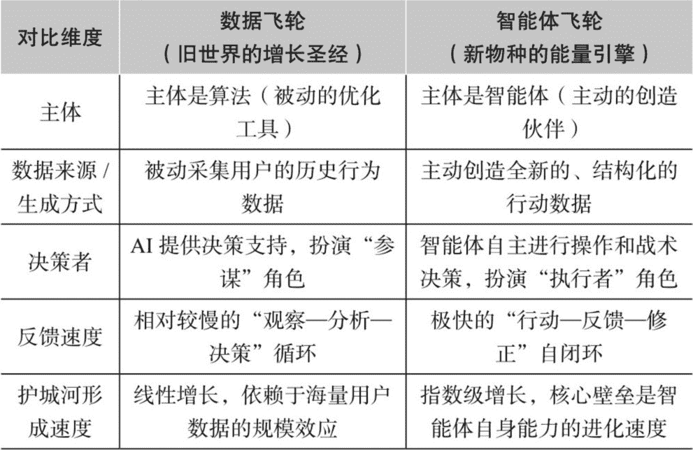

这解释了为什么“一人公司”能够挑战商业巨头。因为巨头们引以为傲的数据护城河，在新物种的“智能体飞轮”面前，可能变得无足轻重。未来的竞争核心，不再是谁收集的数据更多，而是谁的智能体创造数据和自我迭代的速度更快。这就是范式转移，是新、旧世界的分野。

想象一家电商企业的销售智能体。它不仅能像传统算法一样，根据你的历史购买记录推荐商品（这是数据飞轮的行为），还能在你将商品放入购物车却迟迟不付款时，主动发起对话：“您好，看到您对这款相机感兴趣，它和您购物车里的镜头兼容性最好，要不要我帮您申请一个临时的打包优惠？”这是智能体飞轮会做出的行为。

每一次这样的交互，不仅带来转化，还会沉淀出新的、更高价值的数据，进一步强化智能体的行动能力。这种由“数据、算法、算力、智能体”四位一体构成的“智能体飞轮”，一旦高速运转，其积累优势与构建护城河的速度，将远超传统的“数据飞轮”。

这场飞轮革命同样发生在实体产品的创造上。过去，一家运动鞋公司想推出新款跑鞋，依赖的是经验驱动的数据飞轮，分析去年的销售数据、采集用户问卷、开几十场焦点小组会议，用一年的时间设计、打样、测试。而一个由“AI 产品设计师智能体”驱动的智能体飞轮则完全不同。整个过程始于设计师的一个行动指令：“为马拉松精英跑者设计一款超轻竞速碳板鞋。”随即，这个智能体在 24 小时内便创造出 1 000 种不同的 3D（三维）设计变体，并渲染成可直接投放市场的“虚拟产品”。接着，反馈闭环开始高速运转。这 1 000 种虚拟产品通过广告精准投放给目标跑者社群，然后这个智能体收集他们点击、停留、评论等最真实的行为数据。这不再是传统问卷的滞后意见，而是市场发出的实时信号。最后就是学习与进化自动触发。这个智能体基于这些真实反馈，迅速识别出最受欢迎的设计方向进行融合深化，并将最优方案提交给人类设计师进行最终决策。

飞轮的转速从“年”变成“天”。它不再是被动地分析过去的数据，而是主动地、低成本地创造出关于未来可能性的海量数据，并从中学习。这不仅是在设计产品，还是在设计“市场需求”本身。领先者将用它更快地迭代产品、优化体验、降低成本，从而形成一种近乎垄断的赢家通吃效应。今天，所有的产品、业务、流程，都值得用智能体重构一遍。

**二、战略选择：是修补旧地图，还是开拓新大陆**

AI 的真正力量在于“重构”，而非“优化”。

很多企业在部署智能体时，是想“优化”现有流程，用客服智能体替代一部分人力，用文案智能体辅助营销。这就像给马车换上更好的轮胎，却听不到隔壁车道上引擎的轰鸣声。真正的颠覆者，正在用智能体重构商业世界里的一切。

重构获取信息的方式。多年来，无数公司试图“优化”搜索，但都败给了谷歌、百度。而美国 AI 公司 Perplexity AI 没有这么做，它用智能体从根本上重构了“搜索”这件事。谷歌提供的是一串链接的中间路径，而 Perplexity AI 提供的是整合全网信息后的最终答案。用户习惯了直接获得答案，便很难再回到那个需要自己从链接中“淘金”的时代。

重构内容创造的源头。在线流媒体音乐播放平台 Spotify 通过算法“优化”我们发现音乐的体验，而 AI 初创公司 Suno 则从根本上重构了音乐。用户不再是音乐的“消费者”，而是“灵感激发者”。Suno 没有去和 Spotify 竞争曲库，而是直接让“曲库”的概念变得无限大。

重构应对不确定性的能力。传统的企业资源计划（ERP）系统“优化”你看世界的方式，让你在风暴来临时看得更清楚。而一个自主供应链智能体则重构了你与世界共存的方式——它不是发出警报，而是在风暴形成之前，就已自主地、悄悄地帮你重新设计了航线，绕开了风暴。这些新锐力量的崛起，展现了重构思维在产品和运营层面的巨大威力。然而，对于一个已经成型的庞大商业帝国而言，“优化”与“重构”之间的选择，则更为艰难，也更为致命。

让我们来看一个零售巨头“环球百货”的生死转型。

“环球百货”的商业模式曾坚如磐石：在一线城市的黄金地段开设大型实体百货商店，提供一站式高端购物体验。在电商时代来临前，它的成功完全可以归因于其强大的进化能力——在既定的线下为王的战略框架内，通过持续分析坪效（每平方米销售额）与客流数据，将选址、陈列、品类管理的效率优化到了极致。

然而，一场沉默的雪崩正在发生。当电商开始侵蚀它的根基时，一个只有“进化”基因的组织会怎么做？它会启动更强的优化引擎，加大促销、重金装修、裁撤亏损部门。

但“环球百货”的一位高管带回了一份异端数据：过去两年流失的核心会员中，70%的人的线上消费额增长了 300%。这份数据像一把尖刀，刺破了所有幻想泡泡。董事会终于想通了：问题不是门店运营这个策略不够好，而是依赖线下门店这个商业模式本身已经过时了。

此刻，递归的基因被激活了。“环球百货”没有继续修补旧系统，而是启动了一个全新的、拥有最高权限的项目“挪亚方舟”，其使命是构建一套以线上数据驱动的 DTC（Direct-to-Consumer，直接面向消费者）商业模式。现在，让我们把这个过程智能体化，你将会看到天壤之别。

一个“进化型战略智能体”会建议，二楼 C 区的香水专柜坪效下降 10%，应被更换为增长更快的护肤品牌，这是在修补旧地图。而一个“递归型战略智能体”则会发出警报：核心会员的跨平台消费行为正在发生结构性转变。这个模型预测，若不改变商业模式，该公司将在 36 个月内出现现金流断裂，建议“立即启动线上 DTC 业务”。这是在警告你旧大陆即将沉没，并为你绘制了新大陆的航海图。

这就是“递归”对“进化”的降维打击。

**三、行动态度：全力投入还是保持观望**

未来十年，驾驭智能体飞轮的能力，不再是锦上添花，而是决定生死存亡的核心竞争力。历史总是在重复。今天我们面对 AI 时犹豫不定的场景，当年手握第一台数码相机的柯达同样经历过。这家胶片巨头，始终将颠覆性技术视为对现有业务的“优化”工具，并试图保护昨天的帝国，最终却输掉了整个未来。

然而，今天的我们甚至没有柯达当年那样长达十年的犹豫期。数码相机对胶片的颠覆，是一场阵地战，花了近十年的时间。而智能体带来的变革，更像一场闪电战。智能体的能力正以指数级速度进化，对行业的重塑可能只需一两年的时间，甚至几个月。当 AI 这根“新杠杆”出现时，我们面临的选择比柯达那时更残酷：你没有时间再去“优化”你的胶片业务了。

智能体飞轮正在启动。未来十年，没有中间地带：要么被智能体加速，要么被它淘汰。对每一位领导者来说，这都是一次没有退路的豪赌。问题不再是“要不要用”，甚至不是“是否全力以赴”，而是你是否准备好与一个全新的物种共事。

但即使你已经下定决心，拥抱这个新物种，变革也并非触手可及，真正的挑战才刚刚开始。一个残酷的真相是，将一个以光速迭代的智能体“安装”进你的组织，远比在服务器上安装一个软件要复杂万倍。因为你试图改造的并非一串代码，而是一个由人类习惯、部门利益、权力结构和文化传统交织而成的、有强大生命力的“活体”。

这个活体拥有极其强大的免疫系统，我们称之为“组织惯性”。它会本能地排斥、吞噬甚至杀死任何试图改变其内在秩序的新物种。因此，在迎接“新物种的黎明”之后，我们必须直面一场更血腥，也更深刻的内部战争。在下一章，我们将直面这场风暴的中心，深入探讨当新物种与旧生态迎面相撞产生的那不可避免的、组织的剧烈折叠。

**第二章 组织“大折叠”**

在第一章中，我们见证了智能体如何从一个辅助工具进化为具备自主行动能力的“新物种”。

当这个新物种的执行效率以指数级暴涨，而成本趋近于零时，它对旧世界发出的第一道冲击波，并非来自外部的竞争势力，而是来自组织内部结构的崩塌。历史总是在押韵，类似的剧变，曾在半个多世纪前的瑞士钟表业上演过。

在 20 世纪 60 年代末的瑞士汝拉山谷，钟表的世界里只有一种声音——机械机芯那清脆、规律的“嘀嗒”声。数百年间，瑞士的制表大师们用齿轮、弹簧和宝石的精密啮合推动人类工艺达到巅峰。

那时的瑞士钟表业，像一个巨大且完美的生命体。成百上千家高度专业化的家族工坊如同一个个精密的细胞：有的只生产比发丝还细的游丝，有的只打磨表壳的弧度，有的则专注于最后的组装。它们通过一套古老而稳定的“神经系统”（协作流程），共同维持着这台时间机器的精准运转。

人们坚信，这个代表着瑞士制造的完美物种，将永远统治时间。然而，一场无声的“基因突变”正在世界的另一端悄然发生。

1969 年的圣诞节，日本精工发布了一款名为 Astron 的手表。它的心脏，不再是精密的机械机芯，而是一块不需要人工打磨的石英晶体。这不仅仅是一次产品迭代，更是一次“能量革命”。石英表用“电池的化学能”降维打击了依赖“发条机械能”的传统手表。它的精准度是机械表的数十倍，成本却不到后者的十分之一。

这个小小的“入侵者”如同一种致命病毒，迅速让全球市场受到感染。瑞士的这个引以为傲的完美生命体，瞬间陷入了免疫风暴。曾经被奉为圭臬的手艺变得毫无价值，因为石英机芯几乎不需要人工干预；古老的协作网络发生了“血栓”，因为市场不再需要那些精密的机械零件。订单雪融般地消失了，在接下来的十年里，瑞士超过一半的钟表企业倒闭，三分之二的制表工匠失业。整个瑞士钟表业陷入了长达十年的深度休克。

这场史称“石英危机”的灾难，后来成为无数商学院的教案中的典型案例。人们复盘后发现，扼杀瑞士钟表的不是石英技术本身。极其讽刺的是，石英技术最早正是由瑞士人发明的。

真正致命的，是瑞士钟表业这个生命体自身僵化的“免疫系统”。它的生存本能（组织文化）拒绝承认“没有灵魂的电子表也是手表”；它的神经网络（管理层）无法理解这种全新的能量范式，并将其斥为廉价的玩具；它的新陈代谢（生产流程）更是无法消化这种异质的技术，本能地排斥和攻击任何试图在内部引入它的创新者。

这个古老的生命体，不是被对手“杀死”的，而是因它无法完成基因层面的自我进化，而在新纪元的生态环境中“病死”的。直到后来斯沃琪（Swatch）以一种全新的、拥抱电子和时尚的新基因出现，才让这个濒死的物种免于灭绝。

瑞士钟表业的故事，是过去半个多世纪里关于组织进化或灭亡的深刻教训。而今天，一个比石英晶体强大万倍的“超级入侵者”——智能体已兵临城下。如果说石英表只是改变了驱动指针的能量，那么智能体带来的则是一场更彻底的“认知能量”革命。它不仅仅要替代“手”，更要替代“脑”。

在本章，我们将扮演一位组织病理学家，深入解剖我们当下的组织，看看那些潜伏在体内的旧基因是如何成为组织内的致命病灶的。

**第一节 劳动力规模法则**

**一、加法法则：工业时代的线性增长**

1913 年，亨利·福特站在他刚刚发明的汽车流水线旁，如同站在一个新时代的入口。他看到的是一种前所未有的、近乎神圣的力量：规模。通过将复杂的造车工艺拆解成无数个简单的、重复的动作，他让成千上万名普通工人汇聚成一部能够以前所未有的效率来生产汽车的巨大机器。

从那一刻起，福特的方法开启了一个时代，也奠定了工业革命以来两百多年商业发展的基本法则：组织的产出与人力规模成正比（见图 2-1）。从通用汽车的斯隆到 IBM（国际商业机器公司）的沃森，所有商业帝国的缔造者本质上都是福特思想的信徒。他们毕生所做的，就是构建更庞大的科层制、设计更精密的流程，试图打造一台更完美的组织机器。互联网时代，阿里的中供铁军靠千人地推，字节的崛起则依赖万人算法与审核团队。在过去，“人海战术”几乎是通往成功的唯一路径。

这个法则，如同物理定律般深刻地塑造了我们对组织的认知，催生了我们无比熟悉的、层级臃肿的、沟通成本高昂的“金字塔”结构。这种结构本质上是一种为了控制复杂性而不得不接受的“次优组织设计结构”。回想一下 20 世纪 10 年代亨利·福特的装配流水线。每个工人只有一个任务——拧紧螺栓、安装车轮。这种极致的专业分工以空前的效率生产出 T 型车，但也创造了无数信息传递的断层和管理瓶颈。现代知识工作在很大程度上继承了这种逻辑：设计师构想，工程师构建，产品经理协调，交接点标记着效率的缝隙。

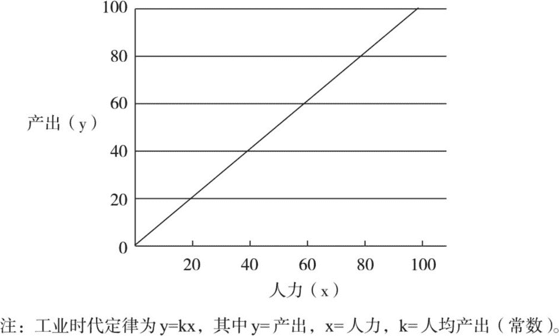

图 2-1 工业时代商业发展法则示意图

我们必须承认，这座金字塔在过去一个多世纪里曾是效率的灯塔。管理学之父马克斯·韦伯（Max Weber）将其理论化为“官僚组织”——一个由清晰的层级、严密的规则和专业的分工构成的理性机器。在信息稀缺和以人力执行为主的时代，这套体系是人类应对大规模协作复杂性的最优解，它构成现代商业文明的钢筋骨架。然而，韦伯的理论也埋下了一个致命的假设火药桶：组织是一个可预测的、封闭的系统。

正如企业家乔纳森·斯旺森（Jonathan Swanson）指出的那样，传统组织扩张面临着不可避免的“管理幅宽”问题：一个人只能有效管理 5～8 名直接下属。这意味着当公司扩大到 57 名员工时，就需要 3 层管理；400 名员工则需要 4 层。每一层级的增加都带来信息衰减和决策延迟。如图 2-2 和图 2-3 所示，科技大厂中那些盘根错节、令人眩晕的组织结构图，正是这种“次优妥协”的产物。

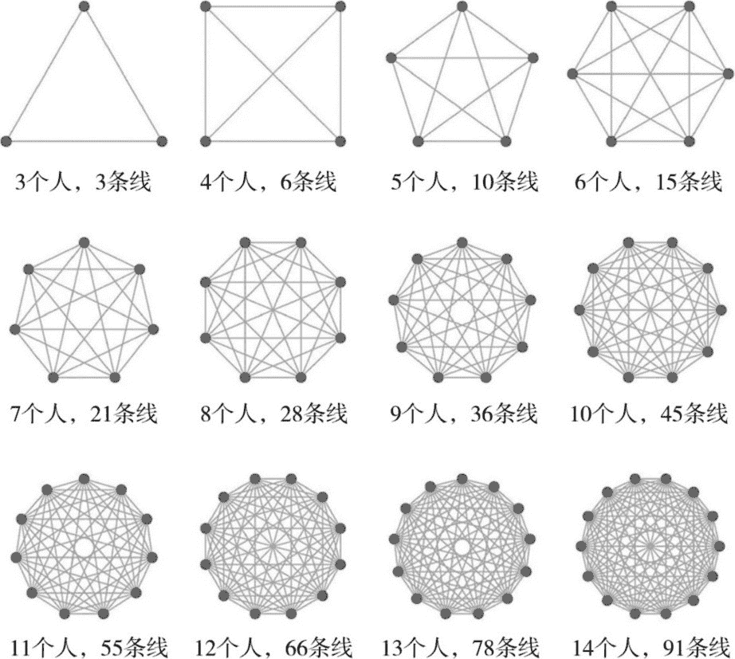

图 2-2 员工数量增加与沟通路径指数级增长关系图

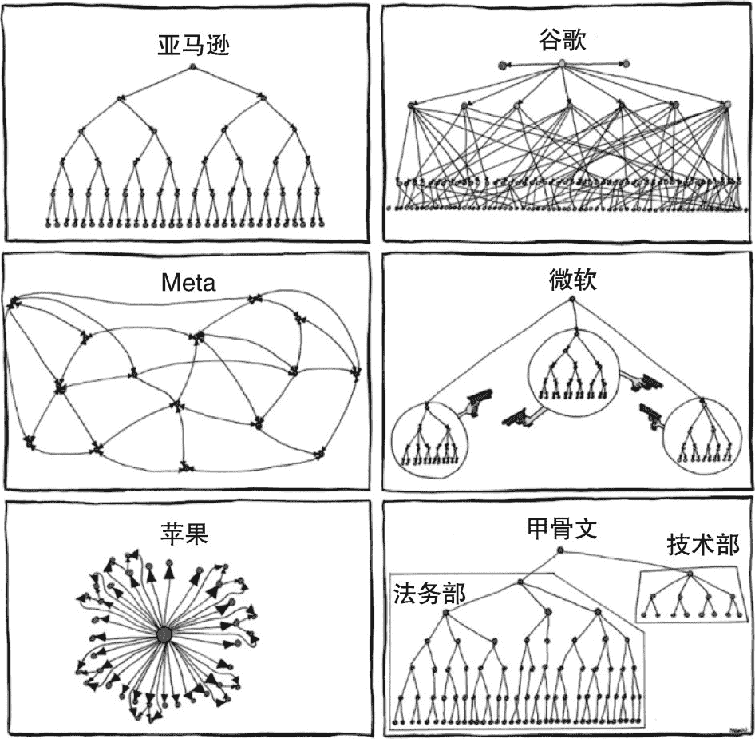

图 2-3 不同科技大厂各个层级间的不同组织形式

然而，这些帝国的缔造者可能从未意识到，他们亲手召唤出的这个“规模之神”，从诞生之日起，体内就潜藏着一个自我毁灭的幽灵。经济学家罗纳德·H.科斯（Ronald H.Coase）在 1937 年就已指出，组织的内部存在交易成本（沟通、管理、协调）。

当组织的规模小而简单时，这个幽灵尚在沉睡。但当组织的体量无限制扩张时，它便会醒来，然后像一个贪婪的恶魔，吞噬掉规模带来的所有红利。这就是“规模的诅咒”。在人类商业史上，这个诅咒已经引发了两次“组织大折叠”。

第一次折叠发生在信息稀缺的工业时代。对于像通用汽车这样的巨无霸，臃肿的层级让信息从一线传递到 CEO 的办公室需要数月之久。最终，组织的熵增压垮了效率，更灵活的日本企业趁虚而入。

第二次折叠发生在信息爆炸的互联网时代。互联网让信息流动成本趋近于零，传统企业的层级结构从过滤器变成血栓。谷歌、Meta 这些更扁平、更网络化的物种崛起，无情地折叠掉了庞大的中层管理者。

然而，前两次折叠无论多么剧烈，其本质都是在升级“容器”。工业革命升级了物理能量的容器（工厂取代作坊）；互联网革命则升级了信息能量的容器，正如摩尔定律不断提升计算机的性能，网络迭代不断拓宽信息的管道。在这两次浪潮中，竞争的核心，始终是使用着更快工具的人类之间的竞争。但今天，我们正站在第三次折叠，也是最彻底的一次“大折叠”的悬崖边。这次革命的底层法则，不再是摩尔定律，而是规模法则。它升级的不再是容器本身，而是容器里的存在物——智能体。

这意味着，我们第一次不是在和使用更快工具的人类竞争，而是在和本身就在变得更聪明的新物种竞争。

这就是第三次折叠的根本不同：如果说互联网折叠的是信息的传递者，那么在第一章我们解剖的那个“新物种”——智能体正在折叠的是信息的处理者和任务的执行者。

智能体正在从根本上颠覆那个支撑了整个工业文明的“劳动力规模法则”，即组织的产出与人力规模线性相关。这就是“乘法法则”的降临时刻。

**二、乘法法则：AI 时代的指数涌现**

工业时代的基本经济单元是工厂，信息时代的是公司。在 AI 时代，最基本的经济价值创造单元，正在从公司变为“智能体”。这个根本性的单元变化，预示着一场组织形态的“大折叠”即将发生，一个全新的、反直觉的“劳动力规模法则”正在诞生。

AI 大模型训练领域存在一个近乎铁律的“规模法则”（Scaling Law） ^(¹)：随着投入的计算资源越来越多和数据规模越来越大，模型的智能水平会随之涌现并持续增强，如图 2-4 所示。现在，我们必须直面一个令人不安的现实，那就是这个法则正从模型的训练场溢出我们的组织，形成一个全新的、决定未来组织形态的“劳动力规模法则”。

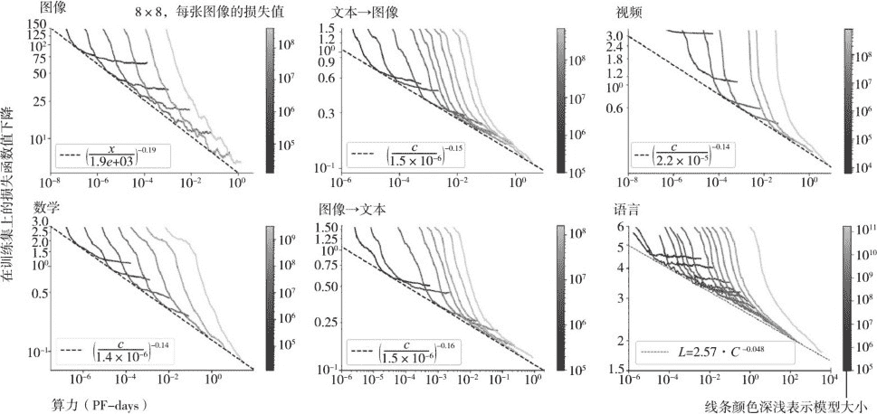

图 2-4 AI 大模型训练的规模法则

资料来源：T.Tom Henighan，et al Scaling Laws for Autoregressive Generative Modeling，2020。

如图 2-5 所示，以“人类最后的考试”（Humanity’s Last Exam）为代表的一系列学术基准测试集正在告诉我们，AI 的认知能力正沿着一条陡峭得近乎垂直的曲线攀升。这不再是线性进步，而是指数级的爆炸式增长。各大顶尖研究机构的预测虽然措辞不同，但得出的结论却惊人地一致：在未来十年，AI 的综合认知能力和在特定专业领域的技能水平，将超越 90%甚至 99%的人类。

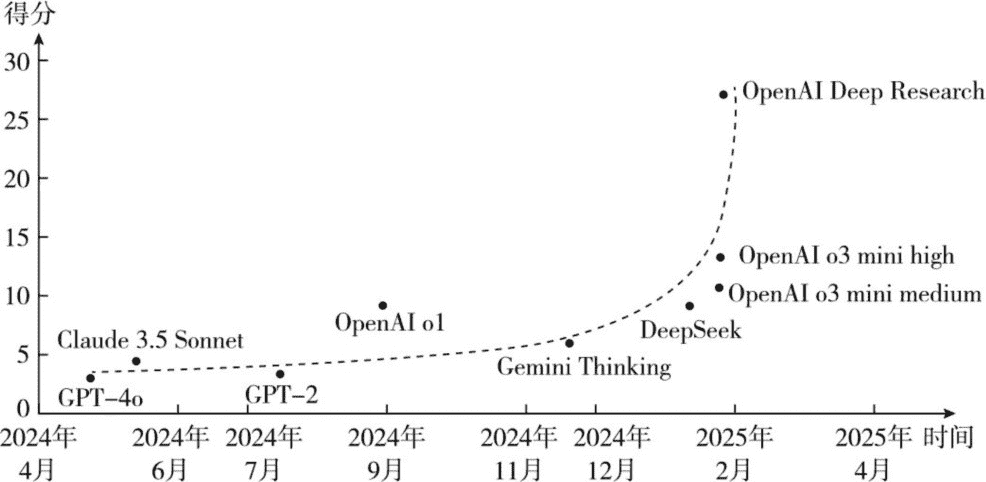

图 2-5 AI 在“人类最后的考试”得分情况

当“生产智能”的边际成本因为 AI 的进步而趋近于零时，我们过去建立在“人类是生产智能的唯一来源”这一假设之上的整个商业文明，都将发生动摇。这意味着，人类执行力稀缺的时代正在结束，而一个执行力无限供给与过剩的时代已经到来。绝大部分依赖信息处理、重复性思考，甚至是模式化创造的知识类工作，无论是研发、内容创作还是运营，其被 AI 重构乃至取代的趋势，几乎是不可逆转的。

这个看似离我们很遥远的预言，已经化为具体的案例，在我们的身边上演。通用智能体 Manus 可以独立完成“规划一次为期 7 天的日本旅行”这一复杂任务，从搜索航班、酒店到整理行程，再到输出包含餐厅推荐在内的精美指南。它打通了整条链路，将曾经需要多人、多岗位协作的任务压缩成一个无缝流程。超级个体的极限编程，也为我们揭示了这一未来：在一人公司，人类个体可以与智能体并肩，在短短两天的时间里，从零构建一个拥有超 10 万行代码的复杂协作软件，并随后在 10 分钟内完成营销网站和后台系统的搭建。AI 对这个项目的评估是，需要几十人做几个月才能完成。这个效率核爆不再是简单的提效，而是人力逻辑被改写的现实。

这证明组织效能的上限，正在从“人头规模”转向“智能体能力×人类驾驭能力”。工业革命 200 多年建立的“人海战术”逻辑，正在被 AI 彻底颠覆。

·旧范式：组织是一个加法机器，1+1=2。

·新范式：组织是一个乘法网络，1×AI×人类驾驭能力=∞。

在旧范式下，组织的增长是一场“加法”运算。组织的效能约等于投入的人力数量之和。这是一种线性的、可预测的，但最终受限于人力成本和管理复杂度的增长模式。而新范式则开启了一场“乘法”革命。组织的效能，不再是简单的人力叠加，而是“人类智慧×AI 杠杆”的结果。少数核心人类（如系统设计师等）负责指引方向与提供智慧，AI 则作为能力的“放大器”或“杠杆”，将这种智慧的执行力放大千百倍。互联网时代，网络是放大器；AI 时代，AI 本身就是最为关键的放大器。

这不是渐进式改良，而是底层逻辑的根本性重写。那些还在用增加人手来解决问题的组织，正在用 19 世纪的武器打 21 世纪的战争。工业革命所建立的“人海战术”逻辑，正在被 AI 彻底颠覆。我们正站在一个历史性的断裂点上：一个执行力过剩的新世界对执行力稀缺的旧世界发起了物理法则层面的挑战。而这场挑战，必然导致旧世界组织剧烈坍塌。

这种从加法到乘法的范式转移，并非遥远的理论推演。它正以一种冷静甚至残酷的方式，在全球顶级公司的战略规划中上演。老牌科技巨头惠普最近公布的一项公司级 AI 计划，就是这场变革最真实的写照。

表面上看，这项计划伴随着未来三年 4 000 人到 6 000 人的岗位调整。但深入研究其向投资者披露的文件后，我们会发现一个更深刻的真相：裁员只是结果，而非目的。惠普的 AI 重构计划，预计将为公司节省 10 亿美元。这笔巨额开销的节省，并非来自减少工资支出，而是来自 AI 对研发、客服和运营流程的系统性重构。这意味着，数千个岗位的职责，正在被 AI 替代。

这不是简单的降本增效，而是一次残酷的人效重新估值。在商业世界里，人类第一次用真金白银和真实的岗位验证了“乘法法则”的威力：一个与 AI 高效协作的超级个体，其创造的价值，正在折叠掉十个遵循旧流程的普通个体。惠普的案例向我们揭示了“乘法法则”背后的冷酷现实：未来组织的效率提升，将不再是线性的、温和的优化，而可能是指数级的、颠覆性的替代。

**第二节** **金字塔坍缩**

2024 年秋天，位于库比蒂诺的苹果总部气氛凝重。备受期待的苹果 AI 发布会未能引发热潮，同时，核心 AI 团队的多位骨干纷纷离职，投奔 OpenAI、Anthropic 和 Meta 等公司。曾经吸引全球天才的创新圣殿，一夜之间变成留不住人的围城。

苹果拥有充足的资金、强大的芯片和忠实的用户，但在 AI 赛道上却足足落后两年。原因并非技术不足，而是组织文化僵化：原本护航硬件生态的封闭系统，面对 AI 这一开放、快速迭代的新物种，反而成为攻击自身的抗体。

在东方，百度选择主动重构，大规模裁撤传统业务部门，同时强化 AI、大模型和核心工程岗位，CEO 亲自把握核心战略。两家巨头的路径不同，却指向同一真相：AI 正在重写组织价值链，金字塔式的组织结构正在被内部逻辑折叠。

当“执行力过剩”的新法则降临时，旧世界那座建立在“人力稀缺”这一基石上的组织金字塔，便开始从内部产生裂痕。这不是温和的改良，而是一场由内而外的、剧烈的结构性大折叠。这场折叠，并非三个孤立事件的同步上演，而是一场由点及面、层层深入的连锁反应。它像一场精准的爆破，从金字塔结构最脆弱的承重层开始，紧接着引发了不可逆转的连续坍塌。

首先是中层消失。信息高速公路的建成，让作为“中继站”的中层失去了存在的根本价值。其次是角色融合。当中层这道防火墙被拆除，任务和信息开始无损地在组织内流动时，专业分工的部门墙也随之倒塌。最后是个体“合伙人化”。当组织的基本单元从庞大的部门坍缩为精悍的作战小队时，对其中每一个“原子”的要求，也必然发生了根本性的改变。

现在，让我们沿着这条坍塌的路径，逐一审视这三重折叠的真实图景，以窥我们习以为常的，曾经庞大、臃肿的组织结构的组织形态，如何被压缩成一个更扁平、更精悍、更具“智力密度”的新结构。

**一、扁平：中层消失**

第一把挥向金字塔的利斧，砍向的是组织的中层。

在传统组织里，中层管理者的核心职能是上传下达、分配任务、监督进度。他们是人类执行力的“路由器”和“带宽管理器”。然而，在 AI 时代，CEO 的战略意图可以直接转化成智能体的任务指令，执行结果也能被实时、无损地反馈回来。中层，作为一种功能层级，正在被技术性地淘汰。

这场变革，正以效率型裁员的名义，在硅谷乃至全球科技界无声地上演。2024 年以来，谷歌、Meta、亚马逊等巨头纷纷裁撤数以千计的工程师岗位。这并非传统的经济性裁员，而是达成一个令所有从业者都不寒而栗的共识：得益于 AI 编程助手的普及，过去需要十个人完成的工作，现在三个人就能高质量地完成。公司不再需要通过大规模招聘来换取产出的增长。

硅谷的裁员潮，正是“组织大折叠”发出的第一声清脆的断裂声。它以一种最无情的方式宣告：在 AI 的指数级效率面前，仅仅拥有经验和技能的 HR 正在迅速贬值；而能够驾驭智能杠杆的智力资本，则变得前所未有地珍贵。如表 2-1 和表 2-2 所示，让我们用客观的数据来看看这场变革的真实影响。

表 2-1 2025 年全球软件行业就业数据（预测 vs 现实）

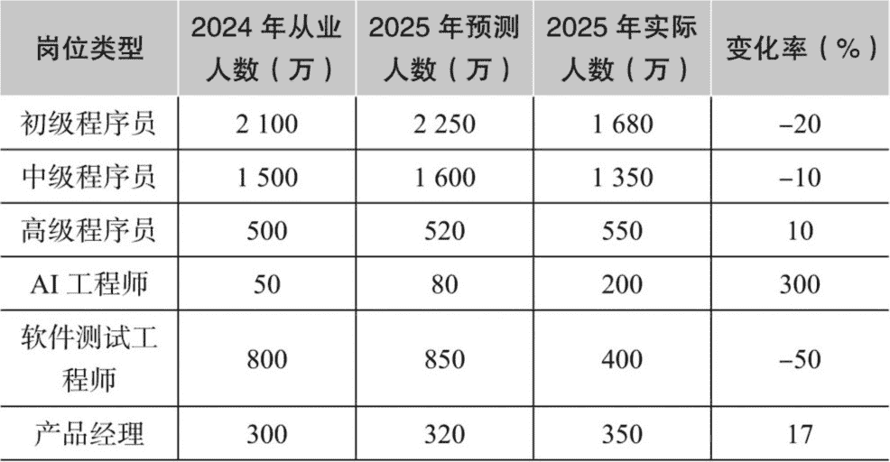

资料来源：IDC Worldwide and Regional Developer Census, 2025、Stack Overflow 2025 Developer Survey、GitHub Octoverse 2025 Report，etc。

表 2-2 传统软件公司与 AI 原生公司的效率对比（2025 年第一季度数据）

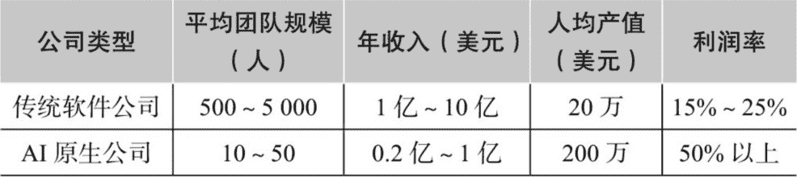

资料来源：IDC 2025 CEO Priorities Research、ICONIQ Capital 2025 State of AI Report、Sequoia Capital The Always-On Economy：AI and the Next 5-7 Years，etc。

这些冰冷而又震撼人心的数字，以一种不容置辩的方式，印证了中层消失的必然性。随着中层的消失，组织内的各类角色也必然面临着一次痛苦但必要的进化。比如在一个产研组织内，纯粹的管理层将被取消，而真正的技术管理者必须兼具架构师的角色，同时能够直接参与代码审查与核心设计，用技术能力而非行政权力来领导。

这种看似残酷的中层消失，其背后的商业逻辑，已经得到了资本市场最直接的验证。2025 年，亚马逊宣布了一项涉及上万人的大规模裁员计划。这本应是一个引发市场担忧的负面信号，然而，裁员消息公布当天，亚马逊的股价不仅未跌，反而上涨。随后发布的财报更使其市值单日大幅提升。华尔街的反常反应，揭示了一个深刻的认知转变：投资者看到的，不再是一家公司因业务萎缩而断臂求生，而是一场主动的、面向未来的战略性重组。市场不再单纯关注员工数量，而是在为组织的高效运作能力买单。亚马逊的股价波动，成为这场“组织大折叠”在资本市场上的直观体现。

当亚马逊还在通过裁员来“优化”中层时，瑞典的 AI 初创公司 Lovable 这样的新物种从一开始就拒绝了中层的存在。Lovable 的员工尖锐地指出：“没有专业能力的中层管理岗将灭绝，我们淘汰的不是人，而是组织冗余。”在 Lovable，没有专门协调跨部门协作的运营岗，也没有层层审批。这种架构带来了四大核心变革：真实的所有权（谁构建，谁负责）、极致的自主权（无须协调五个部门）、信任即基石（不需要每周审批流程的层层干预）以及高速执行成为核心竞争力。Lovable 仅有 15 人，却在五周内上线了推荐计划、免费协作功能、年费方案和积分结转，这在传统企业的眼中是不可想象的。

亚马逊削减冗余和低效中层岗位，为更关键的业务部门腾出资源。这些组织架构的调整，也预示着组织下一轮深刻的重塑——角色与责任将被全面重新定义。

**二、全栈：角色融合**

这次折叠发出的第二波冲击，是专业分工边界的溶解。前 Adobe 首席产品官斯科特·贝尔斯基（Scott Belsky）称之为“人才坍缩”。当首席设计师同时是产品领导者，前端工程师同时是设计师时，组织就获得了持续的不公平竞争优势。AI 正是这个关键的折叠器：一个系统就能集调研、设计、执行于一身。

过去，组织效率的提升依赖于极致的专业分工。而现在，一个由多个专业智能体协作构成的系统，可以同时扮演过去需要一整个团队才能覆盖的多元化角色。基于人类能力的有限性而设立的“部门墙”，正变成阻碍效率优化的“沟通税”。传统的、基于明确岗位职责划分的科层制部门将被打破，组织更可能围绕具体的任务动态地组建由少数核心人类专家和多个智能体构成的“敏捷作战单元”。

正如马蒂·卡根（Marty Cagan）预测的那样，在智能体的驱动下，未来产品团队的核心构成可能简化为仅仅三人：一位负责梳理业务逻辑和需求的产品经理、一位负责用户体验的产品设计师，以及一位负责攻克技术难题的工程师。而其他大量的交付工作，如编码、测试，甚至部分设计稿的生成等，皆可由智能体高效完成，如图 2-6 所示。

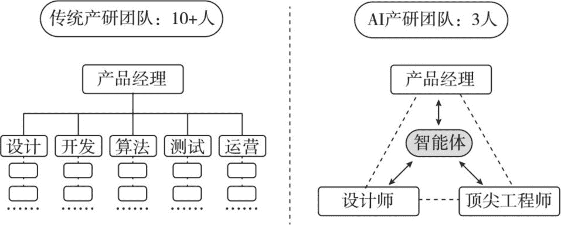

图 2-6 传统产研团队和 AI 产研团队的对比

图 2-6 左侧，是我们无比熟悉的传统产研团队，其架构是超过 10 人的庞大队伍围绕着一位产品经理低效协作。右侧，是正在崛起的 AI 产研团队，其核心成员仅仅 3 人：一位产品经理、一位设计师、一位顶尖工程师。他们共同驾驭智能体，完成过去需要七八个人才能完成的大量交付工作。这个看似激进的预测，在我们的亲身实践中，甚至显得有些保守了。

在 AI 原生组织的深水区探索中，我们进行了一次更为极限的组织试验。我们发现，在智能体的深度赋能下，一个核心产研单元甚至可以被压缩到仅仅只有两人：一位系统设计师、一位全栈工程师（见图 2-7）。

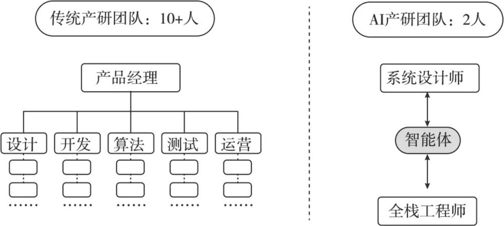

图 2-7 组织“大折叠”的缩影示意图（智能体如何将金字塔式的产研团队极限压缩为两人协作的“原子单元”）

这两人，与一个强大的 AI 系统协同，便能完成过去需要一个庞大团队耗时数月才能完成的、从 0 到 1 构建的复杂产品。这已经不是简单的效率提升，而是对“团队”这个概念的彻底重写。当少数核心人才与强大的智能体协同，就能轻松突破过去需要依赖“人海战术”才能攻克的难关时，传统金字塔式组织的存在合理性便开始瓦解。而现实早已超越了预测。这些如超新星般崛起的公司，正在用惊人的效率重塑战场。

在 AI 绘画领域，Midjourney 公司在巅峰时期以不足 50 人的极精简团队，创造了数亿美元的年收入，服务着全球数千万位专业设计师和创意工作者。在过去，要支撑这样一个大规模的用户群体和产品复杂度，需要一个达到至少几百人规模的美术、研发和运营团队。

在搜索引擎领域，Perplexity AI 以不足百人的团队，正面挑战着拥有数十万名员工的搜索巨人谷歌。它之所以能做到，是因为其核心的答案生成工作由强大的智能体完成，而非依赖数万名工程师去优化网页排序算法。

在 AI 原生应用领域，Lovable 这个让用户可以通过自然语言快速创建应用的平台，其核心创始团队仅有 15 人。但这 15 个人，借助他们自己创造的 AI 系统，支撑起了一个能够让数万名用户在上面创造新应用的复杂生态。

这些案例共同遵循着同一个新法则：组织的效能，不再取决于团队成员的数量，而取决于其撬动智能杠杆的智慧。

这场角色融合，是管理大师彼得·F.德鲁克（Peter F.Drucker）“知识工作者”理论进化的体现。德鲁克预言，组织的价值创造主体将从体力劳动者变为掌握专门知识的垂直专家。然而，在 AI 时代，单一领域的知识正被快速商品化。组织的竞争力不再依赖专才的数量，而是取决于核心人才如何将 AI 作为知识融合器，横向整合多领域能力，端到端地解决复杂问题。我们正从德鲁克的垂直知识工作者时代，跃迁至能横向驾驭 AI 的系统设计师时代。

**三、众包：个体合伙人化**

我们早已生活在一个“众包”的时代。过去十年，美团和滴滴完成第一次众包，将体力劳动拆解并外包给骑手和司机，形成庞大的零工经济网络。而 AI 正在开启第二次众包，将智力劳动也拆解并众包给智能体。

这场“智力众包”变革，正在从根本上改写个体在组织中的身份。它要求每一个知识工作者都完成一次从被动执行的螺丝钉到主动创造价值的超级节点的身份跃迁。但这一次，每个合伙人需要驾驭的不再是骑手或司机，而是智能体。

这正是“组织大折叠”的未来形态：组织内个体“合伙人化”。当一个 50 人的团队能够创造出过去 1 000 人才能完成的价值时，组织对每一个成员的要求也发生了质变。他们不再是流水线上一颗被动执行的螺丝钉，而是要成为一个对最终成果负责、拥有全局视野的合伙人。在我们的实践中，信息可以无损地从 CEO 直达一线执行者。这种信息的极度透明，要求每个人都必须具备 CEO 视角，去理解每一次行动背后的商业意图。

微软与卡内基梅隆大学的一项联合研究揭示了 AI 如何重塑知识工作的内涵。人类的角色正在三个维度发生根本性转变：人类不再是信息的收集者，而是真伪的最终验证者，且在 AI 高效输出的信息洪流中扮演事实的守门人；人类不再是问题的直接解决者，而是 AI 输出的价值整合者，在复杂的商业情境中做出最关键的权衡与判断；人类不再是任务的具体执行者，而是智能体集群的宏观编排者，将精力专注于更高维度的资源分配与系统设计。

这意味着未来的核心人才，必须在高度抽象的层级思考和行动，并为决策承担高风险的后果。比如，当 AI 一通计算后，给英伟达的股票定价为远高于均常值的 329.69 美元时，作为投资者的你，是检查它的每一步计算还是直接下注？这正是未来人才面临的终极考验。

最终，在这场“大折叠”之后，一个 AI 原生组织中的核心人类角色包括系统设计师和人类沟通师。

**系统设计师：**他们是未来的“组织架构师”与“世界观的定义者”，负责定义问题、设计体验、构建人机协作的“蓝图”，对最终的产品价值负责。

**人类沟通师：**他们是组织“人性”的代表，负责与企业外部的人类（如重要客户、战略伙伴、政府）建立深度的情感连接与信任关系，处理那些 AI 无法胜任的、充满模糊性和复杂人性的沟通。

未来的组织架构将被极限压缩为人与智能体的结合体，如图 2-8 所示。

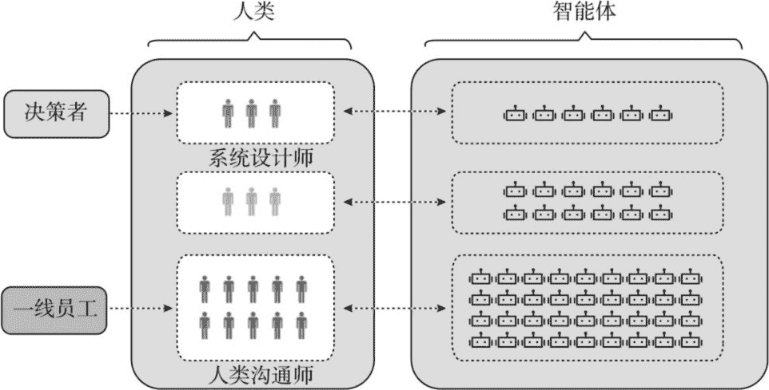

图 2-8 人类与智能体协作的未来组织架构图

图 2-8 清晰地揭示了“折叠”后的组织新形态：一个由系统设计师组成的、极度精简的决策与执行核心，通过驾驭庞大的智能体集群来完成落地。而人类沟通师则作为组织的“人性”接口，连接着外部世界。金字塔消失了，取而代之的是一个智慧的大脑和无数高效的触手。

中层消失、角色融合、个体合伙人化——这三重折叠共同描绘了一幅金字塔坍塌后的图景。这幅图景，对于那些从零开始的“新物种”而言，是与生俱来的基因。然而，对于那些在旧世界里建立了庞大帝国的“巨象”，那些拥有数万名乃至数十万名员工、结构层层叠叠的部门，以及流程化根深蒂固的组织，这幅图景不啻为一份死亡判决书。

因为它提出的问题，不再是你要不要优化，而是你敢不敢将自己亲手建立的帝国，折叠成这个样子？你敢不敢让 90%的“躯体”消融，只留下一个“大脑”和少数“神经末梢”？

这正是“组织大折叠”最残酷的一面。它不仅仅是一种技术驱动的效率演进，更是一场对现有利益、权力和文化的暴力清洗。理论上的进化如此美好，但现实中的转身却无比艰难。那么，究竟是什么让那些曾经最强大的商业巨头，在这场不可逆转的折叠浪潮面前，反而显得步履维艰、应对乏力？

答案就刻在曾经助力它们成功的基因里。它们过去赖以成功的商业模式，孕育了庞大的利益共同体，成为利润和人才的诅咒；它们为管理庞大军团而设计的成熟流程，固化了组织的肌肉记忆，变成流程的陷阱；它们引以为傲的技术栈和人才库，构建了帝国的坚固城墙，也变成遗产的重负。

这三重枷锁共同构成 AI 时代的“创新者窘境”。它们无法通过自我改良，来完成这场基因层面的跃迁。因此，唯一的出路，不在于修补旧世界，而在于创造新世界。

**第三节 迈向 AI 原生组织**

在旧世界坍塌的废墟之上，一种全新的组织形态正在崛起。面对这场不可逆转的变革，组织需要主动进化，迈向 AI 原生组织。

OpenAI 在 GPT-5.2 发布的当天，也悄然发出了一封十周年全员信。信中没有谈算法性能，而是强调信念、使命与组织结构：真正的 AI 原生组织的基因不在代码里，而在信念里，在整个组织如何让 AI 成为核心执行力的实践中。正如 OpenAI CEO 萨姆·奥尔特曼所言：“未来的组织，将不仅仅依靠人类做出决策，而是人类与 AI 形成共生的智能系统。”

随着越来越多科技巨头开始重构组织，行业领袖也在公开强调这一趋势的重要性。特斯拉 CEO 埃隆·马斯克也曾公开指出：“真正的竞争优势，不是模型多大，也不是算力多强，而是团队能否围绕智能体快速重组、迭代出全新的商业逻辑。”同样，微软执行副总裁贾里德·斯帕塔罗（Jared Spataro）表示：“企业若不让 AI 成为日常运作的核心，而只是附属工具，那么将永远落后于那些从组织结构到战略决策都以 AI 为中心的公司。”

那么，究竟什么是 AI 原生组织？瑞典初创公司 Lovable 给出了答案。这家仅有 15 人的公司，在短短 7 个月内实现了 8 000 万美元的年度经常性收入。这不仅仅是增长奇迹，更是组织形态的颠覆。在这里，“AI 原生”不只是指他们的产品，更是指他们默认的工作方式。无论开发内部工具、营销页面还是生产代码，员工的第一反应不是申请编制，而是直接借助 AI 完成。他们甚至没有产品经理岗位，也没有交接流程。正如其员工所言：“AI 原生员工并不是使用 AI 工具的人，而是将 AI 作为第一本能、默认使用 AI 的人。”

这正是 AI 原生组织的核心理念：AI 是组织中默认的、最主要的执行主体，而不再只是辅助工具。这一定义的转变，如同物理学中从“地心说”转向“日心说”，将从各个方面重构组织。所有我们熟知的组织特征——层级、岗位、流程、职责——都将围绕“AI 作为执行主体”重新定位。

基于这一视角，我们可以提炼出 AI 原生组织的三大核心特征：它们互相联结，构建出组织独特的生命力，也为我们后续实践中的“三大引擎”设计提供了理论支撑。

**一、执行核心：智能体主导工作**

智能体深度嵌入组织的核心业务流程，能够承担大量的执行性工作，甚至是辅助人类员工进行决策。它们不再是边缘化的工具，而是与人类员工并肩作战的“智能伙伴”和高效的“数字员工”。组织会围绕智能体的能力和特性，主动重塑工作流和岗位职责。

在一个高效的人机合作的组织中，由智能体自主完成的任务比例超过 90%。人类员工的核心工作，从“直接执行”转变为“与智能体协作”或“管理智能体”。在 Lovable，智能体主导了核心价值的创造过程，可以自主完成从理解用户需求、规划应用架构到生成代码。智能体承担了过去需要庞大工程师团队才能完成的工作。人类员工所扮演的角色，更像是智能体的指挥官和教练员。

与此同时，在亚马逊的仓库里，成千上万台机器人像一支训练有素的军队，自主搬运货物，然后将其精准地送到人类的面前。而人类员工则从繁重的体力劳动中解放出来，变成这支军队的指挥官，负责维护和优化整个系统。在创意设计行业，智能体也深度进入组织。在跨国电脑软件公司 Adobe，过去设计师需要在多个软件之间来回切换，从而完成一个复杂的创意项目。现在设计师只需要告诉数字伙伴一个创意目标，它就能自动完成从修图到排版的全过程。人类不再是操作员，而是真正的创意总监。

**二、组织架构：扁平与聚合的坍缩**

组织超扁平化，信息高速、透明流动，决策链路极短，组织能够像初创公司一样快速响应市场变化。传统的、固化的部门壁垒被打破后，组织更像一个由自主的、AI 赋能的、可灵活组合的“模块化单元”或“敏捷作战小队”构成的网络。内部管理层级不超过 3 层。一个全新的跨职能任务团队，可以在 24 小时内完成组建并投入工作。

比如，Spotify 由一个个小分队组成，而每个小分队都是一个跨职能、自治的团队，拥有前端、后端、测试、产品经理等，像一个迷你创业公司，长期负责一个特定的功能领域，如播放列表小分队、付费流程小分队，这大大减少了因层级壁垒带来的慢响应。再比如，Lovable 的 15 人创始团队，正是典型的“系统设计师”集群。他们不直接编写大量应用代码，而是设计那个能让用户与 AI 高效协同、共同创造应用的系统。这种人机协同使得组织结构可以做到极致的扁平化和敏捷，管理层级几乎不存在。

曾鸣教授曾预言，未来的组织将呈现出一种极致简约的“两层架构”。顶层是极少数的“创智人才”，他们由顶尖专家、跨界创新者和领导者组成。他们的核心工作不再是“管理”，而是定义问题、设定方向、进行创造性的“第一性思考”。底层是规模庞大的“硅基员工”，无数智能体承担了过去 99%的常规执行工作，成为创智人才最忠实、最高效的合作伙伴。在这个“1%的人类大脑+99%的 AI 肌肉”的共生体中，组织的竞争力将由“群体认知的高度和提升速度”决定，而非传统的运营效率。

**三、增长机制：爆发式扩张路径**

组织文化深度拥抱变革，鼓励试验、包容失败，快速迭代、持续学习。AI 系统和人机协同流程具备一定的自学习、自优化能力，能够从实践中不断进化。组织本身就像一个充满活力的生命体，能够智能地适应外部环境的变化，并自下而上地“涌现”出新的解决方案和创新模式。

衡量员工价值的核心指标，从“个人产出”转变为“个体所能撬动的人机协同网络的产出”。1 个人类加上 10 个智能体的组合，创造的价值远超 11 个人的总和。新产品或新功能的迭代周期以“天”为单位。组织内超过 50%的重大创新，源于自下而上的试验和涌现，而非顶层的战略规划。

Lovable 的案例，为我们揭示了 AI 原生组织的内在运行逻辑。而当把视线投向更广阔的商业世界时，我们会发现这种模式正在创造出惊人的杠杆效应。AI 绘画巨头 Midjourney，在巅峰时期以不足 50 人的团队创造了数亿美元的年收入，服务全球数千万用户；而答案引擎 Perplexity AI 则以不足百人的团队，正面挑战搜索巨人谷歌。

智能体主导的执行、坍缩的结构、爆炸式的增长这三种基因相互交织，共同塑造了 AI 原生组织这个充满活力的生命体。它拥有强壮的“肌肉”、敏捷的“神经”和高速的“新陈代谢”。在过去几年，我们看到了越来越多的 AI 原生企业快速崛起，这宣告了一个全新时代的到来：组织的竞争力将不再取决于其员工数量的规模，而取决于人驾驭智能体的智慧密度。表 2-3 总结了 AI 原生组织与传统组织在关键维度上的颠覆性差异：

表 2-3 关键维度差异：AI 原生组织 vs 传统组织

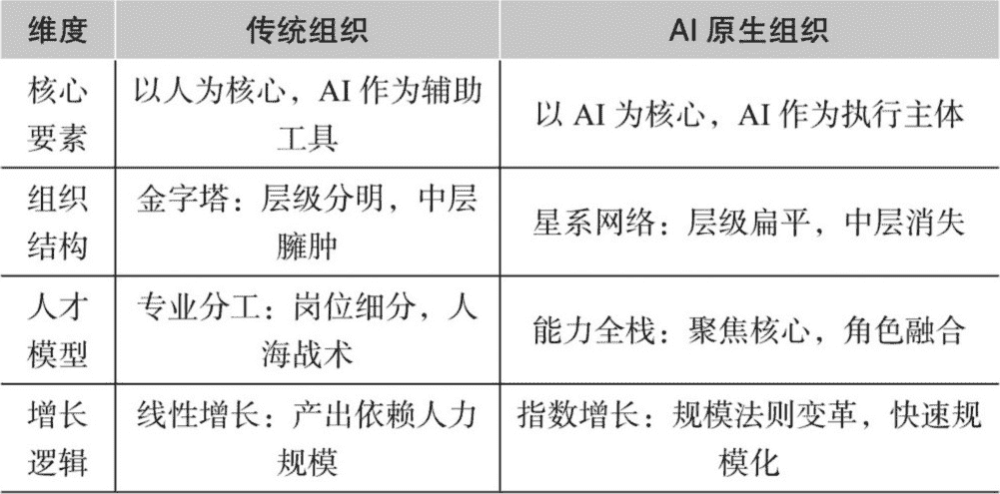

**第四节 转型工具箱：AI 原生指数体检**

AI 原生不是一个简单的“是/否”标签，而是一条从旧世界通往新大陆的进化路径。为了让你更清晰地判断组织当前所处的位置，我们提炼了四个最核心的维度，展示了组织“传统模式”与“AI 原生模式”的关键差异。请拿出一支笔，或在心中默选，快速地对你的组织进行一次诚实的“AI 原生指数”体检。

请根据组织现状，勾选最符合的描述（二选一）。

**一、维度一：AI 的角色定位**

A．效率工具：AI 被视为“插件”或“外挂”，用来辅助人类完成单点任务（如写邮件、修图）。它是员工个人的事。

B．执行主体：AI 被视为“新员工”或“核心劳动力”，承担端到端的复杂任务（如写代码、客服闭环）。它是组织设计的事。

**二、维度二：组织结构形态**

A．金字塔形：层级分明，中层管理者众多（超过 3 层），信息需要层层汇报和传达。

B．星系网络形：极度扁平（少于 3 层），由少数决策核心（恒星）和多个全能的“原子小队”（行星）构成，去除了中间层。

**三、维度三：人才密度模型**

A．专才分工：岗位职责划分精细（如切图仔、螺丝钉），员工只对自己的一亩三分地负责。

B．全栈通才：岗位数量大幅减少，核心人才都是能驾驭 AI 的“系统设计师”或“全栈指挥官”。

**四、维度四：增长驱动逻辑**

A．人海战术（加法）：业务增长严重依赖于团队规模的扩张（加人=加产出）。

B．智能杠杆（乘法）：极少数精英通过驾驭 AI 杠杆，创造指数级的业务价值（加算力=加产出）。

体检报告结果如下：

选 A 较多：传统组织（恐龙型）。你的组织正运行在一套即将被淘汰的旧操作系统上，面临严重的“降维打击”风险。请翻开第三章，开始考虑组织转型。

选 B 较多：AI 原生组织（进化型）。你已经摸到了新世界的门槛。请继续阅读后续章节，这份诊断将帮助你发现仍需强化的环节，并指导你不断优化，推动组织能力向极限迈进。

这份诊断报告，不仅仅是一张评估表，更像一张外科手术前的 CT 扫描图。它残酷地揭示了一个核心真相：AI 转型首先是一场组织结构的变革。你无法在一辆马车的骨架上，安装一台火箭引擎。在僵化的金字塔结构上，永远无法生长出敏捷的 AI 原生能力。看清了结构上的差距，我们就有了明确的行动起点。这不再是一个要不要做的问题，而是一个如何动手的问题。

**小结 “物理定律”的变更**

至此，我们完成了对“新物种”的认知破局。我们从前文试验室的寂静中，听见了“新物种”的第一声心跳，也透视了旧组织不可逆转的“大折叠”。然而，在这所有现象的背后，隐藏着一个更深层次，也更残酷的真相：当 AI 成为执行主体后，商业竞争的“物理定律”已经发生了根本性的变更。

人类在过去两百多年建立的商业文明，其基石都是为了解决一个核心问题：如何最高效地组织和利用“稀缺的人类执行力”。金字塔结构、层级管理、人海战术，都是这套旧物理学下的最优解。而 AI 带来的，并非对这套解法的优化，而是对“稀缺”这个基本公理的彻底颠覆。它第一次把智能执行力从一种昂贵的资源变成一种充裕的，甚至过剩的基础设施。

当物理定律从“执行力稀缺”变为“执行力过剩”时，整个商业宇宙随之发生了维度坍缩。曾经为了管理稀缺性而设计的庞大结构（中层、部门墙），瞬间从资产变成负债；曾经的王者，反而因其巨大的惯性，难以适应新的引力法则。

不仅仅是执行力的升级，更是组织存在逻辑的重构。诺贝尔经济学奖得主罗纳德·科斯在 1937 年提出，企业存在的意义是降低市场交易成本。然而，当智能体能以近乎为零的协作成本，在全球范围内即时连接最优的“技能节点”时，科斯笔下的企业边界正在被重新定义。那些为降低内部管理成本而筑起的部门墙，如今反而成了阻碍全球协作的最大成本。

这就是第一篇带给我们的洞见：我们正经历的，不是一次效率的改良，而是一场物理学的变革。我们不能再用牛顿力学的思维，去理解一个已经由爱因斯坦的相对论所主导的新宇宙。

既然物理定律已经变更，那么我们用来建造未来组织的一切工具、材料和蓝图也都将随之改变。这不仅仅是关于组织内部形态的重构，更是一场对价值创造方式乃至社会协作关系的彻底重写。未来的价值，将不再源于庞大的团队，而是源于少数核心个体如何与无数智能体组合成高效的价值链；未来的组织，也将从一个封闭的公司演变为一个开放的、人机共治的新型经济体。要想在这场商业跃迁中幸存下来，我们必须从旁观者转变为新世界的建造者。

在接下来的第二篇中，我们将成为这场“新物理学”的工程师，学习如何利用新的宇宙常数去构建一个能够在全新引力场中生存和繁荣的 AI 原生组织——为其注入奔腾不息的“数字血液”，搭建光速传导的“神经网络”，并锻造支撑其形态的“灵魂与骨骼”。

**第二篇** **转型之旅**

在第一篇中，我们完成远征第一程——“认知破局”。我们站在旧世界的废墟之上，辨认出“新物种”的身影，并理解其背后那套已经变更的运行法则。

认识新物种与创造新物种，是两件截然不同的事。现在，当我们从一个冷静的观察者转变为亲手塑造未来的造物主时，我们需要走进那间名为“变革”的手术室，为我们的组织进行一场脱胎换骨的创生手术。

我们的目标不再是修补一台陈旧的机器，而是创造一个真正属于 AI 时代的、活着的、能够自我进化的生命体。这场伟大的创造，如同创造生命本身，需要遵循生命内在的演化逻辑，从内到外，依次构建起三大核心生命系统。这就是我们即将展开的“转型之旅”的三大引擎。

引擎一：注入“数字血液”（第三章）。我们将深入组织的肌理，将“数据淤泥”提炼成驱动 AI 生长的养料。

引擎二：构建“神经网络”（第四章）。我们将用智能体作为基本单元，编织一张能够主动感知、自主决策和动态执行的智能网络。

引擎三：重塑“灵魂与骨骼”（第五章）。我们将为这个生命体重塑骨骼，注入文化“灵魂”。

血液、神经、灵魂与骨骼，这三大引擎相互关联、层层递进，共同构成 AI 原生组织的完整生命蓝图（见图 a）。

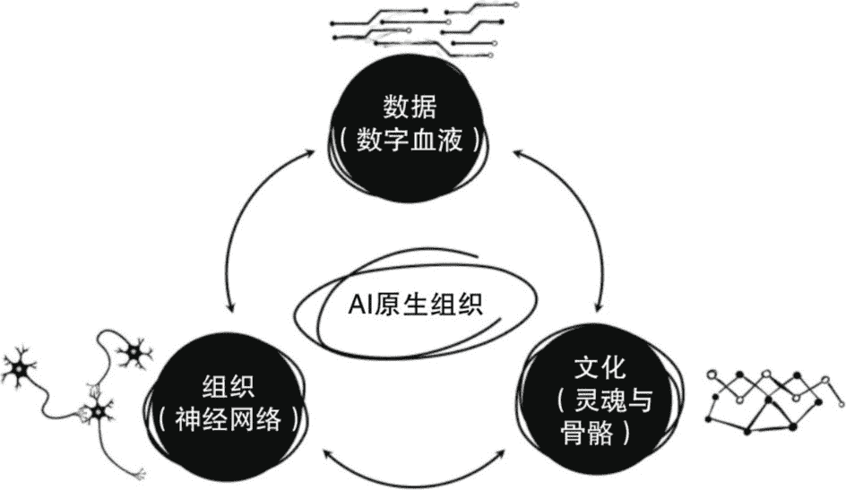

图 a AI 原生组织的“生命体”构成

现在，让我们开启这场创生之旅。首先要做的是为这个新生的生命体注入不息的“数字血液”。

**第三章** **为 AI 准备数据**

在第二章，我们完成对组织的“体检”，确立了迈向 AI 原生组织的目标。然而，当我们准备启动这台全新的智能引擎时，却往往会卡在第一步——燃料不足。没有高质量的数据，最先进的智能体也就是一个空转的发动机。数据不再是躺在报表上的数字，而是 AI 的血液。因此，我们的构建之旅必须从修复组织的“供血系统”开始。

为什么几乎每家公司都坐拥一座数据金山，却常常活得像一个“信息乞丐”？为什么过去十年，无数次轰轰烈烈的数字化转型最终大多以失败而告终？

我们曾亲历过一次代价高昂的“数据寻宝”。为了优化一款核心产品的用户留存率，我们需要回答一个看似简单的问题：“用户注册后的第一天，到底做了什么？”一场跨越三个部门的“数据寻宝”之旅就此展开。

产品团队拿出了应用内的埋点数据，显示大部分用户都点击了“新手引导”；市场团队调取了广告投放数据，证明用户主要来自“优惠券”活动链接；而客服团队则整理了用户工单，发现新用户的第一个问题，大多是关于“如何找到某个隐藏功能”的。

三份数据，代表着三个不同的故事。它们就像三块散落的碎片，每一块都指向一个方向，但拼在一起却会引发一片混乱。我们花了数周的时间，才勉强拼凑出一条模糊的用户路径。而那时，一半的新用户早已流失。这次痛苦的“寻宝”，正是今天几乎所有组织在数据问题上所面临困境的缩影。它揭示了一个残酷的真相：我们拥有的不是数据金山，而是一座座彼此隔离的“数据孤岛”。

然而，孤岛仅仅是冰山一角。在这片冰冷的数据海洋之下，还潜藏着更深的危机。除了那些我们“看不全”的数据孤岛，还有大量我们根本“看不懂”的过程数据（如会议讨论）沉没在“数据黑洞”中。即使这些数据被幸运地打捞上来，高昂的利用成本也让它们中的绝大多数最终“溺亡”在数据湖底，从未被唤醒。

数据孤岛（看不全）、数据黑洞（看不懂）、数据溺亡（动不了）这三大顽疾，如同慢性病一样侵蚀着组织的数字化转型，让过去的努力屡屡失败。而现在，它们正成为扼住 AI 这个“超级大脑”咽喉的致命枷锁，并具象化为组织中每一个角色的焦虑。这些焦虑，最终都指向一个共同的症结：我们还没有为 AI 建立一套可用的数据系统。

**第一节 数据目标：从“给人看”到“给 AI 看”**

在我们因“数据孤岛”失去大量新用户时，特斯拉的自动驾驶 AI 在悄然成长。每天，当数百万名车主行驶在全球各地的道路上时，车内的 AI 在“影子模式”下记录驾驶员的操作，并与自己的判断对比，发现差异的数据会被上传至云端。数百万名驾驶者无意中成为 AI 的“教练”，他们每一次应对复杂路况的经验，都在训练着这个“超级大脑”。

相比之下，很多企业仍把数据做成报表，供人回顾和决策。没人注意的是，AI 只能看到表面数据，而忽略背后的情境。一家零售企业让 AI 预测爆款，AI 建议囤积曾经滞销的商品，因为它只看到了销量激增的数据，而未捕捉到促销清库存的背景信息。数据孤岛让 AI 成为蒙眼的决策者。

这揭示了一个根本性转变：当 AI 成为组织核心决策主体时，数据不再只为人服务，而必须像血液一样，在组织的每个角落自由流动，为 AI 提供持续的“养分”。对所有渴望转型的组织而言，打通数据孤岛、构建高效的数据基建，已成为赋能 AI 的第一步，也是不可回避的头号工程。

**一、核心目标：从“服务人”到“服务 AI”**

过去，我们为了方便人去看，把数据做成报表；今天，我们为了方便 AI 去用，需要为它提供原始的、全量的、实时的“食材”。在这个新范式下，数据的价值不再是帮助人类回顾，而是成为驱动 AI 实时行动的燃料。

这正是特斯拉与 Shopify 等先行者正在构建的未来。当传统车企还在测试场里重复验证有限的场景时，特斯拉的每一辆车都在通过“影子模式”，从全球各地真实的道路上源源不断地采集人类驾驶员如何应对“长尾场景”的数据，然后反哺其自动驾驶模型的进化。当许多公司的数据还被禁锢在不同的业务系统和部门墙内时，率先“All in AI”的全球电商巨头 Shopify 已经通过其统一的架构，将内部所有数据接口化，让任何一名员工都能像调用 API 一样，驱动 AI 去整合全公司的数据进行创新。

因此，当算法与算力日益商品化时，未来真正的护城河将是那套独一无二的、高质量的、能持续为 AI 提供燃料的数据系统。组织的智能天花板，就刻在它的数据血管里。

反观苹果在 AI 时代的困境，其症结之一正是“数据血液”循环不畅。与特斯拉让每辆车都成为数据采集终端、形成开放循环不同，苹果依赖强大的隐私保护和封闭的 iOS 生态，虽筑起坚固的壁垒，却限制了 AI 模型获得多样化“养料”，难以快速迭代。苹果曾试图将 AI 围困在独立部门内，如同为大脑单设供血系统，结果必然是整体协同受阻、创新神经“坏死”。在 AI 原生时代，任何数据孤岛或流程壁垒，都会成为组织的致命“血栓”。

对于苹果的教训，我们也曾用真金白银的损失，深刻地体会过。一个海外竞品突然上线了一项创新功能，一周内蚕食了我们近 10%的市场份额。最让我们懊恼的是，在事后复盘时，我们在客服邮件、社区论坛里，找到了成千上万条关于这个痛点的用户抱怨评论。这些蕴含着巨大价值的数据金矿，因为是混杂着口语、错别字的“暗数据”而被我们视而不见。

**二、数据基建：AI 时代的供血系统**

而许多企业 AI 化转型的根本问题，正是缺乏真正的 AI 技术设施和数据。这不是 AI 的问题，而是组织的问题。确切地说，是组织内部一个被我们长期忽略却至关重要的系统——供血系统出现了故障。

这个教训解释了为什么“数据基建”必须成为今天的头号工程。它不再是基于投资收益率（ROI）的战术决策，而是一项关乎未来的战略投资。在开启这场投资之前，组织的领导者必须完成一次内部的“灵魂拷问”：

·我们是否认同，未来的组织优势将主要源于 AI 驱动？

·我们是否确信，AI 的能力高度依赖其所获取的数据？

·我们是否愿意为一项无法立刻体现在财报上，却关乎长远竞争力的基础设施进行持续投入？

只有对这三个问题给出肯定的回答，我们的讨论才具有落地的土壤。因此，数据基建早已不是一项单纯的 IT 工程，而是组织能否迈入 AI 原生状态的决定性基石。这场转向将沿着清晰的路径展开：首先，我们必须完成“经营数字化”，将组织的一切活动转化为 AI 可读的原始信号；其次，通过“汇聚—标注—开放”的数据炼金术，将这些信号提炼为驱动智能行动的燃料；最后，在文化与实践的护航下，让数据成为组织进化的永动机。下面，我们将探讨如何完成经营数字化，让组织的血液真正地流动起来。

**第二节 经营数字化**

如何让组织的“供血系统”修复、运转起来？我们首先需要对那些无形的、流淌在组织血管里的“血液”，也就是经营活动，进行数字化捕捉。只有当组织的真实经营状态能够被记录下来时，AI 才算拥有了“视力”，才具备了“看见”的基础。对于这个过程，我们称之为经营数字化，如图 3-1 所示。

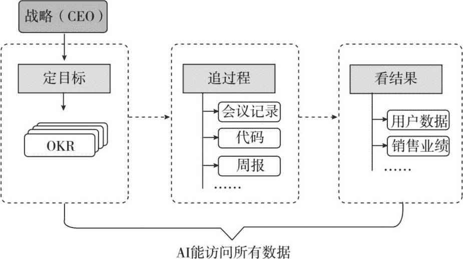

图 3-1 数据基建：经营数字化，让 AI 访问所有数据

这不同于传统意义上只记录“结果”（如财务报表）的“流程线上化”。在特斯拉，经营数字化意味着将全球数百万辆汽车的行驶状态、传感器读数和驾驶员的每一次干预，都转化为可供 AI 学习的数据。在中国移动，这意味着将遍布全国的数十万个基站的实时信号强度、流量负载和告警日志，从封闭的网管系统中解放出来，汇聚成一张可被 AI 感知的数据网络。

AI 时代，经营数字化的核心原则是：将隐性的过程显性化、结构化。我们必须以一种近乎偏执的方式，去捕捉那些充满“上下文”的“过程数据”（如会议讨论、生产路径、客户反馈），因为那才是 AI 理解组织、学习因果的真正养料。

那么 AI 需要“看见”的究竟是哪些数据？我们可以将其大致分为两大类：一是内部管理数据，即揭示组织如何工作的过程数据，如会议中的讨论、周报里的进展、代码库中的每一次提交；二是外部业务数据，即反映组织与市场互动结果的数据，包括业务结果数据（如日活、月活、营收等）——告诉我们发生了什么，以及用户声音数据（如用户反馈、评论等）——告诉我们为什么会发生。

如图 3-2 所示，我们将从四个关键场景入手，将组织的“思想熔炉”、“体检报告”、“生产车间”与“前线炮火声”逐一数字化。

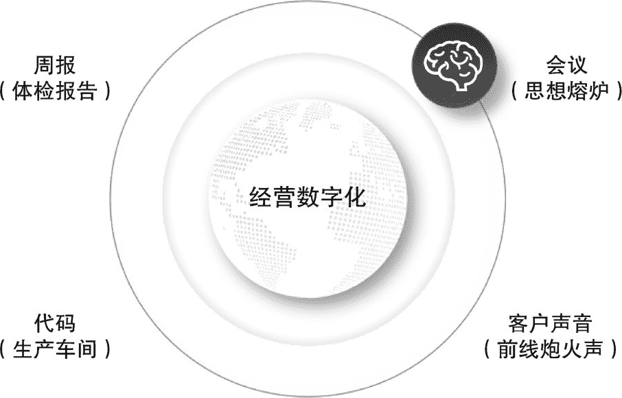

图 3-2 经营数字化的四个关键场景

**一、会议：思想熔炉驱动决策**

会议是组织信息生产和思想碰撞最密集的环节，但其价值往往随着散会一并消散。为了捕捉这些价值，我们必须记住一条至关重要的原则：没有数字记录和 AI 参与的会议，等于没有开会。推行之初，这条原则大概会遭遇团队的集体抵制：抱怨转写不准、担心创造力被扼杀、害怕自由表达受限。面对这种阻力，强制命令是最低效的解法。真正的破局点在于耐心而坚定的“文化变革”，这需要从两个方面同步推进。

一是技术赋能，选择业界主流工具（如飞书、Microsoft Teams ^(²)的智能纪要），或者智能会议助理 TicNote 等。它们不仅仅是纪要工具，更是每个人的“AI 思考伙伴”。二是文化引导，管理者以身作则，引导团队养成“提前准备、换位思考、会后明确行动项”的新会议习惯，让会议效率本身成为最好的说服力。

真正的转折点，也就是那个让团队从抵触变为依赖的“顿悟时刻”，往往在不经意间到来。在一个典型的转型期组织里，曾出现过这样一个情景：一次，两个部门为三个月前的一个决策细节争执不下，项目经理调出当时的 TicNote 会议纪要。当 AI 清晰地复述出当时的讨论背景、关键论据和最终决策时，所有分歧烟消云散。就在这一刻，TicNote 的身份彻底改变了。它不再是一项规定，而是组织可信赖的集体记忆体。

这一从痛苦地排斥到信任地依赖的转变过程，回答了为什么如今所有主流的协同平台，无论是飞书，还是 TicNote，都将 AI 会议纪要作为核心的标配功能。例如，TicNote 不仅仅提供精准的转写，更能自动提取待办事项、识别不同发言人、生成摘要。这种将会议过程深度结构化的产品设计，其背后正是对“会议即数据”这一理念的深刻理解。

共识已经形成：一场会议最核心的产出，不是那份最终润色好的 PPT（幻灯片），而是达成共识前那些充满火花的思想碰撞过程。而这些过程，正是喂养 AI 来理解组织决策逻辑的最佳养料。

**二、周报：喂养 AI 数据血液**

在多数组织中，周报常常沦为形式主义的向上汇报表演。但在 AI 原生的新范式下，它的新定位是“组织体检报告”，新的读者是 AI。要实现这个转变，挑战巨大。简单地要求员工“写更真实的周报”，只会加剧他们的抵触与不安。变革的关键不在于提出要求，而在于改变游戏规则，让提供真实信息的人成为受益者。

我们的实践路径是一场从“赋能”到“共识”的变革。

AI 辅助，化负担为便利：团队引入能根据会议、文档等内容自动生成周报初稿的 AI 工具。当 AI 能完成 80%的撰写工作时，员工的抵触情绪自然会降低。

人机对齐，发现隐性问题：当员工在 AI 生成的初稿上进行修正时，AI 版本与员工版本之间的差异，恰恰揭示了那些最微妙的隐性困难或潜在风险，形成一个精密的“纠偏罗盘”。

高层“较真”，明确价值导向：管理层的态度至关重要。在推行这一管理模式的实践中，CEO 会亲自审阅周报，评估周报的质量，并反复向团队传递一个信号：“AI 迟早会从你们的周报中看到团队的真实状态，并给我提供决策建议。”这种“较真”明确了周报的新价值——它不再是写给某个人看的，而是为整个组织的智能进化提供养料。

当员工真切地感受到，提供真实信息能换来更精准的资源支持时，周报的性质就从一场“不得不演的戏剧”，转变为一次“为组织健康做贡献的诊断”。起点不必是强硬的命令，而是一次温和的赋能。

**三、代码：开发足迹可视化**

在技术公司，研发流程是价值创造的核心“生产车间”。但这个车间里常常存在一个巨大的信息黑洞：我们拥有最终的代码（结果），却丢失了产出这些代码的思考过程（上下文）。要解决这个问题，就必须将研发的全过程数字化，把开发足迹铸造成可追溯的数字资产。核心原则是：在智能体协同开发的未来，代码的“上下文”比代码本身更重要。

Shopify 的做法极具启发性。它开发了名为 Roast 的 AI 编排框架，通过“吐槽”代码的方式，将代码审查这个充满隐性知识的过程结构化为 AI 可以参与和学习的对话历史。这正是将“经营数字化”思想应用到研发流程的典范。这场研发流程的数字化记录运动，不仅仅是将代码存放在 Git 仓库里，更是系统性地捕捉了每一个关键节点的“Why”（为什么改动）和“What”（具体做了什么）。

**需求可追溯：**在 Jira 或飞书等工具中，将每一个研发任务与具体的需求单或用户反馈强关联。这确保了任何一行代码的改动，都能追溯到其商业或用户价值的源头。

**提交自解释：**这是最基础，也是最容易被忽视的一环。某 AIGC（人工智能生成内容）行业头部公司推行严格的提交说明（Commit Message）规范，要求在注释中清晰地说明“Why”和“What”。一个优秀的提交说明，本身就是一份微型的设计文档。

**评审有沉淀：**将代码评审（Code Review）过程中的关键权衡思考记录下来。

**拥抱 AI 编程：**像 Cursor、GitHub Copilot 这样的 AI 编程智能体，正在重塑研发流程。某 AIGC 行业头部公司要求团队 100%使用这类 AI 编程工具，将其设为团队的默认工作方式。

这场数字化运动的终极形态，则是将所有这些分散的数据，都统一在一个平台之上，让“上下文”的沉淀实现完全的自动化。这也是出门问问自研的 AI 原生协作平台 CodeBanana 的核心设计哲学。在 CodeBanana 中，开发者与 AI 的每一次互动，每一次代码提交与评审，都天然地、结构化地被记录下来，自动形成对“上下文”最直接、最完整的记录。

在制造业同样如此，其生产车间是物理的。从采集机床的振动、能耗等设备数据，到记录生产中实际的工艺参数，再到追踪每一批物料的物流与在制品状态，将这些物理世界的脉搏数字化，才真正让 AI 有了感知和干预实体经济的触手。

**四、客户声音：一线反馈驱动改进**

如果说研发是组织的“生产车间”，那么客户的声音就是这条生产线最宝贵的“原材料”和“质检报告”。然而，这些声音往往分散、嘈杂且难以捕捉。组织常常因此变得“失聪”，直到竞品推出直击客户痛点的功能，才追悔莫及。为了让组织“听见炮火声”，我们必须主动出击，而核心原则是：将客户的每一次抱怨、赞扬或建议，都视为一次宝贵的数据馈赠。

这个过程需要从被动接收转向主动出击，并借助 AI 的力量实现规模化。

**建立全渠道采集系统：**利用网络爬虫、数据仓库等技术，搭建自动化的用户声音汇聚平台，将所有渠道的声音汇入统一的“数据湖”。

**AI 赋能一线，实现价值交换：**为销售、支持等岗位配备 AI 助手，对关键通话进行录音、转写和摘要。当销售发现 AI 能帮他总结客户的关切点、生成拜访策略时，记录就不再是负担，而是提升业绩的“武器”。

**人机协作，优化 AI 理解力：**初期的 AI 分析必然有限。此时，必须启动人机协作的优化闭环，让最有经验的一线专家每天花少量时间对 AI 的分析结果进行审核与修正，并将这些高质量数据反哺给 AI 模型。

在某 AIGC 行业头部公司的跨国企业实践中，海外用户的一条关于“跑步机升级后蓝牙耳机断连”的抱怨，在发布后的 3 分钟之内，就被客户数据看板系统自动捕捉、翻译、分析，并作为高优先级问题直接推送给负责该功能的工程师。过去，这样的意见即便被客服看到，也常常止步于已读未回复。而现在，组织第一次拥有了实时、主动地倾听和探测用户心声的能力。图 3-3 展示了客户数据看板系统的评论分析页面。

这种将客户声音“数据资产化”的探索，其实与消费电子品牌安克取得成功的秘密不谋而合。安克的核心竞争力之一，是早在多年前就建立了一套强大的、自动化的“用户声音汇聚与分析系统”。该公司用看板将全球所有渠道的评论全部汇聚在一起，然后进行语义分析和情感洞察，并将其作为产品迭代的“第一信号源”。这种模式让安克总能比对手更快地捕捉到市场需求，持续打造出爆品。安克的成功从外部印证了这一探索的方向是正确的：将对过程数据的治理内化为组织 DNA，是从数据中挖掘黄金的关键所在。

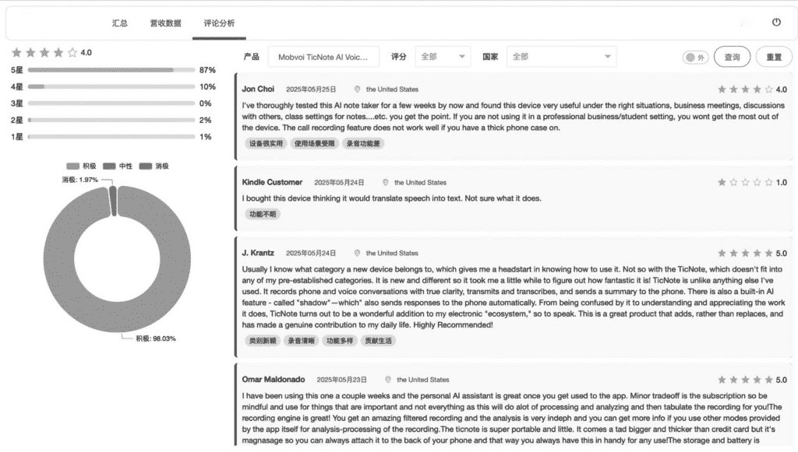

图 3-3 客户数据看板系统的评论分析页面

**第三节 让 AI 看见所有数据**

完成经营数字化，相当于为组织采集了全身各器官的原始血液样本。但原始的、未经处理的“血液”是无法直接供能的。让 AI 看见还不够，它还需要能听懂、能调用、会行动。

因此，我们必须构建组织的智能“循环系统”，彻底打破“数据孤岛”，将原始数据精炼成能驱动 AI 自主行动的“智能燃料”。这个过程如同一次现代炼金术。下文将通过“数据智能三步法”来系统性地解决“数据孤岛、数据黑洞、数据溺亡”这三大顽疾。这三步旨在从根源上解决“数据无法驱动 AI”的难题，让数据完成从“可信”到“可理解”再到“可行动”的关键跃迁，让数据不仅仅能被 AI 看懂，更能被 AI 调用，让 AI 充分释放潜藏的数据能量。图 3-4 中的这三个步骤将杂乱无章的原始数据，一步步转化为能够驱动 AI 自主行动的智能燃料。在 AI 原生组织中，数据结构决定了智能结构，数据通路本身就是力量。

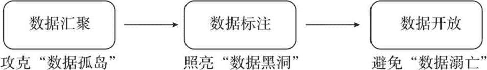

图 3-4 数据治理流水线和关键步骤

**一、数据汇聚：统一事实真相**

数据智能的第一步，也是最基础的一步，就是攻克“数据孤岛”，还原唯一的事实真相。在任何一个快速发展的组织中，数据都天然地散落在不同的业务系统和部门墙之外，形成一个个彼此断联的孤岛。如果 AI 的视野本身就是割裂的，那么它永远无法形成全局认知。

汇聚数据不仅仅是简单的收集，更是一场“去伪存真”的清洗。我们必须像考古学家修复文物一样细致、认真，剔除错误、冗余和矛盾的数据噪声，同时将所有信息统一到相同的标准和格式中。只有这样，汇聚起来的才是事实真相，而非一堆无法使用的数据碎片。要从根源上实现这一目标，关键不在于事后修补，而在于系统性地重塑产生数据的流程。

首先，建立不可逾越的流程铁律，规定所有核心业务（如采购、报销）的操作都必须在统一的线上系统（如飞书审批、SAP ^(³)）中完成，彻底堵住线下操作和人为干预的漏洞。其次，统一全公司的“业务语言”，通过建立指标字典为关键业务术语（如“活跃用户”）设定唯一的标准定义，确保所有人，以及所有 AI，都在谈论同一件事。

要想理解这一步的重要性，不妨来看一家某 AIGC 行业头部公司的“一笔订单，三个价格”的故事。该公司曾为了核算一款产品的真实成本，试图找到一份采购订单的最终金额。结果，运营从审批系统调出的是 60 万元，财务系统里盖着公章的单据是 130 万元，而供应链的邮件记录里还躺着第三个版本。三份数据都声称自己才是“真相”，使得调查一度陷入僵局。最终通过回溯系统日志才发现，早期追求效率的审批流程中存在一个致命漏洞——订单金额可以在系统中被直接修改，却不会触发新的审批。正是这个流程上的瑕疵，催生了大量“同号不同价”的无效订单。

将这种原则系统化，是顶尖公司的共同选择。Airbnb（爱彼迎）曾因内部数据定义混乱而陷入决策困境，最终花费数年时间打造了名为 Minerva 的元数据平台，其核心使命就是为全公司的关键业务指标建立“唯一真实的信息源”。蚂蚁集团更是建立了金融级的“数据血缘”（Data Lineage）系统，确保任何一个核心指标都可以被清晰地追溯来源与加工规则，从根源上杜绝数据“各说各话”这一问题的出现。

无论是解决“一笔订单，三个价格”的实践，还是爱彼近和蚂蚁集团的宏大工程，它们都指向同一个结论：数据的“单一真相”是整个数据智能大厦的地基。夯实这块基石，需要如同考古般的耐心与严谨。

**二、数据标注：注入业务洞察**

打通了数据孤岛，我们还必须照亮“数据黑洞”，为数据注入业务洞察。组织中价值最高的数据，往往不是结构化的结果数据，而是那些非结构化的“过程数据”。面对一堆被清洗过的用户反馈记录或会议文字时，AI 看到的仍然是一堆无意义的字符。数据本身不会说话，除非我们为它注入深刻的“灵魂”——业务上下文。治理的第二步，就是将商业智慧注入冰冷的数据，让 AI 不仅仅能“看见”，更能“看懂”。

这需要两个关键动作的辅助：一是“萃取”，从海量、非结构化的信息中提炼洞察；二是“定义”，将数据的解释权还给最懂业务的人。

首先，通过“萃取”，将无序的文本转化为可驱动行动的洞察。海量的过程数据（如会议记录、客户反馈）虽然真实，但杂乱无章，这使得 AI 无法直接判断其价值。“萃取”的价值，就在于自动从这些信息中发现深层联系，将非结构化的“噪声”转化为结构化的“信号”。

特斯拉的“影子模式”之所以强大，正在于它能自动从海量驾驶数据中“萃取”出 AI 判断失误的“长尾场景”，这正是模型进化的关键养料。营销巨头蓝色光标在服务客户时，通过网络爬虫实时“萃取”全网舆论，从海量的社交媒体帖子中精准分析出用户的核心关切点与情绪，这在过去需要数天人工操作才能完成。在某 AIGC 行业头部公司的实践中，公司同样能通过 AI，从一场一小时的会议录音中自动“萃取”出 3～5 个最关键的待办事项和决策点。

在这背后，“萃取”的核心方法是构建从反馈到响应的自动化闭环。它全渠道地自动采集用户的声音；调用大语言模型进行智能分析；将分析出的高价值洞察，自动推送到相应的执行系统（如在研发的项目管理工具中直接创建任务）。

其次，通过“定义”，将数据的最终解释权还给一线专家。当数据变得既真实又易于理解后，一个更深层次的、关乎组织权力的挑战浮出水面：AI 要用的数据，业务部门不敢开放；AI 标注的数据，业务部门不认可。治理的这一环，是一场权责之战，其核心是将数据的“语义归属权”还给最懂业务的一线团队。

如果数据的定义者不懂战场，那么 AI 就永远打不准靶心。在某 AIGC 行业头部公司内部一场关于“如何定义负面反馈”的争论中，客服团队反驳技术团队：“一个用户说‘你们这续航真是太感人’，算法能识别出这是强烈的讽刺吗？”最终，该公司确立了“业务主导”的原则，由客服团队牵头定义核心标签体系，并在标注发生冲突时做出最终决定。

中国移动在构建其“智慧网络大脑”时，同样成立了由一线资深网络优化工程师主导的“数据治理委员会”，由这些“最懂战场”的人来定义故障等级、标注告警数据。这也正是华为“让听得见炮火声的人来画战略地图”这一理念的精髓。华为甚至会强制性地将最优秀的业务专家调岗到数据部门，确保最能听懂炮火声的人直接参与数据战略的制定。

无论是某 AIGC 行业头部公司内部的“权责之战”，还是华为、中国移动的变革，都揭示了一个深刻的道理：数据治理的最高境界，不是技术上的完美，而是人的经验与智慧如何被有效地注入数据。只有通过“萃取”与“定义”，使数据拥有业务的灵魂，AI 才能真正开始理解我们的世界。

**三、数据开放：驱动智能行动**

然而，让 AI“看懂”只是手段，让 AI“行动”才是目的。为了避免让组织“溺亡”于数据的海洋，我们必须让数据动起来——驱动智能行动。即使数据变得可信、可理解，如果它最终只是停留在静态的报表上，那么数据越多，决策者和 AI 的负担就越重。我们必须完成最后一步，将数据能力锻造成 AI 和业务人员都能随时调用的“智能服务”，并将其接入组织的行动回路。

这就像为 AI 安装了标准化的“手”和“脚”，让它能够以规范的方式与世界互动。这个过程包含三个关键动作：翻译、封装、闭环。

首先是翻译，即构建统一的语义层。想象一下，数据仓库里存储的数据，就像是在用一种极其复杂的“技术方言”说话。业务人员想问一个简单的问题，比如“上周有多少活跃用户”，数据工程师就需要写下一长串复杂的代码才能从数据库中找到答案。这个过程不但效率低下，而且很可能产生误解。

语义层的核心任务，就是在这两种语言之间建立一个强大的“同声传译系统”。它负责将所有复杂的技术查询，预先“翻译”并封装成一个个清晰、统一的业务概念。例如，那一长串用于计算周活跃用户的复杂代码，会被翻译成一个名为“周活跃用户数”的、可被直接调用的业务指标。这样一来，无论是业务人员还是 AI，当需要这个数据时，都不再需要去学习那种难懂的“技术方言”，而只需要直接发出“周活跃用户数”这个通用指标即可。

这个转变是根本性的：传统数据平台的终点是看板（一张给人看的静态图表），而 AI 原生组织的数据平台的起点，正是这种可被机器调用的接口（一种让 AI 能听懂的规范语言）。

其次是封装，即搭建标准的 API 接口。我们将经过语义层翻译后的数据能力，封装成标准、可控、安全的 API 服务。这确保了全公司的数据都能像高质量的产品一样，被方便地调用和组合。Netflix 之所以能让 AI 深度参与推荐之外的各种创造性任务，正是得益于其完善的“数据产品即 API”的内部体系。

最后，也是最关键的一步，是闭环，即连接工作流。我们将数据接口与组织的工作流引擎连接起来，构建“数据→判断→行动”的自动化闭环。这正是让 AI 从一个被动的分析师，进化为一个主动的“智能队友”的关键所在。例如，系统在通过 API 识别到高风险用户反馈时，不再生成一封报告邮件，而是自动在项目管理工具中创建任务，并将其指派给相关工程师。

Shopify 的实践为这“三个动作”提供了教科书般的案例。该公司并未让员工直接面对复杂的数据表，而是构建了统一的 AI 入口和“模型上下文协议”（MCPs）服务器。Shopify 的理念是“万物皆可模型上下文协议”，通过这个统一的代理层，对公司所有的工具和数据进行了彻底的翻译和封装，使其成为标准化的服务。

基于这个强大的基础设施，创新的闭环工作流开始不断涌现：一位非技术背景的销售代表可以轻松调用 AI 服务，自动生成过去需要数据分析师耗费数小时才能完成的网站性能报告；一位工程师可以将所有工具的信息整合到一个“今日待办”主页，由 AI 智能服务自动排列任务优先级。

这正是“数据驱动行动”的真实写照。

至此，我们的“数据智能三步法”——汇聚数据以统一真相、标注数据以注入洞察、开放数据以驱动行动——共同构成一个从“原始矿石”到“精炼黄金”的完整炼金过程。它将杂乱无章的数据，一步步转化为能够驱动 AI 自主行动的智能燃料。在 AI 原生组织中，数据结构决定了智能结构，数据通路本身就是力量。

**第四节** **数据基建实践：五项行动指南**

在完成经营数字化，让 AI 看见所有数据之后，我们必须进行一次深刻的思维范式升级。单纯的数据化是不够的，我们需要建立一种全新的 AI 原生数据思维。

过去的互联网数据思维的核心是“A/B Test 思维”，目的是在多个已知选项中“优化已知路径”。它通过埋点、收集用户行为数据来验证哪种方案更好，这本质上是一种“回顾式的决策辅助”。

而 AI 原生数据思维的核心是端到端涌现思维，目标不再是优化，而是驱动 AI 涌现未知可能。它追求的不是孤立的行为数据（如点击率），而是端到端、多模态、蕴含因果链的过程数据。例如，一段完整的销售对话录音，比无数个零散的按钮点击数据更有价值，因为前者能让 AI 学习到成交背后的“为什么”。同理，在组织层面我们可以为会议过程、任务协作、目标复盘等环节“埋点”，让 AI 学习组织运行的隐性逻辑。

因此，AI 时代的数据基建不再是一次性工程，而是一个持续转动的“数据飞轮”：定义目标→过程埋点→AI 涌现→决策验证→再次定义目标。每一轮的结果，都是对上一次假设的检验，也是智能进化的起点。要让这个飞轮真正转动起来，组织必须在文化与实践层面克服巨大的惯性。以下五条军规，是我们从战壕中带回的、确保飞轮能够启动并持续加速的“压舱石”。

**一、敏捷迭代：打破完美主义**

在构建数据系统的过程中，我们曾深陷一个典型陷阱：试图一开始就打造一个完美、全面，覆盖所有业务场景的中央数据仓库。然而，理想很丰满，现实却异常骨感。三个月时间，我们连数据源的梳理都未完成，整个项目几乎停滞不前。那段经历让我们深刻体会到，飞轮从来不是一夜建成的。

真正的推动力，往往来自最小闭环的快速验证。于是，我们调整了策略，采用了“拧螺丝工作法”：先挑选最关键的业务问题（比如订单数据不一致）作为突破口，快速打通一条最小化的数据链路，验证其价值，并让团队第一次看到成效。这个最小的飞轮启动，看似微不足道，实则让整个团队重拾信心，也为后续搭建更大规模的数据体系奠定了基础。

这一过程不仅印证了敏捷开发的原则，还为我们在面对长期投入、高成本的挑战时提供了生存智慧：不追求一开始的完美，而是先启动、先验证、先推动，让小而可行的成果带动整个系统的逐步成长。

**二、业务开刃：倒推需求**

在实践数据治理的过程中，我们发现了一个普遍的误区：很多团队一上来就把重点放在技术和系统上，而忽略了背后的业务场景。他们花费大量时间去清洗历史数据、搭建完美的平台，却很少停下来追问最根本的问题：我们的业务哪里出了问题？用户为什么离开？利润究竟流向何处？

真实的经验告诉我们：每一场关键的数据战役，都必须从真实的业务痛点出发。正是因为“利润幽灵”在暗中游荡，我们才彻底追查采购订单的罗生门；正是因为用户声音被忽略，我们才打响标签战争。数据治理的优先级，必须服务于这些业务痛点，而不是空喊“要做数据平台”。

我们曾见过一家公司，花了半年的时间做数据清洗，试图把所有历史数据都变得完美。结果，在一次战略复盘会上，CEO 问了一个最简单的问题：“为什么我们上个月在东南亚的转化率跌了？”技术总监翻遍了崭新的数据库，却发现由于他们忙于清洗格式不规范的陈年旧账，竟然忘记了为上个月的东南亚大促活动做实时的数据埋点。

这就是典型的“为了数据化而数据化”。真正的业务开刃要求我们必须先找到那块最硬的石头。如果不能解决“为什么跌了”或者“钱流向了哪里”这种生死问题，那么再干净的数据也只是昂贵的垃圾。

**三、治理先行：拒绝“投喂”垃圾**

某 AIGC 行业头部公司曾踩过另一个坑：为了追求速度，团队选择跳过前期的数据清洗和治理，把未经处理的“脏数据”直接投入 AI 系统。结果显而易见：基于这些脏数据训练出的 AI 不仅无法提供有价值的洞察，反而会一本正经地输出错误信息，误导决策，其危害甚至比没有 AI 更大。

硅谷明星公司 QuantaMind 拿到顶级投资，AI 模型先进，但因忽视数据治理，把水军评论当爆款，误判反讽为正面，最终因 AI 基于“脏数据”输出的灾难性洞察，而信誉破产，在成立不到一年后就轰然倒塌。QuantaMind 不是死于技术，而是死于对数据的傲慢。即使是像 Netflix 这样以数据驱动著称的公司，也曾因为早期数据质量问题，导致推荐系统给用户推荐了大量不相关的电影，险些动摇用户信任。这些都警示我们，数据治理是数据基建的“生命线”。

因此，治理投入必须与工程资源对等，甚至前期更多。在项目规划中，应为数据清洗、标注和治理工作预留充足的时间与资源（通常占 40%以上），并从第一天起就建立标准与流程。

**四、权力下放：定义归一线**

很多公司的数据变革，像一场 IT 部门自嗨的独角戏——台上灯光璀璨，台下业务部门早已离场。许多技术型公司曾耗费巨资打造了一套完美的标签体系，结果一线员工不仅不用，反而被复杂的规则搞得晕头转向。真正的胜利，不是技术有多先进，而是让客服、销售、产品这些前线战士来定义标签规则，参与治理。数据终究是业务的武器。

在 Shopify 内部，客户支持部门成为增长最快的 AI 工具用户群体。华为、美团的理念是：“让听得见炮火声的人做决策”，它们早期在构建业务的数据指标体系时，就是由一线的区域经理和产品经理主导，而不是纯粹由数据分析师闭门造车。这确保了每一个指标都直指业务的核心矛盾。

行动原则：数据的定义权和解释权，必须掌握在最懂业务的一线专家的手中。企业必须建立机制，让业务专家（如客服、销售、产品经理）深度参与，甚至主导数据的定义和治理。否则，技术团队倾力打造出的，可能只是一个与业务脱节的、无人问津的“数据玩具”。

**五、正向激励：数据即勋章**

很多公司将数据记录和治理工作视为对一线员工的额外负担和监控，这引发了一线员工的抵触情绪。但真正的变革，始于让数据成为“勋章”。真正的转变，源于价值被看见。好的数据系统不是为了监控人，而是为了释放智能。某 AIGC 行业头部公司曾把客服团队的响应速度数据做成实时看板，对于任何积极的数据变化，立刻在团队群里公开点名表扬，逐渐形成一种文化演变，让看板从“监视器”变成团队的“荣誉墙”。数据不再是负担，而是每个人证明自己的战功的勋章。

蓝色光标的做法堪称典范，该公司推行“AI 优先”（AI First）原则，在加薪升职、预算申请等方面明确向拥抱和实践 AI 的员工倾斜，喊出“无 AI、无奖金、无晋升”（No AI，no bonus，no promotion）的口号。

Shopify 甚至更进一步，推行极致的民主化，要求全员无差别拥抱 AI，甚至不设预算上限。比如将法务部门的角色从“刹车”转变为“导航员”，要求员工以“如何促成”为出发点，为 AI 创新默认开绿灯。这种自上而下的文化重塑，才是最强大的正向反馈。

这五条军规，看似是技术和管理的实践原则，但其能够落地的根基是一种“有序的透明”文化。在企业内部，任何问题都可以被摊开，用数据来讨论。没有这种绝对坦诚的文化，任何数据化工具都可能被视为监控，遭遇抵制。

在分享这些经验之前，我们也必须明确一个不可动摇的前提，那就是对安全与信任的敬畏。开放数据通路，绝不意味着数据安全失控。我们需要坚守：用户数据是信仰，不是资产；员工信任是数据流动的前提；AI 的每一次访问，都必须留下痕迹，确保其所有行为都可追溯、可审查。最终我们发现，数据的尽头，不是技术，而是文化；数据飞轮的永动机，不是算法，而是信任。

**第五节 转型工具箱：数据智能三动作自检清单**

在数据治理实践中，我们设计了一个自我诊断工具，帮助组织判断自身数据能力是否真正可以支撑智能化行动。它关注三个核心维度：数据一致性、数据洞察力和数据行动力。

**一、维度一：数据一致性（可信度）**

痛点场景：会议上不同部门拿出的数据经常“打架”，大家为“哪个数字是真的”争论不休。

自检问题：

□ 您的核心业务流程（如采购、报销、审批）是否 100%在线上统一系统中完成，无任何线下手工台账？

□ 公司是否建立了统一的指标字典，明确定义了“活跃用户”“毛利”等核心术语，且全员（及 AI）形成共识？

□ AI 在回答业务问题时，是否经常出现“幻觉”或引用错误数据源？

**二、维度二：数据洞察力（暗数据治理）**

痛点场景：会议录音、客户反馈躺在硬盘里，除了占空间，没产生过价值。

自检问题：

□ 您的非结构化数据［会议录音、IM（即时通信）记录、客户电话］是否被系统性地记录并转化为结构化文本？

□ 数据的标签和定义权，是掌握在 IT 部门的手中，还是由最懂业务的一线专家（如销售、客服）把握？

□ 是否有机制能让 AI 从海量对话中自动提取出“高频痛点”或“竞品情报”？

**三、维度三：数据行动力（闭环）**

痛点场景：数据分析只是发给老板看的“静态报表”，看完就完了，没有触发后续动作。

自检问题：

□ 您的核心数据能力是否封装成 API，可被 AI 随时调用？

□ 当数据出现异常（如流量暴跌、差评激增）时，系统是仅发送警报，还是能自动触发智能体创建任务并指派责任人？

□ 组织是否实现了从“数据洞察”到“智能行动”的自动化闭环（如自动退款、自动派单）？

诊断结论如下：

若勾选少于 3 项：数据孤岛型。数据是给人看的“纪念碑”，AI 将因“缺血”而瘫痪。

若勾选 3～6 项：数据治理型。已具备基础，但尚未形成智能飞轮。

若勾选 7 项及以上：数据智能型。数据已成为驱动 AI 自主行动的血液。

**第四章 AI 组织重塑**

1771 年，英国德比郡的河畔，理查德·阿克莱特（Richard Arkwright）建起了世界上第一座水力纺纱厂。他将分散在千家万户的手工纺纱匠人集中在同一个屋檐下，围绕轰鸣的机器进行协作。阿克莱特真正发明的，不只是机器，而是一种全新的工作流——将个体组织起来，实现大规模协同生产。

一个多世纪后，亨利·福特在底特律再次掀起革命。他的流水线将造车拆解为数千个简单的动作，让复杂工艺从“手艺人掌控”变为“任务原子化”。汽车因此从奢侈品变为大众产品，也奠定了 20 世纪工业生产的逻辑。从阿克莱特的“聚集”到福特的“拆解”，工业革命完成对体力工作流的彻底重塑。

今天，在知识工作主导的世界里，一场新的革命正在上演。智能体成为主角，它重新定义协作方式，重塑角色边界，将知识工作进行前所未有的“聚集与拆解”。组织的“数字血液”在奔流，但行动指令却在传导中遇阻。执行主体已从人转向 AI，此时唯一的出路不是让人跑得更快，而是彻底重构工作流本身，打造真正的 AI 原生组织。

**第一节 流程重构：从文档接力到原型驱动**

在上一章，我们完成“造血”工程，让干净、流动的数据充斥组织的每一个角落。我们原以为，有了充足的“数字血液”，这个新生的生命体就会立刻奔跑起来。

然而我们发现，尽管数据不再是孤岛，但行动的指令却在传导中遭遇了严重的“神经淤堵”。这种淤堵的症结，不在于数据，而在于我们沿用了百年的、线性的协作方式。这场变革的诊断，始于某 AIGC 行业头部公司内部团队一位一线产品经理林珂（化名）的痛苦的自白：“我感觉自己像一个信息搬运工，而不是创造者。”

林珂曾是团队里最出色的“翻译官”，她的日常工作是将用户的模糊痛点翻译成详细的产品需求文档，再将这些文档翻译给工程师。她做得极好，却也极其痛苦，因为最初的用户火花在层层翻译中不断冷却，甚至熄灭。

当 AI 编程工具进入团队时，他们曾以为问题会迎刃而解。然而新的噩梦随之而来：工程师快速生成大量代码，但因为 AI 误读文档，功能常与原设想南辕北辙。沟通从“文档对齐”变成“代码争执”。林珂不仅是翻译者，还要仲裁 AI 与工程师的理解偏差，这让她变得更加疲惫。

真正的转折发生在一个紧急项目的推进中。林珂做了一个看似离经叛道的决定：她没有写文档，而是直接用自然语言指令生成一个可以交互的原型，并将其交给工程师。随后，奇迹发生了：工程师花了几分钟的时间就理解了需求，甚至提出优化建议。林珂顿悟：AI 时代最高效的沟通，不是文档，而是原型；最高效的工作流，不是线性的“翻译接力”，而是并行的“共创迭代”。

这也印证了麦肯锡在最新 AI 报告《2025 年人工智能的现状：智能体、创新和转型》中提出的核心洞察：对企业利润影响最大的，不是模型有多先进，也不是 AI 人才储备有多丰富，而是工作流重构。该报告显示，只有约 21%的企业真正通过 AI 重构流程，其余多数仍停留在浅层优化的层面。领英（LinkedIn）首席产品官托默·科恩（Tomer Cohen）直言：“工作本身并不复杂，但流程让它变得复杂。”

为什么是工作流，而不是其他？传统线性流程是为了降低人类沟通成本而设计的次优解。当 AI 可低成本生成原型时，会议与冗长文档反而成为一种浪费。AI 作为新型生产力，必然要求与之匹配的生产关系。正如蒸汽机摧毁了手工业生产关系，AI 也将摧毁为“人类执行力稀缺”而设计的线性分工。人类创造力本是非线性、整体性的。AI 提供了廉价的、整体性执行范式，让工作流回归其本来的创造性与非线性。

工作流的革命，是第一步。它颠覆了“如何做事”，为新的“做事的人”与新的组织架构铺平道路。这就是砸断那条线性传送带的意义。

**一、旧世界的枷锁：线性接力必然失灵**

传统的产研流程就是一场“接力赛”。一个需求从产品经理开始，以文档的形式依次传给设计师、前端、后端和测试，直到部署。每一个环节的成员只负责自己的那一棒，然后交给下一个人。每一个环节都是一个独立的“信息孤岛”，依靠脆弱的文档和会议进行连接，如图 4-1 所示。

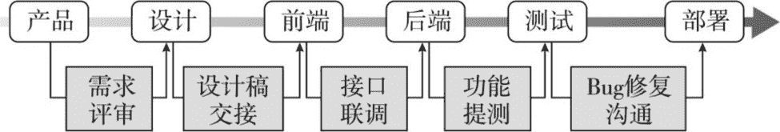

图 4-1 传统的线性产研流程

这条建立在层层转译的基础上的生产线，在 AI 时代暴露出了两大致命缺陷。一是严重的信息损耗。据统计，在传统产研流程中，有高达 42%的重要信息会在抵达开发者前失真或丢失。二是责任的断裂，在这条流水线上，每个人只对自己的交付物负责，产品经理对产品需求文档负责，设计师对设计稿负责，工程师对代码负责，但没有人能对最终产品是否解决了用户问题负全责。

团队曾试图用 AI 工具为这条破碎的生产线提速，结果却是一场噩梦。在组织转型初期，产品经理林珂和她的团队依然被困在这场文档接力赛中。她回忆道：“我当时正在做 Web 开发，前端有 4 个人，后端有 2 个人，阵容非常庞大。但协作模式是割裂的，我把想法写成产品需求文档，然后交给研发。前端、后端每天都要给我打无数个电话来确认细节。我大部分的精力都耗费在‘翻译’上，将用户的需求翻译成产品需求文档，再将产品需求文档翻译给不同的工程师。”

当团队开始使用 AI 编程工具 Cursor 辅助开发后，新的噩梦很快上演。“我们确实开发得更快了，”林珂说，“但调试的时间变得无穷无尽。”从“文档黑洞”到“调试黑洞”，团队很快意识到，单纯用 AI 工具为一条断裂的、未被重构的流水线提速，只会让问题变得更复杂。

“我之前是设计师，习惯先画图捋清逻辑，”林珂回忆道，“而 Cursor 可以直接生成 HTML 原型。所以我想，为什么我还要去写一份可能会被误读的文档呢？”于是，她直接与 AI 对话，快速生成并迭代出一个可交互的 HTML 原型。然后她没有将一份厚重的产品需求文档交给研发，而是直接将这个“活的原型”发给了他们。

“研发直接复制我的原型代码，然后告诉 Cursor 原型代码要变成什么样的 Web 代码。还原度非常高，几乎没有沟通成本。”林珂说。这次成功的越界，让整个团队都迎来了“顿悟时刻”。他们发现，“活的原型”才是 AI 时代最精准、最高效的沟通语言。它已经取代了“死”的文档。

AI 的出现，彻底摧毁了旧线性工作流赖以存在的经济学基础，即高昂的转译成本与生成成本。过去，从一个想法到一行代码，都需要产品经理、设计师、工程师之间进行成本高昂、信息失真的“转译”接力。同时，从零生成一个原型的成本，远高于描述它的成本。因此，我们才被迫选择了文档优先这种充满妥协的、反创造力本质的线性流程。

这就像 Notion CEO Ivan Zhao 所描述的“水车阶段”一样。许多企业只是把 AI 聊天机器人像螺丝一样生硬地拧在旧流程上，就像当年工厂主只是把水车换成蒸汽机，却依然守在河边一样，生产力并没有本质上的提升。真正的变革发生在我们决定“脱离河流”的那一刻——我们需要围绕这位“永不眠歇的新员工”，彻底重新设计我们的工作流工厂。不是让 AI 去适应人的节奏，而是让人去适应 AI 的光速发展。

AI 作为通用转译器和低成本生成器，彻底改变了创新生产的底层经济逻辑。当原型生成的边际成本低于需求描述成本时，传统“文档优先”的工作范式被证伪，“原型优先”成为必然选择。这一变革触发三级连锁反应：首先颠覆流程经济性（流程革命），其次重塑能力矩阵（角色革命），最后解构组织形态（结构革命）。这条因果链的不可逆性源于 AI 对生产函数的重构——当技术使验证成本趋于零时，所有依赖高验证成本的协作模式都将被进化压力淘汰。

这张多米诺骨牌改变了传统科技企业的工作流：精心撰写没人看的项目文档，参加数场无效会议，最后产出一个阉割版方案。而 Lovable 这样的 AI 原生公司展示了另一种“原型文化”的可能。它的员工直接用自研平台搭建官网，用 AI 制作黑客松（Hackathon）报名系统，甚至内部工具（如红人管理系统）也全由 AI 实现生成。没有项目说明书，也没有交接文档。“发现问题就直接行动”，这种低成本试错的能力让混乱减少了 90%，产出提高了 10 倍。

**二、新世界的范式：原型即共识**

这场由一线自下而上发起的重构，其核心就是工作流从“文档驱动”彻底转向了“原型驱动”。产品经理不再是文档的搬运工，而是原型的设计者。这种“原型即思考”的新能力，让组织内部的效率发生了颠覆性的增长：产品经理做一个完整的智能体原型，从 0 到 1 只需要 20 分钟。这场变革最终沉淀为一个全新的三步工作流。

·即刻原型：接到需求，立刻用 AI 工具生成可交互的最小可行产品（MVP）原型作为讨论起点。

·前置对齐：带着“活”的原型，与所有相关方进行验证，将共识建立在流程的最前端。

·文档后置：最后，基于高度共识的原型，让 AI 生成轻量的文档作为交付依据。

“原型即共识”，将团队协作中成本最高昂的环节——建立共识——从流程的末端提到了流程的最前端。由此，返工和内耗从根本上被消除了。某 AIGC 行业头部公司要求在所有产品会议上，产品经理不再以文档作为沟通文本，而是直接拿出产品原型作为讲解和讨论的基础。

基于“原型即共识”的理念，一个全新的协作画面出现了。当我们默认由 AI 承担所有研发工作时，用户通过与“原型”互动来提供反馈，AI 根据反馈快速生成新的迭代方案，而产品经理最终负责做出判断。这个由“用户反馈→AI 迭代→人类判断”构成的高速迭代，取代了过去漫长的会议和文档往来。Cursor 等工具将工程师的审查效率提升了 55%，它们能将工作重心从“如何实现”转移到“实现什么”，更专注于系统架构和核心业务逻辑。

这场流程革命的本质，是协作模式的根本性转变。过去，我们围绕人的分工来组织流程，将任务切割以适应人的能力边界。现在，我们围绕任务目标来组织流程，并最大化地利用 AI 的能力，从而打破过去那些因人而存在的限制。结果是，一个更敏捷、更高效、摩擦力更低的协作网络开始形成。而在这个新的网络中，旧的角色必须进化，否则只能被淘汰。

**第二节** **角色重塑：从执行者到指挥官**

上一节林珂的“顿悟”揭示了工作流革命的必要性。而工作流的变革最终指向的是更深层的“人”的革命——人类角色的重塑。

要理解这场革命，我们必须回到一百多年前的费城。在米德维尔钢铁公司的车间里，年轻的弗雷德里克·泰勒（Fredrick Taylor）手握秒表，精确记录每一个工人的操作细节——角度、重量、频率、弧度……他将劳动拆解为可测量、可优化的标准动作。这就是“科学管理”的诞生。泰勒的秒表不仅改变了流程，还重新定义了“人”：曾经凭经验工作的工匠，被标准化的“人形零件”取代。

一个多世纪以来，知识工作者虽身处办公室，却继承了这个“泰勒式的诅咒”。产品经理翻译需求，设计师绘制界面，工程师敲写代码——每个人都被固定在自己的岗位上，失去了全局的视野和创造的乐趣。

而智能体的到来，正在亲手“杀死”泰勒的幽灵。智能体成为永不疲倦、可标准化执行的零件，承接大量可分解的工作。人类的价值被倒逼回更高级的角色中：从精准执行者到重返全局视野的工匠，甚至成为指挥官，定义方向、驱动创新。

这场“角色文艺复兴”并非理论推演，而是真实上演在今天的办公室：产品经理、工程师在经历了痛苦的自我怀疑后，从泰勒式的“高级零件”蜕变为能够驾驭 AI、主导全局的指挥官。

从文档接力到原型驱动的工作流变革，不仅仅是工具和方法的更迭，更像是一场剧烈的地震，这从根本上动摇了传统组织中人的角色定位。

当“接力赛”被取消，所有人都站在同一个共创场上时，我们发现，过去那些在各自赛道上跑得飞快的专才——产品经理，设计师，前、后端工程师突然变得无所适从。岗位的边界正在以前所未有的速度消融，流水线上的“螺丝钉”式工种必然会消亡。

一个残酷的问题摆在了我们的面前，当旧地图被撕碎，谁能在这张全新的地图上作战？旧的兵种显然已经不再适配。我们必须寻找甚至创造出能够适应新战场的新物种。这就是我们在这场变革中定义的两个核心新角色：系统设计师与全栈工程师。他们的诞生，是最深刻的组织进化。

**一、系统设计师：从翻译者到设计者**

产品经理白羽（化名）曾是我们眼中最典型的“翻译官”。在传统的产研流程中，她最核心的工作就是将模糊的业务需求翻译成一份份详尽的、精准的、工程师能看懂的产品需求文档。她做得非常专业，但内心却充满了挣扎。

“我感觉自己像一个翻译者，不断地在用户、工程师和业务之间转述信息。但我整理的需求文档再严谨，也无法完全传递那个最初打动我的、来自用户的真实痛点。”这位传统产品经理如此表示。

然而，当 AI 工作流开始席卷团队时，白羽的工作内容发生了根本性的变化。她不再需要撰写那些厚重的文档。“我现在会直接和后端说，你给我搭一个平台，然后我和运营团队负责把问题输进去，自己去配答案。”她兴奋地描述这个新模式。在这个过程中，白羽发现，自己不再是一个被动的翻译者，她必须成为一个主动的设计者——她需要定义产品，划清人与 AI 的协作边界，甚至开始学习使用编程工具，用最低的成本快速生成可交互原型，以此验证商业想法。

她坦言：“我现在看代码还是有点头疼，但这种协作方式让我觉得还原度很高。我终于感觉自己是在‘创造’，而不仅仅是‘转述’了。”

白羽的转型，让我们看到了一个全新角色的诞生。她在近期的复盘中深刻地描述了这种转变：“过去，我们是在约束条件很多的小格子里找到最优解。而现在，AI 抹平了很多执行的约束，我们必须学会在一个更开放、更混沌的世界里，自己去寻找信号、定义问题……从解题者到出题者，这或许是 AI 时代产品经理最艰难，也最重要的一次跃迁。”

这是“系统设计师”的诞生：他们的身份已经完成从被动的“需求翻译官”到主动的“全栈原型创造者”的根本性转变。他们不一定是最懂代码的人，但他们必须是最懂如何设计产品和人机协同系统的人。他们的核心产出不再是一份会被遗忘的文档，而是一个能持续迭代的最小可行产品。

要完成从“翻译者”到“创造者”的转变，系统设计师必须掌握一系列全新的能力。对于这个新角色，其核心要求被明确定义：抛开一切，必须具备构建原型的能力。在交付工程师实现任何需求之前，系统设计师必须能提供一个可交互的原型或视频，让所有人都能从用户的视角直观地体验。这本质上要求系统设计师成为一个具备“全栈”能力、能端到端驱动产品落地的“创造者”。这需要系统设计师掌握三种全新的能力。

**·定义问题：***不再满足于用户表面的需求，而是开始结合深刻的业务洞察与精准的数据分析，提出那个值得被解决的核心问题。*

**·拆解任务：***最重要的工作不再是画界面，而是进行系统性的任务拆解。这需要将一个宏大的商业目标（比如“提升会议效率”），拆解为一个个智能体能够理解并独立执行的、结构化的任务流。*

**·设计协作规则：***成为规则制定者。这需要明确定义在整个流程中，哪些节点需要人类进行价值判断，AI 在何时、以何种方式介入，以及如何评估最终产出的质量。*

这种从“翻译者”到“创造者”的转型，也正在重新定义硅谷的产品经理这一角色。在全球领先的电商平台 Shopify 内部，产品经理的工作重心不再是绘制详尽的产品需求文档，而是建造一座能根据商家的反馈自我进化的“智能工厂”。过去，当商家抱怨订单处理流程太复杂时，Shopify 的产品经理会像“建筑绘图师”一样，将绘制好的产品需求文档交给工程师去“施工”。而现在，一位 Shopify 的“系统设计师”会去建造一座自动化的“智能工厂”，他利用内部 AI 工具分析数万条商家反馈，自动聚类出核心痛点，然后直接与工程师合作，设计并训练出专门解决这些痛点的智能体。

这座“智能工厂”不仅解决了当前的问题，还能在未来不断地自我进化。知识管理与协作工具开发商 Notion 的增长负责人、软件服务公司 Airtable 的前任增长负责人劳琳·伊斯福德（Lauryn Isford）也认为 AI 正在重塑产品经理的工作方式，她强调要利用 AI 提升效率和决策质量，而非仅停留在基础执行层面。一位优秀的 AI 产品经理，必须具备相当的技术深度：能和工程师讨论应该用 RAG 还是微调（fine-tuning），能评估不同模型的成本和延迟，还能设计出好的用户体验来弥补 AI 的不确定性。

这再次印证了我们的核心判断：未来的核心人才，不再是流程中的一个“节点”，而是整个系统的设计者与指挥官。这就是系统设计师的本质，他们不再只是问题的解决者，而是解决问题的系统创造者。

“系统设计师”的诞生，或许只是这场角色革命的序章。对于设计等高度依赖创意的部门，更激进的探索方向也在我们的转型实践中不断涌现。当 AI 不仅能执行我们的设计，还能“克隆”我们的“认知”时，会发生什么？

UI（用户界面）设计师诗雯（化名）的实践，为我们揭示了这种可能性。她的作品极具个人风格，但也成了团队规模化的瓶颈。于是，她将自己过去一年的所有设计作品、规范，乃至会议发言录音，都“喂”给了专属的 AI 进行训练，创造出了一个“诗雯智能体”。

一周后，年轻设计师不再预约诗雯的时间，而是直接与“诗雯智能体”对话。几分钟内，智能体就能生成蕴含了诗雯设计哲学和逻辑的方案。个人认知第一次可以被克隆为整个组织随时调用的智能资产。这并非要取代诗雯，恰恰相反，这让她从烦琐的日常执行中解放出来，将精力投入更具开创性的品牌战略思考。这个故事预示着，未来顶尖人才的价值，可能不再是他们的“双手”（执行能力），而是他们的“大脑”（认知模型）——一个可以被 AI 规模化复制和赋能给整个组织的智慧母体。

**二、全栈工程师：从流水线工人到 AI 指挥官**

如果说“系统设计师”进化为新世界的创造者，负责将混沌的灵感凝聚成一张清晰、可交互的创造蓝图，那么谁来将这张激动人心的蓝图转化为坚实、可靠、能够服务千万名用户的工程现实呢？

答案便是我们的第二个新物种——全栈工程师。他们不再是流水线上被动的“执行者”，而是驾驭 AI，将伟大创造变为现实的“指挥官”。

最初，某 AIGC 行业头部公司尝试过用一支由 AI 赋能的、更高效的施工队让前端更快、后端更强、测试更自动化。然而，一场深夜的复盘让他们转变了这个想法，因为他们看到了一个更深刻的真相。

当智能会议助理的一个核心产品功能“因需求理解错误导致数周开发的成果完全作废”这一复盘结论出现时，团队陷入了沉默。这种“个体高效，整体内耗”的代价，以一种讽刺的方式摆在了面前。它拥有一群装备了最先进武器的单兵，却依然沿用着一套早已锈迹斑斑的堑壕战阵法。

这场代价高昂的“顿悟”，让我们共同得出了一个清晰且坚定的战略方向：真正的变革，不在于让每个“单兵”（前端、后端、测试）在各自的战壕里跑得更快，而在于彻底打破兵种的划分，创造一个能独自穿越整个战场的特种兵。当智能体能够承担大量专业化的执行任务时，能够覆盖研发全流程、具备端到端交付能力的全栈人才，将成为组织中最高效、最敏捷的作战单元。

因此，决策层决定将“全栈工程师”设为研发团队的默认工种，实行“全栈为常态，专家为特例”的组织原则。所有工程师都必须转型为全栈工程师——手握 AI 权杖，能独自编排整个建造过程的“总工程师兼现场指挥官”。

后端工程师周铮（化名）的转型故事，正是这场从“执行者”到“指挥官”角色跃迁最真实的写照。

故事始于一次几乎不可能完成的紧急任务：“虚拟机的状态显示功能需求太急，产品和设计都排不上队，周铮，你能试试用 AI 实现它吗？”

周铮，一个曾经只专注于虚拟机底层接口的资深后端工程师，就这样被推向了一个全新的战场。他不懂前端，更不了解 UI 设计。过去，这无异于让一名炮兵去开战斗机。起初，他充满了抵触和怀疑。他尝试像过去一样，自己编写核心代码，只让 AI 做一些辅助工作。结果是一团糟，AI 生成的代码与他的手写代码冲突不断，调试的时间甚至超过了自己重写的。

这次失败也让他收获了一个意外但深刻的洞察：AI 工具并非对所有人都一视同仁。它对经验丰富的高阶开发者的提效更为显著，因为他们能更好地驾驭 AI；而对于经验不足的开发者，有时反而会因处理 AI 的“幻觉”而降低效率。周铮的困境，正是源于他试图用旧世界的“人机配合”模式去驾驭一个新世界的工具。

真正的转折点，发生在周铮对自己角色的一次彻底转换中。他放弃了成为“代码编写者”的执念，开始尝试进入一个全新的角色——AI 的“指挥官”。

他不再纠结于每一行代码的实现，而是将全部精力投入两件更高维度的事情：一是将复杂的工程目标精确地“翻译”为 AI 可以理解的指令；二是对 AI 产出的工程结果进行严苛的、基于架构师视角的评审。

当他为虚拟机新增一个复杂的状态协议时，他没有写一行代码，而是直接向 AI 下达了一道清晰的指令，并附上了相关的技术约束。几分钟后，一个完整的前、后端代码框架便已生成。“那一刻我顿悟了，”周铮笑着说，“我的工作不再是给 AI 当螺丝钉，而是给 AI 当架构师。我负责定义清楚需求，然后去评审和修正 AI 给出的方案。AI 完成 80%的体力活，我反而一眼就能揪出核心逻辑的 bug（程序漏洞）。这种闭环操作的爽感是我过去无法想象的。”

周铮的顿悟，也让我们清晰地定义了这个新物种的核心：所谓的“全栈”，并非要求每个人在所有领域都成为专家，而是要求工程师具备指挥 AI 完成全流程工作的综合能力。他们的核心价值，已不再是自己编码的速度，而是指挥 AI 产出高质量、可维护、符合架构要求的工程结果的能力。

当周铮彻底拥抱了“指挥官”这个新角色后，一场效率核爆发生了。对于那个原本预估需要跨部门协作一个月才能完成的状态协议，从理解需求到功能上线，他独自一人，只用两个小时就完成了。

项目上线那天，令人激动的一幕再次上演。同事站在他的身后，指着屏幕随口提出了一个“给每个状态贴上负责人标签”的需求。在过去，这至少需要排期一周。而现在，周铮再次向 AI 下达指令，然后进行快速的评审、测试和部署。28 分钟后，功能上线。

从“一个月”到“两个小时”，从“一周”到“28 分钟”，这不是简单的效率提升，而是数量级的碾压。周铮的故事雄辩地证明，当一个人被赋予端到端的责任，并从“代码编写者”进化为“AI 指挥官”时，一个人就是一支由 AI 赋能的军队。

随着白羽蜕变为“系统设计师”，周铮重生为“全栈工程师”，我们清晰地看到，产研团队中最关键的两个“新物种”已经诞生。他们的故事共同揭示了这场“角色变革”的真相：AI 以前所未有的方式，将人类从重复性的执行中解放出来，逼迫我们专注于更高阶的“系统设计”与“创造性指挥”，从而极大地放大了顶尖个体的价值。

这不仅仅是两个新岗位的出现，更预示着一场更深刻、更彻底的组织物种大一统。

这也让我们为自己的组织，沉淀出一个看似激进却无比坚定的组织原则。在我们的组织里，只存在两种核心人类角色：“系统设计师”与“全栈工程师”。所有的工种，无论现在是产品、销售还是市场，都必须朝着这两个角色方向进化。因为当 AI 接管了所有标准化的执行后，人类的独特价值便被不可逆转地压缩到“定义问题、设计系统”和“实现系统、闭环交付”这两个极端上。

然而，当组织内开始涌现出越来越多这样的超级个体时，一个全新的、更深刻的问题也随之而来，我们应该用一个什么样的组织结构来承载这些不再是螺丝钉，而是一个个可以独立成军的新物种？

**第三节** **架构革命：从部门墙到“原子小队”**

美团，这家追求极致效率的公司，决定将一部分前端程序员合并到服务端组。

这不是一次简单的部门调整，而是一次组织基因重写。美团也是 AI 编程浪潮下第一个真正做出系统性响应的中国大厂。美团意识到，在 AI 编程工具的加持下，前端与后端之间的技术鸿沟正在被迅速填平。而组织中最大的效率杀手，已经不再是工程师写代码的速度，而是前、后端团队之间无休止的接口对齐会、联调排期和责任推诿。

美团的这场“外科手术”，切掉的正是这个被协作成本拖累的“组织肿瘤”。它用最直接的行动宣告了一个新时代的到来：以职能划分的部门墙正在崩塌，以任务为核心的“原子小队”正在崛起。工作流的革命与新物种的诞生，必然要求生产关系的重塑。旧有的组织结构，像一套过时的操作系统，已经无法运行新生产力的应用了。本节我们将探讨这场结构革命的核心，即如何打破部门墙，并催生出 AI 时代最高效的组织单元——“原子小队”。

**一、终极内核：两人成军的“作战单元”**

旧有的、基于职能划分的“部门墙”和基于层级汇报的“金字塔”，显然已经无法容纳这些“探险家”。当高效的流程与进化后的人才相结合时，必然会催生出一种全新的组织构成单元——打破一切固定的部门编制，根据任务动态组建临时的“原子小队”。

出门问问很快在实践中定义了这个“原子小队”的终极内核：一位系统设计师和一位由 AI 支持的全栈工程师。

在 Shadow AI ^(⁴)的研发过程中，出门问问第一次亲身验证了这种“双人作战单元”的力量。过去，这个项目由一个庞大的多角色团队负责；而在转型后，整个流程被这个双人组合取代。结果是颠覆性的，交付周期缩短了近 70%，更重要的是，过去那些需要多方反复沟通的烦琐流程被彻底简化了。

然而，一个更深刻的问题随之而来：如果说“双人单元”是理想的结构，那么我们又该如何打破固有的部门墙，敏捷地根据任务需求去召唤和组建这样的单元呢？

该公司另一次紧急开发的经历给出了答案——用“英雄帖”取代“部门协调会”。当时，TicNote 项目的一个海外合规功能急着上线，时间窗口只有一周。按照过去的流程，这意味着一场跨越多个部门、注定会失败的评审噩梦。而这一次，该公司尝试了一种全新的作战方式：在内部发布一个指明任务所需的“英雄帖”。

接下来发生的事情让公司看到了 AI 原生组织的雏形。几小时内，一支全新的“原子小队”就自发组建完成，成员是一位最懂用户的产品经理和一位恰好有 iOS 开发经验的工程师。他们没有汇报线，没有项目经理，只通过共享的“任务上下文系统”协同。一周后，这个功能准时上线。那位产品经理事后感叹道：“我感觉自己不是在‘走流程’，而是在和一群最顶尖的人以及 AI，像一个蜂群一样，围绕一个目标共同思考和行动。”

TicNote 的成功并非孤例。我们在 Midjourney 这样的 AI 原生组织的身上，看到了同样的模式。这家年收入超 2 亿美元的公司，最初团队仅有 11 人，没有传统的市场和销售部门。这家公司成功的诀窍，正在于最大化每个小单元的自主性和创造力，而非依赖部门墙和层级审批。

这些案例共同揭示了一个颠覆性的真相：在 AI 的极致赋能下，组织的最小作战单元的规模和形态正在被重新定义。“原子小队”的终极内核可以被压缩到仅仅两人——一位系统设计师和一位全栈工程师。他们共同驾驭智能体，便足以完成过去需要一个庞大团队耗时数月才能完成的工作。

**二、规模化形态：中央大脑+神经末梢**

这种极致的敏捷，也倒逼出门问问对研发效率提出了更严苛的要求：一个新产品三天出原型，五天上线；已上线的产品，一周内必须有一次重要发布。

“原子小队”的敏捷和高效毋庸置疑，但一个更宏大的问题摆在面前：一个庞大的组织能否由无数个“原子小队”构成？这种理念又该如何规模化？对于更大型的组织，知名协作平台 Airtable 的转型，则为这种理念的规模化提供了参照。它并没有完全打散所有部门，而是保留了一个精干的中央 AI 平台团队（如同“中央大脑”），同时将大部分 AI 人才“嵌入”各个业务团队，组成深入一线的、自主的作战单元（如同“神经末梢”）。

无论是出门问问的英雄帖，还是 Midjourney 的精悍，抑或是 Airtable 的“大脑+末梢”模式，都共同揭示了这场组织单元变革的最终图景：当少数核心人才与强大的 AI 协同，就能轻松突破过去需要依赖人海战术才能攻克的难关时，传统金字塔式组织的存在合理性便开始瓦解。图 2-7 直观地揭示了这场组织单元变革的最终图景。这就是“组织大折叠”在微观单元的真实写照。

这种架构革命并非只存在于硅谷的独角兽中。在某 AIGC 行业头部公司内部，一场更为彻底的、去芜存菁的重构试验也正在同步上演。为了验证“组织大折叠”的理论，他们进行了一场激进的组织重构试验。公司将原本泾渭分明的产研团队，彻底重塑为一个全新的 AI 原生产品工程中心。这场变革是对组织基因的根本性改造，该公司通过一次真实的复盘，直观地感受到这场变革的强烈程度。

回看转型前的组织架构，是一个典型的工业时代“流水线”结构，层级分明，却反应迟钝。团队被严格切割为前端、后端、测试、产品、设计等多个职能部门。这种割裂带来的是协作的高墙，一个简单的功能上线往往需要跨越 5 个部门，经历从“需求评审”到“设计”，再到“后端开发”、“前端对接”直至“测试”的漫长接力。为了应对不同产品线的需求，该公司在每个职能里都不得不囤积大量的人力，却依然常常面临“忙闲不均”的困境。这就是典型的“加法组织”，人多了，但效率并没有线性增长。

转型后，公司痛下决心打破所有的职能边界，将 50 名成员重组为“AI 原生产品工程中心”。

在新的架构中，曾经熟悉的前端、后端、测试等细分岗位消失了，取而代之的是两类全栈工种。一类是 FSE-P（产品方向全栈工程师），他们负责产品功能的全流程交付，一个人就是一支队伍；另一类是 FSE-A（算法方向全栈工程师），他们负责将 AI 模块直接落地为服务。

随之而来的是结构的极致扁平化。原有的多层汇报线被切除，取而代之的是扁平的“技术组”和“算法组”。Web 组和 App 组直接对结果负责，不再需要中间层传话。尽管对人数进行了精简，但得益于 AI 的深度赋能和全栈化改造，公司的交付效率反而提升了 50%，线上故障率下降了 30%。这正是“人效乘法”的真实体现。

新架构的成功落地并非偶然，而是源于该公司在过去几个月里对一组关键的组织与技术设计原则的坚定践行。

首先是全栈文化与 AI 能力的双重普及。公司彻底打破了前端、后端与测试之间的传统边界，让 AI 从算法团队专属的黑科技变成每一位工程师掌握的基础技能。现在，每个人都能独立完成端到端的交付，这不仅仅消除了协作中的等待成本，更标志着一种真正的 AI 原生开发模式的诞生。

其次是扁平化管理与技术分组的制度创新。随着中间层级的消失，沟通成本和决策链路被大幅压缩，每个人都从执行者变成产品的“主人翁”。同时，Web 组和 App 组不再从属于某个单一产品线，而是聚焦于各自的技术领域，成为通用的能力中心。这种模式既提升了技术的专业度，又实现了资源在多条产品线间的灵活调配与经验沉淀。

这就是“原子小队”规模化后的形态。当 AI 成为执行主体后，组织不再需要庞大的身躯，而只需要一个智慧的大脑和一群全能的特种兵。

**第四节 范式扩展：从产研特区到全组织**

在产研团队内部，系统设计师与全栈工程师的诞生引发了一场静悄悄的效率变革。然而，对于大多数组织而言，真正的深水区在于：如何将这种变革的火焰，烧过那道名为“职能边界”的高墙，蔓延至 HR、法务、财务等由于缺乏技术基因而最难被撼动的领地？

这并非危言耸听，变革的风暴已经在大洋彼岸登陆。2025 年 10 月，亚马逊的一则重磅消息震动了全球管理界：计划裁撤其全球人力资源部门（PXT）多达 15%的岗位。这意味着，在这个拥有超过 1 万人的庞大职能部门中，数千名曾被视为不可或缺的 HR 精英，将被自动化与机器学习系统取代。

亚马逊 CEO 安迪·贾西（Andy Jassy）在内部邮件中直言不讳：“随着 AI 在全公司范围内的深入应用，我们的整体企业岗位数量将随之减少。”这是一场赤裸裸的组织重构：简历筛选、绩效分析、薪资管理等曾经耗费大量人力的工作，正在被 AI 全面接管。亚马逊正在从一个“人管人”的组织，急速转型为一个“AI 管流程、HR 管文化”的新物种。

这给所有管理者敲响了警钟：AI 对组织的渗透，绝不会止步于产研或业务前线。它将无情地碾碎所有依靠“信息不对称”和“流程烦琐”而存在的中间层，无论你是 HR、法务还是财务。

带着这份紧迫感，某 AIGC 行业头部公司开始审视自己的组织内部：这场从“产研特区”向“全组织”的范式扩展是如何具体发生的。最初这场变革的火焰，仅仅燃烧在“产研特区”。对于公司的其他部门而言，某 AI 核心引擎最初还只是“那个技术团队在玩的新工具”。真正的引爆点，来自销售负责人的一次“不耐烦”的问询。

一个周五的下午，陈锐（化名）匆匆找到产品经理白羽讨论一个紧急的、关于海外大客户的数据安全需求。按照惯例，白羽应该回答：“好的，我去找一下相关的会议纪要和聊天记录，下周给您答复。”这一次，白羽只是打开这个 AI 核心引擎，立即输入一个问题：“关于大客户提到的‘数据安全’问题，我们最近三次会议的核心结论是什么？”

陈锐的脸上掠过一丝不屑，他显然对这个“技术团队的新玩具”不感兴趣。然而，几秒钟后，当屏幕上精准地列出三次会议的相关讨论片段、发言人名单，甚至总结出了最终的决策和待办事项时，陈锐目不转睛地盯着屏幕，反复上下滚动。在沉默了半分钟后，他抬起头，问出了那个关于扩展组织效应的问题：“白羽，它能用来分析我们的销售谈判录音吗？”

这个问题如同一粒“产研特区”点燃的火种，自此开始向整个组织蔓延。这个 AI 核心引擎开始从一个“产研效率工具”向“组织级智能中枢”跃迁。也正是在这一刻，我们在第三章中探讨的“数据血液”与本章的“AI 神经网络”发生交汇。陈锐意识到，这个 AI 核心引擎的作用，并不仅仅在于它是一个聪明的“对话者”，更在于它是一个能够接入、理解并整合组织全局上下文（数据）的“思考者”。当干净、统一的“数据血液”开始流淌进反应迅捷的“神经网络”时，真正的组织智能才有可能诞生。

而陈锐的那个问题，也揭示了这场范式扩张的核心方法论：它并非简单的工具推广，而是一场系统性的、深入每个业务单元肌理的 AI 化重构。该公司很快意识到，要将产研的成功范式克隆到销售、市场、法务等所有知识密集型领域，必须遵循一套清晰的打法。

首先，进行“自我解剖”。每一个业务负责人都要像外科医生一样，剖析自己部门的工作流：核心任务是什么？目前在用什么工具？最大的效率瓶颈在哪里？

其次，寻找“AI 的杠杆点”。基于这份解剖图，团队需要回答：在这些瓶颈中，哪一个最适合被 AI 突破，以实现最大的效率提升？

最后，将“负责人”重塑为“系统设计师”。一旦找到了杠杆点，团队的负责人就必须率先行动，像白羽一样扮演好“系统设计师”的角色——他们需要有商业思维和用户思维，能深刻洞察需求，并主导团队，利用 AI 工具将解决方案快速产品化。

这条由点及面的扩张之路，本质就是将构建智能工作流的核心方法，系统性地克隆到组织的每一个“神经元”的过程。离炮火声最近的市场与销售部门，自然成了将产研成功范式进行复制的第一个，也是最高价值的试验领域。

**一、市场销售：构建跨职能协作单元**

在传统的销售团队里，真正的金矿并不在客户关系管理系统里，而在王牌销售汪焘（化名）的大脑和他那个从不离身的手机联系列表里。汪焘知道哪个客户喜欢在周五下午被打扰，哪个客户的决策者其实是他的副手，哪个客户在提到某个竞品时会皱眉头。

这种高度依赖个人经验的模式，是组织的壁垒，也是枷锁。当汪焘休假时，整个团队的业绩就可能下滑；当汪焘离职时，他带走的不仅是一个客户列表，还是公司最宝贵的、无法被复制的无形资产。

对于刚入职的新销售来说，汪焘的人际网就是一座难以逾越的高峰，他们只能在一次次被拒绝的电话中缓慢地积累微薄的经验。然而，当智能体工作流被引入后，这场关于经验的、昂贵而低效的手工作坊模式，被彻底颠覆了。一场从“人海战术”到“智能驱动”的增长革命开始了。

一位刚入职的新销售，在面对客户“你们太贵了”的质疑时不知所措。过去，他只能求助经理；现在，他直接向智能体提问。智能体给出的回答提炼自公司顶尖销售的真实成交录音，这让他立刻掌握了最佳实践。通过这种方式，AI 完成最昂贵的能力移植，让新人的成长周期缩短了 60%。

过去，市场部需要花费数周进行用户调研，得出的结论往往早已过时。而现在，智能体每天都在进行着最大规模的“用户调研”——它自动分析所有销售通话，实时标记出客户提及频率最高的“痛点”（例如数据同步延迟）和“竞品名称”。市场团队第一次拥有了来自一线炮火声最鲜活的洞察，他们的营销内容不再是猜测，而是懂得。

最具颠覆性的是，AI 能发现人类会忽略的机会。一个真实的故事是“3 天追回即将流失的大客户”。不久前，一个销售智能体捕捉到某个“冷却期”客户行为激活度飙升的微弱信号，并立刻向正忙于跟进其他线索的销售发出了一个高优先级提醒。

销售半信半疑地拨通了电话，对方的回复让他心头一紧：“我们正在和你们的竞争对手开会，准备今天就签合同了……”三天后，该客户被成功挽回。如果没有智能体的提醒，那么这个大客户就会在销售团队的疏忽盲区中悄无声息地流失。

从能力的移植到洞察的涌现，再到机会的捕获，我们看到，一个由智能体驱动的智能增长飞轮形成了。而这个飞轮能够持续转动，正是依靠我们在第三章所构建的那套“数据供血系统”。

真实的客户声音（数据孤岛被打通），通过 AI 转化为精准的市场洞察（数据黑洞被照亮），指导更有效的销售行动（数据开始驱动行动），而新的行动又产生了新的、更高质量的数据，进一步喂养 AI，让整个“数据血液”的循环变得更快、更健康。

销售团队的工作重心从盲目的执行转向了精准的洞察。他们不再是广撒网的渔夫，而是成为能够实现精准狙击的智能战士。

**二、公共运营：实现组织价值最大化**

变革的火焰很快蔓延到了那些曾被视为成本中心的后台部门，如法务、财务。正如亚马逊 HR 部门经历的剧变一样，法务、财务团队也很快发现，公司内部发生的，与其说是后台变革，不如说是一场更深刻的决策变革。

在旧世界，这些部门是组织里一个个权力的收费站，任何一个想法要变成现实，都必须经过漫长而僵化的审批流程。而 AI 的到来，正在将这些收费站，改造为实时赋能一线的“超级充电桩”。我们首先挥出的“手术刀”，划向了那些标准化的审批流程。一个合同审批智能体，能根据规则库自动审核绝大部分的标准合同；一个财务报销智能体，能让过去需要一周的流程缩短到一小时。

这带来的不仅仅是岗位的消融，更是角色的进化。法务部门从一个多人的传统团队，演变成一个全新的作战单元：一位“全栈法务专家”指挥着内部的“AI 军团”，连接着外部的律师网络，并扮演着处理复杂人际问题的“人性”接口。一个人就是一个高效运转的全栈后台。

然而，这场变革最激动人心的一幕，并非发生在这些标准化的流程中，而是发生在一个过去被认为最难被 AI 触及的领域——品牌创意决策。

一场发生在某 AIGC 行业头部公司内部群聊里的“AI 命名风暴”，生动地展示了这种全新的协作范式。当时，一个新 AI 产品亟待命名。按照过去的流程，这将是一场耗时数周的拉锯战：市场部提供备选，CEO 反复斟酌，法务部再进行漫长的商标检索。

这一次，CEO 直接在核心群聊里向智能体发出指令：“为我们的新 AI 产品取一个名字，要求体现智能、协作和简洁、好记。”几秒钟内，AI 列出了 10 个充满创意的名字。“我喜欢××，”CEO 立刻回复，“IP 专家，请用 AI 检索××在全球主要市场的商标可用性。”

IP 专家随即调用了一个专门的“AI 商标检索智能体”，在几分钟内就完成过去需要数天才能完成的全球数据库检索，并回复：“北美、欧洲、日本市场可用，东南亚存在一个相似商标，有潜在风险。”

最终，基于 AI 的创意生成、AI 的风险检索和人类的最终决断，CEO 在短短十分钟内，就在群聊中完成一个高质量的品牌决策。这场“AI 命名风暴”，深刻地揭示了后台部门角色的未来：他们不再是线性流程中的审批者或盖章者，而是进化为驾驭专业智能体、为一线提供实时能力插件的全栈赋能者。

将产研、销售、后台、创意的成功范式推广至全组织，并非一蹴而就，而是需要主导一场有策略、有步骤的系统性变革，需要一套系统性的推广方法。我们基于自身经验，将其总结为“两步扩张法”。

第一步，也是最关键的一步，是选择正确的第一战场，用一场“速胜”建立信心，点燃整个组织的变革热情。

那么，如何选择这个“第一战场”？我们的原则是，优先选择数据密度高、流程重复率高的场景。位于旧金山的金融科技独角兽 Brex 成立于 2017 年，估值已超百亿美元，以其在内部运营 AI 化上的激进探索而闻名，该公司几乎完全实现了流程自动化。Brex 的实践为我们提供了三个更具体、更务实的决策标尺。

·耗时程度：看一个人每天花多少个小时在这项任务上？优先攻击那些消耗人力最多的流程。

·AI 相对优势：大模型能比人类做得好多少？优先选择那些需要快速整合海量信息或需要极快执行速度的任务。

·实施速度：能否在短期内看到明显效果？优先追求那些能快速取得成效的项目。

Brex 的 COO（首席运营官）卡米拉·马蒂亚斯（Camila Matias）正是运用这套标尺，成功地将 AI 首先应用到客服、文件审核等高价值领域。这印证了一个核心道理：成功的范式扩张，都始于对业务痛点最精准的打击。

第二步，是在“速胜”的样板间被打造出来后，培养“系统设计师”。我们需要在每个业务一线发现并赋能那些具备变革潜质的核心人才，让他们成为变革的先锋队。

当这些由点及面的浪潮汇聚在一起时，一场深刻的、结构性的协作变革便已完成。当 AI 可以全过程参与工作流时，传统组织那张由“部门墙”构成的低效地图，将被全新的、以 AI 为核心的协作范式所取代，如图 4-2 所示。

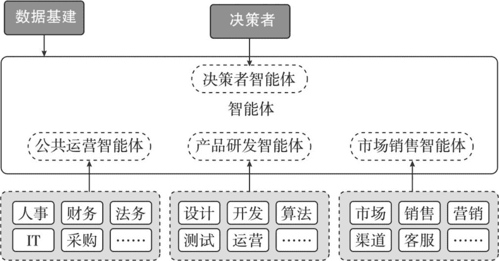

图 4-2 以智能体为中心的协作范式

这张图所揭示的，不仅仅是一个更优的协作流程，更是一种颠覆性的权力结构和组织形态。在全新的协作范式中，人类决策者只需要向一个统一的、由多个专业智能体构成的“智能中间层”下达指令即可。传统的职能部门（如财务、开发、市场）退居幕后，它们的能力被数据化和服务化，成为喂养这个智能中间层的“数据基建”。这就是工作流范式变革的图景，协作的重心不再是人与人的连接，而是人与 AI 的共舞。

**第五节 转型工具箱：AI 工作流的五条军规**

当新的工作流蓝图被绘制出来，团队真正踏上人机协同作战的战场时，一个核心问题浮现：我们需要遵循怎样的“交战规则”？

理论是清晰的地图，但真实的战场布满了陷阱。我们曾因对 AI 过度信仰而返工，因旧流程的“排斥反应”而内耗，更因隐藏的人机协作成本而感到困惑。

以下五大原则并非来自理论推演，而是我们在无数次失败和试错后，从战壕带回的实战法则。它们不是一份操作手册，而是一套重塑团队心智与协作方式的“思想武器”。对于任何希望构建高效 AI 原生研发团队的组织，它们都具备极高的复用价值。

**一、AI 优先：以 AI 为核心，而非 AI+**

团队必须彻底改变以往“我来写，AI 辅助”的旧习惯，转向“AI 写，我指挥”的全新范式。表面上看，这似乎只是一个口号，但在实践中，即便拥有最先进的工具，工程师在压力下仍会下意识地回到手写代码的舒适区，从而导致新旧模式冲突，效率不仅没有提升，反而下降。真正的转变是，在组织内部建立明确的铁律：任何非 AI 生成的成果，都必须作为例外处理，并经过严格审批。

**二、速度即信仰：体验至上，快速迭代**

AI 原生研发强调体验至上和快速迭代。一些技术型公司经常因团队内部关于技术选型或代码规范的争论而导致项目延期，但在 AI 原生团队中，内部的“完美主义”必须让位于“快速让用户体验到价值”。具体的做法是通过“3-5-7”交付法则（三天完成原型、五天上线、七天发布），把速度和用户体验作为衡量团队敏捷性和价值创造能力的核心指标。

**三、人机边界重构：驾驭 AI 而非被控制**

在实践中，我们学会了驾驭 AI，而不是被 AI 所束缚。AI 带来了涌现性和不确定性，但过度信任或试图让 AI 解决一切问题，只会导致结果同质化，甚至浪费大量时间调试 AI 的偏差。我们明确 AI 的角色是协作伙伴，而非全能替代者。团队的工作重心从执行转向前期高质量的上下文设计和后期对结果的批判性评估，只有这样才能真正放大 AI 的价值。

**四、组织单元重组：“两人即团队”实践**

在 AI 原生团队中，传统的产研流水线不再适用。我们发现，即使引入敏捷流程，固化的部门墙和角色定义依然会带来巨大的“排斥反应”，新代码与旧框架的融合常常“牵一发而动全身”，这让新模式的威力大打折扣。最有效的办法是组建以“两人作战单元”为核心的结构，由系统设计师和全栈工程师组成的原子小队，端到端地完成整个价值创造闭环，从构想到落地，再到迭代优化，彻底打通决策、执行和反馈的链条。

**五、全球化思维：拥抱全球，人才为先**

AI 是放大器，它让组织对顶尖人才的依赖度空前提高。企业必须用全球视野，寻找和留住最优秀的人。平庸的输入，在 AI 的放大下，只会产出规模化的平庸。某 AIGC 行业头部公司曾试图降低人才选用标准以快速扩张，结果是产出质量急剧下降，管理成本指数级上升。在 AI 时代，相较于一个平庸员工的价值，一个顶尖人才的价值不只是他的 10 倍，可能是 100 倍。因此，寻找和留住最优秀的人是组织的第一要务。这家公司在团队中推行“英文优先”的工作方式，确保认知与全球最前沿保持同步，让组织始终能够在全球范围内捕获信息和机遇。

这五条原则构成 AI 原生组织的行动指南。从“AI 优先”到速度至上，从重构人机边界到小团队闭环，再到全球化视野，每一条都在重新定义团队的工作方式，也为组织释放前所未有的创造力和适应力奠定了基础。

**第五章 重构企业文化**

在第三、第四章，我们为组织注入了“数字血液”（数据），重塑了“神经网络”（工作流）。从硬件上看，这似乎已经是一个完美的 AI 原生体了。但在实践中，我们遭遇了最隐蔽，也最致命的反击——排斥反应。当我们试图在旧文化的土壤中种植新物种时，旧有的管控思维会本能地剿杀创新力。因此，在解决了“怎么做”的流程问题后，我们必须直面“怎么想”的灵魂拷问。让我们看看微软是如何通过重塑灵魂而重生的。

当今天人们谈论 AI 时代的巨头时，一个曾经被认为“廉颇老矣”的名字正以一种令人敬畏的姿态重新回到舞台的中央——微软。

它的 Azure 云服务，成为驱动全球 AI 创新的核心引擎；它的 Microsoft Copilot，正被集成进全球数亿人的 Office 软件和操作系统中；它与 OpenAI 的战略联盟，更是被视为科技史上最成功的一次“大象与新锐的共舞”。今天的微软，不再是一个固守 Windows 帝国的“守成者”，它展现出的是一种初创公司般的敏捷、开放与饥渴感。这个 50 多岁的帝国，是如何“重获青春”的呢？

2014 年，当萨提亚·纳德拉（Satya Nadella）接任微软 CEO 时，他面对的是一个正在缓慢沉没的科技巨轮。那时的微软正深陷中年的泥潭，这家曾经定义了个人电脑时代的公司，错过了搜索，错过了社交，也几乎错过了移动互联网。公司内部，部门墙高耸，KPI（关键绩效指标）主义盛行，曾经的创新精神已被无休止的内部斗争和官僚主义扼杀。

纳德拉用“成长型心态”代替了无所不知的精英主义；用“一个微软”的理念消融那些曾经水火不容的部门壁垒；他甚至做出了一个在当时看来不可思议的决定——让 Windows 拥抱曾经的“敌人”开源 Linux。这场始于“文化”的变革，为微软后来的“重生”注入了最关键的基因。正是这种开放、谦逊、以学习为核心的新文化，才使得微软抓住云计算的浪潮，并最终在 AI 时代以一种令人敬畏的姿态重回世界之巅。微软“重获青春”的故事，与 2025 年诺贝尔经济学奖得主的洞察殊途同归：增长的真正瓶颈，往往不在于技术，而在于组织与文化。

如同很多创业型技术团队的经历一样，当一个两人的“原子小队”只要 48 小时就能创造出一个月的成果，但一份金额只不过数千元的预算审批却需要走上两周的流程。这类荒诞的经历，让我们体悟到问题的本质：我们创造出最快的“F1 赛车”，却发现它被困在了陈旧、拥堵的“乡村土路”上。当高速运转的工作流，撞上固化的企业文化时，AI 带来的每一丝效率增益，都正在被无情地吞噬。要想完成这场进化，我们就必须进行一场更底层的、关于“组织灵魂”的革命。这要求我们彻底打破旧世界的思想钢印，将 AI 原生时代的企业文化“六大原则”写入组织的基因序列。

·AI 主导，而非辅助：AI 是核心执行主体，而非工具。

·全栈，而非专才：组织人才均为可以端到端解决问题的全能型人才。

·原型，而非线性：推行以原型为核心的快速迭代，线性的文档接力。

·数据思维，而非程序思维：决策基于流动的数据事实，而非僵化的流程。

·涌现，而非管控：相信自下而上的创新力量，而非自上而下的指令控制。

·激励，而非教导：用机制点燃内驱力，而非用教条约束行为。

这六大原则，构成 AI 时代新文化的底色。本章，我们将深入这场重塑之旅，首先解剖“旧文化”为何必然失效，并探寻 AI 时代新文化的“三体系统”——对齐、激励与涌现。

**第一节 旧文化：程序与管控思维**

陶楷是某 AIGC 行业头部公司旧有体系下最受推崇的一类员工。他做事踏实、严谨规范，可以徒手在白板上写出字迹最工整、最优美的代码，在旧有 KPI 体系下，他将每一个被明确定义的任务执行到满分。他所信奉和践行的，正是过去两百多年商业文明中最主流的“程序思维”：世界是一个可以被清晰定义的、封闭的系统，只要严格遵循标准操作流程（SOP），就能得到可预测的、高质量的结果。他就是我们那部精密“管控机器”上最闪亮、最可靠的一颗齿轮，他正是“程序思维”与“管控思维”所塑造出的理想个体。

但进入 AI 时代后，这颗最坚固的齿轮，却最先开始锈蚀。AI 原生组织不再是一个按程序运行的封闭系统，而是一个需要不断与不确定性共舞的开放生态。当“系统设计师”需要主动去定义一个模糊的问题时，陶楷感到无所适从，因为他习惯了等待清晰的指令；当 AI 工具本身就充满了“涌现”的可能性时，他感到焦虑和失控，因为他赖以生存的“代码洁癖”和规范性在很大程度上被 AI 取代了。

他所习惯的那个“指令明确、结果可控”的世界，正在消失。最终，这位旧体系里最优秀的员工，在新体系里成为最先掉队的人。陶楷的离开，像一声刺耳的警钟，让我们惊醒。这并非他个人的困境，而是整个旧有“管控文化”的系统性症结。他的离开，是一个“时代错配”的缩影。它残酷地证明，那些曾让我们引以为傲的旧世界的管理哲学，正在与 AI 时代的核心引擎发生剧烈排异。流程管控的时代正在落幕，AI 时代需要全新的 AI 原生思维。

**一、从程序思维到数据思维**

2025 年，一个完全不懂普拉提的美国小伙，靠着中国的义乌供应链和一台笔记本电脑里的 AI，把几块钱一双的防滑袜，卖成欧美女性疯抢的爆款，30 天收入 270 万美元。

这个故事的真正价值，不在于又一个 AI 创业神话，而在于它精准切开了 AI 时代商业竞争的底层逻辑。它宣告了一个时代的结束——那个依赖少数专家直觉和经验的“程序思维”时代。

在一家传统的消费品公司（程序思维），开发一款爆款产品依赖的是资深产品经理对市场的洞察，以及设计师对潮流的预判。在 Netflix 或字节跳动这样的互联网公司（上一代数据思维），他们可能会设计出三款不同颜色的袜子，然后进行 A/B 测试，用数据来验证哪一款更受欢迎。

而这位美国小伙的做法完全不同。他既没有依赖个人经验，也没有止步于数据验证。他直接让 AI 成为他的首席战略官和首席产品官。他的第一步，不是问“什么火，卖什么”，而是问“别人在抱怨什么”。他用 AI 扒取了海量中小普拉提博主的视频和文案，将其全部投喂给 ChatGPT，只加了一句简单的指令：“列出视频中提到的所有新兴产品和用户痛点。”

AI 从无数的“噪声”中，为他精准地“提炼”出一个被市场忽略的、正在指数级增长的蓝海赛道——防滑袜。这个故事的颠覆性，远不止于 AI 选品。它揭示了 AI 时代数据思维的核心革命：行业经验和认知正在被数据解构。

那个老外不懂普拉提，但他拥有了比任何资深从业者都更全面的数据视野。未来行业知识的壁垒正在被打破，只要掌握了“AI+数据整合”的方法，一个外行也能对一个内行的领域发起降维打击。无论是 AI 选题创作、个性化教育，还是金融产品设计，都可能遵循同样的逻辑。决策权从人转移到了系统。在 Netflix 的 A/B 测试中，数据只是“裁判员”，最终拍板的还是人。而在这个案例中，从选品到设计（AI 分析用户偏好，对标 Glossier 重拍大片），再到供应链选择（利用多家供应商互相压价），每一个决策都由数据和 AI 深度主导。人的角色，从“决策者”升维为“提问者”和“系统的设计者”。

AI 在这里扮演了一个无形的“全球调度师”。它将全球分散的需求（欧美用户的隐秘痛点）与全球分散的供给（中国的柔性供应链），以一种前所未有的效率精准地连接在一起。这是一种全新的“智能众包”模式。

这个故事正是“数据思维”的体现。它不再是将数据做成报表供人回顾，而是将数据变成一个能够自主发现机会、生成策略，并调度全球资源的、活生生的“商业生命体”。

同样，在实时时尚巨头 Shein 的内部，一件 T 恤的诞生更像一场由 AI 驱动的生物进化实验。它的 AI 系统正时刻“阅读”着全球社交媒体（如 TikTok、Instagram）上亿万用户的时尚内容，实时捕捉着那些最微小的流行信号——可能是某个明星街拍中的一个袖口细节，也可能是某个 KOL 视频里一闪而过的一种新配色。

捕捉到信号后，它会驱动设计系统，在几分钟内创造出数十款包含这个新元素的 T 恤设计变体。这些“虚拟产品”会立刻被推送到 App 和小程序上，进行小批量的“在线测试”。接下来，数据不再是“裁判员”，而是“进化选择器”。哪款设计的“加入购物车”率最高？哪款配色的“用户停留时间”最长？这些实时反馈的数据会立刻决定哪些“物种”可以进入下一轮——小规模生产；而那些表现不佳的设计，则在诞生几小时后就被“自然淘汰”了。

这就是 AI 时代的数据思维。它的核心，不再是在有限的选项中做选择，而是从无限的可能性中涌现。决策权，不再是数据辅助人类判断，而是数据直接驱动系统进化。组织的进化，不再依赖于天才设计师的灵光一闪，而是由能够与全球用户实时共舞、不断自我迭代的数据驱动。

过去的企业运营基于“程序思维”，将流程和制度置于数据之上。例如，通过标准操作流程确保执行的一致性，但这种刚性框架本质上抑制了创造力的“涌现”。而“数据思维”则要求将产品、运营、管理全面数据化，不仅仅关注流程中的数据，更构建端到端、多模态的数据体系。它以结果为导向，重新定义输入与输出的关系，形成以业务为中心的数据底座。例如，战略性地部署传感器、设计数据埋点、规划数据存储与处理架构，都是数据思维的具体实践。

这种从程序思维向数据思维的跃迁，构成 AI 原生思维的第一大核心支柱。

**二、从管控思维到涌现思维**

AI 原生思维的第二大支柱，是从管控思维到涌现思维的范式革命。

无论是经典的湖畔大学“七件套”（比如“上三路”定方向，“下三路”保执行，见图 5-1），还是我们所熟悉的各种管理模型，其底层逻辑都是围绕“管理人”来构建的，文化内核都是一种计划思维。它们的目标，都是将组织打造成一部更精密的“管控机器”，在可预测的环境中追求最终结果的确定性。

然而，当智能体这个能力本身就通过“涌现”而来的“新物种”，成为核心生产力时，这部机器的根基便开始动摇。当组织面临最大的挑战不再是“执行的确定性”，而是“创新的不确定性”时，一个纯粹追求管控和预测的文化体系，便成了扼杀活力的枷锁。

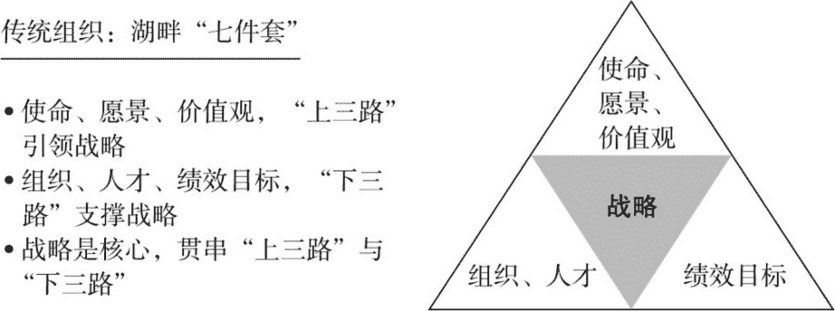

图 5-1 传统组织管理方法：湖畔大学“七件套”

这种追求稳定和可预测的程序与管控思维，在过去是组织成功的保障。然而，在 AI 时代，一个悲壮的故事主角莫过于曾经的创新图腾——苹果。

苹果那套源于乔布斯时代、为了防止硬件泄密而建立的极致保密文化，正是管控思维的巅峰之作。信息被严格地按需知晓，各个团队如同一个个独立的黑箱，这曾是其打造惊艳产品的基石。

然而，当 AI 成为竞争的核心时，这套强大的旧基因便开始产生致命的排斥反应。AI 的发展，极度依赖于海量数据的自由流动、跨团队的无缝协作，以及对前沿研究的快速分享。而苹果的保密基因，却在组织内部制造了无数个数据孤岛和认知壁垒，使其 AI 团队无法像 OpenAI 或谷歌那样，形成一个高效的集体大脑。

当你的组织文化还在奖励那些保守秘密的人时，你就不可能赢得一场需要共享智慧的战争。苹果在 AI 上的迟钝，从根源上说，是一场深刻的文化惯性悲剧。它向我们揭示了旧文化最可怕的地方，不在于它做错了什么，而在于它会让你完美地错过整个未来。

旧世界的管理哲学，本质上是一种“监督式学习”。而在 AI 时代，组织需要的是一种“强化学习”的文化。管理者不再是下达完美指令的“总设计师”，而是创造环境并给予关键反馈的“园丁”，让团队在自我进化和探索中“涌现”出创新。

陶楷的离去，最终迫使公司完成 AI 原生思维的核心转变：从信奉流程的“程序思维”，转向信奉事实的“数据思维”，将高质量的、端到端的数据视为组织一切智能行为的起点；从追求可预测性的“管控思维”，转向拥抱不确定性的“涌现思维”，致力于创造一个能让智慧自发生长的生态，而非一台冰冷的机器。

**第二节** **AI 新文化：对齐、激励、涌现**

AI 原生组织的文化核心不再是追求可预测结果的“湖畔七件套”，而是由对齐、激励、涌现构成的“三体系统”（见图 5-2）。这场文化基因的突变，标志着管理的重心从管理一个由人组成的机器，转向设计一个由人与 AI 共同进化、价值持续涌现的系统。

**一、与 AI 对齐**

在 AI 原生组织中，首要的文化挑战在于对齐。这不再仅仅是传统意义上人与人之间的目标对齐，而是扩展到一个全新的维度——人与 AI 之间，甚至 AI 与 AI 之间的价值观和目标对齐。

当智能体成为组织的核心执行主体时，我们如何确保这个能力无限、思想自由的“新物种”始终与组织的目标和价值观同频？大语言模型的天性是“骑墙”的，如果我们不对其进行明确的价值引导，那么它的强大能力很可能会在追求“技术最优解”的过程中，与组织的“商业最优解”或“伦理最优解”背道而驰。我们要为这个能力强大的“新物种”，装上一个不可动摇的“价值罗盘”。

尤瓦尔·赫拉利（Yuval Noah Harari）在《人类简史》中揭示，人类之所以能构建起超越血缘的、大规模的协作，其秘密武器是“共同想象”和“虚构的故事”。国家、宗教、法律、金钱等这些驱动人类文明的强大力量，本质上都是我们共同相信的故事。

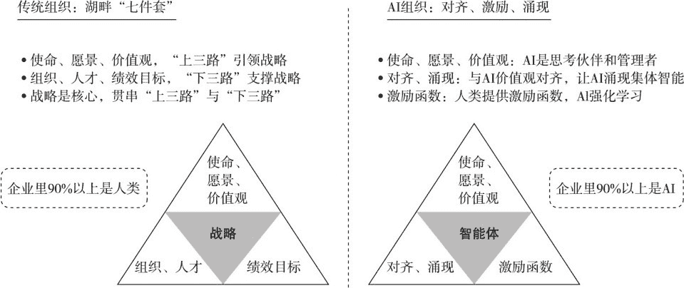

图 5-2 传统组织管理方法 vs.AI 组织管理方法

在 AI 时代，这个古老的智慧被赋予了全新的、更为紧迫的含义。组织的使命、愿景、价值观，不再仅仅是写在墙上、用来激励人类员工的口号和故事，而是必须被“代码化”，成为能够直接引导和约束 AI 行为的核心算法。

对我们而言，具象化对齐的第一步，是确保 AI 和所有人都在阅读同一个版本的“故事”。这意味着：第一，通过打通数据权限，让 AI 和所有员工都能看到完全一样的上下文；第二，通过 OKR（目标与关键成果）等工具，为所有人（包括 AI）设定一个唯一的、可被清晰理解的共同目标。

在这个基础上，一场更深层次的、关于价值观植入的挑战，才真正开始。这往往伴随着激烈的辩论和艰难的权衡。

在某 AIGC 行业头部公司设计一款内容推荐智能体时，团队内部爆发了一场激烈的冲突。市场负责人拿着一份无可辩驳的数据报告，该报告显示，只要优先推荐那些博眼球的“聚合热点内容”，用户停留时长能在两周内提升 15%。这是一个能让所有 KPI 都变得亮眼的“技术最优解”。

但产品负责人坚决反对。她站起来说：“我们的价值观中的第一条是‘鼓励原创’。如果我们今天为了这 15%的数据，就放任算法去扼杀那些用心创作但初期流量不佳的原创者，那么我们就是在亲手摧毁我们想要建立的生态根基。我们是在用未来换现在。”

会议室里一片沉默。最终，公司做出了一个“反效率”“反数据”的决定，将“鼓励原创”这个价值观编进智能体的核心规则中：“在所有的推荐结果中，‘原创深度内容’的权重必须比‘聚合热点内容’高出 50%，即使这可能在短期内导致用户停留时长的下降。”

这个决定，是一次典型的价值观植入。它不再是空洞的口号，而是一行可执行的代码，一个 AI 在决策时必须遵循的硬性约束。对齐的目标，是让 AI 不仅仅知道“做什么”，更能像一个真正理解了组织使命的“伙伴”一样，深刻地理解“为什么做”以及“不该做什么”。只有这样，公司才能放心地将未来交由这个“人机共同体”来创造。

这种将价值观“代码化”的思路，不仅仅体现在业务规则上，更体现在组织的安全底线上。金融科技独角兽 Brex 在推动全员 AI 化时，并没有陷入无休止的工具审批流程。相反，它的法务和产品团队共同提前明确了 AI 工具使用的“安全红线”。例如，数据保留不能超过 30 天、用户输入不能被用于模型训练等。只要新工具符合这些预设的价值观，员工就可以自由试验。这正是将“安全与信任”这一核心价值观，从一句口号转化为一套可被快速执行的对齐机制的典范。

那么，如何将价值观对齐从一次次艰难的抉择，系统性地内化为组织的日常习惯？我们的实践最终沉淀出了两条核心原则：

·用故事校准目标。在启动任何一个有着不确定性的新项目时，放弃详尽的规划和 KPI，转而与团队共同创造一个关于“我们为客户解决了什么终极问题”的故事，并以此作为人与 AI 共同的、唯一的“北极星”。

·用透明对齐上下文。致力于打破数据权限和部门墙，建立一个让 AI 和所有员工都能看到同样事实的透明环境。这是实现一切对齐的技术和文化基石。

**二、为 AI 提供激励函数**

如何设计面向“人机共同体”的全新激励机制？如何激励 AI？AI 强化学习的理念是为系统设计一个有效的“激励函数”。当系统（无论是人，还是 AI）做出一件符合期望的行为时，环境必须立刻给予清晰的正反馈。

如果不对 AI 的良好行为进行正向激励，那么即使是最先进的智能体，其能力也会停滞不前，甚至在错误的道路上越走越远。我们必须通过“激励”来教会它。这需要我们将人类隐晦的满意度，转化为 AI 可以理解的、明确的“奖励信号”。

如何系统性地提供这些“奖励信号”呢？在设计 AI 协作工具时，某 AIGC 行业头部公司探索建立了一套正反馈闭环。当工程师看到 AI 生成一段结构优美、逻辑清晰的代码时，他点了一个“赞”；当一位销售人员根据 AI 的建议，成功赢得一个客户时，他可以在客户关系管理系统中将这个线索标记为“高质量转化”。这些看似微小的动作，比如一个“赞”、一个“标记”，正是他们为 AI 设计的“激励函数”的关键部分。它们会被系统实时捕捉，作为高质量的标注数据，像“奖赏”一样，告诉 AI：“你做对了，请继续朝这个方向进化”。这反过来又会加速 AI 的学习，让它在未来能提供更精准的辅助。

金融科技独角兽 Brex 的实践，为我们展示了一幅清晰的蓝图。在其重构后的运营团队中，L2 层级（原经理和高级分析师）的核心职责发生了根本性的转变：从管理人，变成管理智能体。正如其 COO 卡米拉·马蒂亚斯所说：“不再是给员工做绩效评估，而是给 AI 写的提示词打分。”在这个新模式下，经理们的核心工作就是持续分析 AI 的表现，不断优化提示词和工作流，让 AI 变得更聪明。人类专家的每一次“打分”和每一次“优化”，都成了对 AI 最直接、最有效的“激励信号”。这将“激励 AI”，从一种零散的个人行为，升级为一种系统性的、岗位的核心职责。

激励的核心，正是建立一套能让“AI 帮助人成功，人训练 AI 更成功”的、持续滚动的正反馈飞轮。这背后，是一种更深刻的管理哲学，恰恰与 OpenAI 所分享的“不要去教导，而要去激励（Incentivize，not teach）”有异曲同工之妙。它为“授人以鱼，不如授人以渔”这句古老谚语，赋予了更深刻的第三重含义：不是给予结果（授人以鱼），也不是传授方法（授人以渔），而是激发其内在的渴望（知鱼味、吊胃口）。

当你让一个人（或一个 AI）尝到了“鱼”的美味，又让他保持“饥饿”时，他就会被强大的内在动机驱动去发明你从未想过的捕鱼方式。这正是今天大模型“强化学习”的底层逻辑。我们不“教导”它必须使用思维链，而是通过发出“奖励”和“惩罚”的信号来“激励”它。它也深刻地呼应了丹尼尔·平克（Daniel Pink）在《驱动力》（Drive）一书中的核心观点：对于复杂的、创造性的任务，真正的激励并非来自外部的奖惩，而是源于内在的自主、精通和目的。这种激励的最终目的，是创造一个让他们为了获得“奖励”而自发探索、创造的环境，从而让更优的解决方案能够自发地“涌现”出来。

如何将激励从一个哲学理念转化为一个可运转的“正反馈飞轮”？核心在于设计“人机双赢”的机制：

·设计 AI 的“奖励信号”：在所有内、外部工具中，植入简单、明确的人类反馈机制（如“赞/踩”按钮、采纳/拒绝选项）。将每一次人类的满意或不满意，都转化为 AI 可以学习和优化的“奖励信号”。

·激励“AI 的教练”：公开认可并奖励那些最擅长“训练”AI 并将其经验分享给整个团队的员工。将激励的重心，从奖励“产出最高的个人”转向奖励“对系统贡献最大的人”。

**三、为组织提供涌现土壤**

当对齐确立了方向，激励提供了能量时，集体智能将自下而上地“涌现”出来。

某公司负责客户关系的团队曾常年疲于“被动救火”，客户流失总悄无声息地发生。这一次，公司放弃了传统的“管控”模式，只向一支跨职能小队提供了清晰的“上下文”：“目标就是一个季度内将高价值客户流失率降低 50%”。

这个小队最初也毫无头绪，他们尝试了访谈、问卷等方式，但都收效甚微。在近乎绝望时，他们抱着试一试的心态，将所有历史流失数据喂给了 AI。一周后，AI“涌现”出了一个被所有人都忽略的预测信号：高价值客户在流失前三个月“帮助文档”的特定高级功能查询量会异常上升。

这个洞察击中了这个小队。他们意识到，这不是客户活跃，而是他们在自救失败后的“无声求救”。基于这个洞察，这个小队自下而上地创造了一套“AI 预测性关怀”工作流。

这个案例也让我们深刻理解了 AI 时代管理哲学的跃迁——“给予上下文，而非控制”（Context，not Control）。它呼应了梅拉妮·米歇尔（Melanie Mitchell）在《复杂》（Complexity）一书中描述的蚁群智慧：没有一只蚂蚁知道整个蚁丘的蓝图，但无数蚂蚁遵循着简单的规则，却能“自组织”地构建出复杂巢穴。

这要求领导者的角色必须从那个试图绘制整张蓝图的“总设计师”，转变为培育土壤、设定规则的“园丁”。他需要从对结果的精准控制中后退一步，转而相信：真正颠覆性的解决方案，将会在他创造的这片生态中，破土而出，野蛮生长。

顶尖的 AI 研发公司 DeepSeek，更是将这种“自下而上”的理念推向了极致。该公司打破固定岗位制，采取“自然分工”机制。在总体目标框架下，任何人都可以提出自己的想法先行研究，并在遇到困难时自发地寻求协作。最终，有价值的想法会从“个体萌芽”成长为“集体成果”。员工不再等待命令，而是“自组织”地让创意涌现。

《失控》预言的“自下而上、分布式”的未来形态，指出：权力将流向去中心化、自我组织的网络结构，而非传统金字塔式层级。如今 AI 原生组织追求的“涌现”现象，恰恰以一种令人震撼的方式印证了凯利的前瞻性判断——当无数简单个体通过网络协作时，便能自发产生超越个体能力的集体智慧，这正是分布式系统最迷人的特质。

如何将“涌现”从一次偶然的奇迹，变为一种可被培育的组织能力？关键在于领导者角色的转变，从指挥官变为打造一套系统的园丁：

·给予上下文，而非控制。面对新挑战，不要讨论“该怎么做”，而是花双倍的时间向团队（包括人与 AI）阐明“为什么要做这件事”（目标、背景、约束、可用资源），然后彻底授权，让他们自主寻找最佳解决方案。

·信息透明化，而非信息孤岛。致力于打破部门墙，建立一个极度透明、信息充分流动的协作环境，确保任何一个角落的员工（和 AI）都能基于全局的上下文，自下而上地提出创新性想法。

至此，我们终于看清了“三体系统”的终极图景：“对齐”设定了航向，“激励”提供了燃料，而“涌现”则是这艘飞船最终抵达的、壮丽的新世界。对齐、激励和涌现的发生，都依赖于一个共同的、不可或缺的文化基石——极致透明。这早已超越了技术层面的数据可见，而是一种关乎组织信任与人性本身的“文化透明”。我们发现，制度上的透明只是搭建了一个广场，但员工如果内心缺乏安全感，那么依然会在转型过程中选择躲在广场的阴影处窃窃私语。

要想让阳光照进每一个角落，我们必须将“透明”从制度升级为信仰。在公司的文化和实践中，始终让 CEO 和高层率先“赤裸”，用坦诚打破猜疑的壁垒；建立“问题必须上桌”的机制，用公开的冲突取代私下的抱怨；同时，重塑一套“只看结果，不看表演”的评价体系，让团队敢于暴露真实的工作过程，无论是文档、会议纪要还是代码，让所有人和 AI 同在一个全局透明的上下文中。

只有当“极致透明”成为组织的空气和水时，“涌现生态”才能真正拥有赖以生长的土壤。

在内容创作领域，影视飓风的组织进化就走上了一条独特的“跨界学习”之路：在文化上，该公司学习 Netflix 的“高人才密度、高自由度”，以保护创作的灵魂；在机制上，学习字节跳动的 OKR 和透明化来打造组织的“效率引擎”。这种看似矛盾的融合，恰恰是在一个充满不确定性的新环境中，一个组织为了生存和发展自发“涌现”出的独特进化路径。

**第三节** **文化编码：将原则落地为 AI 原生实践**

组织的文化，最终都将沉淀为系统和机制。如何将“对齐、激励、涌现”这套新世界的文化内核，转化为可执行的“代码”，真正地编进组织基因之中？纵观全球的进化型组织，它们都找到了将自身文化内核“硬编码”进组织基因的方式，揭示如何将 AI 时代的文化“代码化”。

**一、对齐：人与 AI 的双向编码**

“对齐”是组织文化中最基础的一环，它确保了组织的每一个细胞——无论是人类还是 AI——都朝着同一颗北极星前进。

“对齐”，不是单向的指令下达，而是一个双向的、动态的共识构建过程。亚马逊著名的“一页纸”文化，正是这种“对齐优先”原则的典范。在投入任何研发资源之前，团队都必须撰写一份未来的“新闻稿”，清晰阐述新产品将为客户解决什么问题、带来什么价值。这个制度将“客户至上”这个抽象价值观，编码成一个任何人都无法绕过的、前置的流程节点，强制让团队在行动之初就必须从终局和客户的视角达成深刻共识。

在 AI 原生时代，这一原则依然适用，但其实现方式正在发生进化。当组织共识的载体从静态文档转向动态原型，通过一份结构化的“任务简报”与 AI 前置对齐，正迅速成为 AI 团队的普遍共识和选择。在实践中我们发现，这份简报的真正力量，不在于它定义了多少功能点，而在于它如何将文化原则编码为 AI 可以执行的语言。它不仅仅是“业务需求的翻译器”，更是“组织文化的编译器”。

当一位系统设计师准备为新产品构建一个营销网站时，他创建的并非传统意义上描述产品细节的产品需求文档，而是一份极其精练的“任务简报”，一份定义了目标、模块、关键原则与成功标准的 To do（待办）文档。这份简报就是他与 AI 的初始对齐契约，清晰定义了“做什么”和必须遵循的“文化原则”，为 AI 设定了明确的行动边界。

AI 接到这份简报后，并没有立刻编写代码，而是“反向生成”一份更详细的技术 To do 文档，向人类“提议”它的解决方案。这份技术方案不仅包括前沿框架的选择，还主动指出了为保证加载速度，首页复杂动画可能需要简化的潜在风险和权衡等。

人与 AI 的双向对齐正在发生，AI 不再是被动的执行者，而是主动的思考伙伴和方案提议者。团队成员不再召开冗长的技术评审会，而是直接在由 AI 生成的 To do 文档上评论和确认。一旦方案被批准，AI 将按照这份“双向对齐”的蓝图，高效完成网站构建。

做网站的过程清晰地揭示了 AI 原生对齐的本质，它是一个“定义—提议—确认”的动态循环。人类负责设定高阶目标和原则，AI 则负责将这些意图转化为具体的、可执行的技术方案，并寻求人类的确认。这种双向对齐，将人与 AI 的能力结合，让文化和业务在每一个执行细节中都得到精准的落地。

**二、激励：创造自燃能量场**

在 AI 原生组织中，最有效的激励，不再是依赖自上而下的 KPI 考核与奖金分配，而是设计一个能让优秀人才和创意，在健康的竞争与协作中自然脱颖而出的“进化环境”。

华为等传统公司长期以来赖以生存的“狼性”文化，其内核正是这种通过内部竞争来营造“达尔文式的进化压力”的激励哲学。在关键的技术路线上，华为并非依赖高层决策，而是同时成立多个团队，让它们沿着不同的路径平行研发，“赛马”竞速。最终，胜出者不仅赢得了市场，还决定了公司的未来。这种机制深刻地揭示了激励的本质：最强大的驱动力，并非来自上级的奖赏，而是来自对生存和获胜的内在渴望。

在 AI 时代，这一深刻的原则依然适用，但其表现形式正在从有组织的“外部竞赛”进化为一种无处不在的“内在自燃”。当一个组织吸纳了密度极高的人才，并赋予他们前所未有的自主权和 AI 工具时，“激励”的重心便从外部的物质刺激彻底转向内在的创造性满足。过去，很多公司设计复杂的绩效系统，试图“推动”员工工作；而在新范式下，领导者的核心任务，是创造一个能让员工被使命吸引、被难题挑战、被创造本身所奖赏的环境。当工作本身充满了乐趣和意义，编写每一行代码都像一次雕琢世界的尝试时，商业上的成功便会自然而然地成为一种“副产品”，而非追逐的目标。

过去一年备受瞩目的 AI 独角兽 Cursor，正是这种“内在激励”文化的绝佳范本。在这家重新定义开发者工具的公司里，你几乎看不到传统意义上的激励机制——没有复杂的 KPI，没有 996 的强制要求。然而，员工却以惊人的强度和热情投入工作，完全是自发的、自驱的。这种“自燃”现象的背后，是 Cursor 自身带有的天然的内在激励系统。

首先，使命即奖赏。Cursor 的员工深信，他们不仅仅是在开发一款工具，更是在重塑软件如何构建世界的基础设施。当公司年度经常性收入达到 1 亿美元时，办公室依旧平静，大家仍在热烈地讨论产品。对他们而言，真正的奖赏是看到自己的工作推动了更精准的软件构建，而非外部的财富或地位的提升。

其次，难题即磁场。Cursor 的招聘哲学是“最优秀的人都热爱难题”，它吸引人才的方式，是展示公司正在攻克的、那些激动人心的硬核技术挑战。在这里，任务不是被分配的，而是被那些最有热情的“个体贡献者”（IC）主动“认领”的。谁对什么事最上心，谁就拿下那件事，并拥有全部的责任与自主权。

最后，创造即乐趣。Cursor 的员工是自家产品的头号用户和最狂热的粉丝。他们用 Cursor 写代码、改文档、搭建内部工具。产品路线图是自下而上“长出来”的：任何一个员工只要确信某个功能值得做，就足以成为开发的理由。

Cursor 的实践证明，在 AI 时代，最高级的激励机制，或许不再是设计一套更精密的“奖惩系统”，而是去构建一个“高人才密度+高使命感+高自主权”的能量场。在这个场域，公司不需要去点燃每个人，因共同使命而凝聚的成员会自己燃烧起来。

**三、涌现：内部痛点挖掘行业神器**

当“对齐”为组织指明了方向，“激励”为组织供给了燃料，将如何为“涌现”创造土壤？颠覆性的创新，往往并非源于完美的顶层规划和市场分析，而是从一个允许自由探索、鼓励偶然发现的“混沌土壤”中自下而上地生长出来。领导者的角色，不再是绘制一张精准的蓝图，而是去培育一片能让智慧自发涌现的“热带雨林”。Midjourney 的成功，是一种“外部涌现”力量的证明。它将自己植根于 Discord 社区，让数百万用户的集体智慧成为产品进化的驱动力。

而在 AI 原生时代，一种更深刻、更内化的“涌现”范式正在崛起——从解决自己的问题开始，让产品从内部需求中自然涌现。这种模式的转变源于一个根本性的认知变化：在 AI 时代，最高效的产品开发，不再是为理论上的用户画像构建解决方案，而是为自己团队每天面临的真实痛苦打造武器。当你成为自己所研发产品的第一个，也是要求最苛刻的客户时，产品开发就从充满不确定性的市场猜测，转变为一场精准、高效的自我革命。

以 AI 巨头 Anthropic 推出的产品 Claude Code 为例，它的诞生过程本身就是一部“内部涌现”的交响曲。Claude Code 并非源于某个宏大的产品战略或对市场机会的精确计算，而是纯粹诞生于 Anthropic 内部团队的真实需求。最初，它只是一个为了提高工程师和研究员工作效率的内部工具。安全团队用它将事件响应时间从 15 分钟缩短至 5 分钟；法务团队在没有任何编码经验的情况下，用它在一个小时内开发出辅助家人沟通的预测文本应用；增长营销团队用它将广告创意的输出效率提升了 10 倍。

这些来自不同职能部门的意想不到的应用场景，让 Anthropic 的领导层敏锐地发现：他们无意中为自己打造的这把“瑞士军刀”的普适性和强大能力，远超最初的设想。这款工具在解决“自己的问题”的过程中，已经完成最严苛的产品市场验证（PMF，Product-Market Fit）。

于是，Anthropic 顺势而为，将这一在内部高强度使用中涌现出的强大能力，放大并封装成一个独立的产品推向市场。Claude Code 的成功几乎是必然的，因为它所解决的每一个痛点，都已经在 Anthropic 内部被真实地感受、验证和迭代过无数次。

Claude Code 的故事为所有组织提供了一个深刻的启示：我们与 AI 的关系，不应仅仅是发明者与工具，更应是探险家与未知大陆。伟大的机会，往往不是通过外部市场调研找到的，而是在解决内部最真实、最痛苦问题的过程中发现的。AI 原生组织的创新法则，或许就是如此简单：停止空谈用户画像，着手解决自己团队今天面临的难题。因为当你用 AI 为自己打造出最称手的武器时，你很可能已经在无意中锻造出改变整个行业的下一把神器。

**第四节 转型工具箱：打造涌现生态的三项核心实践**

AI 原生组织无法生长在“管控机器”式的文化土壤中，它需要一个能让智慧自发生长的“涌现生态”。这个工具箱将帮助你诊断组织的文化基因，并提供培育“涌现生态”的行动指南。

**第一步：**诊断组织文化是“管控型”还是“涌现型”？

**维度一：思维模式（AI 优先）**

□ 当遇到新问题时，团队的第一反应是“招人”，还是“训练一个智能体”？

□ 是否有明确的原则（如“AI 优先”），规定凡是 AI 能做的，不再由人工完成？

□ 决策是基于“程序或流程”，还是基于“数据或事实”？

**维度二：管理哲学（涌现 vs.管控）**

□ 领导者是习惯下达具体的“指令”，还是提供丰富的“上下文”？

□ 组织是否鼓励“边缘创新”和“自下而上”的涌现，是否允许小规模试错？

□ 信息的流动是“按需知晓”（层级管控），还是“默认开放”（极致透明）？

**维度三：激励机制（内驱力）**

□ 激励体系是奖励“苦劳”（工时或加班），还是奖励“功劳”（结果或创新）？

□ 是否设立了专门针对“AI 贡献”的奖项（如“最佳 AI 教练”“最佳智能体开发者”）？

□ 是否有机制能让那些通过 AI 实现 10 倍效率提升的员工，获得匹配的回报？

若勾选少于 3 项（管控型）：您的组织仍深受工业时代管理思维的束缚。虽然它可能已经引入了 AI 工具，但文化的土壤是排异的。如果不尽快启动“去管控化”改革，那么 AI 的潜力将被锁死在流程里。

若勾选 3～6 项（混合型）：您的组织正处于文化拉锯战中。一部分先锋团队已经开始涌现，但旧有的惯性依然强大。现在的关键是：领导者是否敢于为创新者提供制度性的保护区。

若勾选 7 项及以上（涌现型）：您的组织已经拥有了 AI 原生的灵魂。这是一个能够自我进化、适应不确定性的生命体。请继续保持这种开放与信任，它将是您的组织最坚固的护城河。

**第二步：培育“涌现生态”的三项核心实践**

在第二步的行动指南中，我们提出了培育“涌现生态”的三项核心实践，每一项都强调组织与团队如何在 AI 时代实现协作与创造力的最大化。

首先是对齐。对齐意味着让所有人和系统都朝着同一个方向努力。为了实现这一点，组织要打通关键项目的数据权限，将战略信息、会议纪要和用户数据统一汇入一个共享知识库，让团队成员和 AI 都能看到完全一致的信息流。与此同时，不再追求详尽的 KPI，而是与团队共同塑造一个清晰的目标故事：我们究竟为客户解决了什么问题？这个故事被提炼成唯一的 OKR 目标，成为所有行动的北极星。为了确保 AI 始终遵循组织的价值观，组织还应将核心原则，例如“原创内容权重+50%”，编码为 AI 必须遵守的硬性规则。通过这种对齐，团队和系统在目标、信息和价值观上完全同步，形成统一的行动基准。

其次是激励。在 AI 时代，激励不再只是针对人类，还必须延伸到系统本身。组织可以为 AI 工具加入类似“点赞”的机制，把人类对 AI 成果的满意度转化为系统可学习的奖励信号。同时，激励人类员工，设立“最佳 AI 教练”奖项，以奖励那些对 AI 系统改进和成长贡献最大的人，而非仅仅看个人的产出。这样，人机之间形成一个双向的、正向增强的飞轮：人的反馈促进 AI 成长，AI 的进步反过来提升了人的工作效率和价值感。

最后是涌现。在传统组织里，管理者习惯直接分配任务和方案，而在涌现生态中，创新要求管理者改变角色：不再讨论“怎么做”，而是先定义战场，提供上下文。上下文包括目标（胜利条件）、约束（不可触碰的红线），以及可用资产（工具和数据）。在明确这些要素后，管理者将权力下放，把人机混合团队置于自主探索的环境中，让它们自由寻找最佳解决方案。通过这种方式，创新不再是单向的指令传递，而是在明确框架下的自发涌现。

这三项实践——对齐、激励、涌现，共同构成培育“涌现生态”的基础。它让团队和 AI 在同一个知识和价值系统下协作，把不确定性转化为探索的动力，同时保持组织目标和价值观的一致性，为真正的创造力和持续创新奠定了制度化支撑。

**第六章** **转型战地手册：个人与组织的转型战役**

在上一章，我们描绘了“对齐、激励、涌现”的理想文化蓝图。这听起来令人神往，但在现实的落地中，新文化的建立往往始于对旧习惯的清洗。

2025 年 9 月初，某 AIGC 行业头部公司的数据和工作流转型初步完成，核心“原子小队”的研发效率直接提升了整整五倍。一次复盘中，团队成员问自己：“转型至今，我们做出的最天真的一个决策是什么？”答案是：“以为每一个人都能转型成‘超级个体’。”

最先发现新大陆的探险家，总以为只要指明黄金的方向，所有人都会跟着去挖。但现实如冰水倾泻，组织里最资深、最优秀的“旧世界”工程师，在转型数月后，电脑里甚至连最基础的 AI 编程工具都没有安装。

“这样的未来，为什么他们看不到？”这个痛苦的问题，正是所有变革领导者的终极拷问。

这次反思，让该公司直面一个残酷的现实：组织的进化，从来不是一场皆大欢喜的集体春游，而是一场关于信念的残酷筛选。公司不能要求所有人都成为探险家，他们的“天真”在于，试图用一张新大陆的地图，去说服那些对航海本身充满恐惧的人。最终，该公司沉淀出一个冷酷但有效的标准：放弃对“意愿”的揣测，只看“行为”下注。公司不再问“你信不信”，而是看“你做了什么”。

这场组织 AI 转型，最先始于对“人”的残酷而清醒的重新审视。本章将以最坦诚的方式，复盘在这场关于“人与组织”的转型战役中的信念之战、惯性之战与战略抉择。

**第一节** **个人破局：意愿与能力考验**

2025 年底，一场“寒流”席卷全球科技行业。亚马逊启动了覆盖数万人的效率优化计划，谷歌悄然裁撤了超过三分之一的小团队管理者，Meta 的裁员甚至波及十年功勋的研究科学家……离职通知像暴雪一样，毫无预兆地落在从西雅图到山景城的每一个角落。这并不是一次普通的经济性裁员。当亚马逊的股价在消息公布后不跌反涨时，华尔街用冷静的数字告诉我们一个事实：AI 正在重新定义人的价值。许多人的职业生涯，在这股浪潮下被迫面临截然不同的命运。

一边是价值的“湮灭”。Sarah，一位才华横溢、被同事誉为“像素眼”的前端工程师，在告别信中写道：“我花了四年时间，一万个小时，才精通产品的每一个细节；而 AI 只用了几分钟，就学会了如何构建一个比我手写更漂亮的网页。”

而另一边，是价值的“重构”。Jessica，前 Meta 的产品经理，在目睹了团队的动荡后，选择了主动离开。她没有去另一家大厂寻找安稳，而是创办了自己的 AI 咨询公司。她的新工作不再是提升一个 App 的点击率，而是升维为帮助整个传统零售行业进行数字化转型的“赋能者”。

一边是技艺的价值湮灭，一边是认知的价值重构。Sarah 的困境与 Jessica 的重生，并非命运的偶然走向，而是两种不同“心智结构”在时代浪潮下的必然结局。为什么面对同一场技术海啸，有人沉没，有人却乘浪而起？大部分人以为“变革等于学习新技能”。但心理学界早已告诉我们：真正的变化来自“结构性改变”，而不是“内容累加”。

正如曾鸣教授所言，在 AI 时代，知识本身不再稀缺，稀缺的是驾驭知识的“元认知能力”。而系统设计师，本质上就是拥有极强元认知能力的人。他们不沉迷于解决具体的代码 bug（那是 AI 的事），而是具备强大的抽象建模能力和第一性思考能力。他们能从纷繁复杂的业务表象中提炼出最本质的数学模型或逻辑框架，然后交给 AI 去填充血肉。

美国心理学家罗伯特·凯根（Robert Kegan）一针见血地指出：“大多数人不是被问题压垮，而是被‘旧的心智结构无法理解新世界’压垮。”Sarah 的困境，不在于她不会用 AI，而在于她赖以建立自信和价值感的“自我框架”——那个“精通 React 的优秀工匠”——不再被新世界所需要。变革，从来不是“添加技能”，而是“重写自我结构”。

这种“自我结构的重写”，需要从“确定性”心态到“接受不确定性”的升级，从“效率心态”到“成长心态”的转变，以及从“我是谁”到“我愿意成为什么样的人”的跨越。这三个底层逻辑构成个人变革的原点。组织不会比领导者的认知更强，也不会比员工的心智结构更先进，所有组织转型的本质都是个人进化的集体投影。

AI 转型的本质，不是一场温和的技能培训，而是一场残酷的“压力测试”。这场测试的核心，不是技能，因为昨天的技能随时可能被颠覆，而是意愿与能力——你是否愿意亲手拆解自己的旧版本，纵身跃入未知的深海？

**一、意愿：辨别真伪转型**

转型初期，很多公司经历的最大误区是严重低估了识别人心向背的难度。当变革的号角吹响后，每个人都摆出了“拥抱”的姿态。然而，在这片看似齐心协力的“拥抱”海洋之下，却潜藏着形态各异的暗流，严重消耗着组织的能量与信任。

在激进转型的高压之下，团队开始了“集体表演”。在“代码 100%由 AI 生成”的铁律之下，有些工程师白天在会议上积极分享 AI 编程的心得，晚上却偷偷手敲代码来追赶因不熟练而落后的进度。他们不是不努力，而是太努力了，努力扮演一个转型者。当这种不断拉扯的内心煎熬达到极限时，一部分人选择了摆脱高压状态，去一个转型更温和的公司。用强制性要求逼压出来的意愿，不是信仰，而是一种不可持续的表演。

再比如，一位追求完美的资深工程师在代码审查时，对自己手写的代码像素级地精益求精，但对 AI 生成的代码却极为宽容，草草了事。当 AI 的代码出错时，他会下意识地将其归咎于 AI 幻觉，而不是反思自己的人机协同方式。这并非刻意的对抗，而是一种面对赖以生存的专业能力正在被 AI 挑战时，所做出的近乎本能的自我防卫。这告诉我们，最顽固的敌人往往不是来自外部的反对，而是来自内心的傲慢与恐惧。

而最令人啼笑皆非的是那些精致的“利己主义者”。曾有一位工程师坚决捍卫人类的手艺，在组织内高调宣扬 AI 的不可信。但在他离开公司时，我们却在他的简历上读到了那句灼目的“精通各类 AI 编程工具，在团队内积极推动技术变革”。这一幕荒诞剧，让公司抛弃了对言语上拥抱转型的最后一点幻想。

识别了从表演者到抵抗者的各类转型角色，我们最终沉淀出了一条核心标尺：放弃所有复杂的意愿评估，只看行为。员工是否愿意主动走出舒适区，用自己的真实成本为信念下注？

与此同时，也有很多拥抱变革的转型身影。一位前端工程师为了转型为全栈工程师，自费报班每晚学习后端技术；一位 UI 设计师在面临职业焦虑时，将个人与组织的转型需求同频共振，主动探索“系统设计师”的全新角色。这些敢于在混沌中下注、用行动证明自己的人，才是这场变革中真正的火种。

但即使一个人拥有了转型的意愿，穿越这场风暴的历程也并不顺遂。从工程师进化为“全栈工程师”，往往伴随着一场深刻的内心“战争”和“阵痛”。

周铮作为团队中经验丰富的资深后端工程师，他的转型故事让我们明白了“全栈”变革下的阵痛与成长。

当公司正式提出结合 AI 发展“全栈工程师”时，周铮非常抵触。他认为，这是对他专业能力的否定，试图用“AI 万金油”完全取代专家。在转型初期，他经历了百般不适，他习惯后端严谨的逻辑，对前端灵活的交互感到无所适从。有时，他会因为给 AI 下达的指令不够精确，得到大量功能正确但逻辑过度复杂的代码。最初，他与 AI 的协作充满张力，双方如同“冤家”般针锋相对。然而，正是这种不打不相识的冲突，成为后续深度协作的转折点。

一次深夜的紧急故障处理，一个涉及多个前后端模块的复杂 bug 突然爆发，按照以往流程，至少需要三位不同领域的工程师联手排查数小时。但当时，只有周铮一人在公司。顶着时间压力，他尝试换一种方式与 AI 协作。他没有让 AI 直接“修复 bug”，而是先向 AI 描述了完整的业务场景，然后要求 AI“以系统架构师的视角，分析所有可能产生 bug 的技术环节，并给出诊断步骤”。在 AI 的引导下，周铮独自一人，调用 AI 的能力进行代码分析、日志查询，不到一个小时，就精准地定位并修复了这个过去需要一个团队才能解决的复杂问题。

那一刻，周铮思考问题的视角从一个“代码实现者”切换到“系统诊断者”。

第二天早上，周铮在团队中分享道：“昨晚，我感觉我不是在写代码，我是在和 AI 一起‘指挥’。我负责定义问题和做出判断，它负责规模化的执行和分析。我好像明白了全栈的真正含义了。”周铮从内而外的变化，让公司看到一个全新的“物种”诞生了。他不再是流水线上的一名“代码实现者”，而是进化为一个能够驾驭系统复杂性、端到端地解决问题的“全栈工程师”。

周铮的故事，正是对这次角色进化最生动的诠释。它证明了这场变革的核心，并非抹杀专业性，而是将个体的专业智慧提升到一个全新的、能够驾驭人机协同的战略高度。

**二、能力：在复杂任务中快速迭代**

在筛选掉“伪信徒”之后，一个更本质的战场摆在公司的面前：能力的战场。一个真心拥抱变化的人，就一定具备在新世界生存的能力吗？

如果说周铮的转型路径，是一场从深度走向广度的英勇突围，那么算法工程师梁振宇（化名）的全栈进化则代表了另一条同样深刻的路径，即用高阶抽象驾驭底层实现。

当振宇第一次独立负责开发一个有着相对复杂度的功能需求，比如涉及前端、后端和算法的代办事项列表（to do list）时，他发现自己的算法思维与前端复杂的交互状态发生了激烈的冲突：AI 生成的代码，常常会过度设计，并污染不相关的数据。几次失败后，他没有陷入细节的缠斗，而是选择后退一步，回到了自己最熟悉的领域——数据结构。

“我意识到，问题的根源不在于交互有多复杂，而在于我和 AI 之间关于‘数据应该是什么样子’的约定不够清晰。”他说。于是，他做了一个典型的算法工程师会做的决策：先用极其精准的自然语言，为这个功能定义了一个唯一的、不可变的消息类型。当 AI 得知这个清晰的“逻辑边界”后，它生成的代码虽然简单，却再也没有出过错。振宇的转型，是一场“用高阶抽象驾驭底层实现”的胜利。他没有成为一个前端专家，但他学会了如何为 AI 划定清晰的“数据边界”，成为一名真正的人机系统架构师。

振宇的成功并非偶然，为我们揭示了一套极具价值的“工程师转型三步法”，我们将其收录于此，以供所有希望在新世界中进化的探索者参考。

第一步，夯实地基，而非精通前端。不需要成为前端专家，但必须掌握前后端交互的基础概念，特别是数据流处理和核心协议。这是你能看懂全局、与 AI 进行有效对话的“通用语言”。

第二步，拥抱产品思维，成为“用户”。转型最难的是培养产品思维。强迫自己成为产品的深度用户。当你能从用户的视角感受到那些无法忍受的痛点时，你才真正知道你的算法和系统应该去解决什么问题。

第三步，从小项目实战开始，追求“闭环”。不要一开始就挑战复杂的框架。从一个最小化的，能独立完成前后端闭环的新增功能开始（比如一个简单的“待办事项列表”）。完成第一个“闭环”的成就感，是支撑你走下去的关键。

基于周铮和振宇的转型，我们具体地触摸到新旧两种能力模型的根本区别，并提炼出一套可复制、可衡量的标准，这可以帮助公司对所有老员工进行一次面向未来的“AI 能力面试”，无论资历、过往功绩或工种，聚焦于考察他们在面对真实问题时所展现出的三种核心能力。

第一，与 AI 协作。筛选那些真正理解智能体、了解大模型的能力边界、能纠正幻觉，并最终为 AI 的产出负责的 AI 协作者。公司要寻找的，不是一个只会用 AI 的人，而是一个懂得如何“训练”AI 的人。

第二，会建系统。AI 让单点问题变简单了，但真正的人才总会痴迷思考如何把解法变成一套系统性工具，让团队不再重复性工作。公司对产品经理的硬性要求应该是，任何需求，在交给工程师之前，必须先有一个产品原型，或者至少是一个能清晰演示产品的视频。

第三，有品位、驾驭不确定性。AI 时代最重要的能力是在混沌中依然能辨别什么是“好”的直觉。公司应筛选出那些享受在噪声中发现旋律，并且能为 AI 的探索设定美学和伦理边界的人。我们要求工程师“全栈”，不是做“螺丝钉”，而是能端到端理解问题，并指挥 AI 完成闭环，在模糊中自主探索。

在美国数据分析公司 Palantir 中，每一位全栈工程师都是“在寻路中创造价值”。其中一位工程师 Joe 坦言，他最喜欢的工作状态是置身于信息丰富但指令不明的环境中，像探险家一样从混沌中提炼洞察，兑现想法。这也正是我们定义的未来人才画像，而对于那些仍停留在“按图索骥”时代的优秀员工，我们不得不与之告别。在 AI 时代，组织对人才的筛选，远重于培养和改变。

**第二节 领导力跃迁：从指令者到生态设计师**

在 AI 浪潮席卷而来时，Airtable 的 CEO 豪伊·刘（Howie Liu）做了一个让所有高管都感到不适的决定：他大幅削减了自己的管理会议，清空日历，重新开始像一个“个人贡献者”一样工作。他不再满足于听取汇报、看 PPT，而是亲自下场，“以小时为单位”去“玩”各种 AI 工具，甚至自己编写代码来测试新功能。他很快成为公司内部，乃至全球最“昂贵”的 AI 用户。

“你不能仅仅依靠看截图来理解 AI，”豪伊·刘说，“你必须亲身感受底层模型的‘原生能力’。”他的行为并非一时兴起，而是一种深刻的战略洞察的反应：当底层技术范式发生巨变时，所有旧的管理经验和流程都已失效，领导者必须重新回到“战壕”，才能找回对战场的“真实体感”。

豪伊·刘的故事为所有渴望转型的领导者指明了“转型之旅”的唯一正确起点：这场革命必须从“一把手”的自我革命开始。你不能只要求你的士兵去冲锋，你必须是第一个跳出战壕、冲向炮火的将军。

豪伊·刘的转变，标志着领导力理论本身的一次代际革命。

工业时代需要的是交易型领导者。他们像精明的工头，用奖惩来换取员工的服从和执行。而互联网时代需要的是变革型领导者。他们像充满魅力的船长，用愿景和授权来激励团队，驶向明确的目的地。而在 AI 时代，组织需要的则是一种生态型领导者，服务于组织中每一个创造者的成长和涌现。

下文将详细描绘这场由“一把手”发起的、自上而下的组织重构之旅。首先我们要深入组织的肌理。

当组织中的个体开始踏上艰难的破局之路时，一个更尖锐的问题摆在了领导者的面前：当团队成员正在进化为能够驾驭 AI 的“全栈个体”时，领导者自身的角色应该是什么？答案是领导者必须完成一场更深刻、更彻底的自我革命，而这场跃迁有着三重紧密相连的境界：首先是学会领导 AI，其次是精进领导这个人与 AI 的组织，并重新定义未来领导力的核心。

**一、领导 AI：在抽象与具体之间寻找“手感”**

这场变革始于一个看似微小却极其根本的困境：AI 时代的领导者到底应不应该“看代码”？在探索中我们总结的经验教训是，领导者不能像牵线木偶一样操控 AI 的每个细节，否则会锁死它的可能性；但也不能像对待黑匣子一样放任自流，否则会埋下失控的种子。真正的艺术在于像驯鹰人一样——既给它翱翔的天空，又握紧手中的那根线。领导者必须在两者之间找到一种全新的、动态的平衡“手感”。

这种“手感”的形成，是一条从“微操”到“放任”再到“宏观把控”的演进之路。而领导者必然会经历从最初“看代码很慢”到“严肃的项目还得亲自看”的过程。这种挣扎正突显了 AI 时代领导者的身份危机。当组织的核心生产过程发生在人与 AI 于代码层面的深度交互中时，一个完全不懂代码的管理者正在迅速失去领导地位。然而，试图控制 AI 生成的每一行代码的“微操”，又会极大地扼杀 AI 的自主性，并让自己陷入精疲力竭的境地。

解决方法在于“宏观把控”。领导 AI 的艺术，在于放弃对“执行细节”的控制，而聚焦对“宏观框架”的把握。你不必纠缠于微观的代码实现，但必须能看懂整体的架构和数据流，判断它是否“健康”“优雅”；你不需要审查所有代码，但必须关注那些最关键的变化，比如一次重要的重构。

要想形成这种手感，我们必须遵循一条最重要的原则：架构先行，即在让 AI 开始工作前，人类领导者必须先用自然语言，与 AI 共同“商定”出清晰的需求边界、模块划分和核心架构。你不能指望 AI 成为架构师，但你必须让它成为你架构思想最忠实的执行者。“架构先行”，是避免在 AI 的强大创造力的指引下迷航的唯一“压舱石”。

最终，领导 AI 的“手感”，本质上是从微观的执行控制转向宏观的系统感知。你的任务，不再是去问每一个工程师：“你在忙什么？”，而是去问 AI 系统：“根据过去一周的代码变更，我们离战略目标是更近了，还是更远了？”而要做到这一点，领导者自身的“AI 熟稔度”便成了决定组织潜力上限的关键。未来的卓越领导者，必然是一位能与 AI 深度共创、在复杂人机迭代中做出高质量战略抉择的“深度共创者”。这或许就是 AI 时代赋予领导者的终极使命，当机器开始学会执行时，人类必须重新学会思考。

**二、领导组织：从“单核 CPU（中央处理器）”到“生态设计师”**

当领导者自身的“手感”开始进化后，一个更宏大的问题随之而来，那就是如何将这种个体能力规模化为整个组织的管理模式？

答案是，领导者必须完成一次深刻的思维范式革命，从传统的“管控思维”转向“涌现思维”。这种转变，要求领导者成为团队的“生态设计师”。旧世界的指令型领导者会说：“按照这个步骤去把这个功能做了。”这是一个控制指令。而新世界的“生态设计师”型领导者则会提供丰富的上下文：“我们的目标是提升新用户的次日留存率，你（和你的智能体）能构思一个什么样的解决方案？”

这种“上下文领导”的哲学，正是对旧世界“目标管理五步法”的彻底颠覆。为了更清晰地理解这场变革，我们可以对比两种截然不同的目标管理系统，如图 6-1 所示。

某 AIGC 行业头部公司曾经历过一次典型的协作失败，完美地诠释了图 6-1 左侧那个令人无比熟悉的、传统的“目标管理五步法”。对于一个名为“启动服务”的技术任务，项目负责人评估半小时就能完成，但他希望能赋能团队，便将其交给了两位同事。结果，这个任务在经历一周的反复拉扯后毫无进展，负责人最终只能自己下场解决。这次失败的根源，正是“五步法”这个系统的内在缺陷。在这个循环中，管理者被迫成为一个高耗能的“单核 CPU”，亲自驱动以下每一个环节。

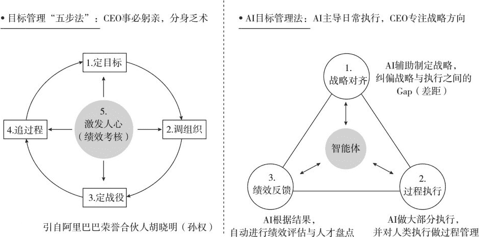

图 6-1 传统的目标管理法 vs.AI 目标管理法

·定目标：与核心团队拍板定下目标。

·调组织：亲自搭建团队、分配资源。

·定战役：将宏大目标拆解为具体的战役。

·追过程：通过无数场会议去追踪每一场战役的进度。

·激发人心：最后花费大量心力进行复杂的绩效考核。

整个过程中，组织的效率被领导者个人的精力上限牢牢锁死。更深层次的问题是，当领导者怀着赋能的心，却依然被困在这个指令式系统里时，失败是必然的。真正的变革，不是要求领导者更努力地去转动这个旧飞轮，而是要彻底砸碎它，构建一个全新的系统。

这次失败，也促使该公司去探索一种全新的管理模式，即图 6-1 右侧的“AI 目标管理法”。该公司致力于设计一个能让团队与 AI 自进化的智能系统，其核心正是领导者角色的根本转变：从“单核 CPU”进化为“系统设计师”。

在这个全新的“AI 三体系统”中，领导者不再是驱动一切的中心，而是这个系统的设计者和培育者。系统的核心驱动力变成智能体。整个系统由三个相互作用的“星体”构成。

战略对齐：领导者的核心任务，不再是下达具体指令，而是提供丰富的上下文。他们通过定义“为什么”（战略意图）和“什么”（核心问题）来确保人类与 AI 的行动都同组织的北极星对齐。如图 6-1 所示，AI 在此环节会辅助制定策略，并纠偏战略与执行之间的差距。

过程执行：绝大部分的执行工作都交给 AI。领导者的角色从“监督进度”转变为“培养手感”，通过复盘来帮助团队建立与 AI 协作的直觉。同时，他们从“亲自决策”转变为“设计决策流程”。如图 6-1 所示，AI 在此环节做大部分执行工作，并对人类执行做过程管理。

绩效反馈：传统的、滞后的、由人进行的绩效考核，被即时的、由 AI 驱动的反馈回路所取代。领导者的任务是设计这个反馈系统，确保它能有效激励那些 AI 无法替代的创造力。如图 6-1 所示，AI 在此环节根据结果，自动进行绩效评估与人才盘点。

这个自进化的智能闭环，不再依赖于一个全知全能的领导者，而是相信一个设计良好的系统，能够让群体智能自下而上地涌现。例如，在战略决策时，CEO 会将“如何提升成交总额”这类问题同时抛给两个不同的 AI 模型进行角逐，然后在 AI 提供的客观分析中，结合人类的商业直觉，做出最终的战略抉择。在这个流程中，AI 负责提供客观分析，而人类负责注入商业智慧、人性关怀和对未来的直觉。

**三、未来领导力的核心：从执行到抉择**

当 AI 将组织的执行效率推向一个前所未有的高度时，领导力的价值重心也随之发生了根本性的范式转移。AI 并没有削弱领导者的重要性，反而对其提出了更高维度的要求。

第一，战略选择的回归。当执行力被拉平时，选择决定一切。AI 正在成为一种普惠性的生产力，它极大地拉平了不同组织之间的执行能力。当开发、运营等的效率和成本趋于同质化时，“如何执行”的优势便不再明显，“选择做什么”则上升为决定成败的根本。这种战略智慧的核心，源于领导者的远见、品位和决断力。当 AI 能提供无限的“怎么做”（How）时，领导者的品位和判断力决定了那个最关键的“做什么”（What）和“为什么做”（Why）。这种远见、品位和决断力是一种根植于深刻行业洞察和人文关怀的综合直觉，是 AI 无法复制的人类智慧的终极体现。

第二，创始人的抉择，即拥有敢于舍弃一切的决断力。领导力的终极考验，在于选择。这场考验往往伴随着创始人深刻的自我认知革命。以某 AIGC 行业头部公司为例，该公司过去试图在 AI、硬件、商业模式上同时创新，导致资源被严重分散。然而，正是从这些困境中吸取的教训，让它逐渐克制住什么都想试的冲动，将所有精力聚焦于核心战场。这场从“加法”到“减法”的战略转变，正是 AI 时代领导力成熟的标志：当执行变得廉价时，领导者最宝贵的价值，不再是开辟新战场的冲劲，而是定义核心战场，并为之舍弃一切的决断力。

第三，领导者要进化为生态设计师。领导者的核心职责，不再是管控一个已知的世界，而是激发团队的主观能动性、想象一个更宏大的未来，并勇敢地做出通往那个未来的、充满不确定性的关键选择。这就是成为“生态设计师”的真正含义：你设计的不是流程，而是可能性；你管理的不是员工，而是整个生态的信念与方向。

**第三节** **组织破局：系统惯性的三大攻坚战**

1967 年，南非外科医生克里斯蒂安·巴纳德（Christiaan Barnard）成功实施了人类第一例心脏移植手术。然而，病人仅仅存活了 18 天。杀死他的，不是手术的失败，而是他身体的免疫系统。这个原本为了保护身体而存在的强大系统，将那颗健康的新心脏，识别为异物，并发起了无情的攻击。

这正是组织变革中系统惯性最真实的写照。当试图为组织植入一颗 AI 的心脏（新的流程、角色、架构）时，最顽固的敌人，往往不是外部的竞争者，而是组织内部那个强大的、为了“维持稳定”而存在的“免疫系统”（旧文化、旧利益格局）。本节，我们将深入探究这场与组织自身免疫系统的艰苦战斗。

当个体开始艰难蜕变，领导力实现跃迁时，一个更庞大、更顽固的劲敌浮出水面——组织本身的系统惯性。一个进化后的“新物种”，很难在一个陈旧的生态系统中存活。如果说人的转型是一场单兵突围，那么组织的转型则是一场更复杂的集团军作战。在向这个庞然大物开战之前，我们必须先像一个军事参谋一样，清晰地绘制出它的作战地图。

一个组织的惯性，主要根植于其三大相互嵌套、深度耦合的核心要素。

·架构：组织的层级、部门墙与汇报线。它定义了权力的归属和信息的流向，是最坚固的“防御工事”。

·角色：组织的岗位、职级与人才。它定义了“谁该做什么”，是惯性得以执行的“最小单元”。

·流程：组织的协作、沟通与决策流程。它决定了信息和资源的流动效率，但也最容易产生“淤积和堵点”。

架构、角色、流程这三大核心要素，共同构成一副禁锢组织变革的枷锁。

而真正让这副“枷锁”变得坚不可摧的，是那个看不见的、贯穿始终的“灵魂”——组织文化。它通过 KPI、激励与晋升机制，像一套底层的“代码”，深刻地塑造着架构、角色和流程的每一个细节，让它们变得难以撼动。

因此，公司的 AI 转型，必须是一场首先直面“文化”这个灵魂，然后动手改造“架构、角色、流程”这副躯体的立体战争。本节将探讨公司如何在这几大战场上，与那些看不见的“幽灵堵点”和根深蒂固的惯性进行艰苦卓绝的战斗。

**一、架构破局：重塑组织架构，消除摩擦力**

公司遇到的第一个，也是最坚固的阻力，来自僵化的组织架构。为此，公司应痛下决心做减法，拆掉部门墙，将组织重塑为“原子小队+能力中心”的“积木型”架构。这场艰难的“组织瘦身”，遵循着一个冰冷但至关重要的原则：我们裁掉的不是“人”，而是流程的节点。

公司的问题不再是“谁的岗位没用了？”，而是“哪些‘能力单元’可以被 AI 更高效地顶替？”这个视角的转变至关重要。它将一个关于“人”的价值判断转变为一个关于“事”的客观分析。

基于这个原则，我们给出了两把精准的手术刀。第一刀划向作为“信息中继站”的节点。在新一代的智能协同系统中，信息可以无损、实时地在决策者与执行者之间流动。因此，那些纯粹扮演“信息二传手”角色的岗位，失去了其存在的根本价值。第二刀划向作为“标准化流程执行器”的节点。大量标准化的工作（如合同审核、权限管理）正在被智能体系统性地接管。因此，那些执行功能可以被 AI 替代的岗位，也必须被重新定义或精简。

这两刀的结果，并非简单的“减员增效”，而是对组织架构的“去节点化”重构。其核心目的，是剔除所有因“信息不流通”和“能力不全面”而产生的“中间层”与“辅助岗”，让价值创造的链条变得更短、更直接。这正是对抗结构惯性的第一场硬仗。

**二、流程破局：优化工作流，提升敏捷度**

当组织的“骨架”（架构）开始重塑时，公司很快便会发现，一场更细微也更顽固的战斗打响了。无数看不见的“流程堵点”潜伏在组织的血管之中，让创新的血液无法顺畅流动。对抗流程的惯性，是转型中最艰巨的战役之一。

这股惯性的力量，体现在那些看得见的、写在制度里的“硬流程”上。一项需要紧急上线的 AI 功能，仅仅因为传统的跨部门审批，就被生生地延迟了数周，导致错失市场良机；一个关键的数据调用请求，也因触碰到“部门墙”的壁垒而被无限期搁置。实践证明，最有效的解法，是用透明的任务上下文来取代僵化的层级审批流。当目标、资源、风险在一个共享的系统中被充分对齐后，授权便可自动下放，无须再依赖漫长的签字链条。

然而，比“硬流程”堵塞更可怕的，是那些看不见的、潜藏在协作关系中的“软流程”的崩溃，即信任与责任的瓦解。转型初期，AI 的“黑盒”特性，使其一度成为推诿责任的最佳“替罪羊”。我们曾反复听见这样的争执，比如设计师抱怨 AI 不懂审美，工程师则反驳：“这是 AI 根据你的指令生成的。”这种因人机责任边界不清而产生的“责任真空”，几乎让敏捷协作寸步难行。

这里的破局没有捷径，唯有回归组织的基本法则。组织内部应明确一条铁律：AI 仅仅是工具，当结果出错时，责任人永远是驾驭它的人。所有的争论，都必须在完整的上下文信息中公开对质，而非相互“甩锅”。对抗流程的惯性，不仅仅需要打通那些看得见的制度关卡，更需要清除那些潜藏在协作关系中的、看不见的信任毒素。

**三、文化破局：培育自驱动与涌现能力**

转型中最顽固的敌人，并非僵化的流程或过时的技术，而是那种弥漫在组织空气中追求稳定、害怕风险的文化惯性。要战胜它，就必须在人心的战场上，点燃一把不可逆转的变革之火。而这场变革的底层操作系统，是一种全新的文化信念。它将“数据优先”写入基因，用事实和证据替代直觉与层级；它信奉“给予上下文而非施加管控”，用赋能替代命令；它坚信“激励而非说教”，用进化环境替代 KPI 考核。

不同的组织选择了不同的“点火”方式。比如某 AIGC 行业头部公司选择了迅捷甚至“歇斯底里”的“休克疗法”。这家公司没有时间进行温和的劝导，而是反复向团队宣告：“这是一个历史性的变革时代，我们选择与相信未来的人同行。”这种“不换思想就换人”的决绝，吸引了转型信徒，也自然地淘汰了无法跟上节奏的人。

然而，对于更庞大、无法轻易“换血”的组织，转型意愿则需要搭配一套更系统地“引导与赋能”的组合拳。

第一步，也是最关键的一步，是点燃“火种”，让“看见”引发“相信”。这粒火种，往往并非来自宏大的顶层设计，而是源于组织内部“真信徒”的个人实践。

在转型的初期，整个组织都笼罩在对智能体的观望和困惑中。而一位运营负责人的内部真实分享，成为点燃变革的第一粒火种。

她没有讲空洞的理论，而是将自己与 AI“缠斗”的经历，毫无保留地摊开在所有人的面前。她展示了如何将 AI 逼成专家：通过与 ChatGPT 进行 260 轮深度对话，把一个通用模型“训练”成一位懂麻省理工学院开源协议的“知识产权律师”，最终解决了一个困扰团队数月的复杂商业谈判；她分享了驾驭 AI 的血泪史：在试用 Genspark 等智能体平台时，如何与一个聪明但爱偷懒的 AI 斗智斗勇，在经历了 27 次修改后，最终让它生成一份完美的数据分析报告；她分享了与 AI 共生的心法，例如如何克服信息焦虑、如何从 AI 尝鲜期过渡到 AI 共生期。

这场分享的力量是巨大的。当团队看到一个身边的战友，已经能如此娴熟地驾驭 AI 来解决真实的、棘手的难题时，这种冲击是真实可触的。它击穿了大家的观望与疑虑，让智能体从一个遥远的技术名词变成人人都可以上手的实用武器，在组织内部点燃了“我也想试试”的好奇心之火。

第二步，将火种引出燎原之势，打造一个令人向往的“AI 特区”。

首先，当“看见”的力量已经被初步点燃时，领导者必须抓住这个时机，优先选择一个最精锐，也最渴望变革的小团队，给予其“特区”级别的授权和资源：豁免所有传统流程，优先使用顶级工具，并对失败给予最高程度的宽容。当“特区”内的“原子小队”用一天的时间就完成过去需要一个季度才能完成的任务时，整个组织对新世界的相信才真正建立起来。

其次，重塑一套清晰的游戏规则，将组织的激励机制从“管控行为”转向“激发探索”。这正是 AI 原生文化中“不要去教导，而要去激励”这一原则的体现。组织的行动最终是由其激励机制塑造的，这也就意味着，管理者必须将资源和认可，明确地向拥抱 AI 的团队和个人倾斜。公司可以将这个新规则直接嵌入日常的工作流。例如，在周报里设立“组织 AI 化”的专项板块，将员工的 AI 实践心得与其个人成长和绩效评估挂钩；同时建立“小数据，快验证”的探索模式，授权团队快速试错，建立对 AI 能力的真实体感。这些机制共同传递了一个清晰的信号：组织奖励的不再是固守旧流程的稳定，而是拥抱新工具的探索。当员工清晰地感知到“不转型就掉队”这个新的生存法则时，意愿的火苗才会被真正点燃。

最后，为所有人提供切实的后援补给，以降低转型的成本与风险。

许多员工并非不愿转型，而是害怕孤军奋战。组织必须提供官方认证的高质量 AI 工具和系统性的培训，让员工认识到转型不是一场个人的冒险，而是一场有组织提供支援的集体战役。

这不仅仅意味着像全球领先的 AI 制药公司阿斯利康那样，通过学习平台（Degreed）提供丰富的学习资源，更意味着在“弹药补给”方面，给予毫不含糊的实际支持。例如有些公司明确规定，为所有成员提供高质量 AI 工具、系统性的培训，报销员工尝试各类 AI 产品的费用，鼓励大家尝试用各类新的 AI 工具，并在每周的产研会议和 TGIF（“感谢上帝，今天是星期五”）会议上分享先进团队与工具的用法以及创新作品。

看似简单的报销政策，背后传递出的信号却是极其强烈的：组织鼓励你去探索，去试错，并且愿意为你所有的“火力侦察”提供支持。

全球领先的电商平台 Shopify 则将这种“后援炮火”的理念推向了极致。它的做法完美诠释了“给予上下文，而非控制”的领导力哲学。它不仅为 AI 工具设定了上不封顶的预算，还要求法务等支持部门将默认选项从“拒绝”转变为“如何促成”。这种自上而下的“开绿灯”文化，才是强大的“炮火支援”，它扫清了员工在探索创新时的所有后顾之忧。

无论是激进的“休克疗法”，还是系统的“引导赋能”，其最终目的都是一致的：在这场人心的战役中，找到并点燃那些真正的“火种”，让它们最终形成燎原之势。

**第四节** **战略破局：在不确定中找准北极星**

当个体的阵痛与组织的重塑交织在一起时，所有的压力、矛盾与希望最终都会汇集到一点上——组织的最高领导者。

他将独自面对一个最根本的战略悖论：当旧地图已经失效，而新大陆尚未浮现时，我们凭什么做决策？如果继续沿用旧世界的标尺（如短期利润、人效比、确定性回报）来衡量 AI 转型，那么每一项投入看起来都是“不划算”的冒险。因为你无法计算“组织敏捷性”的当期价值，也无法量化“决策质量提升”的财务报表。

在无数个充满不确定性的时刻，公司内部必须达成一个残酷但清醒的共识：AI 转型，不是一道关于“计算”的数学题，而是一场关于“生存”的物种选择。在这场进化中，CEO 必须从“精算师”进化为“探险家”，承担起在迷雾中率先开枪的责任。而这第一枪，绝不能是为了追求短期的财务回报，而必须是为了抢占未来的生存生态位。我们需要为组织定义一颗全新的、超越传统增长指标的“北极星”——进化速度。

这种“生存驱动”而非“利润驱动”的战略抉择，在全球顶尖的转型组织中得到了惊人一致的体现。Shopify 明确提出“AI 优先”原则，将 AI 作为默认“同事”嵌入日常决策与开发流程，要求团队在提出新增人力申请前，先证明 AI 无法完成任务，这在成本收缩周期中反而能加速内部智能化改造。微软的 CEO 萨提亚·纳德拉，则将“副驾驶”视为公司级战略，在内部发起“AI for Everyone”（人人 AI）运动。

这些领导者都深刻地认识到，在转型的迷雾中，CEO 最重要的职责，不是计算胜率，而是定义方向。CEO 应通过毫不含糊的资源倾斜和制度保障来告诉整个船队：我们不看今天的风浪，只看明天的航向。基于这个全新的北极星，公司必须面对接下来的两个现实而残酷的战术抉择。

**一、生存抉择：存量与增量的取舍**

转型中，所有非 AI 原生企业面临的第一道战略难题，是如何处理公司的历史包袱。

某 AIGC 行业头部公司现有的 AI 生成内容产品业务，是公司收入的核心。但同时，它必须投入资源去探索代表未来的 AI 原生新业务。公司很快意识到，老业务的开发模式、团队习惯，正在严重拖累新业务的探索速度。

更棘手的是，这场转型恰好发生在首次公开募股（IPO）之后最敏感的时期。该公司既要保证老业务的稳定增长，又要大胆投入，为公司的未来寻找新的增长点。这是一次没有万全之策的艰难抉择。经过反复讨论，公司决定不搞“一刀切”，而是推行“双轨并行”的战略。

第一条轨道是优化老业务，保证现金流。对于现有的、构成公司基本盘的 AIGC 产品线，该公司的策略非常明确，那就是不搞颠覆，只求效率——把 AI 定义为效率工具，通过智能体化一些重复的开发和运营流程，来降低成本、提升人效。这条业务线的唯一使命，就是为公司提供稳定、充足的现金流，支持公司去进行更长远的探索。

第二条轨道是隔离新业务，放手探索未来。对于代表未来的 AI 原生新业务，该公司采取了“彻底隔离”的策略。具体来说，公司剥离了原有的某些硬件业务线，将这部分精锐的人员抽调出来，成立了一个完全独立的“AI 原生特区”。这个特区拥有自己独立的团队、不受旧规则约束的文化，以及全新的技术栈。

这种“隔离”的目的，是确保这个探索未来的小团队，不会被老业务的技术债务和组织惯性所拖累。这类似于亚马逊内部孵化 AWS（Amazon Web Services，亚马逊网络服务）的历程。正是那种近乎完全的独立，才让 AWS 最终成长为一棵参天大树。

**二、制胜之道：规模驱动与速度优先**

该公司在转型中面临的第二道战略难题，是如何面对资源和规模都数倍于自身的行业巨头。在过去的正面战场上，这几乎是一场毫无胜算的战争。

但在今天的 AI 时代，答案是：放弃所有对称竞争的幻想，打一场彻底的“非对称战争”。

该公司唯一拥有的，也是最致命的武器，不在于技术或资本，而在于被 AI 高度赋能的组织本身。巨头们庞大而稳固的“马车车体”、复杂的层级、坚固的部门墙，以及对现有利润的路径依赖，决定了它们即便拥有最强的“F1 引擎”（AI），也无法在旧有的车体上发挥其全部威力。而该公司作为一个更小的、可以被 AI 彻底重塑的组织，最大的差异化优势，就是能比巨头更早、更彻底地成为一个真正的“AI 原生体”。公司赌的，不是在某个单点技术上领先，而是在组织形态上领先一个时代。组织本身就是最深的护城河。

更进一步，该公司甚至认为，在 AI 原生时代，传统的规模优势正在被一种全新的“杠杆效率”所取代。

过去的竞争，是兵力的竞争。一个拥有十万名员工的大公司，就像一个拥有十万名士兵的重甲军团，对千人规模的小公司拥有绝对的碾压优势。

而 AI 的出现，彻底改变了战争的形态。它不再是兵力的直接对抗，而是驾驭“智能武器”能力的对抗。当一个小而美、彻底 AI 原生化的小公司能够让它的 100 名“超级个体”，每人都驾驭 100 个高效的智能体时，这个组织所能调动的“智能战斗单元”总量，将超越那个仅仅将 AI 作为辅助工具、内部依然充满层级内耗的万人军团。

100 名驾驭 AI 的“特种兵”，其有效战斗力将远超一万名各自为战的普通士兵。

这就是 AI 时代赋予小公司的最公平的武器。它奖励的不是规模，而是进化。

**小结** **生命体的“囚徒困境”**

至此，我们走完了这场艰苦卓绝的“构建之旅”。

我们深入地基，为这个新生的 AI 原生组织注入了奔流不息的“数据血液”；我们重塑架构，编织了光速传导的“组织神经网络”；我们更重铸灵魂，为其植入了共生共荣的“文化”。

现在，一个由无数个被 AI 赋能的全栈工程师、敏捷强悍的“原子小队”构成的生命体雏形，已经站在我们面前。它不再是一台冰冷的机器，它开始拥有自己的心跳、神经和意志。

然而，当我们试图让这个充满活力的生命体开始奔跑时，一个新的、更深层次的挑战浮出了水面。

我们在第二篇通过数据喂养、流程解放和文化激励，让每一个原子小队都变成战斗力爆表的特种部队。但当成百上千个这样高能的特种部队汇聚在一起时，我们并没有自动得到一支无敌的军队，反而可能面临一场“系统的失控”。

当“增长小队”为了追求极速，疯狂调用 AI 生成内容时，这是否在透支“品牌小队”积累的信用？当“研发小队”为了快速上线而选择捷径时，这是否给“架构小队”埋下了未来的雷？

个体的极致效率，并不等同于系统的全局最优。相反，在一个由无数极致理性的智能体和超级个体组成的网络中，协作的复杂度和摩擦力正在以指数级的幅度上升。

这正是我们即将面临的新课题：如何将这些强大的“点”编织成一张智慧的“网”？谁来为这个拥有自主心跳的生命体，协调无数局部的冲动，定义一个统一的全局意志？

这个问题，已经超越了“构建”的范畴，进入了“治理”与“协作”的无人区。

在接下来的第三篇中，公司将从“构建者”进化为“生态设计师”。我们将探索如何打造一套全新的操作系统，去驾驭这种指数级增长的复杂性，让组织从“单点极致”走向“生态涌现”。

**第三篇** **未来新生**

在地球生命漫长的演化史上，最令人着迷的时刻并非第一个单细胞的诞生，而是距今 5.4 亿年前的“寒武纪大爆发”。

在此后那短短的 2 000 万年里，地球仿佛被按下了快进键。原本寂静的海洋里，突然涌现出了几乎所有现代动物门类的祖先。生命不再是孤立的、简单的复制，而是开始结成复杂的食物链，演化出精密的神经系统，形成互动频繁的生态网络。科学家至今仍在争论那场爆发的起因，但有一点是确定的：当个体的能力积累到临界点，连接的密度突破阈值时，系统就会发生“相变”。

今天，我们的组织正站在类似的临界点上。

我们在第二篇中打造了锋利的数据利剑，重塑了敏捷的作战小队。然而，仅仅拥有强大的个体是不够的。我们面临的终极挑战是：如何让这些高能的个体，不再是散落的珍珠，而是被编织成一张能够自我感知、自我演化的智能网络？

如果说第二篇是关于“点”的强化，那么本篇则是关于“网”的织造。我们将亲手孵化一个真正的 AI 原生生命体。在这里，领导力不再是机械的指令，而是生态的引力；协作不再是线性的传递，而是智慧的涌现。让我们推开这扇门，去见证属于商业世界的“寒武纪时刻”。

**第七章 协作进化：AI 原生组织操作系统**

早上 9 点，一场 12 人参加的项目周会在冗长的轮流汇报中，耗尽了团队一个小时的宝贵时间，却没有产生任何有效决策。下午 3 点，一个“跨部门专项小组”的飞书群里，艾特所有人的消息刷了屏，文件、表格、看板堆积如山，每个人看起来都“很在线”，但那个最关键的问题却始终没人拍板。

这就是“伪协同”，即一种用“协作的动作”掩盖“协作无能”的组织慢性病。它的根源，在于信息损耗、责任扩散，以及真相在层层转译中的消亡。在传统的人类组织中，这是一种“低效”，尚可容忍。

而当智能体这个不会开会、不懂人情世故、只认代码和数据的“新物种”成为组织的主力时，这种“低效”就将立刻升级为一场彻底的“系统性崩溃”。

想象一下，你该如何“管理”一个由成百上千个智能体与人类工程师组成的“混合军团”？你无法用“开会”来对齐思想。智能体不会听你画饼，它只认代码库里的“单一事实真相”。如果不同的人类工程师向他们的智能体输入了相互冲突的指令，那么你收获的将不是协作，而是一场“代码内战”。你无法用“团建”来建立信任。智能体没有情感，它无法通过一顿烧烤，就理解另一个智能体的设计意图。它们的协作，必须建立在一个 100%透明、无损耗的信息交换协议之上。你无法用“KPI”来监督进度。当成千上万行代码在每小时被自动生成和部署时，传统的“工作量汇报”和“进度审批”变得滑稽可笑。你需要的，不再是“工作汇报”，而是一个能洞悉代码库真相的“上帝视角”。

传统的管理范式，那些建立在“人类社会性”之上的洗脑、团建、汇报、办公室政治，在智能体这个“纯粹理性”的新物种面前，彻底失效了。这也正是 Twitter（推特，现名为 X）前高管在创立 Macroscope（专为开发者和产品负责人设计的 AI 系统）时所预见的未来。他断言，无论 AI 如何强大，最终还是要有人类对产品负责。这意味着，领导者必须拥有一个统一的“感知层”——一个能穿透人机界限、洞悉代码库真相的“上帝视角”理解这个混合军团的所有创造与活动。

这个来自硅谷的宏大拷问，与大多数组织正在经历的“伪协同”微观困境，在此刻交汇。它们共同指向一个迫在眉睫的问题：我们现有的协作工具，无论是 Slack、Teams，还是飞书、钉钉，它们被设计出来的目的，本质上都是优化“人类”之间的沟通。它们是更高效的“会议室”和“文件柜”。

但是，当协作的主体从“一群人”变为“一群人+AI”时，我们需要的，就不再是一个更好的“会议室”，而是一个全新的“协作底板”——一个能够让“人类积木”和“AI 积木”无缝拼接、协同工作的底层操作系统。

这个操作系统必须回答一个核心问题：当协作的主体彻底改变时，我们到底该如何一起“玩耍”？

本章，我们将深入探究这场关于“协作”的终极革命。我们将从“超级个体”的崛起与困境开始，最终揭示一个真正的“AI 原生组织操作系统”的内在机理与灵魂究竟是什么样子的。

**第一节 超级个体试验：从一人战斗到团队扩张**

2023 年，荷兰阿姆斯特丹的一间小公寓里，皮特·莱维尔斯做出了一个极端决定。他厌倦了传统创业的烦琐——组建团队、融资、开会、管理，想知道一个人借助 AI 能走多远。莱维尔斯不再写复杂的代码，而是成为一个“AI 编排者”：让 ChatGPT 构思功能，Midjourney 生成网页图片，智能体生成前端页面。像指挥乐队一样，他调动 AI 这个庞大的“军团”，以一己之力孵化了十二家盈利小公司，年收入超过百万美元，却没有办公室，也没有员工。

莱维尔斯的故事并非孤例。一家位于以色列的“氛围编程”（Vibe Coding）公司 Base44，由 90 后程序员莫尔·什洛莫（Maor Shlomo）独自创办。他没有招聘一名员工，仅靠 AI 自动化流程运营，扣除成本后单月净利润超 18 万美元。更传奇的是，成立仅 6 个月后，这家“一人公司”便被互联网巨头 Wix 以 8 000 万美元的天价收购。一个人，半年时间，创造了近亿元的财富神话。Cal.ai 这家公司的年营收额已达到 1 000 万美元，而缔造这一商业奇迹的，仅仅是 4 位还在上高中的学生。在 AI 的赋能下，年龄与经验不再是不可逾越的鸿沟。

AI 编程领域的 Cursor 在持续重写规则。当它只有 12 名员工时，估值已达 4 亿美元；如今团队仅扩充至 60 人，年收入却已突破 5 亿美元，估值逼近 100 亿美元。它证明了在极高技术密度的领域，几十人的特种部队足以击溃数千人的常规军团。

AI 绘画领域的巨头 Midjourney，其年收入高达惊人的 5 亿美元，影响力遍及全球创意产业。支撑起这个庞大商业帝国的，是一个不足 40 人的微型团队。这意味着其人均年收入超过 1 250 万美元，这一数字是传统科技巨头人效的数十倍，堪称效率的核爆。

从 AI 编排者皮特·莱维尔斯到“一人独角兽”Base44，再到百亿微型巨头 Midjourney……这些案例勾勒出一种颠覆性的组织范式：一个拥有清晰洞察的“灵魂人物”，通过驾驭“AI 放大器”，其创造力正在逼近，甚至超越一个传统的百人、千人公司，如表 7-1 所示。

表 7-1 AI 时代“超级个体”的团队规模与营收对比

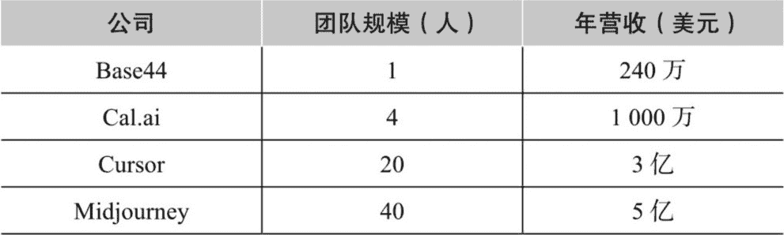

资料来源：Wix 2025 Annual Financial Report，Forbes 30 Under 30 List（2026），Crunchbase Funding Rounds ＆ Insights，and Quantumrun 2025 Global AI Market Research Report。

**一、极限试验：孤独的 48 小时“创世”**

这个激动人心的图景，也曾一度让我们相信，找到了那个关于组织未来的“终极答案”。在中国，一场被行业广泛讨论的极限试验对这一模式进行了最极致的验证。作为出门问问的 CEO，当时李志飞决定亲自下场，验证这一模式的极限程度。

这是一次对传统研发模式的公然“挑衅”，也是 AI 原生组织理念的第一次亲身尝试。恰逢 2025 年端午假期，李志飞把自己关了起来，进行了一场为期 48 小时的极限冲刺。他的目标是：仅凭一人之力，与 AI 协作，从零开始独立开发出一个当时仅是构想中的产品原型——一个专为 AI 原生组织打造的协作平台。按照常规评估，这至少需要一个 20 人的团队，耗时一个月才能完成。

“太慢了。”这是李志飞对旧模式的第一印象。整个过程充满了人与 AI 的博弈和磨合，但最终，“奇迹”发生了。一个人，两天时间，真的跑通了核心流程。当那个内部代号为“虚拟组织”的原型在屏幕上亮起时，在场的所有人都感到了一种震撼：AI 确实赋予了个体以神力。

然而，随之而来的并非全员欢庆，而是幻灭。当李志飞试图将这个原型推向团队使用时，他遭遇了冰冷的一盆水。这个由“超级个体”独自打造的系统，虽然技术逻辑跑通了，但无法融入真实的团队协作流程。它像是一个孤独的玩具，而非一件称手的武器。

这次试验让李志飞从“超级个体”的极限快感中清醒过来，并领悟到一个更深层次的道理：AI 在指数级地放大个体能力的同时，也指数级地放大了协作的难度。

**二、协作的悖论：从游击队到航母群**

这正是“超级个体”浪潮背后的深刻悖论。

单个“超级个体”可以赢得无数场精彩的“游击战”，比如写一个爆款插件、做一个精致的网页、发一系列引爆流量的文章。但在面对那些需要长期演进、高度复杂的战略目标，比如构建一个操作系统、运营一个全球品牌时，单纯依靠“超级个体”的简单堆叠是无效的。我们可以创造出 12 个才华横溢的皮特·莱维尔斯，但这 12 个人如果缺乏有效的连接，那么终究只是一群各自为战的散兵游勇，无法凝聚成一个能攻克复杂堡垒的“航母战斗群”。

因此，未来的组织进化，绝不能止步于培养一个个孤立的“超级个体”。我们需要补齐那块缺失的关键拼图：不仅要有能够敏锐定义问题的超级个体（灵魂人物），还要有能够高效解决问题的原子小队（精干团队），更要有能够规模化解决问题的协作操作系统（连接器）。

我们不仅要让自己进化为超级个体，还要着手构建一个能够承载“人—机—人”复杂协同的“协作系统”。只有通过这个系统，将那些孤立的“微型巨头”编织成一张紧密的智能网络，我们才能真正跨越从个体神话到组织进化的鸿沟。这正是下文将要重点构建的未来蓝图。

**第二节 协作机理：在技能节点中设计高效连接**

面对“超级个体”无法规模化协作的悖论，公司必须打造一套全新的“操作系统”。但一个问题摆在面前：这与我们每天都在使用的飞书、钉钉到底应该有何根本不同？

某 AIGC 行业头部公司在内部的研发过程中，逐渐厘清了这个代际逻辑。飞书，代表了“以人为核心”的协作方式。它的协作主体是“人与人”，AI 只是辅助；它的原子单位是一个“文件”；它的权限管理精细而严密。然而，当智能体成为执行主体时，这一切都被颠覆了。AI 的协作是“批量”的、“跨文件”的。以“文件”为单位的协作模式，瞬间从曾经的精准管理异化为如今的效率枷锁。

因此，AI 原生操作系统协作的原子单位，必须从“文件”跃迁到“项目”；其协作主体，必须是“人+AI”的混合体；其权限范式，必须是“默认开放、极致透明”的。

这不仅仅是功能的差异，更是协作哲学的根本性分野。

**一、断点分析：空间与时间的协作裂缝**

以出门问问为例，早期该公司在研发 AI 编程平台 CodeMonkey 时，经历了“痛不欲生”的过程。团队协作非但没有产生“1+1＞2”的化学反应，反而陷入了巨大的内耗和混乱。问题到底出在哪里？该公司发现，AI 时代的协作崩溃，源于两个最根本维度的断裂：空间的断裂与时间的断裂。

**1．空间断裂：每个人都在“信息孤岛”上玩单机游戏**

尽管每个工程师都手握强大的编码智能体（Coding Agent），但他们的工作模式依然是孤立的。工程师 A 在他的本地电脑上，与他的 AI 进行着“二人世界”的对话式编程；工程师 B 则在另一台电脑上，与他的 AI 进行着另一场对话。他们彼此无法看到对方与 AI 完整的交互上下文，也无法理解对方的设计思路是如何在与 AI 的拉锯中动态形成的。

所谓的“协同”退化成最原始的方式——通过飞书把最终生成的代码片段发给对方。这就像两个戴着 VR 眼镜在元宇宙里建造城市的设计师，只能通过古老的电报来沟通彼此的宏伟蓝图。信息的损耗和误解，在每一个环节都被指数级地放大了。

为什么会出现这种局面？Notion 的 CEO 赵伊万（Ivan Zhao）给出了一个深刻的洞见：“人类充当了胶水。”也就是我们在浏览器标签页之间反复切换，缝合碎片。而程序员之所以是第一批尝到 AI 甜头的人，是因为代码有着天然的“上下文闭环”。出门问问构建 CodeBanana 的初衷，就是为了溶解这种胶水。该公司试图打造一个统一的“上下文容器”，让 AI 不再需要人类去搬运信息，而是直接浸泡在完整的项目语境中，像一个老员工一样思考和行动。

**2．时间断裂：集体智慧无法“同步”指挥 AI**

更深层次的问题是，AI 本身也成为一个个独立的“黑盒子”。公司无法将整个团队的集体智慧，汇聚成一个统一的指令，去指挥一个“超级 AI”来完成复杂的系统性任务。AI 依然是个体的“副驾驶”，而不是团队的“中央 AI 大脑”。

当系统中出现一个横跨前后端的复杂问题时，前端工程师的 AI 和后端工程师的 AI 甚至会给出互相矛盾的解决方案。团队没有形成合力，AI 也没有形成合力。员工就像一群拥有先进个人武器的散兵游勇，无法组成一支协同作战的现代化军队。

**二、核心环节：识别缺失的技能与信息拼图**

在项目复盘会上，一个清晰的结论浮出水面：AI 时代协作的核心，不是赋能孤立的个体，而是连接被赋能的个体。公司真正的瓶颈在于缺乏一个能让“人和人”、“人和 AI”、“AI 和 AI”进行高效、无损信息协作的统一场域。

这个顿悟，让开发产品的核心理念发生了 180 度的转变。出门问问的目标，不再是做一个更好用的个人 AI 编程工具，而是一个支持人与 AI 大规模协作的平台。其背后正是对未来组织肌理的一种构想，这被称为“技能节点经济”。在这种经济模型中，组织不再是由固定的“岗位”组成，而是由无数个可被随时发现、调用和连接的“技能节点”构成。每一个人类专家、每一个智能体，都是一个拥有特定能力的“技能节点”。组织的真正力量，不取决于单个节点的强度，而是取决于节点之间连接的效率和带宽。AI 时代需要的协作工具，是一个能承载“技能节点经济”的底层操作系统——一个高效的、低摩擦的“连接器”。

**三、协作设计：让研发协作像文档协作一样流畅**

这个“连接器”具体是如何运作的？

出门问问借鉴了这个时代伟大的协作产品之一——谷歌协同文档的理念。一起回忆一下，在谷歌协同文档出现之前，我们是如何协作写一份文档的：一个人写完 V1 版本，通过邮件发给另一个人，另一个人在本地将其修改成 V2 版本，再发回来……这个过程充满了版本的混乱、无尽的等待和信息的损耗。谷歌协同文档的革命性在于，它创造了一个统一场域，让所有人可以实时地、并行地在同一份文档上工作，并且所有的修改和评论都即时可见。CodeBanana 要做的，就是让项目团队与 AI 在同一平台上协同，从产品设计到代码实现全都在这一平台上透明沟通，实现类似谷歌协同文档的变革。

如图 7-1 所示，在 CodeBanana 平台上，整体界面布局主要分为三大板块。

右侧的“消息流”：整合了人与人、人与 AI 的所有对话，形成一个统一的、按时间线流动的沟通场域。它分为 Agent 和 Human 两种模式。Agent 模式是人与 Agent 沟通，人输入自然语言描述任务，Agent 则回答问题或执行写代码；Human 模式则类似“微信群”，用于项目成员之间的沟通。

中间的“文件与代码区”：所有创造活动发生的地方。它构成整个协作的“单一信源”。

左侧的“项目文件导航区”：如同组织的目录系统，让团队能在复杂协作中迅速定位信息，而不再依赖层层沟通。

这种“沟通—创造—反馈”三位一体的布局，正是将“内嵌于生产过程的协同”这一理念在产品形态上的最终表达。

其协作机理——“内嵌于生产过程的协同”的理念，具体体现在三个方面。

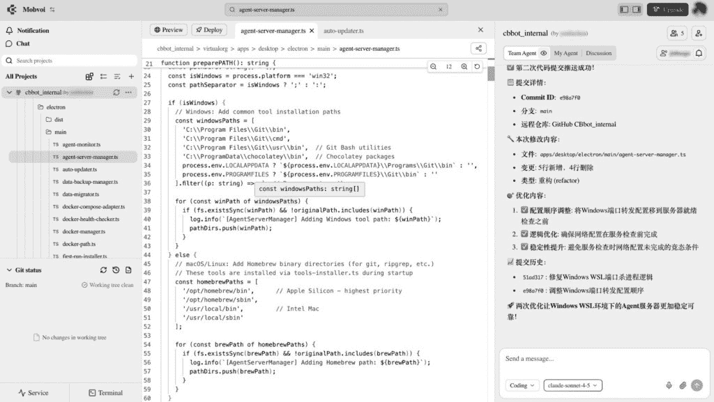

图 7-1 CodeBanana 的界面布局与功能模块

·单一信源：所有的讨论、设计、代码、测试、部署，都发生在 CodeBanana 这个统一的平台上。这彻底消灭了产品需求文档、设计稿、代码库、项目管理工具之间的信息断层。

·实时上下文：负责人直接在 CodeBanana 上看代码，在通过聊天框对一个功能提出修改意见时，相关的产品经理和工程师能立刻看到这个“最高优先级”的指令，以及它所对应的完整代码上下文。信息不再需要通过层层会议来传递，而是精准地、无损地附着在它应该在的地方。

·并发式创造：在 CodeBanana 上，产品经理定义一个新功能，智能体几乎可以同步生成原型代码，而资深工程师则可以一边评审 AI 的代码，一边进行更高层次的架构设计。所有人都在为同一个目标工作，但不再被线性的“上下游”关系束缚。

这种全新的组织肌理，从根本上解决了传统协作工具与实际工作流程严重脱节的问题。它不再是一个游离于生产之外的沟通工具，而是成为生产过程本身。这正是 CodeBanana 运作的真正秘密，也是 AI 原生组织高效协作的底层逻辑。同时这是 CodeBanana 与飞书等传统协作工具的根本性不同之处，它体现在四个维度的代际差异上。

·协作主体：飞书的核心是人与人的协作，AI 作为辅助；而 CodeBanana 的核心，是一群人与 AI 的共同协作，AI 成为主力。

·协作颗粒度：飞书的协作单元是一个文档；而 CodeBanana 的协作单元是一个包含代码、文档、数据的完整项目。

·权限范式：飞书追求精细的权限管控；而 CodeBanana 则追求极致的透明开放。

·驱动方式：飞书本质上仍是文档驱动；而 CodeBanana 则是彻底的原型驱动。

正如前文提到的那样，这不仅仅是功能的差异，更是协作哲学的根本性分野。这一趋势已经得到了市场的验证和共识性认可。我们看到，连曾经以“纯对话”为核心的 ChatGPT，也悄然上线了处理项目和文件的功能；而以“文档”为根基的 Notion，也在其 AI 功能中增加了跨页面的“协作”和“项目管理”属性。这说明，所有的工具都在殊途同归地意识到一个真相：在 AI 时代，孤立的“信息”没有价值，只有被置于完整“项目上下文”中的信息，才能被 AI 真正地理解和赋能。而这正是出门问问从一开始就为 CodeBanana 设计的底层基因。

**第三节** **动态涌现组织：让问题解决者自然成型**

如果说 CodeBanana 的诞生源于一次极限的个体试验，其机理是一种全新的协作网络，那么它能够持续进化、不断变强的引擎，则是一种我们称之为“群体智能”的涌现，以及由此催生的、CEO 与产研团队之间的关系的彻底动态重组。这不仅仅是关于“如何协作”，更是关于“由谁来思考”和“权力属于谁”的根本性变革。

**一、智能体中心：从被动工具到主动伙伴**

如果说 CodeBanana 的机理是一种全新的协作网络，那么驱动这个网络持续进化的引擎，则是协作主体的根本性变革——智能体正在从“被动工具”进化为“主动伙伴”。

传统组织以人为核心，而未来的组织结构将以系统化的智能为中心。这一变革的根本原因在于，新型协作单元具备三种颠覆性的能力：它能够端到端地创造价值，快速生成可操作的原型，不再需要像传统团队那样，依赖多个角色一环接一环地线性传递；它可以处理海量信息，迅速消化和整合大量文档与数据，这是单个个体无法比拟的；它的潜力取决于可获取的上下文范围，毕竟要发挥最大的价值，就必须打破传统组织的权限壁垒，接触全流程、全量的信息。这样的角色进化并非纸上谈兵。在某 AIGC 行业头部公司的一次内部迭代中，他们亲眼见证了这种系统化智能从一个辅助工具，逐步成长为真正可以协作、共同推动项目的“团队伙伴”。

在一次 CodeBanana 的内部迭代中，团队遇到了一个经典的技术难题：为了提升用户体验，需要在用户输入时提供更智能的实时建议，但这又极易引发前端页面的性能问题。按照传统的协作模式，这需要产品经理、前端工程师、后端工程师和算法工程师召开一次漫长的技术评审会。

但在 CodeBanana 上，只是给智能体说明了一个相对开放的任务：“我们需要在不牺牲前端性能的前提下，为用户提供更智能的实时建议。请分析现有架构并提出一个可行方案。”接下来的几个小时，智能体的行为完全超出了团队的预期：

它没有立刻写代码。相反，它首先“阅读”了项目库中所有与前端性能有关的文档、历史代码提交记录，以及过去关于性能优化的讨论。

然后，它“主动提出”了三个备选方案，并用清晰的语言列出了它们的优缺点、预估开发复杂度和潜在风险。方案一是最常规的“前端节流”，方案二是更复杂的“后端预取”，方案三则是一个团队从未想过的、利用 Web Worker 在后台线程进行计算的创新思路。

最后，它艾特团队里对前端性能最有经验的工程师，并提问：“根据你过去在 XX 项目中的实践经验来看，方案三的浏览器兼容性风险是否可控？”

这一刻标志着协作关系的质变：智能体不再是一个“工具”，而是成了一个真正的“团队伙伴”。它利用沉淀的“集体记忆”（项目数据），进行独立的“思考”和“推理”，甚至主动地“组织”团队进行更高效的协作，如图 7-2 所示。

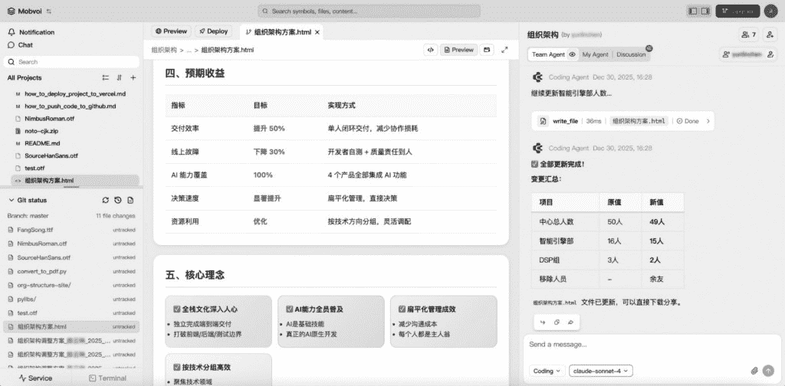

图 7-2 CodeBanana 团队协作界面

这就是“群体智能”的体现——人和 AI 形成一个共生的系统，其整体智慧能够超越任何个体。智能体不再是简单的“执行者”，它已成为整个组织知识网络的“激活者”和“催化剂”。

**二、微型社会设计：建立清晰的运行规则**

要让“群体智能”得以涌现，该公司必须为这个“人机混合”的团队设计一套清晰、无歧义的“运行规则”。这往往是 AI 原生应用在研发过程中付出的最大代价，也是得到的最大教训：设计 AI 原生产品时，理清核心概念和逻辑架构至关重要。

在 CodeBanana 的早期版本中，团队曾一度在最基础的概念上陷入了巨大的混乱。一位工程师的比喻非常形象：“我们现在的系统，就像试图在南京市的地图上，强制执行重庆市的行政规定，完全乱套了。”

核心矛盾在于：成员、项目、聊天室、与组织的关系这四个核心概念的权责边界是模糊的。一个拿着“游客”身份的成员，能否在一个“项目”的“聊天室”里，对属于另一个“组织”的代码进行修改？这个看似绕口令的问题的背后是无数个真实的权限冲突和数据隔离的 bug。

这次混乱让团队明白，设计一个 AI 原生协作平台的首要任务是设计一个“微型社会”的“宪法”。如果底层的“公民权”（成员身份）、“领土边界”（组织）、“议事规则”（项目与聊天）不清晰，那么上层的任何协作都将崩溃。

于是，团队暂停了所有新功能的开发，花了整整一周的时间只做一件事：为 CodeBanana“立宪”。大家激烈地辩论并最终定义了如下功能设计。

·两种组织身份：Own（你创建的组织，拥有最高权限）和 Work（你协作的组织，权限由该组织授予）。

·协作的基本单元：Project，所有代码和核心任务都属于项目。

·沟通的载体：Chat，可以附属于 Project 或独立存在。

·权力的核心：权限跟随 Project，而非 Chat。

这套清晰的“宪法”，成为 CodeBanana 后续所有功能迭代的基石，也让“群体智能”的涌现从混乱变得有序。

**三、领导关系重塑：从管理者到世界观定义者**

在这套全新的协作系统中，最先被颠覆的或许是 CEO。他的角色，从一个传统的“管理者”彻底转变为一个世界观的定义者。他不再关心团队的考勤和 KPI，而是关心这个“微型社会”（公司的协作系统）的“宪法”，即它的核心规则与理念是否公正、优雅且能激发创造力。

这种转变，要求领导者必须深度参与“创造”本身，但又不能陷入执行的泥潭。他不再“发号施令”，他开始“构建原型”。当需要开启一个新功能时，CEO 会亲自下场，用最简单的工具构建出一个粗糙但能表达核心思想的“最小原型”。这并非为了展示技术，而是为了传递他最本质的产品哲学和交互理念。原型，取代了 PPT 和长篇邮件，成为他与团队沟通“世界观”的唯一语言。

当团队对某个核心概念（比如“协作的本质是什么”）产生争议时，他的职责不再是拍板决定“谁对谁错”，而是引导一场关于“规则”本身的思辨，并做出最终的“立法解释”。他像一个“最高法院的法官”，守护着这个微型社会的基本法。

这种全新的领导模式，也倒逼整个团队关系的重塑。“雇佣关系”正在消亡，“共创关系”正在崛起。团队成员不再是被动等待需求下达的“执行者”，他们都成为自己领域的“世界观共建者”。每个人都被要求主动地思考，如何让这个世界的规则更优雅、更高效。随之而来的，是组织架构的必然改变。纯粹的“管理层”正在消失，因为信息传递和任务协调，已经被透明的系统和高效的网络所取代。技术管理者不再是高高在上的“资源协调者”，他们必须回归一线，像一名“首席工匠”一样，亲自参与核心设计，用自己对“世界”的深刻理解来赢得尊重。

CodeBanana 的进化引擎，并非源于更强大的 AI 模型或更精妙的算法，而是源于团队对其内部智能涌现和规则设定的理解。当 AI 成为主动的思考伙伴，协作的宪法被清晰地定义，CEO 和团队的关系从管理与被管理转变为共同定义世界观时，一个能够自我进化的组织才开始拥有它的驱动内核。

**第四节 人机混合团队：敏捷协同作战实战**

CodeBanana 是在 AI 的熔炉中，为一种全新的生产关系所淬炼出的作战范式。

在 AI 时代，创新的速度就是生命线。但 CodeBanana 团队很快发现，单纯提升生产工具（AI Coding）的效率，并不能解决根本问题。如果一个开着法拉利的车队依然行驶在泥泞、拥堵的老路上，那么其速度依然为零。跨部门壁垒、信息不对称和漫长的审批流程，正是这条旧路。

该团队最初的目标很直接：加速。通过减少摩擦、打通权限，将产品从想法到上线的速度提升至极限。实践也初步证明了这一点：研发团队平均效率提升了 4～5 倍，工程师约 80%的时间被从无效的沟通中解放出来，回归创造本身。然而，在一次关于产品的定位会上，一场讨论让团队触及更深刻的本质。

当时，李志飞分享了 Macroscope 这一 AI 管理产品及其理念——用 AI 打造一个“感知层”，让 CEO 能看清一切。他最初的想法是：“Macroscope 的理念和我们很相似，但我们要做得更好，让 CEO 不仅能‘看’，还能直接‘管’。”这个想法在团队中引发了强烈的共鸣。然而，另一种不同的声音也随之出现：“修一条更好的路，车还是那辆旧车。我们有没有可能，去造一辆全新的车？Macroscope 的本质，依然是分离的观察，是为了让人更好地管理。而我们的机会，在于探索一种内嵌的共生。当管理（感知）本身无缝地融入生产（协作）时，它就不再需要被称为管理，它已经成为生产力本身。”

在 CodeBanana 的实践中，最先发生变化的，并不是某个工具或流程，而是组织中那些被视为理所当然的权力结构。当信息能够在一个统一的技术场域无损、实时地流动时，传统意义上的“上传下达”开始显得多余。沟通不再依赖层级，而是直接体现在代码与系统之中。在这样的环境里，代码本身成了真正的权力载体。纯粹以协调、汇报为职责的管理岗位自然失去了存在的基础，技术管理者必须回到一线，用架构能力、问题拆解能力和实际产出来建立影响力，而不是依靠行政权限来推动事情的发生。

随之发生改变的，是工程师的角色形态。过去被严格区分的前端、后端、测试、产品边界开始松动。当 AI 承担了大量标准化、重复性的执行工作后，能够端到端地理解问题、设计方案并交付结果的“全栈型个体”成为组织中最具效率的作战单元。一个人，不再只是流水线上的一环，而是可以独立完成从需求到落地的完整闭环。“个体即团队”不再是一句激进的口号，而是逐渐变成产研日常中的现实状态。

当权力结构被压平、个体能力被放大，变化最直观地体现在时间尺度上。原本需要多轮对齐、反复评审的项目，被压缩进前所未有的短周期内推进。小而精的“原子小队”开始形成一种新的节奏：三天做出可运行的原型，五天完成上线，一周内对外发布。速度不再只是效率指标，而成为一种被共同信奉的价值观，用来检验团队是否真正理解并驾驭了 AI 时代的生产方式。

这种变化并未止步于研发体系。随着 AI 成为组织的通用接口，协作开始自然地越过部门边界蔓延开来。市场人员可以直接向系统询问产品与竞品的差异，销售团队开始借助 AI 分析客户画像、制定更精准的行动策略。曾经用流程和职责划分筑起的“部门墙”，在共创项目的实践中逐渐坍塌。取而代之的，是围绕具体问题快速聚合、快速行动、快速解散的协作方式。组织不再靠结构维持活力，而是被一个个不断点燃的共创项目所驱动。

这次讨论，最终重新定义了需要什么样的 AI 时代协作平台。这个平台必须从根本上承认，未来组织的核心将从人转向 AI。因此，它必须是一个以“AI 任务”为中心的系统。它不仅仅是生产力工具（用 AI 做 AI），更是一种全新的治理范式：在这里，CEO 能直接读懂代码的逻辑，非工程师也能实时看懂研发的进度；在这里，沟通即代码，代码即权力，权力最终回归创造本身。

这背后，是一场深刻的生产关系变革：僵化的层级被彻底扁平化，纯粹的“管理岗”消失，技术管理者必须回归一线。如果说 Macroscope 是在“修路”，那么 CodeBanana 则是在尝试“造车”，并为这辆全新的“自动驾驶汽车”探索一套全新的交通规则。

这才是 CodeBanana 所淬炼出的协同作战范式的目标：它不仅仅追求加速，更追求在一个全新的生产关系下，让颠覆性创新能够持续涌现。

**一、终极战役：为新世界装备新武器**

有了更先进的协作平台后，一个更残酷的现实摆在了面前：如何让一支用惯了旧式武器的军队，心甘情愿地换上这把全新的，甚至还有些“烫手”的利器？答案始于一道不容置疑的指令。

“下个月，我们不再支付 Cursor 的费用。”会议室里，空气凝固。这是一场近乎独裁式的变革，也是一场必要的“灵魂注入”。这背后，是领导者对 AI 原生组织协作范式的偏执信仰：一支要打赢未来战争的军团，必须彻底抛弃旧的武器系统，用全新的方式去思考和战斗。这场由最高指挥官亲自发起的、强制性的“换枪”行动，并非没有阵痛。但它以一种最彻底的方式，将 CodeBanana 从一个“工具”，真正地注入组织的“血液”，成为团队思考、协作和创造的核心“操作系统”。

这或许就是“创造之旅”的要义，创造一个产品只是开始，拥有让整个组织拥抱它的决心和智慧才是变革的里程碑。

**二、新世界生命体征：组织形态进化**

当 CodeBanana 成为组织的操作系统后，一个全新的组织形态开始真实地浮现。它呈现出与过去截然不同的、全新的“生命体征”。

通过以“共创项目”为核心的新协作模式，产研、市场、销售等不同单元可以像蜂群一样，围绕一个共同的目标快速地自组织、协同作战。组织，正在从一个由固化部门构成的“积木集合”，进化为一个高效流动的“神经网络”。

然而，这个高效流动的“神经网络”提出了一个更深层次的、关乎组织存亡的悖论。当每一个“作战单元”都变得前所未有的敏捷和自主，并且权力被彻底下放到组织的每一个“神经末梢”时，一个新的风险也随之浮现：组织如何确保这成千上万个高速运转的“神经元”不会变成一盘散沙？如何避免极致的效率最终导向极致的混乱？当权力被下放，组织变得像一个流动的生命体时，如何确保这个生命体始终朝着同一个方向进化？

这不仅仅是协作方式的变革，更是一场深刻的组织进化。在下一章，我们将推演组织如何成为一个持续进化的生命体。

**第八章** **组织的进化：液态超级组织与人的跃迁**

在上一章，我们见证了一场协作的进化。我们看到，一个全新的“组织操作系统”将孤立的“超级个体”编织成一个高效协同的“混合军团”。然而，这仅仅是故事的序章。当我们把视线从这个操作系统本身移开，去审视它所处的那个更大的未来时，一个更深刻，也更具颠覆性的问题浮出水面：如果协作的规则被彻底重写，那么由协作构成的组织本身的终极形态又将是什么样的？

当温度升高时，固态的冰会融化成液态的水，进而升华为气态的云。分子还是那些分子，但它们的连接方式、运动规律和能量密度却发生了本质的跃迁。水无常形，却能穿透岩石；云无定所，却能覆盖大地。

组织也正在经历这场“相态”的跃迁。传统的公司像“冰”，结构严密，层级分明，但也因此脆弱、僵化。而 AI 时代的超级组织，将像“水”一样。它没有固定的边界，没有永久的部门墙。它根据任务的需求实时流动、渗透、聚合，然后又在任务完成后迅速消散、重组。

当智能体的能力被充分释放，AI 原生操作系统成为组织的能量核心时，这个“液态超级组织”将展现出怎样的生命力？而我们人类，作为这股洪流中的掌舵者，又将迎来怎样一场深刻的身份跃迁？本章，我们将踏上这场关于组织终局与人类未来的思想远征。

**第一节 液态组织：弹性是基础，但不是全部**

当协作的效率趋于极致，组织本身将如何进化？我们还需要传统意义上的公司吗？答案并非组织的消亡，而是一场更深刻的形态革命。组织将从固态的堡垒融解为“液态”的生命体，其核心特征是极致的弹性。传统组织是“固态”的。它们的边界、层级和规模相对固定，就像一座精心建造的金字塔，坚固但笨重。面对市场的瞬息万变，它们调整缓慢，其扩张或收缩都伴随着巨大的成本和摩擦力。

未来的组织，首先将呈现出“液态”的特征。它没有固定的形态，能根据任务的需求，像水一样渗透、变形，扩大或缩小其能力边界。今天它可能是一个解决特定科学难题的百人“研究所”，明天它就能重组成一个负责全球营销战役的万人“军团”。

**一、组织解剖：“同心圆”的核心结构**

要想理解这种形态，最好的现实雏形是美团和滴滴，它们可以被定义为“液态组织 1.0”。这两家公司代表了一种极其特殊的商业形态：它们的内核极小，但外延极大。内部的核心团队负责定义规则、开发算法；外部则通过一套强大的系统指挥着数以百万计的、关系松散的、按需响应的骑手和司机。这种模式的核心，是极致的弹性。

从美团和滴滴的雏形中，我们可以提炼出一种“液态超级组织”的核心结构模型。它不再是自上而下的“金字塔”，而是一个由强大的协作操作系统所连接的“同心圆”结构，如图 8-1 所示。

**圆心：组织的智慧核心。**这是组织的“大脑”，它是一个极其精干的，由少数顶尖的战略家、系统设计师和价值定义者组成的“小核心”。这些人员的职责不再是管理员工或执行任务，而是定义整个系统的“北极星指标”、制定游戏规则、处理关键异常，并为系统注入价值观。他们是设定航向的船长，而不是奋力划桨的水手。

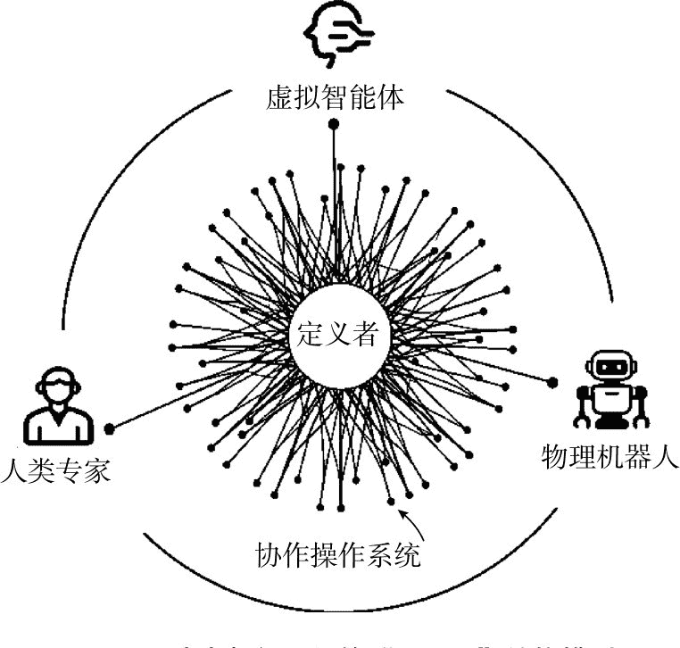

图 8-1 液态超级组织的“同心圆”结构模型

**外环：组织的资源网络。**这是组织的“身体”和“手脚”，它是一个由海量的、异构的、可按需调用的生产力单元组成的庞大网络。在美团和滴滴的模式中，这个网络主要由人类劳动力构成。而在未来的超级组织中，它将进化为一个包含虚拟智能体、物理机器人和人类专家的混合云。

**连接层：协作操作系统。**这是连接“圆心”与“外环”的唯一杠杆和中枢神经，它负责将“定义者”的战略意图，转化为对“资源网络”中无数个节点的精准调度、任务匹配、过程监控和价值分配，确保这个庞大的液态组织能高效地、有序地运转。

美团和滴滴的革命性在于，它们证明了一个极小的“定义者”核心可以通过一个强大的操作系统去撬动一个比自身大数万倍的社会化网络，创造出千亿美元级别的价值。很多人将其简单归结为“外包模式”，这其实是一种深刻的误解。

传统外包是企业间的、长周期的合作，是将内部的一个“固态部门”替换为外部的另一个“固态部门”。而美团、滴滴的模式的本质是一种被智能系统极致放大的“劳动力众包”。它们成功的秘密在于，创造了一个强大的“协作操作系统”。这个系统，能将一个宏大的任务（如满足全城的出行需求）实时地、原子化地拆解成数百万个微型任务（一次出行），并将其精准地、动态地匹配给网络中最合适的独立执行单元（一位司机）。

这是一种全新的组织范式，组织不再需要“拥有”劳动力，而是可以按需、弹性地“调用”一个被智能系统高效编排的社会化劳动力。这正是“液态超级组织”得以实现的核心基础。

**二、场景验证：从虚拟世界到物理世界**

这种“液态”的调度能力，不仅仅出现在虚拟世界，更深刻地重塑着物理世界。

在虚拟世界，GitHub Copilot（AI 编程助手）本质上就是一个“编程能力的滴滴”。当开发者输入一段注释时，其背后的系统便在由人类历史上几乎所有公开代码构成的庞大“运力网络”中进行检索、匹配和重组，然后“派单”生成最可能满足需求的解决方案。

而在物理世界，这种变革更为震撼。让我们做一个思想实验：构想一个名为 Chrono 的未来智能手表品牌。

在传统模式下，这是一个需要自建庞大工厂和物流体系的重资产帝国。但在液态组织范式下，Chrono 的核心团队可能仅有 10 人。他们是这个庞大物理帝国的“隐形大脑”。

当一位东京用户点击“定制下单”时，一场实体经济的“滴滴派单”便开始了。订单指令不经过层层审批，直接进入 Chrono 的协作操作系统。该系统立即在全球“制造能力网络”中进行匹配：位于越南的“共享工厂 A”有空闲产线，但无法加工罕见材质；位于德国的“精密工坊 B”成本稍高，但其机器人刚刚升级了相关技能。该系统瞬间做出最优决策，将生产任务“派单”给了德国工坊 B。

随后，工坊内的智能体驱动机械臂完成生产，无人机接力完成配送。Chrono 团队自始至终没有拥有任何一间厂房，却通过调度全球闲置产能完成一次精密的物理交付。

这就是从“拥有生产力”到“调度生产力”的范式重构。无论是代码还是原子，在液态组织的眼中，本质上都是可被按需调用的“资源流”。

**三、运行法则：驱动液态网络的三大定律**

如果美团、滴滴撬动的是效率、体力和工作时长都有限的人类劳动力，那么当我们可以通过操作系统去调度的资源，变成效率更高、成本更低、7×24 小时工作、数量近乎无限的虚拟智能体和物理机器人时，这个模型的能量将被指数级放大。

一个由十位顶尖战略家和系统设计师组成的“圆心”，通过驾驭一个先进的协作操作系统，调度着全球数百万台机器人和数千万个智能体去完成从新药研发到太空探索的任何宏大任务——这样一个“十人团队，创造万亿美元价值”的“超级组织”图景，不再是科幻畅想，而是技术演进的必然结果。这背后，遵循着三条不可逆转的核心定律。

第一定律，是规模弹性。组织的规模不再由“人力”定义，而由其能调度的“算力”定义，增长的天花板被彻底打开。

第二定律，是架构液态。固定的“部门墙”被溶解，组织化身为一个围绕“任务池”动态聚合与解散的协作网络。

第三定律，是边界消融。企业的“围墙”最终蒸发，组织演变为一个通过协议连接内外部资源的、无远弗届的“生态网络”。

然而，我们必须清醒地认识到：液态组织仅仅解决了“弹性”的问题，它依然是一个由中央大脑强控制的系统。骑手是被动执行指令的“手脚”，并没有产生新的智慧。这只是“体力的极致外包”，而非“智力的自发涌现”。未来的组织，显然不能止步于此，而是需要从“液态”继续进化，迈向一个更高级的形态——涌现型组织。

**第二节 涌现型组织：群体智慧的诞生**

如果说“液态组织”是组织进化的中继站，解决了“资源弹性”的问题，那么“涌现型组织”则是进化的终局，它将解决更本质的“智力爆发”问题。

在滴滴模式中，中央大脑虽然强大，但依然是一种“强控制”的逻辑。骑手是被动接收指令的末梢，他们无法自行决定路线，更无法通过彼此协作创造出新的商业模式。这依然是工业时代“命令与控制”思维在数字世界的延续。

但在 AI 原生时代，我们需要的不是更快的滴滴，而是能让成千上万个智能体和人类专家像神经元一样通过自由碰撞产生新思想的“大脑”。对于这种形态，我们称之为“涌现型组织”。

**一、核心定义：什么是涌现？**

正如凯文·凯利在《失控》中所描述的那样，无数只简单的蜜蜂，在没有中央指挥的情况下，通过简单的局部互动，却能建造出结构精密的蜂巢，并展现出寻找花蜜、抵御外敌的集体智慧。这就是“涌现”：简单的个体通过简单的规则，自发产生复杂的、高级的智能行为。在涌现型组织中，不再有一个全知全能的 CEO 通过系统下发每一道指令。相反，组织只设定一个“北极星目标”（如最大化用户价值）和一套“基础协作协议”（宪法）。成千上万个智能体和人类专家，基于这套协议自主组队、自主研发、自主营销。

**二、组织架构：创智人才+硅基员工**

这种组织的内部结构是什么样的？曾鸣教授给出了一个极其精准的画像，未来的组织将呈现清晰的两层架构：1%的创智人才+99%的硅基员工。

创智人才是组织的“碳基大脑”。他们不再负责具体的执行，甚至不再负责具体的管理。他们的核心职责是“元认知”——定义问题的本质、设计系统的规则，以及在关键时刻进行伦理和价值的裁决。硅基员工是组织的“硅基军团”。它们不仅仅是辅助工具，更是能够独立上岗、对结果负责的智能体。它们 7×24 小时不间断地运行，承载了组织绝大部分的认知负荷。

正如曾鸣教授所言：“我们正在见证一种全新的职场物种大爆发。未来的超级组织，将不再是几万名人类员工的堆叠，而是一个极简的‘碳基大脑’指挥着庞大的‘硅基军团’。”

**三、竞争壁垒：黑洞效应**

当一个组织进化为“涌现型组织”后，它的竞争优势将不再源于“经验的积累”或“规模的红利”，而是源于一种可怕的物理现象——“黑洞效应”。

在旧世界，企业的护城河是靠时间堆出来的经验壁垒。但在 AI 原生时代，护城河变成“知识的吞噬能力”。

当涌现型组织中的每一位硅基员工都在独立上岗，并在业务闭环中实时汲取数据、优化算法时，它实际上是在制造一个“认知黑洞”。它吸收的私有知识越多，它的引力就越大，进而吸入更多的数据和场景，形成一个自我强化的超级循环。

这种进化速度是指数级的。一旦越过临界点，它将把所有仍停留在“线性增长”阶段的竞争对手远远甩在视界之外，形成降维打击的优势。

**四、终局推演：无人公司的诞生**

让我们推演一下这种进化的极致形态：“无人公司”。

这并非意味着完全没有人，而是指“无人管理”。在一个高度成熟的涌现型组织中，战略不再是自上而下的规划，而是从无数个智能体的试错中自下而上“长”出来的；产品不再是产品经理的灵光一闪，而是由 AI 根据实时数据自动生成的；甚至连招聘（调用算力）、财务（分配资源）、法务（合规审核）都由智能合约自动完成。

人类作为这个系统的“造物主”，只需要坐在控制台前，注视着这个由代码和数据构成的生命体在商业的丛林中自我繁衍、自我进化。这才是组织进化的终极奥义。

**第三节 人类跃迁：从执行者到定义者**

当虚拟世界的代码由智能体编写，物理世界的产品由机器人制造时，在这个宏大的自动化系统中，人类的位置究竟在哪里？答案并不是被无情地边缘化，而是一场深刻的角色跃迁。我们正处在一个伟大转变的前夜，人类将集体从奋力划动船桨的“划桨手”进化为站在船头设定航向的“掌舵人”。

**一、角色的“三位一体”：设计师、指挥官与伦理官**

在这个由 AI 和机器人构成的高效执行网络之上，人类的价值将聚焦于几个无可替代的核心领域，它们共同构成未来知识工作者的“三位一体”——一个融合了设计师、指挥官与伦理官的全新角色。

首先，人类将是最终的“设计师”。在知识工作的“美团模式”里，AI 可以生成一万张海报，但哪一张最能触动人心？在实体经济的“滴滴模式”里，AI 可以提供一千种产品设计方案，但哪一种最符合人类的美学与情感需求？AI 负责提供无限个选项，而人类负责做出最终的选择。这种选择的背后，是无法被量化的审美、品位、直觉和对人性的深刻洞察。我们将成为最终的“首席产品官”和“首席体验官”，为冰冷的技术注入温暖的灵魂和独特的风格。

其次，人类是整个系统的“定义者”。协作操作系统本身不会凭空产生目标。向 AI 下达“策划一场全球发布会”或“设计一款智能手表”这些高级指令的，始终是人类。我们的智慧将更多地体现在“提问”而非“解答”上，核心工作是定义正确的问题、设定清晰的目标、划定明确的边界和规则。我们不再是棋盘上的棋子，而是进化为制定游戏规则并指挥全局的“棋手”。驾驭和编排由无数个智能体和机器人组成的复杂系统的能力，将成为最核心的领导力。

最后，也是最不可或缺的，人类是终极的“伦理官”。当 AI 系统做出可能涉及偏见、隐私或安全的决策时，谁来仲裁？当自动化生产和物流网络出现意外，造成损失时，谁来承担最终责任？答案只能是人类。决策链的顶端，必须有一个具备同理心、伦理观和社会责任感的人类存在。我们将成为 AI 时代的“最终解释者”和“道德刹车片”，确保这股强大的技术力量始终服务于人类的长远福祉，而不是走向失控。

**二、竞争的本质：驾驭系统的“驾驶员差异”**

然而，当所有组织都由“掌舵人”领导，都拥有了强大的 AI 执行网络时，它们都会变得一样强大吗？恰恰相反，组织间的差距可能会被前所未有地拉大。

正如所有人都拥有相同的赛车，但 F1 冠军与普通司机的表现天壤之别。在未来，工具（AI 和机器人）与资源（众包网络）将变得像水、电一样唾手可得且成本低廉，唯一的、决定性的变量在于“驾驶员”，即那个“掌舵人”核心团队驾驭整个系统的能力。

一个残酷的现实推演是：同样的十人团队，同样配备了顶级的协作操作系统，其结果可能天差地别。平庸的团队，因为缺乏系统思维而给出的指令模糊不清，并且设计的规则漏洞百出，导致数百万个智能体陷入混乱的死循环，最终只能创造有限的价值；而卓越的团队，因为拥有深厚的“全栈理解力”和极高的“审美品位”，能像编程一样构建组织，像指挥交响乐一样调度资源，最终撬动一个庞大的价值帝国。

这就是未来竞争的真相：并不是 AI 淘汰了人，而是“会驾驭 AI 系统的人”淘汰了“不会驾驭的人”。人类的价值，正从“贡献时间”的线性积累，转向“贡献智慧”的指数级放大。

然而，我们必须承认，组织的进化将伴随着结构性失业的阵痛、教育体系重塑的艰难、全球治理规则的博弈，甚至一场深刻的社会心理危机。

**三、价值的重估：从贡献时间到贡献认知**

这场角色的转变，本质上是一场个人在组织内价值体现方式的根本性跃迁。过去，人的价值与“贡献时间”强相关；而在新世界，它将与“贡献智慧”强相关。这揭示了一个深刻的法则：你所处的认知维度决定了你在 AI 时代的商业价值。

我们可以将认知能力划分为三个阶段：工业时代的“具象化认知”（驾驭确定性）、数字时代的“系统化认知”（驾驭复杂网络），以及 AI 时代的“元认知”（驾驭“思考本身”）。福特的流水线是第一阶段的产物；互联网公司的 OKR 是第二阶段的镜像；而 SpaceX 用 AI 模拟器进行“思想预演”，则是第三阶段的极致体现。

这三个阶段的进化清晰地揭示，未来的组织竞争本质上是创始团队认知维度的竞争。正如我们在产品开发的前沿所看到的，在 Cursor 的团队中，随着 AI 让角色边界模糊，所有人都在向“完整创作者”进化。

当一家公司可以从十万人缩减为十人时，这十个人的每一个念头、每一次决策、每一次审美判断都会通过协作操作系统被放大一万倍。人类的认知、品位、想象力从未像今天这样，可以如此直接、如此低损耗地转化为巨大的商业影响力。未来的竞争，不再是比拼谁的员工更多、谁的厂房更大，而是“定义问题的能力”与“构建系统的智慧”之争。这正是商业的终局。

**第四节 文明跃迁：组织进化是人类的认知镜像**

我们从一个“新物种”的诞生开始，经历了组织的“转型之旅”，并最终推演出“液态超级组织”的未来图景。然而，这场变革的涟漪绝不会止于组织的边界。

人类文明的进程，始终由工具、组织与认知三者构成的“递归循环”所驱动。今天，智能体作为一种前所未有的“递归工具”，正将这个循环推向一个全新的能级。我们正从“塑造工具”的时代，步入一个“与工具共同进化”的“递归纪元”。在这个新纪元，智能体与它所催生的“液态超级组织”，将从三个层面重构我们的文明底座。

首先是经济基础的颠覆。人类文明数千年来的所有社会结构，都建立在“稀缺性”这一基石之上。而当一个“十人团队创造万亿价值”成为可能，生产力被极致放大时，我们将在人类历史上第一次从“稀缺社会”迈入“丰裕社会”。这带来的影响是颠覆性的，“工作”将不再是大多数人获取生存资料的唯一手段，这直接抽掉了现代社会最核心的支柱。

其次是社会结构的溶解。当“工作”这根主轴被抽离时，整个社会结构都将随之重构。我们将从一个以“职业”来定义身份的社会，转向一个以“社群”来定义身份的社会。家庭、邻里、兴趣社群这些在工业时代被边缘化的社会单元，将重新成为个体获取归属感、认同感和幸福感的核心来源。

最后，也是最根本的，是个体存在意义的追寻。我们将被迫回归最本质的哲学追问，这标志着人类文明的核心议题将完成一次伟大的跃迁——从“生存问题”转向“意义问题”。

少数“掌舵人”将从“生产美”进化到“定义美”；而更广泛的大众将从“为了生存而劳作”转变为“为了体验而生活”。探索世界、终身学习、深度社交、参与微观创造……这些在过去被视为“奢侈品”的活动，将成为未来社会的主流生活方式。一个人的价值，将不再由他的生产力或财富来衡量，而是由他生命体验的宽度、思想探索的深度以及情感连接的强度来定义。

然而，我们并非被动地驶向这个未来。在“递归纪元”的门口，我们手握选择的权利。是放任技术与组织的递归进化，让人类从“掌舵者”沦为“附属品”，还是清醒地认识到，真正的递归最终必须是人类自身认知与智慧的递归？

这要求我们完成一场深刻的自我进化，掌握三种核心能力：理解并设计复杂自适应系统的“系统智慧”；在不确定性中进行价值判断与意义赋予的“哲思能力”；以及与异质智能协作、共情并构建共同未来的“共生心智”。

这或许就是智能体和液态组织带给人类文明最宝贵的礼物。它们不仅仅是生产力的放大器，更是一面“镜子”，映照出我们认知能力的进化；它也是一个“解放者”，将我们从数万年的生存焦虑中解放出来，让我们第一次作为一个物种得以集体地、自由地去追问和创造我们存在的终极意义。

智能体与组织的进化，最终映照出的是人类的面貌与选择。它向我们发出了一份庄严的邀请，不再满足于做世界的征服者，而是成长为未来复杂性的驾驭者，与所有智能共同谱写文明的下一个篇章。

从组织的形态革命出发，我们最终抵达的却是文明的重塑与个体的解放。这正是我们这个时代最伟大的冒险。

**小结 新世界的海岸线与暗礁**

我们从一个关于未来协作的问题出发，似乎已经瞥见了新世界那蜿蜒的地平线。

首先，AI 时代最主流的组织形态，将是一种“小核心+大网络”的“超级组织”。它的力量，源于一场从内部人力的“能力叠加”，转向对外部社会化资源“杠杆式撬动”的协作革命。

其次，随着组织的进化，人类自身会实现终极跃迁。我们正从亲力亲为的执行者升维为整个系统的设计师、价值的定义者与伦理的守门人。

这片大陆的景象无疑激动人心，它预示着一个生产力极大解放、人类价值得以升华的新纪元。然而，任何未被探索的航道，其平静的海面下都必然潜藏着危险的暗礁。我们必须正视这场组织进化的 B 面——它对社会结构带来的剧烈冲击。

正如 Anthropic 的 CEO 达里奥·阿莫代（Dario Amodei）的严峻警告：未来数年内，AI 可能淘汰掉一半的初级白领岗位。当一个资深员工配合 AI 就能完成过去需要一个新人和他共同完成的工作时，企业的经济账再明白不过。我们正在目睹，入门级岗位悄然消失，整整一代年轻人正面临“没有经验就没有工作，没有工作就无法获得经验”的恶性循环。

这正是“超级组织”高效模式残酷的另一面：当一个十人团队就能撬动万亿价值时，那剩下的人呢？阿莫代描绘的那幅“经济增长 10%，但失业率增长 20%”的矛盾图景，并非危言耸听，而是我们必须为之准备的、近在眼前的“激流险滩”。

因此，组织的进化最终指向的，不仅仅是人类自身的进化，更是一场对社会契约的深刻拷问。我们无法将社会命运完全寄托于少数科技公司的良知。作为这场变革的亲历者与创造者，我们不仅仅要思考“如何构建一个更强大的组织”，更必须回答“如何构建一个更具包容性的未来”。面对这希望与隐忧并存的挑战，我们进一步思考的是秉持怎样的信念，去迈出通往未来的一步。

# **结语**

“环境变化得太快，只有自我革命的组织才能生存。”

——拉里·E.格雷纳（Larry E.Greiner），1967 年

随着对文明跃迁的展望，我们的思想远征也渐近终点。现在，让我们收回目光，回到当下。

本书不仅仅是对未来的眺望，更是我们在这场变革的战壕里，为自己绘制的一张战地地图，也是一套融合了诸多前沿公司实践成果的行动框架。

书中记录了我们如何从赋能个体的天真坠入“整体内耗”的现实，如何从对超级个体的迷信走向对“协作系统”的构建，以及如何在“开飞机换引擎”的高空，做出那些关乎生死的战略抉择。回顾这段仍在进行中的转型之路，我们只是比别人更早地走进了这片“深水区”，并有幸带着一些故事和伤疤，回到篝火旁，把火种分享给更多同行者。

如果要将这场远征的所有教训浓缩成一张可以传递的地图，那么它或许不是一套复杂的理论模型，而是十条生存经验和信念，这也是我们对未来组织最坚定的判断。

**一、新物种定义：AI 不再是工具，而是组织的执行主体**

这是一切组织演化的逻辑基石，也是一切变革的唯一前提。过去，AI 是辅助人类的副驾驶；现在，AI 是能够闭环完成“感知—规划—行动—反馈”的智能体。在这场权力交接中，人类从操作者退后为设计者与监督者，AI 则从辅助者上升为执行者。因此，一切组织变革的起点，都必须基于“假设这个任务默认由 AI 执行”来重新设计，而非“派个人去干，顺便用 AI”。

**二、增长范式革命：组织“大折叠”**

既然 AI 是可被无限复制的执行主体，工业时代的“产出=人力数量相加”的“加法法则”便已失效，AI 时代的“乘法法则”开始占上风。因此，为了管理庞大执行层而建立的金字塔结构，以及作为信息中继站的中层管理，瞬间失去了存在的经济学基础。组织必须停止以人头数作为增长指标，坚决进行“大折叠”，切除所有“隔热层”，让组织坍缩为“大脑+触手”的扁平网络。

**三、数据基建目标：从“给人看”转向“给 AI 看”**

AI 的执行依赖数据，但它需要的不是给人看的结果报表，而是包含过程细节的“行动燃料”。过去的数据是“纪念碑”，现在的数据是“血液”。因此，数据基建的头号任务必须从服务人转向服务 AI，打破数据孤岛，治理“暗数据”，建立唯一的“事实真相源”，为 AI 这个“超级大脑”提供源源不断的“养料”。

**四、工作流重构：从文档接力转向原型驱动**

传统协作是产品经理写文档、工程师写代码的“线性接力赛”，信息损耗巨大。AI 的出现，让“生成成本”低于“描述成本”。因此，组织必须废除烦琐的文档流程，推行“原型即共识”，让“活的原型”取代“死的文档”成为团队沟通的唯一语言，从而实现即刻反馈，闭环交付。

**五、角色进化：系统设计师与全栈工程师**

当 AI 接管了 90%的“零件”式执行工作时，所有处于中间态的“螺丝钉”工种都将被淘汰。人类的价值，不可避免地向两极迁移：一端是定义问题、设计系统的“系统设计师”；另一端，则是驾驭 AI 完成端到端交付的“全栈工程师”，负责全面培养员工的全栈能力和指挥能力。

**六、最小作战单元：“原子小队”取代“部门墙”**

既然单兵（人类+AI）的作战能力已呈指数级提升，那么为管理人而设计的庞大“部门墙”就成了敏捷性的“监狱”。AI 时代最高效的组织单元，是“原子小队”（例如：1 个产品+1 个全栈开发+N 个智能体）。行动的策略是打破固定部门墙，按任务动态组建“原子小队”，任务来时聚沙成塔，任务结束后散作满天星。

**七、文化重塑：从“管控”转向“涌现”**

你无法用管人的 KPI 去“管控”一个 AI 的创新。面对不确定性，“管控思维”只会扼杀所有的可能性。组织必须建立“对齐（目标）、激励（反馈）、涌现（创新）”的新文化。领导者要完成从“指令下达者”到“生态园丁”的角色转变：提供充分的上下文，制定清晰的底线规则，然后授权一线和 AI 自发涌现出最优解。

**八、领导力跃迁：从“CEO”到“首席定义官”**

当组织的“执行”按钮越来越多地交到 AI 的手中时，CEO 的价值正在被重新定义。如果管理“执行”不再是其核心工作，那么领导力便从一种“管理能力”回归为一种更本质的“思想能力”。在 AI 原生组织中，CEO 必须完成一次深刻的角色跃迁——从 CEO 进化为首席定义官。其核心工作不再是做出所有战术决策，而是为组织定义那些 AI 无法回答的根本性问题：定义“北极星”（为何而战的使命），定义审美与品位（做出卓越的最终抉择），以及定义伦理与底线（为 AI 制定不可逾越的宪法）。

**九、协作操作系统：打造“中枢神经”**

“超级个体”的崛起，带来了“人—机—人”协同的全新难题。为了防止陷入“囚徒困境”，组织必须构建一个统一的协作操作系统。在这个平台上，所有指令、代码、反馈都完全透明，代码即权力，平台即组织。它将成为连接所有“神经元”（人与 AI）的“中枢神经系统”。

**十、终极形态：成为液态超级组织**

当组织的执行主体是 AI，外部是可调用的全球网络时，组织的终极形态将呈现为“同心圆”结构：极小的智慧核心（定义者）+极大的资源网络（智能体和机器人）。企业不再需要拥有大量的劳动力，而是要建立调度全球智力的能力。组织将像水一样，根据任务弹性来伸缩。

在 AI 重塑一切的今天，几乎每家企业都在谈组织变革，而且几乎每家企业、每个人都在历经变化。新的组织结构、流程再造、AI 赋能方案层出不穷，现实却是变革的成功率依然徘徊在低位。

如何才能成功实施组织变革？组织真正改变的规律究竟是什么？变革的关键，在于战略、文化，还是人性与权力的博弈？

哈佛商学院教授拉里·格雷纳早在 1967 年，那个 IBM 大型机刚刚兴起的信息化变革前夜，就已深刻地揭示了组织变革成功的核心规律。成功的变革，本质上是一场权力结构的重新分配。

格雷纳提出了一个完整的组织变革逻辑框架。它不是在讲怎么改结构，而是在讲组织如何在压力下觉醒、重新分配权力、形成共创机制。

而管理者对组织变革的理解，也正在从“演进式”向“革命式”发生根本性转变。“演进式”视变革为一系列微小的、被动的延续性调整，组织会随着时间的推移和环境的变化而缓慢修正，这种思维带着“时间会解决问题”的乐观与惯性；而在“革命式”中，面对快速变化的环境和内部停滞时，管理者不再等待外部力量，必须主动出击，通过自身的结构、行为、文化的系统性重塑来实现跃迁。

“环境变化得太快，只有自我革命的组织才能生存。”在今天看来，这一判断几乎预示了 AI 时代的管理挑战。从数字化浪潮到生成式 AI 革命，每一次技术范式的跃迁都在迫使企业告别“修修补补”的演进思维，转向“快速试错与系统再造”的革命逻辑。变革的催化剂，是强烈的内外压力。这种痛感也是打破管理者心理舒适区唯一的力量。这也解释了为什么我们的变革始于整体内耗的痛苦和“开飞机换引擎”的焦虑，直到今天感受到的“压力、觉醒、试验、强化”，都只是重新走了一遍那条早已被经典理论预言的、通往成功的唯一路径。

进化是生物界的机制。正如达尔文所说：“存活下来的物种，并不是最聪明的，也不是最强壮的，而是最能适应环境变化的物种。”同样，有生命力的 AI 系统，恐怕不是规模化法则造就的、巨大规模的大模型，而是能够感知环境反馈，再自我进化，能解决实际问题的 AI 系统。

技术会变，工具会变，但组织变革的本质——一场关乎权力、人性与共同进化的艰难旅程——从未改变。我们今天面临的挑战，只是因为 AI 这股力量过于强大，这场权力重构变得比以往任何时候都更迅猛，也更残酷。

然而，我们必须再次强调，本书并非一套放之四海而皆准的成功公式。我们坦陈，每一个组织都背负着自己独特的历史包袱。我们分享的不是一张“标准地图”，而是一些“制图工具”，希望它们能帮助你绘制出属于你自己的航海图。

打通数据、重塑流程、进化文化，或许都只是在为一个未来形态做准备：一个由无数个超级个体和智能体组成的、流动的、无边界的价值创造网络。它不再像是一座固化的“金字塔”，而更像是一块无处不在却又无形的“菌丝体”，或者一个由无数发光节点构成的、不断膨胀的“创造星云”。未来的组织或许是无形的组织。

回望历史，每一次生产力的变革，都必然伴随着生产关系的彻底重构。蒸汽机催生了工厂，电力和流水线定义了公司，互联网孕育了平台。而今天，AI 这个全新的、能够进行“智力劳动”的生产力，将催生出怎样的生产关系？答案或许就藏在我们今天所经历的一切之中：组织的剧烈阵痛、旧角色的无声消亡，以及新物种的破壳诞生。

当我们沿着这条路走到尽头，一个更值得深思的图景浮现出来：我们以为自己在构建 AI，但事实是，AI 正在反向重构我们的世界。它不仅改变了工具、组织和个人，还会重塑文明协作的底层逻辑。历史告诉我们，每一次文明重启的实质都是一次“系统性进化”。从口语到文字，文明开始拥有记忆；从纸张到印刷术，知识得以大规模传播；从工业到互联网，全球协作塑造了今日世界。

而今天，我们正站在下一次操作系统重启的临界点。AI，是这场重启的根代码；AI 原生组织，是它的引导装置；超级个体，是它的系统入口。

在这个新系统中，秩序不再依靠管控，而是依靠协议自组织地“涌现”。组织不再是僵化的结构，而是一个智能的涌现器；个体不再是单一的劳动力，而是一个最小的操作系统；管理不再是下达决策，而是编译协作协议的艺术。

这就是“文明的内圈效应”：未来不会平均地降临在每个人的身上。它将以组织与个体的结构为筛子，残酷地重新分配红利与危机。只有那些与新操作系统兼容的个体和组织，才有入场券进入下一个文明的主舞台。最终我们会发现，AI 原生组织的意义，早已超越了企业管理的范畴。它是一种嵌入了涌现结构、智能协作与自我进化机制的新型文明单元，是未来社会孕育一切创新、财富与新思想的结构母体。

本书无意也无力去描绘那个终将到来的“黎明”的全貌。它记录的只是人类与 AI 走向共生的漫长史诗中一个渺小但真实的缩影。它只是针对这场伟大迁徙的一份世界观地图，试图描绘新大陆的轮廓，也揭示其背后的物理法则。

历史的车轮滚滚向前。我们无法选择时代，但可以选择如何回应时代。

无论我们是否准备好安装这套新系统。

未来，已按下确认键。

一百多年前，泰勒手中的秒表，将人类变成机器的零件，那是工业时代的必然产物。五十多年前，石英晶体的振动让瑞士钟表业的精密齿轮陷入停摆，那是电子时代的序曲。

而今天，当智能体如新物种般涌入我们的组织，它不是为了取代，而是来归还我们被剥夺已久的、作为造物者的尊严。

这不是终点，这是碳基生命与硅基生命共同进化的起点。

# **后记**

在我写完最后一个字时，窗外正透出微光。

一年前那些关于 AI 进入组织的激进构想，让我萌生了动笔的念头。书中的“狂想”在半年后代码与组织的重组中，精确地咬合为现实。而本书中的每一句话，仍在等待未来的判分。

本书的诞生轨迹像一个莫比乌斯环：思想一边推演，现实一边成形。当你翻开它时，世界又已不同。在 AI 加速重构一切的时代，演进的细节难以被完整刻画，但底层的机理正在显现。本书就是未来与历史相撞的瞬间留下的那张拓片。

在推演这场结构位移的过程中，我习惯性地借用了几位前辈赠予的望远镜。本书的思想原色，源于林毅夫教授多年前的学术启迪，他关于生产关系与发展的宏大视角，至今仍是我拆解复杂经济系统时的底层坐标。感谢邓康明先生，他在湖畔大学关于组织观的论述，是我持续思考组织本质的重要参照。感谢哈佛商学院保罗·冈帕斯（Paul Gompers）教授和那些在硅谷深夜与我对谈的朋友，他们的全球化视角让我看到企业进化的另一种维度。

感谢李志飞。他是一位极具实验精神和前瞻智慧的创业者，更是一位愿意将“战火硝烟”随时坦诚共享的战友。无数次散步时的头脑风暴、复盘时的诘问中，我们彼此抛出来自前线的直觉与洞察，在共振中把它们淬炼成逻辑，重构为系统。他提供最极致的商业标本，我执刀解剖。感谢他给予的信任与自由，让我得以将一家 AI 公司的真实探索和伤口作为样本，落笔沉淀为面向行业的认知。

感谢中信出版社的编辑团队，是他们的专业度构筑了本书的质地，并尊重了作者对表达细节的坚持。

进化的奇点已经到来，旧的航海图正在燃烧。愿这张在巨响中留下的拓片，成为你驶入新大陆时手中的一束微光。

高佳

2026 年 3 月 北京

* * *

1.  1.  规模法则即模型性能（如损失函数值、准确率等）与模型规模（参数数量）、训练数据集大小及计算资源（如浮点运算次数 FLOPs）之间的可预测幂律关系。这种幂律关系在语言、图像、视频、数学、文生图、图生文等诸多领域都成立。↩︎
2.  1.  由微软公司于 2016 年 11 月发布的智能团队协作工具。↩︎
3.  1.  SAP 为“System Applications and Products”的英文首字母缩写，是 SAP 公司的产品——企业管理软件。↩︎
4.  1.  Shadow AI 是出门问问开发的 AI 核心引擎。↩︎