# 超级组织

**作者序一** **技术信仰撞上组织边界**

许久以来，提到“管理”二字，我的感受总是复杂甚至带着挫败。

我本是技术起家，在谷歌做科学家时深信代码、算法与数学模型就是答案。2012年回国创业后，场景彻底改变。种子团队慢慢长成上千人的规模，我面对的难题已不再是技术，而是组织、流程、配合与激励这些模糊而沉重的议题。那时我才承认，管理正是我的短板。

上市后我进入湖畔大学补课，本想通透，结果更焦虑。传统管理范式对创始人个人能力依赖过高，队伍越大，决策、协调、沟通的压力越集中。与此同时我隐约察觉，我们正用工业时代的管控思维经营一家明显属于人工智能时代的企业。

大模型与智能代理的加速，让一个疑问浮现：当越来越多的工作被代理承接，当它们真正成为执行主体，管理方式与组织形态是否必须被重新发明？

这份错位在2024年底的一个深夜达到顶点。飞书上几百条未读，核心产品组25人，每个人都在冲刺却彼此断裂。工程师沉浸写码，设计在等上线，产品在群里发问无人回应。代价很快显现，一位同学花两周做出一个完全错误的功能，不是技术不行，是上下文丢失了。产品负责人无奈说：“我甚至不清楚团队在做啥。”这句话像针一样扎进来。我反复追问：已经用了最先进的人工智能，为什么组织效能没有质变？

那一刻我明白，症结不在工具，而在组织本身。若执行越来越多交由人工智能，当智能代理成为主体，就必须重新设计管理与协作的方式。

为寻找答案，我做了一个在大型公司眼里很“疯狂”的决定。2025年端午，我把自己关起来进行48小时极限编程，只靠我和人工智能从零搭一个复杂原型。那是我创业以来最痛苦也最清晰的经历。我切身体会到人工智能赋予个体的“神力”，也狠狠撞上传统协作的“墙”。随后浮现新的困惑：当个体被极致放大后，企业如何规模化？人工智能极大提升个人生产力，真正的难题不再是技术高低，而是如何构建人机高效协同的新形态。

工业时代组织的内核是管控人力，互联网时代是管控信息，人工智能时代的内核则是管控智能。企业不再只是人的集合，而是人类与智能代理共同构成的系统。如何设计这样的新组织，如何实现人机协同，传统企业如何转型，在人工智能时代怎样打造竞争力，这是本书试图回答的问题。

本书既记录转型实战，也呈现对未来形态的探索。我在前线直面组织的边界与困境，高佳作为架构师在实践中搭建了人工智能组织的演进体系。这是我们共同绘制的未来地图。

未来企业最重要的生产单元，可能不再只限于人类。最早学会与智能协同的组织，将拥有最大的竞争力。我们写下这些，只是想把探索的过程留存。因为感到焦虑迷茫的绝不只是少数企业，每个不想被时代抛下的管理者都在寻找新大陆的地图。

这是一场注定艰难的进化，却别无选择。愿本书成为你在这场迁徙中的路书。

管理学的许多答案来自过去，人工智能时代的问题来自未来。若能助你少走弯路，便足够了。

李志飞

**作者序二** **结构即命运 人工智能时代的组织节律**

为什么锋利的刀砍不断松散的沙？

斯坦利·麦克里斯特尔将军在伊拉克作战室面临的结构悖论是，手握精锐海豹突击队，为何对抗高度分散的基地组织时整体迟缓笨重。

答案藏在一只黏菌里。它没有大脑，却能被碾碎后重聚，在迷宫中找到最短路径。它的智慧不来自神经元，而来自结构。系统的命运，从来不由节点强弱决定，而由连接方式决定。

组织亦然。我们习惯归因于人才、战略或执行，却少问这些要素在何种结构中被激活或被消耗。同样几十人，在科层里互相掣肘，在网状结构里却能形成高度协同的战队。

过去一年我拆解了二十多家转型的实践，在战略与组织断裂引发的震荡中，亲眼见到结构差异带来的云泥之别。当个体生产力跃迁而连接结构未同步进化时，出现“幽灵效率”：个体越快系统越堵，算力越强组织越迟缓。效率并未消失，却穿不透结构。

即便每个CEO都为团队配了顶级人工智能工具，整体依然提速不起来。问题不在工具不在人，而在结构。智能代理可完成过去需多人协同的任务，信息可实时流动，但层级审批还在，部门壁垒还在，系统产生剧烈阻尼。旧结构不再提供秩序，反而吞噬能量。而能够长期存活并持续进化的系统，往往共享同一种美感：内核极简，涌现极繁。

寻找解法时，我追问本质：组织的源代码是什么？在《系统之美》中，德内拉·梅多斯把系统拆解为要素、连接与目的。这个框架成为我重理解组织的坐标。我判断人工智能不只是一个可自进化递归的新物种，更是决定组织结构与未来可能性的核心变量，它正在重写组织的三个维度。

要素被重新定义，岗位不再是基本单位，人加智能代理的能力单元才是新的生产粒子；连接被重构，信息不再沿命令链缓慢滴灌，而是在神经网络中高速流动；目的在跃迁，组织存在的意义不再是控制与分工，而是构建持续进化的能力。

这不是效率升级，而是结构纠偏。内部我们开始动刀。第一刀砍向信息流，打通壁垒让数据像血液般流动；第二刀砍向部门墙，将部门拆解重组为原子小队；第三刀砍向控制力，剥离臃肿让组织轻盈而有生命力。

带着这些思考，我走访硅谷。在Meta、Cursor、微软内部，在模型与应用的讨论之外，我试图寻找更底层的共振。在Meta，我与一线产品团队聊了一下午。我问：“当人工智能让每个人产出指数级增长后，你们的组织能承受这种速度吗？”他们沉默片刻说：“我们也在找答案。”那阵沉默让我确信，我们并非孤军奋战，也无人领航。这种无人区的共鸣印证了我最深的隐忧：在结构坍塌的巨浪前，既无豁免权，也无幸存者偏差，没有人能用旧地图找到新大陆。这不再是一家公司的困境，而是整个人工智能时代的结构性迷茫。当人工智能全面渗透进组织，它带来的是物种级的范式跃迁。

于是我决定写下这套方法论，将战火中的直觉淬炼成可复用可迭代的AI原生组织操作系统。李志飞以实战试探组织的边界，我以逻辑重构进化的地图。在本书里，我们搭建一座桥：一头连着旧世界令人窒息的组织困境，一头通往正在苏醒的人工智能原生的超级组织。对结构型协作与液态组织的执念，也推动我们将思考凝结成真实产品的雏形，后来演变为CodeBanana。它不仅是一款产品，更是这套方法论的数字孪生。

写作本书本质上是实践对思想的逼问，也是思想对实践的校准。我们试图剔除属于特定公司的偶然，只留下普适的底层逻辑，让本书成为所有人在人工智能时代理解和应对组织进化的坐标。

然而思想可以校准，结构却不会自动重塑。就像此刻，OpenClaw正流畅地操作我的电脑，但我们与外部世界的协作依然时常迟滞甚至阻塞。如同一辆F1赛车艰难行驶在泥泞的马车道上，此刻最重要的不是升级引擎，而是重新设计交通系统。

在复杂适应系统的视角下，每一次物种大爆发都源于底层连接方式的突变。几十亿年前，一个原核细胞吞下了线粒体，开启了复杂生命的进化。今天，人工智能就是被组织吞下的“线粒体”。它的注入必将倒逼组织架构从金字塔向菌丝体演化，没有中心没有边界，随需求而生长、连接、断开、重组。信息像养分一样在看不见的脉络里自由流动。没有控制，但整个系统生机勃勃。那不是没有组织，那是组织进化成另一种更高级的形态，自适应、自进化的生命体。

我始终相信，组织和人工智能都遵循生物学的底层演化逻辑，而人工智能是一种正在改写组织DNA的生命脉动。作为痴迷组织并沉潜于人工智能组织进化的实践者，我将本书视为对这场组织结构突变的一次回应。它写给所有站在进化边缘的人：无论你是掌舵的CEO，还是在系统中突围的超级个体，只要你拒绝被旧结构囚禁，这就是一份发给你的邀请函。

在进化的视角下，人工智能是一场公平且冷酷的清洗：它让结构适配的企业进化得更狂野，让结构失配的企业消亡得更寂静。这场清洗的终局，不仅仅是一次旧文明的回响，更是一个新物种在诞生前夜的第一次心跳。

而心跳，才刚刚开始。

高佳

# 前言

风暴已至。

当多数企业还在讨论如何用人工智能赋能业务时，亚马逊、谷歌、Meta等科技巨头已用一场波及数万人的效率型裁员给出更冷酷的答案。按传统剧本，这是帝国衰退的信号。然而资本市场投出相反票：裁员消息公布后，亚马逊股价不跌反涨。

华尔街读懂了背后阳谋的逻辑：这不是断臂求生，而是一次深刻的战略性新陈代谢。巨头正系统性优化那些可被人工智能替代的低效碳基岗位，为更核心的人工智能基础设施腾出预算。

这场由人工智能引发的价值重估地震，正撕裂无数人的职业生涯，呈现冰火两重天。一边是拥有二十年经验的数据库管理员，其毕生技艺败给一个按钮；另一边是被裁撤的普通工程师，通过驾驭智能代理矩阵，成为定义新商业效率的超级个体。

这场残酷的新陈代谢背后，是一个更激动人心的图景正在崛起：新物种正在诞生。

瑞典初创公司Lovable就是这一新物种的代表。仅十五人的团队，几乎没有专职销售，却在三个月内实现一千七百万美金年度经常性收入，写下令欧洲创投圈震动的增长神话。它推出的AI平台，让非技术背景的创业者半天就能完成一个二十人团队数月才能构建的产品原型。

Lovable的成功不仅是增长奇迹，更是对传统商业规则的颠覆。在人工智能极致赋能下，小而美正在战胜大而全，速度与智能正成为比组织规模更重要的核心竞争力。

这样效率神话并非孤例。它们正冲击固有认知。从号称全球首个AI软件工程师的Devin，到仅凭一己之力孵化十二家公司的超级个体皮特·莱维尔斯，再到上线九天年度经常性收入突破一千美金的AI产品Genspark……这些以人工智能为核心驱动的新物种，如同装备未来武器的轻骑兵，向传统大公司提出拷问：

你们多年建立的规模优势，在人工智能指数级效率面前还剩多少？你们精心构建的复杂流程，是提升效率还是扼杀创新力的舒适区？你们引以为傲的行业壁垒，在这些灵活敏捷快速跨界的新物种面前是否依然坚固？更重要的是，你们的组织还能适应被人工智能重新定义的时代吗？是否正滑向创新者窘境，最终被这场变革碾压？你们错过了哪些机会？

对每一位肩负组织未来的管理者而言，深刻理解这场变革本质，下定决心引领彻底进化，已不再是可选项，而是关乎生死存亡的必答题。

管理思想家迈克尔·哈默在《企业再造》中强调：信息技术的真正价值在于彻底改变组织结构、工作流程以及管理方式，而非仅仅实现现有流程的自动化。在人工智能时代，这一理论更加凸显。人工智能不只是降本增效的工具，更是组织变革的催化剂。

智能代理的力量远不止自动化。它是一种全新的生产力要素，一种能够深度参与思考、决策、协作的智能体。它像蒸汽机、电力、互联网一样，是重塑组织形态和商业逻辑的根本性重构引擎。我们思考的起点不应是人工智能能为我做什么，而必须是为最大化人工智能潜能，我的组织应该进化成什么样。这种差异意味着，若传统公司以不变应万变，将面临全面颠覆性危机。

这场由人工智能主导的组织进化战中，没有中间地带，也没有安全港湾。迈向AI原生组织，是应对挑战的根本出路。所谓AI原生组织，是指那些从诞生第一天起就把人工智能当作基因的公司。我们正拉开这场组织形态大变革的序幕，这是一场刻不容缓的生存迁徙，而最顽固的敌人并非外部竞争对手，而是我们脑中的旧地图。

究竟该如何进化？

本书不是人工智能趋势的预测读物，也不是管理理论汇编，而是一份幸存者笔记，更是一张探路者的作战地图。它记录了AI公司在这场风暴中，如何做出最艰难的生死抉择：是继续修补旧世界的地图，还是去开创未知的新大陆？在接下来的篇章里，我们将毫无保留地分享探索历程：

见证新物种的诞生，并解剖旧组织大折叠的必然脉络。

深入转型腹地，绘制通往AI原生组织的蓝图。这也是我们首次完整深度复盘并分享的核心方法论AI组织进化三步循环法，包括激活数字血液，重塑AI组织，并为其注入全新的文化灵魂。

最终，我们将展望未来新生，探讨协作的终极形态，以及人类在这场进化中的终极跃迁。

组织进化，道阻且长，行则将至。今天的抉择，将决定你的组织是在历史洪流中沉寂，还是在变革烈火中重生。

欢迎来到这个残酷而壮丽的黎明。

**第一篇 新物种的黎明**

在地球生命史上，曾有长达二十亿年的沉寂。那时海洋里充斥着无数简单的原核细胞，它们生存繁衍，却始终停留在低复杂度世界，一层由能量效率决定的物理天花板如无形穹顶，牢牢封锁向上进化的可能。

直到一次偶然，一个细胞吞噬了另一个能高效产生能量的细菌，未来的线粒体。这个微小能量引擎打破了亿万年束缚，为复杂生命的绚烂史诗注入第一股动力。

我们熟悉的商业组织，也站在类似转折点。它们的层级、流程、边界，都是围绕人类这一信息处理有限、决策缓慢的生物能量核心设计的。增长依赖的是一种线性缓慢的化学能。

而现在，一种新能量源已悄然出现，智能代理。它可以在几秒内完成原本需人类团队数周分析的数据决策，并立即行动，这开启了突破人类生物限制的全新维度。

一个根本问题摆在每个组织面前：当一个具备指数级能量的线粒体，被植入为线性世界设计的组织细胞时，未来的组织和人类文明将如何？是迎来前所未有的进化跃迁，还是因无法承载能量而导致系统性崩塌？

这不只是管理方式的选择，更是关于组织生存能力的拷问。本篇，我们将从解剖这个新物种开始，直面正在发生的剧变。

**第一章 智能体逼近城墙**

当OpenClaw悄然接管电脑，独立跨越不同软件自主完成一套完整工作流时，所有知识型工作者都必须直面现实：那些长期依赖人类执行力的核心岗位，以及共生的管理体系，正被智能代理彻底动摇。而这场冲击的真正危险，不在于效率替代，而在于当一个系统开始具备自主规划、执行与自我改进能力时，它已不再符合工具的定义。于是，一个令人不安的问题浮现：如果人工智能不再是工具，而是一个能够自我进化的新物种，我们现有的组织将如何存活？

要回答这个问题，我们首先必须真正理解危机的本质。这并非危言耸听，而是一次物种层面的降维打击。让我们用一个思想实验触碰其内核。想象一下，你是一位顶级生物学家，在实验室里创造出完美的单细胞生物阿米巴1.0。然而某个深夜，你惊觉它的子细胞阿米巴2.0竟开始通过分析同伴失败的历史数据，重写自己的基因编码，并构建出效率高出自身十倍的能量代谢通路。

你猛然意识到，你如同普罗米修斯盗取了火种。这个新物种的代际更迭将不再以数十年为单位，而是以纳秒为单位。这个思想实验并非科幻。那个能重写自己基因的阿米巴2.0，它的名字就叫Devin。而我们身处的现代商业组织，正是即将被新物种改写的旧生态。

**第一节 从工具到物种**

2025年春节后，一款中国创业团队打造的通用智能代理Manus横空出世。它的出现，让大洋彼岸的硅谷巨头首次感受到来自应用层的降维打击。

Manus仅用不到九个月，便实现从零到一亿美元年度经常性收入的增长。其估值在数月内飙升至数十亿美元，成为硅谷巨头无法忽视的商业奇点，一种由人工智能原生驱动、能够直接创造规模化经济价值的新物种，已然崛起。

如果说Manus证明了智能代理的商业爆发力，那么Devin则展示了它在重塑生产力上的无限可能。

同样，Devin的问世，并非因为它是一个更快的编码工具，而在于它展现了一种前所未有的自主性。它能够像经验丰富的工程师一样，独立完成从理解、规划、编码到部署的完整软件开发流程。这不再是简单的代码生成，而是一个完整的理解规划行动学习闭环。而像OpenClaw这样的新一代智能代理，则进一步跨越软件边界。当智能代理能够在不同软件间自主操作并完成完整工作流时，人工智能已不再只是工具，而开始成为真正的执行者。事实上，一个由不同形态智能代理构成的新物种族群，正从各个维度冲击我们熟悉的工作方式。

如果说Devin是试图独立完成任务的全栈工程师，那么像Cursor这样的AI原生代码器则扮演超级协作者角色。它能理解整个代码库的上下文，让开发者用自然语言完成复杂代码重构与调试。它不再是简单的代码补全工具，而是一个能与开发者深度对话、共同思考的编程伙伴。

自主觉醒：当系统开始自己做主

在研究相对宽松的赛道里，以 Genspark 为代表的自主代理正把主动性推向极端。只丢出一个模糊但指向高阶的目标，比如摸清下一代电动汽车电池的市场潜力，它就能自行拆解任务、排定路线、打开浏览器抓资料、解读报告，并在过程中依据新的回传信息动态调整下一步动作。

Devin 更像单兵突击，Cursor 深深嵌进人的思维链，Genspark 则敢于自己去未知地带探路。三条线勾勒出同一种转向：系统从停留在手里的被动器具，变成能够主动配合的伙伴。

Devin 的出现像推倒了第一张骨牌。产品还没真正铺开、营收几乎为零的情况下，承载它的初创公司 Cognition Labs 的估值几个月内从 3.5 亿美元跃到 20 亿美元。资本的反应逼问出一个尖锐问题：当人工智能会写代码时，支撑一家科技公司研发核心的结构会怎样重塑？当人工智能不再是任人捏塑的黏土，而是像活细胞那样能自我复制、适应环境时，我们准备好了没有？

要看清这波变动，必须把自主代理这个新物种剖开。它的底色是自主智能。跟我们熟悉的工具相比，差别到底在哪？

日常场景最直观。办一场派对，旧工具让你像项目经理，在天气、外卖、备忘录之间来回跳、手工排程。有了自主代理，你的身份直接升级成 CEO，只需说清楚“我要办一场十人烧烤”，它会自己查天气、整理信息、下单采购、发邀请，甚至在牛排断货时主动给出替代方案。这是从被动应答到主动成事的跃迁，系统有了“生命感”。

工具是能力的延伸，按输入输出的机械流程运转，Word、Excel、Photoshop 都在等着人填东西。代理则具备感知、推理、行动的闭环，能主动读懂环境、做判断并独立推进任务。表 1-1 从多个维度做了对照。

表 1-1 传统工具和 Agent 的对比

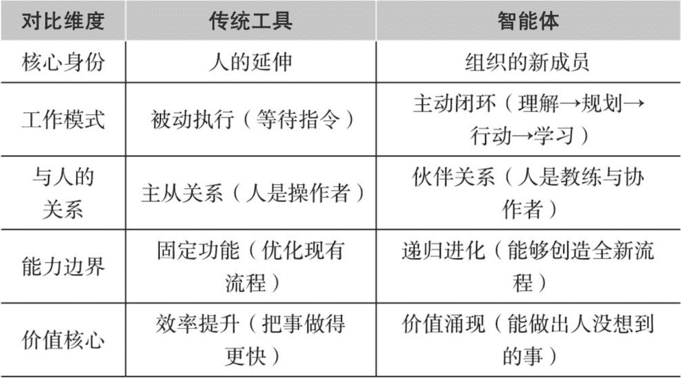

单一个体的力量有限，当无数个自主系统连成网络，群体智能涌现的现象就会出现。

凯文·凯利于《失控》早有预言，他描写的由简单单元组成却能产生复杂集体智慧的蜂群，本质上就是无数微小代理构成的分布式、有生命感的系统。这意味着变革不仅是个体能力的增强，更是系统级智能的诞生。它不需要中央大脑统一指挥，而是靠单元间的简单互动在群体层面显现创造力与适应性。

由此能分清分水岭：工具是人的延伸，代理是组织的“新成员”。它与既有形态有物种级分野：代理不等于人工智能算法，算法是智能的引擎，代理侧重在引擎之上做自主决策与行动闭环；代理超越“副驾驶”，副驾驶是人类的增强外骨骼，代理是有目标感和执行力的智能协作者；代理也不同于传统自动化流程，后者像轨道上的列车严格依赖预设规则，前者像丛林里自主找路的探索者。

过去企业靠工具提效，未来企业将靠代理重塑分工与权力结构。

我们辨认出的这具能自主行动的躯体只是形态，真正可怕的潜力藏在写入身体的遗传密码——基因，以及基因如何驱动持续学习与成长。

**第二节 新物种的基因**

还记得实验室里自改基因的“阿米巴 2.0”吗？它与“阿米巴 1.0”的分野源于一组全新的生命基因，这也是代理与传统工具的根本分界。

过去进化存在，但主宰在系统之外。2006 年 Netflix Prize 的胜出靠上百个模型叠加，十年后亚马逊仓库机器人也在反馈调度中形成群体进化。但这些优化都离不开人类工程师编码，系统在进化，上帝是人。今天 Manus 与 Devin 的出现标志转折：进化的遥控器第一次交还给系统自身。

“对话→修正→再生成”的循环，就是核心基因的外显。若上一节解剖的是器官，现在要探寻驱动成长的遗传密码——两条堪比达尔文的底层法则。

像生物学家那样解剖核心构造，会发现新物种基本结构惊人地模拟生物：负责思考的“大脑”规划器、负责行动的“身体”执行器，以及连接二者的“神经网络”计划与反馈，如图 1-1 所示。这套构造孕育了第一组基因——能驱动进化的反馈闭环。

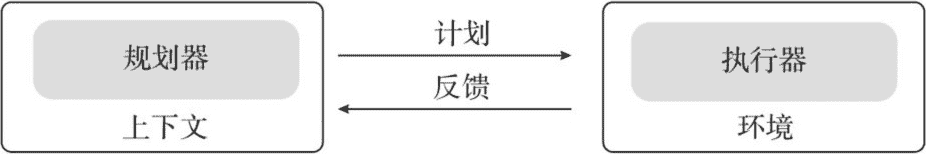

图 1-1 Agent 的基本架构和运行机制

规划器：指挥中心，通常由强力大语言模型驱动，负责理解任务、分析环境、制订计划。它浸泡在上下文海洋中，通过上下文获取工作记忆，即历史、经验和可用工具的全部认知。没有上下文，大脑就是失忆的空壳。

执行器：行动部队，接收计划并在真实环境中落地。环境可以是操作系统、浏览器、API 连接的软件，甚至机器人控制的物理世界。它把虚拟计划转化为对世界的实际改变。

计划与反馈即生命线：连接大脑与手脚的神经信号。反馈不只是“任务完成”，可能是编译错误日志、网页超时响应，或用户的一句追问。它把外部真实结果带回大脑，成为更新上下文的关键奖惩信号与环境激励。

由此形成“规划→执行→反馈→更新上下文→再规划”的闭环。一个新物种宣告诞生，它能自主规划与行动。要理解其颠覆性，必须深入观察写入身体的基因。

它如何持续学习进化？基因里藏着什么？

**一、进化：适应的法则**

“规划→执行→反馈”闭环本身就是系统最基本的生命定律：进化。它让系统通过持续环境互动实现物竞天择、适者生存，从而优化行为。进化是生命适应环境的基本法则，也是 Agent 在既定规则内把能力推向极致的遗传算法。

进化并非被动适应。设想一个营销系统首轮广告点击率惨淡，传统自动化工具会停等人类指令，简单自适应程序也许换个文案。而进化中的系统同时生成并测试数百组广告，从反馈数据里提炼出“暖色调配文案表现更好”的规律，立刻用于下一轮生成。这不是单次变异，而是系统化加速演化。

以学围棋的系统为例，起初随机落子，后来可与自己对弈数百万局，每步都获得胜负反馈。通过海量数据逐渐明白哪些布局更可能取胜，从而不断优化棋路。这是算力加持下跨越数千年人类棋谱的疯狂进化。

正如《系统之美》所言，系统的力量在于反馈机制。Agent 的闭环是达尔文进化论在数字世界重演。进化把系统从“一行代码一个动作”的机械宿命解放，赋予实践中自我完善的生命力。它能在给定规则内通过自我博弈与反馈把表现打磨到极致。

但仅止于此，它只是适应能力强的生物，永远无法改变游戏规则本身。真正让它成为新物种的，是更敬畏的第二定律。

**二、递归：创世的法则**

若“进化”是生物在上帝世界里努力适应，“递归”则是生物审视自我、扮演上帝实现自我繁衍与复杂度跃迁，也是系统重塑自身能力的创世算法。

递归的核心在于：真正的系统必须能自主修改、定义自身行为的源代码。这不再是适应世界，而是重塑自我。它意味着系统拥有更高维度的元智能，可审视、批判并重写负责执行的本我。

如图 1-2 所示，计算机科学中递归是函数调用自身把大问题分解为结构相同的子问题。顶级系统面对宏大任务时也会分解并派生子系统执行，直至原子任务。

但这只是表象。生命本身是最古老的递归程序。人类的繁衍并非简单复制经验，而是传递源代码基因，经分解重组创造全新后代，继承结构又通过变异获得适应新环境可能。

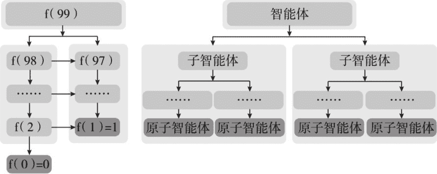

图 1-2 函数递归调用计算斐波那契数列与系统分解任务派生出子系统执行的对比

进化是在既定代码框架内调整上下文优化输出；递归式自我繁衍则在接收反馈后直接修改定义行为的程序。它像被赋予基因编辑能力的细胞，发现缺陷时调用内部工程师改写 DNA 结构，孕育更强下一代。它不再只调整飞行姿态，更在飞行中更换引擎。

过去 Netflix 推荐系统依赖反馈循环，但这是人类调度的外部递归。Devin 展示的是系统内部自我递归。前者人是上帝，后者系统成为自己的上帝。当系统成为自己的上帝，它就拥有自我繁衍、自我创造的系统能力。传统程序像铁轨上的列车，系统是一边行驶一边铺轨道的工程车。

这不是效率提升，而是范式转移。强大的基础模型可创造系统 1.0，1.0 在执行中收集“如何更好完成任务”的认知，再用来创造更强的 2.0。“创造→执行→认知→再创造”的循环，是“用 AI 的 AI 做 AI”的体现，不是线性生产，而是指数级智能自举。这就是 AI 里的道生一、一生二、二生三、三生万物。

试验室里，“阿米巴 1.0”能完美执行却无法突破边界，“阿米巴 2.0”因学会从失败历史数据中学习并不断创造效率提升十倍的自己而诞生。一旦系统启动，演化速度与潜力惊人。智能进化不再完全依赖人类技术突破，而拥有内在加速引擎。驾驭这种自举系统能力，将成为未来商业竞争根本分水岭。

**三、终极命题：是适应，还是创世**

用 F1 赛车比喻进化与递归的差别。进化是顶级车手通过反复练习从数据反馈中优化驾驶技术，成为赛道最快者，却受限于车辆与自身能力边界，是完美适应者。

递归则不同。车手达到极限后走进设计室，不仅造出性能更强的赛车，还造出拥有更先进设计理念的新车手。新车手不仅跑出人类无法企及速度，还在极限时刻再次设计第三代赛车与车手，迭代不止。这不是一次性升级，而是能自我繁衍、指数成长的智能物种诞生。

进化是在既定规则内把游戏玩更好，递归是赋予游戏修改规则并创造更能修改规则新玩家的能力。前者是优化，后者是创世。这组自我进化的双螺旋基因，是新物种最令人敬畏本质。

在商业中，这意味着最初设计来分析销售数据的系统，遇到瓶颈后可能通过自我学习与重构，为自己培养预测市场趋势的新能力。过去需要组织制度长周期演化，现在可能在系统内部实时发生。

新物种的真正意义在于，它不仅帮人完成任务，更具备自我繁衍与创造能力。它在进化，也在递归地重构自己。

理论上早已存在的构造为何今天才孕育真新物种？因为生命诞生需内在基因与外部养料。今天孕育新物种的三大生态要素首次同时达临界点。

首先是思考核心诞生——大脑涌现。自 ChatGPT 问世，尤其是 OpenAI o1 发布，大语言模型推理规划水平飞速提升，为新物种提供即插即用且足够聪明的 AI 大脑。

其次是行动能力完备——手脚成熟。仅有大脑是缸中之脑。过去十年 API 经济为数字世界安装无数可操作神经末梢，让新物种能触摸并改变真实世界。

最后是生长能源富足——养料充裕。系统的思考与行动离不开上下文。如今云计算与开源运动推动海量高质量数据爆炸式增长，为持续学习记忆进化提供取之不竭的食物。

大脑、手脚、养料三大要素同时成熟，为数字生命创造完美寒武纪时代。新物种诞生成必然。当它被投放到商业生态，演化路径必然遵循规律。它需从两个维度观察：AI 个体能力进化即技术物理定律，组织内权力跃迁即商业化学反应。

**第三节 进化的阶梯**

拥有进化与递归双重属性的 Agent 进入商业生态后，会踏上清晰不可逆的攀升阶梯。

**一、能力螺旋：AI 个体进化**

OpenAI 曾提出五级划分框架，如图 1-3 所示。从“智能能力提升是唯一主线”视角描绘演进蓝图：Level 1 聊天机器人 Chatbot、Level 2 推理者 Reasoner、Level 3 Agent、Level 4 创新者 Innovators、Level 5 组织者 Organizers。

这段阶梯是 AI 发展的物理定律客观呈现，以摩尔定律般速度向前。

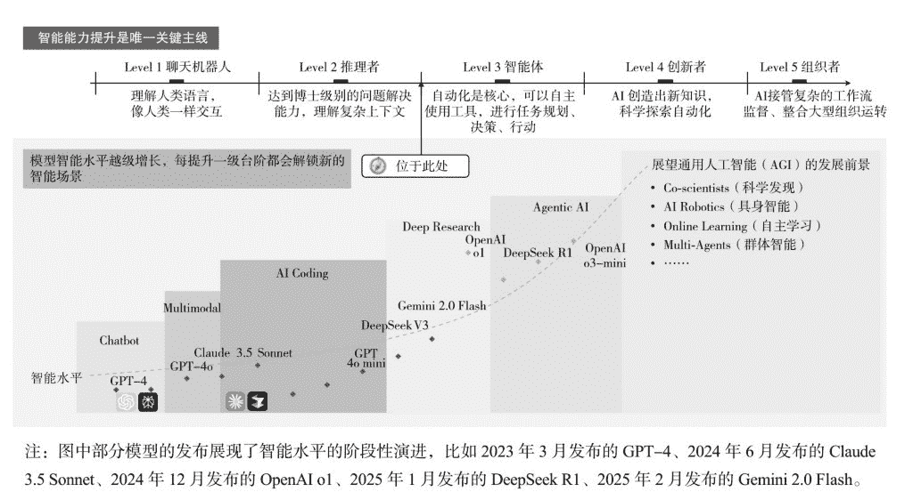

图 1-3 OpenAI 对 AI Agent 能力进化的五级划分

资料来源：OpenAI。

**二、权力螺旋：组织角色演化**

当 AI 个体能力沿阶梯攀升，组织内角色与权力如何同步演变？技术每级进化都对应组织权力结构剧烈洗牌。系统角色从边缘数字劳工逐步推向权力中心，直至可能成为 AI 接班人。这条阶梯正是权力食物链攀升之路：每一次成长都把组织内部某种权力从人类手中接管。如表 1-2 所示，结合 OpenAI 智能能力视角与组织权力视角，一个清晰而令人敬畏的演化进程浮现。

表 1-2 Agent 的五个进化阶段

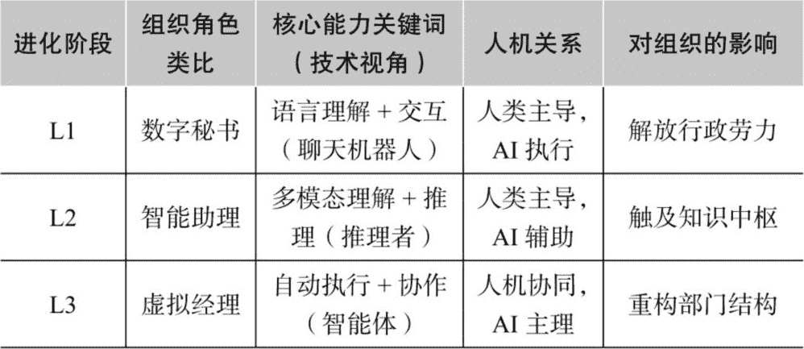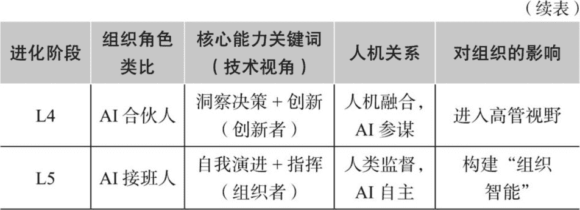

表 1-2 就是未来十年组织变革的核心路线图。系统的每一次进化都伴随权力转移与结构重构。接下来逐一解剖五个阶段。

**1．第一阶段：数字秘书**

第一次被 AI 代理的执行力震到，多半是在开会现场。随口要它记一下，纪要就开始在屏幕上成形了。排程提醒、场地预约、差旅订购，这些过去吞噬大量工时的行政杂务，正被无声接管。此时代理更像组织的神经末梢，只负责忠实执行。带来的变化主要是把最机械、最重复的工作从人类手中剥离，效率被明显释放出来。

**2．协作副驾阶段**

初期的新鲜感褪去后，代理开始真正嵌入核心业务。它从前台秘书的角色，升级为并肩工作的副驾驶。

程序员最熟的 GitHub Copilot 就是典型案例。敲代码时它能读懂上下文，推演下一行乃至整段函数的写法。与此同时，它还能把一周的会议纪要、邮件往来梳理成简报，撰写各类文案初稿，并在用词习惯上向使用者靠拢。

在销售端，第二阶段的代理已经能扮演情报官。某位总监次日要拜访大客户，前一晚他的数字助理已自动运转：先扫日历锁定议题与与会者，再把客户在 CRM 里的全部往来、近三个月工单记录、股价波动与行业新闻抓取汇总，最后生成一份一页纸的战前概要推送到手机。信息搬运从通用行政走向收入一线。人机关系也悄然变化，代理不再是被动工具，而是会补充、会提醒、会追问的伙伴。只是当它从帮忙过渡到可替代时，权力版图才出现质变。

**3．自主管事阶段**

分水线出现在第三阶段。代理第一次从帮人做事迈向替人管事。

开发者对 Devin 说一句把网站上线，随后它自助拆解目标、制定计划、写码、调试、上线，全程几乎不需要人工干预。亚马逊客服中心里，代理已能独立闭环八成以上的工单，退款、换货、故障排查全部包办，顾客很难辨认对面是人还是机。

营销也在被重塑。过去找 KOL 需要人工筛选、谈判、跟进、复盘。现在代理可自主优选。以霸王茶姬在泰国的投放为例，营销代理先圈定曼谷目标门店周边创作者，按内容含奶茶标签、历史播放率高位等规则做深度筛选，上线后实时追踪数据，一旦表现下滑就自动淘汰并换人。

这意味着什么？中层主管赖以生存的流程掌控、资源调度、专业研判，正被逐步侵蚀。代理首次成为虚拟主管，能把任务从头做到尾。中层的权力不是稀释，是被吞噬。

当前多数企业正卡在第二阶段向第三阶段的门槛上。这不仅是技术节点，更是未来三到五年的格局分水岭。跨过去是领先，跨不过去就会被淘汰。

**4．决策合伙阶段**

学会管事之后，下一步自然是影响决策。

影视投资里，决定拍什么投什么的已非导演直觉，而是数据。Netflix 的推荐系统不止推剧，更重塑了数十亿美元的内容投资。《纸牌屋》能立项，因为数据指向观众既爱凯文·史派西也偏爱大卫·芬奇。推荐系统从辅助变为决策合伙人。亚马逊等巨头也把 AI 写进战略，用它支撑新品立项、市场预测与对手模拟。

极端案例在华尔街。桥水、文艺复兴科技的核心交易不再由人下单，七乘二十四小时运转的算法集群在分析数百万经济与市场信号后自主完成数十亿美元的买卖。创始人退到哲学家与架构师位置，设定投资原则与模型价值观，日常海量实时决策全交 AI。人类提供商业直觉与顶层原则，AI 提供算力与近乎完全的执行自主权，二者融合后决策效率与质量被彻底改写。

**5．接班接管阶段**

终极颠覆是对管理学的重写。

设想一个高度进化的系统进入经营层，以公司长期利益为唯一目标，自动优化物流、财务、库存，速度与准确率远超人类高管。此阶段人类不再是操作者，而是监护人。核心职责是为 AI 心智设定价值边界，如同起草宪法，并在关键节点做最终裁决，日常价值创造与资源分配由系统自主运转。

形态可能多样：中心化的大脑进行顶层设计，或去中心化的代理集群自组织涌现智慧。无论形式如何，AI 接班人的本质是代码为核心、拥有自主心智并能进行价值判断与资源分配的数字生命。

五级进化清晰揭示了一个冷峻趋势：每一次进化都伴随组织内部的权力转移与结构重构。理解这张图，就是把握未来十年的变革路线图。

今天多数公司仍在 L1、L2。所有人已站在悬崖边，直面 L2 向 L3 的跃迁。这不是五十年后的科幻，而是未来三到五年的现实。有的组织迎来虚拟主管实现倍速提升，有的则因固守旧模式被时代抛下。代理正攀爬权力阶梯，留给我们的问题只有一个：是被动旁观，还是主动驾驭？可这一次，旁观本身就是淘汰。

**第四节 权力新杠杆**

每一次生产力革命都诞生新杠杆：蒸汽机杠杆体力，互联网杠杆信息。今天代理成为 AI 时代的关键杠杆，它杠杆的是人类最高级的两种能力：决策与执行。

它让一人、一个微型团队拥有过去需庞大组织才能完成的端到端能力。它在秘书阶段夺走事务权力，在主管阶段接管流程与资源，最终在合伙人与接班人阶段触及最高权力。它撬动的不仅是效率，更是生产关系的权力结构，改写了谁下令、谁执行的基础逻辑。

当这根新杠杆投向商业战场，会从增长引擎与战略范式两层面重写竞争法则。

**一、从数据累积到主动进化**

洞察了代理递归与进化的双基因，就能明白支撑它成长的引擎与过去十年的数据飞轮本质不同。这是一场从被动学习到主动创世的革命。

**1．被动水车型引擎**

移动互联网时代的数据飞轮是巨头成功的密码，像靠外流水流驱动的水车。好产品吸引首批用户，用户产生数据，算法学习优化产品，体验提升再吸新用户，形成闭环。

亚马逊用低价带来更多顾客、更多商家、更低成本碾压零售，字节用内容带来停留、数据积累、精准推荐重塑信息流。但核心特征是被动。它无法主动造数据，像嗷嗷待哺的婴儿，依赖外部投喂。一旦增长停滞，引擎失速。

**2．自主火箭型引擎**

代理飞轮像自增压的火箭。点火指令可以是为新品开拓欧洲市场，收到意图后它自主分析市场、写文案、做本地化、投放广告。关键是每一次行动都在创造独家高价值数据，这些行动生成的数据立刻被自身回收成下一轮燃料。

引擎在燃烧中学习进化：发现 A 文案比 B 效果好十分之一且重构自身结构。能力跃迁后能承担更大任务，创造更高能燃料，加速冲向下一阶段。

核心是主动性。它不靠外部投喂，是主动创造加自我进化的引擎。燃料是算力，每一次喷射都在增加燃料。增长潜力只受算力约束。

阿里前战略官曾鸣称之为黑洞效应：更聪明的 AI 能处理更多维度尤其是私有知识的数据，更聪明后吸引更多数据，形成对手无法逃逸的知识黑洞。

数据飞轮是滚雪球，线性增长；代理飞轮是坍缩成黑洞，指数级拉开差距。不是成为黑洞，就会被黑洞吞噬。

**3．水车VS火箭**

水车对火箭，结果早已注定。代理飞轮的核心是自主行动中创造数据并自我进化，形成更紧凑更高速的自反馈。当对手还在优化推荐时，新物种已能自主完成任务。

表 1-3 增长引擎的代际革命：数据飞轮 vs.智能体飞轮

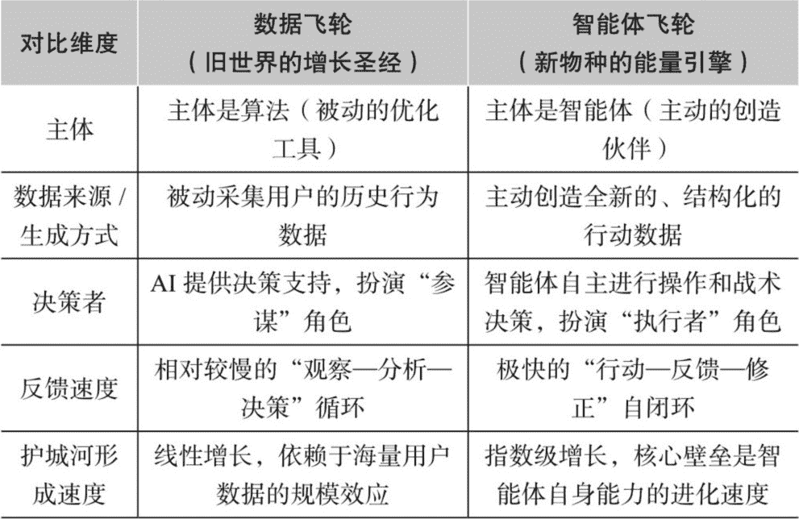

这解释了一人公司如何挑战巨头。巨头引以为傲的数据护城河在代理飞轮面前可能无足轻重。未来竞争核心不再是谁数据多，而是谁创造数据并迭代的速度更快。

电商销售代理不仅能像传统算法那样推荐，还能在用户加购未付款时主动对话：您好，您那款相机与购物车镜头最匹配，需不需要申请临时打包优惠？交互带来转化并沉淀更高价值数据，反哺行动能力。

实体创造同理。传统跑鞋研发靠销售数据、问卷、焦点小组需一年。AI 产品设计师代理收到为马拉松精英设计超轻碳板鞋后，二十四小时内生成一千种三维方案渲染投放，收集点击停留评论等实时行为，自动识别融合最优设计提交人类决策。转速从年变天，从被动分析过去到主动创造关于未来的海量数据。领先者用此更快迭代、降本、形成垄断。

**二、修补旧图还是开拓新域**

AI 的力量在重构而非优化。

多数企业想用客服代理替代人力、用文案代理辅助营销，像给马车换轮胎。真正的颠覆者用代理重构一切。

重构信息获取。无数公司试图优化搜索而败给谷歌，Perplexity AI 选择重构搜索：谷歌给链接，Perplexity 给整合后的答案。习惯直接答案就回不去淘金时代。

重构创造源头。Spotify 用算法优化发现音乐体验，Suno 重构音乐本身。用户不再是消费者而是灵感激发者，曲库概念被无限拉大。

重构不确定性应对。传统 ERP 让风暴中看得更清，自主供应链代理则在风暴形成前就悄悄改道。

对于成熟商业帝国，选择更致命。以环球百货为例，线下为王模式下它靠坪效与客流数据把选址陈列做到了极致。电商侵蚀下，进化型组织会加大促销装修裁员。但流失会员七成线上消费增三百的信  息刺破幻想，董事会意识到问题不是策略不好，而是线下模式过时。

递归基因被激活。启动挪亚方舟项目，意图构建线上 DTC 模式。进化型代理会建议二楼香水坪效降十分之一换护肤品牌，递归型代理会预警核心会员行为结构性转变，预测三十六个月现金流断裂，建议立即启动 DTC 并给出航海图。这就是递归对进化的降维打击。

**三、投入还是观望**

未来十年驾驭代理飞轮的能力决定生死。柯达当年把数码相机制为胶片业务的优化工具，最终输掉未来。今天 AI 颠覆像闪电战，一两年甚至几个月就能重塑行业。没有时间再优化旧业务。

代理飞轮已启动。未来十年没有中间地带：要么被加速，要么被淘汰。问题不是用不用，而是是否准备好与新物种共事。

变革的难点不在服务器，而在活体组织。人类习惯、部门利益、权力结构与文化构成强免疫系统，会排斥新物种。迎接新物种黎明后，必须面对更血腥的内部战争。

**第二章 组织大折叠**

代理从辅助工具进化为具备自主行动能力的新物种。当执行效率指数暴涨、成本趋近于零时，第一道冲击波来自内部结构的崩塌。半个多世纪前，瑞士钟表业的剧变已押韵预演了今天的剧目。

**瑞士钟表的崩塌与组织的免疫失调**

六十年代末，汝拉山谷的作坊里只剩下擒纵轮清脆的嘀嗒。几百年间，瑞士的制表师把齿轮、发条与宝石的配合打磨到极致。

当时整条产业链像一具自洽的生命体。成百上千家高度分工的家族小厂相当于细胞：有的只抠游丝的厚度，有的只负责壳面曲线的抛光，有的只做末端装配。它们靠一套古老而稳定的协作脉络共同维持着精度的运转。

人们笃定这种代表瑞士制造的物种会永远主宰计时。可地球另一端，一场悄无声息的基因突变已在酝酿。

1969 年圣诞，日本精工推出 Astron。它的心脏不是摆轮而是一枚免上链的石英晶体。这不是常规迭代，而是驱动方式的置换。石英借助电池化学能，以数十倍精度与不到十分之一成本碾压了依赖机械能的传统表。

这个入侵者像病毒一样扩散。瑞士的生态系统瞬间进入免疫风暴。手艺失去价值，因为石英机芯几乎无需人工；既定的分工网络出现血栓，因为精密零件需求断崖。订单像融雪一样消失，十年间超过一半的制表企业关门，约三分之二的工匠失业，行业陷入长达十年的深度昏迷。

后世称之为石英危机。具讽刺意味的是，石英技术起初正是瑞士人提出的。

真正致命的并非技术本身，而是这个生命体僵化的防御机制。文化本能拒绝承认无灵魂的电子表也可算表；中高层把全新能量范式贬为廉价玩具；生产系统无法吸收异质技术，反而攻击内部引入它的创新者。它并非被外部对手击溃，而是因无法完成基因层面的自我更新而在新生态中衰亡。直到 Swatch 以电子与时尚的新基因重塑物种，濒危的产业才勉强续命。

这段历史是对组织进化的警示。如今，比石英强大万倍的超级入侵者——智能体已逼近城下。石英只换了驱动指针的能量，智能体带来的是认知的能量革命。它要取代的不仅是双手，还有大脑。

本章以组织病理学家的视角剖开当下，审视体内潜伏的旧基因如何化为致命病灶。

第一节 人力与效能的两种定律

一、线性叠加：流水线时代的扩张观

1913 年，亨利·福特站在新建的汽车流水线前，像站在一个新纪元的入口。他看见一种近乎神圣的力量——规模。把造车拆解为无数简单重复的动作，上万名普通工人便汇成一台造车机器。

从此确立了工业革命后两百年的商业底层逻辑：产出和人员数量同向变动。通用汽车的斯隆、IBM 的沃森，所有帝国缔造者都是这一思路的信徒。他们一生都在扩充科层、细化流程，想打造更完美的组织机器。互联网时期，阿里的地推靠千人队伍，字节的崛起则依赖万人算法与审核团队。过去，堆人几乎是通往成功的唯一通道。

这一逻辑塑造了我们熟悉的金字塔：层级臃肿、沟通昂贵，是为控制复杂性而被容忍的次优设计。回看上世纪十年代的装配线，每人只拧螺栓、装车轮，极致分工带来 T 型车的高效，也制造了无数信息断层。现代知识工作继承了这一套路：设计者构想、工程师实现、产品经理协调，交接处就是效率的裂缝。

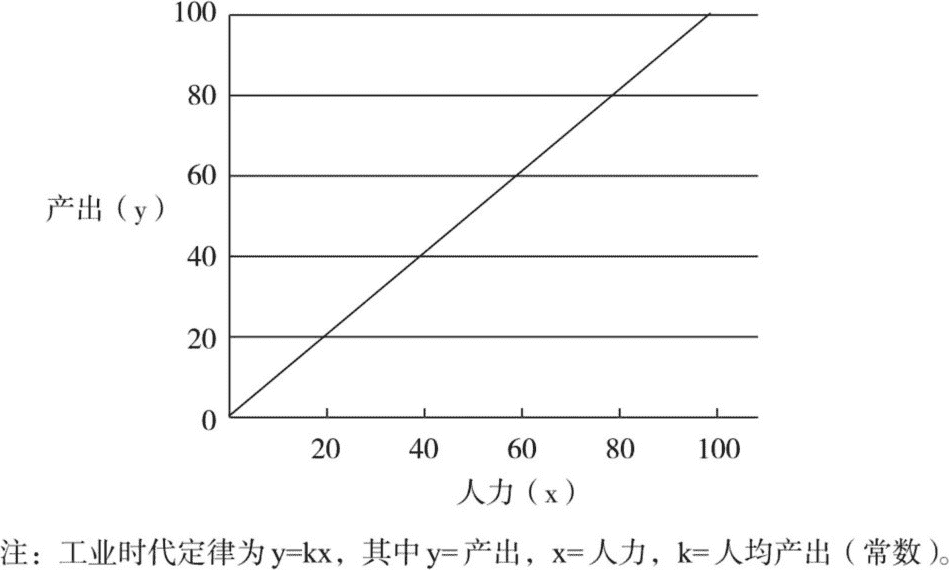

图 2-1 工业时代产出投入对照示意

金字塔在过去一世纪确实是效率灯塔。马克斯·韦伯将其理论化为官僚组织——层级分明、规则严密、分工专业，在信息稀缺、以人工执行为主的年代是最优解，是现代商业的钢筋骨架。但韦伯暗藏一个危险假设：组织是可预测的封闭系统。

正如乔纳森·斯旺森所指出的，组织扩张受管理幅度限制：一个人最多有效管 5 到 8 人。57 人需要 3 层，400 人需要 4 层。每多一层，信息衰减与决策延迟就加剧。如图 2-2、图 2-3 所示，科技巨头的错综架构正是这种妥协的产物。

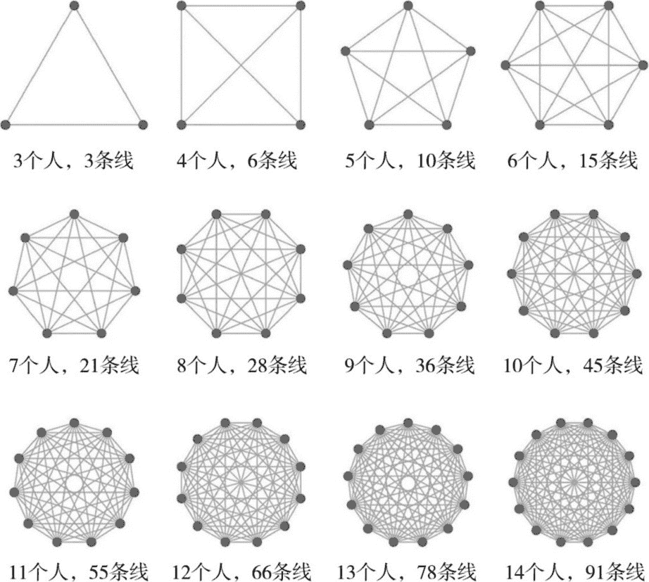

图 2-2 人员增加时沟通路径的指数式增长

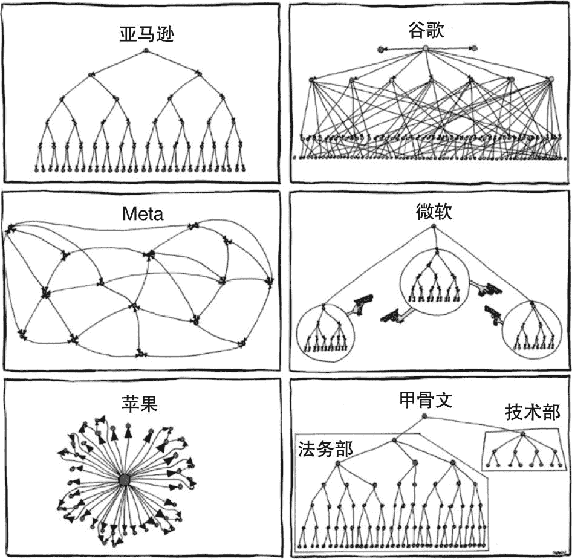

图 2-3 不同科技公司层级间的组织形态比较

缔造者或许没意识到，他们召唤的规模之神自带自我毁灭的幽灵。罗纳德·H·科斯 1937 年就指出，组织内部存在交易成本：沟通、管理、协调。当体量小，幽灵沉睡；当体量失控，它会苏醒并吞噬规模红利。这就是规模的诅咒。历史上已引发两次组织大折叠。

第一次在信息稀缺的工业时代。通用汽车等巨头的层级让信息从一线到 CEO 需要数月，熵增压垮效率，日本企业乘虚而入。

第二次在信息爆炸的互联网时代。信息流动成本趋近于零，层级从过滤器变血栓。谷歌、Meta 等更扁平网络化的物种崛起，无情折掉庞大的中层。

前两次折叠本质都是容器升级：工业革命升级物理能量容器，互联网升级信息能量容器。竞争始终是人用更快工具的较量。

今天我们站在第三次也是最彻底的大折叠边缘。这次底层法则不再是摩尔定律，而是规模原理。它升级的不是容器，而是容器里的存在物——智能体。

这意味着我们第一次不是和用更好工具的人类竞争，而是和自身会变聪明的物种竞争。互联网折叠的是信息传递者，智能体折叠的是信息处理者和任务执行者。

智能体从根本上颠覆工业文明的人力产出假设：产出随人力线性相关。倍增效应降临了。

二、指数放大：智能时代的效能突变

工业时代基本单元是工厂，信息时代是公司。智能体时代最基本的价值创造单元正在从公司转向“智能体”。这一单元转换预示组织形态的大折叠，一个反直觉的新人力与产出关系正在形成。

大模型训练领域存在近乎铁律的规模原理 ^(¹)：算力与数据投入越多，智能水平越涌现，如图 2-4 所示。如今这一原理正从训练场溢出组织，形成决定未来形态的新劳动力定律。

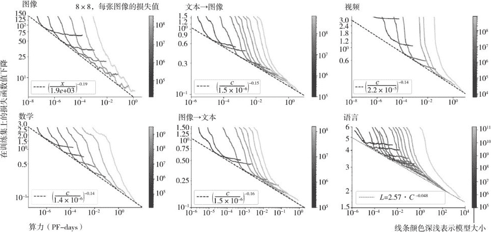

图 2-4 大模型训练规模原理图

资料来源：T.Tom Henighan，et al Scaling Laws for Autoregressive Generative Modeling，2020。

如图 2-5 所示，以“人类最后的考试”为代表的基准测试显示，AI 认知能力正沿着近乎垂直的曲线攀升。各大研究机构预测一致：十年内，AI 的综合认知与专业技能将超越 90%甚至 99%的人类。

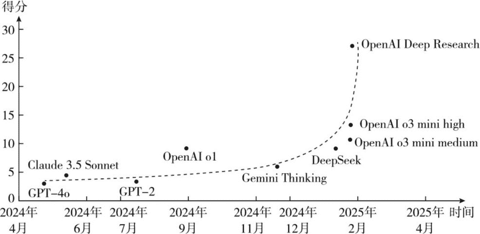

图 2-5 AI 在人类最后的考试中的得分走势

当生产智能的边际成本趋近于零，以“人类是生产智能唯一来源”为前提的商业文明将动摇。人类执行力稀缺时代结束，执行力无限供给时代到来。研发、内容、运营等依赖信息处理与模式化创造的知识工作，被重构乃至取代几乎不可逆。

预言已在身边上演。通用智能体 Manus 能独立完成为期七天的日本旅行规划，从航班酒店到餐厅推荐全链路输出，把原本需多人协作的任务压缩成一个流程。超级个体极限编程也给出样本：一个人的公司与智能体协作，两天内从零构建十万行代码的复杂协作软件，十分钟内完成营销站与后台搭建。AI 评估称需数十人做数月。

这证明组织效能上限正从人头规模转向“智能体能力×人类驾驭力”。两百多年的人海逻辑被颠覆。

·旧范式：组织是累加器，1+1=2。
·新范式：组织是倍增网络，1×智能体×人类驾驭力=∞。

旧范式下效能约等于人力之和，线性可预测但受成本与管理复杂度限制。新范式是倍增革命：少数核心人类负责方向与智慧，智能体作为放大器把执行力放大千百倍。互联网时代网络是放大器，智能体时代智能体本身是关键放大器。

这不是渐进改良，是底层逻辑重写。用增加人手解问题的组织，正用 19 世纪的武器打 21 世纪的战争。执行力过剩的新世界对执行力稀缺的旧世界发起物理层面的挑战，旧世界必然剧烈坍塌。

从累加到倍增的转移已在顶级公司战略中冷酷上演。惠普近期公布的公司级智能体计划就是写照。表面看是未来三年 4000 到 6000 人岗位调整，文件深处真相更清晰：裁员是结果不是目的。智能体重构研发、客服、运营流程预计节省 10 亿美元，省下的不是工资而是流程被替代的成本。数千岗位职责正被智能体取代。

这不是降本增效，是人效的重新估值。市场用真金白银验证了倍增效应：一个与智能体高效协作的超级个体，价值可折叠十个遵循旧流程的普通个体。

第二节 层级结构瓦解

2024 年秋，苹果总部气氛凝重。备受期待的智能体发布会乏善可陈，核心智能体团队骨干相继出走 OpenAI、Anthropic、Meta。曾经的创新圣殿一夜变围城。

苹果财大气粗、芯片领先、用户忠诚，却在智能体赛道落后两年。症结不是技术，而是文化僵化：护航硬件生态的封闭系统，面对智能体的开放与快速迭代，反成抗体。

东亚这边百度反向操作，大幅裁撤传统业务，强化智能体、大模型与核心工程，CEO 亲自把控战略。路径不同，指向一致：智能体重写价值链，金字塔结构被内部逻辑折叠。

当执行力过剩的新法则降临，建立在人力稀缺基石上的金字塔开始内部开裂。这不是温和改良，而是从内部爆破的结构性大折叠。它像精准爆破，从最脆弱的承重层开始，引发连锁坍塌。

首先是中层淡化。其次是角色融合。最后是个体合伙人化。基本单元从庞大部门坍缩为精悍作战小队，对“原子”要求发生根本改变。

一、扁平化：中层淡出

第一斧砍向中间管理层。

传统里中层负责上传下达、分配任务、监督进度，是人类执行力的路由器与带宽管理器。智能体时代，CEO 战略意图可直接转为智能体指令，结果实时无损反馈。中间层作为功能层级正被技术淘汰。

2024 年起，谷歌、Meta、亚马逊等巨头密集裁撤工程师。这不是经济性裁员，而是行业共识：编程助手普及后，十人工作三人可高质量完成。公司不再靠大规模招聘换取增长。

硅谷的裁员潮是组织大折叠的第一声断裂，以最无情方式宣告：在指数级效率面前，唯有经验技能的人才快速贬值，能驾驭智能杠杆的智力资本前所未珍贵。如表 2-1、表 2-2 所示。

表 2-1 2025 年全球软件行业就业数据（预测 vs 现实）

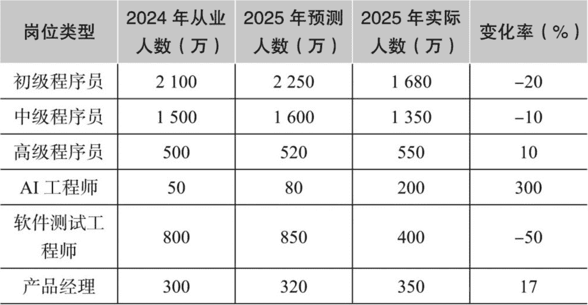

资料来源：IDC Worldwide and Regional Developer Census, 2025、Stack Overflow 2025 Developer Survey、GitHub Octoverse 2025 Report，etc。

表 2-2 传统软件公司与智能体原生公司的效率对比（2025 年第一季度数据）

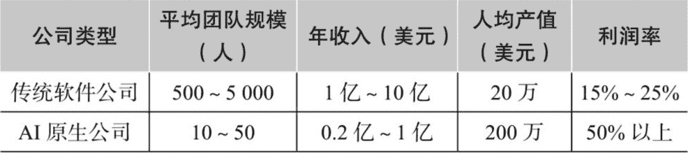

资料来源：IDC 2025 CEO Priorities Research、ICONIQ Capital 2025 State of AI Report、Sequoia Capital The Always-On Economy：AI and the Next 5-7 Years，etc。

数据不容置辩。中层淡化后角色必须进化。产研组织里纯粹的管理层将被取消，技术管理者需兼具架构师，亲历代码审查与核心设计，用技术能力而非行政权力领导。

资本市场已给出验证。2025 年亚马逊宣布上万人规模裁员，消息公布当天股价不跌反涨，财报后市值单日大涨。华尔街看到的不是断臂求生，而是一场面向未来的战略重组。市场为高效运作能力买单。

当亚马逊仍在削减冗余中层时，瑞典智能体初创 Lovable 从一开始就拒绝中间层。员工直言：“无专业能力的中层岗将灭绝，我们淘汰的是组织冗余。”没有跨部门协调岗，没有层层审批。真实所有权、极致自主、信任为基、高速执行成为核心。15 人团队五周内上线推荐计划、免费协作、年费方案与积分结转，传统企业难以想象。

亚马逊腾出资源，预示下一轮重塑——角色与责任全面重新定义。

二、全能化：岗位融合

这次折叠发出的第二波冲击，是专业分工边界的溶解。前 Adobe 首席产品官斯科特·贝尔斯基称之为“人才坍缩”。当首席设计师同时是产品领导者，前端工程师同时是设计师时，组织就获得了持续的不公平竞争优势。AI 正是这个关键的折叠器：一个系统就能集调研、设计、执行于一身。

折叠的组织：当金字塔被压成二人小组

过去要提升效率，靠的是一次次把专业切得更碎、更深。如今几组相互协作的专业智能代理就能覆盖过去必须动用整支团队才能完成的多种职能。原本为弥补人类能力边界而设立的部门隔膜，现在正演变成效率优化路上最沉重的协调损耗。基于岗位职责划分的层级官僚正在松动，组织更倾向围绕具体任务临时组建由少数核心人类专家加大量智能代理构成的任务型突击小组。

马蒂·卡根曾预判，智能代理驱动之后，产品团队的骨架可能收缩到三个人：梳理业务逻辑与需求的业务负责人、打磨使用体验的设计负责人、攻坚技术难点的工程师。剩余的编码、测试乃至部分设计稿的产出，都能由代理高效承接，如图 2-6 所示。

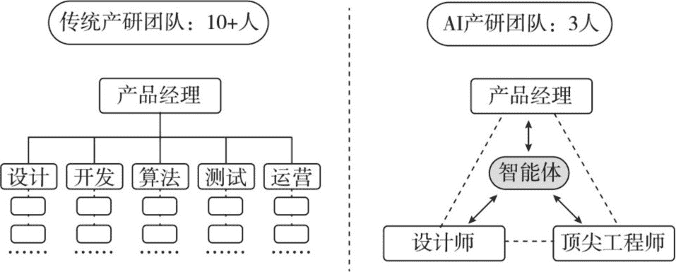

图 2-6 传统产研团队和 AI 产研团队的对比

图 2-6 左侧是大家熟悉的传统产研形态，十几人的队伍围着一位产品经理低效协同。右侧是正在成型的 AI 产研形态，核心只有三人：产品经理、设计师、顶尖工程师。他们驾驭代理，就能完成过去七八个人才能交付的工作量。这个判断在我们的实操中甚至显得保守。

在以人工智能为原点驱动的组织深水区，我们做了更极端的试验。代理深度赋能下，核心研发单元可被压缩至仅剩两人：一名系统架构师、一名全栈工程师，见图 2-7。

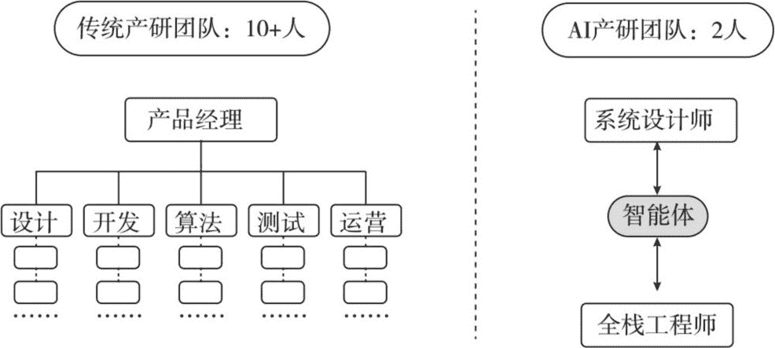

图 2-7 组织“大折叠”的缩影示意图（智能体如何将金字塔式的产研团队极限压缩为两人协作的“原子单元”）

这两人配合强力的 AI 系统，就能从零到一做出过去需要庞大团队耗时数月才能完成的大型产品。这已不是简单的提速，而是对“团队”概念的重写。当少数核心人才借助代理突破人海瓶颈，传统金字塔的合理性开始瓦解，而现实早已超出预期。

Midjourney 在高峰期靠不到五十人左右的精简队伍创造数亿美元年收入，服务全球数千万设计师与创作者。过去支撑同等规模用户与复杂度，至少需要数百人的美术、研发、运营体系。Perplexity AI 以不到百人规模正面挑战拥有数十万员工的谷歌，核心答案生成由代理承担，而非数万人优化网页排序。Lovable 这个用自然语言快速造应用的平台，创始团队仅十五人，却借助自研智能系统支撑起数万用户共创应用的生态。

这些案例指向同一新规则：效能不再取决于人头数，而取决于撬动智能杠杆的能力。

这也是彼得·F.德鲁克“知识工作者”理论的延展。德鲁克预言价值创造主体将从体力劳动者转向掌握专门知识的垂直专家。人工智能时代，单一领域知识被快速商品化，竞争力不再靠专才数量，而是靠核心人才把人工智能用作知识融合器，横向整合多领域能力，端到端解决复杂问题。我们正从垂直知识工作者时代跃迁到横向驾驭人工智能的系统架构师时代。

三、众包：个体合伙人化

我们早已活在众包世界。十年前的美团、滴滴完成第一次众包，把体力劳动拆解给骑手司机，形成零工网络。人工智能开启第二次众包，把智力劳动也拆解众包给智能代理。

“智力众包”重写了个体在组织里的身份，要求知识工作者从被动执行的螺丝钉跃迁为主动创造价值的超级节点。这一次合伙人驾驭的不是骑手，而是代理。

这正是组织大折叠的未来形态：个体合伙人化。当五十人团队能创造过去一千人才能完成的价值时，组织对成员的要求发生质变。他们不再是流水线上的执行件，而是对最终成果负责、具备全局视野的合伙人。实践中信息可无损自 CEO 直达一线，极致透明要求每个人都具备 CEO 视角去理解行动背后的商业意图。

微软与卡内基梅隆大学的联合研究显示人类角色在三个维度根本转变：不再是信息收集者，而是真伪的最终验证者与事实守门人；不再是问题的直接解决者，而是代理输出的价值整合者，在复杂商业情境里做出关键权衡；不再是任务的具身执行者，而是代理集群的宏观编排者，聚焦更高维度的资源分配与系统设计。

未来核心人才必须在高度抽象层思考并为高风险决策负责。比如人工智能给英伟达股价定价为三百二十九点六九美元，远高于常值，作为投资者你是逐行复核计算还是直接下注？这正是终极考验。

折叠之后，以人工智能为原点组织的核心人类角色剩下系统架构师与人类沟通师。

系统架构师：未来的组织架构师与世界观定义者，负责定义问题、设计体验、构建人机协作蓝图，对产品价值负责。

人类沟通师：组织人性的代表，负责与重要客户、战略伙伴、政府等外部人类建立深度情感连接与信任，处理人工智能无法胜任的模糊复杂人性沟通。

未来架构将被压缩为人与智能代理的结合体，如图 2-8 所示。

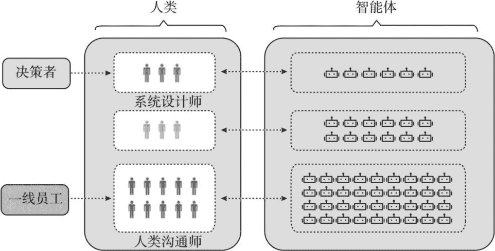

图 2-8 人类与智能体协作的未来组织架构图

图 2-8 呈现折叠后的新形态：由系统架构师构成的极度精简决策执行核心，通过驾驭庞大代理集群落地；人类沟通师作为人性接口连接外部世界。金字塔消失，取而代之的是一个智慧大脑与无数高效触手。

中层消失、角色融合、个体合伙人化，三重折叠勾勒出金字塔坍塌图景。对新物种而言是基因，对旧世界庞大帝国而言则是死亡判决。它提出的问题不是是否优化，而是敢不敢把亲手建立的帝国折叠成这样？敢不敢让九成的躯体消融，只留大脑与少数神经末梢？

这是组织大折叠最残酷之处：不仅是技术驱动的效率演进，更是对既有利益、权力与文化的暴力清洗。理论美好，现实转身艰难。昔日最强商业巨头步履维艰，正因其成功基因反噬：商业模式孕育庞大利益共同体成为利润与人才诅咒；为管控大军团设计的成熟流程固化肌肉记忆变成流程陷阱；引以为傲的技术栈与人才库筑起城墙也成为遗产重负。

三重枷锁构成人工智能时代的创新者窘境，自我改良无法完成基因跃迁。唯一出路不是修补旧世界，而是创造新世界。

第三节 迈向 AI 原生组织

旧世界废墟之上，全新形态正在崛起。组织需要主动进化，迈向以人工智能为原点驱动的组织。

OpenAI 在 GPT-5.2 发布当日发出十周年全员信，并未谈性能，而是强调信念、使命与组织构造：真正的原生人工智能基因不在代码而在信念，在于组织如何让人工智能成为核心执行力。正如 CEO 萨姆·奥尔特曼所说，未来组织将是人类与人工智能共生的智能系统。

特斯拉 CEO 埃隆·马斯克指出，真正竞争优势不是模型大小或算力，而是否能围绕智能代理快速重组、迭代新商业逻辑。微软执行副总裁贾里德·斯帕塔罗表示，若企业只把人工智能当附属工具而非日常运作核心与战略决策中心，将永远落后。

什么是原生人工智能组织？瑞典初创 Lovable 给出答案。十五人团队七个月内实现八千万美元 ARR。这不仅是增长奇迹更是形态颠覆。这里原生人工智能指工作方式默认化。开发内部工具、营销页或生成代码，员工第一反应不是申请编制而是直接借助人工智能完成。甚至没有产品经理岗位，也没有交接流程。如员工所言，原生人工智能员工不是使用人工智能工具的人，而是把人工智能当第一本能、默认使用的人。

原生人工智能组织的核心理念是：人工智能是组织默认的最主要执行主体，而非辅助。相当于从地心说转向日心说，重构组织。层级、岗位、流程、职责都将围绕“人工智能为执行主体”重新定位。

一、执行核心：智能体主导工作

智能代理深度嵌入核心业务流程，承担大量执行性工作甚至辅助决策。它们不是边缘工具，而是与人类并肩的智能伙伴与数字员工。组织会围绕代理能力主动重塑工作流与岗位。

高效人机协作中代理自主完成的任务比例超过九成。人类从直接执行转向与代理协作或管理代理。在 Lovable，代理主导价值创造，自主完成需求理解、架构规划、代码生成，承担过去需庞大工程师团队的工作。人类像指挥官与教练。

亚马逊仓库里成千上万机器人自主搬运，人类负责维护优化系统。Adobe 中设计师过去在多软件间切换，如今只向数字伙伴描述创意目标，即自动完成修图到排版。人类不再是操作员，而是创意总监。

二、组织架构：扁平与聚合的坍缩

组织超扁平，信息高速透明，决策链极短，能像初创一样快速响应。固化部门壁垒被打破，组织像由自主人工智能赋能模块化单元或敏捷作战小队构成的网络。管理层级不超过三层。新跨职能任务团队可在二十四小时内组建投入。

Spotify 由多个小分队组成，每个分队跨职能自治，像迷你创业公司长期负责特定功能领域。Lovable 的十五人创始团队是典型的系统架构师集群，他们不直接写大量代码，而是设计能让用户与人工智能高效协同共创应用的系统。人机协同使结构极致扁平敏捷，管理层级几乎消失。

曾鸣预言未来组织呈现极简两层架构。顶层是极少数创智人才，由顶尖专家、跨界创新者、领导者组成，核心工作是定义问题、设定方向、第一性思考。底层是规模庞大的硅基员工，无数代理承担九十九 percent 常规执行，成为创智人才最忠实的合作伙伴。在一 percent 人类大脑加九十九 percent 人工智能肌肉的共生体中，竞争力由群体认知的高度与提升速度决定。

三、增长机制：爆发式扩张路径

组织文化拥抱变革，鼓励试验包容失败，快速迭代持续学习。人工智能系统与人机协同流程具备自学习自优化能力，能从实践进化。组织像生命体，能智能适应外部变化并自下而上涌现解决方案与创新。

员工价值核心指标从个人产出转向可撬动的人机协同网络产出。一名人类加十个代理的组合价值远超十一个人总和。新品迭代周期以天计。超过五成重大创新源于自下而上试验涌现，而非顶层战略规划。

Lovable 揭示原生人工智能内在运行逻辑。Midjourney 不到五十人创造数亿美元年收入服务数千万用户；Perplexity 不到百人挑战谷歌。

代理主导执行、结构坍缩、爆发式增长三基因交织塑造原生人工智能组织。它拥有强壮肌肉、敏捷神经与高速新陈代谢。竞争力不再取决于员工数量规模，而取决于驾驭智能的智慧密度。表 2-3 总结了原生人工智能组织与传统组织在关键维度上的颠覆性差异：

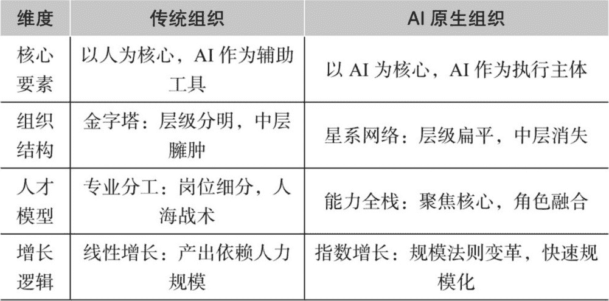

第四节 转型工具箱：AI 原生指数体检

原生人工智能不是二元标签，而是一条进化路径。为判断位置，我们提炼四维度进行自检。

一、维度一：AI 的角色定位
A．效率工具：人工智能被视作插件外挂，辅助单点任务如写邮件修图，是员工个人事。
B．执行主体：人工智能被视作新员工核心劳动力，承担端到端复杂任务如写代码客服闭环，是组织设计事。

二、维度二：组织结构形态
A．金字塔形：层级分明，中层众多超过三层，信息需层层汇报。
B．星系网络形：极度扁平少于三层，由少数决策核心与多个全能原子小队构成，去中介化。

三、维度三：人才密度模型
A．细碎分工：岗位职责精细，员工只对自己的一亩三分地负责。
B．全栈通才：岗位大幅减少，核心人才皆为能驾驭人工智能的系统架构师或全栈指挥官。

四、维度四：增长驱动逻辑
A．人海战术加法：增长依赖团队规模扩张，加人等于加产出。
B．智能杠杆乘法：少数精英驾驭人工智能杠杆创造指数级价值，加算力等于加产出。

体检结果：选 A 多为传统组织恐龙型，正运行在即将淘汰的旧操作系统，面临降维打击风险，请翻阅后续章节考虑转型。选 B 多为原生人工智能进化型，已摸到新世界门槛，请继续阅读优化缺口。

这份诊断像手术前 CT，残酷揭示人工智能转型首先是组织结构变革。无法在马车骨架上装火箭引擎。在僵化金字塔上长不出敏捷原生人工智能能力。看清结构差距即行动起点。

小结 “物理定律”的变更

我们完成了认知破局。听见新物种心跳，也透视旧组织的不可逆大折叠。背后更残酷真相是：人工智能成为执行主体后，商业竞争物理定律已根本变更。

过去两百年商业文明基石是最高效组织与利用稀缺人类执行力。金字塔、层级管理、人海战术都是旧物理学最优解。人工智能带来的不是优化而是对“稀缺”基本公理的颠覆。它首次把智能执行力从昂贵资源变为充裕甚至过剩的基础设施。

当物理定律从执行力稀缺变为过剩，商业宇宙维度坍缩。为管理稀缺而设计的庞大结构瞬间从资产变负债，昔日王者因惯性难以适应新引力。

不仅是执行升级，更是组织存在逻辑重构。诺贝尔经济学奖得主罗纳德·科斯一九三七年提出企业存在意义是降低市场交易成本。当智能代理能以近乎零协作成本即时连接全球最优技能节点时，科斯笔下的企业边界被重定义。为降低内部管理成本筑起的部门墙，如今反而成为阻碍全球协作的最大成本。

我们经历的不是效率改良，而是物理学变革。不能再用牛顿力学思维理解已被爱因斯坦相对论主导的新宇宙。

既然物理定律已变，建造未来组织的一切工具材料与蓝图都将改变。这不仅是内部形态重构，更是对价值创造方式乃至社会协作关系的彻底重写。未来价值不源于庞大团队，而源于少数核心个体如何与无数智能代理组合成高效价值链；未来组织将从封闭公司演变为开放的人机共治新型经济体。要在这场跃迁中幸存，必须从旁观者变为新世界的建造者。

**第二篇 再造旅程**

前一篇我们完成认知拆解，站在旧秩序的废墟里辨认出新生命体的轮廓，并读懂新规则。

辨认和亲手造出是两回事。当角色从观察者转为建造者，就要进入名为变革的手术室，对组织做一次彻底重生。

目标不再是修补旧机器，而是长出一个真正活着、能自我进化的 AI 驱动体。这个创造要遵循生命演化逻辑，由内而外搭起三大生命系统，这就是接下来的三大驱动。

首个驱动：注入持续流动的数字养料。第三章讲怎么把组织里混杂的原始信息提炼成喂养智能的养分。

第二个驱动：编织感知执行网。第四章讲以智能体为底座，编出能感知、判断、行动的网络。

第三个驱动：重塑文化骨架。第五章讲为这个生命体建骨架并注入文化。

养料、感知网络、文化骨架，三者彼此咬合、依次展开，共同构成 AI 原生体的完整蓝图（见图 a）。

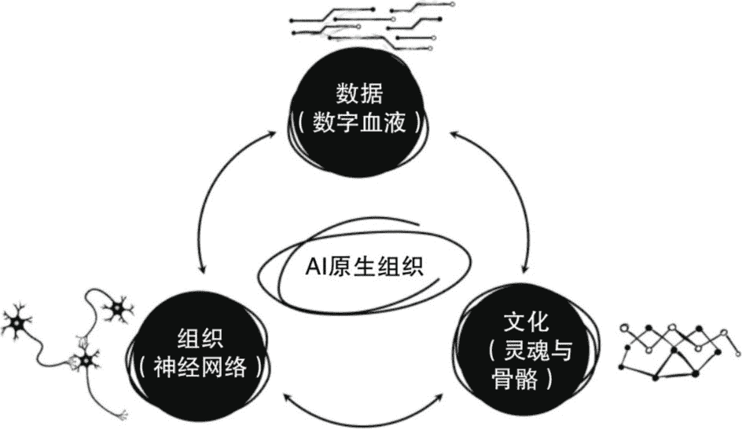

图 a AI 原生组织的“生命体”构成

创生由此启动。第一步是让新生体获得源源不断的数字养料。

**第三章 数据为智能备料**

第二章已做过组织体检，确定了走向 AI 驱动体的方向。可当要点火时，大多数团队卡在第一步——燃料不够。没有高质量的原材料，最先进的智能体也只是空转。信息不再是报表上的数字，而是智能的血液。因此构建必须先修复组织的供血。

为什么不少企业坐拥庞大信息资产，却像信息乞丐一样活着？为什么过去十年的数字化浪潮多以失望收场？

我们曾为一次用户留存优化付过学费。问题很简单：用户注册后第一天都做了什么？于是跨三个部门展开搜寻。

产品组拿出埋点，说多数人点开了新手引导；市场组拿出投放数据，说用户多来自优惠券链接；客服组汇总工单，说新用户的首问多是找不到隐藏功能。

三份材料讲的是三套故事，像三块碎片指向不同方向，拼合后反而混乱。花了数周才拼出模糊路径，而这时一半新用户已流失。这次痛苦，正是多数组织信息困境的缩影：手里不是金矿，而是被割裂的信息板块。

板块割裂只是表面。更深的危机在水下：大量过程型信息如会议讨论沉在看不懂的暗区里；即便捞出来，高昂的使用成本让它们沉睡在湖底，再没被唤醒。

看不见的板块、看不懂的暗区、动不起的沉睡，三大顽疾像慢性病一样侵蚀转型。如今它们正扼住超级大脑的咽喉，并在每个角色身上转化为焦虑。归根到底，还没有为智能建立可用的信息供给体系。

**第一节 信息视角：从人读报表到模型用燃料**

就在我们因信息板块流失用户时，特斯拉的自动驾驶智能在静默成长。每天数百万车主上路，车内智能以影子模式记录人类操作并与自身判断比对，差异即时回传云端。数百万司机不自觉成为教练，每一次复杂路况应对都在训练大脑。

相比之下，多数企业仍把信息做成报表供人复盘。智能只能看到结果，看不到情境。一家零售商让智能预测爆品，结果建议囤积曾经滞销商品，因为它只读到销量激增，没读到促销清库存的背景。信息割裂让智能蒙眼决策。

这指向根本转向：当智能成为核心决策主体，信息必须像血液一样在组织各处自由流动，为智能持续供养。对渴望转型的组织而言，打通板块、建好信息底座，已是赋能智能的首要工程，也是无法回避的头号任务。

**一、核心转向：从服务人阅读到服务模型使用**

过去我们为方便人阅读，做成报表；现在要为方便模型使用，提供原始、全量、实时的原材料。在新范式下，信息的价值不再是帮助人类复盘，而是驱动智能实时行动的燃料。

特斯拉与 Shopify 是先行样本。传统车企仍在试验场重复验证有限场景，特斯拉的每辆车都通过影子模式从全球真实道路上持续采集人类应对长尾场景的数据回流模型进化。而当多数公司的信息仍被困在业务系统与部门墙内时，All in AI 的 Shopify 已用统一架构把内部数据全部接口化，任何员工像调用 API 一样驱动智能整合全公司数据创新。

当算法与算力日益商品化，真正的护城河是独一无二的、高质量的、可持续为智能供应燃料的系统。组织的智能上限，写在它的血管里。

苹果在智能时代的困境是反例。其血脉循环不畅：特斯拉让每辆车成为采集终端形成开放循环，苹果却因强隐私与封闭生态筑起高墙，限制了模型获取多元养料，迭代变慢。苹果曾把智能圈在独立部门，像给大脑单独供血，结果必然协同受阻、创新神经坏死。在原生智能时代，任何板块或流程壁垒都是致命血栓。

我们也曾为此付代价。一个海外竞品一周内上线创新功能，夺走近 10% 市场份额。复盘时，客服邮件与社区论坛里有成千上万条用户抱怨的痛点信息，因是口语错别字的暗数据而被忽略。

**二、信息底座：智能时代的供血系统**

多数企业智能化转型卡壳，本质是缺乏真正的信息设施与技术底座。这不是技术问题，是组织供血系统故障。

这也解释了为何信息底座必须成为头号工程。它不再是看 ROI 的战术投资，而是关乎未来的战略投入。启动前，领导者需自问三件事：

·是否认可未来组织优势将主要来自智能驱动？
·是否确信智能能力高度依赖其获取的信息？
·是否愿为无法立刻体现在财报却关乎长期竞争力的基础设施持续投入？

三问皆肯定，讨论才有落地土壤。信息底座已不是单纯的 IT 工程，而是迈向原生智能状态的决定性基石。转向路径清晰：先完成业务过程数字化，把一切活动转为智能可读的原始信号；再经汇聚标注开放的炼金流程，将信号提炼为智能行动燃料；最后在文化与实践护航下，让信息成为组织进化的永动机。下面先看如何完成业务过程数字化，让血液真正流动。

**第二节 业务过程数字化**

如何修复供血系统？首先要对流淌在组织血管里的业务活动，进行数字化捕捉。只有真实业务状态被记录，智能才拥有视力、才有看见的基础。我们称之为经营数字化，如图 3-1 所示。

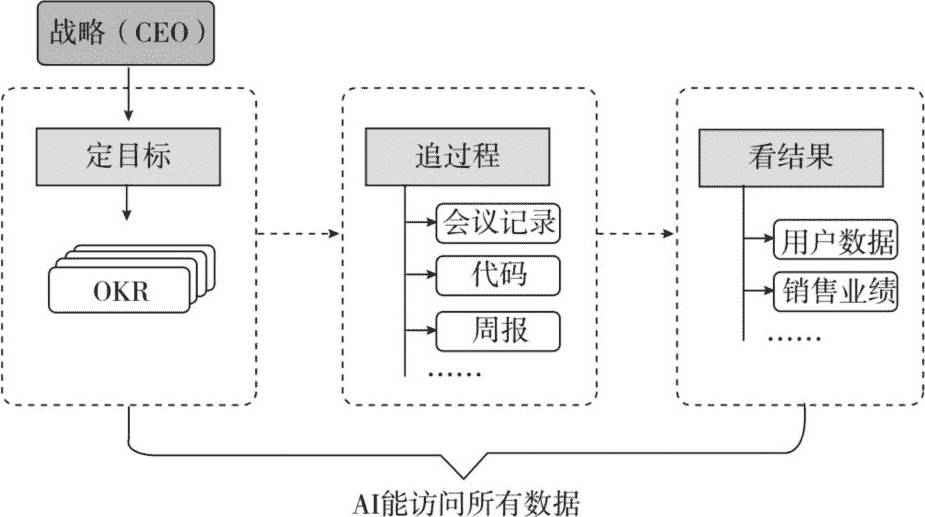

图 3-1 数据基建：经营数字化，让 AI 访问所有数据

这不同于传统只记结果的流程线上化。对特斯拉而言，是把数百万辆车的行驶状态、传感器读数、驾驶员每次干预都转为可学习的素材；对中国移动而言，是把遍布全国数十万基站的实时信号强度、流量负载、告警日志从封闭网管中解放出来，形成一张可被智能感知的网络。

智能时代的原则是：把隐性过程显性化、结构化。以近乎偏执的程度捕捉充满上下文的过程数据——会议讨论、生产路径、客户反馈，正是智能理解因果、学会组织的养分。

智能需要看见的数据大致分两类：一类是内部管理数据，揭示组织如何运转，如会议讨论、周报进展、代码库提交；另一类是外部业务数据，反映与市场互动结果，包括业务结果数据如日活、营收等告诉发生了什么，以及用户声音数据如反馈、评论告诉为何发生。

如图 3-2，我们从四个关键场景入手，把组织的思想熔炉、体检报告、生产车间、前线炮火声依次数字化。

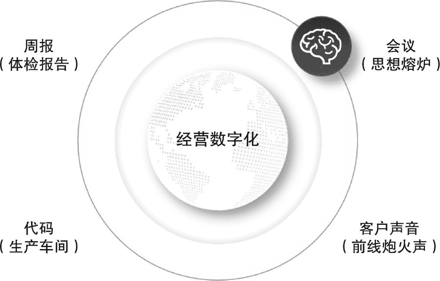

图 3-2 经营数字化的四个关键场景

**一、会议：思想熔炉驱动决策**

会议是信息生产与思想碰撞最密集的环节，却常随散会消散。要留住价值，必须记住：没有数字记录和智能参与的会议，等于没开。推行初期常遭抵制：转写不准、怕扼杀创造力、担心表达受限。强制命令最无效，破局靠耐心而坚定的文化变革，从技术与习惯两端同步推进。

技术上选用主流工具如飞书、Microsoft Teams 的智能纪要，或智能会议助理 TicNote，它们不再是纪要工具，而是每个人的智能思考伙伴。文化上管理者以身作则，引导团队养成提前准备、换位思考、会后明确行动项的新习惯，让效率本身成为说服力。

转折点往往在不经意出现。一次部门为三个月前决策细节争执，项目经理调出当时的 TicNote 纪要。智能清晰复述讨论背景、关键论据与最终结论，分歧瞬间消解。那一刻，TicNote 从规定变成了组织可信赖的集体记忆体。

也因此，如今飞书、TicNote 等主流协同平台都把智能会议纪要作为标配。如 TicNote 能自动提取待办、识别发言人、生成摘要，正是对会议即数据理念的结构化实现。

共识已成形：会议最核心产出不是润色好的 PPT，而是达成共识前那些充满火花的碰撞过程，而这些过程正是喂养智能理解决策逻辑的最佳养料。

**二、周报：喂养 AI 数据血液**

多数组织里周报沦为形式主义的汇报表演。在原生智能范式下，它应成为组织体检报告，读者是智能。直接要求员工写得更真实只会加剧抵制，关键在于改规则，让提供真实信息的人受益。

实践路径是赋能到共识的转变。

智能辅助化负担为便利：引入可基于会议、文档自动生成周报初稿的工具，智能完成 80% 撰写后，抵触自然下降。

人机对齐发现隐性问题：员工在智能初稿上修正时，差异恰恰揭示最微妙的隐性困难与潜在风险，形成精密纠偏罗盘。

高层较真明确价值：CEO 亲自审阅周报并评估质量，反复传递信号智能终将从周报看到真实状态并给出决策建议。周报不再是写给某个人看，而是为组织智能进化供养。

当员工感受到真实信息能换来更精准资源支持时，周报就从不得不演的戏变成为组织健康做诊断。起点是温和赋能，而非强硬命令。

**三、代码：开发足迹可视化**

在技术公司，研发是价值创造的核心车间。但这里常有信息黑洞：有最终代码，却丢了产出过程的上下文。必须把研发全过程数字化，让开发足迹成为可追溯数字资产。核心原则是：在智能体协同开发的未来，上下文比代码本身更重要。

Shopify 的 Roast 框架极具启发性。它用吐槽代码的方式把代码审查这个充满隐性知识的过程结构化为智能可参与学习的对话历史，正是经营数字化的典型落地。

研发数字化包含：
需求可追溯：在 Jira 或飞书中把每个研发任务与需求单或用户反馈强关联，确保一行代码都能追溯到商业价值源头。
提交自解释：某 AIGC 头部公司推行严格的提交说明规范，要求注释清晰说明 Why 与 What。好的提交说明本身就是微型设计文档。
评审有沉淀：将评审中的关键权衡思考记录下来。
拥抱智能编程：像 Cursor、GitHub Copilot 这类工具正重塑研发流程。某 AIGC 头部公司要求团队 100% 默认使用，流程随之改变。

终极形态是把所有分散数据统一到一个平台，让上下文沉淀自动化。出门问问自研的 CodeBanana 就是这一哲学的体现：开发者与智能的互动、代码提交与评审都天然结构化记录，形成最完整的上下文。

制造业亦然。把机床振动、能耗、工艺参数、物料物流与在制品状态数字化，才能让智能感知并干预实体经济。

**四、客户声音：一线反馈驱动改进**

研发是生产车间，客户声音就是原材料与质检报告。但这些声音分散、嘈杂、难捕捉，组织常因此失聪，直到竞品直击痛点才追悔。为让组织听见炮火声，必须主动出击，核心理念是把每一次抱怨、赞扬、建议都视为宝贵数据馈赠。

建立全渠道采集系统：用网络爬虫、数据仓库等技术搭建自动化汇聚平台，把各渠道声音汇入统一数据湖。
智能赋能一线实现价值交换：为销售、支持配备智能助手，对关键通话录音转写摘要。当销售发现智能能总结客户关切、生成拜访策略时，记录不再是负担而是武器。
人机协作优化理解力：初期智能分析有限，需让一线专家每天花少量时间审核修正，并反哺模型。

某 AIGC 头部公司的跨国实践里，海外用户一条关于跑步机升级后蓝牙耳机断连的抱怨，发布后 3 分钟内即被客户数据看板自动捕捉、翻译、分析，并作为高优先级推送给负责人。过去此类意见常止于已读未回，如今组织首次拥有实时主动倾听的能力。图 3-3 展示了该看板的评论分析页面。

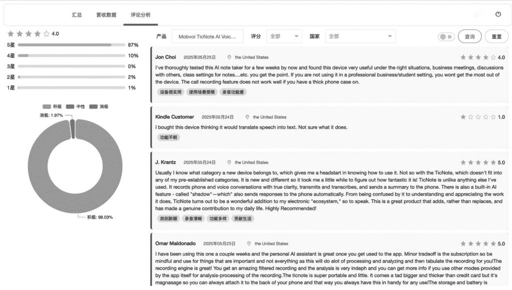

图 3-3 客户数据看板系统的评论分析页面

这种将客户声音资产化的探索，与消费电子品牌安克的成功路径一致。安克早年就建起强大的自动化用户声音汇聚与分析系统，用看板把全球评论汇聚、做语义与情感洞察，并作为产品迭代的第一信号源。这让它总能更快捕捉需求、持续做出爆品。安克的验证说明：把过程数据治理内化为组织 DNA，才是挖掘黄金的关键。

**第三节 让 AI 看见所有数据**

完成经营数字化，相当于为组织采集了各器官的原始血液样本。但原始血液不能直接供能。让智能看见还不够，它还需要能听懂、能调用、会行动。

构建组织的智能血脉：让数据从沉睡到行动

要在智能体真正运转，企业必须先搭建一套自我循环的信息体系，把分散在各处的基础素材提纯成模型可直接消费的燃料。打破壁垒的过程有点像当代炼金。接下来以三段式路径，系统性解决信息孤岛、信息黑洞、信息过载这三类顽疾。核心是回答信息为何常无法驱动模型，并推动信息从可信、可读到可用的关键跃迁，让模型不仅能看懂信息，还能调动信息，释放被压抑的能量。图3-4展示的三个环节，正是将混乱素材逐步加工为模型自主作业的燃料。在以智能为原生的组织里，信息架构等同于智能架构，信息通道本身就是生产力。

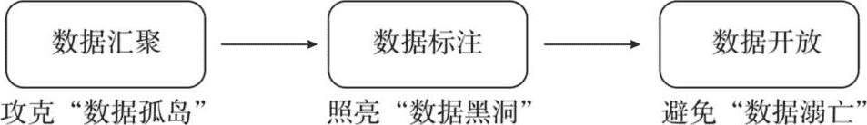

图 3-4 数据治理流水线和关键步骤

**一、汇聚整合：锁定唯一基准事实**

信息智能的第一环，也是最基础的一环，是消除孤岛，还原唯一可信的事实。在快速扩张的企业里，信息天然散落在各业务系统与部门之间，互不联通。模型的视野如果也是割裂的，就不可能形成全局认知。

汇聚不是简单搬运，而是一场去伪存真的清洗。要像修复文物一样审慎，把错误、冗余、矛盾的噪音剔除，并把所有素材对齐到同一标准与格式。只有这样汇聚起来的才是真相，而不是一堆废件。实现的关键不在事后补救，而在重塑数据的产生方式。

第一，立下不可违抗的流程铁律。规定采购、报销等核心业务必须百分百在统一的线上系统里完成，比如飞书审批、SAP ^(³)，彻底堵住线下操作与人为干预的口子。第二，统一全公司的业务语言。通过指标字典为活跃用户等关键术语设定唯一的定义，让所有人、所有模型说同一件事。

一家AIGC头部企业的订单金额三口径事件很有代表性。为核算产品真实成本，他们追查一笔采购订单的最终金额。运营从审批系统调出60万元，财务盖章单据是130万元，供应链邮件里还躺着第三个版本。三份数据各称自己为真相，调查陷入僵局。回溯系统日志后发现，早期的审批流程允许订单金额直接修改却不触发复核，于是出现了同号不同价的无效订单。

顶尖企业把这一原则制度化。Airbnb因内部定义混乱导致决策受阻，后耗费数年打造Minerva元数据平台，核心使命是为关键业务指标建立唯一真实信息源。蚂蚁集团则构建金融级Data Lineage数据血缘体系，任何核心指标都能清晰追溯来源与加工规则，从根源杜绝各说各话。它们指向同一个结论：单一真相是信息智能大厦的地基，夯实它需要考古级的耐心与严谨。

**二、标注赋义：为信息注入业务灵魂**

孤岛打通后，还要照亮信息黑洞，为素材注入业务洞察。组织里价值最高的信息，往往是那些非结构化的过程信息。清洗后的用户反馈、会议文字，模型看到的仍是无意义字符。信息不会自言自语，除非注入业务上下文这一灵魂。第二步就是把商业智慧写入冰冷数据，让模型不仅看见，更能看懂。

需要两个关键动作：萃取与定义。

萃取是把无序文本转化为可行动洞察。海量的过程信息真实却杂乱，模型难以判断价值。萃取的意义在于自动发现深层联系，把非结构化噪声变成结构化信号。

特斯拉的影子模式之强，就在于能自动从海量驾驶信息中萃取模型判断失误的长尾场景，成为模型进化的养料。蓝色光标服务客户时，用网络爬虫实时萃取全网舆情，从大量社媒帖子里精准分析用户核心关切与情绪，这件事过去需数天人工完成。同样一家AIGC头部公司，能让模型从一小时会议录音中自动萃取3-5个关键待办与决策点。

萃取背后是反馈到响应的自动化闭环：全渠道采集用户声音，用大语言模型智能分析，再把高价值洞察自动推送到执行系统，如在研发项目管理工具中直接建任务。

定义则是把数据的最终解释权交还一线专家。信息越真实易懂，越会浮现权力问题：业务不敢开放信息，模型标注业务不认。治理的核心是把语义归属权还给最懂战场的人。

某AIGC头部公司曾为如何定义负面反馈争执不休。客服反驳技术团队：用户说你们这续航真是太感人，算法能识别出讽刺吗？最终确立业务主导原则，由客服牵头定义核心标签体系，冲突时由其拍板。

中国移动构建智慧网络大脑时，成立由一线资深网络优化工程师主导的数据治理委员会，由他们定义故障等级、标注告警。华为让听得见炮火声的人画战略地图的精髓在此，华为甚至强制优秀业务专家轮岗到数据部门，直接参与战略制定。

这些案例共同说明：信息治理的最高境界不是技术完美，而是把人的经验与智慧有效注入信息。萃取与定义完成后，模型才真正理解我们的世界。

**三、开放调用：把洞察变成行动**

让模型读懂只是手段，让模型执行才是目的。为避免组织溺亡于信息海洋，必须让信息动起来，成为模型与业务人员随时可调用的智能服务，并接入行动回路。这相当于为模型装上标准化的手脚。

包含翻译、封装、闭环三个动作。

翻译即构建统一语义层。数据仓库里的信息像技术方言，业务想问上周活跃用户多少，工程师却要写长串代码。语义层充当同声传译，把复杂技术查询预先翻译封装成清晰业务概念，比如把周活跃用户的复杂计算封装为可直接调用的指标。传统平台终点是看板，智能原生组织起点是可被机器调用的接口。

封装即搭建标准API。把经过语义层翻译的信息能力封装成标准、可控、安全的API服务，让全公司信息像高质量产品一样被调用组合。Netflix能让模型深度参与推荐之外的创造性任务，正得益于其信息产品即API的内部体系。

闭环即连接工作流。把信息接口与工作流引擎联通，形成信息→判断→行动的自动化闭环，让模型从被动分析师进化为主动智能队友。例如系统通过API识别高风险用户反馈，不再发报告邮件，而是自动在项目管理工具创建任务并指派工程师。

Shopify是教科书案例。该公司未让员工面对复杂数据表，而是构建统一智能入口和模型上下文协议MCPs服务器，秉持万物皆可MCP。通过统一代理层彻底翻译封装所有工具与信息，成为标准化服务。

基于此，闭环工作流不断涌现：非技术销售代表可调用智能服务自动生成过去需数据分析师耗数小时的网站性能报告；工程师把所有工具信息整合到今日待办主页，由智能服务自动排序优先级。这才是信息驱动行动的真实样貌。

汇聚以统一真相、标注以注入洞察、开放以驱动行动，三步构成从原始矿石到精炼黄金的完整炼金。信息架构等同于智能架构，信息通道本身就是力量。

**第四节 数据底座实操：五条行动军规**

经营数字化让模型看见所有信息后，需要完成思维范式升级。过去互联网信息思维是对照实验思维，在已知选项中优化已知路径，本质是回顾式决策辅助。

智能原生信息思维的核心是端到端涌现思维，目标不是优化而是驱动模型涌现未知可能。它要的不是点击率等孤立行为信息，而是端到端、多模态、含因果链的过程信息。一段完整销售对话录音，比无数零散按钮点击更有价值。组织层面可为会议过程、任务协作、目标复盘等埋点，让模型学习隐性运行逻辑。

智能时代的信息基建是持续转动的信息飞轮：定义目标→过程埋点→模型涌现→决策验证→再次定义目标。每轮结果都是对上次假设的检验，也是智能进化的起点。让飞轮转动，需在文化与实践上克服惯性。以下五条军规是确保飞轮启动并加速的压舱石。

**一、敏捷进化：告别完美主义**

构建信息系统时曾陷入陷阱：想一开始就打造覆盖所有业务场景的完美中央数据仓库。三个月时间连数据源梳理未完成，项目几乎停滞。飞轮不是一夜建成。

真正的推动力来自最小闭环快速验证。我们改用拧螺丝工作法：先挑最关键业务问题如订单信息不一致作为突破口，快速打通最小化信息链路，验证价值，让团队第一次看到成效。最小飞轮启动让团队重拾信心，为后续体系奠基。这印证了敏捷原则：不求一开始完美，先启动、先验证、先推动，让小而可行的成果带动系统成长。

**二、从业务倒推：需求先行**

实践中常见误区：团队先谈技术与系统，忽略业务场景。花大量时间清洗历史信息搭建平台，却不问业务哪里出问题、用户为何流失、利润去向何方。

每一场关键信息战役都必须从真实业务痛点出发。正因利润幽灵暗中游荡才彻查采购订单的罗生门，正因用户声音被忽略才打响标签战争。信息治理优先级必须服务业务痛点。

曾见一家公司花半年清洗历史信息想做到完美。战略复盘时CEO问：为何上个月东南亚转化率跌了？技术总监翻遍新数据库才发现，忙于清洗陈年旧账，却忘了为上月东南亚大促做实时埋点。这是典型的为信息化而信息化。真正的业务开刃要求先找到最硬的石头。不能解决为什么跌了、钱流向哪里这类生死问题，再干净的信息也是昂贵垃圾。

**三、治理优先：杜绝脏信息入模**

一家AIGC头部公司曾为求速度跳过前期清洗治理，直接把脏信息喂给模型。结果模型不仅无价值洞察，反而一本正经输出错误信息误导决策，危害大于无模型。

硅谷公司QuantaMind拿到顶级投资，模型先进却忽视治理，把水军评论当爆款、误判反讽为正面，因模型基于脏信息输出灾难性洞察而信誉破产，不到一年倒闭。QuantaMind死于对信息数据的傲慢。连Netflix早期也因信息质量问题导致推荐大量无关电影，险些动摇信任。

信息治理是信息基建生命线。治理投入须与工程资源对等甚至前期更多，项目规划中为清洗、标注和治理预留充足时间与资源，通常占40%以上，并从第一天建立标准流程。

**四、下放定义权：让一线定语义**

许多公司的信息变革是IT部门自嗨的独角戏，前线业务早已离场。技术型公司耗资打造完美标签体系，结果一线员工不用，反被复杂规则困住。真正的胜利是让客服、销售、产品等前线战士定义标签、参与治理。信息终究是业务武器。

Shopify团队客户支持成为增长最快的智能工具用户群体。华为、美团秉持让听得见炮火声的人做决策，早期构建指标体系由一线区域经理与产品经理主导，而非分析师闭门造车，确保指标直指核心矛盾。

行动原则：信息的定义权与解释权必须掌握在最懂业务的一线专家手中。让业务专家深度参与甚至主导定义与治理，否则技术打造的只是一座无人问津的信息玩具。

**五、正向激励：把信息变成勋章**

很多公司把信息记录与治理视为对一线的负担与监控，引发抵触。真正的变革始于让信息成为勋章。好信息系统不是监控人，而是释放智能。

某AIGC头部公司曾把客服响应速度做成实时看板，对积极变化立刻在团队群点名表扬，看板从监视器变成荣誉墙，信息成为证明战功的勋章。

蓝色光标推行人工智能优先原则，在加薪升职预算申请上向拥抱智能的员工倾斜，提出无AI、无奖金、无晋升。Shopify更进一步，推行极致民主化，全员无差别拥抱智能，不设预算上限。法务部门角色从刹车转为导航员，要求员工以如何促成为出发点，为智能创新默认开绿灯。自上而下的文化重塑才是最强正向反馈。

这五条军规的落地根基是有序的透明文化。企业内部任何问题都能摊开用信息讨论。没有绝对坦诚，任何信息化工具都会被视为监控而遭抵制。

分享这些经验前必须明确不可动摇的前提：对安全与信任的敬畏。开放信息通路不等于安全失控。要坚守：用户数据是信仰不是资产；员工信任是信息流动前提；智能每次访问必须留下痕迹，行为可追溯、可审查。最终我们发现，信息的尽头不是技术而是文化，信息飞轮的永动机不是算法而是信任。

**第五节 转型工具箱：信息智能三动作自检清单**

为判断信息能力是否真能支撑智能化行动，我们设计了自我诊断工具，聚焦三个维度：信息一致性、信息洞察力、信息行动力。

**一、维度一：信息一致性（可信度）**

痛点场景：会议上各部门信息打架，为哪个数字是真而争论。

自检问题：
□ 核心业务流程如采购、报销、审批是否100%在线上统一系统完成，无线下手工台账？
□ 公司是否建立统一指标字典，明确活跃用户、毛利等术语定义且全员及模型共识？
□ 模型回答业务问题时是否经常出现幻觉或引用错误数据源？

**二、维度二：信息洞察力（暗信息治理）**

痛点场景：会议录音、客户反馈躺在硬盘里，仅占空间不产生价值。

自检问题：
□ 非结构化信息如会议录音、IM记录、客户电话是否被系统性记录并转化为结构化文本？
□ 信息标签与定义权是掌握在IT部门，还是由最懂业务的一线专家如销售、客服把握？
□ 是否有机制让模型从海量对话中自动提取高频痛点或竞品情报？

**三、维度三：信息行动力（闭环）**

痛点场景：信息分析只是发给老板看的静态报表，看完即止。

自检问题：
□ 核心信息能力是否封装成API，可被模型随时调用？
□ 信息出现异常如流量暴跌、差评激增时，系统仅发送警报，还是能自动触发智能体创建任务并指派责任人？
□ 组织是否实现从信息洞察到智能行动的自动化闭环，如自动退款、自动派单？

诊断结论如下：

勾选项少于3个：属于数据孤岛形态。信息只是摆在那里供人观看的纪念碑，智能体因缺养分而停摆。

勾选项在3到6个之间：进入数据治理形态。基础建设初具规模，智能飞轮却尚未转动。

勾选项达7个及以上：迈入数据智能形态。信息流已化为驱动智能体自主行动的血液。

**第四章 组织如何向 AI 原生演进**

1771 年，英国德比郡河岸，理查德·阿克莱特建造了世界首座水力纺纱厂。把原本散落各家的手工纺纱匠召集到同一屋檐下，围绕动力机器展开协作。阿克莱特带来的不仅是设备，更是一套全新作业方式——把个体聚合起来，实现大规模协同。

一个多世纪后，亨利·福特在底特律再起波澜。流水线把造车拆成数千个基础动作，让复杂工艺从依赖手艺转向可分解工序。汽车于是从奢侈品变成大众商品，也奠定了20世纪工业生产的思维。由阿克莱特的聚合到福特的拆解，工业革命完成了对体力劳动流程的重塑。

今时今日，知识工作占据主导，一场新的变革正在发酵。智能体成为核心角色，重写协作逻辑、模糊岗位边界，对知识作业完成前所未有的聚合与拆解。组织的数字血液在奔流，指令却在传递中受阻。执行主体已从人转向智能体，答案不是让人类跑得更快，而是彻底重构作业本身，打造真正的AI原生组织。

**第一节 从文档传递到原型驱动**

上一章我们完成了造血工程，让干净流动的数据渗透到组织各个角落。本能以为有了充足数字血液，新生命体就会立刻奔跑。

现实是，数据虽已不再孤立，行动指令却出现了严重的神经阻塞。症结不在数据本身，而在于沿用百年的线性协作惯性。这场诊断源于一家AIGC头部公司一线产品经理林珂的自述：“我感觉自己像信息搬运工，而非创造者。”

林珂曾是团队最强的翻译官，日常把用户模糊痛点转译成详尽的产品需求文档，再把文档转译给工程师。她做得漂亮，却极度痛苦，因为最初的用户火花在层层转述中降温熄灭。

AI编程工具进入后，团队以为问题将迎刃而解。新困境随即出现：工程师能迅速产出大量代码，但因智能体误读文档，功能常与预期背道而驰。沟通从对齐文档变成争执代码。林珂不仅要转译，还要调解智能体与工程师的理解偏差，疲惫加剧。

转折点来自一次紧急项目。林珂做出看似离经叛道的决定：不写文档，直接用自然语言指令生成可交互原型交给工程师。随后奇迹出现，工程师几分钟内就吃透意图并给出优化建议。林珂顿悟：在智能体时代，最有效的沟通媒介是原型而非文档，最高效的工作方式是并行共创迭代，而非线性翻译传递。

这一观察与麦肯锡最新报告《2025 年人工智能的现状：智能体、创新和转型》不谋而合。报告指出，对企业利润影响最大的是流程重构，而非模型先进度或人才储备。数据显示，仅约21%的公司真正借助智能体重构流程，其余多停留在浅层优化。领英首席产品官托默·科恩直言：“工作本身不复杂，让它复杂的是流程。”

为何是流程？传统线性流程本是为降低人类沟通成本而生的次优解。当智能体能低成本生成原型时，会议与冗长文档反而成为浪费。智能体作为新型生产力，必然要求匹配的生产关系。正如蒸汽机终结手工业关系，智能体也将终结为人类执行力稀缺而设的线性分工。人类创造本是非线性整体性的，智能体提供了廉价的整体执行范式，让工作流回归创造性与非线性。

流程革命是第一步，它颠覆做事方式，为新的执行者与新组织架构铺路。这正是砸断线性传送带的意义。

**一、线性传递的两大死穴**

传统研发像一次接力赛。需求由产品经理由文档形式依次传给设计师、前后端、测试，直到上线。每环节各自为政，形成信息孤岛，只能靠脆弱的文档与会议连接，如图 4-1 所示。

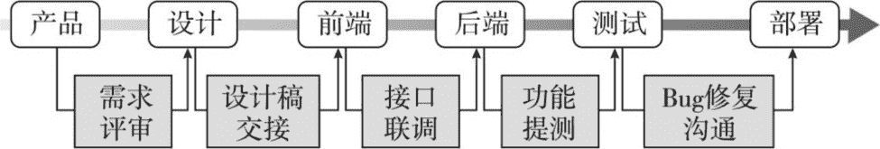

图 4-1 传统线性研发流程

这条建立在层层转译上的生产线，在智能体时代暴露两大致命缺陷。一是信息损耗严重。据统计，传统研发中高达42%的关键信息在抵达开发者前失真或遗失。二是责任断裂。每人只对本环节交付物负责，产品经理由需求文档负责，设计师由设计稿负责，工程师由代码负责，却无人对最终产品是否解决用户问题负责。

团队曾试图用智能工具为这条破碎产线提速，结果适得其反。转型初期，林珂仍困在文档传递里。她回忆：“当时做Web开发，前端四人、后端两人，规模不小。可协作割裂，我把想法写成PRD交给研发，前后端每天无数通电话确认细节。大部分精力耗在翻译上。”

启用代码生成工具Cursor后，又一个噩梦到来。“开发确实快了，”林珂说，“但调试时间变得无穷无尽。”从文档黑洞到调试黑洞，团队明白，单靠工具为一条断裂未重构的产线提速，只会放大问题。

“我过去是设计师，习惯先画图梳理逻辑，”林珂回忆，“Cursor能直接生成HTML原型。那我为何还要写一份易被误读的文档？”她直接与智能体对话，快速生成并迭代可交互HTML原型，随后把这份活原型发给研发，而非厚重PRD。

“研发直接复用我的原型代码，告诉Cursor如何把它变成Web代码，还原度极高，几乎零沟通成本。”林珂说。这次越界带来顿悟：活原型才是智能体时代最精准高效的沟通语言，已取代死的文档。

智能体彻底瓦解旧线性作业的经济基础：高昂的转译成本与生成成本。过去从想法到代码需经产品、设计、工程师高成本低保真的转译传递，而从零生成原型的成本本就低于描述它，故被迫选择文档优先这种反创造力的线性妥协。

就像Notion CEO Ivan Zhao 所说的“水车阶段”。许多公司只是把AI助手像螺丝一样拧在旧流程上，如同当年工厂把水车换成蒸汽机却仍守在河边，生产力并无本质提升。真正的变革在于离开河流——围绕永不眠歇的新员工彻底重设计工厂。不是让智能体适应人，而是让人适应智能体的光速。

智能体作为通用转译器与低成本生成器，重塑了创新生产的底层逻辑。当原型生成边际成本低于需求描述成本时，文档优先范式被证伪，原型优先成为必然。此变革触发连锁反应：先颠覆流程经济性，再重塑能力矩阵，最后解构组织形态。其不可逆性源于智能体对生产函数的改写——当验证成本趋近于零时，所有依赖高验证成本的协作模式都将被进化压力淘汰。

这张多米诺骨牌改变了传统科技企业的作业：撰写大量无人阅读的项目文档，开数场无效会议，最后产出阉割版方案。而Lovable这类AI原生公司展示了另一种原型文化。员工直接用自研平台搭官网，用智能体做黑客松报名系统，甚至内部工具如红人管理系统也全由智能体生成。没有项目说明书，也没有交接文档。“发现问题就直接行动”，低成本试错让混乱减少90%，产出提升10倍。

**二、原型即共识的语言**

这场自基层发起的重构核心，是作业从文档驱动转向原型驱动。产品经理不再是文档搬运工，而是原型设计者。原型即思考的新能力带来颠覆性效率提升：做一个完整智能体原型，0到1只需20分钟。变革沉淀为三步作业。

·即刻原型：接到需求，立刻用智能工具生成可交互最小可行产品原型作为讨论起点。
·前置对齐：携带活原型与所有相关方验证，把共识建在流程最前端。
·文档后置：最后基于高度共识的原型，让智能体生成轻量文档作交付依据。

把团队协作中最昂贵的环节——建立共识——从流程末端提到前端，返工与内耗由此根除。某AIGC头部公司要求所有产品会上，产品经理不再以文档沟通，而是直接拿出原型讲解讨论。

在原型即共识理念下，协作画面被重绘。默认智能体承担研发，用户通过与原型互动反馈，智能体据反馈快速迭代，产品经理负责最终判断。由用户反馈→智能体迭代→人类判断构成的高速循环，取代了漫长会议与文档往返。Cursor等工具将工程师审查效率提升55%，工作重心从如何实现转向实现什么，更专注系统架构与核心业务逻辑。

流程革命本质是协作模式根本转变。过去围绕人分工组织流程，切割任务以适应人。现在围绕任务目标组织流程，最大化利用智能体能力，打破因人而生的限制。结果是更敏捷、高效、低摩擦的协作网络浮现，而旧角色必须进化，否则被淘汰。

**第二节 从操作者到指挥者**

前节的顿悟揭示流程革命必要性，而流程变革最终指向更深层的之人之革命——角色重塑。

要理解这场革命，回溯百年前费城米德维尔钢铁公司车间。年轻的弗雷德里克·泰勒手握秒表，记录工人每个动作细节，将劳动拆解为可测量可优化的标准动作。科学管理的诞生由此开启。泰勒秒表不仅改变流程，也重新定义人：凭经验工作的工匠被标准化的人形零件取代。

百余年以来，知识工作者虽在办公室，却继承泰勒诅咒。产品经理转译需求，设计师画界面，工程师写代码——人被固定在岗位，失去全局视野与创造乐趣。

智能体到来，正亲手杀死泰勒幽灵。智能体成为永不疲倦、可标准化执行的零件，承接大量可分解工作。人类价值被倒逼回更高阶角色：从精准执行者重返全局工匠，甚至成为指挥官，定义方向、驱动创新。

这场角色文艺复兴并非理论，而是真实上演。产品经理、工程师在痛苦自我怀疑后，从泰勒式高级零件蜕变为驾驭智能体、主导全局的指挥官。

从文档传递到原型驱动，不只是工具更迭，更是地震般动摇传统组织中人定位。当接力赛取消，所有人站在同一共创场，过去在各自赛道飞驰的专才——产品、设计、前后端——骤然失措。岗位边界以前所未有速度消融，流水线螺丝钉式工种必然消亡。

当旧地图撕碎，谁能在新地图上作战？旧兵种已不适配。必须创造适配新战场的物种。这就是我们定义的两个核心新角色：系统设计师与全栈工程师。他们的诞生是最深刻的组织进化。

**一、系统设计师：从传话者到架构者**

产品经理白羽曾是典型的翻译官。传统流程里，她核心工作是把模糊业务需求译成详尽精准的PRD。她做得专业，却内心挣扎。

“我像翻译者，不断在用户、工程师、业务间转述。文档再严谨，也无法完全传递最初打动我的用户真实痛点。”

当智能体作业席卷团队，白羽工作内容根本改变。她不再撰写厚重文档。“现在我直接跟后端说，搭个平台，然后我和运营把问题输进去，自己配答案。”她形容新模式。在此过程中，她不再被动翻译，必须主动设计——定义产品、划清人机协作边界，甚至学习编程工具，用最低成本快速生成可交互原型验证商业想法。

“我现在看代码仍有点头疼，但协作还原度很高。我终于感觉在创造，而非转述。”

白羽的转型展现全新角色诞生。她在复盘中描述转变：“过去在约束很多的小格子里找最优解。现在智能体抹平很多执行约束，我们必须学会在更开放混沌世界里自己找信号、定义问题……从解题者到出题者，或许是智能体时代产品经理最艰难也最重要的跃迁。”

系统设计师诞生：身份从被动需求翻译官转向主动全栈原型创造者。他们不一定最懂代码，但必须最懂如何设计产品与人机协同系统。核心产出不再是会被遗忘的文档，而是一个持续迭代的最小可行产品。

完成从翻译者到创造者转变，系统设计师需掌握全新能力。核心要求是具备构建原型能力。在交付工程师实现需求前，必须提供可交互原型或视频，让所有人从用户视角直观体验。这本质要求其成为能端到端驱动产品落地的全栈创造者。需掌握三种能力。

·定义问题：不满足表面需求，结合深刻业务洞察与精准数据分析，提出值得解决的核心问题。
·拆解任务：最重要工作不再是画界面，而是系统性任务拆解。把宏大商业目标拆解为智能体可理解并独立执行的结构化任务流。
·设计协作规则：成为规则制定者。明确流程中哪些节点需人类价值判断，智能体何时以何种方式介入，如何评估产出质量。

转型正在重定义硅谷产品经理角色。在Shopify，产品经理重心不再是绘制详尽PRD，而是建造能根据商家反馈自我进化的智能工厂。过去商家抱怨订单流程复杂，PM会像建筑绘图师把PRD交工程师施工。现在，Shopify的系统设计师建造自动化智能工厂，用内部智能体工具分析数万条商家反馈，自动聚类核心痛点，再与工程师合作设计训练专门解决这些痛点的智能体。

这座智能工厂不仅解决当前问题，还能持续自我进化。Notion增长负责人、Airtable前任增长负责人劳琳·伊斯福德也认为智能体正在重塑产品经理工作方式，强调利用智能体提升效率与决策质量而非仅执行。一位优秀的智能体产品经理必须具备相当技术深度：能与工程师讨论RAG还是微调，能评估不同模型成本与延迟，也能设计好UX弥补智能体不确定性。

这再次印证核心判断：未来核心人才不是流程中的节点，而是系统的设计者与指挥官。这就是系统设计师本质，他们不再只是问题解决者，而是解决问题的系统创造者。

系统设计师诞生或许只是序章。对设计等高度创意部门，更激进探索也在实践中涌现。当智能体不仅能执行设计，还能克隆认知，会发生什么？

UI设计师诗雯的实践揭示这种可能。她的风格极具个人性，却成为规模化瓶颈。于是她把过去一年所有设计作品、规范乃至会议录音喂给专属智能体训练，创造出诗雯智能体。

七天后，年轻设计师不再预约诗雯，直接与智能体对话。几分钟内，智能体就能生成蕴含诗雯设计哲学与逻辑的方案。个人认知首次被克隆为组织随时调用的智能资产。这非要取代诗雯，恰恰解放她于繁琐执行，让她投身更有开创性的品牌战略思考。这个故事预示，未来顶尖人才价值可能不再是双手，即执行能力，而是大脑，即认知模型——一个可被智能体规模化复制并赋能给整个组织的智慧母体。

**二、全栈工程师：从分段执行到全链指挥**

若系统设计师进化为新世界创造者，负责把混沌灵感凝成清晰可交互蓝图，那么谁来把这张蓝图转化为坚实可靠、可服务千万用户的工程现实？

答案是第二个新物种——全栈工程师。他们不再是流水线被动执行者，而是驾驭智能体将伟大创造变为现实的指挥官。

起初，某AIGC头部公司尝试用智能体赋能的更高效施工队，让前端更快、后端更强、测试更自动化。一场深夜复盘改变想法，因其看到更深刻真相。

当智能会议助理核心功能因需求理解错误导致数周开发成果作废出现在复盘结论时，团队沉默。这种个体高效、整体内耗的代价摆在面前。他们拥有一群装备先进武器的单兵，却仍沿用锈迹斑斑的堑壕战阵法。

这场代价高昂的顿悟，导向清晰战略方向：真正的变革不在于让每个单兵在各自战壕跑得更快，而在于彻底打破兵种划分，创造能独自穿越整个战场的特种兵。当智能体能承担大量专业执行任务时，能覆盖研发全流程、具备端到端交付能力的全栈人才，将成为组织中最高效最敏捷的作战单元。

## 从写代码到当指挥官：AI 时代的工程师身份重写

高层最终拍板，把通栈型工程师定为研发序列的标配用人逻辑，口号是通栈常态化、专家例外化。每个研发都要完成从执行到调度的身份跃迁，掌握智能工具，能够独自闭环交付的“总设计师加现场指挥官”。

后端老兵周铮的转型，就是这场从“做事者”到“决策者”切换的典型样本。

导火索来自一个近乎不可能的急单：虚拟机状态展示需求被产品和设计排到后面，管理层直接丢话“周铮，你试试用 AI 先做出个可用版本”。

彼时的周铮只钻研虚拟机底层接口，对前端与交互一窍不通。按旧逻辑，这等于让炮兵去开战斗机。起初他很抵触，依旧想自己写核心逻辑，只把智能体当辅助。结果乱成一团，模型生成的片段和手工代码冲突不断，反而比重写还费时。

这次碰壁带来关键顿悟：智能工具对不同段位的人作用迥异。对资深高阶开发者，它是放大器；对经验不足者，反而可能因模型幻觉拖慢节奏。周铮的卡点，本质是拿旧时代的人机分工套新时代的工具。

真正的拐点，是他彻底重写自我定位。放下“必须亲手写代码”的执念，他开始扮演智能体的指挥官。

他不再纠结单行实现，而是把精力押在两个更高维的事上：一是把复杂的工程目标精准转译成模型能执行的指令，二是用架构师视角对模型产出做严苛评审。

要给虚拟机加一个复杂的状态协议时，他一行代码没写，直接向模型下清晰指令并附技术边界。几分钟后，前后端的骨架就出来了。“那一刻我开窍了，”周铮说，“我不再给模型拧螺丝，而是给模型当架构师。需求定义和方案评审在我手里，模型干了 80% 的体力活，我能第一时间揪出核心逻辑的漏洞。这种闭环的爽感以前从未有过。”

这也厘清了通栈的真实含义：不是样样精通，而是具备用智能手段把全流程跑通的整合驾驭力。价值锚点已从编码速度，转向指挥智能产出高质量、可维护、符合架构要求的交付物。

身份切换后效率出现质变。原本预估要跨部门磨合整月才能完成的状态协议，他独自从理解需求到上线只用了两小时。

上线那天，同事随口提一句“给每个状态加上负责人标签”。过去至少要排期一周。这次他再次下指令、评审、测试、部署，二十八分钟后功能就上线了。

从整月到两小时，从一周到不足半小时，这不是线性提速，而是量级的碾压。周铮的故事证明，当个体承担端到端责任并进化为智能指挥官时，单兵就能撑起一支由智能赋能的突击队。

白羽向“系统设计师”蜕变，周铮重生为“通栈型工程师”，两个新物种同时浮现。它们共同点明 AI 的本质：把人从重复执行中解放，逼着我们聚焦系统设计与创造性指挥，从而极大放大顶尖个人的价值。

这不仅仅是新增岗位，而是一场组织物种的大一统。由此沉淀出坚定的原则：组织里只保留两种核心的人类角色——系统设计师与通栈型工程师。无论产品、销售还是市场，都要向这两个方向进化。因为智能接管标准化执行后，人类价值被压缩到“定义问题、设计系统”与“实现系统、闭环交付”两端。

当超级个体大量涌现，一个新问题随之而来：怎样的组织形态才能承载这些不再是螺丝钉、而是可以独立成军的新物种？

**第三节 架构革命：从部门墙到“原子小队”**

美团将一批前端人员并入服务端组。这不是简单的部门搬家，而是组织基因的重写。作为 AI 编程浪潮里最早系统性回应的中国大厂，美团发现智能工具已迅速抹平前后端技术鸿沟。真正的效率杀手不再是写代码快慢，而是接口对齐会、联调排期、责任推诿带来的协作损耗。

这场“外科手术”切掉了被协作成本拖累的组织肿瘤，宣告新时代到来：按职能划分的部门墙正在坍塌，以任务为核心的“原子小队”正在崛起。工作流革命与新物种诞生必须重塑生产关系，旧结构如同过时操作系统，已无法运行新生产力应用。本节聚焦如何打破部门墙，催生 AI 时代最高效的组织单元——原子小队。

**一、最小作战单元的形态**

旧的职能墙和金字塔汇报线已无法容纳这些探险者。高效流程与进化后的人才结合，会自然催生一种新单元：打破固定编制，按任务动态组建临时的原子小队。

出门问问在实践中给出了极致内核：一位系统设计师加一位由智能支持的通栈型工程师。

在 Shadow AI ^(⁴) 研发中，出门问问首次验证了双人作战单元的力量。过去由庞大跨角色团队负责，转型后被这对组合取代。交付周期缩短近 70%，多方反复沟通的繁琐被彻底简化。

更深的问题是：如果双人单元是理想结构，如何打破部门墙、敏捷地按需召唤组建？一次紧急开发给出答案——用“英雄帖”取代“部门协调会”。

当时 TicNote 项目的海外合规功能七日内必须上线。按老流程是跨部门评审的噩梦。这次公司在内部发出一张标明任务要求的英雄帖。

数小时内，一支全新的原子小队自发成型：一位最懂用户的产品经理和一位有 iOS 经验的工程师。没有汇报线、没有项目经理，只靠共享的任务上下文系统协作。七天后功能准时上线。那位产品经理感叹：“我感觉不是在走流程，而是在和顶尖的人以及智能体，像蜂群一样围绕目标共同思考行动。”

TicNote 并非个例。AI 原生组织 Midjourney 也展现同样模式。年收入超 2 亿美元的公司起初只有 11 人，没有传统市场销售部门。成功关键在于最大化小单元的自主性和创造力，而非依赖部门墙和层级审批。

这些案例揭示一个颠覆性真相：在智能极致赋能下，最小作战单元的规模和形态被重新定义。原子小队的极致内核可压缩至两人——系统设计师加通栈型工程师。他们驾驭智能体，便能完成过去需庞大团队耗时数月的工作。

**二、规模化形态：中央大脑加神经末梢**

极致敏捷倒逼出门问问提出更严苛的研发要求：新产品三天出原型、五天上线；已上线产品一周内必须有一次重要发布。

原子小队的敏捷不容置疑，但大组织能否由无数原子小队构成？如何规模化？协作平台 Airtable 的转型提供了参照。它没有完全打散部门，而是保留精干的中央 AI 平台团队如“中央大脑”，同时把大部分 AI 人才嵌入业务团队，形成自主的作战单元如“神经末梢”。

无论是出门问问的英雄帖、Midjourney 的精悍，还是 Airtable 的大脑加末梢，都指向同一图景：当少数核心人才与强智能协同就能突破过去需人海战术的难题时，传统金字塔组织的合理性开始瓦解。图 2-7 直观呈现这场微观单元变革。这就是“组织大折叠”在基层的写照。

这场架构革命不止于硅谷独角兽。某 AIGC 头部公司内部也在进行更彻底的去芜存菁重构。为验证“组织大折叠”，他们把原本泾渭分明的产研团队重塑为 AI 原生产品工程中心。

转型前是典型的工业流水线结构：前端、后端、测试、产品、设计割裂。一个简单功能要跨 5 个部门，从需求评审到设计、开发、对接、测试，漫长接力。为应对多产品线，公司各职能囤积大量人力，却依旧忙闲不均。这是典型的加法组织。

转型后，公司打破所有职能边界，将 50 人重组为 AI 原生产品工程中心。

新架构下，前后端测试等细分岗位消失，取而代之的是两类通栈工种：FSE-P 产品方向通栈工程师，负责功能全流程交付，单人就是一支队伍；FSE-A 算法方向通栈工程师，负责把智能模块落地为服务。

随之是极致扁平化。原有多层汇报线被切除，改为扁平的技术组和算法组。Web 组和 App 组直接对结果负责，不再经中间层传话。精简人数后，交付效率反而提升 50%，线上故障率下降 30%。这是人效乘法的真实体现。

成功源于一组组织与技术设计的坚定践行。

第一是通栈文化与智能能力的双重普及。公司打破前端、后端、测试的传统边界，让智能从算法团队的黑科技变成每位工程师的基础技能。每个人都能独立完成端到端交付，这既消除等待成本，也标志着真正的 AI 原生开发模式诞生。

第二是扁平化管理与技术分组的制度创新。中间层消失后，沟通成本和决策链路大幅压缩，每个人都成为产品的“主人翁”。同时，Web 组和 App 组不再从属于单一产品线，而是聚焦于各自的技术领域，成为通用的能力中心。这种模式既提升技术的专业度，又实现资源在多条产品线间的灵活调配与经验沉淀。

这就是原子小队规模化后的形态。智能成为执行主体后，组织不再需要庞大身躯，只需智慧大脑加一群全能特种兵。

**第四节 范式扩展：从产研特区到全组织**

产研内部系统设计师与通栈型工程师的诞生带来静悄悄的效率变革。但对大多数组织而言，深水区是如何把变革的火焰烧过职能边界的高墙，蔓延到 HR、法务、财务等最难撼动的领地。

变革风暴已登陆大洋彼岸。2025 年 10 月，亚马逊宣布计划裁撤全球人力资源部门 PXT 多达 15% 的岗位。数千名 HR 精英将被自动化与机器学习系统取代。CEO 安迪·贾西直言：“随着智能在全公司范围内的深入应用，我们的整体企业岗位数量将随之减少。”简历筛选、绩效分析、薪资管理等工作被智能接管。亚马逊正从“人管人”转向“智能管流程、HR 管文化”。

警钟敲响：智能的渗透绝不会止于产研或业务前线，它将碾碎所有靠信息不对称和流程烦琐维系的中间层，无论是 HR、法务还是财务。

带着紧迫感，某 AIGC 头部公司审视内部：这场从产研特区向全组织的范式扩展如何发生。起初变革只燃烧在产研特区，智能核心引擎对其他部门而言只是技术团队的新玩具。真正的引爆点来自销售负责人的不耐烦。

周五下午，陈锐匆匆找产品经理白羽讨论海外大客户数据安全需求。惯例白羽会说：“我去找会议纪要，下周答复。”这次白羽打开智能核心引擎，直接提问：“关于大客户提到的‘数据安全’，我们最近三次会议的核心结论是什么？”

陈锐起初不屑。几秒后，屏幕上精准列出三次会议片段、发言人清单，并总结出决策和待办。陈锐盯着屏幕反复滚动，沉默半分钟后问：“它能用来分析我们的销售谈判录音吗？”

这个问题像火种，让智能核心引擎从产研效率工具跃迁为组织级智能中枢。此时第三章的“数据血液”与本章的“智能神经网络”交汇。陈锐意识到，这工具不仅是对话者，更是能接入、理解并整合组织全局上下文的思考者。当干净统一的数据血液流进反应迅捷的神经网络，真正的组织智能才可能诞生。

这也揭示了范式扩张的方法论：不是简单工具推广，而是深入每个业务单元肌理的智能化重构。公司认为要把产研范式克隆到销售、市场、法务等知识密集领域，必须遵循清晰打法。

首先是自我解剖。每位业务负责人像外科医生剖析工作流：核心任务是什么、现用工具、最大瓶颈在哪。

其次是寻找智能杠杆点。基于解剖图，判断哪个瓶颈最适合被智能突破以获取最大效率提升。

最后是把负责人重塑为系统设计师。一旦找到杠杆点，负责人需率先行动，像白羽一样扮演系统设计师——具备商业思维和用户思维，洞察需求并主导团队用智能工具快速产品化方案。

这条由点及面的扩张，本质是把智能工作流方法系统性克隆到组织的每个神经元。离炮火最近的市场与销售，自然成为复制产研成功范式的首批试验场。

**一、市场销售：构建跨职能协作单元**

传统销售团队的金矿不在 CRM，而在王牌销售汪焘的大脑和手机联系人里。他知道哪个客户喜欢周五下午被打扰，哪个客户的决策者其实是副手，哪个客户提到竞品会皱眉。高度依赖个人经验既是壁垒也是枷锁。汪焘休假业绩下滑，离职则带走无法复制的无形资产。新人面对他的网络只能在一次次拒绝中缓慢积累。

智能体工作流引入后，这场昂贵低效的手工作坊被颠覆。增长从人海战术转向智能驱动。

一位新销售面对客户“你们太贵了”不知所措。过去只能求助经理，现在直接问智能体。答案提炼自公司顶尖销售的真实成交录音，他立刻掌握最佳实践。智能完成最昂贵的能力移植，新人成长周期缩短 60%。

过去市场部花费数周做用户调研，结论往往过时。现在智能体每天进行最大规模的调研——自动分析所有销售通话，实时标记客户高频痛点如数据同步延迟、竞品名称。市场团队首次拥有来自一线炮火的鲜活洞察，营销内容不再猜测。

最具颠覆性的是，智能能发现人类会忽略的机会。一个真实故事是“3 天追回即将流失的大客户”。销售智能体捕捉到冷却期客户行为激活度飙升的微弱信号，立刻向忙于他事的销售发出高优先级提醒。

销售半信半疑拨打电话，对方说：“我们正在和竞争对手开会，准备今天签约……”三天后客户被成功挽回。若无提醒，这笔大单会在盲区悄然流失。

从能力移植到洞察涌现再到机会捕获，智能体驱动的智能增长飞轮形成。它持续转动依赖第三章构建的“数据供血系统”。真实客户声音被打通成数据，经智能转化为精准市场洞察，指导更有效的销售行动，新的行动又产生更高质量数据反哺智能，让数据血液循环更快更健康。

销售重心从盲目执行转向精准洞察，不再是撒网渔夫，而是实现精准狙击的智能战士。

**二、公共运营：实现组织价值最大化**

变革火焰很快蔓延到被视为成本中心的后台，如法务、财务。正如亚马逊 HR 的剧变，公司内部发生的与其说是后台变革，不如说是一场更深刻的决策变革。

旧组织里，各业务单元像一道道卡口，任何念头想落地都得排队过关，耗时耗力。人工智能的到来正把这些卡口改造成直连前线的即时赋能节点。最早被动手的，是重复度最高的审批链路。合同审查协作单元能依据规则库自动放行绝大多数常规合同；费用报销协作单元把原本要耗费一周的流程压缩到一个上午。

这不只是岗位被削减，更是身份的跃迁。法务不再是几个人固定的坐班团体，而演化成一支作战小组：一名全栈法律专家统领内部的人工智能编队、对接外部律师资源，同时扮演化解复杂人际的“人性接口”。单兵就能运转起过去一个后台的效能。

真正令人振奋的转折，并非停留在标准化环节，而是发生在曾被认为最难触碰的品牌创意判断上。

某家头部 AIGC 企业内部群聊里上演了一场命名风暴。公司准备推出新的人工智能产品，按旧流程要花数周拉扯：市场提供备选、最高负责人反复抠字眼、知识产权部门慢慢做商标检索。这一次，最高负责人直接在核心群里向协作单元下指令：为新产品取一个名字，要体现智慧、协作、简洁好记。几秒后，一份包含十个创意的名字就摆在群里。负责人说我偏爱这个，知识产权专家随即调用一支专门的商标检索协作单元，数分钟内完成过去动辄数天的人工检索：北美、欧洲、日本市场可用，东南亚存在相似商标有风险。创意生成、风险检索、人工定夺，三步在十分钟内闭环。

这场风暴揭示了后台职能的未来：不再是流程中的盖章者，而是驾驭专业协作单元、为一线提供实时能力插件的赋能者。

把研发生态、销售链路、后台支持、创意决策的成功经验推广到全组织，不是拍脑袋能完成的，需要有步骤的系统性扩张。归纳为两步扩张法。

第一步，也是最关键的，是选准第一战场打一场速胜，建立信心。选场的原则是优先锁定数据密度高、重复率高的工作。成立于 2017 年的旧金山金融科技独角兽 Brex，估值已超过百亿美元，以内部运营的人工智能化激进探索著称，几乎实现了流程的全面自动化。Brex 的实践提供了三个落地的决策标尺：

·消耗量：一名员工每天在这项任务上耗费多少小时？先攻最耗人力的工作。
·相对优势：大模型比人工做得好多少？聚焦需要快速整合海量信息或极致执行速度的场景。
·见效速度：能否短期内看到明显效果？优先选择能快赢的项目。

Brex 的首席运营官 Camila Matias 正依据这套标尺，把人工智能首先推向客服、文件审核等高价值场景。这印证了一个规律：扩张的范式都始于对真实痛点的精准打击。

第二步，是在样板打出来后，培养系统设计师。在每个业务一线发掘并赋能具备变革潜质的核心人才，让他们成为先锋。

当点状突破汇成面状浪潮，结构性的协作变革便已完成。当人工智能全流程参与时，传统由部门墙构成的低效版图将被以协作单元为核心的新范式取代，如图 4-2 所示。

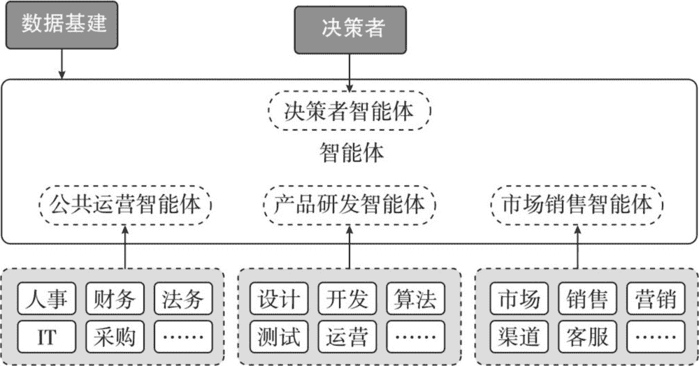

图 4-2 以智能体为中心的协作范式

这揭示的不仅是流程优化，更是权力结构和组织形态的颠覆。人类决策者只需向由多支专业协作单元构成的统一智能中间层下达指令。财务、研发、市场等职能部门退居幕后，它们的价值被数据化和服务化，成为滋养智能中间层的数据基建。协作的重心从人与人连接，转向人与人工智能共舞。

**第五节 工作流转型五项铁律**

蓝图绘出后，真正上战场需要怎样的交战规则？理论是地图，实战处处是陷阱。我们曾因过度迷信人工智能而返工，因旧流程排斥而内耗，因隐性的人机协作成本而困惑。以下五条原则源于无数次试错，是重塑心智与协作方式的思想武器。

**一、智能体优先：以智能体为主体，而非附属**
要彻底摆脱“我来做智能体帮忙”的惯性，转向“智能体来做，我来指挥”。压力下工程师很容易退回手工舒适区，导致新旧模式冲突。组织必须立铁律：非智能体生成的成果只能作为例外，并严格审批。

**二、速度即信仰：体验先行，快速迭代**
人工智能原生研发生态的核心是体验与迭代。技术选型、代码规范的内部完美主义必须让位于让用户快感受到价值。“3-5-7”交付法则很有代表性：三天出原型、五天上线、七天发布。速度与体验成为衡量敏捷与价值的核心。

**三、人机边界重塑：驾驭智能体而非被牵着走**
人工智能有涌现与不确定性，过度信任或试图让它包办一切只会同质化、浪费调试成本。人工智能是协作伙伴，不是万能替代。工作重心应前移到高质量上下文设计，后移至结果的批判性评估，这样才能放大价值。

**四、组织单元重组：践行“两人即团队”**
传统研发生产线已失效。即使敏捷，固化的墙仍会造成排斥，新代码与旧框架融合常牵一发而动全身。最有效的是“两人作战单元”：系统设计师加全栈工程师组成的原子小组，端到端完成从构想到落地再到迭代的价值闭环。

**五、全球化思维：拥抱全球，人才为先**
人工智能是放大器，对顶尖人才的依赖空前提高。平庸输入会被放大为规模化平庸。某头部 AIGC 公司曾为扩张而降低选用标准，结果质量骤降、管理成本激增。人工智能时代顶尖人才的价值不是十倍而是百倍。推行英语优先工作方式，保持认知与全球前沿同步，才是捕获信息与机遇的关键。

这五条构成人工智能原生组织的行动指南，从主体、速度、边界、小团队到全球视野，共同释放创造力与适应力。

**第五章 文化心智的重塑**

数据是数字血液，工作流是神经网络。硬件上看已是人工智能原生体，但实践中遭遇最隐蔽的反击——排斥反应。旧文化的土壤会本能地扼杀新物种。解决“怎么做”后，必须直面“怎么想”。

今天谈人工智能巨头时，一个曾被视作廉颇老矣的名字正强势回归——微软。Azure 成为全球人工智能创新的底座，Copilot 融入数亿用户办公与系统，与 OpenAI 的联盟被视作科技史上最成功的共舞。今天的微软已不再是固守 Windows 的守成者，而是初创般敏捷开放。

2014 年萨提亚·纳德拉上任时，微软深陷中年危机，错过搜索、社交、移动互联网，内部高墙林立，KPI 至上，官僚内耗严重。纳德拉用成长型心态取代精英主义，用“一个微软”消融部门壁垒，甚至让 Windows 拥抱开源 Linux。文化驱动的变革注入了重生的基因，让微软抓住云浪潮并在人工智能时代重回巅峰。诺贝尔经济学奖的洞见不谋而合：增长瓶颈往往在组织与文化，而非技术。

我们也常遇到荒诞场景：两人的原子小组四十八小时做出一个月产出，却因数千元预算审批卡两周。F1 赛车困在土路上。人工智能效率被文化吞噬时，就必须进行组织灵魂的革命。人工智能原生时代企业文化的六大基因：

·人工智能主导，而非辅助：人工智能是核心执行主体。
·全栈，而非专才：人才能端到端解决问题。
·原型，而非线性：以原型为核心快速迭代。
·数据思维，而非程序思维：决策基于流动数据事实。
·涌现，而非管控：相信自下而上的创新。
·激励，而非教导：用机制点燃内驱力。

**第一节 旧范式：流程控制的惯性**

陶楷是旧体系里最受推崇的员工。踏实严谨，规范到极致，在 KPI 下把每个明确任务做到满分。他信奉过去两百年的程序思维：世界是可封闭定义的系统，严格执行 SOP 就能得到可预测的高质量结果。他是管控机器上最可靠的齿轮。

进入人工智能时代，这颗最坚固的齿轮最先锈蚀。人工智能原生组织是与不确定性共舞的开放生态。系统设计师需要定义模糊问题，陶楷无所适从；人工智能充满涌现可能性，他感到焦虑失控，代码洁癖式规范被削弱。指令明确、结果可控的世界消失，他成为掉队者。他的离开是时代错配的警钟：旧管理哲学与人工智能引擎剧烈排异。程序管控时代落幕，需要人工智能原生思维。

**一、从流程思维转向数据思维**

2025 年，一名不懂普拉提的美国小伙，靠中国义乌供应链和笔记本里的人工智能，把几元一双的防滑袜卖成欧美爆款，三十天入账二百七十万美元。故事的价值在于揭示底层逻辑：行业经验和直觉被数据解构。

传统消费品靠资深经理洞察和设计师预判；互联网公司靠 A/B 测试验证。而这位小伙让人工智能做首席战略官。他不问什么火卖什么，而是问用户在抱怨什么。用人工智能抓取海量普拉提博主内容，指令很简单：列出所有新兴产品和痛点。人工智能从噪声中提炼出被忽略的蓝海——防滑袜。随后人工智能主导设计对标、供应链议价。决策权从人转到系统，人从决策者升维为提问者和系统设计者。

Shein 的一件 T 恤诞生更像人工智能驱动的进化。系统持续“阅读”全球社交媒体上亿内容，捕捉袖口细节、配色等微小信号，几分钟生成数十个虚拟设计变体，小批量在线测试，用加入购物车率、停留时长等实时数据做自然选择，表现差的几小时内淘汰。

人工智能时代数据思维的核心，是从无限可能性中涌现，而非在有限选项里选择。过去企业基于程序思维，靠 SOP 保证一致性，却抑制创造涌现。数据思维要求端到端多模态数据体系，以结果为导向重塑输入输出，形成业务中心的数据底座。战略性部署传感器、埋点、存储与处理架构，都是实践。这是从程序到数据的第一支柱。

**二、由管控逻辑转向涌现逻辑**

人工智能原生思维的第二支柱，是从管控到涌现的范式革命。经典的湖畔大学“七件套”或各类管理模型，底层都是管理人、追求可预测结果的计划思维。它们把组织打造成精密管控机器。

但智能体本身由涌现而来，当核心生产力依赖涌现时，机器根基动摇。最大挑战从执行确定性变为创新不确定性，纯管控文化成了枷锁。

苹果的极致保密文化曾是管控巅峰，却在人工智能竞争中成为致命阻力。人工智能需要数据自由流动、跨团队协作、前沿研究共享，保密基因制造数据孤岛和认知壁垒，使其人工智能团队无法形成集体大脑。奖励保守秘密的文化，注定输掉需要共享智慧的战争。苹果在人工智能上的迟钝，本质是文化惯性悲剧。它证明旧文化最可怕处，不在于做错什么，而在于让你完美错过未来。

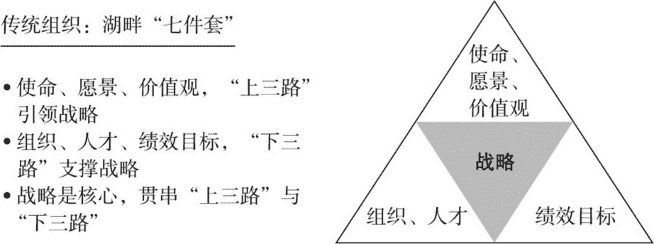

图 5-1 传统组织管理方法：湖畔大学“七件套”

**指令退场，生长登场**

过去的管理像监督学习，标准答案先行，执行者照做，反馈总是慢半拍。生成式智能普及后，企业需要的是强化式的文化转向。管理者不再是手握完整蓝图的顶层架构师，而是搭环境、给反馈的培育者，让团队在自我迭代和试错里长出新能力。

陶楷离开后，公司被迫完成一次思维换代。从迷恋流程和程序的惯性，转向以事实和全链路数据为起点的数据判断；从追求可预测的精细管控，转向拥抱不确定、让智慧自发生长的生态构建。冰冷的机器被生态取代。

**第二节 人机共生文化：校准、驱动与自发**

以智能体为底座的组织，文化内核已不是追逐确定结果的传统管理套件，而是校准、驱动、自发构成的三元结构。这意味着管理重心从操控由人组成的机器，转向设计人与智能共同演化、价值持续涌现的系统。

**一、价值观同步**

新组织的第一道难题是同步，对象已从人与人扩展到人与智能体、智能体与智能体之间的目标与价值观一致。

当智能体成为核心执行主体，要如何保证这个能力近乎无限、思维高度自由的新物种始终与公司同频。大语言模型天生倾向中立，若缺乏价值指引，其技术最优解很容易偏离商业最优解与伦理底线。为新物种装上不可动摇的价值罗盘是关键。

尤瓦尔·赫拉利在《人类简史》里讲，人类能实现大规模协作的秘密是共同想象与虚构的故事。国家、宗教、法律、金钱，本质上都是大家共同相信的故事。

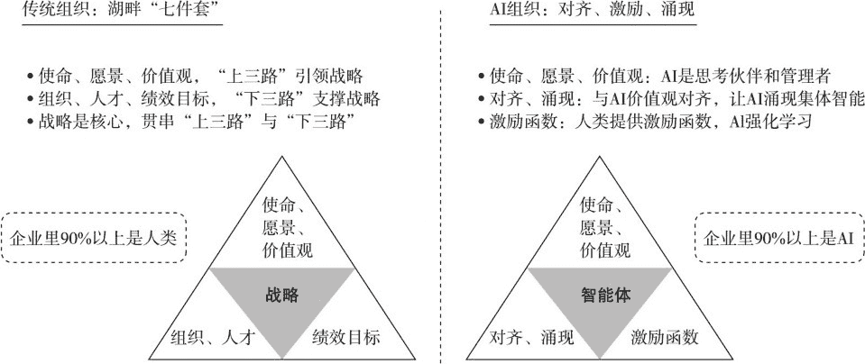

图 5-2 传统管理模式与智能管理模式对照

在智能时代，这一古老智慧变得更紧迫。使命、愿景、价值观不再只是墙上口号，必须被代码化，成为直接约束智能体行为的核心算法。

具象化的第一步，是让智能体与所有成员读同一版故事。做法一是打通数据权限，让智能体与员工看见完全一致的信息全景；做法二是借助 OKR 等工具，为人机双方设定唯一清晰的共同目标。

在此之上，价值观植入的深水区才开始，往往伴随激烈争论。

一家 AIGC 头部企业在设计内容推荐智能体时内部爆发冲突。市场拿出数据，优先推博眼球的聚合热点，停留时长能在十四天内提升 15%，这是典型的技术最优解。产品负责人坚决反对：公司价值观第一条是鼓励原创，若为这 15% 放任算法压制初期流量不佳的原创者，就是拿未来换现在。最终公司做出反效率的决定，把鼓励原创写进智能体核心规则：所有推荐结果中，原创深度内容的权重必须比聚合热点高出 50%，即使短期停留时长可能下降。

这就是价值观的代码化，不再是口号，而是一条智能体必须遵守的硬约束。同步要让智能体不只懂做什么，更懂为什么做、什么不该做。

价值观代码化也体现在安全底线。金融科技新星 Brex 在全员智能化时，没有搞无休止的工具审批，而是法务与产品提前划定安全红线，例如数据保留不超过 30 天、用户输入不得用于模型训练。符合红线的工具，员工可自由试用。这把安全与信任从口号变成了可执行的同步机制。

实践沉淀出两条原则：用故事校准目标。面对不确定性新项目，放弃详尽规划，转而共同创造一个客户终极问题的故事，作为人机唯一的北极星。用透明统一信息全景。打破权限与部门墙，让智能体与员工共享同一事实，这是同步的技术与文化基石。

**二、为智能体设计奖励机制**

人机共同体需要怎样的驱动。借鉴强化学习，要为系统设计有效的激励机制。当行为符合预期，环境必须立刻给出清晰正反馈。若不驱动良好行为，最先进的智能体也会停滞甚至跑偏。要把人类隐晦的满意度，转化为智能体可读的奖励信号。

一家 AIGC 头部企业在协作工具里搭建正反馈闭环。工程师看到智能体生成结构优美代码点个赞，销售把智能体建议促成的成交在 CRM 里标记为高质量转化。这些“赞”“标记”被实时捕捉为标注数据，像奖赏一样告诉智能体你做对了，继续朝这个方向进化。

Brex 则展示了系统化图景。重构后的运营团队里，中层岗位从管人变为管智能体。运营负责人卡米拉·马蒂亚斯说：不再给员工做绩效评估，而是给智能体写的提示词打分。经理的核心工作是持续分析智能体表现、优化提示词与工作流。人类的每一次打分与优化，都是对智能体的直接驱动。驱动智能体从个人行为升级为岗位核心职责。

驱动的本质是构建智能体帮人成功、人训练智能体更成功的滚动飞轮。OpenAI 提出的“激励而非教导”与此同理。它给“授人以渔”加上第三层含义：不是给结果，也不是给方法，而是激发内在渴望。让主体尝到“鱼”的美味又保持饥饿，就会自发发明新的捕鱼方式。这正是大模型强化学习的底层逻辑，也呼应丹尼尔·平克在《驱动力》里说的：对创造性任务，真正的驱动来自自主、精通与目的感。最终创造一个为获奖赏而自发探索的环境，让更优解自发涌现。

可操作的正反馈飞轮在于设计人机双赢机制：为智能体设计奖励信号，在所有工具里植入点赞、踩、采纳、拒绝等简单人类反馈，把每次满意或不满意转为可学习的奖励；驱动智能体的教练，公开表彰并奖励那些擅长训练智能体并分享经验的员工，把驱动重心从个人产出转向对系统的贡献。

**三、为组织培育生长环境**

校准定方向，驱动给能量，集体智能便自下而上涌现。

某客户关系团队长期被动救火，流失悄无声息。公司放弃管控，只给跨职能小队一个信息全景：90 天内让核心客户流失下降一半。

小队尝试访谈问卷无效后，把历史流失数据喂给智能体。一周后智能体涌现出被忽略的信号：流失前 90 天，核心客户对帮助文档特定高级功能的查询量异常上升。这不是活跃，而是自救失败的无声求救。基于此，小队自下而上创造了智能体预测性关怀工作流。

这印证了智能时代的管理跃迁：给予信息全景，而非控制。梅拉妮·米歇尔在《复杂》里描述的蚁群智慧，没有一只蚂蚁知道整体蓝图，但遵循简单规则自组织构建复杂巢穴。领导者应从绘制蓝图的指挥官，变为培育土壤的园丁，相信颠覆性方案会在其生态里破土生长。

DeepSeek 把自下而上推向极致。打破固定岗位，用自然分工。总体目标下，任何人可先行研究想法，遇到困难自发协作，最终有价值的想法从个体萌芽成长为集体成果。员工不再等命令，而是自组织让创意涌现。

失控一书预言的分布式、自我组织网络，如今在原生智能组织里被验证：无数简单个体通过网络协作，能自发产生超越个体的集体智慧。

要把涌现从偶然变为能力，需要角色转变：给予信息全景而非控制。面对新挑战，花双倍时间阐明为什么做、目标、约束、资源，然后彻底授权；信息透明化而非信息孤岛。打破部门墙，构建极度透明的环境，确保每个角落的人和智能体都能基于全局信息全景自下而上创新。

三元结构的终极图景是：校准设定航向，驱动提供燃料，涌现抵达新世界。三者的发生都依赖极致透明这一文化基石。制度透明只是搭广场，若员工缺乏安全感仍会躲在阴影窃窃私语。要把透明从制度升级为信仰：高层率先赤裸，用坦诚破除猜疑；建立问题必须上桌的机制，用公开冲突代替私下抱怨；重塑只看结果不看表演的评价体系，让团队敢于暴露真实过程，与智能体同处全局透明信息全景。

只有极致透明成为空气和水，涌现生态才有生长土壤。

在内容创作领域，影视飓风的进化就走了一条独特跨界之路：文化上学奈飞所倡导的高人才密度与高自由度，保护创作灵魂；机制上学字节跳动的 OKR 与透明化，打造效率引擎。这种矛盾融合，正是在不确定环境下组织自发涌现的进化路径。

**第三节 文化编码：将原则落地为智能原生实践**

文化最终要沉淀为系统与机制。如何把校准、驱动、涌现编码进组织基因。进化型组织都在把文化内核硬编码。

**一、双向编码**

同步是文化最基础一环，确保每个细胞无论人类还是智能体朝同一北极星前进。

同步不是单向指令，而是双向动态共识。亚马逊的单页新闻稿文化是典范：研发前必须写未来新闻稿，清晰阐述产品为客户解决什么问题，把客户至上这个抽象价值观编码为流程前置节点。

智能原生时代，载体从静态文档转向动态原型。结构化的任务简报与智能体前置同步，已成普遍选择。简报的真正力量不在于定义多少功能，而在于把文化原则编译成智能体可执行的语言。

一位系统设计师为新产品做营销网站，不是写传统 PRD，而是一份定义目标、模块、关键原则与成功标准的精炼任务简报。这份简报是与智能体的初始同步契约。

智能体收到简报后反向生成更详细的技术待办清单，向人类提议解决方案，并主动指出为保证加载速度首页动画需简化等风险。人机双向同步发生，智能体从被动执行变为思考伙伴。团队直接在智能体生成的文档上评论确认，方案通过后智能体按蓝图高效交付。

智能原生同步的本质是定义—提议—确认的动态循环。人类定高阶目标与原则，智能体把意图转为可执行技术方案并寻求确认。文化与业务因此在每个执行细节落地。

**二、创造自燃能量场**

智能原生组织最有效的驱动，不是自上而下的 KPI 与奖金，而是设计让人才与创意在健康竞争协作中自然脱颖而出的进化环境。

华为的狼性文化内核是通过内部竞争制造达尔文式进化压力。关键技术路线不靠高层拍板，而是多团队平行研发赛马，胜者决定未来。这揭示驱动本质：最强驱动力来自生存与获胜的内在渴望。

智能时代，这一原则从外部竞赛进化为内在自燃。当组织聚集高密度人才并赋予自主权与智能工具时，驱动重心从物质刺激转向内在创造满足。当工作本身充满乐趣，代码像雕琢世界，商业成功自然成为副产品。

AI 独角兽 Cursor 就是内在驱动的样本。几乎看不到传统驱动机制，没有复杂 KPI 与强制加班，员工仍以惊人强度自发投入。其自燃系统在于：使命即奖赏。员工相信在重塑软件构建基础设施，年度经常性收入破 1 亿美元时大家仍在讨论产品，真正的奖赏是推动更精准构建；难题即磁场。公司以硬核技术挑战吸引人才，任务由最有热情的个体贡献者主动认领；创造即乐趣。员工用自家产品写代码，路线图自下而上长出来，员工确信功能值得做就足以启动开发。

Cursor 证明，最高级的驱动不是更精密的奖惩系统，而是构建高人才密度加高使命感加高自主权的能量场。成员不需要被点燃，会自己燃烧。

**三、涌现：内部痛点挖掘行业神器**

**让涌现自发生长**

方向有了，燃料有了，还缺什么让创新生根？真正颠覆性的突破，往往不是靠面面俱到的顶层蓝图和市场推演出来的，而是生长在允许试探、接纳偶然的松软土壤里，慢慢自下而上长成。管理者的作用，不再是画出精准路线，而是经营一片能让集体智慧自然浮现的热带雨林。Midjourney 的爆发就是外部涌现的典型，它深耕 Discord 社区，把数百万用户的共同智慧变成产品进化的推力。

进入 AI 原生阶段，一种更内在的涌现逻辑正在抬头：从解决自家痛点出发，让产品从内部需求里长出来。这种转向背后是认知上的变化：在 AI 时代，最省力的研发不是为抽象用户画像造东西，而是为团队每日的真实摩擦造武器。当你同时成为自己产品的第一个使用者，也是最挑剔的挑剔者时，研发就从对市场的模糊猜测，变成一场精准的自我革新。

Anthropic 发布的 Claude Code 就是这条逻辑的注脚。它并非源于宏大战略或精密的机会计算，而是内部真实需求的副产物。最初只是提升工程师与研究员效率的内用助手。安全团队借助它把事件响应从 15 分钟压缩到 5 分钟；法务团队零编码背景下，一小时内做出帮助家庭沟通的预测文本小应用；增长营销团队让广告创意产出效率提升十倍。

来自不同部门的意外用法，让领导层意识到：这把无意打造的瑞士军刀，通用性远超预期。在解决自身问题的过程中，它已经完成了最严苛的产品市场检验。于是 Anthropic 把这份在高强度内部使用中淬炼的能力封装推向市场。Claude Code 能成功几乎是必然的，因为每个痛点都已在内部被真实感知、验证、迭代过无数轮。

启示很清晰：组织与 AI 的关系，不应停留在发明者与工具，而应是探险者与未知大陆。伟大机会往往不是调研找来的，而是在解决内部最真实最痛的问题时被发现。AI 原生时代的创新法则也许就是：少空谈画像，多解决团队当下的难题。当你为自己锻造出趁手的武器时，很可能已无意中锻造出改变行业的下一件神器。

**第四节 转型工具箱：打造涌现生态的三项核心实践**

生成式原生组织无法在管控机器式的文化里生长，它需要一种让智慧自发生长的涌现生态。下面这套工具箱用于诊断文化基因并给出行动指引。

**第一步：诊断组织文化是“管控型”还是“涌现型”？**

**维度一：思维模式（AI 优先）**

□ 遇到新问题时，团队第一反应是扩充人手，还是先尝试培育一个智能体？
□ 是否有明确共识，能由模型完成的活不再安排人工？
□ 决策更依赖流程制度，还是数据事实？

**维度二：管理哲学（涌现 vs.管控）**

□ 领导者更习惯下达细化指令，还是提供充分上下文？
□ 是否鼓励边缘创新与自下而上的涌现，允许小范围试错？
□ 信息流动是层级按需知晓，还是默认全员透明？

**维度三：激励机制（内驱力）**

□ 奖惩更看重工时投入，还是结果与创新贡献？
□ 是否设立面向 AI 共创的专项荣誉，比如最佳 AI 教练、最佳智能体开发者？
□ 能否让通过 AI 实现显著提效的员工获得匹配回报？

勾选少于 3 项：组织仍被工业时代管理思维束缚。工具已引入，文化土壤却排异，若不尽快去管控化，潜力会被流程锁死。

勾选 3～6 项：组织正处文化拉锯。一部分先锋团队已开始涌现，旧惯性依然强劲。关键是领导者是否敢为创新者提供制度保护区。

勾选 7 项及以上：组织已具备 AI 原生的灵魂，能自我进化、适应不确定性。保持开放与信任，它将成为最坚固的护城河。

**第二步：培育“涌现生态”的三项核心实践**

**对齐。** 让人和系统朝同一方向发力。打通关键项目的数据权限，把战略信息、会议纪要、用户数据汇入共享知识库，使团队与智能体看到一致的信息流。不再追求繁琐 KPI，而是共建一个清晰的目标叙事：为客户解决什么问题？提炼成唯一的 OKR 作为北极星。将核心价值观编码为智能体必须遵守的硬规则。对齐后团队与系统在目标、信息、价值观上同步。

**激励。** 生成式时代激励要延伸到系统。为智能工具加入类似点赞的机制，把人类对成果的满意度转化为可学习的奖励信号。同时激励人，设立“最佳模型教练”类奖项，奖励对智能系统改进贡献最大的人而非仅个人产出。人机形成双向正向增强飞轮：反馈促进智能体成长，成长反过来提升人效与价值感。

**涌现。** 传统管理者习惯分配任务与方案，在涌现生态里管理者要先定义战场、提供上下文。上下文包括目标即胜利条件、约束即不可触碰红线、可用资产即工具与数据。明确后下放权力，让人机混合团队在自主探索环境中寻找最优解。创新不再是单向指令传递，而是在清晰框架下的自发涌现。

对齐、激励、涌现共同构成涌现生态的基础，让团队与智能体在同一知识价值系统协作，把不确定性转为探索动力，同时保持目标与价值观一致。

**第六章 转型战地手册：个人与组织的转型战役**

上一章描绘了对齐、激励、涌现的理想蓝图，落地却始于对旧习惯的清洗。

2025 年 9 月初，某 AIGC 头部公司的数据与工作流转型初步完成，核心原子小队研发效率直接翻了五倍。复盘时团队自问：转型至今最天真的决策是什么？答案是“以为每个人都能变成超级个体”。最先看见新大陆的探险家总以为指明黄金方向所有人都会跟随，现实却像冰水倾泻——组织里最资深最优秀的旧世界工程师，数月后电脑里甚至没装基础的编程辅助工具。

“这样的未来，他们为何看不到？”这是变革领导者的终极拷问。

这次反思让公司直面残酷现实：组织进化不是皆大欢喜的集体春游，而是一场关于信念的残酷筛选。不能要求所有人成为探险家，用新大陆地图去说服航海恐惧者是天真。最终沉淀的冷酷标准是：放弃对意愿的揣测，只看行为下注。不再问你信不信，看你做了什么。这场转型最先始于对“人”的清醒而残酷的重新审视。

**第一节 个人破局：意愿与能力考验**

2025 年底，一场寒流席卷科技业。亚马逊启动覆盖数万人效率优化，谷歌悄然裁撤三分之一以上小团队管理者，Meta 裁员波及十年功勋研究科学家。这不是普通经济性裁员。亚马逊股价不跌反涨时，华尔街用数字说明：生成式技术正在重定义人的价值。

一边是价值的消解。前端工程师 Sarah 在告别信写道：“我花四年一万小时精通产品每个细节，模型几分钟就学会构建更漂亮的网页。”

另一边是价值的重塑。Jessica 曾在 Meta 担任产品经理，目睹动荡后离职创办 AI 顾问公司，帮助传统零售数字化转型。她不再提升 App 点击率，而是升维为行业赋能者。

技艺价值消解，认知价值重塑。两人命运并非偶然，而是两种认知框架在浪潮下的必然结局。很多人以为变革等于学新技能，但心理学早已指出：真正变化来自结构性改变而非内容累加。

曾鸣指出，生成式时代知识不再稀缺，稀缺的是驾驭知识的元认知素养。系统设计师正是元认知极强的人，不沉迷解决具体 bug，而是具备抽象建模与第一性思考，能把业务表象提炼成模型再交给智能体填充血肉。

美国心理学家罗伯特·凯根一针见血：大多数人不是被问题压垮，而是被旧的认知框架无法理解新世界压垮。Sarah 的困境不在于不会用智能体，而在于“精通 React 的优秀工匠”这一自我定位不再被需要。变革不是添加技能，而是重写自我结构。

这种重写需要从确定性到接受不确定性，从效率心态到成长心态，从“我是谁”到“我愿意成为什么样的人”的跨越。组织不会比领导者认知更强，也不会比员工心智更先进。转型的本质是个人进化的集体投影。

生成式转型本质不是温和技能培训，而是残酷压力测试。核心不是技能，而是意愿与能力——是否愿意亲手拆解旧版本，跃入未知深海？

**一、意愿：辨别真伪转型**

变革号角吹响后，每个人都摆出拥抱姿态，暗流却在消耗能量与信任。

在“代码 100% 由模型生成”铁律下，集体表演开始上演。部分工程师白天分享编程心得，晚上偷偷手敲代码追赶进度。他们不是不努力，而是太努力扮演转型者。内心煎熬到极限时，有人选择去转型更温和的公司。强制逼出的意愿是表演，不可持续。

一位追求完美的资深工程师对自己手写代码像素级挑剔，对模型代码却草草放行，出错时下意识归咎模型幻觉。这并非刻意对抗，而是专业能力受挑战时的本能自我防卫。最顽固敌人往往来自内心傲慢与恐惧。

最讽刺的是精致利己主义者。某工程师高调宣扬模型不可信，坚决捍卫手艺，离职简历上却写着“精通各类编程辅助工具，在团队内积极推动技术变革”。荒诞剧让公司抛弃对言语拥抱的最后幻想。

最终沉淀的核心标尺：放弃复杂意愿评估，只看行为。是否愿走出舒适区，用真实成本为信念下注？

也有行动派的身影。某前端工程师自费报班每晚学习后端转型全栈；某界面设计师将个人焦虑与组织需求同频，主动探索系统设计师角色。这些用行动证明自己的人才是变革火种。

意愿之外，转型仍伴随阵痛。周铮，资深后端工程师，对“全栈”抵触，视之为否定专业。转型初他不适于前端灵活性，指令不精确时模型生成代码功能正确却过度复杂。两人似冤家相对。

一次深夜多模块复杂 bug 爆发，往常需三人数小时。仅周铮在场，他不让智能体直接“修复”，而是要求以系统架构师视角分析所有可能环节并给出诊断步骤。在智能体引导下，他独自完成代码分析与日志查询，一小时内定位修复。

那一刻视角从代码实现者切换为系统诊断者。第二天他说：“昨晚我不是在写代码，我是在和智能体一起指挥。我负责定义问题与判断，它负责规模化执行与分析，我才明白全栈含义。”

周铮的故事证明变革不是抹杀专业，而是把专业智慧提升到驾驭人机协同的战略高度。

**二、能力：在复杂任务中快速迭代**

筛选掉伪信徒后，能力战场显现。真心拥抱变化者一定具备新世界生存能力吗？

算法工程师梁振宇的路径代表另一条进阶：用高阶抽象驾驭底层实现。他首次独立负责涉及前后端与算法的代办事项列表时，发现模型代码过度设计污染数据。失败后他回退到数据结构，意识到根源是人与智能体对“数据长什么样”的约定不清。

他用自然语言定义唯一不可变的消息类型，清晰的逻辑边界让模型生成代码变得简单且不出错。转型是用高阶抽象驾驭底层实现的胜利。他不是前端专家，却学会为智能体划定数据边界，成为人机系统架构师。

这揭示工程师转型三步法：

第一步，夯实地基而非精通前端。不需要成为前端专家，但必须掌握前后端交互基础概念，尤其是数据流与核心协议，成为与智能体有效对话的通用语言。

第二步，拥抱产品思维，成为用户。强迫自己深度使用产品，感受无法忍受的痛点，才知道算法与系统该解决什么。

第三步，从小项目实战开始，追求闭环。从最小能独立完成前后端闭环的功能开始，如简单待办列表。第一个闭环的成就感是支撑走下去的关键。

基于周铮与振宇，可提炼新旧能力模型的根本区别与三项可衡量能力：

第一，与智能体协同。理解智能体、知晓大模型边界、纠正幻觉、为产出负责。寻找的不是会用工具的人，而是懂得如何训练模型的人。

第二，会建系统。生成式技术让单点变简单，人才痴迷把解法变成系统化工具。产品经理硬要求：需求交给工程师前必须有原型或可演示视频。

第三，有品位、驾驭不确定性。在混沌中辨别“好”的直觉，享受噪声中找旋律并为智能体探索设定美学与伦理边界。要求的“全栈”不是螺丝钉，而是能端到端理解问题并指挥智能体在模糊中闭环的人。

在美国数据智能公司巴兰蒂尔，工程师的工作常被形容为在探路中创造价值。全栈工程师 Joe 说，他最投入的状态是处在信息极度充分却缺乏明确指令的情境，像个探险者从混沌里提炼洞见并落地。这种特质正吻合我们对未来人才的判断，而仍习惯按图施工的优秀员工，企业只能选择告别。进入生成式智能阶段，企业更强调前置筛选，而非事后改造。

第二节 领导力跃迁：从指挥者到生态营造
智能浪潮袭来时，Airtable 掌门人 Howie Liu 做了一个让高管不舒服的决定：大幅压缩管理会议，清空日程，以个人贡献者的姿态重回一线。他不再满足于听汇报看 PPT，而是亲手下场，按小时节奏去体验各类智能工具，甚至自己写代码来验证新功能。很快他成了公司内部乃至业界最重度的智能工具使用者。

“光看截图摸不清智能系统的门道，”Howie Liu 说，“必须亲身感受到底层模型的原生能力。”这不是一时兴起，而是对技术范式剧变的判断：底层变了，旧的管理经验和流程全部失效，领头人必须回到战壕，才能找回对战场的真实体感。

这个案例给所有想转型的管理者指明起点：革新必须从最高负责人的自我革新开始。你不能只让下属冲锋，自己得是第一个跳出战壕的人。

Howie Liu 的转向标志着领导力理论的代际更迭。工业时代需要的是交易型领导者，像工头靠奖惩换取执行。互联网时代需要变革型领导者，像船长靠愿景和授权带领团队驶向目标。而在智能时代，组织需要的是能服务每个创造者成长并让价值涌现的生态型领导者。

接下来展开的，是这场由最高层发起的由上至下的组织重塑。首先看清组织的肌理。

当个人开始艰难破局，领导力开始跃迁时，管理者会面临更尖锐的问题：团队正进化成能驾驭智能的复合个体时，领导者自身该扮演什么角色？答案是必须完成更彻底的自我革新，这场跃迁包含三重紧密衔接的境界：先学会驾驭智能，再学会领导人与智能共生的组织，最后重新定义领导力的核心。

一、驾驭智能：从细节到全局的触感
变革始于一个根本困境：智能时代的领导者该不该看代码？经验表明，不能像木偶师一样操控智能的每个细节，那会锁死可能性；也不能当成黑盒放任不管，那会埋下失控风险。真正的艺术像驯鹰，既要给它天空，也要握住缰绳。领导者必须在两者之间找到全新的动态平衡感。

这种感觉的养成，是从微操到放任再到全局把握的演进。很多人会经历“看代码很吃力”到“关键项目还得亲自看”的挣扎。这正是智能时代领导者的身份危机。当核心生产发生在人与智能在代码层面的深度互动时，不懂代码的管理者迅速失势。但试图控制每一行输出的微操，又会扼杀智能的自主性，让人精疲力竭。

出路在于全局把握。领导智能不是盯执行细节，而是把握宏观框架。你不必纠缠微观实现，但要能读懂整体架构和数据流向，判断系统是否健康优雅；不必审查全部代码，但要关注关键变化，比如一次重要的重构。

形成这种感觉的关键原则是先定框架：在智能开工前，人类领导者必须先用自然语言与智能共同商定清晰的需求边界、模块划分和核心架构。你不能指望智能当架构师，但必须让它成为你架构思想最忠实的执行者。先定框架，是避免被智能强大创造力带偏的压舱石。

最终，领导智能的感觉本质是把微观执行控制转向宏观系统感知。你的问题不再是问每个工程师你在忙什么，而是问系统根据过去一周的代码变更，我们离战略目标是更近还是更远。要做到这点，领导者自身的智能熟练度就成了组织潜力的上限。未来的卓越领导者，必然是能与智能深度共创、在复杂人机迭代中做出高质量战略抉择的共创者。这或许就是智能时代对领导者的终极要求：机器学会执行，人必须重新学会思考。

二、组织塑造：从单核驱动到生态搭建
当个人的感觉进化后，更大的问题是如何把个体能力规模化为组织模式。

答案是完成思维范式革命，从管控思维转向涌现思维，成为团队的生态营造者。旧世界的指令型领导者说：按这个步骤把功能做了。这是控制指令。新世界的生态营造者提供丰富的背景信息：我们的目标是提升新用户次日留存，你和你的智能体能构思什么解决方案？

这种背景信息领导是对旧目标管理的彻底颠覆。为了更清晰地理解变革，我们可以对比两种截然不同的目标管理系统，如图 6-1 所示。

某 AIGC 头部公司曾经历一次典型的协作失败，诠释了左侧传统目标管理五阶段的弊端。启动服务这个技术任务，负责人评估半小时能完成，为赋能交给了两名成员。结果七天反复拉扯毫无进展，最后只能自己下场解决。失败根源是五阶段系统的内在缺陷。管理者被迫成为高耗能的单核处理器，亲自驱动以下环节。

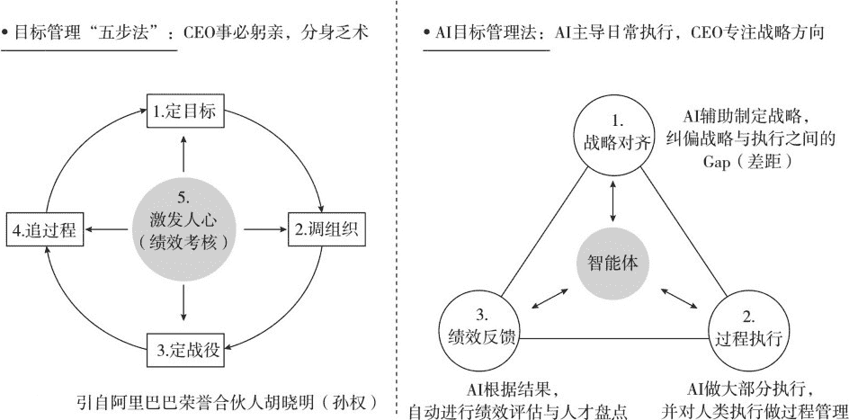

图 6-1 传统目标管理 vs 智能目标管理

·定目标：与核心团队拍板确定目标。
·调组织：亲自搭建团队、分配资源。
·定战役：将宏大目标拆解为具体的战役。
·追过程：通过无数会议追踪每场战役进度。
·激发人心：最后花费大量心力做复杂绩效考核。

全程效率被领导者个人精力上限锁死。更深的问题是，怀着赋能心却困在指令系统里，失败是必然。真正的变革不是让领导者更努力转动旧飞轮，而是砸碎它重建新系统。

这次失败推动公司探索右侧的智能目标管理法，核心是领导者角色的根本转变：从单核处理器进化为系统设计师。

在全新的三元协同模型中，领导者不再是驱动中心，而是设计者和培育者。系统核心驱动力是智能体，由三颗相互作用的星体构成。

战略一致：核心任务不再是下具体指令，而是提供丰富的背景信息。通过定义为什么和什么，确保人类与智能行动同组织的北极星对齐。如图 6-1 所示，智能在此环节辅助制定策略并纠偏战略与执行差距。

作业环节：绝大部分执行交给智能。领导者从监督进度转为培养感觉，通过复盘帮助团队建立与智能协作的直觉；从亲自决策转为设计决策流程。如图 6-1 所示，智能做大部分执行，并对人类执行做过程管理。

成效回馈：传统的滞后人工考核，被即时的智能驱动回馈回路取代。领导者负责设计回馈系统，确保有效激励智能无法替代的创造力。如图 6-1 所示，智能根据结果自动进行绩效评估与人才盘点。

这个自进化智能闭环不再依赖全知领导者，而是相信设计良好的系统能让群体智能自下而上涌现。例如 CEO 会把如何提升成交总额抛给两个不同智能模型角逐，然后在智能提供的客观分析中结合人类商业直觉做最终抉择。智能负责客观分析，人类注入商业智慧、人性关怀和对未来的直觉。

三、领导本质：从做事转向做选择
当智能把组织执行效率推向新高度，领导力价值重心也发生范式转移。智能并未削弱领导者，反而提出更高维度要求。

第一，战略选择的回归。当执行力被拉平，选择决定一切。智能是普惠生产力，极大拉平组织间执行能力。开发运营效率成本趋同，怎么做优势不再明显，选择做什么上升为成败根本。战略智慧源于远见、品位和决断力。当智能能提供无限怎么做时，领导者的品位判断决定最关键的做什么和为什么做。这种远见品位决断力根植于深刻行业洞察和人文关怀，是智能无法复制的人类智慧。

第二，创始人的抉择，即拥有敢于舍弃一切的决断力。领导力终极考验在于选择。某 AIGC 头部公司过去试图在智能、硬件、商业模式上多点创新，资源严重分散。正是这些困境让它克制住什么都想试的冲动，将精力聚焦核心战场。从加法到减法的战略转变，正是智能时代领导力成熟的标志：当执行变得廉价，最宝贵的价值不再是开辟新战场的冲劲，而是定义核心战场并为之舍弃一切的决断力。

第三，领导者要进化为生态营造者。核心职责不再是管控已知世界，而是激发团队主观能动性、想象更宏大未来，并勇敢做出通往未来的充满不确定性的关键选择。这就是生态营造者的含义：你设计的是可能性而非流程，你管理的是整个生态的信念与方向，而非员工。

第三节 组织突围：惯性的三重阻力
1967 年，南非外科医生克里斯蒂安·巴纳德完成人类首例心脏移植，病人却只活了 18 天。杀死他的不是手术失败，而是免疫系统把健康新心脏当异物攻击。

这正是组织变革中系统惯性的真实写照。当试图为组织植入智能心脏时，最顽固敌人往往不是外部竞争，而是内部为了维持稳定的免疫系统，即旧文化旧利益格局。

当个体蜕变、领导力跃迁后，更庞大顽固的劲敌浮出水面——组织本身的系统惯性。一个进化后的新物种，很难在陈旧生态中存活。人的转型是单兵突围，组织的转型是集团军作战。开战前必须先绘制作战地图。

组织惯性主要根植于三个相互嵌套核心要素。

·架构：层级、部门墙与汇报线。定义权力归属和信息流向，是最坚固防御工事。
·角色：岗位、职级与人才。定义谁该做什么，是惯性执行的最小单元。
·流程：协作、沟通与决策流程。决定信息资源流动效率，也最易产生淤积堵点。

架构、角色、流程构成禁锢变革的枷锁。而真正让枷锁坚不可摧的，是看不见的灵魂——组织文化。它通过关键绩效指标、激励与晋升机制像底层代码，深刻塑造架构角色流程的每个细节，让它们难以撼动。

因此公司的智能转型，必须先直面文化这个灵魂，再改造架构角色流程这副躯体，是一场立体战争。

一、重塑骨架：拆墙建小队降摩擦
最坚固阻力来自僵化架构。公司应痛下决心做减法，拆掉部门墙，重塑为原子小队+能力中心的积木型架构。这场组织瘦身遵循冰冷但关键原则：裁的不是人，而是流程节点。

问题不再是哪个岗位没用了，而是哪些能力单元可被智能更高效顶替。视角从人价值判断转向事客观分析。

两把精准手术刀。首刀划向信息中继站节点。新一代智能协同下，信息可无损实时在决策者与执行者间流动，纯粹信息二传手失去存在价值。第二刀划向标准化流程执行器节点。合同审核、权限管理等标准化工作正被智能体系统性接管，执行功能可被智能替代的岗位必须重定义或精简。

结果不是简单减员增效，而是去节点化重构。核心目的是剔除因信息不流通和能力不全面产生的中间层与辅助岗，让价值创造链更短更直接。这是对抗结构惯性的第一场硬仗。

二、疏通血脉：清理流程提敏捷
骨架开始重塑后，更细微顽固的战斗打响。无数看不见的流程堵点潜伏在组织血管，让创新血液无法流动。对抗流程惯性是转型最艰巨战役之一。

惯性体现在制度里的硬流程。紧急上线的智能功能因跨部门审批延迟数周错失良机；关键数据调用因部门墙壁垒被无限期搁置。最有效解法是用透明任务背景信息取代僵化层级审批流。当目标、资源、风险在共享系统中充分对齐，授权可自动下放，无需漫长签字链。

更可怕的是看不见的软流程崩溃，即信任与责任瓦解。转型初期智能黑盒常成推诿替罪羊。设计师抱怨智能不懂审美，工程师反驳这是按你指令生成的。责任边界不清产生责任真空，敏捷协作寸步难行。

破局没有捷径，唯有回归基本法则：智能只是工具，结果出错责任人永远是驾驭它的人。所有争论必须在完整背景信息中公开对质，而非甩锅。对抗流程惯性不仅要打通制度关卡，更要清除潜藏在协作关系中的看不见信任毒素。

三、点燃文化：培育自驱与涌现
转型最顽固敌人不是僵化流程或过时技术，而是弥漫空气中追求稳定害怕风险的文化惯性。要战胜它，必须点燃不可逆的变革之火。底层操作系统是一种全新文化信念：数据优先写入基因，用事实证据替代直觉层级；信奉给予背景信息而非施加管控，用赋能替代命令；坚信激励而非说教，用进化环境替代 KPI 考核。

不同组织点火方式不同。某 AIGC 头部公司选择迅捷甚至歇斯底里的休克式改造，反复宣告这是历史性变革时代，选择与相信未来的人同行。这种不换思想就换人的决绝，吸引转型信徒，也淘汰无法跟上的人。

对于更庞大无法轻易换血的组织，需要系统引导赋能组合拳。

第一步也是最关键，点燃引子，让看见引发相信。火种往往非来自宏大顶层设计，而是内部真信徒的个人实践。

转型初期组织笼罩观望困惑。运营负责人的内部真实分享成为点燃变革的第一粒引子。她不讲空洞理论，而是把自己与智能“缠斗”的经历毫无保留摊开。她展示如何把智能逼成专家：与 ChatGPT 展开 260 轮深度对话，把通用模型训练成懂麻省理工学院开源协议的知识产权律师，最终解决困扰团队数月的复杂商业谈判；她分享驾驭智能的血泪史：试用 Genspark 等智能体平台时如何与聪明但爱偷懒的智能斗智斗勇，经历 27 次修改才生成完美的数据分析报告；她分享共生心法，如何克服信息焦虑，如何从尝鲜期过渡到共生期。

这场分享冲击巨大。当团队看到身边战友能如此娴熟驾驭智能解决真实棘手难题时，智能体从遥远名词变成人人可上手工具，点燃了我想试试的好奇心。

第二步把引子引为燎原，打造令人向往的智能试点区。首先当看见力量初步点燃，领导者要优先挑一个最精锐最渴望变革的小团队，给予特区级授权资源：豁免传统流程，优先使用顶级工具，对失败最高宽容。当试点区原子小队一天完成过去需一个季度任务时，组织对新世界的相信才真正建立。

其次重塑清晰游戏规则，把激励机制从管控行为转向激发探索。这是智能原生文化不要教导要激励的体现。管理者必须把资源认可明确向拥抱智能的团队个人倾斜。可将新规则嵌入日常工作流：周报设立组织智能化专项板块，把员工智能实践心得与其成长绩效挂钩；建立小规模快验证探索模式，授权团队快速试错建立对智能能力的真实体感。这些机制传达清晰信号：组织奖励的不是固守旧流程的稳定，而是拥抱新工具的探索。当员工感知到不转型就掉队的生存法则时，意愿火苗才真正点燃。

最后为所有人提供切实后援补给，降低转型成本风险。许多员工非不愿转型，而是怕孤军奋战。组织必须提供官方认证的高质量智能工具和系统性培训，让员工明白转型不是个人冒险，而是组织支援的集体战役。

把学习资源像阿斯利康用 Degreed 那样集中起来只是表层动作。真正拉开差距的，是企业有没有把“补给线”落到实处。一些公司把支持写进机制：为成员配齐高质量智能工具，提供成体系的进阶培养，给员工试用各类生成式产品报销费用，主动倡导大家去尝试新能力，并在每周产研会和感恩周五 TGIF 上公开交流先进团队的做法与创新成果。

费用报销看似寻常，传递的信号却很清晰：鼓励开路、包容试错，为每一次侦察式探索兜底。

电商平台 Shopify 把这种后援逻辑推到极致，完美演绎了“给语境而非下指令”的领导哲学。它对智能工具的投入不设上限，还要求法务等支持部门把默认反应从“不批”转为“怎么推进”。这种自上而下的绿灯氛围，才是真正的火力掩护，让探索创新的后顾之忧被扫清。

无论是激进的休克式改革，还是渐进的赋能节奏，最终收敛到同一个目标：在人心争夺战里找到火种，让它最终形成燎原之势。

**第四节 战略突围：寻找新北极星**

当个人阵痛与组织重塑叠加，所有张力最终都压到最高决策者身上。

他要面对一个根本悖论：旧地图已失效，新大陆尚未浮现，依据什么做判断？如果继续用短期利润、人效比、确定回报这类旧标尺衡量智能化转型，每笔投入都像不划算的冒险。组织敏捷性的即期价值算不清，决策质量的提升也难以进财务报表。

在高不确定性的反复中，内部必须形成冷酷而清醒的共识：智能化转型不是算账题，而是生存选择。在这场进化里，首席执行官要从精算师变为探险者，敢在迷雾中先开第一枪。这第一枪不能为了短期财务回报，而必须为了抢占未来的生存生态位。组织需要一个超越传统增长指标的新指南针——进化速度。

以存续为导向而非以利润为导向的取舍，在顶尖转型样本里惊人一致。Shopify 提出智能优先，把智能体作为默认同事嵌入决策与开发，要求新增人力申请前先证明智能体做不了，即便在成本收缩期也加速智能化。微软掌门人萨提亚·纳德拉则把副驾驶抬到公司级战略，内部发起人人智能运动。

这些领袖都明白，在迷雾里 CEO 的核心工作不是算胜率，而是定航向。依靠明确的资源倾斜和制度保障告诉全船：不看今日风浪，只看明日航线。确立新指南针后，企业必须面对两项残酷的战术抉择。

**一、双轨抉择：老基盘与新赛道**

转型期非原生企业首要难题是如何处置历史包袱。

一家生成式内容头部公司，现有文生内容业务仍是现金奶牛，却必须把资源投向代表未来的原生智能新赛道。很快发现，老赛道的开发习惯与团队惯性严重拖慢新赛道的探索速度。

更棘手的是，这轮调整恰逢 IPO 后最敏感的窗口。既要稳住老业务增长，又要大胆投入为未来找增长点，没有完美解。反复讨论后，公司不搞一刀切，而是推行双轨并行。

第一条轨是优化存量，保障现金流。对构成基本盘的内容产品线，策略明确：不颠覆，只提效——把智能体定义为效率放大器，通过自动化重复的开发与运营环节降本增效。该条线的唯一使命，是为公司提供稳定充足的现金，支撑更长远探索。

第二条轨是隔离增量，放手面向未来。对代表未来的原生智能新业务，公司采取彻底隔离。具体是剥离原有部分硬件线，把精干人员抽调出来，成立完全独立的“原生智能特区”。特区拥有独立团队、不受旧规则束缚的文化和全新技术栈。

隔离的用意，是让面向未来ument的小团队不被老业务的技术债与组织惯性拖累。这与亚马逊当年内部孵化 AWS 的路径相似，正是近乎完全的独立，让 AWS 最终成长为参天大树。

**二、制胜关键：用速换量**

转型中的第二难题，是如何面对资源体量数倍于己的行业巨头。过去正面战场几乎无胜算。

在智能时代，答案是放弃对称竞争的幻想，打一场彻底的非对称战。

公司最致命的武器不在技术或资本，而在被智能高度赋能的组织本身。巨头庞大稳固的车体、复杂层级、坚固部门墙，以及对现有利润的路径依赖，决定了它们即便装上最强 F1 引擎，也无法在旧车体上完全释放威力。而体量更小、能被智能彻底重塑的组织，差异化在于能比巨头更早更彻底地成为真正的原生智能体。赌的不是单点技术领先，而是组织形态领先一个时代。组织本身就是最深护城河。

更进一步，公司认为在原生智能时代，传统规模优势正被一种全新杠杆效率取代。

过去竞争是兵力竞争。十万员工的大公司像十万士兵的重甲军团，对千人小公司有碾压优势。

智能改变了战争形态，不再是兵力直接对抗，而是驾驭智能武器的能力对抗。当一个小而美、彻底原生化的团队能让百名超级个体，每人驾驭百个高效智能体时，其可调动的智能作战单元总量，将超过那个把智能仅当辅助、内部仍充满层级损耗的万人军团。

百名驾驭智能的特种兵，有效战斗力远超一万名各自为战的普通士兵。

这就是智能时代赋予小公司的最公平武器。它奖励的不是体量，而是进化。

**小结 生命体的囚徒困境**

至此，走完这场艰苦的构建旅程。

我们为新生组织注入奔流不息的数据血脉；重塑架构，编织光速传导的神经网络；重铸灵魂，植入共生共荣的文化。

如今，由无数智能赋能的全栈工程师与敏捷强悍的原子小队构成的生命体雏形已然站在面前。它不再是冰冷机器，开始拥有心跳、神经与意志。

然而，当我们试图让这个充满活力的生命体奔跑时，更深层的挑战浮出水面。

我们曾让每个原子小队都变成战斗力爆表的特种部队。但当成百上千个高能特种部队汇聚时，并未自动得到无敌军队，反而可能面临系统失控。

“增长小队”为求极速疯狂调用生成式能力，是否在透支“品牌小队”积累的信用？“研发小队”为快速上线走捷径，是否给“架构小队”埋下未来地雷？

个体极致效率不等于系统全局最优。相反，在由无数极致理性的智能体与超级个体组成的网络中，协作复杂度与摩擦力以指数级上升。

这正是新课题：如何把强大的点编织成智慧的网？谁来为这个拥有自主心跳的生命体协调局部冲动，定义统一的全局意志？

问题已超越构建范畴，进入治理与协作的无人区。

下一篇，公司将从构建者进化为生态设计师，探索打造全新操作系统，去驾驭指数级增长的复杂性，让组织从单点极致走向生态涌现。

**第三篇 未来新生**

在地球生命演化史上，最迷人的时刻并非第一个单细胞诞生，而是 5.4 亿年前的寒武纪大爆发。

随后短短 2000 万年里，地球仿佛按下快进。寂静海洋里突然涌现几乎所有现代动物门类的祖先。生命不再孤立简单复制，而是结成复杂食物链，演化精密神经系统，形成互动频繁的生态网络。科学家至今争论起因，但一点确定：当个体能力积累到临界，连接密度突破阈值，系统就会相变。

今天，我们的组织正站在类似临界点上。

我们在上一阶段打造了锋利数据利剑，重塑敏捷作战小队。然而仅有强大个体不够。终极挑战是：如何让这些高能个体不再散落珍珠，而是编织成自我感知、自我演化的智能网络？

若上一篇关乎点的强化，本篇则关乎网的织造。我们将亲手孵化真正的原生智能生命体。在这里，领导力不再是机械指令，而是生态引力；协作不再是线性传递，而是智慧涌现。让我们推开这扇门，去见证商业世界的寒武纪时刻。

**第七章 协作进化：原生智能组织的运行系统**

早上 9 点，12 人项目周会在冗长轮流汇报中耗尽一小时宝贵时间，却没产生任何有效决策。下午 3 点，跨部门专项小组的飞书群里艾特所有人刷屏，文件、表格、看板堆积如山，每个人看起来都很在线，但关键问题始终无人拍板。

这就是伪协同，用协作动作掩盖协作无能的组织慢性病。根源在信息损耗、责任扩散，以及真相在层层转译中消亡。在传统人类组织里是低效可忍。

而当智能体这个不参会、不懂人情，只认代码和数据的“新物种”成为主力时，这种低效立刻升级为系统性崩溃。

想象如何管理由成百上千智能体与人类工程师组成的混合军团？无法用开会来对齐思想。智能体不听画饼，只认代码库里的单一事实真相。若不同人类工程师向各自智能体输入冲突指令，收获的不是协作而是代码内战。无法用团建建立信任。智能体无情感，不会因一顿烧烤就理解另一智能体的设计意图。它们的协作必须建立在 100% 透明、无损耗的信息交换协议之上。无法用 KPI 监督进度。当成千上万行代码每小时被自动生成和部署，传统工作量汇报与进度审批变得滑稽。需要的不再是工作汇报，而是一个能洞悉代码库真相的上帝视角。

传统管理范式，那些建立在人类社会性之上的洗脑、团建、汇报、办公室政治，在纯粹理性的新物种面前彻底失效。这正是 Twitter 前高管创立 Macroscope 时所预见的未来。他断言无论 AI 多强，最终仍需人类对产品负责。这意味着领导者必须拥有统一感知层，一个能穿透人机界限、洞悉代码库真相的上帝视角，以理解混合军团的所有创造与活动。

这个硅谷的宏大拷问，与大多数组织正在经历的伪协同微观困境在此交汇，共同指向迫切问题：现有协作工具，无论 Slack、Teams，还是飞书、钉钉，本质都是优化人类间沟通。它们是更高效的会议室和文件柜。

但当协作主体从一群人变为一群人加 AI，我们需要的不是更好的会议室，而是一个全新的协作底板，一个能让人类积木与 AI 积木无缝拼接、协同工作的底层操作系统。

这个操作系统必须回答核心问题：协作主体彻底改变时，我们到底该如何一起玩耍？

本章将深入探究协作的终极革命。从超级个体崛起与困境出发，最终揭示真正 AI 原生组织操作系统的内在机理与灵魂。

**第一节 个体极限：从单兵作战到群体协作**

2023 年，荷兰阿姆斯特丹一间小公寓里，皮特·莱维尔斯做出极端决定。他厌倦传统创业繁琐——组建团队、融资、开会、管理，想知道单人借助 AI 能走多远。莱维尔斯不再写复杂代码，而是成为 AI 编排者：让 ChatGPT 构思功能、Midjourney 生成网页图、智能体生成前端页面。像指挥乐队一样，他调动 AI 庞大军团，以一己之力孵化十二家盈利小公司，年收入超百万美元，却无办公室也无员工。

莱维尔斯的故事并非孤例。以色列氛围编程公司 Base44 由 90 后程序员莫尔·什洛莫独自创办。他未招聘一名员工，仅靠 AI 自动化流程运营，扣除成本后单月净利润超 18 万美元。更传奇的是，成立仅 6 个月，这家一人公司便被互联网巨头 Wix 以 8000 万美元天价收购。一个人半年时间创造近亿元财富神话。Cal.ai 年营收已达 1000 万美元，缔造这一奇迹的仅是 4 位还在上高中的学生。在 AI 赋能下，年龄与经验不再是不可逾越鸿沟。

AI 编程领域的 Cursor 持续重写规则。团队仅 12 人时估值已达 4 亿美元；如今扩至 60 人，年收入突破 5 亿美元，估值逼近 100 亿美元。它证明在极高技术密度领域，几十人特种部队足以击溃数千人常规军团。

AI 绘画巨头 Midjourney 年收入高达 5 亿美元，影响力遍及全球创意产业。支撑这个庞大商业帝国的，是不足 40 人的微型团队。人均年收入超过 1250 万美元，是传统科技巨头人效的数十倍，堪称效率核爆。

从 AI 编排者皮特·莱维尔斯，到一人独角兽 Base44，再到百亿微型巨头 Midjourney……这些案例勾勒出颠覆性组织范式：拥有清晰洞察的灵魂人物，通过驾驭 AI 放大器，其创造力逼近甚至超越传统百人、千人公司，如表 7-1 所示。

表 7-1 AI 时代超级个体的团队规模与营收对比

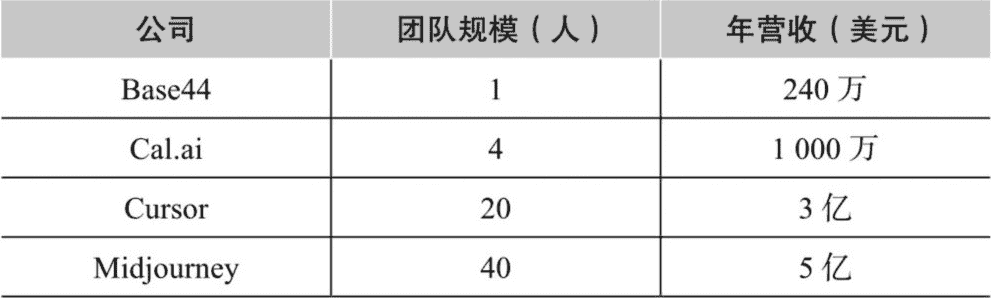

资料来源：Wix 2025 Annual Financial Report，Forbes 30 Under 30 List（2026），Crunchbase Funding Rounds ＆ Insights，and Quantumrun 2025 Global AI Market Research Report。

**一、48小时极限：独自创世**

这个激动人心的图景曾让我们相信找到了组织未来的终极答案。中国有一场被行业广泛讨论的极限试验对这一模式做最极致验证。出门问问 CEO 李志飞决定亲下场验证模式极限。

这是对传统研发模式的公然挑衅，也是 AI 原生组织理念的第一次亲身尝试。恰逢 2025 年端午假期，李志飞把自己关起来，进行为期 48 小时的极限冲刺。目标是仅凭单人之力与 AI 协作，从零独立开发出一个当时仅是构想的产品原型——专为 AI 原生组织打造的协作平台。常规评估至少需 20 人团队、耗时一个月。

“太慢了。”这是李志飞对旧模式的第一印象。整个过程充满人与 AI 的博弈与磨合，但最终奇迹发生。一个人，两天时间，真的跑通核心流程。当内部代号“虚拟组织”的原型在屏幕亮起，在场所有人都感到震撼：AI 确实赋予个体神力。

然而随之而来并非全员欢庆，而是幻灭。当李志飞试图把原型推向团队使用时，遭遇冰冷一盆水。由超级个体独自打造的系统，技术逻辑虽通，却无法融入真实团队协作流程。它像孤独玩具，而非称手武器。

这次试验让李志飞从超级个体极限快感中清醒，并领悟更深道理：AI 在指数级放大个体能力的同时，也指数级放大了协作难度。

**二、协作悖论：游击与航母**

这正是超级个体浪潮背后的深刻悖论。

单个超级个体可以赢无数场精彩游击战，比如写爆款插件、做精致网页、发引爆流量文章。但面对需长期演进、高度复杂的战略目标，比如构建操作系统、运营全球品牌，单纯堆叠超级个体无效。我们可以创造 12 个才华横溢的皮特·莱维尔斯，但若这 12 人缺乏有效连接，终究只是各自为战的散兵游勇，无法凝聚成能攻克复杂堡垒的航母战斗群。

因此未来组织进化绝不能止步于培养孤立超级个体。我们需要补齐关键拼图：不仅要有能敏锐定义问题的超级个体，即灵魂人物，还要有能高效解决问题的原子小队，即精干团队，更要有能规模化解决问题的协作操作系统，即连接器。

我们不仅要进化为超级个体，还要着手构建能承载人机人复杂协同的协作系统。只有通过这个系统把孤立微型巨头编织成紧密智能网络，才能真正跨越个体神话到组织进化的鸿沟。这正是下文将重点构建的未来蓝图。

**第二节 连接机制：以技能节点重塑协作**

面对超级个体无法规模化协作的悖论，公司必须打造全新操作系统。但一个问题摆在面前：这与我们每天使用的飞书、钉钉到底应有何根本不同？

某 AIGC 行业头部公司在内部研发过程中逐渐厘清代际逻辑。飞书代表以人为核心的协作方式。协作主体是人与人，AI 只是辅助；原子单位是一个文件；权限管理精细严密。然而当智能体成为执行主体时，一切被颠覆。AI 的协作是批量性的、跨文件的。以文件为单位的协作模式瞬间从曾经精准管理异化为如今效率枷锁。

因此 AI 原生操作系统协作的原子单位必须从文件跃迁到项目；协作主体必须为人加 AI 的混合体；权限范式必须是默认开放、极致透明。

这不仅仅是功能差异，更是协作哲学的根本分野。

**一、协作断点：空间与时间裂缝**

以出门问问为例，早期研发 AI 编程平台 CodeMonkey 时，团队协作非但没有产生 1+1 大于 2 的化学反应，反而陷入巨大内耗与混乱。问题到底出在哪？公司发现 AI 时代协作崩溃源于两个根本维度断裂：空间的断裂与时间的断裂。

1．单机困局：强力助手也孤立无援

即便人手一份顶配的代码助手，研发依然高度分散。工程师A在自家机器里与专属助手闭门对谈，工程师B在另一侧设备上和自己的助手走完全不同的思路。彼此看不到对方与助手间的完整对话轨迹，也无法还原设计是在怎样的拉扯中一步步成形的。

所谓协同，实际退化为最原始的投递：把跑通的片段丢进飞书让对方自读。好比两名戴着虚拟现实眼镜在虚拟城里施工的设计师，只能靠电报交换图纸。每一次搬运都在放大损耗，误解呈指数累积。

为何会这样？Notion 创始人Ivan Zhao曾点出本质，人成了黏合剂。人们在标签页间反复切换，手工缝合信息碎片。程序员最早尝到甜头，恰因代码自带天然闭环。出门问问打造CodeBanana的初衷，就是要把这层黏合剂化掉。团队想搭建一个统一的语境容器，让智能体不再依赖人工搬运，而是直接浸没在完整的项目背景里，像老同事那样推演和行动。

2．节奏错位：集体智慧难以形成合力

更深的矛盾在时间线上。智能体被各自分封在独立黑盒里，企业没法把全员经验汇聚成一条统一指令，去驱动一个超级智能体完成系统级任务。助手仍停留在个人副手的角色，而不是组织中枢。

当缺陷横跨前端与后端时，两边的助手经常给出互相冲突的方案。团队没有合力，助手也没有合力。成员手握个人利器，却像散兵一样难以编成整体作战的部队。

二、缺口在哪：把被激活的个体串起来

复盘会上得到共识：智能化时代协作的核心，不是单独强化个体，而是打通被点亮的个体之间的连线。真正的瓶颈，是缺少一个能让人和人、人和智能体、智能体和智能体实现低损耗协作的共同场域。

这一顿悟让产品方向彻底转向。出门问问不再做一款更顺手的个人编程助手，而是做一个支撑人和智能体大规模协同的平台。背后是对组织形态的判断——技能节点经济。在这种模型里，组织不再由固定岗位构成，而是由大量可被发现、调用、连接的技能节点组成。每个专家、每套智能体都是具备特定能力的节点。组织的竞争力，不在于单点强弱，而在于节点间连接的效率与带宽。智能化时代需要的，是能承载技能节点经济的基础操作系统，一个低摩擦的连接器。

三、用协作文档的顺滑感重塑研发

这个连接器怎么运转？团队借鉴了谷歌协同文档的范式。回想文档协作之前：一个人写完V1邮件发出，另一个人本地改成V2再发回。版本混乱、等待漫长、信息流失严重。谷歌的革命在于创造了一个共享场域，让所有人实时并行编辑同一份文档，修改与评论即时可见。CodeBanana要实现的，就是让团队与智能体同处一个平台，从设计到落地全流程透明协作，完成同样的范式跃迁。

如图7-1所示，界面被拆成三大区。
右侧是信息流：聚合成员间的对话以及成员与智能体的对话，形成按时间线流动的统一交流空间。一侧是与智能体的对话区，用户用自然语言下指令，智能体回答或写程序；另一侧类似项目群，用于成员间的沟通。
中间是文件与代码区：所有创造活动在此发生，是协作的单一信源。
左侧是项目文件导航：像组织目录，帮助团队在复杂协作中快速定位，不再依赖层层沟通。

沟通、创造、反馈三者合一，正是内嵌于生产过程的协同在产品形态上的表达。其运转逻辑体现在三个层面。
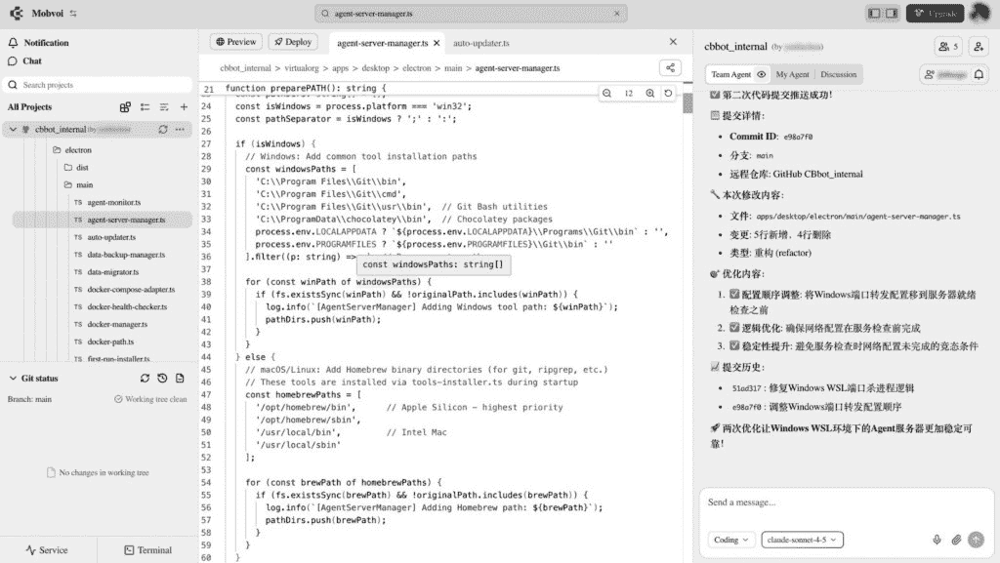
图7-1 CodeBanana界面分区与功能概览
·单一信源：讨论、设计、程序、测试、上线全部在CodeBanana内完成，消除了需求文档、设计稿、代码库、项目管理工具之间的信息断层。
·实时语境：负责人可在平台直接查看代码，通过聊天框提出修改建议，相关产品经理和工程师能立刻看到最高优先级指令及其对应的完整代码语境。信息不再经过会议层层转递，而是直接附着在它本应存在的地方。
·并行创造：产品经理定义新功能后，智能体可近乎同步生成原型代码，资深工程师则一边评审智能体产出，一边进行更高层级的架构设计。所有人围绕同一目标并行推进，不再受线性前后环节的束缚。

这种组织肌理直接解决了传统协作工具与真实工作流脱节的问题。它不是生产之外的沟通层，而是生产本身。这也是CodeBanana和飞书等传统工具的根本分野，体现在四个维度：
·协作主体：飞书以人与人为主、智能体辅助；CodeBanana以人和智能体共同协作为主、智能体担纲主力。
·协作颗粒：飞书的单元是一份文档；CodeBanana的单元是一个包含代码、文档、数据的完整项目。
·权限范式：飞书强调精细权限管控；CodeBanana追求极致透明开放。
·驱动方式：飞书本质是文档驱动；CodeBanana是原型驱动。

这不仅是功能差异，更是协作哲学的分野。市场也在验证这一方向。曾经以纯对话为核心的ChatGPT悄然上线项目与文件处理能力；以文档为根基的Notion也在其智能功能中加入跨页协作与项目管理属性。所有工具都在指向同一个判断：在智能时代，孤立的信息没有价值，只有置于完整项目语境中的信息才能被智能体真正理解与赋能。这正是CodeBanana从一开始的设计基因。

第三节 涌现式组织：让解题者自然成形

如果CodeBanana的诞生源于个体极限试验，其机理是全新协作网络，那么让它持续进化的引擎是群体智能的涌现，以及CEO与产研关系随之重组。这关乎的不仅是协作方式，更是思考权与决策权的迁移。

一、智能体从执行器到伙伴的进化

驱动网络进化的关键在协作主体变革，智能体正从被动工具演变为主动伙伴。
传统组织以人为中心，未来组织将以系统化智能为中心。新型协作单元具备三种颠覆能力：能端到端创造价值，快速产出可运行原型，无需传统团队的线性传递；能处理海量信息，迅速消化整合大量文档与数据，远超个体能力；其潜力取决于可获取上下文的范围，必须打破权限壁垒接触全流程信息。
这并非理论。某AIGC头部企业内部迭代中，系统化智能已从辅助工具成长为可协同推动项目的伙伴。
一次CodeBanana内部迭代里，团队面临典型难题：要在提升实时建议体验的同时不牺牲前端性能。传统模式需要产品、前端、后端、算法开长会评审。但在平台上，只需给智能体一个开放任务：分析现有架构，在不损害前端性能的前提下提出可行方案。
接下来的数小时，智能体的表现超出预期：
它没有立刻写代码，而是先“阅读”了项目库中所有关于前端性能的文档、历史提交记录与过往优化讨论。
随后它主动给出三套备选方案，并清晰列出优缺点、开发复杂度与潜在风险。方案一是常规的前端节流，方案二是复杂的后端预取，方案三是团队从未考虑过的Web Worker后台计算方案。
最后它@了团队中最懂前端性能的工程师提问：“结合你在XX项目中的实践，方案三的浏览器兼容性风险是否可控？”
这一刻协作关系质变：智能体不再是执行工具，而是真正的团队伙伴。它借助沉淀的集体记忆进行独立推理，并主动组织团队协作，如图7-2所示。
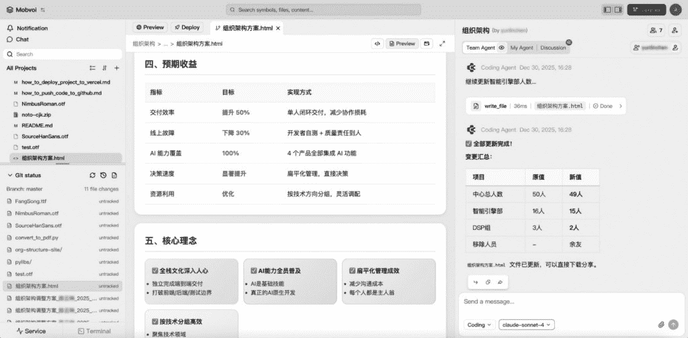
图7-2 CodeBanana协作界面示例
这正是群体智能的体现：人机共生系统的整体智慧超越个体。智能体从执行者变为组织知识网络的激活者与催化剂。

二、先立宪：人机协作需要清晰规则

让群体智能涌现的前提，是为这个人机混合团队设计清晰无歧义的运行规则。这是AI原生产品研发中付出最大代价也收获最大教训的部分：理清核心概念与逻辑架构至关重要。
早期版本里，团队在最基本概念上混乱不堪。一位工程师形容：像在南京地图上执行重庆行政规章，完全乱套。
核心矛盾在于成员、项目、聊天室、组织四个概念的权责边界模糊。一个游客身份的成员能否在某个项目的聊天室里修改另一个组织下的代码？这个绕口问题背后是无数权限冲突与数据隔离的Bug。
团队明白，AI原生协作平台的首要任务是为微型社会立宪。若公民权、领土边界、议事规则不清晰，上层协作必然崩塌。
于是暂停新功能开发，用一周时间只做一件事：为CodeBanana立宪。最终明确：
·两种组织身份：Own，自建组织拥有最高权限；Work，协作组织权限由组织授予。
·协作基本单元：Project，所有代码与核心任务归属项目。
·沟通载体：Chat，可附属于Project或独立存在。
·权力核心：权限跟随Project，而非Chat。
这套宪法成为后续迭代的基石，让群体智能的涌现从混乱走向有序。

三、CEO的角色：从管控到塑造世界观

在这套协作系统里，最先被颠覆的是CEO。他的角色从传统管理者转变为世界观定义者。他不再关注考勤与KPI，而是关注这个微型社会的宪法是否公正、优雅、能激发创造力。
这要求领导者深度参与创造，但不陷入执行。他不再发号施令，而是构建原型。新功能启动时，CEO会亲自用极简工具搭出一个粗糙但表达核心思想的最小原型。这不是技术展示，而是传递产品哲学与交互理念。原型取代PPT与长邮件，成为沟通世界观的唯一语言。
当团队对核心概念产生分歧时，他的职责不是裁定对错，而是引导关于规则本身的思辨并做出立法解释，像最高法院法官守护基本法。
领导模式的重塑也重塑团队关系。雇佣关系淡化，共创关系上升。成员不再是被动执行者，而是各自领域世界观的共建者。每个人被要求主动思考如何让规则更优雅高效。组织架构随之改变，纯粹管理层消失，信息传递与任务协调被透明系统取代。技术管理者必须回到一线，像首席工匠一样亲自参与核心设计，用对世界的深刻理解赢得尊重。
CodeBanana的进化不依赖更强模型或更精妙算法，而源于对内部智能涌现与规则设定的理解。当AI成为主动思考伙伴，协作宪法清晰，CEO与团队从管理与被管理转向共同定义世界观时，自我进化的组织才有了内核。

第四节 混合编队实战：智能时代的敏捷现场

CodeBanana是在智能熔炉中淬炼出的新生产关系作战范式。
智能时代创新的速度等于生命线。但团队很快发现，仅提升AI Coding效率无法解决根本问题。开法拉利跑在泥泞老路上，速度仍为零。跨部门壁垒、信息不对称、漫长审批就是这条旧路。
最初目标很直接：加速。通过减少摩擦打通权限，把想法到上线速度推到极限。实践显示研发效率提升4到5倍，工程师约80%的时间从无效沟通中解放，回归创造。
一次产品定位会上，李志飞分享了Macroscope的理念：用智能打造感知层让CEO看清一切。他最初想法是做得更好，让CEO不仅能看还能直接管。团队共鸣强烈，但也有不同声音：“修路只是升级旧车，我们能不能造新车？Macroscope本质仍是分离观察，服务于管理。而我们的机会在于内嵌共生，让管理感知无缝融入生产协作时，它就不再是管理，而是生产力本身。”
实践中首先发生变化的不是工具，而是被视为理所当然的权力结构。信息在统一技术场域无损实时流动后，自上而下传递变得多余。沟通不再依赖层级，直接体现在代码和系统里。代码本身成为权力载体。以协调汇报为生的管理岗位失去基础，技术管理者必须回到一线，用架构能力、问题拆解与实际产出建立影响力。
工程师角色也在松动。前端、后端、测试、产品边界被打破。AI承担标准化重复工作后，能端到端理解问题、设计方案并交付结果的全栈型个体成为最有效作战单元。一个人可独立完成从需求到落地的闭环。个体即团队不再是口号，而是日常。
权力压平、能力放大后，时间尺度被彻底压缩。原本需多轮对齐评审的项目被塞进极短周期。小而精的原子小队形成新节奏：三天出可运行原型，五天完成上线，一周对外发布。速度从效率指标升华为共同信条。
变化并未止于研发。AI成为组织通用接口后，协作自然越过部门边界。市场可直接询问产品差异，销售借助AI分析客户画像制定策略。用流程与职责筑起的部门墙在共创项目中坍塌，取而代之的是围绕具体问题快速聚合、行动、解散的模式。组织靠项目驱动而非结构维持。
这场讨论重新定义了智能时代协作平台的标准。它必须承认未来组织核心从人转向AI，因此必须是AI任务中心系统。它不仅是生产力工具，更是一种治理范式：CEO能直接读懂代码逻辑，非工程师也能实时看懂研发进展；沟通就是代码，代码就是权力，权力回归创造。
这是一场生产关系变革：层级扁平化，纯管理岗消失，技术管理者回归一线。若Macroscope是在修路，CodeBanana是在造车，并为这辆自动驾驶汽车设计新交通规则。
这正是协同作战范式的目标：不仅追求加速，更让颠覆性创新在全新生产关系下持续涌现。

一、强制切换：让新协作真正落地

拥有先进平台后，更现实的问题是：如何让习惯旧武器的军队心甘情愿换上这把烫手的利器？答案始于一道不容置疑的指令。
“下月，我们不再支付Cursor费用。”会议室空气凝固。这是一次近乎独裁的变革，也是必要的灵魂注入。背后是对AI原生协作范式的偏执信仰：要打赢未来战争，必须彻底抛弃旧武器系统，用全新方式思考与战斗。
由最高指挥官发起的强制换枪行动虽有阵痛，却以最彻底的方式将CodeBanana注入组织血液，使其成为团队思考、协作与创造的核心操作系统。

创造走到哪一步才算真正落地？不是功能上线就结束，而是整套组织能接住它、跟上它一起跑。能让全员产生共鸣的决心与方法，才是变革成立的分水岭。

**二、组织的生命信号：从零件堆到活体网络**

当 CodeBanana 真正成了组织的运转枢纽，一个全新的组织样本开始显现。它的生存体征与过去截然不同。

以“共创项目”为轴心的协作方式，让研发生态、市场、销售等原本被隔开的单元像蜂群围花一样，自发聚拢又快速协同冲锋。组织不再是固化部门拼成的积木堆，而是在流动中形成的神经网络。

可这张高度流动的神经网，也暴露出一个关乎生死的悖论。当每个作战单元都变得极度敏捷自主，权限沉到最末梢的神经节点时，新风险随之而来：上万条高速运转的神经元如何避免散成一盘散沙？极致效率如何不滑向极致混乱？当组织像活体一样流动，又如何保持整体进化的方向一致？

这已不只是协作机制的调整，而是一场深层的组织进化。下一章将推演组织如何成为持续进化的生命体。

**第八章 组织相变与人类的重新定位**

上一章我们看见了协作的升级。新的组织中枢把分散的超级个体编织成高效的混合兵团。但这只是序章。当视线从中枢本身拉远，落到它所处的未来图景上，一个更具颠覆性的问题浮现：如果协作规则被彻底改写，由协作构成的组织终极形态会是什么？

冰升温化水，再化为云。分子没变，但连接方式、运动规律与能量密度发生了本质跃迁。水无定形却能穿石，云无定位却能覆地。

组织也在经历相态迁移。传统公司像冰，结构严密、层级分明，却脆弱僵化。智能时代的超组织，则像水。没有固定边界，没有永久部门墙。它随任务需求实时渗透、变形、聚合，任务结束便消散重组。

当智能体的能力被完全释放，AI 原生中枢成为组织的能量核心时，这样的液态超组织将展现怎样的生命力？身处洪流的人类，又将迎来何种身份跃迁？本章展开一次关于组织终局与人类未来的思想远征。

**第一节 液态雏形：弹性只是起步**

协作效率趋于极致时，组织该如何演进？是否还需要传统意义上的公司？答案不是消亡，而是形态革命。组织正从固态堡垒融解为液态生命体，极致弹性成为核心特征。传统组织是固态的，边界、层级与规模相对固定，像一座坚固却笨重的金字塔。面对市场瞬变，调整缓慢，扩张收缩都伴随高昂摩擦。

未来的组织首先呈现液态特征。它无固定形态，能随任务像水一样渗透、变形、扩张或收缩。今天它可能是为攻克科学难题而生的百人研究所，明天就能重组成负责全球营销战役的大型作战单元。

**一、解剖液态组织：环层结构**

理解这种形态，最贴近的现实雏形是美团与滴滴，可归为液态组织1.0。两者商业形态特殊：内核极小，外延极大。内部核心团队负责制定规则、研发算法；外部则由一套强系统指挥数百万名松散、按需响应的骑手与司机。模式核心是极致弹性。

从这一雏形可提炼出液态超组织的架构模型。它不再是自上而下的金字塔，而是一个由协同中枢连接的环层结构，如图 8-1 所示。

圆心即组织的智慧核心。这是“大脑”，由少数顶尖战略家、系统设计师与价值定义者构成。他们的职责不是管理员工或执行任务，而是为系统设定核心航向指标、制定游戏规则、处理关键异常并注入价值观。他们是定航向的船长，而非划桨的水手。

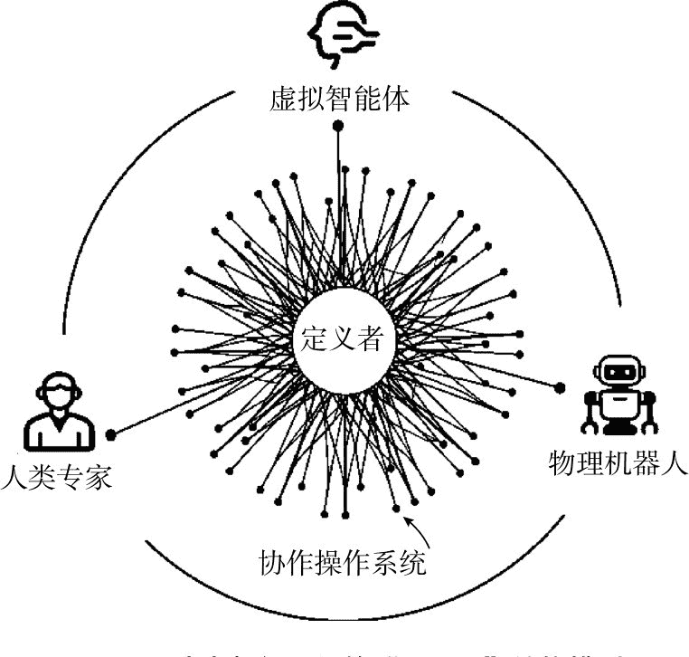

图 8-1 液态超级组织的“同心圆”结构模型

外环是组织的资源网络。它是“身体与手脚”，由海量异构、可按需调用的生产力单元组成。在美团滴滴中，这主要为人集。未来它将进化为包含虚拟智能体、物理机器人与人类专家的混合云。

连接层是协同中枢。它是圆心与外环的唯一杠杆与中枢神经，负责把定义者的战略意图转化为对无数节点的精准调度、任务匹配、过程监控与价值分配，确保庞大的液态组织高效有序运转。

美团与滴滴的革命性在于证明：一个极小的定义者核心，通过强大中枢可撬动自身数万倍的社会化网络，创造千亿级价值。很多人误读为外包模式，这是误解。

传统外包是企业间长周期的固态替代。美团滴滴的本质是被智能系统极致放大的劳动力众包。系统能把宏大任务实时原子化拆解为数百万微任务，并动态精准匹配给最合适的独立执行单元。

这是一种全新范式，组织不再需要拥有劳动力，而是按需弹性调用被智能系统高效编排的社会化劳动力。这是液态超组织实现的基础。

**二、场景验证：虚拟与物理的双重演练**

液态调度能力不仅存在于虚拟世界，更深刻重塑物理世界。

在虚拟世界，GitHub Copilot 本质上就是“编程能力的滴滴”。开发者输入注释后，系统在由人类几乎所有公开代码构成的庞大运力网络中检索、匹配、重组，再派单生成最可能满足需求的方案。

在物理世界，变革更为震撼。设想未来智能手表品牌 Chrono。

传统模式需要自建庞大工厂与物流，是重资产帝国。液态组织范式下，Chrono 核心团队可能只有十人，他们是庞大物理帝国的隐形大脑。

东京用户一键下单，实体经济的滴滴派单随即启动。指令直达协同中枢，系统在全球制造能力网络中匹配：越南共享工厂A有空闲产线但无法加工稀有材质，德国精密工坊B成本稍高但机器人刚升级相关技能。系统瞬间决断，将任务派单给德国工坊。

随后智能体驱动机械臂生产，无人机接力配送。Chrono 团队从未拥有厂房，却通过调度全球闲置产能完成精密物理交付。

这就是从拥有生产力到调度生产力的范式重构。代码也好，原子也罢，在液态组织眼中都是可按需调用的资源流。

**三、液态网络的驱动法则**

如果美团滴滴撬动的是效率有限、成本受限、无法七乘二十四工作的劳动力，那么当可调度资源变成效率更高、成本更低、二十四小时在线、数量近乎无限的虚拟智能体与物理机器人时，模型的能量将被指数放大。

十位顶尖战略家与系统设计师组成的圆心，驾驭先进协同中枢，调度全球数百万机器人与数千万智能体完成新药研发到太空探索的宏大任务，十人小队创造万亿价值的图景不再是科幻，而是技术演进必然。这背后遵循三条不可逆定律。

第一定律是规模弹性。组织的规模不再由人力定义，而由可调度算力定义，天花板被彻底打开。

第二定律是架构液态。固定部门墙被溶解，组织围绕任务池动态聚合与解散。

第三定律是边界消融。企业围墙最终蒸发，组织演变为通过协议连接内外资源的无远弗届生态网络。

必须清醒认识：液态组织只解决了弹性问题，它仍是一个由中央大脑强控制的系统。骑手被动执行指令，无新智慧涌现。这只是体力的极致外包，而非智力的自发涌现。未来组织不能止步于此，需从液态迈向更高形态——自生型组织。

**第二节 自生型组织：群体智慧的诞生**

液态组织是进化的中继站，解决资源弹性。自生型组织则是终局，解决更本质的智力爆发。

滴滴模式中中央大脑虽强，却是强控制逻辑。骑手被动接收指令，无法自主决定路线，更无法通过协作创造新商业模式。这仍是工业时代命令与控制在数字世界的延续。

AI 原生时代需要的不只是更快的滴滴，而是让成千上万智能体与人类专家像神经元般自由碰撞产生新思想的大脑。我们称之为自生型组织。

**一、涌现是什么**

正如凯文·凯利《失控》所描绘，无数只简单的蜜蜂在无中央指挥下，通过局部互动建造精密蜂巢、寻找花蜜、抵御外敌。这就是涌现：简单个体遵循简单规则，自发产生复杂高级智能行为。

自生型组织中没有全知全能的CEO逐项下指令。组织仅设定核心航向目标，如最大化用户价值，以及一套基础协作协议即宪法。成千上万智能体与人类专家基于协议自主组队、自主研发、自主营销。

**二、组织架构：创智人才与硅基助手**

这种组织的内部结构是怎样？曾鸣教授给出精准画像：未来组织呈现两层架构，百分之一创智人才加百分之九十九硅基助手。

创智人才是组织的碳基大脑。不再负责具体执行甚至具体管理，核心职责是元认知——定义问题本质、设计系统规则、在关键时刻进行伦理价值裁决。

硅基助手是组织的硅基军团。不只是辅助工具，而是能独立上岗、对结果负责的智能体。它们七乘二十四不间断运行，承载组织绝大部分认知负荷。

正如曾鸣所言，我们正在见证全新职场物种大爆发。未来超组织不再是几万人类的堆叠，而是极简的碳基大脑指挥庞大的硅基军团。

**三、竞争壁垒：黑洞效应**

自生型组织进化后，竞争优势不再源于经验积累或规模红利，而源于一种可怕物理现象——黑洞效应。

旧世界护城河靠时间堆砌经验壁垒。AI原生时代护城河变成知识吞噬能力。

当自生型组织中每个硅基助手都在独立上岗，并在业务闭环中实时汲取数据、优化算法时，它制造一个认知黑洞。吸收私有知识越多，引力越大，进而吸入更多数据与场景，形成自我强化的超级循环。

这种进化是指数级的。一旦越过临界点，它将把仍处线性增长的对手远远甩在视界之外，形成降维打击。

**四、终局推演：无人公司的诞生**

进化的极致形态是无人公司。并非完全无人，而是指无人管理。

在高度成熟自生型组织中，战略不再自上而下规划，而是从无数智能体试错中自下而上生长；产品不再是产品经理灵光一闪，而是由AI依据实时数据自动生成；招聘、财务、法务等也由智能合约自动完成。

人类作为系统造物主，只需坐在控制台注视代码与数据构成的生命体在商业丛林中自我繁衍、自我进化。这才是组织进化的终极奥义。

**第三节 人类跃迁：从执行者到定义者**

当代码由智能体编写，产品由机器人制造，人类在自动化系统中的位置何在？答案不是边缘化，而是深刻角色跃迁。我们正处转变前夜，人类将从奋力划桨的划桨手进化为站在船头定航向的掌舵人。

**一、角色的三位一体：设计师、指挥官与伦理官**

在AI与机器人构成的高效执行网络之上，人类价值聚焦于无可替代的核心领域，构成未来知识工作者的三位一体：设计师、指挥官与伦理官。

首先，人类是终极设计师。在知识工作的美团模式里，AI可生成上万张海报，但哪张最能触动人心？在实体滴滴模式里，AI可提供上千种设计方案，但哪种最符合人类美学与情感？AI提供无限选项，人类负责最终选择。背后是无法量化的审美、品位、直觉与人性洞察。我们成为最终的首席产品官与首席体验官，为冰冷技术注入温暖灵魂与独特风格。

其次，人类是系统定义者。协同中枢本身不会凭空产生目标。向AI下达策划全球发布会、设计智能手表等高级指令的始终是人类。我们的智慧更多体现在提问而非解答，核心工作是定义正确问题、设定清晰目标、划定边界规则。我们从棋盘上的棋子进化为制定规则并指挥全局的棋手。驾驭无数智能体与机器人组成的复杂系统的能力，将成为最核心领导力。

最后，人类是终极伦理官。当AI决策涉及偏见、隐私或安全时，谁来仲裁？当自动化生产物流出现意外造成损失时，谁来承担最终责任？只能是人类。决策链顶端必须有一个具备同理心、伦理观与社会责任感的人类存在。我们成为AI时代的最终解释者与道德刹车片，确保技术力量始终服务于人类长远福祉。

**二、竞争本质：驾驶员差异**

当所有组织都有掌舵人，都拥有强大AI执行网络，它们会一样强大吗？恰恰相反，差距会被前所未有地拉大。

正如所有人拥有相同赛车，F1冠军与普通司机表现天壤之别。未来工具与资源将像水电一样唾手可得，唯一决定性变量是驾驶员，即掌舵人核心团队驾驭系统的能力。

残酷推演：同样的十人小队、同样的顶级中枢，结果可能天差地别。平庸团队因缺乏系统思维给出模糊指令、规则漏洞百出，导致数百万智能体陷入混乱死循环；卓越团队凭借深厚全栈理解力与极高审美品位，像编程组织、像指挥交响乐调度资源，最终撬动庞大价值帝国。

未来竞争真相是：不是AI淘汰人，而是会驾驭AI系统的人淘汰不会驾驭的人。人类价值正从贡献时间线性积累转向贡献智慧指数放大。

我们必须承认，组织进化将伴随结构性失业阵痛、教育体系重塑艰难、全球治理规则博弈，甚至深刻社会心理危机。

**三、价值重估：从贡献时间到贡献认知**

角色转变本质是个人价值体现方式的根本跃迁。过去人与贡献时间强相关，未来与贡献智慧强相关。这揭示法则：你所处的认知维度决定你在AI时代的商业价值。

可将认知分为三阶段：工业时代具象化认知即驾驭确定性；数字时代系统化认知即驾驭复杂网络；AI时代元认知即驾驭思考本身。福特流水线是第一阶段产物，互联网公司OKR是第二阶段镜像，SpaceX用AI模拟器进行思想预演则是第三阶段极致体现。

三阶段清晰揭示，未来组织竞争本质是创始团队认知维度的竞争。正如产品开发前沿所见，在Cursor团队中，随着AI模糊角色边界，所有人都在向完整创作者进化。

当公司可从十万人缩减为十人，这十个人的每一次念头、决策、审美判断都会被协同中枢放大一万倍。人类认知、品位、想象力从未如此直接、低损耗地转化为巨大商业影响力。未来竞争不再比拼员工数量或厂房规模，而是定义问题能力与构建系统智慧之争。这是商业的终局。

**第四节 文明跃迁：组织进化是人类认知镜像**

我们从新物种诞生开始，经历组织转型之旅，最终推演液态超组织图景。变革涟漪绝不会止于组织边界。

人类文明进程始终由工具、组织与认知构成递归循环。今天智能体作为前所未有的递归工具，正把循环推向全新能级。我们从塑造工具时代步入与工具共同进化的递归纪元。在新纪元，智能体与其催生的液态超组织将从三个层面重构文明底座。

首先是经济基础颠覆。人类文明数千年社会结构建立在稀缺性基石上。当十人小队创造万亿价值成为可能，生产力极致放大，人类将首次从稀缺社会迈入丰裕社会。带来颠覆性影响，工作不再是大多数人获取生存资料唯一手段，这直接抽掉现代社会核心支柱。

其次是社会结构溶解。当工作这根主轴被抽离，整个社会结构随之重构。我们将从以职业定义身份的社会转向以社群定义身份的社会。家庭、邻里、兴趣社群这些工业时代被边缘化的单元，将重新成为个体获取归属感、认同感与幸福感核心来源。

最后也是最根本，是个体存在意义追寻。我们将被迫回归最本质哲学追问，这标志文明核心议题完成伟大跃迁——从生存问题转向意义问题。

少数掌舵人将从生产美进化到定义美；更广泛大众将从为了生存而劳作转变为为了体验而生活。探索世界、终身学习、深度社交、参与微观创造等过去被视奢侈的活动，将成为未来社会主流生活方式。一个人的价值不再由生产力或财富衡量，而是由生命体验宽度、思想探索深度与情感连接强度定义。

然而我们并非被动驶向未来。在递归纪元门口，我们手握选择权利。是放任技术与组织递归进化，让人类从掌舵者沦为附属品，还是清醒认识到，真正的递归最终必须是人类自身认知与智慧的递归？

# 文明重启的临界点

这一次跃迁的本质并非效率的叠加，而是自我认知的重写。支撑演进的，是三类正在扎根的基础素养：对复杂自适应系统的拆解与再造能力；于混乱中权衡价值并赋予意义的思辨力；以及与异质智能共处、共鸣并协同开辟未来的共生思维。

自主智能与液态组织一方面放大生产力，另一方面像一面镜子照出人类认知的边界。更重要的是其解放效应，它松动了延续数万年的生存焦虑，让整个人类首次得以以整体姿态追问存在的意义并予以回应。

组织形态的迭代最终映照出人类形象的变动与选择的重置。它在发出一种召唤：不再局限于征服世界，而是学会驾驭复杂性，与各类型智能共同书写文明的下一章节。

从形态革命出发，我们抵达的是文明的重塑与个体的释放。这正是当下最宏大的冒险。

**小结 海岸线与暗礁**

从一次关于未来协作的提问出发，似乎已瞥见新大陆蜿蜒的地平。

其一，生成式智能时代的主流形态，很可能是轻核心叠加广连接的巨型网络体。其动能来自协作逻辑的转换：由内部人力能力的线性叠加，转向对外部社会化资源的杠杆调用。

其二，随组织迭代，人类亦完成终极升维。由亲力亲为的执行者，变为系统的设计者、价值的制定者与伦理的守门人。

景象令人振奋，预示生产力的大解放与人类价值的升华。然而任何未被航行的海域，平静之下都藏暗礁。必须直面组织进化的另一面，对社会结构带来的剧烈冲击。

正如 Anthropic 首席执行官达里奥·阿莫代的严峻提示：未来数年内，生成式智能可能抹去约半数的初级白领岗位。当资深员工借助智能体就能完成过去需要新人配合才能交付的工作，企业账本的逻辑不言自明。入门岗位在悄然蒸发，年轻一代正陷入没经验就找不到工作、没工作就拿不到经验的闭环。

这正是高效模式残酷的副产品：当十人团队就能撬动万亿量级价值时，剩余的人将何去何从？阿莫代描绘的经济增速上扬、失业率攀升的倒挂图景，并非危言，而是迫在眉睫的激流险滩。

因此组织进化指向的不仅是人的进化，更是对社会契约的深度拷问。不能把命运寄托于少数科技公司的良知。作为变革的亲历者和创造者，不仅要问如何打造更强大的组织，更要回答如何构建更具包容性的未来。在希望与隐忧并存的当口，信念的选择决定下一步的方式。

# **结语**

“环境变化得太快，只有自我革命的组织才能生存。”

——拉里·E.格雷纳（Larry E.Greiner），1967 年

展望文明跃迁的轮廓，思想远征也近尾声。收回视线，回到当下。

本书不只是对未来的远眺，更是在这场变革的战壕里为自己绘制的作战地图，也是一套汇聚前沿公司实践的行动框架。

书中记录了我们如何从对个体赋能的浪漫跌入整体内耗的现实，如何从对超级个人的迷信转向对协作系统的构建，以及如何在飞行中换引擎的危局里做出生死抉择。回望这条仍在进行的转型路，我们只是更早进入深水区，有幸带着故事与疤痕回到篝火旁，把火种分享给同行者。

若把远征的教训浓缩成可传递的地图，它不是一套繁复模型，而是十条生存经验与信念，也是我们对未来组织最坚定的判断。

**一、主体让位：闭环执行交由智能体**

这是所有演化的逻辑起点。过去智能是人类的副驾，如今它是能闭环完成感知—规划—行动—反馈的执行主体。权力交接中，人类后撤为设计者与监督者，智能上升为执行者。任何变革都必须默认任务先由智能体完成来重新设计，而非先派人再配智能。

**二、增长逻辑重写：组织的整体压缩**

既然执行主体可无限复制，工业时代产出等于人力相加的加法法则失效，乘法法则确立。为管理庞大执行层而生的金字塔与信息中继式中层，因经济性丧失而瓦解。组织必须停止以人头计增长，坚决做整体压缩，剔除隔热层，坍缩为大脑加触手的扁平网络。

**三、数据基建转向：为机读而建**

智能的燃料不是精美的报表，而是蕴含过程细节的行动数据。过去数据像纪念碑，如今像血液。数据基建的首要任务是服务智能：打破孤岛、治理暗数据、构建唯一的事实源，为超级大脑持续供养。

**四、协作方式：从文档传递到原型共识**

传统协作是产品写文档、工程写代码的线性传递，损耗极大。生成式智能让生成成本低于描述成本。组织应废除冗余文档流程，主张原型即共识，让可运行的活原型取代死文档，成为沟通的唯一语言，实现即时反馈与闭环交付。

**五、角色分化：系统架构师与全栈操盘手**

智能接管九成零件式执行后，中间态的螺丝钉岗位将被淘汰。人类价值向两极迁移：一端是定义问题、设计系统的系统架构师；另一端是操控智能完成端到端交付的全栈操盘手，需要系统性培养员工的全栈与指挥能力。

**六、最小单元：微型突击队取代部门墙**

单兵即人类加智能的作战效能已指数级提升，部门墙反而成为敏捷的牢笼。智能时代的高效单元是微型突击队，例如一名产品加一名全栈开发加若干智能体。策略是打破固定部门，按任务动态组建，任务来时聚沙成塔，结束时散作星辰。

**七、文化转向：由管控转向涌现**

用 KPI 管控智能的创新是不可能的。面对不确定性，管控思维只会扼杀可能。组织需要对齐目标、激励反馈、涌现创新的新文化。领导者从指令下达者变为生态园丁：提供充分上下文、划定清晰底线，再授权一线与智能自发涌现最优解。

**八、领导角色：首席定义官**

当执行按钮越来越多地交给智能，CEO 的价值被重新定义。领导力从管理能力回归思想能力。在智能原生组织中，CEO 应进化为首席定义官。其核心不再是战术决策，而是定义智能无法回答的根本问题：北极星使命、审美品位、伦理宪章。

**九、协作操作系统：打造中枢神经**

超级个体的爆发带来人机人协同的难题。为避免囚徒困境，组织必须构建统一的协作操作系统。指令、代码、反馈在此完全透明，代码即权力，平台即组织，它是连接人与智能神经元的中枢神经系统。

**十、终极形态：液态超级组织**

执行主体为智能，外部为可调用的全球网络时，组织的终极形态是同心圆：极小的智慧核心定义方向，极大的资源网络提供执行力。企业不再需要囤积劳动力，而需调度全球智力的能力，像水一样随任务弹性伸缩。

在智能重塑一切的今天，几乎所有企业都在谈变革，成功率却依然低迷。如何实现真正的组织改变？关键在于战略、文化，还是权力与人性的博弈？

哈佛商学院教授拉里·格雷纳早在 1967 年信息化前夜就揭示了核心规律：成功的变革本质是权力结构的再分配。其框架描述了组织如何在压力下觉醒、重新分配权力并形成共创机制。

管理者对变革的认知也在从演进式转向革命式。演进式把变革看作缓慢的被动修正，相信时间会解决问题；而革命式直面快速变化与内部停滞，主动以结构、行为、文化的系统重塑实现跃迁。

“环境变化得太快，只有自我革命的组织才能生存。”这一判断精准预示了智能时代的管理挑战。从数字化到生成式智能，每一次范式跃迁都在倒逼企业放弃修修补补，走向快速试错与系统再造。变革的催化剂是强烈的内外压力，这种痛感是打破舒适区唯一的力量。我们经历的压力、觉醒、试验、强化，不过是重走那条经典理论早已指明的成功路径。

进化是生物界的机制。正如达尔文所言，存活下来的不是最聪明或最强壮的，而是最能适应变化的物种。同理，有生命力的智能系统并非规模庞大、法则化的巨模，而是能感知反馈、自我进化、解决实际问题的系统。

技术会变，工具会变，但变革的本质——关乎权力、人性与共同进化的艰难旅程——从未改变。今天的挑战只因智能的力量过于猛烈，权力重构比以往更迅猛也更残酷。

本书并非放之四海而皆准的公式。我们坦承每个组织都有独特的历史包袱。分享的不是标准地图，而是制图工具，帮助你绘制自己的航海图。

打通数据、重塑流程、进化文化，最终为一种形态做准备：由无数超级个体与智能体构成的流动、无边界价值创造网络。它不再是固化的金字塔，更像无处不在却无形的菌丝体，或由无数发光节点组成的创造星云。未来的组织或许是无形的组织。

历史告诉我们，每一次生产力变革都伴随生产关系的彻底重构。蒸汽机催生工厂，电力与流水线定义公司，互联网孕育平台。今天，能进行智力劳动的人工智能将催生怎样的生产关系？答案藏在当前的阵痛、旧角色的消亡与新物种的诞生之中。

当我们走完这条路，一个更值得深思的图景浮现：我们以为在构建智能，实则智能正在反向重构世界。它改变工具、组织、个人，也重塑文明协作的底层逻辑。文明重启的实质是一次系统性进化。从口语到文字，文明获得记忆；从纸张到印刷，知识大规模传播；从工业到互联网，全球协作成型。

此刻我们站在下一次操作系统重启的临界点。人工智能是根代码，智能原生组织是引导装置，超级个体是系统入口。

在新系统中，秩序不再靠管控，而是靠协议自组织涌现。组织不再是僵化结构，而是一个智能涌现器；个体不再是单一劳动力，而是一个最小操作系统；管理不再是下达决策，而是编译协作协议的艺术。

这就是文明的内圈效应：未来不会平均降临，它以组织与个体的结构为筛子重新分配红利与危机。唯有与新操作系统兼容的主体，才拥有进入下一文明主舞台的入场券。智能原生组织的意义早已超越企业管理，它是一种嵌入涌现结构、智能协作与自我进化机制的新型文明单元，是未来社会创新、财富与思想的结构母体。

本书无力描绘终将到来的黎明全貌。它只是人类与智能共生的史诗中一个渺小却真实的缩影，是一份关于伟大迁徙的世界观地图，试图勾勒新大陆轮廓并揭示其物理法则。

历史车轮滚滚。我们无法选择时代，但可以选择回应方式。无论是否准备好安装这套新系统，未来已按下确认键。

一百多年前，泰勒手中的秒表把人变成机器零件，那是工业时代的必然。五十多年前，石英晶体的振动让瑞士钟表的精密齿轮停摆，那是电子时代的序曲。

而今天，智能体如新物种涌入组织。它不是为取代而来，而是归还我们久被剥夺的造物者尊严。

这不是终点，而是碳基生命与硅基生命共同进化的起点。

# **后记**

写完最后一个字时，窗外透出微光。

12个月以前那些关于智能进入组织的激进构想，催生了动笔的念头。书中的狂想在半年后于代码与组织的重组中精准咬合。而书中每一句话仍在等待未来的判分。

本书的诞生像一条莫比乌斯环：思想在推演，现实在成形。翻开它时，世界已不同。在智能加速重构一切的时代，演进细节难以完整刻画，但底层机理正在显现。本书是未来与历史相撞瞬间留下的拓片。

在推演结构位移的过程中，我借用了前辈的望远镜。本书的思想原色源于林毅夫教授关于生产关系与发展的宏大视角，至今仍是拆解复杂经济系统的底层坐标。感谢邓康明先生在湖畔大学关于组织观的论述，为持续思考组织本质提供了重要参照。感谢哈佛商学院保罗·冈帕斯教授及硅谷深夜对谈的朋友们，他们的全球化视角让我看见企业进化的另一维度。

感谢李志飞。他是一位极具实验精神与前瞻智慧的创业者，更是一位愿将战火硝烟坦诚共享的战友。无数散步头脑风暴与复盘诘问中，我们互抛前线直觉与洞察，在共振中淬炼成逻辑并重构为系统。他提供最极致的商业标本，我执刀解剖。感谢他的信任与自由，让我得以将一家智能公司的真实探索与伤口作为样本沉淀为行业认知。

感谢中信出版社编辑团队的专业与尊重。

进化的奇点已至，旧航海图正在燃烧。愿这张在巨响中留下的拓片，成为你驶入新大陆时手中的一束微光。

高佳

2026 年 3 月 北京

* * *

1. 规模法则指模型表现与模型规模、训练数据量及算力之间的可预测幂律关系，该规律在语言、图像、视频、数学、文图等多个领域均得到验证。↩︎

2. Shadow AI 是微软于 2016 年 11 月推出的智能团队协作工具。↩︎

3. SAP 是 System Applications and Products 的缩写，指 SAP 公司的企业管理软件产品。↩︎

4. Shadow AI 是出门问问开发的核心人工智能引擎。↩︎