# 跟人工智能学象棋开局 ／ 顺炮篇

# 前言

从 2014 年到 2022 年，笔者以“象棋爱好者”“骚老师”的笔名累计在各个自媒体平台发布了数百篇棋评文章、超过 200 局人机大战的解析、超过 1500 个的象棋解说视频。笔者一开始做象棋自媒体纯粹是为了好玩，顺便依靠文章阅读量和视频播放量赚点稿费，心里想着小打小闹玩个两三个月应该就会感到乏味而无法坚持了，真没想到自己却坚持了整整九年。

人生有多少个九年？如果这都不算爱，那我还有什么可期待？笔者目前最大的心愿就是：成为一名象棋棋谱作家。读者朋友们如果看到这段独白，说明笔者在成为象棋棋谱作家的道路上迈出了第一步。本书内容能否得到市场的认可，本书续集能否得到出版，这一切都是未知数。在成为象棋棋谱作家的万里长征路上，道阻且长，需要不断地成长和磨练，各位读者朋友的鼓励和支持将是笔者坚持前行的动力。

在正式说到象棋人工智能人机拆棋之前，先和各位亲爱的读者朋友们分享一下笔者的象棋经历。

在爷爷的教导下，笔者五六岁就学会了下象棋，但那时笔者根本没把注意力放在象棋上。小学期间也曾上过课外兴趣象棋学习班，也只是学了一点皮毛。真正激发笔者对于象棋的好奇心是在初中时期，班上一位同学在课间玩象棋时，兴致勃勃地说起中国象棋人机大战，也就是人和电脑下象棋。他说许银川顶和了超级电脑两盘棋，那两盘棋真是精彩。后来笔者在网上查到了许银川人机大战的新闻，自那时起笔者对象棋软件、象棋人机大战有了初步的认知，从此便迷上了象棋。

笔者人生中看过的第一本棋书是象棋古谱《橘中秘》。在初中的一个暑假，笔者硬着头皮把《橘中秘》的所有棋谱在棋盘上认认真真地打了一遍，自此笔者在初高中可以说打遍学校无敌手。用现在的眼光来看那时的象棋水平，应该是在天天象棋业 4～业 5 水平。到了大学，加入了学校棋社棋队，大一整整一个学年，笔者利用课余时间把张强和阎文清合著的《布局三件套》啃了一遍，此后连续三年拿了本校象棋冠军，大学期间最好成绩是市大学生棋艺联赛亚军、省大学生棋艺联赛第十一名（亦或是第十三名，已记不清了）。用现在的眼光来看那时的象棋水平，已经达到了天天象棋业 9 水平。

大学毕业之后上班闲暇之余，又碰上了直播、短视频处在风口的时代，笔者思来想去，自媒体时代自己唯一能持续输出作品的只有象棋领域了，于是接下来的九年的时间里以“象棋爱好者”“骚老师”的笔名在象棋自媒体领域笔耕不辍，创作了千余件受棋迷朋友们喜爱的作品。而要持续高质量地输出优质的象棋拆棋、讲棋作品，就必须倒逼自己不断地去提高棋力，所以笔者又花了大量时间利用人工智能象棋软件来人机拆棋。时至今日，笔者拿到了广东地方大师象棋等级证书，在网上也有了“中国象棋人机拆棋第一人”的美誉。就棋力而言，目前应该是天天象棋业 9-3 接近神 1 的水平，对应现实棋力是象棋比赛成年组县冠军（稳拿前 3）、中强市级水平（拿前 8）。

笔者十几年前就已经系统地接触“人机拆棋”了。如今因为天天象棋、象棋微学堂等手机下棋平台的兴起，“人机拆棋”的理念已经深入人心，可在十几年前的“人机拆棋”和现在的“人机拆棋”完全不是一个概念。以前的“人机拆棋”，是以人为主体，电脑为辅助，操控者水平越高，人机拆棋也就越强。当时的电脑棋力构成：开局弱+中局强+残局弱，于是在具体操作时，开局和残局阶段以人脑为主，中局阶段以电脑为主。现在的“人机拆棋”，是以电脑为主体，人则成了学习电脑招法的学习者，电脑配置越高、人机理解越深，人机拆棋就越强。如今的电脑棋力构成：开局强+中局强+残局强，电脑开、中、残全方位碾压人类棋手，就是手机端的电脑象棋软件也可以在人类象棋特级大师面前立于不败，更加不用说电脑端实力更加恐怖的象棋旋风、象棋名手、小虫象棋、GGzero 等新一代人工智能象棋软件。目前人类顶尖象棋特级大师如王天一、郑惟桐等，与人工智能象棋软件的差距为 2～3 先，且不论先手后手，人类在人工智能象棋软件面前都是难求一胜。

笔者从 2017 年开始，就系统拆解过中国计算机博弈锦标赛（象棋组）、旋风杯人工智能象棋大赛、独醉杯人工智能象棋大赛等人机大战的棋谱，累计制作超过 200 局的人机大战象棋解说拆解视频，在此期间有幸结交了以党晓阳为代表的诸多国内超一流顶尖人机高手。笔者也被粉丝们戏称为“中国象棋人机拆棋第一人”，除了诚惶诚恐之外，更多的是一份督促和责任。毕竟，目前国内从事象棋领域的人机拆棋、人机学棋的自媒体博主寥寥无几，而笔者是目前国内的先行者。从这一点来说，笔者确实也算是“中国象棋人机拆棋第一人”，这里的第一人就是指国内第一批先行者，而不是人机拆棋综合实力第一人。

本书有两大革命性创新：

第一：结合人工智能象棋软件精准无误的人机拆棋。

第二：目前市场上第一本有明确立场的象棋布局书籍。

过去仅凭人力拆解的象棋布局棋书，因其年代久远，与现今象棋布局的最新研究成果脱节、大量的新变例没有加进去，且存在大量的重复出版和不少人类在象棋分析判断上的错误和盲点，所以利用人机拆棋来纠正布局错漏、补充完善开局变化是非常有必要的。以顺炮布局为例，前人所著的棋书的观点都一致认为顺炮布局是常规布局、足可与先手中炮抗衡。但当今人工智能拆棋已成熟完善，陈旧的观点将被颠覆，笔者结合人工智能拆棋后得出的精确结论是：顺炮布局是一种先天略亏、尚可一战的布局。

在顺炮局对战中，站在先手立场红方该怎么占优，在此之前的棋书都没有给出明确的答案，但在本书《跟人工智能学象棋开局·顺炮篇》中，读者朋友们会得到明确的答案和对顺炮布局的全新认识。

最后本书得以顺利出版，感谢成都时代出版社（原蜀蓉棋艺出版社）所有的幕后编辑老师，感谢象棋微学堂宫易的赏识，感谢象棋人机高手党晓阳的技术支持，以及感谢多年来在微信、头条、b 站等自媒体平台支持本人的所有家人、朋友和粉丝们。

由于水平有限，加之时间仓促，书中疏漏在所难免，欢迎广大读者朋友们提出批评建议，以便改进。

象棋爱好者 R

2022 年 5 月于广州

# 第一部分　顺炮布局人机铺垫

## 第一章　顺炮布局人机结论

在人工智能象棋软件的暴力拆解下，笔者给顺炮布局得出以下清晰的定论：

面对先手中炮开局，后手顺炮布局是略亏可下的非必败开局，先天落后 1.5 先～2 先。在下棋双方都没有犯错失误的情况下，先手中炮优势，后手顺炮只能劣势顶和。

这个结论颠覆了前人所有的棋书、棋评、棋战的结论，对于顺炮布局来说是一个残酷的结论，但在人工智能象棋软件的暴力拆解下，这就是一个事实，毋庸置疑。

我们可以从两个方面去验证以上结论：

第一，顺炮布局的使用现状。

第二，顺炮布局的电脑打分。

### 第一，顺炮布局的使用现状

在软件比赛中，智能软件面对先手中炮，后手顺炮的应法被淘汰，零出现。

在职业比赛中，职业棋手面对先手中炮，后手几乎“清一色的”起马应战。在大师、特大级别的职业比赛中，全年出现的顺炮对局不超过 10 盘棋。

曾经登上过象棋个人等级分第一高峰的两位冠军级特级大师许银川和蒋川，在纯人拆棋时代特别喜欢后手应以顺炮，但在高水平象棋软件出现后，他们也很少以后手顺炮应战了。

目前被棋迷誉为“象棋布局专家”“象棋布局第一人”的郑惟桐在正式比赛中面对先手中炮，后手全部屏风马，从不下后手顺炮。

目前顺炮布局大多出现在省、市、县等各级别业余比赛。

综上所述，目前水平越高的象棋棋手，越少下或者不下顺炮布局。为什么会出现这种现状？原因很简单，随着我们象棋水平的不断提高，随着我们对于顺炮布局的不断了解，在如今人工智能象棋软件的暴力拆解下，顺炮布局确实是一种“先天略亏”的布局，在水平越高的象棋实战中，后手顺炮想要赢棋的难度就越大，渐渐的顺炮布局就没人下了。

### 第二，顺炮布局的电脑打分

根据电脑配置或者手机配置的不同，还有不同人工智能象棋软件分析引擎的差异，一盘棋的具体局面在电脑打分也是不同的。一般来说，一盘棋的具体局面在电脑打分下的分数等价于：

正 50 分，相当于一个先手；

正 100 分，相当于棋局稍优；

正 200 分，相当于棋局优势；

正 300 分，相当于棋局大优；

正 300～500 分，相当于多一个大子的优胜；

正 1000 分，相当于多一个车的优胜。

那么，电脑对于顺炮布局的打分是多少分呢？

以“中国象棋云库”数据库为例：

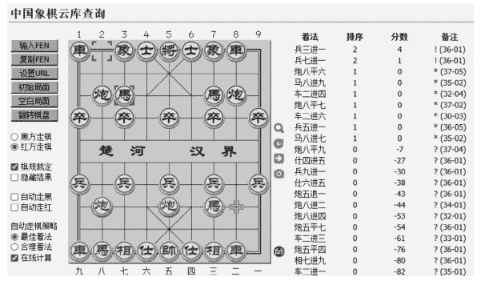
图 1 先手中炮对后手屏风马打分

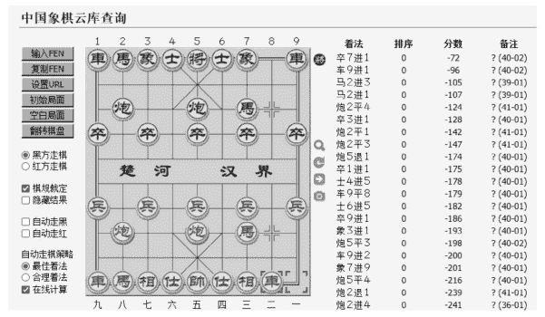
图 2 先手中炮对后手顺炮打分

如图 1，屏风马打分基本 0 分，也就是电脑打分认为：“后手屏风马足可抗衡先手中炮，弹性十足，丝毫不差。”

如图 2，顺炮打分吃亏 70～100 分，先天吃亏 1.5 先～2 先（50 分一个先手），也就是电脑打分认为：“后手顺炮略亏可下，弹性一般，先天吃亏。”

以上，笔者从两个方面证明了前面的结论：

面对先手中炮开局，后手顺炮布局是略亏可下的非必败开局，先天落后 1.5 先～2 先。也就是假设下棋双方都没有犯错失误的情况下，先手中炮优势，后手顺炮只能顶和。

那么，问题又来了，知道了顺炮布局是吃亏的开局，我们学棋者还有必要去研究顺炮布局吗？答案是肯定的，顺炮布局是学棋者永远不可能避开的一个开局。

初学者必须学顺炮，顺炮是象棋攻杀入门的最好开局之一，飞相、挺兵等散手棋开局初学者根本无法驾驭。而且我们业余棋手大部分都不背棋谱，不背棋谱什么开局都可以下，顺炮布局对杀性更强、观赏性更高。

后手顺炮先天落后先手中炮 1.5～2 先，即 70～100 分（电脑打分 300 分一般胜势），在初学者犯错的实战中基本可以忽略不计。就算强机强软之间以顺炮开局对战，在电脑双方都弈出最优解的情况下，先手中炮也不是必胜，只不过后手顺炮只能顶和。

最后，借用钱学森的一句名言：手上没有剑，和有剑不用，不是一回事。

我们研究顺炮布局，不一定能在实战中下出来，做到了“有剑不用”，倒也心里踏实。但我们如果不研究顺炮，你明知道后手顺炮略亏，你拿先手中炮却不会取得优势，这或许就是“手上无剑”的窘迫，将追悔莫及。

## 第二章　先手能不能打中卒

本单元必须解决一个很基础但是却很重要的顺炮布局铺垫：

面对后手顺炮，先手中炮能不能打中卒？

答案：无事找事可以打中卒，但是不推荐，也没有必要。

1.炮二平五　　炮 8 平 5

如图 3，若后手应以同一个方向的中炮，全称三个字“顺手炮”，简称两个字“顺炮”。此时如果用电脑打分，红方正常马二进三跳马、再车一平二出车，电脑打分优势 100 分。

2.炮五进四　　士 4 进 5

士 6 进 5 也可以，但是人机最优拆解推荐士 4 进 5！为以后马 2 进 3、象 3 进 5、车 1 平 4 做好深谋远虑的铺垫！不可炮 5 进 4，因为红方炮五退二！以后红方跳马赶走黑方中炮，再摆上一个中炮，起横车，红方速胜。

3.炮八平五　　马 8 进 7

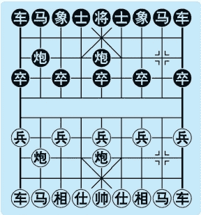

图 3

红方因为“炮轻发”犯了象棋开局的大忌，原本 100 分的先手优势没了，此时盘面电脑打分 0 分。

4.前炮退一

红方如果前炮退二车 9 平 8，马二进一（如马二进三，黑方车 8 进 6）马 2 进 3，马八进七马 3 进 5，车九平八炮 2 平 3，黑方中马灵活，轻松取得抗衡之势。

4.……　　　　车 9 平 8

黑方作为后手抢先把车亮出来，黑方轻松取得抗衡之势。一些棋书或者大师讲棋，讲到这里就不讲了，下面本书给大家补充黑方是怎么轻松抗衡的。

5.马二进三　　炮 2 进 5

好棋，可以轻松破解红方中路攻势，简单粗暴。

6.马八进七　　炮 2 平 5

红方如果退炮吃炮，以后黑方车 8 进 6 占优有攻势。

7.相三进五　　车 8 进 7　　　　8.车一平三　　马 2 进 3

9.车九平八　　马 3 进 5

如图 4，以下红方如果：

①炮五进二换中炮，黑方象 3 进 5 再车 1 平 4；

②兵五进一，黑方马 5 进 3 再马 3 进 4 或者马 3 进 5；

③车八进五，黑方卒 3 进 1，兵五进一马 5 进 7 再马 7 进 5 或者马 7 进 6，黑方都是立于不败，红方没有任何便宜。

综上所述，第二回合不推荐先手中炮炮五进四打中卒，正常走马二进三跳马、车一平二出车，便可取得将近 100 分的先手优势，如图 5。

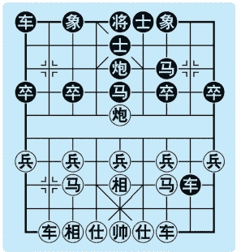

图 4

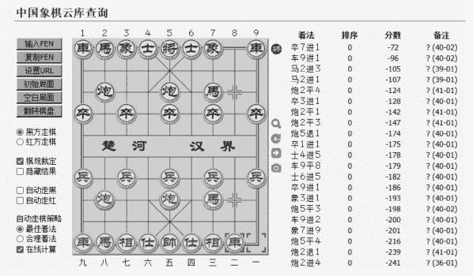

图 5

## 第三章　先手立场最优直车

本书是站在先手中炮立场，利用人机拆棋来为先手中炮方选出最优解。

以红方中炮作为研究对象，以先手占优作为立场，面对后手顺炮，布局可以大致分为四个体系：

（电脑打分来自“中国象棋云库”数据库）

第一，顺炮直车对横车，图 6

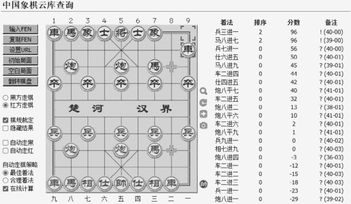

图 6

第二，顺炮直车对缓开车，图 7

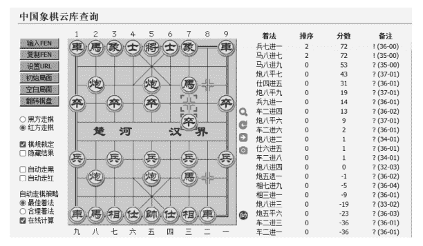

图 7

第三，顺炮横车对直车，图 8

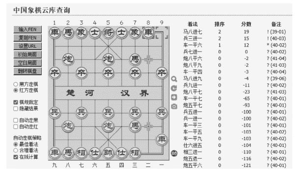

图 8

第四，顺炮先手缓开车对直车，图 9

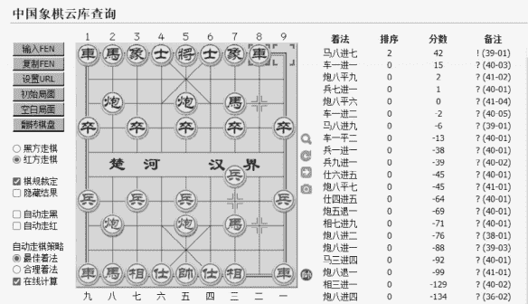

图 9

从图 6～图 9 可知，从先手中炮立场来说，先手直车对横车、先手直车对缓开车，红方先手中炮就可以确保 70～100 分（1.5 先～2 先）的先手优势，而先手横车对直车、先手缓开车对直车，红方先手中炮的优势不到 50 分（1 个先手）。

所以从先手中炮立场的人机拆棋角度，面对后手顺炮，先手立场最优解就是直车。本书介绍先手最优的两个变化体系：顺炮直车对横车、顺炮直车对缓开车。

# 第二部分　顺炮布局历史演变

## 第一章　象棋古谱中的“弃马十三招”“巡河十八打”

以下“弃马十三招”和“巡河十八打”均选自明代象棋古谱《橘中秘》。

弃马十三招

1.炮二平五　　炮 8 平 5　　　　2.马二进三　　马 8 进 7

3.车一进一　　车 9 平 8　　　　4.车一平六　　车 8 进 6

按现代观点可以改走车 8 进 4，攻守兼备。

5.车六进七　　马 2 进 1　　　　6.车九进一

开局弃马，精妙绝伦！

6.……　　　　炮 2 进 7　　　　7.炮八进五　　马 7 退 8

8.炮五进四　　士 6 进 5　　　　9.车九平六　　将 5 平 6

10.前车进一　　士 5 退 4

11.车六平四　　炮 5 平 6

12.车四进六　　将 6 平 5

13.炮八平五

如图 10，红方弃马以后，中炮镇中，双车卡肋，最后弃车破士，重炮成杀。整盘棋只有短小精悍的 13 步棋，却让人回味无穷，赞叹不已，在顺炮布局史上留下了浓墨重彩的一笔，享有“弃马十三招”的美誉。

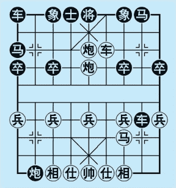

图 10

巡河十八打

1.炮二平五　　炮 8 平 5　　　　2.马二进三　　马 8 进 7

3.车一平二　　车 9 进 1　　　　4.车二进六

按现代观点，可以改为马八进七或者兵三进一缓攻。

4.……　　　　车 9 平 4　　　　5.车二平三　　车 4 进 7

可以改为马 2 进 3，以后炮 5 退 1 变成屏风马阵型，黑方可以抗衡。

6.马八进七　　车 4 平 3　　　　7.炮八进二

构思独特，精妙绝伦！黑方不敢吃马，否则炮八平七！

7.……　　　　马 2 进 1　　　　8.马三退五　　炮 2 平 3

9.炮八平三　　马 7 退 9　　　　10.炮五平二

红方暗藏炮二退一打死车，同时车双炮三子归边已成入局之势。

10.……　　　　车 3 平 4　　　　11.炮二进六　　士 6 进 5

12.炮三进五　　将 5 平 6　　　　13.车三进二

如图 11，下一步炮二进一，绝杀红胜！红方直车配合炮八进二巡河炮，攻杀之犀利，进攻之流畅，精彩程度不输“弃马十三招”，享有“巡河十八打”的美誉。

从以上两盘棋可以看出在三百多年前顺炮布局就已经初具体系。虽然用现代观点去推敲古谱中的顺炮布局谱着，里面有一些是不成立的，但是瑕不掩瑜，古谱顺炮的杀法和构思都是值得我们后人去细细品味的。只是要求我们在学习象棋古谱的时候，要做到“取其精华，去其糟粕”，不全信棋书，敢于质疑，再配合电脑或者手机等便捷的拆棋工具，爱好者们便会更好地吸收各种象棋技能，从而提高自己的象棋水平。

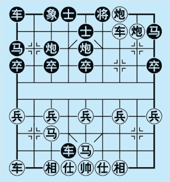

图 11

## 第二章　杨官璘车二进六碰壁后手顺炮“天马行空”

先来看 1958 年全国象棋个人赛的两盘顺炮实战。当时已经是 1956 年、1957 年两届全国冠军的杨官璘，在棋坛上难逢敌手，若拿先手更是难得一败，不料这次全国赛先手两斗后手顺炮，均吃了苦头。

第一盘棋

1958 年全国个人赛杨官璘先负刘忆慈

（1958 年 11 月 24 日于广州）

1.炮二平五　　炮 8 平 5　　　　2.马二进三　　马 8 进 7

3.车一平二　　车 9 进 1　　　　4.车二进六　　卒 3 进 1

5.炮八平七　　马 2 进 3　　　　6.兵七进一　　马 3 进 4

7.兵七进一　　马 4 进 5　　　　8.车二平三　　车 9 平 4

9.仕四进五　　马 5 退 6　　　　10.马八进九　　车 4 进 5

11.车九平八　　炮 2 进 4　　　　12.炮七平六　　炮 2 平 7

13.车八进四　　车 4 平 6　　　　14.炮五进五　　象 3 进 5

15.相三进一　　车 1 平 3　　　　16.炮六平四　　象 5 进 7

17.车三退一　　车 3 进 4　　　　18.相七进五　　车 3 平 5

19.马九退七　　车 6 平 3　　　　20.车八平七　　车 3 退 1

21.相五进七　　车 5 进 1　　　　22.相七退五　　象 7 进 5

23.车三退一　　车 5 平 7　　　　24.相五进三　　马 6 进 5

25.炮四进一　　马 7 进 6　　　　26.马七进五　　炮 7 平 8

27.马三进四　　马 6 进 4　　　　28.炮四平三　　卒 1 进 1

29.马四进三　　马 4 退 6　　　　30.炮三平四　　士 4 进 5

31.马五退三　　炮 8 平 7　　　　32.前马进二　　马 5 退 3

33.炮四退一　　马 6 进 8　　　　34.相三退五　　马 3 退 5

35.相一进三　　马 8 进 7　　　　36.马三进一　　马 5 进 4

37.炮四退一　　炮 7 平 1　　　　38.马二退一　　炮 1 进 3

39.相五退七　　马 7 进 5　　　　40.相三退五　　马 5 退 3

41.后马进三　　马 3 进 4　　　　42.炮四平六　　后马进 2

43.帅五进一　　马 2 进 3　　　　44.马一进三　　卒 5 进 1

45.前马退四　　马 3 退 1　　　　46.马四退五　　炮 1 平 2

47.兵一进一　　炮 2 退 3　　　　48.帅五退一　　炮 2 进 3

49.帅五进一　　卒 1 进 1　　　　50.炮六平七　　马 4 退 3

51.马五退七　　马 1 退 3　　　　52.帅五退一　　炮 2 退 5

53.炮七平五　　马 3 进 5　　　　54.帅五进一　　卒 1 平 2

55.帅五平四　　卒 2 进 1　　　　56.相五退七　　卒 2 平 3

57.马三退五　　卒 3 平 4　　　　58.马五进四　　卒 5 进 1

59.马四进三　　象 5 进 7　　　　60.马三退五　　炮 2 平 3

61.兵一进一　　卒 5 进 1

62.兵一平二　　将 5 平 4

63.相七进九　　炮 3 平 4

64.相九进七　　象 7 退 9

65.兵二进一　　炮 4 进 1

66.兵二平三　　炮 4 平 5

67.兵三平四　　卒 5 平 6

68.兵四平五　　卒 4 进 1

69.马五进三　　卒 4 进 1

如图 12，黑胜。

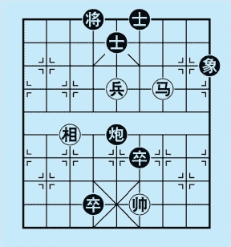

图 12

第二盘棋

1958 年全国个人赛杨官璘先负张东禄

（1958 年 11 月 26 日于广州）

1.炮二平五　　炮 8 平 5　　　　2.马二进三　　车 9 进 1

3.车一平二　　马 8 进 7　　　　4.车二进六　　卒 3 进 1

5.炮八平七　　马 2 进 3　　　　6.兵七进一　　马 3 进 4

7.兵七进一　　马 4 进 6　　　　8.兵三进一　　车 9 平 6

9.仕六进五　　车 1 平 2　　　　10.马八进九　　马 6 进 7

11.炮七平三　　车 6 进 3　　　　12.车九平八　　车 6 平 3

13.炮五平六　　炮 5 进 4　　　　14.相七进五　　炮 2 进 5

15.车二平三　　炮 5 平 7　　　　16.车三平四　　车 2 进 4

17.炮三平四　　象 3 进 5　　　　18.兵九进一　　车 2 进 2

19.炮六进二　　炮 7 平 5　　　　20.车四退三　　炮 2 进 1

21.兵三进一　　卒 5 进 1　　　　22.炮六平三　　马 7 进 5

23.兵三平四　　卒 5 进 1　　　　24.兵四进一　　炮 2 平 4

25.车八平六　　炮 4 退 2　　　　26.车四平五　　卒 5 进 1

27.兵四平五　　卒 5 平 6　　　　28.炮四平一　　炮 4 平 5

29.车六进四　　车 3 进 5

30.车六退四　　车 3 平 4

31.帅五平六　　车 2 平 4

32.帅六平五　　士 4 进 5

33.马九退八　　卒 6 进 1

34.炮一退一　　将 5 平 4

35.马八进六　　炮 5 退 1

36.炮三退三　　车 4 平 1

如图 13，红方认负。以下如接走马六进八，则车 1 进 1，马八退七车 1 进 2，黑胜。

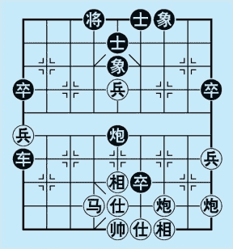

图 13

两盘棋的共同点都是杨官璘执先面对后手顺炮，第 4 回合都是采用车二进六过河车急攻的走法，而黑方都是卒 3 进 1，以后连续跳右马形成“天马行空”。

因为先手输了这两盘棋，当时独步弈林的“棋坛第一人”杨官璘三连霸失利，“小神童”李义庭、“华东第一剑”何顺安分获冠亚军，杨官璘屈居第三。

由此，面对直车车二进六的急攻，黑方后手顺炮“天马行空”的反击手段正式在顺炮历史的舞台上闪亮登场。即使是如日中天、雄霸棋坛的“魔叔”杨官璘，也被后手顺炮连砍两次。要知道，到了像杨官璘这种国手级别的超一流象棋高手，先手求稳想和一盘棋，是没有任何难度的！

连以稳健著称的杨官璘执先都连输两次，由此可见，“天马行空”对攻之激烈，局面之不可控，先手直车车二进六遭到了严峻的挑战。

我们再来拆解一下：

1.炮二平五　　炮 8 平 5　　　　2.马二进三　　车 9 进 1

3.车一平二　　马 8 进 7　　　　4.车二进六

按照现代观点，着急了，现在已不多见，改为马八进七或者兵三进一缓攻更优。

4.……　　　　卒 3 进 1　　　　5.炮八平七

最强硬的走法。走其他走法，黑方都是马 2 进 3 再马 3 进 4，红方同样不好控制局面。

5.……　　　　马 2 进 3

6.兵七进一　　马 3 进 4

7.兵七进一

如图 14，局面至此，形成著名的顺炮“天马行空”布局变例，黑方有马 4 进 5，马 4 进 6 两种变例，两相比较，黑方马 4 进 5 更为简单粗暴，可以取得对杀之势。

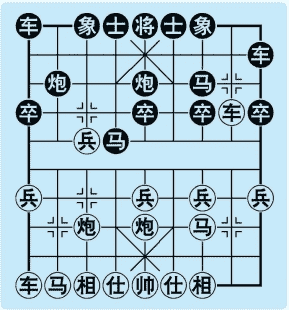

图 14

7.……　　　　马 4 进 5　　　　8.车二平三　　马 5 退 3

亦可马 5 退 6，以后再炮 2 退 1 或车 9 平 4，双方对攻。

9.车九进一　　车 9 平 4

黑方以下有马 3 退 5 后再跳槽，或者车进兵林线等反击手段，局面相当满意。

由于 1958 年全国象棋个人赛上，杨官璘先手中炮输给顺炮“天马行空”2 局，此后象棋界直车车二进六的急攻走法就很少出现了。

每一个象棋谱招定式的由来，必定是前人实践摸索的结晶，站在巨人的肩膀上去看待问题，才能看得更高看得更远，这就是我们知晓顺炮布局历史的意义所在。

## 第三章　先手仕四进五遭遇王嘉良创新“王氏将门车”

在象棋布局的发展过程中，斗炮局讲究的是“快、准、狠”，所以车二进六过河车这一步棋，无论是先手直车还是后手直车，都可以达到“快、准、狠”的目的。因此，即使面对后手顺炮“天马行空”强烈的反击，红方还是想了很多办法，来达到“车二进六”的目的。

1.炮二平五　　炮 8 平 5　　　　2.马二进三　　马 8 进 7

3.车一平二　　车 9 进 1　　　　4.仕四进五

如图 15，红方如直接车二进六，黑方卒 3 进 1，马上形成对杀激烈的“天马行空”变例。红方为了下一步走到车二进六，先仕四进五补士缓攻，避免后续黑方“天马行空”连续跳马的反击。

4.……　　　　车 9 平 4

如果卒 3 进 1，红车二进五占先。

5.车二进六　　马 2 进 3

6.车二平三　　炮 5 退 1

7.马八进九　　车 4 进 3

8.兵三进一　　炮 5 平 7

9.车三平四

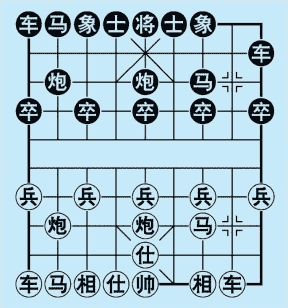

图 15

红方依然稳持先手。

黑方第 7 回合按照现在观点，可以把车 4 进 3 改为卒 3 进 1，以后伺机车 1 进 2、车 4 进 4、炮 5 平 7 进行反击，着法含蓄富有弹性。

以上是二十世纪五十年代流行的走法。红方通过补士、边马，把自己的阵型调整到没有弱点之后，此时车二进六争取主动，就可以达到稳中占先的效果。

那么问题就来了，面对红方的改变，黑方觉得应对起来有点不舒服了，你不改变，输棋输得多了就会逼着你去改变，而且横看竖看开局阶段过早仕四进五补士也是违背象棋开局原则的。

我们再回过头来看这个布局：

1.炮二平五　　炮 8 平 5　　　　2.马二进三　　马 8 进 7

3.车一平二　　车 9 进 1　　　　4.仕四进五

如图 16，轮到黑方走棋，一开始黑方都是按部就班走车 9 平 4，红方仕四进五的变例就收到了良好的效果，一度成为红方先手针对顺炮横车过宫的进攻“利器”，黑方经过反复实践拆解觉得还是不够满意。本来斗炮局讲究的是速度与激情，先手补士慢了一步，有违这个原则。于是被誉为“东北虎”的象棋特级大师王嘉良对黑方车 9 平 4 进一步改良创新：

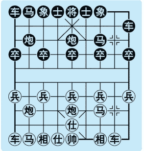

图 16

将车 9 平 4 这一步棋改进为车 9 平 6，正所谓“车随士转”，抓住红方开局急于补士的弊端，横车控制将门，很有针对性。并凭借此创新，在 1957 年全国赛上，王嘉良以后手顺炮战胜了来自湖北的“小神童”李义庭，王嘉良特级大师这一开创性的走法被誉为“王氏将门车”。

1957 年全国赛李义庭先负王嘉良对局的实战变例如下：

1.炮二平五　　炮 8 平 5　　　　2.马二进三　　马 8 进 7

3.车一平二　　车 9 进 1　　　　4.仕四进五　　车 9 平 6

如图 17 形成“王氏将门车”。

5.车二进六　　马 2 进 3　　　　6.兵七进一　　车 6 进 3

7.炮八平七　　卒 3 进 1

8.车二平三　　马 3 进 2

9.车三退二　　士 4 进 5

黑方子力灵活，可以满意，最终取胜。

以上双方走法如果按照现在电脑打分，每一步棋当然不可能做到都是最优解，但是“王氏将门车”对于先手中炮帅门的控制是一直存在的，总是让先手中炮有所顾忌。

下棋如逆水行舟，不进则退。穷则思变，不变就要输棋。

所以棋手们在面对后手顺炮“天马行空”“王氏将门车”强有力的冲击下，先后尝试了车二进六、仕四进五等走法，决定进一步求变，改变进攻战术。

但是红方变，黑方也会变，由此“孟氏双正马”在顺炮历史的舞台上闪亮登场，并奠定了现代斗炮局的理论基础：

现代的斗炮局，无论是顺炮、还是列炮，双方都尽量把两个马跳成正马，通常是一个马“主内”保护中路，一个马“主外”放马进攻。

所以，还是这句话：

要真正学好一个布局体系，不单单要记住现在流行的谱招，还要搞清楚该布局变化从何而来，又会往哪个方向去发展。

## 第四章　先手马八进九遭遇孟立国创新“孟氏双正马”

在介绍顺炮布局的“孟氏双正马”之前，我们再简要理顺一下顺炮直车对横车的思路：

1.炮二平五　　炮 8 平 5　　　　2.马二进三　　马 8 进 7

3.车一平二　　车 9 进 1

如图 18，从古代到二十世纪五十年代初，棋手对于顺炮执先进攻的认识都是走车二进六，由此遭到了黑方后手顺炮“天马行空”强烈的反扑。

因为顺炮布局双方都是猛冲猛打，红方车二进六这一步棋是简单粗暴进攻的不二选择，所以即使是面对黑方顺炮“天马行空”的反击，红方还是选择了仕四进五之后再车二进六，一度取得了良好的效果。但是魔高一尺，道高一丈，经过“东北虎”王嘉良的改进，发明了“王氏将门车”，在速度与激情的顺炮布局中，仕四进五补士显得行棋效率不高。

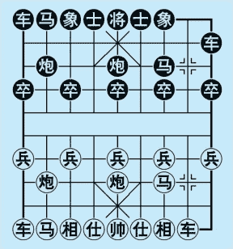

图 18

有了以上车二进六、仕四进五的铺垫，红方经过分析，发现斗炮局：
①“车”不可多动，否则丢先；
②“士”补得太早，影响步数。

于是红方作进一步改进，选择了跳边马：
1.炮二平五　　炮 8 平 5　　　　2.马二进三　　马 8 进 7
3.车一平二　　车 9 进 1　　　　4.马八进九

如图 19，红方既不动车，也不补仕，符合象棋布局的原则，优先出动大子，协调子力，阵容齐整，合情合理。时至今日，也有很多棋手出于稳健的考虑选择马八进九这步棋，马八进九用现代观点来看亦是正招正谱。

这一步马八进九也是四届全国象棋冠军、象棋特级大师杨官璘先手对付顺炮最擅长的攻法，黑方常规的应招是卒 1 进 1 和车 9 平 4，具体变化在杨官璘所著《弈林新编》有详细的介绍，结论都是红方可以继续保持先手。

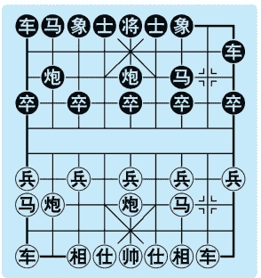

图 19

至此，红方马八进九缓攻走法取得了阶段性的胜利，顺炮大战暂时告一段落。那么问题来了，喜欢走后手顺炮的棋手自然不会善罢甘休，哪里有压迫，哪里就会有反击。

顺炮历史的年轮又来到 1962 年全国象棋个人赛，我们把目光聚焦在徐和良对孟立国的一盘棋上（顺炮直车对横车）：
1.炮二平五　　炮 8 平 5
2.马二进三　　马 8 进 7
3.车一平二　　车 9 进 1
4.马八进九　　马 2 进 3

如图 20，红方第 4 回合马八进九跳边马，不走车二进六和仕四进五，避免后手顺炮的“天马行空”“王氏将门车”。

黑方第 4 回合原先谱招是卒 1 进 1 或者车 9 平 4，以后黑马屯边，以求左右平衡。马 2 进 3 难道不怕红方炮八平七在七路线的牵制吗？

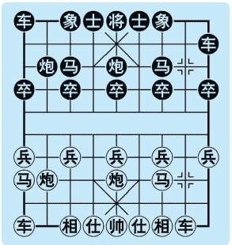

图 20

我们先来介绍一下这盘棋的主人公：
孟立国，象棋特级大师，棋风彪悍，攻杀犀利，后手对顺炮和列炮情有独钟，经常在复杂的缠斗中弃子破象，人称“杀象能手”。

马 2 进 3 这步棋就是以孟立国为代表的东北棋手的重要贡献，给顺炮布局增添了新的活力，奠定了现代斗炮局的基调，被誉为“孟氏双正马”。

即斗炮局，无论是顺炮，还是列炮，双方都尽量把两个马跳成正马，攻守兼备，进可攻，退可守。

回到实战：
5.炮八平七　　车 1 平 2　　　　6.兵七进一　　车 9 平 4
红方以七路炮进行牵制，黑方不为所动，准备弃子取势。
7.兵七进一　　卒 5 进 1　　　　8.兵七平六　　车 4 进 3
红方平兵谋马，过于贪心，走兵七进一比实战好一些。黑方当机立断，果断弃马，由此反先。
9.炮七进五　　马 7 进 5　　　　10.炮七进一　　炮 2 进 5
红方得子失势，黑方有攻势占优，最终黑方取胜！

至此，顺炮布局的爱恨情仇，再次进入到白热化。由于“孟氏双正马”的改进，黑方后手顺炮取得了非常满意的抗衡之势。

红方就开始反思了：既然后手顺炮都可以走成双正马，那么先走方，能不能考虑走双正马呢？
于是，那个“天之骄子”胡荣华终于来到了顺炮布局的历史舞台，承前启后，闪闪发光，成为顺炮布局史上一颗璀璨的明珠。

## 第五章　胡荣华先手“胡氏双正马”开创顺炮新时代

顺炮历史的年轮来到了 1966 年全国象棋个人赛，对决的双方是：四届全国象棋冠军（1960、1962、1964、1965 年）时年 21 岁的胡荣华；第二位全国象棋冠军，时年 29 岁的李义庭。
两位超一流的象棋国手，风华正茂，一场精彩的攻防大战即将上演。
1.炮二平五　　炮 8 平 5　　　　2.马二进三　　车 9 进 1
2.车一平二　　马 8 进 7　　　　4.马八进七　　车 9 平 4
5.兵三进一

如图 21，红方跳双正马是胡荣华在 1966 年全国大赛上先手首创，并且两战两胜，该布局一炮打响，崭新的布局套路，新颖的布局变例，大大丰富了顺炮布局战术，是顺炮布局发展史上一个里程碑式革新，被誉为———“胡氏双正马”。

过去顺炮直车对横车，由于顾忌后手顺炮横车的骚扰，红方一般跳一个正马，跳一个边马，如此一来，虽然黑方顺炮肋车威胁有所削减，但是红方只有一个马保护中路，攻击力也削弱了。现在红方跳双正马，难道不怕黑方车 4 进 5 的反击吗？

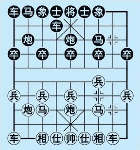

图 21

5.……　　　　马 2 进 3
斗炮局形成双正马阵势，符合棋理。如车 4 进 4，炮五平四车 4 平 7，车二进二，以后红退炮打车，红方优势；另如车 4 进 5，炮五平四，红方优势，具体布局变例后面专题介绍，此处不再展开。
6.兵七进一　　车 4 进 5
当时第一次出现“胡氏双正马”，黑方临场没有走出正变也是可以理解的，按照现代的观点，黑方应该车 1 进 1 形成双横车。
7.相七进九　　车 1 进 1　　　　8.马三进四　　车 4 平 3
9.车九平七　　卒 3 进 1　　　　10.车二进五　　象 3 进 1
1 1.炮八进四　　卒 3 进 1　　　　12.车二平七　　马 3 进 2
13.前车进二

如图 22，红车以车一平二、车二进五、车二平七、车七进二“S”走位捉炮，简直太神奇了。
13.……　　　　炮 2 退 2
14.马四进六　　卒 3 平 4
15.前车平八　　炮 2 进 3
16.车八退一　　车 3 退 2
黑方正着是车 1 平 3 对捉，黑方还可一战。

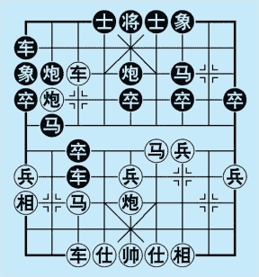

图 22

17.马七进八　　卒 4 平 3
1 8.马六进五　　象 7 进 5
19.相九进七

如图 23，红方通过行云流水的运子，锱铢必较的控盘，取得了兵种上和空间上的优势。
19.……　　　　车 1 平 6
20.仕六进五　　车 6 进 3
21.炮五平九　　车 3 平 4
22.相七退五　　车 4 进 1
23.车七进七　　车 4 平 2
24.车七平五　　马 7 退 5

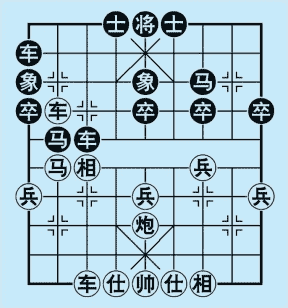

图 23

25.炮九进四　　象 1 退 3　　　　26.车五退一　　车 2 进 4
27.仕五退六　　车 2 平 4　　　　28.帅五平六　　车 6 进 5
29.帅六进一　　车 6 退 1　　　　30.帅六退一　　马 2 进 4
31.车八平六　　马 4 进 3　　　　32.帅六平五　　车 6 平 2
33.车六退四

如图 24，红车捉马且有炮打 7 卒叫杀的多重攻招，黑无力抵抗投子认负。

经过此战，“胡氏双正马”的改进方案在顺炮布局的舞台上闪亮登场！而且是那样的光彩夺目！
“胡氏双正马”具有划时代意义，因为现在的顺炮布局体系全部都是从“胡氏双正马”的基础上发展而来的。后来顺炮布局体系中最耀眼夺目的变例：“顺炮两头蛇对双横车”以及顾忌红方“胡氏双正马”而抢挺 7 卒的“顺炮缓开车”，都是受“胡氏双正马”的启发而来。

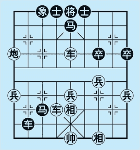

图 24

## 第六章　后手顺炮缓开车兴起，抵抗先手“胡氏双正马”

按照顺炮布局演变的顺序，我们捋一下具体变化：
1.炮二平五　　炮 8 平 5　　　　2.马二进三　　马 8 进 7
3.车一平二　　车 9 进 1

形成顺炮直车对横车，按照顺炮布局的演变，红方先后尝试了：
①车二进六过河车，碰到了后手顺炮“天马行空”，现在已不多见。
②仕四进五补右仕，碰到了后手顺炮王嘉良创新的“王士将门车”，现在已不多见。
③马八进九跳边马，碰到了后手顺炮孟立国创新的“孟氏双正马”，现在属于正变之一。
④马八进七跳双正马，是胡荣华创新的“胡氏双正马”，引领了顺炮布局革命，奠定了现代顺炮布局体系。
4.兵三进一　　车 9 平 4
5.马八进七

如图 25，形成“胡氏双正马”的布局定式，其中红方兵三进一和马八进七这两步棋可以根据实战情况而选择行棋顺序。

进入二十世纪七十年代到九十年代，该阶段主要继承和发展了“胡氏双正马”，如顺炮布局最经典的变例“顺炮两头蛇对双横车”就是典型的例子，如图 26。

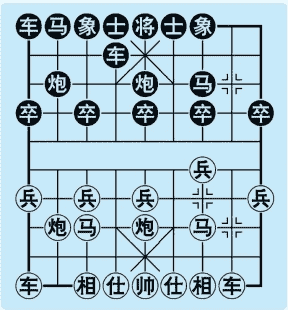

图 25

此外，在东北棋手的带动下，为了对抗先手中炮“胡氏双正马”的进攻，抢挺 7 卒的“顺炮缓开车”逐渐兴起，也就是第 3 回合黑方不走车 9 进 1 起横车，改走卒 7 进 1 挺 7 卒，如图 27。

到了二十一世纪，红方先手中炮有时候为了出其不意，主动避开后手中炮抢挺 7 卒形成的“顺炮缓开车”，先手缓开车也会偶尔出现，给顺炮布局也增添了不少变化，如图 28。

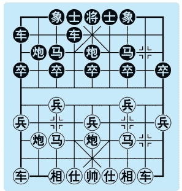

图 26

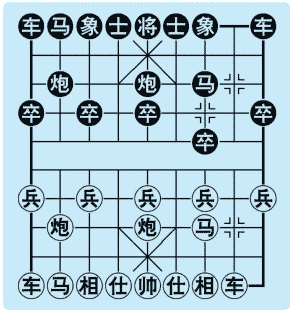

图 27

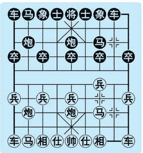

图 28

## 第七章　人工智能拆棋时代对顺炮布局的暴力拆解

到 2022 年 5 月为止，只在 2006 年举办过一次人和电脑象棋对战的“人机大战”，上半场以柳大华、徐天红、汪洋、卜凤波、张强组成的大师联队以 2 胜 5 和 3 负，总比分 9 比 11 输给了“浪潮天梭”计算机。下半场当时“象棋第一人”许银川出马艰难弈和两盘棋，比分 2∶2 战平了“浪潮天梭”计算机。

因此象棋界一般以 2006 年作为“纯人拆棋”和“人工智能拆棋”的分水岭，从 2006 年开始人类就下不过电脑象棋了。此后象棋界进入“人工智能拆棋时代”。无论是专业棋手，还是业余棋迷，只要有电脑端象棋软件，或者手机端象棋软件，都可以随时随地向电脑学棋、拆棋、练棋，这是科技的进步，也是时代的潮流。

顺炮布局就是在“人工智能拆棋时代”被暴力拆解、几乎穷尽所有布局变化的典型布局之一。在如今电脑精准的布局打分下，我们作为先手中炮方只要走出了“先手中炮直车”阵型，在默认双方都不弈出错漏的前提下，先手中炮方就可以稳持先手主动，后手顺炮只能下风顶和。

顺炮布局可大致归纳为 4 大体系：
（中国象棋云库打分参考）
第一个体系：顺炮直车对横车，图 29

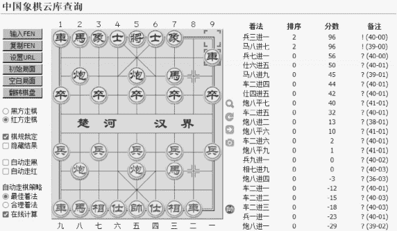

图 29

第二个体系：顺炮直车对缓开车，图 30

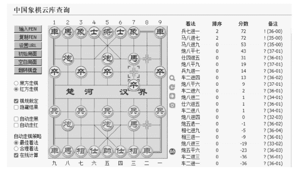

图 30

第三个体系：顺炮横车对直车，图 31

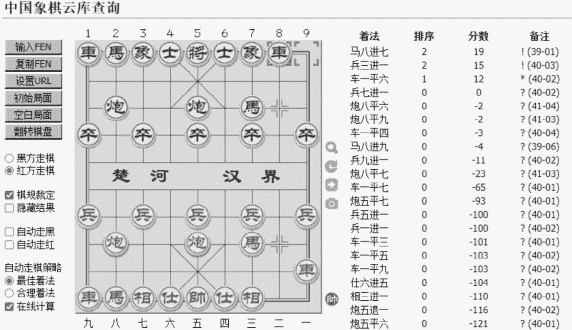

图 31

第四个体系：顺炮先手缓开车对直车，图 32

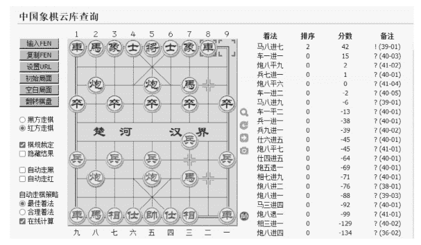

图 32

如图 29～图 32 所示，先手中炮方只要走出“先手中炮直车”对后手顺炮，就可以确保 70～100 分（1.5 先～2 先）的优势，而且先手方肯定可以走到车一平二率先出直车。

因此本书从先手立场的角度只介绍“顺炮直车对横车”“顺炮直车对缓开车”两个体系。其余的后手立场“顺炮横车对直车”“顺炮先手缓开车对直车”两个体系，以后另书介绍。

# 第三部分　先手中炮最优推荐

## 第一章　顺炮直车对横车

### 第 1 局　直车对不标准的双横车（1）

红方思路：补仕拆中炮，配合巡河炮，红方稳持优势。
1.炮二平五　　炮 8 平 5　　　　2.马二进三　　马 8 进 7
3.车一平二　　车 9 进 1　　　　4.兵三进一　　车 9 平 6
官招正谱车 9 平 4，让 4 路黑车有更多的机动性。车 9 平 6 导致以后 6 路车没有落脚点略显呆滞，属于布局的疑问手。
5.马八进七　　马 2 进 3
黑方非常尴尬，阵型漏洞百出，被迫双正马加强中路攻防力量。如果①卒 3 进 1，车二进五；②马 2 进 1，以后红方车二进六，均属红方占优。
6.兵七进一　　车 1 进 1
至此，形成红方直车两头蛇对黑方不标准双横车的布局定式。黑方阵型有弱点，红方只要记住“补仕拆中炮，配合巡河炮”的口诀就可以占优。
7.仕六进五

如图 33，这是人机拆棋的最优解，为以后拆中炮飞相出车稳持先手占优作准备。

用人类思路来理解这个阵型：黑方唯一的有效反击就是靠两个黑车进攻红方的两匹马，明白了黑方的反击思路，红方只要拆中炮飞相巩固阵型，消除己方阵型上的弱点，黑方就没有任何有效反击手段。在以后的战斗中随着棋局的进展黑方两匹笨马的弱点就会逐渐显现出来，红方就可以到达先手稳优的目的。

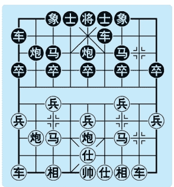

图 33

本局介绍红补仕后黑方（1）卒 5 进 1；（2）车 1 平 3；（3）车 6 进 3；（4）车 6 进 5；（5）车 6 进 7；（6）车 6 平 4；（7）车 6 平 8。七种走法。
（1）卒 5 进 1
7.……　　　　卒 5 进 1　　　　8.马七进六　　车 1 平 4
9.炮五进三　　马 7 进 5　　　　10.马六进五
不能炮打炮，丢先。
10.……　　　　马 3 进 5　　　　11.炮五进二　　车 6 进 1
12.炮八平五
红方有中炮攻势占优。
（2）车 1 平 3
7.……　　　　车 1 平 3　　　　8.马七进六
以下黑方如果：
①车 6 平 4，马六进四再炮八平七，红方占优。
②车 3 平 4，炮八进二车 4 进 3，炮五平六车 4 平 2，炮八进三炮 5 平 2，相七进五，以下红方车九平七或者车二进六占优。
③卒 3 进 1，兵七进一马 3 退 5，车二进五卒 7 进 1，车二平三象 7 进 9，车三平六，红方占优。
（3）车 6 进 3
7.……　　　　车 6 进 3　　　　8.马七进六　　车 6 平 4
9.炮八进二
记住口诀：“补仕拆中炮，配合巡河炮”，不管黑方怎么应招，都是红方占优。
9.……　　　　卒 7 进 1　　　　10.炮五平六　　车 4 平 2
11.炮八进三　　炮 5 平 2　　　　12.兵三进一　　车 2 平 7
13.相七进五
红方阵型无懈可击，黑方没有一丝对杀机会，红方以后有车九平八、马六进七、车二进四等多种运子进攻方式，红方稳持优势。
（4）车 6 进 5
7.……　　　　车 6 进 5　　　　 8.马七进六
此时黑方 6 路车的尴尬展现得淋漓尽致，黑车竟然无路好走。以下黑方如果：
①车 6 平 7，马六进四踩双，黑丢子；
②车 6 进 2，炮八平六，红方占优；
③车 6 退 5，炮八平六，红方占优。
（5）车 6 进 7
7.……　　　　车 6 进 7　　　　8.炮五平四
暗藏炮八退一打死车。
8.……　　　　车 1 平 4
黑方如果车 6 平 7，车二进二车 7 进 1，相七进五车 7 平 9，车二进四，红方占优。
9.相七进五
黑方两个车竟然都无路可走，黑方车 4 进 3 或者车 4 进 5，红方都是马三进四踩车。
9.……　　　　车 4 进 7　　　　10.车九平六　　车 4 平 3
11.车二进六
黑方两匹弱马无法参战，红方子力灵活全局控盘占优。
（6）车 6 平 4
7.……　　　　车 6 平 4　　　　8.马三进四　　车 4 进 7
黑方如果车 4 平 6，马四进六车 1 平 3，马六进五炮 2 平 5，车二进六，以后吃卒压马、炮五平三拆中炮等，红方稳占优势。
9.炮五平三　　车 1 平 6　　　　10.炮三退一　　车 4 退 7
11.马四进三　　车 6 进 2　　　　12.相七进五
红方阵容协调毫无弱点，黑方阵容呆滞没有反击，红方多兵稳占优势。
（7）车 6 平 8
7.……　　　　车 6 平 8　　　　8.车二进八　　车 1 平 8
9.马七进六　　车 8 进 3　　　　10.马六进七　　卒 7 进 1
11.兵三进一　　车 8 平 7　　　　12.炮五平七
好棋，及时拆中炮化解黑方所有反扑，以后补相出车，红方思路非常清晰。
12.……　　　　炮 5 平 6　　　　13.相七进五
红方棋形舒展没有弱点富有弹性，以后车九平六舒服出车，先手多兵优势不可动摇。

### 第 2 局　直车对不标准的双横车（2）

红方思路：补仕拆中炮，配合巡河炮，红方稳优。
1.炮二平五　　炮 8 平 5　　　　2.马二进三　　马 8 进 7
3.车一平二　　车 9 进 1
4.兵三进一　　车 9 平 6
5.马八进七　　马 2 进 3
6.兵七进一　　车 1 进 1
7.仕六进五

如图 34，在上一局介绍了黑方的七种应招都是红方占优，本局介绍黑方最后一种走法车 1 平 4，红方只要记住口诀：“补士拆中炮，配合巡河炮”，红方就可以取得先手优势。
7.……　　　　车 1 平 4

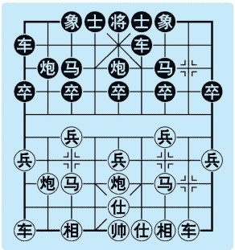

图 34

8.炮八进二
巡河炮好棋，为以后拆中炮、跳河口马做好进攻准备，黑方两个非标准的双横车只能疲于应对。走到这里，黑方有（1）卒 3 进 1；（2）车 4 进 7；（3）车 4 进 5；（4）车 4 进 3；（5）车 6 进 7；（6）车 6 进 5；（7）车 6 进 3；（8）车 6 平 8 八种走法。
（1）卒 3 进 1
8.……　　　　卒 3 进 1　　　　 9.兵七进一　　车 6 进 3
10.兵七进一　　马 3 退 5
黑方如果车 6 平 3，兵七进一车 3 退 2，车九进二车 4 平 3，仕五进六，红方主动易走。
11.炮五平四　　车 6 平 3　　　　12.相七进五　　车 3 退 1
13.炮八退三
红方有马七进八的手段，红方占优。
（2）车 4 进 7
8.……　　　　车 4 进 7　　　　9.相七进九
以下不管黑方怎么走棋，红方车九平六兑车稳优。
（3）车 4 进 5
8.……　　　　车 4 进 5　　　　9.马三进四　　车 4 平 3
10.炮五平四　　车 6 平 4　　　　11.相七进五
红方阵容协调，子力舒畅，接走车二进五、车二进六、车九平七都是稳优。
11.……　　　　卒 3 进 1　　　　12.车九平七
暗藏炮四进一打死车，红方稳优。
（4）车 4 进 3
8.……　　　　车 4 进 3　　　　9.马三进四　　车 4 平 2
10.炮五平四　　车 6 平 4　　　　11.炮八进三　　炮 5 平 2
12.相七进五
红方双马灵活优势明显。
12.……　　　　卒 3 进 1　　　　13.兵七进一　　车 2 平 3
14.车二进六　　卒 7 进 1　　　　15.兵三进一　　车 3 平 7
16.车九平八　　马 4 进 3　　　　32.帅六平五　　车 6 平 2
33.车六退四

# 变化解析

黑方如果马 3 进 2，马四进五马 7 进 5，车二平五，红方多中兵占优。

## 17. 车八进四

以后强行马七进六跳马，两个红马谋中卒，红方有望取得多中兵的优势。

### （5）车 6 进 7

8.…… 车 6 进 7 9.马七进六 卒 3 进 1
10.炮五平六 炮 5 平 4 11.马六进四

黑方有丢子风险，红方占优。

### （6）车 6 进 5

8.…… 车 6 进 5 9.马七进六 车 6 平 7
10.车二进二 卒 7 进 1

黑方如果：
①车 7 退 1，炮五平六车 4 平 6，相七进五车 7 退 1，车九平七，马六进七肯定可以走到，红方七路线有攻势。
②车 4 平 6，炮五平七炮 5 进 4，马三进五车 7 平 5，马六进七，红方主动易走。

11.炮五平六 车 4 平 6 12.相七进五 炮 5 进 4
13.马三进五 车 7 平 5 14.兵三进一

红方三兵渡河优势。

### （7）车 6 进 3

8.…… 车 6 进 3 9.马七进六 车 6 平 2
10.炮五平六 车 4 平 6 11.炮八进三 炮 5 平 2
12.相七进五

红方子力灵活，明显占优。

### （8）车 6 平 8

8.…… 车 6 平 8 9.车二进八 车 4 平 8
10.马七进六 车 8 进 3 11.马六进七 卒 7 进 1
12.炮五平七 炮 5 平 6 13.相七进五

红方子力灵活，多兵占优。

### 第 3 局 实战参考 2003 年象甲联赛许银川先负孙勇征

1.炮二平五 炮 8 平 5 2.马二进三 马 8 进 7
3.车一平二 车 9 进 1 4.马八进七 马 2 进 3
5.兵七进一 车 9 平 6 6.兵三进一 车 1 进 1

黑方形成不标准双横车，官招正谱双横车是 1 路车和 4 路车，非标准双横车的 6 路车以后随着棋局进展会没有好的落点容易吃亏。

8.仕六进五 车 1 平 4 8.炮八进二

如图 35，本局选自 2003 年象甲联赛，红方许银川执红对黑方孙勇征的实战对局。在没有软件辅助拆棋的时代，2003 年的许银川已经走出来现代软件最优解。如图 35，仕六进五、炮八进二走出来，红方开局已经是稳优的局面。

8.…… 卒 3 进 1
9.兵七进一 车 6 进 3
10.兵七进一 马 3 退 5
11.炮五平四 车 4 进 7

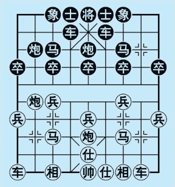

图 35

黑方被动下风中的积极搏杀，勇气可嘉。黑方如果车 6 平 3，相七进五车 3 退 1，炮八退三车 4 进 7（另如炮 2 进 4，炮八平七炮 2 平 3，马七退九炮 3 平 4，车九平七车 4 平 2，马三进四炮 4 退 4，马九进七车 3 平 4，车二进六，红方稳占优势），马七进八车 3 退 1，炮四进五炮 5 进 4，炮四平八，红方多子占优。

12.相三进五 车 6 平 3 13.炮四退一 车 4 退 2
14.马三进四 车 4 平 3 15.炮四进一 炮 5 进 4

红方先手牢牢掌握全局，过河兵稳占优势，黑方无奈只能炮击中卒继续下风中的搏杀，争取浑水摸鱼。

16.炮八退三 卒 5 进 1 17.炮八平七 前车进 1
18.炮七进四 车 3 退 3 19.兵七平八

如图 36，以上一段，黑方被迫一车换双，红方取得多车的优势。第 19 回合红方兵七平八开始犯错，正着是马四退六车 3 平 4，马六进八车 4 平 2（如车 4 平 3，相七进九），马八退七再车二进三，红方两个车斗黑方 1 个车，红方占优。

19.…… 炮 2 平 4
20.相七进九 卒 5 进 1
21.车九平六 炮 4 进 3
22.马四退三 车 3 平 6
23.车二进三 马 7 进 5

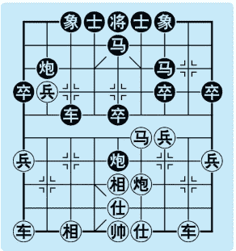

图 36

黑方抓住红方第 19 回合兵七平八的失误，中炮镇中、盘马而上积极反击，棋局的天平已经不知不觉中倒向了黑方。黑方冷静马 7 进 5 正着，不可车 6 进 3 贪吃红炮，车二平五车 6 平 7，车五进一炮 4 平 2，车六进八，红方出帅绝杀无解。

24.炮四退一

又是许银川的骗招。

24.…… 前马进 3

非常冷静，不可车 6 进 4，马三进五卒 5 进 1，车二平五车 6 退 5，车五进二，红方占优。

25.马三进五 炮 4 进 1 26.马五退三 车 6 进 4

黑方前面攻势如潮，好在红方防守功力非常了得，暂时顶住了黑方所有攻势。

27.相九进七 卒 5 平 4 28.马三进二

应车二平五不给黑方跳出窝心马。

28.…… 马 5 进 4 29.兵八平七 马 4 进 3
30.兵三进一 前马退 1 31.车六平七 马 1 进 2
32.车七进三 车 6 退 3 33.马二进三 车 6 平 5
34.相五退七 车 5 退 2 35.兵七进一 士 4 进 5
36.车二平三 卒 4 平 5 37.车三平六 马 3 进 4
38.车七平六 马 2 进 3 39.车六退二 马 3 退 2
40.车六进二 马 2 进 3 41.车六退二 马 3 退 2

至此，黑方残棋控盘，红方被动但有机会下风顶和。

42.兵七进一 象 3 进 5
43.兵七平六 卒 5 平 4
44.马三进四 车 5 平 3
45.车六平八

如图 37，车六平八这步棋是最后的败招，红方可能比赛时间紧张导致忙中出错，顽强的走法是飞边相，红方还可以坚守。

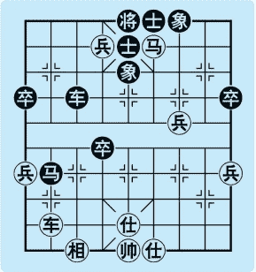

图 37

45.…… 车 3 进 6
46.仕五退六 马 2 进 4
47.车八平六 卒 4 进 1

红车被黑方车马卒锁死，红方败局已定。

48.马四退二

输棋形势下的隐蔽偷杀，黑方不能车 3 退 1 捉死车，红方卧槽马有偷杀的手段。

48.…… 士 5 进 6
49.兵三平四 士 6 进 5

如图 38 走到这里，红方认输。红方如果续走：

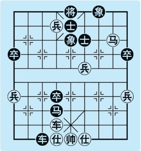

图 38

①仕四进五车 3 退 1，车六进一卒 4 进 1，仕五进六车 3 平 8，黑方必胜。
②帅五进一车 3 退 4，车六平九车 3 平 5，帅五平六马 4 退 2，车九进一卒 4 进 1，车九平六马 2 进 4，帅六进一车 5 平 4，黑方必胜。

这盘棋其实开局红方占优，结果红方中残局走缓，黑方最后的车马冷着控盘非常精妙，不失为一盘精彩的对局。

### 第 4 局 直车对强变的车 9 平 3

红方思路：补仕飞相出肋车，红方稳优。

1.炮二平五 炮 8 平 5 2.马二进三 马 8 进 7
3.车一平二 车 9 进 1 4.兵三进一 卒 3 进 1
5.马八进七

稳步进取即可，如果着急车二进五车 9 平 3，红方跳正马有顾忌，黑方还有炮 2 进 2 的反击，如果接走车二进一，黑方炮 2 进 1 反击，红方没有便宜。

5.…… 车 9 平 3

如果车 9 平 4，车二进五还原“胡氏双正马对横车 3 卒”正变。

6.相七进九

如图 39，走到这里，黑方有（1）炮 2 进 4；（2）马 2 进 1；（3）马 2 进 3；（4）车 3 平 4 四种走法，结果都是红方优势。

### （1）炮 2 进 4

6.…… 炮 2 进 4
7.仕六进五 卒 3 进 1
8.兵七进一 车 3 进 4
9.马七进八

以下红方车九平七，兑车以后车二进六稳占优势。

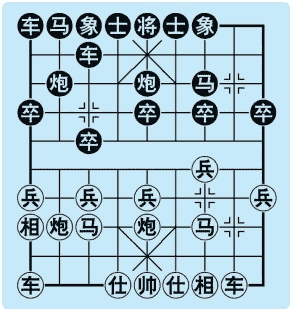

图 39

### （2）马 2 进 1

6.…… 马 2 进 1 7.仕六进五

红方明显控盘占优，以后马三进四、车九平六、车二进六都是红方的进攻点，黑方明显下风。以下黑方如果接走：
①车 3 平 4，车二进五，红方占优。
②车 1 进 1，车二进六炮 2 进 1，车九平六车 3 平 4，车六进八车 1 平 4，车二退一炮 5 平 3，马三进四，红方有攻势。
③士 4 进 5，马三进四炮 2 平 4，车九平八车 1 平 2，炮八进二，红方占优。
④炮 5 平 4，马三进四象 3 进 5，车九平六士 4 进 5，车六进六炮 2 平 3，炮八进四炮 3 进 1，车六退一，红方中路有攻势占优。

### （3）马 2 进 3

6.…… 马 2 进 3 7.炮八进四

以下黑方如果接走：
①卒 5 进 1，仕六进五车 3 平 4（红方保留车九平六兑车控盘的权利），车二进六车 4 进 2，炮八平三象 7 进 9，兵三进一，红方占优。
②马 3 进 2，炮八平三象 7 进 9，炮三平二，以后冲三兵，补士出车等，红方优势。
③马 3 进 4，炮八平三象 7 进 9，炮三平二，冲三兵或者车九平八，红方明显有攻势。

### （4）车 3 平 4

6.…… 车 3 平 4

黑方车 9 平 3 再车 3 平 4 步数吃亏。

7.仕六进五

出车兑车就是红方占优。以下黑方如果接走：
①车 4 进 5，炮八进四车 4 平 3（如车 4 退 3，炮八退二），炮八平七车 3 平 2（如车 3 平 4，炮七平三象 7 进 9，车九平八），炮七平三象 7 进 9，马七进六，红方占优。
②马 2 进 3，车九平六车 1 进 1，车二进五卒 5 进 1（如象 3 进 1，炮八进四），炮五进三马 7 进 5，马三进四车 4 进 8，马七退六，以后再摆中炮，红方占优。

### 第 5 局 直车对黑方不跳马炮 2 平 3

红方思路：正常双正马出动大子，必要时补仕拆中炮，红方稳优。

1.炮二平五 炮 8 平 5 2.马二进三 马 8 进 7
3.车一平二 车 9 进 1 4.兵三进一 车 9 平 4
5.马八进七 炮 2 平 3

黑方此时正变只有卒 3 进 1、马 2 进 1、马 2 进 3 三个，炮 2 平 3 过早定型导致阵型没有弹性，属于疑形非正谱。

6.车九平八 马 2 进 1

黑方正常出动大子，以下黑方如果急躁动 4 路车接走：
①车 4 进 4，仕六进五车 4 平 7，马三进二，以后炮五平三飞相赶车，黑车处在险地容易受攻，红方优势。
②车 4 进 5，炮八进六车 4 平 3，马三退五，黑方右边子力陷入瘫痪状态，以后红方的进攻思路是车二进八、车二平三、炮五平二拆中炮沉底，对杀中红方速度更快。

7.炮八进四 士 4 进 5
8.仕四进五

如图 40，红方阵型工稳没有弱点，以后炮五平四拆中炮稳占优势。黑方以下如果接走：
①卒 1 进 1，炮五平四，红方优势。
②车 4 进 3，马三进四车 4 平 6，车八进四车 1 平 2，炮五平四车 6 平 5，马四进三车 5 平 4，炮四平三，红方多兵占优。

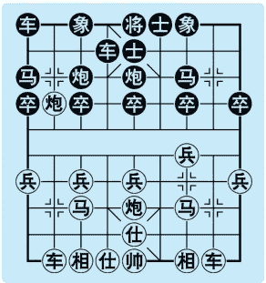

图 40

③车 4 进 4，车二进四车 1 平 2，炮五平四，红方飞相以后占优。
④车 4 进 5，马三进四车 4 平 3，马四进六车 3 进 1，马六进七，红方中炮攻势占优。
⑤车 1 平 2，炮五平四车 4 进 5（如车 4 进 4，相七进五；另如车 4 进 3，相三进五卒 7 进 1，车二进四卒 1 进 1，马三进四车 4 平 5，炮四平三，红方优势），相三进五车 4 平 3，马三进四车 3 退 2，车二进六卒 7 进 1，车二平三卒 7 进 1，车三退二，以后炮四平三，红方稳占优势。

### 第 6 局 直车对黑方不跳马车 4 进 3

红方思路：逼迫黑方巡河车一车多动，红方稳优。

1.炮二平五 炮 8 平 5 2.马二进三 马 8 进 7
3.车一平二 车 9 进 1 4.兵三进一 车 9 平 4
5.马八进七 车 4 进 3

黑方此时 4 路巡河车不是好的点位，随着棋局的发展容易被红方马三进四踢车利用，造成一车多动而吃亏。

6.车二进六

如图 41，好棋，表面上是车二平三直接进攻，实则为打通巡河线以后可以马三进四踩车做铺垫。以下黑方有（1）卒 7 进 1；（2）马 2 进 3，两种走法，都是红方优势。

### （1）卒 7 进 1

6.…… 卒 7 进 1
7.车二平三 卒 7 进 1
8.车三退二 马 2 进 1

如马 2 进 3，车三进三炮 5 进 4，马七进五，黑方丢子。

9.马三进四

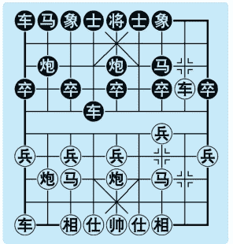

图 41

让黑一车多动，红方占优。以下黑方如果接走：
①车 4 进 1，炮五平三，以后有飞相冲兵、炮打马，红方占优。
②车 4 平 6，炮五平四车 6 平 5（如炮 2 进 3，车三进三车 6 进 1，仕六进五以后破象占优），炮四平三马 7 退 9，炮八退一，以后炮八平三、车九平八，红方占优。

### （2）马 2 进 3

6.…… 马 2 进 3 7.炮八平九

如过早吃卒压马，黑方可炮 5 退 1 反击。

7.…… 车 1 平 2 8.车九平八

红方稳持先手，黑方又不敢进炮封车，因为黑方 7 路马太弱。

8.…… 卒 7 进 1

如卒 3 进 1，车八进六，红方明显处在进攻状态。

9.车二平三 炮 5 退 1 10.兵三进一 炮 5 平 7
11.马三进四

红马踢车，黑车必然一车多动浪费步数，红方占优。以下黑方如果接走：
①车 4 进 1，马四进五，红方抢先进攻。
②车 4 进 4，车三平四炮 7 进 3，兵七进一，红方再车八进六稳优。
③车 4 平 3，马四进五马 7 进 5，车三进二车 3 进 2，车三退二，红方中路有攻势占优。

### 第 7 局 直车对黑方不跳马车 4 进 4

红方思路：炮五平四拆中炮，红方稳优。

1.炮二平五 炮 8 平 5 2.马二进三 马 8 进 7
3.车一平二 车 9 进 1 4.兵三进一 车 9 平 4
5.马八进七 车 4 进 4

在布局阶段，黑车多动容易吃亏。

6.炮五平四

如图 42，以柔化刚，以慢打快，红方拆中炮以后阵型无懈可击，反观黑方一车多动影响其他大子出动容易吃亏。以下黑方有（1）车 4 平 7；（2）卒 5 进 1 两种走法：

### （1）车 4 平 7

6.…… 车 4 平 7
7.车二进二

暗藏炮八退一平炮打车，或者稳稳飞相补仕出车，红方都是阵容协调占优。

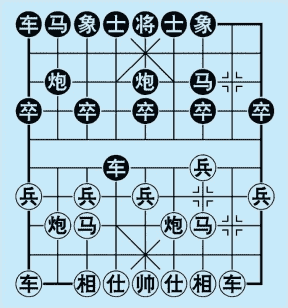

图 42

7.…… 炮 2 平 4

准备隔断红方炮八退一再炮八平三的进攻线路。如果卒 3 进 1，炮八退一马 2 进 3，炮八平三车 7 平 2，相七进五，红方四子归边有攻势占优。

8.相七进五 车 7 退 1 9.炮八退一 炮 4 进 6

如果车 7 平 6，马三进二车 6 平 8，炮八平三，红方有攻势占优。

10.马三进四 马 2 进 3 11.车二退一 炮 4 退 6
12.炮八平三

红方有攻势占优。

### （2）卒 5 进 1

6.…… 卒 5 进 1 7.相七进五 卒 5 进 1
8.兵七进一 车 4 进 1

如果车 4 退 1，兵五进一马 7 进 5，车二进三炮 5 进 3，仕六进五，黑方一车多动浪费步数，红方出子领先，以后红方车九平六兑车即可稳持先手。

9.炮四进一

以下黑方如果接走：
①卒 5 进 1，炮四平六卒 5 进 1，炮六平五，黑方丢车。
②炮 5 进 4，马七进五车 4 进 1，炮八进四卒 5 进 1，马三进五，红方出子速度快占优。
③车 4 进 2，仕六进五，红方出子领先占优。
④车 4 退 2，兵五进一马 7 进 5，仕六进五炮 5 进 3，炮四平五马 2 进 3，车九平六，红方出子领先占优。

### 第 8 局 直车对黑方不跳马车 4 进 5

红方思路：炮五平四拆中炮，红方稳优。

1.炮二平五 炮 8 平 5 2.马二进三 马 8 进 7
3.车一平二 车 9 进 1 4.兵三进一 车 9 平 4
5.马八进七 车 4 进 5

如图 43，以胡荣华为代表的老一辈讲棋视频中，均认为接下来红方马三进四是最优一步棋，后来发现黑方炮 2 平 3 的反击，马三进四这步棋遭到了很大的考验。随着人工智能象棋软件的拆解，红方最优拆解应该是炮五平四拆中炮，原因就是红方炮五平四拆中炮这步棋让黑方车 4 进 5 失去了反击方向，黑方由于一车多动导致其他大子出动缓慢容易吃亏。以下红方有（1）马三进四（先手不推荐）；（2）炮五平四（先手推荐）两种走法：

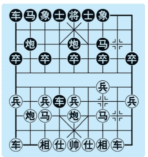

图 43

### （1）马三进四（先手不推荐）

6.马三进四 车 4 平 3

如车 4 退 1，马四进五马 7 进 5，炮五进四士 4 进 5，相七进五，红方优势。

7.马七退五

走到这里，老棋手和老棋书都说是红方占优，其实这个棋黑方有不少反击机会。

黑方错误走法车 3 平 5，红方车二进六吃卒压马占优；
黑方错误走法炮 5 进 4，红方马四进六踩双换炮占优；
在人工智能拆棋时代发现一步妙手：炮 2 平 3！

7.…… 炮 2 平 3

妙在让红方两个马都失去了进攻方向。以下红方如果接走：
①马四进六车 3 退 2，红方没有进攻方向。
②马五进三车 3 进 3，车九平七（如车九进一士 4 进 5，车九平六马 2 进 1，马四进五炮 3 平 4，以后车 1 平 2 出车黑方可以抗衡）炮 3 进 7，仕六进五马 2 进 3，黑方可以对杀。
③相七进九车 3 平 5，车二进六车 5 平 2，炮八平七卒 5 进 1，黑方连续冲卒可以对杀。

### （2）炮五平四（先手推荐）

6.炮五平四

红方拆中炮补齐仕相以后，形成红方阵型没有弱点对黑方一车多动出子缓慢，优劣立判，红方稳优。

6.…… 卒 5 进 1 7.相七进五 马 2 进 3

如卒 5 进 1，炮四进一车 4 退 2，兵五进一，黑方没有攻势。

8.仕六进五

冷静，不可炮四进五炮 5 进 4，马七进五炮 2 平 6，黑方占优。

8.…… 马 3 进 5 9.炮八进四

以下黑方如果接走：
①卒 5 进 1，炮四进一车 4 退 2，兵五进一，以后炮四平五，红方占优。
②车 4 平 3，车九平七马 5 进 3（如炮 2 平 3，马三进四，黑方丢子；如卒 5 进 1，炮四进一车 3 退 2，兵五进一，红方占优），炮四进一马 3 进 4，车二进六，红方占优。
③卒 3 进 1，炮八平三象 7 进 9，车九平八炮 2 平 3，马三进四卒 5 进 1，马四进五马 7 进 5，车八进六马 5 进 4（黑方如果马 5 进 6，炮四进七！红方攻势如潮，黑方败势；如果马 5 退 7，兵五进一，红方多兵稳优），车二进八炮 5 平 7，车二平三象 3 进 5，炮三平二，红方可以抢到双车双炮四子归边大占攻势。

### 第 9 局 直车对黑方不跳马车 4 进 7

红方思路：正常出动大子，必要时补士拆中炮，稳步进取便可取得优势。

1.炮二平五 炮 8 平 5 2.马二进三 马 8 进 7
3.车一平二 车 9 进 1 4.兵三进一 车 9 平 4
5.马八进七 车 4 进 7

黑一车多动躁进，红方正常出子就可稳持先手。

6.兵七进一

如图 44，红方双马灵活阵型优美，黑车孤军深入没有攻势。以下黑方有（1）车 4 平 3；（2）炮 2 平 3；（3）马 2 进 3 三种走法，都是红方优势：

### （1）车 4 平 3

6.…… 车 4 平 3

黑方如车 4 平 7，红方马七进六。

7.马七进六 车 3 退 3
8.马六进四

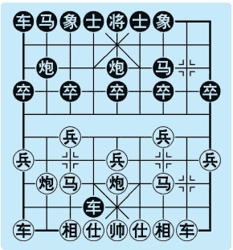

图 44

暗伏马四进六踩车，马六进七抽车。

8.…… 炮 2 平 4

如车 3 退 1，马四进二马 2 进 3（如车 3 平 6，兵三进一），马二进三将 5 进 1，车二进八炮 2 退 1，车九进一，再车九平四，红方大占攻势。

9.车二进六

以下黑方如果接走：
①车 3 平 7，相三进一车 7 退 1，马三进二，红方暗藏炮八进三、车九进一等多种攻势占优。
②车 3 退 1，马四进三炮 4 平 7，车二平三，红方有中路、底线等多种攻势占优。

### （2）炮 2 平 3

### （3）马 2 进 1
6.……　　　　炮 2 平 3　　　　7.车二进五

骑河车禁子得力，红方已经全盘控局。

7.……　　　　马 2 进 1　　　　8.车九平八　　车 1 平 2

9.炮八进四　　士 4 进 5　　　　10.仕六进五

以后红方可以考虑马三进四、车四平六等进攻手段，黑方全盘被压制。

### （3）马 2 进 3
6.……　　　　马 2 进 3

如马 2 进 1，炮八进四，红方有中路攻势。

7.仕六进五

红方阵型无懈可击，以后思路相七进九、车九平六兑车，或者炮五平四拆中炮，都是红方优势。以下黑方如果接走：

①车 1 进 1，相七进九车 1 平 6，车二进六，红方双马灵活，稳占优势。

②车 4 平 3，马七进六车 3 退 3，马六进四，黑马受攻，红方占优。

③车 4 退 2，炮五平四卒 5 进 1，相七进五卒 5 进 1，炮四进一车 4 退 2，兵五进一马 3 进 5，炮八进四，暗藏炮四平五，红方占优。

③车 4 退 4，马三进四车 4 平 6，炮八进二卒 3 进 1，炮五平四车 6 平 5，马四退六车 5 平 4，马六进七，红方多兵占优。

### 第 10 局　胡氏双正马对卒 3 进 1（一）
红方思路：车二进五骑河车攻守两利，红方稳持先手优势。

1.炮二平五　　炮 8 平 5　　　　2.马二进三　　马 8 进 7

3.车一平二　　车 9 进 1　　　　4.兵三进一　　车 9 平 4

5.马八进七　　卒 3 进 1

形成胡氏双正马对横车 3 卒的布局变例。

6.车二进五

如图 45，骑河车主动发起攻击，经过人机拆棋为红方最优选择，可以确保先行之利。本局介绍黑方（1）马 2 进 3；（2）象 3 进 1 两种走法。

### （1）马 2 进 3
6.……　　　　马 2 进 3

7.车二平七　　车 4 进 1

如马 3 进 4，兵七进一象 3 进 1，车七平八炮 2 平 3（如炮 2 进 5，炮五平八，红方多兵优势），马七进六图马 4 进 6，马六进四，红方多兵稳优。

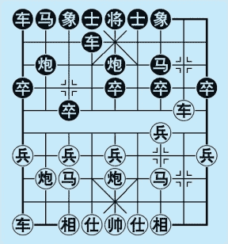

45

8.炮八进四　　炮 5 退 1　　　　 9.车七退一

至此，红方多兵占优。以下黑方如果接走：

①炮 5 平 3，炮八平七，黑方反击受阻，红方多兵有利。

②象 3 进 5，炮五平四，红方不怕黑方炮 5 平 3，随时有炮八平七化解，以后仕相补齐，红方多兵稳优。

③马 3 进 4，炮八平三象 7 进 5，车九进一炮 2 平 3，车九平六炮 5 平 3，车七平六，红方多两个兵占优。

④马 3 进 2，炮八平三象 7 进 5，炮五平四，以后补仕补相出肋车，红方多两个兵明显优势。

### （2）象 3 进 1
6.……　　　　象 3 进 1

在纯人拆棋时代，棋书认为这步棋可以出其不意，如今人工智能拆棋时代得出精确结论为红方占优。

7.炮八平九　　车 4 进 2

黑方如果①炮 2 进 2，车二进一，以下红方有车九平八、车二平三等多种攻势，黑方无法化解；②马 2 进 3，炮九进四车 1 平 2，炮九平八车 2 平 3，炮八平三象 7 进 9，车九平八炮 2 进 2，车二退一车 4 进 6，车八进二，红方多两个兵，以后最简单思路兵九进一即可占优。

8.车九平八　　马 2 进 4

如果炮 2 平 3，红方马三进四再车二平六兑车占优。

9.马三进四

以下黑方有三种走法：

①车 1 平 2，车二平六车 4 进 1，马四进六炮 2 平 4（如炮 2 进 4，炮五平三），车八进九马 4 退 2，炮九进四，形成无车残棋，红方多兵占优。

②车 4 进 2，马四进六车 1 平 3，炮九进四车 3 进 3，炮九退二车 3 平 4，马六进四前车平 6，马四退五车 4 进 2，车八进六，黑方两个车无法捉死红马，红方多两个兵稳占优势。

③车 1 平 3，车二平六车 4 进 1，马四进六卒 3 进 1（如士 4 进 5，车八进四），兵七进一车 3 进 5，车八进二炮 2 平 3（如车 3 退 1，马六进五象 7 进 5，炮九退一，红方控盘占优），马六进七车 3 退 3，炮九退一将来炮九平七或者炮九平三，红方占优。

### 第 11 局　胡氏双正马对卒 3 进 1（二）
红方思路：车二进五骑河车攻守两利，红方稳持先手优势。

1.炮二平五　　炮 8 平 5　　　　2.马二进三　　马 8 进 7

3.车一平二　　车 9 进 1　　　　4.兵三进一　　车 9 平 4

5.马八进七　　卒 3 进 1

形成胡氏双正马对横车 3 卒的布局变例。

6.车二进五

骑河车主动发起攻击，经过人机拆棋为红方先手最优选择，可以确保先行之利。上一局介绍黑方①马 2 进 3；②象 3 进 1 两种走法，均为红方优势。本局介绍黑方最后一种走法：炮 5 退 1。

6.……　　　　炮 5 退 1

准备连象防守反击：黑方如果①车 4 平 3，相七进九，红方可补士出车，子力出动快占优；②车 4 进 1，车二平七炮 5 退 1，还原成正变。

7.车二平七　　车 4 进 1

带有欺骗性布局陷阱，引诱红车贪吃底象。

8.马三进四

不为所动，以后可以炮八进四化解黑方反击。不可车七进四炮 2 平 3，马七退五象 7 进 5，车七退一马 2 进 4，黑方打死红车，这是黑方的布局骗招。

8.……　　　　马 2 进 3

出动大子，准备炮 5 平 3 反击。黑方如果象 3 进 5，车七平六车 4 平 3（如马 2 进 3，车六进二炮 2 平 4，车九平八车 1 平 2，炮八进六，红方有空间优势），炮八退一车 3 进 4，车九进二马 2 进 3，红方攻势很大。

9.炮八进四

化解黑方炮 5 平 3 反击。如果急攻走马四进五马 7 进 5，炮五进四象 3 进 5，车七进一炮 5 进 2，车七平五车 4 进 7，马七退六马 3 进 5，黑方车 1 平 3，黑子力灵活出车快且破仕占优。

9.……　　　　炮 5 平 3

黑方如：

①象 3 进 5，炮八平三，以后车七平四车九平八，红方多两个兵控盘优势。

②象 7 进 5，车七进一炮 5 平 3，炮八平五马 7 进 5，炮五进四，红方再躲车，多兵占优。

10.炮八平七　　象 3 进 5

同样补象不能补 7 象，补 3 象保留士 4 进 5、车 1 平 4 的出车路线，黑方如果象 7 进 5，车七退一炮 3 进 2，车七进二炮 2 退 1，马四进五马 7 进 5，炮五进四炮 2 平 5，炮五平一，补错象造成底线空虚，红方多三个兵占优。

11.车七退一　　炮 3 进 2

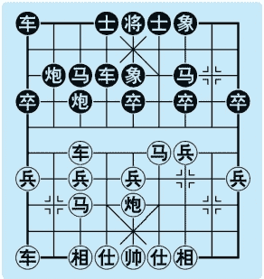

图 46

如图 46，以上一段都是经得起过往四十年实战考验的正变，双方都没有改进的空间，经过人机拆解，红方接有（1）车七进二；（2）车九平八两种走法，都可以稳占先手主动立于不败：

### （1）车七进二
12.车七进二　　炮 2 退 1

保留中炮或者炮 2 平 3，比炮 2 退 2 更为灵活可取。

13.马四进五

可以保留车马炮兵种齐全，如果炮五进四马 7 进 5，马四进五车 1 进 2，黑方兵种好可以对杀，红方不能满意。

13.……　　　　马 7 进 5　　　　14.炮五进四　　士 4 进 5

黑方如果改走：

①炮 2 平 5，炮五进二士 4 进 5，车九平八，红方多兵稳占主动立于不败，黑方只能下风顶和。

②士 6 进 5，炮五退二炮 2 平 3，车七平三将 5 平 6，车九进一士 5 进 6，车九平四，红方速胜。

15.车九平八　　炮 2 平 3　　　　16.车七平八　　车 4 进 5

17.前车进三　　车 1 平 2　　　　18.车八进九　　车 4 退 7

19.车八平六　　将 5 平 4　　　　20.炮五平一

红方多兵主动立于不败，黑方下风只能顶和。

### （2）车九平八
12.车九平八

让黑方不能炮 2 退 1，这就是车七进二和车九平八出车顺序的不同，导致黑方 2 路炮的位置不同。

12.……　　　　炮 2 退 2　　　　13.车七进二　　炮 2 平 3

14.车七平八　　马 3 进 4　　　　15.马四进六　　车 4 进 2

16.前车平七

至此，双方开局结束进入中局战斗，这个谱招大师实战走了四十多年，用软件拆棋也是这样走，可以说这个变化已经被拆解透彻了，结论是红方多兵稍好，黑方下风顶和亦不难。

### 第 12 局　实战参考：1984 年个人赛胡荣华先胜徐天红
1.炮二平五　　炮 8 平 5　　　　2.马二进三　　马 8 进 7

3.车一平二　　车 9 进 1　　　　4.马八进七　　车 9 平 4

5.兵三进一　　卒 3 进 1　　　　 6.车二进五　　炮 5 退 1

7.车二平七　　车 4 进 1　　　　8.马三进四　　马 2 进 3

9.炮八进四　　炮 5 平 3　　　　10.炮八平七　　象 3 进 5

11.车七退一　　炮 3 进 2　　　　12.车九平八　　炮 2 退 2

13.车七进二　　炮 2 平 3　　　　14.车七平八　　马 3 进 4

15.马四进六　　车 4 进 2　　　　16.前车平七

如图 47，本局选自 1984 年全国象棋个人赛，红方胡荣华对黑方徐天红的实战对局。双方开局轻车熟路，输攻墨守，都是经得起考验的正谱，形成红方多 1 个兵先手稍好，黑方也可以抗衡的棋。

16.……　　　　车 1 进 1

17.仕六进五　　卒 7 进 1

18.车八进四　　车 1 平 6

按人机拆棋的最优选择，红方先手应该考虑拆中炮、补中相，红方先手多兵稳占主动，但赢棋难度就大大增加了。胡司令下棋从来都是积极主动，敢于冒险，决定兵五进一强冲中兵发起猛攻。

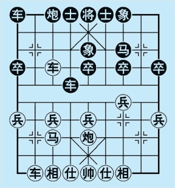

图 47

19.兵五进一　　车 6 进 5　　　　20.兵五进一　　车 4 平 5

21.兵三进一　　车 6 平 7　　　　22.兵七进一

这步棋是典型的请君入瓮计，让黑方压马或者吃兵。

22.……　　　　士 6 进 5　　　　23.兵三进一　　车 7 退 3

24.车八退一　　车 7 进 6　　　　25.车八平六　　马 7 进 6

如图 48，红方连弃中兵、三兵，已经没有任何便宜可言。黑方上马欠妥，正着是车 7 退 5 退车以后霸王车兑车，黑方破相占优。

26.车六进五　　马 6 进 7

27.炮五进四　　马 7 进 8

28.帅五平六　　车 5 退 1

29.车七平五　　炮 3 进 7

至此，黑方被迫一车换双，而且黑方车马炮位置也不好，以下来欣赏胡司令的困子神功。

30.车六退六　　炮 3 进 1

31.车五退三

红方这两步车退得太妙了，以退为进，把黑方马炮都给困住了，黑方顽强的走法应该弃炮赶紧马 8 退 7 把马绕出来。

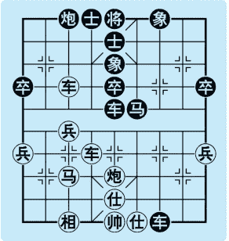

图 48

31.……　　　　车 7 退 4　　　　32.相七进五　　车 7 退 1

33.车六退一

绝妙的顿挫！

33.……　　　　炮 3 退 1

34.车六进二

双车联手不给黑方马 8 退 7 运出来，随时平车捉死黑马。

34.……　　　　炮 3 进 1

35.车五平二　　车 7 平 2

36.帅六进一

如图 49，以上一段，红方通过一连串精妙的困子神功，居然把黑马捉死了，令人赏心悦目、叹为观止。以下红方形成双车兵必胜车炮的残棋。

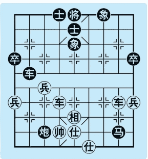

图 49

36.……　　　　马 8 退 9　　　　37.车二平一　　卒 9 进 1

38.车六进三　　卒 1 进 1　　　　39.车一平六　　炮 3 平 1

40.后车平七　　车 2 进 4　　　　41.帅六退一　　车 2 进 1

42.帅六进一　　车 2 退 4　　　　43.车六平四　　卒 1 进 1

44.车四进二　　卒 1 进 1　　　　45.车七平三　　象 7 进 9

46.车三平二　　士 5 退 6　　　　47.车二平九　　炮 1 平 2

48.车九进六　　士 6 进 5　　　　49.车九退二　　象 5 进 7

50.车四退二　　车 2 退 1

51.车四平二　　象 9 退 7

52.车二进三

如图 50，红方必定破象，黑方只好推枰认负。

这盘棋双方开局都是谱招，红方只是多个小兵稍好。红方凭借中局胆大心细的弃中兵、弃三兵创造机会，及时抓住黑方的缓手，最后施展神乎其神的双龙出海，两个红车困子得马、运子破象，着实精妙无比。

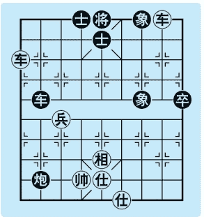

图 50

### 第 13 局　胡氏双正马补仕变对马 2 进 1 半壁河山（1）
红方思路：补仕拆中炮，红方稳占先手主动。

1.炮二平五　　炮 8 平 5　　　　2.马二进三　　马 8 进 7

3.车一平二　　车 9 进 1　　　　4.兵三进一　　车 9 平 4

5.马八进七　　马 2 进 1

黑方形成后手顺炮单提马半壁河山，黑方的反击要点是炮 2 平 3、车 1 平 2、车 2 进 6 三步棋。从人机拆棋来看，红方最优解是仕六进五，以后拆中炮；从实战来看，红方直接炮五平四拆中炮效果也不错，下面从先手立场分六个布局变例辅以 6 盘大师实战来详细拆解仕六进五和炮五平四两个变例。

6.仕六进五

如图 51，先手立场最优推荐仕六进五，这是人机拆棋 20 回合以后深度思考的最优解。人机拆棋思路就是通过炮五平四、相七进五调整红方阵型，红方可以做到布局阶段无懈可击没有弱点，后手顺炮由于红方拆中炮以后失去了对杀方向，随着棋局进入中残局，就会形成“红方没有弱点同时有进攻方向对黑方委屈防守同时没有反击目标”的态势，红方可以稳占主动。

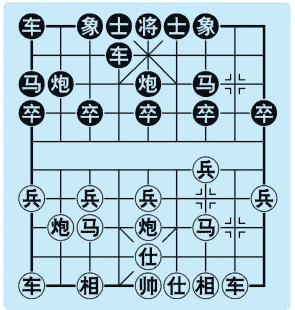

图 51

本局先介绍黑方（1）车 4 进 3；（2）车 4 进 4；（3）车 4 进 5；（4）车 4 进 7 四种走法：

### （1）车 4 进 3
6.……　　　　车 4 进 3

黑方巡河车最容易被红马踢来踢去，从而步数亏损吃亏，所以红马只要能达到踢车的目的，红方就可占优。黑方如果：①车 1 进 1，车二进六，红方占优；②卒 3 进 1，车二进五车 4 平 3，相七进九，红方占优。

7.炮五平四　　卒 7 进 1　　　　8.车二进四　　炮 2 平 3

9.马三进四　　车 4 平 2　　　　10.车九平八　　车 1 进 1

11.相七进五　　车 1 平 4　　　　12.炮八平九

兑车以后黑方 1 路线、7 路线都有弱点，红方占优。

### （2）车 4 进 4
6.……　　　　车 4 进 4　　　　7.车二进四

红方接下来拆中炮，飞相出肋车就是占优。

7.……　　　　炮 2 平 3　　　　8.炮八进四　　车 1 平 2

9.车九平八　　士 4 进 5　　　　10.炮五平四

黑方没棋走，红方舒舒服服补中相、冲七兵、跳河口马组织攻势，红方稳占先手。

### （3）车 4 进 5
6.……　　　　车 4 进 5　　　　7.炮五平四　　炮 2 平 3

如果车 4 平 3，相七进五接有马三进四、车九平六、车二进六等多种攻势都是红方的下棋方向，黑方被动。

8.相七进五　　车 1 平 2　　　　9.车九平八

马三进四、车二进六都是红方的攻击方向，红方阵容好有明确进攻方向，黑方没棋走、没反击方向不可避免落入下风。

### （4）车 4 进 7
6.……　　　　车 4 进 7　　　　7.相七进九

简单兑肋车以后车二进六是绝对的优势。

7.……　　　　炮 2 平 4

黑方如果炮 2 平 3，炮八进四士 4 进 5，车九平八车 1 平 2，车二进五、车二进六、马三进四都是红方的进攻方向，红方明显控盘占优，黑方这个棋不一定输棋，但是后续只能被动防守，下得太辛苦太委屈太没劲了。

8.炮八进四　　士 4 进 5　　　　9.车九平八　　车 1 平 2

10.车二进五　　车 4 平 3　　　　11.车八进二

红方马三进四占优，黑方就算一车换双也是红方多车占优。

### 第 14 局　实战参考：1984 年五羊杯李来群先胜胡荣华
1.炮二平五　　炮 8 平 5

2.马二进三　　马 8 进 7

3.车一平二　　车 9 进 1

4.马八进七　　车 9 平 4

5.兵三进一　　马 2 进 1

6.仕六进五

如图 52，选自 1984 年五羊杯冠军赛，红方李来群对黑方胡荣华的实战对局。　“神算子”李来群在 1984 年就走出了如今人机拆棋最优解“仕六进五”，实力非凡。

6.……　　　　车 4 进 7

图 52

黑方“胡司令”棋风凶悍，敢于求变，挥车相腰，积极搏杀，在实战中走谱招炮 2 平 3 较为多见。

7.相七进九　　炮 2 平 3　　　　8.炮八进四　　士 4 进 5

9.车二进五

骑河车禁子得力，控盘好棋。

9.……　　　　车 1 平 2

黑方如果车 4 平 2，炮八平五马 7 进 5，炮五进四车 2 平 4，车九平六，红方占优。

10.车九平八

黑方除了 4 路黑车没好点可走，局势还被红方控盘。

10.……　　　　车 4 退 3

下风中的唯一对杀方向，尽可能延缓红方攻势，同时吃兵捉马以攻代守。黑方如果：①车 4 平 3，车八进二车 2 进 3，车八进四车 3 退 1，马三进四，红方攻势在前，黑方被动；②车 4 退 2，马三进四车 4 平 3，马四进六车 3 进 1，马六进七车 2 进 2，马七退五马 7 进 5，炮五进四，红方中炮优势不可动摇。

11.相三进一　　车 4 进 1

12.兵七进一　　车 4 平 3

13.车八进二

如图 53，以上一段，红方李来群施展巨蟒缠功，通过细腻的控盘，以及高超的大局观，取得优势局面。黑方无法掀起波澜对杀，被迫一车换双采取以攻代守。

13.……　　　　车 2 进 3

14.车八进四　　车 3 进 1

15.相一退三　　车 3 平 1

图 53

黑方一车换双后有一定攻势，红方不能掉以轻心，疏忽大意。

16.车二平八

绝妙的控盘手段，立于不败的好棋。红方如果车八退三车 1 进 2，仕五退六炮 3 进 3，车八平七炮 3 退 1，黑方可以对杀。

16.……　　　　车 1 平 3

黑方如果车 1 退 1，马三进四，还是红方主动，因为红方霸王车立于不败，黑方如果中炮发过来马四进六依然保留攻势。

17.后车退五

非常细腻，这是李来群绵里藏针棋风的特点，让自己立于不败，先为不可胜，后发可制人。

17.……　　　　卒 1 进 1

黑方如果车 3 退 2，前车退二车 3 退 1，马三进四炮 5 进 4，前车进一，再马四进六，红方优势。

18.马三进四　　炮 5 进 4

19.马四进六　　炮 3 平 5

20.马六退五　　炮 5 进 4

21.前车退三　　炮 5 退 2

22.前车平五　　车 3 退 2

23.炮五进三　　卒 5 进 1

24.车五进二　　车 3 平 7

25.车五平九　　马 1 退 3

如图 54，以上一段，两位绝顶高手刺刀见红，积极拼杀，走子运子兑子都是无懈可击，双方都发挥了超高的水平。马 1 退 3 这步棋是缓手导致丢象，黑方此时正着是象 7 进 5 再象 5 进 3 保马，黑方还可一战。

图 54

26.车八进九　　马 3 进 5　　　　27.车九平五　　士 5 退 4

28.车八平七　　士 6 进 5　　　　29.相三进五　　车 7 进 1

30.兵九进一　　车 7 平 9　　　　31.车七平八　　卒 9 进 1

32.车八退五

黑方可能车 9 平 6 防守顶和顽强一点。

32.……　　　　卒 9 进 1　　　　33.车八平四　　卒 3 进 1

34.车四进四　　马 5 进 3　　　　35.车五退一　　马 7 退 6

36.车四平三　　卒 3 进 1　　　　37.相五进七　　车 9 平 1

38.相七退五　　马 6 进 5　　　　39.车三进一　　士 5 退 6

40.车三平一

这里黑方有个陷阱，红方不能上当，如果不察走车三退三车 1 退 1，没有兵红方赢不了。

40.……　　　　卒 9 进 1　　　　41.车一退四

红方两个车双龙出海，龙盘虎踞，牢牢控盘，以后冲兵就可以争取赢棋。

## 残局分析

41.……　　　　卒 9 平 8　　　　42.兵九进一　　士 4 进 5

无奈，黑方如果车 1 退 2，车一平九马 3 进 1，车五进三士 6 进 5，车五退四卒 8 进 1，车五平三，以后捉死两个黑卒，红方单车必胜黑方马双士。

43.兵九平八　　马 5 退 7　　　　44.车一平四　　马 3 退 5

45.车四进三　　车 1 退 4　　　　46.车五退一　　马 5 进 4

47.车五进二　　马 4 退 5　　　　48.兵八平七　　卒 7 进 1

49.车四退五　　卒 7 进 1　　　　50.车四平二　　卒 7 平 6

51.车五进一　　车 1 进 3　　　　52.车二平五　　车 1 平 4

53.后车进二　　马 7 进 9　　　　54.后车平六　　车 4 退 1

55.兵七平六　　马 5 进 7

至此形成高难度必胜残棋，车兵是可以赢双马双士的。

56.仕五进六　　卒 6 进 1　　　　57.车五平四　　马 7 进 8

58.车四退二　　马 9 进 7　　　　59.车四平三　　卒 6 平 5

60.相五退三　　马 7 退 5　　　　61.兵六平五

冷静，如果不察走车三平二马 5 进 4，黑方保留马卒双士有机会顶和。

61.……　　　　马 8 退 9　　　　62.兵五进一　　马 5 进 3

63.兵五平六　　马 3 退 1　　　　64.车三平五　　马 1 进 2

65.兵六平七　　马 2 进 1　　　　66.车五平八　　马 1 进 3

67.车八平七　　马 3 退 1　　　　68.车七退一　　马 1 进 2

69.车七平五　　马 2 退 4　　　　70.帅五平六　　马 9 进 7

71.车五平六　　马 7 进 5

72.帅六进一　　马 4 进 6

73.车六平九　　马 6 退 4

74.相三进五　　士 5 退 4

75.车九平五

如图 55，红方得马必胜，黑方投降认输。

这盘棋红方开局稳占先手，中局抓住黑方漏招破象之后优势扩大，最后施展一车十子寒的巨蟒缠功，抽丝剥茧，层层推进，最后得马取胜，非常精彩。

图 55

### 第 15 局　胡氏双正马补仕变对马 2 进 1 半壁河山（2）

红方思路：补仕拆中炮，红方稳占先手主动。

1.炮二平五　　炮 8 平 5　　　　2.马二进三　　马 8 进 7

3.车一平二　　车 9 进 1　　　　4.兵三进一　　车 9 平 4

5.马八进七　　马 2 进 1　　　　 6.仕六进五

先手立场最优推荐仕六进五，这是人机拆棋 20 回合以后深度思考的最优解。人机拆棋思路就是通过炮五平四、相七进五调整红方阵型，红方可以做到布局阶段无懈可击没有弱点，后手顺炮由于红方拆中炮以后失去了对杀方向，随着棋局进入中残局，就会形成“红方没有弱点同时有进攻方向对黑方委屈防守同时没有反击目标”的态势，红方可以稳占主动。上一局已经介绍了黑方车 4 进 3、车 4 进 4、车 4 进 5、车 4 进 7 四种走法，本局介绍黑方炮 2 平 3 的走法。

6.……　　　　炮 2 平 3

黑方后手顺炮单提马横车的反击要点就是“炮 2 平 3、车 1 平 2、车 2 进 6”三步棋，从红方立场来分析，只要注意不要让黑方抢到车 1 平 2 再车 2 进 6 即可。

7.车九平八　　车 1 平 2　　　　8.炮八进四　　士 4 进 5

9.车二进五

如图 56，好棋，大局观很强的一步棋，可以控制全局，减少黑方反扑。红方如果改走：

①炮五平四车 4 进 3，马三进四车 4 进 1，红方此时拆中炮时机不成熟。

②马三进四车 4 进 4，马四进五马 7 进 5，炮八平五车 2 进 9，马七退八车 4 进 1，黑方取得对杀机会。

③车二进六车 4 进 4，车二平三卒 3 进 1，相七进九车 4 退 2，炮八进二卒 3 进 1，相九进七马 1 进 3，黑方反杀，红方不能满意。

图 56

以下黑方车 4 进 4 变化很多，下一局再介绍。本局介绍黑方（1）车 4 进 5；（2）车 4 进 7；（3）象 7 进 9 三种走法：

### （1）车 4 进 5

9.……　　　　车 4 进 5　　　　10.炮五平四　　车 4 平 3

11.相七进五

以后马三进四，红方的马位比黑方两匹笨马好，红方稳占主动。以下黑方如果接走：

①炮 5 进 4，马七进五车 3 平 5，马三进四，暗伏马四进六踩双、马四进三踩兵，红方控盘主动。

②炮 5 平 4，马三进四象 3 进 5，车二平八，红方有清晰的进攻方向，马四进六、马四进三等；黑方没有反击方向，只能下风顶和。

### （2）车 4 进 7

9.……　　　　车 4 进 7　　　　10.兵七进一

红方三兵、七兵两头蛇压制黑方两匹笨马，黑方整盘棋唯一能走的大子就是 4 路车。

10.……　　　　车 4 平 3　　　　11.马七进六　　车 3 退 3

12.车二平六

继续控盘，红方如果马六进五（如马六进四车 3 退 1）车 3 进 4，车八平七炮 3 进 7，黑方可以对杀，红方没有便宜。以下黑方如果接走：

①炮 5 平 4，相七进九车 3 退 1，车六平七卒 3 进 1，马三进四，以后双马抢中卒，中炮镇中，红方保持先手优势。

②车 3 进 4，车八平七炮 3 进 7，炮五平八车 2 平 1（如车 2 进 3，马六进八）马六进四，红方攻势如潮，黑方被动。

### （3）象 7 进 9

9.……　　　　象 7 进 9　　　　10.车二平八

以下黑方如果接走：

①车 4 进 5，马三进四车 4 平 3，马四进六车 3 进 1，马六进七车 2 进 2，马七退五马 7 进 5，炮五进四，红方中炮占优。

②车 4 进 4，炮八平五车 2 进 4，车八进五马 7 进 5，炮五进四，红方中炮占优。

### 第 16 局　实战参考：1983 年团体赛李来群先胜臧如意

1.炮二平五　　炮 8 平 5

2.马二进三　　马 8 进 7

3.车一平二　　车 9 进 1

4.马八进七　　车 9 平 4

5.兵三进一　　马 2 进 1

6.仕六进五　　车 4 进 4

7.炮五平四

如图 57，本局选自 1983 年全国象棋团体赛，“神算子”李来群先手对臧如意的一盘实战对局。拆中炮准备飞相出车，可以化解黑方反击，也可以车二进四炮 2 平 3，炮八进四士 4 进 5，车九平八车 1 平 2，炮五平四，以后飞相冲七兵，抢到马三进四，红方保持先手。

图 57

7.……　　　　车 4 平 7　　　　8.马三进二

如图 58，好棋，构思飞相以后再炮八进二、炮八平三，这是李来群的绝妙构思。这盘棋是 1983 年的实战，直到现在也还有很强的参考学习价值。

8.……　　　　车 7 退 1

9.相七进五　　士 4 进 5

略显缓慢，应该考虑炮 2 平 3，炮八进二车 1 平 2，炮八平三车 7 平 8，炮四平三马 7 退 9，马二退一车 8 进 5，马一退二，局面平稳，黑方问题不大。

图 58

10.炮八进二　　炮 5 平 4

面对红方炮八平三、炮四平三的严厉攻势，黑方知道自己 7 路线的弱点，所以拆中炮准备联象严防死守。

11.马二进一

妙手弃马，强行打开局面！

11.……　　　　车 7 进 2

黑方不敢接受弃马，如马 7 进 9，车二进六车 7 平 9，炮四平一，红方先弃后取，顺利打通黑方兵线，红方占优。

12.炮八平三　　象 3 进 5　　　　13.车二进七　　车 7 平 9

14.车九平八　　车 1 平 2

如车 9 退 3，车八进七，接下来炮三进三炮打马，红方得子。

15.马一进三　　卒 7 进 1

如炮 4 平 7，炮三进三，红方得子占优。

16.炮三平九　　炮 2 平 3

如炮 4 平 7，炮九进三车 2 平 1，炮九平五象 7 进 5，车二退一，红方兵种好，多兵多相占优。

17.车八进九　　马 1 退 2　　　　18.马三退二

回首掏车，以退为进，金蝉脱壳的好棋！红方由此确定了多子的优势。

18.……　　　　车 9 平 8　　　　19.车二进二　　炮 3 进 4

20.炮九平一　　象 7 进 9　　　　21.兵五进一　　象 9 退 7

22.炮一进五　　卒 3 进 1　　　　23.马七进五

羊入虎口，本局二度弃马！

23.……　　　　车 8 平 6

无奈，黑方如果改走：

①车 8 平 5，炮四进六士 5 退 4，车二平三，四子归边，红方必胜。

②士 5 进 6，炮四进七马 2 进 3（如将 5 平 6，车二退一），炮四退一将 5 进 1，炮一退一将 5 平 6，车二退一将 6 退 1，炮一进一，红胜。

24.兵五进一　　卒 5 进 1　　　　25.马五进六　　士 5 进 6

26.马六退七　　炮 4 进 3

如车 6 平 3，炮四进七，红方四子归边必胜。

27.马二进一

本局三度弃马！黑方不敢象飞马，抽黑车。

27.……　　　　车 6 平 3　　　　28.马一进三　　将 5 平 4

29.马三退五

本局四度弃马！黑方不敢象飞马，同样抽黑车。

29.……　　　　将 4 平 5

30.马五进七　　马 2 进 4

31.炮一平三　　士 6 进 5

如将 5 进 1，马七退六将 5 进 1，炮三退二士 6 退 5，炮四进五，绝杀。

32.炮三退三　　士 5 退 6

33.车二平四

图 59

如图 59，走到这里，黑方认输，如果接走将 5 进 1，马七退六将 5 进 1，炮三进一士 6 退 5，炮四进五，红方绝杀！

本局李来群先手面对后手顺炮单提马横车，通过补仕、拆中炮的布局构思牢牢掌握先手，中局四度弃马更是让人拍案叫绝，心悦诚服，这就是我国唯一拥有棋王、棋圣两个称号的四届全国冠军李来群巅峰时期代表作之一。

### 第 17 局　胡氏双正马补仕变对马 2 进 1 半壁河山（3）

红方思路：补仕拆中炮，红方稳占先手主动。

1.炮二平五　　炮 8 平 5　　　　2.马二进三　　马 8 进 7

3.车一平二　　车 9 进 1　　　　4.兵三进一　　车 9 平 4

5.马八进七　　马 2 进 1　　　　6.仕六进五　　炮 2 平 3

7.车九平八　　车 1 平 2　　　　8.炮八进四　　士 4 进 5

9.车二进五

大局观很强的一步棋，可以控制全局，减少黑方反扑。前面已经介绍了黑方车 4 进 5、车 4 进 7、象 7 进 9 等三种走法，本局介绍黑方最后一种走法：车 4 进 4。

9.……　　　　车 4 进 4

如图 60，黑方积极拼杀，以下红方（1）炮八平五；（2）相三进一两种走法都是可以选择的：

### （1）炮八平五

10.炮八平五　　车 2 进 9

11.马七退八　　车 4 进 3

黑方如果改走：

①马 7 进 5，炮五进四车 4 退 2，马三进四，以后强行兑车，红方可形成优势残棋。

图 60

②车 4 平 7，车二平六炮 3 平 2，帅五平六炮 2 退 2，车六进二再车六平七有杀棋。

12.马八进九

如马八进七，黑方车 4 平 3，红方没有必要。

12.……　　　　马 7 进 5　　　　13.炮五进四　　将 5 平 4

14.兵九进一　　车 4 退 5　　　　15.炮五退二　　车 4 进 2

16.车二平五　　炮 5 进 3　　　　17.车五退一　　车 4 平 5

18.兵五进一

红方形成多兵残棋，立于不败。

### （2）相三进一

10.相三进一　　车 4 进 1

黑方整盘棋只有 4 路车能走动，红方除了马三进四，此时另一个思路也颇具实战价值：车八进三车 4 平 3，车八平七炮 3 进 4，车二平八卒 1 进 1，车八退五，以后马三进四、炮八进一等，红方稳持先手。

11.马三进四

拍马而起，果断进攻。

11.……　　　　车 4 平 3　　　　12.马四进六　　车 3 进 1

如车 3 退 2，马六进七车 2 进 3，车八进六车 3 平 8，前马进九车 8 平 3，车八退四，双方对杀，红方机会更多一点。

13.马六进七　　车 2 进 2　　　　14.马七退五　　马 7 进 5

15.炮五进四　　车 3 退 3　　　　16.车二平七　　卒 3 进 1

17.相七进五　　将 5 平 4

黑方另如：①卒 9 进 1，兵五进一，红方优势；②车 2 平 4，炮八平三，以后车八进四、车八进五、兵五进一等等，红方优势。

18.车八平六　　车 2 平 4　　　　19.炮八平六　　将 4 平 5

20.兵五进一　　马 1 退 3　　　　21.炮六退四

红方稳持先手主动。

### 第 18 局　实战参考：2004 年个人赛阎文清先胜谢岿

1.炮二平五　　炮 8 平 5　　　　2.马二进三　　马 8 进 7

3.车一平二　　车 9 进 1　　　　4.马八进七　　车 9 平 4

5.仕六进五　　马 2 进 1　　　　6.兵三进一　　炮 2 平 3

7.车九平八　　车 1 平 2　　　　8.炮八进四　　士 4 进 5

9.车二进五　　车 4 进 4　　　　10.炮八平五

如图 61，本局选自 2004 年全国象棋个人赛，“象棋布局专家”阎文清先手对谢岿的一盘实战对局。炮八平五抢中路这是阎文清的飞刀，2004 年第一次在实战中走出来。也可以相三进一车 4 进 1，车八进三车 4 平 3，车八平七炮 3 进 4，车二平八卒 1 进 1，车八退五，以后炮八进一、马三进四等等，红方保持先手。

10.……　　　　车 2 进 9

11.马七退八　　将 5 平 4

图 61

黑方不敢车 4 平 7 离开防守肋道，怕红方车二平六、帅五平六组杀。将 5 平 4 这步棋是缓手，应该考虑车 4 进 3，马八进九马 7 进 5，炮五进四将 5 平 4，兵九进一车 4 退 5，炮五退二车 4 进 2，暗藏打中兵交换的棋，局面平稳。

12.前炮退二

至此，红方飞刀成功，红方多一个中兵而黑方无法对杀，红方取得多中兵的优势。

12.……　　　　炮 5 平 4　　　　13.马八进九　　象 7 进 5

14.车二平八　　马 7 进 5　　　　15.兵九进一　　卒 7 进 1

16.相三进一　　卒 7 进 1　　　　17.相一进三　　卒 3 进 1

18.车八进一

可以考虑一步到位直接车八退一兑车。

18.……　　　　马 5 进 7　　　　19.车八退二

如车八平九炮 3 进 1，黑方有反击。现在红方进车又退车连续 2 步缓手，黑方得到喘息机会。

19.……　　　　车 4 进 1

如图 62，错失扳平局面的机会，应该接受兑车走车 4 平 2，马九进八炮 3 进 4，形成四马炮无车残棋，黑方可以抗衡。

20.前炮平六　　将 4 平 5

21.马三进四　　车 4 平 5

22.马四进六　　炮 4 进 3

23.车八平六　　炮 3 退 1

24.马六进七　　士 5 进 6

应该车 5 退 1 兑车赶紧简化顶和。

25.车六进四

图 62

一招葵花点穴手，正中黑方要害！

25.……　　　　士 6 进 5　　　　26.炮五平八　　马 7 退 5

27.车六退二　　士 5 进 4　　　　28.车六进一　　马 5 退 3

29.车六平七　　炮 3 平 8　　　　30.炮八平二　　炮 8 平 9

31.相三退五　　车 5 平 4　　　　32.马九进八　　车 4 退 1

33.马八进七　　炮 9 进 5

应马 1 进 3 换马较为顽强。以下红方形成车炮兵的优胜残棋。

34.马七进五　　象 3 进 5　　　　35.车七平九　　将 5 进 1

36.车九进一　　将 5 退 1　　　　37.车九进一　　将 5 进 1

38.车九退一　　将 5 退 1　　　　39.车九退二　　卒 9 进 1

40.车九平五　　车 4 进 1　　　　41.车五进一　　将 5 平 4

42.相五退三　　炮 9 平 5　　　　43.仕五进六

妙手送士，露帅助攻，同时暗藏炮二退一的妙手。

43.……　　　　炮 5 平 3

无奈，黑方如果：①车 4 进 1，车五退四，白脸将红胜；②卒 9 进 1，炮二退一，黑方要么丢车，要么丢炮，红方必胜。

44.仕六退五　　卒 3 进 1　　　　45.炮二平六　　卒 3 平 4

46.车五平四　　卒 9 进 1

47.车四平六　　将 4 平 5

48.车六平五　　将 5 平 4

49.炮六退二

如图 63，走到这里，黑方认输，如果接走卒 9 进 1，仕五进六，下一步车五平六白脸将，红胜！这盘顺炮大战开中残质量非常高，本局红方炮八平五抢中路的布局飞刀有很强的实战价值，从实战效果来看，红方只要稳扎稳打，该布局变例结论也是红方稳占先手。

图 63

### 第 19 局　胡氏双正马拆中炮对马 2 进 1 半壁河山（4）

红方思路：先拆中炮，再补仕相，红方稳占先手主动。

1.炮二平五　　炮 8 平 5　　　　2.马二进三　　马 8 进 7

3.车一平二　　车 9 进 1

4.兵三进一　　车 9 平 4

5.马八进七　　马 2 进 1

作为先手立场，必须要掌握的两个先手变化：仕六进五和炮五平四。人机拆棋最优推荐仕六进五已经在前面章节详细介绍过了，本局再补充介绍直接炮五平四的变化。

6.炮五平四

如图 64，跟直接补仕有异曲同工之妙，目的还是为了补仕补相出肋车。黑方唯一正着是炮 2 平 3 对杀，炮 2 平 3 变化很多，放到后面的章节介绍。本局介绍黑方（1）卒 5 进 1；（2）车 4 进 3 两种走法。

图 64

### （1）卒 5 进 1

6.……　　　　卒 5 进 1

黑方另如：

①卒 3 进 1，车二进五卒 5 进 1，相七进五卒 5 进 1，兵五进一马 7 进 5，仕六进五，以后思路送中兵马三进四，红优。

②卒 1 进 1，车二进五炮 2 平 3（如卒 5 进 1，相七进五卒 5 进 1，兵五进一，红方占优），车九平八车 1 平 2，炮八进四，红方明显控盘优势。

7.相七进五

红方阵型工稳毫无破绽，黑方反击无门，棋局发展下去就会形成红方没有弱点有进攻方向对黑方委屈防守没有对杀的局面，黑方必须以攻代守，否则红方简单补仕兑车，或者马三进四、车二进六等都是红方的攻势，黑方被动。

7.……　　　　卒 5 进 1　　　　 8.兵五进一　　马 7 进 5

9.仕六进五

现在红方已经稳健控盘，以后根据情况可以车九平六兑车，或者车二进三。以下黑方如果接走：

①马 5 进 4，车九平六、兵七进一或者车二进三平车顶马，黑方有丢子风险。

②马 5 进 3，兵五进一马 3 进 4，炮四退一马 4 退 5（如车 4 平 6，车九平六马 4 退 5，炮四进三，红方攻势更大），车二进五马 5 进 7（如马 5 进 6，炮四进一），相三进一，黑马有丢子风险。

③炮 5 进 3，炮八进四马 5 进 4，车二进三马 4 进 3（如马 4 进 2，车九平七），炮四平七炮 2 平 5，炮八平三车 4 进 2，兵三进一车 1 平 2，车九平六车 4 进 6，帅五平六，红方占优。

④车 4 进 5，兵五进一（如马 5 进 3，兵七进一马 3 进 5，炮四进四，红方优势）炮 5 进 2，马三进四，红方优势。

### （2）车 4 进 3

6.……　　　　车 4 进 3

黑方另如车 1 进 1、车 4 进 4、车 4 进 5，红方都是相七进五；黑方如果车 4 进 7 塞相眼，相三进五即可，以后抢到马三进四、车二进六都是红方有攻势。

7.相七进五

下一步马三进四踢车踩卒，红方多兵有利。

7.……　　　　卒 7 进 1　　　　8.车二进四　　炮 2 平 3

9.马三进四　　车 4 平 2　　　　10.车九平八　　车 1 进 1

11.炮八退一

黑方 7 路线弱点太明显了，红方有攻势。

### 第 20 局　胡氏双正马拆中炮对马 2 进 1 半壁河山（5）

红方思路：先拆中炮，再补仕相，红方稳占先手主动。

# 象棋布局详解

## 炮五平四变化

1.炮二平五　　炮 8 平 5　　　　2.马二进三　　马 8 进 7
3.车一平二　　车 9 进 1　　　　4.兵三进一　　车 9 平 4
5.马八进七　　马 2 进 1

作为先手立场，我们就学两个先手变化：仕六进五和炮五平四。人机拆棋最优推荐仕六进五已经在前面章节详细介绍过了，本局再补充介绍直接炮五平四的变化。

6.炮五平四

跟直接补士有殊途同归之妙，目的还是为了补仕补相出肋车。

6.……　　　　炮 2 平 3

如图 65，这是黑方唯一的正着，黑方后手顺炮单提马横车半壁河山阵型，反击要点就是炮 2 平 3、车 1 平 2、车 2 进 6 三步棋。走到这里，作为先手立场红方有两种走法都是可行的：

### 图 65

①常规走法车二进五，红方可以保持先手主动；
②飞刀走法车九平八，黑方容易车 1 平 2 中飞刀。

本局先介绍红方车二进五的攻法。

7.车二进五

骑河车可以稳稳控盘，避免黑方反扑。车二进五比车二进六好很多，如果车二进六车 1 平 2，车九平八车 2 进 6，相七进五卒 3 进 1，车二平三马 1 进 3，黑方达到炮 2 平 3、车 1 平 2、车 2 进 6 的反击目的，以后可以弃卒跳马，也可以马 3 进 5 踩车再扑槽，黑方有反击。

7.……　　　　车 1 平 2　　　　8.车九平八　　车 2 进 6
9.相七进五

双方都是六个大子均已出动，形成对峙。以下黑方主要有（1）卒 3 进 1；（2）卒 7 进 1；（3）车 4 平 6 三种走法。

（1）卒 3 进 1
9.……　　　　卒 3 进 1　　　　10.车二平七　　炮 3 进 1

黑方准备炮 5 平 3 重炮打车谋马。

11.炮八平九　　车 4 平 2

如果车 2 进 3，马七退八炮 5 进 4，仕六进五象 7 进 5，车七退一，局面平稳，红方阵型工稳占据主动。

12.车八进三　　车 2 进 5　　　　13.马七退五

黑方取得对杀的机会，但是对杀中红方阵型工稳，而且多七兵，红方稳占先手。以下黑方如果接走：
①炮 5 进 4，炮四进一，黑方中炮攻势不成立。
②炮 5 平 3，车七平六车 2 平 3，炮四进一，以后红方马三进四、马五进三调整两个马的位置，红方阵型优美占据主动。

（2）卒 7 进 1
9.……　　　　卒 7 进 1　　　　10.车二平三　　象 7 进 9
11.车三进一　　卒 3 进 1　　　　12.马三进四　　马 1 进 3
13.兵三进一　　马 3 进 5　　　　14.兵三平四

红方马三进四守住了黑方马 5 进 4 卧槽的路线，黑方反击无门，红方过河兵优势。

14.……　　　　马 5 进 4　　　　15.马四退六　　车 4 进 5
16.仕六进五

红方有过河兵的优势。

（3）车 4 平 6
9.……　　　　车 4 平 6

黑方如走车 4 进 3、车 4 进 4、车 4 进 5、车 4 进 7 都没有好的落脚点，只能通过平车捉炮另寻战机。

10.仕六进五　　车 6 进 5　　　　11.马三进二　　车 6 平 8
12.车二进三

以后兑车，红方还是先手。以下黑方如果接走：
①卒 1 进 1，马二进一车 8 退 5，马一进二，红方主动易走。
②卒 3 进 1，马二进一车 8 退 5，马一进二，红方主动易走。
③卒 9 进 1，马二进一车 8 退 5，马一进二，以后红方平炮对车，红马踩 7 卒，红方占据主动。

### 第 21 局　胡氏双正马拆中炮对马 2 进 1 半壁河山（6）

红方思路：先拆中炮，再补仕相，红方稳占先手。

1.炮二平五　　炮 8 平 5　　　　2.马二进三　　马 8 进 7
3.车一平二　　车 9 进 1　　　　4.兵三进一　　车 9 平 4
5.马八进七　　马 2 进 1　　　　6.炮五平四

跟直接补仕有殊途同归之妙，目的还是为了补仕补相出肋车。

6.……　　　　炮 2 平 3

这是黑方唯一的正着，黑方后手顺炮单提马横车的半壁河山阵型反击要点就是炮 2 平 3、车 1 平 2、车 2 进 6 三步棋。走到这里，作为先手立场红方有两种走法都是可以的：
①常规走法车二进五，红方可以保持先手。
②飞刀走法车九平八，黑方容易车 1 平 2 中飞刀。

上一局我们已经介绍红方车二进五的攻法，本局再介绍红方车九平八飞刀走法。

7.车九平八

如图 66，在这里，黑方唯一正着是卒 3 进 1，以后可以车 4 进 2 攻守兼备，黑方车 1 平 2 则为实战中最容易出现的缓手，黑方有（1）车 1 平 2；（2）卒 3 进 1 两种走法介绍如下：

### 图 66

（1）车 1 平 2
7.……　　　　车 1 平 2

这是不明显的缓手。

8.炮八进四

红方飞刀成功，全局控盘占据优势。以下黑方如果接走：
①士 4 进 5，车二进五象 7 进 9，车二平八，红方全局控盘占优。
②车 4 进 3，相三进五卒 7 进 1，车二进四，以后跳马，冲兵，炮四平三，红方右边车马炮有明显的潜在攻势，红方主动。
③车 4 平 6，仕四进五车 6 进 5（如车 6 进 3，车二进六），马三进二炮 5 进 4，马七进五车 6 平 5，马二进三车 5 平 3，相七进五，红方优势。
④卒 3 进 1，炮八平三象 7 进 9，车八进九马 1 退 2，相七进五车 4 进 3，仕六进五卒 1 进 1，车二进八，将来马三进四、车二平四等等，红方多子归边明显优势。
⑤卒 5 进 1，炮八平三象 7 进 9，车八进九马 1 退 2，相七进五卒 5 进 1，兵五进一车 4 进 4（如马 7 进 5，仕四进五黑方 4 路车不敢进的话红方车二进八塞象眼伏沉底炮的威胁，红方多兵主动），仕六进五车 4 平 5，兵三进一（不论黑是否象飞兵红都是车二进四兑车）象 9 进 7（如车 5 退 1，车二进五），车二进四车 5 平 8，马三进二，红方残棋占优。

（2）卒 3 进 1
7.……　　　　卒 3 进 1

先冲卒是必要的次序，准备出车被封住以后车 4 进 2 的反击。

8.相七进五

不可着急车二进五马 1 进 3，相七进五马 3 进 5，兵五进一马 5 进 7，相五进三炮 5 进 3，黑方攻势强大。

8.……　　　　车 1 平 2　　　　9.炮八进四

进炮封车可以压制黑方反击，红方另如：
①车二进六车 2 进 6，车二平三马 1 进 3，兵三进一马 3 进 5，黑方卧槽马反杀。
②车二进五马 1 进 3，马三进四马 3 进 5，兵五进一马 5 进 7，黑方反杀。

9.……　　　　车 4 进 2　　　　10.炮八进二

红方利用棋规，黑方不能车 4 退 2，炮八退二车 4 进 2 连续捉炮。红方如果另如：
①炮八退一卒 1 进 1，黑方白赚一步棋，红方浪费一步棋。
②炮八退二卒 5 进 1，车二进六车 2 进 3，仕六进五炮 3 进 4，黑方形成霸王车，红方便宜不大。

10.……　　　　卒 5 进 1
11.车二进六

以后马三进四或者兵三进一，双方对杀但是红方明显机会更多一点。为了让大家理解红方的发展方向，我们往下再演变一下，黑方如果接走：
①士 4 进 5，仕六进五，马三进四肯定是红方的，红方占优。
②卒 1 进 1，仕六进五、马三进四、兵三进一还是红方的，红方占优。
③炮 5 进 1，车二退一，对杀中红方主动，比如炮八退一、马三进四，甚至考虑车杀中卒等，红方选择更多进攻方向更明确，红方主动。
④炮 3 进 1，仕六进五，红方主动，黑方阵型有点别扭，红方可以马三进四、兵三进一等，红方机会更多，黑方就算弃车炮换车也是红方主动。
⑤炮 3 进 4，炮八退一炮打马，而且还有兵三进一过兵的攻势，红方占优。

### 第 22 局　实战参考：2011 年重庆公开赛郑惟桐先胜姚洪新

1.炮二平五　　炮 8 平 5　　　　2.马二进三　　马 8 进 7
3.车一平二　　车 9 进 1　　　　4.马八进七　　车 9 平 4
5.兵三进一　　马 2 进 1　　　　6.炮五平四

如图 67，本局选自 2011 年重庆公开赛，红方郑惟桐对黑方姚洪新的一盘实战对局。红方此时也可以仕六进五补仕，现在炮五平四先拆中炮跟补仕是一样的目的，都是让红方阵型没有任何弱点。

6.……　　　　炮 2 平 3
7.车九平八　　卒 3 进 1

必要的出子顺序，以后可以车 4 进 2。不可直接车 1 平 2，因为红方有炮八进四，全局控盘。

### 图 67

8.相七进五　　车 1 平 2
9.炮八进四

必要及时的封锁，不给黑方车 2 进 6 对攻的机会。红方如果改走：
①车二进五马 1 进 3，炮八进四马 3 进 5，兵五进一卒 7 进 1，车二退一马 5 进 7，黑方攻势猛烈。
②车二进六车 2 进 6，车二平三马 1 进 3，接下来马 3 进 5 扑槽，黑方反攻在即，红方不能满意。

9.……　　　　车 4 进 2　　　　10.炮八进二　　卒 5 进 1
11.仕四进五　　炮 3 进 4　　　　12.车二进八

求稳也可以炮八退一车 4 退 1，局面平稳。如果车二进六卒 3 进 1，兵三进一马 1 进 3，双方对杀。

12.……　　　　卒 3 进 1　　　　13.车二平三　　马 1 进 3
14.车三退一

冷静，不可自作聪明走炮八平五车 2 进 9，炮五退三炮 5 进 4，红方丢车。

14.……　　　　车 2 进 1　　　　15.车八进八　　马 3 退 2
16.马三进四　　炮 3 平 9　　　　17.车三进二　　炮 9 进 3
18.仕五退四

红方最精准走法是飞边相。

18.……　　　　卒 3 进 1　　　　19.车三平四　　将 5 进 1
20.车四退一　　将 5 退 1　　　　21.车四平八　　卒 3 进 1
22.炮四平七　　卒 5 进 1　　　　23.兵五进一　　车 4 进 2
24.马四进三　　车 4 平 5　　　　25.马三进五　　车 5 进 2
26.仕六进五　　象 3 进 5　　　　27.炮七退二　　象 5 进 3
28.车八退七

以上一段，双方力求对杀，局面格外精彩。现在形成车炮兵对杀，残棋大战一触即发。

28.……　　　　车 5 平 3　　　　29.炮七平六　　车 3 平 7
30.车八进五　　车 7 平 5

继续要求破仕对杀，如果车 7 进 2，车八平一，红方占优，因为红方多一个致命的兵，黑方车炮不好脱身。

31.炮六进二　　车 5 进 1　　　　32.帅五平六　　车 5 平 6
33.炮六平五　　车 6 进 1　　　　34.帅六进一　　车 6 退 1
35.帅六进一　　车 6 退 3　　　　36.车八平五　　将 5 平 6
37.炮五退一

红方漫不经心设下陷阱。

37.……　　　　车 6 进 2

冷静，如果车 6 平 7，车五平四将 6 平 5，相三进五，红方必胜，黑车丢了。

38.炮五进一

如图 68，事后分析，黑方正解应该车 6 退 3 杀一步，不给红方冲三兵的机会。

38.……　　　　卒 9 进 1
39.兵三进一

红方三兵肯定比黑方 9 路边卒要快，胜利的天平已经向红方倾斜了。

39.……　　　　车 6 退 1
40.帅六退一

如果按照亚洲棋规或者在网上下棋，黑方一将一杀可以和棋，电脑打分也是 0 分，因为电脑棋规都是亚洲棋规。但是国内实战都是采用中国棋规，黑方不能一将一杀，必须变招。

### 图 68

40.……　　　　车 6 平 1　　　　41.兵三进一

黑方还是不能用黑车一将一进底线叫杀，中国棋规禁止一将一杀。

41.……　　　　车 1 平 4　　　　42.帅六平五　　车 4 平 6
43.炮五平四

妙手献炮，露帅助攻，致胜一击！

43.……　　　　车 6 进 1
44.兵三进一　　车 6 进 1
45.帅五进一

如图 69，走到这里，红方兵贵神速，车兵已成绝杀之势，黑方投降认负。

这盘棋双方开局积极求变，中局更是悬崖上跳舞，最后红方抓住机会车兵冷着构成绝杀。这盘棋质量非常高，可以作为布局延伸去反复拆解，深入研究。

### 图 69

### 第 23 局　两头蛇补仕变对黑方双横车非正谱（1）

红方思路：补仕拆中炮，红方稳优。

1.炮二平五　　炮 8 平 5　　　　2.马二进三　　马 8 进 7
3.车一平二　　车 9 进 1　　　　4.兵三进一　　车 9 平 4
5.马八进七　　马 2 进 3　　　　6.兵七进一　　车 1 进 1

形成顺炮布局体系中对杀最激烈、变化最精彩的两头蛇对双横车变例。在没有电脑拆棋的时代，按照棋书、棋评、棋战的观点，一般认为该布局红方双马灵活，黑方双车出动快，局势两分，各有千秋。

如今人工智能象棋软件对这个局面作出最精确的打分判断：红方先手优势 100 分左右。

红方最常见的谱招有三个：
①仕六进五补左仕；②马三进四河口马；③相七进九飞边相。

有了本书前面章节的铺垫介绍，站在先手立场，相信棋友也会得出人机拆棋最优选择：仕六进五补左仕，电脑打分红方优势 100 分左右。至于马三进四跳河口马、相七进九飞边相两个变化则会导致后手顺炮激烈的对杀，所以不推荐。

7.仕六进五

如图 70，人机拆棋思路就是通过仕六进五、炮五平四、相七进五调整红方阵型，红方可以做到布局阶段无懈可击，后手顺炮由于红方拆中炮以后失去了对杀方向，随着棋局进入中残局，就会形成“红方没有弱点同时有进攻方向对黑方委屈防守同时没有反击目标”的态势，红方可以稳占主动。

黑方有两个正招，车 1 平 3 和车 4 进 5，变化很多，放在后面的章节详细拆解。

### 图 70

本局先介绍黑方（1）炮 2 平 1；（2）卒 1 进 1；（3）卒 5 进 1；（4）车 4 平 6；（5）车 4 平 8 五种走法：

（1）炮 2 平 1
7.……　　　　炮 2 平 1

如果炮 2 进 4，相七进九、车九平六兑车、车二进六吃卒压马，红方占优。

8.马七进八

红方思路很简单，如果让红方轻松马八进七踩卒、车二进六吃卒压马，红方明显占优，所以黑方别无选择，必须以攻代守。

8.……　　　　车 4 进 4

如果车 4 进 2，车二进六炮 5 退 1，相七进九、车九平六兑车或者车九平七出车，红方全盘进攻，黑方明显吃亏。

9.相七进九　　车 4 平 7

如果卒 3 进 1，车九平七卒 3 进 1，马八进七车 4 平 7，相三进一车 7 退 1，车七进四，以后炮八平七，红方有攻势占优。

10.车九平六　　卒 3 进 1　　　　11.车二进四　　车 7 平 8

如果车 7 退 1，车六进六，黑方 3 路马受攻，红方明显占优。

12.马三进二　　卒 3 进 1　　　　13.相九进七

红方子力灵活占优。

（2）卒 1 进 1
7.……　　　　卒 1 进 1　　　　 8.马三进四

以下黑方如果接走：
①炮 2 平 1，车九平八车 1 平 2，炮八进四，以后炮五平三或者车二进六，红方控盘有攻势占优。
②车 4 平 6，马四进三车 6 进 3，炮五平三炮 5 平 4，相七进五，红方多兵占优。
③车 4 进 7，炮五平三车 1 平 6，炮三退一车 4 退 7，马四进三，红方多兵控盘，有攻势占优。

（3）卒 5 进 1
7.……　　　　卒 5 进 1　　　　 8.炮八进四　　卒 3 进 1

如果车 4 进 5，炮八平三马 7 进 5，车九平八炮 2 进 4，车二进六卒 9 进 1，炮三平七象 3 进 1（如卒 5 进 1，兵五进一，红方多兵占优），马三进四，红方得子。

9.兵七进一　　马 3 进 5　　　　10.炮八平三　　象 7 进 9
11.兵七进一　　马 5 进 3　　　　12.车九平八　　炮 2 进 4

黑方如果马 3 进 4，炮五平六炮 2 平 4，兵七平六，红方占优。

13.炮五进三　　马 7 进 5

如果士 4 进 5，马三进四，红方多兵占优。

14.炮五进二　　马 3 进 4　　　　15.仕五进六

红方多子多兵占优。

（4）车 4 平 6
7.……　　　　车 4 平 6

浪费步数，红方可以通过河口马、巡河炮的阵型来控盘，黑方两个车没有落脚点吃亏。

8.马七进六　　车 1 平 4　　　　9.炮八进二

红方有炮五平六、车二进六诸多攻势，黑方被动。

9.……　　　　卒 3 进 1　　　　10.炮五平六　　炮 5 平 4
11.马六进四

黑方丢子。

（5）车 4 平 8
7.……　　　　车 4 平 8

浪费步数，红方双马灵活占优。

8.车二进八　　车 1 平 8　　　　9.马七进六

红方达到两头蛇的目的，可马六进四捉马或马六进七踩卒。

9.……　　　　车 8 进 3　　　　10.马六进七　　卒 7 进 1
11.兵三进一　　车 8 平 7　　　　12.炮五平七　　炮 5 平 6
13.相七进五

红方多兵占优，随时车九平六出肋车，接着深入演变：
13.……　　　　车 7 平 4　　　　14.车九平六　　车 4 进 5
15.仕五退六

红方残棋多兵占优。以下黑方如果接走：
①象 7 进 5，马三进四马 7 进 6，马四进六，红方子力集中四子归边，红方占优。
②马 7 进 6，兵七进一马 6 进 4，炮七进二马 4 进 6，炮八退一，黑方没有反击，红方有攻势占优。

### 第 24 局　两头蛇补仕变对黑方双横车非正谱（2）

红方思路：补仕拆中炮，红方稳优。

1.炮二平五　　炮 8 平 5　　　　2.马二进三　　马 8 进 7
3.车一平二　　车 9 进 1　　　　4.兵三进一　　车 9 平 4
5.马八进七　　马 2 进 3　　　　6.兵七进一　　车 1 进 1
7.仕六进五

黑方有两个正招，车 1 平 3 和车 4 进 5，变化很多放在后面的章节详细拆解。

上一局已经介绍了黑方的五个劣变：炮 2 平 1、卒 1 进 1、卒 5 进 1、车 4 平 6、车 4 平 8，本局再介绍黑方车 4 进 3 的变化。

7.……　　　　车 4 进 3

黑方巡河车目的就是为了卒 3 进 1、卒 7 进 1 活马，红方只要做到河口马、巡河炮、拆中炮三步棋，让黑方巡河车一车多动浪费步数，红方就可以稳占先手优势。

8.马三进四　　车 4 平 6
9.炮八进二

如图 71，走到这里，黑方有（1）卒 3 进 1；（2）炮 5 平 6；（3）车 1 平 4 三种走法，均为红方优势。

### 图 71

（1）卒 3 进 1
9.……　　　　卒 3 进 1　　　　10.炮五平四

黑车不能平 9 路边线，因为红方有兵一进一再过七兵的严厉手段。

10.……　　　　车 6 平 5　　　　11.马四退六　　车 5 平 4
12.马六进七

红方多兵占优，黑方如果接走炮 2 平 1，红方车二进六占优。

12.……　　　　炮 2 进 1　　　　13.相七进五

以后看情况车九平六兑车，红方多兵控盘稳优。

（2）炮 5 平 6
9.……　　　　炮 5 平 6　　　　10.炮五平四　　车 6 平 5
11.马四进三　　车 5 平 6　　　　12.马三退四　　车 6 平 5
13.炮四平三

红方多兵有攻势占优。

（3）车 1 平 4
9.……　　　　车 1 平 4　　　　10.炮五平四

黑方如果车 6 平 2 兑炮，以后红方车二进六吃卒压马占优。

10.……　　　　车 6 平 5　　　　11.相七进五

红方双马灵活，红方已经控盘稳优了。以下再往下深入拆解，黑方有卒 3 进 1 和卒 7 进 1 两种走法：
①卒 3 进 1，兵七进一车 5 平 3，炮八退四马 3 进 4（如炮 2 进 4，炮八平七炮 2 平 3，马七退九，黑方丢子），炮八平七车 3 平 2，炮七进九士 4 进 5，车二进五，红方破象控盘占优。
②卒 7 进 1，炮四平三象 7 进 9（黑方如果：卒 3 进 1，炮三进三象 7 进 9，马四进三，黑方丢子；另如：卒 7 进 1，马四进三，黑方丢子），车二进六车 5 平 6（如卒 7 进 1，马四进三，黑方丢子），兵三进一车 6 平 7，炮三进五车 7 退 2，车九平六车 4 进 8，仕五退六车 7 进 2，马四进五马 3 进 5，车二平五卒 3 进 1，兵七进一车 7 平 3，马七进六，红方多兵而且兵种好，红方占优。

### 第 25 局　两头蛇补仕变对黑方双横车非正谱（3）

# 车 4 进 7 变化

红方思路：补仕边相出肋车，红方稳占主动。

1.炮二平五　　炮 8 平 5　　　　2.马二进三　　马 8 进 7
3.车一平二　　车 9 进 1　　　　4.兵三进一　　车 9 平 4
5.马八进七　　马 2 进 3　　　　6.兵七进一　　车 1 进 1
7.仕六进五

黑方有两个正招，车 1 平 3 和车 4 进 5，变化很多放在后面的章节详细拆解。
前面两局已经介绍了黑方的六个劣变：炮 2 平 1、卒 1 进 1、卒 5 进 1、车 4 平 6、车 4 平 8、车 4 进 3，本局再介绍黑方车 4 进 7 的变化。

7.……　　　　车 4 进 7　　　　8.相七进九

推荐飞边相。红方如果直接炮五平四车 1 平 6，相三进五卒 5 进 1，红方花士相走不到车九平六兑车，黑方反夺主动。

如图 72，红方两头蛇双马灵活颇具发展潜力，黑方两匹笨马难以出动，同时两个黑车没有落脚点，红方稳优。以下黑方有（1）车 1 平 4；（2）车 1 平 6；（3）卒 1 进 1 三种走法。

## （1）车 1 平 4

8.……　　　　车 1 平 4
9.马三进四

图 72

黑方两个车没有落脚点没有对杀，红方车二进六、炮五平三都可以形成攻势，黑方被动下风在所难免。

9.……　　　　后车平 6
如果前车平 3，车九平七，红方占优。

10.炮八进二

以下红方随便炮五平四、车九平六、车二进六有诸多攻势，黑方没有反击，没有对杀，只能消极防守。

10.……　　　　车 4 平 3　　　　11.车九平七

红方占优。

## （2）车 1 平 6

8.……　　　　车 1 平 6

红方可以直接车九平六兑车控盘，也可以不急于兑车，选择权在红方。

9.车二进六　　车 6 进 5　　　　10.车九平六

以下黑方如果接走：
①车 4 进 1，马七退六，以后红方车二平三吃卒压马，红方稳稳控盘。
②车 4 平 3，马七进六，红方出子快占优。
③车 4 平 2，马七进六车 6 平 7，炮八平七，黑方阵型四处漏风，红方占优。

## （3）卒 1 进 1

8.……　　　　卒 1 进 1

前面两种走法车 1 平 4、车 1 平 6，黑方都是没有好的车位，黑方改进冲边卒，准备 1 路黑车从边线杀出来。

9.车九平六

以下黑方如果接走：
①车 4 平 3，马七进六车 1 平 4，炮八平七，黑方举步维艰、处处挨打，红方不费吹灰之力握有攻势。
②车 4 平 2，马三进四卒 1 进 1，兵九进一车 1 进 4，马四进六马 3 退 5（如马 7 退 5，车二进八炮 2 退 1，马六进七，红方得子叫杀），马六进八车 1 退 2，炮八进五车 2 退 5，炮八平三马 5 进 7，车二进六再车二平三吃卒压马，红方占优。
③车 4 进 1，仕五退六，如图 73，红方双马灵活占优。

为了让大家理解攻防思路，接着往下演变，黑方接下来有———炮 2 平 1、车 1 平 4，车 1 平 6、卒 1 进 1 等四种走法：
（甲）炮 2 平 1，马七进八车 1 平 4，仕四进五，黑方没有对杀手段，红方控盘优势。
（乙）车 1 平 4，马三进四车 4 进 7，仕四进五车 4 平 3，炮五平三卒 5 进 1（如车 3 退 1，马四退五，打死黑车），炮八进二车 3 退 1，马四退五，打死黑车。

图 73

（丙）车 1 平 6，马七进六炮 2 进 3（如车 6 平 4，马六进四车 4 进 6，炮八退一，红方占优），马六进七炮 2 平 7，炮八平七马 3 进 1，相三进一炮 7 退 1，车二进六车 6 进 2，仕四进五士 4 进 5，车二退二，红方子力灵活有攻势占优。
（丁）卒 1 进 1，兵九进一车 1 进 4，马七进六卒 3 进 1（如车 1 退 1，马六进七车 1 平 4，仕六进五卒 7 进 1，车二进四，红方多兵优势），马六进四马 3 进 4，马四进三炮 2 平 7，车二进五马 4 进 5，炮五进四士 4 进 5，马三进五车 1 进 1，车二平五将 5 平 4，车五平六士 5 进 4（如将 4 平 5，帅五进一车 1 平 5，帅五平六，天地炮绝杀），仕六进五车 1 平 5，炮五退一卒 3 进 1，相九进七，以后炮八平六或者沉底炮，对杀中红方速度快一点。

### 第 26 局　两头蛇补仕变相七进九对黑方双横车正谱车 4 进 5（1）

红方思路：补仕边相出肋车，红方主动。

1.炮二平五　　炮 8 平 5　　　　2.马二进三　　马 8 进 7
3.车一平二　　车 9 进 1　　　　4.兵三进一　　车 9 平 4
5.马八进七　　马 2 进 3　　　　6.兵七进一　　车 1 进 1
7.仕六进五

黑方有两个正招，车 1 平 3 和车 4 进 5，车 1 平 3 变化很多放在后面的章节详细拆解。
本局介绍黑方车 4 进 5 的变化。

7.……　　　　车 4 进 5

从大师实战和电脑拆棋结果来看，相七进九飞边相和炮五平四拆中炮均是先手可走之招。人机拆棋最优当然是推荐炮五平四拆中炮，放在后面章节介绍。相七进九飞边相在大师实战中多见，作为先手立场也要有所研究。

8.相七进九　　车 1 平 6

黑方平车 6 路，避免红方马三进四、马四进六的连续进攻手段。如果改走：
①车 4 平 3，车九平七车 1 平 6，马七退六车 3 进 3，相九退七车 6 进 3，车二进六，以后炮五平七，红方保持主动。
②卒 3 进 1，变化很多，攻防很精彩，放在下一局详细拆解。

9.车九平六

红方主动兑车，减少黑方反扑，明智之举。因为黑方车 9 进 1、车 9 平 4、车 4 进 5 走了 3 步棋，红方车九平六出车只走了一步棋，算准黑方肯定不愿意兑车。红方如果改走：
①车二进三车 6 进 3，以后卒 3 进 1 可以抗衡。
②车二进六车 6 进 5，车二平三炮 5 退 1，黑方可以对杀。
③马三进二卒 3 进 1，兵七进一车 4 平 3，车九平七车 3 退 2，黑方可以满意。

9.……　　　　车 4 平 3

黑车避兑求战，如果改走：
①车 4 平 1，马七进六，红方多兵占优。
②车 4 平 2，炮八进五、马七进六或者车二进六，红方占优。
③车 4 进 3，仕五退六，红方双马灵活明显占优，以后车二进六。

10.车六进二

如图 74，以下不管黑方怎么走，红方思路都是退炮平炮打车。黑方接下来有（1）卒 3 进 1；（2）车 6 进 3；（3）车 3 平 1 三种走法。

## （1）卒 3 进 1

10.……　　　　卒 3 进 1

黑方如果改走卒 5 进 1，炮八进四卒 3 进 1，兵七进一车 3 退 2，车二进六，红方有进攻方向，红方主动。

11.兵七进一　　车 3 退 2

图 74

12.炮八退二

红方随时炮八平七打车，黑方 3 路线明显受攻。以下黑方如果接走：
①炮 2 进 4，炮八平七炮 2 平 3，马七退六炮 3 平 2，车六平八，以后炮五平七重炮打黑车，黑方有丢子风险。
②炮 2 进 5，马七进六炮 2 平 5，相三进五，红方有车二进六先手吃卒压马、炮八平七暗藏飞相打车等多种攻势，明显主动易走。
③车 3 平 4，车六进三马 3 进 4，车二进五车 6 平 4，炮八平六马 4 进 3（如车 4 平 3，车二平六车 3 进 6，炮六进二，以后炮打士，红方破士占优），车二平七马 3 进 5，相三进五，红方双马灵活占优。

## （2）车 6 进 3

10.……　　　　车 6 进 3

红方进攻方向很多，车二进六、车二进八都可以，但是最简稳的走法肯定是退炮平炮打黑车。黑方如果这步棋改为走：
①车 6 进 7，炮八退一，红方炮打车占优。
②车 6 进 5，炮八退二炮 2 进 5（如车 6 平 7，炮八平七车 3 平 2，车二进二，红方有马七进六、车四进四等多种攻势），炮八平七炮 2 平 4，炮七进三炮 4 退 1，兵七进一，小兵渡河占优。

11.炮八退二

以下黑方如果接走：
①炮 2 进 5，马七退六炮 2 平 5，马六进五，红方有炮八平七、车二进六、车六进五、车六进四等多种攻势。
②卒 3 进 1，炮八平七车 3 平 2，兵七进一，红方小兵渡河大优。
③卒 7 进 1，炮八平七车 3 平 2，马七进六，马踩黑车，同时暗藏兵七进一，红方大优。

## （3）车 3 平 1

10.……　　　　车 3 平 1

先避开红方退炮打车的先手，同时破相，这是黑方最积极对杀的走法。

11.马七进八

保住边相的同时，又换黑炮抢先，同时调整自己的阵型，这是一箭三雕的好棋！

11.……　　　　炮 2 平 1

以下黑方如果接走：
①炮 2 进 5，炮五平八卒 5 进 1，马八进七车 1 进 1，马七进五车 1 进 2，仕五退六象 3 进 5，车二进七，红方兵种占优。
②车 1 平 2，马八进七炮 2 平 1，马七进九炮 5 平 1，相九退七车 2 平 3，车六退二车 3 退 1，车二进七，红方一个车限制黑方两匹马，而且还有中炮的威胁，以后看情况兵五进一中路急攻，或者马三进二边线切入，双方对杀中红方主动易走。

12.马八进七　　车 1 平 2

如车 1 进 1 贪吃相，兵七进一，红方过河兵优势。

13.马七进九　　炮 5 平 1　　　　14.相九退七　　车 2 平 3
15.车六退二　　车 3 退 1　　　　16.车二进七

以后可以马三进二边线切入，对杀中红方主动易走。

### 第 27 局　两头蛇补仕变相七进九对黑方双横车正谱车 4 进 5（2）

红方思路：补仕飞相出肋车，红方主动。

1.炮二平五　　炮 8 平 5　　　　2.马二进三　　马 8 进 7
3.车一平二　　车 9 进 1　　　　4.兵三进一　　车 9 平 4
5.马八进七　　马 2 进 3　　　　6.兵七进一　　车 1 进 1
7.仕六进五

黑方有两个正招，车 1 平 3 和车 4 进 5，车 1 平 3 变化很多放在后面的章节详细拆解。
本局接着介绍黑方车 4 进 5 的变化。

7.……　　　　车 4 进 5　　　　8.相七进九

上一局介绍了黑方两种走法：车 4 平 3、车 1 平 6，本局介绍黑方对杀激烈的卒 3 进 1 弃子变例。

8.……　　　　卒 3 进 1　　　　9.兵七进一　　车 4 平 3
10.车九平七　　车 3 退 2　　　　11.马七进六　　车 3 进 5
12.相九退七　　马 3 进 2

如图 75，红方双马灵活，黑方被迫弃马，以攻代守。如果改走：
①马 3 进 4，车二进五，黑方不好。
②车 1 平 4，马六进四马 3 进 4，马四进三炮 2 平 7，炮五进四士 4 进 5，相三进五，黑方少中卒陷入苦战。

13.炮八进五　　马 2 进 4

这个变化来自 2016 年象甲联赛，红方蒋川对黑方赵金成的实战。当时蒋川特大因为没有研究过此局面走车二进五，结果对杀激烈难以把控，黑方赵金成后手取胜。

图 75

14.炮八平三

人机拆棋先手最优推荐炮八平三接受弃子，红方只要应对精准，后续的变化依然可以占据主动。如果红方改走车二进五车 1 平 3，炮八平三（如相七进九马 7 退 5，黑方可以抗衡，红方没有便宜）车 3 进 8，仕五退六，直接炮 5 平 2，或者车 3 退 2 再炮 5 平 2，黑方攻势猛烈，红方败势。

14.……　　　　车 1 平 3

继续加强火力，伺机炮 5 平 2 三子归边，少子有攻势。如果改走马 4 进 2，炮五进四士 4 进 5，炮三进一车 1 进 1（另如将 5 平 4，炮五平六，红方多子占优；另如马 2 进 3，帅五平六车 1 进 1，仕五进六车 1 平 4，车二进一，红方多子占优），车二进一马 2 进 3，帅五平六车 1 平 4，仕五进六，黑方少子没有攻势，红方多子占优。

15.仕五退六　　车 3 进 8

红方这步棋很关键，红方如果走不出正变的话，黑方可以抗衡。

16.车二进八

如图 76，红方这步进车下二线是电脑拆棋的神之一手，有两个作用：一来可以车二平三进攻；二来可以右车左调防守，如果直接车二进一炮 5 平 4，再炮 4 平 2，黑方 3 子归边攻势猛烈。

16.……　　　　士 6 进 5

必要的隔断，不给红方右车左调防守。如果改走：
①炮 5 平 2，车二平八炮 2 进 7，马三退五，黑方所有攻势被化解，红方多子占优。

图 76

②炮 5 平 4，仕四进五炮 4 平 2（如士 4 进 5，车二平三象 7 进 9，车三平二将 5 平 4，马三进四炮 4 平 2，炮三进二将 4 进 1，炮五平六，红方对杀速度更快），车二平八炮 2 进 7，马三进四马 4 进 3，帅五平四马 3 进 5（如车 3 平 4，帅四进一），炮五进四，重炮抢先杀棋。
③士 4 进 5，车二平三象 7 进 9，车三平二将 5 平 4，炮三进二将 4 进 1，仕四进五炮 5 平 2，炮五平六马 4 进 3，马三进四炮 2 进 7，马四进五将 4 进 1，车二退一士 5 进 6，车二平四象 3 进 5，马五退六，红方抢先一步绝杀。

17.马三进四　　炮 5 平 2

如果炮 5 进 4，炮五进四，以下黑方如果换炮，红方多子占优；如果将 5 平 6，炮五平一，红方抢先作杀。如果走其他，红方炮三平一、炮一进二对杀速度更快。

18.车二进一

抓住黑方不能补象的间隙，进车捉象是一步见缝插针的好棋！如果改走：
①马四进五马 4 进 3，仕四进五车 3 平 1，帅五平四车 1 退 1，暗藏炮将军马踩士，黑方车马炮三子归边，攻势很大。
②炮五进四马 4 退 5，马四进五车 3 退 1，红方上仕，黑方退车将军。网上下棋不变作和，国内比赛黑方一将一抽犯规，如果变着红方多子主动易走。
③炮五平八车 3 退 2，炮八退一车 3 进 1，炮八进一马 4 进 2，车二退六车 3 平 2，炮八进五马 2 进 3，帅五进一马 3 退 5，帅五进一车 2 退 1，帅五退一车 2 平 8，三英战吕布，黑方主动。

18.……　　　　炮 2 进 7

如图 77，以下红方有（1）马四进五；（2）炮五进四两种走法。

## （1）马四进五

19.马四进五　　马 4 进 5

如果马 4 进 3，车二平三士 5 退 6，马五退七士 4 进 5，马七进六将 5 平 4，炮五平六马 3 退 4，炮三平二，以后退炮打死马，红方对杀中速度更快。

20.车二平三　　士 5 退 6
21.相三进五　　车 3 退 6
22.仕六进五　　象 3 进 5

如果车 3 平 5，炮三平一，形成车炮兵残棋，黑车不敢离开卒林线，红方机会更多。

图 77

23.车三平二　　车 3 平 5　　　　24.炮三平一　　车 5 进 3
25.炮一进二

车炮兵残棋对杀中，红方率先发难叫抽黑车、炮碾丹砂破黑士、退车卒林线吃卒，红方机会更多。

## （2）炮五进四

19.炮五进四

对黑方有很大考验，黑方只能接受换中炮来化解红方攻势。

19.……　　　　马 4 退 5

如果改走：
①士 5 退 6，车二平三，还是只能黑马踩换中炮。
②士 5 进 6，炮五退二马 4 进 3，车二平三将 5 进 1，马四进五象 3 进 5，马五进七将 5 平 4，车三平六，红方先一步绝杀。
③将 5 平 6，车二平三将 6 进 1，马四进三，红方侧面虎车马归边，率先绝杀。

20.车二平三　　士 5 退 6　　　　21.马四进五　　车 3 退 6
22.仕六进五　　车 3 平 5　　　　23.炮三平一

形成车炮兵残棋，黑车不敢离开卒林线，以后炮一进二红方残棋机会更多。

### 第 28 局　两头蛇补仕变炮五平四对黑方双横车正谱车 4 进 5

红方思路：补仕拆中炮，红方主动。

1.炮二平五　　炮 8 平 5　　　　2.马二进三　　马 8 进 7
3.车一平二　　车 9 进 1　　　　4.兵三进一　　车 9 平 4
5.马八进七　　马 2 进 3　　　　6.兵七进一　　车 1 进 1
7.仕六进五

黑方有两个正招，车 1 平 3 和车 4 进 5，车 1 平 3 变化很多放在后面的章节详细拆解。
本局继续介绍黑方车 4 进 5 的变化。

7.……　　　　车 4 进 5

从大师实战和电脑拆棋结果来看，相七进九飞边相和炮五平四拆中炮均是先手可走之招。前面章节已经详细介绍过相七进九飞边相的变化，本局介绍人机拆棋最优推荐炮五平四拆中炮的变化。

8.炮五平四

如图 78，在一般棋手的固有观念中，对杀激烈的斗炮布局，怎么能委屈拆掉攻击力最强的中炮呢？而人工智能象棋软件拆棋往往深入到几十回合的深层次计算中，红方主动拆掉中炮的目的就是为了形成“红方没有弱点同时有进攻方向对黑方委屈防守同时没有反击目标”的态势，这就是后手顺炮布局先天亏损的原因所在。

图 78

接下来黑方有（1）炮 2 平 1；（2）车 4 平 3；（3）车 1 平 6；（4）卒 3 进 1；（5）卒 5 进 1 五种走法。

## （1）炮 2 平 1

8.……　　　　炮 2 平 1

黑方如改走：
①炮 5 进 4，马七进五车 4 平 5，炮八平五车 5 退 2，车九平八，红方占优。
②炮 2 进 4，炮四进一炮 2 平 5，马三进五炮 5 进 4，马七进五车 4 平 5，炮八平五，黑方双马弱点太大，红方优势。

9.马三进四　　车 4 平 3　　　　10.相七进五　　车 1 平 4
11.车二进五　　卒 5 进 1　　　　12.车二平五

红方优势。

## （2）车 4 平 3

8.……　　　　车 4 平 3　　　　9.相七进五　　车 1 平 6
10.车九平七

红方暗藏车二进三、炮四进一打死车的妙手。

10.……　　　　车 6 进 5

黑方如果炮 2 进 4，车二进六，黑方 7 路马受攻，红方占优。

11.马三进二　　炮 5 进 4　　　　12.马七进五　　车 3 进 3
13.相五退七　　车 6 平 5　　　　14.马二进三

黑方双马呆滞，红方子力灵活有攻势占优。

## （3）车 1 平 6

8.……　　　　车 1 平 6　　　　9.相七进五

红方阵型工稳没有弱点，黑方两匹马弱点明显，红方优势。

9.……　　　　车 6 进 5

黑方如果卒 5 进 1，车二进三，暗藏炮四进一打车进攻，同时化解黑方连续冲中卒的攻势，红方全局控盘。

10.马三进二　　炮 5 进 4　　　　11.马七进五　　车 6 平 5
12.炮八平七

黑方双马笨如蜗牛没有反击方向，红方子力畅通，有多种进攻路线，红方明显优势。

## （4）卒 3 进 1

8.……　　　　卒 3 进 1　　　　9.马三进四　　车 4 平 3
10.相七进五　　卒 3 进 1　　　　11.车九平六

如果车九平七，黑方炮 5 平 6 换炮。

11.……　　　　炮 5 进 4　　　　12.马七进五　　车 3 平 5
13.车六进六

红方优势。

## （5）卒 5 进 1

8.……　　　　卒 5 进 1

黑方最佳走法。

9.相七进五　　马 3 进 5

黑方形成中炮盘头马的阵型准备强行中路突破。黑方如果改走：
①车 1 平 6，炮八进二车 6 进 5，马三进四车 4 退 3，车二进六，红方稳占主动。
②卒 3 进 1，兵七进一马 3 进 5，兵七进一车 1 平 3，马七进八车 4 平 2，炮八平七车 3 平 4，炮七进七士 4 进 5，炮七平八，红方车九平七出车有攻势。
③炮 5 进 4，马七进五车 4 平 5（如卒 5 进 1，炮四进一车 4 退 2，马五退七，红方得子占优），炮四进五车 5 平 2，炮八进五士 4 进 5，车二进七士 5 进 6，车二平三车 2 退 4，车三平四，红方破士占优。

10.马三进四　　卒 5 进 1　　　　11.马四进五　　马 7 进 5
12.炮四进一

类似结构下常用技巧，以后兵五进一冲开，红方可以炮四平五还架中炮。

12.……　　　　车 4 进 2

黑方如车 4 退 2，兵五进一，以后红方还是炮四平五架中炮。

13.兵五进一　　车 1 平 6

黑方形成双车卡肋强攻，如果改走：
①炮 5 进 3，炮四平五，黑方有丢中马风险。
②车 4 退 2，兵五进一，以后红方兵五进一或者炮四平五，二者必得其一，红方占优。

14.炮四平五　　马 5 进 4

黑方如果马 5 进 6，炮五进四象 3 进 5，车二进三，红方多中兵全局控盘主动易走，黑方虽然是电脑最强拆解，已经是完美发挥的正招，还是略亏。

15.马七进六　　炮 5 进 4

黑方如果车 4 退 3，炮五进四象 3 进 5，兵五进一，红方多中兵立于不败。

16.马六退七

冷静回防，不可盲目马六进七炮 5 进 2，仕四进五车 6 进 7，黑方双车错偷杀。

16.……　　　　炮 5 平 7　　　　17.炮八进一　　车 6 进 5

黑方如果炮 7 进 1，车九平六，红方多兵主动易走。

18.炮八平三　　车 6 平 7　　　　19.马七进八

形成红方双车马对黑方双车炮的残棋，红方残棋多兵立于不败，可以取得和棋以上结果，黑方只能下风顶和。

### 第 29 局　两头蛇补仕变红非正谱对黑方双横车“马后藏车”飞刀
本局所介绍的变化均为红方非先手推荐走法，主要学习后手马后藏车的各种反击手段。

1.炮二平五　　炮 8 平 5　　　　2.马二进三　　马 8 进 7

3.车一平二　　车 9 进 1　　　　 4.兵三进一　　车 9 平 4

5.马八进七　　马 2 进 3　　　　 6.兵七进一　　车 1 进 1

7.仕六进五

黑方有两个正招，车 1 平 3 和车 4 进 5，车 4 进 5 的变化我们在前面章节全部介绍完毕，本局来看黑方车 1 平 3 马后藏车的精彩变例。

7.……　　　　车 1 平 3

如图 79，黑方车 1 平 3 马后藏车这步棋构思非常精妙，构思是想卒 3 进 1 再马 3 退 5，快速亮车实现对杀，最早是由精通顺炮布局的“一代象棋宗师”胡荣华在实战中走出来的。这步棋历经实战检验，经得起现代大师实战和软件拆棋的推敲，当属黑方在此局面下的最优选择，可与先手中炮方对杀。

红方此时最好着法是马三进四，这是经过前人大量实战和软件拆棋总结出来的。我们要知其然，还要知其所以然，本局站在黑方车 1 平 3 马后藏车飞刀的角度，来看红方（1）炮八平九；（2）炮八进四；（3）炮八进二；（4）相七进九；（5）炮五平四；（6）车二进五；（7）车二进六七种走法。

图 79

### (1) 炮八平九
8.炮八平九　　卒 3 进 1　　　　9.兵七进一　　马 3 退 5

黑方马 3 进 4 亦可。黑方两个车通过弃 3 卒快速杀出来，红方两头蛇提供的两匹活马的优势荡然无存，黑方可以抗衡。

10.车九平八　　车 3 进 3

黑方飞刀成功，红方没有先手便宜。

### (2) 炮八进四
8.炮八进四　　车 4 进 3

理智，不可一意孤行走卒 3 进 1，炮八平七马 3 退 5，兵七进一，红方占优。

9.炮八退二　　卒 3 进 1　　　　10.马三进四　　车 4 退 3

11.兵七进一　　马 3 退 5

黑方依然可以达到马后藏车的战术目的，即弃卒亮车。

12.车二进五　　卒 7 进 1　　　　13.车二平三　　象 7 进 9

形成后面章节类似的和棋局面。

14.车三平六　　车 4 进 3　　　　15.马四进六　　车 3 进 3

16.马六进五　　象 3 进 5　　　　17.车九进二　　马 5 进 3

18.炮八退三　　马 3 进 4

黑方可以一战。

### (3) 炮八进二
8.炮八进二　　卒 3 进 1　　　　 9.兵七进一　　马 3 退 5

10.炮五平四

如果车二进五卒 7 进 1，车二平三象 7 进 9，黑方反客为主。

10.……　　　　车 3 进 3　　　　11.相七进五　　炮 2 平 3

黑方磨刀霍霍，飞刀成功。

### (4) 相七进九
8.相七进九　　卒 3 进 1　　　　 9.兵七进一　　马 3 退 5

黑方可以抗衡。黑方两个车就像双龙出海，红方七路马始终被黑方两个车捉来捉去。以下红方如果接走：

①车二进五卒 7 进 1，车二平三象 7 进 9，黑方可以对杀。

②兵七进一车 3 进 2，马七进八车 3 退 1，炮八进五车 3 平 2，红马被黑方两个车捉来捉去，黑方可以抗衡。

③炮五平四车 3 进 3，相三进五炮 5 平 3，相九进七卒 7 进 1，黑方足可满意。

### (5) 炮五平四
8.炮五平四　　卒 3 进 1　　　　9.兵七进一　　卒 5 进 1

正确的下棋次序，黑方不能直接马 3 退 5，红炮打双车。黑方如果改走马 3 进 4，兵七平六车 3 进 6，相七进五车 3 退 1，马三进四，以后车九平六再保兵，再车二进六等，红方过河兵占优。

10.相七进五　　马 3 进 5

黑方形成中炮盘头马，足可一战。

### (6) 车二进五
8.车二进五　　卒 7 进 1　　　　9.车二平三

红方如果车二退一卒 7 进 1，车二平三炮 5 退 1，黑方变成屏风马阵型，颇具弹性。

9.……　　　　炮 5 退 1

黑方形成屏风马阵型，攻守兼宜。以下红方如果接走：

①车三进一炮 5 平 7，车三平四马 7 进 8，车四退四象 7 进 5，以后可以车 4 平 6 兑车，黑方有攻势。

②炮八平九炮 5 平 7，车三平八炮 2 平 1，车八进二马 7 进 8，7 路炮打红马，以后炮 7 进 1 又赶车，黑方有很强的反弹。

③车三平八炮 2 进 5，炮五平八（如车八退三炮 5 平 7，黑方再补象即可形成满意的对抗之势）卒 3 进 1，车八平七（如车八退一卒 3 进 1，车八平七马 3 进 2，黑方反先）象 7 进 5，车七进一炮 5 平 6，车七平八马 3 进 4，黑方反先，黑方车 1 平 3 马后藏车飞刀成功。

### (7) 车二进六
8.车二进六　　卒 3 进 1

红车吃卒也是马 3 退 5。

9.兵七进一　　马 3 退 5　　　　10.炮五平四　　车 3 进 3

11.相七进五　　炮 5 平 3　　　　12.马七进八　　炮 2 进 5

13.炮四平八　　炮 3 退 1　　　　14.车九平六　　车 4 进 8

15.仕五退六　　卒 7 进 1

黑方可以抗衡。

### 第 30 局　两头蛇补仕变对黑方双横车“马后藏车”：双方不能强变的和棋谱
本局选自 2012 年全国象棋个人赛，红方李雪松对黑方赵金成的一盘实战对局。本局是顺炮布局的一个典型和棋谱，即双方都没有犯错的正变和棋谱，希望研究顺炮的棋友们记下来。

1.炮二平五　　炮 8 平 5　　　　2.马二进三　　马 8 进 7

3.车一平二　　马 2 进 3　　　　4.马八进七　　车 9 进 1

5.兵七进一　　车 9 平 4　　　　6.兵三进一　　车 1 进 1

7.仕六进五　　车 1 平 3

黑方车 1 平 3 马后藏车是飞刀，构思就是卒 3 进 1、马 3 退 5 快速出车争取对杀。前面章节介绍过红方七种走法：炮八进四、炮八平九、炮八进二、车二进五、车二进六、相七进九、炮五平四等，黑方都可以抗衡。

8.马三进四

如图 80，马三进四是经过大师实战和软件拆棋认为当前局面下的最优选择，为以后车二进五、车二平六兑车来化解黑方马后藏车的攻势做铺垫。

图 80

8.……　　　　卒 3 进 1

黑方唯一正着，一定要而且必须要这么走，否则就要吃亏。黑方如果改走：

①车 4 平 6，马四进三，以后炮五平三补相出车，红方多兵优势。

②车 4 进 7，炮五平三卒 3 进 1，炮三退一车 4 退 7，炮三进五象 7 进 9，兵七进一马 3 退 5，车二进五，红方控盘占优。

③卒 5 进 1，炮八进四卒 3 进 1，炮八平七马 3 进 5，炮七平三象 7 进 9，车九平八炮 2 平 3，马四进五马 7 进 5，车八进六马 5 退 7，炮五进三士 4 进 5，炮三平二，要炮二进二打两个车，要过三兵，红方占优。

9.兵七进一　　马 3 退 5

不可走马 3 进 4，马四进六车 3 进 3，马六进五车 3 进 3，车二进二，暗藏抽黑车，以后逃马，红方得子大优。

10.车二进五　　卒 7 进 1

黑方唯一正着，一定要而且必须要这么走，否则就要吃亏。如果改走象 3 进 1，炮五平三，红方不怕兑车，以后马踩卒，多兵优势。

11.车二平三　　象 7 进 9　　　　12.车三平六　　车 4 进 3

13.马四进六　　车 3 进 3

14.马六进五

不能马六进四，黑方炮 5 平 6。

14.……　　　　象 3 进 5

15.马七进六　　车 3 平 4

16.马六退七　　车 4 进 2

黑方如果改走车 4 进 4，炮八平九，黑方吃亏，因为挡不住红方出车，炮打卒等的攻势。

17.炮五平四

如图 81，炮五平四简单拆中炮是和棋谱的走法，我们下面章节介绍红方此时有五把飞刀可以选择，分别是：炮五平二、炮八退一、炮八平九、马七进八、车九进二。

图 81

17.……　　　　马 7 进 6

如改走车 4 平 3，相七进五炮 2 平 3，炮八进七马 5 退 3，马七退九（绝妙），红方底炮有攻势，如果黑车吃边兵，红方可炮七平九打车。

18.相七进五　　马 5 进 3　　　　19.车九平六　　车 4 进 3

20.帅五平六　　马 3 进 4

至此，形成简单的马炮残棋，以下双方鸣金收兵。

21.炮八平九　　马 6 进 5　　　　22.马七进五　　马 4 进 5

23.炮九进四　　炮 2 进 4

24.炮九平一　　炮 2 平 9

25.兵九进一　　士 6 进 5

如图 82，形成红方双炮双兵对黑方马炮卒的简单和棋，两位大师同意和棋。这个和棋谱希望大家可以记住，后手立场没有变招空间，红方要和棋的话可以简单和棋。红方如果想争胜，本局第 17 回合红方有五把飞刀可以变招，欲知具体变化，请继续往下看。

图 82

### 第 31 局　两头蛇补仕变对黑方双横车“马后藏车”—红方破和棋谱飞刀（1）
红方思路：弃炮跳马破双象，打分吃亏还不至于输棋，争胜情况下不妨突发冷箭偶尔用之。

1.炮二平五　　炮 8 平 5　　　　2.马二进三　　马 8 进 7

3.车一平二　　马 2 进 3　　　　4.马八进七　　车 9 进 1

5.兵七进一　　车 9 平 4　　　　6.兵三进一　　车 1 进 1

7.仕六进五　　车 1 平 3　　　　8.马三进四　　卒 3 进 1

9.兵七进一　　马 3 退 5　　　　10.车二进五　　卒 7 进 1

11.车二平三　　象 7 进 9　　　　12.车三平六　　车 4 进 3

13.马四进六　　车 3 进 3　　　　14.马六进五　　象 3 进 5

15.马七进六　　车 3 平 4　　　　16.马六退七　　车 4 进 2

如图 83，以上布局定式我们前面章节已经详细拆解过，不再赘述。走到这里，如果红方想拿一盘和棋，走炮五平四和炮五平一都可以形成，基本和棋。试拟一例如下：炮五平四马 7 进 6，相七进五马 5 进 3，车九平六车 4 进 3，帅五平六马 3 进 4，炮八平九马 6 进 5，马七进五马 4 进 5，炮九进四炮 2 进 4，炮九平一炮 2 平 9，兵九进一士 6 进 5，这是一个典型的顺炮和棋谱。

图 83

如图 83，如果用人机拆棋思路来强行变招，红方是可以变招的，红方五把飞刀是：

①马七进八；②炮八退一；③炮八平九；④车九进二；⑤炮五平二。

本局介绍红方先手立场马七进八的飞刀。

17.马七进八

如图 84，这步棋红方用电脑打分亏 100～200 分。虽然软件比赛不可能走这步棋，但是人们在实战中下出这步棋是可能的，红方只是亏 100～200 分完全可以弃子搏杀，争取浑水摸鱼。当然黑方如果应对精准最终还是黑方优势。

图 84

17.……　　　　车 4 平 2

正招！黑方面临很大的考验！如果改走：

①车 4 退 1，炮八进五车 4 平 2，炮八平九，以后车九进二出来，红方天地炮有攻势，红方飞刀成功。

②车 4 退 4，炮八进五车 4 平 2，马八进六象 5 退 7，车九进二，红方车马炮有攻势，红方飞刀成功。

18.马八进六

红方弃炮马踩象，陷阱多多，而且隐蔽性强，黑方如果是第一次碰见，没有研究过，很容易中飞刀。

18.……　　　　车 2 进 1

黑方继续面临很大的考验！车 2 进 1 接受红方弃炮，这是黑方研究过后的唯一正着，真不容易。如果没有研究过，走其他着法红方就占优了。如果改走：

①象 5 退 7，炮八进五车 2 退 4，车九进二，红方再车九平七、回马吃中卒，红方兵种好而且有攻势，红方飞刀非常成功。

②象 9 退 7，炮八进五车 2 退 4，马六进四马 5 进 3，马四进三将 5 进 1，炮五平二，再车九进二，红方基本胜势。

③炮 2 进 5，马六进五马 5 进 3，马五进三将 5 进 1，车九平八车 2 退 2（如马 3 进 4，炮五平二），相七进九，红方少子有攻势。

20.马六进五　　马 5 进 3

20.马五进三　　将 5 进 1

如图 85，以下红方（1）炮五平四；（2）车九进一两个思路都可以。

（1）炮五平四

21.炮五平四　　炮 2 退 1

图 85

22.相七进五

红炮打车，黑方要应一手棋，来不及炮 2 平 7 打马。

22.……　　　　车 2 退 5

避开红方车九平七捉马的先手，这是电脑拆棋最强走法。如果改走车 2 退 1、车 2 退 2、车 2 退 3、车 2 退 4 等，红方逃马以后车九平七出车捉马攻势还是很大。

23.马三退一

至此，红方少子但破了黑方两个象得到补偿，而且还可以三兵渡河参战。用电脑打分黑方占优无疑，但是人们在实战中黑方有可能走缓招，不一定下得跟电脑一样精准，红方少子吃亏但可以一战。

（2）车九进一

21.车九进一

走到这里，用软件拆棋黑方有 100～200 分的优势。首先前面红方已经有诸多陷阱了，黑方需要非常精准才能走到这个盘面。其次人们在实战中很难下好这种黑方多子需要防守的棋，毕竟红方车九平六或者车九平七出车就有攻势了。

21.……　　　　炮 2 退 1　　　　22.马三退一

红方有出车、冲三兵、马一退三的攻势，这种局面如果电脑对弈，这种棋肯定黑方多子占优，红方少子吃亏。如果是人们实战做不到每步棋都非常精准，黑方优势 100～200 分只是一个死分数，红方少子还可一战。

### 第 32 局　两头蛇补仕变对黑方双横车“马后藏车”—红方破和棋谱飞刀（2）
红方思路：炮八退一等君入瓮，如果对手不中计，红方亦可且战且稳。

1.炮二平五　　炮 8 平 5　　　　2.马二进三　　马 8 进 7

3.车一平二　　马 2 进 3　　　　4.马八进七　　车 9 进 1

5.兵七进一　　车 9 平 4　　　　6.兵三进一　　车 1 进 1

7.仕六进五　　车 1 平 3　　　　8.马三进四　　卒 3 进 1

9.兵七进一　　马 3 退 5　　　　10.车二进五　　卒 7 进 1

11.车二平三　　象 7 进 9　　　　12.车三平六　　车 4 进 3

13.马四进六　　车 3 进 3　　　　14.马六进五　　象 3 进 5

15.马七进六　　车 3 平 4　　　　16.马六退七　　车 4 进 2

以上布局定式我们前面章节已经详细拆解过，不再赘述。

如图 86，如果用人机拆棋思路来强行变招，红方是可以变招的。前面介绍了第一把飞刀，现在介绍第二把飞刀———炮八退一。

17.炮八退一

带有迷惑性的飞刀正变，对黑方很大考验。走到这里，黑方有（1）车 4 进 2；（2）车 4 平 3；（3）炮 2 平 3；（4）象 9 退 7；（5）马 7 进 6；（6）马 5 进 3 六种走法。

（1）车 4 进 2

图 86

17.……　　　　车 4 进 2

黑方实战容易走出来的随手棋。

18.炮八平九

炮打边卒红方占优，黑方中飞刀。

（2）车 4 平 3

17.……　　　　车 4 平 3

中飞刀，而且实战很容易走出来。

18.车九进二

黑方马 5 进 3 跳不出来了。

18.……　　　　象 9 退 7

黑方如果炮 2 平 3，炮八平七车 3 平 4（如车 3 平 2，马七进六，红方有攻势），马七进八车 4 进 2，炮七进五，红方有攻势。

19.兵九进一

黑方最大问题是没棋走，以下黑方如果接走：

①马 5 进 3，炮八平七，黑方丢子。

②马 5 退 3，炮八平七车 3 平 2，兵三进一，红方过河兵优势。

③炮 2 平 3，炮八平七车 3 平 2，炮七进六马 5 进 3，红方可以接走车九进一，也可以马七进六，红方兵种好，明显主动易走。

（3）炮 2 平 3

17.……　　　　炮 2 平 3

黑方实战容易走出来的随手棋。

18.炮八进八　　象 5 退 3　　　　19.马七进八

红方马八进九踩车踩卒，如果让红方实现马八进九、车九平八的目的，红方三子归边有攻势。

19.……　　　　车 4 退 3　　　　20.炮五平八

以后飞相出车，继续保持底炮攻势，红方飞刀成功。

（4）象 9 退 7

17.……　　　　象 9 退 7　　　　18.炮五平一　　马 5 进 3

19.相七进五

以后兑车，红方多一个三兵依然保持先手。

（5）马 7 进 6

17.……　　　　马 7 进 6

中飞刀。

18.炮五进四　　车 4 平 3

黑方如马 6 进 5，马七进八车 4 退 3（如车 4 平 2，马八进七，红马踩象有杀棋），炮八进六车 4 平 5，炮八平一，红方破相、兵种好占优。

19.车九进二　　马 6 进 4　　　　20.炮八平七　　车 3 进 1

21.车九平七　　马 4 进 3　　　　22.兵五进一

红方弃子搏杀，中炮、七路炮定死黑方两匹马，红方以后中兵渡河有赢无输，黑方和棋困难。

（6）马 5 进 3

17.……　　　　马 5 进 3

当属黑方此时唯一正变，尽快解除窝心马弊端，不给红方有机可乘。

18.炮五平二

黑方没有中飞刀，红方七路马是弱马，所以拆中炮攻守兼宜。红方如果改走：

①马七进八车 4 平 2，马八进九炮 2 平 1，红方丢子。

②车九进二马 7 进 6，炮五平二马 3 进 4，黑方可以抗衡。

18.……　　　　马 7 进 6　　　　19.相七进五

以下黑方如果接走：

①士 4 进 5，车九平七，暗藏马七进八的手段，红方主动易走。

②马 6 进 5，马七进五车 4 平 5，炮二进五车 5 平 3（如马 3 进 4，炮二平八车 5 平 2，前炮平一车 2 进 2，红方残棋破象），车九平七马 3 进 4，炮二平八车 3 平 2，前炮平一车 2 进 2，红方残棋破象主动易走。

③炮 2 退 1，炮八平七马 3 进 2，炮二进一车 4 进 2，炮七平九车 4 平 3，车九平七车 3 进 1，相五退七，马炮残棋红方多一个三兵，红方稍好。

### 第 33 局　两头蛇补仕变对黑方双横车“马后藏车”—红方破和棋谱飞刀（3）
红方思路：炮八平九待机而动，红方可攻可守。

1.炮二平五　　炮 8 平 5　　　　2.马二进三　　马 8 进 7

3.车一平二　　马 2 进 3　　　　4.马八进七　　车 9 进 1

5.兵七进一　　车 9 平 4　　　　6.兵三进一　　车 1 进 1

7.仕六进五　　车 1 平 3　　　　8.马三进四　　卒 3 进 1

9.兵七进一　　马 3 退 5　　　　10.车二进五　　卒 7 进 1

11.车二平三　　象 7 进 9　　　　12.车三平六　　车 4 进 3

13.马四进六　　车 3 进 3　　　　14.马六进五　　象 3 进 5

15.马七进六　　车 3 平 4　　　　16.马六退七　　车 4 进 2

以上布局定式前面章节已经详细拆解过，不再赘述。走到这里，如果红方另走炮五平四马 7 进 6，相七进五马 5 进 3，车九平六车 4 进 3，帅五平六马 3 进 4，炮八平九马 6 进 5，马七进五马 4 进 5，炮九进四炮 2 进 4，炮九平一炮 2 平 9，兵九进一士 6 进 5，这是一个典型的顺炮和棋谱。

如图 87，如果用人机拆棋思路来强行变招，红方是可以变招的，前面已经介绍了两把飞刀，现介绍第三把飞刀———炮八平九。

17.炮八平九

图 87

无为而动，正常出子，同时考验黑方。

17.……　　　　车 4 平 3

18.车九平八

# 图 88 黑方五种走法分析

如图 88，如果黑方没有研究过当前局面，很容易吃亏。以下黑方有（1）车 3 进 1；（2）炮 2 平 1；（3）炮 2 平 3；（4）炮 2 进 4；（5）马 5 退 3 五种走法。

## （1）车 3 进 1

18.……　　　　车 3 进 1

19.车八进七　　车 3 进 2

20.仕五退六　　车 3 退 6

图 88

如车 3 退 7，车八退一，边卒必丢，红方中炮、边炮有攻势占优。

21.车八平五　　车 3 退 1

黑方通过弃象兑死车，走法颇为顽强。

22.车五平七　　马 5 进 3　　　　23.兵五进一　　士 4 进 5

24.炮五平二

形成红方双炮对黑方双马的残棋，红方以后有炮九平三或者炮二进四两种进取路线，残棋立于有赢无输。

## （2）炮 2 平 1

18.……　　　　炮 2 平 1　　　　19.车八进二

黑方如果不平炮打马反击，红方退炮打车，黑方就没有机会了。

19.……　　　　炮 1 平 3　　　　20.炮五平二　　炮 3 进 5

21.炮九平七　　马 7 进 6　　　　22.相七进五　　马 6 进 5

马 6 进 4 也是红方躲炮。

23.炮七平六

形成红方车双炮对黑方车双马的残棋，双方大体均势，红方车双炮容易组织攻势较为易走。

## （3）炮 2 平 3

18.……　　　　炮 2 平 3　　　　19.马七退九

绝妙好棋！

19.……　　　　车 3 平 1

黑方如果改走：

①车 3 进 2，炮九进四，红方边线有攻势。

②车 3 平 5，兵九进一，红方边线有攻势。

20.兵五进一　　象 9 退 7　　　　21.车八进八

准备平车卡肋出帅。

21.……　　　　马 5 退 3　　　　22.兵三进一

算准黑方不敢象 5 进 7 飞兵，车八平七捉双。

22.……　　　　车 1 平 7　　　　23.车八平七　　炮 3 平 4

24.兵三平四

红方有攻势。

## （4）炮 2 进 4

18.……　　　　炮 2 进 4　　　　19.炮九进四　　马 5 进 3

20.炮九进三　　象 5 退 3

如士 4 进 5，马七退九炮 2 退 2，兵九进一，红方九路边兵配合车炮抽将，红方占优。

21.炮五平二　　车 3 进 1　　　　22.相七进五　　车 3 退 1

23.炮二进一　　车 3 平 5　　　　24.炮二平八

红方车双炮三子归边有攻势。

## （5）马 5 退 3

18.……　　　　马 5 退 3

回马保炮好棋，及时化解了窝心马的弊端，退马底线在一定程度化解了红方炮打卒沉底的攻势，这是黑方当前局面下的最好应招。

19.车八进二

黑方如不走炮 2 平 3，红方炮九退一退炮打车黑方就没有机会了。

19.……　　　　炮 2 平 3　　　　20.炮五平二　　炮 3 进 5

21.炮九平七　　马 3 进 4

亦可马 7 进 6，炮七进七象 5 退 3，相七进五车 3 平 5，车八进四，双方大体均势。

22.炮二进五　　马 4 进 3

不可随手象 9 退 7，炮七平三，黑方丢子。

23.相七进五

如贪吃黑象炮二平五马 7 进 6，黑方双马灵活。

23.……　　　　象 9 退 7　　　　24.炮七进三　　车 3 退 2

25.炮二退一

大体均势。

### 第 34 局 两头蛇补仕变对黑方双横车“马后藏车”—红方破和棋谱飞刀（4）

## 红方思路

红方思路：车九进二埋下陷阱，红方可攻可守。

1.炮二平五　　炮 8 平 5　　　　2.马二进三　　马 8 进 7

3.车一平二　　马 2 进 3　　　　4.马八进七　　车 9 进 1

5.兵七进一　　车 9 平 4　　　　6.兵三进一　　车 1 进 1

7.仕六进五　　车 1 平 3　　　　8.马三进四　　卒 3 进 1

9.兵七进一　　马 3 退 5　　　　10.车二进五　　卒 7 进 1

11.车二平三　　象 7 进 9

12.车三平六　　车 4 进 3

13.马四进六　　车 3 进 3

14.马六进五　　象 3 进 5

15.马七进六　　车 3 平 4

16.马六退七　　车 4 进 2

以上布局定式我们前面章节已经详细拆解过，不再赘述。

## 图 89

如图 89，如果用人机拆棋思路来强行变招，红方是可以变招的，前面介绍了三把飞刀，现介绍第四把飞刀———车九进二。

图 89

17.车九进二

## 图 90

如图 90，车九进二有两个作用：一是暗保七路马；二是找机会马七进八跳上去进攻。这步棋非常隐蔽，有不少陷阱，黑方如果研究过，正着是马 5 进 3 或者马 5 退 3 把窝心马跳出来。以下黑方有（1）马 7 进 6；（2）车 4 平 3；（3）炮 2 平 3；（4）卒 1 进 1；（5）象 9 退 7；（6）马 5 退 3；（7）马 5 进 3 七种走法。

图 90

### （1）马 7 进 6

21.车九平七　　马 4 进 3　　　　22.兵五进一　　炮 2 平 1

23.兵五进一　　炮 1 进 4　　　　24.兵五平四

17.……　　　　马 7 进 6　　　　18.炮五进四　　车 4 平 3

19.炮八退一　　马 6 进 4　　　　20.炮八平七　　车 3 进 1

黑方虽然多子，但是红方中炮、七路炮形成天地炮攻势钉死黑方双马不能动，以后红方兵到功成，伺机调整七路炮位置或者用帅助攻，黑方顶和困难。

### （2）车 4 平 3

17.……　　　　车 4 平 3　　　　18.炮八退一

黑方马 5 进 3 正马走不成了，如果马 7 进 6，红方平炮打车再中炮镇住窝心马。

18.……　　　　象 9 退 7

如果改走：

①卒 1 进 1，炮八平七车 3 平 2，仕五退六，再炮七平五或者马七进六，红方有攻势。

②炮 2 平 3，炮八平七车 3 平 2，炮七进六马 5 进 3，马七进六，红方兵种好，而且通车路，红方飞刀成功。

③马 5 退 3，炮八平七车 3 平 2，马七进六车 2 进 3（如车 2 平 3，车九平七车 3 进 1，马六退七，红方残棋多兵主动），车九平七车 2 平 3，仕五退六马 3 进 4，炮五进四马 7 进 5，炮七平五车 3 退 2，炮五进五士 4 进 5，马六退七，红方残棋多兵优势。

19.兵九进一

再等一步，非常巧妙，黑方居然没棋走。以下黑方如果接走：

①马 5 进 3，炮八平七，黑方丢子。

②马 5 退 3，兵三进一，不能象飞兵，炮八平七打双，红方占优。

③马 7 进 6，炮八平七车 3 平 2，炮五进四，红方占优。

④炮 2 平 3，炮八平七车 3 平 2，炮七进六马 5 进 3，红方形成兵种优势。

⑤卒 9 进 1，兵五进一车 3 平 9，兵九进一，红方有攻势，黑方不能炮 2 平 1，红沉底炮跳马有攻势。

⑥车 3 退 2，炮八平七车 3 平 2，仕五退六，红方保持主动。

### （3）炮 2 平 3

17.……　　　　炮 2 平 3　　　　18.炮八进七　　马 5 退 3

19.马七进八　　车 4 退 3　　　　20.车九平七　　炮 3 平 4

21.车七进五

红方吃炮吃象，黑方来不及车 4 平 2 捉双。

21.……　　　　士 6 进 5　　　　22.马八进七

暗藏炮五平七车破底马或者炮五平九打边卒，红方有攻势占优。

### （4）卒 1 进 1

17.……　　　　卒 1 进 1

想卒 1 进 1，炮 2 平 1 反击。

18.炮五平二

以下黑方如果接走：

①卒 1 进 1，兵九进一，黑方打不死车的，因为红方沉底炮车九平八跑了，黑方反击失败。

②马 5 退 3，炮二进一，不管黑方怎么走，红方考虑马七进八换炮出车，红方多三兵保持主动。

③马 7 进 6，炮二进一车 4 进 2，马七进八炮 2 进 5（如炮 2 平 4，炮八平六，红优），车九平八马 6 进 5，车八平五，红方兵种占优。

④车 4 平 3，炮八退一马 7 进 6，炮二进一车 3 退 2，相七进五马 5 进 7，炮八平七车 3 平 2，兵九进一卒 1 进 1，车九进二，红方多兵稳持先手主动。

### （5）象 9 退 7

17.……　　　　象 9 退 7　　　　18.炮五平二　　车 4 平 3

黑方如果马 7 进 6，炮二进一车 4 进 2，马七进八车 4 退 3，炮八进五车 4 平 2，车九平四，红方主动。

19.炮八退一　　马 7 进 6　　　　20.炮二进一　　车 3 退 2

21.相七进五　　马 5 进 7　　　　22.兵九进一

红方多一个三兵，依然稳持先手。

### （6）马 5 退 3

17.……　　　　马 5 退 3　　　　18.炮五平二　　象 9 退 7

19.相七进五　　马 7 进 6　　　　20.马七进八　　车 4 平 5

21.炮八进五　　马 3 进 2　　　　22.马八进九

形成红方车马炮对黑方车双马，红方兵种稍好，依然保持先手。

### （7）马 5 进 3

17.……　　　　马 5 进 3

黑方走出正着没有中飞刀，红方需另辟蹊径了。

18.炮五平二　　马 3 进 4　　　　19.炮二进一　　车 4 进 2

20.车九退二

为红车寻找出路，灵活多变。

20.……　　　　车 4 平 2

黑方如果车 4 平 3，马七进八，双方依然兑子。

21.马七进八　　马 4 进 2　　　　22.炮八进五　　马 2 进 4

23.炮二平六

见好就收，明智之举，不可贪心地走炮八平三马 4 进 3，帅五平六车 2 退 4，红方丢车。

23.……　　　　车 2 退 6　　　　24.兵九进一

以上黑方经过红方车九进二层层考验，终于弈出正着没有犯错，非常不容易。形成红方车炮对黑方车马的残棋，双方势均力敌。

### 第 35 局 两头蛇补仕变对黑方双横车“马后藏车”—红方破和棋谱飞刀（5）

## 红方思路

红方思路：炮五平二灵活多变，红方可且战且稳。

1.炮二平五　　炮 8 平 5　　　　2.马二进三　　马 8 进 7

3.车一平二　　马 2 进 3　　　　4.马八进七　　车 9 进 1

5.兵七进一　　车 9 平 4　　　　6.兵三进一　　车 1 进 1

7.仕六进五　　车 1 平 3　　　　8.马三进四　　卒 3 进 1

9.兵七进一　　马 3 退 5　　　　10.车二进五　　卒 7 进 1

11.车二平三　　象 7 进 9　　　　12.车三平六　　车 4 进 3

13.马四进六　　车 3 进 3　　　　14.马六进五　　象 3 进 5

15.马七进六　　车 3 平 4　　　　16.马六退七　　车 4 进 2

以上布局定式我们前面章节已经详细拆解过，不再赘述。

## 图 91 与 图 92

如图 91，如果用人机拆棋思路来强行变招，红方是可以变招的。

前面介绍了四种飞刀，现介绍第五把飞刀———炮五平二。

17.炮五平二

如图 92，炮五平二是对炮五平四和炮五平一的改进。红方炮五平二有两个作用：第一联相保护七路马；第二，红方可争取炮二进一打车，并保留沉底炮的威胁，对黑方会有更多的考验。

以下黑方有（1）马 5 进 3；（2）炮 2 平 3；（3）象 9 退 7；（4）车 4 平 3 四种走法，其中最优选择是车 4 平 3

图 92

图 91

### （1）马 5 进 3

17.……　　　　马 5 进 3

黑方如果另走马 5 退 3，相七进五象 9 退 7，车九平六，不管黑方兑车与否，红方多三兵稳占先手主动。

18.相七进五　　象 9 退 7

黑方如果另走马 3 进 4，炮二进一车 4 进 2，炮二退二车 4 退 2，马七进八马 4 进 2，炮八进五车 4 退 4，炮八进二士 4 进 5，车九平八，红方有攻势。

19.车九平七

如果车九平六兑车局面平稳，车九平七暗藏马七进八攻势。

19.……　　　　车 4 平 3　　　　20.炮二进一　　车 3 退 2

21.马七进六　　车 3 进 5　　　　22.相五退七

红方形成多兵的马炮残棋。

### （2）炮 2 平 3

17.……　　　　炮 2 平 3　　　　18.马七进八　　车 4 平 2

黑方如另走车 4 退 1，马八进九，红方多兵还要沉底炮，黑方吃亏。

19.马八进六　　象 5 退 7

黑方如果贪吃红炮车 2 进 1，马六进五马 5 退 7，马五进三将 5 进 1，炮二进六，红方马后炮绝杀。

20.相七进五

红方车明、马活、担子炮、还多三兵，红方明显占优。

### （3）象 9 退 7

17.……　　　　象 9 退 7　　　　18.相七进五　　车 4 平 3

黑方如果改走：

①马 7 进 6，炮二进一车 4 进 2，炮八平九，再炮九进四打边卒或者车九平八出直车，红方都是可以争取多兵的赢棋机会。

②马 5 进 3，车九平七车 4 平 3，炮二进一车 3 退 2，马七进六车 3 进 5，相五退七，红方形成多兵的马炮残棋。

19.车九平六

黑方不能炮 2 平 3，因为红方沉底炮破士。

19.……　　　　马 7 进 6　　　　20.车六进八

要出帅破士。

20.……　　　　马 5 进 7　　　　21.炮八退二　　马 6 进 5

22.炮八平七　　车 3 平 2　　　　23.兵三进一　　马 5 进 3

黑方如象 5 进 7，马七进五车 2 平 5，车六退一，捉双。

24.炮二平七

底炮有攻势，红方主动易走。

### （4）车 4 平 3 或者马 7 进 6 等价还原

17.……　　　　车 4 平 3

黑方最好走法。亦可马 7 进 6，相七进五车 4 平 3，等价还原正变。

18.相七进五　　马 7 进 6

黑方如改走：

①炮 2 平 3，炮八进七马 5 退 3，马七退九车 3 平 1，炮八平九炮 3 平 1，车九平六车 1 进 2，车六进九将 5 进 1，车六平五将 5 平 6，车五退二，红方先弃后取，破士破相，胜势。

②马 5 进 3，炮八退一马 3 进 4，车九平六车 3 退 2（如马 4 进 5，马七进五车 3 平 5，车六进七，黑方崩溃），炮八平七车 3 平 2，马七进六车 2 平 3，车六平八炮 2 平 3（如炮 2 平 4，马六退七车 3 平 1，炮二进二，黑车位置尴尬），炮七进六马 4 退 3，车八进七象 9 退 7，炮二进四，红方兵种好，有攻势。

19.车九平六　　马 5 进 7

如马 6 进 5，马七进五车 3 平 5，车六进七，捉双。

20.炮八退一　　士 4 进 5

如马 6 进 5，马七进五车 3 平 5，车六进七，黑方奔溃，红方大优。

21.炮八平七　　车 3 平 2　　　　22.炮二进一　　车 2 进 1

23.马七进六　　马 6 进 5

如马 6 进 4，车六进四车 2 平 3，车六平八，大体均势。

24.马六进七　　马 7 进 6　　　　25.车六进三　　车 2 平 3

如象 9 退 7，马七进六炮 2 平 4，炮七进八，红方有攻势主动易走。

26.马七进六　　车 3 进 1

黑方如果改走：

①炮 2 平 4，炮七平九车 3 退 6，炮二进五，保持纠缠，红方主动易走。

②炮 2 进 7，车六平八将 5 平 4，炮二进五，黑方输棋。

27.马六退八　　车 3 退 6　　　　28.马八进九

形成红方车马炮对黑方车双马，红方兵种好，稍占主动。

### 第 36 局 两头蛇对黑方炮 2 平 1 非正谱

## 红方思路

红方思路：正常出动大子，双马灵活稳优。

1.炮二平五　　炮 8 平 5　　　　2.马二进三　　马 8 进 7

3.车一平二　　车 9 进 1　　　　4.兵三进一　　车 9 平 4

5.马八进七　　马 2 进 3　　　　6.兵七进一　　炮 2 平 1

黑方如果走车 1 进 1 还原顺炮直车两头蛇对双横车的变化。黑方炮 2 平 1 构思就是快速出动两个黑车与红方拼杀，黑方对杀线路只有车 1 平 2 再车 2 进 6 和车 4 进 5 再炮 1 进 4 两条线路。

7.车九平八

## 图 93

如图 93，红方抢先车九平八出直车，黑方车 1 平 2 再车 2 进 6 对杀线路被化解，否则会遭到红方炮八进四的封锁。所以该局面下黑方只有唯一一条对杀线路：车 4 进 5，黑其他应法都不能形成对杀局面，后续会因两匹马不活陷入被动。

本局作为铺垫，介绍黑方（1）卒 5 进 1；（2）车 4 进 3；（3）车 4 进 7；（4）车 1 进 1；（5）车 1 平 2 的五个非正变，另一种车 4 进 5 正变下一局再介绍。

图 93

### （1）卒 5 进 1

7.……　　　　卒 5 进 1

为两个黑马寻找出路，如果炮 1 进 4，炮八平九，黑方 1 路线、7 路线弱点过于暴露，以后红方车二进六稳优。

8.炮八进四

黑方阵型半身不遂没棋走了。以下黑方如果接走：

①车 1 平 2，炮八平三，兑车打象，红方占优。

②炮 5 进 1，炮五进三士 4 进 5，仕四进五，红方多中兵控盘占优。

③车 4 进 6，车八进二车 1 平 2，仕四进五车 4 退 1，车二进六，红方稳优。

### （2）车 4 进 3

7.……　　　　车 4 进 3

黑方巡河车会被红方马三进四、炮八进二利用。

8.马三进四　　车 4 平 2

如果车 4 平 6，炮八进二卒 3 进 1，炮五平四车 6 平 5，马四进三车 5 平 6，马三退四车 6 平 5，兵七进一车 5 平 3，相七进五车 1 平 2，车二进六，红方多一个三兵控盘占优。

9.车二进八　　车 1 进 1

如果改走：

①炮 5 退 1，炮五平三，红方有攻势。

②卒 3 进 1，车二平七马 7 退 5（如马 3 退 5，兵七进一，红优），马四进五，红方占优。

10.车二平九　　马 3 退 1　　　　11.炮八平九　　车 2 进 5

如车 2 平 6，马四退三马 1 进 3，车八进六，红方占优。

12.马七退八　　炮 5 进 4　　　　13.仕六进五

红方双马灵活残棋占优。

### （3）车 4 进 7

7.……　　　　车 4 进 7

目标不明确，没有任何威胁。

8.车二进六　　车 4 平 3

黑方很尴尬，黑方 1 路车不管直车还是横车出动，都是被红方八路炮封锁，只能车 4 平 3 继续对杀。

9.马七进六　　车 1 平 2　　　　10.炮八进四　　车 3 退 3

11.马六进四　　车 3 平 7　　　　12.马三进二　　卒 3 进 1

13.炮五平七　　马 3 退 5

如马 3 进 4，炮八平三，打象又打车，黑方败势。

14.相三进五　　车 7 退 1　　　　15.炮八进二

暗藏炮八平六的严厉手段，红方全局控盘占优。

### （4）车 1 进 1

7.……　　　　车 1 进 1

黑方不走炮 2 平 1 也是可以双横车，现在明显慢了一步棋，炮 2 平 1 白走了。

8.车二进六　　车 4 进 5

黑方整盘棋“半身不遂”没棋走，红方随便走都是占优。车 4 进 5 是黑方整盘棋唯一对杀路线，黑方如果改走：

①车 1 平 2，炮八进四，黑方全局被压制。

②车 4 进 3，车二平三炮 5 退 1，炮八进五，红方占优。

③车 4 进 7，车二平三炮 5 退 1，炮八进五，红方占优。

9.车二平三　　车 4 平 3

如炮 5 退 1，炮八进五，黑方阵型崩溃。

10.车三进一　　车 3 进 1

如炮 5 进 4，马七进五再马五进六抽车，黑方丢子。

11.炮八进六

同理，黑方不能炮 5 进 4 抽红车，因为黑车刚好在马口。

11.……　　　　炮 1 平 2　　　　12.车三进一

准备捉黑方 3 路马。

12.……　　　　士 4 进 5　　　　13.炮八进一　　象 3 进 1

黑方马 3 退 2 交换也是红方占优。

14.炮八平四　　将 5 平 6　　　　15.车三进一　　将 6 进 1

16.马三进四

红方车马形成侧面虎，黑方败局已定。

### （5）车 1 平 2

7.……　　　　车 1 平 2　　　　8.炮八进四　　车 4 进 3

黑方整盘棋只有 4 路车可以动，红方全局控盘占优。黑方如果改走：

①车 4 进 7，仕四进五，红方占优。

②车 4 进 6，车八进二，红方占优。

③车 4 进 5，炮五平四卒 5 进 1，仕四进五卒 3 进 1（如炮 5 进 1，炮八进二，红方占优），兵七进一车 4 平 3（如马 3 进 5，炮八平三，红方占优），相三进五车 3 退 2，车二进六卒 5 进 1，兵五进一马 7 进 5，车二平三，红方多兵占优。

9.车二进八

车二进六亦可，车二进八杀伤力更大。黑方不能卒 3 进 1，红有炮八平三打卒打象；黑方不能补士，红方车二平三捉马。

9.……　　　　卒 7 进 1　　　　10.车二平七　　车 2 进 2

红方攻势如潮，黑方疲于奔命。黑方如果改走：

①马 3 退 5，车七退二卒 7 进 1，炮五进四卒 7 进 1，马三退五，红方中炮定死窝心马占优。

②马 7 退 5，马三进四车 4 平 6，炮八平五车 2 进 9，马七退八马 3 进 5，炮五进四车 6 进 1，车七退二，红方少子搏杀，取得中炮定死黑方窝心马的强大攻势，以后红方马到功成，黑方难以抵挡。

### （1）车七平三　　马 7 退 5
如果改走：
①马 7 进 6，炮八平五，黑方丢车。
②马 3 退 5，车三退一，黑方丢马。

12.车三退三　　车 4 进 3　　　　13.炮八平五　　车 2 进 7
14.马七退八　　马 3 进 5　　　　15.炮五进四　　车 4 平 7
16.相七进五
红方中炮定死窝心马，以后平车出帅，马到成功，胜局已定。

### 第 37 局　两头蛇炮八进六飞刀对炮 2 平 1 黑方正谱车 4 进 5
红方思路：炮八进六封车控盘，红方可以保持先手。
1.炮二平五　　炮 8 平 5　　　　2.马二进三　　马 8 进 7
3.车一平二　　车 9 进 1　　　　4.兵三进一　　车 9 平 4
5.马八进七　　马 2 进 3　　　　6.兵七进一　　炮 2 平 1
黑方炮 2 平 1 构思就是快速出动两个黑车与红方拼杀，黑方对杀线路只有车 1 平 2 再车 2 进 6 和车 4 进 5 再炮 1 进 4 两条线路。
7.车九平八
红方抢先车九平八出直车，黑方车 1 平 2 再车 2 进 6 对杀线路被化解，否则会遭到红方炮八进四的封锁。上一局已经介绍了黑方卒 5 进 1、车 4 进 3、车 4 进 7、车 1 进 1、车 1 平 2 等五个非正变，本局介绍该局面下黑方只有唯一一条对杀线路：车 4 进 5。
7.……　　　　车 4 进 5　　　　 8.炮八进六
红方如果马三进四车 4 平 3，马四进六车 3 进 1，马六进七炮 1 进 4，炮八进七炮 5 进 4，仕四进五炮 1 平 3，相七进九车 3 平 1，棋局则复杂多变，双方对杀激烈。
如图 94，人机拆棋推荐：炮八进六！绝妙的一步控盘手段！
炮八进六妙在：
第一，不管黑方 1 路车出横车还是直车，都是被红方八路炮封住。
第二，红方八路炮走开以后，可以车八进二保护弱马从而提前预防了黑方车 4 平 3 的反击。
人机拆棋的魅力可以说在此局面下体现得淋漓尽致，炮八进六不是电脑打分最高的选择，但是从人机拆棋的思路来说却是最好把握，也是大局观最强的一步棋。

图 94
8.……　　　　车 4 平 3
无奈，黑方 6 个大子只有 4 路车可以动，如果改走卒 3 进 1，车二进五，也是红方占优。
9.车八进二
如图 95，由于红方八路炮伸炮过河，黑方阵型可以说笨如蜗牛：即两个马不活，1 路车被封死，黑方全盘被压制。以下黑方有（1）卒 5 进 1；（2）卒 3 进 1；（3）车 1 进 1；（4）车 1 平 2；（5）车 3 退 1 五种走法。
（1）卒 5 进 1
9.……　　　　卒 5 进 1
10.车二进六　　马 3 进 5

图 95
11.马三进四
不要着急车二平三，黑方有炮 1 平 4 打死车，或者退炮打串的棋。
11.……　　　　卒 5 进 1　　　　12.马四进五　　马 7 进 5
13.车二平三　　马 5 进 4　　　　14.炮五进二
红方速胜。
（2）卒 3 进 1
9.……　　　　卒 3 进 1　　　　10.车二进五　　车 3 退 1
黑方如果改走：
①卒 3 进 1，车二平七马 3 退 5（如马 7 退 5，马三进四，红优），马三进四再马四进六踩车，或者马四进五踩中卒都是攻势，黑方被动。
②卒 5 进 1，兵七进一车 3 退 2，马三进四，以后强行车二平五吃中卒，中炮镇中，红方占优。
11.兵三进一　　车 3 平 7
黑方如果卒 7 进 1，车二平三马 3 退 5（如炮 5 退 1，车八进五，黑方丢子），相七进九车 3 进 1，马三进四，红方全盘压制黑方，黑方无法动弹。
12.兵三进一　　车 7 进 2
黑方如果车 7 退 2，马三进四车 7 进 6，车二平七，红方占优。
13.兵三进一　　车 7 退 5　　　　14.车二平七　　炮 5 退 1
15.马七进六
红方中路攻势猛烈。
（3）车 1 进 1
9.……　　　　车 1 进 1　　　　10.车二进八
黑方继续半身不遂，全盘被控制。以下黑方如果接走：
①士 4 进 5，马三进四卒 3 进 1，马四进六，弃马暗藏炮八进一，红方攻势猛烈。
②士 6 进 5，车二平三象 7 进 9，车三退一炮 5 进 4，马七进五炮 1 平 7，马五进六，红方相当于一车换双，攻势猛烈。
③卒 3 进 1，炮五退一卒 3 进 1，炮五平七车 3 平 4，马三进四车 4 进 1，仕四进五车 4 退 4，炮七进三马 3 进 4，车二平七马 7 退 5，马四进六车 4 进 1，炮七进五马 5 退 3，车七进一，红方攻势猛烈。
④车 3 退 1，车二平四车 3 平 7，马三进四卒 3 进 1，相三进一车 7 退 1，车四平七马 3 进 4（如马 7 退 5，马四进五，红方占优），马四进六车 7 平 4，车七进一，以后沉底炮，红方攻势如潮。
（4）车 1 平 2
9.……　　　　车 1 平 2　　　　10.炮五退一
红方亦可炮五平四卒 5 进 1，仕四进五马 3 进 5，相三进五，暗藏炮四进一打死车，红方阵型协调，稳占先手主动。
10.……　　　　卒 3 进 1
黑方如车 3 退 1，相三进五车 3 退 1，车二进六卒 7 进 1，车二平三炮 5 退 1，车八进五，红方占优。
11.兵七进一　　车 3 退 2　　　　12.炮五平七　　车 3 平 2
13.车八进三　　马 3 进 2　　　　14.炮七平八　　炮 5 平 2
15.前炮退三　　炮 2 进 6　　　　16.马七进六
红方双马灵活，稳占先手主动。
（5）车 3 退 1
9.……　　　　车 3 退 1
这是黑方最顽强的走法，因为黑方 1 路车肯定出不来，黑方吃兵争取物质力量来抵抗红方的出子速度快。
10.炮五退一　　车 3 平 7
黑方尽可能吃兵来积累物质力量，如果车 1 平 2，相三进五车 3 退 1，红方双马灵活占优。
11.车二进二
局面至此，红方出子速度快，黑方多两个卒，应该说局势两分。但是我们不妨继续往后深入拆解，得出结论还是红方主动易走。
11.……　　　　炮 5 平 6
正着，准备进炮串打红方两个车，如果卒 3 进 1，炮五平三车 7 平 3，相三进五车 3 进 1，炮三进五，红方占优。
12.马七进八
红方亦可相三进五炮 6 进 5，马三退二车 7 平 6，炮五平四炮 6 平 3，车八平七，红方主动易走。
12.……　　　　卒 3 进 1　　　　13.炮五平三　　车 7 平 4
14.车二进二　　车 4 退 4
如车 4 平 8，马三进二，红方子力出动快占优。
15.马八进七
下一步马三进四，红方主动易走。

## 第二章　顺炮直车对缓开车

### 第 1 局　顺炮直车对缓开车（布局定式铺垫 1）
红方思路：面对黑方缓开车无理变招，要么局势还原正变，要么红方占优。
1.炮二平五　　炮 8 平 5　　　　2.马二进三　　马 8 进 7
3.车一平二
如图 96，黑方此时走马 2 进 3 或者卒 7 进 1 都是顺炮缓开车的范畴，在实战中绝大部分顺炮缓开车都是走卒 7 进 1，因为要避开先手立场的“胡氏双正马之冲三兵”。
本局作为顺炮缓开车的布局铺垫，现介绍黑方此时（1）卒 3 进 1；（2）马 2 进 3 两种变招。
（1）卒 3 进 1
3.……　　　　卒 3 进 1
4.炮八平七

图 96
简单粗暴，可以控盘。如果车二进五象 3 进 1，炮八进四车 9 平 8，兑车平稳，不兑车黑方有车 8 进 8 骚扰。
4.……　　　　马 2 进 3
如果走马 2 进 1，车二进五车 9 平 8，车二平七，红方占优。
5.兵七进一　　马 3 进 4　　　　6.兵七进一　　马 4 进 6
如果改走马 4 进 5，仕四进五车 1 平 2，马三进五炮 5 进 4，马八进九炮 2 平 5，车九平八车 2 进 9，炮七进七士 4 进 5，马九退八车 9 平 8，车二进九马 7 退 8，兵三进一，红方残棋占优。
7.兵三进一　　马 6 进 4　　　　8.马八进九　　马 4 退 3
9.车九平八
红方双车出动快，占优无疑。
9.……　　　　炮 5 退 1
想炮 5 平 2 打车反击。
10.车八进六　　象 3 进 5　　　　11.马九进七
正中要害！
11.……　　　　炮 5 平 2　　　　12.车八平七　　马 3 进 2
13.车二进一
黑方子力拥堵没有反击，红方子力灵活有攻势占优。
（2）马 2 进 3
3.……　　　　马 2 进 3
如果改走：
①马 2 进 1，马八进七车 9 进 1，兵三进一车 9 平 4，仕六进五，还原顺炮直车对横车单提马半壁河山的阵势。
②车 9 进 1，兵三进一车 9 平 4，马八进七马 2 进 3，兵七进一车 1 进 1，还原顺炮直车两头蛇对双横车的阵势。
4.兵七进一
此时不建议黑方强变，走卒 7 进 1 还原 7 卒缓开车即可，如果此时黑方强行变招要么还原正变，要么容易吃亏。
4.……　　　　炮 2 平 1
如果改走：
①车 1 进 1，炮八平七象 3 进 1，马八进九，再车九平八红方占优。
②车 9 进 1，马八进七，黑方再走卒 7 进 1（后面章节会介绍）、车 1 进 1、车 9 平 4 等，都是已介绍过的阵型等价还原。
5.炮八平七　　车 1 平 2　　　　6.马八进九　　车 2 进 4
如果改走：
①车 2 进 5，车九平八车 2 平 3，炮七进一，红方炮五平七有多种攻势。
②炮 1 进 4，车九平八车 2 进 9，马九退八象 3 进 1，兵三进一车 9 进 1，车二进六，红方占优。
7.车九平八　　车 2 进 5
如车 2 平 6，车八进六，红方占优。
8.马九退八
兵七进一的攻势黑方无法化解，红方占优。

### 第 2 局　顺炮直车对缓开车（布局定式铺垫 2）
红方思路：面对黑方两头蛇缓开车，红方巡河车、兑七兵可占优。
1.炮二平五　　炮 8 平 5
2.马二进三　　马 8 进 7
3.车一平二　　卒 7 进 1
形成 7 卒缓开车。
4.马八进七　　卒 3 进 1
如图 97，属于布局疑形，原因是容易遭到红方车二进四、兵七进一的精准打击，黑方无法顺利跳出两个正马从而吃亏。
5.车二进四　　车 9 平 8
6.车二平六

图 97
红方进攻思路很明确就是挺进兵七进一，黑方马 2 进 3 容易受攻布局失败。
如图 98，黑方有（1）马 2 进 3；（2）马 2 进 1；（3）炮 2 平 3；（4）车 8 进 6；（5）车 8 进 8 五种走法都是吃亏的。
（1）马 2 进 3
6.……　　　　马 2 进 3　　　　7.兵七进一　　卒 3 进 1
8.车六平七　　马 3 进 4　　　　9.炮八平九
再走车九平八红方占优。
（2）马 2 进 1
6.……　　　　马 2 进 1
卒 3 进 1 就白走了。
7.兵七进一　　炮 2 平 3
8.马七进八　　卒 3 进 1
如炮 3 进 3，相七进九炮 3 进 1，兵三进一，红方占优。
9.车六平七　　炮 3 平 4
10.车九进一
红方出子速度快占优。
（3）炮 2 平 3
6.……　　　　炮 2 平 3

图 98
7.车九平八　　马 2 进 1　　　　8.兵三进一　　卒 7 进 1
如车 8 进 4，炮八进三，黑车被丝线牵牛。
9.车六平三
以后马三进四抢中路，黑方单提马先天吃亏，红方双正马占优。
（4）车 8 进 6
6.……　　　　车 8 进 6　　　　7.兵七进一　　车 8 平 7
8.马七退五
伺机飞边相炮八进一打死车。
8.……　　　　车 7 退 1
如卒 3 进 1，车六平七马 2 进 1，相三进一车 7 平 8，炮八平七，红方占优。
9.车六进三　　炮 2 平 3　　　　10.兵七进一　　车 7 平 3
11.车六退二　　卒 7 进 1　　　　12.相七进九　　车 3 平 2
如车 3 进 1，车六平三，捉死卒，红方占优。
13.炮八平六
以下黑方如果接走：
①士 6 进 5，兵七进一炮 3 平 1，炮六平七，红方攻势很大。
②士 4 进 5，兵七进一炮 3 平 1，马五进七车 2 进 1，车六平三车 2 平 3，车九平八，红方占优。
③卒 7 进 1，炮六进七卒 7 进 1，马五进三士 6 进 5，炮六平三马 2 进 1，车九进一，红方再车九平二、平边炮，黑方败势。
（5）车 8 进 8
6.……　　　　车 8 进 8　　　　7.仕六进五　　车 8 平 7
8.炮五平六
好棋，黑方无论接不接受弃马，都势必陷入两难的困境。
8.……　　　　马 2 进 3
如果接受弃马车 7 退 1，相七进五车 7 退 1，炮六进七炮 2 平 3，车九平六士 6 进 5，前车平八士 5 退 4，炮八进七车 1 平 2，车八进五炮 3 进 4，车六进五卒 3 进 1，相五进七，以后退相，黑方底象不保，红方双车错胜势。
9.兵七进一　　卒 3 进 1　　　　10.车六平七　　马 3 进 4
11.车七进一
以下黑方如果接走：
①马 4 进 6，相七进五（暗藏炮八退一打死车）车 7 平 8，车七退一，红方占优。
②马 4 进 5，相七进五车 7 平 6，马三进五炮 5 进 4，车七进二，红方得子占优
③车 7 退 1，相七进五车 7 退 1，炮六进一车 7 进 2，车七平六士 4 进 5，炮八退一车 7 退 1，车六平七，以后炮八平七、车九平八，红方占优。

### 第 3 局　马七进八翻外马对炮 2 进 4 之黑炮打兵正谱
红方思路：车九进一、车九平六、车六进三，稳扎稳打三步棋，红方保持先手主动。
1.炮二平五　　炮 8 平 5　　　　2.马二进三　　马 8 进 7
3.车一平二　　卒 7 进 1　　　　4.马八进七　　马 2 进 3
5.兵七进一
黑方正招有三个：炮 2 进 4、车 1 进 1、车 9 进 1，本局先介绍炮 2 进 4 的变化。
5.……　　　　炮 2 进 4
黑方准备炮 2 平 3 压马，所以红方跳马势在必行。红方先手立场两个变化都可以选择：马七进八和马七进六，本局先介绍马七进八。
6.马七进八
如图 99，黑方两个正变：车 9 进 1 和炮 2 平 7，本局先介绍黑方炮 2 平 7 打兵的攻防变化。
6.……　　　　炮 2 平 7
7.车九进一

图 99
红方右车不好出动，所以开动左车，如果为了开动右车勉强飞边相相三进一车 9 进 1，车九进一车 9 平 6，车二进四士 4 进 5，车九平六（如车九平七马 3 退 4，以后车 1 进 2 或者炮 5 平 3）车 6 进 3，车六进五炮 5 平 6，车六平七象 3 进 5，黑方车 1 平 4 可以出车，黑方可以抗衡。
7.……　　　　车 9 平 8
唯一对杀路线，如果车 1 进 1，车九平六，黑方 3 路马有问题。
8.车二进九　　炮 7 进 3
9.仕四进五　　马 7 退 8
10.车九平六
如图 100，六路车是正确出车路线，不可出七路车车九平七车 1 进 1，兵七进一车 1 平 8，兵七进一炮 7 平 9，兵七进一（如帅五平四车 8 进 8，帅四进一车 8 退 1，帅四退一炮 5 平 6，兵七进一炮 6 进 6，黑方车双炮三子归边，夹车炮胜势）车 8 进 8，仕五退四车 8 退 4，仕四进五车 8 平 2，黑方先弃后取，红方没有便宜。

图 100
以下黑方有（1）车 1 进 1；（2）卒 7 进 1；（3）士 4 进 5；（4）炮 5 平 9 四种走法，其中补士和拆中炮当属正变。
（1）车 1 进 1
10.……　　　　车 1 进 1　　　　11.车六进六　　车 1 平 8
12.车六平七　　炮 7 平 9　　　　13.仕五进四　　卒 7 进 1
14.马八进七
红方多子而且车马炮三子归边，杀起来速度更快，黑方吃亏。
（2）卒 7 进 1
10.……　　　　卒 7 进 1　　　　11.车六进六　　马 3 退 1
12.马三退一　　炮 7 平 9　　　　13.炮五进四　　士 6 进 5
14.炮五退一
红方全局控盘占优。
（3）士 4 进 5
10.……　　　　士 4 进 5　　　　11.车六进三　　马 8 进 7
12.马三进四　　炮 5 平 6
正招！不可走：
①炮 7 退 4，马四进六，黑方白走。
②马 7 进 6，车六进一卒 7 进 1，车六平四卒 7 平 6，车四退一，红方出车快，明显占优。
13.马四进五
马踩中卒简单明了，如果马四进六马 7 进 6，车六平二象 3 进 5，马六进八车 1 平 4，红方没有攻势。
13.……　　　　炮 6 进 7
好棋！可以迫使红方交换，从而简化局面，减轻黑方防守压力。如果马 3 进 5，炮五进四象 3 进 5，车六平四炮 6 进 2，炮五退二，红方占优。
14.帅五平四　　马 3 进 5　　　　15.车六平五　　象 3 进 5
16.马八进七
形成红方多兵稍好，黑方可以纠缠的局面。
16.……　　　　车 1 平 2
如果走车 1 平 4，黑方 4 路车不是一个好位置，因为不敢动怕红方沉底炮。
17.炮八平九　　车 2 进 3　　　　18.马七进六　　马 5 退 3
19.兵七进一　　象 5 进 3　　　　20.车五平七　　马 7 进 5
21.马六退五　　马 3 进 5　　　　22.兵五进一　　马 5 进 6
23.车七进一　　马 6 进 5　　　　24.相七进五
形成车炮兵对车炮卒残棋，双方都是单缺相（象），红方中兵稍好，主动易走。
（4）炮 5 平 9
10.……　　　　炮 5 平 9　　　　11.兵五进一
亦可车六进三马 8 进 7，车六平二象 3 进 5，马三进四，红方出子快，黑方多卒多象，红方主动易走。
11.……　　　　士 4 进 5
如走车 1 进 1，兵五进一车 1 平 8，兵五进一士 6 进 5，兵五平四象 7 进 5，仕五进六（绝妙的一步棋）卒 7 进 1（如炮 7 平 9，车六平一，红方占优），马八进七卒 7 进 1，马三退一炮 7 平 9，车六平三！黑方攻势全无，对杀中红方有利。
12.兵五进一　　卒 5 进 1
如炮 9 平 5，炮五进四，红方占优。
13.车六进三
如果改走：
①车六进四卒 5 进 1，车六退一象 3 进 5，车六平五，红方主动易走。
②马三进五象 3 进 5，黑方马上车 1 平 4 兑车，红方攻势不大。
13.……　　　　象 3 进 5　　　　14.马八进七　　车 1 平 4
15.车六进五
兑车可以控盘，如果避兑车六平二马 8 进 7，马七退五车 4 进 4，马三进五车 4 平 2，炮八平七马 3 进 5，黑方可以防守反击。
15.……　　　　将 5 平 4　　　　16.马七退五
下一步炮八平六，红方双马灵活，残棋主动易走。

### 第 4 局　马七进八翻外马对炮 2 进 4 之 9 路横车正谱
红方思路：车九进一、车九平七出车，红方保持先手主动。
1.炮二平五　　炮 8 平 5　　　　2.马二进三　　马 8 进 7
3.车一平二　　卒 7 进 1　　　　4.马八进七　　马 2 进 3
5.兵七进一
黑方正招有三个：炮 2 进 4、车 1 进 1、车 9 进 1，本局先介绍炮 2 进 4 的变化。
5.……　　　　炮 2 进 4
黑方准备炮 2 平 3 压马，所以红方跳马势在必行。红方先手立场两个变化都可以选择：马七进八和马七进六，本局先介绍马七进八。
6.马七进八
如图 101，黑方两个正变：车 9 进 1 和炮 2 平 7，炮 2 平 7 变化已经介绍过，本局介绍黑方车 9 进 1 的攻防变化。
6.……　　　　车 9 进 1
7.车九进一　　车 9 平 4
8.仕四进五
先手立场推荐补仕，如果直接车九平七车 4 进 6，以下红方四种走法炮八退一、炮八平九、炮八退二、炮八平七，黑方都有对杀机会，所以没有必要给黑方留下对杀机会。
8.……　　　　炮 2 平 7

图 101
如果改走卒 1 进 1，车九平七卒 1 进 1，马八进七车 4 进 2，兵七进一马 3 进 1，兵七平八炮 5 平 3，马七退九象 3 进 5，兵九进一，红方多兵主动易走。
9.车九平七

## 如图 102 红方准备兵七进一发起进攻

如图 102，红方准备兵七进一发起进攻，黑方有（1）车 4 进 1；（2）车 4 进 3；（3）车 4 进 5；（4）炮 5 退 1；（5）卒 7 进 1；（6）象 3 进 1 六种走法。

### （1）车 4 进 1

9.……　　　　车 4 进 1

10.相三进一

准备开动二路车。

10.……　　　　炮 7 平 1

11.车二进六

黑马受攻，红方主动易走。

图 102

### （2）车 4 进 3

9.……　　　　车 4 进 3　　　　10.马八进七　　车 1 平 2

11.兵七进一　　车 4 进 2　　　　12.炮八进三

好棋，骑河炮勇武有力，红方控盘主动。

12.……　　　　卒 7 进 1　　　　13.车七进三　　车 4 平 3

14.车七退一　　炮 7 平 3　　　　15.炮五平八　　车 2 平 1

16.兵五进一　　炮 5 进 3

如卒 7 进 1，马三进五卒 7 平 6，马五退六，红方出车快占优。

17.相三进五　　卒 7 进 1　　　　18.车二进四　　卒 7 进 1

19.车二平五

红方出车快占优。

### （3）车 4 进 5

9.……　　　　车 4 进 5　　　　10.兵七进一　　车 4 平 2

11.马八进六　　卒 3 进 1

及时弃还大子，如贪心保留大子车 2 进 1，兵七进一马 3 退 1，马六进四车 2 退 6，兵七平六，红方少子攻势猛烈。

12.马六进七　　车 2 进 1　　　　13.车七进四　　卒 7 进 1

14.马七退六

马七退六是最佳马位，将来卧槽马或者车七退一捉卒，红方有攻势。如着急马七退五车 1 平 2，黑方两个车及时出动可以抗衡。

### （4）炮 5 退 1

9.……　　　　炮 5 退 1　　　　10.车二进三

好棋，精准打击，黑方 7 路炮承担保护 7 路黑马的重任，只要黑方没有 7 路炮，黑方 7 路马必然受攻。以下黑方如果接走：

①马 7 进 6，车二进四马 6 退 7，兵七进一卒 3 进 1（如车 4 进 4，马八进六，红方占优），车七进四车 4 进 1，车七平三，黑方丢子。

②炮 7 进 3，车二退三炮 7 退 1，仕五退四炮 7 平 4，车二进七车 4 进 1，仕四进五，黑方子力受困，红方占优。

③炮 7 平 1，车二进四车 4 进 1，马三进四卒 7 进 1，马四进五，黑方丢马。

④炮 7 退 1，马八进七车 1 平 2，炮八平六，黑方没有发展前途，以后红方飞相赶炮、冲七兵等，红方占优。

⑤卒 7 进 1，兵五进一象 7 进 5，马三进五，红方主动易走。

### （5）卒 7 进 1

9.……　　　　卒 7 进 1

黑方构思弃子搏杀。

10.兵七进一

红方亦可相三进一车 4 进 4，马八进七车 4 退 2，兵七进一车 1 平 2，炮八进三，红方控盘主动。

10.……　　　　卒 3 进 1　　　　11.车七进四　　车 4 进 4

12.马八退七　　车 4 进 1

贯彻弃子搏杀的策略，如果为了保留 3 路马车 4 退 3，车七退一炮 5 退 1，车七平三炮 5 平 7，车三平六，红方占优。

13.车七进二　　车 4 平 3　　　　14.车七退四　　炮 7 平 3

15.相七进九

黑方弃子取势，红方多子可以防守。

15.……　　　　炮 5 平 3　　　　16.兵五进一

准备车二进三捉炮，进攻方向明确，不可马七退八车 1 平 2，马八进六前炮进 2，黑方反杀。

16.……　　　　后炮进 5　　　　17.车二进三　　后炮平 7

18.马三进五　　炮 3 退 1　　　　19.兵五进一　　车 1 平 2

20.炮八平七　　士 4 进 5　　　　21.车二退一

暗车变明车，红方中路有攻势主动易走。不可随手兵五进一马 7 进 6，红方丢马。

### （6）象 3 进 1

9.……　　　　象 3 进 1

如图 103，这个阵型已经下了三四十年了，无论是大师实战还是软件拆棋，现在都认为红方主动易走，黑方后手需要在下风情况下纠缠，争取顶住。

在这里，原棋书介绍兵五进一，红方主动。笔者经过人机拆棋认为相三进一红方优势会更大，黑方没有任何对杀机会。分述如下：

（甲局）兵五进一原棋书介绍；（乙局）相三进一人机拆棋。

图 103

#### （甲局）兵五进一原棋书介绍

10.兵五进一　　士 4 进 5　　　　11.马八进七

如图 104，走到这里黑方车 1 平 2、车 4 进 5 都是棋书推荐走法（红方主动），车 4 进 2 为笔者补充的人机拆棋最优推荐（红方主动，但是黑方不乏对杀机会），黑方三种走法介绍如下：

①车 1 平 2，车七进二卒 7 进 1，马七进五象 7 进 5，炮八平六车 4 平 2，兵五进一前车进 5，车七平五，红方中路保持攻势，主动易走。

②车 4 进 5，兵七进一车 1 平 2，兵七平八车 2 平 3，车二进三，红方主动易走。

③车 4 进 2，兵七进一象 1 进 3，车七进四车 1 平 2，炮八平七车 2 进 6，车二进三炮 5 进 3，马三进五炮 5 进 2（如车 2 平 5，炮五进二车 5 退 1，车二平三，红方车马炮兵种优势），相三进五车 2 平 5，马七进九马 3 退 4，车七平三车 5 平 3，炮七平九炮 7 平 5，车三进二马 4 进 5，帅五平四，红方主动，黑方不乏对杀机会。

图 104

#### （乙局）相三进一人机拆棋

10.相三进一

如图 105，比兵五进一效果更好，这是人机拆棋对原棋书兵五进一的改进，为以后车二平四、车四进三做深谋远虑的铺垫。

10.……　　　　士 4 进 5

如车 4 进 5，车七进一士 4 进 5，车二平四，等价还原正变。

11.车二平四　　车 4 进 5

12.车七进一

好棋！不着急冲七兵，而是下一步再准备兵七进一！引而不发，内敛含蓄，黑方更为难受！

12.……　　　　车 4 平 2

图 105

13.马八进七

以下有车四进三捉炮，马 7 进 8，红方再车四进二捉卒的严厉手段。

13.……　　　　车 2 平 3　　　　14.车七进一　　炮 7 平 3

15.马七进五　　象 7 进 5　　　　16.炮八平六

以下红方有兵五进一、进四路车、马三进二、马二进三、马三进一卧槽马等多种攻势，黑方没有反击只能下风顶住。

### 第 5 局 马七进六跳里马对炮 2 进 4（红方七路炮攻法）

红方思路：不骄不躁，稳步进取，红方保持先手主动。

1.炮二平五　　炮 8 平 5　　　　2.马二进三　　马 8 进 7

3.车一平二　　卒 7 进 1　　　　4.马八进七　　马 2 进 3

5.兵七进一

黑方正招有三个：炮 2 进 4、车 1 进 1、车 9 进 1，本局先介绍炮 2 进 4 的变化。

5.……　　　　炮 2 进 4

黑方准备炮 2 平 3 压马，所以红方跳马势在必行。红方先手立场两个变化都可以选择：马七进八（已介绍）和马七进六，本局介绍红方马七进六的攻防变化。

6.马七进六

如图 106，与马七进八各具特色，两种变化可以交替使用。

6.……　　　　炮 2 平 7

走到这里，红方两种走法都可以：炮八平七和车九平八，先介绍炮八平七出七路炮的攻防变化。

图 106

7.炮八平七

七路炮更有进攻性，如果炮八平六车 1 平 2，黑方可以抗衡。

7.……　　　　车 1 平 2

黑方不惧红方冲七兵，如果消极象 3 进 1，马六进七炮 5 平 4，车九平八，红方双车出动快占优。

8.马六进七

如图 107，马六进七踩卒简单实惠，战术可取。如果误走：

（甲）相三进一车 2 进 5，马六进七（如相七进九卒 3 进 1，黑方对杀）车 2 平 3，马七进五象 7 进 5，炮七进五车 3 退 3，黑方多卒反先。

（乙）兵七进一车 2 进 5，如图 108，由于红方没有及时马六进七吃卒，被黑方车 2 进 5 反击，黑方对杀之势已成。

图 107

以下红方：

①马六进七车 2 平 3，马七进五象 7 进 5，车九进二车 3 退 1，炮五退一马 3 进 4，黑方多卒反先。

②马六进八马 3 退 1，炮七进四车 9 进 1，车九进二车 9 平 6，车九平七卒 7 进 1，黑方易走。

③兵七进一车 2 平 4，兵七进一（如炮七进五炮 5 退 1）车 4 平 3，兵七平六车 3 进 2，兵六平五象 7 进 5，黑方多卒反先。

④炮七进四象 3 进 1，马六退七（如马六进八马 7 退 5）车 2 进 1，红方七路兵必丢，黑方可以抗衡。

图 108

如图 107，红方暗伏马换黑方中炮，再炮七进五得马，黑方（1）炮 5 平 4；（2）炮 5 平 6；（3）炮 5 退 1 三种走法都是可以的。

##### （1）炮 5 平 4

8.……　　　　炮 5 平 4　　　　9.仕四进五

在这里人机拆棋推荐仕四进五补士即可，可以提前化解将来黑方车 9 平 8 强行兑车的反击。如果改走：

①马七退六马 3 进 4，兵七进一马 4 进 6，黑方可以对杀。

②兵七进一车 2 进 6，相七进九（如炮七进二炮 4 进 5，马三退五车 9 进 1，黑方可以抗衡）车 9 平 8（不可车 2 平 3，车九平七车 3 退 2，炮七进二以后炮五平七，黑方败势），车九平七（如车二进九炮 7 进 3，仕四进五马 7 退 8，炮五进四炮 4 平 7，黑方反杀）车 8 进 9，马三退二士 6 进 5，黑方可以抗衡。

9.……　　　　车 2 进 6

正确的反击路线，准备车 2 平 3 对杀。如果改走：

①车 9 进 1，兵七进一车 2 进 6，炮七进二车 2 平 3，相七进九，红方有攻势。

②士 6 进 5，兵七进一车 2 进 6，炮七进二车 2 平 3，相七进九，红方马炮兵有攻势。

③象 7 进 5，马七进五象 3 进 5，炮七进五车 2 进 2，炮七平五炮 4 进 4，兵五进一车 2 平 5，兵五进一士 6 进 5，车九平八，红方少子攻势强大。

10.马七退六　　车 2 平 3

如果马 3 进 4，炮七进七士 4 进 5，兵七进一，红方破象占优。

11.兵七进一　　马 3 进 4

如果车 3 退 2，炮七进五车 3 退 2，马六进五，红方中炮有攻势占优。

12.兵七平六　　炮 4 进 3　　　　13.车九进二

以后红方可以飞边相，飞边相以后看情况车二进四、车二进六或者车二平四，红方稳占先手主动。

##### （2）炮 5 平 6

8.……　　　　炮 5 平 6　　　　9.车九进二

人机拆棋推荐车九进二准备兑车，红方如果走其他走法，黑方补士补象后阵型固若金汤无懈可击，红方就没法进攻了。如果求变马七退六象 7 进 5，兵七进一车 2 进 5，马六进五马 3 进 5，炮五进四士 4 进 5，炮七进七（如相三进五炮 6 进 5，黑方可以抗衡）车 9 平 8，车二进九炮 7 进 3，仕四进五马 7 退 8，车九进二，双方激烈对杀，都有机会。

9.……　　　　象 7 进 5　　　　10.车九平八

贯彻兑车计划，如果兵五进一炮 7 平 3，红方没有便宜。

10.……　　　　车 2 进 7　　　　11.炮五平八　　车 9 平 8

12.车二进九　　马 7 退 8

马炮残棋最重要的是看马活不活跃，而不是贪吃红方底相。如果贪吃相炮 7 进 3，仕四进五马 7 退 8，相七进五炮 7 平 9，马三进四，红方双马灵活残棋优势。

13.马七退六

以退为进，可以控局，同理黑方还是不会炮 7 进 3 贪吃相，放红方三路马出来。

13.……　　　　马 3 进 4　　　　14.炮七平五

还中炮发起中路进攻，如兵七进一象 5 进 3，炮七进七将 5 进 1，红方弃七兵破象，但是没有后续进攻手段。

14.……　　　　马 4 进 6　　　　15.炮五进四　　士 6 进 5

如马 6 退 5，马六进五，红方多兵主动。

16.相三进五　　马 8 进 7

接下来双方是漫长的马炮残棋战斗，整体来看，红方保留中兵和七兵物质雄厚，红方保持主动，黑方也可以纠缠一战。

##### （3）炮 5 退 1

8.……　　　　炮 5 退 1　　　　 9.马七退六　　马 3 进 4

只能勇往直前跳马，不可委曲求全马 3 退 1，车九进一车 2 进 6（如车 2 进 5，相七进九），车九平六，红方主动。

10.车九平八

以下双方围绕中路和七路展开激战！

10.……　　　　炮 5 进 5　　　　11.马三进五　　车 2 进 9

12.炮七进七　　士 4 进 5　　　　13.车二进三

必要的顿挫，如果直接马五进六吃马，黑方车 9 平 8 兑死车，黑方有车杀无车。

13.……　　　　马 4 进 6

如果改走：

①卒 7 进 1，马五进三，黑方吃亏。

②炮 7 平 1，马五进六炮 1 进 3，车二平九车 9 平 8，车九进三车 8 进 6，车九进三，红方抢先作杀。

14.车二平三　　车 9 平 8

如果马 6 进 5，相三进五，红方主动。

15.车三进二　　车 2 退 7　　　　16.车三退一　　马 6 进 5

17.相七进五　　车 8 进 6　　　　18.马五退七

红方一车换双，破象保留底炮牵制，红方保持主动。

### 第 6 局 马七进六跳里马对炮 2 进 4（红方出直车攻法）

红方思路：炮八进四进炮封车，逼迫黑方一车换双，红方保持主动。

1.炮二平五　　炮 8 平 5　　　　2.马二进三　　马 8 进 7

3.车一平二　　卒 7 进 1　　　　4.马八进七　　马 2 进 3

5.兵七进一　　炮 2 进 4

6.马七进六　　炮 2 平 7

走到这里，红方两种走法都可以：炮八平七（已介绍）和车九平八，本局介绍车九平八出直车的攻防变化。

7.车九平八

如图 109，红方通过快速出车，伺机炮八平七或者炮八进四，以攻为主，以快打慢，显得积极主动。黑方有（1）车 1 平 2；（2）车 9 进 1 两种走法。

图 109

##### （1）车 1 平 2

7.……　　　　车 1 平 2

如图 110，实战棋谱炮八进四封车，后来棋手们借助人工智能软件拆棋发现了红方匪夷所思的炮五平七飞刀！炮五平七飞刀变化复杂，我们放在后面三个章节来详细介绍，本局介绍常规棋谱炮八进四封车的走法。

8.炮八进四　　车 9 进 1

正招，准备车 9 平 2 双车抢炮，不可消极士 4 进 5，炮五平七马 3 退 1，炮八进二，红方占优。

9.马六进五

逼迫黑方一车换双，如果改走炮八平五马 7 进 5，车八进九马 3 退 2（可以考虑马 5 进 4，以后马 3 进 5 连环马，黑方取得抗衡之势），炮五进四士 4 进 5，相三进五马 2 进 3，炮五退一，红方中炮主动。

9.……　　　　车 2 进 3

一车换双迫在眉睫，不得不发！如果示弱马 7 进 5，炮八平五士 4 进 5，车八进九马 3 退 2，车二进六，红方主动。

图 110

10.车八进六　　马 3 进 5

不可马 7 进 5，车八平七，黑方连环马尴尬。

11.兵五进一

打通兵行线好棋，以后可以车八退三攻守兼备。如果直接车八平七马 5 进 6，炮五进五象 7 进 5，马三退五车 9 平 4，黑方可以对杀。

11.……　　　　马 5 进 6

如果改走：

①炮 5 进 3，仕四进五象 7 进 5，车八退三，以后车八平五换中炮，红方主动易走。

②卒 7 进 1，车八退三炮 5 进 3，车八平五炮 5 进 2，相三进五，红方主动易走。

12.炮五进五　　象 7 进 5

如果改走：

①马 6 进 7，车二进二炮 7 进 3，仕四进五象 7 进 5，车二平三炮 7 平 9，车三平一炮 9 平 7，相七进五炮 7 退 1，车一退一炮 7 退 1，车一平二，以后兵五进一畅行无阻，红方双车兵不失误的话，黑方没有对杀机会只能顶和。

②象 3 进 5，车二进二炮 7 进 3，仕四进五马 6 进 7，车二平三炮 7 平 9，车三平一炮 9 平 7，相七进五炮 7 退 1，车一平二，红方双车兵立于不败之地。

13.车二进二　　车 9 平 4

如果改走：

①马 6 进 7，车二平三卒 7 进 1，兵五进一，红方双车兵优势，黑方只能顶和。

②炮 7 进 3，仕四进五马 6 进 7，车二平三炮 7 平 9，车三平一炮 9 平 7，相七进五炮 7 退 1，车一平二，红方双车兵优势，黑方只能顶和。

14.车八退三　　卒 7 进 1　　　　15.马三退二　　车 4 进 4

16.车八平五

红方保留中兵优势。

##### （2）车 9 进 1

7.……　　　　车 9 进 1

从后手顺炮角度来看，黑方车 9 进 1 的对抗效果比车 1 平 2 更好，所以应该选择车 9 进 1。

8.炮八平七

七路炮当然威胁更大，如果缓手走炮八平六车 9 平 6，马六进七车 6 进 4，红方没有便宜。

8.……　　　　车 9 平 4　　　　9.马六进七　　车 4 进 2

10.相三进一

因为黑方 7 路炮瞄着底相，红方为了动二路车只好先飞边相，黑方得到兑车的喘息机会。

10.……　　　　车 1 平 2　　　　11.车八进九　　马 3 退 2

12.车二进四　　炮 5 平 3

如图 111，黑方通过兑明车、拆中炮，以后象 3 进 5、马 2 进 4 调整阵型。这个棋谱已经走了三四十年，大师实战这么走，软件拆棋也是这么走，双方大体均势，红方只要不急躁，可保持先行之利。

以下黑方很可能车 4 进 3 对杀，本局红方选择车二平六、马七退六两种走法：

①车二平六车 4 进 2，马七退六炮 3 进 5，马六退七象 3 进 5，马七进六马 2 进 3，马六进七，以后炮五平七拆中炮，双方大体均势。

图 111

②马七退六炮 3 进 5，马六退七车 4 进 1，兵五进一象 3 进 5，车二退一马 7 进 6，马七进五炮 7 平 1，兵五进一炮 1 平 8，兵五平六马 6 进 5，炮五进四士 4 进 5，马三进五，形成漫长的马炮残棋战斗，红方两个小兵速度稍快一点，可保持主动。

### 第 7 局 马七进六再炮五平七最新飞刀攻法（1）

红方思路：炮五平七飞刀，先手主动好走，后手临场要走出正变难度很大。

1.炮二平五　　炮 8 平 5　　　　2.马二进三　　马 8 进 7

3.车一平二　　卒 7 进 1　　　　4.马八进七　　马 2 进 3

5.兵七进一　　炮 2 进 4　　　　6.马七进六　　炮 2 平 7

7.炮五平七

如图 112，也可以走车九平八车 1 平 2，炮五平七，次序有些改变，但是最终会还原成正变。

这步棋是典型的人工智能软件拆棋时代的产物，打破了人类下棋思维的固有框架，一般想棋思路是炮八进四进炮封车，而且先手中炮也不愿意这么早就拆掉。电脑下棋的布局库里只有冰冷的打分，只要电脑打分不大亏，又被人机拆棋捕捉到还可以炮五平七，于是一把飞刀就是这样诞生了，这也是电脑+人脑结合起来的“人机拆棋”魅力所在。

图 112

7.……　　　　车 1 平 2

8.车九平八

如图 113，走到这里，红方炮五平七飞刀闪亮登场，黑方如果没有研究过，走出正变的可能性不大，黑方正变是车 2 进 6 或者车 9 进 1，黑方这两步棋可以等价还原。

本局先介绍黑方除了车 2 进 6 和车 9 进 1 之外的其他八种走法：

（1）象 3 进 1；（2）卒 5 进 1；（3）卒 7 进 1；（4）车 9 平 8；（5）车 2 进 1；（6）车 2 进 3；（7）车 2 进 4；（8）车 2 进 5。

图 113

##### （1）象 3 进 1

8.……　　　　象 3 进 1

黑方乱走棋，中飞刀吃亏。

9.炮八进四　　车 9 进 1

如果卒 5 进 1，马六进七，红方占优。

10.相三进五　　车 9 平 4　　　　11.车二进四　　车 4 进 3

12.炮七平六　　车 4 平 1

黑方如果车 4 平 5，马六进七车 5 平 4，车二平六车 4 进 1，马七退六，红方控盘占优。

13.仕四进五　　卒 3 进 1

如果士 4 进 5，兵九进一车 1 进 1，马六进七，红方占优。

14.炮六平九　　车 1 平 2

如果车 1 进 2，兵七进一，红方小兵渡河占优。

15.车八进五　　马 3 进 2　　　　16.兵七进一　　车 2 进 3

17.兵七平八　　车 2 退 1　　　　18.兵九进一

红方多兵控盘占优。

## （2）卒 5 进 1
8.……　　　　卒 5 进 1

黑方乱走棋，中飞刀吃亏。

9.马六进七

红方全局控盘，以下黑方如果接走：

①炮 5 退 1，炮八进六（暗藏马七进九得子）车 2 平 1，相三进五马 7 进 5，车二进六，红方占优。

②炮 5 进 1，炮八进二车 9 平 8，车二进九马 7 退 8，炮八进四，红方占优。

③炮 5 平 6，马七退五马 3 进 5，炮八进四炮 6 平 5，马五进七士 4 进 5，相三进五车 9 进 1，仕四进五车 9 平 6，兵五进一，红方占优。

④马 7 进 5，炮八进四士 4 进 5，相三进五炮 7 平 1，车二进六卒 7 进 1，马七退六卒 7 进 1，马三退五，黑方丢子。

⑤马 3 进 5，马七进六车 2 进 1，马六退四车 2 平 6，炮七进七将 5 进 1，炮八平五将 5 平 4，车八进八将 4 进 1，车八平四，红方必胜。

⑥马 3 退 1，马七进六车 2 进 1，炮七进七士 4 进 5，炮七平九车 9 平 8，车二进九炮 7 进 3，仕四进五马 7 退 8，相七进五炮 7 平 9，炮八进三炮 5 平 8，马三进二象 7 进 5，兵七进一将 5 平 4，马六退七车 2 进 1，马七进五，红方攻势猛烈，黑方难以抵挡。

## （3）卒 7 进 1
8.……　　　　卒 7 进 1

算是劣变中黑方较好的选择。

9.相三进五　　炮 7 平 1

如果改走：

①卒 7 平 6，车二进四卒 6 平 5，马六进七，黑方小卒浪费步数，红方占优。

②车 9 进 1，炮八进二车 9 平 6，马六进七，红方有攻势占优。

10.相五进三　　车 9 进 1　　　　11.相三退五

不可急躁兵七进一，黑方车 2 进 5；不可马六进七，黑方炮 2 平 3。

11.……　　　　车 9 平 4

如果车 9 平 2，车八平九前车进 6，车九进三，红方双马灵活优势。

12.马六进七　　炮 1 平 3　　　　13.兵七进一　　车 2 进 6

如果马 7 进 6，马七进五象 7 进 5，兵七平八车 2 进 4，炮七进五，红方得子。

14.兵七平六　　车 4 进 3　　　　15.马七进五　　象 3 进 5

16.炮七进五　　马 7 退 5　　　　17.炮七退一　　车 4 退 1

18.炮七进二　　车 4 进 4　　　　19.车二进六　　车 2 进 1

20.车八进二　　车 4 平 2　　　　21.车二平五

红车占据卒林线，主动易走。

## （4）车 9 平 8
8.……　　　　车 9 平 8

黑方乱走棋，中飞刀吃亏。

9.车二进九　　炮 7 进 3

如果马 7 退 8，炮八进六，红方全局控盘占优。

10.仕四进五　　马 7 退 8　　　　11.炮八进六

黑车无法出动，红方全局控盘占优。

11.……　　　　炮 5 平 8

黑方如果改走卒 7 进 1，相七进五炮 7 平 9，相五进三炮 5 平 8，马三进二马 8 进 7，炮七平三马 7 进 8，炮三进七士 6 进 5，马六进四，红方占优。

12.兵七进一　　炮 7 平 9　　　　13.仕五进四

黑方攻势被化解，红方多子归边，攻势更大。

## （5）车 2 进 1
8.……　　　　车 2 进 1

是想车 2 平 4 出来。如果车 2 进 2，相三进五车 9 进 1，车二进四，红方占优。

9.炮八进四

不可兵七进一，黑方车 2 进 4 捉马。

9.……　　　　车 2 平 4

如果车 9 进 1，相三进五车 9 平 4，马六进七炮 5 平 6，兵七进一马 7 进 6，兵七平八，红方多子归边有攻势。

10.马六进七　　车 4 进 6　　　　11.马七进五　　象 7 进 5

12.炮七进五　　车 4 平 7　　　　13.炮七平三　　炮 7 退 4

14.相三进五　　车 7 退 1　　　　15.炮八进三

红方有车二进八、车八进八的严厉攻势。

15.……　　　　车 9 进 1　　　　16.车八进三

准备车八平六。

16.……　　　　车 9 平 4　　　　17.车二进七　　车 4 平 7

18.车八平六　　士 6 进 5　　　　19.仕六进五

红方以后可能有帅五平六、炮八平六的攻势，红方占优。

## （6）车 2 进 3
8.……　　　　车 2 进 3　　　　9.炮七进四

不可着急兵七进一卒 3 进 1，炮七进五卒 3 进 1，马六退五卒 7 进 1，黑方少子但是双卒渡河，红方没有必要。

9.……　　　　马 3 退 1　　　　10.兵七进一

暗伏平兵打死黑车。

10.……　　　　车 2 进 2　　　　11.马六退七　　车 2 进 1

12.相三进五　　车 9 进 1　　　　13.车二进三　　马 7 进 6

14.炮八平九　　车 2 进 3　　　　15.马七退八　　车 9 平 7

16.炮九进四　　卒 7 进 1　　　　17.炮九平五　　士 4 进 5

18.马八进七

红方中炮攻势更大，占优。

## （7）车 2 进 4
8.……　　　　车 2 进 4　　　　9.相三进五

不可着急：

①马六进七炮 5 退 1，炮八进二炮 5 平 3，黑方可以抗衡。

②兵七进一车 2 平 3，相三进五（如炮八退一车 3 进 1）车 9 进 1，炮八退一车 3 平 4，黑方可以抗衡。

9.……　　　　车 9 平 8

如车 2 平 4，炮八进二，黑方巡河车位置尴尬。

10.车二进九　　马 7 退 8　　　　11.炮八进二

如果急躁兵七进一车 2 平 3，炮八平九（如炮八退一车 3 平 4）炮 5 平 8，炮九退一象 7 进 5，车八进八士 4 进 5，黑方可以抗衡。

11.……　　　　炮 5 平 7　　　　12.马六进七　　象 7 进 5

13.车八进一

红方主动易走。

## （8）车 2 进 5
8.……　　　　车 2 进 5　　　　9.相三进五

以下黑方有三种走法：

①车 9 进 1，马六进七车 2 退 3，炮八进二，黑车危险。

②卒 3 进 1，兵七进一车 2 平 4，兵七进一车 4 平 2（如马 3 退 5，炮八进七，红方攻势猛烈），兵七进一象 3 进 1，车二进四车 2 进 1（如车 2 平 8，炮八进七士 4 进 5，炮八平九，红方四子归边必胜），兵七平六炮 5 平 6，车二平四士 4 进 5，兵六进一车 9 平 8，炮七进六，以后车八进一，红方攻势猛烈。

③马 3 退 1，车二进一（如马六进七，黑方车 2 进 1，红方车炮脱根的问题依然没有解决）车 9 平 8，车二平八，以后炮八平九或者炮八进一兑子，红方多子归边，依然保持先手，主动易走。

### 第 8 局　马七进六再炮五平七最新飞刀攻法（2）
红方思路：炮五平七飞刀，先手主动好走，后手临场走出正变的情况下，依然可以保留复杂变化来争胜。

1.炮二平五　　炮 8 平 5　　　　2.马二进三　　马 8 进 7

3.车一平二　　卒 7 进 1　　　　4.马八进七　　马 2 进 3

5.兵七进一　　炮 2 进 4　　　　6.马七进六　　炮 2 平 7

7.炮五平七　　车 1 平 2　　　　8.车九平八

如图 114，上一局介绍了黑方除车 2 进 6 和车 9 进 1 之外的八种走法，本局介绍黑方的正变车 9 进 1 和车 2 进 6，这两种走法可以相互转换，等价还原。

8.……　　　　车 9 进 1

如果车 2 进 6，相三进五（不能兵七进一车 2 退 1）车 9 进 1，车二进四（不能兵七进一车 2 平 3，兵七进一车 9 平 4，车二进四炮 7 退 1，红方没有便宜），还原成车 9 进 1 的变化。

图 114

9.相三进五

相三进五再车二进四是官招正谱，不能急躁：

①兵七进一车 2 进 5，马六进七车 2 平 3，黑方反先。

②马六进七炮 5 平 6，局面平稳，红方攻势不大。

③炮七进四车 9 平 4，马六退七车 2 进 6，黑方双车出动快，可以抗衡。

④炮八进四车 9 平 2，炮八进三车 2 进 8，炮八平九车 2 退 9，红方丢子。

9.……　　　　车 9 平 4

黑方车 2 进 6 和车 9 平 4 亦可局势还原。

10.车二进四

如果改走马六进七炮 5 平 6，炮八进二车 4 进 5，红方没有攻势，黑方可以抗衡。

如图 115，走到这里黑方有（1）车 4 进 3；（2）车 2 进 3；（3）车 2 进 6 三种走法，其中车 2 进 3 和车 2 进 6 是正变，具体分述如下。

### （1）车 4 进 3
10.……　　　　车 4 进 3

巡河车容易被红方利用，不如车 2 进 3 和车 2 进 6。

11.炮七平六　　车 4 平 2

如果改走：

①车 4 平 5，马六进七车 5 平 4，马七退六车 4 平 5，炮六平七，红方有攻势。

图 115

②车 4 平 1，炮八进六车 1 进 2，仕四进五，红方全局控盘，主动易走。

12.炮八进七　　车 2 进 5　　　　13.炮八平九　　车 2 退 9

14.车二退一

黑方刚好不能炮 7 平 1 打兵，红方有九路底炮。黑方如果接走卒 7 进 1，红方相五进三白飞掉。

14.……　　　　车 2 平 1　　　　15.车二平三　　象 7 进 9

16.马六进七

红方占优。

### （2）车 2 进 3
10.……　　　　车 2 进 3

车 2 进 3 是黑方的正招。如果改走：

①车 2 进 4，炮八进二，黑车立在险地，红方主动。

②车 2 进 5，马六进七车 2 退 3，马七进五象 7 进 5，炮七进五车 2 平 3，炮八平七，红方占优。

11.兵七进一

兵七进一剑锋指向主要的进攻方向，如果马六进七炮 5 平 6，局面平稳。

11.……　　　　车 2 进 2

黑方如果卒 3 进 1，炮七进五车 2 进 2，炮八平六车 2 平 4，炮六进六车 4 平 8，炮七平三卒 7 进 1，相五进三车 8 平 7，炮三退四车 7 进 1，车八进二，红方多子主动易走。

12.兵七进一　　车 2 平 4

如果马 3 退 1，炮七进二炮 5 平 2，马六进五，炮打象抽车，黑方吃亏。

13.车二平六　　车 4 进 4　　　　14.兵七进一　　车 4 平 2

黑方很理智，宁愿丢底象来稳住局面，也绝不让黑方炮八进七沉底炮。

15.炮七进七　　士 4 进 5　　　　16.车八进一

如图 116，双方互缠，互有顾忌。

16.……　　　　车 2 退 5

黑方如果马 7 进 6，车八平四马 6 进 5，车四进二车 2 进 2，车四平三马 5 进 7，车三退一，红方残棋破象主动易走。

17.兵七进一　　炮 5 平 6

准备退炮打死兵。

18.兵七平六　　炮 6 退 1

不可贪吃红方底炮走车 2 平 3，炮八进七车 3 进 6，车八进四，红方少子攻势猛烈。

图 116

19.炮七退五　　炮 6 平 4　　　　20.炮八进五　　炮 4 进 1

21.车八进四　　卒 5 进 1　　　　22.马三退五

双方继续纠缠僵持，局面复杂。

### （3）车 2 进 6
10.……　　　　车 2 进 6　　　　11.仕四进五

如图 117，仕四进五亦可改为兵七进一车 2 平 4（车 2 退 1 同理），兵七进一前车退 1，车二平六车 4 进 4，兵七进一车 4 平 2，炮七进七士 4 进 5，车八进一，还原成才讲过的车 2 进 3 变化，所以说黑方车 2 进 3 和车 2 进 6 这 2 步棋有异曲同工之妙，某些变化可以相互转换。而此手仕四进五补仕以静制动，是一步非常好的等着，这步棋可以继续保持复杂纠缠局面，可以给红方创造更多迂回腾挪的求战空间。

图 117

如图 117，黑方有（甲局）马 3 退 1；（乙局）车 2 平 4 两个走法。

#### （甲局）马 3 退 1
11.……　　　　马 3 退 1

好棋，可以化解红方兵七进一的攻势，而且保留炮 5 平 2 反击的棋，这步棋攻守兼备。

12.炮七平六

如果着急兵七进一车 2 退 1，马六进七车 2 平 8，马七进六车 8 平 2，黑方拉住无根车炮，红方很难脱身，黑方可以满意。

12.……　　　　车 4 平 6

正招！如果误走：

①车 4 平 2，炮八进六车 2 进 3，炮八平三，红方占优。

②车 2 平 4，车二退一，捉死黑炮，黑方两个车都不能动，黑方丢子败势。

13.兵七进一

赶紧解决红方左边车炮脱跟的问题，以免夜长梦多。如果车二退一卒 7 进 1，相五进三车 6 进 4，马六退五炮 5 平 2，车二平三炮 2 进 5，黑方可以抗衡。

13.……　　　　车 2 退 1

红方不能勉强了，黑方下一步马 7 进 6 就要得子了，以下红方采取兑子战术来稳住局势。

14.炮八进一　　炮 7 平 2

黑方接受红方兑子，如果勉强求战马 7 进 6，炮八平三车 2 进 4，炮三进六将 5 进 1，马六进四车 6 进 3，兵七进一，红方有攻势。

15.车八进三　　车 2 进 1　　　　16.马六退八　　车 6 平 2

17.马八进六　　卒 3 进 1　　　　18.车二进二

红方有攻势保持主动，黑方多卒可以周旋。

#### （乙局）车 2 平 4
11.……　　　　车 2 平 4　　　　12.马六进七

红方如果改走：

①炮八进二后车进 3，黑方可以抗衡。

②炮七平六前车退 1，红方丢子。

12.……　　　　炮 5 进 4

最好的防守就是进攻，黑方炮打中兵以攻代守。如果消极：

①炮 5 平 6，车二平四士 6 进 5，炮八进四后车进 3，马七退八，红方占优。

②前车平 3，炮八进三（暗藏打死黑车）象 3 进 1，炮八进四象 1 退 3，炮七平六，黑方被动。

13.马三进五　　前车平 5

以上一段着法都是官着，谁变招谁就容易吃亏。如果哪一方没有事先研究过的话，很容易出错，不一定走成目前这个布局定式。该局面如果用电脑打分的话，双方同分均势，红方阵型结构好，黑方多卒有物质，局势两分。

人与人下棋和电脑下棋角度有些不同。如图 118 局面，人的大局观来看，红方随便走：马七退六、炮八平九、炮八进二、炮八进三、炮八进四、炮八进五、炮八进六、炮八进七攻法都是可以的。反观黑方可供选择的走法就有限了。所以说这个局面红方是可以接受的。

试拟炮八平九变化如下：

14.炮八平九　　车 5 平 3

15.车八进七

红方如果改走：

图 118

①马七退六炮 7 退 1（绝妙），车八进七车 4 进 4，车八平七车 3 进 1，车七平三车 4 进 4，仕五退六炮 7 退 3，红方缺士，黑方残棋主动。

②炮七平六炮 7 平 5，车八进二卒 7 进 1，车二平三车 4 平 8，黑方可以对杀。

15.……　　　　车 3 进 1　　　　16.马七退六

必须的顿挫过门，不可直接车八平七车 4 进 7，黑方将来炮 7 平 3 攻势如潮。

16.……　　　　车 3 退 1　　　　17.车八平七　　车 3 平 4

黑方如果车 4 进 3，炮九平六车 3 平 4，兵七进一前车退 1，车二退一后车平 6，车二平三象 7 进 5，炮六平九，红方残棋主动易走。

18.马六进七　　炮 7 平 5　　　　19.炮九退二　　马 7 进 6

20.车七进二　　后车进 3　　　　21.马七进九

双方依然处在对杀状态。

### 第 9 局　“炮五平七”最新飞刀实战赏析
1.炮二平五　　炮 8 平 5　　　　2.马二进三　　马 8 进 7

3.车一平二　　卒 7 进 1　　　　4.马八进七　　马 2 进 3

5.兵七进一　　炮 2 进 4　　　　6.马七进六　　炮 2 平 7

7.炮五平七　　车 1 平 2　　　　8.车九平八　　车 9 进 1

9.相三进五　　车 9 平 4　　　　10.车二进四

本局选自 2018 年全国象棋女子名人赛，红方唐丹对黑方伍霞的实战对局。如图 119，黑方如果没有事先研究过，是很难在临场比赛中走出正变的，黑方正变是车 2 进 3 和车 2 进 6，前面两个章节已经详细介绍过了。

10.……　　　　车 4 进 3

开局就中了红方炮五平七飞刀而落入下风，非常可惜，由此可见研究象棋布局的重要性。

11.炮七平六　　车 4 平 5

图 119

黑方如果改走：

①车 4 平 1，炮八进六车 1 进 2，仕四进五，红方全局控盘占优。

②车 4 平 2，炮八进七车 2 进 5，炮八平九车 2 退 9，车二退一，红方占优。

12.马六进七　　车 5 平 4

13.马七退六　　车 4 平 5

14.炮六平七　　马 7 退 5

15.马六进七　　车 5 平 4

16.炮八进四　　车 2 进 2

17.仕四进五

如图 120，以上一段，红方思路清晰，运马如龙，稳稳控盘。黑方虽然 6 个大子均已出动，但全部子力都被红方压制，红方运子控盘功夫堪称超一流。

图 120

17.……　　　　马 5 进 7　　　　18.兵九进一　　士 4 进 5

黑方因为全局受制，举步维艰，如果拆中炮较为顽强。

19.马七进五　　象 7 进 5　　　　20.炮七进五　　车 2 平 3

21.车二退一

精妙的顿挫过门！

21.……　　　　卒 7 进 1　　　　22.相五进三　　马 7 进 8

23.炮八平一　　象 5 退 7

黑方底线空虚，红方势不可挡。如果改走车 3 进 3，相七进五，以后兵一进一，黑方同样被动。

24.相七进五　　车 3 平 9

无奈，否则红方兵一进一。

25.炮一平九　　炮 7 平 9

如果车 9 平 1，炮九退一，黑方丢子。

26.兵七进一

妙手弃兵突破！亦可炮九进三再车八进六。

26.……　　　　车 4 平 3　　　　27.车八平七

要么兑车右边丢子，要么不兑车丢底象，黑方败势已成。

27.……　　　　车 3 平 2

28.车七进九　　士 5 退 4

29.炮九进三

如图 121，局势一边倒，黑方无力抵抗，只好认输，红方取胜。

本局炮五平七的飞刀，非常考验后手走棋的精准性，一着不慎全盘皆输，就算黑方每步棋都精准，红方依然可以保留复杂的对杀局面来争取胜利，炮五平七飞刀实战价值很高，值得推荐使用。

图 121

### 第 10 局　先手推荐车二进四巡河车对车 9 进 1 左缓开车（1）
本局所介绍的变化均为红方非先手推荐走法，主要学习后手顺炮进 7 卒缓开车之车 9 进 1 的各种反击手段。

1.炮二平五　　炮 8 平 5　　　　2.马二进三　　马 8 进 7

3.车一平二　　卒 7 进 1　　　　4.马八进七　　马 2 进 3

5.兵七进一

如图 122，在很长的一段实战时间中，认为黑方此时能走的正变只有两个：

①炮 2 进 4 过河炮（已介绍）；

②车 1 进 1 右横车（后面章节会介绍）。

过去后手顺炮缓开车能不能走车 9 进 1，从一开始就被质疑。后来借助人工智能象棋软件的拆解，黑方车 9 进 1 左横车才被纳入正规顺炮布局的大家庭。

图 122

笔者根据自己的研究，认为后手顺炮缓开车主要有三路变化：①炮 2 进 4 过河炮；②车 1 进 1 右横车；③车 9 进 1 左横车，其中车 9 进 1 左横车的效果最好。

5.……　　　　车 9 进 1

# 象棋布局定式改进分析

## 图 123：车 9 进 1 的平反

如图 123，是对《象棋布局定式与战理》等经典布局棋书认知的改进，原棋书认为黑方此时车 9 进 1 不如车 1 进 1。理由是走了车 9 进 1 以后，红方如果续走车二进四，黑方就失去了车 9 平 8 的兑车手段。后来借助人工智能象棋软件拆棋，给车 9 进 1 这步棋平反了，从人们实战和人机拆棋来看，黑方车 9 进 1 的使用效力不输炮 2 进 4 和车 1 进 1 这两种变化。

图 123

此时，推荐红方走车二进四巡河车攻法，变化很多，放在后面章节详细介绍。先站在黑方立场介绍红方（1）兵九进一；（2）车二进六；（3）车九进一；（4）仕六进五；（5）仕四进五；（6）马七进六；（7）炮八平九；（8）炮八进一；（9）炮八进二九种非最佳走法：

### （1）兵九进一
6.兵九进一　　车 9 平 4　　　　7.车九进三　　车 4 进 3
8.车二进四　　卒 1 进 1　　　　9.兵九进一　　车 1 进 4
10.车九进二　　车 4 平 1　　　　11.兵三进一　　卒 7 进 1
12.车二平三　　炮 5 退 1　　　　13.马七进六　　炮 5 平 7
14.车三平四　　象 7 进 5　　　　15.马六进七　　车 1 平 7
黑方阵型工稳，取得对抗之势。

### （2）车二进六
6.车二进六　　车 9 平 4
不惧红方车二平三压马，因为随时炮 5 退 1 变成屏风马阵型。如果着急马 7 进 6，炮八进四卒 7 进 1，车二平四马 6 进 8，马三退五卒 7 进 1，炮五进四马 3 进 5，炮八平五士 4 进 5，车九平八炮 2 平 4，马七进六，红方攻势如潮。
7.车二平三　　炮 5 退 1　　　　8.炮八平九　　炮 5 平 7
9.车三平四　　马 7 进 8　　　　10.车九平八　　车 1 平 2
还原成类似中炮对屏风马的变化。
11.车八进六　　卒 7 进 1　　　　12.车四退一
红方如果车四平三马 8 进 6，黑方得子。
12.……　　　　马 8 退 7　　　　13.车四进一　　卒 7 进 1
14.马三退五　　炮 7 平 5　　　　15.车四平三　　炮 5 平 7
16.车三平四　　炮 7 平 5
如果双方车四平三炮 5 平 7，车三平四炮 7 平 5 循环不变，在业余比赛、网络下棋都是算和棋，如果是高级别的职业比赛，开局不满 25 回合需要红方变招。
17.车八平七　　车 4 进 1
黑方有很强烈的反弹。

### （3）车九进一
6.车九进一　　车 9 平 4　　　　7.车二进四　　车 4 进 5
8.炮八退一
红方如果炮五平四卒 5 进 1，黑方中炮盘头马可以对杀。
8.……　　　　车 1 进 1　　　　 9.兵三进一　　卒 7 进 1
10.车二平三　　炮 5 退 1　　　　11.马三进四　　车 4 进 1
12.车九进一　　炮 5 平 7　　　　13.车三平二　　炮 7 进 8
14.仕四进五　　车 4 进 1
黑方可以抗衡。

### （4）仕六进五
6.仕六进五　　炮 2 进 4　　　　7.马七进六
红方如果改走：
①马七进八车 9 平 4，相七进九炮 2 平 7，车九平六车 4 进 8，仕五退六卒 1 进 1，黑方可以抗衡。
②兵五进一车 9 平 4，马七进八车 4 进 4，黑方已成对杀之势。
7.……　　　　炮 2 平 7　　　　8.炮八平七　　车 1 平 2
9.炮七进四
红方如果改走：
①马六进七炮 5 平 6，黑方可以抗衡。
②兵七进一车 2 进 5，黑方反杀。
9.……　　　　车 9 平 4　　　　10.马六退七　　车 4 进 2
11.兵七进一　　象 3 进 1
七兵必丢，红方有丢子风险。

### （5）仕四进五
6.仕四进五　　炮 2 进 4
因为红方已经走了仕四进五，黑方即使以后炮 2 平 7 也没有闷宫炮的威胁，所以也可以考虑车 9 平 4，车二进四车 1 进 1，更具对杀力。
7.马七进六
红方如果改走：
①兵五进一车 9 平 4，马七进八车 4 进 4，黑方主动。
②马七进八炮 2 平 7，车九进一车 9 平 4，车九平七卒 1 进 1，还原成前面讲过的顺炮缓开车之马七进八对炮 2 进 4 的变化。
7.……　　　　车 9 平 4　　　　8.马六进七　　车 4 进 2
9.炮八平七　　炮 2 平 3　　　　10.兵七进一　　炮 3 退 3
11.炮七进四　　象 3 进 1　　　　12.车二进六
红方如果炮五平七车 1 平 2，相三进五马 7 进 6，黑方中路有攻势。
12.……　　　　马 7 进 6
如象 1 进 3，红方车二平三再炮七平五。
13.炮七平五　　士 4 进 5　　　　14.兵五进一　　马 6 进 4
15.前炮平四　　马 4 进 2　　　　16.炮五进五　　象 7 进 5
17.车九平八　　车 1 平 2　　　　18.车八进二　　马 2 退 3
19.车八进七　　后马退 2　　　　20.兵五进一　　马 2 进 3
大体均势。

### （6）马七进六
6.马七进六　　车 9 平 4　　　　7.马六进七
如炮八进二卒 3 进 1，炮五平六炮 5 平 4，黑方反先。
7.……　　　　炮 2 进 4　　　　8.炮八平七
如走车二进四炮 2 平 7，相三进一车 1 平 2，炮八平七车 4 进 2，马七退六车 2 进 6，炮七进五车 2 平 4，黑方先弃后取，可以抗衡。
8.……　　　　炮 2 平 3　　　　9.车九平八　　车 4 进 6
10.炮七退一　　车 4 进 1　　　　11.炮七进一　　车 1 平 2
12.车八进九　　炮 3 进 3　　　　13.仕六进五　　马 3 退 2
黑方破相有利。

### （7）炮八平九
6.炮八平九　　车 1 平 2　　　　7.车九平八　　炮 2 进 4
8.马七进六
红方如果改走：
①兵五进一车 9 平 4，车二进四车 4 进 5，黑方有攻势，红方不满意。
②车二进四炮 2 平 7，车八进九马 3 退 2，相三进一车 9 平 2，黑方可以抗衡。
8.……　　　　车 9 平 4　　　　9.车二进四
如果马六进七车 4 进 2，以下红方如果炮五平七或者炮九平七，黑方炮 2 平 3；如果兵七进一，黑方象 1 进 3，黑方反杀。
9.……　　　　炮 2 退 1　　　　10.马六进七　　炮 2 平 8
11.车八进九　　炮 8 退 2
如果马 3 退 2，马七进六，红方占优。
12.车八退九
正招，不可车八平七炮 8 平 3，车七退二炮 3 进 6，黑方得子。
12.……　　　　炮 8 平 3　　　　13.兵七进一　　车 4 进 2
14.兵七进一　　车 4 平 3　　　　15.车八进五　　象 7 进 9
黑方双马灵活反先，红方没有便宜。

### （8）炮八进一
6.炮八进一　　车 9 平 4　　　　7.炮八平七　　车 4 进 4
8.相七进九　　炮 2 进 4　　　　9.车九平八　　车 1 平 2
10.炮七进三　　车 4 平 3　　　　11.车八进三　　车 3 进 2
不可车 2 进 6，炮七进三士 4 进 5，炮七退五车 2 平 3，马七退九，红方多子占优。
12.车八进六　　马 3 退 2　　　　13.炮七平八　　车 3 平 1
黑方破相有利。

### （9）炮八进二
6.炮八进二　　马 7 进 6
如果让红方走到马七进六可以控盘，黑方后手将失去反击目标，所以马 7 进 6 先发制人正招。
7.兵三进一
如果车二进四马 6 进 7，马七进六车 1 进 1，炮五平七车 1 平 8，车二进四车 9 平 8，车九进一（如兵七进一卒 3 进 1，黑方卒 3 进 1、卒 7 进 1 双卒渡河，可以弃子取势）车 8 平 4，相七进五（如炮七平六炮 5 平 4）炮 5 平 7，黑方可以一战。
7.……　　　　卒 7 进 1
如果车 9 平 7，红方马三进四再炮五平三占优。
8.车二进五
车二进五直接发起进攻，积极主动，如果炮八平三车 9 平 7，相三进一马 6 进 7，黑方可以抗衡。
8.……　　　　卒 7 进 1
以攻对攻，招法可取，如果消极：
①马 6 退 7，车二平三炮 5 退 1，炮八平三炮 5 平 7，车三平八炮 7 进 4，相三进一车 1 平 2，相一进三，红方双马灵活占优。
②马 6 进 7，车二平三马 7 进 5，相七进五，红方双马灵活占优。
9.车二平四　　卒 7 进 1　　　　10.炮八进二
如果着急兵七进一卒 3 进 1，车四平七炮 5 平 7，红方吃不吃黑方 3 路马都是两难。
10.……　　　　车 9 平 4　　　　11.炮八平五　　马 3 进 5
12.炮五进四　　士 4 进 5　　　　13.车九平八　　车 4 进 2
及时兑子简化。
14.炮五退二　　车 4 平 5
以下双方必定交换中炮，形成均势。

## 第 11 局 先手推荐车二进四巡河车对车 9 进 1 左缓开车（2）

红方思路：车二进四、兵三进一，可破黑方各种非正变的无理招。
1.炮二平五　　炮 8 平 5　　　　2.马二进三　　马 8 进 7
3.车一平二　　卒 7 进 1　　　　4.马八进七　　马 2 进 3
5.兵七进一　　车 9 进 1
如图 124，是对《象棋布局定式与战理》等布局棋书的改进，原棋书认为黑方此时车 9 进 1 不如车 1 进 1，因为走了车 9 进 1 以后，红方如果续走车二进四，黑方就失去了车 9 平 8 的兑车手段。
后来借助人工智能象棋软件拆棋，电脑才给车 9 进 1 这步棋平反了，从人们实战和人机拆棋来看，黑方车 9 进 1 的使用效力完全不输炮 2 进 4 和车 1 进 1 这两种变化。

图 124

前面章节介绍了红方九种走法，本局介绍红方先手立场最优走法车二进四巡河车攻法。
6.车二进四
如图 125，由于黑方无法车 9 平 8 兑车，红方车二进四巡河车显得效率很高，以后思路就是兵三进一打通巡河线。
以下黑方总共有六种走法，其中车 9 平 4 和车 1 进 1 这两种走法变化很多，放在后面章节再详细拆解，本局介绍黑方（1）炮 2 平 1；（2）炮 2 进 4；（3）马 7 进 6；（4）车 9 平 6 的四种走法，都是红方占优：

图 125

### （1）炮 2 平 1
6.……　　　　炮 2 平 1
无用的废棋，黑方两个车都很难开动，不免被动挨打。
7.马七进八　　车 9 平 4
如果车 1 进 1，炮八平七，同样被动。
8.炮八平七　　车 1 平 2　　　　9.兵七进一
黑方全盘受制，无法动弹，红方占优。

### （2）炮 2 进 4
6.……　　　　炮 2 进 4
不是好棋，因为红方兵三进一以后明显落空，而且让黑方 7 路马脱根。
7.兵三进一　　卒 7 进 1　　　　8.车二平三　　车 9 进 1
准备炮 2 退 5 打车反击，如果改走：
①马 7 进 6，马三进四，以下红方炮五平三、炮五平四、马四进六等，有诸多攻势。
②马 7 进 8，车三进五炮 5 平 7，马三进二，红方破象占优。
③车 9 平 7，马三进四，下一步马四进六或者炮五平三，红方占优。
9.马七进八
好棋，黑方炮 2 退 5 的反击计划彻底泡汤，黑方想反击只能无奈拆中炮。
9.……　　　　炮 5 退 1　　　　10.车九进一　　炮 5 平 7
11.车三平二
黑方两个车很难顺利开动参与战斗，红方子力灵活，全局控盘占优。

### （3）马 7 进 6
6.……　　　　马 7 进 6　　　　7.车二平四　　马 6 退 7
黑马进而复退，步数亏损。
8.炮八平九　　车 1 平 2
黑方如果炮 2 进 4，兵三进一卒 7 进 1，车四平三马 7 进 6，车九平八车 1 平 2，马三进四，以下红方有炮五平三、炮五平四、马四进六诸多攻势，黑方被动挨打。
9.车九平八　　炮 2 进 4　　　　10.兵三进一　　卒 7 进 1
11.车四平三　　车 9 进 1
黑方如果改走：
①马 7 进 6，马三进四，红方占优。
②马 7 进 8，马七进六炮 2 退 1，车三进一，红方占优。
12.马三进四　　炮 2 退 5　　　　13.相三进一
好棋，化解了黑方所有攻势，红方子力灵活的优势不言而喻。
13.……　　　　炮 2 平 7　　　　14.车八进九　　马 3 退 2
15.车三平二
红方子力灵活，全局控盘占优。

### （4）车 9 平 6
6.……　　　　车 9 平 6
车 9 平 6 不是一个好的车位，以后黑方 6 路车位置尴尬，若走车 6 进 3，红方马七进六就可以踢黑车。
7.车九进一
此时不可过早兵三进一，因黑走车 6 进 3，马七进六车 6 平 4，兵三进一车 4 平 7，黑方 6 路车顺利活通。
7.……　　　　车 1 进 1
黑方 6 路车没有好的落脚点，无奈只好出动 1 路车，如果改走：
①车 6 进 5，炮八进一车 6 进 1，车九平三，黑方 6 路车位置尴尬。
②车 6 进 3，马七进六车 6 平 4，炮八平六车 4 平 2，车九平七，下一步马六进七，红方占优。
8.兵三进一　　车 6 进 3
如果卒 7 进 1，车二平三，红方子力灵活占优。
9.车九平六
黑方抢不到车 1 平 4，黑方两个车同样位置很尴尬，落入下风。
9.……　　　　卒 7 进 1
黑方如果改走：
①卒 3 进 1，马七进六车 6 平 4，兵七进一车 4 平 3，兵三进一车 3 平 7，车六平七，红方占优。
②车 1 平 6，车六进五卒 7 进 1，车二平三马 7 进 8，仕六进五（防止黑方马 8 进 9 偷袭）炮 5 平 9，兵五进一，红方占优。
10.车二平三　　炮 5 退 1　　　　11.马七进六　　车 6 平 4
12.炮八平六　　车 4 平 2　　　　13.车六平四　　炮 5 平 7
14.车三平二　　士 4 进 5
黑方如果卒 3 进 1，车四平七，红方占优。
15.相三进一　　象 3 进 5　　　　16.车二进三　　车 2 平 7
17.马三进二　　车 7 平 8　　　　18.车二平三　　车 8 进 1
19.马六进四　　车 8 退 4　　　　20.车四平八　　车 1 平 2
21.车八进五
红方全局压制占优。

## 第 12 局 先手推荐车二进四巡河车对车 9 进 1 左缓开车（3）

红方思路：车二进四、兵三进一，红方稳占先手。
1.炮二平五　　炮 8 平 5　　　　2.马二进三　　马 8 进 7
3.车一平二　　卒 7 进 1
4.马八进七　　马 2 进 3
5.兵七进一
如图 126，黑方此时能走的正变有三个：
①炮 2 进 4 过河炮（已介绍）；
②车 1 进 1 右横车（后面介绍）；
③车 9 进 1 左横车（本局介绍）。
5.……　　　　车 9 进 1

图 126

如图 127，前面章节已经介绍了红方九种非最优走法，本局推荐车二进四巡河车攻法。
6.车二进四
如图 128，由于黑方无法车 9 平 8 兑车，红方车二进四巡河车显得效率很高，以后思路就是兵三进一打通巡河线。
以下黑方有①炮 2 平 1；②炮 2 进 4；③马 7 进 6；④车 9 平 6；⑤车 9 平 4；⑥车 1 进 1 六种走法。

图 127

其中前四个变化已经介绍过，本局介绍黑方车 9 平 4 的走法，车 1 进 1 的攻防演变放在下一章节介绍。
6.……　　　　车 9 平 4
如图 129，无法化解红方兵三进一的攻势，车 9 平 4 虽然也算正变，但是弹性不如车 1 进 1，黑方最优推荐车 1 进 1 的变化放在下一章节介绍。
7.兵三进一
冲三兵打通巡河线，简单明了，先手立场可以把握。如果改走：
①炮八平九车 1 平 2，车九平八车 4 进 5，车八进六（如车八进五卒 3 进 1，车八平七炮 2 进 4，黑方弃子攻杀）炮 2 退 1，黑方取得对攻机会。

图 128

②炮八进二马 7 进 6，马七进六（如兵三进一车 4 平 7）马 6 进 4，车二平六车 4 进 4，炮八平六炮 2 进 5，炮六退二炮 2 平 5，相七进五车 1 平 2，车九平七车 2 进 4，黑方可以抗衡。
③车二平六车 1 进 1，炮五平六炮 2 进 3（绝妙），车六进四车 1 平 4，仕六进五炮 2 进 1，相七进五车 4 进 5，黑方可以抗衡。
7.……　　　　卒 7 进 1
如果走巡河车则容易被红马踢车利用，如走车 4 进 3，马三进四车 4 平 6，炮八进二卒 3 进 1，炮五平四车 6 平 5，兵七进一车 5 平 3，相七进五，红方下一步炮四平三主动易走。
8.车二平三　　炮 5 退 1
黑方移形换位顺炮变成屏风马阵型，如果改走：
①车 4 进 1，车三进三炮 5 进 4，马七进五车 4 平 7，马五进四车 7 平 5，马四进五象 3 进 5，红方得子必胜。

图 129

②车 4 进 7，仕四进五炮 5 退 1，马七进六炮 5 平 7，车三平四车 1 进 1，炮八平六车 4 平 2，车九进二，红方占优。
③车 1 进 1，车三进三炮 5 进 4，马三进五炮 2 平 7，马五进六炮 7 平 5（如象 7 进 5，马六进五炮 7 平 6，马五退七士 4 进 5，后马进六车 4 进 3，炮八平六车 4 平 2，车九进一，红方中炮占优），马六进七车 1 平 2，仕六进五卒 5 进 1，前马退九车 2 进 5，炮八平九，红方多子主动易走。
9.马七进六　　炮 5 平 7　　　　10.车三平四
如果改走：
①马六进五马 7 进 5，马三进四炮 7 平 5，马四进五马 3 进 5，炮五进四炮 2 平 5，炮八平五后炮进 2，炮五进四炮 5 进 4，均势。
②车三平二炮 2 进 3，车二进三车 4 进 4，车二平三炮 7 进 6，炮八平三象 7 进 5，炮三平一车 4 平 7，还原成正变。
10.……　　　　炮 2 进 3
黑方惧怕红方炮八平六打 4 路黑车，再车九平八捉 2 路黑炮的攻势，黑方只能炮 2 进 3 丝线牵牛搏杀。如果改走：
①马 7 进 8，车四平二车 4 进 3，炮八平六车 4 平 2，兵七进一车 2 平 3，车九平八，红方占优。
②车 4 进 3，炮八平六车 4 平 2，车四进四炮 7 进 6，炮六平三，红方占优。
11.车四进三　　车 4 进 4　　　　12.车四平三　　炮 7 进 6
13.炮八平三
正招，不可吃黑方 3 路马走车三平七炮 7 平 2，炮五进四车 1 平 2，红方空头炮没有攻势，黑方多子有利。
13.……　　　　象 7 进 5
同样补象不能象 3 进 5，炮三进七象 5 退 7，车三平七，红方破象占优。
14.炮三平一　　车 4 平 7
红方车炮归边攻势强大，黑方只能兑车简化。如果车 1 进 1，车九平八车 4 平 7（如车 4 平 3，相七进九车 3 平 6，炮一进四车 1 平 9，炮一平七，红方有攻势占优），车三退三炮 2 平 7，车八进七炮 7 退 3（如车 1 进 1，车八退一，以后炮打卒红方占优），炮一进四车 1 平 9，炮一平七，红方占优。
15.车三退三　　炮 2 平 7　　　　16.车九平八
如图 130，双方以上一段走法都是强制性的，形成红方车双炮对黑方车马炮的中残局，黑方由于出车慢，红方立于不败之地。试拟走法如下：
①士 6 进 5，车八进一车 1 平 2，车八平三，红方三子归边攻势很大。
②卒 3 进 1，兵七进一象 5 进 3，车八进四，红方三子归边攻势强大。
③车 1 平 2，车八进九马 3 退 2，炮五进四士 6 进 5，炮五平九，红方残棋多三个兵优势，黑方只能顶和。

图 130

④车 1 进 1，车八进七炮 7 退 3（如车 1 进 1，车八退一，红方占优），炮一进四卒 3 进 1（如车 1 平 9，炮一平七，红方占优，黑方只能顶和），炮一进三士 6 进 5，炮五平二将 5 平 6，炮二进七将 6 进 1，车八退六，红方三子归边，黑方败势。

## 第 13 局 先手推荐车二进四巡河车对车 9 进 1 左缓开车（4）

红方思路：车二进四、兵三进一、炮五退一，红方保持先手主动。
1.炮二平五　　炮 8 平 5
2.马二进三　　马 8 进 7
3.车一平二　　卒 7 进 1
4.马八进七　　马 2 进 3
5.兵七进一　　车 9 进 1
6.车二进四
如图 131，由于黑方无法车 9 平 8 兑车，红方车二进四巡河车显得效率很高，以后思路就是兵三进一打通巡河线。

## 图 131

以下黑方有①炮 2 平 1；②炮 2 进 4；③马 7 进 6；④车 9 平 6；⑤车 9 平 4；⑥车 1 进 1 六种走法。
其中五个变化已经介绍过，本局介绍黑方车 1 进 1 的攻防演变。
6.……　　　　车 1 进 1

## 图 132

黑方车 1 进 1、车 9 进 1 形成霸王车，这是黑方当前局面的最优解，也是唯一可以和红方抗衡的正变。黑方这一反击要点就是随时兑掉红方的巡河车，就算让红方兵三进一打通巡河车，黑方也可以通过车 1 平 7 或者车 9 平 7 马后藏车的手段来兑车。
7.兵三进一
打通兵线，贯彻巡河车的意图，如果改走其他着法，都不能阻止黑方兑车：
①炮八平九车 9 平 8，车二进四（如避兑，黑方霸王车继续兑车）车 1 平 8，车九平八车 8 平 4，车八进六炮 2 退 1，车八平七车 4 进 1，黑方可以抗衡。
②炮八进二车 9 平 8，车二进四（如避兑，黑方霸王车继续兑车）车 1 平 8，马七进六马 7 进 8，炮五平七马 8 进 7，相七进五（如兵七进一卒 3 进 1，炮七进五卒 3 进 1，黑方弃子双卒渡河）炮 5 平 7，车九进一（如兵七进一车 8 平 4）象 3 进 5，黑方可以抗衡。
③炮八进一车 9 平 8，车二进四车 1 平 8，炮八平七车 8 进 4，兵五进一马 3 退 5，车九平八炮 5 进 3，仕六进五炮 2 平 5，黑方可以抗衡。
④车九进一车 9 平 8，车二平六车 1 平 4，车九平六车 4 进 4，车六进三炮 5 平 6，黑方可以满意。
7.……　　　　卒 7 进 1
8.车二平三

## 图 133

红方通过车二进四、兵三进一，实现了打通巡河线的目的，黑方有（1）马 7 进 6；（2）马 7 进 8；（3）车 1 平 7；（4）车 9 平 7 四种走法，这四种走法有很多变化黑方都可以通过霸王车兑车来等价还原。

### （1）马 7 进 6
8.……　　　　马 7 进 6
如果改走：
①车 9 进 1，马三进四，以后炮五平三，红方有攻势。
②炮 5 退 1，车三平六，黑方阵型非常尴尬。
9.车三平四
顶马必然，否则黑方霸王车兑车。
9.……　　　　马 6 退 8
灵活多变的选择，如果消极马 6 退 7，炮八平九车 1 平 6，车九平八，以后车八进六，红方占优。
10.炮八平九
如果改走：
①车四进二马 8 进 7，车四退二马 7 退 8，红车不能连续捉黑马。
②车四平二马 8 进 6，车二平四马 6 退 8，红车不能连续捉黑马。
③车九进一车 9 平 7，炮五退一炮 2 进 2，炮五平三炮 2 平 5，仕六进五前炮平 7，黑方可以抗衡。
10.……　　　　车 9 平 7
如果另走车 1 平 6，车九平八，以后红方车八进六，红方占优。
11.马七进八
好棋，以后炮五平七、补仕补相，红方可以把握主动，如果改走炮五退一炮 2 进 2，炮五平三炮 2 平 5，仕六进五前炮平 7，炮三进四车 7 进 3，车九平八卒 3 进 1，黑方可以抗衡。
11.……　　　　炮 2 进 2　　　　12.炮五平七　　车 7 进 3
13.相七进五
红方阵型工稳，保持先手。

### （2）马 7 进 8
8.……　　　　马 7 进 8　　　　9.车三平二
顶马必然，否则黑方霸王车兑车。
9.……　　　　车 9 平 7
互相吃马，互抢先手，如果改走：
①马 8 退 6，马三进四，红方占优。
②马 8 退 7，炮八平九，红方占优。
③车 9 平 8，炮八平九马 8 退 7，车二进四车 1 平 8，车九平八，红方双马灵活，主动易走。
10.炮五退一
暗藏炮五平三打车瞄象，积极主动，如果改走车二进一车 7 进 6，形成如图 134，以下红方四种走法，黑方都可以取得对杀抗衡之势：
①炮五进四马 3 进 5，炮八平三马 5 进 6，车二平五马 6 进 4，黑方卧槽马抽两个黑车占优。
②仕六进五炮 5 平 7，黑方反杀。
③车二退五车 7 退 2，黑方反杀。
④兵七进一车 7 退 2，兵七进一（如相七进九卒 3 进 1，车二平七车 1 平 3，黑方可战）车 7 平 3，兵七进一车 3 进 2，兵七平八车 3 平 2，黑方可以抗衡。

## 图 134

10.……　　　　马 8 退 6
回马金枪，保持黑马灵活性，不能消极车 7 进 3，炮五平三车 7 平 4，炮三进八士 6 进 5，炮三平一，红方占优。
11.炮五平三　　炮 5 平 7
12.车九进一
敌不动，我不动，车九进一出车继续保持复杂纠缠，如果简单交换炮三进六炮 2 平 7，相三进五车 1 平 2，车九平八车 2 进 3，局面简化。
12.……　　　　炮 7 进 6

## 图 135

如果改走车 7 平 8，相三进五炮 7 进 6，车九平三车 8 进 4，马三进二车 1 平 7，车三进七马 6 退 7，马二进一，红方残棋多一个兵，而且双马灵活，红方立于不败。
13.车九平三
如图 135，以下黑方有（甲局）车 1 平 4；（乙局）车 7 进 5 两种走法。

#### （甲局）车 1 平 4
13.……　　　　车 1 平 4　　　　14.车二平六　　车 4 进 4
15.马七进六　　车 7 进 3
如果车 7 进 4，马六进四车 7 平 3，马三进二，红方有攻势主动易走。
16.相三进五
如果马六进七马 6 进 8，相三进五马 8 进 9，黑方可以抗衡。
16.……　　　　车 7 平 4　　　　17.车三平四　　马 3 退 5
如果改走：
①车 4 进 1，车四进五，红方子力灵活，主动易走。
②马 6 进 8，马六进四，红方有潜在攻势。
18.车四进三　　炮 2 进 3
如果改走马 6 进 8，车四进一车 4 平 6，马六进四马 5 进 7，马四退六，红方残棋有望多兵主动。
19.兵七进一　　卒 3 进 1　　　　20.马六进四　　卒 3 进 1
21.车四平七　　车 4 平 6　　　　22.车七平八
形成红方车马炮对黑方车双马的中残局，红方兵种好，稍占先手。

#### （乙局）车 7 进 5
13.……　　　　车 7 进 5　　　　14.相三进五　　车 1 平 7
黑方双车抢马，逼迫红方表态，如果改走车 1 平 4，车二平六车 4 进 4，马七进六，红方随时车三平四脱身，红方主动。
15.车三平四　　前车进 1　　　　16.车四进五　　前车退 3
如果消极兑车前车退 4，车四平三车 7 进 2，红方子力灵活。
17.车四平一
红方多兵保持先手。

### （3）车 1 平 7
8.……　　　　车 1 平 7
黑方车藏马后，以后跳马兑车已是必然，红方三路马反成了黑方进攻的目标，所以未雨绸缪炮五退一准备炮五平三。
9.炮五退一　　马 7 进 8
马 7 进 8 的马位是最灵活的，如果改走：
①马 7 进 6，车三平四，黑马点位比较少，不如马 7 进 8 跳马。
②马 7 退 5，车三平四车 7 平 6，车四进四车 9 平 6，马七进六，黑方窝心马反受其累。
10.车三平二
如果接受兑车车三进四车 9 平 7，炮五平三炮 5 平 7，黑方可以抗衡。
10.……　　　　马 8 退 6
如果车 9 平 8，炮五平二炮 5 平 8，车二进一炮 8 进 6，车二进三车 7 平 8，车九进一，红方双马灵活，主动易走。
11.炮五平三　　炮 5 平 7　　　　12.车九进一　　车 9 平 8
13.相七进五　　炮 7 进 6　　　　14.车二进四　　车 7 平 8
15.车九平三　　车 8 进 3　　　　16.马三进四　　车 8 平 6
17.马四退二　　马 6 退 8　　　　18.车三平六
红方双马灵活，稍占主动。

### （4）车 9 平 7
8.……　　　　车 9 平 7　　　　9.炮五退一
黑方车藏马后，以后跳马兑车已是必然，红方三路马反成了黑方进攻的目标，所以未雨绸缪炮五退一准备炮五平三。
9.……　　　　马 7 进 8
马 7 进 8 的马位最为灵活，如果改走：
①马 7 退 9，车三进四车 1 平 7，车九进一，红方双马灵活，主动易走。
②马 7 进 6，车三平四马 6 退 8，车九进一车 1 平 4，炮五平三炮 5 平 7，炮八平九炮 7 进 6，车九平三，红方双马灵活，机会更多。
10.车三平二
顶马必然，如果接受兑车车三进四车 1 平 7，车九进一（如炮五平三炮 5 平 7）车 7 进 4，黑方对杀。
10.……　　　　马 8 退 6
黑方如车 7 进 3，炮五平三车 7 平 4，炮三进八士 6 进 5，炮三平一，红方占优。
11.炮五平三　　炮 5 平 7
12.车九进一　　炮 7 进 6
13.车九平三
如图 136，等价还原前面介绍过的马 7 进 8 的变化，黑方接下来可以车 1 平 4 或者车 7 进 5，前文已详细介绍完毕，不再赘述。

## 图 136

### 第 14 局 先手推荐炮八进一高左炮对车 1 进 1 右缓开车（1）

红方思路：炮八进一、炮八平七，红方通过积极进攻可争取主动。
1.炮二平五　　炮 8 平 5　　　　2.马二进三　　马 8 进 7
3.车一平二　　卒 7 进 1
4.马八进七　　马 2 进 3
5.兵七进一　　车 1 进 1

## 图 137

和车 9 进 1 左横车相比，黑方车 1 进 1 右横车杜绝了红方车二进四的可能，因为黑方保留了车 9 平 8 兑车的手段。也正是因为红方右边子力不好开展攻势，所以红方此时谱招都是开动左边子力，最流行的实战谱着有两个：炮八进二和炮八进一。
本章节先手立场推荐炮八进一再炮八平七，攻击性更强，先手更好把握，炮八进二的变化简述如下：炮八进二车 1 平 4，兵三进一车 9 平 8，车二进九马 7 退 8，车九进一车 4 进 3，马三进四车 4 进 3，马七进六卒 3 进 1，车九平七卒 7 进 1，马四进五马 3 进 5，马六进五车 4 退 4，兵七进一炮 5 进 4，仕四进五象 7 进 5，马五退三士 6 进 5，车七进二炮 5 退 2，炮八进一炮 2 平 3，兵七平六车 4 进 1，炮八平五车 4 平 5，车七进四车 5 平 7，车七进二，形成红方车炮兵对黑方车马卒的残棋，红方残棋破象稍好。
6.炮八进一
一方面可以炮八平七进攻，另一方面炮八平七以后可以车九平八出车，所以先手立场推荐炮八进一这步棋。

## 图 138

走到这里黑方有①车 1 平 4；②车 1 平 6；③车 9 进 1；④象 3 进 1 四个比较常见的谱招。
本局先介绍黑方车 1 平 4 的攻防变化。
6.……　　　　车 1 平 4
7.炮八平七　　象 3 进 1
飞边象必然，如果勉强改走：
①车 4 进 3，车九平八，红方有车八进六和炮七进三的攻势，红方占优。
②车 4 进 4，炮七进三，黑方丢象，红方占优。
③车 4 进 5，炮七进三象 3 进 1，车九平八，红方多兵优势。
8.车九平八　　车 9 进 1
黑方权衡利弊之后，快速出车方为上策。如果改走：
①马 7 进 6，车八进六马 6 进 4，炮七进三，红方占优。
②车 4 进 3，车八进六，黑方阵型很尴尬。
③车 4 进 4，车八进四卒 3 进 1，炮七进二车 4 退 2，车二进四象 1 进 3，兵七进一车 9 平 8，车二平七，红方兵七进一弃子攻势猛烈。
④车 4 进 5，炮七进三炮 2 进 4，仕六进五，红方有兵七进一、马七进八踩车的进攻手段。
9.车二进四
不骄不躁，逐步进取，可以掩护左边的车马炮，也可以兵三进一活马。不可急躁：
①车八进六车 4 进 5，炮七进三车 9 平 6，黑方双车卡肋，取得抗衡之势。
②车二进六马 7 进 6，车二平四车 4 平 6，黑方可以一战。
9.……　　　　车 9 平 6
黑方车 4 进 5 捉炮和车 9 平 6 出车等价还原。
10.仕六进五

## 图 139

红方稳扎稳打，黑方阵型有点飘，红方保持主动。
以下黑方有（1）车 4 进 5；（2）车 6 进 7 两种走法，分述如下：

### （1）车 4 进 5
10.……　　　　车 4 进 5
这是一个好的车位，如果改走：
①车 4 进 3，车八进六，黑方没有弹性，红方占优。
②车 6 进 3，车八进六，黑方阵型呆滞，红方控盘占优。
11.炮七进三　　车 6 进 7
黑方如果车 6 进 5，炮五平六车 6 平 7，相七进五，红方阵容巩固，占据主动。
12.炮五平六
及时拆中炮化解了黑方所有反扑，黑方如果没有反击，红方将多兵控盘。
12.……　　　　炮 2 进 4
黑方以攻代守，如果卒 5 进 1，车八进六卒 5 进 1，炮六平五马 7 进 5，炮五进二士 4 进 5，炮七平九，红方占优。
13.相七进五　　马 7 进 6
黑方如果炮 2 平 5，马三进五炮 5 进 4，炮六退二炮 5 退 2，车八进七，黑方被动。
14.兵七进一
好棋，可以马七进八踩车。
14.……　　　　象 1 进 3
黑方如果马 6 进 5，车二平六车 4 退 1，马七进六炮 2 平 7，马三进五炮 5 进 4，炮六退一车 6 退 3，马六退七炮 5 平 9，车八进七马 3 退 5，车八平九，对杀中，红方破象而且多子归边，红方占优。
15.马七进八　　车 4 退 1　　　　16.车二平六　　马 6 进 4
17.马八退六　　马 4 退 3　　　　18.车八进三　　炮 5 平 7
19.车八进三　　前马退 5　　　　20.马六进七　　车 6 退 4
21.马七退五
红方破象主动易走。

### （2）车 6 进 7
10.……　　　　车 6 进 7　　　　11.炮五平六
拆中炮化解黑方所有反击，稳健可取。
11.……　　　　车 4 进 5
黑方如果改走：
①马 7 进 6，车八进六车 4 进 5，炮七进三，红方占优。
②卒 5 进 1，炮七进三车 4 进 5，车八进六卒 5 进 1，炮六平五车 6 平 7，炮五进二士 6 进 5，车八进一，红方对杀速度更快。
12.炮七进三　　炮 2 进 4　　　　13.相七进五
以下等价还原上述正变。
13.……　　　　马 7 进 6　　　　14.兵七进一　　象 1 进 3
15.马七进八　　车 4 退 1　　　　16.车二平六　　马 6 进 4
17.马八退六　　马 4 退 3　　　　18.车八进三　　炮 5 平 7
19.车八进三　　前马退 5　　　　20.马六进七　　车 6 退 4
21.马七退五
红方破象，主动易走。

### 第 15 局 先手推荐炮八进一高左炮对车 1 进 1 右缓开车（2）

红方思路：炮八进一、炮八平七，红方通过积极进攻可争取主动。
1.炮二平五　　炮 8 平 5
2.马二进三　　马 8 进 7
3.车一平二　　卒 7 进 1
4.马八进七　　马 2 进 3
5.兵七进一　　车 1 进 1
6.炮八进一
进炮以后可以炮八平七进攻，平炮以后可以车九平八出车，所以推荐走炮八进一这步棋。

## 图 140

走到这里黑方有①车 1 平 4 已介绍；②车 1 平 6；③车 9 进 1；④象 3 进 1 四个常见的谱招：
本局介绍黑方车 1 平 6 的攻防变化。
6.……　　　　车 1 平 6
7.炮八平七
如果过于求稳仕六进五车 6 进 3，炮八平七车 6 平 2，炮七进三象 3 进 1，黑方可以抗衡。

## 图 141

黑方有（1）车 9 进 1；（2）车 6 进 6 两个正招，分述如下。

### （1）车 9 进 1
7.……　　　　车 9 进 1 如果消极：
①象 3 进 1，车九平八车 6 进 6，车八进六车 6 平 7，兵七进一，红方弃子攻势猛烈。
②车 6 进 4，炮七进三象 3 进 1，兵五进一，红方占优。
③车 6 进 3，车九平八，红方占优。
8.车九平八
出车加强牵制正招，如果着急：
①兵七进一车 6 进 3，红方攻势不成立，黑方可以抗衡。
②炮七进三象 3 进 1，车九平八炮 2 退 1，仕六进五车 9 平 8，车二进八炮 2 平 8，黑方可以满意。
8.……　　　　车 6 进 4
黑方骑河车化解红方冲七兵攻势，如果改走：
①车 6 进 6，车二进二，黑车白走。
②车 6 进 3，车八进六，红方占优。
9.炮七进三　　象 3 进 1　　　　10.兵五进一
冲中兵拦车强硬，如果示弱相七进九车 9 平 4，黑方两个车占肋可以攻杀。
10.……　　　　车 9 平 4
黑方双车卡肋，形成最强反击阵型，如果改走：
①炮 5 进 3，马七进五炮 2 进 3，兵三进一车 6 平 7，车八进四，红方得子。
②车 6 平 5，马三进五车 5 平 6，马五进六车 6 平 3，车八进七车 3 退 2，马七进八车 3 进 6，车八平七车 3 退 7，马六进七，红方得子。
11.马三进五　　车 4 进 5　　　　12.车八进六　　卒 5 进 1
13.兵五进一　　车 6 平 3
黑方如果炮 5 进 4，马七进五车 4 平 5，车八进一马 7 退 5，车二进六，红方中炮占优。
14.仕四进五
先补仕避免被黑方中炮打将利用，如果直接马五进六车 4 退 2，红方丢子。
14.……　　　　车 3 进 2　　　　15.马五进六
红方先弃后取可以追回失子。
15.……　　　　士 6 进 5
如果改走马 7 退 5，炮七平五，红方中炮钉死窝心马。
16.马六进七　　车 4 退 3　　　　17.车八进一
弃车砍炮，妙不可言！
17.……　　　　炮 5 平 2
黑方如果改走：
①车 3 退 4，马七退五，红方占优。
②车 4 平 3，马七退五马 7 进 5，炮五进四将 5 平 6，相三进五炮 5 进 2，车八平三后车平 5，车三进二将 6 进 1，车二进八将 6 进 1，车三退二，红方双车错速胜。
18.兵五平六　　车 3 平 5
面对红方强大的中路攻势，黑方只能忍痛弃车砍炮。如果勉强车 4 平 5，马七退五马 7 进 5，兵六进一，红方多子必胜。
19.兵六进一　　车 5 平 3　　　　20.相三进五　　马 7 进 6
黑方如果炮 2 进 7，车二进七马 7 进 6，炮七平一车 3 平 5，炮一平五将 5 平 6，车二退一，黑方对杀速度不够快。
21.炮七退二　　马 6 退 4　　　　22.马七退六　　炮 2 平 4
23.车二进六　　炮 4 进 2
24.车二平六　　炮 4 平 5
25.炮七平五
形成车炮兵对车炮卒的残棋，黑方两个象不安，红车占据兵线，红方主动易走。

### （2）车 6 进 6
7.……　　　　车 6 进 6
8.车九平八

## 图 142

红方弃马强硬，算准后面可以先弃后取。亦可兵七进一再车九平八，这两步棋等价还原。
8.……　　　　车 6 平 7　　　　9.兵七进一　　卒 3 进 1
及时弃还一子，如果贪心保留大子炮 2 平 1，兵七进一马 3 退 5，车八进八，黑方败势。
10.炮七进四
如图 143，对黑方考验很大，黑方如果没有研究过很容易吃亏。
10.……　　　　车 9 进 1
唯一正招，如果改走：
①士 6 进 5，炮七退一炮 2 平 4（如士 5 进 4，车八进五象 3 进 1，车二进六，红方控盘占优），车八进八卒 3 进 1，车八平七象 3 进 1，炮七平八炮 4 平 2，车七退四，红方占优。
②卒 3 进 1，车二进四卒 3 进 1，车二平七卒 3 平 4（如卒 3 进 1，炮七退五，红方双车炮已经入局，黑方败势），仕六进五，红方多子归边占优。

### 图 143

③车 7 退 1，炮七平三炮 2 平 7，炮五进四，红方占优。

11.炮七平三　　炮 2 平 7　　　　12.炮五进四　　士 6 进 5

13.相三进五　　车 7 平 6

平车准备退车赶中炮，如果随手卒 3 进 1，车八进九卒 3 进 1，车八平七卒 3 进 1，炮五平八炮 5 平 2，车七退二，黑方崩溃。

14.车八进九

如果着急车二进六车 9 平 6，仕六进五前车退 4，局势简化。

14.……　　　　车 6 退 4　　　　15.炮五退二

双方互缠，红方保持兵种之利，红方稍好保持主动。

### 第 16 局　先手推荐炮八进一高左炮对车 1 进 1 右缓开车（3）

## 红方思路

炮八进一、炮八平七，红方通过积极进攻可争取主动。

1.炮二平五　　炮 8 平 5
2.马二进三　　马 8 进 7
3.车一平二　　卒 7 进 1
4.马八进七　　马 2 进 3
5.兵七进一　　车 1 进 1

如图 144，和车 9 进 1 左横车相比，黑方车 1 进 1 右横车杜绝了红方车二进四的可能，因为黑方保留了车 9 平 8 兑车的手段。

所以推荐炮八进一。

6.炮八进一

### 图 144

一方面可以炮八平七进攻，另一方面炮八平七以后可以车九平八出车，所以先手立场推荐走炮八进一这步棋。

如图 145，走到这里黑方有①车 1 平 4（已介绍）；②车 1 平 6（已介绍）；③车 9 进 1；④象 3 进 1 四个常见谱招。

本局介绍黑方车 9 进 1 的攻防变化。

6.……　　　　车 9 进 1
7.炮八平七

如图 146，实战中黑方主要有（1）车 1 平 6；（2）车 9 平 6 两个正变。分述如下。

#### （1）车 1 平 6

7.……　　　　车 1 平 6

### 图 145

黑方如果改走：

①马 7 进 6，车九平八马 6 进 4，炮七平六马 4 退 6，车八进六车 1 平 4，炮六平七，红方占优。
②象 3 进 1，车九平八车 1 平 4，车二进四车 4 进 5，炮七进三炮 2 进 4，兵三进一，黑方阵型不稳，红方双马灵活占优。
③车 1 平 4，车九平八（如兵七进一车 6 进 3）车 4 进 5，炮七进三象 3 进 1，车二进六马 7 进 6，车八进五车 9 平 6，车二平三象 7 进 9，兵三进一卒 7 进 1，车三退二，红方双马灵活，而且多兵，占优。

### 图 146

8.车九平八

车九平八顺势出车正招，不可着急兵七进一，黑方车 6 进 3。以下等价还原前面介绍过的车 1 进 1 变化，只不过黑方两个黑车出动顺序不同而已。

8.……　　　　车 6 进 4　　　　9.炮七进三　　象 3 进 1
10.兵五进一　　车 9 平 4　　　　11.马三进五　　车 4 进 5
12.车八进六　　卒 5 进 1　　　　13.兵五进一　　车 6 平 3
14.仕四进五　　车 3 进 2　　　　15.马五进六　　士 6 进 5

如果马 7 退 5，炮七平五马 3 进 4，车八进一，红方占优。

16.马六进七　　车 4 退 3　　　　17.车八进一　　炮 5 平 2

如果改走：
①车 4 平 3，马七退五，红方占优。
②车 3 退 4，马七退五马 7 进 5，炮五进四，以下车二进九，红方占优。

18.兵五平六　　车 3 平 5　　　　19.兵六进一　　车 5 平 3
20.相三进五　　马 7 进 6

黑方如果炮 2 进 7，车二进七马 7 进 6，炮七平一车 3 平 5，炮一平五将 5 平 6，车二退一，对杀速度红方更快。

21.炮七退二　　马 6 退 4　　　　22.马七退六　　炮 2 平 4
23.车二进六　　炮 4 进 2　　　　24.车二平六　　炮 4 平 5
25.炮七平五

形成红方车炮兵对黑方车炮卒的残棋，由于黑方两个象不安，加上红车占据卒林线，红方残棋主动易走。

#### （2）车 9 平 6

7.……　　　　车 9 平 6　　　　8.仕六进五

补仕预防黑方 6 路车的骚扰，细腻可取。如果直接兵七进一车 6 进 3，黑方有反击，红方攻势不成立。

8.……　　　　车 6 进 4

黑方骑河车是重要的反击路线，如果车 1 平 4，车二进四车 4 进 5，炮七进三象 3 进 1，车九平八车 6 进 5，炮五平六车 6 平 7，相七进五，红方多兵而且阵容扎实，黑方下风。

9.兵五进一

从中路发起进攻，思路清晰，同样不能炮七进三马 3 退 5，黑方可以抗衡。

9.……　　　　车 1 平 4　　　　10.车九平八　　车 6 进 1

黑方如果车 4 进 5，炮七进三象 3 进 1，车八进六车 6 平 5，相七进九，红方主动易走。

11.炮七进三

不可马三进五车 4 进 5，炮七进三炮 2 进 4，黑方得子。

11.……　　　　车 6 平 7

黑方如果象 3 进 1，车八进六车 6 平 7，马三进五马 7 进 6，兵五进一马 6 进 5，兵五进一，红方中路攻势猛烈。

12.车二进二　　炮 2 进 4　　　　13.兵五进一

红方如果贪吃象炮七进三士 4 进 5，兵七进一马 7 进 6，兵七进一马 3 退 1，炮七平九炮 5 平 2，车八平九车 7 平 3，黑方反杀。

13.……　　　　炮 5 进 2

不可随手卒 5 进 1，炮七平三，红炮打车打象。

14.炮七进三　　士 4 进 5　　　　15.马三进五　　车 4 进 5
16.车二进五　　象 7 进 5　　　　17.炮七平九　　炮 2 平 5
18.马七进五

如果着急车八进九车 4 退 6，红方没有攻势。

18.……　　　　车 7 平 5　　　　19.炮五进三

换掉黑方中炮以绝后患，如果不察车二平三将 5 平 4，炮五进三车 4 进 3，黑方偷杀。

19.……　　　　将 5 平 4　　　　20.相三进五　　车 5 退 2
21.车二平三　　车 5 平 2　　　　22.车八进五　　马 3 进 2
23.兵七进一

残棋送兵蹩马腿走得很细腻，如果直接吃象车三平五马 2 进 4，黑方卧槽马有反击。

23.……　　　　象 5 进 3　　　　24.车三退二　　马 2 进 1
25.车三平七

形成红方车炮仕相全对黑方车马多卒少象的残棋，双方大体均势，红方稍占主动。

### 第 17 局　先手推荐炮八进一高左炮对车 1 进 1 右缓开车（4）

## 红方思路

炮八进一、炮八平七，红方通过积极进攻可争取主动。

1.炮二平五　　炮 8 平 5　　　　2.马二进三　　马 8 进 7
3.车一平二　　卒 7 进 1　　　　4.马八进七　　马 2 进 3
5.兵七进一　　车 1 进 1　　　　 6.炮八进一

一方面可以炮八平七进攻，另一方面炮八平七以后可以车九平八出车，所以先手立场推荐炮八进一这步棋。

如图 147，走到这里黑方有（1）车 1 平 4（已介绍）；（2）车 1 平 6（已介绍）；（3）车 9 进 1（已介绍）；（4）象 3 进 1 四个常见的谱招。

本局介绍黑方象 3 进 1 的攻防变化。

6.……　　　　象 3 进 1

象 3 进 1 飞边象是实战中多见的走法，可以有效化解红方炮八平七的攻势，9 路车根据实战情况选择车 9 进 1 横车或者车 9 平 8 兑窝车。

7.炮八平七　　炮 2 进 4

如图 148，黑方炮 2 进 4 进炮封锁是唯一的应招，如果车 1 平 4，车九平八车 4 进 5，炮七进三炮 2 进 4，马七进八，暗伏兵七进一，黑方下风。

### 图 147

8.车九平八

红方出车也是理所当然，如果改走：
①车二进四车 9 平 8，车二进五马 7 退 8，车九平八车 1 平 2，炮七进三马 8 进 7，黑方可以满意。
②车二进六车 9 平 8，车二进五车 8 进 2，黑方有炮 2 退 5 打车的反击。
③炮七进三炮 2 平 7，车九平八车 9 平 8，黑方可以抗衡。

8.……　　　　车 1 平 2

### 图 148

如图 149，红方可（1）仕六进五；（2）仕四进五两个变化都可以选择。

分述如下：

### 图 149

### 图 150

#### （1）仕六进五

9.仕六进五

如图 150，黑方有（甲局）车 9 平 8；（乙局）车 9 进 1 两种走法：

分述如下：

##### （甲局）车 9 平 8

9.……　　　　车 9 平 8　　　　10.车二进九　　马 7 退 8
11.相三进一

好棋，飞边相之后再走炮七进三，就不怕黑方炮 2 平 7 的闪击了。

11.……　　　　马 8 进 7

如果拆中炮，红方兵五进一。

12.兵三进一　　卒 7 进 1　　　　13.相一进三　　马 7 进 6
14.炮七进三　　炮 5 平 7　　　　15.仕五进四　　卒 9 进 1

黑方如果马 6 进 7，马七进六，红方子力灵活占优。

16.马三进四

红方双马灵活，主动易走。

##### （乙局）车 9 进 1

9.……　　　　车 9 进 1　　　　10.车二进四

准备兵三进一活马，又可以进攻黑方的 7 路弱马。如果改走车二进六马 7 进 6，车二平四马 6 进 5，马三进五炮 2 平 5，车八进八车 9 平 2，黑方可以满意。

10.……　　　　车 9 平 4

如果车 9 平 6，兵七进一象 1 进 3，兵三进一车 6 进 3，炮七平六车 6 平 4，炮六退三，黑车立险地，容易被红马踢来踢去。

11.兵七进一

为了冲三兵，避免将来黑方炮 2 退 1 的丝线牵牛。

11.……　　　　象 1 进 3　　　　12.兵三进一　　车 4 进 5
13.炮七进三　　象 3 退 1　　　　14.兵三进一　　车 4 平 3
15.马七退九　　车 3 退 3　　　　16.车八进三　　车 2 进 5
17.马九进八　　车 3 进 6　　　　18.仕五退六　　车 3 退 3
19.兵三进一　　马 7 退 5　　　　20.马八退九

双方对峙纠缠，红方多一个过河兵，多大优势谈不上，红方保持先手主动还是没有问题的。

#### （2）仕四进五

如图 151，黑方有（丙局）车 9 平 8；（丁局）车 9 进 1 两种走法：

分述如下：

##### （丙局）车 9 平 8

9.……　　　　车 9 平 8
10.车二进九　　马 7 退 8
11.炮七进三

### 图 151

仕四进五和仕六进五的区别，不怕黑方炮 2 平 7 闪击了。

11.……　　　　马 8 进 7

如果拆中炮走炮 5 平 7，马七进六，红方有攻势。

12.相三进一　　马 7 进 6　　　　13.兵三进一　　卒 7 进 1
14.相一进三　　炮 5 平 6

预防红方马三进四、马四进六的攻势。

15.炮五平四　　炮 6 进 5　　　　16.仕五进四

红方双马灵活，多兵主动易走。

##### （丁局）车 9 进 1

9.……　　　　车 9 进 1　　　　10.车二进四　　车 9 平 4
11.炮七进三　　车 4 进 2

黑方如果改走炮 2 平 7，车八进八车 4 平 2，相三进一车 2 进 3，马三退二，以后思路马二进四、炮五平三等，红方主动易走。

12.马七进六　　车 2 平 4　　　　13.车八进三　　前车进 2
14.车二平一

停车问路等一步，妙手。如果直接兑车走车二平六车 4 进 4，黑方可以一战。

14.……　　　　前车平 9　　　　15.兵一进一　　车 4 进 4

如果车 4 进 3，炮五平八马 7 进 6，相七进五马 6 进 7，车八进五，红方主动易走。

16.车八平七

如果车八进二象 7 进 9，黑方防守扎实。

16.……　　　　卒 7 进 1　　　　17.兵五进一　　车 4 平 5

如果卒 7 平 6，红方兵七进一，以后有炮七平八的手段。

18.炮五平八　　车 5 平 4　　　　19.相七进五

随时炮八进二打双，黑方无法保住过河卒，红方主动易走。

