# 用AI视角拆解顺炮开局

# 前言

2014 年到 2022 年间，我以“象棋爱好者”“骚老师”两个网名在各大平台连载，累计推出数百篇棋评、两百多盘人机对局拆解以及一千五百多条短视频讲解。起步只是图个乐子顺便贴补稿费，本以为三五个月就会厌倦，没想到一口气坚持了整整九年。

人生能有几个九年？若这都不算热爱，还有什么值得期待。如今最大的愿望是写出一套象棋棋谱。能看到这段话，说明我在路上。成书能否被市场认可，续集能否出版，都是未知。棋谱作者的路漫长而艰难，需要不断打磨，读者的鼓励是我前行的动力。

正式进入人机拆棋前，先交代一下自己的棋路。

五六岁随爷爷学棋，当时并无兴趣。小时候上过兴趣班，也只学到皮毛。真正点燃热情的是初中，同学课间提起许银川对超级电脑的两盘大战，精彩到我去网上搜新闻，从此迷上象棋软件和人机对局。

第一本棋书是古谱《橘中秘》。初中暑假把全书谱子一遍遍摆在棋盘上复盘，高中时期在校内难逢对手。以今天的段位对照，大约是天天象棋业四到业五。大学加入校队，大一用课余时间啃完张强、阎文清的《布局三件套》，随后蝉联三年校冠军，最好成绩是市大学生赛亚军、省大学生赛第十一或十三年名，眼下水平相当于业九。

毕业后赶上直播短视频红利，能长期深耕的只有象棋。过去九年持续以两个网名输出，已产出上千件棋迷喜爱的作品。为了保证拆棋质量，被迫逼着自己提升棋力，于是大量借助人工智能软件进行人机拆解。如今拿到广东地方大师等级证书，外界也戏称“中国象棋人机拆棋第一人”。线上段位在业九到神一之间，实战水平大致是成年组县赛前三、中等市赛前八。

十多年前我就开始系统接触人机拆棋。如今天天象棋、象棋微学堂等平台兴起，人机拆棋的概念深入人心，但十几年前的含义和现在不同。那时人为主机为辅，水平越高拆得越强；电脑开局弱、中局强、残局弱，实操时开残靠人脑，中局靠电脑。现在是以电脑为主，人变成学习者；电脑开中残全线碾压，手机端程序就能让特级大师难以取胜，电脑端的象棋旋风、象棋名手、小虫象棋、GGZero 等更强。现役顶尖特级大师王天一、郑惟桐与人工智能的差距在两到三先，无论先手后手都难求一胜。

从 2017 年起，我系统拆解过中国计算机博弈锦标赛象棋组、旋风杯、独醉杯等人机大战，剪辑超两百局讲解视频，期间结识党晓阳等国内顶尖人机高手。粉丝称我为“中国象棋人机拆棋第一人”，我感受到更多的是责任。国内做人机拆棋的自媒体很少，我只是比较早的一批探索者，这里第一人指先行者，而非实力第一。

本书有两点不同：
第一，用人工智能象棋软件做精准的人机拆解。
第二，是市场上第一本立场明确的象棋布局专著。

过去纯人力拆解的布局书年代久远，与当下研究脱节，新变化补不上，也存在重复出版和人类判断的盲区。用人机拆棋校对错漏、完善变化很有必要。以顺炮为例，旧著普遍认为顺炮是常规布局，能与先手红炮抗衡。但在人工智能暴力拆解下旧观点被推翻。结合人机分析的定论是：顺炮先天稍亏，尚可一战。

在顺炮对局里，先手红方如何确立优势，旧书没有明确答案，本书《跟人工智能学象棋开局·顺炮篇》会给出答案和全新认识。

感谢成都时代出版社编辑团队，感谢象棋微学堂宫易的赏识，感谢人机高手党晓阳的技术支持，感谢长期在微信、头条、B站支持我的家人朋友粉丝。因水平有限时间仓促，书中难免有疏漏，欢迎指正。

象棋爱好者 R
2022 年 5 月于广州

# 第一部分 顺炮布局的人机铺垫

## 第一章 AI给出的顺炮定论

在人工智能暴力拆解下，顺炮的定论很清晰：
面对红方先出中炮，黑方顺炮回应是稍亏但可下的非必败开局，先天落后约一到两先。双方不失误的情况下，先手占优，后手只能求和。

这个判断推翻了过往棋书、棋评和实战的结论，对顺炮而言很残酷，但在 AI 分解下就是事实。

验证可从两方面入手：

### 第一 现实赛场的选用情况

在引擎对局里，面对先手红炮，后手顺炮几乎绝迹。
在职业赛场，职业棋手面对先手红炮几乎清一色走起马。大师、特大级别赛事一年出现的顺炮对局不超过十盘。

曾登顶等级分榜首的许银川、蒋川，在人力拆棋时代偏爱后手顺炮，但在强力软件出现后，两人使用频率大幅下降。

被棋迷誉为布局专家的郑惟桐，在正式比赛中面对先手红炮全部走屏风马，从不选用后手顺炮。

现在顺炮多见于省市县级业余赛事。可见水平越高，顺炮使用越少。随着认识加深，在 AI 拆解下其先天稍亏的特性暴露，后手赢棋难度变大，最终被逐渐弃用。

### 第二 软件评估的分数表现

不同配置、不同引擎打分有差异，换算关系大致为：
正 50 分约等于一个先手；
正 100 分约等于稍优；
正 200 分约等于优势；
正 300 分约等于大优；
正 300～500 分约等于多一个大子；
正 1000 分约等于多一个车。

以“中国象棋云库”为例：

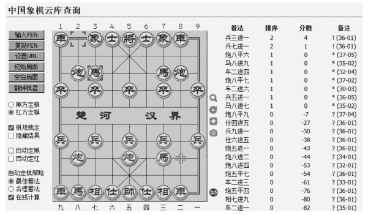
图 1 先手中炮对后手屏风马打分

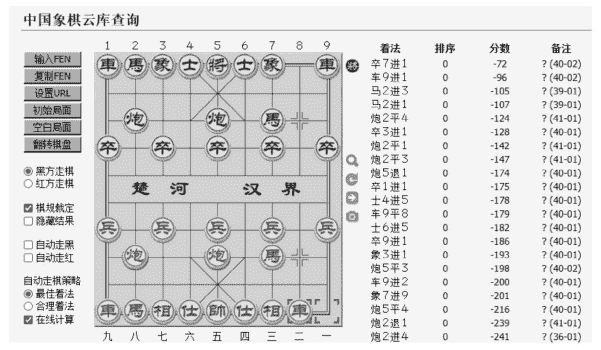
图 2 先手中炮对后手顺炮打分

屏风马基本 0 分，电脑认为足可抗衡先手红炮，弹性十足。
顺炮则落后 70～100 分，先天亏一到两先，电脑认为略亏可下，弹性一般。

由此再次证明：面对先手红炮，后手顺炮略亏可下，先天落后 1.5 先～2 先。若无失误，先手优势，后手只能顶和。

既然顺炮吃亏，还需研究吗？答案是肯定的，顺炮是学棋者绕不开的开局。

初学者必须学，顺炮是攻杀入门的最佳开局之一，飞相、挺兵等散手对新手不友好。大多数业余棋手不背谱，顺炮杀性强、观赏性高。

后手顺炮先天落后 70～100 分，在初学者犯错的实战中基本可以忽略。即使强机对弈，双方都走最优，先手红炮也非必胜，后手只能和。

借用钱学森的话：手上没剑，和有剑不用，是两回事。研究顺炮，不一定实战用得上，做到有剑不用心里踏实；不研究就不懂先手红炮如何取优，那就是手上无剑的尴尬。

## 第二章 红方是否该抢中卒

本节解决一个基础却关键的问题：
面对后手顺炮，先手红炮是否能打中卒？
答案是可以，但属于无事生非，不推荐也不必要。

1.炮二平五　　炮 8 平 5
若黑方同样走中炮，即顺炮。此时红方正常走马二进三，再车一平二，电脑打分优势约 100 分。

2.炮五进四　　士 4 进 5
士 6 进 5 也可，但人机最优推荐士 4 进 5，为后续马 2 进 3、象 3 进 5、车 1 平 4 做好布局。不可炮 5 进 4，否则红方炮五退二，进而跳马赶走黑中炮，再摆中炮起横车，红方速胜。

3.炮八平五　　马 8 进 7

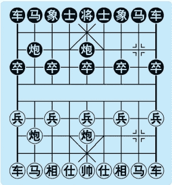
图 3

红方因“炮轻发”犯了开局大忌，原本 100 分的优势消失，盘面打分回 0。

4.前炮退一
若红方前炮退二，则车 9 平 8，马二进一，黑马 2 进 3，马八进七马 3 进 5，车九平八炮 2 平 3，黑方中马灵活，轻松抗衡。

4.……　　　　车 9 平 8
黑方抢先亮车，抗衡之势形成。很多棋书到此为止，下面补充抗衡思路。

5.马二进三　　炮 2 进 5
此着可解红方中路攻势，简洁有力。

6.马八进七　　炮 2 平 5
红方若退炮兑炮，则黑方车 8 进 6 占优。

7.相三进五　　车 8 进 7　　　　8.车一平三　　马 2 进 3
9.车九平八　　马 3 进 5

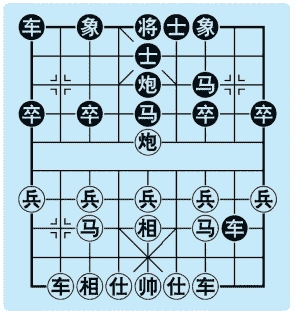
图 4

此后红方若：
①炮五进二兑中炮，黑象 3 进 5 再车 1 平 4；
②兵五进一，黑马 5 进 3 再马 3 进 4 或马 3 进 5；
③车八进五，黑卒 3 进 1，兵五进一马 5 进 7 再马 7 进 5 或马 7 进 6。
黑方皆不败，红方无便宜。

综上，第二步不推荐炮五进四打中卒，正常马二进三、车一平二即可取得近 100 分优势，如图 5。

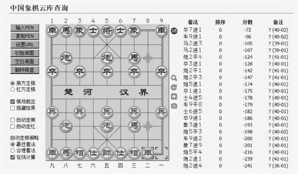
图 5

## 第三章 先手最优的直车体系

本书站在先手红炮立场，用人机拆棋筛选最优解。面对后手顺炮，红方大致分四种体系，电脑打分来自“中国象棋云库”。

第一，顺炮直车对横车，图 6

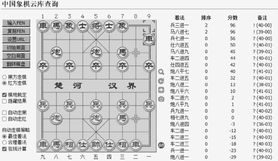
图 6

第二，顺炮直车对缓开车，图 7

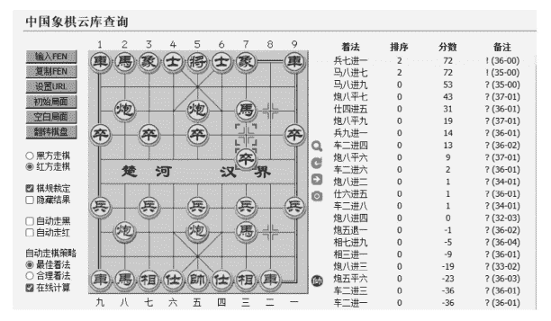
图 7

第三，顺炮横车对直车，图 8

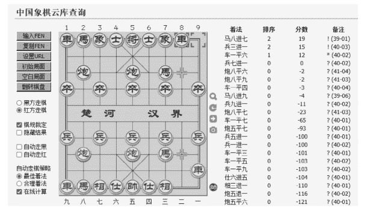
图 8

第四，顺炮先手缓开车对直车，图 9

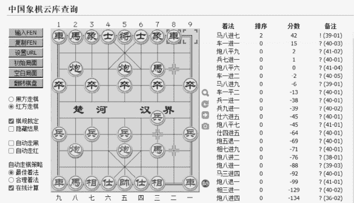
图 9

从图 6 至图 9 可见，先手红炮直车对横车、直车对缓开车，红方可确保 70～100 分，约 1.5 先到 2 先的优势；而横车对直车、缓开车对直车，优势不足 50 分。

所以从先手红炮角度看，面对后手顺炮，最优解是直车。本书重点介绍顺炮直车对横车、顺炮直车对缓开车两大变化。

# 第二部分 顺炮沿革史

## 第一章 古谱里的弃马十三招与巡河十八打

以下两例均出自明代古谱《橘中秘》。

弃马十三招

1.炮二平五　　炮 8 平 5　　　　2.马二进三　　马 8 进 7
3.车一进一　　车 9 平 8　　　　4.车一平六　　车 8 进 6
现代观点可改走车 8 进 4，攻守兼备。

5.车六进七　　马 2 进 1　　　　6.车九进一
开局弃马，精妙。

6.……　　　　炮 2 进 7　　　　7.炮八进五　　马 7 退 8
8.炮五进四　　士 6 进 5　　　　9.车九平六　　将 5 平 6
10.前车进一　　士 5 退 4
11.车六平四　　炮 5 平 6
12.车四进六　　将 6 平 5
13.炮八平五

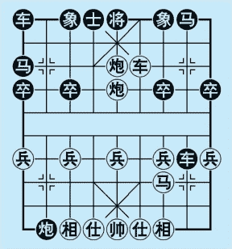
图 10

弃马后中炮镇中，双车卡肋，再弃车破士，重炮成杀。十三步小巧精悍，在顺炮史上留下浓墨重彩的一笔。

巡河十八打

1.炮二平五　　炮 8 平 5　　　　2.马二进三　　马 8 进 7
3.车一平二　　车 9 进 1　　　　4.车二进六
现代可改马八进七或兵三进一缓攻。

4.……　　　　车 9 平 4　　　　5.车二平三　　车 4 进 7
可改马 2 进 3，以后炮 5 退 1 变屏风马，黑方可抗。

6.马八进七　　车 4 平 3　　　　7.炮八进二
构思独特，黑方不敢吃马否则炮八平七。

7.……　　　　马 2 进 1　　　　8.马三退五　　炮 2 平 3
9.炮八平三　　马 7 退 9　　　　10.炮五平二
暗藏炮二退一打死车，同时双炮归边已入局。

10.……　　　　车 3 平 4　　　　11.炮二进六　　士 6 进 5
12.炮三进五　　将 5 平 6　　　　13.车三进二

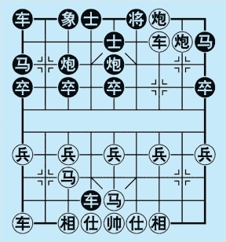
图 11

下一步炮二进一绝杀。直车配合巡河炮，攻杀犀利，精彩不输弃马十三招。

两局可见三百多年前顺炮已有雏形。用现代眼光看古谱有不成立之处，但其杀法构思仍值得品味。学习古谱需取其精华去其糟粕，敢于质疑并结合电脑工具，才能更好地提升。

## 第二章 杨官璘遇顺炮的实战碰壁

来看 1958 年全国象棋个人赛的两盘顺炮实战。当时已两连冠的杨官璘，拿先手难逢对手，竟在后手顺炮面前吃了苦头。

第一盘棋
1958 年全国个人赛杨官璘先负刘忆慈
1958 年 11 月 24 日于广州

1.炮二平五　　炮 8 平 5　　　　2.马二进三　　马 8 进 7
3.车一平二　　车 9 进 1　　　　4.车二进六　　卒 3 进 1
5.炮八平七　　马 2 进 3　　　　6.兵七进一　　马 3 进 4
7.兵七进一　　马 4 进 5　　　　8.车二平三　　车 9 平 4
9.仕四进五　　马 5 退 6　　　　10.马八进九　　车 4 进 5
11.车九平八　　炮 2 进 4　　　　12.炮七平六　　炮 2 平 7
13.车八进四　　车 4 平 6　　　　14.炮五进五　　象 3 进 5
15.相三进一　　车 1 平 3　　　　16.炮六平四　　象 5 进 7
17.车三退一　　车 3 进 4　　　　18.相七进五　　车 3 平 5
19.马九退七　　车 6 平 3　　　　20.车八平七　　车 3 退 1
21.相五进七　　车 5 进 1　　　　22.相七退五　　象 7 进 5
23.车三退一　　车 5 平 7　　　　24.相五进三　　马 6 进 5
25.炮四进一　　马 7 进 6　　　　26.马七进五　　炮 7 平 8
27.马三进四　　马 6 进 4　　　　28.炮四平三　　卒 1 进 1

顺炮连环杀：从杨官璘连败看布局演变

29.马四进三　　马 4 退 6　　　　30.炮三平四　　士 4 进 5

31.马五退三　　炮 8 平 7　　　　32.前马进二　　马 5 退 3

33.炮四退一　　马 6 进 8　　　　34.相三退五　　马 3 退 5

35.相一进三　　马 8 进 7　　　　36.马三进一　　马 5 进 4

37.炮四退一　　炮 7 平 1　　　　38.马二退一　　炮 1 进 3

39.相五退七　　马 7 进 5　　　　40.相三退五　　马 5 退 3

41.后马进三　　马 3 进 4　　　　42.炮四平六　　后马进 2

43.帅五进一　　马 2 进 3　　　　44.马一进三　　卒 5 进 1

45.前马退四　　马 3 退 1　　　　46.马四退五　　炮 1 平 2

47.兵一进一　　炮 2 退 3　　　　48.帅五退一　　炮 2 进 3

49.帅五进一　　卒 1 进 1　　　　50.炮六平七　　马 4 退 3

51.马五退七　　马 1 退 3　　　　52.帅五退一　　炮 2 退 5

53.炮七平五　　马 3 进 5　　　　54.帅五进一　　卒 1 平 2

55.帅五平四　　卒 2 进 1　　　　56.相五退七　　卒 2 平 3

57.马三退五　　卒 3 平 4　　　　58.马五进四　　卒 5 进 1

59.马四进三　　象 5 进 7　　　　60.马三退五　　炮 2 平 3

61.兵一进一　　卒 5 进 1

62.兵一平二　　将 5 平 4

63.相七进九　　炮 3 平 4

64.相九进七　　象 7 退 9

65.兵二进一　　炮 4 进 1

66.兵二平三　　炮 4 平 5

67.兵三平四　　卒 5 平 6

68.兵四平五　　卒 4 进 1

69.马五进三　　卒 4 进 1

如图 12，黑胜。

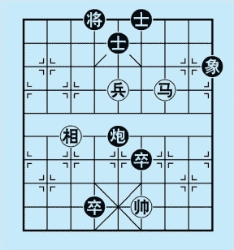

图 12

第二盘棋

1958 年全国个人赛杨官璘先负张东禄

（1958 年 11 月 26 日于广州）

1.炮二平五　　炮 8 平 5　　　　2.马二进三　　车 9 进 1

3.车一平二　　马 8 进 7　　　　4.车二进六　　卒 3 进 1

5.炮八平七　　马 2 进 3　　　　6.兵七进一　　马 3 进 4

7.兵七进一　　马 4 进 6　　　　8.兵三进一　　车 9 平 6

9.仕六进五　　车 1 平 2　　　　10.马八进九　　马 6 进 7

11.炮七平三　　车 6 进 3　　　　12.车九平八　　车 6 平 3

13.炮五平六　　炮 5 进 4　　　　14.相七进五　　炮 2 进 5

15.车二平三　　炮 5 平 7　　　　16.车三平四　　车 2 进 4

17.炮三平四　　象 3 进 5　　　　18.兵九进一　　车 2 进 2

19.炮六进二　　炮 7 平 5　　　　20.车四退三　　炮 2 进 1

21.兵三进一　　卒 5 进 1　　　　22.炮六平三　　马 7 进 5

23.兵三平四　　卒 5 进 1　　　　24.兵四进一　　炮 2 平 4

25.车八平六　　炮 4 退 2　　　　26.车四平五　　卒 5 进 1

27.兵四平五　　卒 5 平 6　　　　28.炮四平一　　炮 4 平 5

29.车六进四　　车 3 进 5

30.车六退四　　车 3 平 4

31.帅五平六　　车 2 平 4

32.帅六平五　　士 4 进 5

33.马九退八　　卒 6 进 1

34.炮一退一　　将 5 平 4

35.马八进六　　炮 5 退 1

36.炮三退三　　车 4 平 1

如图 13，红方认负。以下如接走马六进八，则车 1 进 1，马八退七车 1 进 2，黑胜。

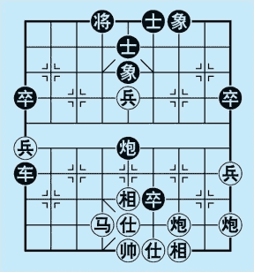

图 13

两局实战的进程几乎如出一辙。杨官璘红先对阵顺炮体系，第四着都把车二抢到六路渡河，黑方都回以卒三进一阻截，继而右翼马群连续出动，局面瞬间转为激烈缠斗。

这两次失利直接终结了当选棋坛领军人物杨官璘三连冠的梦想。1958年个人赛最后由李义庭、 何顺安分夺前二，杨官璘只能屈居第三。对顶级高手来说先手求和本不算难题，杨官璘却被连下两城，可见此种反击的威力。连以稳健著称的杨官璘都招架不住，也说明马群冲击的暴力与局面的不可控，先手直车急进的思路承受了严峻挑战。

从此，黑方后手顺炮以卒封路、马脚跳跃对先手过河车的反击套路正式在顺炮理论里站稳脚跟。即使处在巅峰的魔叔，也被连扳两次，问题的分量由此显现。

拆解关键节点：

1.炮二平五　　炮 8 平 5　　　　2.马二进三　　车 9 进 1

3.车一平二　　马 8 进 7　　　　4.车二进六

以今天的眼光看，这一着太急躁，眼下已很少有人选用，改走马八进七或兵三进一慢推更稳妥。

4.……　　　　卒 3 进 1　　　　5.炮八平七

这是红方最硬的回应。另走别的招，黑方照样会走马二进三再马三进四，红方依旧难以控制。

5.……　　　　马 2 进 3

6.兵七进一　　马 3 进 4

7.兵七进一

如图 14，棋局演化成顺炮马群冲击的典型形态。黑方下一步可选马四进五或马四进六，相较之下马四进五更直接、更具杀机。

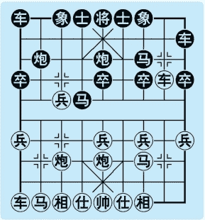

图 14

7.……　　　　马 4 进 5　　　　8.车二平三　　马 5 退 3

别走马五退六也行，随后炮二退一或车九平四继续展开攻势。

9.车九进一　　车 9 平 4

此后黑方可用马三退五再调线，或把车送入兵林反击，局面相当舒服。

1958年个人赛杨官璘两次被马群冲击击败后，棋坛对车二进六的急攻热情明显降温。

定式大多源自实战提炼，弄清顺炮演变脉络才能看得更远。

第三章　先手仕四进五遭遇王嘉良创新“王氏将门车”

象棋斗炮讲究节奏与精准。无论红先黑后，车二进六过河都能实现快准狠的效果。面对马群冲击的猛烈回击，红方也尝试更从容的渡河顺序。

1.炮二平五　　炮 8 平 5　　　　2.马二进三　　马 8 进 7

3.车一平二　　车 9 进 1　　　　4.仕四进五

如图 15，若直接车二进六，黑方卒三进一立刻形成激烈对杀。红方先补士，意在削弱右马连跳的压力。

4.……　　　　车 9 平 4

若黑方此时推卒三进一，红方可车二进五抢先占位。

5.车二进六　　马 2 进 3

6.车二平三　　炮 5 退 1

7.马八进九　　车 4 进 3

8.兵三进一　　炮 5 平 7

9.车三平四

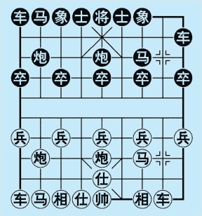

图 15

红方仍握主动。

按现代理解，黑方第七步可把车四进三改为卒三进一，随后伺机车一进二、车四进四、炮五平七反击，变化更富弹性。

这是五零年代流行的思路。先补士、再调边马，阵形完整后再过河抢攻，能实现稳中带先。

问题在于黑方对此感到不适，过早补士本身就违背开局效率原则。被称作东北虎的特级大师王嘉良对车九平四做了优化：

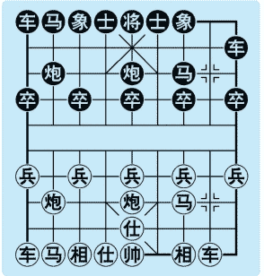

图 16

把车九平四改成车九平六，车随士走，横车封住将门，直击红方急于补士的弱点，针对性极强。1957年全国赛上，王嘉良以此后手顺炮击败小神童李义庭，这一发明被称作王氏将门车。

实战变例：

1.炮二平五　　炮 8 平 5　　　　2.马二进三　　马 8 进 7

3.车一平二　　车 9 进 1　　　　4.仕四进五　　车 9 平 6

如图 17 形成王氏将门车。

5.车二进六　　马 2 进 3　　　　6.兵七进一　　车 6 进 3

7.炮八平七　　卒 3 进 1

8.车二平三　　马 3 进 2

9.车三退二　　士 4 进 5

黑方子力灵活，最终取胜。即便按电脑评估单步并非全优，将门车对中炮帅门的牵制始终存在，让先手中炮难以放肆。

穷则思变。在马群冲击与将门车的双重压力下，红方先试车二进六、仕四进五，随后孟氏双正马登场，奠定了现代斗炮局的框架：斗炮时双方都力求双马成正马，一守中路一外围施压。

第四章　先手马八进九遭遇孟立国创新“孟氏双正马”

先梳理顺炮直车对横车的思路：

1.炮二平五　　炮 8 平 5　　　　2.马二进三　　马 8 进 7

3.车一平二　　车 9 进 1

如图 18，从古至今红方惯用车二进六抢攻，却遭马群反击。仕四进五后再过河一度有效，却被将门车克制。

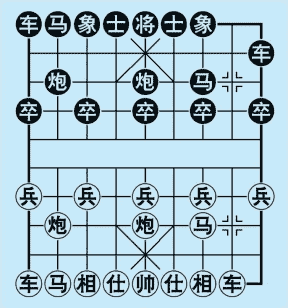

图 18

归纳来看，车不宜频繁移动，否则失先；士补得过早，也会拖慢节奏。于是红方改走跳边马：

1.炮二平五　　炮 8 平 5　　　　2.马二进三　　马 8 进 7

3.车一平二　　车 9 进 1　　　　4.马八进九

如图 19，红方不动车也不补士，先出大子调协，子力完整合理。至今仍有棋手因稳健选择此着，马八进九在现代也算正招。杨官璘对付顺炮就多用此法，黑方常回卒一进一或车九平四，均在弈林新编中有论述，红方都能保持主动。

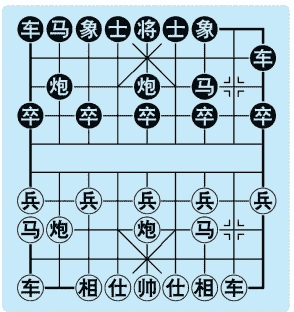

图 19

局面暂时趋于平衡。偏爱后手顺炮的棋手自然不会善罢甘休。

1962年全国个人赛，徐和良对孟立国，顺炮直车对横车：

1.炮二平五　　炮 8 平 5

2.马二进三　　马 8 进 7

3.车一平二　　车 9 进 1

4.马八进九　　马 2 进 3

如图 20，红方第四步走马八进九避开过河车与补士，黑方第四步原谱多为卒一进一或车九平四。马二进三并不惧炮八平七的牵制。

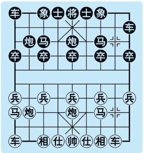

图 20

孟立国，象棋特级大师，棋风勇猛，善后手顺炮列炮，爱弃子破象，人称杀象能手。

马二进三是以孟立国为代表的东北棋手的贡献，使顺炮布局焕发活力，被誉为孟氏双正马。即斗炮局追求双马皆正，攻守兼备。

继续实战：

5.炮八平七　　车 1 平 2　　　　6.兵七进一　　车 9 平 4

红方以七路炮牵制，黑方不为所动。

7.兵七进一　　卒 5 进 1　　　　8.兵七平六　　车 4 进 3

红方平兵谋马略显贪心，兵七进一更好。黑方果断弃马反先。

9.炮七进五　　马 7 进 5　　　　10.炮七进一　　炮 2 进 5

红方得子失势，黑方占优最终取胜。

孟氏双正马让后手顺炮的抗衡力大幅提升。红方随即反思：若后手能双正马，先手能否也双正马？

第五章　胡荣华先手“胡氏双正马”开创顺炮新时代

1966年全国个人赛，21岁的四届冠军胡荣华对29岁的李义庭。

1.炮二平五　　炮 8 平 5　　　　2.马二进三　　车 9 进 1

2.车一平二　　马 8 进 7　　　　4.马八进七　　车 9 平 4

5.兵三进一

如图 21，红方跳双正马由胡荣华在1966年首创并两战两胜。新颖的套路极大丰富了顺炮战术，是顺炮史上的里程碑，被誉为胡氏双正马。

过去红方只跳一正一偏，既削弱黑方威胁，也削弱自身中路。现在双正马难道不怕车四进五的反击？

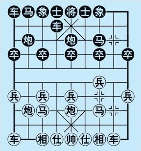

图 21

5.……　　　　马 2 进 3

双正马阵势符合棋理。若车四进四，炮五平四车四平七，车二进二，红方退炮打车优势。若车四进五，炮五平四，红方亦优，具体布局变例后面详述。

6.兵七进一　　车 4 进 5

首次出现时黑方未走出正变，当时可车一进一形成双横车。

7.相七进九　　车 1 进 1　　　　8.马三进四　　车 4 平 3

9.车九平七　　卒 3 进 1　　　　10.车二进五　　象 3 进 1

1 1.炮八进四　　卒 3 进 1　　　　12.车二平七　　马 3 进 2

13.前车进二

如图 22，红车以车一平二、车二进五、车二平七、车七进二的S走位捉炮，颇为精妙。

13.……　　　　炮 2 退 2

14.马四进六　　卒 3 平 4

15.前车平八　　炮 2 进 3

16.车八退一　　车 3 退 2

正着应是车一平三对捉，否则黑方尚能为战。

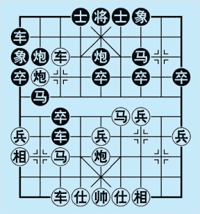

图 22

17.马七进八　　卒 4 平 3

1 8.马六进五　　象 7 进 5

19.相九进七

如图 23，红方运转流畅，控盘得力，兵种与空间均占优。

19.……　　　　车 1 平 6

20.仕六进五　　车 6 进 3

21.炮五平九　　车 3 平 4

22.相七退五　　车 4 进 1

23.车七进七　　车 4 平 2

24.车七平五　　马 7 退 5

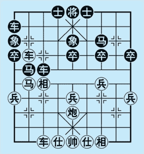

图 23

25.炮九进四　　象 1 退 3　　　　26.车五退一　　车 2 进 4

27.仕五退六　　车 2 平 4　　　　28.帅五平六　　车 6 进 5

29.帅六进一　　车 6 退 1　　　　30.帅六退一　　马 2 进 4

31.车八平六　　马 4 进 3　　　　32.帅六平五　　车 6 平 2

33.车六退四

如图 24，红车捉马兼有炮打七卒叫杀，黑方无力，投子认负。

胡氏双正马此后成为顺炮体系的主干，以此发展出顺炮两头蛇对双横车、顺炮缓开车等名局。

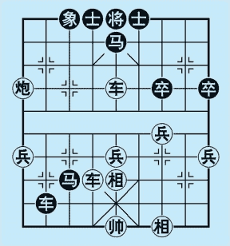

图 24

第六章　后手顺炮缓开车兴起，抵抗先手“胡氏双正马”

顺炮演进与AI拆解总览

按走法先后把顺炮的发展脉络摊开来看：

1.炮二平五　　炮 8 平 5　　　　2.马二进三　　马 8 进 7

3.车一平二　　车 9 进 1

至此红方直车与黑方横车形成顺炮的基本对峙。围绕这一架势，红方曾做过几次探索：

①车二进六过河，被后手中炮的“天马行空”招法应对，如今已很少见到。

②仕四进五补右仕，被王嘉良创的“王士将门车”针对，如今也已式微。

③马八进九跳边马，遇上孟立国创制的“孟氏双正马”，现在已属一类正变。

④马八进七跳双正马，是胡荣华提出的“胡氏双正马”，引领顺炮进入新阶段，成为现代顺炮的主干。

4.兵三进一　　车 9 平 4

5.马八进七

图即为“胡氏双正马”的定型，兵三进一与马八进七的次序可视实战调换。

上世纪七十到九十年代，棋坛主流是在“胡氏双正马”上继续展开，最具代表性的即“顺炮两头蛇对双横车”，见图 26。

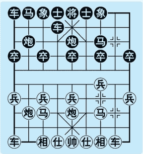

图 25

在东北棋手的推动下，为牵制先手“胡氏双正马”的攻势，黑方第三步不走车9进1拉横车，改走卒7进1挺七卒的缓开车体系流行起来，见图 27。

进入二十一世纪，先手中炮有时为出奇，主动避开后手抢挺七卒的缓开车，先手缓开车偶尔出现，也给布局增添了分支，见图 28。

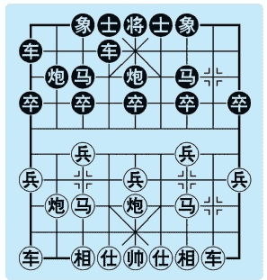

图 26

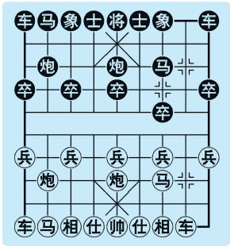

图 27

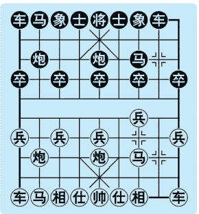

图 28

## 第七章　人工智能拆棋时代对顺炮布局的暴力拆解

到 2022 年 5 月为止，人与电脑的正式对弈仅有 2006 年一次“人机大战”。上半场由柳大华、徐天红、汪洋、卜凤波、张强组成的联队以 2 胜 5 和 3 负、总分 9 比 11 负于“浪潮天梭”。下半场许银川出战两盘弈和，比分 2∶2 持平。

因此棋界普遍把 2006 年视作手工拆解与智能拆解的分界线，此后人类在电脑面前难占优势。之后进入智能拆棋阶段，专业与业余棋迷都能随时借助象棋软件向机器学棋拆棋练棋。

顺炮正是在智能拆棋时代被彻底拆解、变化近乎穷举的典型布局。在电脑精确计分下，只要先手中炮形成“先手直车”结构且双方不出错，先手即可占据主动，后手只能被动应付。

顺炮大致可归为四大体系：

（中国象棋云库打分参考）

第一个体系：顺炮直车对横车，图 29

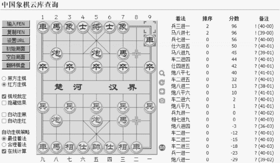

图 29

第二个体系：顺炮直车对缓开车，图 30

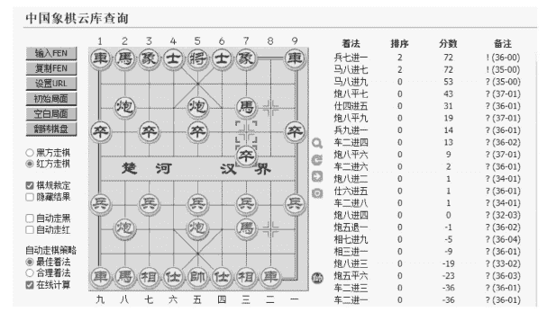

图 30

第三个体系：顺炮横车对直车，图 31

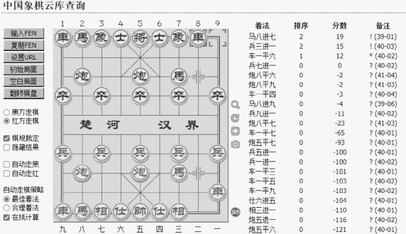

图 31

第四个体系：顺炮先手缓开车对直车，图 32

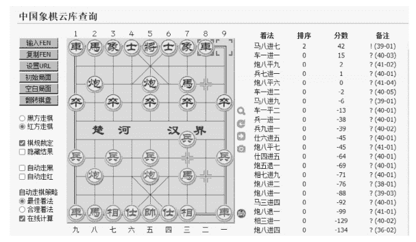

图 32

由图 29～图 32 可见，先手中炮只要走出直车对后手顺炮，便能确保 70～100 分即 1.5 先到 2 先的优势，且先手必然能实现车一平二率先出直车。

因此本书从先手视角仅讲“顺炮直车对横车”“顺炮直车对缓开车”两大体系。另两套后手视角的体系另文再述。

# 第三部分　先手中炮最优推荐

## 第一章　顺炮直车对横车

### 第 1 局　直车对不标准的双横车（1）

红方思路：补仕拆中炮，配合巡河炮，稳守主动。

1.炮二平五　　炮 8 平 5　　　　2.马二进三　　马 8 进 7

3.车一平二　　车 9 进 1　　　　4.兵三进一　　车 9 平 6

官子正着是车 9 平 4，使四路黑车更灵活。车 9 平 6 使六路车以后落点受限，属于布局疑问。

5.马八进七　　马 2 进 3

黑方处境困难，阵型出现破绽，被迫双正马增强中路。若①卒 3 进 1，车二进五；②马 2 进 1 后车二进六，均属红占优。

6.兵七进一　　车 1 进 1

至此形成红直车两头蛇对黑非标双横车。黑方形体有弱点，记住“补仕拆中炮，配巡河炮”的要诀即可领先。

7.仕六进五

如图为机器拆出的最优解，为随后拆炮飞相出车保持主动作准备。

用人类视角理解：黑方唯一有效反击是双车攻击红双马。明白这一点后，红方拆炮飞相稳固阵型消除弱点，黑方便无有效反击。随着进程，黑方两匹笨马的弱点会逐渐暴露，红方可达先手稳优。

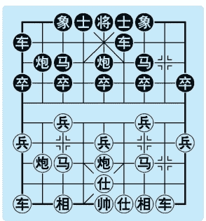

图 33

本局在红方补仕后，黑方共计七种应对：卒 5 进 1；车 1 平 3；车 6 进 3；车 6 进 5；车 6 进 7；车 6 平 4；车 6 平 8。

（1）卒 5 进 1

7.……　　　　卒 5 进 1　　　　8.马七进六　　车 1 平 4

9.炮五进三　　马 7 进 5　　　　10.马六进五

忌炮打炮，会丢先手。

10.……　　　　马 3 进 5　　　　11.炮五进二　　车 6 进 1

12.炮八平五

红棋掌握中炮攻势，占先。

（2）车 1 平 3

7.……　　　　车 1 平 3　　　　8.马七进六

此后黑若：

①车 6 平 4，马六进四再炮八平七，红占优。

②车 3 平 4，炮八进二车 4 进 3，炮五平六车 4 平 2，炮八进三炮 5 平 2，相七进五，以下车九平七或车二进六占优。

③卒 3 进 1，兵七进一马 3 退 5，车二进五卒 7 进 1，车二平三象 7 进 9，车三平六，红占优。

（3）车 6 进 3

7.……　　　　车 6 进 3　　　　8.马七进六　　车 6 平 4

9.炮八进二

牢记口诀“补仕拆中炮，配合巡河炮”，黑方任何应法均属红优。

9.……　　　　卒 7 进 1　　　　10.炮五平六　　车 4 平 2

11.炮八进三　　炮 5 平 2　　　　12.兵三进一　　车 2 平 7

13.相七进五

红棋形态无懈，黑方无杀机。红方以后有车九平八、马六进七、车二进四等进攻手段，先手占优。

（4）车 6 进 5

7.……　　　　车 6 进 5　　　　 8.马七进六

此时黑六路车的尴尬尽显，无好着。若：

①车 6 平 7，马六进四踩双，黑丢子；

②车 6 进 2，炮八平六，红占优；

③车 6 退 5，炮八平六，红占优。

（5）车 6 进 7

7.……　　　　车 6 进 7　　　　8.炮五平四

暗藏炮八退一兑车。

8.……　　　　车 1 平 4

若黑走车 6 平 7，车二进二车 7 进 1，相七进五车 7 平 9，车二进四，红占优。

9.相七进五

黑两车都无路，车 4 进 3 或车 4 进 5，红均可马三进四踩车。

9.……　　　　车 4 进 7　　　　10.车九平六　　车 4 平 3

11.车二进六

黑双马难参战，红子力灵活，控盘占优。

（6）车 6 平 4

7.……　　　　车 6 平 4　　　　8.马三进四　　车 4 进 7

若车 4 平 6，马四进六车 1 平 3，马六进五炮 2 平 5，车二进六，后续吃卒压马、炮五平三拆炮等，红稳占优势。

9.炮五平三　　车 1 平 6　　　　10.炮三退一　　车 4 退 7

11.马四进三　　车 6 进 2　　　　12.相七进五

红棋阵容协调无弱点，黑方僵化无反击，红方多兵占优。

（7）车 6 平 8

7.……　　　　车 6 平 8　　　　8.车二进八　　车 1 平 8

9.马七进六　　车 8 进 3　　　　10.马六进七　　卒 7 进 1

11.兵三进一　　车 8 平 7　　　　12.炮五平七

好着，及时拆炮化解黑方反扑，后补相出车，思路清晰。

12.……　　　　炮 5 平 6　　　　13.相七进五

红棋形体舒展富有弹性，后车九平六出车，先手多兵优势稳固。

### 第 2 局　直车对不标准的双横车（2）

红方思路：补仕拆中炮，配巡河炮，稳优。

1.炮二平五　　炮 8 平 5　　　　2.马二进三　　马 8 进 7

3.车一平二　　车 9 进 1

4.兵三进一　　车 9 平 6

5.马八进七　　马 2 进 3

6.兵七进一　　车 1 进 1

7.仕六进五

如图 34，上一局已述七种应对均属红优。本局介绍黑方最后一法车 1 平 4，只要牢记“补士拆中炮，配合巡河炮”，红方即可取得先手优势。

7.……　　　　车 1 平 4

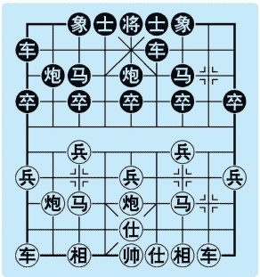

图 34

8.炮八进二

巡河炮是妙着，为后续拆炮、跳河口马作准备。黑方两个非标双横车只能被动应对。此后黑有卒 3 进 1；车 4 进 7；车 4 进 5；车 4 进 3；车 6 进 7；车 6 进 5；车 6 进 3；车 6 平 8 共八种走法。

（1）卒 3 进 1

8.……　　　　卒 3 进 1　　　　 9.兵七进一　　车 6 进 3

10.兵七进一　　马 3 退 5

若车 6 平 3，兵七进一车 3 退 2，车九进二车 4 平 3，仕五进六，红方主动。

11.炮五平四　　车 6 平 3　　　　12.相七进五　　车 3 退 1

13.炮八退三

红方有马七进八的手段，占优。

（2）车 4 进 7

8.……　　　　车 4 进 7　　　　9.相七进九

无论黑如何走，红方车九平六兑车稳优。

（3）车 4 进 5

8.……　　　　车 4 进 5　　　　9.马三进四　　车 4 平 3

10.炮五平四　　车 6 平 4　　　　11.相七进五

红棋阵型协调，子力流畅。续走车二进五、车二进六、车九平七均稳优。

11.……　　　　卒 3 进 1　　　　12.车九平七

暗藏炮四进一击杀，红稳优。

（4）车 4 进 3

8.……　　　　车 4 进 3　　　　9.马三进四　　车 4 平 2

10.炮五平四　　车 6 平 4　　　　11.炮八进三　　炮 5 平 2

12.相七进五

红方双马灵活，优势明显。

12.……　　　　卒 3 进 1　　　　13.兵七进一　　车 2 平 3

14.车二进六　　卒 7 进 1　　　　15.兵三进一　　车 3 平 7

16.车九平八　　马 4 进 3　　　　32.帅六平五　　车 6 平 2

33.车六退四

# 变化解析

黑方若马 3 进 2，马四进五马 7 进 5，车二平五，红方多中兵占优。

## 17. 车八进四

随后强行马七进六跳马，双马谋中卒，有望多得中兵。

### （5）车 6 进 7

8.…… 车 6 进 7 9.马七进六 卒 3 进 1

10.炮五平六 炮 5 平 4 11.马六进四

黑有失子风险，红占优。

### （6）车 6 进 5

8.…… 车 6 进 5 9.马七进六 车 6 平 7

10.车二进二 卒 7 进 1

黑方若：

①车 7 退 1，炮五平六车 4 平 6，相七进五车 7 退 1，车九平七，马六进七可成，红方七路有攻势。

②车 4 平 6，炮五平七炮 5 进 4，马三进五车 7 平 5，马六进七，红方主动。

11.炮五平六 车 4 平 6 12.相七进五 炮 5 进 4

13.马三进五 车 7 平 5 14.兵三进一

红方三兵过河，优势明显。

### （7）车 6 进 3

8.…… 车 6 进 3 9.马七进六 车 6 平 2

10.炮五平六 车 4 平 6 11.炮八进三 炮 5 平 2

12.相七进五

红方子力灵活，明显占优。

### （8）车 6 平 8

8.…… 车 6 平 8 9.车二进八 车 4 平 8

10.马七进六 车 8 进 3 11.马六进七 卒 7 进 1

12.炮五平七 炮 5 平 6 13.相七进五

红方子力灵活，多兵占优。

### 第 3 局 实战参考 2003 年象甲联赛许银川先负孙勇征

1.炮二平五 炮 8 平 5 2.马二进三 马 8 进 7

3.车一平二 车 9 进 1 4.马八进七 马 2 进 3

5.兵七进一 车 9 平 6 6.兵三进一 车 1 进 1

黑方形成非标双横车，官招双横车应为 1 路车与 4 路车，非标 6 路车随局势易无落点。

8.仕六进五 车 1 平 4 8.炮八进二

如图 35，本局取自 2003 年象甲联赛，红方许银川对黑方孙勇征。在无软件辅助年代，2003 年的许银川已走出现代软件最优解。仕六进五、炮八进二后红方已稳优。

8.…… 卒 3 进 1

9.兵七进一 车 6 进 3

10.兵七进一 马 3 退 5

11.炮五平四 车 4 进 7

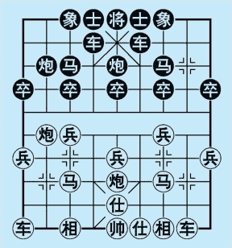

图 35

黑方在被动下风中积极搏杀，勇气可嘉。若车 6 平 3，相七进五车 3 退 1，炮八退三车 4 进 7，另如炮 2 进 4，炮八平七炮 2 平 3，马七退九炮 3 平 4，车九平七车 4 平 2，马三进四炮 4 退 4，马九进七车 3 平 4，车二进六，红方稳优。

12.相三进五 车 6 平 3 13.炮四退一 车 4 退 2

14.马三进四 车 4 平 3 15.炮四进一 炮 5 进 4

红方先手掌控全局，过河兵占优。黑方无奈炮击中卒继续下风搏杀。

16.炮八退三 卒 5 进 1 17.炮八平七 前车进 1

18.炮七进四 车 3 退 3 19.兵七平八

以上一段黑方被迫一车换双，红方得多车优势。第 19 回合兵七平八失误，正着应为马四退六车 3 平 4，马六进八车 4 平 2，如车 4 平 3，相七进九，马八退七再车二进三，红方两车斗黑一车占优。

19.…… 炮 2 平 4

20.相七进九 卒 5 进 1

21.车九平六 炮 4 进 3

22.马四退三 车 3 平 6

23.车二进三 马 7 进 5

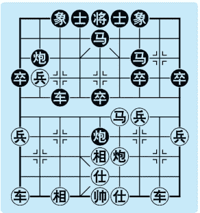

图 36

黑方抓住第 19 回合失误，中炮镇中、盘马反击，天平悄然倾斜。马 7 进 5 为正着，不可车 6 进 3 贪炮，车二平五车 6 平 7，车五进一炮 4 平 2，车六进八，红方出帅绝杀。

24.炮四退一

又是许银川的诱招。

24.…… 前马进 3

非常冷静，不可车 6 进 4，马三进五卒 5 进 1，车二平五车 6 退 5，车五进二，红方占优。

25.马三进五 炮 4 进 1 26.马五退三 车 6 进 4

黑方攻势如潮，好在红方防守功力了得，暂时顶住。

27.相九进七 卒 5 平 4 28.马三进二

应车二平五不让黑方跳出窝心马。

28.…… 马 5 进 4 29.兵八平七 马 4 进 3

30.兵三进一 前马退 1 31.车六平七 马 1 进 2

32.车七进三 车 6 退 3 33.马二进三 车 6 平 5

34.相五退七 车 5 退 2 35.兵七进一 士 4 进 5

36.车二平三 卒 4 平 5 37.车三平六 马 3 进 4

38.车七平六 马 2 进 3 39.车六退二 马 3 退 2

40.车六进二 马 2 进 3 41.车六退二 马 3 退 2

至此黑方残棋控盘，红方被动但仍有和棋机会。

42.兵七进一 象 3 进 5

43.兵七平六 卒 5 平 4

44.马三进四 车 5 平 3

45.车六平八

如图 37，车六平八是最后败招，红方可能因时间紧张出错，顽强走法应飞边相，仍可坚守。

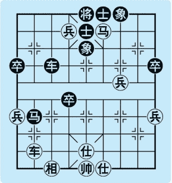

图 37

45.…… 车 3 进 6

46.仕五退六 马 2 进 4

47.车八平六 卒 4 进 1

红车被黑车马卒锁死，败局已定。

48.马四退二

输棋形势下的隐蔽偷杀，黑方不能车 3 退 1 捉车，否则红方卧槽马有偷杀手段。

48.…… 士 5 进 6

49.兵三平四 士 6 进 5

如图 38 走到这里，红方认输。若续走：

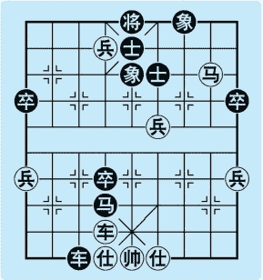

图 38

①仕四进五车 3 退 1，车六进一卒 4 进 1，仕五进六车 3 平 8，黑方必胜。

②帅五进一 车3退4，车六平九 车3平5，帅五平六 马4退2，车九进一 卒4进1，车九平六 马2进4，帅六进一 车5平4，黑子赢定。

开局阶段红子占据主动，中后段处理拖缓后，黑子以车马的细腻控盘完成反超，落子冷静，是一盘颇具观赏性的对局。

### 第 4 局 直车对强变的车 9 平 3
红子思路：补仕、飞相后再出肋车，阵型扎实走法稳健。

1.炮二平五 炮8平5 2.马二进三 马8进7
3.车一平二 车9进1 4.兵三进一 卒3进1
5.马八进七

稳步推进即可。倘若急于车二进五，黑子车9平3后红子跳正马受限，黑子炮2进2尚可反击。若走车二进一，黑子炮2进1同样能回击，红子捡不到便宜。
5.…… 车9平3

若走车9平4，车二进五便回到胡氏双正马对横车3卒的主线。
6.相七进九

如图39，到此黑子可选（1）炮2进4；（2）马2进1；（3）马2进3；（4）车3平4，四种应对，经推演红子均更占便宜。

### （1）炮2进4
6.…… 炮2进4
7.仕六进五 卒3进1
8.兵七进一 车3进4
9.马七进八

随后车九平七兑车，车二进六即可稳定领先。

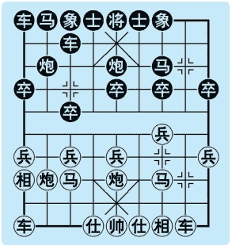

图39

### （2）马2进1
6.…… 马2进1 7.仕六进五

红子掌控节奏。马三进四、车九平六、车二进六都是后续的进攻抓手，黑子明显处在下风。若黑子继续：
①车3平4，车二进五，红子抢先。
②车1进1，车二进六 炮2进1，车九平六 车3平4，车六进八 车1平4，车二退一 炮5平3，马三进四，形成攻势。
③士4进5，马三进四 炮2平4，车九平八 车1平2，炮八进二，红子更好。
④炮5平4，马三进四 象3进5，车九平六 士4进5，车六进六 炮2平3，炮八进四 炮3进1，车六退一，中路威胁更大。

### （3）马2进3
6.…… 马2进3 7.炮八进四

黑子若：
①卒5进1，仕六进五 车3平4，红子保留车九平六兑车的权利，车二进六 车4进2，炮八平三 象7进9，兵三进一，先手在红。
②马3进2，炮八平三 象7进9，炮三平二，随后冲三兵、补仕出车，红子优势。
③马3进4，炮八平三 象7进9，炮三平二，再冲三兵或车九平八，攻势明显。

### （4）车3平4
6.…… 车3平4

黑子先车9平3再车3平4步数吃亏。
7.仕六进五

出车兑车对红子有利。若黑子：
①车4进5，炮八进四 车4平3，如车4退3则炮八退二，炮八平七 车3平2，如车3平4则炮七平三 象7进9，车九平八，炮七平三 象7进9，马七进六，领先。
②马2进3，车九平六 车1进1，车二进五 卒5进1，如象3进1则炮八进四，炮五进三 马7进5，马三进四 车4进8，马七退六，再摆中炮，红子更好。

### 第 5 局 直车对黑方不跳马炮 2 平 3
红子思路：正常推进双正马，必要时补仕拆中炮，局面稳健。

1.炮二平五 炮8平5 2.马二进三 马8进7
3.车一平二 车9进1 4.兵三进一 车9平4
5.马八进七 炮2平3

此时黑子正着只有卒3进1、马2进1、马2进3，炮2平3过早定型，阵型缺乏弹性，不算正谱。
6.车九平八 马2进1

黑子应正常出子，若急于动4路车：
①车4进4，仕六进五 车4平7，马三进二，继而炮五平三飞相赶车，黑车处险地，红子有利。
②车4进5，炮八进六 车4平3，马三退五，黑子右翼子力受困，之后车二进八、车二平三、炮五平二拆中炮沉底，对杀时红子更快。
7.炮八进四 士4进5
8.仕四进五

如图40，红子阵型紧凑无破绽，之后炮五平四拆中炮可稳稳领先。黑子若：
①卒1进1，炮五平四，红子占先。
②车4进3，马三进四 车4平6，车八进四 车1平2，炮五平四 车6平5，马四进三 车5平4，炮四平三，红子多兵更好。

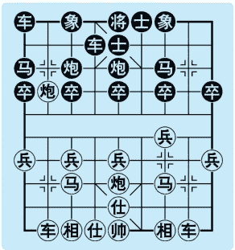

图40

③车4进4，车二进四 车1平2，炮五平四，红子飞相后占先。
④车4进5，马三进四 车4平3，马四进六 车3进1，马六进七，中炮攻势领先。
⑤车1平2，炮五平四 车4进5，如车4进4则相七进五；另如车4进3则相三进五 卒7进1，车二进四 卒1进1，马三进四 车4平5，炮四平三，红子优势，继而相三进五 车4平3，马三进四 车3退2，车二进六 卒7进1，车二平三 卒7进1，车三退二，再炮四平三，稳定领先。

### 第 6 局 直车对黑方不跳马车 4 进 3
红子思路：迫使黑子巡河车多走，红子更稳。

1.炮二平五 炮8平5 2.马二进三 马8进7
3.车一平二 车9进1 4.兵三进一 车9平4
5.马八进七 车4进3

四路巡河车点位不佳，后期易被马三进四踢车利用，导致一车多动。
6.车二进六

如图41，此手精妙。表面像车二平三进击，其实是为打通巡河线、配合马三进四踩车做准备。黑子有（1）卒7进1；（2）马2进3两种应对，均对红子有利。

### （1）卒7进1
6.…… 卒7进1
7.车二平三 卒7进1
8.车三退二 马2进1

如马2进3，则车三进三 炮5进4，马七进五，黑子丢子。
9.马三进四

让黑一车多动，红子领先。若黑子：
①车4进1，炮五平三，之后有飞相冲兵、炮打马，红子更好。
②车4平6，炮五平四 车6平5，如炮2进3则车三进三 车6进1，仕六进五后破象占先，炮四平三 马7退9，炮八退一，继而炮八平三、车九平八，优势在红。

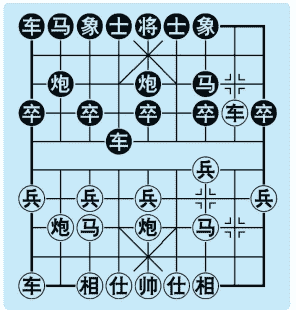

图41

### （2）马2进3
6.…… 马2进3 7.炮八平九

若过早吃卒压马，黑方可炮5退1反击。
7.…… 车1平2 8.车九平八

红子保持主动，黑子不敢进炮封车，因七路马偏弱。
8.…… 卒7进1

如卒3进1，则车八进六，红子明显形成进攻。
9.车二平三 炮5退1 10.兵三进一 炮5平7
11.马三进四

红马踢车，黑车必多动浪费步数，红子更好。若黑子：
①车4进1，马四进五，红子抢先攻击。
②车4进4，车三平四 炮7进3，兵七进一，红子再车八进六稳优。
③车4平3，马四进五 马7进5，车三进二 车3进2，车三退二，中路攻势占先。

### 第 7 局 直车对黑方不跳马车 4 进 4
红子思路：炮五平四拆中炮，红子稳优。

1.炮二平五 炮8平5 2.马二进三 马8进7
3.车一平二 车9进1 4.兵三进一 车9平4
5.马八进七 车4进4

布局中黑车多动易吃亏。
6.炮五平四

如图42，以柔克刚，拆中炮后红子无懈可击，黑子一车多动影响其他大子。黑子有（1）车4平7；（2）卒5进1两种选择：

### （1）车4平7
6.…… 车4平7
7.车二进二

暗藏炮八退一平炮打车，或稳飞相补仕出车，红子阵容协调占优。

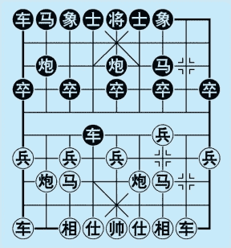

图42

7.…… 炮2平4

意在阻断红子炮八退一再炮八平三的线路。若卒3进1，则炮八退一 马2进3，炮八平三 车7平2，相七进五，红子四子归边有攻势。
8.相七进五 车7退1 9.炮八退一 炮4进6

若车7平6，则马三进二 车6平8，炮八平三，攻势占优。
10.马三进四 马2进3 11.车二退一 炮4退6
12.炮八平三

红子有攻势占先。

### （2）卒5进1
6.…… 卒5进1 7.相七进五 卒5进1
8.兵七进一 车4进1

若车4退1，则兵五进一 马7进5，车二进三 炮5进3，仕六进五，黑子一车多动浪费步数，红子出子领先，继而车九平六兑车即可保持主动。
9.炮四进一

黑子若：
①卒5进1，炮四平六 卒5进1，炮六平五，黑子丢车。
②炮5进4，马七进五 车4进1，炮八进四 卒5进1，马三进五，出子速度快占优。
③车4进2，仕六进五，出子领先占优。
④车4退2，兵五进一 马7进5，仕六进五 炮5进3，炮四平五 马2进3，车九平六，出子领先占优。

### 第 8 局 直车对黑方不跳马车 4 进 5
红子思路：炮五平四拆中炮，红子稳优。

1.炮二平五 炮8平5 2.马二进三 马8进7
3.车一平二 车9进1 4.兵三进一 车9平4
5.马八进七 车4进5

如图43，老教材多认为马三进四最优，后发现黑子炮2平3可反击，该手受考验。人工智能解析后，红子最佳为炮五平四拆中炮，因其让黑子车4进5失去反击方向，黑子因一车多动出子缓慢。红子有（1）马三进四不推荐；（2）炮五平四推荐。

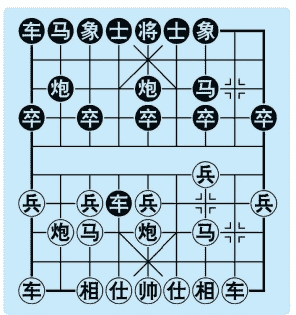

图43

### （1）马三进四 先手不推荐
6.马三进四 车4平3

如车4退1，则马四进五 马7进5，炮五进四 士4进5，相七进五，红子优势。
7.马七退五

老棋书皆言红子占先，实则黑子仍有反击。黑子错走车3平5，红子车二进六吃卒压马占先；黑子错走炮5进4，红子马四进六踩双换炮占先。人工智能给出妙手炮2平3。
7.…… 炮2平3

妙在让红子两马失去进攻方向。若红子：
①马四进六 车3退2，红子无进攻方向。
②马五进三 车3进3，车九平七，如车九进一，士4进5，车九平六 马2进1，马四进五 炮3平4，之后车1平2出车黑子可以抗衡，炮3进7，仕六进五 马2进3，黑子可以对杀。
③相七进九 车3平5，车二进六 车5平2，炮八平七 卒5进1，黑子连续冲卒可对杀。

### （2）炮五平四 先手推荐
6.炮五平四

红子拆中炮补仕相后阵型无弱点，黑子一车多动出子迟缓，优劣分明。
6.…… 卒5进1 7.相七进五 马2进3

如卒5进1，则炮四进一 车4退2，兵五进一，黑子无攻势。
8.仕六进五

不可炮四进五，否则炮5进4，马七进五 炮2平6，黑子占优。
8.…… 马3进5 9.炮八进四

黑子若：
①卒5进1，炮四进一 车4退2，兵五进一，之后炮四平五，红子占优。
②车4平3，车九平七 马5进3，如炮2平3则马三进四，黑子丢子；如卒5进1则炮四进一 车3退2，兵五进一，红子占优，炮四进一 马3进4，车二进六，红子占优。
③卒3进1，炮八平三 象7进9，车九平八 炮2平3，马三进四 卒5进1，马四进五 马7进5，车八进六 马5进4，黑子若马5进6则炮四进七攻势如潮，黑子败势；若马5退7则兵五进一，红子多兵稳优，车二进八 炮5平7，车二平三 象3进5，炮三平二，红子可以抢到双车双炮四子归边大占攻势。

### 第 9 局 直车对黑方不跳马车 4 进 7
红子思路：正常出大子，必要时补士拆中炮，稳步进取即可取得上风。

1.炮二平五 炮8平5 2.马二进三 马8进7
3.车一平二 车9进1 4.兵三进一 车9平4
5.马八进七 车4进7

黑一车多动躁进，红子正常出子即可稳持主动。
6.兵七进一

如图44，红子双马灵活阵型优美，黑车孤军深入无攻势。黑子有（1）车4平3；（2）炮2平3；（3）马2进3三种选择，都是红子有利：

### （1）车4平3
6.…… 车4平3

如车4平7，红子马七进六。
7.马七进六 车3退3
8.马六进四

暗伏马四进六踩车、马六进七抽车。

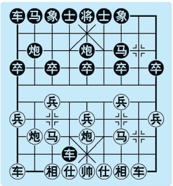

图44

8.…… 炮2平4

如车3退1，则马四进二 马2进3，如车3平6则兵三进一，马二进三 将5进1，车二进八 炮2退1，车九进一，再车九平四，红子大占攻势。
9.车二进六

黑子若：
①车3平7，相三进一 车7退1，马三进二，红子暗藏炮八进三、车九进一等攻势占先。
②车3退1，马四进三 炮4平7，车二平三，红子有中路、底线等多路攻势占先。

### （2）炮2平3
### （3）马2进1
6.…… 炮2平3 7.车二进五

骑河车禁子得力，红子已全盘控局。
7.…… 马2进1 8.车九平八 车1平2
9.炮八进四 士4进5 10.仕六进五

之后红子可以考虑马三进四、车四平六等进攻手段，黑子全盘被压制。

### （3）马2进3
6.…… 马2进3

如马2进1，则炮八进四，红子有中路攻势。
7.仕六进五

红子阵型无懈可击，之后相七进九、车九平六兑车，或炮五平四拆中炮，都是红子优势。若黑子：
①车1进1，相七进九 车1平6，车二进六，红子双马灵活稳优。
②车4平3，马七进六 车3退3，马六进四，黑马受攻，红子占先。
③车4退2，炮五平四 卒5进1，相七进五 卒5进1，炮四进一 车4退2，兵五进一 马3进5，炮八进四，暗藏炮四平五，红子占优。
③车4退4，马三进四 车4平6，炮八进二 卒3进1，炮五平四 车6平5，马四退六 车5平4，马六进七，红子多兵占优。

### 第 10 局 胡氏双正马对卒 3 进 1 一
红子思路：车二进五骑河车攻守兼备，红子稳持先手优势。

1.炮二平五 炮8平5 2.马二进三 马8进7
3.车一平二 车9进1 4.兵三进一 车9平4
5.马八进七 卒3进1

形成胡氏双正马对横车3卒的布局变例。
6.车二进五

如图45，骑河车主动发起攻击，经人机拆棋为红子最优选择，可确保先行。本局介绍黑子（1）马2进3；（2）象3进1两种走法。

### （1）马2进3
6.…… 马2进3
7.车二平七 车4进1

如马3进4，兵七进一 象3进1，车七平八 炮2平3，如炮2进5则炮五平八，红子多兵优势，马七进六 捉马4进6，马六进四，红子多兵稳优。

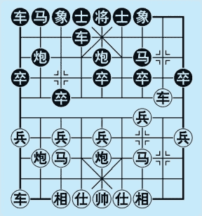

45

8.炮八进四 炮5退1 9.车七退一

至此红子多兵占先。若黑子：
①炮5平3，炮八平七，黑子反击受阻，红子多兵有利。
②象3进5，炮五平四，红子不怕黑子炮5平3，随时有炮八平七化解，之后仕相补齐，红子多兵稳优。
③马3进4，炮八平三 象7进5，车九进一 炮2平3，车九平六 炮5平3，车七平六，红子多两个兵占优。
④马3进2，炮八平三 象7进5，炮五平四，之后补仕补相出肋车，红子多两个兵明显优势。

### （2）象3进1
6.…… 象3进1

在纯人工拆棋时代，此手被认为可出其不意，如今人工智能拆解结论为红子占先。
7.炮八平九 车4进2

黑子若①炮2进2，车二进一，之后红子有车九平八、车二平三等多路攻势，黑子难以化解；②马2进3，炮九进四 车1平2，炮九平八 车2平3，炮八平三 象7进9，车九平八 炮2进2，车二退一 车4进6，车八进二，红子多两个兵，之后最简兵九进一即可占优。
8.车九平八 马2进4

若炮2平3，红子马三进四再车二平六兑车占优。
9.马三进四

黑子有三种走法：
①车1平2，车二平六 车4进1，马四进六 炮2平4，如炮2进4则炮五平三，车八进九 马4退2，炮九进四，形成无车残棋，红子多兵占优。
②车4进2，马四进六 车1平3，炮九进四 车3进3，炮九退二 车3平4，马六进四 前车平6，马四退五 车4进2，车八进六，黑子两个车无法捉死红马，红子多两个兵稳占优势。
③车1平3，车二平六 车4进1，马四进六 卒3进1，如士4进5则车八进四，兵七进一 车3进5，车八进二 炮2平3，如车3退1则马六进五 象7进5，炮九退一，红子控盘占先，马六进七 车3退3，炮九退一，将来炮九平七或炮九平三，红子占优。

### 第 11 局 胡氏双正马对卒 3 进 1 二
红子思路：车二进五骑河车攻守两利，红子稳持先手优势。

胡氏双正马对横车布局 人机拆解与经典对局回顾

1.炮二平五　　炮 8 平 5　　　　2.马二进三　　马 8 进 7

3.车一平二　　车 9 进 1　　　　4.兵三进一　　车 9 平 4

5.马八进七　　卒 3 进 1

走到这里就成了胡氏体系双正马对横车带三卒的标准框架。

6.车二进五

把肋车拉到河边先发制人，电脑复盘里这是红棋最抢节奏的做法，能把局面抓在自己手上。前面两盘讲过黑棋马 2 进 3、象 3 进 1 两类应法，都让红棋更舒服。本盘来看黑棋最后一种走法炮 5 退 1。

6.……　　　　炮 5 退 1

中炮往后挪准备连象反击。黑棋如果①车 4 平 3，相七进九，红棋可补士出车子力运转快更占先；②车 4 进 1，车二平七炮 5 退 1，局面回到正变。

7.车二平七　　车 4 进 1

这步带点诱饵意味的布局假象，想引红车吞掉底象。

8.马三进四

红棋不接套，先把马形固定好，往后用炮八进四就能化解反扑。千万不能走车七进四炮 2 平 3，马七退五象 7 进 5，车七退一马 2 进 4，黑棋就能把红车吃掉，这正是黑棋的骗招。

8.……　　　　马 2 进 3

大子出动为炮 5 平 3 做准备。改走象 3 进 5，车七平六车 4 平 3，如马 2 进 3，车六进二炮 2 平 4，车九平八车 1 平 2，炮八进六，红棋空间更大。象 3 进 5 后炮八退一车 3 进 4，车九进二马 2 进 3，红棋攻势依旧很猛。

9.炮八进四

提前解除炮 5 平 3 的威胁。要是急攻走马四进五马 7 进 5，炮五进四象 3 进 5，车七进一炮 5 进 2，车七平五车 4 进 7，马七退六马 3 进 5，黑棋车 1 平 3，子力出动快且破仕更先。

9.……　　　　炮 5 平 3

补象主要有两条：

①象 3 进 5，炮八平三，随后车七平四车九平八，红棋多两兵控盘。

②象 7 进 5，车七进一炮 5 平 3，炮八平五马 7 进 5，炮五进四，红棋再出另一车，多兵在先。

10.炮八平七　　象 3 进 5

补象不能补七路，要补三路保留士 4 进 5、车 1 平 4 的出车线。若走象 7 进 5，车七退一炮 3 进 2，车七进二炮 2 退 1，马四进五马 7 进 5，炮五进四炮 2 平 5，炮五平一，补象失误底线空虚，红棋多三兵有利。

11.车七退一　　炮 3 进 2

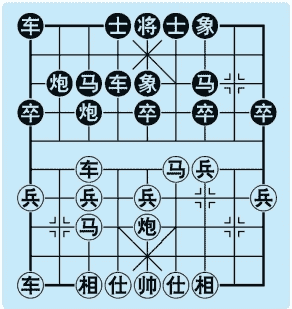

图 46

如图 46，以上是四十年实战检验的正着，双方都没改进空间。人机拆解后红棋接有（1）车七进二；（2）车九平八两种续法，都能保持节奏立于不败：

### （1）车七进二

12.车七进二　　炮 2 退 1

保留中炮或炮 2 平 3 的灵活性，比炮 2 退 2 更从容。

13.马四进五

保持车马炮兵种齐全。若走炮五进四马 7 进 5，马四进五车 1 进 2，黑棋兵种齐全可对杀，红棋不满意。

13.……　　　　马 7 进 5　　　　14.炮五进四　　士 4 进 5

黑棋改走：

①炮 2 平 5，炮五进二士 4 进 5，车九平八，红棋多兵稳住主动，黑棋只能下风求和。

②士 6 进 5，炮五退二炮 2 平 3，车七平三将 5 平 6，车九进一士 5 进 6，车九平四，红棋速胜。

15.车九平八　　炮 2 平 3　　　　16.车七平八　　车 4 进 5

17.前车进三　　车 1 平 2　　　　18.车八进九　　车 4 退 7

19.车八平六　　将 5 平 4　　　　20.炮五平一

红棋兵力多掌握节奏，黑棋只能下风顶和。

### （2）车九平八

12.车九平八

此着让黑棋无法炮 2 退 1，正是两条线的出车次序不同导致二路炮位置变化。

12.……　　　　炮 2 退 2　　　　13.车七进二　　炮 2 平 3

14.车七平八　　马 3 进 4　　　　15.马四进六　　车 4 进 2

16.前车平七

至此开局结束进入中局。此谱大师实战四十多年，软件拆解亦如此走，可谓透彻。结论红棋多兵略好，黑棋下风求和不难。

### 第12局 实战回放 1984个人赛 胡荣华胜徐天红

1.炮二平五　　炮 8 平 5　　　　2.马二进三　　马 8 进 7

3.车一平二　　车 9 进 1　　　　4.马八进七　　车 9 平 4

5.兵三进一　　卒 3 进 1　　　　 6.车二进五　　炮 5 退 1

7.车二平七　　车 4 进 1　　　　8.马三进四　　马 2 进 3

9.炮八进四　　炮 5 平 3　　　　10.炮八平七　　象 3 进 5

11.车七退一　　炮 3 进 2　　　　12.车九平八　　炮 2 退 2

13.车七进二　　炮 2 平 3　　　　14.车七平八　　马 3 进 4

15.马四进六　　车 4 进 2　　　　16.前车平七

如图 47，本局来自 1984 年全国象棋个人赛，红胡荣华对黑徐天红。双方开局熟练，进退有度，都是经得住检验的正谱，形成红棋多一兵抢先稍优，黑棋仍可抗衡。

16.……　　　　车 1 进 1

17.仕六进五　　卒 7 进 1

18.车八进四　　车 1 平 6

按 AI 最优，红棋应考虑拆中炮补中相，多兵稳住主动但取胜难度加大。胡司令一贯积极敢拼，决定兵五进一猛冲中兵发起进攻。

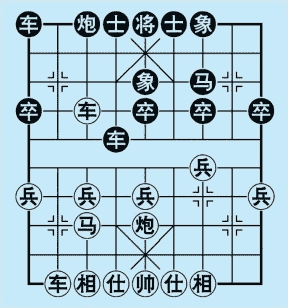

图 47

19.兵五进一　　车 6 进 5　　　　20.兵五进一　　车 4 平 5

21.兵三进一　　车 6 平 7　　　　22.兵七进一

此手为典型请君入瓮，让黑棋压马或吃兵。

22.……　　　　士 6 进 5　　　　23.兵三进一　　车 7 退 3

24.车八退一　　车 7 进 6　　　　25.车八平六　　马 7 进 6

如图 48，红棋连弃中兵三兵已无便宜。黑棋上马失误，正着应车 7 退 5 退车后以霸王车兑车，破相更先。

26.车六进五　　马 6 进 7

27.炮五进四　　马 7 进 8

28.帅五平六　　车 5 退 1

29.车七平五　　炮 3 进 7

至此黑棋被迫一车换双，且车马炮位置不佳，下面看胡司令困子妙手。

30.车六退六　　炮 3 进 1

31.车五退三

红棋两步退车极妙，借退为进把黑马炮困住，黑棋顽强着法应弃炮马 8 退 7 把马解出。

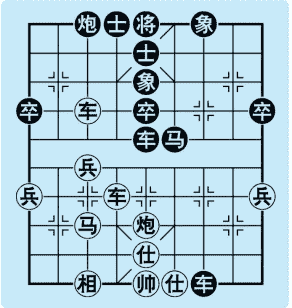

图 48

31.……　　　　车 7 退 4　　　　32.相七进五　　车 7 退 1

33.车六退一

绝妙顿挫。

33.……　　　　炮 3 退 1

34.车六进二

双车联手不给黑棋马 8 退 7 的机会，随时平车捉马。

34.……　　　　炮 3 进 1

35.车五平二　　车 7 平 2

36.帅六进一

如图 49，经一段精妙困子，黑马被捉，观赏性极强。以下红棋形成双车带兵必胜车炮的残局。

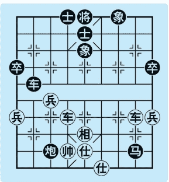

图 49

36.……　　　　马 8 退 9　　　　37.车二平一　　卒 9 进 1

38.车六进三　　卒 1 进 1　　　　39.车一平六　　炮 3 平 1

40.后车平七　　车 2 进 4　　　　41.帅六退一　　车 2 进 1

42.帅六进一　　车 2 退 4　　　　43.车六平四　　卒 1 进 1

44.车四进二　　卒 1 进 1　　　　45.车七平三　　象 7 进 9

46.车三平二　　士 5 退 6　　　　47.车二平九　　炮 1 平 2

48.车九进六　　士 6 进 5　　　　49.车九退二　　象 5 进 7

50.车四退二　　车 2 退 1

51.车四平二　　象 9 退 7

52.车二进三

如图 50，红棋必破象，黑棋只好认负。

本局开局皆为谱招，红棋仅多小兵。红棋凭中局大胆弃中兵三兵创造机会，抓住黑棋缓手后施展双龙出海，双车困马运子破象，精妙无比。

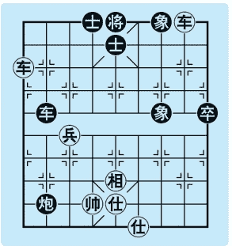

图 50

### 第13局 胡氏双正马补仕变对马2进1半壁河山 1

红棋思路：补仕拆中炮，稳住先手。

1.炮二平五　　炮 8 平 5　　　　2.马二进三　　马 8 进 7

3.车一平二　　车 9 进 1　　　　4.兵三进一　　车 9 平 4

5.马八进七　　马 2 进 1

黑棋形成后手顺炮单提马半壁河山，反击要点是炮 2 平 3、车 1 平 2、车 2 进 6。AI 显示红棋最优解为仕六进五，继而拆中炮；实战中直接炮五平四拆炮亦可。下面分六个变例并配六盘大师实战拆解仕六进五与炮五平四两条路线。

6.仕六进五

如图 51，AI 二十回合深度最推仕六进五。思路靠炮五平四、相七进五调阵，红棋布局无懈可击，后手顺炮因红棋拆中炮失去对杀方向，进入中残局形成红棋无弱点有攻势、黑棋委屈防守无反击目标的态势，可稳占主动。

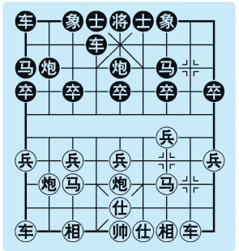

图 51

先讲黑棋①车 4 进 3；②车 4 进 4；③车 4 进 5；④车 4 进 7 四种应法：

### （1）车 4 进 3

6.……　　　　车 4 进 3

巡河车极易被红马踢动而亏损。黑棋若①车 1 进 1，车二进六，红棋更有利；②卒 3 进 1，车二进五车 4 平 3，相七进九，红棋更有利。

7.炮五平四　　卒 7 进 1　　　　8.车二进四　　炮 2 平 3

9.马三进四　　车 4 平 2　　　　10.车九平八　　车 1 进 1

11.相七进五　　车 1 平 4　　　　12.炮八平九

兑车后黑棋 1 路、7 路均有弱点，红棋更有利。

### （2）车 4 进 4

6.……　　　　车 4 进 4　　　　7.车二进四

接下来红棋拆中炮飞相出肋车即更有利。

7.……　　　　炮 2 平 3　　　　8.炮八进四　　车 1 平 2

9.车九平八　　士 4 进 5　　　　10.炮五平四

黑棋无好棋，红棋从容补中相冲七兵跳河口马组织攻势，稳占先手。

### （3）车 4 进 5

6.……　　　　车 4 进 5　　　　7.炮五平四　　炮 2 平 3

若车 4 平 3，相七进五后有马三进四、车九平六、车二进六等多路攻势，黑棋被动。

8.相七进五　　车 1 平 2　　　　9.车九平八

马三进四、车二进六都是红棋攻击方向，红棋阵型好有明确方向，黑棋无反击难免落下风。

### （4）车 4 进 7

6.……　　　　车 4 进 7　　　　7.相七进九

简单兑肋车后车二进六即为明显优势。

7.……　　　　炮 2 平 4

黑棋若炮 2 平 3，炮八进四士 4 进 5，车九平八车 1 平 2，车二进五、车二进六、马三进四都是红棋进攻方向，占优明显，黑棋只能被动防守。

8.炮八进四　　士 4 进 5　　　　9.车九平八　　车 1 平 2

10.车二进五　　车 4 平 3　　　　11.车八进二

红棋马三进四占优，即便一车换双亦是红棋多车占优。

### 第14局 实战回放 1984五羊杯 李来群胜胡荣华

1.炮二平五　　炮 8 平 5

2.马二进三　　马 8 进 7

3.车一平二　　车 9 进 1

4.马八进七　　车 9 平 4

5.兵三进一　　马 2 进 1

6.仕六进五

如图 52，选自 1984 年五羊杯冠军赛，红李来群对黑胡荣华。“神算子”李来群早在 1984 年便走出如今 AI 最优解仕六进五，实力惊人。

6.……　　　　车 4 进 7

图 52

胡司令棋风凶悍求变，实战多见谱招炮 2 平 3。

7.相七进九　　炮 2 平 3　　　　8.炮八进四　　士 4 进 5

9.车二进五

骑河车禁子得力，控盘上佳。

9.……　　　　车 1 平 2

若车 4 平 2，炮八平五马 7 进 5，炮五进四车 2 平 4，车九平六，红棋更有利。

10.车九平八

黑棋除四路车外无好点，局面被红棋掌控。

10.……　　　　车 4 退 3

下风中唯一对杀方向，企图延缓红棋攻势并吃兵捉马。黑棋若①车 4 平 3，车八进二车 2 进 3，车八进四车 3 退 1，马三进四，红棋攻势在前；②车 4 退 2，马三进四车 4 平 3，马四进六车 3 进 1，马六进七车 2 进 2，马七退五马 7 进 5，炮五进四，红棋中炮优势稳固。

11.相三进一　　车 4 进 1

12.兵七进一　　车 4 平 3

13.车八进二

如图 53，红棋李来群施展巨蟒缠功，细腻控盘并以良好大局观取得优势。黑棋无法掀起对杀，被迫一车换双以攻代守。

13.……　　　　车 2 进 3

14.车八进四　　车 3 进 1

15.相一退三　　车 3 平 1

图 53

黑棋一车换双后仍有一定攻势，红棋须谨慎。

16.车二平八

绝妙控盘手段，立于不败。红棋若车八退三车 1 进 2，仕五退六炮 3 进 3，车八平七炮 3 退 1，黑棋可对杀。

16.……　　　　车 1 平 3

黑棋若车 1 退 1，马三进四，红棋霸王车依旧不败，黑棋中炮来时马四进六亦保留攻势。

17.后车退五

细腻之着，是李来群绵里藏针风格，先立于不败再求制人。

17.……　　　　卒 1 进 1

黑棋若车 3 退 2，前车退二车 3 退 1，马三进四炮 5 进 4，前车进一，再马四进六，红棋优势。

18.马三进四　　炮 5 进 4

19.马四进六　　炮 3 平 5

20.马六退五　　炮 5 进 4

21.前车退三　　炮 5 退 2

22.前车平五　　车 3 退 2

23.炮五进三　　卒 5 进 1

24.车五进二　　车 3 平 7

25.车五平九　　马 1 退 3

如图 54，两位顶尖高手刺刀见红，走子运子兑子无懈可击。马 1 退 3 为缓手导致丢象，正着应象 7 进 5 再象 5 进 3 保马，黑棋尚可一战。

图 54

26.车八进九　　马 3 进 5　　　　27.车九平五　　士 5 退 4

28.车八平七　　士 6 进 5　　　　29.相三进五　　车 7 进 1

30.兵九进一　　车 7 平 9　　　　31.车七平八　　卒 9 进 1

32.车八退五

黑棋可能车 9 平 6 防守求和。

32.……　　　　卒 9 进 1　　　　33.车八平四　　卒 3 进 1

34.车四进四　　马 5 进 3　　　　35.车五退一　　马 7 退 6

36.车四平三　　卒 3 进 1　　　　37.相五进七　　车 9 平 1

38.相七退五　　马 6 进 5　　　　39.车三进一　　士 5 退 6

40.车三平一

此为黑棋陷阱，红棋上当走车三退三车 1 退 1，无兵难赢。

40.……　　　　卒 9 进 1　　　　41.车一退四

红棋双车双龙出海，龙盘虎踞牢牢控盘，以后冲兵可争胜。

## 残局分析

41.……　　　　卒 9 平 8　　　　42.兵九进一　　士 4 进 5

无奈，若车 1 退 2，车一平九马 3 进 1，车五进三士 6 进 5，车五退四卒 8 进 1，车五平三，以后捉死两黑卒，红棋单车必胜马双士。

43.兵九平八　　马 5 退 7　　　　44.车一平四　　马 3 退 5

45.车四进三　　车 1 退 4　　　　46.车五退一　　马 5 进 4

47.车五进二　　马 4 退 5　　　　48.兵八平七　　卒 7 进 1

49.车四退五　　卒 7 进 1　　　　50.车四平二　　卒 7 平 6

51.车五进一　　车 1 进 3　　　　52.车二平五　　车 1 平 4

53.后车进二　　马 7 进 9　　　　54.后车平六　　车 4 退 1

55.兵七平六　　马 5 进 7

至此形成高难度必胜残局，车兵可胜双马双士。

56.仕五进六　　卒 6 进 1　　　　57.车五平四　　马 7 进 8

58.车四退二　　马 9 进 7　　　　59.车四平三　　卒 6 平 5

60.相五退三　　马 7 退 5　　　　61.兵六平五

冷静，若不察走车三平二马 5 进 4，黑棋保留马卒双士有和棋机会。

61.……　　　　马 8 退 9　　　　62.兵五进一　　马 5 进 3

63.兵五平六　　马 3 退 1　　　　64.车三平五　　马 1 进 2

65.兵六平七　　马 2 进 1　　　　66.车五平八　　马 1 进 3

67.车八平七　　马 3 退 1　　　　68.车七退一　　马 1 进 2

69.车七平五　　马 2 退 4　　　　70.帅五平六　　马 9 进 7

71.车五平六　　马 7 进 5

72.帅六进一　　马 4 进 6

73.车六平九　　马 6 退 4

74.相三进五　　士 5 退 4

75.车九平五

如图 55，红棋得马必胜，黑棋投降认输。

先手绞杀 连环弃马

开局红方就掌握了节奏，中局抓住对方弃象的破绽把领先一步步扩大，随后以一车牵制全盘慢慢收紧、层层推进，最终换得一马奠定胜局，走法衔接流畅观赏性很强。

图 55

### 第 15 局　胡氏双正马补仕变对马 2 进 1 半壁河山（2）

红方思路：先补仕再拆中炮，让主动始终在红方手上。
1.炮二平五　　炮 8 平 5　　　　2.马二进三　　马 8 进 7
3.车一平二　　车 9 进 1　　　　4.兵三进一　　车 9 平 4
5.马八进七　　马 2 进 1　　　　 6.仕六进五

从先手来看走仕六进五最为贴切，也是把局面拆到二十回合后机器给出的首选。拆法思路是先炮五平四再相七进五把中路架子理顺，布局阶段几乎没有破绽。黑方顺炮因红方已拆掉中炮，对杀线路被切断，进入中后盘往往演化成红方无短板有攻路、黑方只能被动耐受且找不到反击目标的局面，主动始终偏向红方。前面已讲过黑车4进3、车4进4、车4进5、车4进7的几种处理，本局讲黑方走炮2平3的做法。

6.……　　　　炮 2 平 3

后手顺炮单提马横车的反击要点是炮2平3、车1平2、车2进6三步。从红方角度，只要不让黑方顺畅完成车1平2后再进车2进6即可。

7.车九平八　　车 1 平 2　　　　8.炮八进四　　士 4 进 5
9.车二进五

见图56，眼光很长的一手，能把全局控制住，遏制黑方反扑。若另走：
①炮五平四车4进3，马三进四车4进1，此时拆炮时机偏早。
②马三进四车4进4，马四进五马7进5，炮八平五车2进9，马七退八车4进1，黑方能获得对杀机会。
③车二进六车4进4，车二平三卒3进1，相七进九车4退2，炮八进二卒3进1，相九进七马1进3，黑方能反打，红方不满意。

图 56

下面黑方车4进4的后续较多，下局再展开。本局先讲黑方（1）车4进5；（2）车4进7；（3）象7进9三种走法：

### （1）车 4 进 5

9.……　　　　车 4 进 5　　　　10.炮五平四　　车 4 平 3
11.相七进五

再马三进四，红方马的站位明显优于黑方两匹慢马，主动仍在红方。黑若继续：
①炮5进4，马七进五车3平5，马三进四，暗藏马四进六踩双、马四进三踩兵的威胁，红方继续掌控。
②炮5平4，马三进四象3进5，车二平八，红方进攻线路清晰，马四进六、马四进三都可用；黑方没有还手，只能硬顶。

### （2）车 4 进 7

9.……　　　　车 4 进 7　　　　10.兵七进一

红方以三兵、七兵两头压制对方慢马，整盘黑方能动的大子基本只剩4路车。
10.……　　　　车 4 平 3　　　　11.马七进六　　车 3 退 3
12.车二平六

继续掌控大势。若红改走马六进五，如马六进四车3退1则车3进4，车八平七炮3进7，黑可起对杀，红方没有便宜。接下来黑：
①炮5平4，相七进九车3退1，车六平七卒3进1，马三进四，随后双马抢中卒，中炮镇中，主动仍在红方。
②车3进4，车八平七炮3进7，炮五平八车2平1，若车2进3则马六进八，马六进四，红方攻势很猛，黑方处于被动。

### （3）象 7 进 9

9.……　　　　象 7 进 9　　　　10.车二平八

黑再走：
①车4进5，马三进四车4平3，马四进六车3进1，马六进七车2进2，马七退五马7进5，炮五进四，红方中炮占优。
②车4进4，炮八平五车2进4，车八进五马7进5，炮五进四，红方中炮占优。

### 第 16 局　实战参考：1983 年团体赛李来群先胜臧如意

1.炮二平五　　炮 8 平 5
2.马二进三　　马 8 进 7
3.车一平二　　车 9 进 1
4.马八进七　　车 9 平 4
5.兵三进一　　马 2 进 1
6.仕六进五　　车 4 进 4
7.炮五平四

见图57，本局来自1983年全国象棋团体赛，“神算子”李来群先手对臧如意。拆中炮的目的是飞相出肋车，既能化解对方反击，也可走车二进四炮2平3，炮八进四士4进5，车九平八车1平2，炮五平四，然后飞相冲七兵抢到马三进四，主动不丢。

图 57

7.……　　　　车 4 平 7　　　　8.马三进二

见图58，构思巧妙，先飞相再炮八进二、炮八平三，是李来群的精妙安排。1983年的实战至今仍具借鉴价值。

8.……　　　　车 7 退 1
9.相七进五　　士 4 进 5

略显缓慢，更理想的是炮2平3，炮八进二车1平2，炮八平三车7平8，炮四平三马7退9，马二退一车8进5，马一退二，局面平稳，黑方问题不大。

图 58

10.炮八进二　　炮 5 平 4

面对红方炮八平三、炮四平三的严厉压力，黑方意识到7路薄弱，于是拆中炮准备联象死守。
11.马二进一

弃马的妙手，强行打开局面！
11.……　　　　车 7 进 2

黑方不敢吃弃马，若马7进9，则车二进六车7平9，炮四平一，红方先弃后取，打通兵线占上风。
12.炮八平三　　象 3 进 5　　　　13.车二进七　　车 7 平 9
14.车九平八　　车 1 平 2

如车9退3，则车八进七，接下来炮三进三吃马，红方得子。
15.马一进三　　卒 7 进 1

如炮4平7，则炮三进三，红方得子占优。
16.炮三平九　　炮 2 平 3

如炮4平7，则炮九进三车2平1，炮九平五象7进5，车二退一，子力更厚，兵相都多。
17.车八进九　　马 1 退 2　　　　18.马三退二

回头牵车，以退为进，金蝉脱壳的好着，红方由此确立多子优势。
18.……　　　　车 9 平 8　　　　19.车二进二　　炮 3 进 4
20.炮九平一　　象 7 进 9　　　　21.兵五进一　　象 9 退 7
22.炮一进五　　卒 3 进 1　　　　23.马七进五

羊入虎口，本局第二次弃马。
23.……　　　　车 8 平 6

无奈，黑若改：
①车8平5，炮四进六士5退4，车二平三，四子归边，红胜。
②士5进6，炮四进七马2进3，若将5平6则车二退一，炮四退一将5进1，炮一退一将5平6，车二退一将6退1，炮一进一，红胜。
24.兵五进一　　卒 5 进 1　　　　25.马五进六　　士 5 进 6
26.马六退七　　炮 4 进 3

若车6平3，则炮四进七，红方四子归边必胜。
27.马二进一

本局第三次弃马。黑不敢飞象吃马，只能抽车。
27.……　　　　车 6 平 3　　　　28.马一进三　　将 5 平 4
29.马三退五

本局第四次弃马。黑同样不敢飞象吃马，再次抽车。
29.……　　　　将 4 平 5
30.马五进七　　马 2 进 4
31.炮一平三　　士 6 进 5

若将5进1，马七退六将5进1，炮三退二士6退5，炮四进五，绝杀。
32.炮三退三　　士 5 退 6
33.车二平四

图 59

至图59，黑方认输。若走将5进1，马七退六将5进1，炮三进一士6退5，炮四进五，红方绝杀。

本局李来群先手面对后手顺炮单提马横车，用补仕拆中炮的思路牢牢掌握主动，中局四度弃马让人拍案叫绝，正是我国唯一兼具棋王、棋圣称号的四届全国冠军李来群巅峰时期的代表作之一。

### 第 17 局　胡氏双正马补仕变对马 2 进 1 半壁河山（3）

红方思路：补仕拆中炮，继续保持先手的掌控。
1.炮二平五　　炮 8 平 5　　　　2.马二进三　　马 8 进 7
3.车一平二　　车 9 进 1　　　　4.兵三进一　　车 9 平 4
5.马八进七　　马 2 进 1　　　　6.仕六进五　　炮 2 平 3
7.车九平八　　车 1 平 2　　　　8.炮八进四　　士 4 进 5
9.车二进五

大局观很强的一着，能掌控全局减少对方反扑空间。前面已讲过黑车4进5、车4进7、象7进9，本局讲最后一种应法：车4进4。
9.……　　　　车 4 进 4

见图60，黑方积极拼杀。下面红方（1）炮八平五；（2）相三进一都是可行选择：

### （1）炮八平五

10.炮八平五　　车 2 进 9
11.马七退八　　车 4 进 3

黑若另走：
①马7进5，炮五进四车4退2，马三进四，随后强兑车，红可形成优势残棋。

图 60

②车4平7，车二平六炮3平2，帅五平六炮2退2，车六进二再车六平七有杀招。
12.马八进九

若马八进七，黑车4平3，红无必要。
12.……　　　　马 7 进 5　　　　13.炮五进四　　将 5 平 4
14.兵九进一　　车 4 退 5　　　　15.炮五退二　　车 4 进 2
16.车二平五　　炮 5 进 3　　　　17.车五退一　　车 4 平 5
18.兵五进一

红方形成多兵残棋，立于不败。

### （2）相三进一

10.相三进一　　车 4 进 1

黑方全盘只有4路车能动，红除马三进四外，车八进三车4平3，车八平七炮3进4，车二平八卒1进1，车八退五，随后马三进四、炮八进一等，红方能稳守先手。
11.马三进四

拍马出击，进攻果断。
11.……　　　　车 4 平 3　　　　12.马四进六　　车 3 进 1

若车3退2，马六进七车2进3，车八进六车3平8，前马进九车8平3，车八退四，双方对杀，红方机会更大。
13.马六进七　　车 2 进 2　　　　14.马七退五　　马 7 进 5
15.炮五进四　　车 3 退 3　　　　16.车二平七　　卒 3 进 1
17.相七进五　　将 5 平 4

黑另可：①卒9进1，兵五进一，红方优势；②车2平4，炮八平三，随后车八进四、车八进五、兵五进一等，红方优势。
18.车八平六　　车 2 平 4　　　　19.炮八平六　　将 4 平 5
20.兵五进一　　马 1 退 3　　　　21.炮六退四

红方始终握有先手主动。

### 第 18 局　实战参考：2004 年个人赛阎文清先胜谢岿

1.炮二平五　　炮 8 平 5　　　　2.马二进三　　马 8 进 7
3.车一平二　　车 9 进 1　　　　4.马八进七　　车 9 平 4
5.仕六进五　　马 2 进 1　　　　6.兵三进一　　炮 2 平 3
7.车九平八　　车 1 平 2　　　　8.炮八进四　　士 4 进 5
9.车二进五　　车 4 进 4　　　　10.炮八平五

见图61，本局选自2004年全国象棋个人赛，布局专家阎文清先手胜谢岿。炮八平五抢中路是阎文清的飞刀，首次在实战亮相。亦可走相三进一车4进1，车八进三车4平3，车八平七炮3进4，车二平八卒1进1，车八退五，随后炮八进一、马三进四等，先手保持。
10.……　　　　车 2 进 9
11.马七退八　　将 5 平 4

图 61

黑不敢让车4平7离开防守肋道，怕红车二平六、帅五平六组杀。将5平4是缓着，更好的是车4进3，马八进九马7进5，炮五进四将5平4，兵九进一车4退5，炮五退二车4进2，暗含打中兵交换，局面平稳。
12.前炮退二

至此红方飞刀得手，多一个中兵而黑无法对杀，优势形成。
12.……　　　　炮 5 平 4　　　　13.马八进九　　象 7 进 5
14.车二平八　　马 7 进 5　　　　15.兵九进一　　卒 7 进 1
16.相三进一　　卒 7 进 1　　　　17.相一进三　　卒 3 进 1
18.车八进一

也可直接一步到位的车八退一兑车。
18.……　　　　马 5 进 7　　　　19.车八退二

若车八平九炮3进1，黑有反击。现在红进车又退车连走两步缓手，给黑喘息。
19.……　　　　车 4 进 1

见图62，错失扳平机会，应接受兑车走车4平2，马九进八炮3进4，形成四马炮无车残棋，可抗衡。
20.前炮平六　　将 4 平 5
21.马三进四　　车 4 平 5
22.马四进六　　炮 4 进 3
23.车八平六　　炮 3 退 1
24.马六进七　　士 5 进 6

应走车5退1兑车，赶紧简化顶和。
25.车六进四

图 62

一招点穴，正中要害。
25.……　　　　士 6 进 5　　　　26.炮五平八　　马 7 退 5
27.车六退二　　士 5 进 4　　　　28.车六进一　　马 5 退 3
29.车六平七　　炮 3 平 8　　　　30.炮八平二　　炮 8 平 9
31.相三退五　　车 5 平 4　　　　32.马九进八　　车 4 退 1
33.马八进七　　炮 9 进 5

应走马1进3换马更顽强。接下来红方形成车炮兵优胜残局。
34.马七进五　　象 3 进 5　　　　35.车七平九　　将 5 进 1
36.车九进一　　将 5 退 1　　　　37.车九进一　　将 5 进 1
38.车九退一　　将 5 退 1　　　　39.车九退二　　卒 9 进 1
40.车九平五　　车 4 进 1　　　　41.车五进一　　将 5 平 4
42.相五退三　　炮 9 平 5　　　　43.仕五进六

妙手献士，露帅助攻，同时暗藏炮二退一的杀招。
43.……　　　　炮 5 平 3

无奈，若车4进1，则车五退四，白脸将红胜；若卒9进1，则炮二退一，黑要么丢车要么丢炮，必败。
44.仕六退五　　卒 3 进 1　　　　45.炮二平六　　卒 3 平 4
46.车五平四　　卒 9 进 1
47.车四平六　　将 4 平 5
48.车六平五　　将 5 平 4
49.炮六退二

见图63，至此黑方认输。若走卒9进1，仕五进六，下一步车五平六白脸将，红胜。此盘顺炮大战质量极高，红方炮八平五抢中路的布局飞刀实战价值突出，从实战效果看，该变例结论仍是红方稳占先手。

图 63

### 第 19 局　胡氏双正马拆中炮对马 2 进 1 半壁河山（4）

红方思路：先拆中炮，后补仕相，稳握先手主动。
1.炮二平五　　炮 8 平 5　　　　2.马二进三　　马 8 进 7
3.车一平二　　车 9 进 1
4.兵三进一　　车 9 平 4
5.马八进七　　马 2 进 1

先手必须掌握的两大变化：仕六进五和炮五平四。人机最优推荐仕六进五已在前文详述，本局补充直接炮五平四的走法。
6.炮五平四

见图64，与直接补仕异曲同工，目的仍是补仕补相出肋车。黑方唯一正着是炮2平3对杀，炮2平3变化繁多，后文再讲。本局介绍黑方（1）卒5进1；（2）车4进3两种应法。

图 64

### （1）卒 5 进 1

6.……　　　　卒 5 进 1

黑方另可：
①卒3进1，车二进五卒5进1，相七进五卒5进1，兵五进一马7进5，仕六进五，随后以送中兵马三进四，红优。
②卒1进1，车二进五炮2平3，若卒5进1，则相七进五卒5进1，兵五进一，红方占优，随后车九平八车1平2，炮八进四，红方明显控盘。
7.相七进五

红方阵型稳固毫无破绽，黑方无法反击。局面发展下去会形成红无弱点有攻势，黑被动防守无对杀的态势，黑必须以攻代守，否则红简单补仕兑车，或马三进四、车二进六等，皆为攻势。
7.……　　　　卒 5 进 1　　　　 8.兵五进一　　马 7 进 5
9.仕六进五

此时红方已稳健控盘，之后可视情况车九平六兑车，或车二进三。黑再走：
①马5进4，车九平六、兵七进一或车二进三平车顶马，黑有丢子风险。
②马5进3，兵五进一马3进4，炮四退一马4退5，若车4平6，则车九平六马4退5，炮四进三，攻势更大，或车二进五马5进7，若马5进6，则炮四进一，相三进一，黑马有失。
③炮5进3，炮八进四马5进4，车二进三马4进3，若马4进2，则车九平七，炮四平七炮2平5，炮八平三车4进2，兵三进一车1平2，车九平六车4进6，帅五平六，红优。
④车4进5，兵五进一，若马5进3，则兵七进一马3进5，炮四进四，红方优势，或炮5进2，马三进四，红方优势。

### （2）车 4 进 3

6.……　　　　车 4 进 3

# 胡氏双正马拆中炮对弈精解

黑方若改走车一进一、车四进四或车四进五，红棋均以相七进五应对；黑棋若用车四进七封死相眼，红可相三进五解掉，随后抢到马三进四、车二进六的线路，攻势全在红方手中。

7.相七进五

此着之后可马三进四踢车兼踩卒，多兵的红棋更易展开。

7.……　　　　卒 7 进 1　　　　8.车二进四　　炮 2 平 3

9.马三进四　　车 4 平 2　　　　10.车九平八　　车 1 进 1

11.炮八退一

黑棋七路缺陷明显，红棋已具备清晰攻势。

### 第 20 局　胡氏双正马拆中炮对马 2 进 1 半壁河山（5）

红棋思路：先拆中炮再补仕相，始终把主动握在自己手里。

# 象棋布局详解

## 炮五平四变化

1.炮二平五　　炮 8 平 5　　　　2.马二进三　　马 8 进 7

3.车一平二　　车 9 进 1　　　　4.兵三进一　　车 9 平 4

5.马八进七　　马 2 进 1

执先角度，本局需要掌握两种手法：仕六进五与炮五平四。人机拆棋最推崇仕六进五，前文已详述，此处再补充炮五平四的线路。

6.炮五平四

与直接补仕殊途同归，都是先补齐仕相再推出肋车。

6.……　　　　炮 2 平 3

如图 65，这是黑棋唯一可取的着法。黑后手顺炮单提马横车成半壁河山，反击要点集中在炮 2 平 3、车 1 平 2、车 2 进 6 三步。走到这里，执先的红棋有两条可行路子：

### 图 65

①常规走法车二进五，可保持主动；
②飞刀走法车九平八，黑棋容易在车 1 平 2 时被飞刀。

本局先讲车二进五的打法。

7.车二进五

骑河的车能稳住局面，防止被反扑。比车二进六要好得多，若走车二进六被车 1 平 2，车九平八车 2 进 6，相七进五卒 3 进 1，车二平三马 1 进 3，黑棋便达成炮 2 平 3、车 1 平 2、车 2 进 6 的反击，随后可弃卒跳马或马 3 进 5 踩车再扑槽，黑棋有机会。

7.……　　　　车 1 平 2　　　　8.车九平八　　车 2 进 6

9.相七进五

双方六员大子均已出动，形成对峙。黑棋接下来主要有（1）卒 3 进 1；（2）卒 7 进 1；（3）车 4 平 6 三种选择。

（1）卒 3 进 1

9.……　　　　卒 3 进 1　　　　10.车二平七　　炮 3 进 1

黑棋准备炮 5 平 3 重炮打车谋马。

11.炮八平九　　车 4 平 2

若车 2 进 3，马七退八炮 5 进 4，仕六进五象 7 进 5，车七退一，局面平稳，红棋阵型扎实仍占先。

12.车八进三　　车 2 进 5　　　　13.马七退五

黑棋获得对杀机会，但对杀中红棋阵型稳健且多七兵，仍牢牢占据主动。黑棋续走：

①炮 5 进 4，炮四进一，黑中炮攻势站不住脚。
②炮 5 平 3，车七平六车 2 平 3，炮四进一，之后红棋马三进四、马五进三调马，阵型优美仍为主动。

（2）卒 7 进 1

9.……　　　　卒 7 进 1　　　　10.车二平三　　象 7 进 9

11.车三进一　　卒 3 进 1　　　　12.马三进四　　马 1 进 3

13.兵三进一　　马 3 进 5　　　　14.兵三平四

红棋马三进四封死了黑棋马 5 进 4 卧槽的线路，黑棋无力反击，红棋过河兵占优。

14.……　　　　马 5 进 4　　　　15.马四退六　　车 4 进 5

16.仕六进五

过河兵的优势非常明显。

（3）车 4 平 6

9.……　　　　车 4 平 6

黑棋走车 4 进 3、车 4 进 4、车 4 进 5、车 4 进 7 都找不到好位，只能平车捉炮另寻战机。

10.仕六进五　　车 6 进 5　　　　11.马三进二　　车 6 平 8

12.车二进三

随后兑车，红棋仍是先手。黑棋若续走：

①卒 1 进 1，马二进一车 8 退 5，马一进二，红棋好走。
②卒 3 进 1，马二进一车 8 退 5，马一进二，红棋好走。
③卒 9 进 1，马二进一车 8 退 5，马一进二，红棋平炮对车，红马踩 7 卒，占据主动。

### 第 21 局　胡氏双正马拆中炮对马 2 进 1 半壁河山（6）

红棋思路：先拆中炮再补仕相，主动稳定在红棋。

1.炮二平五　　炮 8 平 5　　　　2.马二进三　　马 8 进 7

3.车一平二　　车 9 进 1　　　　4.兵三进一　　车 9 平 4

5.马八进七　　马 2 进 1　　　　6.炮五平四

与直接补仕殊途同归，目的仍是补仕补相出肋车。

6.……　　　　炮 2 平 3

这是黑棋唯一正解，后手顺炮单提马横车的半壁河山反击要点仍是炮 2 平 3、车 1 平 2、车 2 进 6 三步。执先红棋仍有两条路：

①常规车二进五保持主动；
②飞刀车九平八，黑棋易中飞刀。

上局已讲车二进五，这里讲车九平八的飞刀法。

7.车九平八

如图 66，这里黑棋唯一正解是卒 3 进 1，之后可车 4 进 2 攻守兼备。黑棋车 1 平 2 是实战里常见的缓手，黑棋有（1）车 1 平 2；（2）卒 3 进 1 两种局面：

### 图 66

（1）车 1 平 2

7.……　　　　车 1 平 2

并不明显的缓手。

8.炮八进四

红棋飞刀得手，全局控盘占优。黑棋若续走：

①士 4 进 5，车二进五象 7 进 9，车二平八，红棋控盘占优。
②车 4 进 3，相三进五卒 7 进 1，车二进四，之后跳马冲兵炮四平三，红棋右车马炮有潜在攻势，主动。
③车 4 平 6，仕四进五车 6 进 5，如车 6 进 3 则车二进六，马三进二炮 5 进 4，马七进五车 6 平 5，马二进三车 5 平 3，相七进五，红棋优势。
④卒 3 进 1，炮八平三象 7 进 9，车八进九马 1 退 2，相七进五车 4 进 3，仕六进五卒 1 进 1，车二进八，未来马三进四、车二平四等，多子归边优势明显。
⑤卒 5 进 1，炮八平三象 7 进 9，车八进九马 1 退 2，相七进五卒 5 进 1，兵五进一车 4 进 4，如马 7 进 5 则仕四进五黑 4 路车难进红有车二进八塞象眼伏沉底炮的威胁，多兵主动，仕六进五车 4 平 5，兵三进一不论黑是否象飞兵红都是车二进四兑车，象 9 进 7 如车 5 退 1 则车二进五，车二进四车 5 平 8，马三进二，残棋占优。

（2）卒 3 进 1

7.……　　　　卒 3 进 1

先冲卒是必要顺序，准备封车后出车 4 进 2 反击。

8.相七进五

不可急着车二进五被马 1 进 3，相七进五马 3 进 5，兵五进一马 5 进 7，相五进三炮 5 进 3，黑棋攻势强。

8.……　　　　车 1 平 2　　　　9.炮八进四

进炮封车可以压制黑棋反击。红棋另如：

①车二进六车 2 进 6，车二平三马 1 进 3，兵三进一马 3 进 5，黑卧槽马反杀。
②车二进五马 1 进 3，马三进四马 3 进 5，兵五进一马 5 进 7，黑反杀。

9.……　　　　车 4 进 2　　　　10.炮八进二

红棋利用棋规，黑不能车 4 退 2，炮八退二车 4 进 2 连续捉炮。红棋另如：

①炮八退一卒 1 进 1，黑白赚一步，红浪费一步。
②炮八退二卒 5 进 1，车二进六车 2 进 3，仕六进五炮 3 进 4，黑形成霸王车，红便宜不大。

10.……　　　　卒 5 进 1

11.车二进六

之后马三进四或兵三进一，对杀中红棋机会更多。为示发展方向再演变一下，黑棋若续走：

①士 4 进 5，仕六进五，马三进四是红棋，红占优。
②卒 1 进 1，仕六进五、马三进四、兵三进一仍属红棋，红占优。
③炮 5 进 1，车二退一，对杀中红棋主动，如炮八退一、马三进四甚至考虑车杀中卒，红选择多方向明确。
④炮 3 进 1，仕六进五，红棋主动，黑阵型别扭，可马三进四、兵三进一，红棋机会更多，即便弃车炮换车也是红主动。
⑤炮 3 进 4，炮八退一炮打马，还有兵三进一过兵的攻势，红占优。

### 第 22 局　实战参考：2011 年重庆公开赛郑惟桐先胜姚洪新

1.炮二平五　　炮 8 平 5　　　　2.马二进三　　马 8 进 7

3.车一平二　　车 9 进 1　　　　4.马八进七　　车 9 平 4

5.兵三进一　　马 2 进 1　　　　6.炮五平四

如图 67，本局来自 2011 年重庆公开赛郑惟桐对姚洪新。此时红亦可仕六进五补仕，现炮五平四先拆中炮与补仕目的相同，都是让红棋无弱点。

6.……　　　　炮 2 平 3

7.车九平八　　卒 3 进 1

必要的出子顺序，之后可车 4 进 2。不宜直接车 1 平 2，因红有炮八进四全局控盘。

### 图 67

8.相七进五　　车 1 平 2

9.炮八进四

必要且及时的封锁，不让黑棋车 2 进 6 对攻。红若改走：

①车二进五马 1 进 3，炮八进四马 3 进 5，兵五进一卒 7 进 1，车二退一马 5 进 7，黑攻势猛烈。
②车二进六车 2 进 6，车二平三马 1 进 3，继而马 3 进 5 扑槽，黑反攻在即，红不满意。

9.……　　　　车 4 进 2　　　　10.炮八进二　　卒 5 进 1

11.仕四进五　　炮 3 进 4　　　　12.车二进八

求稳亦可炮八退一车 4 退 1，局面平稳。若车二进六卒 3 进 1，兵三进一马 1 进 3，双方对杀。

12.……　　　　卒 3 进 1　　　　13.车二平三　　马 1 进 3

14.车三退一

冷静，不可自作聪明走炮八平五车 2 进 9，炮五退三炮 5 进 4，红丢车。

14.……　　　　车 2 进 1　　　　15.车八进八　　马 3 退 2

16.马三进四　　炮 3 平 9　　　　17.车三进二　　炮 9 进 3

18.仕五退四

红最精准走法是飞边相。

18.……　　　　卒 3 进 1　　　　19.车三平四　　将 5 进 1

20.车四退一　　将 5 退 1　　　　21.车四平八　　卒 3 进 1

22.炮四平七　　卒 5 进 1　　　　23.兵五进一　　车 4 进 2

24.马四进三　　车 4 平 5　　　　25.马三进五　　车 5 进 2

26.仕六进五　　象 3 进 5　　　　27.炮七退二　　象 5 进 3

28.车八退七

以上一段双方求对杀，精彩异常。现成车炮兵对杀，残棋大战一触即发。

28.……　　　　车 5 平 3　　　　29.炮七平六　　车 3 平 7

30.车八进五　　车 7 平 5

继续要求破仕对杀，若车 7 进 2，车八平一，红占优，因红多一个致命兵，黑车炮难脱身。

31.炮六进二　　车 5 进 1　　　　32.帅五平六　　车 5 平 6

33.炮六平五　　车 6 进 1　　　　34.帅六进一　　车 6 退 1

35.帅六进一　　车 6 退 3　　　　36.车八平五　　将 5 平 6

37.炮五退一

红漫不经心设下陷阱。

37.……　　　　车 6 进 2

冷静，若车 6 平 7，车五平四将 6 平 5，相三进五，红必胜，黑车丢。

38.炮五进一

如图 68，事后分析黑正解应车 6 退 3 杀一步，不给红冲三兵机会。

38.……　　　　卒 9 进 1

39.兵三进一

红三兵肯定比黑 9 路边卒快，胜势向红倾斜。

39.……　　　　车 6 退 1

40.帅六退一

按亚洲棋规或网上下棋，黑一将一杀可和，电脑打分亦为 0 分。因电脑用亚洲棋规。但国内实战用中国棋规，黑不能一将一杀，必须变招。

### 图 68

40.……　　　　车 6 平 1　　　　41.兵三进一

黑仍不能用黑车一将一进底线叫杀，中国棋规禁一将一杀。

41.……　　　　车 1 平 4　　　　42.帅六平五　　车 4 平 6

43.炮五平四

妙手献炮，露帅助攻，致胜一击！

43.……　　　　车 6 进 1

44.兵三进一　　车 6 进 1

45.帅五进一

如图 69，走到这里，红兵贵神速，车兵已成绝杀之势，黑投降认负。

本局开局积极求变，中局如走钢丝，最后红方抓住机会以车兵冷着构成绝杀，质量极高，可作布局延伸反复拆解研究。

### 图 69

### 第 23 局　两头蛇补仕变对黑方双横车非正谱（1）

红棋思路：补仕拆中炮，红棋稳优。

1.炮二平五　　炮 8 平 5　　　　2.马二进三　　马 8 进 7

3.车一平二　　车 9 进 1　　　　4.兵三进一　　车 9 平 4

5.马八进七　　马 2 进 3　　　　6.兵七进一　　车 1 进 1

形成顺炮体系中对杀激烈、变化精彩的两头蛇对双横车变例。无电脑时代棋书棋评多认为红双马灵活、黑双车出动快，势均力敌。如今人工智能打分：红棋先手优势约 100 分。

红最常见谱招三条：①仕六进五补左仕；②马三进四河口马；③相七进九飞边相。有前文铺垫，先手最优选择是仕六进五补左仕，电脑打分红优约 100 分。马三进四跳河口马、相七进九飞边相易导致后手顺炮激烈对杀，不推荐。

7.仕六进五

如图 70，人机思路是通过仕六进五、炮五平四、相七进五调整阵型，布局阶段无懈可击。后手顺炮因红拆中炮失去对杀方向，进入中残局便形成“红棋无弱点且有进攻方向，黑棋委屈防守无反击目标”的态势，红可稳占主动。

黑棋有两正招，车 1 平 3 和车 4 进 5，变化很多后文详拆。本局先介绍黑棋（1）炮 2 平 1；（2）卒 1 进 1；（3）卒 5 进 1；（4）车 4 平 6；（5）车 4 平 8 五种走法：

### 图 70

（1）炮 2 平 1

7.……　　　　炮 2 平 1

若炮 2 进 4，相七进九、车九平六兑车、车二进六吃卒压马，红占优。

8.马七进八

红棋思路简单，若让红轻松马八进七踩卒、车二进六吃卒压马，则明显占优，故黑别无选择必须以攻代守。

8.……　　　　车 4 进 4

若车 4 进 2，车二进六炮 5 退 1，相七进九、车九平六兑车或车九平七出车，红全盘进攻，黑吃亏。

9.相七进九　　车 4 平 7

若卒 3 进 1，车九平七卒 3 进 1，马八进七车 4 平 7，相三进一车 7 退 1，车七进四，之后炮八平七，红有攻势占优。

10.车九平六　　卒 3 进 1　　　　11.车二进四　　车 7 平 8

若车 7 退 1，车六进六，黑 3 路马受攻，红明显占优。

12.马三进二　　卒 3 进 1　　　　13.相九进七

红棋子力灵活占优。

（2）卒 1 进 1

7.……　　　　卒 1 进 1　　　　 8.马三进四

黑棋若续走：

①炮 2 平 1，车九平八车 1 平 2，炮八进四，之后炮五平三或车二进六，红控盘有攻势占优。
②车 4 平 6，马四进三车 6 进 3，炮五平三炮 5 平 4，相七进五，红多兵占优。
③车 4 进 7，炮五平三车 1 平 6，炮三退一车 4 退 7，马四进三，红多兵控盘有攻势占优。

（3）卒 5 进 1

7.……　　　　卒 5 进 1　　　　 8.炮八进四　　卒 3 进 1

若车 4 进 5，炮八平三马 7 进 5，车九平八炮 2 进 4，车二进六卒 9 进 1，炮三平七象 3 进 1 如卒 5 进 1 则兵五进一红多兵占优，马三进四，红得子。

9.兵七进一　　马 3 进 5　　　　10.炮八平三　　象 7 进 9

11.兵七进一　　马 5 进 3　　　　12.车九平八　　炮 2 进 4

黑若马 3 进 4，炮五平六炮 2 平 4，兵七平六，红占优。

13.炮五进三　　马 7 进 5

若士 4 进 5，马三进四，红多兵占优。

14.炮五进二　　马 3 进 4　　　　15.仕五进六

红多子多兵占优。

（4）车 4 平 6

7.……　　　　车 4 平 6

浪费步数，红可通过河口马、巡河炮控盘，黑两车无落脚点吃亏。

8.马七进六　　车 1 平 4　　　　9.炮八进二

红有炮五平六、车二进六诸多攻势，黑被动。

9.……　　　　卒 3 进 1　　　　10.炮五平六　　炮 5 平 4

11.马六进四

黑丢子。

（5）车 4 平 8

7.……　　　　车 4 平 8

浪费步数，红双马灵活占优。

8.车二进八　　车 1 平 8　　　　9.马七进六

红达成两头蛇目的，可马六进四捉马或马六进七踩卒。

9.……　　　　车 8 进 3　　　　10.马六进七　　卒 7 进 1

11.兵三进一　　车 8 平 7　　　　12.炮五平七　　炮 5 平 6

13.相七进五

红多兵占优，随时车九平六出肋车，之后深入演变：

13.……　　　　车 7 平 4　　　　14.车九平六　　车 4 进 5

15.仕五退六

红残棋多兵占优。黑若续走：

①象 7 进 5，马三进四马 7 进 6，马四进六，红四子归边占优。
②马 7 进 6，兵七进一马 6 进 4，炮七进二马 4 进 6，炮八退一，黑无反击，红有攻势占优。

### 第 24 局 两头蛇补仕变 化解黑方巡河车误着（2）

红方思路：先把仕补齐再把中炮拆开，整体态势偏向红方。

1.炮二平五　　炮 8 平 5　　　　2.马二进三　　马 8 进 7

3.车一平二　　车 9 进 1　　　　4.兵三进一　　车 9 平 4

5.马八进七　　马 2 进 3　　　　6.兵七进一　　车 1 进 1

7.仕六进五

黑方算得上正着的只有车 1 平 3 与车 4 进 5，其余皆属偏离，后面章节再细分。

前局已列出黑方五项次招：炮 2 平 1、卒 1 进 1、卒 5 进 1、车 4 平 6、车 4 平 8，本节补上车 4 进 3 的处理。

7.……　　　　车 4 进 3

黑方把车置于河畔，打算借卒 3 进 1、卒 7 进 1 来激活两马。红方若先抢河口马、河上炮并拆走中炮，就能让该巡河车空耗着法，主动落在红方。

8.马三进四　　车 4 平 6

9.炮八进二

如图 71，到此黑方有（1）卒 3 进 1；（2）炮 5 平 6；（3）车 1 平 4 三种选择，均对红方有利。

### 图 71

（1）卒 3 进 1

9.……　　　　卒 3 进 1　　　　10.炮五平四

黑车若去 9 路边线，红方可有兵一进一再推七兵渡河的压力。

10.……　　　　车 6 平 5　　　　11.马四退六　　车 5 平 4

12.马六进七

红多一兵领先，若黑再走炮 2 平 1，红可车二进六施压。

12.……　　　　炮 2 进 1　　　　13.相七进五

随后视情形车九平六兑车，红以多兵掌局，盘面稳定。

（2）炮 5 平 6

9.……　　　　炮 5 平 6　　　　10.炮五平四　　车 6 平 5

11.马四进三　　车 5 平 6　　　　12.马三退四　　车 6 平 5

13.炮四平三

红多兵且有攻势，保持领先。

（3）车 1 平 4

9.……　　　　车 1 平 4　　　　10.炮五平四

黑若以车 6 平 2 兑炮，接下来红车二进六吃卒压马更佳。

10.……　　　　车 6 平 5　　　　11.相七进五

红双马走位灵活，盘面已在掌控。继续拆解，黑可走卒 3 进 1 与卒 7 进 1：

①卒 3 进 1，兵七进一车 5 平 3，炮八退四马 3 进 4（如炮 2 进 4，炮八平七炮 2 平 3，马七退九，黑方丢子），炮八平七车 3 平 2，炮七进九士 4 进 5，车二进五，红破象后占先。

②卒 7 进 1，炮四平三象 7 进 9（黑若卒 3 进 1，炮三进三象 7 进 9，马四进三，黑受损；另如卒 7 进 1 马四进三亦丢子），车二进六车 5 平 6（如卒 7 进 1 马四进三黑丢子），兵三进一车 6 平 7，炮三进五车 7 退 2，车九平六车 4 进 8，仕五退六车 7 进 2，马四进五马 3 进 5，车二平五卒 3 进 1，兵七进一车 7 平 3，马七进六，红兵力多且结构顺畅。

### 第 25 局 两头蛇补仕变 反制黑方车 4 进 7

# 车 4 进 7 变例

红方思路：补仕后飞边相出肋车，主动掌握在红方。

1.炮二平五　　炮 8 平 5　　　　2.马二进三　　马 8 进 7

3.车一平二　　车 9 进 1　　　　4.兵三进一　　车 9 平 4

5.马八进七　　马 2 进 3　　　　6.兵七进一　　车 1 进 1

7.仕六进五

黑方正着仍是车 1 平 3 与车 4 进 5，其余留待后文。

前两局已讲完黑六种劣着：炮 2 平 1、卒 1 进 1、卒 5 进 1、车 4 平 6、车 4 平 8、车 4 进 3，本局补充车 4 进 7。

7.……　　　　车 4 进 7　　　　8.相七进九

建议飞边相。若红直接炮五平四车 1 平 6，相三进五卒 5 进 1，红士相难配合车九平六兑车，主动易失。

如图 72，红双马发展潜力足，黑两马迟滞且两车无落脚，局面偏红。黑可走（1）车 1 平 4；（2）车 1 平 6；（3）卒 1 进 1。

## （1）车 1 平 4

8.……　　　　车 1 平 4

9.马三进四

图 72

黑两车无落点也无还手，红车二进六、炮五平三皆可形成攻势，被动难以回升。

9.……　　　　后车平 6

若前车平 3，车九平七，红更好。

10.炮八进二

红可随时炮五平四、车九平六、车二进六多线施压，黑只能被动招架。

10.……　　　　车 4 平 3　　　　11.车九平七

红占先。

## （2）车 1 平 6

8.……　　　　车 1 平 6

红可先车九平六兑车控盘，也可暂缓，主动权在红。

9.车二进六　　车 6 进 5　　　　10.车九平六

后续黑着：

①车 4 进 1，马七退六，后续车二平三吃卒压马，红稳控。
②车 4 平 3，马七进六，红出子快占先。
③车 4 平 2，马七进六车 6 平 7，炮八平七，黑阵形多处漏风，红优。

## （3）卒 1 进 1

8.……　　　　卒 1 进 1

前两种车法都无好位，黑改冲边卒想从边线放出 1 路车。

9.车九平六

黑后续：

①车 4 平 3，马七进六车 1 平 4，炮八平七，黑举步维艰挨打。
②车 4 平 2，马三进四卒 1 进 1，兵九进一车 1 进 4，马四进六马 3 退 5（如马 7 退 5，车二进八炮 2 退 1，马六进七，红得子），马六进八车 1 退 2，炮八进五车 2 退 5，炮八平三马 5 进 7，车二进六再车二平三吃卒压马，红优。
③车 4 进 1，仕五退六，如图 73，红双马灵动占先。

为理清思路再往下演，黑可走炮 2 平 1、车 1 平 4、车 1 平 6、卒 1 进 1：

（甲）炮 2 平 1，马七进八车 1 平 4，仕四进五，黑无杀着，红掌控。
（乙）车 1 平 4，马三进四车 4 进 7，仕四进五车 4 平 3，炮五平三卒 5 进 1（如车 3 退 1，马四退五打死黑车），炮八进二车 3 退 1，马四退五打死黑车。

图 73

（丙）车 1 平 6，马七进六炮 2 进 3（如车 6 平 4，马六进四车 4 进 6，炮八退一，红优），马六进七炮 2 平 7，炮八平七马 3 进 1，相三进一炮 7 退 1，车二进六车 6 进 2，仕四进五士 4 进 5，车二退二，红子力灵活有攻势。
（丁）卒 1 进 1，兵九进一车 1 进 4，马七进六卒 3 进 1（如车 1 退 1，马六进七车 1 平 4，仕六进五卒 7 进 1，车二进四，红多兵），马六进四马 3 进 4，马四进三炮 2 平 7，车二进五马 4 进 5，炮五进四士 4 进 5，马三进五车 1 进 1，车二平五将 5 平 4，车五平六士 5 进 4（如将 4 平 5，帅五进一车 1 平 5，帅五平六，天地炮绝杀），仕六进五车 1 平 5，炮五退一卒 3 进 1，相九进七，后续炮八平六或沉底炮，对杀中红更快。

### 第 26 局 两头蛇补仕飞相对双横车正着车 4 进 5（1）

红方思路：补仕飞相出肋车，保持主动。

1.炮二平五　　炮 8 平 5　　　　2.马二进三　　马 8 进 7

3.车一平二　　车 9 进 1　　　　4.兵三进一　　车 9 平 4

5.马八进七　　马 2 进 3　　　　6.兵七进一　　车 1 进 1

7.仕六进五

黑正着车 1 平 3 与车 4 进 5，车 1 平 3 另文详述。本局讲车 4 进 5。

7.……　　　　车 4 进 5

依大师实战与电脑拆解，相七进九与炮五平四皆可先手，人机最优荐炮五平四拆中炮后文再述。相七进九飞边相在实战常见，仍需研究。

8.相七进九　　车 1 平 6

黑平车到 6 路，避免马三进四、马四进六连击。若改走：
①车 4 平 3，车九平七车 1 平 6，马七退六车 3 进 3，相九退七车 6 进 3，车二进六，后续炮五平七，红保持主动。
②卒 3 进 1，变化丰富，下局详析。

9.车九平六

红兑车减少黑方反扑，因黑车已走三步，红车仅出一步，兑车合理。若改走：
①车二进三车 6 进 3，后卒 3 进 1 可抗。
②车二进六车 6 进 5，车二平三炮 5 退 1，黑可对杀。
③马三进二卒 3 进 1，兵七进一车 4 平 3，车九平七车 3 退 2，黑可接受。

9.……　　　　车 4 平 3

黑车闪避兑子，若改走：
①车 4 平 1，马七进六，红多兵领先。
②车 4 平 2，炮八进五、马七进六或车二进六均优。
③车 4 进 3，仕五退六，红双马灵活明显占先，后车二进六。

10.车六进二

如图 74，后续红方思路皆为退炮平炮打车。黑可选（1）卒 3 进 1；（2）车 6 进 3；（3）车 3 平 1。

## （1）卒 3 进 1

10.……　　　　卒 3 进 1

若改卒 5 进 1，炮八进四卒 3 进 1，兵七进一车 3 退 2，车二进六，红有攻向。

11.兵七进一　　车 3 退 2

图 74

12.炮八退二

红随时炮八平七打车，3 路受攻。若黑走：
①炮 2 进 4，炮八平七炮 2 平 3，马七退六炮 3 平 2，车六平八，后炮五平七重炮打车，黑有失子风险。
②炮 2 进 5，马七进六炮 2 平 5，相三进五，红有车二进六吃卒压马、炮八平七暗藏飞相等攻势，明显主动。
③车 3 平 4，车六进三马 3 进 4，车二进五车 6 平 4，炮八平六马 4 进 3（如车 4 平 3，车二平六车 3 进 6，炮六进二，后炮打士破士），车二平七马 3 进 5，相三进五，红双马灵活占优。

## （2）车 6 进 3

10.……　　　　车 6 进 3

红攻向多，车二进六、车二进八皆可，稳妥仍是退炮平炮打车。若改：
①车 6 进 7，炮八退一，红炮打车。
②车 6 进 5，炮八退二炮 2 进 5（如车 6 平 7，炮八平七车 3 平 2，车二进二，红有马七进六、车四进四等攻势），炮八平七炮 2 平 4，炮七进三炮 4 退 1，兵七进一，小兵渡河占优。

11.炮八退二

若黑走：
①炮 2 进 5，马七退六炮 2 平 5，马六进五，红有炮八平七、车二进六、车六进五、车六进四等招。
②卒 3 进 1，炮八平七车 3 平 2，兵七进一，红小兵渡河大优。
③卒 7 进 1，炮八平七车 3 平 2，马七进六，马踩车且暗藏兵七进一，红大优。

## （3）车 3 平 1

10.……　　　　车 3 平 1

先避退炮打车的先手并破相，是较积极的对杀。

11.马七进八

既保边相又换黑炮抢先并调整阵型，一箭三雕。

11.……　　　　炮 2 平 1

若黑走：
①炮 2 进 5，炮五平八卒 5 进 1，马八进七车 1 进 1，马七进五车 1 进 2，仕五退六象 3 进 5，车二进七，红兵种占先。
②车 1 平 2，马八进七炮 2 平 1，马七进九炮 5 平 1，相九退七车 2 平 3，车六退二车 3 退 1，车二进七，红一车限两马且有中炮威胁，后续兵五进一或马三进二皆主动。

12.马八进七　　车 1 平 2

如车 1 进 1 贪兑相，兵七进一，红过河兵优势。

13.马七进九　　炮 5 平 1　　　　14.相九退七　　车 2 平 3

15.车六退二　　车 3 退 1　　　　16.车二进七

后可马三进二边线切入，对杀中红主动。

### 第 27 局 两头蛇补仕飞相对双横车正着车 4 进 5（2）

红方思路：补仕飞相出肋车，仍占主动。

1.炮二平五　　炮 8 平 5　　　　2.马二进三　　马 8 进 7

3.车一平二　　车 9 进 1　　　　4.兵三进一　　车 9 平 4

5.马八进七　　马 2 进 3　　　　6.兵七进一　　车 1 进 1

7.仕六进五

黑正着车 1 平 3 与车 4 进 5。本局续讲车 4 进 5。

7.……　　　　车 4 进 5　　　　8.相七进九

上局已论黑方车 4 平 3、车 1 平 6，本局讲卒 3 进 1 弃子对杀变例。

8.……　　　　卒 3 进 1　　　　9.兵七进一　　车 4 平 3

10.车九平七　　车 3 退 2　　　　11.马七进六　　车 3 进 5

12.相九退七　　马 3 进 2

如图 75，红双马灵活，黑被迫弃马以攻代守。若改：
①马 3 进 4，车二进五，黑不利。
②车 1 平 4，马六进四马 3 进 4，马四进三炮 2 平 7，炮五进四士 4 进 5，相三进五，黑少中卒苦战。

13.炮八进五　　马 2 进 4

源自 2016 象甲，蒋川对赵金成实战。当时蒋川未研此局走车二进五，对杀难控失先。

图 75

14.炮八平三

人机先手最优接受弃子，处理精准仍可保持主动。若改车二进五车 1 平 3，炮八平三（如相七进九马 7 退 5，黑可抗），车 3 进 8，仕五退六，黑可直接炮 5 平 2 或车 3 退 2 再炮 5 平 2，攻势猛烈。

14.……　　　　车 1 平 3

继续加码伺机炮 5 平 2 三子归边。若改马 4 进 2，炮五进四士 4 进 5，炮三进一车 1 进 1（另如将 5 平 4，炮五平六红多子；另如马 2 进 3，帅五平六车 1 进 1，仕五进六车 1 平 4，车二进一，红多子），车二进一马 2 进 3，帅五平六车 1 平 4，仕五进六，黑少子无攻。

15.仕五退六　　车 3 进 8

红此着关键。若走偏，黑可抗。

16.车二进八

如图 76，进车至二线是电脑神着：既可车二平三进攻，又可右车左调防守。若直接车二进一炮 5 平 4，再炮 4 平 2，黑三子归边攻势过大。

16.……　　　　士 6 进 5

必需隔断，避免右车左调。若改：
①炮 5 平 2，车二平八炮 2 进 7，马三退五，黑攻势化解，红多子占优。

图 76

②炮 5 平 4，仕四进五炮 4 平 2（如士 4 进 5，车二平三象 7 进 9，车三平二将 5 平 4，马三进四炮 4 平 2，炮三进二将 4 进 1，炮五平六，红杀速更快），车二平八炮 2 进 7，马三进四马 4 进 3，帅五平四马 3 进 5（如车 3 平 4，帅四进一），炮五进四，重炮抢先。
③士 4 进 5，车二平三象 7 进 9，车三平二将 5 平 4，炮三进二将 4 进 1，仕四进五炮 5 平 2，炮五平六马 4 进 3，马三进四炮 2 进 7，马四进五将 4 进 1，车二退一士 5 进 6，车二平四象 3 进 5，马五退六，红抢先绝杀。

17.马三进四　　炮 5 平 2

若炮 5 进 4，炮五进四，黑若换炮红多子；若将 5 平 6，炮五平一抢先作杀。其他走法红炮三平一、炮一进二杀速更快。

18.车二进一

抓住黑不能补象的间隙进车捉象，见缝插针。若改：
①马四进五马 4 进 3，仕四进五车 3 平 1，帅五平四车 1 退 1，暗藏炮将马踩士，黑车马炮三子归边，攻势大。
②炮五进四马 4 退 5，马四进五车 3 退 1，红上仕，黑退车将。网下不变和，赛场黑一将一抽犯规，变着红多子主动。
③炮五平八车 3 退 2，炮八退一车 3 进 1，炮八进一马 4 进 2，车二退六车 3 平 2，炮八进五马 2 进 3，帅五进一马 3 退 5，帅五进一车 2 退 1，帅五退一车 2 平 8，三英战吕布，黑主动。

18.……　　　　炮 2 进 7

如图 77，红方可选（1）马四进五；（2）炮五进四。

## （1）马四进五

19.马四进五　　马 4 进 5

若马 4 进 3，车二平三士 5 退 6，马五退七士 4 进 5，马七进六将 5 平 4，炮五平六马 3 退 4，炮三平二，后退炮打死马，红杀速更快。

20.车二平三　　士 5 退 6
21.相三进五　　车 3 退 6
22.仕六进五　　象 3 进 5

若车 3 平 5，炮三平一，形成车炮兵残局，黑车难离卒林线，红机会更多。

图 77

23.车三平二　　车 3 平 5　　　　24.炮三平一　　车 5 进 3

25.炮一进二

残局先手制胜思路

车炮兵残局进入绞杀阶段，红方抢先出手，先牵着黑车走、炮去砸士象，再把车撤到卒堆线路上吃掉一卒，整体主动在红方手里。

## （2）炮五进四

19.炮五进四

此着给黑方带来极大难题，应对余地很小，基本只能用中炮交换来缓解攻势。

19.……　　　　马 4 退 5

若另选：
①士 5 退 6，车二平三，仍是被黑马踩住换掉中炮。
②士 5 进 6，炮五退二马 4 进 3，车二平三将 5 进 1，马四进五象 3 进 5，马五进七将 5 平 4，车三平六，红方先走一步形成绝杀。
③将 5 平 6，车二平三将 6 进 1，马四进三，红方侧翼虎车马到位，先手取胜。

20.车二平三　　士 5 退 6　　　　21.马四进五　　车 3 退 6

22.仕六进五　　车 3 平 5　　　　23.炮三平一

转入车炮兵残局，黑车难以脱离卒林线，后续炮一进二，红方在残局里机会更多。

### 第 28 局 两头蛇补仕拆中炮对双横车 车4进5主变
红方思路：补仕后拆掉中炮，主动权在手。

1.炮二平五　　炮 8 平 5　　　　2.马二进三　　马 8 进 7

3.车一平二　　车 9 进 1　　　　4.兵三进一　　车 9 平 4

5.马八进七　　马 2 进 3　　　　6.兵七进一　　车 1 进 1

7.仕六进五

黑方此时有两条正着，车 1 平 3 与车 4 进 5，前者变化繁多后文再拆。

本局聚焦车 4 进 5 的走势。

7.……　　　　车 4 进 5

结合实战与引擎拆解，相七进九飞边相、炮五平四拆中炮都是先手可走。相七进九前文已讲，本局看引擎推荐的炮五平四拆中炮。

8.炮五平四

如图 78，普通棋手看到斗炮布局会觉得撤掉最强的中炮很委屈，但引擎能算到几十步之后，红方主动拆炮的意图是让自己没有短板同时形成攻击线路，而对手只能被动防守毫无反击点，这正是后手顺炮先天吃亏的体现。

图 78

随后黑方可选：（1）炮 2 平 1；（2）车 4 平 3；（3）车 1 平 6；（4）卒 3 进 1；（5）卒 5 进 1。

## （1）炮 2 平 1
8.……　　　　炮 2 平 1

若改走：
①炮 5 进 4，马七进五车 4 平 5，炮八平五车 5 退 2，车九平八，红方更好。
②炮 2 进 4，炮四进一炮 2 平 5，马三进五炮 5 进 4，马七进五车 4 平 5，炮八平五，黑方双马弱点过大，红方占先。

9.马三进四　　车 4 平 3　　　　10.相七进五　　车 1 平 4

11.车二进五　　卒 5 进 1　　　　12.车二平五

红方占优。

## （2）车 4 平 3
8.……　　　　车 4 平 3　　　　9.相七进五　　车 1 平 6

10.车九平七

红方暗藏车二进三、炮四进一打死车的手段。

10.……　　　　车 6 进 5

若黑方走炮 2 进 4，车二进六，黑方 7 路马受攻，红方占优。

11.马三进二　　炮 5 进 4　　　　12.马七进五　　车 3 进 3

13.相五退七　　车 6 平 5　　　　14.马二进三

黑方双马滞重，红方子力灵活有攻势。

## （3）车 1 平 6
8.……　　　　车 1 平 6　　　　9.相七进五

红方阵型稳健无破绽，黑方两马位置尴尬，局面较好。

9.……　　　　车 6 进 5

若黑方走卒 5 进 1，车二进三，暗含炮四进一打车并化解黑方连续冲中卒，红方控盘。

10.马三进二　　炮 5 进 4　　　　11.马七进五　　车 6 平 5

12.炮八平七

黑方双马迟钝无反击线路，红方子力通畅进攻路线多，优势明显。

## （4）卒 3 进 1
8.……　　　　卒 3 进 1　　　　9.马三进四　　车 4 平 3

10.相七进五　　卒 3 进 1　　　　11.车九平六

若走车九平七，黑方炮 5 平 6 换炮。

11.……　　　　炮 5 进 4　　　　12.马七进五　　车 3 平 5

13.车六进六

红方占先。

## （5）卒 5 进 1
8.……　　　　卒 5 进 1

黑方最优选择。

9.相七进五　　马 3 进 5

黑方形成中炮盘头马，准备中路强突。若改走：
①车 1 平 6，炮八进二车 6 进 5，马三进四车 4 退 3，车二进六，红方守住主动。
②卒 3 进 1，兵七进一马 3 进 5，兵七进一车 1 平 3，马七进八车 4 平 2，炮八平七车 3 平 4，炮七进七士 4 进 5，炮七平八，红方车九平七出车有攻势。
③炮 5 进 4，马七进五车 4 平 5，如走卒 5 进 1，炮四进一车 4 退 2，马五退七，红方得子占先；炮四进五车 5 平 2，炮八进五士 4 进 5，车二进七士 5 进 6，车二平三车 2 退 4，车三平四，破士更优。

10.马三进四　　卒 5 进 1　　　　11.马四进五　　马 7 进 5

12.炮四进一

此结构常见手法，以下兵五进一打开，红方可炮四平五再立中炮。

12.……　　　　车 4 进 2

若黑方退车，兵五进一后仍可炮四平五架中炮。

13.兵五进一　　车 1 平 6

黑方双车卡肋强攻。若改走：
①炮 5 进 3，炮四平五，黑方有丢中马风险。
②车 4 退 2，兵五进一，后续兵五进一或炮四平五必得其一。

14.炮四平五　　马 5 进 4

若马 5 进 6，炮五进四象 3 进 5，车二进三，红方多中兵全局主动，黑方即便按最强解法也略亏。

15.马七进六　　炮 5 进 4

若车 4 退 3，炮五进四象 3 进 5，兵五进一，红方多中兵立于不败。

16.马六退七

冷静回防，不可盲走马六进七炮 5 进 2，仕四进五车 6 进 7，黑方双车错位偷杀。

16.……　　　　炮 5 平 7　　　　17.炮八进一　　车 6 进 5

若炮 7 进 1，车九平六，红方多兵主动。

18.炮八平三　　车 6 平 7　　　　19.马七进八

形成红方双车马对黑方双车炮的残局，红方多兵立于不败，可和以上，黑方只能下风求和。

### 第 29 局 两头蛇补仕非正着对双横车 马后藏车飞刀
本局讲的皆是红方非推荐走法，重点学习后手马后藏车的反击。

1.炮二平五　　炮 8 平 5　　　　2.马二进三　　马 8 进 7

3.车一平二　　车 9 进 1　　　　 4.兵三进一　　车 9 平 4

5.马八进七　　马 2 进 3　　　　 6.兵七进一　　车 1 进 1

7.仕六进五

黑方两大正着为车 1 平 3 与车 4 进 5，后者前文已讲，本局看车 1 平 3 的精妙变例。

7.……　　　　车 1 平 3

如图 79，黑方车 1 平 3 马后藏车构思精巧，意图卒 3 进 1 再马 3 退 5 快速出车求对杀，最早由胡荣华实战提出，经现代大师和软件检验可与先手中炮对杀。

红方此时最好是马三进四。由此看红方（1）炮八平九；（2）炮八进四；（3）炮八进二；（4）相七进九；（5）炮五平四；（6）车二进五；（7）车二进六七种选择。

图 79

### (1) 炮八平九
8.炮八平九　　卒 3 进 1　　　　9.兵七进一　　马 3 退 5

黑方马 3 进 4 也行。黑方两车弃三卒快速杀出，红方两头蛇的双马优势消失，可抗衡。

10.车九平八　　车 3 进 3

黑方飞刀成功，红方无先手便宜。

### (2) 炮八进四
8.炮八进四　　车 4 进 3

较为理智，不可强行卒 3 进 1，炮八平七马 3 退 5，兵七进一，红方占优。

9.炮八退二　　卒 3 进 1　　　　10.马三进四　　车 4 退 3

11.兵七进一　　马 3 退 5

黑方仍能达成马后藏车战术，即弃卒亮车。

12.车二进五　　卒 7 进 1　　　　13.车二平三　　象 7 进 9

形成后文类似的和局。

14.车三平六　　车 4 进 3　　　　15.马四进六　　车 3 进 3

16.马六进五　　象 3 进 5　　　　17.车九进二　　马 5 进 3

18.炮八退三　　马 3 进 4

黑方可一战。

### (3) 炮八进二
8.炮八进二　　卒 3 进 1　　　　 9.兵七进一　　马 3 退 5

10.炮五平四

若车二进五卒 7 进 1，车二平三象 7 进 9，黑方反客为主。

10.……　　　　车 3 进 3　　　　11.相七进五　　炮 2 平 3

黑方磨刀，飞刀成功。

### (4) 相七进九
8.相七进九　　卒 3 进 1　　　　 9.兵七进一　　马 3 退 5

黑方可抗衡。黑方两车如双龙出海，红方七路马被捉来捉去。若红方续走：
①车二进五卒 7 进 1，车二平三象 7 进 9，黑方可对杀。
②兵七进一车 3 进 2，马七进八车 3 退 1，炮八进五车 3 平 2，红马被两个车捉拿，黑方可抗衡。
③炮五平四车 3 进 3，相三进五炮 5 平 3，相九进七卒 7 进 1，黑方满意。

### (5) 炮五平四
8.炮五平四　　卒 3 进 1　　　　9.兵七进一　　卒 5 进 1

下法顺序正确，黑方不能直接马 3 退 5，否则红炮打双车。若黑方改马 3 进 4，兵七平六车 3 进 6，相七进五车 3 退 1，马三进四，后续车九平六保兵再车二进六等，红方过河兵占先。

10.相七进五　　马 3 进 5

黑方形成中炮盘头马，可一战。

### (6) 车二进五
8.车二进五　　卒 7 进 1　　　　9.车二平三

若车二退一卒 7 进 1，车二平三炮 5 退 1，黑方成屏风马，弹性大。

9.……　　　　炮 5 退 1

黑方成屏风马，攻守兼备。若红方续走：
①车三进一炮 5 平 7，车三平四马 7 进 8，车四退四象 7 进 5，后可兑车，黑方有攻势。
②炮八平九炮 5 平 7，车三平八炮 2 平 1，车八进二马 7 进 8，7 路炮打红马，后炮 7 进 1 再赶车，黑方反弹强。
③车三平八炮 2 进 5，炮五平八，如车八退三炮 5 平 7，黑方补象得满意对抗；卒 3 进 1，车八平七，如车八退一卒 3 进 1，车八平七马 3 进 2，黑方反先，飞刀成功。

### (7) 车二进六
8.车二进六　　卒 3 进 1

红车吃卒后黑方仍可马 3 退 5。

9.兵七进一　　马 3 退 5　　　　10.炮五平四　　车 3 进 3

11.相七进五　　炮 5 平 3　　　　12.马七进八　　炮 2 进 5

13.炮四平八　　炮 3 退 1　　　　14.车九平六　　车 4 进 8

15.仕五退六　　卒 7 进 1

黑方可抗衡。

### 第 30 局 两头蛇补仕对双横车 马后藏车 正着和棋谱
本局出自 2012 年全国个人赛，李雪松红对赵金成黑。是顺炮的典型和局，供研究者记忆。

1.炮二平五　　炮 8 平 5　　　　2.马二进三　　马 8 进 7

3.车一平二　　马 2 进 3　　　　4.马八进七　　车 9 进 1

5.兵七进一　　车 9 平 4　　　　6.兵三进一　　车 1 进 1

7.仕六进五　　车 1 平 3

黑方车 1 平 3 马后藏车为飞刀，构思卒 3 进 1、马 3 退 5 快速出车求对杀。前文已介绍过红方七种走法，黑方均可抗衡。

8.马三进四

如图 80，马三进四被实战和软件认为是当前最优，为后续车二进五、车二平六兑车化解攻势做铺垫。

图 80

8.……　　　　卒 3 进 1

黑方唯一正着，必须如此走，否则吃亏。若改走：
①车 4 平 6，马四进三，后续炮五平三补相出车，红方多兵优势。
②车 4 进 7，炮五平三卒 3 进 1，炮三退一车 4 退 7，炮三进五象 7 进 9，兵七进一马 3 退 5，车二进五，红方控盘。
③卒 5 进 1，炮八进四卒 3 进 1，炮八平七马 3 进 5，炮七平三象 7 进 9，车九平八炮 2 平 3，马四进五马 7 进 5，车八进六马 5 退 7，炮五进三士 4 进 5，炮三平二，要炮二进二打两车，要过三兵，红方占优。

9.兵七进一　　马 3 退 5

不可走马 3 进 4，马四进六车 3 进 3，马六进五车 3 进 3，车二进二，暗藏抽黑车，后续逃马，红方得子大优。

10.车二进五　　卒 7 进 1

黑方唯一正着，必须如此走，否则吃亏。若改象 3 进 1，炮五平三，红方不怕兑车，后续马踩卒，多兵优势。

11.车二平三　　象 7 进 9　　　　12.车三平六　　车 4 进 3

13.马四进六　　车 3 进 3

14.马六进五

不能走马六进四，黑方炮 5 平 6。

14.……　　　　象 3 进 5

15.马七进六　　车 3 平 4

16.马六退七　　车 4 进 2

若黑方改走车 4 进 4，炮八平九，黑方吃亏，因挡不住红方出车、炮打卒等攻势。

17.炮五平四

如图 81，炮五平四简单拆中炮是和棋谱的走法，下文将介绍红方此时有五把飞刀可选，分别是：炮五平二、炮八退一、炮八平九、马七进八、车九进二。

图 81

17.……　　　　马 7 进 6

若改走车 4 平 3，相七进五炮 2 平 3，炮八进七马 5 退 3，马七退九，红方底炮有攻势；若黑车吃边兵，红方可炮七平九打车。

18.相七进五　　马 5 进 3　　　　19.车九平六　　车 4 进 3

20.帅五平六　　马 3 进 4

至此形成简单马炮残棋，双方收兵。

21.炮八平九　　马 6 进 5　　　　22.马七进五　　马 4 进 5

23.炮九进四　　炮 2 进 4

24.炮九平一　　炮 2 平 9

25.兵九进一　　士 6 进 5

如图 82，形成红方双炮双兵对黑方马炮卒的简单和棋，两位大师同意和棋。此和棋谱建议记住，后手立场无变招空间，红方求和可简和。若红方想争胜，本局第 17 回合有五把飞刀可变。

图 82

### 第 31 局 两头蛇补仕对双横车 马后藏车 破和飞刀一
红方思路：弃炮跳马破双象，分吃亏但不至于输棋，争胜时不妨冷箭。

1.炮二平五　　炮 8 平 5　　　　2.马二进三　　马 8 进 7

3.车一平二　　马 2 进 3　　　　4.马八进七　　车 9 进 1

5.兵七进一　　车 9 平 4　　　　6.兵三进一　　车 1 进 1

7.仕六进五　　车 1 平 3　　　　8.马三进四　　卒 3 进 1

9.兵七进一　　马 3 退 5　　　　10.车二进五　　卒 7 进 1

11.车二平三　　象 7 进 9　　　　12.车三平六　　车 4 进 3

13.马四进六　　车 3 进 3　　　　14.马六进五　　象 3 进 5

15.马七进六　　车 3 平 4　　　　16.马六退七　　车 4 进 2

如图 83，以上定式前文已拆解。走到这里，红方若求和，走炮五平四或炮五平一均可形成基本和棋。例如：炮五平四马 7 进 6，相七进五马 5 进 3，车九平六车 4 进 3，帅五平六马 3 进 4，炮八平九马 6 进 5，马七进五马 4 进 5，炮九进四炮 2 进 4，炮九平一炮 2 平 9，兵九进一士 6 进 5，即为典型顺炮和棋谱。

图 83

如图 83，用人机思维强行变招，红方可变招，五把飞刀为：①马七进八；②炮八退一；③炮八平九；④车九进二；⑤炮五平二。

本局介绍红方先手马七进八的飞刀。

17.马七进八

如图 84，此着由电脑打分为亏 100～200 分。实战中虽不常走，但可弃子搏杀求浑水摸鱼。当然黑方应对精准仍是优势。

图 84

17.……　　　　车 4 平 2

正招！黑方考验很大！若改走：
①车 4 退 1，炮八进五车 4 平 2，炮八平九，后续车九进二出来，红方天地炮有攻势，飞刀成功。
②车 4 退 4，炮八进五车 4 平 2，马八进六象 5 退 7，车九进二，红方车马炮有攻势，飞刀成功。

18.马八进六

红方弃炮马踩象，陷阱多且隐蔽，黑方若未研究易中。若未研究过走其他着法红方占优。此为黑方研究后的唯一正着，实非易事。若改走：

破和飞刀实战拆解

① 象5退7，炮八进五 车2退4，车九进二，之后红棋再走车九平七、回马吃掉中卒，子力更充实且掌握攻势，这记飞刀相当漂亮。

② 象9退7，炮八进五 车2退4，马六进四 马5进3，马四进三 将5进1，炮五平二，再车九进二，红棋已占主导。

③ 炮2进5，马六进五 马5进3，马五进三 将5进1，车九平八 车2退2（如马3进4，炮五平二），相七进九，红棋虽少一子攻势仍在。

20.马六进五　　马5进3

20.马五进三　　将5进1

如图85，红棋此节点可选的两条路：（1）炮五平四；（2）车九进一，均可发挥。

（1）炮五平四

21.炮五平四　　炮2退1

图85

22.相七进五

红炮瞄准黑车，黑棋必须马上招架，抽不出炮2平7来兑马。

22.……　　　　车2退5

这一应对躲开了红棋车九平七抢先捉马的先手，是人机推演里认为最强的退路。若改走车2退1、车2退2、车2退3、车2退4等，红棋先抽马再车九平七出车捉马的压力依然很大。

23.马三退一

到这里红棋虽少子，却已拆掉黑棋两象得到补偿，三兵也能过河参战。用引擎估值黑棋占优无疑，但实战里人与人对弈黑棋容易出慢招，不一定能下到电脑那样精准，红棋少子也能一战。

（2）车九进一

21.车九进一

按软件拆解黑棋约有100～200分的领先。其一，前段红棋已埋多重陷阱，黑棋必须极准才能走到此位；其二，实战里多子防守难度很大，红棋车九平六或平七出车就有威胁。

21.……　　　　炮2退1　　　　22.马三退一

红棋可以续出车、冲三兵或马一退三施压。机器对局多子占优少子吃亏很清晰，但在人对人实战中难以步步精准，那100～200分的优势只是理论值，红棋少子仍有抗争空间。

### 第 32 局　两头蛇补仕变对黑方双横车“马后藏车”—红方破和棋谱飞刀（2）

红棋思路：炮八退一等对手入局，若不中计也能稳健推进。

1.炮二平五　　炮8平5　　　　2.马二进三　　马8进7

3.车一平二　　马2进3　　　　4.马八进七　　车9进1

5.兵七进一　　车9平4　　　　6.兵三进一　　车1进1

7.仕六进五　　车1平3　　　　8.马三进四　　卒3进1

9.兵七进一　　马3退5　　　　10.车二进五　　卒7进1

11.车二平三　　象7进9　　　　12.车三平六　　车4进3

13.马四进六　　车3进3　　　　14.马六进五　　象3进5

15.马七进六　　车3平4　　　　16.马六退七　　车4进2

以上布局定式前文已拆解，此处不再赘述。

如图86，按人机思路强行求变，红棋仍可转换。前一飞刀已讲，这里介绍第二记飞刀——炮八退一。

17.炮八退一

带有迷惑的飞刀正变，对黑棋考验很大。至此黑棋有（1）车4进2；（2）车4平3；（3）炮2平3；（4）象9退7；（5）马7进6；（6）马5进3六种选择。

（1）车4进2

图86

17.……　　　　车4进2

实战里常见的随手。

18.炮八平九

炮打边卒红棋占优，黑棋吃刀。

（2）车4平3

17.……　　　　车4平3

中招且实战易出。

18.车九进二

黑棋马5进3被封死。

18.……　　　　象9退7

若黑走炮2平3，则炮八平七 车3平4，如车3平2则马七进六红棋有攻势，马七进八 车4进2，炮七进五红棋有攻势。

19.兵九进一

黑棋此时几乎无好棋。若接走：

①马5进3，炮八平七，黑棋丢子。

②马5退3，炮八平七 车3平2，兵三进一，红棋过河兵占优。

③炮2平3，炮八平七 车3平2，炮七进六 马5进3，红棋可车九进一亦可马七进六，兵种更好明显主动。

（3）炮2平3

17.……　　　　炮2平3

实战常见随手。

18.炮八进八　　象5退3　　　　19.马七进八

红棋意在马八进九踩车踩卒，若让红棋达成马八进九、车九平八的构想，三子归边即可形成攻势。

19.……　　　　车4退3　　　　20.炮五平八

随后飞相出车，继续保持底炮压力，飞刀奏效。

（4）象9退7

17.……　　　　象9退7　　　　18.炮五平一　　马5进3

19.相七进五

之后兑车，红棋多出三兵仍握先手。

（5）马7进6

17.……　　　　马7进6

中招。

18.炮五进四　　车4平3

若黑走马6进5，则马七进八 车4退3，如车4平2则马八进七红马踩象有杀着，炮八进六 车4平5，炮八平一红棋破相兵种占优。

19.车九进二　　马6进4　　　　20.炮八平七　　车3进1

21.车九平七　　马4进3　　　　22.兵五进一

红棋弃子搏杀，以中炮与七路炮钉死黑双马，待中兵渡河则赢无输，和棋困难。

（6）马5进3

17.……　　　　马5进3

此为黑棋唯一正着，尽快解除窝心马弱点，不给红棋机会。

18.炮五平二

黑棋未中刀，红棋七路马偏弱，故拆中炮攻守兼备。若红棋改走：

①马七进八 车4平2，马八进九 炮2平1，红棋丢子。

②车九进二 马7进6，炮五平二 马3进4，黑棋可抗衡。

18.……　　　　马7进6　　　　19.相七进五

随后黑棋若：

①士4进5，车九平七暗藏马七进八，红棋主动。

②马6进5，马七进五 车4平5，炮二进五 车5平3，如马3进4则炮二平八 车5平2，前炮平一 车2进2红棋残棋破象，车九平七 马3进4，炮二平八 车3平2，前炮平一 车2进2红棋残棋破象主动。

③炮2退1，炮八平七 马3进2，炮二进一 车4进2，炮七平九 车4平3，车九平七 车3进1，相五退七，马炮残局红棋多三兵稍好。

### 第 33 局　两头蛇补仕变对黑方双横车“马后藏车”—红方破和棋谱飞刀（3）

红棋构想是炮八平九伺机而动，可攻可守。

1.炮二平五　　炮8平5　　　　2.马二进三　　马8进7

3.车一平二　　马2进3　　　　4.马八进七　　车9进1

5.兵七进一　　车9平4　　　　6.兵三进一　　车1进1

7.仕六进五　　车1平3　　　　8.马三进四　　卒3进1

9.兵七进一　　马3退5　　　　10.车二进五　　卒7进1

11.车二平三　　象7进9　　　　12.车三平六　　车4进3

13.马四进六　　车3进3　　　　14.马六进五　　象3进5

15.马七进六　　车3平4　　　　16.马六退七　　车4进2

前段定式已详述。若红棋另走炮五平四马7进6，相七进五马5进3，车九平六车4进3，帅五平六马3进4，炮八平九马6进5，马七进五马4进5，炮九进四炮2进4，炮九平一炮2平9，兵九进一士6进5，便是典型顺炮和局。

如图87，按人机思路强行变招，红棋仍可转换，前两把飞刀已述，此处介绍第三把——炮八平九。

17.炮八平九

图87

出子看似平常，实则考验黑棋。

17.……　　　　车4平3

18.车九平八

# 图88黑方五种走法分析

如图88，若黑棋未研究过此局，易吃亏。此时黑棋有（1）车3进1；（2）炮2平1；（3）炮2平3；（4）炮2进4；（5）马5退3五种选择。

## （1）车3进1

18.……　　　　车3进1

19.车八进七　　车3进2

20.仕五退六　　车3退6

图88

若车3退7，则车八退一，边卒必丢，红棋中炮边炮有攻势占优。

21.车八平五　　车3退1

黑棋以弃象兑死车，走法顽强。

22.车五平七　　马5进3　　　　23.兵五进一　　士4进5

24.炮五平二

形成红棋双炮对黑双马的残局，红棋可走炮九平三或炮二进四，残局有赢无输。

## （2）炮2平1

18.……　　　　炮2平1　　　　19.车八进二

若黑不平炮反击，红棋退炮打车则黑无机会。

19.……　　　　炮1平3　　　　20.炮五平二　　炮3进5

21.炮九平七　　马7进6　　　　22.相七进五　　马6进5

马6进4亦为红棋躲炮。

23.炮七平六

形成红车双炮对黑车双马之残局，双方大致均势，红车双炮易于组织攻势。

## （3）炮2平3

18.……　　　　炮2平3　　　　19.马七退九

妙着。

19.……　　　　车3平1

若黑改走：

①车3进2，炮九进四，红棋边线有攻势。

②车3平5，兵九进一，红棋边线有攻势。

20.兵五进一　　象9退7　　　　21.车八进八

准备平车卡肋出帅。

21.……　　　　马5退3　　　　22.兵三进一

算准黑棋不敢象5进7飞兵，车八平七可捉双。

22.……　　　　车1平7　　　　23.车八平七　　炮3平4

24.兵三平四

红棋保持攻势。

## （4）炮2进4

18.……　　　　炮2进4　　　　19.炮九进四　　马5进3

20.炮九进三　　象5退3

若士4进5，马七退九炮2退2，兵九进一，红九路边兵配合车炮抽将占优。

21.炮五平二　　车3进1　　　　22.相七进五　　车3退1

23.炮二进一　　车3平5　　　　24.炮二平八

红车双炮三子归边攻势明显。

## （5）马5退3

18.……　　　　马5退3

回马保炮为好棋，及时化解窝心马弊端，退马底线在一定程度上化解红棋炮打卒沉底的威胁，为黑棋当前局面下的最佳应招。

19.车八进二

若黑不走炮2平3，红棋炮九退一退炮打车则黑无机会。

19.……　　　　炮2平3　　　　20.炮五平二　　炮3进5

21.炮九平七　　马3进4

亦可选马7进6，炮七进七象5退3，相七进五车3平5，车八进四，双方大致均势。

22.炮二进五　　马4进3

不可随手象9退7，炮七平三则黑丢子。

23.相七进五

若贪吃黑象炮二平五马7进6，黑棋双马灵活。

23.……　　　　象9退7　　　　24.炮七进三　　车3退2

25.炮二退一

大体均势。

### 第 34 局 两头蛇补仕变对黑方双横车“马后藏车”—红方破和棋谱飞刀（4）

## 红方思路

红棋思路是车九进二埋下陷阱，可攻可守。

1.炮二平五　　炮8平5　　　　2.马二进三　　马8进7

3.车一平二　　马2进3　　　　4.马八进七　　车9进1

5.兵七进一　　车9平4　　　　6.兵三进一　　车1进1

7.仕六进五　　车1平3　　　　8.马三进四　　卒3进1

9.兵七进一　　马3退5　　　　10.车二进五　　卒7进1

11.车二平三　　象7进9

12.车三平六　　车4进3

13.马四进六　　车3进3

14.马六进五　　象3进5

15.马七进六　　车3平4

16.马六退七　　车4进2

前段定式已详述，此处不再重复。

## 图89

如图89，以人机拆棋思路强行变招，红棋仍可出招，前三把飞刀已介绍，此处为第四把飞刀——车九进二。

图89

17.车九进二

## 图90

如图90，车九进二有两层用意：一是暗保七路马，二是伺机马七进八跳出进攻。此手隐蔽、陷阱多，黑棋若研究过，正着是马5进3或马5退3把窝心马跳出。随后黑棋有（1）马7进6；（2）车4平3；（3）炮2平3；（4）卒1进1；（5）象9退7；（6）马5退3；（7）马5进3七种走法。

图90

### （1）马7进6

17.……　　　　马7进6　　　　18.炮五进四　　车4平3

19.炮八退一　　马6进4　　　　20.炮八平七　　车3进1

黑棋虽多子，但红棋中炮七路炮形成天地炮钉死黑双马，以后红兵到功成，伺机调炮或帅助，黑棋和棋困难。

21.车九平七　　马4进3　　　　22.兵五进一　　炮2平1

23.兵五进一　　炮1进4　　　　24.兵五平四

### （2）车4平3

17.……　　　　车4平3　　　　18.炮八退一

黑马5进3正马走不了，若马7进6则红平炮打车再中炮镇住窝心马。

18.……　　　　象9退7

若改走：

①卒1进1，炮八平七车3平2，仕五退六，再炮七平五或马七进六，红棋有攻势。

②炮2平3，炮八平七车3平2，炮七进六马5进3，马七进六，红棋兵种好且通车路，飞刀成功。

③马5退3，炮八平七车3平2，马七进六车2进3，如车2平3则车九平七车3进1，马六退七红棋残棋多兵主动，车九平七车2平3，仕五退六马3进4，炮五进四马7进5，炮七平五车3退2，炮五进五士4进5，马六退七红棋残棋多兵优势。

19.兵九进一

再等一步，颇巧妙，黑棋几乎无棋可走。随后黑若：

①马5进3，炮八平七黑棋丢子。

②马5退3，兵三进一不能象飞兵，炮八平七打双红棋占优。

③马7进6，炮八平七车3平2，炮五进四红棋占优。

④炮2平3，炮八平七车3平2，炮七进六马5进3红棋形成兵种优势。

⑤卒9进1，兵五进一车3平9，兵九进一红棋有攻势，黑棋不能炮2平1，否则红沉底炮跳马有攻势。

⑥车3退2，炮八平七车3平2，仕五退六红棋保持主动。

### （3）炮2平3

17.……　　　　炮2平3　　　　18.炮八进七　　马5退3

19.马七进八　　车4退3　　　　20.车九平七　　炮3平4

21.车七进五

红棋吃炮吃象，黑棋来不及车4平2捉双。

21.……　　　　士6进5　　　　22.马八进七

暗藏炮五平七车破底马或炮五平九打边卒，红棋有攻势占优。

### （4）卒1进1

17.……　　　　卒1进1

意在卒1进1后炮2平1反击。

18.炮五平二

随后黑若：

①卒1进1，兵九进一，黑打不死车，因红沉底炮车九平八跑掉，黑反击失败。

②马5退3，炮二进一，无论黑如何走，红棋考虑马七进八换炮出车，多三兵保持主动。

③马7进6，炮二进一车4进2，马七进八炮2进5，如炮2平4则炮八平六红优，车九平八马6进5，车八平五红棋兵种占优。

④车4平3，炮八退一马7进6，炮二进一车3退2，相七进五马5进7，炮八平七车3平2，兵九进一卒1进1，车九进二红棋多兵稳持先手主动。

### （5）象9退7

17.……　　　　象9退7　　　　18.炮五平二　　车4平3

若马7进6，炮二进一车4进2，马七进八车4退3，炮八进五车4平2，车九平四红棋主动。

19.炮八退一　　马7进6　　　　20.炮二进一　　车3退2

21.相七进五　　马5进7　　　　22.兵九进一

红棋多出三兵，仍稳持先手。

### （6）马5退3

17.……　　　　马5退3　　　　18.炮五平二　　象9退7

19.相七进五　　马7进6　　　　20.马七进八　　车4平5

21.炮八进五　　马3进2　　　　22.马八进九

形成红车马炮对黑车双马，红棋兵种稍好仍保持先手。

### （7）马5进3

17.……　　　　马5进3

黑棋走出正着，未中飞刀，红棋需另寻路径。

18.炮五平二　　马3进4　　　　19.炮二进一　　车4进2

20.车九退二

为红车觅出路，灵活多变。

20.……　　　　车4平2

若车4平3，则马七进八，双方仍可兑子。

21.马七进八　　马4进2　　　　22.炮八进五　　马2进4

23.炮二平六

见好就收，稳妥之举，不可贪走炮八平三马4进3，帅五平六车2退4则红棋丢车。

23.……　　　　车2退6　　　　24.兵九进一

至此黑棋经红棋车九进二层层考验，终于弈出正着未犯错，殊为不易。形成红车炮对黑车马的残局，双方势均力敌。

### 第35局 两头蛇补仕变对黑方双横车“马后藏车”—红方破和棋谱飞刀（5）

## 红方思路

红棋思路是炮五平二灵活多变，可且战且稳。

1.炮二平五　　炮8平5　　　　2.马二进三　　马8进7

3.车一平二　　马 2 进 3　　　　4.马八进七　　车 9 进 1

5.兵七进一　　车 9 平 4　　　　6.兵三进一　　车 1 进 1

7.仕六进五　　车 1 平 3　　　　8.马三进四　　卒 3 进 1

9.兵七进一　　马 3 退 5　　　　10.车二进五　　卒 7 进 1

11.车二平三　　象 7 进 9　　　　12.车三平六　　车 4 进 3

13.马四进六　　车 3 进 3　　　　14.马六进五　　象 3 进 5

15.马七进六　　车 3 平 4　　　　16.马六退七　　车 4 进 2

该套定式的前半段变化此前已做过拆解，此处不再重复。

## 图91 与 图92

由图91可看出，按人机强行拆解的思路，红方仍能寻找反击机会。

前文讲过四把飞刀，这里补充第五把飞刀——炮五平二。

17.炮五平二

对照图92，炮五平二比炮五平四、炮五平一更进一步。红方此炮有两层用意：一是借助相连带保护七路马，二是为炮二进一打车创造条件，同时底炮的牵制保留，对黑方形成更大压力。

接下来黑方常见的应对有四种：（1）马 5 进 3；（2）炮 2 平 3；（3）象 9 退 7；（4）车 4 平 3，其中车 4 平 3 最为稳妥。

图 92

图 91

### （1）马 5 进 3

17.……　　　　马 5 进 3

若改走马 5 退 3，相七进五象 9 退 7，车九平六，不论是否兑车，红方多三兵并掌握主动。

18.相七进五　　象 9 退 7

若走马 3 进 4，炮二进一车 4 进 2，炮二退二车 4 退 2，马七进八马 4 进 2，炮八进五车 4 退 4，炮八进二士 4 进 5，车九平八，红方形成攻势。

19.车九平七

车九平六兑车平稳，车九平七则暗藏马七进八的杀招。

19.……　　　　车 4 平 3　　　　20.炮二进一　　车 3 退 2

21.马七进六　　车 3 进 5　　　　22.相五退七

红方进入多兵马炮残局并占优。

### （2）炮 2 平 3

17.……　　　　炮 2 平 3　　　　18.马七进八　　车 4 平 2

若走车 4 退 1，马八进九，红方多兵兼有沉底炮，黑方吃亏。

19.马八进六　　象 5 退 7

若贪炮走车 2 进 1，马六进五马 5 退 7，马五进三将 5 进 1，炮二进六，红方马后炮成绝杀。

20.相七进五

红方车已出、马活、担子炮在手，且多三兵，优势明显。

### （3）象 9 退 7

17.……　　　　象 9 退 7　　　　18.相七进五　　车 4 平 3

黑方另有：

①马 7 进 6，炮二进一车 4 进 2，炮八平九，再炮九进四打边卒或车九平八出直车，都能争取多兵取胜。

②马 5 进 3，车九平七车 4 平 3，炮二进一车 3 退 2，马七进六车 3 进 5，相五退七，红方得到多兵马炮残局。

19.车九平六

此时黑方不能走炮 2 平 3，否则被红方沉底炮破士。

19.……　　　　马 7 进 6　　　　20.车六进八

此路走的是破士线路。

20.……　　　　马 5 进 7　　　　21.炮八退二　　马 6 进 5

22.炮八平七　　车 3 平 2　　　　23.兵三进一　　马 5 进 3

若象 5 进 7，马七进五车 2 平 5，车六退一，构成双捉。

24.炮二平七

底炮已具攻势，红方主动。

### （4）车 4 平 3 或者马 7 进 6 等价还原

17.……　　　　车 4 平 3

这是黑方的最佳处理。亦可先马 7 进 6，相七进五车 4 平 3，还原正变。

18.相七进五　　马 7 进 6

黑方若改走：

①炮 2 平 3，炮八进七马 5 退 3，马七退九车 3 平 1，炮八平九炮 3 平 1，车九平六车 1 进 2，车六进九将 5 进 1，车六平五将 5 平 6，车五退二，红方弃子取势，破士破相，胜势已成。

②马 5 进 3，炮八退一马 3 进 4，车九平六车 3 退 2，若马 4 进 5，马七进五车 3 平 5，车六进七，黑方崩溃，炮八平七车 3 平 2，马七进六车 2 平 3，车六平八炮 2 平 3，若炮 2 平 4，马六退七车 3 平 1，炮二进二，黑车尴尬，炮七进六马 4 退 3，车八进七象 9 退 7，炮二进四，红方子力更好。

19.车九平六　　马 5 进 7

若马 6 进 5，马七进五车 3 平 5，车六进七，构成双捉。

20.炮八退一　　士 4 进 5

若马 6 进 5，马七进五车 3 平 5，车六进七，黑方崩溃，红方大优。

21.炮八平七　　车 3 平 2　　　　22.炮二进一　　车 2 进 1

23.马七进六　　马 6 进 5

若马 6 进 4，车六进四车 2 平 3，车六平八，局面基本均势。

24.马六进七　　马 7 进 6　　　　25.车六进三　　车 2 平 3

若象 9 退 7，马七进六炮 2 平 4，炮七进八，红方主动更好走。

26.马七进六　　车 3 进 1

黑方另走：

①炮 2 平 4，炮七平九车 3 退 6，炮二进五，保持纠缠，红方可继续。

②炮 2 进 7，车六平八将 5 平 4，炮二进五，黑方输棋。

27.马六退八　　车 3 退 6　　　　28.马八进九

形成红车马炮对黑车双马，兵种更优，略占先手。

### 第 36 局 两头蛇对黑方炮 2 平 1 非正谱

## 红方思路

常规出子，双马灵活，保持上风。

1.炮二平五　　炮 8 平 5　　　　2.马二进三　　马 8 进 7

3.车一平二　　车 9 进 1　　　　4.兵三进一　　车 9 平 4

5.马八进七　　马 2 进 3　　　　6.兵七进一　　炮 2 平 1

若走车 1 进 1 则回到顺炮直车两头蛇对双横车的体系。黑方炮 2 平 1 的意图是快速出两车拼杀，对杀线路只有车 1 平 2 再车 2 进 6 与车 4 进 5 再炮 1 进 4 两条。

7.车九平八

## 图 93

如图93，红方先走车九平八出直车，封死了黑方车 1 平 2 再车 2 进 6 的对杀线路，否则会被炮八进四封锁。因此本局黑方仅剩一条对杀线：车 4 进 5，其余走法都无法形成对杀，后续两马不活而被动。

本局作为铺垫，介绍黑方（1）卒 5 进 1；（2）车 4 进 3；（3）车 4 进 7；（4）车 1 进 1；（5）车 1 平 2 五个非正变，车 4 进 5 的正变下一局再讲。

图 93

### （1）卒 5 进 1

7.……　　　　卒 5 进 1

为两马找活路，若炮 1 进 4，炮八平九，黑方 1 路、7 路弱点暴露，红方车二进六稳压。

8.炮八进四

黑方阵型半身不遂。后续若：

①车 1 平 2，炮八平三，兑车打象，红方占优。

②炮 5 进 1，炮五进三士 4 进 5，仕四进五，红方多中兵控盘。

③车 4 进 6，车八进二车 1 平 2，仕四进五车 4 退 1，车二进六，红方稳优。

### （2）车 4 进 3

7.……　　　　车 4 进 3

巡河车会被红方马三进四、炮八进二利用。

8.马三进四　　车 4 平 2

若车 4 平 6，炮八进二卒 3 进 1，炮五平四车 6 平 5，马四进三车 5 平 6，马三退四车 6 平 5，兵七进一车 5 平 3，相七进五车 1 平 2，车二进六，红方多三兵控盘。

9.车二进八　　车 1 进 1

若改走：

①炮 5 退 1，炮五平三，红方有攻势。

②卒 3 进 1，车二平七马 7 退 5，若马 3 退 5，兵七进一，红优，马四进五，红方占优。

10.车二平九　　马 3 退 1　　　　11.炮八平九　　车 2 进 5

若车 2 平 6，马四退三马 1 进 3，车八进六，红方占优。

12.马七退八　　炮 5 进 4　　　　13.仕六进五

红方双马灵活，残棋占优。

### （3）车 4 进 7

7.……　　　　车 4 进 7

目标不明，无威胁。

8.车二进六　　车 4 平 3

黑方尴尬，1 路车无论直横都被八路炮封住，只能车 4 平 3 继续对杀。

9.马七进六　　车 1 平 2　　　　10.炮八进四　　车 3 退 3

11.马六进四　　车 3 平 7　　　　12.马三进二　　卒 3 进 1

13.炮五平七　　马 3 退 5

若马 3 进 4，炮八平三，打象又打车，黑方败势。

14.相三进五　　车 7 退 1　　　　15.炮八进二

暗藏炮八平六的严厉手段，红方全局控盘。

### （4）车 1 进 1

7.……　　　　车 1 进 1

不走炮 2 平 1 也可双横车，现在慢半拍。

8.车二进六　　车 4 进 5

黑方全盘半身不遂，红方随意走皆优。车 4 进 5 是唯一对杀线，若另走：

①车 1 平 2，炮八进四，黑方受压。

②车 4 进 3，车二平三炮 5 退 1，炮八进五，红方占优。

③车 4 进 7，车二平三炮 5 退 1，炮八进五，红方占优。

9.车二平三　　车 4 平 3

若炮 5 退 1，炮八进五，黑方阵型崩溃。

10.车三进一　　车 3 进 1

若炮 5 进 4，马七进五再马五进六抽车，黑方丢子。

11.炮八进六

黑方不能炮 5 进 4 抽车，因黑车正好在马口。

11.……　　　　炮 1 平 2　　　　12.车三进一

准备捉黑 3 路马。

12.……　　　　士 4 进 5　　　　13.炮八进一　　象 3 进 1

黑方马 3 退 2 交换也是红方占优。

14.炮八平四　　将 5 平 6　　　　15.车三进一　　将 6 进 1

16.马三进四

红方车马形成侧面攻击，黑方败局已定。

### （5）车 1 平 2

7.……　　　　车 1 平 2　　　　8.炮八进四　　车 4 进 3

黑方整盘仅 4 路车能动，红方全局控盘。若改走：

①车 4 进 7，仕四进五，红方占优。

②车 4 进 6，车八进二，红方占优。

③车 4 进 5，炮五平四卒 5 进 1，仕四进五卒 3 进 1，若炮 5 进 1，炮八进二，红方占优，兵七进一车 4 平 3，若马 3 进 5，炮八平三，红方占优，相三进五车 3 退 2，车二进六卒 5 进 1，兵五进一马 7 进 5，车二平三，红方多兵占优。

9.车二进八

车二进六亦可，车二进八杀伤更大。黑方不能卒 3 进 1，红有炮八平三打卒打象；黑方不能补士，红可车二平三捉马。

9.……　　　　卒 7 进 1　　　　10.车二平七　　车 2 进 2

红方攻势如潮，黑方疲于应对。若另走：

①马 3 退 5，车七退二卒 7 进 1，炮五进四卒 7 进 1，马三退五，红方中炮定死窝心马占优。

②马 7 退 5，马三进四车 4 平 6，炮八平五车 2 进 9，马七退八马 3 进 5，炮五进四车 6 进 1，车七退二，红方少子搏杀，取得中炮定死窝心马的强大攻势，后续马到即可功成。

### （1）车七平三　　马 7 退 5

若改走：

①马 7 进 6，炮八平五，黑方丢车。

②马 3 退 5，车三退一，黑方丢马。

12.车三退三　　车 4 进 3　　　　13.炮八平五　　车 2 进 7

14.马七退八　　马 3 进 5　　　　15.炮五进四　　车 4 平 7

16.相七进五

红方中炮定死窝心马，后续平车出帅，马到成功，胜局已定。

### 第 37 局　两头蛇炮八进六飞刀对炮 2 平 1 黑方正谱车 4 进 5

红方思路：炮八进六封车控盘，保持先手。

1.炮二平五　　炮 8 平 5　　　　2.马二进三　　马 8 进 7

3.车一平二　　车 9 进 1　　　　4.兵三进一　　车 9 平 4

5.马八进七　　马 2 进 3　　　　6.兵七进一　　炮 2 平 1

黑方炮 2 平 1 的意图是快速出两车拼杀，对杀线路仅车 1 平 2 再车 2 进 6 与车 4 进 5 再炮 1 进 4 两条。

7.车九平八

抢先出直车，黑方车 1 平 2 再车 2 进 6 的线被化解，否则遭炮八进四封锁。上局已讲卒 5 进 1、车 4 进 3、车 4 进 7、车 1 进 1、车 1 平 2 五个非正变，本局介绍唯一对杀线：车 4 进 5。

7.……　　　　车 4 进 5　　　　 8.炮八进六

若马三进四车 4 平 3，马四进六车 3 进 1，马六进七炮 1 进 4，炮八进七炮 5 进 4，仕四进五炮 1 平 3，相七进九车 3 平 1，局面复杂，双方对杀激烈。

如图94，人机拆解推荐：炮八进六！绝妙的控盘招法。

妙在：

第一，无论黑方 1 路车出横车或直车，都被八路炮封住。

第二，八路炮走开后，可车八进二护住弱马，提前防范黑方车 4 平 3 的反击。

人机拆解的魅力在此体现，炮八进六非电脑打分最高，却最易把握，兼具大局观。

图 94

8.……　　　　车 4 平 3

无奈，黑方六大子仅 4 路车能动，若卒 3 进 1，车二进五，红方占优。

9.车八进二

如图95，红方八路炮过河，黑方阵型沉重：两马不活，1 路车被封，全盘受制。随后黑方可选（1）卒 5 进 1；（2）卒 3 进 1；（3）车 1 进 1；（4）车 1 平 2；（5）车 3 退 1 五种。

图 95

（1）卒 5 进 1

9.……　　　　卒 5 进 1

10.车二进六　　马 3 进 5

11.马三进四

不宜急车二平三，黑方有炮 1 平 4 打死车，或退炮打串。

11.……　　　　卒 5 进 1　　　　12.马四进五　　马 7 进 5

13.车二平三　　马 5 进 4　　　　14.炮五进二

红方速胜。

（2）卒 3 进 1

9.……　　　　卒 3 进 1　　　　10.车二进五　　车 3 退 1

黑方若改走：

①卒 3 进 1，车二平七马 3 退 5，若马 7 退 5，马三进四，红优，马三进四再马四进六踩车，或马四进五踩中卒皆为攻势，黑方被动。

②卒 5 进 1，兵七进一车 3 退 2，马三进四，后续强行车二平五吃中卒，中炮镇中，红方占优。

11.兵三进一　　车 3 平 7

若卒 7 进 1，车二平三马 3 退 5，若炮 5 退 1，车八进五，黑方丢子，相七进九车 3 进 1，马三进四，红方全盘压制。

12.兵三进一　　车 7 进 2

若车 7 退 2，马三进四车 7 进 6，车二平七，红方占优。

13.兵三进一　　车 7 退 5　　　　14.车二平七　　炮 5 退 1

15.马七进六

红方中路攻势猛烈。

（3）车 1 进 1

9.……　　　　车 1 进 1　　　　10.车二进八

黑方继续半身不遂。若随后：

①士 4 进 5，马三进四卒 3 进 1，马四进六，弃马暗藏炮八进一，攻势猛烈。

②士 6 进 5，车二平三象 7 进 9，车三退一炮 5 进 4，马七进五炮 1 平 7，马五进六，相当于一车换双，攻势猛烈。

③卒 3 进 1，炮五退一卒 3 进 1，炮五平七车 3 平 4，马三进四车 4 进 1，仕四进五车 4 退 4，炮七进三马 3 进 4，车二平七马 7 退 5，马四进六车 4 进 1，炮七进五马 5 退 3，车七进一，攻势猛烈。

④车 3 退 1，车二平四车 3 平 7，马三进四卒 3 进 1，相三进一车 7 退 1，车四平七马 3 进 4，若马 7 退 5，马四进五，红方占优，马四进六车 7 平 4，车七进一，后续沉底炮，攻势如潮。

（4）车 1 平 2

9.……　　　　车 1 平 2　　　　10.炮五退一

亦可炮五平四卒 5 进 1，仕四进五马 3 进 5，相三进五，暗藏炮四进一打死车，阵型协调，保持先手。

10.……　　　　卒 3 进 1

若车 3 退 1，相三进五车 3 退 1，车二进六卒 7 进 1，车二平三炮 5 退 1，车八进五，红方占优。

11.兵七进一　　车 3 退 2　　　　12.炮五平七　　车 3 平 2

13.车八进三　　马 3 进 2　　　　14.炮七平八　　炮 5 平 2

15.前炮退三　　炮 2 进 6　　　　16.马七进六

红方双马灵活，保持先手主动。

（5）车 3 退 1

9.……　　　　车 3 退 1

这是黑方最顽强的走法，因 1 路车肯定出不来，靠吃兵积累物质抵抗红方出子快。

10.炮五退一　　车 3 平 7

黑方尽可能吃兵。若车 1 平 2，相三进五车 3 退 1，红方双马灵活占优。

11.车二进二

此刻红方出子快，黑方多两卒，局面接近。但继续拆解，结论仍是红方主动易走。

11.……　　　　炮 5 平 6

正着，准备进炮串打两车。若卒 3 进 1，炮五平三车 7 平 3，相三进五车 3 进 1，炮三进五，红方占优。

12.马七进八

亦可相三进五炮 6 进 5，马三退二车 7 平 6，炮五平四炮 6 平 3，车八平七，红方主动易走。

12.……　　　　卒 3 进 1　　　　13.炮五平三　　车 7 平 4

14.车二进二　　车 4 退 4

若车 4 平 8，马三进二，红方子力出动快占优。

15.马八进七

下一步马三进四，红方主动易走。

## 第二章　顺炮直车对缓开车

### 第 1 局　顺炮直车对缓开车（布局定式铺垫 1）

红方思路：面对黑方缓开车的无理变招，要么局势还原正变，要么红方占优。

1.炮二平五　　炮 8 平 5　　　　2.马二进三　　马 8 进 7

3.车一平二

图96的形势下，黑棋走马2进3或者卒7进1都归入顺炮缓开车的做法，实战中顺炮缓开车多取卒7进1，为的是避开红棋先手胡氏双正马冲三兵的迎头痛击。本局先作顺炮缓开车的引子，下面拆解黑方此刻的卒3进1和马2进3两条走法。

（1）卒 3 进 1

3.……　　　　卒 3 进 1

4.炮八平七

图 96

此手平炮直接控盘。红方若出车二进五，黑象3进1，炮八进四车9平8兑车平稳，若不兑车，黑仍然有车8进8的骚扰。

4.……　　　　马 2 进 3

若改走马2进1，车二进五车9平8，车二平七，红棋顿时舒服。

5.兵七进一　　马 3 进 4　　　　6.兵七进一　　马 4 进 6

若改走马4进5，仕四进五车1平2，马三进五炮5进4，马八进九炮2平5，车九平八车2进9，炮七进七士4进5，马九退八车9平8，车二进九马7退8，兵三进一，残局红仍在上风。

7.兵三进一　　马 6 进 4　　　　8.马八进九　　马 4 退 3

9.车九平八

红双车快速出动，优势已成定局。

9.……　　　　炮 5 退 1

意图炮5平2打车反击。

10.车八进六　　象 3 进 5　　　　11.马九进七

正中要害！

11.……　　　　炮 5 平 2　　　　12.车八平七　　马 3 进 2

13.车二进一

黑子拥挤难以反扑，红子灵活带攻，局面领先。

（2）马 2 进 3

3.……　　　　马 2 进 3

另选的情形：

①马 2 进 1，马八进七车9进1，兵三进一车9平4，仕六进五，还原顺炮直车对横车单提马半壁河山的构架。

②车9进1，兵三进一车9平4，马八进七马2进3，兵七进一车1进1，还原顺炮直车两头蛇对双横车的局面。

4.兵七进一

此处不建议强变，回卒7进1回到7卒缓开车即可，强行变化易归正变或吃亏。

4.……　　　　炮 2 平 1

另走：

①车1进1，炮八平七象3进1，马八进九，再车九平八红棋先行。

②车9进1，马八进七，黑方随后卒7进1、车1进1、车9平4等，都是已讲过的等价转换。

5.炮八平七　　车 1 平 2　　　　6.马八进九　　车 2 进 4

另走：

①车2进5，车九平八车2平3，炮七进一，红方炮五平七有多重攻势。

②炮1进4，车九平八车2进9，马九退八象3进1，兵三进一车9进1，车二进六，红方明显领先。

7.车九平八　　车 2 进 5

如车2平6，车八进六，红方占先。

8.马九退八

兵七进一的攻势黑方难以化解，红保持上风。

### 第 2 局　顺炮直车对缓开车（布局定式铺垫 2）

红方思路：面对黑方两头蛇缓开车，红方巡河车兑七兵即可占先。

1.炮二平五　　炮 8 平 5

2.马二进三　　马 8 进 7

3.车一平二　　卒 7 进 1

形成7卒缓开车。

4.马八进七　　卒 3 进 1

如图 97，属于布局疑形，易遭红方车二进四、兵七进一的精确打击，黑方难以顺畅跳出双正马而吃亏。

5.车二进四　　车 9 平 8

6.车二平六

图 97

红方进攻意图明确就是挺兵七进一，黑方马2进3极易受攻而失败。

如图 98，黑方（1）马 2 进 3；（2）马 2 进 1；（3）炮 2 平 3；（4）车 8 进 6；（5）车 8 进 8 五种着法都属吃亏。

（1）马 2 进 3

6.……　　　　马 2 进 3　　　　7.兵七进一　　卒 3 进 1

8.车六平七　　马 3 进 4　　　　9.炮八平九

再走车九平八红方占先。

（2）马 2 进 1

6.……　　　　马 2 进 1

卒3进1就白走了。

7.兵七进一　　炮 2 平 3

8.马七进八　　卒 3 进 1

如炮3进3，相七进九炮3进1，兵三进一，红方优势。

9.车六平七　　炮 3 平 4

10.车九进一

红方出子速度快，占先。

（3）炮 2 平 3

6.……　　　　炮 2 平 3

图 98

7.车九平八　　马 2 进 1　　　　8.兵三进一　　卒 7 进 1

如车8进4，炮八进三，黑车被丝线牵制。

9.车六平三

往后马三进四抢中路，黑方单提马先天不足，红方双正马占先。

（4）车 8 进 6

6.……　　　　车 8 进 6　　　　7.兵七进一　　车 8 平 7

8.马七退五

伺机飞边相炮八进一打死车。

8.……　　　　车 7 退 1

如卒3进1，车六平七马2进1，相三进一车7平8，炮八平七，红方占先。

9.车六进三　　炮 2 平 3　　　　10.兵七进一　　车 7 平 3

11.车六退二　　卒 7 进 1　　　　12.相七进九　　车 3 平 2

如车3进1，车六平三捉死卒，红方占先。

13.炮八平六

之后黑方若接：

①士6进5，兵七进一炮3平1，炮六平七，红方攻势很大。

②士4进5，兵七进一炮3平1，马五进七车2进1，车六平三车2平3，车九平八，红方占先。

③卒7进1，炮六进七卒7进1，马五进三士6进5，炮六平三马2进1，车九进一，红方再车九平二、平边炮，黑方败势。

（5）车 8 进 8

6.……　　　　车 8 进 8　　　　7.仕六进五　　车 8 平 7

8.炮五平六

好手，黑方无论接受与否弃马都陷入两难。

8.……　　　　马 2 进 3

若接受弃马车7退1，相七进五车7退1，炮六进七炮2平3，车九平六士6进5，前车平八士5退4，炮八进七车1平2，车八进五炮3进4，车六进五卒3进1，相五进七，以后退相，黑方底象不保，红方双车胜。

9.兵七进一　　卒 3 进 1　　　　10.车六平七　　马 3 进 4

11.车七进一

之后黑方若接：

①马4进6，相七进五暗藏炮八退一吃车，车7平8，车七退一，红方占优。

②马4进5，相七进五车7平6，马三进五炮5进4，车七进二，红方得子占先。

③车7退1，相七进五车7退1，炮六进一车7进2，车七平六士4进5，炮八退一车7退1，车六平七，后续炮八平七车九平八，红方占优。

### 第 3 局　马七进八翻外马对炮 2 进 4 之黑炮打兵正谱

红方思路：车九进一、车九平六、车六进三三步稳扎，保持主动。

1.炮二平五　　炮 8 平 5　　　　2.马二进三　　马 8 进 7

3.车一平二　　卒 7 进 1　　　　4.马八进七　　马 2 进 3

5.兵七进一

黑方正着三路：炮2进4、车1进1、车9进1，本局先讲炮2进4。

5.……　　　　炮 2 进 4

黑方准备炮2平3压马，所以红方跳马势在必行。红方可选马七进八和马七进六，本局先讲马七进八。

6.马七进八

如图 99，黑方两正变：车9进1和炮2平7，本局先讲炮2平7打兵。

6.……　　　　炮 2 平 7

7.车九进一

图 99

红方右车不好出，所以先开左车。若为开右车勉强飞边相相三进一车9进1，车九进一车9平6，车二进四士4进5，车九平六如车九平七马3退4以后车1进2或炮5平3，车6进3，车六进五炮5平6，车六平七象3进5，黑方车1平4可出车，双方可抗衡。

7.……　　　　车 9 平 8

唯一对杀线，若车1进1，车九平六，黑方3路马有问题。

8.车二进九　　炮 7 进 3

9.仕四进五　　马 7 退 8

10.车九平六

如图 100，六路出车为正着，不可出七路车车九平七车1进1，兵七进一车1平8，兵七进一炮7平9，兵七进一如帅五平四车8进8，帅四进一车8退1，帅四退一炮5平6，兵七进一炮6进6，黑方车双炮三子归边夹车炮胜，车8进8，仕五退四车8退4，仕四进五车8平2，黑方先弃后取，红方无便宜。

图 100

以下黑方有（1）车 1 进 1；（2）卒 7 进 1；（3）士 4 进 5；（4）炮 5 平 9 四种着法，其中补士和拆中炮为正变。

（1）车 1 进 1

10.……　　　　车 1 进 1　　　　11.车六进六　　车 1 平 8

12.车六平七　　炮 7 平 9　　　　13.仕五进四　　卒 7 进 1

14.马八进七

红方多子且车马炮三子归边，杀速更快，黑方吃亏。

（2）卒 7 进 1

10.……　　　　卒 7 进 1　　　　11.车六进六　　马 3 退 1

12.马三退一　　炮 7 平 9　　　　13.炮五进四　　士 6 进 5

14.炮五退一

红方全局控盘占先。

（3）士 4 进 5

10.……　　　　士 4 进 5　　　　11.车六进三　　马 8 进 7

12.马三进四　　炮 5 平 6

正着。不可走：

①炮7退4，马四进六，黑方白走。

②马7进6，车六进一卒7进1，车六平四卒7平6，车四退一，红方出车快明显占先。

13.马四进五

马踩中卒简明。若马四进六马7进6，车六平二象3进5，马六进八车1平4，红方无攻势。

13.……　　　　炮 6 进 7

好棋，可迫使红方交换简化局面减轻防守压力。若马3进5，炮五进四象3进5，车六平四炮6进2，炮五退二，红方占优。

14.帅五平四　　马 3 进 5　　　　15.车六平五　　象 3 进 5

16.马八进七

形成红方多兵稍好黑方可纠缠的局面。

16.……　　　　车 1 平 2

若走车1平4，黑方4路车位置不佳不敢动。

17.炮八平九　　车 2 进 3　　　　18.马七进六　　马 5 退 3

19.兵七进一　　象 5 进 3　　　　20.车五平七　　马 7 进 5

21.马六退五　　马 3 进 5　　　　22.兵五进一　　马 5 进 6

23.车七进一　　马 6 进 5　　　　24.相七进五

形成车炮兵对车炮卒残局，双方皆单缺相，红方中兵稍好主动易行。

（4）炮 5 平 9

10.……　　　　炮 5 平 9　　　　11.兵五进一

亦可车六进三马8进7，车六平二象3进5，马三进四，红方出子快，黑方多卒多象，红方主动易行。

11.……　　　　士 4 进 5

如走车1进1，兵五进一车1平8，兵五进一士6进5，兵五平四象7进5，仕五进六绝妙一着，卒7进1如炮7平9，车六平一，红方占优，马八进七卒7进1，马三退一炮7平9，车六平三！黑方攻势全无，对杀中红方有利。

12.兵五进一　　卒 5 进 1

如炮9平5，炮五进四，红方占优。

13.车六进三

若改走：

①车六进四卒5进1，车六退一象3进5，车六平五，红方主动易行。

②马三进五象3进5，黑方立即车1平4兑车，红方攻势不大。

13.……　　　　象 3 进 5　　　　14.马八进七　　车 1 平 4

15.车六进五

兑车可控盘。若避兑车六平二马8进7，马七退五车4进4，马三进五车4平2，炮八平七马3进5，黑方可防守反击。

15.……　　　　将 5 平 4　　　　16.马七退五

下一步炮八平六，红方双马灵活，残棋主动易行。

### 第 4 局　马七进八翻外马对炮 2 进 4 之 9 路横车正谱

红方思路：车九进一、车九平七出车，保持先手主动。

1.炮二平五　　炮 8 平 5　　　　2.马二进三　　马 8 进 7

3.车一平二　　卒 7 进 1　　　　4.马八进七　　马 2 进 3

5.兵七进一

黑方正着三路：炮2进4、车1进1、车9进1，本局先讲炮2进4。

5.……　　　　炮 2 进 4

黑方准备炮2平3压马，红方跳马必行。可选马七进八和马七进六，本局先讲马七进八。

6.马七进八

如图 101，黑方两正变：车9进1和炮2平7，炮2平7已讲，本局讲车9进1。

6.……　　　　车 9 进 1

7.车九进一　　车 9 平 4

8.仕四进五

先手立场推荐补仕。若直接车九平七车4进6，以下红方炮八退一、炮八平九、炮八退二、炮八平七，黑方均有对杀机会，故不宜留对杀余地。

8.……　　　　炮 2 平 7

图 101

若改走卒1进1，车九平七卒1进1，马八进七车4进2，兵七进一马3进1，兵七平八炮5平3，马七退九象3进5，兵九进一，红方多兵主动易行。

9.车九平七

## 如图 102 红方准备兵七进一发起进攻

如图 102，红方拟兵七进一发起进攻，黑方有（1）车 4 进 1；（2）车 4 进 3；（3）车 4 进 5；（4）炮 5 退 1；（5）卒 7 进 1；（6）象 3 进 1 六种走法。

### （1）车 4 进 1

9.……　　　　车 4 进 1

10.相三进一

准备开动二路车。

10.……　　　　炮 7 平 1

11.车二进六

黑马受攻，红方主动易行。

图 102

### （2）车 4 进 3

9.……　　　　车 4 进 3　　　　10.马八进七　　车 1 平 2

11.兵七进一　　车 4 进 2　　　　12.炮八进三

好棋，骑河炮勇猛有力，红方控盘主动。

12.……　　　　卒 7 进 1　　　　13.车七进三　　车 4 平 3

14.车七退一　　炮 7 平 3　　　　15.炮五平八　　车 2 平 1

16.兵五进一　　炮 5 进 3

如卒7进1，马三进五卒7平6，马五退六，红方出车快占优。

17.相三进五　　卒 7 进 1　　　　18.车二进四　　卒 7 进 1

19.车二平五

红方出车快占优。

### （3）车 4 进 5

9.……　　　　车 4 进 5　　　　10.兵七进一　　车 4 平 2

11.马八进六　　卒 3 进 1

及时弃还大子。如贪心保留大子车2进1，兵七进一马3退1，马六进四车2退6，兵七平六，红方少子攻势猛烈。

12.马六进七　　车 2 进 1　　　　13.车七进四　　卒 7 进 1

14.马七退六

马七退六为最佳马位，将来卧槽马或车七退一捉卒，红方有攻势。如急走马七退五车1平2，黑方两车及时出动可抗衡。

### （4）炮 5 退 1

9.……　　　　炮 5 退 1　　　　10.车二进三

好棋，精准打击，黑方7路炮承担保护7路黑马重任，只要黑方无7路炮，7路马必然受攻。随后黑方若走：

①马7进6，车二进四马6退7，兵七进一卒3进1如车4进4，马八进六，红方占优，车七进四车4进1，车七平三，黑方丢子。

②炮7进3，车二退三炮7退1，仕五退四炮7平4，车二进七车4进1，仕四进五，黑方子力受困，红方占优。

③炮7平1，车二进四车4进1，马三进四卒7进1，马四进五，黑方丢马。

④炮7退1，马八进七车1平2，炮八平六，黑方无发展前途，后续红方飞相赶炮冲七兵等，红方占优。

⑤卒7进1，兵五进一象7进5，马三进五，红方主动易行。

### （5）卒 7 进 1

9.……　　　　卒 7 进 1

黑方构思弃子搏杀。

10.兵七进一

红方亦可相三进一车4进4，马八进七车4退2，兵七进一车1平2，炮八进三，红方控盘主动。

10.……　　　　卒 3 进 1　　　　11.车七进四　　车 4 进 4

12.马八退七　　车 4 进 1

贯彻弃子搏杀策略。若为保留3路马车4退3，车七退一炮5退1，车七平三炮5平7，车三平六，红方占优。

13.车七进二　　车 4 平 3　　　　14.车七退四　　炮 7 平 3

15.相七进九

黑方弃子取势，红方多子可守。

15.……　　　　炮 5 平 3　　　　16.兵五进一

准备车二进三捉炮，进攻方向明确，不可马七退八车1平2，马八进六前炮进2，黑方反杀。

16.……　　　　后炮进 5　　　　17.车二进三　　后炮平 7

18.马三进五　　炮 3 退 1　　　　19.兵五进一　　车 1 平 2

20.炮八平七　　士 4 进 5　　　　21.车二退一

暗车变明车，红方中路有攻势主动易行。不可随手兵五进一马7进6，红方丢马。

### （6）象 3 进 1

9.……　　　　象 3 进 1

如图 103，此阵型已下三四十年，无论大师实战还是软件拆解，均认为红方主动易行，黑方后手需在下风中纠缠争取顶住。

原棋书介绍兵五进一红方主动。笔者经人机拆解认为相三进一红方优势更大，黑方无对杀机会，分述如下：

（甲局）兵五进一原棋书介绍；（乙局）相三进一人机拆棋。

图 103

#### 甲局·旧谱兵五进一复盘

10.兵五进一　　士 4 进 5　　　　11.马八进七

如图104的局面，传统着法给黑方规划了车1平2、车4进5两条主线，红棋都能保持压制；车4进2是借助人机复盘补上的更优选择，红方依旧占优，只是黑方反击点更多。三类应对简述如下：

①车1平2，车七进二卒7进1，马七进五象7进5，炮八平六车4平2，兵五进一前车进5，车七平五，红方中路持续施压，走法顺手。

②车4进5，兵七进一车1平2，兵七平八车2平3，车二进三，红方节奏不丢，展开自如。

③车4进2，兵七进一象1进3，车七进四车1平2，炮八平七车2进6，车二进三炮5进3，马三进五炮5进2（如车2平5，炮五进二车5退1，车二平三，红方在车马炮兵上形成优势），相三进五车2平5，马七进九马3退4，车七平三车5平3，炮七平九炮7平5，车三进二马4进5，帅五平四，红方仍先行，黑方具备对杀可能。

图 104

#### 乙局·相三进一的升级处理

10.相三进一

图105显示此着比兵五进一更出色，是人机对原谱的修正，为以后车二平四、车四进三做好铺垫。

10.……　　　　士4进5

若车4进5，车七进一士4进5，车二平四，与正着等价。

11.车二平四　　车4进5

12.车七进一

思路精妙，不急着推七兵，把兵七进一的准备留到下一步，收敛蓄势，让黑方更被动。

12.……　　　　车4平2

图 105

13.马八进七

随后若黑方车四进三捉炮，马7进8，红方可再车四进二捉卒，杀招严厉。

13.……　　　　车2平3　　　　14.车七进一　　炮7平3

15.马七进五　　象7进5　　　　16.炮八平六

此后红方可择兵五进一、进四路车、马三进二、马二进三、马三进一卧槽马等多路进攻，黑方无有效还手，只能被动应付。

### 第 5 局 马七进六跳里马迎炮2进4 红方七路炮线路

红棋思路：稳扎稳打，先手不丢。

1.炮二平五　　炮8平5　　　　2.马二进三　　马8进7

3.车一平二　　卒7进1　　　　4.马八进七　　马2进3

5.兵七进一

黑方常见三招：炮2进4、车1进1、车9进1，这一局先讲炮2进4的变化。

5.……　　　　炮2进4

黑棋想炮2平3压马，所以跳马势在必行。保持先手的情形下马七进八已有介绍，这里看马七进六。

6.马七进六

如图106，马七进六与马七进八各有妙处，可交替使用。

6.……　　　　炮2平7

到这里红方可走炮八平七或车九平八，先看炮八平七出七路炮的攻防。

图 106

7.炮八平七

七路炮进攻更凌厉，若炮八平六车1平2，黑方可抗衡。

7.……　　　　车1平2

黑方并不畏惧红方冲七兵，若消极象3进1，马六进七炮5平4，车九平八，红方双车出动优势明显。

8.马六进七

如图107，马六进七吃卒干脆实用，战术可取。若误走：

（甲）相三进一车2进5，马六进七（如相七进九卒3进1，黑方已形成对杀）车2平3，马七进五象7进5，炮七进五车3退3，黑方多卒反先。

（乙）兵七进一车2进5，如图108，红方未能及时马六进七吃卒，被车2进5反击，对杀局面已成。

图 107

随后红方可得：

①马六进七车2平3，马七进五象7进5，车九进二车3退1，炮五退一马3进4，黑方多卒先行。

②马六进八马3退1，炮七进四车9进1，车九进二车9平6，车九平七卒7进1，黑方占先。

③兵七进一车2平4，兵七进一（如炮七进五炮5退1）车4平3，兵七平六车3进2，兵六平五象7进5，黑方多卒反先。

④炮七进四象3进1，马六退七（如马六进八马7退5）车2进1，红方七路兵必丢，黑方可抗。

图 108

图107中红方暗藏马换黑方中炮，再炮七进五取马的意图。黑方应对有（1）炮5平4；（2）炮5平6；（3）炮5退1三种。

##### （1）炮5平4

8.……　　　　炮5平4　　　　9.仕四进五

人机建议仕四进五补实士，先行化解黑方日后车9平8强行兑车的反击。若改走：

①马七退六马3进4，兵七进一马4进6，黑方可对杀。

②兵七进一车2进6，相七进九（如炮七进二炮4进5，马三退五车9进1，黑方可抗衡）车9平8（不可车2平3，车九平七车3退2，炮七进二后炮五平七，黑方败势）车九平七（如车二进九炮7进3，仕四进五马7退8，炮五进四炮4平7，黑方反杀）车8进9，马三退二士6进5，黑方可抗衡。

9.……　　　　车2进6

正确反击路线，准备车2平3对杀。若改走：

①车9进1，兵七进一车2进6，炮七进二车2平3，相七进九，红方有攻势。

②士6进5，兵七进一车2进6，炮七进二车2平3，相七进九，红方马炮兵仍具威胁。

③象7进5，马七进五象3进5，炮七进五车2进2，炮七平五炮4进4，兵五进一车2平5，兵五进一士6进5，车九平八，红方少子但攻势强劲。

10.马七退六　　车2平3

若马3进4，炮七进七士4进5，兵七进一，红方破象占优。

11.兵七进一　　马3进4

若车3退2，炮七进五车3退2，马六进五，红方中炮有攻势。

12.兵七平六　　炮4进3　　　　13.车九进二

随后红方可飞边相，飞相后视情况走车二进四、车二进六或车二平四，稳握主动。

##### （2）炮5平6

8.……　　　　炮5平6　　　　9.车九进二

人机推荐车九进二准备兑车，若走他着，黑方补实士象后阵型稳固，红方难以续攻。求变马七退六象7进5，兵七进一车2进5，马六进五马3进5，炮五进四士4进5，炮七进七（如相三进五炮6进5，黑方可抗衡）车9平8，车二进九炮7进3，仕四进五马7退8，车九进二，双方激烈对杀。

9.……　　　　象7进5　　　　10.车九平八

贯彻兑车计划，若兵五进一炮7平3，红方并无便宜。

10.……　　　　车2进7　　　　11.炮五平八　　车9平8

12.车二进九　　马7退8

马炮残局关键在马的活跃，而非贪吃底相。若贪吃炮7进3，仕四进五马7退8，相七进五炮7平9，马三进四，红方双马灵活残局占优。

13.马七退六

以退为进，可控局面，黑方同样不会炮7进3贪吃相，以免放出红方三路马。

13.……　　　　马3进4　　　　14.炮七平五

再以中炮发动中路进攻，如兵七进一象5进3，炮七进七将5进1，红方弃七兵破象，但后续进攻手段不足。

14.……　　　　马4进6　　　　15.炮五进四　　士6进5

如马6退5，马六进五，红方多兵主动。

16.相三进五　　马8进7

此后进入漫长马炮残局，红方保留中兵与七兵物质充足，保持主动，黑方亦可缠斗。

##### （3）炮5退1

8.……　　　　炮5退1　　　　 9.马七退六　　马3进4

只能硬跳马，不可消极马3退1，则车九进一车2进6（如车2进5，相七进九），车九平六，红方占先。

10.车九平八

下面双方围绕中路与七路激战。

10.……　　　　炮5进5　　　　11.马三进五　　车2进9

12.炮七进七　　士4进5　　　　13.车二进三

必要的顿挫，若直接马五进六吃马，黑方车9平8兑死车反有车杀。

13.……　　　　马4进6

若改走：

①卒7进1，马五进三，黑方吃亏。

②炮7平1，马五进六炮1进3，车二平九车9平8，车九进三车8进6，车九进三，红方抢先作杀。

14.车二平三　　车9平8

若马6进5，相三进五，红方主动。

15.车三进二　　车2退7　　　　16.车三退一　　马6进5

17.相七进五　　车8进6　　　　18.马五退七

红方以一车换双，破象保留底炮牵制，仍保持主动。

### 第 6 局 马七进六对炮2进4 出直车体系

红棋思路：炮八进四封车，逼黑方一车换双，保持领先。

1.炮二平五　　炮8平5　　　　2.马二进三　　马8进7

3.车一平二　　卒7进1　　　　4.马八进七　　马2进3

5.兵七进一　　炮2进4

6.马七进六　　炮2平7

至此红方可走炮八平七已介绍，本局讲车九平八出直车的攻防。

7.车九平八

如图109，红方迅速出车，伺机炮八平七或炮八进四，以攻为主显得积极。对手有（1）车1平2；（2）车9进1两种应对。

图 109

##### （1）车1平2

7.……　　　　车1平2

如图110，实战谱以炮八进四封车，后来借助人工智能拆解发现红方匪夷所思的炮五平七飞刀，变化复杂另文详述，本局先讲常规炮八进四封车的走法。

8.炮八进四　　车9进1

正着，准备车9平2双车抢炮，不可消极士4进5，则炮五平七马3退1，炮八进二，红方占优。

9.马六进五

逼迫黑方一车换双，若改炮八平五马7进5，车八进九马3退2（可考虑马5进4，以后马3进5连环马，黑方可抗衡），炮五进四士4进5，相三进五马2进3，炮五退一，红方中炮主动。

9.……　　　　车2进3

一车换双势在必行，不得不发。若示弱马7进5，炮八平五士4进5，车八进九马3退2，车二进六，红方主动。

图 110

10.车八进六　　马3进5

不可马7进5，则车八平七，黑方连环马尴尬。

11.兵五进一

打通兵线好棋，以后车八退三攻守兼备。若直接车八平七马5进6，炮五进五象7进5，马三退五车9平4，黑方可对杀。

11.……　　　　马5进6

若改走：

①炮5进3，仕四进五象7进5，车八退三，以后车八平五换中炮，红方主动易走。

②卒7进1，车八退三炮5进3，车八平五炮5进2，相三进五，红方主动易走。

12.炮五进五　　象7进5

若改走：

①马6进7，车二进二炮7进3，仕四进五象7进5，车二平三炮7平9，车三平一炮9平7，相七进五炮7退1，车一退一炮7退1，车一平二，以后兵五进一畅通，红方双车兵不出错，黑方无对杀机会只能顶和。

②象3进5，车二进二炮7进3，仕四进五马6进7，车二平三炮7平9，车三平一炮9平7，相七进五炮7退1，车一平二，红方双车兵立于不败之地。

13.车二进二　　车9平4

若改走：

①马6进7，车二平三卒7进1，兵五进一，红方双车兵优势，黑方只能顶和。

②炮7进3，仕四进五马6进7，车二平三炮7平9，车三平一炮9平7，相七进五炮7退1，车一平二，红方双车兵优势，黑方只能顶和。

14.车八退三　　卒7进1　　　　15.马三退二　　车4进4

16.车八平五

红方保留中兵优势。

##### （2）车9进1

7.……　　　　车9进1

从后手顺炮角度看，黑方车9进1的抗衡效果比车1平2更佳，应予选择。

8.炮八平七

七路炮威胁更大，若缓手炮八平六车9平6，马六进七车6进4，红方无便宜。

8.……　　　　车9平4　　　　9.马六进七　　车4进2

10.相三进一

因黑方七路炮瞄着底相，红方为动二路车只好先飞边相，黑方获得兑车喘息。

10.……　　　　车1平2　　　　11.车八进九　　马3退2

12.车二进四　　炮5平3

如图111，黑方通过兑明车、拆中炮，以后象3进5、马2进4调整阵型。此谱已行三四十年，大师实战亦如此，软件拆解亦相同，双方大体均势，红方只要不急躁，可保持先行之利。

此后黑方很可能车4进3对杀，本局红方选车二平六、马七退六两种处理：

①车二平六车4进2，马七退六炮3进5，马六退七象3进5，马七进六马2进3，马六进七，以后炮五平七拆中炮，双方大体均势。

图 111

②马七退六炮3进5，马六退七车4进1，兵五进一象3进5，车二退一马7进6，马七进五炮7平1，兵五进一炮1平8，兵五平六马6进5，炮五进四士4进5，马三进五，形成漫长马炮残局，红方两小兵稍快，仍可保持主动。

### 第 7 局 马七进六再炮五平七飞刀攻法 1

红棋思路：炮五平七飞刀，先手好走，后手临场走出正变难度极大。

1.炮二平五　　炮8平5　　　　2.马二进三　　马8进7

3.车一平二　　卒7进1　　　　4.马八进七　　马2进3

5.兵七进一　　炮2进4　　　　6.马七进六　　炮2平7

7.炮五平七

如图112，也可先车九平八车1平2，炮五平七，次序改变最终仍回到正变。

此着是人工智能拆解时代的产物，打破人类固有思路，一般认为应炮八进四封车，且先手中炮不宜过早拆掉。电脑布局库只看分数，只要不亏且能被捕捉，便出现一把飞刀，这正是人机结合拆解的魅力所在。

图 112

7.……　　　　车1平2

8.车九平八

如图113，至此红方炮五平七飞刀亮相，黑方若未研究，走出正变的可能性不大。黑方正变是车2进6或车9进1，两着可等价还原。

本局先讲黑方除车2进6与车9进1之外的其它八种走法：

（1）象3进1；（2）卒5进1；（3）卒7进1；（4）车9平8；（5）车2进1；（6）车2进3；（7）车2进4；（8）车2进5。

图 113

##### （1）象3进1

8.……　　　　象3进1

黑方乱走，中飞刀吃亏。

9.炮八进四　　车9进1

若卒5进1，马六进七，红方占优。

10.相三进五　　车9平4　　　　11.车二进四　　车4进3

12.炮七平六　　车4平1

黑方若车4平5，马六进七车5平4，车二平六车4进1，马七退六，红方控盘占优。

13.仕四进五　　卒3进1

若士4进5，兵九进一车1进1，马六进七，红方占优。

14.炮六平九　　车1平2

若车1进2，兵七进一，红方小兵渡河占优。

15.车八进五　　马3进2　　　　16.兵七进一　　车2进3

17.兵七平八　　车2退1　　　　18.兵九进一

红方多兵控盘占优。

## （2）卒5进1

8.……　　　　卒5进1

黑方乱走，中飞刀吃亏。

9.马六进七

红方全局控盘，黑方若续走：

①炮5退1，炮八进六（暗藏马七进九得子）车2平1，相三进五马7进5，车二进六，红方占优。

②炮5进1，炮八进二车9平8，车二进九马7退8，炮八进四，红方占优。

③炮5平6，马七退五马3进5，炮八进四炮6平5，马五进七士4进5，相三进五车9进1，仕四进五车9平6，兵五进一，红方占优。

④马7进5，炮八进四士4进5，相三进五炮7平1，车二进六卒7进1，马七退六卒7进1，马三退五，黑方丢子。

⑤马3进5，马七进六车2进1，马六退四车2平6，炮七进七将5进1，炮八平五将5平4，车八进八将4进1，车八平四，红方必胜。

炮五平七飞刀体系全景拆解

变例六 马三退一的杀线

马 3 退 1，马七进六车 2 进 1，炮七进七士 4 进 5，炮七平九车 9 平 8，车二进九炮 7 进 3，仕四进五马 7 退 8，相七进五炮 7 平 9，炮八进三炮 5 平 8，马三进二象 7 进 5，兵七进一将 5 平 4，马六退七车 2 进 1，马七进五，攻击方连续施压，防守方难以招架。

## （3）卒七进一

8.…… 卒 7 进 1

在几个次优选择里，这着算是对方相对能接受的。

9.相三进五 炮 7 平 1

若改走：
①卒 7 平 6，车二进四卒 6 平 5，马六进七，对手小卒浪费步数，我方占优。
②车 9 进 1，炮八进二车 9 平 6，马六进七，我方取得主动。

10.相五进三 车 9 进 1 11.相三退五

不可急兵七进一，对手有车 2 进 5 的反击；也不宜马六进七，对手可炮 2 平 3。

11.…… 车 9 平 4

若车 9 平 2，车八平九前车进 6，车九进三，我方双马活跃，优势很明显。

12.马六进七 炮 1 平 3 13.兵七进一 车 2 进 6

若先马 7 进 6，马七进五象 7 进 5，兵七平八车 2 进 4，炮七进五，我方捞到实利。

14.兵七平六 车 4 进 3 15.马七进五 象 3 进 5

16.炮七进五 马 7 退 5 17.炮七退一 车 4 退 1

18.炮七进二 车 4 进 4 19.车二进六 车 2 进 1

20.车八进二 车 4 平 2 21.车二平五

红车占据卒林线，行棋顺手。

## （4）车九平八

8.…… 车 9 平 8

对手乱走，中了飞刀要吃亏。

9.车二进九 炮 7 进 3

若马 7 退 8，炮八进六，我方全局在握。

10.仕四进五 马 7 退 8 11.炮八进六

黑车被卡无法出动，我方局面掌控。

11.…… 炮 5 平 8

若改卒 7 进 1，相七进五炮 7 平 9，相五进三炮 5 平 8，马三进二马 8 进 7，炮七平三马 7 进 8，炮三进七士 6 进 5，马六进四，仍是我方主导。

12.兵七进一 炮 7 平 9 13.仕五进四

对手攻势被化解，我方子力归位，攻势更大。

## （5）车二进一

8.…… 车 2 进 1

意图是把车 2 平 4 拉出来。若车 2 进 2，相三进五车 9 进 1，车二进四，我方占先。

9.炮八进四

不可兵七进一，对手车 2 进 4 可捉马。

9.…… 车 2 平 4

若车 9 进 1，相三进五车 9 平 4，马六进七炮 5 平 6，兵七进一马 7 进 6，兵七平八，我方子力归边有攻势。

10.马六进七 车 4 进 6 11.马七进五 象 7 进 5

12.炮七进五 车 4 平 7 13.炮七平三 炮 7 退 4

14.相三进五 车 7 退 1 15.炮八进三

我方有车二进八、车八进八的严厉打法。

15.…… 车 9 进 1 16.车八进三

准备车八平六。

16.…… 车 9 平 4 17.车二进七 车 4 平 7

18.车八平六 士 6 进 5 19.仕六进五

随后我方可能有帅五平六、炮八平六的攻势，局势向我倾斜。

## （6）车二进三

8.…… 车 2 进 3 9.炮七进四

不可急兵七进一卒 3 进 1，炮七进五卒 3 进 1，马六退五卒 7 进 1，对手虽少子却双卒过河，我方无须强求。

9.…… 马 3 退 1 10.兵七进一

暗藏平兵打掉黑车。

10.…… 车 2 进 2 11.马六退七 车 2 进 1

12.相三进五 车 9 进 1 13.车二进三 马 7 进 6

14.炮八平九 车 2 进 3 15.马七退八 车 9 平 7

16.炮九进四 卒 7 进 1 17.炮九平五 士 4 进 5

18.马八进七

中炮攻势更盛，局面领先。

## （7）车二进四

8.…… 车 2 进 4 9.相三进五

不可急走：
①马六进七炮 5 退 1，炮八进二炮 5 平 3，对手可抗衡。
②兵七进一车 2 平 3，相三进五车 9 进 1，炮八退一车 3 平 4，对手可抗衡。

9.…… 车 9 平 8

若车 2 平 4，炮八进二，对手巡河车位置尴尬。

10.车二进九 马 7 退 8 11.炮八进二

若急兵七进一车 2 平 3，炮八平九炮 5 平 8，炮九退一象 7 进 5，车八进八士 4 进 5，对手可扛。

11.…… 炮 5 平 7 12.马六进七 象 7 进 5

13.车八进一

我方主动，走法顺手。

## （8）车二进五

8.…… 车 2 进 5 9.相三进五

随后对手有三类走向：
①车 9 进 1，马六进七车 2 退 3，炮八进二，黑车危险。
②卒 3 进 1，兵七进一车 2 平 4，兵七进一车 4 平 2，兵七进一象 3 进 1，车二进四车 2 进 1，兵七平六炮 5 平 6，车二平四士 4 进 5，兵六进一车 9 平 8，炮七进六，以后车八进一，我方攻势猛烈。
③马 3 退 1，车二进一车 9 平 8，车二平八，以后炮八平九或炮八进一兑子，我方多子归边，保持主动。

### 第 8 局 马七进六再炮五平七最新飞刀攻法 2

我方思路：炮五平七飞刀，先手主动好走，后手走出正变仍可保留复杂变化争胜。

1.炮二平五 炮 8 平 5 2.马二进三 马 8 进 7

3.车一平二 卒 7 进 1 4.马八进七 马 2 进 3

5.兵七进一 炮 2 进 4 6.马七进六 炮 2 平 7

7.炮五平七 车 1 平 2 8.车九平八

如图 114，上一局介绍了黑方除车 2 进 6 和车 9 进 1 外的八种走法，本局讲黑方正变车 9 进 1 与车 2 进 6，两者可互换。

8.…… 车 9 进 1

若走车 2 进 6，相三进五车 9 进 1，车二进四，还原为车 9 进 1 的变化。

图 114

9.相三进五

相三进五再车二进四是正着，不能急躁：
①兵七进一车 2 进 5，马六进七车 2 平 3，对手反先。
②马六进七炮 5 平 6，局面平稳，我方攻势不大。
③炮七进四车 9 平 4，马六退七车 2 进 6，对手双车出动快，可抗衡。
④炮八进四车 9 平 2，炮八进三车 2 进 8，炮八平九车 2 退 9，我方丢子。

9.…… 车 9 平 4

黑方车 2 进 6 与车 9 平 4 亦可还原局面。

10.车二进四

若改马六进七炮 5 平 6，炮八进二车 4 进 5，我方无攻势，对手可抗衡。

如图 115，此处对手有 1 车 4 进 3；2 车 2 进 3；3 车 2 进 6 三选，其中车 2 进 3、车 2 进 6 为正变。

### （1）车 4 进 3

10.…… 车 4 进 3

巡河车易被利用，不如车 2 进 3 与车 2 进 6。

11.炮七平六 车 4 平 2

若改走：
①车 4 平 5，马六进七车 5 平 4，马七退六车 4 平 5，炮六平七，我方有攻势。

图 115

②车 4 平 1，炮八进六车 1 进 2，仕四进五，我方全局控盘，主ente 易走。

12.炮八进七 车 2 进 5 13.炮八平九 车 2 退 9

14.车二退一

对手此时不能炮 7 平 1 打兵，我方占住九路底炮。若对手续卒 7 进 1，我方可相五进三获利。

14.…… 车 2 平 1 15.车二平三 象 7 进 9

16.马六进七

我方占优。

### （2）车 2 进 3

10.…… 车 2 进 3

车 2 进 3 是对手正招。若改走：
①车 2 进 4，炮八进二，黑车处险地，我方主动。
②车 2 进 5，马六进七车 2 退 3，马七进五象 7 进 5，炮七进五车 2 平 3，炮八平七，我方占优。

11.兵七进一

兵七进一直指主攻方向，若马六进七炮 5 平 6，局面平稳。

11.…… 车 2 进 2

若对手卒 3 进 1，炮七进五车 2 进 2，炮八平六车 2 平 4，炮六进六车 4 平 8，炮七平三卒 7 进 1，相五进三车 8 平 7，炮三退四车 7 进 1，车八进二，我方多子主动易走。

12.兵七进一 车 2 平 4

若马 3 退 1，炮七进二炮 5 平 2，马六进五，炮打象抽车，对手吃亏。

13.车二平六 车 4 进 4 14.兵七进一 车 4 平 2

对手理智，宁可丢底象稳住局面，也不愿让炮八进七沉底炮。

15.炮七进七 士 4 进 5 16.车八进一

如图 116，双方缠斗，各有顾忌。

16.…… 车 2 退 5

若对手马 7 进 6，车八平四马 6 进 5，车四进二车 2 进 2，车四平三马 5 进 7，车三退一，我方残棋破象主动。

17.兵七进一 炮 5 平 6

准备退炮吃掉兵。

18.兵七平六 炮 6 退 1

不可贪吃底炮走车 2 平 3，炮八进七车 3 进 6，车八进四，我方少子攻势猛烈。

图 116

19.炮七退五 炮 6 平 4 20.炮八进五 炮 4 进 1

21.车八进四 卒 5 进 1 22.马三退五

双方继续纠缠，局面复杂。

### （3）车 2 进 6

10.…… 车 2 进 6 11.仕四进五

如图 117，仕四进五亦可改为兵七进一车 2 平 4，兵七进一前车退 1，车二平六车 4 进 4，兵七进一车 4 平 2，炮七进七士 4 进 5，车八进一，还原此前车 2 进 3 变化，可见两者异曲同工，可相互转换。此手仕四进五补仕以静制动，是很好的等着，可保持复杂缠斗，给我方创造更多腾挪空间。

图 117

如图 117，对手有 甲局 马 3 退 1；乙局 车 2 平 4 两个走向。

#### 甲局 马 3 退 1

11.…… 马 3 退 1

好着，可化解兵七进一攻势，并保留炮 5 平 2 反击，攻守兼备。

12.炮七平六

若急兵七进一车 2 退 1，马六进七车 2 平 8，马七进六车 8 平 2，对手牵住无根车炮，我方难脱身，对手满意。

12.…… 车 4 平 6

正着！若误走：
①车 4 平 2，炮八进六车 2 进 3，炮八平三，我方占优。
②车 2 平 4，车二退一，捉死黑炮，对手两车都不能动，丢子败势。

13.兵七进一

尽快解决左边车炮脱根，以免夜长梦多。若车二退一卒 7 进 1，相五进三车 6 进 4，马六退五炮 5 平 2，车二平三炮 2 进 5，对手可抗衡。

13.…… 车 2 退 1

我方不能强求，对手下一步马 7 进 6 就要得子，以下我方采取兑子稳局。

14.炮八进一 炮 7 平 2

对手接受兑子。若勉强求战马 7 进 6，炮八平三车 2 进 4，炮三进六将 5 进 1，马六进四车 6 进 3，兵七进一，我方有攻势。

15.车八进三 车 2 进 1 16.马六退八 车 6 平 2

17.马八进六 卒 3 进 1 18.车二进二

我方保持攻势主动，对手凭借多卒周旋。

#### 乙局 车 2 平 4

11.…… 车 2 平 4 12.马六进七

若我改走：
①炮八进二后车进 3，对手可抗衡。
②炮七平六前车退 1，我方要丢子。

12.…… 炮 5 进 4

最好的防守就是进攻，对手炮打中兵以攻代守。若消极：
①炮 5 平 6，车二平四士 6 进 5，炮八进四后车进 3，马七退八，我方占优。
②前车平 3，炮八进三象 3 进 1，炮八进四象 1 退 3，炮七平六，对手被动。

13.马三进五 前车平 5

以上均为官着，谁先变招谁易吃亏。该局面电脑打分均势，我方结构好，对手多卒，局面二分。

人与人下棋视角不同。如图 118，人来看我方的马七退六、炮八平九等多种攻法都可行，对手选择有限，故我方可接受。

试拟炮八平九变化如下：

14.炮八平九 车 5 平 3

15.车八进七

若我改走：

图 118

①马七退六炮 7 退 1，车八进七车 4 进 4，车八平七车 3 进 1，车七平三车 4 进 4，仕五退六炮 7 退 3，我方缺士，对手残棋主动。
②炮七平六炮 7 平 5，车八进二卒 7 进 1，车二平三车 4 平 8，对手可对杀。

15.…… 车 3 进 1 16.马七退六

必须顿挫，不可直接车八平七车 4 进 7，否则对手炮 7 平 3 攻势如潮。

16.…… 车 3 退 1 17.车八平七 车 3 平 4

若对手车 4 进 3，炮九平六车 3 平 4，兵七进一前车退 1，车二退一后车平 6，车二平三象 7 进 5，炮六平九，我方残棋主动易走。

18.马六进七 炮 7 平 5 19.炮九退二 马 7 进 6

20.车七进二 后车进 3 21.马七进九

双方仍处对杀状态。

### 第 9 局 炮五平七飞刀实战拆解

1.炮二平五 炮 8 平 5 2.马二进三 马 8 进 7

3.车一平二 卒 7 进 1 4.马八进七 马 2 进 3

5.兵七进一 炮 2 进 4 6.马七进六 炮 2 平 7

7.炮五平七 车 1 平 2 8.车九平八 车 9 进 1

9.相三进五 车 9 平 4 10.车二进四

本局出自 2018 全国象棋女子名人赛，红方唐丹对黑方伍霞。如图 119，若无事先研究，临场难出正变，对手正变是车 2 进 3 与车 2 进 6，前文已详述。

10.…… 车 4 进 3

开局即中炮五平七飞刀，落入下风，可惜，足见布局研究之重要。

11.炮七平六 车 4 平 5

图 119

若对手改走：
①车 4 平 1，炮八进六车 1 进 2，仕四进五，我方全局控盘占优。
②车 4 平 2，炮八进七车 2 进 5，炮八平九车 2 退 9，车二退一，我方占优。

12.马六进七 车 5 平 4

13.马七退六 车 4 平 5

14.炮六平七 马 7 退 5

15.马六进七 车 5 平 4

16.炮八进四 车 2 进 2

17.仕四进五

如图 120，我方思路清晰，马活如龙稳稳控盘。对手虽六子出动，却被全线压制，我方控盘功力超一流。

图 120

17.…… 马 5 进 7 18.兵九进一 士 4 进 5

对手全局受制举步维艰，若拆中炮尚可顽抗。

19.马七进五 象 7 进 5 20.炮七进五 车 2 平 3

21.车二退一

精妙的顿挫过门！

21.…… 卒 7 进 1 22.相五进三 马 7 进 8

23.炮八平一 象 5 退 7

对手底线空虚，我方势不可挡。若改走车 3 进 3，相七进五，以后兵一进一，对手同样被动。

24.相七进五 车 3 平 9

无奈，否则我方兵一进一。

25.炮一平九 炮 7 平 9

若车 9 平 1，炮九退一，对手丢子。

26.兵七进一

妙手弃兵突破！亦可先炮九进三再车八进六。

26.…… 车 4 平 3 27.车八平七

要么兑车右边丢子，要么不兑车丢底象，对手已败。

27.…… 车 3 平 2

28.车七进九 士 5 退 4

29.炮九进三

如图 121，局面一边倒，对手无力招架，我方胜。

本局炮五平七飞刀极考验后手精准，一着不慎满盘皆输，即便对手精准，我方仍可保留复杂对杀争取胜利，实战价值很高，值得推广。

图 121

### 第 10 局 车二进四巡河车迎战车9进1缓开车 1

本局介绍的均为红方非先手推荐，主要学习后手顺炮进 7 卒缓开车后对车 9 进 1 的各种反击手段。

1.炮二平五 炮 8 平 5 2.马二进三 马 8 进 7

3.车一平二 卒 7 进 1 4.马八进七 马 2 进 3

5.兵七进一 左横车价值再评估

如图122所示，过去相当长一段实战里，棋界普遍认定黑方在此时的合理着法只有两条：其一是炮2进4的过河炮，相关内容前文已有展开；其二是车1进1的右横车，后续章节会详细拆解。后手顺炮缓开车时是否可用车9进1左横车，长期以来遭到质疑。借助象棋AI的深度拆解后，车9进1才被正式纳入顺炮体系。

图122

综合笔者多年研究与对局观察，后手顺炮缓开车实质可归纳为三条主线：炮2进4过河炮、车1进1右横车、车9进1左横车，三者中左横车的实战收益最为突出。

5.……　　　　车9进1

# 左横车定式再审视

## 图123 车9进1的平反

图123反映了对《象棋布局定式与战理》等传统着作的修正。旧说认为黑方此时走车9进1不如车1进1，理由是此着之后若红方续走车二进四，黑方就无法再走车9平8兑车。经AI复盘后该判断被推翻，从实战检验与人机拆解来看，车9进1的利用率完全不输炮2进4与车1进1。

图123

下面先从黑方角度列出红方常见的九种次优应对：（1）兵九进一；（2）车二进六；（3）车九进一；（4）仕六进五；（5）仕四进五；（6）马七进六；（7）炮八平九；（8）炮八进一；（9）炮八进二。

### （1）兵九进一
6.兵九进一　　车9平4　　　　7.车九进三　　车4进3
8.车二进四　　卒1进1　　　　9.兵九进一　　车1进4
10.车九进二　　车4平1　　　　11.兵三进一　　卒7进1
12.车二平三　　炮5退1　　　　13.马七进六　　炮5平7
14.车三平四　　象7进5　　　　15.马六进七　　车1平7
黑方布阵稳固，双方形成对峙态势。

### （2）车二进六
6.车二进六　　车9平4
此着不惧红方车二平三压马，随时可炮5退1转为屏风马结构。若红方急进马7进6，炮八进四卒7进1，车二平四马6进8，马三退五卒7进1，炮五进四马3进5，炮八平五士4进5，车九平八炮2平4，马七进六，红方攻势如潮。
7.车二平三　　炮5退1　　　　8.炮八平九　　炮5平7
9.车三平四　　马7进8　　　　10.车九平八　　车1平2
11.车八进六　　卒7进1　　　　12.车四退一
若红方改走车四平三马8进6，黑方可得子。
12.……　　　　马8退7　　　　13.车四进一　　卒7进1
14.马三退五　　炮7平5　　　　15.车四平三　　炮5平7
16.车三平四　　炮7平5
车四平三炮5平7、车三平四炮7平5的循环在业余网棋中多判为和棋，职业赛若开局未满25回合红方需另寻变化。
17.车八平七　　车4进1
黑方反击力度很强。

### （3）车九进一
6.车九进一　　车9平4　　　　7.车二进四　　车4进5
8.炮八退一
若红方走炮五平四卒5进1，黑方中炮盘头马可施展对杀。
8.……　　　　车1进1　　　　 9.兵三进一　　卒7进1
10.车二平三　　炮5退1　　　　11.马三进四　　车4进1
12.车九进一　　炮5平7　　　　13.车三平二　　炮7进8
14.仕四进五　　车4进1
黑方仍能抗衡。

### （4）仕六进五
6.仕六进五　　炮2进4　　　　7.马七进六
若改走：
①马七进八车9平4，相七进九炮2平7，车九平六车4进8，仕五退六卒1进1，黑方可抗衡。
②兵五进一车9平4，马七进八车4进4，黑方已成对杀之势。
7.……　　　　炮2平7　　　　8.炮八平七　　车1平2
9.炮七进四
若改走：
①马六进七炮5平6，黑方可抗。
②兵七进一车2进5，黑方反杀。
9.……　　　　车9平4　　　　10.马六退七　　车4进2
11.兵七进一　　象3进1
七兵必丢，红方有失子隐患。

### （5）仕四进五
6.仕四进五　　炮2进4
红方已走仕四进五，后续即便黑方炮2平7也无闷宫威胁，故亦可考虑车9平4，车二进四车1进1，更具对杀意味。
7.马七进六
若改走：
①兵五进一车9平4，马七进八车4进4，黑方主动。
②马七进八炮2平7，车九进一车9平4，车九平七卒1进1，还原为前述顺炮缓开车马七进八对炮2进4的变化。
7.……　　　　车9平4　　　　8.马六进七　　车4进2
9.炮八平七　　炮2平3　　　　10.兵七进一　　炮3退3
11.炮七进四　　象3进1　　　　12.车二进六
若红方走炮五平七车1平2，相三进五马7进6，黑方中路有攻势。
12.……　　　　马7进6
象1进3的话红方可走车二平三再炮七平五。
13.炮七平五　　士4进5　　　　14.兵五进一　　马6进4
15.前炮平四　　马4进2　　　　16.炮五进五　　象7进5
17.车九平八　　车1平2　　　　18.车八进二　　马2退3
19.车八进七　　后马退2　　　　20.兵五进一　　马2进3
大体均势。

### （6）马七进六
6.马七进六　　车9平4　　　　7.马六进七
如炮八进二卒3进1，炮五平六炮5平4，黑方可先手。
7.……　　　　炮2进4　　　　8.炮八平七
若走车二进四炮2平7，相三进一车1平2，炮八平七车4进2，马七退六车2进6，炮七进五车2平4，黑方弃子后取可抗。
8.……　　　　炮2平3　　　　9.车九平八　　车4进6
10.炮七退一　　车4进1　　　　11.炮七进一　　车1平2
12.车八进九　　炮3进3　　　　13.仕六进五　　马3退2
黑方破相有利。

### （7）炮八平九
6.炮八平九　　车1平2　　　　7.车九平八　　炮2进4
8.马七进六
若改走：
①兵五进一车9平4，车二进四车4进5，黑方有攻势，红方不满。
②车二进四炮2平7，车八进九马3退2，相三进一车9平2，黑方可抗。
8.……　　　　车9平4　　　　9.车二进四
若马六进七车4进2，以下红方走炮五平七或炮九平七，黑方炮2平3；若兵七进一，黑方象1进3可反杀。
9.……　　　　炮2退1　　　　10.马六进七　　炮2平8
11.车八进九　　炮8退2
若马3退2，马七进六，红方占优。
12.车八退九
为正着，不可车八平七炮8平3，车七退二炮3进6，黑方可得子。
12.……　　　　炮8平3　　　　13.兵七进一　　车4进2
14.兵七进一　　车4平3　　　　15.车八进五　　象7进9
黑方双马灵活反先，红方无便宜。

### （8）炮八进一
6.炮八进一　　车9平4　　　　7.炮八平七　　车4进4
8.相七进九　　炮2进4　　　　9.车九平八　　车1平2
10.炮七进三　　车4平3　　　　11.车八进三　　车3进2
不可车2进6，炮七进三士4进5，炮七退五车2平3，马七退九，红方多子占优。
12.车八进六　　马3退2　　　　13.炮七平八　　车3平1
黑方破相有利。

### （9）炮八进二
6.炮八进二　　马7进6
若让红方先行马七进六掌控局面，黑方反击目标将丧失，故马7进6抢先为正着。
7.兵三进一
若车二进四马6进7，马七进六车1进1，炮五平七车1平8，车二进四车9平8，车九进一车8平4，相七进五炮5平7，黑方可一战。
7.……　　　　卒7进1
若车9平7，红方马三进四再炮五平三占优。
8.车二进五
直接发起攻势，积极主动，若炮八平三车9平7，相三进一马6进7，黑方可抗。
8.……　　　　卒7进1
以攻对攻，招法可取，若消极：
①马6退7，车二平三炮5退1，炮八平三炮5平7，车三平八炮7进4，相三进一车1平2，相一进三，红方双马灵活占优。
②马6进7，车二平三马7进5，相七进五，红方双马灵活占优。
9.车二平四　　卒7进1　　　　10.炮八进二
若急走兵七进一卒3进1，车四平七炮5平7，红方吃与不吃黑方3路马皆两难。
10.……　　　　车9平4　　　　11.炮八平五　　马3进5
12.炮五进四　　士4进5　　　　13.车九平八　　车4进2
及时兑子使局面简化。
14.炮五退二　　车4平5
此后双方必然交换中炮，形成均势。

## 第11局 先手推荐车二进四巡河车对车9进1左缓开车二

红方思路：车二进四、兵三进一，可破黑方各类非正变。
1.炮二平五　　炮8平5　　　　2.马二进三　　马8进7
3.车一平二　　卒7进1　　　　4.马八进七　　马2进3
5.兵七进一　　车9进1
图124是对旧版布局书的修正，旧说认为此步车9进1不如车1进1，因红方续走车二进四后黑方失去车9平8兑车手段。人机拆解后车9进1被平反，实战效力与炮2进4、车1进1相当。

图124
前文已列红方九种次优法，本局阐述红方最优思路车二进四巡河车攻法。

6.车二进四
图125，黑方无法车9平8兑车，红方车二进四巡河车效率很高，后续思路为兵三进一打通巡河线。
以下黑方共有六种应对，其中车9平4与车1进1变化繁复，后文详拆。本局先说明黑方（1）炮2平1；（2）炮2进4；（3）马7进6；（4）车9平6四种走法，均属红方占优：

图125
### （1）炮2平1
6.……　　　　炮2平1
无用废着，黑两车难开，势必被动挨打。
7.马七进八　　车9平4
若车1进1，炮八平七，同样被动。
8.炮八平七　　车1平2　　　　9.兵七进一
黑方全盘受制，红方优势明显。

### （2）炮2进4
6.……　　　　炮2进4
非好棋，红方兵三进一后明显落空，且令黑7路马脱根。
7.兵三进一　　卒7进1　　　　8.车二平三　　车9进1
准备炮2退5打车反击，若改走：
①马7进6，马三进四，以下红方炮五平三、炮五平四、马四进六等攻势众多。
②马7进8，车三进五炮5平7，马三进二，红方破象占优。
③车9平7，马三进四，次步马四进六或炮五平三，红方占优。
9.马七进八
好着，黑方炮2退5反击计划彻底落空，黑方想反击只能拆中炮。
9.……　　　　炮5退1　　　　10.车九进一　　炮5平7
11.车三平二
黑两车难顺利参战，红方子力灵活，全局控盘。

### （3）马7进6
6.……　　　　马7进6　　　　7.车二平四　　马6退7
黑马进而复退，步数亏空。
8.炮八平九　　车1平2
若黑方炮2进4，兵三进一卒7进1，车四平三马7进6，车九平八车1平2，马三进四，以下红方有炮五平三、炮五平四、马四进六等多路攻势，黑方被动。
9.车九平八　　炮2进4　　　　10.兵三进一　　卒7进1
11.车四平三　　车9进1
若改走：
①马7进6，马三进四，红方占优。
②马7进8，马七进六炮2退1，车三进一，红方占优。
12.马三进四　　炮2退5　　　　13.相三进一
好着，化解黑方所有攻势，红方子力灵活优势明显。
13.……　　　　炮2平7　　　　14.车八进九　　马3退2
15.车三平二
红方子力灵活，全局控盘占优。

### （4）车9平6
6.……　　　　车9平6
车9平6并非佳位，日后6路车位置尴尬。若走车6进3，红方马七进六即可踢车。
7.车九进一
此时不宜过早兵三进一，因黑走车6进3，马七进六车6平4，兵三进一车4平7，黑方6路车顺利活通。
7.……　　　　车1进1
黑方6路车无好落脚点，无奈出动1路车。若改走：
①车6进5，炮八进一车6进1，车九平三，黑方6路车尴尬。
②车6进3，马七进六车6平4，炮八平六车4平2，车九平七，下步马六进七，红方占优。
8.兵三进一　　车6进3
若卒7进1，车二平三，红方子力灵活占优。
9.车九平六
黑方抢不到车1平4，黑两车位置同样尴尬，落入下风。
9.……　　　　卒7进1
若改走：
①卒3进1，马七进六车6平4，兵七进一车4平3，兵三进一车3平7，车六平七，红方占优。
②车1平6，车六进五卒7进1，车二平三马7进8，仕六进五炮5平9，兵五进一，红方占优。
10.车二平三　　炮5退1　　　　11.马七进六　　车6平4
12.炮八平六　　车4平2　　　　13.车六平四　　炮5平7
14.车三平二　　士4进5
若卒3进1，车四平七，红方占优。
15.相三进一　　象3进5　　　　16.车二进三　　车2平7
17.马三进二　　车7平8　　　　18.车二平三　　车8进1
19.马六进四　　车8退4　　　　20.车四平八　　车1平2
21.车八进五
红方全局压制占优。

## 第12局 先手推荐车二进四巡河车对车9进1左缓开车三

红方思路：车二进四、兵三进一，稳占先手。
1.炮二平五　　炮8平5　　　　2.马二进三　　马8进7
3.车一平二　　卒7进1　　　　4.马八进七　　马2进3
5.兵七进一
图126，黑方可走正变有三条：
①炮2进4过河炮，已介绍；
②车1进1右横车，后续介绍；
③车9进1左横车，本局介绍。
5.……　　　　车9进1

图126
图127，前文已介绍红方九种非最优法，本局推荐车二进四巡河车攻法。

6.车二进四
图128，因黑方无法车9平8兑车，红方车二进四巡河车效率很高，后续思路仍是兵三进一打通巡河线。
以下黑方有①炮2平1；②炮2进4；③马7进6；④车9平6；⑤车9平4；⑥车1进1六种着法。

图127
前四变已讲过，本局介绍黑方车9平4的走法，车1进1的攻防演变放下一章。
6.……　　　　车9平4
图129，难以化解红方兵三进一的攻势，车9平4虽属正变，弹性不及车1进1，黑方更优推荐为车1进1的变化，详见下章。
7.兵三进一
冲三兵打通巡河线，直截了当，先手可控。若改走：
①炮八平九车1平2，车九平八车4进5，车八进六炮2退1，黑方取得对攻机会。

图128
②炮八进二马7进6，马七进六马6进4，车二平六车4进4，炮八平六炮2进5，炮六退二炮2平5，相七进五车1平2，车九平七车2进4，黑方可抗。
③车二平六车1进1，炮五平六炮2进3，车六进四车1平4，仕六进五炮2进1，相七进五车4进5，黑方可抗。
7.……　　　　卒7进1
若走巡河车易被红马踢车利用，如走车4进3，马三进四车4平6，炮八进二卒3进1，炮五平四车6平5，兵七进一车5平3，相七进五，红方下一步炮四平三主动易走。
8.车二平三　　炮5退1
黑方移位转成屏风马，若改走：
①车4进1，车三进三炮5进4，马七进五车4平7，马五进四车7平5，马四进五象3进5，红方得子必胜。

图 129

②车 4 进 7，仕四进五炮 5 退 1，马七进六炮 5 平 7，车三平四车 1 进 1，炮八平六车 4 平 2，车九进二，红方已握住主动权。

③车 1 进 1，车三进三炮 5 进 4，马三进五炮 2 平 7，马五进六炮 7 平 5（如象 7 进 5，马六进五炮 7 平 6，马五退七士 4 进 5，后马进六车 4 进 3，炮八平六车 4 平 2，车九进一，红方中炮局面更稳），马六进七车 1 平 2，仕六进五卒 5 进 1，前马退九车 2 进 5，炮八平九，红方多兵多子行棋顺畅。

9.马七进六　　炮 5 平 7　　　　10.车三平四

若另投：

①马六进五马 7 进 5，马三进四炮 7 平 5，马四进五马 3 进 5，炮五进四炮 2 平 5，炮八平五后炮进 2，炮五进四炮 5 进 4，局面归平。

②车三平二炮 2 进 3，车二进三车 4 进 4，车二平三炮 7 进 6，炮八平三象 7 进 5，炮三平一车 4 平 7，回至正线。

10.……　　　　炮 2 进 3

黑方忌惮炮八平六打中路后车九平八捉掉二路炮的杀法，只能用炮 2 进 3 牵制寻攻。若改：

①马 7 进 8，车四平二车 4 进 3，炮八平六车 4 平 2，兵七进一车 2 平 3，车九平八，红方上风。

②车 4 进 3，炮八平六车 4 平 2，车四进四炮 7 进 6，炮六平三，红方明显占优。

11.车四进三　　车 4 进 4　　　　12.车四平三　　炮 7 进 6

13.炮八平三

正着，不可强吃三路马走车三平七炮 7 平 2，炮五进四车 1 平 2，红方空炮无力，黑方子力更多。

13.……　　　　象 7 进 5

同理补象亦非象 3 进 5，炮三进七象 5 退 7，车三平七，红方破象占先。

14.炮三平一　　车 4 平 7

红方边线车炮配合凌厉，黑方唯有兑车减势。若车 1 进 1，车九平八车 4 平 7（如车 4 平 3，相七进九车 3 平 6，炮一进四车 1 平 9，炮一平七，红方攻势凶猛），车三退三炮 2 平 7，车八进七炮 7 退 3（如车 1 进 1，车八退一，随后炮打卒红方更好），炮一进四车 1 平 9，炮一平七，红方仍居上。

15.车三退三　　炮 2 平 7　　　　16.车九平八

图中后续多为强制，形成红方双车双炮对黑方车马炮的中局，黑方出车迟缓，红方不败。参考：

①士 6 进 5，车八进一车 1 平 2，车八平三，红方三子归边攻势极大。

②卒 3 进 1，兵七进一象 5 进 3，车八进四，红方三子归边压制强劲。

③车 1 平 2，车八进九马 3 退 2，炮五进四士 6 进 5，炮五平九，红方残局多三兵占先，黑方只能求和。

图 130

④车 1 进 1，车八进七炮 7 退 3（如车 1 进 1，车八退一，红方更优），炮一进四卒 3 进 1（如车 1 平 9，炮一平七，红方占先，黑方只能顶和），炮一进三士 6 进 5，炮五平二将 5 平 6，炮二进七将 6 进 1，车八退六，红方三子归边，黑方已处劣势。

## 第13局 巡河车对左缓开车第四变

红方思路：先手车二进四，随后兵三进一打通巡河线，炮五退一保持主动。

1.炮二平五　　炮 8 平 5

2.马二进三　　马 8 进 7

3.车一平二　　卒 7 进 1

4.马八进七　　马 2 进 3

5.兵七进一　　车 9 进 1

6.车二进四

见图 131，因黑方无法车 9 平 8 兑车，故巡河车效率极高，后续主打兵三进一。

## 图 131

黑方可走①炮 2 平 1；②炮 2 进 4；③马 7 进 6；④车 9 平 6；⑤车 9 平 4；⑥车 1 进 1 共六路。

前五变已述，本节聚焦黑方车 1 进 1 的攻防。

6.……　　　　车 1 进 1

## 图 132

车 1 进 1 与车 9 进 1 成霸王车，是当前局面最优解，也是唯一能抗衡的正变要点。核心在于随时可兑红方巡河车，即便放任兵三进一打通线路，也能以车 1 平 7 或车 9 平 7 藏马后兑车。

7.兵三进一

打通兵线贯彻巡河意图，其它着法均难阻兑车：

①炮八平九车 9 平 8，车二进四（如避兑，黑方霸王车仍可兑）车 1 平 8，车九平八车 8 平 4，车八进六炮 2 退 1，车八平七车 4 进 1，黑方可抗。

②炮八进二车 9 平 8，车二进四（如避兑，黑方霸王车仍可兑）车 1 平 8，马七进六马 7 进 8，炮五平七马 8 进 7，相七进五（如兵七进一卒 3 进 1，炮七进五卒 3 进 1，黑方弃子过河）炮 5 平 7，车九进一（如兵七进一车 8 平 4）象 3 进 5，黑方可抗。

③炮八进一车 9 平 8，车二进四车 1 平 8，炮八平七车 8 进 4，兵五进一马 3 退 5，车九平八炮 5 进 3，仕六进五炮 2 平 5，黑方可抗。

④车九进一车 9 平 8，车二平六车 1 平 4，车九平六车 4 进 4，车六进三炮 5 平 6，黑方满意。

7.……　　　　卒 7 进 1

8.车二平三

## 图 133

红方经车二进四、兵三进一已打通巡河线，黑方现可(1)马 7 进 6；(2)马 7 进 8；(3)车 1 平 7；(4)车 9 平 7，四选，均可借霸王车兑车等价转回。

### （1）马 7 进 6

8.……　　　　马 7 进 6

若另走：

①车 9 进 1，马三进四，随后炮五平三，红方有攻勢。

②炮 5 退 1，车三平六，黑方阵型吃紧。

9.车三平四

必须顶马，否则霸王车兑车。

9.……　　　　马 6 退 8

选择灵活，若消极马 6 退 7，炮八平九车 1 平 6，车九平八，随后车八进六，红方上风。

10.炮八平九

变着：

①车四进二马 8 进 7，车四退二马 7 退 8，红车难以连捉。

②车四平二马 8 进 6，车二平四马 6 退 8，红车难以连捉。

③车九进一车 9 平 7，炮五退一炮 2 进 2，炮五平三炮 2 平 5，仕六进五前炮平 7，黑方可抗。

10.……　　　　车 9 平 7

若另走车 1 平 6，车九平八，随后车八进六，红方上风。

11.马七进八

好手，随后炮五平七、补仕补相，红方可控局。若改炮五退一炮 2 进 2，炮五平三炮 2 平 5，仕六进五前炮平 7，炮三进四车 7 进 3，车九平八卒 3 进 1，黑方可抗。

11.……　　　　炮 2 进 2　　　　12.炮五平七　　车 7 进 3

13.相七进五

红方布局稳健，保持先手。

### （2）马 7 进 8

8.……　　　　马 7 进 8　　　　9.车三平二

顶马为必须，否则被兑。

9.……　　　　车 9 平 7

互吃马争先，若改：

①马 8 退 6，马三进四，红方上风。

②马 8 退 7，炮八平九，红方上风。

③车 9 平 8，炮八平九马 8 退 7，车二进四车 1 平 8，车九平八，双马灵动易走。

10.炮五退一

暗藏炮五平三打车瞄象，积极主动。若改车二进一车 7 进 6，形成图 134，红方四路黑方皆可对杀抗衡：

①炮五进四马 3 进 5，炮八平三马 5 进 6，车二平五马 6 进 4，黑方卧槽马抽两车占优。

②仕六进五炮 5 平 7，黑方反杀。

③车二退五车 7 退 2，黑方反杀。

④兵七进一车 7 退 2，兵七进一（如相七进九卒 3 进 1，车二平七车 1 平 3，黑方可战）车 7 平 3，兵七进一车 3 进 2，兵七平八车 3 平 2，黑方可抗。

## 图 134

10.……　　　　马 8 退 6

回马保灵活性，忌消极车 7 进 3，炮五平三车 7 平 4，炮三进八士 6 进 5，炮三平一，红方占优。

11.炮五平三　　炮 5 平 7

12.车九进一

先出车保持复杂缠斗，若简单交换炮三进六炮 2 平 7，相三进五车 1 平 2，车九平八车 2 进 3，局面简化。

12.……　　　　炮 7 进 6

## 图 135

若走车 7 平 8，相三进五炮 7 进 6，车九平三车 8 进 4，马三进二车 1 平 7，车三进七马 6 退 7，马二进一，红方残局多一兵且双马灵，立于不败。

13.车九平三

见图 135，黑方后续有甲局车 1 平 4；乙局车 7 进 5。

#### （甲局）车 1 平 4

13.……　　　　车 1 平 4　　　　14.车二平六　　车 4 进 4

15.马七进六　　车 7 进 3

若车 7 进 4，马六进四车 7 平 3，马三进二，红方主动易走。

16.相三进五

若马六进七马 6 进 8，相三进五马 8 进 9，黑方可抗。

16.……　　　　车 7 平 4　　　　17.车三平四　　马 3 退 5

若改：

①车 4 进 1，车四进五，红方子力活，主动易走。

②马 6 进 8，马六进四，红方有潜在攻势。

18.车四进三　　炮 2 进 3

若改马 6 进 8，车四进一车 4 平 6，马六进四马 5 进 7，马四退六，红方残棋有望多兵主动。

19.兵七进一　　卒 3 进 1　　　　20.马六进四　　卒 3 进 1

21.车四平七　　车 4 平 6　　　　22.车七平八

形成红方车马炮对黑方车双马的中残局，红方兵种好，稍占先手。

#### （乙局）车 7 进 5

13.……　　　　车 7 进 5　　　　14.相三进五　　车 1 平 7

黑方双车抢马逼表态，若改车 1 平 4，车二平六车 4 进 4，马七进六，红方可随时车三平四脱身，保持主动。

15.车三平四　　前车进 1　　　　16.车四进五　　前车退 3

若消极兑车前车退 4，车四平三车 7 进 2，红方子力灵活。

17.车四平一

红方多兵保持先手。

### （3）车 1 平 7

8.……　　　　车 1 平 7

黑方车藏马后，跳马兑车已成定局，红方三路马反成目标，故炮五退一预备炮五平三。

9.炮五退一　　马 7 进 8

马 7 进 8 位最灵活，若改：

①马 7 进 6，车三平四，黑马点位受限，不如马 7 进 8。

②马 7 退 5，车三平四车 7 平 6，车四进四车 9 平 6，马七进六，黑方窝心马受累。

10.车三平二

若接受兑车车三进四车 9 平 7，炮五平三炮 5 平 7，黑方可抗。

10.……　　　　马 8 退 6

若车 9 平 8，炮五平二炮 5 平 8，车二进一炮 8 进 6，车二进三车 7 平 8，车九进一，红方双马灵活主动易走。

11.炮五平三　　炮 5 平 7　　　　12.车九进一　　车 9 平 8

13.相七进五　　炮 7 进 6　　　　14.车二进四　　车 7 平 8

15.车九平三　　车 8 进 3　　　　16.马三进四　　车 8 平 6

17.马四退二　　马 6 退 8　　　　18.车三平六

红方双马灵活，稍占主动。

### （4）车 9 平 7

8.……　　　　车 9 平 7　　　　9.炮五退一

黑方车藏马后跳马兑车必然，红方三路马易成目标，故炮五退一准备炮五平三。

9.……　　　　马 7 进 8

马 7 进 8 最灵活，若改：

①马 7 退 9，车三进四车 1 平 7，车九进一，红方双马灵活主动易走。

②马 7 进 6，车三平四马 6 退 8，车九进一车 1 平 4，炮五平三炮 5 平 7，炮八平九炮 7 进 6，车九平三，红方双马机会更多。

10.车三平二

顶马必然，若接受兑车车三进四车 1 平 7，车九进一（如炮五平三炮 5 平 7）车 7 进 4，黑方对杀。

10.……　　　　马 8 退 6

黑方若车 7 进 3，炮五平三车 7 平 4，炮三进八士 6 进 5，炮三平一，红方占优。

11.炮五平三　　炮 5 平 7

12.车九进一　　炮 7 进 6

13.车九平三

见图 136，等价还原马 7 进 8 的变化，黑方后续可车 1 平 4 或车 7 进 5，前文已述不再重复。

## 图 136

### 第14局 高左炮对右缓开车首变

红方思路：炮八进一、炮八平七，以积极进攻争取主动。

1.炮二平五　　炮 8 平 5　　　　2.马二进三　　马 8 进 7

3.车一平二　　卒 7 进 1

4.马八进七　　马 2 进 3

5.兵七进一　　车 1 进 1

## 图 137

较车 9 进 1 左横车，车 1 进 1 右横车堵死红方车二进四的路子，因保留车 9 平 8 兑车手段。正因红方右翼难展，实战多开动左翼，流行谱着为炮八进二与炮八进一。

本章推荐炮八进一再炮八平七，攻击性强，先手好把握。炮八进二变化简述：炮八进二车 1 平 4，兵三进一车 9 平 8，车二进九马 7 退 8，车九进一车 4 进 3，马三进四车 4 进 3，马七进六卒 3 进 1，车九平七卒 7 进 1，马四进五马 3 进 5，马六进五车 4 退 4，兵七进一炮 5 进 4，仕四进五象 7 进 5，马五退三士 6 进 5，车七进二炮 5 退 2，炮八进一炮 2 平 3，兵七平六车 4 进 1，炮八平五车 4 平 5，车七进四车 5 平 7，车七进二，形成红方车炮兵对黑方车马卒残棋，红方破象稍好。

6.炮八进一

一方面可炮八平七进攻，另一方面炮八平七后可车九平八出车，故先手推荐。

## 图 138

至此黑方有①车 1 平 4；②车 1 平 6；③车 9 进 1；④象 3 进 1 四个常见谱着。

本节先讲车 1 平 4 的攻防。

6.……　　　　车 1 平 4

7.炮八平七　　象 3 进 1

飞边象是正着，若勉强改：

①车 4 进 3，车九平八，红方有车八进六与炮七进三的攻势，红方上风。

②车 4 进 4，炮七进三，黑方丢象，红方上风。

③车 4 进 5，炮七进三象 3 进 1，车九平八，红方多兵优势。

8.车九平八　　车 9 进 1

黑方权衡后快速出车为上。若改：

①马 7 进 6，车八进六马 6 进 4，炮七进三，红方上风。

②车 4 进 3，车八进六，黑方阵型尴尬。

③车 4 进 4，车八进四卒 3 进 1，炮七进二车 4 退 2，车二进四象 1 进 3，兵七进一车 9 平 8，车二平七，红方弃兵七进一攻势猛烈。

④车 4 进 5，炮七进三炮 2 进 4，仕六进五，红方有兵七进一、马七进八踩车的手段。

9.车二进四

不急不躁逐步进取，可掩护左车马炮，也可兵三进一活马。不可急躁：

①车八进六车 4 进 5，炮七进三车 9 平 6，黑方双车卡肋，取得抗衡。

②车二进六马 7 进 6，车二平四车 4 平 6，黑方可一战。

9.……　　　　车 9 平 6

黑方车 4 进 5 捉炮与车 9 平 6 出车等价。

10.仕六进五

## 图 139

红方稳扎稳打，黑方阵型略飘，红方保持主动。

以下黑方有(1)车 4 进 5；(2)车 6 进 7 两路，分述如下：

### （1）车 4 进 5

10.……　　　　车 4 进 5

此为好点位，若改：

①车 4 进 3，车八进六，黑方缺乏弹性，红方上风。

②车 6 进 3，车八进六，黑方阵型僵硬，红方控盘上风。

11.炮七进三　　车 6 进 7

黑方若车 6 进 5，炮五平六车 6 平 7，相七进五，红方阵容巩固占主动。

12.炮五平六

及时拆中炮化解黑方反扑，若黑方无反击，红方将以多兵控盘。

12.……　　　　炮 2 进 4

黑方以攻代守，若卒 5 进 1，车八进六卒 5 进 1，炮六平五马 7 进 5，炮五进二士 4 进 5，炮七平九，红方上风。

13.相七进五　　马 7 进 6

黑方若炮 2 平 5，马三进五炮 5 进 4，炮六退二炮 5 退 2，车八进七，黑方被动。

14.兵七进一

妙着，可马七进八踩车。

14.……　　　　象 1 进 3

黑方若马 6 进 5，车二平六车 4 退 1，马七进六炮 2 平 7，马三进五炮 5 进 4，炮六退一车 6 退 3，马六退七炮 5 平 9，车八进七马 3 退 5，车八平九，对杀中红方破象且多子归边，红方上风。

15.马七进八　　车 4 退 1　　　　16.车二平六　　马 6 进 4

17.马八退六　　马 4 退 3　　　　18.车八进三　　炮 5 平 7

19.车八进三　　前马退 5　　　　20.马六进七　　车 6 退 4

21.马七退五

象被清除后，红棋掌握节奏，行棋更顺畅。

### （2）车 6 进 7
10.……　　　　车 6 进 7　　　　11.炮五平六

中路炮调位后，黑方的反击空间被堵住，这个处理很沉稳。

11.……　　　　车 4 进 5

若黑方变招：
①马 7 进 6，车八进六车 4 进 5，炮七进三，红方局面更好。
②卒 5 进 1，炮七进三车 4 进 5，车八进六卒 5 进 1，炮六平五车 6 平 7，炮五进二士 6 进 5，车八进一，红方兑子更快。

12.炮七进三　　炮 2 进 4　　　　13.相七进五

此为回到先前讲过的主线。

13.……　　　　马 7 进 6　　　　14.兵七进一　　象 1 进 3

15.马七进八　　车 4 退 1　　　　16.车二平六　　马 6 进 4

17.马八退六　　马 4 退 3　　　　18.车八进三　　炮 5 平 7

19.车八进三　　前马退 5　　　　20.马六进七　　车 6 退 4

21.马七退五

破象之后，红棋占据主动，下法流畅。

### 第15局 高左炮对右缓开车 其二
红方思路：先进炮再移位，以进取先。

1.炮二平五　　炮 8 平 5
2.马二进三　　马 8 进 7
3.车一平二　　卒 7 进 1
4.马八进七　　马 2 进 3
5.兵七进一　　车 1 进 1
6.炮八进一
进炮后可平七施压，平七后再让车九平八出动，先手价值很高。

## 图 140
到此黑方常见应法有①车 1 平 4 已述；②车 1 平 6；③车 9 进 1；④象 3 进 1 四种。

本节着重车 1 平 6 的攻防。

6.……　　　　车 1 平 6
7.炮八平七
若走仕六进五求稳，车 6 进 3，炮八平七车 6 平 2，炮七进三象 3 进 1，黑方仍能周旋。

## 图 141
黑方现时有（1）车 9 进 1；（2）车 6 进 6 两条主线，分述。

### （1）车 9 进 1
7.……　　　　车 9 进 1 若消极：
①象 3 进 1，车九平八车 6 进 6，车八进六车 6 平 7，兵七进一，红方弃子攻势很猛。
②车 6 进 4，炮七进三象 3 进 1，兵五进一，红方更好。
③车 6 进 3，车九平八，红方占优。

8.车九平八
出车牵制是正着，若急躁：
①兵七进一车 6 进 3，红方攻势立不住，黑方可守。
②炮七进三象 3 进 1，车九平八炮 2 退 1，仕六进五车 9 平 8，车二进八炮 2 平 8，黑方可接受。

8.……　　　　车 6 进 4
黑方让车过河缓解七兵压力，若换走：
①车 6 进 6，车二进二，黑车白走。
②车 6 进 3，车八进六，红方占优。

9.炮七进三　　象 3 进 1　　　　10.兵五进一
冲中兵拦车很硬，若示弱相七进九车 9 平 4，黑方双车占肋可反击。

10.……　　　　车 9 平 4
黑方双车压肋，是最强反击形态，若改走：
①炮 5 进 3，马七进五炮 2 进 3，兵三进一车 6 平 7，车八进四，红方赢子。
②车 6 平 5，马三进五车 5 平 6，马五进六车 6 平 3，车八进七车 3 退 2，马七进八车 3 进 6，车八平七车 3 退 7，马六进七，红方得子。

11.马三进五　　车 4 进 5　　　　12.车八进六　　卒 5 进 1
13.兵五进一　　车 6 平 3
若黑方炮 5 进 4，马七进五车 4 平 5，车八进一马 7 退 5，车二进六，红方中炮更佳。

14.仕四进五
先补仕防中炮打将，若直接马五进六车 4 退 2，红方亏子。
14.……　　　　车 3 进 2　　　　15.马五进六
红方先弃后取把损失捞回。
15.……　　　　士 6 进 5
若改马 7 退 5，炮七平五，红方中炮钉住窝心马。
16.马六进七　　车 4 退 3　　　　17.车八进一
弃车斩炮，手感极佳。
17.……　　　　炮 5 平 2
黑方若改走：
①车 3 退 4，马七退五，红方优。
②车 4 平 3，马七退五马 7 进 5，炮五进四将 5 平 6，相三进五炮 5 进 2，车八平三后车平 5，车三进二将 6 进 1，车二进八将 6 进 1，车三退二，红方双车速胜。
18.兵五平六　　车 3 平 5
面对红方中路压制，黑方只能弃车换炮。若强硬车 4 平 5，马七退五马 7 进 5，兵六进一，红方多子必胜。
19.兵六进一　　车 5 平 3　　　　20.相三进五　　马 7 进 6
黑方若炮 2 进 7，车二进七马 7 进 6，炮七平一车 3 平 5，炮一平五将 5 平 6，车二退一，黑方对杀慢。
21.炮七退二　　马 6 退 4　　　　22.马七退六　　炮 2 平 4
23.车二进六　　炮 4 进 2
24.车二平六　　炮 4 平 5
25.炮七平五
形成车炮兵对车炮卒残局，黑方两象不安，红车占据兵线，红方主动更大。

### （2）车 6 进 6
7.……　　　　车 6 进 6
8.车九平八

## 图 142
红方弃马强击，后面可先弃后取。也可先兵七进一再车九平八，等价。
8.……　　　　车 6 平 7　　　　9.兵七进一　　卒 3 进 1
及时回一子，若贪心保留大子炮 2 平 1，兵七进一马 3 退 5，车八进八，黑方败势。
10.炮七进四
如图 143，对黑方考验很大，未准备易吃亏。
10.……　　　　车 9 进 1
唯一正着，若改走：
①士 6 进 5，炮七退一炮 2 平 4，如士 5 进 4，车八进五象 3 进 1，车二进六，红方控盘。
②卒 3 进 1，车二进四卒 3 进 1，车二平七卒 3 平 4，如卒 3 进 1，炮七退五，红方双车炮已入，黑方败势。

### 图 143
③车 7 退 1，炮七平三炮 2 平 7，炮五进四，红方占优。
11.炮七平三　　炮 2 平 7　　　　12.炮五进四　　士 6 进 5
13.相三进五　　车 7 平 6
平车准备退车迎中炮，若随意卒 3 进 1，车八进九卒 3 进 1，车八平七卒 3 进 1，炮五平八炮 5 平 2，车七退二，黑方崩溃。
14.车八进九
若急车二进六车 9 平 6，仕六进五前车退 4，局面简化。
14.……　　　　车 6 退 4　　　　15.炮五退二
双方纠缠，红方保持子力优势，稍好并保持主动。

### 第16局 高左炮对右缓开 其三
红方思路同上，炮八进一、炮八平七争主动。

1.炮二平五　　炮 8 平 5
2.马二进三　　马 8 进 7
3.车一平二　　卒 7 进 1
4.马八进七　　马 2 进 3
5.兵七进一　　车 1 进 1
如图 144，比左横车车 9 进 1，黑方车 1 进 1 右横车封死了红方车二进四，因为黑方保留车 9 平 8 换车的手段。
所以推荐炮八进一。
6.炮八进一

### 图 144
一方面可平七进攻，另一方面平七后能车九平八出车，先手推荐。
如图 145，到这里黑方有①车 1 平 4 已讲；②车 1 平 6 已讲；③车 9 进 1；④象 3 进 1 四个常见招法。
本局讲车 9 进 1 的变化。
6.……　　　　车 9 进 1
7.炮八平七
如图 146，实战黑方主要有（1）车 1 平 6；（2）车 9 平 6 两个正变。

#### （1）车 1 平 6
7.……　　　　车 1 平 6

### 图 145
黑方若改走：
①马 7 进 6，车九平八马 6 进 4，炮七平六马 4 退 6，车八进六车 1 平 4，炮六平七，红方优。
②象 3 进 1，车九平八车 1 平 4，车二进四车 4 进 5，炮七进三炮 2 进 4，兵三进一，黑方阵型不稳，红方双马灵活。
③车 1 平 4，车九平八如兵七进一车 6 进 3车 4 进 5，炮七进三象 3 进 1，车二进六马 7 进 6，车八进五车 9 平 6，车二平三象 7 进 9，兵三进一卒 7 进 1，车三退二，红方双马灵活且多兵。

### 图 146
8.车九平八
顺势出车是正着，不可急兵七进一，黑方车 6 进 3。下文与前面介绍的车 1 进 1 变化等价，只是黑车出动顺序不同。
8.……　　　　车 6 进 4　　　　9.炮七进三　　象 3 进 1
10.兵五进一　　车 9 平 4　　　　11.马三进五　　车 4 进 5
12.车八进六　　卒 5 进 1　　　　13.兵五进一　　车 6 平 3
14.仕四进五　　车 3 进 2　　　　15.马五进六　　士 6 进 5
若马 7 退 5，炮七平五马 3 进 4，车八进一，红方优。
16.马六进七　　车 4 退 3　　　　17.车八进一　　炮 5 平 2
若改走：
①车 4 平 3，马七退五，红方优。
②车 3 退 4，马七退五马 7 进 5，炮五进四，以下车二进九，红方优。
18.兵五平六　　车 3 平 5　　　　19.兵六进一　　车 5 平 3
20.相三进五　　马 7 进 6
黑方若炮 2 进 7，车二进七马 7 进 6，炮七平一车 3 平 5，炮一平五将 5 平 6，车二退一，对杀速度红方更快。
21.炮七退二　　马 6 退 4　　　　22.马七退六　　炮 2 平 4
23.车二进六　　炮 4 进 2　　　　24.车二平六　　炮 4 平 5
25.炮七平五
形成红车炮兵对黑车炮卒的残局，黑双象不安，红车占据卒线，红方残局主动易走。

#### （2）车 9 平 6
7.……　　　　车 9 平 6　　　　8.仕六进五
补仕防六路车骚扰，走法细腻。若直接兵七进一车 6 进 3，黑方可反击，红方攻势不成立。
8.……　　　　车 6 进 4
黑方骑河车是重要反击路线，若车 1 平 4，车二进四车 4 进 5，炮七进三象 3 进 1，车九平八车 6 进 5，炮五平六车 6 平 7，相七进五，红方多兵且阵容扎实，黑方下风。
9.兵五进一
从中路发起进攻思路清晰，同样不能炮七进三马 3 退 5，黑方可抗衡。
9.……　　　　车 1 平 4　　　　10.车九平八　　车 6 进 1
黑方若车 4 进 5，炮七进三象 3 进 1，车八进六车 6 平 5，相七进九，红方主动易走。
11.炮七进三
不可马三进五车 4 进 5，炮七进三炮 2 进 4，黑方得子。
11.……　　　　车 6 平 7
黑方若象 3 进 1，车八进六车 6 平 7，马三进五马 7 进 6，兵五进一马 6 进 5，兵五进一，红方中路攻势猛烈。
12.车二进二　　炮 2 进 4　　　　13.兵五进一
红方若贪吃象炮七进三士 4 进 5，兵七进一马 7 进 6，兵七进一马 3 退 1，炮七平九炮 5 平 2，车八平九车 7 平 3，黑方反杀。
13.……　　　　炮 5 进 2
不可随手卒 5 进 1，炮七平三，红炮打车打象。
14.炮七进三　　士 4 进 5　　　　15.马三进五　　车 4 进 5
16.车二进五　　象 7 进 5　　　　17.炮七平九　　炮 2 平 5
18.马七进五
若着急车八进九车 4 退 6，红方无攻势。
18.……　　　　车 7 平 5　　　　19.炮五进三
换掉黑方中炮以绝后患，若不察车二平三将 5 平 4，炮五进三车 4 进 3，黑方偷杀。
19.……　　　　将 5 平 4　　　　20.相三进五　　车 5 退 2
21.车二平三　　车 5 平 2　　　　22.车八进五　　马 3 进 2
23.兵七进一
残局送兵蹩马腿走得很细，若直接吃象车三平五马 2 进 4，黑方卧槽马可反击。
23.……　　　　象 5 进 3　　　　24.车三退二　　马 2 进 1
25.车三平七
形成红车炮仕相全对黑车马多卒少象的残局，双方大体均势，红方稍占主动。

### 第17局 高左炮对右缓开 其四
红方思路：炮八进一、炮八平七以攻取先。

1.炮二平五　　炮 8 平 5　　　　2.马二进三　　马 8 进 7
3.车一平二　　卒 7 进 1　　　　4.马八进七　　马 2 进 3
5.兵七进一　　车 1 进 1　　　　 6.炮八进一
一方面可炮八平七进攻，另一方面平炮后可车九平八出车，先手推荐炮八进一。
如图 147，到这里黑方有（1）车 1 平 4 已讲；（2）车 1 平 6 已讲；（3）车 9 进 1 已讲；（4）象 3 进 1 四个常见谱招。
本局讲黑方象 3 进 1 的攻防。
6.……　　　　象 3 进 1
飞边象是实战常见走法，能有效化解红方炮八平七的攻势，九路车视情况选择车 9 进 1 横车或车 9 平 8 兑窝车。
7.炮八平七　　炮 2 进 4
如图 148，黑方炮 2 进 4 进炮封锁是唯一应着，若车 1 平 4，车九平八车 4 进 5，炮七进三炮 2 进 4，马七进八，暗伏兵七进一，黑方下风。

### 图 147
8.车九平八
红方出车理所当然，若改走：
①车二进四车 9 平 8，车二进五马 7 退 8，车九平八车 1 平 2，炮七进三马 8 进 7，黑方可满意。
②车二进六车 9 平 8，车二进五车 8 进 2，黑方有炮 2 退 5 打车的反击。
③炮七进三炮 2 平 7，车九平八车 9 平 8，黑方可抗衡。
8.……　　　　车 1 平 2

### 图 148
如图 149，红方可（1）仕六进五；（2）仕四进五两个变化。
分述如下：

### 图 149

### 图 150

#### （1）仕六进五
9.仕六进五
如图 150，黑方有（甲局）车 9 平 8；（乙局）车 9 进 1 两种走法。

##### （甲局）车 9 平 8
9.……　　　　车 9 平 8　　　　10.车二进九　　马 7 退 8
11.相三进一
好着，飞边相后走炮七进三就不怕黑方炮 2 平 7 闪击。
11.……　　　　马 8 进 7
若拆中炮，红方兵五进一。
12.兵三进一　　卒 7 进 1　　　　13.相一进三　　马 7 进 6
14.炮七进三　　炮 5 平 7　　　　15.仕五进四　　卒 9 进 1
黑方若马 6 进 7，马七进六，红方子力灵活占优。
16.马三进四
红方双马灵活，主动易走。

##### （乙局）车 9 进 1
9.……　　　　车 9 进 1　　　　10.车二进四
准备兵三进一活马，又可攻黑方七路弱马。若改走车二进六马 7 进 6，车二平四马 6 进 5，马三进五炮 2 平 5，车八进八车 9 平 2，黑方可满意。
10.……　　　　车 9 平 4
若车 9 平 6，兵七进一象 1 进 3，兵三进一车 6 进 3，炮七平六车 6 平 4，炮六退三，黑车立险地易被红马踢。
11.兵七进一
为冲三兵，避免将来黑方炮 2 退 1 的牵线。
11.……　　　　象 1 进 3　　　　12.兵三进一　　车 4 进 5
13.炮七进三　　象 3 退 1　　　　14.兵三进一　　车 4 平 3
15.马七退九　　车 3 退 3　　　　16.车八进三　　车 2 进 5
17.马九进八　　车 3 进 6　　　　18.仕五退六　　车 3 退 3
19.兵三进一　　马 7 退 5　　　　20.马八退九
双方对峙纠缠，红方多一个过河兵，多大优势谈不上，但先手主动仍在红方。

#### （2）仕四进五
如图 151，黑方有（丙局）车 9 平 8；（丁局）车 9 进 1 两种走法。

##### （丙局）车 9 平 8
9.……　　　　车 9 平 8
10.车二进九　　马 7 退 8
11.炮七进三

### 图 151
仕四进五与仕六进五的区别在于不怕黑方炮 2 平 7 闪击。
11.……　　　　马 8 进 7
若拆中炮走炮 5 平 7，马七进六，红方有攻势。
12.相三进一　　马 7 进 6　　　　13.兵三进一　　卒 7 进 1
14.相一进三　　炮 5 平 6

封住红方马三进四、马四进六的杀招

15. 炮五平四 炮6进5 16. 仕五进四

到此红方两员马匹活动空间被打开，多枚子力都处在领先位置，走起来很顺。

##### 丁局参考 车9进1

9.…… 车9进1 10. 车二进四 车9平4

11. 炮七进三 车4进2

黑方若改走炮2平7的话，红方会接车八进八，黑方车4平2，然后相三进一，黑车2进3，再马三退二，之后马二进四、炮五平三等手段都能让红方占尽主动。

12. 马七进六 车2平4 13. 车八进三 前车进2

14. 车二平一

这一步先把车调到边线试探，不急着兑，这点很灵巧。假如直接走车二平六兑掉，黑方可以立刻车4进4来招架。

14.…… 前车平9 15. 兵一进一 车4进4

要是黑方走车4进3，红方可炮五平八，马7进6，相七进五，马6进7，车八进五，局面马上被红方掌控。

16. 车八平七

走车八进二的话，对方象7进9，防守就比较稳固。

16.…… 卒7进1 17. 兵五进一 车4平5

黑方若换成卒7平6，红方有兵七进一的准备，随后炮七平八的威胁就出来了。

18. 炮五平八 车5平4 19. 相七进五

此后炮八随时可以前移两步形成双打，黑方过河的卒子保不住，整体还是红方更主动。