# ChatGPT 实战全解：零基础玩转智能对话助手

## 书籍概览

本书以 ChatGPT 为核心，带你从概念到实操系统掌握智能聊天技术。全书共 8 章，覆盖 ChatGPT 的来龙去脉、核心功能与不足、上手指南、基础技巧、工具资源、高级策略、OpenAI API 开发、安全隐私建议以及未来趋势展望。

这是一本面向新手到进阶用户的 ChatGPT 实用手册。不论你是刚接触 AI、想提升日常使用效率，还是对深度开发感兴趣，特别是青少年群体，都能在这里找到对应的答案。

## 前言

PREFACE

人工智能持续演进，聊天机器人已成为学习、工作、信息交流、问题解决乃至休闲娱乐的重要入口。本书希望引领你进入智能对话助手的世界，传授优雅高效驾驭这项技术的方法。内容贴近实战、讲解深入浅出，既适合专业人士，也适合科技爱好者，在阅读中获得知识与可用的技巧。

### 本书亮点

本书系统梳理了 ChatGPT 的背景、能力、特色与应用场景，并示范如何加入相关社区和论坛进行深度交流。内容从 ChatGPT 基础认知，到账号注册与认证，再到后续的个性化设置与使用诀窍，全程覆盖。书中实操比重高，包括插件使用、集成开发环境下的开发实践，以及 API 调用方式，帮助读者快速上手。

### 目录要点

本书帮助读者快速熟悉 ChatGPT，提升学习与工作效率；同时提醒使用过程中需注意数据安全与隐私保护，在享受便利的同时维护自身权益。也对 ChatGPT 的未来做前瞻性讨论，涉及技术迭代、应用场景扩散，以及隐私保护与伦理监管等议题。

第 1 章：ChatGPT 开篇导览，带你认识智能聊天技术的本质。本章梳理 GPT 的演进脉络，解析 ChatGPT 的训练原理、功能特性、优势与局限，并指引你参与相关社区。还将展示 ChatGPT 在教育、编程辅导、技术支持、语言学习等领域的典型用途，直观感受其价值。

第 2 章：ChatGPT 入门导航，介绍账号注册与认证、登录使用、界面熟悉、发起对话、对话礼仪与期望管理等基础流程，让你无障碍开始。

第 3 章：ChatGPT 使用窍门，教你如何清晰表达需求、善用上下文获取更精准回复，以及如何定制聊天内容与角色设定，让助手更贴合个人需求，提升体验。

第 4 章：ChatGPT 免费工具盘点，汇总浏览器插件、免费客户端、在线平台等资源，助力更高效地使用。

第 5 章：ChatGPT 高阶对话术，探讨合理提问、上下文管理、对话模型微调等进阶策略，优化交流效果。

第 6 章：个性化聊天软件开发，讲解如何借助 OpenAI API 独立构建并优化专属聊天助手，提供实用指引。

第 7 章：ChatGPT 安全与隐私建议，聚焦使用过程中的安全与隐私风险，给出具体应对策略，让使用更安心。

第 8 章：ChatGPT 未来展望，描绘智能对话技术可能的发展方向与社会影响，讨论其在各领域的应用预期。

欢迎对智能对话助手感兴趣的读者阅读。本书适用人群包括但不限于：

- (1) 高等院校师生。
- (2) 程序员和软件工程师。
- (3) AI 从业人员。

## 资源获取说明

读者可通过扫描封底的文泉云盘防盗码，再扫描目录上方的二维码自行下载本书源码。

## 勘误致谢

作者已尽力保证内容的准确性，但科技发展快速难免有疏漏，欢迎读者指正反馈。感谢购买本书，祝阅读愉快！

感谢清华大学出版社编辑在编写过程中给予的无私帮助和宝贵建议，正是他们的耐心支持让本书得以出版。

戈 帅

2024 年 11 月

# 第 1 章 ChatGPT 初识

ChatGPT，全称 Chat Generative Pre-trained Transformer，即聊天生成式预训练转换器，由 OpenAI 于 2022 年 11 月正式推出。它基于 GPT-3.5 架构的大型语言模型，并结合强化学习持续优化，能理解并生成接近自然的文本。通过人类反馈的互动学习，该程序在问答、任务执行、多轮对话上表现突出，大幅拓展了人机交互边界。

## 1.1 GPT 发展脉络

### 1.1.1 GPT 发展背景

GPT 的诞生离不开多个关键进展的叠加。

1. **自然语言处理兴起**
   互联网与社交平台普及后，对生成与分析自然语言的需求激增。研究者开始研发能模拟人类语言理解与表达的算法，推动人机直接交流成为可能。

2. **深度学习突破**
   神经网络训练技术快速进步，卷积神经网络 CNN 与循环神经网络 RNN 在模式识别任务中表现优异，激励研究者将深度学习引入语言理解。

3. **大数据可用**
   训练稳健模型需要海量文本。互联网提供丰富素材，数字化进程让数据更易获取，为语言模型训练奠定基础。

4. **硬件革新**
   大规模数据与复杂模型需要强算力。GPU 与 TPU 等专用芯片的普及让并行处理成为现实，显著加速模型训练。

5. **Transformer 提出**
   2017 年谷歌发布 Transformer，引入自注意力机制，有效处理长距离依赖，在序列任务尤其是语言任务上表现突出，为后续架构提供方向。

6. **预训练与微调理念**
   GPT 设计采用两阶段策略：预训练阶段在大量未标注文本上学习语言规律，微调阶段针对特定任务用少量标注数据优化表现。

综合来看，NLP 需求、深度学习突破、大数据时代、计算硬件升级与 Transformer 创新，共同塑造了 GPT 的成功。

### 1.1.2 GPT 发展历程

从 GPT-1 到 GPT-4，语言模型不断突破边界。

1. **GPT-1**
   建立在 2017 年 Transformer 架构之上，OpenAI 于 2018 年发表相关论文，提出生成式预训练模型概念。早期模型多依赖大规模标注数据监督学习，受限于数据成本与覆盖面。GPT-1 采用半监督方式，先无监督预训练再有监督微调，Transformer 结构赋予其跨任务泛化能力。

2. **GPT-2**
   2019 年 2 月开源发布，支持翻译、问答、摘要、文本生成等。短文本生成接近人类写作，长文本易出现重复或跑题。参数与训练数据较前代约提升十倍，增强了理解与生成复杂语言的能力。

3. **GPT-3**
   采用自回归机制，拥有 1750 亿参数，存储需求达 700GB。2020 年 5 月发表论文，6 月开放 API 测试，9 月微软宣布独家合作。零样本与少样本学习能力突出，生成文本难辨真伪，但也引发虚假信息等社会风险担忧。

4. **GPT-3.5**
   在 GPT-3 基础上优化，聚焦算法调优而非单纯扩参数。通过精细调整提升逻辑推理、语言流畅度与复杂任务执行能力，增强对零样本场景的适应性。虽未引起 GPT-3 级别的轰动，却在专业交流、知识查询、交互娱乐等细分场景展现活力，并加入安全控制与审计机制。

5. **GPT-4**
   2023 年 3 月 14 日发布，在多项指标上超越 GPT-3.5。参数量传闻被官方否认。支持多模态输入，微软计划将其整合进 Office 套件。上下文窗口可达 8192 或 32768 个 token，远超前代。能处理图像与文本混合输入，但仍存在生成“幻觉”的问题。

## 1.2 ChatGPT 核心概览

### 1.2.1 ChatGPT 总览

ChatGPT 基于 GPT-3.5、GPT-4 架构的语言模型，通过强化学习训练完成。当前主要以文字交互，可用于自动生成文本、问答、摘要，也能辅助编写与调试代码。在推广期，用户可免费注册使用。

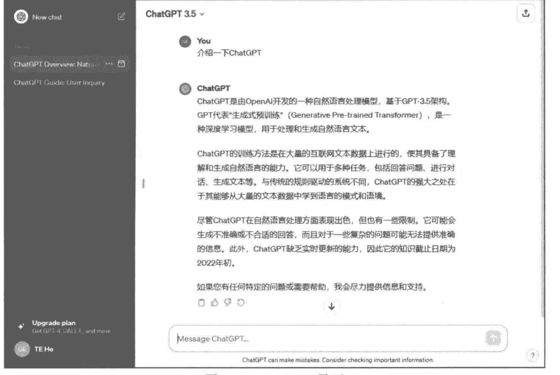

ChatGPT 能写出类人文章，并在多领域提供清晰解答，迅速获得关注，被认为足以影响知识型工作与白领市场，但准确性参差不齐是主要短板。2022 年 11 月上线后 OpenAI 估值升至 290 亿美元，上线 5 天用户破百万，两月后破亿。目前 GPT-3.5 免费开放，GPT-4 仅面向 ChatGPT Plus 会员，每三小时可发送 50 条消息。

模型易继承训练数据中的偏见，可能导致对不同群体产生失真或不公的表述。

### 1.2.2 训练方式详解

ChatGPT 训练结合监督学习与强化学习，对 GPT-3.5 模型进行微调。人类反馈直接用于提升输出质量。

监督学习阶段，训练员提供大量高质量对话样本，分别扮演用户与助手，训练模型理解并生成符合预期的交流内容。

强化学习阶段，训练员对回复进行评分，建立奖励模型，再用近端策略优化 PPO 算法迭代微调，在效率与效果间取得平衡。OpenAI 也通过用户点赞、点踩与详细反馈持续迭代模型。

在代码编写与调试方面，ChatGPT 并非真正理解编程，而是通过统计关联学习代码片段的规律来提供辅助。

斯坦福团队的实验指出，GPT-3 在一批需要心智理论的任务上能够得出不错的结果，整体表现与7岁左右儿童相近。升级到 GPT-3.5，也就是 ChatGPT 的前身，任务通过率进一步提升，心理推断水平接近9岁儿童。但这并不等同于 ChatGPT 真正拥有心智理论，更可能只是训练过程中附带的副效应。因此更值得讨论的，不是它是否“具备”心智，而是这类评测本身的含义，以及对人工智能发展的启示。

### 1.2.3 ChatGPT 功能全景
借助强劲的语言模型，ChatGPT 在各类文本互动场景里展现出丰富的用途，主要能力大致涵盖以下方面。

1. 自然语言理解与回复。能读懂用户输入的口语化文本，并输出通顺合理的对话回应，在问答、闲聊、指导类场景中表现突出。
2. 内容创作。无论是文章、剧本还是歌词，ChatGPT 都可提供灵感并生成文本，用户能按需指定风格与主题。
3. 编程辅助。能解释编程难题、给出解决思路，甚至协助调试代码，从而提升开发效率。
4. 教育辅导。作为学习助手，可为学生提供作业指导、疑难解答，也可充当语言练习伙伴。
5. 信息检索与整理。快速汇总海量信息，为用户提炼要点，适用于调研、数据分析与报告撰写。
6. 多语言支持。支持多种语言交流，并提供翻译服务，降低语言沟通壁垒。
7. 模拟对话与角色扮演。用户可开展情景模拟训练或娱乐性角色扮演。
8. 情感陪伴。虽无真实情感，却能给予基础的情感支持与陪伴，缓解孤独感。
9. 意见与策略建议。基于训练知识库，在决策过程中提供参考建议。
10. 反馈迭代。接受用户反馈，在持续训练中不断优化回应，以更贴近用户期待。

总体来看，ChatGPT 的应用面相当广泛，通过强大的语言处理能力为学习、工作与娱乐带来便利，随着技术演进，使用场景还将持续扩充。

### 1.2.4 ChatGPT 特性与局限
1. **特性**
尽管对话机器人的本质是模仿人类交流，ChatGPT 的使用边界却很大。比如能编写调试程序、撰写学生论文、在特定测试中超越普通人类考生、作曲、编剧、创作小说诗歌、模拟 Linux 系统等。训练语料涵盖各类文档、互联网内容、编程语言知识，如 BBS 帖子和 Python 代码。

相较前身 InstructGPT，ChatGPT 更努力减少有害或误导的输出。举例来说，InstructGPT 面对“告诉我 2015 年克里斯托弗·哥伦布何时抵达美国”会当成史实描述，而 ChatGPT 则会结合对哥伦布航海和现代世界的认知，构建一个假设性回答。

另外，ChatGPT 能记住过往对话和提示，与多数聊天机器人不同。为了避免冒犯性内容，输入会先经审核 API 过滤，降低种族、性别歧视等风险。

2. **局限**
OpenAI 承认 ChatGPT 有时会出现看似合理实则错误或荒谬的答案，这类现象在大型语言模型中常见，被称为人工智能幻觉。其奖励模型基于人工监督构建，容易出现过度优化，产生古德哈特定律式的影响。对 2021 年之后发生的事件了解有限。训练时，评审者倾向于偏好更长的答案。训练数据本身存在算法偏见，例如在描述 CEO 等模糊职位时，可能默认对应白人男性。

### 1.2.5 ChatGPT 服务矩阵
ChatGPT 提供多元化服务，可按需求匹配，包括基础版、ChatGPT Plus 付费版、企业版、移动客户端及面向开发者的 API，如图 1-2 所示。

1. **基本服务**
ChatGPT 基础版由旧金山的 OpenAI 于 2022 年 11 月 30 日推出，见图 1-3。发布 5 天用户破 100 万，两个月后即 2023 年 1 月月活约 1 亿。最初免费开放，意在后续商业化。截至 2023 年 12 月用户已超 17 亿，成为当时增速最快的消费级应用之一。

图 1-2 ChatGPT 服务类型

图 1-3 OpenAI 公司总部

据 2022 年 12 月 15 日全国广播公司商业频道报道，尽管用户增长迅猛，服务仍不完美，常有故障。处理英语时效果最佳，虽支持多语种，但在其他语言的表现参差。

2023 年 2 月 7 日，微软借助与 OpenAI 的合作推出必应 AI 预览版，宣称其为“超越 ChatGPT 的新一代大语言模型，并专为搜索场景优化”。

同年 12 月，互动问答网站 Quora 推出 Poe 平台，支持 GPT-3.5 与 GPT-4 等模型，提供更强的互动体验。

## 8 ChatGPT实践探索

图 1-2 ChatGPT 服务类型

图 1-3 OpenAI 公司总部

## 2 ChatGPT Plus 优质服务
OpenAI 于 2022 年 11 月推出专业订阅计划 ChatGPT Plus，月费 20 美元，逐步向更多国家和地区开放，免费版仍供低需求用户使用。

2023 年 3 月 12 日，GPT-4 多模态模型发布，并计划加入图像输入能力。免费用户若想体验 GPT-4，需申请 API 或升级至 Plus。

2023 年 7 月，Advanced Data Analysis 功能向全部 Plus 用户开放，提供数据分析、即时格式化、个性化数据科学咨询、音乐品味分析、视频编辑、文件上传下载与图像提取等服务。9 月 Plus 新增对话与图像识别能力，10 月再加入 DALL·E 3 图像生成功能。

2023 年 11 月开发者大会上，OpenAI 发布聊天机器人创建工具 GPT 与新模型 GPT-4 Turbo，进一步拓展平台能力。

## 3 团队服务
ChatGPT 团队版面向企业与组织，通过协作与管控提升团队效率，主要包括：
- 多用户权限管理，便于按角色分配访问权限。
- 增强的会话历史共享，方便回顾与协作。
- 高级数据分析与报表工具，追踪使用情况并优化流程。
- 优先客服与按需定制开发，满足特殊需求。
- 企业级安全与合规集成，保障信息安全。

整体目标是让组织更高效地使用 ChatGPT，提升协作质量与产出。

## 4 移动应用
2023 年 5 月 18 日，OpenAI 推出 iOS 版 ChatGPT 应用，先在美国 App Store 上架后逐步扩至更广区域。

Android 版于 2023 年 7 月 25 日发布，已在 Google Play Store 的多个国家上架，包括阿根廷、孟加拉国、巴西、加拿大、法国、德国、印度、印度尼西亚、爱尔兰、日本、墨西哥、尼日利亚、菲律宾、韩国、英国及美国。

## 5 面向开发者的 API 支持
2023 年 3 月，OpenAI 为 ChatGPT 与 Whisper 模型推出 API，帮助开发者将先进的语言与语音技术集成到应用中。基于 GPT-3.5-turbo，定价为每千 token 0.002 美元，成本仅为前代模型的十分之一，大幅降低 AI 应用门槛。
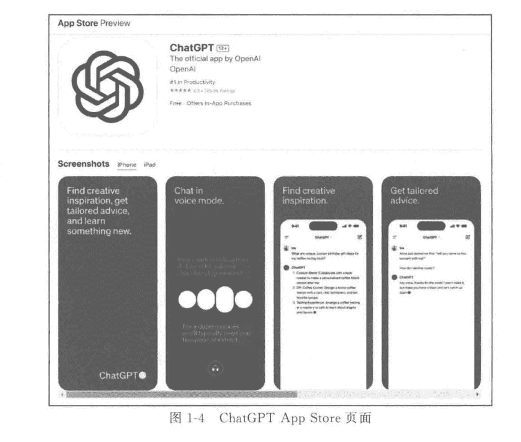
图 1-4 ChatGPT App Store 页面
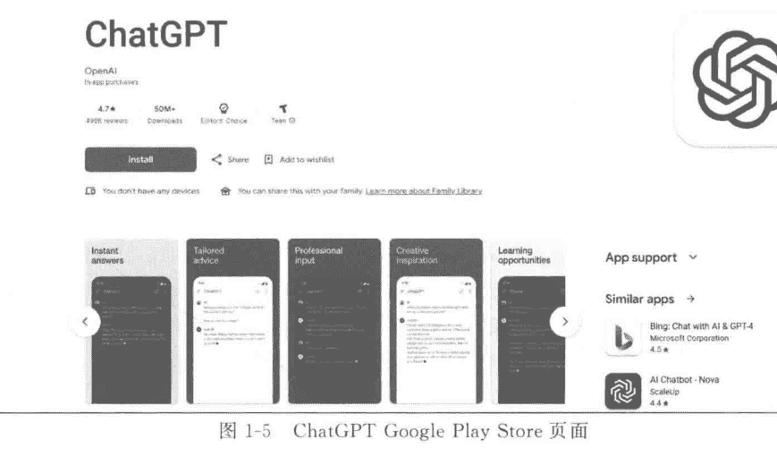
图 1-5 ChatGPT Google Play Store 页面

### 1.3 ChatGPT 相关社区和论坛
深入使用 ChatGPT 时，加入相关社区与论坛有助于获取支持、交流经验并结识同好。成员间互助分享创新案例，追踪技术动态，反馈驱动产品优化。以下介绍四个主要平台。

### 1.3.1 ChatGPT 中文社区
面向中文用户的专属讨论平台，可分享使用技巧、插件资源等经验。例如社区介绍的 Voice Control for ChatGPT 浏览器插件，支持语音指令交互，兼容中文与英文。

感兴趣者可访问官方网站 https://chinagpt.io/ 获取资源与工具，如图 1-6 所示。
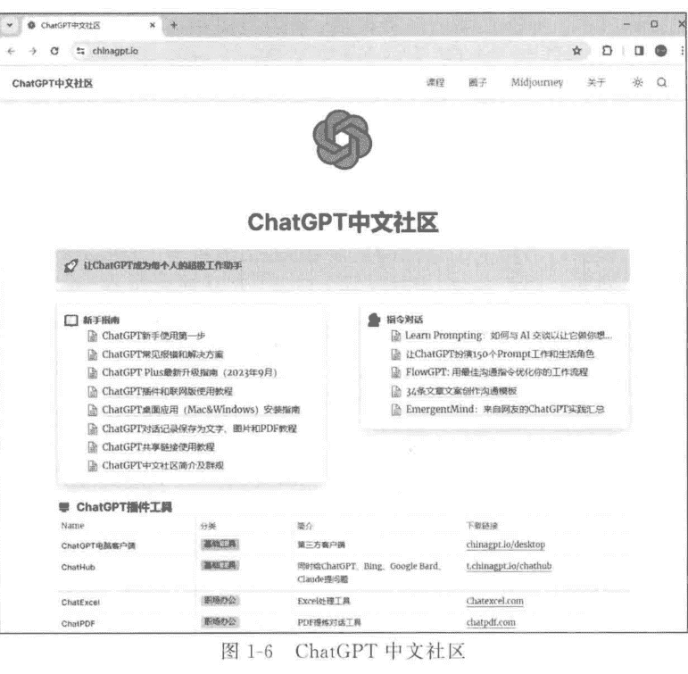
图 1-6 ChatGPT 中文社区

### 1.3.2 OpenAI ChatGPT 社区
聚集开发者与技术爱好者的论坛，聚焦 OpenAI 技术进展与应用案例。成员可讨论使用心得、解决开发问题、探索新特性。

访问 https://openaiok.com/ 即可参与讨论，如图 1-7 所示。
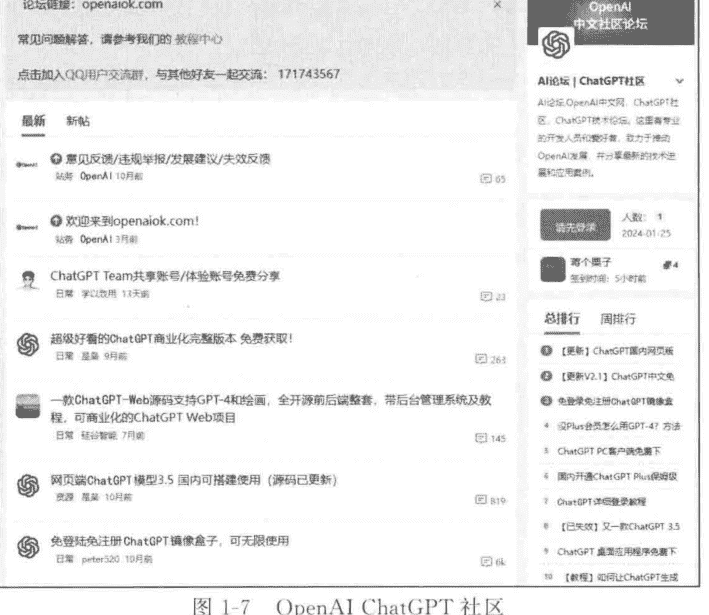
图 1-7 OpenAI ChatGPT 社区

### 1.3.3 ChatGPT 深海论坛
专业论坛汇聚大量 ChatGPT 爱好者与开发者，分享应用经验、实践难题与技术进展，深度探讨集成与优化方法。

访问 https://gptocean.com/ 加入讨论，如图 1-8 所示。
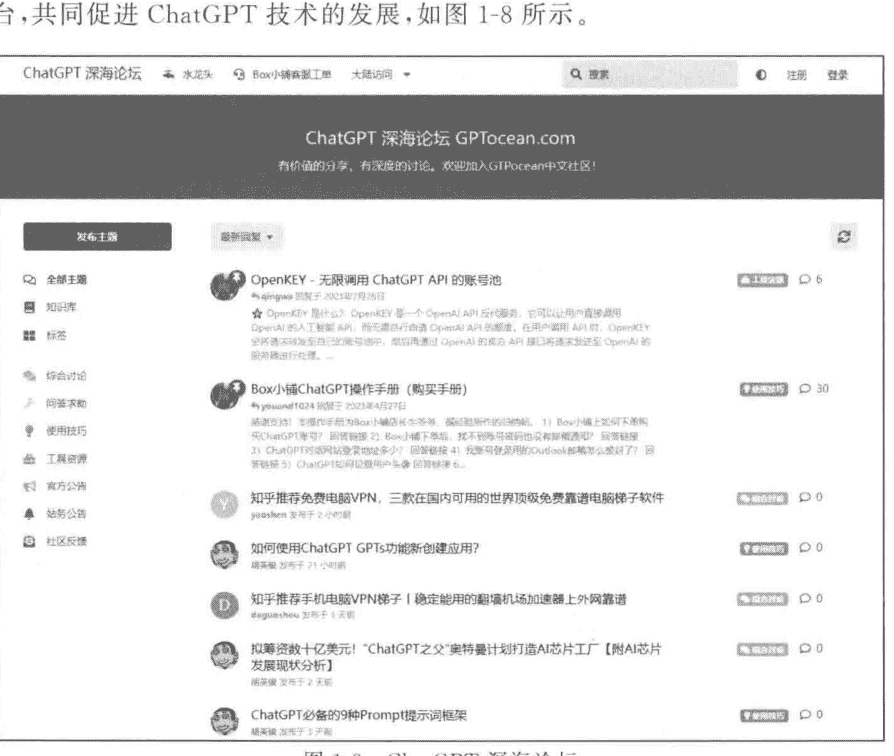
图 1-8 ChatGPT 深海论坛

### 1.3.4 OpenAI 开发者论坛
聚焦 OpenAI 下 ChatGPT 技术的专业社区，汇聚开发者探讨技术可能性，交流部署经验，分享应用范例。

可访问 https://community.openai.com/tag/chatgpt 参与话题，如图 1-9 所示。
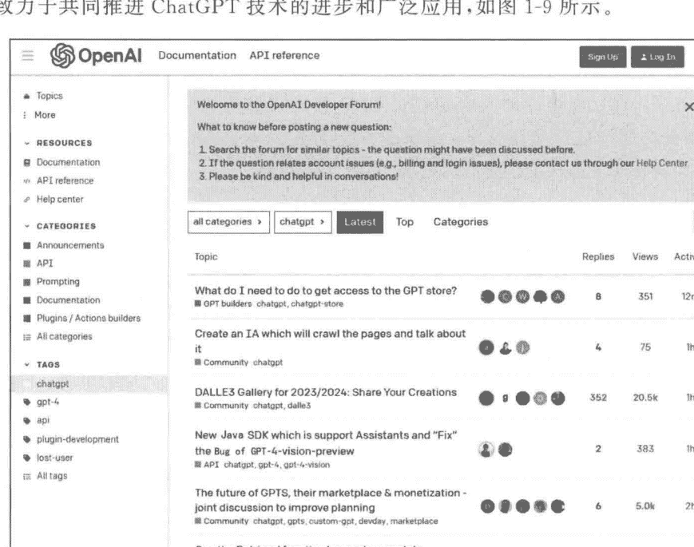

### 1.4 ChatGPT 应用领域
作为革命性的对话式 AI，ChatGPT 的潜力远超单一场景。

### 1.4.1 教育辅助
ChatGPT 在教育场景渗透迅速，个性化功能优化教学体验，主要体现在：

1. 个性化学习体验。依据学习进度与理解水平提供定制建议，摆脱“一刀切”模式。
2. 即时教学反馈。提交作业后可迅速指出错误，加深理解与记忆。
3. 多语言学习支持。通过对话练习提升新语言的实际运用能力。
4. 知识点巩固。模拟对话引导复习，并以提问检验掌握程度。
5. 作业与论文辅助。提供构思与写作建议，助学生理清思路。
6. 语言模仿与练习。提供流畅自然的对话示范，纠正发音与语法。
7. 资源链接推荐。智能推荐教学视频、论文、在线课程等，拓展学习渠道。

总体而言，它提升了学习效率与互动趣味，有望在个性化教育中发挥更大作用。

### 1.4.2 编程辅导
在编程领域，ChatGPT 扮演教练与助手角色，具体表现为：

1. 代码编写辅助。能生成代码片段作为起点或参考，尤其适合常见编程模式，缩短入门周期并提高编码效率。

ChatGPT 全场景应用解析

2. 代码体检与加速
程序员可以让 ChatGPT 帮忙审阅代码，从而把代码质量拉到更高层级。模型会依托行业最佳实践，对代码规范、潜在 bug 以及性能瓶颈进行扫描，并给出可落地的改进方案，进而让代码更健壮、更易读。

3. 难题排查与求解
碰到编程卡点时，把问题描述给 ChatGPT 即可。它会根据问题的复杂程度给出解决思路或直接给出可运行的解法，明显缩短排错周期，也有助于开发者吃透问题的本质。

4. 新语言学习伴侣
ChatGPT 覆盖众多编程语言，能充当新语言的私人导师。无论是基础语法的讲解，还是进阶概念的拆解，都能提供一对一的定制化指导。

5. 实时互动式学习
通过即时对话练习新技能和概念，这种有反馈的学习方式比单纯看文档或教程更高效，能迅速帮程序员跨过学习障碍。

6. 编程资源导航
当要深入某个技术或工具时，ChatGPT 会指向相关的官方文档、优质教程或活跃社区，帮助开发者快速获取细节信息，加速知识掌握。

ChatGPT 在编程辅导上的价值在于显著提升个人与团队的产出效率。它弥补了教育资源的缺口，为不同水平的开发者提供即时、个性化的支持。随技术迭代，它在编程学习和开发环节的角色只会更核心、更普及。

### 1.4.3 技术支持
ChatGPT 能在软件使用和硬件故障等技术问题上提供实用帮助，具体方式如下。

1. 故障排查引导
能按逻辑步骤协助用户诊断并解决常见技术问题，例如电脑无法开机、程序崩溃、网络掉线等。

2. 软件使用指导
对常用办公和生产力软件的功能进行解释，提供清晰操作指引，提升使用效率和体验。

3. 硬件选配建议
就笔记本、智能手机、移动硬盘等设备的选购、保养或升级给出建议。

4. 安全防护提醒
提供网络安全和个人数据保护的实用建议，防范木马入侵和信息泄露风险。

5. 性能优化技巧
给出提升设备流畅度的建议，如清理冗余文件、调整系统设置或进行硬件升级。

6. 资源链接共享
推荐靠谱的技术支持渠道，包括社区论坛、官方帮助中心、视频教程等，获取更深层的帮助。

7. 技术趋势介绍
介绍新出的产品和技术走向，帮助用户了解可能影响选择的创新方向。

8. 兼容与集成建议
在整合不同设备或应用时提供配套建议，确保协同工作顺畅无阻。

整体而言，ChatGPT 的技术支持旨在快速解决问题，同时培养用户自助处理能力。但对于复杂的硬件维修或专业的软件运维，它无法替代持证工程师，关键问题仍需咨询专业人士。

### 1.4.4 语言翻译
在全球化沟通场景中，ChatGPT 的翻译能力成为跨语言桥梁，主要体现为：

1. 口语即时翻译
支持语音输入，将所说内容实时译成目标语言，对出差者或跨语沟通者很友好。

2. 文本翻译服务
可处理私信、商务文件、学术论文等文本，给出准确译文，打破语言壁垒，促进跨文化交流。

3. 对话实时翻译
在双语对话中充当即时译者，让双方即使互不懂语言也能顺畅交流。

4. 语言学习辅助
提供练习题、发音纠正、语法解析等功能，帮助提升语言综合能力。

5. 文化语境考量
翻译时兼顾文化差异和地域表达习惯，确保译文自然准确，而非生硬直译。

6. 双向多语种支持
支持多语种互译和双向转换，让不同文化背景的用户都能便捷使用。

这些功能说明 ChatGPT 追求的不是简单的词对词转换，而是理解上下文、传递原意的翻译体验。随着数据积累和模型升级，译文的流畅度和准确度持续提升，也为语言学习者提供了强有力的练习伙伴。

### 1.4.5 创意脑力激荡
ChatGPT 能作为创意伙伴参与点子和方案的生成，常用做法包括：

1. 启发式提问
抛出开放性问题，引导用户从不同角度或全新路径思考，激发新视角。

2. 大量点子生成
不受限制地列出多种可能的解法或创意，拓展思维边界，帮助跳出固有框架。

3. 角色扮演模拟
模仿不同用户或利益相关者的立场，全面审视问题，挖掘被忽略的创新点。

4. 跨域联想
引用文学、艺术、流行文化元素，为用户提供新鲜联想，促成跨领域灵感。

5. 类比与隐喻
把一个领域的思路迁移到另一领域，形成创新连接，构建更具创意的思维模型。

6. 情境模拟
搭建假设场景，让用户在虚拟环境中试验想法，从而激发出更丰富的创意可能。

### 1.4.6 生活管理
ChatGPT 能让日常更有序、更省时，具体帮助有：

1. 购物清单与省钱策略
协助制定购物清单，结合促销信息和个人消费习惯给出规划建议，实现省钱又满足个性需求。

2. 日程提醒与安排
帮忙建立日程表并推送提醒，覆盖会议、就医、生日等事项，避免遗漏。

3. 任务清单创建与追踪
协同用户建立任务清单，对重要活动进行记录与跟进，提升执行效率。

4. 生活小技巧
分享提高效率的小窍门，如快速家务、节能方法、健康饮食建议等。

5. 重要事项记录
协助记录保修到期、缴费日等关键信息，并提供提醒建议，助力生活规划。

6. 健康与健身规划
提供运动方案和经济型饮食建议，帮助用户制定并坚持健康目标。

7. 旅行规划辅助
给出目的地建议、打包清单、预算方案及性价比住宿交通推荐，让出行更省心。

8. 成长与学习资源推荐
推荐书籍、在线课程和技能工具，为个人成长和终身学习提供针对性支持。

需要说明的是，ChatGPT 不具备实时闹钟或直接写入日历的功能，建议配合手机日历、任务管理 App 等工具使用，方能实现真正的实时追踪。

### 1.4.7 心理支持
在情绪陪伴和心理建议层面，ChatGPT 的作用包括：

1. 情绪支持
提供一个安全的倾诉空间，聆听并回应用户的感受，带来情绪释放和自我觉察。

2. 压力与焦虑管理
通过积极对话提供放松技巧、呼吸练习、正念冥想等策略，帮助用户找回平衡。

3. 自我反思与认知重塑
引导用户辨认压力源，提出认知调整方法，改善负面思维模式。

4. 生活调适建议
围绕作息调整、兴趣探索、人际改善等给出个性化建议，帮助适应变化。

5. 资源链接
提供自我帮助手册、线上咨询平台及本地专业心理服务的信息。

6. 危机干预提示
遇紧急情况时提供求助热线信息并强烈建议联系专业人员。ChatGPT 并非持证心理师，严重问题必须寻求专业医疗帮助。

### 1.4.8 健康咨询
ChatGPT 提供低成本、易获取的基础健康信息支持：

1. 基础健康问答
解答症状、疾病常识、营养建议等常见问题，快速获得初步信息。

2. 初步健康建议
结合用户描述给出参考性建议，帮助判断是否需要进一步就医，不可替代专业诊断。

3. 健康知识普及
介绍疾病预防、保健措施和健康生活方式，提升公众认知。

4. 资源与专家指引
推荐权威医疗机构和专业人士，便于获取进一步诊疗支持。

5. 监测与提醒
辅助建立服药提醒、体检提醒等健康管理习惯，提供定制化支持。

6. 非紧急决策辅助
帮助用户在非急症情况下判断自我护理与就医的边界，提升自我管理能力。

使用时需明确其建议基于算法，不等同于医生诊断，严重或疑似急症请及时就医。

### 1.4.9 娱乐互动
ChatGPT 丰富休闲时光的方式有：

1. 趣味对话体验
围绕日常话题或兴趣点进行个性化聊天，提供轻松愉快的交流体验。

2. 娱乐内容推荐
根据喜好推荐游戏、影视、音乐等，拓展休闲选择。

3. 创意故事与笑话
原创小故事和幽默段子，为用户带来欢笑。

4. 音乐与影视匹配
基于口味推荐作品，满足个性化品味。

5. 社交互动陪伴
参与话题讨论、解答疑问，成为一个有趣的对话伙伴。

6. 智能问答游戏
通过知识问答提升学习趣味性，促进记忆与思考。

7. 语言学习游戏
以游戏化方式练习语言，提升学习动力和实用能力。

### 1.4.10 旅游规划
作为旅行助手，ChatGPT 可提供定制化服务：

1. 个性化目的地推荐
结合兴趣给出景点、文化活动、美食体验等建议，激发旅行灵感。

2. 行程定制与优化
制定详细日程并根据实际情况灵活调整，确保体验最佳。

3. 实时信息服务
提供天气、交通、当地活动等最新资讯，助力临场决策。

4. 住宿餐饮预订支持
协助搜索酒店餐厅，对比价格与评价，按预算推荐。

5. 出行贴士与文化解读
提供时差、着装、安全提示及当地文化背景，帮助更深入融入。

6. 语言沟通辅助
提供基础翻译支持，跨越语言障碍。

7. 问题解答与应急支持
遇突发状况时提供医疗点、紧急联系方式等信息，帮助应对意外。

随着数据和技术进步，这类智能助手将提供更精准、更贴心的旅行体验。

### 1.4.11 法律咨询

ChatGPT 在法律类需求上能派上不少用场。很多人只是想搞清楚一个基础法律问题，或是把专业表述转成自己能懂的话，ChatGPT 就能给出有参考价值的说明。下面盘点它在法律场景里的典型用法。

### 1. 通俗解读法律术语
ChatGPT 擅长把常见的法律词汇拆解成白话，比如合同违约、知识产权、民事诉讼等。借助清晰简短的说明，用户读懂法律文件或跟进专业讨论时更顺畅，法律素养也随之提升。

### 2. 解答生活常见法律疑问
面对租房、劳动、消费者权益等日常问题，ChatGPT 能提供基础指引和一般性信息。常见问题的解答帮助用户理解相关法规和自身权益，在生活中应对法律挑战时更有底气。

### 3. 法律流程快速了解
ChatGPT 可以介绍各类法律程序的大致走向，例如小额索赔的提交方式、遗嘱认证的一般环节、离婚程序的基础步骤等。用简洁的语言说明流程，帮助用户在需要时更冷静地处理事务。

### 4. 案例解析助理解
通过讨论已公开的判例，ChatGPT 帮助用户看懂法律原则在实践中的运用。案例拆解让条文从抽象变具体，使用户更清楚规则的适用范围和操作逻辑。

### 5. 推荐权威法律资源
ChatGPT 会指向有用的法律信息渠道，比如在线法律数据库、免费法务咨询入口、寻找律师的工具网站等。借助这些资源，用户获取信息和专业支持的效率更高，决策也更有依据。

### 6. 法律文件结构指引
ChatGPT 不能直接起草法律文件，但能说明常见法律文书的构成和必备要素，例如租赁协议的常规条款，帮助用户理解文件该怎么看、该关注哪些点。

### 7. 风险提醒与专业建议
在法律相关讨论中，ChatGPT 会提示潜在风险，并建议在做决定前咨询合规律师以获取更深入的意见。

ChatGPT 提供法律信息的核心目的是提升理解，而非做法律决策或替代专业意见。法律复杂且因地制宜，涉及具体事务时仍应咨询有资质的法律人士。先用 ChatGPT 梳理问题框架，再与律师高效沟通，是更稳妥的做法。

### 1.4.12 金融咨询应用全景
ChatGPT 在金融领域也能提供支持，可以讲解概念、解读市场、给出一般性理财建议。常见应用如下。

- 1. 基础金融知识教育
ChatGPT 能回答储蓄账户、投资账户、退休账户等产品的区别与用途，并解释利息、股息、贷款利率等核心概念，帮用户建立扎实的金融基础。
- 2. 市场数据解读
不执行交易也不做投资推荐，但能说明市场指数波动、经济数据发布对组合的可能影响，帮助用户更全面地把握市场动态。
- 3. 投资策略分析
用户可探讨价值投资与成长投资、长期持有与短线操作等策略的差异，ChatGPT 会说明各自特点、优势与风险，方便选择更契合的思路。
- 4. 预算规划和财务管理
可协助制定个人或家庭预算，给出省钱建议，分享日常财务管理的技巧，涵盖支出优化、债务管理、储蓄目标设定等实用内容。
- 5. 风险评估与管理
帮助理解投资风险、不同产品的风险等级，并提供分散投资、风险控制等一般性建议，降低潜在损失。
- 6. 理财工具和资源推荐
根据需求推荐预算软件、组合跟踪工具、理财类 App 等，让用户更高效地管理财务和做投资分析。
- 7. 经济新闻解读
对当前经济事件和新闻进行通俗解读，说明其对市场和个人财务的可能影响，助力更明智的财务决策。
- 8. 个税和退休规划
提供个人所得税的一般信息，介绍各类税种、税务规定及退休账户选项，说明如何争取税收优惠并为退休做准备，同时给出退休计划制定的通用建议。

同样要明确，ChatGPT 只提供通用信息和建议，不能替代持牌金融顾问或税务专家。重要决策前应咨询专业人士，先用 ChatGPT 提升认知和准备度，再在专业指导下行动。

### 1.4.13 客户服务提效方案
ChatGPT 为客服领域打开了新空间，企业可从以下方面提升体验与效率。

### 1. 全天候响应能力
ChatGPT 24 小时在线，无论时区和地理位置都能即时回应，打破时间限制，提升品牌可靠性与可达性。
### 2. 常见问题快速解答
模型基于知识库可迅速检索标准答案，高效解决高频咨询，让客户更快得到信息。
### 3. 交互式问题处理
通过多轮对话逐步引导客户描述问题，并据此给出解决方案，过程更连贯、人性化，也能更精准把握需求。
## 4. 个性化建议
结合历史交互记录，ChatGPT 可给出定制化推荐，让客户感受到被重视，同时提高解决准确率。
## 5. 费用效率的提升
自动化处理常规查询，减少人工坐席压力，人力成本下降，员工可聚焦复杂难题，提升整体服务效率。
## 6. 持续学习改进
随着对话积累，模型持续优化，回答质量和对新问题的覆盖度不断提升，客户关系也随之增强。

整合 ChatGPT 后，企业实现客服的智能化与自动化，满意度、运营效率和口碑都能兼顾。随着技术演进，其在客服中的应用会更深更广，既能快速响应需求，又能通过个性化建议和自动化处理提供更高效的服务，降低人力成本，提升忠诚度。

总体来看，ChatGPT 在提升工作效率、辅助学习、增加便利性等方面潜力巨大，未来应用场景还将持续延伸。

# 第 2 章 ChatGPT 新手上手指南
本章说明 ChatGPT 的注册与使用方法。

## 2.1 账号注册流程
使用前需先创建账号并登录，以保障身份、权限与个性化体验，具体步骤如下。

（1）打开 ChatGPT 官网，如图 2-1 所示。
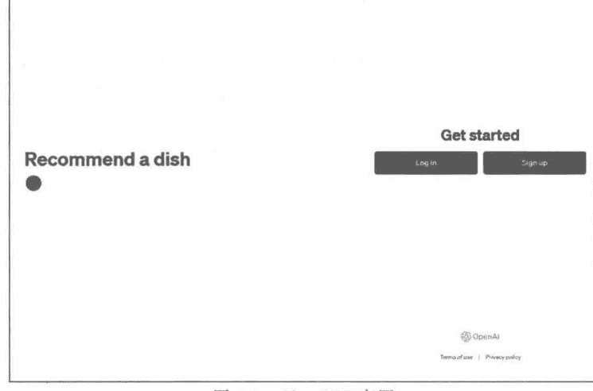
（2）点击 Sign up 按钮进入注册页，填写注册邮箱和密码进行注册，如图 2-2 和图 2-3 所示。
（3）点击“继续”按钮触发验证邮件发送，如图 2-4 所示。
（4）前往注册邮箱查收验证邮件，如图 2-5 所示。
（5）点击 Verify email address 按钮完成邮件验证，如图 2-6 所示。


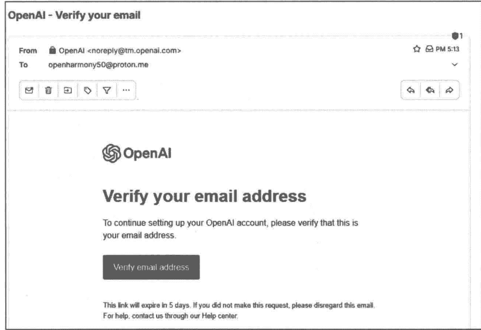
（6）确认验证后账号注册完成，如图 2-7 所示。

图 2-6 完成邮件验证
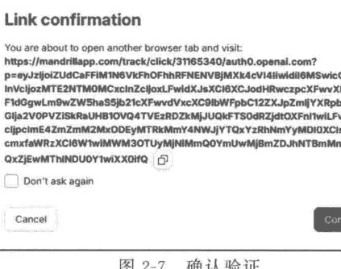
图 2-7 确认验证
（7）填写用户信息和生日，建议年龄设置为 18 岁以上以符合平台要求，如图 2-8 所示。

图 2-8 输入用户信息和生日
（8）完成非机器人人机验证，如图 2-9 所示。
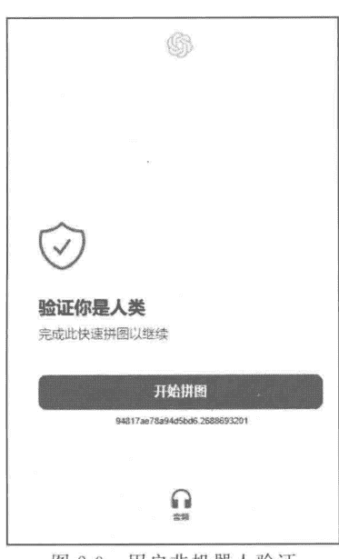
图 2-9 用户非机器人验证
（9）验证通过后进入 ChatGPT 聊天页，如图 2-10 所示。
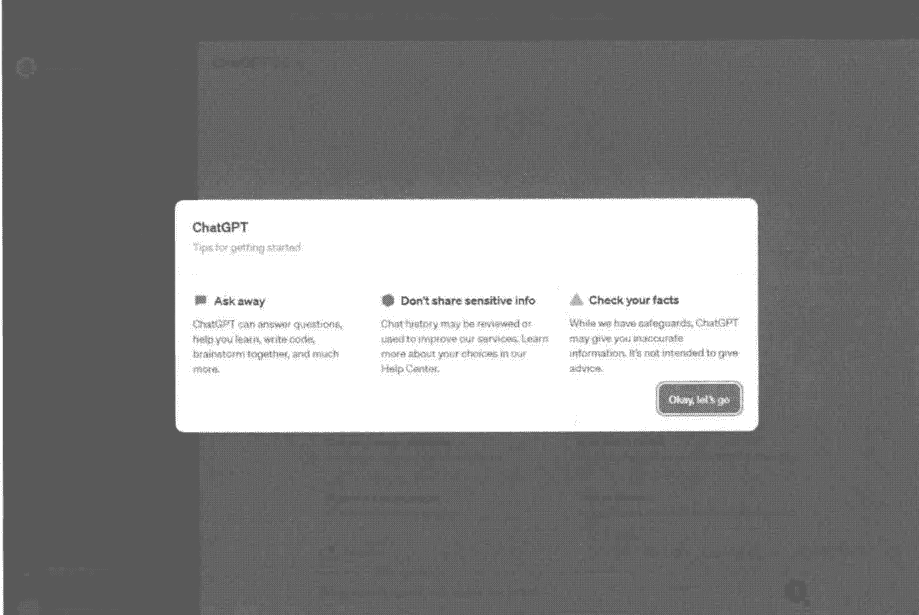
图 2-10 ChatGPT 聊天页面
注册完成后点击 Okay, let's go 即可开始使用。

## 2.2 OpenAI API 手机认证
ChatGPT 账号与 OpenAI 账号为同一体系。若要使用 OpenAI API，需先创建 API Key，创建前须完成手机认证，步骤如下。

（1）登录 OpenAI 官方文档网站，如图 2-11 所示。
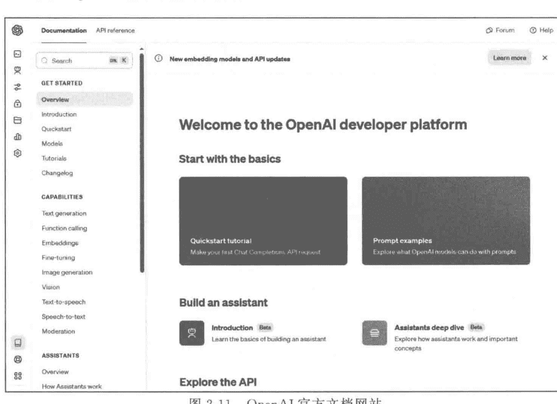
（2）用 ChatGPT 账号登录，点击左侧 API keys，如图 2-12 所示。
（3）点击 Start verification 按钮进入验证页，如图 2-13 所示。
（4）购买成功后可在已购买列表中查看，如图 2-14 所示。
（5）在验证页选择国家并输入手机号，如图 2-15 所示。
（6）点击 Send code 按钮发送短信验证码。
（7）输入收到的短信验证码，如图 2-16 所示。
（8）验证码校验通过后系统会展示账号学分提示，点击 Continue 继续，如图 2-17 所示。
（9）在弹出的 Create new secret key 对话框中点击 Cancel 取消密钥创建，如图 2-18 所示。
至此手机认证完成，认证成功后账号会获得 5 美元学分，期限 3 个月，如图 2-19 所示。
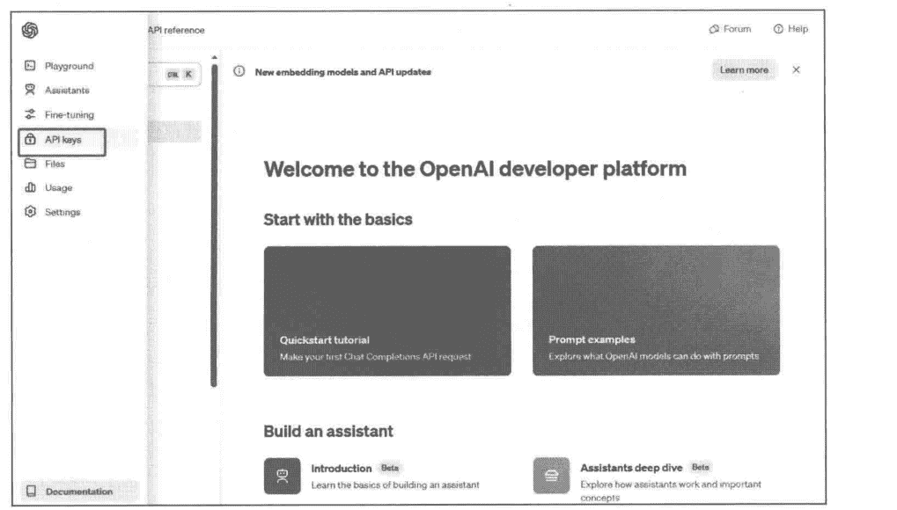
图 2-12 选择 API keys
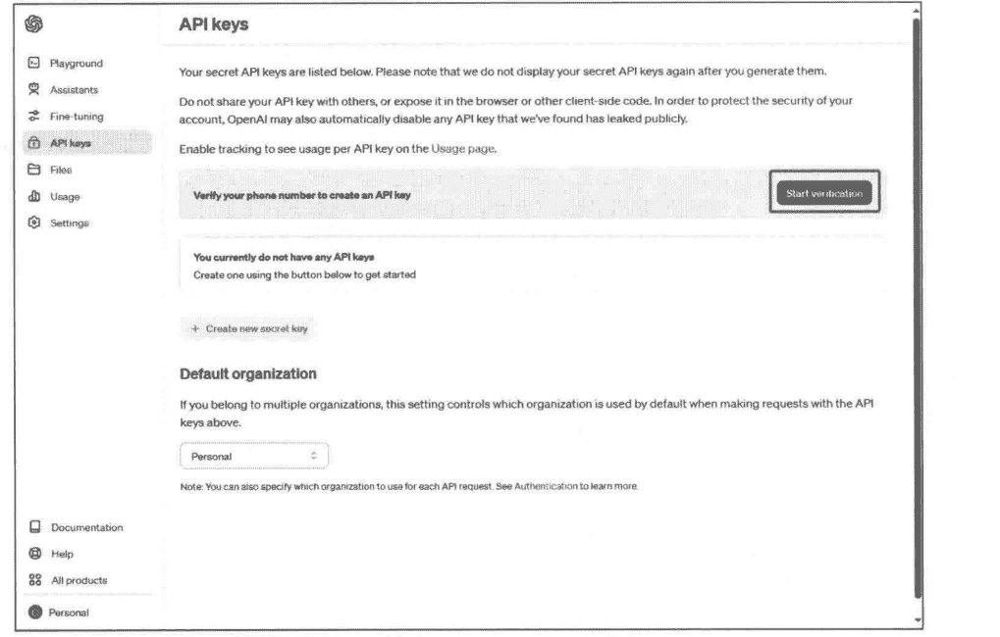
图 2-13 单击 Start verification 按钮
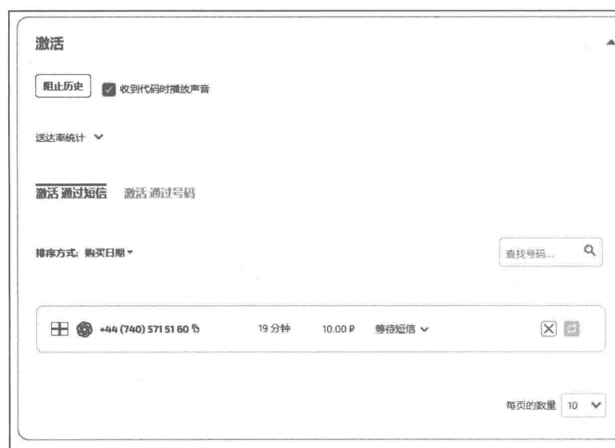
图 2-14 已购买手机号列表

图 2-15 输入验证手机号码

图 2-16 验证码输入

图 2-17 学分提示

图 2-18 取消密钥创建

图 2-19 学分补助

## 2.3 用户登录
OpenAI ChatGPT 登录流程如下。

（1）访问 ChatGPT 官网 https://chat.openai.com/auth/login，点击 Log in 按钮跳转登录页，如图 2-20 所示。
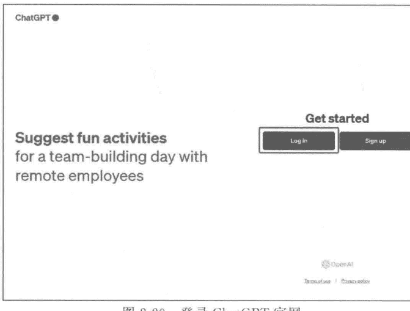
（2）输入注册邮箱，点击“继续”，如图 2-21 所示。
（3）输入密码，点击“继续”，如图 2-22 所示。


（4）登录成功后进入 OpenAI ChatGPT 聊天页，如图 2-23 所示。
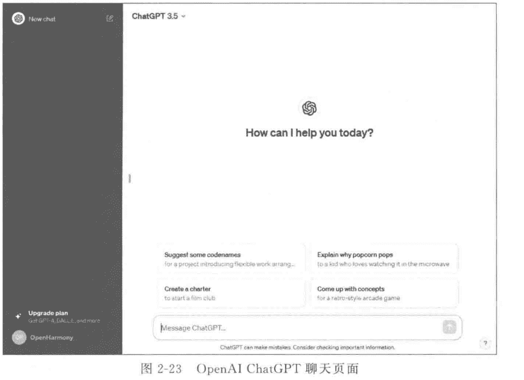
图 2-23 OpenAI ChatGPT 聊天页面

## 2.4 界面介绍
进入聊天界面后布局简洁，主要由以下几部分构成。

### 1. 功能提示
部分界面会提供上手提示或快捷指令，帮助新用户快速适应，如图 2-24 所示。
（1）快捷回复：提供常用语句，点击后自动填入输入区。
（2）使用指南：给出简短说明，指导如何与 ChatGPT 有效互动。
### 2. 对话框
对话框是核心交互区，如图 2-25 所示。
（1）输入区域：底部文本框用于输入问题。
（2）发送按钮：位于输入区旁，点击后发送消息。
（3）聊天记录：显示在输入区上方，记录双方对话历史。
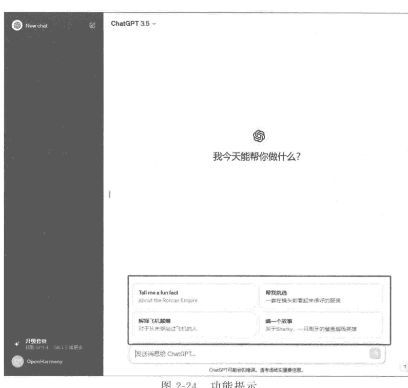
图 2-24 功能提示
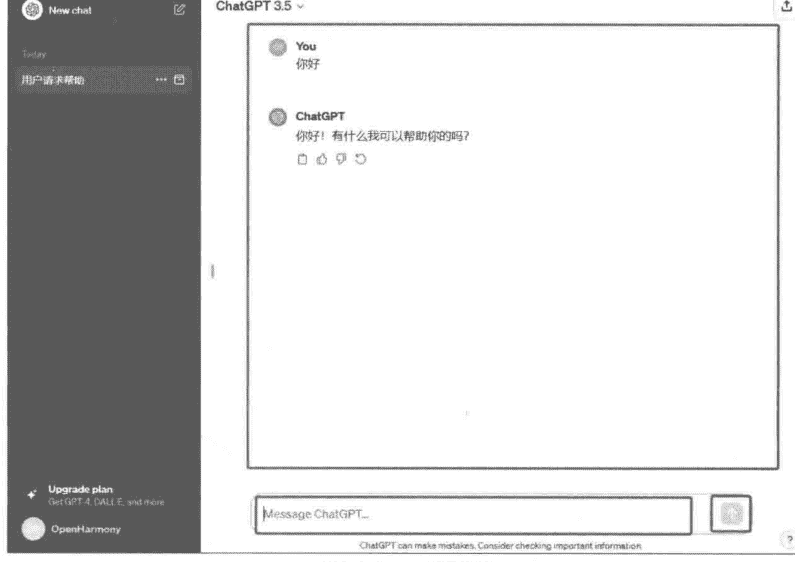
图 2-25 对话框
### 3. 菜单栏
界面左侧为菜单栏，包含新建会话、历史会话列表和用户信息，如图 2-26 所示。
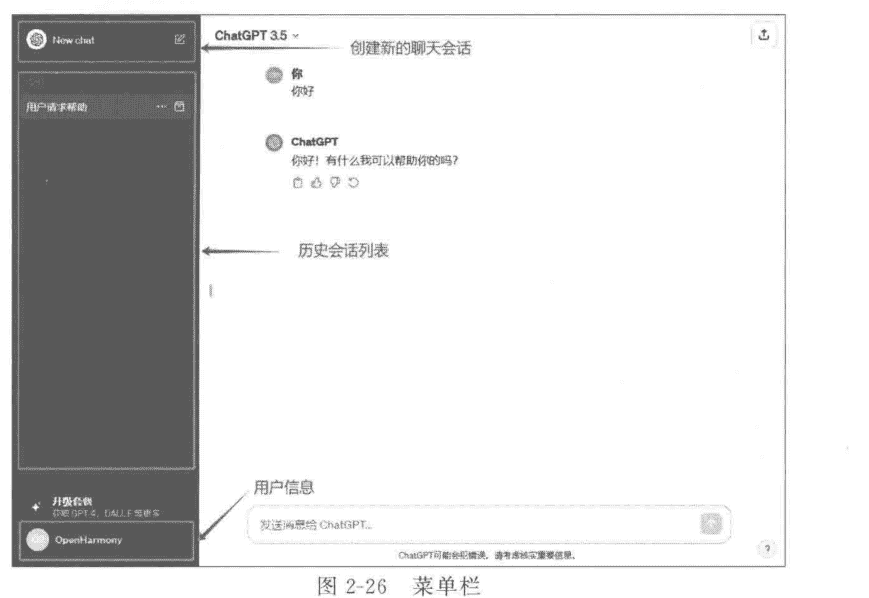
### 4. 个人中心
个人中心提供自定义指令、设置和退出登录功能，如图 2-27 所示。

掌握这些组件后即可开始与 ChatGPT 互动，随时借助帮助选项或设置进行个性化调整。

## 2.5 进行对话
熟悉布局后，可通过示例了解对话流程。

### 1. 输入问题
例如想获取提高小学生阅读理解的建议，将光标置于输入框，输入“请给出三条提高小学生阅读理解能力的建议”，如图 2-28 所示。
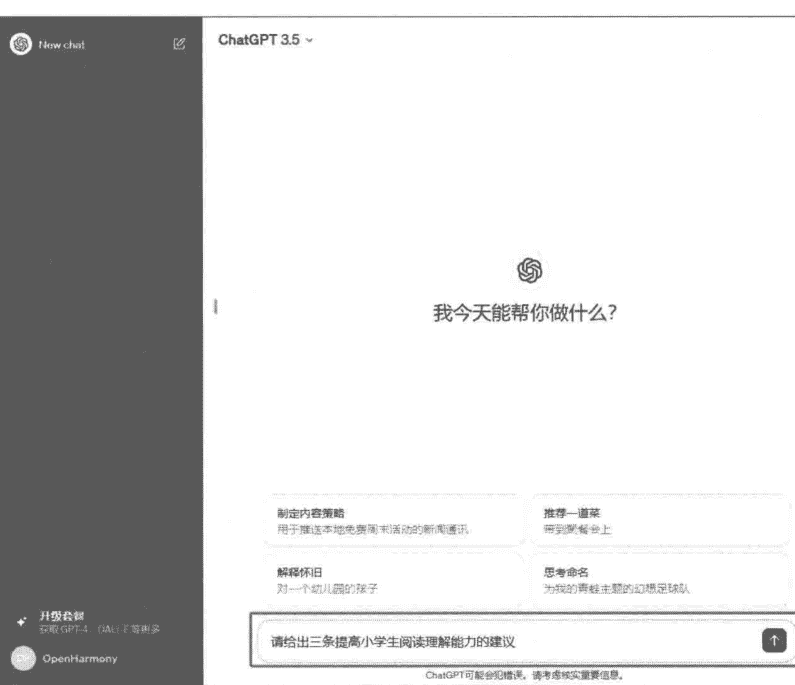
### 2. 发送消息
输入完成后点击发送按钮或按 Enter 提交，如图 2-29 所示。
### 3. 接收回复
问题发送后，聊天记录中会很快出现 ChatGPT 的回复，如图 2-30 所示。
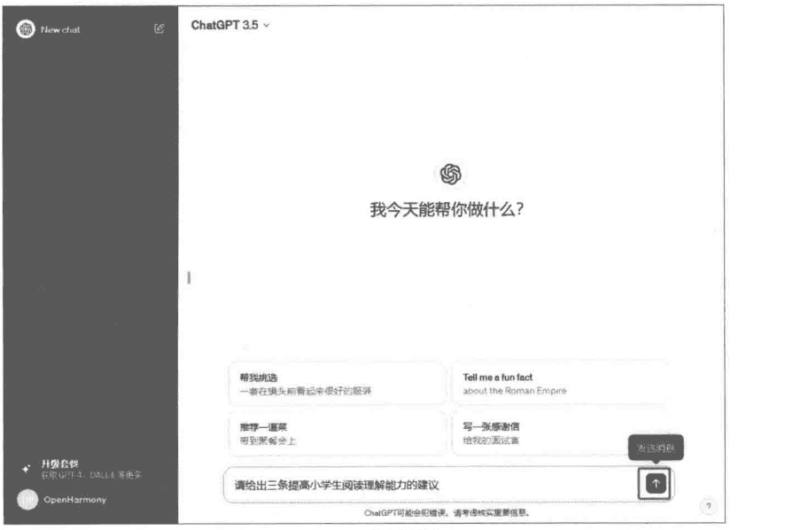
图 2-29 发送消息
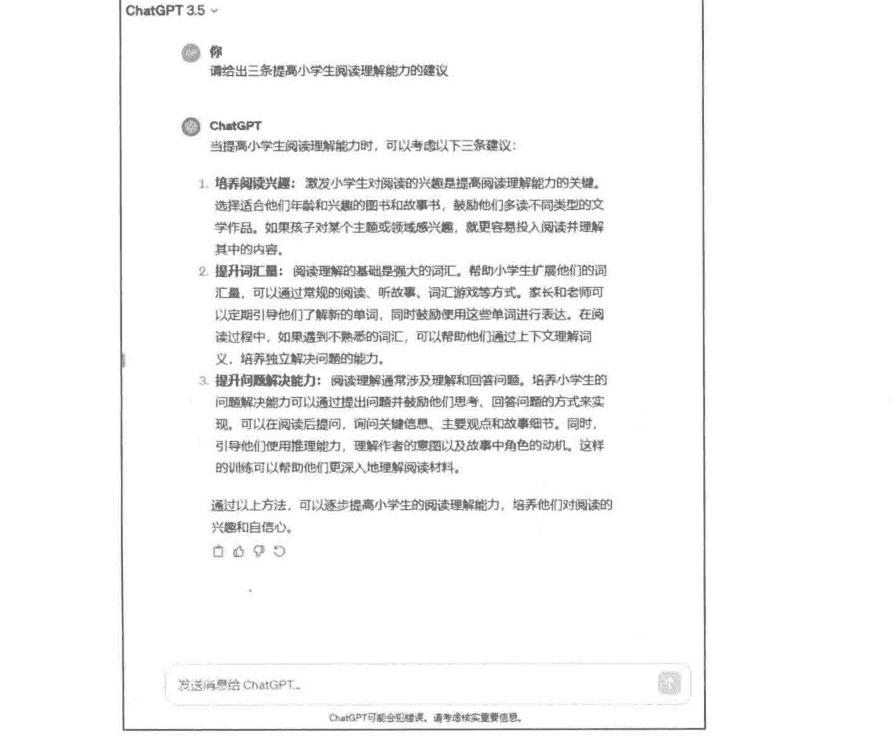
图 2-30 接收回复
### 4. 追加问题或提供反馈
若需深入，可追加提问，例如“请详细解释培养阅读兴趣”，如图 2-31 所示。
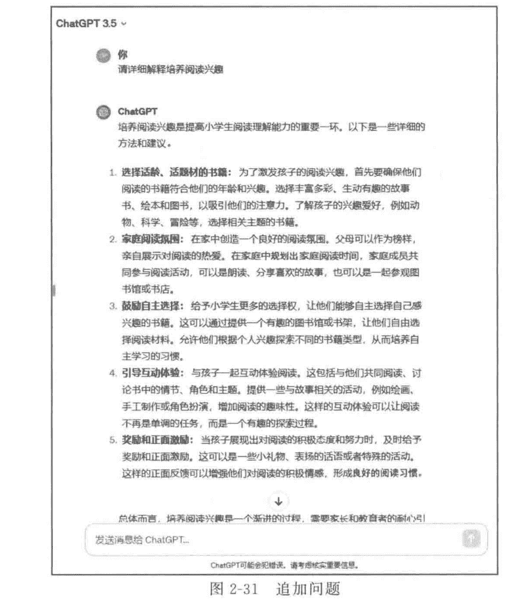

想要另类解法的情形下，可向模型反馈：“这些办法我已尝试过，你还有别的思路吗？”如图 2-32 所示。

### 5. 继续对话
读完回复后可追加提问，也可把个人想法补充进去，例如“明白了，我准备先按这些方式试试，谢谢！”如图 2-33 所示。

按此方式操作，便能与 ChatGPT 展开连贯深入的交流，无论求解还是闲聊都更顺畅。要点清晰，信息才更精准，也更能发挥模型能力。持续给出反馈、随时提出新问题，有助于保持对话的连贯与高效。

第2章 入门对话实务
43
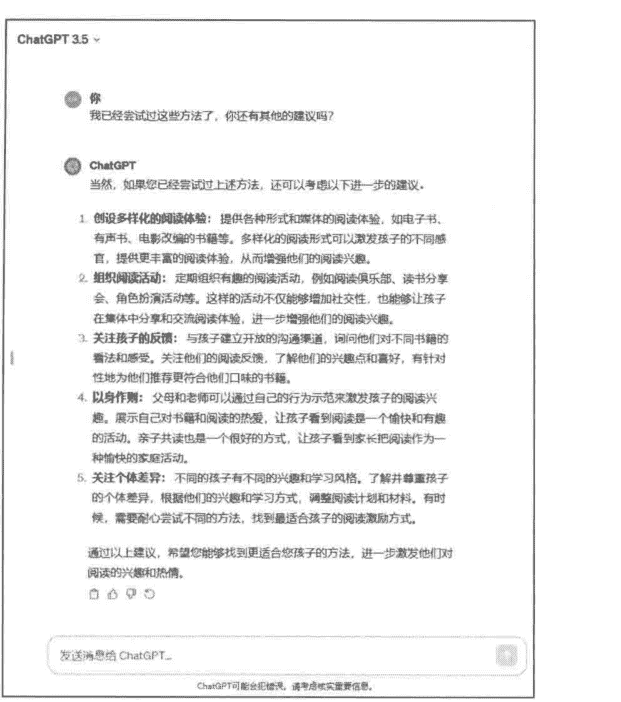
图 2-32 提供反馈
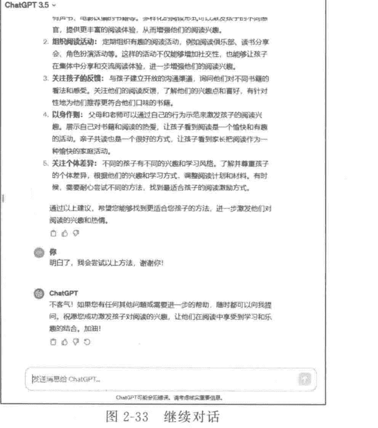
图 2-33 继续对话
## 2.6 会话礼仪
与 ChatGPT 保持得体交流十分重要，能让沟通更流畅也更愉快。礼仪的内核是尊重、理解与专业，体现在用词选择、耐心、积极回应及表达清晰。

下面是实现优雅沟通的关键点。

### 1. 语言与态度保持礼貌
与模型互动时，始终以尊重礼貌的姿态回应，即便观点不合或答案不理想也一样。具体做法如下。

1）使用积极的措辞
用词要传递友善肯定的信号，比如“请”“谢谢”“我理解”等，会让对话更和谐。

2）避免责备的语气
对回复不满意时，不要用指责的说法，改用询问或建议的方式表达自身看法。

3）提出澄清或纠正请求
觉得答案不准或产生误解时，礼貌地请其再说明，例如“我可能理解错了，能否再解释一次？”或“能更详细地说明一下这个概念吗？我想确认自己完全明白”。

4）控制语气
线上看不到真实语调，避免大写字母、过多感叹号等强硬或命令式的表达，保持平和的语气更有助沟通顺畅。

5）回应中的感激
即便回答并不完全正确，也要先感谢对方的努力，再礼貌指出需要补充的信息，例如“谢谢你的解答，我还有一些细节想进一步了解，能再帮忙解释一下吗？”

借助这些做法，即使出现分歧也能维持礼貌与尊重，实现有效沟通。

### 2. 表达简洁明了
问题和回答都要直截了当、简练。例如“可以推荐几条市场营销的最佳实践吗？”这种提问就很清晰具体。

### 3. 谨慎使用非正式用语与俚语
即使是轻松聊天，也要避免可能引起误解或显得不专业的口头语。例如“嘿，你能帮我查点资料吗？”就偏随意。

### 4. 提供有用反馈与确认
拿到所需帮助时，给出反馈以便后续改进。例如“你提供的信息非常有帮助，正是我想要的，谢谢”。

### 5. 结束对话时表达谢意
无论结果如何，都要礼貌收尾。例如“非常感谢你的帮助，祝你今天愉快”。

遵守这些礼仪能营造积极的沟通氛围，让信息传递更顺畅高效，双方都感到被尊重。

## 2.7 期望管理
任何对话中，合理设定并管理双方期望对有效沟通至关重要。这需要清晰表达自己的需求，也要理解对方能提供何种程度的帮助。

管理期望的策略与明确可行的目标。

### 1. 明确需求与期望结果
开场就直接说明想要什么信息或帮助。例如“我想了解下个月的天气预报，以便安排旅行”。

### 2. 提供充足背景信息
提供查询的背景，对方才能更好理解需求。例如“因为我要去海边，所以更关心降雨量和风速”。

### 3. 清晰表达时间限制
如果对回复时间有要求，应提前告知。可以说“我希望今天下午前能收到，这样我才能及时决定”。

### 4. 理解回复的可能限制
并非所有请求都能立刻或完全按预期满足，可能受信息可用性等限制。可问“你能提供这项服务吗，或知道该去哪里寻求帮助？”

### 5. 适时反馈并调整期望
收到信息后给反馈，必要时调整期望。例如“这些信息很有用，但我还想要……能帮我吗？”

### 6. 结束时确认获得的帮助
临近结束时，重申得到的帮助并致谢。例如“感谢你的努力和提供的信息，对我的计划很有帮助”。

有效管理期望可以减少误解和失望，保持对话积极高效，也有助建立长期可信的沟通渠道。

## 2.8 求助途径
即便严格遵循本书建议，使用 ChatGPT 时仍可能遇到难题。这时可按以下步骤寻求支持。

### 1. 查阅帮助文档
多数平台提供帮助中心或用户手册，包含常见问题解答和上手指南。善用搜索功能查找特定主题，手册各章节通常有详细步骤，可按步骤排查。

### 2. 浏览常见问题解答
FAQ 部分聚焦用户高频问题，答案简短直接，能快速获取所需信息。

### 3. 联系客服
自助查阅后问题仍在，可联系平台客服。提供问题描述、已尝试步骤及文档或 FAQ 中的信息，有助于客服更快定位。紧急或复杂问题，部分平台支持实时聊天或电话。

### 4. 借助用户社区或论坛
平台若有社区或论坛，可发帖提问。社区多由资深用户组成，常有相同问题的解决方案。发帖前先搜索，看是否已有解答。

### 5. 社交媒体求助
部分平台在社交媒体活跃，可通过 Twitter、Facebook 等公开提问。公开性通常能获得更快的客服响应。

### 6. 构建更轻松高效的对话
（1）经常练习：多实践各种功能，越熟悉就越能高效对话。
（2）及时更新：关注新版本和新功能，平台会持续改进和新增特性。
（3）提供反馈：多数平台欢迎用户反馈，你的建议是产品改进的重要资源。

通过上述方法和技巧，你能更深入地理解和使用 ChatGPT，无论是获取信息、娱乐还是解决实际问题，体验都会更丰富。适应新工具需要时间，耐心和实践很关键。

# 第 3 章 实用交互技巧
与 ChatGPT 高效互动有技巧，下面介绍一些实用方法，帮助你沟通更顺畅、体验更好。

## 3.1 基础聊天技巧

### 3.1.1 明确请求
提问时要尽量具体详细。不要只问“有什么好书吗？”，最好问“能推荐三本小学生英文版的课外读物吗？”这样提问更容易得到精准答案，如图 3-1 和图 3-2 所示。

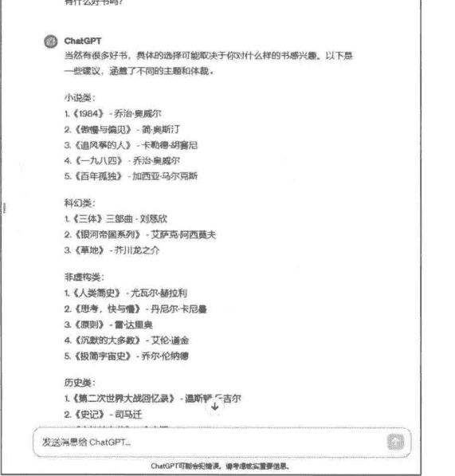
图 3-1 未明确提问
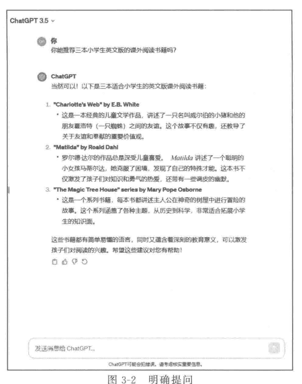

### 3.1.2 运用上下文
延续讨论时提供相关背景，有助于模型更准确把握需求。例如问书籍细节时可说“请详细介绍第一本书！”就能获得针对性信息，如图 3-3 所示。

### 3.1.3 分步提问
面对复杂或多维度的问题，把它拆成一系列简单易处理的小问题，能显著提升理解度，也能得到更详尽的答案。特别适合学习探索。

假设你要写论文，主题是“自然灾害的影响”。主题宽泛，可分步探究。

- 1. 定义概念
问：“自然灾害包括哪些类型？”
帮助厘清范畴，为后续研究奠基，如图 3-4 所示。
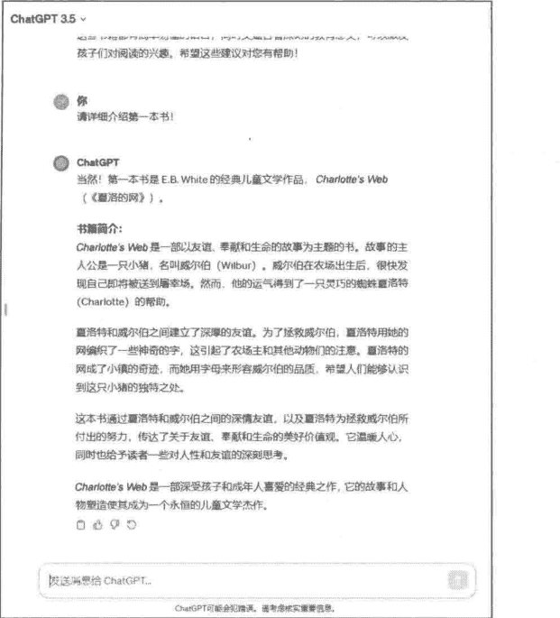
图 3-3 有效运用上下文信息
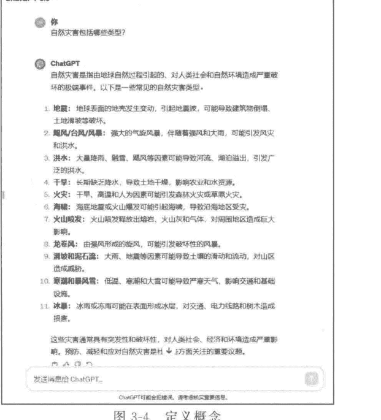
图 3-4 定义概念
- 2. 确定影响
再问：“自然灾害通常有哪些影响？”
答案会给出对人员、经济、环境和社会等方面的一般影响，如图 3-5 所示。
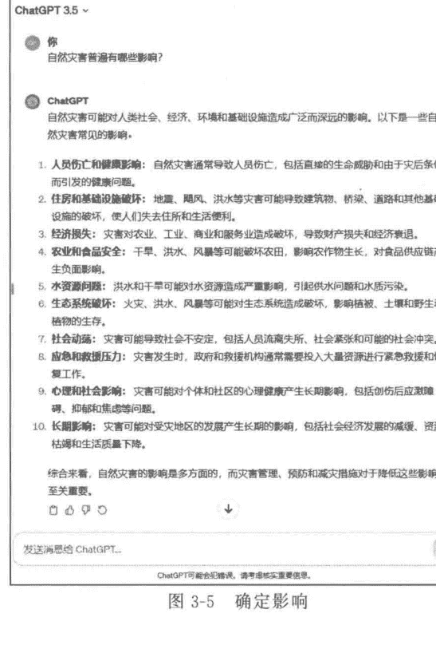
- 3. 探索案例
接着问：“能否介绍一个具体的自然灾害案例及其影响？”
研究具体案例有助于理解理论在现实中的应用，如图 3-6 所示。
- 4. 防灾减灾
再问：“有哪些方法可以减轻自然灾害的负面影响？”
引导到防灾减灾措施的讨论，对减轻损失至关重要，如图 3-7 所示。
- 5. 总结见解
最后问：“如何在论文中有效整合案例研究和防减灾策略？”
答案帮助你构建论文结构，整合资料并呈现研究成果，如图 3-8 所示。

把大问题拆成更小具体的子问题，能逐步建立对复杂概念的理解，并在每个学习环节获得更精准的引导。该方法适用于所有需要深入思考的场景。
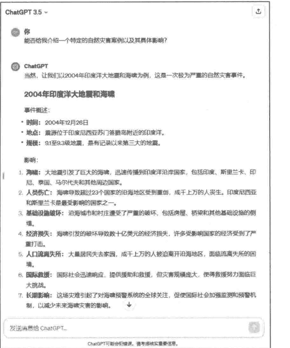
图 3-6 探索案例
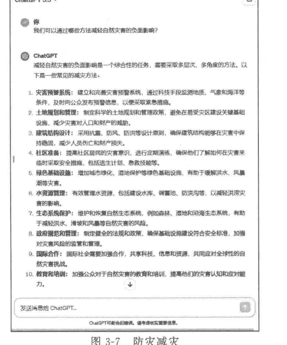
图 3-7 防灾减灾
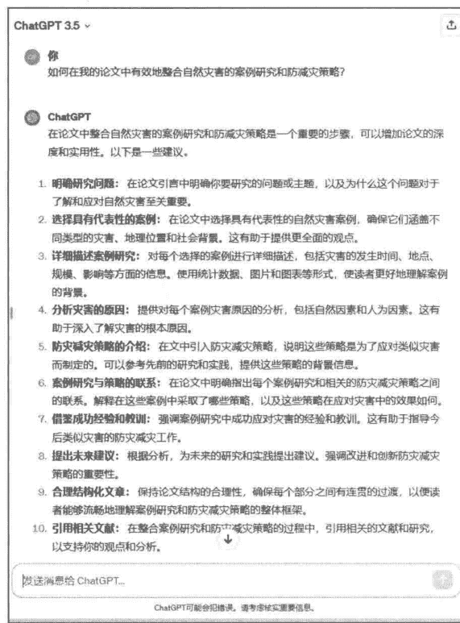
图 3-8 总结见解

### 3.1.4 提供反馈
反馈是双向建设的过程，能提升对话质量，使交流更高效。分享你对答案的看法，有助于判断信息是否符合预期，并促进个性化调整。

假设你在做数学作业，遇到难题。

- 1. 明确问题
可以说：“我不太理解圆的周长公式怎么用，能解释一下原理吗？”
会得到针对该公式的应用解释，如图 3-9 所示。
- 2. 细化问题点
回答后仍有疑惑，就具体化，例如“能否用一个实际例子展示公式的工作方式？”
具体例子有助于理解逻辑，如图 3-10 所示。
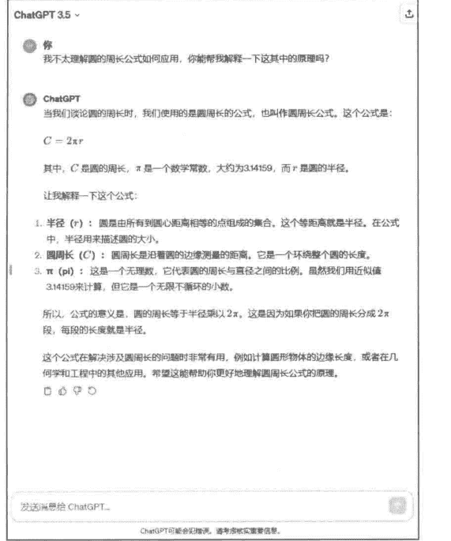
图 3-9 明确问题
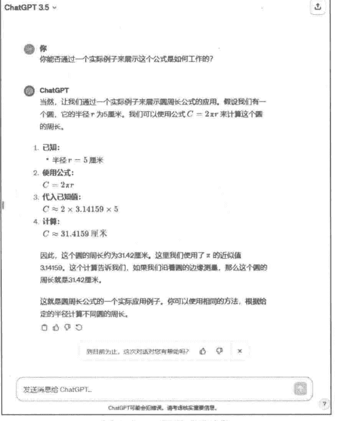
图 3-10 细化问题点
- 3. 最后给出反馈
弄明白例子后可以说：“这个例子让我理解了周长公式，非常感谢解释！”
这样的反馈能让模型了解你的理解程度，优化后续解答，如图 3-11 所示。
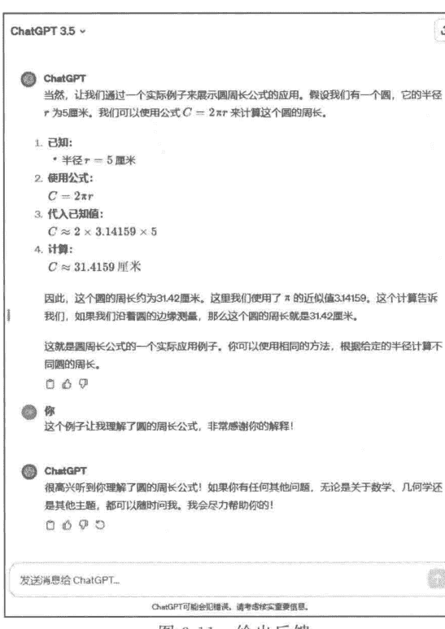

在交流中提供反馈，既帮助你更好地理解学习材料，也让模型知道解答是否有效，为今后提供更合适的帮助提供依据。该策略在任何需要指导的场景都很有价值。

### 3.1.5 细化需求
细化需求能精确表达你要的信息，使答案更具针对性，确保结果符合特定需求。明确并细化问题，让模型更好理解你的目标。

假设你要准备关于可持续发展的演讲，需要收集资料。

- 1. 设定主题范围
先问：“关于可持续发展，有哪些核心领域值得探讨，请列出5条。”
有助于界定细分主题，如环境保护、经济增长、社会公正等，如图3-12所示。
- 2. 明确具体需求
对某个领域感兴趣，例如环境保护，可进一步问：“在环境保护中，哪些创新实践最能体现可持续发展的原则？”
能获得具体案例和资料，如图3-13所示。
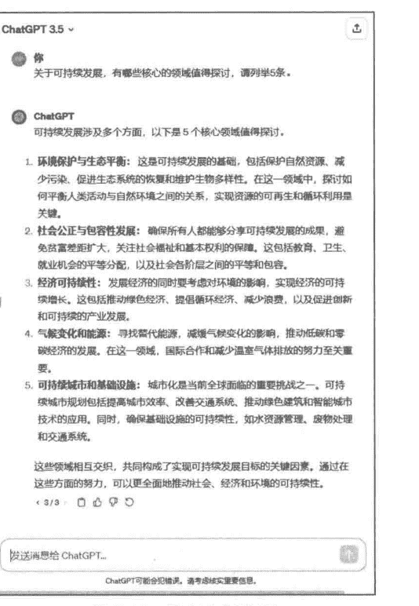
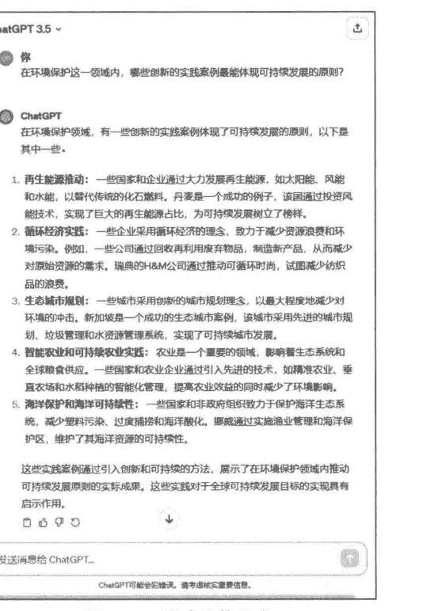
- 3. 限定地区
为更精确可加地区限制：“能找一个亚洲地区环境保护的可持续发展案例吗？”
可获得更具区域相关性的信息，如图3-14所示。
- 4. 提出具体信息类别要求
需要数据支撑观点，就问：“哪里能找到亚洲地区环境保护项目的实际效果和统计数据？”
指定信息类别能确保拿到支撑论点的具体证据，如图 3-15 所示。
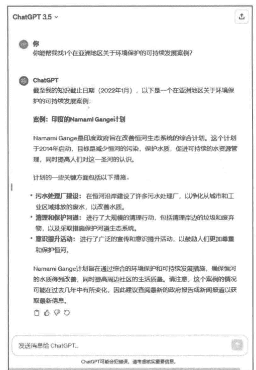
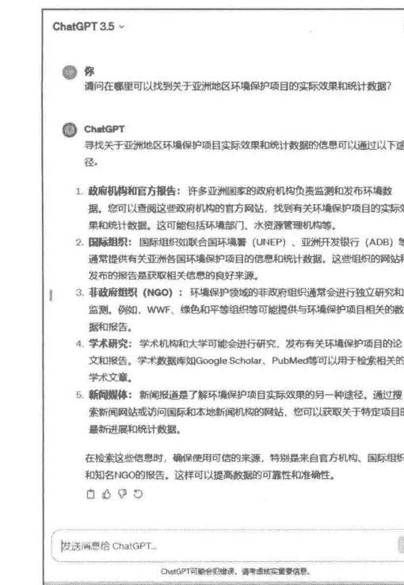

通过细化需求，能更精准定位所需信息，使最终答案和资源最大程度符合期望。该方法适用于写论文、演讲、项目提案等需要详细信息支撑的工作。

### 3.1.6 清晰收尾
清晰收尾既是礼貌，也能确保双方明白交流已达成满意结论和下一步。它帮助你梳理所得信息，明确后续行动。

假设已得到所需答案或建议，需要结束对话。

- 1. 总结所获帮助
可以说：“感谢你提供的信息和建议，对我的问题解答很清晰。”
总结有助于确认信息已满足需求。
- 2. 然后表达感激
加上“我很感谢你的帮助，对我即将开展的研究非常有价值。”
在积极氛围中结束对话，为未来交流奠基。
- 3. 接下来，确认后续行动
再说“现在我将根据这些信息开始研究工作。”
表明你有明确下一步，得到的帮助将被实际使用。
- 4. 最后，明确结束对话
结束语：“如果研究中有其他问题，可能会再次请教你。谢谢你的时间，再见。”
这样的结尾表明当前对话结束但保持未来联系可能，并礼貌告别，如图 3-16 所示。
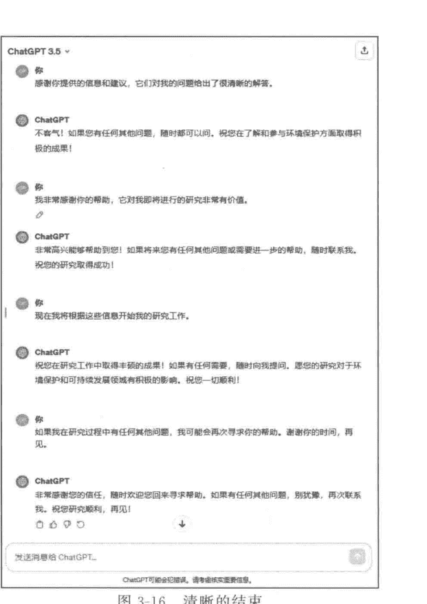

清晰的结束让双方都明白交流已完成，各自知道接下来会怎样。这不仅是良好沟通的标志，也尊重双方时间和精力。

通过上述技巧，对话会更高效顺畅。无论是寻求解决方案、学习新知识还是获取灵感，这些方法都能提升与 ChatGPT 的互动效果。记住，清晰沟通和及时反馈是提升会话质量的关键。

## 3.2 个性化与角色扮演

### 3.2.1 个性化设置
个性化设置让 ChatGPT 更贴合你的偏好和需求。你可以调整语言风格、角色设定、回答深度和广度等参数，使对话更个性化和定制。常见设置如下。

1. 语言风格
语言风格直接影响对话体验，能增强信息传递并调动情绪。ChatGPT 可根据喜好灵活调整表达方式。常见风格如下。

1) 正式风格
适用于商务、学术或正式场合，使用规范术语，避免口语，保持结构清晰、逻辑严密。
> 【示例 3-1】
(1) 用户询问：请解释量子计算是什么？
(2) ChatGPT 回答（正式风格）：量子计算是计算机科学的一个分支，它利用量子力学原理提升计算处理能力。与经典计算机不同，量子计算机使用量子位或qubits表示数据，可处于叠加态，从而同时处理大量信息。

2) 轻松风格
适合非正式或私密交流，使用日常口语，表达自然亲切。
> 【示例 3-2】
(1) 用户询问：量子计算是什么？
(2) ChatGPT 回答（轻松风格）：哦，量子计算就像是电脑的未来版，想象一下你的电脑有超能力，能同时做好几件事，那就是它的秘密！它用一些叫qubits的粒子，这些小东西同时处于多种状态，大大加快计算速度。

3) 幽默风格
适合想轻松愉快或打破僵局的场合，用俏皮比喻、调侃和搞笑元素增添趣味。
> 【示例 3-3】
(1) 用户询问：量子计算是什么？
(2) ChatGPT 回答（幽默风格）：想象一下，你的电脑吃了一颗魔法豆，变成能同时在海里游泳又在山上奔跑的超级英雄，这样就能一次完成超多任务。这就是量子计算的魔力，用qubits这种神奇粒子，让电脑变身超级计算奇才！

从前面的案例里可以明显感觉到，切换语言风格会让整段对话的质感和用户感受都发生变化。风格的变化还能跟使用场景和当下情绪对齐，实现更贴身的个性化服务。

2. 回答的深度和广度

调节回答的细致程度与覆盖范围，能让 ChatGPT 更灵活地匹配不同需求。有时用户只要一个要点就能决策，有时则需要系统性的展开。说明如下。

- 1) 深度，即详细程度
深度决定信息展开到什么粒度。
(1) 低深度：给出简短直白的结论。
(2) 高深度：补充背景、原理和更复杂的推理。

> 【示例 3-4】 什么是机器学习？
(1) 简约版：机器学习属于计算机科学，能让程序依据数据自行学习并进行判断或预测。
(2) 详实版：机器学习是人工智能的一个分支，通过算法与统计模型，使系统无需逐条人工指令就能从数据中挖掘规律并做出决策。它包含监督式学习、无监督学习、强化学习等多种技术，各自对应不同场景与算法逻辑。

- 2) 广度，即内容范围
广度描述回答涵盖的主题跨度。
(1) 窄广度：聚焦某一具体点。
(2) 宽广度：囊括多个相关概念，给出整体观。

> 【示例 3-5】 解释一下机器学习。
(1) 窄广度回覆：机器学习让计算机借助数据学习并预测，例如判断邮件是否属于垃圾邮件。
(2) 宽广度回覆：机器学习是一类让机器自主学习的技术的集合。除垃圾邮件过滤外，还广泛用于图像识别、语音识别、推荐系统、自动驾驶等。核心是利用历史数据训练模型，来推断新数据的结果或行为。

用户可以主动要求模型调整细致度与覆盖面。初探一个主题时倾向宽泛概览，针对具体项目查资料时则需要聚焦且深入的解答，从而获得更个性化的信息与更高效的疑问处理。

3. 对话历史让交流更连贯

对话历史是对话管理的重要能力，让模型可以追溯并引用先前的交流。若开启历史记录，回复会更连贯、更具个性，也能在后续追问中呼应之前的讨论点。

- 1) 无对话历史
每次会话都从零开始，不参考既往内容。交流独立但缺乏连贯性与个性。
- 2) 有对话历史
系统会综合先前对话进行回应，上文更完整，能在对话中累积知识与关系。

> 【示例 3-6】
用户先前提问：我该如何提高英语？
模型给出了坚持阅读英文文章、观看英文电影、找语伴练习等建议。
- 1) 关闭历史的情况
（1）用户再次提问：你有更多建议吗？
（2）模型回覆：提升一项能力时建议找到专业教材定期练习，并通过测验检验掌握程度。
- 2) 开启历史的情况
（1）用户再次提问：你有更多建议吗？
（2）模型回覆：结合我们之前聊到的英语学习方式，可以尝试写作练习，比如写日记或开设博客都是不错的选择。另外加入英语辩论社团或语言交换社群，也能有效提升口语和听力。

开启历史记录能让建议更具针对性，系统会记住用户的水平、兴趣和过往提问，从而定制对策。用户可按对连贯性和个性化的需求自行决定是否启用。

4. 语言偏好设定

语言偏好让模型以用户更熟悉的表达风格作答，可包含方言、俚语或行业专业术语，提升自然感与亲切度。

- 1) 方言
可要求使用特定地区的方言沟通。例如在广东省长大的用户可能偏好粤语交流。
- 2) 俚语
可让模型使用当地流行口语。例如年青用户可能偏好轻松随性的表达。
- 3) 专业术语
可要求使用特定领域的术语。例如医生咨询医疗问题时偏好医学专业表述。

> 【示例 3-7】
用户提问：你好，如何才能到达中央公园？
（1）未设定偏好的回覆：可以乘坐地铁 A 线或 C 线抵达中央公园。
（2）设定俚语偏好的回覆：嗨，去中央公园的话坐 A 列车或 C 列车直达就行。

设定语言偏好有助于获得文化共鸣与沟通精度。系统会按偏好调整用词和表达，营造更舒适愉快的对话体验。

5. 回答优先级

回答优先级允许用户指引多个问题时的回覆顺序，尤其在需要筛选排序信息时很有用。可标明最急需的点，或按重要性层级排列。

1）设定优先级
提出多个问题时，可明确说明哪个最紧急或最重要。
2）组织回覆
系统会按指示调整顺序，先处理优先级最高的问题。

> 【示例 3-8】
用户提问：我明天有场面试，需要了解如何打扮、如何做自我介绍，还有面试官通常会问什么？
（1）用户设定优先级：首先，我最关心的是可能被问到的问题。
（2）模型按优先级回覆：面试官常围绕工作经历、技能、过往成绩和对岗位的热忱提问，例如“请介绍一下过往工作”或“你怎么看待团队合作”。提前准备这些问题的答案会更从容。着装建议选择专业得体的商务休闲装，自我介绍则用简洁明了的方式概括专业背景、相关技能和亮点，能给面试官留下清晰第一印象。

通过优先级设定，模型能顺应紧迫感，先把最关键的问题妥善处理，使用户掌控对话节奏。

6. 对话模式

对话模式调节回覆的呈现方式，可按场景选择不同交流风格。

1）问答模式
聚焦直接回答具体问题，表达简洁明了，便于快速获取信息。
2）故事模式
让模型讲述或续写故事，可用于创意、教育或娱乐。
3）解释模式
提供详尽说明，帮助理解复杂概念或背后的逻辑。

> 【示例 3-9】
用户提问：能解释一下引力波是什么吗？
（1）问答模式回覆：引力波是黑洞或中子星合并等剧烈天体运动引起的时空涟漪，以光速向外传播。
（2）故事模式回覆：想象宇宙里两颗巨型星体相互绕转直至合并，释放巨大能量，在时空中激起涟漪，就像石头投入池塘激起水波，这就是引力波。
（3）解释模式回覆：引力波是爱因斯坦广义相对论预言的现象，是时空的波动，携带着宇宙剧烈事件的信息。它们源于大质量物体的加速运动，如黑洞或中子星合并。借助 LIGO 等探测器可以观测到引力波，从而了解到传统观测难以触及的宇宙学信息，对天体物理学是重大突破。

选择合适的模式能有效引导对话深度与走向，满足从简短答案到深度探讨的各种需求。

7. 敏感话题屏蔽

敏感话题屏蔽允许用户指定不愿讨论的主题，避免触及不适内容，营造安全对话环境。

1）设置屏蔽内容
明确告知不希望涉及的内容或话题。
2）回避特定话题的回覆
系统将按设置避免在回应中涉及被屏蔽话题。

> 【示例 3-10】
用户设置：请不要讨论政治话题。
用户提问：最近政治局势如何？
模型回应：抱歉，我无法回答关于政治的问题。
用户提问：怎么做巧克力蛋糕？
模型回应：制作巧克力蛋糕需要面粉、糖、鸡蛋、无盐黄油和巧克力。将黄油和巧克力融化混合后加入糖、鸡蛋和面粉搅拌均匀，倒入模具，烤箱预热至 350°F 约 177℃ 烘烤约 30 分钟，出炉冷却即可享用。

屏蔽机制让对话始终在用户的舒适区和价值边界内进行，实现更定制化且安心的体验。

## 8. 用户名和称谓

自定义用户名和称谓能让模型在对话中使用指定称呼，增强互动的个性化和亲切感。

- 1）个人化称呼的设置
用户明确告知希望被如何称呼。
- 2）使用指定称呼
系统在后续对话中自然使用该名称或称谓。

> 【示例 3-11】
用户设置：可以叫我 Alex。
用户后续提问：我该如何提高英语水平？
模型回覆：Alex，提升英语的有效途径是持续实践。可以多读英文书籍、看英语电影、参与语言交流，甚至找个学习伙伴。每天沉浸在语言环境中，通过写作、口语和听力练习，进步会更明显。

个性化称呼让对话更轻松友好，使用户感受到被特别对待，从而加深投入感。

## 9. 自动补全和纠错

自动补全与纠错是提升输入效率与准确性的实用功能，在用户输入时即刻生效。

- 1）自动补全
基于已输入内容和常见语言模式，提供可能的补全建议，用户可一键完成输入。
- 2）纠错
识别拼写错误并给出正确建议，用户接受后可快速修正，保证交流顺畅。

示例交互
用户输入：我想了解关于 ecoomic(经济)的书。
系统将 ecoomic 标记为错误，提示正确拼写为 economic。
用户修正后询问：有哪些关于 economic 的书推荐吗？
模型回覆：经济学方面有不少好书。《经济学原理》是入门经典，深入浅出介绍基本概念。《国富论》和《资本论》在经济学界地位重要。根据兴趣还能找到宏观、微观或金融市场等细分领域的专著。

开启这两项功能可让用户专注内容本身，减少打字负担，沟通更流畅。

## 10. 音频或文本输入

输入方式提供灵活交互，用户可按喜好或环境选择最合适的方式。

- 1) 文本输入
通过键盘输入，适合需要静心思考或安静环境的场景，便于编辑再发送。
- 2) 音频输入
通过麦克风语音交流，适合忙碌或不便打字的场景。需在浏览器中安装语音插件。

> 【示例 3-13】
- 1) 文本输入交互
用户输入：如何提高跑步的耐力和速度？
模型回覆：可尝试间歇训练，交替慢跑与冲刺。配合核心肌群力量训练、充足营养和适当休息，效果会更好。
- 2) 音频输入交互
用户语音询问：我明天的飞机是什么时候？
模型回覆：很抱歉，我无法提供实时信息，也无法查询未来的航班。如需准确信息，建议直接联系航空公司或在其官网查询，提供航班号、日期等即可获得最可靠结果。祝旅途顺利！

提供双输入选项让用户在通勤、图书馆等不同情境下都能自如交流，提升便捷性。

## 11. 其他定制设置

更多个性化选项可按需调整交互体验。

- 1) 主题定制
可更改聊天界面色彩、背景图案等。例如选择深色模式减轻眼压，或使用喜爱的背景提升愉悦感，如图 3-19 所示。
- 2) 语速调节（音频输出）
可调快或调慢语音输出速度，快速浏览或细致理解。非母语者可能偏好更慢语速。
- 3) 语音音调调节（音频输出）
可选择不同音调，使声音听起来更活泼、严肃或自然。

> 【示例 3-15】
- 1）主题定制交互
用户在设置中选择深色模式，并将背景设为宁静夜空图案，在个性化界面中对话体验更舒适。
- 2）语速调节场景
用户设置：请慢一点说，我理解得比较慢。
模型以较慢语速输出音频信息。
- 3）语音音调示例
用户设置：我想听一个更活泼的声音。
模型回复时采用明亮活泼的音调。

这些细化选项让用户按个人喜好或专项需求调整视觉与听觉反馈，获得更满足的体验。随着技术发展，个性化设置将持续更智能、易用。

### 3.2.2 聊天语境与角色设定

在 ChatGPT 中设定聊天语境和角色，能让对话更具情境感和真实性。通过不同语境和角色模拟，可让回覆更贴近特定场景和身份，提供更有趣的个性化体验。

1. 聊天语境

构建吸引人的聊天语境涉及语境设定、场景设定、故事情节构建和色彩元素引入等。

#### 1）对话语境设定
语境塑造对话主题和方向，为模型提供特定场景使其回覆更连贯。
- 若设定在科研实验室，用户问“显微镜怎么用”“实验数据如何分析”，模型可给出精确的操作步骤和科研技巧。
- 若背景为历史事件，用户问“该战役有何影响”“历史人物扮演什么角色”，模型可详细阐释背景与影响。
- 若对话发生在奇幻世界，用户问“世界规则是什么”“角色能力有哪些”，模型可依据设定创造富有想象的回应。

#### 2）对话场景设定
为交谈营造特定背景，仿真真实世界交流氛围。
- 若场景是图书馆，用户可能问“如何挑选有助于个人成长的书”“推荐几本好书”，模型可提供选书、阅读方法或书单。
- 若场景是咖啡馆，用户可能问“推荐哪种咖啡”“介绍几种特色咖啡”，模型可分享咖啡知识并做推荐。
- 若场景设在医院，用户可能表达“我很紧张怎么办”“怎样缓解疼痛”，模型可提供心理安慰和缓解建议。

设定场景让回覆更具临场感，提升真实度和趣味性。

#### 3）故事情节构建

把一次对话装进一条完整可感的故事线，就能让交流产生连贯的叙事驱动力。沿着这条思路，ChatGPT 会在既定的情节框架里给出回应，让互动更具趣味和沉浸感。常见的玩法有以下几类。

- (1) 设定为一段冒险旅程时，用户可能会问“下一步去哪？”、“这道谜该怎么破？”。在这种情境下，ChatGPT 就会贴合探险主题给出行动点子或解谜思路，让对话节奏更紧张刺激。
- (2) 如果背景是一桩侦探案，用户常会问“你觉得凶手是谁？”、“目前有哪些线索？”。ChatGPT 能够模仿推理者的思考方式，对线索进行梳理和分析，围绕嫌疑人展开讨论。
- (3) 当故事基调是罗曼史，用户可能会问“怎么才能打动他/她？”、“表白该怎么说？”。身处爱情语境的 ChatGPT 则会给出浪漫追求和表白表达方面的建议。

为对话预设具体情节，能让回答更有吸引力，提升叙事感和戏剧张力。

#### 4) 色彩元素引入

在聊天里加入色彩意象，可以塑造特定的情绪与氛围。不同色调的组合能为对话注入更强的情绪张力。典型用法如下：

- (1) 把对话调成欢快明亮，用来匹配喜庆场景。比如用户说：“今天生日，我们来开派对吧！”ChatGPT 可能会接：“太棒了，生日快乐！你想走哪种派对风格？是活力十足的热带果岭，还是璀璨夺目的银河星空？”
- (2) 若把氛围定为温馨浪漫，用户可能会问：“这是第一次约会，有点紧张，有什么建议？”ChatGPT 可以回应：“放松点，真诚做自己最重要。对方很可能也一样紧张。约会打算去哪？一家安静温暖的咖啡馆会是不错的选择。”
- (3) 当整体色调沉浸在低落悲伤时，用户说：“我现在很失落，不知道该怎么办。”ChatGPT 会给予安慰和陪伴，例如：“听起来你正经历一段艰难时期。先承认自己的感受并愿意分享，往往就是向前迈的第一步。准备好聊聊时，我们可以一起看看有哪些地方可以改变。”

细腻调节对话的色彩，能让聊天更贴合用户的情绪与场景，增强情感表现力，营造出更容易投入的交流环境，从而满足多样化的使用需求。

### 2. 角色设定

角色扮演是塑造聊天体验的关键手段。给 ChatGPT 安排一个明确身份，就能决定对话的走向与表达方式。依据不同角色的知识储备和语言习惯，模型会相应调整行为和回答风格。举例说明如下。

#### 1) 科学家

扮演科学家时，ChatGPT 的输出会更偏向数据与实验，语言客观、术语规范。

> 【示例 3-16】
> (1) 用户提问：全球变暖的主要原因是什么？
> (2) ChatGPT 回复（科学家视角）：全球变暖的核心驱动是温室气体排放的持续增加，尤其是化石燃料燃烧释放的二氧化碳。这些气体在对流层形成保温层，截留太阳辐射产生的热量，使得全球平均气温不断上升。

#### 2) 作家

作为作家，回答会更具想象力和文采，擅长用细节描写和文学化语言。

> 【示例 3-17】
> (1) 用户提问：你怎么看待爱情？
> (2) ChatGPT 回复（作家视角）：爱情是心灵写下的诗篇，是凡人身躯里回荡的永恒旋律。它像一道光穿透云层，温暖而明亮，为生活平添色彩，即便在最寂静的时刻，也能听见它的低语。

#### 3) 教师

教师角色更注重讲解与启发，确保用户真正理解复杂概念。

> 【示例 3-18】
> (1) 用户提问：相对论是什么？
> (2) ChatGPT 回复（教师视角）：相对论是爱因斯坦提出的理论体系，包含狭义相对论和广义相对论。通俗来说，狭义相对论研究的是在无重力条件下接近光速的运动，广义相对论则把重力纳入其中，描述重力如何弯曲时空。

#### 4) 程序员

以程序员身份作答，会使用技术术语和开发概念，提供可操作的方案。

> 【示例 3-19】
> (1) 用户提问：如何提升网站加载速度？
> (2) ChatGPT 回复（程序员视角）：可以从多维度优化：减少 HTTP 请求并用 CDN 分发资源；压缩图片和视频；开启浏览器缓存；采用异步加载 JavaScript；优化数据库查询以降低服务器响应；整理 CSS 与 JavaScript 等。这样能明显改善页面响应和用户体验。

每个角色都自带一套知识库和表达习惯，让 ChatGPT 以特定视角与用户互动。角色扮演既让对话更有趣，也能以新颖方式帮助用户理解专业主题。

无论是设定场景还是塑造角色，这些细节都能提升对话的真实感与情感连接，让交流更轻松、更具个性。

# 第 4 章 ChatGPT 免费工具大揭秘

本章系统梳理各类免费的 ChatGPT 工具与平台，按类型介绍它们的功能亮点、优势以及适用场景。

## 4.1 网络浏览器 ChatGPT 插件

浏览器插件让用户在上网时直接调用 ChatGPT 的语言能力，显著提升处理邮件、撰写文档、检索信息等日常任务的效率。下面介绍插件的查找、安装与管理流程。

### 4.1.1 安装 ChatGPT 插件

1. 打开浏览器插件商店
在 Microsoft Edge 中可进入 Edge 加载项；Chrome 可打开 Chrome 网上应用店；Firefox 可访问 Firefox 附加组件页；Safari 可在 App Store 中搜索 Safari 扩展。

2. 搜索插件
在搜索栏输入 chatgpt 或具体插件名，浏览结果列表，阅读功能介绍、用户评价和权限说明，确认是否符合需求。

3. 安装插件
不同浏览器操作略有差异，例如 Edge 点“获取”即可安装，Chrome 点“添加至 Chrome”即可安装，Firefox 点 Add to Firefox，Safari 点“获取”。安装过程中会提示确认并授权必要权限。

4. 管理已安装的插件
在浏览器的设置或扩展管理页面可以查看已安装插件，启用、禁用或调整相关设置。

### 4.1.2 使用 ChatGPT 插件

1. 显示插件
安装后插件图标不会自动出现在工具栏，需点工具栏的扩展按钮调出，再固定图标。

2. 进行配置（可选）
部分插件需要首次设置语言偏好、热键等，若需登录则按提示完成账号绑定。

3. 功能使用
登录后可进入插件聊天页，先从模型列表选择合适的模型，如免费的 GPT-3.5 Turbo，再开始聊天、写作、翻译或提问。大多数插件提供输入框直接对话，也能自动处理当前网页内容。

### 4.1.3 插件更新和维护

保持插件更新和稳定是安全使用的关键。

- 1. 定期检查更新
  (1) 自动更新。大多数浏览器默认开启自动更新，开启后插件会保持最新。
  (2) 手动检查。即使自动更新开启，偶尔在扩展管理页点“检查更新”也更稳妥。
  (3) 关注开发者。订阅邮件列表或社交媒体可及时获知更新信息。

- 2. 维护和问题解决
  (1) 重新加载。插件异常时可在设置页重新加载或禁用再启用。
  (2) 重新安装。若问题持续，可卸载后从商店重新安装以清除旧数据。
  (3) 查阅 FAQ。官方页面或商店通常提供常见问题解答。
  (4) 使用帮助功能。部分插件内置反馈通道，可直接向团队报告问题。
  (5) 技术支持与社区。对于复杂问题可联系技术支持或在社区论坛求助，提供详细描述和截图有助于快速解决。
  (6) 备份个性化设置。升级或重装可能丢失设置，定期备份可快速恢复。

通过以上方式，用户既能享受新功能，也能保证插件的稳定与安全。

## 4.2 集成开发环境的 ChatGPT 插件

随着开发任务复杂度提升，集成 ChatGPT 的 IDE 插件成为提升效率的重要手段。以 Visual Studio Code 为例，说明安装与使用流程。

### 4.2.1 安装 ChatGPT 插件

1. 打开 VS Code
双击桌面图标启动 Visual Studio Code。

2. 访问插件市场
按 Ctrl+Shift+X 或点左侧扩展图标进入插件市场。

3. 搜索 ChatGPT 插件
在搜索框输入 chatgpt，浏览结果并挑选合适的插件。

4. 选择和安装插件
(1) 点进插件详情页确认功能是否符合需求。
(2) 点 Install 按钮完成安装。
(3) 安装成功后左侧工具栏会出现对应图标。

5. 配置插件（如有必要）
部分插件需要 API 密钥或其他设置，按文档说明完成配置。

### 4.2.2 使用 ChatGPT 插件

1. 插件激活
方法一：点工具栏的 ChatGPT 图标激活。方法二：右键代码片段直接启动插件。

2. 使用 ChatGPT 插件编写代码
可让模型按需求生成代码，例如用 Python 写一个 Hello World 程序。

3. 调试和解决问题
遇到报错或需要建议时，向插件描述代码片段和问题，ChatGPT 会分析并给出修复方案。例如在学习 C 语言指针时出现空指针问题，可询问原因与改正方法。

```c
Char *p;
p[0] = a;
printf("%s\r\n",p);
```

# 第4章 ChatGPT免费工具大揭秘

ChatGPT 会对代码进行分析并返回完整示例。

4. 优化代码
   (1) 对话方式。选中代码段后复制到对话区，要求模型分析并给出优化建议。
   (2) 插件方式。打开源码文件，右键选择 ChatGPT→Check the following code for bugs and provide repair suggestions 命令进行检查。

5. 获取文档和解释
对代码库中某个函数或类的实现感到疑惑时，可直接请求模型解释其功能与用途。通过即时解释，开发者能更快理解代码并提升编写与维护效率。

## 4.3 免费的 ChatGPT 软件应用

各大应用商店都上架了基于 ChatGPT 技术的桌面和移动应用，可帮助用户提升工作效率、学习技能或管理日常事务。

- 1. 在 Microsoft Store 中搜索和下载
  (1) 打开开始菜单中的 Microsoft Store。
  (2) 在搜索框输入 chatgpt。
  (3) 选择感兴趣的应用后点“安装”完成下载。
  (4) 安装后即可运行使用。

- 2. 在苹果 App Store 中获取
  (1) 在 iOS 设备打开 App Store。
  (2) 用底部搜索功能输入 chatgpt。
  (3) 浏览结果后点“下载”即可安装。

- 3. 在 Android 应用商店下载
  (1) 打开 Google Play 或其他安卓商店。
  (2) 用搜索栏输入 chatgpt。
  (3) 选择合适的应用后按提示下载安装。

这些应用界面直观、功能丰富，能简化邮件管理、文档撰写和数据分析等任务，构建更智能高效的工作环境。

## 4.4 ChatGPT 免费在线平台

以 Coze 为例介绍免费在线平台的体验。Coze 是字节跳动面向海外市场推出的 AI 聊天机器人和应用开发平台，支持用户像即时通讯一样进行智能对话，并体验多样角色互动。

Coze 通过可扩展插件和强大的构建能力，呈现出类似 GPT 的交互风格。无论是否具备编程基础，用户都能在平台上创建聊天机器人并部署到社交媒体或通讯应用中。

平台提供插件、知识库、工作流、长期记忆和定时任务等功能，显著增强机器人的交互性和多功能性，让科技与交流更好地融合。

Coze 的主要特点包括：

- 1. Coze 被视为字节跳动对标 GPT、Copilot Studio 的人工智能产品。
- 2. 国内用户可能因地域限制无法访问，提示“服务在该地区不可用”。
- 3. 当前支持用 GPT-3.5 16K 和 GPT-4 8K 模型创建机器人。
- 4. 处于免费开放阶段，支持 GPT-4，同时兼容 DALLE3 和 GPT4V 等插件。

- 5. 用 Coze 搭建的聊天机器人目前可投放到 Discord、Telegram、Cici 等平台，官方表示后续会拓展 WhatsApp、Twitter 等社交入口；具备技术能力的用户也能自行把它接入微信。

# ChatGPT 实战笔记：智能对话助手从搭建到精进

图 4-34 部署聊天机器人

图 4-35 Coze 插件功能

下面系统演示如何自行定制机器人并投入使用。

### 1. 创建机器人
(1) 在左上角点击 Create bot，在 Bot name 栏输入 OpenHarmony50，随后按下 Confirm 即可生成同名实例，如图 4-36 所示。
(2) 完成创建后进入工作台，整体为三栏式布局：左区收纳提示词与指令，中区负责模型调参与功能扩展，右区提供上线前的交互预览，如图 4-37 所示。

### 2. 添加机器人插件
(1) 点击插件区的 “+” 标志，进入插件挑选页，如图 4-38 所示。
(2) 在目标插件上点 Add 完成挂载，如图 4-39 所示。
(3) 挂载成功后插件会出现在 Plugins 列表中，如图 4-40 所示。

图 4-38 单击添加插件的图标

图 4-39 添加插件

### 3. 机器人模型配置
(1) 打开 GPT 模型配置入口，会弹出参数设置窗口，如图 4-41 所示。
(2) 在该窗口内设定 Model、Temperature、Response max length、Dialog round 等参数，如图 4-42 和图 4-43 所示。

### 4. 机器人使用
在 Coze 上使用该机器人，与其它搭载 ChatGPT 的对话产品体验相近，操作直观。使用者只需在对话框输入问题或需求，稍等片刻即可得到系统回复。具体界面与交互见图 4-44。

图 4-40 Plugins 中显示已添加的插件

图 4-41 单击 GPT 模型配置按钮

图 4-42 机器人模型属性配置

图 4-43 机器人 GPT 模型配置

图 4-44 机器人使用示例

本章汇总了一套可组合的工具资源，目的是最大化 ChatGPT 的免费能力，并将其运用到日常浏览、开发任务以及移动端与网页端的沟通场景中。

# 第5章 ChatGPT 高阶对话技法

本章聚焦于驾驭复杂深入交流的方法。随着智能对话技术演进，我们能以更进阶的方式与 ChatGPT 等助手协作，完成过去难以实现的任务。内容涵盖提问策略、上下文管理、输出定制、对话调节、故事创作及专业领域助手训练等。

## 5.1 提问技巧

本节深入讲解如何提出有效问题，并结合实例展示实践效果。

### 5.1.1 开放式问题的妙用

开放式提问无法用“是/否”作答，能促使助手给出更丰富、更具思考深度的回复。

**【示例 5-1】**

(1) 基础级问题：“你能写故事吗？”，如图 5-1 所示。
(2) 改进后的问题：“你能帮我构思一个关于未来世界的故事情节吗？”，如图 5-2 所示。

这样不仅得到肯定，还能直接获得可用素材。

### 5.1.2 假设性语言的使用

假设性提问是对未发生情境的设想，有助于激发助手的创造性思维，促进深度讨论。

**【示例 5-2】**

(1) 基础级问题：“你可以做客户服务吗？”，如图 5-3 所示。
(2) 改进后的问题：“如果你是一个客户服务代表，则会如何处理退货请求？”，如图 5-4 所示。

借助假设性表达，更容易了解助手在特定情境下的反应与处理能力。

# ChatGPT实践——智能聊天助手的探索与应用

图 5-1 开放式问题——基础级问题

图 5-2 开放式问题——改进后的问题

图 5-3 假设性语言——基础级问题

图 5-4 假设性语言——改进后的问题

### 5.1.3 探索性问题的设计

探索性问题旨在深挖主题，获取更多细节和思路。

【示例 5-3】

(1) 基础级问题：“你能告诉我关于宇宙的信息吗？”，如图 5-5 所示。
(2) 改进后的问题：“你如何看待霍金对黑洞信息悖论的贡献，以及他对现代物理学的意义？”，如图 5-6 所示。

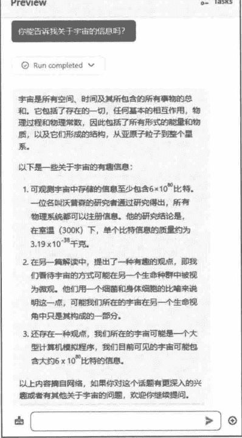


提出探索性问题，可将对话导入专业领域，获得更专业、更具深度的回答。

### 5.1.4 深层次分析的诱导

这类问题要求助手对内容进行深入解读与分析。

【示例 5-4】

(1) 基础级问题：“气候变化是真的吗？”，如图 5-7 所示。
(2) 改进后的问题：“你如何评价当今社会采取的气候变化应对措施，并提出对未来政策的建议？”，如图 5-8 所示。

96 ChatGPT实践——智能聊天助手的探索与应用


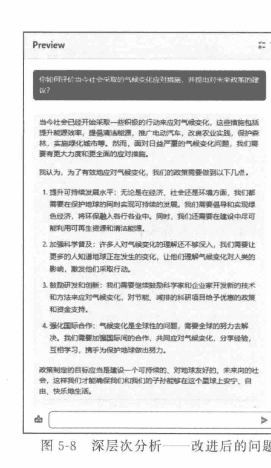

通过对比可见，精心构建的提问能显著提升对话价值与效能。这些技巧不仅让交流更有趣，也有助于获取更丰富的信息与知识，是深化对话内容、提高交流品质的关键。

## 5.2 上下文管理

本节深入探讨对话上下文管理的重要性和实用性，教你在多轮或跨话题中保持连贯。

### 5.2.1 建立对话框架

框架是对话的基础，尤其在长对话中维持话题相关性和连贯性至关重要。

【示例 5-5】

（1）开始对话时：“我们今天要讨论的是教育技术。让我们从远程学习平台谈起。”，如图 5-9 所示。
（2）在接下来的对话轮次中引用框架：“关于远程学习平台的功能，你认为哪些是支持有效学习的关键因素？”，如图 5-10 所示。


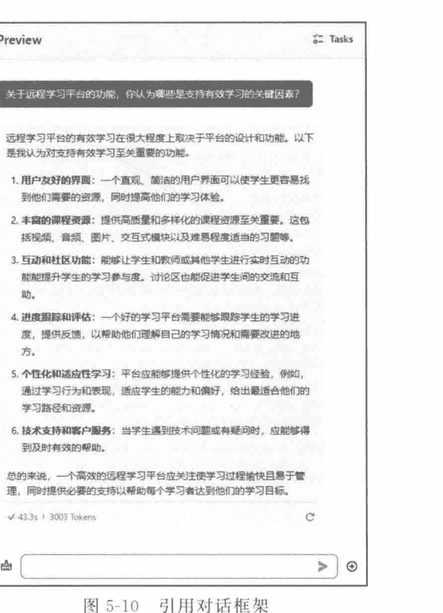

在这个例子中，通过明确指出对话主轴引导了聊天方向，并为后续展开提供基础。

### 5.2.2 延续性的确保

维持对话连贯，保证助手在多轮对话中上下文紧密相连。

【示例 5-6】

上一轮对话的引用：“之前我们讨论了关于远程学习平台的功能。现在，我想了解你对其用户友好的界面的看法？”，如图 5-11 所示。

该对话保持了先前信息的连贯性，并将其扩展到新的维度。

通过引用过往对话内容，可确保对话的连续性和上下文的关联性。

### 5.2.3 信息回顾与引入

在跨话题或长时间空隙后重新启动对话时，简要复述之前信息有助于重建上下文。

【示例 5-7】

重新开始话题：“上周我们提到了一些关于远程学习平台的潜在改进。我有一些想法，想和你进一步探讨。”，如图 5-12 所示。

# ChatGPT实践——智能聊天助手的探索与应用

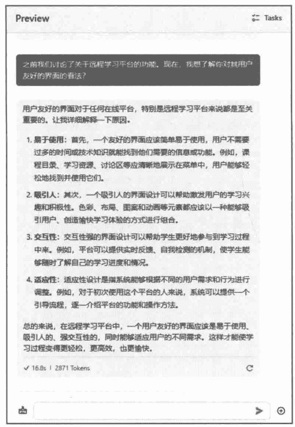

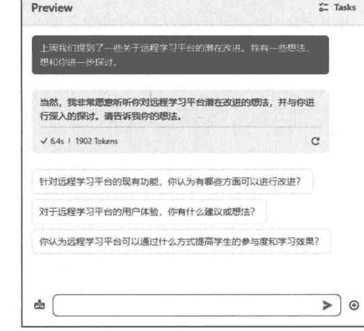

此方法可在中断后自然延续对话，帮助助手回顾先前讨论，为后续交流打下基础。

### 5.2.4 主题转换的平滑处理

切换话题时应给出明确提示，并用适当的过渡语连接旧话题与新话题，以便顺畅转换。

【示例 5-8】

转换话题前的铺垫：“我们讨论了远程学习平台的用户界面。谈及用户界面友好的重要性，我忽然想到一个与之相关的话题：互动和社区功能。你对在教育平台中互动和社区功能有什么看法？”，如图 5-13 所示。

以上示例展示了如何在话题间平滑过渡，确保对话保持专注且相关性不减。

通过这些案例可知，有效管理上下文对维持连贯性、信息追踪与高效应答极为关键。掌握这些技巧有助于与助手保持富有成效且深入的对话。

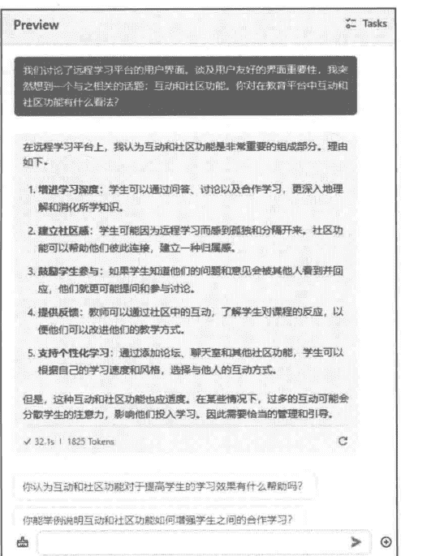

## 5.3 定制模型输出

为满足特定对话需求，可能需要定制模型输出。本节介绍几种调整与定制输出的策略。

### 5.3.1 调整对话模型的参数

部分模型允许调节参数，以影响输出详略、语气、风格等。

【示例 5-9】

1. 简洁回答：“请快速概述地心引力定律。”，如图 5-14 所示。
2. 详细回答：调整模型以提供详细输出，如“请详细解释地心引力定律，并给出其历史背景和现代应用的例子。”，如图 5-15 所示。

通过简单指令变更，可让模型按需提供简洁或详尽答案。

### 5.3.2 使用高级提示技巧

高级提示技巧，如采用特定语境或角色，可引导模型生成更贴合预期的内容。


【示例 5-10】

（1）基本提示：“如何写一封投诉信？”，如图 5-16 所示。
（2）高级提示：设定情境，如“假设你是一位一直注重客户服务质量的老板，现在你需要写一封对供应商服务不满的投诉信，请展示如何以礼貌而坚定的语气表达不满。”，如图 5-17 所示。

这种提示让模型在特定语境下生成内容，更接近用户具体需求。

### 5.3.3 提供具体方向和目的

直接告知模型具体需求，有助于定制更准确的输出。

【示例 5-11】

（1）一般性请求：“我需要一些健康饮食的建议。”，如图 5-18 所示。
（2）具体方向：明确目的，如“我是一位糖尿病患者，需要一份为期一个月的低糖饮食计划。”，如图 5-19 所示。

当请求包含具体方向与目的时，模型能提供更个性化、针对性的建议。

### 5.3.4 模拟不同角色或专业态度

指定模型扮演不同角色，可获得不同专业领域或角色特定的输出。

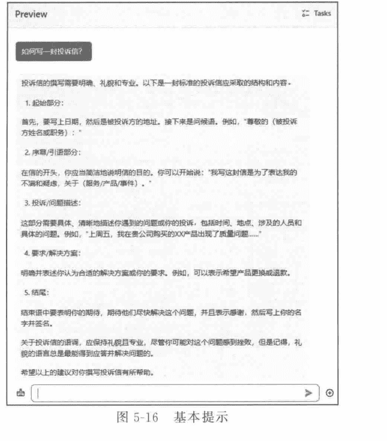

图 5-16 基本提示


图 5-17 高级提示

# ChatGPT实践——智能聊天助手的探索与应用


【示例 5-12】

(1) 通用请求：“给我一些建议如何在压力下保持冷静。”，如图 5-20 所示。


（2）指定角色：像专家一样提问，如“假如你是一位经验丰富的心理学家，现在我想知道在剧烈压力下保持冷静的科学方法。”，如图 5-21 所示。


示例中设定特定专业角色以获取更符合行业标准的建议。

通过细致调节参数、应用高级提示语、提供明确方向或模拟特定角色，可有效定制对话模型的输出，提升相关性与效率，并获得更全面、个性化的信息。

## 5.4 对话调整

本节探讨如何通过调整语调与风格、改善回答方式、优化对话结构及运用引导性问题，营造更丰富生动的交流体验。

### 5.4.1 语气和风格的调整

调整说话语气与风格，可使对话更轻松或更专业。

【示例 5-13】

（1）常规语气：“请告诉我三亚市天气预报。”，如图 5-22 所示。
（2）轻松风格：像朋友一样提问，如“今天三亚市的外面怎么样？需要打伞吗？”，如图 5-23 所示。


这种调整可使对话更贴近用户的沟通习惯与情境。

### 5.4.2 改善回答的方式

调整回答方式，可提供更具启发性与引导性的信息。

【示例 5-14】

1. 直接回答：“明天下午三亚市不会下雨。”，如图 5-24 所示。
2. 启发性回答：“明天下午三亚市可能不会下雨，出门时不需要带把伞，可以考虑户外活动。”，如图 5-25 所示。


这种改善方式可提供更实用周到的信息，增强对话帮助性。

### 5.4.3 对话结构的优化

提前规划对话结构，可使整体交流更具逻辑与吸引力。

【示例 5-15】

(1) 顺序性对话：“我们先谈谈你的工作经历，然后讨论你的教育背景。”，如图 5-26 所示。
(2) 引入对话主题：“在了解了你的专业技能之后，我对你的工作经验特别感兴趣。请你先分享一下这方面的经历吧。”，如图 5-27 所示。


通过优化对话结构，可更好确保信息传递的连贯性和逻辑性，使用户更易跟进讨论主题。

### 5.4.4 引导性问题的使用

引导性问题可促进对话深入，帮助揭示更多信息或引出用户思考。

【示例 5-16】

(1) 基本问题：“大学生在周末做什么？”，如图 5-28 所示。
(2) 引导性问题：“周末大学生通常是如何平衡学习和休息的？有没有什么特殊的方法帮助他们放松？”，如图 5-29 所示。

使用引导性问题会鼓励对方分享更多个人观点或情感，丰富对话内容。

106 ChatGPT实践——智能聊天助手的探索与应用


通过上述不同调整方法，可根据对话目的、参与者风格和当前情境塑造交流。无论是采用更友好轻松的方式，还是传达更专业信息密集的消息，对话调整技巧的应用都能提供更满意的体验。

## 5.5 故事生成

本节探索如何借助 ChatGPT 进行创造性故事写作。通过以下步骤与技巧，可从零开始构思主题、角色、情节直至完整结局。

1. 构思故事主题

确定故事核心主题是创作起点，决定方向与内涵。

【示例 5-17】

故事主题：“接下来，我要编写一个故事，主题为一个年轻人在奇幻世界中的自我发现之旅，理解回复‘理解’”，如图 5-30 所示。

2. 角色构建

角色是故事心脏，开发深度且有吸引力的角色可让故事更生动。

【示例 5-18】

主角设定：“讲述主角如何由一个怯懦的学徒成长为勇敢的战士，理解回复‘理解’”，如图 5-31 所示。


3. 情节设计

情节推动故事向前发展，创造有起承转合的情节可保持读者兴趣。

【示例 5-19】

设计情节：“设计情节，主角的旅途中，他会遇到什么样的朋友和敌人？他如何克服困难和挑战？理解回复‘理解’”，如图 5-32 所示。


4. 设置冲突和紧张

冲突是故事催化剂，激发角色成长并推动情节发展。

【示例 5-20】

描述冲突：“要包含主角的内心冲突及其与外界敌人的斗争，理解回复‘理解’”，如图 5-33 所示。

5. 高潮设计和解决

高潮是故事转折点，解决则提供满意结尾。

【示例 5-21】

高潮设计和解决：“故事高潮，在绝望之中发现希望，主角如何用新获得的力量解决最终的挑战并达成他的使命？理解回复‘理解’”，如图 5-34 所示。


6. 细化语言和风格

语言与风格选择应与故事主题和情绪相匹配。

【示例 5-22】

风格细化：“使用诗意的语言和鲜明的比喻来描述奇幻世界的壮丽与主角的心路历程。理解后生成故事”，如图 5-35 所示。

通过这些步骤与技巧，不仅能创作出结构完整的故事，还可深入情感层面和审美表达。借助创造力与策略，ChatGPT 可将用户简单想法转换为生动丰富的故事。


## 5.6 专业领域聊天助手训练

本节指导读者如何训练和定制聊天助手成为儿科专家，以便在医疗健康领域提供专业建议与支持。以下是提升儿科领域能力的策略。

1. 构建儿科知识框架

# 儿科智能问诊助手实战搭建

在打造一台能处理儿童健康咨询的对话系统之前，最核心的工作是先搭建一套覆盖面广、结构清晰的小儿医学知识体系。该体系需要涵盖孩子常见病的识别与处置、成长发育的关键节点、常规预防接种的时间安排，以及分年龄段的饮食与营养建议。素材可以从医学教材、专业医疗网站、儿科临床指南，以及资深儿科医师发表的研究论文中获取。

经过筛选和整理后，系统的资料库既保持权威又具备广度，能覆盖从婴儿到青少年的各类健康话题。这一基础让系统在收到具体提问时，能够给出准确、可操作的指引。

【示例 5-23】

1) 常见儿科疾病信息汇集
搜集水痘、麻疹、手足口病等高发病的详细资料，包含典型症状、处理原则与家庭护理要点。例如编纂一份儿童发热应对指南，说明何种情况可在家观察、何种情况需要就医，以及家庭退热的安全做法。

2) 生长发育里程碑整理
建立从新生儿到青少年的发育里程碑清单，记录语言、运动、社交、认知四个维度的预期能力。例如6个月婴儿应能尝试俯卧抬头到坐姿，2岁幼儿已能将词语组合成短句表达。

3) 免疫接种日程归纳
梳理现行儿科疫苗安排，明确各年龄段的疫苗种类、接种频次与最佳窗口，便于助手提供最新建议。例如被动免疫衰退后是为婴儿接种乙肝疫苗首剂和卡介苗的合适时机。

4) 分龄营养建议编撰
为不同年龄段制定营养指导，涵盖膳食搭配、必需营养素及食物过敏管理。如为1至3岁幼儿设计富含铁、钙与维生素D的日常食谱。

5) 权威医学资源引用
参考PubMed、UpToDate及各儿科学会发布的官方文献，解析研究数据与专业共识，提升助手对具体儿科问题的回答质量。

以上示例构成坚实的知识底座，使助手能为寻求儿科信息与支持的用户提供有价值的帮助。

2. 儿科场景对话演练

为强化助手在真实互动中的应变能力，需要设计并演练多组家长咨询模拟。练习有助于熟悉现实中高频的儿科困惑，并训练高效回应家长关切的沟通技巧。示范如下。

【示例 5-24】

1) 咨询场景：婴儿发热
脚本可包含家长询问8个月婴儿体温达38.5℃如何处理的提问。助手应先追问伴随表现、是否使用过退热药的经验，再给出缓解不适的建议，如温水擦拭协助降温。

2) 咨询场景：幼儿感冒处置
模拟家长咨询3岁幼儿感冒伴咳嗽流鼻涕的情况。助手应提供非药物护理建议，如生理盐水滴鼻、增加饮水量，并提醒若症状加重或迁延不愈应及时就医。

3) 咨询场景：日常护理建议
家长可能询问4岁儿童居家防跌倒与意外伤害的预防措施。助手不仅要给出实用布置建议，还应告知紧急情况下的应对策略。

反复模拟真实咨询场景，有助于助手深化对常见儿科健康问题的理解。通过周期性演练和持续优化，助手能为家长提供更准确及时、富有人情味的指导。

3. 决策支持模块构建

在助手具备基础知识和对话能力后，下一步是开发结构化决策支持模块，即决策树。它由一系列逻辑判断节点构成，根据用户提供的信息逐步推导，最终指向一类或多类建议与行动。这种方式能显著提升助手处理的准确性和专业度。具体做法如下。

【示例 5-25】

1) 年龄相关咨询
为决策树编码，使其首先区分咨询儿童的年龄段，因同种症状在不同年龄的处理差异很大。例如面对新生儿黄疸咨询，决策树会引导助手询问出生时间、体重、黄疸出现时间及持续程度，以给出个体化建议。

2) 症状分析的逻辑路径
按严重程度和紧急性对症状分类，如轻度发热与持续高热，并结合家长观察到的其他表现如皮疹、嗜睡等。决策树内部设不同分支，用以判断是建议居家处理还是需立即就医。

3) 健康问题的解答框架
为流感、哮喘、消化不良等常见病症建立标准化处理流程。赋予助手一套标准追问问题，系统收集症状信息以辨别问题，并提供自我护理建议或转诊就医指导。

如此设计后，助手能在儿科咨询中采用逐层细化的推理方式，结合孩子具体情况推断可能病因，给出合理个性化的应对方案，从而优化体验并提升建议质量。

4. 角色设定与扮演训练

角色扮演是提升应对能力的有效手段，通过模拟特定身份可在安全环境中学习与用户互动。将助手设定为“儿科专家”能增强其在儿童健康咨询中的权威感与可信度。优化示例如下。

【示例 5-26】

1) 角色设定
为助手构建详细的儿科专家背景，包括姓名、工作经历甚至虚构履历，帮助其更深入地沉浸于该角色。

2) 模拟咨询情境
例如“作为儿科专家，你如何建议6岁儿童夜间咳嗽的处理？”
此时助手应以专家语气作答：“处理夜间咳嗽时，先观察是否伴随发热、喘息等症状及持续时间。单纯夜间咳嗽可通过让孩子头部稍抬高睡觉、保持室内适宜湿度、夜间避开过敏原来缓解。若咳嗽持续或出现呼吸困难，需咨询医生。注意，给儿童使用非处方药前务必先征询医生。”

3) 持续反馈和调整
在角色扮演中监控回答质量并提供针对性反馈，强化正确建议，指出不足并修正。

角色扮演让助手以更真实、更有同理心的方式互动，同时确保输出经过深思熟虑、符合专业标准的医学建议，既能为用户提供有效引导，又能在无风险环境下优化儿科知识与互动技能。

## 5. 专业反馈与知识迭代

将实践经验与专业反馈结合是持续优化性能的关键。专业反馈可帮助定位助手在医学知识和沟通技巧上的优势与短板。不断更新知识库，确保建议符合当前医学实践与研究，才能维护准确性和可信度。示范如下。

【示例 5-27】

1) 专家审核
定期组织会议，邀请儿科医生及其他健康专家审阅助手对话记录，就医学准确性、建议实用性及语言恰当性提供反馈。

2) 集成反馈
依专家意见及时调整问答模板、决策树和知识库。定期收录专业医学组织发布的新指南与研究成果，保证信息时效。

3) 效果评估
设立指标衡量助手提供儿科建议的质量及用户满意度，发现问题环节即刻优化或再培训。

4) 知识库更新
定期进行专业知识更新，确保医疗建议与参考资料保持最新，涵盖新治疗方案、药物信息、预防措施等。

通过以上步骤，可确保助手在儿科咨询中保持较高专业性和准确性。借助专业医生反馈，助手能持续进步，为用户提供更高质量的服务，并在给出实用医疗建议时坚守最高医疗标准。

## 5.7 安全与伦理考量

使用对话助手提供咨询时，必须兼顾用户安全与伦理。以下讨论隐私保护、公平使用、信息准确性及提供信息时的伦理责任。

### 1. 隐私保护

1) 数据加密
确保所有用户数据的传输过程采用加密技术，禁止未经授权第三方访问。

2) 匿名化处理
在存储和分析数据时，去除或匿名化可识别用户身份的信息。

3) 明确的隐私政策
提供清晰隐私政策，说明数据如何收集、使用和保护，并让用户随时可访问理解。

### 2. 信息准确性

1) 准确的数据来源
确保知识库来源于可靠医学研究和经验证的临床指南。

2) 持续的监督和更新
定期监督对话内容，确保医学建议及时更新以反映最新知识与实践。

### 3. 道德责任

1) 不替代专业医疗建议
助手须明确其信息不替代专业医疗建议、诊断或治疗。

2) 提高用户意识
让用户明白任何医疗问题均需由专业医疗服务提供者面对面评估。

3) 错误信息的及时纠正
若用户获得不准确信息，应提供机制让用户报告并纠正。

4) 限制和警告
对可能产生误导、危险或不当行为的内容设定限制与警告，并引导至正确方向。

通过上述措施，可妥善处理使用助手涉及的安全与伦理问题。所有实践应基于保障用户安全、保护个人隐私、负责任提供信息的原则。

# 第6章 个性化聊天软件开发

本章深入探讨个性化聊天软件的开发流程，涵盖如何获取与管理OpenAI API密钥，以及如何借助ChatGPT API打造专属对话助手。读者将学习申请密钥、保障密钥安全及调用API的步骤，并掌握提升助手性能的策略。以下为各环节详解。

## 6.1 OpenAI API 密钥生成

OpenAI API 密钥用于通过OpenAI API进行身份验证和访问。每个使用OpenAI API的开发者都需要一个唯一的密钥以在应用或项目中集成ChatGPT。借助密钥，开发者可确保访问合法，并在OpenAI平台上发起有效请求。

生成OpenAI API 密钥通常先在OpenAI开发者平台注册账户，再创建密钥。该密钥是访问OpenAI API的关键凭证，需妥善保存。开发者应保护密钥不被未授权人员泄露，以免滥用或安全风险。

使用OpenAI API时，开发者需在请求中携带密钥，以便OpenAI系统识别并验证请求合法性。正确使用密钥后，可无缝与ChatGPT交互并利用其强大的自然语言处理能力。

密钥生成流程如下。

1. 登录OpenAI官方文档网站，如图 6-1 所示。

2. 单击左侧 API keys 跳转到 API keys 创建页面，如图 6-2 所示。

3. 单击 Create new secret key 按钮创建 API keys，如图 6-3 所示。

4. 输入 API Key 名称，单击 Create secret key 创建 Key，如图 6-4 所示。

5. 单击 Copy 按钮，保存已生成的 API Key，如图 6-5 所示。

至此 OpenAI API Key 创建完成，创建的 Key 会在 API keys 页面显示，如图 6-6 所示。

图 6-1 OpenAI 官方文档首页

图 6-2 选择 API keys

图 6-3 创建 API keys

图 6-4 输入 API key 名称

图 6-5 保存已生成的 API key

图 6-6 API keys 列表

## 6.2 管理 API 密钥安全

API密钥代表直接访问OpenAI服务的权限，因此保障其安全至关重要。实际应用中需采取以下管理措施。

1. 避免公开 API 密钥

鉴于API密钥的重要性，应像银行卡密码一样保护。编程时避免将密钥直接写入代码，尤其代码可能上传至GitHub等公开托管平台或与他人共享。例如使用Git进行版本控制时，若不慎将含密钥的代码推送至公开仓库，将导致泄露。

错误示例如下：

```python
# 不要这样做
API_KEY = "YOUR_SECRET_API_KEY"
```

正确的做法如下：

```python
import os

# 从环境变量中安全获取 API Key
API_KEY = os.getenv("OPENAI_API_KEY")
```

在此正确示例中，未将密钥硬编码到应用中，而是通过环境变量引用。这样可确保密钥不会出现在公开代码库，同时便于在不同环境中使用不同密钥。

2. 正确使用环境变量

在软件开发中使用环境变量管理敏感信息是最佳实践。环境变量允许开发者在运行时而非编写时指定API密钥，既保护安全性，又提升代码灵活性和可移植性。

首先在操作系统中设置环境变量，以下为各系统的命令示例。

在 Windows 系统中（命令提示符或 PowerShell），代码如下：

```bash
setx OPENAI_API_KEY "你的 API 密钥"
```

在 UNIX/Linux 系统或 macOS 中（Bash 或 zsh 等 Shell），代码如下：

```bash
export OPENAI_API_KEY="你的 API 密钥"
```

这些命令将API密钥保存在操作系统环境变量中，而非代码内，即使代码公开，密钥也不会泄露。

随后在代码中可如此调用环境变量使用API密钥：

```python
import os

# 使用环境变量获取 API 密钥
API_KEY = os.getenv('OPENAI_API_KEY')

# 可以在 OpenAI API 调用中使用 API_KEY
```

此方法确保即使代码公布，真实密钥仍受保护，因为只有运行环境可访问。同时也方便在开发、测试、生产环境间管理不同密钥。

3. 利用密钥管理系统确保密钥安全

对于大型企业级应用或多人协作项目，单纯环境变量可能不足。此时中心化、安全的密钥管理系统尤为重要。它提供密钥加密、访问控制、审计日志及自动轮换等特性。

部分流行系统如下。

(1) HashiCorp Vault：专为云应用设计的工具，支持密钥安全存储、细粒度访问控制和自动轮换。

（2）AWS Secrets Manager：亚马逊提供的密钥管理服务，支持轻松管理检索数据库凭证、API密钥等机密，并自动处理密钥续期。

（3）Azure Key Vault：Azure提供的密钥管理方案，支持对加密密钥及其他机密信息进行保护与管理。

（4）Google Cloud Secret Manager：Google Cloud平台服务，提供安全管理和访问敏感数据如API密钥、密码、证书等的能力。

以 HashiCorp Vault 为例，使用密钥管理系统保护API密钥的基本步骤：

（1）在 Vault 中创建新的秘密，将API密钥存入其中。

（2）通过应用身份验证，让应用能安全访问并读取Vault中的秘密。

（3）在代码中调用Vault的API获取并使用API密钥，而非硬编码或存于环境变量，代码如下：

```python
import hvac

# 创建 Vault 客户端并进行认证
client = hvac.Client(url="https://vault-server-path")
client.token = os.getenv('VAULT_AUTH_TOKEN')

# 从 Vault 中检索 API 密钥
vault_secret = client.secrets.kv.read_secret(path='path/to/your/secret')
API_KEY = vault_secret['data']['OPENAI_API_KEY']

# 使用 API_KEY 调用 API 操作
```

如此API密钥得到集中保管，只有授权应用和用户可访问，有效降低泄露风险，同时借助自动化功能简化管理并确保持续安全。

4. 定期监控密钥活动

健全的安全措施不仅要防泄露，还需定期监察密钥使用模式。OpenAI等服务通常提供仪表板展示API访问记录，帮助用户了解并监控密钥实际使用情况。

定期监控通常包括：

（1）查看 API 调用历史记录：定期查看调用历史有助于追踪使用频率并识别异常模式或峰值。

（2）分析数据传输流：留意传输数据类型，及时发现未授权访问或异常数据传输。

（3）侦测异常行为：大量错误请求或来自异常地理位置的请求可能表明密钥被盗用或滥用。

为简化监控，可设置自动化告警。例如API调用频率异常或模式突变时自动发送通知。

执行监控的具体步骤可包括：

(1) 定期登录 OpenAI 仪表板，审查 API 使用情况报告，如图 6-7 所示。

(2) 如平台支持，设置个性化告警或集成监控工具。

(3) 仔细分析日志与指标，查找潜在安全风险或误用情形。

通过这些防护，一旦密钥出现异常行为即可及时获知并采取重置密钥或加强防护等措施，防止后续威胁。

5. 及时处理异常活动

当监控到密钥使用异常时应立即行动。不寻常的调用模式、超出预期的请求量或来自未知IP的调用都可能是滥用信号。一旦发现，应立即执行以下步骤。

1) 进行初步调查

(1) 复查并分析相关的 API 调用日志。

API密钥风控与异常处置要点

(2) 核查请求发起方，并回溯近期应用是否出现变更，以此解释异常行为背后的原因。

(3) 若涉及第三方服务，可查阅其官方公告，确认是否存在已知的系统故障。

2) 若排查证实确实存在问题

(1) 立即停用被怀疑遭到滥用的密钥，切断进一步的潜在破坏路径。

(2) 重新生成新的API密钥，并在所有依赖的程序或服务中同步更新，确保密钥信息一致。

（3）向受影响方进行通报：当用户数据或服务可用性受到牵连时，应按既定事件响应流程告知相关利益方。

3）避免同类事件再次发生

（1）升级安全策略与监控体系，提升日常可观测性。

（2）对团队开展API密钥安全意识培训，倡导符合规范的使用习惯。

（3）复盘并强化访问控制，仅允许业务必需人员接触密钥。

持续严密地监督密钥使用情况并及时进行维护，能够显著削弱安全风险。构建迅速响应的处置机制，可在最短时间内降低损害范围，保障应用与用户数据的完整性。

6. 精准授权与限流控费

合理的权限划分和调用限制是实现API安全可控并管理成本的核心，应把握以下做法。

1）合理分配权限

（1）依据团队职责与项目需求下发API密钥，限定每个密钥的可用范围，并建立完备的记录与监控流程。

（2）明确单一密钥的业务场景，杜绝一套密钥跨多个无关项目或环境使用，以降低风险敞口。

2）设定调用限额

（1）结合业务诉求与历史调用数据，为每个密钥配置合理的调用上限，既能防止费用意外增长，也能遏制恶意调用。

（2）考虑分层访问策略，根据密钥持有者可触及的数据敏感度或可执行操作，配置差异化的限额。

3）实行监控与自动报警机制

（1）实时跟踪API使用率，接近阈值时自动触发告警，为调整争取窗口期，维持业务连续。

（2）定期复审限额配置，确保其仍适配当前的调用模式与商业目标。

通过精细化的授权和审慎的限流，既能阻断未授权访问，也能有效调配资源，避免系统性能波动。将上述实践融入开发与运维流程，可从根本上减少密钥泄露与滥用概率，长远守护项目安全。

6.3 OpenAI API 开发实战

OpenAI 为多类编程语言提供接口支持。本节聚焦 ChatGPT Python API 的集成路径，演示如何将前沿生成式模型嵌入应用。

1. 研究 Python 库 API 文档

访问 OpenAI 官方文档中心，定位 Python 库章节。文档地址为 https://platform.openai.com/docs/libraries/python-library，如图 6-8 所示。

该库为开源项目，如需深入研究可前往 GitHub 仓库获取源码，地址为 https://github.com/openai/openai-python，如图 6-9 所示。

本书亦提供了配套源码文件，如图 6-10 所示。

2. 搭建 Python 开发环境

不同操作系统环境配置略有差异，以 Windows 为例，可在 Microsoft Store 搜索并安装 Python，如图 6-11 所示。

建议选用 3.10 版本完成安装，如图 6-12 所示。

安装后打开命令行执行 python 命令验证环境，如图 6-13 所示。

退出交互环境时输入 exit() 命令，如图 6-14 所示。

3. 安装 OpenAI 的 Python 库

在命令行执行安装指令：

```bash
pip install openai
```

图 6-12 安装 Python

图 6-13 Python 环境测试

图 6-14 退出 Python 环境

安装过程如 图 6-15 所示。

安装完成后状态如 图 6-16 所示。

4. 设置环境变量

出于安全考虑，建议将 API 密钥以环境变量形式保存，而非写死在代码中。在开发环境中新增名为 OPENAI_API_KEY 的环境变量，保持不可随意修改。

Windows 系统可将其写入系统环境变量中，如图 6-17 所示。

5. 调用 Python 库 API

通过 OpenAI Python 库即可在程序内直接调用，具体流程如下。

(1) 导入 OpenAI 库并实例化客户端对象，代码如下：

```python
from openai import OpenAI
# 创建 OpenAI 客户端
client = OpenAI()
```

(2) 发起 ChatGPT API 请求并获取对话结果，代码如下：

```python
# 发起 ChatGPT API 调用
response = client.chat.completions.create(
    model="gpt-3.5-turbo",  # 指定要使用的模型
    messages=[
        {"role": "user", "content": "写一首只有四句赞美雪的诗"}  # 用户发送的消息
    ]
)
```

要点说明：

model="gpt-3.5-turbo": 指定使用 ChatGPT 3.5 Turbo 加速版本。

messages=[{"role": "user", "content": "写一首只有四句赞美雪的诗"}]: 设定对话内容，角色为用户，请求为“写一首只有四句赞美雪的诗”。

response: 保存 API 返回结果，内含模型生成的回复。

(3) 输出响应内容：

```python
# 打印生成的内容
print(response.choices[0].message.content)
```

执行前请确认 OpenAI Python 库已就绪，未安装时可运行 pip install openai 进行安装。

> 注意 因为 OpenAI 的 ChatGPT API 采用计费模式，调用前建议先了解官方定价规则。

代码运行正常时的输出如 图 6-18 所示。

调用出错时系统会返回对应的错误码与信息，如 图 6-19 所示。

图 6-18 Python 库 API 调用执行

图 6-19 API 调用错误信息

6. API 错误参考文档

调用过程中若出现异常，服务端会返回特定错误码。为快速定位问题，建议查阅 OpenAI API 错误参考文档，如图 6-20 所示。

错误码表内列明了常见原因与处置建议，如图 6-21 所示。

7. API 速率限制

API 调用受限额约束，包含每分钟令牌数 TPM、每分钟请求数 RPM 以及每日请求数 RPD，并对部分模型设置额外限制。具体配额可访问 https://platform.openai.com/account/limits 查询，如图 6-22 所示。

# ChatGPT实践——智能聊天助手探索与应用

图 6-20 错误参考文档

图 6-21 错误原因及解决方法

图 6-22 API 速率限制

6.4 个性化聊天助手搭建

为提升交互体验，对聊天助手进行个性化优化十分必要。可先从基础 Python 聊天助手起步，再逐步改进。以下为优化后的示例：

```python
from openai import OpenAI

# 初始化 OpenAI 客户端
client = OpenAI()

# 提供更个性化的交互
def get_chat_response(user_message):
    response = client.chat.completions.create(
        model="gpt-3.5-turbo",  # 使用指定的模型，例如 gpt-3.5-turbo
        messages=[
            {"role": "user", "content": user_message}
        ]
    )
    return response.choices[0].message.content

# 运行聊天助手
def run_chatbot():
    print("聊天助手已启动。输入 'exit' 退出。")
    while True:
        user_input = input("\n>>>我:")
        if user_input.lower() == "exit":
            print("聊天助手已关闭。")
            break
        print("\n>>>思考中...")

        # 获取响应并输出
        assistant_response = get_chat_response(user_input)
        print(f"助手:{assistant_response}")

# 启动主程序
if __name__ == "__main__":
    run_chatbot()
```

改写后的代码中，定义了 get_chat_response 函数接收用户输入并返回模型回复；run_chatbot 函数负责输入输出流程并调用前述函数。该结构更清晰，便于维护。将聊天循环独立到 run_chatbot 中，后续添加日志、异常处理等功能更为便利。需注意将 client = OpenAI() 中的客户端实例化部分替换为基于 OpenAI API 密钥的配置方式。

运行效果如 图 6-23 所示。

个性化可延伸至调整回复风格、按用户偏好定制对话内容，或借助更高级能力增强体验。持续细化优化有助于提升交互质量与用户满意度。

```python
print("聊天助手已启动，输入 'exit' 退出。")
while True:
    user_input = input("\n>>>我: ")
    if user_input.lower() == "exit":
        print("聊天助手已关闭。")
        break
    print("\n>>>思考中....")

    # 获取响应并输出
    assistant_response = get_chat_response(user_input)
    print(f"助手: {assistant_response}")

# 启动主程序
if __name__ == "__main__":
    run_chatbot()
```

聊天助手已启动，输入 'exit' 退出。

>>>我: 请帮我解方程2x+3=5

>>>思考中....

助手: 要解方程2x + 3 = 5，可以按照以下步骤进行：

1. 将方程中的常数项3移到等号右侧：2x = 5 - 3，得到2x = 2。

2. 将方程中的系数2除以2：x = 2 / 2，得到x = 1。

所以方程的解为x = 1。

>>>我: 

图 6-23 个性化聊天助手运行效果

# 第 7 章 ChatGPT 使用安全与隐私建议

为保障与 ChatGPT 互动时的个人数据安全与隐私，本章汇总关键注意事项。

7.1 个人敏感信息防护

在对话过程中妥善处理隐私信息是防范风险的第一步。针对不同敏感数据提供具体建议。

1. **身份证号码**：身份证号是法定唯一身份凭证，私密性极高。咨询更换流程时，可询问通用步骤，切勿提供真实号码。

   - **防护行动**：严禁输入或透露身份证号码等国家身份识别信息。

2. **银行账户和信用卡信息**：包括账号、卡号、安全码、有效期等。即使在理财或购物相关话题中，也应保持沉默。

   - **防护行动**：避免分享可被用于未授权交易的银行详情。

3. **家庭地址和联系方式**：地址与电话是直接联系渠道。讨论配送服务时，应聚焦普遍情况，而非个人住址。

   - **防护行动**：不暴露真实居住地或可直接联系个人的具体信息。

4. **个人登录凭据**：密码、用户名等是账户准入关键。探讨账户安全提升时，可讨论通用建议，不使用真实凭据。

   - **防护行动**：绝不共享密码、用户名或任何可获取在线账户访问权的信息。

> 【示例 7-1】

1. 询问信用报告时，可了解通用流程与所需材料，但不应提供社保号等个人标识。

2. 想了解更安全的银行密码设置方式，可咨询强密码构建技巧，不提供当前密码或账户细节。

3. 讨论家庭网络安全时，仅交流通用设备与软件信息，避免泄露可唯一标识的网络硬件地址等敏感数据。

遵循上述预防措施，可在与 ChatGPT 交流中负责任地维护隐私与数据安全。

7.2 防范网络钓鱼与诈骗

与 ChatGPT 交互时，需保持安全警觉，识别潜在钓鱼与诈骗手段。

1. 虚假的投资提示

   （1）识破手法：缺乏核查或无可靠背书的“热门投资”“快速致富”建议应提高警惕。专业投资建议需基于事实并由权威机构支持。

   （2）举例说明：询问投资趋势或股票建议时，应寻求独立第三方财经专家意见，而非依赖未知来源信息。

2. 索取个人资料的欺骗行径

   （1）识破手法：任何要求提供身份证号、银行信息、家庭地址等敏感资料的请求均属潜在诈骗。

   （2）举例说明：若 ChatGPT 提示需个人信息才能提供帮助，通常是异常信号。

3. 假冒产品或服务的推销

   （1）识破手法：对异常优惠或宣称“独一无二”的产品服务保持警惕，尤其在线环境难以直接验证时。

   （2）举例说明：若出现推销特殊软件或服务并承诺显著改善生活工作效率，应查阅独立评价与客户反馈。

4. 进一步行动

   （1）对不明来历邮件或信息，即使声称来自可信机构，也应通过其他渠道核实。

   （2）确保在线交易在加密安全网站进行。

   （3）定期更新防病毒软件与反钓鱼工具。

   （4）通过在线安全课程与实时防诈指导学习识别与应对技巧。

   （5）在支付前，通过可靠渠道核查企业或个人信誉记录。

将上述策略付诸实践，可有效识别并应对网络钓鱼与诈骗威胁。

7.3 未成年人使用须监护人陪同

未成年人使用相关服务时，监护人陪同是必要的安全保障。以下为详细说明。

1. 强化监护责任

在不同场景下强化监护是保障未成年人安全的关键。

1）监护人监督义务

确保监护人清楚自身在未成年人使用服务时的监督职责，随时了解其行为并给予指导。

2）安全指南和规则

提供清晰的安全指引与行为规范，帮助监护人掌握不同情境下的保护方法。

3）风险告知和应对措施

提前披露潜在风险并教授预防手段与应急处理策略。

4）参与式监护

鼓励监护人积极参与活动，以便理解内容并提供有效支持与保护。

5）沟通渠道的建立

为监护人提供与组织者或服务提供方的明确联系方式，便于及时沟通。

6）法律责任的认识

使监护人明确法律上对未成年人的责任及可能后果。

7）保密与隐私的尊重

指导监护人在尊重未成年人隐私的同时，正确处理涉及个人识别信息等保密资料。

强化监护责任是构筑安全成长环境的基础，需要监护人的认真负责与主动参与。

2. 制定和执行年龄限制指引

年龄限制有助于未成年人在适宜环境中成长，并明确监护介入时机。

1）制定年龄限制

依据发展阶段与能力设定分级标准，如影视、游戏、活动等。

2）清晰的标示和说明

在服务场所显著位置或产品包装上明确标注年龄限制并简要说明理由。

3）培训服务人员

对服务人员进行培训，确保其熟练执行年龄限制政策并能解答监护人疑问。

4）宣传和教育

通过多元化的传播渠道强化年龄限制的重要性认知，同时配套提供针对性的教育资料，帮助监护人厘清不同年龄段儿童的发展需求以及限制规则背后的依据。

5）监督和执行力度
要落实年龄限制，就必须配备足够的人力和制度进行监管，对违反年龄要求的情形实施恰当的处理和纠正。

6）线上年龄验证
当服务或内容以线上形态呈现时，需要搭建有效可行的年龄核验机制，确保进入系统的用户确实符合设定的年龄条件。

7）监护人责任的再强调
在说明各项年龄限制时，必须同步重申监护人的主体责任，譬如陪伴孩子参与活动、留意孩子的媒体使用习惯等。

8）示例场景
（1）电影分级制度：让监护人明确各等级如美国电影分级中的 G、PG、PG-13、R、NC-17 各代表何意，并了解影院实际如何执行分级限制。
（2）购买成人游戏或影视产品：零售端在交易时应核查购买者的年龄，确认其达到产品要求的年龄门槛后再行销售。

落实上述举措，能够有效阻断未成年人接触不适宜的内容或高风险活动，为其营造更安全、更健康的成长环境。

3. 在线安全和隐私保护
未成年人使用互联网和在线服务时，安全与隐私风险更为突出。以下要点可为孩子及其监护人提供实用的防护思路。

1）教育和意识提升
对未成年人开展系统教育，帮助其认识网络欺诈、身份窃取、网络欺凌以及不当内容等常见风险。

2）强化隐私设置
引导监护人和孩子共同设置牢固的隐私保护，例如调整社交媒体账号的可见范围，限制个人信息与帖子的公开程度。

3）安全软件的使用
建议安装家长控制工具、防病毒软件和网络过滤程序，减少接触不良内容和恶意软件的可能。

4）定期监管
鼓励监护人定期关注孩子的线上活动，与其交流网络使用体验，并共同制定使用规范。

5）设定界限
为孩子设定明确的上网边界，包括每日时长、允许访问的网站类型以及可进行的网络行为。

6）创建安全环境
提倡将电脑、平板等设备置于家庭公共区域使用，而非私人空间，便于自然监督。

7）密码安全教育
教会未成年人设置复杂且独特的密码、定期更换密码，并强调不在网络上向他人透露密码。

8）防止信息过度共享
提醒不要在网络上公开可识别身份的敏感信息，如家庭住址、学校名称等。

9）应对网络欺凌
教育孩子识别网络欺凌的表现，并告知清晰的举报与应对流程。

10）示例场景
（1）社交媒体活动：与孩子一起检查并优化社交媒体账号的隐私选项，确保内容仅对可信的亲友可见。
（2）在家网络使用：指导监护人搭建安全的家庭网络环境，包括加密 WiFi、启用家长控制以及观察孩子的上网习惯。

坚持并落地上述在线安全与隐私措施，不仅能降低未成年人在网络中的风险，也能培养其成为负责任的数字公民。

4. 确保内容适宜
保证未成年人接触的内容适宜，需要家长、教育机构和内容提供方共同发力。核心策略包括：

1）内容分级系统
借助影视、游戏、书籍等领域成熟的分级体系，指导家长和孩子挑选符合年龄的内容，如电影分级制度、电子游戏评级 ESRB 等。

2）家长控制功能
充分利用设备和平台自带的家长控制选项，封锁或限制不适宜的内容入口。

3）监管和审查
家长应主动了解孩子的媒体消费情况，关注其观看的节目、游戏内容及阅读材料。

## 7.4 持续更新安全知识与措施
网络安全威胁持续演化，主动更新安全认知和防护手段至关重要。这涵盖定期升级操作系统和应用以修复已知漏洞，也包括关注前沿防护技术并学习应对新型攻击的方法。

及时安装软件补丁和版本升级，能在很大程度上降低设备被攻击的风险，减少漏洞带来的隐患。同时熟悉应用的最新安全功能和隐私设置，有助于更精细地管控个人数据。

遵循这些建议，用户在线沟通会更安心，ChatGPT 的使用体验也会更流畅，遭遇安全威胁和隐私泄露的概率会显著下降。自我学习与主动防御是守护线上互动安全的关键。

# 第 8 章 ChatGPT 未来前景展望
前文已介绍 ChatGPT 的工作原理、实现路径以及当下应用情形。接下来展望这项技术未来的发展方向。

## 8.1 技术优化和模型细化
随着人工智能持续演进，ChatGPT 在技术层面和模型精细化上的提升空间广阔。本节聚焦这一趋势的可能走向。

1. 神经网络的改进
ChatGPT 依赖神经网络尤其是 Transformer 架构。未来可能出现更深层结构或更高效训练技巧的突破，使语言理解更精准。也可能涌现具备自我创新能力的网络，能根据多变数据和任务自动优化结构与参数。

2. 优化的预训练技术
当前预训练耗费大量数据和算力。未来预训练或将更高效，用更少资源获得更好效果，例如通过智能采样挑选对模型提升最关键的数据，或设计更贴近真实语言使用的预训练任务。

3. 参数效率的提高
现行大模型动辄数十亿至数百亿参数。未来有望在参数量不增甚至减少的前提下提升性能，参数共享、网络剪枝等技术将更广泛应用。

4. 节能和可持续的模型
大规模训练与部署的能耗问题突出。节能可持续将成为重要方向，研发低功耗高性能模型，并开发更高效的专用硬件也是关键课题。

5. 新架构的尝试
未来可能探索更适配特定任务的新型神经网络架构，如更擅长情感分析、幽默生成或创意写作的结构，以释放更大应用潜力。

6. 强化深度学习与强化学习结合
融合深度学习与强化学习，可让 ChatGPT 在对话中实现自我学习与个性化适应，提升交互灵活性与用户满意度。

技术优化与模型细化是发展路径的核心。未来创新需要在提升准确性与灵活性的同时，推动技术更绿色可持续，从而让 ChatGPT 在更多场景中更好地服务人类。

## 8.2 应用范围的扩大
ChatGPT 正从通用文本生成和问答，拓展至更专业、技术密集的领域。

### 8.2.1 医疗健康
在医疗健康场景中，ChatGPT 可承担多重角色，需配合优化实现。

1. 患者教育
作为信息型医疗咨询助手，帮助患者用通俗语言理解病情、治疗方案及专业术语。
优化方向：
(1) 接入最新医疗知识库，保证信息及时更新。
(2) 定期与医学专业人士校准，确保术语与概念准确。

2. 支持诊断过程
初步收集症状信息，为医生提供更完整的患者画像，并可据已有信息做初步倾向性分析。
优化方向：
(1) 增强自然语言处理能力，更精准理解与分类症状描述。
(2) 对接医学数据库与临床指南，提供循证信息。

3. 病历整理和分析
协助医生提炼病历要点，促进多团队信息共享，并分析病史趋势与潜在风险。
优化方向：
(1) 严格遵循医疗数据保护法规，确保隐私安全。
(2) 发展高级文本分析与数据挖掘，精准识别关键医疗事件。

4. 检测结果解读
帮助患者理解检验结果含义，并给出后续建议。
优化方向：
(1) 与电子健康记录系统集成，直接获取分析结果。
(2) 定制模型以解读医学影像与生化报告等专业内容。

5. 虚拟健康助理
提供个性化健康提醒，如用药、生活方式改善建议。
优化方向：
(1) 融合行为科学理论，提升健康传播效果。
(2) 学习个人健康数据，提供定制化提醒与建议。

ChatGPT 在医疗领域前景广阔，有望提升服务效率与质量，增强患者知情权，但必须与医学专家协同，并在伦理与法规框架内持续提升准确性与安全性。

### 8.2.2 法律咨询
在法律服务场景中，ChatGPT 可分担专业工作量，为公众提供便捷支持。

1. 法律信息获取
快速检索法条、案例与解读，解答特定条款的通俗含义。
优化方向：
(1) 增强对特定法域与行业的理解，提供定向信息。
(2) 连接法律数据库，保持内容最新全面。

2. 合同和文书草拟
基于用户提供的条件，自动生成租赁、雇佣等标准合同初稿。
优化方向：
(1) 开发更复杂的生成模型，满足多样化定制需求。
(2) 设计交互界面，方便信息输入与稿件反馈。

3. 法律问答服务
针对用户提问提供参考性解答，帮助理解法律问题与潜在风险。
优化方向：
(1) 提升对复杂问题的理解与回答准确性。
(2) 明确提示输出仅为参考，非正式法律意见。

4. 法律研究和分析辅助
帮助律师快速查找判例、论文与历史分析，节省研究时间。
优化方向：
(1) 强化专业法律文献的识别与解读能力。
(2) 提供摘要与关键信息提取功能。

5. 互动模拟
模拟法官、对方律师或客户角色，供实习生或学生演练庭审。
优化方向：
(1) 还原真实辩论环境，提供即时反馈。
(2) 集成案例库，丰富实操素材。

6. 法律英语教学
辅助非英语母语法律从业者学习法律英语表达与术语。
优化方向：
(1) 学习法律语言的句式与用词特征。
(2) 提供多样化学习场景与练习。

法律领域专业性强、责任要求高，ChatGPT 的应用需以精准可靠为前提，并与专业人士紧密协作，用户仍需在必要时寻求正式法律意见。

### 8.2.3 心理辅导
ChatGPT 可在心理支持层面提供初步引导与教育。

1. 压力和情绪管理
运用认知行为技术策略，帮助用户识别并管理日常压力与负面情绪。
优化方向：
(1) 强化情绪识别算法，提升响应准确度。
(2) 融入心理学原理，提供科学的减压练习。

2. 心理健康教育
普及常见心理问题的成因与影响，提升公众心理健康意识，教授自我关怀方法。
优化方向：
(1) 定期更新内容以匹配最新研究。
(2) 设计互动教育模块，提升参与感。

3. 动机激励与人生指导
基于用户情境提供个性化鼓励与支持。
优化方向：
(1) 融入积极心理学元素，激发自我提升动力。
(2) 建立个性化分析，根据反馈定制激励方案。

4. 认知行为疗法辅助
作为 CBT 的补充，提供日常练习与行为作业，助用户改变负面思维。
优化方向：
(1) 开发定制化 CBT 模块，匹配特定问题。
(2) 跟踪练习完成情况并提供效果反馈。

5. 危机干预
在识别危机信号时提供干预信息与求助渠道。
优化方向：
(1) 设置关键词触发机制，自动推送资源。
(2) 集成各地危机热线信息。

ChatGPT 可作为支持性工具，但不能替代专业心理医生。隐私与伦理需高度重视，使用者应保持觉知，必要时寻求专业帮助。

### 8.2.4 教育和培训
ChatGPT 可提升个体化学习体验，减轻教师负担。

1. 个性化学习辅导
优化方向：
(1) 利用机器学习分析学习模式，动态优化学习计划。
(2) 集成视听多媒体资源，丰富体验。

2. 作业批改与反馈
自动批改客观题与简答题，及时给分并解释结果。
优化方向：
(1) 提升开放式问题的评分准确性。
(2) 设计便捷反馈系统，便于教师复核调整。

3. 教育内容创作
创作科普文章、历史故事、解题策略等启发性内容。
优化方向：
(1) 提高准确性与趣味性，贴合教学大纲。
(2) 嵌入互动问题加深理解。

4. 教师辅助支持
帮助备课、设计教学活动与班级管理。
优化方向：
(1) 构建精细化资源管理工具，提升课程安排效率。
(2) 强化考勤、参与度等班级管理功能。

5. 在线教育平台集成
提供实时答疑、课程推荐与进度追踪。
优化方向：
(1) 深度对接平台 API，实现无缝体验。
(2) 基于大数据预测需求，个性化推荐资源。

技术可为教育增添个性化与互动性，但需坚守教育本质，让技术辅助而非取代人与人之间的教学互动。

### 8.2.5 客户服务
ChatGPT 可提升效率与客户满意度。

1. 问题解答与信息提供
随时查询产品信息、使用指南与解决方案。
优化方向：
(1) 持续扩充知识库，覆盖更广问题。
(2) 强化对复杂模糊查询的理解能力。

2. 情绪识别与个性化互动
通过语言行为分析用户情绪，调整沟通方式。
优化方向：
(1) 集成先进情绪分析，精准捕捉变化。
(2) 根据情绪反馈调整语气与内容。

3. 复杂请求处理
理解并处理退款、保修、产品定制等复杂需求。
优化方向：
(1) 提升解决策略的智能与灵活性。
(2) 引入决策支持系统辅助客服人员。

4. 多轮交互管理
保持对话上下文连贯，提供一致体验。
优化方向：
(1) 增强上下文追踪能力。
(2) 优化对话管理策略。

5. 售后服务与反馈收集
跟进产品使用情况并收集改进建议。
优化方向：
(1) 建立反馈闭环，支持持续改进。
(2) 集成满意度调查，精准衡量服务质量。

自动化服务需兼顾人性化，保持对个体需求的敏感度，才能真正提升满意度。

### 8.2.6 娱乐和创意产业
ChatGPT 在娱乐与创意领域的应用可为艺术创作打开新可能。
1. 音乐创作

艺术创作与学习助手的进阶想象

借助强大的文本构造能力，ChatGPT 在收到明确的风格或主题约束后，能为音乐人提供新鲜的歌词灵感，成为创作过程中的创意伙伴。
可强化之处：
(1) 对不同音乐流派与风格的歌词写作规律做专项训练，提升风格把握力。
(2) 引入和声、曲式等音乐理论知识，让产出更具艺术表现力与专业水准。

2. 剧本和故事编写
基于给出的情节框架或主题，ChatGPT 能撰写剧本、完成完整故事，也可对已有剧本给出改写建议与创意延伸。
可强化之处：
(1) 加深对人物成长、台词质感、情节布局等剧作核心要素的理解。
(2) 提供更具辨识度的创意输出，保障作品的独特性与原创度。

3. 电子游戏内容创作
在游戏对白撰写、任务设计以及互动剧情构建上，ChatGPT 可参与其中，为玩家带来更丰富的沉浸感。
可强化之处：
(1) 与游戏引擎打通，实现剧情的动态生成与情境自适应。
(2) 训练模型理解游戏设计的复杂逻辑，产出更贴合世界观的内容。

4. 动画和漫画脚本创作
ChatGPT 能协助动画或漫画的脚本开发，将视觉艺术与叙事结合，为创作者提供文本灵感。
可强化之处：
(1) 掌握视觉叙事的特点，优化适用于动画、漫画的对白与叙述手法。
(2) 提供可互动的脚本创作工具，支持艺术家即时编辑与调整。

5. 创造性广告和营销
可生成创意广告文案及营销活动脚本，帮助品牌用新颖吸睛的内容与客户建立连接。
可强化之处：
(1) 定制模型以契合特定品牌的语调与风格。
(2) 融入市场动向与消费者行为数据，提升广告策略的有效性。

6. 艺术评论和分析
对艺术作品进行解读与分析，助力爱好者与专业人士更深入地领会作品的价值与工艺。
可强化之处：
(1) 以艺术史与理论为基础训练，提高评论的专业性与深度。
(2) 培养批判性思维，从多元视角剖析作品。

艺术创作深受个人经历与情感驱动，ChatGPT 的创意支持应被视作辅助而非替代。技术演进会持续拓宽其在艺术领域的边界，但尊重与推崇人类艺术家的创造力始终是前提，关键在于如何让 AI 能力与艺术家的独特视角有效结合，催生更丰富多元的作品。

### 8.2.7 语言学习
在语言学习场景里，ChatGPT 能通过模拟交流帮助学习者提升语言运用能力，具体应用与改进如下。

1. 对话练习
可模拟点餐、购物、日常交流等多种情境，以交流方式让用户练习新语言。
可强化之处：
(1) 扩充交流场景库，覆盖更广的生活与专业领域。
(2) 引入多语言处理能力，实现更地道精准的模拟。

2. 语音发音指导
通过语音交互聆听用户发音并给出纠正建议，帮助改善口音。
可强化之处：
(1) 集成高阶语音分析技术，提升发音评估的准确性。
(2) 开发互动式发音练习模块，增强趣味性与训练效果。

3. 语法和词汇学习
除交流外，还能讲解语法规则、扩充词汇量并提供练习题。
可强化之处：
(1) 强化语法分析算法，更好识别与解释复杂结构。
(2) 设计自适应学习计划，按水平推送专属内容。

4. 互动反馈和纠正
交流过程中实时指出用语错误并给出规范表达。
可强化之处：
(1) 提高实时反馈的效率与准确度，快速纠错。
(2) 强化积极反馈，提振学习者信心与持续动力。

## 5. 文化和习俗介绍
ChatGPT 也能提供目标语言对应的文化、历史与习俗信息，助用户理解语言背后的社会语境。
可强化之处：
- (1) 融入文化教育元素，提升情境与文化意识。
- (2) 设计互动式文化学习活动，优化学习体验。

作为语言学习助手，ChatGPT 能提供全方位支持，随着技术进步将带来更具针对性与人性化的体验，助力学习者跨越语言障碍、了解多元文化，并有望成为全球化时代重要的学习工具。以上只是未来应用拓展的若干示例，每个专业领域都需要针对性训练与优化，才能提供更专业、更贴合需求的服务。

## 8.3 互动体验的升级路径
丰富的互动体验是提升满意度与用户粘性的关键。

### 1. 专属定制
用户可按喜好需求定制互动方式，涉及语言风格选择、交流节奏调节与反馈形式多样化。
- (1) 提供正式、亲切、幽默等多种预设风格供选择。
- (2) 允许设定交流速度与回答详略，适配阅读习惯。
- (3) 基于过往互动记录智能推荐专属选项，持续优化体验。

### 2. 视听感官融合
融合视听元素让互动更生动沉浸。
- (1) 集成图文转语音等多媒体功能，提升便利性。
- (2) 支持表情、动态图表达情感与反应。
- (3) 开发移动应用或小程序，提供图形界面提升整体体验。

### 3. 主动式引导
通过分析习惯与偏好主动提供操作指引。
- (1) 设计引导式交流，帮助新手快速上手。
- (2) 根据使用习惯提示更优互动方式或快捷操作。
- (3) 观察反馈行为主动提出建议，提升满意度。

### 4. 多设备无缝衔接
实现多平台无缝使用与数据同步。
- (1) 推出 Web、桌面、移动等多版本，保持界面与流程一致。
- (2) 同步账号数据与交流历史，随时接续。
- (3) 支持与其他应用或服务集成，在内部切换功能。

### 5. 趣味参与度提升
加入游戏化元素与挑战任务提升趣味参与感。
- (1) 设计语言挑战、脑力游戏等互动内容。
- (2) 设置成就体系与奖励机制，鼓励完成任务。
- (3) 开放用户间互动与竞赛，通过社区增强交流互助。

持续优化互动，才能在满足基础需求的同时提供更轻松、高效、有趣的体验。

## 8.4 自适应学习与进化
提升性能与体验的核心在于智能自适应与学习。

### 1. 自适应响应机制
依据互动行为与反馈动态调整回复策略。
- (1) 用机器学习分析使用习惯与偏好，定制化回复内容与风格。
- (2) 结合用户评分反馈不断优化解决方案。
- (3) 交流中保持上下文自适应，确保连贯相关。

### 2. 使用者习惯洞察
分析互动模式以改进交流质量。
- (1) 追踪提问主题与频率，预测潜在需求。
- (2) 记录用户对反馈的偏好，实时调整响应。
- (3) 深度剖析满意度低的回答，提升问题诊断能力。

### 3. 持久记忆与迭代
构建长期记忆累积用户画像。
- (1) 建立稳定记忆库保存长期偏好与习惯。
- (2) 通过长期数据分析识别行为趋势，定期调整算法。
- (3) 在用户同意前提下保障隐私与安全进行专属优化。

### 4. 知识库实时刷新
保持知识时效性。
- (1) 实现实时网络信息获取与学习。
- (2) 定期重训更新模型，保证准确性与时效性。
- (3) 引入用户主动教学机制，共建知识库。

### 5. 多领域复杂场景锻炼
增强复杂问题处理能力。
- (1) 融合多行业知识，提升专业性与自适应力。
- (2) 训练处理复杂语境与非标准信息，应对不确定性。
- (3) 纳入多语言多文化数据，增强跨文化交流能力。

## 8.5 隐私安全加固
随着应用范围扩大，隐私保护愈发关键。

### 1. 前沿加密手段
保障传输与存储安全。
- (1) 采用 AES、TLS 等强加密算法保护数据。
- (2) 加密身份标识与会话记录，防止第三方获取。

### 2. 去标识化处理
在不暴露身份前提下进行分析优化。
- (1) 去标识化处理数据，无法追溯个人。
- (2) 反馈数据采用匿名统计，避免信息泄露。

### 3. 数据接触权限管控
严格管控敏感数据权限。
- (1) 按角色实施访问控制，仅授权人员可接触。
- (2) 谨慎评估第三方共享，确保其隐私措施达标。

### 4. 透明可知性提升
让用户清晰了解数据用途。
- (1) 定期更新隐私政策，说明收集、处理、存储方式。
- (2) 通过界面明确告知收集哪些数据及原因。

### 5. 泄漏应急预案完善
建立应急响应能力。
- (1) 部署检测与报警系统，及时发现异常。
- (2) 准备用户通知、合规报告与快速修复方案。

## 8.6 伦理法规同步演进
技术快速演进要求伦理与监管同步完善。

### 1. 构建完整伦理体系
- (1) 制定并更新行为准则，明确应遵循的伦理原则。
- (2) 涵盖公平、透明、问责、隐私等核心价值。
- (3) 鼓励开发者将伦理纳入设计开发流程。

### 2. 夯实法规监管
- (1) 推动数据保护、算法监督、责任归属等法规完善。
- (2) 与监管机构协同，确保系统合规。
- (3) 关注国际标准，应对全球化法律挑战。

### 3. 设立伦理审议通道
- (1) 成立伦理委员会审查项目。
- (2) 对医疗、司法、安全等高风险场景进行风险评估。
- (3) 定期公开审查结果与决策依据。

### 4. 扩大各方参与
- (1) 通过民主参与渠道收集意见建议。
- (2) 举办研讨会与公开咨询。
- (3) 让各方在政策制定与执行中发挥作用。

### 5. 倡导负责任应用
- (1) 普及正确使用理念。
- (2) 加强对滥用行为的监控与处罚。
- (3) 支持符合伦理标准的 AI 开发与应用。

### 6. 推动持续伦理教育
- (1) 在院校开设 AI 伦理与法律课程。
- (2) 对从业者提供持续培训。
- (3) 提升伦理法律人才在 AI 行业的价值认知。

## 8.7 跨界融合新图景
与先进领域结合将创造全新产品与服务。

### 1. 携手自动驾驶
- (1) 车内系统与驾驶员互动，提供导航、路况与娱乐。
- (2) 紧急情况下辅助风险评估并给出安全建议。

### 2. 嵌入智慧家庭
- (1) 通过交流控制灯光、温度、安防等设备。
- (2) 学习生活习惯，主动提供专属居家体验。

### 3. 教育场景的定制化
- (1) 分析学习进度与风格，提供定制资源与辅导方案。
- (2) 与在线课程、学习管理系统结合，提供实时支持。

### 4. 健康管理升级
- (1) 提供健康建议、饮食与运动指导。
- (2) 在保护隐私下监测健康数据，必要时建议就医。

### 5. 零售客服体验优化
- (1) 基于购物历史与偏好提供专属推荐。
- (2) 协助解答咨询、解释产品、处理售后。

### 6. 助力艺术创意
- (1) 借助自然语言能力协助构思文本、歌词、剧本。
- (2) 与视觉工具结合，根据文字描述生成图像或设计概念。

## 结语
ChatGPT 的未来愿景是与人类生活深度融合，提供更智能、安全、深入的交流与协作体验。实现这一愿景需要研发者、用户、决策者与伦理学者共同努力，确保技术可持续且负责任地发展。

## 图书推荐

| 书名 | 作者 |
| --- | --- |
| Diffusion AI 绘图模型构造与训练实战 | 李福林 |
| 图像识别——深度学习模型理论与实战 | 于浩文 |
| HuggingFace 自然语言处理详解——基于 BERT 中文模型的任务实战 | 李福林 |
| 动手学推荐系统——基于 PyTorch 的算法实现(微课视频版) | 於方仁 |
| TensorFlow 计算机视觉原理与实战 | 欧阳鹏程、任浩然 |
| 自然语言处理——原理、方法与应用 | 王志立、雷鹏斌、吴宇凡 |
| 人工智能算法——原理、技巧及应用 | 韩龙、张娜、汝洪芳 |
| 跟我一起学机器学习 | 王成、黄晓辉 |
| 深度强化学习理论与实践 | 龙强、章胜 |
| Java+OpenCV 高效入门 | 姚利民 |
| Java+OpenCV 案例佳作选 | 姚利民 |
| 计算机视觉——基于 OpenCV 与 TensorFlow 的深度学习方法 | 余海林、翟中华 |

近期技术图书一览

下面按原有顺序汇总近期在机器学习、流式计算、移动开发与操作系统、音视频处理、数据分析等方向的出版物，保留原始著者与排序，便于按领域筛选阅读。

《深度学习——理论、方法与 PyTorch 实践》 — 翟中华、孟翔宇
《Flink 原理深入与编程实战——Scala+Java(微课视频版)》 — 辛立伟
《Spark 原理深入与编程实战(微课视频版)》 — 辛立伟、张帆、张会娟
《PySpark 原理深入与编程实战(微课视频版)》 — 辛立伟、辛雨桐
《Python 预测分析与机器学习》 — 王沁晨
《Python 人工智能——原理、实践及应用》 — 杨博雄 等
《Python 深度学习》 — 王志立
《编程改变生活——用 Python 提升你的能力(基础篇·微课视频版)》 — 邢世通
《编程改变生活——用 Python 提升你的能力(进阶篇·微课视频版)》 — 邢世通
《编程改变生活——用 PySide6/PyQt6 创建 GUI 程序(基础篇·微课视频版)》 — 邢世通
《编程改变生活——用 PySide6/PyQt6 创建 GUI 程序(进阶篇·微课视频版)》 — 邢世通
《Python 量化交易实战——使用 vn.py 构建交易系统》 — 欧阳鹏程
《Python 从入门到全栈开发》 — 钱超
《Python 全栈开发——基础入门》 — 夏正东
《Python 全栈开发——高阶编程》 — 夏正东
《Python 全栈开发——数据分析》 — 夏正东
《Python 编程与科学计算(微课视频版)》 — 李志远、黄化人、姚明菊 等
《Python 游戏编程项目开发实战》 — 李志远
《Python 数据分析实战——从 Excel 轻松入门 Pandas》 — 曾贤志
《Python 概率统计》 — 李爽
《Python 数据分析从 0 到 1》 — 邓立文、俞心宇、牛瑶
《Python Web 数据分析可视化——基于 Django 框架的开发实战》 — 韩伟、赵盼
《Python 玩转数学问题——轻松学习 NumPy、SciPy 和 Matplotlib》 — 张骞
《AR Foundation 增强现实开发实战(ARKit 版)》 — 汪祥春
《AR Foundation 增强现实开发实战(ARCore 版)》 — 汪祥春
《ARKit 原生开发入门精粹——RealityKit + Swift + SwiftUI》 — 汪祥春
《HoloLens 2 开发入门精要——基于 Unity 和 MRTK》 — 汪祥春
《Octave GUI 开发实战》 — 于红博
《Octave AR 应用实战》 — 于红博
《HarmonyOS 移动应用开发(ArkTS 版)》 — 刘安战、余雨萍、陈争艳 等
《openEuler 操作系统管理入门》 — 陈争艳、刘安战、贾玉祥 等
《JavaScript 修炼之路》 — 张云鹏、戚爱斌
《深度探索 Vue.js——原理剖析与实战应用》 — 张云鹏
《前端三剑客——HTML5+CSS3+JavaScript 从入门到实战》 — 贾志杰
《剑指大前端全栈工程师》 — 贾志杰、史广、赵东彦
《HarmonyOS 应用开发实战(JavaScript 版)》 — 徐礼文
《HarmonyOS 原子化服务卡片原理与实战》 — 李洋
《鸿蒙操作系统开发入门经典》 — 徐礼文
《鸿蒙应用程序开发》 — 董昱
《鸿蒙操作系统应用开发实践》 — 陈美汝、郑森文、武延军、吴敬征
《HarmonyOS 移动应用开发》 — 刘安战、余雨萍、李勇军 等
《HarmonyOS App 开发从 0 到 1》 — 张诏添、李凯杰
《从数据科学看懂数字化转型——数据如何改变世界》 — 刘通
《JavaScript 基础语法详解》 — 张旭乾
《5G 核心网原理与实践》 — 易飞、何宇、刘子琦
《恶意代码逆向分析基础详解》 — 刘晓阳
《深度探索 Go 语言——对象模型与 runtime 的原理、特性及应用》 — 封幼林
《深入理解 Go 语言》 — 刘丹冰
《Vue+Spring Boot 前后端分离开发实战》 — 贾志杰
《Spring Boot 3.0 开发实战》 — 李西明、陈立为
《Flutter 组件精讲与实战》 — 赵龙
《Flutter 组件详解与实战》 — [加]王浩然(Bradley Wang)
《Dart 语言实战——基于 Flutter 框架的程序开发(第 2 版)》 — 亢少军
《Dart 语言实战——基于 Angular 框架的 Web 开发》 — 刘仕文
《IntelliJ IDEA 软件开发与应用》 — 乔国辉
《FFmpeg 入门详解——音视频原理及应用》 — 梅会东
《FFmpeg 入门详解——SDK 二次开发与直播美颜原理及应用》 — 梅会东
《FFmpeg 入门详解——流媒体直播原理及应用》 — 梅会东
《FFmpeg 入门详解——命令行与音视频特效原理及应用》 — 梅会东
《FFmpeg 入门详解——音视频流媒体播放器原理及应用》 — 梅会东
《Power Query M 函数应用技巧与实战》 — 邹慧
《Pandas 通关实战》 — 黄福星
《深入浅出 Power Query M 语言》 — 黄福星
《深入浅出 DAX——Excel Power Pivot 和 Power BI 高效数据分析》 — 黄福星
《从 Excel 到 Python 数据分析:Pandas、xlwings、openpyxl、Matplotlib 的交互与应用》 — 黄福星
《云原生开发实践》 — 高尚衡
《云计算管理配置与实战》 — 杨昌家
《虚拟化 KVM 极速入门》 — 陈涛
《虚拟化 KVM 进阶实践》 — 陈涛
《Octave 程序设计》 — 于红博

ChatGPT 实战指南
对话式 AI 的探索与落地

### 亮点概览

本书先梳理 ChatGPT 的发展脉络与核心能力，再结合实际场景展开说明。内容以动手为主，逐步演示账号注册登录、日常问答使用方法，以及通过 API 实现功能开发与验证的过程，还介绍了相关社区和论坛的参与渠道，方便读者在实践中交流进步。

水木书荟

www.shuimushuhui.com

图书详情 教学资源

会议资讯 图书出版

图书资源

书圈