# 转折点上的日本汽车

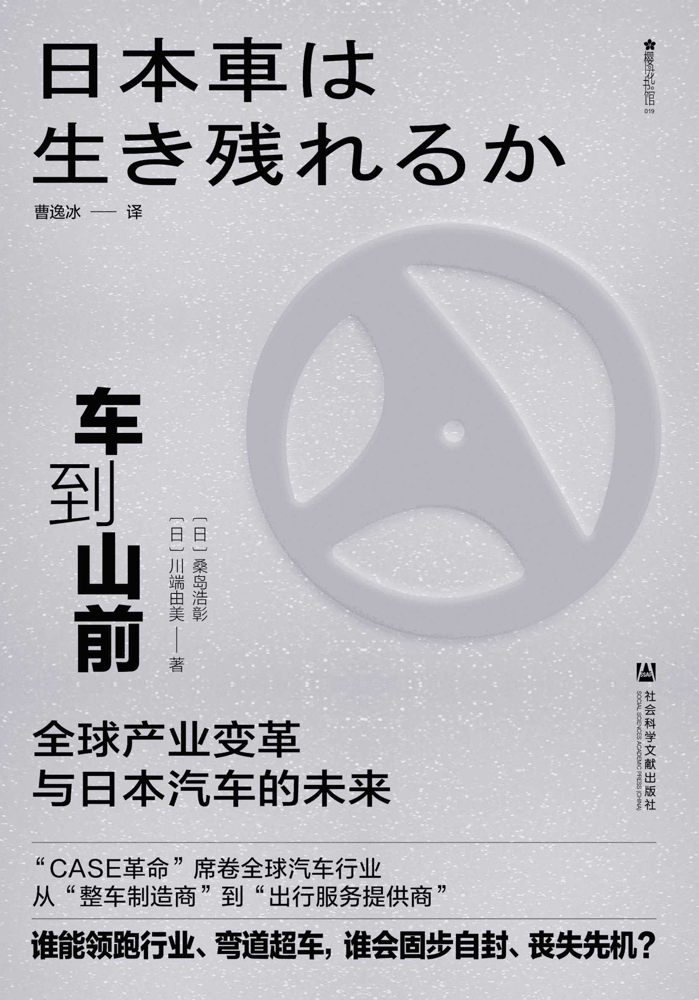

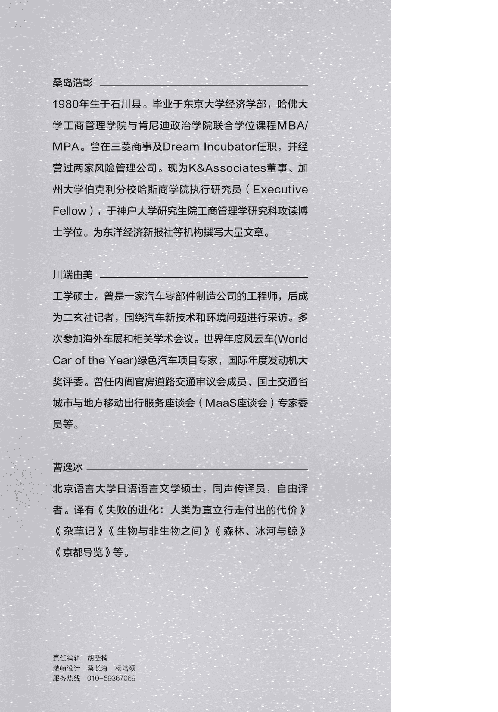

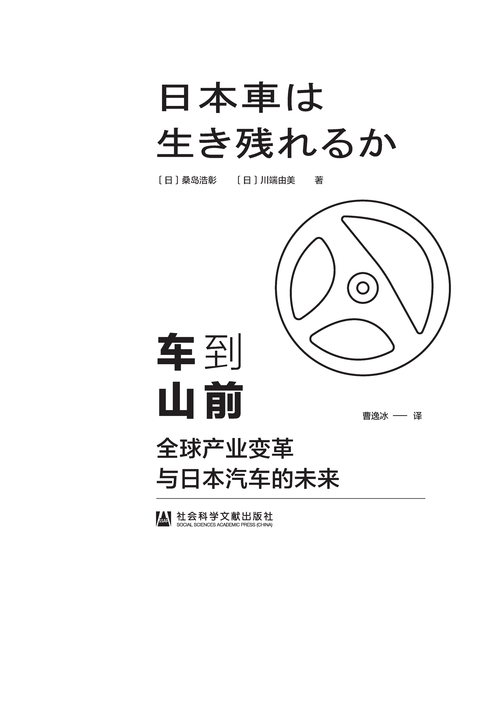

# 导言

■川端由美

## 撑起国民经济的巨型产业会倒下吗

“日本车行业要走到尽头了？”类似的说法最近愈发常见。

毋庸置疑，二战后拉动日本复苏的三大支柱是汽车、重工与家电。如今重工与家电持续收缩，汽车已成为压舱石。日本汽车工业协会的统计口径下，汽车制造的成品出货合计约62.3万亿日元，约占国内生产总值的十分之一，制造业出货中占比接近19%。与产业相关的就业人数在2018年统计时达到约542万。

体量如此庞大的领域怎会说垮就垮？新冠期间以丰田为代表的部分企业销量甚至逆势走高，也有人断言危机纯属臆测。

实际情形是，日本汽车不会猝死，但游戏法则正在改写。能够适配新法则的企业才有存续空间。

## 改写规则的关键密码

法则如何改写？先看一个横扫全球的关键词。

近几年外界热议的CASE，即网络互联、自动驾驶、共享服务、电动化四个方向的集合。2016年巴黎车展上，彼时戴姆勒董事会主席迪特·蔡澈在演讲中提出该概念后迅速扩散。

日本业界的注意力往往集中在电动化与智能化两端。若把互联、智能、共享、电动放在同一平面评估，容易误读问题的本质。

核心在于互联。把汽车接入物联网，车辆周边的生态会发生系统性变化。

个人电脑起初只是办公自动化工具，上网后才催生出以GAFA为首的一大批互联网企业。把电话接入互联网的智能手机，也催生了庞大的应用与服务生态。汽车正处在类似的进程里。

眼下电动化与智能化仍多以车载孤岛的方式存在，未来却会像电脑与手机一样，联网后的汽车将孵化多样化的出行服务，出租车网络就是典型案例。这也解释了GAFA等科技巨头为何集体布局汽车。

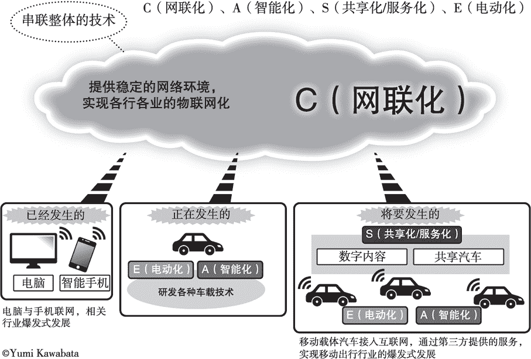

## 物联网视角下的汽车

在这一浪潮中，汽车正从交通工具演变为物联网中的一个节点，随之而来的是出行服务市场的接连出现。

请读者先把这一点记牢。

## 脱碳竞赛中日本的节奏

CASE已成不可逆的时代潮流，最终会导向什么？

我认为最关键的转向是从“以自有技术开拓业务”到“以社会议题开拓业务”。

2021年1月，时任首相菅义伟在国会施政演说中提出，力争2035年前日本国内新车销售实现全电动化，业界震动不小。实际上早在2020年10月，他已提出2050年前实现碳中和、构建温室气体净零的脱碳社会，并点名汽车是重要抓手。

自2015年《巴黎协定》生效后，欧美与中国持续推进碳中和，以国家力量推动电动化与替代燃料。车企普遍从碳中和、化石能源枯竭等社会议题出发，提前布局业务。

近年许多新动向都源于社会议题，比如因人口减少导致公共交通司机不足而催生的自动驾驶，以及个人购车需求见顶催生的共享用车。正因如此，欧美的中国企业更愿意跨界合作或通过并购补位，而不是死守自有技术。

日本在制造层面的技术仍处于世界前列，却过度聚焦于自身生产工艺，缺少以社会议题为原点构想业务的习惯，这也是菅首相提出激进电动目标时业界感到猝不及防的原因。

如果管理层仍固守制造导向思维，很可能只下令加快电动研发，让工程师加班加点，朝着与时代脱节的方向越走越远。日本车企更需要检视的是，管理层是否未能识别社会议题或因自满而忽视，导致真正需要投入的领域长期被搁置。事实上电动汽车所需的多项技术本就是日企擅长的领域。

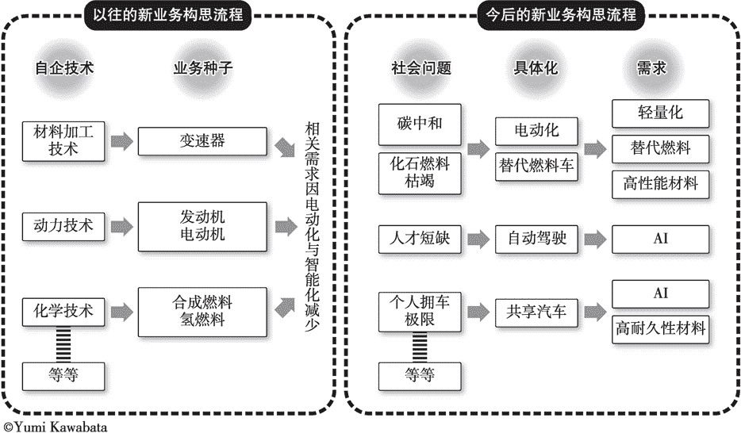

## 业务诞生的新逻辑

从“基于企业技术开拓业务”转向“基于社会议题开拓业务”

## 丰田社长的警示

2020年12月，担任日本汽车工业协会主席的丰田汽车社长丰田章男回应碳中和宣言时指出，协会将全力配合政府实现2050年碳中和，但在缺乏革命性技术突破的前提下前景不容乐观，只有整条供应链共同参与，日本车企才可能维持竞争力，并希望政府给予与欧美中国相当的政策与财政支持。

靠单打独斗研发车型，大企业或许还能自保。但面对全球环境问题这一重大社会议题，若不像欧美中国那样由国家与产业合力开辟新路，日本汽车的全球竞争力将受损。这正是其言外之意。

前文提出的问题仍然成立：日本汽车行业能否凭借国家与产业的合力继续作为经济支柱，还是跟不上规则变化而逐步失势？本书将梳理全球最新动向，剖析日本的当务之急。

## 作者与本书框架

读者或许会问作者何许人。请允许两位作者作简单介绍。

本书由川端由美与桑岛浩彰共同完成。我有工程师背景的记者，习惯从技术与工程学角度审视新汽车技术与全球环境议题，也以战略创新专家身份在工程与商业之间搭桥。桑岛拥有哈佛大学工商管理硕士学位，多年研究全球企业转型与创新案例，现居硅谷从事企业战略咨询，持续关注汽车与零部件产业动向。

第一章由我执笔，探讨CASE如何重塑汽车业及连带结果。第二章至第五章由桑岛负责，生动呈现美国、欧洲、中国如何在第一时间跟上CASE步伐。欧美与中国的车企也在全力转型，只是日本媒体报道较少。它们大胆结盟、并购、处置资产，这些动作从侧面映照出日本的反应迟缓。

最后一章第六章我将直述日本汽车业的现状、改变迟缓的原因，以及今后应采取的行动。

为免误会，本书并非意在贬低。恰恰相反，我们希望日本汽车业能摆脱对垂直整合的过度依赖，纳入水平整合视角，在制造之外孕育附加价值，继续担当经济支柱。

日本汽车业仍具再战之力。

# 第一章 汽车业的百年巨变

■川端由美

## 巨人面前的断崖

想象一个巨人狂奔，前方出现断头路，尽头是悬崖。路边立着“脱碳危险”“注意CASE”的警示牌，巨人却视而不见。

“怕什么，我一直靠自己的方法成长，按老套路就行。”

把当下的日本汽车行业比作这个巨人，便是如此写照。

以下内容与前言重复，但事关重大，容我再强调。

2015年《巴黎协定》提出把全球均温升幅控制在1.5摄氏度以内。德国联邦议院2016年决议2030年前停止销售传统燃油车，法国2017年宣布2040年前禁售，英国约翰逊政府2020年称2035年前禁售，后又提前至2030年。

美国特朗普时期退出协定，但加州已明确2035年前禁售燃油车。拜登上任后美国重返协定。中国提出2035年前新能源汽车销量占比提升至50%。

日本在2021年菅首相表态前，仅设定2030年前将燃油车销量占比降至30%至50%，相较世界显得宽松。JAMA2019年数据显示，日本当年新乘用车销量约430万辆，纯电动车仅2万辆，不足0.5%。仅靠普及电动车达成目标几乎不可能。日本在环保与CASE两方面的推进明显落后于对手。

## 电动化对全产业链的重塑

何以落后？看德国的路径。

德国早在2010年就制定电动化长期规划，政府与车企携手推进，并不惜调整产业结构。2018年成立的国家电动出行平台及其专家委员会，第一时间把产业结构转型纳入议程。电动化只是其中一环，自动驾驶、智慧互联、替代燃料、交通系统都在范围内。

电动化并非推广混动与电动车那么简单。传统汽车业呈金字塔结构，以丰田本田等整车厂为顶，下有Tier1、Tier2等供应商。电动化意味着整条供应链的重组，供应商同样受冲击。

长期以来，车企靠大批量生产发动机的能力筑高进入门槛，并靠规模效应获取高额利润。还通过发动机个性化实现差异化，塑造品牌溢价。电动化后如何差异化将成为关键课题。

电池成本是关键变量。技术上离不开电力电子技术。欧洲车企把电池电压由传统400伏提升至800伏，辅助系统电压由12伏提升至48伏。电压升高需像家电行业一样做防干扰处理。过去微波炉与大尺寸彩电普及导致家庭用电功率骤增，厂商被迫防相互干扰。汽车行业也会出现类似现象，成本随之上升。

油转电的冲击足以从根本上改写行业结构。

## 德国的国家协同转型

单就电动化一项就足以改变供应链，但这只是冰山一角。

因为互联至关重要。随着4G LTE与5G普及，高速移动的物体不久后也能稳定上网。原本游离于互联网外的汽车进入互联世界，变革会更大。用户希望在驾驶中也能安全使用智能手机上的便利功能，车企不得不回应需求。

在物联网商业模式下，金字塔顶端的整车厂会被降格为“O-T”，远超其影响范围的互联领域将崛起。那是一个基于互联网的巨大市场，涵盖通信基础设施、平台、车载操作系统、中间件与数字内容。GAFA纷纷布局汽车，缘由正在于此。

德国是最早捕捉这一趋势的国家之一。

德国政府预见结构性变化，决定与本土车企协同推进产业结构改革。

2019年11月，大众集团宣布将萨克森州茨维考工厂彻底改造为电动车工厂。当时的总理默克尔出席发布会，宣示德国将在新一代电动出行领域继续引领。

锂电池是电动车不可或缺部件。欧洲研发相对滞后，但部分德国制造商邀请宁德时代、韩国LG化学等亚洲电池强者在其生产基地附近设厂，促进就业。

德国历来重视可再生能源，太阳能为主的可再生能源已占能源总量约三成，若用于电动车生产则一举两得。德国的转型详见第四章。

## 洗牌在即，中小企业承压

本章开头把日本汽车业比作巨人，因其辐射范围极大。若看传统垂直整合金字塔，电动化要求由汽油柴油发动机技术转向电动出行技术，底蕴深厚的整车厂与零部件商尚可应对，人力资本有限的中小制造商恐难招架。

一旦只用化石燃料的车辆被禁，发动机与变速箱相关零部件将失去市场。生产活塞环、气门弹簧、燃油泵等零件的企业不得不调整业务。

丰田章男以JAMA主席身份发言时强调，在没有革命性技术突破的前提下前景不乐观，除非全供应链参与，否则日本车企极可能失去竞争力。他反复强调丰田要从“车辆制造企业”转型为“移动出行企业”。这正因丰田也认识到产业结构转型的规模、速度及其后续影响的可怕。

大规模转型势必带来企业淘汰与重组。

二战前德国约有200家车企，经多年整合如今只剩大众、戴姆勒、宝马三家。

日本虽有八大整车制造商，但大发、斯巴鲁、马自达、铃木已被丰田纳入，日产与三菱在雷诺旗下，本田保持独立。它们能延续至今的关键在于能自行研制发动机。这是整车厂长期以来的核心优势与壁垒，也是利润来源。但电动汽车与CASE浪潮将冲走这一最大竞争优势。

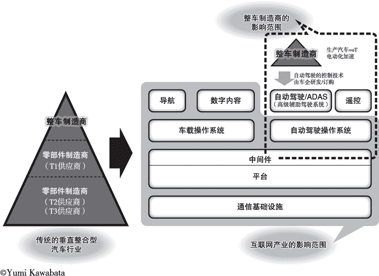

## 从垂直整合到水平协作

电动汽车大致由电动机、锂电池、电力电子装置三部分构成。最受关注的是电动机与锂电池，但DC-DC转换器、逆变器等用于变换控制电能的装置同样重要。

其中不少技术处于日企擅长领域。尼得科拥有全球领先的电动机技术，电力电子技术本就广泛应用于空调、洗衣机等家电。锂电池由索尼为压缩摄像机体积而研发，松下、三洋电机、东芝、索尼等电器巨头深耕多年。就个别技术而言，日本仍有一战之力。

假如日本车企继续按老路走下去，金字塔式的产业结构和全产业链自持的模式几乎必然走向瓦解。个别公司或能苟延残喘，可整体架构崩塌已成定局。简单说，日本汽车不会一夜之间倒下，但规则已被改写；只有跟上新规则的玩家才有活路。

回头看日本家电的过去，就能找到相似的剧本。当年的家电厂商和车企一样活跃在全球舞台，是经济的支柱，却在九十年代到本世纪初被中韩厂商冲击得节节败退。关键转折是制造方式从垂直整合转向水平分工。垂直整合指研发到销售全环节被同一家或同一集团掌控；水平分工则是企业只做核心研发设计，生产和销售外包出去。苹果手机就是典型，自己定调设计，代工交给全球制造体系。

去一趟深圳就能感受到这种分工的细腻程度。没有自有工厂也能造出产品，图纸、模具、线路板、零部件、总装……每一道工序都能找独立的供应商下单。中国因此诞生大量初创公司，而固守垂直整合的日本家电巨头则逐步失去竞争力。

特斯拉如何改写规则

席卷家电业的分工浪潮正重塑汽车业。把电动车拆成电机、功率电子、锂电池、传动等核心件，向不同供应商采购再装到底盘上，组装复杂度堪比遥控玩具车。

率先把这种模式搬进汽车的，就是特斯拉。到2021年3月，其市值约5700亿美元，远超大众、丰田等传统巨头。

2003年创立初期，特斯拉从美国初创公司AC Propulsion拿到动力总成的技术授权，底盘则用英国路特斯Lotus的Elise车型。电机等零件向全球采购后自行组装，这就是特斯拉的起点了。

我曾三次专访特斯拉创始人埃隆·马斯克。他并不是外界传说的汽车迷，而是带着解决全球环境问题的目的创业。“关键是解决社会问题，实现可持续发展，要处理好人类、环境和出行的问题，这一步必须走。”他在采访中反复强调。2021年1月他以约1948亿美元资产超过贝索斯成为世界首富。成立不到二十年的特斯拉能快速成长，正因马斯克把商业逻辑建立在社会议题上，对汽车未来在网联、智能、电动化的判断也走在前面。

四大赛道争夺战

GAFA对电动化等细分板块虎视眈眈，一直在等待切入时机。

2019年，亚马逊看中Rivian在洛杉矶车展展出的SUV，一次性投入7亿美元。Rivian的概念车R1S是七座SUV，宣传点是可装上万块锂电池、动力强劲。打动亚马逊的并非马力，而是其电动汽车专用平台，能根据用途灵活延展到运输卡车和商用车。

造车仍是车企主场，但在自动化和车辆调度等技术上，谷歌、优步等已加快布局。以IT企业为首的“局外人”正不断向制造和车载技术之外的领域渗透，这一趋势会更明显。

以CASE框架来看移动出行产业可分为四大方向：E电动化与A智能化即自动驾驶汽车，C互联化即AI、云和平台，S共享化即运营，S服务化即数字内容。

特斯拉凭借C、E、A取得巨大成功。优伯在公众印象里是共享出行公司，其发展同样离不开C的支撑。

辅助驾驶是自动驾驶的焦点，各家都在研发自动刹车等ADAS，更高阶的半自动、全自动驾驶正逼近。运营领域过去由轨道交通垄断，因基建投资巨大壁垒很高，随着互联网发展，企业能以更小投入进入。MaaS的出现让交通运营从轨道公司主导扩展为广义移动出行的一部分。

通信普及后，高速行驶的车辆也能稳定联网，车载数字内容市场随之放大。除手机内容和网购外，在车内享受内容已成现实。奥迪投资的VR初创Holoride在做车载VR系统，意大利媒体巨头也传出向菲亚特集团旗下车辆提供数字内容的动向。

德国零部件巨头大陆集团2017年公布的预测显示，到2030年汽车行业整体销售额将从2.78万亿美元增至5.5万亿美元，基本翻倍。其中硬件销售额从2017年的2.47万亿美元微增至2.8万亿美元，软件销售额则从2800亿美元激增到1.2万亿美元，SaaS销售额更将从300亿美元跃升至1.5万亿美元，增幅近50倍。
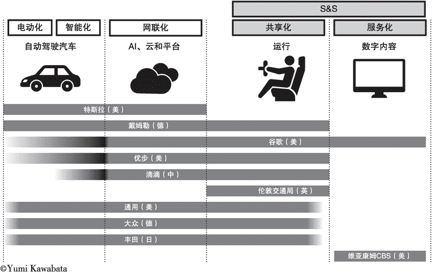

传统车企还能守住哪些阵地

在出行服务价值链中，传统车企能守住硬件制造和车载技术吗？还是……

汽车行业整体销售额的重心将从硬件转移至软件
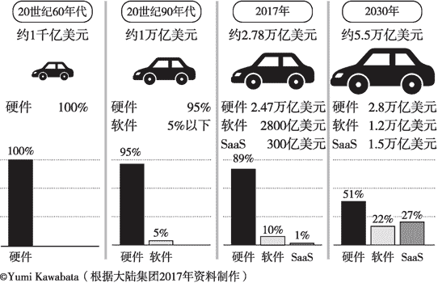

汽车行业整体销售额的重心将从硬件转移至软件

业内常见的误判

在业内聚会聊到这些时，常见的反驳是：家电零件少、产业链简单，跟汽车比不了。汽车供应链复杂、技术范围广，营销销售也有自己一套。归根结底，造车卖车是车企的地盘。

也有人说硅谷制造业基础薄弱，软件和IT的小波动撼动不了汽车整体结构，更不可能导致大厦崩塌。事实看着似乎如此，即使2020年下半年疫情肆虐，日本车企销量也在攀升，垂直整合供应链看起来根基稳固。于是很多人对日本汽车的结构重组持消极态度，这在几年前是主流声音。

转折发生在2018年。CES上，丰田章男亲自上台宣布丰田要重塑汽车业，告别传统商业模式。“我决定把丰田从一家造车企业转型为一家移动出行企业。”他说技术进步很快，竞争对手不再只是车企，还有谷歌、苹果、Facebook，“我们最初也不是从造车开始的。”

丰田社长的提醒很中肯，只是日本业界和公众能听进去多少？大众已宣布向福特供应电动汽车平台，戴姆勒也明确要在全球销售奔驰品牌的定置式蓄电池。拆解垂直整合、拥抱全球竞争、挑战全新业务，日本整车厂和供应商准备好了吗？

造车单卖已无利可图

一组数据说明汽车正沦为低利润商品。自动驾驶相关的高精度传感器和通信设备推高成本，加上原材料上涨和法规趋严，成本直线上升。

据Fiat Group World 2019年的数据，营业利润率最高的整车厂是法拉利23.2%，单车利润超过1000万日元遥遥领先。第二是吉利9.9%，第三是丰田8.5%，第四到第十一依次为宝马、五十铃、大众、铃木、PSA、斯巴鲁和沃尔沃。斯巴鲁单车利润约35万日元。日本厂商中，日产、三菱和马自达的单车利润大幅下滑。

如今单靠造车卖车已赚不到钱。汽车行业只能尽快拥抱以C互联化为首的新市场，明确竞争和合作边界，拿起武器进入战场。

几年前一位记者前辈讲过，采访某家电制造高层时对方豪言“按现在这条路走，想输都难”，没过几年那家公司就没落，被外资收购。绝不能让家电的悲剧在汽车业重演。

新时代的五条铁律

总结一下汽车业的新规则有五点。

第一，汽车被整合进物联网，成为像电脑和手机一样的IoT终端。车企长期相信“造好车就行”，这既是工匠精神也是固执。观念正在从“把网连上车”转向“连上网的车”。一旦联网，按自家规矩造车的整车厂可能要遵循GAFA等平台的规则。2021年2月彭博社报道苹果在为Apple Car物色造车供应商，日本车企在名单上。若成真，日本整车厂就成了供应商，苹果相当于扮演打开国门的黑船角色。

第二，产业结构从垂直整合走向水平分工。采用外包生产和无厂模式的制造商相继出现，例如早期的特斯拉。这一趋势在电动车初创企业中更明显，因电动车无需燃油车那样的大量投资。设计、营销、品牌相关内容以及底盘和执行器控制等影响体验的部分多由企业自控，但研发设计等核心也常被外包。

第三，得数据和软件者得天下。GAFA兴起后各行各业都认识到“数据是新石油”。从电动化角度拆解，曾经只是承包商的零部件厂商反而可能比整车厂更关键。他们长期为整车厂提供解决方案，积累了大量软件工程师，并不断与周边产业和初创公司合作。德国大型零部件厂商就是日本可以借鉴的样本。

博世销售总额的60%来自汽车部门，同时有家电和工业设备业务，在AI和IoT领域领先。博世、大陆等都在收购云计算企业强化AI能力，并积极开展跨国合作。

第四，电动化将加速。2019年欧盟发布《欧洲绿色协议》，目标2050年碳中和。欧盟此前要求新登记乘用车平均二氧化碳排放不超过130g/km，2020年起收紧至95g/km，这几乎无法靠内燃机实现。这也是大众、戴姆勒、宝马、雷诺等全力研发电动车的原因。

第五，从基于自有技术开拓业务转向基于社会问题开拓业务。过去以生产制造为核心的开发流程尚可接受，如今仅从自身技术和产品出发，新业务极易迷路。以GAFA为首的IT企业更注重用户体验并提供便捷服务，用户已习惯这种便捷。

冷静审视这五条规则，不难发现日本汽车行业死守的大多数规则已过时。这并不意味着日本整车厂和零部件厂的运营方式完全错误，也非唱衰日本汽车。总体而言，未来应致力于创造“可扩展且可持续”的业务，即基于社会问题思考业务形态和发展方向，创造社会需要、有意义且人们想要的服务。关键在于不拘泥于自家技术和产品，积极把外部合作乃至并购纳入选项。

之后的章节将结合实例，带大家领略各国车企的内部重组之路。
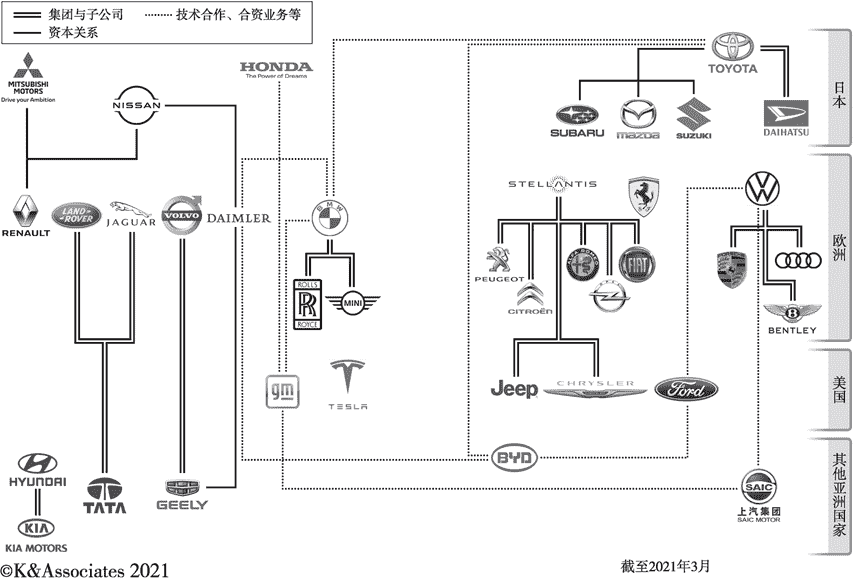

全球主要车企关系（中国车企仅限本书提到的）
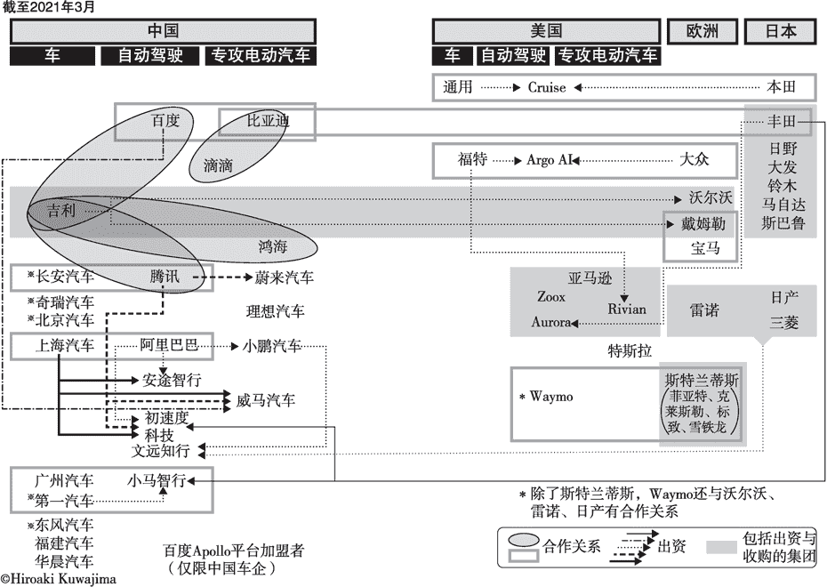

主要 CASE 关系（自动驾驶不包括物流业务）

* * *

# 第二章 美国汽车行业的现状

■桑岛浩彰

通用换标，电动时代的信号

几年后回头看，2021年很可能被记为美国电动化的元年。

2021年1月，拜登就任美国第46任总统，竞选期间就提出绿色新政，主张应对全球变暖并创造就业。上任后他宣布把65万辆联邦公务用车全部换成电动车，并把充电站数量提升到55万个，是现有10倍以上。考虑到2020年美国电动车销量含插电混动不到30万辆，这个目标极具野心。

我所在的加州硅谷，特斯拉早已常见，充电桩随处可见。续航焦虑和价格曾让市场怀疑电动车能否在美国普及，如今各大车企计划2021至2024年在美推出新款电动车。

重磅车型包括福特F-150皮卡、通用悍马电动皮卡和凯迪拉克纯电SUV锐歌。欧洲品牌也不甘示弱，戴姆勒EQS SUV、宝马iNext SUV、大众ID.4 SUV、奥迪eTron SUV、沃尔沃XC40 SUV等同台竞技。美国电动汽车等于特斯拉的时代正在结束。

回看 2020 年的美股走势，特斯拉无疑是汽车板块里最疯狂的存在，一年内股价飙升 743%。进入 2021 年，沉寂许久的通用与福特股价也开始稳步回升。为实现 2040 年碳中和目标，通用宣布未来五年投入 270 亿美元加码电动化，并在 2025 年前在全球投放 30 款电动车型。福特则早在 2018 年就放出消息，将在 2022 年前拿出 110 亿美元用于电动与节能车研发。这一系列动作让市场真正认可了电动化的趋势。通用甚至在 2021 年 1 月换上更具环保气质的蓝字品牌标识，并承诺 2035 年前全部新车实现电动化。种种变化，恍如隔世。

这些并非一夜之间发生的剧变，而是过去五年里在美国悄然发生的“地壳运动”逐步浮出水面。接下来将分别从底特律与硅谷两个视角，拆解美国汽车业近年来的巨幅变化。

## 底特律重生：昔日汽车之城的逆转

电影《8 英里》讲述了说唱歌手埃米纳姆早年的故事，舞台正是曾经的“汽车之城”底特律。21 世纪初的底特律城区已沦为贫民区，被视作全美最危险的地区之一，《机械战警》的未来底特律也是危机四伏。

底特律曾是福特、通用、克莱斯勒三大巨头的总部所在地，靠汽车产业登顶美国大都市之列。后来三巨头业绩下滑，城市同步衰败，市政府在 2013 年宣告破产。某届底特律车展开幕时，市长曾宣布“我们现在是全国第二危险的城市”，台下观众竟报以热烈掌声，因为摘掉“全美最危险”标签让市民欣喜若狂。

不过近年底特律正在快速复兴。硅谷掀起的数字化转型浪潮正重塑当地汽车产业，使其获得新生。

围绕底特律周边，生产电动车及关键电池零部件的工厂如雨后春笋。备受关注的初创公司 Rivian 也把总部搬到了底特律郊区。Rivian 成立于 2009 年，获亚马逊等巨头注资，计划从 2021 年起推出电动皮卡和电动[content]
回看 2020 年的美股走势，特斯拉无疑是汽车板块里最疯狂的存在，一年内股价飙升 743%。进入 2021 年，沉寂许久的通用与福特股价也开始稳步回升。为实现 2040 年碳中和目标，通用宣布未来五年投入 270 亿美元加码电动化，并在 2025 年前在全球投放 30 款电动车型。福特则早在 2018 年就放出消息，将在 2022 年前拿出 110 亿美元用于电动与节能车研发。这一系列动作让市场真正认可了电动化的趋势。通用甚至在 2021 年 1 月换上更具环保气质的蓝字品牌标识，并承诺 2035 年前全部新车实现电动化。种种变化，恍如隔世。

这些并非一夜之间发生的剧变，而是过去五年里在美国悄然发生的“地壳运动”逐步浮出水面。接下来将分别从底特律与硅谷两个视角，拆解美国汽车业近年来的巨幅变化。

## 底特律重生：昔日汽车之城的逆转

电影《8 英里》讲述了说唱歌手埃米纳姆早年的故事，舞台正是曾经的“汽车之城”底特律。21 世纪初的底特律城区已沦为贫民区，被视作全美最危险的地区之一，《机械战警》的未来底特律也是危机四伏。

底特律曾是福特、通用、克莱斯勒三大巨头的总部所在地，靠汽车产业登顶美国大都市之列。后来三巨头业绩下滑，城市同步衰败，市政府在 2013 年宣告破产。某届底特律车展开幕时，市长曾宣布“我们现在是全国第二危险的城市”，台下观众竟报以热烈掌声，因为摘掉“全美最危险”标签让市民欣喜若狂。

不过近年底特律正在快速复兴。硅谷掀起的数字化转型浪潮正重塑当地汽车产业，使其获得新生。

围绕底特律周边，生产电动车及关键电池零部件的工厂如雨后春笋。备受关注的初创公司 Rivian 也把总部搬到了底特律郊区。Rivian 成立于 2009 年，获亚马逊等巨头注资，计划从 2021 年起推出电动皮卡和电动送货卡车。

Rivian 首席执行官 R.J. 斯卡林格曾表示，从制造角度看，把基地放在底特律是最合理的选择，这里集中了顶尖的零部件厂商、完整的供应链和丰富的人才储备。

人才与企业汇聚的制造业中心底特律再次进入聚光灯。仅 2019 与 2020 两年，通用、福特和菲亚特克莱斯勒在底特律周边宣布的投资就超过 100 亿美元。

那就从福特说起。

### 案例研究 1

#### 福特押注智慧城市操作系统争抢主导权

密歇根中央车站是底特律辉煌年代的象征，也成为衰落的注脚。车站 1988 年停运客运后因体量庞大无法拆除，长期沦为空壳。2018 年 6 月福特收购了这座废弃建筑，经过改造后于 2022 年变为自动驾驶与电动车研发中心。收购纪念活动上，当时的福特 CEO 韩恺特说：

“我们不能再做一家保守的中西部企业了。我们既要和传统车企竞争，也要和优步、Waymo 这样的硅谷新创对抗。硅谷公司在驱动比特，我们驱动的是人。这座密歇根中央车站，或许会成为我们的沙丘路。”

福特斥资 10 亿美元买下车站及周边大片土地，规模相当于收购一座城市。公司计划将数千名员工迁至底特律周边，把这里打造成自动驾驶与电动车的前沿基地。

这项计划透出福特的魄力。现任董事长比尔·福特的决心不言而喻。1903 年，他的曾祖父亨利·福特就在这片土地创立福特汽车。当年的底特律充满创业精神，是创新的主战场。80 多家车企在此研发汽车以取代马车。亨利·福特从肉类加工厂获得灵感，创造流水线装配，自 1908 年起量产 T 型车，让原本只属于富人的交通工具进入普通家庭，福特一跃成为机动化领军者。

两次世界大战的战时需求让底特律汽车业达到顶峰，直到 70 年代石油危机。三巨头的黄金时代随之终结。物美价廉、省油可靠的日本车席卷美国，市场规则被改写。三巨头被迫将重心转向利润更高的轻型卡车、SUV 和皮卡求生。

## 突破造车边界的商业转型

2008 年金融危机里，通用与克莱斯勒申请破产并接受政府注资。福特通过出售沃尔沃和马自达筹资，才避开破产命运。为重启复兴，波音民用飞机前 CEO 艾伦·穆拉利出任福特 CEO，与时年 38 岁的马自达高管马克·菲尔兹联手大刀阔斧裁员。福特起死回生，底特律市政府却在 2013 年破产。菲尔兹 2014 年接任 CEO，2017 年因业绩与股价下滑辞职，接棒者正是韩恺特。

福特当下的自动驾驶与电动化战略，都建立在韩恺特的布局之上。他主导了智能出行服务子公司 Ford Smart Mobility，并在 2016 至 2017 年间投资了自动驾驶技术公司 Argo AI 和通勤共享业务 Chariot。重组过程争议不断，但他把视线从单纯造车卖车转向出行服务，提前为新收入来源铺路，这一点值得肯定。

作为乔布斯的崇拜者，韩恺特在 2018 年拉斯维加斯 CES 上表示：“随着 AI、自动驾驶和网联车的到来，我们将迎来百年来首次重构地面交通系统的机遇。我们有可能从根本上改善停车、交通流、货运等所有汽车相关业务，减少拥堵，为城市创造更多公共空间。”

## 构建交通出行云平台

韩恺特的策略特点是，在大企业内部孵化若干小团队以撬动整体。他希望摆脱只能造车的传统架构，转而设计城市交通基础设施，或运营“交通出行云”TMC，为软件厂商提供移动出行服务平台。TMC 的定位是出行服务的操作系统，地方政府可借此利用实时位置信息缓解拥堵、调控车流，目前开发进度也传出瓶颈消息。

TMC 的思路类似亚马逊的 AWS。福特希望包括竞争对手在内的行业企业都采用 TMC，以巩固其智慧城市操作系统地位。2018 年收购硅谷初创企业 Autonomic 是这一业务的起点。福特希望在 TMC 平台上孵化各种出行服务，并通过平台数据销售创造新营收。正如苹果 iOS 和谷歌安卓确立了手机系统主导权，福特想在智慧城市领域占据同等制高点。

福特网联服务负责人曾在 2018 年 CES 表示：“我们正在打造一个开放社区，欢迎各方参与。通过在开放云平台和服务上重注投入，我们希望为人们提供更高效的互联出行。减少拥堵不仅能提升城市运转效率，也能带来更多经济与社区利益。”

福特希望让其他车企采纳 TMC 以掌控主导权，成败取决于对手的选择。类比任天堂红白机时代的第一方游戏，平台需要强内容。韩恺特通过子公司 FSM 收购 Chariot 与 Spin，投资 Argo AI 和 Lyft，并由董事长比尔·福特自掏腰包创立风投基金 Fontinalis Partners 深耕出行。福特还在硅谷布点，陆续启动一系列贴合 CASE 的小项目，努力改写老牌企业的组织文化。密歇根中央车站周边的再开发就是其中一环。

## 用并购追赶技术前沿

2017 年 2 月，福特斥资 10 亿美元收购成立仅数月的 Argo AI，公司当时员工不过十余人。通用 2016 年收购 Cruise 或许给了福特启发。当时的 CEO 菲尔兹因在 CASE 等新技术上投入不足备受批评，想借收购 Argo 扭转颓势，却在壮志未酬时卸任，交棒韩恺特。

福特希望通过 TMC 在出行服务领域领先，若要让平台超出自家边界，必须有足够吸引力的内容与应用。自动驾驶是核心，但高精度传感器、芯片、算法、3D 高精地图与仿真都需巨额时间与资金投入。并入优秀初创团队能节省时间、实现弯道超车。

福特随即启动实证研究，使用搭载 Argo AI 的车辆。2018 年在佛罗里达迈阿密，福特与披萨连锁达美乐合作，用搭载 Argo 系统的福特 Fusion 进行自动驾驶配送。相关视频在 YouTube 上广为流传。随后福特又与沃尔玛合作，用自动驾驶车辆做食品配送试验。在与不同伙伴的实验中，福特探索如何提升出行服务使用率与销售额，积累经验转化为平台供给能力。

吉姆·法利在 2018 年 1 月 CES 上说：“我们正在检验福特所设想的每英里利用率最大化模式的潜力。”

## 自动驾驶落地的三大关键维度

关于自动驾驶的讨论往往混乱。按三个维度梳理会更清晰。

第一是运人还是运货。运人对安全性和乘坐舒适性的要求远高于运货，同时兼顾两者极难。Waymo 正试图兼顾，但仍困难重重。

第二是商用还是非商用。针对卡车、公交等商用车的商业模式和现金流更容易设计，非商用乘用车的盈利路径则模糊不清。从这两个维度看，商用货运是自动驾驶最先落地的场景，比萨外卖即属此类。

第三是行驶环境。是复杂的城区街道，还是高速公路长途运输。后者对算法精度要求不同。未来美国很可能先在高速公路长途运输领域开展试验，为商用货运铺路。

日本常从技术分级讨论自动驾驶，L1 仅为自动刹车等辅助，L2 特定条件下可脱手，L3 特定条件下可脱眼，L4 特定条件下可脱脑，L5 为完全自动驾驶。技术重要，但美国更常从商业模式需求出发讨论。开发 L4 以上技术需巨额投资，企业不仅要卖车，还需构建能证明成本合理性的商业模式。Cruise 与 Waymo 设想用于网约车服务，亚马逊则将自动驾驶与自营物流降本挂钩。单靠技术很难普及，日本企业也需多关注商业可行性。

## 韩恺特离职与战略延续

福特的首轮新时代攻势声势浩大，现实却很残酷。韩恺特的战略在推出之初就被质疑盈利与实用性，事后证明并非空穴来风。被收购后备受瞩目的 Chariot 于 2019 年关闭共享班车业务。Argo AI 因研发成本高昂引入大众 26 亿美元投资。到 2020 年 6 月，福特与大众各持 Argo AI 40% 股份，其余由高管与员工持有。Argo 依托两大巨头在全球开展业务。

受疫情等多重因素影响，自动驾驶商业化时间从 2021 年推迟至 2022 年。自韩恺特上任后福特股价一度跌近 40%，回落到 2008 金融危机水平。2020 年 8 月韩恺特卸任，福特在他的推动下完成从造车向软件服务的模式进化，城市交通平台的布局也颇具前瞻，但盈利难题让其步履维艰。继任者吉姆·法利上任后，截至 2021 年 2 月战略层面并未出现重大转向。

仅凭盈利不佳就否定转型过于武断。福特与大众在自动驾驶和电动化领域展开大规模合作，得益于大众的资金，Argo AI 起死回生，员工已超 1000 人，继续深耕自动驾驶研发、道路测试与高精地图。即便经历波折，Argo AI 仍在硅谷周边探索自动驾驶的盈利模式，值得持续关注。

下面把镜头转向底特律另一巨头通用汽车。

### 案例研究 2

#### 通用押注自动驾驶的野心

通用汽车首位女性掌门人玛丽·巴拉曾表示：“电动化是共建零排放未来的核心。通用的奥特能平台与电池系统将推动旗下品牌全面电动化，我们计划在 2025 年左右实现全球年销 100 万辆电动车。”

她还说：“除了长期积累的核心资产，我们通过收购 Cruise 等方式获得了布局自动驾驶的关键要素，足以引领该领域。每个环节都能在集团内完成，大城市复杂环境的驾驶测试也在持续进行。我们是唯一用生产线量产自动驾驶试验车的企业。换言之，即便未来不需要驾驶员，通用也能以量产体系应对。”

截至 2020 年 7 月，通用计划投入 22 亿美元升级底特律哈姆特拉姆克装配厂，用于电动车组装，Cruise Origin 自动驾驶车的量产也已提上日程。2008 年金融危机时通用曾申请破产保护并靠政府注资续命，如今转变之快令人惊叹。

巴拉 18 岁进入通用实习，从基层做起，技术深耕后赴斯坦福商学院进修，2014 年 52 岁时出任 CEO。她上任后进行结构性改革，关闭工厂裁员，并斥资收购自动驾驶初创企业 Cruise，还推动与本田深度合作。通用因此改头换面，稳步拥抱新时代。集团宣布 2025 年前投入 270 亿美元开发电动与自动驾驶汽车，年产 100 万辆电动车，并与韩国 LG 化学联合生产电芯。公司已明确 2040 年前实现碳中和。回望 20 世纪 20 年代末，通用在阿尔弗雷德·斯隆领导下以“新车型刺激消费”确立营销模式，一度称霸全球。昔日龙头能否再次卷土重来？

## 押宝 Cruise

2016 年，通用收购总部位于旧金山的初创企业 Cruise，市场传闻收购价高达 10 亿美元。当时 Cruise 仅有约 40 名员工。创始人凯尔·沃格特时年 34 岁。

堪萨斯土生土长的沃格特在本地高中毕业后进入麻省理工学院，2004 年便参加了 DARPA 主办的“Grand Challenge”无人车赛事。不到三十岁，他靠创办又转让几家公司已成为亿万富翁。2013 年创立的 Cruise 是他的代表作，创立初期获得 Y Combinator 的注资，让这家新创迅速进入视野。

Cruise 起初的打算是为市面上常见的车装上半自动驾驶套件卖钱，后来战略转向研发可服务城市通勤场景的自动驾驶软件。成立仅三年，通用汽车对这套技术兴趣极大，以高价将其收购。收购后沃格特进入通用管理层，继续掌舵 Cruise。被底特律总部的通用收归旗下后，Cruise 保留了相当高的独立性，子公司层面依然由沃格特全权负责运营。

另一位关键人物是玛丽·巴拉。她在通用内部历练的同时攻读斯坦福 MBA。收购 Cruise 前一年，她特意到硅谷与苹果 CEO 蒂姆·库克以及谷歌的高管多次会面，围着自动驾驶展开讨论。那段经历让她清楚感受到底特律和硅谷在工作节奏、文化气质、管理方式上的落差，因此有意把通用与 Cruise 放在对等位置，避免强行同化。

分工由此变得清晰：算法研发、传感器与半导体、地图构建、原型车搭载与道路测试这些“硅谷活儿”由 Cruise 主导；底特律的通用则负责把成熟技术落地到车身、完成系统级验证。两边对时间与品质的理解差异明显，明确的边界反而减少了文化摩擦。

2019 年 1 月，巴拉的嫡系达恩·阿曼接过 Cruise 的 CEO 职位，沃格特转任总裁兼首席技术官，继续把控技术方向。

进军无人物流出行

2020 年 1 月，Cruise 在旧金山南区办了一场别具风格的发布会。场地像暗仓库，嘻哈声响起，橙色灯光流转。新车 Cruise Origin 完全去掉方向盘与踏板，内部两排座椅相对，每排三人。可使用寿命标称 160 万公里，官方宣称上线后每年能为每户旧金山家庭节省约 5000 美元的出行开销。

上台的达恩·阿曼说这款车已进入量产准备阶段，意味着它并非概念，而是要走下哈姆特拉姆克装配线。通用明确表态 Origin 将以自动驾驶出租车身份服务，不对外零售，用户通过 App 呼叫。通用在这一盘棋里定义的角色是“基于自动驾驶汽车的网约车服务商”。

到 2021 年 3 月，软银与本田分别向 Cruise 注入 22.5 亿美元与 7.5 亿美元。通用也在深化与日本车企的联动，2020 年与本田联合开发电动车，并宣布 2021 年在日本铺设基于 Origin 的出行业务。“零排放、零事故、零拥堵”是巴拉描绘的愿景，通用因此在旧金山等大城市密集布点网约车业务。

行业正站在分岔口：是继续以造车为主、为苹果、优步等做水平分工的硬件供应，还是转身做多元收入的出行服务商。菲亚特克莱斯勒把自动驾驶开发交给 Waymo，自己聚焦皮卡与 SUV，并在 2021 年与标致雪铁龙合并为 Stellantis 后仍坚持这一取向。

通用则选择垂直整合 Cruise 的自动驾驶能力与网约车运营，公开喊出“不把身家押在造车一件事上”。网约车被寄望在车辆全生命周期创造收入，为车企打开“卖车之外”的空间。

巴拉当初设想的是 2019 年就用 Cruise 的自动驾驶车切入网约车，把行驶与运营大数据留在自己手里。这种紧迫感来自特斯拉与 Waymo：前者靠自家售出的车辆持续收集数据，后者作为谷歌系企业在实车测试数据量上遥遥领先。

通用认为除了数据规模，安全是另一项可差异化的价值。它想把 Cruise 的强项与自身在整车制造、零部件采购上的长期积累结合，打造更安全的自动驾驶电动车，向以软件切入汽车、企图重塑秩序的 GAFA 阵营发起反击。

关键时刻

Cruise Origin 的发布为通用转型带来希望，但截至 2021 年 2 月，受美国法规与政策影响，网约车业务的具体上线时间仍未敲定。

另一边待解的问题不少。通用希望在 2023 年前实现 SUV 类电动车的全线量产，涵盖 Origin 以及在美热销的悍马、凯迪拉克车型，但先行上市的小型电动车雪佛兰 Bolt 销量表现不佳。

疫情冲击下，通用的汽车共享服务 Maven 自 2020 年 4 月起持续亏损并被宣布关停。5 月，Cruise 裁员 160 人，约占员工总数的 8%。与福特相似，通用正处在生死抉择的关口，昔日巨头能否挺住仍待观察。

经历多次罢工的底特律哈姆特拉姆克装配厂宣布将在 2021 年下半年投产电动车与自动驾驶车型，厂房改造也在推进。

加州硅谷已逐渐成长为与底特律并驾齐驱的美国汽车第二中心。下一章，我们把镜头移向硅谷。

* * *

# 第三章 美国汽车行业的现状

■桑岛浩彰

## 新汽车心脏：硅谷

2020 年的美国被疫情笼罩，加州夏天还连着山火不断。身处硅谷的作者既要躲病毒，也要防糟糕的空气，不得不长期居家。即便如此，硅谷的舆论热度并未降温，汽车相关消息几乎每天更新。特斯拉股价持续攀升，亚马逊、苹果、谷歌等 IT 巨头加速染指汽车业的报道更是此起彼伏。

2019 年亚马逊投资硅谷自动驾驶软件公司 Aurora Innovation，也投了电动汽车新创 Rivian，后者承诺从 2021 年起向亚马逊交付 10 万辆电动送货车。2020 年 6 月亚马逊以约 10 亿美元收购面向网约车市场的 Zoox。年底，亚马逊系的 Aurora 收购优步的自动驾驶部门 Uber ATG，丰田与电装此前也曾投资 Uber ATG，据传因此成为 Aurora 的股东。

业界解读为亚马逊要压低每年超过 900 亿美元的物流成本，并以硅谷为跳板吸纳自动驾驶技术与人才。长期以来，自动驾驶的最大难题是研发投入难以回收，财力雄厚的亚马逊率先出手。

苹果也在提速。2021 年初传出苹果正与韩国起亚谈判，目标在 2024 年推出 Apple Car，有意采用水平分工模式让起亚提供车身。

早在 2014 年苹果就启动“泰坦计划”，投入大量人力物力研发电动车与自动驾驶，由特斯拉与谷歌背景的专家带队，涉及动力、内饰、外观、电池、自动驾驶等诸多领域。2016 年前后项目多次传出缩编甚至夭折的消息。苹果与起亚的传闻让泰坦计划再度成为焦点。起初市场盛传苹果会找麦格纳这种有造车实力的零部件巨头，后来又指向起亚、现代等韩国整车厂，据传也接触日产，但截至 2021 年 3 月日产并未表态。

种种迹象显示苹果想复制 iPhone 的组装分工模式，但汽车组装的利润率远低于手机，车企态度谨慎。再加上苹果一贯的保密文化，Apple Car 的模样仍笼罩迷雾。可有一点很确定：苹果全面进入汽车只是时间问题。

当下美国汽车业的两极是底特律与硅谷。底特律是传统三巨头的大本营，硅谷则孕育了特斯拉等公司，CASE 浪潮由此发源。汽车本是硬件集合体，如今与互联网深度绑定。随着车联网普及、半导体与人工智能进化，以及 5G、云等基础设施完善，硅谷将牢牢握住新一代汽车行业的命脉。本章的主角，正活跃于硅谷的新玩家。第一个出场的是特斯拉。

### 案例研究 1：特斯拉，硅谷的颠覆者

媒体常把特斯拉说成一家高速成长的电动车制造商，这个标签反而掩盖了它的本质。

亨利·福特的创业信条是“自由出行推动人类进步”，福特官网也写着愿景是让每个人自由出行追逐梦想。对福特而言，“车”是业务的前提。马斯克 2006 年发布首份“宏图”时却说，特斯拉首要目标是推动碳氢经济向太阳能电力经济转型，这才是可持续发展的主方案。换句话说，特斯拉的使命是构建可持续能源生态系统，电动车只是过程中的一个里程碑。

马斯克在发电与储能领域动作不断：2016 年收购 SolarCity，推出家用储能 Powerwall，并在各地铺设超级充电站。造车只是其战略的延伸，特斯拉致力于开发、生产、销售电动车，核心理念是用清洁能源驱动的出行替代燃油车。出发点与传统车企截然不同。

想把清洁能源普及到全球，规模化造车成本惊人。早期特斯拉另辟蹊径，先切入高端市场赚取研发资金，再逐步扩充车型线、提高产量。Roadster、Model S、Model Y、Model 3、Cybertruck，已经横跨多个细分市场，如今重型卡车也被纳入视野。

它为何成长如此快？除了设计感与舆论热度，Autopilot 自动辅助驾驶、OTA 远程在线升级、线上直销与上门保养等体验加分项，让特斯拉先在高端用户群体站稳，再靠 Model 3 拿到大众市场。数据显示美国 2018 年电动车销量同比增 80%，Model 3 是主要推手。电池成本与续航一直是行业瓶颈，能抢先卡位者优势明显。

### 坚守自造体系

特斯拉奉行高度垂直整合，研发、生产、销售、售后基本都在内部完成。行业主流观点认为汽车将从垂直整合转向水平分工，特斯拉却坚持自研自制核心部件。

马斯克 2019 年曾强调：“我们是业内唯一自造整车、电池、自动驾驶芯片的公司，处境完全不同。从车辆设计生产到内部软硬件与 AI 都走在前面。若对手拥有百倍数据才能追上来，那也会很吃力。”

一位前员工的说法是：总部在加州，当地缺乏大型供应商，也难以触达密歇根州的供应链网络，所以特斯拉选择垂直整合并精选少数供应商，约九成的部件按价值计都在自有体系内生产。

国内层面，车身在加州弗里蒙特工厂下线，电池在内华达超级工厂制造，以自动化提效。海外已在中、欧设厂，印度也在规划中。

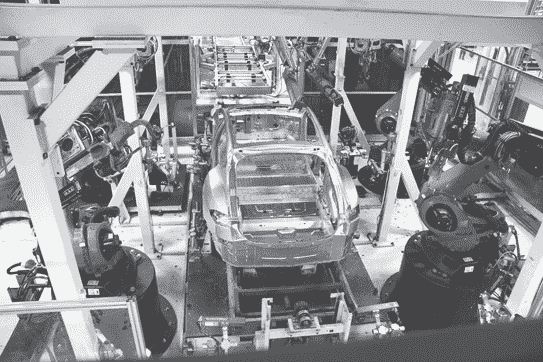
高度自动化的特斯拉工厂
一条如此庞大的供应链不可能一路顺畅。Model 3 于 2017 年量产时遭遇多次交付延误，瓶颈被认为是电池模块组装与马斯克对自动化的极致追求。2018 年负责自动化的团队公开认错，表示“自动化做得太多、太快了”，随后暂时减少自动化比例，更多采用半自动与手工。产能扭转后，Model 3 的销量爆发成为特斯拉腾飞的原动力。

在渠道与服务上，特斯拉也走垂直路线。销售以线上与自营门店为主，在法规允许范围内不依赖独立经销商。售后通过 OTA、远程诊断与移动维修车减少到店频次，兼顾成本与满意度。工程主管曾形容 OTA：“我们不是一次性大升级，而是像软件公司一样持续微调。”这让特斯拉在体验上与传统车企拉开差距。

### Autopilot 的代价

特斯拉一直认为在正确使用下自动辅助驾驶比人工更安全。2016 年的“宏图第二章”指出，随着技术成熟，所有特斯拉车型将搭载可容错的全自动驾驶硬件，现在就提供自动辅助驾驶而非等待未来。自 2014 年起相关软件作为选装提供。

Autopilot 已实现自适应巡航、自动变道与转向、识别路标、自动加速至设定巡航速度等功能。但多起致命事故都发生在使用该功能时。官方要求使用期间双手始终在方向盘上，随时可接管，可惜部分用户过度依赖，甚至在驾驶时玩手机，最终酿成悲剧。

## 特斯拉的`Autopilot`自动辅助驾驶功能

特斯拉对 Autopilot 的定位是辅助而非替代。官方反复强调正确使用前提下安全性优于人类驾驶。2016 年的路线图写明，未来整线车型都将具备容错的全自动驾驶能力，而当前阶段先以自动辅助驾驶落地。自 2014 年起该软件便可选装。

功能上包含主动巡航、自动变道、自动转向、路标识别与速度自调。然而现实中出现多起致命车祸，均与驾驶员在使用 Autopilot 时未能保持接管准备有关。规范要求双手在舵、随时可介入，但过度信任导致的操作分心仍是事故主因。

特斯拉的Autopilot选择与质疑
面对外界对驾驶监控的疑问，特斯拉公关曾解释过：他们评估过很多方案，最后落在了传感器配合提醒的组合上。方向盘内置的传感器能捕捉驾驶者手的动作，再用画面提示和语音提醒来督促。发言中也提到特斯拉会持续迭代，未来不排除引入新手段。华尔街日报日语版2018年5月14日曾刊出此回应。即便如此，仍有不少声音对把现阶段非常有限的辅助功能包装成`Autopilot`持保留态度。

垂直整合是特斯拉一贯的做派。自动驾驶所需的核心半导体，最早与美国巨头英伟达共同研发，后来改为自研。负责`Autopilot`的副总裁在2017年就说过，市场上没有哪颗芯片能匹配特斯拉整套系统与车辆的要求，自行设计反而能做出更契合的产品。从芯片到系统，特斯拉的独特路线在这里体现得淋漓尽致。

拥车派的特斯拉
电动化赛道里，特斯拉一直领跑，率先上马辅助驾驶，被认为是`CASE`革命的先锋，但从未表现出要真正进入共享出行、`MaaS`等领域的意图。我接触过的前特斯拉员工坦言这点。

“自动驾驶当然能为共享服务铺路，前景很大。特斯拉却并不打算涉足共享与出行服务，因为它追求的是‘拥有车辆’，所有产品设计都围绕‘开好车、拥有一辆好车的体验’展开。”

现阶段，特斯拉设想的业务仍以拥车为前提。也许在他们看来，能源要清洁，但消费形式可以保留，于是把消费者的车逐步换成电动车。他们在探索围绕拥车的服务，比如用手机App把闲置的车租给亲友，降低持有成本。马斯克还抛出过“特斯拉网络”`Tesla Network`的概念，称当全自动驾驶到来时，车主可把车辆接入网络，为他人提供自动驾驶网约车服务。

当传统车企还在挣扎时，特斯拉用另一套逻辑成长为电动化的领头羊，以非常规思路打破行业常识，短短不到十年就把一众百年品牌的市值甩在身后。安全性争议仍在，股价被认为高估的说法也不少，但这家企业无疑正处在汽车行业结构性变革的中心。

接下来看看字母表旗下的自动驾驶公司Waymo。

## 案例研究2
### Waymo的“最强司机”野心
镜头移到硅谷心脏地带的帕洛阿尔托——当年史蒂夫·乔布斯据说在参观施乐帕洛阿尔托研究中心`PARC`时受启发，创造了苹果电脑的图形界面[^(\[8\])](#chapter004.html#m8)。这里诞生了鼠标和激光打印机，是公认的硅谷圣地。

2018年秋，麻省理工学院在`PARC`办了一场校友讲座，门槛放宽后也准许付费的外人旁听。主讲人是Waymo CEO约翰·克拉夫西克`John Krafcik`。Waymo原为谷歌自动驾驶项目，后从母公司字母表独立出来，到场者几乎坐满，抢不到座位的只好站听。克拉夫西克上台后开场就说：

“全球每年有135万人死于交通事故，相当于每小时坠毁一架载150人的空客A320。伤者每年多达5000万。统计显示，10个人里有6个人一生中至少经历一次酒驾事故。共同点是94%的事故由人为因素导致……”

克拉夫西克对汽车行业很熟。他曾担任现代汽车美国总裁兼CEO，2015年加入Waymo出任CEO。那天他以麻省理工斯隆管理学院校友身份发言，本职却是一名工程师，斯坦福拿的机械工程学位。他在日美贸易摩擦高峰期毕业，先在新联合汽车制造公司`NUMMI`[^(\[9\])](#chapter004.html#m9)起步，后在麻省理工做研究员和管理顾问，以熟悉丰田精益生产著称。之后任福特总工程师，又在现代工作。30多年跟踪美日韩车企变迁的他，可能把Waymo当作职业最后一站，终极目标是“交通事故零死亡”。

“我们不是车企，也不是自动驾驶公司。Waymo是一家技术公司，做的事是打造世界上经验最丰富的‘司机’，也就是`Waymo Driver`。我们的使命是让人和货物安全便捷地抵达目的地。”2019年他这样表述。

## 登月起点
Waymo源自谷歌的“登月项目”`Moonshot Projects`，2009年秘密启动。这类项目耗资巨大、难度极高，一旦成功对人类进步意义重大，故得名。

项目起步于谷歌X `Google X`[^(\[10\])](#chapter004.html#m10)在山景城的一栋楼。那栋楼离本田和松下的硅谷基地仅几分钟车程。X是登月项目的孵化地，内部展出过被贴上失败标签的谷歌眼镜和`Project Loon`[^(\[11\])](#chapter004.html#m11)，还有2014年发布的首代自动驾驶原型车“萤火虫”`Firefly`。

X尚未孵化出谷歌的支柱业务，投入产出比常被质疑，但它展现了谷歌的魄力，愿意不计成本启动有趣的项目。据说谷歌还有庆祝项目失败的盛大宴会传统。基于菲亚特克莱斯勒小面包车Pacifica改装的自动驾驶车每天穿梭于X园区，山景城居民早已习以为常。

## 无人出租真的更贵吗
加州车管局每年公布各企业在该州公共道路的自动驾驶测试数据，业内尤其关注平均接管里程`MPI`，即两次人工接管间隔的平均里程，计算方式为全年测试总里程除以接管次数。如下表，中美两国在该指标上领先。

加州公共道路自动驾驶测试结果

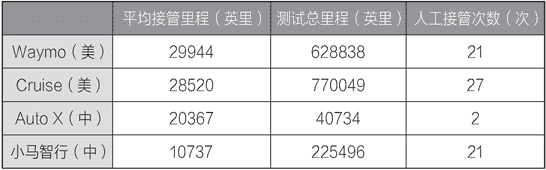

加州公共道路自动驾驶测试结果-续表

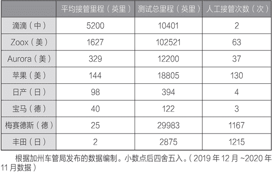

数据只涵盖加州公共道路，不包括海外测试和模拟，所以不能完全反映实力，但足以看出中美在大力投入研发。

克拉夫西克反复强调打造最有经验的司机，但其含义并不清晰。从近期动向看可归纳为三点。

第一，推进`Waymo One`无人网约车服务和`Waymo Via`自动驾驶货运实验。
第二，把`Waymo Driver`系统授权给斯特兰蒂斯、沃尔沃、日产雷诺联盟等车企。
第三，与加拿大零部件巨头麦格纳合作，在捷豹纯电轿跑SUV `I-PACE`上装载系统实现量产销售。

Waymo自研了算法、传感器、车载电脑、地图等大部分关键技术。传统车企只提供车辆，Waymo能从中获得运行和驾驶数据用于进化。换言之，Waymo想走垂直整合，把下游服务一并掌控。若能在全球铺开服务并垄断车辆数据，车企自然警惕。但Waymo的态度最近有微调。

原因在于自动驾驶的难题不仅是工程，还有各国法规、事故责任、基础设施、用户信任、数据处理、车队运营诀窍等本地化议题。麻省理工的阿什利·努内斯`Ashley Nunes`和克里斯汀·埃尔南德斯`Kristen Hernandez`的研究指出，算上远程监控成本，自动驾驶出租车的总成本未必低于普通出租车。也许Waymo因此更倾向做技术和操作系统提供商，扮演`SaaS`角色，把服务留给本地运营商，收益更高。

克拉夫西克领导Waymo五年。2020年3月Waymo获得22.5亿美元注资，规模可望扩大。2021年4月他宣布辞职，引发震动。无论如何，他的战略正是美国汽车业重心转向硅谷的契机。这笔资金将如何使用，还待观察。

## 硅谷的圈层逻辑
硅谷位于旧金山湾区南部，长约80公里，IT企业和初创公司密集，各区域主业不同是其特点。

洛斯阿图斯一角的Sumika日式餐厅，用备长炭烤鸡肉串闻名。疫情前几乎天天爆满，比日本贵两三倍仍是投资者和创业者聚会的首选。我也常把美国车企高管和硅谷创业者约到那里，吃鸡肉盖饭聊投资、行业人物、新基金计划、需盯紧的初创动向，再去隔街的蛋糕店收尾。

硅谷每个行业都有紧密小圈子，好消息坏消息都极快传遍。大学同学、商学院校友、投行咨询老同事等会形成强联系圈，做风投的常在小圈内交流项目。某种程度上，硅谷像传统村落。

见面机会很多：投资路演、被投企业董事会、投行研讨会、每年一月拉斯维加斯的CES与车展。疫情前几乎每晚都有行业活动。物理上进入硅谷不难，但想看清本质，必须理解这种背景，挤进小圈子才行。

## 外来者的三大痛点
汽车圈同样狭小。`CASE`与数字科技对汽车的渗透始于21世纪10年代中期，此后美国汽车业重心从中西部向西海岸延伸。底特律仍是制造中心，但传感器、算法、半导体和网约车等移动出行服务的优秀工程师基本都在硅谷。于是全球车企和零部件巨头纷纷进军硅谷。

常见两种模式。模式一是在硅谷设研发基地，由总部派人开发移动服务与关键技术，或与当地初创合作实证，日本本田和丰田[^(\[14\])](#chapter004.html#m14)即为此路。模式二是入股前景可期的初创，也有企业投资硅谷风投，通过风险投资初创企业收集信息，比如小松制作所。直接投资初创可分两种：一种由硅谷投资机构管理资金，如松下；另一种由总部主导投资以求协同，如日本电装。

后来者会撞上几个硬问题。

最大的文化鸿沟。财力本是大企业优势，但近年初创融资环境更好，资金吸引力有限。且大企业总想用投资锁住技术，越有实力的初创越排斥。大企业流程慢，初创为赶风投设定的里程碑而废寝忘食，签份保密协议要拖三个月，在初创眼里不可想象。

挤进小圈子也是难题。日企人事流动频繁，离任者回国，导致负责人难在圈内扎根。观察发现，德国企业常有同一人负责某业务十多年。

车企数量少，竞争对手间亦敌亦友`frenemy`[^(\[15\])](#chapter004.html#m15)，跳槽常见，大家更倾向以个人身份进入圈子而非公司名义。

总之，除非收购初创完全纳入，或迁就初创的时间观和速度感建立互惠关系，否则很难进入硅谷生态。对高度习惯日本商业模式的企业，门槛尤其高。

## 案例研究3
### 戴姆勒的硅谷式自救
德国老牌戴姆勒巧妙借鉴硅谷特性，对官僚色彩浓厚的组织文化进行了大刀阔斧改革。

每次在硅谷与戴姆勒高管交流，“过去几年企业文化剧变”都是必谈话题。六七年前，德企聚餐常吐槽总部决策慢、批件要堆资料、信息不通，与日企外派员抱怨高度重合。但戴姆勒的转变是有目共睹的。`CASE`是当下热词，戴姆勒早在2016年就发布“瞰思未来”`C∙A∙S∙E`战略，如今已摆脱德国老牌车企做派。

关键就在硅谷核心城市之一的森尼韦尔。

## 百亿赌注重塑体系
卡尔·本茨`Karl Benz`与戈特利布·戴姆勒`Gottlieb Daimler`于1886年推出世界上第一辆汽车“奔驰一号”`Benz Patent-Motorwagen`，比福特T型车早130多年。戴姆勒长期是德国汽车领军者，后来却陷入安于现状、行动迟缓的困境。

执掌公司十余年的迪特·蔡澈对危机感极强，2006至2019年任期内主导多轮改革。2016年夏天，他把战略部门主管威尔科·斯塔克`Wilko Stark`叫到总部[^(\[16\])](#chapter004.html#m16)，划拨100亿美元预算和数百名青年人才组建`CASE`部，并直属CEO管辖，顶住原业务部门反对。

2015年戴姆勒曾派100名高管赴硅谷，拜访苹果、谷歌、优步高管，研习硅谷创新机制。2016年启动全球企业文化改革项目，覆盖200多名员工，调整培训、决策流程、组织架构、项目推进工具，大幅精简层级，几乎从零重建大企业。

领导改革的蔡澈说：

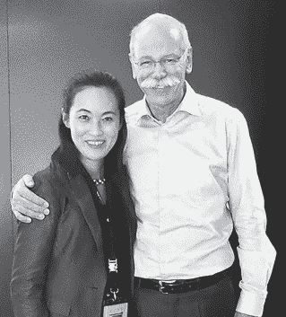

迪特·蔡澈与川端由美

“我相信现在是面向未来改变企业文化、让组织更灵活创新的最佳时机……改革不是打破层级，而是重构创造交流机会。希望改革能帮助员工提升专业能力，消除官僚障碍，促进部门协作。”2016年7月。

斯塔克领导的`CASE`部统筹网联化、智能化、共享化、电动化，阐明技术融合将催生新出行方式。部门开发了整合移动出行服务与自动驾驶车辆的App和运行管理系统，并在2022年前推出十多款电动车，推动一系列必要举措。

## 提前25年的探路
戴姆勒为何能第一时间捕捉硅谷动向？其实早在1995年互联网黎明期，戴姆勒就成了第一家在硅谷设研究机构的车企。当时尚未并入克莱斯勒，也没有人谈汽车行业结构性变化。

机构任务是跟踪微软、苹果、摩托罗拉等企业，分析消费电子技术趋势，并预测人口老龄化、千禧一代[^(\[17\])](#chapter004.html#m17)崛起等长期社会变化对需求的影响。基地据此为美国市场做长期趋势预测并上报德国总部。20世纪90年代末他们就做过车辆联网实验，还尝试在车上搭载iPod。算下来，戴姆勒在CASE领域的深耕超过25年。

即便如此，最终推动老牌车企变革的，还是埃隆·马斯克领导的特斯拉。戴姆勒北美高管2017年对我坦言：“像特斯拉OTA这种‘不知道什么时候能实现的技术’若无强势一把手自上而下推动很难落地。戴姆勒高层看到特斯拉在自动驾驶、软件、电池方面的惊人速度，危机感飙升，觉得那种高速管理势在必行。”

2009年戴姆勒向特斯拉投出5000万美元，这笔钱占了当时特斯拉市值约一成。彼时马斯克刚坐上CEO位子。2014年戴姆勒套现离场，这笔注资之于特斯拉的影响远超账面，坊间说法是戴姆勒借此摸清了特斯拉在电池研发上的水位。同一时期戴姆勒内部一个只有二十来人的研究小组也在悄悄换位，从单纯跟踪技术潮流，转向为梅赛德斯-奔驰打造网联化服务。如今这个团队已膨胀到三百人，体量已不可同日而语。

## CASE热情是否在降温

转身之路上，戴姆勒最强调的词是“做快”。大家达成共识：过去决策慢、落地慢，已经跟不上新商业模式的诞生节奏。凡是自动驾驶要用的东西，从芯片开发、算法搭建到商业模式设计，都不一味依赖自家供应链，而是在外部合作中争取把周期压到最短。最有代表性的就是“百日加速营”Startup Autobahn，用来快速吸纳集团内部没有的技术和人才，也顺带强化了总部直管的投资职能。

硅谷的研发据点成了这次组织活化的发令枪。正因为它提前发出预警，总部才嗅到行业与商业模式变局的气味。戴姆勒还专门设了个内部孵化窗口，号召员工围绕全球尤其是北京、柏林等地的需求构思出行服务。Mercedes me、Car2Go、Moovel这几项核心网联业务，就是在这种机制下长出来的。

乍看戴姆勒成功化解了硅谷带来的颠覆，但硬骨头仍在。即便在硅谷，自动驾驶所需的顶尖AI人才也供不应求，被各家抢破头。挖别的领域优秀工程师的成本，几乎是本土的两倍。内外都在质疑这笔钱的投入产出。

乘用车自动驾驶的路线图已经被一再推迟，市面上还有传闻说它准备把网约车平台Free Now卖给优步。撇开电动化之外，对CASE的热情似乎在回落。尽管如此，总体而言戴姆勒投向硅谷的努力仍算收效。

## 案例研究 4：零级供应商的野心，安波福

2018年1月的拉斯维加斯，CES展会现场灯火通明。据说一年要吸引近20万观众。CES原本是消费电子的舞台，随着汽车数字化，展会已自带全球车坛盛会的气质。核心展馆几乎被汽车厂商占满。

在展馆外，一支白色宝马5系车队格外显眼，轮圈涂成红色，车身上印着APTIV。展区分散，观展人习惯用Uber、Lyft穿梭，运气好就能挤进安波福的车，享受宝马的舒适同时体验自动驾驶。车上留了安全员以备干预，常规情况下全程由电脑掌控。安波福其实早在三年前就已做到这点。作为零件厂，它偏偏要跳出制造的框框。

“我们无意成为自动驾驶按需出行服务的运营商或网络运营商，也无意开展车队运行管理业务。将这些企业的各种服务自动化并提供给他们才是我们的目标。”——2018年安波福CTO格伦·德沃斯

通用剥离零部件后诞生了德尔福一级供应商。2017年12月，德尔福的动力总成事业部独立，改名安波福。安波福原本是典型的制造业公司，做发动机零件为主。当通用、福特都在收购硅谷新创时，前身德尔福也在自动驾驶赛道买买买、谈谈合作。

真正的拐点出现在2017年10月，安波福正式成名前不久。德尔福宣布花4.5亿美元拿下nuTonomy，自此长期方向从“造件”转向“供自动驾驶系统”。我当年在CES坐的那辆宝马网约车，就在为安波福的自动驾驶系统做实证。

步子很快。2019年9月，安波福与现代汽车一起组建自动驾驶合资公司Motional，nuTonomy的管理团队整体迁入。随后Motional宣布与Lyft在美国多个城市推进自动驾驶出租车的落地计划。

## 定位“零级供应商”

为何动作如此迅捷？安波福判断，汽车行业附加值很快会从硬件向软件转移。它不想只卖零件，而是要卖互联和自动驾驶的软件，以及支撑它的系统架构、算力与数据分析。拿自动驾驶举例，软件迭代、车辆监控、把车上产生的大量数据分析成服务，都能持续收费。商业关系因此从买卖变成更对等的长期伙伴。

光靠自己显然追不上技术。安波福在研发上也改了打法，靠并购和合作借力。欧美中跨国车企和零部件巨头基本达成共识：关起门来搞不通了。

于是安波福在很短时间里把自己从一个传统零件商升级为拥有6000名软件工程师的组织，业务覆盖云、车载应用、操作系统、计算、传感器等，能服务车厂到出行服务商的整条链。它实质上把自己定义成了“零级供应商”。

## 试错是必修课

安波福战略的另一个突出特点，是想做车企和初创之间的桥梁。硅谷的一名前员工说：

“只要对车企有吸引力的初创，基本都会先找我们。车企很少愿意直接跟只剩二十几个人的团队打交道。初创不懂汽车行业的规矩，车企又懒得一个个解释。我们正好在中间搭桥。做PoC时我们常要居中协调。”

除nuTonomy外，安波福还按同样的思路收了不少小公司，比如做车辆数据分析的Control-Tech，以及给MaaS运营商做数据处理的Otonomo。总体而言，它的战略是：不仅提供部件，还要预判CASE带来的产业结构变化，提前用软件服务孵化新产品。

“安波福以前是一级分包商，直到一年前才设了产品经理。过去只要按单生产就好，现在有了产品经理来主导基于客户需求的开发和制造。为数码转型付出代价很正常，现在是改革的好时机。”前员工补充道。

这个打法是否成立，现在还说不准。评估全球无数初创、挑技术和管理团队，难度极高；跟不懂汽车质量规范、决策节奏和行业惯例的初创合作，也不见得容易。

但用“失败是成功之母”的心态去试错仍值得。相机从胶片到数码、电视从画质到内容、手机从功能到智能，工业史上不乏行业规则在数字化瞬间被重写的案例，昔日巨头也可能一夜凋零。汽车大概率逃不掉。

在数字化浪潮中判断行业走向、明确自身定位、补足能创造附加价值的能力，必要时从外部引进技术——安波福的做法未必是标准答案，但这种速度和态度可能更加关键。手里没有标准答案时，设想多种可能、快速跨过必然的失败、赢得速度竞争力，才是当务之急。把“零失误”放在第一位的时代已经过去了。

下面转到欧洲，看当地车坛的最新动向。

# 第四章 欧洲车坛的冷暖图谱

■桑岛浩彰

## 欢喜与愁并存

德国柏林东南的格伦海德，夹在两湖之间，有自然保护区，常住人口约8700人。2020年初，特斯拉要在当地建厂的消息打破宁静，计划雇佣1.2万人，远超本地人口。马斯克领衔的项目让小镇沸腾，开发提案从住宅到商场络绎不绝。

不过在2019年11月，斯图加特的1.5万名车厂工人走上街头，抗议电动化带来的裁员和工厂关闭。次年戴姆勒和大众宣布未来几年分别裁员约1万人，大陆集团也计划调整，包括裁员，涉及约3万人，占比超一成。

同国同业，景象却如此分裂。这个曾经的造车强国到底经历了什么。

大众集团是全球最大车企，83年历史，员工67万，旗下奥迪、保时捷、兰博基尼、宾利等十几个品牌。62岁的掌门人赫伯特·迪斯在2020年11月的会议上提到了特斯拉CEO的名字31次。对手年产量仅为大众的五分之一，员工不到十分之一，却让巨象般的大众显出面对蝼蚁的紧张。

大众、戴姆勒等老牌巨头为求生存迎战马斯克旗下的特斯拉，这就是当下欧洲汽车的现实。

## 大众加速电动化

先从大众说起。

2015年迪斯从宝马转投大众。他主导下，大众对MEB电动平台砸下70亿美元，并计划到2025年前投入860亿美元用于电动化研发。目标是2030年前把电动汽车产能推到2600万辆。2020年集团电动汽车销量23.1万辆，内部希望2021年翻倍。

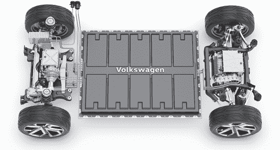

大众电动汽车平台“MEB”

首步是茨维考工厂投产MEB平台的ID.3。彭博社预计欧洲电动汽车销量到2030年将飙到770万辆，2019年还不足50万。争夺这块增量市场，大众计划到2022年把包括中国在内的八个工厂改造成电动车专线，同时向福特等竞争对手授权MEB。

## 矛头对准电动车

说回特斯拉的德国建厂计划。

格伦海德工厂预计2021年7月开工，年产50万辆，比茨维考高不少。首款Model Y之外，还计划自产电芯和电池包。2020年11月特斯拉还暗示将推出针对欧洲拥挤城市的小型掀背车，给欧洲车企添堵。

欧盟提出2050年碳中和目标，德国以彼得·阿尔特迈尔为首的政府对特斯拉表示欢迎。2020年9月迪斯与马斯克长谈近两小时，会后评价：“特斯拉到来会刺激德国市场竞争，推动我们产业加速转型。”内心是否平静不得而知，表面仍保持礼貌。

不过建厂之路并不顺，环保组织以危害冬眠蛇为由起诉，当地法院叫停建设用地砍伐，进度一拖再拖。

想阻挡特斯拉的不只有大众和环保。2019年销量排名第11的戴姆勒宣布2025年前投入850亿美元做电动化和数字化，准备推出10款电动车和25款混动车。第13位的宝马计划2021年底在欧洲推出旗舰电动车iX，2023年底前把电动车和混动车型增至25款。

2021年1月新生的Stellantis也值得关注，由菲亚特克莱斯勒与标致雪铁龙合并而成，旗下14个品牌，包括菲亚特、玛莎拉蒂、阿尔法·罗密欧、标致、雪铁龙、Jeep、道奇等，年产量约800万辆，位列全球第四。

合并谈判起点是2019年3月日内瓦车展上迈克尔·曼利与卡洛斯·塔瓦雷斯的会面。起初进展缓慢，菲亚特克莱斯勒一度转向雷诺谈判失败，最终才与PSA握手。

Stellantis的成败取决于能否兑现合并协同效应约60亿欧元、在中国市场建立存在感、在CASE领域投钱见效，以及扶持销量不佳、产能过剩的玛莎拉蒂、阿尔法·罗密欧等品牌。

## 诺基亚阴影

第二章梳理了硅谷发源的变革与美国车企的焦虑。核心是面对趋势剧变时的危机感。德国同样如此。与日本一样，德国曾靠汽车主导的制造业享尽荣华，但近几年车企和零部件大厂都已开启数字化转型，比日本更早通过投资、并购、合并布局。

为什么德国第一时间产生如此强的紧迫感？跟欧洲从业者聊时，诺基亚被反复提及。昔日全球非智能手机霸主，在iPhone出现后迅速衰落，陷入财政危机。“我们会不会变成第二个诺基亚”，正是欧洲车企的集体焦虑。

手机早期被看作硬件的堆叠，拼装金属、芯片、屏幕技术做得更快更好的人就能拿下市场。智能手机登场后，游戏规则被改写，硬件必须与以 App 为核心的软件服务深度绑定，在线音乐分发等数字内容迅速繁荣，决定购买理由的因素从制造力转向生态力。网络效应让用户与流量持续向 iPhone 与安卓阵营聚拢，靠硬件称王的诺基亚就此退出主流。

汽车行业很可能正在走同一条路。只会造车的企业，若在网联、智能等数字赛道明显落后，衰退几乎不可避免。“会造车就能说了算”的年代已经结束，欧洲厂商甚至在讨论是否会出现由掌控软件与数据的新主体主导造车格局的局面，危机感愈发强烈。

面对这种结构性变化，欧洲的老牌厂商在做什么？先以戴姆勒为例拆解。

## 案例研究 1

### 戴姆勒：从整车销售到出行服务提供者

2017年11月，法兰克福车展期间，我在机场酒店询问前台哪款网约车好用，被推荐了戴姆勒旗下的 MyTaxi[^(\[6\])](#chapter005.html#m6)。使用方式与 Uber 类似，下单后附近注册出租车接单，展会期间出行很方便。MyTaxi 创立于2009年，2014年被戴姆勒收购，随后持续并购以欧洲为主的出行服务商，疫情前已覆盖15个国家110座城市，注册用户超过2000万。

除此之外，戴姆勒旗下还有共享汽车先驱 Car2Go[^(\[7\])](#chapter005.html#m7) 和多式联运平台 Moovel[^(\[8\])](#chapter005.html#m8)。以这三项业务为支点，公司正从只卖车的传统定位抽身，稳步向 MaaS 方向靠近。绝不让擅长数字技术的硅谷力量拿走车辆产生的数据和客户接触点，这份决心是布局的出发点。

决心也在合作中体现。2019年，戴姆勒与竞争对手宝马宣布整合共享出行与充电等业务。成败取决于能否第一时间搭建平台、实现用户规模的临界质量[^(\[9\])](#chapter005.html#m9)，从而掌握主导权。

上述三项业务在疫情前都未盈利，但在出行形态演进中仍具意义，为跳出造车卖车的框架奠定基础。2020年10月，有报道称 Uber 有意收购 FREE NOW，报价超过10亿欧元，若属实，说明 FREE NOW 已成长为物有所值的主体。

### 组织架构大刀阔斧调整

从经营角度看，同时扶持多项暂时不赚钱但具潜力的业务绝非易事，需要高层深度介入与组织重塑。没有利润的新业务很容易被传统盈利部门排挤。

在前 CEO 迪特·蔡澈强力推动下，戴姆勒于2019年12月完成重组。两大传统板块被拆分为四家公司：戴姆勒 AG 为控股主体，下设梅赛德斯-奔驰 AG 负责乘用车、戴姆勒卡车 AG 负责商用车，卡车业务于2021年2月宣布单独上市，以及负责金融服务与出行服务的戴姆勒移动出行 AG[^(\[10\])](#chapter005.html#m10)。调整提升了组织灵活性，尤其在出行服务领域更利于中长期合作。

针对汽车百年巨变，德国制造商的回应是迅速并购与组织重塑，死守日益重要的客户触点与由此产生的数据，不让外部力量介入。宝马也与西门子、博世及德国电信合作，于2020年6月宣布打造欧洲专属云端运算平台 GAIA-X，逻辑一致。

德国汽车业还有一特征：零部件巨头正试图挣脱分包商的传统定位，尤其在 CASE 领域，它们正成长为能与整车厂平起平坐的力量。

接下来看博世、大陆与采埃孚的动作。对它们而言，这场变革或许是天赐良机。

## 案例研究 2

### 博世：四成业务押注智慧城市

2019年初拉斯维加斯 CES 上，德国零部件巨头博世发布的短片“来个博世” Like a Bosch 引发关注。片中一位普通中年人唱着说唱跳舞，轻松操控联网咖啡机、吸尘器和奔驰车，宣告物联网时代到来。博世的产品线涵盖汽车零部件、家电、电动工具和楼宇管理系统，短片意图把这些产品串联到物联网关键词下，塑造高科技形象。

核心信息很明确：以产品构建智慧城市是博世的宏大愿景。

丰田宣布在静冈建设 Woven City，日本的智慧城市讨论升温；中国雄安新区也在向巨型智慧城市迈进；而 Alphabet 旗下 Sidewalk Labs 则放弃多伦多智慧社区计划，显示该领域瞬息万变。

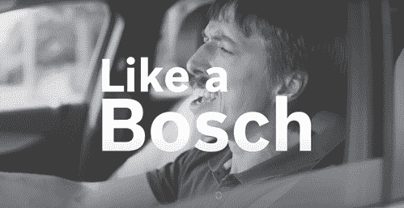

“来个博世”

博世既做移动出行，也做家电、机器人和能源管理，相当于把松下、发那科、日立某部门和电装合在一起的复合型企业。对此类企业而言，智慧城市是最理想的发力点。博世已在全球14座城市参与广域智慧城市开发项目，并计划继续铺开。博世移动解决方案业务部负责人曾表示：

“博世与其他一级供应商的不同之处在于，我们的业务涵盖了包括智慧城市在内的各个领域，并不仅限于汽车。在如何通过安装在车辆上的各种传感器检测并分析各类信息这方面，我们也有丰富的经验知识。我们会将这些信息上传到博世自己的云平台，并运用于其它服务。”（摘自网络媒体 Response 2017年11月8日的报道）

从卖物的供应商进化为利用自有数据提供移动出行服务的参与者，关键词就是智慧城市。整车厂与零部件厂的上下级关系正在瓦解，双方正走向纯粹的竞争。

### 光造好车已不够用

移动出行是智慧城市的子领域。博世有意构建基于可再生能源的多式联运系统，推动网联车市场。现任 CEO 沃尔克马尔·邓纳尔[^(\[11\])](#chapter005.html#m11) 的表述具参考性：

“光造好车还不够。我们必须探索改善交通拥堵和环境问题的方法。移动出行需要更为‘灵活’的视角，因为在一些大城市，交通总量将在 2050 年上升至现在的 3 倍。交通不仅要追求电动化和智能化，还要通过互联网实现互联互通，并通过运用数据使其更加方便和舒适。只有实现了电动化、智能化和网联化，才能尽可能靠近‘零排放、零事故和零拥堵’的目标。”（于法兰克福车展）

由此可见，博世的终极愿景不是建城本身，而是借智慧城市实现零排放、零事故、零拥堵。

### 厂商之外的位置是否更优

一位熟悉博世的消息人士称：“博世所处的位置比整车制造商更为有利。”

“博世不同于只会造车的车企，它有能力向城市提供成体系的解决方案，包括移动出行服务、能源管理等。站在城市的角度看，找一家为多家车企供应零部件和服务，并能跨制造商提供数据的企业合作，显然比牵手只能提供自家产品和服务的车企更合理。”

平心而论，该说法略有高估。相关项目仍处实验阶段，主要在收集各城市交通问题并构建用例[^(\[12\])](#chapter005.html#m12)，计费与收益模式要等到下一阶段。目前测试方案分散，平台尚未统一，智慧城市落地仍需时日。但博世愿意在短期内无利可图的领域率先投入，探索移动出行服务未来，这种态度值得许多日本供应商借鉴。

### 网联仍是核心

为实现智慧城市愿景，博世聚焦移动出行中的网联化和智能化。

网联化是 CASE 中最重要的元素。博世强调传感器、软件和服务 3S 优势，开发方向包括 OTA 及基于社区的停车解决方案等。

2018年2月，博世新设互联出行解决方案事业部，员工约600名，负责面向驾驶员的互联服务、自动泊车、网约车和汽车共享系统等。

“车辆网联化将从根本上改变移动出行的方式，从而解决目前的交通问题。这是博世最有潜力的发展领域，我们的目标是实现两位数的增长。”

——CEO 邓纳尔

“创建基于互联移动出行服务的数据访问机制，将成为取得胜利的关键。”

智能化方面，博世与戴姆勒深度合作联合开发自动驾驶软件与算法，目标在2021至2022年投入使用。2019年该合作项目在德国获得 L4 级自动行驶泊车功能认证，同年于美国圣何塞启动基于自动驾驶汽车的网约车实验。博世还为中国百度的自动驾驶项目提供传感器，并与美国半导体厂商英伟达合作开发自动驾驶超级计算机。

但盈利仍是难题，博世旗下的电动摩托车共享服务 Coup 已于2019年12月关停。

最新动向是2020年7月，博世将全球汽车软件和电子业务整合为智能驾驶与控制事业部，预计到2030年该领域市场规模将达到900亿美元。

## 案例研究 3

### 大陆集团：从轮胎向自动驾驶延伸

大陆集团是全球知名轮胎制造商，规模仅次于普利司通、米其林和固特异。公司创立于1871年，2021年迎来150周年。虽然外界印象里大陆等于轮胎，但轮胎业务在2019财年仅占总销售额26%。过去15年大陆并购了100多家企业，已成长为全球领先的汽车零部件制造商，业务从轮胎延伸至所有与汽车相关的硬件和软件。

从提供基于云的车辆软件更新和服务平台，到开发自动驾驶汽车，大陆集团能为车企数字业务提供一站式方案。2019年其宣布动力总成部门[^(\[13\])](#chapter005.html#m13) 拆分上市，并重组为两大板块，一个聚焦传统轮胎与橡胶制品，另一个负责自动驾驶与车辆软件。此举堪称汽车数字化转型的典范。

早在2016年年报中就有表述：“近年来，汽车行业重新定义了新一代移动出行的愿景，即‘零事故、零排放与全面联网’。业界需要的解决方案是提供新技术，并开发新服务和基于 App 的移动出行服务。”

2017年时任董事长沃尔夫冈·雷茨勒表示：“移动出行领域的增长一度由马力驱动，但今时今日，增长的原动力变成了计算机，以数十亿比特或字节为单位。我们将从轮胎制造商、汽车零部件供应商和车企合作伙伴转型为开发先进技术和服务领域的‘新晋玩家’。”

大陆集团欲通过从硬件到软件再到服务的转型冲出零部件行业。2020年12月刚上任一个月的 CEO 尼古莱·泽策便宣布拿下价值50亿美元的车载中央计算机订单，趋势正加速。

### 大陆集团描绘的未来蓝图

20世纪90年代大陆就开始将重心从轮胎硬件转向数字技术，可说第一时间预判了行业数字化。其对自动驾驶核心传感器等技术的投资可追溯到90年代初。90年代后期以来并购100多家企业，持续扩大数字技术业务，对 HMI[^(\[14\])](#chapter005.html#m14) 的研究已持续十多年。策略是通过合作补足自身难以拥有的技术，实现稳步增长。

大陆并不追求技术自给自足，而是面向车企客户需求，从单个部件到模块再到平台，逐步走向价值链上游。

2019年大陆发布2030战略及变革2019—2029架构规划。战略强调通过调整组织与业务组合提升效率，并在未来增长领域集中发力。基于此，动力总成部门被拆分成立纬湃科技独立上市。设想的增长领域包括智慧互联、自动驾驶解决方案和电动出行，与 CASE 思路一致。

变革2019—2029重点是彻底降本、聚焦关键领域。通过削减人员与投资、关闭工厂、转让合资股份，力争到2023年每年削减10亿欧元成本。兼并投资积极开展，一旦认定业务不必要就迅速撤退，显示出变革决心。

### 本质是数据争夺战

先看网联化。大陆拥有云信息服务平台 Continental.cloud，制造商和经销商可据此开发分析车辆数据、创建地图数据的服务。5G 和 OTA 是网联与智能的基础，大陆已在相关领域展开大范围研发。

大陆的一系列动作呈现出一个特点：建立统一的数据服务平台，基于联网车辆和基础设施采集的数据提供服务。这正是德国汽车业的焦虑所在——死守车辆数据与接触点，不让谷歌、亚马逊等 IT 企业染指。

例如大陆构思的商业模式是，在自有云服务器上存储分析来自各车企的车辆数据，对数据匿名化后，仅向第三方出售分析结果。大陆并非个例，其他零部件厂商也表示不主张对车企数据所有权，只做数据分析者，把通过数据服务获利的机会留给车企。车企认为，IT 玩家只想扫荡数据单打独斗，而大陆这类供应商更像是愿意共存共荣的伙伴。

随着5G推进和自动驾驶普及，移动数据、地图信息等大数据成为新竞争力，受《通用数据保护条例》[^(\[15\])](#chapter005.html#m15) 等法规影响，数据所有权争议不会很快平息，但核心是数据主导权归谁。直面客户的车企本应占优，但戴姆勒等仍担心失去接触点，甚至要自主开发语音识别技术。可以说，欧洲汽车业正打响一场数据之战。

### 关键收益在2030年之后

在自动驾驶领域，前 CEO 埃尔马·德根哈特 2019年预测：

“到 2030 年，驾驶辅助系统将带动自动驾驶的周边市场。（自动驾驶相关业务的）重要的收益将在 2030 年后产生。”

这话听起来消极，但若解读为只有做好准备者才能分享2030年后的繁荣，就能理解大陆为何大刀阔斧重组。

目前大陆正在研究传感器等自动驾驶必需零部件，开发高速公路自动驾驶功能巡航司机，并涉足自动驾驶车辆本身。2019年推出的无人驾驶出租车 CUbE 和自动驾驶概念车 Bee 足以显示其在该领域的隐性实力。这样的企业完全有可能突破零部件供应商的边界，自行造车。坊间盛传其目标是从 T1 供应商转型为 T0.5 玩家。

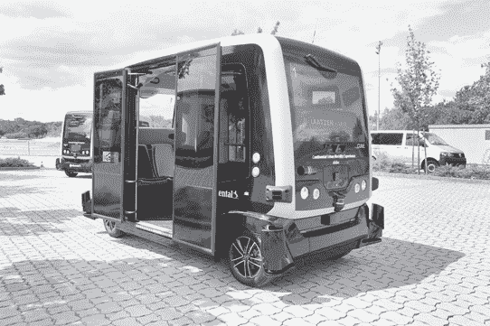

无人驾驶出租车“CUbE”

## 案例研究 4

### 采埃孚：由齿轮制造商转型数字参与者

如前所述，博世与大陆集团分别通过布局智慧城市业务和大举并购完成了组织转型，以适应汽车行业的新阶段。

## ZF：并购驱动的蜕变之路

采埃孚靠一系列大手笔收购，几年间就把自己推到全球汽车零部件第一梯队。2015年，这家德国公司花了124亿美元收下美国零部件企业天合汽车TRW Automotive。

ZF这个缩写来自德语Zahnradfabrik，字面意思是齿轮工厂。由此可见它的根基在齿轮、变速器等机械装置，是典型的机械派，和德国本土整车厂关系紧密。当时的天合汽车擅长电子控制与传感器，客户集中在美国车企。这次交易的最大价值是产品组合与客户群的强协同。可以说，采埃孚用短短几年走完了大陆集团大约二十年才完成的那段路。

当时的掌门人斯特凡·索默主导了与天合汽车的整合，让昔日的齿轮厂升级成数字时代的玩家。采埃孚与大陆集团都被视作行业数字化转型的标杆。下面梳理它的发展走向和未来布局。

## 以“零愿景”推进自动驾驶与电动化

大陆集团推出2030战略后，采埃孚在2017年提出“零愿景”Vision Zero[^(\[16\])](#chapter005.html#m16)，透露了后续方向。愿景里的“零”指两件事：用自动驾驶做到零事故，用电动化做到零排放。研发正围绕这个目标展开。值得注意的是，采埃孚从起步就把对外合作当成自动驾驶的基本思路。

“我们无法独自完成自动驾驶所需全部技术，合作是必须的”“合作等于补上缺失的拼图”“设想十年后汽车会如何存在，同时做好当下该做的事”——采埃孚董事在2017年7月19日接受《日刊工业新闻》采访时的表述。

落地案例很快出现。采埃孚与美国半导体厂商英伟达联合研发车载超级计算机采睿星ProAI。英伟达是全球领先的自动驾驶AI芯片开发商之一。2019年4月，基于采睿星的L2级辅助系统coPILOT发布，预计2021年起交付。此外，采埃孚还和英伟达、德国零部件商海拉Hella研发面向自动驾驶的AI安全方案；与法国零部件商佛吉亚Faurecia共同打造自动驾驶时代的舒适安全座舱。由此可见，采埃孚正通过多方协作确立自动驾驶系统供应商的定位。

完成天合汽车收购后，采埃孚并未放慢收购节奏。2019年3月，它又以70亿美元拿下以制动系统闻名的瑞士企业威伯科WABCO。

采埃孚计划从2018年起五年内投入140亿美元用于自动驾驶与电动车研发。选择合作并购而非封闭自研，摆脱“汽车零部件厂商”标签的决心很明显。

## 守住传统与做大新业务能否兼得

并购从来不是一帆风顺。

商业史上，按计划完成的并购属于小概率。商业模式的变革也需要现有业务现金流稳定。一位前采埃孚员工在访谈中说：“这家公司本质上是机械厂。在智能互联和自动驾驶上，我们和全球领先者有明显差距，所以只能靠合作追赶，或者说没有别的选择。但局势仍很不稳，在这种环境下主动放弃高利润业务是荒谬的，即便它和数字化无关。采埃孚很可能继续押注齿轮、变速箱等机械业务。”

核心问题是能否找到新老业务之间的平衡，同时加速向新业务迁移。换句话说能否实现“双元性创新”[^(\[17\])](#chapter005.html#m17)，在保住传统的同时推进数字化转型，以变革迎接未来。采埃孚的困境，也给日本车企提供了参照。

## 欧洲数字化转型三条共性

本章以德国车企为样本归纳欧洲汽车行业变革方向，可以提炼三点。

第一，用并购补齐自身难以完善的能力。戴姆勒积极收购出行服务企业。轮胎厂商大陆集团和以机械零部件著称的采埃孚也靠并购完成数字化转型。全球范围内“合纵连横”正酣。

第二，重视开放式创新open innovation，与外部共同研发并利用外部资源。采埃孚与英伟达、佛吉亚的合作就是典型。一旦判断必要，就毫不犹豫与汽车圈外的企业结盟。在行业结构剧变期，开放式创新尤为关键。

第三，大胆调整组织架构。能独立开发所有新技术和商业模式的企业很少，除非拥有GAFA级别的规模和资源。业务和资源的取舍与集中不可避免。大陆集团果断拆分动力总成部门上市，把资源集中到数字领域；戴姆勒新设移动出行部门也是同样逻辑。总的来说，要根据战略灵活调整组织。

由此可见，突破传统价值链的时代已经到来。

在德国引领欧洲汽车变革的当下，下一个镜头转向亚洲第一汽车大国中国。中国车企对CASE浪潮的反应更快、转型力度更大。

# 第五章 中国汽车行业的现状

■桑岛浩彰

## 新能源主导时代开启

2020年，中国顶住疫情冲击经济快速回暖。这年特斯拉再次震动中国车市。

中国提出到2025年进入制造强国行列、新能源新车销量占比20%、到2035年提升到60%等目标，并推出多项新能源补贴。刺激下国内一度出现近500家电动车制造商，形成“电动汽车泡沫”。

2020年中国新能源车销量约137万辆，其中纯电112万、混动25万，同比增长11%。当年汽车总销量约2530万辆，同比下降1.9%，新能源占比约5%，但保持稳定增长。同期日本新车总销量约460万辆，同比下降11.5%。

这137万辆里，特斯拉贡献12万辆。特斯拉2020年全球销量约50万辆，中国市场占近四分之一。

2019年，特斯拉上海超级工厂仅用11个月建成，年产能50万辆。除了Model 3，该厂2021年还生产近30万辆Model Y，未来将出口欧洲、东南亚、澳洲和日本。

距离政策目标尚有差距，但新能源增产的号角已经吹响。

2020年另一动向：在百度、阿里巴巴、腾讯等IT巨头注资下，部分电动车新势力从500多家竞争者中突围。蔚来、理想、小鹏、威马四家融资总额达80亿美元。

跨国巨头也在布局。大众计划未来每年在中国生产60万辆电动车，戴姆勒将投放新款纯电SUV，丰田宣布与比亚迪合作。新能源汽车市场由中国引领的时代即将到来。

## 五年跃升：从制造大国到试验场

中国已是全球最大汽车市场，占全球新车销量约30%。和欧美一样，在CASE浪潮推动下加速转型。

过去“中国制造”常与廉价劳动力、低成本低质量联系。随着经济增长和人力成本上升，局面快速变化。大众80年代进入中国合资生产的同时积累技术。参与者不再局限国有车企，电动车新势力相继登场，成立数年即融资数十亿，发展迅猛。百度、阿里、腾讯等IT巨头也纷纷进入。短短五年，中国汽车业发生翻天覆地变化，站上世界前沿，正逐步成为汽车行业的“巨型试验田”。

若只看汽车行业本身就看不清本质，必须把IT领域的动向纳入视野。本章聚焦变化规模与速度不输硅谷的中国汽车生态。

## 中国式CASE：巨头深度介入

中国CASE的一个突出特征是百度、阿里、腾讯等IT巨头，华为等通信设备巨头相继入局，与车企形成积极伙伴关系，自己也扮演核心玩家。日美车企则相对保守，未积极与GAFA类企业结盟，担心后者夺走以数据为起点的出行服务和客户触点。

中国汽车工业历史不长，手握海量数据的IT企业更早成熟，车企合作意愿很积极。

三家IT巨头各有所长：百度主推自动驾驶平台，阿里擅长基于车载操作系统的智能互联，腾讯在车载内容更具优势。它们也在寻找机会，把业务拓展到城市基础设施和交通平台。

## 车机由阿里主导，无人驾驶由百度主导

在网联化领域，数据关键，客户触点决定数据获取。在中国，客户触点的主导权基本在阿里手中。阿里与上汽集团合作开发车载操作系统AliOS。上汽首款智能网联车荣威RX5最早搭载，2017年便售出40万辆。截至目前，与阿里合作的车企已超10家，包括外资，AliOS已成中国车机系统的重要力量。

阿里还提出“智能高速公路”构想，与交通部门合作，利用AliOS技术介入道路基础设施设计，依托道路实现面状数据采集。作为五大国家级人工智能开放创新平台企业之一[^(\[3\])](#chapter006.html#m3)，阿里深耕智慧城市，推动“ET城市大脑”计划，有可能重塑中国汽车与城市的角色。

华为也想跟进，在汽车和城市层面围绕“智能互联”与“自动驾驶”打通“端管云”[^(\[4\])](#chapter006.html#m4)协同生态，通过车载通信模块和自动驾驶芯片切入城市智能化。百度近期也推出自家车机系统，但相比阿里仍属后来者。

在智能化层面，中国正从硬件开发转向软件开发，尤其算法与图像识别。百度的Apollo项目值得关注。百度高度关注自动驾驶推广，于2017年成立100亿元人民币规模的自动驾驶基金。该项目涉及企业超130家[^(\[5\])](#chapter006.html#m5)，涵盖国内外一流车企、Tier1、IT巨头与初创，在自动驾驶四大领域研发。戴姆勒、福特、博世、大陆等均在列，显示出全球化野心。

2018年百度发布Apollo 3.0并制造100辆特定区域L4小巴阿波龙，与软银合作进入日本市场。同年把语音互联系统DuerOS整合进Apollo 3.0。2019年1月发布Apollo 3.5。2020年9月，百度自动驾驶出租车服务萝卜快跑在北京全面开放。用户可通过百度地图App和Apollo官网预约试乘，乘车点约100个，覆盖生活区和商圈。

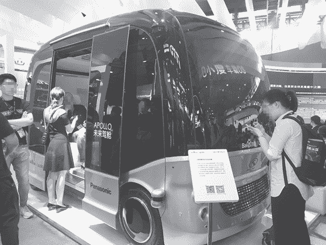

L4级自动驾驶小巴“阿波龙”

## 滴滴出海：共享出行全球化

在共享化/服务化领域，滴滴出行凭借百度、阿里、腾讯的投资，成长为全球最大的网约车平台之一。2016年滴滴收购优步中国业务，并在东南亚、非洲、中东投资当地网约车企业，加速全球布局。日本软银是股东，第一交通是日本合作伙伴。

在夯实核心业务盈利能力的同时，滴滴也在拓展地图信息、电动车规格标准化等领域，并在美国设立自动驾驶研发机构，计划以网约车为立足点成为中国出行霸主。2019年滴滴宣布与最大电动车制造商比亚迪联合开发定制网约车，加速构建出行生态。业界普遍认为网约车全球扩张将推动车辆平价化，而滴滴将站在风暴中心。

电动化方面，因政策强力推动，市场长期群雄混战。老牌巨头之外，还出现比亚迪这种从电池厂成长为电动车厂的案例。超大型新创发展迅猛，如蔚来在短短五六年里发展成拥有数千员工、赴美上市的企业。

全力投入CASE的不止新创。老字号吉利也值得关注。吉利1986年成立，从冰箱零件起家，靠并购成长为中国最大民营车企。2010年以18亿美元从福特手中收购沃尔沃全部股权。如今吉利正积极出海，并持续重金投入CASE各板块。上汽集团也是排头兵，最早提出“四化”概念，在与阿里合作的同时加码自动驾驶与共享。

下面将深度解析蔚来、比亚迪、吉利、上汽。中国CASE相关投资在2015年前后升温，截至2019年5月，获融资企业至少1800家，累计融资额达9.4万亿日元。除了电动化，网联化、智能化、共享化/服务化领域，中国投资均占压倒性优势。

**案例研究 1**

**蔚来：用户体验优先于造车**

中国新势力电动车品牌蔚来成立于2014年，被称作“中国版特斯拉”。高举“打倒特斯拉”旗帜，成立四年赴美上市，但截至2020年亏损已达60亿美元。2020年上半年疫情冲击下蔚来一度面临资金危机，靠裁员及合肥市政府14亿美元投资度过难关，下半年随经济复苏业绩飙升，市值一度逼近宝马、通用、福特。特斯拉股价上涨也有影响，但资本对蔚来的期待可见一斑。

蔚来产品本身出色，EP9电动超跑2016年跑出时速312公里纪录，成为史上最快电动车之一；也是中国新造车最早实现规模化生产者之一。

目前蔚来尚未跨越盈亏平衡点，类似早期的特斯拉，但发展势头迅猛，是未来最值得关注的中国电动车制造商之一。

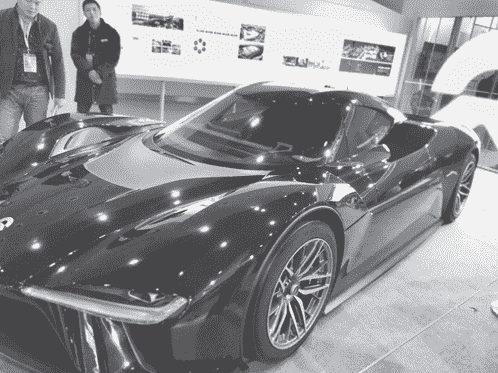

蔚来引以为傲的“EP9”电动超跑

## 明星创始人与资本加持

传统车企的掌舵人往往是深耕多年的圈内老兵，蔚来的创始组合却完全不同，履历拼凑起来像一本跨界图鉴。

## 案例研究 1 蔚来：星光创始人与服务化定位
李斌在互联网和汽车赛道累计创办、投资过 40 多家公司，[^(\[8\])](#chapter006.html#m8)带着“把蔚蓝的天空还给城市”的想法成立蔚来。联合创始人秦力洪曾任奇瑞汽车销售公司副总经理，也在德国罗兰·贝格管理咨询公司（Roland Berger Strategy Consultants）做过项目经理，擅长品牌营销和新业务拓展。另一位联合创始人郑显聪曾出任菲亚特和福特中国业务副总裁，在采购物流环节经验丰富。[^(\[9\])](#chapter006.html#m9)从人员构成看，蔚来的高层在互联网运营与品牌塑造上更占优势。除创始团队外，公司还引入了特斯拉前首席信息官和沃尔沃中国前 CEO，为全球汽车业务补齐了技术、人脉和认知。

受李斌理念影响，蔚来不把自己叫做车厂，而是自称“为客户体验服务的销售商”。公司强调摆脱传统造车思维的创意与多元。除少量与锂电池相关的核心件外，蔚来不追求全体系自造，而是把资源集中在整车设计、品牌运营和售后服务上，对用户满意度极度敏感，做法与苹果有相似之处。

腾讯、百度等科技公司，以及美国风投巨头红杉资本都曾押注蔚来。

总的来看，凭借技术品牌背景的明星创始人、对汽车行业的理解，以及擅长互联网增长的资本加持，蔚来杀进中国汽车第一梯队，被视作智能网联电动共享时代的代表样本。

## 用户体验到底从何而来
2020 年蔚来全年交付超过 4.3 万辆，大约是特斯拉同期在中国市场的三分之一，已被公认为中国顶级豪华品牌。CEO 李斌指出，“在品质上不输同价位燃油车”。入门车型 ES6 售价约 36 万元人民币，比当时主打低价的特斯拉 Model 3 高出约三成，在竞争激烈的新能源市场里，短时间建立高端形象并不容易，关键在哪？

其一是设计语言。设计中心设在德国慕尼黑，车身设计负责人此前来自宝马。总部和市场职能落在上海，但对外的设计调性始终对标欧洲豪华。

其二是极致的用户体验运营。
蔚来与特斯拉类似，取消经销商，采用直销。触点由官方 App 和线下社区统一把控。线上通过 App 组织车主活动，促进车主间交流，强化品牌认同和黏性。
线下则是“蔚来中心”这类高规格空间，产品体验区之外还有水吧、书库、儿童游乐区，家庭到店也能各取所需。正是这种组合让蔚来的体验感变得独一无二。不少车主调侃，“花 40 万买的是心仪的社区，车只是附赠品”。换句话说，购买动机更多是加入品牌社群而非单纯买车。

## 轻资产打法：守住核心 放手制造
蔚来虽然造车，却把重心放在体验与服务上，车身生产基本外包。从另一个角度看，这种干脆的精简体系正是其快速成长的推手。

蔚来中心
行业普遍采取垂直整合，自家完成设计、开发、零部件采购到车身制造。车身制造本是车企的核心优势，自建工厂也理所当然，丰田精益生产就是典型案例。蔚来只保留品牌差异化环节——策划、研发、设计——以及电动车核心部件的制造能力，自定位为“车的策划者”，其余部分模块化后交由第三方。家电行业里苹果的做法很常见，在汽车行业则属首次，或许是未来的一种可选路径。虽然蔚来也出现过零件起火等质量问题，但在零部件精简、价值从硬件转向软件的电动化趋势下，其思路已走在全球前列。

## 硬件联手 软件自研的 CASE 布局
拥抱智能化浪潮，蔚来采取“硬件合作、软件自研”的策略。

在网联化上，基于自研人工智能与语音识别，推出车载系统 NOMI，目标是做成可跨品牌使用的通用平台。NOMI 能语音识别、自动调节车内温度、净化空气，还能为车主自拍。

在智能化上，目前已达 L2，正冲击 L4。ES8 搭载自研辅助驾驶系统 NIO Pilot，2017 年发布时是中国量产车里最先进的方案之一，具备自适应巡航、变道辅助、自动刹车碰撞预警、自动泊车等功能，并支持无线 OTA。蔚来明显把百度作为竞争参照，意在把自动驾驶操作系统平台化。

在共享服务化上，蔚来选择扶持生态玩家以避免滴滴一家独大。首汽约车的 7 亿元融资就包含蔚来和百度。旗下投资机构蔚来资本也在汽车相关领域投钱，与首汽共同设立目标规模 50 亿元的出行专项基金，意图围绕蔚来构建生态。

在电动化上，蔚来谋划成立电池资产管理公司。多款车型支持 3 分钟换电，并提供移动充电车与换电站。截至 2020 年 9 月，中国换电站已超过 130 座，且每周递增。借助电池资产公司推进电池租用服务 BaaS，宁德时代已宣布入股。据业内解读，此举是为了把电池价格与整车价格拆开，降低购车门槛，让用户按里程需求搭配。

## 案例研究 2 比亚迪：松绑垂直整合的转型之路
比亚迪是中国新能源的另类代表。1995 年从手机电池起家，2003 年切入汽车，2008 年推出混动车。如今已是新能源赛道的一股强势力量，2019 年纯电与混动的合计销量约 23 万辆，而特斯拉全球销量不足 37 万辆。

公司也是全球新能源商用车的领先者，在美国等地建有电动公交和卡车工厂。硅谷斯坦福周边常见比亚迪电动公交穿行。

创始人王传福 29 岁创业，掌舵 20 余年。公司曾以“技术为王、创新为本”“半自动半人工”“垂直整合”著称。起步时资金紧张买不起日系大型设备，只能靠低价人工和人海战术，形成了独特的半自动半人工流程。相比自动化，人工成本更低且灵活。与日欧以自动化设备为核心的模式不同。垂直整合则是大量自建工程师团队，打通从方案设计到最终生产的每一步，几乎自给自足，少数部件外购，直到近年才改变，颇像当年拥有铁矿的福特。

凭借此，比亚迪确立了优势。近年随着人工成本攀升与供应链管理负担加重，公司果断调整，开放零部件采购，并开始对外出售电池。

## 把压箱底的电池推向市场
随着规模扩大，比亚迪仅保留电动车核心部件自产，其余部件转向外部采购以提升效率。在电池业务上，公司深化与长安汽车的合作，除供应电池外，还联合开展电动部件设计、采购、测试与生产。

更关键的是向国内外车企积极推销自家的车载锂电池。电池曾是比亚迪多年积累的核心壁垒，也是最大优势。在该领域，宁德时代与丰田合作后优势明显，比亚迪借此发起挑战。

除电池外，比亚迪还成立了聚焦汽车灯具、电子、动力总成、车身、焊接与产线服务等业务的子公司，其半导体业务子公司也获风投青睐并计划分拆上市。

从手机电池商到车企，再到 T1 级零部件供应商，比亚迪的路径让人联想到丰田——从纺织机械起家，后进军汽车，并向全球推广混动与燃料电池系统。巧合的是，比亚迪与丰田于 2020 年在深圳合资成立研发电动汽车的公司。

## 商用车全电动化的野心
“2020 年是中国新能源制造商的转折点。上半场是电动化，下半场是智能化。”王传福在 2020 年 11 月如此判断，比亚迪也在系统布局智能网联电动共享。

电动化方面，2015 年 4 月推出“7+4”全市场战略。“7”指城市公交、出租车、道路客运、城市商品物流、城市建筑物流、环卫车、私家车；“4”指仓储、矿山、机场、港口。目标是把上述领域的商用车辆全部电动化。深圳出租车已基本实现纯电动化，比亚迪占据主导，电动出租车已成为城市风景。

网联化方面，比亚迪自研车载系统 DiLink，计划实现车机互联与无线升级。产品规划及汽车新技术研究院院长杨冬表示，“开放是唯一活路，封闭只会走向淘汰”，“互联网企业带来的是动力而非压力”。2018 年 9 月，搭载比亚迪 D++ 开放生态平台的秦 Pro 全球首发。

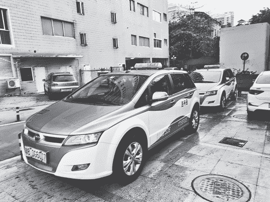
比亚迪的电动出租车
智能化方面，比亚迪成立自动驾驶技术研究所，并与百度 Apollo 合作开发自动驾驶汽车，同时与华为合作开发自动驾驶单轨列车。

共享服务化方面，比亚迪宣布与滴滴联合开发商用出租车，并于 2020 年 11 月发布全球首款定制网约车 D1，规划 2021 年产 10 万辆。网约车将推动平价化，比亚迪抢先布局。值得一提的是，滴滴与多家车企成立合资公司，掀起网约车巨头进军制造的潮流。

## 案例研究 3 吉利：收并购与资本合作走向高端
吉利是中国最大的民营车企之一。集团 1986 年起于电冰箱零件，1997 年进入汽车，2002 年进入中国“3+6”主流阵营，在国企主导的市场中脱颖而出。起初深耕低端，后通过收购欧洲品牌提升价值，近年在智能网联电动共享领域动作频频。

2010 年，吉利以 18 亿美元从福特手中收购持续亏损的沃尔沃乘用车业务，一举切入欧洲技术与供应链，且未过度干预，让沃尔沃保持独立架构，为复兴与技术共享奠基。2018 年，吉利再以 90 亿美元取得戴姆勒近 10% 股份，开展资本合作，双方在全球运营 Smart 纯电智能汽车并联合开发新一代混动产品。

从大众低端向高附加值高端转型不易，但吉利通过收购与资本合作吸收欧洲技术、经验、资源与网络，完成蜕变。其后还相继收购马来西亚宝腾、英国路特斯、伦敦出租车制造商 LEVC，已成长为能在全球供应全线车型的玩家。2020 年吉利销量约 132 万辆。

## 从便宜车到品牌力的演进
变革源于创始人李书福理念的转变。收购沃尔沃前，吉利的口号是“造便宜车打入低端”，李书福曾说“汽车就是四个轮子加两个沙发”，要造老百姓买得起的车。2010-2012 年，吉利在保持低价的同时提升研发与制造，并提出“造老百姓买得起的好车”。

2012-2015 年，战略转向“成长为中国顶级自主品牌”，更重品质。李书福提出“中国汽车要成为自主产业，需靠自主与合资品牌竞争”，“在成本价格优势下造最安全、最环保、最节能的好车”。

2016 年后，跨国化的吉利明确迎战智能网联电动共享浪潮。李书福入股戴姆勒时称，“新竞争下可能只剩一两家存活，制造商应联合投资未来”。

## 收购带来的研发与渠道加成
收购沃尔沃让吉利研发与生产体系跃升。双方在杭州与哥德堡设联合技术研发中心，促进人才培养与技术获取，并推动车辆架构模块化、开发共通平台以提高效率。吉利还沿用沃尔沃的供应商网络，并吸收其策划、设计、研发与生产的 know-how。

具体落地是 2016 年双方合资打造高端新品牌领克。吉利持股 70%，沃尔沃 30%，设计研发由沃尔沃主导，供应链与生产共享。领克搭载自研车机 GKUI，并提供包月、包里程等共享时代的购车模式。

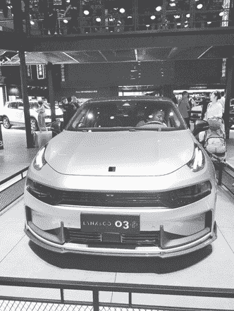
领克
领克像蔚来一样主打线上销售，并引入传统车企没有的订阅制，吸引不愿遵循传统拥车模式的年轻人。2020 年疫情下仍售出 17.5 万辆。吉利计划将领克推向欧洲，在德、法、西推广月租 500 欧元服务。

入股戴姆勒后，吉利加速技术共享。2018 年 10 月双方在中国组建合资子公司提供高端网约车服务。吉利还收购 Smart 品牌 50% 股权，并于 2020 年与戴姆勒联合成立子公司，Smart 定位纯电品牌，由戴姆勒负责开发设计、在中国生产，计划 2022 年面向全球销售。尽管北京汽车等中国车企也投资戴姆勒，但沃尔沃、戴姆勒与吉利的合作正持续深化。

## 自主操作系统与全栈布局
吉利在智能网联电动共享改革中有一条主线：自研。

网联化方面，吉利开发车机系统 GKUI。董事长李书福认为车机与安全相关，车企应自研。他在 2018 年指出，“智能网联汽车的关键是智能，本质是汽车，前提是安全”，“操作系统决定命运，必须掌握在自己手中，核心技术买不来，只能自研迭代”。

智能化方面，吉利依托沃尔沃资源网，与博世等合作自研自动驾驶系统 G-Pilot。2020 年还发射低轨卫星，并提出用于网约车与车队管理的 AI 平台构想，布局基础设施。

电动化方面，2015 年发布“蓝色吉利行动”，目标 2020 年新能源销量占比超 90%，因疫情未达标。沃尔沃与戴姆勒的投资发挥关键作用。依托沃尔沃，吉利投资 26 亿美元打造纯电平台 SEA 浩瀚架构以降本，并计划推广至路特斯、LEVC 等品牌。与百度、阿里、腾讯的合作也在推进，百度或将采用 SEA，吉利还宣布与腾讯合作开发智能汽车。未来吉利有望基于 SEA 发展代工业务，生产其他品牌的电动车。

共享服务化方面，吉利旗下有自营网约车平台曹操出行。规模不及滴滴，但坚持自建出行服务的姿态很吉利。曹操出行董事长刘金良 2018 年表示，“大城市拥堵，消费者购车意愿下降，汽车正从拥有权转向使用权，共享出行是趋势。传统制造商必须进入出行领域，否则将被淘汰，如同诺基亚在智能手机时代”。

## 案例研究 4 上汽集团：虽为国有车企龙头老大，却积极与其他企业开展合作

提到中国国企，很多人脑中率先浮现的是与政府关系紧密、靠既有利益维系的老牌巨擘，甚至会觉得这类公司和创新转型沾不上边。

上海汽车集团可追溯到1958年创建，如今已是国内规模最大的国有整车集团，2020年整车交付量约560万辆。在国内九大央企车企里，上汽在智能互联、自动驾驶、共享出行和电气化四条主线上的布局最为靠前，也走完了拥抱CASE浪潮的自我重塑之路。

“四化”很早便写进了上汽的战略图谱。2017年，乘用车板块副总经理俞经民在一次公开交流中概括了行业拐点：

“这几年，大家可以明确感受到汽车行业的剧变，特别是互联网的渗透，包括新能源的发展。互联网×新能源在中国市场的演变，是执世界之牛耳的。很多厂家，包括我们众多的自主品牌，也包括一些很熟悉的国际大佬，都发现了这个端倪，都在加大投入。”[^(\[14\])](#chapter006.html#m14)

公开信息显示，上汽希望2021年新能源车产量达到77万辆，耗资26亿美元的新能源基地也在2020年正式投产。作为国企龙头，上汽的研发制造能力覆盖造车全链路，但在CASE推进上却选择了走得更开放的协同路线。

## 连接化：和阿里一起做车载系统

先看网联化。2014年双方签署互联网汽车战略合作协议后，上汽与阿里巴巴的合作不断加深。2015年合出资10亿元人民币设互联网汽车基金，并共同成立子公司斑马智行，专注车载系统的研发，成果就是AliOS。2016年，搭载该系统的荣威RX5智能网联车就已上市。

AliOS起初打算面向其他车企输出，但不少厂商担心数据会被阿里和上汽掌握，态度谨慎。于是双方引入外部资本，释放开放信号。到2019年，AliOS已被8个品牌的38款车型采用，累计装车超过100万辆，合作品牌包括福特、斯柯达以及东风雪铁龙。同期欧美市场因对数据集中化的顾虑，统一车载系统并未普及，中国则呈现出不同走势。

智能化方面，上汽集团内部设立人工智能研究院，自主打造自动驾驶平台AI Pilot。平台整合自适应巡航、智能泊车与安全辅助等功能。电动智能超跑SUV荣威Marvel X即为该系统的量产代表，2018年起在中国销售。另外上汽与阿里共同投资中国自动驾驶初创企业安途智行，推动其在开放道路开展试验。

## 技术整合的代表车型

在共享服务化上，上汽参与运营国内最大的电动车分时租赁品牌EVCARD，持股51%，业务覆盖56座城市，会员规模达180万人。2018年上汽还自营推出享道出行。

电气化路径是与博世、宁德时代等成立合资公司，力求把电动机、电控、锂电池三大核心牢牢掌握。集齐“三电”的智能电动车正是荣威Marvel X，也常被视作中国汽车工业的技术结晶，搭载了AliOS、AI Pilot与宁德时代电芯。

2021年1月，上汽与阿里联合发布高端智能电动汽车新品牌IM智己。

总体看，中国车企对CASE价值的判断相当迅速，组织调整、投资结盟同步推进，早已脱离只做低端廉价车的刻板印象。

美国、欧洲与中国的行业动向介绍到此，下一章的焦点转向日本，梳理日本车企的现状与前景。

本章取材协助：DANNY Pro.（板谷工作室）

# 第六章 日本车企的突围困境

■川端由美

前文已梳理欧美与中国市场如何应对剧烈变化。本章将盘点日本整车与零部件企业的现状，并对未来做出判断。

同时，我也想谈谈日本汽车行业存在的短板及其成因。

## 案例研究 1

### 丰田、大发、斯巴鲁、马自达和铃木

日本到底有多少家车企？除丰田外，还有日产、本田、三菱、斯巴鲁、马自达、大发、铃木等乘用车厂商，五十铃、日野、三菱扶桑、UD卡车等商用车厂商，雅马哈、川崎重工等摩托车厂商，再加上光冈、ElecTrike Japan等小厂，约16家。能在全球竞争的乘用车品牌主要集中在丰田系、外资阵营和本田。

丰田的地位最为突出。它控股大发，并与铃木、马自达、斯巴鲁进行资本合作。上世纪通用汽车创始人威廉·杜兰特通过控股公司将别克、奥兹莫比尔、凯迪拉克等纳入麾下，形成庞大集团。如今日本虽然资本关系与历史背景不同，但容易让人联想到一家以丰田命名的日本版通用。

丰田对CASE的投入到底有多深？当前丰田已与大众争夺世界第一的规模，但正如第一章所述，丰田不再自称“汽车制造商”，而是想转型为“移动出行提供商”。

2018年CES上，丰田章男亲自主持发布了e-Palette概念车。这是一款面向MaaS的新一代电动汽车，基于MSPF移动服务平台，融合电动化、网联化、自动驾驶。时任丰田副社长友山茂树【现为执行研究员】说：

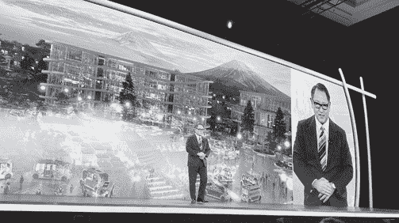

丰田章男社长登台演讲

“正如`MSPF`一词所体现的那样，将汽车、通信平台、用于存储大数据的数据中心以及提供车辆访问权的`API`[^(\[1\])](#chapter007.html#m1)作为一个套包提供给用户是丰田独有的提案。在我们看来，`e-Palette`电动汽车是`MSPF`的要素之一。”

API说白了就是通过连接应用软件和程序，使车辆能够使用各种服务的系统。丰田表示将向开发自动驾驶套件的企业公开其车辆控制界面，这就等于是在说“开发自动驾驶功能的初创企业和其他公司都可以驱动丰田的车辆”。这番发言也体现了丰田准备公开技术，与外部各方联手的决心。

若单单开发e-Palette概念车，那也不过是在研究一款带自动驾驶功能的电动汽车。关键在于丰田意欲在互联环境下开放MSPF，敞开门户，扩大服务开发。丰田想要实现的商业模式是，丰田提供移动出行大数据和可用于服务的平台让各路服务商使用，然后向服务商收取平台使用费。由此可见，丰田也认识到了CASE和网联化的重要性，想要尽快布局。

再看电动化。丰田副社长寺师茂树【现为董事】在2019年新闻发布会上提及了丰田车辆的电动化，表示将广泛对外销售电动汽车零部件。如果稍加夸张地解读，这意味着丰田将成为电动汽车零部件制造商。几乎在同一时期，大众也宣布将对外销售旗下的电动汽车平台MEB，并在同年透露与福特签约。

换句话说——丰田章男领导的丰田高层的发言本身是符合全球标准的，但高层的意图有没有渗透到丰田大家庭的各个角落呢？在现阶段还得打个问号。

## 变革是否落地到组织

丰田用于实践自动驾驶、移动出行和人工智能等新技术的大型项目Woven City引起了社会各界的热议。该计划规模宏大，意欲将静冈县裾野市的集团分公司工厂旧址改造成巨大的移动出行实验城市，用地面积达70万平方米。其实裾野市也是丰田的研发基地——东富士研究所的所在地。研究所的许多优秀工程师长年从事内燃机、发动机研发，被誉为“丰田的大脑”。他们肯定难以接受“到2040年左右禁售燃油车”这一全球性的发展趋势。在2015年发布的“丰田环境挑战2050”中，丰田宣称“到2050年全球新车行驶过程中的平均二氧化碳排放量将比2010年削减90%”，却没有明确表示“将全面淘汰燃油车”。仔细揣摩这套说法背后的意图，就不难猜到丰田可能更倾向于将其擅长的混动构造发动机成本降到最低，同时以“发动机和电动机相结合”的形式“尽可能保留发动机”，而不是用电动汽车和燃料电池车彻底取代燃油车。

但直到不久前，德国和美国的汽车制造商也是如此。研究发动机的工程师备受尊重，在内部也有巨大的发言权。机械工程师位于金字塔的顶点，软件和电子电气工程师的任务不过是往“机械塞进汽车后剩下的空间”里增加功能罢了。

那通用和大众为何能够如此迅猛地实现转型呢？因为前者在2008年金融危机时一度破产，后者也爆出了柴油门丑闻[^(\[2\])](#chapter007.html#m2)，导致高层大换血，而新的管理团队对原有组织进行了大刀阔斧的改革。他们放眼以智能互联为前提的新时代，充分理解汽车在物联网世界中的定位不过是“oT”而已，因此进行了革命性的结构调整，为全新的战役做准备。同时，这也意味着通用和大众决定走下神坛，接受被周边行业的变化所影响的事实。

丰田的高层当然也认识到了这一现实，但丰田这个巨大的企业组织恐怕还没有接受。丰田的改革时间轴比西方车企错后了近10年，将高层察觉到的变革浪潮渗透到组织方方面面的道路想必也非常坎坷。

丰田迫切需要的，应该是能够按丰田章男社长的意向大刀阔斧地改革组织的高管。2009年，年仅53岁的丰田章男走马上任，掌舵丰田十余年。对于一个今后必须经历重大变革的庞大组织来说，有几位能和丰田章男对等交锋的高管才是最理想的。丰田在2020年大幅削减了执行董事的人数，只剩9人主宰这家销售额高达30万亿日元的巨型企业，2021年1月变为10人，也不清楚此举是吉是凶。

现任董事之一詹姆斯·库夫纳曾是谷歌自动驾驶汽车开发团队的成员，也是负责Woven City项目的Woven Planet控股公司的CEO。被视为下一代接班人的丰田大辅则被任命为Woven Planet的高级副总裁。“新生代人才”能否引领丰田完成重大转型，将是决定命运的分水岭。

## 资本伙伴的未来

再简单梳理一下与丰田有资本或业务合作的车企。大发和日野都是丰田旗下的子公司，分别生产小型汽车和商用车。不过随着碳中和时代到来，它们将发挥更加重要的作用。大发专注于轻型车等各类小型车研发。一旦迎来MaaS时代，它就极有可能在“小型出行工具”领域发挥优势。不仅如此，大发在东盟等新兴经济体中也有强大的影响力。日野则擅长制造大型商用车。在运用氢等替代燃料方面，大型商用车具有先天优势，因为为车辆提供动力的燃料电池堆和氢气罐比较笨重。丰田也确实发布了基于日野PRO FIA的混动商用概念车，配备了燃料电池系统，美国丰田与美国日野也在联合开发面向北美的燃料电池卡车。

斯巴鲁和马自达呢？这两家的规模都不大，只占全球市场份额的1%左右，素来以卓越的技术为卖点，在小众市场颇受欢迎。但在碳中和时代，这些优势将不再具有竞争力。不过斯巴鲁拥有EyeSight等先进驾驶辅助系统，这是能直接运用于自动驾驶的关键技术。斯巴鲁在美国的销量占其总销量的70%，因此也可以采取专攻北美市场的战略。马自达则不然，其主要市场分散在欧洲、美国和澳大利亚，这加大了其制定战略的难度。马自达虽然推出了清洁型柴油车CX-5，意欲起死回生，但放眼全球，柴油车的大环境依然严峻。所幸马自达凭出色的设计感保住了一定的销量，但仍需要大幅调整方针，比如依托它所擅长的转子发动机打造混动构造发动机，以尽快实现电动化转型。

铃木与通用有过很长一段“蜜月期”，而跟大众的“跨国婚姻”却闹上了法庭，不欢而散。大众汽车在印度市场屡战屡败，也许是想把铃木用作进入印度的跳板。大众后来还尝试过牵手印度汽车制造商塔塔，但最后也以解除合资关系告终。铃木在印度、印尼等新兴市场具有优势。因为在基础设施发展滞后、交通严重拥堵的国家，小型车的需求量更高。但也正因为如此，铃木在电动化方面的投资进度已经远远落后。从2020年4月起，印度也将其排放标准提高到了“Bharat Stage 6”，严格程度与欧洲相当，在政策层面转向了电动化。这定会对铃木造成重大冲击。

丰田的未来就等于日本的未来。所以我也希望丰田能做好日本汽车行业的领头羊，从依赖制造的商业模式转变为以社会问题为起点的倒推型商业模式。丰田也确实在尝试调整组织结构，比如在2021年1月的人事调动中新设了“首席项目负责人”CPL一职，其职责是站在跨领域的全局视角领导项目推进。但丰田的改革似乎不如大众与通用那样激烈。丰田能否屹立不倒的关键，在于它能否迅速推进组织改革，以及整个组织能否脱胎换骨，适应新的游戏规则。

## 案例研究 2

### 日产与三菱

“销售看丰田，技术看日产”，想必40岁以上的读者朋友对这句话都不陌生。直到今天，日产仍以技术见长。去厚木的日产高级技术中心和追浜的日产综合研究所走走看看，你就会发现日产除了发动机方面，在电动化和自动驾驶等方面也开展了最前沿的研究，同时积极培养技术人员，以紧跟大环境变化的步伐。

“我们在2007年开设的高级技术中心内设立了软件培训中心，计划到2022年培训出500名软件工程师。日产从‘智能驾驶’、‘智能动力’和发挥桥梁作用的‘智能集成’这三个概念出发，专注研发技术和产品。”日产常务执行董事、Alliance Global副总裁、综合研究所所长土井三浩如是说。

在自动驾驶技术和人工智能的研发方面，日产确实备受瞩目。尽管在推出首款配备L3级自动驾驶脱眼的量产车方面落后于本田，但日产正在稳步积累自动驾驶的关键技术。

已投入使用的ProPILOT2.0是全球首款实现同一车道内L2级自动驾驶脱手辅助驾驶系统，而且支持自动变道。在电动化方面，日产也提出了“到2050年实现整个集团的企业运营和产品生命周期碳中和”的新目标，正在扩大配备e-POWER的产品线。与丰田和本田不同的是，日产在第一时间将注意力转向了电动汽车而非混动汽车，而且从一开始就和电池制造商合作开发车载电池，甚至着手建立回收体系。

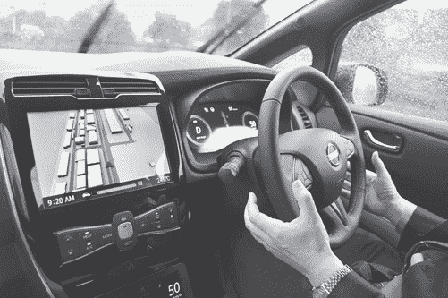

日产自动驾驶实验车

综上所述，日产似乎在智能化和电动化这两方面拥有先进的技术，和全球各大汽车制造商打得有来有往，甚至略占上风。但说句不中听的话，即使日产在各个关键技术方面表现出色，对于“能否将这些技术融合成有吸引力的产品”仍要打一个问号。光埋头开发技术还远远不够。什么时候将什么技术放在什么产品上投向市场和消费者——日产在这方面还没有画出明确的路线图。

## 雷诺联盟：助力也是桎梏

当然，我并不是说日产缺乏开发产品的能力。只是由于它在雷诺旗下，如何开发产品取决于全球政策，所以难以紧扣日本市场。身为跨国车企，日产在2018年都没有推出新款，略显遗憾。日产与雷诺的关系还导致了种种风波，比如玛驰因成本问题原计划在亚洲生产，法国政府却突然介入，以至于最后变成在雷诺的法国工厂生产。

屋漏偏逢连夜雨，前CEO卡洛斯·戈恩的管理问题也对日产造成了不小的冲击。舆论对他的管理手腕褒贬不一，不过他在1999年刚就任日产一把手时制订了日产复兴计划，内容包括大规模裁员、削减日益膨胀的成本和大幅减少有息债务。到这一步还是戈恩最擅长的以裁员为核心的管理模式。然而在戈恩同时执掌雷诺和日产之后，双方资本关系的扭曲暴露无遗。雷诺持有日产43%的股份，且拥有投票权，日产却只有雷诺15%的股份，对雷诺的决定没有否决权。更棘手的是，雷诺还有15%的股份握在法国政府手里。比起日产的前途，法国政府更重视本国的就业，而且这一态度今后恐怕也不会改变。

三菱：技术亮眼，信誉拖累

三菱与日产的处境高度相似。底盘控制、四驱系统与直喷动力总成等技术足以体现其研发底蕴，电动化布局也走在前面，车载动力电池的 know-how 几乎是独一无二。麻烦来自历史包袱。2000 年被揭发自 1979 年起对旗下多款车型含帕杰罗、蓝瑟在内的缺陷长期隐瞒，约 69 万辆从未实施召回；2004 年商用车部门再度卷入召回风波，戴姆勒-克莱斯勒随即终止财务援助，调查过程中还牵出两起致命事故，后来被搬上大银幕。连续丑闻动摇信任，即便仍有拥趸，2016 年轻型车油耗数据造假又令形象雪上加霜。

即便如此，三菱的工程师队伍依然可信。若能与日产在电动化赛道协同，仍有问鼎全球的可能。单独审视三菱，自动驾驶与车联化相对落后；把雷诺-日产-三菱视作整体，年销量约一千万辆，与丰田、大众处同一量级，倚靠规模效应完全有翻身余地。关键在于能否把各自优势与社会议题结合，打开新业务空间。

## 案例研究 3

### 本田

本田在全球车企中的定位很特别。销量突破一千万辆的企业可按区域定制产品，年销一百至二百万辆、全球占比约一到二个百分点的企业如奔驰乘用车、Jeep、宝马、斯巴鲁、马自达，则能深耕小众市场突出个性。

本田年销四百至五百万辆，正卡在尴尬的中段。福特体量相近，但本田四轮板块艰难，新冠疫情放大颓势。2020 财年首季亏损 1136 亿日元，其中国产品牌亏损 1958 亿日元是主因，两轮板块盈利 112 亿日元却被拖累，最终退出 F1[^(\[8\])](#chapter007.html#m8)。

前文提到日产与三菱的技术，本田同样不遑多让。它造过喷气机、双足行走机器人，都是一般车厂无法触及的前沿领域。即便局限于汽车，源自 F1 的仿真技术[^(\[9\])](#chapter007.html#m9)与“本田 e”搭载的 AI 也体现出算法实力。

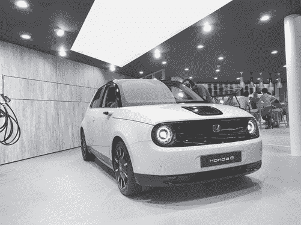

2020 年 10 月本田发布的量产型电动汽车“本田 e”

组织层面本田也与众不同。生产销售归本田技研工业，研发独立于本田技术研究所。高管任用逻辑清晰：优先选用工程师，尤其是发动机背景，因为发动机长期被视作造车核心。伊东孝绅、八乡隆弘两位社长都非发动机出身，但本田向来重技术，2021 年 4 月发动机部门出身的三部敏宏接任社长印证了这一点。

然而如书中反复强调，CASE 时代技术需求将发生根本迁移。对一家以发动机为骄傲的厂商而言，转型迫在眉睫，改的不仅是技术，还有企业文化与员工观念。

四轮低迷推动本田技术研究所并入技研工业。四轮与两轮壁垒被打通，车联服务与 MaaS 的战略规划、开发与推进整合为新设的移动服务事业本部，同时在日本成立本田移动出行解决方案有限公司。组织重组才刚刚开始。

## 怎样开发 L4 级别以上的自动驾驶技术

从本田的技术版图看，发动机研发极强。正因能做混动，长期对纯电持保留态度，自豪感也在其中。燃料电池车成本低、效率高，F1 沉淀的仿真技术与全球首款 L3 量产车也显示出其在算法上的实力。

问题在于它能否继续单打独斗？

本田已实现可“脱眼”的 L3，即特定条件下系统全权驾驶，紧急时由人接管。能力毋庸置疑。若要迈向可“脱脑”的 L4，即全环节由系统掌控、紧急情况亦然，就需要巨额投入。本田体量仅属中等，独自啃下如此高阶技术，投资与人力都将吃紧。

通用汽车高价收购 Cruise，详见第二章，本田也宣布向 Cruise 注资 27.5 亿美元。在 L4 及以上赛道，本田更倾向借力 Cruise。

对未来而言，守住制造基本理念的同时回归本田商业精神的本质，以用户体验为核心开发产品与服务最为关键。

创始人本田宗一郎说，“研究所不是研究技术的地方，而是研究人的地方”。始终以人为本，让技术服务生活，是创始人的远见。

“比自行车更轻便好骑”是 1953 年两轮车 Benly[^(\[10\])](#chapter007.html#m10)的核心理念，这一精神传承催生了商用电动踏板车 Benly-e。未来，手机 App 与一键叫车网约服务会更便利。这些优秀工程师若用心，完全能创造出数字时代的 Benly。

独立并非上策，本田必须摆脱中型企业的标签。

把四轮业务转让给资本上有合作的通用也是选项，只要高层判断有利即可。发动机开发这一昔日核心竞争力，可在“负责本田开发”的前提下独立，同时为其他汽车与船舶厂商开发发动机。设定 20 年内收回投资、到 2030 年做出终极高效发动机后体面谢幕。用转让业务获得的资金联合日本其他两轮厂商，形成压倒性优势——这需要大刀阔斧的改革魄力。

与通用的合作在深化。2020 年 4 月双方宣布在电动汽车领域合作，9 月签署谅解备忘录，计划在北美以联盟形式为各自品牌开发车型。双方早在燃料电池车上有合作，此次范围扩大。最大亮点是联合开发搭载锂电池包“Altium”[^(\[11\])](#chapter007.html#m11)的电动车。简单说就是通用提供电动平台，本田负责内饰外观，通用负责生产销售。也许平台共享的终点是整合……这只是推测，但汽车行业今后发生什么都不为奇。

## 案例研究 4

### 大型零部件制造商

车企主导汽车行业的时代已过，这意味着原先扮演分包商的 T1 供应商也将迎来动荡。电装、爱信等日本大型零部件厂商同样难以幸免。

德国零部件巨头都在蜕变以求突围，第四章已深入分析，不再赘述。日本人常把大陆集团与轮胎联系在一起，其实过去 20 年它已转型为综合供应商，可提供电动出行、自动驾驶与智能互联的最新技术。

在爱信眼中，最大的对手是采埃孚。采埃孚长期深耕齿轮与变速器，与爱信规模相当。2015 年收购美国天合汽车后，迅速转型为提供自动驾驶系统与智能互联功能的新生代出行企业。2021 年 CES 上，采埃孚宣布为车企提供开放式软件平台。传统车辆约配 100 多个电子控制单元，各自以不同软件驱动，是分散式架构，采埃孚的新平台则是集成式。它打算开发中间件供汽车厂商使用，把车载应用与硬件连接起来，类似 iOS 生态，可诞生多样车载应用。

法国法雷奥与西门子在 AI 计算领域合作，并聚焦高压混动等电动化技术。博世则致力于构建结合网络与 AI 的“AIoT”，业务扩展到 AI 与智慧城市。总的来说，海外大型零部件商都在加速转型。

## 两个课题

相比之下，日本零部件巨头的动作明显迟缓。电装体量与博世、大陆集团相仿，活力却远不及对手。

症结可能在于“丰田阵营”这个身份。电装和爱信都是丰田系企业。极端地说，只要按丰田要求生产就够了，因丰田单家订单量已非常可观。长期以来，这种与主机厂共生共荣的结构是优势，如今却走到尽头。今后必须主动与优势不同的玩家牵手。打破阵营壁垒是日本大型零部件厂商面前的一大课题。

电装与爱信近期有联手研发电动汽车技术的动作，但外人看来，它们对从丰田系外引进技术、与丰田系外企业合作仍显犹豫，也不像欧美供应商那样积极并购或投资初创企业，坚持自主开发。投入大量时间和资金造出很厉害的技术，却与时代与市场需求脱节，最终舍不得放弃，导致业务难以落地。

像电装这样体量的企业完全可以通过投资与收购初创公司获取新优势，无需自建软件工程师团队。以电装、爱信为首的四家丰田系企业合资成立 J-QuAD DYNAMICS，宣称要发挥在自动驾驶与车辆控制方面的优势，打造安全舒适的出行社会。但展望未来，也应该把跨阵营的业务资本合作纳入视野。

## 看丰田脸色的时代已经结束了

爱信规模不及电装，但在全球市场知名度更高。因其在变速器尤其是前轮驱动变速器领域拥有全球领先份额。20 世纪 70 年代与博格华纳合作后，欧美车企长期采用爱信变速器，可说爱信缔造了世界标准。它具备在国际市场一战的潜力。但如前所述，竞争对手采埃孚收购了在执行器与传感器方面占优的天合汽车，华丽转型为自动驾驶与车载软件服务商，相比之下爱信的表现明显逊色。

爱信自身也应意识到。2018 年上任的伊势清贵社长在巴黎车展高调宣布，标致雪铁龙集团当时的电动化车型 DS 7 CROSSBACK E-TENSE 采用爱信变速器。此外爱信也在尝试新方案，如驾驶员监控系统。但正如书中开头所指，爱信目前只侧重 CASE 中的智能化与电动化，看不到为日益重要的网联化与共享化/服务化提供平台与解决方案的意图。

坦白说，电装与爱信已没闲工夫再看丰田脸色。并非要与丰田割裂，而是唯丰田马首是瞻的时代已一去不复返。今天的零部件厂商也应从自身角度把握社会问题，与提供相关商品与服务的初创企业合作，怀着永不知足的精神开发面向未来的技术。

接下来要点出日本汽车行业应对全球竞争时的“薄弱环节”。下面五点既是未来劣势，也是迟迟无法做出重大改变的原因。

挑毛病不是目的，分析行业现状、认清问题才重要。对照全球汽车发展趋势，留给日本的时间不多了，但若能改善以下五点，仍可与全球强者竞争。

## 日本汽车行业的“薄弱环节”①造物信仰

日企普遍崇尚“造物”。这本身无可厚非，但当过于追求造出卓越商品与技术时，念头就会升格为目的，本末倒置的案例比比皆是。

造物有趣，也容易获得好评。即便项目失败，也能展示努力过程。问题是这就够了吗？

在 CES 与欧美车展观察会发现日企与外企布展思路差异很大。日企倾向展示自家产品或技术多么出色，外企尤其是欧洲企业更倾向展示“世界观”。智能互联、自动驾驶等新技术将如何改变乘车体验与生活方式？越来越多外企侧重愿景与具体使用场景，把重点从“如何造车”转向“基于汽车的解决方案与出行产业愿景”。

这并非汽车行业独有。传统日本制造业致力于培养能用双手造物的人才，以造物专家为荣。但比起聚焦“物”本身，构思能把“物”用到极致的平台更符合时代要求。具体说，就是先把握全局，在利用现有技术同时开发新技术，搭建整个平台。这种技能的评价标准与日本传统制造业擅长的“造物”完全不同。搭建平台往往要很久才商业化，也很难做出肉眼可见的成绩。日本文科理科壁垒高，“通才”不受重视、难培养。若不能培养大量能在设计与搭建平台时俯瞰全局的人才，日本企业很难在世界舞台脱颖而出。

传统的人事制度和评价体系也必须改变

随着社会成熟与生活便利度提升，单靠开发某种东西解决不了的问题会越来越多。正如前言所提，直面社会问题，思考人们真正需要什么，再落实到功能与造物，即“设计思维”，今后将愈发重要。为生活增光添彩的创新也源于此。

日本车企开拓创新的先例很多。比如 20 世纪 70 年代美国加州制定严格尾气排放标准，美国车难以达标。本田抓住机会率先开发低污染 CVCC 发动机，搭载的思域横扫美国市场，也让世界留下“日本车环保省油”的印象。70 年代末日本车在北美份额冲到 20%。

按理说日本车企仍有创新潜力。但采访中并未感受到它们有多少“用自己的双手创造汽车行业新未来”的热情。

这并非汽车行业独有。“现在最受瞩目的技术是什么？”“什么技术能在未来一击制胜？”与日本制造企业员工交流时，最常听到这类问题。许多人有“路线图信仰”，试图以某种特定技术为起点制定未来商业计划。日本技术实力强、工程师优秀，但提出这些问题，说明他们仍站在“技术”与“造物”的角度审视工作，而今后更需要“以客户价值而非自家技术为起点”的思路，以及“把社会问题、用户需求与现有技术联系起来，创造服务与支撑服务的技术的”能力。

日本汽车行业应大力培养立足社会问题、具备设计思维的人才。要实现这点，必须把重心从造物转向创新，人事制度与评价体系也要同步调整。

## 日本汽车行业的“薄弱环节”②坚持垂直整合

在专注制造的时代，基于垂直整合组织的统一指挥确实高效。这种模式整合产品开发到生产销售，特别适合“开发新车”这类业务，因其需要集团内密集沟通与严格成本控制。日本人做事踏实、擅长团队协作，与垂直整合契合度高，也利于积累技术与保守机密。

但水平分工模式崛起后，“把制造各环节交给相应专家，自家只专注核心与经验知识部分”的商业模式已席卷行业。如前所述，日本家电行业因没跟上这波潮流而败退，CASE 带来的产业结构变化也把“模块化”巨浪推向汽车行业。把构成产品的元素按功能划分成标准单元模块，更容易向外部厂商订购，这就是模块化分工。

汽车产品组合比家电更宽泛。乘用车不仅是交通工具，还有强个人属性，设计与营销受重视，且多品种小批量生产，模块化能带来降低成本等好处。除少数豪车品牌，“车”这种商品平价化只是时间问题，模块化分工也符合这一趋势。

大众与丰田都是推进模块化的典型。

大众开发了“MQB”模块化平台[^(\[12\])](#chapter007.html#m12)，像拼乐高一样组合通用部件，同时保留一定设计自由度。

丰田随后推出 TNGA[^(\[13\])](#chapter007.html#m13)平台，该平台考虑最佳驾驶位置与低重心带来的稳定性。平台、动力总成、电子电气系统乃至原厂机油都实现模块化，按 TNGA 标准设计。

但到目前为止，难以说 MQB 与 TNGA 已享受到模块化红利。因为虽然各元素像乐高一样模块化，但各模块最终仍由自家或下属部件厂商生产。换言之，产业结构仍维持垂直整合，只是在开发中采用了水平分工。

当然“水平分工”是手段非目的，合理时可继续垂直整合。但日本汽车行业需要保留“脱离垂直整合”的选项，否则很难摆脱遵循传统经验的造物模式，也很难基于用户体验发散思维从而开拓创新。

基于水平分工的商业模式也有助于听取外部声音，形成创新土壤，孕育未知商品与技术。即便没有出众制造技术、没有雄厚资本或组织，只要从用户体验角度提出新概念，就有可能把前所未有的创意变成现实。“GoPro”创始人爱好冲浪，从运动爱好者角度开发产品。“Insta360”创始人是视频创作者，相机也是从打造视频角度而来。有了水平分工模式，哪怕缺乏制造经验，只要创意足够好，完全有可能打造热门产品。

## 日本汽车行业的“薄弱环节”③闭门造车

坚持垂直整合的深层心理就是闭门造车，万事靠自己。前面提到大众 MQB 平台并未实现真正模块化分工，但大众已承认错误，并在新经营计划中强调大力纠正。

闭门造车已不符合大势。要真正摆脱这种思维，就不能拘泥于自家业务领域与技术，必须积极与专长不同的玩家合作。合作对象不能只限国内，还要放眼海外。

传统日企有个通病，即抵触与外国企业合作。铃木与大众 2009 年宣布资本业务合作，不到两年就分手。大众可能因在小型车上屡遇挫折，想借助铃木经验，同时铃木在印度的销售网对大众有吸引力。然而结盟后大众表示有意增持铃木股份，铃木便主动提出“离婚”。

别把资本联动想成终生绑定

在国内的讨论里，铃木当年的路线常被说成美谈。跳出这个视角，企业之间的资本联动并不是一对一的终身婚姻。即便加入某个集团，只要保持必要的自主空间，也能让自身嵌入整体战略，产生真实的协同。行业内部早已达成共识：核心技术可以共用，造型设计与市场推广各自推进，品牌个性保留下来，用合理的投入激发协同即可。想在某条业务线上配合，直接与海外伙伴牵手就够了。把阵营归属理解成生死与共的契约，格局就太僵化。

现在再谈收购，也不等于恶意收购。不少日本人对收购有先入为主的负面印象，一提到就会联想到秃鹫基金式的掠夺。如今的交易形态更接近于同一个生态系统里既竞争又协作的关系，买卖双方都应该把自己看成生态系统的一部分。从5G到云计算，从车载半导体到各种传感器，CASE之后的时间段需要的不是传统车企擅长的东西，而是全新的核心技术，更需要把技术转化为用户价值的商业模式。日本车企如此，其他国家的车企也缺乏现成储备。指望单靠原有阵营内部解决所有难题，可能性很低。

合作屡受阻往往源于整合不到位

当资本联动或并购由日方主导时，失败案例更为集中。症结多在并购后的整合没有真正落地，协同价值没有释放。整合不仅是账面合并，还要落实到信息系统与人事制度，提升管理效能才算有效。

失败模式大致有两类。其一，前期论证不足，合并后双方业务互相侵蚀。其二，日本的人事与薪酬体系呈现加拉帕戈斯化[^(\[14\])](#chapter007.html#m14)，西方早已普及的清晰分工与量化考核在日本较为模糊，导致外籍人才难以融入组织。

相比之下，欧美与中国企业更擅长主动借力。它们先明确商业愿景，再评估哪些零部件或材料能自研、投入成本和周期是否合理，随后视需要收购具备功能的主体、展开合作或设立合资。具体案例可参见第二章至第五章。

如果日本汽车工业继续坚持万事自足，风险会快速放大。业务边界会不断收窄，好不容易研发出的技术可能很快落后，体系过于分散也难以商业化。需要再强调一次，新时代开拓业务的顺序应该是：①锁定社会问题与挑战；②明确解决问题的理念；③集中研发有望成为核心竞争力的技术；④其余部分与国内外伙伴合作或并购。只有形成这样一套体系，才可能开拓社会真正需要的业务。

日本汽车行业的“薄弱环节”④低估电气材料与信息人才

在日本车企内部，工程师群体也存在层级差异。金字塔顶端通常是专攻发动机的技术权威。

车内空间受限，各种机械彼此争地盘。负责车身、变速箱、电气的工程师要拼命争取布局，而发动机被视为最有价值的核心，一切布置都围绕它来定，尊卑也就自然形成。本田就是典型，长期由发动机背景的人掌舵。说到底，能走到这个位置的人往往很优秀，也能发挥协调作用。

但全球汽车正加速迈向电动化，工程师的结构也在重塑。过去被低估的电气、材料人才的重要性在提升。过去车企的中坚力量是弱电[^(\[15\])](#chapter007.html#m15)设计与工程师，随着混动与纯电的普及，强电[^(\[16\])](#chapter007.html#m16)工程师、能够以弱电控制强电的工程师的作用愈发关键。

材料层面亦然。为强化车身、搭载传感器与自动驾驶系统，车重必然上升，而油耗排放要求又逼着减重，轻量化成为主流。欧洲已在积极开发铝碳复合材料等，奥迪还专门设立轻量设计中心，应用碳复合、镁合金等特殊材料。可以说，电气与材料在行业的分量与日俱增。

至于软件方向的信息技术工程师，甚至尚未进入日本汽车行业的等级序列。可以预见，在智能互联与自动驾驶时代，信息技术工程师本应成为不可或缺的力量。

在我看来，日本车企需要反思对电气、材料与信息技术人才的轻视，虽未必刻意，却是一种文化。每一次采访都能感受到一种以发动机为核心的机械工程师优先氛围。设想一位优秀的电气工程师从电机厂跳槽到车企，本以为能进入动力总成核心部门发挥混动控制优势，结果却被安排到发动机辅助设备部门，发动机依旧雷打不动，这显然大材小用。材料领域更夸张，部分企业仍是一概而论，铁以外的材料混在一起。即便高分子材料与铝等轻质材料备受关注，专注这些领域的工程师仍难以出头。

当务之急是纠正机械背景主导的惯性

信息技术工程师的处境更加尴尬。理应是各行业争抢的人才，进入车企后却发现话语权仍在机械工程师手中，其他人忙着抢地盘。软件不占物理空间，连参与竞争的资格都弱。信息技术工程师开发的是自动驾驶这类前沿技术，但在企业内部地位却远不及发动机出身者，部分人干脆跳槽到纯信息技术行业。制造商的薪酬能否留住顶尖信息技术人才，值得怀疑。日产曾推出内部转岗计划鼓励员工转做信息技术工程师，从另一个角度看，也说明外部引进已不够。

欧洲车企内部也曾是机械工程师主导的时代，如今仍有一定话语权，但转型是事实。大众的首席数字官上任时不过四十出头，宝马CTO虽以发动机出身，却精通通信信息技术，与英特尔、Mobileye的高管交流自如。近期大量爱立信、黑莓背景的工程师流向宝马，也在业界引发讨论。戴姆勒则把智能互联决策权下放给硅谷子公司，总部专注汽车技术。对照欧美做法，纠正日本车企机械工程师优先文化的紧迫性一目了然。

日本汽车行业的“薄弱环节”⑤对无形投入保持保留

不少业内人士把GAFA视作对手。它们在自动驾驶与电动车上投入积极，竞争意识可以理解。可GAFA自身怎么想？“造车涉及产品责任法规，风险太高不想碰”“一辆一辆造卖效率太低”。它们看中的不是车本身，而是智能互联与自动驾驶带来的服务、信息、数据与软件。日本车企似乎仍痴迷制造，认为不造东西就赚不到钱。反过来想，为什么不造东西就不能赚钱？低头一看，你只看到了有形物的价值。

对无形支出不够果断，也算是日本制造业的通病。引进的成果才关键，但部分日企仍对购买服务与软件犹豫，因为无形物无法转售。

随着时代演进，对服务、信息、数据、软件的需求只会增加，相关商业模式也会迎来更多机会。不能或不肯为无形物支付合理费用，企业之路会越走越窄，汽车行业也不例外。

若不为服务、信息、数据与软件付费，很难与以GAFA为代表的互联网阵营平等合作。收集信息、搭建网络都需要成本，扶持能扩大自身业务的服务商很有必要。

在数字互联时代，“公开管理数据，与他方合作共享、适时反馈以提升平台易用性，进而提高整个生态价值”将成为主流商业模式。对汽车而言，这正是互联时代的移动出行服务体现。不改变对无形物的偏见，就跟不上生态系统里的生存竞争。

忠言逆耳利于行。我相信，只要改善本章后半部分所列的五个薄弱环节，日本车企凭借自身优秀技术，仍能在世界舞台一战。

* * *

[1] Application Programming Interface，应用程序接口。

[2] 2015 年，5 家德国汽车制造商被指控组成卡特尔，谎报二氧化碳排放量。

[3] 日本法律规定，车长在 3.4 米以下，车宽在 1.48 米以下，车高在 2 米以下，排量在 660cc 以下的三轮或四轮汽车称轻型车。——译者注

[4] 水平对置发动机、转子发动机等独特的发动机。

[5] EyeSight 本身并不是自动驾驶系统。

[6] 聆风（LEAF）是其中最具代表性的车型。

[7] 此处指 2018 年由日本著名小说家池井户润的代表作《飞上天空的轮胎》改编的电影。——译者注

[8] 一级方程式赛车锦标赛。——译者注

[9] 如运用数字模型进行分析。

[10] 发音同日语“便利”。——译者注

[11] 通用与韩国 LG 合资开发的车载锂电池包。

[12] 车身的基本框架。

[13] Toyota New Global Architecture，丰田新全球架构。

[14] 日本的商业用语，意为“在孤立环境下的独自进化”。由于这种“孤独的”进化缺少与外部环境交互的适应性，一旦受到外部的强烈冲击，可能会陷入被瓦解和淘汰的危险境地。——译者注

[15] 主要是和通信、控制有关的领域，即电子工程。

[16] 主要是将电用作能源的领域，即电气工程。

# 后记

■桑岛浩彰

本书由侧重日本、走遍全球的汽车记者川端由美，与立足硅谷观察行业结构变化的我共同完成，向急需变革的日本汽车业提出建议。写作的初衷源于面对行业时的危机感。

写后记时，业内消息不断。富士康以代工身份切入电动车市场，海外电池厂商扩产。正如川端在前言所说，汽车成为“oT”一部分所需的核心技术，日本领先的领域少之又少。行业反应迟缓，还想守着传统供给体系硬扛这波浪潮。作为从业者，我清楚内容会招致批评，但仍提笔。

我生于1980年，小学时正值泡沫经济。老师告诉我们，日本拥有汽车、电机、半导体、钢铁、造船、石化等支柱产业。如何在变局中与世界共处是那个年代的课题。1993年升初中后，我亲眼见证支柱产业一个个失去竞争力，汽车几乎成为唯一幸存。 如今连这根独苗也被数字化和配套水平分工冲击。

汽车业为日本提供最多就业。守住前辈打下的基础、发扬光大，必须正视现实。日本汽车业须在仍有相对优势时全力获取或开发新一代出行所需核心技术。本书各处都有提示。

放眼海外，欧美中国玩家在这场百年变革中拼命转型。受岛国属性影响，日本信息接收有滞后，在北陆长大的我深有体会。高速变化下，时间差可能致命。日本汽车业恐怕已危在旦夕，只是长叹太不负责任。也是这种念想推动我执笔。

感谢搭档川端由美和讲谈社现代新书总编辑青木肇对多次拖稿的包容。感谢山本康正先生提供契机，顾问贝濑齐先生指点，DANNY Pro.板谷俊辅先生对中国市场的建议。感谢安田敦子女士、株式会社N&S Partners的加藤秀行、宫泽亨、Conductive Ventures的保尔·耶和和泉亚弥沙的鼎力相助。感谢VISITS Technologies的井上贵和经济产业省硅谷D-Lab项目成员。感谢加州大学伯克利分校哈斯商学院约翰·梅茨勒、斯坦福商学院斯文·贝克、斯坦福亚太研究中心栉田健儿提供研究环境。感谢所有接受采访的业内人士与官员。最后感谢妻子麻子和儿子阳太郎的包容，感谢父母、姐姐和岳家的支持。

* * *

[1] 日本本州岛中部靠日本海一侧新潟、福井、石川、富山四县的总称，传统上交通不便，较为闭塞。——译者注

# 致谢

■川端由美

感谢群马大学研究生院让我回归本质深度思考，感谢毕业后入职的零部件厂商让我学习技术如何为社会贡献。特别感谢恩师太田悦郎教授和荒井健一郎教授。感谢二玄社前辈，NAVI前主编铃木正文、CAR GRAPHIC前主编加藤哲也。很想向CAR GRAPHIC创刊主编小林彰太郎和在NAVI时期采访的德大寺有恒汇报出版喜讯，可惜已不在人世。相信他们会为我高兴，也会批评行文拙劣。

成为自由记者后，《日经汽车》前主编鹤原吉郎先生给了我首个专栏机会。多亏Kiduki Architect代表长岛聪先生介绍合著者桑岛浩彰。由衷感谢两位长期指导。

借此向20多年来采访过的车企与零部件厂商致谢。请理解直言出于对汽车的热爱。虽然原题是“日本车能否生存”，欧美车企立场也类似。对我这个乡下长大的人，车是了解世界的窗户。我在斯巴鲁大本营长大，想从事汽车业，所以读了工学部。有幸圆梦后，我从未停止惦念汽车。

最后感谢母亲文子的支持。她16岁就考到轻型车驾照，以看F1日本大奖赛为荣。没有她的体谅，我无法走到今天。儿子谦太郎不痴迷汽车，却在我写作期间考到驾照。我像母亲当年那样手把手教他。希望他四分之一世纪后读到此书，能感受到我继承的念想。

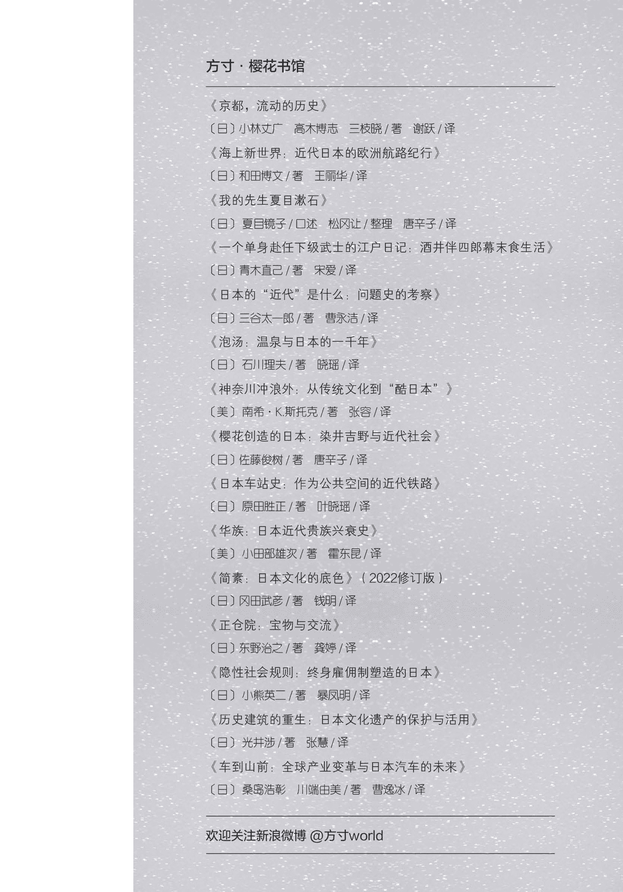

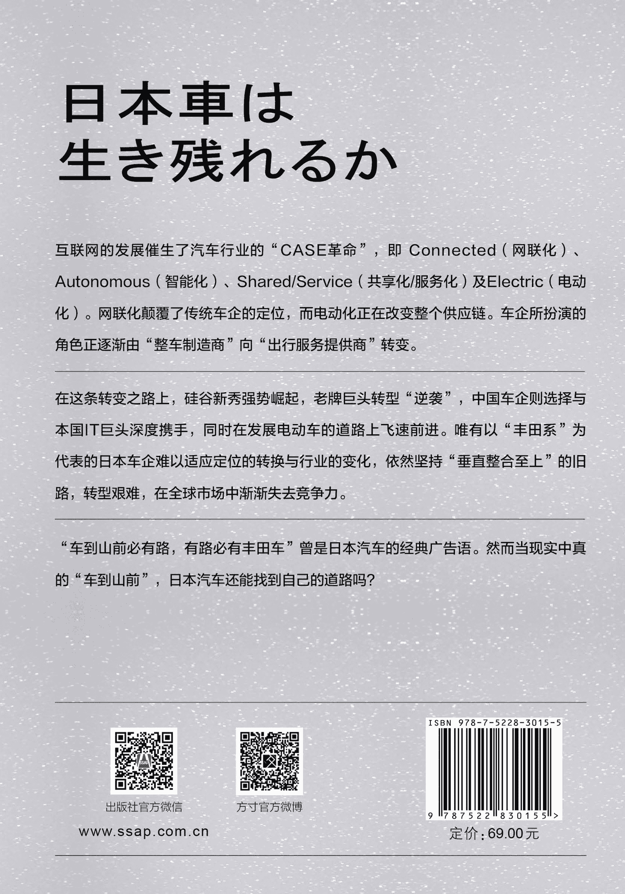