# 全球自动驾驶规则全景图

## 序言

### INTRODUCTION

自工业革命以降，从蒸汽到电网再到信息网络，技术浪潮始终在重塑生产关系与法秩序。技术能够解放人类的愿景是这一演进的深层动因。自动化设备大幅减轻了体力负担，人工智能的出现则让人与机器共生的设想变得具体可感。然而正当技术加速狂奔之时，人工智能所潜藏的达摩克利斯之剑也愈发清晰：一旦人类劳动被全面替代，个体的意义锚点与存在价值将何以为继？坚持人类中心立场的观点认为，思考与创造是人的独一性，期许在摆脱劳动之后把更多时间投入精神生产，实现人的跃升。可AIGC的突破性进展已经动摇了人类在创作领域的主体性共识。面对技术的不停侵入，人们不得不追问，奇点来临时社会会走向更自由的解放，还是迎来新一轮的主体性危机？这一追问既关乎人与技术的根本关系，也拷问人的能力与位格，更是时代之问。

此种困惑贯穿当代社会科学，也在法学内部催生出如何应对人工智能冲击法律秩序的议题。人工智能法学的理论预设与知识体系正承受全面检视。对研究者而言，人工智能法学的探索仍处迷雾之中，较高的技术理解门槛制约推进节奏，而技术跃迁的速度更让理论创新显得滞后。正是在这样的背景下，人工智能法学前沿丛书应运而生。丛书试图对人工智能的细分前沿进行梳理，勾勒技术创新与治理实践的全景，为学界的研究提供参照。

在“如何应对”上，两种心态并存：源于失控的技术恐惧，以及源于竞争的控制焦虑。失控的恐惧与控制的焦虑交织，形成多元立场：有人如19世纪的卢德分子般激烈抵制，有人积极拥抱渐进革新，也有人采取两面兼顾的审慎姿态。这些立场塑造出各国的监管样态，有保守防御型严格限缩开发应用，有包容开放型为创新营造宽松环境，也有审慎评估型在鼓励与防风险间寻求动态平衡。自动驾驶领域集中体现了这种分化。以安全为名，由人控转向机控，正是驾驶决策权向机器整体转移的缩影，既折射出对失控的担忧，也寄托着对新时代的期待。作为人工智能最具代表性的落地场景，自动驾驶的商业化进展迅猛，人机交互的重塑催生大量新型法律关系，监管真空也带来严峻治理挑战。本书直面这一时代命题，系统梳理全球自动驾驶规则，兼顾全球视野与本土关切，旨在为立法者、研究者、从业者、技术研发者与产业投资者提供一份细致的参考。丛书开篇选择自动驾驶，正是想以小见大，让读者窥见人工智能治理的前沿动向。

对外经济贸易大学法学院是国内较早关注数字法学与人工智能法学的机构之一，近年来在数字贸易、数据安全、个人信息保护、平台监管、算法治理、人工智能治理等领域展开了集中系统的研究，积淀出梯次合理的研究队伍与丰硕成果，培养了一批兼具技术素养与法治情怀的复合人才，积极投身国家人工智能法律前沿实践。习近平总书记在党的二十大报告中强调，必须坚持科技是第一生产力、人才是第一资源、创新是第一动力，深入实施科教兴国战略、人才强国战略、创新驱动发展战略，开辟发展新领域新赛道。我们相信在国家宏观指引、顶层设计优化与人才培养持续进阶的支撑下，制造强国、网络强国、数字强国目标可期。

是为序。

梅夏英

2023 年 3 月 26 日于惠园

## 前言

### PREFACE

### 一、汽车的“自动化愿景”与监管挑战

1939年，通用汽车在世博会上描绘过一个画面：到60年代，自动驾驶车将取代传统汽车。此后自80年代起，欧洲的尤里卡·普罗米修斯计划投入超7亿欧元，成为当时规模最大的研发项目，推动欧洲车企迈向自动驾驶。彼时大洋彼岸，美国国防部DARPA基于军事需求发起无人驾驶挑战赛，被视为21世纪自动驾驶研究的起点。2005年，斯坦福大学Sebastian Thrun团队击败卡耐基梅隆大学夺冠，随后两年证明车辆可在城市街区安全行驶^[([1]](#fow003.html#footnote_content_fow003_1))。技术跨越带来的美好设想迅速扩散：共享化可降低车辆保有量与停车用地需求；车对车、车对路的通信配合精密算法，能削减人为失误引发的交通事故。据统计，2010年美国交通事故致死32 788人，其中95%以上源于酒驾、分心、疲劳等人为因素^[([2]](#fow003.html#footnote_content_fow003_2))。自动驾驶用软件替代人脑采集与映射，提升了驾驶精准度、安全性和效率。

与此同时，系统性风险同样凸显：恶意病毒或破坏可能瘫痪运行，人机协同模式下的责任划分不清，以及隐私保护难题。作为新兴技术，其社会成本与收益仍在动态演进。对立法者而言，仓促的大规模干预时机未到，反可能抑制创新、扼杀产业并错失全球竞争窗口；但监管消极滞后又会削弱公众信任、增添企业不确定性，制约规模化应用。历史可作镜鉴：安全气囊初期因产品责任风险被制造商犹豫观望，直至确认能大幅降低乘员责任后才普及；安全带、巡航控制系统亦曾因担忧责任而踌躇^[([3]](#fow003.html#footnote_content_fow003_3))。由此可见，监管核心难题在于在收益成本尚不明晰时构建敏捷适配的框架，并在秩序、安全、创新多重公共利益间实现动态平衡。

### 二、全球自动驾驶规制的四点共识

#### （一）由分散规制走向统一法律框架

自动驾驶是人工智能的典型应用，争议不断，但各国立法者普遍认为不应以立法阻碍创新，需借助科学决策工具把握立法时机。若政策持续滞后，将限制实路测试、阻断机器学习所需数据，进而拖慢技术。立法必须统筹公共安全、创新与发展。

在此之前，分散化、市场化、地域化的探索难以避免。以美国为例，在联邦层面的《自动驾驶法案》出台前，佛罗里达、加利福尼亚、内华达、密歇根等州已率先立法，为测试提供了灵活环境并助力本国企业抢占先机。然而地方法规冲突明显，不利于商业化。如内华达将AI软件操作的车辆排除在驾驶时禁用手机规定之外，而华盛顿特区则要求车主必须在驾驶座就绪接管，导致一辆车在跨州行驶时需“提醒操作员在边界醒来”以免违法^[([4]](#fow003.html#footnote_content_fow003_4))。因此借鉴《统一商法典》模式，设立常设编委会或州际立法委员会推动统一化呼声高涨^[([5]](#fow003.html#footnote_content_fow003_5))。事实上，美国交通部下属的高速公路交通安全管理局已于2016、2017、2018、2020年发布四份联邦统一监管框架，并在2021年1月发布《自动驾驶汽车综合计划》，在保障安全前提下践行前瞻监管，虽属自愿合规，却对立法与产业政策产生实质影响。本书翻译了联邦法案与四份指引，并选取六个代表性州的立法文本。

我国尚无中央层面的自动驾驶专门立法，广东、深圳、上海、北京等地的地方性探索先行先试，为未来立法积累经验。本书第八章系统梳理了国内相关地方性法规与技术标准。2021年公安部发布的《道路交通安全法（修订建议稿）》曾明确测试与通行及事故责任分担要求，是首次法律层面的尝试，但正式修正案删除了相关建议。随着2022年5月全国人大常委会年度立法工作计划提出加强新兴领域立法，填补制度空白，自动驾驶作为AI战略的高地，立法需求日益迫切。

#### （二）通过技术标准的治理

自动驾驶风险呈现复杂性与系统性，颠覆性挑战更强。一方面，激光雷达、毫米波雷达、计算平台与核心算法正从研发走向产品，迭代极快；另一方面，虚实融合导致信息不对称，决策缺乏锚点。这推动规制从国家主导的硬法命令控制模式，向多主体参与的软法体系转变，具有协同性、动态性、分层性与复合性特征。

在软法工具箱里，技术标准是重要抓手。标准可在产品开发早期嵌入伦理价值，契合消费者期待与风险效用，为质量设定安全基准，亦成为设计制造缺陷认定的依据。《美国自动驾驶法案》要求国家高速公路交通安全管理局完善并定期更新汽车安全标准，达标情况可作为缺陷认定依据^[([6]](#fow003.html#footnote_content_fow003_6))。标准还能判断说明缺陷，如依据分级与告知义务，制造商应说明合理使用方法与潜在风险，若未达级需警告不可盲目介入，未尽注意与警示义务则需担责。标准还反映当前可容忍风险阈值与容错率，有助于判断损害是否属不可预见缺陷，并督促厂商持续跟踪与预警^[([7]](#fow003.html#footnote_content_fow003_7))。

目前德国与美国已出台系列标准。2014年SAE与美国高速公路安全管理局提出SAEJ3016，将自动驾驶划分为六级，自2016、2018、2021年多次更新，已成国际通用参考，并于2016年获美国交通部认可^[([8]](#fow003.html#footnote_content_fow003_8))。2020年我国工信部发布《汽车驾驶自动化分级》，打破长期以来对SAE标准的依赖，但国内标准数量众多、内容分散，冲突时有发生，如《汽车驾驶自动化分级》与《营运车辆自动驾驶系统分级》在定义上不一致^[([9]](#fow003.html#footnote_content_fow003_9))。本书收录翻译了具代表性的技术标准，以供完善立法与标准体系参考。

#### （三）注重自动驾驶立法的场景化和精细化

## 自动驾驶立法的场景属性与灰度规制

自动驾驶具有强场景属性，需实现场景化与精细化规制。仅“人参与”问题就可拆分为“乘客场景”与“自动驾驶场景”。在乘客场景下，车辆实现无人化运行，驾驶者转为乘客，侵权多源于软硬件故障。内华达州规定故障时须向乘员示警，若无人可安全管控，则自动安全停靠^[([10]](#fow003.html#footnote_content_fow003_10))。在自动驾驶场景下，则需明确操作员是否负有持续监控与随时接管义务，不同履行情况对应不同责任，且制造商须提供可追溯验证的装置以确定故障情境^[([11]](#fow003.html#footnote_content_fow003_11))。

制度难题纷繁：侵权与产品质量责任认定、缺陷数据记录、商业保险、网络安全、车载通信平台标准与个人信息保护、利用自动驾驶车辆犯罪等，每一议题都可能引发规则的结构性重组。各国普遍践行“灰度规制”：以小范围试验、快速迭代提升对AI的科学响应与敏捷反馈。路测正是典型案例，通过收集复杂环境数据、探明技术盲区推动系统成熟，规制随之调适。本书在样本选取上尤重各国封闭测试场地与道路测试管理规则的梳理。

#### (四) 自动驾驶技术伦理与法律治理的并行

从源头锚定AI伦理治理

AI治理的范式正在转换，围绕技术伦理展开的软法工具，其推动体系变革、增强各方对话与激发创新探索的作用愈发清晰。^[(\[19\]](#fow003.html#footnote_content_fow003_19))伦理的价值在于把核心价值诉求提前植入研发早期。风险并非单一技术本身所致，而是算法与数据在多元场景下交互所产生的外溢后果。因此对AI社会的治理，本质上是对人类创造设计活动进行规范引导。这类规范应有助于设计者、使用方与受影响者之间建立可信、免于操纵与支配的关系。^[(\[20\]](#fow003.html#footnote_content_fow003_20))这种关系不会自动写入技术与产品。伦理工作聚焦技术源头与底层架构，能在产品生命周期伊始就让关键要素向伦理取向靠拢，推动设计与部署主体反思理念，把可信价值带入设计并落实到治理实践中，^[(\[21\]](#fow003.html#footnote_content_fow003_21))从而成为将伦理要求物化的首道桥梁。事前引导对AI治理具有决定性意义。

其一，AI应用具备自主性、响应性与社会性，在与社会互动中会自我调节、学习演化，传统的事后规制效果有限。早在1950年，控制论创始人维纳就提醒，人们可能造出“依据人类难以接受的价值行动的智能体”，“为避免灾难，既要为AI体设定伦理规则，也要把规则内嵌于体本身，并以有效技术管控其行为。”^[(\[22\]](#fow003.html#footnote_content_fow003_22))其二，逐利导向易使技术偏离公共利益，并产生大量负外部性。正如杰克·巴尔金所言，高科技企业带来的外部成本犹如工业污染，收益归企业，成本由社会承担。^[(\[23\]](#fow003.html#footnote_content_fow003_23))因此在技术与产品的早期通过伦理植入规范，就像要求工业企业在生产环节实施清洁生产，避免先污染后治理的困境。

自动驾驶与其它AI技术在多方面相似：迭代速度快、应用场景分层、涉及驾驶员、乘客、行人等多方主体，风险与收益均具不确定性。从公共安全与公共利益出发，其发展必须同步匹配治理安排。^[(\[24\]](#fow003.html#footnote_content_fow003_24))在尚未形成全面有效集中硬规制前，以伦理指引技术演进、搭建伦理与技术沟通机制，有助于形成更敏捷、高效、更有回应性的治理态势。

在该领域，德国联邦交通与数字基础设施部下属伦理委员会制定了《自动化和网联化车辆交通伦理准则》。这是全球首个面向自动驾驶的伦理指南，为系统在紧急情境下进行利益权衡提供原则性指引，也为车企在研发阶段预设事故处置模式提供重要思路。^[(\[25\]](#fow003.html#footnote_content_fow003_25))为完整呈现准则制定的沟通全貌，本书收录并翻译了《自动化和网联化车辆交通伦理准则》，并收录翻译了《联邦政府关于自动化和网联化车辆交通伦理委员会报告的行动计划》等相关文件。自动驾驶治理是一项覆盖全生命周期的系统工程，需要在事前、事中、事后建立深度耦合、动态衔接的治理框架。

中国作为AI大国，自2017年《新一代人工智能发展规划》起就系统布局伦理建设，先后出台《新一代人工智能治理原则》《新一代人工智能伦理规范》等顶层文件。可以说，我国在AI伦理治理赛道上与世界主要经济体并行。抓住这一战略窗口，是实现快速突破、引领前行，还是被动滞后、丧失良机，直接关乎未来自动驾驶产业布局与发展。本书希望以自动驾驶伦理治理的全球视角，为国内技术与应用治理体系的构建完善提供制度准备。

AI的持续演进正让自动驾驶成为全球汽车产业的主流方向，已成为国际竞争的战略制高点。随技术进步，以美国、英国、德国、日本为代表的发达国家与以国际自动机械工程师学会为代表的国际组织，都在围绕自动驾驶汽车的典型法律问题展开探索，包括车辆定义、侵权责任与产品责任认定、路测、信息保护与网络安全等。国务院印发的《中国制造2025》将智能网联汽车列入未来十年智能制造重点领域，明确到2025年要掌握自动驾驶总体技术及关键技术。在结合国情基础上，借鉴国际有益立法经验，为即将到来的自动驾驶时代做好准备，是当下课题。

### 三、本书的缘起

面对全球科技竞争态势，习近平总书记指出，人工智能是新一轮科技革命和产业变革的重要驱动力量。把握全球人工智能发展态势，找准突破口和主攻方向，培养大批具有创新能力和合作精神的人工智能高端人才，是教育的重要使命。为深入贯彻习近平总书记关于人工智能创新人才培养的重要指示，全面推进新文科建设，为探索构建世界水平、中国特色的卓越法治人才培养体系积极贡献力量，作为一名法学教师，我从课程建设和教材建设率先着力，顺应人工智能时代之需，积极探索培育卓越复合型法治英才之路。

2017年，“信息技术+法学”的教学、科研和组织建设在法学界初兴，国内众多法学院开始探索网络与信息法学前沿教学和交叉研究。虽无成熟方案和样本可寻，但我深知开设一门技术与法学前沿交叉课程的必要性和紧迫性。在系统收集了几十门世界知名高校法学院开设的网络与信息法学相关课程大纲和教材，深入研究课程模块设置方案和教学计划共性的基础上，我与梅夏英院长合开了对外经济贸易大学第一门“法学+科技”前沿类课程——“网络法理论与实务研究”。在课程设计理念上，我聚焦交叉化、前沿化、国际化特色，最大程度凸显新一代信息技术与法律的深度融合。在课程讲授方案上，我以沉浸式和启发式教学为内核，从基础概论到核心技术，从实体应用到法律规制，从软法治理到立法前沿，从讲授到研讨，逐步带领同学们熟悉和领会各个前沿主题。

在课程建设之外，我还深刻地意识到人工智能法学课程教材建设的重要性。2019年教育部提出以知促行、以行践知的“三全育人”方针。科研育人是“三全育人”的重要环节。如何让科研过程成为耕耘学生成长成才的沃土是我在推进科研育人道路时首要思考的问题。而以“蜂群思维”为核心的“众包”协作模式曾在互联网的设计研发过程中闪耀熠熠光辉。受此启发，我希冀在课堂之外探索出一条激发学生科研兴趣、充分锻炼创新潜力、延伸课程讲授边界、深度参与教材建设的“众包协作”之路。在网络法理论与实务的课程上，我鼓励同学们深度参与《迈向自动驾驶时代：全球自动驾驶规则要览》一书的编写，为同学们讲解外文法学判例分析和外文法律脉络梳理的方法，逐步搭建人工智能法学案例的分析框架。这一过程系统培养了同学们的科研能力，助力学生们科研起航。2017年第一期网络法理论与实务课程的多位同学为本书原文材料的收集和整理工作做出了积极贡献。2018年选修网络法理论与实务课程的同学以及法学院的科研助手们亦为此书的出版提供了实质性帮助。感谢陈慧、梁铭、杨雨晨、郑献恺、唐欣欣、周心越、杨慧鑫、张骏、杨滢、魏乐毅、申桐、李赛真、何玮、陈栋才、刘佳琦、刘乃嘉、王好好、吴秀、杨筱斐、刘议鸿、李樟琦、王艺桥、吴洁、杨海燕、石方舟、李婵、付强、曾卓、田怡然、刘依婧、王玉颖、王尊同学对此书材料收集工作的贡献。

本书基本框架形成后，为提升本书对于我国自动驾驶立法和自动驾驶合规实践的参考价值，我邀请海问律师事务所的傅鹏律师和林熙翔律师加入编著团队，携手推进全球自动驾驶规则收录和编校过程的系统化和专业化。海问律师团队的张宇识、唐安琪、张玲君、刘嘉纯、胡雅云、赵卿梦、俞沁、孙佳雨、钱学悦、王丹琳律师对本书的校对、体例编排等工作做出了积极贡献。

北京航空航天大学法学院赵精武副教授亦为本书的顺利出版做出了巨大贡献。此外，感谢北京航空航天大学法学院何傲翾博士、工业和信息化部工业和信息化法治战略与管理重点实验室助理研究员陆睿、唐浩隆、杨艺对此书出版过程中的科研协助。从自动驾驶规则的选取到文本翻译，从全书体例初排到深度编校，我深切感受到了合作者以及他们所带领的研究团队的专业性、高效性和协作性。本书的出版还要感谢清华大学智能法治研究院院长助理刘云老师和上海交通大学凯原法学院杨淑惠同学以及中南财经政法大学法治发展与司法改革研究中心叶强老师就美国和德国自动驾驶立法的系统梳理，提升了本书的可读性和指引性。最后，我要由衷感谢对外经济贸易大学法学院梅夏英院长和冯辉副院长。两位老师为推进法学院教师在网络与信息法学和人工智能法学领域的影响力，亲自牵头与对外经济贸易大学出版社合作人工智能法学前沿系列丛书的出版计划。这一计划为本书的出版提供了宝贵契机和平台。对外经济贸易大学出版社的邸蓓蓓主任对于本书出版给予了宝贵支持与大力协助，在此诚挚感谢。

囿于译者水平，本书难免有疏漏和不妥之处，恳请诸位读者不吝批评指正。

张欣

2022年7月26日于清华园

## 注释

[\[1\]](#fow003.html#footnote_quote_fow003_1)Jeffery Mackowski， “Good but Not Great： Autonomous Vehicles and the Law in Florida”， FIU Law Review 11， no.1 （2015）： 221-254.

[\[2\]](#fow003.html#footnote_quote_fow003_2)John Markoff， “Google Cars Drive Themselves， in Traffic”， New York Times， October 9， 2010， accessed May 2， 2022， http：//www.nytimes.com/2010/10/10/science/10google.html.

[\[3\]](#fow003.html#footnote_quote_fow003_3)Jeffery Mackowski， “Good but Not Great： Autonomous Vehicles and the Law in Florida”， FIU Law Review 11， no.1 （2015）： 221-254.

[\[4\]](#fow003.html#footnote_quote_fow003_4)Andrew Garza， “‘Look Ma， No Hands！’： Wrinkles and Wrecks in the Age of Autonomous Vehicles”， New English Law Review 46 （2012）： 581-616； Jameson Wetmore， “Redefi ning Risks and Redistributing Responsibilities： Building Networks to Increase Automobile Safety”， Science Technology and Human Values 29， no.3 （2004）： 377-405.该文指出车辆制造商对设计、生产和安装新的或者修订的安全技术的新的责任和成本表现得非常小心翼翼。 福特公司和 General Motors 对于驾驶汽车中是否使用安全带曾经意见相左。See Andrew P.Garza， “‘Look Ma， No Hands！’： Wrinkles and Wrecks in the Age of Autonomous Vehicles”， New English Law Review 46 （2012）： 581-616.

[\[5\]](#fow003.html#footnote_quote_fow003_5)John Terwilleger， “Navigating The Road Ahead， Florida’ s Autonomous Vehicle Statute and Its Effect on Liability”， FLA.B.J.89， no.7 （2015）： 26-27.

[\[6\]](#fow003.html#footnote_quote_fow003_6)David GoldStein， “Autonomous Vehicles Will Drive Themselves—But They Won’t Regulate Themselves”， Hastings Business Law Journal 13， no.2 （2017）： 241-256.

[\[7\]](#fow003.html#footnote_quote_fow003_7)David GoldStein， “Autonomous Vehicles Will Drive Themselves—But They Won’t Regulate Themselves”， Hastings Business Law Journal 13， no.2 （2017）： 241-256.

[\[8\]](#fow003.html#footnote_quote_fow003_8)亿欧智库：《2020—2023 中国高等级自动驾驶产业发展趋势研究》，2020，第 6-15 页，https：//pdf.dfcfw.com/pdf/H3\_AP202007071390029780\_1.pdf？1594303145000.pdf，访问时间：2022 年 5 月 10 日。

[\[9\]](#fow003.html#footnote_quote_fow003_9)Gasser Urs and Virgilio Almeida， “A Layered Model for AI Governance”， IEEE Internet Computing 21， no.6 （2017）： 58-62.

[\[10\]](#fow003.html#footnote_quote_fow003_10)Gasser Urs and Virgilio Almeida， “A Layered Model for AI Governance”， IEEE Internet Computing 21， no.6 （2017）： 58-62.

[\[11\]](#fow003.html#footnote_quote_fow003_11)The 115th Congress （2017-2018）， “Self Drive Act”， Library of Congress， September 6， 2017， accessed May 14， 2022， https：//www.congress.gov/bill/115th-congress/house-bill/3388.

[\[12\]](#fow003.html#footnote_quote_fow003_12)Gerhard Wagner， “Produkthaftung fur autonome systeme”， Archiv fuer die civilistische Praxis 217 （2017）： 707-764.

[\[13\]](#fow003.html#footnote_quote_fow003_13)苏珊珊：《对比了 11168 处修订，我们帮你划了「SAE 自动驾驶分级」更新版的全部重点》，雷锋网 2021 年 5 月 19 日，https：//www.leiphone.com/category/transportation/sMOXJ9pfxgdU0Mjg.html，访问日期：2022 年 5 月 15 日。

[\[14\]](#fow003.html#footnote_quote_fow003_14)中关村中交国通智能交通产业联盟：《营运车辆自动驾驶系统分级》（T/ITS 0093-2018），交通运输标准化信息平台，http：//jtst.mot.gov.cn/gb/search/gbDetailed？id=3fd3ab4dc3d8a00cf106b9d-64ba8f142，访问日期：2022 年 5 月 15 日。

[\[15\]](#fow003.html#footnote_quote_fow003_15)后者将 0 级命名为“无自动化驾驶”，而前者则将 0 级命名为“0 级驾驶自动化（应急辅助）”，且明确标注 0 级驾驶自动化并非无驾驶自动化，0 级驾驶自动化仍可感知环境，并提供报警、辅助或短暂介入以辅助驾驶员。

[\[16\]](#fow003.html#footnote_quote_fow003_16)Frank Douma and Sarah Aue Palodichuk， “Criminal Liability Issues Created by Autonomous Vehicles”， Santa Clara Law Review 52， no.4 （2012）： 1157-1170.

[\[17\]](#fow003.html#footnote_quote_fow003_17)Frank Douma and Sarah Aue Palodichuk， “Criminal Liability Issues Created by Autonomous Vehicles”， Santa Clara Law Review 52， no.4 （2012）： 1157-1170.

[\[18\]](#fow003.html#footnote_quote_fow003_18)李军：《特朗普政府“灰度监管”，为无人驾驶开绿灯》，《财经》2017 年 10 月 2 日。

[\[19\]](#fow003.html#footnote_quote_fow003_19)季卫东：《软法在人工智能社会治理中的作用》，财新网 2019 年 12 月 2 日，https：//opinion.caixin.com/2019-12-02/101489617.html，访问日期：2022 年 4 月 12 日。

[\[20\]](#fow003.html#footnote_quote_fow003_20)杰克·巴尔金：《算法社会中的三大法则》，刘颖、陈瑶瑶译，载《法治现代化研究》2021 年第 2 期，第 191 页。

[\[21\]](#fow003.html#footnote_quote_fow003_21)David GoldStein， “Autonomous Vehicles Will Drive Themselves—But They Won’t Regulate Themselves”， Hastings Business Law Journal 13， no.2 （2017）： 241-256.

[\[22\]](#fow003.html#footnote_quote_fow003_22)Norbert Wiener， The Human Use of Human Beings： Cybernetics And Society （Doubleday Anchor Books， 1954）， p.112， p.163.

[\[23\]](#fow003.html#footnote_quote_fow003_23)Yochai Benkler， “Don’t let industry write the rules for AI”， Nature 569 （2019）： 161.

[\[24\]](#fow003.html#footnote_quote_fow003_24)Gregory Mandel et al.， “Emerging technology governance” in Innovative Governance Models for Emerging Technologies， eds.Gary Marchant et al.（Edward Elgar Publishing， 2013）， p.44-45.还可参见 Tracy Hresko Pearl， “Fast & Furious， The Misregulation of Driverless Cars”， NYU Annual Survey of American Law 73， no.24 （2017）： 19-72.

[\[25\]](#fow003.html#footnote_quote_fow003_25)丁恒、段怡芊等：《世界主要国家自动驾驶监管体系盘点》，中伦观点 2021 年 8 月 27 日，https：//www.zhonglun.com/Content/2021/08-27/1142292605.html， 访 问 日 期：2022 年 7 月 26 日。

# 自动驾驶：从“解放人类”到“赢得信任”

## （一）

用机器把人从重复劳动里解放出来，是工业革命以来一直没能落地的核心命题。这个命题的第一层含义是生产力提升。蒸汽机打开了工业化的第一扇门，信息技术则勾勒出第三次科技革命的版图。机器变得更大、更精、可做的事情越多，人却越难摆脱机械的牵制——传统设备必须靠人手操作，脑力与体力的投入不减，反而带来更差的工作环境和更高的沟通与管理成本。于是人类开始给机器装进“智力”，第四次科技革命加速了智能向日常渗透。正如尤瓦尔·赫拉利在《未来简史：从智人到智神》里所说，过去我们靠改进外部工具来放大人的力量，未来则可能改造人身心，或让人与工具直接融合。汽车从诞生到人车交互的演化，正是这一判断的典型注脚。

汽车刚出现时，驾驶逻辑很简单：由自然人下指令、做操作，车只是移动的工具，没有自主转向、调速或决策能力，必须受人约束。但人的身体有极限，长时间高度集中不可持续；人在绝对主导时，失误就等于车祸；极端或高危场景下，人的能力更是捉襟见肘。工业时代这些困局看似无解。20世纪以来自动化、集成化再到智能化的递进，尤其是21世纪摩尔定律带来的算力暴涨和机器学习能力的跃进，让人工智能逼近人类认知水平，仿佛给传统驾驶补上了最后一块短板。人们设想，未来出行会因环境感知与分析驱动的科学决策而被重塑，虽不一定比得上顶尖车手，却能明显压低事故概率。如今各种自动驾驶应用已落地，兴奋与期待并存，焦虑也随之而来——AI深度介入生活已成趋势，若看不清其演化规律与隐含弱点，我们还能安心用自动驾驶吗？

这种焦虑本质是信任缺失与风险不安。《汽车驾驶自动化分级》国家推荐标准 GB/T 40429-2021 于2022年3月1日起实施，依据动态驾驶任务、最小风险应对策略、设计运行范围等维度把自动化划为0至5级，与国际通行做法基本一致。^([\[1\]](#fow004.html#footnote_content_fow004_1))当下乘用车里普及的智能驾驶或驾驶辅助大多停留在1至2级，^([\[2\]](#fow004.html#footnote_content_fow004_2))即驾驶员仍需与系统共同承担全部动态任务，系统决策受人监督，距离高度自动和完全自动相差甚远，却已出现多起公众高度关注的安全事故，^([\[3\]](#fow004.html#footnote_content_fow004_3))让安全性与稳定性成为焦点。可见，公众对自动化系统的信任程度直接决定接受度与依赖度。人工智能作为颠覆性技术，怎样重塑汽车产业仍具争议，影响已溢出技术圈。一方面，技术积累与创新让自动驾驶从想象变为可能，在乘用车市场增速放缓的背景下，它成为竞争新高地；另一方面，在“风险社会”语境里，技术自主化加剧了不确定性，“解放”还是“加害”的争论仍在。无论结果如何，落地不会停，如何在技术推进的同时精准校准社会信任、实现更安全高效的人车协同，已成必须回应的命题。目前国内3级及以下系统已量产，4级在港口、矿山等特定场景开始试用。对中国而言，这既是技术“超车”的窗口，也需要新型治理模式来守住先发优势，促进人与AI的融合。

秩序的提供者永远绕不开法律。法律是全面且至高的行为规范体系，^([\[4\]](#fow004.html#footnote_content_fow004_4))即使自动驾驶重塑驾驶活动，对传统规则构成挑战，规范思路也应遵循既有科技法路径，用现成工具进行评价。^([\[5\]](#fow004.html#footnote_content_fow004_5))全球范围看，各国都在为促进发展与保障安全立法，并用法政策平衡各方利益。自动驾驶在智慧交通、智慧城市、能源革命和传统产业转型上作用明显，各国政府围绕此展开政策研究，形成战略规划、研究报告与政策文件，可用“行政理性”的视角审视监管思路。借鉴这些立法与制度构想，对构建符合国情的中国体系具有现实价值。本书因此汇编了多份国际代表性立法文件与政府报告，同时选编中国法规、国家规划、产业标准、部门文件及地方立法，形成一套面向全球、覆盖完整的政策法规库，对国内研究具有启发性与开创性。

## （二）

美国是自动驾驶技术孵化与试验的重要土壤。联邦层面目前有三份指导性文件：《自动驾驶系统2.0：安全愿景》2017年、《为未来交通做准备：自动驾驶汽车3.0》2018年、《确保美国在自动驾驶汽车技术中的领导地位：自动驾驶汽车4.0》2020年。2.0聚焦安全问题，提出系统安全、运营设计安全、事件检测与响应等要素，并厘清联邦与州的监管边界。3.0确立六项基本原则，并按国际惯例完成自动化分级。4.0整合了38个联邦部门、独立机构与总统办公室的工作，为州、地方、创新主体提供统一指引，围绕用户与社区安全、市场创新、协同合作三方面提出十项标准化方法。上述文件均为非强制性自愿指南，不具法律约束力。

在州层面，以加州、内华达、佛罗里达为代表，多州为自动驾驶量身定制法规与配套政策，开辟更宽松空间。^([\[6\]](#fow004.html#footnote_content_fow004_6))佛罗里达2019年修订法令允许自动驾驶车商业化运营，可由企业决定是否配备安全员，并基本沿用传统车辆交通规则。亚利桑那则允许企业和个人在开放道路申请测试与商业运营。本书收录佛罗里达、亚利桑那等六州法案，显示美国部分州通过先行立法抢占发展先机，但也带来立法碎片化问题，构建统一国家框架更有利于测试标准化和普适化。

以德国为代表的欧洲拥有深厚汽车工业底蕴，正通过法规与政策巩固领先地位。本书收录欧盟、德国、英国相关法案与报告。欧盟2018年5月发布《通往自动交通的道路——欧盟的未来交通战略》，描绘机遇与挑战并勾勒发展蓝图。为落实该战略，《自动驾驶汽车许可豁免程序指南》出台，旨在推动成员国许可准入一致，确保公平透明竞争，重点针对L3、L4并提出详细安全要求，可操作性强。欧盟一体化目标与成员国发展差异之间的张力，为统一步伐埋下隐忧。

德国2017年5月修订《道路交通法》第八修正案，填补自动驾驶制度空白。值得注意的是，德国政府同时关注伦理议题，本书收录的两份报告阐述了对规制自动驾驶伦理的基本立场，尤其讨论车辆面对双重生命抉择时的价值排序问题，为伦理回应当给出思辨视角。

英国脱欧后加速研发与基础设施测试，以提升商业化水平并参与国际竞争。代表性立法是《2018年自动及电动汽车法案》，该法开篇即规范保险与责任问题，通过修法让自动驾驶汽车与传统车辆同等投保，缓解风险不确定性。责任不清会阻断从生产到使用的良性循环，法案为此提供了可借鉴定论。《智能网联车辆的关键原则》与《无人驾驶汽车之路：自动驾驶技术法规详细审查》是两份重要政府报告，前者从系统设计提出安全原则，后者覆盖驾驶行为、产品责任、税收、保险、数据安全等并提出五项行动计划。整体思路偏向柔性监管，以激励为主引导产业有序发展。

亚太地区亦出现前瞻性成果。本书特别收录新加坡、澳大利亚、新西兰六份文件。新加坡以果断集中管理著称，2017年《道路交通（自动驾驶机动车）规则》修订《道路交通法》，合法化公共道路测试并设立测试期责任豁免，成为产业发展基础。澳大利亚国家运输委员会2017年11月发布《自动驾驶机动车的国家执法指南》，从执法角度提出“适当控制”标准，并明确即便启用有条件自动化，人类驾驶员仍须遵守道路法规。政策文件《改变驾驶相关法规以支持自动驾驶机动车的发展》确保始终有法律实体对车辆驾驶活动负责，并强调法律修改与安全保障体系需同步。关于C-ITS与自动驾驶数据访问的规制文件则讨论政府使用感知硬件产生的数据时的隐私保护边界，体现对公权力的制约。维多利亚州2018年通过《自动驾驶机动车道路安全法修正案》，以许可为前置条件建立高速公路测试制度。新西兰交通运输部2019年11月发布《自动驾驶机动车工作计划概述》，把驾驶安全、责任、网络数据安全、社会经济影响列为五大主题，并强调与澳大利亚合作。这些宏观审视为中国把握技术竞争格局与未来方向提供了参考。

在中国行业语境里，自动驾驶多被称作智能网联汽车。为了厘清国内规范相关市场的实际做法，本文系统整理了具有代表性的法规、政策与文件。

从国家层面看，《新一代人工智能发展规划》《汽车产业中长期发展规划》与《智能汽车创新发展战略》共同构建了产业发展的顶层框架。这三份文件在宏观上为自动驾驶、车路协同、车联网等技术的试点和应用指明方向。2020年发布的《智能汽车创新发展战略》尤其把网联与协同作为两大主线，足见国家对车路协同的重视。单靠单车智能难以达到理想效果，车路协同与单车智能结合更能提升安全性和稳定性，也更契合智慧交通建设思路。深入研读该战略，有助把握中国的技术路径选择与未来走向。

地方政府为做强区域产业、增强市场竞争力，积极开拓发展空间并培育产业集聚。北京、上海、广东和深圳相继出台相关政策，为自动驾驶铺路，明确了路测申请的门槛与流程，并着手打造智能网联汽车产业基地。本文汇编了上述地区的道路测试管理规范与指导意见，通过横向对比，可以看出地方政府进入这一新兴领域的策略与基本态度。

标准体系的完善是技术健康发展的基础。中国多次发布《国家车联网产业标准体系建设指南》，提出围绕智能网联汽车及相关产品制定约269项标准，以推动技术研发与标准化进程，本文收录了该指南。尽管目前尚无专门针对智能网联汽车的单行立法，但在战略和政策层面支持力度充足、态度总体包容。行业仍处起步阶段，随着顶层设计的逐步落地，技术进步与市场应用有望加快，配套的立法修法工作也将稳步推进。

## （三）
自动驾驶起步阶段，社会情绪普遍偏向乐观。智能时代，技术的功能已从弥补体力不足，演进为学习人类改造世界的方式与决策逻辑，并在智力层面实现跃进，自动驾驶是典型体现。正如前文所述，人为失误长期占据事故主因，从环境感知到状态判断再到行为决策，驾驶员都有明显局限。借助自动驾驶，发挥AI持续自学与自我迭代的能力，看起来是提升驾驶安全的直接路径。2022年3月，梅赛德斯-奔驰宣布，搭载Drive Pilot的车辆开启高级驾驶辅助后，若发生运行问题，法律责任由奔驰公司承担。Drive Pilot由此成为全球首个获批在高速公路开展有条件自动驾驶L3应用的系统^[(\[8\]](#fow004.html#footnote_content_fow004_8))。这标志着自动驾驶的工程化落地又向前迈了一步。

需要承认的是，当搭载AI的系统开始具备人类认知世界的能力，从互补走向协同，人类对机器的单向主导将被打破。算法设计与机械控制介入后，社会自发秩序如何调适难以达成共识，传统伦理、道德法则与法律制度也显得捉襟见肘。但这并不等于人类只能被动接受改造，自我被困在新的枷锁里。对AI的疑虑与恐惧既不现实也不必要，AI的深层演进与所谓反噬之间并无必然因果。在弱AI仍需大量学习模仿的阶段，人类的意志与人格尊严依然稳固。只有发挥创造力与集体智慧，才能填平人与技术之间的信任鸿沟。面对感知能力强、决策稳定的自动驾驶汽车，及时堵住制度漏洞、扫清政策障碍，为其提供顺畅的发展空间十分关键。

当前国际竞争的核心，已从技术比拼转向政策创新与法制保障。产业基础基本成熟，能保持开放、推出前瞻扶持、推动规模化落地的国家，就能抢占先机形成示范。本书呈现全球制度与政策的竞争态势，旨在为中国加速自动驾驶立法提供研究参考。质言之，只有中国以更大力度迈出探索立法的步伐，才能在汽车产业竞争的“下半场”中获得胜利^[(\[9\]](#fow004.html#footnote_content_fow004_9))。

无人驾驶是自动驾驶的终极指向，无人并非指人被彻底排除，而是为人类开辟新的自由空间。由此可以这样理解：人工智能等技术让人类从繁重体力劳动中解脱，更有助于反思人的主体地位。人拥有无限潜能，应致力于人格的全面发展，并在价值观念与法律制度的支撑下摆脱对解放与否的纠结，从而走向尊重技术、尊重自我、尊重心灵的自由境界。

赵精武、何傲翾于如心楼

2022年7月26日

## 【注释】

[\[1\]](#fow004.html#footnote_quote_fow004_1)2021 年 5 月，国际汽车工程师学会（SAE International）与国际标准化组织（ISO）共同更新了关于自动驾驶的等级定义 SAE J3016，将驾驶自动化分级分为 L0 至 L5 共 6 个级别，其中 L0 至 L2 级系统命名为“驾驶员辅助系统”，L3 级至 L5 级则被称为“自动驾驶系统”。

[\[2\]](#fow004.html#footnote_quote_fow004_2)例如，特斯拉公司称，特斯拉“Autopilot 自动辅助驾驶”功能启用后，车辆可以在车道内自动辅助转向、加速和制动，但仍需要驾驶员进行主动监控。但特斯拉公司也明确，现阶段的车辆尚未实现完全自动驾驶，未来自动驾驶功能则无需人类监督即可实现，但这需要数十亿英里的行驶里程的验证，以达到远超人类驾驶员的可靠性。参见特斯拉：《未来的驾驶体验》，特斯拉官网 2021 年 3 月 2 日，https：//www.tesla.cn/autopilot，访问日期：2022 年 3 月 20 日。

[\[3\]](#fow004.html#footnote_quote_fow004_3)全球首例自动驾驶车辆致人死亡事故发生于 2018 年 3 月 18 日，美国亚利桑那州一名女子被优步自动驾驶汽车撞伤，送往医院后不治身亡。在我国国内也曾发生过和自动驾驶功能有关的事故：2021 年 8 月，林某驾驶蔚来 ES8 汽车启用自动驾驶功能（NOP 领航状态）后，在沈海高速涵江段发生交通事故，不幸逝世，蔚来公司方面则表示 NOP 领航辅助不属于自动驾驶，这也说明了目前行业内对辅助驾驶、自动驾驶、无人驾驶等不同层级的驾驶自动化系统还没有给予清晰区分。

[\[4\]](#fow004.html#footnote_quote_fow004_4)陈景辉：《人工智能的法律挑战：应该从哪里开始？》，《比较法研究》2018 年第 5 期。

[\[5\]](#fow004.html#footnote_quote_fow004_5)龙卫球：《科技法迭代视角下的人工智能立法》，《法商研究》2020 年第 1 期。

[\[6\]](#fow004.html#footnote_quote_fow004_6)全球首个民用自动驾驶技术研究项目于 2009 年由谷歌公司在其加利福尼亚州总部落地。

[\[7\]](#fow004.html#footnote_quote_fow004_7)例如，根据毕马威会计师事务所发布的《2020 自动驾驶汽车就绪度》（2020 Autonomous Vehicles Readiness Index， AVRI），新加坡在全球 30 个国家的自动驾驶汽车成熟度中排名第一，早在 2013 年，新加坡政府就已率先提出“新加坡自动驾驶汽车计划”。

[\[8\]](#fow004.html#footnote_quote_fow004_8)爱集微：《首家！奔驰宣布将对开启 Drive Pilot 后发生的事故负责？》，搜狐网 2022 年 3 月 24 日，https：//www.sohu.com/a/532402047\_166680，访问日期：2022 年 3 月 25 日。但 L3 级系统并非适用于全部情形，目前只能在“德国适当路段上的交通繁忙或拥挤的情况下”运行。

[\[9\]](#fow004.html#footnote_quote_fow004_9)在 2022 年 3 月举行的“中国电动汽车百人会论坛（2022）高层论坛”上，原工业和信息化部部长、全国政协经济委员会副主任苗圩指出：“如果把新能源汽车比作上半场，智能网联汽车比作下半场，中国汽车行业上半场取得了很大成效，但真正决定胜负还在下半场。”

## 汇总表

（以下内容为原文件翻译）

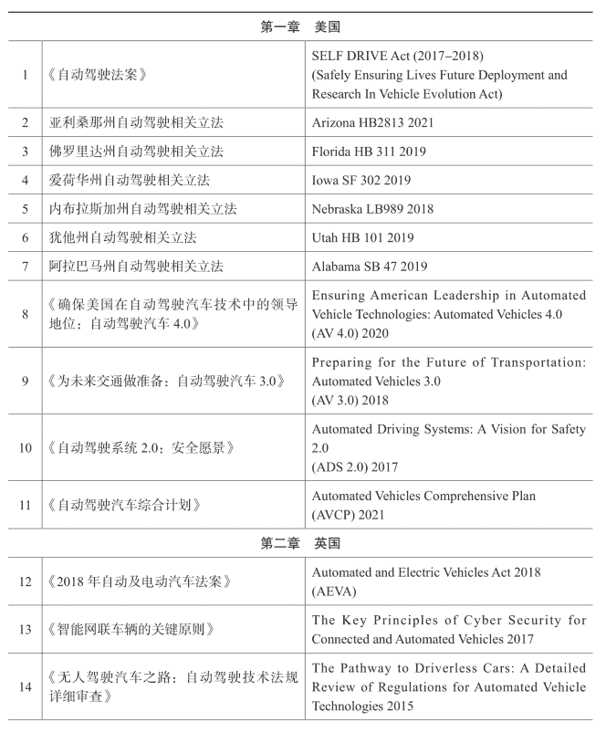

续表

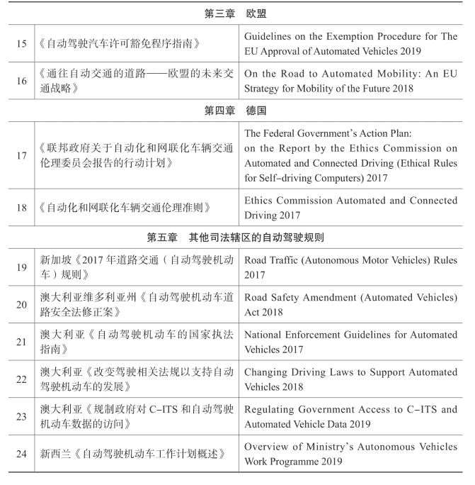

第一章　美国

美国自动驾驶法规政策进程及其内容概述^()

一、联邦层面的核心关注

二、各州立法与州行政命令的主要内容与对比

三、结语

第一节　自动驾驶法案

第二节　亚利桑那州^()

第三节　佛罗里达州

第四节　爱荷华州

第五节　内布拉斯加州

第六节　犹他州

第七节　阿拉巴马州

第八节　确保美国在自动驾驶汽车技术中的领导地位：自动驾驶汽车 4.0

一、自动化车辆

二、支持自动汽车技术增长和领导地位的行政管理工作

三、美国政府活动和合作机会

四、结语

第九节　为未来交通做准备：自动驾驶汽车 3.0

一、简介

二、主要内容

三、结论

第十节　自动驾驶系统 2.0：安全愿景

一、简介

二、主要内容

三、结论

第十一节　自动驾驶汽车综合计划

一、什么是综合计划？

二、美国交通部将如何实现其自动驾驶系统的愿景？

三、美国交通部的行动如何支持 ADS 的发展？

四、美国交通部如何就自动驾驶系统与利益相关方合作？

五、为未来交通做准备：美国交通部研究亮点

六、下一步是什么？

第二章　英国

第一节　2018 年自动及电动汽车法案

第一部分　自动汽车：保险人等的责任

第二部分　电动汽车：充电

第三部分　其他及一般规定

第二节　智能网联车辆的关键原则

第三节　无人驾驶汽车之路：自动驾驶技术法规详细审查

第一部分　背景介绍

第二部分　研究的主要内容

第三部分　为无人驾驶汽车开辟道路

第三章　欧盟

第一节　自动驾驶汽车许可豁免程序指南

一、本指南的目的和范围

二、程序

三、安全要求

第二节　通往自动交通的道路——欧盟的未来交通战略

一、简介

二、主要内容

三、结论

第四章　德国

第一节　联邦政府关于自动化和网联化车辆交通伦理委员会报告的行动计划

一、简介

二、主要内容

第二节　自动化和网联化车辆交通伦理准则

一、导言

二、自动化和网联化车辆交通伦理委员会所采取的程序

三、自动化网联车辆交通的伦理规则

四、讨论的结果和未解决的问题

第五章　其他司法辖区的自动驾驶规则

## 第一节　新加坡：2017 年道路交通（自动驾驶机动车）规则

## 第一部分　序言

## 第二部分　获批的试验和获批的特殊使用

## 第三部分　特定人员的职责

## 第四部分　杂项

## 第二节　澳大利亚维多利亚州：自动驾驶　机动车道路安全法修正案

## 第 1 部分　序言

## 第 2 部分　《1986 年道路安全法》的修正案

## 第 3 部分　对《1958 年刑法》的相应修订

## 第 4 部分　修正案的废止

## 第三节　澳大利亚：自动驾驶机动车的国家执法指南

## 一、简介

## 二、主要内容

## 第四节　澳大利亚：改变驾驶相关法规以支持自动驾驶机动车的发展

## 一、简介

## 二、主要内容

## 三、结论

## 第五节　澳大利亚：规制政府对 C-ITS 和自动驾驶机动车数据的访问

## 一、简介

## 二、主要内容

## 第六节　新西兰：自动驾驶机动车工作计划概述

## 一、简介

## 二、主要内容

# 第六章　中国自动驾驶监管概述和实务观察

## 一、中国自动驾驶监管特点和体系概要

## 二、自动驾驶车辆的定义和分级

## 三、自动驾驶车辆产品的基本要求

## 四、业务基石：自动驾驶车辆的“路测”制度

## 五、“智能网联”背景下的其他业务资质要求

## 六、地理信息测绘问题

## 七、数据安全与个人信息保护

## 八、核心算法及配套技术的知识产权保护

## 九、待探寻的疑问与展望：自动驾驶语境下的道路交通安全归责问题

# 后记

# 第一章　美国

## 美国自动驾驶法规政策进程及其内容概述

近年来，美国已陆续在联邦及各州层面出台自动驾驶相关法规政策，关注协调联邦、州以及地方当局的角色分工并明确自动驾驶治理的基本原则，同时应对有关网络安全与数据安全、制造商责任、道路测试的申请备案、保险证明等自动驾驶落地过程中的具体问题。从现有规范的整体架构看，联邦政府主要负责统筹自动驾驶安全发展框架与部门间职责分工，而各州主要通过州立法、州行政命令等形式对自动驾驶技术相关问题进一步明确。至 2022 年 5 月，已有 39 个州及华盛顿特区实施自动驾驶相关立法或行政命令。其中，阿拉巴马州、阿肯色州、加利福尼亚州、科罗拉多州、康涅狄格州、佛罗里达州、佐治亚州、伊利诺伊州等州及华盛顿特区已经颁布自动驾驶相关法案，而亚利桑那州、特拉华州、夏威夷州、爱达荷州、伊利诺伊州、缅因州等州长也已经发布与自动驾驶车辆有关的行政命令，由此形成联邦与州双向结合的自动驾驶规制体系。本章首先介绍联邦层面自动驾驶法规政策的主要面向与规制特点，进而对比梳理各州层面州立法、州行政命令有关自动驾驶规制的主要内容与异同，尝试从联邦与州两个维度形成对美国自动驾驶法规政策的整体理解。

## 一、联邦层面的核心关注

联邦层面对自动驾驶的规范要求主要依托联邦立法与美国交通部（USDOT）、美国国家公路交通安全管理局（NHTSA）以及美国智能交通系统联合计划办公室（ITS JPO）发布的各类政策指南展开。美国国会提出了多份有关自动驾驶的议案，如 2017 年 7 月 27 日在联邦众议院通过的《自动驾驶法案》（SELF DRIVE Act），2017 年 10 月 4 日由美国参议院商务委员会向参议院发送的名为“AV START Act”的自动驾驶法案。USDOT、NHTSA 等机构也于 2014 年至 2020 年陆续出台了《联邦自动驾驶汽车政策》（Federal Automated Vehicles Policy，以下简称 AV1.0）、《自动化驾驶系统 2.0：安全愿景》（Automated Driving Systems 2.0：A Vision for Safety，以下简称 AV2.0）、《为未来交通做准备：自动驾驶汽车 3.0》（Preparing for the Future of Transportation：Automated Vehicles 3.0，以下简称 AV3.0）、《确保美国在自动驾驶汽车技术中的领导地位：自动驾驶汽车 4.0》（Ensuring American Leadership in Automated Vehicle Technologies：Automated Vehicles 4.0，以 下 简 称 AV4.0）以及《智能交通系统 2015—2019 年战略计划》、《智能交通系统 2020—2025 年战略计划》、《自动驾驶汽车综合计划》、《联邦自动驾驶车政策——加速推进道路安全新改革》等政策文件作为联邦层面自动驾驶规范的主要指引。从上述法规政策的主要内容看，美国联邦层面对自动驾驶的关注集中于有关联邦、州及地方当局在自动驾驶领域的职能分工与合作以及对自动驾驶治理的基本原则与目标策略的宏观协调，且相关规范有意区分 SAE J3016 国际标准下 L1-L2 级自动驾驶车辆与 L3-L5 级自动驾驶车辆，以区别部分立法、政策的适用对象与覆盖范围。

### （一）联邦与州层面在自动驾驶领域的职能分工与合作

美国自动驾驶法规政策对有关自动驾驶治理职能分工与美国的行政体制相关，包括联邦与各州、地方当局之间的纵向分工与不同机构之间的横向分工双重维度。尽管联邦国会在 2017 年提出的 SELF DRIVE Act 和 AV START Act 尚未正式通过，但二者在 SEC.3.b.3.A 条中均明确区分联邦政府和州政府监管角色定位，联邦政府主要负责监管自动驾驶车辆及零部件的设计、生产、性能等车辆标准，州政府主要负责车辆登记注册、驾照发放、驾驶教育培训、保险、执法、事故调查、车辆安全和汽车尾气检测、交通管理等事项。2016 年 9 月，NHTSA 发布了“联邦自动驾驶车政策——加速推进道路安全新改革”。其中包含自动驾驶汽车行驶状况指导、示范行政州政策、现行管理办法等。在联邦层面，NHTSA 的监管责任范围包括：为新机动车和机动车设备制定《联邦机动车辆安全标准》（FMVSS），要求各制造商在销售车辆前必须证明其符合该标准；督促各方遵守 FMVSS；在全国范围内调查和管理不符合相关规定与安全要求的机动车缺陷问题并进行召回和补救工作；就机动车安全问题与公众进行沟通和教育；以及发布汽车和设备制造商应遵循的指南。而各州责任主要包括机动车监管的其他方面，例如，在其管辖范围内向（人类）驾驶者发放执照并进行机动车登记，颁布并执行交通法规，对车辆进行安全检查，以及管理机动车保险与责任分配问题。

美国自动驾驶监管路线图：从 AV2.0 到 AV4.0

2018 年交通部出台的 AV3.0，对联邦、州、市场主体在自动驾驶监管中的分工与协作做了更清晰的厘清。2017 年发布的 AV2.0 更像一份给州立法者的操作参考，核心是建议各州遵循技术中立、统一许可登记、公共安全部门沟通等最佳做法，以此把联邦与地方的政策取向拉到同一轨道。AV3.0 在延续安全优先基调的同时，把治理覆盖面拉宽到多模式出行。

在此框架下，联邦层面主导车辆与车载设备的性能安全，以及跨州商运的运行秩序；州与地方更聚焦驾驶人许可的发放、道路规则的制定、侵权归责和保险安排。技术研发与商业落地仍以私营企业为主导，交通部希望借伙伴协作来消化落地不确定性。AV3.0 同时点名了国家公路交通安全体系的四家核心机构 NHTSA、FMCSA、FHWA、FTA，并在职责划分上对搭载 ADS 的 SAE L3-L5 车型与 L0-L2 低级别车型实行差异化治理。

NHTSA 的任务是为搭载 ADS 的车辆及其他机动车制定联邦安全基准，并处置在用车辆或设备的缺陷。部分机动车安全标准涉及车辆性能与试验方法，确保人类操作者仍能安全掌控车辆，例如方向盘、制动、油门等操控装置的使用，以及仪表显示、状态指示、后视镜等驾驶信息的可见性。标准制定时会考虑特定运行设计域内天气、交通、道路条件的变化，以及其他道路使用者的突发行为。针对已无人工控制装置的 L4、L5 车型，该机构正在持续优化安全基准，现有法律授权足够灵活，能够随 ADS 表现差异与运行设计域限制进行适配。

FMCSA 负责州际商运中商用车承运人的安全、驾驶员资质，以及卡车、客车的运营安全。考虑到在商用车及相关设备安全上的权限互补，FMCSA 配合 NHTSA 在联邦层面保持协同，前者专属为新车制定联邦安全基准，后者负责监督制造商对已知缺陷的召回整改。双方共同制定并执行现有商用车队运营维护的安全要求，并与州属利益相关方协作制定商用车检查、维修等标准，同时配合 FHWA 等部门开展公开技术演示，如卡车编队示范。

FHWA 依托《统一交通控制设施手册》发挥作用。道路标志、信号、标牌等控制设施的质量与一致性直接影响人类驾驶与自动驾驶的安全效率，该局负责为所有公共街道、公路、自行车道或开放的私人道路制定国家层面标准。通过与行业协会和从业组织合作开展研究与试验，持续让设备适配新兴自动驾驶技术需求。

国会近年提升了 FTA 在安全监管中的权重。该机构发布了国家公共交通安全计划与公共运输机构安全计划规则，聚焦运营固定轨道或公共汽车的机构，例如自动驾驶公交的部署。通过定向强化特定领域的运输安全绩效，分析自动驾驶公共运输的技术局限、网络安全、人力技能退化等风险收益，从而提升地面自动驾驶运输整体安全性。

技术与物理安全之外，跨层级协作还体现在风险外延领域。AV3.0 要求交通部与司法部、联邦调查局、商务部所属国家标准与技术研究院、联邦贸易委员会、联邦通信委员会、国土安全部等紧密配合，通过交通信息共享分析中心把与交通相关的网络漏洞匿名共享，管控自动化技术和数据相关的网络风险。同时配合联邦贸易委员会，为自动驾驶系统自愿数据交换设立消费者隐私保护与商业机密保护屏障。

在 AV3.0 的基础上，2020 年 4 月总统办公厅与交通部发布 AV4.0，以发展目标为切入点，进一步梳理 38 个联邦部门和独立机构在不同领域的分工，下文以表格形式梳理：

表 1-1　美国联邦政府机构的无人驾驶工作职能分工之一

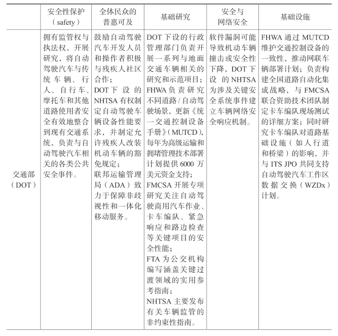

续表

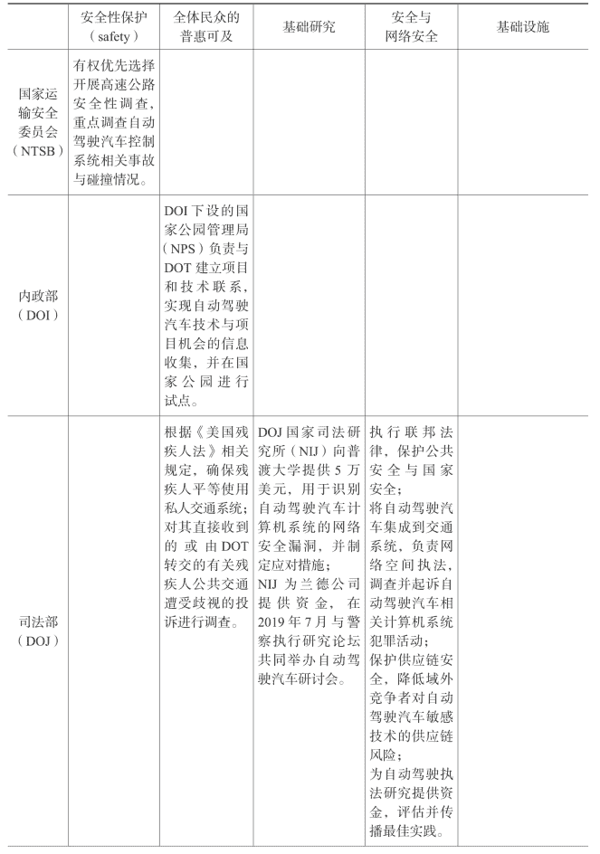

续表

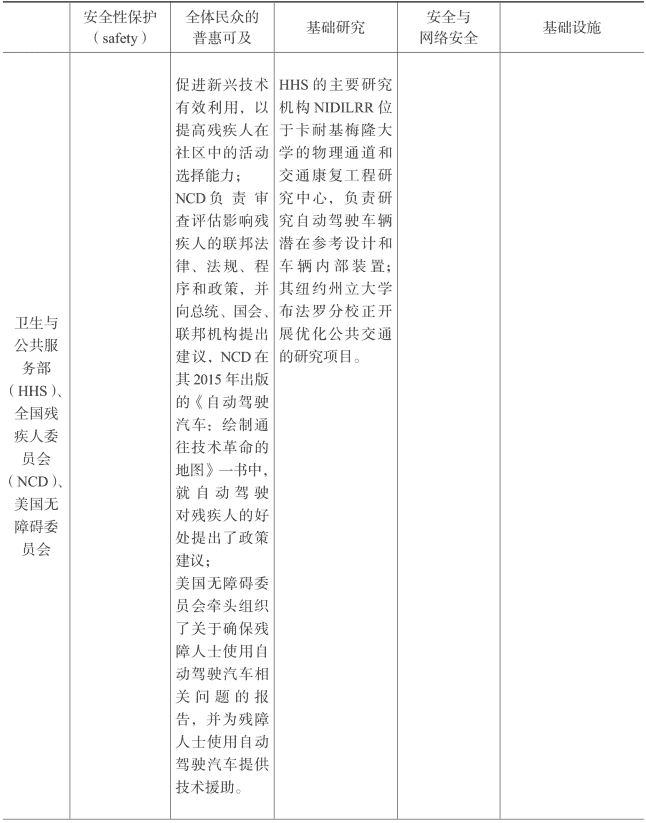

续表

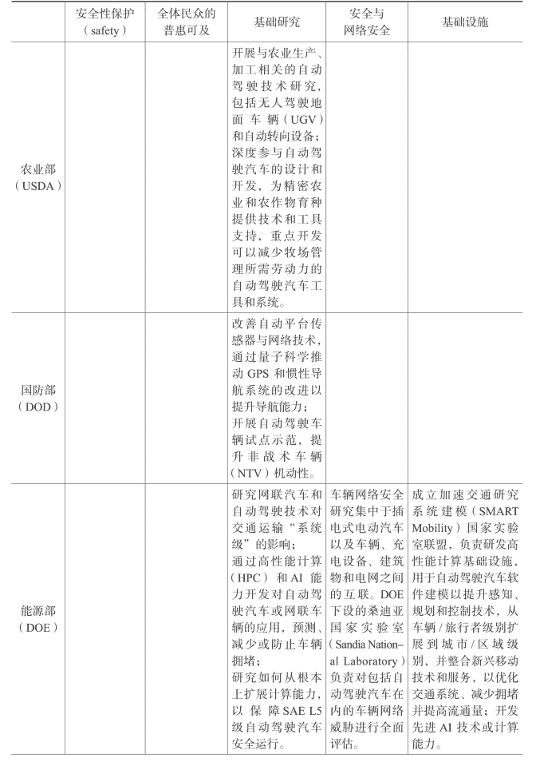

续表

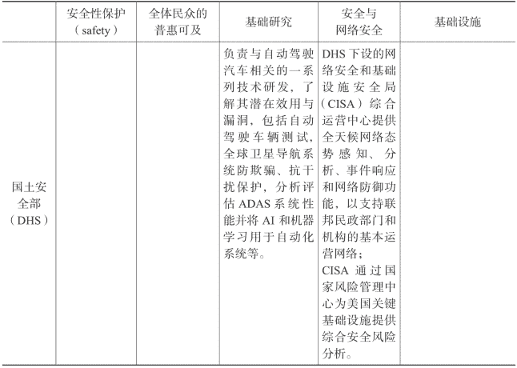

表 1-2　美国联邦政府机构的无人驾驶工作职能分工之二

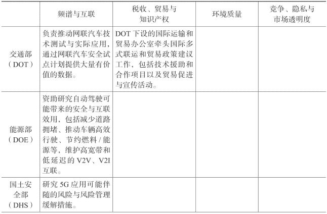

续表

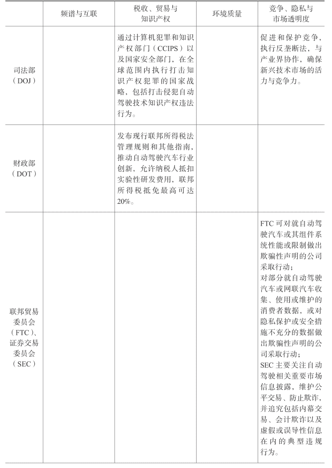

续表

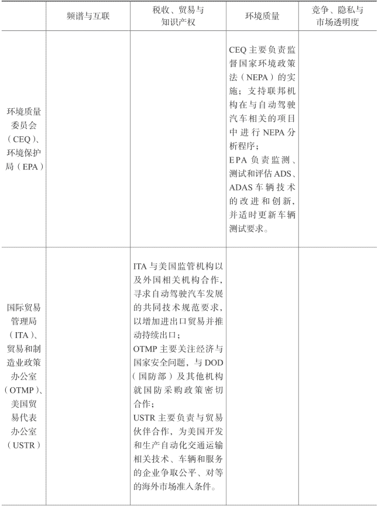

续表

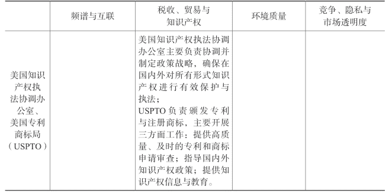

### （二）自动驾驶治理的基本原则与目标策略的宏观协调

联邦层面的另一项核心工作，是为后续州立法或机构标准制定提供基本原则和目标策略指引，从而引领全国规制方向。总体来看，各项政策与规划在原则上都强调降低安全风险、守护网络安全与用户隐私、规范自动驾驶数据记录；在战略目标上则侧重机构协同与透明度提升、信息共享、监管环境现代化、简化部署流程并以构建整体运输系统为导向，上述联邦与州的分工已在一定程度上印证了这些特点。

2017 年 AV2.0 已体现对系统安全性的关注，这一基调在 2020 年 AV4.0 中进一步明确，《智能运输系统 2015—2019 年战略计划》与《自动驾驶汽车综合计划》也可作为佐证。

AV2.0 面向 SAE L3-L5，鼓励各方采用自愿性指南、最佳实践以及国际标准化组织、国际汽车工程师学会等认可的标准制定机构，并借鉴航空航天军事等行业流程来评估自驾系统安全性。相关主体可向 Auto-ISAC 报告内部测试、消费者反馈、外部安全研究中发现的事故、漏洞、威胁，建立强大的网络事件响应能力。在数据记录方面，鼓励开展试验或试点的实体建立记录机制，收集与故障、退化或系统失效相关的数据用于判定事故原因，包括致命或非致命人身伤害数据、需拖车或致使车辆无法安全自行行驶的损害数据，并记录自驾系统状态及事故前后自驾系统或人类驾驶员对车辆的控制信息，以还原场景。

《自动驾驶车辆启动法案》与《自我驾驶安全法案》则通过测试安全评估报告要求来强化系统安全性。例如《自动驾驶车辆启动法案》第 9 条 b 款要求评估系统安全性、数据记录、网络安全、人机交互界面、耐撞性、功能局限说明、碰撞后表现以及自动驾驶功能在设计运行区域、物体和事件检测与响应、最坏情况最小风险策略、仿真与路测等方面的表现。AV4.0 以“保护用户与安全”作为统领，涵盖系统安全、功能安全、网络安全以及隐私与数据安全，是对 AV2.0 原则的体系化重申，AV3.0 中的网络安全与隐私保护也通过机构协作得到强化。《自动驾驶车辆启动法案》第 14 条 b 款要求厂商制定网络安全计划，降低被攻击或非法入侵风险，包括风险识别与保护、风险检测与响应、风险恢复、网络安全负责人、风险隔离与分级等机制。运输部长负责审查计划并要求厂商公开安全计划，建立安全风险披露合作机制。

## 自动驾驶监管框架分析

## 一、联邦层面安全框架与战略规划

NHTSA 于 2020 年 12 月提出一项自驾系统安全框架，至 2021 年 4 月处于征求意见延长阶段，并于 2022 年 3 月形成最终规则。该规则聚焦搭载自驾系统车辆的乘员保护，试图客观界定、评估与管理自驾系统性能的安全性，同时保留足够灵活性以支撑创新。此前联邦机动车安全规范规定了车辆与设备的最低性能要求并通过可重复测试程序执行。然而新规则超越了现有 FMVSS 及其对新型设计的适用，意图建立专门针对自驾系统的政府安全框架。

2021 年的规则制定通告中，NHTSA 提出自驾系统的四项安全功能：其一，借助传感器感知环境信息；其二，对其他道路使用者、基础设施与环境条件进行监测与分类；其三，分析道路情形、规划路线并决定对监测对象的适当反应；其四，通过车辆交互执行所需的驾驶动作。

该框架兼顾过程措施与工程措施。过程措施涵盖设计开发改进全周期内的车辆安全保障，例如在设计阶段识别风险、按严重程度与频率分类、采取一般性风险削减做法。工程措施则要求以高熟练度证明传感、感知、规划与控制执行功能的能力，例如性能指标、运行阈值与测试程序。

规则还涉及互联互通水平、故障自检与模式安全切换等安全相关议题。自驾系统应能可靠检测自身或车辆其他系统的故障并确保操作模式间安全转换，具体包括识别性能下降与运行设计域边界、约束条件降低时降级运行、完成起止点的基本运输任务、识别并响应消防急救等第一响应者通信、接收加载并追踪无线软件更新、进行系统维护校准、处理网络安全风险以及系统冗余等。通告同时明确了实施与监督的行政机制。

最终规则侧重修改现有 FMVSS 中的术语并调整车内装置要求以适应自驾系统技术，例如“驾驶员指定座位”“乘客座位”，或在适当时采用新定义如“手动操作驾驶控制装置”“转向控制”。术语修改使防撞等实质性安全标准能清晰适用于装有自驾系统的车辆。对“驾驶员座位”“乘客座位”“方向盘控制”等可能随技术普及而变化的参照物，规则作了技术性修正，使其与自驾系统车辆内部布局相匹配。规则还澄清了 FMVSS 对可同时通过自驾系统与转向控制操作的双模式车辆的适用方式，回应了自驾系统车辆安全气囊、未定义驾驶员情形下中型公交与大型校车安全带设置等问题。NHTSA 确认，对无人车辆而言，若无乘员需保护，则相关 FMVSS 的原始安全要求不再适用。

在此框架下，第 208 号 FMVSS 成为关键抓手，强化了联邦对驾驶员与乘客安全的关注。NHTSA 向自驾系统制造商明确合规路径并重申乘员保护标准适用于自驾系统车辆，确保采用自驾系统技术的车辆能提供与现有乘用车同等水平的乘员保护。总体看，结合自驾系统智能化水平提升，NHTSA 仍试图通过 FMVSS 体系实质性提升高级别自动驾驶车辆安全性。

自动驾驶治理的目标策略集中体现在《自动驾驶汽车综合计划》与 2015—2025 两阶段《智能运输系统战略计划》。《自动驾驶汽车综合计划》提出促进合作与透明度、推动监管环境现代化、为运输系统做好准备三项目标。促进合作与透明度聚焦自驾系统技术能力与局限的信息采集以保障安全测试开发与部署，并细化为与利益相关方保持联系、监测新趋势问题需求、向行业提供指导、提高透明度与最佳实践采纳、促进信息共享，明确 FHWA、FTA、NHTSA 与智能运输系统联合项目办公室在其中的分工。监管环境现代化旨在消除不必要与非预期的监管障碍，并明确何时如何监管自驾系统性能，细化为技术部署的豁免与减免、简化行政程序、通过规则制定与研究调整 FMVSS 以消除自驾系统新型设计与功能障碍、调整现行商用车辆安全法规以消除自驾系统商用车州际运行障碍，并在过程中协调 NHTSA 与 FMCSA 的作用，通过符合时间、车辆数量与地点要求的测试与有限部署，以及以“同等安全保护水平”替代 FMVSS 或 FMCSR 要求的方式，为新技术提供测试示范空间。为运输系统做好准备则把自动驾驶纳入国家地面运输整体运行，扩大包括残障与老年人群体在内的安全可负担无障碍出行选择。目标细化为针对性技术研究、为以自驾系统为重点的示范试点部署提供资金、更新基础设施标准以适配自驾系统技术，覆盖 FMCSA、FHWA、ITS JPO、FTA 与部长办公室职能。

《智能运输系统 2015—2019 年战略计划》提出“汽车互联”“自动化”“企业数据”“互操作性”“ITS 部署支持”“新兴 ITS 功能”六项目标，体现数据合作共享、推动技术部署与体系化架构的导向。交通部与大型数据管理组织及技术密集型组织合作研究开放数据概念与方法，借助 ITS 支撑技术在保护隐私前提下有效采集运营数据，涉及车联网、商用车辆、社交网络情景数据、移动设备与基础设施。对运输系统的建构导向主要体现在互操作性要求，通过架构与标准开发让 ITS 相关技术人员、机构与业务实现系统联通，提升国家智能运输系统下技术协同能力，确保车辆、设备、基础设施与应用中的 ITS 元素在何处产生、何时使用均能有效通信。在《智能运输系统 2020-2025 年战略计划》中，这一体系化构建目标进一步整合自动驾驶与智能运输各要素，包括车辆、后台、服务，以及服务于全体运输用户的社区、团体、私营供应商、州与地方政府等运营实施者。

## 二、各州立法与州行政命令的主要内容与对比

美国自动驾驶：州权如何落地

国家层面负责确立自动驾驶的安全底线并承担总体协调职能，而车辆许可、登记管理、道路执法、安全检验、基础设施配套以及保险责任归属等落地执行事项，实际操作权主要掌握在各州手上。^([\[21\]](#txt001.html#footnote_content_txt001_21)) 近年多州密集推出地方性法规与行政指令。州法多围绕概念界定、公开道路测试与示范运行的准入门槛、车内装置配置以及事故发生后的生产方追责展开；行政指令则更突出数据采集使用与隐私边界、系统与网络安全、厂商义务，并在表述口径、试点细则和协调机构设置上呈现差异。先用图表对照州法的分歧点，再梳理各州行政指令的核心安排。

州立法覆盖情况
阿拉巴马、阿肯色、加利福尼亚、科罗拉多、康涅狄格、佛罗里达、佐治亚、伊利诺伊、印第安纳、肯塔基、路易斯安那、缅因、密歇根、密西西比、内布拉斯加、纽约、内华达、北卡罗来纳、北达科他、俄勒冈、宾夕法尼亚、南卡罗来纳、田纳西、德克萨斯、犹他、弗吉尼亚、佛蒙特、威斯康星，以及华盛顿特区均已提出自动驾驶车辆相关的地方立法。^([\[22\]](#txt001.html#footnote_content_txt001_22)) 即便部分法案仍在审议，其制度雏形已能折射美国州际治理的基本取向，重点与差异主要体现在：

### （一）概念表述的分化
国际汽车工程师协会 SAE 将自动化水平划分为 L0-L5，对应不同的驾驶自动化系统与自动驾驶系统运行等级。标准建议，描述具备自动驾驶功能的车辆时，L1 或 L2 用“搭载驾驶自动化系统的车辆”，L3~5 用“搭载 ADS 的车辆”；描述实际运行状态时，建议用“[1 或 2] 级驾驶自动化系统参与运行的车辆”或“[3、4 或 5] 级 ADS 运行的车辆”。^([\[23\]](#txt001.html#footnote_content_txt001_23)) ADS 通常仅指 3、4、5 级，驾驶自动化系统则可涵盖 L1-L5。^([\[24\]](#txt001.html#footnote_content_txt001_24)) 两者区分了被规范对象的智能化层级。autonomous vehicle 与 automated vehicle 虽都可指代自动驾驶车，前者往往对应自主化程度更高、驾驶员动态任务介入更少的更高等级车型。术语差别暗含对自动化水平的不同判断，各州立法并未统一把“自动驾驶车辆”固定为 autonomous vehicle，由此限定了规则适用范围并形成差异化导向，具体用法见表：

表 1-3　美国各州立法文件中对不同自动驾驶概念的使用情况
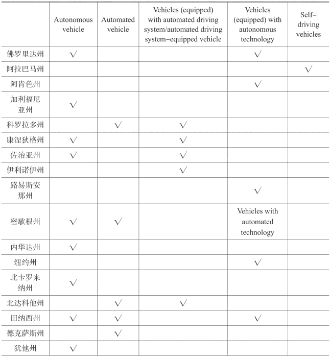
续表
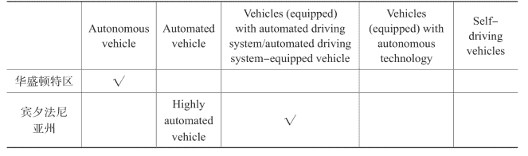

### （二）道路测试、试点、部署要求的对比
截至 2022 年，美国州立法协会与美国公路安全保险协会共同梳理了各州自动驾驶立法的现状。^([\[25\]](#txt001.html#footnote_content_txt001_25)) 下文选取与州治理特征关联度较高的部分归纳。

安全门槛是联邦与州共同关注的重点。NHTSA 曾向各州提出建议：测试时应始终配备受训并持证、熟悉车辆操作的驾驶员；尽量降低对其他道路使用者的风险；自动到手动的切换须安全且易操作；车辆须具备检测、记录并向驾驶员告警故障的能力等。^([\[26\]](#txt001.html#footnote_content_txt001_26)) 各州在测试与演示方面的差异主要体现在是否要求申报登记或提交证明及申报主体、是否要求投保及由谁提供保单证明、执行主体资格限制，以及测试时是否要求车内有人及其资质。对测试时人类操作者在场与资质的要求，通常与车辆后续运行中人类驾驶员在场与资质的要求保持一致。

表 1-4　美国各州自动驾驶道路测试要求一览表
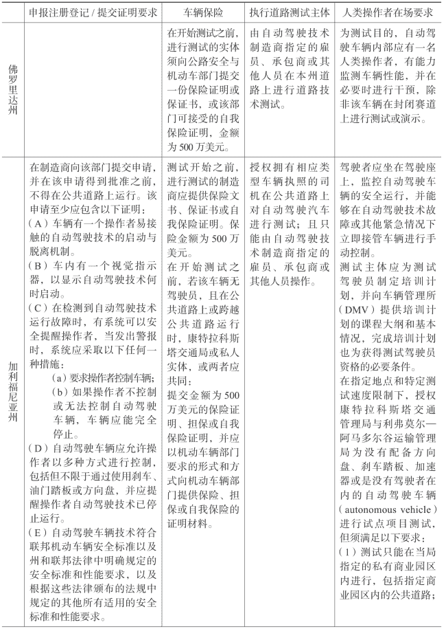
续表
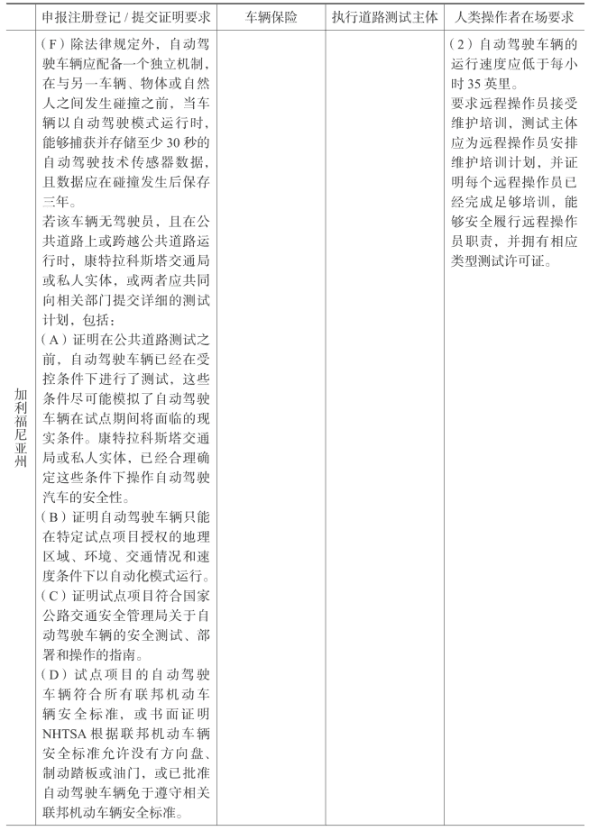
续表
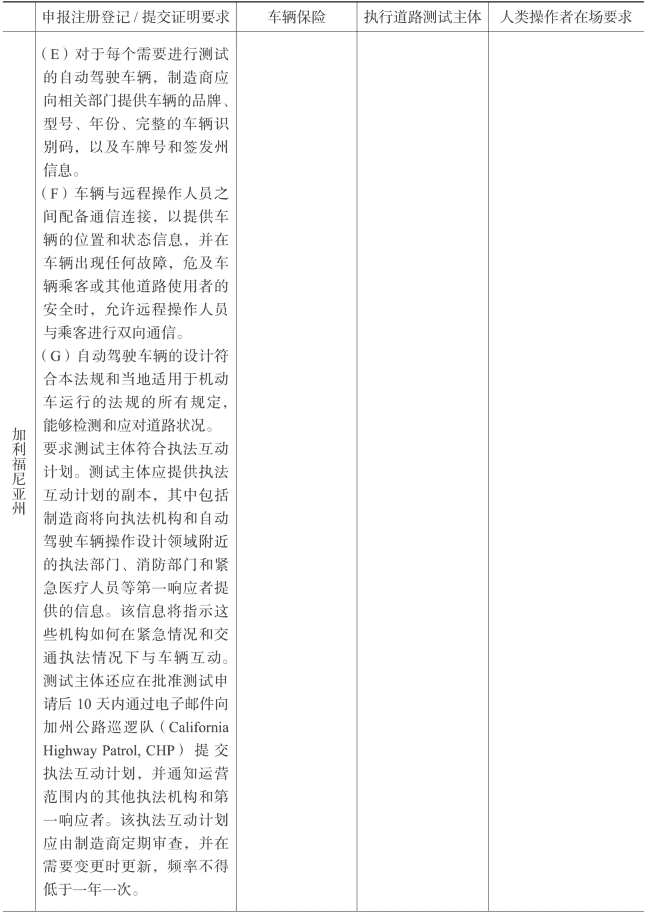
续表
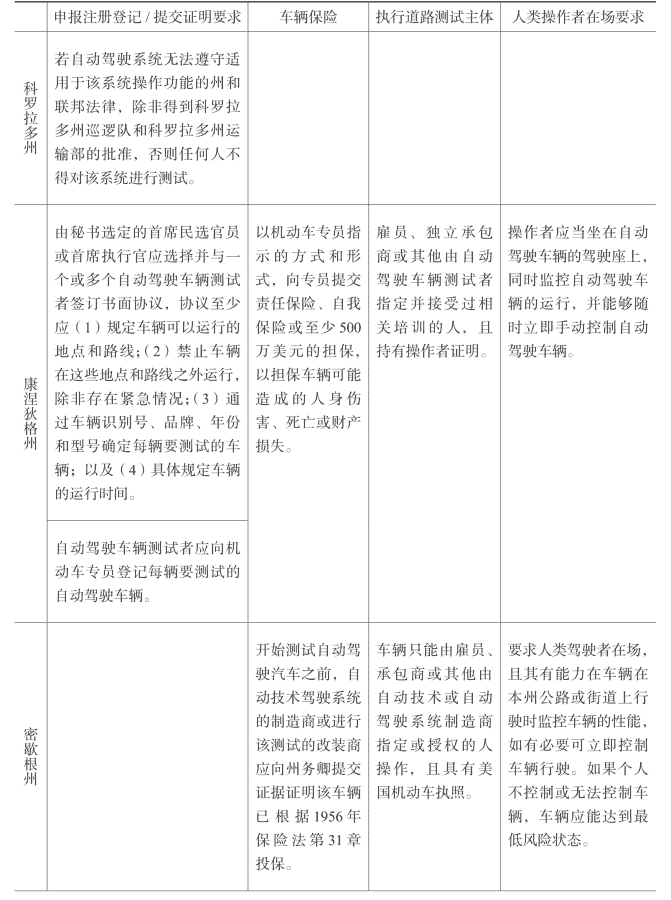
续表
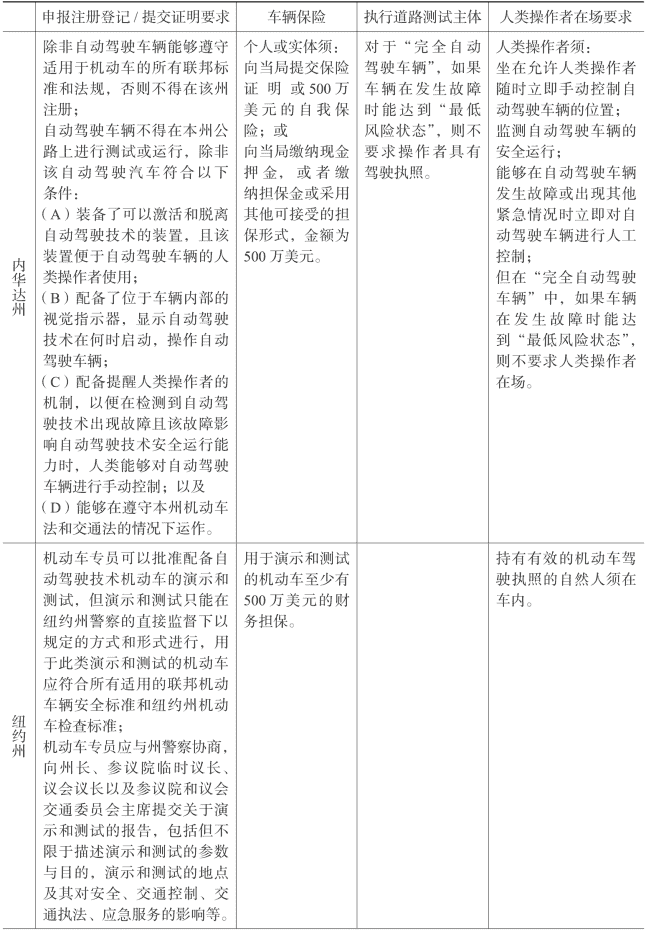
续表
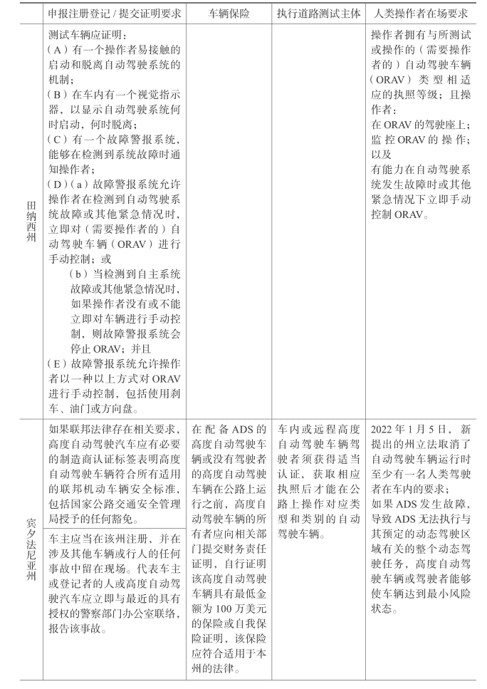
续表
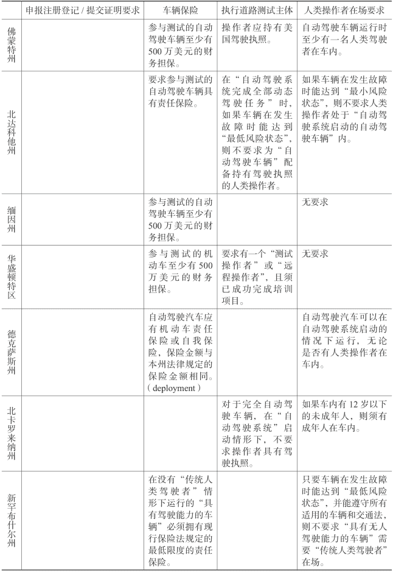

### （三）车内装置配置要求
州法对运行中的车内装置提出两类要求：视觉显示装置与方向盘、制动等人机操作装置，目的都是为人类驾驶员随时接管预留技术空间，以符合联邦与州适用的安全标准。

佛罗里达要求车内应设有设备直观显示车辆处于自动驾驶模式时的运行状态。田纳西要求激活自动驾驶技术时，操作者可通过电子屏进行通信、信息传输等活动，该显示屏需与车辆集成并在自动驾驶退出时自动关闭可见的移动图像。加利福尼亚、内华达、弗吉尼亚也有类似规定。宾夕法尼亚要求高度自动驾驶车辆在公路行驶时具备由多套装置构成的后视系统，形成类似后视镜的功能。

关于方向盘、制动等装置的要求与各州对测试或运行中车内操作者的规定基本一致，多数州仍要求按现行技术水平配备方向盘、制动等装置。加利福尼亚在允许康特拉科斯塔交通局与利弗莫尔-阿马多尔谷交通管理局在满足相应条件时开展无人道路测试的同时，对方向盘、制动踏板或油门等人工操作设施作出豁免。但总体来看，车内装置仍是多数州安全标准的重要组成部分。

### （四）事故发生时初始制造商责任的厘清
部分州法补充明确了事故发生时的初始制造商责任。多数学州把自动驾驶汽车的“制造商”界定为最初制造自动驾驶技术并在车辆上完成装配的企业，或若原车未搭载自动驾驶技术，则为后续改装者，部分立法还延伸至子系统生产商。

弗吉尼亚与内华达规定，由第三方改装为自动驾驶汽车或修改自动驾驶系统的车辆，其原制造商不对因改装或改装设备导致的“车辆缺陷”引发的诉讼承担责任，可主张抗辩并被排除出诉讼，除非该缺陷在原车制造时已存在。密歇根规定，自动驾驶技术制造商对未经其同意的改装所致损害享有民事豁免；在产品责任诉讼中，子系统生产商不对为改装安装的设备所致损害负责，除非缺陷在设备安装时已存在。田纳西指出，若自动驾驶系统安装于未按自动驾驶设计制造的机动车，最初制造该车的个人或实体不对后续系统故障导致的伤亡负责。华盛顿特区立法也限制了改装车原制造商的责任。

此外，田纳西、加利福尼亚、北达科他等还对测试运行过程中的数据记录类型、记录时长、信息收集披露对象等作出细化，与亚利桑那、特拉华等州的行政命令关注点相呼应。

州行政指令
亚利桑那、特拉华、夏威夷、爱达荷、伊利诺伊、缅因、马萨诸塞、明尼苏达、俄亥俄、华盛顿和威斯康星州长已发布相关行政命令，补充了数据利用、系统与网络安全、制造商义务、试点测试要求及机构协调等问题。

亚利桑那州 2015 年行政命令明确交通部、公共安全部等部门与私营企业共同开展公共道路测试与运行。令中要求自动驾驶模式下，无论操作者是否在车内，均须持有效驾照指导车辆运行；试点测试运行的操作者只能由开发企业指派或授权的人员担任，并具备必要干预能力；车辆所有者须提供财产责任证明。2018 年进一步要求测试运行实体遵守机动车安全、保险、事故报告与登记规定，否则可中止其资格，同时对完全自动驾驶车辆提出认证、登记、执照与保险要求，并要求数据采集方及时向公众披露碰撞信息。

特拉华州 2017 年 9 月行政命令围绕公共安全、网络安全、隐私及交通系统建设展开，细化了互联自动驾驶车辆咨询委员会的组成与议题，包括经济发展、技术安全隐私、交通网络基础设施以及对公共交通安全的影响研究。

夏威夷州 2017 年 11 月行政命令区分了州政府机构与非政府实体在无人驾驶路线测试部署中的职能：在州长办公室设 CAV 联络人，由行政主任担任，为来夏测试企业提供高层支持；夏威夷州交通局、公共安全局、商业经济发展和旅游局应以公共利益为目标与测试开发企业合作。

缅因州 2018 年行政命令明确高度自动驾驶车辆咨询委员会职责。试点项目须经委员会评估并获许可，评估以公共安全为首要考量，同时关注车辆速度、操作者培训、测试区域地理限制及技术安全记录。赞助商须提供资产证明及人身财产损失保险证明。

华盛顿特区 2017 年行政命令区分有驾员试点与无驾员试点要求。有驾员试点要求车辆由受训雇员、承包商或开发实体授权人员操作或监控，操作者持有效美国驾照并能控制车辆，车主须证明财务责任能力；无驾员试点要求自动驾驶系统能在设计运行范围内执行全部驾驶任务，并在故障时将车辆置于安全状态，车主同样须向劳工部证明经济责任能力。

佐治亚州与肯塔基州的分析报告显示，各州立法与行政命令的关注点集中于公共安全、自动驾驶汽车的定义、应用与道路测试前提、认证保险要求、制造商责任厘清及操作者限制，同时兼顾数据收集使用与隐私保护，部分甚至涉及算法伦理，体现出对系统安全与数据安全的双重关切。

## 三、结语
总体来看，美国自动驾驶法规政策呈现联邦统筹与州执行并存的格局。联邦层面重在职能分工与原则目标的协调，各类规范根据技术发展阶段提出侧重不同的要求，平衡安全与发展。州层面，立法与行政命令共同关注测试试点运行衍生的登记、资格申请、保险证明、操作者在场与资质以及数据安全等问题，并在具体规范上差异明显。本书试图从宏观视角梳理联邦与州的规制要求，以期形成对美国自动驾驶治理路径的整体理解。

### 第一节　自动驾驶法案

### H.R.3388
该法案拟修订《美国法典》第 49 卷有关国家公路交通安全管理局对高度自动化车辆的管理内容，提出安全措施及其他事项。法案于 2017 年 9 月 7 日递交美国参议院商业、科学和交通委员会进行二读。

#### 第 1 章　简称：目录
（a）简称——本法全称 Safely Ensuring Lives Future Deployment and Research in Vehicle Evolution Act，简称 SELF DRIVE Act。
（b）目录——内容包括：
第 1 章　简称；目录
第 2 章　立法目的
第 3 章　NHTSA 及各州对自动驾驶机动车的优先监管权
第 4 章　更新或新版高度自动驾驶机动车辆安全标准
第 5 章　自动驾驶系统网络安全
第 6 章　一般豁免
第 7 章　机动车辆测试或评估
第 8 章　向潜在购买者提供高度自动驾驶系统的信息
第 9 章　高度自动驾驶机动车咨询委员会
第 10 章　后座乘客警报系统
第 11 章　车前灯
第 12 章　高度自动驾驶机动车隐私保护计划
第 13 章　定义

#### 第 2 章　立法目的
本法旨在通过鼓励高度自动化车辆的测试与部署，明确联邦政府在保障高度自动化车辆设计、结构和性能安全方面的角色。

#### 第 3 章　NHTSA 及各州对自动驾驶机动车的优先监管权
对《美国法典》第 49 卷第 30103 条作出如下修正——
（1）第（b）款修改为：
“（b）优先监管权——
“（1）高度自动驾驶机动车——各州或其行政部门不得保留、执行、规定或继续实施影响高度自动驾驶机动车设计、生产、性能、自动驾驶系统及其部件的法律或法规，除非该法律或法规标准与本章一致。
“（2）机动车辆标准——本章机动车辆安全标准生效后，各州或其行政部门仅可在与本章标准一致的情况下，规定或继续实施关于机动车辆或机动车辆设备同一性能方面的标准。
“（3）解释规则——
“（A）概述——本款不得解释为禁止各州或其行政部门保留、执行、规定或继续实施有关注册、许可、驾驶培训、保险、执法、事故调查、安全与排放检查、本地道路拥堵管理或交通的法律或法规，但不得对高度自动驾驶机动车、自动驾驶系统及其部件的设计、生产、性能设置不合理限制。
“（B）机动车辆经销商——本款不得解释为禁止各州或其行政部门保留、执行、规定或继续实施有关经销商、制造商或分销商销售、分销、维修或服务高度自动化车辆、自动驾驶系统或其部件的法律或法规。
“（C）与联邦法律的一致性——本款不得解释为限制各州或其行政部门依据其他联邦法律行事。
“（4）更高性能要求——美国政府、各州或其行政部门可为机动车辆、机动车辆设备、高度自动化车辆或自动驾驶系统规定标准，但性能要求应高于本章适用标准。
“（5）各州执行——各州可执行与本章相同的标准”；以及（2）将第（e）款修改为：
“（e）普通法责任——
“（1）概述——遵守本章机动车辆安全标准不免除个人的普通法责任。
“（2）实施规则——本条不得解释为优先于普通法要求。”

#### 第 4 章　更新的或新版高度自动驾驶机动车辆安全标准
（a）概述——在《美国法典》第 49 卷第六章第 301 节中，于第 30128 条后增列：
“第 30129 条 更新的或新版高度自动驾驶机动车辆安全标准
“（a）安全评估认证——
“（1）最终规则——自本条通过之日起 24 个月内，交通部长应发布最终规则，要求开发高度自动驾驶机动车辆或自动驾驶系统的企业提交安全评估证明，说明其如何处理安全问题。该规则应包括——
“（A）明确需提交证明的主体；
“（B）规定企业需提交的测试结果、数据和其他材料，以证明车辆可安全运行并具备故障安全功能；以及
“（C）说明证明何时需更新或重新提交。
“（2）暂行规定——在第（1）项最终规则生效前，按 2016 年 9 月发布的《联邦自动驾驶汽车政策》或后续指南要求提交的安全评估函应递交国家公路交通安全管理局。
“（3）定期审查与更新——自第（1）项最终规则颁布之日起 5 年内，及此后每 5 年至少一次，交通部长应——
“（A）审查该规则；以及
“（B）在认为必要时更新该规则。
“（4）规则解释——
“（A）没有部署条件——本款不得解释为限制或影响交通部长在其他法律条款下的权力。部长不得以审查安全评估证书作为部署或测试高度自动化车辆的条件。
“（B）没有新的权力——除第（1）项颁布的规则外，本条未授予交通部长新的权力。

美国自动驾驶监管新框架速览：安全 基准 网络 隐私四线并进

审查调研先行，规则体系加速成型
为配合高度自动化驾驶汽车的研发与推广，保障其与常规汽车及道路其他使用者共存的安全，法律要求运输部主管在立法生效后的半年时限内，完成对当时仍有效的联邦汽车安全基准的复核或继续复核，并启动面向未来的联邦安全基准探索工作。
自立法通过起计十二个月内，主管部门须向众议院能源商务委员会及参议院商业科学与交通委员会公开并递交一份规则制定与安全优先方案。该方案需对现行基准进行更新、发布新的安全基准，并研究如何把性能指标的客观区间用于安全基准测试、哪些基准适合采用该类测试，以及是否需要额外授权来推动测试工作。
方案应明确美国道路安全局未来五年内的整体工作重心，涵盖高度自动化驾驶相关的重点与机构其他安全倡议。针对高度自动化驾驶汽车，机构需要厘清可能需要性能指标的要素，例如人机交互、感知与执行单元，并审视软件与网络安全方面的程序性要求。方案原则上每两年刷新一次，必要时可提高刷新频率。
在程序层面，主管需在立法通过后十八个月内，依据上述方案提出首份规则制定进程，并持续按方案推进。优先顺序可随时调整，调整后须对方案做临时更新并公示，同时报送两院相关委员会。
法典配套上，《美国法典》第 49 卷第 301 节增设第 30129 条，用于规范更新或新版高度自动化驾驶汽车安全基准。

#### 第 5 章 自动驾驶系统网络安全
《美国法典》第 49 卷第 301 节增设第 30130 条 自动化系统网络安全。
厂商在未建立网络安全方案前，不得对外投放、许诺投放、引入贸易或进口任何高度自动化驾驶汽车、具备部分自动化功能或自动化系统的汽车。方案应包括：
一份书面的网络安全政策，说明检测与应对网络攻击、非法入侵、虚假信息及车辆恶意操控指令的措施，包含识别、评估并合理降低可预见攻击或入侵等风险点的程序，以及预防与纠正措施、事件响应计划、入侵检测与防护系统对关键控制、系统与程序的保护，以及测试、监测与动态更新机制；
指定一名管理人员或员工担任网络安全联络人；
限制进入自动化系统的程序；
对员工开展政策与程序的实施与维护培训，并对访问权限进行监督与限制。
本条在通过后一百八十天起生效。执行机构条款将 30130 纳入第 30165 条适用范围，并相应增列文书条目。

#### 第 6 章 一般豁免
《美国法典》第 49 卷第 30113 条修订。
在豁免事由中新增有利于高度自动化驾驶汽车特征开发或现场评估的情形，即该车的安全水平不低于所申请豁免的基准，或整体安全水平不低于未豁免车辆。申请材料须证明车辆属于高度自动化驾驶汽车，并附详细分析与测试数据，含路试、验证数据，证明其安全水平达标。
豁免资格门槛细化：
依据第 b 款 3 项 B 目 i，厂商近一年总产量上限为一万台；
依据第 B 目 iii，主管确认任意连续十二个月在美销量上限为二千五百台；
依据第 B 目 ii、iv 或 v，主管确认任意连续十二个月在美销售、租赁或以其他方式引入贸易的车辆上限为十万台。
豁免车辆数量上限：首个十二个月不超过二万五千台，第二个十二个月不超过五万台，第三年不超过十万台，第四年不超过十万台；续期时十二个月内上限为十万台。
豁免时限：B 目 i 不超三年，B 目 iii 不超两年，B 目 ii、iv 或 v 不超四年。
在主管依据第 30129 条 a 款发布安全评估认证规则并依据 b 款发布规则制定与安全优先方案前，以及发布之日起一年内，不得就耐撞性基准授予依据 B 目 v 的豁免。例外不适用于不载客车辆的乘客保护豁免，也不适用于转向控制系统基准豁免且车辆不搭载转向系统、左前乘客撞击保护不低于未豁免车、安全水平不低于所申请标准的情况。
获豁免厂商须按第 49 CFR 第 579 部分报告所有已知碰撞信息。运输部须在通过后一百八十天内于联邦公报发布审议 B 目 v 申请的程序与分析通知，并每五年复审更新。
主管须建立公开可检索的豁免车辆电子数据库，按车辆识别号码检索，不含车主信息。

#### 第 7 章 机动车辆测试或评估
《美国法典》第 49 卷第 30112 条 b 款 10 项修正，取消以往时点限制，将适用范围扩展至进入美国认证的汽车或其所用设备。
评估主体扩展至高度自动化车辆、自动化系统或其部件的厂商，前提为同意在测试或评估结束后不对外销售或出租或提供销售或出租。需提交个人、合伙企业、公司或高等教育机构的名称与联络点、住所与注册地、所用每种汽车类型的描述、拟在各州测试或评估的保险证明，并视情况指定联邦法规第 49 卷第 551 部分规定的代理人。

#### 第 8 章 向潜在购买者提供高度自动化系统的信息
法案颁布三年内，运输部主管须研究最有效的表述方式与术语，向消费者说明高度自动化或部分自动化汽车的能力与限制，并判断是否应参照或包含 SAE《操作规程建议报告 J3016》二零一六年九月版定义及替代术语。
研究完成后，主管须启动规则制定，要求厂商告知消费者相关汽车驾驶自动化功能的能力与限制。

#### 第 9 章 高度自动化机动车咨询委员会
法案颁布六个月内，在获得拨款情况下于美国道路安全局设立高度自动化机动车咨询委员会。
成员涵盖工商界、学界与独立研究人员、州及地方代表、安全专业人士、消费者权益倡导者、工程师、劳工组织代表、环境专家、机构代表及其他主管认为合适人员。下设附属机构由主管任命十五至三十人组成。成员任期三年，空缺按原方式填补。
委员会可设附属机构收集信息、技术咨询并就以下事项提出最佳实践或建议：残疾人出行接入、老年人及缺乏传统公共交通人群的移动接入与教育推广；自动化系统测试、部署与更新的网络安全及供应链风险管理，以及召回框架；厂商间及与机构间的安全事件信息共享框架；劳动与就业影响；环境影响与替代燃料基础设施；消费者隐私保护与数据安全；乘客舱安全、碰撞向量、耐撞性及安全气囊、安全带等装置布置；农村、偏远、山区、孤岛或未测绘地区测试与部署限制评估；独立验证与验证程序。
建议须同时报送众议院能源商务委员会及参议院商业科学与交通委员会。委员会运作受《联邦咨询委员会法》约束，可获主管技术援助与人员支援。成员无薪，会议可获差旅与津贴。委员会及附属机构于法案生效六年后终止。

#### 第 10 章 后座乘客警报系统
《美国法典》第 49 卷第 301 节增设第 30131 条。
主管须在法条通过两年内发布最终规则，要求总重小于一万磅的载客车辆配备报警系统，提醒操作者在关闭引擎后检查后排指定座位。规则须自最终规则发布两年后的日历年度九月一日起全面实施。
载客汽车定义援引第 32101 条，后排指定座位指位于前座后方的任何指定座位。

#### 第 11 章 车前灯
法案颁布两年内，运输部主管须完成汽车前照灯安全基准或性能要求的改进研究，提升前照灯性能与整体安全性。
研究完成后，主管须启动规则制定以修改相关汽车安全基准，前提为符合《美国法典》第 49 卷第 30111 条 a、b 款要求。若认定修订不符合要求，须向两院委员会提交报告说明理由。

#### 第 12 章 高度自动化机动车隐私保护计划
厂商不得在州际贸易中对外投放、许诺投放、引进或交付、进口高度自动化机动车、部分驾驶自动化机动车或自动化系统，除非建立隐私保护计划。
计划须包含书面隐私政策，说明收集、使用、共享、存储车主或乘客信息的做法；提供选择权的做法；数据最小化、去标识化与保留做法；对共享实体的延伸做法。须明确通知车主或乘客的方式。若信息变更或组合后不再合理关联至车辆或个人，则无需在计划中体现相关流程；匿名或加密信息亦同。
联邦贸易委员会须对高度自动化机动车市场进行研究并向两院委员会报告，涵盖可访问车主乘客数据的生态系统主体、具备隐私计划的主体、计划中关于收集使用共享存储的条款与说明、向消费者披露情况，以及车辆转手前从非关键安全或操作系统数据存储系统中删除个人信息的去留方法。

触犯第（a）项规定的行为，应当归入《联邦贸易委员会法》第5条（a）（1）项所界定的不公平或欺诈性行为范畴，该法依据为《美国法典》第15编第45条（a）（1）项。联邦贸易委员会在对本条实施监管时，适用的执法手段、管辖范围、权限与义务，均与执行《联邦贸易委员会法》其他相关条款一致，视为本条已并入该法。

### （d）生效时间
本条款自颁布之日起180日后起算，适用范围限定于高度自动驾驶机动车辆、部分驾驶自动化机动车辆，以及本条生效后首次推向市场的自动驾驶系统。

## 第 13 章　定义

### （a）《美国法典》第 49 卷的修改
《美国法典》第49卷第30102条作如下修订——

（1）在第（a）款中——

（A） 原第（1）至（13）项重新排序为第（2）、（3）、（4）、（5）、（8）、（9）、（10）、（11）、（12）、（13）、（15）、（16）和（17）；

（B） 在重新排序后的第（2）项之前插入：
“（1）‘自动驾驶系统’指能够持续协同完成全部动态驾驶任务的硬件与软件组合，不论其是否受限于特定操作设计领域”；

（C） 在重新排序后的第（5）项之后插入：
“（6）‘动态驾驶任务’指在道路交通中操控车辆所需的所有实时操作与策略职能，不含行程规划、目的地或路径点选择等战略层职能，但涵盖——
“（A） 利用转向机构控制车辆横向运动；
“（B） 利用加速与减速控制车辆纵向运动；
“（C） 通过探测、识别、分类及响应准备来监控驾驶环境；
“（D） 对物体与事件的响应执行；
“（E） 机动策划；及
“（F） 通过照明、信号与手势提升可见度。”“（7）‘高度自动驾驶机动车’——
“（A） 指装配有自动驾驶系统的机动车辆；并且
“（B） 不包含《第31101条》所定义的商业机动车辆”；

（D）在重新排序后的第（13）项之后插入：
“（14）‘操作设计领域’指针对某一驾驶自动化系统或其功能所设计的特定运行条件”；及

（E）在末尾增补：
“（18）‘部分驾驶自动化机动车’不包括《第31101条》所定义的商业机动车辆”；及

（2）在末尾增补：
“（c）部分定义修订机制——
“（1）若国际汽车工程师学会或其继任机构修改《操作规程建议报告 J3016》中第（a）款第（1）、（6）或（14）项所规定的任一术语定义，应通知部长。部长须在联邦公报发布公告告知公众新定义，除非在收到通知后90日内，且经公开征求意见后，部长通知该学会新定义不符合机动车辆安全需求或与本章目的相悖。若部长作出上述通知，则第（a）款原定义继续有效。
“（2）若部长未拒绝对照第（1）项所作的学会修改定义，应立即对相关部门规章与标准作出相应修正。修正后的定义须符合本章目的。第5卷第553条要求不适用于此类修订。
“（3）依据第5卷第553条，若部长认定高度自动驾驶机动车出现重大变化影响车辆安全，可更新第（a）款第（1）、（6）或（14）项定义，以反映该变化。”

### （b）本法中的用词界定
本法所称——

（1）“自动驾驶系统”采用《美国法典》第49卷第30102条第（a）款的含义，但须按本条第（c）款对该含义进行调整；
（2）“高度自动驾驶机动车”采《美国法典》第49卷第30102条第（a）款的含义，不受本条第（c）款调整；以及
（3）“部分驾驶自动化机动车”采《美国法典》第49卷第30102条第（a）款的含义，不受本条第（c）款调整。

2017年9月6日经众议院通过
核证：KAREN L.HAAS，书记

## 第二节　亚利桑那州
修订《亚利桑那州修法典》第28-101条、第28-661条、第28-662条、第28-663条、第28-664条、第28-665条、第28-666条、第28-907条、第28-909条、第28-941条、第28-956条、第28-957条、第28-957.01条、第28-966条、第28-2157条及第28-3315条；并增设第31章修订《亚利桑那州修法典》第28编；事由为机动车辆。

由亚利桑那州立法机关制定：

### 第 1 条　对《亚利桑那州修法典》第 28-101 条的修订

#### 28-101.用词释义
本章中，除文义另有要求外：

1. 酒精——指包含任何形态酒精的物质，涵盖乙醇、甲醇、丙炔醇与异丙炔醇。
2. 酒精浓度——以百分比计指：（a）每百毫升血液含有的酒精克数；（b）每210升呼吸含有的酒精克数。
3. 全地形车辆——指满足以下任一情形的机动车辆：（a）主要用于非公路休闲越野、宽度不超50英寸、空重不超1 200磅、使用三条以上非公路轮胎、在公路行驶；（b）休闲越野车主要用于非公路休闲越野、宽度不超80英寸、空重不超2 500磅、使用四条以上非公路轮胎、方向盘转向、装有防翻车结构与乘员约束系统。
4. 授权紧急车辆——包括消防车辆、警车、经主管部门或地方当局指定的市政或公共服务救护或紧急车辆，以及经主管部门全权授权并满足其责任保险要求的其他救护、消防与救援车辆。
5. 摩托车——指驾驶员与乘客位于全封闭或半封闭座舱、座舱设侧倾稳定架、每名乘员配安全带、装有防抱死制动系统、以方向盘与踏板操控的三轮摩托车。
6. 自动驾驶系统——指无论是否局限于特定操作设计领域，均能共同持续完成全部动态驾驶任务的硬件与软件。
7. 汽车回收商——指专门从事机动车收购并以拆解、零部件或附件销售为目的的经营者，且一年内从六辆以上汽车拆卸零件转售。
8. 自动驾驶车辆——指装载自动驾驶系统的机动车辆。
9. 航空燃料——指为有效高效运行航空内燃机而专门配制的特定碳氢化合物混合可燃液体，不含喷气与涡轮驱动航空器燃料。
10. 自行车——指人力驱动可供乘坐的装置，含竞赛轮椅，且满足：（a）两串联车轮任一直径大于16英寸；（b）三接地车轮任一直径大于16英寸。
11. 委员会——指交通委员会。
12. 公共汽车——指设计可载包括驾驶员在内十六人以上的机动车辆。
13. 商业区——指公路沿线600英尺范围内毗邻公路的商业或工业建筑区域，含酒店、银行、办公楼、火车站等，或单侧临街面不小于300英尺、两侧合计不小于300英尺的公共建筑区。
14. 所有权证书——指他州或境外法域签发的车辆所有权纸质或电子记录。
15. 产权证书——指主管部门签发的车辆所有权纸质文件或电子记录。
16. 车辆组合——指牵引车、半挂车及其牵引挂车，不含用于装卸货车、挂车或半挂车的叉车。
17. 受控物质——指依据《受控物质法》第102（6）条分类的物质，含《联邦法规》第21篇第1308部分附表一至五所列物质。
18. 定罪——指：（a）法院或授权行政法庭作出未被撤销的有罪判决或裁定；（b）保证出庭保证金或抵押物的未撤销没收；（c）法院采纳的认罪或不抗辩答辩；（d）缴纳罚金或诉讼费。
19. 县公路——指县政府建设养护的公路。
20. 交易人——指具固定营业场所并依第28-4302条缴费的机动车、挂车或半挂车买卖或交换经营者。
21. 部门——指交通部门及其正式授权官员与代理人。
22. 数字网络或软件应用——含义同第28-9551条规定。
23. 主任——指交通部门主任。
24. 驾驶——指对机动车进行操作或实际物理控制。
25. 驾驶员——指驾驶或实际控制车辆的人。
26. 驾驶执照——指州政府签发授权个人驾驶机动车的执照。
27. 动态驾驶任务——（a）指道路交通中运行车辆所需全部实时操作与策略职能；（b）包括：（i）通过转向控制横向运动；（ii）通过加减速控制纵向运动；（iii）通过物体与事件的探测、识别、分类与响应准备监控驾驶环境；（iv）对目标与事件作出响应；（v）策略规划；（vi）以灯光、信号、手势提升醒目性；（c）不含行程安排、目的地、航点选择等战略职能。
28. 电动自行车——指可脚踏助力、电动机功率不超750瓦的自行车或三轮车，分为：（a）第一类仅骑行时助力、时速达20英里时停止助力；（b）第二类电动机专用于推动、时速达20英里时不提供助力；（c）第三类仅骑行时助力、时速达28英里时停止助力。
29. 电动微型滑板车——重量不超30磅、两至三轮、有把手、有站立地板、由电动机或人力或两者驱动，并在铺设水平路面无论有无推动最高时速不超10英里。
30. 电动个人辅助移动装置——指单轮或两非串联车轮加电动推进的自平衡装置，最高时速限15英里以下，仅设计运送一人。
31. 电动立式滑板车——指重量不足75磅、两至三轮、有把手、有站立地板、由电动机或人力或两者驱动、在铺设水平路面无论有无推动最高时速不超20英里的装置，不含电动微型滑板车。
32. 证据——包括：（a）无线电通信设备上显示的主管部门签发的驾照、非经营身份证、车辆登记卡或其他部门公务记录，供执法、法院或行政程序使用；（b）依第28-364条授权的电子或数字牌照。
33. 农场——指主要用于农业生产的土地。
34. 农用拖拉机——指主要作为农具使用牵引农具的机动车辆。
35. 外国车辆——指非经制造商或经销商正常业务运入本州且未在本州登记的机动车、拖车或半挂车。
36. 全自动驾驶车辆——指装配符合SAEJ3016标准四级或五级功能的自动驾驶系统，并设计为可完全由自动驾驶系统使用或在系统未启动时由人驾驶的自动驾驶车辆。
37. 高尔夫球车——指至少三轮接地、空重小于1 800磅、设计时速不超25英里、含驾驶员载客不超4人的机动车。
38. 危险品——指美国交通部依据《联邦法规》第49篇认定的材料及其混合物或溶液，或依据《联邦法规》第42篇第73部分列为选择性制剂或毒素的材料，该材料商业运输中对健康、安全、财产构成不合理风险且需依本法第14章张贴标牌或标记。
39. 人类驾驶员——指在车内实时执行全部或部分动态驾驶任务或使车辆进入最低风险状态的自然人。
40. 畜牧业工具——指专为农业目的设计用于农业作业的车辆，含仅用于农业如种植、采摘棉花、苜蓿、谷物等，且仅在公路偶尔运行或移动的自行式或拖车工具；偶尔运行指同一农场内移动、农场间移动或至修理、供应、仓储场所的移动。
41. 高级轿车——指提供预先安排地面运输服务的机动车，预先安排指提前预约或按常规路线或指定地点运行，按合同或协议收取固定费率或时段，含驾驶员载客不超15人。
42. 运送车辆——指满足：（a）含驾驶员座位不超15人；（b）提供按地区统一费率或小时费率的客运服务；（c）可独家或拼客租用；（d）按固定路线、指定地点、第28-141条预先安排服务或与公共机场、许可商业实体签订合同按需运行。
43. 地方机关——指依本州宪法与法律对公路行使管辖权的县、市或其他地方委员会或机构。
44. 制造商——指从事机动车、挂车或半挂车制造的个人或实体。
45. 最低风险状态——（a）当特定行程无法或不应完成时，为降低碰撞风险由人类驾驶员或自动驾驶系统使车辆达到的状态；（b）包括使车辆完全停止。
46. 助力车——指装有辅助电机的自行车，不含电动自行车、电动微型踏板车或电动立式踏板车，且最大活塞排量不超50立方厘米、平板路坡度小于1%时制动马力不超1.5马力、最高时速不超25英里。
47. 摩托车——指供骑行者乘坐、设计为不超三轮接地的机动车辆，不含拖拉机、电动自行车、电动微型踏板车、电动立式踏板车与助力车。
48. 机动自行车——指马力不超五马力的摩托车，不含电动自行车、电动微型踏板车或电动立式踏板车。
49. 机动四轮车——指由无排放电动马达自推进、可含乘客踏板的自行式机动车，至少四轮接地、至少可载八人含驾驶员、平坦路面仅靠电动机无需踏板或乘客协助即可行驶、属第28-5201条定义的商用机动车、依第28-9503条许可经营的高级轿车、由第10章许可的制造商制造，并符合《联邦法规》第49篇第571.3（b）款与第571.500条低速车辆定义与标准。
50. 机动车——（a）自推进车辆；或依机动车燃料税法在州公路行驶且以机动车燃料为动力的车辆；（b）不包括报废车辆、个人传送装置、个人移动货物搬运装置、电动轮椅、电动个人辅助移动装置、电动自行车、电动微型踏板车、电动立式踏板车或电动滑板。
51. 车用燃料——包括通常或商业上称作汽油的所有产品，含套管头汽油、天然汽油及所有易燃液体，以及为有效高效操作内燃机专门调合的碳氢化合物混合物，不含赛车专用易燃液体、赛车场分配的可燃液体、第28-5601条定义的燃料、航空燃料、喷气或涡轮发动机燃料，或管道运输界面产生的俗称混合燃料。
52. 邻里电动班车——指无排放、至少四轮接地、可运至少八人含司机、属第28-5201条商用机动车、属第28-9501条出租车辆并依第28-9503条许可经营、符合《联邦法规》第49篇第571.3（b）款与第571.500条低速车辆标准的自力推进电动车；亦包括经售后非制造商改装可运含司机最多15人的车辆。
53. 邻里电动汽车——指无排放、至少四轮接地、符合联邦低速车辆定义与标准的自力推进电动车，除适用联邦例外或豁免外，标准见《联邦法规》第49篇第571.3（b）款与第571.500条。
54. 邻里无人电动汽车——指非为人类居住设计、规划、销售的邻里电动汽车。
55. 非本地居民——指非第28-2001条所定本州居民的人。
56. 越野休闲机动车辆——指以休闲非公路全地形行驶为主要目的且不于公共公路行驶的机动车辆，不包括建筑、采矿或农业用车。
57. 操作设计领域——（a）指特定自动驾驶系统被专门设计以发挥功能的操作环境；（b）包括道路类型、速度范围、环境条件如天气或一天中的时间等其他限制。
58. 驾驶员——指在公路上驾驶机动车辆并对车辆进行实际物理控制，或控制被牵引车辆的人。
59. 车主——意为：

车辆所有权认定

（a）依法持有车辆所有权的人计为车主。

（b）车辆系附条件买卖或附条件租赁标的的，待合同条件成就后所有权即转移的，该附条件买受人或承租人视为权利归属主体。

（c）抵押车辆由抵押人实际占有的，则该抵押人为相关权利人。

60. “行人”
指以步行方式在道路上移动的个人。借助电动个人辅助行走装置、手推轮椅或电动轮椅的人亦纳入此类范畴，但被认定为自行车的电动轮椅除外。此处所说的电动轮椅特指具备自动推进功能供使用者自行移动的轮椅。

61. “个人传送装置”
（a）须同时满足以下两项的设备：
（i） 专为第28-1225条所规定的区域内输送货物与商品而制造；
（ii） 装备能够在人工远程协助与监督下运行的自动驾驶系统，包含所需软件与硬件。
（b）个人移动货物装载装置不属于上述范围。

62. “个人移动货物装载装置”
指符合下列特征的电动动力设备：
（a）主要在人行道与人行横道里作业，用以运送财物；
（b）自重低于80磅，货物重量不计入；
（c）最高时速不超过每小时12英里；
（d）设计用于在财物所有人主动监看下运送个人财物，且通常保持在所有人25英尺范围内；
（e）配置制动系统，启动或接合后可使装置受控停稳。

63. “动力清扫装置”
指仅偶尔在街道或公路上操作或移动的器具，可借助扫帚、真空或再生空气系统，从沥青混凝土或水泥混凝土面如停车场、公路、街道与仓库清除杂物、污垢、碎石、垃圾或沙子，动力或非动力皆可，亦可永久安装于车辆上。

64. “公共交通”
指以乘客自费为条件，沿既定线路运送旅客的运输方式，不包括观光车、校车、出租车以及非固定线路运营车辆。

65. “改装车辆”
指由不同品牌、型号或类型的车辆或关键部件组装而成，或因拆除、增添或更换关键部件而发生实质性改变的车辆。关键部件指车辆主体或车身部件，其拆除、变更或替换会掩盖车辆特征或导致外观实质性改变。

66. “居住区”
指与不含商业区的道路相连并包含该道路的区域，前提是该道路沿线连续300英尺以上的物业整体上为住宅用途，或兼具住宅与商业用途。

67. “路权”使用范围
指直接使用该公路的权利。在交通工具及其附属设施的不动产范围内使用路权，指通行权边界内的土地或土地权益。

68. “SAEJ3016”
指国际自动机工程师学会于2018年6月发布的道路机动车辆驾驶自动化系统相关术语分类与定义推荐规范J3016。

69. “校车”
指可搭载10人以上的机动车，符合下列情形之一：
（a）由公共机构、政府或其他组织所有，用于定期接送学童上下学；
（b）由个人所有并经营，以获取定期接送学童上下学的报酬为目的。

70. “废金属经销商”
意义同第44-1641条规定。

71. “报废汽车”
意义同第44-1641条规定。

72. “半挂车”
指除杆架挂车与单轴牵引车外的有动力或无动力车辆，设计用于载运人员或货物，由机动车牵引，其结构使部分重量与部分载荷作用于牵引车辆。杆架挂车意义同第28-601条。

73. “单轴牵引车”
指由机动车牵引、专门用于运输其他机动车的非车辆装置，被牵引机动车的前轮或后轮安装于牵引车上，其余车轮仍与地面接触。

74. “州”
指美国各州及哥伦比亚特区。

75. “国道”
指经委员会接受并指定为国道、由联邦维护的公路或其路段。

76. “州际公路”
指不论是否实际作为国道使用，由委员会指定为国道建设地点的路权。

77. “街道”或“道路”
指向公众开放供机动车通行的路段，包含两侧边界线之间的全部宽度。

78. “出租汽车”
指含司机在内载客不超过15人，提供客运服务且符合下列条件的机动车：
（a）主要不在固定班线或固定地点之间运营；
（b）提供本地交通服务，票价按里程计；或依第28-141条提供预约地面运输服务，票价事先确定。

79. “产权转移表”
指主管机关规定的将产权证书由一人转移给另一人的纸质或电子表格。

80. “驾校”
指依本法第8章第7.1条取得许可、课程旨在提升驾驶安全与习惯并经部门批准的学校。

81. “挂车”
指除电杆挂车与单轴牵引车外的有动力或无动力车辆，设计用于载运人员或货物，由机动车牵引，其结构不使任何部分重量作用于牵引车。装有辅助前轴的半挂车视为挂车。杆架挂车意义同第28-601条。

82. “运输网络公司”
意义同第28-9551条。

83. “交通运输网公司车辆”
意义同第28-9551条。

84. “运输网服务”
意义同第28-9551条。

85. “货车”
指主要设计或用于载运除驾驶员与乘客以外财物的机动车辆，包括加装箱体、平台或其他载运装置的车辆。

86. “牵引拖拉机”
指主要用于牵引其他车辆、结构不用于承载除自重与牵引物以外载荷的机动车。

87. “车辆”
（a）指在公路上运送或可用于运送或牵引人员或财产的装置。
（b）但不包括：
（i）电动自行车、电动微型踏板车、电动立式踏板车及人力移动装置；
（ii）专用于固定轨道的装置；
（iii）个人传送装置；
（iv）报废车辆；
（v）个人移动货物装载装置。

88. “车辆运输车”
（a）能够承载货物并牵引半挂车的牵引车；
（b）具有可推式操纵的第五轮牵引车，可承载货物并牵引半挂车，或具有安装于牵引车上并在两点以上牢固固定的小车，可承载货物并牵引半挂车。

# 第2条 28-661 致死伤事故停驶与处罚更新

## 28-661. 人身伤亡事故停留与自动驾驶处理
A.在公共或私人场所发生导致人身伤亡的事故，驾驶人应：
1.就地或就近立即停车并迅速返回现场；
2.逗留在现场直至满足第28-663条要求。
B.若事故车辆为无人驾驶全自动驾驶车辆或邻里无人电动汽车，只要车辆停于现场或就近位置并持续停留直至满足第28-663条要求，即视为合规。
C.驾驶人卷入第13-105条所定义致死亡或严重人身伤害事故且未停车或未遵守第28-663条，未造成事故者判3级重罪，造成事故者判2级重罪。
D.造成除死亡或严重伤害外的伤害且未停车或未遵守规定者，判处5级重罪。
E.此项刑罚须与事故相关其他罪名刑罚连续执行。
F.依C款定罪者，主管机关应吊销其驾照、许可及非居民营运特权：
1.致严重人身伤害，吊销5年，不计监禁期；
2.致死亡，吊销10年，不计监禁期。
G.吊销期满5年后可申请限制驾驶特权，符合下列条件并依第28-144条授予：
1.吊销期间无驾驶机动车犯罪记录；
2.已依法院命令支付全部赔偿。
H.依D款定罪者吊销驾照及相关特权3年。
I.若法院认定酒、毒物或蒸汽释放物导致事故，应令其接受酒精或其他药物筛查。

# 第3条 28-662 仅财产损毁事故停靠义务

## 28-662. 车辆损毁事故处理
A.仅造成他人车辆损毁的事故驾驶人应：
1.就地或就近立即停车并返回；
2.停留直至满足第28-663条要求；
3.除必要外不得妨碍交通。
B.若车辆为无人驾驶全自动驾驶车辆或邻里无人电动汽车，满足下列条件视为合规：
1.立即停于现场或就近处；
2.保持停留直至第28-663条要求满足；
3.除必要外不阻碍交通。
C.未停车或未遵守规定者判1级轻罪。
D.法院可令吊销驾照一年；若有合理怀疑使用酒、毒物或蒸汽释放物导致事故，则作为恢复执照条件要求完成筛查。

# 第4条 28-663 信息提供与救助

## 28-663. 事故信息与协助义务
A.发生致伤亡或车辆损毁事故的驾驶人应：
1.提供姓名、住址及车辆登记号码；
2.应要求出示驾驶证；
3.对伤者提供合理救助，必要时安排送医。
B.若为无人驾驶全自动驾驶车辆或邻里无人电动汽车，同时满足下列条件视为合规：
1.车主或其代表立即联系执法机构，或车辆向执法机构发出事故警报；
2.车主或其代表或车辆向相关人员提供车主姓名、地址及登记号码。
C.未遵守A款第1或第2项者判1级轻罪。
D.未遵守A款第3项者判6级重罪；若法院认定酒、毒物或蒸汽释放物导致事故，应令完成筛查。

# 第5条 28-664 无人看管车辆碰撞

## 28-664. 撞击无人看管车辆责任
A.与无人看管车辆碰撞的驾驶人应立即停车并：
1.查找并通知该车辆经营者或所有人，提供碰撞车辆驾驶员及所有人姓名地址；
2.或在被撞车辆醒目处留书面通知，载明相同信息。
B.若碰撞车辆为无人驾驶全自动驾驶车辆或邻里无人电动汽车，车辆立即停车且所有人或代表提供A款第2项通知即视为合规。
C.违反者判1级轻罪。

# 第6条 28-665 道路固定设施撞击

## 28-665. 撞击道路固定物
A.仅造成公路固定装置或其他合法财产损坏的驾驶人应：
1.采取合理措施通知财产所有人或负责人事故事实、驾驶人姓名地址及车辆登记号码；
2.应要求出示驾驶证。
B.若车辆为无人驾驶全自动驾驶车辆或邻里无人电动汽车，车主或代表采取合理措施通知财产所有人或负责人事故事实、车主姓名地址及登记号码即视为合规。
C.违反者判1级轻罪。

# 第7条 28-666 事故通报

## 28-666. 人身伤亡事故通知义务
A.涉及人身伤亡事故的驾驶人应以最快口头或书面方式通知：
1.市区内当地警察局；
2.县警长办公室；
3.最近公路巡逻办公室。
B.若车辆为无人驾驶全自动驾驶车辆或邻里无人电动汽车，通知可由车主或其代表提供。

# 第8条 28-907 儿童约束装置使用

## 28-907. 儿童安全座椅规定
A.除H款外，运送5岁以下儿童时须使用适用的儿童约束装置。
B.1972年后制造且需按联邦标准配备安全带的10人以下乘用车，其运营人应要求5至8岁且身高不超过4英尺9英寸的乘客使用儿童约束装置。
C.主管部门应采纳联邦标准中关于装置性能、设计与安装的要求。
D.违规处50美元民事罚款，除非证明车辆已后续安装合规装置。罚款收入不含附加费后存入儿童约束基金。
E.拦检时执法人员应核实儿童年龄身高。
F.若信息显示未违规且无其他违法，不得继续扣留。
G.此条款要求及违规证据不得用于其他诉讼。
H.豁免情形包括缺少约束装置的车辆、休闲机动车辆、持商用驾照的商用车、紧急医疗运送、授权紧急车辆、因空间限制无法全部安装且已合理安置等。
I.医院须向新生儿父母提供本规定复印件及装置租借信息。
J.设立儿童约束基金，由罚款及捐赠构成，由儿童安全部门管理。
K.部门应以基金购买合规装置并向有需求机构发放。
L.责任机构应向因贫困无法获取装置的申请人免费借用。
M.基金余额不得超20,000美元，超出部分转入亚利桑那州公路用户收入基金。
N.全自动驾驶车辆启用自动驾驶系统期间违规，儿童父母或监护人可能被传票。
O.定义包含儿童约束装置、贫困人员、责任机构。

# 第9条 28-909 安全带强制使用

## 28-909. 车辆安全带使用要求
A.1972年后制造且需按联邦标准配备安全带的10人以下乘用车，前排乘员须在行驶时正确系紧腰部和肩部安全带，或仅配备腰部安全带时正确系紧腰部安全带。

亚利桑那州机动车安全与自动驾驶条款修订速览

B. 对1972年之后出厂、座位数不超过10人的客运车辆，若依据联邦法规第49篇第571.208条的安全标准应配备一体式腰肩带或单纯腰带，驾驶人须对车上所有未满16岁的乘员作出以下要求：
1. 行驶过程中把腰肩安全带调至合适松紧并正确扣紧。
2. 若该座位仅装有腰带，行驶时同样要把腰带调好并扣牢。

C. 执法人员不能仅以违反本条为由在州内道路上拦车或开罚单，除非同时存在合理理由怀疑另有州机动车法违规行为。

D. 若当事人被认定为民事交通违规的责任方，州内任何部门或机构在审议是否暂扣或吊销驾照时，不得把本次违规纳入考量。法院也不得将有关违规记录摘要上报主管机关。

E. 保险公司在核定机动车责任险费率或评定是否承保时，不得把本条所述的民事交通违规视同一般交通违章；亦不得因此解除合同或拒绝续保。

F. 以下情形不适用本条：
1. 符合第28-907条规定的儿童。
2. 持有医生或注册执业护士出具的证明，说明因医学或心理原因无法使用腰肩带或腰带者。
3. 美国邮政信件投递员在执行投递任务期间。

G. 被认定负有民事交通违规责任者，每次最高处以10美元民事罚款。

H. 若未满16周岁乘客的父母或监护人，或陪同该未满16周岁乘客的成年人在车辆自动驾驶系统正处于运行状态的全自动驾驶车辆上违反B款规定，父母或监护人可能收到传票。

第 10 条 将《亚利桑那州修订法规》第 28-941 条修改为：

### 28-941.多光束前照灯布置规则
除另有规定外，机动自行车以外的机动车的前照灯、辅助驾驶灯、辅助通行灯或前照灯与行驶灯、通行灯的组合，应可于不同仰角间切换光束分布，且须满足：
1. 需设有最高光束分布区，其对准与光强要在任意装载状态下照亮前方至少350英尺的人员与车辆。
2. 需设有最低光束分布区，其对准与光强要在任意装载状态下照亮前方至少100英尺的人员与车辆。任何装载状态下，高光强部分不得直射迎面来车驾驶员眼睛。
3. 在本州登记且装有该类照明装置的新车，除机动自行车或无法由人工驾驶的全自动驾驶车辆外，必须装设光束指示器：
（a）使用最高光束分布区时指示灯点亮，未使用时熄灭。
（b）设计与位置须使驾驶员易于观察，且不产生眩光。
4. 驾驶车辆时，不得在前照灯、辅助驾驶灯、辅助通行灯或其组合的前方或本体上装贴使用有色透明或半透明材质，导致前照灯可见性或效能受阻、减弱或干扰，或改变出光颜色。本款不禁止在前照灯、雾灯或辅助驾驶灯前使用透明材质。

第 11 条 将《亚利桑那州修订法规》第 28-956 条修改为：

### 28-956.后视镜配置；例外
若车辆结构或装载导致驾驶员从驾驶位无法观察车尾，应安装两面后视镜，其位置须让驾驶员能看到车尾后至少200英尺范围的道路情况。本款不适用于无法由人工驾驶的全自动驾驶车辆。

第 12 条 《亚利桑那州修订法规》第 28-957 条修改为：

### 28-957.挡风玻璃雨刷要求；例外
A. 机动车挡风玻璃须配备可清除雨雪或其他水分的装置，且须由驾驶员控制或操作。
B. 车上雨刷须保持良好工作状态。
C. 本条不适用高尔夫球车或无法由人工驾驶的全自动驾驶车辆。

第 13 条 《亚利桑那州修订法规》第 28-957.01 条修订为：

### 28-957.01.挡风玻璃配备
A. 必须配备合适挡风玻璃的车辆包含：
1. 乘用车，但1998年6月17日前制造或改装的摩托车、全地形车、高尔夫球车除外。
2. 货车或牵引拖拉机，但消防车或其他消防设备不论公私皆除外。
B. 下列情况不受本条约束：
1. 畜牧作业工具。
2. 原本未装挡风玻璃的古董、传统或无马马车。
3. 无法由人工驾驶的全自动驾驶车辆。

第 14 条 将《亚利桑那州修订法规》第 28-966 条修改为：

### 28-966.邻里电动汽车与无人电动汽车限速与限制
A. 邻里电动汽车及邻里电动班车最高时速不超过25英里，机动四轮车不超过15英里。
B. 此类车辆不得行驶于限速超过每小时35英里的道路，但可在路口横穿该类道路。
C. 邻里电动汽车和机动四轮车须在驾驶员视线范围内永久固定或喷涂操作限制提示。本款不适用无法由人工驾驶的全自动驾驶车辆。
D. 尽管有B款规定，邻里无人电动汽车可在限速每小时45英里或更低的道路上行驶，并在路口横穿限速超过每小时45英里的道路不受限制。
E. 在限速高于35英里但不超过45英里的道路行驶时，邻里无人电动汽车应遵守：
1. 在右侧车道行驶或尽可能靠近路缘行驶，准备左转除外。
2. 在双向双车道道路上，若因对向车流或其他原因无法安全超车且后方已排起五辆以上车辆，应在安全可行时靠边受控停车让行。
3. 须展示慢速车辆标识，标识应：
（a）具备反光面，白天夜间在标准车灯下至少500英尺可辨识。
（b）底部朝下安装于车尾，高度不影响可见。
（c）保持清洁与反光性能。
4. 不得在主管或地方当局依据第28-704条B款认定并公告最低限速超过每小时25英里的道路上行驶，但路口横穿不受限。
5. 未经公共机场所有者明确许可，不得在机场航站楼范围道路或机场内行驶。
6. 不得运输受1994年危险材料运输授权法管制的危险品，且须按《联邦法规》第49篇第172.500至172.560条进行标识。
F. 邻里无人电动汽车须遵守本法第32章要求。
G. 本条中“公路”指街道或道路。

第 15 条 将《亚利桑那州修订法规》第 28-2157 条修改为：

### 28-2157.登记申请；例外
A. 机动车、挂车、半挂车须按主管部门规定格式向其申请登记。
B. 申请应载明车主姓名及详细住址、车辆说明及序列号、新车时制造商或经销商售予首位使用者的日期、车主租车且无驾驶员的声明，以及部门要求的其他信息。
C. 登记人员须在申请表正面注明依据第49-542条，登记人可能需接受排放测试。
D. 应申请人要求，部门须允许其使用常住县的常用邮政信箱地址作为登记地址。
E. 申请人须随申请附上费用及所有权证书，换证时若部门已有足够记录可准确保税额，可免交证书。
F. 部门可要求现场登记申请人完成规定视力筛查。
G. 申请邻里电动汽车或机动四轮车首次登记者，须书面证明第28-966条规定的操作限制提示已永久附着或喷涂于车辆并位于驾驶员易见位置。本款不适用无法由人工驾驶的全自动驾驶汽车。

第 16 条 《亚利桑那州修正法规》第 28-3315 条修订为：

### 28-3315.驾照吊销与恢复期限；无照驾驶定义
A. 除本条E款及第28-3312、28-3319、28-3320条允许情形外，主管部门不得暂停、吊销或取消驾照或公共道路驾驶特权超过一年，自定罪判决之日起算，无定罪者自依据第28-3318条发出通知之日起算。
B. 被吊销驾照者，在事由消除或期限届满后可申请恢复，主管部门经审查其州内外驾驶记录及充分证据后，若确认撤回程序已完成、申请前12个月内未因交通违法被定罪或认定负责、并符合其他法定条件，可予恢复。
C. 主管机关须于上述12个月期满后方受理恢复申请。
D. 涉及酒类或药物吊销案件，主管部门可采纳过去12个月内医师、心理学家、医师助理、注册执业护士或药物滥用咨询师出具的评估，认为不影响安全驾驶。
E. 尽管有A、B款规定：
1. 置疑酒驾或特定严重违法被吊销者，三年内不得续期或恢复。
2. 依据第13-1209条被吊销者，在法院命令期间内不得续期恢复。
3. 依据第28-661条F款被吊销者，除该条另有规定外不得续期恢复。
4. 依据第28-661条H款被吊销者，三年内不得续期恢复。
F. 无照驾驶人若存在应暂停、吊销情形，其申请驾照受理期限与持照人相同；若存在可吊销行为，无照者申请不予受理，除非申请表附有专业评估认定其高速公路驾驶安全。
G. 执照在暂停、撤销期间到期不影响其效力。
H. 依据第28-3306条A款第5项或第28-3314条被吊销者，事由消除或法定期限届满后，若主管部门经审查认为身体及驾驶能力安全，且涉及酒精或药物时有专业评估支持，可申请新照。
I. 本条中专业人员定义分别指按第32编第13、17、29章执照的医师，第32编第25章执照的医师助理，第32编第19.1章执照的心理学家，第32编第15章执业注册护士，以及第28-3005条定义的药物滥用咨询师。

第 17 条 将《亚利桑那州修订法规》第28编增设第31章

### 第三十一章 自动驾驶机动车

#### 第一章 总则

##### 28-9601. 定义
1. “按需自动驾驶车辆网络”指利用数字网络或软件应用将乘客连接到全自动驾驶车辆的客运服务，含出租及付费运输。
2. “干预请求”指自动驾驶系统要求人类驾驶员立即接管部分或全部动态驾驶任务的提示。

##### 28-9602. 自动驾驶车辆驾驶规则
A. 除本章另有规定外，自动驾驶车辆无论是否有人驾驶须遵守联邦及州法律。
B. 任何人可于本州道路使用自动驾驶系统操作车辆，并配备可恢复动态驾驶任务或响应干预请求的持证驾驶员。
C. 全自动驾驶车辆欲无人驾驶须事先提交：
1. 执法互动计划，于启动前或本条生效后60日内提交交通部及公共安全部，与公共安全部2018年5月14日执法协议一致。
2. 书面声明确认车辆配备符合联邦安全标准并有认证标签具豁免时纳入、故障时进入最低风险状态、遵守州交通与机动车法律、符合产权登记牌照保险要求。
D. 未提交上述材料者，部门可发出停止令禁止其于州内道路无人运行。
E. ระบบ投入使用时视同车辆驾驶员，须电子满足身体操作要求并免于本编第八章适用。
F. 符合本章的全自动驾驶车辆无需人类持照驾驶员。
G. 本章不限制持照驾驶员通过操控装置接管部分或全部动态驾驶任务。

##### 28-9603. 公共安全部执法协议
公共安全部须与相关执法机构共同维护全自动驾驶车辆执法协议，指导操作人员在紧急及执法情形下提供保险与报案联系信息等必要的配合，必要时经通知声明人并征求意见后可发布修订版。

##### 28-9604. 按需自动驾驶车辆网络
按需自动驾驶车辆网络可依本法第30章第3条运行，但该条仅合理适用于人类驾驶员的规定不适用于登录网络时启动自动驾驶系统的全自动驾驶车辆。

##### 28-9605. 商用机动车辆
符合第28-5201条定义的商用全自动驾驶车辆可依国家商用车辆运营法规运行，但仅适用于人类驾驶员的规定不适用于装有自动驾驶系统的车辆。

##### 28-9606. 禁止收费与执行权限
A. 县市镇不得对自动驾驶系统、车辆或操作人员施加税费、租车要求等负担。
B. 不禁止机场运营机构收取合理费用或指定机场中转操作。
C. 交通部与公共安全部为本章唯一执行机关，任何机关不得制定不合理程序。

##### 28-9607. 交通法适用
除本章另有规定外，只要全自动驾驶车辆符合本章规定，州交通法不得禁止其运行或要求驾驶员在系统启用时驾驶。

##### 28-9608. 执行措施
交通部门可因安全原因暂停、吊销或限制自动驾驶车辆登记与运行；经调查认为车辆处于不安全机械状态并危及道路使用者时，可发出信息要求、意向通知并限期提交整改证明，未按要求提供或证明不实者，部门可正式暂停或限制其运行，补正后可解除。

F. 个人对交通部门的认定不满，可在按本条 D 款发出停运或限运意向通知后十天内提出听证申请。依此申请召开的听证应在申请提交后六十天内举行。听证维持交通部门原决定的，可依据第 7 编第 12 章第 6 条申请司法审查。

G. 该条款不适用于受本编第 14 章限制的车辆，也不影响本编第 14 章或第 28-5201 条所定义的营运车辆联邦法规的适用与执行。

2021 年 3 月 24 日经州长批准。

2021 年 3 月 24 日在州务卿办公室完成备案。

# 佛罗里达州

## 第三节 佛罗里达州

本次法案围绕自动驾驶车辆统一立法，对 316.003、316.062、316.063、316.065、316.1975、316.303、316.305、316.85、319.145、322.015、338.2216、339.175、339.64、339.83、627.0653、627.749、655.960 等条款作出修订与新增，覆盖概念界定、道路使用、显示与通信豁免、按需网络运营、保险标准、远程操控许可、登记条件、收费公路企业权限、交通规划衔接、机场海港收费与上下客点管理等，生效时间已明确。

由佛罗里达州议会制定：

### 第 1 条 修订佛罗里达法典第 316.003 条术语
原第 48 至 86 款及第 87 至 101 款分别重编为第 49 至 87 款与第 89 至 103 款，现行第 3 款、第 89 款予以修改，并新增第 48 款与第 88 款，具体如下：

316.003 定义：
3. 自动驾驶系统。指无论是否限定运行设计域，均能协同持续完成自动驾驶车辆全部动态驾驶任务的软硬件。其中：
a. “自动驾驶车辆”指安装了自动驾驶系统的机动车。
b. “动态驾驶任务”指车辆在特定运行设计域内行驶所必需的所有实时操作与战术功能，不含路线规划、目的地与停靠点选择等战略功能。
c. “全自动驾驶车辆”指搭载可在无人类操作者干预下运行的自动驾驶系统的车辆。
d. “运行设计域”指为自动驾驶系统设定的适用运行范围说明，涵盖道路类型、速度区间、天气或时段等环境条件及其他限制。

48. 按需自动驾驶车辆网络。指利用软件应用等数字化手段撮合乘客与全自动驾驶车辆的客运网络，包含租用运输与有偿运输。

60. 私人道路或机动车道。除第 82 款 b 项另有约定外，指除产权人及其明示或默示许可者外禁止他人驾车通行的私有道路或场所。

88. 远程遥控系统。指安装于汽车上，可使远程人工操作者监视或执行部分或全部动态驾驶任务的软硬件。其中“远程人工操作者”指不身处装有自动驾驶系统的车辆内，却可通过远程方式操控或监控车辆的自然人。该操作者可令车辆执行部分或全部动态驾驶任务，或将车辆带入第 319.145 条第 2 款规定的最低风险状态。远程人工操作者须在美国境内，并持有美国司法辖区核发的机动车驾驶执照。

### 第 2 条 在 316.062 条增设第 5 款
316.062 提供信息与援助义务：
5. 装有自动驾驶系统的全自动驾驶车辆发生事故时，若车主或其代表已及时报警，或车辆具备自动报警功能，则不受本条约束。

### 第 3 条 在 316.063 条增设第 4 款
316.063 损坏无人看管车辆或其他财产责任：
4. 装有自动驾驶系统的全自动驾驶车辆发生事故时，若车主或其代表已及时报警，或车辆具备自动报警能力，则不受本条约束。

### 第 4 条 在 316.065 条增设第 5 款
316.065 事故报告与处罚：
5. 第 1 款不适用于装有自动驾驶系统的全自动驾驶车辆发生事故，且车主或其代表已及时报警，或车辆具备自动报警能力之情形。

### 第 5 条 在 316.1975 条增设第 3 款
316.1975 无人看管机动车：
3. 自驾系统启用状态下行驶的全自动驾驶车辆不受本条限制。

### 第 6 条 修订 316.303 条
316.303 电视接收器：
1. 除车辆已安装且正在运作的自动驾驶系统外，禁止在州内公路行驶时播放驾驶席可见的移动电视广播或预录视频娱乐内容的车辆。
2. 本条不限制经主管部门批准用于安全或执法目的的电视型接收设备。
3. 本条不限制与车载导航系统配套的电子显示装置；也不限制按 316.003 条第 3 款定义的自动驾驶车辆驾驶员使用的电子显示装置；亦不限制按 316.003 条定义的配备并使用驾驶员辅助卡车排程技术的车辆驾驶员使用的电子显示装置。
4. 违反本条属非刑事交通违规，按第 318 章作为非机动车违规处理。

### 第 7 条 修改 316.305 条第 3 款 b 项
316.305 无线通信设备限制：
3 b. 第 a 款规定不适用于以下机动车驾驶员：
1. 作为第 322.01 条定义的授权急救车辆驾驶员、执法或消防人员或紧急医疗服务人员执行公务。
2. 向执法部门报告突发、犯罪或可疑事件。
3. 接收的信息属于：a. 与车辆行驶或导航相关；b. 与安全相关，包括紧急警报、交通警报、天气警报等；c. 车辆主要使用数据；或 d. 无线电广播。
4. 使用导航设备与系统。
5. 进行无需人工输入多字母、数字或符号的无线人际通信，但激活、停用或发起功能除外。
6. 进行无需阅读文本信息内容或功能的无线人际通信，但激活、停用、启动功能除外。
7. 驾驶按 316.003 条第 3 款定义的已启动自动驾驶系统的自动驾驶车辆。

### 第 8 条 修订 316.85 条
316.85 自动驾驶汽车驾驶、守法与测试：
1. 尽管其他法律另有规定，按 316.003 条第 3 款定义的全自动驾驶车辆无需由持证人类驾驶员驾驶。
2. 全自动驾驶车辆可在本州行驶，无论人类驾驶员是否实际在车内。
3 a. 为本章目的，除文意另有要求外，运作中的自动驾驶系统视为自动驾驶车辆的驾驶员，不论启动时车内是否有人类驾驶员在场。
b. 除法律另有规定外，本州交通或机动车法规不得解释为：1. 禁止将自动驾驶系统视为配备已启动自动驾驶系统的自动驾驶车辆驾驶员；2. 要求全自动驾驶车辆必须由持证人类驾驶员驾驶。
4. 按需自动驾驶车辆网络运营须遵守第 627.748 条关于交通运输网络公司及车辆的规定，但不适用于仅合理适用于人类驾驶员而不适用于网络中已登录并启用自动驾驶系统的全自动驾驶车辆运营的条款。网络中登录的已启用自动驾驶系统的全自动驾驶车辆须符合第 627.749 条保险要求。
5. 配备远程操控系统的自动驾驶车辆或全自动驾驶车辆，在远程操控系统启动时可无人类驾驶员在车运行。适用本款车辆须符合第 319.145 条要求，并视为符合 316.003 条第 3 款 c 项定义的车辆，需遵守 316.062 条第 5 款、316.063 条第 4 款、316.065 条第 5 款、316.1975 条第 3 款及 316.303 条第 1 款规定。
6. 立法机关意在全州统一管理自动驾驶车辆。地方政府不得对自动驾驶系统、自动驾驶车辆或驾驶自动驾驶车辆者施加税收、费用、租赁要求等。机场或海港可收取与同类服务一致的合理费用，并可指定集结、取货地点。

### 第 9 条 修订 319.145 条
319.145 自动驾驶车辆：
1. 本州登记的自动驾驶车辆须同时满足：
a. 当联邦法律要求时：1. 依据联邦法规 C.F.R. 第 49 条第 567 部分认证符合适用联邦机动车安全标准；2. 附具所需认证标签及任何豁免。
b. 无论自动驾驶系统是否启用，均能遵守本州交通和机动车法律行驶。
2. 若非完全自动驾驶，在自动驾驶系统检测到故障时，车辆须具备系统向车内持证人类驾驶员发出安全警告；发出警告后须要求持证人类驾驶员接管或使车辆达到最低风险状态。最低风险状态指合理安全状态，如完全停车并开启危险警示灯。
3. 若为完全自动驾驶，须能在系统故障导致无法完整执行预期操作设计域内动态驾驶任务时，达到最低风险状态。
4. 本条与联邦法规冲突时，以国家公路交通安全管理局颁布的联邦法规为准。

### 第 10 条 新增 322.015 条
322.015 豁免：本章不适用于全自动驾驶车辆在自动驾驶系统启动且无人驾驶员情况下运行的情形。

### 第 11 条 在 338.2216 条第 1 款增设 f 项
338.2216 佛罗里达州收费公路企业权限：
1. 佛罗里达州高速公路公司可签订协议，为推动自动和联网创新交通技术设施提供资金、建设和运营，以提升道路安全并减轻出行拥堵。协议可授权私人实体在设施内销售或提供利民服务，增加收入或推进《佛罗里达州交通法》企业目标。

### 第 12 条 修订 339.175 条第 7 款 c 项
339.175 都市区规划组织：
7. 长期交通运输规划：都市区规划组织须制定至少覆盖 20 年的长期交通运输规划，包含长期与短期策略，并符合州和联邦要求。规划须考虑保护现有基础设施、提升经济竞争力、改善出行选择等原则，与未来土地用途及地方综合规划保持一致。鼓励整合交通与土地使用规划以促进可持续发展并减少温室气体排放。地方政府在制定交通要素时须参考批准的长期交通计划。长期交通计划须至少：
c. 评估资本投资及其他必要措施以
1. 确保维持现有都市区交通系统，包括主要道路运营、重铺、修复与重建及公共交通设施运营、维护、现代化与重建需求；
2. 最大化利用现有交通设施以缓解拥堵、改善安全、提升人员与货物流动。须包括但不限于考虑为适应自动驾驶系统等车辆技术进步所需的基础设施与技术改进。

制定长期交通计划时，各都市区规划组织须向公众、受影响公共机构、运输机构雇员代表、托运人、运输服务提供者、私人运输提供者、公共交通用户及其他利益相关方代表提供合理意见机会。计划经都市区规划组织批准后生效。

### 第 13 条 修改 339.64 条第 3 款 c 项及第 4 款 a 项
339.64 战略性多式联运系统计划
3 c. 部门须与联邦、区域、地方伙伴及行业代表协调，考虑在战略多式联运系统设施中进行适应自动驾驶系统等车辆技术进步所需的基建与技术改进。
4 a. 需求评估须包括但不限于考虑为适应自动驾驶系统等车辆技术进步所需的基建与技术改进。

### 第 14 条 修改 339.83 条
339.83 参与联邦试点计划
交通部长可使佛罗里达州加入收集与研究数据、审查联邦或州道路安全、基础设施可持续性、缓解拥堵、运输效率、自动驾驶系统或容量挑战的联邦试点计划或项目。

### 第 15 条 修改 627.0653 条第 6 款
627.0653 指定机动车设备保险折扣
6. 若被保险车辆配备符合国家公路交通安全管理局标准的原厂或改装自动驾驶系统或电子防撞技术，保险监管办公室可批准对备案的机动车责任险、人身伤害保护险及碰撞险给予保费折扣。

### 第 16 条 新增 627.749 条
627.749 自动驾驶车辆保险要求
1. 定义
a. “自动驾驶系统”含义同第 316.003 条。
b. “自动驾驶车辆”含义同第 316.003 条第 3 款。
c. “全自动驾驶车辆”含义同第 316.003 条第 3 款。
d. “按需自动驾驶车辆网络”含义同第 316.003 条。

2. 保险要求
a. 全自动驾驶车辆在登录按需自动驾驶车辆网络或从事预先安排驾驶时，其自动驾驶系统须由汽车保单承保，并需：
1. 主要责任保险最低 100 万美元，涵盖死亡、人身伤害与财产损失。
2. 人身伤害保护救济符合第 627.730-627.7405 条最低金额。
3. 无保险及不足保险车辆保险符合第 627.727 条。
b. 上述保险要求可通过以下方式满足：1. 车辆在车主投保车辆险保障范围内；2. 按需自动驾驶车辆网络承保；或 3. 两者结合。

3. 额外保险要求
a. 仅就第 324 章而言，若车辆不受第 2 款约束，全自动驾驶车辆车主或登记人须提供承担碰撞责任能力的证明：
1. 每次事故一人身体伤害或死亡赔偿 100 万美元；
2. 每次事故两人或以上身体伤害或死亡合计赔偿 100 万美元；
3. 每次事故他人财产损害赔偿 100 万美元；
4. 全自动驾驶商业车辆与非公共部门公共汽车分别按第 627.7415 条及第 627.742 条金额。
b. 本款于 2024 年 1 月 1 日废止。

### 第 17 条 修订 655.960 条第 1 款
655.960 定义；ss.655.960-655.965
1. “出入区”指距任何自动取款机 50 英尺范围内的铺设走道或人行道。不包括第 316.003 条第 82 款 a 或 b 项定义的向公众开放的街道或公路及其相邻人行道。

### 第 18 条 生效
本法自 2019 年 7 月 1 日起生效。
州长于 2019 年 6 月 13 日签署批准。
于 2019 年 6 月 13 日提交州务卿办公室。

# 第四节 爱荷华州自驾概念框架

## 第 1 条 新增 321.514 定义
本条及第 321.515 至 321.519 条中，除文意另有规定外：
1. “自动驾驶系统”指无论是否限于特定操作设计域，均能持续协同执行全部动态驾驶任务的软硬件。
2. “传统人类驾驶员”指通过手动操作车内加速、刹车、转向及变速选择装置驾驶机动车的自然人。
3. “无人驾驶车辆”指配备自动驾驶系统，可在其操作设计域内完成全部动态驾驶任务的机动车，包括在无传统人类驾驶员干预或监督下实现最低风险状态。
4. “动态驾驶任务”指自动驾驶系统特定操作设计域内，机动车在道路交通中运行所需的所有实时操作与战术功能，不含出行规划、目的地与停靠点选择等战略功能。
5. “最低风险状态”指当自动驾驶系统故障导致无法完整执行动态驾驶任务时，系统可使车辆达到的合理安全状态，包括在可行情况下移至最近路肩、制停并开启应急信号灯。
6. “按需无人驾驶车辆网络”指采用软件应用等数字方式调度无人驾驶车辆运载人员或货物的运输服务网络，包括第 325A.1 条定义的出租运输与公共交通工具。
7. “操作设计域”指为使自动驾驶系统妥善运行而设的全套条件，包括道路类型、速度区间、天气或时段等环境条件及其他约束。
8. “配备系统车辆”指装有自动驾驶系统的机动车。

## 第 2 条 新增 321.515 运行

# 三州自动驾驶立法核心拆解

## 无人上路的硬性门槛

**无人值守行驶必须同时满足**
a. 自驾系统在出现故障、无法在既定运行设计范围内承担全部动态驾驶职能时，需具备将车辆过渡到最低风险状态的能力。
b. 除主管部门给予豁免外，无人状态下行驶必须遵守本州关于动态驾驶职能执行的交通与机动车安全规范。
c. 车辆须经制造商认证为符合全部适用的联邦机动车安全标准，国家公路交通安全管理局或联邦法律另行豁免的情况除外。

**有人在车的合规运行**
a. 驾驶员在车内，且系统可在运行设计范围内承担全部动态驾驶职能的车辆，行驶合法。行驶期间驾驶员须持有第 321.174 条规定的有效驾照，履行第 321.20B 条规定的经济责任险义务及处罚，按厂商要求操作，并在系统提示时恢复人工操控。
b. 系统启动后应在运行设计范围内运行并遵守本州相关交通安全法规，除非获政府主管部门豁免。

**法律定性**
本州机动车法不应被解释为要求传统驾驶员对由自驾系统控制的无人车进行人工干预。启用系统后即视为完成了驾驶员在动态驾驶职能中应完成的全部身体活动。

## 第 3 条 新条款.321.516 保险要求
获准在公共道路行驶的系统配备车辆，其所有人须为该车投保经济责任险。未取得有效保险并按第 321.20B 条取得证明前不得上路。

## 第 4 条 新条款.321.517 事故处置义务
系统配备车辆发生事故后应留在现场，操作须在可行范围内符合第 321.261 条至第 321.273 条的适用规定；所有人或其代表须立即向执法部门通报。若车辆无法留场或操作未尽合理合规义务，责任归于所有人，并可依相关条款追究。

## 第 5 条 新条款.321.518 按需无人驾驶网络
个人可经营按需无人驾驶车辆网络。该网络可用作人员或货物便捷运输，涵盖第 325A.1 条规定的出租运输和公共交通。网络既可单独撮合乘客与无人车，也可作为数字平台的一部分，与连接传统驾驶员的非无人车服务并存。

## 第 6 条 新条款.321.519 监管权限
1. 自驾系统及配备车辆受本条、第 321.514 条至第 321.518 条及本州交通和机动车安全法规约束，由交通部专属管理。交通部可依据第 17A 章制定规则落实上述条款。
2. 除前述要求外，州下属政治区不得为配备车辆、自驾系统或按需无人驾驶网络制定具体运行要求，包括性能标准；亦不得就其运作征收专门税费。

# 第五节 内布拉斯加州

## 第 1 条
本法第 1 条至第 11 条适用的概念：
（1）自动驾驶系统，指能够持续执行全部动态驾驶操作的软硬件组合，可不限于特定运行设计范围；
（2）配备自动驾驶系统的车辆，指装有该系统的机动车；
（3）传统人类驾驶员，指通过手动操作制动、加速、转向、挡位选择等装置操控车辆的人；
（4）部门，指机动车辆部门；
（5）无人驾驶车辆，指配备自动驾驶系统、能在运行设计范围内完成全部动态驾驶操作、实现最小风险模式且无需人工干预或监督的机动车；
（6）动态驾驶操作，指车辆在特定运行设计范围内行驶所需全部实时操作与策略功能，不含出行规划、目的地选择等战略功能；
（7）最小风险模式，指系统因性能故障无法完成全部动态驾驶操作时，系统使车辆达到的合理安全状态，例如完全停驶并开启危险灯；
（8）按需无人驾驶车辆网络，指利用软件等数字手段调度无人驾驶车辆运送人员或货物，涵盖出租、有偿运输及公共交通的网络；以及
（9）运行设计范围，指自驾系统被设计为正确运行的特定范围描述，包含道路类型、速度、天气、时段等环境条件及其他限制。

## 第 2 条
无人驾驶车辆可在无传统驾驶员在场时使用公共道路，前提是：
（1）系统故障致无法在其预期运行设计范围内执行全部动态驾驶操作时，车辆可进入最小风险模式；及
（2）无人状态下能遵守本州适用的交通和机动车安全法规，包括安全通过铁路道口，但部门批准豁免的除外。涉及铁路道口豁免时，部门应征求本州铁路公司意见。

## 第 3 条
（1）不论其他法律如何规定，有传统驾驶员在场时，配备系统车辆可在本州公共道路上执行全部动态驾驶操作为合法行为，应遵守《内布拉斯加州道路规则》。驾驶员须按《机动车运营主体许可法》取得执照，持续遵守道路规则，按厂商要求操作，并在系统要求时恢复手动控制。
（2）使用时系统应设计为在符合《道路规则》的运行设计范围内运行，包括安全通过铁路道口，除部门豁免外，豁免审议亦须征求铁路公司意见。

## 第 4 条
配备系统车辆上路前，个人须向主管部门提交令其满意的经济责任证明，或提交符合《机动车安全责任法》的自保证明。

## 第 5 条
（1）任何人均可运营按需无人驾驶车辆网络，可提供人员或货物运输，包括多乘客出租运输及公共交通。
（2）网络可将乘客与无人车连接，或作为数字平台的一部分，同时连接使用符合法律的非无人车的传统驾驶员。

## 第 6 条
除第 2 条另有规定外，《内布拉斯加州道路规则》不得解释为要求传统驾驶员驾驶由自驾系统控制的无人驾驶车辆，系统投入使用时即视为完成了驾驶员执行动态驾驶操作所需的身体操作。

## 第 7 条
发生碰撞时：
（1）配备系统车辆应停留在现场并遵守第 60-696 条至第 60-698 条；
（2）所有人或代理人须按第 60-698 条报告碰撞。

## 第 8 条
（1）配备系统车辆和自驾系统仅受本法第 1 条至第 11 条管辖；部门为本州唯一执法机构。
（2）除本法规定外，州或其政治机构不得对配备车辆、系统或按需网络制定运行标准等要求。
（3）州或政治机构不得对与配备车辆、系统或按需网络运行直接相关的车辆、系统或网络实施专门税收或其他要求。

## 第 9 条
本法不得被解释为要求内布拉斯加州或其政治机构为配备系统车辆或无人驾驶车辆便利而规划、设计、建造、维护或改造第 60-624 条规定的任何公路。

## 第 10 条
本法不得被解释为要求超过《政治机构侵权索赔法》或《内布拉斯加州侵权索赔法》允许的赔偿责任。

## 第 11 条
部门有权依据《机动车所有权证明书法》和《机动车登记法》，为不符合适用联邦机动车安全标准但获国家公路交通安全管理局豁免的配备系统车辆和无人驾驶车辆办理产权登记。

# 第六节 犹他州

法案修订交通法规、许可与所有权要求，并新增自动车辆运行条款。

## 第九节 第 41-26-102.1 条制定如下

### 41-26-102.1.定义
（1）“ADS 专用车辆”指设计用于四级或五级 ADS 运行、行程限于 ADS 操作设计范围内的车辆；
（2）（a）“自动驾驶系统”或“ADS”指能持续完成全部动态驾驶操作的软硬件集合，可不限于特定操作设计范围；（b）ADS 专指三级、四级或五级自动化驾驶系统；
（3）“委员会”指第 59-1-101 条定义的国家税务委员会；
（4）“传统驾驶员”指在车内手动执行制动、加速、转向、换挡输入的人类驾驶员；
（5）（a）“调度”指使用 ADS 将车辆设定为无人驾驶运行；（b）包括通过软件对多辆无人驾驶运行的 ADS 车辆进行调度，可涉及多次接送及多代理人协作；
（6）“部门”指依据第 41-1a-106 节设立的机动车辆部门；
（7）“无人驾驶运行”指装有 ADS 的车辆运行且车上无用户在场，或用户并非人类驾驶员或备用驾驶员；
（8）“无人驾驶运行调度员”指在无人驾驶运行中调度 ADS 车辆的用户；
（9）“自动化驾驶系统”指能持续执行部分或全部动态驾驶操作的软硬件集合；
（10）“自动化驾驶系统功能”指该系统的特定功能；
（11）（a）动态驾驶操作指车辆在道路交通中运行所需全部实时操作与战略功能，包括横向、纵向控制、环境监控、事件响应、机动规划及警示；（b）不含行程规划、目的地选择等战略功能；
（12）“接合”指使自动化驾驶系统功能持续执行部分或全部动态驾驶操作；
（13）“外部事件”指驾驶环境中需人类驾驶员或自动化系统响应的情形；
（14）“备用驾驶员”指三级 ADS 车辆的用户，为准备在系统故障或干预请求时接管车辆的人类驾驶员；
（15）（a）人类驾驶员指持有效驾照并实时执行全部或部分动态驾驶操作的自然人；（b）包括传统驾驶员及远程驾驶员；
（16）“五级自动驾驶系统”或“五级 ADS”指能在人类可合理管理的各种条件下持续执行全部动态驾驶操作并应对系统故障，无需预期人类干预的 ADS 功能；
（17）“四级自动驾驶系统”或“四级 ADS”指无需预期人类干预、能在操作设计范围内持续执行全部动态驾驶操作，并在退出设计范围或系统故障时能达到最小风险模式的 ADS 功能；
（18）“三级自动驾驶系统”或“三级 ADS”指能在操作设计范围内持续执行全部动态驾驶操作，并在收到干预请求或系统故障后要求回退就绪用户接管的 ADS 系统；
（19）“最小风险模式”指行程无法或不应继续时，为降低碰撞风险由用户或系统使机动车达到的安全状态；
（20）“对象和事件检测与响应”指监控行驶环境并为完成动态驾驶操作采取适当应对的子任务；
（21）“按需自动驾驶车辆网络”指使用软件或数字手段调度处于自动驾驶运行中的四级或五级 ADS 车辆用于运送乘客，包括出租和有偿运输的服务网络；
（22）“操作”与第 41-1a-102 节定义相同；
（23）“操作设计范围”指为运行目的特别设计特定 ADS 或功能的运行条件，包括速度、环境、地理、时间限制及必要或缺失的交通或道路特征；
（24）“操作员”与第 41-6a-102 节定义相同；
（25）“乘客”指在车辆运行中不承担操作作用的用户；
（26）“人”与第 41-6a-102 节定义相同；
（27）“远程驾驶员”指不在车内操作制动、加速、转向或换挡输入装置位置但操作车辆的人类驾驶员；
（28）“请求干预”指 ADS 向回退就绪用户发出的须立即开始或恢复车辆操作的通知；
（29）“机动车持续运行”指在外部事件间或跨事件对部分或全部动态驾驶操作的执行；
（30）“系统故障”指自动化驾驶系统或其他车辆系统故障导致 ADS 无法持续可靠执行其应执行的部分或全部动态驾驶操作；
（31）“用户”指人类驾驶员、乘客、回退就绪用户或无人驾驶操作调度员。

## 第十节 制定第 41-26-103 节，内容如下：

## 41-26-103.装有自动驾驶系统的机动车的运行。
（1）装有三级 ADS 的机动车可在州内高速公路运行，条件是：
（a）无论由 ADS 还是人类驾驶，均遵守本州适用交通和机动车安全法规，除非豁免；
（b）联邦法律要求时，经认证符合全部适用机动车安全标准并贴有含豁免说明的认证标签；
（c）由 ADS 运行且发生系统故障时，系统应进入最小风险模式或请求干预；
（d）按第 41-26-107 节命名登记。
（2）装有四级或五级 ADS 的机动车可进行无人驾驶运行，条件是：
（a）ADS 能遵守本州适用法规，除非豁免；
（b）联邦法律要求时，已认证符合全部联邦标准并贴有认证标签；
（c）系统故障时应进入最小风险模式；
（d）按第 41-26-107 节命名登记。
（3）由 ADS 或远程驾驶员操作的车辆不视为无人看管。
（4）交通或公安部门认定 ADS 以不安全方式运行或车辆 ADS 不安全接合时，部门可撤销注册并取消上路资格。
（5）第 41-1a-102 节定义的特殊移动设备若配备三至五级 ADS，可在公路上自由移动或运行。
（6）本章不禁止人类驾驶员驾驶配备 ADS 且允许其执行全部或部分动态驾驶操作控制系统的车辆。

## 第十一节 制定第 41-26-104 节，内容如下：

## 41-26-104.许可——对装有 ADS 的车辆的合规操作责任。
为评估是否遵守适用法规：
（1）（a）ADS 运行机动车时，ADS 为操作者，应以电子方式满足传统驾驶员在车辆操作中被要求的所有物理行为；（b）ADS 负责车辆合规运行，无需取得牌照。
（2）（a）三级 ADS 接合车辆发出干预请求时，ADS 负责合规运行直至脱离 ADS；（b）四级、五级 ADS 接合车辆发出干预请求时，ADS 负责合规运行直至或除非有人类用户开始操作。
（3）ADS 负责 ADS 专用车辆的合规运行。

## 第十二节 制定第 41-26-105 节为：

## 41-26-105.装有自动驾驶系统的机动车发生交通事故后的义务。
（1）接合 ADS 的车辆发生交通事故时：
（a）按 41-6a-401 要求时，车辆应停留在事故现场，与其达到第 41-26-103 节规定的最小风险能力一致；并且
（b）车辆所有人或其代表须按第 4 部分第 6a 章“事故责任”报告碰撞。
（2）若车主或其代表在事故时不在车辆上，车主应确保立即向相关人员或治安官提供车辆登记证内容及必要信息。

（b）需填写车辆所投保险公司的名称，并提供经办代理人或保险公司的电话。

### （3）主管部门可依据 41-6a-402 的要求，对事故报告的填报内容作出规定：
（a）车辆是否搭载 ADS 并发生了交通事故；
（b）事故发生瞬间 ADS 是否处于工作状态。

# 第十三节 制定第 41-26-106 节为：

## 41-26-106.按需自动驾驶车辆网络

### （1）在第（2）款的限制下，按需自动驾驶车辆网络的运行须遵守州内针对地面交通收费服务的法规，范围包括：
（a）依照《运输网络公司登记法》第 13 编第 51 章登记的运输网络公司；
（b）第 17 B-2a-802 条所规定的公共交通区；
（c）根据第 53-3-102 条界定的私人旅客运输公司。

### （2）第（1）款中仅适用于人工驾驶的州法规条款，诸如第 13-51-105（5）（b）条，对纳入按需自动驾驶车辆系统网络、且由已激活的四级或五级 ADS 控制的车辆不适用。

# 第十四节 制定第 41-26-107 节，内容如下：

## 41-26-107.装有自动驾驶系统的机动车的登记、所有权和保险

### （1）ADS 装备车辆的所有人若为本州居民，须依第 1 a 章第 2 部分完成车辆注册。
### （2）同上情形下，所有人须按第 1 a 章第 5 部分“所有权要求”的规定办理所有权过户。
### （3）车辆在州内道路上使用 ADS 前，所有人必须确保其符合第 12 a 章《机动车所有人和驾驶人财务责任法》的要求。

# 第十五节 第 41-26-108 节，规定如下：

## 41-26-108.控制权限

任何地方政府、行政区划或其它组织不得禁止搭载自动驾驶系统、ADS 或按需自动驾驶车辆系统的车辆行驶，也不得就此类车辆的运行制定或保留专门的税费、运行标准等规则或条例，除本编另有规定外。

# 第七节 阿拉巴马州

## 第 1 条 本法案下列用语，含义如下：

### （1）自动驾驶商用车辆。安装了自动驾驶系统的商用车辆。
### （2）自动驾驶系统。能够在特定或非特定运行设计域内持续协同完成全部动态驾驶任务的软硬件组合。
### （3）商用车辆。指《1975 年阿拉巴马州法典》第 32-9A-1 条第（2）款所定义的商用车辆。
### （4）传统驾驶员。直接通过车内制动、油门、转向和换挡装置手动驾驶机动车的人员。
### （5）动态驾驶任务。机动车在道路交通中运行所需的实时操作和策略性功能，不含路线规划、目的地选择等战略层功能。
### （6）最低风险状态。当 ADS 失效无法完整执行动态驾驶任务时，为降低碰撞风险由使用者或系统使车辆达到的安全状态。
### （7）运行设计域。为使自动驾驶商用车辆正常运行而设定的特定运行范围，涵盖道路类型、车速、环境条件等限制。
### （8）远程驾驶员。身处车外却能完成全部动态驾驶任务的自然人。
### （9）远程操作系统。装于商用车辆上，使远程驾驶员可操控车辆的硬件与软件。

## 第 2 条
（a）除本法另有规定外，自动驾驶商用车辆、远程操作系统及其商业使用仅受本法调整。
（b）在不抵触其他法律的前提下，交通部是州内唯一负责执行本法对自动驾驶商用车辆和远程操作系统进行监管的机构。
（c）除本法明确要求外，州内政治分支或州机构不得对远程操作系统或自动驾驶商用车辆的运营提出专门要求，包括税收或运行标准。

## 第 3 条 在同时满足以下全部条件时，自动驾驶商用车辆可在无传统驾驶员的情况下在本州行驶：
### （1）运行符合联邦法律及本州交通机动车法规，包括安全导航和铁路道口通行能力等要求；
### （2）已按本州法律完成登记注册；
### （3）依据 49C.F.R. 第 567 部分取得认证，符合联邦机动车安全标准并粘贴认证标签，含联邦法律允许的豁免；
### （4）当故障导致无法执行预期运行设计域内的动态驾驶任务或车辆超出运行设计域时，能进入最低风险状态；
### （5）已投保机动车责任险，保额不低于 200 万美元；
### （6）登记不得被视作免除或修改任何关于损害赔偿责任的法律、规章或普通法规定。

## 第 4 条
（a）为判断是否遵守交通或机动车法规，自动驾驶商用车辆的车主或租赁时承租人被视为驾驶员。
（b）自动驾驶系统被视为已获准操作车辆。

## 第 5 条 自动驾驶商用车辆发生事故时，若车辆停留现场，且车主、代表或驾驶人立即通知执法部门并提供《1975 年阿拉巴马州法典》第 32 编第 10 章要求的信息，则视为已履行相关义务。

## 第 6 条
（a）装有远程操作系统的商用车辆由远程驾驶员操控时，车内可无传统驾驶员。
（b）远程驾驶员操作车辆时，若需评估其是否违反交通或机动车法规，或因违反《阿拉巴马州刑法》第 13A 条或《1975 年阿拉巴马州法典》第 32 条而被指控，则被视为驾驶员。引渡按《1975 年阿拉巴马州法典》第 15 编第 9 章处理。
（c）远程驾驶员须持有操作同类车辆所需的相应驾驶证。
（d）配备远程操作系统的商用车辆发生事故且仍在现场时，车主或远程驾驶员立即联系执法部门并提供第 32 编第 10 章要求的信息，则视为满足规定。
（e）事故涉及远程操作系统商用车辆时，远程驾驶员须遵守第 32-6-49.13 条，无论其实际所在地。依据第 32-5-192 条，远程驾驶员视为同意接受血液、呼吸或尿液检测。若检测由驾驶员所在辖区执法人员配合，则第 32-6-49.13 条第（b）部分第（1）项视为已满足。检测结果须提供给阿拉巴马州执法机构。

## 第 7 条 在本州注册的配备远程操作系统的商用车辆须满足：
### （1）遵守适用联邦法律；
### （2）依据 49C.F.R. 第 567 部分认证，符合联邦机动车安全标准并附认证标签，含联邦豁免；
### （3）无论是否由远程驾驶员操作，均能遵守本州交通机动车法规，包括安全导航和铁路道口通行；
### （4）投保机动车责任险，保额不低于 200 万美元；
### （5）远程操作系统故障致驾驶员无法完成全部动态驾驶任务时，车辆能进入合理安全状态，如停车。

## 第 8 条 本法不得解释为废除、修改或取代适用于车主、运营商、制造商、零部件供应商或零售商的现行普通法或成文法责任。

## 第 9 条 本法自州长签署批准之日起即刻生效。

# 第八节 确保美国在自动驾驶汽车技术中的领导地位：自动驾驶汽车 4.0

美国长期依靠创新塑造出行方式。特朗普政府强调在自动化车辆等新兴领域保持领先。随着 AV 技术成熟，美国有望重塑交通未来，推动增长与效率。若研发得当，自动驾驶可减少人为失误引发的事故。

《确保美国在自动驾驶汽车技术中的领导地位：自动驾驶汽车 4.0》标志着又一创新里程碑。白宫与美国交通部联合发布 AV4.0，为 38 个联邦部门、独立机构、委员会和总统办公厅统一工作，并为各方提供高层指引。

交通部正积极应对新技术，既释放创新又回应公众对安全、保障与隐私的关切。2017 年 9 月《自动驾驶系统 2.0：安全愿景》为行业提供自愿指引；2018 年 10 月《为未来交通做准备：自动驾驶汽车 3.0》提出跨模式创新原则并阐明消除障碍的战略。

在上述基础上，AV4.0 提出 10 项政府原则，旨在保护使用者与社区、培育高效市场、促进协同合作，并为美国自动驾驶提供标准化联邦路径，同时介绍支持技术发展与合作的投资与资源。

技术创新前景复杂且持续演进。尽管产学研投入巨大，技术仍需完善。政府将持续评估研发优先序，避免重复行业努力。

## 行动纲要

政府致力于推动地面交通创新，保持美国在 AV 技术开发与集成方面的领先，同时优先安全、保障、隐私并维护公民自由。行业在研发与集成方面处于前沿，需要适当监管以保障安全、开放市场与公共利益。实现 AV 全部潜力需行业、州地方部落政府、学术、非营利组织、标准机构与联邦政府协同。

AV4.0 为合作提供统一框架，概述联邦过往与当前举措。文件确立三大核心方向及子议题。

1.保护用户和社区
（1）安全为先
（2）强化安全与网络安全
（3）保障隐私与数据安全
（4）提升流动性与可及性

2.促进有效市场
（5）保持技术中立
（6）保护美国创新与创造力
（7）实现法规现代化

3.促进协同努力
（8）推动标准与政策一致性
（9）确保统一的联邦方法
（10）提高交通系统整体效益

## 一、自动化车辆

政府致力于推动地面交通创新，保持 AV 技术开发与集成领先，同时将安全、保障、隐私置于优先。创新需适当监管以确保安全、开放市场与公共资源配置。实现潜力需多方合作。

本文件不穷尽联邦职责，而是梳理过去与当前工作，为创新者汇编关键资源，记录政府相关投资以支持领导地位。

### （一）自动化汽车技术的潜在收益

# 自动化车辆技术概述

加大研发并推广 AV 技术可带来多重收益，包括提升安全与降低事故、改善生活质量与出行能力、降低能耗、优化供应链。当前先进驾驶辅助系统可避免碰撞，是未来自动驾驶的基础，有助于交通部管理商业化集成的安全风险。

NHTSA 指出安全、经济社会效益、便捷与能动性为四大收益。2018 年致死报告显示美国当年 36,560 人死于交通事故。消除人为失误与分心，ADS 有望拯救生命并减轻经济负担。

经济与社会效益可观，包括提升生产率、缩短通勤、提高能源效率并降低环境影响。AV 还可为出行受限群体提供流动性，提升就业与独立生活能力。

在农业等特定操作域，自动拖拉机可实现多车协同与远程监测，传感器与软件进步使设备可在复杂环境中精准作业，如按需除草。商用货运领域可实现安全长途运输，提升效率。AV 还可缓解拥堵，降低运输成本并支持排班优化。

受研发阶段限制，真实场景下 ADS 碰撞率数据有限，NHTSA 等仍在建立评估标准。但自动紧急制动、车道偏离预警、自适应巡航等已量产可评估效果。

AV 还可提升老年人与残疾人独立性与社会参与，减少交通障碍可创造就业并节省医疗支出。包容性设计对视觉、听觉、认知、行动等各类障碍人群的可用性至关重要。

未来数十年 AV 将深刻影响生活。政府审慎规划与利益相关方前瞻参与将有助于释放潜力，提升生活质量与经济增长。

## （二）美国政府自动车辆技术原则

交通部《为未来交通做准备：自动驾驶汽车 3.0》奠定原则基础。国家科学技术委员会与车辆快速行动委员会在此基础上形成 10 条原则，指导研发、开发与集成，并为统一政策提供依据。

政府将采取积极姿态，提供指引、最佳实践、研究与试验项目，助力各方投资。并为车辆通信等补充技术做好准备，其适用性具场景性。

### 1. 保护用户和社区

AV 有潜力更好保护运营人员、乘员及行人、骑行者等道路使用者。为达此目标，必须关注公众安全、保障与隐私。

#### （1）安全优先

美国自动驾驶治理蓝图：从安全落地到产业协同

联邦层面把自动驾驶的安全化集成放在首位，一方面要管控潜在风险并放大技术在挽救生命方面的价值，另一方面要重塑公众对新兴交通技术的信任感。对此，执法也被提上议程，凡是以夸大性能或掩盖局限的方式误导消费者，特别是触及安全或性能的宣传，相关部门会依法追责。

#### （2）安全与网络安全双线加固
设计阶段就要把安全内嵌到自动驾驶系统及其依赖的软硬件与功能中，最大程度阻断犯罪或恶意利用对道路与公共安全造成的威胁。研发方、制造商、系统集成商与服务商需协同配合，提前预防、及时缓释并有效处置针对自动驾驶车辆的违法行为与安全事件，同时兼顾个人隐私、公民权利与自由。配套工作包括为交通系统的各类数据载体与应用场景制定物理安全与网络安全标准及最佳实践，建立阻断、发现、保护、响应、安全恢复的闭环机制，以应对已知风险与不断演化的新威胁。

#### （3）隐私与数据保护
在技术设计与系统整合过程中，采取全流程的风险导向方法守护数据安全与公众隐私。重点覆盖驾驶员与乘客的个人信息，以及自动驾驶采集到的行人等第三方被动数据，防止未经授权的访问、收集、使用或共享带来的泄露风险。

#### （4）出行自由与无障碍提升
政策坚持开放道路与自主选择的理念，未来的人工驾驶车辆与自动化车辆及其他道路使用者将长期共存。政府会保障消费者依据自身需求选择出行方式的权利，支持能够扩大选择空间的自动化技术，提升居民获取商品与服务的便利，让个人按家庭需求灵活安排居住与工作，并为老年人、残障人士等提供安全、可负担、无障碍且独立的移动方案。

### 2. 培育有效市场

自动驾驶领域正成为研发创新的高地。为加速本土汽车技术进步，联邦政府将加大市场投入与创新扶持力度。

#### （5）技术中立取向
在国内外倡导灵活且技术中立的政策框架，让市场与使用者而非政府单方面决定最具性价比的交通解决方案。

#### （6）维护创新与创造力
持续推进利好增长的政策组合，稳固经济繁荣与创新竞争力，培育新的增长动能，突出美国在自动驾驶等关键领域的原创能力。通过强化对专利、商标、版权、商业秘密等知识产权的保护与执行，以及对技术数据与敏感专有通信技术的审慎对待，推动前沿技术发展，同时遏制他国以损害美国创新者利益为代价获取不公平优势的行为。

#### （7）监管现代化
更新或废除对自动驾驶发展构成不必要阻碍的过时规则，以及无法满足关键安全、机动性与无障碍需求的规定，营造稳定可预期的管理与运行环境。推动联邦、州、地方、部落及区域层面与国际规则的一致性，实现全国乃至全球范围内的顺畅运行。确需监管时，倾向于在国内外采用基于绩效、非强制性且不歧视美国技术与产品的规则。

### 3. 推动协同合作

自动驾驶横跨联邦、州、地方、部落与区域治理边界，并涉及国际协作。复杂的治理架构要求更强的协作、信息共享与协调。

#### （8）标准与政策协同
优先参与并在海外推动自愿协商一致标准，以及基于证据与数据的监管。动员州、地方、部落、区域主管部门与行业共同制定并落地自愿标准，支撑全交通系统对自动化车辆的整合，并与国际伙伴在技术标准与监管政策上保持协调。

#### （9）联邦层面一致行动
积极推动全联邦对自动驾驶研发、法规与政策的统筹，确保跨部门资源发挥最大效能。自动和联网汽车相关研究、拨款及联邦资金使用须遵循第13788号行政令《买美国造并雇用美国人》、第13881号行政令《最大化使用美国制造商品、产品与材料》及现行法律法规，以巩固美国在该技术领域的研发与领导优势。

#### （10）系统整体效能提升
聚焦提升交通运输系统整体的运行效率与有效性，同时避免自动驾驶技术对系统层面的负面效应。

## 二、支持自动汽车技术增长和领导地位的行政管理工作
自动化汽车已被列为“2021财政年度行政研发预算重点”。^([\[40\]](#txt001.html#footnote_content_txt001_40)[\[41\]](#txt001.html#footnote_content_txt001_41))
政府通过国家科技术委员会NSTC与白宫科技政策办公室OSTP开展研讨并发布战略文件，阐明自动化车辆技术发展的若干基础，并从概念、研发到商业化提供全链条支持。以下为代表性举措。

### （一）先进制造业
2018年10月，NSTC发布《美国先进制造业领导战略》，勾勒政府推动美国工业保持领先、保障国家安全与经济繁荣的愿景。^([\[42\]](#txt001.html#footnote_content_txt001_42))先进制造既能提升现有产品效率，也催生全新生产模式。

### （二）人工智能与机器学习
2019年2月11日，总统特朗普签署第13840号行政令《维持美国人工智能领导地位》，启动美国人工智能倡议。该倡议通过联动私营部门、学界、公众及友好国际伙伴，落实全政府国家战略。要求联邦机构多管齐下：持续加大AI研发投入、提升高质量网络与数据获取能力、消除创新壁垒、提供教育培训助力劳动力转型、营造有利美国AI创新的国际环境。

### （三）互联汽车与频谱
2018年6月，联邦通信委员会发布《促进美国优势5G技术计划》即《5G快速计划》。内容包括扩大频谱供给、更新基础设施政策、推进滞后法规现代化。^([\[43\]](#txt001.html#footnote_content_txt001_43))高速通信支撑车对车V2V、车对万物V2X的数据交换，使AI车辆可获取超出车载传感器物理范围的信息。无线技术补强自动驾驶能力是当前优先方向^([\[44\]](#txt001.html#footnote_content_txt001_44))。

### （四）STEM教育
自动驾驶是先进制造、高速通信、先进计算、计算机视觉、先进传感器、数据科学、机器学习与人工智能的集合。NSTC发布的《规划成功之路：美国STEM教育战略》为未来五年制定联邦规划，目标是让全体美国人终身享有优质STEM教育，使美国在STEM素养、创新与就业方面保持全球领先^([\[45\]](#txt001.html#footnote_content_txt001_45))。

### （五）STEM劳动力
创新依赖具备科学素养的活力劳动力。联邦STEM战略鼓励教育机构与企业合作，开展基于工作的学习，提供真实、有吸引力且增强信心的学习体验。2018年7月19日，《关于设立总统美国工人全国委员会的行政令》成立该委员会，为总统提供与劳动力相关的政策建议。该委员会延续了2017年6月的《扩大美国学徒制》，推动第三方学徒制发展并优先在联邦机构推广^([\[46\]](#txt001.html#footnote_content_txt001_46))。

### （六）供应链整合
2019年5月15日，《关于保护信息通信技术与服务供应链的行政令》规定，经商务部长与相关部门负责人协商确定后，禁止受美国管辖者对来自外资企业或外国人的信息通信技术或服务进行新的收购、进口、转让、安装、交易或使用^([\[47\]](#txt001.html#footnote_content_txt001_47))。

### （七）量子信息科学
2018年9月，NSTC发布《量子信息科学国家战略纲要》，提出国家化、系统化的量子信息研发思路。^([\[48\]](#txt001.html#footnote_content_txt001_48))国会同年12月通过《国家量子倡议法》并获总统签署，在NSTC内设立量子信息科学分委会、国家量子倡议咨询委员会等^([\[49\]](#txt001.html#footnote_content_txt001_49))。咨询委员会向总统与分委会提供国家量子计划及技术趋势咨询，2018年^([\[50\]](#txt001.html#footnote_content_txt001_50))《国防授权法》中的协调与资金安排凸显量子科学对经济与国家安全的重要性。自动驾驶与量子信息在优化与安全方面交集明显：GPS依赖原子钟等量子技术，量子传感器正在革新惯性导航、量子计算为多车调度与机器学习优化提供新方法，自动驾驶平台的网络安全也需抵御量子计算机攻击的标准，如同NIST网络安全框架所提示^([\[51\]](#txt001.html#footnote_content_txt001_51))。

## 三、美国政府活动和合作机会
政府持续投入自动驾驶基础与配套技术，推动科学进步并支持创新者与企业将成果推向市场。长期投入旨在保障公共安全、提升经济生产力与资源使用效率、维护知识产权、保护个人隐私与国家安全。

### （一）美国政府在自动化车辆领域的投入
政府积极资助自动驾驶研发并投资配套技术，以促进交通系统平稳过渡，实现自动驾驶汽车与传统地面车辆的安全无缝运行。重点覆盖安全、移动性、网络安全、基础设施与互联互通。

#### 1. 安全性
安全性是构建高效交通系统的核心。政府优先考虑运营方安全，涵盖低速车、摩托车、乘用车、中型车与商用车CMV如大型卡车与公共汽车，以及车内人员、行人、骑行者等所有道路使用者。

##### （1）交通部
美国交通部USDOT的职责是确保美国拥有世界最安全高效现代化的交通系统，提升从农村到城市社区的生活质量与产业竞争力。作为国家道路系统管理机构，联邦政府在推动自动驾驶与传统车辆、行人、自行车、摩托车等安全融合中发挥关键作用。交通部拥有研究、监管与执法权限，可制定生产、性能与操作标准，并研究技术成熟后对社会的影响与互动。与地面自动化最相关的机构包括NHTSA、联邦汽车运输安全管理局FMCSA、联邦运输管理局FTA与联邦公路管理局FHWA：

※ NHTSA的使命是通过教育、研究、安全标准与执法降低道路伤亡与经济成本。负责制定与执行机动车及设备安全性能标准，认定缺陷并推动州地方公路安全计划落地。

※ FMCSA旨在减少大型卡车与公共汽车相关事故伤亡。与行业、安全倡导者、地方政府合作，通过监管、教育、执法、研究与技术手段维护道路安全。

※ FTA为地方公共交通提供资金与技术支持，包括公共汽车、地铁、轻轨、通勤铁路、电车与渡轮，并监督安全措施与下一代技术研究。

## 1. 联邦公路管理局与国家运输安全委员会

### （1）FHWA
※ FHWA负责国家公路、桥梁与隧道的建设、维护与保护。通过研究与技术援助，支持联邦、州、地方伙伴加速创新、提升安全与流动性。

### （2）国家运输安全委员会
国家运输安全委员会NTSB旨在查明特定交通事故原因并通过经验教训防止复发。根据获取新知识的可能性遴选公路安全调查项目。NTSB长期聚焦自动驾驶控制系统相关事故，从其他交通方式的人机替代案例中汲取系统教训。

可预见的未来中，公众将同时使用公共自动驾驶车辆与个人自动驾驶车辆。NTSB的调查与预防工作有助于提升公众信心，确保失误得到认真对待并纠正，进而促进对技术的准确认知。NTSB还持续倡导对自动驾驶及其组成要素采取有力行动，例如推广防撞系统，该类系统已证实具备安全效益与较大改善潜力。

## 2. 确保所有美国人的移动能力
行动自由是美国生活方式基石。自动驾驶车辆无论是客车还是州、地方、私人交通系统，均有潜力扩大服务范围、提升出行便利度，尤其对行动受限的老年人与残障人士。因此政府致力于让自动驾驶系统为全体美国人提供独立开展日常活动的能力，并带来经济机会与社会福祉。

### （1）卫生和公共服务部
国家残疾、独立生活与康复研究所NIDILRR隶属于卫生与公共服务部HHS社区生活管理局ACL，是主要研究部门。其使命是创造新知识并推动有效应用，提升残障人士在社区中自主活动的机会，扩大社会包容性。

### （2）内政部
内政部DOI国家公园管理局NPS负责保护国家公园自然与文化资源，为后世提供教育与灵感。NPS认为自动驾驶在不久将来可成为关键场所的移动辅助工具。相关探索将帮助理解技术如何融入NPS、未来面临的障碍以及适配机构使命的方式。目前NPS正与USDOT建立项目与技术联结，支持信息收集与潜在试点测试。

### （3）司法部
美国司法部DOJ依据《美国残疾人法案》ADA执行确保残障人士平等使用私人交通系统的法规，并调查直接收到或由USDOT转交的公共交通歧视投诉。ADA法规的适用与司法部角色取决于车辆类型、提供方与使用方式，但采用自动驾驶的受保护实体仍须遵守ADA。

### （4）交通部
USDOT鼓励开发者与运营商积极与残障团体合作，支持针对不同残障需求的便利设施与提升整体行动能力的举措^([\[52\]](#txt001.html#footnote_content_txt001_52))。
NHTSA有权为机动车辆适应性设备制定性能要求，并规定对残障人士改装车辆的豁免^([\[53\]](#txt001.html#footnote_content_txt001_53))。ADA要求为包括轮椅使用者在内的残障乘客提供无障碍及时的公共交通服务^([\[54\]](#txt001.html#footnote_content_txt001_54))。FTA致力于提供无歧视的综合交通服务，支撑其提升全体美国人社会与经济生活质量的使命^([\[55\]](#txt001.html#footnote_content_txt001_55))。USDOT的无障碍交通技术研究倡议ATTRI^([\[56\]](#txt001.html#footnote_content_txt001_56))由FHWA、FTA与智能交通系统联合项目办公室ITS JPO^([\[57\]](#txt001.html#footnote_content_txt001_57))共同主导并获NIDILRR等机构支持，正引领开发改善全体旅行者、尤其是残障旅行者出行选择的应用。

### （5）国家残疾人理事会
国家残疾人理事会NCD为独立联邦机构，由总统与国会任命人员组成。根据《美国法典》第29编第781条，其职责是审查影响残障人士的联邦法律、法规、计划与政策的有效性，并就促进机会平等、经济自给、独立生活与社会融入提出建议。
NCD在2015年出版物《自动驾驶汽车：绘制技术革命的地图》中提出政策建议，探讨自动驾驶对残障人士的潜在益处与社区面临的障碍。

### （6）美国无障碍委员会

美国联邦无障碍委员会作为独立机构，职责是引领通用设计思路，推动无障碍指南与标准的建立，让残障人士获得平等使用机会。委员会本身无权为自动化乘用与货运车辆立规，但在跨部门协作中作用明显，曾承办交通部与劳工部联合举办的残障友好型自动化车辆专题演示并提供技术支持。内部还设立前沿工作组，与各方持续探讨自动化交通的多面向议题，并于2018年颁布《508条最终规则》，提升联邦采购与使用的技术产品的可获取性。

## 3. 基础研究

联邦层面持续强化对自主车辆研发、产业融合与社会应用的投入，为现有与即将启动的项目提供经费和政策支撑。让自主驾驶从试验走向日常，需要审慎而高效的研究、示范、测试与验证体系。多个联邦部门直接开展或通过资助推动自主车辆及相关辅助技术的学术探索。

### （1）农业部

美国农业部在农产品生产与加工场景中开展自动化车辆研究，核心方向为无人地面车与自动转向设备。在精准农业和作物改良的配套工具链上，参与了传感、照明、语音交互、预测建模、人工智能与机器学习、快速响应控制、机器人、大数据分析以及基于最佳实践的决策支持工具的构建。

牧场作业方面，研究重心是开发自动化工具与系统以减少管理牲畜所需的人力。机器人技术是另一主线，大部分经费来自农业部国家食品与农业研究所对国家机器人计划2.0的投入^([\[58\]](#txt001.html#footnote_content_txt001_58))，相关课题涵盖精准授粉、精准放牧、精准果园采收、精准除草剂施用、牲畜健康监测、植物表型分析以及农业场景下的人机协作网络。

亚利桑那州马里科帕的农业研究服务局旱地农业研究中心，正在为新一代自动高间隙拖拉机配备多套传感器，用于田间作物性状分析。该方案将替代过去由人工驾驶的传感平台，后者主要用于同时分析小麦的多项性状。

### （2）国防部

在军事任务中，自动化已是国防部的重要要素，随着技术演进其作用将进一步扩大。面向军用的研发成果也在为民用自主车辆提供外溢价值。国防部把自动化视作延伸和补充人力的手段，而非简单替代。自主任务聚焦于在复杂动态环境中完成高难度军事行动，同时确保战斗人员始终在回路中。投入增长将提升联合作战部队在高危与退化环境下的效能，加快行动节奏并提供超越人类极限的可扩展性。整体并非单一计划，而是一组小型项目与演示的集合。

自动化地面再补给计划正研究把为无人系统开发的传感与自主技术迁移到有人平台。相关技术包括机动与战术行为算法、驾驶员辅助、自主工具包、遥控操作、高级导航与规划、车辆自卫、本地态势感知、高级感知、车辆与行人安全、主动安全及机器人指挥与控制。

在感知与网络能力上，国防部进行广泛改进，包括依托改进GPS与量子科学进步的惯性导航提升相对导航能力，并探索主动被动传感新路径，如升级光探测与测距与传感器阵列以强化态势感知。

战斗车辆机器人项目研究、设计并开发可扩展集成技术，支撑陆军战斗编队的多域协同机器人与自动化能力，并与产业、高校和其他政府机构合作评估地面车辆技术在军用与商用场景的适用性。车辆机动性研究项目致力于构建人类认知模型模拟行为动力学，并与半自动机器人系统的控制算法协同工作，参与极端机动场景，减少对人工回路评估的依赖。

国防部目标到2030年建成联合部队架构，实现机器人与自动化系统与有人部队的全面融合，以应对多战域威胁。人必须保留在体系回路中行使监督权并能按需启动或停用系统。为支撑该目标并改善非战术车辆的机动选择，多项车辆演示正在推进：

※ 高机动多用途轮式车辆自主化：为现有平台做成本可控升级，实现线控驾驶。把机械连杆改为电子驱动后，车辆可接入计算机进行自主运行，并处理、通信与存储诊断与传感器数据，用于定位与维护。
※ 非公路自主：瞄准在现有陆军地面自主架构之上实现非公路自主，核心是研发新路径规划与感知技术，提升机器人战斗车辆及其他平台的非公路无人机动可靠性与性能。
※ 动态环境态势感知：研究旨在搭建嵌入式智能地面机器人系统所需组件，使其能够理解动态、高度非结构化环境，并在多模态感官输入下完成时空推理。
※ 非战术班车自动试点：海军陆战队设施司令部与陆军总部迈尔斯-亨德森联合基地联合赞助为期3个月的自动非战术班车试点。该项由行业主导，为陆军工程研究与发展中心提供跟踪实施机会，为未来在其他军事设施部署自动化班车项目创造条件。

### （3）能源部

能源部能效移动系统项目开展基础研究，解析互联与自动化车辆技术对交通运输系统级的影响。科研人员构建并使用基于代理的大规模仿真模型，模拟当前与未来的出行技术与服务，包括交通网络公司、公共交通系统，以及各类货运与客运模式。这些模型有助于认识自动化驾驶带来的二阶与三阶效应，如空载自驾里程或土地利用新模式引发的拥堵；也可对比不同技术在全系统层面的影响，如SAE第4级与第5级自驾对交通流的影响^([\[59\]](#txt001.html#footnote_content_txt001_59))、个人拥有自驾与车队运营自驾出行服务对拥堵的差异。

能源部还借助独特的高性能计算资源^([\[60\]](#txt001.html#footnote_content_txt001_60))和国家实验室的人工智能能力，开发利用自动化车辆或互联车辆预测、缓解甚至避免拥堵的方法。该项目使用洛杉矶和查塔努加都会区的道路与车辆数据验证。虽然仍处早期，但随着数据积累和计算能力提升，优化交通流、降低成本的潜力将持续放大。

能源部也在探索如何从根本上扩展计算能力，以支撑在真实世界中安全运行SAE第5级自动化车辆的消费者可接受软件包。鉴于算力需求与汽车在尺寸、重量、功率上的限制，基础计算系统的能效、性能和成本都需要大幅提升。

交通运输约占美国能源消耗三分之一，自动化车辆等技术可减少驾驶相关能耗，在能源未来中占据重要位置。能源部在该领域的角色是开发技术、工具和洞见，提升整体交通系统的可负担性、效能和能源效率。能源部牵头多机构21世纪卡车合作项目^([\[61\]](#txt001.html#footnote_content_txt001_61))。合作伙伴包括国防部、交通部、环保署和能源部，以及行业伙伴。该项无资金支持的研究合作聚焦四个前竞争信息交流领域：内燃机、电气化动力系统、运营效率与安全。自动化车辆及相关移动技术是该项目货运运营效率与安全技术团队的核心议题。能源部还资助了“超级卡车II”计划^([\[62\]](#txt001.html#footnote_content_txt001_62))。该计划于2016财年启动，是一项竞争性资金机会，旨在开发创新、低成本、高效技术，使8级卡车货运效率翻倍。自动化与互联是其中五个获财政援助分摊资金的小组重点考虑的技术之一。

在个人用车系统开发方面，能源部车辆技术办公室与先进研究项目署^([\[63\]](#txt001.html#footnote_content_txt001_63))为自用车辆开发提供多项成本分摊资助，聚焦自动化与联网车辆及高效出行。VTO近期发布了一项约700万美元的移动性研究资助机会公告，涵盖自动化驾驶项目^([\[64\]](#txt001.html#footnote_content_txt001_64))。

ARPA-E的NEXTCAR^([\[65\]](#txt001.html#footnote_content_txt001_65))计划“用于联网与自动化公路车辆的下一代能源技术”在2016财年为11个项目提供约3200万美元资金，通过改善车辆动力学与动力系统控制，利用互联与自动化提升燃油效率。

2019年，能源部将在NEXTCAR成果基础上采用NEXTCAR AV算法用于SAE第4级自动化车辆。该项目还将实施基础设施侧解决方案，把计算任务从车载卸载到路边设备，在交叉口集中进行感知处理，供任何联网车辆使用。目标是实现系统级能耗降低15%。

2019年，能源部的第二项财政援助将为自动化汽车研发深度学习算法，使混合交通流即人类驾驶与自动化车辆顺畅运行，仅凭5%的自动化车辆渗透率即可实现全系统能耗降低10%。2018年，能源部向18个项目授予超过2600万美元奖金，这些项目将关键利益相关方聚集起来，通过真实世界测试、评估与验证提供移动服务与解决方案影响数据。该工作填补关键信息空白，满足移动性研究需求，最大化能源效率与可负担性，为近期与长期交通规划提供依据。

2018年，能源部提供500万美元财政资助，用于展示8级卡车平台的实际应用，找出商用自动化车辆技术落地剩余障碍。美国陆军未来司令部是该项目主要参与方之一。该工作延续了能源部与FHWA多年合作的实验，证明了重型货车编队的节能与能力。

2017年，VTO资助弗吉尼亚理工大学交通研究所、加州大学河滨分校和克莱姆森大学开展联网与自动化车辆节能效益评估研究。克莱姆森大学项目正在研发预期与预测型自动化控制算法，并搭建新型汽车回路试验台，以证明包含自动化与人类驾驶的车辆可实现10%节能。

### （4）卫生与公共服务部

卡内基梅隆大学的NIDILRR康复工程研究中心正在研究潜在的参考设计和车内概念，以促进和便利残障人士使用自动化汽车。该中心研发旨在理解自动化驾驶如何帮助解决残障人士在出行首英里与末英里面临的障碍。

NIDILRR在纽约州立大学布法罗分校开展的优化无障碍公共交通研究项目，正在为乘坐公交与辅助交通工具的轮椅使用者开发创新的安全保障方案。该项目包括研究在自动交通工具中为轮椅使用者引入自动安全保障系统的效果。为研发提供社区反馈，NIDILRR社区生活政策康复研究与培训中心收集残障人士及其他关键利益相关方的数据，为未来研究无障碍与全自动车辆的标准与架构提供参考。

美国国家职业安全与健康研究所2019—2023财年战略计划，优先研究卡车、公交和出租车司机在自动化汽车时代的健康影响。也优先研究自动化可能带来新岗位的伤害风险，以及自动化带来的潜在压力与疲劳后果。

NIOSH正开展基于模拟器的研究，为重型卡车上使用的自动化传感器与驾驶员-车辆交互接口提出能力建议，例如传感器发出警告以便驾驶员安全接管所需的最短时间。

### （5）国土安全部

国土安全部科学技术局对一系列与自动化车辆相关的技术开展研发，重点是探索其潜在用途与薄弱环节^([\[66\]](#txt001.html#footnote_content_txt001_66))。DHS自动化车辆研发示例包括运行自动化车辆测试台、全球导航卫星系统抗欺骗保护、评估自动化车辆系统性能的分析方法，以及在自动化系统中应用人工智能与机器学习。

具体研究实例包括：

※ 美国国土安全部系统工程与发展研究所是一个联邦资助的研发中心，专注于开发与评估自动化车辆技术的开放架构平台。其目标是提供环境以展示多智能体自主、网络安全挑战以及适用于未来联网与无人驾驶系统的通信架构。该努力将开发下一代自动化车辆测试台。
※ 随着自动化车辆兴起，对定位、导航与定时需求只增不减，HSSEDI正研究全球导航卫星系统的防欺骗方案。
※ 主动安全与驾驶员辅助系统有望挽救生命、避免事故，但对其使用与安全性能仍缺乏充分了解。HSSEDI正在研究评估自动化车辆系统性能的分析方法。

### （6）司法部

美国司法部下属国家司法研究所向普渡大学拨款5万美元，用于识别自动化车辆系统面临的网络威胁漏洞并制定应对措施。NIJ还资助兰德公司与警察执行研究论坛于2019年7月举办自动化车辆研讨会。该研讨会聚焦执法部门当前或未来可能遇到的自动化车辆相关公共安全场景，包括警务人员与特定车辆的常规互动如交通拥堵、事故报告，以及在小型或大规模紧急情况如改道、疏散中需同时与大量车辆互动的情况。

## （7）交通部

美国交通部下属多个运输管理局正在开展一系列与地面运输自动化车辆系统相关的研究与示范项目。

### FHWA^([\[67\]](#txt001.html#footnote_content_txt001_67))

※ 调研不同道路场景下的自动化应用，重点是让自动化车辆系统交换数据以成功应对复杂道路情境。
※ 开发新建模与仿真能力，分析联网与自动化车辆对公路系统的影响，包括研发融合车辆的交通仿真算法并开展案例研究，分析CAV技术对交通流与运营的影响。
※ 研究修订《统一交通控制设备手册》。新版将提出更新的技术条款，反映技术进步与运营实践，吸收最新趋势与创新，为正在形成的ADS奠定基础。
※ 通过每年6000万美元的先进交通与拥堵管理技术部署计划提供资助。《修复美国地面交通法案》设立ATCMTD，用于提供竞争性赠款，支持先进交通技术的大规模部署与运营示范，以提升安全性、效率、系统性能与基础设施投资回报。

### FMCSA^([\[68\]](#txt001.html#footnote_content_txt001_68))

※ 研究提升人为因素认知，聚焦驾驶员准备状态、人机界面、先进技术适应性、在车外与他人沟通等领域。
※ 研究关键部件的安全表现，如传感器、制动与轮胎在自动化商用车运营、卡车编队、应急响应与路边检查中的安全性。
※ 开展研究确保商用车行业具备足够的装备与能力，以预防或应对网络威胁。

### FTA^([\[69\]](#txt001.html#footnote_content_txt001_69))

※ 针对乘客、公交运营商及其他公交使用者高度优先的交通自动化使用场景，评估用户接受度与人为因素设计考量，在示范中应用并开展实地研究，同时识别因感知安全问题或技术不信任而导致完全无人驾驶运营的客户接受风险。
※ 基于前期研究与示范结果，制定与公交自动化投资相关的联邦资助计划的非约束性指导。
※ 研究制定适用于公交企业的可操作参考指南，涵盖车辆维护、人力与培训、客户沟通、保持乘客体验一致性及公交服务规划等关键过渡领域。
※ 探索自动化技术与能力从轻型车与商用车向公交车迁移的可能性。^([\[70\]](#txt001.html#footnote_content_txt001_70))
※ 按照FTA战略交通自动化研究计划规定，在真实交通环境中按使用案例类别组织开展7项示范^([\[71\]](#txt001.html#footnote_content_txt001_71))。这些示范为研究技术问题、用户接受度、运营维护成本及制度问题提供试验场，并进一步评估标准开发需求以确保互操作性。

### NHTSA

※ 研究非有意监管壁垒。历史上联邦机动车辆安全标准一直基于人类驾驶车辆。随着ADS引入，驾驶任务逐渐转移至车辆。人类驾驶员缺席为制造商设计新型车身结构创造了机会，可取消驾驶控制、改变座位布局并为乘客打造新互动界面。
※ 国家公路交通安全管理局公布非约束性指导，支持汽车行业及其他利益相关方考虑并设计自动化系统测试与安全集成的最佳实践，并为各国提供技术援助与立法最佳实践^([\[72\]](#txt001.html#footnote_content_txt001_72))。
※ 研究替代性指标与安全评估模型。该研究将确定方法、指标与工具，用于评估ADS在系统层面规避碰撞的性能，包括相对于系统运行设计域与规定物体与事件检测与响应能力的系统行为，并探讨ADS功能性能与安全效益。同时评估ADS正常驾驶能力的可行性与方法。将动态驾驶任务作为行为能力或动作，按照评估人类驾驶员的方式进行测量与测试，以确保驾驶能力。
※ 功能安全与ADS子系统研究。ADS安全运行与可靠性能是公众接受与未来ADS成功集成的关键。随着动态驾驶任务从人类驾驶员转向ADS，人类感知与认知功能实质上被下放到一系列集成硬件与软件子系统。因此，评估ADS子系统及其构建模块组件的功能安全性的方法与工具是必要的。

※ 需着重探索非常规车身形态下乘员的保护问题。碰撞动力学规律和安全带、气囊等约束装置并不会因车辆自动化而发生根本改变，然而乘客的行为模式与搭载的高性能感知系统会在事故瞬间重塑车辆的安全决策优先级。^([\[73\]](#txt001.html#footnote_content_txt001_73))

※ 人因研究是 ADS 车辆开发的关键环节，尤其是兼具人工驾驶与自动驾驶能力的双模车型。驾驶员与自动系统之间的控制权交接往往发生在特定情境下，而在 SAE 3 级自动驾驶中，驾驶员能否及时恢复接管直接决定安全能否得到保障。影响人与系统互动质量的因素众多，涵盖人机界面设计、驾驶者的使用经验与系统培训程度，以及特定环境对行为反应的干扰。

※ 无障碍出行层面同样需要提前布局。预期高度自动化的出行工具能为不同认知、身体状况的残障群体提供此前难以获得的出行选择，且不受障碍类型或严重程度限制。相关探索已在进行，重点在于厘清残障使用者在信息获取上的需求，并把这些需求有效转化为人机界面 HMI 的可实现方案。

※ 网络安全研究应采取分层防控思路，聚焦车辆无线与有线接入点可能遭受攻击的路径。分层的安全架构既能降低攻击得逞的概率，也能在入侵发生时削弱后果。NHTSA 已发布面向汽车行业的非约束性网络安全指引，目前正着手更新。^([\[74\]](#txt001.html#footnote_content_txt001_74))

※ 交通部长办公室 OST 推出 6000 万美元的竞争性拨款计划，已向 8 个自动驾驶示范项目授予资金。^([\[75\]](#txt001.html#footnote_content_txt001_75))

※ 正在筹备的包容性设计挑战赛^([\[76\]](#txt001.html#footnote_content_txt001_76))最高可向提出无障碍自动化车辆解决方案的创新者提供 500 万美元现金奖励。USDOT 的目标是提升售后无障碍改装件的可获得性并压低成本，以改善现行车辆的可达性并推动未来自动化出行发展。

## （8）美国国家航空航天局
NASA 的核心任务聚焦太空与航空，但在为此目标积累技术过程中，形成了一批可迁移至地面自动化交通的技术储备。这些能力主要归纳于“机器人与自动化系统”技术路线图。^([\[77\]](#txt001.html#footnote_content_txt001_77))投入方向包括感知与认知、移动能力、操作执行、人机系统集成、系统级自主、自主交会及对接和系统工程。自主能力、认知计算与机器学习贯穿各子领域，涉及目标事件活动识别、机器人导航、精细操作、意图识别与响应以及交会对接任务。

NASA 已研发并投用多套操作员界面，用于远程监控与管理空间机器人，例如在不确定环境中自主行驶的行星漫游车。开源工程 VERVE 就可对机器人传感器数据、遥测信息与遥远环境进行可视化，并支持交互式异常与突发状况处置。当前不少自动驾驶企业也在构建类似系统，用以监管快递、出租等自动化出行服务。

技术进展可通过 TechPort 在线系统追踪与分析，该系统是 NASA 的公开技术信息库。^([\[78\]](#txt001.html#footnote_content_txt001_78))研究成果统一归档于 NASA 技术报告服务器，提供会议论文、期刊文章、专利、研究报告、影像、影片与技术视频等访问入口。^([\[79\]](#txt001.html#footnote_content_txt001_79))可预见的溢出应用包括更高分辨率的三维测距成像以辅助车辆感知地形、基于地图的地面车辆位置估计、自然与人工物体识别算法、路径优化技术，以及自适应自主地面导航系统。

## （9）美国国家科学基金会
美国国家科学基金会 NSF 通过计算机与信息科学工程 CISE、工程 ENG 以及社会行为与经济科学 SBE 等渠道支持自动化车辆研发，并对技术引入现有交通体系的利弊进行评估。

NSF 在基础研究层面重点资助感知、推理与执行三大方向：

※ 感知类基础研究涵盖计算机视觉、雷达、LiDAR、测绘改进与传感器融合等。
※ 推理类基础研究包括实时机器学习、感知定位、不确定环境下控制的安全保障与约束多目标优化等。
※ 执行类基础研究聚焦保障自动驾驶车辆与自行车、行人等道路使用者的安全、轨迹规划、车辆动力学、模型预测控制与混合控制等。

此外 NSF 还资助相关研讨会，探讨车辆间通信、自动化车辆的社会接受度以及未来含地面自动车辆的交通系统。通信方向聚焦 V2V 与 V2I 频谱研究；安全方向关注自动化车辆系统的整体安全。人因层面研究人类与自动驾驶车辆共路时的反应对技术信任的促进作用；隐私层面研究用户隐私与共享自动出行服务架构的关系；社会经济层面研究自动卡车兴起对卡车司机与美国经济的影响，以及将驾驶时间解放后对经济生产率与劳动者福祉的提升潜力。

## （10）美国邮政局
USPS 运营着美国规模最大的民用机构车队，保有量超过 20 万辆。引入自动化车辆被视为提升运营效率、强化邮政员工与公众安全的重要机会。USPS 章程自 20 世纪 70 年代初重建以来就明确了采用先进技术提升效率的目标。目前开展了三个演示项目：

※ Zippy 自动农村运载工具项目：^([\[80\]](#txt001.html#footnote_content_txt001_80))与密歇根大学合作打造原型，用以评估自动驾驶车辆的当前能力与价值。
※ 自动车辆能力信息征询 RFI：^([\[81\]](#txt001.html#footnote_content_txt001_81))USPS 发布高级自动运载方案征询以提升生产力并评估现有自动化能力与单传感技术水平，收到的反馈正支撑有针对性的技术研究。USPS 还计划与行业伙伴合作，利用其庞大车队在低速、逐户投递场景下的示范潜力。
※ 自动化半挂牵引方案：概念验证牵引车-挂车在美国西南部主要分拨中心间既定路线运行，现场配备安全工程师与司机。最近一次试点完成德克萨斯州达拉斯与亚利桑那州凤凰城间的 5 次往返，所有自动行驶均准点或提前抵达。

## 4. 安全和网络安全
安全与网络安全是构建可安全有效融合自动车辆的交通系统的前提。高度互联与高自动化提升了车辆控制系统与敏感数据的保护需求。多数厂商表示未来车辆将以电动机为主，需要接入电网与充电设备。鉴于车辆与更广泛关键基础设施的技术耦合正在加深，美国政府致力于打造安全的自动化出行环境。

### （1）能源部
能源部下属国家实验室具备深厚的网络安全专长。过往与车辆相关研究多聚焦插电式电动车及其与充电设施、建筑与电网的互联。桑迪亚国家实验室正开展涵盖自动化车辆在内的更全面车辆网络威胁评估，以判断是否需进一步投入。

### （2）国土安全部
国土安全部网络安全与基础设施安全局 CISA 拥有深厚专业能力，并牵头守护关键基础设施免受当前威胁，同时与各级政府与私营伙伴协作防范未来风险。其融合行动中心为联邦、州、地方、部落与区域政府、私营部门与国际伙伴提供全天候态势感知、分析、事故响应与网络防御能力。CISA 提供网络安全工具、事件响应服务与评估能力，保障联邦文职部门核心运行。依托公私信任伙伴关系，CISA 协调安全与韧性工作，并向基础设施所有者与运营者提供培训、技术援助与评估。通过国家风险管理中心 NRMC，CISA 提供美国关键基础设施安全风险的整合分析。

### （3）司法部
司法部负责执行联邦法律、维护公共安全与国家安全。在自动车辆融入交通系统背景下，其利益包括：

※ 网络执法：参与自动车辆运营与通信的计算机系统使其成为国内或国际犯罪分子的攻击目标。司法部调查并起诉相关网络犯罪，并与跨部门与国际伙伴协作降低网络空间威胁。因此车辆计算机系统必须具备充分网络安全措施，对司法部及其执法伙伴至关重要，同时经授权后需为执法取证提供数据访问。
※ 供应链安全：为降低外国对手对自动车辆等敏感技术供应链风险，司法部与 NHTSA 借助美国外国投资委员会 CFIUS 评估对美企业外资并购提案。
※ 最佳执法实践研开发：司法部下属国家司法研究所 NIJ 资助自动车辆对执法影响的研究，并评估与传播保护警员免受自动车辆威胁的最佳做法。NIJ 还与各级执法伙伴合作明确其与自动车辆相关的运营需求，并与技术开发者、制造商、供应商对接。
※ 联邦执法部门对自动车辆的使用：未来执法机构可能利用自动车辆技术提升执法效能、保障人员安全、降低成本，同时确保隐私、公民权利与自由得到保护。

### （4）交通部
《国家交通和机动车安全法案》^([\[82\]](#txt001.html#footnote_content_txt001_82))赋予 NHTSA 对机动车与设备的广泛权力，设立初衷是减少碰撞事故、死亡与伤害。^([\[83\]](#txt001.html#footnote_content_txt001_83))NHTSA 权力的核心包括制定安全标准的能力、禁止使合规车辆或设备失效的规定，以及对构成不合理安全风险的违规与缺陷采取行动。这一宽泛授权使 NHTSA 能对新技术保持灵活快速反应。

数据安全与隐私虽为重要考量，但软件漏洞等可能导致碰撞或安全退化的威胁是 NHTSA 的主要关注点。NHTSA 已建立涉及安全关键系统事件的车辆网络安全响应流程，重大事件期间协调通过国家网络安全与通信集成中心 NCCIC 进行，NHTSA 履行《安全法》下的信息与咨询职责。

网络安全的最终责任在行业。NHTSA 已发布非约束性最佳实践以鼓励行业直面问题。^([\[84\]](#txt001.html#footnote_content_txt001_84))2015 年汽车行业成立汽车信息共享与分析中心 Auto-ISAC^([\[85\]](#txt001.html#footnote_content_txt001_85))作为行业信息交换枢纽，系少数事故前成立的 ISAC。2016 年 7 月 Auto-ISAC 向公众发布自主最佳实践。消费者隐私方面，NHTSA 侧重于安全相关部分，与对机动车安全无关隐私拥有首要管辖权的联邦贸易委员会 FTC 协作。

### （5）国家标准与技术研究所
NIST 国家网络安全卓越中心 NCCoE^([\[86\]](#txt001.html#footnote_content_txt001_86))开展研究以加速部署安全且基于标准的风险管理解决方案，作为行业、政府与学术界协作枢纽解决紧迫网络安全问题。自动驾驶开发者、车企、零部件供应商及交通相关利益方有责任遵循最佳实践与行业标准管理设计、集成、测试与部署过程中的网络风险。联邦政府将推广已成为行业事实标准的 NIST 网络安全框架。^([\[87\]](#txt001.html#footnote_content_txt001_87))

NIST 起草的《安全物联网设备的核心网络安全特征基线：物联网设备制造商的起点》^([\[88\]](#txt001.html#footnote_content_txt001_88))旨在帮助物联网设备制造商理解客户面临的网络安全风险。^([\[89\]](#txt001.html#footnote_content_txt001_89))该草案界定制造商可自愿采用的核心安全功能基线，并提供识别与实施建议，可作为自动驾驶创新者理解风险并为嵌入物联网设备的车载系统提供网络安全基线的资源。

## (6) 国家安全委员会
国家安全委员会^([\[90\]](#txt001.html#footnote_content_txt001_90))与各部门协作，使总统能够规划并执行综合国家安全战略，以保护美国公民、国土与生活方式，优先国家利益与价值观。依据《国家安全战略 2017》^([\[91\]](#txt001.html#footnote_content_txt001_91))的四大支柱：保护人民与国土、促进繁荣、以实力维护和平、提升美国影响力。美国政府将交通部门列为需优先降低网络风险的七大关键部门之一，并将自动化车辆等新兴技术列为对经济增长与安全至关重要。政府亦致力于保护国家安全创新基地，即将想法转化为创新并将发现转化为商业产品的知识、能力与人才网络。

## 5. 基础设施
美国政府多机构投入不同基础设施研发以释放自动化车辆潜力，着眼于最大化利用现有设施与探索新设施。

### （1）能源部
能源部国家实验室拥有全球领先的高性能计算 HPC 设施，并在人工智能与大数据分析方面具备专长。能源部建设 HPC 基础设施用于建模与模拟自动化车辆的感知、规划与控制软件。工作重点为优化运输系统以减少拥堵、提高吞吐量，以及研发改进 AI 与自动化车辆所需的计算能力。

作为应用案例，橡树岭国家实验室与车企紧密合作，使用多节点深度学习进化神经网络 MENNDL^([\[92\]](#txt001.html#footnote_content_txt001_92))等先进 AI 软件，缩短开发周期并提升感知、规划与控制性能。

2016 年成立的“美国能源部交通运输加速研究系统建模 SMART Mobility 国家实验室联盟”^([\[93\]](#txt001.html#footnote_content_txt001_93))旨在创造移动未来的新知识与洞察。联盟正开发从车辆乘客层面到城市区域层面的建模仿真工具，并纳入新兴移动技术与服务。建模包括使用 UrbanSimw 与 EVI-Pro，通过 POLARIS 与 BEAM 等基于区域智能体的模型迭代闭环模拟，估算土地利用变化与充电基础设施需求；按出行方式与时间点模拟人口流动、就业、电动汽车渗透率与充电需求等。

学术界、地方政府、交通规划机构及联邦机构均可利用该工具从能源消耗、可负担性、时间便利性与可达性等维度评估未来交通情景。一期工程于 2019 财年结束时交付完整工具集，涵盖大都市圈当前与潜在未来状态模拟，并纳入不同级别与效率的自动化技术。

### （2）交通部
联邦公路管理局 FHWA 负责国家公路、桥梁与隧道的建设、维护与保护。通过研究与技术援助^([\[94\]](#txt001.html#footnote_content_txt001_94))，FHWA 支持联邦、州与地方伙伴加速创新并改善安全与出行能力。FHWA 通过《统一交通控制设施手册》 MUTCD 推动交通控制设备的统一标准。

到2019年年初，全国范围内已有约89个车联网项目进入规划或部署阶段^([\[95\]](#txt001.html#footnote_content_txt001_95))，且增势持续上扬。参考《FHWA 全国对话》提供的部分观察，FHWA 正主导起草国家道路自动化整合准备战略。该战略将搭建一个灵活可用的规划框架，厘清国家与地方交通管理部门以及自动驾驶系统研发商之间的协同路径。

FHWA 联合 FMCSA 与三支专业队伍签署合作协议，推动卡车编队实地试验方案的细化。试验将采集车载设备、道路环境及驾驶员操作等技术与运行数据，用以评估编队行驶对交通安全、通行效率及机动性的综合影响。同时 FHWA 也在开展专项研究，探究编队行驶可能给人行道、桥梁等道路设施带来的压力。

FHWA 配合 ITS JPO 推进工作区数据交换 WZDx^([\[96\]](#txt001.html#footnote_content_txt001_96)) 计划。精准实时的工作区域等道路动态信息，能帮助自动化车辆实现更安全高效的路径规划。WZDx 的定位是为后续相关数据集建设奠定基础，从而推动自动化车辆融入美国道路体系。

## 6. 频谱与连通性

伴随自动驾驶汽车在美国公路上日益常见，频谱协作和网络互联的重要性愈发突出。联邦层面因此把频谱资源的使用与管控作为重点方向。

### （1）能源部

能源部资助的研究显示，除安全收益外，连通性是缓解拥堵的重要抓手。拥堵会推高燃油消耗，给企业带来可观经济损失，造成出行延误、排放上升并抬高事故风险。连通技术还能让车辆在高速路、城市主干、汇流点及交叉口等多种场景下行驶得更高效，从而大幅节约燃料与能源。要实现这些效益，需要提升车际与车路通信等技术，具备更高带宽和更低时延。

### （2）国土安全部

2019年7月，国土安全部下属 CISA 发布风险与恢复说明，梳理美国推广 5G 带来的潜在风险^([\[97\]](#txt001.html#footnote_content_txt001_97))。文件强调多项风险管理对策，核心在于确保 5G 应用与服务具备坚实的安全防护能力。

### （3）交通部

USDOT 正在与州、地方政府、车企与设备制造商及学界等公共与私营伙伴共同合作，推动互联车辆的研发与落地。ITS JPO 与 USDOT 各业务司局协同，推进互联车辆技术进展。实践层面，互联车辆技术与应用的测试已取得明显进展。USDOT 的互联车辆安全试验项目^([\[98\]](#txt001.html#footnote_content_txt001_98))积累了大量数据，印证了这些技术在日常驾驶中的表现。USDOT 明确支持保留运输安全类应用在 5.9 GHz 安全频段^([\[99\]](#txt001.html#footnote_content_txt001_99))中的作用。

### （4）联邦通信委员会和国家电信和信息管理局

联邦通信委员会 FCC 与商务部所属的国家电信和信息管理局 NTIA 就关乎联邦用户使用的频谱问题保持协同。FCC 是美国通信法律、规章与技术创新的主要权威机构，负责管理对现代经济几乎所有领域至关重要的电磁波。NTIA 主要向总统提供电信与信息政策建议，其工作聚焦于推动美国宽带接入与普及、促进各方频谱使用并保障互联网持续创新与经济增长。

大量关乎车辆基础功能、增值功能及驾驶舒适度的技术都依赖频谱接入，例如雷达与安全及驾驶辅助数据传输、全球定位导航、收费标签、胎压监测、车库门开启与钥匙开关、被盗车辆定位追回系统，以及提供娱乐与车内互联的无线电、卫星、蓝牙与 Wi-Fi。

当前汽车搭载的频谱依赖技术种类繁多且持续增长，必须具备集成多种服务与设备的能力以实现高效运行并满足驾驶需求。FCC 关注的重点包括车载雷达技术如 76-81 GHz 频段、车对车与车路通信协议，以及地面 5G 网络带来的广泛互联。FCC 依托统一的频谱管理政策与规则，为包括车载通信技术在内的技术开发与部署营造环境，同时为创新者提供融合空间。

FCC 的核心原则是防止不同使用者之间的有害干扰，同时制定灵活规则以支持创新设备与服务发展。这一原则非常契合自动化车辆技术快速迭代的领域。预计技术与应用开发者将越来越多地借助 FCC 提供的多种频谱授权机制，无论是许可分配给特定用户、公众免许可使用，还是两者结合。FCC 将持续确保政策推行现代频谱管理方法，为所有创新者提供最大灵活性，包括致力于在美国推广自动化车辆的创新者。

NTIA 旗下电信科学研究所的团队通过在 3GPP 工作组会议及国际国内全体会议上观察 C-V2X 与 5G 通信技术规范的制定，判断各项投入如何影响运输，其中包括因技术创新导致的规范重大转变。3GPP 关注的 5G 用例主要集中在远程驾驶、自动驾驶、环境感知与调度。

### （5）国家标准与技术研究所

NIST 隶属商务部，通过提升计量科学、标准与技术来增强产业竞争力与经济安全。国家先进频谱与通信测试网络 NASCTN 是一个由 NIST 主导的多机构协作组织，整合联邦、学术与商用测试设施，提供频谱共享技术开发与部署所需的测试、建模与分析，并为未来频谱政策提供依据。NASCTN 的任务是提供可靠的测试流程与可验证的测量数据，提高联邦与非联邦频谱用户对频谱共享使用的信心。

NIST 还开展与自动化车辆相关的计量研究，包括研发测量技术、测试规程、校准服务、建模与仿真技术，用于预测与测试连接性方面如信号传播、无线共存、天线性能，以及在拥挤的无线电环境中最大程度降低无线电干扰。这些工具对联网车辆、道路基础设施与中央控制中心之间的稳定通信至关重要，以保障联网车辆安全。

## 7. 经济和劳动力研究

为配合美国政府推进自动化车辆创新，DOC、HHS、DOL 与 USDOT 正协同支持研究自动化车辆技术对专业司机劳动力影响的项目^([\[100\]](#txt001.html#footnote_content_txt001_100))。

美国劳工部下属的劳工统计局 BLS 正在进行文献综述，归纳工作场所中劳动与资本的互动关系，以及自动化、数字化与人工智能等新技术如何产生影响。该综述将作为制定全面测量需求清单的基础，帮助研究人员评估新技术对劳动力市场的影响。

FTA 正在研究与自动化车辆相关的经济与劳动力议题，包括：

※ 剖析公交运营中非驾驶任务，如场站运营管理等环节的劳动与劳动力相关因素。
※ 调研自动化相关系统与产品的可得性与成本，重点关注美国本土巴士市场。
※ 开发公交机构可用于评估公交自动化投资商业案例的方法与工具。
※ 研究自动化引发的变化对公交服务模式的潜在影响，如借助小型车辆提升点对点服务的使用增长。

## （二）美国政府在自动化车辆领域的扶持活动

美国政府正开展一系列监管与非监管举措以促进自动化车辆采用，总体目标是推动自动化车辆技术安全、充分地融入国家地面运输体系，释放其在公共安全、系统效率与经济活力方面的潜力。

### 1. 促进与政府的合作

#### （1）与非联邦利益相关者的联系

联邦政府利用联邦公报^([\[101\]](#txt001.html#footnote_content_txt001_101))，让公众更容易了解监管流程并参与决策。作为整体工作的一部分，众多联邦机构还与州、地方、部落、区域政府、产业及其他利益相关方开展外联，这些活动常与多个联邦实体联合进行。

例如，通过多场听证和在线对话，大部分由 USDOT 共同主办，DOL 的残疾人就业政策办公室 ODEP 聘请联邦机构、学术研究人员、原始设备制造商、跨国企业、州立法者与残疾权益倡导者参与讨论，探讨联邦政府在自动化车辆部署后确保其对行动、感官与认知障碍者可及方面的角色。这些活动与会议的数据将用于形成联邦与州层面的政策建议。

美国能源部的智能移动实验室联盟 SMART Mobile Lab Consortium 召集了一个外部执行咨询委员会，成员来自汽车制造、运输、配送、出行、监管、技术、学术界与非政府组织等对自动化车辆有影响的行业。委员会为联盟提供咨询意见，对研究组合提出反馈，提示行业需求与趋势，并建议如何提升研发的质量、相关性与影响力。

美国交通部举办了大量公众活动并发布了多项自动化车辆主题的公告，以实现对非联邦利益相关者的最广泛触达。这些活动^([\[102\]](#txt001.html#footnote_content_txt001_102))与公告^([\[103\]](#txt001.html#footnote_content_txt001_103))已汇编于交通部自动化车辆中心网页^([\[104\]](#txt001.html#footnote_content_txt001_104))。

交通部支持行业确保公众获得关于 ADAS 与 ADS 的准确清晰信息，并鼓励安全使用与采纳。2019 年 7 月，交通部召集多元利益相关方^([\[105\]](#txt001.html#footnote_content_txt001_105))，讨论自动化车辆的专业术语、宣传表述及其对消费者认知的影響。另在 2019 年 7 月的自动化车辆研讨会上，还举行了小组讨论，主题是让公共安全界安心使用先进车辆技术^([\[106\]](#txt001.html#footnote_content_txt001_106))。

城市与地方社区管理着自动化车辆并运行大部分交通系统，对如何为新技术做准备一直保持关注。环保署与能源部正与这些社区合作，了解需求并开发工具与信息，帮助其评估自动化车辆运营增加对环境的潜在影响。

联邦贸易委员会 FTC 与国家公路交通安全管理局 NHTSA 于 2017 年联合举办公共研讨会^([\[107\]](#txt001.html#footnote_content_txt001_107))，探讨自动化车辆相关的隐私与安全议题。FTC 工作人员发布文件总结了研讨会小组讨论的核心主题。

2019 年 6 月，NIST 与美国交通部 USDOT 合作，举办了一个关于 ADS 装备^([\[108\]](#txt001.html#footnote_content_txt001_108))的车辆安全测量共识方法的研讨会。该研讨会的目标是确定和制定自动化车辆决策安全标准，审查现有或拟议的制定安全要求和安全测量方法的方法，找出差距和主要挑战，并探索取得进展的机会，包括确定应该考虑的替代方法。研讨会报告^([\[109\]](#txt001.html#footnote_content_txt001_109))可在 NIST 特刊 1900-320 上找到。

#### （2）跨联邦协调

除与非联邦利益相关方合作外，部分机构还牵头开展促进机构间协调、形成联邦统一自动化车辆方法的工作。例如，美国总务管理局 GSA 政府政策办公室通过多个委员会与理事会推动跨机构协作，包括联邦车队政策委员会 FEDFLEET^([\[110\]](#txt001.html#footnote_content_txt001_110))。FEDFLEET 为协调联邦车辆管理项目与政策提供机制，并分析现行与拟议法律、规章、行政命令与国际协定的影响。委员会由负责联邦机动车辆车队的联邦机构代表组成。

### 2. 自愿共识标准和其他指引

美国政府把自愿共识标准作为鼓励加大投资、更快推出高性价比创新的机制。自愿共识标准可通过测试方案验证并由私营评定计划支持，对创新快速迭代保持灵活与响应。许多标准化组织 SDO 利用既有流程，让行业参与到标准制定与发展中。

#### （1）卫生和公共服务部

关于自愿标准的联邦合作方面，NIOSH 参与了美国安全专业人员协会 ASSP 与美国安全理事会召集的分委员会，该委员会制定了 ANSI/ASSP Z15.3 技术报告《部分与全自动化机动车运行安全管理规范》^([\[111\]](#txt001.html#footnote_content_txt001_111))。该报告旨在帮助组织制定政策、程序与管理流程，以控制自动化驾驶车辆运行风险。

#### （2）国土安全部

另一项联邦合作中，2019 年 3 月，国土安全部海关与边境保护局 CBP 编写了六个汽车网络安全威胁场景，将纳入交通部 Volpe Center 即将发布的《政府车队经理中型和重型卡车网络安全最佳实践指南》，以适用于自动化车辆。CBP 还通过参与政府网络安全车辆指导委员会与商用卡车网络安全工作组与交通部展开合作。

#### （3）交通部

2017 年，NHTSA 通过《自动化驾驶系统 2.0：安全愿景》 AV2.0^([\[112\]](#txt001.html#footnote_content_txt001_112))提供自愿指导。ADS2.0 经修订精简，强调自愿性——无合规要求或强制执行机制。ADS2.0 主要面向 SAE 三级及以上自动驾驶系统的操作指引，并明确评估不需联邦批准，也不因等待期推迟测试或部署。ADS2.0 还对 12 项优先安全要素进行了修订，以便近期落地。隐私、伦理考量、注册以及除碰撞数据外的共享等问题仍重要，有待进一步讨论与研究。

2018 年，交通部发布《为未来交通做准备：自动驾驶汽车 3.0》 AV3.0^([\[113\]](#txt001.html#footnote_content_txt001_113))提供进一步自愿指导。AV3.0 由全国范围广泛利益相关方参与制定，在 ADS2.0 基础上发展，范围扩展至所有地面道路运输系统。AV3.0 主要围绕三大方向构建：一是推进多式联运安全；二是降低政策不确定性；三是概述与交通部协作流程。

交通部 Volpe 国家运输系统中心与 NCCoE 与三家互联汽车 CV 试点，即怀俄明州、纽约州与佛罗里达州，以及密歇根大学交通研究所 UMTRI 合作开发 CV 试点网络安全框架并进行隐私风险分析。该工作包括将 NIST 隐私风险评估方法 PRAM 应用于 UMTRI 的安阿伯连接车辆测试环境 AACVTE 的研究实施。研究成果为《2018 网络安全框架概要》^([\[114\]](#txt001.html#footnote_content_txt001_114))。

#### （4）国家标准与技术研究所

NIST 支持在自愿共识标准、符合性评估与相关工具中开发与使用测量科学。工作助力 ADS 的开发、部署与保障。NIST 网络物理系统计划正在研发评估自动化车辆可信性，即安全性、安全韧性、可靠性与隐私的方法，以支撑 ADS 性能测量。目标是完善既有车辆可信性验证方法，例如支持搭载 ADS 车辆的新建模与仿真能力。

## 3.监管机构和自动驾驶车辆

### （1）交通部

USDOT 各业务局负责监管自动化车辆的各个方面。更多细节参见前文安全性与网络安全章节。

### （2）总务管理局

GSA 负责制定联邦机动车辆管理条例、发布联邦车队运营指南并提供联邦车队管理报告。2018 财年^([\[115\]](#txt001.html#footnote_content_txt001_115))估计非战术车辆达 644,545 辆。联邦车队管理条例涵盖机构获取、使用与处置机动车的要求，并涉及家到工作地运输等事项。GSA 政府政策办公室 OGP 也发布指导帮助机构有效管理车队，内容包括车队管理信息系统与确定最优车队规模的方法。GSA OGP 将考虑出台关于把自动化车辆整合进联邦车队的指导。

### （3）管理和预算办公室

信息与监管事务办公室 OIRA^([\[116\]](#txt001.html#footnote_content_txt001_116))由国会设立于管理和预算办公室 OMB 内，OMB 为总统办公厅下属机构。OIRA 审查 USDOT 等联邦机构依据第 12866 号行政命令提交的草案与最终规章，也审查联邦机构依据《减少文书工作法案》向公众收集信息的事项，并制定与监督政府在信息政策、隐私、统计与科学政策等方面的政策。

## 4.税收、贸易和知识产权

### （1）关于自动化车辆研究的税收优惠

为确保美国在自动化车辆技术领域的领先与增长，美国政府为在美开展自动化车辆研发的创新者与企业家提供有吸引力的税收优惠。

### （2）财政部

财政部与国税局通过对现行联邦所得税优惠条款的细化指引，为自动化车辆产业链提供普惠式减负。符合实验导向、用于清除开发或改进环节不确定性的研发支出，可在发生当年全额费用化，典型场景包括研发提升燃油经济性的专利发明，以及优化用户使用体验的技术。叠加来看，达标企业还能拿到最高 20% 的研发费用税收抵免。2017 年 9 月 27 日至 2023 年 1 月 1 日期间购置的合规经营性不动产，同样允许即时扣除。面向自动驾驶创新主体，新旧生产设备、运营或租赁车辆相关装置、以及配套的计算机软硬件，均可直接列支。考虑到早期投入常大于收入，税制允许净经营亏损结转抵扣以后年度应税所得，抵扣比例为 80%，且亏损结转无期限限制，保证成本效益在盈利时兑现。启动与组织支出方面，企业首年可就每类直接冲销 5,000 美元，超出部分在 180 个月内分期扣除。启动支出指与创设活跃业务、开展可行性调查相关的费用，组织支出指企业或合伙企业的组建成本。

出口激励与跨境税收工具也在同步发力。美国公司在 2018 至 2025 财年，可就直接来源于境外的无形所得 FDII 享受 37.5% 的税基扣减，之后降为 21.875%。该机制与“创新箱”逻辑相近，意在鼓励企业在美国保留核心业务与无形资产的同时扩大海外销售。FDII 扣减覆盖所有超过有形资产正常回报之上的出口相关收入。国内国际销售公司利息收入 IC-DISC 则为美国制造的货物出口提供另一层抵免，仅在利润分配给股东时征税，适用 20% 的优惠股息税率。与 FDII 不同，IC-DISC 要求商品必须在美国完成制造或生产，因而更直接刺激以美国为生产基地的出口。

### （3）与自动化车辆有关的贸易促进
美国政府承诺为本土自动驾驶创新者争取公平的海外市场准入，并将推动以性能为导向、非强制性的规则体系，做到对美国技术、产品与服务的一视同仁。

### （4）国务院
国务院经济和商务事务局是负责经济交往、国际贸易、交通与电信政策以及商业推广的牵头部门。其在自动驾驶国际贸易推进中的职责是：扶持美国企业海外业务实现繁荣，借助经济透明、问责与可持续性促进善治，并推动包容性增长。

### （5）交通部
交通部国际运输与贸易办公室负责国际多式联运与贸易政策的统筹，提供技术援助、合作项目、贸易便利化与政策倡导。办公室为部长提供国际运输政策的分析与建议，并承担相应国际义务。具体包括与境外同行交换技术信息，营造开放自由的全球运输市场，减少技术性贸易壁垒，解决因他国标准与法规造成准入障碍，还代表部门参与全球运输组织与贸易论坛，并就新出现的国际运输议题提出政策建议，协助相关国际贸易协定条款谈判与实施。

### （6）国际贸易管理局
商务部下属的国际贸易管理局主推非农产品与服务出口。ITA 正与国内监管机构及行业协同，与外国伙伴共同推动技术规范趋同，以降低监管差异带来的额外成本，提升道路车辆贸易。ITA 认为，越早介入开发就越容易实现标准协调，也在为中小技术开发商对接海外买家、提供知识产权保护方面提供支持。

### （7）贸易和制造业政策办公室
贸易和制造业政策办公室 OTMP 依据 2017 年总统办公厅行政命令设立^[[\[117\]](#txt001.html#footnote_content_txt001_117)]，其核心任务之一是推动美国本土生产，尤其是先进技术产品如自动驾驶车辆的制造，通过贸易政策与政府采购机制，如“买美国货”计划来实现。OTMP 特别关注经济安全与国家安全的关联，紧密与国防部协作，涉及关键国防产能的采购承诺与贷款担保。

### （8）美国贸易代表办公室
美国贸易代表办公室 USTR^[[\[118\]](#txt001.html#footnote_content_txt001_118)] 主导美国国际贸易、商品与直接投资政策，并统筹对外贸易谈判。在自动驾驶交通领域，代表在必要时与贸易伙伴接触，推动美国研发与制造的自动驾驶技术、车辆与服务在海外获得公平互惠的市场准入，推动知识产权国际保护，并塑造不歧视美国方案的监管环境。

### （9）知识产权保护
美国政府持续以专利、商标、版权、商业秘密、技术数据及敏感专有通信等知识产权保护和执法手段扶持敏感前沿技术，防止他国以损害美国创新者为代价获取不公平优势。

### （10）美国知识产权执法协调办公室
美国知识产权执法协调办公室 IPEC^[[\[119\]](#txt001.html#footnote_content_txt001_119)] 设在总统办公厅，负责制定与协调促进创新与创造的国内外知识产权保护与执法战略。自动驾驶技术高度依赖专利、商业秘密、正版软件与商标等，兼顾创新者的权利与公众安全是推广的关键，建立安全的供应链同样重要。

### （11）司法部
司法部通过刑事司下属的计算机犯罪与知识产权科 CCIPS 及国家安全科，在全球执行打击知识产权犯罪的国家战略，尤其覆盖自动驾驶相关侵权。律师与政府部门、私营、学界及外方合作，完善法律、技术与运营基础设施，开展复杂调查、提起诉讼、提供诉讼支持、培训执法人员并提出立法建议。

### （12）美国专利商标局
美国专利商标局 USPTO^[[\[120\]](#txt001.html#footnote_content_txt001_120)] 负责专利授予与商标注册，致力于促进创新、竞争与经济增长。其工作包括高质量及时审查申请、指导国内外知识产权政策、提供国际信息与教育服务。自动驾驶创新者通过专利和商标获得法律权利，有助于巩固技术领先。专利授予 20 年排他权，自申请日起算，禁止他人在美制造、使用、许诺销售、销售或进口；商标用于标识商品来源，可阻止近似混淆标识，注册适用于州际与对外商业，并在全球对申请人开放。

## 5.环境质量
美国政府致力于提升运输系统效率，同时避免自动驾驶技术对环境造成负面影响。

### （1）环境质量委员会
环境质量委员会 CEQ^[[\[121\]](#txt001.html#footnote_content_txt001_121)] 由《国家环境政策法》设立，隶属总统办公厅，负责监督 NEPA 实施。涉及自动驾驶技术与基础设施开发的联邦许可或审批可能触发 NEPA 分析，CEQ 将支持相关程序。CEQ 下属联邦可持续发展办公室 OFS^[[\[122\]](#txt001.html#footnote_content_txt001_122)] 协调联邦政府的能源与环境可持续性政策，执行第 13834 号行政命令，要求优化运营能效、减少浪费与成本。为满足减排要求，部分机构已部署车载信息技术与电动化基础设施，OFS 协助各机构在联邦车队中协调远程信息与电动汽车使用，以更高效、更环保的方式履行法定车辆要求。

### （2）环境保护局
环保署作为联邦清洁空气等环境项目的核心监管机构，制定确保公共卫生目标的实现规则。所有在美销售的车辆须取得 EPA 合格证书，并在多种工况与检测程序下证明合规。ADS 技术可能改变测试条件，EPA 国家车辆与燃料排放实验室正监测、评估 ADS 与 ADAS 技术对燃料经济性、能源消耗、尾气排放与活动剖面的影响。EPA 负责官方排放、燃油经济性与消费者信息测试，随着产品上市，测试需适配 ADS/ADAS，可能需开发专用方法。EPA 将适时更新法规以应对自动驾驶特有工况，并在排放与能源模型中纳入 ADS/ADAS 的利弊影响。

## 6.竞争、隐私和市场透明度
在技术集成过程中，美国政府将保障数据安全与公众隐私，并依据现行法律防止企业对自动驾驶技术或相关上市公司的宣传进行欺骗或误导。

### （1）司法部
司法部负责维护竞争，促进消费者福祉，执行反垄断法确保高新技术市场保持活力与无串谋。例如起诉价格操纵、投标操纵与市场分割等刑事行为。司法部还参与标准制定相关反垄断执法，强调开放、平衡与竞争的流程，以支撑自动驾驶创新与消费者利益。

### （2）美国联邦贸易委员会
联邦贸易委员会是主要消费者保护机构，执行《联邦贸易委员会法》第 5 条，禁止不公平或欺骗性商业行为。在自动驾驶场景中，可对夸大性能或限制性宣传、或在数据收集使用中存在欺骗性主张或隐私安全不足的企业采取行动。委员会还通过报告、研讨会与公众教育等方式履行保护职能。

### （3）美国证券交易委员会
美国证券交易委员会 SEC 使命是保护投资者、维护公平高效市场并促进资本形成。其要求上市公司披露有意义的财务与运营信息，供投资者判断买卖持有。SEC 监督交易所、经纪商、投资顾问与共同基金，重点是信息披露、公平交易与欺诈防范，执法手段包括追责内幕交易、会计欺诈与虚假误导性信息披露。

## （三）美国政府为自动驾驶汽车部门创新者提供的资源

美国政府通过可及的公共资源，营造有利于创新者持续迭代的生态。

### 1.联邦实验室试验台和技术转让
# 联邦技术转让与创新资源
## 联邦技术转让联盟（FLC）与技术焦点领域计划
联邦技术转让联盟 FLC 由 300 多个联邦实验室、机构与研究中心组成，促进技术商业化最佳实践，加速实验室成果进入市场^[[\[123\]](#txt001.html#footnote_content_txt001_123)]。其技术焦点领域 TFA 计划每年锁定关键技术，TFA for Automated Systems 旨在联通联邦实验室与创新者，提供在线平台识别自动驾驶相关技术、知识产权、项目与专业知识，助力建立技术转移关系与协议。

## 2. 小企业管理资源
美国小企业管理局 SBA 帮助企业创办与成长，提供融资、免费咨询、低成本培训、联邦合同机会与政策沟通渠道，并提供规划与发展指引^[[\[124\]](#txt001.html#footnote_content_txt001_124)]，地方办公室可针对具体需求提供支持^[[\[125\]](#txt001.html#footnote_content_txt001_125)]。SBA 指导小企业创新研究 SBIR 与小企业技术转移 STTR 计划^[[\[126\]](#txt001.html#footnote_content_txt001_126)]，协调 11 个联邦部门对接研发需求。另有面向企业家的课程与培训，如新兴领袖倡议^[[\[128\]](#txt001.html#footnote_content_txt001_128)]，以及 NSF I-CorpsTM 将科研成果推向市场的计划。

## 3. 美国专利商标局的发明家和企业家资源
USPTO 运营网站^[[\[129\]](#txt001.html#footnote_content_txt001_129)] 汇集知识产权保护资源，提供生命周期信息与法律指引，帮助创新者了解何时如何注册。

## 4. USAspending.gov
USAspending.gov^[[\[130\]](#txt001.html#footnote_content_txt001_130)] 是美国政府支出的官方数据平台，公开年度支出流向，便于创新者追踪国会拨款与识别潜在联邦资助机会。

## 5. 额外的美国政府资源
更多自动化车辆相关政府资源清单见原文附录 A，部门联系方式见附录 B。

## 四、结语
白宫科技政策办公室鼓励美国成为自动驾驶技术全球领跑者。政府为创新者与企业提供理想环境，在坚持安全、保障与隐私优先的同时，推动有效市场与全国协同研究。政府将提供政策指引、最佳实践、研究与试点项目支持，助力构建活力且灵活的未来交通体系，惠及全体美国人。

# 第九节 为未来交通做准备：自动驾驶汽车 3.0
## 一、简介

AV3.0：美国地面自驾安全框架再出发

《为未来交通做准备：自动驾驶汽车 3.0》简称AV3.0，是搭建灵活负责任的多模式自主交通体系的重要里程碑。文件给出行动准则，说明DOT如何排除制约平安创新的阻力，向公众与各类利益相关方传递部门议程，并明确跨模式协作空间。DOT的愿景是与技术演进同步，推动美国在平安自主技术领域保持全球领先。

AV3.0 延续DOT支持自主化以平安、可靠、高效、可负担的方式融入多式联运地面系统的承诺。它在《自动驾驶系统 2.0：安全愿景》自愿指引基础上展开，并非替代。技术日新月异，提升平安的正确路径是清除不必要的障碍并发布自愿指引，而不是以僵化规章扼杀创新。地面运输运营管理部门首次联合发布了一份部门级自主化政策声明。

## 二、核心内容

### （一）六项指导原则
1. 平安置于首位
2. 对技术保持开放
3. 规则体系与时俱进
4. 让监管与运营步调一致
5. 提前布局自主时代
6. 保障并扩大民众出行自由

### （二）自主分级
0级 完全人工操作
1级 驾驶辅助
2级 部分自主
3级 条件自主
4级 高阶自主
5级 全自主

### （三）自主与道路平安
地面交通系统带来巨大流动红利，带动就业、物流并连接偏远地区与主经济体。但机动车碰撞仍是致死主因。传统平安举措已让出行更安全，但伤亡仍有大幅下降空间。能够精准感知、辨识、预判并响应各类道路使用者的自主车辆，有望实现平安突破。与人工驾驶相比，自主技术不易受分心、疲劳或酒驾影响，这些正是致死主因。

AV3.0 坚持平安主线，同时把讨论延伸到更多运输方式。它倡导多模式整体化平安融合路径。只有公共部门与市场协同，才能提升技术的可信度、可及性并回应社会关切。

### （四）各方职责
中央、州地方与市场主体的传统分工很适合应对自主课题。中央层面负责车辆与设备平安性能监管及州际商业活动，州地方主导驾照发放、道路规则、侵权与保险制度。市场主体是研发投入与商业化落地的核心。无必要时，各级政府不应对创新构成阻力。DOT期望各方各司其职，并保持公开对话与常态参与。

#### 1. 中央层面与自主化
作为全国公路交通系统的管理者，中央承担关键责任，确保自主车辆能与传统车辆、行人、骑行者、摩托车等平安高效共存。

##### （1）把平安嵌入地面自主
各运营管理部门均有权限提升国家运输系统平安。保障自主车辆平安不仅依赖硬件、软件与零部件验证，也依赖运行规则，如道路条件与应急响应协议。

国家公路交通安全管理局将联邦平安标准用于安装自主驾驶系统的车辆与设备性能，这可能引发关于优先顺序及中央、州地方权限互补的讨论。管理局认识到软件开发等领域技术步伐加快，需要新的标准制定方式。冗长程序与高度规范、针对特定功能或设计的标准已不适配未来。下一代汽车平安标准需更灵活、响应更快、技术中立、绩效导向。

随着新政策议题出现，联邦汽车运输安全局将与行业、州政府及伙伴合作，加强装有自主调度系统的商用车辆平安运营；同时与执法、检查与一线救援人员共创新技术与协议。并与国家及私人相关方协作，制定并执行商用机动车检查、维护与维修平安标准，同时评估是否及如何修改现行法规以适配商用车接入自主调度系统。

联邦公路管理局与主要协会及从业团体合作开展研究与设备试验，全面完善规范并理解新兴自主技术的具体需求。将临时许可设备、试验及其他变更纳入《统一交通控制设备手册》更新，有助于人工与自主车辆共同解读道路状况。

新公共交通机构平安计划要求运输机构在平安计划中纳入平安管理系统政策与程序。该计划提出可扩展、灵活要求：设定平安目标、识别风险与危害并制定缓解方案；建立监控与衡量平安表现流程；以培训与沟通推动平安文化。

##### （2）中央在自主研发中的作用
该部的研发聚焦三方面：
A. 破除创新阻碍。识别并制定策略消除不必要障碍，尤其源自现行规章。借研究建立平安基线、支持规则制定的成本效益分析、开发更灵活的政府程序，如更新豁免内容与程序以支持新技术测试部署，并推动自愿标准以实现平安集成。
B. 评估技术影响，尤其平安。评估自主化对平安、基础设施条件与性能、移动性及经济竞争力的影响，采用模拟、建模、现场与道路测试等方法，并开发创新评估手段供更广泛团体使用。
C. 解决市场失灵与满足迫切公共需求。公共研发投入用于支持潜在有益发展。

##### （3）主要交叉政策议题中的定位
A. 联合自主与互联。互联使车辆、基础设施与其他道路使用者之间实现信息互通。
B. 试点测试与试验场。该部鼓励并支持全国范围自主技术测试与开发，在确保平安前提下减少阻碍。
C. 抵御网络风险。交通系统愈发复杂、功能集成度提升，并高度依赖多种连通渠道交换数据。地面运输作为庞大经济部门，重大网络事件需要跨层级政府与市场主体协同统一应对。该部将与司法部、商务部及国家标准技术研究院、联邦贸易委员会、联邦通信委员会、国土安全部、行业专家等密切合作，应对网络漏洞与自主技术及数据相关风险。
D. 隐私。该部高度重视消费者隐私，与负责保护隐私与个人信息的主要机构联邦贸易委员会密切合作，保护消费者信息并提供相关资源。

#### 2. 州、地方、部落与自主化
##### （1）州立法机构与公路平安官员的实践建议
州立法机构参与该部的立法技术援助，被鼓励定期参与多式联运自主化立法活动。
州公路平安官员应关注试验车辆驾驶员培训与许可。各州可为在不同地点操作试验车辆的测试驾驶员设定最低要求。自主出行服务商正探索用自主技术运送人员与货物的模式，各州可考虑识别并解决企业提供自主出行服务特有的问题，如未成年人、残障人士、老年人拥挤等。
##### （2）基础设施所有者与运营商的考量
该部为基础设施所有者与运营商提供并持续更新支持：支持公共道路上自主车辆平安测试与运营；从测试与试点中学习以提升公路系统准备度；完善组织能力以应对社区自主车辆；确定数据需求与交换机会；与利益相关方合作审查现有统一车辆代码；支持场景开发与自主运输规划。
##### （3）州商业车辆执法机构的考量
建议负责执行商用车辆运营规则的州机构考虑：监测当前监管活动，包括联邦汽车运输安全局的监管指引与即将发布的拟议法规命令通知，评估是否需修订州内机动车运营商平安规定以符合关于配备自主调度系统的商用机动车联邦要求。保持州内与州际商用车辆法规兼容对保持平安援助计划资助资格至关重要，同时继续执行路边检查程序。
##### （4）公共部门、运输业与相关方的考量
在开发、演示、部署与评估公交自主化时，该部为公共部门运输业相关方提供考量：
A. 基于需求实现。将自主化作为解决特定需求与问题的手段。
B. 现实预期。建立现实预期。
C. 劳动力与人力。认识新兴劳动力需求与要求，规划新职业路径与继任。
D. 完整街道。与当地伙伴共同审查完整街道政策与实践。
E. 无障碍。确保残障人士无障碍环境。
F. 参与与教育。让运营商、乘客及其他道路使用者理解并适应技术。
##### （5）地方政府的考量
建议地方政府在制定政策时考虑：促进本地街道上自主车辆平安测试与运营；了解自主化带来的短期机遇；考虑土地使用限制空间可能受何影响；考虑交通拥堵加剧可能性及管理方式。地方政府处于与公民互动的理想位置，可通过公共活动、教育论坛与规划愿景会解决关切，确保自主化满足本地需求。
##### （6）州、地方与部落在网络平安中的角色
州、地方与部落政府面临可能危及关键基础设施的独特网络平安威胁。关键决策者需要有效灵活的平安计划，以评估与管理风险，包括技术、关键设施、人员与平安流程。

#### 3. 市场主体与自主化
唯有公共与市场协同，才能改善自主技术的安全性、可信度与可及性，回应公众关切，为未来劳动力做准备。
##### （1）通过自愿平安评估证明自主调度系统安全性对提升公众接受与采用至关重要。
##### （2）在商用车辆运营中纳入新的自主平安方法。建议运营者考虑系统知识、系统功能验证、系统培训、设备维护、信息交换记录、平安检查配合等要点。
##### （3）发展平安和无障碍的公共交通巴士及其应用。关注无障碍设施、人因工程与测试。
##### （4）向公众提供信息。公众需要准确信息源以理解技术、平安使用并做出知情决策。
##### （5）考虑美国残障成年人的出行模式。自主车辆可为无法驾驶的残障人士提供大量出行帮助。
##### （6）考虑所有可能的地面运输条件和不同的道路景观。
##### （7）与所有潜在的用户群体合作，将通用设计原则纳入其中。鼓励开发者与残障社区积极合作。
##### （8）预测人为因素和驾驶员参与问题。测试期间可使用车内参与监控、第二名测试驾驶员等建立信任，并分享用户界面技术与设计测试信息。
##### （9）确定自愿性数据交换的机会。
##### （10）致力于自愿的、基于共识的、以绩效为导向的技术标准的发展。
##### （11）采用网络平安最佳实践。
##### （12）与前线救助人员和公共平安官员保持联系，确保紧急情况下可与自主车辆互动。

### （五）前路
#### 1. 自主实施策略
让相关方与公众作为召集者和领导者参与解决自主化带来的问题，表达关切、期望与疑问，为研究与政策制定提供信息。该部还将借助学界、工业界、公共部门与研究机构的经验，提供最佳实践与政策建议，支持各方理解自主化、其影响与责任，并将自主车辆纳入现有与未来运输网络。
#### 2. 平安风险管理阶段
除满足监管或法定要求外，该部计划实体测试与最终部署自主驾驶技术将结合行业最佳实践、共识标准与自愿指引，以控制不同开发阶段的平安风险。包括扩大道路测试、限制完全自主系统部署、保持与该部合作。

## 3.未来
### A. 国家公路交通安全管理局将就现有的机动车监管障碍和其他不必要的障碍征求意见，这些障碍妨碍了自主调度系统的引入和行业自我认证。
### B. 联邦汽车运输安全管理局正在制定完善自主调度技术的政策建议。通过公开听证会收集有关设计、开发、测试和集成自主调度系统装备的商业机动车信息。
### C. 联邦运输管理局正在投入大量研究资源，以支持交通自主化创新解决方案的商业化，并评估潜在的监管和其他不必要的障碍。
### D. 联邦公路管理局将通过其全国对话和其他努力，继续与利益攸关方合作，解决道路基础设施为支持装有自主调度系统的车辆做好准备的问题。

## 三、结论
过去一个世纪，机动车极大推动了商品、服务与就业机会的流动，并把美国偏远地区与更大经济体连接起来。AV3.0 出现后，该部承认现有法规需要现代化，并探索完成使命的新方式。部门将与政府、业界与公众伙伴合作提供指引，汲取经验，与业界建立伙伴关系自愿制定基于共识的标准，在必要时保留非强制性的性能导向规定，努力评估与最小化潜在危害，并在全国推广自主技术。

该部对自主技术前景充满信心，相信它将让地面运输系统变得更好，未来各交通方式的平安性、机动性与经济竞争力都将提升。

# 第十节 自动驾驶系统 2.0：安全愿景

## 一、简介
国家公路交通安全管理局在此文件中提出一种非监管的平安路径，面向自主车辆技术。
### （一）文件第一部分为自动驾驶系统自愿指引，支持汽车业及其他主要利益相关者考虑和设计自主车辆测试与平安部署的最佳做法。它包含12项优先平安设计因素，涵盖车辆网络平安、人机界面、耐撞性、消费者教育与培训以及碰撞后自动驾驶系统行为。
### （二）文件第二部分提供立法机关的最佳实践，列出与平安相关的共同要素和应纳入立法的自动驾驶系统重要内容；同时为州公路平安官员提供参考框架，帮助各州制定ADS在公共道路上平安运营的程序与条件，涉及申请许可测试、注册与所有权、与公共平安官员合作、责任与保险。自愿指引与最佳实践共同服务于业界、政府、平安倡导者与公众。当美国与世界拥抱自动驾驶系统带来的进步时，平安必须始终排在首位。

## 二、主要内容
### （一）自愿指引
#### 1.概述
交通部与国家公路交通安全管理局致力于通过部署创新救生技术实现无碰撞道路时代。近期交通事故负面趋势加剧，凸显开发与部署能大幅减少伤亡的救生技术的紧迫性。管理局认为，自动驾驶系统，包括完全无需司机的系统，有望显著改善美国道路平安。指引包含12项优先平安设计因素，源自交通研究委员会、高校与管理局研究。每项因素均包含具体平安目标与实现方法。鼓励实体在系统设计中考虑各因素，并建立自我记录的评估、测试与验证流程。随着技术快速演进，没有单一标准可衡量各实体的方法，每家企业可发挥创造性与创新性，开发适合自身的安全风险管控路径。
#### 2.范围和目的
国家公路交通安全管理局通过此自愿指引，支持设计在美国公共道路使用的自动驾驶系统的实体。对象包括传统车企及参与制造、设计、供应、测试、销售、运营或部署自动驾驶系统的其他主体，如设备设计者与供应商；从事测试、商业销售与公共道路使用的企业；运输公司；自动化车队运营商；“无人驾驶”出租车公司；以及提供自动驾驶技术服务的任何个人或实体。

自动驾驶安全自愿指引与国家综合规划解读

本自愿指引覆盖国家公路交通安全管理局监管范围内的各类机动车辆及车载设备，包括低速车、摩托车、客车、中重型卡车和公共汽车等，重点针对搭载 3 级至 5 级自动驾驶系统的车型。

指引的核心是帮助系统设计方在自行采用行业最佳实践前，先行梳理、识别并解决潜在安全问题。管理局认为以下 12 项安全要素概括了行业共识，是在公共道路上研发、试验和投放自动驾驶系统时必须重点处理的环节。

#### 3. 自动驾驶安全要素

##### （1）系统安全
建议企业以系统工程为基础，构建严谨的设计与验证体系，目标是打造不存在不合理安全风险的自动驾驶系统。全流程应遵循行业标准，覆盖系统的全部运行设计域，即运行参数与限制。推荐采用自愿指南、成熟实践、设计原则与标准，并把危险分析、安全风险评估纳入整车研发，必要时延伸至更广阔的交通生态。

##### （2）操作设计域
建议企业明确并记录每套自动驾驶功能的测试或上路运行边界，同步形成评估、测试与验证的操作流程。运行设计域需说明该功能在何种特定条件下生效，包括道路类型、时速范围，以及时间与环境条件如昼夜、天气限制等。

##### （3）目标与场景感知应对
感知与应对指系统对与直接驾驶任务相关情况的识别及后续处置。指引下，自动驾驶系统需在既定运行设计域内承担感知与应对职责。建议建立文件化的评估、测试与验证流程。正常运行中，系统应能识别并应对驶入或驶出车道的其他车辆、行人、骑行者、动物以及可能影响安全行驶的障碍物。

##### （4）降级与最低风险状态
建议企业建立制度化的降级流程。当系统出现故障、性能衰减或超出运行设计域时，车辆应能自行识别异常，并及时通知使用者以便接管，或在无人接管情况下自主进入最低风险状态。

##### （5）验证方法
因自动化程度差异大，建议企业制定适配的风险缓解验证方案。测试需证明系统在常规工况下的行为能力、碰撞规避表现，以及运行设计域相关的降级策略效果。

为体现公共道路部署预期，可组合仿真、封闭场地与实路测试。建议在上路前评估仿真与场地测试的必要程度。测试可由企业自办，也可委托独立第三方执行。

##### （6）人机交互
人机界面在自动驾驶时代复杂度显著提升，因系统需在部分场景下向使用者清晰传达意图与性能状态。建议在驾驶员可能介入时，合理设置参与监测机制，评估其认知与准备度。需有文件化的界面设计评估、测试与验证流程，覆盖驾驶员、操作员、使用者及外部交通参与者，包括传统车辆、自动驾驶车辆、摩托、自行车与行人。界面还应说明系统运行状态及其与各类交互的关联方式。

##### （7）网络安全
建议企业采用系统工程驱动的开发流程，降低信息安全威胁带来的安全风险。流程应包含对自动驾驶系统、整车集成方案及适用时更广泛交通生态的持续性系统风险评估。设计可参考网联车实体的既有最佳实践，并参照国家标准与技术研究院、管理局、美国汽车工程师学会等机构发布的自愿指南。

##### （8）耐撞性
耐撞性需兼顾乘员保护与车辆兼容性。自动驾驶车辆将长期与传统车辆混行，企业仍需考量非自动驾驶车辆撞击自动驾驶车辆的情形，并以此设计乘员保护，无论由自动驾驶还是人工驾驶。面向载客、服务或无人运行的自动驾驶系统，还应关注与脆弱道路使用者及各类车辆的碰撞兼容性。

##### （9）事故后自动驾驶行为
建议企业为碰撞后制定即时安全处置方案，必要时执行关闭燃油泵、断电、移至路侧安全位置、断开电源等措施。若存在与运营中心、事故通知中心或车联网的通信，建议共享相关数据以减少损失。车辆修复前应准备便于维护与维修的文件，明确恢复安全运行所需设备与流程。

##### （10）数据记录
事故数据复盘是自动驾驶安全提升的关键。建议建立文件化的流程，针对故障、退化或失效情况采集必要数据以便溯源。数据应涵盖道路测试与实运场景，企业可参照自愿指南、最佳实践与标准，并积极参与标准更新讨论。

##### （11）消费者教育及培训
教育培训是部署期安全的重要保障。建议企业制定并维护面向员工、经销商与消费者的培训计划，阐明自动驾驶系统使用与运营与传统车辆的差异，确保目标用户具备恰当、安全、有效的使用认知。

##### （12）联邦、州和地方法律
建议企业记录如何在车辆与自动驾驶系统设计中纳入全部适用法律。为测试目的，可依赖测试驾驶员或其他机制确保合规。在必要的安全关键情形下，人类驾驶员可能短暂偏离部分法规，系统应能安全应对此类可预见事件。需有文件化的评估、测试与验证流程，并在法律法规变更时建立更新与适配机制。

#### 4. 自愿安全自评估
参与测试与部署的企业可通过发布自愿安全自评估，展示其如何以行业最佳实践、自身实践或其他合适方式回应指引要求。

自愿评估旨在向公众与监管方证明企业已关注自动驾驶安全、愿与交通部协作、推动行业自律、并以透明的方式建立信任与接受度，同时避免披露专有技术。建议企业就指引每项安全要素作出声明，或说明该要素不适用于当前产品。管理局期待评估内容简明，说明企业如何运用指引与内部程序处理适用要素。

### （二）对各州的技术援助

#### 1. 概述
美国交通部下属的国家公路交通安全管理局愿协助各州处理 SAE 3 级及以上自动驾驶系统在公共道路的安全融入问题。鉴于车辆同时受联邦与州监管，而各州正逐步建立相关规则，本条款旨在厘清分工并提供立法框架，确保全国形成一致、统一的监管体系。

#### 2. 联邦与州的监管角色
需明确联邦与州在车辆运营监管上的责任边界。管理局负责机动车辆与设备，州政府主要负责人类驾驶员及运营层面其他事项。自动驾驶系统的总体责任架构应基本延续既有模式。

#### 3. 立法机关的最佳做法
管理局持续跟踪州立法，建议以下安全导向做法：

##### A. 保持技术中立
州不应将测试或部署限定于特定车企，避免给竞争与创新带来不必要负担。

##### B. 提供许可与登记程序
州负责驾照与车辆登记，应建立清晰流程。

##### C. 为公共安全部门提供报告与沟通渠道
通过报告与沟通机制，使企业能与公共安全机构协同监督安全运营。

#### 4. 州公路安全官员的最佳实践
各州对减少伤亡与财产损失负有整体责任，涵盖驾驶员教育、许可、行人安全、执法、登记检验、交通管制、道路设计维护、防撞调查与紧急服务等。以下框架供有需求的州制定引入自动驾驶系统的程序与条件。

##### （1）行政层面
州可考虑在行政层面开展新监督活动，无需必然设立新实体，但可视需要建立：

###### A. 指定牵头机构审议自动驾驶系统测试申请；
###### B. 设立由州长办公室、机动车管理局、交通管理部门等组成的跨部门技术委员会；
###### C. 牵头机构可向委员会通报测试申请及答复；
###### D. 采取法定授权以实施政策与法规；
###### E. 建立企业在本州测试的内部申请流程；
###### F. 建立发放自动驾驶测试车辆许可的内部流程。

##### （2）企业申请公共道路测试
对已有车辆测试审批程序的州，可考虑：

###### A. 向指定牵头机构提交申请，多主体参与时需明确程序；
###### B. 要求提供资料以便记录保存；
###### C. 要求提交安全与合规计划；
###### D. 提供保险、担保或自保证明以覆盖人身伤害、死亡或财产损失；
###### E. 提交对员工、承包商及测试操作人员的培训概要。

##### （3）允许公共道路测试
###### A. 牵头机构在回复申请前建议征求执法部门意见；
###### B. 未遵守保险或驾驶员要求时应暂停测试；
###### C. 可要求补充信息或修改申请；
###### D. 批准后应通知企业，并可要求车辆携带许可证明；
###### E. 测试驾驶员须遵守交通规则并报告事故；
###### F. 登记与所有权：考虑在产权与登记中识别自动驾驶系统，特别是不需人工驾驶的车型，销售后重大升级亦应通知；
###### G. 与公共安全部门协同：对公共安全人员开展培训，提升对其运行与互动的认知；
###### H. 责任与保险：初步考量事故中州责任及驾驶员、企业、系统的保险安排。

## 三、结论
公众对自动驾驶发展的信任将直接影响其上路测试与部署。管理局致力于保障新技术安全落地。自愿指引与自评估为公众提供了安全仍是首要任务的保证。

最佳实践部分体现了管理局愿协助各州应对当前及未来挑战的意愿。本文件将随技术进步、上路规模扩大及联邦、州监管与法律变化而定期更新。管理局鼓励联邦、州、地方政府与私营部门持续协作，共同总结经验、修正风险，实现更安全、高效的美国出行。

# 第十一节 自动驾驶汽车综合计划

## 内容提要
《自动驾驶汽车综合计划》将指引美国交通部以安全为核心推进各项工作，为未来交通做准备。基于《确保美国在自动驾驶汽车技术中的领导地位：自动驾驶汽车 4.0》的原则，计划提出三项愿景目标：

1. 促进合作与透明度——向合作伙伴、利益相关方及公众提供关于自动驾驶系统能力与局限性的清晰可靠信息。
2. 使监管环境现代化——消除不必要的创新障碍，建立以安全为重点的评估框架与工具，便于新设计更快进入市场。
3. 为交通系统做好准备——开展安全评估与集成所需研究与示范，提升系统安全性、效率与便利性。

三大目标均包含关键举措与具体行动，包括《关于自动驾驶系统安全框架拟定的预先通知》，旨在构建定义、评估与保障系统安全的框架，同时加速安全创新落地。计划还附带现实案例，展示交通部框架与新兴技术应用的结合。交通部将定期复盘活动与计划，淘汰重复举措，聚焦新兴重点。

计划源于广泛利益相关方参与及部内持续研讨，反映了对安全、系统效率及人员与货物流动的关注。制定初衷是帮助各方理解部内整体举措，并回应政府问责局与国会建议。

### 缩略语

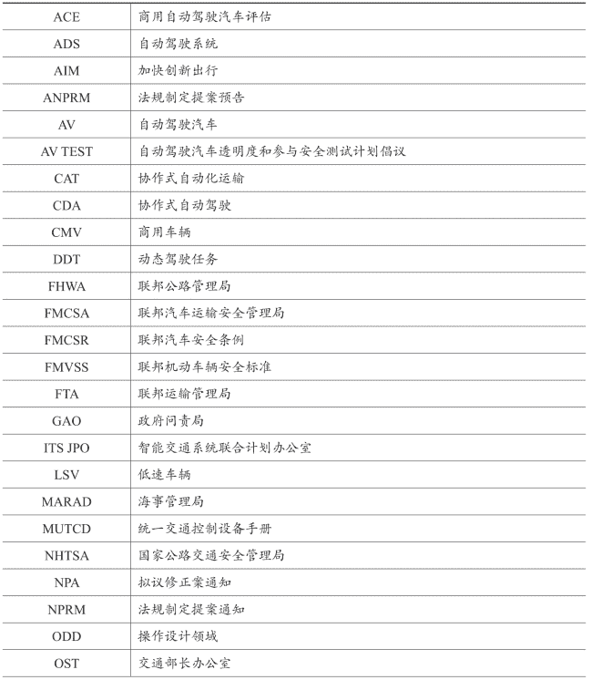

续表

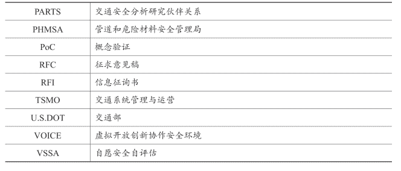

## 一、什么是综合计划？
《自动驾驶汽车综合计划》描述了交通部将自动驾驶系统安全整合进地面运输系统的努力，阐明目标、行动并以案例说明部门工作如何与新兴应用关联。

自动驾驶技术沿多路径发展，未来形态仍不确定。尽管行业进步，但目前美国尚无可购置的量产自动驾驶车辆，技术仍在研发，大规模部署时间未定。

计划满足短期需求，同时为长期变革奠基，不预测具体车辆形态或服务。交通部将定期审查活动以反映技术与行业变化，消除重复投入。

制定初衷是帮助利益相关方理解部内整体工作，并回应“应制定全面计划以更好管理交通部相关举措”的建议。

### （一）该计划是如何制定的？

美国 DOT 自驾融合路线图解读

这份综合方案的底层逻辑，来自美国运输部运营管理司与部长办公室多年来的持续打磨，先是摸清现状、梳理诉求、明确方向，再把推广、科研与监管现代化等事项落地执行。

新技术的发展，让运输部以及其合作伙伴——包括其他联邦部门、各州地方政府、行业协会、企业主体与安全倡导组织——都面临全新议题。广泛收集的利益相关方反馈，是整份规划成型的关键支撑。

为吸纳公众声音，部门提供了多条参与渠道：线下研讨、线上活动、公开听证，以及依托联邦公报的法定征求意见程序。研究与政策制定的全流程，都对这些渠道收集到的意见予以充分考量。

整套规划以美国政府在自动驾驶领域的主导思路为底线，该思路在《确保美国在自动驾驶汽车技术中的领导地位：自动驾驶 4.0》AV4.0 中系统阐述，下文做要点归纳。

### （二）综合计划涵盖了哪些内容？
方案系统梳理了运输部为推动自驾系统在地面交通网络中安全融入所采取的核心举措。涉及地面运输衔接的场景，如港口或铁路道口也在覆盖范围，但航空、海运、铁路运输本身不属于本次范围。

后续先介绍运输部对自驾系统的愿景、预期与具体目标，并举例说明实现路径。之后的部分则展示综合规划如何对应研发与测试中的各类使用场景，以及部门如何与利益相关方协同推进。

### （三）美国政府自动驾驶汽车技术原则

#### 原则一：保护用户和社区
自驾有望改善车辆操作员、乘客、行人、骑行者、摩托车驾驶员等各类道路参与者的生命安全。要兑现这一潜力，必须把公众安全、防护与隐私放在首位。

##### 1.安全优先
政府将主导推动自动驾驶技术的安全融入，识别并化解潜在安全风险，提升救生潜力，增强公众对新兴技术的信心。同时依法执行现行法律，严防相关主体就技术性能与局限性作出虚假或误导性陈述，尤其是涉及车辆安全或性能的表述。

##### 2.强调驾驶安全和网络安全
政府将支持安全自驾技术的设计与应用，强化对所依赖系统的保护，提升国家安全与公共安全免受犯罪或其他恶意利用自驾及相关服务的威胁的能力。部门将与开发商、制造商、集成商及服务提供商协作，在保障隐私、公民权利与自由的前提下，防范、化解并调查各类针对自驾的犯罪与安全威胁。该工作包括制定并推广物理标准与网络安全标准，并在运输系统的各类数据媒介中开展防范、威慑、保护、响应及从风险中恢复的最佳实践。

##### 3.确保隐私和数据安全
在自驾技术设计与集成过程中，政府采用整体风险防范思路保护数据安全与公众隐私，涵盖驾驶员与乘客数据，也包括车辆可能采集的第三方被动数据如行人信息，防止未经授权的访问、收集、使用或共享带来的隐私风险。

##### 4.提升出行服务及便利使用
政府支持开放道路的自由，包括民众驾驶自有车辆的自由。预期环境是自驾车辆与传统人工驾驶车辆及其他道路使用者共存。因此政府将保障消费者按出行需求做出最合适选择的能力，并支持技术提升便利与自由，使个人可在符合家庭需求的地点居住与办公，并为残障人士与老年人提供安全、经济、无障碍且独立的出行选择。

#### 原则二：促进有效市场
自驾车辆为研发提供了持续演进的试验场。为加速底层技术开发，政府致力于营造有利于美国市场投资与创新的环境。

##### 5.保持技术中立
政府在国际层面倡导并推广灵活的技术中立政策，由公众而非联邦或外国政府挑选最经济有效的出行方案。

##### 6.保持美国的创新和创造力
政府持续推进促进增长的政策，维护经济繁荣与创新竞争力，培育新的增长引擎，优先保障美国在自驾等领域的创新与创造能力。政府通过保护与执行知识产权——专利、商标、版权与商业秘密——推动敏感新兴技术、技术数据与专有通信的发展，并努力阻止他国以牺牲美国创新者利益为代价获取不当优势。

##### 7.法规现代化
政府将修订或废止阻碍发展、或无法解决关键安全、出行与可及性需求的过时法规，以促进法规与运行环境的统一。该进程将提升国家、地方、部落、区域与国际法规的一致性，使自驾车辆在国内外顺畅运行。制定新规时，尽可能采用面向国内外、基于性能而非强制性的规则，且不歧视美国技术、产品与服务。

#### 原则三：促进协作
自驾触及联邦、州、地方、部落与区域政府的职责边界，也直接影响国际合作。复杂的治理环境为协作、便利与信息共享提供了契机。

##### 8.推广统一的标准和政策
政府优先参与并在国际层面倡导自愿共识标准与基于证据的数据驱动法规。与州、地方、部落、区域政府及产业界合作，共同推动自愿共识标准的制定与实施，促进支持自驾融入整体运输系统的政策，并寻求与国际伙伴在技术标准与监管政策上保持一致。

##### 9.确保联邦方针的一致性
政府在全联邦范围内推动自驾研究、法规与政策的统筹协作，最大化跨部门资源效用。所有联邦资金与拨款须用在刀刃，投入网联自驾汽车研究，并在符合第13788号决议的“买美国货、雇美国人”、第13881号决议最大化使用美国制造商品，以及其他现行法律、法规与行政命令的前提下，确保美国在该技术领域的持续领先。

##### 10.改善交通运输系统层面效果
政府聚焦提升系统层面的性能、效率与效用，避免技术对运输系统产生负面影响。

## 二、美国交通部将如何实现其自动驾驶系统的愿景？
部门对自驾系统的愿景是：在安全为先的前提下，为未来交通做好准备。

安全是最高优先级。若能以安全方式开发与部署，系统可有效避免或减少大量因驾驶员操作失误、判断失误或其他人为因素导致的碰撞。^([\[136\]](#txt001.html#footnote_content_txt001_136))安全融入始于主动识别、评估与管理潜在风险，以实现预期效益。

运输系统的效率、人员与货物流通是部门使命的核心。审慎融入自驾将对所有用户的出行与运营效率产生积极影响，例如成熟部署可减少事故相关延误，或助力残障人士独立出行。反之，需求诱导与服务不均可能加剧拥堵。部门正积极开展研究以理解并减轻这些潜在负面结果。

为实现愿景，部门设定三大目标：
1.促进合作和透明度——向合作伙伴与利益相关方包括公众提供关于系统能力与局限性的清晰可靠信息。
2.使监管环境更加现代化——消除对汽车设计、功能与运营模式创新的无意、不必要障碍，并开发以安全为重点的评估框架与工具。
3.准备交通运输系统——与利益相关方合作开展安全评估所需的基础研究与示范活动，同时提升系统安全性、效率与使用便利性。

### （一）目标 1：促进合作和透明度
清晰可靠的信息有助于安全测试、开发与最终部署。通过透明化关键信息来推动新技术的安全融入与采纳。部门将使用案例研究、指南、技术报告、面向公众的在线平台及线下线上活动等针对不同受众的工具，保持持续透明沟通。定期接触、发布自愿指南与信息共享是提升透明度的核心方式。这些活动的例子如下。

#### 1.目标：与利益相关方共同监测新趋势、新问题和新需求
协作式自动化运输联盟联邦公路管理局：协作式自动化运输联盟是由美国国家公路和运输官员协会、美国智能交通协会和交通工程师协会共同发起的，并作为联邦、州和地方政府官员、学术界、工业界及其相关协会的合作协调中心，以解决与在全国范围内部署网联汽车和自动驾驶汽车有关的关键方案和技术问题。^([\[137\]](#txt001.html#footnote_content_txt001_137))

公路自动化全国对话联邦公路管理局：联邦公路管理局在全国各地举办了一系列会议，以促进信息共享，解决关键问题，并支持交通运输领域安全、高效地将自动驾驶汽车纳入道路网络。全国对话期间收到的意见为联邦公路管理局的研究、政策和方案提供了信息。^([\[138\]](#txt001.html#footnote_content_txt001_138))

公交自动化实践社区联邦运输管理局：联邦运输管理局的公交自动化实践社区定期召集公交机构和其他获得交通部资金支持开展试点或示范自动驾驶公交项目的单位。实践社区旨在培育一个具有创新精神的、开拓性的机构社区，以推进公交自动化程度和美国公交运营方面的潜力。

#### 2.目标：为产业提供指导、提升透明度并采用最佳实践
《自动化驾驶系统 2.0：安全愿景》AV2.0 美国交通部/国家公路交通安全管理局：AV2.0 提供自愿性指南，以帮助自动驾驶系统开发人员在部署前利用他们自己的、业界的和其他最佳实践来分析、确定和解决安全问题。AV2.0 概述了 12 个安全要素，交通部认为这些要素代表了整个业界的共识，是在公共道路上开发、测试和部署自动驾驶系统时需要考虑和解决的最突出的设计问题。^([\[139\]](#txt001.html#footnote_content_txt001_139))

《为未来交通做准备：自动驾驶汽车 3.0》AV3.0 美国交通部：AV3.0 以 AV2.0 为基础提供多式联运的方法，并将自动驾驶汽车安全地融入美国更广泛的地面交通运输系统中。^([\[140\]](#txt001.html#footnote_content_txt001_140))

《确保美国在自动驾驶汽车技术中的领导地位：自动驾驶汽车 4.0》AV4.0 美国交通部：AV4.0 展现了美国政府致力于成为全球地面运输自动驾驶汽车创新引领者的态度，安全可靠地在全国及全球范围内落实自动驾驶技术。^([\[141\]](#txt001.html#footnote_content_txt001_141))

#### 3.目标：促进信息共享
自愿安全自评估国家公路交通安全管理局：开发和测试自动驾驶汽车的法律实体向公众通报它们如何优先考虑安全问题的自愿机制。^([\[142\]](#txt001.html#footnote_content_txt001_142))

自动驾驶汽车透明度和参与安全测试计划倡议国家公路交通安全管理局：自动驾驶汽车透明度和参与安全测试计划倡议为国家公路交通安全管理局、各州、地方政府和利益相关方提供了一系列研讨会，以讨论在公共道路上对自动驾驶汽车进行安全测试问题。

国家公路交通安全管理局于 2020 年 6 月与各州、地方政府和整个自动驾驶汽车领域的公司共同发起了自动驾驶汽车透明度和参与安全测试计划倡议。该倡议的目标是为公众提供直接和便捷的途径，获取有关配备自动驾驶系统汽车的测试信息，包括各州提供的关于活动、立法、法规、地方参与道路自动驾驶汽车的信息，以及由开发和测试自动驾驶汽车的公司提供的信息。这些信息预计将提高公众对道路测试活动的认识，指导自动驾驶汽车的开发和测试。此外，国家公路交通安全管理局正在通过自动驾驶汽车透明度和参与安全测试计划倡议网络试点工具提高公众的认识。国家公路交通安全管理局正与政府和私人利益相关方合作，以促进美国自动驾驶技术的安全开发、测试、集成，并开展相关认知教育。

公交自动化市场评估：联邦运输管理局制定并定期更新本报告，以描述该行业的现状，包括自动公交技术的可用性、功能和局限性。^([\[143\]](#txt001.html#footnote_content_txt001_143))

新兴的自动化城市货运配送概念实践状况扫描智能交通系统联合计划办公室：该报告描述了该行业现状，以增进对商用自动驾驶汽车概念和行业活动的理解，发现新问题，并向利益相关方展示客观的调查结果。^([\[144\]](#txt001.html#footnote_content_txt001_144))

### （二）目标 2：现代化的监管环境
美国交通部负责监管机动车辆、机动车辆设备和商用车辆运营的安全。这一安全任务仍然是交通部的最高优先事项，因为交通部正在寻求采取适当的监管方法来监管装有自动驾驶系统的车辆的安全性。美国交通部目前有数项正在进行和计划中的与自动驾驶系统相关的规则制定，其中一些规则侧重于消除不必要和无意的监管障碍，而另一些规则则讨论了何时以及如何监管自动驾驶系统的性能。其中许多规则制定涉及国家公路交通安全管理局管辖范围内的事项，还有一项规则侧重于联邦汽车运输安全管理局管辖范围内的问题。下文将会讨论这些规则。

### （三）目标 2A：简化部署路径
豁免是安全推动研究、测试和示范项目以及商业化部署的关键短期工具，美国交通部将在时机成熟并符合所有适用法律要求的适当情况下继续行使这些权力。

国家公路交通安全管理局授予豁免《联邦机动车辆安全标准》的权力为测试或示范包括自动驾驶系统在内的一系列新技术提供了灵活性，^([\[145\]](#txt001.html#footnote_content_txt001_145))并允许对不符合《联邦机动车辆安全标准》的车辆进行有限的商业部署^([\[146\]](#txt001.html#footnote_content_txt001_146))，只要证明其安全水平与符合标准的车辆相当。

联邦汽车运输安全管理局还可通过豁免为那些使用配备 ADS 的商业车辆 CMV 但未完全遵守《联邦汽车安全条例》的机动车承运人提供监管方面的救济，只要他们证明豁免也能达到同等的安全水平。^([\[147\]](#txt001.html#footnote_content_txt001_147))

一般而言，《联邦机动车辆安全标准》的豁免在时间、汽车数量以及在某些情况下的地点上都有限制；豁免并不是为了允许大量汽车无限期地违规。^([\[148\]](#txt001.html#footnote_content_txt001_148))正如国家公路交通安全管理局于 2020 年 2 月批准的豁免申请如下所述所示，豁免可以成为短期内的一种有用工具，用以实现安全测试和有限部署一些装有自动驾驶系统的新型概念汽车。为了进一步提高这些能力，美国交通部正在努力简化和修订豁免申请的处理程序。

#### 1.目标：发布符合规范的豁免
授予装有自动驾驶系统的低速车辆的临时豁免（国家公路交通安全管理局）：2020 年 2 月，国家公路交通安全管理局批准了 Nuro 临时豁免《联邦机动车辆安全标准》第 500 号“低速车辆”中的某些要求（案卷编号：NHTSA–2019–0017）。^([\[149\]](#txt001.html#footnote_content_txt001_149))国家公路交通安全管理局就授予这一豁免规定了一些条款和条件，以促进适当的监督。

## 2.目标：简化豁免的行政程序
法规制定提案通知：为国内制造商研究、示范和其他目的扩大临时豁免计划（国家公路交通安全管理局）：该法规制定提案通知提出了一项新的规定，允许国内法律实体为研究、调查、示范、培训、竞技赛车、表演或展示等目的而申请豁免在公共道路上驾驶不合规车辆，但不包括销售或租赁。

法规制定提案通知：更新临时豁免程序（国家公路交通安全管理局）：这一行动将就如何促进交通部审议豁免申请的方式征求意见，以便在确保适当的安全水平的同时，更有效地使用有限的、降低风险的创新安全技术。国家公路交通安全管理局将寻求简化临时豁免程序，明确针对机构所期待的事项。

## (四)目标 2B：修订现有法规以消除不必要的障碍
通过制定法规，美国交通部已经认识到，现有法规可能无意地、不必要地阻碍新型汽车设计的引入，这些新型汽车设计能够与某些配备自动驾驶系统的汽车及其运行模式相匹配。

这些障碍可能影响不具备人工驾驶手段（例如方向盘、刹车和油门踏板）的自动驾驶系统专用车辆，以及配备自动驾驶系统的，可能提供座椅或其他具有多种模式的系统（例如可旋转的前排座椅）的车辆。

配备自动驾驶系统的新型商用机动车运行模式可能会受到现行《联邦汽车安全条例》的类似影响。

### 1.目标：开展规则制定和研究，以支持修订现行《联邦机动车辆安全标准》，消除对采用自动驾驶系统新型车辆设计和功能的无意和不必要的障碍。
2018 年 1 月，国家公路交通安全管理局在联邦公报上发布通知，对现有的监管障碍征询意见，这些监管障碍可能会阻碍配备自动驾驶系统汽车的引入和认证，特别是那些不具备人工控制且不会对安全产生不利影响的汽车。为回应各方意见，结合国家公路交通安全管理局自己的研究，国家公路交通安全管理局开始制定若干规则，包括下文讨论的规则。

法规制定提案通知：自动驾驶系统乘员保护（国家公路交通安全管理局）：通过 2020 年 3 月发布的这一行动计划，国家公路交通安全管理局建议修订防撞法规，以促进无驾驶员控制的机动车的认证。^([\[150\]](#txt001.html#footnote_content_txt001_150))

法规制定提案预告：消除自动驾驶系统的监管障碍（国家公路交通安全管理局）：通过发布于 2019 年 5 月的法规制定提案预告，国家公路交通安全管理局就该机构的《联邦机动车辆安全标准》中的现有机动车监管障碍征求意见，这些监管障碍通常与配备自动驾驶系统的车辆相伴而生。^([\[151\]](#txt001.html#footnote_content_txt001_151))

法规制定提案预告：针对自动驾驶系统汽车警报、指示器和警告的考虑（国家公路交通安全管理局）：通过这一行动，国家公路交通安全管理局将就修订《联邦机动车辆安全标准》征求意见，以解决未配备传统驾驶员控制系统的车辆中安全通讯（警报、指示器和警告）的适用性和适当性。

法规制定提案预告：配备自动驾驶系统的无乘客运载车辆（国家公路交通安全管理局）：通过这一行动，国家公路交通安全管理局将就修订法规征求意见，以促进无乘客舱的机动车认证。

ADS 监管与落地全景：政策动向、技术评估与场景实践

专用 ADS 车辆监管征询 国家公路交通安全管理局

国家公路交通安全管理局拟就搭载 ADS 的专用机动车类别启动监管要求征询，讨论范围涵盖合规判定与安全整合。

政策立场说明 国家公路交通安全管理局

2020 年 12 月，该机构发布说明，重申《联邦机动车安全标准》所列试验条件与方法仅为评估符合性的参考手段，并非要求企业必须按标准流程实测整车性能以证明符合，也不是要求整车能在全部试验条件下均通过验证。^([\[152\]](#txt001.html#footnote_content_txt001_152))该说明纠正了 2016 年致谷歌公司的解释函，旧函曾暗示若未按全部 FMVSS 验证流程设计则无法有效证明合规。旧理解未涵盖针对特定车型的试验，例如油箱加注比例要求，这会导致电动车难以完成认证。

### 2.目标：修订联邦汽车安全条例，消除州际运行中搭载 ADS 的商用车辆不必要阻碍

法规制定预告通知：ADS 商用车的道路安全融合 联邦汽车运输安全管理局

联邦汽车运输安全管理局正在探讨对《联邦汽车安全条例》相关条款进行调整，以推动搭载 ADS 的商用运输车辆安全进入美国公路。预告拟修改商用车的运营、检验、维修与保养规范，核心指向强化安全保障、促进创新，并为 ADS 商用车制定统一监管路径，明确人工操作与自动化驾驶之间的责任边界。

## (五)目标 2C：对 ADS 技术实施恰当的安全监管

ADS 技术规模化应用可能需要新的安全评估思路。美国交通主管部门正在探索新的安全保障路径，研究用于衡量 ADS 安全水平与风险管控的创新模型与工具。

### 目标：探索新的安全保障方法并研究 ADS 安全评估模型和工具

法规制定预告：ADS 安全框架 国家公路交通安全管理局

2020 年 11 月发布的预告征求了对拟建安全框架的意见。该框架旨在客观界定、衡量与管理 ADS 安全性。主管部门设想框架将配合一种或多种治理机制，推动工程措施落地并实现机构对安全的适当监督。

自愿性技术标准

运输主管部门积极参与并鼓励行业制定自愿性共识标准。这类标准是产业伙伴推动技术开发与互操作性的协作机制。

## (六)目标 3：为交通体系做好接入准备

ADS 车辆的推广可能给道路带来新挑战。主管部门正采取行动，确保 ADS 融合在提升出行便利性的同时不削弱国家地面交通系统的运行效率。同时也在探索普惠机会，使残障人士与老年人能够获得安全、可负担、便捷且独立的出行选择。

主管部门通过征询专家意见、引入外部支持以及以行政拨款开展试点与测试推动研究。试点聚焦功能性安全、商用车辆安全运营、人因工程、网络安全、基础设施、运营性等主题。后续研究取决于国会拨款、技术进展与利益相关方反馈。

### 1.目标：开展精准技术研究

商用 ADS 汽车评估项目 联邦汽车运输安全管理局

该项目以三辆牵引半挂车车队开展测试演示，研究具体 ADS 场景，包括路边检验与执法、港口拖运、应急响应与事故后调查、工作区通行以及国际边界过境。

ADS 操作行为与交通规则信息 联邦公路管理局

研究评估现行交通法规对 ADS 车辆的适用性，并明确建立交通规则数据库的需求。

工作区数据交换演示 ITS 联合办公室

该方案旨在通过跨辖区数据共享，提升公众在常规与非常规环境下的安全水平，进而提高装有 ADS 车辆的安全性。^([\[153\]](#txt001.html#footnote_content_txt001_153))

港口协作自动化拖运卡车研发测试 海事管理局/联邦汽车运输安全管理局/ITS 联合办公室

该港口演示项目展示自动卡车在港口或仓库中转区排队场景的优势，并展示车联网与自动化技术在底盘与集装箱装卸、海关检验站通道、闸口通行及短途拖运中的应用。

### 2.目标：投入资金支持以 ADS 为核心的示范、试点与部署

ADS 示范资金支持 交通部长办公室

2019 年 9 月 18 日，时任交通部长赵小兰宣布向美国 7 个州的 8 个项目提供近 6000 万美元联邦资金，纳入 ADS 示范资金支持计划。该计划为高度自动化车辆研发提供资金，覆盖 ADS 及其他驾驶自动化系统与技术的规划、研究与演示。

综合移动创新资金 联邦运输管理局

IMI 资金主要用于资助公交自动化、按需出行与移动支付集成等项目，展示创新实践、合作伙伴关系与技术，以提升公共交通效率、服务质量、安全水平与出行体验。

加速创新出行倡议 联邦运输管理局

AIM 倡议体现了联邦运输管理局推动交通运输行业创新的持续承诺。管理局通过 AIM 相关挑战资金鼓励交通机构尝试前瞻性服务模式与解决方案，如交通自动化。^([\[154\]](#txt001.html#footnote_content_txt001_154))

包容性设计挑战

该挑战面向身体、感官与认知障碍人群征集创新设计方案，分两阶段竞赛，最终可获得最高 500 万美元奖金，目标是提升装有 ADS 车辆的无障碍使用体验。

### 3.目标：更新基础设施规范以匹配 ADS 技术

《统一交通控制设备手册》更新 联邦公路管理局

联邦公路管理局正在评估 MUTCD，以纳入装有 ADS 车辆及其他交通要素的考量。评估包括调研交通控制设备的标准化与一致性，尤其是车道标线与标志牌，以支撑 ADS 车辆与道路基础设施的安全互动。2020 年 12 月，联邦公路管理局发布拟议修正案通知征求意见。

## 三、美国交通部的行动如何支撑 ADS 发展

全国范围内多家企业正积极研发与测试 ADS 技术。尽管部分车辆在限定区域测试时可无操作员在场，但当前在公共道路上进行的绝大多数测试仍配备安全驾驶员监控运行。美国目前尚无可供购买的 ADS 车辆，大多数测试车仍处于原型阶段。

虽然后 ADS 的功能与应用因车辆设计与用途差异很大，但交通部综合规划中梳理了五个典型案例，用以说明部门如何处理技术、车辆与运营环境的不同维度。这些案例提供了解读交通部活动与当前产业发展的框架。基于公开测试信息对每个案例的概括并非穷尽，也并非对特定企业或系统的背书，而是反映 ADS 系统的共性特征。这些案例不代表所有当前或潜在 ADS 车辆与运营模式的完整图景，仅为说明性示例。

每个案例后均列出相关交通部行动与规划。因部门通常处理复合性问题，这些活动往往适用于多种场景。例如近期发布的《拟议规则制定预先通知：ADS 安全框架》就具有广泛适用性。下面示例说明交通部行动与哪些车辆或服务特征尤其相关。

### （一）无人驾驶的低速车辆

无人驾驶低速车辆是 ADS 的一个新兴应用方向。开发方可能与第三方合作，例如与超市或餐饮企业合作提供配送服务，客户可从自动配送车上取件。与其他车型需满足整套 FMVSS 不同，这类车辆只需满足 FMVSS No.500 低速车辆要求，部署监管门槛更低。因此制造商可通过符合要求设计或申请豁免来推进部署，这与 NHTSA 于 2020 年 2 月 11 日批准 Nuro 临时豁免的做法一致，85 FR 7826。

当前针对此应用研发与部署的车辆多配备 SAE J3016 4 级 ADS。要被认定为低速车辆，最高时速须限于 25 英里/小时，整车总重不得超过 3000 磅。因此多数车辆的操作设计域通常仅限于低限速的社区道路，不含高速公路，且多限于良好天气。随着时间推移，用途有望扩展，例如提升最高时速，但一旦速度或重量变化，车辆可能不再属于“低速车辆”，需满足全套 FMVSS。

#### 1.美国交通部针对此案例的行动

使用不符合 FMVSS 车辆的制造商，如无手动驾驶控制装置的车辆，需申请豁免。2020 年 2 月 NHTSA 批准了 Nuro 临时豁免部分 FMVSS。从长远看，法规本身的修改可进一步支持部署。NHTSA 计划在消除 ADS 系统障碍的规则制定中考虑此问题，以及未来关于配备 ADS 无人驾驶运载车辆的 ANPRM。这两项规则旨在解决联邦层面阻碍该案例商业化的非预期障碍。

ITS 联合办公室正资助新兴自动货物交付应用与技术的探索性研究，包括低速无人驾驶汽车的配送行为，通过试点与早期部署记录行业动态。

#### 2.示例特征

运行环境：低速道路、城市与郊区
速度：最高 25 英里/小时
自动控制级别：SAE 4 级或 5 级
应用：货物配送与运输

### （二）有条件的乘用车自动化驾驶

可实现有条件驾驶自动化的乘用车是个人所有模式下 ADS 的潜在应用。在此场景中，ADS 可在特定条件下执行完整的动态驾驶任务，当系统要求时驾驶员应能随时接管。目前仅少数企业表示有意继续发展此案例，尤其在低风险驾驶环境，如走走停停的低速拥堵场景。

在拥堵场景下研发 ADS 的企业声称其旨在满足通勤需求，允许驾驶员在交通拥挤时将控制权交由系统并从事其他活动，直至系统达到设计性能边界，再将动态驾驶任务交还驾驶员。若驾驶员在规定时间内无法接管，系统会将车辆安全停车。

这类应用仍需驾驶员手动驾驶，因此车辆必须满足所有适用 FMVSS。在现行 FMVSS 下，企业可通过符合要求的设计部署车辆。

#### 1.美国交通部针对此案例的行动

研究人员持续研究如何帮助驾驶员保持清醒并安全接管。NHTSA 的人因研究聚焦于提升驾驶员对 ADS 功能理解的主题，以及确定从自动驾驶到人工驾驶的最佳过渡方式。例如系统失效时需移交控制权，或进入最低风险状态。当前重点是识别驾驶员重新掌握控制权所需信息，确保快速成功接管，并研究信息呈现方式。接管流程包括车内警告或提示。另一项研究探索警告所需时长，即在不同驾驶情况与场景下安全恢复手动驾驶所需的时间。

#### 2.示例特征

运行环境：多种环境，可在城市与公路行驶
速度：所有常规车辆运营速度，包括低速与高速
自动控制级别：SAE 3 级
应用：有乘客在车内的有条件自动驾驶

### （三）乘用车 ADS 系统

消费者可购买专门制造的无手动驾驶控制的专用 ADS 车辆，或作为专用车队提供按需出行服务。车辆在天气与道路条件适合时，于地理围栏区域内行驶，完全由 ADS 控制，可通过电信网络向远程操作中心发送运行信息。

#### 1.美国交通部针对此案例的行动

制造不符合 FMVSS 的车辆，如无手动驾驶控制的车辆，需申请豁免。例如 2020 年 2 月 NHTSA 批准了 Nuro 临时豁免部分 FMVSS 要求并设定条款以便利监管监督。

法规修改可促进无需豁免的部署。NHTSA 制定的消除 ADS 系统障碍规则旨在清除不必要障碍，同时保持现有标准的安全水平。同时 NHTSA 正建立 ADS 安全监管框架，该框架将客观定义、评估和管理 ADS 性能安全，并保持足够灵活性以支持创新。

#### 2.示例特征

运行环境：多种环境，可在城市与公路行驶
速度：所有常规车辆运营速度，包括低速与高速
自动控制级别：SAE 4 级
应用：有乘客的自动驾驶出行

### （四）自动化卡车运输

部分自动卡车公司正研发专用于 CMV 的 4 级 ADS 系统，用于 ODD 受限的有限路段，如出口到出口或匝道到匝道。具体细分应用包括：

配备 ADS 的 CMV 可在其车内无人类操作者的情况下在 ODD 内运行，必要时在其他环境下由人操作。另一些企业希望探索“中心到中心”模式，将 4 级 ADS CMV 行程延伸至装货点至收货目的地。

在各类细分场景中，ADS 将控制 CMV 进行跨州长距离高速行驶。车辆可能同时配备 ADS 与手动控制系统，保留传统驾驶舱配置。

多家企业已公开宣布开发与测试 ADS 商用车的计划，投资者包括传统卡车制造商、供应商、科技公司、初创企业与风险资本。部分企业已在加利福尼亚、亚利桑那、佐治亚与德克萨斯等州线路上进行收费服务测试。

在配备 ADS 的 CMV 领域，FMCSA 将继续行使其法定监管职能，管理州际运营承运人安全、CMV 驾驶员资格与商业卡车及大巴安全运营。若自动系统妨碍安全操作，FMCSA 保留执法权力。FMCSA 此前表示其法规不再默认 CMV 驾驶员始终为人类，或商用车辆运行期间必须有人在车上。目前尚无专门针对 4 级与 5 级的法规，包括设备、维修与保养等关键领域。

#### 1.美国交通部针对此案例的行动

在 AV3.0 中，交通部明确 FMCSA 法规不再默认 CMV 驾驶员始终为人类，或运行期间必须有人在车上。

2019 年 7 月，FMCSA 发布 ANPRM，征求对若干关键法规的意见，以更好理解规则变化并解释人类操作员与 ADS 的差异。议题包括人类驾驶员要求、商业驾照背书、工时规则、医疗资格、驾驶干扰、安全驾驶、检验、维修与保养、路边检验及网络安全。FMCSA 正制定 NPRM，为在州际贸易中部署 4 级与 5 级 ADS CMV 的承运人提供统一监管框架。

FMCSA 计划与 ADS CMV 开发商、卡车制造商、承运人、行业协会等利益相关方举办系列合作会议，推动制定行业共识标准。

交通部已向聚焦 ADS CMV 的项目提供示范资金支持。

FMCSA 已启动其 ACE 计划，开展 ADS 性能研究。

交通部正积极研究 ADS 对美国长途卡车运输劳动力的潜在影响。

#### 2.示例特征

运行环境：限速公路
速度：高速
自动控制级别：SAE 4 级
应用：长途货物运输

### （五）低速客运班车

低速客运班车是 ADS 的另一新兴应用。开发方可与企业、州政府、地方政府、高校或其他机构合作，为员工、居民、学生或社区提供出行、娱乐等服务，尤其是一英里与最后一英里接驳。与其他汽车需完全符合 FMVSS 不同，低速客运班车仅需符合 FMVSS No.500 低速车辆要求，监管门槛更低。制造商可通过符合要求设计或申请豁免部署车辆。

目前研发与部署的低速客运班车多配备 SAE J3016 L4 ADS 系统。要被视为低速车辆，最高时速须在 25 英里/小时以内，整车总重小于 3000 磅。因此多数车辆的操作设计域一般限于低限速街区道路，不含高速公路，且多限于良好天气。部分低速客运班车属于低速车辆。随着时间推移，应用范围可能扩大，例如提升最高时速或增加重量，但这也意味着可能不再属于低速车辆，需满足 FMVSS 全套要求。

#### 1.美国交通部针对此案例的行动

联邦运输管理局通过为“综合交通创新示范”与“加速创新交通方案”等示范项目提供资金，探索公交自动化、分析数据、向运输社区推广经验并持续分享成果。

#### 2.示例特征

运行环境：时速不高于 25 英里/小时的道路
速度：最高 25 英里/小时
自动控制级别：SAE 4 级
应用：客运服务

## 四、美国交通部如何与利益相关方合作

ADS 集成涉及多个行业与机构，交通部致力于持续与利益相关方互动。通过信息调查与评论、聆听会、圆桌会、研讨会以及教育与外联，部门收集各方意见并定期纳入研究与规划。本章概述与政府、行业与国际伙伴相关的关键举措，下图总结自 2017 年 ADS 2.0 发布以来交通部与利益相关方的外联活动。

## （一）政府间合作

2019 年，白宫与美国交通部共同发布了 AV4.0 框架，用以统筹 38 个联邦部委、独立机构、委员会以及总统办公厅在自动驾驶汽车领域的各项工作。这份里程碑式的方案明确了政府提升自动驾驶价值的思路，并搭建了跨部门协作的机制，重点投向安全、出行便利、网络安全、基础设施建设与车辆网联等方向。

## （二）国际合作
在推动自动驾驶测试应用的原则制定与公共政策设计上，美国交通部长期扮演全球主导角色。部门通过双边与多边渠道与各国保持互动，参与的平台包括联合国欧洲经济委员会全球道路交通安全论坛和世界车辆法规协调论坛、七国集团自动和联网驾驶专家组、车辆增强安全国际技术峰会、美国汽车工程协会、SAE 世界大会、国际消费类电子产品展览会以及 ITS 世界大会等。

同时，美方也在联合开展研究性测试，推广美国在安全标准制定、监管政策与程序方面的成熟做法。相关工作的预期是证明以科学数据为依据的美国监管体系能够形成最完善的安全规范，进而提升本国产业竞争力、拓宽美国企业进入海外市场的通道，并降低贸易壁垒。

## （三）公众参与
自动驾驶安全互动议题的信息公开是交通部的常规工作。传播渠道涵盖常见问题解答、政策简报、会议纪要与研究论文；线上研讨会、专题讨论会和线下会议；技术支持服务，以及面向公众的信息普及与教育活动。

美国交通部自动驾驶公开征询活动（部分）

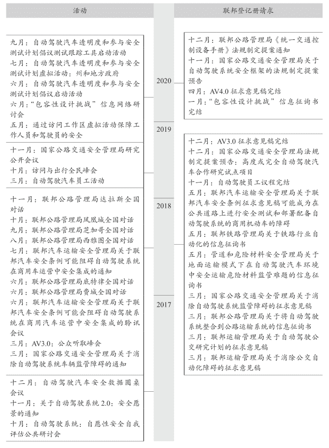
# 五、DOT 的前瞻性研究布局

## CARMA 与协同式自动驾驶
CARMA 是一个由联邦公路管理局牵头的协同式自动驾驶研发开源代码平台。协同式自动驾驶的核心是让车辆、路侧基础设施设备以及行人、骑行者等道路使用者之间实现信息互通。联邦公路管理局的研究重点放在车辆与道路基础设施的协同上，目标是提升行驶安全与运营效率。

该平台基于开源软件开发，可适配各类车辆、硬件与控制系统，为协同式自动驾驶功能研发提供支撑，也服务于交通系统的管理与运营。未来联邦公路管理局将借助 CARMA 验证交通管理与运营场景，展示其对安全与出行的实际影响，加速原型验证、早期标准化与落地。联邦汽车运输安全管理局在联邦公路管理局的配合下，也计划在商用车测试中部署 CARMA，用于执法类互动测试，例如路边检查。

CARMA 由联邦公路管理局、联邦汽车运输安全管理局、海事管理局、智能交通系统联合计划办公室与 Volpe 国家交通系统中心共同打造。CARMA 协作组织负责平台的应用推广，成员包括日益增长的平台使用者、潜在使用者以及政府、产业与学术界的利益相关方。该组织致力于推动协同式自动驾驶的研发，并鼓励行业采纳相关方案与功能。

### 1. VOICES 虚拟协作安全验证试点
VOICES PoC 是一款分布式虚拟平台，旨在为联邦与地方政府、私营企业及学术机构等各方提供受知识产权保护的虚拟协作空间，用于协同式自动驾驶原型应用的研究与互操作性测试。

首个应用场景将聚焦 SAE J3216《与道路机动车辆协同式自动驾驶相关的术语分类和定义》中所界定的协同式自动驾驶系统、相关研究及应用的分布式互操作性验证。

### 2. PARTS 交通安全数据合作机制
PARTS 是一项政府与行业自愿合作的机制，参与方共享并分析与安全相关的数据与信息，以便尽早发现汽车技术中的安全隐患，并制定缓解与改进措施。随着搭载自动驾驶系统的车辆逐步进入交通体系，PARTS 将提前做好这类车辆的安全分析准备工作。

# 六、后续路径怎么走
自动驾驶系统有望大幅提升全体出行者的安全水平与出行选择。美国交通部将继续以安全为前提探索这一创新技术，保持技术中立，并以利益相关方的反馈与部门自身研究为依据开展工作。

自动驾驶系统与相关车辆技术仍在持续演进，围绕其对出行者、公共机构及整体交通系统的影响存在高度不确定性，这对规划提出了战略性与灵活性要求。除技术进展外，还需考虑资金供给、后续研究成果，以及可能影响计划落地的社会需求与趋势变化。

交通部的综合规划采取迭代方式，能够灵活应对自动驾驶可能带来的新挑战与新机遇。部门将定期与利益相关方沟通，审视工作方法并作出调整，以跟上技术与产业发展的实际。凭借坚实的合作、研究与部署框架，交通部已为以多模式协同应对不确定性奠定基础。

美国认为，通过协同努力，自动驾驶系统将助力交通体系保障公众出行安全、提供多样化机动选择并推动经济增长。

## 自动驾驶研究与法规文献合集

[\[25\]](#txt001.html#footnote_quote_txt001_25)NCSL 在2020年2月18日发布题为《自动驾驶车辆 | 自驾车辆已颁布立法》的资料，2022年7月1日核验，可见于 `https：//www.ncsl.org/research/transportation/autonomous-vehicles-self-driving-vehicles-enacted-legislation.aspx`；IIHS 的《自动驾驶车辆法规》于2022年7月刊出，2022年7月10日浏览，链接为 `https：//www.iihs.org/topics/advanced-driver-assistance/autonomous-vehicle-laws`。

[\[26\]](#txt001.html#footnote_quote_txt001_26)NCSL 2014年2月1日推出《自动驾驶车辆：通往新技术的道路》，本人在2022年7月5日完成查阅，来源 `https：//www.ncsl.org/research/transportation/autonomous-vehicles-on-the-road-to-new-technologies.aspx`。

[\[27\]](#txt001.html#footnote_quote_txt001_27)本条内容译自亚利桑那州2021年3月通过的《自动驾驶修正法案》第117章众议院第2813号法案。因该州2022年立法会以第256章参议院第1333号法案对前述修正案的部分定义作出修改，本文据此对相关定义做了更新。

[\[28\]](#txt001.html#footnote_quote_txt001_28)国会研究服务署 Bill Canis 撰写 IF10658《自动驾驶车辆：新兴政策问题》，发布于2017年5月23日，2022年2月1日检索，网址 `https：//crsreports.congress.gov/product/pdf/IF/IF 10658`。

[\[29\]](#txt001.html#footnote_quote_txt001_29)美国交通部存档了 Elaine L. Chao 有关 AV3.0 推出情况的评述，署名 Chao Elaine L，2022年7月7日查看，地址 `https：//www.transportation.gov/briefi ngom/av-30-rollrollout`。

[\[30\]](#txt001.html#footnote_quote_txt001_30)高速公路交通安全管理局的文章《为安全而设的自动驾驶车辆》于2022年7月7日浏览，链接 `https：//www.nhtsa.gov/technology-innovation/automated-vehicles-safety`。

[\[31\]](#txt001.html#footnote_quote_txt001_31)同上文《为安全而设的自动驾驶车辆》，查阅日期同样为2022年7月7日，网址 `https：//www.nhtsa.gov/technology-innovation/automated-vehicles-safety`。

[\[32\]](#txt001.html#footnote_quote_txt001_32)Erica Groshen、John Paul Macduffie、Susan Helper、Charles Carson 合著的 avworkforce 于2018年6月发布，2022年7月7日访问，路径 `https：//avworkforce.secureenergy.org/wp-content/uploads/2018/06/Americas-Workforce-and-the-Self-Driving-Future_Realizing-Productivity-Gains-and-Spurring-Economic-Growth.pdf`。

[\[33\]](#txt001.html#footnote_quote_txt001_33)可进一步参考 NSTC 2019年3月在 Trumpwhitehouse 发布的《支持老龄人口的新兴技术》，2022年7月7日查阅，链接 `https：//trumpwhitehouse.archives.gov/wp-content/uploads/2019/03/Emerging-Tech-to-Support-Aging-2019.pdf`。

[\[34\]](#txt001.html#footnote_quote_txt001_34)Syngenta 美国 Karen McMahon 所写的《自动化农用设备有望改变生产实践》，2022年7月7日检索，地址 `http：//www.syngenta-us.com/thrive/research/automated-farm-equipment.html`。

[\[35\]](#txt001.html#footnote_quote_txt001_35)美国能源部介绍的《编队卡车降低成本并提高效率》于2022年7月7日浏览，网址 `https：//www.energy.gov/eere/articles/platooning-trucks-cut-cost-and-improve-effi-ciency`。

[\[36\]](#txt001.html#footnote_quote_txt001_36)Laura Fraade-Blanar、Marjory S. Blumenthal、James M. Anderson、Nidhi Kalra 合著《衡量自动驾驶车辆安全：构建框架》，由加州圣莫尼卡 RAND Corporation 2018年出版，2022年7月7日访问，链接 `https：//www.rand.org/pubs/research_reports/RR2662.html`。

[\[37\]](#txt001.html#footnote_quote_txt001_37)Henry Claypool、Amitai Bin-Nun Ph.D.、Jeffrey Gerlach 合写的《自动驾驶汽车：对残疾人的影响》，Ruderman Family Foundation 发布，2022年7月7日查看，网址 `https：//rudermanfoundation.org/wp-content/uploads/2017/08/Self-Driving-Cars-The-Impact-on-People-with-Disabilities_FINAL.pdf`。

[\[38\]](#txt001.html#footnote_quote_txt001_38)Jane Bierstedt、Aaron Gooze、Chris Grey 为 Fehr & Peers 撰写的《下一代车辆对出行需求和公路容量的影响》，2022年7月7日检索，链接 `https：//issuu.com/fehrandpeers/docs/fp_think_next_gen_vehicle_white_paper_final`。

[\[39\]](#txt001.html#footnote_quote_txt001_39)USDOT 公布的《为交通的未来做好准备：自动驾驶车辆 3.0》，2022年7月7日查阅，地址 `https：//www.transportation.gov/sites/dot.gov/files/docs/policy-initiatives/automated-vehicles/320711/preparing-future-transportation-automated-vehicle-30.pdf`。

[\[40\]](#txt001.html#footnote_quote_txt001_40)文中指出须加大研发力度，以安全高效方式把自动驾驶系统与无人机系统 UAS 含城市空中机动飞行器纳入道路及国家空域。重点在于降低自动驾驶车辆部署门槛并制定无人机作业标准与交通管理体系，M-18-22，2018年7月。

[\[41\]](#txt001.html#footnote_quote_txt001_41)总统行政办公室发出的《致行政部门和机构负责人的备忘录》，2022年7月7日访问，链接 `https：//www.whitehouse.gov/wp-content/uploads/2019/08/FY-21-RD-Budget-Priorities.pdf`。

[\[42\]](#txt001.html#footnote_quote_txt001_42)国家科学与技术委员会发布的《美国先进制造领导力战略》，2022年7月7日浏览，网址 `https：//trumpwhitehouse.archives.gov/wp-content/uploads/2018/10/Advanced-Manufacturing-Strategic-Plan-2018.pdf`。

[\[43\]](#txt001.html#footnote_quote_txt001_43)联邦通信委员会关于《美国的 5G 未来》的介绍，2022年7月7日检索，地址 `https：//www.fcc.gov/5G`。

[\[44\]](#txt001.html#footnote_quote_txt001_44)白宫科学技术政策办公室 Michael Kratsios 撰写的《新兴技术及其对非联邦频谱需求的预期影响》，2022年7月7日查看，链接 `https：//www.benton.org/headlines/emerging-technologies-and-their-expected-impact-non-federal-spectrum-demand`。

[\[45\]](#txt001.html#footnote_quote_txt001_45)白宫发布的《规划成功之路：美国 STEM 教育战略》，2022年7月7日访问，网址 `https：//www.whitehouse.gov/wp-content/uploads/2018/12/STEM-Education-Strategic-Plan-2018.pdf`。

[\[46\]](#txt001.html#footnote_quote_txt001_46)白宫刊载的《科学技术亮点：在特朗普政府第一年》，链接 `https：//trumpwhitehouse.archives.gov/wp-content/uploads/2018/03/Administration-2017-ST-Highlights.pdf`。

# 参考文献

“建立总统美国工人国家委员会”，总统办公厅发布，2022年7月7日查阅， `https：//www.federalregister.gov/documents/2018/07/24/2018-15955/establishing-the-presidents-national-council-for-the-American-worker`。

[\[47\]](#txt001.html#footnote_quote_txt001_47)白宫发布的《关于确保信息通信技术与服务供应链安全的行政命令》，2022年7月7日浏览， `https：//trumpwhitehouse.archives.gov/presidential-actions/executive-order-securing-information-communications-technology-servicessupply-chain/`。

[\[48\]](#txt001.html#footnote_quote_txt001_48)白宫科学技术政策办公室的《人工智能与量子信息科学研发概要：2020-2021 财年》，2022年7月7日检索， `https：//trumpwhitehouse.archives.gov/wp-content/uploads/2017/12/Artificial-Intelligence-Quantum-Information-Science-R-D-Summary-August-2020.pdf`。

[\[49\]](#txt001.html#footnote_quote_txt001_49)公共法律第115-368号，2018年12月21日《国家量子倡议法案》。

[\[50\]](#txt001.html#footnote_quote_txt001_50)H.R.2810 - 2018财年国防授权法，第115届国会 2017-2018，2022年7月7日访问， `https：//www.congress.gov/bill/115th-congress/house-bill/2810`。

[\[51\]](#txt001.html#footnote_quote_txt001_51)NIST发布的《网络安全框架》，2022年7月7日查看， `https：//www.nist.gov/cyberframework`。

[\[52\]](#txt001.html#footnote_quote_txt001_52)USDOT 介绍的《无障碍》，2022年7月7日浏览， `https：//www.transportation.gov/accessibility`。

[\[53\]](#txt001.html#footnote_quote_txt001_53)NHTSA发布的《残障人士的汽车安全问题》，2022年7月7日检索， `https：//one.nhtsa.gov/cars/rules/adaptive/index.html`。

[\[54\]](#txt001.html#footnote_quote_txt001_54)FMCSA 说明的《公路客车公司的美国残疾人法要求》，2022年7月7日访问， `https：//www.fmcsa.dot.gov/regulations/americans-disabilities-act-reporting-and-other-requirements-over-road-bus-companies`。

[\[55\]](#txt001.html#footnote_quote_txt001_55)联邦交通管理局发布的《美国残疾人法指南》，2022年7月7日查阅， `https：//www.transit.dot.gov/regulations-and-guidance/civil-rights-ada/ada-guidance`。

[\[56\]](#txt001.html#footnote_quote_txt001_56)USDOT 推出的《无障碍交通技术研究计划 ATTRI》，2022年7月7日浏览， `https：//www.its.dot.gov/research_archives/attri/index.htm`。

[\[57\]](#txt001.html#footnote_quote_txt001_57)USDOT 收录的《自动驾驶车辆研究》，2022年7月7日访问， `https：//www.its.dot.gov/automated_vehicle/avr_plan.htm`。

[\[58\]](#txt001.html#footnote_quote_txt001_58)国家科学基金会与美国农业部国家食品与农业研究所 USDA/NIFA 联合发布的《国家机器人计划 2.0，无处不在的协作机器人 NSF 18-518》，2022年7月7日检索， `https：//www.nsf.gov/funding/pgm_summ.jsp?pims_id=505241`。

[\[59\]](#txt001.html#footnote_quote_txt001_59)SAE International Jennifer Shuttleworth 于2019年1月7日刊发的《SAE 标准新闻：J3016 自动驾驶图形更新》，2022年7月7日查看， `https：//www.sae.org/news/2019/01/sae-updates-j3016-automated-driving-graphic`。

[\[60\]](#txt001.html#footnote_quote_txt001_60)美国能源部介绍的《高性能计算》，2022年7月7日访问， `https：//www.energy.gov/science/high-performance-computing`。

[\[61\]](#txt001.html#footnote_quote_txt001_61)美国能源部发布的《21 世纪卡车合作伙伴关系》，2022年7月7日浏览， `https：//www.energy.gov/eere/vehicles/21st-century-truck-partnership`。

[\[62\]](#txt001.html#footnote_quote_txt001_62)美国能源部宣布的《能源部投资 1.37 亿美元用于商用和乘用车效率》，2022年7月7日检索， `https：//www.energy.gov/articles/energy-department-announces-137-million-investment-commercial-and-passenger-vehicle`。

[\[63\]](#txt001.html#footnote_quote_txt001_63)arpa-e 官网主页，2022年7月访问， `https：//arpa-e.energy.gov/`。

# 美國智慧出行與自動駕駛文獻速覽

以下梳理了截至2022年7月左右，美國能源、交通、国土安全、航天及網路安全等部門在智能化載具、自動駕駛與前瞻交通領域公開的研究、政策與技術資料，方便快速定位。

【64】  
發佈單位：美國能源部  
文章標題：DoE announces 59 million and 43 projects accelerate advanced vehicle technologies research  
錄取訪問時間：2022年7月7日  
網址：https://www.energy.gov/articles/doe-announces-59-million-and-43-projects-accelerate-advanced-vehicle-technologies-research

【65】  
發佈單位：ARPA-E  
主題頁：面向互聯與自動公路車輛的下一代能源技術  
查閱月份：2022年7月  
網址：https://arpa-e.energy.gov/?q=arpa-e-programs/nextcar

【66】  
發佈單位：美國國土安全部科技與技術研發  
專欄：Technology Foraging  
記錄訪問：2022年7月7日  
網址：https://www.dhs.gov/science-and-technology/technology-foraging

【67】  
譯者補充：FHWA 的全稱是 Federal Highway Administration，慣用譯名為聯邦公路管理局。

【68】  
譯者補充：FMSCA 的全稱是 Federal Motor Carrier Safety Administration，慣用譯名為聯邦運輸安全管理局。

【69】  
譯者補充：FTA 的全稱是 Federal Transit Administration，慣用譯名為聯邦交通管理局。

【70】  
作者：Ahmad Nasser  
報告名稱：Transit Bus Automation Project：Transferability of Automation Technologies Final Report  
所屬機構：聯邦交通管理局  
發布時間：2018年9月  
線上查閱：2022年7月7日  
網址：https://www.transit.dot.gov/sites/fta.dot.gov/files/docs/research-innovation/118161/transit-bus-automation-project-transferability-automation-technologies-final-report-fta-report-no.pdf

【71】  
發佈單位：聯邦交通管理局  
報告名稱：Strategic Transit Automation Research Plan  
發布時間：2018年1月  
線上查閱：2022年7月7日  
網址：https://www.transit.dot.gov/sites/fta.dot.gov/files/docs/research-innovation/114661/strategic-transit-automation-research-report-no-0116_0.pdf

【72】  
收錄單位：國家公路交通安全管理局  
新聞標題：US DOT releases new automated driving systems guidance  
記錄訪問：2022年7月7日及2022年7月  
網址：https://www.nhtsa.gov/press-releases/us-dot-releases-new-automated-driving-systems-guidance

【73】  
收錄單位：國家公路交通安全管理局  
專題：Crashworthiness  
記錄訪問：2022年7月7日  
網址：https://www.nhtsa.gov/research-data/crashworthiness

【74】  
作者：Cem Hatipoglu  
主題：Modern Vehicle Cybersecurity Best Practices  
發布單位：國家公路交通安全管理局  
發布時間：2016年10月  
查閱時間：2020年7月  
網址：http://www.nhtsa.dot.gov/files/documents/sae2017chatipoglu_0.pdf

【75】  
發佈單位：美國交通部  
項目：Automated Driving System Demonstration Grants  
公告日期：2019年9月18日  
記錄訪問：2022年7月7日  
網址：https://www.transportation.gov/av/grants

【76】  
發佈單位：美國交通部  
專頁：Accessibility  
記錄訪問：2022年7月7日  
網址：https://www.transportation.gov/accessibility

【77】  
發佈單位：NASA  
路線圖：2015 NASA Technology Roadmap  
上線日期：2021年3月13日  
記錄訪問：2022年7月7日  
網址：https://www.nasa.gov/offices/oct/home/roadmaps

【78】  
發佈單位：NASA  
平台：Techport  
記錄訪問：2022年7月7日  
網址：https://techport.nasa.gov

【79】  
發佈單位：NASA  
資料庫：NTRS  
記錄訪問：2022年7月7日  
網址：https://ntrs.nasa.gov/

【80】  
發佈單位：USPSOIG 監察長辦公室  
報告名稱：Autonomous Vehicles for the Postal Service  
發布日期：2017年10月2日  
記錄訪問：2022年7月7日  
網址：https://www.uspsoig.gov/sites/default/files/document-library-files/2017/RARC-WP-18-001.pdf

【81】  
公告來源：聯邦採購公告系統  
主題：USPS 自主車輛相關徵詢  
記錄訪問：2022年7月7日  
網址：https://www.fbo.gov/spg/USPS/SSP/PhPMSC/RFI-USPS-AVC/listing.html

【82】  
法源：美國法典第49卷第301章，Safety Act，編號49 U.S.C. chapter 301

【83】  
法源：美國法典第49卷第30101條，編號U.S.C. § 30101

參考文獻

【84】  
作者：Cem Hatipoglu  
主題：Modern Vehicle Cybersecurity Best Practices  
發布單位：美國國家公路交通安全管理局  
發布時間：2016年10月  
查閱：2022年7月7日  
網址：https://www.nhtsa.gov/sites/nhtsa.dot.gov/files/documents/sae2017chatipoglu_0.pdf

【85】  
組織：Auto-ISAC 汽车信息共享和分析中心  
查閱：2022年7月7日  
網址：https://www.automotiveisac.com

【86】  
機構：國家標準與技術研究院  
項目：國家網路安全卓越中心  
網址：http://www.nccoe.nist.gov/

【87】  
機構：NIST  
框架：Cybersecurity Framework  
查閱：2022年7月7日  
網址：http://www.nist.gov/cyberframework

【88】  
作者：Michael Fagen  
主題：Core Cybersecurity Functions Baseline for Protectable IoT Devices  
機構：國家標準與技術研究院  
發布：2019年7月31日  
查閱：2022年7月7日  
網址：http://nvlpubs.nist.gov/nistpubs/ir/2019/NIST.IR.8259-draft.pdf

【89】  
作者：Katie Boeckl  
主題：Considerations for Managing IoT Cybersecurity and Privacy Risks  
機構：國家標準與技術研究院  
發布：2019年6月15日  
查閱：2022年7月7日  
網址：http://nvlpubs.nist.gov/nistpubs/ir/2019/NIST.IR.8228.pdf

【90】  
機構：白宮  
頁面：國家安全委員會  
查閱：2022年7月7日  
網址：http://whitehouse.gov/nsc/

【91】  
作者：Donald J. Trump  
文件：美利堅合眾國國家安全戰略  
日期：2017年12月18日  
查閱：2022年7月7日  
網址：http://www.whitehouse.gov/wp-content/uploads/2017/12/NSS-Final-12-18-2017-0905.pdf

【92】  
機構：橡樹嶺國家實驗室  
項目：MENNDL  
查閱：2022年7月7日  
網址：http://www.ornl.gov/dition/csmd/projects/multinode-evoltionary-neural-nets-deep-learningning-menndl

【93】  
機構：美國能源部  
主題：智能出行  
查閱：2022年7月7日  
網址：http://www.energy.gov/eere/vehicles/Energy efficiencyent-mobility-systems

【94】  
機構：美國交通部聯邦公路管理局  
研究與開發項目頁  
查閱：2022年7月7日  
網址：http://highways.dot.gov/research-and-develop/research-programs

【95】  
機構：美國交通部  
地圖：互動式互聯車輛部署地圖  
查閱：2022年7月7日  
網址：http://www.transportation.gov/sites/dot.gov/files/docs/research-and-technologies/345996/cv-deployment-locationsusamapnodetails-2.pdf

【96】  
來源：GitHub  
規範：工作區數據交換 WZDx 規範  
查閱：2022年7月  
網址：http://github.com/usdot-jpo-ode/jpo-wzdx/blob/master/README.md

【97】  
機構：CISA  
報告：美國部署5G的風險概述  
發布：Cyber+Infrastructure 2019年7月31日  
查閱：2022年7月7日  
網址：https://www.cisa.gov/sites/default/files/publications/19_0731_cisa_5th-generation-mobile-networks-overview_0.pdf

【98】  
機構：美國交通部  
地圖：互動式互聯車輛部署地圖  
查閱：2022年7月7日  
網址：http://www.transportation.gov/sites/dot.gov/files/docs/research-and-technologies/345996/cv-deployment-locationsusamapnodetails-2.pdf

【99】  
機構：美國交通部  
專題：Safety Band 安全頻段  
查閱：2022年7月7日  
網址：http://www.transportation.gov/content/safety-band

【100】  
機構：USDOT  
報告：自動駕駛汽車技術對勞動力的影響  
上線：2021年1月15日  
查閱：2022年7月7日  
網址：http://www.transportation.gov/av/workforce

【101】  
機構：聯邦公報  
首頁  
查閱：2022年7月7日  
網址：http://www.federalregister.gov/

【102】  
機構：美國交通部  
活動：自動駕駛汽車活動  
發布：2019年2月28日  
查閱：2022年7月7日  
網址：http://www.transportation.gov/av/events

【103】  
機構：美國交通部  
欄目：公共通知  
查閱：2022年7月7日  
網址：http://www.transportation.gov/publicnotices

【104】  
機構：美國交通部  
總頁：自動駕駛汽車活動  
查閱：2022年7月7日  
網址：http://www.transportation.gov/Av

【105】  
機構：美國交通部  
專頁：自動駕駛汽車通信  
查閱：2022年7月7日  
網址：http://www.transportation.gov/av/Communications

【106】  
機構：美國交通部  
專頁：自動駕駛汽車通信  
查閱：2022年7月7日  
網址：http://www.transportation.gov/av/Communications

【107】  
主辦：FTC 與 NHTSA  
新聞稿：研討會聚焦互聯汽車隱私與安全議題  
發布：2017年6月27日  
查閱：2022年7月7日  
網址：https://www.ftc.gov/news-events/news/press-releases/2017/06/ftc-nhtsa-workshop-focus-privacy-security-issues-related-connected-cars

【108】  
機構：NIST  
活動：搭載 ADS 車輛共識安全測量方法  
記錄：2019年11月13日  
查閱：2022年7月7日  
網址：https://www.nist.gov/news-events/events/2019/06/consensus-safety-measurement-methodologies-ads-equipped-vehicles

【109】  
報告：研討會報告 配备自動駕駛系統车辆共识安全测量方法  
作者：Christopher Greer、Edward Griffor、David Wollman  
查閱：2022年7月7日  
網址：https://nvlpubs.nist.gov/nistpubs/SpecialPublications/NIST.SP.1900-320.pdf

【110】  
機構：美國總務管理局  
委員會：Federal Fleet Policy Council FEDFLEET  
查閱：2022年7月7日  
網址：https://www.gsa.gov/policy-regulations/policy/vehicle-management-policy/federal-fleet-policy-council-fedfleet?gsaredirect=fedfleetenroll

【111】  
機構：美國安全專業人員協會  
文章：自動駕駛汽車：挑戰與機遇  
查閱：2022年7月7日  
網址：https://www.assp.org/news-and-articles/automated-vehicles-addressing-challenges-and-opportunities

[\[112\]](#txt001.html#footnote_quote_txt001_112)NHTSA 公开发布的《自动驾驶系统 2.0：安全愿景》文件可通过 https：//www.nhtsa.gov/sites/nhtsa.gov/fi les/documents/13069a-ads2.0\_090617\_v9a\_tag.pdf 获取，本条目于2022年7月7日核对。

[\[113\]](#txt001.html#footnote_quote_txt001_113)USDOT 的《为交通未来做好准备：自动驾驶汽车 3.0》页面 https：//www.transportation.gov/av/3 在2022年7月7日完成检索。

[\[114\]](#txt001.html#footnote_quote_txt001_114)2018 年交通研究委员会年会上 USDOT 提供的《将 NIST CSF 应用于 CV 部署》材料，链接 https：//www.its.dot.gov/presentations/trb2018/TRB\_NIST\_CSF\_Project.pdf，查阅日期2022年7月7日。

[\[115\]](#txt001.html#footnote_quote_txt001_115)美国总务管理局《联邦车队报告（FFR）》说明页 https：//www.gsa.gov/policy-regulations/policy/vehicle-management-policy/federal-fl eet-report-ffr 于2022年7月7日浏览。

[\[116\]](#txt001.html#footnote_quote_txt001_116)白宫官网信息与监管事务 OIRA 专栏 https：//www.whitehouse.gov/omb/information-regulatory-affairs/ 在2022年7月7日访问。

[\[117\]](#txt001.html#footnote_quote_txt001_117)白宫档案中《设立贸易和制造业政策办公室的总统行政命令》原文地址 https：//trumpwhitehouse.archives.gov/presidential-actions/presidential-executive-order-establishment-office-trade-manufacturing-policy/，检索于2022年7月7日。

[\[118\]](#txt001.html#footnote_quote_txt001_118)美国贸易代表办公室入口 https：//ustr.gov 于2022年7月7日打开。

# 参考资料

[\[119\]](#txt001.html#footnote_quote_txt001_119)`https：//www.whitehouse.gov/briefing-room/statements-releases/2022/04/08/ipec-annual-intellectual-property-report-to-congress/` 为白宫发布的 IPEC 年度知识产权报告呈交国会文件，确认时间2022年7月7日。

[\[120\]](#txt001.html#footnote_quote_txt001_120)USPTO 为发明人与创业者提供可检索的专利商标数据库，门户 `http：//www.uspto.gov/learning-and-resources/inventors-entrepreneurs-resources` 最后查看于2022年7月30日。专利文献按国际分类编目，与自动车辆关联度较高的类目为 B60W、B60T、G01S、G05D、G08G。

[\[121\]](#txt001.html#footnote_quote_txt001_121)白宫环境质量委员会页面 `https：//www.whitehouse.gov/ceq/` 于2022年7月7日访问。

[\[122\]](#txt001.html#footnote_quote_txt001_122)联邦首席可持续发展官办公室网站 `https：//www.sustainability.gov/` 在2022年7月7日浏览。

[\[123\]](#txt001.html#footnote_quote_txt001_123)Federallabs 平台“查找可授权技术”栏目 `http：//federallabs.org/f lcbusiness` 于2022年7月7日查看。

[\[124\]](#txt001.html#footnote_quote_txt001_124)美国小型企业管理局《SBA 商业指南》 `https：//www.sba.gov/business-guide` 于2022年7月7日访问。

[\[125\]](#txt001.html#footnote_quote_txt001_125)SBA 地方援助页面 `https：//www.sba.gov/local-assistance/` 于2022年7月7日浏览。

[\[126\]](#txt001.html#footnote_quote_txt001_126)小型企业创新研究主站 `http：//www.sbir.gov` 于2022年7月7日访问。

[\[127\]](#txt001.html#footnote_quote_txt001_127)SBA 学习平台 `https：//www.sba.gov/learning-center` 于2022年7月7日查阅。

[\[128\]](#txt001.html#footnote_quote_txt001_128)SBA 倡议介绍页 `https：//www.sba.gov/about-sba/organization/sba-initiatives#section-header-14` 于2022年7月7日访问。

[\[129\]](#txt001.html#footnote_quote_txt001_129)USPTO《发明家和企业家资源》 `https：//www.uspto.gov/learning-and-resources/inventors-entrepreneurs-resources` 于2022年7月7日查看。

[\[130\]](#txt001.html#footnote_quote_txt001_130)政府支出公开平台 USAspending `https：//www.usaspending.gov/#/` 于2022年7月7日浏览。

[\[131\]](#txt001.html#footnote_quote_txt001_131)NHTSA 法规征求意见《关于自动驾驶系统安全框架的评论》于2021年3月31日发布，文件 `https：//www.regulations.gov/docket/NHTSA-2020-0106` 于2022年2月3日调阅。

[\[132\]](#txt001.html#footnote_quote_txt001_132)自动驾驶系统指可持续完成全部驾驶任务的系统，不限于特定操作设计域，特指 SAE L3、L4、L5 级。参见 SAE《与道路机动车辆驾驶自动化系统相关的术语分类和定义》，2021年4月30日出版，`https：//www.sae.org/standards/content/j3016\_202104`，2022年6月1日访问。

[\[133\]](#txt001.html#footnote_quote_txt001_133)GAO 报告《自动车辆：综合计划可帮助交通部应对挑战》发布于2017年11月30日，`https：//www.gao.gov/products/gao-18-132`，2018年6月1日查阅。

[\[134\]](#txt001.html#footnote_quote_txt001_134)Washington 在2018年3月22日国会记录众议院发言，`https：//www.congress.gov/crec/2018/03/22/CREC-2018-03-22-bk3.pdf`，2022年6月1日访问。

[\[135\]](#txt001.html#footnote_quote_txt001_135)《2018 年综合拨款法案》向交通部拨付 50 万美元用于编制综合计划。

[\[136\]](#txt001.html#footnote_quote_txt001_136)S.Singh《国家机动车辆碰撞成因调查中碰撞关键原因》由国家公路交通安全管理局于2015年2月发布，`https：//crashstats.nhtsa.dot.gov/APi/public/ViewPublication/812115`，2022年6月1日访问。

[\[137\]](#txt001.html#footnote_quote_txt001_137)国家卓越运营中心“协作式自动化运输（CAT）联盟”页面 `https：//transportationops.org/CATCoalition` 于2022年7月7日访问。

[\[138\]](#txt001.html#footnote_quote_txt001_138)FHWA 运营办公室《高速公路自动化国家对话》发布于2020年8月7日，`https：//ops.fhwa.dot.gov/automationdialogue/`，2020年7月查阅。

[\[139\]](#txt001.html#footnote_quote_txt001_139)NHTSA《自动驾驶系统 2.0：安全愿景》由国家公路交通安全管理局于2017年9月发布，`https：//www.nhtsa.gov/sites/nhtsa.gov/fi les/documents/13069a-ads2.0\_090617\_v9a\_tag.pdf`，2022年7月7日访问。

[\[140\]](#txt001.html#footnote_quote_txt001_140)USDOT《为交通的未来做好准备：自动车辆 3.0》于2019年12月13日发布，`https：//www.transportation.gov/av/3`，2022年7月7日访问。

[\[141\]](#txt001.html#footnote_quote_txt001_141)USDOT 与 NSTC 联合发布《确保美国在自动车辆技术方面的领导地位：自动车辆 4.0》，2020年1月，`https：//www.transportation.gov/sites/dot.gov/fi les/2020-02/EnsuringAmericanLeadershipAVTech4.pdf`，2022年7月7日访问。

[\[142\]](#txt001.html#footnote_quote_txt001_142)NHTSA《自愿安全自评》于2017年9月发布，`https：//www.nhtsa.gov/automated-driving-systems/voluntary-safety-self-assessment`，2022年7月7日访问。

[\[143\]](#txt001.html#footnote_quote_txt001_143)FTA 与 USDOT 联合发布的《公交车自动化市场评估》于2019年10月发布，`https：//www.transit.dot.gov/sites/fta.dot.gov/files/docs/research-innovation/134451/transit-bus-automation-market-assessment-fta-report-no0144.pdf`，2022年7月7日访问。

[\[144\]](#txt001.html#footnote_quote_txt001_144)Cregger J. 等《新兴自动化城市货运配送概念：实践现状扫描》，ROASP，2020年11月20日，`https：//rosap.ntl.bts.gov/view/dot/53938`，2022年1月12日访问。

[\[145\]](#txt001.html#footnote_quote_txt001_145)49 U.S.C §30114。

[\[146\]](#txt001.html#footnote_quote_txt001_146)49 U.S.C §30113。

[\[147\]](#txt001.html#footnote_quote_txt001_147)49 U.S.C §§31315（b） and 31136（e），49 CFR part 381，subpart C。

[\[148\]](#txt001.html#footnote_quote_txt001_148)NHTSA 文件《了解 NHTSA 的监管工具：实体申请说明、实用指导与协助》于2017年10月17日发布，`https：//www.nhtsa.gov/sites/nhtsa.gov/fi les/documents/understanding\_nhtsas\_current\_regulatory\_tools-tag.pdf`，2022年7月7日访问。

[\[149\]](#txt001.html#footnote_quote_txt001_149)NHTSA《Nuro, Inc.；授予配备自动驾驶系统的低速车辆临时豁免》，联邦公报2020年2月11日，`https：//www.federalregister.gov/documents/2020/02/11/2020-02668/nuro-inc-grant-of-temporary-exemption-for-alow-speed-vehicle-with-an-automated-driving-system`，2022年7月7日访问。

[\[150\]](#txt001.html#footnote_quote_txt001_150)NHTSA《自动驾驶系统的乘员保护》，联邦公报2020年3月30日，`https：//www.federalregister.gov/documents/2020/03/30/2020-05886/occupant-protection-for-automated-driving-systems`，2022年7月7日访问。

[\[151\]](#txt001.html#footnote_quote_txt001_151)NHTSA《移除配备自动驾驶系统的车辆监管障碍》，联邦公报2019年5月28日，`https：//www.federalregister.gov/documents/2019/05/28/2019-11032/removing-regulatory-barriers-for-vehicles-with-automated-driving-systems`，2022年7月7日访问。

[\[152\]](#txt001.html#footnote_quote_txt001_152)NHTSA《关于 NHTSA FMVSS 测试程序适用于认证制造商的通知》，联邦公报2020年12月21日，`https：//www.federalregister.gov/documents/2020/12/21/2020-28107/notice-regarding-the-applicability-of-nhtsa-fmvss-test-procedures-to-certifying-manufacturers`，2022年7月7日访问。

[\[153\]](#txt001.html#footnote_quote_txt001_153)USDOT《工作区数据交换（WZDx）》，美国交通部2021年12月，`https：//www.transportation.gov/av/data/wzdx#：～：%20text=%20 WZDx%20%20Demonstration%20%20Grants&%20text=%20This%20%20is%20.`，2022年7月7日访问。

[\[154\]](#txt001.html#footnote_quote_txt001_154)FHWA《道路交通控制设备国家标准；街道和高速公路统一交通控制设备手册；修订》，联邦公报2020年12月14日，`https：//www.federalregister.gov/documents/2020/12/14/2020-26789/national-standards-for-traffic-control-devices-the-manual-on-uniform-traffic-control-devices-for.`，2022年7月7日访问。

# 第二章　英国概况

## 第一节　2018 年自动及电动汽车法案

### 2018 年第 18 章

本法案对自动驾驶汽车与电动汽车作出规范。以女王御准为据，经上议院神职议员与世俗议员及下议院审议同意，并在本届议会授权范围内制定如下：

## 第一部分 自动驾驶车辆的保险责任框架

### 1. 运输大臣公布自动驾驶车型目录

（1）大臣须建立并持续更新一份机动车名录，纳入其认为在特定环境或情境下被设计或改装为能够安全自动驾驶，同时在英国道路或其他公共场所可在法律上用于自动驾驶的车辆。

（2）名录的标注方式可采用车型类别，或参照《1994年车辆管制及登记法》第22条所规定的登记文件所载信息，或采用其他方式。

（3）名录在首次制定以及每次修订后均须对外公布。

（4）本部分所称“自动汽车”即指依据本条列入名录的车辆。

### 2. 自动汽车肇事时的承保人与车主责任

（1）承保人对下列情形造成的损害承担赔偿义务：自动汽车在英国道路或其他公共场所以自动驾驶模式行驶导致事故，且事故发生时车辆已投保，有人因此遭受损害。

（2）车主对下列情形造成的损害承担赔偿义务：自动汽车在英国道路或其他公共场所以自动驾驶模式行驶导致事故，事故发生时车辆未投保，且《1988年道路交通法》第143条关于第三者责任强制保险的要求因适用第144条第2款的公共机构等豁免，或因车辆用于政府公务而不适用，并有人因此遭受损害。

（3）本部分“损害”指死亡或人身伤害，以及除下列财产外的财产损失：该自动汽车本身、在车内或牵引的拖车内以租金或报酬载运的货物、由被保险人或事故时车辆控制人保管或控制的财产。

（4）有关自动汽车事故所致财产损失，承保人或车主在本条下的赔偿上限以《1988年道路交通法》第145条第4款b项当时规定的强制保险财产损失限额为准。

（5）本条效力受第3条限制。

（6）除第4条另有规定外，保险单条款或其他方式不得限制或免除承保人或车主在本条下的责任。

（7）本条赋予的责任不影响其他人就同一事故应承担的责任。

### 3. 混合过失的处理

（1）符合条件时，受害人向除承保人或车主之外的责任人主张的赔偿，按《1945年法律改革（混合过失）法》予以相应扣减。

（2）承保人或车主依据第2条对受害方负有责任，包括受害方存在一定过失的情形，但若事故完全系因车辆控制人过失致车辆在不适合自动驾驶的情形下仍自动驾驶，则承保人或车主对该控制人无须承担第2条项下的赔偿。

### 4. 软件擅自改动或未更新导致事故的情形

（1）自动汽车的保险单可对承保人依据第2条第1款就下列原因发生的事故免除或限制责任：被保险人或经其知情的他人实施保单禁止的软件改动；或未安装安全攸关的软件更新，且被保险人明知或理应知悉其为安全攸关。

（2）就非保单持有人所受损害而言，第1款a项仅在事故时该人明知并实施了保单禁止的软件改动时适用。

（3）本条第4款适用于承保人依据第2条第1款向未依相关保单投保的人就事故损害所支付的款项。

（4）如事故直接由下列原因导致，承保人可在保单约定的范围内向该人追偿其已支付的金额：被保险人或经其知情的他人实施的保单禁止的软件改动；或被保险人明知或应知的未安装安全攸关的软件更新。

（5）就向非保单持有人的被保险人追偿而言，第4款a项仅在事故时被保险人明知并实施保单禁止的软件改动的情形下适用。

（6）就本条而言，“软件修改”“软件更新”分别指对车辆软件的改动和更新；若不安装某项软件更新将使车辆使用不安全，则该更新属于“安全攸关”。

### 5. 承保人等的代位求偿权

（1）当承保人或车主已依据第2条对受害方承担责任，且该责任金额已确定时，对受害方负有责任的任何其他人对承保人或车主负有同等责任。

（2）责任金额被视为确定的情形包括通过法院判决或裁定、仲裁程序或裁决、或可强制执行的协议达成。

（3）若承保人或车主依据本条取得的追偿额超过其同意或被判支付给受害方的金额，不计利息部分，则超出部分须向受害方返还。

（4）本条不允许承保人或车主在与受害人之间向任何人追偿超过该人对受害人应负的责任金额。

（5）本条规定的诉权自第1款b项所指金额确定时产生，适用《1980年时效法》第10A条及《1973年诉讼时效（苏格兰）法》第18ZC条。

### 6. 相关法规的适用方式

（1）依据第2条应承担的损害赔偿责任视为：就《1976年致命事故法》而言系因不当行为、过失或违约造成；就《2011年损害赔偿（苏格兰）法》第3至6条而言系因作为或不作为造成；就《1982年司法行政法》第2部分而言系因引起赔偿责任的作为或不作为造成。

（2）关于因事故对儿童的影响，《1976年先天残疾（民事责任）法》第1条作相应适用，并视为本部分相关规定适用于由此产生的责任，且该法第1条第6款关于责任免除不适用。

（3）为适用第3条第1款，若自动汽车行为系责任人的过失引起，则适用《1945年法律改革（混合过失）法》及《1976年致命事故法》第5条。

（4）第2条项下的责任视为侵权责任，或在苏格兰视为违反法院享有管辖权的法令。

（5）有权依据第5条追偿的承保人或车主不得依据《1978年民事责任（分担）法》或《1940年法律改革（其他规定）（苏格兰）法》第3条向同一人再次追偿。

### 7. 大臣关于本部分实施情况的报告

（1）大臣须撰写报告评估第1条的影响及效力，以及本法确保具备安全自动驾驶能力的车辆获得适当保险或其他安排的程度。

（2）报告须在依据第1条首次公布后两年内提交议会。

### 8. 术语解释

（1）“自动驾驶”指车辆在不受人类控制且无需人类监控下运行；“已投保”指车辆在英国道路或其他公共场所使用时存在符合《1988年道路交通法》第145条条件的有效保单。

（2）本部分“自动汽车”“损害”分别采用第1条第4项及第2条第3项含义；“被保险人”指其使用受保单承保的人；“保险人”指车辆保单的承保人；“道路”采用《1988年道路交通法》第192条第1项含义。

（3）事故提及包括两个以上因果关联的事故；由自动汽车引起的事故包括部分由其引起的事故。

## 第二部分 电动汽车充电设施规范

### 引言

### 9. 基本定义

（1）“充电桩”指为蓄电池驱动车辆充电或放电的装置；“加氢站”指为氢燃料驱动车辆加注氢气的装置；供公众使用的充电桩或加氢站为“公共充电桩或加氢站”。

（2）“经营者”就公共充电桩或加氢站而言由法规定义；“规定”指法规规定；“车辆”指为道路使用而设计或改装的车辆。

### 要求和禁止事项

### 10. 公共充电桩及加氢站的接入、标准与连接

（1）法规可对公共充电桩或加氢站经营者提出要求，包括支付方式及其他使用途径、性能维护可用性、车辆连接站点的部件。

（2）有关支付方式的规定可要求提供指定支付或验证方式、为实现要求而相互协作、向指定主体提供信息等。

（3）有关性能的规定可要求站点符合法规规定的技术规范等要求。

（4）有关连接部件的规定可要求其符合法规规定的技术规范等要求。

### 11. 大型燃油零售商等须提供公共充电或加氢设施

（1）法规可对符合规定描述的大型燃料零售商或服务区运营商提出供应公共充电桩或加氢站的要求。

（2）法规可要求其提供站点、保证在规定时段可用、提供相关服务或设施。

（3）“大型燃料零售商”与“服务区运营商”由法规定义。

### 12. 应市长要求制定第11条第1款a项规定的义务

（1）在相关地区市长提出要求、条件1至3满足且大臣认为市长已履行前置程序时，大臣须考虑为全部或部分相关地区制定第11条第1款a项规定。

（2）条件包括市长已公布草案并咨询地方当局、潜在受影响者及其他适当人士，并向大臣提交咨询摘要，且已就“大型燃料零售商”含义作出规定。

（3）未按要求制定时大臣须告知市长决定及理由。“相关地区”指联合政府地区或大伦敦地区，市长指联合政府或伦敦市长。

### 13. 公共站点用户信息披露

（1）法规可要求经营者提供指定站点信息，包括位置营业时间、可用充电或加氢选项、费用、支付方式、连接方式、工作状态及是否在使用中。

（2）法规可规定披露的时间方式对象形式，并可规定信息免于使用限制。

### 14. 充电桩数据传输

（1）法规可确保充电桩数据持续传送给规定主体。

（2）“充电桩数据”指规定信息，可能包括能源消耗及地理信息。

（3）法规可要求向公众开放的运营商及特定主体传输数据，但不得对住宅所有人或占用人施加要求。

### 15. 智能充电桩要求

（1）法规可规定充电桩须符合规定要求方可出售或安装。要求可涉及接收处理信息、响应信息调整充放电速率、传递信息、监测记录能源消耗、安全及能效、远程访问等功能。

（2）“出售”包括出租出借赠与。

### 总则和补充

### 16. 执行机制

（1）法规可规定违反要求的执行措施，包括认定不合规行为、罚款及缴纳统一基金、程序、数额、执行及上诉、授权决定。

（2）可授权指定主体进入土地、检查或测试物品、要求提供文件信息、复制照片、移走物品等。

### 17. 例外条款

（1）法规可为特定人群或设备创设例外，大臣可作出决定并公布。

### 18. 法规制定程序

（1）法规可因目的或地区不同而差别规定，并可作出补充过渡性安排。

（2）法规须经大臣咨询后制定，首批规范须提交议会批准。

（3）含第11条规定或修订关键定义的法定文书须经议会批准，议会可决议废止部分文书。

## 19. 国务大臣关于本法规实施情况的报告

（1）

## 周期性评估安排

国务大臣 有义务为每个报告周期编制一份评估文件，审查要点有两项：
（a）本部分所订法规的实际影响及执行效力；
（b）下一报告周期内继续依据本部分制定法规是否仍具必要性。

### （2）
所有评估文件须在所涉周期结束后提交议会。

### （3）
首个周期为两年，自本法规通过之日起开始计算。

### （4）
首个周期届满后，每连续12个月即为一个报告周期。

# 第三部分　其他及一般规定

## 20.次要及相应修订

### （1）
附表所列的次要及相应修订具有效力。

### （2）
国务大臣可通过法规对本法案所订任何条款作出配套规定。

### （3）
本条授予的法规制定权力以法定文书方式行使。

### （4）
依本条制定的法规可修订本法案通过前、或同届会议通过或制定的任何法令。

### （5）
未经提交议会并获两院决议通过，不得制定包含本条法规内容且修改主要法规的法定文书草案。

### （6）
议会任一院可通过决议废止包含本条法规的法定文书，但该文书不得涉及对主要法规的修改。

### （7）
本条中——
“修订”包括废除或撤销；
“主要法规”指——
（a）议会法案；
（b）苏格兰议会法案；
（c）威尔士国民议会法案或办法；
（d）北爱尔兰立法文件。

## 21.生效

### （1）
本法案自国务大臣依法规指定的日期起生效。

### （2）
本条第（1）款不适用于下列条款，该等条款自本法案通过之日起生效——
（a）第20条第（2）款至第（7）款；
（b）本条；
（c）第22条及第23条。

### （3）
依本条行使的法规制定权力须以法定文书行使。

### （4）
本条下的法规——
（a）可就不同目的或不同地区规定不同生效日期；
（b）可作出过渡性、临时性或保留性安排。

## 22.范围

### （1）
第一部分适用于英格兰、威尔士及苏格兰。

### （2）
第二部分适用于英格兰、威尔士、苏格兰及北爱尔兰。

### （3）
附表所作修订的适用范围与其所修订条款相同。

## 23.简称

本法案可援引为《2018年自动及电动汽车法案》。

# 附表　次要及相应修订

## 《1973年诉讼时效（苏格兰）法》（c.52）

### 1.
《1973年诉讼时效（苏格兰）法》第17条第（1）款后增补——
“（1A）本条不适用于就适用第18ZA条的人身损害主张赔偿的诉讼。”

### 2.
《1973年诉讼时效（苏格兰）法》第18条第（1）款后增补——
“（1A）本条不适用于就适用第18ZA条的人身损害或死亡主张赔偿的诉讼。”

### 3.
于该条后增设——
“18ZA《2018年自动及电动汽车法案》第2条下的诉讼

（1）本条适用于根据《2018年法案》第2条（由自动汽车造成事故时保险人等的责任）提起的损害赔偿诉讼。

（2）自下列时点起计的3年期限届满后不得提起诉讼：
（a）在该条第（1）款或第（2）款提及的事故发生之日，或
（b）在第（3）款适用时，遭受损害的人首次知悉第（4）款提及事实之日，如该日期较晚。

（3）如请求的损害赔偿包含人身伤害赔偿，本款适用。

（4）该等事实包括——
（a）所涉伤害是重大的；
（b）该伤害全部或部分归咎于自动车辆自动驾驶造成的事故；以及
（c）该车辆的保险人或该车辆所有人的身份。

（5）第（4）款所用为《2018年法案》第一部分目的而定义的表述，与其在该部分含义相同。

（6）计算第（2）款期间时，遭受伤害人因年幼或心智不健全而无行为能力的时间不计入。

（7）如受伤主体在第（2）款期间届满前死亡，诉讼须自以下时点起计3年内提起——
（a）该主体死亡日期，或
（b）在第（3）款适用时，原告首次知悉第（4）款事实之日，如该日期较晚。

（8）如受伤主体未能在第（2）款期间届满前起诉，且其后死于该事故伤害，其他主体不得就该伤害或死亡起诉。

（9）如受伤主体死亡且拟起诉人为死者亲属，第（10）款适用。

（10）计算第（7）款期间时，亲属因年幼或心智不健全而无行为能力的时间不计入。

（11）本条中——
“2018年法案”指《2018年自动及电动汽车法案》；
“亲属”具有《2011年损害赔偿（苏格兰）法》下含义。

18ZB第18ZA条：时效期间的延长
（1）除第18ZA条另有规定，第（2）款适用于赔偿请求不限于财产损害或灭失的诉讼。
（2）法院可基于公平考虑允许该主体起诉。

18ZC根据《2018年自动及电动汽车法案》第5条采取的行动
（1）第（2）款适用于保险人或车辆所有人依《2018年自动及电动汽车法案》第5条向任何人起诉。
（2）该诉讼不得在起诉权形成之日起2年届满后提起。”

### 4.
《1973年诉讼时效（苏格兰）法》第19CA条第（1）款“18（2），”后加入“18ZA（2）或（7），18ZC（2）”。

### 5.
《1973年诉讼时效（苏格兰）法》第19F条第（1）款“18”后加入“18ZA，18ZC，”。

### 6.
《1973年诉讼时效（苏格兰）法》第22条第（2）款——
（a）将“或18A”改为“，18A或18ZA”；
（b）在“前述第18A条”后加入“或前述第18ZA条第（3）款或第（7）款”。

### 7.
该法案附表1第2段（g）项后加入——
“（ga）因《2018年自动及电动汽车法案》第2条项下责任引起的任何赔偿义务。”

## 《1980年时效法令》（c.58）

### 8.
《1980年时效法令》第9条第（2）款“第10条”后加入“或第10A条”。

### 9.
《1980年时效法令》第10条后增设——
“10A保险人等就自动汽车起诉的特殊时效
（1）保险人或车辆所有人依《2018年自动及电动汽车法案》第5条有权起诉，不得在起诉权产生之日起2年届满后提起。
（2）第（1）款提及的诉讼适用本法令第32条、第33A款及第35条，但为本条目的，本法令第2部分及第3部分不适用。”

### 10.
《1980年时效法令》第11条前标题“人身伤害或死亡”后加入“等”。

### 11.
《1980年时效法令》第11A款后增设——
“11B针对自动汽车保险人等提起的诉讼
（1）本法令前述条款规定的时限不适用于依据《2018年自动及电动汽车法案》第2条提起的损害赔偿诉讼，但不影响第5A条适用。
（2）自事故发生日起计3年届满后，不得依据第2条第（1）款向保险人起诉；如第（3）款适用，则自知悉受损害人之日起计。
（3）本款适用于请求包含人身伤害赔偿的情形。
（4）自事故发生日起计3年届满后，不得依据第2条第（2）款向车辆所有人起诉；如第（3）款适用，则自知悉受损害人之日起计。
（5）如受伤主体在上述期间届满前死亡，诉讼时限为死亡日起3年，或在第（3）款适用时自遗产代理人知悉日起计。
（6）如有多名遗产代理人知悉日期不同，以最早日期为准。
（7）“遗产代理人”含义与第11条相同。”

### 12.
《1980年时效法令》第12条第（1）款“或11A”改为“，11A或11B”。

### 13.
《1980年时效法令》第14条修正：
（1）标题将“第11条和第12条”改为“第11条至第12条”；
（2）第（1）款将“（1A）款”改为“（1A）款和（1B）款”；
（3）第（1A）款后加入——
“（1B）在第11B条及第12条中，适用于依《2018年自动及电动汽车法案》第6条第（1）款（a）项提起诉讼时，知悉日指首次知悉伤害严重、归咎于自动驾驶事故及保险人或所有人身份之日。”

### 14.
《1980年时效法令》第28条第（6）款“第11条”后加入“，11B”。

### 15.
《1980年时效法令》第32条修正：
（1）第（1）款将“及（4A）”改为“，（4A）及（4B）”；
（2）第（4A）款后加入——
“（4B）第（1）款不适用于第11B条第（2）款或第（4）款规定的时效，亦不适用于第12条第（1）款适用的期限。”

### 16.
《1980年时效法令》第33条修正：
（1）第（1）款第（a）段将“或11A”改为“，11A，11B”；
（2）第（1A）款后加入——
“（1B）如损害赔偿仅限于财产灭失或损害，法院不得依据本条拒绝适用法规。”
（3）第（2）款及第（4）款将相应条款扩展至第11B条；
（4）第（3）（b）款在“第11A条”后加入“，根据第11B条”；
（5）第（8）款将“或11A”改为“，11A或11B”。

## 《1988年道路交通法》（c.52）

### 17.
《1988年道路交通法》第143条第（1）款后加入——
“（1A）本部分适用于自动汽车时，第（1）条部分条款及第146、147条相应调整，担保相关引用不适用。”

### 18.
《1988年道路交通法》第144条第（1）款“不适用于车辆”后加入“，自动汽车除外，”。

### 19.
《1988年道路交通法》第145条修订：
（1）在第（3）款后加入——
“（3A）就自动汽车而言，保险单须规定保险人依《2018年法案》第2条第（1）款对被保险人的义务。”
（2）在第（4）款末尾加入——
“如车辆为自动汽车，第（a）款不适用。”

### 20.
《1988年道路交通法》第161条第（1）款加入——
“自动汽车”指依《2018年自动及电动汽车法案》第1条由国务大臣列出的车辆。

### 21.
《1988年道路交通法》第162条表格中加入——
“自动汽车；第161条第（1）款”。

# 第二节　智能网联车辆的关键原则

## 简介

随着汽车智能化程度提升，网络安全风险日益突出。无论是将车载系统接入网络，还是搭载百万行代码实现自动化，车辆都比过去更容易遭受攻击与数据窃取。整个供应链各方——从设计研发到零售管理——都需要统一的安全指引。交通部与国家基础设施保护中心联合发布以下原则，供汽车行业、网联自动驾驶车辆和智能交通系统生态圈参考。

## 主要内容

### 一、智能交通系统与网联自动车辆系统安全原则

#### 原则1：组织性安全由董事会层面确定、管理和促进

1.1 制定与组织使命目标相一致的安全规划。
1.2 董事会须对产品与系统安全负个人责任，并在组织内明确授权。
1.3 开展安全意识培训，营造安全文化，使员工明晰自身职责。
1.4 新设计须嵌入安全考量，安全设计原则贯穿开发全流程。

#### 原则2：安全风险应得到适当评估与管理

2.1 组织需了解当前威胁与工程实践，降低项目风险。
2.2 与第三方协作提升风险意识并制定应对方案。
2.3 建立内部风险评估与管理流程，涵盖网络安全风险识别与处置。
2.4 通过设计、规范与采购管理供应链安全风险。

#### 原则3：售后服务与事故响应

3.1 制定全生命周期安全规划，含必要售后支持。
3.2 建立事故响应机制，恢复系统至安全状态。
3.3 建立关键漏洞识别与缓解机制。
3.4 支持数据取证，保留具法律证明力的数据。

### 二、系统设计原则

#### 原则4：协同提升安全性

4.1 各方须提供流程与产品安全保证，可通过验证或认证。
4.2 供应链物料的真实性与来源须可验证。
4.3 制定与外部设备、连接点、服务安全交互方案。
4.4 管理外部依赖，降低对关键外部数据的依赖。

#### 原则5：纵深防御

5.1 安全不应依赖单点或不透明措施。
5.2 采用纵深防御与分段，通过监控、告警、隔离等降低风险。
5.3 设计控制须规范跨信任边界交易，实施最小权限、单向控制、加密等。
5.4 远程与云端系统须具备适当保护与监控。

#### 原则6：软件全生命周期安全管理

6.1 采用安全编码实践，管理已知与未知漏洞。
6.2 可追溯软件、固件及配置状态。
6.3 支持安全更新与回滚至已知良好状态。
6.4 采用开放设计，优先使用同行评审代码。

#### 原则7：数据存储与传输可控

7.1 数据存储与传输须保密完整，仅授权接收者访问，通信须经验证。
7.2

隐私与系统韧性核心要求
能辨识自然人的信息必须纳入全流程的严密治理，治理边界包括：ITS与CAV系统在开机或关机状态下的存储留存；传输过程中的保密与完整；数据被运用的具体场景与目的；数据主体对整条链路的知情与干预权限。在技术上可行时，凡要推送给第三方系统的此类信息，须先做脱敏或匿名化处理。

#### 7.3
使用者有权在主系统及其互联的外部系统中清除敏感信息，范围涵盖所有可识别个人的内容。

### 原则 8：系统抗攻击韧性与异常时的合理反应

#### 8.1
系统须在核心功能保持可用前提下，承受来自外部与内部接口的破坏性、无效或恶意指令与数据，包含对感知单元的欺骗或干扰。

#### 8.2
当关系安全的关键功能失效或停止工作时，系统应内置可恢复的自动失效保护装置，其强度与风险等级相匹配。若非安全相关功能出现故障，系统亦须做出合理应对。

## 结论
智能交通系统与网联自动车辆在系统安全层面应遵循：
1. 组织层面的安全治理由董事会层面确定、推动与监督；
2. 安全风险，含供应链特有的风险，需进行适度且相称的评估与处置；
3. 企业须建立完善的售后服务与事故响应机制，以保障系统在全生命周期内的安全。

智能交通系统与网联自动车辆在系统设计层面应遵循：
1. 所有相关方，含分包商、供应商及潜在第三方，应协同提升系统安全；
2. 采用纵深防御的设计思路；
3. 对全部软件实施全生命周期的安全管控；
4. 数据的存储与传输须安全可控；
5. 系统具备抵御攻击的能力，并在防御措施触发或感知单元失效时做出适当反应。

## 第三节 英国自动驾驶法规全景拆解

### 综述

#### 一、起因
无人驾驶车辆与各类自动化交通工具具备较大潜力，能明显改善生活品质。
1. 自动化可简化操作、提升出行效率、增强道路安全、降低排放与拥堵，为经济、环境与社会带来多重收益。
2. 多项同期发展的技术为自动化成熟创造了条件，中短期内车辆自动化演进将推动英国交通部逐步迈向完全无人驾驶的终极愿景。
3. 下一阶段设计重点是让操作者可自主选择是否接管驾驶。
4. 目前来看，对多数机动车辆而言，由无人系统完全取代驾驶员仍属长远目标。

#### 二、调研路径
本次研究旨在确保英国始终保持技术前沿，最终实现无人驾驶目标。
1. 英国交通部融合了国际经验、利益相关方意见与内部专家观点，为本报告方案提供依据。
2. 调研了北美、欧洲、日本、中国的方案，并征询自动驾驶、保险、法律、技术机构及道路使用者等各方反馈。
3. 方法还包括检视英国现行法规与立法，评估其与自动车辆技术的适配度，重点关注自动化技术道路试验、高度自动化车辆量产上市、完全自动化车辆推出三个维度。

#### 三、核心发现
英国法律与监管框架并未阻碍在公共道路上试验自动驾驶车辆，只要试验时有驾驶员在场并负责安全操作，且使用符合1988年道路交通法。英国可在公共道路上进行实地试验，具备成为全球领先研发地的条件。
相较之下，北美仅四州允许试验，欧洲仅德国与瑞典出台相关法规。

#### 四、后续推进安排

##### （一）2015年春公布行为守则
1. 核心举措是推动政府出台行为守则并制定明确指引，由相关利益方协作制定，于2015年春季公布。
2. 相较美国等国的监管路径，守则制定更快，对意欲开展检测的企业更灵活简便，有助于英国保持技术前沿同时确保安全。
3. 违反守则的行为将被视为过失，该守则对责任认定将产生重要影响。
4. 守则将定期复审，以跟上实践需求并吸收试验经验。

##### （二）2017年前完成国内法规修订以适应无人驾驶技术
1. 明确责任归属。自动驾驶车辆碰撞时需更清晰界定刑事与民事责任，现行框架下多由法院个案裁定，交通部将在立法中提供更明确界定。
2. 修订车辆使用规范。需修改现行车辆使用与维护法规，以允许无试验驾驶员情况下使用自动化技术，并确保技术得到正确维护。
3. 强化安全保障。政府将考虑提高自动汽车驾驶员准入门槛，并完善监管框架，以确保技术免受网络威胁。

##### （三）与国际协作至2018年底前修订国际法规
1. 用数年时间修订批量生产车辆上市前须遵守的欧洲标准与ISO标准。
2. 鼓励各国在国家层面开展试验，以获取无人驾驶技术的一手经验。
3. 政府将与国际伙伴持续合作，推动车辆标准修订，确保制造商在推向市场前可对国家法规作出必要调整。

#### 五、总结
英国在自动驾驶研发与产业化方面具备独特优势：
1. 政府拟采用相对宽松的监管方式试验与开发技术；
2. 可支持长距离、大范围公共道路试验；
3. 英国拥有欧洲最具挑战与多样性的交通、道路与气候条件。
研究已提出后续计划，显示法规与监管架构将持续支撑技术发展与批量生产。

## 第一部分 发展背景概述

### 一、总览
无人驾驶与自动汽车技术的出现带来巨大机遇，将使驾驶更轻松、道路更安全、尾气排放减少、拥堵缓解。全自动车辆还将改善无法或不愿驾驶人群的出行，提升生活质量。
政府认识到相关技术带来的巨大收益，正推动研发与引入。早在2013年，作为国家基础设施计划一部分，政府承诺检视立法与监管框架，以便在英国道路上试用无人驾驶汽车。交通部提出相关制度，使高度与全自动车辆能在英国道路上试验。大部分相关立法适用于全英国，后续修订需关注对各地的影响。

### 二、概念界定
术语厘清至关重要，因“无人驾驶汽车”存在不同解读。真正的无人驾驶或完全自动驾驶意味着无需驾驶员在场。但多数观察人士认为，至少在2020年代之前，能在所有场景下于公共道路完全自动驾驶的车辆难以面世。
在完全自动驾驶实现前，自动驾驶汽车将率先出现，并在特定阶段仍需驾驶员手动介入，完成越来越多自动化行驶。
多项技术的协同发展带来这一机遇。例如，部分在售车辆已搭载自适应巡航与车道保持技术，可在高速公路、主要A类道路及拥堵交通中自动控制加速、制动与转向。自动泊车系统可让车辆自主完成侧方或倒车泊入。中短期内，汽车自动化发展将让我们更接近完全无人驾驶的终极形态。

### 三、全球态势
北美是最早立法允许试验自动驾驶汽车的地区，但仅有四州落地实施。据报道，北美有15项相关法案被否决。
1. 美国国家公路交通安全管理局发布初步政策声明，建议各州暂勿授权公众使用自动驾驶技术。
2. 在欧洲及全球其他地区，立法者正思考如何兼顾研发与道路试验需求。与英国不同，许多国家认为维也纳公约是引进技术的障碍。尽管欧洲有多项研究项目在进行，许多地方如哥德堡等地对试验范围或道路进行限制，或要求专项许可。
3. 亚洲国家希望更新国际法规及欧洲法规以进一步发展技术。道路试验已具备可行性，部分国家会划定试验区域，并对车辆牌照与驾驶执照提出特殊要求。

## 第二部分 研究核心内容

### 一、驾驶员资格与试验许可

#### （一）现状
1. 任何在道路上驾驶机动车的人都必须持有有效驾驶执照。执照只能授予满足特定居住要求并符合1988年道路交通法第89条规定的条件之一的人，最常见的是通过规定能力测试。
2. 欧盟各成员国相互承认驾驶执照。

#### （二）自动化技术试验
1. 按现行立法，持有完整B类汽车驾驶执照且无限制的人有权驾驶任何汽车。现有立法未涉及高度或全自动车辆。在执照层面，未发现任何法律会阻碍在公共道路上试验高度自动化车辆，前提是试验驾驶员持有对应类别执照。
2. 为提升安全，我们期望试验驾驶员始终监控车辆并能在必要时接管。试验驾驶员须持有试验车辆对应类别的执照。
3. 监督自动车辆在公共道路试验的试验驾驶员需具备超出常规驾驶员的技能，如需精确理解自动驾驶技术的潜在局限、熟悉车辆性能。
4. 试验驾驶员应接受额外培训，确保其了解试验车辆自动系统的运行方式。
5. 试验机构应依据试验驾驶员的经验与专业知识对其进行评级，以便为每项试验匹配最合适的驾驶员。

#### （三）高度自动化汽车的生产与上市
1. 对于驾驶员可在高度甚至完全自动模式下运行，也可按常规模式驾驶的汽车，仍需取得完整许可。
2. 驾驶员须完全熟悉自动与手动模式间的切换方式，在该领域可采取统一标准措施。
3. 驾驶员需在两种情况下收回车辆控制权：系统主动提示接管时；系统运行异常需人工介入时。
4. 车辆设计应具备自我诊断能力，在判断存在故障时提醒驾驶员，并在驾驶员未恢复控制的情况下安全制动车辆。

#### （四）全自动汽车的生产与上市
1. 1988年道路交通法第87条规定，只有持有相应授权执照的人才能驾驶该类车辆。
2. 若车辆设计允许驾驶员选择手动控制，或在自动系统故障时接管控制，则应要求驾驶员持有正式驾驶执照，因执法机关难以区分车辆是自动操作还是手动操作。
行动：审视对高度自动化汽车与全自动化汽车所有者与使用者现有许可要求的合理性。

### 二、驾驶行为

#### （一）现状
1. 现行法律基于车辆在道路使用时由自然人驾驶员掌控方向与移动的假设。未明确要求车辆必须有驾驶员，因起草1988年道路交通法时理所当然认为会有人类驾驶员在场。在自动驾驶情况下，要求人类驾驶员仍对车辆驾驶方式负责似乎不合理，因他们可能甚至不了解道路环境或其他使用者情况。
2. 目标是确保自动车辆仅在安全情况下使用。若车内不再有符合驾驶员资格的人，自动车辆须以至少安全可靠的方式使用并符合所有适用法律要求。
3. 因此，在自动车辆面向公众销售前，政府可能需提供指导，说明高度自动化与全自动化车辆在自动模式下的安全运行细则并落实为法律文件。

#### （二）自动化车辆技术试验
1. 在公共道路上试验高度自动化车辆时，必须在现行法律框架内进行并符合所有现行法规。
2. 相关部门应明确，试验阶段试验驾驶员可控制车辆。当车辆存在危险或可能造成伤害时，驾驶员需能覆盖任何自动化系统并接管汽车。
3. 车辆手动操作时，试验驾驶员负有与传统驾驶员相同的义务，并可随时主动控制车辆运动与方向。
4. 重要是自动驾驶汽车能得到全面试验，在被监控情况下行驶，同时确保驾驶员、乘客及其他道路使用者安全。
5. 与传统车辆驾驶员相比，高度自动化车辆的试验驾驶员需要额外技能与高度警觉的监管职责，可能无需太多身体干预，但在精神上可能高度紧张。
行动：明确试验驾驶员及其代表的试验组织将对试验车辆在公共道路上的安全操作负责。

#### （三）高度自动化车辆的生产与上市
当此类车辆以自动驾驶模式运行时，需详细考虑碰撞责任与刑事处罚，尤其是目前施加给司机的责任。立法需明确驾驶员、车主与制造商之间在自动车辆使用中的责任，以及在受伤或损失情况下的适当处罚。
行动：审查驾驶员与制造商之间刑事与民事责任分配，并在必要时修改相关法律。
高度自动化的车辆自动驾驶需要明确何种情形构成驾驶员行为。
行动：分析现行车辆使用法规，确保自动驾驶车辆的使用与维护方式符合1988年道路交通法。
按现行法，自动驾驶汽车的驾驶标准与普通驾驶员相同，即能够胜任且谨慎的人类驾驶员标准。然而，自主模式运行的车辆可借助各类传感器与控制系统实现更高标准的车辆控制。因此，对自动驾驶汽车提出更高驾驶标准可能是合适的。
行动：考虑是否应对自动驾驶模式下的运行车辆提出高于传统驾驶员的驾驶标准。

#### （四）全自动汽车的生产与上市
当全自动车辆可用时，将出现与高度自动化车辆类似的考量。因此类车辆可无驾驶员干预行驶，需考虑是否须对使用者能力、技能或健康状况提出具体标准。
行动：在全自动车辆上市前，审查对车辆使用者现有限制条款的适用性。

### 三、其他道路使用者

#### （一）概述
1. 必须考虑自动化汽车对各类道路使用者造成的影响及应对方式。
2. 公路法规强调所有道路使用者均须遵守该法。该法旨在确保不同使用者以安全方式共享道路。目前，公路法规未涉及自动驾驶汽车，但配备驾驶辅助与部分自动化技术的车辆驾驶员应了解公路法规，并以合理谨慎的方式考虑道路上其他使用者包括自动驾驶车辆的方式驾驶。自动驾驶车辆的自动化操作必须能按公路法规要求对其他使用者与道路环境做出反应。
3. 其他道路使用者不当行为：若通过车顶标志或特殊车牌标识自动车辆，会便于试图不当行为者专门针对自动驾驶汽车实施不恰当行为；不应在自动驾驶汽车试验时向其他道路使用者发出通知或以任何方式影响其行为，因试验准确性要求其他使用者行为不得与正常情形不同。
4. 需考虑自动驾驶汽车如何应对不同信号、识别其他道路使用者如骑马者存在与信号。自动驾驶车辆须设计为尽可能降低缺少眼神交流带来的风险。

#### （二）自动化车辆技术试验
1. 坐在驾驶座上的自动化车辆试验人员应以最小化分散其他道路使用者注意力的方式行事。试验车辆内其他乘客应避免引起过度注意。
2. 试验驾驶员应确保对其他道路使用者，尤其是更易受伤者给予适当关注。车辆自身在这方面的能力不得在公共道路上试验，除非试验人员确信该自动化系统已在封闭道路与试验轨道上满足所有要求。
3. 试验中的自动车辆不应以易于与其他车辆区分的方式标记。
4. 试验期间需观察到自动车辆与所有其他道路使用者之间的互动，并在制定未来政策时考虑这些信息。
5. 若负责试验的人员认为确有必要，可在进行任何试验前向其他道路使用者提供信息与指导，这取决于当地公路管理部门意见、试验道路性质、汽车能力及外形等因素。
行动：建议试验人员向公众提供试验信息作为风险管理流程的一部分，同时考虑当地公路管理部门等利益相关方意见。

#### （三）高度自动化车辆的生产与上市
1. 试验阶段需确定自动汽车如何成功且安全地与所有其他道路使用者类型互动。
2. 安装在高度自动化车辆上的自动化技术需足够谨慎，尤其在弱势道路使用者周围，以确保其安全得到维护或改善。同时，自动驾驶汽车设计必须避免过度阻碍其他道路使用者。高度自动化车辆开发必须采取必要机动措施，如以安全谨慎方式超越行驶较慢车辆或易受攻击道路使用者；不应鼓励用户通过执行不安全操作来尝试接管控制以加快进度。
3. 主管部门需仔细监控高度自动化车辆引入后对其他道路使用者影响，并可能需为车辆制造商、驾驶员与警察制定指南。
4. 公路法规可能需适时更新，以包含高度自动化车辆在公路上的使用。
行动：确定是否应制定有关自动化车辆规定并纳入公路法规，以指导道路使用者与这些车辆的互动。

#### （四）全自动汽车的生产与上市
1. 全自动车辆不一定安装任何手动驾驶控制装置。
2. 全自动车辆可在无任何乘员情况下运行，也可被不能驾驶手动控制车辆的人用作交通工具。
3. 主管机关需仔细监测这些发展对其他道路使用者影响。

### 四、产品责任

#### （一）概述
任何向消费者提供产品的企业都有责任确保产品安全。任何因不安全产品而受伤或遭受个人损失的人有权起诉生产与提供该产品的公司。在某些情况下，不安全产品的制造商与供应商也可能要为自身行为承担刑事责任。若发现因产品故障发生碰撞，车辆制造商应面临法律诉讼并承担责任。法院需审查有关车辆故障与驾驶员行为证据，并确定是否涉及制造商责任。
有关责任问题常被视为引入自动驾驶汽车技术的重大障碍，对现有情况分析表明，责任问题不应阻止自动驾驶汽车在公共道路上进行试验。

#### （二）背景
1. 若“有缺陷的产品”导致死亡、人身伤害或私人财产损坏超过275英镑，受害方有权依据1987年消费者保护法针对制造商与进口商提起诉讼；且该法不以受害方证明制造商存在过失为前提。
2. 消费者保护法中“产品”定义范围广泛，足以涵盖机动车辆。因此该法案对被发现存在缺陷的自动驾驶汽车制造商与进口商施加了严格责任。
3. 车辆制造商的常规做法是监控产品安全性。若发现特定问题，则在与DVSA讨论后进行“安全召回”。
4. 消费者保护法实施了1985年欧洲产品责任指令，消费者得以在整个欧盟获得同等保护，且所有在欧盟运营企业均受相同规则约束。因此英国在适用与修改其关于产品责任国内立法方面受限，因其不能脱离由欧盟统一规则创建的制度。

#### （三）责任判定
1. 在大多数道路交通碰撞中，有一系列不同的人或机构可能承担或分担责任：
1.1 车辆驾驶员；
1.2 车主；
1.3 车辆操作员；
1.4 汽车制造商；

1.5 车辆供应商/进口商；
1.6 服务提供方；
1.7 数据供给方。

2. 依据具体案情，上述各主体均有可能被判定承担相应份额的民事责任，在特定情形下亦可能涉及刑事责任。

#### （四）产品责任潜在索赔

# 产品责任框架

## 缺陷产品定义

1. 消费者保护法将安全性未达公众合理期待的产品认定为缺陷品。原告只需证明缺陷造成了损害，无需证明缺陷形成的原因。
2. 法院在确定公众合理期待时，会对全部相关情况进行综合评判。
3. 缺陷的常见形态包括生产瑕疵、设计瑕疵和警示缺失等。
4. 生产瑕疵指因制造过程导致产品偏离预期设计和精确规格的情况，也可涉及软件层面的问题。
5. 设计瑕疵指源头设计本身存在不足，即便产品严格按设计制造，仍无法保证安全。
6. 警示缺失指车企有义务告知产品安全风险与正确使用方式。对半自动或高度自动驾驶模式，警示需更加详尽明确，并确保能够有效引起消费者注意并被理解。

## 潜在的产品责任抗辩

1. 原告在主张产品责任时需承担举证责任，制造商则拥有多项法定抗辩事由。《消费者保护法》中与车及零部件制造商关联度最高的有：
   1.1 缺陷系因遵守国内或欧洲强制性法律要求所致；
   1.2 被告从未向市场投放过该产品；
   1.3 产品在投入流通时并不存在缺陷；
   1.4 对于零部件责任，可抗辩该缺陷实质上属于整车缺陷，或完全归因于整车设计或整车制造商对零部件制造商的指令；
   1.5 “最新技术”抗辩，即在产品投入流通时的科学技术水平下，生产者无法合理预见该缺陷，也无技术手段发现缺陷。鉴于自动驾驶技术快速迭代，该抗辩在评估汽车技术缺陷责任时尤为关键。
2. 混合过失及第三人过失：在裁定赔偿额度时，法院会考量混合过失，即原告自身对损害发生是否存在未尽谨慎义务，由此在双方之间分配责任。法院同时会审查驾驶员或乘员是否对碰撞风险有充分认知，以及是否具备规避能力。
3. 车辆滥用抗辩：制造商可主张车辆被不当使用，故不应认定产品缺陷。消费者保护法要求法院在判断缺陷时考量产品的营销目的、结构、标识使用，以及关于使用或不使用产品的说明或警告。

## 原告的潜在困难

由于技术高度复杂，原告通常需要依赖专业专家证言来支撑主张。

## 自动驾驶技术的测试

消费者保护法规定的责任不适用于高度自动化车辆测试情形，因为相关车辆多仍归制造商或测试机构所有。若测试期间发生碰撞，测试驾驶员、制造商及车辆运营方均可能被追究责任。

### 行动
1. 明确数据记录要求。发生事故或碰撞时，相关数据须以可分析格式提交监管部门，以便厘清事件原因。
2. 测试须由具备资质、经过充分准备且能随时接管车辆的测试驾驶员执行。
3. 测试驾驶员应获得测试主体授权，并接受其关于自动化车辆安全使用的专门培训。

## 高度自动化车辆的生产和销售

1. 车辆处于自动驾驶模式时，安全运行的责任主体为制造商。
2. 当自动驾驶条件不再满足时，车辆应提醒驾驶员接管。一旦驾驶员正确接管，安全运行责任即转移至驾驶员。
3. DfT 认为驾驶员自愿接管后责任转移至驾驶员是合理的。制造商不应在未获驾驶员同意的情况下设计自动切回人工的系统。若驾驶员拒绝接管，自动化系统须具备安全制动能力。

## 全自动汽车的生产和销售

1. 全自动汽车可能不再配备人工操控装置，仅保留紧急停止按钮。乘客是否需承担一定经济责任或通过保险转移风险，尚待进一步讨论。
2. 全自动车辆在公共道路的使用需更多深入研究和全新立法，以厘清乘客责任等核心问题。

# 五、新汽车标准

## （一）背景
1. 所有道路车辆须满足安全与环境标准。标准随车型类别差异，由国家及国际机构制定。多数新车在注册前须通过欧盟汽车型式认证，认证即政府出具证明车辆符合法定安全环保要求的文件。
2. 鉴于新车型原型需上路测试，欧洲立法允许在未获型式认证前对原型车进行注册。英国的 DVLA 亦采纳此做法，前提是原型车仍由制造商控制且仅用于测试试验。

## （二）自动化驾驶技术的测试
用于测试高度自动原型车的车辆，由制造商或改装商保持控制和监督，因此可在英国以原型车名义注册。

## （三）高度自动化车辆的生产和销售
1. 投放公开市场或商业使用的高度自动化车辆须取得型式认证。
2. 该类车辆可满足型式认证，但不符合联合国规则第 79 条，该条禁止时速超过 10 公里/小时时的自动指令转向。此外，联合国规则第 13 条对自动指令制动提出具体检测要求。
3. 需对警告音、提示语等作出标准化规定，以便在驾驶员需接管时及时通知。
4. 厂商正研发可实现无驾驶员低速运行的接近全自动应用。测试阶段仍需驾驶员配合，但现行立法允许生产销售该应用控制的无驾驶员车辆，因此需评估是否应修订立法以增设保障措施。

### 行动
1. 明确立法是否需修改，以界定无驾驶员自动驾驶的允许情形并配套额外保障。
2. 在欧盟及联合国欧洲经济委员会框架下，与国际社会协作审视型式认证体系及技术细则，确保其适用于自动汽车。
3. 审议是否需统一驾驶员接管时的警示符号与提示系统。

## （四）全自动汽车的生产和销售
全自动汽车面临的问题与高度自动化车辆高度重合，需在国际层面进一步研判型式认证及其具体要求对全自动汽车的适用性。

# 六、车辆适行性及保养

## （一）引言
所有汽车须具备道路适行性，即不得存在危及驾驶员或他人的状态。各国均设相关规定，明确技术要求、运行限制及违规处罚。英国实行 MOT 年度适行性检验，车龄超三年须每年检测。原型测试车可在一定范围内豁免，但仍受《1986 年道路车辆建设使用条例》第 100 条约束，不得处于不安全状态。

## （二）自动驾驶技术的测试
1. 接受测试的自动车辆须满足所有原型车的适行性要求。可依特殊类型法规申请豁免，执行方须审慎核对合规性及豁免必要性。
2. 车龄超三年的高度自动化测试车辆同样须接受年度 MOT。

## （三）高度自动化车辆的生产和销售
1. 欧盟型式认证标准须更新以涵盖新技术与能力，并据此更新道路适行性要求。
2. 认证标准应确保车内自动系统能在 MOT 中以低成本便捷通过。
3. 视故障性质，高度自动化车辆在自动化失效时仍可能由驾驶员以手动模式驾驶。
4. 现行 MOT 可能难以满足高度自动化或全自动汽车要求，未来或需建立新型测试认证体系。

### 行动
1. 随技术演进，持续审视适行性检验流程与立法，确保其对高度自动化车辆仍有效。
2. 保障驾驶员及时获知自动化系统故障，并考虑仅允许以手动模式继续行驶。

## （四）全自动汽车的生产和销售
1. 除高度自动化车辆问题外，全自动汽车因可能没有手动控制装置而产生更多新问题。
2. 其系统或具备冗余设计，需设置自动禁用机制，防止系统失效时车辆违背车主意愿继续运行。

## （五）高度和全自动车辆的长期的适行性问题
欧盟立法要求制造商以非歧视方式向经销商和独立维修商提供维修信息，并在网站公示最低限度信息。

### 行动
随技术发展，持续研究车主维修便利性及车辆使用寿命等议题。

# 七、车辆的安全使用

## （一）简介
车辆安全使用义务源于《1988 年道路交通法》第 40A 条，并由《1986 年道路车辆建设使用条例》第 100 条细化，并在多项法规中予以规定。

## （二）车辆不能在危险的情况下使用
### 1. 一般义务：车辆不得在危险状态下使用
1.1 《1988 年道路交通法》第 40A 条将车辆在状况、用途、载客或载物可能对他人造成伤害时使用或允许他人使用，界定为违法行为。即使无更明确违法条款，只要存在危险即适用。该罪涵盖使用、导致或允许使用。
1.2 《1986 年道路车辆建设使用条例》第 100 条规定基本一致。
### 2. 《1986 年道路车辆建设使用条例》下的具体义务
2.1 存在诸多具体要求，如靠边停车、避免不必要排放和噪音等。
2.2 原则上车辆负责人承担违反具体义务的责任，除非可合理预期车辆自动遵守规则，如制造商安装系统阻止违法操作。
2.3 部分条款措辞宽泛，适用于导致或允许违法行为或管理车辆的人，不限于驾驶员，需进一步明确其是否适用于自动汽车。
### 3. 《1989 年道路车辆照明条例》下的具体义务
3.1 多项照明义务适用于驾驶员，确保车辆可被他人看见，载于第 24 至 27 条。
3.2 条款表述为“任何人不得使用、导致或允许使用车辆”，适用范围广于驾驶员，可覆盖高度自动化车辆，但对全自动汽车适用性存疑。

## （三）自动驾驶技术的测试
### 1. 安全使用车辆的一般义务
1.1 自动车辆上路前须有通过适当安全测试的证明。
1.2 政府应制定指导规则，明确测试程序与安全使用定义等。
#### 行动
更清晰界定自动驾驶车辆测试中的“安全使用”内涵。
### 2. 具体的义务
测试期间车辆仍由人员监督，可在故障时介入控制。该监督人员须确保具体义务得到遵守。
#### 结论
2.1 监督测试的试驾员须遵守所有现行义务。
2.2 在第 110 条法规修改允许前，可通过手持设备遥控的车辆测试应远离公共道路。

## （四）高度自动化车辆的生产和销售
1. 需要新的安全法规或指南。与设计相关的要求纳入型式认证，与使用相关的要求可纳入认证或作为使用者义务。
2. 未来制造商应设计控制软件，确保车辆正确停放、不阻碍交通、夜间开启前照灯等。相关附属立法或需修改，以明确使用者最终责任。

#### 行动
基于测试证据与经验，审查现行车辆使用要求，考虑纳入欧盟型式认证及国内使用法规。

## （五）全自动汽车的生产和销售
1. 全自动阶段，相关责任主体须确保遵守全部一般及具体义务。
2. 车辆可能需全面编程以符合法律规定的具体义务。
3. 车主须确保及时更新软件以符合法规。
4. 鉴于各国规则差异，需协调国内立法以达成欧盟范围内认可标准。可向自动车辆提供不同管辖区的义务信息，使其按地理位置调整行为。

# 八、车辆税、登记和许可

## （一）自动化车辆技术的测试
1. 高度自动化车辆登记流程无阻碍，需提供型式认证证书等文件。现行法规下，为实现自动化操作系统所做的改动无须通知 DVLA。
2. 原型车禁止对外销售，可通过自动首次登记许可计划或 V55 表格登记，并须以制造商名义注册。

## （二）高度自动化车辆的生产和销售
投放市场时，可能需在登记簿中明确记载自动驾驶能力，可通过添加标识标明车型与税级。此举需调整登记系统，DVLA 需提前规划。

#### 行动
权衡在车辆登记册中记录自动化状态的收益与成本。

## （三）全自动汽车的生产和销售
如上所述，DVLA 计算机系统需进行综合规划与调整，可能还需对登记册作更全面修改。

# 九、道路基础设施标准

## （一）道路运营商职责
道路运营商如高速公路或交通当局承担法律责任，包括维护高速公路，依据《1980 年公路法》第 41 条。其还须确保辖区交通网络可有效通行并促进其他网络通行，依据《2004 年交通管理法》第 16 条。

## （二）路标、交通标志和信号
交通管理与规则遵守依赖路标、标志与信号。目前驾驶员通过后视镜、摄像头及传感器观察环境，多数车企已配备识别道路标线与标志的系统，以提示限速等信息。

## （三）车载信息与协作系统
1. 实时数据以多种形式提供给使用者，包括卫星导航、车载显示或个人智能设备共享拥堵、封闭及天气信息。
2. 未来或形成车车、车路协同的综合交通系统。
3. 诸多标准与协议鼓励运营商与地图供应商共享正确及时的地图信息。
4. 使用外部信息源进行自动化决策可能产生责任问题，责任或延伸至提供建议或决策信息的信息供应商或系统供应商。
5. 自动驾驶汽车测试有助于深入探讨技术、政策与责任问题。相比传统人工驾驶，自动驾驶汽车的信息来源更为广泛。

## （四）自动化车辆技术的测试
1. 测试阶段驾驶员始终对安全运行负责，包括合法安全导航、遵守交通规则及对道路布局、标志信号作出反应。
2. 测试期间无须定制道路基础设施。按《1980 年公路管理局条例》第 41 条，公路当局的审慎义务与现行标准相当。建议测试组织在测试前征询地方当局意见，因特定道路状况可能要求更高维护标准。
3. 测试为地方公路当局提供了解未来汽车发展的机会，有助提升安全与通行效率。
4. 任何为测试必需的特定基础设施或标志需求须与道路主管当局协商，成本由测试活动承担。

#### 行动
明确计划开展自动车辆测试的机构须在启动前咨询相关公路当局。

## （五）自动化车辆的生产和销售
1. 遵守道路规则的能力是自动驾驶汽车安全合法运营的关键。
2. 政府将与道路管理机构、基础设施提供商和制造商协作，提升路旁基础设施标准，以支持自动车辆在公共道路销售与运营。
3. 政府持续参与欧洲及国际层面的法规、标准与规范制定。
4. 鉴于基础设施建设周期，政府将与各利益相关方基于战略与技术趋势，持续检视道路基础设施设计标准与长期政策。

#### 行动
1. 持续检验为提升路旁基础设施而制定的标准与规定。
2. 政府应继续参与欧洲及国际层面关于自动车辆法规标准的制定与推广。
3. 政府与运营商、制造商等协作，基于技术发展持续检视道路基础设施设计标准与长期道路政策。

# 十、保险

## （一）欧盟的要求
欧盟汽车保险指令 2009/103/EC 要求在欧盟行驶的车辆均须投保第三方责任险，并设定人身伤害与财产损失的最低保障门槛。

## （二）现行英国法
1. 该指令在英国以《1988 年道路交通法》第 VI 部分实施。第 143 条要求使用道路或公共场所车辆的人须持有有效保险，禁止无保险使用或允许他人使用。自 2011 年连续保险执行政策实施以来，每辆车须在保险单上明确命名。另依第 144 条，可通过向法院存缴保证金方式应对索赔。

保单与归责：自动驾驶带来的法律底线

2. 1988年《道路交通法》第145条规定，任何上路的车辆都必须持有有效的保单，保障范围要覆盖因车辆使用给第三方造成的身体与财产损害。人身伤亡赔偿没有上限，财产损失的保额下限为一百万英镑。

3. 损害归责在民事法框架内解决。受害人因他人过失导致人身或财产受损，可以向责任方请求恢复原状的赔偿。现实中绝大多数索赔由承保机构代持有人处理，并在法庭外达成和解，只有责任认定或赔偿金额无法协商时才会交由法院裁决。除极少数例外，承保方必须执行法院对投保人的判决。

（三）自动化技术上路测试的投保与责任

1. 《道路交通法》关于强制投保的要求在测试阶段同样适用。负责测试的车企或机构要么自行使用车辆并自行投保，要么对测试驾驶员承担替代责任。尽管未来量产车允许驾驶者在自动模式下处理其它事务，测试阶段操作员必须全程观察路况，随时准备接管。车辆安全运行的最终责任始终在测试驾驶员身上，其也必须持有有效保障。

2. 鉴于测试风险的特殊性，开展此类测试的主体应从市场上获取与风险相匹配的保障。英国保险市场在为创新企业提供商业保障方面领先全球，自动化车辆测试也属于其覆盖范畴。

（四）高度自动化车辆量产与销售

1. 若用户选择以手动模式驾驶高度自动化车辆，则现行民事责任规则继续适用，并需依据《道路交通法》为该车办理或确保具备适当保障。

2. 车辆进入公众市场前，必须明确自动模式与手动控制切换时，制造商、使用者与驾驶员之间的责任如何以及何时转移。现有规则需要检视，并按运行模式明确责任划分。

3. 上市的自动驾驶汽车很可能搭载事故数据记录装置。该装置可记录事故发生时车辆处于自动或手动状态，以及模式切换距离碰撞的具体时长。此类信息对事故定性具有高度参考价值，必须提供给主管机关以判定责任与保障义务。车辆处于自动驾驶状态导致事故时，生产厂商应承担责任。

4. 兜底赔偿机制。欧盟汽车保险指令的核心是确保碰撞受害者获得赔偿，要求各成员国设立基金，用于无保障或身份不明司机造成的未保障事故。英国同样设有由汽车保险行业共同出资的最终救助基金，功能相同。

行动：检视现行立法，结合运行模式明确驾驶员与车辆生产厂商之间的责任转移节点。

（五）完全自动驾驶汽车量产与销售

1. 完全自动驾驶汽车的出现会带来新的保障议题。例如，彻底取消驾驶员操控装置的完全自动汽车，其使用者是否仍需投保。若车辆为私人所有，车主或许仍需购买防盗保障，但第三方责任险可能转由生产厂商承担。

2. 对于仍保留手动驾驶控制装置的完全自动汽车，即使用户无意手动介入，是否仍须履行投保义务，也是一个待解问题。

行动：立法机构须与保险业协作，制定适用于高度与完全自动驾驶车辆的保障规范，并在规划上与欧盟保持协同。

# 十一、数据保护与隐私边界

凡涉及可识别个人身份的自动驾驶汽车数据处理，均须遵守数据保护规则，其法理依据为1995年10月24日欧洲议会与理事会通过的关于个人数据处理及自由流动的指令95/46/EC。

## （一）事故数据记录装置

### 1. 定义
1.1 事故数据记录装置即车载事件记录设备。在事故或异常事件发生前后，其会记录车速、加速度、制动使用等信息。数据可从记录器中提取，用于复原事故时车辆的驾驶状况，服务于科研、技术分析与法律举证。

### 2. 安全效应
2.1 欧盟委员会资助的VERONICA项目基于智能碰撞评估的车辆事件记录研究指出，驾驶员知晓记录器存在时驾驶行为会趋于改善，从而降低事故风险与严重性。
2.2 同项目还发现，EDR可作为研究新安全技术的有效工具，用于监测撞击速度并分析数据以重建事故。

### 3. 技术要求
3.1 VERONICA建议的技术标准包括至少保存三次导致人身或重大财产损害的碰撞记录，并可通过OBD接口下载数据；出于安全目的，生产厂商可在事件相关范围内记录额外信息。
3.2 项目建议欧洲在记录频率、精度、结果可用性等方面设定高于美国的标准。数据下载不应仅限于生产厂商，在车主同意或基于合法需求时，如经正式授权的执法机关，也应能够获取。

## （二）自动化技术测试阶段的数据保护
1. 在自动化技术测试阶段，研发和实施方必须确保数据处理符合现行数据保护要求。
2. 测试期间产生的大量数据对安全验证与技术迭代极具价值，因此安装车辆数据记录器很可能成为常规要求。发生碰撞时，需保留数据以便事后分析，数据应能清晰区分自动系统与测试驾驶员的行为。
3. 美国国家公路交通安全管理局建议EDR采集的数据应受安全标准约束以保证完整性，并制定最佳实践准则以保护车主与运营商隐私。内华达州规定自动驾驶汽车须捕获事故前30秒数据并以只读形式存储，且保存期限不少于事故发生日起三年。
4. 上述立法要求意味着必须审慎考量数据记录器中数据的存储安全与使用方式。在试驾前，应向试驾人员充分告知将被收集的数据种类及用途。

## （三）高度自动化车辆量产与销售的数据问题
1. 大规模生产的车辆若安装EDR，有助于事故中厘清责任。关键在于碰撞时控制权在驾驶员或车辆系统手中。事故前行为数据有助于划分保险责任、刑事责任与产品责任，因此在高度自动化车辆上安装EDR具有充分理由。
2. 除碰撞或类似事件触发外，数据通常持续记录于不可访问的易失性存储介质中。
3. 公众普遍认为只有发生碰撞时才应提供数据，而生产厂商与保险企业则认为其对经匿名化处理的日常数据具有合法利益。保险企业希望利用此类匿名数据评估风险与保费，生产厂商则希望借此了解车辆在真实场景中的表现以提升安全性。

行动：尚需制定自动化车辆数据记录标准，并在隐私议题上与利益相关方协同推进。

## （四）完全自动驾驶汽车量产与销售
为更精准判定责任，完全自动驾驶汽车可能被要求强制配备电子记录系统与影像记录设备。由于车辆绝大部分时间处于自动运行，生产厂商极可能依赖EDR记录碰撞时的证据。

# 十二、盗窃风险与网络安全挑战

## （一）车辆盗窃防范
1. 目前车辆安全要求以欧盟汽车型式认证规则为基准，在新车销售与首次注册前进行评估。新车必须符合联合国规则第116条关于防止机动车辆未经授权使用的规定，即配备机械防盗装置，通常为转向锁，以及电子防盗器。
2. 1998年防盗器的推广遏制了上世纪90年代上升的汽车犯罪趋势，因破解需专业设备与知识。汽车保险维修研究中心等机构亦推动生产厂商在法规最低要求之外增设额外安保措施。
3. 传统机械钥匙正向电子化转变，无钥匙进入通过射频通信解锁车门，可由遥控钥匙或车辆接近感应触发。
4. 在集体豁免框架下，欧洲制定了维修权规定。ECRegulation715/2007要求生产厂商以与特许经销商同等条件向独立维修厂提供维修与维护信息访问权限，导致生产厂商在安全漏洞防范上出现不确定性。

## （二）网络安全态势
1. 随着电子控制与自动化水平提升，车辆连接网络范围扩大，安全风险随之复杂化。
2. 过去车辆多采用机械连接的油门、转向与液压制动。现代车辆已出现线控油门，2014年首辆线控转向汽车面世，车辆依据电信号完成加速、制动与转向。
3. 网联汽车可连接互联网、其他车辆与基础设施，电子控制系统与网络连接的增多提升了恶意干扰的可能性。
4. 遥控钥匙、无钥匙进入、蓝牙、Wi-Fi、移动网络连接甚至胎压监测系统，理论上均可成为通向车辆控制系统的入口，被统称为攻击面。
5. 生产厂商在设计安全相关电子控制系统时强调其鲁棒性，例如电子制动失效时仍可实现完全手动制动。首批线控转向系统保留了传统机械转向柱作为电子系统失效时的备份。
6. 生产厂商需确保车辆具备抵御网络攻击与恶意干预的韧性，并持续排查电子系统潜在漏洞，以应对最新网络犯罪技术。
7. 联合国规则第116条旨在防止未经授权使用，若认为需进一步监管以确保网络安全，规则应予更新。
8. 车辆采集的GPS与摄像头数据若被非法提取，将影响隐私并可能助长犯罪。

## （三）自动化技术测试的安全要求
测试条件之一应包括对黑客攻击或其他恶意干预的防御能力评估。提供测试车辆的生产厂商须确保原型自动控制器及其他系统具备适当安全等级，同时满足现有的防止未经授权使用的全部要求。

行动：与生产厂商及利益相关方对接，确保参与测试的自动车辆免受未经授权进入、控制或干扰。

## （四）高度自动化车辆量产与销售的网络风险
1. 随着网联程度提高，高度自动化车辆面临新的或更高的黑客与恶意干扰风险。
2. 监管机构需审慎考量以何种形式监管方能在促进市场繁荣的同时将负担降至最低。生产厂商应认识到产品须应对相关挑战。

行动：探讨如何完善现有监管框架，以确保自动驾驶与网联汽车技术免受网络威胁。

## （五）完全自动驾驶汽车量产与销售
完全自主运行的完全自动驾驶汽车将更大程度依赖网络连接，部分车型甚至不设人工操控装置。因此前述安全与安保问题愈发关键。生产厂商应据此设计系统，政府应持续关注是否需要监管介入以保障公众安全。

# 十三、公众咨询要点汇总

2014年8月4日至9月19日开展的公众咨询，聚焦公共道路上测试高度自动安全系统汽车时需解决的监管问题，以及为保障道路安全、为新技术引进提供保障而需制定的新法规。

## 法规和制度
1. 利益相关方对原型高度自动化车辆是否符合现行型式批准或制定法规的态度不一，但普遍认为法规需随技术发展而调整。需修改的法规包括：
1.1 1968年维也纳公约第8条。
1.2 1986年道路车辆建设与使用条例第104条与第109条。
1.3 联合国规则第13H条与第79条。
1.4 1988年道路交通法第41D条。
2. 建议新增的规定包括：
2.1 明确驾驶员恢复车辆控制所需的最小操作刺激量。
2.2 明确传感器与控制技术的现场评估要求。
2.3 对车辆软件、网络安全、网络及外部通信进行监管。
2.4 规范碰撞时用于判定责任的数据收集、保存、访问与分析。
2.5 要求所有高度自动化车辆强制配备高级紧急制动系统，并考虑未来对新兴自动化安全系统的监管。

# 第三部分 为无人驾驶时代铺路

## 一、要点梳理

### （一）自动化汽车的测试
1. 拟在公共道路测试高度自动化车辆的组织须遵守所有现行法律。
2. 《1988年道路交通法》与《1986年道路车辆建设与使用条例》均要求在公共道路使用的车辆处于安全状态。
3. 现行立法默认驾驶员始终在车内并对其行为负责，原则上驾驶员对车辆行为及其后果负责，除非系统故障，此时车辆生产厂商、维修商或维护方依据产品责任法承担责任。

### （二）在测试期间提高安全性的选项
在公共道路上测试高度自动化车辆时，公共安全至关重要。主要责任由测试组织与执行方承担，政府亦可发挥作用。本次审查考虑了政府可采取的几种做法：
1. 车辆认证：为自动驾驶车辆设立测试与认证体系。
2. 许可制度：建立测试许可制度。
3. 行为准则：以政府倡导的最佳实践指南形式发布建议。
4. 不作为：在无进一步指导下允许在公共道路测试自动驾驶汽车。

### （三）测试期间提高安全性的选项比较
1. 在推动新技术研发的同时，需在公共安全与社会受益之间取得平衡。自动驾驶技术上市后最重要收益应是道路安全显著改善。
2. 在原型测试阶段实施过于严格或耗时要求，可能延缓提升安全技术的开发与推广，反而损害整体车辆安全。
3. 引入难以修订、过时或不合适的规定可能迫使技术沿次优路径发展，对安全产生负面影响。
4. 可依据四个标准评估最合适的政府做法：
4.1 安全性；
4.2 实施时效；
4.3 易于更新；
4.4 成本与资源影响。
5. 因此，制定行为准则，列出公共道路测试自动驾驶技术期间应遵循的一系列建议，是较为理想的选择。

### （四）行为准则的实施
基于上述分析，DfT的主要建议是政府应尽快启动自动驾驶技术公共道路测试行为准则的起草工作。
为获得更广泛认可，政府应与相关方协作制定准则，并参考其他国家强制性条件、美国各州立法经验，以及安全与行业机构的指导意见。

### （五）批量生产与向公众销售自动化汽车

#### 1. 汽车标准
1.1 鉴于高度自动化系统的特性，其不太可能完全符合欧洲现有车辆型式认证规则，需修订欧洲法规，修订范围预计涵盖安全、安保与数据记录标准。
1.2 在高度自动化与全自动化车辆无法依据欧洲法律获批的情况下，可采用国内立法批准。
1.3 目前尚无适用于高度自动化与全自动化车辆的统一标准，修订国内立法为时过早。该等规则宜在欧洲或国际层面形成。当国际标准草案趋于成熟时，可允许个别国家基于草案先行在国内实施，以加快车辆投入使用，无需等待正式采纳。

#### 2. 其他规定
2.1 修改部分现行国内制度是可取的，主要在于界定驾驶员与受控车辆的边界，明确各自责任与潜在法律义务。
2.2 对于全自动车辆，实际操控者并非司机，其有时可能远离车辆，因此生产厂商需承担更多合规责任，确保车辆不违反任何规定。车主亦可能需承担额外责任，如车辆维护的适当性。

## 二、行动计划

### （一）促进安全测试的计划
1. 该行为准则将涵盖驾驶员行为、其他道路使用者、产品责任与车辆安全使用等章节所确定的若干个人行为。政府将与主要利益相关方及其他机构合作制定准则，以吸收其意见与专业知识。
2. 准则还将借鉴全球最佳实践，包括其他国家强制规范、美国各州法案分析，以及安全与行业机构指导建议。

### （二）修订国内立法的行动
1. 为满足高度自动化车辆生产与营销，需采取多项国内立法调整。
2. 涵盖驾驶员行为与保险的立法或需修改，以适应驾驶员将控制权委托给车辆且不再专注驾驶任务的情况，并需考虑车辆碰撞后责任的判定方式。
3. 车辆安全使用的章节可能需通过次级立法调整，以确定车辆责任人在未驾驶的情形下实施被禁行为的责任程度。

### （三）修正国际立法的行动
需在安全、人体工学、事件数据记录和安全领域的型式批准标准制定上开展国际行动。因需国际合作，确切时间表难以设定，但政府间一旦就主要目标达成一致，应尽快启动。

### （四）其他行动
1. 应审视修订现有驾驶许可制度的必要性，可能包括调整驾驶考试以提升驾驶员对高度自动化车辆的认知。该工作宜在积累若干自动化车辆经验后、在大规模生产前开展。
2. 应持续审视产品责任法在保险方面的潜在问题。若认为相关顾虑不必要地延缓高度与全自动车辆引入，从而未能实现预期安全改善，则应考虑修订相关立法。

### （五）结论
此次审查明确了政府需采取共31项具体行动，以促进高度自动与全自动车辆的测试、开发与最终市场化。

## 三、总结

### （一）发现
1. 主要结论是：现行法律与监管框架并非在公共道路上测试高度自动化车辆的障碍。在英国，只要测试驾驶员在场并负责车辆安全操作，且车辆使用符合道路交通法律，即可开展自动化技术实路测试。
2. 在其他许多国家，现行立法似乎并不允许此类测试。已开放测试的国家通常仅限于特定地理区域并要求申请许可。美国有四个州立法允许自动驾驶汽车测试，但有15个州否决了相关法案。

因此，英国在这块赛道上拥有相当特殊的竞争优势，有望成为全球自动驾驶技术研发的首选基地。开展自动驾驶相关的试验并不局限于专用试验场或特定地理范围，无需办理证书或许可，投保后也不用再缴纳保证金。

### （二）行动计划
1. 监管部门拟以行为准则的形式发布非强制性指引来引导监管。这份准则将在征询利益相关方意见的基础上形成，以确保充分吸纳现有的最佳实践和行业经验。准则将作为制造商、测试组织及其测试驾驶员在对自动驾驶汽车进行测试时应达到的行为基准。
2. 与此同时，政府还将启动国家和国际立法的修订工作，以进一步促进高度自动化和全自动车辆的生产与市场推广。

### （三）结论
英国在助力自动驾驶技术研发并推向市场方面具备独特优势。政府正通过制定行为准则等举措，采取一种灵活、非强制性的监管方式来管理和推进相关技术的测试与开发。这将有助于自动驾驶技术在开放公共道路上实现更长距离、更大范围的试运行。

【注释】
[1] 英国交通部全称为“Department for transport”，根据原文缩写为“DfT”。

# 第三章 解读欧盟自动驾驶合规体系

## 第一节 欧盟豁免审批流程指引

### 一、指引的定位与适用范围
2018 年 5 月 17 日，欧盟委员会正式通过了自动和互联移动发展战略。作为该战略的配套措施，委员会宣布于 2018 年与各成员国协作制定统一指引，以规范欧盟机动车辆批准豁免程序，本文件即在这一背景下发布。

在统一的欧盟豁免机制落地前，自动驾驶技术因尚未纳入欧盟车辆法规，由豁免程序处理的路径是：成员国基于本国安全评估给予特别许可，其它成员国经由委员会决议予以承认。获得特别许可的车型方可与已获欧盟批准的车型同等在欧盟市场投放。

本指引旨在统一成员国对自动驾驶汽车特别批准的审核标准，简化相互认可流程，并保障公平透明的竞争环境。

根据 CAM 战略的工作重点，指引主要聚焦在特定驾驶场景下可实现 SAE 三级和四级自动驾驶的车辆，这批车型已进入测试阶段，预计在 2020 年具备商业化条件。

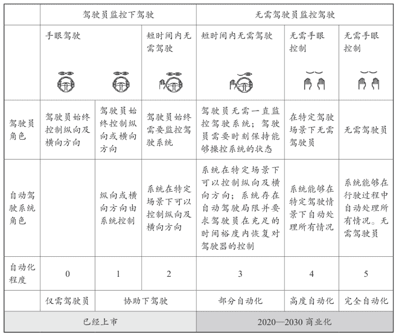
图　自动化水平的高低（来源：汽车工业协会）

本豁免程序原则上只适用于大批量量产车型。对于低产量车型或原型车，则适用其它豁免渠道，如国家单独批准或国家小批量批准程序。

## 程序
（依据 2007/46/EC 号指令第 20 条及（欧盟）第 858/2018 号条例第 39 条）

### 1. 制造商应向成员国的型式审批部门提交申请。
所需提交材料详见附件 1。

### 2. 成员国可就申请豁免的特定车型给予临时许可，该许可仅在本国有效，但须立即以书面形式通报委员会及其他成员国，内容包括：
（a）说明因技术或概念原因导致整车不符合相关要求的具体情况，明确哪些系统、部件及独立技术单元符合法规，哪些不符合，并需分析自动驾驶功能相关系统间的交互影响。
（b）提供安全与环保方面的考量说明及已采取的措施。本指引可作为型式审批部门评估自动驾驶功能的技术依据。经委员会与成员国同意，也可采用修订草案作为欧盟或联合国欧洲经济委员会要求的参考。
（c）对测试结果作出说明，证明其安全与环境保护水平不低于豁免要求。

### 3. 委员会将通过执行法案在机动车技术委员会表决后，决定是否允许将临时许可转为欧共体型式认证。决定以本指引为依据，并明确许可所涉功能和许可依据，决定应予公布。
许可的有效期可按风险评估及未来统一要求出台情况，在时间上或数量上设限，最短 36 个月。若期满前仍无正式法规出台，委员会可作出决定延长豁免期。

### 4. 在委员会作出最终决定前，其他成员国可自行决定是否在本国领土内承认第 2 款所述的临时许可。

### 5. 委员会可依据型式审批部门提供的差异说明，以简化文件形式决定扩大已获豁免的范围。

## 安全要求

### （一）自动驾驶模式下的系统性能
1. 在自动驾驶模式即自动驾驶域 OD 内，车辆应能自行完成所有驾驶任务，替代驾驶员。
2. 自动驾驶模式下车辆不得造成可合理预见且可预防的交通事故。
3. 车辆行为应谨慎、可预测，能与其它道路使用者进行适当互动，如服从管制指令或在必要时进行沟通。
4. 车辆应始终遵守交通规则行驶。
5. 制造商须向审批机构申报自动驾驶模式的适用范围，包括运行时间和地点，具体应涵盖：道路状况、地理区域、环境状况、速度范围及安全运行所需其它条件。
6. 系统应能识别当前环境是否在设定的 OD 范围内，并仅在该范围内运行。
7. 系统设计应安全可靠，能在 OD 范围内应对各类情况，无需驾驶员持续监督，并尽可能将因使用者或其它道路使用者失误带来的风险降至最低。
8. 车辆应能保持安全跟车距离，在封闭区域谨慎行驶，变道时为他车预留时间与空间，正确处理路权，并在不引发次生事故前提下避免事故。
9. OD 的设定应允许驾驶员在低风险情况下安全接管，并遵守交通规则。
10. 系统应能检测到自动驾驶无法继续运行的情况，例如超出 OD边界或发生故障。

### （二）驾驶员/操作员/乘客互动
11. 自动驾驶模式仅在满足 OD 条件时方可启动，同时应为车内人员提供便捷的立即停止或接管手段。若立即停止会危害安全，系统可暂缓执行。
12. 车辆须以明确方式持续告知驾驶员或负责操作人员及乘客系统的实时状态。
13. 驾驶员应知晓自动驾驶模式的用途、限制及系统可允许其从事的非驾驶任务。
14. 若系统在特定情况下需驾驶员接管，应监测驾驶员是否处于可接管状态，通过驾驶员监控等设计确保其能及时响应，并避免驾驶员在 OD 内作出可预见的错误操作。
15. 对于仅设计为无人驾驶运行的车辆，如无人驾驶班车，应具备向操作控制中心发送紧急通知的功能，并配备车内监控摄像头及语音通讯设备。

### （三）驾驶任务的过渡
16. 系统在要求驾驶员接管时，应给予充足时间，特别是在超出 OD 范围或出现异常时。
17. 在驾驶员尚未接管前，系统应维持自动驾驶或转入最低风险操作。
18. 系统应使驾驶员能清晰识别接管请求。
19. 系统应能判断驾驶员是否已完成接管。

### （四）最低风险操作
20. 当难以继续自动驾驶时，系统应能自动转入最低风险状态。
21. 其它道路使用者应能感知车辆正在按交通规则执行最低风险操作，如通过灯光信号提示。
22. 最低风险操作应符合交通规则，可包括减速行驶、变道或安全靠边停车等。操作结束后，L3 级车辆可能需要驾驶员接管。

### （五）事件数据记录装置的安装
23. 自动驾驶车辆须配备车载设备，记录系统运行状态及驾驶员状态以便厘清事故责任。
24. 数据应可用于判定事故责任及车辆和驾驶员反应是否恰当，至少包括系统状态、驾驶员状态、周边环境及车辆控制信息。
25. 车载设备应具备抗碰撞和火灾能力。
26. 数据应以安全方式存储，符合欧盟数据保护法规，不可被不当篡改，且须允许主管机关访问。
27. 数据记录时长、保存期限、用途、访问标准及个人信息处理等具体要求将根据后续经验制定。

### （六）网络安全
28. 为防范黑客攻击，车辆设计应采用先进技术并符合欧盟数据保护法，制造商须进行风险评估并采取防范和减缓措施。
29. 制造商应采取措施如安全软件更新，确保车辆在全生命周期内的网络安全。

### （七）安全评估与测试
30. 自动驾驶车辆及其系统应最大限度符合 2007/46/EC 指令附件四所列欧盟安全法规，除非与自动驾驶用途不相符。
31. 欧盟型式审批部门应评估制造商的安全设计与验证过程，确保车辆不会引发事故并提供安全接管和最低风险操作，依据制造商提交的安全评估报告作出等效性判定。
32. 制造商须证明已完成危害与安全风险分析，并具备足够冗余以应对风险。
33. 系统须特别设计以应对网络攻击、功能失效、不当操作及不当交互，论证方法可包括 ISO 26262、STPA 或 ISO PAS 21448 等。
34. 所有设计决策须通过测试、验证和确认。
35. 审批部门或其技术服务机构应基于安全评估报告作出判断，确保危害分析覆盖所有潜在故障，风险对策充分，人机交互经用户测试，功能性与操作性安全测试覆盖严重与非严重场景，并有透明的性能度量方法。测试量应包含假阳性和假阴性场景，必要时可采用经认可的虚拟试验。
36. 审批部门有权访问系统以进行安全评估。
37. 审批部门及技术服务机构应具备相应能力与资质。

### （八）向用户的告知信息
38. 制造商应以通俗易懂的方式向用户说明系统运行条件、OD 范围、功能限制、停用方式、驾驶员职责、非驾驶操作要求、人机界面信息、紧急情况行为、故障时表现及维护与软件更新要求。

## 附件 I：制造商需提供的资料清单
1. 自动驾驶模式下系统性能：自动化系统定义、自动驾驶功能、自动驾驶域、基本性能及除驾驶外的支持任务；环境感知能力、冗余设计、传感器监测、互联性与地图等；动态驾驶任务与交互行为。
2. 驾驶员交互：激活停用与模式切换、人为优先权、人机界面信息与警示、驾驶员在场识别、车主手册摘录及防误用措施。
3. 驾驶任务过渡：计划内与非计划内过渡的边界条件、系统行为与性能，紧急情况下的响应。
4. 最低风险操作：不同场景下的风险操作描述。
5. 数据存储系统：数据类型、存储位置、保存期限、安全保护与访问机制。
6. 网络安全：风险描述及缓解措施，系统更新流程。
7. 安全评估与测试：功能与操作安全评估、功能测试、故障测试、试验描述等。
8. 用户信息提供方式。

## 欧盟未来出行战略：迈向自动网联交通

### 简介
无人驾驶汽车有望带来巨大福祉，也伴随严峻挑战。自动网联汽车市场预计快速扩张，2025 年前欧盟汽车行业收入或超 6,200 亿欧元，电子行业或超 1,800 亿欧元。自动驾驶产业有潜力强化欧盟竞争力，创造就业并推动经济增长。欧盟委员会为此提出全面推进汽车行业自动网联化的方案，描绘共同愿景并指明技术、服务与基础设施的发展路径，确保法律与政策框架既能支撑安全部署，又能回应社会与环境关切。

### 核心要点
1. 自动网联交通是欧洲的新机遇
自动化与互联性提升正在重塑出行方式，车辆能够与车辆、基础设施及道路使用者“对话”。人工智能进步推动交流模式创新，有望提升安全、便利与可持续性。无人驾驶将重塑生活与货运模式，降低运输成本，催生新服务。
欧盟是重要汽车技术出口地，具备把握变革机遇的条件。自动化车辆将产生溢出效应，带动半导体、数字地图等产业及新商业模式。
技术变革不能单独解决拥堵、排放与伤亡问题，需妥善管理过渡期，确保车辆嵌入有助于社会包容、低排放与系统效率的提升。需强化车辆与交通管理、公私数据、公共与个人交通及各类服务之间的联动。
初步研究显示欧洲公众对无人驾驶接受度较高，但需最高安全与安保标准。需在数据共享、公平竞争与数据保护间取得平衡，并关注劳动力市场影响与技能培训需求。

2. 欧盟自动网联交通愿景

零死亡愿景与欧盟行动蓝图

欧洲提出的愿景是到 2050 年实现道路交通死亡事故归零，业界称之为 Vision Zero。要把这份愿景落地，需要欧盟机构、私营企业、成员国以及地方和区域当局协同推进。临近 2020 年前，城市低速场景下的无人化行驶已具备试点条件，比如与作业人员协同的环卫作业车，以及可自主把车开到泊位并取回的代客泊车服务。整车能力正不断升级，以应对愈发复杂的路况。分析普遍认为，到 2020 年前，公共交通工具尤其是定线运行的城市摆渡车、小型物流或通勤代步工具，在受限工况下能实现 Level 4 低速自动化。委员会强调，自动化与互联化相互促进，随着车辆网联程度和自动化程度提升，车与车、车与路侧设备可以协同运作，形成真正意义上的智能化交通管控，从而获得更流畅、更安全的通行体验。

3. 各国立法现状

欧盟的整车型式认证体系被视为与日本、俄罗斯、中国等伙伴协调的典范，美国也在筹备类似的统筹框架。欧盟的数据保护法案因制定了全球领先的标准而影响力持续扩大，并以欧洲价值为底色塑造数字转型方向。若要构建统一、完整且面向未来的自动化治理架构，监管改革不可或缺。美国、日本、中国等市场已启动无人化车辆的战略布局并吸引资本流入。若想保持竞争力并维护就业，欧洲必须确保核心技术、服务与基础设施在欧洲本土研发制造，并配套相应的监管体系。

多年以来，硅谷主导的部分美国地区一直在开展道路试验，但也有州明确禁止无人车上路。因此美国国会正在审议相关法案，拟引入类似欧盟型式认证的原则，避免州法与联邦法规冲突。

中国、日本、新加坡同样在进行道路测试。中国已启动计划，着手制定支撑低级别自动化的初步标准。日本则把无人化行驶列为推动经济增长的关键创新。

德国、法国、瑞典、荷兰等成员国已推出多项倡议，特别是得到委员会支持的大规模试验。在《阿姆斯特丹宣言》中，成员国敦促委员会制定欧洲共识的自动网联战略，以便评估并适时调整欧盟法规，提出研发创新路径，并部署可互操作的协同智能交通系统。委员会已通过 5G 网络战略合作、智能协同交通系统战略以及互联空间战略，推动部署支撑无人化车辆的互联基础设施与服务。

4. 让欧盟在自动驾驶技术和基础设施方面更加强大

研发相关技术并打造社会可接受的基础设施，需要巨额投入。尽管大部分资金来自私营部门，欧盟仍会为汽车自动化的研发与推广提供经费并协调跨境试验。2014—2020 年“地平线 2020”框架下约投入 3 亿欧元用于自动化车辆研发创新，并在 2018—2020 年征集自动化道路运输研究项目，预算合计 1.03 亿欧元。连接欧洲基金 CEF 以 4.43 亿欧元的欧盟出资撬动 11.73 亿欧元总投资，推动全欧盟道路运输基础设施数字化，为自动化推广奠定基础。16 个成员国与 2 个关联国在泛欧运输网络上开展大规模部署，实现了基于无线网络及 3G/4G 蜂窝技术的车对车、车对基础设施可互操作通信。

成员国与利益相关方呼吁加强跨境试验合作与经验共享，并在公共利益测试中实现更多知识交流。欧盟已与成员国和行业专家展开讨论，以确定试验案例的优先级，探索连通性与自动化使用场景的协同效应，并制定试验、评估与知识交流的通用方法指引。后续将继续推进泛欧 5G 跨境走廊网络建设，用于更高水平网联自动化交通所需基础设施的大规模试验与早期部署。委员会还打算进一步拓展无人驾驶交通的伽利略服务与相关车辆导航技术。伽利略目前已提供超越其他卫星定位系统的精度，并将通过未来认证系统提供极高安全性的信号。由于全自动网联车辆及配套基础设施的全面部署仍需时日，欧盟需在较长时期内持续支撑自动网联交通。委员会拟提议在下一研究创新框架方案中，继续将合作、网联与自动化交通研究列为优先事项。

同时，欧委会需更新无人驾驶交通的研究创新路线图，明确短期、中期与长期的具体行动计划。该路线图将在成员国代表协助下，基于专家与利益相关方意见制定。

5. 保障自动驾驶交通在行业发展初步的国内市场
### （1）允许创新
### （2）使自动出行更安全
### （3）解决责任问题
### （4）促进车辆连通性以实现自动化
### （5）确保网络安全、数据保护和数据访问
### （6）预测自动驾驶对社会和经济的影响

三、结论

自动网联交通正重塑出行方式以及车辆的使用、销售与拥有模式。它不仅为商业发展开辟新空间，也为新型出行服务铺路。欧盟的综合战略旨在为欧盟、成员国、产业界、社会伙伴与民间社会合作指明方向，确保欧洲把握无人驾驶交通带来的机遇，同时预判并缓解社会层面的新挑战。依托深厚的工业基础、雄心的研创计划以及本战略提出的法律框架，欧洲具备参与全球竞争的实力。委员会呼吁各相关方，特别成员国、工业界、社会伙伴与公民社会支持本通告提出的方法。在变革加速的世界中，欧洲必须把握契机，成为为欧盟公民提供安全、高效、社会负责且环保的无人驾驶交通的引领者。

【注释】

[\[1\]](#txt003.html#footnote_quote_txt003_1)这只是从系统的技术层面上说明，并未考虑当地交通法规。

[\[2\]](#txt003.html#footnote_quote_txt003_2)参见联合国决议草案（`WP.29`）或其他组织对于网络安全的最新要求（`SAEJ3061` 和 `ISO/SAE 21434`）。

[\[3\]](#txt003.html#footnote_quote_txt003_3)Dr.John Thomas，“Introduction to system safety and risk management in complex systems”， U.S.Particle Accelerator School， March 6， 2015， accessed July 7， 2022， https：//uspas.fnal.gov/materials/14JAS/JAS14-Thomas-Lecture.pdf.

# 第四章　德国

## 第一节　联邦政府关于自动化和网联化车辆交通伦理委员会报告的行动计划

### 一、简介

数字革命在 21 世纪将成为人类必须面对的核心挑战之一。关键议题是：当机器在不同情境下以特定方式与人类互动并对生活产生差异化影响时，应如何为机器行为设定伦理准则？自动网联行驶正是此类难题的典型。未来不久，无人化车辆将进入日常交通，部分决策权将被交由自动化系统背后的算法。为此，在研发与设计阶段必须为其设定明确无误的伦理边界。德国联邦交通与数字基础设施部特地组建由哲学、神学、法律与工程领域顶尖专家组成的伦理委员会，并由其制定了全球首份自动网联系统算法指导原则。

### 二、主要内容

#### （一）调查委员会的调查结果

伦理委员会聚焦 Level 4 高度自动化与 Level 5 全自动即无人驾驶功能。尽管该技术尚待成熟，但预计数年内可实现。委员会对 20 条伦理规则的审议总结如下：

1. 若系统设计充分兼顾人类安全、尊严、选择自由与数据自主，则伦理上可接受。
2. 若系统能进一步降低事故，则应积极研发。
3. 保护个人安全须优先于其他功利考量。
4. 新系统有望大幅降低事故率，即使存在不可避免的技术风险，只要总体风险下降，采用在伦理上可接受。
5. 事故无法避免时，应优先保护人身安全而非财产或动物安全。
6. 不可基于年龄性别等个人特征进行差别处理。
7. 不得以牺牲生命为代价换取伤亡减少。
8. 保护受害者时不得波及无辜第三方。遵循这些原则可制定通用减害方案，建议继续研究讨论。
9. 敦促充分保障网络安全与数据保护，立法者需平衡数据使用与信息自决权。
10. 系统必须确保数据保护，这对创新与保护本身都有益。
11. 车辆数据的用途与转发权限应归管理方与使用者。
12. 网络安全方面，国家需确保系统完整性，制造商与国家应共同强化防护。
13. 控制权交接过程及责任归属须明确记录，确保有足够时间恢复人工控制，系统能在无人工干预下进入最小风险状态。
14. 为获社会认可，建议开展公众沟通，提升对技术、安全性和使用边界的认知并发布透明部署指南。
15. 建议将正确使用方法纳入基础数字教育，并在驾驶培训中教授操作规范。
16. 对具自主学习能力的系统，其伦理评价取决于是否符合安全要求并遵守规则。若无法排除全面监控与控制操纵的可能，则中心化联网控制在伦理上存疑。
17. 人类对自身行为负责体现意思自治，故有权自由探索科技创新的可能性。

#### （二）联邦政府的行动计划——自动驾驶汽车的伦理规则

联邦政府将在伦理委员会调查结果基础上推动发展，并在国内国际层面采取措施确保系统完整，并延续已有工作。具体包括：

1. 在修改《道路交通法》以涵盖 L3 有条件自动化与 L4 高度自动化功能基础上，持续审视法律如何适用于技术进步并视情更新。
2. 以伦理委员会数据保护意见为起点，遵守欧盟《通用数据保护条例》等建议，在安全数据采集、创新与公平竞争与信息自决权间取得平衡。联邦政府默认驾驶员有权决定数据的发布与使用。
3. 自动化网联系统，特别是具备自学习能力的系统，不得对道路使用者进行全面监控。必须时刻满足严格安全要求以防止控制操纵，并遵守伦理准则。联邦政府将拟定场景并提交中立机构草拟普遍适用的指导原则。
4. 关于“两难困境”，联邦政府将进一步讨论，由国营机构监督进程，相关部门配合。
5. 为形成广泛接受度并促进交通包容性，联邦政府将持续开展针对性沟通。无人被强制使用无人化系统。同时开展宣传，提升公众对新技术、安全要求与使用参数的认知并公布透明部署准则。关键是让所有道路使用者都能理解并亲身体验自动网联行驶。
6. 在现有伦理准则基础上继续推进国际标准化工作，以实现安全跨境使用。重点是在国际层面制定统一参数标准，联邦政府已提出倡议模板。
7. 联邦政府将加快构建无人化车辆编程监管框架，以强制执行伦理准则中关于不可避免事故情况的管理原则：尽可能预防此类情形；人身伤害预防始终优先于财产损害预防；禁止基于个体特征的差别对待。

## 第二节　自动化和网联化车辆交通伦理准则

### 一、导言

全球范围内，移动性正受到数字革命深刻影响。公共道路环境中私人交通的“自动化”指减轻驾驶员负担、辅助甚至部分或全部替代驾驶的驾驶辅助技术。部分自动化已成为新车的标配。能在无人工干预下自动变道、制动与转向的有条件与高度自动化系统已出现或即将量产。德国与美国均设有供有条件自动化车辆试验的道路。在公共交通领域，无人驾驶出租车或巴士正在开发试验。今日已有处理器可通过传感器实时监测车辆周边交通状况，在高精度地图支持下确定自身位置并动态规划行驶路线以适应交通。随环境感知能力提升，对道路使用者、障碍物与危险的辨识将更精准，从而显著增强道路安全。理论上不排除未来出现“天生安全”的汽车，即在任何情况下都不发生事故。然而就当前技术水平与道路交通多样性、非连通现实而言，完全杜绝事故仍不可能。这导致编写有条件与高度自动化驾驶系统软件时必须作出价值抉择。

技术发展迫使政府与社会反思出现的变革。核心决策在于自动驾驶系统的许可在伦理上是否合理甚至必要。若获许可——这一趋势已在国际范围内显现——其使用条件与设计方式至关重要。根本问题可归结为：我们愿意在多大程度上依赖复杂技术系统——未来以人工智能为基础并可能具备机器学习能力——以换取更高安全、机动与便利？需要何种预防措施以确保可控、透明与数据自决？需要何种技术发展指引以确保不模糊人类社会轮廓，即将个人、发展自由、身体与精神完整性以及获得社会尊重的权利置于法律制度核心？

### 二、自动化和网联化车辆交通伦理委员会所采取的程序

自动化与网联化车辆交通伦理委员会由联邦交通与数字基础设施部长于 2016 年 9 月 30 日任命，由前联邦宪法法院法官、现波恩大学教授 Udo di Fabio 博士领导。委员会任务为“为自动化网联驾驶制定必要伦理指导方针”。成员来自哲学、法理学、社会科学、技术影响评估、汽车工业与软件开发等领域。相关议题被划分为五个工作领域，各由一名委员会成员担任主席的工作组负责。伦理委员会在联邦交通与数字基础设施部举行五次全体会议，工作保持独立与自由。委员会另安排一次活动试驾来自不同制造商的自动网联测试车辆。

工作组 1“不可避免伤害情境”，主席为 Eric Hilgendorf 教授。工作组 2“数据可获得性、安全与数据驱动经济”，主席为 Dirk Heckmann 教授。工作组 3“人机交互条件”，主席为 Armin Grunwald 教授。工作组 4“道路交通以外伦理情境考量”，主席为 Matthias Lutz-Bachmann 教授。工作组 5“软件与基础设施责任范围”，主席为 Henning Kagermann 教授。

2017 年 1 月，委员会听取外部专家意见。每位专家简要阐述其领域要点并回应提问。Tobias Miethaner 博士介绍联邦政府在自动网联驾驶领域的目标与举措。Julian Nida-Rümelin 教授谈及“两难困境”等伦理议题。Peter Büttgen 谈数据保护问题。Markus Ullmann 副教授谈网络安全问题。Markus Maurer 教授介绍自动驾驶的技术与社会层面。Joachim Damasky 博士重点讨论人机交互。Peter Dabrock 教授与 Dieter Birnbacher 教授从不同视角阐述新技术背景下的伦理问题。Michael Decker 教授谈及新兴系统中的责任问题。

### 三、自动化网联车辆交通的伦理规则

1. 部分自动化与完全自动化交通系统的主要目标是改善所有道路使用者的安全，另一目标是提升出行机会并创造更多福祉。技术发展遵循个人自主原则，即个人享有行动自由并为其承担责任。

自动驾驶伦理要义再解读

2. 个体人身防护的位阶必须高于任何功利计算。降害的终点是把风险压缩到零。只有当能用证据证明自动化方案相较于人工驾驶可带来更少损害，形成可验证的净安全收益时，准入才具备合理性。

3. 在城市道路布设并批准网联自动化系统，是公共部门的法定职守。自动驾驶必须取得官方许可并接受持续性监管。基本思路是杜绝碰撞，只要总体风险评估仍为正向，技术上难以彻底清除的剩余风险不应成为阻挡落地的借口。

4. 在以人为中心的社会里，个人对自身决定的担责反映了自由发展与受保护的双重诉求。各级政府与政治管理行为的指向，都应服务于个体的自由成长及安全保障。法律对技术的介入，实质是在整体发展框架内平衡个人最大选择空间与他人自由及安全之间的关系。

5. 网联自动化技术应在一切可行范围内避免事故的发生。依据当前技术成熟度，设计的首要原则是规避临界情境，尤其是进退两难，即系统被迫在两种危害间抉择且无法兼得。限制应用范围、可控交通场景、提升感知与制动性能、向易受损群体发出预警、依托智能道路设施消除隐患等技术手段都应被应用并不断迭代。发展的目标是显著提升道路安全，让车辆以防御性、可预见的方式运行，最大程度削减对脆弱道路使用者的威胁。

6. 若现行法规对潜在损害的约束能够放宽，具备自动防撞能力的高度自动化驾驶甚至可能成为社会与伦理层面的必然选择。反之，若法律强制使用全自动运输，或因果链不可避免导致主体被降格为网络单元，这在伦理上是存疑的。

7. 当所有技术性预防措施仍无法规避危险时，在衡量受法律保护的利益时，人的生命处于最高位置。在技术允许的边界内，只要能阻止对人的身体造成损害，系统就必须被设定为宁可承受对动物或财产的损害。

8. 真正的两难处境，例如一条生命与另一条生命的取舍，往往取决于具体情境以及受影响者不可预测的行为。因此它无法被清晰标准化，也不可能被编程为伦理上无可争议。技术设计必须致力于避免事故，但不能被规范化为对事故后果的复杂直觉式评估，用以取代或预判驾驶员的判断。若驾驶员为挽救他人而在紧急时造成他人死亡，该行为违法但未必构成罪责。这种事后结合特殊情境的法律判断，很难转化为事前的抽象一般评估，更无法对应编程。为此需要一个独立的公共部门机构，比如联邦自动运输事故调查局或联邦自动化网联运输安全办公室，来系统化沉淀经验教训。

9. 在无法避免的事故中，严格禁止基于年龄、性别、身体或心理素质等个人属性的区分，也禁止将受害者的损失相互抵消。通用的减害规划可以接受，但制造流动风险的一方不得牺牲与其无关的第三方。

10. 在网联自动驾驶情境下，原本归属驾驶员的责任正向制造商、运营商以及负责基础设施建设与政策法制的机构转移。法定责任制度及其司法实践必须真实反映这一转移。

11. 处于激活状态的自动驾驶系统所致的损害，适用与普通产品责任相同的原则。制造商或运营商有义务持续优化方案，监控已交付装备，并在技术可行且合理时进行更新。

12. 公众有权以多样方式了解新技术及其落地。为落实上述原则，自动驾驶的部署与编程指南应以尽可能透明的形式制定，在公开场合沟通，并由专业合适的独立机构审查。

13. 目前尚无法断定未来在数字运输基础设施背景下，所有机动车辆能否像铁路、航空那样实现全面连接与中央控制。若无法安全排除对道路使用者全面监控以及对车辆控制的操纵风险，则在数字交通基础设施框架下追求全部机动车的完全连接与中央控制在伦理上值得质疑。

14. 只有当可能出现的攻击，尤其是对IT系统的操纵或固有缺陷，不会严重动摇公众对道路运输的信心时，自动驾驶才具备合理性。

15. 在被允许的商业模式下，利用网联自动驾驶产生的数据，无论对车辆控制是否关键，都受道路使用者自主与数据主权限制。车辆管理者和使用者有权决定车辆数据是否共享和使用。自愿披露以存在可认证的替代方案和可行性为前提。应尽早应对事实上的规范性力量，例如搜索引擎或社交网络运营商在数据获取上的主导地位。

16. 必须能清晰分辨是无人系统在运行，还是驾驶员通过否决保留了操纵车辆的责任。在非无人场景下，人机界面的设计必须确保个人责任，尤其是控制责任在任何时刻都明确。责任划分情况，包括时间与接入安排等，应被记录和存储。人机交接程序尤其重要。随着汽车与数字技术跨越国界，应寻求交接程序及其文件的国际标准化，以保证记录义务兼容。

17. 高度自动化车辆的软件与技术应设计为几乎无需驾驶员在紧急情况下突然接管。为了实现高效可靠安全的人机沟通并防止过载，系统应更多适应人类的沟通习惯，而非要求人类提升适应能力。

18. 若能产生安全收益，伦理上允许部署在运行中进行自主学习的系统及其与中央场景数据库的连接。除非自主学习系统能满足与车辆控制相关功能的安全要求且不违反本规则，否则不得部署。为制定通用标准和验收测试，最好将相关场景移交中立机构的中央场景目录。

19. 紧急情况下车辆必须自动进入无须人类协助的“安全状态”。安全条件与交接例行的定义需要协调一致。

20. 正确使用自动驾驶系统应成为一般数字教育的一部分。驾驶培训与考试期间，应以恰当方式教授自动驾驶系统的正确操作方法。

四、讨论的结果和未解决的问题

1. 自动驾驶系统的许可是一项风险决策

1.1 自动驾驶的级别
伦理争议主要集中于有条件自动化、高度自动化以及完全自动驾驶的部署。

表 1　自动驾驶的自动化水平

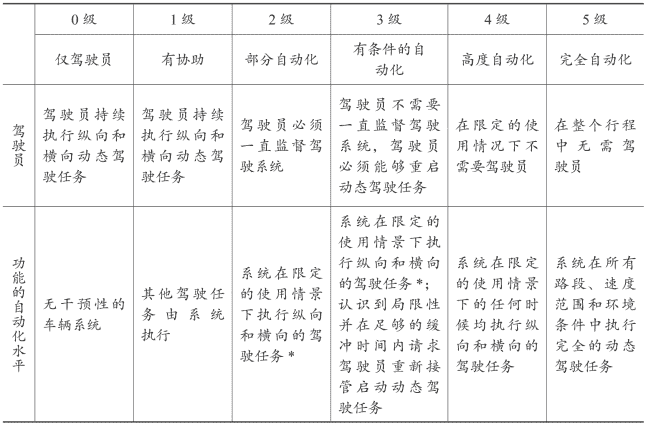

* 使用情景指路段类型、速度范围和环境条件*

关注重点在L4与L5。从L4起，驾驶员可在规定应用场景内把全部驾驶任务交给系统。这些场景描述道路类型、速度范围与环境条件。自动驾驶汽车是发展的终极形态即L5，车辆能在所有道路类型、所有速度范围、所有环境下完全独立执行全部驾驶任务，也称作自动驾驶汽车。

以当前技术水平看，所设想的假设尚不能或至少不能以商业可行形式实现。目前不存在技术拥有全部信息以便可靠评估事故影响、包括在不同损害情境间权衡的情形，或至少不存在教科书式案例。尽管如此，伦理判断仍被作出，尤其针对明显到来的未来，考虑到人工智能与连接水平等非线性演进，判断常显得有限且不够远瞻。

1.2 越来越多的出行机会，更安全，但也有完全自动化运输系统的余留风险
从人力控制转向技术系统并非新事。关于新技术的利弊争论始于19世纪铁路，20世纪初亦然。像电子控制电梯这类我们已习以为常的技术，刚引入时曾带来失业与系统故障恐惧。如今尽管偶发故障，电子电梯仍是全球最安全、最频繁使用的公共交通工具之一。类似例子表明，对自动驾驶的疑虑可以预见且正常，也不应被视为天真的技术批评。因为道路运输是现代社会的命脉，移动既是机会也是风险。

无论基于驾驶员还是无人，自动驾驶都为使用者提供大量新可能。有望大幅降低事故概率。对用户而言意味着更便利、更少身心负担与显著时间收益。在公平性层面，若自动驾驶让无驾驶能力者也能使用道路，并模糊公共、私人客运与私人交通的边界，就能提升整体福祉。当前条件下，移动能力下降者能借新出行方式更好地融入社会生活。

另一方面，道路交通仍存在相当风险，尤其在五个级别混合运行并与其它道路使用者交织时。倘若有害事件无法完全排除，随着自动化系统推广，将出现责任、监管以及现场两难冲突决策问题。连接系统故障或外部攻击虽少但无法完全排除，是复杂系统的固有风险。从纯功利视角看，自动驾驶在提升出行、安全与时间上的优势看似超过固有风险。但伦理考量会提出：人类应多大程度屈从于技术人工制品？边界何在？需设置怎样的控制安排？

1.3 人类在两难困境下的选择自由
学界花费大量精力讨论两难困境的解决方案。其前置问题是：若康德伦理中个人道德自决的自由构成理性决定的存在基础，我们愿意或允许将多大程度的选择自由让渡给程序员甚至自主学习系统。存在两难冲突的决策能否从抽象一般角度预判并由技术提前作出？

例如：车辆沿山路行驶，高度自动化汽车发现路上玩耍的孩子。人工驾驶的司机需选择是冲下悬崖结束自有生命，还是冒孩子死亡风险冲向孩子。在高度自动化案例中，程序员或自主学习机器必须在该情境下决定。

与程序员决策相关的问题是，他可依据基本共识为人类作出“正确”伦理决定，该决定却是外部强加的，无法直观捕捉具体情境，而是必须抽象评估。直觉决策中，个人要么接受自己死亡风险，要么不接受。

最终，程序员或机器能在极端情况下对人类个体的死亡作出“正确”伦理决定。逻辑上，人类在生死关头将不再自主而是他律。

此结论多有问题。一方面国家以家长式方式规定“正确”伦理路线具危险性。另一方面与人文主义价值背道而驰，个体在其中居于中心。因此此类发展需批判审视。

1.4 两难困境
两难困境指自动驾驶汽车必须在两种恶之间执行一种。法律语境中称作电车难题。问题在于必须在具体案例中结合各种因素作出决定。因此在两难情境下“财产损害优先于人身伤害”等具体规范看似可行，但作为抽象一般规则，当财产损害可能是油罐车泄漏或大城市电网崩溃时就令人质疑。

鉴于可设想情境的多样复杂，抽象规则如财产损害优先于人身伤害难以穷尽全部情境。

除非尝试评估财产损害影响并把可能人身伤害纳入两难考量，否则无法系统遵守尽量减小人身伤害的前提。

伦理委员会仍作出决定并确立具体规范化规则参见伦理准则第7条。其理由是技术上可行、在多数情况下更可能减少事故且可应用的解决方案，比当前技术水平尚不可达的方案更可取。

1.5 保护生命是最优先考虑的事项
在价值层级上，保护人的生命居最优先。发生不可避免损害时生命享有无条件优先权。这导致在可评估的间接损害情境中权衡财产损害与人身伤害时，财产损害始终让位于人身伤害。

1.6 不对人类进行选择，不补偿受害者，但是应遵循损害最小化原则
现代宪政国家只在边界情形下绝对禁止，如禁止对羁押人员施酷刑。无论后果，行为被强制或绝对禁止，因其本质与宪政秩序基本价值不相容。此处例外是没有利弊权衡，而这正是任何基于伦理的法律制度特征。联邦宪法法院对《航空安全法》判决亦遵循此伦理评估路线，裁定不允许牺牲无辜以保护其它潜在受害者，因无辜方将被降格为工具并剥夺主体资格。该立场在宪法与伦理上均有争议，但立法者应遵循。

在可事先编程的损害限制体系内，情况与《航空安全法》或电车难题不同。此处需基于偶发情况作概率预测，伤亡者身份不明。与电车难题不同。因此在不违反基本法第1条第1款前提下，若规划以同等方式降低每位道路使用者风险，则有理由最小化受害者人数财产损失优先于人身伤害、人身伤害优先于死亡、伤亡人数尽可能少。只要事先方案同等降低每个人风险，也符合在被认定为受害者前即被牺牲者的利益。例如免疫情况类似，法律规定的强制接种导致总体风险最小化，事先不知接种者是否属于少数牺牲方。尽管如此，接种与降低感染总体风险符合每个人利益。

伦理委员会拒绝由此推断人类生命可在紧急情况下与其他生命“抵消”，从而允许牺牲一人拯救数人。它将自动驾驶汽车系统对人致死或重伤无例外地归类为错误。因此即便紧急情况下，人类生命也不能相互“抵消”。依据此立场，个人应被视为神圣不可侵犯。任何团结义务都不能要求个人为他人牺牲自己，即便这是拯救他人的唯一方式。

若数人生命已受迫在眉睫威胁，且唯一要紧的是拯救尽可能多无辜者，则需不同决定。此时要求所选行动方案以尽可能少生命为代价似乎合理。伦理委员会对此尚未完成讨论，也未在各方面达成共识，因此建议深入研究。

若按此立场，会产生制造商是否需为被归类为“错误行为”的自动化系统造成伤害甚至死亡承担责任及程度的问题。应指出防撞系统与安全气囊、安全带遵循相同原则。安全气囊不当充气致死固然是错误行为，但若制造商已尽一切合理努力将风险降至最低，则无需承担责任。因此若制造商已尽一切合理努力使系统尽可能安全特别是将人身伤害风险降至最低，自动化系统安装被允许且不产生特殊责任风险。

1.7 自我保护优先于保护他人，还是自我保护的优先级更低？
以具特殊尊严个体为基础的人本主义原则已获普遍共识。若对预先设定的机动车驾驶人或使用者强加紧急情况下包含自我牺牲的同舟共济义务，则与指导原则不符。因此个人自我保护本身并不劣后于对无辜方的保护。尽管如此，基本原则是存在流动风险的人不得牺牲无相关风险的人，参见伦理准则第9条。

2. 考虑动物福利利益
讨论起点应是动物在社会中何种地位。直觉上我们对待高度发达动物的方式不同于对待财产。动物是有情感生物理论支持此观点。动物的情感使其值得保护，人类有责任保护它们免受伤害，即使动物地位不等同人类。因此必须优先防止人身伤害，包括优先于动物福利利益。然而若可排除人身伤害，则对高度发达动物的保护应始终优先于简单可计算的财产损害。

3. 由人类行使否决权
在有条件自动驾驶下，司机可在部分行程中使用高度自动化模式而不必干预。伦理冲突在于多大程度上应排除司机自愿恢复控制。若有助于提升安全，司机是否有道德义务不自行驾驶？反之，在事故可排除前，最终责任是否应由人类承担？

人类自主性的体现之一是他们也能作出客观上不合理决定，如更激进驾驶或超过建议速度。若国家出于公民最大利益想要设立不可逃避戒律以社会工程方式扼杀越轨，则与成熟公民概念不相容。尽管善意目的无可争议，绝对安全状态可能破坏基于人本主义与自由原则的社会基础。显然自愿计划也能产生类似影响，如针对私人保单持有人的“按里程付费”。关于安全风险与限制自由的决定必须在民主与基本权利权衡过程中作出。没有任何伦理规则总将安全置于自由之前。

## 自动驾驶的责任、技术与自由边界

## 4. 责任划分与人机界面要求
当无人驾驶系统在制造商和运营方设定的使用范围内运行，责任自然归属于制造商与运营方。一旦进入部分或高度自动化的场景，责任与义务的划分就会变得模糊。考虑到驾驶员始终保留接管权限，人机交互界面必须在任何时刻都清晰呈现车辆由谁控制，包括在系统无法继续保证安全驾驶时把控制权交还给人的能力。然而，如果交接过于仓促，驾驶员将难以从条件自动化带来的便利中获益，因此必须预留一段合理的过渡时间。仅在紧急状况下，当来不及完成人工接管时，为最大限度保护乘员和其他道路使用者，车辆可作为例外保留控制权，以进入最小风险状态。

## 5. 是否应强制推广全自动交通？
展望联网自动驾驶的未来，委员会触及了一个尚未被广泛讨论的问题：当技术被证明优于人类驾驶时，是否应强制推行自动化。立法者应否在全国乃至跨系统层面统一规定机动系统的设计，还是应让强调个体自主和市场竞争的思路主导，由国家仅提供监管与法律确定性？一旦司机无法通过个人选择绕开联网自动化运输系统，交通流被全面管控，自动联网是否会催生社会家长制？

作为自主权的体现，能够对自身行为负责的人可以自由使用技术可行性；行动自由也包括选择不使用某些可行性。强制部署此类系统会大幅压缩人类的发展空间，其中也包括享受驾驶的乐趣。仅以高度自动化普遍提升安全为由，并不足以证明强制引入自动系统的合理性^[(\[11\]](#txt004.html#footnote_content_txt004_11))。

## 6. 驾驶辅助从提醒到指令的界限
在 L2 级自动化驾驶^[(\[12\]](#txt004.html#footnote_content_txt004_12))中，人类始终保有对车辆的最终掌控。当出现疲劳或分心等情况，辅助系统会通过非约束性的提醒来帮助驾驶员规避失误，这对社会是有益的。然而，若机器不再只是提醒，而是发出必须履行的指令，则应受到更严格的审视，并在立法权衡中加以界定^[(\[13\]](#txt004.html#footnote_content_txt004_13))。例如，系统可禁止在长途驾驶后未充分休息的司机启动车辆。

护理机器人提供了一个类比。越来越多机器人通过递送药物或协助检查来照护高依赖患者。但当机器人从“递送药物”升级为“为病人利益强迫服药”，该如何评价？^[(\[14\]](#txt004.html#footnote_content_txt004_14))这种强制会剥夺个人自主决策的权利。人们必须保留是否在疲劳时上路、是否服药的决定权。具有强制性的命令已与自主人格的理念相悖。

## 7. 警惕对技术的不可逆依赖
问题的关键不在于孤立看待自动驾驶，而在于将其视为渗透多领域的演进之一，例如机器人取代复杂职业^[(\[15\]](#txt004.html#footnote_content_txt004_15))。由此容易得出技术发展不可逆的结论。特别是在认知技能方面，不仅涉及驾驶能力，也涉及医疗操作能力，在高度自动化下若技能不再被练习，自主行动能力似乎将消失^[(\[16\]](#txt004.html#footnote_content_txt004_16))。

## 8. 技术依赖带来的系统性风险
对技术系统的依赖是当代社会的特征，已延伸至粮食获取、信息与知识、医疗、能源等基础设施核心领域。系统性风险由此而生，包括意外失效，以及日益增多的“网络战”手段与针对性黑客攻击。若道路交通数字化控制加深，基础设施的另一个关键环节将比过去更易受系统不稳影响^[(\[17\]](#txt004.html#footnote_content_txt004_17))。从功利角度看，只要风险被认为较低，这种脆弱性可能是可以接受的；但为防范黑客攻击所致的极端情形，制造商与国家需强化网络安全。国家在此负有保护职责，确保系统完整性。

## 9. 交通基础设施的集中化陷阱
若车辆可在无需长期人工决策的情况下被控制，就必须构建以信息技术为基础的决策系统，以替代传统由驾驶员产生的控制刺激，如速度、转向、路线选择，从而实现定向无碰撞行驶。核心部件可为已装车的计算机，但其功能需大幅增强。配套还包括传感器、摄像头等技术装置，用于采集与车辆控制相关的交通信息。

由此可设想一种去中心化、近乎自给自足的网联自动驾驶，仅依赖车辆自身采集与存储的信息运行。也可设想中心化数字化交通基础设施，通过路侧设备、中央交通信息服务器、车与车间通信等方式提供车辆传感器或摄像头无法探测到的信息，如山坡后的车尾。

若自动驾驶的发展不可避免地与集中控制和全量车辆追踪概念相联，则不当使用集中权力结构的风险随之产生。必须批判性思考何为适度、合理和伦理可行的边界。自动网联驾驶可能导致对所有道路使用者进行全面监控。在集中交通管控下，个人自由移动而不被发现的权利可能让位于以效率为名的数字化基础设施，自动驾驶将以牺牲日常自主行为为代价。便利与安全性的收益不应成为自由与自主损失的理由。应通过“设计即保护隐私”和充实规范性标准来遏制这一趋势。

## 10. 安全、自主与数据自决的平衡

### 10.1 目标冲突如何调和
自动驾驶使数据安全呈现新特点。系统运行需收集并处理大量用户数据。立法者必须在功能安全所需的数据收集与信息自决保障之间取得平衡。

欧洲与德国法律确立的数据最小化与避免使用原则，需与道路安全要求及全球化竞争环境下的公平竞争相协调。除了交通安全，政府机构还有诸多安全利益，私营企业则有商业利益^[(\[18\]](#txt004.html#footnote_content_txt004_18))。在此，信息自决不应被片面理解为隐私保护，也意味着用户有权决定是否披露个人数据。

### 10.2 数据合规的实操路径
引入各类自动化程序需要新的数据处理与利用解决方案。数据保护与创新友好并非不可调和，而是相互增益。自动网联驾驶需要既利于创新又利于数据保护的设计，也需要利于数据保护的创新技术。隐私设计可使数据保护在默认状态下生效。新车交付时应具备隐私友好的出厂设置，禁止收集、处理或使用与车辆安全无关的数据，除非对安全至关重要且经驾驶员主动启动。

前提是用户自行决定数据的用途。在防范侵入的背景下，信息自决既包括防卫，也包括自愿披露的可能性。若数据使用与处理不再能被驾驶员清晰识别而被排除在决策之外，国家须履行宪法保护职责，为公民提供适当必要的数据保护。国家可通过法定理由为车辆控制相关数据的隐私程序提供民主合法性。法规可要求自动化与网联功能须经许可，仅当车辆获得相应证书并在运行中与其他车辆和基础设施交换假名条件数据时，方可以自动模式行驶。同时可投入研究新的匿名化技术，并持续评估匿名化是否充分。

最终应找到可行程序与技术，使驾驶员、保管人或用户能了解数据处理的目的与法律基础，从而对与控制无关的数据使用作出适当决定。涉及路人等第三方道路使用者的同意，亦须符合法律要求。

此外，自动网联驾驶的逐步引入应由独立测试机构及消费者监督等利益相关方监督。为满足透明度要求，需建立对数据使用机会与风险的客观认知。尤其相关的是，制造商在所有权转移后很长时间内仍可能访问车辆与数据，例如用于更新、产品观察或提升客户忠诚度。

## 11. 软件与基础设施的责任边界

### 11.1 事故责任归谁
无论在车辆层面还是跨系统协作道路交通中引入自动化与自动驾驶，都提出事故情况下的责任归属问题。责任指个人对其自动化车辆系统及所依托软件做出的决策与行动承担义务并接受法律后果。

目前德国制度将道路交通事故的最终风险分配给车辆保管人或司机，制造商则在法定产品责任范围内承担责任。然而高度自动化和完全自动化的车辆受更深远因素制约。

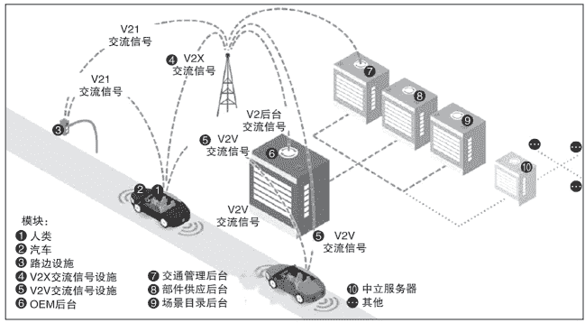

图 1　合作道路交通总体架构中的模块^[(\[19\]](#txt004.html#footnote_content_txt004_19))

不仅车辆保管人与制造商，车辆辅助技术制造商与运营方也须纳入责任体系。插图列示了可能的责任主体，显示互联移动系统的义务与责任被分散至不同领域参与者，需在各方间划分。同时须重新定义部件、软件与数据制造商、供应商、运营方及开发者的注意义务。除非统计证明自动驾驶功能比人类驾驶更安全，不得部署。在产品责任框架下，随着责任从驾驶员/保管人向技术方转移，需讨论技术系统需达到何种安全水平才为社会所接受，以及何种方法才能建立可靠信任。

可能的责任方：

（1）人类：驾驶员、车辆保管人

（2）车辆：原始制造商、部件供应商、汽车修理厂

（3）道路基础设施：公共部门

（4）V2X：通信基础设施，通信网络运营商

（5）V2V：原始制造商

（6）OEM 后端：原始制造商、IT 服务提供商

（7）交通管理后台：公共部门等

（8）部件供应商后端：1 级供应商、数字地图等

（9）场景目录后端：国家认证机构

（10）中立服务器（与其他服务的接口）：IT 服务提供商

架构显示合作道路交通包含大量组件，各组件由不同参与方负责质量保证与数据可靠传输。除 V2V/V2X 通信外，车辆数据首先传至 OEM 后端。伦理委员会不建议由原始制造商或中立组织运营后台，具体由议会制定公共政策。

### 11.2 责任如何细化与分配
从架构可看出，制造商对功能安全负责。为履行此责，需使用和分析特定数据集。OEM 对通过交通信息、通信基础设施和 OEM 后端与车辆交互的安全数据内容与质量负责。若使用第三方数据，需对其实质负责。可考虑对第三方安全相关数据的质量进行核查，例如以证书形式证明符合特定安全标准。

证书应包含对质量保证信心的证明。如地图服务提供商应通过 OEM 设定的置信阈值，保证地图信息在时空与分辨率上的一致性。V2V 与 V2X 通信传输数据的最大延迟与完整性声明也应附带置信说明。

数据的可靠传输不属制造商责任范围，可归于电信运营商，其应在其保证范围内对数据安全传输负责。无论如何，产品责任范围内须遵守数据隐私规定。分配责任时，成员国与欧盟立法者须遵循欧洲与宪法关于系统完整性的规定。制造商须遵守收集数据的管理框架，并提出框架改进建议，开发新的车辆数据匿名化程序。

为防止错误并保障所有道路使用者安全，应分析与车辆错误感知与行为相关的危险情况。技术上，制造商应将识别的错误转交给情景目录，由其存储。该目录应移交独立公共机构管理。情景目录的设计应随真实危险情况不断扩展。可建立后端数据库，记录车辆对实际环境错误解读导致自动驾驶失效的情况。实践中需明确情景目录所需信息。

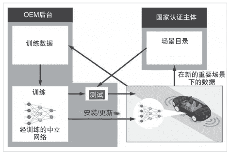

图 2　通过端到端的深度学习建立关键驾驶功能的知识库

还应考虑车辆在无外部连接时仍能保障安全驾驶的可能性。日常实践可进行安全检查，确保车载系统功能不受限制、与后端连接正常、关键软件更新已成功安装。若出现错误或未安装关键更新，应提示相关自动化功能不可用。

### 11.3 自学习系统能否上路
使用软件程序时需区分学习系统与自学习系统。学习系统在开发阶段训练完成，自学习系统可在运行中自我改进。目前既有学习系统如物体识别算法，也有所谓自学习系统如车辆动态适应驾驶员。知识库随运行增长而变化，这意味着单辆车的知识状态各不相同。伦理委员会思考了该系统可获许可的范围与最终责任归属。

在引入自学习系统时，保护使用者人身安全须排在首位。只要不能充分确定自学习系统能正确评估情境并满足安全要求，就应将其与关键安全功能分离。鉴于当前技术水平，自学习系统仅能在与安全无直接关系的功能中使用。例如人机交互领域可分析个人驾驶模式并进行适配。但须注意，此类分析会创造为非车辆目的获取与使用数据的可能性。若能保障个人数据主权，此类商业模式或可接受。

# 第五章 跨域对标：他地自动驾驶立法样本

## 第一节 新加坡 2017 年《道路交通自动驾驶机动车规则》解读

编号 S464

依据《道路交通法》第 6C 条及第 6D 条授权，交通部长公布《2017 年道路交通自动驾驶机动车规则》，该规则自 2017 年 8 月 24 日起生效。

### 第一部分 起始说明

#### 生效与适用

1. 本规则正式名称为《2017 年道路交通自动驾驶机动车规则》，自 2017 年 8 月 24 日起施行。

#### 术语界定

2. 在本规则中，除文义另有要求外——
“经批准的特殊使用”指主管政府部门许可特定主体在道路上使用自动驾驶机动车；
“经批准的试验”指主管政府部门许可特定主体在道路上对自动驾驶机动车技术或车辆进行试验；
“授权”指依据第 7 条第 1 款 a 项 i 或 ii 的许可行为，“授权”据此解释；
“特定主体”就任一经批准的试验或特殊使用而言，指——
a. 依据第 7 条第 1 款 a 项 i 获准试验的主体；或
b. 依据第 7 条第 1 款 a 项 ii 获准特殊使用主体。

#### 过渡性豁免

3. 2017 年 8 月 24 日前已依该法第 28A 条取得特殊用途牌照的自动驾驶机动车，本规则不适用，该牌照有效期内持续豁免。

### 第二部分 经批准的试验与特殊使用

#### 试验与上路使用的禁止

4.-（1）未经第 7 条第 1 款 a 项 i 授权，任何人不得在道路上进行自动驾驶技术或车辆的试验。
4.-（2）未经第 7 条第 1 款 a 项 ii 授权，任何人不得在道路上使用自动驾驶机动车。
4.-（3）不涉及激活自动驾驶自治系统的技术演示或车辆使用，不受前两款限制。
4.-（4）违反第 1 或 2 款即构成违法，初犯可罚不超过 2000 美元，再犯可罚不超过 5000 美元。

#### 试验申请

5.-（1）道路上进行自动驾驶技术或车辆试验须按本条第 2 款向主管部门提出申请。
5.-（2）申请应——
a. 依主管要求的形式与方式提交；且
b. 附上部门为审议所需的信息，包括：
i. 试验目的及概要；
ii. 拟用车辆车型或技术；
iii. 车辆数量及每辆车的详述；
iv. 试验中拟采用的自动驾驶模式；
v. 如需改装，改装内容；
vi. 证明车辆及系统可安全用于试验的相关材料。

#### 使用申请

6.-（1）自动驾驶机动车在公路上使用须按本条第 2 款申请。
6.-（2）申请应——
a. 依主管要求的形式与方式提出；且
b. 附上审议所需信息，包括：
i. 使用方式；
ii. 拟用车辆种类及系统细节；
iii. 如需改装，改装内容；
iv. 证明车辆及系统可安全投入使用的材料。

#### 许可决定

7.-（1）主管部门审议第 5 条或第 6 条申请后，可——
a. 缴纳第 2 款费用后，向特定主体授予试验或使用许可；或
b. 拒绝许可。
7.-（2）获许可者须支付每辆获批试验或特殊使用车辆 25.68 美元费用；若车辆未依法登记，还须按第 21 条第 3 款缴税。
7.-（3）主管部门可酌情免除第 2 款 a 项费用。

#### 许可形式与效力

8.-（1）授权形式由主管部门决定。
8.-（2）除依规则 13 提前撤销外，许可在载明期限内持续有效。

#### 许可条件

9.-（1）许可时主管可附加其认为适当的条件。
9.-（2）条件可包括——
a. 试验或特殊使用可进行的地理范围；
b. 要求合格安全驾驶员在车内监视并必要时接管；
c. 要求合格安全操作员远程监控并必要时接管；
d. 禁止载客；
e. 禁止收费载客或出租；
f. 参与试验或使用的允许人员范围；
g. 与技术规格相关的其他要求。
9.-（3）主管可为不同车辆设定不同条件。

#### 部门修改条件

10.-（1）主管可修改授权条件。
10.-（2）修改前须书面通知特定主体，说明拟改方式，并给予不少于送达后 14 天的书面陈述期。
10.-（3）审阅陈述后，主管可拒绝陈述、依审阅结果修正拟改方案，或撤回拟改方案。

#### 主体申请修改条件

11.-（1）获准主体可向主管部门申请修改授权条件。
11.-（2）申请须说明拟改条件，并提供证明修改后仍不影响安全运行的材料。
11.-（3）审议时主管可要求——
a. 在指定人员面前展示车辆并演示系统；
b. 在主管或其指定人员指挥下进行实测；
c. 向指定人员出示车辆供检查。
11.-（4）审议后可驳回，或经双方同意后批准修改。

#### 授权延期

12.-（1）延期申请须在授权到期前至少 6 个月或主管允许的更短期限内提出。
12.-（2）申请须依要求形式提交并附上审议所需资料。
12.-（3）主管可批准延期或不说明理由拒绝延期。
12.-（4）延期许可须遵守延期前适用的相同条件。

#### 取消或暂停

13.-（1）主管认为继续试验或特殊使用已不符公共利益、主体违反或未能遵守许可条件、规则或豁免条件，或主体不再合适时，可全部或部分取消或暂停许可。
13.-（2）行使权力前须书面通知主体拟取消或暂停的日期及理由，并给予不少于送达后 14 天的陈述期。
13.-（3）若理由为第 1 款 a 或 b 项，可免除第 2 款 b 项陈述期要求。
13.-（4）审阅陈述后可拒绝陈述并发出生效通知，或接受陈述并撤回通知。
13.-（5）受通知主体可在收到后 14 天内向部长提出书面上诉，部长决定为终局。
13.-（6）上诉期间取消或暂停仍按指定日期生效，若部长允许上诉则视为无效。

#### 责任保险

14.-（1）获准主体须在试验或使用开始前投保责任险并保持至许可期满，包括延期期间。
14.-（2）保险须由在新加坡合法经营的承保人签发。
14.-（3）违反第 1 或 2 款构成违法，初犯罚款不超过 1000 美元，再犯不超过 2000 美元。
14.-（4）“责任保险”含义同该法第 6C 条第 6 款。

#### 以保证金替代保险

15.-（1）主管确信申请主体已合理努力仍无法取得责任险时，可允许其向主管存入不少于 150 万美元保证金。
15.-（2）保证金支付方式由主管决定。
15.-（3）主管可用保证金支付法院命令的或与第三方协商的因试验或使用期间造成的人员伤亡或财产损失赔偿。
15.-（4）保证金被动用后，主体须在收到通知后 14 天内或主管允许期限内补足。

### 第三部分 主体的运行义务

#### 车辆维护责任

16.-（1）获准主体须确保——
a. 试验或使用中的车辆及其附属传感器设备始终保持良好状态；
b. 自动驾驶系统随时正常运行，不会对车内人员、其他人员或财产造成伤害或损害风险。
16.-（2）违反第 1 款构成违法，初犯罚款不超过 2000 美元，再犯不超过 5000 美元。

#### 数据记录

17.-（1）获准主体须为每辆获批车辆安装可存储使用信息的数据记录仪。
17.-（2）使用期间无论自动驾驶系统是否激活，主体须确保记录仪始终处于正常工作状态。

自动驾驶试验与特殊用途监管要点概要

17.-（3）取得试验或特殊用途许可的责任主体，应保证从自动驾驶车辆记录仪中获取的数据遵循主管部门规定的电子格式，并自数据产生之日起保存不少于三年，即使许可已届满仍须保留。

17.-（4）上述主体还须保证用于获准试验或特殊用途的自动驾驶车辆配备的记录仪能够捕获以下项目：

（a）记录时间与日期戳；
（b）车辆经纬坐标，采样频率不低于每秒二次；
（c）行驶速度，采样频率不低于每秒二次；
（d）车辆运行状态，涵盖人工驾驶、自动驾驶、人机协同或远程遥控等模式；
（e）自动驾驶期间的历史记录改写情况，按改写类型记载；
（f）传感器采集数据；
（g）影像资料：
（i）车内摄像头画面，需包含乘员、方向盘及前挡风玻璃局部；及
（ii）车外前后向摄像机画面。

17.-（5）安装于相关试验车辆的记录仪所采集的任何信息，不得进行编辑或修改。

17.-（6）接获主管机构书面要求时，许可主体须—
（a）以主管机构可读取的格式交付记录仪数据，实时信息须同步提供；及
（b）提供记录仪数据的副本供调查、核查或审计使用。

17.-（7）违反第（1）（2）（3）（4）或（6）款视为违法，初次定罪最高罚款一千美元，再犯最高两千美元。

17.-（8）违反第（5）款视为违法，定罪后最高罚款五千美元。

记录义务
18.-（1）取得许可的主体须对获准的试验或特殊用途活动进行记录，以便—
（a）对相关项目作出恰当评估；
（b）证明每位参与者均遵守主管部门条件及本规则要求。

18.-（2）进行获准项目的单位须确保保存的记录—
记录保存要求
（a）保持最新；
（b）可随时供主管部门或其授权人员查阅；及
（c）保存期限不少于以下两者中时间更晚者：
（i）许可到期或被撤销后三年；
（ii）主管部门就特殊情况指定的期限。

18.-（3）
主管部门书面通知时，许可主体须提交记录副本供调查、核查或审计。

18.-（4）
违反第（1）、（2）或（3）款视为违法，初次定罪最高罚款一千美元，再犯最高两千美元。

通报事故的义务
19.-（1）
许可主体须按主管部门要求的时间与方式通报—
（a）试验车辆运行期间自动驾驶系统失效事件；及
（b）因运行获准车辆导致或引发的死亡、人身伤害或财产损失事故。

19.-（2）
违反第（1）款视为违法，初次定罪最高罚款一千美元，再犯最高两千美元。

要求机动车进行测试之权力
20.-（1）
在第（2）款限制下，经主管部门书面要求，许可主体必须—
（a）在指定时间地点出示：
（i）用于试验或特殊用途的自动驾驶车辆；
（ii）相关车辆或技术的基础设施部件或设备；
（b）允许主管部门或其指定人员对车辆、自动驾驶系统或技术进行检验。

20.-（2）
主管部门仅可在以下情形发出第（1）款通知：
（a）评估系统或技术、或车辆的安全性；
（b）审视授权条件的充分性；
（c）查明是否违反授权或本规则。

20.-（3）
违反第（1）款视为违法，初次定罪最高罚款一千美元，再犯最高两千美元。

# 第四部分　杂项

法案某些条款对获批的试验或获批的特殊使用的修改适用
21.-（1）
为试验或特殊用途目的，许可主体在以下情形可不适用《法案》第10条、第11（1）（a）和（aa）、第（3）、第（5）、第（6）和第（7A）条以及第29条关于自动驾驶车辆的规定—
（a）在获准范围内使用；以及
（b）未依《法案》完成登记。

21.-（2）
为试验或特殊用途目的，《法案》第11条第（4）款适用于第（1）款所述车辆，并按第（3）款调整。

21.-（3）
依《法案》第11条第（1）款（b）项，第（1）款所述车辆的税费按使用时长计收：
（a）每日30美元；
（b）每月250美元；
（c）每半年800美元；
（d）每年1 600美元。
于2017年8月23日作出。
彭建强
常务秘书，
交通运输部：
新加坡。
（根据《道路交通法案》第6C条第（5）款向议会展示）

# 第二节　澳大利亚维多利亚州：自动驾驶机动车道路安全法修正案

维多利亚州议会颁布：

## 第 1 部分　序言
### 1.目的
本修正案旨在修订《1986年道路安全法》，建立高速公路自动驾驶机动车试点制度。

### 2.生效
本修正案自获王室同意次日起生效。

## 第 2 部分　《1986 年道路安全法》的修正案
### 3.定义
《1986年道路安全法》第3条第（1）款增补以下释义—
“ADS指南，指部长依据第33M条发布的指引；
ADS许可证，指依据第33D条核发的许可；
ADS许可证持有人，针对自动驾驶机动车，指持有载明该车的ADS许可证的主体；
ADS试验，指在高速公路上对搭载自动驾驶系统的自动驾驶机动车进行的试验—
（a）旨在检验自动驾驶模式下的行驶表现；
（b）旨在检验自动化功能部署的安全性；
（c）旨在促进自动化功能研发；或
（d）其他法定目的；
自动驾驶系统，指由硬件软件构成、能够执行动态驾驶任务的技术；
自动驾驶模式，指自动驾驶系统执行动态驾驶任务的运作状态；
自动驾驶机动车，指安装了自动驾驶系统的机动车；
动态驾驶任务，指机动车在道路交通中行驶所必需的实时操作与战术功能，不含终点选择。包括但不限于—
（a）转向、保持及变更车道并发出相应信号；及
（b）加速或减速；及
（c）监测行驶环境并对发现的物体或事件作出反应；及
（d）航行计划；
机动车监督员，就许可证上载明的自动驾驶机动车而言，指在申请文件中指定的监督人员。”

### 4.应被视为由特定主体管理机动车辆的情形
在《1986年道路安全法》第3AA条第（b）项后增列—
“（ba）系任何有效ADS许可证所载自动驾驶机动车的监督员，以及在自动驾驶模式运行期间受许可证持有人指派履行监督职责的主体；”

### 5.应被视为由特定主体驾驶机动车辆的情形
在《1986年道路安全法》第3AB条末尾增列—
“（2）在不以特定人员实际驾驶为限的情况下—
（a）为本法目的，车辆处于自动模式运行时，应视为由其ADS许可证持有人驾驶，不论是否指派监督员履行职责；及
（b）为本法目的，车辆处于非自动模式运行时，应视为由受持有人指派的监督员驾驶。
（3）为本法目的，在不以特定人员实际驾驶为限、无有效ADS许可证的自动驾驶机动车，即使处于自动驾驶模式，仍应视为由下列主体驾驶—
（a）车辆在高速公路行驶时，坐在驾驶席的人；
（b）车辆在高速公路行驶时，对动态驾驶任务执行拥有控制权的人。”

### 6.新增的第 3A 部分
在《1986年道路安全法》第3部分后增设—
“第3A部分——自动驾驶机动车”

第3A部分——自动驾驶机动车
第33C条 申请ADS许可证
（1）任何人士均可就一辆或多辆机动车向市政委员会申请ADS许可证。
（2）申请须—
（a）以市政委员会指定的方式与格式提出；以及
（b）载明法规要求的详情：
（i）申请人；以及
（ii）车辆；以及
（iii）拟任监督员；以及
（iv）拟议试验性质；并
（c）随附—
（i）符合ADS指南的安全管理计划副本；以及
（ii）市政委员会或ADS指南要求的其他材料。
（3）市政委员会—
（a）可要求申请人或拟任监督员进行测试、评估、接受培训或遵守规定程序；以及
（b）可对申请涉及的车辆进行检验、测试或评估。
注释
测试与评估参见第33K条。

第33D条 对申请的决定
（1）市政委员会可批准或拒绝ADS许可证申请。
（2）市政委员会可在下列情形拒绝—
（a）申请未载明全部所需详情或未附全部材料；或者
（b）申请人不符合持证资格；或者
（c）申请人或拟任监督员拒绝或未能参加要求的测试、评估或培训；或者
（d）申请车辆未通过检验、测试或评估；或者
（e）申请车辆并非自动驾驶机动车；或者
（f）申请人未遵守本部分或法规要求；或者
（g）市政委员会认为不宜核发许可的其他理由。
（3）审议时，市政委员会可考虑其他法律作出的授权决定。
（4）判断车辆是否符合自动驾驶机动车资格时，市政委员会可接受认可机构签发的合规证书作为证明。

第33E条 ADS许可
（1）除提前撤销外，ADS许可证在证载期限内有效，期限不超过三年。
（2）ADS许可证应依法续展或撤销。
（3）持有人须确保车辆用于ADS试验期间，许可证始终置于车辆内或由监督员持有。
罚款：5个罚款单位。

第33F条 ADS许可证的授权内容
在有效期及条件限制下，许可证授权—
（a）持有人为在高速公路上对证载车辆的自动驾驶系统进行ADS试验而驾驶该车辆；以及
（b）持证驾驶员、在许可证上登记的监督员担任监督员；以及
（c）许可证载明的车辆参与高速公路ADS试验。

第33G条 ADS许可证的条件
（1）ADS许可证须受限于—
（a）市政委员会决定的并载于许可证的条件；以及
（b）为许可证目的规定的条件。
（2）许可证条件涉及—
（a）可进行试验的高速公路、日期与时间；
（b）确保车辆在高速公路上安全运行；
（c）试验与提交的安全管理计划相符；
（d）使用期间持有人或监督员血液、呼吸或口腔液中无酒精或违禁药物；
（e）监督员在规定时间乘坐车辆并位于车内；
（f）按规定情形与间隔提交报告；
（g）在车辆上张贴标识以表明其正参与试验；
（h）实时监测系统性能、位置及合规情况；以及
（i）对持有人和监督员的持续培训要求；以及
（j）ADS指南载明的其他事项。
（3）试验期间，市政委员会有权决定豁免或修改本法或法规的适用。

第33H条 ADS许可证的撤销、中止或变更
（1）提前通知后，市政委员会有权中止、撤销、增减证载车辆或监督员，或增设、移除、修订条件。
（2）市政委员会可仅依据执法机构报告采取行动。
（3）中止、撤销或变更自通知送达或通知指明的较晚时间生效。
（4）中止期间许可证不具法律效力。

第33I条 与驾驶或管理无效ADS许可证车辆有关的违法行为
（1）无有效许可证而在高速公路上驾驶或管理自动驾驶机动车即属违法，罚款最高100个单位。
（3）促成他人违法亦属违法，法人最高500个单位，其他情形100个单位。

第33J条 违反ADS许可证条件驾驶或管理自动驾驶机动车的违法行为
（1）持有有效许可证但违反条件操作即属违法，法人最高500个单位，其他情形100个单位。

第33K条 市政委员会进行测试或评估的权力
（1）市政委员会可对证载或申请车辆进行测试或评估，以确定其是否可在高速公路上安全行驶。
（2）测试可针对自动驾驶系统或市政委员会认为必要的方式。
（3）测试须由规定类别人员执行并依ADS指南进行，市政委员会须据此判定车辆是否可安全行驶。

新加坡与澳大利亚自动驾驶监管要点整理

善意提示免责
向市政机构善意通报某自动驾驶车辆的自动驾驶系统已使高速公路行驶不再安全者，仅因该通报行为本身不承担民事或刑事责任。

##### 第 33L 条 市政部门档案管理权限
（1）市政当局可为现任或拟任自动驾驶车辆驾驶员及管理人员的资料建档留存。
（2）建档情形包括：申请ADS许可；被列为许可申请中的车辆监督员；法律规定的其他情形。
（3）可登记内容限定为法律明文规定的主体信息。

##### 第 33M 条 部长发布指引权限
（1）部长可就自动驾驶车辆试验、检验评估与安全保障、相关执法等事项发布指引。
（2）关于试验的指引可涉及试验道路范围、公示方式、许可申请程序、安全管理方案要求、风险应对保险种类、试验期间信息与报告提交范围。
（3）指引须刊载于政府公报。
（4）指引得援引外部文件全部或部分内容，并可作修订性援引；不论外部文件发布时点或是否定期更新。
（5）若指引援引定期更新的外部文件且指引发布后该文件被修订，第（6）款适用。
（6）于部长在公报发布修订公告前，外部文件就该指引而言视同未被修订。
（7）定义：外部文件指政府机关、个人或团体发布的文本、准则、规则、标准等；纳入包括准用与认可；已发布包括制定、规定并公布。

##### 第 33N 条 豁免或变更适用权力
（1）规章可规定法案或依据第95D条制定的规章或规则的特定条款，对ADS许可持有人、特定持有人或类别持有人；许可载明的车辆监督员；许可载明的自动驾驶车辆，不适用或经修改后适用。
（2）豁免或修改可限定适用期间、特定试验或试验类别范围，并可设定条件。

## 7. 新增第 46EA 条
在《1986年道路安全法》第46E条后增设：
“第46EA条 ADS许可持有人
不论本编或规章另有规定，持有生效ADS许可的自动驾驶车辆驾驶人，因以自动驾驶模式操作车辆而不予记分。”

## 8. 驾驶人或车辆管理人一般职责
《1986年道路安全法》第59条第（9）款“机动车”后增列“及就自动驾驶车辆而言其有效ADS许可”。

## 9. 事故时驾驶人职责
### （1）
《1986年道路安全法》第61条第（1）款（c）项“机动车”第二次出现后增列“并且就自动驾驶车辆而言须说明事故时车辆是否处于自动驾驶模式”。
### （2）
同条第（1）款（d）项“地址”后增列“以及（c）项要求之其他资料”。

## 10. 车辆扣留、制动与没收
《1986年道路安全法》第84C条第（1）款第二级相关犯罪定义之（f）项后增列：
“（fa）违反第33I条第（1）款或第（3）款，或第33J条第（1）款之罪行；”

## 11. 第7B编适用信息
### （1）
《1986年道路安全法》第90J条第（1）款后增列：
“（1A）本编亦适用于市政委员会就第3A编职能活动收集或接收的信息，以及可识别个人或可合理推定个人身份的信息。”
### （2）
第90J条第（2）款中“第（1）款”改为“第（1）款及第（1A）款”。
### （3）
第90J条第（3）款后增列：
“（4）为第（1A）款目的，相关信息包括但不限于ADS试验实施与试验期间违法详情、ADS许可授予拒绝续展条件变更中止撤销、许可因增减车辆或监督员而变更、依第33K条的测试评估、ADS指引。”

## 12. 自动驾驶车辆规章权限
《1986年道路安全法》附表2末尾增列：
“自动驾驶车辆
87.驾驶自动化程度适用范围。
88.须取得ADS许可的情形及车辆类别。
89.申请、变更、续展许可的申请书、时点及附件依据。
90.授予变更续展前应符合的要求。
91.许可授予变更续展时可附加的条件。
92.许可生效日期与有效期。
93.许可文件所需照片或数位影像。
94.许可文件副本发放。
95.测试、评估与驾驶训练。
96.车辆监督员应遵守规则。
97.市政委员会撤销中止变更许可的理由及程序。
98.市政须撤销中止变更或拒绝变更申请的情形及程序。
99.许可被撤销或中止时须归还文件。
100.费用包括申请费、许可前所需事项费、取得或续展费、变更许可或条件费。”

## 13. 次要修正
### （1）
《1986年道路安全法》第16G条标题“驾驶”后增列“非自动”。
### （2）
第16G条脚注改为：
“注释
1 关于驾驶或管理自动驾驶车辆人员档案保存，见第33L条。
2 关于市政委员会对特定人员记分留档要求，另见第35条。”
### （3）
第95条第（6）款“拖车”后增列“或依据第3A编规定的ADS许可”

# 第3编 《1958年刑法》相应修正

## 14. 《1958年刑法》
将第317B条第（1）款“驾驶”定义改为：
“驾驶就机动车辆而言与《1986年道路安全法》含义相同且包括船舶操控；”

# 第4编 修正案废止
## 15. 修正案废止
本法案于2018年12月31日失效。
注释：废止不影响依本法案所作修正的持续效力，见《1984年立法解释法》第15条第（1）款。

# 第三节 澳大利亚自动驾驶国家执法指引

## 一、背景
《自动驾驶车辆国家执法指南》由澳大利亚国家运输委员会于2017年11月发布。道路上已出现辅助驾驶、泊车辅助等功能车辆，但多项交通法规仍以人手控制为前提，如《澳大利亚道路交通规则》第297条要求驾驶人保持适当控制。为明确该要求在自动化下的适用，NTC发布本指引。

## 二、主要内容
### （一）指引价值
1.就第297条“适当控制”在自动化功能车辆上的适用提供判断基准与示例；
2.即使启用有条件自动化，人类驾驶人仍须遵守道路交通法规。

### （二）目标
促进道路安全、获各州地区一致采纳、保持技术中立、为警方提供明确指引、确认有条件自动化下驾驶人义务、保持更新、兼顾各自动化等级、协助评估豁免后果、不改变非自动车辆现行规定。

### （三）适用范围
指引为即时使用，不依赖立法修正，仅供警方参考，不限制个案裁量。
适用情形：未启用自动化车辆；配备驾驶员辅助1级与部分自动化2级且人类仍执行部分动态任务的车辆；附条件自动化3级且人类需准备接管的车辆。
不适用情形：高度自动化4级与完全自动化5级；未经许可的低速无人客运与远程泊车辅助，因无法满足离车驻车制动要求目前不合法。

### （四）自动化分级
采用SAE国际标准J3016。表1概要如下：
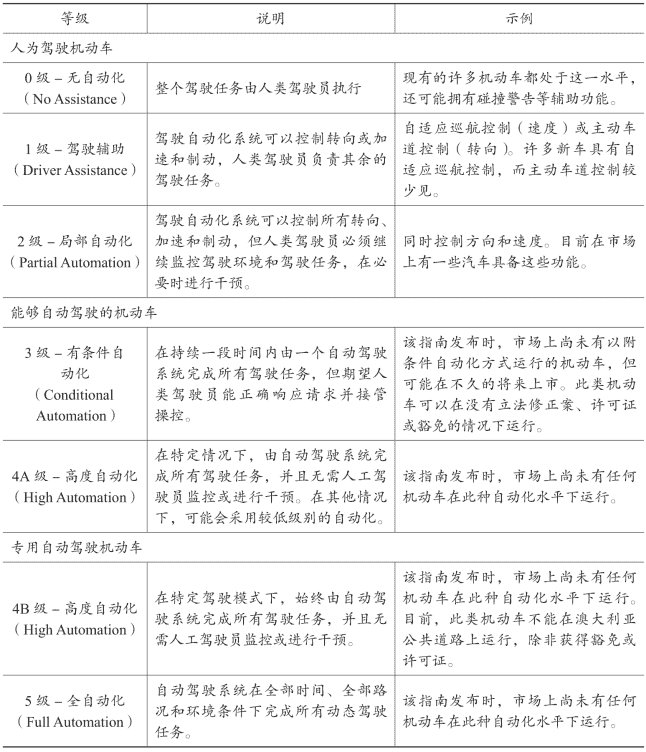
自动泊车辅助
系统可承担全部停车任务，部分厂商提供手机或遥控钥匙APP远程停车，驾驶人可不在车内但须在附近。具备车内泊车辅助与远程泊车辅助的车辆属2级自动化，使用时仍须人类监督。

### （五）责任分配与适当控制示例
表2按自动化等级划分的指引：
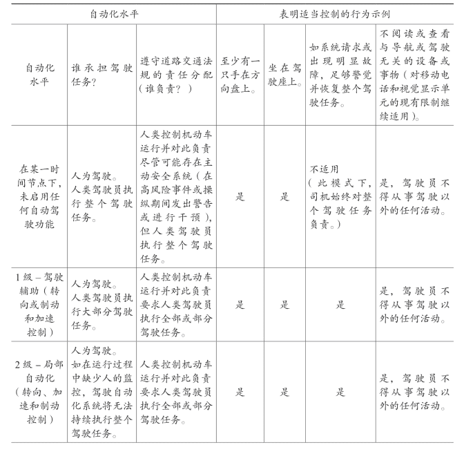
续表
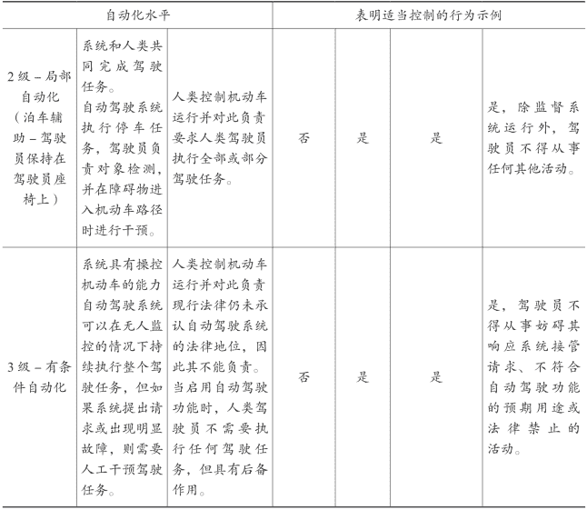

### （六）执法互动
现行法未强制装备自动化启用监测装置，制造商亦少提供。登记数据未来或将包含自动化等级信息，2020年作为安全保障项目推进。
1.证明自动化启用
警官判断是否违反第297条时，驾驶人可主张自动化正在作用且运行合规。举证责任由驾驶人或登记运营商承担，可通过陈述、制造商手册、车型性能、仪表盘信息等证明。
2.违法认定条件
未遵守表2适当控制要求且不属特定违法或更严重违法。
3.其他可能违法
缺乏适当控制可能导致违反具体规定如未示意变道，或更严重违法如未尽注意义务或危险驾驶。

# 第四节 澳大利亚为支持自动驾驶调整驾驶法规

## 一、背景
《改变驾驶相关法规以支持自动驾驶车辆发展》由国家运输委员会于2018年5月发布，聚焦自动驾驶车辆与ADS法律规制。

## 二、主要内容
### （一）概述
现行法规假定人类驾驶人存在。国家交通与基础设施委员会要求NTC提出改革方案，明确现行法对自动驾驶车辆的适用，并为自动驾驶系统实体ADSE确立法律义务。ADSE指对ADS行为负责的法律实体，可为制造商、登记运营者或其他主体。建议明确何时可由ADS而非自然人驾驶，并确保始终有责任主体。为商业化高度或完全自动化车辆，法律修改须与安全保障体系同步。

### （二）全国性法律必要性
需立法允许ADS执行驾驶任务并确保责任可归属，建议以全国统筹方式制定专门法律规范ADS“司机”，而非修改现有交通法。

### （三）承认ADS执行动态驾驶任务
驾驶可分为战略与动态任务。建议仅在安全保障体系许可并合规的ADS可在澳大利亚道路上执行动态驾驶任务，相关义务须以全国性法律明确，使ADS与自然人结果等同。

### （四）不同自动化程度的控制者与责任
车辆处于符合条件的高度自动化或全自动化状态时，应认定由ADS控制车辆。

2.鉴于 ADSE 对 ADS 具备最强的支配能力，ADS 的运行行为理应由经安全保障体系核验通过的 ADSE 来承担责任。

3.ADSE 的责任边界应严格限定在其实际可控范围内。

### （五）非动态驾驶任务的责任
1.经安全保障体系认定合格的 ADSE 需负责：
（1）ADS 履行动态驾驶任务所对应的义务。
（2）部分非动态驾驶任务所对应的义务。
2.各州、各地区、NTC 及联邦层面应开展立法研判，以厘清：
（1）ADSE 针对 ADS 执行动态驾驶与非动态驾驶任务的具体义务。
（2）当 ADS 处于受控状态下仍无法完全发挥功能时，驾驶责任应如何向其他主体转移。

### （六）自动驾驶机动车使用者的责任
1.当 ADS 以附条件自动化方式运行，即 ADS 在限定环境中持续承担全部动态驾驶任务，人工驾驶者无需实时监控环境或系统，但必须能够响应 ADS 发出的干预请求并处置系统异常时，则应将随时接管驾驶任务的职责赋予后备驾驶员。后备驾驶员指在附条件自动驾驶车辆中负责在需要时介入的自然人，需具备响应 ADS 人工干预请求、识别 ADS 明显故障并通过手动操作处置的能力。换言之，后备驾驶员应始终保持可接管状态。
2.不应要求车内乘客承担接管义务，因其不具备车辆控制能力。自动驾驶车辆的安全风险应通过 ADSE 所承担的义务予以降低。

### （七）酒驾、毒驾问题在自动驾驶情景下的法律规制
1.驾驶专用自动驾驶车辆的人员或车内乘客，因启动车辆或保管车辆而被追究酒驾、毒驾相关违法责任的情况应予排除。
2.凡与酒驾、毒驾有关的违法行为，均应适用于手动启动或关闭自动驾驶功能的人员。不过随着技术演进与国际治理经验的积累，该立场或需进一步审视。

### （八）合规和执法
1.ADSE 应对 ADS 未能妥善完成动态驾驶任务所产生的后果负责，并接受相应制裁与惩罚。
2.全国性专门立法将明确 ADS 可承担的动态驾驶任务义务范围。
3.在 2018 年 11 月理事会就安全保障体系关键要素达成一致后，应于 2019 年 5 月前向国家交通及基础设施委员会提交后续合规与执法建议，内容涵盖违反驾驶法规的行为、处罚及制裁。建议应结合安全保障体系所确立的职责与违法情形，特别是主要安全职责之间的关联。

### （九）下一步的工作
1.本政策性文件提供高层政策指引，旨在推动国家交通和基础设施委员会就自动驾驶机动车相关法规核心要素达成共识。
2.为制定专门国家法律，该高层政策文件需转化为立法起草指引。
3.NTC 的法律修订工作与安全保障体系改革紧密相连，部分驾驶法规改革应在安全保障体系相应部分明确后方能推进。

## 三、结论
本报告提出的立法建议：
1.允许符合条件的 ADS 执行动态驾驶任务。
2.确保在任何使用场景下均有法律主体对驾驶行为负责。
3.明确各类主体包括 ADS 及使用者在内的法律义务。
4.提供兼具灵活性与执行选择的监管框架。

# 第五节 澳大利亚：车联网与自动驾驶数据访问的管控边界

## 一、简介
《规制政府对 C-ITS 和自动驾驶机动车数据的访问》系澳大利亚国家运输委员会于 2019 年 8 月发布的报告。

# 澳洲自动驾驶与车联网数据隐私监管

本报告聚焦政府在收集与使用 C-ITS 及自动驾驶技术所产生数据时所带来的新隐私风险。报告指出现有信息访问框架或难以应对挑战，并提出通用设计原则以指导相关法律与统一标准的制定。

## 二、主要内容

### （一）概述
1.面对交通技术快速发展及潜在隐私风险，澳大利亚国家运输委员会正检视与政府数据获取及隐私保护相关的法规。
2.报告针对政府访问 C-ITS 与自动驾驶机动车数据及隐私保护法规提出建议。

### （二）研究内容与基本假设
1.研究核心是探讨政府收集使用 C-ITS 与自动驾驶生成数据时，公民是否需要额外隐私保护。报告认可政府获取此类数据存在价值，也强调需构建适宜授权环境。
2.NTC 在本报告中作出以下假设：
（1）由于数据关联性强，在多数情况下难以实现不可逆的去标识化。
（2）国际信息访问框架在数据隐私标准上仍存在差异，任何政策均应关注全球发展走势。
（3）作为安全改革一环，NTC 可建议授予特定立法权力以获取相关自动驾驶数据。

### （三）当前和未来汽车技术产生的数据
1.各方认可 NTC 对现行驾驶技术、C-ITS 及自动驾驶技术的总体描述。依据反馈，NTC：
（1）将“V2V/V2I 通信”调整为“V2X 通信”。
（2）将更具体且现存或未来可能出现的技术作为广义类别的示例列出。
（3）认识到自动驾驶领域相关电子控制部件可能使用不同命名。
2.该总体描述仅具说明性，并会随技术演进而变化。

### （四）政府访问数据的收益
1.政府获取 C-ITS 与自动驾驶数据，有助于其在执法、交通管理、基础设施与网络规划等领域的决策。
2.此类收益需与对相关主体隐私的保护相权衡。

### （五）技术带来的新隐私问题
1.C-ITS 与自动驾驶产生的数据在类型、广度与深度上均带来新的隐私挑战。
2.因数据可能涉及个人信息与敏感信息，隐私问题或直接影响个人用户。

### （六）信息访问框架的不足
1.澳大利亚信息访问制度在规制政府获取 C-ITS 与自动驾驶数据、尤其是应对新隐私问题方面可能存在缺口。
2.不足体现在法域差异、政府对数据的多次使用以及执法力度不一，易助长对公民的监视。
3.下一阶段 NTC 将推动新立法以规制政府收集自动驾驶相关数据，并特别注重隐私保护。
4.NTC 需进一步识别现行法律体系的短板，以便政府为公共目的更妥善地访问与使用数据。

### （七）规制路径
1.NTC 认为需改革以规范政府数据访问并解决隐私问题。
2.当前改革阶段，可对 C-ITS 与自动驾驶技术采取大体相近的方法，存在组合备选方案。
3.NTC 提出通用设计原则，以指导政府数据访问与新隐私问题的应对，为 NTC 与澳大利亚路政委员会后续工作提供指引。
4.该方法在监管框架与技术演进中具备足够灵活性。

### （八）设计原则
1.NTC 制定以下设计原则：
（1）平衡政府数据访问利益与公民隐私，适当限制数据的收集、披露与使用。
（2）与澳大利亚现行、未来及国际的隐私保护与数据访问制度保持协调。
（3）明确政府访问权限及相关隐私事项。
（4）以广义、技术中立的表述界定 C-ITS 与自动驾驶数据。
（5）使政府数据管理路径与个人信息保护的基本要求一致。
（6）详述允许使用数据的原因及被限制使用主体的范围，但不得妨碍经授权或法院命令的主体访问。
（7）承认以通俗易懂的语言告知用户数据收集、使用、披露与存储的重要性。
（8）承认知情同意的重要性，同时为政府在无法取得同意时以其他隐私保护方式获取数据提供途径。
（9）承认在多数情形下数据难以不可逆去标识化。
（10）支持数据安全保护。
（11）允许定期审查数据隐私保护状况。
2.上述原则仅为设计层面的指引，并非直接纳入立法的条文。

### （九）下一步的工作
1.设计原则将指导 NTC 推动立法并开展隐私保护评估。
2.政府将启动新工作，借助政府对数据的访问与使用提升运输网络效率并带动投资。

# 第六节 新西兰：自动驾驶发展路线图

## 一、简介
随着全球对自动驾驶研发关注度提升及自动化技术加速发展，新西兰交通运输部于 2019 年 11 月发布《自动驾驶机动车工作计划概述》。报告梳理了新西兰自动驾驶技术现状及部门为做好准备所开展的工作，重点在于构建适当监管框架与及时保障措施以管理相关风险。

## 二、主要内容

### （一）自动驾驶机动车能力
自动驾驶车辆具备感知环境并在无或少量人工干预下行驶的能力。自动化分 5 级，0-2 级需人类监控环境，3-5 级由车辆全部或部分监控环境。报告列明各级别特征。自动驾驶的收益目前尚不确定。

### （二）部署路径
经与制造商、政府机构及学界合作，新西兰交通运输部认为存在两条并行路径：一是在封闭城区部署全自动驾驶管理车队，常称机器人出租车；二是逐步提升现有公共与私人车队自动化水平。时间框架存在分歧，但部门最佳估计为：
1.未来两至三年：澳新或出现更多具备自动驾驶功能的私家车。
2.未来三至五年：可能在封闭城市环境中出现首批 4 级自动化车辆上路。
新西兰认为至少需 10 年或更久才能实现全环境全自动驾驶。

### （三）工作计划关键主题
为审视机遇与风险，部门确定四大重点主题，监管挑战与知识缺口如下，且会随技术演进而调整。

#### 主题一：安全
1.监管挑战
（1）新机动车技术尤其是自动驾驶的安全监管为重点。新西兰《陆路交通法》并未明文要求行驶时必须有人类驾驶员在车内，理论上符合标准的无人车可在道路合法行驶。
（2）需完善保障驾驶员、道路使用者及公众安全的制度，搭建框架时需考虑风险承受能力、灵活性与确定性的平衡、专业知识与资源需求。
（3）实施监管还应考虑配套基础设施，如前期专用车道及成本核算。
（4）新法规应兼容现有立法，不得过度限制创新。
2.知识缺口
（1）商业化自动驾驶在多大程度上依赖外部网络仍不确定，新西兰作为技术接受国受海外路径影响。
（2）待解问题包括基础设施与通信网络投资需求、区域卫星增强系统对定位精度与事故点降低的贡献、联网车辆在连接中断时的应对。
（3）3 级自动化相关问题：系统延迟停用带来的安全隐患、操作设计中最小风险方法的含义、3-5 级车辆中驾驶员在非驾驶状态的安全辅助义务及现有法下的监管方式、系统是否知晓自身极限并能回交控制权、升级至更高级别对其他使用者安全、合规与执法的影响。

#### 主题二：责任
1.监管挑战
（1）新西兰交通法存在潜在责任问题。《陆路交通法》未明确要求有人类驾驶员在车内，但该法及 2004 年《陆路交通道路使用者规则》多针对驾驶员设定义务。
（2）需评估更高自动化功能带来的新风险，3 级自动化已在部分车辆应用，截至 2019 年 8 月约有 400 辆特斯拉 Model 3 具备 3 级能力。
（3）保险业与法院需应对立法对事故责任规定不明的问题。1982 年《事故赔偿法》下的人身伤害保险计划适用于当地车辆，但对人类驾驶员角色极小化或缺席的车辆适用性模糊。
（4）一种思路是审查责任分配，识别驾驶员、车主、进口商、运营商、制造商、监管机构等中最易管控风险的主体。
2.知识缺口
（1）需明确现行法规在各自动化级别下的适用含义，已与法律团队探讨改革时间。
（2）责任方案应与新西兰其他监管框架一致，明确指引、规则与实体责任。
（3）需评估数据管理对责任认定的重要性：事故时执法应获取何种数据？应收集何种数据以支持保险定价？

#### 主题三：网络数据安全
1.监管挑战
（1）推广自动驾驶可能增加黑客攻击风险，需识别与监管风险以建立公众信心。
（2）隐私问题需在监管层面解决。1993 年《隐私法》已难应对新挑战，新隐私法案或于 2020 年生效以应对数据访问等议题。
2.知识缺口
（1）需厘清车辆生成并存储的个人信息、位置、路线历史、车主偏好等数据的提供、存储、使用、过滤方式及获取路径。
（2）数据敏感性与证据价值带来货币化、泄露、操纵等风险，需明确生成、存储、共享与访问的保护安排。

#### 主题四：社会和经济方面
全自动驾驶可能重塑交通格局，提升安全、缓解拥堵、降低污染与成本，但收益实现时间、公平性及所需政府干预程度仍不明。

### （四）跨机构协作
新西兰交通运输部与新西兰交通局合作纳入其观点，并计划共同制定 2020 年工作方案。部门亦访问澳大利亚，与专家、政府及学界交流。澳大利亚主要机构包括国家交通委员会与未来运输技术办公室，NTC 正审查道路规则以保障自动驾驶安全部署并协调法规。

OFTT 主导未来出行技术相关投资组合的统筹工作，同时负责公路交通政策框架与行动方案的制定。

新西兰交通运输部所关注的自动驾驶机动车监管空白，与 NTC 和 OFTT 当前正在处理的议题高度重合。NTC 在自动驾驶领域积累了丰富的专业经验，能够协助交通运输部厘清诸多监管难点。自 2015 年起，NTC 持续产出监管影响评估、政策建议等文件，交通运输部可以直接借鉴其中的大量观点，并结合本地实际纳入工作规划。

### （五）与澳洲协同以强化国际监管影响力
与 NTC、OFTT 这两家在自动驾驶监管中发挥关键作用的机构保持常态化联络，对交通运输部的工作至关重要，也有助于把握全球监管走向。目前由联合国欧洲经济委员会发起的全球道路交通安全论坛 WP.1 与世界车辆法规协调论坛 WP.29，正在就自动驾驶机动车的监管要求开展研究。

WP.1 与 WP.29 的决议对自动驾驶的安全标准与监管方式具有实质约束力。即便交通运输部不直接参与决策，也必须跟进。这些会议的成果会直接影响新西兰的做法，因此有必要与澳洲共同了解讨论内容并争取话语权。

澳洲自 2018 年年中起持续出席 WP.29 会议，交通运输部目前缺乏人力与财力派员参加 WP.1 与 WP.29。部门正探索与澳洲更紧密协作，同时也需要澳洲在国际场合充分转达新西兰的立场与优先事项。

### （六）对外沟通释疑的必要性
交通运输部持续与国际同行交流，特别是 NTC 与 OFTT，在学习借鉴的同时必要时影响可能波及新西兰市场的政策走向。

部门计划于 2020 年底前完成一份讨论稿，梳理新西兰面临的核心监管议题，向行业、利益相关方和公众传递其在自动驾驶方面的政策取向与重点。后续还将在官网持续公开信息，保持与专家群体的紧密协作。

# 第六章 中国自动驾驶监管概述和实务观察

## 一、监管特色与顶层设计概览
自动驾驶汽车亦称智能网联汽车、智能汽车，是全球竞争的焦点赛道，商业化节奏将决定产业主导权、资本集聚与行业重塑，而制度供给决定发展环境与市场预期。

作为前沿技术与汽车制造、出行服务深度融合的产物，自动驾驶已上升为国家战略。2020 年 2 月，国家发展改革委等 11 部门联合发布《智能汽车创新发展战略》，提出到 2025 年有条件自动驾驶智能汽车实现规模化生产，高度自动驾驶智能汽车在特定场景实现市场化应用；展望 2035 至 2050 年，建成中国标准智能汽车体系，实现智能汽车强国愿景。

战略明确六大任务：协同开放的技术创新体系、跨界融合的产业生态体系、先进完备的基础设施体系、系统完善的法规标准体系、科学规范的产品监管体系、全面高效的网络安全体系。

## 一、政策脉络与现行监管态势
在战略指引下，法规标准与产品监管呈现多维度立体化思路。

其一，体系建设，要求研究“机器驾驶人”认定、责任划分、网络安全、数据治理等法律与伦理问题，推动测试、准入、使用、监管方面的法规出台，并在立法上完善《道路交通安全法》及测绘地理信息相关法律。
其二，产品管理，完善生产、准入、销售、检验、登记、召回等规定，研究产品安全审核办法，完善场地测试标准与管理办法，加强公共道路测试审核监管。
其三，使用管理，颁布标识管理办法，强化身份认证，建立事故报告机制；加强车联网设备进网许可管理，制定软硬件升级、售后、质量担保与金融保险规定，推进商业化。
其四，网络与数据安全，完善网络安全管理制度，建立覆盖数据全生命周期的安全管理机制，明确主体责任。

在此背景下，2020 至 2022 年中国自动驾驶立法与监管明显加速。2021 至 2022 年代表性动态包括《道路交通安全法（2021 修正）》《深圳经济特区智能网联汽车管理条例》《关于开展智能网联汽车准入和上路通行试点工作的通知（征求意见稿）》、工信部《关于加强智能网联汽车生产企业及产品准入管理的意见》《汽车数据安全管理若干规定（试行）》、GB/T 40429-2021《汽车驾驶自动化分级》、以及《智能网联汽车道路测试管理规范》被更新为《智能网联汽车道路测试与示范应用管理规范（试行）》。

上述法律、法规、政策与标准覆盖企业与产品准入、测试、示范应用、商业试运营、数据安全、分级等，助力按战略时间表建成法规标准体系，也为合规经营提供支撑。

总体来看，现有规则与战略目标仍有补齐空间。

1. 先做试点，立法滞后。中国常以试点积累经验。国家鼓励公开道路试验与示范应用，地方探索无安全员远程监管与自动驾驶出租车示范。深圳走在前列，2022 年 6 月 30 日《深圳经济特区智能网联汽车管理条例》发布，涵盖测试示范、准入登记、使用管理、网络安全与数据保护、车路协同、道路运输、事故处理等，有望解决入市与运营许可问题，明确责任分配。

国家层面尚缺专项立法，《深圳市条例》或为首部综合性地方立法，但其与上层法律存在衔接冲突，需实践检验与修正。
2. 缺乏上层法律统摄，基础问题待解。2021 年 3 月 24 日公安部征求意见的《道路交通安全法（修订建议稿）》新增第 155 条，首次明确自动驾驶功能汽车道路试验与通行要求及责任分担，并将自动驾驶汽车分为具备人工直接操作模式与无法人工直接操作两类，还涉及技术要求与第三方检测机构。但正式修正案删除了该条建议。

在上层法律缺位下，2021 年 7、8 月出台的《管理规范（试行）》与《准入意见》提供了部门规章层面的路径，务实但合规层面仍存困惑，如违法与事故责任等基础问题，实务中常需回溯《民法典》《产品责任法》《道路交通安全法》等一般性框架，难以形成统一共识。

尽管不确定因素仍在，市场主体持续“先试先行”，商业场景不断丰富，共识正逐步形成。

## 二、车辆定义与分级标准
厘清定义是前提。依据工信部 2022 年 3 月 1 日实施的国家推荐标准 GB/T 40429-2021《汽车驾驶自动化分级》，结合动态驾驶任务角色分配、目标与事件探测响应角色、有无设计运行范围限制等因素，自动化程度分为 0 至 5 级。0 至 2 级属于驾驶辅助，3 至 5 级属于自动驾驶。

表 6-1　汽车驾驶自动化等级划分、名称及释义

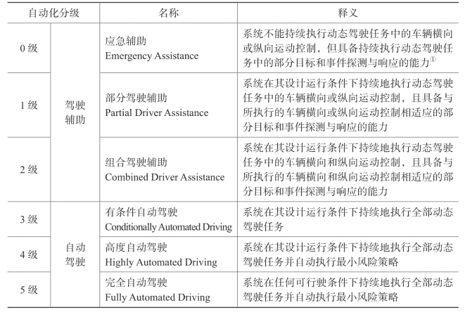
① 0 级驾驶自动化并非等于无驾驶自动化，此等级的自动化系统可感知环境，并提供提示信息或短暂介入车辆控制以辅助驾驶员避险（如车道偏离预警、前向碰撞预警、自动紧急制动、车道偏离抑制等紧急情况下提供的辅助功能）。

表 6-2　汽车驾驶自动化分级划分因素

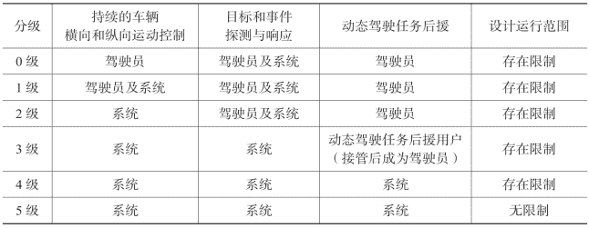

目前乘用车领域常见的智能驾驶或驾驶辅助系统，多处于 0 至 2 级。《汽车驾驶自动化分级》提供框架性区分，具体技术指标仍需其他标准细化。

## 三、产品准入要点
工信部 2021 年 7 月 30 日发布的《关于加强智能网联汽车生产企业及产品准入管理的意见》是首部生效的准入规范性文件，对产品提出基本要求：

1. 能自动识别自动驾驶系统失效及设计运行条件是否持续满足，并采取风险缓释措施达到最小风险状态。
2. 具备人机交互功能，显示系统运行状态；在需驾驶员接管时能识别驾驶员执行动态驾驶任务能力，并能以灯光、声音等方式与其他道路使用者交互。
3. 具有事件数据记录系统与自动驾驶数据记录系统，满足功能、性能与安全要求，用于事故重建与原因分析。自动驾驶数据记录系统应包括车辆与系统基本信息、状态与动态信息、系统运行信息、行车环境、驾乘人员操作与状态、故障信息等。
4. 满足功能安全、预期功能安全、网络安全等过程保障要求，并通过模拟仿真、封闭场地、实际道路、网络安全、软件升级、数据记录等测试，避免设计运行条件内可预见且可预防的安全事故。
5. 具有安全可靠的卫星定位与授时功能，提供位置、速度、时间等信息，鼓励支持北斗信号。

《准入意见》同时要求生产企业加强数据安全管理能力、网络安全管理能力、软件在线升级流程规范与产品管理能力。

## 四、路测制度：商业化的第一块基石
无论是驾驶辅助还是自动驾驶，均需大量场地与道路试验积累。2021 年 7 月 30 日，工信部、公安部、交通运输部联合发布《智能网联汽车道路测试与示范应用管理规范（试行）》，对主体、车辆、驾驶人提出较高准入要求。

道路测试主体需为境内登记注册的独立法人，具备相关研发、试验检测能力，拥有足够民事赔偿能力，具备自动驾驶功能测试评价规程、实时远程监控能力、事件记录分析再现能力及网络安全保障能力。

相较 2018 年原规范，新规范体现放管服导向：

1. 明确示范应用内涵，并以道路试验为前提。拟示范路段需完成 240 小时以上或 1000 公里以上自动驾驶模式试验，且试验期间无违法及车辆方负责的交通事故，方可申请初始或新增示范车辆，且示范范围不得超出已试验范围。
2. 将“道路测试/示范应用通知书”审核改为安全性自我声明。主体向省级、市级主管部门提交自我声明并获确认后即可试验，临时行驶车号牌申领依据亦改为声明，到期后可凭有效声明续领，无需重复功能测试。
3. 简化异地试验。已在某地试验的车辆赴其他省市试验，可持原材料及补充材料申请，无需重复通用及设计运行范围检测，降低多地试验负担。
4. 拓宽商业模式。允许道路试验搭载模拟货物配重，为智能网联货车商业化打开空间。

地方层面先行先试明显。如 2021 年 11 月 25 日北京市高级别自动驾驶示范区发布的《北京市智能网联汽车政策先行区自动驾驶出行服务商业化试点管理实施细则（试行）》，百度与小马智行成为首批获批企业，可在经开区范围内投放不超过 100 辆车辆开展商业化试点。

## 五、智能网联场景下的其他资质需求
自动驾驶试验与运营除路测牌照外，是否需要其他资质，取决于具体业务形态。地理信息测绘资质与高精地图相关，另行讨论。

1. 仅进行技术研发试验或提供解决方案，一般无需额外牌照
仅从事自动驾驶技术研发、试验或向主机厂提供技术方案，除道路试验许可外，通常不需额外资质。该活动本质为数据技术研发与技术服务，不构成需牌照的电信业务，也不涉及敏感的线上线下文化传播业务，外资主机厂亦可自行开展研究与应用试验。
2. 智能网联车辆通常依赖基础电信运营商的车联网卡服务
市场上带辅助驾驶/自动驾驶功能的车辆，多与车联网增值服务捆绑销售。因此车辆联网服务往往需依托持有基础电信牌照的运营商提供与支持。

智能网联汽车合规要点拆解

智能网联汽车要让远程升级、车路协同、在线服务等功能持续可用，前提是车辆保持在线。车载SIM卡^([\[3\]](#txt006.html#footnote_content_txt006_3))是实现稳定连接的载体，这类卡的供给方必须是经中国法律认定为基础电信业务经营者的主体，并持有基础电信业务经营许可。现实中具备完整资质并长期提供服务的，主要是中国移动、中国联通、中国电信等基础运营商。

《中华人民共和国电信条例》在原则上允许国有股权或股份比例不低于51%的企业在满足条件时申请基础电信牌照，但审批条件极苛、实际获批极少。做自动驾驶或智能网联汽车业务的主体，实践中几乎不会也没有必要自建基础电信牌照，普遍依托既有运营商的网络资源开展业务。

（3）增值电信牌照需求取决于业务形态

智能网联车辆服务里可能混入增值电信业务形态。一旦实质落入《电信业务分类目录》的描述范围，服务提供者就须取得对应的增值电信业务经营许可证，或将该部分业务交由持证主体提供。

A.B25 类增值电信业务

最典型的是 B25 类信息服务业务^([\[4\]](#txt006.html#footnote_content_txt006_4))，俗称 ICP 证。

法定业态主要有信息发布平台和递送服务、信息搜索查询服务、信息社区平台服务、信息即时交互服务、信息保护和处理服务等。其中信息保护和处理服务指向性很强，常规的自动驾驶服务提供者较难触及，其余业态则需结合具体功能判断是否落入 B25 范畴。

例如车联网平台开放入口给第三方内容商发布图文视频供车主浏览，很可能构成信息发布平台和递送服务。

再如服务商自行运营检索库，通过车机或车载语音助手为用户提供泛化信息搜索，也可能被认定为信息搜索查询服务。若检索功能实际由第三方搜索引擎运营，则持证义务在第三方，第三方需持有包含信息搜索查询子项的 B25 许可即可。

车机或手机客户端内提供论坛式交流、车友活动组织等，也容易被归入信息发布平台和递送。

允许用户即时收发文本、图片、音视频、文件，甚至交互式语音、端到端实时话音，则属于信息即时交互服务。车队组队、车内互联等场景中该能力较为常见，合规风险需重点关注。

厘清一点，仅向用户销售自动驾驶或辅助驾驶功能的主机厂，属于车辆操控与驾驶辅助的增值服务。即使该等功能需借助车联网卡传输数据，本质上不构成信息服务业务，通常无需为此单独取得 B25 许可。

B.B21 类增值电信业务

智能网联汽车服务形态中，部分场景会触及 B21 类在线数据处理与交易处理业务^([\[6\]](#txt006.html#footnote_content_txt006_6))。

B21 包含交易处理业务、电子数据交换业务、网络/电子设备数据处理业务。名称看似宽泛，是否归入仍需对照法定内容判定，不能仅因涉及网络和电子数据交互就认定需持牌。

交易处理业务可理解为经营性电子商务，即搭建网络交易平台撮合第三方买卖。若服务包中包含车机或 App 内的第三方商城，允许用户购买第三方售卖的车配件、汽车精品，则一般需 B21 交易处理许可。若仅是运营者自产或自购商品自营销售，则属于自营，不需要该类牌照。

电子数据交换业务指向自建第三方电子数据交换平台，按国际公认标准格式为贸易或行政事务双方提供数据交换服务，典型如海关 EDI 平台，与自动驾驶关联度很低。

网络/电子设备数据处理业务指向为他人提供网络/电子设备的数据处理平台，通常需支持终端软件自动激活配置个人数据、实时诊断和管理控制设备。若服务商自建平台仅为自有车辆和车主提供实时诊断、管理、控制，则不属于此牌照范畴。实践中一个场景是车辆通过车机 App 远程控制家用智能家居，背后依赖第三方物联网平台，此时该第三方物联网平台提供方才需持有网络/电子设备数据处理业务的 B21 许可。

六、地理信息测绘问题
### （1）底层技术支撑——高精地图的制作与准入
自动驾驶要实现实时定位和环境感知，需要的是供车阅读的高精地图，而非供人查阅的导航图。企业在提供自动驾驶服务时涉及的高精地图制作、实时定位、道路环境信息采集等行为，都可能落入《测绘法》所称的测绘活动，即测定、采集、表述自然地理要素或人工设施的形状、大小、空间位置及其属性，并对数据成果进行处理和提供。

中国对测绘活动实行资质管理，由自然资源部及省级主管部门核发不同等级资质。2021 年测绘管理规定实施后，资质由原四级改为甲乙两级，专业类别基本保留，涵盖大地测量、测绘航空摄影、摄影测量与遥感、工程测量、海洋测绘、界线与不动产测绘、地理信息系统工程、地图编制、导航电子地图制作、互联网地图服务。

就高精地图而言，《关于加强自动驾驶地图生产测试与应用管理的通知》国测成发〔2016〕2 号明确，自动驾驶地图属于导航电子地图的重要组成部分，其采集、编辑加工、生产制作必须由取得导航电子地图制作测绘资质的单位承担。2021 年规定新增了乙级导航电子地图制作资质，条件较甲级放宽，但作业范围受限，乙级不得在政府划定的自动驾驶区域外从事导航电子地图制作。

### （2）外资的准入限制与实践模式
#### A.常规测绘活动
依据《外国的组织或者个人来华测绘管理暂行办法（2019 修正）》，外资企业在华开展常规测绘不得单独经营，必须与中方部门或单位依法合资合作。但《外商投资准入特别管理措施（负面清单）（2021 年版）》将导航电子地图编制列为外资禁止投资领域，不论是否合资合作，外资企业均不得在华从事导航电子地图编制，也不得制作高精地图。

#### B.一次性测绘活动
经国务院或地方政府批准，外国企业为科技、文化、体育等活动需进行一次性测绘时，可不设合资合作企业，但须经国务院自然资源主管部门会同军队测绘主管部门批准，并与中方测绘人员共同作业。

#### C.实践模式
车企的策略因股权性质而异。部分厂商为全产业链布局，通过收购或入股持有测绘资质的企业间接获取资质并长期持有，如吉利对箩筐技术的战略投资并阶段性收购易图通、上汽投资中海庭。另一类厂商仅为主营业务增值，选择与国内持证图商合作，如丰田与 Momenta 合作提供基于视觉的高精地图及更新服务，宝马与四维图新合作，凯迪拉克、吉利先后与高德在高精地图领域展开合作。

对境外车企而言，因负面清单限制无法通过收购入股方式从事导航电子地图编制，只能与在华持证企业合作。根据国测成发〔2016〕2 号，合作中涉及的测绘活动必须由导航电子地图制作单位单独承担。用于自动驾驶试验、道路测试的地图数据，应按涉密测绘成果管理并确保数据安全，未经省级以上测绘地理信息主管部门批准，不得向外国组织、个人以及在华外商独资、中外合资、合作企业提供或共享地图数据，也不得让超出范围人员接触。

七、数据安全与个人信息保护
企业在自动驾驶服务中处理数据和个人信息，需遵守《网络安全法》《个人信息保护法》《数据安全法》及《汽车数据安全管理若干规定（试行）》等要求。

### （1）自动驾驶场景下的数据安全要点
自动驾驶实现与迭代依赖传感器、控制单元、车载智能设备采集的海量底层数据，包括车外数据、座舱数据、运行数据、位置轨迹数据等。

除遵守《数据安全法》的全流程管理制度和分级分类管理要求外，还应遵循《汽车数据安全管理若干规定（试行）》。当处理的数据构成该法规项下的重要数据时，需履行风险评估并报送报告；重要数据原则上境内存储，确需出境须通过主管部门安全评估；每年12月15日前报送年度安全管理情况。

国家层面《网络数据安全管理条例（征求意见稿）》《数据出境安全评估办法》等进一步细化了重要数据处理者备案、年度评估报告、境外上市安全评估等要求，企业需持续跟踪。

就可能涉及的重要数据类型而言，包括反映经济运行的车辆流量、物流数据；汽车充电网运行数据；含人脸、车牌的车外视频图像数据；个人信息主体超过10万人的个人信息。企业需结合业务盘点识别是否属于重要数据处理者。

### （2）个人信息合规的核心要求
#### A.处理个人信息的基本原则
核心是知情同意。处理前需充分告知处理者身份、目的、方式、个人信息种类、保存期限及权利行使方式等；除法例外，需取得主体同意，特殊场景要求单独同意，且同意可撤回。

同时应遵守最小必要原则，不收集与业务无关信息，不捆绑非必要权限，不以不正当方式强迫收集，收集频度不得超出功能必需。

#### B.众包模式下的合规提示
汽车产业链细分导致众包模式广泛应用。涉及数据和个人信息处理的服务若采用众包，需在协议中明确承包方数据来源合法性与授权范围的充分性，要求承包方作出陈述、保证与承诺；涉及对外提供时，还需以合同约束接收方的责任与义务，禁止滥用行为。

八、核心算法及配套技术的知识产权保护
中国与境外近年来自动驾驶领域知识产权和商业秘密纠纷频发，反映出人才争夺和技术卡位激烈。商业秘密和算法知识产权保护尤为关键。

### （1）自动驾驶相关商业秘密保护
依据2019年修正的《反不正当竞争法》，商业秘密需同时具备秘密性、价值性、保密性三要件。若自动驾驶企业的技术信息、算法满足三要件，可作为商业秘密保护。根据《最高人民法院关于审理侵犯商业秘密民事案件适用法律若干问题的规定》，算法、数据、计算机程序及其文档可被认定为技术信息。实践中涉诉对象多为技术资料、源代码副本等电子数据。

权利人举证上只需提供初步证据证明已采取保密措施且合理表明被侵权，被控方则需证明信息不构成商业秘密或未侵权。保密措施的认定至关重要，签订保密协议、培训告知、限制来访与区分管理、限制获取范围、限制访问等均属有效措施。

损害赔偿数额难以举证时，法院可考虑商业秘密商业价值，包括开发成本、实施收益、可得利益、竞争优势维持时间等。目前该领域纠纷多以和解或撤诉收尾。

### （2）自动驾驶算法在商业秘密以外的知识产权保护路径
#### A.算法作为专利保护
部分算法若满足方法专利条件可申请专利。申请时需注意《专利法》与《专利审查指南》禁止授予“智力活动的规则和方法”。实践中应将技术方案与具体技术领域物理实现对应，权利要求中体现步骤与物理实现的映射，参数需结合具体技术领域描述，以公开换取保护，适合保密要求较低的算法。

#### B.算法和配套软件的著作权保护
算法和配套软件呈现为计算机软件时，可通过软件著作权保护。著作权在代码和文档完成时自动形成，无需申请登记。

为证明创作事实，开发者通常会进行过程保全。例如借助第三方存证机构，采用时间戳、区块链等方式对特定时点代码版本进行存证，确保客观公正记录创作事实。开发完成后或达到阶段节点时，也可进行计算机软件著作权登记。

九、待探寻的疑问与展望：自动驾驶语境下的道路交通安全归责问题
自动驾驶语境下的道路交通安全归责，是全球自动驾驶发展面临的核心法律难题，中国同样面临制度空白与实践争议。

智能驾驶时代的责任归属如何厘清

现行对机动车交通事故的规制，核心依据集中于《民法典》侵权责任编以及《道路交通安全法》，既涉及驾驶人在道路上的过错归责，也涵盖汽车生产者、销售者的产品责任。伴随自动驾驶技术快速演进，原本以人为本的规则体系在新场景下显露出适用张力，实践中容易出现责任真空。

就道路交通事故责任而言，传统框架把责任锚定在车辆驾驶人身上，归责以过错为基本原则。进入高阶自动驾驶情境后，实际操控职能逐步由人转向车载智能系统，事故发生后谁是责任主体、行为人的过错如何判断，现有条文难以给出清晰指引。

就产品责任路径而言，即使不以过错为前提，只要能够证明产品存在质量缺陷并与损害之间形成因果链，受害人仍可主张赔偿。但自动驾驶系统具备持续学习与自主决策特性，事后还原事故触发机理的难度显著提升，受害人完成举证的门槛被大幅抬高。

立法层面的探索已经展开。2021年3月24日公安部出台的《道路交通安全法（修订建议稿）》，以及深圳市的地方性规范，均对智能网联事故的责任分担做了初步尝试。

《公安部建议稿》第 155 条第二款、第三款规定^([\[7\]](#txt006.html#footnote_content_txt006_7))，具有自动驾驶功能且具备人工直接操作模式的汽车发生交通事故的，应当依法确定驾驶人、自动驾驶系统开发单位的责任，并依照有关法律、法规确定损害赔偿责任；具有自动驾驶功能但不具备人工直接操作模式的汽车上道路通行的，由国务院有关部门另行规定。前述关于具有自动驾驶功能且具备人工直接操作模式的汽车发生交通事故的规定依然非常原则性，而对于具有自动驾驶功能但不具备人工直接操作模式的汽车上道路通行的，《公安部建议稿》尚未作出规定。

在《深圳市条例》中，第 51 条、第 53 条、第 54 条^([\[8\]](#txt006.html#footnote_content_txt006_8))根据智能网联汽车是否配备驾驶人分别做出了规定：（1）对于配备驾驶人的智能网联汽车发生交通事故且智能网联汽车一方负有责任的，该车辆的驾驶人应当承担相应的损害赔偿责任；因智能网联汽车质量缺陷造成交通事故的，驾驶人依法承担损害赔偿责任后，可以向智能网联汽车的生产者、销售者追偿；（2）对于不配备驾驶人的智能网联汽车发生交通事故且智能网联汽车一方负有责任的，该车辆的所有人或者管理人应当承担相应的损害赔偿责任；因智能网联汽车质量缺陷造成交通事故的，车辆的所有人或者管理人依法承担损害赔偿责任后，可以向智能网联汽车的生产者、销售者追偿。

除立法动作外，近年学界对自动驾驶语境下交通安全归责的讨论也愈发深入，既有境外立法、判例的梳理，也有针对国内现有制度的修正构想。

迄今为止，未检索到中国法院就自动驾驶交通事故作出的公开裁判。展望将来，随着技术从测试走向大规模商业化，相关立法有望陆续出台，司法实践也将出现回应性案例。我们理解，在自动驾驶交通事故责任承担的语境下，该等立法和司法实践将主要围绕着交通事故受害人、自动驾驶汽车驾驶人/控制人/所有人、自动驾驶汽车生产者及销售者之间如何承担和划分责任进行展开。就中国的自动驾驶法案和相关标准，请见表 6-3。

表 6-3　中国的法案和标准

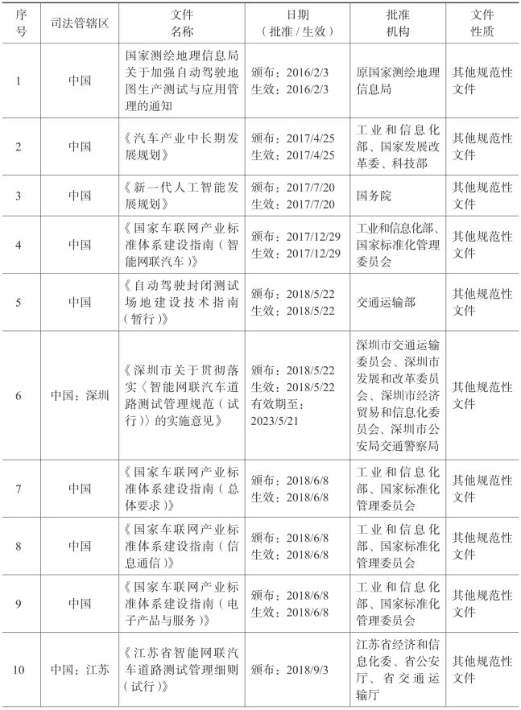

续表

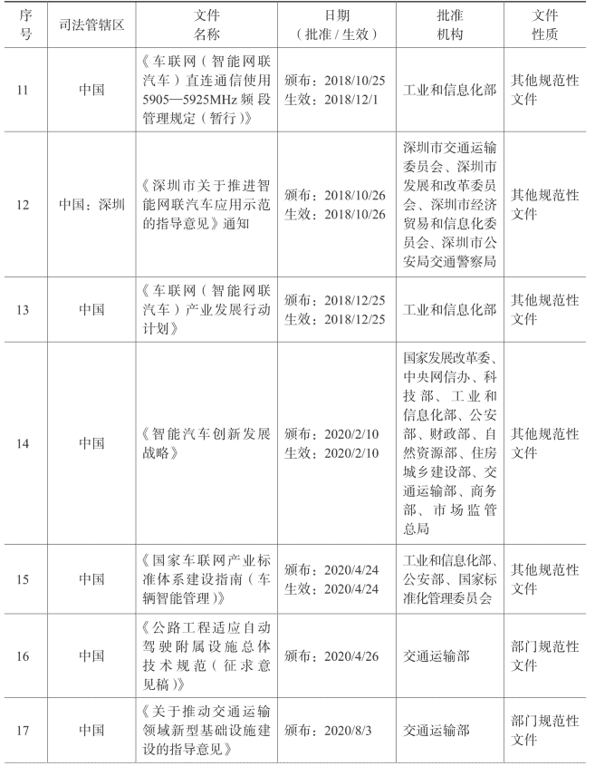

续表

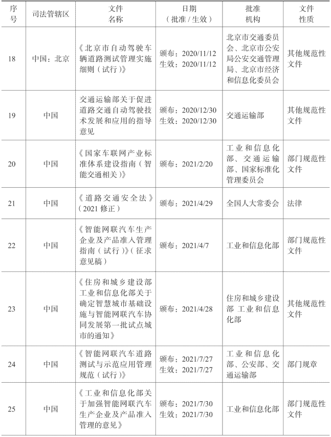

续表

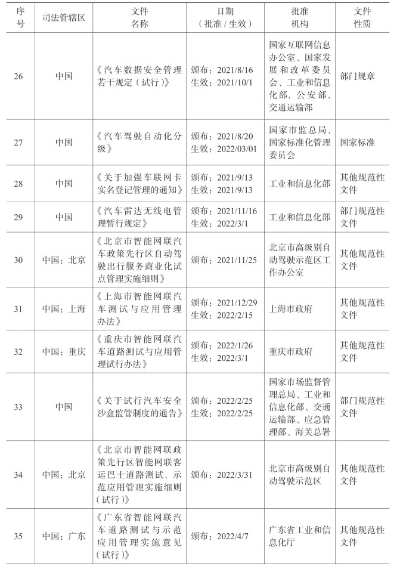

## 续表

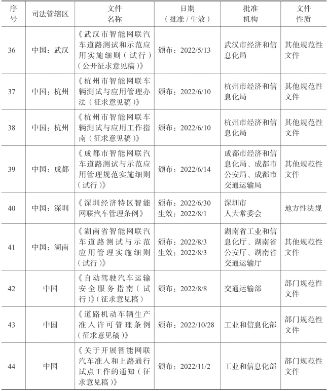

## 【注释】

[\[1\]](#txt006.html#footnote_quote_txt006_1)本章由海问律师事务所傅鹏律师和林熙翔律师撰写。

[\[2\]](#txt006.html#footnote_quote_txt006_2)是指在公路（包括高速公路）、城市道路、区域范围内等用于社会机动车通行的各类道路指定的路段进行的具有试点、试行效果的智能网联汽车载人载物运行活动。

[\[3\]](#txt006.html#footnote_quote_txt006_3)车联网卡指装载于道路机动车辆，用于实现车辆联网、数据传输、状态监测、应急处置等通信服务功能的专用物联网卡。

[\[4\]](#txt006.html#footnote_quote_txt006_4)信息服务业务是指通过信息采集、开发、处理和信息平台的建设，通过公用通信网或互联网向用户提供信息服务的业务。

[\[5\]](#txt006.html#footnote_quote_txt006_5)信息保护和处理服务指利用公用通信网或互联网，通过建设公共服务平台以及运行在计算机、智能终端等的客户端软件，面向用户提供终端病毒查询、删除，终端信息内容保护、加工处理以及垃圾信息拦截、免打扰等服务。典型的形态如 360 杀毒、腾讯手机管家、百度手机卫士等。

[\[6\]](#txt006.html#footnote_quote_txt006_6)B21 类增值电信业务全称为在线数据处理与交易处理业务，是指利用各种与公用通信网或互联网相连接的数据与交易/事务处理应用平台，通过公用通信网或互联网为用户提供在线数据处理和交易/事务处理的业务。

[\[7\]](#txt006.html#footnote_quote_txt006_7)《公安部建议稿》第 155 条第二款、第三款规定：“具有自动驾驶功能且具备人工直接操作模式的汽车开展道路测试或者上道路通行时，应当实时记录行驶数据；驾驶人应当处于车辆驾驶座位上，监控车辆运行状态及周围环境，随时准备接管车辆。发生道路交通安全违法行为或者交通事故的，应当依法确定驾驶人、自动驾驶系统开发单位的责任，并依照有关法律、法规确定损害赔偿责任。构成犯罪的，依法追究刑事责任。具有自动驾驶功能但不具备人工直接操作模式的汽车上道路通行的，由国务院有关部门另行规定。”

[\[8\]](#txt006.html#footnote_quote_txt006_8)《深圳市条例》第 51 条规定：“有驾驶人的智能网联汽车发生道路交通安全违法情形的，由公安机关交通管理部门依法对驾驶人进行处理。完全自动驾驶的智能网联汽车在无驾驶人期间发生道路交通安全违法情形的，由公安机关交通管理部门依法对车辆所有人、管理人进行处理。依照本条第二款规定处理交通违法，对违法行为人的处罚不适用驾驶人记分的有关规定。”第 53 条规定：“有驾驶人的智能网联汽车发生交通事故造成损害，属于该智能网联汽车一方责任的，由驾驶人承担赔偿责任。完全自动驾驶的智能网联汽车在无驾驶人期间发生交通事故造成损害，属于该智能网联汽车一方责任的，由车辆所有人、管理人承担赔偿责任。”第 54 条规定：“智能网联汽车发生交通事故，因智能网联汽车存在缺陷造成损害的，车辆驾驶人或者所有人、管理人依照本条例第五十三条的规定赔偿后，可以依法向生产者、销售者请求赔偿。”

# 后记
## 响应二十大号召，加速汽车强国进程

2022 年 10 月，中国共产党第二十次全国代表大会胜利闭幕。习近平总书记在会上作的报告，为全面建设社会主义现代化国家指明了方向。大会精神是高举中国特色社会主义伟大旗帜，全面贯彻习近平新时代中国特色社会主义思想，为实现第二个百年奋斗目标而团结奋斗。

在这一时代背景下，自动驾驶行业的发展是对大会精神的落实，是坚持和发展中国特色社会主义的实践举措，在如下方面体现了大会精神的重要理念。

首先，建设现代化产业体系是推动高质量发展的重要内容。其中，提及推进新型工业化，加快建设制造强国、质量强国、航天强国、交通强国、网络强国、数字中国。推动制造业高端化、智能化、绿色化发展。推动战略性新兴产业融合集群发展，构建新一代信息技术、人工智能、生物技术、新能源、新材料、高端装备、绿色环保等一批新的经济增长引擎。加快发展物联网，建设高效顺畅的流通体系，降低物流成本。加快发展数字经济，促进数字经济和实体经济深度融合，打造具有国际竞争力的数字产业集群。自动驾驶作为汽车智能化的核心，在数字经济中占据重要地位，对汽车产业、出行模式、国民经济运行效率将带来颠覆性的影响，可能催生出全新的商业模式和产业格局，具有高度战略意义。加快自动驾驶技术的研发和应用，提高自动驾驶产业的国际竞争力和影响力，是加快实施创新驱动发展战略的重要实践。在此背景下，本书在架构设计和内容编撰过程中深入学习和领会大会精神，以期为我国自动驾驶立法和自动驾驶合规实践提供理论参考。

其次，习近平总书记指出，当前世界百年未有之大变局加速演进，世界之变、时代之变、历史之变正以前所未有的方式展开。自动驾驶作为数字经济发展的一项核心应用，在全球范围内已被多个国家提升至战略高度，积极行动以抢占发展制高点；各国政府在政策法规方面纷纷给予大力支持，加速自动驾驶商业化，加速行业发展。在此背景下，应坚持开放合作的姿态，加强与国际社会在自动驾驶领域的交流与合作，共同推进人类命运共同体的建设。在此技术上，本书选取美国、英国、欧盟、德国、新加坡、澳大利亚等地最新的立法进展和产业政策予以总结，希望对我国自动驾驶立法发展有所助益。

再次，习近平总书记在大会报告中提到，未来五年是全面建设社会主义现代化国家开局起步的关键时期，主要目标任务是经济高质量发展取得新突破，科技自立自强能力显著提升；要坚持以人民为中心的发展思想。维护人民根本利益，增进民生福祉，不断实现发展为了人民、发展依靠人民、发展成果由人民共享，让现代化建设成果更多更公平地惠及全体人民。自动驾驶的发展可能对人民生活的方方面面带来深远影响，可以满足人民对安全、便捷、舒适出行的需求，提升人民生活品质和幸福感。同时，自动驾驶行业是绿色发展理念的生动事例，推广自动驾驶车辆的节能减排和智能管理，可以大力促进交通运输领域的低碳转型和可持续发展。

最后，教育、科技、人才是全面建设社会主义现代化国家的基础性、战略性支撑。其中完善科技创新体系、加快实施创新驱动发展战略和深入实施人才强国战略是重要内容。要坚持面向世界科技前沿、面向经济主战场、面向国家重大需求、面向人民生命健康，加快实现高水平科技自立自强；培养造就大批德才兼备的高素质人才，建设规模宏大、结构合理、素质优良的人才队伍。本书在定位上作为“法律+科技”系列教材和著作，在为自动驾驶行业人士提供参考的同时，也可作为网络和信息法学教材，以期为培养相关法治人才做出贡献。

中国特色社会主义巍巍巨轮乘风破浪、行稳致远。希望本书的出版，可以在时代的浪潮中，为建设现代化产业体系、推动经济高质量发展，最终全面建设社会主义现代化国家、全面推进中华民族伟大复兴贡献微薄之力。