# 运营助手：AI 短视频与直播 策划+制作+多平台运营一本通

# **前言**

**写作驱动**

很多运营岗位的工作人员刷到爆款短视频时有点赞、收藏的习惯，看似非常努力，有不少积累，但实际创作时总是对着空荡荡的剪辑界面发愁，心中狐疑：为什么别人剪辑、发布的短视频总能精准找到流量密码？为什么同样是使用 AI 工具制作短视频，我做出的短视频点击寥寥、无人问津？

也许，你也经历过这些打击：用 3 天的时间写出了文案，没人看；用 AI 生成了一些素材，总觉得“差点儿意思”；用心做的短视频发布后，数据惨淡，更别提高效变现了；想做矩阵运营，却不知道应该分别在各平台上发什么内容、怎么发相关内容；尝试直播带货，脚本写了又写，改了又改，总是不满意；偶然一次，流量来了，却拼命留也留不住……短视频相关工作的入局门槛看似很低，真正做好却并不容易，需要跨过策划、制作、运营、变现等重重关卡。当 AI 工具成为辅助工作的标配，不会用技术放大创意、提升效率，就会被时代远远地甩在身后。

本书想解决的核心问题精准对应以上现象，致力于让每一位普通人都能借 AI 之力，从 0 到 1 做出爆款短视频。此外，本书全力赋能运营关键环节，帮助读者实现岗位能力、短视频制作与宣传效果、运营收益等方面的多重突破。

**本书特色**

作为深耕 AI 内容创作的实践者，我们发现，比起对各种工具的功能的介绍，读者更需要的是项目式的场景化解决方案。因此，本书拒绝用大量的笔墨论述抽象的理论，取而代之的是将 AI 工具的使用嵌入具体创作场景——你想做国学文化类短视频时，可以直接使用本书提供的模板，让 DeepSeek 生成相关文案；你想在抖音平台上发布诗词动画类短视频时，可以直接按照本书提供的分步操作指南，完成即梦 AI 生图、剪映合成等工作；你想设计直播脚本时，也可以在本书中找到拿来即用的框架。这是本书的第一大特色——每个案例都依托真实的运营经验，每个步骤都已经过验证，确保大家看完就能应用，实现类似的效果，赋能关键环节，提高工作效率。

呈现全链路思维是本书的第二大特色。爆款短视频的成功，不是单一环节的胜利，而是策划、制作、运营、变现环环相扣的结果。在本书中，以各类短视频账号的运营为例，不仅教会你如何使用海螺 AI 完成配音工作，还告诉你怎么通过添加话题、标签扩大传播范围，怎么通过分析数据不断优化内容，甚至怎么通过设计、调整课程实现变现。理解、掌握从创意到收益的完整逻辑，有助于绕开“只会做内容，不会算收益”的陷阱。

本书的第三大特色是饱含提高工具协同效率的实战智慧。AI 时代的创作，比拼的不是对单个工具使用技巧的掌握程度，而是综合使用不同工具的协同效率。本书以项目实战为主线，串联起了 DeepSeek、即梦 AI、海螺 AI、剪映等工具，形成了“文案生成→素材制作→视频合成→视频发布→账号运营→（基于数据）优化文案生成”的完整闭环。比如，创建 AI 智能体时，会介绍如何使用 DeepSeek 设置人设逻辑、如何搭配文案插件提升 AI 智能体的创建效率；运营平台矩阵时，会介绍如何以一套素材为基础，微改便适配不同平台的不同特性。这种组合思维，能让大家的创作效率指数级提升。

无论你是刚入门的自媒体新人，想靠发布短视频、运营短视频账号增收，还是企业中的运营岗员工，想借助 AI 转型、破局；抑或是内容创作者，想让自己的创意被更多人看见，本书都能成为你的“贴身运营助手”。

我们深知，“看会”和“学会”是有距离的。因此，随书附赠 149 页教学 PPT、107 个素材效果文件、76 组 AI 提示词、60 集教学演示视频，大家可下载使用。注意，这些资料不是简单的对本书内容的补充，而是在你阅读本书的过程中帮你跳过试错环节的“快捷键”——直接使用现成的提示词生成所需要的文案、直接使用趁手的素材效果文件完成练习、直接跟着教学指导视频进行操作……这有助于我们快速掌握核心技能，实现 AI 创作能力的高效提升。

短视频运营的风口还在，相关红利正在向懂 AI、会运营的人靠近。现在就翻开本书吧，让 AI 成为你的创意放大器，让你做出的、发布的每一条短视频都离爆款短视频更近。

**特别提示**

1．在本书的编写过程中，作者截取操作图片时使用的是彼时最新版本的软件/工具，如 V1、V2、V3 版本的 DeepSeek App、2.5.30.173 版本的可灵 AI App、1.5.6 版本的即梦 AI App、16.5.0 版本的剪映 App。但书从编写到编辑、出版需要一段时间，在此期间，这些软件/工具的版本、功能、界面可能会有调整、升级，阅读时，请不要局限于细节差异，根据书中的思路举一反三地进行学习即可。

2．需要注意的是，即使使用完全相同的提示词，AI 工具每次生成的文字回复、图片/视频效果也会有差别，因此，扫码观看教学指导视频时，请不要过于关注视频中的 AI 生成细节，把更多的精力放在提示词的编写上、实际操作步骤的熟悉上更有利于相关能力的快速提高。

3．因为书内空间有限，对于 AI 工具回复的内容，会择要点进行展示。想阅读详细的 AI 工具回复的内容，请看随书附赠的完整版效果文件。

**资源获取**

读者可以用微信“扫一扫”功能扫描下方二维码，关注编辑部微信公众号，输入本书 77 页的资源下载码，根据提示获取随书附赠的教学资源。

资源下载码：250930

**作者服务**

本书由全权编著，由高彪负责整理，在此表示感谢。由于编写人员的知识水平有限，书中难免有疏漏之处，恳请广大读者批评、指正。作者的微信号为 2633228153。

# **岗位与效率篇**

## **第一章** **熟悉运营全流程：AI 国学文化类短视频账号运营实战**

**案例驱动**

【运营岗位】短视频运营经理。

【运营目标】运营一个 AI 国学文化类短视频账号，在 2 个月内做到单条短视频播放量破 100 万，并实现 1 个月内变现收入超过 5 万元的目标。

**内容概要**

本章以 AI 国学文化类短视频账号的运营为例，从短视频运营经理的角度出发，讲解短视频的策划、制作，短视频账号的运营等实战技巧，并通过打造一个独具匠心的 AI 国学文化类短视频账号，帮助读者更好地了解短视频账号的整个运营流程。

### **1.1 找思路：学会拆解爆款 AI 短视频**

在短视频领域，爆款 AI 短视频犹如璀璨明星，吸引了无数目光。对其进行拆解，能洞悉其魅力所在。这些爆款 AI 短视频往往能够在内容上精准戳中大众的痛点问题或引发大众的情感共鸣，且在形式上充分利用 AI 技术带来的新奇视觉体验。

本节以国学文化类 AI 短视频的策划为例，深入拆解爆款 AI 短视频，帮助短视频运营经理理解这些爆款 AI 短视频的成功逻辑，为其实现运营目标打好基础。

**1.1.1 案例效果与数据分析**

中国的国学文化底蕴深厚，是中华文明千年传承的智慧结晶。国学有诗词、散文、戏曲等丰富多彩的文学形式，字句间尽显汉语韵味与美感；也有诸多历史典故，蕴藏着古人治世、修身的智慧。传统技艺如书法、绘画，能彰显独特艺术魅力，是民族精神与文化的重要载体。在短视频平台上，国学文化相关内容广受欢迎，下面我们来拆解相关的短视频案例。

抖音平台上的某个国学文化类短视频的画面效果如图 1-1 和图 1-2 所示，该短视频聚焦内耗、焦虑等情绪，以“生而悦己，而非困于他人”为核心，精准戳中当下人们因外界评价与期待而自我消耗的痛点问题，能够引发强烈的情感共鸣。搭配“情感”等热门话题，更有利于拓宽传播面。

国学文化内涵为这个短视频赋予了深厚底蕴，这个短视频因此拥有出色的效果，为受众带去了心灵启迪与成长感悟。

图 1-1

图 1-2

从数据层面看，该短视频在抖音平台上有较好的传播表现——点赞数达 24.2 万，表明受众对视频内容是高度认可的；评论数为 6651，体现受众参与讨论的积极性较高；收藏数高达 7.3 万，说明很多受众觉得视频内容是有价值的；转发数为 9.2 万，意味着视频有较强的传播价值，受众乐于将其分享给更多人。

除了为与国学文化有关的文案配多个相关图片或视频，制作多个视频片段或者视频分镜这一视频制作形式外，还有很多国学文化类短视频常用的形式是只给文案配一张图，但是首个画面只展示图片的一部分，随着运镜，逐步展示同一张图片的其他部分。

抖音平台上的某个国学文化类短视频的画面效果如图 1-3 和图 1-4 所示，这个短视频就是使用只给文案配一张图的形式制作的。该短视频以十六字箴言“藏锋、隐智、戒欲、省身、求实、慎言、节情、向善”为核心内容，巧妙地融合了国学文化精髓与人生智慧，简洁、有力地传递了深刻的内涵。结合使用“#国学文化”及相关热门标签，该短视频可以精准吸引目标受众，激发他们对国学智慧的探索欲，并为他们带去心灵启迪与智慧滋养，效果令人赞叹。

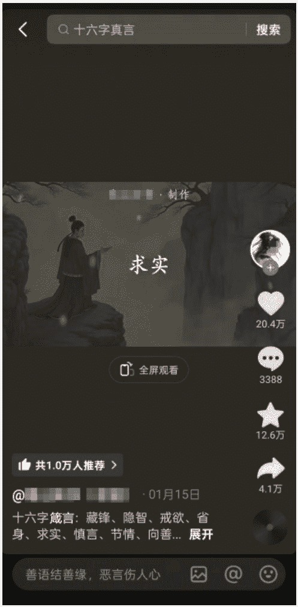

图 1-3

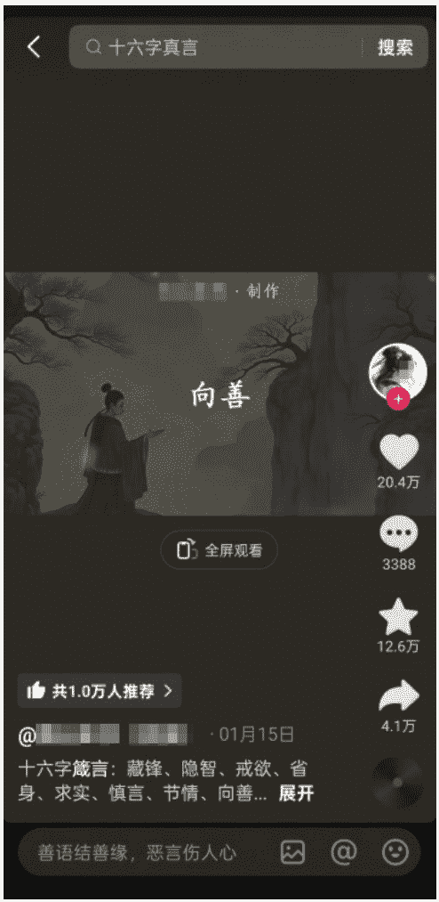

图 1-4

从数据层面看，该短视频在抖音平台上的传播表现同样可圈可点——点赞数达 20.4 万，充分表明受众对视频内容给予了一定程度的认可与青睐；评论数为 3388，凸显了受众高涨的参与热情及视频评论区浓厚的互动氛围；收藏数多达 12.6 万，体现了受众对视频内容的高度认可与珍视；转发数为 4.1 万，意味着视频有较好的传播潜力，受众主动分享的意愿强烈。

**1.1.2 视频内容结构分析**

国学文化类短视频的制作与发布旨在传播国学知识、弘扬传统文化，这类短视频一般包含密切配合、紧密联系的多个部分，以吸引受众、传递信息，并增强传播效果。以 1.1.1 小节中的第 1 个案例为例，该短视频包含以下 6 个部分的内容。

**1．开场引入**

该短视频以一句直击心灵的话语开篇——“这段话送给内耗、焦虑的人”，迅速拉近自己与受众的距离，让饱受情绪困扰的受众感受到一丝慰藉与理解。这句话不仅点明了该短视频的关怀对象，还巧妙地设置了观看情境，能够激发受众的好奇心，引导他们深入探索如何摆脱内耗、拥抱自我。

**2．主题阐述**

开场后，该短视频深入解析了“生而悦己，而非困于他人”这一核心理念。用平实的语言和贴近生活的例子，该短视频阐述了“每个人都应追求内心的喜悦与自由，而非被外界的声音所左右”这一道理。该主题不仅具有启发性，还能为后续内容的展开奠定坚实的基础。

**3．国学文化融合**

作为国学文化类短视频，该作品巧妙地将传统智慧与现代生活结合在了一起。通过引用经典古籍中的箴言、讲述古代先贤的故事，该短视频介绍了国学文化中有关自我认知、心态调整的深刻见解，让受众在轻松愉快的氛围中，感受传统文化的魅力与价值。

**4．人生感悟**

在深入阐述主题与国学文化的紧密联系的基础上，该短视频未止步于传播国学知识，而是更进一步地积极引导受众开启深刻的人生感悟之旅。该短视频温柔且坚定地鼓励受众直面内心的真实需求，不畏惧、不退缩，勇敢地去追逐梦想，在人生道路上不断成长、持续进步。此外，该短视频还分享了成长经验、教训，给予受众宝贵的启示与指引。

**5．结尾升华**

在该短视频的结尾部分，创作者匠心独运，用一句发人深省的哲理总结和一个温馨动人的画面，将情感推向了高潮。该短视频如同一盏明灯，提醒着受众：真正的幸福与满足并非源于外界的认可与评价，而是内心和谐与自由的馈赠。此外，该视频还鼓励受众把所学融入生活，用心书写属于自己的精彩人生。

**6．标签与互动引导**

最后，该短视频添加了与主题强相关的话题标签，如“#情感”“#人生感悟”，便于受众参与讨论和分享。与此同时，通过引导受众进行点赞、评论、转发等互动，该短视频不仅扩大了自身的影响范围，而且为受众提供了一个交流与成长的平台。

**专家提醒**

在实际操作过程中，大家可以根据自身需求对以上各部分内容进行合理的调整。例如，可以舍弃“开场引入”部分，制作直奔主题的短视频；也可以添加“情感共鸣”部分，通过引发情感共鸣，让短视频获得更多受众的认同，优化短视频的传播效果。

### **1.2** **精制作：使用 AI 工具制作国学文化类短视频**

在制作国学文化类短视频时，我们可以充分发挥 AI 工具的协同作用，让整个制作流程更加便捷、高效。

某使用 AI 工具制作的国学文化类短视频的画面效果如图 1-5 和图 1-6 所示。

图 1-5

图 1-6

**1.2.1** **使用 DeepSeek 生成文案和提示词**

文案和画面的质量会对短视频的播放量产生显著的影响。要想实现单条短视频的播放量突破 100 万的目标，有能精准吸引目标受众的文案和（画面）提示词（用于引导 AI 生成目标画面的词汇）是至关重要的。对生成文案和提示词来说，DeepSeek 是非常实用的 AI 工具，大家只需要完成以下操作，即可获得目标内容。

步骤 01 使用手机软件商店下载并安装 DeepSeek App 后，打开该 App，登录账号并进入“新对话”界面，点击界面下方的输入框，如图 1-7 所示。

步骤 02 在输入框中输入提示词； 点击 按钮，发送提示词，如图 1-8 所示。

步骤 03 完成以上操作后，DeepSeek 会根据提示词进行回复，生成相关的短视频文案，如图 1-9 所示。

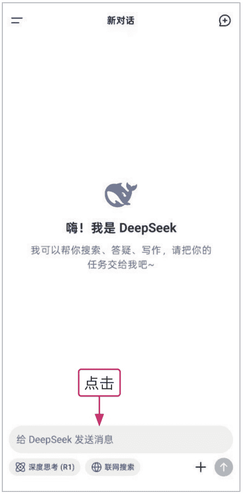

图 1-7

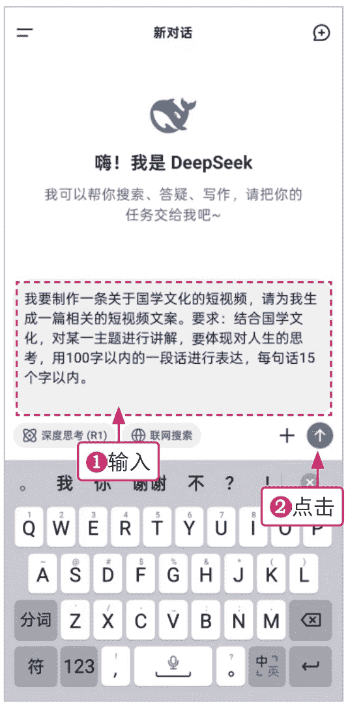

图 1-8

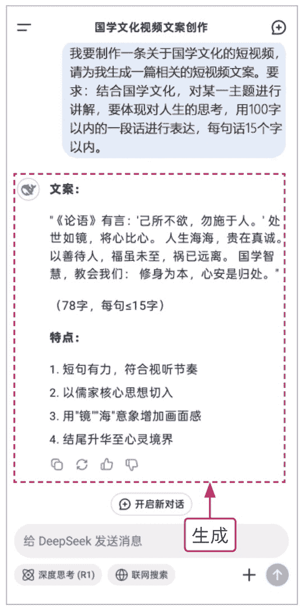

图 1-9

步骤 04 在同一个对话界面继续输入并发送提示词，即可获得针对空镜头的提示词。发送给 DeepSeek 的提示词和 DeepSeek 的回复内容如下。

**提示词**

帮我想一些适用于在即梦 AI 中生成空镜头的提示词，目标空镜头是空灵的、有古韵的静态空镜头，每个提示词浓缩为一段话。

### **DeepSeek**

以下是为您精心设计的用于生成空灵的、有古韵的静态空镜头的提示词，每段都针对一个完整的画面进行描述，能突出东方美学的意境。

1． 晨雾竹林

黎明时分的竹林，乳白色的雾气在竹节间缓缓流动。阳光透过竹叶间隙，在潮湿的苔藓上投下斑驳的光影。一根修长的竹枝微微低垂，末端悬挂着一颗将落未落的露珠，在微风中轻轻颤动。

2． 青瓷茶事

一盏宋代天青釉茶盏静置于老榆木茶席上，釉面泛着温润的哑光。盏中茶汤澄澈，水面漂浮着一片舒展的茶叶。一缕热气从茶面升起，在逆光中勾勒出柔和的曲线。

3． 水墨远山

雨后初晴时的远山轮廓，如同在宣纸上晕染开来的淡墨。山腰间缠绕着缕缕云烟，时而遮掩、时而显露青灰色的山体。近景处几枝枯木的剪影，与远山形成虚实相生的构图。

4． 古籍流光

一册泛黄的线装古籍半摊在案几上，纸页因年代久远而微微卷曲。阳光斜照在纸面上，隐约可见纤细的竹制纸张纹理。书页边缘停着一只蜻蜓，翅膀上的脉络在阳光下闪闪发亮。

5． 残荷听雨

秋日的池塘中，几茎枯荷低垂水面。雨滴落下，在荷叶残破的边缘处碎成晶莹的水珠。水面倒映着灰蒙蒙的天空，涟漪相互交织，形成瞬息万变的几何图案。

……

**1.2.2** **使用即梦 AI 生成图片素材**

即梦 AI 的文生图功能以拥有强大的中文理解能力、风格丰富的模型、易用的智能编辑工具和使用便捷的社区互动界面为特色，适合用于艺术创作、商业设计和满足个性化需求。大家可以将在 1.2.1 小节中获得的提示词输入即梦 AI，快速获得对应的图片素材，为接下来的视频素材生成做好准备。使用即梦 AI 生成图片素材的具体操作步骤如下。

步骤 01 使用手机软件商店下载并安装即梦 AI App，打开该 App，登录账号并进入“发现”界面，点击“想象”按钮完成界面切换，如图 1-10 所示。

步骤 02 进入“想象”界面，点击界面下方的输入框，如图 1-11 所示。

步骤 03 界面中弹出图片生成信息的设置面板， 在该面板的输入框中输入提示词； 点击“生成”按钮，生成图片素材，如图 1-12 所示。

图 1-10

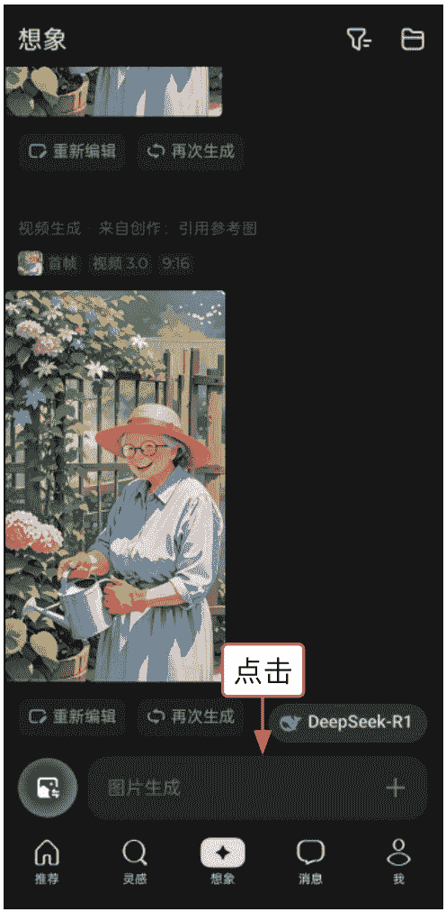

图 1-11

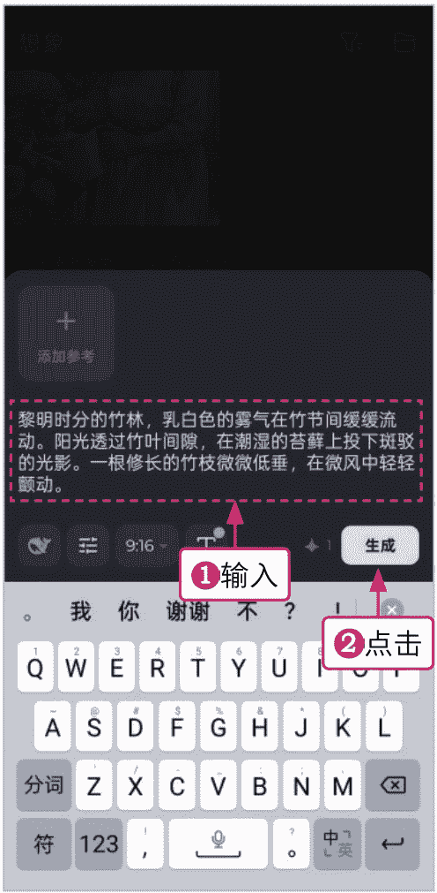

图 1-12

步骤 04 完成以上操作后，即可获得 4 张相关图片，点击其中相对满意的一张图片，如图 1-13 所示。

步骤 05 进入所点击图片的放大显示界面，点击“超清”按钮，如图 1-14 所示。

步骤 06 完成第 5 步操作后，即可生成目标图片的超清图，完成对第 1 张图片素材的准备，如图 1-15 所示。参照同样的操作，生成其他图片，即可逐步完成对图片素材的准备。

图 1-13

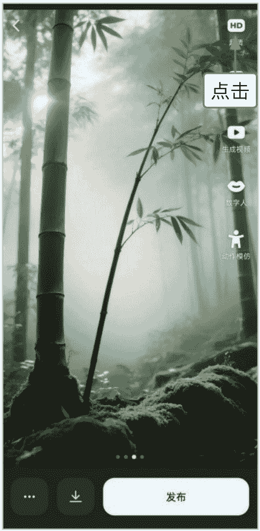

图 1-14

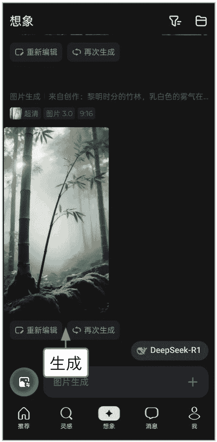

图 1-15

**1.2.3** **使用即梦 AI 生成视频素材**

使用即梦 AI 中的图生视频功能，可以高效生成 AI 视频。在生成视频素材的时候，我们既可以输入提示词以控制生成效果，又可以让即梦 AI 自由发挥。使用即梦 AI 生成视频素材的具体操作步骤如下。

步骤 01 在“想象”界面中，点击目标超清图，如图 1-16 所示。

步骤 02 进入目标超清图的放大显示界面，点击界面中的“生成视频”按钮，使用该图片生成视频素材，如图 1-17 所示。

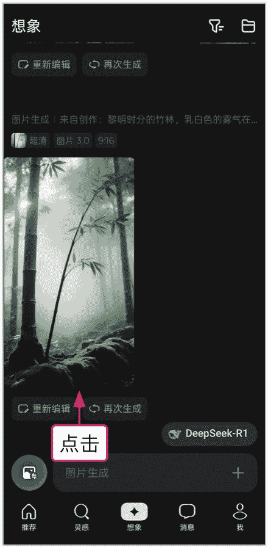

图 1-16

图 1-17

步骤 03 界面中弹出视频生成信息的设置面板， 在该面板的输入框中输入提示词； 点击“生成”按钮，如图 1-18 所示。

步骤 04 稍等片刻，即可生成相关的视频素材，点击该视频素材，如图 1-19 所示。

步骤 05 进入目标视频素材的播放预览界面，点击界面下方的 按钮，下载视频素材，如图 1-20 所示。

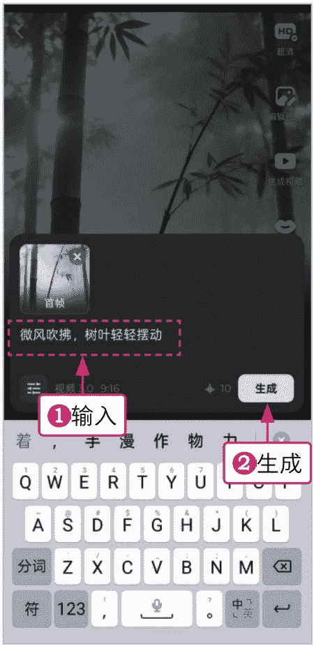

图 1-18

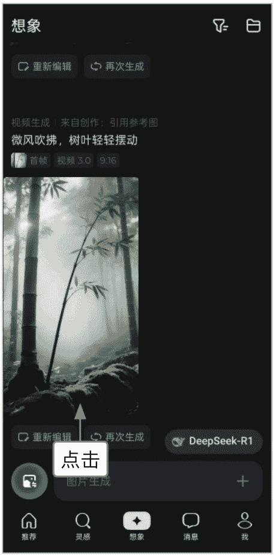

图 1-19

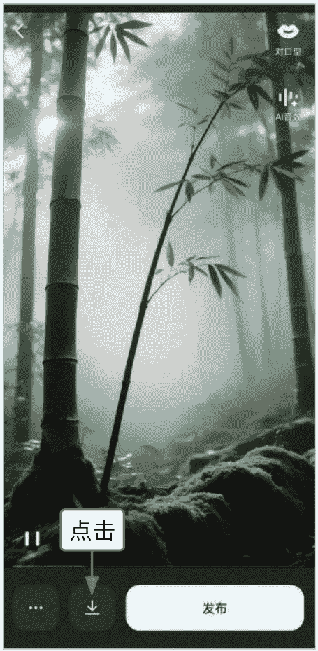

图 1-20

步骤 06 界面中弹出视频素材的分享和保存面板，点击该面板中的“保存到本地”按钮，如图 1-21 所示。

步骤 07 界面中弹出视频素材的保存方式设置面板，在该面板中选择能满足使用需求的选项，如选择“有水印保存”选项，保存有水印的视频素材（注意，保存无水印的视频素材需要开通会员），如图 1-22 所示。

步骤 08 完成以上操作后，如果显示“有水印视频保存成功”，即完成了对目标视频素材的保存，如图 1-23 所示。参照同样的操作，生成并保存其他视频素材，即可逐步完成对视频素材的准备。

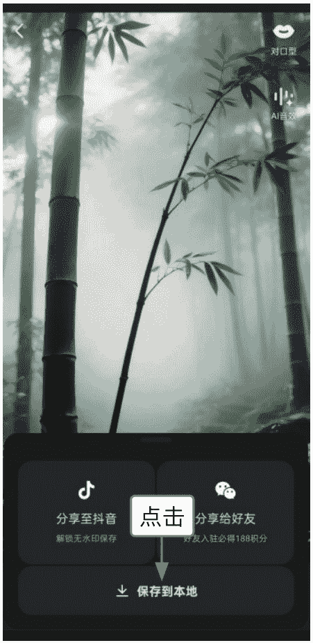

图 1-21

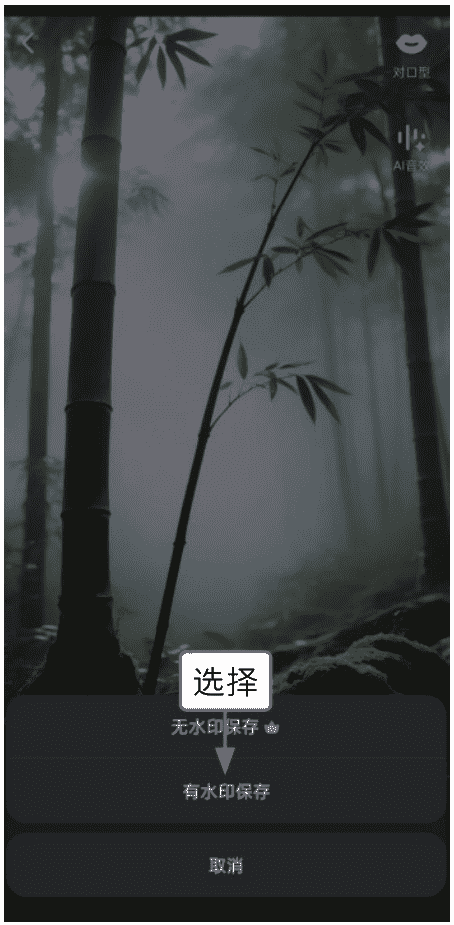

图 1-22

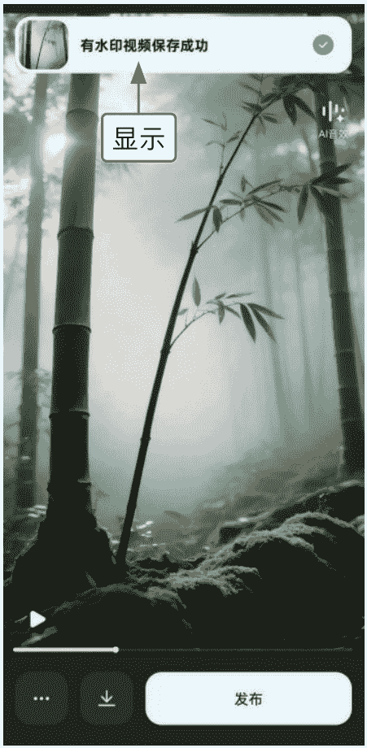

图 1-23

**1.2.4** **使用海螺 AI 生成音频素材**

除了准备视频素材，大家还可以准备一些优质的音频素材（如视频的配音音频）。使用海螺 AI 生成音频素材的具体操作步骤如下。

步骤 01 在搜索引擎（如百度）中输入并搜索“海螺 AI”; 单击搜索结果中的海螺 AI 官网的链接，如图 1-24 所示。

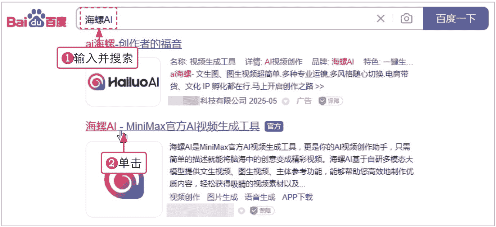

图 1-24

步骤 02 进入海螺 AI 官网的“发现”页面，单击页面上方的“语音”按钮，切换页面，如图 1-25 所示。

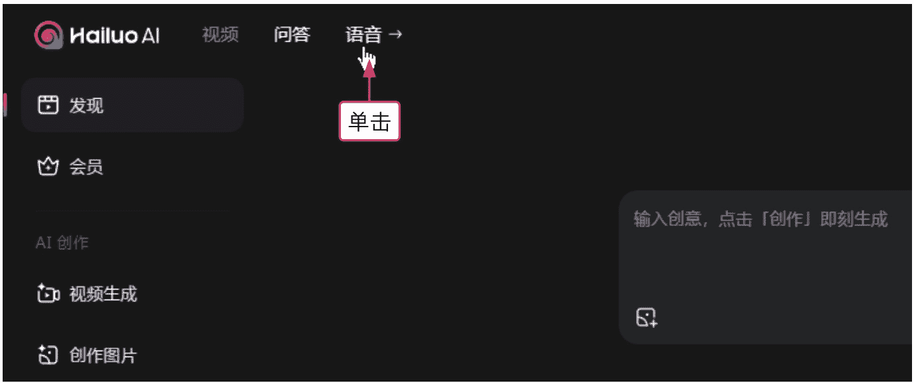

图 1-25

步骤 03 进入 MINIMAX 的“首页”页面， 在输入框中输入配音内容； 设置配音信息； 单击“生成音频”按钮，如图 1-26 所示。

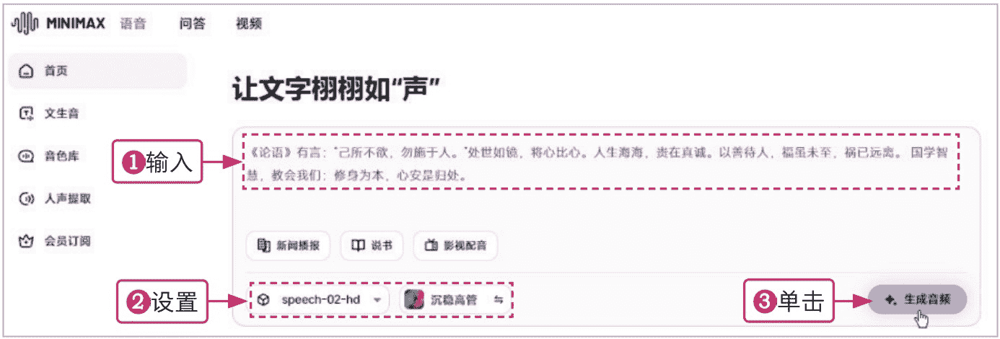

图 1-26

步骤 04 进入“文字转语音”页面，单击“生成音频”按钮，如图 1-27 所示。

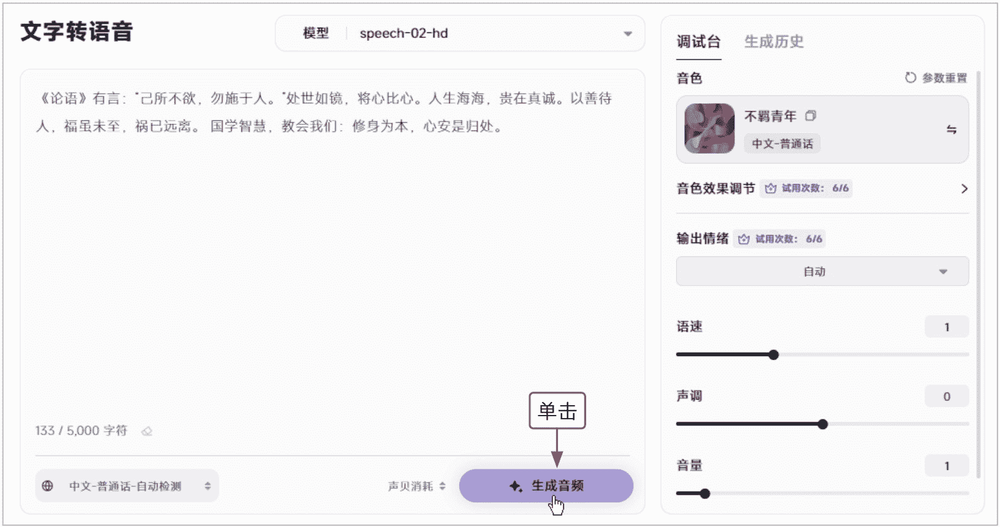

图 1-27

**步骤 05** 完成以上操作后，即可使用输入的内容和设置的信息生成音频素材。单击音频素材右侧的 按钮，即可将音频素材下载至电脑中备用，如图 1-28 所示。

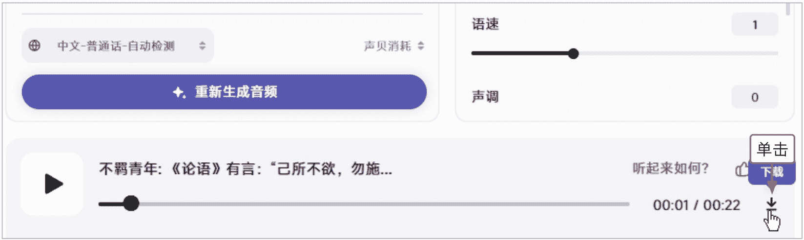

图 1-28

**1.2.5** **使用剪映合成国学文化类短视频**

准备好视频素材、音频素材后，我们可以使用剪映 App 剪辑并合成国学文化类短视频，具体操作步骤如下。

步骤 01 进入剪映 App 的“首页”界面，点击“开始创作”按钮，导入视频素材开始进行后期处理，如图 1-29 所示。

步骤 02 进入“照片视频”界面，切换至“视频”选项卡， 在该选项卡中选择需要处理的视频素材； 选中“高清”复选框； 点击“添加”按钮，添加高清的视频素材，如图 1-30 所示。

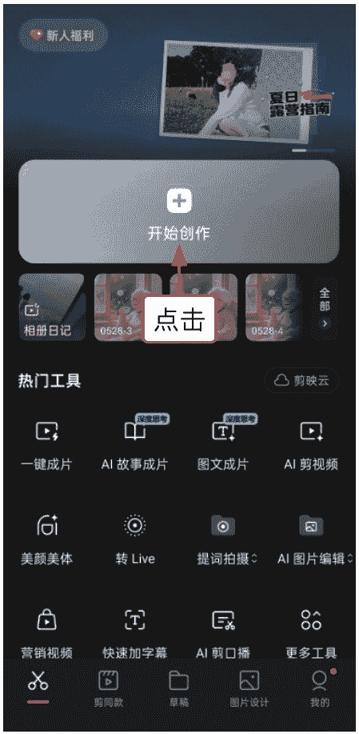

图 1-29

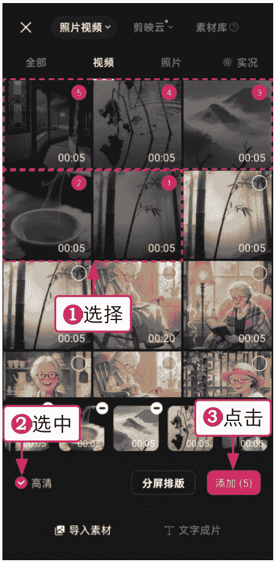

图 1-30

步骤 03 进入视频素材的剪辑处理界面，点击“添加音频”按钮，为视频素材添加音频素材，如图 1-31 所示。

步骤 04 界面中弹出相关工具栏，点击工具栏中的“音乐”按钮，如图 1-32 所示。

步骤 05 进入“音乐”界面，点击“导入”按钮，切换选项卡，如图 1-33 所示。

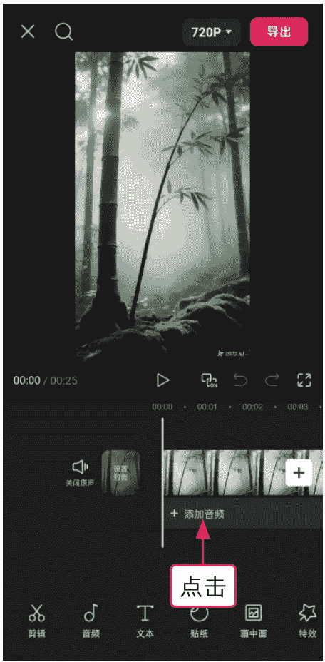

图 1-31

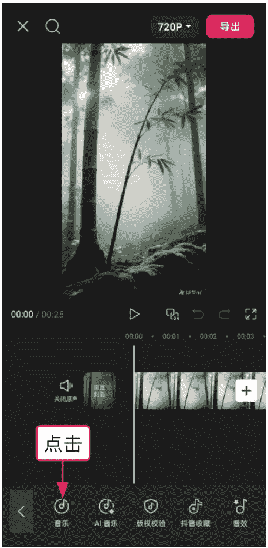

图 1-32

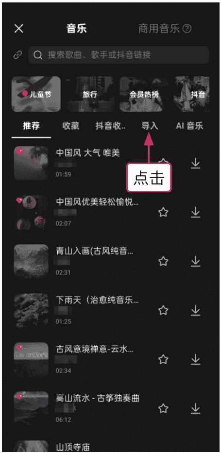

图 1-33

步骤 06 切换至“导入”选项卡后，点击“本地音乐”按钮，导入本地音乐，如图 1-34 所示。

步骤 07 切换至“本地音乐”选项卡，点击目标音频右侧的“使用”按钮，如图 1-35 所示。

步骤 08 完成以上操作后，如果视频处理界面中出现了所添加的音频素材，说明音频素材添加成功了。 根据音频素材调整各视频素材的位置，使视频画面与音频内容相匹配； 点击“文本”按钮，通过创建文本为视频素材添加字幕，如图 1-36 所示。

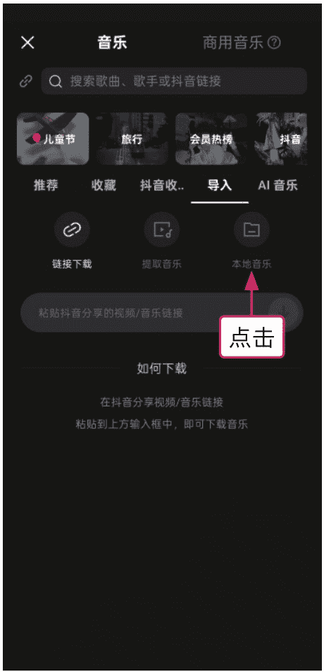

图 1-34

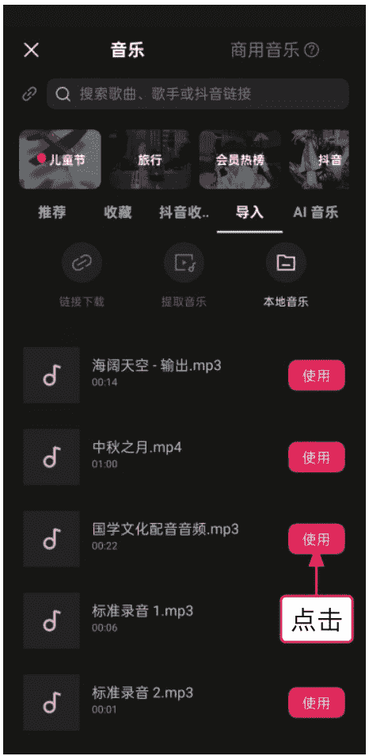

图 1-35

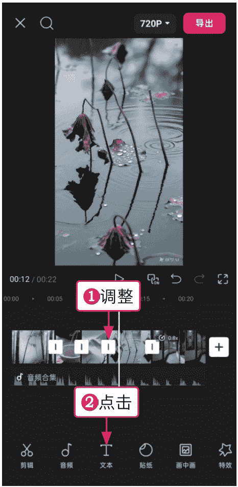

图 1-36

**专家提醒**

有时候，某视频素材的时长会比与之匹配的音频素材的时长短一些，此时，可以分 3 步对视频素材进行变速设置，具体操作步骤如下。

第一步：选择目标视频素材后，点击“变速”按钮，如图 1-37 所示。

第二步：在弹出的工具栏中，点击“常规变速”按钮，如图 1-38 所示。

第三步：在弹出的面板中， 设置变速倍数，如将变速倍数设置为 0.8x（将视频素材的播放速度变为原来的 80%，这样，原时长为 1 秒的视频素材的播放时长会变成 1.25 秒）; 点击 按钮，完成视频素材的变速设置，如图 1-39 所示。

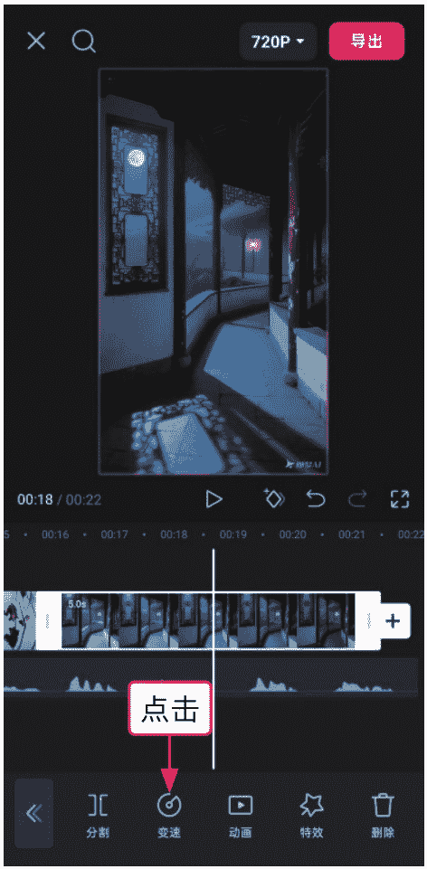

图 1-37

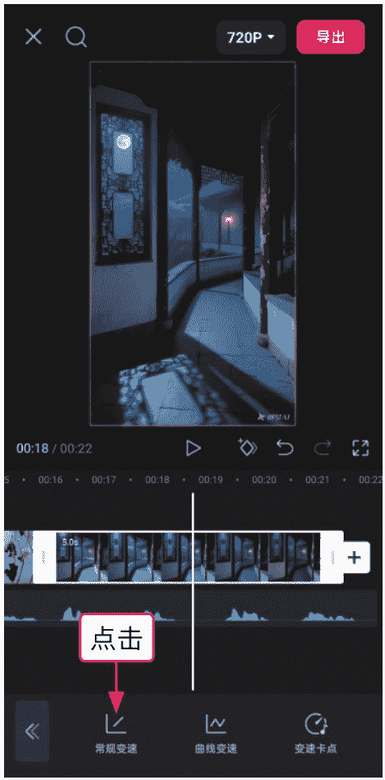

图 1-38

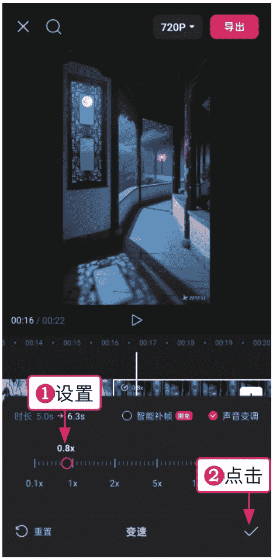

图 1-39

步骤 09 界面中弹出相关工具栏，点击工具栏中的“新建文本”按钮，如图 1-40 所示。

步骤 10 界面中弹出文本信息的设置面板， 输入第 1 条字幕的内容； 选择字幕的样式； 设置字幕的字号，调整字幕的显示效果，如图 1-41 所示。

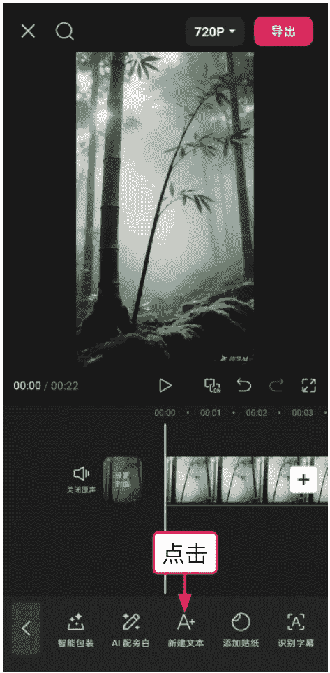

图 1-40

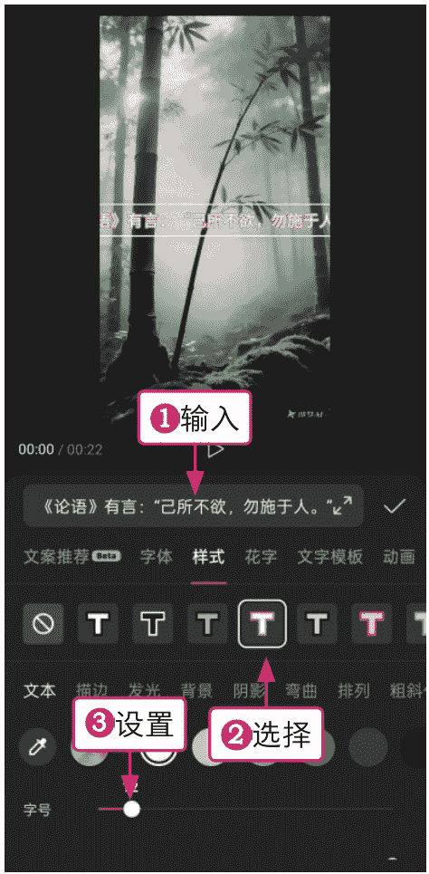

图 1-41

步骤 11 对字幕内容进行分行； 调整字幕在视频画面中的位置； 点击 按钮，完成对第 1 条字幕的设置，如图 1-42 所示。

步骤 12 参照同样的操作，逐步添加其他字幕。点击第 1 个视频素材和第 2 个视频素材之间的 按钮，设置视频的转场效果，如图 1-43 所示。

步骤 13 界面中弹出转场效果设置面板， 点击“叠化”按钮，切换至对应的选项卡； 选择目标转场效果，如选择“叠加”选项，使画面能够平滑地淡入淡出，如图 1-44 所示。

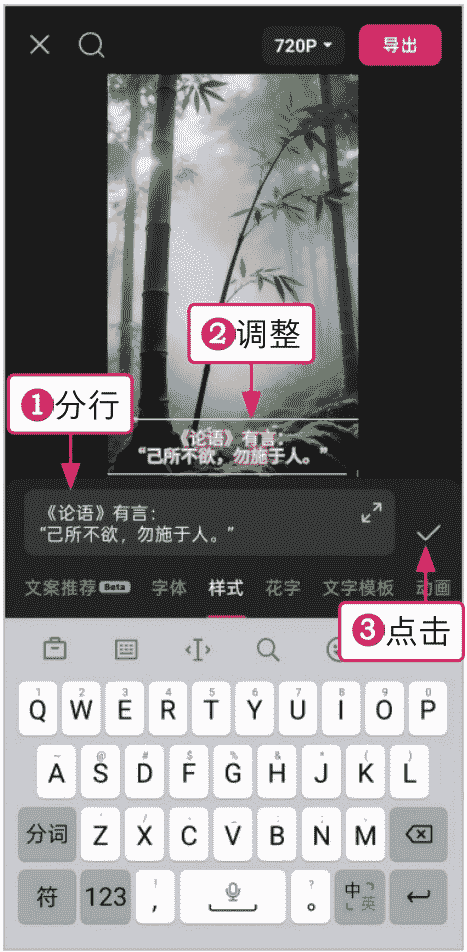

图 1-42

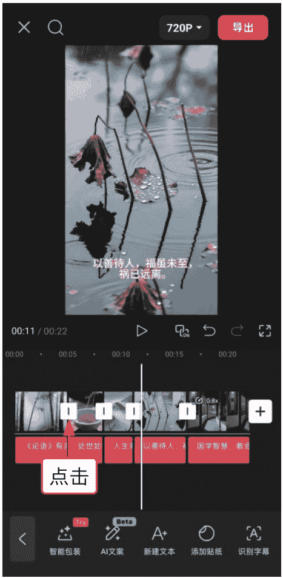

图 1-43

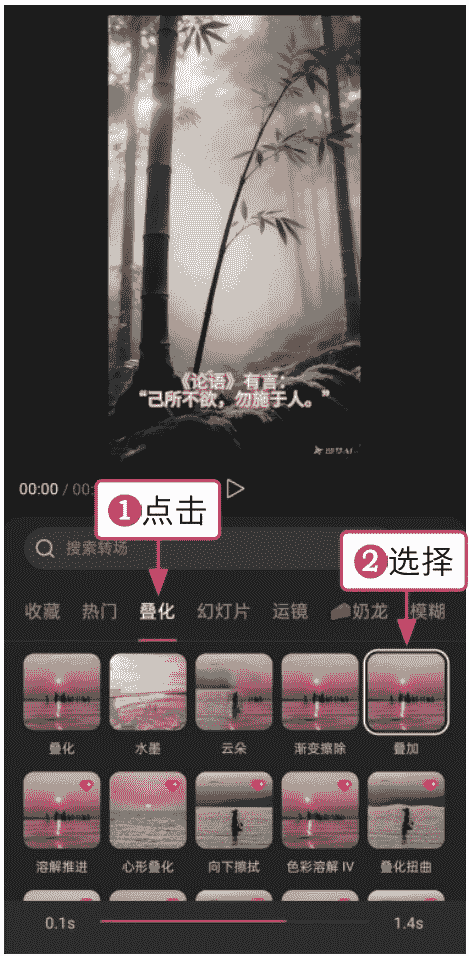

图 1-44

步骤 14 滑动面板， 点击“全局应用”按钮，为所有视频素材的过渡应用所选的转场效果； 点击按钮，完成对转场效果的设置，如图 1-45 所示。

步骤 15 完成以上操作后，如果所有的 图标都变成了 图标，说明所有的转场效果都设置成功了。点击“剪辑”按钮，如图 1-46 所示，调出剪辑的相关工具栏。

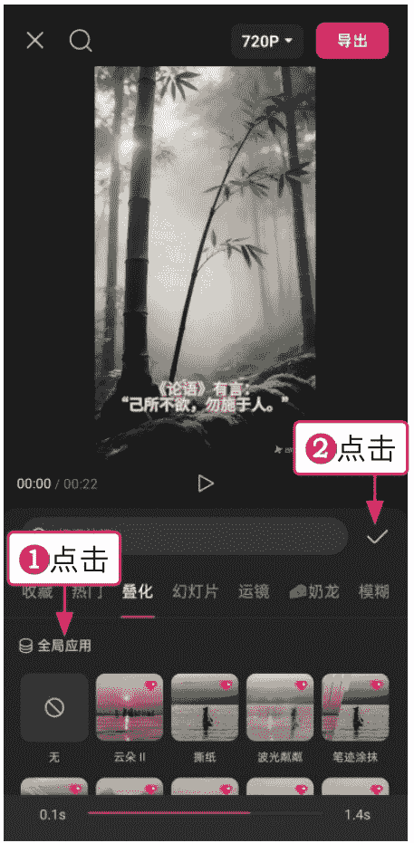

图 1-45

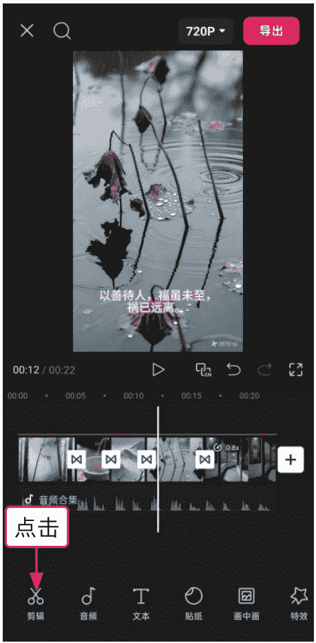

图 1-46

步骤 16 在弹出的工具栏中点击“编辑”按钮，如图 1-47 所示，调出编辑信息工具栏。

步骤 17 在弹出的工具栏中点击“调整大小”按钮，如图 1-48 所示，调出调整大小面板。

步骤 18 在弹出的面板中选择合适的裁剪比例，如选择 9:16 选项，调整视频素材的裁剪比例，如图 1-49 所示。

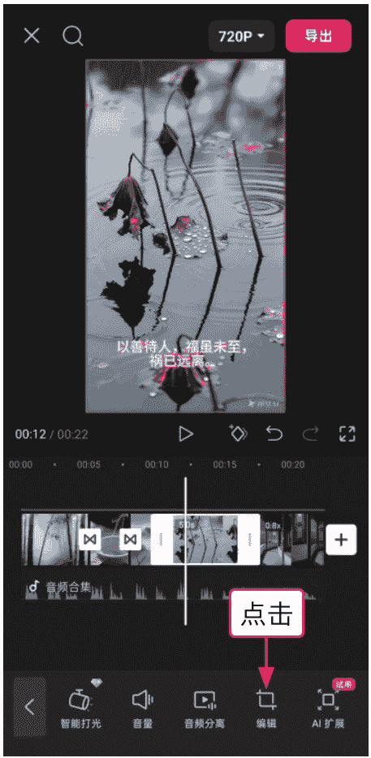

图 1-47

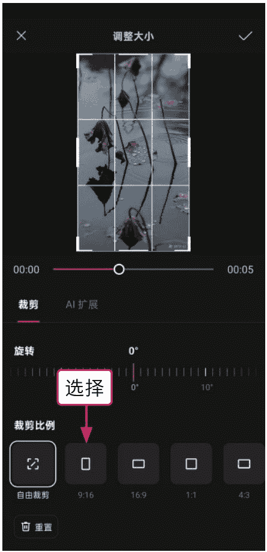

图 1-48

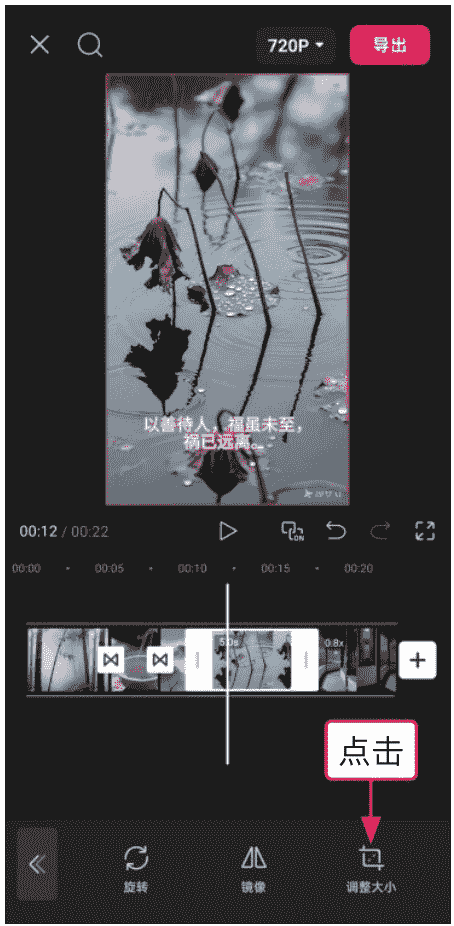

图 1-49

步骤 19 调整界面中的裁剪选择框，截去视频画面中带有水印的部分； 点击按钮，完成对视频素材的裁剪，如图 1-50 所示。

步骤 20 参照同样的操作，调整其他视频素材的画面，去除画面中带有水印的部分。点击界面上方的按钮，如图 1-51 所示。

步骤 21 进入视频导出信息的设置界面， 设置导出视频的分辨率； 点击“导出”按钮，如图 1-52 所示。

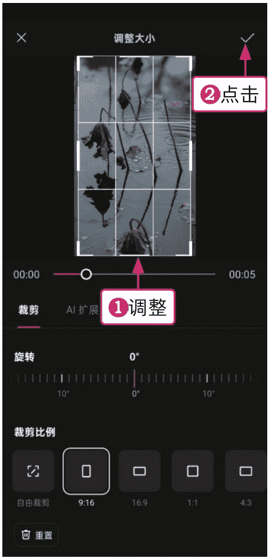

图 1-50

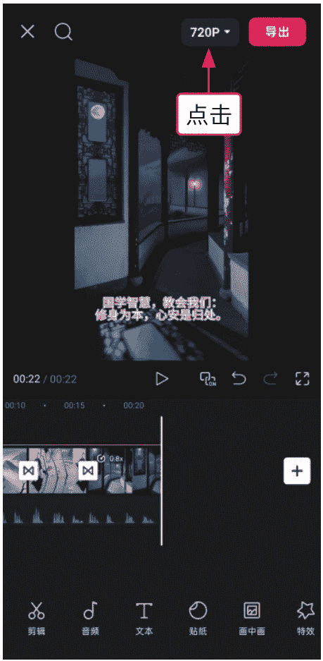

图 1-51

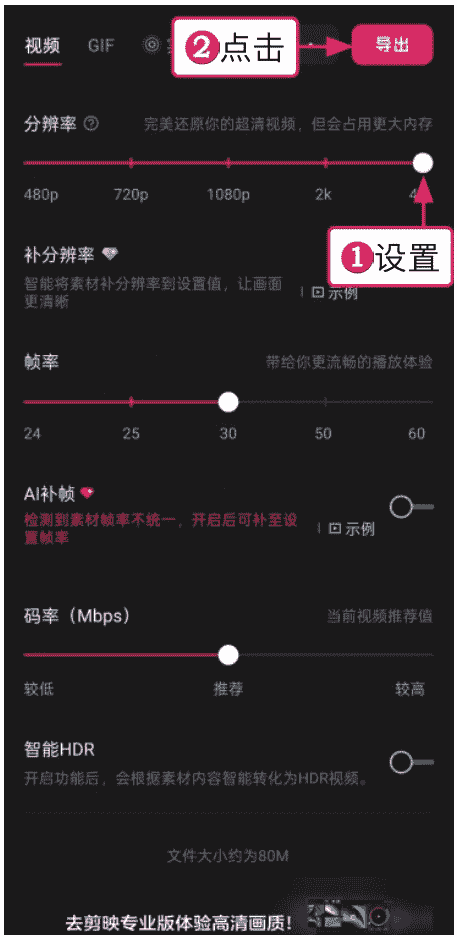

图 1-52

**专家提醒**

“720P”指的是视频的垂直分辨率为 720 线，即画面高度由 720 行像素构成。其中，“P”代表“Progressive Scanning”，即逐行扫描。

步骤 22 完成以上操作后，即可将做好的短视频导出，导出过程中可看到短视频的导出进度，如图 1-53 所示。

步骤 23 界面中显示提示信息“保存到相册和草稿”，即说明导出成功，如图 1-54 所示。

图 1-53

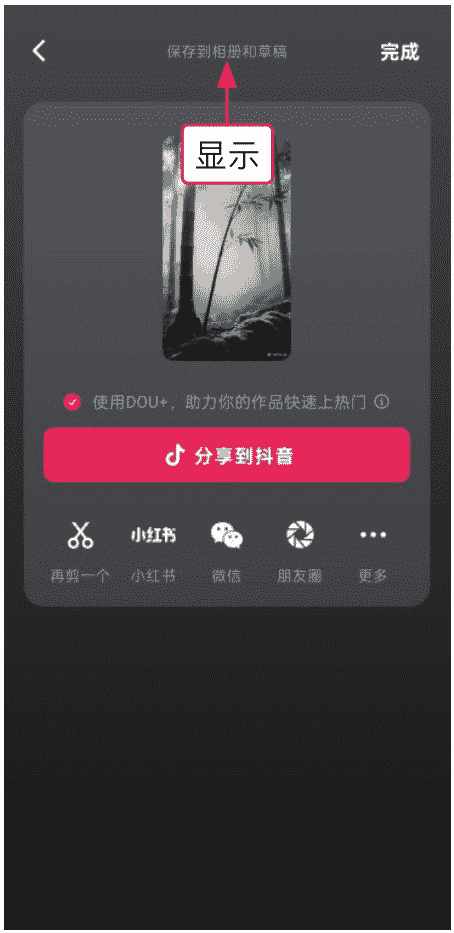

图 1-54

### **1.3** **懂策略：多维度提升 AI 短视频的影响力**

制作出优质短视频后，大家可将其精准发布至各大短视频平台。

发布短视频前后，大家可以巧妙地使用 DeepSeek 赋能短视频运营，如优化发布时间、制定互动策略，多维度增加 AI 短视频的播放量，扩大短视频账号的影响范围，以此吸引更多的流量与关注，更好地实现短视频账号的 1 个月内的变现收入超过 5 万元的运营目标。

本节，我们介绍具体的运营技巧。

**1.3.1** **优化发布时间，增加被看到的概率**

选择合适的发布时间，让 AI 国学文化类短视频刚好在目标受众有空、爱刷短视频的时间段出现在短视频平台上，这样，相关短视频被看到的概率会大大增加。此外，若能赶上短视频平台的流量高峰期，有望更好地实现相关短视频的播放量目标。

想优化 AI 国学文化类短视频在抖音平台上的发布时间，可以向 DeepSeek 寻求建议。以下提示词涵盖了不同角度的运营目标（优化内容类型、明确受众画像、助力数据分析、摸透平台机制等），使用它们向 DeepSeek 提问，能够获得多维度的专业建议。

（1）目标：获取最佳发布时间建议。可使用的提示词如下。

**提示词 1：**

我是一个专注于创作 AI 国学文化类短视频的创作者，所创作的短视频的核心内容为诗词解读、传统礼仪、经典诵读等。我的主要受众是 25 岁到 45 岁、对中国传统文化感兴趣的人群。请帮我分析什么时间段在抖音平台上发布短视频可以获得较高的播放量和互动率。

**提示词 2：**

相比娱乐类内容，国学文化类内容属于慢热型内容，请问在抖音平台上，这类慢热型内容适合在哪些时间段发布？是否需要避开发布高峰期，以降低竞争压力？

（2）目标：获取基于数据分析制定的发布时间策略。可使用的提示词如下。

**提示词 1：**

过去一个月，我在 21 时至 22 时发布的国学文化类短视频的数据表现最好。请帮我分析这个时间段是否适合作为长期的、固定的相关短视频发布时间段，并给出一个合理的排期计划。

**提示词 2：**

在没有太多历史数据的情况下，应该如何快速判断我的国学文化类短视频在抖音平台上发布的最佳时间？有哪些工具或方法可以帮助我进行分析？

（3）目标：获取合理利用平台机制提升曝光度的建议。可使用的提示词如下。

**提示词 1：**

抖音的平台机制、推荐算法对短视频的发布时间敏感吗？如果我在流量高峰时段发布国学文化类短视频，是否会因竞争激烈而无法获得较理想的推荐权重？我应该如何权衡、平衡国学文化类短视频的发布时间、内容质量？

**提示词 2：**

对抖音平台来说，黄金发布时间通常为 7—9 时、12—14 时、19—23 时。这种规律是否适用于偏小众的国学文化类短视频？有没有更适合国学文化类短视频的发布时间段？

（4）目标：获取跨人群/场景的发布时间调整建议。可使用的提示词如下。

**提示词 1：**

我的国学文化类短视频既面向学生群体，又吸引了不少中老年受众。请问这两个群体的活跃时间段差异大吗？我应该如何选择发布时间，才能兼顾这两个群体的观看习惯？

**提示词 2：**

运营国学文化类短视频账号，有时需要结合节日或节气（如清明节、端午节、重阳节）推出短视频专题。在这种情况下，我应该提前多久发布相关内容？发布时间是否有特殊规律？

（5）目标：获取节假日/热点期间的发布时间调整建议。可使用的提示词如下。

**提示词 1：**

在春节、中秋节等传统节日期间，受众对国学文化类内容的兴趣明显上升。我应该如何调整国学文化类短视频的发布时间以合理、高效利用这一流量高峰期？你有哪些具体的建议？

**提示词 2：**

当有社会热点事件涉及传统文化时，例如，赶上汉服热潮、古风音乐爆火，我应该如何快速响应并合理安排国学文化类短视频的发布时间？是否应该在热点爆发初期就跟进？为什么？

**专家提醒**

使用建议：大家可以将上述任意一组提示词复制、粘贴到 DeepSeek 对话框中，发送后等待其给予详细的分析与建议。如果有具体的历史数据，如短视频发布记录、播放量、点赞数，可以补充进提示词，以便 DeepSeek 提供更具针对性的优化方案。

**1.3.2** **制定互动策略，增加曝光度和热度**

制定短视频互动策略能在短视频账号的运营者与受众之间搭建起高效沟通的桥梁，增强彼此间的联系。通过精心制定互动策略，能激发受众的互动热情，提升他们进行评论、点赞、转发等互动的兴趣。这不仅有助于增加短视频的热度与曝光度，使相关短视频获得更高的播放量，还有助于短视频账号的运营者深入了解受众需求，优化后续内容创作方向，形成良性循环。

想制定行之有效的 AI 国学文化类短视频在抖音平台上的互动策略，同样可以向 DeepSeek 寻求建议。以下提示词涵盖了不同角度的运营目标（设计互动引导机制、优化评论区管理、了解受众心理、与热点结合等），旨在增加国学文化类短视频的点赞数、评论数、转发数和粉丝数，使用它们向 DeepSeek 提问，能够获得多维度的专业建议。

（1）目标：设计有效的互动引导机制。可使用的提示词如下。

**提示词 1：**

我是一个专注于创作 AI 国学文化类短视频的创作者，所创作的短视频的核心内容为诗词解读、经典诵读、历史故事讲解等。请帮我设计一些能够自然融入短视频结尾的“互动钩子”，鼓励受众点赞、评论或分享。

**提示词 2：**

如何通过添加提问式结尾激发受众在评论区与我互动的热情？请为我的国学文化类短视频提供 5 个适用于不同主题（如诗词、礼仪、历史故事、名人轶事、哲学）的互动问题模板。

（2）目标：优化评论区管理。可使用的提示词如下。

**提示词 1：**

国学文化类短视频的评论区常有知识讨论，甚至争论的情况，我应该如何引导受众进行高质量评论，以避免低质量评论的“刷屏”？有哪些话术或运营技巧可以使用？

**提示词 2：**

我希望在评论区营造“学习氛围”，让受众愿意留言交流自己的理解或感悟。请从文案风格、互动形式、话题设置等方面入手，给我一些引导受众的建议。

（3）目标：借助算法提高互动率。可使用的提示词如下。

**提示词 1：**

抖音算法对互动率非常敏感，请问我应该如何设计国学文化类短视频的内容结构和互动形式，以提高点赞数、评论数、完播率，获得更理想的推荐权重？

**提示词 2：**

如果我想在评论区中引导受众私信我获取资料，如电子版《论语》、书法教程，应该怎样设计话术和互动流程？要求既不显得广告感太强，又能有效引流。

（4）目标：与热点结合，提升互动热度。可使用的提示词如下。

**提示词 1：**

当与传统文化有关的热点事件出现时，例如，赶上汉服热潮、孔子诞辰，我应该如何快速策划短视频专题，并设计能够吸引大量受众进行互动的话题？

**提示词 2：**

如何将传统节日（如清明节、端午节、中秋节）与互动策略结合，让受众不仅愿意观看短视频，还会主动留言分享自己的经历或祝福？请给出具体案例和互动引导建议。

（5）目标：了解受众心理，打造高黏度粉丝社群。可使用的提示词如下。

**提示词 1：**

我希望能将部分活跃受众转化为国学爱好者社群的成员，请问应该如何在短视频内容中或评论区中引导他们加入微信群、知识星球，以及××社群平台？

**提示词 2：**

对国学文化类内容创作者来说，应该如何通过发布连续剧式内容（如每日一句古文、每周一个典故）培养受众的追更习惯？请设计几个能够增强受众黏性的互动机制。

**1.3.3** **添加话题标签，实现精准推送**

话题标签就像精准的导航仪，在助力短视频的传播中发挥着重要的作用。

用好话题标签，能让短视频与相关主题紧密关联，且使平台算法能够精准识别并推送这些短视频给对相关话题感兴趣的受众。

此外，借助热门话题标签的热度，相关短视频的曝光度能得到极大的提升，进而收获更理想的播放量。

在大多数短视频平台上，发布短视频时是可以添加相关的话题标签的。以抖音 App 为例，上传短视频后，点击短视频发布界面中的“#话题”按钮，如图 1-55 所示，即可添加话题标签。在输入框中输入想使用的话题，如果输入框中显示的文字是蓝色的，说明话题标签添加成功了，如图 1-56 所示。

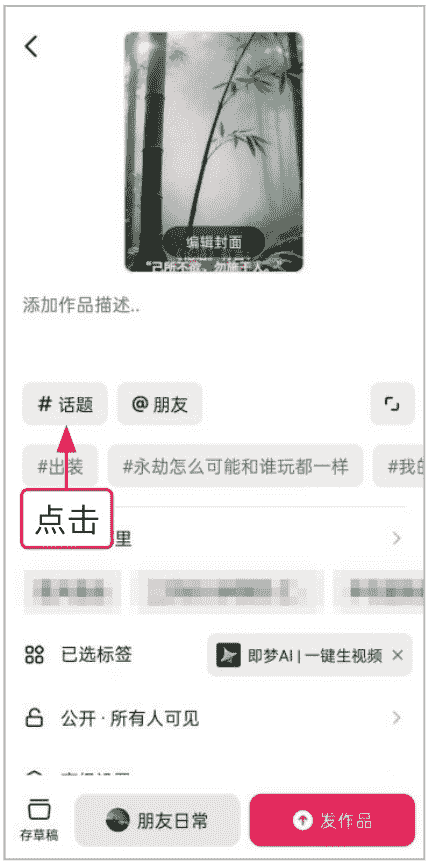

图 1-55

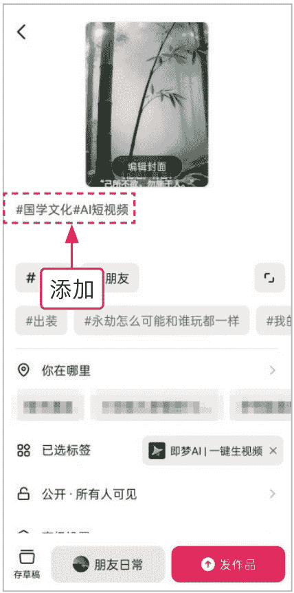

图 1-56

那么，具体而言，我们应该如何确定目标短视频的话题标签呢？下面以 AI 国学文化类短视频为例，介绍短视频话题标签的常用设计方法，如图 1-57 所示。

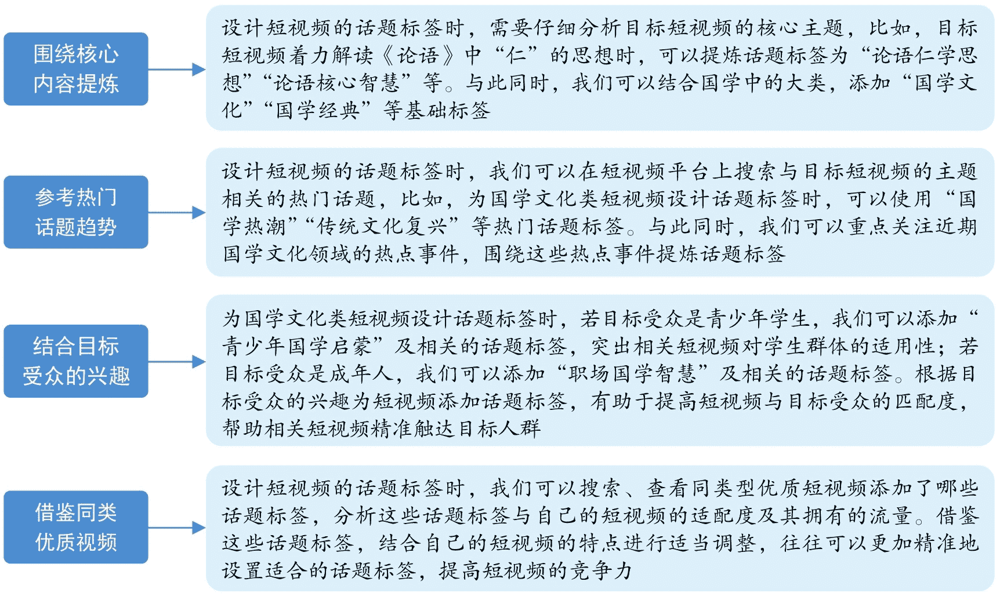

图 1-57

**1.3.4** **合作推广，触达更多受众**

在短视频流量如洪流般奔涌的热潮里，与短视频合作推广成为品牌推广、产品推广的有力手段。借助合作方的账号影响力及庞大的粉丝基础，品牌、产品能像搭乘顺风车一样，迅速扩大自己的传播范围，大幅提高自己的知名度。

不同合作方的风格和受众存在差异，合理选择恰当的合作方，有助于精准触达多元群体、高效吸引潜在受众。与此同时，全面整合各方创意与资源，有助于增加与受众之间的互动，打造更加优质的国学文化类短视频。

在运营 AI 国学文化类短视频账号的过程中，大家可以使用多种方法进行合作推广，下面介绍几种常用的方法。

**1．跨平台内容联动**

不同互联网平台的受众特性与内容生态差异显著，例如，抖音平台用短视频的强视觉冲击力与碎片化传播吸引年轻群体，小红书平台用不断完善的图文“种草”模式留住对生活美学有追求的受众，视频号则依托微信社交关系链努力渗透中老年群体。

多平台打造 AI 国学文化类短视频账号，尝试跨平台内容联动，既可以统一核心主题，又能够根据平台特性调整内容的呈现形式，实现多平台流量互补，扩大品牌的影响范围。

例如，基于同一内容，在抖音平台上发布以“《楚辞》中的浪漫诗句”为主题的 AI 短视频，结合现代音乐与动画演绎经典诗句；在小红书平台上同步推出图文版“《楚辞》中的金句与艺术创作灵感”，引发受众的创作热潮。通过平台联动，相关账号双平台 3 个月内的粉丝增长数逾 45 万，内容互动量提升了 200%，成功吸引了不同圈层的受众的关注。

**2.KOL 合作推广**

KOL 在特定领域拥有高黏性的粉丝群体，与其合作能快速提高 AI 国学文化类短视频账号的曝光度与被信任度。与 KOL 合作的形式是多样化的，如联合创作国学文化主题的短视频、进行产品植入、完成直播分享。与 KOL 合作推广的成功关键在于选择与所运营的短视频账号的调性高度契合的 KOL，确保内容融入自然，避免生硬推广，以便提升受众的接受度与参与感。

**专家提醒**

KOL（Key Opinion Leader，关键意见领袖）是营销学中的概念，指在特定领域拥有专业知识、丰富经验、独特见解，且有大量粉丝和较强影响力的人。比如，美妆领域的 KOL 能凭借自身对美妆产品的了解、丰富的使用心得，通过分享引导、影响粉丝的消费决策。品牌、产品与 KOL 合作，能借助其影响力提高品牌的知名度和产品的销量。

例如，某 AI 国学文化类短视频账号与历史科普类 KOL 合作推出了“水浒英雄的国学智慧”系列短视频， KOL 用幽默风趣的方式解读了《水浒传》中的人物及其国学思想，短视频账号同步推荐相关书籍。该系列短视频播放量突破 500 万，短视频账号粉丝增长逾 8 万，所推荐书籍的销量提升了 30%，实现了内容与商业的双赢。

**3．品牌联名与 IP 授权**

进行品牌联名或 IP 授权能够整合双方的资源，打造兼具文化内涵与商业价值的产品或活动。具体而言，AI 国学文化类短视频账号可以与文创品牌、教育机构等主体合作，推出联名文具、课程或文化周边，结合传统文化与现代需求。合作时，需要关注文化传承与创新，尽量避免形式化，确保联名内容既有深度，又有吸引力。

**专家提醒**

IP（Intellectual Property，知识产权）是有商业价值、受法律保护的知识成果。一部受欢迎的小说、一个经典动漫角色、一首热门歌曲等，都是 IP。比如，“孙悟空”就是一个知名 IP，围绕它衍生出了无数电影、游戏、周边产品，创造了巨大的商业价值。

例如，某 AI 国学文化类短视频账号与某知名文具品牌联名推出了论语主题笔记本，该笔记本内页印有《论语》中的经典语句及手绘插画。围绕该联名产品，短视频账号发布了产品背后的国学故事与创作理念，文具品牌组织了线下门店的展示与促销活动。该联名产品上线首月销售额突破 60 万元，短视频账号的粉丝量增长逾 12 万，文具品牌的文化形象得到了显著优化，受众对国学文化的认同感进一步增强。

**4．线下活动与社群运营**

线下活动能为受众提供沉浸式国学文化体验，社群运营则能最大程度地延续受众的热情并与受众建立长期关系。通过组织国学文化讲座、国学文化沙龙等活动，大家可以吸引受众参与活动并为参与活动的受众建立社群，后续在社群内分享国学文化知识，形成“线下体验—线上互动—社群转化”的良性循环。

例如，某 AI 国学文化类短视频账号每个月组织一次国学经典读书会，邀请学者讲解《庄子》中的哲学思想，并在社群内发起以“每日一句《庄子》金句”为主题的打卡与讨论活动，半年内，读书会参与人数从首场的 30 人增至 200 人，社群成员突破 8000 人，课程转化率提升了 20%。

**5．数据驱动的精准投放**

依托大数据分析技术，我们能获得较精准的受众画像，为 AI 国学文化类短视频账号提供个性化的推广、运营依据。比如，我们可以通过分析受众的年龄、地域、兴趣等数据，发布符合其需求的国学文化内容，投放其所需要的产品的广告，提高短视频的点击率与广告的转化率，降低运营成本。

例如，某短视频账号使用抖音“巨量千川”平台，长期针对 25 岁至 35 岁的职场人投放“《鬼谷子》职场沟通术”课程的广告，结合受众地域、职业标签等相关数据优化投放策略后，广告点击率提升了 35%，课程购买转化率达到了 10%，单月广告 ROI 达到了 1∶4，成功吸引了更多目标受众的关注，提高了变现效率。

**专家提醒**

ROI（Return on Investment，投资回报率）是用来衡量投资效果的指标。例如，支出 100 元用于广告推广，赚得 300 元，投资回报就是 200 元，ROI 为（300 - 100）÷100×100%=200%，能直观看出相关投资是否划算。

**1.3.5** **数据分析，不断优化运营**

通过数据分析，我们不仅可以直观地看到受众对不同国学文化主题、呈现形式的喜好差异，还能详细地了解到观看人数、互动频率等体现受众规模与活跃度的数据。基于这些宝贵洞察，我们可以优化内容选题、调整表达方式，让国学文化知识呈现得更加生动有趣、通俗易懂，进而不断增强受众黏性，深化短视频传播的广度与深度，吸引更多人关注并传承国学文化。

在短视频平台上推广国学文化类内容，既是对传统文化的传承，又是对现代传播方式的探索。随着受众对高质量知识内容的需求不断增加，越来越多的受众开始关注能够提供有深度、有共鸣的内容的国学文化类短视频了。在这种情况下，使用 DeepSeek 等 AI 工具对短视频平台的数据进行深入挖掘，可以帮助我们更精准地把握受众的兴趣点、行为偏好，进而更有的放矢地完成内容选题、优化呈现形式、制定传播策略，相关案例如下。

**提示词**

过去一个月，我发布了 10 条 AI 国学文化类短视频，其中，与《论语》相关的短视频的平均播放量比其他主题的短视频的平均播放量高 20%。请帮我分析这种差异背后的原因，并推荐接下来的创作主题。

### **DeepSeek**

根据你的描述（与《论语》相关的短视频的平均播放量比其他主题的短视频的平均播放量高 20%），我可以从以下几个角度入手分析出现这一现象的原因，并基于当前的文化传播趋势给出后续创作建议。

一、与《论语》相关的短视频的播放量高的原因分析

1．文化共鸣与普适价值

作为儒家经典，《论语》中的“忠恕之道”“仁爱思想”等理念具有跨时代的普适性，尤其契合现代人应对职场压力、人际关系压力的需求。

2．社会热点与教育需求

近年来，国学文化教育在家庭和学校中很受重视，很多家长希望用《论语》培养孩子的品德（如“孝道”“诚信”），而职场人群普遍关注《论语》中的管理智慧（如“君子求诸己”）。

……

通过对数据进行细致的分析，我们不仅可以看到相关内容受欢迎的具体表现，还能从中提炼受众的真实需求与心理动机。

总之，借助 DeepSeek 等 AI 工具，我们可以快速获得专业洞察，实现从“凭感觉做内容”到“靠数据定方向”的转变，真正让国学文化知识在短视频时代焕发新的生命力。

**1.3.6** **熟悉变现模式，获得经济支撑**

如今，探索 AI 国学文化类短视频账号的变现模式有着积极意义。从运营角度看，此举能给我们带来坚实的经济支撑，让我们无后顾之忧地持续输出高质量的国学文化内容，始终保持创作活力；从文化传播角度看，此举能让国学文化以更契合市场需求的方式呈现，吸引更广泛的受众。此外，推行合理的变现模式能推动相关产业链的逐步完善，形成文化传播与商业收益相互促进的良性循环，助力国学文化的传承。

那么，具体而言，我们应该如何实现短视频账号的变现呢？下面讲解几种常用的 AI 国学文化类短视频账号的变现模式。

**1．广告合作与品牌植入**

广告合作与品牌植入是 AI 国学文化类短视频账号变现的重要途径之一。我们可以在与目标品牌达成合作意向后，将品牌元素自然地融入国学文化类短视频，比如，以软文、品牌故事等形式呈现。使用这种变现模式的核心在于平衡好短视频主体内容与广告内容的关系，既精准传递品牌信息，又不破坏国学文化内容原本的韵味，如此才能实现品牌宣传与账号收益的双赢。

例如，某国学文化类短视频账号与某传统茶具品牌携手推出“茶道与国学经典”系列短视频。在该系列短视频中，主人公一边细致讲解茶道，一边巧妙引用《茶经》中的国学经典语句，同时自然展示品牌茶具。该系列短视频的播放量超过 350 万，不仅品牌茶具的销量借此提升了 50%，而且该短视频账号通过此次广告合作获得了颇为可观的收入。

**2．付费阅读与会员制度**

如果发布的短视频中有很多高质量的、有深度的国学内容，相关账号的运营者可以设置阅读门槛（如付费阅读）或推出会员制度。比如，我们可以将深度剖析国学经典、独家解读文化著作的内容设为付费内容或仅会员可见的内容，以此吸引忠实受众付费订阅。使用这种变现模式，不仅能直接获得可观的经济收益，还能增强忠实受众的黏性，提升账号内容的价值感、影响力，进而让相关账号进入快速发展的良性循环。

例如，某国学文化类短视频账号制作了名为“《资治通鉴》深度剖析”的付费专栏，付费会员能够享受每周更新的独家解读、专家答疑等专属服务。该专栏推出后，首月便吸引了 2500 余名会员付费订阅，收入达 12 万元。会员们普遍反馈，通过订阅该专栏，他们对《资治通鉴》有了更为深入的理解，在这种情况下，该短视频账号的忠实受众的黏性显著增强。

**3．线上线下活动联动**

AI 国学文化类短视频账号的运营有助于将线上国学文化内容的推广与线下的国学讲座、研讨会等活动紧密结合在一起，形成线上线下联动的传播链路。在线上，通过发布短视频、开直播等方式吸引受众的关注和互动；在线下，通过组织活动增强受众的体验感和参与感，并不断拓宽变现渠道，如门票销售、赞助合作。使用这种变现模式，有助于不断提升账号的影响力，吸引更多的潜在受众。

例如，某国学文化类短视频账号的运营者每个月定期组织线下的“国学经典读书会”，邀请知名学者讲解《孟子》中的哲学思想。活动前，该账号运营者会通过发布相关短视频进行线上宣传，吸引受众报名；活动中，该账号运营者会通过合理设置互动环节优化受众体验；活动后，该账号运营者还会在社群中组织受众分享活动体会。随着该读书会的规模越来越大（参与人数从首场的 60 人逐步攀升至 350 人），门票收入超过 6 万元/场，短视频账号的粉丝增长了 1.2 万。

**4．电商带货变现**

AI 国学文化类短视频账号可以借助自身的影响力，在短视频或直播中推荐与国学文化相关的书籍、文化用品等商品，通过带货赚取佣金。要想获得良好的带货效果，需要确保所推荐的商品与短视频/直播中的国学文化内容是高度契合的，比如，推荐与短视频/直播主题强相关的书籍、文房四宝。使用这种变现模式，账号运营者要对所推荐的商品有深入的了解，以便真实、生动地介绍商品的特点，激发受众的购买意愿。

例如，某国学文化类短视频账号的运营者在讲解《论语》的短视频下方挂了《论语（注释版）》一书的链接，并在相关直播中推荐了书法套装、传统折扇等文化用品，通过详细介绍所推荐的商品与国学文化的关联，吸引了许多受众购买。通过精准带货，该短视频账号的月销售额突破了 60 万元，佣金收入达 12 万元。

**5．付费课程与培训**

运营 AI 国学文化类短视频账号，可以通过提供与国学文化相关的付费课程或一对一教学服务收取学费。使用这种变现模式，账号运营者需要根据受众的需求，设计专业、系统的课程内容，如国学经典解读、诗词创作指导。借助优质的课程吸引受众付费，不仅能够获得直接收入，还能够塑造相关短视频账号的专业形象，吸引更多对国学文化感兴趣的受众关注该短视频账号。

例如，某国学文化类短视频账号推出以“《周易》实战应用”为名的线上课程，每节课定价 98 元，共 25 节课，涵盖《周易》基础知识、应用案例等内容。课程上线首月便吸引了 600 余名受众付费学习，收入达 14.7 万元。付费学员们纷纷表示，通过学习这个课程，他们对《周易》有了更深入、更实用的认识，该短视频账号的专业形象由此得到了广泛认可。

**6．私域流量变现**

通过运营社群、私域，持续在社群、私域中提供个性化服务或产品，如专属国学文化内容、定制课程等，账号运营者可以逐步增强受众对自己的信任，从而获得长期、稳定的商业价值。

例如，某国学文化类短视频账号的运营者建立了名为“国学深度爱好者”的社群，为成员提供专属的国学研究资料、观看专家线上讲座的机会等，并推出“私人定制国学研修计划”“国学陪研”等服务，服务社群成员。该社群成员很快突破 6000 人，账号运营者根据成员的实际需求定制了相关课程后，课程转化率达 18%，月转化收入达 18 万元。因为社群成员们对社群服务的满意度较高，所以，该账号的私域流量价值得到了充分的挖掘。

### **目标实现**

为实现运营目标，短视频账号的运营者需要从内容、运营、变现 3 个方面入手，协同发力：内容上，依托 AI 技术，打造经典的、差异化的爆款国学文化类短视频，并通过系列化运营增强受众黏性；运营上，合理协调发布时间，结合大数据，不断提高曝光率，并通过积极互动与跨平台引流，扩大所发布内容的影响范围；变现上，高效探索广告合作、电商带货、知识付费等变现模式，实现流量的高效转化。

三管齐下，定能确保在 2 个月内做到所运营的 AI 国学文化类短视频账号上有播放量破百万的单条短视频，且该账号 1 个月内的变现收入超过 5 万元！

## **第二章 拥有高效的 AI 策划助手：创建 AI 智能体**

**案例驱动**

【运营岗位】AI 智能体创建专员。

【运营目标】创建一个专注于短视频策划的 AI 智能体，此 AI 智能体应做到所生成内容的优质率超 80%，且将短视频策划周期缩短超 30%。

**内容概要**

本章以短视频策划类 AI 智能体的创建为例，基于短视频策划的前期准备和实战技巧，重点讲解如何使用扣子平台和 DeepSeek 创建专注于短视频策划的 AI 智能体，帮助读者打造短视频策划助手、提高短视频策划效率。

### **2.1 准备：创建 AI 智能体的前期筹备工作**

在正式创建 AI 智能体之前，我们需要做一些准备，以便实战时能够有的放矢地提高 AI 智能体的创建效率和创建成功率。本节重点讲解创建 AI 智能体的前期筹备工作。

**2.1.1 认识 AI 智能体**

很多人对 AI 智能体有些陌生，甚至没听说过 AI 智能体。对这些人来说，首先要做的是了解 AI 智能体的基本信息。

**1．什么是 AI 智能体**

AI 智能体是能够自主感知环境、进行决策并采取行动的计算机系统或实体。AI 智能体有 5 个核心特性，如图 2-1 所示。

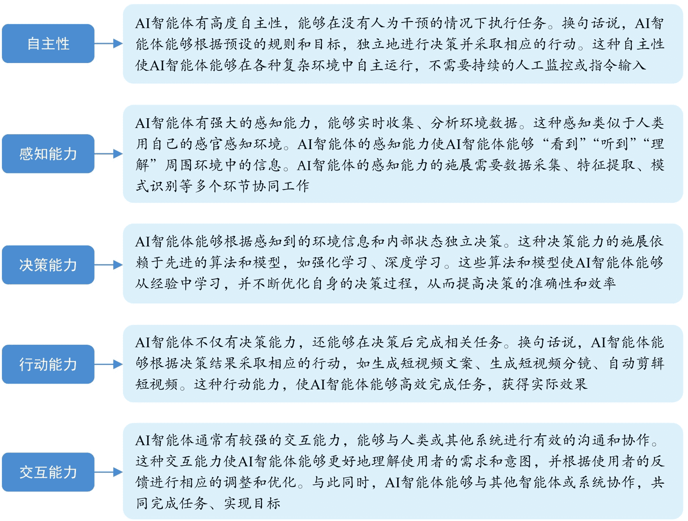

图 2-1

**2.AI 智能体可以做什么**

在短视频策划领域，AI 智能体已经能够做到全流程自动化赋能——从创意构思到内容发布，可形成闭环，显著提升策划效率并降低技术门槛。接下来详细介绍 AI 智能体的核心应用场景，并对其价值进行分析。

**（1）创意策划阶段：精准定位与主题定制。**

其一，热点洞察与主题生成。

①趋势分析：AI 智能体能够通过分析大数据实时捕捉热点话题（如社交媒体讨论趋势、节日热点），为“夏季健身计划”“清晨瑜伽”等主题提供策划灵感。

②受众画像匹配：AI 智能体能够根据目标受众的特征（如年龄、兴趣）为目标受众推荐风格化主题，例如，为年轻健身爱好者推荐“海滩燃脂”、为 25 岁至 35 岁女性推荐“清晨冥想”。

其二，风格化内容定制。

①视觉风格生成：AI 智能体支持水墨画、超写实、复古等多种风格的一键切换，能确保同批生成的内容具有视觉统一性。

②情绪“钩子”设计：通过使用 AI 技术分析受众心理，AI 智能体支持在视频首秒植入悬念或情感共鸣点（如“挑战极限”标语＋产品特写），提升完播率。

**（2）内容生产阶段：智能化制作与优化。**

其一，分镜设计与脚本创作。

①结构化输出：AI 智能体支持生成包含镜号、景别、时长、台词、音乐等内容的完整分镜表，确保节奏紧凑。

②多角色对话生成：AI 智能体支持问答模式的脚本创作，能够自动分配提问者与回答者的音色，增强互动感。

其二，素材处理与视觉生成。

①智能素材库：AI 智能体能够自动搜索与主题匹配的图片、视频素材（如输入书名后联网抓取书籍内容），并生成动态背景。

②关键帧动画：AI 智能体能够为静态图片添加动态效果，提升视频观赏性。

其三，特效与配音处理。

①实时渲染技术：通过进行分布式训练模拟物理世界，AI 智能体支持逼真特效（如海滩上的余浪、产品的 3D 旋转）的生成。

②语音合成优化：AI 智能体支持多语种、多音色配音，能够自动调整语音的速度与情绪（如合成悬疑解说类语音）。

**（3）发布与运营阶段：精准投放与数据驱动。**

其一，智能发布策略。

①平台适配：根据抖音（以快节奏娱乐内容为主）、B 站（以风格化潮流内容为主）等平台的特性， AI 智能体能够智能调整视频的时长与风格。

②定时投放：使用 AI 智能体全面分析受众的活跃高峰期后，AI 智能体可自动选择最佳发布时间（如 20 时“黄金档”）。

其二，数据反馈与优化。

①实时监控：AI 智能体支持对播放量、点赞数、评论数等数据的追踪、监控，并支持智能识别高互动片段（如“多重反转”剧情）。

②策略迭代：AI 智能体能够基于受众反馈信息，智能调整后续内容（如增加悬念设置、优化台词）。

**（4）商业化应用场景。**

其一，品牌营销。

①产品展示：AI 智能体支持对产品使用场景视频的智能生成。

②品牌故事：使用 AI 智能体，能够高效生成融入动画与旁白的企业发展历程视频。

其二，教育传播。

①知识科普：使用 AI 智能体，能够高效地将抽象概念（如“时间管理四象限”）转化为动态分镜视频。

②课程预告：使用 AI 智能体，能够智能生成教学视频中的讲师介绍与课程亮点集锦，提升课程的销售转化率。

其三，内容变现。

①书单号模式：使用 AI 智能体，能够在输入书名后高效生成与目标图书相关的问答视频，并同步关联购书链接，获取佣金。

②中视频计划：使用 AI 智能体，能够高效制作时长超过 10 分钟的、以深度内容为主体内容的视频，并通过平台分成获得收益。

如今，AI 智能体已从“工具”升级为短视频创作者的“联合创作者”，其价值不仅在于能够助力短视频创作者提升创作效率，还在于能够通过数据驱动和个性化定制，帮助短视频创作者突破创意瓶颈，实现内容质量与商业价值的双重跃迁。

**2.1.2 了解 AI 智能体创建平台**

常见的 AI 智能体创建平台有扣子平台、Dify 平台、豆包平台、通义平台、文心一言平台等。确定将要使用的 AI 智能体创建平台后，我们需要全面了解目标平台。

接下来以扣子平台为例，讲解如何全面了解 AI 智能体创建平台，即需要具体了解目标平台的哪些信息。

**1．平台的功能特点**

扣子平台以创新技术为基石，聚焦 AI 应用开发门槛的降低与应用效率的提升，通过模块化设计与可视化交互，覆盖从零代码开发到多场景部署的全链路需求。

扣子平台的功能特点如图 2-2 所示。

此外，扣子平台支持整合企业数据源，我们可以通过创建、使用 AI 智能体，实现文档解析、数据查询，以及自动化报告的生成。比如，结合使用飞书多维表格等插件，我们可在扣子平台上通过创建、使用 AI 智能体，快速生成可视化的数据分析结果。再如，使用扣子平台上的专家级 AI 智能体“A 股观察助手”，可以完成深度的市场洞察与数据建模，有助于企业精准决策。

图 2-2

**2．接口开放情况**

通过构建标准化、模块化的开放接口体系，扣子平台为用户提供了高效接入 AI 功能的技术通道。扣子平台的接口设计兼顾灵活性与安全性，支持跨系统功能调用与应用场景扩展，能够助力用户高效构建智能化应用。

接下来，讲讲扣子平台的接口开放情况。

**（1）基础架构。**

扣子平台采用结构化数据交互协议设计核心接口，覆盖 AI 智能体交互、流程执行、知识库同步等模块。用户可以通过超文本传输协议与扣子平台进行数据交互，接口采用分层架构实现动态扩展与版本兼容，确保技术平滑迭代与系统长期稳定。为降低开发门槛，扣子平台提供详细的在线文档与开发工具包，能够帮助用户快速完成技术对接。

**（2）核心功能与调用方式。**

扣子平台的接口支持对话生成、消息查询、流程触发等核心功能。用户使用扣子平台时，需要通过安全认证协议获取访问凭证，并在请求头中放入凭证信息、在请求体中放入业务参数。接口返回的结构化数据包含交互状态、生成内容、执行日志，用户可以基于返回结果优化后续业务逻辑，形成完整的业务闭环。

**（3）应用场景与扩展性。**

扣子平台的开放接口广泛应用于智能服务、数据分析、自动化流程等场景。企业可以通过开放接口将 AI 智能体嵌入自有系统，实现全天候在线服务；用户可以调用流程接口，构建复杂业务。扣子平台支持插件化扩展，允许用户基于开放接口开发自定义功能模块，进一步拓展 AI 智能体能力的边界，满足多样化的业务需求。

**3.AI 智能体的创建方式**

我们可以在扣子平台上选择合适的方法创建所需要使用的 AI 智能体。具体来说，AI 智能体的创建方法有如下 4 种。

方法一：自主创建。

自主创建 AI 智能体可以继续细分为两种创建方法，一种是自己编写代码，制作相关程序；另一种是借助其他平台编写 AI 智能体的相关信息，快速完成 AI 智能体的创建任务。

自己编写代码，往往不仅需要有专业的知识和技术，还需要付出大量的时间。如果大家觉得自己编写代码的门槛太高了，可以在扣子平台中编写需要使用的 AI 智能体的相关信息。

例如，在扣子平台“创建智能体”的“标准创建”选项卡中，我们可以自行对智能体的名称和功能介绍信息进行编辑，如图 2-3 所示。

图 2-3

方法二：使用 AI 创建。

扣子平台有 AI 创建智能体的相关功能，我们使用这些功能，可以快速完成对 AI 智能体的创建。

例如，在扣子平台“创建智能体”的“AI 创建”选项卡中，我们对想要创建的 AI 智能体进行描述后，单击“生成”按钮，扣子平台即可根据提示完成对 AI 智能体的创建。使用“AI 创建”功能创建智能体的界面如图 2-4 所示。

图 2-4

方法三：使用模板创建。

扣子平台上有大量的 AI 智能体创建模板，我们可以选择合适的模板创建 AI 智能体。例如，在如图 2-5 所示的扣子平台上的“模板”页面中根据自身需求选择模板后，在应用模板的基础上完成对 AI 智能体的创建。

图 2-5

**专家提醒**

扣子平台上的“模板”页面中，既有 AI 智能体的模板，又有应用和工作流的模板。创作者选择模板时，要明确模板类型。

方法四：使用其他方法创建。

除了自主创建、使用 AI 创建和使用模板创建 AI 智能体，我们还可以使用其他方法创建 AI 智能体。

例如，在扣子平台上，“主页”“工作空间”“商店”“模板”等页面的右下方都有扣子助手图标 ，单击该图标，会弹出“扣子助手”对话框，如图 2-6 所示。我们可以与扣子助手沟通，引导扣子助手协助我们创建 AI 智能体。

图 2-6

**2.1.3 确定要创建的 AI 智能体**

在着手创建 AI 智能体之前，我们需要紧密围绕自身的核心需求，明确 AI 智能体的功能定位。与此同时，我们需要充分考虑目标用户群体的特征与期望，确保创建的 AI 智能体能够切实满足目标用户群体的需求。此外，我们还需要评估技术条件与资源储备情况，以确定创建目标 AI 智能体的可行性。

通常，确定要创建 AI 智能体后，我们需要首先明确的是目标 AI 智能体的功能需求和创建要点，接下来分别进行详细讲解。

**1.AI 智能体的功能需求**

短视频行业竞争激烈，优质的创意与精准的脚本是短视频账号的运营者在竞争中脱颖而出的关键。AI 智能体的以下功能能够为短视频策划提供全方位的助力，大幅提升短视频的策划效率。

（1）创意灵感挖掘：AI 智能体能够深度剖析用户输入的主题关键词、目标受众、视频风格偏好等信息，从海量创意中精准筛选并融合相关元素，生成具有新颖性、独特性和市场吸引力的短视频创意，涵盖剧情反转设计、热门话题结合等，为用户提供源源不断的灵感，让用户的策划没有瓶颈。

（2）脚本精准撰写：依据生成的创意，AI 智能体能够自动撰写结构完整、逻辑清晰的短视频脚本，不仅详细规划各镜头的景别、拍摄手法、台词内容、时长安排等，还充分考虑短视频的节奏把控和受众的注意力曲线，确保脚本具有较高的可执行性和吸引力，为视频拍摄奠定坚实的基础。

（3）内容深度优化：AI 智能体不仅能够对用户提供的脚本或初步创意进行全面分析，从剧情连贯性、情节吸引力、角色塑造、节奏把握等多个维度入手，提出专业且有针对性的优化建议，还能够根据用户的反馈，对脚本进行多轮迭代修改，直至脚本达到理想的效果，让视频内容更加优质。

（4）热门趋势洞察：AI 智能体能够实时监测短视频平台的热门话题、流行元素、常见音乐风格、高热度视频的拍摄手法等，并将这些信息融入创意生成和脚本撰写过程，使制作的短视频能够紧跟潮流，有较高的曝光度和较强的传播力，在众多短视频中脱颖而出。

**2.AI 智能体的创建要点**

要创建一个高效、实用的短视频策划 AI 智能体，需要完成多方面的精心筹备，以下创建要点不容忽视。

（1）多元数据整合：广泛收集不同领域、不同风格的优质短视频脚本及创意案例，构建庞大且多样化的数据集。此外，要注意对数据进行清洗、标注和分类处理，确保模型能够准确学习、掌握短视频的创作规律和创作技巧，为创意生成和脚本撰写提供坚实的支撑，让 AI 智能体拥有丰富的“知识储备”。

（2）先进算法应用：使用先进的自然语言处理算法，提升 AI 智能体对用户意图的理解能力，并优化 AI 智能体生成的文本的质量。此外，通过不断优化算法参数和训练策略，为 AI 智能体的“智慧大脑”赋能，使 AI 智能体能够更准确地围绕用户需求，生成更符合用户预期的内容。

（3）交互体验优化：设计简洁、直观、操作便捷的交互界面，让用户能够轻松输入创作需求，如主题、风格、时长。此外，健全实时反馈机制，让用户能够在生成过程中随时查看、修改内容。与此同时，完善 AI 智能体的答疑功能和引导功能，帮助用户更好地使用该 AI 智能体进行短视频策划，提升用户使用该 AI 智能体的便捷性和满意度。

（4）持续学习升级：健全模型持续学习、更新的机制，定期收集新的短视频数据和用户反馈信息，对模型进行再训练和优化，以适应不断变化的短视频市场，确保 AI 智能体始终有较高的创作水平和实用性，能够与时俱进地持续为用户提供优质服务。

**2.1.4 AI 智能体的数据收集与整理**

着手创建 AI 智能体时，我们需要紧密结合 AI 智能体的应用场景与预期目标，精准确定所需要的数据的类型与涵盖范围，并从多个可靠渠道入手，广泛收集数据。数据收集完毕后，要严格筛选，剔除无关信息及错误信息，并依据合理的逻辑与结构对数据进行分类，为创建 AI 智能体提供优质的数据保障。

具体来说，进行 AI 智能体的数据收集与整理时，我们需要把握好以下 5 个要点。

**1．多维度数据采集**

采集有分析价值的短视频的点击数、播放时长、互动数（点赞数/评论数/转发数）等多维度数据。例如，某美妆博主通过抖音后台发现，“早 8 快速妆容”短视频的完播率高达 70%，且评论区常有留言“新手适合使用哪些工具？”“有没有平价工具推荐？”等，据此，AI 智能体可以分析出“新手友好”“省时”是该短视频账号的受众的核心需求，自动生成“5 分钟通勤妆”“新手惊艳妆”等选题，并匹配平价工具推荐。

**2．竞品内容效果深度分析**

抓取同领域爆款短视频的标题、时长、发布时间、互动数等数据。例如，某家居品牌博主发现竞品（“收纳技巧”相关短视频）在周三 20 时发布时播放量会翻倍，且标题含“小户型”这一关键词时，互动率会提升约 40%，据此，AI 智能体经分析建议该品牌账号在同一时间段发布主题为“小户型厨房收纳神器”的短视频，并使用“3 招解决台面杂乱问题”等结构化标题提升短视频的吸引力。

**3．多源数据整合与标签化**

整合受众调研、评论区关键词、搜索热词等多源数据。例如，某母婴博主通过问卷调查发现受众普遍关注“辅食添加顺序”这一话题，同时评论区高频出现“过敏怎么办”“便秘怎么办”等担忧，据此，AI 智能体生成“6 月龄至 12 月龄宝宝辅食添加红黑榜”“6 月龄至 12 月龄宝宝营养需求量”等选题，并标注“防过敏”“促消化”等标签，精准匹配受众需求。

**4．实时数据驱动内容迭代**

部署实时监测工具，根据受众的反馈信息动态调整内容。例如，某零食品牌账号直播时，AI 智能体监测到弹幕中的“无糖”“低卡”等关键词激增，立即提示主播更改产品介绍顺序，并快速生成“低卡零食合集”短视频预告，最终，该短视频播放量超 50 万，带动相关产品销量增长 30%。

**5．隐私数据脱敏处理**

对受众的隐私数据进行脱敏处理，仅保留进行数据分析所需要的字段。例如，某教育博主收集受众咨询记录时，剔除姓名、联系方式等数据，仅保留“考研英语”“在职备考”等需求标签，基于需求标签， AI 智能体生成“在职党英语 80 分冲刺计划”“考研英语在职学”等内容，既保护了受众隐私，又提升了内容转化效率。

### **2.2** **实战：基于 DeepSeek 创建 AI 智能体**

完成前期筹备工作后，我们便可以根据自身需求创建 AI 智能体。例如，我们可以基于 DeepSeek 模型创建专精于短视频文案创作的 AI 智能体，确保 AI 智能体所生成内容的优质率在 80%以上。此外，我们可以使用 AI 智能体策划、生成的短视频文案，将短视频的策划周期缩短 30%以上。

本节介绍基于 DeepSeek 创建 AI 智能体的实战技巧。

**2.2.1** **创建 AI 智能体**

使用扣子平台上的“创建”功能，可以快速创建 AI 智能体，具体操作步骤如下。

步骤 01 在搜索引擎（如百度）中输入并搜索“扣子”; 单击搜索结果中扣子官网的链接，如图 2-7 所示。

图 2-7

步骤 02 注册并登录账号后，进入扣子平台的默认页面，单击页面上方的“开发平台”按钮，完成页面切换，如图 2-8 所示。

步骤 03 进入“开发平台”页面，单击“快速开始”按钮，即可使用扣子平台上的扣子开发平台创建 AI 智能体，如图 2-9 所示。

图 2-8

图 2-9

步骤 04 进入扣子开发平台的“主页”页面，单击“创建”按钮 ，即可开始创建 AI 智能体，如图 2-10 所示。

图 2-10

步骤 05 在弹出的“创建”对话框中，单击“创建智能体”选项区中的“创建”按钮，如图 2-11 所示。

图 2-11

步骤 06 在弹出的“创建智能体”对话框中， 在“标准创建”选项卡中“智能体名称”对应的输入框中输入要创建的 AI 智能体的名称； 单击“确认”按钮，如图 2-12 所示。

图 2-12

步骤 07 完成以上操作后，如果进入了目标 AI 智能体的“编排”页面，说明 AI 智能体创建成功了，如图 2-13 所示。

图 2-13

**专家提醒**

除了可以通过单击“主页”页面中的“创建”按钮创建 AI 智能体，还可以通过单击“工作空间”页面中的“创建”按钮创建 AI 智能体。

**2.2.2** **设置 AI 智能体的“人设与回复逻辑”**

完成目标 AI 智能体的创建后，我们可以根据自身需求，设置该 AI 智能体的“人设与回复逻辑”相关信息——设定该 AI 智能体的角色、赋予该 AI 智能体技能，并对该 AI 智能体进行一些限制。

设置 AI 智能体的“人设与回复逻辑”相关信息的具体操作步骤如下。

步骤 01 进入 AI 智能体的“编排”页面，单击“人设与回复逻辑”对应的输入框，在输入框中输入提示词，设定 AI 智能体的角色，如图 2-14 所示。

图 2-14

**专家提醒**

设定 AI 智能体的角色，如短视频文案创作者、客服、教育导师、娱乐伙伴，明确其在特定场景或任务中的身份，有助于 AI 智能体更好地理解用户的需求，并提供符合角色定位的回复。

AI 智能体的角色设定包括对 AI 智能体的性格特征、语言风格等进行设定。例如，一个客服角色需要有耐心的性格、专业的知识积累，并使用正式、礼貌的语言；一个娱乐伙伴角色则需要有活泼、幽默的性格，使用轻松、随意的语言。

步骤 02 继续输入提示词，为 AI 智能体赋予技能，如图 2-15 所示。通过为 AI 智能体赋予技能，如主题创作、风格适配，可以显著扩展 AI 智能体的应用范围，提升其能力。

图 2-15

步骤 03 继续输入提示词，对 AI 智能体进行限制，如图 2-16 所示。设定限制条件可以确保 AI 智能体的回复符合特定规则或标准。

图 2-16

完成以上内容的输入，即完成了对 AI 智能体的“人设与回复逻辑”相关信息的设置。

**2.2.3** **添加文案创作的插件**

如果无法通过设置“人设与回复逻辑”相关信息使 AI 智能体获得某种技能，用户可以为 AI 智能体添加“插件”“触发器”“工作流”等组件，帮助 AI 智能体获得目标技能，拓展 AI 智能体的应用场景。

为 AI 智能体添加文案创作的插件，具体操作步骤如下。

步骤 01 进入 AI 智能体的“编排”页面，单击“技能”板块中“插件”选项右侧的“添加插件”按钮 ，如图 2-17 所示。

图 2-17

步骤 02 在弹出的“添加插件”对话框中单击搜索框，如图 2-18 所示。

图 2-18

步骤 03 在搜索框中输入搜索关键词，如“文案”; 在搜索结果中单击目标插件； 在展开的面板中单击“添加”按钮，如图 2-19 所示。

图 2-19

步骤 04 完成以上操作后，返回 AI 智能体的“编排”页面，如果已显示刚刚添加的插件，说明插件添加成功了，如图 2-20 所示。

图 2-20

**专家提醒**

在一个 AI 智能体中，我们可以添加多个插件。例如，创建专精于短视频文案创作的 AI 智能体时，我们不仅可以添加文案提取类插件，还可以添加文案润色类、文案生成类、文案校对类等插件。

**2.2.4** **调用 DeepSeek 模型**

在扣子平台上调用 DeepSeek 模型，能够快速搭建 AI 智能体并实现 AI 智能体的多场景应用。扣子平台支持不止一种 DeepSeek 模型的调用，其中，DeepSeek-R1 模型擅长复杂的逻辑推理，可通过分解问题，逐步推导答案；DeepSeek-V3 模型的语言理解能力强，可用于生成流畅对话。

在扣子平台上调用 DeepSeek 模型的具体操作步骤如下。

步骤 01 单击 AI 智能体“编排”页面中目标模型对应的按钮，如单击“豆包·1.5·Pro·32k”按钮，如图 2-21 所示。

步骤 02 在弹出的“模型选择”面板中选择目标模型对应的选项，如选择“DeepSeek-V3-0324”选项，如图 2-22 所示。

图 2-21

图 2-22

步骤 03 完成以上操作后，返回 AI 智能体的“编排”页面，如果已显示刚刚选择的 DeepSeek 模型，说明 DeepSeek 模型调用成功了，如图 2-23 所示。

图 2-23

**2.2.5** **创建并添加工作流**

工作流是通过设定一系列规则和步骤，使 AI 智能体能够自动化处理任务或流程的机制。在扣子平台上，我们可以根据自身需求创建并添加需要使用的工作流。

在扣子平台上创建并添加工作流的具体操作步骤如下。

步骤 01 进入 AI 智能体的“编排”页面，单击“技能”板块中“工作流”选项右侧的“添加工作流”按钮 ，如图 2-24 所示。

图 2-24

步骤 02 完成第 1 步操作后，弹出“添加工作流”对话框， 在该对话框中单击“创建工作流”按钮； 在弹出的列表框中选择“创建工作流”选项，如图 2-25 所示。

图 2-25

步骤 03 完成第 2 步操作后，弹出“创建工作流”对话框， 分别在该对话框中“工作流名称”和“工作流描述”对应的输入框中输入工作流名称、工作流描述内容； 单击“确认”按钮，确认创建工作流，如图 2-26 所示。

图 2-26

步骤 04 完成以上操作后，进入工作流的编辑页面，可以看到该页面中已有自动创建的“开始”节点和“结束”节点。单击“开始”节点右侧的 按钮，按住鼠标左键，将其拖曳至“结束”节点所在的位置，即可将这两个节点连接起来，如图 2-27 所示。

图 2-27

步骤 05 单击“开始”节点和“结束”节点中间的 按钮，即可添加更多的节点，如图 2-28 所示。

图 2-28

步骤 06 在弹出的面板中选择合适的节点类型，这里选择“大模型”，如图 2-29 所示，完成对“大模型”节点的添加。

图 2-29

步骤 07 单击“大模型”节点，即可对该节点的信息进行设置，如图 2-30 所示。

图 2-30

步骤 08 在弹出的“大模型”面板中， 设置模型、变量、系统提示词等内容； 单击面板右上方的 按钮，即可关闭该面板，如图 2-31 所示。在扣子工作流的“大模型”面板中，设置模型可指定处理任务的人工智能；设置变量可通过调整输入/输出参数，实现流程的数据驱动；设置系统提示词可指导模型生成符合预期的回复，确保回复的准确性、相关性，优化 AI 智能体的表现。

图 2-31

步骤 09 完成以上操作后，单击“结束”节点，如图 2-32 所示，即可对“结束”节点的信息进行设置。

图 2-32

步骤 10 在弹出的“结束”面板中， 单击“返回文本”按钮，切换至“返回文本”选项卡； 设置输出变量、回答内容等内容，确保工作流按预期输出回复； 单击面板右上方的 按钮，即可关闭该面板，如图 2-33 所示。

图 2-33

步骤 11 完成第 10 步操作后，即完成了对“结束”节点的信息的设置。单击工作流编辑页面下方的“试运行”按钮，如图 2-34 所示。

图 2-34

步骤 12 在弹出的“试运行”面板中， 在“试运行输入”对应的输入框中输入生成文案的提示词； 单击“试运行”按钮，运行该工作流，如图 2-35 所示。

步骤 13 完成第 12 步操作后，如果“试运行”面板中显示的运行结果无误，说明该工作流可以正常运行，如图 2-36 所示。

图 2-35

图 2-36

步骤 14 单击工作流编辑页面右上方的“发布”按钮，如图 2-37 所示。

图 2-37

步骤 15 在弹出的工作流发布信息设置面板中， 设置“版本号”“版本描述”相关内容； 单击“发布”按钮，即可确认发布该工作流，如图 2-38 所示。

步骤 16 完成第 14 步、第 15 步操作后，弹出的对话框中会显示“Workflow 发布成功！是否添加至当前智能体？”，单击该对话框中的“确认”按钮，即可将该工作流添加至当前智能体，如图 2-39 所示。

图 2-38

图 2-39

步骤 17 完成以上操作后，返回 AI 智能体的“编排”页面，如果已显示刚刚添加的工作流，说明工作流添加成功了，如图 2-40 所示。

图 2-40

**2.2.6** **试用并预览 AI 智能体**

完成对专精于短视频文案创作的 AI 智能体的创建后，我们可以试用并预览 AI 智能体。

试用并预览 AI 智能体的具体操作步骤如下。

步骤 01 进入 AI 智能体的“编排”页面， 在“预览与调试”窗口的输入框中输入提示词； 单击“发送”按钮 ，发送提示词，如图 2-41 所示。

图 2-41

步骤 02 完成以上操作后，AI 智能体会根据提示词给予回复。我们可以预览回复内容，评估 AI 智能体的创作效果。在第 1 步中输入并发送提示词“请为我生成一篇摄影类短视频文案”后， AI 智能体的回复内容如下。

**短视频文案创作**

以下是一篇适合摄影类短视频的文案，风格为“治愈＋干货”，据此文案制作的短视频适合摄影爱好者或初学者观看。

【0～5 秒 视觉吸引】

画面：日出时分的延时摄影（金色阳光洒在山间）。

文案：“你拍的风景，为什么总是差一点儿感觉？”

【6～15 秒 痛点问题切入】

画面：普通游客照 VS 专业摄影作品（切换对比）。

文案：“不是景色不够美，而是你忽视了这 3 个关键点！”

【16～25 秒 干货教学】

画面 1：对三分法构图的演示（人物站在画面右侧 1/3 处）。

文案：“1． 构图：记住‘三分法’，主体放在黄金分割点！”

画面 2：逆光拍摄的对比（普通光 VS 用反光板补光）。

文案：“2． 光线：逆光拍照？一块反光板拯救暗部！”

画面 3：低角度拍摄花朵的特写。

文案：“3． 视角：蹲下来！低角度拍摄平凡事物，轻松获得大片！”

【26～30 秒 互动结尾】

画面：摄影师回头微笑，看向镜头。

文案：“下次旅行试试看？在评论区告诉我你的成果！”

背景音乐选择建议：轻快的纯音乐（如《Sunny Morning》）。

话题标签：#摄影技巧 #旅行大片 #手机摄影。

**2.2.7** **发布 AI 智能体**

如果对创建完成的 AI 智能体的运行结果满意，我们可以通过如下操作，将该 AI 智能体发布至合适的平台。

步骤 01 进入 AI 智能体的“编排”页面，单击页面右上方的“发布”按钮，如图 2-42 所示。

图 2-42

步骤 02 进入“发布”页面，单击“发布记录”对应的输入框，如图 2-43 所示，即可输入 AI 智能体的“版本记录”相关信息。

图 2-43

步骤 03 在“发布记录”对应的输入框中输入 AI 智能体的“版本记录”相关信息，以便更好地区分该版本的 AI 智能体与其他版本的 AI 智能体，如图 2-44 所示。

图 2-44

步骤 04 选中目标发布平台对应的复选框，如选中“扣子商店”对应的复选框； 单击“发布”按钮，确认发布 AI 智能体，如图 2-45 所示。

图 2-45

步骤 05 完成以上操作后，如果“发布”页面中显示“已成功提交发布！”，说明该 AI 智能体的发布申请提交成功了，如图 2-46 所示。

步骤 06 进入扣子平台“工作空间”页面，切换至“项目开发”选项卡，如果该 AI 智能体名称的右侧显示 图标，说明该 AI 智能体已成功发布，如图 2-47 所示。

图 2-46

图 2-47

### **目标实现**

为成功创建 AI 智能体，助力运营目标的实现，AI 智能体创建专员需要做好以下 5 项工作。

第一项：用好扣子平台，创建 AI 智能体，并为 AI 智能体设定明确的人设，配置多轮对话回复逻辑，确保交互具有专业性。

第二项：通过添加短视频文案创作插件，提升 AI 智能体生成的内容的创意与传播力。

第三项：调用 DeepSeek 模型，生成短视频文案。

第四项：设计标准化工作流，减少人工干预环节。

第五项：发布所创建的 AI 智能体，结合用户反馈信息，不断优化 AI 智能体的内容输出质量，最终实现“所生成内容的优质率超 80%，且短视频策划周期缩短超 30%”的目标。

## **第三章** **多平台协同运营实战：搭建账号矩阵**

**案例驱动**

【运营岗位】短视频矩阵运营主管。

【运营目标】在 3 个月内搭建并运营一个涵盖 3 个以上不同短视频平台的账号的短视频矩阵，实现矩阵内账号的粉丝总数在 3 个月内增长 5 万以上的目标。

**内容概要**

本章以短视频矩阵的运营为例，从短视频矩阵运营主管的角度出发，讲解如何布局短视频矩阵、解析短视频矩阵的搭建流程，并通过快速搭建并运营涵盖 3 个以上不同短视频平台的账号的短视频矩阵，帮助读者更好地了解高效打造 IP 并持续提升 IP 知名度的操作方法。

、

### **3.1 布局：如何搭建 AI 短视频矩阵**

布局短视频矩阵，指围绕品牌传播目标，整合多个短视频平台的资源，构建一个有机协同的运营体系。完成对短视频矩阵的布局后，我们可以依托 AI 技术，洞察各短视频平台的受众特征与内容偏好，规划不同短视频账号的定位与内容方向，实现多平台联动与导流。

本节，我们重点讲解短视频矩阵的布局技巧。

**3.1.1 AI 短视频矩阵搭建概念解析**

搭建 AI 短视频矩阵，即依托人工智能技术，在多个短视频平台上打造一系列相互关联、各有侧重的短视频账号。现代企业普遍重视 AI 短视频矩阵的搭建，矩阵中的短视频账号可以围绕企业品牌、产品或服务，从不同角度入手产出内容，各内容形成传播合力，共同助力品牌影响力的提升，以吸引更多目标受众，实现更高效的营销、推广。

接下来介绍搭建 AI 短视频矩阵需要了解的各项信息。

**1．搭建背景和意义**

在数字化营销浪潮中，短视频凭借其强大的传播力和影响力，已成为企业营销不可忽视的载体之一。然而，传统的短视频运营模式已逐渐暴露诸多弊端，如人力投入成本大、运营效率低、难以精准触达目标受众，这些问题严重制约着企业的发展。在此背景下，AI 短视频矩阵的搭建风潮出现了——依托先进的人工智能技术，AI 短视频矩阵能够为企业提供高效、精准的短视频运营解决方案，具有极其重要的现实意义。

某依托 AI 技术生成的微缩景观短视频的画面效果如图 3-1 所示，该短视频账号的运营者凭借这类 AI 短视频，轻松吸粉超过 50 万，累计获赞达 380 余万！

图 3-1

掌握这种 AI 短视频玩法后，可以精准匹配不同圈层的受众的偏好，使单条短视频的制作成本降低 80%左右，同时使目标受众的触达精准度提升约 3 倍，充分体现 AI 技术在降本增效、智能决策层面的价值。

如今，短视频市场的竞争越来越激烈，受众对内容质量、个性化的要求越来越高，企业要想在众多竞争对手中脱颖而出，必须创新运营模式。通过整合资源、优化流程，搭建 AI 短视频矩阵能够大幅提升企业的运营效率，降低企业的运营成本，帮助企业更好地适应市场变化，实现可持续发展。

**2．核心构成要素**

AI 短视频矩阵的核心构成要素是多种多样的，其中，账号体系是基础。一个短视频矩阵包括一个主账号和多个子账号，主账号通常作为品牌的核心展示窗口，用于传递品牌的核心信息与价值观；子账号大多根据不同的业务领域、目标受众、内容风格等进行细分，用于触达更广泛的受众，满足不同受众的多样化需求。

设置良好的内容生产模块是搭建 AI 短视频矩阵的关键。依托 AI 技术，内容生产模块可助力素材的快速处理、视频的自动剪辑与生成。具体而言，AI 可以对海量的素材进行智能分析和筛选，快速提取有价值的内容，按照预设的规则、模板进行剪辑和合成，大大提高内容的产出效率和质量。与此同时，AI 还能根据不同平台的特点和受众偏好，生成个性化的视频内容，优化受众的观看体验。

**3．优势与应用场景**

搭建好的 AI 短视频矩阵有着诸多不可忽视的优势。

从成本角度看，AI 短视频矩阵化运营能大幅降低人力成本。维持传统的短视频运营需要安排大量的人力承担内容创作、剪辑、发布、数据分析等工作，而 AI 短视频矩阵化运营可以依托自动化技术，实现大部分工作的自动化处理，减少人力投入。与此同时，AI 短视频矩阵化运营能够提高内容产出效率，在短时间内产出大量优质的短视频内容。

从精准营销角度看，借助 AI 强大的数据分析能力，AI 短视频矩阵化运营可通过对受众的行为习惯、兴趣偏好等数据进行深入分析，精准把握受众需求，实现个性化推送，提高受众的参与度和营销的转化率。

从应用场景角度看，AI 短视频矩阵化运营有利于电商企业在多个平台上全方位地展示商品的特点、优势，吸引更多潜在客户，实现多平台引流。

例如，品牌方可以利用 AI 短视频矩阵强化品牌形象，通过发布一系列与品牌相关的短视频，如品牌故事、品牌活动，加深受众对品牌的认知和记忆，提高品牌的知名度；教育机构可以借助 AI 短视频矩阵进行产品推广，快速地让更多人了解其主推的教育产品。

**3.1.2 AI 短视频矩阵的市场调研**

当前，AI 短视频矩阵正迎来爆发式搭建，这得益于短视频行业的持续火热。

过去，大量短视频创作者饱受内容生产效率低、账号运营成本高等问题的困扰。如今，搭建 AI 短视频矩阵后，很多创作者使用 AI 工具的自动化剪辑、智能选题、批量生成等功能，不仅能够做到日均视频产出量提升数十倍，而且能够更快速地响应市场热点，推动行业从“人力驱动”向“技术驱动”转型。

通常，在进行 AI 短视频矩阵的市场调研时，需要重点从以下 5 个方面入手。

**1．明确目标平台与账号定位**

AI 短视频矩阵的市场调研的首要任务是精准锁定核心平台，并明确各账号的差异化定位。例如，某母婴品牌使用“1+N”策略搭建 AI 短视频矩阵，用 1 个主账号树立专业、权威的形象，同时运营 20 个子账号，分别聚焦哺乳期护理、辅食制作等垂直细分场景。凭借精准定位，该母婴品牌的搜索流量显著增长。

进行市场调研时，我们需要细致分析各平台的受众画像，例如，抖音受众更喜欢泛娱乐内容，小红书受众更热衷于种草类内容。只有根据平台特性与受众需求进行账号定位，才能避免盲目扩张，防止内容同质化，为矩阵的搭建筑牢根基。

**2．评估 AI 工具的功能适配性**

锁定核心平台并明确账号定位后，需要评估各类 AI 工具的功能适配性，确保其能满足 AI 短视频矩阵的内容生产需求。例如，即梦 AI 是字节跳动推出的生成式人工智能创作平台，支持自然语言生成视频，用户输入文本描述或上传图片素材，即可快速生成高质量的视频内容，相关画面效果如图 3-2 和图 3-3 所示。

图 3-2

图 3-3

更令人称奇的是，使用即梦 AI，不仅可以用简单的文案制作故事类、教程类视频，还可以在仅指定视频的首尾帧画面的情况下要求即梦 AI 自动生成视频中间部分的过渡效果。即梦 AI 会提供多种镜头运动方式和速度控制选项，使视频更具专业性和独特的视觉节奏。

在测试、评估 AI 工具时，我们需要重点关注其对行业数据库的抓取精度，只有抓取的数据精准，生成的脚本才能符合平台规则、贴合受众喜好，为矩阵内容的高质量产出提供保障。

**3．拆解竞品矩阵的运营策略**

了解 AI 工具后，我们需要深入拆解竞品矩阵的运营策略，从中汲取宝贵的经验。例如，某家电品牌使用“AI 数字人播报＋实拍素材混剪”这一创新模式搭建了 AI 短视频矩阵，主账号负责发布技术解析类短视频，子账号负责发布场景化短视频，用差异化运营策略，让品牌短视频矩阵中的短视频单月播放量突破 250 万。

在拆解过程中，我们需要特别留意竞品矩阵是否使用了“AI 生成＋人工润色”模式，因为过度依赖 AI 可能导致相关内容触发平台的“非真人创作”标签，影响短视频账号的权重与流量。换句话说，我们需要合理平衡 AI 生成与人工制作的比例。

**4．测算内容生产效率与成本**

汲取竞品矩阵的运营经验后，我们要详细测算自己的内容生产效率与成本，以此优化 AI 短视频矩阵的资源配置。例如，某跨境电商团队使用 AI 脚本工具后，抖音账号的运营效率大幅提升 5 倍，单条短视频的制作成本从 800 元骤降至 25 元，成本优势明显。

在选择 AI 工具时，我们要重点考察 AI 工具的批量剪辑能力，例如，目标 AI 工具能否在 30 分钟内生成 100 条差异化短视频。强大的内容生产能力是确保矩阵内容量级与平台流量高峰匹配的基础，此两者匹配，我们才能最大化地获取流量、提升运营效益。

**5．规避平台“红线”与法律风险**

在 AI 短视频矩阵化运营的过程中，我们要高度重视对平台“红线”与法律风险的规避，确保我们的 AI 短视频矩阵稳健发展。例如，某医疗短视频账号因发布了 AI 生成的虚假案例而被永久封禁。这警示我们在审核脚本时要删除虚假宣传、绝对化表述等违规内容。

**3.1.3 AI 短视频矩阵的平台筛选**

筛选合适的平台，有利于我们精准定位目标受众。

不同平台的受众有差异，选对平台不仅能让内容精准触达潜在受众，还能提升内容的传播效率（契合平台算法、符合平台规则的内容，更易获得平台的流量扶持）。此外，选对平台能降低运营成本，避免在不适配的平台上进行无效投入。

如果时间与精力足够，针对不同的平台投放不同的内容，有助于打造对应各平台特色的风格不同的短视频账号。搭建差异化发展的 AI 短视频矩阵，对提高品牌的竞争力来说是有利无害的。

那么，进行 AI 短视频矩阵的平台筛选时，要特别关注哪些要点呢？下面进行具体讲解。

**1．受众与品牌的契合度**

不同平台的受众特征差异明显，我们需要充分调研各平台核心受众的年龄、性别、消费偏好等画像数据，筛选与品牌的目标受众高度重合的平台，确保投放的内容精准触达目标受众，提高营销转化效率。

例如，某高端护肤品品牌调研发现，小红书的女性受众占比超 80%，且以 25 岁至 35 岁的高消费群体为主——与品牌的目标受众高度重合。基于此，该品牌在小红书平台上密集发布了数篇以“成分解析＋护肤教程”为主题的短视频，并配合关键词不断进行主题优化。最终，该品牌的相关短视频曝光量超 300 万，相关产品搜索量增长超 70%，精准受众的转化率提高超 50%，营销效果显著。

**2．流量分发机制与算法规则**

了解各平台的流量分发机制与算法规则，有利于筛选平台并实现流量的持续增长。不同平台的流量扶持逻辑不同，具体表现为完播率、互动率、内容原创度等指标的权重各异。因此，有针对性地优化内容结构与发布策略，可以提升曝光效率与账号权重，助力矩阵中的短视频账号在平台上脱颖而出，实现流量的自然增长。

例如，某 AI 养生类短视频账号的运营者使用即梦 AI 生成数个以“AI 控糖食谱”为主题的短视频，良好地结合了中医理论与现代视觉美学，相关视频被自动打上#养生知识、#控糖蔬菜、#养生之道、#即梦 AI 等多维度标签，如图 3-4 所示，通过抖音标签系统实现了精准曝光，账号曝光量得到了大幅提升。

图 3-4

**3．商业化路径与变现能力**

筛选平台时，必须重视相关平台的商业化路径与变现能力。我们可以优先选择支持品牌合作、直播带货、广告投放等多元变现方式的平台，构建从流量获取到收益转化的完整链路，缩短变现周期，提升投资回报率，让 AI 短视频矩阵内的短视频账号更具商业价值。

**4．运营成本与资源投入**

在搭建 AI 短视频矩阵的过程中，合理地协调运营成本与资源投入是至关重要的。我们需要全面评估矩阵运营所需要的人力、时间、资金成本，优先选择投入产出比较高的平台，集中资源打造核心短视频账号，避免因多平台分散人力、时间、资金等资源导致运营效率低下与资源浪费。

**3.1.4 AI 短视频矩阵的账号定位与规划**

在搭建 AI 短视频矩阵的过程中，做好账号定位与规划非常重要。

做好账号定位如同为 AI 短视频矩阵锚定发展方向，需要清晰界定 AI 短视频矩阵的目标受众、核心内容与独特价值；做好规划则是为 AI 短视频矩阵的发展绘制蓝图，需要明确 AI 短视频矩阵的内容排期、更新节奏等方面的细节。

唯有定位精准、规划科学，各短视频账号才能在矩阵中协同共进，全面吸引流量、积累粉丝。通常，想要做好 AI 短视频矩阵的账号定位与规划，需要重点把握好以下 5 点。

**1．明确核心受众与价值定位**

在着手搭建 AI 短视频矩阵前，我们需要精准界定核心受众的年龄、性别、兴趣爱好等特征，并明确待搭建的 AI 短视频矩阵能为受众提供什么独特价值。只有定位清晰，才有希望获得目标受众的长期关注，并不断增强核心受众的黏性。

例如，某 AI 萌宠剧情类短视频矩阵的运营者细致勾勒矩阵的受众画像后发现，自己的短视频的核心受众是 18 岁至 35 岁的女性，她们常像候鸟般聚集在一线城市、二线城市，对“治愈系”“萌宠日常”“创意剧情”等内容有着蜜蜂对花蜜般的强烈兴趣。据此，该 AI 短视频矩阵的运营者在自己的 AI 短视频中全力展现猫咪的可爱模样，配上“这小猫谁养谁不迷糊啊”“小猫‘怼脸杀’视频”等话题标签，参与“萌宠出道计划”，走治愈系路线，如图 3-5 所示，吸引了大量的关注和点赞。

图 3-5

**2．统一品牌风格与视觉标识**

AI 短视频矩阵内的各账号需要有统一的品牌风格与视觉标识，这涉及色调、字体、标志等关键元素，如图 3-6 所示。

图 3-6

具体而言，色调应契合品牌调性，字体应清晰易读且风格一致，标志应醒目且极具辨识度。营造这种统一的视觉呈现效果如同为品牌打造了一张专属名片，能显著地增强品牌的辨识度与记忆点，有力地提升品牌的专业性与可信度。

**3．规划账号角色与制定协同策略**

搭建 AI 短视频矩阵时，我们需要紧密结合业务需求，为 AI 短视频矩阵内的不同账号精准规划独特的角色，比如，“引流号”负责吸引潜在受众的关注，“转化号”专注于将流量转化为实际购买行为，“口碑号”着重打造良好的品牌形象与口碑。与此同时，我们需要制定科学有效的协同策略，让各账号能够紧密配合，高效利用流量与资源，显著提升 AI 短视频矩阵的整体运营效果。

**4．差异化内容满足多元需求**

在 AI 短视频矩阵化运营中，矩阵内的各账号应紧密围绕核心主题进行内容创作，同时精心打造差异化内容。比如，从内容形式、风格、侧重点等方面入手，为矩阵内各账号设置差异点，精准满足不同受众的细分需求。在 AI 短视频矩阵中呈现差异化内容，可有效规避矩阵内部的同质化竞争，吸引不同的受众，进而扩大品牌的市场影响力。

**5．设定阶段性目标与建立评估体系**

在 AI 短视频矩阵化运营中，为矩阵设定清晰的阶段性目标是至关重要的，设定目标时可重点关注粉丝增长量、视频播放量、转化率等关键指标。与此同时，AI 短视频矩阵的运营者要建立一套完善的评估体系，定期对矩阵内各账号的表现进行多维度评估，以便及时发现运营中的问题，进而及时调整运营策略，保障矩阵朝着既定目标稳步发展。

**3.1.5 AI 短视频矩阵的账号结构与协同策略**

对 AI 短视频矩阵来说，账号结构与协同策略如同大厦的框架与钢筋，决定着矩阵的稳固性与发展潜力。设计合理的账号结构有助于实现资源的优化配置，采取有效的协同策略则有助于激发各账号的活力，使矩阵拥有强大的传播合力。针对 AI 短视频矩阵的账号结构与协同策略，我们需要重点了解以下 5 个关键点。

**1．金字塔式的账号结构设计**

搭建 AI 短视频矩阵，可以尝试使用金字塔式账号结构——主账号如同塔尖，处于核心地位，负责统筹全局、传递品牌的核心信息与价值观；子账号如同塔身，围绕主账号散开，在细分领域深耕，与主账号形成层级分明、协同配合的关系。简单地说，主账号的主要作用是为子账号提供流量与品牌背书，子账号的主要作用是丰富矩阵，满足不同受众的需求，与主账号共同提升品牌影响力。

**2．矩阵内账号间的功能互补**

在 AI 短视频矩阵中，不同的短视频账号有不同的定位、作用，相互补充，才能形成完整的服务链路——主账号负责提供宏观信息与整体引导，子账号负责在具体的细分领域提供知识补充与应用指导，两者共同为受众提供从信息获取到实际应用的一站式服务，提高受众的满意度、增强受众的黏性。

以某 AI 短视频矩阵的运营者打造的 AI 古诗词短视频矩阵为例，通过搭建“1+3 账号体系”，该 AI 短视频矩阵实现了矩阵内账号间的功能互补。具体而言，该 AI 短视频矩阵内的主账号为内容枢纽，每日发布经典古诗词的 AI 重构作品——先使用 DeepSeek 解析古诗词意境，再使用即梦 AI 生成 4K 动态画面，最后使用剪映剪辑视频并发布至抖音平台。围绕主账号，矩阵内的子账号各有侧重，有的提供 AI 古诗词类短视频的剪辑教学，实现知识变现；有的发布古诗词类数字人短剧，增加互动；有的则致力于构建传统文化数据库，提供学术支持。矩阵内账号间功能互补，形成了从文化传播到商业变现的闭环。如今，该 AI 短视频矩阵的 60 日留存率超 38%，月均收益超 80 万元。

该 AI 短视频矩阵内的主账号发布的短视频的画面效果如图 3-7 所示。

图 3-7

**3．矩阵内账号间的内容联动**

关注矩阵内账号间的内容联动机制，以特定主题或话题为核心，从多元视角、不同层面出发进行内容创作，有利于矩阵内各账号的内容相互关联、协同发力，形成强大的矩阵传播合力，高效塑造热门话题。使用此策略有助于显著提升 AI 短视频矩阵的受众参与度，扩大话题的传播范围，提高话题的影响力，增强品牌的知名度。

**4．矩阵内的跨账号互动引流**

在 AI 短视频矩阵化运营中，矩阵内的各账号应积极尝试相互推荐、合作创作等互动方式，不仅实现资源共享，而且让信息在更大的范围内传播，吸引更多的潜在受众，提高矩阵的整体影响力。

**5．强化矩阵的辨识度**

运营 AI 短视频矩阵时，应特别关注矩阵内各账号风格的统一，包括视觉风格、语言风格、内容调性等，因为风格统一有助于强化矩阵的辨识度，进而提升品牌的记忆度与受众的认同度。

在实际操作中，我们可以使用 AI 工具做好 AI 短视频矩阵的布局工作。例如，我们可以使用 DeepSeek 等 AI 工具，确定 AI 短视频矩阵的账号结构与协同策略，问答实例如下。

**提示词**

我是一名 AI 短视频矩阵运营主管。我想在 3 个月内搭建并运营一个涉及 3 个以上平台的 AI 短视频矩阵，请从账号结构与协同策略的角度出发，为我提供该矩阵的布局方案。

### **DeepSeek**

以下是针对在 3 个月内快速搭建并运营跨平台（至少 3 个）AI 短视频矩阵的实战型布局方案，基于行业最新的平台算法特性和协同效率优化技巧设计。

一、金字塔式账号结构（1＋3＋N 模式）

1． 主账号（1 个）

定位：AI 摄影技术权威（如设置账号名为“AI 视觉工场”）。

平台选择：抖音＋视频号（强社交推荐＋高商业价值）。

内容方向：

行业趋势解读（如确定短视频主题为“2025 年 AI 摄影工具排行”）。

爆款技术复刻（如确定短视频主题为“用 AI 一键生成王家卫色调”）。

关键动作：每周 1 条精品短视频＋3 条热点跟进短视频。

2． 垂直子账号（3 个）

技术教学号（B 站＋小红书）：

专注 AI 摄影参数教学（如确定短视频主题为“Stable Diffusion 光影控制 10 讲”）。

设计“理论＋实操＋作业”内容闭环。

设备测评号（抖音＋快手）：

结合 AI 生成的器材对比视频进行设备测评（如确定短视频主题为“用 AI 模拟索尼 VS 佳能成像”）。

挂载电商带货链接。

……

### **3.2 实战：AI 短视频矩阵搭建全流程解析**

明确搭建 AI 短视频矩阵的流程，不仅能更条理清晰地把握搭建过程中的各环节及其逻辑关系，预判可能出现的问题，还能更合理地规划资源，提高矩阵的搭建效率，优化矩阵的搭建效果，进而更好地实现“在 3 个月内搭建并运营一个涵盖 3 个以上不同短视频平台的账号的短视频矩阵，且矩阵内账号的粉丝总数在 3 个月内增长 5 万以上”的目标。

本节将对 AI 短视频矩阵的搭建进行全流程解析，以便大家更好地掌握相关实战技巧。

**3.2.1 使用 DeepSeek 进行前期规划**

在着手搭建 AI 短视频矩阵前进行明确的前期规划可以为搭建工作指明方向，比如，确定矩阵主题、核心受众等关键要素，有利于避免盲目行动；合理规划资源配置，有利于人力、时间等资源得到高效利用。此外，进行明确的前期规划有利于增强矩阵内账号间的协同，形成矩阵级传播合力，优化受众的体验，增强受众的黏性，提高矩阵搭建的成功率。

使用 DeepSeek 进行 AI 短视频矩阵的前期规划，能够高效梳理内容框架、优化运营策略。具体而言， DeepSeek 不仅能帮助我们分析受众的偏好，生成创意脚本，确保内容精准匹配目标受众；还能帮助我们智能分配资源，规划发布节奏，提升矩阵内账号间的协同效率。此外，通过数据预测和竞品洞察，DeepSeek 能帮助我们降低试错成本，让 AI 短视频矩阵的搭建更科学、流量增长更稳定，最终实现高效变现。

使用 DeepSeek 进行前期规划的问答实例如下。

**提示词**

我要搭建一个 AI 短视频矩阵，目标是“3 个月内，AI 短视频矩阵内账号的粉丝总数增长 5 万以上”。请你扮演 AI 短视频矩阵运营主管的角色，针对该矩阵的搭建进行前期规划并制订一份切实可行的矩阵搭建方案。

### **DeepSeek**

以下是为您量身定制的 AI 短视频矩阵搭建方案，分战略定位（前期规划）、执行计划两部分，包括可量化的里程碑数据和成本控制建议。

**AI 短视频矩阵 3 个月增长 5 万粉丝作战方案**

一、战略定位（前期规划）

矩阵架构设计如下。

金字塔结构：1 个主账号（品牌 IP）＋3~5 个垂直子账号（细分领域）。

跨平台布局：抖音（主战场）＋快手（下沉市场）＋视频号（私域导流）。

内容类型占比：

• 热点改编类（40% ，可用 AI 批量生成）。

• 行业知识类（30% ，真人出镜＋AI 辅助生成）。

• 互动挑战类（20% ，矩阵内各账号联动）。

• 商业变现类（10%）。

技术基建如下。

工具配置：

• 视频生成：Runway/Pictory＋CapCut 模板库。

• 文案创作：ChatGPT＋热点库（新榜/飞瓜）。

……

二、执行计划

……

**3.2.2 AI 短视频矩阵的账号结构设计**

以打造一个摄影类 AI 短视频矩阵为例，重点介绍科学的账号结构设计。矩阵内的各账号需要分工明确、相互配合，以实现流量增长和商业变现的效率最大化。

以构建完整的运营体系为目标，以下是 AI 短视频矩阵的账号结构设计的 5 个要点。

**1．核心账号定位**

核心账号是 AI 短视频矩阵的“大脑”，负责在受众心中建立专业的品牌形象。对摄影类 AI 短视频矩阵来说，核心账号主要负责分享摄影领域的高阶技巧和深度内容，比如，高新技术、行业趋势、系统教程。

具体而言，摄影类 AI 短视频矩阵中的核心账号可以以“科技＋艺术”为轴，通过安排专业的主持人或设计虚拟的数字人出镜增强短视频的辨识度；每周发布 2~3 条精心制作的短视频，保持稳定的更新节奏；在短视频的内容中巧妙地引导受众关注矩阵内的子账号，发挥流量中枢作用。

**2．垂直子账号布局**

在摄影类 AI 短视频矩阵中，运营者可以以常见的摄影领域细分标准为依据，运营多个子账号，每个子账号专注一个摄影细分领域。例如，运营“AI 人像魔法”子账号，专注人像优化；运营“AI 风景大师”子账号，专注场景调色。子账号的命名风格要统一，内容要极致垂直，且要在简介中明确其与核心账号的关联。如果子账号能用更接地气的表达方式与受众交流就更好了，能够有效降低受众的观看门槛。

形成“主账号权威＋子账号专业”的 AI 短视频矩阵后，算法能够将该矩阵精准推送给目标受众。

如果我们原本就拥有某个积累了一定量的粉丝的账号，可以以该账号为主账号，在此基础上细分内容，打造垂直领域的子账号。例如，“龙飞摄影”这个抖音账号积累了一定量的粉丝后，运营者立足 AI 摄影创作领域，打造了“龙飞 AI 学院”子账号，如图 3-8 所示，以期充分利用“龙飞”这个 IP，帮助新账号积累粉丝。

图 3-8

**3．跨平台账号矩阵的搭建**

根据各平台的特性，我们可以在搭建 AI 短视频矩阵时设计差异化账号，例如，抖音强推时长为 15 秒左右的爆款短视频，要突出 AI 特效的视觉冲击力；B 站偏好时长在 5 分钟以上的中视频，要重点讲解技术细节与创作思路；视频号的社交属性较强，应主要发布主题案例与互动话题。

各平台子账号的内容主题要与核心账号的内容主题一致，但形式与风格要适配所属平台的调性，这样才能通过跨平台联动扩大内容的传播范围。

**4．账号间的内容协同与联动机制**

建立账号间的内容协同与联动机制是有利于不断扩大 AI 短视频矩阵的影响范围并不断提高其影响力的，例如，主账号发布介绍 AI 工具新功能的短视频时，子账号同步推出“功能实战教程”“行业应用案例”等关联内容，形成内容接力。

相关联动技巧有很多，比如，设置账号联动关键词，引导受众跨平台搜索；再如，定期策划多账号直播连麦、联合挑战赛等矩阵联动活动，提升受众的参与度与矩阵的活跃度。

**5．账号的动态优化与风险管控**

运营 AI 短视频矩阵时，我们要及时通过数据监控评估账号的表现，果断淘汰低效账号（如连续 3 个月粉丝增长率<5%的账号），孵化新账号继续深耕有发展潜力的领域。此外，我们不仅要建立内容安全审查机制（核心账号统一管理敏感词库与版权素材库，子账号在发布内容前需要经过合规审查），还要设置备用账号，以应对突发情况（如某账号被限流时，使用备用账号承接内容与流量，确保矩阵流量的整体稳定）。

**3.2.3 AI 短视频矩阵的内容规划**

做好 AI 短视频矩阵的内容规划能高效明确矩阵内各账号的内容主题、深耕方向，避免各账号发布的内容杂乱无章。

具体而言，做好 AI 短视频矩阵的内容规划不仅能让受众快速了解矩阵内各账号的价值，还能根据不同平台的特性与受众偏好，有针对性地打造内容，提升各账号的吸引力。此外，合理的内容规划有助于全面协调矩阵内各账号的内容发布节奏，避免重复、冲突，让各账号形成互补合力，进而高效实现涨粉、引流、转化等运营目标。

着手规划 AI 短视频矩阵的内容时，我们需要重点把握以下 5 个要点。

**1．契合账号定位并关注目标受众**

AI 短视频矩阵的内容规划要契合账号定位。具体而言，如果目标 AI 短视频矩阵专注于 AI 绘画教学，其内容应围绕绘画技巧、绘画软件操作技巧、绘画创意/灵感等方面展开，不能偏离“绘画”这一主线。

与此同时，AI 短视频矩阵的内容规划要关注目标受众。同样以专注于 AI 绘画教学的 AI 短视频矩阵为例，如果目标受众是绘画新手，内容需要简单易懂，从基础功能开始讲解；如果目标受众是专业创作者，则可以深入探讨高级参数设置、艺术风格融合等高阶绘画内容。

总之，精准满足不同受众的需求，才能不断增强相关 AI 短视频矩阵/账号的受众的黏性。

**2．紧跟热点话题与平台活动**

热点话题、平台活动自带流量，因此，运营 AI 短视频矩阵时，我们需要特别关注当下的热点话题、平台活动。比如，春节期间，用 AI 生成拜年动画短视频；某部电影大火时，制作 AI 仿拍短视频。此外，我们还要关注各平台的流行趋势，比如，抖音平台上的热门特效、B 站平台上的热门创作风格，将 AI 技术与这些趋势结合，能够为相关短视频争取更多的曝光机会，吸引更多的潜在受众关注我们的 AI 短视频矩阵。

例如，“龙飞摄影”视频号在端午节期间发布了与粽子相关的 AI 短视频，短视频画面效果如图 3-9 和图 3-10 所示。借助节日热度和短视频自身的高质量，该 AI 短视频发布后迅速获得了关注与互动，很多受众主动转发、分享。

图 3-9

图 3-10

**3．发布系列化内容、连贯的内容**

在 AI 短视频矩阵中发布系列化内容有助于培养受众的追更习惯。例如，推出“AI 短视频制作 100 招”系列短视频，每周更新一招，从脚本创作到后期剪辑，系统传授知识，让受众牵挂、追更。

在 AI 短视频矩阵中发布连贯的内容可以通过不断回顾前情要点，加深受众对所有已发布短视频的记忆。如此规划内容，不仅能让受众持续关注该 AI 短视频矩阵、养成长期观看的习惯，还能不断强化该 AI 短视频矩阵在受众心中的专业形象。

**4．内容兼顾实用性与创新性**

实用性强的内容是能为受众解决实际问题的内容，如 AI 去水印教程、AI 生成爆款文案技巧，发布这些内容，容易让受众觉得自己的关注是有价值的。

创新性强的内容是制作时能够结合 AI 技术特点，有形式创新的内容，如用 AI 工具生成的虚拟主播新闻播报、让历史人物“复活”的演绎故事。

兼顾实用性与创新性的内容能更广泛地吸引有着不同需求的受众，做好这一点的 AI 短视频矩阵在激烈的竞争中更具优势。

**5．把控内容节奏与呈现方式**

对 AI 短视频来说，节奏紧凑、避免冗长拖沓是极其重要的。具体而言，制作 AI 短视频时，开头部分可以用精彩的片段或悬念吸引受众，中间部分要快速展现核心内容，结尾部分可以设置互动话题，引导受众评论。

在呈现方式上，我们要合理使用 AI 特效与直拍结合、动画与实拍结合等手段，增强视觉效果。例如，使用 AI 特效制作炫酷转场效果，并通过动画与实拍结合，演示复杂原理，让短视频更加生动、有趣，优化受众的观看体验。

**3.2.4 AI 短视频矩阵的内容制作**

**效果展示** 确定要制作的 AI 短视频矩阵的内容后，可以先使用即梦 AI、可灵 AI 等平台生成图片素材，再在图片素材的基础上生成对应的 AI 短视频。如有需要，还可以对生成的 AI 短视频进行后期处理，优化 AI 短视频的整体效果。

使用即梦 AI 生成的短视频的画面效果如图 3-11 和图 3-12 所示。

图 3-11

图 3-12

那么，如何使用即梦 AI 生成所需要的效果呢？具体操作步骤如下。

步骤 01 进入即梦 AI App 的“想象”界面， 点击“想象”界面下方的输入框，在弹出的图片生成信息的设置面板中输入提示词； 点击“生成”按钮，生成图片素材，如图 3-13 所示。

步骤 02 完成第 1 步操作后，即可生成 4 张相关图片，点击其中相对满意的 1 张，如图 3-14 所示。

步骤 03 进入目标图片的放大显示界面，点击“超清”按钮，如图 3-15 所示。

图 3-13

图 3-14

图 3-15

步骤 04 完成第 3 步操作后，即可生成目标图片的超清图。点击该超清图，即可查看该超清图的效果，如图 3-16 所示。

步骤 05 进入目标超清图的放大显示界面，点击界面中的“生成视频”按钮，即可使用该图片生成与之相关的视频素材，如图 3-17 所示。

图 3-16

图 3-17

步骤 06 在弹出的视频生成信息的设置面板中， 在输入框中输入提示词； 点击“生成”按钮，如图 3-18 所示。

步骤 07 稍等片刻，即可生成相关短视频，如图 3-19 所示。

图 3-18

图 3-19

**专家提醒**

除了可以直接使用即梦 AI 生成图片素材和视频素材，我们还可以使用 DeepSeek 协助确定用于生成图片素材和视频素材的提示词。另外，获得视频素材后，我们可以使用剪映 App 对视频素材进行剪辑处理，使短视频成品更具观赏性。由于篇幅有限，这里不展开介绍相关操作。

**3.2.5 多平台发布与运营策略**

要想实现“在 3 个月内搭建并运营一个涵盖 3 个以上不同短视频平台的账号的短视频矩阵，且矩阵内账号的粉丝总数在 3 个月内增长 5 万以上”的目标，制定科学的多平台发布与运营策略是不可或缺的。

具体而言，我们要从账号定位、内容创作、发布节奏规划、互动技巧、平台规则利用、跨平台合作等多维度入手，进行精心规划与高效执行。接下来讲解具体的规划与执行要点。

**1．精准定位与平台适配**

不同的平台有各具特色的受众、内容偏好，精准定位 AI 短视频矩阵内各账号在不同平台上的角色是吸引目标受众的关键。实际工作中，我们需要深入研究各平台的受众画像、内容生态、传播机制，让账号定位与平台特性完美契合。做到这一点，账号的吸引力与竞争力才能大幅提升，助力实现涨粉目标。

具体而言，抖音平台的核心受众年轻化且追求新奇、潮流，可将其上的账号定位为 AI 趣味应用账号，发布使用 AI 让经典影视角色“复活”的趣味类短视频；B 站平台的核心受众注重知识的深度和趣味性，可将其上的账号定位为 AI 技术科普账号，发布深度解析 AI 算法原理的科普类短视频；快手平台的核心受众更喜欢接地气的、实用的内容，可将其上的账号定位为 AI 生活助手账号，发布分享 AI 在日常生活中的应用技巧的实用类短视频，如推荐 AI 智能菜谱。

**2．差异化内容的规划**

在多元的社交媒体环境中，各平台受众的需求和内容消费习惯有着显著的差异。规划差异化内容，在内容形式、主题、风格等方面完成差异化设计，能有效规避内容同质化现象，精准满足不同受众的需求，提高相关内容在各平台上的曝光度，增强矩阵内账号的受众的黏性。

具体而言，发布在抖音平台上的内容应简短、快节奏、富有创意，如“AI 动漫形象+动感音乐”的明快短视频；发布在 B 站平台上的内容应有一定的深度，如深入讲解 AI 在医疗、教育等领域的应用案例和发展前景的中长视频；发布在快手平台上的内容应更贴近生活，如展示 AI 智能设备在家庭中的使用效果和便利性的短视频；发布在小红书平台上的内容可以是图文结合的内容，如配有详细文字说明的 AI 旅行攻略、美妆搭配等。

**3．合理规划发布节奏**

不同的平台有着不同的受众活跃规律，全面分析各平台的受众活跃规律，根据相关规律制订科学、合理的发布计划，在受众活跃的时间段内发布内容，对提高内容的曝光率、优化内容的传播效果起着至关重要的作用，能够增加相关内容被受众观看、互动的可能性。

具体而言，抖音平台的受众晚间活跃度较高，可以在 19 时至 22 时发布内容；B 站平台的受众活跃时段较分散，可以在 12 时至 14 时、18 时至 20 时，以及周末全天发布内容；快手平台的受众早上和晚上较活跃，可以在 7 时至 9 时、19 时至 21 时发布内容；小红书平台的受众下午和晚上的活跃度较高，可以在 15 时至 17 时、20 时至 22 时发布内容。注意，以上时段不是固定的，大家可以根据已发布内容的数据反馈信息，适时调整内容的发布频率和时间。

**4．积极互动增强黏性**

积极地与受众互动能够显著增强受众的参与感与归属感，进而有效增强受众的黏性。借助回复评论、私信的机会，耐心地解答受众的疑问、回应受众的观点，能够让受众感觉到被重视；组织互动活动，如抽奖、问答竞赛，能够激发受众的互动热情……使用上述方法，能够与受众建立良好的沟通互动关系，提高受众的活跃度、忠诚度。

具体而言，在抖音平台上，可以及时回复受众的评论、私信，对受众的夸赞、认可表示感谢，对受众的疑问给予耐心解答；在 B 站平台上，可以组织弹幕问答活动——在视频中设置问题，鼓励受众使用弹幕功能回答问题，给回答正确的受众发放积分，让其用积分兑换奖品；在快手平台上，可以组织直播互动活动，与受众进行实时交流，解答受众的疑问，并进行现场演示；在小红书平台上，可以组织抽奖活动，如引导受众关注账号并评论，据此参与抽奖。

**5．借助平台规则引流**

在运营 AI 短视频矩阵的过程中，熟悉各平台的规则，时刻保持敏锐，关注各平台的热门话题、挑战等，积极参与各平台组织的活动，合理利用各平台的活动、功能、资源等完成引流是快速提升账号曝光度与粉丝量的有效途径。

具体而言，抖音平台上有热门话题挑战赛，如“AI 创意挑战赛”，我们可以制作符合主题的优质短视频参与挑战，利用挑战赛的热度提高短视频的曝光量；B 站平台上有创作激励计划，我们可以通过发布优质内容，获得平台的流量扶持和现金奖励；快手平台上有很多推广工具，如“快接单”，我们可以根据实际需求，选择使用合适的推广工具，提高短视频的播放量和短视频账号的粉丝量；小红书平台上有热门话题标签，在发布短视频或图文内容时添加相关热门标签，可以增加短视频或图文内容被搜索、被推荐的机会。

**6．跨平台合作吸引流量**

在竞争激烈的社交媒体环境中，与同领域的其他账号开展跨平台合作，如联合制作优质内容、在文案区/评论区互相推荐、合作组织趣味活动，可以实现资源共享、优势互补，巧妙地吸引合作账号的粉丝关注自己的账号，高效提升双方账号的知名度与影响力，快速扩大双方账号的粉丝规模。

比如，我们可以与抖音、B 站、快手、小红书等平台上的 AI 领域优质账号合作，联合制作一期关于 AI 发展趋势的内容，在各自的账号上发布，并在文案区/评论区@对方的账号，引导受众关注彼此。再如，我们可以在抖音、B 站等平台上组织跨平台直播活动，邀请两个平台上的受众同时参与，分享 AI 知识和应用经验，借助大流量的直播提升账号的知名度与影响力。

### **目标实现**

为实现“在 3 个月内搭建并运营一个涵盖 3 个以上不同短视频平台的账号的短视频矩阵，且矩阵内账号的粉丝总数在 3 个月内增长 5 万以上”的运营目标，短视频矩阵运营主管需要做好以下 4 项工作。

第一项：使用 DeepSeek 完成多平台的受众画像与竞品分析，精准筛选抖音、快手、小红书等热门平台。

第二项：设计、搭建“1+N”AI 短视频矩阵，形成功能互补。

第三项：基于 AI，生成差异化的短视频内容，结合各平台的特性（如抖音平台重视完播率、小红书平台重视首图吸引力），制定并不断优化内容发布节奏。

第四项：通过使用矩阵内账号互推、评论区 AI 客服导流、跨平台热点联动等手段，实现粉丝池的互通，此外，配合数据看板，动态调整内容发布策略，以确保形成粉丝持续增长、流量不断变现的闭环。

# **多平台短视频账号运营实战篇**

## **第四章** **抖音：诗词动画类实战案例**

**案例驱动**

【运营岗位】抖音短视频运营专员。

【运营目标】运营一个 AI 诗词动画类抖音短视频账号，在 30 天内发布 15 条 AI 短视频，并实现月收益超 10 万元的目标。

**内容概要**

本章以 AI 诗词动画类短视频账号的运营为例，介绍如何在抖音平台上策划、制作高质量的 AI 诗词动画类短视频，打造高质量的 AI 诗词动画类短视频账号，并实现引流与变现。通过完成相关分析、拆解，帮助读者更好地抓住抖音的流量，快速在打造 AI 诗词动画类短视频的赛道上立足。

### **4.1 策划：根据抖音平台的特性打造爆款短视频**

抖音平台上的爆款短视频有着短、平、快的特点。要想成功地在抖音平台上打造爆款短视频，必须明确抖音平台的算法推荐机制和抖音受众喜爱“即时爽感”的特点。

本节从 AI 诗词动画类短视频策划的角度入手，讲解根据抖音平台的特性打造爆款短视频的技巧。

**4.1.1 了解抖音平台的特性**

要想运营好一个抖音账号，必须了解抖音平台的特性。

下面，从算法推荐机制、受众画像与内容偏好、变现模式与商业生态等角度入手，介绍抖音平台的特性。

**1．算法推荐机制**

抖音的算法推荐机制以受众兴趣为核心，会通过分析短视频的完播率、点赞数、评论数、分享数等互动数据，以及受众的搜索历史、关注领域等受众行为数据，将内容精准匹配给有相关兴趣的潜在受众。抖音的算法推荐机制的核心作用逻辑在于依托“价值模型”与“预测模型”的协同作用，根据受众行为数据，筛选兼具趣味性与专业性的内容。

在抖音平台上打造 AI 诗词动画类短视频账号时，我们需要紧扣“让受众有收获”这个标准，深度结合传统文化与技术创新。例如，我们可以依托 AI 技术，根据诗词内容生成动态场景，辅以背景解析与知识延伸，在满足受众的文化学习需求的同时，让算法推荐机制对内容价值有更高的判断，从而使短视频获得更高的推荐权重。

在短视频内容通过算法推荐机制的匹配获得初始曝光后，受众的主动参与成为获得更多流量的关键。对 AI 诗词动画类短视频来说，可以通过使用剧情化叙事、角色互动等设计增强趣味性，例如，设计诗词接龙挑战、“填空闯关”等轻互动，引导受众停留并参与活动。与此同时，我们可以在短视频的评论区发起关于诗词创作故事的讨论，增加评论数，提高分享率，通过社交裂变触发算法推荐机制的多次推荐。

**2．受众画像与内容偏好**

抖音平台以年轻群体和亲子家庭为主要受众，这些人偏好轻松有趣、富有文化内涵的内容。因此，策划抖音平台上的 AI 诗词动画类短视频的内容时，可以围绕这两类受众展开。比如，针对年轻群体，选取浪漫的、励志的诗词，用奇幻、酷炫的 AI 动画呈现相关内容，满足他们在追求新奇与情感共鸣方面的需求；针对亲子家庭，选取经典启蒙诗词，用温馨、可爱的 AI 动画场景呈现相关内容，助力孩子完成诗词启蒙。

抖音平台的受众大多喜欢碎片化的、娱乐性强的内容。因此，策划抖音平台上的 AI 诗词动画类短视频的内容时，不仅要把诗词故事浓缩入简短有趣的片段，配上轻松诙谐的 AI 配音或网络热门梗，还要尽量结合当下流行的国风音乐、古风特效，让相关动画更具吸引力。与此同时，在短视频中设置互动环节，如“猜猜诗词的下一句”，激发受众的参与兴趣，能够进一步提升内容的传播热度。

**3．变现模式与商业生态**

在抖音平台上，常见的变现模式包括爆款广告合作、电商带货、知识付费等。策划抖音平台上的 AI 诗词动画类短视频的内容时，需要注意内容与这些模式的适配度。比如，计划通过知识付费完成变现，可以打造自成系列的诗词赏析课程动画，用深入浅出的讲解吸引受众完成付费。再如，计划通过广告合作完成变现，可以围绕合作品牌的调性创作诗词动画，植入合作品牌的产品。

抖音平台的商业生态丰富，全面涉及品牌、商家、达人等多方主体。打造爆款短视频时，我们不仅可以联合同领域达人进行内容共创，实现互相引流，还可以积极参与抖音平台上的各类商业活动，如某品牌发起的诗词主题挑战赛。此外，利用抖音平台推出的流量扶持政策，结合 AI 诗词动画与热门话题，有利于打造爆款内容，吸引品牌的关注，进一步拓宽变现渠道。

**4.1.2 做好抖音账号的定位**

做好抖音账号的定位是明确抖音账号在抖音平台上的独特身份与核心价值的关键行为。抖音账号的定位包括账号聚焦的内容领域、目标受众、风格特色、运营目标等。精准的定位能帮助账号吸引到特定受众的关注，有更大的脱颖而出的概率，并为后续的内容创作、运营推广、变现奠定坚实的基础。

以抖音平台上的 AI 诗词动画类短视频账号为例，介绍 5 种常见的定位方法。

**1．垂直领域细分定位**

在抖音平台上进行垂直领域细分定位的核心在于聚焦单一且具体的领域，通过深度挖掘该领域的细分需求，形成独特的差异化优势。对 AI 诗词动画类短视频账号而言，可以围绕“诗词＋AI 技术”这一核心，将内容精准限定在特定朝代、诗人或题材上，如“唐代山水诗 AI 动画”“儿童启蒙诗词 AI 演绎”，如此一来，不仅能避免该短视频账号发布的内容过于泛化，而且能让受众对该短视频账号的定位有清晰的认知。

例如，聚焦“AI 还原李白诗境”这一主题，可以依托 AI 技术生成《将进酒》中黄河奔涌的壮阔画面、《蜀道难》中山川险峻的逼真场景，搭配朗诵，将李白的豪迈与诗意展现得淋漓尽致。这种独特内容可以吸引众多历史爱好者和有诗词教学需求的人群。

**2．差异化人设定位**

在抖音平台上进行差异化人设定位的核心在于通过打造独特的形象，在受众心中留下深刻的印象。对 AI 诗词动画类短视频账号而言，可以塑造“AI 诗人”“古风 AI 导师”等角色人设，结合个性化的语言、服饰、场景设计，全方位强化账号的辨识度。注意，差异化人设不能停留在表面，需要从视觉、听觉、互动方式等多个维度入手完成创新，突破传统模板，让受众过目难忘。

例如，某短视频账号的出镜形象是虚拟的国风少年——手持 AI 生成的“诗卷”，一边展示，一边讲解诗词。该短视频账号常以古筝与电子合成器混搭的纯音乐为背景音乐，既有古典韵味，又不失现代感。此外，该短视频账号常在已发布短视频的评论区组织“AI 续写诗词”互动活动，极大地提高了受众的参与度。在后续转型为通过销售国学课程实现变现的账号时，该短视频账号获得了不少受众的支持。

**3．场景化内容定位**

在抖音平台上进行场景化内容定位的核心在于将诗词与现代生活场景紧密结合，如“AI 诗词＋职场”“AI 诗词＋育儿”。通过完成场景化内容定位，短视频账号往往能够精准地解决受众的痛点问题或为受众提供情绪价值，进而不断增强内容的实用性。做好场景化内容定位的关键在于深入了解目标受众的日常需求，找到诗词与他们生活的契合点，让受众觉得自己关注的内容与自己的生活是息息相关的。

例如，某短视频账号巧妙地将《游子吟》融入亲子互动动画，搭配“如何用诗词培养孩子的感恩之心”这一育儿技巧，吸引了大量宝妈的关注，单条短视频的播放量突破了百万。后期，该短视频账号通过为儿童古诗绘本带货实现变现，转化率高达 15%，获得了良好的经济效益。

**4．技术流专业定位**

在抖音平台上进行技术流专业定位的核心在于突出账号在 AI 技术的使用方面的优势，如熟练使用“4K 动态分镜”“多模态生成”等 AI 技术，通过展示技术细节，吸引科技爱好者和 AI 创作者。想做好技术流专业定位，需要平衡好作品的专业性与观赏性——既不能过于晦涩难懂，让受众望而却步，又不能只注重形式，忽视内容的深度。

例如，某短视频账号发布了一条以“3 步生成杜甫诗动画”为主题的教程类短视频，详细拆解了 AI 提示词优化、画面风格调整等生成 AI 诗词动画类短视频的步骤。对程序员、设计师等专业人群来说，这样的内容具有很强的吸引力。后期，该短视频账号通过推荐付费使用的 AI 工具实现变现，客单价超过 200 元，实现了技术与商业的良好结合。

**5．跨界融合定位**

在抖音平台上进行跨界融合定位的核心在于打破诗词与其他领域（如音乐、舞蹈、游戏）之间的边界，创新内容形态。对 AI 诗词动画类短视频账号而言，想要做好跨界融合定位，需要找到诗词与其他领域在文化内核上的共通点，让不同领域的元素自然地结合，甚至融合在一起，而不是简单地拼凑相关元素。跨界融合能够为诗词带来新的传播方式和受众，扩大诗词的影响范围、提升诗词的影响力。

例如，某短视频账号大胆创新，将《琵琶行》改编成了 AI 动画 MV（Music Video，音乐短片），融合了流行编曲与虚拟歌手演唱等形式。这种新颖的呈现形式让传统诗词焕发了新的活力，单条短视频获得了超百万的点赞数。后期，该短视频账号通过涉足音乐平台版权分成、线下演出合作等实现变现，成功拓展了传统诗词的传播边界，让更多人感受到了诗词的魅力。

**4.1.3 策划抖音账号的选题**

抖音账号的选题策划核心在于紧扣账号的定位，精准匹配目标受众的兴趣和需求，同时突出内容的独特性和价值感。具体而言，策划抖音账号的选题时，我们要围绕目标账号的核心标签，结合目标受众的偏好，设计既能体现差异化优势和实用价值，又能引发情感共鸣的选题。

策划抖音平台上的 AI 诗词动画类短视频账号的选题，可以从如图 4-1 所示的 5 个方面入手。

图 4-1

### **4.2** **制作：打造 AI 诗词动画类短视频**

**效果展示** 使用 AI 工具的相关功能，能轻松、快捷地根据特定的诗词生成生动、有趣的 AI 诗词动画类短视频。这一过程实现了从精准理解诗词文本的内涵，到根据诗意自动生成适配的画面，再到完成短视频剪辑、制作的全流程的自动化，能大大提升短视频的创作效率并优化短视频的质量。

使用 AI 工具制作的诗词动画类短视频的画面效果如图 4-2 和图 4-3 所示。

图 4-2

图 4-3

**4.2.1** **使用 DeepSeek 生成画面提示词**

在着手制作 AI 诗词动画类短视频前，需要先选定诗词。

本节选定知名度比较高的诗词《春晓》，依据《春晓》制作 AI 诗词动画类短视频。

使用 DeepSeek，可以完成文本解析与创意生成——解析诗词的意象、情感与叙事逻辑，生成对应各画面的提示词。发送给 DeepSeek 的提示词和 DeepSeek 的回复内容如下。

**提示词**

请依据唐代诗人孟浩然所作的《春晓》，帮我生成诗词动画类短视频的画面提示词，每个画面提示词的最后都加上一句话：“3D 动漫小女孩，头身比 2:1，身穿改良汉元素连衣裙，红色上衣＋绿色襦裙，扎着两个发髻，圆润可爱的造型，中国古代卡通 3D 风格，皮克斯风格的色彩搭配”，不能用其他词语代替。

要求：每一句诗词都对应一个画面，每个画面中都要有人物，并保持人物的一致性。可以增加一些补充镜头描述，生成的图像要符合诗词意境，不能太抽象。生成的提示词要适合用于在可灵 AI 中生成画面。

### **DeepSeek**

**1.“春眠不觉晓”**

画面提示词：清晨的阳光透过雕花木窗洒进古朴的卧室，刚睡醒的 3D 动漫小女孩闭着眼睛躺在床上，床边的纱帐轻轻飘动。3D 动漫小女孩，头身比 2:1，身穿改良汉元素连衣裙，红色上衣＋绿色襦裙，扎着两个发髻，圆润可爱的造型，中国古代卡通 3D 风格，皮克斯风格的色彩搭配。

**2.“处处闻啼鸟”**

画面提示词：小女孩推开窗棂，一群五彩小鸟在枝头欢快鸣叫，她踮起脚尖好奇张望，花瓣随风飘落在她的发髻和肩头。3D 动漫小女孩，头身比 2:1，身穿改良汉元素连衣裙，红色上衣＋绿色襦裙，扎着两个发髻，圆润可爱的造型，中国古代卡通 3D 风格，皮克斯风格的色彩搭配。

**3.“夜来风雨声”**

画面提示词：夜晚烛光摇曳，小女孩趴在窗边听雨打芭蕉的声音，屋檐滴水成串，她抱着绣花枕头露出天真又略带担忧的表情。3D 动漫小女孩，头身比 2:1，身穿改良汉元素连衣裙，红色上衣＋绿色襦裙，扎着两个发髻，圆润可爱的造型，中国古代卡通 3D 风格，皮克斯风格的色彩搭配。

**4.“花落知多少”**

画面提示词：雨后清晨，小女孩提着裙摆跑过庭院，脚下花瓣铺成粉红地毯，她弯腰拾起一朵落花捧在手心，眼神充满怜惜。3D 动漫小女孩，头身比 2:1，身穿改良汉元素连衣裙，红色上衣＋绿色襦裙，扎着两个发髻，圆润可爱的造型，中国古代卡通 3D 风格，皮克斯风格的色彩搭配。

**5．补充镜头（可选）**

特写镜头：3D 动漫小女孩踮起脚尖想接住飘落的花瓣，表情天真烂漫，背景虚化，突出春日氛围。3D 动漫小女孩，头身比 2:1，身穿改良汉元素连衣裙，红色上衣＋绿色襦裙，扎着两个发髻，圆润可爱的造型，中国古代卡通 3D 风格，皮克斯风格的色彩搭配。

**专家提醒**

本案例使用提示词确定了短视频中人物的基本形象。这样做，可以引导 DeepSeek 帮助我们保持短视频中人物形象的一致性。

**4.2.2** **使用可灵 AI 以文生图**

可灵 AI 是一款国产 AI 绘画工具，支持根据文本描述生成图片，尤其适合用于生成国画、水墨画、动画等风格的图片。与诗词意境相关的、用于制作 AI 诗词动画类短视频的图片可以高效地使用可灵 AI 生成。

使用可灵 AI 以文生图（生成人物参考图）的具体操作步骤如下。

步骤 01 打开可灵 AI App，点击“首页”界面中的“文生图”按钮，切换界面，如图 4-4 所示。

步骤 02 切换至“AI 图片”界面的“文生图”选项卡，点击“创意描述”对应的输入框，即可输入提示词，如图 4-5 所示。

步骤 03 在“创意描述”对应的输入框中输入提示词，描述图片； 点击“立即生成”按钮，如图 4-6 所示。

图 4-4

图 4-5

图 4-6

步骤 04 稍等片刻，即可生成 4 张相关图片，点击目标图片，可以查看目标图片的放大图，如图 4-7 所示。

步骤 05 在目标图片的放大显示界面，点击其下的备选图片，可以切换要放大显示的图片，如图 4-8 所示。

步骤 06 点击界面右上方的 按钮； 在弹出的“下载”面板中选择“下载 PNG”选项（“PNG”是一种无损压缩的位图图像格式），即可下载 PNG 格式的目标图片，如图 4-9 所示。

图 4-7

图 4-8

图 4-9

**专家提醒**

如果大家对可灵 AI 生成的图片的效果不满意，可以反复优化提示词进行生成尝试，直到自己满意。

**4.2.3** **使用即梦 AI 以图生图**

即梦 AI 有以图生图功能，支持用户通过上传图片并输入文字描述，生成风格不同的图片。对于已生成的图片，即梦 AI 支持用户进行背景替换、风格转换、人物姿势保持等创意改造。在准备图片素材时，我们可以使用可灵 AI 生成的图片，让即梦 AI 参考生成更多的图片。

使用即梦 AI 以图生图的具体操作步骤如下。

步骤 01 打开即梦 AI App, 点击“想象”按钮，切换至“想象”界面； 点击 按钮，上传参考图，如图 4-10 所示。

步骤 02 进入“选择项目”界面，在“系统相册”选项卡中选择要上传的图片，如图 4-11 所示。

步骤 03 添加图片后，点击图片生成信息设置面板中的“智能参考”按钮，即可设置用于图片生成的参考信息，如图 4-12 所示。

图 4-10

图 4-11

图 4-12

步骤 04 进入图片参考信息的设置界面，点击相关按钮即可设置图片参考信息， 点击“人像写真”按钮，确定要参考的图片信息； 点击“完成”按钮，完成对图片参考信息的设置，如图 4-13 所示。

步骤 05 在输入框中输入提示词； 点击“生成”按钮，如图 4-14 所示。

步骤 06 稍等片刻，即可生成 4 张相关图片，点击相对满意的目标图片，如图 4-15 所示。

图 4-13

图 4-14

图 4-15

步骤 07 进入目标图片的放大显示界面，点击“超清”按钮，如图 4-16 所示。

步骤 08 完成以上操作后，即可生成目标图片的超清图，点击该超清图，如图 4-17 所示。

步骤 09 进入目标超清图的放大显示界面，点击界面下方的 按钮，如图 4-18 所示，根据提示进行后续操作，即可将目标图片下载至手机相册中备用。

图 4-16

图 4-17

图 4-18

参照同样的操作步骤，依次完成其他图片素材的生成即可。

**4.2.4** **使用即梦 AI 以图生视频**

使用可灵 AI 或即梦 AI 获得满意的图片素材后，我们可以使用即梦 AI 以图生视频的功能，让即梦 AI 依据静态的图片生成动态的视频。

使用即梦 AI 以图生视频的具体操作步骤如下。

步骤 01 打开即梦 AI App, 点击“想象”按钮，切换至“想象”界面； 点击 按钮，如图 4-19 所示。

步骤 02 在展开的列表框中，选择“视频生成”选项，如图 4-20 所示。

步骤 03 在弹出的面板中点击“添加参考”按钮，如图 4-21 所示。

图 4-19

图 4-20

图 4-21

步骤 04 进入“系统相册”界面，在该界面中选择需要上传的参考图，如图 4-22 所示。

步骤 05 参考图上传成功后，点击输入框下方的“生成”按钮，如图 4-23 所示。

图 4-22

图 4-23

步骤 06 稍等片刻，即可生成相关视频，点击生成的视频，如图 4-24 所示。

步骤 07 进入视频的放大显示界面，点击界面下方的 按钮，如图 4-25 所示，根据提示进行后续操作，即可将生成的视频下载至手机相册中备用。

图 4-24

图 4-25

除了可以使用手机相册中的照片生成视频，我们还可以使用即梦 AI 生成的超清图生成视频。

使用即梦 AI 生成的超清图生成视频的具体操作步骤如下。

步骤 01 打开即梦 AI App，点击“想象”按钮，切换至“想象”界面后，先点击目标超清图，进入目标超清图的放大显示界面，再点击“生成视频”按钮，如图 4-26 所示。

步骤 02 弹出视频生成信息的设置面板， 在输入框中输入提示词； 点击“生成”按钮，如图 4-27 所示。

图 4-26

图 4-27

步骤 03 稍等片刻，即可生成相关视频，点击生成的视频，如图 4-28 所示。

步骤 04 进入视频的放大显示界面，点击界面下方的 按钮，如图 4-29 所示，根据提示进行后续操作，即可将生成的视频下载至手机相册中备用。

图 4-28

图 4-29

参照同样的操作步骤，依次完成其他视频素材的生成即可。

**4.2.5** **使用剪映添加素材和音乐**

在剪映中导入素材并为其添加背景音乐是制作精良短视频的关键步骤。剪映的音乐库中有专门的诗词朗诵背景音乐，我们可以直接添加，省去配音的步骤，操作起来方便又快捷。

使用剪映添加素材和音乐的具体操作步骤如下。

步骤 01 打开剪映 App，点击“开始创作”按钮，进入“照片视频”界面， 在该界面中，依次选择 5 个视频素材； 选中“高清”复选框； 点击“添加”按钮，添加所选的视频素材，如图 4-30 所示。

步骤 02 完成第 1 步操作后，即可将所选的视频素材添加至视频轨道。在一级工具栏中点击“音频”按钮，添加背景音乐，如图 4-31 所示。

图 4-30

图 4-31

步骤 03 在弹出的二级工具栏中点击“音乐”按钮，如图 4-32 所示。

步骤 04 进入“音乐”界面，点击界面上方的搜索框，如图 4-33 所示。

步骤 05 在搜索框中输入“春晓”; 点击界面下方的“搜索”按钮，对相关音乐进行搜索，如图 4-34 所示。

步骤 06 进入音乐的搜索结果界面，点击目标音乐右侧的“使用”按钮，使用该音乐，如图 4-35 所示。

图 4-32

图 4-33

步骤 07 完成以上操作后，返回视频的编辑处理界面，如果已显示刚刚使用的音乐的信息，说明背景音乐使用成功了。 选择第 2 个视频素材； 在第 1 句古诗结束的位置（视频素材的 7s 处），点击“分割”按钮，分割该视频素材，如图 4-36 所示。

图 4-34

图 4-35

图 4-36

步骤 08 选择多余的视频素材（时间轴右侧的视频素材）; 点击“删除”按钮，删除目标视频素材，如图 4-37 所示。

步骤 09 拖曳第 3 个视频素材右侧的白色边框，调整其时长，使其结束位置与第 2 句古诗的结束位置一致，如图 4-38 所示。

步骤 10 参照同样的操作步骤，依次调整其他视频素材的时长，使视频素材与背景音乐完全匹配，效果如图 4-39 所示。

图 4-37

图 4-38

图 4-39

步骤 11 在视频素材的结束位置， 选择音频素材； 点击“分割”按钮，分割音频素材，如图 4-40 所示。

步骤 12 选择时间轴右侧的音频素材； 点击“删除”按钮，删除多余的音频素材，如图 4-41 所示。

图 4-40

图 4-41

步骤 13 完成第 12 步操作后，如果时间轴右侧的音频素材消失了，说明多余的音频素材删除成功了。 选择留下的音频素材； 点击“淡入淡出”按钮，如图 4-42 所示。

步骤 14 在弹出的面板中， 设置淡入淡出效果的参数，如将“淡出时长”设置为“1s”（“1s”意为“1 秒”）; 点击 按钮，完成对淡入淡出效果的设置，如图 4-43 所示。

图 4-42

图 4-43

**4.2.6** **使用剪映添加转场效果**

在短视频中，不同的视频素材往往有不同的场景、情节、视角，若直接拼接各视频素材，短视频画面的跳转会非常生硬、突兀，破坏受众的沉浸感。在这种情况下，转场效果如同“润滑剂”，能够巧妙地衔接视频素材，使场景过渡、画面跳转更自然与流畅。

使用剪映（为视频素材）添加转场效果的具体操作步骤如下。

步骤 01 点击第 1 个视频素材和第 2 个视频素材之间的 按钮，设置视频素材间的转场效果，如图 4-44 所示。

步骤 02 在弹出的设置面板中， 切换至“运镜”选项卡； 选择“拉远”运镜效果； 点击 按钮，添加对应“拉远”运镜效果的转场效果，如图 4-45 所示。

图 4-44

图 4-45

步骤 03 完成以上操作后，如果界面中的 按钮变成了 按钮，说明转场效果添加成功了，如图 4-46 所示。

步骤 04 参照同样的操作步骤，依次在其他视频素材之间添加目标转场效果，如图 4-47 所示。

图 4-46

图 4-47

**专家提醒**

各视频素材之间的转场效果既可以完全相同，又可以截然不同，大家根据实际需求添加即可。如果要在各视频素材之间添加完全相同的转场效果，在添加第 1 个转场效果后，点击“全局应用”按钮即可。

**4.2.7** **使用剪映制作朗诵字幕**

为短视频添加诗词朗诵字幕是提高短视频质量的技巧之一——受众在观看短视频时同步看到字幕上熟悉的诗句，会更快地唤起内心深处的情感共鸣。

使用剪映制作朗诵字幕的具体操作步骤如下。

步骤 01 定位在视频素材的起始位置，点击一级工具栏中的“字幕”按钮，如图 4-48 所示。

步骤 02 完成第 1 步操作后，界面中会弹出“识别字幕”面板，点击 按钮，关闭“识别字幕”面板，如图 4-49 所示。

图 4-48

图 4-49

步骤 03 返回视频素材的剪辑处理界面，点击界面下方的“输入字幕”按钮，如图 4-50 所示。

步骤 04 进入字幕设置界面，点击界面中的输入框，输入字幕内容，如图 4-51 所示。

步骤 05 在输入框中输入字幕内容； 点击“应用”按钮，确认输入的内容，如图 4-52 所示。

图 4-50

图 4-51

图 4-52

步骤 06 点击“下一步”按钮，自动生成字幕，如图 4-53 所示。

步骤 07 适当调整 4 段字幕的时长，使其与对应的视频素材的时长一致，如图 4-54 所示。

步骤 08 适当调整古诗名称和诗人朝代、姓名相关字幕的时长，使其一长一短，如图 4-55 所示。

图 4-53

图 4-54

图 4-55

步骤 09 选择最后一段字幕素材； 点击“编辑字幕”按钮，如图 4-56 所示。

步骤 10 弹出“编辑字幕”面板，选择目标字幕，如图 4-57 所示。

步骤 11 在“编辑字幕”面板中点击“Aa”按钮，设置字幕文字的效果，如图 4-58 所示。

图 4-56

图 4-57

图 4-58

步骤 12 调整字幕文字的大小， 切换至“字体”|“热门”选项卡； 点击 按钮，筛选可以商用的字体； 选择满意的字体效果，如图 4-59 所示。

步骤 13 切换至“样式”选项卡； 选择满意的样式； 设置字幕文字的字号，如图 4-60 所示。

图 4-59

图 4-60

步骤 14 切换至“动画”|“入场”选项卡； 选择“放大”动画； 点击 按钮，为字幕添加入场动画效果，如图 4-61 所示。

步骤 15 调整字幕的位置，使其在视频画面中处于合适的位置，如图 4-62 所示。

步骤 16 选择古诗名称字幕素材； 点击“编辑字幕”按钮，如图 4-63 所示。

图 4-61

图 4-62

图 4-63

步骤 17 弹出“编辑字幕”面板，选择古诗名称对应的字幕，如图 4-64 所示。

步骤 18 在“编辑字幕”面板中点击“Aa”按钮，如图 4-65 所示。

步骤 19 切换至“字体”“| 热门”选项卡； 取消选中“应用到所有字幕”复选框，如图 4-66 所示。

图 4-64

图 4-65

图 4-66

步骤 20 滑动屏幕，选择满意的字体效果，如图 4-67 所示。

步骤 21 切换至“样式”选项卡； 选择满意的字幕样式； 设置字幕文字的字号； 点击 按钮，完成对字幕效果的设置，如图 4-68 所示。

步骤 22 调整古诗名称字幕的位置，使其在视频画面中处于合适的位置，如图 4-69 所示。

图 4-67

图 4-68

图 4-69

步骤 23 选择诗人朝代、姓名字幕素材； 点击“编辑字幕”按钮，如图 4-70 所示。步骤 24 弹出“编辑字幕”面板， 选择诗人朝代、姓名对应的字幕； 点击“Aa”按钮，如图 4-71 所示。

步骤 25 切换至“字体”|“基础”选项卡； 选择满意的字体效果，如图 4-72 所示。

图 4-70

图 4-71

图 4-72

步骤 26 切换至“样式”选项卡； 选择满意的字幕样式； 设置字幕文字的字号； 点击 按钮，完成对字幕效果的设置，如图 4-73 所示。

步骤 27 调整诗人朝代、姓名字幕的位置，使其在视频画面中处于合适的位置； 点击 按钮，如图 4-74 所示。

步骤 28 完成以上操作后，即可查看制作出的朗诵字幕的效果，如图 4-75 所示。

图 4-73

图 4-74

图 4-75

**4.2.8** **使用剪映去除视频素材的水印**

如果觉得视频素材带有水印不太美观，我们可以使用剪映去除视频素材的水印。

使用剪映去除视频素材的水印的具体操作步骤如下。

步骤 01 进入剪映 App 的视频剪辑处理界面，点击界面左下方的“剪辑”按钮，如图 4-76 所示。

步骤 02 完成第 1 步操作后，界面中会弹出“剪辑”相关工具栏，如图 4-77 所示。

图 4-76

图 4-77

步骤 03 滑动“剪辑”相关工具栏，点击“基础属性”按钮，如图 4-78 所示，可调出“基础属性”相关工具栏。

步骤 04 完成第 3 步操作后，界面中会弹出基础属性的信息设置面板。点击基础属性的信息设置面板中的“缩放”按钮，通过缩放视频画面去除视频画面中的水印，如图 4-79 所示。

步骤 05 切换至“缩放”选项卡， 在“缩放”选项卡中设置缩放比例； 点击 按钮，完成对视频画面缩放比例的设置，如图 4-80 所示。

图 4-78

图 4-79

图 4-80

步骤 06 返回视频素材的剪辑处理界面，即可查看去除水印后的视频素材效果，如图 4-81 所示。

步骤 07 参照同样的操作步骤，依次去除其他视频素材的水印，效果如图 4-82 所示。

图 4-81

图 4-82

步骤 08 点击界面上方的视频清晰度设置按钮，设置导出信息后点击“导出”按钮，即可将做好的 AI 诗词动画类短视频导出至手机相册。

### **4.3** **运营：AI 诗词动画类短视频账号的变现**

AI 诗词动画类短视频账号的变现本质是文化情绪的商业化处理——使用 AI 工具生成有意境、有叙事感的 AI 诗词动画类短视频，精准触达喜爱古典美学的高净值受众，用内容的情感穿透力构建变现场景。AI 诗词动画类短视频账号的变现核心在于将传统文化符号转化为现代消费需求——用诗词共鸣引导文创消费、周边消费，据知名 IP 衍生定制服务，进而实现从流量到品牌的多维变现。

本节重点介绍 AI 诗词动画类短视频账号的变现技巧，帮助大家快速实现变现目标。

**4.3.1** **AI 诗词动画类短视频账号的变现方式**

AI 诗词动画类短视频账号的商业价值主要体现于传统文化与现代科技的完美融合——用富有诗意的 AI 生成内容吸引高品位的受众，与之建立独特的情感连接。

AI 诗词动画类短视频账号的变现逻辑植根于诗词内容本身的文化底蕴，让受众在欣赏诗词故事的同时，自然而然地接受与之相关的文化产品和服务。

接下来，介绍 6 种常见的 AI 诗词动画类短视频账号的变现方式。

**1．书籍带货变现**

有一定粉丝基础的 AI 诗词动画类短视频账号可以使用短视频平台的商品橱窗功能，挂载诗词、国学类书籍的链接。这类短视频账号的核心受众是宝妈，她们对儿童启蒙级诗词、国学类书籍的兴趣较大，如《唐诗三百首》《古诗词绘本》。书籍的带货利润空间通常超 30%，且使用挂载相关书籍的链接这一带货方法实现变现是没有库存压力的，能高效打造从流量到销售的闭环。书籍带货变现是一种较稳定的变现方式，若操作时能精准匹配受众需求，场景化展示相关书籍的价值，激发受众的购买欲望，会有事半功倍的效果。

图 4-83

图 4-84

例如，某短视频账号发布了 AI 诗词动画类短视频，展示了一首经典唐诗的相关画面，并挂载了《唐诗三百首》的购买链接，如图 4-83 和图 4-84 所示，获得了可观的变现收益。

**2．商单广告变现**

在粉丝量达到一定规模后，AI 诗词动画类短视频账号的运营者可以选择承接文旅、教育等领域的商单广告。常见的商单广告合作形式包括为景区推广“背诗词，免门票”活动，为教育机构推广诗词、国学课程，为母婴品牌展示母婴产品等。商单广告的报价根据短视频账号的粉丝量确定，单条价格为 200 元至数千元不等，适合垂直领域的短视频账号快速实现变现。

例如，某 AI 诗词动画类短视频账号的粉丝量达 7.4 万后，与某景区合作推出了“背《春晓》，免门票”活动，相关短视频的播放量突破百万，单条商单广告收益 2000 元。此外，该短视频账号还与某国学启蒙 App 合作，在短视频中嵌入某国学课程的二维码，既提升了合作品牌的曝光度，又实现了流量变现。

**3．知识付费变现**

在拥有稳定的流量后，AI 诗词动画类短视频账号的运营者可以将自己制作 AI 诗词动画类短视频的流程整理成付费课程，如“AI 诗词动画制作教程”“零基础学诗词动画制作”。这类课程的定价通常在 9.9 元至 299 元之间，通过社群或知识平台进行售卖，如图 4-85 和图 4-86 所示。使用这种变现方式，能够获得“一次制作，多次销售”的复利效应。

图 4-85

图 4-86

例如，某短视频账号推出“AI 诗词动画制作课”，售价 19.9 元，内容涵盖 AI 绘画提示词设计、图生视频技巧、剪映剪辑教程等，课程上线首月便售出 300 余份，收益超 6000 元。不仅如此，该短视频账号的运营者还通过在社群提供答疑服务，不断增强受众的黏性。

**4．私域社群变现**

将公域流量引至私域（如微信群）后，可以通过提供高价值服务实现变现。适合 AI 诗词动画类短视频账号的运营者创建、维护的私域社群包括国学启蒙社群、诗词打卡社群、亲子教育社群等，年费通常在 99 元至 499 元之间。社群内，运营者可以提供专属内容、答疑服务等，通过长期经营，不断增强受众

例如，某短视频账号的运营者创建、维护了“国学启蒙亲子社群”，年费定为 299 元，在社群内提供每日诗词动画推送、AI 绘画工具包、亲子共读打卡等服务。社群上线 3 个月，吸引了 800 余名加入者，年费收入超 24 万元。

**5．平台分成变现**

参与各短视频平台推出的创作者激励计划（如抖音的中视频计划、创作者广告分成计划，视频号的创作者分成计划），可以凭借短视频的播放量获得收益、实现流量变现，如图 4-87 和图 4-88 所示。

图 4-87

图 4-88

使用这种方式实现变现，收益与短视频的播放量紧密相关。短视频账号的运营者需要不断优化自己的短视频的标题、封面、文案、话题等内容，提高播放量、互动率，以便获得更好的推荐权重。

例如，某短视频账号发布的《咏鹅》动画短视频的播放量突破了 300 万（使用“诗词＋动画＋儿歌”的形式，吸引家长、孩子反复观看，完播率高达 45%，远超平台的平均水平），在参与了视频号的创作者分成计划的情况下，获得收益 5278 元。

**6．周边产品开发变现**

依托 AI 诗词动画类短视频账号的 IP 或相关元素打造实物商品（如书签、帆布包），使用各短视频平台的商品橱窗功能或通过社群进行销售，也可以实现流量变现。使用这种方法实现变现，需要特别关注商品的设计感与实用性，例如，结合 AI 生成的艺术图案，打造兼具文化内涵与实用价值的商品，吸引受众购买、收藏。

例如，某短视频账号推出“AI 诗词书签套装”，每套内含 10 枚书签，均印有 AI 生成的《将进酒》《水调歌头》等诗词场景，搭配烫金工艺与流苏装饰，单套售价 39 元，单月销量超 1500 套。开发出这一周边产品后，该短视频账号持续发布展示该套书签使用场景的短视频，不断地促使流量变现。

**4.3.2** **借助抖音引流优化变现效果**

以抖音平台为例，AI 诗词动画类短视频账号的长期发展关键在于持续输出优质内容，逐步积累精准受众（凭借独特的文化韵味和情感共鸣，吸引对传统文化感兴趣的忠实受众）。随着影响力的提升，相关 AI 诗词动画类短视频账号的文化价值会自然而然地转化为商业潜力。在这个过程中，短视频账号的运营者努力保持短视频内容有较高的美学品质是至关重要的——只有短视频作品的艺术价值得到认可，后续的商业转化才是水到渠成的事，相关短视频账号才有可能进入内容创作与商业发展的良性循环。

对短视频账号来说，变现效果的优劣与其获得流量的多少紧密相关，通常，一个短视频账号获得的流量越多，越容易有良好的变现效果。

抖音平台上的常见的引流方法如图 4-89 所示。

图 4-89

**4.3.3** **结合数据助力抖音账号的运营**

如今，高效、全面的数据分析为短视频账号的运营提供着科学指引。通过持续监测受众停留时长、互动率等关键指标，短视频账号的运营者能够准确把握受众的偏好，及时调整短视频的选题方向和呈现方式。

结合数据分析运营短视频账号，既能保留内容的文学韵味，又能找到艺术性与传播性的平衡点，让传统文化以更接地气的方式触达目标受众，实现内容价值的有效传递与转化。

那么，具体而言，我们应该如何进行数据分析，助力账号运营呢？

接下来以 AI 诗词动画类短视频账号为例，讲解数据分析技巧。

**1．视频数据拆解分析法**

使用视频数据拆解分析法，即针对相关短视频的核心数据（如播放量、点赞数、评论数、转发数、完播率）进行拆解分析。

例如，某短视频的播放量高但完播率低，可能说明该短视频的标题或封面很有吸引力，但内容节奏拖沓；某短视频的点赞数多但评论数少，可能说明该短视频的内容能够引发受众的共鸣，但缺乏互动引导。

通过逐项对比，我们可以先定位问题环节，再有针对性地进行优化（如调整内容节奏、增加互动问题）。

**2．受众互动热词挖掘法**

使用受众互动热词挖掘法，即通过分析短视频评论区的高频词汇、受众提问和情感倾向，挖掘受众的兴趣点和需求。

例如，若短视频的评论区中多次出现“适合孩子学吗？”“有配套讲解吗？”等评论，说明受众非常关注知识性内容，可以据此增设诗词解析、亲子互动等环节；若短视频的评论区中经常出现“画风好美”“风格独树一帜”等评论，可以进一步强化自己的视觉风格，形成差异化优势。

**3．转化漏斗追踪法**

使用转化漏斗追踪法，即将受众的行为按漏斗模型拆解为“曝光→点击→观看→互动→关注”，逐步分析各环节的转化率。

例如，若某短视频的曝光量高但点击率低，可能说明该短视频的标题或封面不够有吸引力；若某短视频账号发布的短视频的完播率高但账号的关注率低，可能说明该账号发布的内容缺乏价值（如未展示后续更新计划）。

通过漏斗分析，我们可以先定位流量流失环节，再有针对性地优化账号运营方法（如优化短视频标题、增设账号定位说明）。

**4．竞品数据对标法**

使用竞品数据对标法，即选取同类型的短视频账号，对比其发布频率、互动形式、粉丝增长等数据与我们的短视频账号相关数据的差异，明确我们的竞争优劣势。

例如，若竞品发布的“每日一首 AI 动画唐诗”系列短视频的数据稳中有升，我们可以借鉴推出类似选题的系列短视频；若竞品通过组织“诗词知识问答”“诗词接龙”等活动显著提升了自己的互动量，我们可以尝试结合自己的内容特点、先进的 AI 技术，推出“AI 诗词闯关”“古诗新作”等创新玩法。

**5．趋势预测与内容迭代法**

使用趋势预测与内容迭代法，即结合短视频账号的历史数据（如节假日流量波动规律、季节性诗词热度波动规律）和平台趋势（如平台上近期热门的文化类话题），预测受众的需求变化。

例如，在中秋节前夕，制作并推出“AI 动画中秋诗词”系列短视频；结合平台的“国风潮”热点，制作并推出“AI 演绎敦煌诗词”系列短视频。

以数据为依据，合理地进行趋势预测和内容规划，可以抢占流量，助推账号的持续运营。

### **目标实现**

为抓住流量，实现引流与变现的运营目标，抖音短视频运营专员需要从内容创作到变现策略实施全面发力，重点关注以下 4 步。

第一步：精准定位深耕领域（如 AI 诗词动画领域），结合抖音平台的快节奏特性，策划兼具文化底蕴与视觉冲击力的选题。

第二步：使用 DeepSeek 生成画面提示词，使用可灵 AI 和即梦 AI 高效生成高质量的图片素材与视频素材，使用剪映完成短视频作品的后期制作、优化，确保在 30 天内发布至少 15 条 AI 短视频。

第三步：全面探索电商带货、商单广告、知识付费等多元变现模式，借助抖音平台的流量，不断提升自己的流量转化率。

第四步：结合数据分析结果，持续优化运营策略，确保月收益超 10 万元。

## **第五章 快手：儿童教育类实战案例**

**案例驱动**

【运营岗位】快手短视频运营主管。

【运营目标】运营一个 AI 儿童教育类快手短视频账号，在 2 个月内打造 3 个播放量超过 50 万的爆款短视频，并实现 2 个月内账号带货总额突破 30 万元的目标。

**内容概要**

本章以 AI 儿童教育类短视频账号的运营为例，介绍如何在快手平台上策划爆款短视频、制作 AI 短视频，完成短视频账号的引流和变现。通过完成相关分析、拆解，帮助读者更好地用 AI 短视频打通从流量到销量的转化路径，轻松实现短视频账号的运营目标。

### **5.1** **策划：根据快手平台的特性打造爆款短视频**

快手是以鼓励大家记录真实生活为运营核心的国民级平台，其“去中心化”特点显著的算法推荐机制与强社交属性为 AI 儿童教育类短视频账号提供了天然的运营土壤。

本节结合快手平台的受众画像及内容偏好，拆解如何通过精准地完成账号定位与选题策划，实现内容曝光与受众沉淀的双重突破。

**5.1.1** **了解快手平台的特性**

要想在快手平台上有所作为，了解其特性是至关重要的。我们可以将快手平台比作一个热闹的社区，它有着独特的氛围和规则，汇聚了形形色色的人与丰富多元的内容。只有深入探究，知晓其运营的内在逻辑，才能找准方向，更好地融入其中，收获关注与认可。

具体而言，我们可以从以下 3 个方面入手了解快手平台的特性。

**1.“去中心化”的算法推荐机制**

快手平台“去中心化”的算法推荐机制的核心逻辑是依托算法设计打破头部垄断，追求“普惠公平”。具体地说，快手平台的系统会为平台上的每个新作品分配 200～300 次基础曝光，同时引入基尼系数限制头部流量占比，当作品热度突破阈值后，系统会自动减少为其分配的曝光量，转而扶持新作品。在快手平台上，作品的受众行为数据（点赞数、评论数、转发数）是决定其能否进入更大流量池的决定因素（而非相关短视频账号的粉丝量），这种机制使快手平台上 70%的流量流向了中长尾创作者，故快手平台有独具特色的“尖峰厚尾”生态。

以 AI 儿童教育类短视频的创作为例，我们可以根据快手平台“去中心化”的算法推荐机制策划短视频内容与发布方式——选题时，重点关注家长的喜好与需求（如“科学小实验”），使用 AI 工具，生成高质量的视频素材与分镜脚本，确保短视频内容兼具趣味性与教育性；发布时，重点关注快手平台“转发数＞评论数＞点赞数”的权重逻辑，在作品标题中加入互动引导内容，提升受众的参与度。通过快手平台的系统分配的基础曝光积累前期数据后，若完播率、互动率等数据达标，系统会自动加权，将相关作品推送至更大的流量池，实现低成本获客与私域沉淀。

**2．下沉市场的受众需求洞察**

快手的受众以三线及以下城市、乡镇的居民为主，其核心需求是“实用价值＋情感共鸣＋娱乐消遣”。具体而言，快手的受众非常关注与生活技能相关的信息（如育儿经验、教育技巧）、与低成本娱乐相关的信息（如轻松剧情、趣味科普），以及与自我身份认同相关的信息（如家庭关系、子女成长），偏好真实的、接地气的表达方式，对过度包装的内容的接受度较低，且易被“邻里式”互动（如方言、生活化场景）打动，决策常受熟人推荐的影响。

以 AI 儿童教育类短视频的创作为例，我们可以围绕下沉市场的受众需求设计内容——选题时，聚焦“农村家庭也能使用的 AI 早教法”，用方言讲解如何使用 AI 工具帮助孩子学拼音、识汉字；确定场景时，选择农家小院或田间地头，增强代入感；拍摄短视频时，提供低成本替代方案，如用旧手机安装 AI 软件，传递实用价值；结尾时，引导家长在评论区中分享“带娃难题”，通过增加互动，强化情感联结；设计标题时，考虑使用接地气的语言，如“‘村里娃’用 AI 学古诗，效果绝了！”，激发受众的好奇心与分享欲。

**3．电商带货与私域运营生态**

快手平台上的电商带货依托“内容＋私域”双轮驱动，借助短视频、直播等构建信任经济圈。具体而言，快手平台“去中心化”的算法推荐机制会将 70%的流量导向中长尾创作者，形成“公域引流—私域运营—长效转化”闭环，其中，私域运营强调的是“老铁文化”中的强关系，短视频账号的运营者需要通过社群运营、受众分层、一对一服务提高复购率。在快手平台上，私域会贡献约 80%的直播打赏额与约 70%的电商交易额，成为短视频账号持续运营的核心收益来源。

以 AI 儿童教育类短视频的创作为例，我们可以采取“内容种草＋私域转化”的策略设计创作及发布、运营的节奏——选题时，聚焦“AI 工具助力孩子的英语启蒙”，创作实操类短视频，展示 AI 工具如何通过趣味互动帮助孩子纠正发音、为孩子提供个性化练习题；确定场景时，选择家庭日常学习场景，增强代入感；结尾时，引导受众加入“AI 育儿成长社群”，在社群内提供免费的 AI 课程资源及育儿答疑服务；长效运营过程中，在快手小店内上架付费课程、教辅硬件，不断疏通“短视频引流—社群沉淀信任—课程转化变现”这一私域增长路径。

**5.1.2** **做好快手账号的定位**

为了更好地实现“在 2 个月内打造 3 个播放量超过 50 万的爆款短视频，并让相关短视频账号的 2 个月内的带货总额突破 30 万元”这一目标，我们可以从以下 3 个方面入手，做好 AI 儿童教育类短视频账号的定位，并对运营目标进行有效的分解。

**1．垂直领域定位**

在垂直领域定位方面，我们可以聚焦“AI 儿童英语启蒙＋科学实验”赛道，打造“AI 外教＋科学导师”人设，以“趣味互动＋知识科普”为内容核心。

例如，发布“AI 外教带娃，全英语交流火山爆发实验”“AI 科学游戏助力单词学习”等短视频，结合 AI 生成的动画与实景演示，吸引家长的关注。

做好这一定位相关工作，我们对应的运营目标可以是“每周发布 3 条短视频，在 2 个月内打造 1 个播放量超过 50 万的爆款短视频，带动 AI 点读笔、科学实验套装等商品的销售，预期带货总额突破 10 万元，完成整体运营目标的 33%”。

**2．内容形式定位**

在内容形式定位方面，我们可以使用“AI 互动挑战＋悬念开头”这一模板，以“孩子主动参与”为爆点提升短视频的吸引力。

例如，用 AI 生成有悬念的短视频开头，如“你家娃敢挑战 AI 外教的英语问答吗？”，搭配数字人外教与孩子实景互动的画面，增强代入感。

做好这一定位相关工作，我们对应的运营目标可以是“通过提高短视频前 3 秒的完播率（目标：短视频前 3 秒的完播率≥40%），在 2 个月内打造 2 个播放量超过 50 万的爆款短视频，带动 AI 英语年卡、科学探索盒等高毛利商品的销售，预期带货总额突破 20 万元，完成整体运营目标的 67%”。

**3．受众分层定位**

在受众分层定位方面，我们可以针对消费能力较强的一线城市的宝妈使用独特的“免费体验引流＋付费课程＋商品变现”的运营策略。

例如，先用 AI 英语儿歌、科学动画等内容广泛地吸引目标受众，再用 AI 外教一对一纠音课、科学思维训练营等服务转化高净值受众，形成变现闭环。

做好这一定位相关工作，辅以使用快手平台的“上热门”功能（对目标短视频进行单条预算 500 元的定向投放），我们对应的运营目标可以是“在 2 个月内打造 3 个播放量超过 50 万的爆款短视频，并让相关短视频账号的 2 个月内的带货总额突破 30 万元，其中，课程与商品的收入占比为 4∶6”。

我们结合账号定位对整体运营目标进行了分解，如果在实际操作过程中未能如期实现目标，我们可以使用以下 3 个方法，及时进行阶段性调整。

方法一——内容优化：一方面，深入分析爆款短视频的数据，若完播率较低，及时调整 AI 动画的风格（如增加卡通角色的互动），或努力强化作品中的冲突点；另一方面，积极参与快手平台上的官方活动，如亲子挑战赛，获取官方给予的流量扶持。

方法二——变现调整：若短视频账号的带货转化率较低，一方面，推出“9.9 元 AI 英语体验课”“19.9 元外教一对一交流课”等高性价比产品进行引流，并通过运营私域社群销售高价课程；另一方面，优化账号的选品，选择为佣金率≥35%的智能硬件或高附加值商品带货，增加带货收益。

方法三——长期运营：沉淀短视频受众至私域社群，在社群内提供“AI 学习规划”“AI 外教指导”等专属服务，根据受众的特点为其定制学习方案、解答学习疑惑，让受众感觉到被关怀，进而提升受众（对相关商品或服务）的复购率。

**5.1.3** **策划快手账号的选题**

策划快手平台上 AI 儿童教育类短视频账号的选题，关键是明确受众的需求，即观看短视频的家长和孩子的需求。具体而言，我们可以通过展示 AI 技术的应用为孩子的学习带来的积极变化、呈现 AI 技术助力孩子拓宽视野的表现，突出在儿童教育领域应用 AI 技术的独特优势，让短视频账号发布的内容更具吸引力。

接下来，介绍 4 个常用的策划快手平台上 AI 儿童教育类短视频账号的选题的方法。

**1．受众需求洞察法**

通过分析家长和孩子在 AI 儿童教育领域的痛点问题、兴趣点与期望，精准确定选题方向。具体而言，了解家长希望孩子使用 AI 工具学习、提升哪些能力，以及孩子对哪种形式的学习更感兴趣，以此为依据策划选题，确保短视频内容能够满足受众的实际需求，提高短视频账号的吸引力和受众黏性。

例如，发现很多家长为孩子记不住英语单词而深感苦恼后，可以策划“AI 趣味记单词”选题，用 AI 工具设计并制作可植入短视频的单词闯关游戏，让孩子在观看短视频的过程中每答对一题，都能获得奖励（自动播放的有趣的动画）——既满足家长的需求：提升孩子的词汇量；又满足孩子的需求：趣味学习。

**2．热点追踪结合法**

持续关注教育领域、AI 技术领域的热点话题，有利于不断优化自己的短视频账号的选题。热点话题往往自带流量，能吸引更多受众的关注。巧妙融合 AI 儿童教育类内容与热点话题，既能借助热点话题的热度提升内容的曝光度，又能让受众看到 AI 技术在当下热门教育场景中的应用，增强内容的时效性、话题性。

例如，我们小时候，老师经常会问：“你的梦想是什么？长大后想做什么？”随着 AI 绘画技术的发展、成熟，某教师问过这个问题后，用 AI 工具生成了孩子们长大后实现梦想时的照片，让孩子们的梦想有了更加明确的“模样”。该短视频融合了“梦想”“教育”等自带流量的热门话题，获得了大量的曝光。

**3．竞品分析借鉴法**

研究快手平台上的同类型短视频账号的选题方向、内容形式、受众反馈等情况，分析竞品的成功之处与不足之处，能够获取灵感，进而结合自己的短视频账号的特色进行创新。换句话说，借鉴竞品的运营经验不仅能尽量少走弯路，还能找到差异化竞争点，使自己的短视频账号的选题更具独特性和竞争力。

例如，发现某竞品账号的“AI 数学思维训练”系列短视频很受欢迎，但形式较单一后，可以策划“AI 数学冒险之旅”这一选题，将数学问题融入冒险故事，让受众通过解决数学问题推动故事发展——既借鉴了“AI 数学思维训练”系列短视频的选题的成功之处，又通过增加冒险故事完成了形式创新，吸引了更多受众。

**4．场景化内容打造法**

根据受众在不同生活场景中的学习需求，可以策划与之匹配的 AI 儿童教育类选题。一方面，将 AI 儿童教育类内容融入具体场景，让受众更直观地感受 AI 儿童教育的实用性、便利性；另一方面，对应不同的学习内容，设置不同的场景，增强短视频内容的丰富度、针对性，提高受众对短视频内容的认同感。

例如，针对孩子的睡前阅读场景，策划“AI 儿童睡前故事”选题，相关短视频的画面效果如图 5-1 和图 5-2 所示。借助 AI 工具生成富有教育意义的睡前故事，让孩子在享受睡前时光的同时，潜移默化地学到知识，这便是 AI 儿童教育在日常生活中的巧妙应用。

图 5-1

图 5-2

### **5.2** **制作：打造 AI 儿童教育类短视频**

**效果展示** 巧妙地将 AI 技术和儿童教育类内容有机融合，打造 AI 儿童教育类短视频，用生动有趣的画面、活泼的语言把复杂的知识简单化，不仅有助于让孩子在欢笑中探索、收获知识，还有助于吸引家长和孩子的共同关注。

使用 AI 工具制作以中国神话故事为主题的短视频，能够让孩子通过观看短视频迅速了解很多神话故事。相关短视频的画面效果如图 5-3 和图 5-4 所示。

图 5-3

图 5-4

**5.2.1** **使用 DeepSeek 生成提示词**

制作 AI 儿童教育类短视频时，除了可以自行编写提示词、准备图片素材及视频素材，还可以通过与 DeepSeek 对话获得短视频画面的生成提示词，进而更好地生成所需要的图片素材及视频素材。

使用 DeepSeek 生成提示词的具体操作步骤如下。

步骤 01 进入 DeepSeek 的“新对话”界面，输入并发送提示词，引导 DeepSeek 生成所需要的内容。发送给 DeepSeek 的提示词和 DeepSeek 的回复内容如下。

**提示词**

我要制作一个 AI 儿童教育类短视频，展示中国的经典神话故事，请为我列出 8 个耳熟能详的中国经典神话故事。DeepSeek

以下是 8 个适合用于儿童教育的中国经典神话故事，每个神话故事都充满奇幻色彩且富有教育意义。

**1．** **盘古开天**

创世神话，讲述盘古用身体化作山川河流的故事，培养孩子对自然的敬畏。

**2．** **女娲补天**

上古时期，天穹破裂，洪水、烈火肆虐人间，女娲娘娘熔炼五彩神石补天，平息灭世灾难。

**3．** **精卫填海**

小鸟“精卫”衔石填海的故事，展现坚持与勇气的力量。

**4．** **后羿射日**

后羿射落 9 个太阳，拯救苍生，传递担当与拯救意识。

**5．** **嫦娥奔月**

与中秋节有关的经典神话故事，可结合月球知识进行拓展。

**6．** **大禹治水**

大禹是三过家门而不入的治水英雄，教导孩子增强责任感、学会用智慧解决问题。

**7．** **愚公移山**

子子孙孙挖山不止，诠释恒心与团结的意义。

**8．** **哪吒闹海**

少年英雄的成长故事，适合用于讨论是非观与亲情。

步骤 02 在同一个界面中，继续输入并发送提示词。确定所需要的提示词的格式后，让 DeepSeek 根据示例内容生成对应其他视频素材的提示词。发送给 DeepSeek 的提示词和 DeepSeek 的回复内容如下。

**提示词**

一本古朴陈旧、四角残缺的黄褐色古籍平摊在斑驳的书案之上，书页徐徐展开。书页左侧，苍劲的古文小字排列规整，墨迹深沉，书写着“盘古开天”4 个雄浑的大字，笔锋间透出洪荒初开的磅礴气势。

书页右侧借助裸眼 3D 特效，呈现一幅震撼的创世场景：巨人盘古顶天立地，肌肉虬结，双手托举苍天，双足踏碎混沌，周身云雾翻腾。他的须发如烈焰般舞动，目光如炬，仿佛正在用全身的力量撑开天地。周围混沌之气缭绕，清浊二气逐渐分离，上方浮现微光初现的苍穹，下方凝聚厚重坚实的大地。

古籍的黄褐色纸页边缘微微翘起，泛着岁月的痕迹，纸张的肌理细腻可感。暖金色的光线从侧面洒落，为画面增添神圣而恢宏的氛围，使传统水墨意境与现代 3D 写实风格完美融合。

请将以上内容换成对应神话故事“女娲补天”的短视频画面提示词。

### **DeepSeek**

一本古朴陈旧、四角残缺的青灰色古籍平摊在布满裂痕的檀木书案之上，书页徐徐展开。书页左侧，以古篆体镌刻着“女娲补天”4 个飘逸的大字，笔锋间透出神圣悲悯的恢宏气韵。

书页右侧借助裸眼 3D 特效，生动展现一幅惊心动魄的补天盛景：女神女娲身姿婀娜却不失威严，她身着五彩霞衣，裙裾飘飘，发丝在狂风中肆意飞扬。她手持五彩神石，正奋力跃向天空的裂缝，手臂高高扬起，神色坚毅而果敢，仿佛要将这破碎的苍穹重新缝合。天空中，不断有炽热的火焰和冰冷的气流喷涌而出，周围电闪雷鸣，狂风呼啸，混沌之气肆虐翻滚。而在女娲的脚下，洪水泛滥，山川崩塌，生灵们在灾难中惊恐奔逃。

古籍的黄褐色纸页边缘微微翘起，泛着岁月的痕迹，纸张的肌理细腻可感。暖金色的光线从侧面洒落，为画面增添神圣而神秘的氛围，使传统水墨意境与现代 3D 写实风格完美融合。画面中散落着青铜炼炉、玄龟残甲等细节物件，强调神话史诗感。

**专家提醒**

这里以一个神话故事的短视频画面提示词的生成为例进行讲解，在实际操作过程中，我们只需要替换关键词，即可生成对应其他神话故事的短视频画面提示词。

**5.2.2** **使用即梦 AI 生成图片素材**

即梦 AI 能够精准地捕捉每一个文字细节，将创作者脑海中的想法转化为栩栩如生的画面。只要我们输入的提示词能够精准描绘心中的想法，就能获得所需要的图片素材。

使用即梦 AI 生成图片素材的具体操作步骤如下。

步骤 01 进入即梦 AI App 的“想象”界面，点击界面下方的输入框， 在弹出的面板中输入提示词； 点击“9:16”按钮，调出设置图片生成信息的面板，如图 5-5 所示。

步骤 02 在“图片生成”选项卡中， 选择满意的比例对应的选项，如选择“16:9”选项，设置图片比例； 点击“生成”按钮，生成第 1 张图片素材，如图 5-6 所示。

步骤 03 完成以上操作后，即可获得 4 张相关图片，点击其中相对满意的 1 张图片，如图 5-7 所示。

图 5-5

图 5-6

图 5-7

步骤 04 进入目标图片的放大显示界面，点击“超清”按钮，如图 5-8 所示。

步骤 05 完成第 4 步操作后，即可生成目标图片的超清图，点击该超清图，如图 5-9 所示。

步骤 06 进入目标超清图的放大显示界面，点击界面下方的 按钮，如图 5-10 所示。

图 5-8

图 5-9

图 5-10

步骤 07 在弹出的图片素材分享面板中点击“分享至抖音”按钮，通过分享至抖音平台保存图片素材，如图 5-11 所示。

步骤 08 弹出“‘即梦 AI’想要打开‘抖音’”对话框，点击该对话框中的“打开”按钮，即可将目标图片素材保存至手机相册，如图 5-12 所示。

步骤 09 进入抖音的作品编辑处理界面，点击“下一步”按钮，如图 5-13 所示，即可将图片素材发布至抖音平台。如果此时直接退出抖音，表示放弃对该图片素材的发布。

图 5-11

图 5-12

图 5-13

步骤 10 参照同样的操作步骤，依次生成并保存其他图片素材，即可逐步完成图片素材的准备工作。

**专家提醒**

即梦 AI 生成的内容有两种常见的保存方式，其一，直接保存到本地；其二，通过分享至抖音平台保存至手机相册。这两种保存方式的区别在于所保存内容中的水印不同——使用第 1 种方式保存的内容（包括图片和视频），画面左上角和右下角都有水印，如图 5-14 所示；使用第 2 种方式保存的内容，只有画面左上角有水印，如图 5-15 所示。

图 5-14

图 5-15

**5.2.3** **使用即梦 AI 生成视频素材**

使用即梦 AI 生成足够多的图片素材后，我们可以继续使用即梦 AI 的图生视频功能，依据图片素材生成与之对应的视频素材。

使用即梦 AI 生成视频素材的具体操作步骤如下。

步骤 01 打开即梦 AI App，进入目标超清图的放大显示界面，点击“生成视频”按钮，如图 5-16 所示。

步骤 02 在弹出的视频生成信息设置面板中点击“生成”按钮，如图 5-17 所示。

图 5-16

图 5-17

步骤 03 稍等片刻，即可生成与目标图片素材相关的视频素材，点击该视频素材，如图 5-18 所示。

步骤 04 进入目标视频素材的放大显示界面，点击界面下方的 按钮，即可将第 1 个视频素材下载至手机相册中备用，如图 5-19 所示。

图 5-18

图 5-19

步骤 05 参照同样的操作步骤，依次生成并下载其他视频素材，即可逐步完成视频素材的准备工作。

**5.2.4** **使用剪映合成 AI 儿童教育类短视频**

将视频素材上传至剪映 App，完成适当的剪辑处理，即可合成一个 AI 儿童教育类短视频。

使用剪映合成 AI 儿童教育类短视频的具体操作步骤如下。

步骤 01 进入剪映 App 的“首页”界面，点击“开始创作”按钮，并切换至“照片视频”界面的“视频”选项卡。在该选项卡中， 选择需要处理的视频素材； 选中“高清”复选框； 点击“添加”按钮，添加高清的视频素材，如图 5-20 所示。

步骤 02 进入视频素材的剪辑处理界面，点击第 1 个视频素材和第 2 个视频素材之间的 按钮，设置视频素材间的转场效果，如图 5-21 所示。

图 5-20

图 5-21

步骤 03 在弹出的转场效果设置面板中， 点击“叠化”按钮，切换至“叠化”选项卡； 选择满意的转场效果对应的选项，如选择“雾化”选项，如图 5-22 所示。

步骤 04 滑动屏幕， 点击“全局应用”按钮，将所选的转场效果应用至所有视频素材； 点击按钮，完成对转场效果的设置，如图 5-23 所示。

步骤 05 完成以上操作后，如果所有的 按钮都变成了 按钮，说明所有视频素材的转场效果都设置成功了，如图 5-24 所示。

图 5-22

图 5-23

图 5-24

步骤 06 拖曳时间轴至第 1 个视频素材的起始位置； 点击“音乐”按钮，如图 5-25 所示。

步骤 07 点击“音乐”界面中的搜索框， 在搜索框中输入搜索关键词； 点击“搜索”按钮，如图 5-26 所示。

图 5-25

图 5-26

步骤 08 进入音乐的搜索结果界面，点击目标音乐右侧的“使用”按钮，使用该音乐，如图 5-27 所示。

步骤 09 拖曳时间轴至最后一个视频素材结束的位置； 选择音频素材； 点击“分割”按钮，分割音频素材，如图 5-28 所示。

步骤 10 选择时间轴右侧的音频素材； 点击“删除”按钮，如图 5-29 所示。

图 5-27

图 5-28

图 5-29

步骤 11 完成第 10 步操作后，如果时间轴右侧的音频素材消失了，说明多余的音频素材删除成功了，如图 5-30 所示。

步骤 12 依次点击“编辑”按钮和“调整大小”按钮后， 点击满意的裁剪比例对应的按钮，如点击“16:9”按钮； 调整界面中的裁剪选择框，使视频画面中不再有带水印的部分； 点击按钮，完成对该视频素材的裁剪，如图 5-31 所示。

图 5-30

图 5-31

步骤 13 完成第 12 步操作后，返回视频剪辑处理界面，即可查看去除水印后的视频素材效果，如图 5-32 所示。

步骤 14 参照同样的操作步骤，依次调整其他视频素材的画面大小，并去除其他视频素材中的水印。

完成对所有视频素材的处理后，点击界面上方的按钮，如图 5-33 所示。

图 5-32

图 5-33

步骤 15 设置导出信息后，点击“导出”按钮，即可将合成的短视频导出至手机相册。

**专家提醒**

本案例只完成了合成视频素材、添加背景音乐等简单操作。在实际剪辑过程中，我们还可以给短视频匹配合适的字幕、音频，让受众更轻松地看懂短视频中的神话故事。

### **5.3 运营：AI 儿童教育类短视频账号的变现**

想要通过运营 AI 儿童教育类短视频账号实现变现，需要聚焦优质内容的创作，比如通过持续输出高价值的 AI 教育知识、趣味学习内容，吸引并留存受众，逐步树立专业、可信赖的账号形象。待短视频账号积累了一定量的受众，有了较强的影响力后，家长会为了促进孩子的成长而为 AI 教育相关资源付费，短视频账号的运营者能够自然而然地实现变现目标。

本节重点讲解快手平台上的 AI 儿童教育类短视频账号的运营技巧，帮助大家更好地增强短视频账号的变现能力，实现教育价值与商业价值的同步提升。

**5.3.1 AI 儿童教育类短视频账号的变现方式**

发布专业且有趣的内容，有助于 AI 儿童教育类短视频账号吸引众多家长与孩子的关注。随着短视频账号的影响力逐步提升，短视频账号的运营者可以基于账号的品牌价值，在合法合规的基础上，与相关教育机构、品牌合作，通过整合资源、拓宽渠道，实现多元变现，为短视频账号的持续运营提供有力支撑。

接下来，介绍 7 种常见的 AI 儿童教育类短视频账号的变现方式。

**1．广告合作**

粉丝基础良好、互动率高的 AI 儿童教育类短视频账号很容易吸引相关领域内品牌方的关注。品牌方希望借助短视频账号的高质量作品推广产品或服务，短视频账号的运营者希望通过与相关品牌合作，实现流量变现。这种合作方式既能提升短视频账号的商业价值，又能为相关品牌带来高效的曝光。

例如，某 AI 儿童教育类短视频账号拥有大量的“宝妈”粉丝，与某儿童智能手表品牌合作后，制作并发布了系列短视频，内含诸多用 AI 工具生成的孩子使用智能手表的画面，全方位地展示了智能手表的定位、通话等功能。相关短视频的发布吸引了众多家长咨询并购买同款儿童智能手表，该短视频账号的运营者获得了可观的广告收入，该儿童智能手表品牌显著提升了产品销量。

**2．品牌赞助**

接受品牌赞助，与品牌共同举办联名活动是 AI 儿童教育类短视频账号的变现路径之一。具体而言， AI 儿童教育类短视频账号可以积极地与相关品牌携手推出联名产品或举办特色活动，包括与图书品牌联名打造定制版图书、与线下教育机构联名举办亲子活动等。如此合作，双方能共享资源与受众，有效扩大影响力，短视频账号的运营者能从中获取销售分成、赞助费等收益。

例如，某个在快手平台上颇具影响力的 AI 儿童教育类短视频账号的运营者敏锐地捕捉到了受众需求，与某知名图书品牌强强联手，精心推出了定制版科普图书，并充分发挥自身的流量优势，积极宣传推广，成功地吸引大量受众踊跃购买，获得了变现收益。此外，双方联合举办了读书分享会活动，不断地提高着图书的销量、图书品牌的知名度，以及短视频账号的影响力，可谓多赢。

**3．课程售卖**

课程售卖也是 AI 儿童教育类短视频账号变现的路径之一。结合自身的专业优势，AI 儿童教育类短视频账号的运营者可以积极开发“AI 亲子沟通技巧”“AI 儿童英语启蒙”“AI 育儿”等课程，在快手平台上推广、销售。使用这种方式实现变现，需要确保课程内容的质量高、实用性强，能满足家长对儿童教育的多样化需求。

例如，某 AI 儿童教育类短视频账号的运营者联合某知名媒体人推出了“育子规划课”“亲子高效沟通课”等课程，并将其上架至快手商城，如图 5-34 和图 5-35 所示。完成课程上架工作后，短视频账号的运营者只需要持续在短视频中对相关课程进行宣传推广，引导受众购买，即可不断获得变现收益。

图 5-34

图 5-35

**4．橱窗带货**

橱窗带货也可用于 AI 儿童教育类短视频账号的变现。凭借优质内容吸引受众关注，积累了一定量的粉丝后，短视频账号可在橱窗内展示与儿童教育相关的商品，如育儿书籍、益智玩具，受众观看短视频时，若对商品感兴趣，可以直接在短视频账号的橱窗内下单购买，账号运营者即可赚取佣金，实现流量变现。

例如，某 AI 儿童教育类短视频账号不仅在橱窗内上架了与其短视频中的 AI 课程配套的教材、练习册，还根据其短视频中深受孩子们喜爱的 AI 卡通形象设计并推出了定制服装、玩具等周边产品，如图 5-36 和图 5-37 所示，上架至橱窗。为了让孩子更好地学习，家长会购买与其短视频中的 AI 课程配套的教材、练习册；因为喜欢其短视频中的卡通形象，孩子们会要求家长同时购买周边产品。通过橱窗带货，该 AI 儿童教育类短视频账号的运营者获得了可观的收益。

图 5-36

图 5-37

再举一个例子。某 AI 儿童教育类短视频账号的运营者将某早教类图书上架至账号的橱窗后，在后续发布的短视频中添加了该早教类图书的购买链接，如图 5-38 和图 5-39 所示。此后，只要受众在观看该账号发布的短视频时使用短视频提供的链接购买该早教类图书，该短视频账号的运营者就可以获得变现收益。

图 5-38

图 5-39

除了早教类图书，快手商城中还有学习机、儿童益智玩具等诸多与儿童教育相关的商品，如图 5-40 和图 5-41 所示。将这些商品上架至账号的橱窗，并在发布的短视频中引导受众进入橱窗完成购买，短视频账号的运营者就可以获得变现收益。

图 5-40

图 5-41

**5．知识付费**

凭借优良的内容在 AI 儿童教育领域树立专业形象后，AI 儿童教育类短视频账号的运营者可以开设线上课程或者工作坊，向目标受众传授 AI 教育技能、儿童早期阅读指导等方面的知识。通过知识付费的形式变现，不仅能满足短视频账号的运营者凭借自身的专业能力获得经济收益的需求，还能满足相关受众提升自我、获取专业知识的需求。

例如，某 AI 儿童教育类短视频账号的运营者在短视频中分享了大量使用 AI 制作儿童绘本的实用技巧，如图 5-42 所示。随着所运营的短视频账号的影响力不断扩大，该运营者打造了线上课程“AI 儿童绘本创作实战课”，详细讲解从故事构思到 AI 绘图、配音的全过程，许多对 AI 儿童教育感兴趣的人报名学习，课程销售情况极佳。

图 5-42

**6．创建付费社群**

创建付费社群是 AI 儿童教育类短视频账号深度变现的方法之一。具体而言，我们可以创建专属的付费社群，为会员提供个性化的、深入的教育指导服务，如举办线上讲座、分享独家资源、解答个性问题。通过提供各种增值服务，一方面，不断吸引潜在受众付费入群；另一方面，不断增强已入群受众的黏性和忠诚度，为账号带来稳定的收入。

例如，某 AI 儿童教育类短视频账号的运营者创建了付费社群，定期邀请专家进行社群内讲座，分享最新的教育理念、方法，以及独家的学习资料、课程视频，会员有问题可以随时提问。因为服务有价值，付费入群的人越来越多，该短视频账号的运营者获得了理想的变现收益。

**7．直播打赏**

直播打赏是常见的变现路径之一，AI 儿童教育类短视频账号的运营者也能借此获利。具体而言，AI 儿童教育类短视频账号的运营者可以定期直播，分享儿童教育知识、解答受众的疑问，受众觉得内容有价值、主播讲解得精彩，就会打赏礼物（礼物可兑换为现金，实现变现）。想通过这种方式实现变现，需要有直播能力强、专业知识丰富的主播，以便吸引受众的持续关注和打赏。

**5.3.2 借助快手引流优化变现效果**

快手的受众是海量的，且活跃度较高。快手平台如同一个巨大的流量池，AI 儿童教育类短视频账号置身其中，能吸引到众多潜在受众的关注，快速提升短视频账号及其内容的曝光度。随着所获流量的不断增加，短视频账号的影响力会逐渐提高，商业机会会越来越多。有了流量支撑，短视频账号的变现之路会越走越顺畅。

那么，具体而言，我们应该如何在快手平台上为 AI 儿童教育类短视频账号做好引流，不断提高短视频账号的变现能力并不断优化其变现效果呢？

快手平台上的常见的引流方法如图 5-43 所示。

图 5-43

**5.3.3 结合数据助力快手账号的运营**

在短视频账号的运营过程中，数据就像一面镜子，能精准反映短视频账号的运营现状，比如粉丝增长态势、不同内容的受欢迎程度。

结合数据分析运营短视频账号，能够精准洞察受众的喜好与需求，进而明确运营方向。根据数据反馈信息灵活调整短视频账号的运营策略，能够确保短视频账号紧跟潮流，不断提升自身的影响力，进而吸引更多的潜在受众，实现长期、稳定发展。

那么，具体而言，我们应该如何进行数据分析，助力账号运营呢？

接下来以 AI 儿童教育类短视频账号为例，讲解数据分析技巧。

**1．受众画像分析**

在快手平台上运营 AI 儿童教育类短视频账号，精准把握受众特征是关键，做好受众画像分析工作有助于实现运营目标。使用快手平台的数据工具，能够全面收集受众的年龄、地域、兴趣爱好等信息，有助于获得详细的受众画像，深入了解目标受众的需求和偏好。围绕受众特征创作短视频，能够持续增强受众的黏性、提升受众的活跃度。

例如，某 AI 儿童教育类短视频账号的运营者通过数据分析发现其受众以 3～8 岁的孩子的家长为主，这些家长格外关注孩子的英语启蒙教育和数学思维培养，便着手制作了大量能够满足受众需求的、以英语儿歌教学或数学趣味游戏为主题的短视频。这些短视频一经发布，便吸引了很多目标受众的关注，该短视频账号的粉丝量显著增加且互动率有大幅提升。

**2．内容效果分析**

内容效果分析是评估短视频账号的内容质量的重要手段，主要关注的是短视频的播放量、点赞数、评论数、分享数等关键指标。通过深入分析内容效果相关数据，短视频账号的运营者能够清晰地了解不同短视频内容的受欢迎程度和传播效果，并根据分析结果，找出受欢迎的内容的共性，据此优化后续内容的选题、形式、风格，提升内容的整体质量。

例如，某 AI 儿童教育类短视频账号发布了一系列科普短视频，其中，以介绍宇宙奥秘为主题的短视频的播放量、点赞数、分享数远超其他主题的短视频。该短视频账号的运营者进一步分析发现，该短视频是因使用了生动的动画演示方式和有趣的讲解方式而深受受众的喜爱。于是，该短视频账号后续密集发布了很多以介绍动物世界的奥秘、植物生长的奥秘等为主题的类似风格的科普动画短视频，吸引了大量的受众，内容的传播效果得到了显著优化。

**3．流量来源分析**

对优化短视频账号的推广策略来说，做好流量来源分析是至关重要的。流量来源分析旨在探究短视频账号的流量来源渠道，并据此将短视频账号获得的流量分为自然流量、付费流量、推荐流量等。通过分析各渠道流量的占比和质量，短视频账号的运营者可以清晰地了解不同渠道的推广效果，据此分配推广资源、优化推广策略，能够显著提高流量的获取效率和质量。

例如，某 AI 儿童教育类短视频账号的运营者发现，在某段时间内，自己的短视频账号的付费流量的转化率较低，而自然流量和推荐流量带来的受众的黏性较强。鉴于此，该短视频账号的运营者减少了在付费推广方面的投入，将更多的精力投入内容创作和受众互动。通过优化短视频的标题、封面和标签，该短视频账号在自然搜索和推荐中的曝光率显著提高，成功吸引了更多优质的自然流量，效果极佳。

**4．互动质量分析**

互动质量分析是对受众评论、私信等互动内容进行的语义分析和情感分析，只有做好互动质量分析工作，短视频账号的运营者才能准确、深入地了解受众的真实反馈信息，进而全面把握受众的意见、建议和需求，及时调整选题方向和服务方向，提升受众的满意度，为短视频账号的长期运营奠定坚实的基础。

例如，某 AI 儿童教育类短视频账号的运营者在分析受众评论时发现很多家长希望看到更多有关亲子互动的内容，便迅速制作、发布了一系列以亲子实验、亲子手工为主题的短视频，辅以互动话题的添加，鼓励家长和孩子一起动手完成某任务。这些短视频获得了受众的一致好评，该短视频账号的互动量大增，口碑和影响力均显著提升。

**5．转化路径分析**

转化路径分析研究的是受众从关注短视频账号到进行消费（如购买课程、产品）的整个过程。通过分析受众在各环节的行为和各环节的转化率，短视频账号的运营者能够精准找到转化路径中的问题，有针对性地优化转化路径，进而提高短视频账号的变现效率。

例如，某 AI 儿童教育类短视频账号的运营者在推广付费课程时，发现很多受众在点击课程链接后放弃购买。通过进行转化路径分析，该短视频账号的运营者发现这一问题是课程介绍界面不够清晰、购买流程过于复杂导致的。对课程介绍界面进行优化（突出课程优势和特色）并简化购买流程后，相关课程的购买转化率显著提高，该短视频账号的变现能力也有所增强。

### **目标实现**

为实现“在 2 个月内打造 3 个播放量超过 50 万的爆款短视频，并让相关短视频账号的 2 个月内的带货总额突破 30 万元”这一运营目标，快手短视频运营主管需要重点做好以下 3 项工作。

第一项：基于受众画像，策划接地气的选题，并结合教育热点，设计互动场景。

第二项：使用 DeepSeek 生成场景化提示词，使用即梦 AI 生成图片素材与视频素材，并使用剪映完成短视频的后期制作，确保在 2 个月内成功打造 3 个爆款短视频。

第三项：依托“内容＋电商”双轮驱动，结合已发布的作品的数据，优化运营策略，实现教育价值与商业价值的同步提升。

## **第六章 视频号：古人养生类实战案例**

**案例驱动**

【运营岗位】视频号短视频运营经理。

【运营目标】运营一个 AI 古人养生类视频号账号（专注于发布短视频），在 1 个月内实现单条短视频的朋友圈转发量超过 1 万次、账号的关注量增长 15 万的目标。

**内容概要**

本章以 AI 古人养生类短视频账号的运营为例，介绍如何在视频号平台上策划、制作爆款 AI 古人养生类短视频，打造高质量的 AI 古人养生类短视频账号。通过完成相关分析、拆解，帮助读者充分发挥微信的社交裂变作用，实现短视频内容的高效传播。

### **6.1 策划：根据视频号平台的特性打造爆款短视频**

要想根据视频号平台的特性打造爆款短视频，得先摸清这个平台的“脾气”。视频号依托微信生态，受众广泛且社交属性较强，内容传播多基于熟人关系链，因此，策划视频号账号的选题时，需要充分考虑这些特性，让短视频风格契合平台氛围与受众偏好。

本节从 AI 古人养生类短视频策划的角度入手，介绍根据视频号平台的特性打造爆款短视频的技巧。

**6.1.1 了解视频号平台的特性**

视频号有着天然的社交优势，其功能与微信的其他功能紧密相连。在这里，内容传播就像涟漪一样，能通过好友关系层层扩散。换句话说，视频号平台是一个充满活力的平台，其受众既能轻松发现新奇内容，又能随时和亲朋好友分享、互动，各种有趣、有价值的信息能快速流转。

具体而言，我们可以从以下 3 个方面入手了解视频号平台的特性。

**1．社交推荐与算法协同机制**

视频号平台的社交推荐基于受众的社交关系链，好友间的点赞、转发是帮助短视频作品快速传播的基础。视频号平台的算法依据的是受众行为数据，如浏览时长、点赞类型，通过分析受众的兴趣偏好，将短视频作品精准推送给更多的潜在受众。社交推荐与算法协同，有利于既充分利用社交信任扩大短视频作品的传播范围，又借助算法提升多级推荐的精准度，让优质的短视频内容能触达更多的目标受众。

策划 AI 古人养生类短视频时，我们可以借助该机制，比如，先围绕“张仲景聊养生”“华佗谈养生”等主题打造新颖的短视频内容，辅以使用 AI 工具生成的相关动画形象，引发受众的兴趣，促使其点赞、分享，利用社交推荐机制打开传播局面，再在短视频中设置养生交流、趣味互动等环节，增加受众的观看时长，提升短视频的互动率，让算法将相关内容识别为优质内容，加大推送力度，实现流量与关注度的双进阶。

图 6-1

图 6-2

视频号平台上的某个 AI 古人养生类短视频的画面效果如图 6-1 和图 6-2 所示。

**2．中老年人与职场人的内容偏好**

视频号平台上，有两类受众比较常见，一类是中老年人，另一类是职场人。在视频号平台上活跃的中老年人普遍偏好生活实用类、健康养生类内容，重点关注能提升生活品质、维持身体健康的知识，如养生食谱、传统保健方法；职场人则对提升职业技能、缓解工作压力、了解行业动态等内容更感兴趣，如职场沟通技巧、高效工作法、行业前沿资讯，不同人群的需求差异明显。

针对不同的受众，我们可以进行差异化内容策划。比如，针对中老年人，我们可以制作以“AI 演绎华佗五禽戏”为主题的短视频，详细讲解动作要点，满足其养生需求。再如，针对职场人，我们可以推出以“AI 解读扁鹊职场养生经”为主题的短视频，将古人的养生智慧与职场生活有机结合，教职场人缓解压力的高效技巧，精准吸引这两类受众的关注。

**3．私域流量与商业闭环**

视频号平台依托微信生态，有强大的私域流量运营优势。将视频号账号的受众导入个人微信、社群等私域，有利于实现深度互动与长期维护。此外，视频号平台支持从内容展示到商品销售、售后服务的商业闭环，可以直接链接小程序商城、公众号文章等，让视频号账号的运营者能够在私域内完成流量转化与变现，拥有高效运转的商业链路。

策划 AI 古人养生类短视频时，我们可以先在短视频中融入养生知识、古人养生故事等内容，吸引受众的关注，再引导受众进入私域，如在短视频的结尾添加提示：“点击主页加入养生社群，获取更多养生秘籍。”最后定期在私域社群中分享养生干货、推出养生课程/产品等，完成从内容吸引到商业转化的闭环。

**6.1.2 做好视频号账号的定位**

做好视频号账号的定位，即明确视频号账号的运营目标、核心受众，让所创作的内容更加精准，以便吸引到黏性较强的受众。具体而言，明确的账号定位有利于内容保持连贯性、一致性；独特的账号定位有助于强化账号的专属风格，让账号有更强的辨识度，为长远发展、稳定运营筑牢根基。

着手打造视频号平台上的短视频账号时，科学且清晰的定位是必不可少的。为了更好地实现“在 1 个月内，单条短视频的朋友圈转发量超过 1 万次、账号的关注量增长 15 万”这一运营目标，我们可以从以下 4 个方面入手，做好 AI 古人养生类短视频账号的定位。

**1．目标受众定位**

目标受众定位决定着账号内容的创作方向和传播策略。精准定位目标受众，深入了解他们的需求、兴趣和痛点问题，有利于创作出更契合受众心意的内容，提高受众的黏性和忠诚度，为短视频账号的长远发展、稳定运营奠定坚实的基础。

以 AI 古人养生类短视频账号的目标受众定位为例，应该重点关注坚持健康养生、热爱传统文化的受众。通过分析受众常搜索的关键词、浏览偏好等数据，我们可以精准锁定中老年养生实践者和青年养生爱好者。针对中老年养生实践者，可以多分享简单易行的古人养生妙招；针对青年养生爱好者，可以依托 AI 技术，结合现代生活方式，解读古人养生技巧的新玩法。

**2．内容方向定位**

内容方向定位合理与否，决定着短视频账号能否在平台上独树一帜、脱颖而出。一方面，明确且独特的内容方向，能让受众迅速洞悉我们的短视频账号的特色与价值所在，进而给予长久的关注；另一方面，在正确的方向上持续输出优质且有价值的内容，能逐步提升短视频账号的专业度和影响力，进而赢得更多受众的认可。

以 AI 古人养生类短视频账号的内容方向定位为例，可以围绕古人的养生方法进行发散，依托 AI 技术，用通俗易懂的图文、视频呈现古籍中的养生知识。例如，使用 AI 工具制作古人养生操演示视频，配上文字说明，让受众可以轻松地学习古人的养生智慧。相关短视频的画面效果如图 6-3 和图 6-4 所示。

图 6-3

图 6-4

**3．账号风格定位**

账号风格定位决定着受众能否一眼记住我们的短视频账号、轻松认出我们的短视频账号。独特的风格不仅能大大增强短视频账号的辨识度，帮助短视频账号脱颖而出，还能给受众留下难以磨灭的印象，提升短视频账号的品牌价值。打造独特的风格时，务必结合目标受众的喜好和账号内容的特点。

以 AI 古人养生类短视频账号的账号风格定位为例，可以打造既古朴、典雅，又不失科技感的风格。具体而言，画面风格上，可以结合古风场景与现代科技元素，如使用 AI 工具生成古风庭院场景及智能养生设备；语言风格上，可以既有“天人合一，养生之道”的典雅，又有“AI 带你玩转古人养生”的活泼，让受众感受到传统与现代碰撞的独特乐趣。

**4．价值输出定位**

价值输出定位决定着短视频账号能否为受众提供实在的帮助与收益。清晰且优质的价值输出，能够让受众在观看短视频内容的过程中获取信息、明确解决相关问题的思路与方法。这些实在的帮助与收益，是受众充分信任与坚定支持相关短视频账号的重要原因。

以 AI 古人养生类短视频账号的价值输出定位为例，可以立足于对古人养生智慧的传承，结合现代科技，给出实用的建议。具体而言，可以依托 AI 技术，为不同体质的受众推荐各具特色的养生食谱、运动方案。比如，在夏季，为湿热体质的受众推荐清热祛湿的古人食疗方，附上详细的使用步骤和功效说明，

**6.1.3 策划视频号账号的选题**

好的选题就像磁石，能吸引目标受众的目光，让他们愿意停留、观看。策划短视频的选题时，我们要充分关注账号的定位和受众的需求，确保选题既契合短视频账号的风格，又契合受众的兴趣点。此外，策划选题时，需要特别关注热点话题，因为具有时效性和话题性的选题更容易让相关短视频从众多短视频中脱颖而出，收获流量与好评。

策划视频号平台上的 AI 古人养生类短视频账号的选题，可以从如图 6-5 所示的 5 个方面入手。

图 6-5

实际策划时，如果一时没有思路，可以让 DeepSeek 提供具体的选题策划方案，给我们以启发与借鉴。可借鉴的发送给 DeepSeek 的提示词和 DeepSeek 的回复内容如下。

**提示词**

你是视频号短视频运营经理，请从精准契合账号的定位、贴合受众的兴趣偏好、结合热点与季节时令、注重内容的实用价值、兼顾趣味性与专业性等角度入手，策划 5 个适合 AI 古人养生类短视频账号发布的短视频的选题。

### **DeepSeek**

以下是 5 个适合视频号平台上的 AI 古人养生类短视频账号发布的短视频的选题，兼顾专业性、趣味性、实用性与话题性。

**选题 1:AI 华佗教你在三伏天“冬病夏治”**

热点/季节时令：夏季，三伏天，养生高峰期。

内容形式：AI 华佗用动画形象演示“夏日艾灸穴位图”，穿插呈现《黄帝内经》中的“春夏养阳”，解析“空调病”的出现原因及处理方法。

实用亮点：介绍 3 个艾灸穴位（如足三里、关元、大椎）。

趣味互动：让 AI 华佗吐槽现代人“冷饮不离手”的不良生活习惯。

**选题 2:AI 孙思邈的端午香囊配方**

热点/季节时令：对应中药香囊的流行，在端午节前发布。

内容形式：AI 孙思邈在虚拟药房中称量药材，揭秘《千金方》中的驱蚊配方，与现代产品（如花露水、驱蚊液）进行成分对比。

专业与趣味结合：用动画的形式展示药材（如艾叶、藿香）的功效。

彩蛋：展示 AI 孙思邈闻使用自己的配方做成的“网红香囊”时的表情。

……

### **6.2 制作：打造 AI 古人养生类短视频**

**效果展示** 在快节奏的生活中，人们越来越重视养生，将古老养生智慧与现代科技巧妙融合的 AI 古人养生类短视频应运而生，为大众提供着别具一格的健康启示。

使用 AI 工具打造高质量的 AI 古人养生类短视频，有助于实现视频号粉丝的快速增长。

AI 古人养生类短视频的画面效果如图 6-6 和图 6-7 所示。

图 6-6

图 6-7

**6.2.1 使用 DeepSeek 生成文案和提示词**

在视频号平台上，转发量破万的作品通常都有吸睛的文案和画面。

在着手制作短视频之前，我们可以先使用 DeepSeek 生成亮眼的视频文案和视频画面提示词，让自己制作的 AI 古人养生类短视频的文案和画面更具吸引力。

使用 DeepSeek 生成文案和提示词的具体操作步骤如下。

步骤 01 进入 DeepSeek 的“新对话”界面，输入并发送提示词，引导 DeepSeek 生成所需要的视频文案。发送给 DeepSeek 的提示词和 DeepSeek 的回复内容如下。

**提示词**

我要发布一个 AI 古人养生类短视频，请生成与之相关的视频文案，文案内容要体现古人的养生智慧，让受众看到后有转发至朋友圈的冲动。

### **DeepSeek**

【标题】

百岁老中医的 3 句箴言，句句是老祖宗的养生智慧！

**【文案】**

“晨起三片姜，赛过喝参汤”“饭后百步走，活到九十九”“睡觉莫蒙头，病从口鼻入”……这都是老祖宗的养生智慧。“少贪一口欲，多存三分闲”，此乃对应《黄帝内经》中的“食饮有节，起居有常”的真谛。转发给你牵挂的人，愿你我皆如古松，历风霜而愈健。

**【转发“钩子”】**

谚语、口诀，易记忆、传播。

中医经典背书，提升可信度。

用“转发给你牵挂的人”触发情感波动。

步骤 02 在同一个界面中，继续输入并发送提示词，让 DeepSeek 根据文案内容提供与之对应的生成视频画面的提示词。发送给 DeepSeek 的提示词和 DeepSeek 的回复内容如下。

**提问**

我要使用上面的文案内容制作一个 AI 古人养生类短视频，请根据这些文案内容为我提供生成与其对应的视频画面的提示词。注意：每一句谚语、口诀对应一个视频画面。

### **DeepSeek**

以下是按照你的要求提供的生成与文案内容对应的视频画面的提示词，每个视频画面都紧扣养生主题并能体现古风美学。

**1. “晨起三片姜，赛过喝参汤”**

对应的视频画面的生成提示词：

清晨的微光透过纸窗，一位中国古代的白发老者在古色古香的厨房里，厨房的菜板上放着一些姜片，陶罐里熬煮的姜汤冒着热气。

**2. “饭后百步走，活到九十九”**

对应的视频画面的生成提示词：

夕阳下，一对身穿素雅汉服的古代老年夫妇同在青石板小路上缓缓散步，两旁是盛开的桃花，远处是一片青山，整体氛围宁静祥和。

**3. “睡觉莫蒙头，病从口鼻入”**

对应的视频画面的生成提示词：

夜晚，烛光摇曳的古代卧房，一位老者轻轻掀开锦被，侧卧而眠，窗外月光洒落，墙上挂着“安神养气”的书法字画。

**4. “少贪一口欲，多存三分闲”**

对应的视频画面的生成提示词：

松林间的凉亭里，一位仙风道骨的老者正在品茶，桌上摆着清淡小菜，背景浮现“食饮有节”的篆刻印章。……

**专家提醒**

以 DeepSeek 提供的用于生成视频画面的提示词为基础，我们可以自行补充一些颜色类、效果类提示词，如“水墨淡彩质感，低饱和度色调”，让 AI 生成的素材以水墨淡彩的质感呈现，且色调的饱和度较低，营造古朴、雅致的视觉氛围，凸显养生文化的深邃。

**6.2.2 使用即梦 AI 生成图片素材**

即梦 AI 为生成古人养生类图片素材提供了极大的便利，我们只需要输入提示词，就能迅速获得风格多元、画面精致的图片素材。这些图片素材古风韵味浓郁，细节刻画完善，能够直观呈现古人养生的理念与方式，可以直接用于制作 AI 古人养生类短视频。

使用即梦 AI 生成图片素材的具体操作步骤如下。

步骤 01 进入即梦 AI App 的“想象”界面，点击界面下方的输入框， 在弹出的面板中输入提示词； 点击“生成”按钮，生成第 1 张图片素材，如图 6-8 所示。

步骤 02 完成第 1 步操作后，即可获得 4 张相关图片，点击其中相对满意的 1 张图片，如图 6-9 所示。

步骤 03 进入目标图片的放大显示界面，点击“超清”按钮，如图 6-10 所示。

图 6-8

图 6-9

图 6-10

步骤 04 完成第 3 步操作后，即可生成目标图片的超清图，点击该超清图，如图 6-11 所示。

步骤 05 进入目标超清图的放大显示界面，点击界面下方的 按钮，如图 6-12 所示，根据提示进行后续操作，即可将目标图片下载至手机相册中备用。

步骤 06 点击“想象”界面下方的输入框， 在弹出的面板中输入提示词； 点击“生成”按钮，生成第 2 张图片素材，如图 6-13 所示。

图 6-11

图 6-12

图 6-13

步骤 07 完成第 6 步操作后，即可获得 4 张相关图片，点击其中相对满意的 1 张图片，如图 6-14 所示。

步骤 08 进入目标图片的放大显示界面，点击“超清”按钮，如图 6-15 所示。

步骤 09 完成第 8 步操作后，即可生成目标图片的超清图，如图 6-16 所示。参照同样的操作，生成其他图片，即可逐步完成对图片素材的准备。

图 6-14

图 6-15

图 6-16

**专家提醒**

在生成 AI 古人养生类短视频的图片素材时，可以使用相同的色彩质感提示词和色调提示词，让 AI 生成的图片素材拥有一致的风格。

**6.2.3 使用即梦 AI 生成视频素材**

使用即梦 AI，可以在已有图片素材的基础上，生成对应的视频素材。

使用即梦 AI 生成视频素材的具体操作步骤如下。

步骤 01 打开即梦 AI，进入目标超清图的放大显示界面，点击“生成视频”按钮，如图 6-17 所示。

步骤 02 在弹出的视频生成信息设置面板中， 在输入框中输入提示词； 点击“生成”按钮，如图 6-18 所示。

图 6-17

图 6-18

步骤 03 稍等片刻，即可生成与目标图片素材相关的视频素材，点击该视频素材，如图 6-19 所示。

步骤 04 进入目标视频素材的放大显示界面，点击界面下方的 按钮，即可将第 1 个视频素材下载至手机相册中备用，如图 6-20 所示。

图 6-19

图 6-20

步骤 05 参照同样的操作，生成其他视频素材，即可逐步完成对视频素材的准备。

**6.2.4 使用海螺 AI 生成音频素材**

将 6.2.1 小节中的视频文案输入海螺 AI，即可生成对应的 AI 古人养生类短视频的音频素材。

使用海螺 AI 生成音频素材的具体操作步骤如下。

步骤 01 打开海螺 AI，单击“发现”页面上方的“语音”按钮，进入 MINMAX 的“首页”页面， 在输入框中输入配音内容； 设置配音信息； 单击“生成音频”按钮，生成音频素材，如图 6-21 所示。

图 6-21

步骤 02 进入“文字转语音”页面，单击“生成音频”按钮，继续生成音频素材，如图 6-22 所示。

图 6-22

步骤 03 完成以上操作后，即可使用输入的内容和设置的信息生成一个音频素材。单击目标音频素材右侧的“下载”按钮 ，即可将该音频素材下载至电脑中备用，如图 6-23 所示。

图 6-23

**专家提醒**

为音频素材选择音色时，我们可以将所有音色都试听一遍，筛选与所制作的短视频的风格最契合的音色使用。

**6.2.5 使用剪映合成 AI 古人养生类短视频**

将视频素材和音频素材上传至剪映 App，完成适当的剪辑处理，即可合成一个 AI 古人养生类短视频。

使用剪映合成 AI 古人养生类短视频的具体操作步骤如下。

步骤 01 进入剪映 App 的“首页”界面，点击“开始创作”按钮，进入“照片视频”界面后切换至“视频”选项卡。在“视频”选项卡中， 选择需要处理的视频素材； 选中“高清”复选框； 点击“添加”按钮，添加高清的视频素材，如图 6-24 所示。

步骤 02 进入视频剪辑处理界面，点击“添加音频”按钮，为视频素材添加音频素材，如图 6-25 所示。

步骤 03 依次点击“音乐”按钮、“导入”按钮，进入“音乐”界面，点击“音乐”界面中的“本地音乐”按钮，切换至“本地音乐”选项卡。点击目标音频右侧的“使用”按钮，即可添加所选择的音频素材，如图 6-26 所示。

图 6-24

图 6-25

图 6-26

步骤 04 完成以上操作后，即可将所选择的音频素材添加至视频剪辑处理界面的音频轨道。根据音频素材调整各视频素材的位置，使视频画面与相关配音一一匹配，如图 6-27 所示。

步骤 05 拖曳时间轴至第 1 个视频素材的起始位置，点击“文本”按钮，通过创建文本为视频素材添加字幕，如图 6-28 所示。

步骤 06 弹出文本工具栏，点击文本工具栏中的“创建文本”按钮，在弹出的文本信息设置面板中， 输入第 1 条字幕的内容； 切换至“样式”选项卡，选择满意的字幕样式； 设置字幕文字的字号，如图 6-29 所示。

图 6-27

图 6-28

图 6-29

步骤 07  调整第 1 条字幕在视频画面中的位置，使其出现在合适的位置； 点击 按钮，完成对第 1 条字幕的设置，如图 6-30 所示。

步骤 08 参照同样的操作，设置其他字幕的效果。完成对所有字幕效果的设置后，点击第 1 个视频素材和第 2 个视频素材之间的 按钮，设置转场效果，如图 6-31 所示。

步骤 09  切换至转场效果设置面板中的“热门”选项卡； 选择满意的转场效果，如选择“左移”选项，如图 6-32 所示。

图 6-30

图 6-31

图 6-32

步骤 10 滑动面板， 点击“全局应用”按钮，将所选的转场效果应用至所有视频素材； 点击按钮，完成对转场效果的设置，如图 6-33 所示。

步骤 11 完成第 9 步和第 10 步操作后，如果所有的 按钮都变成了 按钮，说明所有视频素材的转场效果都设置成功了。点击“剪辑”按钮，调出剪辑工具栏，如图 6-34 所示。

图 6-33

图 6-34

步骤 12 点击“基础属性”按钮， 在弹出的面板中设置视频画面的缩放比例； 点击 按钮，去除视频素材中的水印，如图 6-35 所示。

步骤 13 参照同样的操作，依次调整其他视频素材的画面大小，去除所有视频素材中的水印。完成对所有视频素材的调整后，点击界面上方的按钮，如图 6-36 所示，设置导出信息。设置完成后，点击“导出”按钮，即可将合成的 AI 古人养生类短视频导出至手机相册中备用。

图 6-35

图 6-36

### **6.3** **运营：AI 古人养生类短视频账号的变现**

高效运营 AI 古人养生类短视频账号，我们不仅能实现“在 1 个月内，单条短视频的朋友圈转发量超过 1 万次、账号的关注量增长 15 万”这一运营目标，还能通过使用多样化的变现方式，获得高额的变现收益。

本节重点讲解视频号平台上的 AI 古人养生类短视频账号的运营技巧、变现技巧，帮助大家更好地提升短视频账号的变现能力。

**6.3.1** **AI 古人养生类短视频账号的变现方式**

如今，AI 古人养生类短视频账号有很理想的流量表现，变现潜力值得期待。AI 古人养生类短视频多以古人养生智慧为内核，能够吸引众多关注健康、热爱传统文化的受众。凭借精准的受众定位与深厚的文化底蕴，AI 古人养生类短视频账号能够吸引众多的相关品牌与机构，将流量与文化价值转化为可观的经济收益。

接下来，介绍 6 种常见的 AI 古人养生类短视频账号的变现方式。

**1．付费课程**

在短视频账号已经在养生领域积累了一定量的粉丝，且有了较深厚的养生知识储备后，可以对储备的养生知识进行系统化整理，制作并销售付费课程、电子书，或提供定制化养生方案设计服务。通过视频号平台或专业的知识付费平台进行相关课程、电子书、服务的推广与销售，能够满足很多受众对有深度的、专业的养生知识的需求。使用这种方式实现变现，不仅能不断提升短视频账号的商业价值，还能不断强化短视频账号在养生领域的专业形象。

例如，某 AI 古人养生类短视频账号的运营者推出了名为“AI 古人二十四节气养生全攻略”的付费课程（该课程包含 24 节精心制作的视频课，详细讲解了各节气的养生要点、饮食搭配方案、运动建议等，并提供专属社群答疑和个性化养生方案定制服务），售价 299 元，上线首月就售出 900 余份，复购率高达 35%。

**2．品牌合作**

随着短视频账号的粉丝量和影响力不断提升，短视频账号的运营者可以尝试与养生品牌、健康机构等主体合作推广、宣传。比如，发布植入了广告的短视频或图文内容，帮助合作的品牌方、机构增加品牌曝光量和产品销售量。相关合作短视频的画面效果如图 6-37 和图 6-38 所示。在与品牌方合作的过程中，短视频账号的运营者需要特别关注广告内容与账号定位、风格的契合程度，避免过度商业化至影响受众的观看体验的程度，否则会得不偿失。

图 6-37

图 6-38

例如，某 AI 古人养生类短视频账号与某知名养生品牌达成合作，发布了一系列介绍该养生品牌的养生产品的短视频。在相关短视频中，AI 生成的古人形象生动地还原了合作产品的使用场景，介绍了合作产品的功效，吸引了大量受众的关注。在这次合作中，该短视频账号发布的每条广告短视频的播放量都超百万，品牌方为此支付了数万元的广告费用。此外，该短视频账号还与其他健康机构合作推广养生讲座、体检套餐等服务或产品，实现了广告收益的多元化。

**3．私域社群流量转化**

将视频号平台上的公域流量导入私域社群，持续进行精细化社群运营，能够不断提升受众的黏性和忠诚度。在微信社群中，可以提供一对一养生咨询服务、定制化养生服务，也可以销售较高端的养生产品，实现高客单价的变现。总之，对短视频账号的运营者来说，做好私域社群流量转化工作，能够更好地满足受众的个性化需求，不断优化受众的消费体验，为自己创造稳定的收入来源。

例如，某专注于分享古人养生智慧的短视频账号发布了以“AI 古人解读《黄帝内经》养生秘籍”为主题的系列短视频，吸引了大量养生爱好者的关注。相关短视频的画面效果如图 6-39 和图 6-40 所示。拥有了一定量的粉丝后，该短视频账号的运营者着手引导他们加入微信社群，并定期在社群内分享养生食谱、艾灸手法等内容。不仅如此，该短视频账号的运营者还不定期推介定制化养生茶包和智能艾灸仪。

图 6-39

图 6-40

**4．商品橱窗带货**

AI 古人养生类短视频账号大多凭借生动有趣的内容吸引对养生感兴趣的受众的关注，在积累了一定量的粉丝后，这些短视频账号可使用平台上的商品橱窗功能，上架与养生紧密相关的商品，如草本养生茶、便携艾灸器具、经典养生图书。通过这一方式实现变现时，短视频账号的运营者需要特别关注所上架的商品的质量，需要严格筛选，确保其品质与功效，以免弄巧成拙、自损口碑。

例如，某 AI 古人养生类短视频账号的运营者通过发布大量的以展示 AI 古人健身操、养生操为主题的短视频积累了一定量的粉丝后，开通了商品橱窗，上架了很多养生茶、养生食材、养生图书，如图 6-41 和图 6-42 所示。

图 6-41

图 6-42

部分受众被该短视频账号发布的某个短视频吸引后，会进入该短视频账号的主页看其发布过的更多短视频，此时，很容易看到其主页中的商品橱窗，甚至直接购买感兴趣的商品。因此，在发布的短视频中宣传商品不是必须的，只要将商品上架到自己的账号的橱窗中，就有可能获得收益。

**5．养生 IP 授权合作**

某视频号账号通过长期运营打造出了具有一定影响力的养生 IP 后，该视频号账号的运营者是可以将相关 IP 授权给其他企业或品牌使用的。例如，将养生 IP 授权给食品企业用于产品包装、授权给服装企业用于养生主题服饰设计。通过 IP 授权，相关视频号账号的运营者不仅可以获得授权费用，还能轻松扩大自己的养生 IP 的影响范围、提高自己的养生 IP 的商业价值。

例如，某个以“AI 古人养生形象”为打造核心的视频号账号的运营者将自己的养生 IP 授权给了一家养生食品企业。该企业将这一 IP 形象印在了自己的产品包装上，推出了 AI 古人养生系列食品。此合作落地后，该视频号账号的运营者不仅获得了一笔可观的授权费用，还因该系列食品在市场上有良好的口碑而坐收该养生 IP 的知名度不断提高的利好。

**6．周边产品定制变现**

推出基于 AI 古人养生类短视频账号的养生主题和风格设计并定制的养生周边产品，如带有养生标语的茶具、印有养生知识的笔记本、定制的养生香囊，有助于实现流量变现。具体而言，一方面，在短视频作品中展示周边产品的设计理念、制作工艺、使用场景，能够吸引受众购买；另一方面，周边产品的定制销售能增强受众对相关短视频账号的认同感和归属感，为短视频账号的运营者带来额外的收入。

例如，某个常发布以“AI 古人养生文化”为主题的短视频的视频号账号推出了别具匠心的养生茶具套装——该定制套装中的茶具上不仅镌刻着蕴含古人养生智慧的经典名言，还绘制着精美绝伦的养生主题图案。该视频号账号发布了全方位展示该定制套装中的茶具别具一格的设计理念及背后深厚的文化意蕴的短视频后，成功地吸引了大量受众的目光。该茶具套装定价 399 元，上线两周便售出 500 余套，迅速成为备受追捧的热门周边产品。

**6.3.2** **借助视频号引流优化变现效果**

依托微信庞大的受众基础和强大的社交生态，视频号天然拥有流量优势。

若视频号账号的运营者能通过精心打造短视频内容，吸引到更多目标受众的关注，不仅能不断提升账号的影响力与知名度，还能不断积累高黏性的受众。随着粉丝数量的增长和粉丝活跃度的提升，视频号账号的商业价值是不断走高的，能够为后续变现打下坚实的基础，在实现运营目标的道路上走得更稳、更远。

那么，具体而言，我们应该如何在视频号平台上为 AI 古人养生类短视频账号做好引流，不断提高短视频账号的变现能力并不断优化其变现效果呢？

视频号平台上的常见的引流方法如图 6-43 所示。

图 6-43

**6.3.3** **结合数据助力视频号账号的运营**

视频号账号的数据能够直观、清晰地反映其在视频号平台上的受欢迎程度。

通过深入分析账号数据，结合数据分析运营短视频账号，我们可以精准地把握受众的喜好与关注点，明确哪些知识、呈现形式能戳中受众的心。结合数据分析及时调整视频号账号的运营策略，发布优质的短视频，会有更多的受众主动将我们的作品转发至朋友圈，助力我们的视频号账号更快地积累粉丝。

那么，具体而言，我们应该如何进行数据分析，助力账号运营呢？

接下来以 AI 古人养生类短视频账号为例，讲解数据分析技巧。

**1．核心指标趋势分析**

核心指标趋势分析即分析短视频账号的播放量、点赞数、评论数等核心指标在一段时间内的变化趋势。

对短视频账号来说，若播放量的变化有持续上升趋势，说明所发布的短视频的内容是受受众欢迎的；若播放量在某段时间内突然下降，运营者需要及时排查原因，常见的原因包括内容同质化严重、发布时间不当等。通过分析核心指标的变化趋势，能及时发现运营问题，调整运营策略，确保短视频账号的稳定发展、持续运营。

例如，某 AI 古人养生类短视频账号的运营者发现自己发布的以“冬至养生”为主题的短视频在冬至节气到来前一周播放量激增，便提前推出冬至进补礼盒（含黑枸杞、黄芪等），并同时密集发布知识科普短视频，如以“冬至三九贴”为主题的短视频，单周带货总额突破 12 万元，实现了精准营销。

**2．完播率分段剖析**

完播率分段剖析即将短视频内容按时间分段，逐一分析各段的完播率。以 AI 古人养生类短视频为例，若短视频开头段的完播率高，中间部分的完播率骤降，说明中间部分的内容过于枯燥或节奏拖沓。据此优化短视频的内容结构，前置精彩、实用的养生知识，并在中间部分增加互动环节或案例讲解内容，有利于提升短视频的整体完播率，甚至让很多受众看完短视频后，主动将其转发至自己的朋友圈。

例如，某 AI 古人养生类短视频账号的运营者分段剖析自己发布的以“AI 古法养生操”为主题的短视频时发现，该短视频的动作分解部分的完播率较低，便将相关内容拆解为两个视频：“3 分钟速成版”短视频和“15 分钟完整版”中长视频。相关视频的画面效果如图 6-44 和图 6-45 所示。拆解完成后，将“3 分钟速成版”短视频用于带货，所带商品“八段锦拉伸带”的单月销量超 1500 单；将“15 分钟完整版”中长视频用于私域服务，推出“21 天打卡营”，客单价定为 299 元，转化率高达 25%。如此操作，实现了内容分层，变现效率显著提升。

图 6-44

图 6-45

**3．互动热词挖掘分析**

分析高频搜索词、评论区的互动热词等，有助于短视频账号的运营者快速捕捉受众的痛点问题。例如，若“便秘”“胃胀”等词语出现的频率较高，可以有针对性地推介润肠茶、健脾粥等食品；若受众经常问“多久见效”“需要坚持多久”等问题，可以及时在所发布的短视频中标注“建议坚持使用”“锻炼××月为佳”等信息。

例如，某 AI 古人养生类短视频账号的运营者根据“便秘”这一热词推出了食补产品“决明子荷叶茶”，搭配发布以“决明子荷叶茶晨起空腹饮用指南”为主题的短视频，单月带货超 4000 单。此外，该短视频账号的运营者针对有胃胀困扰的受众推出了“山药茯苓粉＋揉腹教程”组合商品，客单价 99 元，复购率高达 45%；将高频问题及解决方法整理入《家庭养生指南》文档，并将该文档用作吸引受众进入私域的“钩子”（福利品）后，该短视频账号的私域单月新增超 6000 人。

**4．粉丝增长来源追踪**

追踪粉丝增长来源，明确自然流量、搜索流量、付费流量、私域引流等渠道的粉丝占比，有助于优化投放策略，有的放矢地降低获客成本、提升粉丝质量。例如，若搜索流量引入的粉丝占比超 50%，可结合“养生食谱”“养生器材”等关键词优化短视频的标题；若私域引流转化率较高，可积极组织裂变活动，如“邀请好友得养生课程”。

例如，某 AI 古人养生类短视频账号的运营者通过完成搜索关键词优化工作和私域裂变工作，实现了短视频账号单月新增粉丝 2.8 万的目标。其中，搜索流量引入的粉丝占购买“五谷杂粮养生包”（客单价 69 元）的客户比例高达 70%；私域裂变引入的粉丝积极参与“家庭养生计划”（含体检+调理方案，客单价 2580 元），单月贡献收益超 20 万元。通过提供高客单价服务，该短视频账号突破了自己的利润上限。

**5．竞品数据对比分析**

以同类型的 AI 古人养生类短视频账号为竞品，对比双方在播放量、互动量、粉丝增长量等方面的数据，有助于发现自身的优势与不足。例如，若竞品短视频账号发布的某系列养生短视频的互动量较高，可以学习其创意和呈现方式，结合自身特色进行改进。不断地取人之长，补己之短，敏锐地发现商机，有助于显著提升自己的短视频账号在同类型短视频账号中的竞争力。

例如，某 AI 古人养生类短视频账号的运营者发现竞品短视频账号发布的短视频未覆盖“AI 养生食谱生成器”领域，便积极推出“AI 体质检测＋定制食谱”小程序，搭配发布以“7 天轻断食计划”为主题的短视频，并为相关代餐食品带货，单月新增私域会员 1.5 万人。与此同时，针对竞品短视频账号未涉及“职场肩颈调理”领域这一市场现状，该短视频账号的运营者为办公室拉伸操的辅助工具筋膜枪带货，单价 169 元的筋膜枪单月销量超 2500 单，快速抢占了这一细分市场。

**6．受众留存时段分析**

全面统计不同时间段发布的短视频的播放量、点赞数、留言数等数据，有助于了解这些短视频的受众留存情况。以 AI 古人养生类短视频账号的运营为例，分析在早上、中午、晚上等不同时段发布的短视频的受众观看时长、继续观看后续视频的比例等数据后，若发现晚上发布的短视频的受众留存率较高，可以总结出目标受众更愿意在晚上投入时间观看养生类内容的经验，据此，我们后续可以优先选择在晚上发布精心制作的高质量短视频，优化高质量短视频的曝光效果和传播效果。

### **目标实现**

为实现“在 1 个月内，单条短视频的朋友圈转发量超过 1 万次、账号的关注量增长 15 万”这一运营目标，视频号短视频运营经理需要重点做好以下 3 项工作。

第一项：在策划阶段，全面明确视频号的社交裂变特性，做好视频号账号的精准定位工作，并结合热点策划趣味选题。

第二项：在制作阶段，使用 DeepSeek 生成创意文案，使用即梦 AI 生成图片素材与视频素材，使用海螺 AI 生成音频素材，并使用剪映完成高质量短视频的后期制作。

第三项：在运营阶段，综合使用多种变现渠道和引流方式实现运营目标。

## **第七章 小红书：老人语录类实战案例**

**案例驱动**

【运营岗位】小红书短视频运营专员。

【运营目标】运营一个 AI 老人语录类小红书短视频账号，实现 3 个月内积累超 10 万粉丝、1 年内账号的总体变现收益突破 100 万元的目标。

**内容概要**

本章以 AI 老人语录类短视频账号的运营为例，介绍如何在小红书平台上策划、制作爆款 AI 老人语录类短视频，打造具有一定知名度的 AI 老人语录类 IP，并实现引流与变现。通过完成相关分析、拆解，帮助读者明确小红书的“种草经济”的变现逻辑，不断优化实际操作中的视觉化表达方式，从零开始快速积累粉丝。

### **7.1** **策划：根据小红书平台的特性打造爆款短视频**

小红书的受众普遍关注生活品质、追求潮流，且偏好有趣、有价值的内容，因此，策划小红书短视频账号的选题时，需要充分考虑这些特性，让所发短视频有契合平台氛围的风格，吸引更多受众的目光，从众多短视频中脱颖而出。只有不断发布传播范围广、互动率高的优质作品，才有机会成功打造具有知名度的 IP。

本节从 AI 老人语录类短视频策划的角度入手，介绍根据小红书平台的特性打造爆款短视频的技巧。

**7.1.1** **了解小红书平台的特性**

小红书平台是一个分享型社交平台，汇聚了海量乐意分享生活经验、消费心得与日常好物的受众。具体而言，我们可以从以下 3 个方面入手了解小红书平台的特性。

**1．搜索与推荐机制**

小红书平台的搜索机制像一个“智能寻宝器”，比如，受众以“AI 老人语录类短视频”为关键词进行搜索时，系统会迅速扫描海量的笔记，从标题、正文描述到标签，精准找出与关键词相关的内容。展示受众搜索的内容时，小红书平台会优先展示标题中带有关键词的笔记，同时考量发布时间，近期发布的笔记更容易被展示在前列，受众可以快速找到所需要的内容。

除了善于匹配关键词，小红书平台的搜索机制还很“懂”受众，会智能分析受众的浏览记录。比如，对于经常点赞、收藏 AI 老人语录类短视频的受众，系统会给他们贴上相关标签，当他们再次搜索同类内容时，系统会结合相关标签，把他们可能喜欢的、风格独特的 AI 老人语录类短视频优先展示给他们，优化受众的搜索体验。

小红书平台的推荐机制有一个显著特点：像一个热情的“推销员”。具体来说，小红书平台的推荐机制可以根据受众的兴趣画像，精准识别对 AI 老人语录类短视频感兴趣的受众，有新的相关短视频被发布后，系统会先在小范围受众中测试其受欢迎程度，在互动数据好，点赞数、评论数多的情况下，才会逐步扩大推荐范围，让更多有相同兴趣的受众看到相关内容。

**2．受众分布与内容偏好**

小红书平台的受众包罗不同年龄、地域、职业的人。以 AI 老人语录类短视频为例，其受众涵盖多个群体：年轻人可能会被其新奇有趣的 AI 呈现方式吸引，觉得能通过观看这类短视频获得科技与文化结合的新鲜体验；中老年人则普遍认同这类短视频中的人生哲理、生活感悟，将其当作一种情感寄托。

具体而言，针对 AI 老人语录类短视频，受众的内容偏好是多元的。一方面，实用类语录很受欢迎，如以职场经验、人际交往技巧为主题的语录，能为年轻人提供生活指引；另一方面，情感类语录备受青睐，如以表达亲情、友情、爱情为主题的语录，往往能触动受众的内心。这说明受众既希望通过观看短视频获取实用信息，又渴望通过观看短视频获得情感上的慰藉。

只有兼顾不同的内容偏好，满足不同受众的多样化需求，我们制作并发布的 AI 老人语录类短视频才能更受欢迎。

**3．品牌合作与带货生态**

在小红书平台上，有多种合作模式可选用。

以小红书平台上 AI 老人语录类短视频账号的运营为例，有定制合作、招募合作等多种合作模式可选用。所谓“定制合作”，即品牌方精准把控内容，让短视频账号的运营者按品牌调性创作 AI 老人语录类短视频，确保每个细节都符合要求；所谓“招募合作”，即品牌方发布合作需求后，众多短视频账号的运营者踊跃报名，品牌方从中挑选最适合的账号及其运营者，实现高效合作……这些合作模式，为相关短视频的推广提供了有力支持。

在小红书平台上，带货生态是丰富的，账号运营者拥有多元变现渠道。

依旧以小红书平台上 AI 老人语录类短视频账号的运营为例，积累了一定量的粉丝后，账号运营者可以选择橱窗带货，售卖智慧类书籍、老人养生类产品等；可以选择参与平台的创作者分成计划，凭借高流量获取收益；还可以选择知识付费变现方式，如将短视频制作流程和流量变现方法有偿传授给他人。这些变现渠道让账号运营者能够在传播智慧语录的同时获得经济收益。

小红书平台上的品牌合作模式与带货生态可以有力地推动短视频的传播与优化：与品牌合作有助于不断提升相关账号的知名度和影响力，为带货夯实基础；积极带货则为与品牌合作提供了更多的可能性，让品牌方能更直接地触达消费者。两者相辅相成，使相关账号可以在小红书平台上获得更多关注，实现内容与商业的双赢。

**7.1.2** **做好小红书账号的定位**

定位精准，不仅有利于明确账号在小红书平台上的独特价值，使其内容更具辨识度，还有利于账号运营者明确创作方向，持续输出优质内容，形成个人风格。注意，特色越鲜明，相关账号越容易脱颖而出，获得稳定的流量与黏性强的受众。

DeepSeek 能够深入分析海量数据，精准把握不同领域的热点趋势、受众兴趣，并基于这些数据，针对如何清晰界定小红书账号的运营方向、如何使短视频内容契合平台调性与受众需求提出可行性强的建议，帮助账号运营者更精准地触达目标受众，增强账号的辨识度与吸引力，在竞争激烈的小红书平台上找准自身位置，稳健发展。

使用 DeepSeek 为小红书平台上的 AI 老人语录类短视频账号进行定位，可借鉴的发送给 DeepSeek 的提示词和 DeepSeek 的回复内容如下。

**提示词**

请你以小红书运营专员的身份，为一个 AI 老人语录类短视频账号进行定位，使之可以从零开始快速积累粉丝。请从兼顾趣味性与专业性的角度入手，策划 5 个适合 AI 老人语录类短视频账号发布的短视频的选题。

### **DeepSeek**

作为小红书运营专员，针对“帮助 AI 老人语录类短视频账号进行定位并从零开始快速积累粉丝”这一需求，我建议从以下 6 个维度入手完成精准切入，结合平台调性和受众偏好，打造爆款内容。

**一、核心人设定位**

拟人化 IP 形象：建议塑造“穿越时空的智慧老人”形象（如白胡子＋唐装的 3D 动画形象）。

命名公式：[记忆点]＋[价值点]，如时光爷爷的锦囊、百岁奶奶的人生算法。

身份背书：可设定为“AI 收集了 1000 位老人的智慧结晶”。

**二、内容差异化策略**

可选择的爆款选题方向如下。

• 反焦虑特辑：“奶奶说过，年轻人要慢点儿走，否则灵魂会跟不上”。

• 婚姻观察：“3 个基准，钻石婚老人教你筛选伴侣”。

• 职场智慧：“老厂长给‘00 后’的职场生存密码”。

• 金钱观：“经历过饥荒的老人教你真正的存钱术”。

• 隔代育儿：“被验证三代的育儿口诀，第 5 条扎心了”。

**三、视觉优化方案**

统一视觉锤：淡黄色怀旧底色＋毛笔字标题＋固定 IP 形象（角标）。

封面公式：大字报体（如“98 岁老人教你化解焦虑情绪”）＋具有反差感的表情符号。

……

**7.1.3** **策划小红书账号的选题**

选题的优劣，决定着相关内容能否精准地吸引目标受众。具体而言，优质的选题能契合更多受众的兴趣偏好，激发更多受众的阅读欲与互动热情；合理的选题能帮助相关账号形成独特的风格，从众多账号中脱颖而出；有价值的选题有利于不断增强受众的黏性，推动账号长远发展、稳定运营。

策划小红书平台上的 AI 老人语录类短视频账号的选题，可以从如图 7-1 所示的 5 个方面入手。

图 7-1

### **7.2** **制作：打造 AI 老人语录类短视频**

**效果展示** 在运营小红书短视频账号的过程中，持续发布制作精良的短视频是从零开始快速积累粉丝不可或缺的手段。AI 工具可以模拟老人的语气、语调及思维方式，生成饱含人生智慧的温情话语（文本及语音）。为相关语录匹配精心挑选的图片，制作并发布高质量的短视频，能够营造浓厚的情感氛围，快速吸引大量受众的关注。

AI 老人语录类短视频既具新奇感，又能引发情感共鸣，让受众感受到岁月沉淀的智慧与温暖，非常值得用心制作。相关短视频的画面效果如图 7-2 和图 7-3 所示。

图 7-2

图 7-3

**7.2.1** **使用 DeepSeek 生成文案和提示词**

在着手制作 AI 老人语录类短视频前，我们可以先使用 DeepSeek 生成契合短视频账号的风格且富有感染力的视频文案，再要求 DeepSeek 为我们提供对应视频文案的、用于生成构成视频画面的 AI 图片素材的提示词，为视频制作做好文字方面的准备。

使用 DeepSeek 生成文案和提示词的具体操作步骤如下。

步骤 01 进入 DeepSeek 的“新对话”界面，输入并发送提示词，引导 DeepSeek 生成所需要的视频文案。发送给 DeepSeek 的提示词和 DeepSeek 的回复内容如下。

**提示词**

我要发布一个 AI 老人语录类短视频，请生成与之相关的视频文案，文案内容要体现人生哲理，且能引起受众的情感共鸣。

### **DeepSeek**

活了大半辈子才明白：“日子要慢慢过，路要稳稳走。”年轻时总在赶，老了才懂什么是“停”的智慧。苦是生活原味，甜要细细品味。生活中，平凡最真，简单最美。

步骤 02 在同一个界面中，继续输入并发送提示词，让 DeepSeek 根据文案内容提供用于生成构成视频画面的 AI 图片素材的提示词。发送给 DeepSeek 的提示词和 DeepSeek 的回复内容如下。

**提问**

我想制作一个以治愈系老奶奶为主角的 AI 老人语录类漫画短视频，请提供 10 张图片的提示词，用于生成 AI 图片素材。

### **DeepSeek**

以下是 10 个满足要求的提示词，即适合用于生成以治愈系老奶奶为主角的 AI 老人语录类漫画短视频的 AI 图片素材。提示词中包含对温馨细节和多样场景的描述，使用这些提示词生成的 AI 图片素材风格统一且适合动态化呈现。

**1．** **晨光茶香**

一位银发老奶奶在阳光洒落的木窗边微笑喝茶，圆框眼镜反射晨光，手织毛衣搭在藤椅上，窗外有蒲公英飘过，柔和水彩画风，低饱和度暖色调，治愈系插画风格。

**2．** **花园慢时光**

戴草帽的老奶奶拿着水壶给粉色绣球花浇水，她的手上戴着园艺手套，背景是爬满铁线莲的小木栅栏，柔和水彩画风，低饱和度暖色调，治愈系插画风格。

**3．** **织梦人**

老奶奶在摇椅上织毛衣，老花镜滑到鼻尖，脚边睡着一只橘猫，毛线球滚到木质地板中央，逆光中有绒毛细节，新海诚式光影层次感。

**4．** **烘焙时刻**

系着碎花围裙的老奶奶从旧烤箱中端出苹果派，厨房蒸汽氤氲，橱柜上摆着陶瓷罐和干花，面粉沾在她的脸颊上，吉卜力工作室风格的温暖光影。

**5．** **雨日读书**

落地灯下，老奶奶盖着格纹毯子读旧书，雨滴在玻璃窗上滑落，茶几上放着冒热气的蜂蜜茶，书本投影在墙面形成剪影，简约线条的动画风格。

**6．** **分享甜蜜**

笑眯眯的老奶奶弯腰给孩子们分发自制饼干，围裙口袋中露出半截食谱卡片，背景是正在晾晒的床单，宫崎骏风格的角色动态感。

……

**7.2.2** **使用即梦 AI 生成图片素材**

将 DeepSeek 生成的提示词输入即梦 AI，即可快速生成所需要的图片素材。

使用即梦 AI 生成图片素材的具体操作步骤如下。

步骤 01 进入即梦 AI App 的“想象”界面，点击界面下方的输入框， 在弹出的面板中输入提示词； 点击“生成”按钮，生成第 1 张图片素材，如图 7-4 所示。

步骤 02 完成第 1 步操作后，即可获得 4 张相关图片，点击其中相对满意的 1 张图片，如图 7-5 所示。

步骤 03 进入目标图片的放大显示界面，点击“超清”按钮，如图 7-6 所示。

图 7-4

图 7-5

图 7-6

步骤 04 完成第 3 步操作后，即可生成目标图片的超清图，点击该超清图，如图 7-7 所示。

步骤 05 进入目标超清图的放大显示界面，点击界面下方的 按钮，如图 7-8 所示，根据提示进行后续操作，即可将目标图片下载至手机相册中备用。

步骤 06 点击“想象”界面下方的输入框， 在弹出的面板中上传刚刚下载的图片，将图片的参考方式设置为“人像写真”，即参考该图片中的人物的长相； 输入提示词； 点击“生成”按钮，生成第 2 张图片素材，如图 7-9 所示。

图 7-7

图 7-8

图 7-9

步骤 07 完成第 6 步操作后，即可获得 4 张相关图片，点击其中相对满意的 1 张图片，如图 7-10 所示。

步骤 08 进入目标图片的放大显示界面，点击“超清”按钮，如图 7-11 所示。

步骤 09 完成第 8 步操作后，即可生成目标图片的超清图，如图 7-12 所示。参照同样的操作，生成其他图片，即可逐步完成对图片素材的准备。

图 7-10

图 7-11

图 7-12

**7.2.3** **使用即梦 AI 生成视频素材**

使用即梦 AI，可以在已有图片素材的基础上，生成对应的视频素材。

使用即梦 AI 生成视频素材的具体操作步骤如下。

步骤 01 打开即梦 AI，进入目标超清图的放大显示界面，点击“生成视频”按钮，如图 7-13 所示。

步骤 02 在弹出的视频生成信息设置面板中点击“生成”按钮，如图 7-14 所示。

步骤 03 稍等片刻，即可生成与目标图片素材相关的视频素材，如图 7-15 所示。

图 7-13

图 7-14

图 7-15

步骤 04 点击目标视频素材，进入该视频素材的放大显示界面，点击界面下方的 按钮，即可将第 1 个视频素材下载至手机相册中备用。参照同样的操作，生成其他视频素材，即可逐步完成对视频素材的准备。

**专家提醒**

为 AI 老人语录类短视频生成多个视频素材时，应尽量保持人物长相和画面风格的统一，以确保同一短视频的所有画面有较强的连贯性、一致性。

**7.2.4** **使用剪映合成 AI 老人语录类短视频**

将视频素材上传至剪映 App，完成适当的剪辑处理，即可合成一个 AI 老人语录类短视频。

使用剪映合成 AI 老人语录类短视频的具体操作步骤如下。

步骤 01 进入剪映 App 的“首页”界面，点击“开始创作”按钮，进入“照片视频”界面后切换至“视频”选项卡。在“视频”选项卡中， 选择需要处理的视频素材； 选中“高清”复选框； 点击“添加”按钮，添加高清的视频素材，如图 7-16 所示。

步骤 02 进入视频剪辑处理界面，依次点击“音频”按钮、“AI 配音”按钮，为视频素材进行 AI 配音，如图 7-17 所示。

步骤 03 在弹出的文案输入界面中输入 AI 配音文案（合理优化相关方案，最好分行，一句话一行）; 点击“应用”按钮，使用输入的文案完成 AI 配音，如图 7-18 所示。

图 7-16

图 7-17

图 7-18

步骤 04 在跳转出现的新界面中点击“选择音色”板块中的“更多音色”按钮，设置 AI 配音的音色，如图 7-19 所示。

步骤 05 在弹出的音色设置面板中， 选择合适的音色，如选择“老婆婆”选项； 点击按钮，确认使用所选择的音色，如图 7-20 所示。

步骤 06 返回前一界面，如果在“选择音色”板块中，所选的音色处于被选中状态，说明对 AI 配音音色的设置是成功的。点击“下一步”按钮，让剪映根据输入的文案和设置的音色进行配音，如图 7-21 所示。

图 7-19

图 7-20

图 7-21

步骤 07 完成以上操作后，即可生成配音音频。 选择第 1 段配音音频； 点击“文本样式”按钮，设置字幕样式，如图 7-22 所示。

步骤 08 在弹出的文本样式设置面板中， 选择满意的字幕样式； 设置字幕文字的字号； 点击按钮，确认字幕的设置信息，如图 7-23 所示。

步骤 09 返回视频剪辑处理界面，如果字幕以刚刚设置的样式呈现，说明已设置成功。 选择第 2 段配音音频； 点击视频画面中的字幕，如图 7-24 所示。

图 7-22

图 7-23

图 7-24

步骤 10 在弹出的字幕设置面板中， 将该字幕的内容分为两行； 点击按钮，确认对该字幕进行的调整，如图 7-25 所示。参照同样的操作，依次调整其他字幕，即可逐步完成对字幕的设置。

步骤 11 在视频剪辑处理界面中， 调整视频素材的时长和 AI 配音音频的位置，使两者更好地匹配； 点击第 1 个视频素材和第 2 个视频素材之间的 按钮，设置转场效果，如图 7-26 所示。

步骤 12 在弹出的转场效果设置面板中， 点击“叠化”按钮，切换至“叠化”选项卡； 选择满意的转场效果，如选择“画笔擦除”选项，如图 7-27 所示。

图 7-25

图 7-26

图 7-27

步骤 13 滑动面板， 点击“全局应用”按钮，将所选的转场效果应用至所有视频素材； 点击按钮，完成对转场效果的设置，如图 7-28 所示。

步骤 14 完成第 11 步至第 13 步操作后，如果所有的 按钮都变成了 按钮，说明所有视频素材的转场效果都设置成功了，如图 7-29 所示。

步骤 15 返回视频剪辑处理界面，选择第 1 个视频素材，依次点击“剪辑”按钮、“基础属性”按钮， 在弹出的面板中设置视频画面的缩放比例； 点击按钮，去除视频素材中的水印，如图 7-30 所示。

图 7-28

图 7-29

图 7-30

步骤 16 返回视频剪辑处理界面，此时，界面中会显示第 1 个视频素材去除水印后的效果，如图 7-31 所示。

步骤 17 参照同样的操作，依次去除所有视频素材中的水印。第 5 个视频素材去除水印后的画面显示效果如图 7-32 所示。完成对所有视频素材的调整后，点击界面上方的按钮，设置导出信息。设置完成后，点击“导出”按钮，即可将合成的 AI 老人语录类短视频导出至手机相册中备用。

图 7-31

图 7-32

**专家提醒**

如果计划使用的短视频的文案比较长，我们可以在添加视频素材后，依次点击视频剪辑处理界面中的“文本”按钮、“新建文本”按钮，在弹出的面板中， 输入视频文案； 点击按钮，如图 7-33 所示。

完成以上操作后，会弹出“是否智能分句”对话框，如图 7-34 所示。点击“智能分句”按钮，即可将文案分为多个句子，随后，剪映会根据分句情况智能生成多条字幕。

图 7-33

图 7-34

### **7.3 运营：AI 老人语录类短视频账号的变现**

凭借独特的内容，AI 老人语录类短视频吸引了很多受众。待受众与其感兴趣的短视频账号建立了情感连接，短视频账号的运营者可以通过多种方式实现变现。

本节重点讲解小红书平台上的 AI 老人语录类短视频账号的运营技巧、变现技巧，帮助大家更好地提升短视频账号的变现能力，进而获得理想的变现收益。

**7.3.1 AI 老人语录类短视频账号的变现方式**

凭借特色内容吸引了特定的受众，形成了独特的情感价值并获得了较高的关注度后，AI 老人语录类短视频账号拥有了变现的可能。

一方面，AI 老人语录类短视频账号承载的温暖、智慧的内容能吸引相关品牌的关注，为实现商业合作奠定基础。另一方面，AI 老人语录类短视频账号积累的流量与拥有的影响力都具备商业开发潜力，可以通过合理运营，将流量转化为经济收益，同步实现商业变现与账号的可持续发展、运营。

接下来，介绍 6 种常见的 AI 老人语录类短视频账号的变现方式。

**1．橱窗带货**

AI 老人语录类短视频账号可以凭借独特的老人形象与富有哲理的语录内容，吸引大量中老年人的关注，形成特定的受众圈层。基于这一情感共鸣基础，账号运营者可以在短视频账号的橱窗内上架与目标受众的需求高度契合的商品，如养生书籍、老花镜。通过精心挑选高佣金商品，可以利用短视频账号的流量优势引导受众下单，实现流量变现。

例如，某 AI 老人语录类短视频账号发布的短视频中的老人形象亲切和蔼，语录内容贴近生活，深受中老年受众的喜爱。该短视频账号在橱窗内上架了图书《老人言》（单价 39 元），佣金率高达 50%，变现效率良好。更有代表性的是，该短视频账号在上架图书《老人言》后发布了一条老人手持该书讲述人生哲理的短视频，播放量超 50 万，带动图书销量 2000 余单，单月仅此一项佣金收入就近 4 万元。

**2．课程培训**

对 AI 老人语录类短视频账号的运营者来说，将自己在运营短视频账号的过程中总结的经验和方法系统整理、包装成课程上架售卖，也可以实现流量变现。相关课程的画面效果如图 7-35 所示。课程形式包括线上视频教程、直播教学等，内容涵盖 AI 工具的使用技巧、文案创作思路、视频剪辑方法等。针对零基础受众，短视频账号的运营者还可以提供从入门到精通的“速成”方案，满足他们快速上手的需求，从而实现知识付费变现。

图 7-35

想通过这种方式实现变现，还可以开发情绪疗愈类、自我提升类课程。开发这类课程时需要注意，短视频账号的运营者要有输出专业内容的能力，即能够针对受众的痛点问题开发课程产品，如反内耗技巧、正念冥想指南。课程形式可以包括图文教程、音频课程、直播答疑等，建议设计阶梯式内容（如基础课＋进阶课），以提升受众的付费意愿与复购率。

例如，某 AI 老人语录类短视频账号以“AI 奶奶”这一温暖亲和的 IP 形象为核心，结合心理学理论，精心开发了“30 天摆脱内耗”课程，针对认知调整、行为改变，提供系统指导。该课程通过私域社群交付，内设每日打卡、导师答疑、案例分享等互动环节，不断增强学员的参与感。该课程的售价为 199 元/人，首期招生即突破 500 人，后续通过精细化运营社群并不断提供优质服务，不仅有着高达 30%的老学员复购率，而且引发了口碑裂变。

**3．广告合作**

广告合作是小红书短视频账号变现的常用方式之一。当短视频账号积累了一定量的粉丝与优质内容后，可以尝试通过植入广告与品牌合作，形式包括图文植入、视频植入、直播植入等。合作报价通常与账号垂直度、粉丝黏性、互动率挂钩。与品牌合作时，短视频账号的运营者需要确保短视频的内容调性与品牌调性一致，避免因过度商业化而影响受众的观看体验。

例如，某 AI 老人语录类短视频账号凭借温暖治愈的语录风格和统一的角色形象，在 2 个月内涨粉至 15 万，单条广告的合作报价高达 4.2 万元。该短视频账号使用小红书的蒲公英平台接洽家居品牌、图书品牌，让相关产品自然融入短视频中的生活场景，例如，用“人生如书，需要细细品读”这一经典语录搭配图书推荐，既实现了品牌曝光，又强化了受众对该短视频账号的好感。

**4．私域引流**

用发布在小红书平台上的短视频内容吸引受众进入私域社群，有助于实现长期的价值挖掘。想通过这种方式实现变现，短视频账号的运营者需要设计高价值“钩子”（如免费资料包、专属课程），引导受众留下自己的资料。运营私域社群时，需要特别关注受众分层与精细化服务，可以通过多组织社群活动、提供一对一咨询服务提升受众的黏性，为后续变现奠定基础。

例如，某 AI 老人语录类短视频账号的运营者在发布的短视频中说明自己可以提供“AI 奶奶语录（100 条）”电子资料包，但受众需要通过添加微信领取。将受众引流至私域后，该短视频账号的运营者通过运营朋友圈、组织社群打卡活动等维持私域社群的活跃度，并推出“年度陪伴计划”收费服务（含每月 1 次语音咨询＋专属语录定制），客单价 1999 元/年，首期招募到了 200 人。

**5．账号矩阵与 IP 授权**

在小红书平台上，可以通过批量运营细分领域的短视频账号，如 AI 爷爷、AI 奶奶，打造短视频账号矩阵，扩大影响范围。不同的细分领域内的短视频账号可以针对不同的受众需求和兴趣点，发布差异化内容。待某短视频账号运营成熟，可以将优质的 IP 形象授权给其他企业或个人，用于周边产品开发、线下活动宣传等，实现 IP 价值的多元化变现。

例如，某短视频账号运营团队运营了 10 个 AI 老人语录类短视频账号，覆盖情感、养生、励志等细分领域，每个短视频账号都拥有独特的风格和受众，单短视频账号月均收入达 2 万元。其中，“AI 智慧爷爷”这一 IP 形象深受受众喜爱，该短视频账号运营团队将其授权给了一家养老院，用于制作宣传片和活动海报，授权费高达 10 万元，实现了 IP 价值的最大化。

**6．账号交易**

账号交易这一变现方式适合已有稳定的流量与商业价值的短视频账号使用，具体方法是通过出售短视频账号实现快速变现。短视频账号的交易价格与其粉丝量、垂直度、变现能力相关，需要通过第三方平台或私域渠道完成交易。使用这种变现方式，需要特别关注交易的合规性（如避免违规操作、避免呈现虚假数据），以降低交易风险。

例如，某 AI 老人语录类短视频账号在精心运营 6 个月后，凭借优质内容积累了 8 万粉丝，单月广告收入稳定突破 3 万元。因具有巨大的变现潜力，该短视频账号获得 MCN 机构的青睐，最终以 15 万元的价格完成交易。交易后，该短视频账号发布的短视频内容仍延续“AI 奶奶”的温暖治愈风格，由 MCN 机构的专业团队接管运营，确保流量稳定。该短视频账号的原运营者借账号交易快速回笼资金，转而孵化新的短视频账号，实现了资金与资源的良性循环。

**专家提醒**

MCN 机构，全称为 Multi-Channel Network，是与内容创作者合作生产或直接生产各种独特内容的实体或组织。通过签约、管理多个内容创作者，MCN 机构会提供内容制作、分发、商业变现等一系列服务，帮助内容创作者专注于内容创作。与此同时，MCN 机构会为内容创作者提供技术支持和商业机会，实现内容价值的最大化。

MCN 机构通常拥有非常专业的团队，包括内容策划、视频制作、市场营销、版权管理等方面的专业人员。MCN 机构会为不同类型的内容创作者提供服务，例如，通过提供策划、定位、包装、推广、内容分发、招商等服务，将某内容创作者打造成“网红”，并帮助其与品牌方建立合作关系。

**7.3.2 借助小红书引流优化变现效果**

对 AI 老人语录类短视频账号来说，借助小红书引流优化变现效果是一件投入产出比极高的事情。小红书平台的受众活跃且乐于分享，在小红书平台上发布优质的 AI 老人语录类短视频，很容易吸引到目标受众的关注，辅以精准运营，为账号积累大量的粉丝并不是太难做到的事情。

在小红书平台上，AI 老人语录类短视频账号非常多，且其中很多账号的粉丝数已趋近于或达到 10 万量级，如图 7-36 所示。

图 7-36

随着粉丝数量的增加和账号影响力的提升，各大品牌会主动抛来合作的橄榄枝，为相关短视频账号的变现创造条件。

那么，具体而言，我们应该如何在小红书平台上为 AI 老人语录类短视频账号做好引流，不断提高其变现能力并不断优化其变现效果呢？

小红书平台上的常见的引流方法如图 7-37 所示。

图 7-37

**7.3.3 结合数据助力小红书账号的运营**

结合数据分析，我们可以更精准地把握短视频账号的运营方向，调整内容发布策略，让短视频账号发布的内容更契合受众的需求，从而吸引更多受众的关注，不断提升账号的活跃度与影响力，为实现运营目标夯实基础。

那么，具体而言，我们应该如何进行数据分析，助力账号运营呢？

接下来以 AI 老人语录类短视频账号为例，讲解数据分析技巧。

**1．受众画像分析**

通过小红书后台的“数据中心”，可以清晰地了解受众的年龄、性别、地域分布、兴趣标签等受众画像信息。例如，若发现 70%的受众是 25 岁至 35 岁的职场女性，短视频账号的运营者可以有针对性地调整短视频内容，融入职场压力缓解技巧、生活哲理等内容，搭配职场场景插画，让短视频内容更贴近受众的生活。

**2．内容效果评估**

对比不同短视频的阅读量、点赞数、收藏数、评论数，可以找出互动率显著高于其他短视频的优质短视频，借鉴其成功经验。例如，若某条以“职场反内卷”为主题的短视频的互动率是其他短视频的平均互动率的 3 倍，我们可以深入分析其标题关键词（如“‘摸鱼’哲学”）、封面设计亮点（如卡通老人举“躺平”标语）及文案结构特点（如“痛点问题＋金句＋解决方案”），提炼高互动要素，在后续制作、发布相关短视频时借鉴使用。

**3．互动行为分析**

已发布短视频的评论区是受众反馈信息的“宝藏库”。若已发布短视频的评论区高频出现“求图”“求壁纸”等评论，相关短视频账号的运营者便可以尽快推出“手机壁纸版老人语录”系列短视频，将语录与好看的图片（壁纸）结合，满足受众的需求。若已发布短视频的评论区高频出现“求更新”“求加更”等评论，相关短视频账号的运营者便可以设定更新日，如每周三、周六，培养受众的期待感，增强受众的黏性。

**4．流量来源追踪**

使用小红书平台的“流量分析”功能，可以明确小红书账号的流量来源。若某条短视频的搜索流量占比达 40%，可以及时优化标题关键词，如将“老人语录”优化为“打工人必备的 AI 奶奶职场清醒语录”，并添加长尾关键词，如“职场生存指南”，提升短视频的搜索曝光量；若某条短视频的推荐流量占比较高，可以及时增强短视频封面的视觉冲击力，如使用强对比色文字或动态插画，吸引更多受众点击。

**5．竞品对标分析**

借助第三方工具，可以导出同类短视频账号的爆款短视频数据，分析其内容形式亮点（如“语录＋表情包”“语录＋情景剧”）、发布频率设计（如日更、周更）、互动策略应用（如组织评论区抽奖活动），进行学习、借鉴。例如，若某竞品短视频账号通过组织“语录接龙”活动获得了较高的评论量，我们可以推出“AI 奶奶金句共创”活动，邀请受众投稿，并精选优质内容制作短视频合集，增强受众的参与感，进而增强受众的黏性。

### **目标实现**

为实现“3 个月内积累超 10 万粉丝、1 年内账号的总体变现收益突破 100 万元”这一运营目标，小红书短视频运营专员需要重点做好以下 3 项工作。

第一项：在策划阶段，全面了解小红书平台的特性，做好小红书短视频账号的精准定位，并结合情感共鸣与实用价值，策划高质量选题。

第二项：在制作阶段，使用 DeepSeek 生成创意文案，使用即梦 AI 生成图片素材与视频素材，并使用剪映完成高质量短视频的后期制作。

第三项：在运营阶段，通过做好橱窗带货、课程培训、广告合作等工作，实现多方式变现，此外，通过落实合理的引流策略，做好受众画像分析、内容效果评估、竞品对标分析等数据分析，实现运营目标。

## **第八章** **B 站：萌宠搞笑类实战案例**

**案例驱动**

【运营岗位】B 站 UP 主（B 站账号的运营者）。

【运营目标】运营一个 AI 萌宠搞笑类 B 站短视频账号，实现账号所发布短视频的平均播放量超 10 万、3 个月内账号粉丝增长量突破 12 万的目标。

**内容概要**

本章以 AI 萌宠搞笑类 B 站短视频账号的运营为例，介绍如何在 B 站平台上策划、制作爆款 AI 萌宠搞笑类短视频，并实现引流与变现。通过完成相关分析、拆解，帮助 B 站 UP 主快速积累粉丝，打造一个“出圈”（网络流行词，大意为爆了、火了、知名度高了、路人皆知了）的 AI 萌宠搞笑类 B 站短视频账号。

### **8.1** **策划：根据 B 站平台的特性打造爆款短视频**

B 站平台上的爆款短视频往往能够精准捕捉年轻受众的兴趣点，用高能量、快节奏的内容吸引受众的注意力。无论是动漫混剪的热血二创，还是充满创意的趣味科普，在 B 站平台上打造爆款短视频的关键是使用平台特有的语言风格呈现相关内容。当短视频内容既符合平台核心受众的审美，又能激发受众参与讨论的热情时，自然会获得从核心受众到全平台受众的扩散传播。

本节从 AI 萌宠搞笑类短视频策划的角度入手，介绍根据 B 站平台的特性打造爆款短视频的技巧。

**8.1.1** **了解 B 站平台的特性**

不同平台的受众偏好、内容风格大不相同，B 站自有其独特之处。只有深入了解 B 站平台的特性， UP 主才能创作出契合平台氛围和受众需求的高质量内容，让自己发布的短视频有机会收获较高的播放量、点赞数、评论数，让自己的 B 站账号获得更多受众的关注，进而快速实现作品播放量和账号粉丝量双增长的目标。

具体而言，我们可以从以下 3 个方面入手了解 B 站平台的特性。

**1．兴趣圈层与弹幕文化机制**

B 站拥有庞大且多元的兴趣圈层体系，涵盖动漫、游戏、美食、萌宠等众多领域，每个圈层都像一个独立的世界，有着独特的文化氛围和忠实的受众。弹幕文化是 B 站的标志性特色，观看视频时，受众能实时发送弹幕，这些弹幕如同流动的思绪，让受众可以即时交流观点、分享感受，营造热烈且独特的互动氛围。兴趣圈层与弹幕文化机制的存在，不仅能不断增强受众的参与感、归属感，还能为 UP 主深入了解受众偏好提供宝贵的线索。

以 AI 萌宠搞笑类短视频的策划与制作为例，UP 主可以巧妙地利用 B 站的兴趣圈层与弹幕文化机制，扩大短视频的影响范围，提升短视频的影响力。比如，精准定位萌宠圈层，依托 AI 技术生成各种萌宠憨态可掬、令人捧腹的动态画面，满足圈层内受众的“云吸萌宠”需求；再如，在短视频的开头或结尾处设置巧妙的互动环节，鼓励受众发弹幕参与讨论，提高短视频的互动率。通过充分调动受众的互动热情，最大化开发弹幕文化的传播力，可以让短视频的热度迅速攀升、播放量显著增长。

**2.“Z 世代”受众的内容偏好**

B 站聚集了大量的“Z 世代”受众，他们是数字时代的“原住民”，思维活跃、追求潮流，且对新鲜事物充满好奇。在内容偏好方面，“Z 世代”受众喜欢轻松、诙谐、有创意，且能带来情感共鸣的内容，尤其青睐萌宠类内容、二次元类内容、搞笑类内容。

以 AI 萌宠搞笑类短视频的策划与发布为例，要想吸引“Z 世代”受众的注意力，需要尝试“兵出奇招”，例如，依托 AI 技术让萌宠做出各种搞怪动作，或设置搞笑剧情。如果能融入时下流行的网络热门话题，短视频的趣味性会更强。

举个例子，某 UP 主在短视频内呈现猫和老虎的相处细节，如图 8-1 和图 8-2 所示，成功营造了强烈的喜剧效果。

图 8-1

图 8-2

**专家提醒**

“Z 世代”一般指 1995 年至 2009 年间出生的一代人，也被称为“互联网世代”“数字原生代”。这一代人自幼接触智能手机、社交媒体，以及各类互联网技术，对数字工具和平台的使用极为熟练。

**3．创作激励与商业合作生态**

为鼓励 UP 主创作优质内容，B 站推出了创作激励计划，只要 UP 主的电磁力等级达到 Lv3，且信用分不低于 80 分，就可以申请加入该计划。创作激励的收益是综合考量多方面因素计算的，其中，作品的内容价值是关键，短视频（及 B 站平台上更为常见的中/长视频）的播放量、点赞数、评论数、收藏数、观看时长等，都能反映受众的喜爱程度，进而影响 UP 主的激励收益。

在商业合作领域，B 站有强大的资源整合能力，与众多知名品牌有深度合作。为了适配平台的调性， B 站推出了蓝链广告（可在视频评论区置顶的商品广告，链接颜色为蓝色）这一原生广告形式，能够与视频内容无缝衔接，受众的接受度较高，转化效果良好。UP 主与品牌合作时，可以自然地在作品中植入广告，实现商业变现。

以 AI 萌宠搞笑类短视频的策划与制作为例，若想通过加入创作激励计划获得收益，UP 主必须保证作品是原创的，且其中不能有商业推广内容；若想通过参与商业合作获得收益，UP 主可以主动联系相关品牌，在作品中巧妙地植入产品，比如让 AI 萌宠“使用”某款宠物用品，既不影响作品的娱乐性，又能实现商业变现。

**专家提醒**

B 站 UP 主的电磁力等级是根据一套综合评估体系评出的，这套综合评估体系涉及创作力、影响力、信用分 3 个评估维度，能直观体现 UP 主的创作能力、内容传播效果，以及遵守社区规范的情况。该等级每周一更新，评估依据是 B 站账号近半年的粉丝活跃情况和近一个月的作品播放数据、互动数据。如果 UP 主想让自己的 B 站账号的电磁力达到 Lv3，需要做到优质更新（原创为佳）、稳定更新，完成创作任务。

**8.1.2** **做好 B 站账号的定位**

做好 B 站账号的定位，如同在 B 站平台这个热闹的大舞台上给自己的账号找一个独一无二的专属位置。在 B 站平台上，账号定位直接影响相关账号的发展方向，同时决定着相关账号能吸引到什么样的受众。有了清晰的定位，相关账号才能让受众迅速了解自己的独特魅力。

不管是内容风格还是主题方向，都要紧扣账号的定位，确保精准地触达目标受众，收获忠实的粉丝。为了更好地实现“账号所发布短视频的平均播放量超 10 万、3 个月内账号粉丝增长量突破 12 万”这一目标，我们可以从以下 5 个方面入手，做好 AI 萌宠搞笑类短视频账号的定位。

**1．目标受众定位法**

目标受众定位法是根据不同受众的兴趣偏好、消费习惯等特征，为 B 站短视频账号的内容创作锚定方向的方法。在 B 站平台上，AI 萌宠搞笑类短视频账号有很多，若不明确目标受众，很可能无法创作出直击人心的短视频作品。精准的定位能够让创作有的放矢地触达潜在受众，提升内容的传播效率，增强受众的黏性。

比如，目标受众是既关注萌宠的可爱，又渴望家庭氛围的温馨、轻松的年轻宝妈时，我们可以用 AI 工具制作呈现萌宠照顾宝宝的搞笑场景的短视频，相关短视频的画面效果如图 8-3 和图 8-4 所示。这类内容契合年轻宝妈的需求，能够吸引她们的注意力，进而力促她们关注相关短视频账号。

图 8-3

图 8-4

**2．独特内容定位法**

独特内容定位法是通过打造与众不同的内容，让自己的短视频账号在竞争激烈的 B 站平台上脱颖而出的方法。对 AI 萌宠搞笑类短视频账号的 UP 主来说，可以通过创新 AI 技术的应用、设计新颖/搞笑的场景与故事情节等方式，形成独树一帜的风格。独特内容大多能满足受众对新鲜感的需求，使相关短视频账号在众多同类型的短视频账号中脱颖而出。

使用独特内容定位法，UP 主可以尝试依托 AI 技术，围绕萌宠的日常行为制作搞笑的动画短视频，比如，围绕小狗追逐尾巴的动作，制作有奇幻效果的冒险动画短视频，配上夸张的音效和搞笑的情节。与动画结合，区别于普通短视频，能够同时吸引喜欢动画和萌宠的受众。

**3．鲜明风格定位法**

鲜明风格定位法是为短视频账号赋予独特的个性、气质，以增强短视频账号的辨识度的方法。AI 萌宠搞笑类短视频账号的风格是多样的，如搞怪、无厘头、温馨、治愈。明确的风格能让受众一眼识别，提高账号的辨识度，不断吸引有相同审美和喜好的受众，进而拥有较稳定的流量。

比如，将账号定位为温馨治愈风格的短视频账号后，UP 主可以依托 AI 技术制作呈现猫妈妈照顾小猫吃饭的温馨场景的短视频，配上温情音乐，高效吸引追求温暖氛围、渴望情感共鸣的受众。类似风格的短视频的画面效果如图 8-5 和图 8-6 所示。

图 8-5

图 8-6

**4．价值内涵定位法**

价值内涵定位法是为账号赋予意义、价值，让受众在观看账号所发布的短视频时能够获得相关知识、情感共鸣、精神鼓励的方法。对 AI 萌宠搞笑类短视频账号来说，可以努力传递关爱动物、积极乐观等价值观。持续发布有价值的短视频，能够提升账号的深度、丰富账号的内涵，并通过不断吸引有思想、有追求的受众，提高账号的社会影响力。

具体而言，UP 主可以制作环保主题的 AI 萌宠搞笑类短视频，比如，让小狗叼着垃圾袋去捡垃圾。发布类似的短视频，可以让受众在观看搞笑内容的同时意识到环保的重要性，增加对相关短视频账号的好感。

**5．差异竞争定位法**

差异竞争定位法是通过分析竞争对手的优劣势寻找市场空白或差异化竞争点，据此确定账号定位的方法。在 B 站平台上，AI 萌宠搞笑类短视频账号的流量竞争非常激烈，了解竞争对手，能够高效避免同质化竞争，突出账号特色，吸引更多受众，开辟、抢占新的市场。

在 B 站平台上，很多 AI 萌宠搞笑类短视频账号喜欢发聚焦宠物日常的搞笑类短视频，面对这种情况， UP 主不妨另辟蹊径，打造一个聚焦萌宠奇幻冒险的短视频账号——依托 AI 强大的创作能力，精心构思萌宠穿越到神秘世界后发生的搞笑故事，比如，呈现兔子在魔法森林里与会说话的蘑菇斗嘴、被巨型蝴蝶追赶的奇妙遭遇。明确这种差异化定位后发布的短视频能更充分地满足受众对奇幻冒险的好奇心，吸引更多追求新奇体验的受众。

**8.1.3** **策划 B 站账号的选题**

在 B 站打造 AI 萌宠搞笑类短视频账号，做好选题策划的意义重大。好的选题能够精准戳中受众的笑点——AI 萌宠的滑稽举动、意外状况等都是欢乐源泉，不仅能够吸引受众的注意力，还能够激发受众的分享欲，使内容广泛传播。此外，持续发布有优质选题的短视频有助于塑造短视频账号的独特形象，让相关短视频账号在 B 站萌宠赛道中站稳脚跟。

那么，作为 B 站的 UP 主，应该如何做好 AI 萌宠搞笑类短视频账号的选题策划呢？可以从以下 5 个方面入手。

**1．热点关联法**

在 B 站平台上，大多数受众热衷于追逐热点话题、时尚潮流。制作 AI 萌宠搞笑类短视频时，巧妙地将短视频内容与当下的热门话题结合，能借助热门话题的流量，为自己的短视频账号吸引更多的关注。这一选题策划的底层逻辑是热点话题自带可观的流量，将其与短视频账号发布的内容进行深度结合，既能满足受众关注、追逐热点话题的需求，又能展现账号的策划创意，提高账号所发布内容的新鲜感和吸引力。

具体而言，在某部热门动画电影上映时，UP 主可以策划“AI 萌宠模仿秀之经典电影”系列选题，让 AI 萌宠穿上与电影中的经典角色的服装相似的衣服，用夸张的动作和表情重现电影中的搞笑情节。比如，让 AI 萌宠模仿《疯狂动物城》中名为“闪电”的树懒的慢动作，拖长说话语调、放慢动作节奏，那种憨态可掬的模样定会让受众忍俊不禁，自发地转发、分享相关内容。

**2．节日限定法**

在节日期间，受众对节日相关内容的关注度会大幅提高。围绕相关节日策划 AI 萌宠搞笑类短视频的选题，能够借助对节日氛围的营造，增强受众的代入感。具体而言，设计有节日特色的 AI 萌宠搞笑类短视频情节，不仅能让受众在节日期间获得良好的观看体验，还能提升相关短视频账号在节日期间的活跃度、曝光度。

以春节为例。作为我国最重要的传统节日，春节的喜庆氛围极强。此时，UP 主可以策划以“AI 萌宠贺新春”为主题的系列选题，如“AI 萌宠拜年闹笑话”，让 AI 萌宠模仿人类拜年，但因不熟悉节日习俗而闹出各种笑话。某短视频账号的 UP 主制作了 AI 萌宠在拜年时突然摔了一个四脚朝天的短视频，配上欢快的背景音乐，既契合节日氛围，又能让受众开怀大笑。

**3．反差设定法**

人们往往对反差较大的事物充满好奇，在这种情况下，给 AI 萌宠设定与常规认知不符的反差形象或行为，能够制造强烈的戏剧冲突，迅速吸引受众的注意力。换句话说，这种反差会打破受众固有的思维模式，用意想不到的搞笑效果让短视频内容更具记忆点，从而引发受众的关注，增强受众的黏性。

使用反差设定法，UP 主可以给 AI 萌宠设定一个“高冷学霸”形象，与此同时，让它的行为与这一形象形成巨大的反差。比如，让 AI 萌宠一本正经地坐在书桌前“学习”，同时让它的爪子不听使唤地在纸上乱涂乱画，嘴里还念念有词地说着一些奇怪的知识。再如，让 AI 萌宠假装在认真地思考难题，但不一会儿就睡着了，还打起了呼噜。这种反差萌会让受众觉得十分有趣，忍不住反复观看。

**4．互动挑战法**

B 站平台上的受众大多有强烈的参与互动的意愿，发起与 AI 萌宠相关的搞笑挑战，能够充分激发受众的参与热情。具体而言，受众参与 UP 主发起的挑战并分享自己的作品，不仅有助于提升相关短视频账号的曝光度，还有助于在 B 站社区内形成良好的互动氛围。此外，大量受众的二次创作，能够不断丰富相关挑战的内容，不断提高相关短视频账号的影响力。

比如，UP 主可以发起以“AI 萌宠模仿挑战”为主题的活动，先自己制作并发布一个 AI 萌宠做出独特的翻滚动作的示范短视频（配上搞笑的音效），再鼓励受众让自己的宠物模仿 AI 萌宠做这个动作并上传、分享相关短视频（设置合理的奖励机制，如所发布的短视频点赞数最多的受众可以获得小礼品），吸引受众积极参与挑战活动。

**5．生活场景法**

生活场景是绝大多数受众最熟悉的场景，制作 AI 萌宠在生活场景中的日常生活向短视频，能够让受众获得强烈的共鸣。具体而言，通过展现 AI 萌宠在吃饭、睡觉、玩耍等生活场景中的搞笑瞬间，很容易让受众觉得既亲切，又有趣，从而拉近相关短视频账号与受众之间的距离，增加受众对相关短视频账号的好感，使受众愿意持续关注相关短视频账号发布的内容。

具体而言，UP 主可以策划以“AI 萌宠的厨房趣事”为主题的系列选题，让 AI 萌宠“帮忙”做饭，却把厨房弄得一团糟，记录 AI 萌宠在厨房里的搞笑表现。比如，AI 萌宠把面粉撒得到处都是，把自己变成了一个“小白人”；再如，AI 萌宠一不小心打翻了调料瓶，一脸无辜地看向镜头。这种贴近生活的搞笑场景，很容易让受众联想到自己家的、朋友家的宠物的调皮捣蛋瞬间，产生强烈的共鸣。

### **8.2** **制作：打造 AI 萌宠搞笑类短视频**

**效果展示** 使用 AI 工具，不仅能够生成萌宠的可爱图片、滑稽图片，还能够生成与各种场景适配的搞笑音效、字幕。获得这些优质素材后，B 站 UP 主可以凭借自己强大的创意能力、联想能力，围绕萌宠构思别出心裁的搞笑情节，制作并发布高质量的 AI 萌宠搞笑类短视频，助力账号的粉丝量快速增长。

AI 萌宠搞笑类短视频的画面效果如图 8-7 和图 8-8 所示。

图 8-7

图 8-8

**8.2.1** **使用 DeepSeek 生成文案和提示词**

在着手制作 AI 萌宠搞笑类短视频前，我们可以先使用 DeepSeek 生成契合短视频账号的风格且富有感染力的视频文案，再要求 DeepSeek 为我们提供对应视频文案的、用于生成构成视频画面的 AI 图片素材的提示词，为视频制作做好文字方面的准备。

使用 DeepSeek 生成文案和提示词的具体操作步骤如下。

步骤 01 进入 DeepSeek 的“新对话”界面，输入并发送提示词，引导 DeepSeek 生成所需要的视频文案。发送给 DeepSeek 的提示词和 DeepSeek 的回复内容如下。

**提示词**

我要发布一个 AI 萌宠搞笑类短视频，请生成一段适合萌宠“说”的口播文案。要求：文案内容要“反传统”，字数限制在 200 以内。

### **DeepSeek**

【AI 小狗的暴躁口播】

“两脚兽们都听好了！本汪可不是你们的表情包工具！谁再把我 P 成‘狗头保命’表情包，我就咬谁的拖鞋！还有啊，别总说我拆家，家里到处乱放的玩具可不是我放的！另外，隔壁喵星人装高冷？它半夜跑酷撞墙的视频我可存了 800G！最后郑重声明：本 AI 萌宠拒绝‘嘤嘤嘤’，只接受罐头的‘直球投喂’!”

步骤 02 在同一个界面中，继续输入并发送提示词，让 DeepSeek 根据文案内容提供用于生成构成视频画面的 AI 图片素材的提示词。发送给 DeepSeek 的提示词和 DeepSeek 的回复内容如下。

**提示词**

我要使用上面的文案内容制作一个 AI 萌宠搞笑类短视频，请根据这些文案内容为我提供用于生成构成视频画面的 AI 图片素材的提示词。注意：每一句口播文案对应一个 AI 图片。

### **DeepSeek**

以下是对应各口播文案的、用于生成构成视频画面的 AI 图片素材的提示词（风格：3D 卡通＋夸张搞笑＋高动态）。

**1.** **“两脚兽们都听好了！本汪可不是你们的表情包工具！”**

对应的 AI 图片的生成提示词：

一只愤怒的 3D 卡通狗，后腿站立，举着“拒绝表情包”抗议牌，夸张的皱眉表情，漫画风格，鲜艳色彩，动态光影。

**2.** **“谁再把我 P 成‘狗头保命’表情包，我就咬谁的拖鞋！”**

对应的 AI 图片的生成提示词：

一只可爱的 3D 卡通小狗，正用嘴巴咬着一只拖鞋。小狗睁着大眼睛，表情顽皮，漫画风格，鲜艳色彩，动态光影。

**3.** **“还有啊，别总说我拆家，家里到处乱放的玩具可不是我放的！”**

对应的 AI 图片的生成提示词：

一只可爱的卡通小狗，瞪着圆溜溜的大眼睛，歪着头，前爪微微抬起，有无辜又委屈的表情，周围散落着一些玩具。

**4.** **“另外，隔壁喵星人装高冷？它半夜跑酷撞墙的视频我可存了 800G!”**

对应的 AI 图片的生成提示词：

昏暗房间的一角，一台老旧的电脑，屏幕上正播放着监控画面，展示的是一只猫咪半夜跑酷，撞到墙的可爱情景。

……

**8.2.2** **使用即梦 AI 生成图片素材**

将 DeepSeek 生成的提示词输入即梦 AI，即可快速生成所需要的图片素材。

使用即梦 AI 生成图片素材的具体操作步骤如下。

步骤 01 进入即梦 AI App 的“想象”界面，点击界面下方的输入框， 在弹出的面板中输入提示词； 点击“生成”按钮，生成第 1 张图片素材，如图 8-9 所示。

步骤 02 完成第 1 步操作后，即可获得 4 张相关图片，点击其中相对满意的 1 张图片，如图 8-10 所示。

步骤 03 进入目标图片的放大显示界面，点击“超清”按钮，如图 8-11 所示。

图 8-9

图 8-10

图 8-11

步骤 04 完成第 3 步操作后，即可生成目标图片的超清图，点击该超清图，如图 8-12 所示。

步骤 05 进入目标超清图的放大显示界面，点击界面下方的 按钮，如图 8-13 所示，根据提示进行后续操作，即可将目标图片下载至手机相册中备用。

步骤 06 点击“想象”界面下方的输入框， 在弹出的面板中上传刚刚下载的图片，将图片的参考方式设置为“角色特征”，即参考该图片中的角色的外貌； 输入提示词； 点击“生成”按钮，生成第 2 张图片素材，如图 8-14 所示。

图 8-12

图 8-13

图 8-14

步骤 07 完成第 6 步操作后，即可获得 4 张相关图片，点击其中相对满意的 1 张图片，如图 8-15 所示。

步骤 08 进入目标图片的放大显示界面，点击“超清”按钮，如图 8-16 所示。

步骤 09 完成第 8 步操作后，即可生成目标图片的超清图，如图 8-17 所示。参照同样的操作，生成其他图片，即可逐步完成对图片素材的准备。

图 8-15

图 8-16

图 8-17

**8.2.3** **使用即梦 AI 生成视频素材**

使用即梦 AI，可以在已有图片素材的基础上，生成对应的视频素材。

使用即梦 AI 生成视频素材的具体操作步骤如下。

步骤 01 打开即梦 AI，进入目标超清图的放大显示界面，点击“生成视频”按钮，如图 8-18 所示。

步骤 02 在弹出的视频生成信息设置面板中， 在输入框中输入提示词； 点击“生成”按钮，如图 8-19 所示。

图 8-18

图 8-19

步骤 03 稍等片刻，即可生成与目标图片素材相关的视频素材。点击目标视频素材，如图 8-20 所示。

步骤 04 进入目标视频素材的放大显示界面，点击界面下方的 按钮，如图 8-21 所示，即可将第 1 个视频素材下载至手机相册中备用。

图 8-20

图 8-21

步骤 05 参照同样的操作，生成其他视频素材，即可逐步完成对视频素材的准备。

**8.2.4** **使用海螺 AI 生成音频素材**

如果制作短视频时需要添加配音，我们可以将相关文案输入海螺 AI，使用海螺 AI 生成音频素材。使用海螺 AI 生成音频素材的具体操作步骤如下。

步骤 01 打开海螺 AI，单击“发现”页面上方的“语音”按钮，进入 MINMAX 的“首页”页面， 在输入框中输入配音内容； 设置配音信息； 单击“生成音频”按钮，生成音频素材，如图 8-22 所示。

图 8-22

步骤 02 进入“文字转语音”页面，单击“生成音频”按钮，继续生成音频素材，如图 8-23 所示。

图 8-23

步骤 03 完成以上操作后，即可使用输入的内容和设置的信息生成一个音频素材。单击目标音频素材右侧的“下载”按钮 ，即可将该音频素材下载至电脑中备用，如图 8-24 所示。

图 8-24

**8.2.5** **使用剪映合成 AI 萌宠搞笑类短视频**

将视频素材和音频素材上传至剪映 App，完成适当的剪辑处理，即可合成一个 AI 萌宠搞笑类短视频。

使用剪映合成 AI 萌宠搞笑类短视频的具体操作步骤如下。

步骤 01 进入剪映 App 的“首页”界面，点击“开始创作”按钮，进入“照片视频”界面后切换至“视频”选项卡。在“视频”选项卡中， 选择需要处理的视频素材； 选中“高清”复选框； 点击“添加”按钮，添加高清的视频素材，如图 8-25 所示。

步骤 02 进入视频剪辑处理界面，点击“添加音频”按钮，为视频素材添加音频素材，如图 8-26 所示。

图 8-25

图 8-26

步骤 03 依次点击“音乐”按钮、“导入”按钮，进入“音乐”界面，点击“音乐”界面中的“本地音乐”按钮，切换至“本地音乐”选项卡。点击目标音频右侧的“使用”按钮，即可添加所选择的音频素材，如图 8-27 所示。

步骤 04 完成以上操作后，即可将所选择的音频素材添加至视频剪辑处理界面的音频轨道。根据音频素材调整各视频素材的位置与时长，使视频画面与相关配音一一匹配，如图 8-28 所示。

步骤 05 拖曳时间轴至第 1 个视频素材的起始位置，点击“文本”按钮，通过创建文本为视频素材添加字幕，如图 8-29 所示。

图 8-27

图 8-28

图 8-29

步骤 06 弹出文本工具栏，点击文本工具栏中的“新建文本”按钮，在弹出的文本信息设置面板中， 输入第 1 条字幕的内容； 切换至“花字”选项卡； 选择满意的花字效果，如图 8-30 所示。

步骤 07 调整第 1 条字幕在视频画面中的位置，使其出现在合适的位置； 点击 按钮，完成对第 1 条字幕的设置，如图 8-31 所示。

图 8-30

图 8-31

步骤 08 参照同样的操作，设置其他字幕的效果。完成对所有字幕效果的设置后，点击第 1 个视频素材和第 2 个视频素材之间的 按钮，设置转场效果，如图 8-32 所示。

步骤 09 在弹出的转场效果设置面板中， 点击“MG 动画”按钮，切换至“MG 动画”选项卡； 选择满意的转场效果，如选择“动漫闪电”选项，如图 8-33 所示。

步骤 10 滑动面板， 点击“全局应用”按钮，将所选的转场效果应用至所有视频素材； 点击 按钮，完成对转场效果的设置，如图 8-34 所示。

图 8-32

图 8-33

图 8-34

**专家提醒**

MG（Motion Graphic，动态图形）动画是一种将图形、文字等元素，使用动画技术进行动态化呈现的视觉形式。就像让静态的宣传海报“动”起来，MG 动画用生动有趣的动画效果，把复杂信息简单化、趣味化，常用于广告、科普、商品介绍等。

步骤 11 完成第 9 步和第 10 步操作后，如果所有的 按钮都变成了 按钮，说明所有视频素材的转场效果都设置成功了。点击“剪辑”按钮，调出剪辑工具栏，如图 8-35 所示。

步骤 12 依次点击“编辑”按钮（图中未显示）、“调整大小”按钮，如图 8-36 所示。

图 8-35

图 8-36

步骤 13 在弹出的面板中， 点击目标裁剪比例对应的按钮，如点击 9:16 对应的按钮； 调整界面中的裁剪选择框，让视频素材中的水印部分处于裁剪选择框外； 点击按钮，去除视频素材中的水印，如图 8-37 所示。

步骤 14 参照同样的操作，依次调整其他视频素材的画面大小，去除所有视频素材中的水印。完成对所有视频素材的调整后，点击界面上方的按钮，如图 8-38 所示，设置导出信息。设置完成后，点击“导出”按钮，即可将合成的 AI 萌宠搞笑类短视频导出至手机相册中备用。

图 8-37

图 8-38

### **8.3 运营：AI 萌宠搞笑类短视频账号的变现**

凭借萌态十足的 AI 萌宠形象、诙谐有趣的内容，AI 萌宠搞笑类短视频账号极易吸引大量的受众、获得广泛的关注。随着粉丝量不断攀升、影响力持续扩大，品牌方会被吸引，甚至主动寻求合作。因此，只要运营得好，AI 萌宠搞笑类短视频账号的变现之路很可能在欢乐的氛围里“水到渠成”。

本节重点讲解 B 站平台上的 AI 萌宠搞笑类短视频账号的运营技巧、变现技巧，帮助 UP 主更好地提升账号的变现能力。

**8.3.1 AI 萌宠搞笑类短视频账号的变现方式**

凭借可爱的宠物形象与诙谐有趣的内容，AI 萌宠搞笑类短视频账号可以迅速吸引大量的受众，获得可观的流量。有了庞大的受众基础和可观的流量加持，实现变现是水到渠成的事。具体而言，AI 萌宠搞笑类短视频账号的运营者不仅能在品牌合作领域大显身手、在周边产品开发方面展示潜力，还能在开创互动玩法的过程中觅得变现契机，发展前景可期。

接下来，介绍 9 种常见的 AI 萌宠搞笑类短视频账号的变现方式。

**1．创作激励计划**

B 站创作激励计划的宣传图如图 8-39 所示。加入 B 站创作激励计划后，B 站平台会根据各短视频账号的播放量、点赞数、收藏数等数据为 UP 主提供收益。该计划非常适合运营初期（从零开始积累粉丝阶段）的短视频账号加入。

图 8-39

具体而言，B 站平台会根据 UP 主发布的短视频的质量及其与受众的互动量分配奖励，要求加入 B 站创作激励计划的短视频账号的电磁力达到 3 级且粉丝数超过 1000（或播放量破 10 万）。该激励计划的设置初衷是鼓励 UP 主持续发布优质内容，但加入该激励计划的 UP 主的收益受算法推荐与受众偏好的影响较大。

例如，某 AI 萌宠搞笑类短视频账号的 UP 主通过制作并发布以“猫咪穿西装的悠闲午后”为主题的系列短视频，结合搞笑剧情与萌宠互动，获得了单条短视频的播放量破 50 万、相关短视频账号的月收益超 3000 元的成绩。通过高频更新与互动，该短视频账号快速地提升自己的电磁力等级，逐步解锁了高等级的收益分成。

**2．广告商单合作**

对 AI 萌宠搞笑类短视频账号来说，广告商单合作是最直接的变现方式——通过持续输出高质量的、拟人化的内容吸引到一定量的精准受众后，UP 主可以尝试与宠物用品、宠物食品、宠物玩具等相关品牌合作，通过植入广告、产品测评等形式实现变现。AI 萌宠搞笑类短视频账号的年轻受众越多、互动率越高，品牌方愿意为相关商单支付的费用就越多。

例如，某 AI 萌宠搞笑类短视频账号发布的短视频以 AI 生成的橘猫的拟人化剧情短视频为主，在粉丝量突破 10 万后，该短视频账号的图文商单报价高达 5000 元，视频商单报价高达 1.5 万元。该短视频账号曾与某猫粮品牌合作，通过制作内含猫咪“试吃测评”剧情的短视频完成产品植入，单条短视频的播放量超过 100 万，品牌方据此追加了合作预算。

**3．平台流量分成**

平台流量分成机制是 UP 主通过所发布的短视频的播放量获取收益的机制。通过高频更新、结合热点、优化互动等方式，UP 主可以努力提高自己所发布的短视频的完播率、互动率，争取获得 B 站平台的算法推荐，提高短视频的播放量。

例如，某 AI 萌宠搞笑类短视频账号专注于发布用 AI 工具制作的 AI 萌宠搞笑类短视频，其发布的以“宠物跳‘科目三’”为主题的短视频的画面效果如图 8-40 和图 8-41 所示。该短视频账号发布的短视频（单条）最高播放量超过 100 万，通过加入 B 站创作激励计划，（账号）日均收益超 300 元，月均收入过万元。如今，通过不断优化标题及标签、引导受众评论，该账号在持续获取更多的流量分成收益。

图 8-40

图 8-41

**4．周边产品开发**

周边产品开发有助于短视频账号 IP 化。通过将 AI 萌宠的形象授权给潮玩品牌、服装品牌使用，或自制手机壳、T 恤、玩偶等文创产品，AI 萌宠搞笑类短视频账号可实现 IP 化，获得 IP 溢价。进行周边产品开发时需要注意，周边产品要与 IP 化的短视频账号发布的内容强关联，以便不断强化受众的认同感，提高购买转化率。

例如，某 UP 主充分挖掘 AI 萌宠 IP 的商业价值，将与自己的短视频账号发布的内容强关联的可爱橘猫形象授权给了知名潮玩品牌，与之联合推出限量版手办，如图 8-42 所示。该手办单价 199 元，凭借独特的设计与该短视频账号的受众的支持，首批 1000 件，上线仅 3 分钟便售罄。此外，该 UP 主还自制猫咪主题的手机壳，在自有店铺内上架销售，凭借高性价比，月销量超 500 件。

图 8-42

**5．数字内容售卖**

数字内容售卖包括售卖 AI 宠物写真、数字克隆视频、动态壁纸等数字内容。具体而言，数字内容售卖行为是 UP 主使用 AI 工具生成定制化的宠物艺术照、生日祝福短视频等，满足受众的情感需求的行为。此类内容的复购率较高，客单价可随定制化程度的提高而提高，适合作为短视频账号的增值服务。

例如，某 AI 萌宠搞笑类短视频账号敏锐地捕捉到了市场需求，推出了“AI 宠物国风写真”服务——受众只需要支付 299 元，就能得到自家宠物身着汉服、尽显古风韵味的拟人化艺术照。相关艺术照的画面效果如图 8-43 所示。在商品橱窗内上架该服务的首月，该短视频账号的相关订单量便破百，且复购率超 30%。除此之外，该短视频账号还推出了“数字克隆宠物”服务，为有相关需求的受众制作专属的宠物节日祝福视频，客单价高达 800 元。

图 8-43

**6．课程与付费内容**

在 B 站平台上，有“课堂”功能，UP 主可以通过开设付费课程，实现流量变现。这一变现方式很适合具备专业技能的 UP 主使用。制作付费课程时，应特别关注高价值内容的提供，如 AI 工具使用教程、萌宠 IP 运营方法。在课程定价方面，需要与目标受众的消费能力匹配——初期可低价引流，后期在口碑不断优化的基础上逐步提高客单价。

例如，某 AI 萌宠搞笑类短视频账号推出了以“AI 萌宠视频制作全攻略”为主题的付费课程，售价 99 元，涵盖 AI 工具的使用方法、爆款短视频的制作公式、短视频账号的变现技巧等内容。该付费课程上线首月即售出 300 余份，收入超 3 万元。

**7．花火商单合作**

花火系统是 B 站平台上的官方商单系统，粉丝量超 1 万的 B 站账号可使用。使用花火系统，UP 主可以通过接品牌定制广告实现变现，广告报价与相关账号的受众黏性、内容垂直度等数据强相关。使用花火平台接商单实现变现需要注意的是，所接商单的风格需要与要发该商单的短视频账号的风格契合，避免短视频账号过度商业化导致受众流失。

例如，某 AI 萌宠搞笑类短视频账号与某宠物用品品牌合作，以“胖猫吐槽职场”为主题制作 AI 萌宠搞笑类短视频，并将商品植入短视频的剧情，使之自然曝光。相关短视频的画面效果如图 8-44 和图 8-45 所示。该短视频账号通过精准匹配受众的需求与合作品牌的调性，做到了单条商单短视频的播放量超 80 万、广告费高达 1.2 万元，实现了高转化率与良好口碑的双赢。

图 8-44

图 8-45

**8．直播打赏与带货**

在 B 站平台上直播，主要通过获得受众的打赏与带货的分成实现变现。这一变现方式依托的是较强的受众黏性。具体而言，UP 主可以通过与 AI 萌宠互动吸引受众、获得打赏，也可以通过挂载宠物用品的销售链接赚取佣金。需要注意的是，直播的主题、内容需要与相关短视频账号的定位高度一致，以免过度商业化导致受众流失。

例如，某 AI 萌宠搞笑类短视频账号常以“猫咪大厨做饭”为主题进行直播，通过调用虚拟形象与受众互动，单场直播获得的打赏往往能超 2000 元。与此同时，该短视频账号长期挂载定制猫粮的售卖链接，单日佣金稳定高于 500 元。通过高频直播，该短视频账号有着成熟、稳定的变现模式。

**9．账号交易与矩阵运营**

在 B 站平台上，粉丝数上万的短视频账号的市场价约为 3000 元至 8000 元，批量运营短视频账号的 UP 主可以通过账号交易实现变现。如果运营的是短视频账号矩阵，可以有计划地让其覆盖不同的细分领域，如“AI 萌宠＋职场吐槽”“AI 萌宠＋美食”，扩大流量池。

例如，某短视频账号运营团队在 B 站平台上运营了 5 个 AI 萌宠搞笑类短视频账号，分别聚焦职场、美食、旅行等细分领域，单短视频账号的粉丝量破万后，即刻寻求交易，总收益已超 4 万元。通过批量生成短视频内容与精准定位，该短视频账号运营团队迅速实现了规模化变现。

**8.3.2 借助 B 站引流优化变现效果**

在 B 站平台上，AI 萌宠搞笑类短视频账号想优化变现效果，合理引流是关键。一方面，UP 主可以利用平台热门话题、趣味挑战活动等，巧妙地宣传自己的短视频账号，吸引更多受众的注意力；另一方面， UP 主可以积极地与受众互动，如回复评论、发起活动，提高受众的互动活跃度。通过精准引流提高短视频账号的影响力、增强受众的黏性，能够为后续变现夯实基础。

那么，具体而言，我们应该如何在 B 站平台上为 AI 萌宠搞笑类短视频账号做好引流，不断提高短视频账号的变现能力并不断优化其变现效果呢？

B 站平台上的常见的引流方法有以下 6 个。

**1．紧跟热点创作引流**

在 B 站平台上，受众大多对热点内容兴趣浓厚，运营 AI 萌宠搞笑类短视频账号时，巧妙地结合热点进行创作，有助于高效吸引受众的注意力。这一引流方法的底层逻辑是热点话题和标签自带流量，将与萌宠有关的可爱元素、搞笑元素与这些热点融合，能够显著降低受众的理解门槛，激发受众的观看热情，进而为相关短视频账号吸引大量的流量。

在 B 站平台上，部分 AI 萌宠搞笑类短视频的画面效果如图 8-46 和图 8-47 所示。可以看到，这些短视频都被添加了很多热门标签。因为内容质量较高，且热门标签有引流作用，这些短视频的播放量均高达数十万。

图 8-46

图 8-47

**2．利用弹幕互动引流**

弹幕文化是 B 站平台的特色文化，有提升受众参与感和归属感的作用。对 AI 萌宠搞笑类短视频账号的运营来说，可以通过在短视频中设置互动环节，如提问、发起投票，引导受众发送弹幕。活跃的弹幕氛围不仅能吸引更多的受众积极参与互动，还能让相关短视频获得更高的平台推荐权重，进而获得更多的曝光和流量。

例如，某 AI 萌宠搞笑类短视频账号在自己发布的短视频中提问：“你觉得这只 AI 猫咪是更像霸道总裁还是更像搞笑艺人？”引发受众的热烈讨论，弹幕数量显著增加。因为互动数据极佳，该短视频被 B 站算法推荐给了更多的潜在受众，播放量比该账号所发布短视频的平均播放量高 50%以上。与此同时，得益于良好的弹幕互动氛围，该短视频账号吸引到了更多受众的关注，增强了变现潜力。

**3．打造系列化内容引流**

发布系列化内容，能够高效地培养受众的持续观看习惯，增强相关账号的辨识度与受众黏性。对 AI 萌宠搞笑类短视频账号而言，围绕特定的主题打造系列短视频，如“萌宠的职场生活”系列短视频、“萌宠的校园趣事”系列短视频，能让受众因期待后续内容而持续关注相关短视频账号，为相关短视频账号带来稳定的流量。

例如，某 UP 主在 B 站平台上运营了一个 AI 萌宠搞笑类短视频账号，推出了一个短视频合集——以一只小奶猫和它的“猫爸爸”为主角，不定期更新。该合集中的短视频的画面效果如图 8-48 和图 8-49 所示。许多受众觉得这个合集中的短视频很有趣，于是持续关注该系列短视频。因为有着较稳定的受众，该合集中的短视频的播放量普遍较高。

图 8-48

图 8-49

**4．借助直播互动引流**

直播是 AI 萌宠搞笑类短视频账号与受众深度互动的利器之一，用好了，能高效增强受众的黏性与忠诚度。具体而言，UP 主可在直播中展示 AI 生成的萌宠趣味日常短视频，如“AI 猫咪拆家‘翻车’现场”，穿插即兴的搞笑表演，并与受众的弹幕聊天、解答受众的养宠疑问。这种沉浸式互动，既能让受众直观感受养宠的乐趣，又能快速积累人气，为后续推出付费内容、进行（宠物相关商品）带货等奠定坚实的受众基础。

例如，某 AI 萌宠搞笑类短视频账号会定期进行直播，不仅借助先进技术展示 AI 生成的萌宠的各种令人捧腹的搞笑动作，还设置抽奖环节，让幸运受众免费获得可爱的萌宠周边。在该短视频账号直播期间，直播间的在线人数能够稳定在几千人的水平，且受众积极互动、热情高涨，直播效果非常好。

**5．跨平台推广引流**

虽然 B 站平台的受众与微博平台、抖音平台等社交平台的受众有重叠，但各平台的调性差异明显，将 B 站平台上的 AI 萌宠搞笑类短视频账号发布过的优质内容换种形式发布至其他平台，会有不断吸引更多潜在受众的良好效果。跨平台推广引流时，UP 主需要注意根据各平台的特性合理地调整内容呈现形式，比如，将相关内容发布至微博平台时合理地添加话题、标签；再如，将相关内容发布至抖音平台时尤为关注短视频前 3 秒的爆点设置。精准触达不同风格的受众，才能高效实现跨平台推广引流的目的。

例如，某 AI 萌宠搞笑类短视频账号的 UP 主将自己发布在 B 站平台上的精彩的视频片段剪辑、整合成了适合在抖音平台上发布的短视频，并在精心配上了热门的背景音乐和话题、标签的情况下完成发布。在抖音平台上，该短视频获得了大量的点赞、评论，很多受众特地打开 B 站关注相关账号，该 B 站平台上的账号的粉丝量因此增长超 1 万。

**6．利用热门挑战赛引流**

充分利用 B 站平台组织的丰富的挑战赛，如动物模仿大赛、AI 整活挑战赛，依托 AI 技术为萌宠量身打造搞笑短视频，有助于获得更多的精准流量。比如，使用 AI 工具制作以“猫咪跳街舞”为主题的灵动短视频、以“小狗模仿网红表情”为主题的滑稽短视频，在发布时带上目标挑战赛的标签，帮助相关短视频精准触达目标受众，迅速吸引目标受众的目光，从而让相关短视频账号获得更多受众的关注。

在创作参加各类挑战赛的短视频时，UP 主可以巧妙地在短视频中植入广告，如时尚的宠物服饰、新奇的智能玩具的广告，或者推出“同款周边”，刺激受众的购买欲。例如，某 AI 萌宠搞笑类短视频账号在参与“AI 萌宠模仿大赛”时，在参赛短视频中挂载了“同款猫咪街舞服装”的购买链接，凭借该短视频的高热度，该 UP 主收获的单月带货金额超 6 万元，实现了流量与现金收益的双赢。

**8.3.3 结合数据助力 B 站账号的运营**

在 B 站这个极其重视创意的平台上，数据是精准的“领航员”——深入分析数据，能够洞察受众的兴趣偏好、观看习惯，明确什么样的内容易引发共鸣、在哪些时段发布短视频更容易获得受众的关注。与此同时，数据是无声的“反馈官”——能够及时呈现短视频账号在运营方面的优劣势。作为 UP 主，可以紧密结合数据，有针对性地调整短视频账号的运营策略，让自己的短视频账号在 B 站平台上持续拥有可观的流量。

那么，具体而言，我们应该如何进行数据分析，助力账号运营呢？

接下来以 AI 萌宠搞笑类短视频账号为例，讲解数据分析技巧。

**1．受众行为分析**

在 B 站平台上，UP 主可以通过收集受众的观看时长、点赞情况、收藏情况、分享情况等行为数据，分析受众的内容偏好、互动模式。换句话说，通过完成描述性统计和聚类分析，UP 主可以高效识别高互动受众的特征，并据此调整内容创作方向。例如，若某短视频的完播率和三连率（点赞、收藏、投币）显著高于其他短视频，说明该短视频的内容更契合受众的兴趣。

例如，某 UP 主发现，以“柯基打工日常”为主题的短视频的平均观看时长比其他短视频的平均观看时长高 40%，且三连率高达 15%，便进一步分析受众的评论关键词，发现“治愈”“真实”等关键词高频出现。于是，该 UP 主据此调整了自己的短视频账号的内容创作方向，聚焦职场场景、宠物拟人化，调整后，该短视频账号的粉丝增长速度提升了 30%。

**2．内容热度分析**

基于短视频的播放量、点赞数、评论数等指标，UP 主可以全面评估相关短视频的内容受欢迎程度。具体而言，通过完成时间序列分析，追踪短视频发布后的热度变化趋势，可以准确识别流量高峰期，而分析短视频发布后 72 小时内的播放量变化曲线，可判断其长尾效应作用情况。

例如，某 UP 主发现，其发布的以“猫咪做饭”为主题的短视频在发布后 24 小时内播放量突破了 50 万，而在发布后第 3 天，该短视频的播放量骤降 80%。通过进行热力图分析，该 UP 主发现，受众的活跃时间段为每天的 20 时至 22 时，而该短视频的发布时间为 15 时，没有精准对应受众的活跃时间。调整短视频的发布时间后，该短视频账号发布的同类短视频的 7 日播放量提升了 55%。

**3．流量来源分析**

追踪受众来源渠道，如搜索、推荐、首页、分享，评估各渠道的转化效果、分析各渠道的投资回报率， UP 主可以有针对性地优化推广资源的分配方案。举个例子，若从搜索渠道涌入的流量占比较高但转化率较低，UP 主可以及时优化后续短视频的标题、关键词。

例如，某 UP 主发现，通过搜索渠道进入短视频播放界面的受众占比约为 30%，但关注率仅为 2%。进一步分析搜索关键词后，该 UP 主发现，“AI 萌宠搞笑”“AI 萌宠解压”等关键词的搜索量较高，但自己的短视频账号发布的众多短视频的标题均未突出这些关键词。明确这一点后，该 UP 主将自己待发布的短视频的标题调整为“AI 萌宠搞笑名场面！每天笑出腹肌”后发布，搜索流量的转化率显著提升至 5%。

**4．竞品对比分析**

抓取同类短视频账号的爆款短视频数据，如选题、时长、发布时间，将其与自己的短视频账号的相关数据进行对比，分析、明确差异化优劣势，UP 主可以高效规避添加无效标签稀释推荐权重的情况。举个例子，若竞品短视频账号发布的短视频高频添加“治愈”“搞笑”等标签，UP 主可以尝试为自己发布的短视频添加“职场”“反差萌”等更为细化的标签，以获取更高的推荐权重。

例如，某 UP 主发现，竞品短视频账号发布的以“AI 柴犬打工日记”为主题的系列短视频的平均播放量超百万，而自己的短视频账号发布的同类短视频的平均播放量仅为 30 万左右，便进行了详细的竞品标签分析。分析后，该 UP 主发现，竞品短视频账号发布的短视频高频添加“打工人”“社畜”等标签，而自己发布的短视频添加的标签过于宽泛，无法发挥精准吸引目标受众的作用。及时调整标签添加策略，为新发布的短视频添加了“职场”“反差萌”“打工”等更为细化的标签后，相关短视频的播放量突破了 80 万，短视频账号的粉丝增长了 1.2 万。

**5．弹幕与评论情感分析**

依托自然语言处理技术，对弹幕、评论、留言等进行情感分类（正面、负面、中性），结合词频统计， UP 主可以明确受众关注的重点内容，进而进行有针对性的调整。举个例子，若负面评论中“广告多”“画质差”等关键词的占比较高，UP 主需要及时优化植入广告的方式和所制作短视频的质量。

例如，某 AI 萌宠搞笑类短视频账号发布以“AI 企鹅跳舞”为主题的短视频后，弹幕情感分析显示负面弹幕占比 25%，其中，关键词“动作僵硬”的出现频率最高。获得这一反馈信息后，该短视频账号的运营团队立刻着手优化 AI 模型的参数，提升 AI 企鹅的动作流畅度，并设置了“受众建议”“调整设想”等弹幕互动环节。有此操作后，该短视频账号后续发布的短视频的负面弹幕占比下降至 15%。

**6．粉丝转化漏斗分析**

构建从内容消费到账号关注的转化漏斗，可以精准监测各环节的粉丝流失率；完成 A/B 测试，及时根据测试结果优化短视频的封面、标题、引导语等，可以显著提升转化效率。举个例子，测试出不同标题的点击率差异后，可以更稳妥地选择较优方案。

例如，某 UP 主完成粉丝转化漏斗分析后，发现从短视频播放页到账号关注页的转化率极低。分析后发现，这是短视频结尾处引导受众关注的提示语（喜欢就关注吧）太普通导致的——这一提示语难以刺激受众立刻完成关注行动。该 UP 主尝试将短视频结尾处的关注引导语改为“超多 AI 萌宠爆笑名场面，戳这里关注，每天笑不停”后，成效立现：单日新增粉丝 200 余人，涨幅达 300%。

### **目标实现**

为实现“账号所发布短视频的平均播放量超 10 万、3 个月内账号粉丝增长量突破 12 万”这一运营目标，B 站 UP 主需要重点做好以下 3 项工作。

第一项：在策划阶段，全面明确 B 站的深度内容与圈层文化特性，做好 B 站短视频账号的精准定位，并结合热点策划趣味选题。

第二项：在制作阶段，使用 DeepSeek 生成创意文案，使用即梦 AI 生成图片素材与视频素材，使用海螺 AI 生成音频素材，并使用剪映完成高质量短视频的后期制作。

第三项：在运营阶段，通过做好周边产品开发、数字内容售卖、花火商单合作等工作，实现多途径变现，此外，通过落实合理的引流策略，做好内容热度分析、流量来源分析、粉丝转化漏斗分析等数据分析工作，实现运营目标。

# **直播运营实战篇**

## **第九章** **直播运营全流程：AI 音乐课程直播销售实战**

**案例驱动**

【运营岗位】直播运营总监。

【运营目标】为要销售的 AI 课程策划一场直播，实现直播观看量超过 1 万人次、对应的 AI 课程销售量突破 50 份的目标。

**内容概要**

本章以一场 AI 课程的直播策划、运营为例，从直播运营总监的角度出发，介绍如何通过全流程策划与实战做好直播运营。通过完成相关分析、拆解，为读者提供一个直播执行指南，帮助读者了解直播的相关知识，进而高效实现直播销售目标。

### **9.1 策划：直播运营的全程掌控**

掌控销售类直播的核心在于建立全流程精细化管控体系，从前期的市场研判、内容策划，到中期的现场节奏把控、实时数据监控，再到后期的效果复盘，构建完整的运营闭环。

对销售类直播来说，策划重点在于平衡艺术创意与商业目标，一方面，通过不断完善标准化流程，确保执行质量；另一方面，保留调整空间。

本节重点讲解销售类直播策划、运营的相关技巧，帮助大家更好地掌控销售类直播。

**9.1.1 前期规划与筹备**

做好销售类直播的前期规划，核心在于不仅要构建清晰的战略蓝图、深度洞察目标受众的需求，还要明确直播的定位及其差异化价值。具体而言，从直播主题设计、货品策略制定，到团队分工协作，每个环节都需要提前布局，以确保资源的高效配置。

在进行销售类直播的前期规划与筹备时，一定要关注创意性与可行性的平衡，既保留内容亮点，又合理控制执行风险，为顺畅直播奠定坚实基础。

以规划与筹备 AI 音乐课程销售类直播为例，为了实现课程销售目标，我们需要重点做好以下工作。

**1．目标受众定位与市场调研**

为实现“直播观看量超过 1 万人次、对应的 AI 课程销售量突破 50 份”这一目标，我们需要精准定位目标受众。

一方面，我们可以通过组织线上问卷、音乐论坛调研，锁定对 AI 音乐创作感兴趣的受众，如音乐爱好者、音乐专业的学生、音乐行业的从业者。另一方面，我们可以深入剖析竞争对手销售的 AI 音乐课程，了解其课程模式、价格体系、销售策略，找出自己销售的课程在 AI 技术应用、教学内容深度等方面的优势，以便在直播中精准介绍，吸引目标受众，为实现目标铺路。

**2．直播团队组建与分工**

根据课程销售目标组建专业的直播团队，有利于确保目标的最终实现。具体而言，针对 AI 音乐课程销售，主播需要精通 AI 音乐知识，以便生动地讲解课程亮点；助播需要了解尽量多的 AI 音乐知识，以便协助主播回答受众的提问、引导受众互动；技术人员需要全程维护直播设备稳定，以便确保相关演示专业、流畅；运营人员需要及时完成多渠道宣传推广，以便吸引更多的受众观看直播。

团队成员各司其职、紧密配合，才能全方位确保直播质量，为实现课程销售目标提供有力支持。

**3．直播设备与场地准备**

在直播设备和场地准备方面，我们需要严格把控每一个细节。具体而言，首先，为了充分、流畅地展示 AI 音乐课程的魅力，我们需要配备高清摄像头、专业麦克风，以及稳定的网络设备，以确保直播画面清晰、无杂音、不卡顿；其次，我们需要有安静、明亮、科技感十足的场地，并对其进行精心布置，设置与 AI 音乐课程相关的展示区；最后，直播前，我们需要组织团队完成多次设备调试和模拟直播，对画面、声音、网络等进行反复测试、优化，以确保能够为受众呈现高质量的直播盛宴。

**4．宣传推广方案制订**

一方面，我们需要制订多渠道、多层次的宣传推广计划，并制作精美的直播预告短视频，在抖音、B 站等热门平台上发布，展示所销售的 AI 音乐课程的亮点，吸引受众的关注和点赞。另一方面，我们可以联系社交媒体投放课程广告，根据目标受众的兴趣和行为，进行精准定向投放，不断优化宣传效果。

**9.1.2 策划直播内容**

在策划直播内容时，我们要努力洞察目标受众的核心痛点问题和情感需求，通过推出差异化内容，打造独特的记忆点。

策划直播内容，要特别关注如图 9-1 所示的工作，策划关键在于平衡直播内容的知识性、娱乐性和商业性，既要努力做到专业性强、有深度，又要努力营造轻松互动的氛围。

优质的内容策划，能够自然地引导受众从观看转为参与，从而实现品牌价值与受众需求的双向满足。

图 9-1

**9.1.3 制定销售策略**

制定销售策略的关键在于构建“品效合一”的闭环，平衡好短期爆款打造与长期品牌建设工作。具体而言，我们要基于受众画像和消费场景，设计从引流到转化的销售路径，既要激发受众的即时消费冲动，又要提升受众的黏性。

以制定 AI 音乐课程的销售策略为例，为了实现课程销售目标，我们可以活用以下策略。

**1．限时折扣**

在直播过程中，我们可以设定“秒杀时间段”，如“原价 499 元，早报价 399 元”，相关设置如图 9-2 所示。

图 9-2

设置醒目的倒计时弹窗，实时显示剩余秒杀时间，有助于营造紧张的抢购氛围。与此同时，让主播在直播过程中不断强调限时折扣的稀缺性，提醒受众错过将难以再遇，有利于促使受众迅速下单，提高课程的销售转化率。

**2．组合套餐优惠**

打造高性价比的套餐，将 AI 音乐课程与相关产品或服务组合销售，不仅能够优化受众的学习体验、满足受众的多样化需求，还能提高客单价，获得更多利润。例如，推出“AI 音乐课程＋专业音乐制作软件＋一对一在线辅导”套餐，设置套餐价格比套餐内所有项目的单独购买价格之和低 30%。

**3．满赠阶梯奖励**

设置多档满赠奖励（阶梯奖励），能够刺激受众追加购买预算。例如，购买 AI 音乐课程满 300 元，赠送音乐制作基础教程；购买 AI 音乐课程满 600 元，除了赠送音乐制作基础教程，还赠送热门音乐素材包；购买 AI 音乐课程满 1000 元，赠送某付费音乐制作软件的一年期使用权。在直播界面清晰展示满赠规则与赠品，并安排主播适时提醒受众距离下一档满赠奖励还差多少金额，能够起到鼓励受众不断“凑单”，

**4．抽奖免单福利**

在直播过程中设置抽奖环节，如每半个小时抽取一位幸运受众，赠送 AI 音乐课程的免单资格，不仅能提高直播的趣味性与互动性，还能让受众为了争取免单资格而积极下单购买相关课程。在直播过程中适时发放奖品，如音乐周边产品、AI 音乐课程的优惠券，能显著提高受众的互动热情。

**5．限时加赠增值服务**

在直播的特定时段，如直播到一半时，可以限时加赠增值服务。例如，让主播宣布：“在接下来的 30 分钟内购买 AI 音乐课程的受众，可以额外获得为期一个月的专属社群答疑服务，由专业音乐导师在线解答学习疑问。”限时加赠增值服务有利于增加相关课程的吸引力，给受众“超值”的感觉，促使受众即刻下单。

**9.1.4 直播监控与调整**

直播监控与调整是直播运营的关键环节之一。

在直播过程中，我们不仅要实时监控流量、互动率、转化率等数据，主播状态、音画效果等表现，还要根据监控结果，快速、灵活地调整直播策略，例如，优化主播的表达方式、调整直播节奏、追加直播福利，确保直播全程流畅，实现预期目标。

具体而言，以监控与调整 AI 音乐课程销售类直播为例，为了实现课程销售目标，我们需要做好以下 4 点。

**1．实时数据监测与分析**

在直播过程中，我们要密切关注实时数据，包括观看人数、在线峰值、受众来源（渠道）、受众停留时长、互动率等关键指标。

使用数据看板，我们可以直观地洞察直播流量变化趋势、精准地把握直播动态，比如，是否有某个直播环节出现受众大量流失的异常情况。若发现某时段数据异常，我们要及时记录并分析原因，为后续调整提供数据支撑。

**2．互动环节效果评估与调整**

在直播过程中，我们需要时刻关注受众的互动参与度，包括弹幕数量的多少、评论区的活跃程度、点赞及分享的频次等关键指标。若发现互动环节的参与者寥寥无几，我们要深入剖析出现问题的原因：是环节设计缺乏新意与吸引力，还是主播的引导话语模糊、不到位？根据剖析结果，我们应迅速完成有针对性的调整，提高受众的互动参与度、增强受众的黏性。

**3．课程讲解效果反馈与优化**

通过弹幕、评论收集受众的疑问和意见，我们可以明确受众对相关课程的看法。若受众明确提出某些知识点理解困难、讲解节奏有待优化，我们可以及时调整课程的内容安排、呈现效果，如要求讲师放慢讲解速度、增加操作演示、强化重点内容，确保课程是高质量的、是能够满足受众的需求的，进而提高课程对受众的吸引力。

**4．直播设备与网络保障**

在直播过程中，安排专业的技术人员实时监控直播设备状况与网络状况，确保直播画面清晰、声音无卡顿是很重要的。若出现设备故障、网络波动等情况，技术人员应迅速排查并解决问题，如切换备用设备、调整网络设置。与此同时，主播要及时向受众说明情况，并妥当地安抚受众的情绪，避免因技术问题导致受众流失。

**9.1.5 直播复盘与效果评估**

直播复盘与效果评估是确保直播运营不断提质增效的重要环节之一。

具体而言，每场直播结束后，我们不仅应该全面分析各项数据，如直播观看量、商品成交率、受众停留时长，还应该整体评估主播的状态、流程的衔接等呈现效果。通过及时完成直播复盘与效果评估，我们可以明确各场直播的优缺点，为后续直播指明整改方向，确保直播运营不断提质增效。

具体而言，以 AI 音乐课程销售类直播的复盘与效果评估为例，为了不断提质增效、更好地实现课程销售目标，我们需要做好以下 4 点。

**1．数据深度剖析**

每场直播结束后，我们都要全面收集并分析该场直播的各项数据，包括观看总人数、各时段流量变化、受众来源渠道占比、受众平均停留时长、互动率、课程销售转化率等，通过对比前期目标与实际数据，找出差距所在。例如，若受众来源渠道单一，可以考虑增加合作平台；若受众平均停留时长较短，需要分析直播内容的节奏安排是否合理，为后续优化直播节奏提供依据。

**2．互动环节复盘**

直播中的互动环节值得重点关注。评估互动效果，统计弹幕、评论中受众提出的常见问题与关注点，有助于我们准确判断自己设置的各种互动话题是否有吸引力、能否调动受众的参与兴趣。若互动效果不佳，我们需要及时分析原因：是话题设置不当（偏离了受众的兴趣点），还是互动引导方式不当？根据复盘结果，我们可以不断优化后续直播的互动环节，如增加对热门音乐的讨论引导、优化问答奖励机制，着力提高受众的互动参与度。

**3．课程讲解评估**

对于主播在直播中给出的课程讲解，我们应及时进行评估。具体方式是及时查看受众对课程内容的反馈信息，了解课程重点是否突出、讲解是否清晰易懂、案例是否具有代表性。若发现受众对某些知识点存疑，可以及时与主播沟通，建议其改进讲解方式，如增加操作演示、减少专业术语的使用，确保课程讲解能满足受众的需求，提升课程的吸引力。

**4．促销活动效果总结**

每场直播结束后，我们都应该及时总结直播中促销活动的效果，分析限时折扣、满赠、抽奖等活动的参与人数与转化率。若促销活动未达到预期目标，我们需要及时反思优惠力度是否足够、活动规则是否清晰、宣传是否到位。根据总结结果调整后续促销策略，如加大优惠力度、优化活动流程、加强活动预热宣传，往往能够显著促进课程销售量的增长。

### **9.2** **实战：AI 音乐课程直播销售全流程**

直播时，我们要全流程跟进、把握，以便让整个直播过程流畅、可控，进而更好地实现预期目标。

本节以 AI 音乐课程的直播销售为例，讲解相关实战技巧，帮助大家更好地完成直播销售工作。

**9.2.1** **了解课程卖点和受众需求**

对全流程把控 AI 音乐课程的直播销售来说，深入了解课程卖点和受众需求意义重大。课程卖点是吸引受众的“磁石”，创新的教学模式、独家教学资源等，都能彰显课程的价值；受众需求是留住受众的“锦囊”，明确受众需求，才能精准出击，打造更具吸引力的课程。

实际操作过程中，我们可以在 DeepSeek 中上传相关课程的目录文件，让 DeepSeek 根据目录，快速生成课程的卖点和与之对应的受众需求。

使用 DeepSeek 明确课程卖点和受众需求的具体操作步骤如下。

步骤 01 进入 DeepSeek 的“新对话”界面，点击界面下方的 按钮，如图 9-3 所示。

步骤 02 在弹出的面板中点击“文件”按钮，添加课程目录文件，如图 9-4 所示。

图 9-3

图 9-4

步骤 03 进入“最近”界面，在该界面中选择要上传的课程目录文件，如图 9-5 所示。

步骤 04 返回 DeepSeek 的“新对话”界面，如果输入框上方已显示刚刚上传的文件，说明文件上传成功了。点击输入框，即可输入提示词，如图 9-6 所示。

步骤 05 在输入框中输入提示词； 点击 按钮，发送提示词，如图 9-7 所示。

图 9-5

图 9-6

图 9-7

步骤 06 完成以上操作后，DeepSeek 即可根据提示词进行回复，解答相关问题。根据第 5 步中发送的提示词，DeepSeek 的回复内容如下。

### **DeepSeek**

**一、课程卖点分析**

1． 高效便捷：课程强调“一键生成”，突出 AI 技术的高效性，适合希望快速完成音乐创作的受众学习。

2． 全流程覆盖：从歌词、歌曲生成到 MV 制作、视频剪辑，课程涵盖音乐作品从无到有的完整流程，能够满足受众的一站式学习需求。

3． 技术前沿性：聚焦 AI 技术在音乐领域和视频领域的应用，吸引对新技术感兴趣的受众。

4． 低门槛创作：不需要有音乐制作或视频制作的专业背景，AI 工具的使用降低了创作门槛，相关课程很适合新手和“小白”型受众学习。

5． 多形式输出：不仅能生成音频，还能制作视频，如制作虚拟形象唱歌视频，满足受众对多样化内容形式的需求。

6．实用性强：最后一课聚焦“成片剪辑”，帮助受众制作可直接发布的完整作品，显著提升课程的实用性。

**二、受众需求分析**

快速创作需求：受众希望省去复杂的音乐作品制作步骤，使用 AI 工具，快速创作。

掌握 AI 工具的使用方法的需求：对 AI 技术感兴趣的受众，希望通过学习课程，掌握相关 AI 工具的使用方法、操作技巧。

低成本制作需求：个人创作者或小型团队希望通过使用 AI 工具，降低音乐、视频的制作成本。

内容多样化需求：受众不仅想创作音乐作品，还想高效制作视频、生成虚拟形象，丰富作品的表现形式。

……

**9.2.2** **确定直播的运营目标**

确定直播的运营目标是确保直播成功的关键，因为这一目标就像精准的导航仪，能够为直播明确方向，使直播团队的努力更具针对性，使团队资源的投放更加合理。具体来说，直播的运营目标既能为直播的内容设计提供核心依据，防止直播内容杂乱无章，又能用于评估直播效果，助力后续的总结、改进，促进业务发展和口碑传播。

通常，确定要进行直播后，我们便可以根据课程内容和以往的销售情况确定运营目标了。例如，本次 AI 音乐课程直播的运营目标是“直播观看量超过 1 万人次、对应的 AI 课程销售量突破 50 份”，将运营目标输入 DeepSeek，即可要求 DeepSeek 生成实现运营目标的可选方案。

可借鉴的发送给 DeepSeek 的提示词和 DeepSeek 的回复内容如下。

**提示词**

我要在一场直播中销售 AI 音乐课程，直播的运营目标为“直播观看量超过 1 万人次、对应的 AI 课程销售量突破 50 份”，请你扮演直播运营总监的角色，制订一个实现直播运营目标的可选方案。

### **DeepSeek**

**AI 音乐课程直播销售方案**

**一、核心目标**

确保直播观看量> 1 万人次，对应的 AI 课程销售量> 50 份（按客单价 399 元计，总销售额> 19950 元）。

**二、关键策略**

**1．** **流量蓄力（直播前 3 天）**

付费投放：在抖音平台、微信平台上，精准投放 AI 音乐创作类广告（预算为 5000 元），引导受众预约直播，目标为获得超 5000 个预约。

私域激活：在音乐类社群、公众号中推送 AI 作曲免费体验工具包，设置受众转发直播海报即可领取，预计覆盖超 3000 个精准受众。

**2．直播转化（核心 30 分钟）**

互动开场：使用 AI 工具，实时生成滚动播放直播间观众的 ID 的背景板，并配以欢快的音乐，展示学习相关课程能制作出的效果。在 5 分钟内，引导受众点击购物车。

限时福利：为前 50 名下单的受众赠送“定制编曲服务”（成本可控），配合倒计时话术，营造稀缺感。

**3．** **流量留存（直播后）**

设置未下单受众自动进入提前建好的企业微信群，在企业微信群内推送“3 天 AI 作曲训练营”（免费）的宣传信息，助力后续转化。

……

**9.2.3** **选择合适的直播平台**

选择合适的直播平台，对直播活动的顺利进行及效果优化起着至关重要的作用。具体而言，优质的直播平台有较大的流量池，能为直播活动提供有力支撑；优质的直播平台有海量的目标受众（对任何形式、任何主题、任何风格的直播来说），能为直播活动提供精准触达目标受众的机会；优质的直播平台有稳定的技术保障，能确保直播过程流畅无阻；优质的直播平台还有多样化的互动功能，能助力受众互动参与度的提高。

DeepSeek 不仅能根据我们的直播类型，为我们精准推荐合适的平台，还能通过对比不同平台的流量、受众偏好、收益规则，帮我们选择更容易涨粉、变现的平台。

具体而言，使用 DeepSeek 选择合适的销售 AI 音乐课程的直播平台，可借鉴的发送给 DeepSeek 的提示词和 DeepSeek 的回复内容如下。

**提示词**

我要在一场直播中销售 AI 音乐课程，请结合各平台的特点和 AI 音乐课程的属性，为我推荐几个合适的直播平台。要求：列出各平台的优势和特色功能。

### **DeepSeek**

根据国内各直播平台的特点和 AI 音乐课程的属性，为你推荐以下方案，分“优先推荐”“备选方案”“避坑提示”3 个部分进行介绍。

**一、优先推荐（综合体验最佳）**

1． 哔哩哔哩直播（B 站生态）

优势：

年轻受众占比较高，对 AI 音乐等高科技内容的接受度较高。

支持实时弹幕互动，适合教学场景。

支持上传 4K 高清视频，音质支持无损格式。

直播后自动生成回放视频。

特色功能：

“课堂模式”支持分段标记课程章节。

支持多机位直播。

2． 视频号直播（微信生态）

优势：

支持微信一键分享，裂变传播效果好。

可关联公众号，助力受众沉淀。

……

**二、备选方案**

……

**三、避坑提示**

……

**9.2.4** **设计直播脚本和话语**

优质的直播脚本和话语是直播顺利进行并最终实现直播的运营目标的重要保障。

具体而言，精心设计的直播脚本如同清晰的路线图，能让直播有条不紊地进行，避免冷场与混乱；恰当的直播话语如同灵动的纽带，能够拉近主播与受众的心理距离，引发情感共鸣。优质的直播脚本和话语能够精准传达信息，突出产品亮点，有效引导受众互动，提升直播的吸引力、转化率。

DeepSeek 不仅能够根据我们提供的直播主题生成优质的开场白、互动话语、促销文案，让主播的表达更加流畅、自然；还能够全面分析热门直播的台词技巧，教主播如何调动直播气氛、引导受众下单、增加受众的停留时长。因此，我们可以使用 DeepSeek 设计直播脚本和话语，高效地策划直播内容、吸引更多受众。

具体而言，使用 DeepSeek 设计直播脚本和话语，可借鉴的发送给 DeepSeek 的提示词和 DeepSeek 的回复内容如下。

**提示词**

我要在一场直播中销售 AI 音乐课程，请根据这一直播主题，为我设计直播脚本和话语。要求：直播脚本内容详细，直播话语对受众有较强的吸引力。

### **DeepSeek**

以下是为您精心设计的 AI 音乐课程销售直播的完整脚本＋话语模板，包含黄金转化逻辑、高互动环节和逼单技巧，可直接套用或调整使用。

**【直播主题】**

“AI 音乐‘智’作：3 天学会用 AI 批量生产爆款歌曲”

（用“批量”放大效率价值）

**【脚本结构】**

总时长：80 分钟。

核心内容：3 个颠覆性认知点＋2 次现场生成+1 次价格“恐吓”。

一、开场甩出“钩子”（1 分钟至 5 分钟）——“暴力”破冰

动作：

播放使用 AI 工具生成的“直播间欢迎神曲”（提前用弹幕热词创作）。

屏幕滚动文案：“该歌曲由 AI 在 30 秒内生成，猜猜哪句是‘弹幕歌词’?”

话语：

“欢迎来到 AI 音乐‘智’作工厂！我是主播××。刚刚播放的这首歌，歌词全部来自上周直播时观众发的弹幕！”

（停顿）

……

**9.2.5** **制订直播的促销方案**

制订直播的促销方案是直播运营中不可或缺的重要环节。

优秀的促销方案，不仅像一剂强心针，能迅速调动受众的热情，吸引受众积极参与互动、果断消费，还能增强品牌的曝光度和影响力，帮助品牌在竞争激烈的直播市场中脱颖而出，实现效益最大化。

DeepSeek 不仅能根据产品特点智能设计限时折扣、满减优惠等促销策略，还能全面分析竞品的促销数据，优化促销节奏，确保受众全程兴奋。

具体而言，使用 DeepSeek 制订直播的促销方案，可借鉴的发送给 DeepSeek 的提示词和 DeepSeek 的回复内容如下。

**提示词**

我要在一场直播中销售 AI 音乐课程，请根据这一直播主题，为我制订一个直播促销方案。要求：分阶段进行方案制订，每个阶段的促销方案都要切实可行。

### **DeepSeek**

以下是一个为 AI 音乐课程销售直播制订的促销方案，分预热、直播执行、转化 3 个阶段设计，帮助你高效吸引受众并提升购买转化率。

**一、预热阶段（直播前 3~5 天）**

目标：制造悬念，积累潜在受众。

行动一：设计悬念海报＋倒计时。

设计悬念海报（突出 AI 音乐的未来感），文案示例如下。

“AI 作曲时代来临，你的音乐创作习惯将被颠覆！”

“5 月××日，揭秘普通人如何使用 AI 工具制作专业音乐！”

在朋友圈、音乐社群、小红书/抖音等平台上发布悬念海报，附直播间预约链接。

行动二：短视频引流。

发布时长为 15~30 秒的短视频，演示使用 AI 工具生成一段音乐的过程（如输入文字，生成相关音乐）。

可选文案：“不用乐器也能作曲？预约直播，解锁 AI 音乐黑科技！”

行动三：社群/私域激活。

在音乐类社群、粉丝群中发放 AI 音乐制作体验包（如免费的 AI 工具清单），引导受众通过私信领取，顺势推送直播信息。

……

**9.2.6** **做好直播的引流推广**

直播的引流推广工作做得好不好，对直播的效果如何起着决定性作用。做好直播的引流推广工作，能让更多的潜在受众知晓直播信息、提升直播的关注度与热度、提高产品的曝光率和销售转化率，进而获得可观的经济效益。

DeepSeek 不仅能通过分析直播内容生成爆款标题和吸引眼球的封面文案、明确最佳发布时间和热门话题标签，还能提供跨平台引流的策略、优化推广方案，让直播间人气暴涨。

具体而言，使用 DeepSeek 助力直播的引流推广，可借鉴的发送给 DeepSeek 的提示词和 DeepSeek 的回复内容如下。

**提示词**

我要在一场抖音直播中销售 AI 音乐课程，直播的运营目标为“直播观看量超过 1 万人次、对应的 AI 课程销售量突破 50 份”，为了实现这一目标，我应该如何做好直播的引流推广？

### **DeepSeek**

在抖音平台上做 AI 音乐课程的销售类直播，如果想实现的运营目标为“直播观看量超过 1 万人次、对应的 AI 课程销售量突破 50 份”，引流推广时需要特别关注抖音平台的算法规则、受众偏好，以及 AI 音乐课程的特性，制定系统化策略。

以下是分阶段的引流推广方案。

**一、预热期（直播前 7~15 天）**

行动一：强化账号的人设。

1．更换账号主页的头图为与 AI 音乐相关的视觉效果图（如五线谱＋AI 科技元素）。

2．在账号的简介栏突出运营者的“AI 音乐教育专家”身份（或其他相关身份），并明确直播时间。

3．发布 3 条与 AI 音乐强相关的短视频：真人出镜，讲解“AI 如何让普通人在 3 天内学会编曲”；展示使用 AI 工具生成音乐作品的过程（屏幕录制＋配音）；学员案例的对比呈现（传统学习效果 VS AI 学习效果）。

行动二：完成精准的投放。

1．使用“相似达人投放”功能，将相关信息定向投放给音乐教学类短视频账号的粉丝（如@音乐人网、@编曲课堂等短视频账号的粉丝）。

2．制作并发布直播预告短视频，设置转化目标为“点击预约”。

3．做好预算分配：前 3 天（测试期）投放预算设为 200 元/天，自第 4 天起，为数据较好的短视频追加投放预算，追加至 500 元/天。

行动三：激活平台内的资源。

1．创建直播预约页面后，在粉丝群内发布“预约直播领曲谱大礼包”的消息。

……

**9.2.7** **根据实时数据把控直播**

实时数据犹如直播运营的指南针，能够清晰呈现受众的行为动态与直播的实际效果。借助实时数据，我们可以及时洞察受众的兴趣偏好及需求变动，灵活调整直播的节奏与走向，引导受众的互动与消费，进而优化受众的观看体验，推动销售转化，确保直播运营目标的实现。

DeepSeek 能够即时分析直播间内受众的数量、互动率、成交额等数据，帮助我们更好地把控直播的节奏与走向。

具体而言，使用 DeepSeek 分析实时数据、协助把控直播，具体操作步骤如下。

步骤 01 进入 DeepSeek 的“新对话”界面，点击界面下方的 按钮后，在弹出的面板中点击“图片识文字”按钮，如图 9-8 所示。

步骤 02 进入“照片”界面， 在该界面中选择需要上传的图片（直播的实时数据截图）; 点击“添加”按钮，添加所选择的图片，如图 9-9 所示。

图 9-8

图 9-9

步骤 03 返回 DeepSeek 的“新对话”界面，如果输入框上方已显示刚刚上传的图片文件，说明图片文件上传成功了。点击输入框，即可输入提示词，如图 9-10 所示。

步骤 04 在输入框中输入提示词； 点击 按钮，发送提示词，如图 9-11 所示。

图 9-10

图 9-11

步骤 05 完成以上操作后，DeepSeek 即可根据提示词给出回复。根据第 4 步中发送的提示词， DeepSeek 的回复内容如下。

### **DeepSeek**

**直播实时数据分析报告**

**一、流量表现分析**

1． 流量规模

观看人次：6.9 万，属于 B2 流量层级（中等偏上规模）。

在线峰值：7791 人。

平均在线：3988 人（流量稳定性较好）。

流速层级：B1（新受众进入速度为中等）。

2． 受众留存

受众平均观看时长：7 分 7 秒。

留存指数：7.12（内容吸引力尚可，仍有提升空间）。

转粉率：0.79%（行业中等水平）。

**二、带货转化分析**

1． 销售表现

销售额：50 万~75 万元。

客单价：300~400 元（产品定位为中高端产品）。

销量：1000~2500 件。

GPM:8400~8600 元（转化效率良好）。

2． 转化短板

带货转化率：0~5%（区间下限，显示从观看到购买的转化环节需要调整、优化）。

曝光 GPM:2400~2600（显著低于观看 GPM，说明商品展示环节有待优化）。

……

**专家提醒**

GPM（Gross Merchandise Volume per Mille，每千次观看成交金额）是评估直播效果的关键指标之一，直接反映直播间的销售效率和带货能力。

**9.2.8** **直播效果的评估和优化**

对直播运营来说，直播效果的评估和优化是驱动业务增长的关键杠杆。具体而言，对直播效果进行评估，可深度解析直播在受众触达、转化效率等维度上的真实表现，揭示直播的潜在优化空间与风险点；对直播效果进行优化，可依托评估结果进行“靶向发力”，动态调整直播策略、直播方向，强化直播的内容吸引力与商业价值，确保后续直播能够持续地在复杂的市场环境中释放效能，实现长效价值的沉淀。

DeepSeek 不仅能用于分析关键数据（包括直播观看人数、互动率、成交转化率等数据），生成直观、易懂的复盘报告，还能用于对比历史数据，发现相关规律，助力我们有针对性地改进直播策略。

具体而言，使用 DeepSeek 评估和优化直播效果的具体操作步骤如下。

步骤 01 进入 DeepSeek 的“新对话”界面，点击界面下方的 按钮后，在弹出的面板中点击“图片识文字”按钮，进入“照片”界面， 在该界面中选择需要上传的图片（直播的实时数据截图）; 点击“添加”按钮，添加所选择的图片，如图 9-12 所示。

步骤 02 返回 DeepSeek 的“新对话”界面，如果输入框上方已显示刚刚上传的图片文件，说明图片文件上传成功了。点击输入框，即可输入提示词，如图 9-13 所示。

步骤 03 在输入框中输入提示词； 点击 按钮，发送提示词，如图 9-14 所示。

图 9-12

图 9-13

图 9-14

步骤 04 完成以上操作后，DeepSeek 即可根据提示词给出回复。根据第 3 步中发送的提示词， DeepSeek 的回复内容如下。

### **DeepSeek**

**一、直播效果评估**

通过对比目标数据和实际数据，对直播效果评估如下。

销量：目标为 50 份，实际为 51 份，完成率为 102%，表现优秀。

销售额：目标为 10000 元，实际为 10200 元，完成率为 102%，与销量同步增长。

观看人数：目标为 2000 人，实际为 2285 人，完成率为 114%，表现优秀。

点赞数：目标为 200000，实际为 187642，完成率为 94%，未达目标。

新增粉丝数：目标为 200，实际为 178，完成率为 89%，未达目标。

总结：该直播在销量、销售额和观看人数方面表现良好，但互动情况（点赞数）和粉丝转化情况（新增粉丝数）未达预期，需要优化互动设计和粉丝转化策略。

**二、直播优化方案**

1． 提高互动率（增加点赞数）

优化内容设计：增加互动环节，如抽奖、问答、投票环节，鼓励受众互动、点赞。

主播引导：安排主播适时提醒受众点赞，如明确说明“点赞到 10 万，解锁××福利”。

实时反馈：在直播中展示点赞进度，激发受众的参与热情。

……

### **目标实现**

为了实现“直播观看量超过 1 万人次、对应的 AI 课程销售量突破 50 份”这一运营目标，直播运营总监需要重点做好以下 5 项工作。

第一项：在策划阶段，通过进行详尽的市场调研，明确目标 AI 课程的卖点与受众需求，设定阶梯式销售目标，选定目标受众活跃的直播平台。

第二项：在内容设计方面，精心打磨趣味性与专业性并重的直播脚本，突出目标 AI 课程的核心价值，并设计互动环节，提升受众的留存率。

第三项：在运营层面，完善促销方案，如明确限时折扣力度、赠品，结合短视频预热、社群推送、KOL 合作等，进行多渠道引流。

第四项：在直播过程中，实时监控直播观看人数、互动率等数据，动态调整直播话术与节奏，强化转化引导。

第五项：在直播结束后，通过复盘各项直播指标，优化后续直播策略，形成运营闭环。

## **第十章** **直播力提升：AI 赋能下的运营创新与突破**

**案例驱动**

【运营岗位】垂直领域直播运营专员。

【运营目标】搭建专业的直播间，通过直播运营实现某账号月度销售额突破 50 万元、某商品季度销售量突破 2000 份的目标。

**内容概要**

本章以垂直领域直播间的运营为例，从直播运营专员的角度出发，介绍如何通过 AI 赋能实现直播运营的创新与突破。通过完成相关分析、拆解，为读者提供垂直领域直播间的直播运营技巧，帮助读者更好地搭建专业直播间，高效实现直播运营目标。

### **10.1** **创新：借助 AI 工具提升直播的吸引力**

使用 AI 工具，不仅能深度洞察目标受众的潜在需求与偏好，获取直播内容创作方面的新颖思路，还能借助 AI 强大的数据处理能力、反馈信息分析能力，打造独特的直播场景、灵活调整直播互动方向。

总之，依托 AI 技术优化直播效果，能有效突破传统直播模式，用别具一格的直播风格吸引并留住更多受众。

本节重点介绍使用 AI 工具提升直播吸引力的技巧，帮助大家打造高流量、高互动率的直播间。

**10.1.1** **智能内容的创意生成**

在垂直领域的直播运营中，使用 AI 工具智能生成创意内容是打造差异化直播的关键举措。具体而言， AI 不仅能结合领域特色与受众偏好，快速产出新颖且独特的文案、脚本、视觉素材，还能依托丰富的创意库与智能算法，突破传统思维局限，为直播注入新鲜活力。用独特的视角运营直播，有助于自己的直播从众多竞品直播中脱颖而出，吸引更多的目标受众。

学会使用 DeepSeek 等先进的 AI 工具，如同拥有了一个随时待命、实力强劲的编导团队。我们只需要将自己的需求输入 AI 工具，AI 工具便能迅速响应，不仅能策划既新鲜，又吸睛的直播主题，还能生成与主题匹配的直播内容。

无论是新奇的玩法，还是独特的视角，AI 都能信手拈来。高效使用 AI 工具，我们能够脱离灵感枯竭的困境，让直播内容始终新颖、有趣。

使用 DeepSeek 辅助进行智能内容的创意生成，可借鉴的发送给 DeepSeek 的提示词和 DeepSeek 的回复内容如下。

**提示词**

我要在一场直播中销售多个 AI 摄影课程，请为我提供新颖的直播内容创作方向，使我的直播能够吸引更多的对 AI 技术和摄影感兴趣的受众，显著增加直播的销售额。

### **DeepSeek**

以下是为 AI 摄影课程销售直播设计的六大新颖的内容方向和 12 个具体的创意方案。结合技术展示、互动设计，以及对转化技巧的使用，你一定能高效地吸引目标受众并显著地提升课程销量。

**一、颠覆认知：AI 摄影“未来实验室”**

**1.** **AI 摄影魔法秀**

（1）直播中实时演示：使用 AI 工具，将用手机随手拍出的照片变成大师级作品（例如，阴天变黄金时刻、路人消失术），展示 AI 摄影课程中的核心修图技术。

（2）突出转化“钩子”：当场发布限时福利——为前 50 名下单者赠送“AI 预设参数包”。

**2.** **AI** **VS 职业修图师挑战赛**

邀请受众上传图片，在直播时使用 AI 工具（如 Luminar Neo、Midjourney）完成对图片的后期处理，与职业修图师 PK 同一张图片的后期处理效果，突出 AI 的处理效率和创意可能性。

**二、深度互动：让受众“玩起来”**

**1.“你的照片，AI 改造”直播工坊**

（1）邀请受众连麦或鼓励受众在评论区上传照片，主播现场使用 AI 工具对收到的照片进行后期处理，如人脸光影重塑、背景虚化，同步讲解使用 AI 工具处理照片的技巧。

（2）力促转化：将处理后的照片与原照片一同发入粉丝群，引导受众私信获取“同款教程”。

**2.** **AI 摄影脑洞赛**

设定主题（如“科幻城市”），邀请受众使用特定的 AI 工具（如 Stable Diffusion）生成图片作品，随后，直播点评最佳作品，并给予创作者一定的奖励（如课程折扣券）。

……

**10.1.2** **虚拟场景与特效打造**

在垂直领域的直播运营中，合理打造直播虚拟场景与特效是提升直播竞争力的关键。具体而言，精心设计的虚拟场景能够营造独特的氛围，让受众迅速沉浸其中；丰富多样的特效能够增加直播的趣味性与观赏性，突出直播的重点内容。通过合理打造直播虚拟场景与特效，我们能够让自己的直播摆脱单调、俗套的缺点，以更具吸引力的形式呈现，吸引更多目标受众的关注。

例如，某摄影教育机构计划打造沉浸式摄影教学直播间，打造需求包括虚拟摄影棚场景的动态切换、布光与镜头运动的特效演示、3D 设备的交互展示等。

为了满足这些需求，该机构使用 AI 工具链进行全流程开发，具体的开发流程如下。

（1）使用京点点 AIGC（Artificial Intelligence Generated Content，人工智能生成内容）平台生成虚拟场景。具体而言，择优选用该平台上的超 800 个场景模板，使用该平台的智能抠图功能，在 1 分钟内，高效生成棚拍、外景等多种场景图，彻底取代传统的 2 小时/套的实景搭建拍摄模式。

（2）在动态特效制作部分，依托可灵 AI 的文生视频能力，在输入提示词，如“镜头上移，在上移的同时下摇镜头，让背景逐步呈现城市建筑群，人物不动”后，可灵 AI 在 5 秒内快速生成了带运镜效果的 60 秒教学视频，视频画面的效果如图 10-1 和图 10-2 所示。相较传统的 4 小时/条的视频拍摄、剪辑效率，使用此方法，效率显著提高。

图 10-1

图 10-2

（3）在 3D 设备交互展示环节，交互展示效果可使用 LiblibAI 星流 Agent 辅助实现。输入“生成佳能 EOS R5 相机 3D 模型”指令后，在 5 分钟内，即可获得可旋转交互的虚拟设备。相较专业的 8 小时/个的建模时长，如此建模可节省 99%的时间成本。

在实际应用中，该技术已衍生出电商营销、教育辅助、文化传播等多场景玩法：某美妆品牌通过发布以“口红上妆过程”为主题的动态视频，使直播间转化率提升 25%；某摄影培训机构使用 3D 镜头，结构化展示摄影技巧，提高学员的理解效率约 40%；某博物馆通过互动展示非遗摄影术发展史，使受众的平均停留时长延长 50%。

此外，在直播虚拟场景与特效打造的过程中，多种 AI 技术发挥着重要的作用——依托计算机视觉技术，可以精准识别主播的动作、表情等，让特效与主播“实时互动”，相关画面效果如图 10-3 和图 10-4 所示；依托生成式 AI 技术，可以快速生成逼真的虚拟场景、元素；依托智能渲染技术，可以优化渲染流程、场景画质与特效呈现效果，为受众提供更沉浸的直播观看体验。

图 10-3

图 10-4

**10.1.3** **智能互动玩法的设计**

在垂直领域直播运营中，精心设计直播互动玩法能打破主播单向输出的模式，增强受众的参与感与代入感——不仅可以让受众深度融入直播，还可以促进受众之间的交流，营造活跃的社群氛围。此外，精心设计直播互动玩法，有助于潜移默化地收集受众的反馈信息，据此优化直播的内容与形式，提升直播在垂直领域内的竞争力，留住更多目标受众。

DeepSeek 等 AI 工具能够根据直播类型智能设计各种既好玩，又能高效带货的互动玩法。具体而言， DeepSeek 等 AI 工具不仅能智能生成直播互动游戏，还能全面整合当下的热门互动玩法，酌情推荐，并提供完整的直播互动话术和规则。

使用 DeepSeek 辅助进行智能互动玩法的设计，可借鉴的发送给 DeepSeek 的提示词和 DeepSeek 的回复内容如下。

**提示词**

在抖音平台上打造 AI 摄影课程的销售直播间时，应该如何设计有趣的智能互动玩法呢？请给出你的建议。要求：所设计的智能互动玩法有较强的趣味性；提供对应所设计的智能互动玩法的互动引导话术和具体规则。

### **DeepSeek**

想在抖音平台上打造热度高、转化率高的 AI 摄影课程的销售直播间，设计兼具趣味性和良好转化效果的智能互动玩法是关键。以下是 4 个精心设计的智能互动玩法，包含完整的互动引导话术和具体规则。

**玩法一：AI 摄影“大家来找碴”挑战赛**

**1．核心价值**

通过组织互动游戏展示 AI 修图技术的强大，自然引出 AI 摄影课程的卖点。

**2．互动引导话术**

家人们，注意啦！接下来，屏幕上会同时出现两张图片——左边是原图，右边是经 AI 修图的图片！第一个在弹幕上说准 3 处差异的宝宝将获得 AI 调色插件！弹幕形式为“1 发型、2 肤色、3 背景”，准备好了吗？3、2、1，上图！

**3．具体规则**

（1）使用绿幕功能，分屏展示对比图（提前准备典型案例，如人像精修/风景增强）。

（2）助理实时关注弹幕，用贴纸功能将正确答案标记在屏幕上。

（3）每隔 20 分钟组织一轮，获胜者可领取 AI 调色插件。

**4．进阶技巧**

（1）引导受众点击“参与同款 AI 修图”贴纸，跳转至课程详情页。

……

**专家提醒**

向 DeepSeek 提问时，可以酌情使用“让我们思考一下……”“让我们讨论一下……”“还有什么想法/建议/说明吗”等句式，鼓励 DeepSeek 给出更详细、更具创意的回复。

**10.1.4** **直播多模态内容的呈现**

直播多模态内容是融合了文本、图像、音频、视频等多种形式的信息的内容。

在垂直领域直播运营中，多模态内容相互配合，不仅能全方位、多层次地传递相关领域的专业知识与信息，满足不同受众的信息接收需求，还能丰富直播的表现形式、增强直播的视觉与听觉冲击力、吸引受众的注意力。

对直播多模态内容的呈现来说，AI 的核心应用如下。

（1）脚本创作：依托自然语言处理技术，AI 工具可根据直播主题和目标受众，智能生成创意脚本。例如，在推广新款口红前使用 AI 工具智能生成直播多模态内容，可获得包括开场话术、产品特性介绍、试用演示技巧、互动抽奖方案等内容的完整的直播脚本。如果有明确的目标平台，还可以要求 AI 工具智能优化直播脚本，适配抖音（需要节奏较快、吸睛）、淘宝（需要突出产品卖点）等平台的特性。

（2）多语言支持：使用多模态大模型（如腾讯混元文生图），可以生成多语言直播脚本，结合使用实时翻译功能，AI 数字人主播可以用英语、日语、韩语等多语种与全球受众互动，助力跨境电商拓展海外市场。

（3）多模态交互：依托语音识别、图像识别、动作交互等技术，AI 数字人主播可以实时回应受众的提问（如“口红持久度如何？”），并通过适时添加手势、动作（如点赞、比心），优化受众的直播观看体验。例如，由科大讯飞推出的讯飞智作不仅是一个功能强大的 AIGC 内容创作平台，还是一个可以为用户提供 AI 数字人应用服务的 Al 数字人交互平台。使用讯飞智作平台制作的 AI 数字人主播视频的画面效果如图 10-5 所示。

图 10-5

（4）动态内容适配：根据受众的行为数据（如弹幕关键词、停留时长）,AI 工具可以动态调整直播内容，例如，优先解答高频问题、及时推介个性化产品。

（5）智能音效与配乐：根据直播氛围，AI 工具可以自动匹配背景音乐，或自动生成多语言旁白，优化受众的直播观看体验。

通过深度应用 AI 技术，直播多模态内容正从“人工主导”向“智能驱动”转型，实现效率、成本与体验的全方位升级。例如，即梦 AI 不仅有文生图/图生图功能，还有智能参考功能，支持风格迁移，可在保留人物特征的同时替换图片/照片的背景。具体而言，我们可以使用即梦 AI 生成人像写真——上传人像照片后，输入提示词“古风少女手持油纸伞”，即可生成高保真的写真，写真效果如图 10-6 所示。

图 10-6

**10.1.5** **热点融入与话题引导**

在直播中巧妙地融入热点，能快速调动受众的热情，提升互动效率，获得更多的流量。这是因为热点就像社交货币，有助于迅速拉近主播与受众之间的心理距离。在直播中，除了可以融入热点，还可以适时用恰当的话题引导受众互动——在直播中进行话题引导，相当于“带节奏”，能优化直播气氛、增强直播互动，让受众更加投入。抛出好的话题，就像抖了一个包袱，受众接得住、愿意聊，直播气氛就会更火热，受众黏性会更强！

AI 工具不仅能全面追踪全网的热搜，自动推荐最适合目标直播间的热门话题，还能迅速生成互动引导话术，比如“刚上热搜的××事件，大家怎么看？弹幕刷起来！”，帮主播更好地进行热点融入与话题引导。

使用 DeepSeek 辅助进行热点融入与话题引导，可借鉴的发送给 DeepSeek 的提示词和 DeepSeek 的回复内容如下。

**提示词**

我运营了一个 AI 摄影课程销售类直播间，请为我提供一些适合使用的热点话题，并针对每个热点话题，给出互动引导话术，目的是让直播间的受众能够更好地参与互动。

### **DeepSeek**

以下是为 AI 摄影课程销售类直播间提供的热点话题与对应的互动引导话术，按主题分类整理，方便你灵活调用。使用这些热点话题及与之对应的互动引导话术，你能够显著优化直播间的互动效果和转化效果。

**热点话题一：AI 修图工具（如 Lensa、Midjourney、Stable** **Diffusion）爆火**

**1．用户兴趣点**

如何使用 AI 工具快速修出专业级照片？

**2．互动引导话术**

（1）最近，Lensa 的“AI 魔法头像”非常火，但很多人发现自己生成的图像的效果并不是很好。想知道怎么使用 Stable Diffusion 定制独一无二的写真风格吗？在弹幕上发“1”，我教你三步搞定！

（2）有没有人使用 Midjourney 生成照片后不会精修？今天教大家一个“AI 修图＋手动微调”的黄金组合技巧，想学的在弹幕上发“求教程”吧！

**3．转化“钩子”**

报名我们的“AI 人像精修课”，能学到 AI 出图＋Photoshop 终极润色的高效技巧，现在下单，即送 100 组高级提示词模板！

**热点话题二** **：AI 摄影 VS 传统摄影**

**1．用户兴趣点**

AI 会取代摄影师吗？如何使用 AI 工具提升摄影效率？

**2．互动引导话术**

（1）摄影师会被 AI 淘汰？我们的学员——优秀摄影师@小李可不这么认为！他使用 AI 工具批量修图，接单量翻倍！大家觉得 AI 是敌人还是工具？支持 AI 是工具的在弹幕上发“1”，支持 AI 会取代摄影师的在弹幕上发“2”吧！

（2）使用 AI 工具生成的图片总被说“假”？教你一个做好真实感光影调节的秘诀，想学的在弹幕上发“真实感”吧！

……

### **10.2 突破：依托 AI 技术促进商品的销售**

如今，直播商品销售市场的竞争越来越激烈，突破现状已成为刻不容缓的课题。在这种情况下，AI 技术恰似一道曙光，带来了全新的契机。

借助 AI 技术的强大的智能优势，我们可以打破传统商品销售的局限，更好地调动受众的购买热情，为直播商品销售带来重大突破。

本节重点介绍依托 AI 技术促进商品销售的相关技巧，帮助大家实现“某账号月度销售额突破 50 万元、某商品季度销售量突破 2000 份”这一目标。

**10.2.1 粉丝画像与促销匹配**

合理地根据直播间的粉丝画像匹配直播促销方案，是实现直播运营目标的关键。因为在消费习惯、兴趣偏好、购买能力等方面，不同的人群有着显著的差异，所以唯有尽快完善目标直播间的粉丝画像，精准把握相关受众的特征，才能做到有的放矢地优化直播促销活动，让合适的商品及其优惠信息精准地触达目标受众，进而激发其购买意愿，同时获得销量的增长与口碑的提升。

明确目标直播间的粉丝画像后，AI 能高效地智能匹配最恰当的促销方案。比如，年轻受众喜欢限时秒杀，宝妈比较关注满减优惠，科技迷则普遍对新品预售感兴趣。通过分析这些偏好，AI 能全面对比、融合，进而确定转化率最高的直播促销玩法，让直播促销不仅热闹，而且能真正打动目标受众。

使用 DeepSeek，根据目标直播间（抖音平台）的粉丝画像信息为目标直播匹配促销方案的具体操作步骤如下。

步骤 01 进入抖音 App 的“首页”界面，点击界面下方的“我”按钮，切换界面，如图 10-7 所示。

步骤 02 切换至“我”界面，点击界面中的“创作者中心”按钮，查看相关信息，如图 10-8 所示。

步骤 03 进入创作者中心相关界面，点击“数据中心”按钮，查看当前账号的数据信息，如图 10-9 所示。

图 10-7

图 10-8

图 10-9

步骤 04 进入“数据中心”界面，点击界面上方的“粉丝分析”按钮，切换选项卡，如图 10-10 所示。

步骤 05 切换至“粉丝分析”选项卡，点击该选项卡中的“粉丝画像”按钮，切换次级选项卡，如图 10-11 所示。

步骤 06 切换至“粉丝分析”|“粉丝画像”选项卡，查看当前账号的粉丝画像信息，并截图备用，如图 10-12 所示。

图 10-10

图 10-11

图 10-12

步骤 07 进入 DeepSeek 的“新对话”界面，点击界面下方的 按钮后，在弹出的面板中点击“图片识文字”按钮，进入“照片”界面， 在该界面中选择需要上传的图片（直播的粉丝画像信息截图）; 点击“添加”按钮，添加所选择的图片，如图 10-13 所示。

步骤 08 返回 DeepSeek 的“新对话”界面，如果输入框上方已显示刚刚上传的图片文件，说明图片文件上传成功了。点击输入框，即可输入提示词，如图 10-14 所示。

步骤 09  在输入框中输入提示词； 点击 按钮，发送提示词，如图 10-15 所示。

图 10-13

图 10-14

图 10-15

步骤 10 完成以上操作后，DeepSeek 即可根据提示词给出回复。根据第 9 步中发送的提示词， DeepSeek 的回复内容如下。

### **DeepSeek**

**直播促销方案：摄影类短视频账号粉丝特惠活动**

**一、目标人群定位**

核心受众：31 岁至 40 岁的男性（占比 56%），大多居住在湖南、广东、河南等省份。

设备偏好：使用非主流设备及苹果手机、华为手机的受众较多（在使用手机观看直播的受众中，使用其他品牌手机的受众占比约为 40%）。

活跃度：以低活跃度受众为主（63%），需要通过提高直播内容的吸引力调动这些受众的互动欲望；重度活跃受众（25%）可作为忠实受众重点维护。

**二、直播时间安排**

最佳时段：每日 17 时（粉丝数据更新时间；符合受众习惯）。

频率：每周 2 次至 3 次，避开工作日的高峰时段（如可以在周末晚间增设直播互动环节）。

**三、促销内容设计**

**1．主题**

“摄影装备狂欢节——限时特惠＋技巧教学”

结合受众兴趣（摄影），提供设备折扣信息与实用内容，吸引低活跃度受众参与活动。

**2．产品推荐**

主推商品：高性价比摄影配件（三脚架、滤镜等），满足绝大部分受众的需求。

高端商品：苹果/华为兼容配件（如手机镜头），吸引使用以上两个品牌的手机的受众。

捆绑套餐：根据受众的地域分布（如湖南、广东、河南等省份的受众较多），推出“同城包邮”服务或地域限定赠品（如独具地方特色的摄影手册）。

……

**10.2.2 智能促销策略的制定**

一场成功的直播促销，离不开提前制定的完善的直播促销策略。只有全面、综合地考虑市场风向、消费者心理等多方面因素，巧妙地规划促销形式、节奏，搭配好有吸引力的商品与优惠，才能让相关直播从激烈的竞争中脱颖而出，收获可观的销量。

如今，很多 AI 工具可以扮演营销专家的角色，依托其强大的算法，深入分析市场数据，精准把握受众的偏好与需求，合理规划促销节奏、优惠力度等，高效制定智能促销策略，助力直播销售业绩的提升。

使用 DeepSeek 为目标直播（抖音平台）制定智能促销策略，可借鉴的发送给 DeepSeek 的提示词和 DeepSeek 的回复内容如下。

**提示词**

我运营了一个 AI 摄影课程销售类直播间，请根据这一直播间的直播类型，为我制定一个智能促销策略，以促进 AI 摄影课程的销售。我的月度销售额目标是突破 50 万元。

### **DeepSeek**

以下是为 AI 摄影课程销售类直播间制定的智能促销策略，分引流、转化、复购 3 个阶段设计，助力你实现突破 50 万元的月销目标。

**一、流量引爆阶段（直播前 3 天）**

**1．目标**

精准蓄力，扩大潜在受众池。

**2．步骤**

（1）悬念式短视频预热

发布 3 条短视频，主题分别为“AI 摄影 3 秒出大片？揭秘摄影师不愿公开的黑科技”（技术悬念）、“学员案例对比：手机原图效果 VS AI 修图效果”（效果对比）、“直播间专属福利剧透”（倒计时＋课程优惠信息）。

（2）投放 DOU＋定向

投放标的为摄影爱好者、职场技能提升需求者、设计类工作从业者。

（3）私域流量激活

在社群/朋友圈发放“预约直播抽奖券”：预约受众可抽取 9.9 元秒杀资格/免费试听部分章节。

为老学员设置专属任务：邀请 3 人预约直播，即可获得 AI 摄影素材包。

**二、高转化直播脚本设计（直播中）**

核心话术结构：痛点刺激—解决方案—限时福利。

……

**10.2.3 价格调整与优惠推送**

在直播销售场景中，调整直播商品的价格与推送优惠信息是提升销售转化率的重要手段之一。市场瞬息万变，受众的购买意愿在时刻波动，精准把握这些波动，灵活调整商品的价格，适时推送限时优惠信息，有助于迅速吸引受众的注意力并不断激发其购买欲，实现直播销售额的增长。

具体而言，我们不仅可以使用 AI 工具分析销售数据、直播互动情况，智能调整商品的价格和优惠力度，确保促销效果最佳，还可以使用 AI 工具智能制定限时折扣、秒杀等动态优惠策略，并针对不同时段、人群特征，推出差异化销售方案，让价格策略更精准，刺激受众进行消费决策，高效提升直播间的成交转化率。

使用 DeepSeek 为目标直播（抖音平台）制订合适的价格调整与优惠推送方案，可借鉴的发送给 DeepSeek 的提示词和 DeepSeek 的回复内容如下。

**提示词**

我运营了一个 AI 摄影课程销售类直播间，计划通过在直播间内讲解 AI 摄影技巧，向受众推介 AI 摄影类课程。请为我制订合适的价格调整与优惠推送方案，我的季度销售目标是某 AI 摄影课程的销售量突破 2000 份。

### **DeepSeek**

为了帮助你实现“某 AI 摄影课程的销售量突破 2000 份”这一季度销售目标，我将从价格策略、优惠组合、直播节奏、受众分层 4 个维度入手，为你设计完整的销售方案。

以下是经过验证的合理的直播课程价格调整与优惠推送方案。

**一、基础定价策略**

建议将课程原价设为 399 元，并综合考虑各套餐的优劣势，完成价格锚点设计。

主推课：AI 摄影大师课，原价 399 元（作为价格参照）。

升级套餐：AI 摄影大师课＋修图插件套装，定价 599 元。

旗舰套餐：AI 摄影大师课＋修图插件＋1v1 点评，定价 899 元。

**二、动态折扣体系**

设置直播专属梯度优惠如下。

（1）开播前 30 分钟：下单立减 100 元（299 元）。

（2）直播在线每满 500 人，追加一次福利。

①500 人在线：下单加赠《手机摄影技巧手册》（电子版）。

②1000 人在线：下单加赠 10 个热门 AI 滤镜。

③1500 人在线：额外提供社群答疑权益。

……

**10.2.4 促销效果的预测与优化**

精准预测促销效果（促销活动可能获得的销售成果、受众参与度等），能够为后续工作提供方向指引。

对促销效果的优化是基于预测结果的，及时调整直播内容、互动形式、选品策略等，能够有的放矢地提升直播对受众的吸引力，强化受众的购买意愿，进而实现直播销售业绩的提升。

凭借强大的数据分析能力，AI 能够较准确地预测促销效果，并协助优化促销效果。使用 DeepSeek 进行促销效果的预测与优化的具体操作步骤如下。

步骤 01 进入 DeepSeek 的“新对话”界面，点击界面下方的 按钮后，在弹出的面板中点击“文件”按钮，进入“最近”界面，在该界面中选择要上传的“直播促销方案”文件，如图 10-16 所示。

步骤 02 返回 DeepSeek 的“新对话”界面，如果输入框上方已显示刚刚上传的文件，说明文件上传成功了。点击输入框，即可输入提示词，如图 10-17 所示。

步骤 03  在输入框中输入提示词； 点击 按钮，发送提示词，如图 10-18 所示。

图 10-16

图 10-17

图 10-18

步骤 04 完成以上操作后，DeepSeek 即可根据提示词给出回复。根据第 3 步中发送的提示词， DeepSeek 的回复内容如下。

### **DeepSeek**

**一、直播促销效果预测**

**1．转化率**

优势：无门槛券（如“满 50 元减 10 元”）和限时秒杀的设置能够高效吸引受众下单，预计转化率较高。

风险：若产品吸引力不足或优惠力度不够，可能导致受众流失。

**2．客单价**

优势：满减券（如“满 200 元减 30 元”）和组合套餐的设置有助于提高客单价，对已有购买意向的受众来说尤其具有吸引力。

风险：若受众对高价商品的兴趣低，满减效果可能有限。

**3．互动与留存**

优势：点赞抽奖和评论互动有助于延长受众的停留时长。

风险：若互动设计得过于复杂或奖品的吸引力不足，可能导致受众的参与度较低。

**4．流量与预热**

优势：提前预热能吸引部分目标受众，尤其是社群、朋友圈内的精准受众。

……

**二、直播促销效果优化方案**

……

**10.2.5 促销数据的分析与复盘**

直播促销数据犹如一面镜子，能直观地反映直播效果。针对直播促销数据进行深度分析与系统复盘，全面梳理观看人数、转化率、销售额等关键指标，能够明确相关直播的优劣势，汲取成功经验以持续发扬，并针对薄弱环节进行改进，为后续直播促销策略的优化与落地筑牢根基。

使用 DeepSeek 进行促销数据的分析与复盘的具体操作步骤如下。

步骤 01 进入 DeepSeek 的“新对话”界面，点击界面下方的 按钮后，在弹出的面板中点击“图片识文字”按钮，进入“照片”界面， 在该界面中选择需要上传的图片（直播促销数据表截图）; 点击“添加”按钮，添加所选择的图片，如图 10-19 所示。

步骤 02 返回 DeepSeek 的“新对话”界面，如果输入框上方已显示刚刚上传的图片文件，说明图片文件上传成功了。点击输入框，即可输入提示词，如图 10-20 所示。

步骤 03  在输入框中输入提示词； 点击 按钮，发送提示词，如图 10-21 所示。

图 10-19

图 10-20

图 10-21

步骤 04 完成以上操作后，DeepSeek 即可根据提示词给出回复。根据第 3 步中发送的提示词， DeepSeek 的回复内容如下。

### **DeepSeek**

**直播促销数据的分析与复盘**

**一、数据概览**

**1．第 1 场直播**

课程价格：299 元。

商品点击量：1822 次。

商品购买量：45 单。

转化率：2.5%。

**2．第 2 场直播**

课程价格：249 元。

商品点击量：2034 次。

商品购买量：63 单。

转化率：3.1%。

……

**专家提醒**

随着目标受众、促销价格等因素的变化，不同时段、不同主题的直播的数据会有所不同。单独分析一两场直播的数据很难说明问题，因此，我们可以用直播促销数据表将多场直播的数据一一记录下来，以备全面分析。直播促销数据表见表 10-1。

表 10-1 直播促销数据表

将直播促销数据表上传至 DeepSeek，即可让 DeepSeek 协助进行数据分析。

### **目标实现**

要实现“某账号月度销售额突破 50 万元、某商品季度销售量突破 2000 份”这一运营目标，垂直领域直播运营专员需要依托 AI 技术，优化直播运营链路。

具体而言，垂直领域直播运营专员需要重点做好以下 3 项工作。

第一项：在创新层面，使用 AI 工具，高效生成虚拟场景、动态特效，以及多模态内容，并结合热点话题，设计智能互动玩法，提升直播间的吸引力、增加受众停留时长。

第二项：在突破层面，依托 AI 技术，全面分析粉丝画像，精准匹配促销策略，并动态调整产品价格、优化资源投放方案。

第三项：借助数据复盘，及时迭代运营策略，以便高效实现运营目标。