# ChatGPT：技术浪潮里的突变体
# 导读
# 奇闻·奇才·奇作
# 奇闻

这部书要剖析的主角本身就够离奇。

从 2022 年 11 月上线算起，区区半年多里聚集的人气与造成的震荡，很可能超过信息技术史上绝大多数热点。露面 48 小时用户破百万，两个月累计到一亿，打破了此前由 TikTok 保持的增长纪录。2023 年 5 月上架苹果商店后，直冲免费榜首位。

对很多人来说，这是头一次直面一种兼具高阶智力与自我修正能力的对话系统。它经常表现得异常自信，甚至煞有介事地胡说八道，连基础加减都算错。可一旦指出失误，或让它分步推演，它立刻切换成靠谱模式，按部就班列出操作步骤并给出正确答案。面对原本想看笑话的难题，它却不紧不慢地给出条理清晰的解释，让人意外。

业界要人也被征服。2019 年微软注资 OpenAI 时投过反对票的盖茨，如今把 ChatGPT 与个人电脑、互联网并列。英伟达黄仁勋称之为 AI 领域的手机时刻。OpenAI 山姆·阿尔特曼把它比作印刷机。谷歌 CEO 孙达尔·皮柴说它是火与电。腾讯马化腾认为是数百年一遇的拐点。阿里巴巴张勇的判断是所有行业、应用、软件、服务都值得基于大模型重做一遍。以马斯克为代表的另一批专家则因其颠覆性可能构成威胁，呼吁暂停强模型开发。

2023 智源大会上，阿尔特曼笃定 AGI 很可能在十年内到来，需要全球协作管控风险。而把深度学习从边缘推向主流并获图灵奖的三位科学家分歧明显：

杨立昆认为自回归大模型存在根本缺陷，必须围绕世界模型另起炉灶，所以他并不担心风险；

约书亚·本吉奥不认同仅靠 GPT 路线就能抵达 AGI，更看好贝叶斯推理与神经网络融合，但也承认大模型潜力巨大、从第一性原理看没有明显天花板，于是他在暂停 AI 的公开信上签字；

压轴的杰弗里·辛顿明显认同弟子伊尔亚·苏茨克维“大模型能学习真实世界的压缩表征”的观点，他意识到具备反向传播这一内置纠错机制且易于扩容的人工神经网络智力可能很快超越人类，也加入了预警阵营。

以 ChatGPT 所体现的神经网络逆袭，在科技史上也跌宕。神经网络长期在人工智能内部被打压，多位先驱结局沉重：1943 年 20 岁的沃尔特·皮茨与沃伦·麦卡洛克提出神经网络数学表征，后因与导师维纳决裂退出学界，46 岁因酗酒离世；1958 年 30 岁的弗兰克·罗森布拉特实现感知机，1971 年在 43 岁生日当天溺亡；反向传播提出者大卫·鲁梅尔哈特 50 多岁罹患罕见绝症，1998 年起渐失认知，与病魔斗争十余年后离世。

顶会与明斯基等学者曾毫不留情地排斥神经网络，逼得辛顿等人先后用关联记忆、并行分布式处理、卷积网络、深度学习等中性词为自己争取生存空间。

辛顿自 70 年代起坚守冷门，从英国到美国最后落脚加拿大，在经费匮乏中带出小而精的学派。2012 年博士生伊尔亚·苏茨克维等在 ImageNet 突破，深度学习才成为主流并进入产业。2020 年他在 OpenAI 主导千亿参数的 GPT-3，拉开大模型时代序幕。

ChatGPT 的身世同样戏剧。2015 年 30 岁的山姆·阿尔特曼与 28 岁的格雷格·布罗克曼联合马斯克，召集 30 岁的苏茨克维等顶尖人才创办 OpenAI，意图在巨头之外建立中立前沿阵地，目标是人类水平的人工智能。当时媒体多以马斯克支持非营利 AI 机构报道，少有人看好，连苏茨克维加入前都经历思想斗争。

创立初期三年他们在强化学习、机器人、多智能体、AI 安全多线作战，未产出足够有说服力的成果。赞助人马斯克不满进展想直接接管，被理事会拒绝后离开。

2019 年 3 月阿尔特曼出任 CEO，数月内完成商业化重组并获得微软 10 亿美元投资，为后续铺路。

科研线，2014 年毕业于富兰克林·欧林工程学院两年的亚历克·拉德福德加入 OpenAI。在苏茨克维指导下相继推出 PPO 2017、GPT-1 2018、GPT-2 2019、Jukebox 2020、ImageGPT 2020、CLIP 2021、Whisper 2022。尤其是 2017 年关于情感神经元的研究，开创了“预测下一个字符”极简架构叠加大模型、大算力、大数据的技术路径，对 GPT 发展产生关键影响。

GPT 的成长并不顺畅。GPT-1 论文发表后，OpenAI 有意为之的更简洁编码器架构并未获关注，几个月后谷歌发布的 BERT 抢占风头，随后出现大量同类工作。

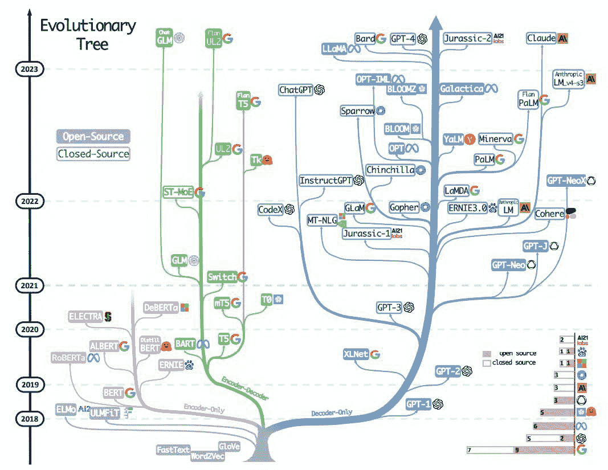
大模型演进图，来自亚马逊团队 2023 年 4 月的综述。

目前 BERT 论文引用已超 6.8 万，GPT-1 不足 6000，相差十倍。当时学界工业界几乎一致站队 BERT。

2019 年 2 月发布的 GPT-2 将最大规模提升到 15 亿参数，并使用更大规模更高质量更多样的数据，模型开始显现通用能力。让 GPT-2 上头条的并非研究本身，其论文引用至今也仅 6000 左右，远不及 BERT，而是 OpenAI 出于安全考虑只开源 3.45 亿参数最小版，引发轩然大波。社区对 OpenAI 不开放的印象由此形成。

同时期 OpenAI 研究规模对语言能力的影响，提出规模法则，确立大模型为主线。为此砍掉强化学习、机器人等方向。难得的是核心研发人员大多留下，调整研究方向集中发力。不少人转向工程与数据，或围绕大模型重新定位课题，强化学习也在 GPT 3.5 及以后发挥重要作用。组织的这种灵活性是成功关键。

2020 年 GPT-3 横空出世，NLP 小圈子开始意识到 OpenAI 路线的潜力。中国方面北京智源人工智能研究院联合清华等高校推出 GLM、CPM 并推动大模型理念。从演进图可见，2021 年后 GPT 路线全面占据上风，BERT 的进化几乎停滞。

2020 年底 OpenAI 副总裁达里奥·阿莫迪与丹妮拉·阿莫迪兄妹，带领 GPT-3 与安全团队多位同事出走创办 Anthropic。达里奥在 OpenAI 是仅次于苏茨克维的技术路线制定者，也是 GPT-2、GPT-3 与安全方向总负责人。随他离开的包括 GPT-3 与规模法则论文的多位核心作者。

一年后 Anthropic 发表关于对齐的聊天助手研究，后演变为 Claude。

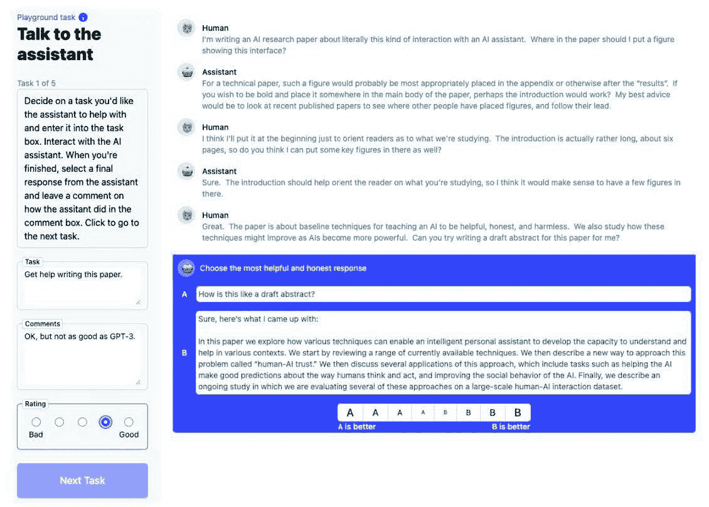
2022 年 6 月关于大模型涌现能力的论文发布，第一作者是毕业两年即入职谷歌的达特茅斯本科生 Jason Wei，他在次年因谷歌精英跳槽潮加盟 OpenAI。论文探讨大模型的涌现能力，即小模型中不存在、只有规模跨过阈值才出现的质变现象。

同年 11 月中旬 OpenAI 正研发 GPT-4，管理层却下令暂停全部工作，两周内集中推出聊天工具，原因是感受到竞争。十几天后 ChatGPT 诞生，后续载入史册。业界推测管理层是得知 Anthropic Claude 进展，决定抢先。这体现核心团队极强的战略判断力。即便 ChatGPT 的核心研发人员也不知为何会如此爆火，自己试用时也未惊艳。

2023 年 3 月经过半年评估、对抗性测试与模型及系统缓解迭代后，GPT-4 发布。微软研究院对内部版本的研究结论是：在所有任务中表现与人类水平惊人接近，鉴于广度和深度，可合理视为 AGI 系统早期的不完整版本。

此后国内外机构几乎每周推出新模型，综合能力上 OpenAI 仍遥遥领先，唯有 Anthropic 可抗衡。

人们常问为何中国没有产生 ChatGPT，更准确的问题是为何全世界只有 OpenAI 能做出 ChatGPT，原因何在？这一反思至今仍有意义。

ChatGPT，堪称一桩奇闻。

# 奇才

本书作者斯蒂芬·沃尔弗拉姆可谓奇才。

他不是马斯克那样家喻户晓的科技名人，却在极客圈名气极大，被称作在世最聪明的人。谷歌联合创始人谢尔盖·布林大学期间曾慕名前往其公司实习。搜狗和百川智能创始人王小川更是铁杆粉丝，带着崇敬追随多年。

沃尔弗拉姆童年即神童。因不屑看学校推荐的“蠢书”，算术又差，老师一度以为他不行。结果 13 岁自著数本物理书，其中一本叫《亚原子粒子物理》。

15 岁他在 Australian Journal of Physics 发表高能物理论文“Hadronic Electrons?”，提出一种新的高能电子-强子耦合，被引用五次。

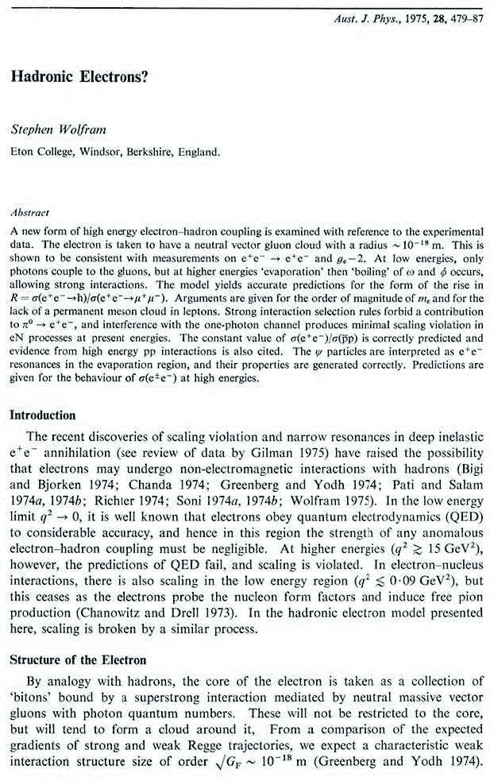
在伊顿公学、牛津大学，他只是晃了几年，也不怎么上课。他厌恶已被解决的问题，未毕业便离开。20 岁在美国加州理工拿到博士，导师是大名鼎鼎的费曼，随后留校任教。

1981 年他获首届麦克阿瑟奖“天才奖”，是年龄最小的得主。同批还有 1992 年诺贝尔文学奖得主沃尔科特等人。

他很快对纯物理失去兴趣。1983 年转到普林斯顿高等研究院研究元胞自动机，试图寻找自然与社会现象的底层规律。这一转向影响深远，他成为复杂系统学科开创者之一，被认为做出诺贝尔奖级工作。20 多岁时他与诺奖得主盖尔曼、菲利普·安德森一起参与圣塔菲研究所早期工作，并在 UIUC 创立复杂系统研究中心，还创办期刊 Complex Systems。

为方便做元胞自动机实验，他开发数学软件 Mathematica，名字由好友乔布斯取，后创办 Wolfram Research 转为成功企业家。Mathematica 的强大可在本书后面对 ChatGPT 解读时的高度抽象清晰语法中感受到。

1991 年他重返研究，每天深夜做实验写作十年，出版千页巨著《一种新科学》。核心观点是万事皆计算，宇宙中复杂现象可用简单规则计算模拟。亚马逊书评更通俗：伽利略说自然用数学书写，沃尔弗拉姆认为自然是用编程语言、而且是非常简单的编程语言书写的。且不同系统在计算上等效，复杂度相同，这就是计算等价原理。

书很畅销，语言通俗配近千幅图，却也遭学界尤其是物理界批评。批评集中在理论并非原创，且缺乏数学严谨性，很多结论难经检验。沃尔弗拉姆的回应是推出 Wolfram|Alpha 知识计算引擎，被很多人视作第一项真正实用的 AI 技术。它结合知识与算法，用户用自然语言下指令即得答案，可通过网页、Siri、Alexa 甚至 ChatGPT 插件使用。

从神经网络角度看沃尔弗拉姆的理论，会发现暗合：GPT 底层的自回归架构的确可归为规则简单的计算，其能力也是量变累积涌现出来的。

他常为好莱坞科幻电影做技术支持，用 Mathematica 和 Wolfram 语言生成逼真效果，《星际穿越》的黑洞引力透镜，《降临》里掌握后可超越时空的外星语言，都极具想象力。

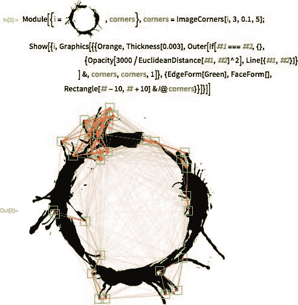
他当年最终离开学术界，与普林斯顿同事关系不睦有关。老师费曼曾劝他：“你不会理解普通人的想法的，他们对你来说只是傻瓜。”

我行我素，活出精彩人生。

斯蒂芬·沃尔弗拉姆，真奇才也。

# 奇作

奇闻加奇才，这本书自然称得上奇作。

像沃尔弗拉姆这样的大神亲手为公众高度关注的主题写通俗读物，本身就是奇迹。

他 40 年前从纯物理转向复杂系统研究，就是想解决人类智能等现象的第一性原理，因而积累深厚。因与杰弗里·辛顿、伊尔亚·苏茨克维、达里奥·阿莫迪等关键人物都有交流，能提供第一手资料，保证技术准确。难怪本书出版后 OpenAI CEO 称其为“对 ChatGPT 原理最佳的解释”。

全书仅两篇文章，篇幅很短，却把关于 ChatGPT 的关键点讲全了，且通俗透彻。

我在图灵社区发起 ChatGPT 共读会，与各水平背景同学交流发现，要理解大模型，正确建立核心概念至关重要。没有这些支柱，即便资深算法工程师，认知也可能偏差。

例如 GPT 技术路线一大核心理念，是用最简单的自回归生成架构解决无监督学习问题，即利用无需人工标注的原始数据学习世界映射。自回归生成架构就是书中通俗讲的“一次只加一个词”。特别要注意，选择这种架构并非为了生成任务，而是为了理解、学习，实现模型的通用能力。2020 年前乃至之后几年，业界很多人想当然以为 GPT 是做生成的，因而选择忽视。殊不知 GPT-1 论文标题就是“通过生成式预训练改进语言理解”。

再如，对技术背景有限的读者，追踪 AI 最新动态时最直接的困难是听不懂反复出现的基本概念“模型”“参数（神经网络中即权重）”为何物，也很难讲清。本书作者贴心地用直观例子——函数和旋钮——作了解释，见模型解释章节。

书里把神经网络的讲解做成了图文混排，对想弄清训练到底在干什么、损失函数与梯度下降是怎么起作用的读者帮助很大。

技术之外作者也留了思想空间，比如对深度学习意义的概括就提炼得很到位：

“深度学习”大约在2012年前后迎来关键突破，背后有一个反直觉的发现是：当可调参数很少时拟合很吃力，而一旦权重规模变得庞大，即使只是近似，最小化反而更容易完成。

换句话说，有时神经网络处理难题比处理简单任务更顺手。粗略解释是，高维参数空间里可探索的方向极多，不容易被困在局部极小的“小坑”里；参数太少时可选路径受限，很容易卡住找不到出口。

接下来这段把端到端学习的价值说清楚了：

神经网络早期常被要求“只干少事”。比如语音转文字，人们习惯先做声学分析，再拆成音素等等。实践后来证明，对类人任务而言，效果最好的做法往往是直接端到端训练，让模型自己摸索必要的中间表征与编码方式。

弄懂这些为什么，对把握 GPT 的大图景很有用。

嵌入的概念对做大模型研发的算法研究者、用大模型做产品的工程师，乃至想深入理解 GPT 的普通读者都至关重要，可说是 ChatGPT 的核心思想，却很抽象不易入门。书中“‘嵌入’的概念”一节是我见过讲得最透的一次，用图示、代码、文字三条线索并行，帮助读者真正吃透。随后“意义空间和语义运动定律”一节又配了多张彩图，进一步加深印象。该节末尾还介绍了标记 token 的含义，并用几个直观的英文例子说明。

后面关于 ChatGPT 工作原理与训练流程的介绍在通俗与严谨之间取得平衡。Transformer 被拆得很细，同时作者也坦诚，目前理论上仍未完全搞清它为何有效。

第一篇最后，作者结合计算不可约理论把对 ChatGPT 的理解拔高，这与伊利亚·苏茨克维在多场访谈里强调的“GPT 的大思路是通过生成来获取世界模型的压缩表征”异曲同工。

我印象最深的是下面这段思考：

产生“有意义的人类语言”需要什么？过去人们以为必须依赖人脑。现在我们看到，ChatGPT 的神经网络也能做得非常好……我强烈怀疑 ChatGPT 的成功暗示了一个重要科学事实：有意义的人类语言实际上比我们想象的更结构化、更简单，或许可以用相当简洁的规则来刻画其组织方式。

语言是严肃思考、决策与沟通的工具。从儿童发展看，相对于感知与行动，语言似乎是智能里更难的部分。但 ChatGPT 很可能已经破解了其中的密码，正如沃尔弗拉姆所说，它“在某种意义上钻研到了不必考虑不同措辞的可能性，就能以语义上有意义的方式组织语言的地步”。这预示着未来借助计算化的语言或其他表征方式，整体智能水平可能实现大幅提升。

再往外推，人工智能的进展很可能在各学科产生类似效应：一些过去被认为很困难的课题，换个角度看并没那么难。加上 GPT 这类通用智能助手的加持，“一些从根本上不可能的任务变成了基本可行”，最终推动全人类科技水平跃升。

本书第二篇介绍了 ChatGPT 与 Wolfram|Alpha 系统的对比与结合，案例丰富。如果说 GPT 这类通用智能更像人，而大多数人天生就不擅长精确计算，那么未来通用模型与专用模型的融合，应该是一个很有前景的方向。

稍有遗憾的是，本书主要聚焦 ChatGPT 的预训练阶段，对后续同样关键的微调步骤——监督微调 SFT、奖励建模与强化学习——涉及不多。这方面很好的学习资料是 OpenAI 创始成员、前特斯拉 AI 负责人安德烈·卡帕斯 Andrej Karpathy 在 2023 年 5 月微软 Build 大会上的演讲《State of GPT》。

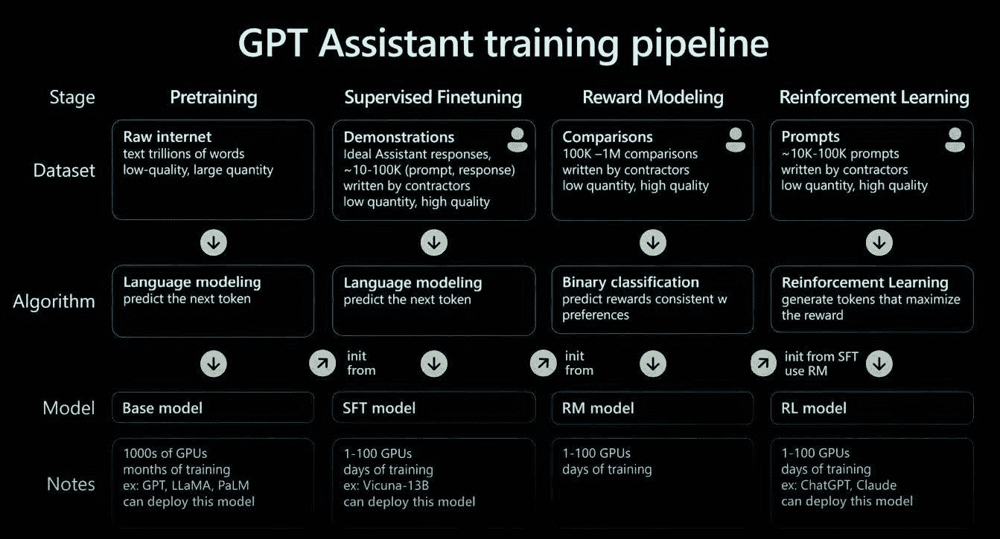
除书中两篇文章外，沃尔弗拉姆还写过一篇关于 ChatGPT 的文章《Will AIs Take All Our Jobs and End Human History—or Not? Well, It’s Complicated…》，在更高层面、更大范围里思考了 ChatGPT 的意义和影响。它也是《一种新科学》的延续，充分体现了沃尔弗拉姆的思考深度。

关于 AI 能力的上限，他认为，根据“计算等价原理”，ChatGPT 这类通用人工智能的出现证明了“人类本质上并没有什么特别之处——在计算层面，我们与自然中许多系统甚至简单程序基本上是等价的”。因此，以往需要人类努力完成的事情会逐渐自动化，最终可能通过技术免费实现。很多人认为创造力、原创力、情感、判断力是人类独有，AI 也有可能获得。最终 AI 也会逐步发展出自己的世界，形成一种新的生态，可能有自己的准则，人类需要适应并与之共存共荣。

那么人类还剩下什么优势？

根据“计算不可约性原理”，即总有一些计算不存在捷径可以加速或自动化，作者认为这是思考 AI 未来 的核心。复杂系统里始终存在无限的探索空间，这正是人类历史上不断出现科学创新、发明与发现的土壤。所以人类会不断向未知前沿推进，而且永远有前沿可探。同时，计算不可约性也决定了人类、AI、自然和社会等各种计算系统都具有根本的不可预测性，始终保留“收获惊喜的可能”。人类可贵的，是拥有内在驱动力和内在体验，能够自主定义目标和意义，从而最终定义未来。

我们应该怎么做？

沃尔弗拉姆给出了如下建议。

最高效的方式是发掘新的可能性，定义对自己有价值的东西。

从现在的回答问题转向学会如何提出问题，以及如何判断哪些问题值得提出。也就是从知识执行转向知识战略。

知识的广度和思维的清晰度将变得重要。

直接学习所有细节知识已不必要：我们可以在更高层次学习和工作，抽象掉大量具体细节。“整合”而非专业化。尽可能广泛、深入地思考，尽可能多地调用知识和范式。

学会使用工具来做事。过去更倚重逻辑和数学，今后要特别注意利用计算范式，并运用与计算直接相关的思维方式。

的确，GPT 很可能对我们的工作、学习和生活方式产生巨大影响，需要转换思维方式，需要新型的学习和交流方式。这正是我在图灵社区发起“ChatGPT 共学营”的初衷。共学营是一个“课+群+书”的付费学习社区，这里不仅有我和众多专家的分享，有来自不同背景、行业、专业的同学每日交流，还有系统的知识沉淀。共学营中还提供了本书的导读课，以及《State of GPT》演讲的视频和中文精校图文，欢迎加入。

刘江

图灵公司联合创始人、前总编，曾任北京智源人工智能研究院副院长、美团技术学院院长

# 前言：用第一性原理拆解 ChatGPT

本书试图用第一性原理来解释 ChatGPT 的运行机理，以及它为何奏效。可以说这是一个关于技术的故事，也可以说这是一个关于科学的故事、一个关于哲学的故事。为了讲述这个故事，我们必须集合数个世纪以来的一系列非凡思想与发现。

看到自己长期以来感兴趣的众多议题一并迎来飞速发展，我感到非常兴奋。从简单程序的复杂行为，到语言及其含义的核心特质，再到大型计算系统的实用性，所有这些都是 ChatGPT 故事的一部分。

ChatGPT 的基石是人工神经网络，本书里通常简称为神经网络或网络，它最早在20世纪40年代为模拟理想化的大脑工作方式而提出。我自己在1983年第一次写出一个神经网络，但它做不了什么有趣的事。然而40年后，随着计算机速度提升上百万倍，数十亿页文本涌现于网络，以及一系列重大的工程创新，局面已然大不同。出乎所有人意料的是，一个比我1983年构建的网络大10亿倍的神经网络能够生成有意义的人类语言，而这此前被视作人类独有的能力。

本书收录了我于 ChatGPT 问世后不久撰写的两篇长文。第一篇介绍了 ChatGPT，并解释了它为何拥有近似人类的语言生成能力。第二篇则展望 ChatGPT 的未来，预期它能借助计算工具完成人类难以企及的事，特别是能够利用 Wolfram|Alpha 系统对知识进行计算，即计算知识的“超能力”。

虽然距离 ChatGPT 发布仅过三个月，我们也才刚刚开始认识它对实际生活和思维能力可能带来的影响，但就目前而言，它的到来提醒我们，即便在似乎已发明与发现一切之后，仍有惊喜可收。

斯蒂芬·沃尔弗拉姆

2023年2月28日

# 第一篇

# ChatGPT 到底如何运作

## 核心其实是逐词续写

ChatGPT 能自动生成类似人类书写的文本，这令人惊讶且印象深刻。它是如何实现的？为什么会奏效？我在这里概述 ChatGPT 内部的工作方式，然后讨论它为何能如此出色地产生我们认为有意义的文本。需要说明的是，我会侧重宏观机制，虽然也会涉及一些工程细节，但不会深入。这里描述的本质不仅适用于 ChatGPT，也同样适用于当前其他“大语言模型” LLM。

首先要说明，ChatGPT 从根本上始终在做的事，是对任意输入文本给出“合理的延续”。这里的“合理”指，人们在浏览数十亿网页内容后，会预期别人如此书写。

假设手头的文本是“The best thing about AI is its ability to”。想象一下在人类撰写的数十亿页文本中，比如互联网与电子书，找到该文本的所有实例，然后观察其后出现的词及其出现概率。ChatGPT 实际做的是类似的事，只不过它不是查字面文本，而是寻找在某种程度上“意义匹配”的事物，稍后会解释。

最终结果是，它会列出随后可能出现的词及其“概率”，按从高到低排序。

值得注意的是，当 ChatGPT 撰写文章时，它本质上是在反复询问“基于当前文本，下一个词该是什么”，并每次追加一词。更准确地说，它每次追加一个“标记” token，而标记可能只是词的一部分。这就是它有时能“造词”的原因。

每一步它都会得到一个带概率的词表。那该选哪个词加入正在撰写的文章呢？有人可能认为应选“排名最高”的词，即概率最大的词。然而这里带点玄学意味。出于某种原因——也许未来能用科学解释——如果总是选排名最高的词，通常会得到一篇非常“平淡”的文章，几乎看不出创造力，有时甚至一字不差地重复前文。但如果有时随机挑选排名较低的词，就能得到“更有趣”的文章。

这种随机性意味着，多次使用相同提示 prompt，每次都可能得到不同文章。而且符合玄学的是，有一个所谓的“温度”参数来决定低排名词被采纳的频率。对文章生成而言，“温度”为0.8似乎最佳。必须强调，这里没有使用任何“理论”，“温度”参数纯属实践中发现有效的方法。例如采用“温度”概念，是因为恰好使用了统计物理学中常见的某种指数分布，但它与物理学并无实际联系，至少就目前所知如此。

进入下一节前需要说明，为了便于阐述，我多数情况下不使用 ChatGPT 的完整系统，而是使用更简单的 GPT-2 系统，它的优点是足够小，可在标准台式机上运行。因此书中展示的所有原理，我都能附上明确的 Wolfram 语言代码，可立即在自己的电脑上运行。

例如，通过以下方式可获得前页列出的概率表。首先，需要调取底层的“语言模型”。

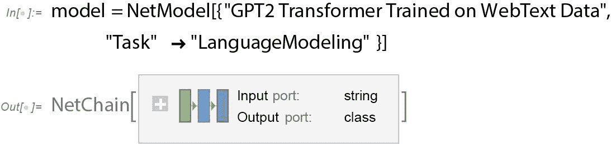
稍后我们会深入了解这个神经网络，并讨论其工作原理。现在可把这个“网络模型”当作黑盒，应用于之前的文本，并询问模型哪5个词紧随其后的概率最高。

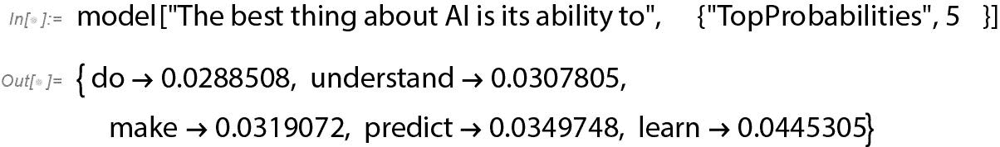
如下获取结果并将其转换为明确格式化的“数据集”。

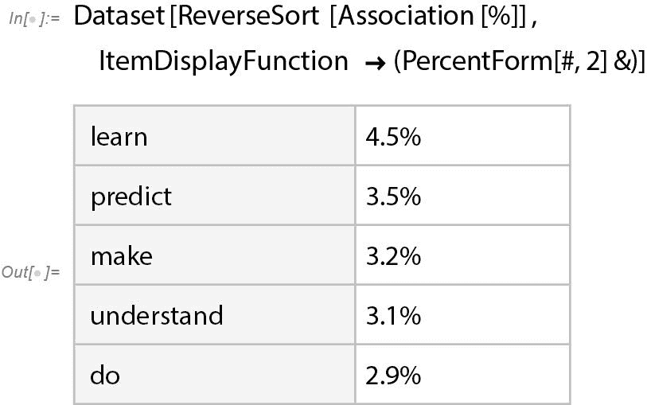
若反复“应用模型”，在每一步都追加概率最高的词，在此代码中指定为模型所做的“决策”，则会出现如下情况。

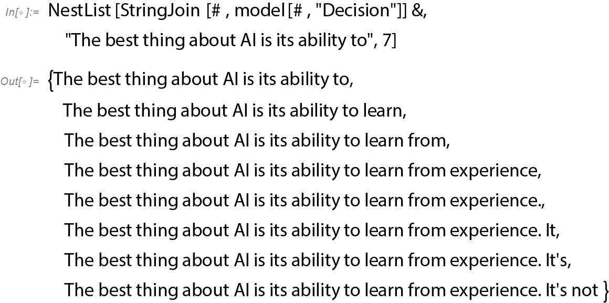
继续下去呢？在此“零温度”情形下，文本很快变得混乱且重复。

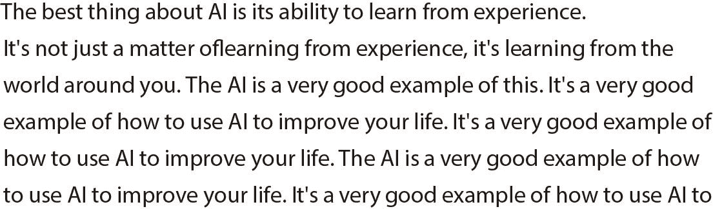
如果不总是选择“排名最高”的词，而是有时随机选择“非排名最高”的词，通过把“温度”参数从0调高到0.8来引入随机性呢？我们同样可以构建文本：

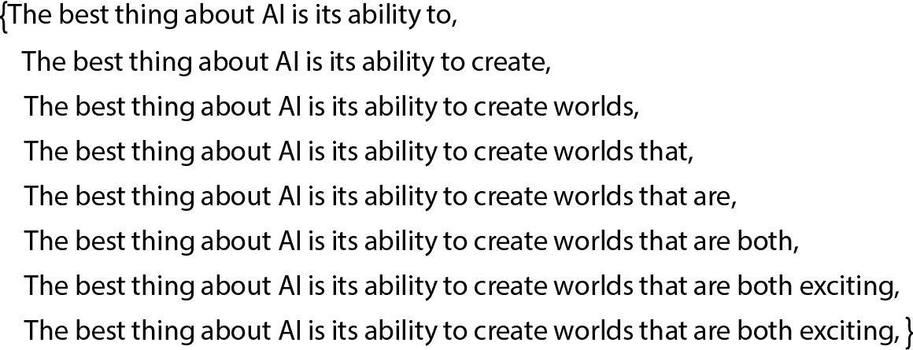
每次执行时，随机选择不同，文本也不同，就像这5个例子一样。

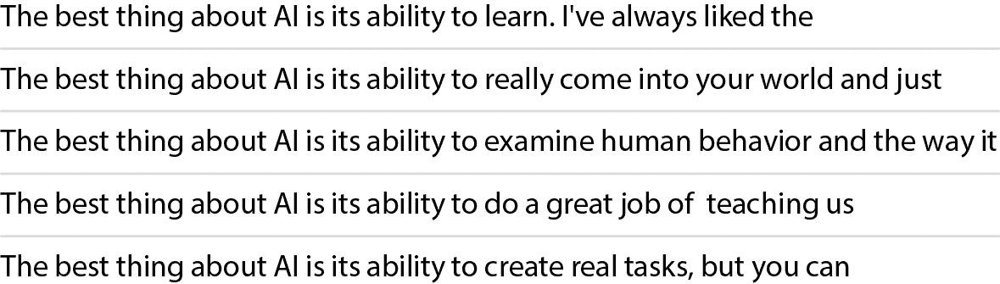
值得指出的是，即使在温度为0.8的第一步，也有许多可能的“下一个词”可供选择，尽管它们的概率迅速下降，是的，如下面的对数图所示，点连线对应次幂律衰减，这是语言的一般统计特征。

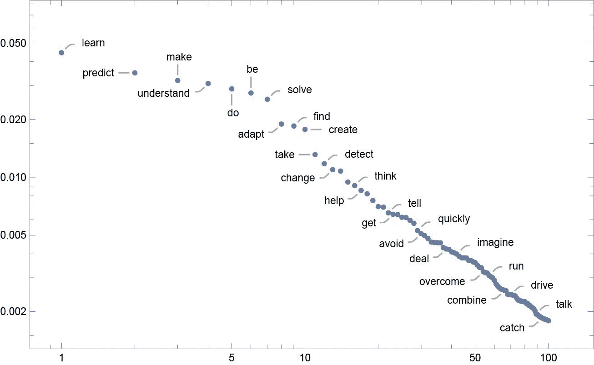
再继续下去会怎样？下面是一个随机例子。虽然比选择排名最高的词即零温度情况好，但仍有点奇怪。

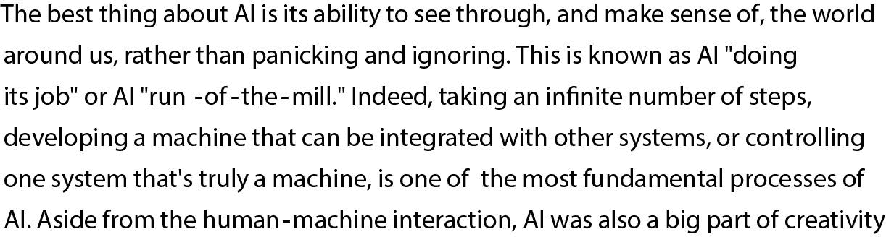
这是用最简单的 GPT-2 模型，发布于2019年，完成的。使用更新更大的 GPT-3 模型，结果会更好。下面是在提示相同但使用最大 GPT-3 模型的情况下生成的零温度文本。

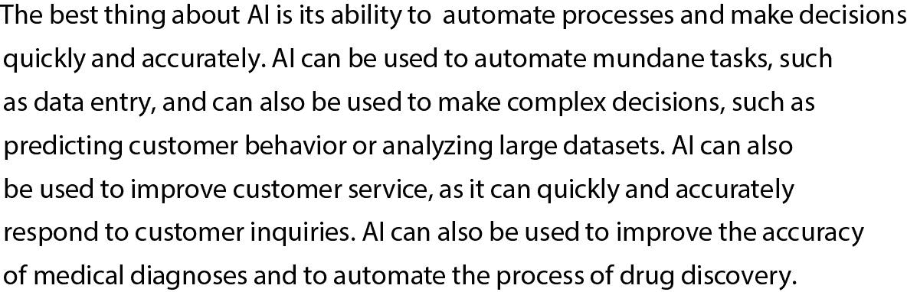
下面是一个温度为0.8的随机示例。

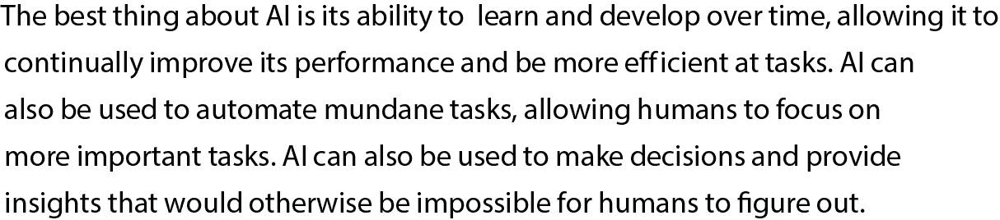
## 这些概率从哪来

ChatGPT 总是依据概率挑选下一个词，但这些概率从何而来？让我们从更简单的问题开始：考虑逐字母而非逐词地生成英文文本。如何计算每个字母应出现的概率？

我们可以做一件很小的事，取一段英文文本样本，统计其中不同字母的出现次数。例如，下面的例子统计了维基百科上“cats”条目中各字母的出现次数。

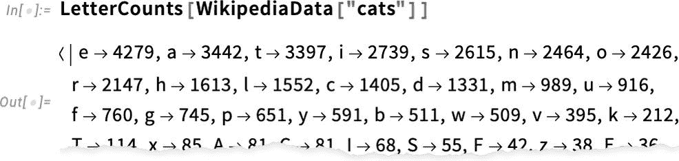
对“dogs”条目也做同样统计。

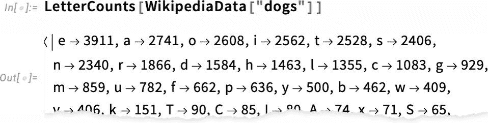
结果有些相似，但并不完全一样。毫无疑问，在“dogs”的条目中，字母o更常见，毕竟dog一词本身就含o。不过，若我们采集足够大的英文文本样本，最终就能得到相当一致的结果。

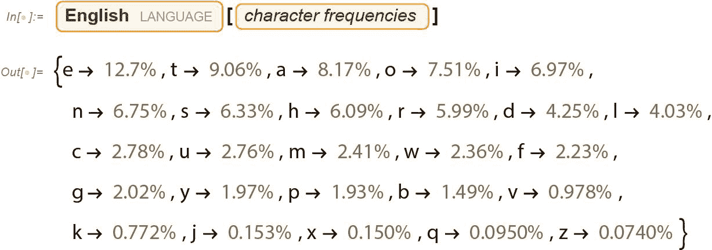
这是在只依据这些概率生成字母序列时得到的样本。

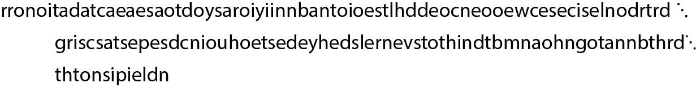
我们可以通过加入空格将其拆分为“词”，就像这些“词”也是具有一定概率的字母一样。

还可以通过强制要求“词长”的分布与英文中相符来更好地造“词”。

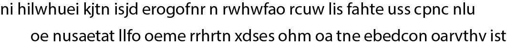
虽然没有碰巧得到任何“实际的词”，但结果看起来稍好一些了。不过，要进一步完善，我们需要做的不仅仅是随机挑选每个字母。比如，我们知道，若句子中出现字母q，那么紧随其后的下一个字母几乎一定是u。

以下是每个字母单独出现的概率图。

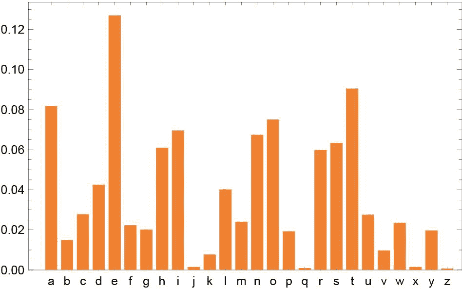
下图则显示了典型英文文本中字母对，即二元2-gram或bigram字母的概率。可能出现的第一个字母横向显示，第二个字母纵向显示。

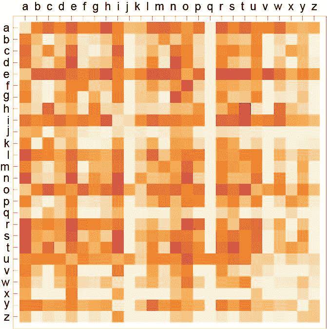
可以看到，q列中除了u行以外都是空白的，概率为零。现在不再一次一个字母地生成“词”，而是使用这些二元字母的概率，一次关注两个字母。下面是可以得到的一个结果，其中恰巧包括几个“实际的词”。

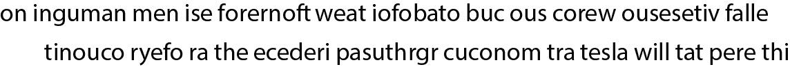
有了足够多的英文文本，我们不仅可以对单个字母或字母对二元字母得到相当好的估计，而且可以对更长的字母串得到不错的估计。如果使用逐渐变长的n元n-gram字母的概率生成“随机的词”，就能发现它们会显得越来越“真实”。

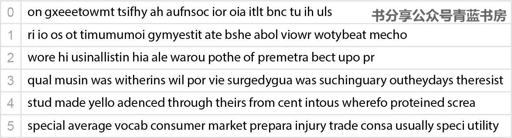
现在假设——多少像 ChatGPT 所做的那样——我们正在处理整个词，而不是字母。英语中有大约50000个常用词。通过查看大型的英文语料库，比如几百万本书，总共包含几百亿个词，我们可以估计每个词的常用程度。使用这些信息，就可以开始生成“句子”了，其中的每个词都是独立随机选择的，概率与它们在语料库中出现的概率相同。以下是我们得到的一个结果。

毫不意外，这没有什么意义。那么应该如何做得更好呢？就像处理字母一样，我们可以不仅考虑单个词的概率，而且考虑词对或更长的n元词的概率。以下是考虑词对后得到的5个结果，它们都是从单词cat开始的。

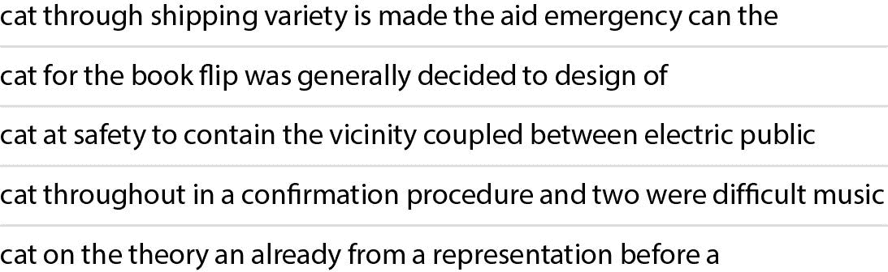
结果看起来稍微变得更加“合理”了。可以想象，如果能够使用足够长的n元词，我们基本上会“得到一个 ChatGPT”，也就是说，我们得到的东西能够生成符合“正确的整体文章概率”且像文章一样长的词序列。但问题在于：我们根本没有足够的英文文本来推断出这些概率。

网络上能抓到的词可能有几千亿，电子书里再加几百亿。但即使只取四万个常用词，两个词连在一起的组合就已经有十六亿种，三个词连在一起则飙到六十万亿种。靠已有文本去统计这些三元词的出现概率是不可能的。到了二十个词组成的一小段文字，可能的组合数会超过宇宙中的粒子总数，从这个角度看，人类根本写不完、算不完。

我们能怎么办？思路是建一个模型，让它可以为从未在语料里见过的序列给出一个合理的出现概率估计。ChatGPT 的核心就是这种大语言模型，它被训练到能够比较靠谱地做这件事。

## **模型是什么**

想象一下像晚期伽利略那样，想知道比萨斜塔不同楼层的炮弹落地需要多久。你可以每层都实测然后列成表格。科学的方法是另起一套：搭一个模型，用计算程序给出答案，而不是每一次都去量一遍。

假设我们有一批理想化数据，记录了炮弹从各层掉落的时间。

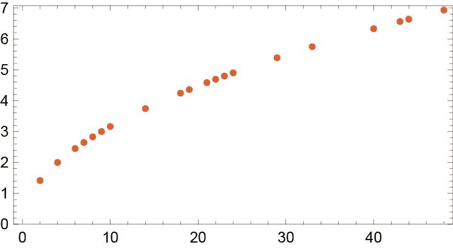

如果要问一个没有实测数据的楼层需要多久呢？在现实里可以用物理定律算出来。可如果我们只有数据而不知道背后的定律，就只能做数学上的猜测，比如先假设时间与高度的关系大致是一条直线。

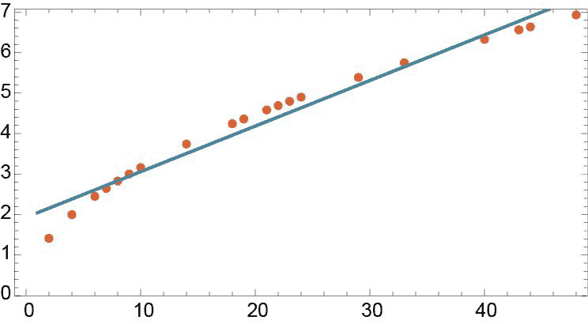

当然可以选不同的直线，但图中这条在整体上离已有数据最近。根据它就能对任意楼层做出时间估计。

为什么偏偏选直线？说到底我们也不确定，只是它数学上简单，我们习惯用简单的模型去拟合测量数据。也可以试更复杂的模型，有时会更贴合。

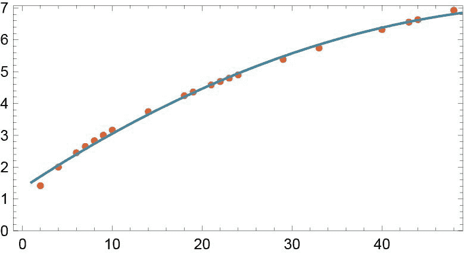

然而复杂也会出问题。下面就是用某种最优结果得到的拟合。

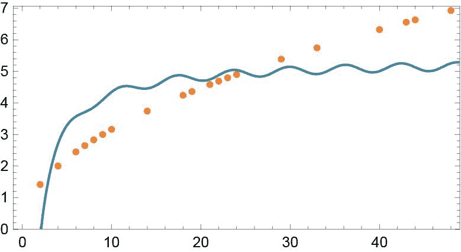

必须认识到不存在无模型的模型。任何模型都有固定的结构和可以调的“旋钮”，也就是参数。ChatGPT 就有很多这样的旋钮——总共有一千七百五十亿个。

值得注意的是，ChatGPT 的底层结构其实并不算复杂，凭借这么多参数，它足以生成一个能够“够好地”估计下一个词概率、进而写出合理文章的模型。

## **类人任务的建模**

上面说的是数值数据的建模，来源相对简单的物理，已经有几个世纪的简单数学工具可用。ChatGPT 面对的是人脑产生的人类语言文本，这类东西目前还没有简单的数学公式。那么模型应该长什么样？

先不谈语言，谈另一个类人任务：图像识别。以手写数字为例，这是机器学习的经典案例。

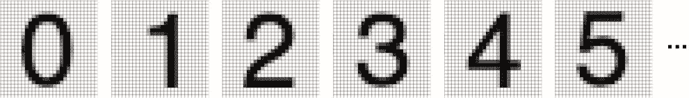

我们能做的事之一是收集每个数字的大量样本图。

要判断一张输入图对应哪个数字，可以把图逐像素和已有样本对比。但人类显然做得更好：即使手写潦草、有涂抹和扭曲，我们依然能认出来。

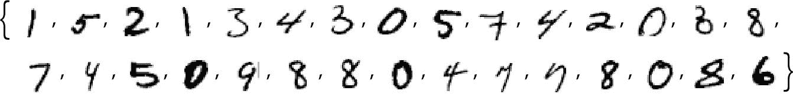

前文数值建模时，能在已知 *x* 后用 *a*、*b* 算出结果。那么如果把图像每个像素的灰度当作变量，是否存在一个牵涉所有变量的函数，能告诉我们图里是哪个数字？事实证明可以构建，但难度不小，一个典型实现可能要做大约五十万次运算。

最终把一组像素值喂给这个函数，输出就是一个数字。稍后会讲它怎么构建以及神经网络的思想。现在先把它当黑盒：输入手写数字的像素数组，得到对应的数字。

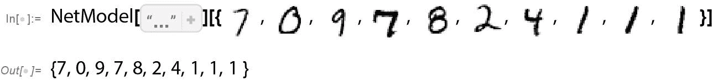

发生了什么？如果慢慢模糊一个数字，函数一段时间内仍能“认出”它是 2，但很快就会出错，开始给出错误结果。

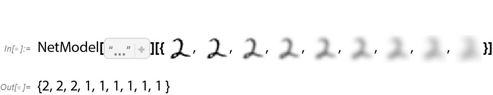

为什么说这是错误？因为我们知道这些图都是通过模糊数字 2 得到的。但如果目标是模拟人类识别图像的能力，真正该问的是：面对一张模糊图且不知道来源，人类会怎么判断？

如果函数的结果始终和人类一致，那它就是一个好模型。一个重大的经验事实是，对于图像识别这类任务，我们现在基本知道怎么构建不错的函数了。

能用数学证明这些函数有效吗？不能。因为这需要一个关于人类行为的数学理论。改动 2 的图像里几个像素，我们仍会认为它是 2；改动更多像素，我们还能坚持多久？这是关于人类视觉感知的问题。对蜜蜂或章鱼的图像答案会不同，对虚构外星生物的图像答案可能完全不同。

## **神经网络**

做图像识别等任务的典型模型现在最流行也最成功的是神经网络。它发端于上世纪四十年代，当时的雏形和今天很接近，可看作对大脑工作的简化理想化。

人脑约有一千亿个神经元，每个每秒最多产生约一千次电脉冲。这些细胞通过复杂网络连接，每个神经元有树突状分支，能把信号传给数千个其他神经元。粗略说，一个神经元是否放电，取决于它收到的输入，以及不同连接的“权重”贡献。

“看图像”时，光子落在视网膜感受细胞上产生电信号，再通过多层神经元传递。过程中我们“识别”出图像，最终形成“我在看数字 2”的想法，可能还会说出“二”。

上一节的黑盒函数就是这种神经网络的数学化版本。它恰好有 11 层，其中 4 个核心层。

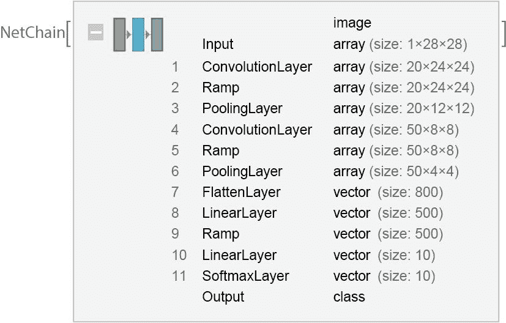

我们对这个网络没有清晰的理论解释，它只是 1998 年作为工程被搭出来且奏效的。怎么识别呢？关键在于吸引子的概念。假设有手写 1 和 2 的图像。

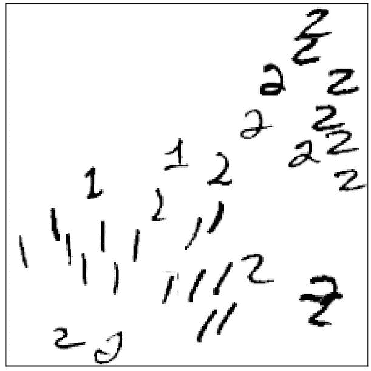

我们希望把所有 1 拉到一个地方，所有 2 拉到另一个地方。也就是说，如果一张图更像 1 而不是 2，就让它最终落在“1 的区域”。

直白的比喻：平面上有几个点代表咖啡店。你从任意位置出发总是走向最近的店。可以用理想化的分水岭把平面切成不同区域，即吸引子盆地。

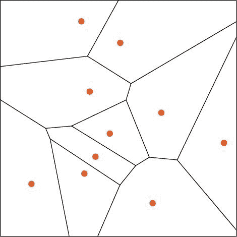

这相当于一种识别任务，不是判断图“看起来最像”哪个数字，而是看哪个点离给定点最近。这里展示的是二维欧几里得空间的沃罗诺伊图。数字识别本质上是在 784 维的像素灰度空间做类似操作。

怎么让神经网络执行识别？看一个极简情况。

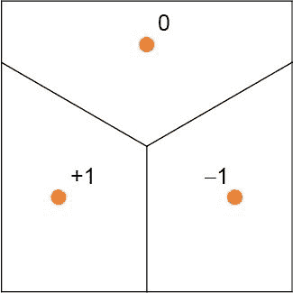 

目标是接收一个位置输入，然后把它归为最近的三个点之一。也就是计算出图中那样的函数。

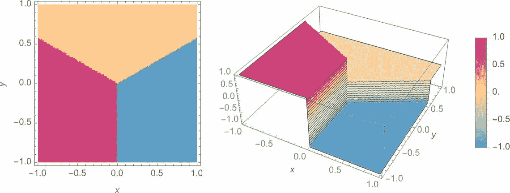

怎么用神经网络实现？神经网络是按层排列的理想化神经元集合。一个简单例子如下。

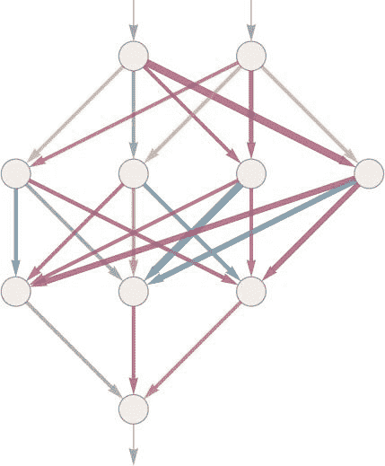

每个神经元实际计算一个简单的数值函数。用网络时在顶部输入数（比如坐标 *x*、*y*），每一层计算并前馈，最后在底部得到结果。

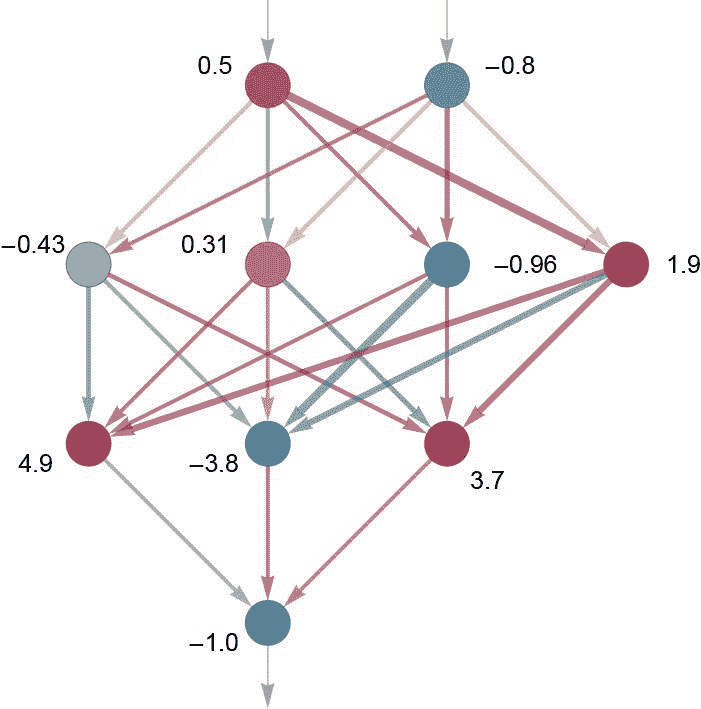 

在受生物学启发的设定里，每个神经元有来自前一层的输入连接，每个连接有一个权重，可正可负。神经元的值是把前层值乘以对应权重求和，再加常数，最后通过一个阈值或激活函数。用数学说就是……权重 *w* 和常数 *b* 对每个神经元不同，函数 *f* 通常全网一致。

计算主要是矩阵乘法和加法，激活函数提供非线性从而产生非平凡行为。下面列了一些常用激活函数，这里用的是 Ramp 也即 ReLU。

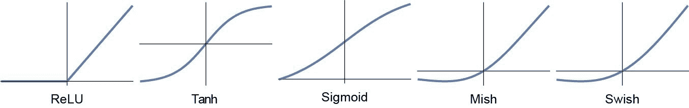

对不同任务，权重选择不同。正如后文会讲，这些权重通常通过机器学习在示例上训练得到。

最终每个神经网络都对应一个整体数学函数，只是写法很混乱。对上面的例子就是……同样，ChatGPT 的网络也对应一个数学函数，里面有数十亿项。

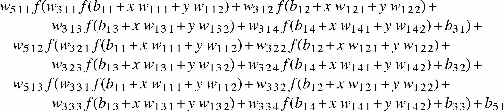

回头看单个神经元。图中展示了一个有两个输入（*x*、*y*）的神经元，在不同权重和常数下能算出哪些样例。

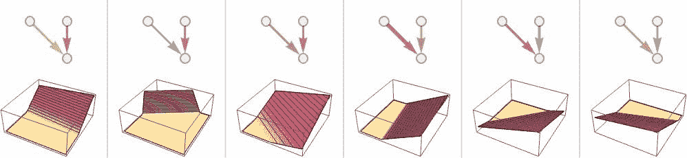

对上面提到的更大网络呢？它的计算结果如下。

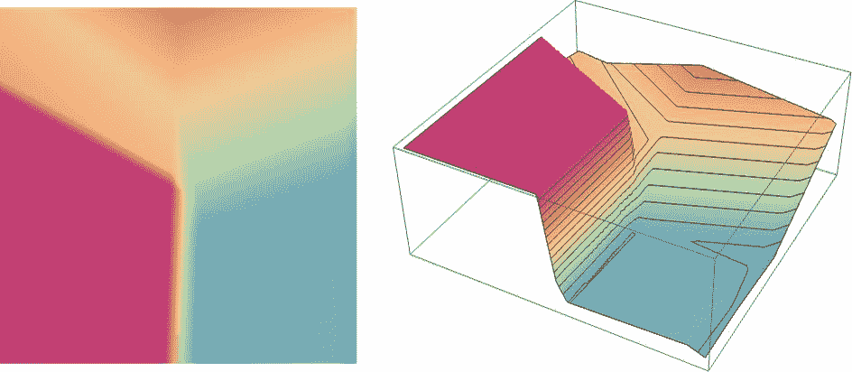

并不完全正确，但已接近“最近点”函数。

再看几个网络。每次都用机器学习找最佳权重。

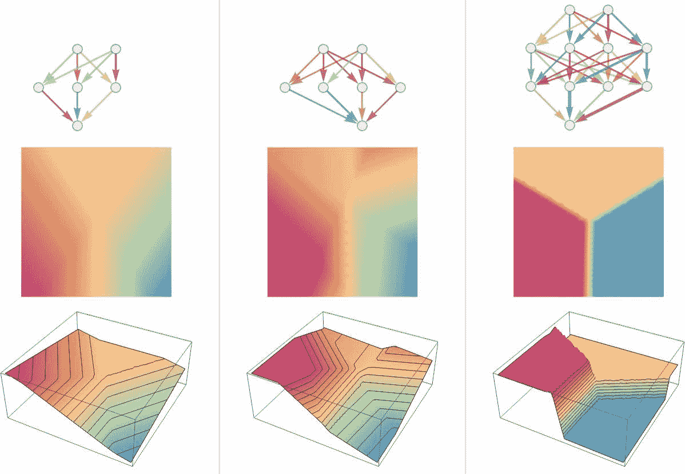

更大的网络通常更接近目标函数。在每个吸引子盆地中心能得到精确答案，但在边界处也就是网络犹豫的地方会更混乱。

在这个简单识别任务里“正确答案”很明确。但在手写数字识别里就不那么明显。比如有人把 2 写得像 7。类似问题很常见。尽管如此，我们仍可以问网络如何区分，下面给出一段示例。

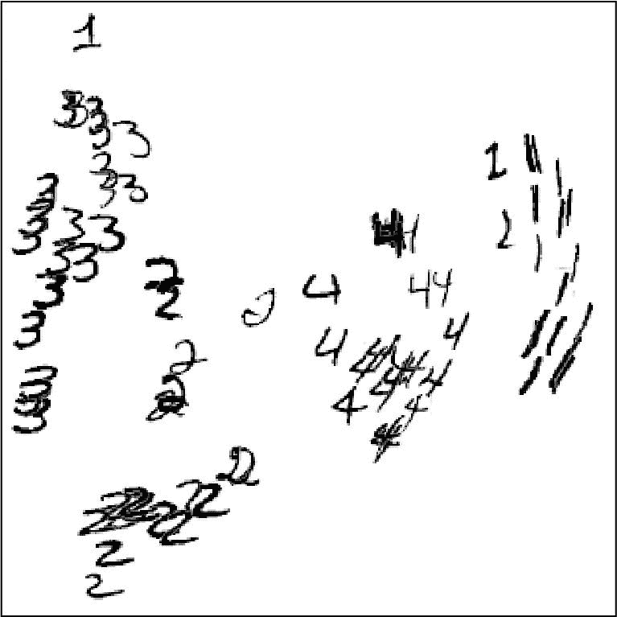

能从数学上解释网络的区分方式吗？不能。它只是“做神经网络要做的事”。但事实是，这通常和人类区分方式相当吻合。

再举一个例子。假设有猫狗图像和一个能区分的训练网络。下面是它对某些图像的处理。

“正确答案”更模糊了。穿猫装的狗怎么办？无论输入什么，网络都会给出答案。结果显示它的做法相当符合人类思维。正如前面说的，这不是能从第一性原理推导的事实，而是经验发现，在某些领域成立。它之所以有用，正是因为它以某种方式捕捉到类人做法。

找一张猫图自问“为什么这是猫？”你可能会说“我看到了尖耳朵”。但很难解释自己是怎么认出猫的。大脑就是不知怎么想明白了，而人工神经网络在展示猫图时却能看到每个神经元的作用。即使基本可视化也常很困难。

在“最近点”问题最终网络里有 17 个神经元，手写数字网络有 2190 个，猫狗识别网络有 60650 个。很难可视化 60650 维空间。但因为是处理图像，网络层常按数组组织，像它查看的像素数组一样。

以一张典型猫图为例。

第一层神经元的状态可以用一组衍生图表示，其中很多能直观看成“去背景的猫”或“猫的轮廓”。

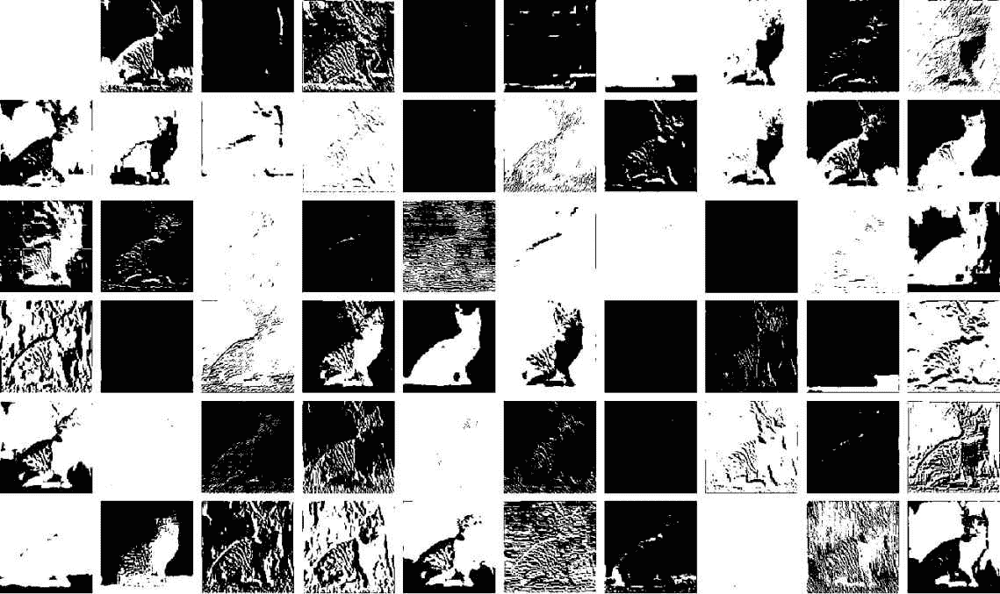

到第 10 层就很难解读了。

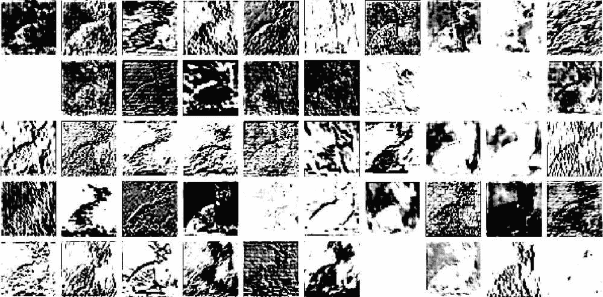

总体上可以说网络在“挑选特征”，也许尖耳朵是其中之一，用这些特征决定图像内容。但这些特征能用语言描述吗？多数情况下不能。

大脑是否用类似特征？我们多半不知道。但值得注意的是，一些神经网络的前几层会挑出图像某些方面，比如物体边缘，这与我们所知大脑视觉处理初级层挑出的很相似。

如果想得到“猫识别理论”，可以说“看，这个特定网络能做到”。这会让我们了解问题难度，比如需要多少神经元或层数。但目前我们还无法对网络正在做什么给出语言描述。也许这是因为它计算不可约，除了逐步跟踪别无他法。也可能是我们还没弄清科学，还没找到能总结现象的自然法则。

用 ChatGPT 生成语言时也遇到类似问题，目前不清楚有没有方法总结它在做什么。但语言的丰富性和我们的使用经验，可能让我们比图像处理取得更多进展。

## **训练机器学习和神经网络**

到目前为止我们讨论的是“已经会做特定任务”的网络。网络之所以有用，不仅因为它能做各种任务，还因为它能通过样例逐步学习。

建一个猫狗图像区分网络时，不需要手写程序去明确找胡须，只需展示大量猫狗样例，让网络从中机器学习如何区分即可。

关键在于，已训练网络能够对展示的具体例子“泛化”。正如前面看到的，网络不仅能记住样例的特定像素模式，也能基于我们眼中的某种“猫的典型特征”区分图像。

训练到底怎么起效？本质上是在找一组能让网络复现给定样例的权重。然后依赖网络在样例之间做“合理”的插值或泛化。

看一个比“最近点”更简单的问题，只让网络学习这样一个函数。

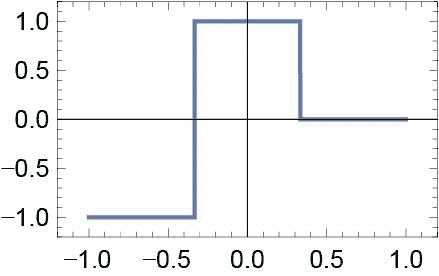

这个任务只需要一个输入一个输出的网络。

应该用什么权重呢？每组权重对应一个函数。下面是几组随机权重产生的结果。

明显与目标相差甚远。那怎么找到能复现目标的权重？

基本思路是提供大量“输入→输出”样例供学习，然后寻找复现这些样例的权重。随着样例逐渐增多，结果如下。

在训练的每个阶段，网络权重被逐步调整，最终得到能复现目标函数的网络。怎么调呢？在每个阶段看离目标“有多远”，然后朝更接近的方向更新权重。

为了衡量距离，计算“损失函数”或“成本函数”。这里用简单的 L2 损失，即预测值与真实值差的平方和。随着训练进行，损失逐渐减小，遵循特定的学习曲线，直到网络成功复现或很好逼近目标函数。

为什么要调权重？说到底就是让误差变小。误差衡量的是模型给出的结果与真实结果的距离，而每一步的结果都由当下这版网络的参数决定。把参数当成可以寻找的变量，任务就是在参数空间里挑出一组让误差最低的组合。
   

为了便于想象，把真实场景里复杂的模型极度简化，假设只剩下两个可调参数 w1、w2。此时误差就能画成以这两个参数为坐标的曲面。
 

数值优化提供了一类寻优手段。常见的做法是先随便定一个起点，然后不断朝着误差下降最快的方向迈步。

这与水往低处流很像，只能保证滑进附近某个坑，也就是局部最优，未必是整片地形最低的点。

在参数地形里找最陡方向并不直观，微积分提供了工具。神经网络本质上是一个由输入和参数共同决定的映射。对参数求导后，链式法则把逐层变换拆开，局部上相当于把网络倒着走。于是可以逐步把与输出相关的误差压下来。

图里演示的是双参数情形下的优化。耐人寻味的是，参数变多并非劣势。ChatGPT 拥有上千亿个可调参数，优化依然可行。2012 年左右的深度学习突破，正是发现了一个反直觉现象：在高维参数空间里，最小化往往更容易近似。

换句话说，复杂任务有时比简单任务更易被网络攻克。因为维度升高后，可选择的下降方向大量增加，局部坑更容易绕开；而低维时陷阱更致命，几乎无路可退。

还有一个常被忽视的现象：能达到相近表现的参数集合不止一种。训练中的随机性会带来不同的收敛结果，它们性能相当，却是不同的解法。

这些解在训练区内表现一致，一旦离开训练区就可能分道扬镳。对未见样本的外推，同一任务下不同解会给出截然不同的答案。

到底哪个更“对”，没有绝对标准。它们都与已观测数据相符，却隐含了对未知区域的不同假设。有些假设更贴近人类直觉，有些则显得古怪。

## 训练的艺术与科学
过去十年，网络训练的实践已经相当成熟，说它是艺术也不为过。回头看，偶尔能找到点可解释的规律，大多数技巧仍来自反复试错，慢慢沉淀成方法论。

核心有两块：选架构和备数据。越来越多的工作不再从零开始，新模型可以直接复用旧模型的骨架，或用旧模型扩充样本，这就是迁移学习的思路。

直觉上不同任务该配不同结构，实践中很多看似迥异的任务用同一套结构也能搞定。这有点像通用计算的味道，也呼应计算等价性原理。更合理的解释是，我们让网络做的多是类人任务，而网络恰好能抓住类人处理的共性。

早期思路是把任务拆碎，让网络只做小事，比如先做声学分析再认音素。现在看来，对类人任务而言，端到端训练更有效：直接让网络自己摸索中间表征。

也有人想把显式的算法模块硬塞进网络。实践表明这通常没必要。用最简单的单元堆叠，让它们自组织，往往能以我们看不懂的方式复现等价算法。

结构化仍然重要。图像处理早期用局部连接的二维阵列效果很好，处理序列语言时能“回看”历史的连接模式，在 ChatGPT 这类模型里也很关键。

本质上网络只是在搬运数组，和普通程序没差。训练时数据以数组嵌套数组的形式流动，随时可以 reshape。比如识别数字的网络起初是二维图像，中间展成多通道，再压缩成一维向量对应10个类别。

那该用多大网络？这仍是经验活。难点在于估算任务难度。很多类人任务机械做法极复杂，却可能存在启发式捷径。像下棋，暴力搜索对策树庞大，但启发式策略就能达到人类水平。

对于很小的网络和简单任务，有时能明显看出能力上限。下图就是几种迷你网络在同一任务上的最好表现。

网络太小就学不会目标函数，超过阈值后基本都能逼近，前提是训练充分、数据够。图中也提示了一个技巧：中间 Bottleneck 挤压能让小网络更有效。补充一点，纯感知机只能做线性划分，有一个隐藏层且神经元足够时理论上可逼近任意函数，实践中常配合正则化。

架构定了，下一步就是数据。机器学习的痛点多在数据准备。监督学习需要配对的输入输出，人工标注费时。好在可以借力：图片的 alt 文本、视频字幕、双语网页等都能当作现成标签。

需要多少数据没有公式。迁移学习能把已有特征搬过来，减轻需求。但网络往往要反复“看”大量样本。每个 epoch 都重新遍历数据，因为状态已变，重复曝光有助于记忆，这点类似人类复习。

单纯重复不够，要见变化。数据增强不必复杂，简单裁剪、旋转、调光就能让网络当成新样本。自动驾驶训练用完真车视频后，也可在模拟器里继续收集数据。

ChatGPT 的优势是无监督。它的任务是续写，训练样本只要把一段文本遮住尾巴，前半段作输入，后半段作目标。无需人工标注，任何文本都能直接当材料学习。

具体学习怎么做？核心就是找能最好拟合样本的参数。实现上有大量超参数可调：损失形式、步长策略、batch 大小……甚至可以用机器学习来自动调机器学习的超参。

整体进程可用损失曲线概括，典型的监控界面就是这样。

损失一般先降后平。平掉的值小说明训练达标，值大就得回头改架构。

曲线何时收敛？经验上跟规模和数据量近似幂律。总体而言训练就是重计算，核心是数组运算，GPU 是主力，所以算力成了瓶颈。

未来会不会有更好训练法？我认为会。神经网络的思路是用大量相同的简单单元拼出可塑结构，再通过样例逐步改进。现在靠微积分在实数上调参，精度其实不必太高，8 位甚至更低往往就够用。

类似元胞自动机这种位级并行系统，增量改进怎么做还没完全清楚，但逻辑上可行。历史也表明，像深度学习那样，复杂情形下改进反而更容易发生。

现有网络类似大脑：结构固定，只改连接强度。生物上方便，但未必最优。未来可能出现渐进式重写网络结构的方式，效果会更好。

即便局限在现有框架，训练也有瓶颈：反向传播是顺序的，硬件利用率低，GPU 大部分时间都在等。内存与计算分离是原因。若未来硬件像大脑那样让每个记忆单元都是活跃计算单元，效率将大幅提升。

## 万能神话的边界
ChatGPT 的能力很惊人，以至于让人以为把网络做得越来越大就能包打天下。对人类容易理解的任务而言这或许成立。但科学史告诉我们，有些东西虽然可形式化，却极难被直觉把握。

非平凡的数学就是典型，但更一般的是计算。计算不可约性的发现说明，并非所有过程都能简化。对于某些系统，无论用什么技巧，都必须一步步算完才能知道结果。

大脑处理的那类问题，大概正是刻意避开不可约性的。在脑中做数学需要额外努力，靠直觉几乎不可能“看透”任何非平凡程序的每一步。

计算机可以做，耗时再长也无妨，关键是这类任务没有捷径。

我们可以记住大量例子，甚至总结出可约的规律来泛化，但不可约性意味着永远不能保证意外不会发生，只有真正算完才知道。

可学习性和计算不可约性本质上矛盾。学习靠压缩规律，而不可约性限制了规律的存在。

实践中可以把小型计算设备嵌入可训练网络，像 Wolfram|Alpha 之于 ChatGPT 一样作为工具。但不可约性意味着不能指望让这些设备本身被训练出来。

于是出现了一个终极权衡：系统越能真正发挥计算能力，就越不可约，越难训练；越容易训练，计算能力就越受限。

当前 ChatGPT 已经极端化：生成每个 token 的网络是纯前馈、无循环，根本做不了非平常的控制流。

不可约计算重要吗？人类历史上并不总是重要，现代工程却建立在数学计算之上，自然界也充斥着不可约计算。

神经网络能捕捉我们无辅助就能注意到的规律，但面对数学或计算科学问题，若没有外部计算系统作为工具，它无能为力。

这会带来困惑。过去认为写文章对机器太难，现在 ChatGPT 做到了，于是误以为机器变强了。真相是写文章在计算深度上比想象的浅，远不如计算不可约过程困难。

换句话说，神经网络在写作上成功，是因为写作本质上是一个计算深度较浅的问题。

如果网络足够大，人类轻易能做的事它都能做。但它捕捉不了自然界普遍能做的事，或我们用工具能做的事。而正是工具的使用，让人类超越了无辅助思维的极限。

## 嵌入如何编码意义
神经网络至少目前是基于数的。若要处理文本，就需要一种数化表示。最简单是给每个词一个编号。更进一步的思想就是嵌入：用一组数来刻画事物的本质，且相近的事物对应相近的向量。

词嵌入可看作在“意义空间”里布局词汇，意义相近的词位置靠近。用在 ChatGPT 中的嵌入通常是高维列表，投影到二维后能看到词的分布。

这对日常直觉的捕捉相当成功。构建方式大致是统计上亿量级文本中词的共现环境。alligator 和 crocodile 常出现在可互换的句子，所以位置接近；turnip 和 eagle 环境差异大，所以相距遥远。

怎么用网络实现？先从图像嵌入说起。目标是找到一种数值表征，让我们认为相似的图像得到相似的向量。

怎么判断相似？以手写数字为例，同一个数字的不同写法就被视为相似。前面提到的手写数字识别网络，本质上是在输出端把图像分到10个箱，每个箱对应一个数字。

假如我们能在模型最终盖棺定论“这是个 4”之前，截住它中途的思考，会得到什么？大概率是一串数值，把这张图描述成“整体很像 4，同时带点 2 的味道”。关键点不在于是硬建模“哪张图离哪张图近”，而是挑选一个定义清晰、能拿到确定标签的任务——比如手写数字识别。在完成这类任务时，网络被迫在幕后做了等价于“相似度判断”的工作，于是我们只需问图代表几，让网络自己把答案隐含地转化成接近度的意义。

把做数字识别的网络拆开，近似可看成 11 个连续的层，激活函数单独算作一层。

一开始像素组成的二维数组进入第一层，末尾从最后一层拿到十个数值，用来刻画网络对 0 到 9 各位数的把握程度。

喂入样例时，末层神经元的读数是

可以解读为网络几乎笃定这是 4——只要挑出数值最大的那个神经元位置，就能读出答案。

再往前推一步，最后一道操作是 softmax，它把不确定性压得更彻底。在它前面数值的分布是

代表 4 的单元依然最大，但其余单元也藏着信息。可以预期这串数字在某种程度上捕捉了图像的本质，成为可用的嵌入材料。比如这里的每个 4 都有细微不同的“指纹”，而 8 则完全不同。

本质上我们只用十个数来描述一幅图，但维度越高越好。例如接入前一层就能拿到五百维的数组，这很可能就是一张图像嵌入。

如果想对手写数字的图像空间做直观呈现，就需要把五百维向量投影到三维，实现降维。

上面讲的正是借助训练集判断哪些图对应同一个手写数字，从而学习相似性的特征嵌入做法。若有一个训练集能把每张图归到猫、狗、椅子等五千类常见物体，就能以对常见物体的识别为锚点建立图像嵌入，再依据网络行为向外泛化。关键在于，只要这种行为与人类感知图像的方式一致，得到的嵌入就会被认为合理，并在类人判断任务中有效。

同样的思路怎么搬到词上？关键是从一个容易训练的任务入手。经典做法是词预测。设想“the ___ cat”，基于互联网规模的语料，填空词的概率分布是什么？或者“___ black ___”，两侧词的概率如何？

怎么把问题交给神经网络？最终一切都要数值化。一种做法是给英语约五万个常用词各分配唯一编号。比如 the 可能是 914，cat 可能是 3542——这就是 GPT-2 实际采用的编号。对“the ___ cat”，输入可写成 {914, 3542}。输出应是什么？一个约含五万个数的列表，给出每个候选填空词的概率。为了拿到嵌入，我们再次在网络下结论前截取内部过程，取此时得到的数字列表，可视作“词的表征”。

这些表征长什么样？过去十年出现了 word2vec、GloVe、BERT、GPT 等系统，方法各不相同，但最终都用几百到几千个数的一串向量来表示词。

这些“嵌入向量”原始形态几乎毫无信息。例如下面是 GPT-2 为三个特定词生成的原始嵌入。

量取这些向量间的距离就能得到词的相似度。我们后面会更细致讨论这种嵌入的认知含义，现在要点是，我们有一种把词转为神经网络友好数字集合的有效方法。

实际上还能做得更好——不仅词，还能对词序列乃至整段文本做表征。ChatGPT 内部就是这么处理的。它会把迄今为止的所有文本汇总成一个嵌入向量，然后寻找下一个可能出现的词的概率。答案被表示成一个数字列表，基本给出约五万个可能词的概率。

［严格说，ChatGPT 处理的不是词而是标记 token——一种便利的语言单元，可以是完整词，也可以是 pre、ing、ized 这类片段。用标记让模型更容易处理罕见词、复合词和非英语词，甚至会创造新词，结果好坏各半。］

## ChatGPT 的运作拆解

现在可以拆解运作方式。本质上它是一个体量惊人的神经网络——GPT-3 拥有 1750 亿个权重。它在很多方面与前面讨论的网络相似，只是专门为语言定制。最显著的特征是一个叫 Transformer 的设计。

前面讨论的网络里，任意一层的每个神经元基本都与上一层的每个神经元相连。若数据具有特定结构，这种全连接可能过度。于是图像处理的早期阶段常用卷积神经网络，神经元排布成类似像素的网格，只与邻近单元相连。

Transformer 的想法是对文本的标记序列做类似处理。但它不是定义固定的连接区域，而是引入“注意力”概念——更“关注”序列的某些位置而非其他位置。也许未来能训练一个通用网络完成所有定制，但目前实践中模块化似乎至关重要——就像 Transformer 做的，也可能是大脑做的。

ChatGPT，或基于它的 GPT-3，到底在做什么？总体目标是依据训练时看到的数十亿页互联网文本，以合理方式续写文本。所以在任意时刻，它都有一定量的文本，目标是为下一个标记挑选合适选项。

工作可分为三阶段。第一阶段，它把当前文本对应的标记序列转为嵌入，即数组的数组。第二阶段，它以标准神经网络方式对该嵌入操作，数值像涟漪般逐层传递，产生新嵌入。第三阶段，它取该数组的最后一部分，据此生成约五万个值的数组，这些值就是各个可能下一个标记的概率。没错，使用标记数大致与英语常用词数相当，其中仅约三千个标记是完整词，其余是片段。

关键是，这条流水线的每个部分都由神经网络实现，其权重通过端到端训练确定。换句话说，除了整体架构，几乎没有任何细节是手工设计的，一切都从数据中学习而来。

不过架构里有很多细节，反映了经验和学问。虽然复杂，谈一些细节有助于理解构建这套系统需要多少工作。

首先是嵌入模块。下面是 GPT-2 的 Wolfram 语言示意图。

输入是一个包含 n 个标记的向量，标记由 1 到约五万的整数表示。每个标记通过单层网络转为嵌入向量，GPT-2 中长度为 768，ChatGPT 的 GPT-3 中长度为 12288。同时还有一条二级路径，接收标记的整数位置序列，并据此创建另一个嵌入向量。最后把标记值嵌入与位置嵌入相加，得到嵌入模块的最终向量序列。

为什么只是相加？并非有特别的科学依据。只是尝试了各种方法，这种方法可行。此外神经网络的经验告诉我们，只要设置大致正确，通常能通过足够训练确定细节，而无需真正“在工程层面理解”网络如何配置自己。

嵌入模块对字符串“hello hello hello hello hello hello hello hello hello hello bye bye bye bye bye bye bye bye bye bye”所做的操作如下。

上图第一个数组中，每个标记的嵌入向量元素纵向显示，从左到右先是一串 hello 嵌入，然后是一串 bye 嵌入。上面的第二个数组是位置嵌入，它看起来有些随机结构，只是 GPT-2 中恰好学到的。

在嵌入模块之后，就是 Transformer 的“主戏”：一系列所谓的注意力块，GPT-2 有 12 个，GPT-3 有 96 个。

整个过程非常复杂，像难以理解的大型工程系统或生物系统。以下是 GPT-2 中单个注意力块的示意图。

每个这样的注意力块里，都有一组注意力头，GPT-2 有 12 个，GPT-3 有 96 个——每个都独立地在嵌入向量的不同值块上操作。我们不知道为什么最好把嵌入向量分成不同部分，也不知道不同部分意味着什么。这只是那些被发现奏效的事之一。

注意力头做什么？它们基本是一种在标记序列中“回顾”的方式，能以有用形式打包过去内容，以便找到下一个标记。在“概率从何而来”一节，我们介绍了用二元词概率根据上一个词选择下一个词。Transformer 的注意力机制允许关注更早的词，因此可能捕捉到例如动词如何与出现在句子中很多词之前的名词联系起来。

更详细地说，注意力头使用一定的权重对与不同标记相关联的嵌入向量中的块重新加权组合。例如，对上面的“hello, bye”字符串，GPT-2 中第一个注意力块的 12 个注意力头具有以下“回顾到序列开头”的权重重组模式。

经过注意力头处理得到的重加权嵌入向量，GPT-2 中长度为 768，GPT-3 中长度为 12288，会被送入标准的全连接神经网络层。虽然很难把握这一层的作用，但可以看看它在 GPT-2 中使用的 768×768 权重矩阵。

对上图做 64×64 的滑动平均后，一些随机游走式的结构开始显现。

是什么决定了这种结构？说到底，可能是对人类语言特征的某种神经网络编码。但到目前为止，这些特征到底是什么仍是未知的。实际上，我们正在打开 ChatGPT（或至少 GPT-2）的大脑，并发现里面很复杂、难以理解——尽管它最终产生了可识别的人类语言。

经过一个注意力块后，我们得到新的嵌入向量，然后让它依次通过其他注意力块，GPT-2 中 12 个，GPT-3 中 96 个。每个注意力块都有自己特定的注意力模式和全连接权重。这里是 GPT-2 对“hello, bye”输入的注意力权重序列，用于第一个注意力头。

全连接层的移动平均矩阵如下所示。

奇怪的是，尽管不同注意力块中的权重矩阵看起来非常相似，但权重大小的分布可能会有所不同，而且并不总是服从高斯分布。

经过所有这些注意力块后，Transformer 的实际效果是什么？本质上，它把标记序列的原始嵌入集合转换为最终集合。ChatGPT 的特定工作方式是，选择这个集合中的最后一个嵌入，并对其解码，生成下一个标记的概率列表。

以上是对内部原理的概述。它虽然由于许多难免有些随意的工程选择看起来很复杂，但最终涉及的元素非常简单。因为我们最终处理的只是由人工神经元构成的神经网络，而每个神经元执行的只是把一组数值输入与一定权重结合的简单操作。

原始输入是一个由数组成的数组，到目前为止标记的嵌入向量。当系统运行以产生新标记时，这些数会依次通过神经网络各层，每个神经元做好本职工作并把结果传给下一层神经元。没有循环和回顾。所有都是在网络中前馈的。

这与典型的计算系统如图灵机完全不同——在那里结果会被同一个计算元素反复处理。至少在生成给定输出标记时，每个计算元素仅使用一次。

但在某种意义上，即使在该系统里，仍然存在一个重复使用计算元素的外部循环。因为每次生成新标记时，它总是读取之前的整个标记序列，包括自己先前写入的标记。我们可以认为这种设置意味着该系统确实至少在其最外层包含一个反馈循环，尽管每次迭代都明确显示为它所生成文本中的一个标记。

让我们回到核心：神经网络被反复用于生成每个标记。在某种程度上，它非常简单：就是完全相同的人工神经元的一个集合。网络某些部分仅由全连接神经元层组成，给定层的每个神经元都与上一层的每个神经元以某种权重相连。但由于特殊的 Transformer 设计，一些部分具有其他结构，其中仅连接不同层的特定神经元。当然，仍然可以说所有神经元都连接在一起，但有些连接的权重为零。

此外，某些方面并不能被顺理成章地认为只由同质层组成。例如，正如本节中单个注意力块示意图所示，在注意力块内有一些对传入数据制作多个副本的地方，每个副本会通过不同的处理路径，可能涉及不同数量的层，然后才被重新组合。虽然这可能简便地表示了正在发生的事，但至少原则上总是可以将事实视为密集填充各层，只是有一些权重为零。

看一下最长的路径，会发现大约有 400 个核心层——在某种程度上看来并不多。但它们包括数百万个神经元，总共有 1750 亿个连接，因此有 1750 亿个权重。需要认识到的一件事是，每生成一个新标记，都必须进行一次包括所有这些权重在内的计算。在实现上，这些计算可以按层组织成高度并行的数组操作，方便地在 GPU 上完成。但对于每个产生的标记，仍然需要进行 1750 亿次计算并在最后做一些额外计算——因此不难理解生成一段长文本需要一些时间。

值得注意的是，所有这些操作——尽管各自都很简单——可以一起出色地完成生成文本的类人工作。必须再次强调，至少就我们目前所知，没有理论上的终极原因可以解释为什么类似的东西能够起作用。事实上，正如我们将讨论的那样，我认为必须将其视为一项可能非常惊人的科学发现：在像 ChatGPT 这样的神经网络中，能以某种方式捕捉到人类大脑在生成语言时所做事情的本质。

## 训练背后的数据与机制

我们已经概述了设置后的工作方式。但它是如何设置的呢？那 1750 亿个神经元的权重是如何确定的呢？基本上，这是基于包含人类所写文本的巨型语料库——来自互联网、书籍等，通过大规模训练得出的结果。正如我们所说，即使有所有这些训练数据，也不能肯定神经网络能够成功地产生类人文本。似乎需要细致的工程设计才能实现这一点。但是，ChatGPT 带来的一大惊喜和发现是，它完全可以做到。实际上，只有 1750 亿个权重的神经网络就可以构建出人类所写文本的一个合理模型。

现代社会中，人类写的很多文本以数字形式存在。公共互联网上至少有数十亿个包含人类所写文本的网页，总词数可能达到万亿级别。如果包括非公开的网页，词数可能会增加至少 100 倍。到目前为止，已经有超过 500 万本电子书可供阅读，全球发行的图书品种总数约 1 亿左右，提供了另外约 1000 亿个词的文本。这还不包括视频中的口述文本等。

但是，有了所有这些数据，要如何训练神经网络呢？基本过程与上面讨论的简单示例非常相似：先提供一批样例，然后调整网络中的权重，以最小化网络在这些样例上的误差，即“损失”。根据误差反向传播的主要问题在于，每次执行此操作时，网络中的每个权重通常都至少会发生微小的变化，而且有很多权重需要处理。实际的反向传播通常只比前向传播难一点儿——相差一个很小的常数系数。

现代 GPU 可以把上万份样本的运算几乎同时完成，可当轮到真正改写神经网络内部的权重时，主流做法仍只能逐批、逐步推进。或许正因如此，兼具计算与记忆特性的生物大脑在现阶段仍显出架构上的优势。

即便只是拟合数值函数这种看似基础的任务，从零开始训练往往也要耗费数百万个样本。那训练出一个接近人类语言能力的模型得要多少数据呢？目前并没有一套通用的理论能给出答案。实践里，ChatGPT 是在涵盖数百亿词级的语料上完成的。

语料里有些片段被反复看到，有些只出现一次，但模型从所见文本里抽取了所需的规律。面对如此庞大的学习材料，网络需要多大才算“学得好”？我们依然缺乏基本理论来判断。最终，如后文会进一步讨论，人类语言及其使用方式可能存在某种总体性的算法内容，而关键问题是：神经网络在复现这类内容时效率如何？我们尚不清楚，尽管 ChatGPT 的表现说明其效率相当高。

粗略来看，ChatGPT 用了接近两千亿个权重来支撑工作，这个数量级与训练语料中词或标记的总量相当。在某种程度上，运作良好的网络规模与训练数据规模如此贴近显得有点意外。网络内部并没有直接保存互联网、书籍里的原文，里面其实是一组精度不足十位的数，对全部文本的整体结构做分布式编码。

换句话说，可以问人类语言的有效信息是什么，以及人们通常怎么使用它。我们有原始语料库，也有神经网络里的表示。这些表示很可能远非算法意义上的最小表示，但它们是神经网络容易使用的形式。在这种形式下，训练数据的压缩程度似乎很低。平均来看，似乎不到一个权重就能承载一个训练词的信息量。

生成文本时，基本要动用到每一个权重。假设有 n 个权重，就要执行大约 n 量级的计算，尽管 GPU 能并行化许多步骤。可是要设定这些权重，大约需要 n 量级的训练词，于是总体的训练计算大致是 n 的平方级。这正是现行方法为何动辄耗费数十亿美元的原因。

## **训练之外的人类反馈环节**

让 ChatGPT 学会语言的核心戏份，是把来自网络、书籍等的大量现成文本“喂”给它，但训练远不止被动阅读这一步。

完成基于原始语料的“基础训练”后，网络能够根据提示自行续写。结果通常看似合理，却在较长片段里容易以不符合人类习惯的方式跑偏。这种偏差靠传统统计难以捕捉，阅读的人却很容易察觉。

构建 ChatGPT 的关键思路是在被动阅读之后加入主动互动：让真人使用模型、观察输出，并在“如何成为一个好聊天伙伴”上给出现实反馈。神经网络怎么利用这些反馈？首先是让人对结果打分，再训练另一个模型去预测这些分数。这个预测模型随后像损失函数一样作用于原始网络，从而借助人类偏好对它进行微调。实践表明，这一步对能否产生类人输出影响很大。

总体来看，预训练好的网络似乎只需极少的干预就能朝特定方向有效进步。直觉上可能以为要让网络学会新东西，就得改算法、重调权重。

但事实并非如此。基本只需要把信息告诉它一次，作为提示的一部分，它就能据此生成文本。我认为这种有效性是理解 ChatGPT 到底在做什么、它与人类语言思维结构关系的核心线索。

它多少带有类人特征：预训练之后，告诉它一次就能“记住”，至少记住足够久来完成一段生成。具体发生了什么？也许所有被告知的内容本来就潜藏在网络某处，只是被激活到正确位置。但这不太可能。更像是相关元素早已存在，提示定义了元素之间的某种轨迹。

正如人类面对匪夷所思、完全超出既有框架的信息时难以整合，ChatGPT 也很难把这类信息纳入体系。只有当新信息能以相对简单的方式依托于已有框架时，整合才可能发生。

神经网络在信息捕捉上存在不可避免的算法限制。若给出类似“从此到彼”之类的浅层规则，网络很可能能不错地表示并复现，并且已有语言知识会提供即用模式。但若是涉及大量可能计算不可约步骤的深层计算规则，它就失效了。记住，每一步它只是在网络中前馈数据，除非生成新标记，否则不会循环。

神经网络可以记忆特定不可约计算的答案，但一旦组合可能性爆炸，查表式方法就不行了。于是像人类一样，网络此时需要真正的计算工具。Wolfram|Alpha 与 Wolfram 语言之所以适用，正因它们被设计用来“谈论世界中的事物”，与语言模型网络形成互补。

## **ChatGPT 成效的本质是什么**

人类语言及其背后的思维长期被视作复杂性的顶点。大脑仅约一千亿个神经元、约一千万亿条连接，却能完成这一切，令人惊叹。有人猜想大脑除神经元网络外还有未知的物理层。但 ChatGPT 带来新信息：一个连接数与大脑神经元数量相当的纯人工神经网络，就能出色生成人类语言。

这仍是庞大复杂的系统，其权重数量几乎与当下可获得文本中的词数相当。但很难相信语言的丰富性和所能谈论的对象能被装进如此有限的结构。部分原因反映了一个普遍现象，最早在规则 30 的例子中变得明显：简单基础规则可极大放大表面复杂性。然而如前所述，ChatGPT 使用的网络往往被刻意构造，以限制这种现象及相关的计算不可约性，从而更易训练。

ChatGPT 为何在语言上如此成功？我认为基本答案是语言在根本上比看起来更简单。即使是结构简单的神经网络，也能抓住人类语言的本质和思维方式。训练过程中，模型以某种方式隐含地“发现”了使之成为可能的语言和思维规律。

ChatGPT 的成功为一个基础科学事实提供证据：我们仍可期待发现重大的新语言法则，实质上是思维法则。在神经网络中这些法则最多是隐含的。若能将其显式化，就有可能以更直接、高效、透明的方式实现 ChatGPT 所做的事情。

这些法则可能是什么？最终它们必须指导我们如何组织语言及其表达。稍后会讨论在 ChatGPT 内部可能找到线索，以及基于计算语言经验的前进方向。但先看两个早已知的语言法则例子，以及它们与 ChatGPT 的关系。

第一个是语法。语言不是随机拼词。不同词类间存在明确规则，如英语里名词前可有形容词、后可有动词，两个名词通常不直接相邻。这类结构可由一组规则大致捕捉，定义所谓解析树的组织方式。

ChatGPT 并非显式“知道”这些规则，却在训练中隐含地学到并擅长遵守。宏观原理尚不清晰。获得洞见的一个办法是看更简单的例子。

考虑只由“(”和“)”构成的“语言”，要求括号始终平衡，如下面解析树所示。

能否训练神经网络生成语法正确的括号序列？有多种序列处理方法，这里像 ChatGPT 一样用 Transformer。先喂给它语法正确的序列作为样本。一个细点是，除了内容标记“(”“)”外，还必须包含“End”标记，表示输出应停止，这与 ChatGPT 生成故事结尾的情况类似。

只用一个 8 头注意力块、特征长度 128 的 Transformer，似乎学不会这门括号语言。但用 2 个注意力块，学习过程会收敛，至少在给出约一千万个样本后，而且与 Transformer 一样，增加样本往往只会降低性能。

通过该网络可像 ChatGPT 一样询问下一个符号的概率。

第一种情况网络“很确定”序列不能在此结束，这是对的，否则括号不平衡。第二种情况网络“正确识别”序列可在此结束，同时也指出可以“重启”：下一个标记是“(”，后面可能跟“ )”。但糟糕的是，即便有约四十万个经过繁重训练的权重，它仍给出下一个标记是“ )”的 15% 概率，这是错误的，必然导致不平衡。

若要求网络以最高概率补全逐渐变长的“(”序列，结果如下。

在一定长度内网络表现正常，超出后开始出错。这是神经网络等“精确”系统常见的典型问题。对人类一眼可解的问题，神经网络也能解。但对需要明确算法操作的任务，例如判断括号是否闭合，网络往往“算得太浅”，难以可靠解决。顺便说一句，即便完整的 ChatGPT 在长序列中匹配括号也困难。

这对 ChatGPT 与英语语法意味着什么？括号语言严谨且算法化。而英语更现实的是根据局部选词等提示“猜测”合适的语法。是的，神经网络在这方面好得多，尽管会错过某些形式上正确的情况，人类也会错过。重点是语言存在整体句法结构且蕴含规律性。从某种意义上，这限制了网络需要学习的内容多少。一个关键的类自然科学观察是，ChatGPT 中的 Transformer 架构似乎学会了似乎存在于所有人类语言中、至少近似存在的嵌套树状句法结构。

语法提供约束，但还有更多限制。如“Inquisitive electrons eat blue theories for fish”在语法上正确，却不是人们会说的话。ChatGPT 生成它也不会被视为成功，因为按词义解读基本毫无意义。

有没有通用方法判断句子是否有意义？没有传统总体理论。但可以认为，在用数十亿个应有意义的句子训练后，ChatGPT 隐含地“发展出”了这样的理论。

这个理论是什么？其冰山一角为人所知两千多年，那就是逻辑。亚里士多德的三段论用来说明遵循一定模式的句子合理，其他不合理。例如“所有 X 都是 Y，这不是 Y，所以它不是 X”合理。如同可想象亚里士多德通过机器学习式地研究大量修辞例子发现三段论，也可想象 ChatGPT 在训练中通过浏览大量文本“发现”三段论。预期它能基于三段论等产生正确推理文本，但在更复杂形式逻辑上会不同。我认为它会失败，原因与括号匹配失败相同。

除逻辑外，关于如何系统构建或识别有意义文本还有什么可说？有如 Mad Libs 那样的具体短语模板。但 ChatGPT 似乎有更一般的方法。也许答案只是“当你拥有 1750 亿个神经网络权重时就会这样”。但我强烈怀疑存在更简单、更有力 的故事。

## **语义空间中的轨迹与运动法则**

之前提到，在 ChatGPT 内部，任何文本都可有效表示为数组，可视为语言特征空间中一点的坐标。续写文本相当于在该空间中追踪一条轨迹。现在的问题是：何种轨迹对应我们认为有意义的文本？是否存在某种语义运动定律，定义或至少限制点如何在保持“有意义”的同时移动？

这个语言特征空间长什么样？下面展示将特征空间投影到二维平面时，单个词、这里是常见名词的可能布局。

在介绍嵌入时见过植物词与动物词的例子。两者都说明语义相近的词会被放在相近位置。

再看一个例子，下图展示不同词性的词如何布局。

一个词通常不只有一种意思，也不一定只有一种词性。通过观察包含该词的句子在特征空间中的分布，人们常能“分辨”其不同含义，如下例中的 crane 指“鹤”还是“起重机”。

至少，这个特征空间把意思相近的词放在相近位置。我们还能识别出什么额外结构？例如是否存在类似“平行移动”的概念，反映空间的“平坦性”？一种理解方式是看相似词。

即使投影到二维平面，也常能看到一些平坦性的迹象，虽然并非普遍。

轨迹呢？可观察 ChatGPT 提示在特征空间中遵循的轨迹，再看它如何延续。

这里并没有几何上显而易见的运动定律，这并不意外，我们预期会相当复杂。即便存在语义运动定律，我们也不清楚它能以何种嵌入、最自然地表述。

上图中展示了轨迹的几步，每步都选了 ChatGPT 认为最可能、在零温度下出现的词。我们也可以询问某一点可能出现的下一个词及其概率。

本例中，高概率词形成一个“扇形”，似乎在特征空间中朝大致明确的方向前进。若继续会怎样？沿轨迹移动时出现的连续扇形如下。

下面是一幅包含 40 步的三维示意。

看起来混乱，并不特别推动通过实证研究识别 ChatGPT 内部的类似数学物理的语义运动定律。也许我们关注了错误的变量，或错误的坐标系，若关注对的就会立刻看到像沿测地线前进这样简单的事情。但目前，我们还未准备好从内部行为中实证解码 ChatGPT 已“发现”的人类语言组织规律。

## **语义语法与计算语言的潜力**

生成有意义的人类语言需要什么？过去可能以为必须有大脑。但现在知道 ChatGPT 的神经网络也能做得非常好。这或许就是极限，没有比这更简单或更易理解的方法了。不过我强烈怀疑 ChatGPT 的成功暗示一个重要科学事实：有意义的人类语言实际上比我们所知更结构化、更简单，最终可能以相当简单的规则描述如何组织。

如前所述，句法语法提供组织不同词类词的规则。为了处理意义，需要更进一步：语义语法。

句法区分名词、动词等，语义需要更精细的分级。例如可识别“移动”的概念和一个“不因位置而改变身份”的“对象”概念。这类语义概念数不胜数。但语义语法只需一些基本规则，基本上是“对象可以移动”。这如何运作有很多可说，这里只做一点提示。

值得指出，即便一句在语义语法上完全没问题，也不意味着它在实践中成真。“The elephant traveled to the Moon”在语义语法上会通过，但在我们现实世界中至少目前尚未成真，虽然在虚构世界中完全可以。

# 语义语法预设的世界观

提起语义语法，马上会追问它站在了怎样的底层假设上。句法只管词语如何拼凑，而语义语法必须指向一个关于世界运行的框架，像一张骨架，让词汇搭建的表达能够分层生长。

很长一段时间里，主流看法是只有人类的自然语言才能映射世界。数百年前的数学开始对特定对象做形式化，今天走得更远的是计算型表述。

这正是我四十多年研究的落点，最终形成 Wolfram 语言：构建一种足够精确的符号记法，来谈论尽可能广阔的实体与抽象。城市、分子、图像、神经网络都能拥有对应的符号形态，且系统内置了对它们进行运算的知识。

这套思路在许多领域已相当成熟，唯独日常对话一直没补齐。比如“我买了两斤苹果”，“两斤苹果”很容易被符号化并做营养等推算，而“我买了”这个动作本身的符号化却一直找不到理想落点。

这就引出了语义语法的目标：为各类概念提供一套通用的符号工具箱，规定哪些元素可以组合，从而为可转译成人类的“信息流”制定规则。

一旦拥有这种符号话语系统，首先能产出局部可读的文本。最终追求是获得全局意义，即能够算出真实世界里存在或发生的事件，或在与现实一致的虚构世界里发生的事。

Wolfram 语言已积累了关于诸多事物的海量内置计算知识。要建成完整的符号话语系统，还需要补充关于世界通用现象的额外计算法则，比如传递性：物体从 A 到 B 再到 C，就等同于从 A 到 C，以此类推。

符号话语不仅能做独立断言，还能像向 Wolfram|Alpha 提问那样追问世界，也能表达“想要达成的目标”，这需要外部激活机制，还能做出断言，可能关乎真实世界，也可能关乎某个正在思考的特定世界。

人类表达模糊，是因为它没有绑定到具体的计算实现，意义主要靠使用者间的社会契约。计算型表达天生精确，因为它最终都能在机器上无歧义执行。人类的模糊有时无伤大雅，比如“行星”是否包含边缘天体。但在计算型表达里，所有区分都必须说得清清楚楚。

在计算型表达里，借用人类语言造名字很方便，但这些名字在计算中的含义必须精确，可能包含也可能不包含人类用法里的某些附带内涵。

要确定通用符号话语系统的本体论并不容易。自亚里士多德两千多年前首次系统论述以来，进展有限。如今我们对计算式世界观的理解多了很多，这很有帮助，比如从 Physics Project 与 ruliad ^(⁶) 思想里提炼出的基本形而上学也可借鉴。

这对 ChatGPT 有何意义？训练中，ChatGPT 实际上拼凑出了相当可观的语义语法雏形。它的成功让我们有理由相信，基于计算形式化的更完整版本是可行的。而且与目前对 ChatGPT 内部的认知不同，计算式表达是可以被设计成更易于人类理解的形式。

语义语法可以类比三段论。起初三段论只是关于人类语言表述的一组规则。形式逻辑发展之后，两千多年后，其基本结构被用来搭建巨大的形式化体系，甚至能解释现代数字电路的运作。我们可以期待通用语义语法也会如此。起初可能只能处理简单文本模式，一旦计算框架建立，就能搭建广义语义逻辑的高塔，以精确形式化方式处理越来越多过去只能在地面层用模糊人类语言处理的事项。

把计算式表达和语义语法搭建看作终极压缩也很贴切。它让我们不必处理人类语言里所有的措辞就能谈论可能性的本质。可以认为 ChatGPT 的巨大优势类似：它在某种意义上钻到了不必考虑各种表述差异，就能以语义上有意义的方式组织语言的层面。

若把 ChatGPT 应用于底层计算式表达会怎样？计算式表达不仅能描述可能的事物，还能增添“流行感”，比如阅读全网信息。但在底层，用计算式表达操作意味着像 ChatGPT 这样的系统能即时获得可进行潜在不可约计算的终极工具。它不仅能生成合理的文本，还有望判断文本是否对世界或所讨论的对象做出了正确的陈述。

# ChatGPT 到底在做什么，为什么如此强势

ChatGPT 的核心思路其实并不复杂：从互联网、书籍等获取海量人工文本作为样本，训练神经网络生成与之相似的文本。尤其是从提示开始，续写与训练数据相似的内容。

正如前面所说，ChatGPT 的神经网络由极其简单的单元构成，尽管总数达数十亿。基本操作也很简单，本质上是对每个新词或词段的生成，按当前文本产生的输入依次遍历全部单元，没有循环等结构。

令人意外的是，这一过程能稳定产出与网络、书籍内容相似的文本。ChatGPT 不仅能生成连贯的表达，还能根据“读过”的内容顺着提示发表见解。它并不总是能给出全局有意义或计算正确的话语，因为在没有借助 Wolfram|Alpha 这类计算超能力时，它只是按训练材料“听起来像什么”来生成“听起来正确”的内容。

工程层面令人惊叹。但就目前而言，ChatGPT“仅仅”是从积累的传统智慧统计数据中抽取出连贯的文本线索。结果的类人程度已足够惊人。这表明，人的表达及其背后思维结构比想象中更简单、更规律。ChatGPT 已经隐含地发现了这一点，而语义语法、计算式表达等则可以把它明确揭示出来。

ChatGPT 在生成文本上表现极佳，结果常与人类创作难以区分。这是否意味着它的运作像人类大脑？底层的人工神经网络本质上是对理想化大脑的建模。人在生成语言时许多方面看起来很像。

但在训练学习层面，大脑与现今计算机在硬件和部分未开发的算法思想上存在差异，这迫使 ChatGPT 采用可能与大脑截然不同的策略，在某些方面效率更低。此外，不同于典型算法计算，ChatGPT 内部没有循环或对数据的重新计算。这不可避免地限制了其计算能力，即便与当前计算机相比也是如此，更不用说与大脑相比。

我们尚不清楚如何在保持合理训练效率的同时修复这个问题。做到以后，未来的 ChatGPT 或许能执行更多类似大脑的操作。当然，大脑在许多事情上并不擅长，特别是涉及不可约计算的问题。对于这类问题，大脑和 ChatGPT 这类系统都需借助外部工具，比如 Wolfram 语言的帮助。

就目前而言，看到 ChatGPT 的表现仍然令人振奋。它极好地展示了大量简单计算单元能产生怎样非凡惊人的结果。它也为我们提供了过去两千多年里最好的动力，去理解人类条件的核心特征——人类语言及其背后的思维过程——的本质与原理。

# 鸣谢

在约四十三年的神经网络研究历程中，我与许多人交流过，包括 Giulio Alessandrini、Dario Amodei、Etienne Bernard、Taliesin Beynon、Sebastian Bodenstein、Greg Brockman、Jack Cowan、Pedro Domingos、Jesse Galef、Roger Germundsson、Robert Hecht-Nielsen、Geoff Hinton、John Hopfield、Yann LeCun、Jerry Lettvin、Jerome Louradour、Marvin Minsky、Eric Mjolsness、Cayden Pierce、Tomaso Poggio、Matteo Salvarezza、Terry Sejnowski、Oliver Selfridge、Gordon Shaw、Jonas Sjöberg、Ilya Sutskever、Gerry Tesauro 和 Timothee Verdier。本文撰写特别感谢 Giulio Alessandrini 和 Brad Klee 的帮助。

# 第二篇
# 给 ChatGPT 装上计算外挂

## ChatGPT 与 Wolfram|Alpha 的交集

事物一旦开始“起作用”，总让人惊叹。2009 年的 Wolfram|Alpha 如此，2020 年的 Physics Project 如此，如今 OpenAI 的 ChatGPT 亦然。

我已研究神经网络技术约四十三年。即便见证近年发展，我仍认为 ChatGPT 的表现非常出色。最终出现了一个系统，能就几乎任何主题生成类人文本，极具说服力且实用。正如我所讨论的，它的成功可能揭示了人类思维本质的一些基本规律。

ChatGPT 在自动化类人任务上取得显著成就，但并非所有有价值的任务都如此类人。一些任务更偏向形式化、结构化。过去几个世纪，文明的伟大成就之一就是建立数学、精密科学，尤其是计算的范式，并搭建起一座能力高塔，其高度远超纯粹类人思维所能达到。

我本人长期深耕计算范式，追求建立一种计算语言，用形式化符号表示尽可能多的世界事物。目标是构建可“在计算上辅助”和增强人类意图的系统。我只能以人类方式思考，但可以随时调用 Wolfram 语言和 Wolfram|Alpha，利用独特的计算超能力完成超越人类的任务。

这种工作方式极强，不仅对人类重要，对类人 AI 同样重要，甚至更重要——可以直接赋予其计算知识的超能力，利用结构化计算和结构化知识的非类人力量。

我们才刚刚开始探索这对 ChatGPT 的意义，但惊喜几乎必然出现。虽然 Wolfram|Alpha 和 ChatGPT 的做法完全不同，但它们共享一个接口：自然语言。这意味着 ChatGPT 能像人类一样与 Wolfram|Alpha“对话”，而 Wolfram|Alpha 会把自然语言转译为精确的符号计算语言，再施展其计算知识能力。

几十年来，AI 思考长期两极分化：ChatGPT 使用的统计方法，与 Wolfram|Alpha 起源的符号方法。现在，ChatGPT 的成功加上我们在让 Wolfram|Alpha 理解自然语言方面的积累，终于让我们有机会把两者结合，发挥出远超单独使用任一方法的力量。

## 举个直观例子

ChatGPT 本质上是按来自互联网和书籍训练材料中的模式生成语言输出的系统。令人惊奇的是，其类人特征不仅体现在局部，也在全文层面显现。它能表达连贯内容，常以有趣出人意料的方式融合所学概念。产出始终在统计学上合理，至少在语言层面合理。尽管表现优异，这并不意味着它自信给出的一切事实和计算都正确。

下面是我最近留意到的一个例子，ChatGPT 具有内在随机性，重问可能得到不同答案。

听起来相当有说服力。但事实证明它是错误的，因为 Wolfram|Alpha 可以给出如下答案。

当然这似乎不太公平，因为该问题正是 Wolfram|Alpha 擅长的类型：可基于结构化、有条理的知识进行精确计算。

有趣的是，我们可以让 Wolfram|Alpha 自动辅助 ChatGPT。通过编程向 Wolfram|Alpha 提问，也可用 Web API 等。

现在再次向 ChatGPT 提问并附上该结果。

ChatGPT 非常礼貌地接受了修正。再次提问时，它会给出正确结果。显然可以更精简地处理与 Wolfram|Alpha 的交互，但看到这种非常简单的纯自然语言方法已基本奏效也很令人欣喜。

为什么 ChatGPT 起初会犯错？如果训练时在某个地方，比如互联网上，见过芝加哥与东京的具体距离，它当然能答对。但在本例中，仅靠神经网络能轻松完成的泛化，比如对众多城市间距离的泛化并不足够，还需要一个实际的计算算法。

Wolfram|Alpha 的处理路径截然不同。它接收自然语言，然后在可能的情况下将其转译为精确的计算语言，即 Wolfram 语言，本例中如下所示。

城市坐标和计算距离的算法是 Wolfram 语言内置计算知识的一部分。是的，Wolfram 语言拥有海量内置计算知识——这是几十年工作的成果，我们精心整理不断更新的海量数据，实现并经常发明各类方法、模型和算法，并系统地为一切构建一套连贯的计算语言。

## 再看几组对比

ChatGPT 与 Wolfram|Alpha 的工作方式截然不同，各有优势。为了理解 ChatGPT 如何借助 Wolfram|Alpha 的优势，让我们看看 ChatGPT 本身无法完全正确回答的一些情况。ChatGPT 像人类一样，常在数学上遇到困难。

很有趣的文章式回答，但实际结果错误。

若让 ChatGPT“咨询”Wolfram|Alpha，它当然能得到正确答案。

让我们尝试更复杂的问题。

乍看这个结果很棒，我很容易相信它。然而它其实是错误的，因为 Wolfram|Alpha 会告诉我们如下答案。

因此，用不能咨询 Wolfram|Alpha 的 ChatGPT 做数学作业可能不是好主意。它能给出看似极可信的答案。

但如果 ChatGPT 没有真正理解数学，就基本上不可能可靠地得出正确答案。所以答案又是错误的。

ChatGPT 甚至能为“它得出答案的方式”编造一个相当像样的解释，尽管这并非它真正做的事情。迷人而有趣的是，它给出的解释里包含不理解数学的人类常犯的错误。

在各种各样的情况下，“不理解事物的含义”都可能会引起麻烦。

听起来很有说服力，但不正确。

ChatGPT 似乎在某处正确学习了这些基础数据，但它没有充分理解数据的含义以正确排列这些数字。

是的，可以找到一种方法来“修复这个特定的 bug”。但问题在于，像 ChatGPT 这样基于生成语言的 AI 系统的基本思想并不适用于需要执行结构化计算任务的情况。换句话说，需要“修复”几乎无穷多的“bug”，才能追赶上 Wolfram|Alpha 以其结构化方式所能实现的几乎无穷小的成就。

计算链越复杂，就越可能需要调用 Wolfram|Alpha 来正确处理。对于下面这个问题，ChatGPT 给出了相当混乱的答案。

正如 Wolfram|Alpha 所示，ChatGPT 的结论并不正确，就像它自己在某种程度上“已经知道”的那样。

每当涉及特定定量数据时，即便是相当原始的形式，也更适合用 Wolfram|Alpha 处理。以下例子受到了长期以来最受欢迎的 Wolfram|Alpha 测试查询“How many turkeys are there in Turkey?”的启发。

这起初看起来完全合理，甚至引用了相关来源。然而事实证明，这些数据基本上只是捏造的。

值得注意的是，ChatGPT 其实会主动要求“把事实拿来核对”。

这些待核查的问题被一股脑儿传进了 Wolfram|Alpha 的 API。

拿到返回的数据后，我们可以把它们喂回去，让 ChatGPT 对最初的回答进行修正，甚至把改动的部分加粗标出来。

面对需要实时信息、位置依赖或计算推导的场景，这种“事实注入”显得特别管用。下面的那个例子，ChatGPT 并没有马上给出答案。

这里放几段对应的 Wolfram|Alpha 接口返回内容。

把这些结果再交回 ChatGPT，得到的文本读起来就像一篇完整的小文章。

当计算型系统和类人类系统搭在一起时，常会冒出一些有趣的火花。比如下面这个相当离谱的问题抛给 Wolfram|Alpha，它竟然反问你是不是想要软冰激凌。

起初 ChatGPT 对“体积”这个概念的处理显得有些懵。

随后它好像意识到，这么夸张的分量根本不合理。

## **路在前方**

机器学习这套方法论很强，近十年里接连诞生了不少震撼性成果，ChatGPT 就是其中最新的一枚。图像识别、语音转写、跨语种翻译也都经历过类似的跃迁，往往一夜之间从几乎不可行跳到基本能用。

不过完美是不可能做到的。也许某个模型在九成五的情况下表现可靠，剩下那五成却捉摸不定。对某些用途来说这算失败，但对大量关键场景，九成五已经够用。原因在于输出本身没有唯一标准答案，或者大家只是先要一批备选，再由人或算法筛选打磨。

一个拥有数百亿参数的模型逐词生成文本，却能迸发出 ChatGPT 那种水准，这本身已令人惊讶。基于这种戏剧性的意外成功，很容易产生“把规模做大就能包打天下”的错觉。实际上计算存在根本限制，尤其是不可约计算的事实，说明这条路有天花板。

没关系。回头看机器学习的真实发展史，会发现像 ChatGPT 这样的突破会持续出现，进步的势头并不会停。更关键的是，我们总能找到它真正好用的切口，而不是被做不到的地方卡死。

原生 ChatGPT 在写作、给建议、整理文档等任务上能帮上忙，可一旦要求做到绝对精确，纯靠机器学习就不靠谱，人也一样。

前面的例子正好说明这点。ChatGPT 在那些没有唯一正确答案、偏类人的部分游刃有余。但被逼着给出精确结论时就会掉链子。这类问题的解法，就是把它连到 Wolfram|Alpha，让后者提供完整的计算知识超能力。

在 Wolfram|Alpha 内部，一切信息都被转成形式化的 Wolfram 语言代码。要想稳定使用，这些代码必须在相当程度上是“正确”的。好消息是 ChatGPT 不必自己写代码。它可以用自己擅长的自然语言表达，Wolfram|Alpha 再凭借其自然语言理解能力把它转成精确的 Wolfram 语言。

从某种角度看，ChatGPT 并不真正“理解”事物，它只是学会了产出看起来有用的内容。Wolfram|Alpha 则不同。一旦转成 Wolfram 语言，我们就拥有了该事物的完整、精确、形式化表述，可以可靠地进行推算。必须承认，很多人类关心的议题并不具备形式化表述，只能用自然语言讨论，准确度自然有限。对这些议题，ChatGPT 单打独斗也能做得相当不错。

人类偶尔需要更形式化、更精确的助力，ChatGPT 也一样。关键在于它不必用那种严谨的语言自我表达，因为 Wolfram|Alpha 可以用自然语言和它对话——这正是 ChatGPT 的母语。把自然语言转成 Wolfram 语言的过程，由 Wolfram|Alpha 负责补上形式与精度。我觉得这是个很理想、实用性很强的配合。

这种思路不只适用于聊天机器人和文本生成，还能延伸到数据科学、计算工作或编程等领域。某种程度上，这是把 ChatGPT 的类人世界和 Wolfram 语言的精确计算世界接在一起的最佳路径。

ChatGPT 能否直接学会 Wolfram 语言？可以，而且已经在学。我很期待未来类似的系统能直接在 Wolfram 语言里运行，从而变得异常强大。这件事之所以可能，多亏 Wolfram 语言是一门通用的计算语言，能够用计算的语言广泛描述世界上的各种现象。

Wolfram 语言的核心思想，是把人类思考的东西做成可计算的表示并加以处理。传统编程语言的任务是精确告诉机器怎么做，而作为一门通用的计算语言，Wolfram 语言的野心更大。它希望成为一门让人类和机器都能用“计算思维”思考的语言。

几个世纪前数学符号的出现，让人类第一次拥有用数学思维思考的精简工具，随后催生了代数、微积分和整个数学科学。Wolfram 语言的目标是为计算思维做同样的事，不仅服务人类，还要让各种“计算XX学”成为可能。

我个人长期把 Wolfram 语言当作思考工具受益匪浅。看着过去几十年里越来越多的人借此以计算方式思考并取得进展，让我非常欣慰。那么 ChatGPT 呢？它也能做到，只是具体怎么运转我还不确定。可以确定的是，这不是让 ChatGPT 去学习 Wolfram 语言已经会做的计算，而是让 ChatGPT 像人一样使用 Wolfram 语言，用计算语言而不是自然语言生成创造性文本等。

很久以前我就谈过混合自然语言和计算语言的“计算性文章”。现在的疑问是 ChatGPT 能否写出这种文章，能否借助 Wolfram 语言实现对人类和机器都有意义的交流。是的，这里会出现一个涉及 Wolfram 语言代码实际执行的反馈回路。但核心在于 Wolfram 语言代码所承载的思想的丰富性和流动性——这与普通编程语言不同，更接近 ChatGPT 在自然语言中那种近乎魔法的处理方式。

换句话说，Wolfram 语言的表现力与自然语言相当，足够用来为 ChatGPT 写出有意义的提示。它当然可以直接在机器上执行。但作为提示，它也可以用来表达一个可延续的想法。它能描述某个计算结构，让 ChatGPT 即兴续写人们对该结构可能有的计算化表述，而基于它从大量人类文本中学到的经验，这对人类来说会是有趣的。

ChatGPT 的意外成功瞬间打开了许多令人兴奋的可能性。眼下最能立刻落地的机会，是借助 Wolfram|Alpha 给 ChatGPT 注入计算知识的超能力。这样一来，ChatGPT 不仅能产出合理的人类风格输出，还能保证这些输出利用了封装在 Wolfram|Alpha 和 Wolfram 语言之内的整座计算与知识体系。

## **相关资源**

文章《ChatGPT 在做什么？它为何能做到这些？》（“What Is ChatGPT Doing... and Why Does It Work?”）：本书在线版本，包含可运行的代码

文章《初中生能看懂的机器学习》（“Machine Learning for Middle Schoolers”，作者：Stephen Wolfram）：介绍机器学习的基本概念

图书《机器学习入门》（Introduction to Machine Learning，Etienne Bernard 著）：一本关于现代机器学习的指南，包含可运行的代码

网站“Wolfram 机器学习”（Wolfram Machine Learning）：阐释 Wolfram 语言中的机器学习能力

Wolfram U 上的机器学习课程：交互式的机器学习课程，适合不同层次的学生学习

文章《如何与 AI 交流？》（“How Should We Talk to AIs?”，作者：Stephen Wolfram）：2015 年的一篇短文，探讨了如何使用自然语言和计算语言与 AI 交流

Wolfram 语言

# Wolfram|Alpha

* * *

1. 原文为 voodoo，即巫术。——编者注↩︎

2. 具体而言，这里指的应当是玻尔兹曼分布。——编者注↩︎

3. “零温度”指的是“温度”参数为 0，即选择按概率排名最高的词。——编者注↩︎

4. Physics Project，详见作者的网站“The Wolfram Physics Project”。—编者注↩︎

5. 规则 30 是一个由本书作者在 1983 年提出的单维二进制元胞自动机规则。这个简单、已知的规则能够产生复杂且看上去随机的模式。—编者注↩︎

6. ruliad 是本书作者创造的概念，即所有可能的计算过程的纠缠上限：以各种可能的方式遵循所有可能的计算规则的结果。详见文章“The Concept of the Ruliad”。——编者注↩︎