# DeepSeek全景拆解：从原理到工程落地

# 推荐序 奠基智网 共享未来

智能化正改写世界的运行逻辑。从量子运算、生命科学到智慧城市与数字外交，AI 不仅在重塑产业形态，也在刷新人类认知方式。迎接这轮智能浪潮，需要仰望星空的视野，更需要脚踏实地的理论支撑。北大出版社推出的“人工智能与人类未来丛书”恰逢其时，既提供思想参照，也给出实践指引。

这套丛书最鲜明的气质是追根溯源。当行业热衷于参数微调带来的即时回报时，《人工智能大模型数学基础》等基石之作梳理了支撑智能技术的计算脉络，涵盖线性代数、概率统计、微积分等关键分支。书中把卷积核解读为张量空间的映射，把损失函数关联到变分法的最优控制视角。用把技术现象还原为数学本质的写法，帮助读者补全认知框架，为后续突破提供可能。书中独创的“数学考古”视角，让读者跟随高斯、牛顿等先贤的思路，在微分流形中理解 Transformer，在泛函空间中体悟大模型的涌现规律。

在工程层面，丛书提出“代码即理论”的写作主张。《人工智能大模型：动手训练大模型基础》等实战读物摒弃概念堆砌，以 PyTorch 为平台给出上百个可运行示例，把反向传播具象化为矩阵求导运算，把注意力机制呈现为概率图模型。《DeepSeek 源码深度解析》对国产大模型的核心设计逐层拆解，从分布式训练的参数同步策略到 MoE 系统的动态路由，每个要点都配有工业级实现。这种庖丁解牛式的解析，既呈现整体架构，也吃透模块精髓。

丛书目光投向中国与世界的长远图景。算力竞争白热化之际，《Python 大模型优化策略：理论与实践》系统归纳模型压缩、量az训练、稀疏计算等核心方法，为突破算力壁垒提供方法论。《DeepSeek 图解：大模型是怎样构建的》大量使用可视化图表，把万亿参数的训练过程转译为可理解的动力学系统，显著降低理解门槛。这些尝试既呼应“十四五”规划对底层技术突破的部署，也为构建自主可控生态储备人才。

作为行业观察者与参与者，我看到丛书实现了三重突破：学理上搭建数学基础到技术前沿的知识通道；产业上铺设理论创新到工程落地的转化路径；战略上回应新时代科技自立自强的国家诉求。它既可作为高校培养复合型 AI 人才的立体教材，也可成为产业攻坚技术瓶颈的参考宝典，还可作为公众认识智能的入门书目。

站在智能时代的关键路口，我们比任何时候都更需要兼具理论深度与实践智慧的启蒙之作。愿此丛书点燃更多探索者的思想火花，共同描绘 AI 赋能文明的美好图景。

于剑

北京交通大学人工智能研究院院长
交通数据分析与挖掘北京市重点实验室主任
中国人工智能学会副秘书长兼常务理事
中国计算机学会人工智能与模式识别专委会荣誉主任

# 前言

DeepSeek 大模型的面世，既是对全球 AI 热潮的积极回应，也是中国在预训练语言模型赛道迈出的坚实一步。它整合了先进的视觉、语言与跨模态交互能力，借助高效的训练与推理机制，能够精准处理复杂任务并快速反馈。DeepSeek 为研究者与开发者架起理论到实践的桥梁，大幅降低高性能人工智能的使用门槛，推动前沿技术在各行业加速落地与产业化。

作为国内极具代表性的基础模型之一，DeepSeek 在 Transformer 架构优化、混合专家 MoE 设计、动态任务分配、多模态融合等方面表现突出，吸引大量开发者、研究者与企业关注。本书系统阐释 DeepSeek 的技术原理、优化思路与应用方法，帮助读者深入理解大模型的构建逻辑，加速其在智能检索、自动写作、代码生成、医疗健康、金融风控等领域的实践。

本书特点

◎ 知识架构完整：从 DeepSeek 的使命愿景出发，延伸至 AI 与大模型的理论根基，继而深入剖析底层架构、工作机理、内部机制与模型结构，再讲解训练流程、优化策略、推理模型、稀疏矩阵技术，最后落到模型部署与接入实战，形成从理论到实战的闭环。
◎ 理论与实操结合：在阐明技术原理的同时，提供全流程训练揭秘与一体化部署落地方案，让读者既懂本质又能用。
◎ 解析直抵核心：不做泛泛介绍，而是直面底层架构与内部机制，让读者透彻把握大模型工作原理与技术基石，深挖 DeepSeek 的技术奥秘。
◎ 面向多元读者：兼顾爱好者与专业人士的不同需求。

适合读者

◎ AI 领域爱好者
从基础理论起步，循序渐进解析 DeepSeek 原理与应用，帮助对 AI 尤其是大模型充满热情的读者建立系统认知，满足求知欲。
◎ 技术研发人员
对底层架构、训练过程、部署细节的详尽解析，可为算法开发、模型训练、系统部署等岗位提供参考与实操指导，助力解决工程问题。
◎ 高校师生及科研人员
深入剖析技术架构与核心创新，可作人工智能、计算机科学专业的教学参考，也为大模型研究提供思路与技术支撑。
◎ 企业技术规划和决策人员
全面介绍技术与应用价值，帮助评估 DeepSeek 在企业内的商业价值与落地可行性，为 AI 战略提供决策依据。
◎ 技术咨询、系统集成和实施人员
部署接入等实践指导，有助于更专业地为客户服务，确保 DeepSeek 在具体场景顺利落地。

致谢

本书成稿凝聚诸多心血，谨致谢意。

首先感谢家人。创作期间你们无条件的爱与支持，为我创造了宁静的写作环境。默默付出与细心关怀，让我能全情投入，理解与鼓励是我坚持下去的力量。
其次感谢并肩奋斗的同事。技术探讨与资料整理中，你们的帮助弥足珍贵。交流碰撞出诸多火花，丰富了内容，你们的专业与敬业激励我不断精进。
最后衷心感谢北京大学出版社编辑的专业支持。严谨审稿与宝贵建议让本书结构与内容更完善，精细编辑让成书更体面。
同时感谢读者选择本书。愿它成为编程与技术探索的向导，助你在学习与实践中持续进步。祝阅读愉快！
因作者水平有限，书中难免疏漏，敬请读者批评指正，以便后续完善。

温馨提示

本书附赠资源可微信扫码关注公众号，输入第 77 页资源下载码获取。

资源下载码：zjsdsk

# 第一章 使命与愿景：DeepSeek 开启智能应用新纪元

DeepSeek 推动了 AI 技术的普及与创新，坚持开源共享，让前沿模型与技术惠及全球开发者与企业。团队致力于打造高效、智能、通用的语言模型，解决复杂问题，激发更多可能。其愿景是构建智能驱动、人人受益的数字世界，让 AI 成为推动人类进步的核心力量，开启智慧未来新篇章。

## 1.1 诞生轨迹

杭州深度求索人工智能基础技术研究有限公司成立于 2023 年 7 月，由幻方量化牵头组建的人工智能企业，专注开发先进大语言模型及相关技术，以低成本高性能迅速崭露头角。2025 年 1 月，公司发布新模型 DeepSeek-R1。

### 1.1.1 背景与目标

DeepSeek 的诞生既是对全球人工智能变革浪潮的回应，也是中国在 LLM 研发上迈出的坚实一步。

1. 背景
DeepSeek 诞生的背景如图 1-1 所示。
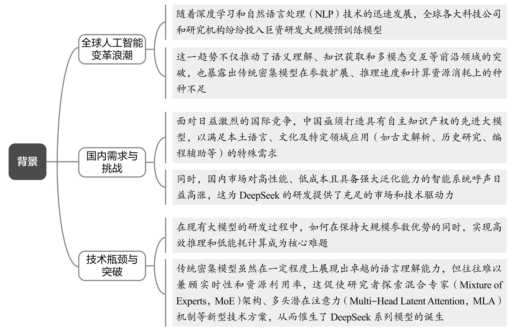
图 1-1

2. 目标
DeepSeek 的目标如图 1-2 所示。
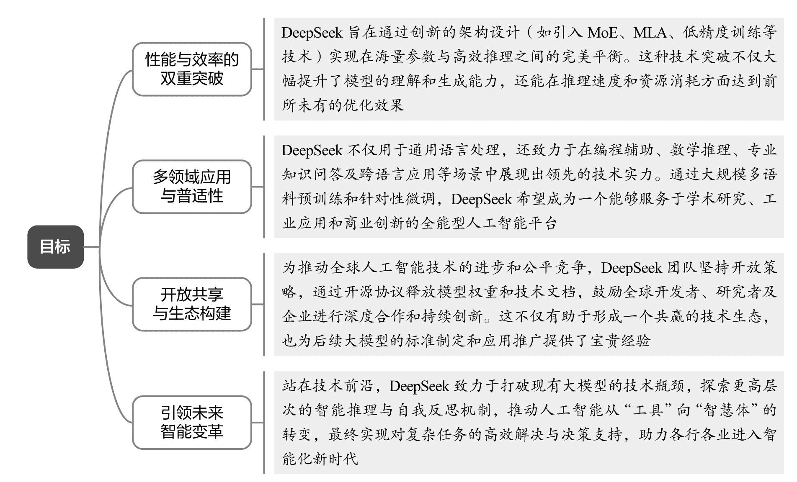
图 1-2

总体而言，DeepSeek 既是对当前人工智能发展现状的深刻洞察，也是对未来智能变革的战略布局。它代表了技术创新与效率提升的新成果，承载着推动人工智能普惠化、产业化与提升国际竞争力的宏大目标。

### 1.1.2 名称由来与理念传承

DeepSeek 由“Deep”即深思深度与“Seek”即探索追求组合而成，体现了公司在人工智能领域深耕的决心，也呼应深度学习这一核心技术。

在理念上，深度求索的“求索”源自屈原《离骚》“路漫漫其修远兮，吾将上下而求索”，象征对知识与真理的不懈追求。团队以此精神推动人工智能普惠化发展。创始人梁文锋强调原创式创新，主张以开源生态与技术沉淀构建护城河，摆脱跟随者定位，参与全球技术前沿竞争，体现了技术深度探索与文化传承的双重追求。

### 1.1.3 市场机遇与外部环境

DeepSeek 的市场机遇与外部环境可从图 1-3 所示的多个维度分析。
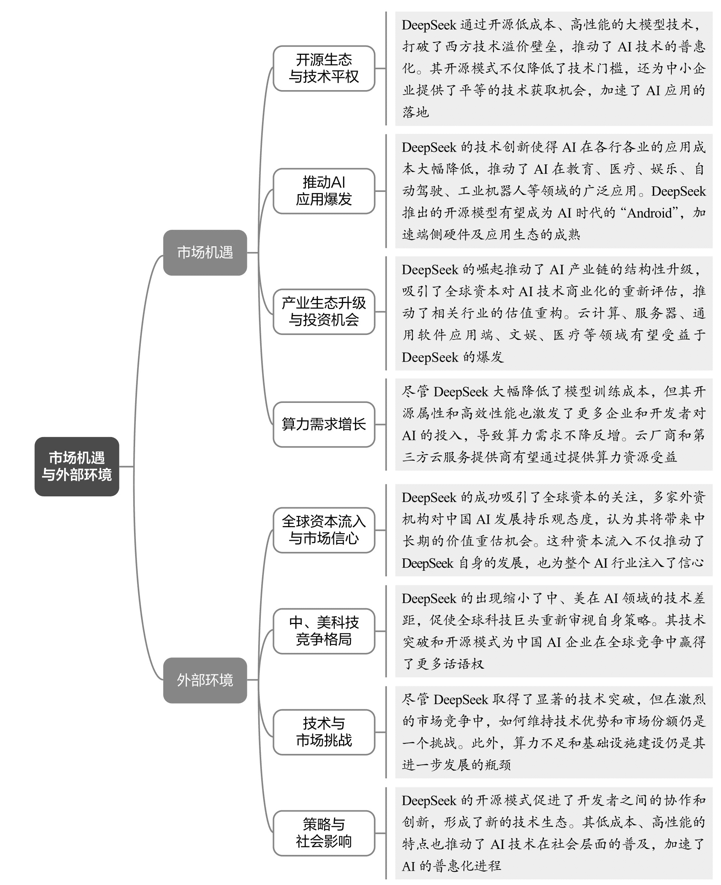
图 1-3

总体看，DeepSeek 凭借技术优势与开源模式在人工智能市场展现巨大潜力，同时也面临激烈竞争与基础设施建设等挑战。

### 1.1.4 技术贡献与研发经验

DeepSeek 团队在短时间内取得显著突破，展现强劲创新与应用潜力。

1. 技术贡献
DeepSeek 团队的技术贡献如图 1-4 所示。
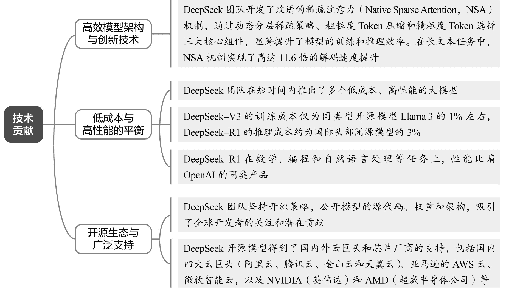
图 1-4

2. 研发经验
团队研发经验丰富，行业表现如图 1-5 所示。
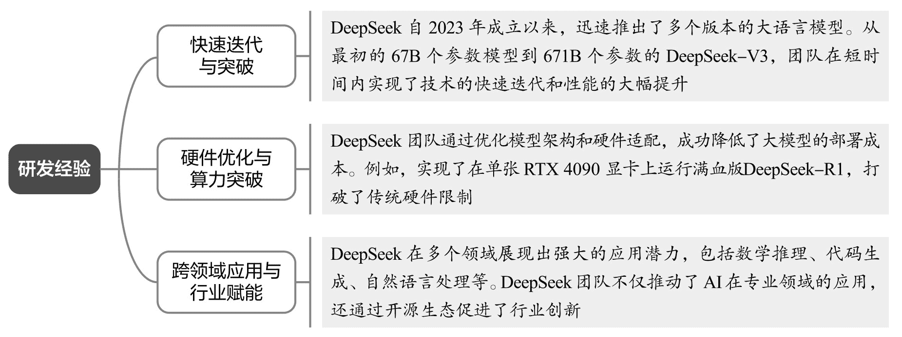
图 1-5

总之，凭借强劲技术实力与丰富研发经验，DeepSeek 在人工智能领域迅速崛起，成为全球焦点。

## 1.2 核心产品与应用方向

DeepSeek 的核心产品包括大语言模型 DeepSeek Chat 与高效推理模型 DeepSeek Reasoning。产品已广泛应用于教育、医疗健康、金融等多领域，可为教育提供虚拟实验室与智能辅导，为医疗提供初步诊断与健康管理支持，为金融提供市场分析与风险评估等，助力行业智能化升级。

### 1.2.1 主要产品线

主要为大语言模型，核心产品如下。

1. DeepSeek 对话模型系列
◎ DeepSeek LLM：2023 年 11 月发布，参数规模 67B，具备推理、编程、数学、中文等通用能力。
◎ DeepSeek-V2：2024 年 5 月发布，第二代开源 MoE 架构，参数规模 236B，推理成本低，性能强劲。
◎ DeepSeek-V3：2024 年 12 月发布，采用 MoE 架构，共 671B 参数，每次推理仅激活 37B，计算与训练成本较低，多项基准测试表现接近或超越国际顶尖模型，推理能力突出。

2. DeepSeek 编程模型系列
2023 年 11 月发布，是领先的开源代码大模型之一，由多个代码专用模型组成，支持多语言生成、调试、数据分析，采用 MIT 许可证开源。

注意：DeepSeek 数学系列于 2024 年 2 月发布，基于 DeepSeek-Coder-v1.5 7B 初始化，以数学相关 Token 与自然语言及编程数据预训练，在 MATH 基准测试中表现优异，接近 Gemini Ultra 与 GPT-4 水平。

3. DeepSeek 视觉语言系列
2024 年 3 月发布的多模态大模型，融合视觉与语言处理，能处理图像输入，支持视觉问答、图像描述生成、视觉推理等任务，开启多模态探索。

4. DeepSeek 证明系列
专注数学推理的超大规模语言模型，已推出 DeepSeek-Prover-V1、V1.5、V2 等版本。

5. DeepSeek 推理系列
◎ DeepSeek-R1：2025 年 1 月发布，基于 DeepSeek-V3-Base 架构，采用 MoE 设计，总参数 671B，每次激活 37B，通过强化学习显著提升推理能力，具备自我校验、反思与生成长思维链能力。数学、代码任务表现优异，部分基准超越 OpenAI-o1-1217，支持蒸馏至小模型。完全开源遵循 MIT 协议，支持免费商用与定制，API 兼容 OpenAI 格式，长上下文达 128K Token。
◎ DeepSeek-R1-Zero：完全通过强化学习训练，无监督微调，采用群体相对策略优化 GRPO 算法。训练使用基于规则的奖励，包括准确性与格式奖励，输出存在中英文混杂等可读性问题。该实验性成果为后续 DeepSeek-R1 优化提供重要参考。

### 1.2.2 典型应用场景

应用覆盖广泛，主要场景包括：

1. 智能对话与客户服务
◎ 智能客服：自动回答咨询，处理订单、退款、投诉等，应用于电商、银行、电信等。
◎ 情感支持：心理健康应用提供基础情感陪伴。
◎ 多模态交互：支持语音、文字等交互，用于智能助手与移动应用。

2. 代码生成与编程学习
◎ 代码生成与优化：编程模型系列可根据自然语言描述生成高质量代码，支持多语言，亦可优化现有代码。
◎ API 学习：帮助开发者快速掌握新框架与 API。
◎ 教育辅助：帮助编程初学者理解概念与最佳实践。

3. 内容创作
◎ 文本生成：生成故事、诗歌、营销文案等创意文本。
◎ 多语言翻译：支持多种语言翻译，可辅助法律合同、技术手册等专业文档。
◎ 摘要与改写：提供长文本摘要、风格改写与本地化适配。

4. 数据分析与推荐
◎ 数据分析：分析用户数据，生成可视化代码与文本报告，辅助探索性分析。
◎ 个性化推荐：基于历史行为与偏好生成推荐内容，需配合实时用户画像系统。

5. 教育与学习
◎ 学习助手：记忆单词、解答题目、修改作文等。
◎ 自适应学习：根据学习进度与知识掌握情况动态生成学习路径。

6. 金融与投资
◎ 智能风控：识别文本型金融数据风险模式如欺诈检测，需结合领域规则。
◎ 量化投资：辅助分析市场行情，支持投资研究。

总体而言，DeepSeek 的多功能性与强大推理能力使其在多个领域发挥重要作用，大幅提升效率与用户体验。

## 1.3 性能横向对比

DeepSeek 系列模型在人工智能领域引发广泛关注。DeepSeek-R1 与主流大模型在多个基准测试上的表现对比如图 1-6 所示。
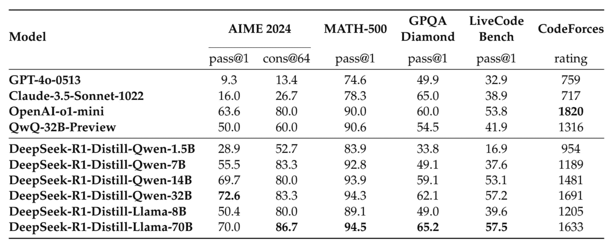
图 1-6

对图 1-6 信息说明如下。

1. 模型
◎ GPT-4o-0513：由 OpenAI 打造的版本。
◎ Claude-3.5-Sonnet-1022：由 Anthropic 打造的版本。

模型一览
◎ OpenAI-o1-mini：OpenAI 系中偏向轻量推理的版本。
◎ QwQ-32B-Preview：当前开放体验的超大模型预览版。
◎ DeepSeek-R1-Distill-Qwen-1.5B：R1 蒸馏家族成员，沿用 Qwen 架构设计，规模约 1.5B。
◎ DeepSeek-R1-Distill-Qwen-7B：同属 R1 蒸馏系，基于 Qwen 架构，规模约 7B。
◎ DeepSeek-R1-Distill-Qwen-14B：R1 蒸馏系 Qwen 路线，规模约 14B。
◎ DeepSeek-R1-Distill-Qwen-32B：R1 蒸馏系 Qwen 路线，规模约 32B。
◎ DeepSeek-R1-Distill-Llama-8B：R1 蒸馏系，迁移至 Llama 架构，规模约 8B。
◎ DeepSeek-R1-Distill-Llama-70B：R1 蒸馏系 Llama 路线，规模约 70B。

2. 测评维度
◎ AIME 2024：用于检验数学解题能力的常用基准，题源自美国数学邀请赛。
◎ pass@1：首次生成即命中正确答案的比例。
◎ cons@64：在 64 次独立采样下答案保持一致的比例。
◎ MATH-500：收录 500 道竞赛级数学题的测试集。
◎ GPQA Diamond：侧重专业问答与编程知识的评测集。
◎ LiveCode Bench：衡量模型产出可执行程序并通过测试的能力。
◎ CodeForces rating：借用 CodeForces 竞赛平台的计分方式评估算法水平，分数越高越强。

3. 成绩亮点
图 1-6 汇总了各体系在不同任务上的表现，重点如下。
◎ DeepSeek-R1-Distill-Qwen-32B 在 AIME 2024 的 pass@1 达到 72.6%，MATH-500 的 pass@1 达到 94.3%，CodeForces 评分为 1 691。
◎ DeepSeek-R1-Distill-Llama-70B 在 MATH-500 的 pass@1 达到 94.5%，CodeForces 评分为 1 633。

从图 1-6 可以看出，DeepSeek 系列在多个基准上具备明显竞争力，尤其在数学推理与代码生成方面优势突出。

## 1.4 与 DeepSeek 的首次实测
DeepSeek 的典型用法是作为通用知识助手，不同行业的用户均可通过提问获取信息。常用流程如下。
01 进入 DeepSeek 的官方网站，如图 1-7 所示。点击“开始对话”并完成账号注册。
02 进入交互页后可自由提问。按需打开“深度推理模式 R1”与“联网检索”，返回结果更贴合需求，如图 1-8 所示。

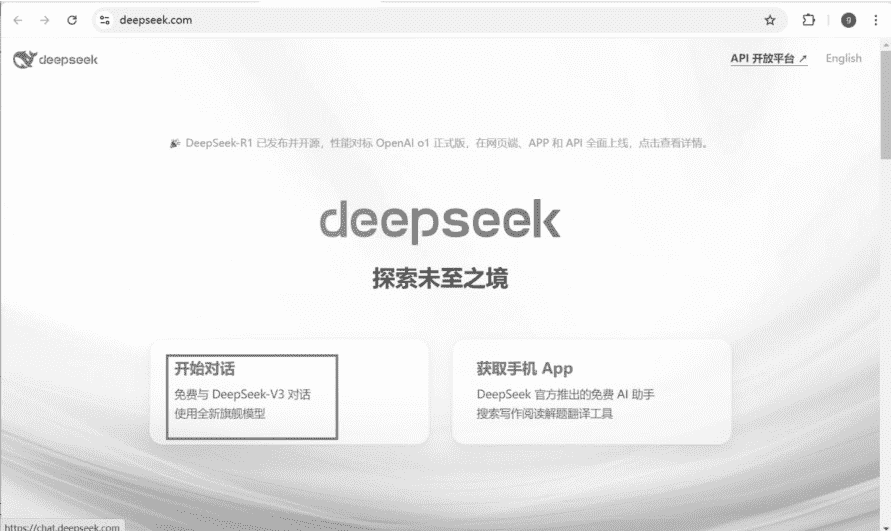

图 1-7

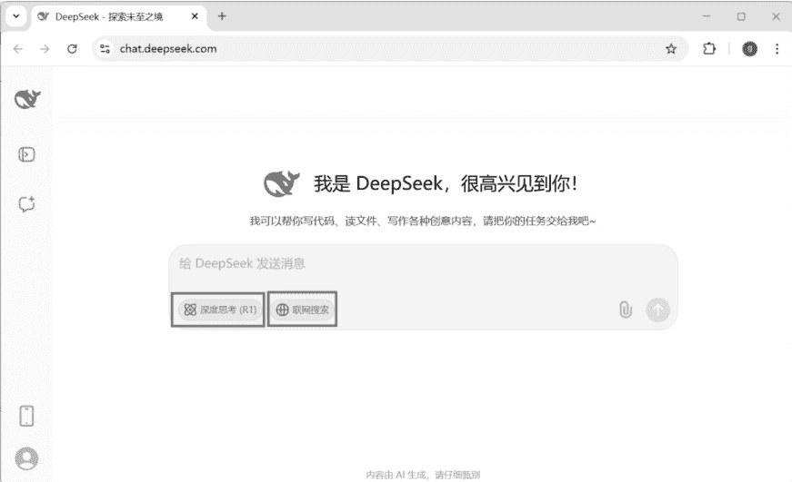

图 1-8

03 输入示例提问。
你知道范仲淹的《岳阳楼记》吗？请介绍作者、创作背景和主旨。然后参考此文，为大明湖畔的超然楼写一篇《超然楼记》。

模型给出的示例回复如下。
**一、范仲淹与《岳阳楼记》概览**
1. 作者与背景
范仲淹 989—1052，北宋名臣与散文家，谥号文正，主张“先天下之忧而忧，后天下之乐而乐”。《岳阳楼记》作于庆历六年 1046 年，新政受挫后他外放邓州，应友人滕子京之邀，凭《洞庭晚秋图》构思成文，并未亲临现场。
2. 结构与主旨
全文可分为三段。
记事：交代岳阳楼重修及滕子京政绩。
写景：以阴晴对比呈现迁客骚人的情绪波动。
抒情：以“古仁人之心”批评个人得失，提出“不以物喜，不以己悲”的豁达，最终升华为家国情怀。
整体思想超越山水胜景，直指士人担当，是古代散文典范。

**二、《超然楼记》仿作示例**
超然楼记
历下古城，大明湖东，有楼曰超然。其名取自东坡“超然台”之意，寓意脱尘自在。元代学士李泂首建，历经七百余年兴废，今楼于丁亥年重建，七层琉璃飞檐，俯瞰明湖，远眺历山，为齐鲁胜地。
观明湖之美，尽在一楼。纳南山苍翠，收泺源清流；朝晖夕霭，荷香柳色，四季迥异，气象万千。登楼则心旷神怡，宠辱皆忘，举杯临风，自觉超然。
若论兴衰，烽烟骤起，亭毁楼倾。元末兵乱、明末清初，昔日雕梁画栋化为断垣。然乡绅百姓不忘其风骨，或修亭寄怀，或题诗追古。廖炳奎诗“故亭渺何处，怀古发高歌”道尽沧桑。
感古仁人之志，或异于此。何哉？不因兴废动心，不因盛衰改志。昔李溉建楼寄情山水，今人复旧制乃承文脉千年。此楼历劫重生，百代弥新，岂非超然真义？
辛丑仲春，游济南而记。

**三、创作思路要点**
史脉与重建：凸显超然楼自元代李泂始建、历经战火与重建的沧桑，对应《岳阳楼记》的修缮缘起。
景致与意境：以大明湖四季变幻与登楼视野的开阔，仿效范仲淹“气象万千”的写法。
意蕴提升：将楼宇兴废与士人坚守对照，把“超然”从个体豁达延伸至文化传承，既保留原作议论色彩，又融入济南人文气质。
注：文中诗句与史实均来自检索结果。

## 1.5 DeepSeek API
开发者可在 DeepSeek 开发者中心获取详细信息。DeepSeek API 是基于该体系推出的接口服务，可为应用提供强大的自然语言处理能力，支持文本生成、智能对话、语义理解等，广泛用于智能客服、内容创作、数据分析等场景，帮助企业与个人快速搭建智能化产品。

### 1.5.1 API 功能概览
该接口兼具自然语言处理与代码生成能力，适配多种 AI 场景。核心特性如下。
◎ 简单易用的 RESTful API：提供标准化的 RESTful 接口，便于与任意语言或框架集成，上手迅速。
◎ 多模型支持：涵盖 1.5B 至 70B 的 DeepSeek 模型，可适配不同任务。
◎ 高性能：底层经过优化，保证低延迟与高可用，支持高并发请求。
◎ 灵活的消息格式：支持系统消息、用户消息、助手消息及工具消息。
◎ 可定制的参数：可调节生成长度、随机性与多样性等。
◎ 易于集成：提供 Python、JavaScript 等语言的 SDK 与示例代码，集成成本低。
总体来看，该接口为 AI 应用接入提供了便捷且强大的方案，有助于提升产品智能化与用户体验。

### 1.5.2 如何调用 API
官方给出标准步骤如下。
01 进入 DeepSeek 的官方网站，如图 1-9 所示。点击顶部“API 开放平台”进入开放平台首页。
02 注册登录后默认显示“用量信息”页面，其中展示接口价格说明，如图 1-10 所示。

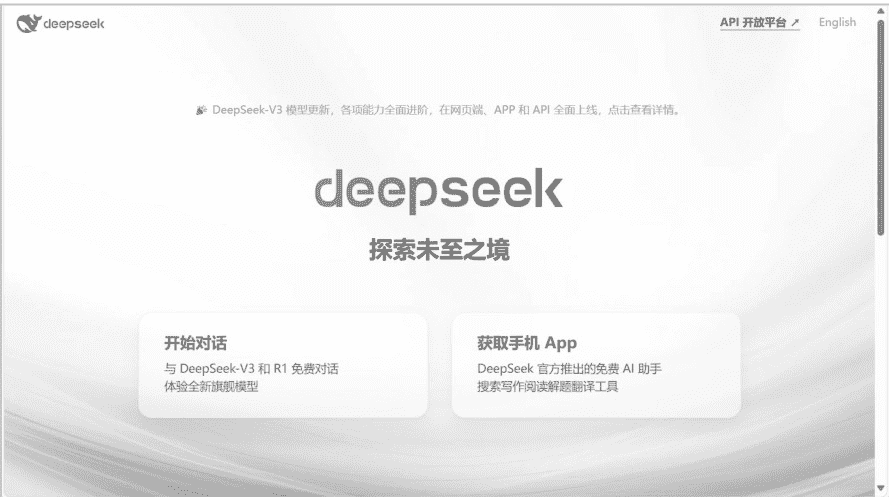

图 1-9

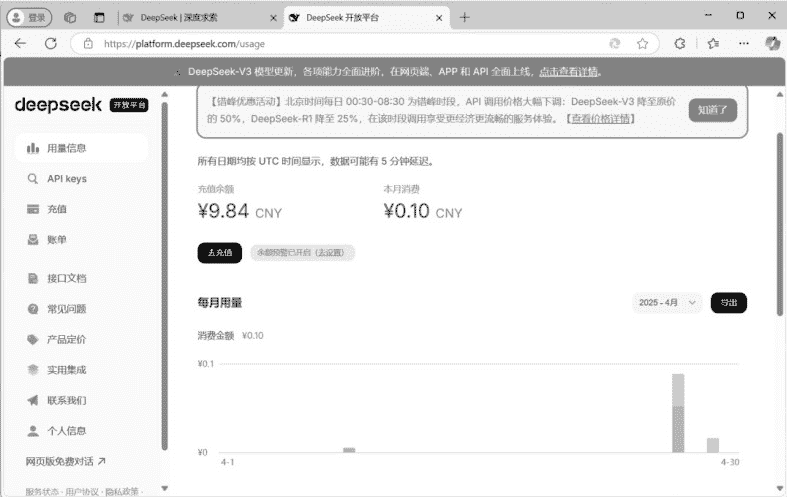

图 1-10

03 使用接口前需先获取 API key，该密钥用于身份验证与授权，由一串字符组成。左侧导航选择“API keys”，点击“创建 API key”弹出创建对话框，如图 1-11 所示。
04 在对话框中填写密钥名称，点击“创建”完成。此时新密钥会显示在列表中，如图 1-12 所示。务必妥善保管，切勿泄露。

图 1-11

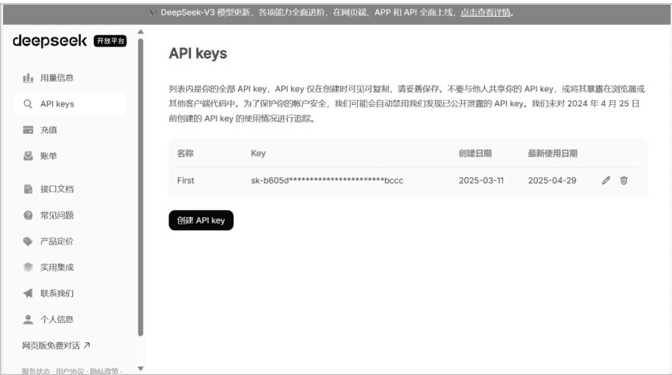

图 1-12

05 左侧导航选择“接口文档”，进入 API 文档页，官方提供详细使用教程，如图 1-13 所示。

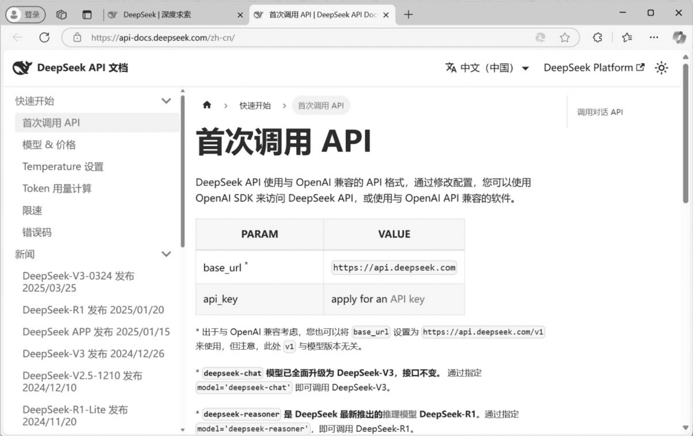

图 1-13

### 1.5.3 用 API 搭建对话程序
官方教程提供了 Curl、Python、Node.js 三种示例，如图 1-14 所示。

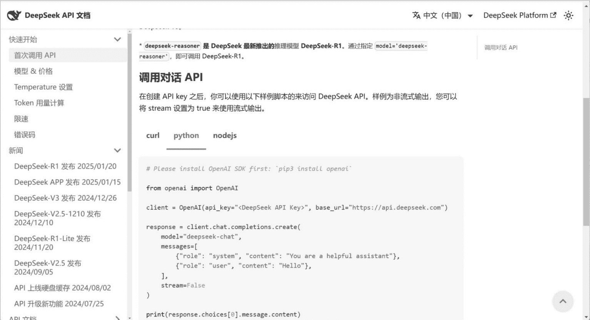

图 1-14

例如，下面的代码在官方示例基础上稍作修改，实现了对话调用。

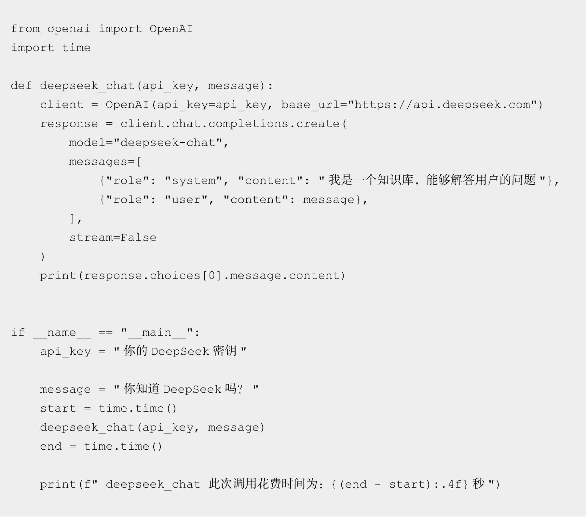

运行后会向 DeepSeek 发起“你知道 DeepSeek 吗？”的提问并返回结果。
当然知道！DeepSeek 由杭州深度求索人工智能基础技术研究有限公司推出，专注 AI 领域研发。目前已发布 DeepSeek-V2、DeepSeek-V3 等大模型，支持 128K 超长上下文，可处理复杂文本理解、代码生成、逻辑推理等任务。
deepseek_chat 本次调用耗时：3.3688 秒

# 第二章 人工智能与大模型：智能时代的核心引擎
人工智能是计算机科学的重要分支，旨在让机器模拟人类智能以完成复杂任务。近年来，以 Transformer 为架构、在海量文本上进行预训练的大模型快速崛起，能够生成自然语言并应用于文本生成、机器翻译、问答等多种场景，推动了 NLP 领域的快速发展，成为 AI 的主流方向。

## 2.1 AI 基础速览
人工智能是一个跨学科领域，涵盖机器学习、深度学习、自然语言处理、计算机视觉等分支。

### 2.1.1 AI 是什么
人工智能是指让计算机系统执行原本需人类智能完成的任务，如语言理解、视觉感知、学习、推理、规划、决策等。其目标是构建可在复杂环境中自主运行、解决实际问题的智能系统。
1. 主要分支
人工智能的主要分支如图 2-1 所示。

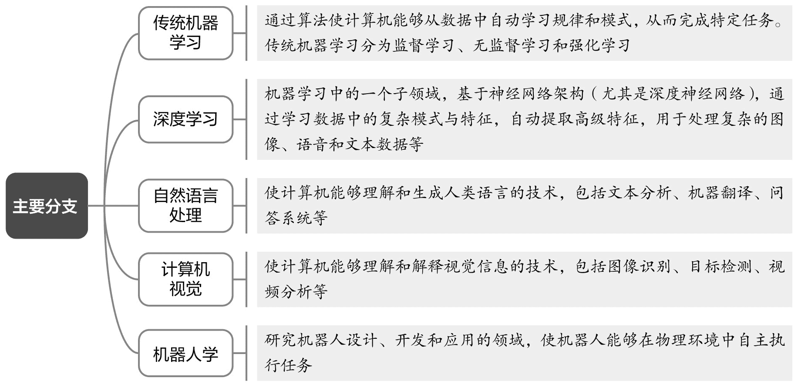

图 2-1

2. 关键技术
人工智能的关键技术如图 2-2 所示。

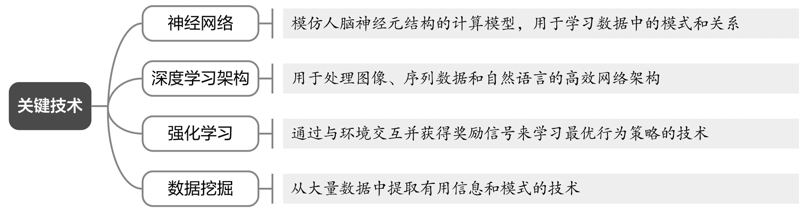

图 2-2

3. 应用领域
◎ 医疗健康：疾病诊断、药物研发、医学影像分析等。
◎ 交通与自动驾驶：智能交通、自动驾驶汽车等。
◎ 金融：风险评估、反欺诈、投资决策等。
◎ 教育：个性化学习、智能辅导等。
◎ 娱乐：内容推荐、游戏开发等。
◎ 工业制造：自动化生产、质量控制等。
总之，人工智能作为前沿技术，正不断拓展应用边界，为复杂问题提供新思路。

### 2.1.2 传统机器学习
传统机器学习是 AI 的分支，通过数据驱动的算法使计算机在无显式指令下自主学习与改进。核心是通过历史数据自动发现规律并用于预测或决策。
传统机器学习模型可从数据中提取信息并持续提升性能，无需固定规则。其常用概念如图 2-3 所示。

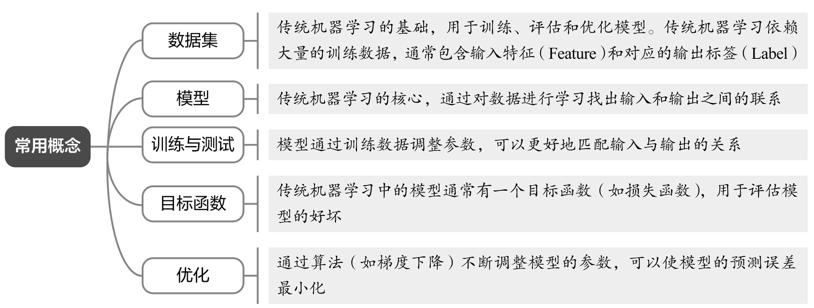

图 2-3

基本原理基于统计学与概率论，实现步骤如图 2-4 所示。
总之，传统机器学习通过数据自我学习来应对未知任务。

### 2.1.3 深度学习
深度学习是机器学习的子方向，专注于用多层神经网络模拟人脑信息处理方式。通过多层非线性变换自动提取高级特征，用于分类、预测等，擅长处理图像、语音、自然语言等复杂数据。

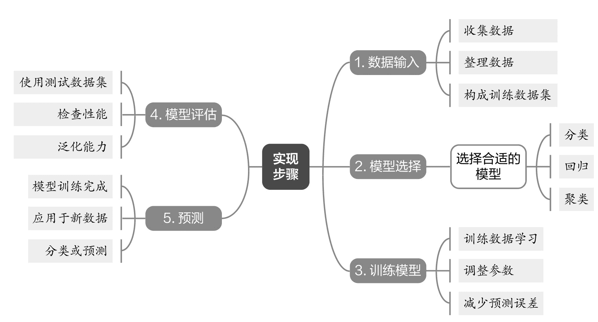

图 2-4

深度学习通过构建深层神经网络进行数据建模，通常包含多个隐藏层以学习抽象特征。其核心概念如图 2-5 所示。

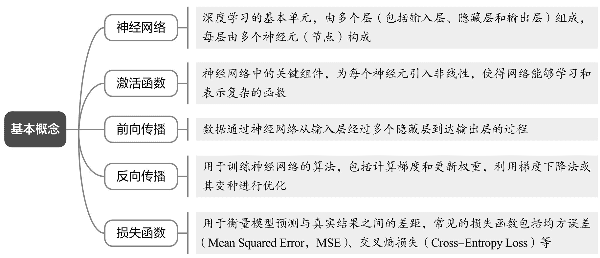

图 2-5

总之，深度学习借助多层网络学习复杂特征，广泛应用于计算机视觉、自然语言处理与语音识别等领域。

## 2.2 大模型定义
大模型是基于深度学习的 AI 体系，通过学习海量语言数据实现理解、生成与处理自然语言。它像一位博览群书的专家，阅读大量文本后掌握语言规律，可进行交流与创作。
想象一位朋友读遍世间书籍并能记住全部内容，任何提问都能流畅作答，甚至能即兴写诗讲故事。大模型的工作原理类似，通过在互联网文章、书籍、对话等海量文本上学习语言组织与语义，从而根据需求生成合乎逻辑的文本。

### 2.2.1 核心术语解析
**1. 神经网络**
神经网络是一种模仿人脑神经元结构的计算模型，由大量互联节点组成。通过优化算法调整权重，可自动学习数据特征与模式，完成分类、回归、生成等任务，是深度学习的基础。
**2. 网络模型**
网络模型是神经网络的具体形态，如 CNN、RNN、Transformer 等。不同架构适配不同任务，例如 CNN 擅长图像，Transformer 是大模型核心架构。
**3. 机器学习**
机器学习是 AI 分支，通过算法让计算机自动从数据中学习规律。可分为监督、无监督、强化学习，大模型多采用无监督预训练学习通用语言规律。
**4. 训练模型**
训练模型指用特定算法与数据对模型进行训练，使其学习输入特征并输出期望结果。大模型训练通常分预训练与微调两阶段。预训练在海量无标注文本上学习通用规律，微调在少量标注数据上优化以适配特定任务，目标是提升性能与泛化能力。
**5. 预训练**
预训练是大模型核心环节，模型在海量无标注文本上学习语法、语义、上下文关系，形成广泛的语言理解能力，为后续微调奠定基础。
**6. 微调**
微调是在预训练模型基础上，针对文本分类、问答、翻译等特定任务进行再训练。通过少量标注数据调整参数，使模型更贴合实际应用需求。
**7. 算力**

**大模型能跑起来的三大前提**

算力通常指支撑模型训练与推理的硬件资源，业内多以 GPU 或 TPU 的保有量与算术能力来估算。模型体量越大，前向推理与反向训练的开销越重，硬件门槛也随之抬升。

**8. 数据集**
Dataset 指用于模型学习与校准的文本集合。语料的品质与覆盖面往往决定模型的上限，常用的来源包括图书、新闻稿件、网页抓取文本等。

**9. 性能指标**
用来量化模型能力的评价维度，常见的是准确率、召回率、F1 分数，以及机器翻译场景里的 BLEU 分数。借助这些标尺，研究者可以更清晰地比较不同任务上的表现差异。

以上三项共同构成了理解大模型运行机理、落地场景与优化方向的骨架。

### **2.2.2 常见的大模型**
下面汇总当前主流模型的核心特征。

**1. OpenAI 的 GPT 系列**
◎ GPT-1：2018 年面世，是生成式预训练的早期代表，结构采用 Transformer，参数规模约 11.7 亿。
◎ GPT-2：2019 年发布，参数升至 15 亿，生成文本的连贯性与多样性得到明显改善。
◎ GPT-3：2020 年发布，参数规模约 1,750 亿，可处理文本生成、翻译、问答等多项自然语言工作。
◎ GPT-3.5 ChatGPT：2022 年发布，在 GPT-3 基础上引入以人类反馈为驱动的强化学习，交互能力显著增强。

**2. Google 的 T5 与 Flan-T5**
◎ T5：2020 年推出，把各类任务统一为条件生成范式，参数跨度约 7.7 亿到 110 亿。
◎ Flan-T5：在 T5 基础上做多任务指令微调，在 1,800 多项 NLP 任务上提升明显。

**3. Meta 的 Llama 系列**
◎ Llama：2023 年发布，提供 7B、13B、30B、65B 多个版本，采用 Transformer 并引入 RoPE 旋转位置编码与 RMSNorm。
◎ Llama-2：同年开源，训练语料更大更干净，整体能力明显跃升。

**4. 清华大学的 GLM-130B**
2022 年开源，参数约 1,300 亿，基于自回归填充机制，支持理解、条件生成与无条件生成。

**5. Google 的 PaLM 系列**
◎ PaLM：2022 年发布，参数 5,400 亿，依托 Pathways 分布式训练框架，效果突出。
◎ PaLM-E：2023 年发布，融合 PaLM 语言模型与 ViT-22B 视觉模型，约 5,620 亿参数，具备多模态能力。

**6. 其他重要模型**
◎ DeepSeek：国产模型，主打低成本高性能，支持多语对话、文本生成、编程辅助等，本书重点案例。
◎ Stable Diffusion：2022 年发布，基于扩散模型与 CLIP 对比预训练，专注文本到图像生成。

这些系统在自然语言处理上表现强劲，已广泛用于文本生成、机器翻译、问答与多模态任务，推动了人工智能的快速发展。

## **2.3 神经网络**
神经网络是深度学习的根基架构，广泛应用于图像识别、语音处理及自然语言处理。

### **2.3.1 神经网络的基本概念**

**1. 神经元**
神经元是网络的基本计算单元，模拟生物神经元的抽象。计算流程如下：
（1）输入 Input：接收多路信号，通常表示为向量 x=[x1,x2,…,xn]。
（2）权重 Weight：每个输入对应一个权重 w=[w1,w2,…,wn]，反映重要程度。
（3）偏置 Bias：常数项 b，用于调节激活阈值。
（4）激活函数 Activation Function：非线性函数 f，使网络能学习复杂模式。

**2. 激活函数**
激活函数把加权输入映射为输出，引入非线性。常用类型有：
◎ ReLU：应用最广，能缓解梯度消失且计算效率高。
◎ Sigmoid：输出限定在 0~1，多用于二分类输出层。
◎ Tanh：输出限定在 -1~1，零中心化特性有助于加速训练。

**3. 层**
网络由多层神经元构成，层间以权重相连。
◎ 输入层 Input Layer：接收原始数据，为网络第一层。
◎ 隐藏层 Hidden Layer：介于输入与输出之间，负责特征提取，可堆叠多层，层数越多模型越复杂。
◎ 输出层 Output Layer：网络最后一层，输出最终结果，单元数依据任务而定，如分类任务通常等于类别数。

**4. 权重和偏置**
权重与偏置初始值随机设定，随后借助反向传播不断更新以降低损失。
◎ 权重：表征连接强度，决定输入对输出的影响，是可训练参数。
◎ 偏置：提供基线输出，使神经元即使无输入也能响应，同样可训练。

总体而言，神经网络通过大量神经元的组合与连接形成复杂计算结构，激活函数提供非线性，层结构组织计算流，权重与偏置在训练中持续优化，这确立了深度学习的基础。

### **2.3.2 神经网络的训练过程**
训练是数据驱动的权重与偏置调整过程，使模型输出趋近期望值，主要包含前向传播、损失计算、反向传播与参数更新。

**1. 前向传播**
由输入层向输出层的正向计算：
01 原始数据进入输入层。
02 各层单元按输入、权重、偏置计算，经激活函数后输出。
03 结果逐层传递至输出层，得到预测值。

**2. 损失计算**
损失函数衡量预测与真实值的差距：
◎ 均方误差：用于回归任务。
◎ 交叉熵损失：用于分类任务，衡量概率分布差异。

**3. 反向传播**
训练核心算法，按梯度指导优化：
01 从输出层起计算损失对权重与偏置的梯度。
02 借助链式法则逐层回传，得到各层参数梯度。
03 明确各参数对损失的贡献，为更新提供依据。

**4. 参数更新**
基于梯度使用优化算法更新参数：
◎ 梯度下降：直接沿梯度方向更新。
◎ 随机梯度下降 SGD：每次用单样本计算梯度，加快训练。
◎ Adam 优化器：融合动量与自适应学习率，是常用选择。

**5. 训练循环**
迭代流程通常为：
01 参数随机初始化。
02 前向传播得到预测。
03 计算损失。
04 反向传播求梯度。
05 按梯度更新参数。
06 重复直至损失收敛或达到预设轮数 Epochs。

**6. 超参数调整**
手动设定的关键参数：
◎ 学习率 Learning Rate：控制更新步长。
◎ 批量大小 Batch Size：每次训练样本数。
◎ 隐藏层大小 Hidden Layer Size：隐藏层单元数量。
◎ 优化器 Optimizer：选择优化算法。
◎ 正则化参数：如 L1、L2，用于防止过拟合。

**7. 模型评估**
训练期间需定期评估：
◎ 准确率：分类正确比例。
◎ 召回率：正样本中被正确预测的比例。
◎ F1 分数：准确率与召回率的调和均值。
◎ 均方误差：回归预测误差。

总体来说，神经网络训练是持续优化的过程，通过前向生成预测、计算损失、反向求梯度、优化器更新参数，模型逐步学习数据规律。理解这些步骤对掌握训练机制至关重要。

## **2.4 网络模型**
网络模型是一类基于特定结构设计的数学模型，用于解决分类、回归、聚类等复杂任务，核心在于层间连接关系对输入数据的逐步处理与特征学习。

### **2.4.1 网络模型、神经网络和大模型的关系**
◎ 网络模型是基础架构：广义概念，指由节点和连接构成的计算模型，包含决策树、贝叶斯网络等，神经网络是其中一种重要实现。
◎ 神经网络是具体实现：模仿人脑结构，通过多层带权重的神经元处理数据，包含 MLP、CNN、RNN 等，可完成图像识别、语音处理、语言理解等任务。
◎ 大模型是高级应用：指参数规模达数十亿乃至千亿的神经网络，通过大规模无监督预训练和监督微调学习语言规律，核心多基于 Transformer 与自注意力机制。

总体来看，网络模型奠基，神经网络具体化，大模型则是其在超大规模下的高级形态。

### **2.4.2 网络模型的分类**

**1. 传统机器学习模型**
依赖人工设计的特征，通过算法学习模式。算力需求低，适合中小规模数据。典型模型有线性回归、逻辑回归、SVM、决策树与随机森林、KNN 等，性能高度依赖特征工程。例如房价预测需预先定义面积、房龄等特征。
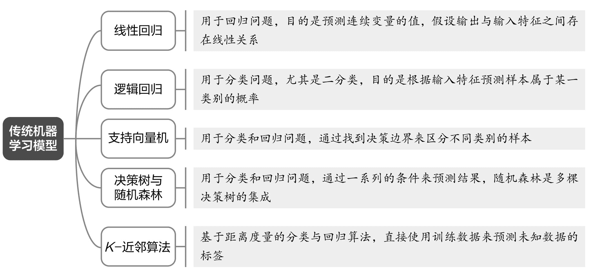
图 2-6

**2. 深度学习模型**
由多层神经元堆叠而成，能自动从原始数据中提取特征，擅长处理大规模高维数据，如图像、语音、自然语言。卷积神经网络可自动学习边缘、形状、纹理等特征。
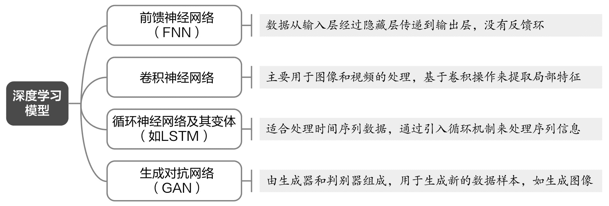
图 2-7

**3. 传统机器学习模型与深度学习模型的对比**
表 2-1 传统机器学习模型与深度学习模型的对比
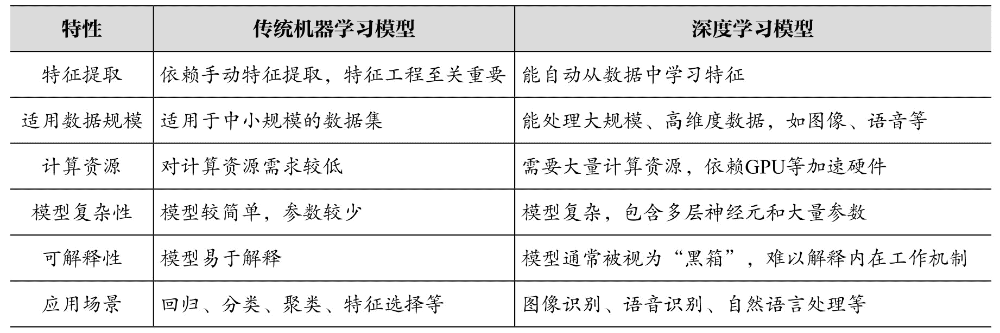

**4. 应用场景**
◎ 传统机器学习适合数据结构清晰、特征易提取的任务，如房价预测、信用评分。
◎ 深度学习在复杂非结构化数据上优势明显，如图像识别、语音识别、自动驾驶。

选择模型取决于数据特性、任务需求和算力资源。随着技术演进，两者边界逐渐模糊，混合模型与迁移学习提供更多解决方案。

# **第三章 DeepSeek 底层架构解密：探寻大模型的基石**
DeepSeek 的底层技术融合了多头注意力、动态任务分配、稀疏激活等创新，提升效率并降低训练成本。结合 MoE 高效设计与归一化优化，在复杂任务上表现突出。通过多令牌预测、混合精度训练、EMA 优化等策略，进一步提升训练速度与资源利用率，为其在自然语言处理和 AI 领域的强能力奠定基础。

## **3.1 基于 Transformer 架构**
Transformer 是一种用于自然语言处理和序列建模的深度学习架构，由 Google 研究团队与多伦多大学等在 2017 年提出，论文 Attention is All You Need 详细阐述了其思想。

### **3.1.1 Transformer 架构介绍**
Transformer 的核心创新是自注意力机制，摆脱了循环神经网络和 LSTM 的序列依赖，支持并行计算整段序列的关联，大幅提升训练效率。其良好的并行性使其能充分利用硬件资源，特别适合超大模型训练。该架构催生了 BERT、GPT 等后续模型，并在 NLP、计算机视觉、语音识别等领域取得突破。

### **3.1.2 Transformer 架构的组成**
Transformer 由堆叠的编码器和解码器构成，每层包含输入嵌入与位置编码、多头自注意力、前馈网络、残差连接与层归一化，以及最终的线性映射与 Softmax 输出，共同实现高效并行处理与全局依赖捕捉。

**1. 编码器**
由多个相同层构成，每层包含：
◎ 多头自注意力机制：可在多个子空间同时学习信息，捕捉序列中不同位置的关联。
◎ 前馈神经网络：对每个位置进行非线性变换，进一步提炼特征。
由于缺乏递归或卷积，位置信息需额外注入，通常用正弦-余弦周期编码与词嵌入相加。

**2. 解码器**
负责将编码器上下文转为目标序列，由多层堆叠：
◎ 掩码多头自注意力机制：通过掩码屏蔽未来位置，确保生成时仅依赖已生成内容。
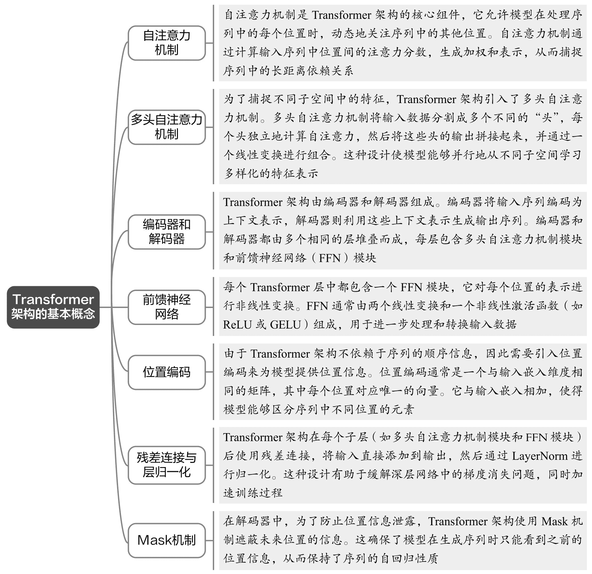
图 3-1
◎ 编码器-解码器注意力机制：解码器的查询与编码器的键值交互，获取上下文信息。
◎ 前馈神经网络：对表示进行非线性变换。

**3. 自注意力机制**

Transformer 架构拆解：从自注意力到 MoE 动态路由

自注意力是 Transformer 的底层逻辑，它让模型在编码某个位置时能够同步参考序列中全部其他位置的信息，实现全局关联。具体实现可拆成四步走。

**◎ 线性变换：** 原始输入先分别映射到三个子空间，得到 Query、Key、Value 三组向量，三组都由各自的线性权重矩阵完成投影。

**◎ 计算注意力分数：** 用 Query 与 Key 做点积，衡量序列内部位置之间的相似程度，得到衡量关联强度的原始分数。

**◎ Softmax 归一化：** 把上述分数送入 Softmax，把数值转成和为 1 的概率分布，为后续加权提供可解释的权重。

**◎ 加权求和：** 以归一化后的权重对 Value 做加权累加，输出即融合了序列其余位置信息的表示，从而具备全局感知。

**4. 位置编码**
Transformer 本身不保留顺序，位置编码专门补上位置线索，帮助模型区分词元在序列中的先后与相对关系。

**5. 常见变体产品**
随着研究演进，围绕 Transformer 衍生出大量改进型模型，在保留并行优势的前提下扩展应用边界与性能天花板。典型变体汇总见图 3-2。

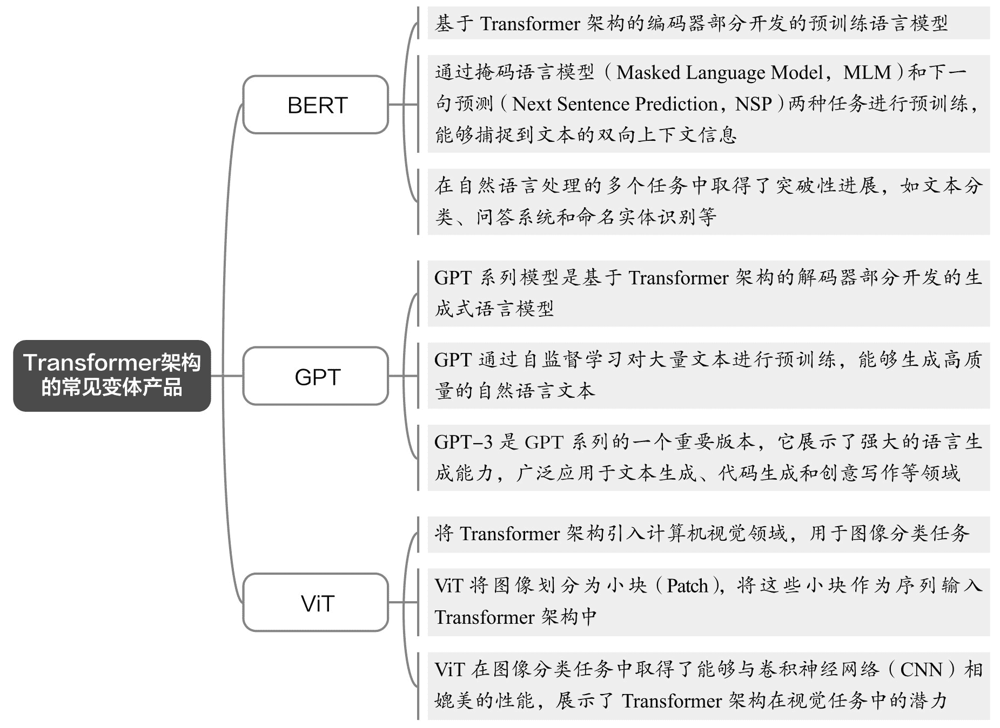

图 3-2

总体来看，Transformer 靠自注意力革新了序列建模方式，摆脱了 RNN 与 CNN 的顺序与局部局限，训练更快、效果更强。BERT、GPT、ViT 等正是这一家族的代表，已在自然语言处理与计算机视觉中广泛落地。

### **3.1.3 多头注意力机制：并行感知的关键**

多头注意力 MHA 是 Transformer 的核心部件，它并发运行多个注意力头，让模型在不同子空间里学习多维关系。每个头关注一种上下文侧面，再把各头结果拼接并做一次线性映射，融合信息、提升表达力。

在 DeepSeek 系列里，MHA 是关键支柱，V2 与 V3 都深度依赖它。设想你在做智能写作助手，MHA 能抓住用户输入主题“如何提高学习效率”中的关键词与语义关联，快速生成写作提纲；配合多头潜在注意力 MLA，则借助低秩压缩与旋转位置编码 RoPE 降低计算开销，同时保持高质量输出。这一流程示意如图 3-3。

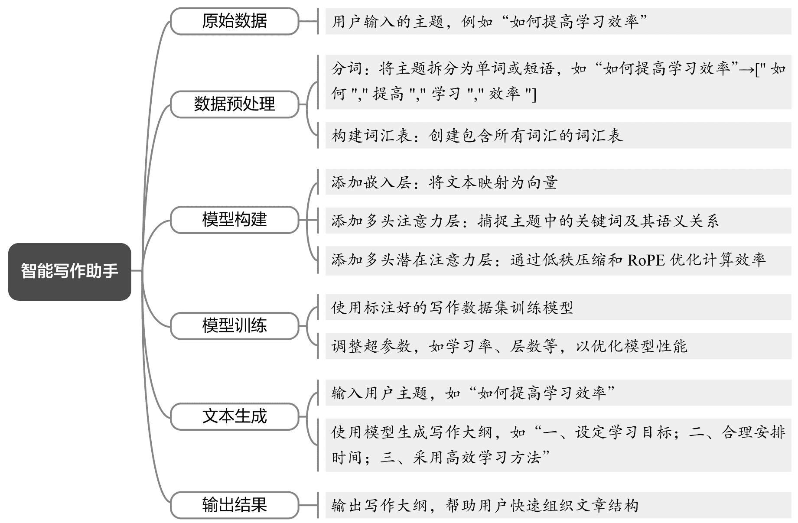

图 3-3

随后展开 MHA 的工作机理与优势。

**1. 工作原理**

**（1）输入变换：** 输入先经三组线性层分别得到 Q、K、V 三个矩阵。

**（2）分头处理：** 把 Q、K、V 切分为若干头，每个头在独立子空间里算注意力。

**（3）注意力计算：** 各头使用缩放点积注意力，先算 Q 与 K 的点积，再经 Softmax 得权重，最后加权 V 得到头输出。每个头的计算公式涉及头维度 dk，各头完成后拼接，再经线性变换得到最终结果。

**（4）拼接与融合：** 把所有头输出串联，通过一次线性投影整合成统一维度。

**2. 优势**

**◎ 并行处理：** 各头独立计算，可并行执行，提升算力利用。

**◎ 增强表达能力：** 多子空间并行捕捉语义关系，使复杂任务表现更稳健。

MHA 已成为机器翻译、文本摘要、语音识别、图像描述生成等任务的标配，是 Transformer 成为 NLP 主流架构的重要原因。

### **3.1.4 多头潜在注意力机制：Transformer 架构的优化和扩展**

多头潜在注意力 MLA 是对 MHA 的高效化改造，引入低秩分解与 RoPE，兼顾性能与成本。

MLA 的核心思路如下。

**1. 低秩矩阵分解**
低秩分解把大矩阵近似为两个小矩阵的乘积。MLA 对 Q、K、V 做低秩近似，减少参数量与计算量，在维持效果的同时大幅降低显存与耗时，利于处理长序列。

**2. 旋转位置编码**
RoPE 通过旋转向量为每个位置注入位置信息，不同于正弦绝对编码，RoPE 将位置融入旋转变换，对长序列更友好，跨长度泛化更好，还能在推理时处理训练时未见的更长序列。

在智能写作助手中，MLA 能够高效捕捉文本语义关系，产出高质量内容。

## **3.2 动态任务分配：智能计算的自适应引擎**

动态任务分配依据输入特征与系统状态实时调度算力，按需激活不同的模块或专家网络。它既提升推理效率，也增强对多样化任务的适应性，是稀疏激活与高效计算的基座。典型场景包括多任务系统、MoE 架构与分布式计算，可应对复杂需求与资源限制，保障关键任务优先。

### **3.2.1 原理剖析**

动态任务分配能随条件变化即时调整策略，从而提升灵活性与效率。其机制示意如图 3-4。

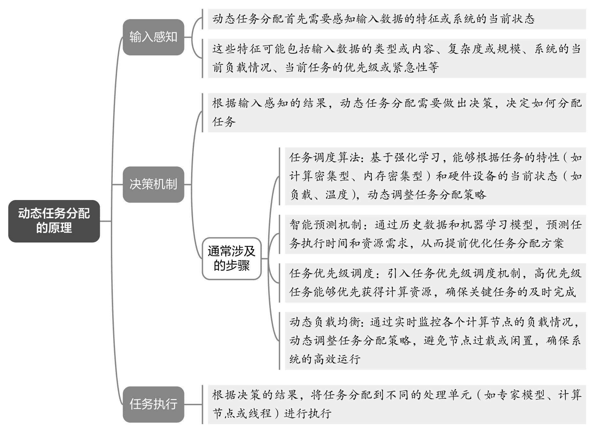

图 3-4

### **3.2.2 优势洞察**

**1. 资源优化**
◎ MoE 中，任务会分给最匹配的专家，避免浪费并实现负载均衡。
◎ 分布式环境里，系统实时监控节点资源，动态调整分配，减少热点，提升集群利用率。

**2. 效率提升**
◎ 多任务学习中，按复杂度与优先级指派专家，提速训练与推理。
◎ 实时系统能快速响应输入变化，优先执行关键任务，提升响应速度。

**3. 灵活性增强**
动态任务分配可随需求与状态变化自适应。
◎ NLP 中可按文本长度、复杂度或语义选择最合适的专家。
◎ 多模态学习中可按模态特性路由到专用专家，提升多模态处理能力。

**4. 负载均衡**
◎ 分布式训练中按节点负载动态分配，避免过载与闲置并存。
◎ 多任务系统按优先级与复杂度调节分配，保持整体性能。

**5. 适应性强**
◎ 智能推荐系统可依据用户实时行为动态调整，提升推荐精准度。
◎ 实时监控系统可随数据变化动态调度，及时发现异常。

总之，动态任务分配通过优化资源、提速、增强灵活与适应性，显著改善系统性能与体验，是现代 AI 系统的关键技术。

### **3.2.3 应用场景**

动态任务分配在 MoE 与多任务学习中尤为关键，通过动态挑选与分配专家或算力，大幅提升效率与性能。其应用全景如图 3-5。

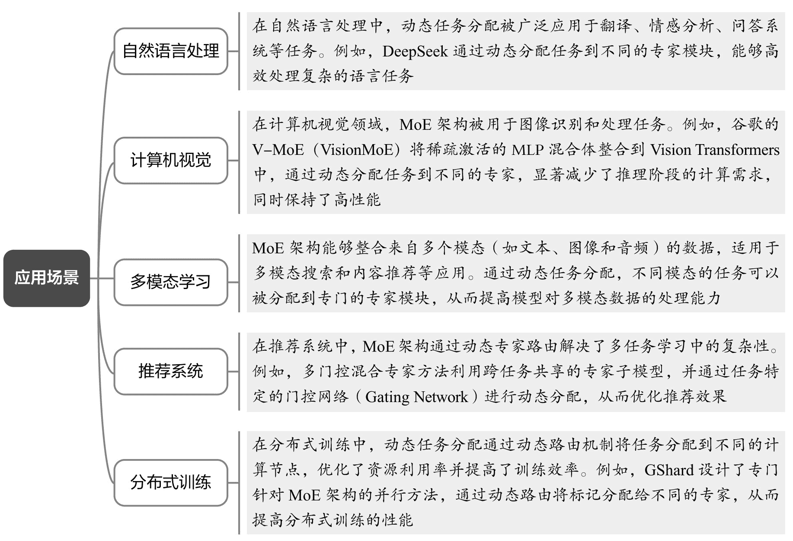

图 3-5

上述场景体现了动态任务分配在 AI 中的重要性与灵活性。

## **3.3 稀疏激活机制：动态结构感知的高效优化范式**

稀疏激活通过选择性激活部分神经元或模块来提升效率与性能。它削减无效计算，降低推理时间与内存占用，同时保持精度。MoE 中常借助稀疏激活只唤醒必要专家，避免全激活，提高可扩展性与资源利用。稀疏约束还能抑制过拟合，提升泛化。

### **3.3.1 特性亮点**

**1. 特点**
**◎ 稀疏性：** 输出以零为主，仅少数单元被激活，减少冗余计算。
**◎ 动态性：** 依据输入特征动态挑选激活单元，灵活应对多样输入。
**◎ 高效性：** 激活单元少，计算与存储需求下降，适合资源受限环境。

**2. 优势**
**◎ 降低计算负担：** MoE 中每个输入仅激活部分专家，计算量显著下降。
**◎ 节省内存：** 用 CSR、COO 等稀疏存储格式压缩激活值。
**◎ 提升效率：** 训练与推理速度均获改善。
**◎ 增强适应性：** 模型可按输入灵活选择专家。
**◎ 正则化效果：** 稀疏性有助于抗过拟合。
**◎ 降低能耗：** 适合边缘设备部署。
**◎ 模块化与可扩展性：** 专家可独立设计与迭代。

总之，稀疏激活通过削减不必要计算与存储，是深度学习模型重要的优化策略。

### **3.3.2 实现路径**

稀疏激活在训练时考虑参数邻域的最大损失，增强不确定区域的泛化。实现方式如图 3-6。

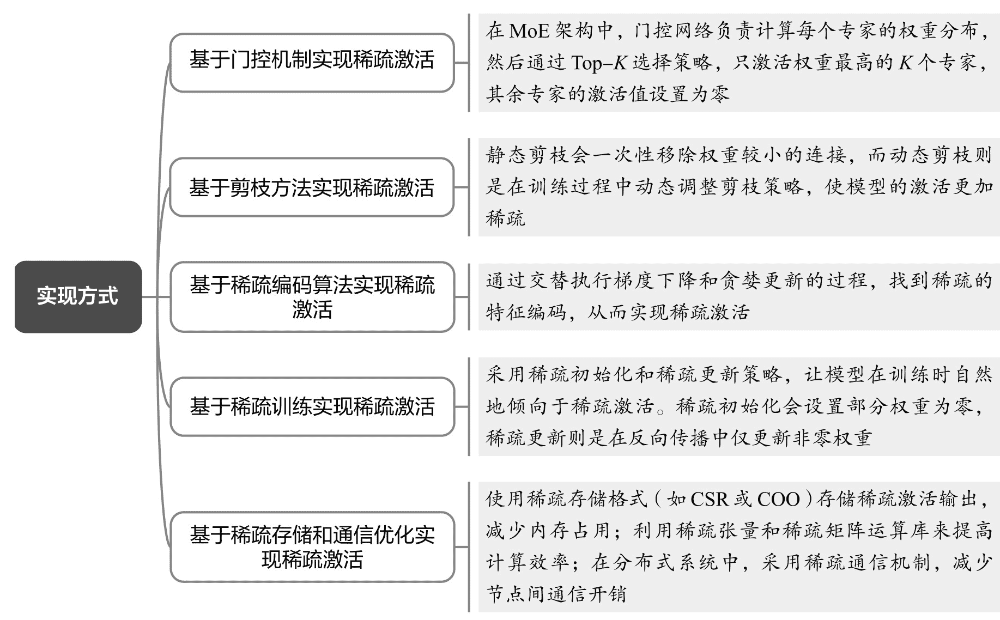

图 3-6

不同实现从不同角度让激活更稀疏，减少计算与内存，提升处理效率。

## **3.4 MoE 架构：基于稀疏专家的动态路由系统**

DeepSeek 采用 MoE，把模型拆分为多个针对不同任务或领域的专家模块。配合动态任务分配与稀疏激活，MoE 减少计算冗余，提高效率与适应性。

### **3.4.1 核心原理**

**1. 工作原理**
**◎ 输入接收：** 接收文本、代码等 Token。
**◎ 路由决策：** 门控网络评估 Token，决定送往哪些专家处理。
**◎ 专家处理：** 被选中专家独立处理。
**◎ 输出合并：** 多专家输出经加权平均或拼接等合并为最终结果。

**2. 特点**
MoE 的具体特性如图 3-7。

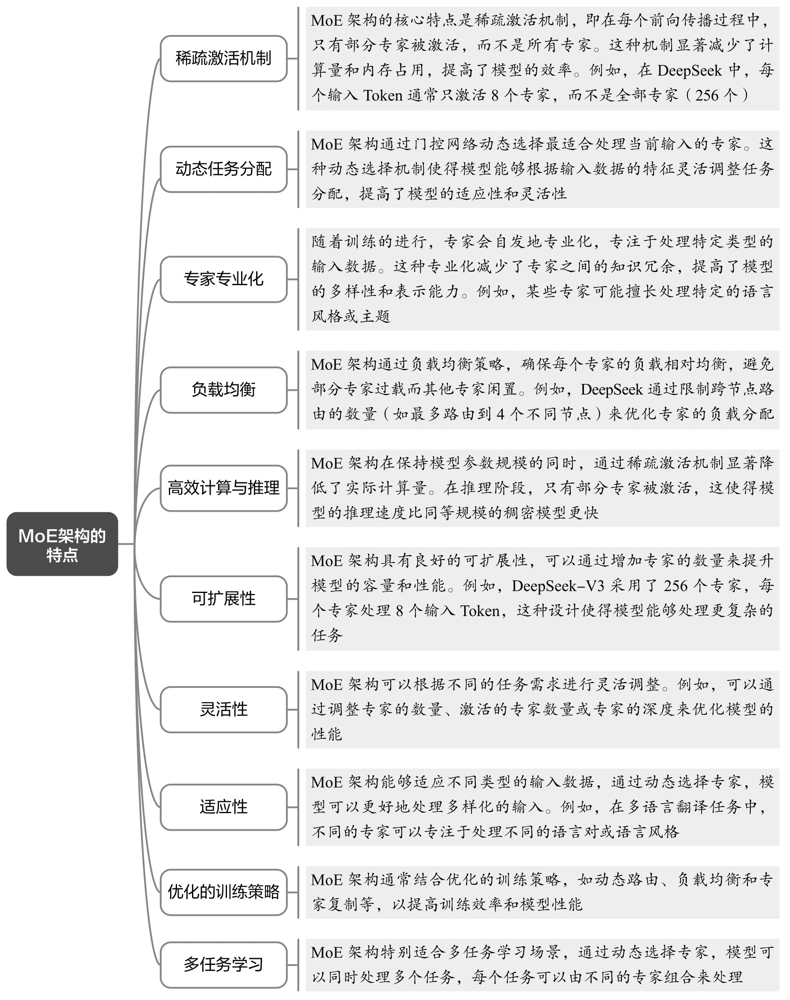

图 3-7

该架构在 NLP、视觉与多模态任务中表现突出，尤其在复杂任务与大规模数据上优势明显。

### **3.4.2 构成要素**

**◎ 门控网络：** 动态挑选专家的轻量网络，计算输入与各专家的匹配度，输出概率分布，按 Top-K 激活最相关专家。DeepSeek-V3 中即以 Top-K 策略为每个 Token 选择专家。

**◎ 专家网络：** 多个独立前馈网络，每个专注特定输入类型。DeepSeek-V3 中每个专家类似 Transformer FFN，独立运行。

**◎ 组合器：** 对激活专家的输出按门控权重加权聚合，生成最终表示，保持稀疏性的同时充分利用专家信息。

### **3.4.3 执行流程**

**◎ 输入数据预处理：** Token 先做嵌入，变为向量。
**◎ 门控网络计算权重：** 将输入投影到新空间，与专家特征比较，常用余弦相似度，得到概率分布。
**◎ 动态选择专家：** 按 Top-K 选择高权重专家，部分实现加入高斯噪声以促进探索。
**◎ 专家处理输入：** 各专家独立前向计算。
**◎ 组合专家输出：** 按权重加权聚合。
**◎ 后处理与输出：** 激活或归一化后输出。

总之，MoE 的模块化设计在资源受限场景下展现出强劲潜力。

### **3.4.4 权重分配**

MoE 的权重由门控网络给出，经归一化后和为 1。f[i](x) 为第 i 个专家的原始分数，g[i](x) 为归一化后的权重，表征其对当前输入的贡献。

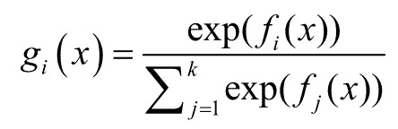

### **3.4.5 应用落地**

得益于灵活性与可扩展性，MoE 在多个领域广泛应用，具体说明见图 3-8。

### **3.4.6 DeepSeek 中 MoE 策略实践**

在 DeepSeek-V2 与 V3 中，MoE 被嵌入 Transformer 的前馈模块，替代常规全连接层，使模型能按输入特性灵活选择专家，提升适应性与计算效率。

**1. MoE 架构的特点**
DeepSeek 中的 MoE 架构具有以下特点。

DeepSeek 的 MoE 到底聪明在哪

细粒度拆分与灵活唤醒是第一层思路。传统 MoE 用 N 个专家，DeepSeek 把每个专家再拆成 mN 个更细的单元，前向时只点亮 mK 个，而不是固定的 K 个。这种更自由的组合方式，让模型面对不同输入时能搭出更合适的专家拼图。

共享专家和路由专家各司其职。共享专家负责提取通用的全局知识，路由专家则专攻特定类型的输入，两个人配合既减少了知识重复，又把计算用在了刀刃上。

路由是动态的，专家也会自我分化。门控网络依据输入特征实时打分挑选专家，随着训练推进，每个专家自然聚焦到自己擅长的输入区间，多样性和表达力因此提升。

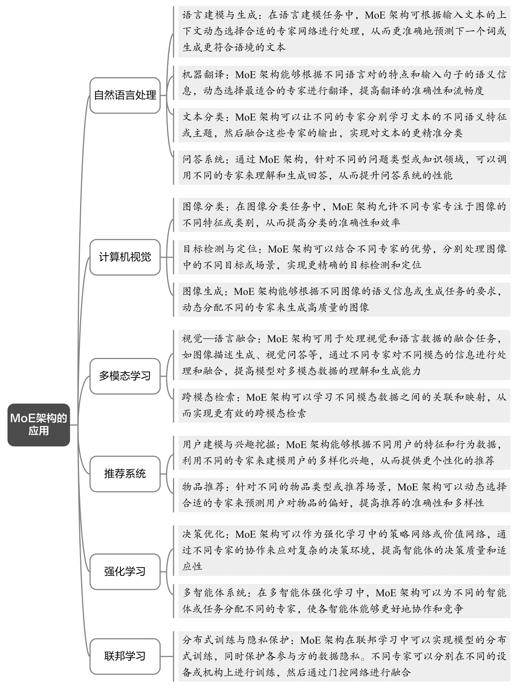

图 3-8

稀疏激活带来推理提速。在参数规模不变的前提下，只有被点亮的专家参与计算，实际算力大幅下降，推理比同等规模的稠密模型更快。

负载均衡被单独优化。DeepSeek 用负载均衡算法遏制了传统 MoE 训练时有的专家过载、有的闲置的问题，让训练效率更稳。

正是这些特性的协同，让 DeepSeek 系列在大规模预训练和下游任务上都表现突出，兼顾了性能与效率。

2. 工作流程

在 DeepSeek 里，MoE 的一轮处理大致走这几步。

（1）输入数据进入模型：文本被切成 Token，每个 Token 的表征送入 MoE 层。
（2）门控网络计算匹配得分：门控通过线性变换给每个 Token 与所有路由专家的契合度打分。
（3）选择 Top-K 专家：按得分挑出最匹配的路由专家，DeepSeek-V3 里通常是 8 个。
（4）专家处理与加权聚合：入选专家各自用轻量级前馈网络类似 Transformer 的 FFN 处理 Token，输出按门控权重加权合并，再与共享专家的结果融合，形成本层最终表征。
（5）负载均衡策略：为防止负载倾斜，采用辅助损失约束 Token 分配的均匀性，并用容量因子限制单个专家的最大负载。

3.5 归一化：让训练更稳更快

归一化分为数据层面和参数层面。前者把输入缩放到统一范围消除量纲差异，后者调整参数分布避免梯度爆炸或消失。DeepSeekMoE 选用 RMSNorm 取代了传统的 LayerNorm。

### 3.5.1 归一化能带来什么？训练更稳

（1）加速收敛
◎ 统一尺度：把数据或参数拉到同一量纲，避免某些特征主导优化。比如 Z-Score 把数据变成均值 0 标准差 1 的分布，收敛更快。
◎ 稳定梯度：归一化后分布更均匀，梯度波动变小。LayerNorm 在每个样本内部归一化隐藏层激活，梯度流动更平稳。

（2）提高泛化能力
◎ 减少过拟合：输入更标准化，模型不易死磕训练集细节。BatchNorm 在小批量上归一化，提升对分布变化的鲁棒性。
◎ 增强泛化：统计特性更一致，见过的新数据也能更好处理。RMSNorm 用均方根归一化激活，降低对输入敏感度。

（3）简化训练
◎ 减少超参数调节：对学习率等依赖降低。LayerNorm、RMSNorm 直接归一化激活，减少精细调参需求。
◎ 提高稳定性：尺度差异和梯度震荡被压制。BatchNorm 缓解内部协变量偏移，训练更容易收敛。

（4）适应不同分布
◎ 增强鲁棒性：多任务或迁移学习中，归一化让来自不同源的数据更一致。
◎ 提升适应性：面对新分布时，模型能更快上手。

（5）降低计算复杂度
◎ 减少数值问题：Min-Max 缩放到 [0,1] 或 [-1,1] 可避免溢出下溢。
◎ 提高效率：分布均匀后冗余计算减少。RMSNorm 只做均方根归一化，计算开销更小。

### 3.5.2 LayerNorm：经典归一化全解析

LayerNorm 在每个样本内部对整层激活做归一化，是深度学习里的常用做法。

1. 归一化过程
（1）计算均值和方差：对输入向量 x=[x[1],x[2],…,x[H]]，算出均值 μ[L] 和方差 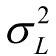 公式为
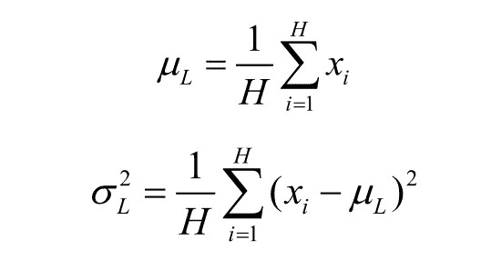
（2）归一化：用均值方差做标准化，公式为
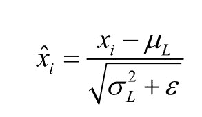
其中 ε 是极小常数，防止除零。
（3）应用可学习的缩放和平移：归一化后引入可学习参数 γ 和 β 做缩放和平移，公式为
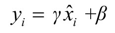
γ、β 通常初始化为 1 和 0，增加灵活性。

2. LayerNorm 的优点
◎ 加速收敛：样本内归一化减少层间尺度差异，梯度更平稳，优化更快。
◎ 提高训练稳定性：输入分布更稳定，缓解内部协变量偏移。
◎ 增强泛化：输入更标准化，减少过拟合，新数据泛化更好。
◎ 减少超参数调整：对学习率不敏感，调参负担下降。

3. LayerNorm 的缺点
◎ 计算开销较大：每层都要算均值方差，在大模型上影响训练速度。
◎ 对特征区分能力有限：把不同特征一起归一化，差异大的特征可能被抹平，比如图神经网络中节点特征区分受损。
◎ 部分任务效果不明显：在 CNN 处理图像时，对块间亮度对比保留不足，可能产生伪影。

总体来看，LayerNorm 仍是现代模型的基石之一。

### 3.5.3 RMSNorm：更轻的归一化方案

RMSNorm 只用均方根统计缩放，省去均值计算，计算量明显下降，在长序列 Transformer 上表现很好。

公式为

其中 w 为可学习参数，ε 防止除零。

RMSNorm 与 LayerNorm 的对比见表 3-1
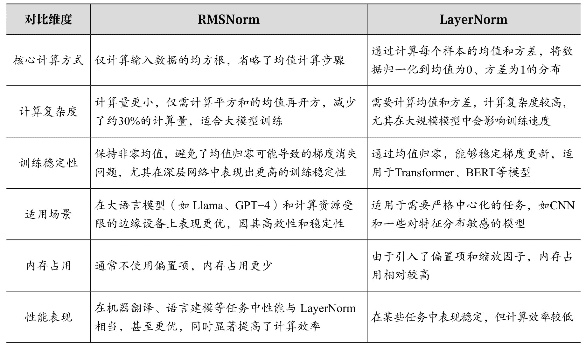

RMSNorm 通过简化提升了效率和稳定性，适合大模型与资源受限场景；LayerNorm 用均值归零提供更稳定的梯度，适用面更广。

3.6 多令牌预测：推理提速的新思路

多令牌预测 MTP 不只猜下一个 Token，而是同时预测多个未来 Token，提升训练信号密度，增强上下文理解。

### 3.6.1 实现方式与核心价值

1. 技术实现
（1）架构设计
◎ 主模型与 MTP 模块：主模型负责基础下一个 Token 预测，配合多个顺序模块。每个 MTP 模块含共享嵌入层、共享输出头、一个 Transformer 块和投影矩阵。
◎ 输入与输出：第 i 个输入 Token 在第 k 个预测深度，将其在 k-1 深度的表征与第 i+k 个 Token 的嵌入线性投影后送入第 k 深度 Transformer 块，得到输出，再经共享输出头得到第 k 个额外预测 Token 的概率分布。
◎ 共享机制：嵌入层和输出头与主模型共享，降低内存占用。
（2）训练目标
◎ 多层次模块预测：每个位置预测多个未来 Token，信号更密。
◎ 优化训练目标：更好地规划表征，预测更准。
◎ 损失函数：每个预测深度算交叉熵，平均后再加权，形成额外训练目标。
（3）推理优化
◎ 丢弃 MTP 模块：推理时可直接去掉 MTP 模块，主模型独立运行，减少开销。
◎ 推测性解码：MTP 模块可复用于推测性解码，进一步降低生成延迟。

2. 核心价值
◎ 提高数据利用效率：每个训练步学习更多信息，上下文理解增强。
◎ 提升推理速度：并行预测多个 Token，减少解码等待，生成更快。
◎ 增强长期连贯性：提前规划表征，让长文本更连贯。

### 3.6.2 DeepSeek 里的落地实践

（1）训练阶段
MTP 作为额外目标加入，让模型在每个位置预测多个未来 Token，提升利用效率和预测力；优化目标使表征规划更合理。
（2）推理阶段
推理时可丢弃 MTP 模块，主模型单独运行；也可把 MTP 重新用于推测性解码，加快速度。
（3）优化策略
DeepSeek-V3 共享嵌入和输出头减少内存；DeepSeek-R1 进一步加入跨层深度残差连接、自适应预测粒度、深度感知损失加权、基于深度的路由等策略。

3.7 并行策略：榨干性能的系统设计

DeepSeek-V3 结合多种并行方式，充分利用算力，降低训练成本。

### 3.7.1 专家并行：稀疏模型的并发调度

专家并行是 MoE 的关键。由于每层 256 个专家仅激活 8 个，需要大批量保证每个专家有足够输入。

◎ 预填充阶段：采用 EP32，每个部署单元 4 个节点，每张 GPU 管 9 个路由专家和 1 个共享专家。
◎ 解码阶段：采用 EP144，每个部署单元 18 个节点，每张 GPU 管 2 个路由专家和 1 个共享专家。
◎ 通信优化：用双批次流水线算法交替计算与通信，隐藏跨节点延迟。

### 3.7.2 流水线并行：让层与层无缝衔接

流水线并行把模型分块分配到不同计算单元。DeepSeek-V3 用 16 路流水线并行。

◎ 双向流水线算法：前向和后向的计算与通信完全重叠，减少气泡。
◎ 调度机制：在 8 个流水线等级、20 个微批次下，计算与通信重叠，资源利用更充分。

### 3.7.3 数据并行：大规模训练的助推器

数据并行把数据切分到多计算单元。DeepSeek-V3 采用 ZeRO-1。

◎ 内存优化：ZeRO-1 降低显存占用，无需昂贵的张量并行也能高效训练。
◎ 负载均衡：大规模专家并行加数据并行需要精细分配，DeepSeek 通过专家分配和节点内复制保证每张 GPU 计算通信均衡。

综合专家并行、流水线并行和数据并行，DeepSeek-V3 实现了高效的资源利用与性能提升。

3.8 混合精度与量化：训练效率的加速器

混合精度训练把 FP32 高精度与 FP16 低精度结合起来用，在压低计算成本和显存占用的同时把模型精度稳住，训练速度因此被大幅拉升。量化则是把权重和激活值从浮点转为低比特整数例如 INT8 的做法，用来缩小存储体积、简化计算，从而让推理更快。

### 3.8.1 混合精度训练：兼顾速度与显存
混合精度训练是在模型训练时混用不同精度数值的技术，核心目标是降本增效又不丢精度。下面展开说明。

**1. 运作思路**
精度的动态切换是关键。前向和反向时常用半精度 FP16 来算，速度更快、占显存更少；梯度累加和权重更新则切回单精度 FP32，保证数值稳定。为避免 FP16 下溢上溢，会用梯度缩放，先把梯度放大做反向，更新权重前再缩回。

**2. 落地方式**
主流框架都已内置支持。PyTorch 通过 torch.cuda.amp 提供的 autocast 上下文管理器配合 GradScaler 就能开箱即用；TensorFlow 则有 tf.keras.mixed_precision 模块实现类似效果。

**3. 主要收益**
◎ 计算更快：FP16 相比 FP32 计算吞吐更高，整体训练被加速。
◎ 显存更省：FP16 仅用 FP32 一半空间，可训更大模型或开更大 batch。
◎ 开销下降：算力和存储需求同步降低，在大规模分布式场景下优势更明显。

### 3.8.2 量化策略：让模型更轻更快
量化指把权重和激活从浮点转为定点，如 8 位整数，以换取更小体积和更快推理。DeepSeek 在这条路上做了多套组合拳。

**1. 混合精度训练与量化感知训练**
DeepSeek-V3/R1 同时使用 FP16+FP8 的混合精度训练降低单次计算负担，并配合量化感知训练 Quantization-Aware Training 缓解精度损失。另引入 SmoothQuant 对离群值做平滑，优化量化效果。

**2. INT8 量化**
DeepSeek-R1 的开源原生权重为 FP8，在推理时用等宽的 INT8 替代，保持吞吐的同时控制精度下滑。量化过程采用分块量化和通道量化两种手段，推理吞吐得到明显提升。

**3. 动态量化与静态量化**
动态量化在推理时实时调整缩放因子，适合需要灵活度的场景；静态量化在训练后把缩放因子固定，更稳定，适合对精度要求一致的部署。

**4. 分层量化**
根据层特性差异化处理。MoE 层使用 W8A8-Dynamic 量化，MLA 层使用 W8A8 量化，通过混合量化策略整体调优。

**5. 校准与优化**
通过更新业务校准集做 Label-Free 量化，进一步提效。也支持训练后量化，对已训练模型直接压缩。

总体来看，这些量化手段在保持精度的前提下提升了推理效率和硬件适配性。

## 3.9 显存优化与结构共享：榨干每一块显存
DeepSeek-V3 采用指数移动平均 EMA 的显存优化思路，利用异步处理和显存卸载，让 EMA 参数占用大幅下降。EMA 通过指数加权平均平滑训练噪声，得到更稳、泛化更好的参数。

### 3.9.1 EMA 优化
**◎ 异步处理：**EMA 计算与前向反向解耦并行进行，不依赖训练的即时数据，计算可以后台异步跑。
**◎ 显存卸载：**EMA 计算从 GPU 移到 CPU，必要时才把参数传回 CPU，更新后的 EMA 参数常驻 CPU 内存，减少 GPU 压力。

两项优化让训练期 EMA 的显存占用明显下降。

### 3.9.2 头尾参数共享
DeepSeek-V3 让 embedding 层与 lm_head 层共用同一权重矩阵。
**◎ 压缩存储：**避免重复存两份权重，参数存储需求下降。
**◎ 显存释放：**共享后梯度、优化器状态、参数备份等占用同步减少，显存受限时可训更大规模。
**◎ 稳定性提升：**统一的 Token 表示有助于学习更稳健的表征，性能和泛化能力随之提高。

# 第四章 DeepSeek 工作原理全解：生成与安全
DeepSeek 融合 Transformer 架构与概率生成模型，以逐词生成实现流畅输出。每一步都基于上下文预测下一个词的概率分布，并用多样采样在创新性与合理性之间取舍。架构上持续优化扩展性与适应性，流式输出和响应体验因此得到保证。

## 4.1 逐词生成：输出全过程
DeepSeek 通过不断预测并输出最可能的下一个词，逐步构建连贯文本。生成时实时解析上下文，用概率模型评估各词可能性，择优输出，保证语法与创造性兼备。自回归机制支持流式返回，交互更即时。

### 4.1.1 文本生成的基本机制
基于 Transformer 与预训练，DeepSeek 以逐词生成产出自然文本。具体流程如图 4-1 所示。

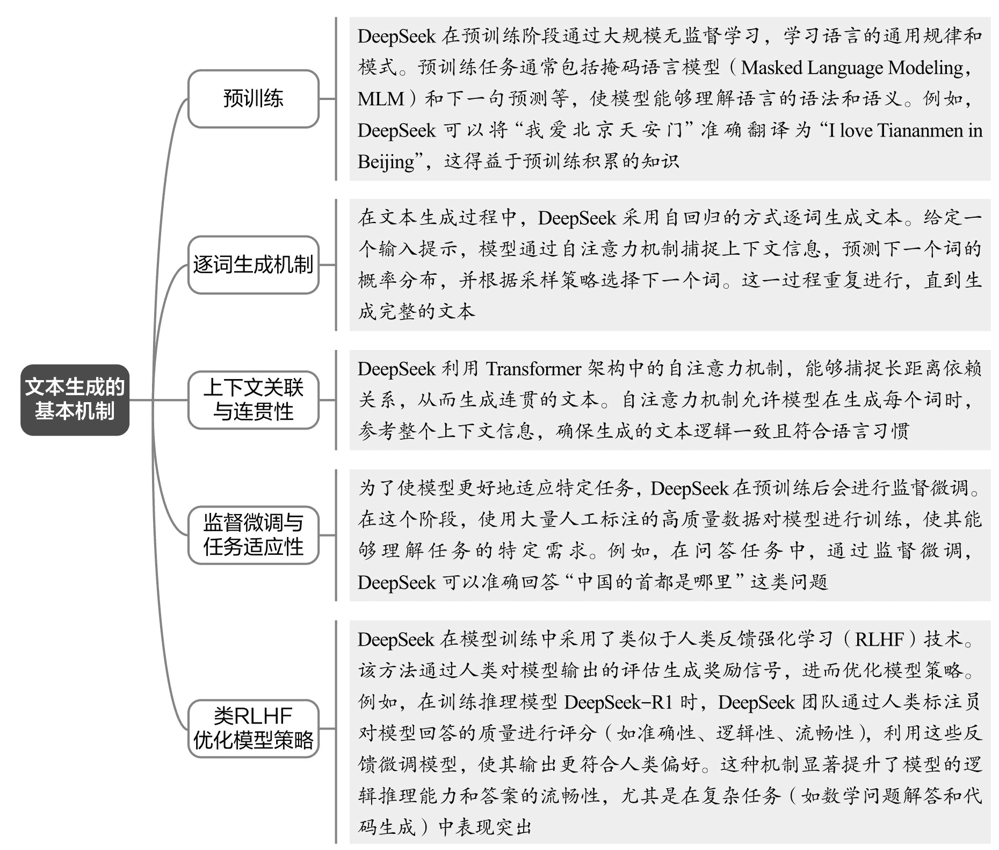

图 4-1

总体而言，机制融合了预训练、逐词生成、上下文关联与连贯性、监督微调与任务适配、类 RLHF 优化等手段，使生成文本质量高、符合人类预期，广泛用于 NLP 场景。

### 4.1.2 上下文关联与逐词生成
**1. 上下文关联**
自注意力机制让模型在生成每个词时参考整段上下文，保证逻辑连贯。例如生成“今年春节的天气真的好冷”时，“真的”会结合前面“今年春节的天气”来决定后续词。

**2. 逐词生成**
给定提示，模型通过自注意力捕捉上下文，预测下一个词的概率分布，按采样策略选取，循环直至结束。DeepSeek 在此基础上引入多令牌预测 MTP。与单令牌预测 STP 逐个输出不同，MTP 可一次预测多个 Token，提升效率。生成“今年春节的天气真的好冷”时，MTP 可并行预测多个词，减少步数。

实现要点：
◎ MTP：级联式结构，多模块串行预测，保留因果语言模型特性，利于效果。
◎ 长上下文扩展：DeepSeek-V3 分两阶段把上下文从 4K 拉到 128K，长文本表现显著提升。
◎ 优化自注意力：采用改进多头潜在注意力 MLA，通过低秩压缩降复杂度，保持高性能。

### 4.1.3 流式输出与响应速度
**1. 流式输出**
文本生成时逐词或逐句实时返回，而非等完整结果，交互体验更好。推理任务可逐步呈现中间过程与结论。

**2. 响应速度表现**
◎ 首 Token 延迟：官方平均约 7.753 s，相对偏高；火山引擎约 1.01 s，优势明显。
◎ 推理速度：官方 21.72 tokens/s，火山引擎 35.50 tokens/s。
◎ 生成速度：官方 22.06 tokens/s，火山引擎 37.76 tokens/s。
◎ 总体生成速度：官方 17.36 tokens/s，火山引擎 33.01 tokens/s。

**3. 影响因素**
◎ 硬件条件：DeepSeek-V2 在单节点 8 卡 H800 上可达超 50000 tokens/s吞吐，依赖特定硬件。
◎ 模型算法：MTP 等优化提升速度，但复杂任务仍受算法开销影响。
◎ 数据量与类型：推理与内容生成的响应差异明显。

总体来看，流式机制提升实时感，但首 Token 延迟和整体速度仍有提升空间。

## 4.2 概率模型：如何产出有意义文本
概率模型先把上下文映射到高维向量，再用 Softmax 计算候选词概率，按采样或贪心策略挑选，逐步构建合语法且语义连贯的文本。

### 4.2.1 概率分布与预测机制
采用双引擎架构：概率推理引擎与确定性规则引擎协同工作。

**1. 核心架构**
**（1）概率推理引擎**
基于深度学习学习概率分布。数据驱动、输出概率而非单一答案、任务通用、端到端可优化。
**（2）确定性规则引擎**
基于符号逻辑与规则库，推理严格可解释，适合需要逻辑确定性的任务。

**2. 概率计算与预测**
**（1）MTP**
DeepSeek-V3 在每次训练推理中同时预测当前 Token 与后续多个 Token，设计联合概率损失，共享嵌入层、输出头与 Transformer 块，提升效率。
**（2）动态注意力窗口调节**
根据输入复杂度自适应调节注意力窗口 32~512 Token，优化计算分配。
**（3）不确定性量化**
输出置信度 0~1，帮助判断结果可靠性。

**3. 预测优化**
◎ 条件概率森林：256 棵决策树集成，每棵对应不同推理维度。
◎ 语义熵评估器：实时计算输入语义模糊度 0~1，辅助处理模糊信息。
◎ 注意力路由算法：按任务复杂度分配资源，省电模式能耗降约 40%。

**4. 优势**
处理非结构化数据、泛化能力强、MTP 提升生成与推理效率。

**5. 应用**
数学推理与法律逻辑推理均表现良好，概率与规则引擎配合实现可靠预测。

### 4.2.2 采样方法与文本多样性
DeepSeek 通过多种采样控制多样性与创造性，方法与应用如图 4-2 所示。

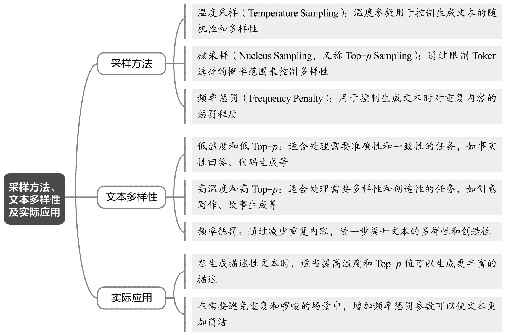

图 4-2

灵活的采样与多样性控制使其能产出高质量、多样文本，满足复杂需求。

### 4.2.3 生成控制机制与调优策略
**1. 生成控制**
**（1）长度控制**
通过 max_length 与 min_length 限制最长最短，避免过长或过早结束。
**（2）截断机制**
按长度截断或按特定标记如句号、换行符截断。
**（3）停止词**
指定停止词列表，遇到即终止，适合生成标题、摘要等格式化文本。

**2. 调优策略**
**（1）学习率调度**
线性衰减、余弦衰减、分段常数衰减，适配不同训练阶段。
**（2）批量大小调整**
小批量适合显存受限，大批量加速但可能影响泛化。
**（3）网络结构优化**
调整 Transformer 层数、改变隐藏层维度，平衡复杂度与表达力。
**（4）正则化技术**
防止过拟合，提升泛化。

**◎ 随机丢弃法：**训练时随机把部分神经元暂时关掉，让模型不要过分依赖单一路径，从而提升泛化表现。

**◎ L2 正则化：**给权重大小加上惩罚项，约束参数不要长得过大，降低过拟合风险。

**◎ 早停机制：**观察验证集上的表现，一旦指标不再提升就终止训练，避免在噪声上继续拟合。

**（5）超参数搜索**

DeepSeek 内置了自动化的超参搜索能力，能在不耗费太多人力情况下找到比较理想的参数组合。

**◎ 随机搜索：**在设定的搜索空间里随机抽样，快速探索不同组合。

**◎ 贝叶斯优化：**利用贝叶斯方法动态调整采样方向，让搜索过程更聪明、更高效。

**◎ 网格搜索：**把预设组合全部遍历一遍，适合搜索范围不大的场景。

**3. 实际应用中的调优策略**

落地时参数会随任务目标微调。

**（1）对于需要高准确性的任务（如代码生成、事实性回答）：**温度调低，比如 0.1；Top-*p* 也调低，比如 0.2；同时加大正则化力度，防止过拟合。

**（2）对于需要高创造性的任务（如创意写作、故事生成）：**温度提高，比如 1.0；Top-*p* 提高，比如 0.9；适度放宽正则，让模型更灵活。

**（3）对于长文本生成任务：**拉大最大长度上限，优化截断逻辑；调整学习率调度，保证长时间训练仍能稳定收敛。

总体来看，DeepSeek 靠生成控制与训练调优的组合拳，让文本质量与多样性兼顾，训练和推理效率也随之提升，为复杂场景提供了可用的解决方案。

## 4.3 性能加速与效率突破

DeepSeek 系列比如 DeepSeek-V2、DeepSeek-V3、DeepSeek-R1 等都采用了 MoE 架构，大幅提升了算力利用率。配合 MTP 机制，模型一次能预判多个连续 Token，减少生成轮次，推理速度与整体效率明显提高。

### 4.3.1 硬件提速与分布式训练方案

在硬件加速与分布式训练上，DeepSeek 做了多层优化。

**1. 硬件加速**

**◎ PTX 汇编语言优化：**用 PTX 这类面向 NVIDIA GPU 的底层语言对核心算子手工调优，减少无效计算，提升执行效率。

**◎ FP8 混合精度训练：**引入 FP8 框架，计算与存储都用 FP8，显存占用下降，训练更快。

**◎ KV 缓存优化：**对 KV 缓存进行重构，显存压力降低，推理性能提升。

**◎ 与硬件对齐的稀疏注意力机制：**采用原生稀疏注意力，针对现代硬件定制，加速推理、降低预训练成本，性能不打折扣。

**2. 分布式训练**

**◎ 大规模计算集群架构：**例如 DeepSeek-V3 的训练集群由 2 048 块 NVIDIA H800 GPU 组成，节点内部用 NVLink 和 NVSwitch 高速互联，节点间用 InfiniBand 实现大带宽通信。

**◎ 并行策略：**DeepSeek-V3 同时使用 16 路流水线并行、跨 8 节点的 64 路专家并行，以及 ZeRO-1 数据并行。

**◎ 双向流水线并行（DualPipe）算法：**缓解流水线气泡，让计算与通信重叠，通信开销大幅下降。

**◎ 跨节点通信优化：**自研全对全通信内核，充分发挥 InfiniBand 与 NVLink 带宽，降低到 SM 的资源占用。

**◎ 内存优化：**精细化内存管理，训练时内存占用更可控，能在有限资源下训更大模型。

总体而言，硬件加速与分布式策略协同，让训练更快、推理更顺，同时把算力成本压下来，也为大规模预训练提供了坚实支撑。

### 4.3.2 模型瘦身与轻量化

压缩与轻量化目标是减少存储与计算需求，同时尽可能保留效果，让模型能在资源受限设备上流畅运行。DeepSeek 的压缩技术路线如图 4-3 所示。

总的说，轻量化手段让模型体积变小、延迟降低，部署门槛明显下降。

### 4.3.3 推理提速与实时响应

推理优化主要围绕速度与实时性展开。

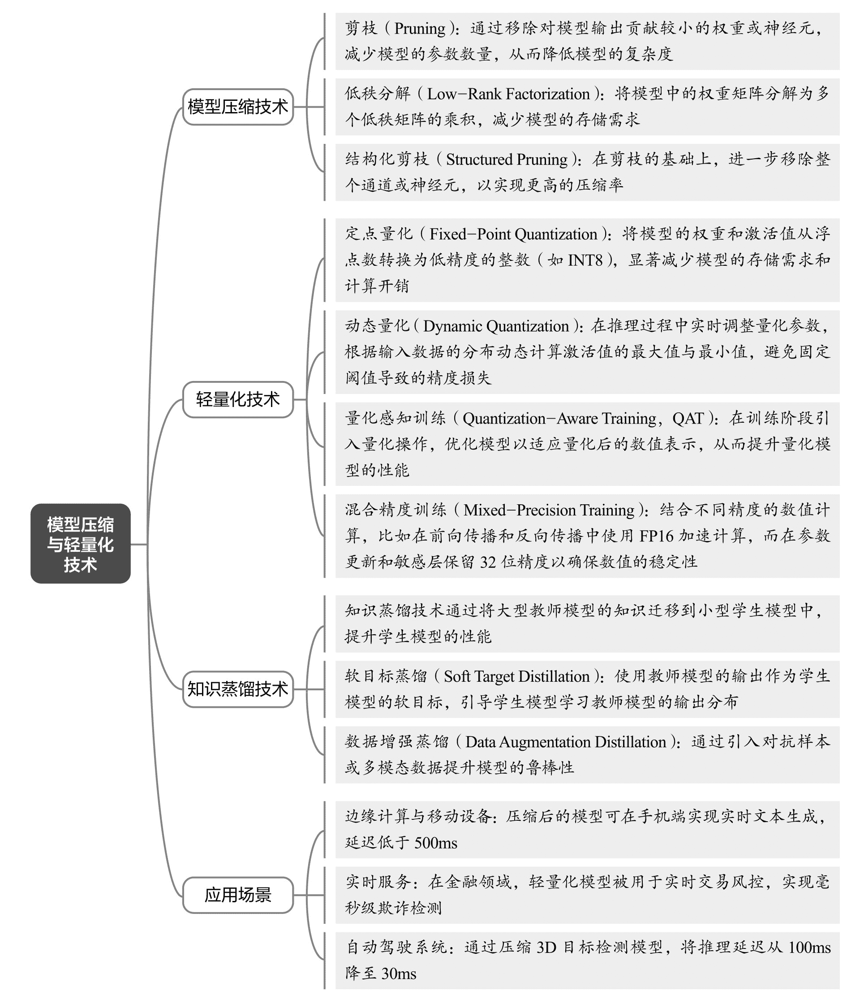

图 4-3

**1. 推理优化技术**

**（1）量化部署**

**◎ TensorRT 适配：**用 NVIDIA TensorRT 做量化部署后，推理速度显著提升，显存占用明显下降。实测在 A100 上速度提升数倍，显存省下数十个百分点。

**◎ OpenVINO 适配：**面向英特尔硬件，通过 OpenVINO 优化，利用 CPU 的 AVX 指令集和 VPU 特性，延迟降低、吞吐提升。酷睿 i9 上延迟减少数十毫秒，吞吐提升数个百分点。

**（2）MTP**

MTP 让模型一次预测多个位置的 Token，减少推理步数，加快生成，同时更好地捕捉 Token 间依赖。

**（3）知识蒸馏**

把大教师模型的知识迁移到小学生模型，保持低成本的同时接近原模型效果。优化后小模型可达教师模型 95% 以上的表现。

**（4）硬件加速**

**◎ GPU 平台上，**借助 TensorRT，DeepSeek 实现极高并行效率。

**◎ CPU 平台上，**借助 OpenVINO，充分发挥英特尔 CPU 指令集优势。

**◎ NPU 平台上，**通过算子融合与内存管理优化，推理延迟明显下降。

**2. 实时性表现**

**◎ 金融领域：**实时解析市场数据、新闻与社交动态，为交易员提供即时洞察。

**◎ 零售业：**实时分析销售与库存，帮助商家快速调整价格与补货策略。

**◎ 智能安防领域：**在移动端优化后可实时处理监控视频，完成目标检测与识别。

**3. 性能提升效果**

**◎ 推理速度：**量化与优化后，GPU 与 CPU 端分别提升数倍与数十个百分点。

**◎ 能耗降低：**NPU 上能耗仅为 CPU 的几分之一，移动设备续航更长。

**◎ 模型体积：**量化与剪枝后体积大幅缩小，精度保持较高水平。

总的来看，量化部署、MTP、蒸馏与硬件适配让推理更高效，能在资源受限场景下满足金融、零售、安防等对实时性的严格需求。

## 4.4 安全可信与稳健运行

安全性与可靠性是落地前提。提升可解释性与透明度让人能看懂决策过程；检测并削弱偏见让模型更公平；增强鲁棒性与防护能力抵御对抗攻击与数据泄露风险。

### 4.4.1 可解释性与透明度提升

DeepSeek 采取多项举措打破大模型的黑盒感，让决策过程更清晰。

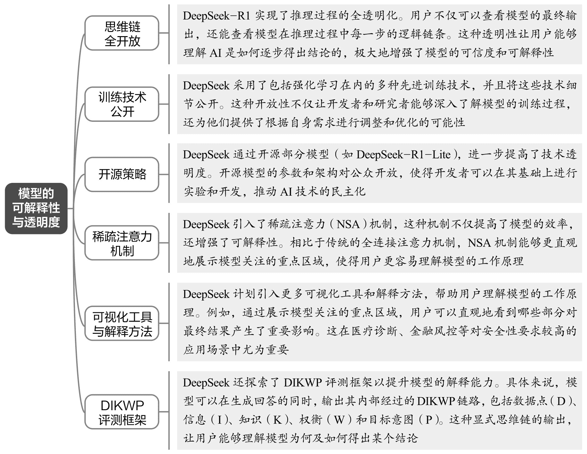

图 4-4

总体而言，思维链全开放、训练细节公开、开源策略、稀疏注意力与可视化工具共同提升了可解释性与透明度，增强信任，也为广泛应用打下基础。

### 4.4.2 偏见治理与公平性保障

**1. 偏见检测方法**

**◎ 统计均等：**看不同群体获得推荐的数量是否均衡。

**◎ 机会均等：**看各群体获得正面推荐的概率是否一致。

**◎ 预测均等：**看不同组别在被推荐后的满意度或参与度是否有明显差距。

**◎ 差异影响：**评估模型输出对不同群体的影响是否差异显著。

**2. 减少偏见的策略**

**（1）数据预处理**

**◎** 使用覆盖多元群体的多样化数据集，减少数据偏差。

**◎** 做数据去标识化，移除个人标识，兼顾隐私与公平。

**◎** 通过合成、插值、过采样等增广手段，提升少数群体样本比例。

**（2）模型训练阶段**

**◎** 引入公平性约束优化，把公平指标纳入目标函数。

**◎** 使用对抗训练，降低模型对特定敏感特征的依赖。

**◎** 增加正则项，限制模型在某些特征上的过度权重。

**（3）后处理调整**

**◎** 在推荐列表生成后做算法校准，确保输出符合公平标准。

**◎** 采用公平后处理方法，如平等机会后处理。

**3. 持续监控与迭代**

公平是持续过程。定期评估公平指标，保证各群体表现一致；根据用户反馈与社会变化动态调整数据与优化目标。

**4. 实际应用案例**

**◎ 金融领域：**借助公平优化，降低不同收入群体在信贷评估中的偏差。

**◎ 招聘系统：**通过预处理与后处理，让不同性别、种族的候选人获得更公平的机会。

综合来看，检测与治理手段配合数据、训练与后处理，能有效削弱偏见，提升各群体一致性。

### 4.4.3 鲁棒性与安全防护

**1. 鲁棒性增强**

**◎ 优化注意力机制：**改进 Transformer 注意力，降低复杂度，提升长文本建模与参数效率，复杂任务更稳。

**◎ 轻量化部署：**降低硬件依赖，增强在工业等复杂环境下的适应性。

**◎ MTP 机制：**多 Token 同时预测，减少推理步数，提升鲁棒性。

**◎ MoE 架构：**模型拆分为多个专家子模型，各司其职，提升泛化与抗扰动能力。

**2. 安全性保障**

**◎ 隐私保护：**涉及敏感信息时进行加密处理，守护用户隐私。

**◎ 安全检测与监控：**严格安全审查防滥用，建立实时监控及时纠偏。

**◎ 伦理与合规性：**参与行业伦理规范制定，用公平数据与算法避免偏见。

**◎ 透明度与可解释性：**实时展示推理过程，增强可信度，便于监管合规。

**3. 持续监控与优化**

定期评估鲁棒性与安全指标，确保不同环境下表现稳定；结合反馈与社会变化动态调整训练数据与目标。

整体上，注意力优化、轻量化、MTP 与 MoE 增强了鲁棒性；隐私、安全检测、伦理与透明度则筑牢了安全防线，为复杂环境应用提供保障。

# 第五章 DeepSeek 内核解码：智能思维引擎

DeepSeek 内部融合了先进架构与训练策略，实现高效 NLP。核心是 Transformer 与自注意力，捕捉长距离依赖，保证文本连贯一致。生成时靠精心设计的算法维持逻辑连贯，推理机制支持多步思考，基于已有信息推断，模拟人类思维。各项机制协同，使其在多样场景下提供高质量生成与语义理解。

## 5.1 词嵌入与向量空间

通过把词映射到高维向量空间，DeepSeek 能捕捉语义关联。

### 5.1.1 词向量核心概念

**1. 词向量的定义**

把单词或短语转为数值向量，每个词对应固定长度向量，维度编码不同特征。模型据此处理文本并捕捉语义与语法关系。

**2. 词向量的主要生成方法**

主要方法如图 5-1 所示。

**3. 词向量的特性**

**◎ 语义相似性：**向量余弦相似度可衡量语义相关性，含义相近的词在空间中更靠近。

**◎ 上下文相关性：**如 BERT 这类嵌入会随上下文动态变化，例如“苹果”在“苹果手机”与“苹果树”中向量不同。

**◎ 维度：**是超参数，常见 100、200、300。维度越高表征能力越强，成本也越高。

**4. 词向量的应用**

**◎ 文本分类：**把文本转数值，用于情感分析、主题分类等。

**◎ 机器翻译：**捕捉源语与目标语词间语义对应。

**◎ 问答系统：**匹配问题与答案的语义相似度，提升准确率与效率。

**◎ 文本生成：**辅助模型生成语义连贯内容。

**5. 词向量的局限性**

**◎ 词汇表大小：**依赖预定义词表，对 OOV 无法直接生成向量。

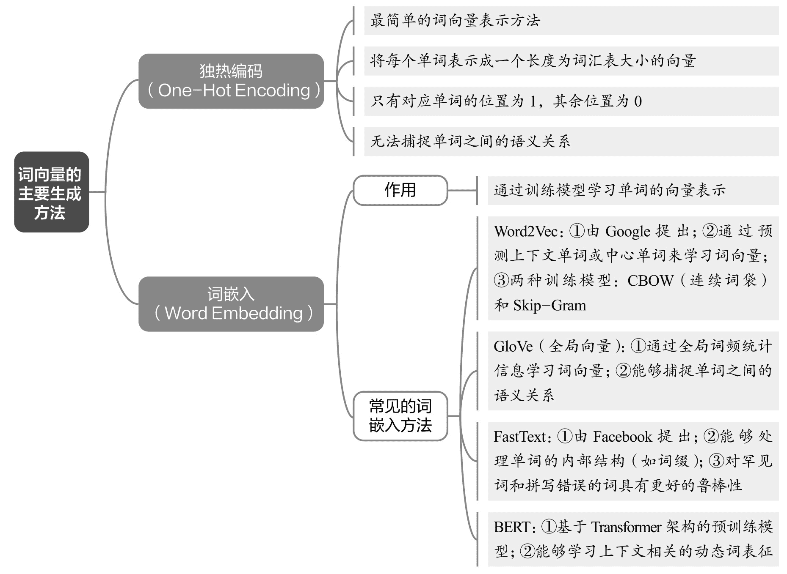

图 5-1

**◎ 上下文无关性：**Word2Vec、GloVe 等生成的向量不随上下文变化，难以表达一词多义。

**◎ 计算成本：**高维向量与大词表会增加计算与存储负担。

总体来看，词向量是 NLP 的基石，通过高维映射捕捉语义与语法，广泛用于分类、翻译、问答与生成等任务。

### 5.1.2 嵌入层工作原理

嵌入层负责把输入文本转为模型可处理的数值向量。

**1. 输入处理：文本分词与嵌入**

**（1）分词**

DeepSeek 编码与推理全解析

DeepSeek 在接收到输入后，首先会把整段文字拆解成若干最小的处理单元 Token。Token 的粒度取决于分词器的设计，可能是完整的词、拆分后的子词，也可能是单个字符。拆分完成后，每个 Token 会对应词表里的一个唯一编号，为后续建模做准备。常见的分词策略包含下面几种。

◎ 单词语分词：适用于英文这类以空格自然分隔的语言。
◎ 子词分词：代表是 BPE 或 WordPiece，能有效应对新词、错拼词等未登录词。
◎ 字符级分词：在特定语言或特殊任务中发挥作用。

（2）嵌入
DeepSeek 的嵌入层由文本嵌入、位置嵌入和模态嵌入三个部分构成。文本嵌入把 Token 投影到低维向量空间；位置嵌入借助 RoPE 对位置信息编码后，与文本向量做相加，而不是拼接；模态嵌入则通过专用编码器把非文本数据映射到同一维度。三大分支融合后形成统一的表示向量，既保留语义、顺序，又实现跨模态对齐，为 Transformer 层提供统一入口。

2. 多头潜在注意力机制
嵌入层与多头潜在注意力 MLA 紧密协同，用以提升计算效率。核心思路是：

◎ 低秩压缩：利用下投影矩阵把 Token 特征压缩进更小的潜在空间，降低存储与计算负担。
◎ 还原与扩展：计算注意力时，借助上投影矩阵把潜在向量恢复到键 K、值 V 所需的空间。
◎ 位置编码处理：对 RoPE 等关键位置信息单独处理，保证时序和位置不丢失。

3. 嵌入层的优化
◎ 低秩压缩带来的直接收益是 K、V 的占用与推理缓存被压缩。
◎ MLA 在推理阶段所需 KV 缓存更少，内存开销相较传统多头注意力 MHA 下降约 5% 到 13%，同时性能更优。
◎ 通过改进的位置编码技术如 YaRN，上下文窗口可以被显著拉长，长文本泛化能力随之提升。

4. 嵌入层的应用
嵌入的输出既供给下游 Transformer，也通过 MLA 持续提供上下文信号。正是这种设计，让模型在长文本摘要、长篇小说翻译等对语义连贯性要求高的任务上表现稳定。

总的来看，DeepSeek 依靠高效分词、词嵌入与位置编码把输入转为数值向量，并配合 MLA 实现效率与长文本能力的双提升，从而在自然语言处理任务中兼顾效果与推理成本。

### 5.1.3 向量空间中的语义关系
在自然语言处理里，向量空间模型把文本映射为数值向量，用以量化词与词之间的语义关联。DeepSeek 通过架构与嵌入设计的配合，在向量空间中构建语义关系。

1. 嵌入层的作用
嵌入层是理解语义的基础设施。
◎ 词嵌入：每个词被映射到固定维度空间，训练过程中学到语义相近性。
◎ 位置嵌入：借助 RoPE 保留词序，使模型能区分位置差异。

2. MLA 机制
MLA 用于强化语义捕捉。
◎ 低秩压缩：下投影把 Token 特征压入低维潜在空间。
◎ 位置信息编码：采用解耦 RoPE，为查询 Q 与键 K 分别生成位置编码，再与上投影后的 Q、K 连接，保证每个注意力头都带位置信息。

3. 语义关系的应用
◎ 语义匹配：通过查询向量与文档向量的相似度计算，找到最相关的文档。
◎ 上下文理解：嵌入层与 MLA 能够动态生成上下文相关表示，更好地处理多义词与语境变化。

4. 优化与效率
◎ 降低计算开销：低秩压缩与位置编码优化在保持性能的同时减少算力与存储需求。
◎ 提升推理速度：优化后的嵌入与 MLA 减少推理缓存占用，加快响应。

总体而言，DeepSeek 以先进嵌入设计与 MLA 有效捕捉向量空间的语义关系，在提升理解力的同时优化效率。

## 5.2 语义理解与生成
该模块基于深度学习，实现对自然语言的深度理解与高质量生成。理解阶段借助自注意力捕捉上下文，解析语义结构；生成阶段依托编码后的语义信息逐词输出连贯合语法文本。双向能力使其在问答、对话生成等场景表现突出。

### 5.2.1 自然语言的语义理解基础
语义理解是让机器把握人类语言含义的核心任务，涵盖字面义、语境、逻辑与隐含意义。

1. 语义理解的关键要素
（1）词汇语义
◎ 词义消歧：判断多义词在具体语境中的义项，如“苹果”指水果还是公司。
◎ 同义词与反义词：识别语义相近或相反的词。
◎ 词义关系：包括上下位关系与部分整体关系。
（2）句法语义
◎ 句法分析：识别主谓宾等依存关系。
◎ 短语结构：理解名词短语、动词短语等构成。
◎ 依存关系：分析主谓、动宾等连接。
（3）上下文语义
◎ 上下文理解：同一表述在不同语境下含义变化。
◎ 语义角色标注：识别施事、受事、工具等角色。
◎ 指代消解：明确代词等指代对象。
（4）语义关系
◎ 相似性：通过余弦相似度衡量向量接近度。
◎ 关联性：衡量概念间的关联程度。
◎ 逻辑关系：因果、转折等句子间联系。

2. 语义理解的技术基础
（1）词向量
把词映射到高维空间以捕捉语义关联。
◎ Word2Vec：基于上下文预测学习表示。
◎ GloVe：基于全局词频统计学习表示。
◎ BERT：基于 Transformer 的预训练模型，生成上下文相关向量。
（2）Transformer 架构
通过自注意力处理序列，捕捉长距离依赖，成为现代 NLP 核心。
（3）预训练模型
在大规模语料上无监督学习通用规律。
◎ BERT：双向编码器。
◎ GPT：生成式解码器。
◎ DeepSeek：结合稀疏注意力和 MTP 技术优化，擅长长文本处理。

3. 语义理解的应用
（1）问答系统：理解意图并从知识库抽取答案。
（2）机器翻译：理解源语义并生成自然目标语。
（3）情感分析：判断文本情感倾向。
（4）文本分类：依据主题将文本归类。

总之，语义理解涉及词汇、句法、上下文与关系等多层面，依赖词向量、Transformer 与预训练模型实现，但多义性、上下文依赖与隐喻仍是挑战。

### 5.2.2 语义编码与信息捕捉
DeepSeek 通过先进架构、嵌入层设计与 MLA 机制实现语义编码与信息捕捉。

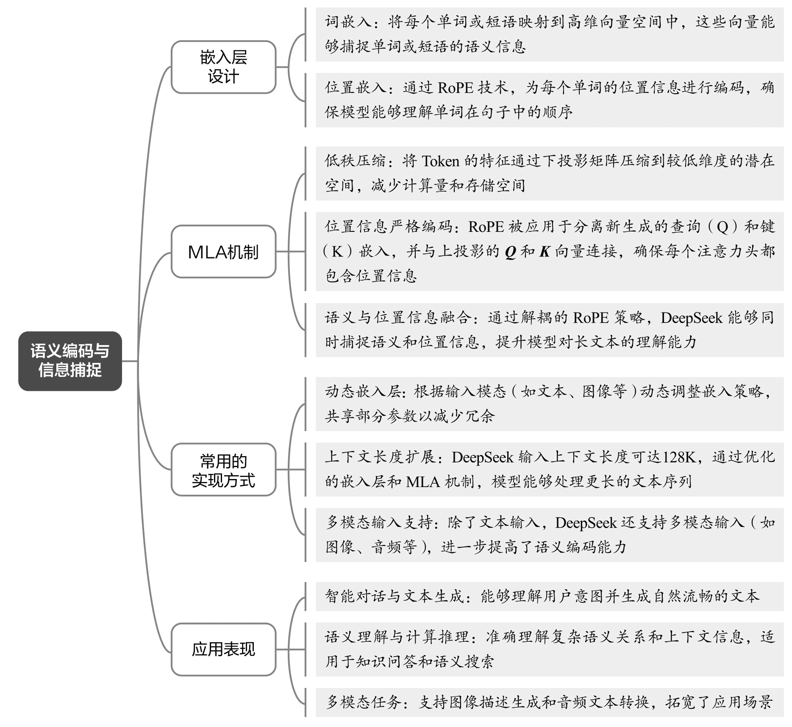

图 5-2

总体来看，嵌入层设计与 MLA 协同提升了自然语言理解能力，并在长文本与多模态任务中增强表现。

### 5.2.3 生成过程中的语义连贯性
1. 自注意力机制
基于 Transformer 的自注意力让模型在处理每个词时兼顾整句信息，捕捉更丰富的语义，避免 RNN 的梯度消失。实验显示，处理超 500 词的长文本时准确率仍可保持 95% 以上。
2. 多头注意力机制
多个注意力头分别关注词汇依赖、句法结构与语义关联，提升复杂语境理解。引入后，在涉及多实体与复杂逻辑的文本上理解准确率提升约 15%。
3. 位置编码与顺序信息
位置编码把绝对位置嵌入词向量，使模型在不依赖递归的情况下把握顺序。加入后，时间顺序或因果关系的文本理解准确率提高约 10%。
4. 动态上下文扩展
优化的嵌入层与 MLA 支持长达 128K 的上下文，利于长文本语义连贯与逻辑自洽。
5. 多模态语义融合
模型支持文本、图像、视频等多模态输入，通过跨模态特征融合形成统一语义表示，例如根据图像生成准确自然的描述。
6. 生成控制与调优
借助温度采样、核采样、频率惩罚等策略，可在保证连贯性的同时调节多样性与风格，适配不同场景。

综上，自注意力、多头注意力、位置编码、长上下文与多模态融合共同保障了生成过程的语义连贯性与自然性。

## 5.3 模型的决策过程
DeepSeek 的决策融合了深度学习与符号逻辑推理。面对复杂任务时，先收集并预处理文本、图像等多源输入，再由概率推理引擎与确定性规则引擎协同完成推理与决策，实现高效可靠的解决方案。

### 5.3.1 内部推理与链式思考机制
1. 链式思考机制
通过思维链把复杂问题拆解为有序中间步骤逐步求解，类似人类分步思考，提升准确性与可解释性。例如“小明有 5 个苹果，吃 2 个又买 3 个”会先算 5-2=3 再算 3+3=6。
2. 内部推理过程
依托 Transformer 与多头注意力，模型为“思考”预留格式空间，将问题、中间步骤与答案串联，形成类人慢思考。
3. 强化学习与多阶段训练
DeepSeek-R1 采用冷启动微调与推理导向的强化学习训练，能生成更长更复杂的推理链，在数学、编程与逻辑推理上表现突出。
4. 优势与应用场景
在数学竞赛、编程等任务中可给出答案并展示推导依据；即使标注数据稀少，仍能通过强化学习提升推理能力。
5. 性能表现
在 AIME 2024、MATH-500 等基准上取得优异成绩，推理过程透明可追溯，增强决策信任度。

总之，链式思考与内部推理显著提升了复杂任务的处理与可解释性。

### 5.3.2 决策权重与概率计算
DeepSeek 采用双引擎架构结合概率推理与确定性规则推理。
1. 双引擎架构
（1）概率推理引擎
基于深度学习与神经网络处理不确定性，输出概率分布。结合 Transformer 与概率图模型，采用 32~512 Token 自适应的动态注意力窗口与 0~1 置信度量化。
技术创新：
◎ 多维度推理：构建 256 棵决策树的集成学习器。
◎ 语义模糊度处理：实时计算 0~1 语义模糊度指标。
◎ 智能资源分配：按任务复杂度动态调配算力，省电模式下降低能耗。
（2）确定性规则引擎
基于符号逻辑与规则系统处理精确推理。
核心组件：
◎ Datalog 推理引擎，支持 2000 多条逻辑规则。
◎ 符号计算器，精度达 10^128 位。
◎ 规则库含 50 万条形式化表达式，覆盖法律、数学等领域。
突破性设计：
◎ 动态规则加载，按需调用子库，内存占用降低约 63%。
◎ 反事实验证层，支持 32 层嵌套条件判断。

**跨域映射：自然语言到形式逻辑的自动转换，准确率 92.7%**

**2. 动态路由算法**
不同任务下 DeepSeek 会用动态路由来挑选推理引擎，整体思路可归纳为三步。

**◎ 特征抽取：** 针对输入样本算出语义熵和逻辑深度两项特征。
**◎ 权重分配：** 结合语义熵与逻辑深度，为概率推理引擎和确定性规则引擎分别算出使用权重。
**◎ 加速支持：** 借助 NPU 进行运算加速，提升推理速度。

**3. 概率计算与决策权重策略**
在概率建模与决策加权层面，做法如下。

◎ MTP： 增加训练信号密度，提升数据利用率，模型能够提前规划表征，更准确预测后续 Token。
**◎ 交叉熵损失优化：** 分层计算交叉熵损失，再用权重系数汇总到总损失，改善训练效果。
**◎ 推理阶段的灵活性：** 实战推理时可按需决定是否启用 MTP 模块，基础模型也能单独完成常规推理。

**4. 应用场景与优势**

**◎ 数学问题：** 概率推理引擎与确定性规则引擎协同，能精准求解复杂数学题并给出完整推理链。
**◎ 法律逻辑推理：** 依托确定性规则引擎的严谨逻辑，能够妥善处理复杂的法律推理任务。
**◎ 响应时间优化：** 动态路由配合硬件加速，在保持高准确率的同时显著压缩推理延迟。

整体来看，双引擎架构结合动态路由，让概率推理与确定性推理有机融合。混合设计提升了复杂任务的推理能力，也增强了决策的透明与可解释。叠加优化后的 MTP 与灵活的推理策略，模型在多类场景中表现突出，适配力强。

### **5.3.3 输出修正与决策反馈**
输出修正与决策反馈是实现高效推理和精准决策的关键，具体如下。

**1. 输出修正机制**
通过多种手段修正输出，保证生成内容的准确与连贯。

**◎ 链式思考：** 采用链式思考，把复杂问题拆成有序的中间步骤逐步推导，最终得到答案。该方式既提升复杂任务推理，也让结果更易解释。
**◎ 多模态融合：** 支持文本、图像、音频等多模态输入，通过跨模态特征融合强化语义编码，提升对复杂语境的理解与生成文本的连贯性、准确性。
**◎ 知识蒸馏：** 用知识蒸馏训练小模型，让其继承大模型能力同时降低计算成本。例如由 R1 蒸馏得到的 32B 与 70B 模型，在多项指标上可对标 OpenAI o1-mini。

**2. 决策反馈机制**
决策反馈通过多通道实现，使模型能随用户反馈与环境变化动态调整。

**◎ 强化学习：** 训练阶段大量使用强化学习，通过与环境交互学习最优策略。如 R1 在极少标注数据下凭借强化学习显著提升推理能力。
**◎ 动态路由算法：** 根据输入语义熵与逻辑深度动态调节概率推理引擎与确定性规则引擎权重，使模型能按任务复杂度灵活选择推理路径，提升准确性与效率。
**◎ 用户反馈循环：** 内置用户反馈机制，通过实时监控与调整输出，确保生成内容符合用户预期。该闭环提升体验，也增强模型适应性与灵活性。

总的来看，借助链式思考、多模态融合、知识蒸馏与强化学习，构建了高效的输出修正与决策反馈体系。这些机制提升了复杂任务推理水平，并增强生成内容的准确性与连贯性。配合动态路由与用户反馈循环，模型能够按需灵活调整决策路径，保证输出符合期望。

# **第六章 DeepSeek 架构全解：大模型核心揭秘**

该体系作为大模型技术的前沿突破，创新设计将在本章系统展开：首先深度剖析基础 MoE 核心机制，随后详解升级版 DeepSeekMoE 的优化创新与 DeepSeek-V3 的整体设计；再探索多模态布局，呈现从 Janus 到 Janus-Pro 的演进及其视觉-语言融合关键技术。这些创新不仅构成性能基石，也为大规模推理与跨模态应用提供坚实基础。

## **6.1 探索网络结构：基础 DeepSeekMoE 剖析**
DeepSeekMoE 是一种新型 MoE 方案，目标是通过细粒度专家分割与共享专家隔离实现专家专业化。方案采用无辅助损失负载均衡策略和节点受限路由，确保训练与推理中不丢弃 Token，同时降低通信开销。此外，通过动态冗余策略与高效专家激活机制，进一步提高推理效率。

### **6.1.1 背景回顾**
DeepSeekMoE 提出的背景如图 6-1 所示。

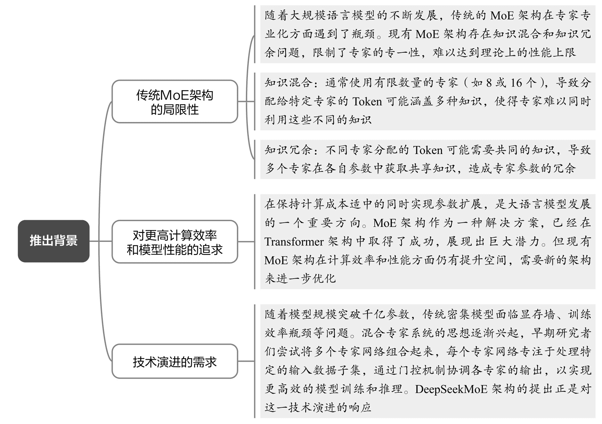

图 6-1

为应对图 6-1 所示挑战，研究组于 2024 年 1 月提出 DeepSeekMoE，旨在让混合专家语言模型的专家模块实现高度专业化。该方案依托细粒度专家分割与共享专家隔离两大策略，提升专家专业度与整体性能。

### **6.1.2 专家处理机制**
针对知识混合与知识冗余问题，提出 DeepSeekMoE。核心目标是在大规模扩展中平衡性能提升与计算成本。实现手段为两大关键策略：细粒度专家分割与共享专家隔离，具体如图 6-2 所示。

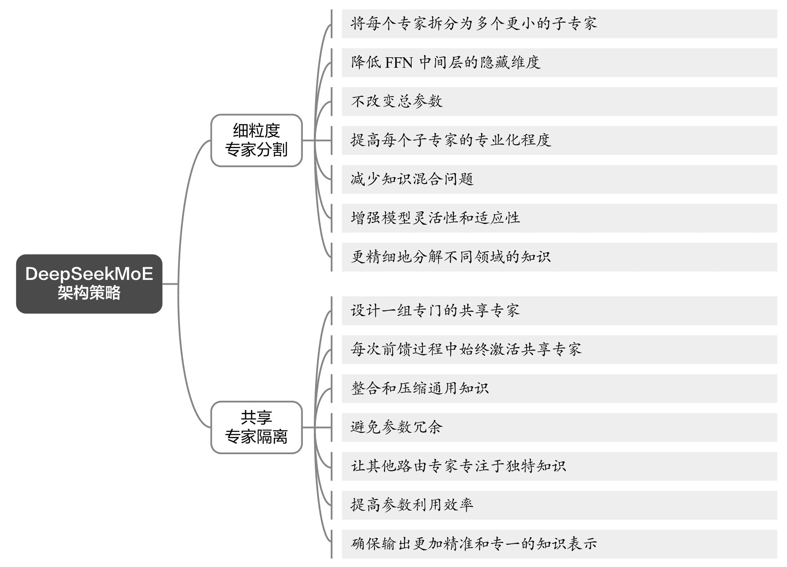

图 6-2

凭借细粒度专家分割与共享专家隔离，DeepSeekMoE 成功推动专家高度专业化。这不仅为有限计算资源下模型参数高效扩展提供方案，也为大规模语言模型未来发展开辟兼顾性能与效率的新路径，充分体现 MoE 在实际应用中的潜力。

**1. 细粒度专家分割**
引入细粒度专家分割，在不增加总参数量与计算成本前提下，将每个专家进一步拆分为更小子专家单元。具体做法是将传统 MoE 中专家前馈神经网络中间隐藏层维度压缩至原先的 1/*N*，从而把每个专家拆成 *N* 个子专家。子专家参数与容量减小，却能更专注特定知识领域，专业化程度显著提升。为保持计算成本不变，激活专家数相应提升至原先的 *N* 倍。细粒度分割后 MoE 层输出可重新表述。

通过细粒度专家分割，MoE 层输出可以表示为

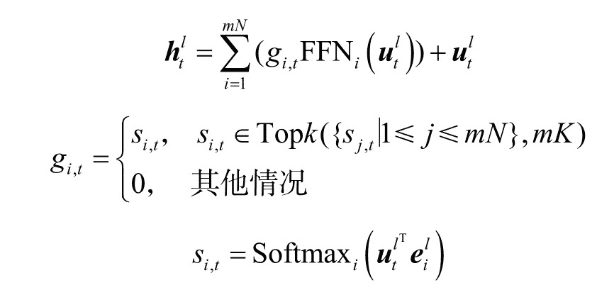

其中，*l* 表示网络层序号，用以标识当前处理的第 *l* 层输出或输入；*t* 表示序列位置索引，即 Token 在序列中位置；*m* 表示细分倍数，将每个原始专家拆分为 *m* 个小专家，总专家数变为 *mN*；*N* 表示原始专家数量；*k* 表示细分后每个输入 Token 激活的专家数；*K* 表示未细分时每个 Token 选择的专家数，即 Top-*K* 路由中 *K*；T 表示矩阵或向量的转置。

 

举例说明：设 *N*=16，传统 Top-2 路由约有 种组合；而当每个专家细分为 4 个子专家时，细粒度路由可产生 种潜在组合。组合灵活性的大幅提升，增强模型获取更精准、更具针对性知识能力。

在此情境下，尽管单子专家规模变小，但参与计算专家总数增加，使整体计算量与参数总量与原始 MoE 层相当。输出变得更稀疏，每个专家输出更能反映特定领域知识，实现了更高效的知识分布与利用。

综上，细粒度专家分割有效缓解传统 MoE 中专家因知识混合导致专业化不足问题，并在不额外增加计算资源情况下显著提升表达与泛化能力，为 MoE 性能提升树立新标杆。

**2. 共享专家隔离**
传统路由策略下，不同专家接收标记往往依赖通用知识，导致参数冗余。若设专门共享专家捕捉跨上下文通用知识，其他路由专家的冗余即可被缓解，有助于模型更聚焦各自独特内容。

基于细粒度专家分割，划分出 *M* 个共享专家。无论路由如何决策，每个标记都固定分配给这些共享专家。为维持计算成本，其他路由专家激活数相应减少 *M* 个。融合共享专家隔离策略的 MoE 层可表示为

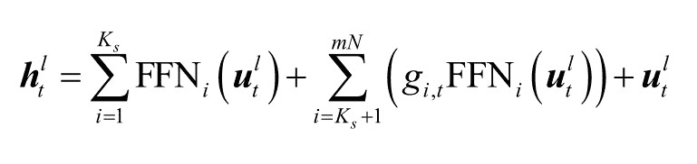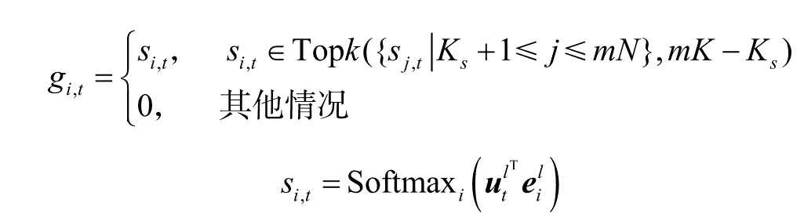

最终，DeepSeekMoE 中共享专家数量为 *K* *s*，路由专家总数为 *mN*−*K* *s*，非零门控值数量为 *mK*−*Ks*。

### **6.1.3 对比分析**
DeepSeekMoE 与传统 MoE 架构对比见表 6-1。

表 6-1 DeepSeekMoE 架构与传统 MoE 架构的对比

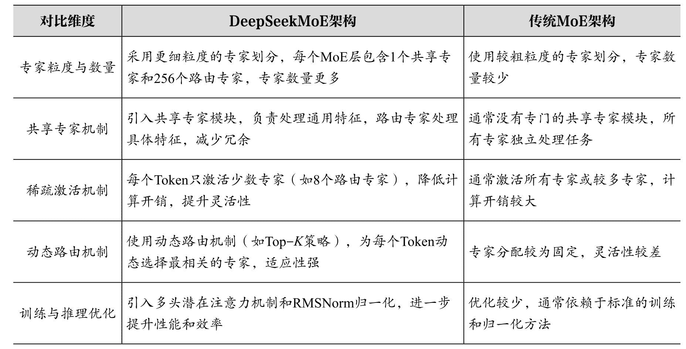

总体而言，通过创新 MoE 设计，显著提升计算效率与灵活性，同时降低资源消耗。

### **6.1.4 负载均衡**
负载均衡用于确保多任务或分布式环境中各处理单元负载均衡。MoE 架构中尤为关键，因其涉及动态选择专家处理输入，避免部分专家过载而另一些闲置。

在自动学习路由策略中，模型依据输入特征动态选择激活专家。但受数据分布不均与路由机制限制，可能出现负载不均衡，导致以下两类缺陷。

**（1）路由崩溃风险**

**◎ 问题描述：** 负载不均衡可能使模型倾向少数专家处理大部分输入，即“路由崩溃”。其余专家得不到足够训练信号，整体利用率下降。
**◎ 影响：** 降低专家整体使用率，使模型在多样化任务上缺乏足够专业化能力，性能受损。

**（2）跨设备通信瓶颈**

**◎ 问题描述：** 分布式训练中不同专家分布于多设备，若部分设备专家过度激活而其他设备闲置，会加剧跨设备通信开销与计算瓶颈。
**◎ 影响：** 整体训练效率下降，系统延迟风险增加。

为解决负载不均衡，现有方法常引入额外辅助损失以鼓励均衡分布，但会带来超参数调节负担甚至损害性能。

提出一种无辅助损失负载均衡策略，通过在路由决策中动态调整专家偏置项，使模型自发实现均衡。

**1. 专家级平衡损失**
专家级平衡损失定义为

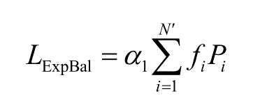

其中，*α*[1] 为超参数，即专家级平衡因子，用于调节该损失对整体训练目标影响；*N*′ 为 *mK*-*K*[s]，即细粒度分割后参与路由专家总数减去共享专家数。

随后定义每个专家激活频率 *f*[i] 与平均亲和度得分 *P*[i]。

**（1）激活频率 *f*[i]**
*f*[i] 表示训练批次中选择专家 *i* 的 Token 数，计算方式为其中， *K*′ 为每个 Token 实际激活细粒度专家数（*mK*），若存在 *K*[s] 个共享专家，则有效激活专家数可定义为 *K*′=*mK*−*K*[s]，即剔除共享部分后真正参与差异化路由专家数。*T* 为参与路由决策 Token 总数，1(·) 为指示函数，条件成立返回 1，否则返回 0。

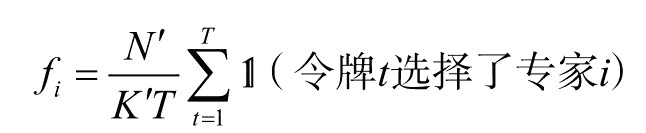

**（2）平均亲和度得分 *P*[i]**
*P*[i] 表示整个批次中所有 Token 对所有参与路由专家亲和度得分总和，公式为

其中，T 为批次 Token 总数；*s*[i][,][t] 为 Token *t* 与专家 *i* 亲和度得分，反映匹配程度。

**2. 设备级平衡损失**
设备级平衡损失用于优化分布式训练负载均衡，目标是使不同设备如 GPU 间计算负载均衡，提升效率并减少瓶颈。

若将所有路由专家划分为 D 个组 {*E*[1], *E*[2],…, *E*[D]}，并部署于单个设备，设备级平衡损失为

其中，*α*[2] 表示超参数，即设备级平衡因子； 表示第 *i* 组专家归一化激活频率，公式为

其中， 表示第 *i* 个设备上分配专家数量；而 *f*[j] 表示该组内专家 *j* 激活频率。 表示第 *i* 组专家累计亲和度得分，计算公式为

其中，*P*[j] 表示专家 *j* 平均亲和度得分。

总之，负载均衡是 MoE 高效运行关键。通过动态调整专家偏置项，无辅助损失负载均衡策略在不引入额外辅助损失下有效解决不均衡问题，提升训练效率与性能。该策略避免路由崩溃，也在多设备场景下优化资源利用，为大规模分布式训练提供有力支持。

### **6.1.5 微调技术揭秘**
DeepSeekMoE 通过细粒度专家分割与共享专家隔离优化整体架构，显著提升计算效率与性能。此外，架构还借助监督式微调及直接偏好优化 DPO 等先进技术进行微调，使其更好地理解与执行用户指令，并适应对话任务。微调过程中使用关键技术如图 6-3 所示。

总之，上述微调技术结合使用可在微调过程中高效利用计算资源，同时保持模型性能并适应不同下游任务。

图 6-3

### **6.1.6 零冗余优化器**
借助 ZeRO 系列技术显著优化大规模模型训练显存使用与并行性能，具体介绍如下。

**1. ZeRO-1：优化器状态分割**
ZeRO-1 首创将优化器状态分割存储，改变传统数据并行训练中每个 GPU 完整保存优化器状态导致显存冗余。通过将优化器状态分割为多份、由各 GPU 分别保存，减少单卡显存占用，缓解显存压力。

**2. ZeRO-2：梯度与参数分割**
在 ZeRO-1 基础上，ZeRO-2 进一步对梯度和参数进行分割。优化器状态、梯度与参数均分散存储于不同 GPU，通过高效通信保证数据一致性与训练准确性，在显存优化上取得更大突破。

**3. ZeRO-3：深入优化与拓展**
ZeRO-3 在前代基础上深入优化，延续对优化器状态、梯度和参数分割策略，并引入更先进通信优化技术与混合精度训练支持。ZeRO-3 能更好均衡各 GPU 负载，减少通信延迟，提升整体训练效率。

**（1）张量分解优化**

DeepSeek ZeRO-3 从张量层面重做显存分配策略，将超大张量拆成若干小粒度的子张量后，按需分发到不同 GPU 上，单卡显存压力被明显缓解。通信侧也同步升级，依据张量拆分形态和计算依赖关系，系统会动态选择通信方式并调整发起时机，让数据搬运更贴合算力节奏，从而降低延迟与额外开销。

（2）通信效率提升
为打通瓶颈，ZeRO-3 引入了一套组合式的通信优化手段。计算与通信重叠执行是核心思路，两者并行推进，训练耗时得以压缩。同时对传输数据实施压缩优化，采用高效压缩算法减小数据体量，降低带宽压力，加快整体搬运速度。

（3）混合精度训练支持
混合精度能在速度和显存利用率之间取得平衡。ZeRO-3 原生支持混合精度，框架会智能切换不同精度的数值类型，算力密集型环节用低精度提升吞吐、节省显存，关键环节则切回高精度以保证数值可靠性。配合动态调整机制，策略会随训练过程中的实际表现自动微调，避免不稳定或精度衰减，让模型平稳高效地收敛。

总体来看，ZeRO-3 以张量拆分、通信提效、混合精度三条线协同发力，有效缓解了大模型训练中显存过载和通信开销大的痛点，为在有限硬件条件下训更大、更复杂的模型提供了可行路径。

6.2 升级进化：DeepSeek-V3 全景解读
DeepSeek-V3 是一款基于 Mixture-of-Experts 的强力语言模型，主打高效推理与训练成本可控。核心支柱是多头潜在注意力 MLA 与 DeepSeekMoE 架构，这两套技术在 V2 上已得到验证，V3 在此基础上加入无辅助损失的负载均衡和多令牌预测训练目标，性能获得明显跃升。

6.2.1 架构纵览：DeepSeek-V3 设计蓝图
V3 在保留 Transformer 骨架的基础上，通过 MoE 模块和定制化注意力层拓展容量与灵活性，同时兼容分布式训练和低精度计算，为大规模模型的训练与推理提供坚实支撑。主要构成如下。

1. 基础架构
整体仍沿用 Transformer 结构，并叠加 MLA 机制与 DeepSeekMoE 架构以实现高效推理与经济训练。相较 V2，V3 采用了无辅助损失的负载均衡方案，用来平抑负载均衡带来的性能损耗。图 6-4 展示了基础架构。

图 6-4

2. MLA 机制
低秩压缩：把注意力键值压缩为低秩潜在向量，推理时的内存占用大幅下降。
查询压缩：对注意力查询同样做低秩压缩，训练阶段激活内存得到控制。
RoPE：支持查询与键的解耦处理，结合 RoPE 融入位置信息，增强序列位置感知。

3. MoE 架构
专家数量与分布：模型共含 14 906 个专家，每层 257 个专家，包含 1 个共享专家与 256 个路由专家，实现参数灵活调配与算力高效使用。
路由专家：每个 Token 挑选 8 个路由专家执行，依托专家分工实现知识深度挖掘，提升推理表现。
共享专家：每个 Token 固定激活 1 个共享专家，提供通用知识与稳定性，保证多任务鲁棒性。

4. MTP 机制
作用：让模型能在每个位置预测多个后续 Token，提高训练信号密度，提升数据利用率，加速训练。
顺序预测：采用顺序预测方式，保持每个 Token 预测链的因果完整性，确保生成序列连贯且逻辑自洽。

5. 模型参数与训练
总参数量：总参数 671B，单 Token 激活 37B，庞大容量带来强表达与知识储备。
训练策略：使用 AdamW 优化器，预训练最大序列长度 4K，在 14.8T Token 上训练，使模型充分学习语言多样性与复杂性。

6. 推理与部署
硬件部署：在 H800 集群上部署，采用预填充与解码分离的策略，以满足在线服务 SLO 与高吞吐需求。
负载均衡：推理阶段使用冗余专家部署，确保各 GPU 处理的 Token 数量相近，实现负载均衡，提升效率。

依托上述技术组合，V3 在长序列处理、负载均衡与多令牌预测上实现突破，性能与效率超越多数开源模型，逼近领先闭源水平。

6.2.2 无辅助损失的负载均衡
V3 使用 DeepSeekMoE 架构，相较传统 MoE 如 GShard，采用更细粒度的专家并隔离部分共享专家。传统 MoE 易出现专家负载不均，DeepSeekMoE 提出无辅助损失的负载均衡策略，核心如下。

动态偏置调整：训练时持续监控各专家负载，负载过高的专家自动降低偏置项以减少激活频率，过低则提升偏置项以便更容易被选中。
免辅助损失函数：不引入额外辅助损失，避免梯度干扰，提升训练效率。
序列级负载均衡：针对单个输入序列内部的 Token 分配优化，防止序列内 Token过度集中于少数专家。

6.2.3 训练框架搭建
V3 的训练由自研的 HAI-LLM 框架支撑，是一款高效轻量的训练系统。并行策略组合为 16 路流水线并行 PP、64 路专家并行 EP 与 ZeRO-1 数据并行 DP，使模型在大规模集群上高效运转。

1. DualPipe 与计算通信重叠
跨节点专家并行带来约 1:1 的计算通信比，效率受限。为此设计 DualPipe 流水线并行算法，通过重叠前向与反向的计算通信阶段减少流水线气泡。每个块被拆分为注意力计算、全通信分发、MLP 计算、全通信聚合四部分，反向块中注意力与 MLP 计算再细分为反向输入与反向权重。

关键在于手动调配 GPU 流式多处理器的分配比例，让全通信与 PP 通信得以完全隐藏。双向调度从流水线两端同时送入微批次，大部分通信被完全重叠，即便无通信压力时仍具明显效率优势。

2. 跨节点全通信的高效实现
为支撑 DualPipe，定制了分发与合并的高效跨节点全通信内核，与 MoE 门控与集群网络拓扑协同设计，充分利用 IB 与 NVLink 差异化带宽。每个 Token 最多分发至 4 个节点，降低 IB 流量，IB 与 NVLink 通信可完全重叠，每个 Token 平均可在各节点选择约 3.2 个专家。

同时采用 Warp Specialization 技术，将 20 个流式多处理器划分为 10 个通信通道，分发与合并过程中的 IB 发送、IB 到 NVLink 转发、NVLink 接收等任务由不同 Warp 处理，并依实际负载动态调整分配，显著减少 L2 缓存占用与对他处理器的干扰。

3. 极致的内存节省与最小化开销
RMSNorm 与 MLA 上投影重计算：反向传播时重新计算 RMSNorm 与 MLA 上投影，避免长期保存输出激活，削减内存占用。
CPU 端 EMA：指数移动平均参数存于 CPU 内存，每步异步更新，避免额外内存与时间开销。
MTP 共享嵌入与输出头：配合 DualPipe，将嵌入层与输出头部署于同一 PP 等级，使 MTP 与主模型参数与梯度可物理共享，进一步提升内存效率。

在不使用昂贵张量并行 TP 的前提下，V3 实现了高效训练与显著的内存节省。

6.2.4 FP8 精度训练
V3 引入 FP8 混合精度训练框架，兼顾低精度计算的效率与数值稳定性难题，通过多项优化实现大模型预训练的高效稳定。

1. 混合精度框架
核心计算核如 GEMM 以 FP8 精度执行，前向、激活反向、权重反向均采用 FP8，计算速度可达 BF16 约两倍，激活也以 FP8 存储降低内存需求。敏感模块如嵌入、输出头、MoE 门控、归一化与注意力操作保持 BF16 或 FP32 执行，确保数值稳定。主权重、权重梯度与优化器状态以高精度保存，并通过分片策略降低内存开销。

2. 提升精度的策略
细粒度量化：激活与权重采用 128×128 块分组量化，相比整体量化能更好处理异常值，减少溢出下溢，GEMM 内维度引入分组缩放因子进一步优化精度。
高精度累加：FP8 GEMM 累加精度受限，中间结果复制到 CUDA Core FP32 寄存器进行全精度累加，实验显示累加间隔 Δ=128 时可在不明显增加开销下获得高精度。
尾数优于指数：统一使用 E4M3 格式处理所有张量，配合细粒度量化共享组内指数位，缓解动态范围受限问题。
在线量化：每瓦片或每块在线计算最大绝对值推导缩放因子，实时量化为 FP8，避免延迟量化带来的误差累积。

3. 低精度存储与通信
低精度优化器状态：第一、第二矩以 BF16 存储，显著省内存，主权重与梯度仍用 FP32 保证稳定。
低精度激活：线性算子反向传播的激活以 FP8 缓存，精度敏感的输入激活采用定制 E5M6 格式并以整数缩放因子量化。
低精度通信：MoE 模块中激活在投影前量化为 FP8 降低带宽，激活梯度缩放因子采用 2 的整数次幂优化通信，正向反向合并组件保留 BF16 保证精度。

整体上，FP8 框架通过细粒度量化、高精度累加与低精度存储，解决了低精度训练的数值不稳定与异常值问题，在大幅降低内存与通信开销的同时保持接近 BF16 基线的训练精度。

6.2.5 推理与部署：规模化应用落地
V3 部署于 H800 集群，节点内 GPU 通过 NVLink 互联，集群内 GPU 通过 IB 全互联。为兼顾服务质量目标与高吞吐，采用预填充与解码分离部署。

1. 预填充
最小单元 4 节点 32 GPU。注意力部分为 TP4+SP+DP8，MoE 部分为 EP32，确保每个专家获得足够批量。MoE 全通信复用训练策略：节点间经 IB 传输 Token，节点内经 NVLink 转发；浅层密集 MLP 使用 1 路张量并行以节省通信。

为均衡专家负载，引入冗余专家策略，按在线服务统计定期约每 10 分钟调整，预填充阶段设置 32 个冗余专家，每个 GPU 除自有 8 个专家外再托管 1 个冗余专家，并在节点内重新排列以均衡负载。

同时并行处理两个计算量相近的微批次，将一个批次的注意力和 MoE 操作与另一批次的分发合并操作重叠，隐藏通信开销。

2. 解码
解码阶段将共享专家视为路由专家，每个 Token 选择 9 个专家，共享专家始终激活。最小单元 40 节点 320 GPU。注意力为 TP4+SP+DP80，MoE 为 EP320，每个 GPU 托管一个专家，64 个 GPU 负责冗余与共享专家。全通信可通过 IB 点对点低延迟实现，并结合 IBGDA 技术进一步降时提效。

冗余专家集合仍按在线统计定期确定，因每个 GPU 只托管一个专家无需重新排列。团队也在探索动态冗余策略，需优化全局路由计算与分发内核融合以降低开销。

为隐藏全通信开销，同时处理两个相似工作量的微批次，注意力占比更大时将一个批次的注意力与另一批次的解码+MoE+合并重叠。解码阶段专家批量较小，瓶颈为内存访问，MoE 仅需加载单个专家参数，分配少量流式多处理器即可，避免影响注意力计算速度。

6.2.6 模型评估：多维指标性能洞察
评估阶段通过多项基准全面验证性能，涵盖标准指标、开放式生成与生成式奖励模型测试。

1. 评估设置
评估基准：除基础模型测试外，指令模型评估覆盖 IFEval、FRAMES、LongBench v2、GPQA、SimpleQA、C-SimpleQA、SWE-Bench Verified、Aider、LiveCodeBench、Codeforces 2、CNMO 2024、AIME 2024 等。
对比基线：与 DeepSeek-V2 系列、Qwen2.5 72B Instruct、Llama3.1 405B Instruct、Claude-3.5-Sonnet、GPT-4o 对比，闭源模型通过 API 评估。

DeepSeek-V3 检验要点及多模态发展脉络

◎ 评测配置说明：通用基准统一在 simple-evals 体系下展开，并采用 Zero-Eval 提示范式。代码与数学类基准则同时启用多语言运行环境和多种解码方式。单次生成上限均放宽至 8 192 个 Token。

2. 标准基准表现
DeepSeek-V3 在公开榜单上的整体成绩稳居开源第一梯队，与主流闭源产品具备同场比较的实力，概况如下。

◎ 英语类能力：在 MMLU、GPQA 以及 DROP、LongBench v2、FRAMES 等长文本理解集上均收获高分，DROP 的 F1 达到 91.6，逼近 GPT-4o 的水准。
◎ 编程与数学能力：代码生成方面，HumanEval-Mul 与 LiveCodeBench 两项均领先对照模型；数学方面在 AIME 2024、MATH-500、CNMO 2024 的得分设定了非 o1 类模型的新参考线。
◎ 中文能力：在 C-SimpleQA 事实问答与 C-Eval 教育知识测评中斩获优异分数，超过 Qwen2.5 72B。

3. 开放式生成评估
在 AlpacaEval 2.0 与 Arena-Hard 这类开放式任务上，胜率均突破 85%，成为首个跨过该门槛的开源模型。

4. DeepSeek-V3 作为生成式奖励模型
RewardBench 的结果表明其奖励建模水平与 GPT-4o、Claude-3.5 相当，显示出作为生成式奖励模型的应用潜力。

5. MTP 解码评估
模型并非仅预测下一个 Token，而是借助 MTP 技术并行预测后续 2 个 Token。配合推测解码框架，吞吐得到明显提升。关键指标是额外预测的接受率，经测试第二 Token 的接受率在不同主题下稳定在 85% 至 90% 区间，可靠性一致。该水平支撑约 1.8 倍的 Token/秒提升。

总体来看，DeepSeek-V3 已成为当下实力靠前的开源基础模型，编程与数学优势突出。聊天版本在标准与开放式榜单上均领先其他开源选项，表现与 GPT-4o、Claude-3.5-Sonnet 等头部闭源模型相当。

## 6.3 多模态大模型：DeepSeek 的跨感知融合
多模态线从文本起步，逐步向视觉语言融合与跨模态理解延伸，通过架构打磨与训练方法改进，如高效推理和跨模态对齐，实现性能与实用性的同步提升。演进体现出快速迭代，为跨模态推理与商业化落地奠定基础，同时在效率与成本上持续优化。

### 6.3.1 多模态策略的演进
发展轨迹如下。
◎ 2023 年 7 月，DeepSeek 创立，聚焦大模型与 AGI 研发。
◎ 2024 年 1 月，发布 DeepSeek LLM。
◎ 2024 年 3 月，发布 DeepSeek-VL。
◎ 2024 年 5 月，发布第二代开源 MoE 架构 DeepSeek-V2。
◎ 2024 年 10 月，发布 Janus 模型。
◎ 2024 年 11 月，发布 JanusFlow 大模型。
◎ 2024 年 12 月，发布 DeepSeek-V3，同时推出视觉模型 DeepSeek-VL2。
◎ 2025 年 1 月，发布开源多模态模型 Janus-Pro，重点强化文生图能力。

### 6.3.2 基础模型 Janus
Janus 由 DeepSeek 提出，目标在单一体系内兼顾图像理解与文本到图像生成。核心在于把理解与生成的视觉编码解耦，缓解两类任务的冲突。通过优化训练策略、扩充数据与扩大规模，Janus 在多模态理解、指令遵循与文生图稳定性上均有明显进步。Janus-Pro 在策略、数据与规模上进一步改进，性能再上层楼。

1. 视觉编码路径
架构中视觉编码部分的示意如图 6-5 所示。

2. Janus 架构设计的优势
通过解耦视觉编码路径获得多重收益。

（1）解耦视觉编码路径
◎ 任务适配性强：理解与生成各配备独立的视觉编码路径。理解侧编码器偏重高层语义提取，表征粒度集中于高维语义；生成侧更关注空间结构与纹理等细粒度信息。解耦后可为各自任务选用最合适的编码技术，提升针对性，避免单一编码器难以兼顾的问题。
◎ 减少任务冲突：理解与生成所需的视觉表征差异较大，共享编码器易产生冲突。解耦设计消除了编码器选择的权衡，使模型在理解与生成上均能更好发挥。

（2）统一的 Transformer 框架
◎ 架构简洁高效：采用统一 Transformer 处理理解与生成，仅在视觉编码层面解耦，既保持简洁，又提升不同任务的处理效率，降低复杂度与训练难度。
◎ 良好的扩展性：该框架可容纳更多输入类型，如点云、脑电信号、音频等。只需为新模态添加独立编码器提取特征，再由统一 Transformer 融合即可，应用范围可扩展。

图 6-5

（3）独立适配的编码方法
◎ 多模态理解编码优势：理解路径采用 SigLIP-L 作为视觉编码器，可将图像特征映射到文本语义空间，提取物体类别与视觉属性等高维语义。经理解适配器映射到 LLM 输入空间后，有助于视觉问答、图像描述等任务。
◎ 多模态生成编码优势：生成路径使用 LlamaGen 体系中的 VQ Tokenizer 或自研 VQ Tokenizer 把图像转为离散 ID，再由生成适配器把码本嵌入映射到 LLM 输入空间。该方式可更好捕捉图像细节，满足生成对局部细节与全局一致性的要求，生成质量更高。

### 6.3.3 视觉编码器 VQ Tokenizer
Janus 的 VQ Tokenizer 用于将图像转为离散 ID 序列，把细节信息编码为便于计算的形式。

1. 基本原理
Tokenizer 基于向量量化技术，将连续特征空间映射到离散码本。采用 VQ-VAE 架构，先由编码器把图像压缩为潜在表示，再经向量量化层映射到离散码字，最后由解码器重构图像。

2. 在 Janus 模型中的应用
在 Janus 中，VQ Tokenizer 服务于视觉生成任务，把图像转为离散 ID 序列以保留空间结构与纹理信息，再经生成适配器映射到 LLM 输入空间，供模型进行图像生成等任务。

3. 训练过程
◎ 预训练码本：使用 ImageNet-1K 语料预训练 VQ Tokenizer，训练包含潜在变量量化与码本更新，最小化重构误差，使其能准确编码与重构图像。
◎ 适配器训练：Janus 训练时 VQ Tokenizer 码本被冻结，仅训练适配器部分，把离散 ID 序列映射到 LLM 输入空间，实现视觉与语言信息的融合。

### 6.3.4 生成适配器
生成适配器是视觉与语言模态的连接组件，负责把视觉编码特征转为语言模型可理解的表示。通常采用轻量结构如线性投影或跨模态注意力，保持高效对接。在 Janus 中，生成适配器是视觉生成路径的关键组件，如图 6-6 所示。

图 6-6

### 6.3.5 特征序列处理
Janus 通过自回归 Transformer 处理多模态特征序列并生成输出。

1. 功能和位置
◎ 功能：自回归 Transformer 对拼接后的多模态特征序列建模，捕捉长程依赖，自回归预测下一个标记，实现文本与图像生成。
◎ 位置：位于特征处理下游，接收来自文本理解、多模态理解与视觉生成各路径经适配器映射后的特征序列，拼接后统一处理。

2. 输入和输出
◎ 输入：多模态特征序列由文本特征、图像高维语义特征及图像离散 ID 嵌入等拼接而成，经适配器映射到 LLM 输入空间后展平为一维序列。
◎ 输出：纯文本理解与多模态理解任务输出文本预测，由 LLM 内置预测头生成；视觉生成任务输出图像预测，由随机初始化的预测头生成。

3. 训练过程
◎ 训练目标：采用交叉熵损失最大化条件概率，理解任务损失计算于文本序列，生成任务损失计算于图像序列。
◎ 训练方式：遵循自回归框架，采用 Next-Token-Prediction 与因果注意力掩码，与 LLM 训练方式一致，Transformer 与适配器共同学习多模态关联。

4. 与其他组件的协作
◎ 与适配器的协作：依赖适配器把各模态特征映射到同一输入空间，保证序列兼容性与信息融合。
◎ 与预测头的协作：根据任务类型把输出送至对应预测头，理解任务用 LLM 内置头，生成任务用独立初始化头。

5. 优势
◎ 多模态融合：统一处理不同模态特征，实现理解与生成的统一建模。
◎ 简单高效的架构：统一自回归 Transformer 避免为不同任务设计专属掩码，简化设计与训练推理。
◎ 强大的生成能力：逐步生成连贯高质量的文本与图像，结果多样且准确。

注意：
◎ 输入长度限制：Transformer 计算复杂度随序列长度平方增长，长序列或多模态特征可能受限。
◎ 训练数据要求：需要大量高质量多模态数据以学习跨模态关联与语义。

### 6.3.6 预训练策略
Janus 预训练分为三阶段，各阶段目标与方法不同，如图 6-7 所示。

图 6-7
通过三阶段预训练并逐步解冻与更新模型部分，可从基础视觉语言理解过渡到复杂多模态理解与生成，并利用多样数据增强通用性与鲁棒性。

## 6.4 升级版 Janus-Pro：多模态进阶的实践与优化
Janus-Pro 在 Janus 基础上通过改进训练策略、扩充数据与扩大规模，显著提升多模态理解与文生图性能。仍采用解耦视觉编码路径，分别处理理解与生成，有效避免编码器功能冲突。

### 6.4.1 关键改进：Janus-Pro 的性能提升点
Janus-Pro 主要在三方面改进，如图 6-8 所示。

图 6-8

### 6.4.2 解耦视觉编码
Janus-Pro 采用解耦视觉编码技术，针对理解与生成设计独立路径。

1. 解耦视觉编码的设计原理
为理解与生成任务分别设计独立视觉编码路径，以满足两者对图像特征表示的不同需求。

2. 多模态理解路径
使用 SigLIP 编码器提取图像高维语义特征，二维网格展平为一维序列，经理解适配器映射到大语言模型输入空间。

3. 视觉生成路径
使用 VQ Tokenizer 把图像转为离散 ID，序列展平后经生成适配器把码本嵌入映射到 LLM 输入空间，更好捕捉细节，满足生成对局部与全局一致性的要求。

该解耦模式避免单一编码器在两类任务间冲突，充分发挥各自优势。

### 6.4.3 初始训练策略挑战
Janus-Pro 训练分为三阶段：先训练适配器与图像预测头，建立视觉语言概念联系；再联合预训练解冻语言模型并利用多源数据学习多模态任务；最后监督微调提升指令遵循与对话能力。

1. 初始策略：参考 PixArt 方法的两部分训练
（1）第一部分：像素依赖性学习
首步进行像素依赖性学习，专注训练适配器与图像预测头。从 ImageNet 预训练模型起步，架构兼容预训练权重以提升初始化效率，目标是使模型据类别名称生成合理图像，有效建模像素依赖。
（2）第二部分：文本—图像对齐学习
完成像素依赖学习后，使用常规文本到图像数据训练，基于密集文本描述生成图像，提升数据利用效率与整体性能。

2. 问题与挑战
◎ 计算效率低下：第二阶段按 PixArt 将训练分为 ImageNet 类别名称阶段与常规文本到图像阶段，导致大部分训练步数集中在第一部分，效率显著下降。
◎ 数据利用不充分：过多步数用于类别名称的像素依赖建模，对常规文本到图像数据利用不足，复杂描述生成能力提升有限。
◎ 训练策略次优：实验显示分阶段策略次优，第一阶段训练不足导致像素依赖建模不充分，第二阶段资源浪费于相对简单提示。

### 6.4.4 三阶段优化：从预热到精调的训练全流程
DeepSeek 技术报告中，Janus-Pro 对原始 Janus 的三阶段流程进行优化，提升效率与多模态性能。

1. 第一阶段：适配器与图像预测头训练
原始 Janus 该阶段步数不足，像素依赖学习不充分。Janus-Pro 改进如下。
◎ 延长在 ImageNet 数据集上的训练步数：在冻结大语言模型参数条件下，显著增加训练步数，使模型更充分学习图像像素依赖，提升生成质量。

**◎ 先学像素关联，再碰文本：** 起步阶段只让模型掌握画面里像素之间的内在关联，不刻意去对齐繁复的语言描述，为后面的多模态工作先搭好基础。

**2. 第二阶段：统一预训练**

早期的 Janus 在此阶段借鉴 PixArt 的做法，把图文生成拆成两段进行训练，算力消耗大且对复杂描述的处理容易波动。Janus-Pro 对此做了精简。

**◎ 去掉 ImageNet 分类提示的训练环节：** 移除以 ImageNet 为来源的分类式提示训练，砍掉冗余的计算。
**◎ 直接用常规图文对训练：** 改为直接吃通用的文本到图像对，让模型专注于依据细密的文字描述合成画面，效率与稳定性同步上扬。
**◎ 效率与稳健度双提升：** 改进后数据利用更充分，生成更稳、语义贴合度更好，成图质量也随之提升。

**3. 第三阶段：监督微调**

原始 Janus 的数据配比是多模态理解∶纯文本∶图文生成＝7∶3∶10，仍有优化空间。Janus-Pro 的调整如下。

**◎ 配比重设：** 新配比调为 5∶1∶4，更强调理解类任务，同时保留生成能力。
**◎ 理解与生成再平衡：** 配比变化后两类需求更协调，视觉问答、图像分类等表现获得改善。
**◎ 综合能力增强：** 理解侧更突出，生成质量保持高水准，整体表现明显提升。

总体来看，Janus-Pro 通过各阶段策略的改进，拉长 ImageNet 上的训练步数、剔除冗余环节、重新设定数据配比，显著提高了训练效率与多模态任务表现，为多模态训练提供了更高效的思路。

# 第七章
# DeepSeek 训练全景拆解

DeepSeek 的完整训练覆盖资料准备、无监督预训练、有监督微调与算力优化四个环节。先大规模采集清洗语料并做分词等预处理；随后以自回归或自编码方式基于 Transformer 进行大规模无监督学习，获得通用语言表征；再针对特定领域或任务通过监督微调增强生成质量与指令遵循；最后借助混合精度等手段提升计算效率。

## 7.1 资料准备与预处理
此环节包含采集、净化与格式化。先从网页、书籍、论文等渠道获取海量高质量文本，做去重、去噪、过滤保证数据干净多样；再通过分词、归一化等手段结构化文本，为后续训练提供标准化输入。

### 7.1.1 资料采集与筛选
DeepSeek 在此环节构建高质量多元语料，以增强推理与生成能力，核心包括来源选择、清洗筛选等。采集与筛选流程见图 7-1。

图 7-1

由此可见，依托高质量多元数据训练，有助于推理、编程与知识处理的提升。

### 7.1.2 资料清洗与格式化
清洗与格式化是分析建模的基础，有助于提升数据质量与可用性。

**1. 资料清洗**
对原始资料进行处理，如剔除重复、补全缺失、修正错误等，以提升准确性与一致性。主要步骤与方法见图 7-2。

图 7-2

**2. 资料格式化**
将数据转为统一格式与结构，便于后续处理。主要做法如下。

**◎ 统一日期写法：** 如“YYYY-MM-DD”“MM/DD/YYYY”等，需统一为同一规范。
**◎ 统一数值写法：** 整数、小数、科学计数法等需统一精度，如保留两位小数。
**◎ 统一文本写法：** 大小写、空格、标点等需统一，如全转小写、去除冗余空格与标点。
**◎ 类型转换：** 字符型日期转日期型，字符型数值转数值型，使类型适配后续处理。

### 7.1.3 数据增强策略
数据增强是提升泛化能力的关键手段，通过丰富训练样本多样性帮助模型更好应对不同输入。

**1. 策略介绍**
数据增强是对样本做方向性扰动，或在潜在空间生成新样本扩充数据集。通过制造现有数据的多种变体扩大训练规模，使模型学习更多特征，更好泛化到未见数据。常用方法如下。

**◎ 几何变换：** 翻转、旋转、缩放、平移等。
**◎ 颜色变换：** 调整亮度、对比度、饱和度或进行颜色抖动。
**◎ 噪声注入：** 在样本中加入随机噪声增强鲁棒性。
**◎ 合成样本：** 借助生成对抗网络等技术生成新样本。

这些方法可提升模型适应力，减少过拟合。

**2. DeepSeek 的增强实践**
训练过程中数据增强被广泛使用以提升推理与生成质量。具体策略见图 7-3。

图 7-3

通过上述手段，DeepSeek 在训练中逐步内化复杂推理，推理任务表现优异；综合运用增强策略后，在推理、编程与知识处理等方面均展现强劲实力。

## 7.2 基础训练：从零到一
基础训练是模型从无到有的关键阶段，涵盖初始参数设定、大规模预训练及应对训练难点的方案。

### 7.2.1 模型初始参数设定
初始参数设定对训练速度与最终表现影响显著，常见做法与注意点如下。

**◎ 零初始化：** 全部参数置零，操作简单但极少用，会导致权重更新对称，神经元学到相同特征。
**◎ 随机初始化：** 权重与偏置从均匀或正态分布抽取，打破对称，使不同神经元学习不同特征。
**◎ 小随机初始化：** 权重初始化为极小随机数，有助防止梯度消失或爆炸，尤其在深层网络。
**◎ Xavier 初始化：** 适用于 Sigmoid 或 Tanh，通过控制方差保持前向与反向信号量级，缓解梯度消失。
**◎ He 初始化：** 适用于 ReLU 系列，权重采样自均值 0、方差 2/n_in 的分布，在深层网络中效果更佳。

官方给出以下建议。

**◎ 不使用系统提示词：** DeepSeek-R1 设计为无需系统提示词，所有指令应直接写在用户问题中，更贴合官方平台的 prompt 处理方式。
**◎ 温度设为 0.6：** 温度影响随机性与创造性，0.6 能在创造性与连贯性间取得平衡，保证本地部署风格与官方一致。
**◎ 优化搜索与文件上传提示词：** 官方提供模板，文件上传需包含 {file_name}、{file_content}、{question} 等参数；网页搜索需包含 {search_results}、{cur_data}、{question} 等参数。
**◎ 应对思维绕过：** 为避免空白或无效响应，建议强制在每个响应开头加入特定标记，以确保推理完整。

目前官方强调部署版与开源版模型一致，但具体初始参数设定细节尚未完全公开。

### 7.2.2 大规模预训练流程
大规模预训练包含以下阶段。

**1. 预训练阶段**
**◎ 数据准备：** 使用大规模高质量语料，如 DeepSeek-V3 使用了 14.8 万亿个高质量多样化的 Token，主要来自 Common Crawl 及网页、书籍、论文等，确保广度与代表性。
**◎ 模型架构：** DeepSeek-V3 为 MoE 大模型，总参数 671B，每 Token 激活 37B，采用多头潜在注意力 MLA 与 DeepSeekMoE 架构，实现高效推理与经济训练。
**◎ 训练方法：** 采用自监督学习，如掩码语言模型 MLM 或自回归生成，通过预测被掩盖词或生成后续文本学习词法、句法、语义与知识关联。
**◎ 训练参数设置：** 常用 Adam 优化器，交叉熵损失，评估指标包括准确率、召回率等，超参数涵盖学习率、批次大小、迭代次数等。

**2. 上下文长度扩展**
通过架构优化与训练策略调整，DeepSeek-V3 将上下文长度从 4K 扩展到 128K，可处理更长文本序列。

**3. 监督微调阶段**
**◎ 目标：** 使模型适应特定任务或遵循指令。
**◎ 数据准备：** 使用少量高质量人工标注数据，如问答对、指令响应对。
**◎ 训练方法：** 以监督学习对预训练模型微调，学会任务格式与指令遵循。

**4. 奖励建模阶段**
**◎ 目标：** 训练能模拟人类偏好的奖励模型，为后续强化学习提供评估信号。
**◎ 数据收集：** 人工标注员对同一输入的不同输出排序，形成偏好数据集。
**◎ 训练方法：** 用 SFT 模型生成的候选输出及人工排序数据构建样本，通过对比学习或排序损失训练奖励模型，使其能自动区分输出的人类偏好。

**5. 基于强化学习的优化阶段**
**◎ 目标：** 让模型生成更符合人类偏好的内容。
**◎ 训练方法：** 应用强化学习算法如近端策略优化 PPO，利用奖励模型信号作为反馈对 SFT 策略微调。
**◎ 流程：** 输入提示词生成多个候选响应，RM 打分，PPO 更新参数最大化期望奖励。

通过上述流程，DeepSeek 学会丰富语言知识与模式，具备强语言理解与生成能力，并在多任务中表现突出。

### 7.2.3 训练难点应对方案
训练过程中团队面临多重挑战并给出对应方案。

**1. 深层模型训练难题**
**◎ 问题：** 层数增加时深层网络易训练不足，收敛变慢甚至无法收敛。
**◎ 解决方案：** 引入层归一化缩放技术，对各层输出精细缩放，保证深层网络稳定训练。

**2. 后训练阶段的奖励定义与数据质量**
**◎ 问题：** 强化学习阶段如何定义有效奖励函数及获取高质量专业问答与思维链数据是关键。
**◎ 解决方案：** 人工标注与合成数据结合，保证数据质量与多样性，提升推理能力。

**3. 训练资源与成本优化**
**◎ 问题：** 超大规模模型训练需要巨大算力与成本。
**◎ 解决方案：** 采用 MoE 架构实现“用空间换时间”，显著降低成本。DeepSeek-V3 训练成本约 557.6 万美元，使用 2 048 个 NVIDIA H800 GPU 集群，较同类规模模型大幅下降。

以上方案帮助团队克服训练挑战，提升性能并有效控制成本。

## 7.3 微调与优化：提升性能
微调是在预训练模型基础上针对特定任务调整参数以提升性能；优化则是调整参数使损失函数最小化，提高准确性与泛化能力。二者结合可充分利用预训练知识，加速训练并改善特定任务表现。

### 7.3.1 监督微调方法
监督微调是提升指令遵循与回答准确性的关键步骤。

**1. 监督微调基础**
在预训练模型上借助高质量标注数据进一步训练，使模型更好适配特定任务或领域。监督微调的基本信息见图 7-4。

图 7-4

**2. DeepSeek 中的监督微调实践**
训练 DeepSeek 时监督微调被广泛使用。团队首先在预训练模型上进行监督微调，提升指令理解与执行能力，提高回答准确性。该阶段数据通常为精心挑选的示例，覆盖多种任务与领域。经监督微调后模型基础能力得到强化，为后续强化学习奠定基础。

**（1）多阶段训练方法**
**◎ DeepSeek-R1：** 采用多阶段训练，先在小规模精选示例上做监督微调，再进入强化学习，有效提升推理与任务表现。
**◎ DeepSeek-R1-Zero：** 尝试跳过监督微调，直接从预训练模型通过强化学习生成可用模型，降低对高质量标注数据依赖，简化流程并节省成本。

**（2）LoRA 技术**
为降低成本，DeepSeek 采用 LoRA 进行监督微调。通过 LoRA 优化，DeepSeek-V3/R1 671B 参数模型的微调硬件需求大幅下降，最低可在 24 个 H100/H800 GPU 上完成，使高性能模型训练更经济。

总体而言，DeepSeek 在训练中充分利用监督微调，借助高质量标注数据与先进技术提升指令遵循与任务表现，同时在不同版本中探索策略以平衡成本与性能。

### 7.3.2 强化学习在微调中的应用
强化学习通过智能体与环境交互学习最优决策，在微调中主要体现在：

**◎ 目标：** 提升特定任务尤其是需推理与决策任务的性能，让模型生成更符合人类预期的输出，提高准确性与逻辑性。
**◎ 过程：** 模型对给定输入生成多输出，按准确性、逻辑一致性、清晰度等标准评估并给予奖励，通过强化学习算法最大化预期奖励以优化输出质量。

DeepSeek 在微调阶段高度使用强化学习，尤其在 DeepSeek-R1 中直接在预训练模型基础上应用强化学习进行微调，跳过传统监督微调。奖励机制引导模型产出更高质量输出，性能显著提升。

强化学习阶段采用 GRPO 算法优化策略更新，确保训练稳定高效。GRPO 通过组内相对奖励估计优势函数，摒弃价值网络，大幅减少计算与存储需求。DeepSeek-R1 中的强化学习步骤见图 7-5。

图 7-5

该方法引发全球关注与复现热潮，如加州大学伯克利分校与香港科技大学等团队成功复现仅靠强化学习微调的 DeepSeek，验证其有效性与经济性。

总体而言，引入强化学习使 DeepSeek 在特定任务上性能提升，同时降低对大规模标注数据的依赖，为大语言模型训练提供新思路。

### 7.3.3 性能评估与迭代优化
模型开发中，性能评估与迭代优化是保障有效性与实用性的关键。

**1. 性能评估**

评估大模型好坏从来不是看单一数字，而是看一套指标组合的表现。分类任务里，准确率关注整体预测对了多少，召回率关注正样本被拉回的比例，F1 则把两者取调和平均做综合判断；语言生成类任务常用困惑度，分数越低说明模型对文本的预测越可信；机器翻译这类特定场景则会引入 BLEU 分数做质量对标。

**2.** **迭代优化**
模型优化是闭环进行的。典型做法有：用随机旋转、翻转、缩放等数据扩充手段丰富训练样本，提升泛化；对学习率、批次大小、正则强度等超参数反复试探，找出金配置；依据训练与验证曲线增减网络层、调整单元规模，改善表达力；以及引入新数据或延长训练时间，让模型跟上数据分布与任务需求的变化。

**3.** **DeepSeek 中的性能评估与迭代优化**
DeepSeek 更看重横向对比。在 MATH-500 上，DeepSeek-R1 的 pass@1 达到 97.3%，超过 GPT-4 与 Claude-3-100k；Codeforces 对比中，该模型超越 96.3% 的人类选手，编程能力突出。推理与生成速度是优势，但首个 Token 延迟和服务可用性仍有提升空间。

注意：pass@1 常见于代码与数学等生成类评测，表示模型对每个问题只输出一个答案时，答案正确的比例。简单说就是单次尝试的通过率。

DeepSeek 的迭代思路主要体现在三块。
**◎** **强化学习策略：**R1 在预训练基座上直接用强化学习微调，跳过了传统监督微调。通过奖励信号引导输出质量，并采用 GRPO 算法让策略更新更稳更快。
**◎** **迭代加速策略：**以预训练模型起步减少从零训练成本，用自动化机器学习工具挑选架构与超参，结合分布式与并行训练加速大规模训练。
**◎** **持续学习与版本管理：**借助 CI/CD 流程实现自动化迭代，并结合在线学习动态更新模型，保持对新数据与新任务的适应性。

总体来看，这些评估与优化手段支撑了 DeepSeek-V3 在多项任务上的稳定表现，体现了团队在超大模型研发上的实力。

# **第八章 DeepSeek 训练提效与降本：双轨并行**
DeepSeek 通过架构与流程设计实现了训练效率与成本的双控。模型采用稀疏激活的 MoE 结构，只激活部分专家，降低算力需求；训练时做负载均衡与通信、内存、计算的协同优化；并最大化避免硬件闲置，让算力在最合适的设备上落地。综合下来，DeepSeek-V3 训练花费约 557.6 万美元，来自官方技术报告，成本显著下降。

## **8.1** **数据规模、训练策略与低成本秘诀**
预训练阶段使用了上万亿级的高质量多样数据，为模型奠定知识底座。训练策略融合 MoE 稀疏激活、强化学习与监督微调，并在分布式层面做策略优化，实现了高效训练。

### **8.1.1** **数据规模对性能的影响**
参数越大，数据规模的重要性越突出。研究显示模型尺寸与训练数据量需同比例增长才最经济。DeepMind 的 Chinchilla 实验表明，用 1.4 万亿 Token 训练的小模型，能在多个任务上胜过参数更大的 Gopher、GPT-3、Megatron-Turing NLG。资源固定时，存在数据量与模型大小的最佳匹配点，超出则收益递减。

DeepSeek 的表现与大规模数据密切相关。
**◎** **规模与性能关联：**海量数据提供更丰富的语言模式。DeepSeek-V3 以 14.8 万亿 Token 预训练，在多项基准上明显提升。
**◎** **具体任务表现：**数学推理方面，DeepSeek-R1 在 AIME 2024 上平均 pass@1 达 71.0%；代码生成方面，可运行率 85%，正确率 70%，均受益于大规模训练。
**◎** **多样性与质量：**DeepSeek-V3 在预训练语料上做了大幅升级，尤其数学与编程类数据的占比提升，训练数据的高质量与多样性让模型在不同场景下更稳定。

### **8.1.2** **高效训练策略解析**
**1.** **多令牌预测**
MTP 是核心优化之一。
**◎** **训练优化：**一次性预测多个 Token，提升数据利用率与收敛速度，相较传统单令牌预测能学到更丰富的语义模式。
**◎** **利用率提升：**一次覆盖更多上下文，减少迭代轮次。
**◎** **参数共享：**共享嵌入层与输出头降低冗余，保持各预测任务参数一致，收敛更快。

**2.** **并行策略**
DeepSeek-V3 训练大量使用专家并行 EP，已不依赖张量并行 TP。MoE 训练中数据路由常用两种通信：
**◎** **All to All 通信：**显存占用低，但通信效率受限。
**◎** **基于 Megatron 的 All Reduce 与 Reduce Scatter：**通信更高效，但显存开销较大。
实际训练选用 All to All，并通过限制路由范围、优化网络拓扑等手段弥补其通信短板。

**3.** **知识蒸馏**
用小模型模仿大模型，在保持性能的同时压缩复杂度。
**◎** **实现细节：**蒸馏初期温度设高如 T=20，使教师输出分布更平滑，学生能学到细微关联；训练后期降至 T=1，让输出贴近硬标签，提升准确性。数据层面利用教师生成或优化样本，通过增强、伪标签与分布优化提升质量；预处理做归一化、标准化以保证稳定。

**4.** **弱到强方法**
从弱监督逐步过渡到强监督，让模型在不同监督强度下自适应调整。
**◎** **实现细节：**初期用弱信号学基础特征，后期强化监督信号。长文本生成时自动降低学习率保证连贯，短文本分类时适度提高学习率加速收敛，并引入自适应学习率机制随信号强度动态调整。

**5.** **数据策略**
通过筛选、预处理、增强提升数据价值。
**◎** **实现细节：**采用数据蒸馏技术有针对性地剔除低质样本，训练效率相比随机采样提升 3.2 倍，保证训练质量。

### **8.1.3** **低成本计算资源利用方法**
**1.** **硬件加速的高效利用**
**◎** **深度整合与优化：**打通 GPU、TPU 等加速器的抽象层，实现多平台无缝切换，便于按预算选配。
**◎** **动态任务分配：**训练中实时把任务调度到最合适的硬件，避免资源空转，缩短周期、降低投入。

**2.** **分布式训练的优化**
优化分布式框架与通信效率，通过智能调度监控节点负载与通信需求，动态分配任务，减少带宽消耗。

**3.** **混合精度训练**
根据需求采用 FP16 等低精度计算，降低显存占用并加速，同时通过精度校正保证结果可靠。

**4.** **模型架构优化**
MoE 将模型拆分为多专家与门控网络，每次只激活部分专家，用更少参数达到大模型效果，降低训练与推理成本。

**5.** **训练流程优化**
DeepSeek-R1-Zero 尝试跳过监督微调，仅靠强化学习训练，初期开销较高但加入少量冷启动数据后稳定性和推理能力提升，整体成本可控。MTP 也提升了同等算力下的信息利用效率。

## **8.2** **链式思考与可解释推理：DeepSeek 的独到之处**
链式思考通过把复杂问题拆解为逻辑步骤逐步求解，提升准确性与可解释性。DeepSeek 在推理时鼓励模型先输出中间步骤再给出结论，过程透明，便于用户理解与信任。

### **8.2.1** **链式思考原理与实现**
**1. 原理**
**◎** **逐步推理：**显式输出中间步骤，将复杂问题拆成子问题依次求解。
**◎** **提升推理能力：**在数学等复杂任务上表现更好。
**◎** **提升生成质量：**答案更连贯、逻辑更清晰，可解释性增强。

**2. 实现方法**
**◎** **提示工程：**明确要求逐步推理或提供示范提示。
**◎** **示例提供：**给出问题—推理—答案的少量示例引导模型。
**◎** **强化学习：**驱动模型生成更长更复杂的思维链，持续优化推理。

**3. 优势**
推理能力、可解释性与跨任务适用性均有提升。

**4. DeepSeek 中链式思考的应用**
数学证明时，模型把任务视作决策序列，逐步基于前序结果选择最优路径并获奖励信号优化策略。回答“如何缓解城市交通拥堵”时，会先分析原因，再逐项给出对策，最后整合方案，类似人类思考路径。

### **8.2.2** **可解释推理机制的技术亮点**
可解释推理旨在提高决策透明度与可理解性，增强可信度。

图 8-1

总体看，多技术协同让模型决策更透明、更可信，也为医疗诊断、金融风控等高要求场景提供了支撑。

## **8.3** **开源策略：如何用开放共享降低壁垒**
2025 年 2 月 DeepSeek 宣布逐步开源 5 个代码库，拥抱开源，促进全球开发者协作。

### **8.3.1** **DeepSeek 开源项目简介**
目前 GitHub 上主要项目有：
**（1）DeepSeek-VL2：**基于 MoE 的多模态大模型，支持高级视觉语言理解。
**（2）awesome-deepseek-integration：**应用集成示例库，提供 API 调用、微调、部署示例，兼容 LangChain、Hugging Face 等框架。
**（3）DeepSeek-V3：**第三代通用大语言模型，在性能与推理效率间取得平衡。
**（4）DeepSeek-R1：**强化学习驱动的 AI 智能体框架，支持多工具调用与环境交互。
**（5）Janus：**统一多模态理解与生成基座，支持任意模态输入到任意模态输出。

**DeepSeek 产品图谱与开放演进回顾**

（6）DeepSeek-V2：以节能型 MoE 混合专家架构为基础，在通用自然语言处理基准上已能逼近 GPT-4 的水准。
（7）DeepSeek-Coder-V2：面向编程的智能体，覆盖三百余种语言并具备复杂代码推断能力。
（8）ESFT（Expert Specialized Fine-Tuning）：面向垂直赛道的小样本精调方案，强调专家化定制。
（9）DreamCraft3D：基于扩散原理的三维内容生成工具，可从单张参考图合成高质量网格模型。
（10）DeepSeek-Prover-V1.5：自动化定理证明系统，融合形式化校验与自然语言推理。
（11）DeepSeek-Coder：首代代码生成系统，兼容主流开发语言。
（12）DeepSeek-VL：首个视觉语言多模态系统，支持图像描述、视觉定位与跨模态检索。
（13）DeepSeek-Math：专攻数学推导的语言系统，能力跨度从基础算术到高等数学。
（14）awesome-deepseek-coder：DeepSeek-Coder 周边资源合集，收录插件、教程与微调指引。
（15）DeepSeek LLM：首代通用大模型家族，包含 7B/13B/67B 规格，中英双语增强，擅长知识密集型任务。
（16）DeepSeekMoE：以效率为导向的 MoE 设计，兼顾性能与资源消耗。
（17）3FS（Fire-Flyer File System）：专为模型训练与推理打造的高性能分布式存储，通过充分释放 SSD 与 RDMA 网络带宽提升数据访问速度。
（18）DualPipe：应用于 DeepSeek-V3/R1 训练的双向流水线并行机制，实现计算与通信重叠，降低流水线气泡与 GPU 空闲。
（19）DeepGEMM：面向 FP8 的高效矩阵乘法内核，结合细粒度缩放与 NVIDIA CUDA 误差修正，在低精度下兼顾速度与精度。
（20）DeepEP：面向 MoE 的高性能专家并行通信组件，支持分布式训练与推理，帮助均衡专家负载并减少通信开销。
（21）open-infra-index：面向 AGI 研发的生产级基础设施工具集，提供可复用的框架便于调用 DeepSeek 相关能力。
（22）profile-data：记录 DeepSeek 训练与推理框架的性能剖析结果，助力社区理解计算通信重叠的实现细节。
（23）smallpond：基于 DuckDB 与 3FS 的轻量数据处理中间件，适配高效预处理与分析场景。
（24）Flash MLA：面向 Hopper 架构的 MLA 解码核心，可弹性分配算力，避免空置，使推理趋近硬件上限。
（25）EPLB（Expert Parallel Load Balancer）：MoE 场景下的专家并行负载均衡模块，通过智能调度实现跨 GPU 负载平衡。

### 8.3.2 开源策略的优势与挑战
DeepSeek 的开放路线既汇聚了全球参与者的投入，也引发业界广泛讨论。Linux 基金会、金融科技开源基金会以及技术监督委员会安德鲁·艾特肯均指出该策略具颠覆性，可作为全球大模型的参考。

1. 优势
◎ 定制弹性与创造力：开放形式允许构建者按需改写与调优模型，满足细分场景需求，同时激发协作式创新。由此可衍生出代码补全专用的 DeepSeek-Coder 或多语翻译的 DeepSeek Translator 等定制化分支。
◎ 成本可控与准入门槛下降：与动辄数亿美元训练费用的封闭系统如 OpenAI GPT-4 相比，DeepSeek-V3 约 557.6 万美元达成相近效果，使用成本大幅压缩，成为中小企业与个人创作者的可选方案。
◎ 活跃社群与生态沉淀：开放吸引研究者与开发者汇聚，形成持续运转的社区。大家在 GitHub 等平台互通经验、协作排错，沉淀了大量学习素材，加快迭代节奏。
◎ 多模态延展与未来空间：DeepSeek 展现强烈多模态扩展性，与 Stable Diffusion、Whisper 等系统结合可实现图像合成、语音识别、跨模态检索等复合能力，拓宽应用边界。
◎ 中文适配与文化契合：在中文生成、翻译与问答上表现突出，文化适配度提升本土接受度。
◎ 迭代加速：研发组持续推出新版本并与社群协同，推动功能快速演进。

2. 挑战
◎ 数据安全与隐私保护：开放环境下训练与部署涉及海量数据合规使用，须防范泄露与不当利用。
◎ 性能精细化不足：整体表现已佳，但在部分细分任务仍需调参与优化以适配具体需求。
◎ 技术分化风险：全球政策与技术水平差异可能导致交流受阻，影响跨区域协作。
◎ 数据伦理合规：数据采集、使用与共享需遵循伦理规范，避免滥用。

总体而言，开放模式以可塑性、经济性与社群驱动降低使用门槛并加速演进，但安全、性能、全球协作与伦理等议题仍需在数据治理、模型调优与国际合作层面持续投入。

### 8.3.3 社区共建与生态布局
DeepSeek 在协作与生态建设上取得明显进展。

◎ 代码库持续开放：基于存量开源项目，团队持续释放 NLP、图像识别、语音合成等核心模块，均经实测验证，可用于生产部署。DeepSeek-V3 已入驻昇思开源社区，提供即用型预训练权重。
◎ 社群理念：秉持去中心化主张，认为不存在不可逾越的技术壁垒，任何人均可贡献。开放策略聚拢全球构建者，形成活跃的交流网络。
◎ 生态联动：与中国信息通信研究院、云工场科技控股有限公司等机构合作，在鲸智社区上线算力交易功能，支撑 DeepSeek-R1 推理服务供给。
◎ 技术普惠：开放降低使用门槛，便于企业与个人自由定制模型，加速人工智能落地与普及。
◎ 行业渗透：通过定制化方案切入金融、医疗、教育等领域，提供智能客服、投资研判、影像处理等赋能服务。
◎ 技术演进：依托 MoE、多头潜在注意力、FP8 混合精度等前沿手段保持效率与推理优势，持续发布新功能并与社群协同演进。

### 8.3.4 开放共享对行业的推动作用
DeepSeek 的开放共享在多个维度产生正向外溢。

◎ 开放策略与全球构建者网络：开放激发创新热情，形成活跃的开发者网络，推动技术快速迭代与落地。
◎ 产业合作与场景拓展：与中国石化合作解析行业规范，提升数据集构建与训练效率；与阿里云、腾讯云合作拓展云端人工智能应用。
◎ 学术参与：伯克利、香港科技大学团队复现并改进架构，验证其在数学推理与代码生成上的潜力。
◎ 社区治理与基层服务：天津市静海区网格化管理中心引入 DeepSeek 升级“静海 E 治”AI 系统，提升基层管理效能，实现技术与人文结合。
◎ 生态多元化：开放生态打破传统封闭垄断，降低企业对高价封闭系统的依赖，帮助中小企业快速接入能力，提升整体竞争力。

总体来看，DeepSeek 通过降低门槛、凝聚参与者推动技术普及，开放共享促进跨区域协作与知识流动，增强中国在全球人工智能领域的话语权，并通过奖励基金、培训实习等培养人才，夯实生态可持续性。

# 第九章 DeepSeek-R1：推理模型新篇章
DeepSeek-R1 由 DeepSeek 团队构建，以强化学习为主线提升推理能力，在数学、代码、自然语言推理等复杂任务上表现突出。采用多阶段训练配合高质量冷启动数据，推理水准与 OpenAI-o1-1217 等价，同时具备低成本、高效能与多语言特性，可用于教育辅导、金融研判、企业智能化升级等场景。

## 9.1 DeepSeek-R1 全景解读
2025 年 1 月，DeepSeek 推出 DeepSeek-R1，一款高性能低成本的推理系统。通过大规模强化学习显著增强推理水平，效能对标顶尖封闭产品，训练与推理开销大幅下降。

### 9.1.1 诞生动因
DeepSeek-R1 的技术驱动与市场需求如图 9-1 所示。

图 9-1

### 9.1.2 架构与训练解析
1. 组成
涉及 DeepSeek-R1-Zero 与 DeepSeek-R1 两个版本。

（1）DeepSeek-R1-Zero
完全依靠大规模强化学习训练，未经监督微调预热。在 AIME 2024 上 pass@1 从 15.6% 提升至 71.0%，但输出可读性不佳且存在中英文混杂现象。

（2）DeepSeek-R1
在 Zero 基础上引入冷启动数据与多阶段流程。第一阶段以冷启动数据进行监督微调后开展强化学习；第二阶段在强化学习趋于收敛时，通过拒绝采样生成新 SFT 数据进一步强化推理。最终在数学、代码、自然语言推理上的表现与 OpenAI-o1-1217 相当，并修复可读性与语言混杂问题。

2. 训练方案
（1）基础建模阶段
以海量网页语料训练模型学习下一词预测，方法参考 DeepSeek-V3，得到语言建模基础体。
（2）监督微调阶段
◎ 长链推理 SFT 数据：使用约 60 万条链式思考样本进行微调，数据稀缺但对推理提升关键。
◎ 临时高质量推理模型：基于上述数据训练的临时模型，推理任务表现突出。
（3）强化学习阶段
◎ 大规模面向推理的强化学习：训练中间模型 DeepSeek-R1-Zero，直接从预训练基础体出发，跳过传统监督微调。
◎ 自动验证与反馈：推理类任务可通过自动校验提供信号，如代码生成可借助静态检查、运行测试、单元测试验证正确性。
◎ 改良 GRPO：传统 GRPO 易导致错误响应变长，引入 Dr.GRPO 在保持推理质量的同时提升 Token 效率。
（4）最终训练阶段
◎ 混合数据微调：在强化学习接近收敛时通过拒绝采样生成高质量 SFT 数据与既有数据混合，对基础体微调。
◎ 全场景强化学习：融合推理任务的规则奖励与通用任务的神经奖励模型，优化整体表现。

该多阶段流程使 DeepSeek-R1 在推理任务上实用性显著提升。

## 9.2 DeepSeek-R1 开源要点
DeepSeek-R1 开源项目于 2025 年 1 月发布，采用 MIT 许可，允许自由使用、改动与商用。项目开放权重与训练方法，基于 671B 参数 MoE 架构，借助强化学习提升推理水平。

### 9.2.1 开放范围
1. 已公开内容
（1）权重与架构
完整公开 DeepSeek-R1-Zero 及其六个蒸馏版本，支持自由使用与二次开发；同步公开基于 Llama 与 Qwen 架构的优化分支，便于直接调用。
（2）技术文档与工具链
公开技术报告，详述训练框架、蒸馏流程与强化学习设计思路，并提供蒸馏工具链。
（3）部分数据与接口
公开 80 万条高质量训练样本，目前仅覆盖数学推理等部分场景；API 支持思维链输出，设置 model='deepseek-reasoner' 即可调用，定价低于同类产品。
2. 未公开内容
（1）核心训练实现与流程
强化学习训练框架、奖励模型设计、冷启动策略等关键代码未公开，仅在报告中阐述方法论，复现依赖社区逆向；合成数据生成逻辑亦未披露，开发者常借助替代集如 OpenR1-Math-220k。
（2）完整训练集
官方生成的 60 万条推理数据未开放，社区只能以合成数据部分弥补；原始来源如数学竞赛题库、代码生成任务等未完全公开，影响透明复现。

**（3）工程细节与开源边界**

关于分布式集群搭建、显存压缩等实现层面的做法，公开渠道里仅能见到零星提及，技术报告中也只透露了部分思路；安全对齐环节比如幻觉压制、内容过滤的具体代码则完全没有对外开放。总体上看，R1 在推动成果共享的同时，核心掌控权仍在团队手中。可公开的权重与说明文档为开发者提供了强力的工具链，但训练代码、完整数据等关键部分保持封闭，限制了社区的深度参与。这种做法折射出当前 AI 行业在开放程度与商业利益之间寻求平衡的难题，也持续引发外界对“何为真正开源”的讨论。实践中往往需要把官方材料与社区自发的补充资源结合，才能获得更灵活的二次开发空间。

### 9.2.2 社区评测：成熟度与应用展望

团队对该开源项目做了内部评测，结论显示大体量的增强学习配合蒸馏能够明显提升推理表现，且参数规模对最终效果有决定性影响。体量更大的版本能够习得更丰富的推理模式，并在多项复杂任务上取得更突出的提升。

◎ 增强学习结合蒸馏收益显著：R1-Distill 系列在多类推理任务上表现亮眼，尤其在数学范畴的 AIME 2024 与 MATH-500 上，规模较大的版本已超过部分商业系统的水准。
◎ 开源与商业系统的对比：GPT-4o-0513 以及 Claude-3.5-Sonnet 在某些维度存在短板，而经过蒸馏的开放版本，特别是大尺寸模型，在推理深度与任务适配性上展现出更强能力。
◎ 适用场景较广：编程竞赛中 OpenAI o1-mini 的得分最高，但 R1-Distill 系列在数学、问答、代码生成等方向均保持较高综合表现，说明其在多场景推理上具备不错的实用价值。

总体而言，评测再次印证通过大规模增强学习加蒸馏可以有效强化推理，模型体量是关键变量，越大越能捕捉推理模式，并在复杂任务中带来实质性增益。

## 9.3 DeepSeek-R1-Zero 自进化训练体系拆解

R1-Zero 完全依靠增强学习实现自进化，整个流程不借助监督微调。通过简化的引导模板，模型先产出推理过程再给出答案，从而规避先验偏见。在增强学习推进过程中，模型自发出现反思、自我校验等行为，推理链逐渐变长，甚至出现顿悟式突破，推理能力得到明显增强。

### 9.3.1 智能增强学习核心算法详解

为降低训练算力开销、提升效率，团队引入了 GRPO 算法，相较传统方法具备两大差异。

1. 不依赖独立评论家模型
R1-Zero 直接从 V3 基础模型起步，用 GRPO 进行训练，无需先做监督微调。训练中模型自然展现出自我验证、反思以及生成长推理链等能力。过程中没有使用独立评论家，而是以一组样本计算基准分数来指导策略优化，既节省算力，也避免了额外评论家模型的构建与训练成本。

2. 采样函数与目标函数的设计
（1）采样函数
采样函数用于引导模型产出高质量的推理与答案。训练时先产出推理过程再输出最终答案的设定，避免了内容相关的偏见，让增强学习中的自然演化可被观察。采样也借助拒绝采样产生高质量数据，为后续监督微调提供素材。
（2）目标函数
目标函数基于规则驱动的奖励，围绕推理准确性与过程规范性展开。
◎ 准确性奖励：当模型答案与标准解一致时给予高奖励，如 +10 分，直接优化推理正确性。在数学、代码生成等任务中，以最终答案为评判核心。
◎ 过程规范性奖励：强制推理过程置于 <|FunctionCallBegin|> 标记内、答案置于 <|FunctionCallEnd|> 标记内，格式合规时给予固定奖励如 +5 分，保证推理链结构化、可解释，并与 GRPO 的策略更新逻辑耦合。

在 R1-Zero 的训练里，对每个问题 i，GRPO 从旧策略 πθ[old] 中采样一组候选输出，随后最大化目标函数来优化当前策略 πθ。对每个候选输出 a[i] 的优化策略如下。
◎ 剪切策略控制更新幅度：计算候选输出在旧策略与当前策略下的概率比，采用剪切限制更新幅度，防止新策略与旧策略偏离过大。
◎ 引入优势函数促进探索：目标函数加入优势计算 A[i]，衡量该候选输出相对于组内平均表现的优劣。优势计算通过组内均值 mean 与标准差 std 对候选输出进行标准化评分，鼓励模型探索更优解。
◎ KL 散度约束策略更新：目标函数加入 KL 散度项，约束新旧策略差异，防止更新过度。超参数 ε 与 β 分别控制剪切范围与 KL 惩罚力度。

优势函数 A[i] 的计算方式为

这意味着每个候选输出的相对优势不仅取决于自身表现，也受所在组整体分布影响。若某候选值高于组内均值且组内标准差较大，表明其独特性和优越性更高，优势值随之提升，在策略更新中获得更高权重，推动模型向更优方向演化。

### 9.3.2 精准奖励机制设计与优化策略

奖励信号在增强学习中起关键作用，决定优化方向与路径。训练 R1-Zero 的规则奖励系统分为两类，以确保答案正确且格式合规，便于评估验证。

1. 准确性奖励：面向结果的量化反馈
奖励机制按任务特性定制验证逻辑。数学推理等确定性任务通过规则匹配校验答案，如几何题坐标计算；编程任务如 LeetCode 则借助编译器用例生成反馈，以执行结果为依据。
注意：此处的奖励规则更强调与任务场景的映射，与 9.3.1 节算法层面的准确性奖励不同，侧重差异化验证规则的设计。

2. 格式奖励：面向落地的规范约束
从工程角度，格式奖励的核心价值在于：
◎ 提升人机交互效率：统一的 <|FunctionCallEnd|> 标记结构使推理过程可直接人工审查，降低排查逻辑漏洞的成本。
◎ 兼容自动化评估：结构化输出便于接入流水线，通过脚本自动解析推理步骤进行中间结果校验。

开发过程中未引入基于神经网络的结果或过程奖励模型，主要原因如图 9-2 所示。

图 9-2

综上，准确性奖励与格式奖励共同作用，使模型在增强学习中持续优化输出，提升推理准确性与规范性。

### 9.3.3 自监督训练模板布局

为训练 R1-Zero，团队设计了简洁明确的自监督模板，规定严格的结构格式。

1. 模板结构
模型需先生成推理过程，再输出最终答案，有助于在增强学习中逐步构建推理链。
具体格式为：用户输入提示信息后，模型必须先用 <think> 与 </think> 标记封装完整推理过程，再用 <answer> 与 </answer> 标记封装最终答案。

2. 训练方法
采用直接增强学习，不依赖监督微调。训练过程中模型平均响应长度随时间增加，说明其学会利用更长的推理时间解决复杂问题。

3. 自我进化与顿悟时刻
训练中模型表现出显著的自我进化。平均响应长度持续增长，并自发形成反思、探索替代解法等复杂行为，这些并非硬编码，而是与增强学习环境交互的产物。中期还出现顿悟时刻，标志着推理能力的明显跃升。

借助该模板与方法，R1-Zero 在增强学习中逐步提升推理能力，并在多项基准上表现突出。

### 9.3.4 性能评测

过往研究依赖大量监督数据提升性能，收集成本高昂。DeepSeek 的研究表明，即便不以监督微调起步，纯大规模增强学习也能显著提升推理能力，少量初始数据还能进一步增强效果。

在多项推理基准中，R1-Zero 即便无监督数据，也能通过大规模增强学习在复杂推理任务上取得瞩目成绩。它在数学推理、逻辑推理、代码生成等多样化任务中表现稳定，通过自我探索与奖励机制逐步掌握有效推理策略。

性能提升也体现在资源受限场景的适用性上，增强学习训练的模型可在算力有限条件下提供强推理能力，为实际应用提供新可能。

### 9.3.5 持续进化之路

R1-Zero 的自我进化是增强学习提升能力的典型案例。

1. 训练方法与模板设计
训练跳过监督微调，模板要求先推理后答题，避免内容特定偏见，便于观察自然演化。

2. 性能提升与推理能力的自然发展
◎ 性能显著提升：在 AIME 2024 上，pass@1 从 15.6% 提升至 71.0%，多数投票下达 86.7%，体现内部策略的根本性改进。
◎ 推理能力的自然发展：平均响应长度持续增加，模型学会利用更长的测试时间处理复杂问题。

3. 复杂行为的自发出现
◎ 反思行为：模型会自发回看并评估之前的推理步骤，非预编程行为。
◎ 探索替代方法：尝试不同解题策略以求最优，增强推理效率与准确性。

训练中模型的“思考时间”呈现明显上升趋势，如图 9-3 所示。初期仅需数百个 token 完成简单任务，后期面对难题会生成数千个 token 进行全面分析，体现灵活适应与策略迭代。

%FFQ4FFL3;FSP὎�ס䃚㏰᱌䬡⃼**⁎**৺Ꮑ⮱Ꭰ౴䪬Ꮣ

图 9-3

一个值得关注的现象是，面对难题时模型会主动调整初始策略并分配更多思考时间，这被视为顿悟时刻，代表策略升级的关键节点。模型基于反馈与奖励信号探索更高效的推理路径，显著提升答案准确性与合理性，展现出高度适应与优化能力。

总体来看，自我进化过程带来三点启示。首先，模型具备卓越自优化能力，在纯增强学习中可自主调整推理，无需额外监督数据，充分体现增强学习的潜力。其次，适应性与灵活性突出，通过加深加宽推理计算主动延长思考时间，更好应对复杂多变任务。最后，自然涌现的顿悟时刻表明增强学习可催生意想不到的高级行为，非人为预设，为智能系统的自主进化提供新思路。

注意：尽管推理能力大幅提升，仍存在可读性差、语言混杂、推理链不稳定等问题，留待后续改进。

## 9.4 全场景增强学习：完整的训练策略分析

R1 采用全场景增强学习方案，纯增强学习驱动模型自主优化，无需监督微调依赖。训练中模型在多样化任务里不断探索，依据奖励信号调整策略，逐步提升推理与适应性。随训练深入，模型展现出显著自我进化，包括推理步骤扩展与复杂行为涌现，如顿悟时刻。该方案为高效训练与性能提升提供强力支撑，体现增强学习激发潜力的优势。

### 9.4.1 冷启动突击

冷启动是全场景增强学习流程的关键起点，通过高质量监督微调为后续增强学习提供稳定初始模型。

1. 冷启动阶段的核心目标
（1）基础推理能力初始化：少量高质量思维链数据可建立初步逻辑推理能力，避免直接增强学习因随机探索导致模式崩溃。例如数学题需学会分步推导而非直接给答案。
（2）语言表达规范化：优化语法与格式一致性，减少增强学习初期因奖励机制不完善导致的语言混合与格式错误。例如强制推理置于 <think> 标记内，答案置于 <answer> 标记中。
（3）策略稳定性保障：提供可靠初始策略分布，降低探索风险。实验显示，未经冷启动的 R1-Zero 初期准确率仅 15.6%，冷启动后的 R1 初始准确率提升至 40% 以上。

2. 冷启动数据构建方法
（1）数据来源与筛选
◎ 人工标注的高质量思维链样本：数千条，覆盖数学、编程等推理任务，每条含详细分步解答与格式标注。
◎ R1-Zero 生成样本：通过拒绝采样筛选格式合规且逻辑连贯的答案，经人工校验后纳入训练集。
◎ 提示工程增强数据：利用“逐步思考”“验证步骤”等提示词引导基础模型生成符合要求的思维链数据。
（2）数据多样性设计
◎ 任务类型混合：包含推理任务如数学题与非推理任务如开放式问答，提升泛化能力。
◎ 多语言平衡：以中英文为主，避免冷启动阶段语言混合导致后续增强学习偏离。

3. 技术实现细节
（1）模型初始化与训练策略
◎ 基模型选择：基于 DeepSeek-V3-Base，其预训练参数为冷启动提供通用语言理解能力。
◎ 多任务微调：整合指令微调与思维链训练范式，构建多目标优化体系，同时提升解题准确性与推理步骤规范性。

**DeepSeek-R1 训练方法拆解与蒸馏实践**

**◎ 课程难度递进：** 训练样本的复杂程度会逐步提升，最初以单步推理为主，后期转向多步链式推演。

**（2）模板与格式管控**

强制模型按“推理过程→答案”的顺序输出，具体示例如下。

这种固定写法方便在后续强化学习阶段由奖励模型自动打分。

**◎ 格式奖励预热：** 在监督微调阶段加入轻量格式校验损失，让模型提前适应强化学习里的格式奖励机制。

**4. 与 DeepSeek-R1-Zero 的对比**

相对 DeepSeek-R1-Zero，冷启动具备明显优势。

**◎ 可读性：** R1-Zero 生成的内容常有阅读障碍，如中英混杂或答案格式不清。为解决此问题，冷启动数据构建时引入更易读的模式，要求每条回复末尾附带总结，并过滤不友好的内容。输出格式定义为“|特殊标记|<推理过程>|特殊标记|<总结>”，其中“<推理过程>”为对查询的连续思考，“<总结>”用于清晰呈现结论。

**◎ 性能提升空间：** 通过设计并融入带人工先验的冷启动数据模式，模型表现相比 R1-Zero 有显著提升。这说明结合冷启动数据的迭代训练是有效提升推理模型的方法。

总体而言，DeepSeek-R1 的冷启动阶段借助精细数据构建、多任务微调与结构化模板，为后续强化学习打下坚实基础。其核心价值在于平衡人工先验与模型自主探索，既避免纯强化学习的随机性风险，又为全场景泛化提供起点。不足之处在于该阶段对数据质量依赖极高，构建成本有待优化。

### **9.4.2 推理导向训练范式**

DeepSeek-R1 的推理导向强化学习是训练方案的关键环节，旨在大幅提升推理任务表现。基本信息如图 9-4 所示。

图 9-4

总的来说，借助推理导向强化学习，DeepSeek-R1 在推理任务上实现显著提升，同时保持思考过程的可读与一致。

### **9.4.3 拒绝采样机制**

在全场景强化学习方案中，拒绝采样与监督微调是连接强化学习与泛化能力提升的关键。两者通过筛选高质量数据并优化行为，明显提升推理与通用任务的综合表现。下面先介绍拒绝采样阶段的数据筛选思路。

**（1）核心目标**

**◎ 高质量数据生成：** 从强化学习阶段生成的多样化输出中挑选出格式规范、逻辑连贯且结果准确的样本，为后续 SFT 提供优质训练集。

**◎ 奖励模型协同：** 结合规则型奖励如答案正确性，和生成式奖励如语言流畅性，动态评估样本质量。

**（2）技术实现**

采用蒙特卡洛采样，使用拒绝采样算法，以当前策略模型即强化训练后的检查点作为提议分布，通过接受概率公式筛选样本。例如对每个提示生成多个响应，仅保留奖励评分高于阈值如前 20% 的样本。技术实现涉及多维度过滤规则：

**◎ 格式规范：** 强制推理过程置于 <think> 标签内，答案置于 <answer> 标签中，避免语言混杂或格式混乱。

**◎ 逻辑验证：** 对数学、编程任务调用外部验证工具如 Python 解释器检查答案正确性。

**◎ 语言一致性：** 过滤含中英文混杂、长段落冗余或代码块的输出。

**（3）数据生成规模**

**◎ 推理数据：** 约生成 60 万条与数学、编程相关样本，覆盖多步链式推理场景。

**◎ 通用任务数据：** 整合约 20 万条写作、角色扮演、翻译等样本，部分复用 DeepSeek-V3 的监督微调数据集。

### **9.4.4 监督微调阶段**

监督微调主要负责模型行为优化，如图 9-5 所示。

图 9-5

DeepSeek-R1 的拒绝采样与监督微调，通过数据质量筛选与参数高效优化，实现从强化学习探索到行为稳定的关键过渡。该闭环迭代持续提升性能，为低成本高泛化大模型训练提供新标准。

### **9.4.5 全场景策略部署**

第二阶段强化学习的目标是提升推理能力，同时确保输出符合人类偏好，既实用又安全。为此团队设计了一套整合多种奖励信号并采用多样化提示分布的全场景强化学习策略，以适应不同任务与场景。

**1. 训练数据**

训练数据分为推理数据与通用数据两类。

推理数据继续采用基于规则的奖励机制，适用于数学、编程与逻辑推理，严格评估推理过程，确保模型在复杂问题上展现清晰、有序的思考路径。

通用数据引入奖励模型，以捕捉细微的人类偏好。沿用 DeepSeek-V3 流程，使用偏好对与训练提示分布，帮助模型在专业推理与通用任务如写作、对话、角色扮演中给出符合用户期望的回答。

**2. 双通道数据架构**

**（1）专业推理强化通道**

延续 DeepSeek-R1-Zero 的结构化评估体系，在数学推导、代码生成等复杂场景建立标准化解题范式。例如针对算法类任务设置分步验证，要求输出包含变量定义、逻辑推导、边界条件检测的完整过程。

引入动态评估模块，通过嵌入式代码解释器实时验证数学题解答正确性，显著提升抽象问题与具体结果的关联性。

**（2）泛化能力扩展通道**

基于 DeepSeek-V3 的多模态偏好对齐技术，构建涵盖创意写作、虚拟角色交互等开放域任务的训练体系。例如在对话场景中设置情感共鸣度、信息准确度等多维度评价指标。

采用对比学习机制，通过百万级偏好对数据含用户选择行为日志训练深度奖励模型，精准捕捉人类主观判断中的隐性规律。

**3. 复合反馈机制设计**

建立分层评估系统以平衡性能与安全，如图 9-6 所示。

图 9-6

总之，DeepSeek 的全场景强化学习方案创新性地将结构化验证与开放域对齐相结合，既保留专业领域的严谨性，又实现通用场景的适应性，为大规模语言模型的工业化部署提供新技术范式。

## **9.5 蒸馏处理**

为使更高效的小型模型具备 DeepSeek-R1 的推理能力，团队探索了基于知识蒸馏的方法。具体是用 DeepSeek-R1 生成的约 80 万个高质量训练样本对一系列开源模型进行微调，涵盖 Qwen 与 Llama 等。通过这种简单蒸馏，小型模型的推理能力得到显著提升。

### **9.5.1 技术原理与实施步骤**

DeepSeek-R1 蒸馏的技术原理基于知识蒸馏，旨在将大型复杂教师模型的知识迁移到小型高效学生模型，提升推理能力同时降低计算与存储需求。

**1. 技术原理**

**（1）教师模型生成数据**

DeepSeek-R1 作为教师，利用强大推理能力生成高质量训练数据，包含推理过程与最终结果。输出不仅有最终答案，还可能包含中间特征与推理路径，这些信息作为软标签指导学生学习。

**（2）学生模型训练**

选择多个开源模型作为学生，如 Qwen2.5-Math-1.5B、Qwen2.5-Math-7B、Qwen2.5-14B、Qwen2.5-32B、Llama-3.1-8B 与 Llama-3.3-70B-Instruct。仅使用监督微调进行蒸馏，未引入强化学习阶段，旨在凸显知识蒸馏技术本身的有效性。

**（3）输出层模仿与中间层特征匹配**

**◎ 输出层模仿：** 通过最小化教师与学生输出层差异，使学生学习教师决策边界。

**◎ 中间层特征匹配：** 利用教师中间层特征作为监督信号，指导学生训练，提升其表征能力。

**（4）软标签学习**

使用教师生成的软标签替代硬标签，使学生学习更多信息，更好模仿教师行为。

**2. 实施步骤**

01 数据准备：收集并预处理知识蒸馏训练数据，确保多样性与代表性。
02 教师模型训练：在目标数据集上训练 DeepSeek-R1，确保其具备强大推理能力。
03 学生模型初始化：初始化学生模型，选择合适架构与超参数。
04 知识蒸馏训练：通过联合优化输出层模仿与中间层特征匹配，训练学生模型。
05 模型评估：在验证集与测试集上评估学生模型性能，确保推理能力接近教师。

总之，通过知识蒸馏，DeepSeek-R1 成功将推理能力迁移到多个小型模型，为资源受限场景提供高效推理方案。

### **9.5.2 精炼小模型实践**

为减小规模、降低企业成本、便于部署，团队从 DeepSeek-R1 出发，借助阿里巴巴 Qwen 模型、Meta Llama 模型，经直接微调 800K 条推理样本，得到 1.5B、7B、8B、14B、32B、70B 共 6 个密集模型。这些蒸馏模型在多项推理基准测试中表现优异，部分甚至超过现有其他开源大模型。

接下来深入分析评估成果，多维度对比不同模型性能，涵盖数学与逻辑推理、问答推理、代码推理等角度。

**（1）数学与逻辑推理方面 参考 AIME 2024 与 MATH-500 的 pass@1 指标**

在 AIME 2024 中，GPT-4o-0513 为 9.2%，Claude-3.5-Sonnet 为 16.0%，面对高难度数学题挑战大。而 OpenAI o1-mini、DeepSeek-R1-Distill 系列模型及 QwQ-32B-Preview 更胜一筹，特别是 DeepSeek-R1-Distill-Qwen，从 1.5B 到 32B，AIME pass@1 由 28.9% 飙升至 72.6%，MATH-500 pass@1 也接近 94.3%。这表明在强化学习与蒸馏技术助力下，大模型能精准捕捉推理模式，数学与逻辑推理能力显著提升。

**（2）问答推理领域 聚焦 GPQA Diamond pass@1 指标**

Claude-3.5-Sonnet 的 pass@1 为 65.0%，略胜 GPT-4o-0513 的 49.9%，问答推理有一定优势。DeepSeek-R1-Distill 系列模型中，模型规模越大，pass@1 越高，从 Qwen-1.5B 的 33.8% 到 Qwen-32B 的 62.1%，Llama-70B 更达到 65.2%，这说明大容量模型处理事实问答、复杂推理问题时能力更强。

**（3）代码推理与工程任务 依据 LiveCodeBench pass@1 与 Codeforces rating 指标**

LiveCodeBench pass@1 显示，OpenAI o1-mini 为 53.8%，DeepSeek-R1-Distill 系列中 Qwen-32B 与 Llama-70B 分别为 57.2% 与 59.3%，显示出这些模型在代码生成或编程任务上的竞争力较强。Codeforces rating 中，OpenAI o1-mini 以 1820 分领先，编程竞赛任务表现突出；DeepSeek-R1-Distill 系列模型评分在 954 至 1691 之间，随着模型容量增加，如 Qwen-32B 达到 1691 分，性能不断提高。

从整体规模与性能关系看，DeepSeek-R1-Distill 系列模型体现显著规模效应。小模型 Qwen-1.5B 各项指标偏低，随着参数量增至 7B、14B、32B，不管数学、问答还是编程任务，性能均显著提升。基于 Qwen、Llama 不同基础模型的蒸馏结果虽各有侧重，但整体而言，大模型在推理任务上更有潜力。

### **9.5.3 基础蒸馏模型**

在 DeepSeek-R1 项目中，团队精心挑选了一系列基础模型，包括 Qwen2.5-Math-1.5B、Qwen2.5-Math-7B、Qwen2.5-14B、Qwen2.5-32B、Llama-3.1-8B 与 Llama-3.3-70B-Instruct。这些基础模型在规模与能力上各有不同，为全面评估蒸馏方法有效性提供了丰富样本。

团队还开发了一系列蒸馏模型如表 9-1 所示，这些模型基于 DeepSeek-R1 的推理能力，通过知识蒸馏将推理能力迁移到较小规模基础模型。这一过程显著提升小型模型在推理任务中的表现，使其能够更好地处理复杂问题。

表 9-1 蒸馏模型

上述蒸馏模型在 Hugging Face 平台公开发布，如 DeepSeek-R1-Distill-Llama-70B 在 Hugging Face 平台的信息如图 9-7 所示。大家可选择所需模型部署到本地或云服务器进行测试。

注意：在知识蒸馏过程中，DeepSeek-R1 仅应用监督微调，未引入强化学习阶段。虽然强化学习能够显著提升模型性能，但此处主要目标是凸显知识蒸馏技术本身的高效性。通过利用 DeepSeek-R1 生成的高质量数据对小型模型进行微调，成功将 DeepSeek-R1 的推理能力迁移到这些模型中。

图 9-7

# **第十章 稀疏矩阵技术：计算效率的新型加速利器**

在大模型中，稀疏矩阵是一种重要优化手段。通过剪枝，稀疏矩阵可显著减少计算量与存储需求。例如推理时，DeepSeek 等大模型中超过 90% 的权重接近 0，使用稀疏计算可减少 50% 甚至 80% 的计算量。稀疏矩阵存储也经过优化，如采用压缩稀疏行 CSR 格式或压缩稀疏列 CSC 格式，这些格式通过仅存储非零元素及其索引，显著节省存储空间。随着量子计算与深度学习技术不断发展，稀疏矩阵技术将在更多领域发挥重要作用。

## **10.1 稀疏矩阵技术概述**

稀疏矩阵是指矩阵中零元素个数远多于非零元素，且非零元素分布无规律。它在计算机科学与许多工程领域有广泛应用，如大型工程计算、机器学习中数据表示等场景。采用特殊存储结构表示稀疏矩阵可有效节省存储空间，常见有三元组顺序表与十字链表等表示方法。稀疏矩阵运算时，也需根据其特殊结构采用相应算法以提高效率。

### **10.1.1 动态稀疏架构**

近年来，动态稀疏架构的突破性进展使其成为行业技术前沿。例如在 DeepSeek 的 NSA 中，通过动态分层稀疏策略与硬件优化，实现了长文本建模的高效解决方案。NSA 利用动态稀疏架构，在预训练与推理阶段显著提升计算效率，支持超长上下文建模。

动态稀疏架构是一种先进计算架构设计，能够根据输入数据特征与计算需求动态调整资源分配与计算路径。与传统静态稀疏架构相比，动态稀疏架构具有更高灵活性与效率。动态稀疏架构通过实时分析数据稀疏性模式，动态选择与优化计算任务，避免不必要计算开销，同时能更好地适应不同场景下数据变化。这种架构在深度学习、大数据处理与高性能计算等领域具有广泛应用前景，尤其处理大规模稀疏数据时，能显著提升计算效率与资源利用率，为复杂任务高效执行提供有力支持。

动态稀疏架构与稀疏矩阵之间存在紧密联系，具体说明如图 10-1 所示。

总之，动态稀疏架构是在稀疏矩阵技术基础上发展而来，结合稀疏矩阵高效存储与计算特性，并引入动态调整机制，以更好地满足现代深度学习模型需求。稀疏矩阵技术研究早于动态稀疏架构，为后者提供理论基础与实现方法。

### **10.1.2 稀疏矩阵的基础知识**

稀疏矩阵是数学与计算机科学中重要概念，其特性如图 10-2 所示。

在大模型训练与推理过程中，稀疏矩阵应用不仅提高效率，还降低硬件资源需求，使其更适合在资源受限环境运行。

图 10-1

图 10-2

### **10.1.3 稀疏矩阵的存储格式**

在大模型中，稀疏矩阵主要存储格式如图 10-3 所示，以优化存储空间与计算效率。

图 10-3

这些存储格式各有优缺点，选择取决于矩阵结构与应用场景，目的是在存储与计算效率之间取得平衡。

### **10.1.4 大模型应用场景**

稀疏矩阵技术在大模型中得到广泛应用，使大模型在处理长文本、资源受限环境等场景下表现突出，为大模型进一步发展与应用提供有力支持。具体来说，稀疏矩阵技术在大模型中的应用主要体现在以下方面。

**1. 优化存储与计算效率**

大模型通常具有高维度特征空间与大量参数，这使矩阵中存在大量零值。稀疏矩阵技术通过只存储非零元素及其位置信息，显著减少存储空间与计算复杂度。例如在 Transformer 模型中，注意力机制会生成稀疏矩阵，这些矩阵可利用稀疏矩阵技术进行高效存储与计算。

**2. 自然语言处理中的语义表示**

稀疏矩阵技术可用于表示文本数据中单词或短语，捕捉其语义信息。通过稀疏向量表示，模型能够更高效计算词向量之间距离，从而更好地理解上下文与语义关系。这种表示方式在自然语言处理任务中尤为重要，如文本分类、机器翻译与语义搜索等。

**3.** **量子机器学习中的应用**
在量子机器学习范式里，稀疏矩阵因其紧凑的编码特性和高效的运算效率，成为承接海量数据的关键手段。以量子主成分分析为例，原始信息先以稀疏形式写入量子随机存取存储器，随后借助量子相位估计算法抽取主成分，显著加快了关键信息的提炼速度。除此之外，稀疏结构也被引入到量子线性方程求解场景，比如 HHL 求解器，以及量子支持向量机等核心模块中。

**4.** **图神经网络中的邻接矩阵**
图神经网络通常借助稀疏矩阵来刻画图的连通关系。得益于稀疏性带来的存储压缩与计算减负，邻域聚合等图操作得以更顺畅地执行，为社区发现、聚类等下游任务提供支撑。

**5.** **模型压缩与剪枝**
在大模型训练和部署阶段，稀疏矩阵常被用于压缩与剪枝。通过剔除接近零的权重，可以大幅削减模型的存储需求和推理算力，同时保持原有能力。将裁剪后的参数以稀疏格式保存，可进一步加快推理速度并降低显存占用。

**6.** **量子算法里的稀疏运算**
稀疏矩阵在量子算法体系中同样发挥核心作用。量子 K-最近邻借助稀疏数据表征，结合量子并行加速距离计算；量子线性代数类算法则依赖稀疏结构实现线性方程组的高效求解。

总体来看，稀疏矩阵在超大模型中的运用一方面优化了存储与计算效率，另一方面为大规模数据处理打开了新空间。伴随量子计算与深度学习持续演进，稀疏矩阵的价值边界将不断拓展。

## **10.2 稀疏矩阵技术在 DeepSeek 中的落地**
DeepSeek 借助稀疏激活机制大幅压缩算力和显存消耗，明显提升整体效率。原生稀疏注意力配合动态分层策略，让长文本建模更省算力、推理更快、显存占用更低。同时模型采用 CSR、COO 等稀疏存储格式并配合专用运算库，对稀疏矩阵的存取与计算进行针对性优化，进一步降本增效。

### **10.2.1 学术洞见如何驱动工程实践**
2025 年 2 月，DeepSeek 研究组在 arXiv 上公开了 NSA 论文《Native Sparse Attention:Hardware-Aligned and Natively Trainable Sparse Attention》。文中指出长文本建模对新一代语言模型至关重要，但标准注意力的高计算成本构成明显瓶颈。可以看出 NSA 和稀疏矩阵技术相互促进，稀疏矩阵为 NSA 提供高效存储计算的基础，NSA 则以动态稀疏架构拓展稀疏矩阵的应用场景。训练过程中稀疏模式可随输入与任务动态调整，从而在长序列任务里平衡效率与效果，并支持端到端训练。

作为一种原生可训练的稀疏注意力，NSA 融合算法创新与硬件对齐优化，实现高效长文本建模。核心贡献包括：
◎ 稀疏策略与算法设计创新：采用动态层级稀疏策略，综合粗粒度标记压缩与细粒度标记挑选，在保持全局感知同时兼顾局部精度。配合算术强度均衡设计与现代硬件实现，速度得到明显提升。
◎ 端到端训练支持：提供稳定可训的高效算法与反向算子，预训练阶段即可减少计算量而不损害性能，便于高效部署与全流程训练。
◎ 实验性能突出：在 27B 参数的 Transformer 骨干上预训练 260B Token 后，NSA 在通用语言评测、长文本评测和链式思维推理评测中，表现与全注意力基线相当或更优。面对 64K 长度序列，解码、前向和反向阶段均实现显著提速。

### **10.2.2 NSA 的诞生背景**
NSA 的提出背景如图 10-4 所示。

为克服现有局限，部署有效的稀疏注意力需解决两大难题：
◎ 硬件对齐的推理加速：把理论计算削减转化为实际时延下降，要求在预填充与解码阶段均进行硬件友好的设计，以缓解内存访问与调度瓶颈。
◎ 训练感知的算法设计：借助可训练算子实现端到端计算，在降低训练成本的同时维持模型性能。
为此 DeepSeek 提出 NSA，一种具备层次化标记建模的原生可训练稀疏注意力架构。NSA 将键值按时间块组织，用三条注意力路径处理：压缩粗粒度标记、选择性保留细粒度标记、滑动窗口捕捉局部上下文。团队随后实现了专用内核以最大化利用效率。

图 10-4

### **10.2.3 稀疏注意力方法的再思考**
当前稀疏注意力在降低 Transformer 理论复杂度上取得进展，但多数方法仅在推理阶段引入稀疏性，预训练仍保留全注意力，易产生架构偏差限制潜力。在介绍原生稀疏架构前，需从两个视角剖析限制。

1. 推理效率的幻象
尽管注意力计算被稀疏化，多数方法仍未带来推理延迟的相应下降，主要源于两类挑战。

（1）分阶段稀疏
在稀疏矩阵应用中，分阶段稀疏是常见现象。部分方案仅在自回归解码阶段使用稀疏性，预填充阶段仍需注意力图计算、索引构建等重预处理。以 H2O 为例，解码阶段加速明显，但预填充预处理成本高，整体效率受限。另一类如 MInference 聚焦预填充稀疏，解码阶段未延续优化，导致至少一个阶段成本与全注意力相当，难以实现全流程加速。对以预填充为主的工作负载如书籍摘要、代码补全，或以解码为主的工作负载如长链推理，加速效果均受制约。

（2）与先进注意力架构难以兼容
许多稀疏注意力方法难以适配 MQA、GQA 等现代解码高效架构。这些架构通过多查询头共享键值对降低解码内存访问。Quest 等方法在每头独立挑选 KV 子集时，在 MHA 模型中可保持计算与内存访问一致稀疏，但在 GQA 模型中，KV 缓存访问量变为同一组内各头选择的并集，内存访问未同步下降。分散访问模式与先进架构的高效内存设计冲突，限制了实际延迟改善。研究趋势正转向兼顾先进架构与硬件高效实现的算法。

2. 可训练稀疏性的神话
追求原生可训练稀疏注意力源于对仅推理稀疏方法的两点认识。

（1）性能退化
预训练后才施加稀疏性会使模型偏离预训练优化轨迹。如 Chen 等 2024 年研究所示，前 20% 注意力仅覆盖约 70% 总注意力分数，导致预训练中检索头等结构在推理时易被剪枝。

（2）训练效率需求
长序列训练对现代大模型至关重要，涵盖长文档预训练、长文本微调、强化学习等。现有稀疏注意力多面向推理，对训练计算挑战关注不足。

此外将现有方法迁移到训练也存在障碍。
◎ 无法训练的组件：ClusterKV 中的 k-means 聚类、MagicPIG 中的 SimHash 选择等离散操作引入不连续性，梯度无法流经标记选择，模型难以学习最优稀疏模式。
◎ 反向传播效率低：HashAttention 等基于标记粒度选择的方案需在注意力计算时从 KV 缓存加载大量离散标记，非连续访问阻碍 FlashAttention 类技术的高效复用，导致硬件利用率低、训练效率下降。

上述推理效率与训练可行性的限制，推动 DeepSeek 重新设计稀疏注意力机制，提出同时兼顾计算效率与训练需求的 NSA。

### **10.2.4 NSA 的设计理念与创新**
NSA 是针对大模型长文本难题的突破性设计，核心在于平衡效率与性能，通过算法创新与硬件协同实现超长序列的高效推理与训练。

1. 分层动态稀疏策略：全局与局部的协同优化
NSA 以动态分层稀疏架构为核心，通过多粒度处理减少冗余计算同时保留关键语义。
◎ 粗粒度标记压缩：将长序列切分为连续块，用可学习的 MLP 把每块压缩为摘要级表示，捕捉全局语义。例如 64K 序列被划分为多块后压缩为特征向量，后续计算量大幅下降。
◎ 细粒度标记选择：在块级表示上通过重要性评分动态挑选关键块，仅保留对当前任务至关重要的细粒度信息。例如长文本推理时仅处理含核心逻辑的段落块。
◎ 滑动窗口局部增强：引入局部滑动窗口，保证长距离依赖中相邻标记细节不丢失。例如对话系统中维持连贯性，防止前后文丢失。
压缩→选择→局部增强三步流程使 NSA 兼具全注意力的全局感知与接近线性的计算复杂度，适配 64K 以上超长序列。

2. 硬件感知的算法设计：算力与内存的极致优化
NSA 深度协同 GPU 架构，提升计算效率。
◎ 内存访问优化：采用块级连续访问策略，减少显存随机读取。例如标记选择优先挑选空间连续块，提升缓存命中率。
◎ 计算内核定制化：针对 NVIDIA Tensor Core 特性设计专用内核，优化矩阵乘与稀疏操作并行性。实测 64K 序列下前向提速约 9 倍，反向提速约 6 倍。
◎ 显存管理策略：动态调节 KV 缓存加载量，降低解码显存占用。生成任务中解码速度可达全注意力约 11.6 倍。
◎ 硬件协同效果：降低对高带宽显存依赖，使消费级 GPU 也能高效运行长序列。

3. 端到端可训练性：性能与成本的平衡
NSA 突破传统稀疏注意力难以端到端训练的局限。
◎ 梯度传播优化：设计可微分的稀疏操作如重要性评分，保证压缩与选择步骤梯度有效回传。预训练中损失收敛曲线优于全注意力。
◎ 动态适应性训练：支持短到长的渐进式训练，如先在 32K 微调再扩展到 64K，降低长文本适应成本。
◎ 性能无损压缩：MMLU、GSM8K 等基准上表现媲美或超越全注意力，长文本检索任务如“大海捞针”可达 100% 准确率。
◎ 实际价值：预训练成本可降 75% 以上同时保持性能，为工业级部署提供经济方案。

4. 应用场景与行业影响
NSA 直击实际痛点，推动 AI 落地。
◎ 长文档处理：法律合同分析、科研文献解析等跨章节信息抽取。
◎ 多轮对话系统：动态选取历史片段保持上下文连贯，减少冗余计算。
◎ 边缘设备部署：低内存特性支持手机、车载等设备运行百亿参数模型。
总之 NSA 以分层动态稀疏、硬件协同、端到端训练三大创新重塑稀疏注意力范式，打破效率与性能的权衡，为千亿级模型长文本处理提供新范式。未来或可与 MoE 结合，探索稀疏化与模型扩展的协同。

### **10.2.5 算法设计要点**
NSA 旨在通过稀疏化注意力降低计算与内存访问开销，同时保持长文本建模能力。它采用三种稀疏化策略：标记压缩、标记选择、滑动窗口，如图 10-5 所示。动态构建稀疏键值对减少注意力负担，同时避免细节丢失。

为最大化实际效率，NSA 在硬件层面优化。与现代 GPU 对齐，利用 Tensor Core 与内存访问优势。采用以组为中心的数据加载，减少冗余键值传输；分块计算提升内存访问效率。设计保持高算术强度的同时实现高效硬件利用。

总体看，DeepSeek NSA 通过压缩、选择、滑动窗口三策略实现稀疏注意力，降低计算与内存开销，通过动态聚合保证长文本建模能力，硬件优化进一步提升运行效率。

图 10-5

### **10.2.6 预训练测试**
模型采用 GQA 与 MoE 骨干，总参数 27B，激活参数 3B，30 层，隐藏维度 2560。GQA 组数 4，共 64 个注意力头。MoE 使用 DeepSeekMoE 架构，含 72 个路由专家、2 个共享专家，Top-K 设为 6。为保证训练稳定，第一层 MoE 替换为 SwiGLU MLP。图 10-6 对比了 27B 模型中全注意力与 NSA 的预训练损失，均稳定收敛，NSA 最终损失更低，表明稀疏注意力性能不亚于全注意力。

NSA 配置压缩块大小 32、滑动步长 16、选择块大小 64、选择块数 16 含 1 初始块和 2 局部块、滑动窗口 512。全注意力与稀疏模型均在 2700 亿个 8K 文本上预训练，随后用 YaRN 继续训练与监督微调至 32K 以适应长文本。两模型均训至完全收敛。结果显示 NSA 损失曲线平滑且优于全注意力。

图 10-6

## **10.3 稀疏矩阵技术的前沿探索**
稀疏矩阵前沿正向更高效、更智能演进。其一研究者优化存储与计算方法以适配大规模并行与异构硬件，如新型格式与并行算法；其二稀疏矩阵与人工智能、机器学习深度融合，如与知识图谱结合，催生动态稀疏架构与自适应稀疏方法，为复杂问题提供更强工具。

### **10.3.1 稀疏矩阵技术的性能提升方向**
随科学工程对大规模稀疏计算需求增长，性能提升成为热点。效率直接影响物理模拟到机器学习的多个领域。提升方向集中于硬件加速融合与算法优化创新。

1. 硬件加速技术的融合
硬件加速为稀疏计算提供强大支撑。GPU、FPGA、专用加速器具备高度并行能力，可显著提升效率。
（1）GPU 加速
GPU 以强大并行著称，能高效处理稀疏计算的大规模并行任务。通过优化 CSR、CSC 等存储格式与并行算法设计，可充分利用多核架构。例如 SpMV 是科学计算关键操作，GPU 实现可大幅缩短时间。现代 GPU 架构如 NVIDIA CUDA 与 AMD ROCm 提供丰富接口，便于并行化实现。
（2）FPGA 加速

FPGA 是可编程逻辑器件，能够依据具体任务需求重配置内部电路拓扑。在稀疏矩阵运算场景里，其低时延与高带宽特性优势明显。将面向稀疏计算定制的硬件逻辑映射到 FPGA 上后，整体加速效果十分可观。以流水线配合多路并行计算单元为例，既能改善稀疏数据搬运效率，也能提升数值运算效率。可重构的特质还使其可以快速适配不同稀疏存储范式与计算模式，适应性更强。

**（3）专用加速器**

在人工智能与高性能计算快速发展的背景下，面向特定任务的专用加速芯片如 Google 的 TPU、Intel 的 Xeon Phi 已进入稀疏矩阵计算领域。这类硬件对访存通路与计算单元进行了深度优化，很适合处理稀疏矩阵的复杂运算。以 TPU 的 Tensor Core 为例，能够明显拉升稀疏计算的运行速度。此外，这类加速器通常与软件栈紧密耦合，提供更友好的编程范式与调优工具链，性能收益进一步放大。

**2. 算法优化的创新路径**

除硬件融合外，算法层面的改进也是提升稀疏矩阵计算性能的核心方向。通过改进存储方式、重构计算流程并引入新思路，可以显著提高运算效率。下面列出若干具体做法。

**（1）稀疏矩阵存储格式的优化**

存储格式直接决定运行速度与内存占用。CSR、CSC、COO 等传统格式已在工程中广泛落地，但仍有优化空间。研究者提出了混合格式如 HYB，它整合了多种存储方案的优点，在不同场景下能给出更好的计算效率。同时针对 GPU、FPGA 等特定硬件定制的存储方案也在持续涌现，进一步推动性能提升。

**（2）并行算法设计**

并行化是提高稀疏计算效率的重要手段。将任务拆分为多个子任务，并在多核处理器或专用硬件上同步执行，可大幅缩短耗时。例如 SpMV 的并行实现可通过任务分派、负载均衡和数据局部性优化来实现。针对稀疏矩阵的并行分解方法，如 LU 分解和 Cholesky 分解，相关研究也在不断改进，以更好地适配大规模并行计算需求。

**（3）稀疏矩阵的预处理和优化**

预处理是提升性能的关键环节。借助重排序、填充控制、稀疏化等技术，可以改善矩阵结构并降低计算复杂度。例如最小度算法和嵌套剖分方法能够有效抑制填充增长，提升效率。此外阈值稀疏化、随机稀疏化等技术在精度损失可控的前提下，可进一步压缩非零元数量，加快运算。

**（4）自适应稀疏算法**

自适应稀疏算法是近年来的研究热点。它能够依据输入数据的特征和计算需求动态调整矩阵结构与策略。例如在深度学习中，动态稀疏架构如 DeepSeek 中的 NSA，就能根据训练过程中的梯度信息实时调整稀疏模式，在保持模型效果的同时降低计算量。自适应稀疏不仅提升效率，也增强了跨场景的灵活性和适应性。

### **10.3.2 稀疏矩阵技术与知识图谱的融合创新**

随着知识图谱在人工智能与数据科学中的广泛应用，稀疏矩阵技术与知识图谱的结合成为重要研究方向。融合后既能提升表示学习效率，也能优化计算性能，同时为复杂关系建模提供更强大的工具。

**1. 稀疏矩阵技术在知识图谱嵌入中的应用**

知识图谱嵌入是将实体和关系映射到低维向量空间以捕捉语义关联的过程。传统方法常把三元组表示为稠密矩阵，在大规模数据上会出现计算与内存瓶颈。为此，研究者提出用稀疏矩阵表示知识图谱，并利用高效的稀疏运算简化训练过程。

例如 TranSparse 方法通过自适应稀疏矩阵替代传统的稠密投影矩阵，显著减少了参数量和计算复杂度。该方法为每个关系类别自适应地学习稀疏度，复杂关系使用相对稠密的矩阵，简单关系则使用更稀疏的矩阵。这种设计既提升了计算效率，也增强了模型对知识图谱异构性和不平衡性的适应能力。

**2. 稀疏矩阵技术优化知识图谱查询**

除嵌入学习外，稀疏矩阵技术还被应用于优化知识图谱的查询效率。通过将知识图谱转换为稀疏矩阵并进行优化处理，可以显著提高查询效率。例如一种基于稀疏矩阵的查询方案借助离散度评估和字节对齐的行向量填充，确保查询过程中数据访问的高效性。

**3. 稀疏矩阵技术与知识图谱的动态建模**

稀疏矩阵技术还可以用于动态建模知识图谱中的复杂关系。例如 SparseTransX 方法通过稀疏矩阵操作优化了基于翻译的嵌入模型如 TransE、TransR 等的训练过程。该方法将核心嵌入计算替换为稀疏-稠密矩阵乘法，减少了训练时间和内存占用。此外，稀疏矩阵技术还可以用于建模知识图谱中的多跳关系和随时间变化的关系。

**4. 稀疏矩阵技术与知识图谱的未来展望**

稀疏矩阵技术与知识图谱的融合创新不仅在当前研究中展现出显著优势，也为未来发展提供了广阔空间。例如，稀疏矩阵技术可以进一步与深度学习模型结合，开发更高效的嵌入学习方法。此外，稀疏矩阵技术还可以用于多模态知识图谱的建模，通过融合文本、图像等多种数据源，提升知识图谱的表示能力和应用价值。总之，这一融合为知识图谱的高效表示、查询和建模提供了新思路，应用前景将更广更深。

# **第十一章**

# **DeepSeek 部署实战：从本地到云端的一体化落地**

模型部署是指把训练完成的 AI 模型推向实际环境，用于对外服务或推理的过程。对 DeepSeek 而言，本地部署是在用户自有服务器或个人电脑上运行模型，适合对数据安全要求高且追求低延迟响应的场景，但需要自行配置硬件并维护环境。云端部署则是将模型托管到云服务器，通过网络调用服务，可扩展性与灵活性更强，适合大规模数据和弹性负载，但可能涉及数据传输和隐私问题。两种方式各有优劣，可根据实际需求选择。

## **11.1 基于 Ollama 的本地部署**

Ollama 是一个面向大语言模型的本地化部署与管理开源框架，其代码公开在 GitHub 等平台，用户可自由使用、修改与分发，社区也能持续改进与扩展。

### **11.1.1 Ollama 的主要特点和优势**

Ollama 的主要特点和优势如图 11-1 所示。

图 11-1

### **11.1.2 安装 Ollama**

01 访问 Ollama 官方网站，按本地操作系统的类型下载对应版本。目前支持 macOS、Linux 和 Windows，这里以 Windows 版本为例，如图 11-2 所示。

图 11-2

02 点击“Download for Windows”开始下载。完成后得到一个 .exe 安装包，右键选择以管理员身份运行。

03 在弹出对话框中点击“Install”开始安装，如图 11-3 所示。

04 在“Installing”界面等待安装完成，如图 11-4 所示。

图 11-3

图 11-4

05 安装完成后为确保服务已启动，在命令行中执行验证命令。当出现图 11-5 所示界面即代表安装成功。

图 11-5

### **11.1.3 在 Ollama 部署 DeepSeek**

在 Ollama 上部署 DeepSeek 的基本流程如下。

01 登录 Ollama 官方网站，点击顶部“Models”进入模型页，如图 11-6 所示。

图 11-6

02 点击“deepseek-r1”链接进入模型页，下拉列表中有多个不同尺寸的版本，大小不同对应显存、显卡和内存要求也不同，如图 11-7 所示。

图 11-7

03 根据硬件条件选择合适版本，假设安装“1.5b”，在下拉列表中选择该选项并复制对应命令“ollama run deepseek-r1:1.5b”，如图 11-8 所示。

图 11-8

04 在命令行中粘贴刚才复制的命令后回车，开始安装 1.5b 版本的 DeepSeek，安装耗时取决于模型大小，完成后效果如图 11-9 所示。

图 11-9

05 安装成功后即可直接对话。例如输入“你是谁？”，回车后的交互如图 11-10 所示。输入“/bye”可退出模型。

图 11-10

注意：安装 deepseek-r1:1.5b 成功后，若已关闭命令行，可重新打开并输入对应命令即可启动对话。

### **11.1.4 基于本地 DeepSeek 的对话程序**

本地部署完成后，可通过 Python 程序调用本地模型实现对话功能。下面示例展示了调用流程。

**1. 硬件准备**

**◎ GPU 支持：**DeepSeek 推理通常需要高性能 GPU 加速，建议使用 NVIDIA GPU 如 A100、RTX 系列，具体取决于模型规模。

**◎ 内存和存储：**建议至少 64 GB 内存，并配备 NVMe SSD 等快速存储，以支撑模型加载与运行。

**2. 软件环境**

**◎ Python 环境：**安装 Python 3.10 或更高版本。

**◎ 依赖库：**安装 transformers、torch、accelerate 等必要库，可通过以下命令安装。

**3. 下载模型权重**

**（1）选择模型版本：**按硬件配置选择合适的 DeepSeek 版本，如 1.5B、8B、14B、32B、70B 等。

**（2）通过如下命令下载。**

**（3）也可使用 Ollama 自动下载，具体参考本章 11.1.3 节。**

**4. 配置环境变量**

**◎ 设置模型路径：**确保权重文件路径在程序中正确配置。

**◎ 配置 CUDA 环境：**确保 CUDA 与 cuDNN 已正确安装，并设置相关环境变量。

以下实例使用 subprocess 模块与 Ollama 交互，实现本地 DeepSeek 对话程序。

**实例 ：基于 Ollama 本地 DeepSeek 的对话程序**

实例文件 Deep01.py（源代码路径：codes\11\Deep01.py）的实现如下。

代码说明如下。

**◎ 封装模型名称为参数：**将 model_name 作为参数传入 deepseek_query() 函数，提升灵活性，可轻松切换到 deepseek-r1:70b 等版本。

**◎ 优化错误处理：**添加 try-except 捕获 subprocess.CalledProcessError，更好地处理运行错误并返回有意义信息。

**◎ 文本编码处理：**使用 text=True 让 subprocess.run 自动处理编码，返回字符串更简洁易读。

**◎ 清理输出：**使用 strip() 去除多余空白，使输出更整洁。

**◎ 添加退出提示：**程序开始时给出退出提示，使用户更清楚地结束对话。

**◎ 用户体验提升：**对话结束时给出结束提示，交互更友好。

运行后输出如下，交互示例为：

欢迎使用 DeepSeek 对话程序！输入“退出”“exit”或“quit”来结束对话。

你: 你能告诉我什么是人工智能吗？

DeepSeek: 当然可以。人工智能是指计算机系统通过模拟人类智能执行任务的能力，如学习、推理、问题解决、感知和语言理解等。它涵盖机器学习、自然语言处理等技术，已广泛应用于语音助手、图像识别、自动驾驶等场景。

你: 退出

结束对话。

## **11.2 基于 Chatbox 的本地部署**

Chatbox 是一款开源免费的 AI 客户端工具，专为本地部署的 AI 模型如 DeepSeek 设计，让用户更便捷地与本地模型交互。

### **11.2.1 基于 Chatbox 部署的优势**

基于 Chatbox 部署的主要优势如图 11-11 所示。

图 11-11

总体来看，Chatbox 能让用户更方便地在本地使用 DeepSeek，发挥其强大的自然语言处理能力，同时保障数据隐私与安全。

### **11.2.2 基于 Chatbox 和 Ollama 本地部署**

按 11.1.3 节方法用 Ollama 安装 DeepSeek 后，可通过 Chatbox 可视化使用，步骤如下。

01 登录 Chatbox 官方网站，点击“免费下载（for Windows）”获取 Windows 安装包，如图 11-12 所示。

图 11-12

02 下载完成后双击 .exe 安装包，在“安装选项”界面选择“仅为我安装”，然后点击“下一步”，如图 11-13 所示。

03 在“选定安装位置”界面设置路径后点击“安装”，如图 11-14 所示。

图 11-13

图 11-14

04 安装完成后系统自动启动 Chatbox，点击“使用自己的 API Key 或本地模型”进行本地模型配置，如图 11-15 所示。

图 11-15

05 在弹出的“模型提供方”列表中选择“Ollama API”，如图 11-16 所示。

图 11-16

06 选择本地已部署的模型，如 11.1.3 节部署的 1.5b 版本 DeepSeek，如图 11-17 所示。也可选择其他已部署模型。

图 11-17

点击“保存”后 DeepSeek 部署到本地，即可可视化对话，如图 11-18 所示。

图 11-18

## **11.3 基于 LM Studio 的本地部署**

LM Studio 是一个覆盖模型训练、调优到部署的全流程大语言模型平台。支持多种模型架构和数据格式，具备强大的计算资源管理能力，可加速训练过程，同时提供友好界面和丰富 API，方便开发者进行模型开发与部署，适合企业级应用和研究项目，帮助用户高效落地大语言模型。

### **11.3.1 安装 LM Studio**

01 浏览器打开 LM Studio 官网，按当前电脑系统选择对应安装包下载。以 Windows 11 为例，点击“下载适用于 Windows 的 LM Studio”按钮即可获得安装程序，如图 11-19 所示。

图 11-19

注意：LM Studio 官网默认是英文页面，建议直接用浏览器自带的翻译功能转成如图 11-19 所示的中文界面，操作更顺手。

02 下载得到 .exe 安装文件后双击运行，在安装选项界面勾选“为本机所有用户安装”单选框，如图 11-20 所示。

03 点“下一步”进入选择安装位置页面，自行设置 LM Studio 的存放路径，如图 11-21 所示。

图 11-20

图 11-21

04 点击“安装”开始写入文件，进入安装进度界面，如图 11-22 所示。

05 安装完成后弹出完成向导，单击“完成”即可结束安装，如图 11-23 所示。

图 11-22

图 11-23

### **11.3.2 DeepSeek 本地安装与模型配置**
01 在开始菜单中找到 LM Studio 图标启动程序，打开主界面，如图 11-24 所示。

图 11-24

02 进入模型对话页，如图 11-25 所示。首次使用时模型列表为空，需要先搜索并下载一个大模型才能开启聊天。

03 点击顶部搜索框输入“DeepSeek”，再点“Search more results for ‘DeepSeek’”展开更多结果，如图 11-26 所示。

图 11-25

图 11-26

04 在弹出的模型列表中挑选一个版本，例如“DeepSeek R1 Distill (Llama 8B)”，随后点击右下角的“Download 4.92 GB”开始拉取，如图 11-27 所示。

图 11-27

05 进入“Downloads”下载页，如图 11-28 所示。由于文件较大请耐心等待，完成后点“Load Model”或按回车即可载入刚下载的 DeepSeek R1 Distill (Llama 8B)。

图 11-28

06 至此 DeepSeek 的配置全部就绪，可在 LM Studio 内直接与大语言模型对话，如图 11-29 所示。

图 11-29

### **11.3.3 LM Studio API 启用指南**
LM Studio 内置了与 OpenAI 兼容的 API 接口，开发者可沿用原有的 OpenAI 调用方式，将应用平滑迁移到本地模型环境，无需大改代码。

01 点击 LM Studio 底部按钮，再点左侧导航栏的终端图标 ，进入开发者区，可看到 API 服务器配置界面，如图 11-30 所示。

图 11-30

02 在打开的页面点对应按钮，从弹出的菜单中打开“在网络中提供服务”开关，如图 11-31 所示。

图 11-31

03 开启“Status: Running”开关启动 API 服务，页面效果如图 11-32 所示。

图 11-32

04 此时用浏览器访问“http://<运行 LM Studio 设备的局域网 IP>:1234/v1/models”，若出现如图 11-33 的列表，则说明 API 已正常运行。

图 11-33

### **11.3.4 Dify 集成 LM Studio 搭建对话应用**
Dify 是一个面向大模型应用开发的可视化平台，支持对接多家模型服务商，并能把工作流封装成 Web 应用。下面以 LM Studio 为例演示对接步骤。

01 登录 Dify 官网后点击头像，选择“设置”，在左侧进入“模型供应商”，再点选“LM Studio”选项，如图 11-34 所示。

图 11-34

02 在弹出的安装插件窗口中点击“安装”，如图 11-35 所示。

图 11-35

03 安装成功后进入 LM Studio 参数配置页，如图 11-36 所示，主要填写如下信息。

**◎ 模型类型：**LLM。
**◎ 模型名称：**DeepSeek R1 Distill（Llama 8B）。
**◎ 基础 URL：**默认 http://<运行 LM Studio 设备的局域网 IP>:1234，例如作者的是 http://192.168.5.206:1234。
**◎ 对话类型：**对话。
**◎ 上下文长度：**4 096，若 LM Studio 侧自定义过则保持一致。
**◎ 最大 token 限制：**4 096。

图 11-36

04 点击“保存”完成模型添加，随后即可新建一个聊天机器人进行验证，如图 11-37 所示。

图 11-37

## **11.4 Ollama+Docker+Open WebUI 本地部署全流程**
Open WebUI 是一个开源的生成式 AI 模型交互前端，帮助开发者和企业快速部署并使用各类 AI 应用。本节以 DeepSeek-R1 为例讲解私有化部署方法。

### **11.4.1 Open WebUI 核心特性**
Open WebUI 的主要特点和功能展示如图 11-38 所示。

图 11-38

总体来看，Open WebUI 以开放和灵活著称，是搭建 AI 产品的重要工具。

### **11.4.2 Docker 简要说明**
Docker 是一款开源容器平台，可将应用及其依赖打包成独立容器，保证跨环境一致运行。借助轻量级虚拟化，它简化了部署、管理和扩展，广泛用于开发测试和生产。其原理与优势如图 11-39 所示。

图 11-39

Docker 在 DeepSeek 部署中的作用如图 11-40 所示。

图 11-40

### **11.4.3 Docker 部署 Open WebUI 容器**
本地开发 Open WebUI 可按以下流程操作。

01 在本机安装 Docker。

02 执行命令把 Open WebUI 源码从 GitHub 拉取到本地。

03 安装 Node.js 及依赖。建议用 Node Version Manager 管理版本并安装对应 Node.js。

04 修改 docker-compose.yml，增加 volumes 挂载、调整服务 command 和端口配置，以支持本地代码开发模式。

05 配置完成后启动 Docker，构建镜像并运行容器，通过 http://localhost:3000 访问开发环境，如图 11-41 所示。

图 11-41

06 首次打开时按提示创建管理员账号，点击“创建管理员账号”按钮开始，如图 11-42 所示。

07 后续登录时直接在登录页输入管理员账号信息即可，如图 11-43 所示。

图 11-42

图 11-43

注意：初次加载 Open WebUI 有时会出现空白，这是后台等待 OpenAI 模型返回导致的延迟。首次成功加载后可关闭 OpenAI API 以避免等待。

08 首次加载成功后进入“管理员面板>设置>外部连接”，关闭“OpenAI API”选项，刷新页面即可，如图 11-44 所示。

图 11-44

09 按 11.1.3 小节方法用 Ollama 部署 DeepSeek，例如拉取 1.5b 版本，命令为“ollama run deepseek-r1:1.5b”，如图 11-45 所示。

图 11-45

10 登录 Open WebUI Web 界面，在顶部搜索框输入模型名如“ollama run deepseek-r1:1.5b”，搜索并下载，如图 11-46 所示。

图 11-46

11 下载“deepseek-r1:1.5b”成功后重启容器，再次登录 Open WebUI 可看到模型已列出，如图 11-47 所示。

图 11-47

12 现在即可在 Open WebUI 中调用 DeepSeek 进行聊天，如图 11-48 所示。

图 11-48

## **11.5 DeepSeek 远程与云端部署方案**
DeepSeek 支持部署到云服务器或远程主机，利用更强的算力与弹性资源满足大规模处理和高并发需求，还便于团队协作。

### **11.5.1 常用远程云端平台概览**
国内常用的 DeepSeek 远程云端部署平台如图 11-49 所示。

图 11-49

受篇幅限制，本文仅演示腾讯云部署。

### **11.5.2 腾讯云创建 DeepSeek-R1 实例**
01 访问腾讯云官网 HAI，输入账号登录，如图 11-50 所示。

图 11-50

02 进入 HAI 的“算力管理”页面，如图 11-51 所示。

图 11-51

03 点击“新建”打开“高性能应用服务 HAI”页，可按需选择配置，配置越高费用越高，如图 11-52 所示。

图 11-52

04 本例部署 DeepSeek 7B 版本，GPU 需求不高，选择基础版 GPU 机型。注意需填写“实例名称”，否则无法购买。

05 购买完成后等待数分钟实例创建成功，在“算力管理”页可查看详情，如图 11-53 所示。

图 11-53

06 通过站内短信可获取实例的用户名和密码，如图 11-54 所示。

图 11-54

### **11.5.3 腾讯云+ChatbotUI 搭建 DeepSeek 对话**
01 在腾讯云 DeepSeek 实例主界面可以看到“连接算力”下的三个入口，如图 11-55 所示。

图 11-55

02 点击“ChatbotUI”进入“Chatbot Ollama”界面，如图 11-56 所示。

03 实例默认已预装 DeepSeek 1.5B 与 7B，可直接使用。本例选择“deepseek-r1:7b”并设置提示词，如图 11-57 所示。

图 11-56

图 11-57

04 设置完成后即可用 deepseek-r1:7b 模型进行对话，如图 11-58 所示。

图 11-58

### **11.5.4 腾讯云+CloudStudio 搭建 DeepSeek 对话**
01 在实例主界面点击“CloudStudio”按钮，如图 11-59 所示。

图 11-59

02 进入后得到类似 VS Code 的在线编辑器界面，如图 11-60 所示。

图 11-60

03 在顶部菜单选择“终端>新建终端”，如图 11-61 所示。

图 11-61

04 在腾讯云已创建的 deepseek-r1:7b 模型即可运行并交互，如图 11-62 所示。

图 11-62

### **11.5.5** **腾讯云 JupyterLab 搭建 DeepSeek 对话环境**

01 登录腾讯云创建的 DeepSeek 实例控制台，点选 “JupyterLab” 入口，见图 11-63。

图 11-63

02 进入后，页面简洁清爽，交互体验友好，见图 11-64。

图 11-64

03 进入 “Terminal” 终端，执行提示指令即可调用云端已部署的 deepseek-r1:7b 模型展开会话，见图 11-65。

图 11-65

# **第十二章**

# **DeepSeek 跨平台集成实战指南**

本章聚焦 DeepSeek 在不同平台的落地打法。首先介绍 Chatbox、NextChat 等通用接入工具的操作要点；随后围绕办公场景，说明借助 OfficeAI 把 DeepSeek 融入 Word、Excel 等套件，实现流程自动化；在开发侧，阐述 VS Code、PyCharm 等 IDE 中的智能补全用法；并演示与微信的联动方式，打造专属智能客服。以上案例可帮助读者系统掌握对接技巧，并按需把 DeepSeek 嵌入自身业务流程。

## **12.1 Chatbox 对接实践**

把 DeepSeek 引入 Chatbox 后，可快速搭建可视化知识库。用户经由 Chatbox 界面即可与 DeepSeek 交互，完成检索、问答与内容管理。

### **12.1.1 引入 DeepSeek 的价值**

DeepSeek 引发关注后，不少厂商已将其能力接入自家产品。这里的接入通常指通过 API、SDK 或私有化部署，把 DeepSeek 的智能能力嵌入服务平台，以提升交互体验、加速知识处理并强化整体服务。带来的收益见图 12-1。

图 12-1

总体看，调用 DeepSeek 接口可让开发者获得强大的自然语言理解与生成能力，为应用增加智能对话、文本创作、代码补全等功能。对企业而言，接入 DeepSeek 有助于优化内部知识管理、提升协作效率，并可通过模型微调打造贴合业务的定制化方案，推动数字化进程。

### **12.1.2 Chatbox 配置流程**

部署好 Chatbox 后，按以下步骤完成 DeepSeek 对话服务的配置。01 启动 Chatbox，在默认界面点左下角的 “配置” 选项，见图 12-2。

图 12-2

02 在弹出的配置窗口选择 “模型”，于 “模型提供方” 下拉列表中选择 “DeepSeek API”，见图 12-3。

图 12-3

03 在 “API 密钥” 输入框填入个人的 DeepSeek 授权凭证，见图 12-4。

图 12-4

04 按下 “保存” 完成配置。此时即可在 Chatbox 中调用 DeepSeek 进行聊天，见图 12-5。

图 12-5

## **12.2 NextChat 部署实践**

NextChat 是一个开源项目，目标是把 ChatGPT 等大模型接入网页应用。它支持 Windows、macOS、Linux 等系统，并兼容 DeepSeek、GPT-4、Gemini Pro 等主流模型。

### **12.2.1 核心能力概览**

NextChat 的主要能力见图 12-6。

图 12-6

### **12.2.2 本地源码运行方式**

实际使用有两种方式：本地运行源码和桌面版部署。运行源码的流程如下。

01 在 NextChat 的 GitHub 项目页按指引克隆或直接获取源码到本地。

02 确认电脑已装 Node.js 与 npm 等开发环境。

03 在源码根目录打开命令行，执行指令安装全部依赖。

或

04 从 DeepSeek 平台获取专属授权凭证，并在 NextChat 配置文件中写入凭证及模型信息。

05 在终端执行指令启动本地开发服务器。

随后在浏览器打开 http://localhost:3000 即可看到 NextChat 界面。

### **12.2.3 桌面版安装步骤**

01 进入 NextChat GitHub 项目的 Releases 页面，按系统获取对应安装包，见图 12-7。

图 12-7

02 以 Windows 安装包为例，双击 .exe 文件后弹出 “NextChat Setup” 对话框，见图 12-8。

03 按下 “Next”，进入 “Choose Install Location” 界面，见图 12-9。

图 12-8

图 12-9

04 完成设置后按 “Next”，进入 “Choose Start Menu Folder” 界面，见图 12-10。

图 12-10

05 再按 “Next”，进入 “Installation Complete” 界面，进度条显示部署进度，见图 12-11。

06 部署结束后按 “Next”，进入 “Completing NextChat Setup” 界面，再按 “Finish” 完成，见图 12-12。

图 12-11

图 12-12

07 启动 NextChat 后首先进入聊天界面，按左下角的 “配置” 按钮 ，见图 12-13。

08 在配置页填写 “模型服务商”“接口地址”“API Key”“自定义模型名”“模型”等信息，见图 12-14。

图 12-13

图 12-14

09 配置完成后即可调用 DeepSeek 对话，见图 12-15。

图 12-15

## **12.3 通过 OfficeAI 把 DeepSeek 融入 Office**

信息量激增的今天，把 DeepSeek 融入 Office 工具很有意义。Office 用户需要处理大量复杂信息并追求效率。DeepSeek 具备优秀的语言理解与生成能力，能为 Word 写作、Excel 数据分析等场景提供支持。它可快速生成高质量文本、解析数据背后的含义、辅助设计演示方案，从而提升办公效率与质量，满足数字化办公对智能工具的需求，扩展 Office 功能。

### **12.3.1 OfficeAI 功能总览**

OfficeAI 是一款无偿的 AI 办公插件，面向 Microsoft Office 与 WPS 用户，旨在借助 AI 提升工作效率。

**1. 文档编辑与创作**

**◎ WordAI 插件：**以插件形式嵌入 Word/WPS，可完成周报整理、会议纪要撰写、内容概括与文案润色等。

**◎ 文案创作与生成：**支持营销文案、内部沟通文件、技术文档等多类型生成。

**2. 数据分析与处理**

**◎ ExcelAI 插件：**嵌入 Excel/WPS 表格，可自动处理复杂公式与智能选函数。

**◎ ExcelAI 功能：**可从身份证提取信息、数字转中文大写等。

**3. 智能助手**

**◎ AI 插画：**在 Word 中直接生成插图，无需另行搜索。

**◎ 多语言支持：**涵盖简体中文、繁体中文、英文等。

**4. AI 大模型引擎**

**◎ 内置无偿引擎：**含豆包、文心一言、ChatGLM 等。

**◎ 支持 API Key 的模型：**含 ChatGPT、文心一言、Llama、Kimi、DeepSeek 等。

### **12.3.2 获取与部署 OfficeAI**

01 访问 OfficeAI 官网，按下 “立即下载” 获取安装文件，见图 12-16。

图 12-16

02 部署前请关闭 Office 程序，按向导完成部署，完成后界面见图 12-17。

图 12-17

### **12.3.3 Word 中的 DeepSeek 应用**

01 部署后打开 Word，可看到新增的 “OfficeAI” 功能区，提供 “校对”“润色”“排版”“续写”“写作”“翻译”“工具箱”等功能，见图 12-18。

图 12-18

02 按功能区最左侧的 “右侧面板” 按钮打开 “OfficeAI 助手” 面板，这是与大模型交互的界面，再按 “配置” 按钮，见图 12-19。

图 12-19

03 在弹出的配置对话框切换到 “ApiKey” 页签，完成相关设置，见图 12-20。在 “API_KEY” 文本框输入个人的 DeepSeek 授权凭证。

图 12-20

04 保存后即可在右侧面板与 DeepSeek 对话，见图 12-21。

图 12-21

05 按对话下方的 “导出到左侧” 按钮，可把对话内容复制到 Word 文档中，见图 12-22。

图 12-22

06 OfficeAI 也支持本地部署模型。例如在 Ollama 中配置 deepseek-r1:1.5b 时，在配置对话框选择 “本地” 页签，设置 “框架”为 “Ollama”，“模型名”为 “deepseek-r1:1.5b”，见图 12-23。

图 12-23

07 按下 “保存” 完成配置，此后 OfficeAI 助手即可调用本地模型，见图 12-24。

图 12-24

08 续写功能示例：在 Word 文件里输入文字 “我在箭扣长城欣赏落日余晖，”，选中文字后按 “OfficeAI” 功能区的 “续写” 按钮，此时会调用 DeepSeek 续写相关内容，见图 12-25。

图 12-25

OfficeAI 为 Word 带来 AI 对话、AI 写作、智能校对、AI 排版、AI 绘画、智能替换、AI 翻译、表格、特殊符号、图片转文字等功能，详细用法可参考官网教程，见图 12-26。

图 12-26

### **12.3.4 Excel 中的 DeepSeek 应用**

在 Excel 中使用 DeepSeek 的步骤如下。

01 打开 Excel，在 “OfficeAI” 功能区的 “工具箱” 里可见 “快捷录入”“提取/过滤”“数值批量计算”“四舍五入”等功能，见图 12-27。

图 12-27

02 按功能区最左侧 “右侧面板” 按钮打开 “OfficeAI 助手” 面板，按面板中的 “配置” 按钮，见图 12-28。

图 12-28

03 在弹出的配置对话框切换到 “ApiKey” 页签完成设置，见图 12-29。

图 12-29

04 配置完成后即可在 Excel 右侧面板与 DeepSeek 交互，见图 12-30。

图 12-30

05 按对话下方  按钮可复制对话内容，方便粘贴到 Excel，见图 12-31。

图 12-31

06 Excel 也可调用本地部署的 DeepSeek。如在 Ollama 中配置 deepseek-r1:1.5b 时，在配置对话框选择 “本地” 页签，设置 “框架”为 “ollama”，“模型名”为 “deepseek-r1:1.5b”，见图 12-32。按下 “保存” 完成配置，OfficeAI 即可调用本地模型。

图 12-32

07 使用 OfficeAI 可显著提升效率，例如直接在对话框输入生成表格的需求。

08 按需求生成表格后，OfficeAI 会自动弹出“请选择需要插入的表格”对话框，向用户展示可选内容，示例如图 12-33。

图 12-33

09 点击“应用”按钮就能将 DeepSeek 生成的结果直接写入 Excel 文件，呈现效果见图 12-34。

图 12-34

OfficeAI 为 Excel 赋能了多项 AI 功能，包含智能对话、数据分析、单元格格式化、智能替换、聚光灯和高亮公式通等，具体用法可参考官方教程，示意图为图 12-35。

图 12-35

## **12.4** **VS Code 中接入 DeepSeek**

Visual Studio Code是由微软推出的免费开源跨平台代码编辑器，兼容众多编程语言和框架，提供代码编辑、调试、版本控制等核心能力，在开发圈使用广泛。其强大的扩展生态可以满足多样化开发需求，有效提升工作效率。

### **12.4.1** **认识 Continue 插件**

Continue 是一个开源 AI 编程助手，兼容 VS Code 与 JetBrains 全家编辑器。借助多类 AI 模型，它能为开发者提供代码补全、生成、优化、错误修复和代码解读等服务，核心功能概览如图 12-36 所示。

图 12-36

### **12.4.2** **安装 Continue**

01 启动 VS Code，点击左侧边栏的扩展图标 ，进入扩展商店页面。在搜索框输入“Continue”，即可看到相关结果列表，如图 12-37。

图 12-37

02 在结果中选择“Continue-Codestral, Claude, and more”，进入插件详情页，如图 12-38。点击安装按钮完成部署。

图 12-38

03 安装成功后，详情页会显示“卸载”“切换到预览版”等操作选项，如图 12-39。

图 12-39

04 安装完成后，点击 VS Code 左侧导航栏中的  按钮打开“CONTINUE”面板，再点右上角的“设置”按钮  进入配置界面，如图 12-40。

图 12-40

05 首次配置时会弹出 config.json 文件，可在此填写 DeepSeek 的模型名称和 API Key，示例代码如下。

### **12.4.3** **使用 DeepSeek 生成代码**

以下以 Python 为例演示。先用 VS Code 新建一个 Python 文件 first.py 并打开它。

点击左侧导航栏的  按钮进入“CONTINUE”面板，即可在其中进行基础 AI 问答，直接输入需求即可。

Continue 会调用 DeepSeek 生成代码，点击生成结果右上角的  按钮即可把代码插入到 VS Code 源文件中，如图 12-41。

图 12-41

## **12.5** **PyCharm 接入 DeepSeek**

PyCharm 是 JetBrains 出品的专业 Python IDE，提供代码分析、智能补全、快速错误检测与修复等能力，显著提升开发效率。它支持 Django、Flask 等框架和 Jupyter Notebook，并拥有丰富的插件生态，能满足不同场景需求，无论新手还是资深开发者都能获得流畅体验。

### **12.5.1** **在 PyCharm 中安装 Continue**

01 打开 PyCharm，新建一个 Python 工程，界面如图 12-42。

02 进入“File>Settings”菜单，如图 12-43。

图 12-42

图 12-43

03 在“Settings”对话框左侧选择“Plugins”，在搜索框输入“Continue”，点击“Install”进行安装，如图 12-44。

图 12-44

04 安装完成后点击“OK”确认，如图 12-45。

图 12-45

05 返回主界面，建议重启 PyCharm 使插件生效。重启后右侧边栏会出现 Continue 按钮 ，表示安装成功，如图 12-46。

图 12-46

### **12.5.2** **配置 DeepSeek**

01 新建 Python 文件如 AI-test1.py，点击右侧 Continue 按钮 ，在打开的“Continue”面板点击右上角“设置”按钮 ，如图 12-47。

图 12-47

02 首次配置会自动弹出 JSON 配置文件，需要重点修改其中的 DeepSeek API 密钥项“apiKey”。

03 配置完成后 DeepSeek 即可接入 PyCharm，可在对话面板中向模型提问编程问题，如图 12-48。

图 12-48

## **12.6** **用茴香豆和 DeepSeek 打造微信机器人**

社交媒体已成为日常沟通和信息获取的核心渠道。为提升互动效率，开发者常把各类工具整合进社交平台。本节介绍如何将 DeepSeek 驱动的智能客服接入微信，实现更高效的社交交互。

### **12.6.1** **了解茴香豆**

茴香豆 HuixiangDou 是一款面向群聊的专业知识助手，采用预处理、拒绝、响应三阶段流程精准作答，有效避免消息泛滥，保障交流有序。其核心特性和功能如图 12-49。

图 12-49

### **12.6.2** **部署茴香豆**

01 在 Android 设备上安装微信及茴香豆的 Android 工具。

02 登录 GitHub 访问茴香豆项目页获取源码，如图 12-50。也可以通过命令行克隆仓库。

图 12-50

03 在源码根目录打开 config.ini，设置 remote_type 和 API Key 等参数。例如将 remote_type 设为 deepseek，remote_api_key 填入自己的 DeepSeek Key。

04 执行启动命令开启服务。

### **12.6.3** **微信对接流程**

01 在 OpenXLab 打开茴香豆 Web 客户端，可创建专属知识库，如图 12-51。

图 12-51

02 填写知识库名称和密码，点击“前往”进入如图 12-52 的页面。

图 12-52

03 进入“零开发集成微信”区域，点击“查看教程”会弹出集成对话框，复制其中的微信回调地址，如图 12-53。

图 12-53

04 从 GitHub Releases 页面下载编译好的 APK，并在手机上安装。

05 安装后打开茴香豆 Android 助手 App，在输入框粘贴之前复制的回调地址，如图 12-54。

06 完成设置后进入微信群聊，当有新消息时 DeepSeek 机器人会自动触发响应，如图 12-55。

图 12-54

图 12-55