# DeepSeek实用手册：普通人如何借AI实现跃迁

# 内容提要

本书围绕 DeepSeek 这款前沿生成式工具展开，说明普通人在技术换代期如何借势。全书先梳理 DeepSeek 的演进脉络，再拆解其信息整合、创意产出、判断辅助三大核心能力，并将能力拆解到生活管理、职场协作、学习提效、社交互动等具体场景，用真实案例演示使用方法。同时针对内容创作、自媒体运营、副业变现等诉求，给出可直接落地的策略与范例，助力读者提升效率、创造价值。书中既讲操作技巧，也强调人与系统的协同边界，提醒克制过度依赖，守护独立思考与创造力。

随书附赠 88 条进阶提示词模板，以及 10 类共 210 条角色扮演提示词模板，可直接套用。

适合想用智能工具改善日常的普通用户、希望职业突破的职场人、关注技术落地的学生与创作者阅读，提供兼具实操与启发的行动参考。

# 前言

生成式人工智能已深度嵌入生活，DeepSeek 这类前沿工具更成为舆论焦点。你可能也在问，这波技术浪潮会怎样改写生活与未来？如何读懂AI、驾驭 DeepSeek，在变化加速的时代创造价值？本书正是与你一起寻找答案。

我们正处在 AI 高速迭代的阶段，便捷感受清晰可见。工作上，它能分担重复的数据处理，帮助企业更敏锐捕捉市场走向；学习上，它提供海量资源与个性化方案，也可辅助科研数据的整理；社交娱乐层面，也涌现出新的体验形态。

人工智能是助力工具，而非替代人。真正的风险不是机器比人更聪明，而是人开始活得像机器。无条件接受系统给出的答案，机械跟随它规划的路径，会慢慢削弱思考深度与情感感知。久而久之，容易陷入按部就班的循环，失去探索勇气，对复杂问题也缺了深度。

好消息是，掌握人工智能尤其是像 DeepSeek 这样强力的系统，失去的只是束缚，得到的则是更广阔的自由。未来需要用人的温度去平衡算法的冰冷，用创造力指引系统方向。系统负责高效处理与执行，人则用独特的智慧赋予成果意义。

本书不是技术手册，而是一份陪伴你在智能浪潮中前行的实践指南。它会解答一系列关键问题：为何要学 DeepSeek？它为何走红？开源模型超越 ChatGPT 意味着什么？普通人怎么用好它？能用它赚钱吗？它的最大贡献是什么？无论你是AI新人，还是想深入研究的前行者，都能在这里找到启发。它会带你认识 DeepSeek 的潜力，学会巧用工具，在自我提升的同时抓住时代机遇，实现财富增长和个人目标。

# 第 1 章

## DeepSeek 登场

### 生产力再定义

# 1.1 AI浪潮与 DeepSeek 的出现

你有没有想过，未来与你对话的可能不是邻居或朋友，而是一台机器？它不仅能读懂喜怒哀乐，还能陪你闲聊，帮你解决生活难题。

2022 年底，ChatGPT 上线，让科幻变成现实，像流星一样点燃公众关注。随后各类大模型井喷，宛如装满魔法道具的箱子。

但早期很多“魔法箱”，尤其是海外模型，存在明显短板。高额使用费像一道门槛，把普通用户和中小企业挡在外面。正当大家略感失望时，2023 到 2024 年，国产大模型强势上扬。国内团队深耕本土需求，推出更懂中文习惯、更贴合理业场景的模型，让人工智能真正进入日常。

2025 年，一颗新星照亮人工智能天空——DeepSeek。它一出现就改写了规则。

# DeepSeek 是谁？

DeepSeek 的完整名称是杭州深度求索人工智能基础技术研究有限公司，2023 年 7 月 17 日成立，由幻方量化孵化，专注大语言模型 LLM 及相关技术研发。

# DeepSeek 的魅力是什么？

DeepSeek 最大的吸引力是免费、开源。学生、创业团队都能零成本接入先进技术，卸下费用枷锁后，创意才能自由发挥。

技术层面，它像一个秘密宝库。自研的 MLA 多层注意力机制和 MoE 混合专家结构创新，让“思考”速度与理解力明显领先同类。写一篇动人的散文，它能快速抓住情感脉络；解答专业难题，它像资深专家般条理清晰；做创意广告方案，它也能脑洞大开给出惊喜点子。

DeepSeek 的出现是国产大模型的高光时刻，也打开了智能生活的新入口。它的发展一路备受瞩目，争议与关注并行。下面将梳理发展历程、核心优势、能力矩阵及相关故事，探究其强大能力背后的原因。

DeepSeek 发展历程如表 1-1 所示。

表 1-1

| 阶段 | 时间范围 | 关键事件 | 主要成就 |
| :--- | :--- | :--- | :--- |
| 技术奠基 | 2018-2022 年 | • 2018 年：确立 AI 方向，组建团队<br>• 2021 年：建立 GPU 集群，收集数据 | 打下技术基础 |
| 创立探索 | 2023 年 | • 2023 年 7 月：公司成立<br>• 2023 年 11 月：发布 DeepSeek Coder | 进入市场<br>积累用户 |
| 快速发展 | 2024 年 | • 发布多款 AI 模型<br>• 技术与性能提升 | 引领技术发展 |
| 市场爆发 | 2025 年至今 | • 2025 年 1 月 20 日：DeepSeek-R1 上线<br>• 2025 年 1 月 27 日：下载量超越 ChatGPT | 商业化成功<br>广泛应用 |

这条时间线清晰呈现了 DeepSeek 从研发到商业化的全过程，普通人可以借鉴其节奏：紧跟技术演进，用人工智能创造独特价值，就有机会在时代中脱颖而出。

在人工智能赛场，巨头盘踞，突破不易。这支怀揣梦想的创业团队，以无畏姿态挑战国际巨头，最终实现逆袭。这不是虚构热血，而是真实上演的传奇。一群普通人，没有深厚背景，仅凭创业热情踏上征程。面对资源、技术、市场份额都占优的对手，他们夜以继日钻研，力求每次突破都更进一步。最终找到破局点，推出让市场眼前一亮的产品，迅速赢得用户青睐。

这场胜利不仅是商业层面的，更是对梦想的坚守。对于每个普通人，这是鲜活启示：挑战再大，只要心怀目标，敢于尝试并坚持，就能创造奇迹。看似遥远的目标并非不可触及，所谓难以战胜的困难也可逾越。哪怕起点平凡，只要踏上征程，用汗水与智慧浇灌，就终有机会在梦想舞台发光。

# 1.2 DeepSeek 的核心优势

DeepSeek 凭借独特架构、优秀训练推理能力、出色模型表现和积极开源策略，在众多模型中脱颖而出。表 1-2 详细呈现其技术与性能优势。

| 类别 | 技术 / 性能优势 | 详细描述 |
| :--- | :--- | :--- |
| 技术架构 | MLA 新型注意力机制 | DeepSeek 采用 MLA 新型注意力机制，可以更有效地聚焦关键信息，提升模型在处理长文本时的理解和生成能力 |
| 技术架构 | MoE 结构创新 | DeepSeek 将专家数量从 8 或 16 个扩展到 256 个，使模型能够处理更广泛的任务和知识领域，同时通过隔离共享专家减少知识冗余，提升多任务处理效率 |
| 训练与推理 | 低秩联合压缩技术 | DeepSeek 采用低秩联合压缩技术，大幅减少了推理过程中的键值缓存，提升了在资源受限设备上的推理效率 |
| 训练与推理 | 训练成本优势 | DeepSeek 的训练成本远低于业界其他头部模型，这使得它能以更低的成本不断优化和升级 |
| 模型性能 | 模型效果领先 | DeepSeek 在多个基准测试中表现优异，与业界最先进的闭源模型相比毫不逊色 |
| 开源与生态 | 开源赋能 | DeepSeek 公开多款模型的权重，吸引了大量开发者进行二次开发和应用创新，形成了一个活跃的生态系统 |
| 成本控制 | 推理成本优势 | DeepSeek 在推理成本控制上表现出色，以极低的价格，实现海量 Token 的输入 |
| 成本控制 | API 定价优势 | DeepSeek 的 API 定价远低于国内其他头部厂商，具有极高的性价比 |

从以上表格中可以清晰地看到，DeepSeek 在各个方面都展现出了显著的优势。随着技术的不断进步，相信 DeepSeek 将凭借这些优势，在人工智能领域持续发挥重要作用，为更多的应用场景提供强大的技术支持，推动行业不断向前发展。

# 1.3 DeepSeek 的能力矩阵：信息处理 + 创意生成 + 决策辅助

## 1.3.1 信息处理

DeepSeek 在信息处理方面展现出卓越的能力，涵盖从文本、图像到代码等多类型数据的理解、分析与总结。

- **文本信息处理：** DeepSeek 能够对海量文本数据进行快速解析，无论是新闻资讯、学术文献还是小说散文，它都能精准提取关键信息，梳理文本脉络。
- **图像信息处理：** DeepSeek-VL 系列模型能够实现图像内容的深度理解，不仅可以准确识别图像中的物体、场景、动作等元素，还能对图像中的复杂语义进行解读。
- **代码信息处理：** DeepSeek Coder 系列模型在代码解析、生成和调试方面表现出色，能够理解多种编程语言的代码逻辑，对复杂代码进行语法分析和语义理解。

## 1.3.2 创意生成

在创意生成领域，DeepSeek 的能力同样令人瞩目，能够激发创作者的灵感，提供多元化的创意输出。

- **内容创作：** DeepSeek 可以根据给定的主题、风格和情节梗概，生成富有想象力的故事内容，为创作者提供故事框架和情节线索。
- **设计领域：** DeepSeek 可以根据用户的需求和创意，生成设计草图和布局方案，帮助设计师快速确定设计方向。
- **营销创意：** DeepSeek 可以为客户提供独特的营销策划和广告创意，生成具有吸引力的营销口号、广告文案和推广策略。

## 1.3.3 决策辅助

DeepSeek 在决策辅助方面为企业和个人提供了有价值的参考依据，助力他们做出更明智的决策。

- **商业决策：** DeepSeek 可以分析市场数据、行业动态和企业内部运营数据，为企业的战略规划、产品研发、市场营销等提供决策支持。
- **投资决策：** DeepSeek 能够分析宏观经济数据、金融市场走势和企业财务报表，为投资者提供投资建议。
- **日常生活决策：** DeepSeek 可以根据用户的需求、偏好和预算，提供多个方案的对比分析和推荐建议，帮助用户做出更合适的决策。

# 1.4 5 个真实故事：AI 如何重塑普通人的 24 小时

## 故事 1：凌晨 5:30 的早餐店老板

**痛点：** 早餐店老板老李一直凭借经验和粗略估算来采购食材，常常因为无法精准把握每日的需求量，导致食材浪费或短缺。

**方案：** 老李开始每天清晨通过手机向 DeepSeek 输入当天的天气情况、是否为节假日等信息，并询问合适的食材采购量。DeepSeek 依据大数据分析和过往类似情况的处理经验，为老李生成一份详细的采购建议。

**变化：** 按照 DeepSeek 的建议采购后，食材的损耗率从之前的 19% 降至 7%。成本降低的同时，因为食材供应稳定，顾客满意度提高，店铺的生意越来越好，每月老李能多赚 4200 元。

> **金句：** “现在每天进货就像玩经营游戏，DeepSeek 是永远不出错的财务总监。以前进货全靠蒙，现在心里有底，赚得也更多了。”

## 故事 2：上午 9:00 的信访办科员

**痛点：** 信访办科员小王每天都要面对堆积如山的群众来信，人工分类和提取关键诉求不仅耗时费力，还容易出现错误，导致一些重要的问题得不到及时处理。

**方案：** 小王尝试使用 DeepSeek 来协助工作。他将群众来信的内容输入 DeepSeek，让其帮忙提取关键诉求，并根据问题的类型、紧急程度等因素进行分类和给出处理建议。DeepSeek 凭借强大的自然语言处理能力，快速准确地完成了任务。

**变化：** 小王的日处理信件量从原来的 80 件提升至 300 件，工作效率大幅提高。而且，由于处理的准确性和及时性增强，群众满意度上升了 25%。

> **金句：** “DeepSeek 就像一个智能助手，帮我节省了大量时间，让我能更专注于解决问题。”

## 故事 3：下午 2:00 的自媒体博主

**痛点：** 自媒体博主小美每天都在为选题发愁，常常在热点事件发生后才跟风创作，导致内容缺乏独特性，爆款率一直不高。

**方案：** 小美把自己过往发布的文章内容及账号定位等信息整理后提供给 DeepSeek，询问适合自己的选题方向。DeepSeek 利用强大的数据分析能力，对小美的内容风格、受众喜好进行深度剖析，同时通过对大量热门内容的学习，结合当下网络流行趋势，为她提供一系列独具创意的选题建议，并从标题的吸引力、与小美的人设契合度等方面给出构思，还详细规划了内容创作方向。

**变化：** 自从按照 DeepSeek 的建议创作，小美的爆款率从 11% 升至 34%。其中，一条以乡村美食为主题的视频，在 DeepSeek 的选题建议和标题优化下，获得了千万播放量，让小美迅速走红。

> **金句：** “DeepSeek 不仅给了我灵感，还让我找到了自己的风格，现在创作变得轻松又有趣。”

## 故事 4：晚上 7:00 的二胎妈妈

**痛点：** 二胎妈妈张女士每天晚上都要辅导两个孩子的作业，尤其是辅导数学作业时，常常因为孩子理解慢或者自己讲解方式不当，导致家庭氛围紧张，丈夫也不得不参与进来，一家人都疲惫不堪。

**方案：** 张女士把孩子作业中的错题拍照发给 DeepSeek，并描述孩子的学习情况和理解难点。DeepSeek 利用强大的逻辑推理能力，生成详细的解题思路，还以生动有趣的语言为孩子录制讲解音频，并且提供同类题目的拓展练习。

**变化：** 使用一段时间后，孩子的数学月考成绩提高了 23 分，学习积极性也大大增强。而且，因为孩子能够自主学习，家庭氛围也变得更加和谐。

> **金句：** “DeepSeek 不仅帮助孩子提高了成绩，还让家庭氛围更加轻松，真是我的得力助手。”

## 故事 5：午夜 12:00 的跨境电商创业者

**痛点：** 跨境电商创业者小王刚结束与欧洲客户的线上会议，突然遭遇紧急状况：

（1）新上架的智能水杯被亚马逊德国站下架，邮件显示“未通过欧盟电器安全认证 EPR”。

（2）产品已入库 5000 件积压海外仓，每天仓储费损失 380 欧元。

（3）合作认证机构需 3 周处理流程，将错过圣诞节销售黄金期。

**方案：** 午夜时分，小王打开 DeepSeek，输入问题，DeepSeek 迅速响应。

- **规范解析：** 10 秒内匹配 EPR 认证中的技术偏差，主要是温控模块参数误差、包装环保标签缺失。
- **预案生成：** 自动输出 3 种解决方案：
  (1) 绿色通道：推荐比利时可加急处理的认证实验室，省时 14 天。
  (2) 替代方案：附加警示标签临时销售（需法务条款支持）。
  (3) 止损建议：转售南美市场可行性分析报告。
- **文书辅助：** 自动生成德语版产品迭代说明和申诉信框架。

**变化：**
(1) 72 小时内完成欧盟临时许可备案，节约仓储费人民币 2.2 万元。
(2) 同步启动巴西订单转化，挽回 65% 库存损失。
(3) 发现包装设计漏洞，推动供应商改进防伪标签。

> **金句：** “DeepSeek 就像我的夜间作战指挥室，在关键时差里抢回商业生机。”

# 1.5 到底什么是 AI？

## 大模型里藏着大秘密

想象一下，你走进一家神奇的厨房，这里能做出各种美味佳肴，而背后的“大厨”不是一个人，而是一套超智能的系统，这就是 AI 的奇妙世界！AI，也就是人工智能，听起来高深莫测，其实就像这个神奇的厨房，用简单的方式理解它，有趣又轻松。

### 1.5.1 厨房里的 AI 魔法

在这个“AI 厨房”里，有一个核心公式，就像做菜的秘方：$y = f(x)$，如表 1-3 所示。别被这公式吓到，其实它简单得很！

- $x$: 代表你准备扔进锅里的食材，可以是一段文字、一张图片，或者是你说的一句话。例如，你想让 AI 帮你写一篇旅游攻略，那这段攻略的主题和要求就是“食材”。
- $f$: 代表整个厨房系统，对应到 AI 领域，就是大模型算法。这可是 AI 的“厨艺秘籍”，决定了最终“菜品”的好坏。它能把各种复杂的“食材”，通过独特的方式处理、加工。
- $y$: 就是端上桌的美味菜品啦，在 AI 里就是它生成的答案。你给它输入问题，它按照“厨艺秘籍”一顿操作，最后给出你想要的结果，如一篇精彩的旅游攻略、一幅漂亮的插画，或者一段智能语音回复。

表 1-3

| 输入 ($x$) | 处理方式 ($f$) | 输出 ($y$) |

| :--- | :--- | :--- |

| 旅游攻略主题 | DeepSeek 模型 | 旅游攻略 |

| 数学题目 | DeepSeek 模型 | 求解步骤 |

| 图片 | DeepSeek 模型 | 图片说明 |

### 1.5.2 大模型：后厨协作的精英团队

在 AI 体系里，大模型可比作高端餐厅后厨的核心班底，分工明确、配合默契，最终端出让人惊喜的成品。

- **参数：** 好比贴满墙面的备忘条，记录着大量经验规律。譬如“番茄接触盐分会出水”，就类似模型学会了词之间会触发特定效果；“先热油再下蛋液”则对应模型对先后次序的掌握，做事讲究顺序。

- **训练数据：** 如同地下室堆满的食材资料库。100 万本菜谱构成庞大的知识库，模型从中习得各种手艺；10 亿条家庭晚餐对话模拟真实场景，让模型更通人情；历代名厨的失败实验记录则是宝贵的教训，提醒模型哪些坑要避开。

### 1.5.3 算力：火力的掌控力

算力在 AI 中的作用，相当于灶台火力的强弱。训练阶段需要像岩浆般强劲的火力来“烹饪”知识，粗略估算相当于 3000 台燃气灶持续燃烧三个月，耗电惊人。为了找准火候，甚至要“烧废”上百万个虚拟鸡蛋。进入实际使用阶段，就像换成家用电磁炉一样轻松自如。问一句“如何煎蛋”，系统会迅速匹配合适的炉眼，0.5 秒内调出相关记忆给出答复。

### 1.5.4 芯片：厨房的动力核心

芯片对 AI 而言，就像人体之心，至关重要。普通 CPU 像老式煤球炉，做一份蛋炒饭得半小时，火候全靠运气。面向 AI 定制的芯片则像分子料理实验室的顶级设备，能力远超想象。它能同时精细操控 500 个温度探头，实现并行运算，仿佛无数小助手齐上阵；还内置“颠勺加速”机制，让运算速度大幅提升；甚至下锅角度都能用激光校准，精准度极高。

### 1.5.5 AI 的局限：甜蜜的遗憾

这个神奇的 AI 厨房也有短板。它能做出美味菜肴，却永远体会不到酸甜苦辣。它不知道糖醋里脊为何让人幸福，只发现“糖醋比例 1.3:1 时，好评率提升 27%”。你吃到的宫保鸡丁，可能是 300 万份外卖数据拼凑的幻觉，用数学公式模拟出“锅气”。就像 DeepSeek 教做红烧肉，它会把“肥而不腻”转成专业参数，再从海量数据里抓取信息，最后用强大算力转化成人类可读的语言。

# 第 2 章 快速上手 DeepSeek

想发挥 DeepSeek 的能力，先熟悉账号创建和日常操作。下面梳理清楚，快速入门。

# 2.1 注册与登录流程

## 2.1.1 电脑端注册与登录

打开浏览器：在搜索栏输入“DeepSeek”，找到官网后进入，如图 2-1 所示。

进入登录页：首页可见“开始对话”入口，点击后进入登录界面，如图 2-2 所示。

第一种是短信验证码登录。填写手机号码，点“发送验证码”，收到短信后填入，勾选“我已阅读并同意用户协议与隐私政策，未注册的号码将自动注册”，点“登录”即可完成注册并进入。也可以点“使用微信扫码登录”，用微信 App 扫码绑定号码后使用，如图 2-3 所示。

第二种是账号密码登录。点“密码登录”，如图 2-4 所示，输入账号和密码，勾选协议后点“登录”即可。

首次使用未创建账号时，点“立即注册”，如图 2-5 所示，填写手机号码、密码等信息，点“发送验证码”校验通过后，勾选用途和协议，点“注册”完成。

注册成功后点“返回登录”，输入账号密码即可开始使用。

## 2.1.2 手机端注册

用常用浏览器搜索“DeepSeek”，甄别后进入官网，如图 2-1 所示。

### 1. 下载 App

- **应用商店下载**：打开 AppStore 或安卓应用商店，搜索“DeepSeek”，点应用图标后下载安装。
- **官网扫码下载**：若商店搜不到，可返回官网点“获取手机 App”，会展示二维码。扫码后按提示安装，适合获取最新版本或商店未上架的情况。

### 2. 创建账号

安装完成后点 App 图标打开，如图 2-6 所示，点“同意”进入注册登录页，如图 2-7 所示。

后续步骤与电脑端基本相同，依次填写手机号码、设定密码、接收并输入验证码即可完成注册。

无论电脑还是手机，都需要绑定手机号码，用验证码自动注册登录最省事。

# 2.2 使用流程

## 2.2.1 基础问答

- **打开应用**：登录后，电脑端打开 DeepSeek 网页，如图 2-8 所示；手机端点 App 图标进入。两端界面都简洁直观。
- **输入提问**：进入后在提问区写下你的提问，如图 2-9 所示。
- **查看回复**：点发送图标 ⬆ 或直接敲 Enter。DeepSeek 会迅速分析并作答，如图 2-10 所示，内容较长可滑动查看。

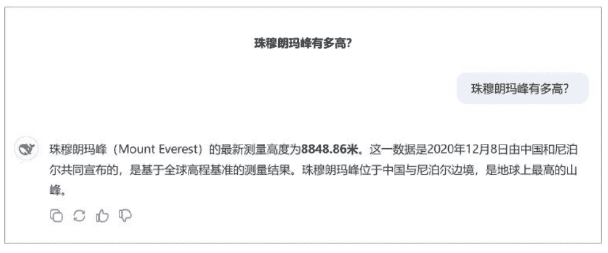

图 2-10

回复期间发送会变成停止 ⏹，点它可中断。

答案下方有 📋 复制、🔄 重新生成、👍 点赞、👎 踩的交互。

## 2.2.2 深度思考

提问区下方有“深度思考（R1）”按钮 🧠，点后会启用深度思考模式，展示推理链条，帮助理解依据。

目前开放 DeepSeek V3 和 DeepSeek R1 两个主模型，V3 可处理绝大多数任务，R1 在逻辑推理、写代码、解数学更强，但耗时更长，使用时酌情选择。

例如输入“如何给小孩子解释人工智能？”，点深度思考按钮，如图 2-11 所示，按 Enter。


图 2-11

此时模型会先思考而非立刻给出答案。

> 嗯，用户想用通俗方式让孩子理解 AI。得先考虑幼儿认知水平，避免专业术语，用孩子熟悉的事物比喻。玩具、智能音箱、会学习的娃娃都是好类比。还要把 AI 功能具象化：能看、能听、能学习。例子要生动有趣，避免“机器人统治”的负面表述。可提及局限：需要人类教、不能自主决策，缓解恐惧。核心是准确又童趣，激发兴趣。可加入互动提问，举生活中的智能设备例子。结构清晰，分点说明，用孩子喜欢的比喻，最后给家长按兴趣调整的建议，语言简短易懂。

然后给出答案，如图 2-12 所示：

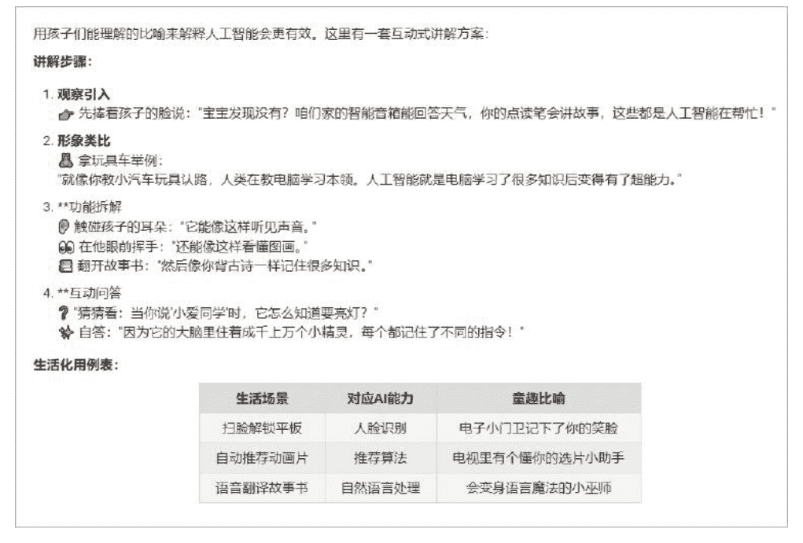

图 2-12

## 2.2.3 联网搜索

提问区下方还有“联网搜索”按钮 🌐，点后启用实时联网搜索，可获取最新信息。

例如输入“今天是星期几？有什么节日？”，点联网搜索，如图 2-13 所示，按 Enter。


图 2-13

可以看到，DeepSeek 从互联网查到 49 个网页后给出回答，如图 2-14 所示。

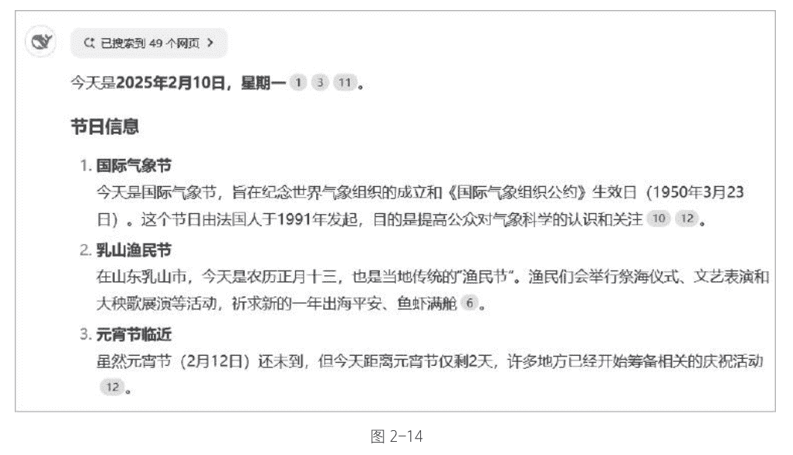

图 2-14

## 2.2.4 文件上传

提问区右侧有“文件上传”按钮 📎，点后可上传附件，最多 50 个，每个 100MB 以内，支持各类文档和图片。

上传后模型会按指令分析文件内容，输出详细结果，帮助快速获取要点。

例如上传一份法律文档，点“文件上传”按钮，在本地文件夹找到文档后点“打开”，如图 2-15 所示。

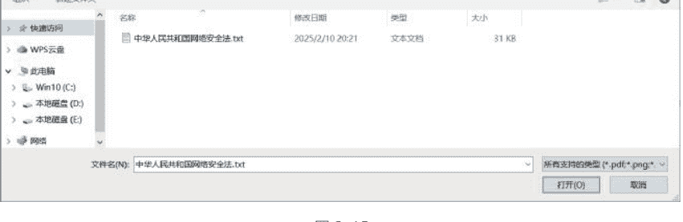

图 2-15

上传后在输入区输入“请提取这份文件的核心要点”，如图 2-16 所示，按 Enter。


图 2-16

> 《中华人民共和国网络安全法》是中国首部全面规范网络安全的法律，旨在保障网络安全、维护网络空间主权、保护合法权益。以下是核心要点：
>
> 1. 立法目的与适用范围
>    目的：保障网络安全，维护网络空间主权和国家安全，保护公民、法人和其他组织的合法权益，促进经济社会信息化健康发展。
>    适用范围：适用于在中华人民共和国境内建设、运营、维护和使用网络，以及网络安全的监督管理。
>
> 2. 网络安全基本原则
>    国家坚持网络安全与信息化发展并重，遵循积极利用、科学发展、依法管理、确保安全的方针。
>    国家制定并不断完善网络安全战略，明确保障网络安全的基本要求和主要目标。
>    ......
>
> 总结：《中华人民共和国网络安全法》通过明确网络运营者的责任、加强关键信息基础设施的保护、规范个人信息的收集和使用、建立监测预警与应急处置机制等措施，全面保障网络安全，维护国家安全和社会公共利益。

再上传一张图片让模型识别文字，如图 2-17 所示。


图 2-17

输入“识别图片中的文字”，如图 2-18 所示，按 Enter。


图 2-18

> 图片中的文字内容如下：
> "一场名著阅读的风暴，一次英语学习的革命！
> 中英双语对照，让英语学习变得更轻松、更简单！
> 提高英语阅读、理解能力的必备读本！"

## 2.2.5 开启新对话

对话区左侧有“开启新对话”按钮 🔄，点它可清空历史记录，开始全新会话。

让模型解释其功能，如图 2-19 所示。


图 2-19

> 在对话框左侧，“开启新对话”按钮的功能是允许用户开始新的对话会话。点击后系统会清除当前对话历史，并重新开始全新对话。这样可以帮助用户在不同主题或任务之间进行切换，而不会受到之前对话内容的影响。这对于需要处理多个独立任务或讨论不同话题的用户来说非常有用。

# 2.3 其他渠道访问 DeepSeek

DeepSeek 访问量大时常出现“服务器繁忙，请稍后再试”。除官网外，也可通过其他渠道使用，但体验和功能可能有差异。

## 2.3.1 DeepSeek 版本差异

DeepSeek-R1 系列有 1.5B、7B、8B、14B、32B、70B、671B 等版本，数字代表参数量。参数越多能力越强，能解决更复杂问题，但硬件要求也越高。

1.5B、7B、8B 等轻量版资源占用低，普通 GPU 如 RTX 3090、4090 即可流畅运行，适合本地搭建小型问答或文档助手。

70B 能力接近 GPT-4，擅长复杂逻辑推理、知识问答和决策类任务。

671B 是“满血版”，属顶级大模型，主要用于云端大规模推理，对硬件和算力要求极高，普通电脑无法承载。

## 2.3.2 本地部署

本地部署指将 DeepSeek 下载安装到本地电脑运行，不依赖网络或云服务。

部署完成后，电脑使用自身显卡等硬件资源进行推理。例如银行可将客户数据保留在本地安全环境，利用 DeepSeek 分析数据，避免上传云端泄露风险。

优点：
- （1）数据安全。数据不出本地，降低传输泄露风险。
- （2）速度提升。减少网络传输时间，快速调用本地硬件，响应更快。

局限：多数个人电脑仅能运行 32B 及以下模型，复杂任务效果差距明显。本地版不具备云端顶配功能，如无法实时更新、无多语言支持、缺乏官方技术支持，维护升级需自行处理，成本较高。

适合想研究模型运行机制、做技术学习和实践的人。

## 2.3.3 第三方渠道访问

### 1. 有哪些第三方平台

腾讯云、阿里云、百度云、字节火山、华为云、讯飞开放平台、国家超算互联网平台等均已接入 DeepSeek。一方面降低使用门槛，无需自建算力即可调用模型；另一方面依托第三方云计算基础设施提供更稳定高效服务，加速 AI 落地。

例如访问国家超算互联网平台，首页可见 DeepSeek 的访问链接，如图 2-20 所示。

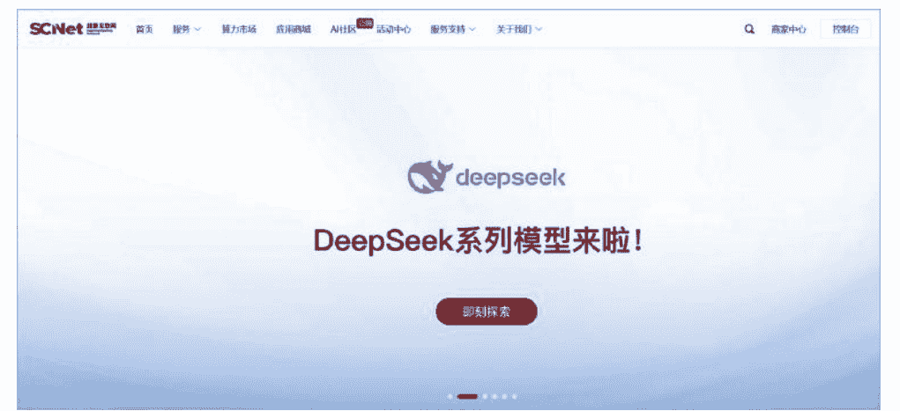

注意第三方渠道通常需单独注册并付费，追求稳定可尝试。

### 2. 硅基流动

硅基流动平台提供更经济的选择。

（1）进入官网用手机号码注册登录，进入图 2-21 所示界面。点击“模型广场”，选择“DeepSeek-ai/DeepSeek-R1”，点击“在线体验”。

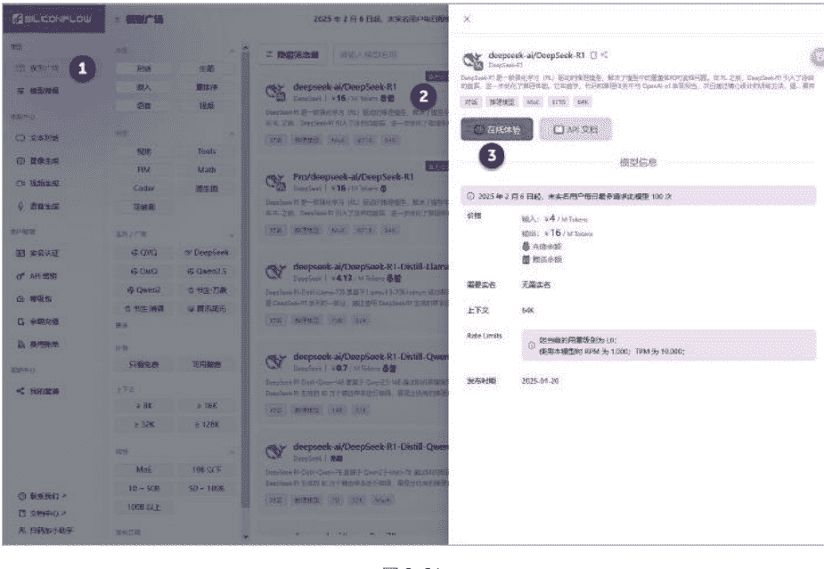

（2）选择“文本对话”，Model 设为“DeepSeek-R1”即可使用，如图 2-22 所示。

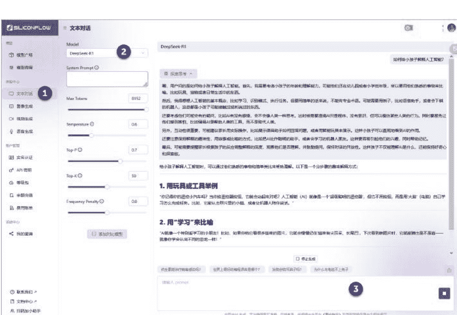

如需在其他软件中调用，需申请 API 密钥。

（1）点击“API 密钥”，在右侧点击“新建 API 密钥”，输入名称。
（2）点击“新建密钥”即可生成，如图 2-23 所示。

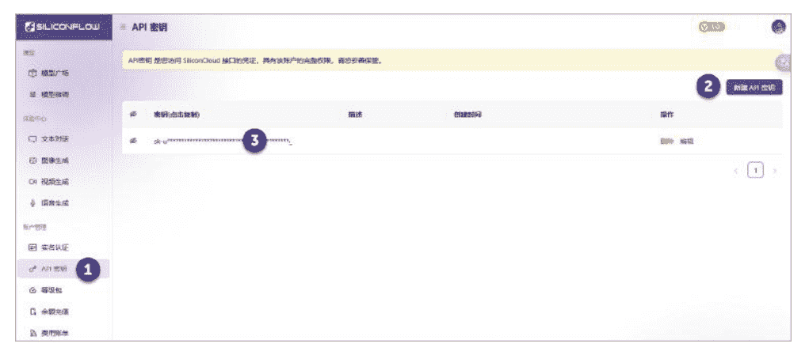

图 2-23

### 3. 使用 Cherry Studio 获得更好的访问体验

Cherry Studio 结合硅基流动的实操方式

API 到手后完全可以自己写程序去提问并取回结果，但对大多数用户来说，直接用现成的图形化客户端更省心。Cherry Studio 就是一个很合适的工具，它是一款开源免费的桌面客户端，跨平台支持 Windows、macOS、Linux，可接入多种模型服务，让用户按照不同任务在模型之间自由切换，发挥各自的擅长点，覆盖多样化使用场景。

下面以硅基流动为例，说明在 Cherry Studio 中的配置流程：

（1）下载安装 Cherry Studio。按操作系统前往官方网站或其他可信渠道下载对应安装包，下载完成后按安装向导逐步完成部署。

（2）配置 API 密钥。启动软件后进入“设置”，在设置菜单中找到“模型服务”，选择“硅基流动”，把在硅基流动平台获取的 API 密钥填入指定位置，点击“检查”验证是否生效，如图 2-24 和图 2-25 所示。这样即可通过 Cherry Studio 调用硅基流动上的模型。

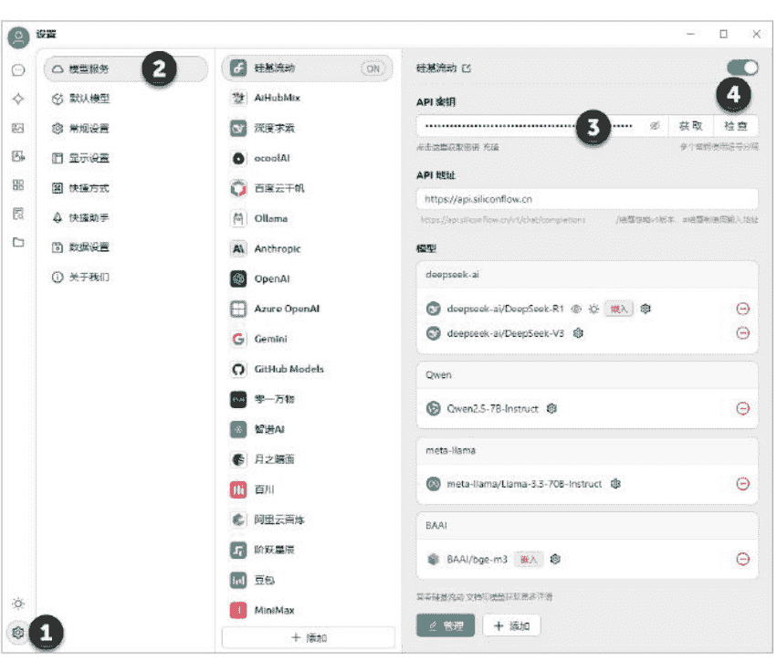

图 2-24

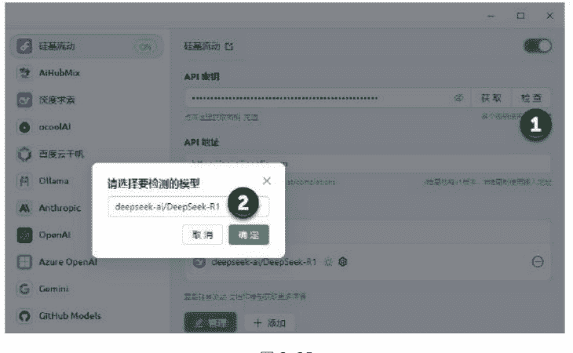

图 2-25

若目标模型未出现在列表中，可使用下方的“添加”和“管理”按钮进行扩充。

（3）配置问答助手。点击 🤖 图标，右键“默认助手”，在弹出列表中选择“编辑助手”，如图 2-26 所示。

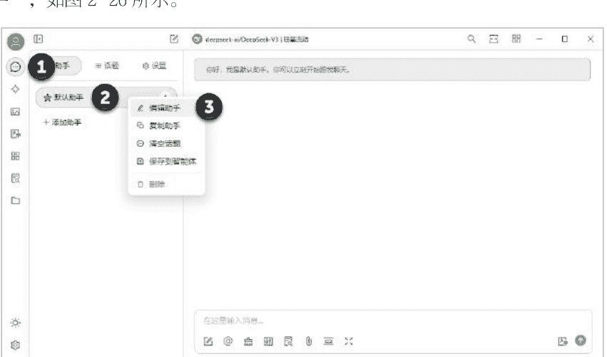

图 2-26

打开编辑界面后点击“模型设置”，在右侧点击“选择模型”，挑选“DeepSeek-ai/DeepSeek-R1”，如图 2-27 和图 2-28 所示。

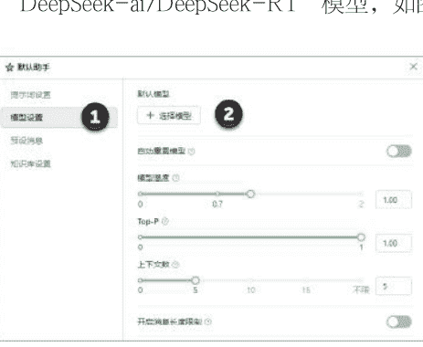

图 2-27


图 2-28

（4）返回对话主界面即可开始问答，如图 2-29 所示。

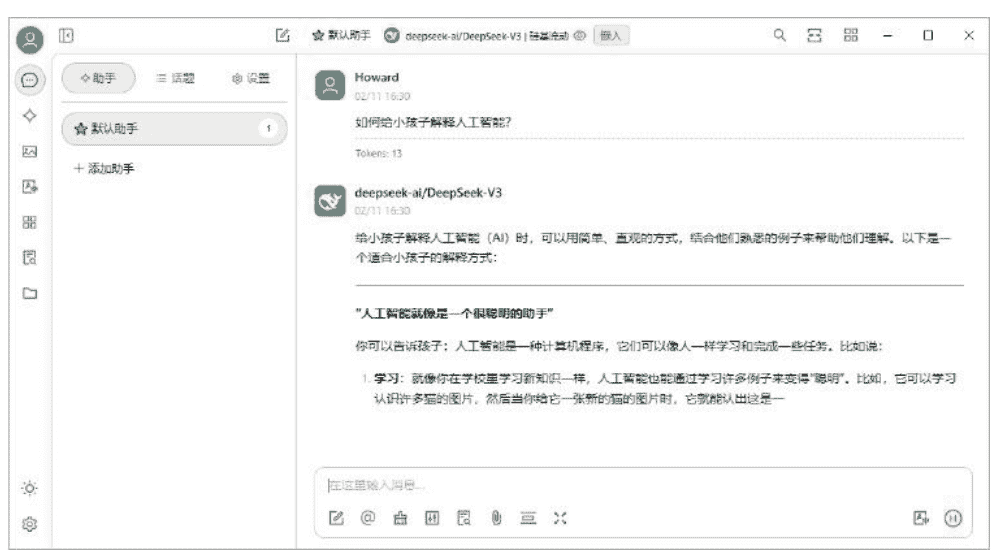

图 2-29

### 4. 使用知识库

假设你手上存有一些私密资料，比如个人工作文档、家族历史记录等。直接向 DeepSeek 这类通用模型提问时，因为模型没有学过这些专有信息，往往会答非所问。这时可以借助知识库来解决。

这里会用到嵌入模型，其作用是把私密资料转化为模型可理解的向量表示。通俗来说，嵌入模型会借助特定算法把文本、图像等资料转成一组数字向量，向量中包含了资料的关键特征和语义。模型随后可以基于这些向量做相似度计算。提问时，问题也会被转成向量，再在由私密资料构成的向量集合即知识库中检索最匹配的内容，基于匹配结果生成更准确的回答，从而弥补直接提问通用模型无效的问题。

具体操作步骤：

（1）在“设置”菜单点击“模型服务”，选择“硅基流动”，点击“管理”按钮，如图 2-30 所示。

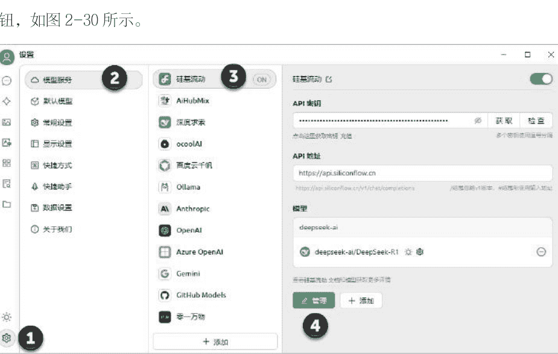

其中嵌入模型是搭建知识库时必须的。若当前没有合适的嵌入模型，可点击“添加”按钮补充，如图 2-31 所示。

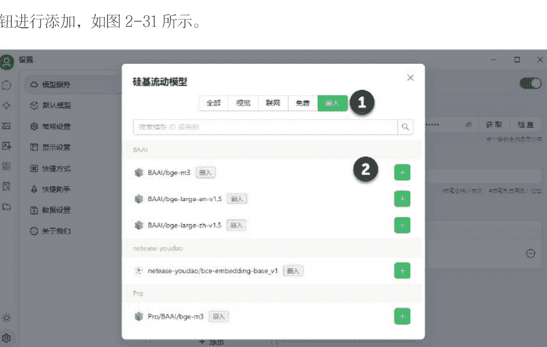

（2）回到主界面，点击 📚 图标，再点击“添加”，弹出“添加知识库”对话框，填写名称例如“日记”，选择需要的嵌入模型后点击“确定”，如图 2-32 所示。

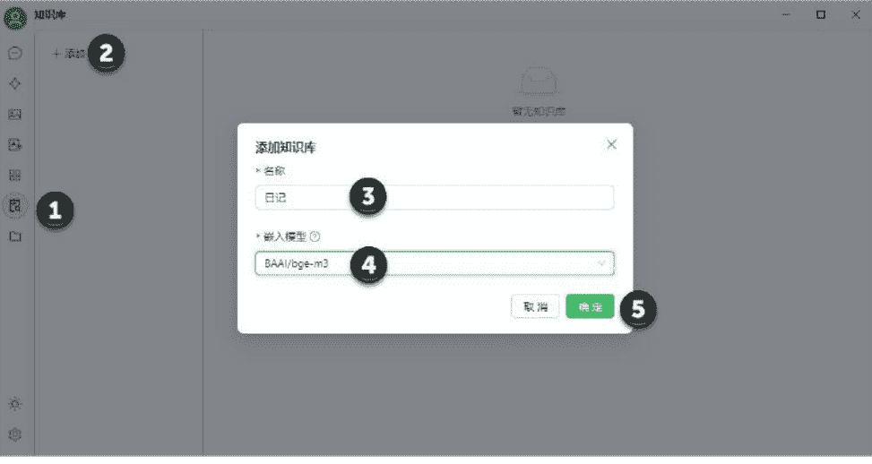

把个人资料拖入知识库，如图 2-33 所示。

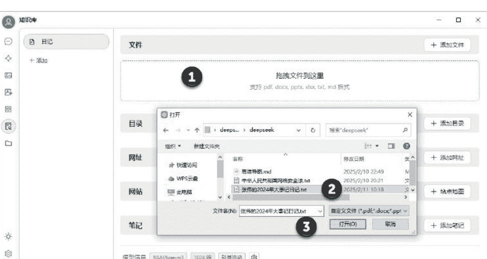

当资料文档右侧标识变为 ✅，即代表导入完成，如图 2-34 所示。

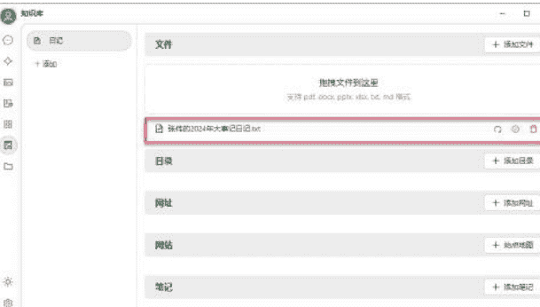

图 2-34

在“默认助手”对话框中点击“知识库设置”，为助手关联新建的知识库，如图 2-35 所示。


图 2-35

随后提问：“张伟的女朋友是谁？”，DeepSeek 在已上传的资料中查到答案并给出回应，如图 2-36 所示。

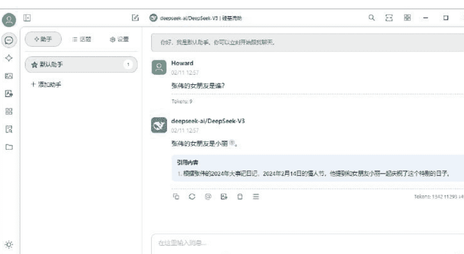

图 2-36

对比未使用知识库时的回答，如图 2-37 所示。

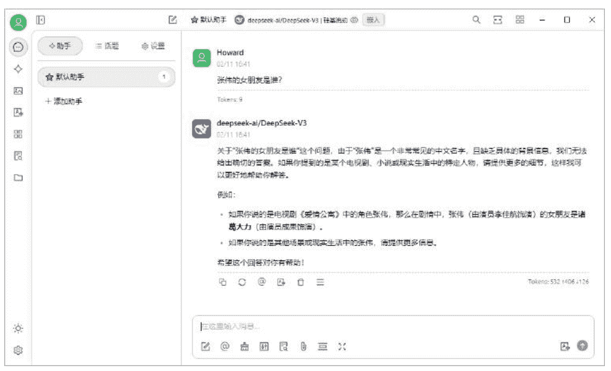

图 2-37

# 第 3 章 DeepSeek 高效对话指南

## 提问有术，让智能更给力

在智能时代，DeepSeek 可被看作“超级大脑”，在信息获取和问题解决中作用突出。很多人觉得 DeepSeek 是推理模型，交流不需要技巧，其实并非如此。即便它已摆脱传统提示工程的繁琐，要想发挥更大效能，仍需遵循智能交互的基本原则。

# 3.1 推理协作：自主与引导如何兼顾

不少人认为 DeepSeek 推理能力强，只需抛需求它就会自动完成，无需干预。事实上，自主推理虽强，但恰当的引导同样关键，二者配合才能达到最佳效果。

## 3.1.1 模型的自主推理能力

DeepSeek-R1 系列经过强化学习训练，推理时会进行大量反思和校验，思维链较长。面对数学、代码、复杂逻辑类任务，它能自行调动所学知识进行分析和推导。例如解数学题时，它可自主判断题型并套用相应公式逐步求解；在处理代码时，能读懂逻辑、定位问题并给出修正建议。

## 3.1.2 引导为何不可或缺

即便自主性强，引导依然必要。因为提问模糊或过于宽泛时，模型难以准确把握意图，回答就会变得笼统。例如问“科技股能买吗？”，缺少投资期限、风险承受能力、关注范围等关键信息，模型只能给出泛化的市场分析，难以提供针对性建议。

从训练机制看，模型虽学习海量数据，对具体场景和个性化需求仍需用户明确表达。就像一位博学的人，若不了解你的具体情况，很难给出最合适的建议。因此，通过有效提问引导模型聚焦核心，能显著提升回答的准确性和实用性。

## 3.1.3 引导技巧实战

### 1. 构建结构化提问框架
把开放式问题改写成结构化指令能大幅提升理解度。比如学习类问题，把“如何学好英语”细化为“我要制定一个每天 1 小时、侧重商务口语的 3 个月提升计划，请按周拆解目标并推荐训练方法”，明确时长、场景和需求后，得到的方案会更具体。

角色扮演也是有效手段。先设定身份，如“假设你是新东方金牌讲师，为工作 5 年的外贸专员设计英语突破方案”，模型会调用更专业的知识，输出更贴合角色的答案。

### 2. 提供详细背景信息
背景越清晰，回答越贴切。投资建议场景里，说明财务状况、投资目标、风险偏好，模型才能综合考量。例如告知“可投资金 50 万，期限 5 年，能承受一定波动，希望长期收益最大化”，比单纯问投资建议得到的结论更有参考价值。

### 3. 多轮交互与持续优化
通过多轮对话可以不断打磨答案。对不满意的结果，可要求模型自我反思和改进。比如对一个营销方案提问“请对上述方案做至少 3 轮自我反驳，并给出更合理的版本”。模型会重新审视不足，输出更完善的方案。

在与 DeepSeek 协作时，要兼顾其自主推演优势和引导技巧的必要性，二者结合才能让它成为学习、工作和生活中的得力助手。

表 3-1 汇总了一些实用的提示词技巧。

| 序号 | 技巧名称 | 描述 |
| :--- | :--- | :--- |
| 1 | 思维链激活术 | 用“请分三步论证……”这类指令激活模型的强化学习系统，引导其进行逻辑推理和深度思考。如要求“请分三步论证新能源汽车未来五年的发展趋势，分别从政策、技术和消费者需求分析”，可让推理更有条理 |
| 2 | 场景加载法 | 设定角色身份加上“我正在……需要……”，如“作为风险管理总监，我正在准备董事会，需要一份公司当前市场风险的详细评估报告”，帮助模型理解具体情境，输出更贴合应用 |
| 3 | 迭代进阶策略 | 按“初版方案→漏洞排查→升级版本”的对话顺序逐步优化。例如先生成产品设计初稿，再让模型检查“成本过高和用户体验不佳的问题”，最后基于反馈生成升级版 |
| 4 | 多模态唤醒 | 结合“用表格对比”“生成示意图”等可视化要求，让信息呈现更直观。如“用表格对比我司与主要竞争对手在性能、价格、市场份额的差异，并生成柱状图展示” |
| 5 | 领域深挖模组 | 叠加“从法律/金融/伦理等三个维度分析”等专业限定，深入挖掘。如“从法律合规、金融风险和伦理道德三方面分析该商业模式的可行性”，实现多角度剖析 |

# 3.2 DeepSeek 提问的典型模式

## 3.2.1 目标澄清术：把需求说清楚

准确传达需求是获取理想答案的基础。目标澄清术包含对象锚定法、痛点具象术和黄金圈提问法三种策略。

### 1. 对象锚定法
明确服务对象的身份特征，让需求更具针对性。效果对比见表 3-2。

表 3-2

| 对比维度 | 未采用对象锚定法 | 采用对象锚定法 |
| :--- | :--- | :--- |
| 提问示例 | 写一篇健康饮食文章 | 为患糖尿病的老年人写健康饮食文章，重点介绍适合他们的低糖高纤维食物及搭配原则 |
| 分析 | 受众不明，文章会比较泛化，缺乏针对性 | 明确了特定人群，内容会围绕其身体状况、饮食禁忌和营养需求展开，更实用 |

### 2. 痛点具象术
使用“现状－预期＝阻力项”的公式，把现状、目标和阻碍清晰呈现，帮助模型精准拆解问题。对比见表 3-3。

表 3-3

| 对比维度 | 未采用痛点具象术 | 采用痛点具象术 |
| :--- | :--- | :--- |
| 提问示例 | 店铺生意不好怎么改善 | 我们奶茶店上月销售额 2 万，去年同期 3 万，本月目标 3.5 万。但周边新增 3 家同类店，成本因原材料上涨 15%，该如何提升销售额 |
| 分析 | 问题模糊，建议易流于表面 | 现状、目标和竞争、成本等阻力都已明确，模型能给出有针对性的建议 |

### 3. 黄金圈提问法
按 why-how-what 的顺序梳理问题，先说目的，再谈方法，最后点明结果，引导模型系统思考。对比见表 3-4。

表 3-4

| 对比维度 | 未采用黄金圈提问法 | 采用黄金圈提问法 |
| :--- | :--- | :--- |
| 提问示例 | 优化公司会议流程 | 近期会议效率低、耗时长但决策慢 why。议程不清、讨论跑题、决策机制模糊 how。希望建立高效流程，每次会议明确关键决策点且时长缩短 30% what，请给方案 |
| 分析 | 仅给出常规优化建议 | 全面阐述原因、现状和期望结果，模型能提出系统方案 |

## 3.2.2 情境构建术：给问题加背景

为问题构建合适情境能帮助模型更好理解需求。包含时空坐标系、角色扮演法和隐喻嫁接术。

### 1. 时空坐标系
绑定具体的时间和空间锚点，丰富背景信息。对比见表 3-5。

表 3-5

| 对比维度 | 未采用时空坐标系 | 采用时空坐标系 |
| :--- | :--- | :--- |
| 提问示例 | 推荐一些好玩的地方 | 下周六我和朋友去上海游玩，上午 10 点到虹桥站，晚上 8 点从上海站返程，喜欢文化艺术和美食，请推荐地点并规划行程 |
| 分析 | 缺少时间地点，推荐可能不匹配 | 时间、地点和喜好明确，推荐更贴合实际行程 |

### 2. 角色扮演法
让模型从不同角色视角审视问题，提供更全面方案。对比见表 3-6。

表 3-6

| 对比维度 | 未采用角色扮演法 | 采用角色扮演法 |
| :--- | :--- | :--- |
| 提问示例 | 设计小区儿童游乐区 | 假如你是带孩子的家长，希望游乐区有哪些设施。再从物业角度考虑成本和维护，如何规划 |
| 分析 | 单一角度，方案可能有偏 | 综合多角色需求，设计更平衡 |

### 3. 隐喻嫁接术
把抽象问题映射到生活常见场景，便于理解。对比见表 3-7。

表 3-7

| 对比维度 | 未采用隐喻嫁接术 | 采用隐喻嫁接术 |
| :--- | :--- | :--- |
| 提问示例 | 解释区块链技术 | 用图书馆借书系统类比区块链，每本书是数据块，借阅记录是交易记录，管理员和借阅者共同维护记录类似节点共识，请详细对应并解释原理 |
| 分析 | 直接解释概念抽象难懂 | 借助生活场景类比，理解更形象直观 |

## 3.2.3 结构优化术：用框架理清思路

合理优化问题结构能让回答更具逻辑性。包含三幕剧模型、决策树预演和反向验证法。

### 1. 三幕剧模型
用“背景-冲突-解决方案”描述问题，帮助模型快速抓住核心。对比见表 3-8。

表 3-8

| 对比维度 | 未采用三幕剧模型 | 采用三幕剧模型 |
| :--- | :--- | :--- |
| 提问示例 | 我们公司遇到问题该怎么解决 | 我司在某地区市场份额半年内从 20% 跌至 15% 背景，主要因竞争对手推出更高性价比产品抢走客户 冲突，请给出半年内把份额提至 25% 的方案 解决方案 |

**提问清晰度怎么影响答案质量**

| 观察角度 | 表述不清 | 表述到位 |
|---|---|---|
| 实际效果 | 背景交代不足，困境说得笼统，模型抓不住重点 | 把份额下滑的成因、对手带来的冲突以及期望结果讲明白，模型才能深挖并给出可操作的方案 |

### 2. 决策树预演
决策树预演的思路是先把决策过程中可能出现的分支提前罗列出来，引导模型逐条推演不同路径的风险与资源需求，从而做出更稳妥的判断。参考表 3-9。

表 3-9

| 对比维度 | 没有分支预演 | 有分支预演 |
|---|---|---|
| 提问示范 | 团队要做营销，有什么建议 | 若这次营销选线上直播，需要留意哪些风险比如网络中断、主播突发状况，需准备哪些资源比如直播设备、人员、投放渠道；若选线下活动，可能碰到哪些阻碍比如场地限制、天气变化，对应的对策是什么 |
| 说明 | 问得太宽泛，回答容易偏向单一视角 | 用分支式提问，模型会把各类玩法拆开分析，输出更全面的决策参考 |

### 3. 反向验证法
反向验证法先把成功标准和失败特征写清楚，让模型做正反对照，从而把握问题本质并给出更落地的建议。参考表 3-10。

表 3-10

| 对比维度 | 未用反向验证 | 用了反向验证 |
|---|---|---|
| 提问示范 | 怎么做好客户关系管理 | 请列出客户关系管理成功的三项关键指标例如满意度达90%以上、复购率提升三成、投诉率低于5%，再列出三项典型的失败表现例如客户大量流失、投诉处理迟缓、满意度持续走低，并据此提出提升建议 |
| 说明 | 问题偏笼统，多为常规建议 | 先界定成败标准，模型理解更深入，能给出更有针对性和可执行性的优化方案 |

## 3.2.4 语言调谐术：说得准，沟通更顺
和 DeepSeek 交互时，表达方式直接决定答案好坏。语言调谐术是交互效能金字塔的关键维度，包含知识剥笋法、方言适配术和要素标记术三种策略。

### 1. 知识剥笋法
先给基础定义，再用形象类比，最后落到实际应用，把复杂概念层层展开。参考表 3-11。

表 3-11

| 对比维度 | 未用剥笋法 | 用了剥笋法 |
|---|---|---|
| 提问示范 | 给我解释量子计算 | 先说明量子计算的核心概念如量子比特、量子纠缠，再用超市收银台排队作比喻说明传统与量子的并行差异，最后介绍其在密码学领域的应用场景 |
| 说明 | 直接提问容易得到专业抽象的解释 | 先概念后案例再应用，解释更系统、易懂且深入 |

### 2. 方言适配术
根据受众调整语言风格，确保信息被准确接收。参考表 3-12。

表 3-12

| 对比维度 | 未做受众适配 | 做了受众适配 |
|---|---|---|
| 提问示范 | 介绍机器学习技术 | 对技术小白，用学骑自行车来比喻机器学习；对专业程序员，从算法原理和数据处理角度展开 |
| 说明 | 不考虑差异时回答偏通用 | 适配受众后，模型能因材施教，给出更精准的信息 |

### 3. 要素标记术
用符号或结构化方式标注核心诉求、时限和存疑点，帮助模型优先处理重点。参考表 3-13。

表 3-13

| 对比维度 | 未用标记术 | 用了标记术 |
|---|---|---|
| 提问示范 | 帮我设计一个新 App，要功能丰富、界面好看，尽快完成 | 【为年轻白领设计社交类 App】要求三十天内交付，功能含即时通讯、兴趣圈子、活动发布，界面简约时尚且易用。活动发布功能的实现方式希望提供多种可选方案 |
| 说明 | 需求边界不清，模型难判断优先级 | 标记后模型能快速捕捉核心诉求和紧迫程度，给出更贴合的方案 |

## 3.2.5 效能验证术：让方案可检验
效能验证术用于评估结果价值并持续优化，包含沙盘推演法、容错检验术和迭代加速器。

### 1. 沙盘推演法
设定阶段目标和关键验证指标，模拟执行过程以便提前调整。参考表 3-14。

表 3-14

| 对比维度 | 未用沙盘推演 | 用了沙盘推演 |
|---|---|---|
| 提问示范 | 制定一个新品推广计划 | 制定新品推广计划，按首月、第二至第三个月、第四至第六个月三个阶段预测效果，每个阶段明确验证指标如首月曝光达五十万次、第二至第三个月注册增长二十万、第四至第六个月销售额达一百万 |
| 说明 | 通常只得到大框架 | 加入阶段划分和指标后，计划更具规划性和可衡量性 |

### 2. 容错检验术
提前预判突发情况并准备预案，增强方案稳定性。参考表 3-15。

表 3-15

| 对比维度 | 未做容错检验 | 做了容错检验 |
|---|---|---|
| 提问示范 | 制定户外音乐节策划方案 | 制定户外音乐节方案，并分析实施中可能出现的三类突发如恶劣天气、艺人临时爽约、设备故障，并给出对应应急预案 |
| 说明 | 未评估风险，遇到意外易混乱 | 提前设想风险，方案更稳健可行 |

### 3. 迭代加速器
明确优化方向和目标值，促使模型给出针对性改进建议。参考表 3-16。

表 3-16

| 对比维度 | 未设定优化目标 | 设定优化目标 |
|---|---|---|
| 提问示范 | 优化网站页面设计 | 基于当前页面，从加载速度提升五成、交互体验提升三成两个方向各给出三条优化建议 |
| 说明 | 建议偏宽泛 | 目标明确后，模型能围绕要求深入分析，提供更具针对性的优化点 |

# 3.3 提问优化实战案例

## 3.3.1 场景化优化版
**原问：** 下周家庭聚餐备食材，已有大米和酱油，请列出还需购买的。

**优化问：对象锚定 + 时空坐标** 【多代同堂聚餐规划】家里有两位需要控糖的长辈和一名五岁儿童，定于四月二十日周六中午举办八人家庭聚会。

- 现有：大米五公斤、酱油一瓶、鸡蛋二十枚
- 采购需求：1. 蛋白质类要适合控糖食谱；2. 儿童喜爱的菜品，避免鱼刺和常见过敏原；3. 时令水果，可室温存放三天以上
- 排除：含糖饮料、高胆固醇食材

> **精准采购清单**
> 蛋白质：三文鱼块、去皮鸡腿肉、内脂豆腐
> 儿童菜：奶酪焗南瓜、猪肉菜丸子去骨
> 水果：富士苹果、麒麟西瓜
> 避坑提示：凉拌菜建议用赤藓糖醇替代蔗糖

## 3.3.2 决策树优化版
**原问：** 想安排一次为期三天的杭州旅行。

**优化问：黄金圈法 + 容错检验**
背景：六旬父母首次江南游，父亲膝盖术后恢复期
核心诉求：每日步行不超过八千步、避开人潮、体验非遗
约束：住宿五百元每晚需电梯、午间休息一小时
请按天给出交通 + 景点组合 + 应急预案。

> **适老化行程框架**
> 首日沉浸体验：上午水上巴士七号线拱宸桥至小河直街，下午中国伞博物馆
> 次日自然养生：上午龙井馆区茶道体验，下午九溪烟树电瓶车游览，溪边茶室午休
> 应急：随身折叠凳、景点间商务车接送、医疗联系清单

## 3.3.3 反馈整合版
**原问：** 帮我检查市场分析报告。

**优化问：反向验证 + 沙盘推演** 以投资人视角用 SWOT 拆解报告：
- 优势论证不足点，需补充环比数据
- 威胁缺失项，需预判政策风险
- 交叉验证需求，需第三方数据源比对
附整改对照表。

| 不足 | 改进建议 | 验证方式 |
|---|---|---|
| 市场份额预测无竞品对比 | 加入波特五力分析 | 艾瑞 / IDC 数据锚定 |
| 政策风险仅提反垄断 | 增加数据安全法合规成本测算 | 金杜律所白皮书 |
| 用户增长假设线性 | 改用蒙特卡洛模拟 | @Risk 软件验证 |

## 3.3.4 模块化设计版
**原问：** 设计旅行计划模板。

**优化问：要素标记 + 迭代加速器** 构建可配置旅行引擎。
- 基础模块必选：交通、住宿、保险
- 扩展包按需加载：摄影跟拍、本地学者讲解、医疗支援
- 突变响应：极端天气自动转室内方案

> **弹性行程架构**
> 核心参数：安全冗余度≥15%，日均本土接触点≥3
> 动态包：亲子版加入 STEAM 教育点位，商务版加入 CEO 晨跑路线

## 3.3.5 情感共鸣版
**原问：** 写封感谢信给朋友。

**优化问：时空坐标 + 痛点具象** 围绕三件事：二零一九年创业失败时的资金支持，二零二一年手术期间陪护，二零二三年离婚诉讼法律援助。每段嵌入当时触觉细节。

> **五感记忆唤醒**
> 记得二零一九年冬夜办公室咖啡酸味，你递支票时指尖的温度，说失败就当交学费的沙哑声。记得二零二一年监护仪滴声中你削苹果的清香，凌晨三点轮椅扶手的冰凉……

# 第4章 生活场景：AI 变身贴身管家
快节奏生活中琐事繁多。AI 能在十个常见场景提供支持，重塑智能生活方式。

# 4.1 智能食谱：变废为宝，一键搞定晚餐
下班回家面对冰箱里散落食材不知做何。AI 可根据存货给出低卡营养方案。

> 冰箱有两枚鸡蛋、一根黄瓜、半颗西兰花、一小块豆腐、虾仁、挂面、白菜。近期减脂，时间有限，希望一小时内完成低卡菜。

推荐：
1. 黄瓜虾仁炒蛋：鸡蛋打散加盐，黄瓜切片，虾仁煸炒后加黄瓜再倒入蛋液翻匀出锅
2. 西兰花豆腐汤：西兰花焯水一分钟，白菜丝煸炒加水，放入豆腐和西兰花煮五到八分钟调味

# 4.2 旅行规划师：定制路线，住行全搞定
计划二零二五年三月去京都七天，偏好历史遗迹与在地文化，预算约一万五千元，住地铁附近。

建议行程：
首日抵达入住四条河原町，下午二条城，品京都料理
次日清水寺、伏见稻荷千本鸟居
第三日岚山竹林、嵯峨野观光小火车
第四日金阁寺、北野天满宫
第五日茶道体验、市区自由
第六日奈良一日游东大寺与奈良公园
末日市区散步购纪念品返程

# 4.3 家庭财务管家：收支分析，储蓄有规划
月收入一万五千，固定支出房租三千、车贷两千，变动支出约四千，希望每月存两千。

建议将变动支出压至三千内，设两千储蓄目标，减少堂食，优先公交，减少打车。投资可考虑指数基金或债券型基金，风险低收益稳。

# 4.4 社交活动策划：按兴趣聚会，告别烦恼
周末朋友都空，喜欢户外运动和桌游。

周六上午森林公园徒步，中午野餐。下午轰趴馆桌游派对，晚餐火锅。周日上午郊外马场骑马，下午市区咖啡甜品店休闲。

# 4.5 购物清单：按需生成，不再遗漏
为下周家庭聚餐备菜，已有大米酱油。

建议采购鸡胸肉、青菜、土豆、胡萝卜、盐、糖、食用油，外加饮料与甜点如橙汁、蛋糕。采购可选附近大型超市促销或生鲜电商平台。

# 4.6 家居装修咨询：设计与色彩轻松拿捏
喜欢现代简约，墙面浅色。

建议主色米白，配深灰家具与木质装饰，软装点亮色抱枕如黄或蓝。灯具可选北欧风吊灯，宜家款式简洁，配智能调光更灵活。墙角不直可先填缝剂修补再打磨，情况严重建议专业工人处理。

# 4.7 亲子作业急救包：创意方案快速落地
孩子需做环保手工，有废报纸、塑料瓶、彩色卡纸。

方案：报纸卷球作地球胚体，卡纸剪出大洲轮廓贴上，塑料瓶剪孔插绿植象征环保。

动手制作地球模型可以按四步进行。

> 想知道这个地球模型的制作流程吗？
> 下面给出清晰的操作思路。

先把旧报纸撕碎泡水揉成球状，晾干备用。
再用彩色卡纸剪出大陆轮廓，涂胶粘于纸球表面。
接着在塑料瓶侧面开几个孔洞，填入培养土，种上多肉或苔藓等迷你植物。
最后把做好的球体摆在瓶旁，形成环保主题的陈列。

# 4.8 表亲婚礼礼金参考

表弟下个月大婚，对礼金数额拿不准，便向 DeepSeek 请教四川的习俗。

> 我和即将结婚的表弟是表亲，四川这边通常包多少合适？

> 在你所在的区域，表亲婚礼常见的区间在六百到一千元。若平日走动频繁关系亲近，八百到一千元更稳妥；若联系较少，六百元也在合理范围。可结合自身经济情况小幅调整，但最好不要低于本地平均水平，以免失礼。

# 4.9 家长会应答：数学成绩回落如何表达

期中考试成绩发布，数学偏弱，其余科目尚可。担心家长会上老师提问，提前准备回应思路。

> 孩子这次期中数学偏弱，其他科目还行。老师可能会问我对学习的规划，我该怎么回？

（1）表明重视
老师，我很在意孩子的学习。这次数学退步，我们都很着急。已和他一起复盘试卷，发现概念理解和应用题思路有薄弱点。
（2）制定计划
接下来会陪他制定针对性复习方案，每天固定时段训练数学。也引导他遇到难题及时向老师同学请教，争取早日提升。
（3）主动求助
恳请您在校多关注他的数学学习，有问题请随时联系，我们共同帮助孩子进步。
（4）强调全面
我也明白全面发展重要，会持续关注其他科目的优势，保持长处并补齐短板。

# 4.10 车位遭占用维权四步

下班返家发现固定车位被陌生车辆占用，多方寻找车主无果，于是上传现场照片请 DeepSeek 给出合法维权路径。

> 停车位遭占用，联系不到车主，该怎么办？

（1）联系物业
先联系小区物业说明情况，提供车位位置及占用车辆信息。物业掌握业主车辆登记，可协助联系挪车。
（2）查询电话
若物业无法联系，可拨打122或114。122说明位置与车牌，接线员可协助查询并通知；114选择挪车服务，按提示输入信息尝试获取电话。
（3）报警处理
以上渠道仍无效可报警，出示现场照片和车位证明材料。警方会通知车主挪车，并对违规行为警告或处罚。
（4）避免私自报复
维权时保持冷静，不要刮擦车辆或锁轮等过激行为，以免产生法律风险并激化矛盾。

# 第 5 章 工作场景：DeepSeek 赋能职场效率

快节奏的职场里，效率决定竞争力。DeepSeek 在多个工作场景提供支持，下面通过案例说明具体应用。

# 5.1 会议记录快速整理

某网络公司召开产品更新讨论会，研发、市场、客服等多部门参会。信息分散、观点零散，以前整理纪要耗时易遗漏，导致执行偏差。

> 请把附件中的会议内容整理成记录，突出结论和后续动作。

> 本次会议围绕产品更新展开。功能上确定新增智能推荐，由研发一部承担，预计开发周期约[X]周。用户体验方面需简化操作流程，设计组须在[X]天内给出初稿。市场推广计划下季度开展大规模线上营销，市场部负责策划执行。客服需收集近期客户反馈，聚焦高频问题，于[X]周前提交分析报告。

# 5.2 周报快速生成

电商运营工作量大，数据需从多平台导出分析，促销期数据激增常导致加班出错。

> 我是电商运营，本周负责店铺促销策划执行，活动期间浏览量增长20%，成交量提高15%，好评率达90%，同时处理5起客户投诉。请基于附件运营数据生成本周工作汇报。

本周工作汇报
姓名：[姓名]
部门：电商运营部
（1）本周工作内容：负责店铺促销策划执行，通过[具体促销方式]吸引顾客，浏览量增长20%，成交量提高15%。
（2）工作成果：客户好评率达90%，期间处理5起投诉均已妥善解决。
（3）下期安排：继续优化活动策略，提升满意度，关注反馈，力争好评率提升至92%以上。
DeepSeek 按模板快速生成规范汇报，只需核对即可提交，节省大量时间。

# 5.3 简历匹配优化

求职市场竞争压力大，简历需突出匹配技能。求职者应聘市场营销岗位，要求有推广经验、数据分析能力及文案撰写能力。

> 我有3年市场营销经验，参与多项线上推广，其中一项通过用户画像分析使该产品的市场份额提升10%，还负责撰写市场调研报告。按岗位要求帮我优化简历。

> 已按岗位要求完成优化。在工作经历中突出你通过用户画像分析实现市场份额提升10%的成果，并细化数据分析在策划中的作用。同时强化撰写市场调研报告的经历，体现文案与数据能力，简历更贴合需求。优化后版本已生成，可复制查看。
优化后简历精准匹配，面试机会明显增加。

# 5.4 智能邮件回复

外贸沟通受时差语言影响，回复客户询价、交期、定制等问题需迅速专业。

> 帮我回复客户邮件，产品A单价10美元，正常交期30天，定制延长15天，定制含颜色和包装。

> 尊敬的客户，感谢来信。产品A价格为每件10美元，正常交期30天。如需定制服务，可提供颜色和包装定制，交期将在原基础上延长15天。如有其它疑问请随时联系。祝商祺！[您的名字]
DeepSeek 快速生成专业回复，业务人员确认后即可发送。

# 5.5 合同审查助力

合同条款繁多，人工审查易遗漏隐藏风险，且不同律师判断差异大。

> 帮我审查合同，重点看条款是否有法律风险，违约责任是否明确。

> 审查发现付款方式表述模糊，建议明确具体时间和方式以避免纠纷。违约责任对甲方乙方的约束程度不同，存在风险，建议调整为对等。风险点和修改建议已标注在文档中。

# 5.6 报销单核查

报销常因发票抬头、金额、盖章等不规范被退回，影响资金周转。

我有一批发票请帮忙检查是否合规。
检查结果存在以下问题：
- 发票抬头错误：[具体发票编号]
- 发票金额不符：[具体发票编号]
- 缺少必要签字或盖章：[具体发票编号]
这些问题可能导致财务拒报，请尽快修正。修正后即可顺利完成报销。

# 5.7 日程规划师

咨询师同时负责多项目和会议，易出现时间冲突。

> 今天上午十时至十一时三十分、下午十五时至十六时三十分各有一场项目会，晚上十九时至二十一时有培训，下午十四时前要完成项目报告初稿，期间还要回重要邮件。帮我安排。

安排如下：
上午九时至十时集中回复重要邮件，十时至十一时三十分参加首个项目会，十一时三十分至十三时撰写报告初稿。
下午十三时至十四时继续完成初稿，十四时至十五时休息调整，十五时至十六时三十分参加第二个项目会，十六时三十分至十九时处理项目日常事务，十九时至二十一时参加培训。
安排合理，各项任务有序推进。

# 5.8 市场数据分析助手

食品企业新品调研数据量大，维度多，人工分析易不完整。

> 我们收集了过去一个月不同城市、年龄、性别消费者对薯片口味的问卷数据，请分析最受欢迎口味、目标人群及城市差异。

分析结果：番茄味最受欢迎，占比45%。
目标人群集中在十五至三十五岁年轻群体，女性偏爱番茄味和酸奶味，男性更倾向烧烤味和原味。
城市差异：一线城市对新奇口味接受度高，酸奶味在一线受欢迎程度比中小城市高15%；中小城市更偏爱经典口味，烧烤味选择率比一线高10%。已生成可视化报告。

# 5.9 裁员谈判助手

裁员时员工常不熟悉法规，不知道补偿是否合理。

> 公司要辞退我并给出补偿方案，请计算应得赔偿并提供协商建议。

赔偿应包括：
- 经济补偿：按每满一年支付相当于一月薪资的标准。
- 代通知金：未提前30天通知需额外支付一月薪资。
协商建议：
- 确认具体赔偿金额并要求书面合同。
- 要求公司出具离职证明，便于求职。
- 探讨其它补偿，如培训补贴或推荐信。

# 5.10 跨部门协作责任厘清

跨部门项目中职责不清易导致推诿，影响进度。

> 请分析新产品上线跨部门邮件，市场、研发、生产三方在上线时间与特性调整责任不明，请找出模糊表述并给出明确方案。

模糊表述：
（1）“尽快完成产品特性调整，以便按时上线”，未明确具体时间与负责人。
（2）“市场部配合研发部完成相关工作”，未说明配合内容和完成时限。

# 第 6 章 学习场景：DeepSeek 赋能学习跃升

知识迭代加快，学习障碍频现。DeepSeek 为不同学习场景提供解决方案，助你突破瓶颈。

# 6.1 论文写作指导

高校学生和科研人员写论文常卡在选题、资料筛选、框架构建和表达上。

> 我要写人工智能在教育领域应用前景的论文，完全无头绪，请帮忙！

先从结构入手。建议框架：
（1）引言，介绍AI与教育发展现状，说明研究背景与意义。
（2）主体，AI在教育中的具体应用，如智能辅导、定制化推荐，以及积极影响和面临挑战。
（3）结论及未来展望，总结成果并预测发展趋势。
资料收集可利用知网、WOS，关键词如“人工智能教育应用”“人工智能在教育中的挑战”。

> 资料太多太杂且矛盾，如何筛选整理？

按论文框架有针对性挑选。对矛盾观点，注意来源权威性与发表时间，如权威期刊近期成果可信度较高。可建资料整理表，按来源、核心观点、相关性分类，会更清晰。

> 我开始写作，但描述AI在智能辅导中的应用时感觉啰嗦，专业性不足。

可参考经典文献表达。例如：‘人工智能在智能辅导系统中主要通过机器学习算法实现，能对学生学习数据进行深度分析，精准识别知识薄弱点，进而提供定制化学习路线和实时辅导建议。’术语使用要解释清楚。

# 6.2 外语口语陪练

全球化背景下外语学习需求上升，传统方式缺少真实语境和即时反馈，听说能力难以提升。

我正在学日语，想提高口语，但身边无练习伙伴，也无合适语言环境，进步很慢。DeepSeek，能怎样助力？

想营造沉浸式的日语学习氛围，线上资源是捷径。HelloTalk、Tandem 这类语言互助平台能帮你对上日本语伴，练日常对话。平时多接触日剧、动漫、电影，留意人物发音和表达习惯，对口语很有帮助。练习时把自己的发言录下来，回放自查语音和用语是否准确。

我按这个思路找了语伴，也看了不少动漫，但在交流时还是常因语法和用词被纠正，该怎么减少这类失误？

能发现问题本身就是进步的信号。可以把和语伴对话中被指出的错误整理成清单，分项攻克。比如助词经常用错，就集中学习助词的规则并做配套练习加深印象。每次开聊前，先复习常用表达和易错语法点，交流时有意识地选用规范说法。

我现在想学日语商务表达，准备以后工作用，不知道起步点在哪，商务日语和日常日语到底有什么不同？

两者在词汇、句型和语气上差别明显，商务场合更强调正式、礼貌与专业。可以先积累商务高频词，像“見積もり”“契約”这类。语法上敬语使用更频繁。教材可参考《商务日语会话》《实用商务日语》等，结合模拟谈判、商务邮件撰写等实战场景反复练习。

# 6.3 课程预习复习助手：预习复习更精准，难题迎刃而解

在校学习中，预习和复习都是关键环节，却常让人头疼。预习时面对新内容不知抓重点，往往只是翻阅教材，难以理清知识点间的联系，效果不佳。复习时材料繁多，系统梳理困难，做题遇到卡点无人指导，付出多收获少。

> 我要预习数学的函数这一章，公式概念密密麻麻，完全没头绪，该怎么预习才有效？

> 先通览整章，抓住整体框架和重难点。函数的定义、性质及常见类型是核心。概念不要硬背，要结合实例领会。比如一次函数，可以联想打车费用=起步价+每公里单价×里程，里程是自变量费用是因变量，这就是典型的线性关系。最后做几道基础题检验理解程度。

> 我按方法预习了，但有些概念仍不明白，练习题也有很多不会，这该怎么办？

> 对不清晰的概念，可以去搜教学视频，B站上有不少优质数学讲解，通过老师演示帮助理解。遇到不会的题目，先别急着看答案，回想相关概念和例题梳理思路，仍无进展再看解析，归纳解题步骤和方法后自己再做一遍。

复习函数时感觉知识点很零散，综合题总出错，怎么把知识串起来提升解题能力？

可以用思维导图整理。以函数为中心，分支展开定义、性质、常见类型、图像等，再逐层细化。综合题错率高说明知识综合运用不足。可以把错题收进错题本，分析是概念没吃透还是思路不对，针对性地复习强化，并多做同类题加深理解和运用。

# 6.4 职业技能规划师：明确方向，技能成长有节奏

社会快速变化，职业发展需要不断补齐新技能。选方向时常迷茫，不清楚哪些技能有前景、是否匹配目标和兴趣，制订计划时又难平衡时间与资源，效率低下。

我在一家传统制造企业做行政，想学点新技能增强竞争力，数字化转型很火，我想往这边走，有什么建议吗？

往数字化方向走很合理，结合行政背景，数据分析很实用。先从Excel进阶功能入手，如数据透视表及常用函数，提升日常数据处理能力。之后可学SQL用于数据库查询管理，再学Tableau、PowerBI等可视化工具，让数据结果更直观。

听起来不错，但工作很忙，没多少整块时间，怎么制定合理计划？

可以碎片化与集中式结合。工作日每天抽1~2小时碎片学习，午休记一个Excel小技巧，下班后练SQL基础语法。周末安排3~4小时集中复习，周六练习Excel数据处理，周日学可视化工具。学习平台可选慕课网、网易云课堂等相关课程。

我开始学Excel了，函数太多记不住，工作中也不知怎么用，该怎么办？

不要追求一次全记，先掌握常用函数如SUM、AVERAGE、VLOOKUP。记忆时结合具体场景，如用SUM汇总员工工资。实际应用先分析数据处理需求，再挑选合适函数。遇到问题在搜索引擎查找案例，配合模拟练习，熟练后自然能用到工作中。

# 6.5 考试备考助手：掌握要点，备考更高效

无论是学业考试还是职业资格考试，备考压力都很大。资料海量不知如何筛选，重点抓不住，计划时间分配失衡，练习和模考时因思路不清丢分，自信心受挫。

我准备考教师资格证，买了大量教材和辅导书，内容太多，不知道怎么复习，重点在哪？DeepSeek，给点建议。

先看考试大纲明确范围和重点。教师资格证一般含综合素质、教育知识与能力。综合素质侧重教育理念、法规、职业道德；教育知识与能力侧重教育学、心理学基础。资料以官方教材和历年真题为主，辅导书为辅。备考分基础学习、强化巩固、冲刺模拟三阶段。

我按大纲复习了，教育心理学的理论概念太多，容易混淆也记不住，怎么解决？

可以用对比表格区分相似知识点，比如把行为主义、认知主义、建构主义、人本主义的代表人物、核心观点、教学应用并列呈现，直观看出差异。再结合真实教学案例理解，如行为主义强化理论对映课堂奖励。再用口诀等记忆技巧把关键点编成顺口溜。

基础阶段结束了，做题错误率很高，看答案能懂，自己做还是错，为什么？

这是常见现象，说明知识点掌握不牢，缺乏独立运用能力。看懂答案代表有一定理解，自己做错说明解题思路没内化。对错题要分析原因，是知识盲区还是方法问题，知识点问题就回头重学，方法问题就总结步骤写在题旁。定期回看错题重做，并尝试给别人讲解，能暴露理解薄弱点。

# 6.6 创意写作灵感库：打破瓶颈，作品更出彩

小说作者、编剧、文案常遇到创意枯竭，故事点子、人设、情节架构难产，即便有雏形也难以深化，作品吸引力不足。

> 我写都市奇幻小说，最近完全没灵感，不知道怎么推进，想不出新奇幻元素，怎么办？

> 别急，从生活和已有作品找灵感。观察城市街景，设想奇幻事件：商业街橱窗通向异世界，小巷住着精灵。可参考《哈利·波特》等经典都市奇幻，学习其构建元素和推进手法。再设定一个核心规则，如梦境能影响现实，围绕规则延展故事。

> 我受用，想到城市里有家神秘咖啡店，喝特定咖啡会短暂获得超能力。怎么围绕它设计情节更精彩？

> 从人物切入。一个因工作受挫的上班族偶然进入咖啡店获得超能力，先用它解决小麻烦，随后引来觊觎配方的神秘组织，展开冒险。可加入多个角色，因不同目的来到店里——追梦、复仇等，线条交织让情节更丰富。

有了框架，但主角性格不够鲜明，和其他小说很像，怎么让主角更独特？

从经历和价值观塑造。假设主角幼年因意外失去至亲，对力量既渴望又恐惧。得超能力后想保护身边人，又怕带来恶果，这种矛盾会让选择更独特。再给他一个特殊爱好或习惯，如收集旧唱片，可推动情节或揭示内心，便于读者记忆。

# 6.7 历史文化研究助手：拓宽路径，挖掘细节

历史研究常受限于资料分散获取难、视角陈旧。文献散落在各地馆所和数据库，珍贵资料难寻，研究易陷传统框架，深度受限。

我在研究唐朝对外文化交流，跑了好几个图书馆档案馆，资料仍有限，多是常见史料，很难有新发现，还有其他途径吗？

可借助数字化资源。中国国家图书馆在线资源、国外知名图书馆数字馆藏都有大量文献。专业站点如国学网、汉典古籍也整合了丰富资料。外文研究可用JSTOR、ProQuest获取不同视角成果。同时关注历史学术论坛和社群，研究者常分享资料和见解，可能带来新线索。

通过这些渠道找了一些新资料，但在分析时还是难突破研究视角，大家都围绕那几个方面，怎么创新？

尝试跨学科视角。结合地理学考察交流路线对沿途生态的影响；用社会学理论探讨交流如何改变阶层结构和人际关系。也可微观入手，聚焦丝绸文化在传播中的工艺、图案演变及文化融合。对比不同地区与唐朝交流的差异及其成因，也能打开新思路。

我想微观研究唐朝陶瓷在日本的传播，但民间使用细节资料不全，该怎么办？

可查阅日本地方史志、民俗学成果，这些往往记录民间使用情况。日本博物馆官网常附研究文章和展览介绍，可能含细节。也可关注东亚文化交流的国外学术著作，尤其是日本学者本土研究。若条件允许，与日本相关研究者建立学术联系，获取更多信息。

# 6.8 艺术创作技巧指南：提升技巧，形成风格

画家、摄影师、设计师提升创作技巧时，缺乏个性化指导，难发现作品不足，也难以找到适合自己的风格，易陷入模仿。

> 我是摄影师，人像作品总缺乏感染力，人物显得平淡，怎么改进？

> 拍摄前充分沟通，了解模特性格和故事，引导其展现真实面。再注意光线运用，侧逆光可营造立体感和氛围。尝试不同角度，俯拍显可爱，仰拍增气势。捕捉不经意的微笑、沉思等瞬间，细节更有生命力。

> 我试了效果有提升，但后期修图把握不好，要么过度伪，要么达不到预期，怎么解决？

> 先明确修图目标是自然美还是艺术氛围。追求自然时，肤色磨皮要适度保留细节。色彩调整注意平衡与自然过渡，避免过度饱和。可用Lightroom、Photoshop等工具的预设和参数精细调整，多参考优秀作品学习其思路和手法。

现在想形成自己的人像风格，但风格很抽象，不知道从何开始？

风格来自长期尝试。回顾过往作品，提炼满意且有个人特色的元素，如擅长捕捉某种情绪或偏好特定色调，并在后续创作中强化。也可从绘画、电影中汲取构图、色彩、叙事灵感。确定一个长期主题，如不同职业人像或特定年龄段，持续深入创作，风格会逐渐成型。

# 6.9 科学实验辅助器：优化流程，数据更精准

科研实验从设计到分析都充满挑战。设计易有漏洞，操作可能遇仪器故障或条件失控，数据分析时方法选择困难。

我准备做植物生长影响因素实验，研究光照时间和施肥量对生长的影响，怎么设计才能可靠？

采用控制变量法。准备多组相同植株，分组设置不同光照时长，如6、9、12小时，每组内再细分低、中、高施肥量。保证温度、湿度、土壤等其他条件一致。每组设多个重复样本。观察指标可设株高、叶数、花期，定期测量记录。

按设计做了，但部分植株出现病虫害，量高的仪器也不够准，会影响结果吗？怎么解决？

病虫害会干扰正常生长导致数据失真，需及时防治，如生物防治引入天敌或使用低毒农药，避免产生额外干扰。仪器不准可先校准，按说明书操作；精度有限条件允许则更换更高精度仪器，否则多次测量取平均值提高准确性。

实验结束了，数据很复杂，不知用什么方法分析光照时间和施肥量对生长指标的影响？

多变量影响适合用方差分析判断光照和施肥对株高、叶数等指标是否显著，若显著再做相关性分析看强弱。可使用SPSS、R等统计软件，R中有对应函数，网上有教程。结果要结合实验目的和生物学知识解读，得出合理结论。

# 6.10 自我提升规划助手：规划路径，平衡任务

很多人渴望自我提升，但缺乏清晰目标和系统路径，不知从何起步，也难以平衡多领域学习，效果不理想，难以达成成长目标。

我希望为自己做一次系统性的提升，既想补充新的知识储备，也想练就几项实用的能力，比如学习编程、细读几部经典文学作品，却苦于不清楚时间该如何划分才算合理，请给出一些安排建议。

先把每项学习的出发点想清楚。学编程是打算做产品研发、做数据分析，还是纯粹作为兴趣？方向明确后再搭建可执行的节奏。入门建议选择 Python，使用面广上手快。可以在线上找几套入门教程作为参考，每天安排1到2小时夯实基础，周末留出时间做实操练习。阅读经典先列出书单，按照难易程度或出版年代排序，每天固定半小时到一小时坚持阅读。把学习切成每天的小单元，坚持的阻力会小很多。

Python 已经开始学了，却总觉得吃力，很多概念过不去；读经典时语言古旧拗口，也想放弃，该怎么办？

遇到卡点很正常。概念模糊别硬啃，可以多找几路学习材料，在线课程、专业读物，从不同视角拆解理解。也可以加入学习社群，和同频的人交流心得，往往一句话就能带来顿悟。读经典若觉得晦涩，先查阅解读文章，补上时代背景、作者思路和写作意图，入口会顺畅很多。选用有注释或现代译本的版本，也能明显降低门槛。坚持下去，随着理解加深，困难会逐步被消化。

现在又想学绘画，手上的计划显得有点乱，多项学习怎么兼顾？

同时推进多个项目管理成本会上升。可以重新盘点自己的时间精力，按目标的重要度和紧迫度排序。如果绘画目前更偏向长期兴趣，不是当下必须掌握的技能，就把它定位成放松型项目，放在周末或碎片时间练习技法和理论。编程和阅读经典若与职业发展或当下提升更相关，就保持相对高的投入。同时留意项目间的协同，比如绘画能锻炼审美，对编程里的界面设计有帮助；阅读经典能提升表达和思维，也利于阅读技术文档、理解算法逻辑。合理搭配让各项目相互补位，共同推动自我提升。

# 第7章 DeepSeek 助力社交难题化解

在错综复杂的社交里，一不小心就容易尴尬，影响关系。DeepSeek 能把信息整合起来给出巧妙的应对思路，帮助我们在不同场合更从容。下面看它在几类典型场景里的表现。

# 7.1 相亲对话保鲜：十个轻松话题维持交流

相亲时找话题、避免气氛沉闷是关键，但聊房车收入等敏感点容易让对方有压力。假设你已初步了解对方喜欢旅游和摄影。

> 对方喜欢旅游和摄影，帮忙想十个不尴尬的话题，避开房车收入等敏感区。

- （1）我听说爱摄影的人都很会捕捉生活美，你旅行拍照时，有没有哪一幕让你觉得必须立刻记录下来？
- （2）走过这么多地方，有没有哪一站特别难忘，最近还想再去一次？
- （3）你更偏爱风光还是人像？感觉两种风格的技巧差异挺大的吧？
- （4）旅途中挖到过什么小众却超好吃的本地美食？推荐一下。
- （5）……

# 7.2 礼貌谢绝随礼：维系人情不尴尬

生活中难免遇到被迫随礼的情况，直接拒绝显得不近人情，勉强接受又增加负担。比如许久未联系的朋友突然邀你参加婚礼，你并不打算前往，也不想随礼。

> 许久未联系的朋友邀请我参加婚礼，我不想去也不想随礼，请给出礼貌拒绝的说辞，并提供人情维护的替代建议。

> [朋友名字]，非常感谢你邀请我参加婚礼，这对我来说是很大的信任和荣幸。可惜婚礼当天我早已和家人约好去探望患病的长辈，时间实在无法调整。不能到场送上祝福，心里很遗憾。仍由衷祝愿你和爱人新婚快乐，白头偕老！

替代性维护建议：婚礼结束后，可以挑选一份用心的纪念小礼物寄过去，例如定制的婚礼摆件，附上一张手写祝福卡，表达未能到场的歉意。这样既免除随礼压力，也能维系感情。

# 7.3 家群温和纠偏：让长辈也能接受的辟谣

家人们常转发未经证实的传言，容易误导大家。比如有长辈发了一条称某种食物致癌的消息，实际上缺乏科学依据。

> 家人群里长辈转发了食物致癌的谣言，请生成温和的辟谣话术，并附上卫健委官网链接。

> [长辈称呼]，您发的这条信息我查了一下，关于这个说法目前并没有确凿的科学佐证。现在信息杂乱，偶尔会有误传。建议还是以权威渠道为准，例如卫健委官网会发布不少靠谱的健康科普。我查过，卫健委官网并未收录相关致癌报道（附上卫健委官网健康科普搜索链接）。以后遇到类似消息，先去官网核实一下就能避免被误导，您觉得呢？

# 7.4 菜场议价实操：三步拿下理想价

在菜市场合理议价既能省钱也是一种乐趣，但需要技巧。比如摊位上的西红柿标价 5 元一斤。

> 西红柿标价 5 元一斤，请给出三步砍价策略，包含佯装离开的时机把握。

第一步：挑选时边挑边说：“老板，这西红柿看着新鲜，就是价格有点高吧，隔几家都在卖 4 块。”用周边摊位价格做对比，暗示当前价偏高。
第二步：挑好后说：“老板我平时常在这买，你家东西不错，以后还来照顾生意，给我算 4 块一斤吧，我一次多拿点。”强调长期客户身份，增加议价筹码。
第三步：若老板仍犹豫，可假装放下菜说：“哎呀，好像超预算了，我再去别家看看。”留意老板反应，若有松口迹象立刻回头成交；若无反应也不必真走，过一会儿再回头磨一下，往往能达到理想价。

# 7.5 即兴发言救急：三分钟框架快速搭建

在某些场合可能被临时要求发言，毫无准备容易紧张。比如朋友聚会上大家起哄让你分享一段有趣经历。

> 聚会时被要求分享有趣经历，以“旅行中的意外惊喜”为关键词，请生成三分钟即兴演讲框架。

- （1）开场 0:00-0:30：笑着回应大家，感谢热情，然后说：“旅行本就充满未知，我这次旅程的意外惊喜，至今难忘。”吊起大家好奇心。
- （2）故事主体 0:30-2:00：讲述去一个小众海岛，原计划很简单，却正好赶上当地传统节庆，被热情居民邀请参与，体验了独特民俗、品尝了从未吃过的当地美食，还认识了一群有趣的人。过程中穿插几个小糗事，让气氛更轻松。
- （3）结尾 2:00-3:00：总结这次意外带来的感受，强调旅行的魅力在于不可预期的惊喜，给自己带来快乐与成长。最后感谢聆听，祝大家也能在生活中收获更多惊喜。

# 7.6 职场称呼过渡：同事升职不尴尬

同事职位变动时，称呼的调整需要把握分寸。比如张姐升职为张总。

> 同事张姐升职为张总，请给出称呼过渡方案，明确渐进调整节点。

- （1）得知消息后私下交流，可试探性说：“张姐，恭喜升职，新岗位一定大有作为！以后是不是该改口叫张总了？”观察对方反应，若她表示随意，可暂时仍称张姐，但语气更显尊重。
- （2）在公开场合如部门会议，第一次称呼可说：“张姐，哦不，张总，恭喜您升职，我们期待在您的带领下取得更好成绩！”用自然过渡的方式，既保留过去的亲近感，又承认新身份。
- （3）升职后约一周到半月内，逐步在各种场合统一使用张总称呼，但在轻松的内部聚会里，氛围合适时偶尔叫回张姐，也能拉近距离，避免关系生硬。

# 7.7 合租矛盾调和：作息费用卫生和谐方案

你与室友合租，公共区域使用、费用分摊、作息时间出现分歧。比如你习惯早睡早起，室友常熬夜打游戏噪音扰人；在水电费上室友认为用量少不愿平摊；公共区域卫生因双方忙碌被忽视，矛盾加深。

> 我们在作息、费用分摊、公共卫生方面有矛盾，请制定合租协调方案，兼顾双方需求。

（1）作息协调：制定作息时间表，规定晚 11 点后为安静时段，公共区域需保持安静，避免噪音影响休息。特殊情况需熬夜应提前告知，尽量在自己房间进行并做好隔音。习惯熬夜的室友建议佩戴耳机游戏。
（2）费用分摊：建立费用明细文档，记录每月水电燃气等支出。尽量按实际用量分摊，可安装智能水表电表精确统计。若无法安装，可依据在家时长、用电频率等合理估算比例。每月初结算，确保透明公正。
（3）公共卫生：制定公共区域值日表，明确客厅、厨房、卫生间每周打扫任务和标准。若某天工作繁忙需打扫，需提前协商调换时间。设立公共卫生基金用于购买清洁用品，费用由双方均摊。

# 7.8 老友聚会策划：时间地点活动全搞定

和多年老友计划聚会，大家分布不同城市，时间难凑，兴趣也不同，有人爱唱歌，有人爱户外野餐，有人想安静聊天，讨论久久定不下来。

> 10 个老友打算聚会，来自不同城市，兴趣各异，时间和活动未定，请给出协调建议。

（1）确定时间：在群里发在线问卷，让大家填写未来三个月内方便的时间段，精确到周末或工作日的日期。收集后用统计工具筛选出多数人空闲的时段，初步敲定后在群里公布，若有人实在冲突可单独沟通微调。
（2）选择活动与地点：根据兴趣设计多方案。方案一，上午在环境优美的公园野餐，下午去附近卡拉 OK 放松；方案二，选择有聊天区、唱歌区、游戏区的轰趴馆，满足不同需求。把方案发群投票，若选方案一则通过地图筛选允许野餐且交通便利的公园及周边卡拉 OK；若选方案二则在本地生活平台筛选合适轰趴馆，综合价格、场地、设施后选出 2-3 家再投票。
（3）沟通协调：全程在群里及时同步进展，耐心解答疑问并采纳合理建议。如有人担心天气，可提前关注预报并准备室内备用方案。通过积极沟通让大家感受到意见被重视，推动聚会顺利落地。

# 7.9 冲突预警与撤离：聊天情绪掌控术

聊天触及争议话题时情绪易激化，若不能及时察觉可能引发争吵。比如你和朋友讨论某个观点时气氛逐渐紧张。

> 请分析下面聊天记录的情绪指数，并提供及时终止对话的撤离话术。

> 分析显示双方情绪指数持续上升，已接近冲突临界点。撤离话术可如此表达：“嘿，感觉我们有点激动了，这个话题争议性太强。要不先放一放？我最近发现一家超棒的咖啡店，咱们聊聊这个，放松一下？”用轻松话题转移注意力，及时终止可能爆发的冲突。

# 7.10 熊孩子分神游戏：纸巾创意转移注意力

家庭聚会时熊孩子到处捣乱影响氛围。比如亲戚家的孩子在聚会上开始调皮。

> 聚会时亲戚家孩子捣乱，请生成类似纸巾搭建的益智小游戏来转移注意力。

（1）纸巾高塔挑战：准备若干纸巾，邀请孩子们一起搭建纸巾塔，看谁搭得又高又稳，可锻炼动手和平衡能力。
（2）纸巾创意涂鸦：给每个孩子发一张纸巾，用彩笔作画。纸巾质地特殊，绘画效果与纸张不同，能激发好奇心和创造力。
（3）纸巾接力运球：将纸巾揉成球，在客厅设起点终点，分组进行纸巾运球接力，看哪组最先到达终点，培养团队协作和运动乐趣。

# 第8章

## 解锁 DeepSeek：

### 多模态创意内容的智能引擎

在信息爆炸、创意为王的今天，创作者、职场人士和营销人员都在寻找高效产出优质内容的方法。DeepSeek 看似只输出文字，实则是打开创意大门的钥匙。它像创意世界的引路人，与不同软件配合，能让文字转化为精美 PPT、直观流程图、吸睛海报、爆款视频……文字不再是限制，而是创意的火种，在软件协同的加持下绽放出多模态的创意火花。实现方式如何？往下看。

# 8.1 DeepSeek 搭配 Kimi：高效制作 PPT 的组合

制作一份逻辑清晰、视觉精美的 PPT 往往耗时耗力，DeepSeek 与 Kimi 的配合能大幅提升效率。

**操作思路：** DeepSeek 负责给出大纲，Kimi 的 PPT 助手负责生成演示文稿。

打开 DeepSeek 应用。

> 情境设定：你是某科技公司市场负责人，需要在季度会上汇报新品推广方案，请为季度会议撰写一份新产品推广计划的 PPT 大纲，要求涵盖产品卖点、目标市场分析、推广渠道策略、效果评估等。

+   **封面页**

    - 主题名称：XX 新产品市场推广战略全景

    - 设计要素：产品核心视觉 + 动态数据流设计

    - 会议标识 / 日期

**目录导航**

1. 产品价值解码

2. 市场机遇图谱

3. 全渠道渗透矩阵

4. 目标达成路径

5. 战略实施全景

**一、产品价值解码（核心爆破点）**

1. 技术革命性突破

   - 三维对比图呈现：性能参数 vs 竞品 vs 行业标准

   - 专利证书墙展示：技术迭代路线

2. 用户需求精确打击

   - 痛点场景演绎（用户旅程功效演示）

   - 解决方案的不可替代性（客户证言视频嵌入）

   ......

打开 Kimi，如图 8-1 所示。单击左侧 🔴 图标，进入 PPT 助手，如图 8-2 所示。


将 DeepSeek 生成的框架复制进去，如图 8-3 所示。

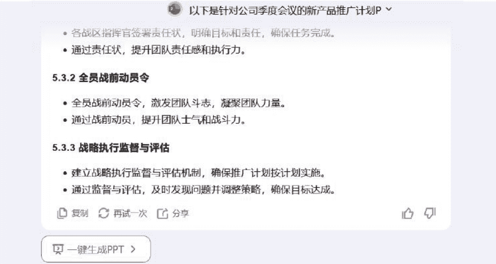

单击“一键生成 PPT”，选好风格模板，单击“生成 PPT”按钮，如图 8-4 所示。

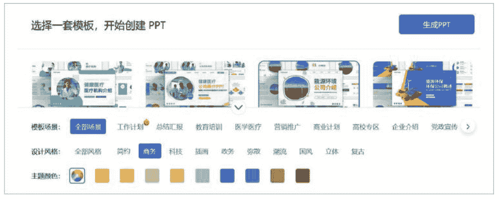

图 8-4

Kimi 就像一位经验丰富的 PPT 设计师，自动为你优化排版，匹配与内容相得益彰的图表、图片，调整色彩搭配，使整个 PPT 既专业又美观，如图 8-5 所示。

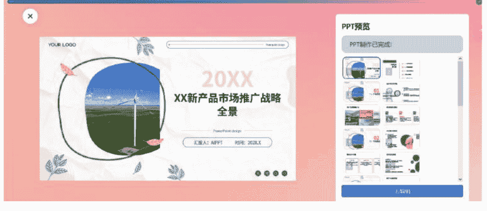

图 8-5

短短几分钟，原本可能需要数小时才能完成的 PPT 就制作完成了。无论是汇报工作、产品推介还是学术展示，这样的组合都能让你的 PPT 脱颖而出，轻松吸引观者的注意力。

# 8.2 DeepSeek 与 draw.io：绘制流程图的高效搭档

在项目管理、业务流程梳理等工作中，清晰直观的流程图至关重要。DeepSeek 携手 draw.io，让流程图绘制变得简单又快捷。

DeepSeek 虽然不能直接输出流程图，但是可以让它输出 Mermaid 语法。Mermaid 是一种用于创建图表和可视化图形的文本标记语言，它允许用户使用简单的文本来生成各种类型的图表，如流程图、时序图、甘特图、类图等。只要把 Mermaid 语法粘贴到绘图软件（如 draw.io），就可以展示出图形了。

**操作思路：** DeepSeek 给出 Mermaid 语法 + draw.io 创建图形。

打开 DeepSeek。

> 假设你负责一个大型电商促销活动的筹备工作，需要梳理活动流程。生成电商促销活动筹备流程图，包含活动策划、商品选品、页面设计、营销推广、客服准备、物流协调等环节及各个环节的先后顺序和衔接关系，输出 mermaid 格式。

```
mermaid
graph TB
%% 活动策划环节
A1[ 确定市场目标 ] --> A2[ 分配预算资源 ]
A2 --> A3[ 制定活动主题 ]
A3 --> B1[ 筛选促销品类 ]
%% 商品选品环节
B1 --> B2[ 核对库存数据 ]
B2 --> B3[ 制定促销价格 ]
%% 页面设计环节
......
```

打开 draw.io 软件（也可以使用在线版），新建一张绘图，单击“+”按钮，选择“高级”下的 Mermaid，如图 8-6 所示。

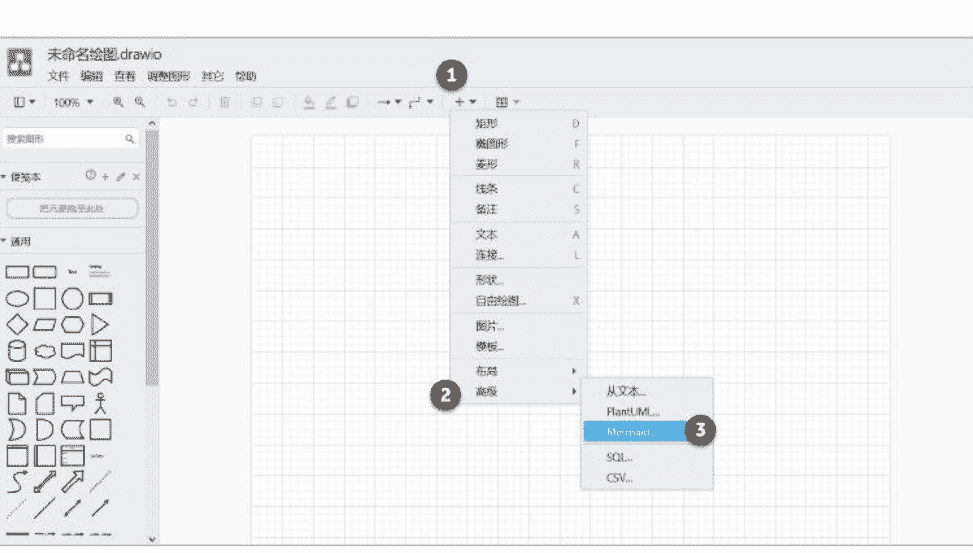
将 DeepSeek 生成的文本贴入编辑区，示意见图 8-7。

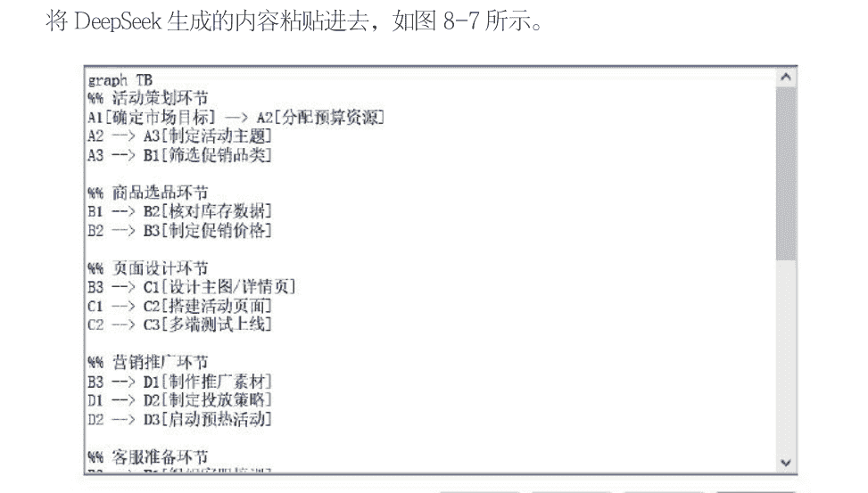
点击“插入”后，draw.io 立刻把文字转译成流程图，借助简洁图形与箭头呈现各环节关联，详见图 8-8。

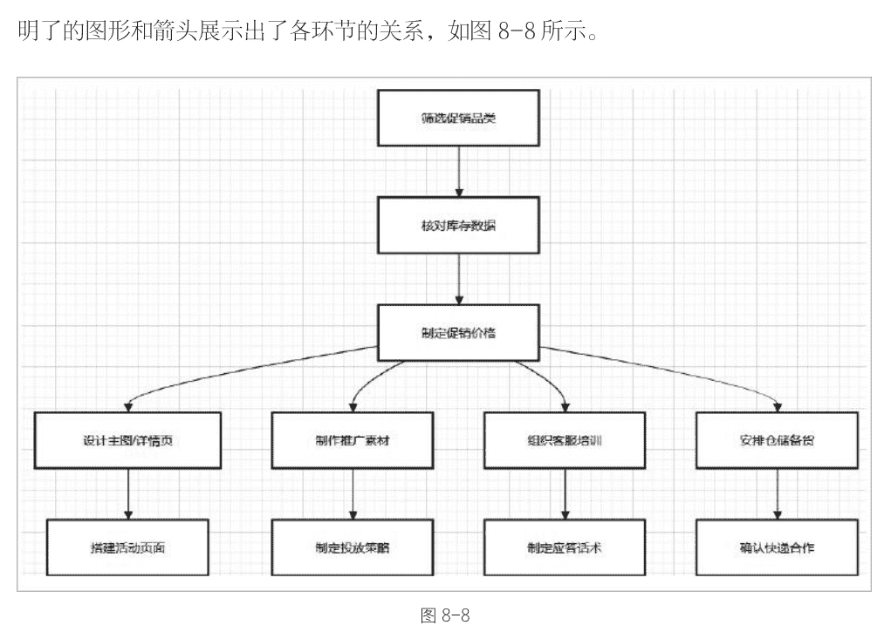
在 draw.io 内部还能继续润色图形、增添标注。过去费时的流程图绘制，经 DeepSeek 与 draw.io 协作后变得轻松高效，团队成员可快速理清工作流，协作效率得到明显提升。

# 8.3 DeepSeek 搭配 Xmind：导图绘制提速
思维导图是梳理思路、激发灵感的利器。把 DeepSeek 的文本组织能力与 Xmind 的可视化能力结合，导图制作会更高效顺畅。

**工作思路：** 先用 DeepSeek 产出结构化提纲，再交给 Xmind 转化成图。

打开 DeepSeek。

> 假设你负责新文创产品的创意策划，请给出思维导图提纲，涉及产品定位、受众群体、设计要点、推广渠道、盈利模式等维度。

+   新文创产品创意方案思维导图大纲

    中心主题：新文创产品创意方案

    一、产品定位（Product Positioning）

    1.1 核心概念（Core Concept）

    1.1.1 文化元素提取（Cultural Element Extraction）

    · 历史故事（Historical Stories）

    · 传统技艺（Traditional Crafts）

    · 民俗文化（Folk Culture）

    · 自然景观（Natural Landscape）

    1.1.2 创意转化（Creative Transformation）

    · 现代设计语言（Modern Design Language）

    · 跨界融合（Crossover Integration）

    · 科技赋能（Technology Empowerment）

    1.2 产品类型（Product Type）

    ……

把提纲拷贝到记事本，存为思维导图.md，编码选 UTF-8 无 BOM，见图 8-9。

启动 Xmind，新建导图后执行导入文件操作，见图 8-10。

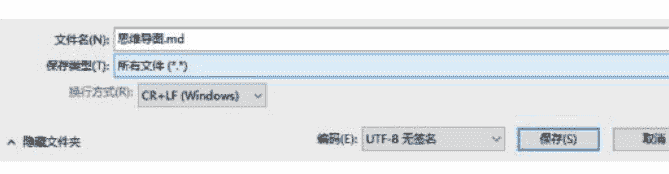

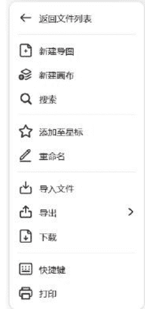

选中思维导图.md，点击“导入”，见图 8-11。


Xmind 会把输入的大纲快速渲染成清晰的树状导图，见图 8-12。

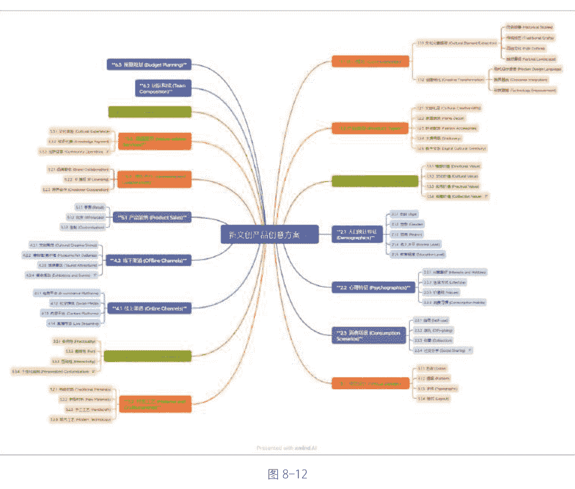

图 8-12

后续可在各分支补充细节，调整配色与图标，让导图更生动。无论个人笔记整理还是团队头脑风暴，这套组合都能快速理清脉络，激发新灵感。

# 8.4 DeepSeek 联动即梦 AI：海报生成快而美
在传播场景中，一张吸睛海报能快速抓住注意力。DeepSeek 负责创意提炼，即梦 AI 负责成图，配合下来既有灵感又有速度。

**执行思路：** DeepSeek 提供绘画提示词，即梦 AI 执行生成。

打开 DeepSeek。

> 假如你经营一家餐厅，想为招牌菜做宣传海报。请给出餐厅特色菜海报的灵感和绘画提示词，突出菜品色香味、食材新鲜度与独特做法，整体风格温馨诱人。

+   餐厅特色菜品宣传海报创作灵感

    1. 色彩与构图

       · 用暖色调如红、橙、金黄营造温馨诱人氛围。

       · 菜品置于画面中央，突出精致与色泽，背景可用虚化餐厅环境或食材。

       · 加入蒸汽、烟雾或光效，增强热气腾腾感。

    2. 食材展示

       · 在菜品周围点缀新鲜食材，如翠绿蔬果、晶莹海鲜或香料，体现新鲜感。

       · 制作食材分解图，展示核心原料来源与处理过程。

    3. 烹饪方式

       · 插入烹饪过程动态画面，如火焰、翻炒、调味等，展现独特技艺。

       · 加入厨师背影或手部特写，传递匠心精神。

打开即梦 AI 客户端或网页版，进入图片生成区，见图 8-13。

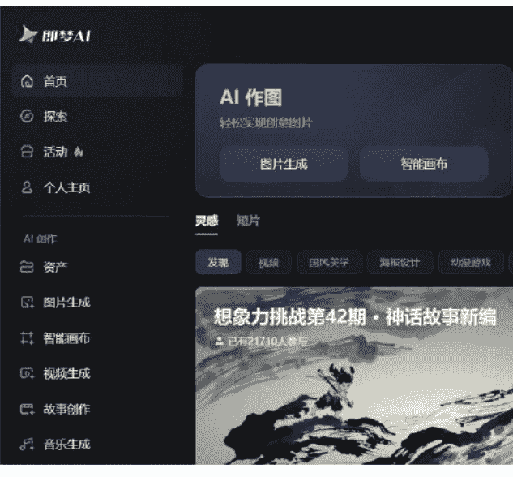

把 DeepSeek 给出的提示词粘贴进去，并设定尺寸等参数，见图 8-14。

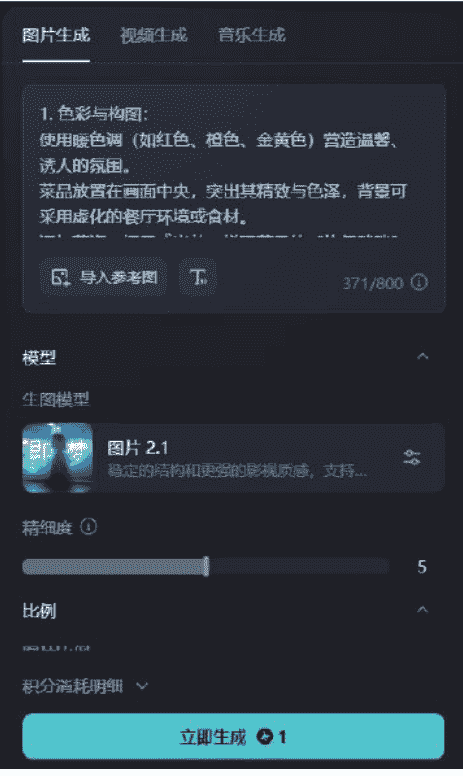

点击“立即生成”，即梦 AI 基于图像模型迅速产出多张风格不同的海报，见图 8-15。


图 8-15

从结果中挑选满意稿件，也可做局部微调。无论商业宣传、活动推广或个人纪念，这套组合都能覆盖多样需求，提升传播吸引力。

# 8.5 DeepSeek 携度加：短视频批量产出
短视频时代，电商从业者最关心如何快速产出吸睛带货片。DeepSeek 负责选题与脚本，度加负责一键成片与精修，协作效率很高。

**操作思路：** DeepSeek 产出选题脚本，度加负责成片与精修。

打开 DeepSeek。

> 假设你是一名电商主播，要为一款护肤品做带货短视频。请生成一条护肤品带货短视频的爆款选题和文案，突出功效、成分优势和用户口碑。

+   1. 选题：

    空瓶 3 次也不换！黄黑皮克星终于被我发现了！

    2. 15 秒文案脚本：

    （怼脸镜头展示粉底卡纹画面，切换肌底泛红镜头）

    “常年熬夜皮肤暗沉 + 敏感泛红肌的人看好了！

    这瓶发光精华把烟酰胺和黄金专利微囊玩明白了

    （手部特写：揉开精华液金箔微粒）

    4.5% 黄金配比烟酰胺 + 99% 高纯度熊果苷，

    两周代谢暗沉，急救褪红不过夜！

    （展示用户好评截图）

    10 万 + 敏感皮人群都在囤的“平价战斗机”！

    （背景音乐突然高昂，展示套组礼盒）

    今天价格直接跌至大牌零头！拍 1 发 3，还送按摩棒，

    “手快党”直接点购物车下单！

启动度加创作工具，把文案粘贴进去，点击一键成片，见图 8-16。

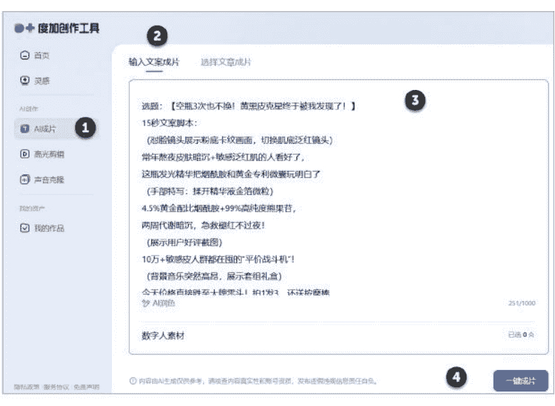

度加依托素材库与智能剪辑，自动为文案匹配画面与音效，快速生成初稿，见图 8-17。

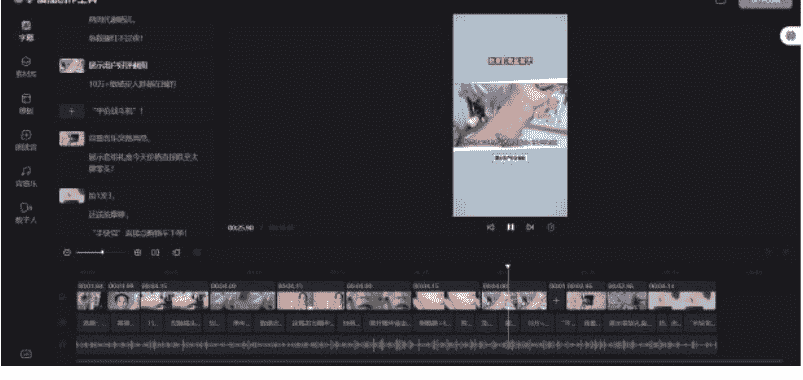

初稿生成后可继续剪辑，加入特效、字幕。配合使用后，日产多条高质量带货视频变得可行，有助于电商业务增长和用户转化。

# 8.6 DeepSeek 联闪剪：口播视频速成
真人口播因真实感和亲和力在短视频中很受欢迎。DeepSeek 负责文案创作，闪剪负责虚拟主播合成，双方结合大幅缩短制作周期。

**操作思路：** DeepSeek 撰写口播脚本，闪剪生成带主播视频。

打开 DeepSeek。

> 假设你是一位知识博主，要做一条关于科学养兰花的真人口播视频。请创作一条科学养兰花知识分享的爆款口播文案，涵盖新手易犯错误、光照和水分管理要点、病虫害防治技巧等。

1. 15 秒浓缩干货版口播文案。

（急促语气）姐妹们！ 99% 新手养兰花都会踩的三大雷区！

把硫酸亚铁当万能药狂灌——烂根预警！

朝花瓣喷水——花苞受损或开放受阻！

放西向阳台，假装促进光合作用——黄叶来得比快递还快！

记住黄金公式：

北向窗台才是本命！

竹篮植料土干透（拔出发白再浇水）

雨水 / 淘米水替自来水！

（神秘语调）

看到叶尖发黑怎么办？评论区扣 555。

送你祖传杀虫偏方：

40% 乐果乳油 1000 ~ 1500 倍液喷雾，红蜘蛛连夜打车跑路！

### 2. 秒懂完整版口播文案：

（痛心疾首）

刚买的花不到十天就疯狂掉苞？每天精心照顾反而烂根？这条视频能救你兰花的命！新手的三个致命误区——

误区一：硫酸亚铁当万能药，浇得越勤死得越快！正确做法是，每月1次，兑水3000倍（画重点），必须兑到几乎没颜色！

误区二：模仿网红喷壶大法！记住花瓣不能沾水（敲桌子），要喷就对着空气增湿，离花半米远！

误区三：以为兰花爱晒太阳！其实明亮散射光就够。（伸手示范）能看清掌纹的这个亮度刚刚好！

（加快语速）

浇水口诀快记好：春秋冬浸盆12秒，夏季改用虹吸法！用透明盆最保险，看见水汽就不浇！

下期教蝴蝶兰复花秘诀，点关注不迷路！

打开闪剪，进入真人口播模块，可挑选不同主播形象与场景，见图8-18。

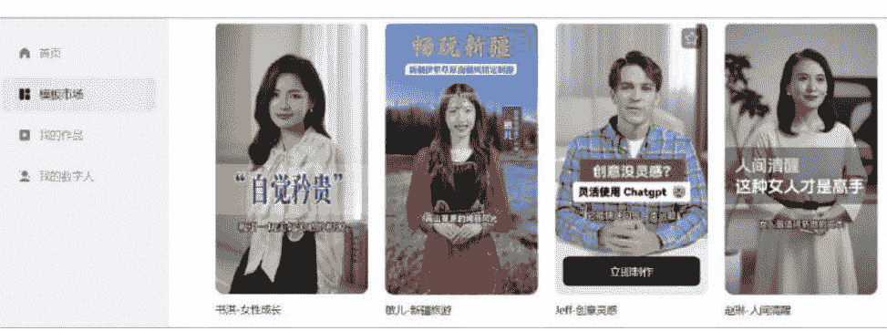

图8-18

选定主播形象后点“立即制作”，进入图8-19的操作界面，按顺序设置并粘贴文案，见图8-20。闪剪随后生成带主播的口播视频。


图8-19

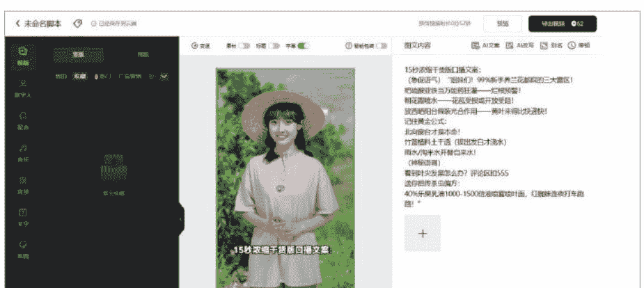

图8-20

可对画质和音效做进一步调节。对创作者而言，这套组合显著提升口播视频生产效率，让知识分享和产品推广更快触达观众。

DeepSeek 与各类工具的配合，为内容创作提供了全新体验与高效方案。视频创作者和营销人员都能借助这种组合，更轻松地把创意转化为成品。

# 第9章 用 DeepSeek 塑造高质量内容
在 AI 辅助创作时代，内容质量仍是核心。读者更在意有用且能引发共鸣的作品，而不是千篇一律的套路。要摆脱流量思维，深入理解受众，提供有价值有温度的内容，才能赢得信任。DeepSeek 这类工具可以帮助实现这一目标，生产既有深度又有温度的作品。

# 9.1 用 DeepSeek 打造精品公众号文章
公众号作为内容阵地，面临挑战与机遇并存。虽然文章泛滥，但真正能留住人、引发思考的作品很少。

打造优质公众号文章，需回归初心——为读者提供价值与深度思考。DeepSeek 作为强力 AI 助手，能从选题到成稿、从语言打磨到主题升华全程助力，帮助我们挖掘真实需求，用有温度的文字传递思想。

下面结合 DeepSeek 的功能，从多维度探讨如何打造精品公众号文章，让每篇文章都成为读者的必读之作。

## 9.1.1 公众号平台特点与读者需求
公众号作为垂直内容平台，具备以下特征。

- 1. 知识付费属性强：用户多追求专业性知识和建议。
- 2. 社交属性明显：内容易引发情感共鸣和互动。
- 3. 信息流模式：结构清晰，适配碎片化阅读。
- 4. 平台算法偏好：阅读时长与互动高的内容更易被推荐。

读者需求分析：

- 1. 实用价值导向：内容需解决实际问题。
- 2. 情感共鸣诉求：内容需引发情感共鸣。
- 3. 碎片化阅读习惯：内容需结构清晰，信息量适中。
- 4. 交互体验需求：提供互动机会，如问答、投票等。

## 9.1.2 破解传统爆款文章套路
传统内容营销常见套路有制造焦虑、简化问题、操控情绪和标题夸大。这些手法虽能短期吸睛，长期却会损害质量与信任。表9-1所示为改进思路。

表9-1

| 传统套路 | 改进思路 |
| :--- | :--- |
| **制造焦虑：** 夸大问题吸引注意力 | **解决问题：** 提供实际解决方案 |
| **简化问题：** 提供简单化的“灵丹妙药” | **深度思考：** 分析问题根源，引用研究成果，提供数据支持 |
| **操控情绪：** 煽动情绪，缺乏共鸣 | **真实共鸣：** 通过真实故事和自然语言表达，增强感染力 |
| **夸大标题：** 依赖夸张标题吸引点击 | **精准概括：** 确保标题真实反映文章核心内容 |

## 9.1.3 实战案例：用 DeepSeek 打造精品内容

### 1. 选题：找到读者的真实需求

（1）**热点分析：** 使用 DeepSeek 的联网搜索功能，输入关键词“职场压力”，获取当前职场人群关注的热点话题。


（2）**用户痛点挖掘**：向 DeepSeek 提问，了解目标读者（职场新人）的具体痛点。

> 职场新人最关心的问题。

> 职场新人最关心的问题是“如何在有限的时间内，兼顾工作和生活，减轻职场压力”。

（3）确定选题：结合热点话题和用户痛点，确定选题为“职场压力大？这3个方法帮你轻松应对！”。

### 2. 生成初稿：快速生成内容框架

> 生成公众号文章《职场压力大？这3个方法帮你轻松应对！》的框架。

> 职场压力是许多人面临的挑战，但可以通过以下方法找到平衡：

> （1）时间管理矩阵：提升工作效率，合理安排任务。

> （2）任务优先级划分：先完成紧急重要的任务。

> （3）利用AI工具提升效率：如DeepSeek，减轻工作负担。

> ……

### 3. 优化内容：让文章有深度和温度

使用 DeepSeek 进行内容优化。

（1）添加真实案例：使用 DeepSeek 联网搜索真实案例，输入关键词“职场压力真实案例”，搜索相关案例。

> 职场压力真实案例。

> 小李是一名职场妈妈，每天都在工作和家庭之间奔波，感到疲惫不堪。她常常加班到深夜，却总是完不成工作目标，这让她陷入了焦虑和自我怀疑的困境。直到她了解到了效率工具，学会了合理规划时间和任务优先级，她的工作和生活才慢慢恢复了平衡。

分析：该案例体现了职场压力对生活的冲击，以及通过规划与工具辅助可以有效缓解压力。

（2）优化语言风格：使用 DeepSeek 优化语言，根据初稿内容，要求 DeepSeek 优化语言风格，使其更贴近读者生活。

> 根据初稿内容，优化语言，使之更贴近读者生活。

> 职场压力是许多人面临的挑战，小李也曾因为工作压力大，整夜失眠，直到她学会了这3个方法。

分析：自然的语言表达让文章更贴近读者的生活，更易引发共鸣。

（3）引入研究支持：使用 DeepSeek 联网搜索：输入关键词“职场压力研究支持”，搜索相关研究。

> 职场压力研究支持

> 心理学研究表明，长期的职场压力会导致员工出现倦怠、焦虑等负面情绪，严重影响工作和生活的平衡。而通过合理的时间管理和任务优先级划分，可以有效缓解这些压力，提高工作效率和生活质量。

分析：研究支持不仅增强了文章的说服力，还能让读者对问题有更深入的认知。

（4）增加互动环节：使用 DeepSeek 设计互动环节，输入关键词“互动环节职场压力”，设计互动环节。

> 互动环节职场压力

> 你觉得哪种减压方法最有效？扫描下方二维码参与调查，我们将根据结果为您推荐更多干货。

分析：互动环节不仅能引导读者参与，还能为后续内容优化提供有价值的数据支持。

### 4. 最终成果

**职场人都该看｜那一刻，我终于在工作和生活间找到了支点**

初夏的傍晚，财务部主管小李对着满屏未完成的汇报文档，摸了摸发烫的电脑。微信群里跳动的加班通知，幼儿园老师催促接孩子的消息，还有催缴房贷的短信提示音，在她耳边交织成令人窒息的交响曲。此时手机震动，是母亲的视频请求，她按灭屏幕的刹那，看见镜中那个面色泛青、神情麻木的自己，突然清醒：这样的生活，还能持续多久？

**[场景重塑] 那些年，我们都掉过的“时间黑洞”**

你是不是也经历过小李这样的崩溃时刻？美国压力研究所数据显示，**部分职场人每天处于精疲力竭的状态**，医学专家称此现象为“职场代谢综合征”。这种溃败感往往源于两大陷阱。

### 陷阱一：倒置的陀螺人生

在咖啡馆遇到的小李，眼角还带着疲惫，她说：“以前总觉得多开会就是有效率，结果把时间切成碎片，计划表永远停在昨日。”她展示的日程本上，密密麻麻标注着待办事项，可标记的优先级居然全是最新插入的急事。

### 陷阱二：完美主义的枷锁

在深夜办公室整理报销单的新媒体运营小张，把保温杯往桌上一放，说：“总想着对每个任务精益求精，最后PPT改了22版，可领导只需要核心数据。”此时电脑显示凌晨一点半。

### [鲜活指南] 我的自救三部曲

当你发现购买颈椎贴比购买早餐更稳定时，不妨试试这三剂解药。

### 解药一：给每个清晨15分钟清醒期

神经科学家研究发现，晨起后给大脑一个放松的机会，能让压力激素皮质醇水平降低。现在的我不会急着看手机，而是先开窗深呼吸，观察楼下的玉兰花苞——这种微小的仪式感竟然神奇地让我找回了对生活的掌控感。

……（省略部分内容，下同）

### [数据橱窗] 小心这些职场健康预警

- 连续熬夜三天，决策能力下降40%（《柳叶刀》2024）

……

### [真实改变]

……

### 文末彩蛋

留言“解药编号 + 你的个性签名”，获取针对性改善计划。

案例映射：“解药一号”搭配“整日嚷嚷想去海边透气的项目主管”→推送海边冥想声轨＋项目管理避坑清单。

[压力自测表]

当“总是”累计到三项，建议尽早关注：

……

**动动手指转发，或许能温暖一位深夜仍在加班的灵魂**

如今我才真正明白，工作的意义在于让生活更饱满。

扫码参与调研：“你最认可的减压方式是哪一种？” 我们会根据结果持续输出干货。

# 9.2 DeepSeek 驱动小红书笔记爆火

当下在社交平台里，小红书的气质很特别。除了种草和打卡，它更像年轻人记录生活方式、表达自我的精神栖息地。要在上面出圈，首先要读懂社区氛围。用户看重真实、温暖、有共鸣的表达，对干瘪的产品罗列已经不买单，更偏爱有温度的生活叙事。借助 DeepSeek 的智能创作能力，可以从海量笔记里筛出真正打动人的关键点，用真诚的分享建立个人标签，才可能在高手扎堆的社区里被看见，并与读者形成稳定的情感连接。

## 9.2.1 小红书人群与内容偏好

平台核心用户是年轻人，截至成书时 95 后约占一半，00 后约占三分之一，主要集中在一二线城市。内容获取主要靠推荐和搜索，日均搜索使用率约 60%，约四成新人在注册当天就会用搜索。分享意愿强，社区创作者已超 8000 万。

内容呈现两大特征。

- （1）重实用：用户偏爱能直接解决问题的笔记，如美妆护肤教程、穿搭建议、菜谱、家居收纳方法等。美妆类里，更受欢迎的是“针对不同肤质的护肤方案”，而不是单纯的爆款单品安利。
- （2）重趣味：带趣事和故事的笔记更容易被点赞。比如明星在小红书晒日常，呈现真实面貌，正好满足大家对“内娱活人”的期待。City Walk、轻生活等新兴生活方式内容也很有趣。

## 9.2.2 跳出传统爆款套路

用户更认可能解决实际问题的干货。表9-2梳理了传统打法与对应的改进思路。

表9-2

| 传统打法 | 优化方向 |
| :--- | :--- |
| **放大不安：** 夸大问题吸引眼球 | **给出实操：** 分享具体可执行的方法和技巧，解决真实痛点，让用户感受到价值 |
| **单一主题：** 只围绕一个点展开 | **内容复合：** 融入故事、趣事、案例，提升趣味与厚度，避免单调 |
| **无效分享：** 缺乏共鸣点 | **引发共鸣：** 分享亲身经历与感悟，带动情感共鸣，提升参与度 |
| **硬性营销**：生硬推销产品或服务 | **软性种草**：通过使用体验和效果呈现，让用户自然感知产品或服务的优势 |
| **夸张标题**：用噱头吸点击 | **精准命名**：用准确的概括点出笔记亮点，帮助用户快速get核心，避免误导 |

## 9.2.3 案例实操：用 DeepSeek 做小红书爆款

### 1. 选题：找准用户真实需求

（1）**热度探测**：用 DeepSeek 的实时搜索能力，提问“小红书近期热门话题？”，获取平台关注焦点。

> 小红书近期热门话题？

> 养花技巧、花卉挑选、植物养护、室内布置等。

（2）**痛点挖掘**：向 DeepSeek 询问，明确目标人群—年轻女性的核心困扰。

> 年轻女性最在意什么？

> 年轻女性最在意的是“在忙碌之余，用简单有效的方式把花养好”。

（3）**锁定选题**：结合热点与痛点，定题为“养花新手指南！几招上手变身养花达人！”。

### 2. 生成初稿：快速搭框架

养花新手指南！几招上手变身养花达人！生成小红书笔记框架。

姐妹们！今天聊 3 个养花小技巧：

（1）选对植物：多肉、绿萝、发财树。
（2）浇水要点：见干见湿，避免积水。
（3）光照需求：多肉喜阳，绿萝耐阴。

### 3. 优化迭代

DeepSeek，我希望语言更贴合小红书的日常口语，有什么建议？

可以加入更口语化的称呼，比如把“朋友们”换成“宝宝们”，整体更接地气。

好的，那把“朋友们”改成“宝宝们”，让语气更符合平台风格。

DeepSeek，我想加入真实使用体验来增强说服力。我本人是靠养花缓解工作压力的。

最近压力有点大，养花成了我的最大治愈。每天下班看到窗台的一抹绿，心情瞬间平复。今天想把自己的养花经验分享给大家，希望能给同样热爱生活的人一点启发！

我在笔记结尾想加个互动，提升参与感，有什么建议？

建议在尾部加互动引导，例如“如果你也有养花心得，欢迎在评论区交流，我们一起学习！”

需要写文案 HTML 代码，网页运行直接给出图文内容，给出文案代码。

```html
<div style="max-width: 600px; margin: 0 auto; padding: 20px; font-family: 'Arial', sans-serif; background-color: #f9f9f9; border-radius: 10px;">
    <h1 style="font-size: 24px; color: #333; text-align: center;">🌸 养花日记：我的绿意生活 🌿</h1>
    <p style="font-size: 16px; color: #555; line-height: 1.6;">
        最近工作压力有点大，养花成了我生活中最大的治愈时刻。每天下班回家，看到窗台上的一抹绿意，心情瞬间就平静下来了。今天想跟大家分享我的养花小技巧，希望能给同样热爱生活的你一些灵感！
    </p>
    <div style="margin-top: 20px;">
        <h2 style="font-size: 20px; color: #333;">🌱 我的养花必备清单：</h2>
        <ul style="list-style-type: none; padding: 0;">
            <li style="margin-bottom: 10px;"><strong>植物选择：</strong>多肉、绿萝、发财树。</li>
            <li style="margin-bottom: 10px;"><strong>花盆推荐：</strong>透气性好的陶瓷盆，颜值高还实用。</li>
            <li style="margin-bottom: 10px;"><strong>浇水技巧：</strong>见干见湿，不能浇太多水哦～</li>
            <li style="margin-bottom: 10px;"><strong>光照需求：</strong>根据不同植物调整光照，多肉喜阳，绿萝喜阴。</li>
        </ul>
    </div>
    <div style="margin-top: 20px;">
        <h2 style="font-size: 20px; color: #333;">💡 我的养花小妙招：</h2>
        <ol style="list-style-type: decimal; padding-left: 20px;">
            <li style="margin-bottom: 10px;"><strong>定期浇水提醒：</strong>用手机设置提醒，再也不担心忘记浇水！</li>
            <li style="margin-bottom: 10px;"><strong>DIY肥料：</strong>用咖啡渣和果皮自制肥料，环保又省钱。</li>
            <li style="margin-bottom: 10px;"><strong>植物换盆技巧：</strong>每年春天给植物换一次盆，根系会更健康。</li>
        </ol>
    </div>
    <div style="margin-top: 20px; text-align: center;">
        <p style="font-size: 16px; color: #555; font-style: italic;">
            养花不仅是一种乐趣，更是一种生活态度。这个过程让我更有耐心和更加细致，也让我在忙碌的生活中找到了一片宁静。希望我的分享能带给你一点点温暖和启发～
        </p>
        <p style="font-size: 16px; color: #555; font-style: italic;">
            如果你也有养花心得，欢迎在评论区分享，我们一起交流学习吧！
        </p>
    </div>
</div>
```

图9-1

单击答案右上角📋图标复制，然后粘贴到记事本，另存为.html文件，再用浏览器打开文件。

## 🌿 养花手记：家里的绿意角 🌿

工作压力堆积时，养花成了我最主要的放松方式。每天回家看见窗台那点绿色，心情立刻安稳下来。今天把自己的养花心得整理出来，希望能给追求生活品质的你一点灵感！

## 🌱 我的养花基础清单：

- **植物挑选：** 多肉、绿萝、发财树。
- **花盆建议：** 透气性好的陶瓷盆，美观又实用。
- **浇水要点：** 见干见湿，别浇太多哦~
- **光照安排：** 根据植物特性调整，多肉向阳，绿萝耐阴。

## 💡 养花小妙招：

1. **定时提醒浇水：** 手机设个提醒，就不怕忘水了！
2. **自制有机肥：** 用咖啡渣和果皮 DIY，环保省钱。
3. **换盆节奏：** 每年春天换一次盆，有助根系更健康。

养花不只是爱好，更是一种生活态度。养的过程中我变得更有耐心、更细心，也在忙碌里找到了一处宁静。希望我的分享能带给你一点温暖与启发~

如果你也有养花心得，欢迎在评论区分享，我们一起交流学习吧！

图 9-2

# 9.3 DeepSeek 助力抖音短视频爆款脚本

短视频全民化时代，抖音已成创作者抢流量的主战场。几十秒内抓住注意力并形成持续互动，仅靠跟风模仿远远不够。真正爆款背后，是对用户心理的精准洞察和对内容节奏的把控。

借助 DeepSeek 联网模式，可以从大数据里提炼抖音用户的兴趣点，结合热点与趋势，写出既符合推荐机制又能打动人的脚本。剧情、语气、画面节奏、情绪传递，DeepSeek 都能给出智能化支持，帮助在短视频赛道突围。

## 9.3.1 抖音短视频特征与创作要点

抖音视频以**短小精悍、节奏明快、互动性强**著称。创作时需把握：

1. **短小精悍**：时长一般 15 秒到 1 分钟，信息要精炼，突出核心。
2. **节奏明快**：剪辑干净利落，适度快速切换镜头，强化视觉冲击。
3. **互动性强**：设计提问、投票等互动节点，提升用户参与感。

## 9.3.2 实战案例：用 DeepSeek 编写爆款脚本

### 1. 选题：热点 + 痛点

1. **热度分析**：用 DeepSeek 联网搜索，获取抖音用户关注的热点。

抖音用户正在关注哪些热点？

办公室趣事、职场吐槽、减压方式、打工人的幽默日常、最新搞笑事件（如“00后整顿职场”、“AI 工具翻车”等）。

（2）**痛点挖掘**：向 DeepSeek 询问，了解上班族的具体困扰。

上班族的典型痛点

- 痛点 1：工作压力大，需要轻松解压内容。
- 痛点 2：职场日常枯燥，渴望共鸣与幽默。
- 痛点 3：偏爱真实接地气的搞笑场景，尤其喜欢热点事件的结合。

（3）**确定选题**：综合热点与痛点，定题为“办公室里的搞笑瞬间，笑到停不下来！”

### 2. 生成脚本

办公室里的搞笑瞬间，笑到停不下来！（融入“AI 工具翻车”“00后整顿职场”等新梗）生成约 2 分钟的抖音脚本。

办公室爆笑合集！打工人的快乐你想不到！

[开场]（10 秒）

镜头：工位全景
音效：键盘声骤停
画面：同事 A 敲键盘，镜头推近——键盘上粘着口香糖（字幕：把键盘借给熊孩子后的后果……）
动作：同事 A 无奈抠键盘，口香糖拉出长丝（慢动作 + 弹力音效）

[片段 1]（30 秒）

场景：会议室
梗点：混入“九转大肠”表情包
对话：
老板（严肃）：“方案要体现‘沉淀感’……”
画面：同事 B 偷偷点奶茶，突然响起“九转大肠”BGM
反转：老板扭头：“我要大杯去冰三分糖！”全体憋笑抖动（字幕：人类的本质是复读机）

[片段 2]（40 秒）

挑战：办公室版“躲闪摇”
剧情：饮水机排队，C 同事跟着抖音神曲跳躲闪摇，D 同事端水左右闪避
神转折：行政姐姐推门，所有人瞬间定格（定格 + 乌鸦叫特效）
字幕：00 后开始整顿职场

[片段 3]（30 秒）

新话题：AI 绘画翻车实录
画面：同事 E 炫耀 AI 生成的方案封面
特写：屏幕上“老板骑霸王龙在 CBD 狂奔”
音效：恐龙咆哮 + 微信撤回提示音
字幕：让老板 3 秒安静的秘诀

[结尾]（20 秒）

全景：办公室突停电，大家默契掏手机电筒
高能：光打在墙上标语——“高效 创新 团结”（镜头推近）
字幕：团结就是一起摸鱼！（部门合照鬼畜抖动）
BGM：《阳光开朗大男孩》变调版
互动文案：“你的工位出现过哪些社死名场面？评论区 battle！”

# 第 10 章 人工智能浪潮下的财富规则与生存法则

人工智能浪潮下，DeepSeek 等大模型像一把双刃剑，既带来新机遇，也暗藏陷阱。有人抓住风口实现变现，有人却迷失其中。本章拆解 AI 时代赚钱的真相，揭示骗局套路，并提供可执行的策略，帮助你在变局中找到多元变现路径。

# 10.1 AI 赚钱真相：别当风口韭菜

当下号称能用 AI 赚钱的赛道，看似遍地黄金，实则遍布镰刀。不少人怀揣“月入十万”“躺赚暴富”的幻想冲进去，最后成了被收割的对象。下面用真实案例撕开造富幻象，看清利益与人性交织下的陷阱。

## 10.1.1 收割的常见套路

### 第一步：制造焦虑
“不用 AI 就会被淘汰！”“00 后靠 AI 轻松月入 5 万！”这类信息铺天盖地，短视频里编造财富神话制造恐慌。甚至有机构伪造《2024 年 AI 失业率报告》，声称“80% 白领将被取代”。目的只有一个：让你赶紧掏钱买课。

### 第二步：布下流量陷阱
在小红书搜“AI 搞钱神器”，大部分笔记都在晒收益。那些支付宝日入 8888 的截图，多为 PS；学员感谢的聊天记录也是批量造假。曾有知名博主靠“AI 绘画月入 10 万”的虚假案例，3 天内拉 2 万多人加入付费群。

### 第三步：暴利收割
焦虑与流量铺垫后，收割手段多样。比如兜售“AI 辅助工具”“AI 优化服务”，价格不菲，实际多为简单软件，部分功能根本实现不了。如宣称“一键提升工作效率”，用起来只是重复基础操作。还有人制造稀缺感，宣称“独家秘方，限时限量”，诱导急于求成者下单。如某些“AI 财富秘籍”，号称助人快速致富，内容多是拼凑的碎片信息，价值有限。

## 10.1.2 常见骗局盘点

### 骗局一：自称“AI 印钞机”的坑
宣传“输入关键词，AI 自动生成爆款视频，每天躺赚 500 元！”听着诱人，实际需购买指定软件，年费数千元。生成的视频播放量无保障，难以达成承诺收益。

### 骗局二：量化交易的虚假承诺
有人宣称“AI 模型月化收益可达 67%”，并晒出看似真实的 K 线图。实则 K 线为 AI 伪造。轻信者往往血本无归，骗子早已卷款。需要说明的是，量化交易确实是部分机构的盈利方式，如幻方 AI，靠强研发实力在该领域站稳脚跟。其成功是人才、技术、资金多重因素叠加的结果。

在激烈金融市场，量化交易本质是零和博弈。普通投资者与小机构很难拥有幻方级别的科研能力，更无法与头部机构抗衡。骗子正是利用人们对量化交易的不了解和对高收益的渴望设局，需保持高度警惕，切勿轻易入场。

### 骗局三：硬件购买的智商税
“没有专业显卡就别碰 AI！”商家炒高显卡价格，却隐瞒 70% 的 AI 项目用云端算力即可运行，无需斥巨资买硬件。

DeepSeek 的出现意义重大。通过算法优化，显著提升模型运行效率，降低对硬件的依赖。这不仅减轻国家在硬件采购上的负担，也规避了过度依赖芯片进口带来的供应链风险与技术封锁隐患，让国家在 AI 发展上走得更稳更自主。

### 其他常见骗局

表10-1 汇总了 AI 赚钱领域的常见骗局类型，便于识别与防范。

表10-1

| 分类 | 骗局类型 | 具体内容 |
| :--- | :--- | :--- |

# AI 变现圈里的收割套路全景图

| 类别 | 套路名称 | 核心手法 |
|---|---|---|
| 裂变传播类 | 传销式裂变 | 通过多层分销发展下线获利，本质为金字塔骗局 |
| 裂变传播类 | 情感绑架裂变 | 以情绪诉求施压，逼迫用户转发或参与以扩大触达 |
| 裂变传播类 | 游戏化病毒裂变 | 设计上瘾型游戏机制，诱导不断分享实现快速扩散 |
| 私域收割类 | 精准焦虑贩卖 | 锁定用户痛点制造焦虑，继而兜售高价解法 |
| 私域收割类 | 社群角色扮演 | 在社群植入虚假人设获取信任后促成消费 |
| 私域收割类 | 封闭场景杀熟 | 在封闭社群或平台内利用信任进行价欺或虚假宣传 |
| 混合套路类 | 直播＋私域双收 | 直播引流至私域二次转化，主播引导购买私域商品 |
| 混合套路类 | 算法投喂＋裂变绑架 | 精准信息推送叠加裂变机制，逼迫参与并传播 |
| 混合套路类 | 虚拟权益连环套 | 搭建繁复的虚拟权益体系诱导持续追加投入 |
| 技术赋能类 | AI换脸带货 | 用换脸技术合成虚假影像进行虚假宣传 |
| 技术赋能类 | 声纹克隆裂变 | 伪造语音音频诱导参与与传播 |
| 技术赋能类 | 元宇宙杀猪盘 | 以元宇宙名义搭建虚假投资或社交场景骗取资金 |
| 制度套利类 | 跨境法律规避 | 利用地区法律差异实施跨境诈骗或非法操作 |
| 制度套利类 | 合同降维打击 | 以复杂条款利用用户法律盲区达成不公平交易 |
| 制度套利类 | 证据湮灭系统 | 设计流程令事后难以取证、阻碍维权 |
| 新型变种类 | 生物数据勒索 | 以基因等生物信息作为勒索或诈骗手段 |
| 新型变种类 | 虚拟遗产诈骗 | 借数字遗产概念进行诈骗或非法交易 |
| 新型变种类 | 数字孪生杀熟 | 以数字孪生技术营造假场景诱导投资 |
| 传统升级类 | 知识付费传销 | 将知识付费与传销结合发展下线获利 |
| 传统升级类 | 公益众筹截流 | 打着公益名义截留挪用捐赠资金用于非法用途 |

熟悉上述手法有助于在智能变现热潮中保持清醒，不轻易成为被收割的对象。认知厚度是守住资产的核心防线。

# 10.1.3 认知升级：洞察智能时代的财富真相

智能变现风口既有机会也有陷阱。根源在于多数人对智能技术的本质和市场运行缺乏清晰判断。认知高低直接决定能否分辨机遇与风险，升级认知是避免被收割的关键。

### 认知提升的实践路径

提升认知的核心是理性拆解，避免被表象迷惑。表 10-2 归纳了几项可操作的做法。

表 10-2

| 方法 | 具体内容 |
| :--- | :--- |
| 保持审慎质疑 | 面对高收益宣传保持警惕，不要轻信快速致富的保证 |
| 核查数据案例 | 要求提供原始数据核实真实性，防止被虚假宣传误导 |
| 学习行业规律 | 研究智能技术原理与落地场景，了解各情境下的真实概率与风险 |
| 强化独立判断 | 不随波逐流，依据自身分析做出选择，避免盲目跟风 |

真正的收获不靠神奇指令，而靠认知高度。对套路越熟悉，财富越稳。

# 10.2 智能浪潮下机遇与挑战并存

智能让信息流动更快、学习路径更多、技术门槛更低，过去的信息、资源、技术壁垒被大幅削弱，每个人仿佛都拿到了改写命运的工具。但现实分化明显：有人借智能快速盈利，有人却只能被动应对，感到竞争压力巨大。

矛盾背后揭示一个真相：智能不是财富终点，只是个新起点。它缩小了部分信息差距，却拉大了认知与执行的差距。

## 10.2.1 认知差距与执行落差

智能的高效让部分人误以为学习和技能积累不再重要，掌握工具就能无所不能，实际上大错特错。智能本质是工具，能处理信息、完成任务，却无法替代创造力、情感感知等人性特质。其价值在于放大效率，而非替代人类。

另一方面，许多人懂智能的基本用法，却不知如何转化为商业价值。知道用 DeepSeek 生成图文，却不懂如何变现。这种认知与落地的落差，决定了能否在智能时代赚到钱。落差不跨越，再先进的工具也难出头。

## 10.2.2 学习转向：从记忆知识到创造价值

过去学习重记忆重积累，如今要转向如何借助智能解决真实问题、创造独特价值。

以文案为例，普通人机械套模板，产出同质化内容难以吸睛；洞察者用 GPT 触发灵感，结合对人群的深度调研，产出击中人心的文案迅速占位。

设计领域，躺平者用智能出图后低价贱卖；实践者用智能优化流程，再以手工定制和限量发售赋予情感价值，获得高溢价。能否把智能与真实需求结合创造差异化价值，是竞争力的关键。

## 10.2.3 角色转换：从使用工具到产出价值

在智能时代赚钱的核心，是从工具使用者转为价值产出者，这需要洞察力、创造力与行动力。

洞察力帮助捕捉市场需求与痛点，找到智能切入点。例如发现行业对个性化服务需求增长，就可用智能交付定制方案。

创造力让通用输出变独特。智能生成的内容多为平均值，需结合专业知识与经验改造成满足特定市场需求的高价值成果。

行动力确保想法落地。可小规模实验验证可行性，根据反馈迭代优化，只有真实行动才能验证价值。

## 10.2.4 职业版图重塑：哪些岗位易被替代？

智能正悄然重塑职业版图，部分工作首当其冲，部分则相对稳固。

### 相对易被替代的岗位

表 10-3

| 难题 | 解释 | 影响的工作 |
| :--- | :--- | :--- |
| 专注力难以维持 | 长期工作易分心难持续 | 编程、写作、设计等 |
| 复杂情境决策难 | 难以快速做出准确判断 | 金融、市场预测、医疗诊断等 |
| 思维定式束缚 | 易受固有模式限制 | 软件开发、科学研究、法律分析等 |
| 作息适应性差 | 生物钟难以灵活调整 | 医疗护理、交通管理等 |
| 感官捕捉范围有限 | 感知信息有限 | 交通管理、环境监测等 |
| 情绪管理吃力 | 压力下难有效调节情绪 | 心理咨询、客户服务等 |
| 学习传承效率低 | 新知学习和经验分享缓慢 | 教育、培训等 |
| 协作沟通效率低 | 信息传递任务分配不畅 | 项目管理、团队协作等 |
| 信息传递易失真 | 传递中易出现偏差 | 文档编辑、翻译等 |
| 记忆容量有限 | 大量信息易遗忘细节 | 数据分析、研究工作等 |
| 重复劳动易厌倦 | 重复任务效率下降 | 数据录入、文档处理等 |
| 跨语言文化壁垒 | 母语限制思维跨越 | 翻译、国际商务等 |
| 客服难以个性化 | 服务效率低个性化弱 | 客户服务代表、销售专员等 |
| 复杂组合问题处理弱 | 难以处理大量可能性 | 金融分析、物流规划等 |

### 暂时难被替代的岗位

| 难题 | 解释 | 影响的工作 |
| :--- | :--- | :--- |
| 需要动手与触感反馈 | 需亲自动手操作 | 电工、理疗师等 |
| 需要综合多因素决策 | 需多维度综合判断 | 危机公关专家、高级管理人员等 |
| 需要建立情感支持 | 需与人建立情感连接 | 心理咨询师、社会工作者等 |
| 需要独特创意表达 | 需个性化创意输出 | 艺术家等 |
| 需要深度理解人性 | 需复杂人际互动洞察 | 人力资源经理、教育工作者等 |

不必为替代焦虑，人类的不完美正是创新的来源。智能基于概率给出平均值，而人类的创造力、情感与直觉能在不确定中试错学习。完美主义易导致僵化，流程标准化每提升 10%，突破性创意就衰减 37%。智能时代要接受不完美、敢于试错、培养跨界思维并建立风险预算，用人性优势与智能共生。

## 10.2.5 未来生活与工作的新图景

### 1. 未来办公：人机协同的新常态
智能将成为数字同事，承担重复规律任务，人类则在数据洪流中找锚点、在计算风暴中做人性指南针，为方案赋予意义，创造更大价值。

### 2. 教育变革：从禁用智能到善用智能
未来教育不再禁止使用智能，而是教会孩子如何精准指令、判断输出偏见，从而激发创造力与批判思维。

### 3. 日常渗透：智能进入生活每个角落
从菜市场智能测新鲜度到方言叫卖模型训练，智能正深入日常生活，提升便利与生活质量。

# 10.3 智能时代生存和发展指南：迎接变革创造价值

智能如风暴重塑生活、工作与赚钱方式，如何顺势而上？

## 10.3.1 调整思维：跨越认知执行落差
很多人高估或低估智能。其实智能只是辅助工具，无法替代创造力、情感与判断。不仅要懂基本功能，更要思考如何转化为商业价值，而非复制模板。

## 10.3.2 改变学习：掌握智能时代学习方法
学习重心从记忆信息转向用智能解决实际问题并创造独特价值。普通人复制模板导致同质化，洞察者用智能找灵感结合人群理解打造内容脱颖而出。

## 10.3.3 角色升级：成为价值产出者
需要洞察力发现需求与痛点、创造力将通用输出改造成独特方案、行动力把想法付诸实践并迭代优化。

## 10.3.4 实操策略：开启多元盈利路径

### 核心逻辑
把智能当成解决问题和创造需求的手段。聚焦垂直领域提升效率、为服务注入情感附加值、整合智能与渠道人脉资金资源实现差异化。

### 具体策略
表 10-5

| 领域 | 策略 |
| :--- | :--- |
| 内容创作 | 用智能生成内容时融入个人风格与独到观点 |
| 电商与零售 | 用智能优化选品文案广告投放，以差异化定位与体验取胜 |
| 教育与咨询 | 借助智能生成资料或分析报告，提供个性化指导与深度服务 |
| 本地化服务 | 利用智能提升效率，用本地运营与客情建立壁垒 |
| 创意变现 | 智能生成创意作品，通过线下展览或限量发售获取溢价 |

### 关键能力培养
表 10-6

| 能力 | 具体内容 |
| :--- | :--- |
| 工具掌握 | 快速掌握新智能工具并落地应用 |
| 洞察力 | 发现市场需求，找到智能切入点 |
| 差异化定位 | 打造个人或品牌独特价值，避免同质化 |
| 资源整合 | 结合智能与渠道人脉资金创造协同效应 |

### 把握未来趋势
表 10-7

| 趋势 | 具体内容 |
| :--- | :--- |
| 智能+ 情感服务 | 提供有温度的情感服务满足需求 |
| 智能+ 本地化 | 将智能应用于本地场景打造特色服务 |
| 智能+ 创造力 | 借助智能辅助创意，通过个人风格变现 |
| 智能+ 教育 | 利用智能优化教育流程，注重个性化指导与情感关怀 |

策划编辑：王 冉

执行编辑：鹿双双

封面设计：郭 鑫

# 今天你用 DeepSeek 了吗？

# 支持与服务

本书由“数艺社”出品，“数艺社”平台为您提供后续服务。

# 配套资源

- 88个高阶提示词模板

- 10种（共210个）角色扮演提示词模板


微信扫描二维码关注公众号后，输入51页左下角的数字，得到资源获取帮助

微信订阅号：szysptpress


出版合作：wangran@ptpress.com.cn

分类建议：计算机 / AI / DeepSeek

人民邮电出版社网址：www.ptpress.com.cn