# AI重塑财务办公效率

#### 引子

深耕财务管理多年，我接触过形形色色的财务从业者。有的人为了核对一分钱的差异，拖到深夜还在拉账核对；有的人为了一份汇报材料，反复修改焦虑到抓头发。挂着财务管理的名号，实际做的工作却大批量是低价值的重复劳动，长期下来人也耗空了。

当AI浪潮涌入，首批触达智能财务系统的同行们，在发现对账、报税、数据拆解这类繁琐环节可以交给机器处理时，普遍发出惊叹。

惊叹过后，立刻冒出一个不安：会不会被AI取代。曾经我也更倾向担忧， 直到生成式AI的出现才扭转了我的判断。

举个常见情形，为了提效，财务人想过不少办法，有搭建函数公式的，有写代码做流程自动化的。无论哪条路，对普通人来说都存在学习门槛。很多人投入时间和费用，最后收获有限，办公软件里八成的高级功能终究闲置。AI的到来打破了这一壁垒，像ChatGPT这样的工具本身就兼具函数专家和代码专家的能力。在它的引导下，毫无编程基础的财务人员也能去做过去不敢尝试的事，真正实现高效办公。

AI不可阻挡的时候，再去纠结会被取代已太迟，关键在于如何搭上这趟快车，发挥更大的作用。

本书面向企业管理者、财务负责人及对AI办公感兴趣的人群，是一本定制化的AI财务办公实操指南。全书共8章，每章聚焦一个主题，从财务部门如何转型为数据枢纽出发，逐步展开AI在财务各环节的应用，涵盖数据采集、数据处理、数据分析、图表制作与报告输出，并结合实战，让读者能直观看到AI与Office、Python的结合方式。末章还探讨了从RPA到IPA的财务机器人演进，并展望财务工作的未来形态。

其中，重庆人文科技学院颜克勤负责第1、2、5、6章，约10万字；重庆人文科技学院陈玉琳负责第3、4、7、8章，约10万字。

书中不讲晦涩的理论，只给可执行的流程。无论新手还是资深从业者，都能获得启发，掌握不少提效小技巧。

为保持还原度，本书对ChatGPT的输出尽量不做加工，因此个别处可能出现语法或文字瑕疵，敬请理解。

# 第1章 智能财务管理时代

如今连小学生都认识ChatGPT，人工智能早已不是新鲜词。时代在变，财务管理的玩法也必须跟上。手工记账、逐行录入的年代正在远去，人机协作的新常态已经到来，需要全体财务人共同拥抱智能财务管理时代。

## 1.1 财务管理就是跟数据打交道

### 1.1.1 财务部门是一个数据中心

“周五前把本季财报发我，利润表和资产负债表为主，变动点标出来。”

“上月开支偏高，原因分析一下，下周一会议前给我一份降本建议。”

“现金流现在什么状况？预测三个月后的资金需求，顺便和银行聊聊信贷。”

这些话财务人一定耳熟。这就是日常。无论是监控经营、编制审核报表，还是成本管控、资金调度，几乎所有财务任务都绕不开数据，有的是要确认具体数字，有的是要读懂变化趋势。有人问财务部门每天在做什么，很多人会开玩笑说：在算数。

财务为何如此看重数据？因为决策要靠数据支撑。企业该聚焦哪项业务、往哪投钱、如何融资，都离不开真实的财务信息。企业不能凭感觉定方向，必须看到盈利现状、了解市场走势，才能做出理性选择。数据本质上是量化结果，能倒逼每笔支出合规，助力财务目标达成。

更关键的是，财务在数据处理上具备天然优势。凡是涉及资金进出，财务都有记录。就算不直接走账，资产的领用、调拨、报废等变动，也会记在库存台账、资产盘点清单里。员工的薪酬、绩效、出勤等信息，因发放工资而汇入财务。集资金、资产、人力数据于一身，全公司再难找出第二个部门。正因如此，财务天然适合担任数据决策支持角色。

随着管理精细化和数字化，财务的定位在升级。不再只是管账记账报账，而是成为决策支撑部门、监控中枢。资金流向、成本执行、预算完成都在数据中心的视线里，任何不合理支出、异常流动都难以遁形。

当下已有企业把财务部更名为财务数据中心，正是确认了这一定位，也契合数据驱动决策的趋势。

### 1.1.2 财务大数据

数据驱动不只依赖传统的利润表、资产负债表、现金流量表信息，还需要财务大数据。

财务大数据概念很宽，除表格外，还包括大量非结构化信息。来源可以是社交媒体反馈、市场动向、员工意见、消费者行为分析等。凡与经营相关的信息，都可纳入范畴。

其显著特点是实时性和预测性。过去的数据偏静态，等经营一段时间后再回头看结果，对未来帮助有限。市场变动极快，政策、事件、竞争对手动作都可能一日数变，应对必须即时，否则易被淘汰。

财务大数据强调动态变化，提供预测视角。例如，通过监测社交媒体上消费者讨论，可实时捕捉对产品服务的看法，快速调整策略、优化库存。又如实时追踪市场动态，可预判风险与机会，抢占先机。

引入财务大数据后，工作感会明显不同。以前做项目成本效益，要耗费时间整理明细且易错；现在借助自动化工具，能迅速整合相关数据，快速得出准确结论。做预算也不再全凭经验估算，可参考海量历史与市场信息，形成科学动态方案。

财务人正从数据统计者转向数据管理者，乃至深层挖掘者。未来财务与数据的联结会愈发紧密。

## 1.2 财务办公自动化的发展历程

财务办公自动化就是用工具分担财务工作，解放人力。从财务诞生起，算盘、计算器、电脑、人工智能系统，每一次工具迭代都带来效率跃升。

### 1.2.1 手工记账阶段

古代商号雇账房先生记账，手持算盘核算，再一笔一笔写进账簿。账簿载体随书写材料变化，详细记录买卖、资金往来等。

手工记账繁琐易错、速度慢，却是当时商业的必备环节，体现了严谨态度。

17世纪，法国数学家布莱兹·帕斯卡发明Pascaline机械计算器，可做百位数以内的加减。后来计算器普及，20世纪电子计算器更小巧高效，成为财务标配。以前需数小时完成的计算，几分钟搞定，减少了人为差错。但数据记录整理仍依赖手工，自动化尚未实现。

### 1.2.2 会计电算化阶段

1946年，通用计算机ENIAC在美国诞生，用真空管，体积庞大，主要用于科研军工。

20世纪下半叶，微处理器推动个人电脑普及，计算机商业化和民用化。企业意识到其处理海量数据和复杂运算的潜力，财务进入会计电算化阶段。

会计电算化指用计算机和软件处理记账、报表、预算等事务，使财务摆脱手工，迈出自动化第一步。

### 1.2.3 财务信息化阶段

20世纪末，企业规模扩大、业务复杂，需要集成化管理系统统筹财务、供应链、生产、销售等。ERP开始流行。

ERP将财务与其他业务模块打通，实现数据实时共享和自动化处理，财务进入信息化阶段。

财务信息化源于会计电算化，前者聚焦会计自动化，后者更广，涵盖用信息技术整合、管理、分析企业财务数据。决策从部门内部走向宏观视角，企业信息集中管理，效率提升。

### 1.2.4 智能财务阶段

1956年达特茅斯研讨会上首次提出人工智能概念，当时影响有限。六十年后AlphaGo战胜职业围棋手，人类才意识到AI已成熟。

AI相当于财务办公的智能助手，让办公进入智能阶段，实现更高维度的自动化。

自动化是让机器完成重复工作，智能化则是让机器能做复杂“思考”，本质是基于数据的规律总结。例如智能家居按习惯调温。这些思考不等同人类思考。

在智能财务阶段，编程工具成为利器，用Python、Java、C++等写指令，让计算机自动执行，或直接套用智能系统，下达简单指令即可完成记账、报税、数据分析。智能财务是自动化的升级，由机器学习、深度学习赋能。

当前财务办公正处从信息化向智能财务过渡，智能财务尚未完全普及。

## 1.3 AI已经来到每个人身边

### 1.3.1 财务机器人问世

最早给财务人带来惊喜的是2015年德勤在国内提出“财务机器人”概念。

初衷是解决效率和准确率。财务大量重复耗时工作交由机器人，可持续高精度作业、24小时运行。

核心技术是机器人流程自动化RPA，模仿人在电脑上的操作，如录入、核对等，完成部分工作的脱离人工。

2017年，德勤理念落地，“小勤人”RPA工具面市，用于标准化重复财务会计任务。此后各家产品涌现，各有侧重。

财务机器人并非传统形态。有的是像小型智能设备，有屏有交互界面；有的是科技感机身带状态指示。

典型应用如发票自动查验机器人，可读取票面信息、上网校验并截图存档；智能对账机器人可自动登录银行获取对账单，转换格式导入SAP，检测账目不平。

机器人进入岗位后，不少人感到危机：过去认为必须人工完成的工作竟可被替代。价值何在？换个角度看，这也释放精力，让人转向财务分析、战略规划等更有价值工作。

### 1.3.2 ChatGPT出现

2022年11月30日，OpenAI发布ChatGPT链接，引发热潮。若说财务机器人只是局部落地，ChatGPT则让AI真正走入每个人。全球用户都能直接对话，感受AI魅力。

它在语境理解和连贯生成上表现突出。用户输入被转为编码，即嵌入过程，是机器理解语言的第一步。随后数据进入Transformer多层网络，分析比较文本元素，理解语义和语境。

例如问“今天天气怎样”，模型会关联“今天”和“天气”，必要时反问所在城市以提供更准答案。

真正魅力在于训练量。ChatGPT接触了新闻、论文、歌词、文学等海量文本，学会人类表达方式和语境变化。训练方式是监督学习，模型学习模仿人类回答，持续优化预测能力，从而在无明确指令下自主生成连贯恰当内容。因此它能讨论、辩论、甚至写诗。

它还能辅助办公，适配多种场景，这是本书后续重点。

有人担心使用门槛，比如是否需要编程？不必。ChatGPT上手简单，不限职业不限地点，提出问题、明确需求即可对话。无缝交互让AI从实验室走向日常。

## 1.4 人机协作的财务管理办公趋势

### 1.4.1 被AI取代的隐忧

AI已普及，财务人常问：会不会被取代？可用两个经济学视角看。

其一是19世纪英国经济学家威廉·斯坦利·杰文斯提出的杰文斯悖论。最初解释煤炭消耗，蒸汽机效率提升本应减煤，实际英国总耗煤增加。因为效率提升扩大了蒸汽机使用范围，总需求反而上升。

类比财务，当AI广泛应用于账务核对、报表生成时，人们担心岗位减少。但AI提升处理效率后，企业对更高质量的财务分析、决策支持需求可能增加。

例如公司引入AI处理日常核对和报表，最初意图降本减员。但报告生成加快、数据处理能力增强后，公司发现能做更复杂的财务分析与市场预测，这些过去受资源限制。于是可能新增高级分析师岗位，更好利用AI产出指导决策。

若财务人适应变化，提升数据分析、战略规划及AI应用能力，职业机会不减反增，角色从账务处理转向策略制定与决策支持。这正是杰文斯悖论在职场的体现，效率工具反而增加对专业技能的需求。

其二是约瑟夫·熊彼特的“创新与创造性毁灭”。经济发展靠革新推进，新技术会淘汰旧生产方式，同时创造新市场和就业。

汽车取代马车，让马匹饲养、马车制造等行业衰退，却催生汽车制造、加油、销售服务、道路建设等新业态。

财务中，重复性、规律性任务可被机器快速准确完成，对现有人来说似“毁灭”。但这也带来“创造”。基础工作被AI接手后，财务人可投入更需人类智慧的领域，如策略分析、风险管理、决策支持。

乍看是冲突，细看却是机会同步释放。传统财务岗位里确实有部分会被压缩，但与此同时新岗位、新赛道也在不断冒出来，机会窗口反而被打开。财务人如果主动补足能力，比如补上数据分析、把AI用起来，就能提升议价空间，把工作重心挪向更依赖人类判断力与复杂决策的环节，在技术新环境里开拓新的职业路径。这正是熊彼特所说的创造性毁灭，在旧的瓦解中长出新的可能。

把时间拉长看，创造性毁灭并非单纯的破坏，而是一种驱动力。它推动社会与经济结构完成再造，即便转型期会伴随阵痛，终点仍是更高效率、更具创造力的演进。

### 1.4.2 人机协作如何办公

AI迭代很快，财务人若想抓住这波浪潮、避免被时代甩下，学会与AI共处是必修课。

这里的共处指协作，人与AI配合办公，各取所长、分工清晰，如图1-2所示。


AI在重复性、被视作低阶的事务上效率很高，结合RPA可以轻松搞定账务录入、发票核对、数据汇总等活，并随时给出信息与分析。随着技术推进，AI能覆盖的边界还在不断外扩。

即便如此，AI的运行和判断仍需要人的把关。财务人的核心价值在于统筹与指导，确保任务按既定目标和标准推进。AI给出分析与建议后，拍板的始终是人，因为机器难以完全理解商业决策的复杂性。

以预算编制为例来说明协作落地。AI会基于历史数据和项目诉求，自动生成一份预算初稿，里面包含预期收入、支出，以及按历史走势做出的预测。

财务人随后逐项审阅初稿，结合经验与市场判断做调整。AI在这个阶段也能提供补充意见，例如通过分析近期市场投放的投资回报率，提示是否需要追加营销预算。这类建议源于深度数据挖掘，能帮助财务人看到容易被忽略的角度，是否采纳由人决定。报告定稿后，可让AI帮忙检查错别字与排版。

这就是现代财务管理里人机协作的典型样本。有了AI加持，原本难以短时间完成的任务变得高效，也能在AI意见基础上对报告做润色。这不仅是劳动力的解放，更是专业能力的跃迁。人机协作让财务管理同时兼顾高效与精准，也在预示工作方式的转变。

# 第2章 主要工具安装与使用教程

个人实践财务管理的人机协作，核心要用到三类产品：人工智能类产品、办公软件和编程工具，三者缺一不可。市面上可选很多，可按自身需求挑选。本书以ChatGPT、WPS Office和Jupyter Notebook为例做演示。

## 2.1 AI工具：ChatGPT

智能财务办公的新范式离不开AI的加持，它更像一个随时待命的办公顾问，遇到难题可直接对话寻求思路。提到AI对话产品，很多人会想到ChatGPT、文心一言、通义千问等。本书以ChatGPT为例展开，其他工具的使用逻辑可类推。

### 2.1.1 ChatGPT网页版免注册登录交互指南

ChatGPT主要以网页形式提供服务，可直接在浏览器中使用。

具体步骤如下：

- 【操作 01】使用前先准备好可用的网络环境，通过OpenAI的公开网址进入服务。

- 【操作 02】打开浏览器，在地址栏输入 https://chat.openai.com/chat ，即可进入聊天界面，如图2-1所示。


- 【操作 03】在聊天窗口中，无需注册登录，直接在下方输入框输入内容并点击发送，ChatGPT会即时回应。如图2-2所示。


- 【操作 04】对话过程中如需保存内容，可用鼠标选中后右键复制，或直接点击界面提供的复制按钮一键复制回答。

- 【操作 05】为方便下次访问，可把网址加入浏览器收藏夹或书签，打开即可直达。

在免登录状态下，也可创建桌面快捷方式。具体做法是缩小浏览器窗口露出桌面，全选地址栏网址拖拽到桌面，即可生成图标，双击即可打开。
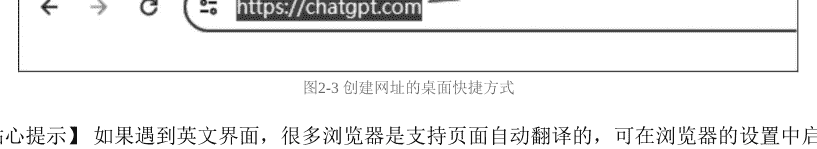

【贴心提示】若遇到英文界面，大多数浏览器支持页面自动翻译，可在设置中开启并选择目标语言，便于阅读和使用。

不过免登录仅能使用基础的GPT-3.5模型，部分高级功能不可用，也不支持保存或分享记录、使用自定义指令等。

更关键的是，免登录用户的对话记录可能被用于模型优化，对话框下方会有提示，如图2-4所示。登录后可在设置中关闭该选项。


### 2.1.2 ChatGPT账户注册与登录

想体验完整功能，建议注册并登录账号。操作说明如下：

- 【操作 01】进入主页面，如图2-1所示，右上角有明显的注册入口，点击即可开始。找不到入口或已有账号可点左上角菜单按钮打开侧边栏，下方即有注册与登录选项，如图2-5所示。

- 【操作 02】点击“注册”或英文“Sign Up”进入信息填写页，如图2-6所示。提供多种方式：
  - ①邮箱注册。在窗口中填写邮箱，点击继续后设定密码并提交。
  - ②第三方账号登录。可选择Google或Microsoft等入口登录。


- 【操作 03】选择邮箱注册后，OpenAI会发送含验证链接的邮件，点击链接激活账号。

- 【操作 04】账号激活后返回页面登录。登录后可能需要补充个人资料、选择是否开通订阅服务等。

订阅服务即ChatGPT Plus，相当于开通GPT-4使用权限。GPT-4相比GPT-3.5理解力更强，更适合高频使用并追求增值功能的用户。入口在右上角个人中心，点击“我的套餐”即可查看。

【贴心提示】此前提到的对话记录用于模型改进的选项，登录后可在个人中心关闭。具体路径为个人中心下“我的套餐”附近的“设置”选项，如图2-7所示。

在设置页面找到“数据管理”中的“为所有用户改进模型”，将其关闭即可。
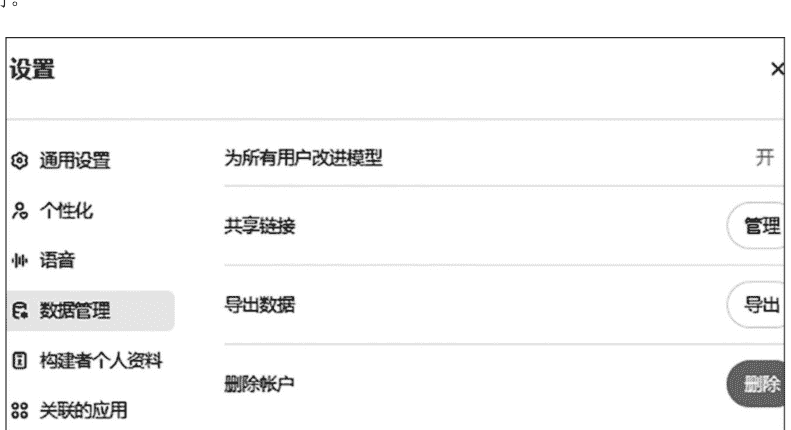

### 2.1.3 ChatGPT提问技巧

使用ChatGPT本身很简单，在对话框输入内容发送即可，与普通聊天软件相似，只是对象是AI。想获得更理想的回答，可注意以下技巧。

#### 正面表达

日常交流中的反问、嘲讽等微妙语气，AI难以准确捕捉。例如“这还用问吗？”、“你可真行啊！”前者本意是显而易见，后者是无语不满，但AI往往按字面理解并回应，如图2-9所示。


因此提问时建议正面表达：

“我希望这个回答更详细一些。”

“请从多个角度全面回答这个问题。”

#### 指向明确

问题越具体，答案越有用。若想提升效率，可避免宽泛提问：

“有没有什么能提高工作效率的办法？”

这类问题会得到减少干扰、合理休息、自动化常规任务等笼统建议，可操作性不强。

不如改成：

“请提供三个最实用的时间管理方法，来帮我提高办公效率。”

得到的回答会更具实操性，如图2-10所示。
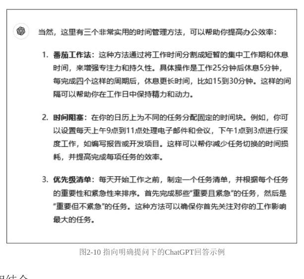

#### 开放式与封闭式相结合

开放式问题没有标准答案，能激发更多想法，例如：“你觉得用AI工具学习新语言怎么样？”封闭式问题则用于获取确切信息，例如：“ChatGPT支持多少种语言？”

实际对话中，可先用开放式问题展开，再用封闭式问题锁定细节，这样信息更全面。

#### 按逻辑顺序或变换多角度提问

按逻辑顺序或换角度提问能引导对话深入。例如对财务智能化感兴趣，可先问：

“财务智能化现象是什么？”

了解定义后，再问：

“财务人员应该怎么面对财务智能化现象？”

这是“是什么→为什么→怎么做”的经典路径，也可按总分、因果、历史演进等展开。若某条逻辑走不通，可换角度：

- “从管理角度看，财务人员应该怎么做？”
- “从思维转变角度看，财务人员应该怎么做？”
- “从职业发展规划角度看，财务人员应该怎么做？”

回答会更全面。

#### 设定回答的语言风格

默认回答偏平铺直叙，可在提问时指定风格：

“请用轻松幽默的语言风格回答。”

“请用财务专业术语回答。”

若仍不理想，可提供样例或引用喜欢的文本风格，并要求参照回答。

身份设定也会改变风格。例如模拟面试：

“你现在是一家会计师事务所的HR，我来应聘助理，请开始提问。”

ChatGPT会代入HR身份，语气随之变化，如图2-11所示。

给自己设定身份也会影响表达，例如：

“我是一名幼儿园小朋友，能不能给我解释一下，为什么天上的星星会一闪一闪的？”

此时回答会更简单、语气更活泼，如图2-12所示。
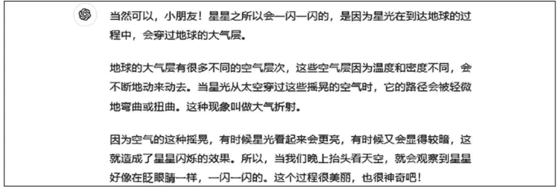

实践中可不断摸索，找到最适合当前需求的提问方式，有效引导交流。

## 2.2 Office办公软件：WPS Office

Office办公软件是财务从业者日常高频工具，文档、表格、演示都能适配不同场景。当前常用产品包括Microsoft Office、WPS Office等，可按需求选择。本书以WPS Office演示。

### 2.2.1 WPS Office客户端安装

WPS提供网页版和客户端版，日常办公下载客户端更方便，不受网络限制。

安装流程如下：

- 【操作 01】打开浏览器访问WPS官网 https://www.wps.cn/ ，选择适配自己系统的版本，如Windows、Mac、Linux，点击下载。

- 【操作 02】找到下载完成的安装包，通常在下载文件夹，双击启动安装程序。

- 【操作 03】进入安装向导，按提示操作。主要包括勾选“已阅读并同意金山办公软件许可协议和隐私政策”，如图2-13左下角所示；选择安装类型，标准安装默认，自定义安装可在图2-13右下角“自定义设置”中指定路径与组件。

- 【操作 04】点击“立即安装”开始安装，等待进度条完成，点击“完成”关闭向导。

### 2.2.2 WPS Office主要功能简介

打开WPS后，新建页有四大入口：文字、演示、表格、PDF，如图2-14所示。

#### 文字（WPS Writer）

用于撰写财务报告、内部通知等。具备：

- ※文字输入与编辑：多字体、字号、颜色、格式设置。
- ※段落排版：缩进、行距、对齐方式调整。
- ※页面设置：纸张大小、方向、页边距自定义。
- ※插图与表格：插入编辑图片、图形、表格。
- ※页眉页脚：添加个性化内容。
- ※目录生成：基于标题样式自动生成目录。

#### 演示（WPS Presentation）

用于向管理层汇报财务状况，制作含数据、图表、预测的幻灯片。功能包括：

- ※幻灯片制作：创建、删除、复制幻灯片。
- ※文本与图片编辑：添加编辑文字、图片、图形。
- ※动画效果：进入、退出、强调等动画。
- ※切换效果：淡入、淡出、翻转等。
- ※演示播放：全屏播放并配合控制工具。

#### 表格（WPS Spreadsheet）

财务管理核心工具，用于记录收入、成本、支出，编制预算并计算利润率、成本效益、偿债能力等指标。功能包括：

- ※数据输入与计算：支持公式与函数。
- ※数据排序与筛选：快速整理分析。
- ※图表制作：柱状图、折线图、饼图等。
- ※数据透视表：汇总分析海量数据。
- ※单元格格式设置：字体、边框、底纹等。
- ※宏编程：编写脚本自动化重复任务、生成报告、连接外部数据库等。

#### PDF

跨设备零失真：PDF 锁定版式与 WPS 移动协同

财务工作中向银行、税务或客户递交报表、凭证属于高频场景。普通文档在不同系统打开时容易出现版式错位、字体替换，进而导致信息偏差。PDF 的核心优势在于把排版固定下来，收件方无论用何种终端看到的效果都与发出时一致。

WPS 内置的 PDF 功能大致涵盖四类：

- ※ 阅读浏览：阅读体验流畅清晰，支持缩放、旋转和随屏幕自适应。
- ※ 内容编修：可直接修改正文与图片，支持增删移动页面并调整页码顺序。
- ※ 批注标记：支持文字标注、高亮、下划线、删除线，便于签署盖章等处理。
- ※ 格式互转：可把 PDF 转为 Word、Excel、PPT 等，也可把其他格式导入为 PDF。

### 2.2.3 WPS Office移动端应用
智能手机与平板的普及让通勤、客户拜访或居家办公都能借助移动终端处理事务。

设想一位财务负责人外出时接到领导电话，要求马上核对并修改一份报表数据，身边却没有笔记本电脑该怎么办？月末结账时集团旗下各分子公司都要参与合并报表填报，汇总人员一人难兼顾又如何解决？

WPS Office 的云端文档管理正好契合这种灵活移动办公的需求。只要在电脑客户端把文件上传，就能在手机或平板上即时查阅。

具体操作如图2-15所示，在电脑客户端界面右上角可看到云朵图标，点击后文件即可上传云端，实现多设备间的数据同步。

该云服务不仅让个人在不同终端保持一致，还支持多人实时协同编辑。团队成员可同时对同一文档进行评论、批注、修改和讨论，明显提升沟通效率与文档准确性。

例如编制财务报告时，集团各下属公司、不同岗位的财务人员都能同时打开同一份文档，分工录入、分析、复核数据，线上完成集团报表，最终汇总人员只需输出合并结果即可。

权限并非开放给所有人。管理员可依据角色与职责设定访问范围，明确谁可编辑、谁只能阅览或添加评论。这种管控既保障文件安全，也让工作流程更有序。特别是在涉及敏感财务调整时，只有获授权的管理层财务负责人才具备修改权限。

## 2.3 Python工具：Jupyter Notebook
人工智能工具可以提供思路并加速财务办公，但要把重复性日常工作真正自动化，仅靠对话模型难以实现。Python 因此成为 AI 高效办公的重要辅助手段。

### 2.3.1 为什么选择Python
编程语言是人与计算机交流的基础，不同语言有各自的语法规则。

这些语言可分为不同层次，有的偏高级、接近自然表达，如 Python、Java、C++；有的偏低级、更贴近机器，如汇编语言。

不同语言适用于不同领域，例如 Java 多用于跨平台企业级应用，C++ 擅长系统编程、游戏开发、高性能计算、嵌入式及实时系统等对性能和底层控制要求极高的场景。而 Python 因简洁易学的特点近年广受欢迎，广泛用于数据科学、人工智能和 Web 开发。

本书为何以 Python 作演示？核心在于它对非专业新手非常友好。

Python 语法直观人性化，编写代码像写英语句子。若要输出“Hello”，只需写下以下代码：

```
print("Hello")
```

是否觉得很简洁？Python 另一大优点是生态丰富，众多复杂功能已被封装为库，可直接调用。无论网页开发、数据分析、人工智能还是自动化办公，Python 都有现成工具，对财务人员而言是难得利好。

举例来说，pandas 库可轻松处理和分析数据。从 Excel 读取数据并做基础统计分析，仅需数行代码：

```
import pandas as pd

df = pd.read_excel("data.xlsx")

print(df.describe())
```

```
from bs4 import BeautifulSoup

import requests

response = requests.get("https://example.com")

soup = BeautifulSoup(response.text, 'html.parser')

print(soup.title.text)
```

这段脚本的目的是从指定的统一资源定位系统加载网页内容，解析这些内容，并提取出网页的标题。里面的“https://example.com”是一个虚构的示例网址，仅用于展示，并不指向一个实际的网络位置。

上述为网页爬虫的基础示例，用 Python 可轻松编写脚本自动抓取多源数据、清洗处理、生成报告，还能与数据库无缝连接进行查询、存储和修改，与财务办公高度适配。

结合 WPS Office，Python 可自动化处理其中的数据与复杂计算，或编写脚本直接与 WPS 文档交互，自动更新数据和图表。

担心学不会 Python 的人可放心，ChatGPT 可以协助写代码、检查漏洞。

### 2.3.2 Python下载与安装步骤
使用 Python 工具前必须先安装 Python，否则会出现无法启动、无法识别代码、缺少库等错误。

【操作 01】登录 Python 官方网站 https://www.python.org/，站点提供 Windows、macOS 等多系统安装包，按自身系统选取对应下载链接。

以 Windows 为例，进入“下载”“Windows”，如图2-16所示。

【操作 02】下载页提供多个版本，初学者建议选最新版；若项目明确指定版本，则按要求下载。

截至2024年7月底，最新版为3.12.4，可选择下载最新 Windows installer（64-bit）版本，如图2-17所示。

图2-16 Python 官网页面下载入口

【操作 03】运行下载好的安装程序，弹出安装向导，如图2-18所示。

建议勾选将 python.exe 加入系统环境变量的选项，便于后续命令行使用。

随后选择“自定义安装”“下一步”，自定安装路径，点击“安装”。

等待进度条完成，点击“关闭”即可完成安装。

【操作 04】验证安装是否成功。按“Win+R”调出运行对话框，输入“cmd”打开命令提示符，如图2-19所示，点击“确定”。

命令提示符为黑色窗口，可在此输入命令并接收系统返回信息。

在光标处输入“python”回车，即可显示 Python 3.12.4 版本信息，说明安装成功，如图2-20所示。

### 2.3.3 Jupyter Notebook的安装与运行
Python 装好后可在终端输入“python”进入交互模式。但在该环境下编写的代码需切回文档重新运行，既麻烦又易出错。

为获得更直观、灵活且便于记录的使用体验，本书选用 Jupyter Notebook 演示。同一界面即可写代码、实时运行，并在旁添加说明性文本，极大简化工作流程，更符合 AI 高效办公主题。

本次采用 pip 安装，即利用 Python 自带的包管理工具，从 Python 包索引下载并安装 Jupyter Notebook。具体如下：

【操作 01】按“Win+R”调出图2-19的运行对话框，输入“cmd”打开命令提示符。

【操作 02】在图2-21所示位置输入以下指令：

```
pip install jupyter
```

若执行后无反应，可能是镜像源问题，可换成以下指令解决：

```
pip install jupyter -i https://pypi.tuna.tsinghua.edu.cn/simple
```

随后等待安装完成，如图2-22所示。

【操作 03】安装完成后启动 Jupyter Notebook。

同样按“Win+R”调出运行对话框，输入“jupyter notebook”，如图2-23所示，点击确定即可在默认浏览器打开。若自动跳转被拦截，也可手动在浏览器输入地址 http://localhost:8888/tree 打开。

【贴心提示】运行 Jupyter Notebook 时，启动服务的命令行窗口不可关闭，否则服务器会停止，所有运行中的 Notebook 都会中断且无法通过浏览器访问。

使用 Jupyter Notebook 实际包含两个环节。

其一是浏览器内与 Notebook 互动，可写代码、加注释、执行代码。关闭浏览器页面不会影响后台服务器，随时可重新打开同一 URL 访问。

其二是启动服务的命令行窗口，运行“Jupyter Notebook”命令后会显示服务器日志及访问 URL。关闭前需确保已保存所有工作。

### 2.3.4 Jupyter Notebook的基础操作

#### Jupyter Notebook的界面功能概览
启动后会进入浏览器用户界面，如图2-24所示。

菜单栏各选项功能如下：

- ※ File（文件）可进行新建、打开、保存、重命名、下载笔记本、关闭笔记本及关闭服务器等操作。页面下方展示当前目录的文件和文件夹。
- ※ View（视图）可切换工具栏、状态栏显示，调整单元格展示方式等。
- ※ Settings（设置）用于个性化配置环境，如界面外观、字体大小、主题样式、快捷键等。
- ※ Help（帮助）提供帮助文档与链接。

#### 笔记本操作
文件扩展名为“.ipynb”即为一个笔记本。

【操作 01】新建笔记本。点击“New（新建）”按钮，选择“Python 3”，如图2-25所示，创建成功后会跳转至新页面。

【操作 02】命名笔记本。新页面顶部默认显示“Untitled”，如图2-26所示，点击即可修改，确认后点“Rename（重命名）”，方便后续管理。

【操作 03】保存笔记本。点击工具栏保存按钮即可，返回上一页刷新后，笔记本会出现在文件列表中。

【操作 04】关闭笔记本。关闭浏览器标签页不会停止后台内核。若要彻底关闭，需在“File（文件）”菜单中找到该笔记本，右键选择“Shut Down Kernel（关闭内核）”，如图2-27所示。

菜单中还有更多针对笔记本的功能，可自行探索。

图2-27 Jupyter Notebook 笔记本更多操作

#### 代码编辑与单元管理
笔记本由多个“单元”构成，可为代码单元或 Markdown 文本单元。图2-26中的单元区即为编写 Python 代码的地方。

【操作 01】编辑单元。点击单元进入编辑模式，直接输入代码或文本。

【操作 02】执行单元。快捷键为“Shift+Enter”。代码单元会显示运行结果，文本单元会渲染为格式化的 Markdown。

实际使用中，可在一个单元读取并处理数据，下一个单元用文字说明思路与步骤，实现代码与文档的融合。

【操作 03】添加单元。点击工具栏“+”按钮即可新增。

【操作 04】删除单元。选中单元后点右侧工具栏的“垃圾桶”图标。

#### 关闭Jupyter Notebook服务器
工作完成后，先关闭笔记本，再在终端或命令提示符中按“Ctrl+C”停止 Jupyter Notebook 服务器。

掌握以上基础操作后，就能更高效地用 Jupyter Notebook 开展财务管理工作，后续演示将不再重复基础步骤。

# 第3章 财务数据采集自动化
财务管理实务中，数据采集是第一步且耗时最长。比如要一项项翻阅其他部门提供的数据表，找所需信息；又比如搜集财务信息时需在网页上逐条浏览、汇总相关内容。流程不仅费时费力，还容易出错，一错就要花更多时间排查修正，既拖低效率又影响决策。因此 AI 高效办公的第一步，就是先拿下数据采集，把财务人员从繁琐录入中解放出来。

## 3.1 【实操】AI自动制作合同管理台账
财务工作中常需从大量文本中提炼关键信息，如从采购、销售合同中快速提取价格条款、付款方式、交货时间、违约责任等；从审计报告中提炼审计意见、重大风险提示、财务异常说明等。场景不胜枚举。

在快节奏环境下，处理大量文档和合同令人头疼。ChatGPT 则是便捷的信息提炼工具，提供相关内容后它可完成自主“学习”，之后提问即可快速定位、整理要点。

### 3.1.1 文本粘贴直接回答
手头有一份采购合同需要整理成合同管理台账。对 ChatGPT 提问最基础的操作就是文本粘贴。

一份完整的采购合同管理台账应包含合同编号、合同名称、供应商名称、签订日期、采购物品、合同金额、交货日期、合同状态等字段，必要时可增设备注栏记录特殊细节或条件，具体按公司需求调整。

以下是合同的具体内容：

合同编号：PC20××××××

电脑显示器采购合同

甲方（采购方）：

名称：××科技有限公司

地址：A市××区××路123号

乙方（供应方）：

名称：××电子有限公司

地址：B市××区××路456号

鉴于甲方需要采购一批电脑显示器，乙方具备提供该产品的能力和资质，双方经友好协商，达成以下协议：

一、产品名称、规格、数量及价格

1.甲方采购的产品：27英寸高清电脑显示器。规格：分辨率2560×1440，刷新率每秒144赫兹，数量总计200台。

2.产品单价为人民币1000元整，采购总价合计为人民币200000元。

二、质量标准

乙方所供应的产品应符合国家相关质量标准及行业标准，具备无亮点、无坏点、色彩准确、对比度高、响应时间短等性能指标。

三、交货时间、地点及方式

1.乙方需在202×年8月15日之前，将200台电脑显示器全部交付至甲方指定的地点。

2.交货地点：A市××区××路123号××科技有限公司仓库。

3.关于交货方式，由乙方负责安排运输事宜，运输过程中产生的所有费用，包括但不限于运输费、保险费，均由乙方承担。

四、付款方式

1.本合同正式签订后的5个工作日内，甲方应向乙方支付合同总价的30%作为预付款，具体金额为人民币60000元。

2.乙方交付产品并经甲方验收合格后的10个工作日内，甲方需支付合同总价的60%给乙方，具体金额为人民币120000元。

3.合同总价的10%作为质量保证金，在质保期满后的10个工作日内，甲方无质量异议的情况下支付给乙方，即人民币20000元。

五、验收

甲方应在收到产品后的7个工作日内进行验收。

如甲方在验收过程中发现产品存在质量问题或与合同约定内容不符，应及时通知乙方，乙方应在15个工作日内负责处理。

六、质保期

乙方所供应的产品质保期为自验收合格之日起12个月。在质保期内，如产品出现质量问题，乙方应负责免费维修或更换。

七、违约责任

若甲方未按照合同约定支付款项，每逾期一天，应按照未支付款项的0.5%向乙方支付违约金。

若乙方未按照合同约定的时间交货，每逾期一天，应按照合同总价的0.3%向甲方支付违约金；若逾期超过15天，甲方有权解除合同，并要求乙方返还已支付的款项，承担违约责任。

若乙方所供应的产品质量不符合合同约定，乙方应负责免费更换或退货，并承担因此给甲方造成的损失。

八、争议解决

本合同在履行过程中如发生争议，双方应首先友好协商；协商不成的，任何一方均可向有管辖权的人民法院提起诉讼。

诉讼期间，双方应继续履行除争议部分之外的其他合同条款。

九、其他条款

本合同自双方签字（盖章）之日起生效。

本合同一式两份，双方各执一份，具有同等法律效力。

甲方（盖章）：××科技有限公司

法定代表人（签字）：

签订日期：202×年7月1日

乙方（盖章）：××电子有限公司

法定代表人（签字）：

签订日期：202×年7月1日

【操作 01】将合同内容以文本形式粘贴到输入框，发送给 ChatGPT。

【操作 02】ChatGPT 不仅能以文本形式作答，也能以表格形式作答，后者需特别说明。因此在输入框中可以这么提问：

让 AI 快速梳理合同与协同完成预算

先看一个很典型的指令：
> “请根据以上合同内容，以表格的形式，出具一份采购合同管理台账，列明合同编号、合同名称、供应商名称、合同签订日期、采购物品、合同金额、交货日期、合同状态（执行中、已完成、已终止）、备注。”

【操作 03】审视模型产出

把需求交给模型后，返回的结果大致如下，为了便于跟踪细节，给出了一份采购合同台账示例：

| 合同编号 | 合同名称 | 供应商名称 | 合同签订日期 | 采购物品 | 合同金额 | 交货日期 | 合同状态 | 备注 |
|---|---|---|---|---|---|---|---|---|
| PC20xxxxxx | 电脑显示器采购合同 | xx电子有限公司 | 202x年7月1日 | 27英寸高清电脑显示器 | 200000元 | 202x年8月15日 | 在执行 | 无 |

图3-1 ChatGPT 依据合同生成的采购合同管理台账示例

逐项核对，表格里的内容与前文合同完全一致，可见模型在结构化抽取上的表现可靠。

### 3.1.2 支持文件上传的问答

在实际工作中，合同往往篇幅很长，粘贴不显示，或源文件是 PDF 无法复制。这时可以利用 ChatGPT 的文件读取能力，先把材料传上去，再让模型解析作答。

【操作 01】上传入口在输入框左侧的加号，点击后可选择本地文件，如图3-2所示。


图3-2 ChatGPT 文件上传入口

【操作 02】在本地磁盘定位目标合同，选中后点“打开”，即可完成上载。

【操作 03】输入处理指令并发送，如图3-3所示，同样能得到解析结果。


此时返回的答案与把文本直接粘贴的结果没有差异，说明模型不仅能处理纯文本，也能读懂上传的文档。

### 3.1.3 批量文件合并处理

真实场景里往往不止一份合同需要整理。ChatGPT 支持一次上传多份材料，统一生成同一格式的台账。

【操作 01】在本地选择文件界面同时勾选多份待处理文档，如图3-4所示。

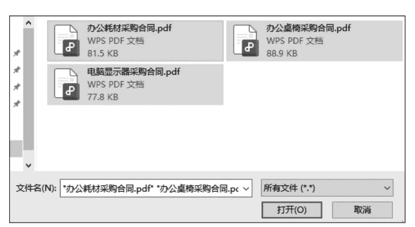

【操作 02】输入相同的整理指令，模型会给出合并后的结果，如图3-5所示。

整理完成后如发现表格有误，可直接告知模型修改，反复调整直至合格。这样就省去了逐份查阅、手工誊抄的时间，约九成重复劳动由 AI 承担，人主要负责引导、复核与监督，效率显著提升。

| 合同编号 | 合同名称 | 供应商名称 | 合同签订日期 | 采购物品 | 合同金额 | 交货日期 | 合同状态 | 备注 |
| :--- | :--- | :--- | :--- | :--- | :--- | :--- | :--- | :--- |
| PC20xxxxxx | 电脑显示器采购合同 | xx电子有限公司 | 202x年7月1日 | 27英寸高清电脑显示器（200台） | 200000元 | 202x年8月15日 | 在执行 | - |
| PC21xxxxx | 办公桌椅采购合同 | xx办公家具厂 | 202x年6月1日 | 办公桌椅套装（200套） | 240000元 | 202x年6月30日 | 已完成 | - |
| PC22xxxxx | 办公耗材采购合同 | xx文具店 | 202x年7月8日 | A4打印纸、中性笔、墨盒、文件夹、订书机及订书钉各种规格总计1900件 | 21000元 | 202x年7月15日 | 在执行 | - |

如果还需要进一步的调整或添加信息，请告知。

图3-5 ChatGPT 多文件合并回答示例

### 3.1.4 将生成的表格导出使用

对话窗口中的表格无法直接应用，需要导出。下面介绍三种导入 WPS 的方式。

直接复制粘贴

【操作 01】用鼠标框选模型输出的表格区域，复制到剪贴板，注意不要带入多余文字。
【操作 02】打开 WPS 新建空白表格。
【操作 03】定位到首个单元格，按 Ctrl+V 粘贴即可，如图3-6所示。

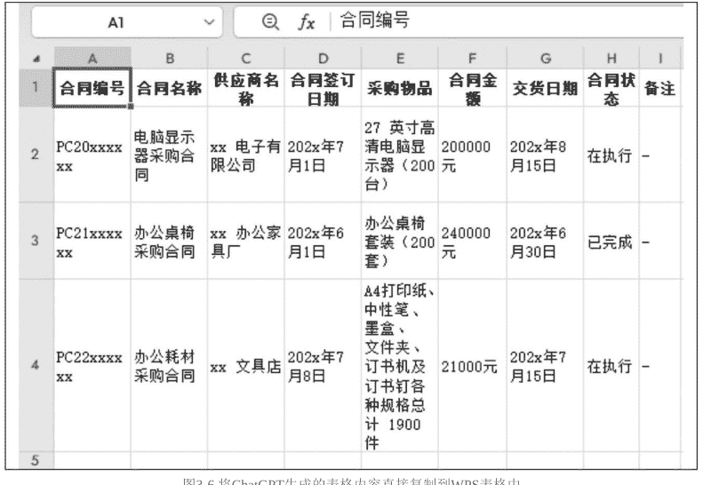

图3-6 将 ChatGPT 生成的表格内容直接复制到 WPS 表格中

让模型给出下载链接

在图3-5 回答下方继续提问：
> “将该表格存为文件，并提供下载链接。”

模型迅速完成，如图3-7所示。


图3-7 ChatGPT 将生成的表格存为文件

模型会把内容保存为 CSV 格式，兼容性良好，几乎所有数据工具都能打开，并附带下载地址。需注意该功能在 GPT-4o 上成功率更高，其他模型偶发异常。下载后打开与图3-6 内容一致。

Jupyter Notebook 自动建表

当表格结构复杂、信息量大或复制后格式错乱时，可用 Python 生成。

【操作 01】让模型编写可在 Jupyter Notebook 运行的代码，例如：
“给我一段代码，可以在 Jupyter Notebook 中运行，创建出一个表格文件，包含上述表格内容”

【操作 02】模型会给出基于 pandas 的代码，如图3-8所示。

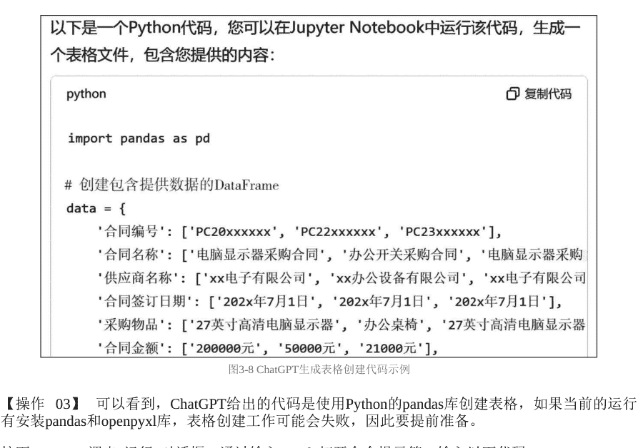

【操作 03】代码依赖 pandas 和 openpyxl，若环境未安装需提前准备。按 Win+R 打开运行窗口，输入 cmd 后执行安装命令：

```
pip install pandas openpyxl
```

【操作 04】环境就绪后打开 Jupyter Notebook，新建笔记本。
【操作 05】复制图3-8 中的代码到单元格并运行，运行按钮位置如图3-9所示。

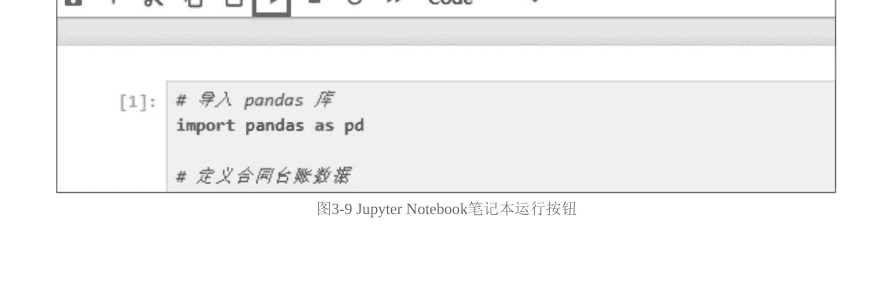

【操作 06】运行成功后底部会提示文件已生成，如图3-10所示。

```
# 将DataFrame保存为Excel文件
df.to_excel(file_path, index=False)

# 打印保存成功的消息
print(f"Excel文件已成功保存在：{file_path}")

Excel文件已成功保存在：Purchase_Contract_Ledger.xlsx
```

图3-10 Jupyter Notebook 代码运行成功反馈示例

【操作 07】在本地搜索该文件定位路径，如图3-11所示。


图3-11 查找文件示例

打开后表格内容与模型生成的一致，且可自由编辑。

## 3.2 实操：多人协同填写预算表

财务类数据采集通常需要多部门配合。传统做法是发起人逐个分发模板，收回后再逐个粘贴汇总，耗时易错。WPS 的多人协作模式让所有人共用同一份表格，实时更新，减少版本混乱。

场景：公司要做下半年预算，你通知各部门周五前填好本部门预算，你负责汇总。

### 3.2.1 模板建立并关联数据

为保证口径统一，先制作预算表填写模板，如图3-12所示。

| 科目 (单位：元) | 1月 | 2月 | 3月 | 4月 | 5月 | 6月 | 7月 预测 | 8月 预测 | 9月 预测 | 10月 预测 | 11月 预测 | 12月 预测 |
| :--- | :--- | :--- | :--- | :--- | :--- | :--- | :--- | :--- | :--- | :--- | :--- | :--- |
| **收入小计** | 0 | 0 | 0 | 0 | 0 | 0 | 0 | 0 | 0 | 0 | 0 | 0 |
| 产品A收入 | | | | | | | | | | | | |
| 产品B收入 | | | | | | | | | | | | |
| **成本费用小计** | 0 | 0 | 0 | 0 | 0 | 0 | 0 | 0 | 0 | 0 | 0 | 0 |
| 工资 | | | | | | | | | | | | |
| 社保 | | | | | | | | | | | | |
| 差旅费 | | | | | | | | | | | | |
| 招待费 | | | | | | | | | | | | |
| 交通费 | | | | | | | | | | | | |
| 办公费 | | | | | | | | | | | | |
| 快递费 | | | | | | | | | | | | |
| 房租 | | | | | | | | | | | | |
| 物业 | | | | | | | | | | | | |
| 水电费 | | | | | | | | | | | | |
| 固定资产折旧 | | | | | | | | | | | | |
| 无形资产摊销 | | | | | | | | | | | | |
| **税前经营利润** | 0 | 0 | 0 | 0 | 0 | 0 | 0 | 0 | 0 | 0 | 0 | 0 |

图3-12 预算表模板

【操作 01】不必单独下发模板，而是在一个工作簿中为每个部门如人力资源部、财务部创建独立工作表，并在前面或最后添加“预算汇总表”，如图3-13所示。


图3-13 建立各部门工作表和预算汇总表

【操作 02】在汇总表写入公式关联各明细表，用 SUM 等函数自动抓取对应单元格并汇总，如图3-14所示。

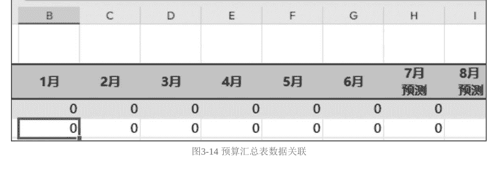

图3-14 预算汇总表数据关联

这样明细表更新时，汇总表即时刷新，后续汇总工作被极大简化。

### 3.2.2 预算模板数据有效性设置

多人填写容易导致格式不一致，例如年龄写“28”或“二十八”，学历写“本科”或“大学”。数据有效性可限制输入规则，保证一致性。

【操作 01】选中需要控制的区域，点击“数据”→“有效性”→“有效性”，如图3-15所示。


【操作 02】在有效性条件中选择“小数”，适合预算这类数值输入，如图3-16所示。文字或日期则选择对应类型。

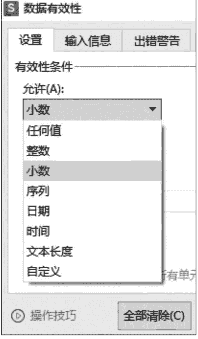

图3-16 数据有效性设置“允许”

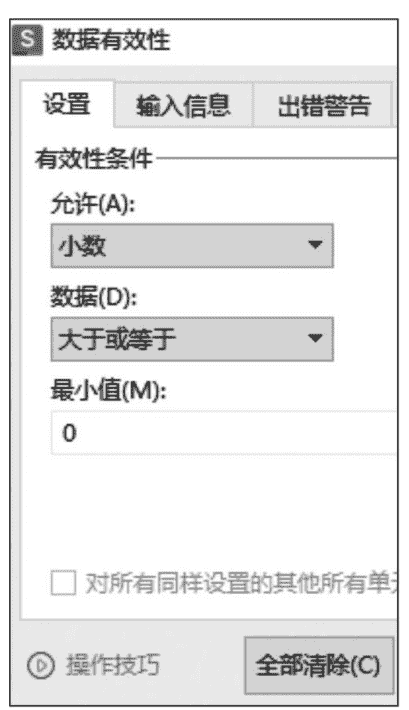

图3-17 数据有效性设置“数据”

【操作 03】收入费用不应为负，可在“数据”选项里选择“大于或等于”，最小值设为 0，如图3-17所示。若公司有上限，如招待费每月不超过 5000 元，也可在此设定范围。

【操作 04】打开“出错警告”，选择“警告”样式，标题填写“数据有误”，确定后，填写时若输入负数或文本，系统会自动弹出提示。

数据有效性还能做下拉菜单，例如学历栏预设“专科”“本科”“硕士研究生”“博士研究生”，填写者只能从中选择，避免随意输入。前期设置虽稍繁琐，但能大幅减少后续清洗工作。

### 3.2.3 启动多人协作编辑

模板准备好后即可开启协作。

【操作 01】用 WPS 打开文档，右上角“分享”按钮点开，选择“协作”，打开“和他人一起编辑”，即可进入协作页面。
【操作 02】此时“分享”下出现“复制链接”，复制后通过邮件、企业微信等发送给各部门负责人。也可直接通过社交平台端口发送，如图3-21所示。

点击链接即可进入，无需额外登录。协作页面内可实时看到他人修改，并可进一步配置权限。

### 3.2.4 管理编辑与查看权限

理想状态是各部门可自由填写本部数据，同时受限于敏感信息。权限可精细控制。

【操作 01】在“分享”按钮中打开“链接权限”，如图3-22所示。可设为所有人可编辑，或指定人员可编辑。重要文件可设部门负责人可编辑，其他人只读或不可见。后续在“管理协作者”“添加协作者”中可随时调整。

【操作 02】若不希望他人增删工作表，可点开链接权限下方的“高级设置”，按需开启相应保护，如图3-23所示。

【操作 03】如需防止填写人看到其他部门数据，可单独分享工作表。在工作表菜单右键点击目标表，如“财务部”，选择“分享工作表”。启用分享链接后，用户仅能访问当前工作表。

权限可设为“所有人可编辑”或“指定人可编辑”，添加协作者后复制链接发送，例如：

【金山文档】财务部 https://www.kdocs.cn/wo/sl/v11YPRzC

接收者打开后只能看到财务部的工作表，看不到其他部门或汇总表，有效避免信息泄露和误改。

各部门的填报结果会即时反映在共享表中，预算汇总页同步完成加总。资料填完之后可一键关闭他人的编辑权限，避免后续被改动。汇总表由系统自动生成，无需二次加工，整理后即可直接发给财务经理。

## 3.3 实操：AI 与 Python 协同打造财经简报
财务工作中有一类任务必须依托外部信息。比如编制行业研究或投资分析时，所用的市场数据、行业解读、竞争方的财务表现，往往要从各大财经门户、行业社区乃至社交平台里搜集。

这类工作耗费精力。信息源分散难寻，不同站点的口径时常不一致，需要花费不少时间核对。财务数据本身复杂，单一指标没有意义，必须做多源横向对比和纵向趋势追踪，才能得出有说服力的结论。再加上网络资讯更新很快，今天刚整理的素材明天就可能过时，需要持续跟进。做下来，财务人员感觉自己既要做核算，还要兼任信息搜集员。

现在借助 ChatGPT 与 Python，整条流程可以大幅提速。让 ChatGPT 拟定提示词或调用预设的 Python 脚本，就能自动从指定站点抓取最新资讯。将这套做法融入日常，财务人才能把精力放回真正的分析，而不是困在无休止的网络检索里。

### 3.3.1 让 ChatGPT 直接连网拿财经资讯
手工打开财经新闻网页，需要一条条扫标题来判断相关性。有了 ChatGPT，就能先设定行业关键词发起询问，迅速拿到想要的内容。

下面以保险行业为例演示：

【操作 01】先挑选一个能提供保险行业财经新闻的站点，比如新浪财经、中国保险网这类主流财经门户或垂直保险资讯站。

【操作 02】打开 ChatGPT 侧边栏的“探索 GPT”，如图3-25所示。

【操作 03】在搜索里定位到“Web Browser”，如图3-26所示。

Web Browser 可视为 ChatGPT 的联网扩展，先解释一下为何要启用它。ChatGPT 本身是基于大语言模型的对话系统，知识截止于最后一次训练，不会自动刷新，依赖训练前从互联网学习到的信息。这意味着对近期事件或最新变化的认知可能不全。

我们要的是最新的保险财经新闻，所以借助外部插件 Web Browser 访问互联网就能弥补实时性。

【操作 04】点“打开聊天”进入对话窗口，之后再提问，Web Browser 会充当桥梁，把检索到的内容传给 ChatGPT，由它组织语言作答。

提问时可直接附上之前选好的网址，指向会更清晰，例如：

> “打开新浪财经网页，https://finance.sina.com.cn，统计今天与‘保险’相关的财经新闻标题”

很快就能得到 ChatGPT 的回复，如图3-27所示。

【操作 05】这种直接的回答还不适合直接提交，需要形成简报。可以继续让 ChatGPT 整理成简报格式，最后把内容复制到 WPS 文字即可提交。

### 3.3.2 让 ChatGPT 协助 Python 编写爬虫
ChatGPT 直接统计是最快的方式。如果想用 Python 抓取财经新闻，ChatGPT 也能提供帮助，主要体现在代码编写上。

【操作 01】准备好运行环境。开始写代码前，确保电脑已安装必要的 Python 库。至少需要：pandas、pandas_datareader 和 openpyxl。

pandas 是 Python 里非常强的数据分析工具库，基本成了数据分析师标配；pandas_datareader 能方便地从网上获取金融数据；openpyxl 则是操作表格文件的利器，最终统计结果需要以表格形式呈现。

安装很简单：

按下键盘上的 Win+R 组合键 打开运行对话框，输入“cmd”打开命令提示符。

输入以下代码：

```
pip install pandas pandas_datareader openpyxl
```

输入命令后，系统会自动从 Python 包管理器下载并安装以上库。耗时取决于网速和电脑性能。安装完成后即可开始编写 Python 脚本获取数据。

【操作 02】打开目标新闻网站页面，按“F12”进入开发者工具，用其中的“元素”面板查看和操作超文本标记语言 HTML 代码，以便找到新闻标题和正文所在的 HTML 标签和类名。目的是明确爬虫脚本需要定位哪些元素来获取信息。

【操作 03】点击开发者工具顶部元素选择器按钮，如图3-28所示。

把鼠标悬停到网页上想要查看的元素上，比如某个新闻标题。该元素的 HTML 代码会在开发者工具中高亮显示。

【操作 04】找到新闻标题、正文等元素的 HTML 代码后，记录以下信息：
- 标签名，如`<h1>`、`<p>`等
- 类名，class 属性，如`class="news-title"`
- ID，id 属性，如`id="main-news"`
- 其他有助于定位的属性，如`data-type="news-item"`等

拿到这些信息后，就可以在 Python 爬虫脚本里用这些标签和属性来抓取数据。

【操作 05】打开 ChatGPT，把对应的信息提供给它，让它帮忙写代码，可以这样问：

> “我想用 Python 统计新浪财经网站关于‘保险’的财经新闻标题，请给我一段可在 Jupyter Notebook 中运行的代码，完成统计任务并生成文档。”

【操作 06】打开 Jupyter Notebook，新建笔记本，把 ChatGPT 给出的代码复制粘贴进去，运行后查看抓取到的新闻标题和正文。

如果运行失败，也可以把报错信息或问题描述给 ChatGPT，让它诊断并给出优化代码。

【贴心提示】爬取数据时务必遵守相关法律法规和网站规则，避免不必要的法律纠纷。尤其是金融数据受监管和使用限制更严，要确保获取方式合法合规。

Python 爬取网页数据失败常见原因汇总如下，如表3-1所示。

表3-1 数据爬取失败问题汇总

| 原因 | 常见情况 | 解决办法 |
| :--- | :--- | :--- |
| 网络问题 | 有时候网络连接问题或目标服务器的响应问题会导致请求失败 | 检查网络连接，尝试使用不同的网络环境 |
| 错误的URL或页面结构改变 | 如果目标网站的结构发生了变化(如更新了HTML标签的类名或结构)，传统的抓取路径可能就会失效 | 重新检查并分析最新的网页结构，更新代码以匹配新的结构 |
| 访问速度过快 | 连续地发送大量请求可能会触发网站的防爬机制，或暂时性地被封禁IP地址 | 在请求之间设置延时，如使用time.sleep()，减慢抓取速度 |
| 权限问题 | 某些网页需要登录或特定权限才能访问数据 | 如果需要登录，尝试模拟登录过程获取必要的Cookie或令牌 |
| 代码错误 | 可能存在语法错误、逻辑错误，或在运行时使用了错误的库和方法 | 仔细检查代码和运行环境，确保代码的正确性、逻辑的合理性。保证电脑安装了对应的库 |

遇到问题时，可根据具体报错信息和爬取情况，逐步排查上述可能原因来解决。

### 3.3.3 ChatGPT 加 Python 实现简报邮件自动推送
简报做好后，还要发到对应邮箱，这一步也能自动化。下面是用 AI+Python 实现自动定时发邮件的具体做法：

【操作 01】用 Python 自动发邮件需要邮件传输协议 SMTP，这是邮件发送的标准协议，几乎所有邮箱服务商都支持。开启邮箱 SMTP 访问权限通常要在服务商设置页操作。以 163 邮箱为例，先登录自己的 163 邮箱账户。

【操作 02】选择“设置”，在菜单中找到“POP3/SMTP/IMAP”，如图3-29所示。

【操作 03】点击“开启”SMTP 服务选项，可能会要求短信验证，按指示扫码发送，直到状态变为“已开启”，如图3-30所示。

【操作 04】页面下拉到授权密码管理，按要求进行短信验证，直到弹出一个授权码，如图3-31所示。这个授权码要记好，后续发邮件会用到。

【操作 05】记下 SMTP 服务器地址，163 邮箱的相关信息就在“POP3/SMTP/IMAP”设置页最下方，如图3-32所示。

图3-31 SMTP 服务授权码

图3-32 SMTP 服务器地址

【贴心提示】设置过程中如有疑问，建议查看邮箱帮助文档或联系客服，具体步骤和界面可能有变动。

【操作 06】发邮件环节需导入 smtplib 库，这是 Python 标准库，直接在脚本里导入即可，无须额外安装。若不确定，可提醒 ChatGPT 在写代码时启用。

【操作 07】向 ChatGPT 提问：

> “给我一段代码，可在 Jupyter Notebook 中运行，自动将电脑桌面的《财经简报.txt》文本文档作为附件，用 163 邮箱发送到指定邮箱，发送者邮箱地址为1xxxxxx02@163.com，接收者邮箱地址为6xxxxxx057@163.com。163 邮箱的 SMTP 服务器地址为 smtp.163.com。”

ChatGPT 的回答如图3-33所示。

代码示例：

```python
import os
import smtplib
from email.mime.text import MIMEText
from email.mime.multipart import MIMEMultipart
from email.mime.application import MIMEApplication

# 发送者和接收者邮箱
sender_email = "15***7002@163.com"
receiver_email = "6***057@qq.com"
password = 'your_password'  # 替换为你的邮箱授权码

# 创建邮件对象
message = MIMEMultipart()
message['From'] = sender_email
message['To'] = receiver_email
message['Subject'] = '财经简报'

# 邮件正文
body = "请查收附件中的财经简报。"
message.attach(MIMEText(body, "plain"))
```

图3-33 ChatGPT 生成自动发送简报邮件代码部分示例

【操作 08】打开 Jupyter Notebook，新建笔记本，具体步骤参考之前的 Jupyter Notebook 基础操作。

【操作 09】点击图3-33右上角的“复制代码”，在新建笔记本的单元格里粘贴 ChatGPT 给出的代码。

【操作 10】修改代码中的隐私信息。
① ChatGPT 给出的代码中图3-33标出的一行“password”，需要填入自己的邮箱授权码，即图3-31显示的授权码。出于安全考虑，建议代码运行前再填入，不必告诉 ChatGPT。
② 邮件正文目前只有一句话：“请查收附加中的财经简报。”想增加内容，可自行修改，或提前告诉 ChatGPT 让其在生成代码时写进去。
③ 检查代码中的附件文件路径是否正确。可右键点击目标文件查看属性，里面有准确位置，如图3-34所示。

【操作 11】修改完成后在 Jupyter Notebook 中运行代码。运行成功会提示“邮件发送成功”，如图3-35所示。

此时打开接收邮箱，就能看到发来的邮件，如图3-36所示。

图3-36 邮件接收情况

当然，单次偶发邮件，直接登录邮箱发送更直接。演示的只是 AI+Python 可以发邮件的功能。

在真实场景里，财务人员每天要发几十上百封邮件，比如给客户发电子发票，或每月给员工发工资条，这类定时批量任务，AI+Python 的邮件自动化流程就能发挥大作用。

# 第4章 财务数据处理自动化

数据采集完后，财务工作会遇到新难题。每天从不同系统、报表、银行流水等渠道收到的信息，既多又杂，容易让人眼花缭乱。若不做有效提取和处理，关键数据会被淹没在信息过载里。所以科学处理数据、筛选重点、剔除冗余，成为提升财务数据处理效率的关键。本章继续看不同财务任务，如何用 AI 工具和 Python 技术简化数据流程，提升工作效率。

## 4.1 实战：AI 自动筛出不合规报销
日常财务管理中，数据筛选是高频操作。过去多用表格软件自带的筛选功能，按日期、报销项目、金额等标准逐条筛。比如筛出已超折旧年限仍在使用的固定资产，筛出未达业绩目标的人员，筛出超出公司规定标准的报销记录。筛选条件复杂时，手动操作需要多次筛选和复查，既低效又易漏。现在 ChatGPT 能自动完成筛选，大幅减少人工工作量。

近期公司费用支出上涨，需要对照报销要求，梳理费用明细表，找出不合理的报销项目并统计上报。

### 4.1.1 先拆解报销制度，明确筛选逻辑
要找不合理报销项目，先要清楚报销应遵循什么标准，这也是给 AI 应用设定筛选规则的前提。

有些公司的财务报销制度条款繁多，文本很难快速转化为具体筛选条件，需要人工细读并总结，再在表格里设置筛选，耗时费力。这时可以让 AI 辅助，把公司的《财务报销制度》文件传给 ChatGPT，快速解析并提取关键筛选规则。

具体操作：

- 【操作 01】点击 ChatGPT 的文件上传按钮，上传公司的《财务报销制度》。
- 【操作 02】向 ChatGPT 发出询问，可这样问：
- 【操作 03】等待并完善 ChatGPT 的回答，直到得到满意结果，如图4-1所示。

> “现在我想要对公司《费用报销明细表》中不合理的报销项目进行筛选，请根据《财务报销制度》，总结出明确的筛选标准。”

图4-1 ChatGPT 总结筛选规则

这一步不仅是拿到筛选规则，也是让 ChatGPT“理解”后续任务的标准，便于后面传表格并找出不合理费用。要注意，ChatGPT 虽能完成约80%的任务，但可能忽略约20%的关键点，需要人工复核审核，比如“超出标准需特殊审批”就是经提醒后才补充上的。因为此时 ChatGPT 还不知道表格具体内容，特殊审批的费用是有标注的，没有标注的才是需要筛出的。

### 4.1.2 导入明细表并下达筛选指令
接下来是核心步骤，让 ChatGPT 从明细表里找出不合理项目。

- 【操作 01】先做好数据准备，整理一份清晰结构化的《费用报销明细表》，包含报销项目、金额、报销人、报销人所在部门、审批状态等关键信息。若表格涉及公司机密，可做脱敏处理，确保数据安全。
- 【操作 02】点击 ChatGPT 的“文件上传”按钮，选择“从电脑中上传”，把准备好的《费用报销明细表》传到输入框。上传后继续发出指令，如图4-2所示。

> “根据上面的报销标准，将《费用报销明细表》中不合理的条目全部找到，并将其列成表格。”

图4-2 ChatGPT 上传表格并提问示例

等待 ChatGPT 结合之前解析的《财务报销制度》和表格数据，自动筛出不合理报销项目并列出，如图4-3所示。

- 【操作 03】若想进一步了解这些条目为何不合规，可继续追问：

> “请在每一条不符合规定的报销明细后面，简要写明违规原因。注意保持表格形式。”

很快 ChatGPT 会更新表格并附上违规原因，如图4-4所示。

这样，一份完整的《违规报销明细表》就自动生成了。

### 4.1.3 复核结果并导出表格
ChatGPT 生成的表格不能直接提交。需要把表格内容复制下来，粘贴到新建的表格中，如图4-5所示。

| 报销单号 | 日期 | 费用类型 | 部门 | 报销人 | 报销金额 | 违规原因 |
|---|---|---|---|---|---|---|
| F000235 | 2024/1/15 | 维修费 | 后勤部 | 李玖 | 5176 | 超过单次5000元限额 |
| F000240 | 2024/1/30 | 招待费 | 销售部 | 刘拾 | 2640 | 超过每次2000元限额 |
| F000241 | 2024/2/2 | 办公费 | 人事部 | 林肆贰 | 1750 | 超过每部门每月1000元限额 |
| F000272 | 2024/1/6 | 招待费 | 市场部 | 曹捌柒 | 3678 | 超过每次2000元限额 |
| F000275 | 2024/1/15 | 招待费 | 后勤部 | 潘伍肆 | 2277 | 超过每次2000元限额 |

图4-5 将 ChatGPT 生成的表格内容直接复制到 WPS 表格中

这份表格是否正确，还需要人工审查。结合 ChatGPT 标注的违规原因，并对照前面从《财务报销制度》总结出的筛选规则，这几条确实都超过了规定的报销限额，标注的违规原因也完全准确。

在把这几笔报销异常明细筛出来后，别急着下结论说已经找全了。先用老办法再跑一遍比对和人工复核，万一还有漏网的，就在和 AI 的对话里指出来让它补齐，或者直接手工把遗漏项填进表里。这一手补位，既是对模型产出的修正，也是对筛选流程本身的加固。

需要交代的是，这套做法现阶段只适合做小范围测试。如果在真实业务里验证下来，AI 处理这类任务的准确率能稳定达标，就足以沉淀成一条可复用的办公自动化捷径，为以后同类工作提供模板和参考。

## 4.2 【实操】AI带你玩转固定资产自动查询表

同一种业务目标往往有多条实现路径。像基础筛选，很多人习惯点“数据-筛选”手动设条件，也能用 FILTER、VLOOKUP 等公式快速搞定。现实里多数人对表格的挖掘比较浅，主要停留在录入、求和、排序这些基础动作，对进阶函数、数据分析、宏等能力使用得少。

以前学这些只能靠刷题反复练。函数数量庞大，用得少就容易忘，用的时候想不起来该挑哪个。比如要挑出库存低于 50 且进货价高于 100 的商品，第一反应是手动筛，几乎想不到用 AND 来组合条件。就算想到了，公式怎么写、参数怎么配，也常卡住而报错。

现在借助 AI，这些卡点能即时解开。下面就用一个高频场景演示——

公司固定资产底数比较乱，需要重建一份最新的《固定资产管理明细表》，同时加上自动查询能力。

### 4.2.1 XLOOKUP 跨表定位资产信息

企业经营久了，资产类型非常杂：电脑、办公桌椅、文件柜、沙发、车辆、机床、空调，甚至食堂的炉灶、冰箱、消毒柜都算。价格便宜的资产更容易在入账时被忽略。

向各部门要明细，往往收到一堆格式不一、内容混杂的表格，规格型号、价格数量之外，还混进采购经历、搬运记录等无关信息。

想把这些信息归并到新表里，最可靠的锚点就是资产编号。

跨表找数据时可以用哪些函数？对函数不熟可以先问 AI，示例见图4-6。

> 可以使用以下三个函数进行跨表查找目标资产：
> 1. **VLOOKUP函数**：根据指定的标准查找并返回数据。
> 2. **INDEX 和 MATCH组合**：提供更灵活的查找方式，可以在任意方向上查找数据。
> 3. **XLOOKUP函数**：新的查找函数，功能更全面，支持在任何方向上查找和返回数据。

图4-6 AI 给出的适配函数示例

VLOOKUP 是老朋友，XLOOKUP 则相对新。它是为弥补 VLOOKUP 的局限而来的，让查找更灵活、更准。

比如 XLOOKUP 支持从右往左找，就不再受编号列在名称列右侧的影响；还能自定义找不到时的提示，比如返回“未找到”，让结果更直观、便于控错；使用上不用记列序，直接指定查找范围和返回范围即可。

XLOOKUP 的核心要素有六项：查找值、查找区域、返回区域、找不到时的替代值、匹配模式、搜索模式。

- ※查找值：要找的那个值。
- ※查找区域：可能包含匹配项的列或范围。
- ※返回区域：匹配后从此列或范围取回的结果。
- ※未找到时的返回值（可选）：找不到时的替代文本。
- ※匹配方式（可选）：精确匹配或近似匹配等。
- ※搜索方式（可选）：从上到下或从下到上等。

记不住写法就直接问。跨表查找的具体操作如下：

- 【操作 01】 将原始资产明细导进一个工作表，命名为“Sheet1”。
- 【操作 02】 新建工作表Sheet2，第一列写“资产编号”，把 Sheet1 中的编号复制过来，见图4-7。
- 【操作 03】 若编号未排序，先选中区域执行“排序”“升序”，见图4-8。
- 【操作 04】 在编号旁新增几列，填入“资产名称”“规格型号”“单位”等信息，见图4-9。
- 【操作 05】 用 XLOOKUP 从 Sheet1 按编号回填对应信息。

以“资产名称”为例，不会写公式时可以这样问：

> “运用XLOOKUP函数，在工作表Sheet1中的B列（资产名称所在列），按照工作表Sheet2的A列资产编号找到对应的‘资产名称’，填入工作表Sheet2中的B列。具体公式该如何写？”

AI 会给出对应表达式，见图4-10。

表达式示例：

```
=XLOOKUP(A2, Sheet1!A:A, Sheet1!B:B, "未找到资产名称")
```

图4-10 AI 生成的 XLOOKUP 表达式示例

- 【操作 06】 把代码复制到目标单元格，回车后资产1即可正确显示，对应 F 0001 的名称。见图4-11。
图4-11 在对应单元格粘贴 XLOOKUP 公式
- 【操作 07】 将鼠标移到单元格右下角出现“+”时向下拖拽，即可批量填充其余编号对应的名称。
- 【操作 08】 “规格型号”“单位”“资产原值”等其他字段均按此方式填充。最终可得到一份完整的明细，见图4-12。

图中仅作演示，实际工作中可按企业需求增补“所属部门”“购置方式”等字段，重复上述流程即可。

| 资产编号 | 资产名称 | 规格型号 | 单位 | 资产原值 | 预计残值 | 购置日期 | 预计使用年限 |

|---|---|---|---|---|---|---|---|

| F-0001 | 资产1 | *** | 台 | 30500 | - | 2022/1/1 | 10 |

| F-0002 | 资产2 | *** | 台 | 20000 | - | 2021/5/1 | 5 |

| F-0003 | 资产3 | *** | 台 | 21000 | - | 2022/1/1 | 5 |

| F-0004 | 资产4 | *** | 台 | 3500 | - | 2021/8/1 | 3 |

| F-0005 | 资产5 | *** | 台 | 28000 | - | 2018/6/3 | 10 |

| F-0006 | 资产6 | *** | 台 | 18000 | 900 | 2021/4/5 | 5 |

| F-0007 | 资产7 | *** | 台 | 4000 | - | 2020/5/25 | 3 |

| F-0008 | 资产8 | *** | 台 | 40000 | - | 2022/8/5 | 3 |

| F-0009 | 资产9 | *** | 台 | 21000 | 1,000 | 2022/1/1 | 5 |

| F-0010 | 资产10 | *** | 台 | 6200 | - | 2022/1/1 | 10 |

图4-12 其他列数据填充

### 4.2.2 EDATE 计算报废日期

目前表里只有购置信息，还缺折旧相关内容，比如预计报废时间、已折旧金额、账面价值、使用状态等。

先算报废日期。问询后得到 EDATE，它专用于日期运算，如信用卡还款日、合同到期日、固定资产预计报废日等。只需基于起始日期加减指定月数即可。

确认函数后操作如下：

- 【操作 01】 新增一列“预计报废日”。
- 【操作 02】 向 AI 询问写法：

> “表中固定资产的购置日期在G列，预计使用年限在H列，用EDATE函数计算固定资产的预计报废日期，公式应该怎么写？”

AI 的回应见图4-14。
- 【操作 03】 复制代码粘贴到对应单元格回车，见图4-15。

公式里的 G2 为该行资产的购置日期，H2 为预计使用年限。EDATE 以月为单位，所以需将年数乘以 12 换算成月。
- 【操作 04】 把公式向下填充到所有行，右下角出现“+”时拖拽即可。

### 4.2.3 SLN 与 YEARFRAC 组合算累计折旧

知道了报废日，若想了解当前累计折旧是多少，可继续提问确定函数，见图4-16。

SLN 用来计算直线折旧，语法包含成本、残值、使用年限。成本即“资产原值”，残值即“预计残值”，年限在表里已有。

SLN 的结果是年折旧额，不是累计值。若要算到现在的累计折旧，需要用年折旧额乘以已计提的年数，这一步用 YEARFRAC 完成。

YEARFRAC 用于计算两个日期之间的年比例，常用于金融分析、折旧、利息等场景，输入起始日和结束日即可。

结合两者可得出自购置日至当前或指定日期的累计折旧。具体操作：

- 【操作 01】 新增“年折旧额”“已计提年份”“累计折旧”三列。
- 【操作 02】 提问：

> “表中固定资产的原值在E列，预计残值在F列，预计使用年限在H列，用SLN函数计算固定资产的年折旧额，公式应该怎么写？”

AI 回复见图4-17。
- 【操作 03】 复制代码到“年折旧额”列回车，见图4-18。
- 【操作 04】 继续提问：

> “表中固定资产的购置日期在G列，用YEARFRAC函数计算固定资产截至2024年7月31日的已计提年份，公式应该怎么写？”

AI 回复见图4-19。
- 【操作 05】 复制代码到对应单元格，见图4-20。
- 【操作 06】 累计折旧为年折旧额乘以已计提年份，直接在单元格手动输入公式，见图4-21。
图4-21 手动输入累计折旧公式
【操作 07】 把每列公式向下填充。

【贴心提示】若觉得步骤繁琐，可直接组合公式。新增一列“累计折旧”，提问：

> “表中固定资产的原值在E列，预计残值在F列，购置日期在G列，预计使用年限在H列，将SLN函数与YEARFRAC函数组合使用，计算固定资产截至2024年7月31日的累计折旧额，公式应该怎么写？”

AI 回复见图4-22。

把该函数填入“累计折旧”列即可直接得到结果，见图4-23。

| A | B | C | D | E | F | G | H | I | L |

|---|---|---|---|---|---|---|---|---|---|

| 资产编号 | 资产名称 | 规格型号 | 单位 | 资产原值 | 预计残值 | 购置日期 | 预计使用年限 | 预计报废日 | 累计折旧 |

| F-0001 | 资产1 | *** | 台 | 30500 | - | 2022/1/1 | 10 | 2032/1/1 | 7,879.17 |

| F-0002 | 资产2 | *** | 台 | 20000 | - | 2021/5/1 | 5 | 2026/5/1 | 13,000.00 |

| F-0003 | 资产3 | *** | 台 | 21000 | - | 2022/1/1 | 5 | 2027/1/1 | 10,850.00 |

| F-0004 | 资产4 | *** | 台 | 3500 | - | 2021/8/1 | 3 | 2024/8/1 | 3,500.00 |

| F-0005 | 资产5 | *** | 台 | 28000 | - | 2018/6/3 | 10 | 2028/6/3 | 17,251.11 |

| F-0006 | 资产6 | *** | 台 | 18000 | 900 | 2021/4/5 | 5 | 2026/4/5 | 11,362.00 |

| F-0007 | 资产7 | *** | 台 | 4000 | - | 2020/5/25 | 3 | 2023/5/25 | 5,577.78 |

| F-0008 | 资产8 | *** | 台 | 40000 | - | 2022/8/5 | 3 | 2025/8/5 | 26,518.52 |

| F-0009 | 资产9 | *** | 台 | 21000 | 1,000 | 2022/1/1 | 5 | 2027/1/1 | 10,333.33 |

| F-0010 | 资产10 | *** | 台 | 6200 | - | 2022/1/1 | 10 | 2032/1/1 | 1,601.67 |

| F-0011 | 资产11 | *** | 台 | 17000 | - | 2021/5/1 | 5 | 2026/5/1 | 11,050.00 |

| F-0012 | 资产12 | *** | 台 | 36000 | - | 2022/1/1 | 5 | 2027/1/1 | 18,600.00 |

| F-0013 | 资产13 | *** | 台 | 5500 | - | 2021/8/1 | 3 | 2024/8/1 | 5,500.00 |

| F-0014 | 资产14 | *** | 台 | 74000 | - | 2018/6/3 | 10 | 2028/6/3 | 45,592.22 |

| F-0015 | 资产15 | *** | 台 | 9300 | 300 | 2021/4/5 | 5 | 2026/4/5 | 5,980.00 |

| F-0016 | 资产16 | *** | 台 | 12000 | - | 2020/5/25 | 3 | 2023/5/25 | 16,733.33 |

| F-0017 | 资产17 | *** | 台 | 31000 | - | 2022/8/5 | 3 | 2025/8/5 | 20,551.85 |

| F-0018 | 资产18 | *** | 台 | 6000 | - | 2022/1/1 | 5 | 2027/1/1 | 3,100.00 |

| F-0019 | 资产19 | *** | 台 | 69000 | - | 2021/4/5 | 5 | 2026/4/5 | 45,846.67 |

| F-0020 | 资产20 | *** | 台 | 8800 | - | 2023/5/25 | 3 | 2026/5/25 | 3,471.11 |

图4-23 填充完整的累计折旧额

### 4.2.4 IF 判断折旧状态

填充好的累计折旧会发现，部分资产的累计折旧超过了原值，这不合理。因此在计算前应先判定折旧状态：是否已完全折旧，还是仍在折旧中。用判断函数 IF 即可实现。

IF 用于条件逻辑，需要条件、为真时的返回值、为假时的返回值。

这里可用预计报废日判断：若报废日早于或等于 2024 年 7 月 31 日，则状态显示“已全额折旧”；若晚于该日期，则显示“在使用”。

操作如下：

【操作 01】 在“累计折旧”前插入一列“资产状态”。
【操作 02】 提问：

> “表中固定资产的购置日期在G列，预计报废日在I列，运用IF函数判断固定资产在2024年7月31日的状态。如果预计报废日早于或等于2024年7月31日，显示‘已全额折旧’，如果预计报废日晚于2024年7月31日，显示‘在使用’。”

AI 回复见图4-24。
【操作 03】 复制代码到对应单元格，见图4-25。
【操作 04】 向下填充公式。即可看到部分资产显示“已报废”，见图4-26。

| B | C | D | E | F | G | H | I | L | M |

|---|---|---|---|---|---|---|---|---|---|

| 资产名称 | 规格型号 | 单位 | 资产原值 | 预计残值 | 购置日期 | 预计使用年限 | 预计报废日 | 资产状态 | 累计折旧 |

| 资产1 | *** | 台 | 30500 | - | 2022/1/1 | 10 | 2032/1/1 | 在使用 | 7,879.17 |

固定资产折旧与查询自动化实操笔记

| 资产2 | *** | 台 | 20000 | - | 2021/5/1 | 5 | 2026/5/1 | 在使用 | 13,000.00 |
| 资产3 | *** | 台 | 21000 | - | 2022/1/1 | 5 | 2027/1/1 | 在使用 | 10,850.00 |
| 资产4 | *** | 台 | 3500 | - | 2021/8/1 | 3 | 2024/8/1 | 在使用 | 3,500.00 |
| 资产5 | *** | 台 | 28000 | - | 2018/6/3 | 10 | 2028/6/3 | 在使用 | 17,251.11 |
| 资产6 | *** | 台 | 18000 | 900 | 2021/4/5 | 5 | 2026/4/5 | 在使用 | 11,362.00 |
| 资产7 | *** | 台 | 4000 | - | 2020/5/25 | 3 | 2023/5/25 | 已全额折旧 | 5,577.78 |
| 资产8 | *** | 台 | 40000 | - | 2022/8/5 | 3 | 2025/8/5 | 在使用 | 26,518.52 |
| 资产9 | *** | 台 | 21000 | 1,000 | 2022/1/1 | 5 | 2027/1/1 | 在使用 | 10,333.33 |
| 资产10 | *** | 台 | 6200 | - | 2022/1/1 | 10 | 2032/1/1 | 在使用 | 1,601.67 |
| 资产11 | *** | 台 | 17000 | - | 2021/5/1 | 5 | 2026/5/1 | 在使用 | 11,050.00 |
| 资产12 | *** | 台 | 36000 | - | 2022/1/1 | 5 | 2027/1/1 | 在使用 | 18,600.00 |
| 资产13 | *** | 台 | 5500 | - | 2021/8/1 | 3 | 2024/8/1 | 在使用 | 5,500.00 |
| 资产14 | *** | 台 | 74000 | - | 2018/6/3 | 10 | 2028/6/3 | 在使用 | 45,592.22 |
| 资产15 | *** | 台 | 9300 | 300 | 2021/4/5 | 5 | 2026/4/5 | 在使用 | 5,980.00 |
| 资产16 | *** | 台 | 12000 | - | 2020/5/25 | 3 | 2023/5/25 | 已全额折旧 | 16,733.33 |
| 资产17 | *** | 台 | 31000 | - | 2022/8/5 | 3 | 2025/8/5 | 在使用 | 20,551.85 |
| 资产18 | *** | 台 | 6000 | - | 2022/1/1 | 5 | 2027/1/1 | 在使用 | 3,100.00 |
| 资产19 | *** | 台 | 69000 | - | 2021/4/5 | 5 | 2026/4/5 | 在使用 | 45,846.67 |
| 资产20 | *** | 台 | 8800 | - | 2023/5/25 | 3 | 2026/5/25 | 在使用 | 3,471.11 |

图4-26 固定资产现状一览

### 4.2.5 用IF嵌套修正累计折旧的偏差

仅靠基础判断不够，IF可以嵌套来实现更复杂的分段逻辑。累计折旧出现不合理时，就要对原公式做条件改造。

【操作 01】先判断状态栏是“在使用”还是“已全额折旧”，再决定折旧截止点。
可以这样向ChatGPT描述需求：

> 表中预计报废日放在I列，资产状态在L列，原累计折旧公式是‘=SLN(E2,F2,H2)*YEARFRAC(G2,DATE(2024,7,31))’。请用IF函数实现：状态为“在使用”时仍按2024年7月31日截止，状态为“已全额折旧”时改按预计报废日截止，公式怎么写？

ChatGPT的示例返回值见图4-27。

【操作 02】把返回的代码粘贴到累计折旧列并向下填充，修正后的结果如图4-28。

| B | C | D | E | F | G | H | I | L | M |
|---|---|---|---|---|---|---|---|---|---|
| 资产名称 | 规格型号 | 单位 | 资产原值 | 预计残值 | 购置日期 | 预计使用年限 | 预计报废日 | 资产状态 | 累计折旧 |
| 资产1 | *** | 台 | 30500 | - | 2022/1/1 | 10 | 2032/1/1 | 在使用 | 7,879.17 |
| 资产2 | *** | 台 | 20000 | - | 2021/5/1 | 5 | 2026/5/1 | 在使用 | 13,000.00 |
| 资产7 | *** | 台 | 4000 | - | 2020/5/25 | 3 | 2023/5/25 | 已全额折旧 | 4,000.00 |
| 资产16 | *** | 台 | 12000 | - | 2020/5/25 | 3 | 2023/5/25 | 已全额折旧 | 12,000.00 |
| ... | ... | ... | ... | ... | ... | ... | ... | ... | ... |

图4-28 累计折旧修正后效果

从结果看，两笔已全额折旧资产的累计折旧已回正到原值，公式有效。

【操作 03】在累计折旧右侧新增“资产现值”列，输入 =E2-M2 即可得出净值，如图4-29。

| E | F | G | H | I | L | M | N |
|---|---|---|---|---|---|---|---|
| 资产原值 | 预计残值 | 购置日期 | 预计使用年限 | 预计报废日 | 资产状态 | 累计折旧 | 资产现值 |
| 30500 | - | 2022/1/1 | 10 | 2032/1/1 | 在使用 | 7,879.17 | =E2-M2 |

图4-29 资产现值公式录入

【操作 04】向下填充后，再补上“盘点数量”“盈亏方向”“原因”等盘点字段，实地核对后即可形成完整的《固定资产管理明细表》。

### 4.2.6 建立固定资产一键查询面板

明细表多了之后手动翻找效率很低。借助函数加筛选，可以在表右侧做一个自动查询入口，输入编号就能即时呈现关键信息。

【操作 01】在表格右侧划分区域，美化后放置“选择资产编号”标题，下方依次列出资产名称、资产原值、购置日期、资产状态、剩余使用年限等字段，如图4-30。

| 选择资产编号 |
| :--- |
| 资产名称 |  |
| 资产原值 |  |
| 购置日期 |  |
| 资产状态 |  |
| 剩余使用年限 |  |

图4-30 查询入口布局

【操作 02】查询以编号为核心，先为编号单元格做数据有效性，下拉选择更方便。
选中单元格后进入“数据→有效性”，如图4-31。

图4-31 添加数据有效性

【操作 03】在有效性设置对话框里选择“序列”，来源指向资产编号列，勾选“提供下拉箭头”，确定后即可出现编号下拉菜单，如图4-32、图4-33。

【操作 04】编号确定后，用XLOOKUP把信息拉出来。可以这样提问ChatGPT：

> 表中资产编号在A列，资产名称在B列，已在P3选择好编号，请用XLOOKUP写出返回对应资产名称的公式。

ChatGPT给出的写法见图4-34。

【操作 05】把公式复制到对应格，随便换一个编号，名称会同步更新，如图4-35。

【操作 06】资产原值、购置日期、资产状态同理重复上述两步。完成后如图4-36。注意购置日期可能显示成数字，需右键设置单元格格式为日期，选合适的样式即可恢复正常。

【操作 07】剩余使用年限表里没有现成值，需要嵌套计算。用预计报废日减去今天即可，提问方式为：

> 资产编号在A列，预计报废日在I列，P3为已选编号，请用函数计算该资产从今天起至报废日的剩余使用年限。

ChatGPT返回了结合DATEDIF与TODAY的嵌套公式，见图4-37。该组合能随打开文件日期自动刷新，保证年限实时。

【操作 08】粘贴公式后，查询面板即可完整运行。选择F-0008时显示如下，如图4-38。

| 选择资产编号 |
| :---: |
| F-0008 |
| 资产名称 | 资产8 |
| 资产原值 | 40000 |
| 购置日期 | 2022/8/5 |
| 资产状态 | 在使用 |
| 剩余使用年限 | 1 |

图4-38 查询效果演示

## 4.3 AI+Python批量处理数据文件

财务里很多工作不难但费时，例如多表合并、分表拆分、批量生成文本、抽取异常数据。AI配合Python可以把这些重复劳动秒级完成。

### 4.3.1 一键合并多张工资表

假设财务部、人事部、销售部各有一份工资表，需要汇总统计人工成本。

【操作 01】直接让ChatGPT生成可运行代码：

> 请给我一段Jupyter Notebook可运行的Python代码，自动读取桌面上的‘财务部工资表.xlsx’、‘人事部工资表.xlsx’、‘销售部工资表.xlsx’，合并为‘工资表汇总’并保存回桌面，完成后给出提示。

返回的代码示例见图4-39。

以下是一个可以在 Jupyter Notebook 中运行的 Python 脚本，用于自动合并位于电脑桌面上的三个 Excel 工资表，并将合并后的结果保存回桌面：

```python
import pandas as pd
import os

# 获取桌面路径
desktop_path = os.path.join(os.path.expanduser("~"), 'Desktop')

# 读取三个部门的 Excel 文件
finance_path = os.path.join(desktop_path, '财务部工资表.xlsx')
hr_path = os.path.join(desktop_path, '人事部工资表.xlsx')
sales_path = os.path.join(desktop_path, '销售部工资表.xlsx')
finance = pd.read_excel(finance_path)
hr = pd.read_excel(hr_path)
sales = pd.read_excel(sales_path)

# 合并这些表格
combined = pd.concat([finance, hr, sales])

# 保存合并后的表格到桌面
combined_file_path = os.path.join(desktop_path, '工资表汇总.xlsx')
combined.to_excel(combined_file_path, index=False)

# 输出完成提示
print("工资表已合并并保存至桌面")
```

图4-39 合并代码示例

【操作 02】打开Jupyter Notebook新建本。

【操作 03】复制代码到单元格运行，运行成功会提示“工资表已合并并保存至桌面”，桌面即可看到汇总文件，打开后各部门数据已合并。

### 4.3.2 一键拆分汇总表为个人工资条

汇总表用于内部管理，发工资条时需要按人拆分且不泄露他人信息。以20人为例，3分钟内拆分为20个独立文件可这样做：

【操作 01】向ChatGPT说明运行环境与需求：

> 请给我一段在Jupyter Notebook中运行的代码，读取桌面上的‘工资表汇总.xlsx’，按员工拆分为20个单独表格，每个表带表头且以员工姓名命名，统一存到桌面‘新建文件夹’中，完成后提醒。

ChatGPT返回的代码见图4-42。

【操作 02】先在桌面右键新建一个空白文件夹，暂不改名。

【操作 03】打开Jupyter Notebook新建本。

### 4.3.3 批量把工资表合成 Word 文档
纸质工资条要逐份打开打印非常耗时。借助 AI 与 Python，就能把拆分完的多张表格一次性拼进同一份文档里。

【操作 04】打开图4-42，点选画面右上方的获取脚本按钮，把内容放到“拆分表格数据”笔记本的工作区里并执行。脚本执行成功后会弹出“工资表已拆分并保存至新建文件夹”的提示，如图4-43所示。

回到桌面，新建文件夹内已出现 20 个表格文件，如图4-44所示。

随意打开其中一个，可看到里面仅保留表头与该员工的个人记录，其他人的薪资已被剔除，如图4-45所示。

若公司需要下发纸质工资条，逐张打开打印同样费事。能否把这些表一次性整合进一个文字文件？AI+Python 可以实现。

【操作 01】继续向 ChatGPT 描述需求，可这样说：

> “给我一段可在 Jupyter Notebook 运行的脚本，把桌面‘新建文件夹’里的表格汇总成一个 Word 文档，每个表格保留表头与薪资信息，不分页，方便打印，文件保存到桌面，完成时给出提示。”

模型返回完整脚本，如图4-46所示。

【操作 02】启动 Jupyter Notebook，新建笔记本。

【操作 03】在图4-46右上拷贝脚本，贴到新笔记本的单元格里运行。运行成功后会自动提示“所有表格已整理到Word文档并保存至桌面”，如图4-47所示。

```python
table.style = 'Table Grid'

# 设置表头
for i, col in enumerate(df.columns):
    table.cell(0, i).text = col

# 填充数据
for row in df.itertuples(index=False):
    row_cells = table.add_row().cells
    for i, value in enumerate(row):
        row_cells[i].text = str(value)

# 添加空行作为间隔
doc.add_paragraph()

# 保存 Word 文档
doc.save(output_path)

# 完成提示
print("所有表格已整理到 Word 文档并保存至桌面")
```

图4-47 Jupyter Notebook代码运行成功提醒

回到桌面，已生成“工资信息汇总.docx”，打开如图4-48。

| 工号 | 姓名 | 职位 | 所属部门 | 应发工资 | 社保 | 实发工资 |
|------|------|------|----------|----------|------|----------|
| 1001 | 张一 | 财务总监 | 财务部 | 20000 | 1500 | 18500 |
| 1003 | 张三 | 资金主管 | 财务部 | 10000 | 1000 | 9000 |
| 1002 | 张二 | 财务经理 | 财务部 | 15000 | 1500 | 13500 |

图4-48 桌面“工资信息汇总.docx”的内容

文档里全是员工薪资信息，打印后裁剪即可发放。

这类批量表转文的能力在财务场景很实用，比如批量生成固定资产标签。先做好标签样式，基于《固定资产明细表》，让 AI 自动写脚本，为每项资产生成标准化的标签。

### 4.3.4 PDF 发票批量解析成表格
财务工作中常需把 PDF 文档里的信息批量抽取成表格，例如发票、合同、财务报告中的金额、日期、交易明细。手工录入既慢又易错。

更省事的做法如下：

【操作 01】把待整理的 PDF 集中放到一个文件夹。演示时不方便用电子发票，这里采用发票签收回执单，它同样包含主要发票信息，如图4-49所示。

【操作 02】既可沿用让 ChatGPT 写脚本再导入 Jupyter 运行的思路，也可直接让模型完成任务，即上传文件后提问。这里演示更简便的第二种方式，把整理好的 PDF 直接传给 ChatGPT 并提出需求，如图4-50所示。

得到回复如图4-51所示。

根据您上传的发票签收回执单，我已经汇总了以下信息以创建一个发票管理台账表格：

| 发票代码 | 开票时间 | 收票单位 | 发票类型 | 发票金额 | 开票单位 |
| :--- | :--- | :--- | :--- | :--- | :--- |
| ******0011 | 2024.7.5 | ABC 公司 | 增值税普通发票 | 20000 | XYZ 公司 |
| ******0012 | 2024.7.8 | DEF 公司 | 增值税专用发票 | 50000 | XYZ 公司 |
| ******0013 | 2024.8.5 | GHI 公司 | 增值税专用发票 | 80000 | XYZ 公司 |
| ******0014 | 2024.8.15 | JKL 公司 | 增值税普通发票 | 100000 | XYZ 公司 |
| ******0015 | 2024.8.17 | MN 公司 | 增值税普通发票 | 30000 | XYZ 公司 |

图4-51 ChatGPT生成发票管理台账

【操作 03】接下来需要把表格保存为可编辑文件。第三章第一节介绍过三种做法：直接复制粘贴、让模型给出下载链接、用 Jupyter 自动建表。这里选用最省事的第二种。

在刚才的回答后继续追问，如图4-52所示。

存为文件

我已将发票管理台账保存为CSV文件。您可以通过以下链接下载：

下载发票管理台账 [->]

图4-52 要求ChatGPT提供表格文件下载链接

【操作 04】点下载链接，浏览器会自动把文件保存到指定位置。

选中下载好的文件右键“打开方式”，用 WPS 打开，就能看到内容，如图4-53所示。

图4-53 ChatGPT生成的表格文件

该表格与模型之前的回复完全一致，也与上传的 PDF 信息一一对应，说明单独使用这类 AI 工具也能完成不少自动化任务。

# 第5章 财务图表自动化生成实战
文字擅长传递数据细节，表格擅长精确展示数据点，图表在表现力上更强。柱状图、折线图、饼图、雷达图、热力图、甘特图各有适用场景，能直观呈现数据关系、占比和趋势，帮助决策者快速抓住重点。在财务管理中，这种直观性尤为关键。有了 AI 和 Python 的加持，财务人员能更快做出又准又好看的图表。

## 5.1 实战：AI 驱动报销数据可视化
日常财务工作中经常要做收入支出对比图、预算执行跟踪图或现金流趋势图。手工整理筛选数据、调整格式样式既耗时又易错。AI 能从海量数据里自动抽取关键信息，迅速生成直观精准的图表，大幅提升效率。

下面完成这个任务——

根据 1 月费用报销明细表，统计不同部门、不同费用类型的报销对比，以及各部门费用预算执行情况，生成统计图，下班前提交。

### 5.1.1 自动汇总混乱的报销明细
先看任务现状，手边只有一张 1 月各部门费用报销明细表，如图5-1。

| 报销单号 | 日期 | 费用类型 | 报销部门 | 报销人 | 报销金额 | 备注 |
|---|---|---|---|---|---|---|
| F000231 | 2024/1/3 | 办公费 | 人事部 | 陈伍 | 140.00 | |
| F000232 | 2024/1/6 | 招待费 | 市场部 | 赵柒 | 1931.00 | |
| F000233 | 2024/1/9 | 交通费 | 后勤部 | 孙捌 | 3152.00 | |
| F000234 | 2024/1/12 | 差旅费 | 销售部 | 钱贰 | 3007.00 | |
| F000235 | 2024/1/15 | 维修费 | 后勤部 | 李玖 | 5176.00 | |
| F000236 | 2024/1/18 | 招待费 | 销售部 | 周叁 | 1960.00 | |
| F000237 | 2024/1/21 | 餐饮费 | 财务部 | 吴肆 | 170.00 | |
| F000238 | 2024/1/24 | 交通费 | 财务部 | 郑陆 | 1501.00 | |
| F000239 | 2024/1/27 | 差旅费 | 市场部 | 王壹 | 2057.00 | |
| F000240 | 2024/1/30 | 招待费 | 销售部 | 刘拾 | 2640.00 | |
| F000241 | 2024/1/3 | 办公费 | 人事部 | 韩捌壹 | 800.00 | |
| F000242 | 2024/1/6 | 招待费 | 市场部 | 曹肆伍 | 500.00 | |
| F000243 | 2024/1/9 | 交通费 | 后勤部 | 吕玖陆 | 120.00 | |
| F000244 | 2024/1/12 | 差旅费 | 销售部 | 丁贰叁 | 2100.00 | |
| F000245 | 2024/1/15 | 维修费 | 后勤部 | 潘伍壹 | 200.00 | |
| F000246 | 2024/1/18 | 招待费 | 销售部 | 陈贰 | 310.00 | |
| F000247 | 2024/1/21 | 餐饮费 | 销售部 | 赵壹 | 982.00 | |
| F000248 | 2024/1/24 | 交通费 | 财务部 | 孙玖 | 236.00 | |
| F000249 | 2024/1/27 | 差旅费 | 市场部 | 钱捌 | 1800.00 | |
| F000250 | 2024/1/30 | 招待费 | 销售部 | 李陆 | 300.00 | |
| F000251 | 2024/1/3 | 差旅费 | 人事部 | 韩伍壹 | 1750.00 | |
| F000252 | 2024/1/6 | 招待费 | 市场部 | 曹捌柒 | 3678.00 | |
| F000253 | 2024/1/9 | 办公费 | 后勤部 | 吕叁陆 | 212.00 | |
| F000254 | 2024/1/12 | 其他费用 | 销售部 | 丁壹捌 | 6242.00 | |
| F000255 | 2024/1/15 | 招待费 | 后勤部 | 潘伍肆 | 2277.00 | |

图5-1 1月份各部门费用报销明细表

这张表很乱。我们需要按费用类型、报销部门两个维度汇总，生成新的费用报销情况表。

具体做法：

【操作 01】点 ChatGPT 输入框左侧的文件上传按钮，选择“从电脑中上传”，把费用报销明细表传给 ChatGPT，然后要求：

> “根据表格内容，按费用类型和报销部门生成一张费用报销汇总表，横向为费用类型和合计，纵向为报销部门和合计，展示各部门各费用类型的汇总金额及合计数，用表格呈现。”

模型的回答如图5-2。

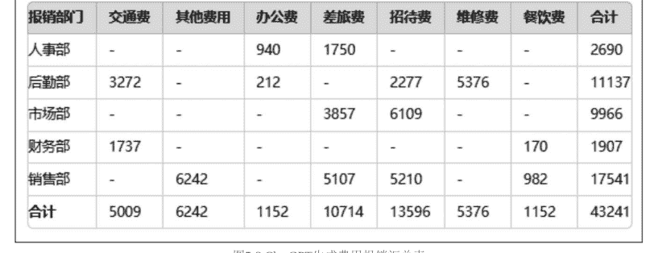

图5-2 ChatGPT生成费用报销汇总表

【操作 02】让模型把表格存成文件并返回下载链接，如图5-3。


图5-3 要求ChatGPT提供费用报销汇总表下载链接

点链接下载并保存。

### 5.1.2 基于汇总表一键出图
有了汇总表，下面演示如何让 ChatGPT 自动画图。

【操作 01】把表格上传给 ChatGPT，要求：

> “根据表格内容，绘制柱形图，展示各部门费用报销金额。”

模型的回答如图5-4。

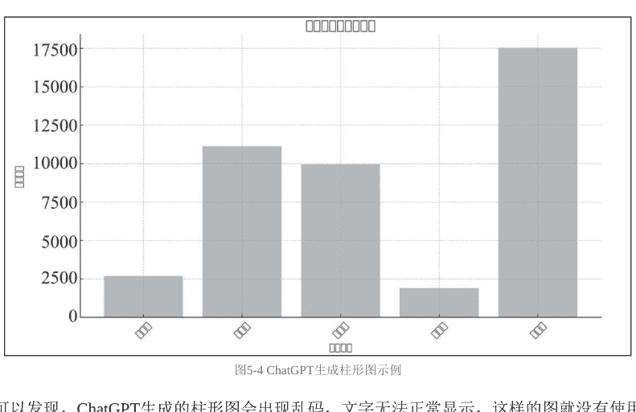

此时会发现生成的柱形图文字乱码，无法使用。下面演示用 ChatGPT 插件 Diagrams Show Me 解决。

【操作 02】Diagrams Show Me 是专门绘图的插件。启用它需要打开 ChatGPT 侧边栏，找到“探索 GPT”，第3章有过介绍。

打开后搜索“Diagrams Show Me”，找到如图5-5 的插件。


在该对话框里重复【操作01】的要求，模型仍会给出乱码柱形图，继续追加要求：

> “把这个柱形图生成本地文件，保存为 HTML 格式。”

此时模型会返回下载链接，如图5-6。

> 柱形图已生成并保存为HTML文件。你可以通过以下链接下载该文件：

下载费用报销柱形图 [->]

图5-6 ChatGPT生成费用报销柱形图下载链接

点开链接后文字完整，柱形图呈现正常，如图5-7。

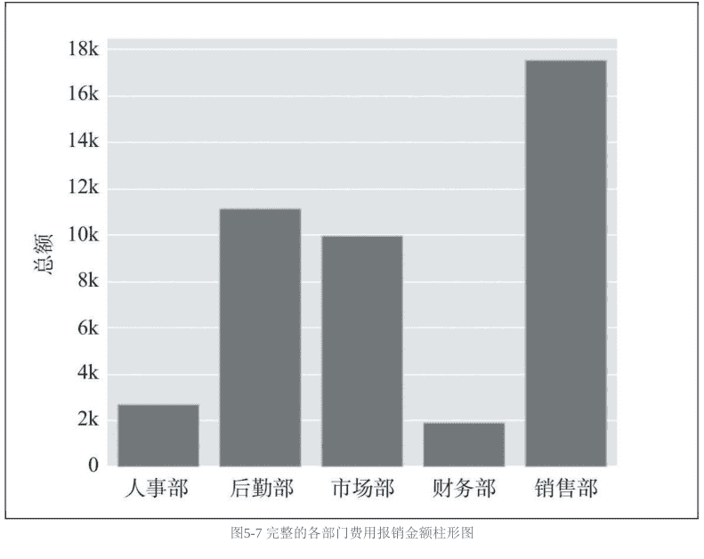

图5-7 完整的各部门费用报销金额柱形图

解释一下为什么不能直接在对话框提问而必须用插件。直接提问时，模型常回复“我在将图表转换为 HTML 格式时遇到问题”。因为图表转 HTML 需要对结构、样式和数据进行精确解析和重编码，需要专门的图表处理工具或库。ChatGPT 主力是文本生成，暂时不具备图表转换能力。

而 Diagrams Show Me 的功能介绍里包含“代码解译器和数据分析”，因此用它才能消除乱码。

【操作 03】重复上述操作，得到各费用类型报销金额图，如图5-8。

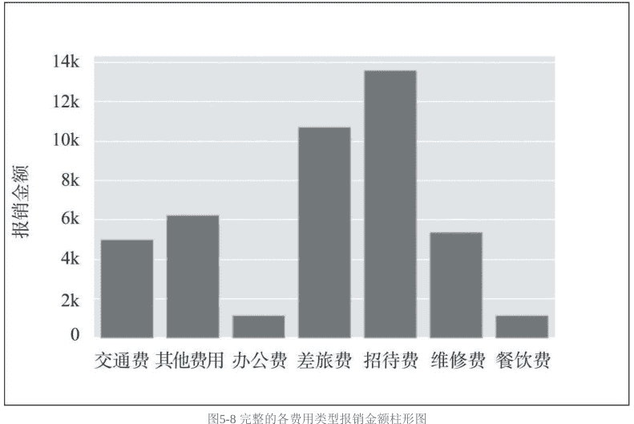

图5-8 完整的各费用类型报销金额柱形图

【操作 04】若想柱形图带数据标签，可继续要求模型重新生成，如图5-9。

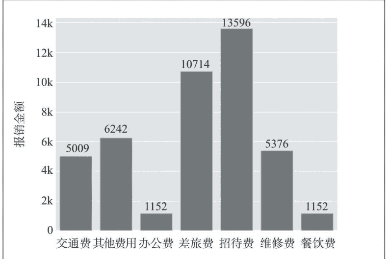

图5-9 带数据标签的柱形图

【操作 05】若觉得颜色单一不够美观，可让模型美化，比如改颜色、加花纹，如图5-10。

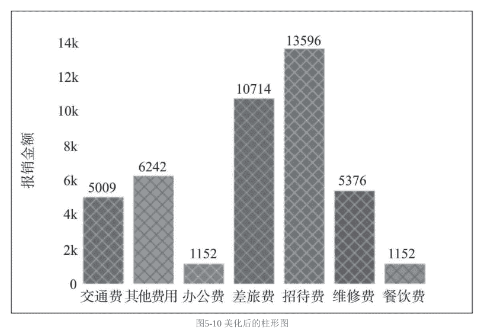

【操作 06】不只是柱形图，饼图、折线图、圆环图等，模型都能生成，如图5-11。

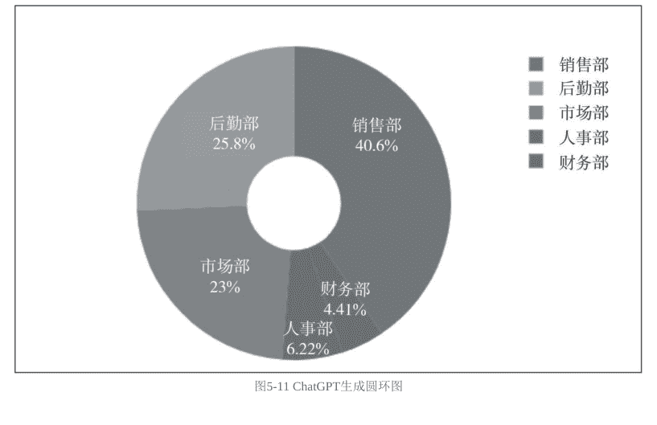

### 5.1.3 用数据条和迷你图追踪预算执行
上述统计图只能对比报销金额，看不出预算执行情况。因此要结合各部门费用预算表制作数据条和迷你图。

【操作 01】把各部门费用预算表上传给 ChatGPT，让其生成与之前“费用报销汇总表”同维度的费用预算汇总表，并保存到桌面，如图5-12。

| A | B | C | D | E | F | G | H | I |
|---|---|---|---|---|---|---|---|---|
| 部门 | 交通费 | 其他费用 | 办公费 | 差旅费 | 招待费 | 维修费 | 餐饮费 | 合计 |
| 人事部 | 1000 | 1000 | 1000 | 1000 | 1000 | 0 | 1000 | 6000 |
| 后勤部 | 1000 | 1000 | 300 | 1000 | 2000 | 5000 | 1000 | 11300 |
| 市场部 | 5000 | 1000 | 300 | 5000 | 10000 | 0 | 1000 | 22300 |
| 财务部 | 1000 | 1000 | 300 | 1000 | 1000 | 0 | 1000 | 5300 |
| 销售部 | 5000 | 1000 | 300 | 5000 | 10000 | 0 | 1000 | 22300 |
| 合计 | 13000 | 5000 | 2200 | 13000 | 24000 | 5000 | 5000 | 67200 |

图5-12 ChatGPT生成费用预算汇总表

【操作 02】把“费用报销汇总表”和“费用预算汇总表”一并上传给 ChatGPT，要求出具各部门各项费用的预算执行率表格并返回下载链接，点击链接把表格保存在桌面，如图5-13。

| A | B | C | D | E | F | G | H | I |
|---|---|---|---|---|---|---|---|---|
| 部门 | 交通费 | 其他费用 | 办公费 | 差旅费 | 招待费 | 维修费 | 餐饮费 | 合计 |
| 人事部 | 0.00% | 0.00% | 94.00% | 175.00% | 0.00% | 0.00% | 0.00% | 44.83% |
| 后勤部 | 327.20% | 0.00% | 70.67% | 0.00% | 113.85% | 107.52% | 0.00% | 98.56% |
| 市场部 | 0.00% | 0.00% | 0.00% | 77.14% | 61.09% | 0.00% | 0.00% | 44.69% |

| 财务部 | 173.70% | 0.00% | 0.00% | 0.00% | 0.00% | 0.00% | 17.00% | 35.98% |

| 销售部 | 0.00% | 624.20% | 0.00% | 102.14% | 52.10% | 0.00% | 98.20% | 78.66% |

| 合计 | 38.53% | 124.84% | 52.36% | 82.42% | 56.65% | 107.52% | 23.04% | 64.35% |

图5-13 ChatGPT生成费用执行率汇总表

【操作 03】 ChatGPT生成的占比数值在WPS里会触发左上角的黄色警告，提示当前被识别为文本格式。先选中中间的百分比区域，把光标移至感叹号，菜单中选择“转换为数字”，格式即可恢复，如图5-14所示。
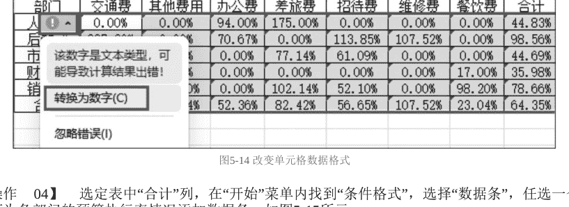
图5-14 改变单元格数据格式

【操作 04】 选中报表中的“合计”列，进入“开始”菜单的“条件格式”，点选“数据条”并挑一种配色，就能在各部门预算执行率旁生成可视化条带，如图5-15所示。
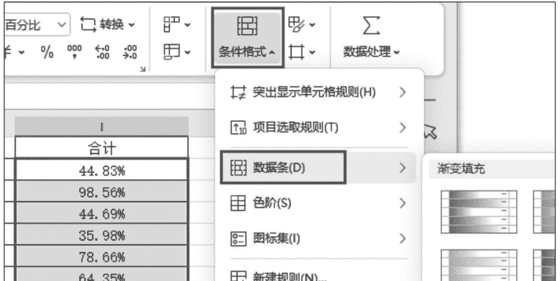

加上数据条后，每项费用的完成进度与剩余空间都能直观呈现，对管理判断很有参考价值，如图5-16所示。
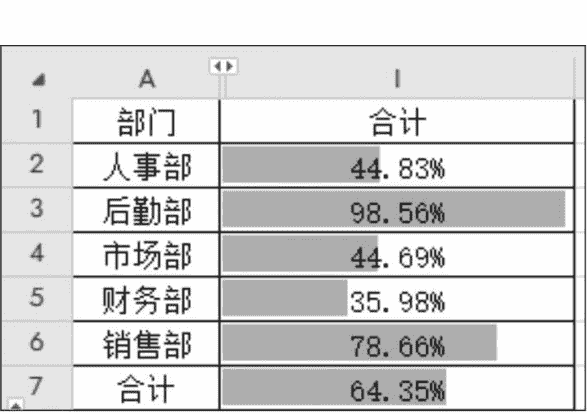

【操作 05】 在数据条基础上做轻量展示。点击“插入”-“迷你图”，类型选“柱形”，如图5-17所示。
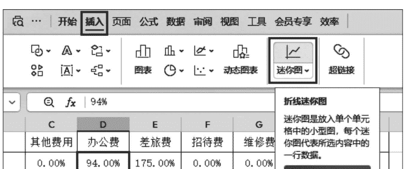

操作不确定的地方可以直接向ChatGPT要一份通用指引，AI能给出思路框架，细节可能与WPS略有差异但逻辑相通。图5-17右下角还有WPS自带的小视频教程，悬停“迷你图”选项时会弹出，点击即可观看演示。

【操作 06】 迷你图的取值范围要覆盖全部费用数据，放置位置在部门列之后另加一列，确认后即可完成，如图5-18所示。
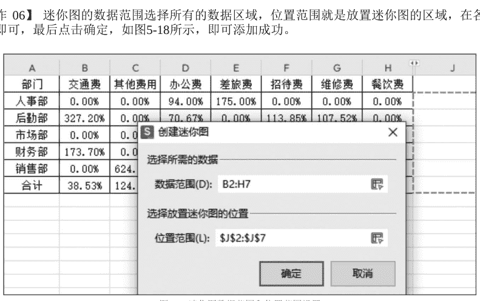

最终效果如图5-19。单元格内的微型柱形能快速反映各部门不同费用类别的执行态势，还可用颜色标注峰值与谷值，预算执行表里一眼就能定位超预算项。

| 部门 | 交通费 | 其他费用 | 办公费 | 差旅费 | 招待费 | 维修费 | 餐饮费 | |

|---|---|---|---|---|---|---|---|---|

| 人事部 | 0.00% | 0.00% | 94.00% | 175.00% | 0.00% | 0.00% | 0.00% | |

| 后勤部 | 327.20% | 0.00% | 70.67% | 0.00% | 113.85% | 107.52% | 0.00% | |

| 市场部 | 0.00% | 0.00% | 0.00% | 77.14% | 61.09% | 0.00% | 0.00% | |

| 财务部 | 173.70% | 0.00% | 0.00% | 0.00% | 0.00% | 0.00% | 17.00% | |

| 销售部 | 0.00% | 624.20% | 0.00% | 102.14% | 52.10% | 0.00% | 98.20% | |

| 合计 | 38.53% | 124.84% | 52.36% | 82.42% | 56.65% | 107.52% | 23.04% | |

图5-19 迷你图柱形显示效果

除了柱形，迷你图还支持“折线”“盈亏”等样式，可用于呈现成本走势或盈亏情况。体积小巧不占空间，审阅时无需切换视图即可抓住要点，在财务工作中应用广泛。

## 5.2 实操：用 AI 搭建集团收支看板

财务管理的价值在于支撑决策，汇报时只罗列数字说服力有限。可视化看板能把关键指标浓缩到一页，让管理层快速把握态势。掌握这项能力对职场发展很有帮助，有AI指导完全可以自行完成。

下周集团要开上半年总结会，需提前准备一份基于各事业部收支情况的看板。

### 5.2.1 先让 AI 拆解步骤

先请ChatGPT把整体流程拆开，熟悉思路。可以这样提问：

> “公司要求按各事业部的收支情况做一份高质量的数据看板，用WPS完成，具体怎么做？”

ChatGPT的回复如图5-20所示。
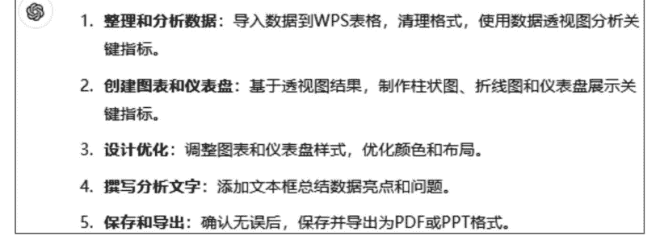

按AI给出的框架逐项落地即可完成制作。

### 5.2.2 整理事业部收支明细

把各事业部的收支明细从记账软件导出，文件中包含摘要、科目等信息，实际使用只需时间与金额。

【操作 01】 将明细表上传给ChatGPT，要求整理成上半年收入支出汇总表，同一Excel中按事业部分表，表头为月份、收入金额、支出金额、结余金额，并提供下载链接：

> “根据各事业部的收入支出明细表的数据，分别制作一张上半年收入支出汇总表，放在同一个Excel中，标明事业部名称。每个事业部的表头都包含月份、收入金额、支出金额、结余金额这四个项目，并生成文件下载链接。”

ChatGPT的回复如图5-21所示。


【操作 02】 打开链接即可下载到集团各事业部上半年收支汇总表，如图5-22所示。

| A | B | C | D | E |

|---|---|---|---|---|

| **事业部** | **月份** | **收入金额** | **支出金额** | **结余金额** |

| 事业部A | 1 | 160000 | 110000 | 50000 |

| 事业部A | 2 | 210000 | 70000 | 140000 |

| 事业部A | 3 | 140000 | 60000 | 80000 |

| 事业部A | 4 | 240000 | 80000 | 160000 |

| 事业部A | 5 | 120000 | 70000 | 50000 |

| 事业部A | 6 | 190000 | 130000 | 60000 |

| 事业部B | 1 | 190000 | 210000 | -20000 |

| 事业部B | 2 | 200000 | 80000 | 120000 |

| 事业部B | 3 | 160000 | 180000 | -20000 |

| 事业部B | 4 | 250000 | 200000 | 50000 |

| 事业部B | 5 | 100000 | 100000 | 0 |

| 事业部B | 6 | 210000 | 300000 | -90000 |

| 事业部C | 1 | 370000 | 150000 | 220000 |

| 事业部C | 2 | 320000 | 120000 | 200000 |

| 事业部C | 3 | 350000 | 160000 | 190000 |

| 事业部C | 4 | 500000 | 180000 | 320000 |

| 事业部C | 5 | 420000 | 250000 | 170000 |

| 事业部C | 6 | 100000 | 60000 | 40000 |

【操作 03】 在该表前插入新工作表，命名为“集团各事业部收支数据看板”。右键“Sheet1”选择“插入工作表”，数量为1，位置选“当前工作表之前”，确认后即可，如图5-23所示。


### 5.2.3 搭建数据透视表

目前数据纵向堆叠，难以一目了然。看板追求“一页览清”，避免来回切换。因此需要在新建的工作表中基于原数据生成透视表，按事业部汇总收支。

【操作 01】 向ChatGPT请教透视表的制作步骤：

> “现有事业部A、事业部B、事业部C的上半年收入支出汇总表，该怎么创建数据透视表？”

ChatGPT的回复如图5-24所示。
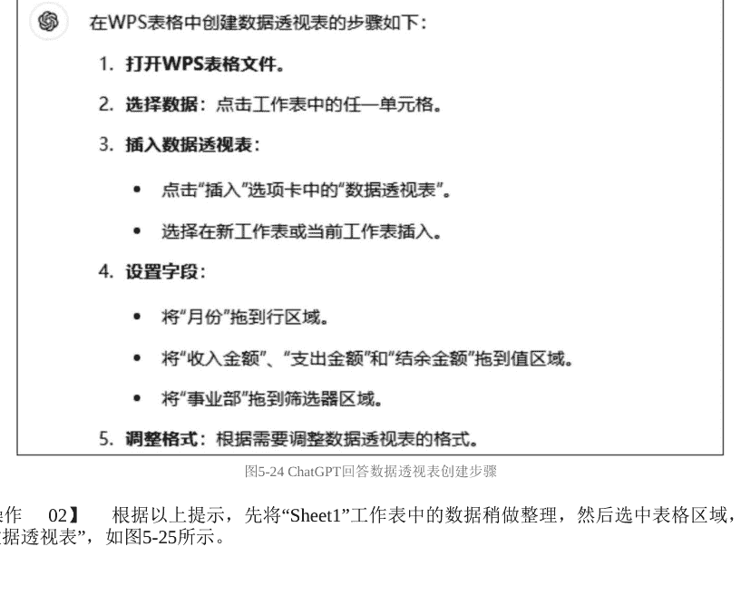

【操作 02】 先对“Sheet1”数据做简单整理，选中区域后点“插入”→“数据透视表”，如图5-25所示。
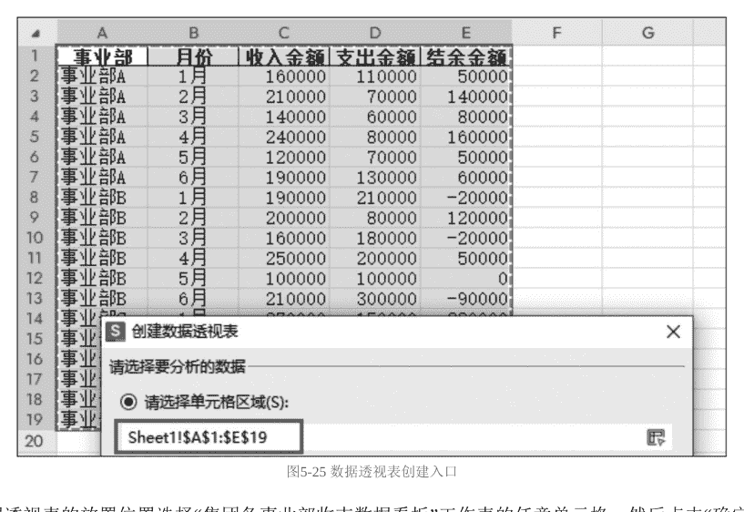

把透视表放置在“集团各事业部收支数据看板”任意单元格，点击“确定”，如图5-26所示。
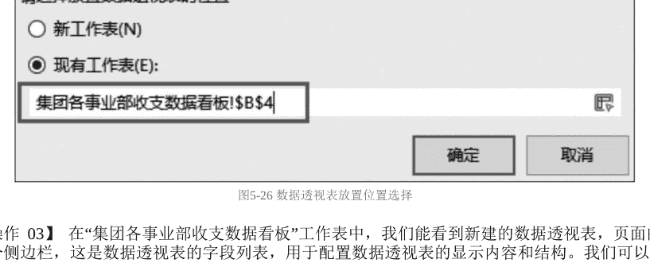

【操作 03】 新建表右侧会出现字段列表，可拖拽配置。把“月份”放至行区，“事业部”放至筛选区，“收入金额”“支出金额”“结余金额”放至值区并默认求和，呈现结果如图5-27所示。
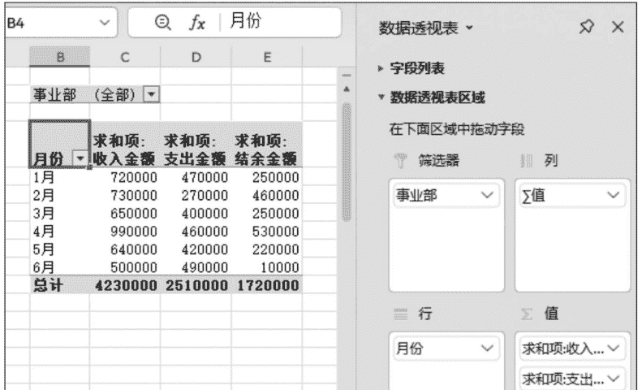

上方的“事业部”筛选器可选择“全部”查看总汇，也可单选事业部B查看其明细，如图5-28所示。
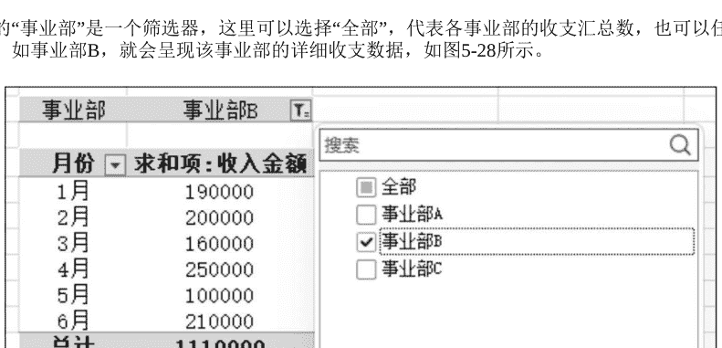

同样可以换维度，例如以“月份”为筛选器，以“事业部”为行区，形成不同视角的透视表，如图5-29所示。

### 5.2.4 生成数据透视图

仅看数字判断趋势不直观，需搭配透视图。

【操作 01】 选中收入金额相关的透视表任意单元格，点击“插入”“数据透视图”，柱形图更利于对比，如图5-32所示。
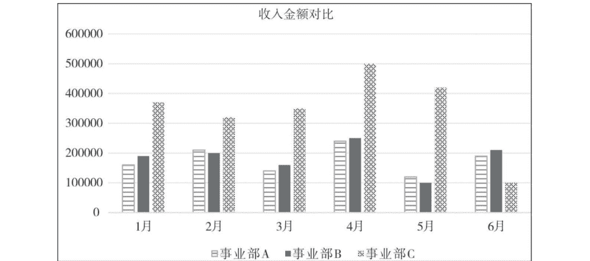
图5-32 集团各事业部1—6月收入金额对比数据透视图

【操作 02】 同样方式为支出金额和结余金额分别生成透视图，如图5-33和图5-34所示。
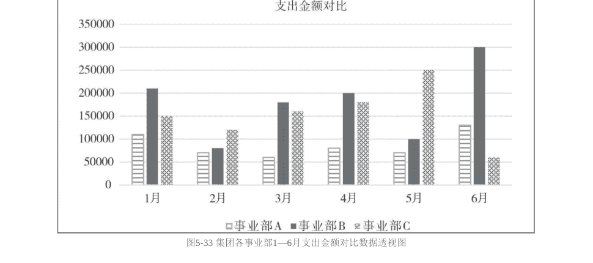
图5-33 集团各事业部1—6月支出金额对比数据透视图
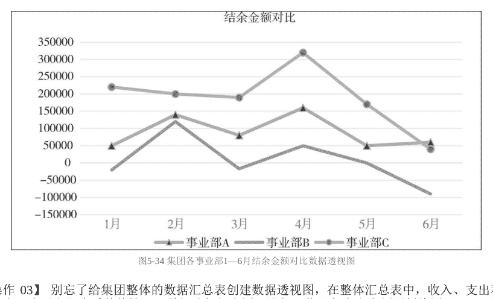

【操作 03】 整体汇总表可做组合图，收入与支出用折线，结余用面积图，方便把握整体状况，如图5-35所示。
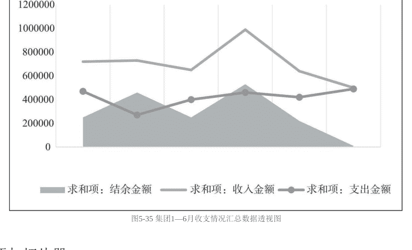

### 5.2.5 增加切片器

看板已有基本内容，但筛选仍需手动点选，体验不够顺畅。切片器可实现一键筛选。

【操作 01】 向ChatGPT提问：

> “在WPS中，有了数据透视表和数据透视图，怎么添加切片器呢？”

ChatGPT的回复如图5-36所示。
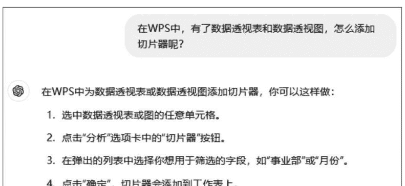

【操作 02】 选中数据透视表任意单元格，在顶部菜单点“分析”-“插入切片器”，选择“事业部”，如图5-37所示。


添加后的切片器如图5-38所示。


点“事业部A”后，对应的透视表和透视图会同步更新，其他事业部数据被隐藏，如图5-39所示。
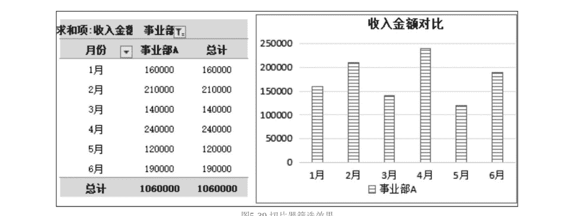

【操作 03】 若要让一个切片器控制全部图表，需确保透视表数据源一致，然后选中切片器，在“选项”中点“报表连接”，勾选所有相关透视表并确定，如图5-40所示。
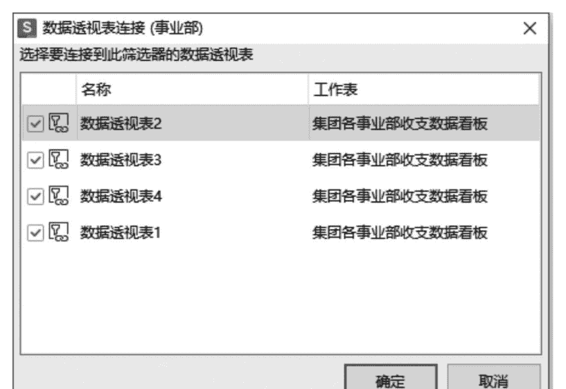

此时切换事业部，所有图表同步刷新，便于横向比较。

【操作 04】 切片器目前缺少集团汇总选项。原因在于数据源未包含汇总行。可在“Sheet1”补充集团汇总，用求和公式生成，如图5-41所示。
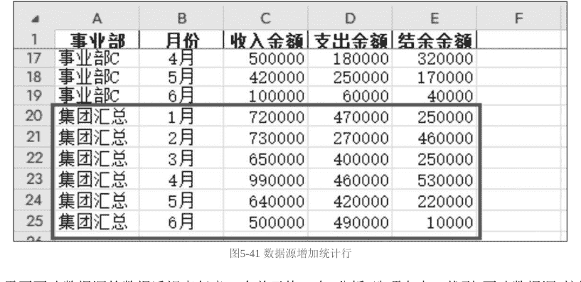

选中透视表后在“分析”里点“更改数据源”，调整为包含汇总的新范围，如图5-42所示。


若因已存在切片器无法直接更改，先删除切片器再修改数据源，修改后再重新添加切片器，即可在选项中看到“集团汇总”，如图5-43所示。
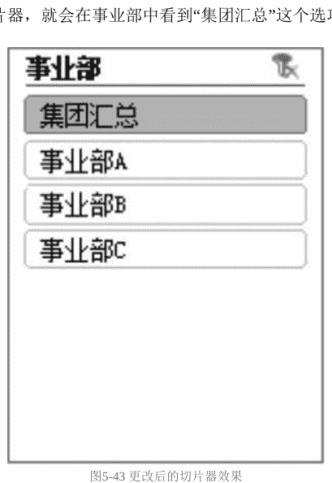

### 5.2.6 看板排版与美化

要素齐全后，版面仍显杂乱，需统一美化。

【操作 01】 向ChatGPT询问美化技巧，得到的建议如图5-44所示：

> 美化数据看板时，可以用这些简洁有效的技巧：
> 1. **统一风格**：维持一致的颜色方案、字体和布局，以增强看板的整体协调性和专业感。
> 2. **使用颜色**：通过颜色区分重要数据点，使用鲜明的颜色突出关键指标，帮助快速识别。
> 3. **简化设计**：保持界面简洁，避免过多的视觉元素，使得重要信息更容易被注意到。
> 4. **合理布局**：根据信息的重要程度来安排布局，确保关键数据处于显眼位置。
> 5. **一致性**：确保所有图表和元素在大小、样式和格式上保持一致，以避免混乱，使得整个看板在视觉上更加整洁有序。

图5-44 ChatGPT回答数据看板美化技巧

【操作 02】 按建议先统一底色。选中整张工作表，如图5-45所示。
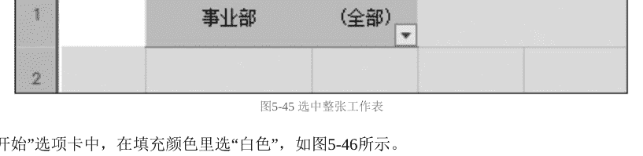
图5-45 选中整张工作表

在“开始”选项卡的填充颜色中选择“白色”，去掉格线，提升整体清爽度。


建议统一图表的主填充色为蓝系不同明度，让视觉更有层次感。

【操作 03】 透视表里能看出 B 部的结余出现了负值，这类异常指标最好用高对比色单独标出，方便快速识别。

【操作 04】 精简设计时，透视表每行每列的“总计”属于冗余信息，因为页面已有独立的“集团汇总”。

选中任意一张透视表的任意单元格，切换到“设计”选项卡下的“总计”，选择“对行和列禁用”，如图5-47所示。

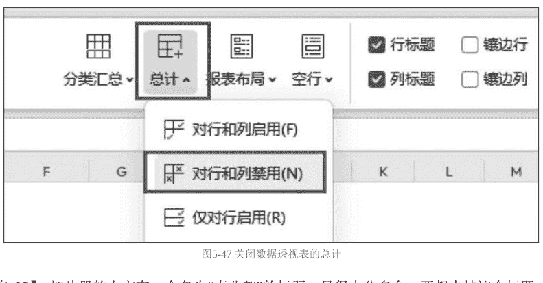

【操作 05】 切片器上方自带的“事业部”文字标题显得多余。选中该切片器，打开“切片器设置”，在弹出的设置框里取消“显示页眉”的勾选，点击“确定”保存，如图5-48所示。

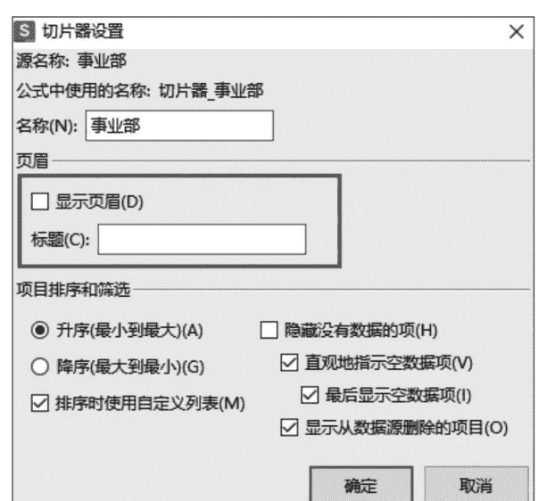

图5-48 隐藏切片器的页眉

【操作 06】 把看板上的各个组件重新调尺寸、排布整齐，并加上主标题，具体样式可按个人喜好发挥，示例效果如图5-49所示。

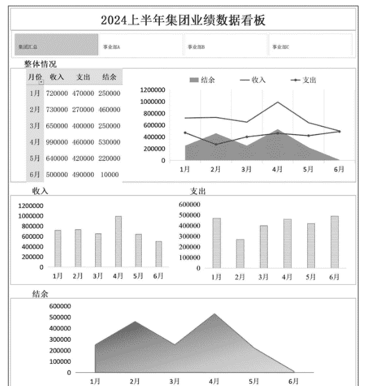

图5-49 数据看板布局美化示例

美化没有唯一标准，建议结合实际业务场景挑选合适的风格。需要补充内容时可向 AI 请教。适时加入分析性文字能让看板更有说服力，具体分析方法将在下一章展开。

## 5.3 AI+Python绘制财务图表

单纯让模型生成图片或按提示搭建看板，效率虽有提升，但仍需人工校验，且当前模型的绘图能力不稳定，离全自动还有差距。若要实现更彻底的办公自动化，Python 仍是关键。

### 5.3.1 批量绘制柱形图

下面继续沿用前面的集团各事业部收支表，看看模型配合 Python 的表现。

【操作 01】 可先把“集团各事业部收支情况表”给模型看，让它解读后再写脚本，也可直接提问：

> “请提供一段可在 Jupyter Notebook 运行的代码，读取桌面‘5.3集团各事业部收支情况表.xlsx’中 A、B、C 三部的 1-6 月收入数据，分别生成柱形图并保存到桌面，完成后给出提示。”

模型返回了对应脚本，如图5-50所示。

```python
import pandas as pd
import matplotlib.pyplot as plt
import os

# 加载Excel文件
file_path = os.path.expanduser('~/Desktop/5.3集团各事业部收支情况表.xlsx')  # 请根据实际情况修改路径
data = pd.read_excel(file_path, sheet_name='Sheet1')

# 指定需要生成图表的事业部
departments = ['事业部A', '事业部B', '事业部C']

# 设置输出文件夹路径
output_dir = os.path.expanduser('~/Desktop')  # 输出路径为桌面
os.makedirs(output_dir, exist_ok=True)

# 为每个事业部生成柱形图并保存
for department in departments:
    # 过滤当前事业部的数据
    dept_data = data[data['事业部'] == department]

    # 创建柱形图
    plt.figure()
    plt.bar(dept_data['月份'], dept_data['收入金额'])
    plt.title(f'{department} 1-6月收入金额')
    plt.xlabel('月份')
    plt.ylabel('收入金额')
    plt.grid(axis='y')

    # 保存图表
    output_path = os.path.join(output_dir, f'{department}_1-6月收入金额.png')
    plt.savefig(output_path)
    plt.close()

# 提示完成
print("图表生成并保存完毕！")
```

图5-50 ChatGPT生成柱形图绘制代码示例

【操作 02】 按 Win+R 调出运行窗口，输入 Jupyter Notebook，在默认浏览器中启动后新建笔记本。

【操作 03】 在模型回答页复制代码，将整段内容粘贴到新建笔记本的单元格中并执行。执行成功后会出现“图表生成并保存完毕”的提示，如图5-51所示。

```
# 提示完成
print("图表生成并保存完毕！")
```
图表生成并保存完毕！

图5-51 Jupyter Notebook代码运行成功提醒

此时桌面已生成三张柱形图，如图5-52所示。

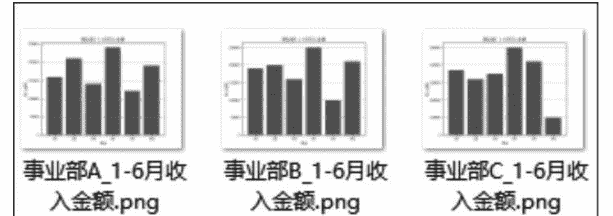

【操作 04】 用脚本生成的图表与模型直接出图一样，都可能出现文字丢失的情况，如图5-53所示。

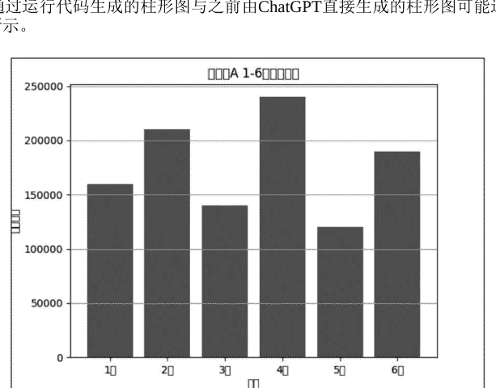

此前针对模型生图已有解决思路，在 Python 里更简便，只需提醒模型存在文字缺失的问题并让它补充字体相关代码即可，模型会完善后重新给出答案，如图5-54所示。

```python
import pandas as pd
import matplotlib.pyplot as plt
import os

# 设置字体为宋体
plt.rcParams['font.sans-serif'] = ['SimSun']  # SimSun是宋体字体的名称
plt.rcParams['axes.unicode_minus'] = False  # 解决坐标轴负号显示问题

# 加载Excel文件
file_path = os.path.expanduser('~/Desktop/5.3集团各事业部收支情况表.xlsx')
data = pd.read_excel(file_path, sheet_name='Sheet1')
```

可以看到第二段是模型专门补充的字号字体设置，提问时甚至可以指定宋体或楷体。后续逻辑与图5-50 基本一致。

把完善后的代码放到 Jupyter Notebook 中运行，柱形图的文字就会完整显示，如图5-55所示。

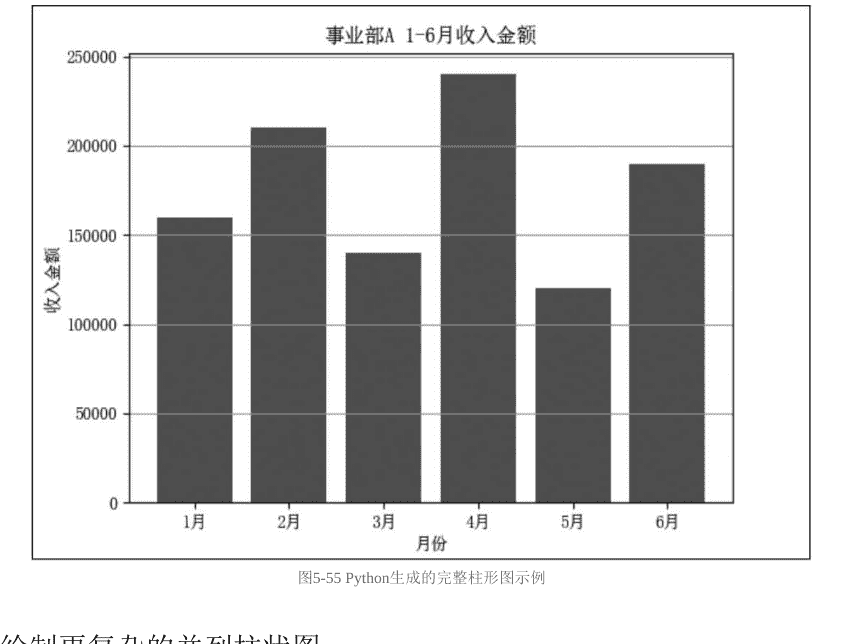

### 5.3.2 绘制更复杂的并列柱状图

单列柱形图对 AI 加 Python 来说很容易，那复杂一些的图表呢？

【操作 01】 仍使用“集团各事业部收支情况表”，向模型提问：

> “请提供一段可在 Jupyter Notebook 运行的代码，读取桌面‘5.3集团各事业部收支情况表.xlsx’，按月份分别制作 A、B、C 三部的收入和支出并列柱状图，1-6 月共六张图，保存到桌面，完成后提示。”

模型返回了对应脚本，如图5-56所示。

```python
# 获取所有的月份
months = data['月份'].unique()

# 为每个月份生成并列柱状图并保存
for month in months:
    # 过滤当前月份的数据
    month_data = data[data['月份'] == month]

    # 准备收入和支出数据
    income = month_data['收入金额']
    expense = month_data['支出金额']

    # 创建并列柱状图
    plt.figure()
    bar_width = 0.35
    index = range(len(departments))

    plt.bar(index, income, bar_width, label='收入金额')
    plt.bar([i + bar_width for i in index], expense, bar_width, label='支出金额')

    # 设置图表信息
    plt.title(f'{month} 收入与支出金额')
    plt.xlabel('事业部')
    plt.ylabel('金额')
    plt.xticks([i + bar_width / 2 for i in index], departments)
    plt.legend()
    plt.grid(axis='y')
```

图5-56 ChatGPT生成并列柱形图绘制代码部分示例

该代码截取了与之前不同的中间部分，其余开头结尾与之前的柱形图生成脚本相同。

【操作 02】 按照既定流程把代码导入 Jupyter Notebook 运行，很快就会生成六张并列柱形图，体现 Python 的执行效率，如图5-57所示。

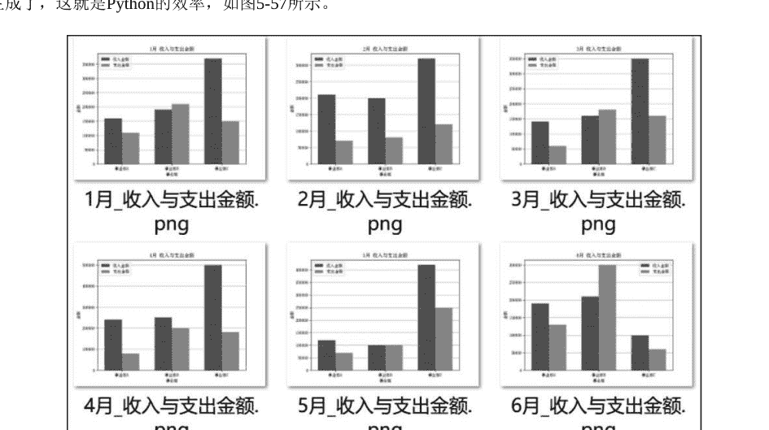

随意打开其中一张，文字齐全、数据准确，标题与图例俱全，颜色区分明显，如图5-58所示。

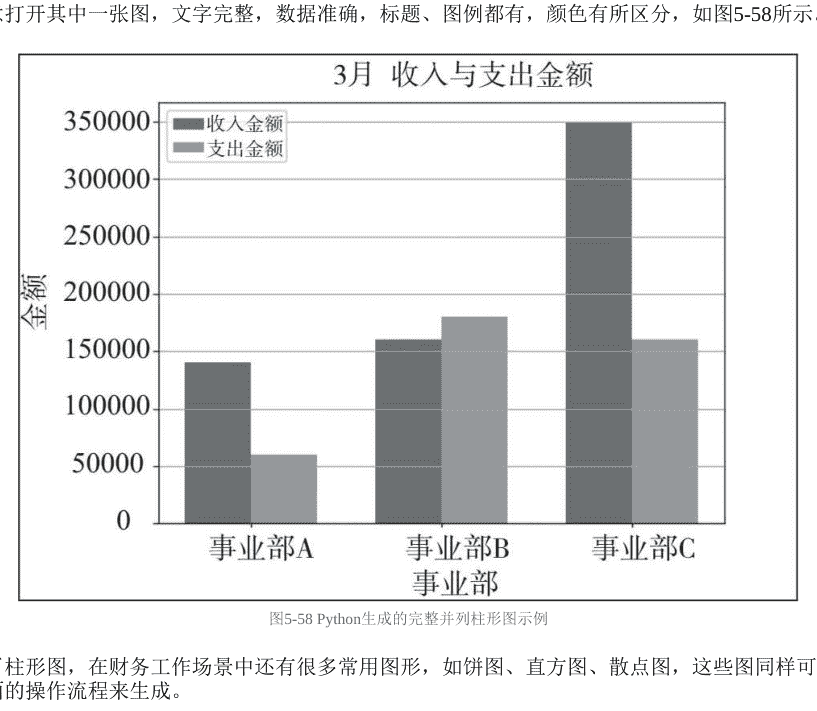

除了柱形图，财务场景中常用的饼图、直方图、散点图等，也能照搬同样流程批量生成。

### 5.3.3 Python生成矢量图

前面 Python 生成的都是位图，插入表格或 PPT 放大后会模糊，影响观感。

解决办法很直接，提问时多加一句“将图片保存为矢量图”，模型返回的代码会增加一段内容，如图5-59所示。

```python
# 保存图表为SVG矢量图
output_path = os.path.join(output_dir, f'{month}_收入与支出金额.svg')
plt.savefig(output_path, format='svg')
plt.close()

# 提示完成
print("图表生成并保存完毕")
```

重新在 Jupyter Notebook 中运行，就能得到六张 svg 格式的图表，如图5-60所示。


矢量图形放大缩小都不会失真，很适合用于财务报告、演示文稿和商业图表。

使用时，只需在 WPS 表格或其他软件中点“插入”→“图片”→“本地图片”，选择生成的矢量文件导入即可，如图5-61所示。

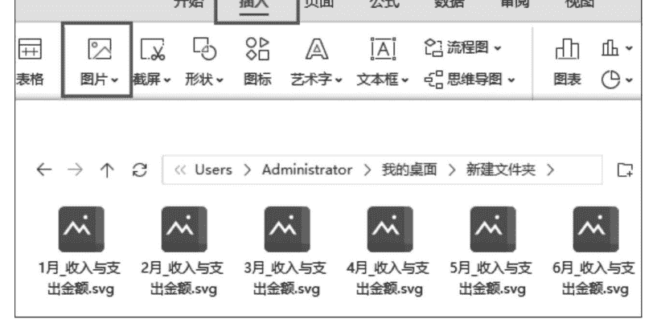

这样无论如何缩放都清晰可读。当然复制粘贴也是更快捷的做法。

### 5.3.4 生成财务表格二维码

在财务管理中，二维码也很常见。它用黑白方块编码信息，可承载文字、链接、联系方式等，扫码后能快速调取文件状态或数字副本，提升文件管理效率。

如何用 AI 和 Python 配合生成二维码？

【操作 01】 把需要编码的文件传给模型，这里继续使用“集团各事业部收支情况表”，并提问：

> “请提供一段可在 Jupyter Notebook 运行的代码，生成该文件内容的二维码图片并保存到桌面，完成后提示。”

等待模型返回结果，如图5-62所示。

```python
import pandas as pd
import qrcode
import os

# 加载Excel文件
file_path = os.path.expanduser('~/Desktop/5.3集团各事业部收支情况表.xlsx')
data = pd.read_excel(file_path, sheet_name='Sheet1')

# 将DataFrame转换为字符串形式
data_str = data.to_string(index=False)

# 生成二维码
qr = qrcode.QRCode(
    version=1,
    error_correction=qrcode.constants.ERROR_CORRECT_L,
    box_size=10,
    border=4,
)
qr.add_data(data_str)
qr.make(fit=True)

# 生成图片
img = qr.make_image(fill='black', back_color='white')

# 设置输出文件夹路径
output_dir = os.path.expanduser('~/Desktop')  # 输出路径为桌面
os.makedirs(output_dir, exist_ok=True)

# 保存二维码图片
output_path = os.path.join(output_dir, '公司财务数据二维码.png')
img.save(output_path)

# 提示完成
print("二维码生成并保存完毕！")
```

图5-62 ChatGPT回答二维码生成代码示例

【操作 02】 从代码开头能看出，这里用到了此前未安装的 qrcode 库，需先行安装，否则会运行失败。

按 Win+R 打开运行，输入 cmd 启动命令提示符，执行安装命令：

```
pip install qrcode
```

稍等片刻，安装完成后即可关闭窗口。

【操作 03】 在 Jupyter Notebook 里新建笔记本，把模型生成的代码粘贴进去并运行，成功后会看到提示，如图5-63所示。

```python
# 提示完成
print("二维码生成并保存完毕！")

二维码生成并保存完毕！
```

图5-63 Jupyter Notebook代码运行成功提醒

【操作 04】 查看桌面保存的二维码，如图5-64所示。


图5-64 生成的二维码

该二维码可用手机扫码应用、支付宝、百度等工具读取。扫描结果如图5-65所示。

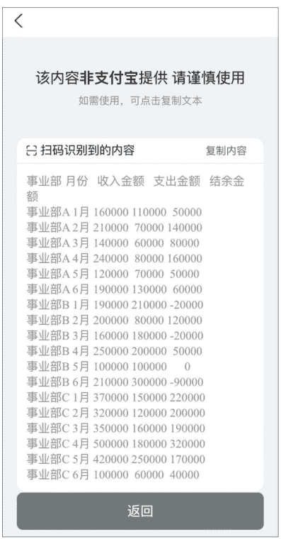

图5-65 二维码扫描结果

可以看到内容与传上来的“集团各事业部收支情况表”一致。

文本信息通用性较强，这里演示的是表格信息。若扫描失败，可能是不同应用对二维码内容支持不同，或格式不被识别导致。

# 第6章 财务数据分析与建议自动化

在财务工作中，真正体现专业价值的仍是数据分析与建议。专业的人能从常规数据里捕捉到别人忽略的风险与问题，这是财务为决策服务的核心。虽然深度分析需要扎实能力，但常规分析完全可以实现自动化，AI 在财务解读与建议层面同样能发挥作用。本章将探讨 AI 如何改变财务报告的解读方式，如何评估投资方案并识别财务风险，让工作效率倍增。

## 6.1 【实操】利用AI分析公司财务报表

还记得前面用 AI 搭建集团各部门收支看板时，模型给出的思路里提到要加文本框写分析，提炼亮点与问题。当时我们只把数据做成了图表，并没有补充分析。这一节将借助 AI 对收支表进行解读，同时财务最常用的资产负债表、利润表、现金流量表也将作为实操对象。

你提交的数据看板样式不错，但是缺少了数据分析，再完善一下，顺便把下属某公司上半年的三大报表做个分析交上来。

### 6.1.1 ChatGPT分析集团各事业部收支情况

如果不确定从何下手，可以先让模型给出分析框架。

【操作 01】 直接要求模型分析可能不够全面，先整理分析要点。

把收支情况表传给模型，然后问：

> “根据这个表，可以分析出什么内容？”

很快模型会列出要点，如图6-1所示。

根据提供的表格和数据，我们可以进行以下几方面的分析：

1. 收入分析：
   - 各部门的收入合计及占集团整体收入的比例。
   - 各部门收入的变动趋势，是否有明显涨跌。
   - 识别收入增速最快和最慢的部门。
2. 支出分析：
   - 各部门的支出合计及占集团整体支出的比例。
   - 各部门支出的变动趋势，是否有明显涨跌。
   - 分析支出占收入的比例，评估各部门的成本控制情况。
3. 结余分析：
   - 各部门的结余合计及占集团整体结余的比例。
   - 结余的变化趋势，是否有明显涨跌。
   - 评估各部门的盈利能力。
4. 部门对比：
   - 各部门在收入、支出和结余方面的横向对比，找出表现最好和最差的部门。
   - 分析各部门的财务健康状况，识别需要关注和改进的领域。
5. 整体集团情况分析：
   - 集团整体的收入、支出和结余的变化趋势，判断集团的财务健康状况。

AI财务实战：从集团拆解到风险预警

先把集团整体和旗下各业务单元并排看，才能摸清内部差异与整体平衡。

图6-1 ChatGPT回答数据分析要点示例

让模型一次性把观察维度列出来，比人工边想边记快很多，后续视角也可以再补充。

【操作 02】让ChatGPT按这些维度逐项展开。很快模型按收入、支出、结余、单元对比、集团总览的顺序把要点梳理出来。

收入侧拆解见图6-2。模型给出各单元在集团总收入中的占比，并判定规模最大的是C。

**收入分析**

- **总收入**
  - 事业部A：1,060,000 元，占集团总收入 25.06%
  - 事业部B：1,110,000 元，占集团总收入 26.24%
  - 事业部C：2,060,000 元，占集团总收入 48.70%
- **收入侧观察**
  - C收入体量最大，接近总收入一半，业务规模最重。
  - A与B收入相近，B略高。

图6-2 ChatGPT进行收入情况分析示例

支出侧拆解见图6-3。模型同样给出占比，并点出“事业部B支出占比最高”，推断成本管控可能存在缺口。

#### 支出分析

- **总支出**
  - 事业部A：520,000 元，占集团总支出 20.72%
  - 事业部B：1,070,000 元，占集团总支出 42.63%
  - 事业部C：920,000 元，占集团总支出 36.65%
- **支出侧观察**
  - B支出占比最高达42.63%，费用控制需重点检视。
  - A支出相对克制，管控较稳。

图6-3 ChatGPT进行支出情况分析示例

结余解读见图6-4。模型对各单元结余做了点评，C结余份额最大盈利能力最强，B仅结余4万元，盈利偏弱。

#### 结余分析

- **总结余**
  - 事业部A：540,000 元，占集团总结余 31.40%
  - 事业部B：40,000 元，占集团总结余 2.33%
  - 事业部C：1,140,000 元，占集团总结余 66.28%
- **结余侧观察**
  - C结余占比最高，盈利能力领先。
  - B结余最低，仅4万元，占比微弱，盈利不足。

图6-4 ChatGPT进行结余情况分析示例

单元对比与集团整体判断见图6-5。综合来看，表现最好的是C，最弱的是B。集团财务整体尚健康，只是要盯紧B的成本问题。

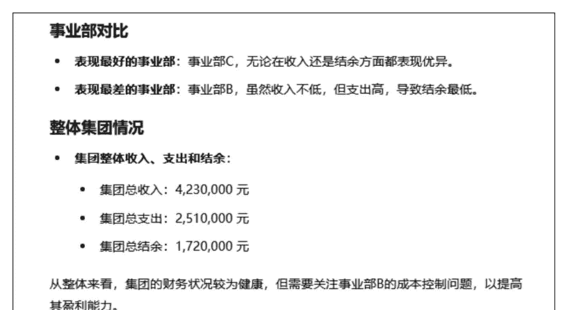

图6-5 ChatGPT进行事业部对比和集团整体情况分析示例

模型给出的结论完全可以嵌入业绩看板。实际上洞察应该先于可视化，把关键判断用图表呈现效果最好。若先画图再解读，往往只剩下趋势，结论层级不够。如何改进，需要结合具体业务场景判断，这正是整合性思维体现的人的价值，自动化工具难以完全替代。

### 6.1.2 ChatGPT分析资产负债表

任务中还要求分析下属公司半年度三大报表，先从资产负债表入手。

【操作 01】从记账软件中导出该公司的资产负债表。

【操作 02】向ChatGPT提问资产负债表分析要点，回答如图6-6所示。


图6-6 ChatGPT回答资产负债表分析要点示例

【操作 03】将资产负债表去掉有效身份信息后上传给ChatGPT，然后要求其按要点逐项分析，ChatGPT给出的分析如图6-7所示。


覆盖面还算全面，资产结构、负债结构、偿债能力到资产质量都有涉及，每个部分都有具体数据支撑，比如流动资产增加多少、负债减少多少，解释也比较到位。只是股东权益和盈利能力部分因提供数据不足无法展开。实践中，原始数据越细，模型输出质量越高。

### 6.1.3 ChatGPT分析利润表和现金流量表

利润表和现金流量表的分析可以重复之前的操作。

【操作 01】从记账软件中导出该公司的利润表和现金流量表。

【操作 02】向ChatGPT询问分析思路，并要求按思路逐条展开，很快得到图6-8和图6-9的回答。

**利润表简要分析**

1. 收入分析：本期营业收入500,000元，上期400,000元，增长25%。
2. 成本分析：本期营业成本300,000元，上期250,000元，毛利率40%。
3. 费用分析：营业税金及附加本期10,000元，上期8,000元，其他费用未提供，无法进一步分析。
4. 利润分析：本期营业利润为190,000元，净利润数据未提供。
5. 利润分配：无具体数据，无法分析股息支付和留存收益。
6. 盈利能力：由于缺乏净利润和资产数据，无法计算ROE和ROA。
7. 现金流量：未提供相关数据，无法分析经营、投资、融资活动的现金流状况。

图6-8 ChatGPT进行利润表分析示例

**现金流量表简要分析**

1. 经营活动现金流：本期净流入450,000元，主要来自销售商品和提供劳务的现金流入，显示出公司主营业务的良好现金获取能力。
2. 投资活动现金流：数据未提供，无法分析购置和处置长期资产的现金流量。
3. 融资活动现金流：数据未提供，无法分析借款、偿还债务和股利支付的现金流量。
4. 现金净增加额：缺少期初和期末现金余额数据，无法计算现金净增加额。
5. 现金流动性分析：因缺乏详细的营运资金变动数据，无法评估短期偿债能力。

总体来看，公司的经营活动现金流入良好，但由于缺少其他部分的数据，无法全面评估公司的现金流情况和财务健康度。

图6-9 ChatGPT进行现金流量表分析示例

以上内容仅为简要分析，在具体应用过程中，当ChatGPT给出这些答案后，财务管理工作人还可以就其中某一条内容再次要求ChatGPT，让其尽可能给出详细的分析，以满足实际工作的需要。

## 6.2 AI助力识别潜在财务风险

前面内容已证明ChatGPT可以对财务报表进行基础数据分析，甚至在某些地方已经给出需要特别注意的点，如提醒注意事业部B的成本控制问题，这其实就是一个财务风险点提示。

只不过，如果没有明确提出要求的话，ChatGPT是不会专门进行财务风险提示的。人具有主动将工作做得尽善尽美的积极性，而机器只会按要求做事，达到最低标准即可。这一点在先前作图部分也有所体现，如果不经人工设计，或者不提美化要求，ChatGPT只会给出一个最基础，甚至可以称得上“简陋”的图。所以，人机协作需要的是人把所有要求提清楚，就像挤牙膏一样，一点点把人工智能的价值挖掘出来。

本章思路就是要求ChatGPT去识别报表中潜在的异常或不平衡之处，如负债过高、现金流不足等问题，提前预警潜在风险，甚至给出解决方案。

### 6.2.1 ChatGPT识别财务报表潜在的风险点

ChatGPT在同一个聊天对话框中可以记住之前的聊天内容，保持对话连贯性，这样就不用重复提问。所以可以在长时间对话中讨论复杂主题，或者追踪连续问题。

先前我们已在两个聊天对话框中，就两大报表任务进行了分析，如图6-10所示。


【任务一】在“集团收支分析”的对话框中，可以接着之前的数据分析结果，要求ChatGPT分析其中潜藏的财务风险。具体可以这么提问：

> “根据之前集团收支情况的数据分析结果，找出集团潜藏的财务风险点，一一列举并写明原因。”

ChatGPT的回答如图6-11所示。

根据之前对集团收支情况的数据分析，以下是潜藏的财务风险点及其原因：

1. 事业部B的高支出：
   - 原因：事业部B的支出占比达到42.63%，远高于其他事业部。虽然收入不低，但支出过高，导致结余最低。这表明成本控制不力，可能存在资源浪费或效率低下的问题。
2. 事业部B的低结余：
   - 原因：事业部B的结余仅为40,000元，占集团总结余的2.33%。这表明事业部B的盈利能力较弱，面临较大的利润压力。如果收入增长放缓或成本上升，可能导致亏损风险。
3. 事业部C的高结余依赖：
   - 原因：事业部C贡献了集团总结余的66.28%，对集团的盈利能力起到关键作用。如果事业部C的市场环境发生不利变化或面临竞争压力，可能对集团整体盈利能力产生重大影响。
4. 单一事业部的收入依赖：
   - 原因：事业部C占集团总收入的48.70%，显示出较高的依赖性。过度依赖单一事业部的收入来源，可能导致集团在市场波动中面临更大的不确定性和财务风险。
5. 缺乏多元化的业务：
   - 原因：从收入和结余的集中度来看，集团的业务结构较为单一，可能缺乏应对市场变化的灵活性。多元化不足可能导致整体风险偏高。
6. 流动性风险：
   - 原因：虽然整体流动性情况未提供具体数据，但各事业部的支出和结余情况显示，部分事业部可能面临短期资金周转困难的风险，需要关注其现金流管理。

图6-11 ChatGPT回答集团收支情况表中潜藏的财务风险

【任务二】在“公司报表分析”的对话框中，同样要求ChatGPT分析其中潜藏的财务风险。具体可以这么提问：

> “根据之前公司资产负债表、利润表和现金流量表的数据分析结果，找出公司潜藏的财务风险点，一一列举并写明原因。”

ChatGPT的回答如图6-12所示。

根据公司资产负债表、利润表和现金流量表的数据分析，以下是潜藏的财务风险点及其原因：

1. 高比例的流动负债：
   - 原因：虽然流动负债在本期大幅减少，但仍需警惕可能的短期偿债压力。尤其在收入不稳定或市场波动时，过度依赖短期负债可能导致现金流紧张。
2. 应收账款增加：
   - 原因：应收账款增加20%，可能表明公司给予客户较长的信用期或客户回款不及时。这可能导致现金流不足，并增加坏账风险。
3. 存货积压：
   - 原因：存货增加29%，可能表明销售速度放缓或库存管理不善。存货积压不仅占用资金，还可能导致过时或损耗，影响公司资产质量。
4. 盈利能力不确定：
   - 原因：虽然营业利润有所增加，但缺乏详细的费用和净利润数据，使得难以全面评估公司的盈利能力。费用的变动和净利润的波动可能对公司的财务健康产生影响。
5. 投资活动现金流数据缺失：
   - 原因：投资活动现金流未提供，无法判断公司在长期资产上的投资力度和资金回收情况。缺乏投资活动的数据可能掩盖了潜在的资本支出风险。
6. 融资活动现金流数据缺失：
   - 原因：融资活动现金流数据缺失，使得难以评估公司债务结构和偿债能力。如果存在大量的借款或股利支付，可能加剧公司的财务压力。
7. 流动性风险：
   - 原因：由于缺乏详细的现金流数据，无法确定公司的流动性状况。现金流的不足可能影响公司日常运营和短期债务的偿还。


图6-12 ChatGPT回答公司三大财务报表中潜藏的财务风险

### 6.2.2 ChatGPT针对风险点给出优化建议

既然风险点都找到了，那怎么寻求解决办法呢？一起来看看ChatGPT能给出什么切实可行的建议。

【任务一】在“集团收支分析”的对话框中，接着ChatGPT指出的财务风险点继续提问：

> “针对这些风险点，有什么切实可行的解决方案吗？”

ChatGPT的回答如图6-13所示。

1. 控制B事业部成本：实施严格的费用报销制度，优化供应链以降低采购成本，推行能源和资源节约措施。
2. 提升B事业部利润：引入高利润率产品，优化产品组合，实施交叉销售策略，重点拓展高潜力客户。
3. 分散对C事业部依赖：投资新兴行业，分阶段发展潜在高增长事业部，鼓励各事业部探索跨行业合作机会。
4. 减少单一收入依赖：进行市场多元化，开拓不同地区市场，开发附加产品和服务，提升现有客户的消费频次和金额。
5. 增强业务多元化：设立专项基金支持新业务研发，鼓励内部创业项目，逐步试点和推广成功模式。
6. 管理现金流：严格管理应收账款，加速回款，优化库存管理，控制支出节奏，加强与金融机构合作，确保流动资金充裕。

图6-13 ChatGPT给出集团收支风险点解决方案

当然，以上仅是一个简单回答，如果想针对哪一条方案进行深入了解，可以继续向ChatGPT提问：

> “第1点提到实施严格的费用报销制度，具体怎么执行呢？请给出一个详细的方案。”

提问时可以自行设置限定词，比如，想要一个切实可行的方案，或者简单的方案，甚至可以上传现有的费用报销制度，要求ChatGPT进行优化，对限定词的设置具体取决于我们想要什么样的结果。

【任务二】在“公司报表分析”的对话框中，接着ChatGPT指出的财务风险点继续提问：

> “针对这些风险点，有什么切实可行的解决方案吗？”

ChatGPT的回答如图6-14所示。

针对公司潜在的财务风险点，以下是解决方案：

1. **流动负债高**：优化债务结构，增加长期债务比例，减少短期借款依赖；增加现金储备应对突发需求。
2. **应收账款增加**：加强信用管理，优化客户信用政策，实行分期付款制度，提供早期付款折扣，减少应收账款滞留。
3. **存货积压**：优化库存管理，采用先进先出法，快速处理滞销品或过剩库存，减少资金占用。
4. **盈利能力不确定**：定期分析费用，控制成本，提升生产效率，拓展市场和产品线，分散盈利来源。
5. **投资活动现金流数据缺失**：建立完善的投资计划和预算管理制度，披露投资现金流信息，优先选择高回报项目。
6. **融资活动现金流数据缺失**：完善融资规划，合理安排股利支付和偿债计划，加强与金融机构的沟通，确保融资渠道稳定。
7. **流动性风险**：制定现金流管理计划，设置预警机制，保持合理现金储备，灵活应对市场变化和突发事件。

图6-14 ChatGPT给出公司财务风险点解决方案

如果对其中一点感兴趣，不知道如何执行，可以继续向ChatGPT提问，举例如下：

> “早期付款折扣怎么设置比较合理？”

ChatGPT的回答如图6-15所示。

设置早期付款折扣时，应考虑以下几个因素，以确保其合理性和有效性：

1. **折扣比例**：一般建议折扣比例在1%到3%之间，这样可以吸引客户提前付款，同时不会对公司利润产生过大影响。
2. **付款期限**：通常设置在发票日期后的10天内，例如“2/10, net 30”表示在30天内付款，但如果客户在10天内付款，可以享受2%的折扣。
3. **行业惯例**：了解行业内常见的早期付款折扣做法，确保设置的折扣比例和期限具有竞争力。
4. **财务影响**：计算折扣对公司现金流和利润的影响，确保折扣带来的现金流加速能够抵消其对利润的负面影响。
5. **客户关系**：根据客户的付款习惯和重要性，灵活设置折扣政策，激励及时付款的客户，减少坏账风险。

通过以上考虑，可以设置一个既吸引客户又对公司有利的早期付款折扣政策。

图6-15 ChatGPT给出早期付款折扣设置思路

## 6.3 AI助力投资决策

AI的分析能力不仅能应用于财务报表分析，而且在其他需要进行分析的领域都可以一试。如投资领域，相比于人工，AI在分析的全面性方面具有天然优势，只要是录入模型的分析方法，都会被准确收录在AI库中，而人工可能因为各种原因忽略一些细节。

不过AI分析相比于人来说，输在了情境理解和创造性上。公司的每一次投资是基于很多背景的，比如，公司的发展历史、决策者的价值取向、未来规划等，都是AI难以理解的内容，也是很难用一段明确的语言指令表达出来的。这注定了AI无法像人一样灵活地应对突发情况，更无法替代人类的直觉和经验判断。

那么，在投资领域，AI具体可以做到哪些呢？

### 6.3.1 方案指标计算与对比

假设有两个投资方案，如表6-1所示。

表6-1 两个投资方案情况对比

| 项目 | 方案一：扩大生产规模投资方案 | 方案二：研发新产品投资方案 |
| :--- | :--- | :--- |
| 投资金额 | 300万元 | 300万元 |
| 投资期限 | 5年 | 5年 |
| 预计收益 | 第1年：80万元<br>第2年：120万元<br>第3年：280万元<br>第4年：520万元<br>第5年：650万元 | 第1年：0万元（研发阶段，无收益）<br>第2年：50万元<br>第3年：300万元<br>第4年：600万元<br>第5年：600万元 |
| 成本和费用 | 初始设备采购和安装成本：200万元<br>每年原材料采购成本：80万元<br>每年人工成本：100万元<br>每年营销和推广费用：20万元<br>每年设备维护和保养费用：10万元 | 每年研发人员薪酬和福利：100万元<br>每年研发材料和实验费用：80万元<br>每年市场调研和测试费用：20万元 |
| 风险评估 | 市场需求变化风险：中<br>原材料价格波动风险：中<br>竞争对手进入风险：高 | 技术研发失败风险：高<br>新产品市场接受度风险：高<br>法规和政策变化风险：中 |
| 资金来源 | 自有资金：100万元<br>银行贷款：200万元（年利率6%） | 自有资金：100万元<br>股权融资：200万元 |

这两个投资方案在收益、成本、风险等方面各有特点，财务工作人员需要根据这些信息进行各项投资指标的计算和对比分析。

那投资方案分析，需要计算哪些指标呢？ChatGPT给出的回答如图6-16所示。

选项目前先对齐这七个判断维度

> 在两套投资计划之间做选择时，把收益潜力和风险暴露拆开来系统比对，比凭感觉判断更可靠：

1. **预期收益幅度**：测算各方案在设定周期内大概能产生的回报区间，明确收益预期。
2. **回报波动区间**：观察收益率上下起伏的范围，用波动大小衡量风险强弱。
3. **风险调整收益**：通过夏普比率判断在相近风险水平下谁的性价比更高。
4. **净现值 NPV**：把未来现金流折算到今天，评估项目是否创造正的净增值。
5. **内部收益率 IRR**：找出让净现值归零的折现率，用来体现年化盈利能力。
6. **资金回本周期**：估算收回初始投入所需的时间，反映资金周转效率。
7. **现金流走向**：梳理流入与流出的节奏，掌握资金的实际流动情况。

图6-16 展示ChatGPT归纳的投资方案分析关键指标

把表6-1的内容以Word或表格形式导入ChatGPT，模型即可读取并完成两套方案的指标核算与横向对比。

核算结束，ChatGPT给出了结果和总结性结论，如图6-17所示。


这类输出对企业决策有一定参考意义。如需更细化的测算，也可以继续追问。

### 6.3.2 市场趋势和行业动态分析

除了静态方案对比，AI还能结合市场动向、行业变化以及企业自身数据，挖掘新的机会点，比如判断哪些新兴赛道值得关注、哪个领域具备扩张空间，甚至提供前瞻性提示。

例如想了解金融科技板块现状，可以这样问：

> “近期科技股板块的走势如何？未来一个月内是否有上涨的可能？”

交互结果见图6-18。


可以看出回复是在联网检索后生成的，时效性更强，对投资判断很重要。当需要跟踪最新财经要闻、企业公告或重大事件时，对即时性的要求更高。再试一个问题：

> “今天有没有关于新能源行业的重大政策发布？”

模型反馈见图6-19。


这次得到的是当天的最新资讯，并对新能源领域的政策、碳交易推进以及新能源汽车市场增长做了归纳。

需要提醒的是，投资需审慎，AI给出的建议只能作参考，不可作为最终依据。

### 6.3.3 投资组合优化建议

若已建仓，想审视组合是否合理，AI也能提供支持，比如指出潜在缺陷并给出优化思路，结合市场数据与个人风险偏好给出更合理的配置。

假设可投资金100万元，配置如下：

1. 40万元投入全球知名的大型科技企业；
2. 30万元配置于高评级公司债，追求稳健收益；
3. 20万元投向国际市场股票基金；
4. 10万元投向房地产基金。

让ChatGPT诊断该组合的风险点，反馈见图6-20。


回答指出了若干潜在问题，那么改进建议呢？见图6-21。


另外，模型还能帮助做风险承受测试，了解个人偏好，从而定制更贴合的组合。有兴趣可直接提问：

> “我有50万元闲置资金可用于投资，风险承受能力中等，期望年化收益率在8%左右，请为我制定一个投资组合方案。”

具体方案可自行尝试。

# 第7章 各类财务报告制作自动化

财务工作最终都要落到报告上。报告是向管理层及利益相关方传达财务状况、绩效评估和决策建议的重要载体，本质上是对数据分析和图表的提炼，突出关键结论，帮助决策者把握公司财务健康度。

如今，财务报告制作已进入自动化阶段。AI不仅能辅助撰写正文，还能实现表格转Word、转PPT。原本需数日的人工工作，现在一小时内可完成。若内容单调，AI还能生成配图美化版式。本章聚焦这些技术如何重塑报告流程。

## 7.1 AI辅助生成报告内容

对格式拿不准、开头无从下手、数据整理繁琐、担心遗漏要点，这些痛点都很常见。有了AI，这些问题基本迎刃而解。AI可自动生成初稿，我们只需补充完善，就能产出高质量报告。

### 7.1.1 AI生成财务部门工作总结

假设下周要开半年会，各部门需汇报上半年工作。需要一份财务部半年工作总结，可借助ChatGPT完成。

【操作 01】为让报告更贴近实际，避免空话，先由人工梳理要点。以下是一份可能的要点清单：

1. 财务报表编制：按时完成月度、季度及半年度报表；
2. 预算管理：协助各部门制定年度预算，4月因市场变化业务部门申请追加营销预算，经分析后合理调整分配；
3. 税务筹划：如期计算并申报各项税款，成功申请高新技术企业税收优惠，年内已为公司节省税务成本20万元；
4. 财务分析与报告：定期向管理层提交财务分析；
5. 财务信息化建设：部分财务数据已实现自动抓取与分析。

【操作 02】为让输出更完整，可先询问：

> “一份完整的工作总结都包含什么内容？一般格式是什么？”

模型回复见图7-1。

一份完整的工作总结通常包括以下几个主要内容，以及对应的常见格式：

1. 标题：明确地标明文档的性质和时间范围，例如“2024年上半年工作总结”。

2. 引言或前言：简短介绍总结的背景、目的和总体概述。这部分通常不需要太详细，但应提供足够的信息让读者了解总结的上下文。

3. 主体内容：

   - 任务和目标回顾：列出本期的主要工作任务和目标，可以根据实际情况按部门或个人分别列出。

   - 工作完成情况：详细描述各项任务的执行情况、完成度以及达成的成就。这部分是总结的核心，应具体、详细。

   - 问题和挑战：分析在执行任务过程中遇到的问题和挑战，以及采取的应对措施和解决方案。

   - 经验和教训：总结在工作过程中积累的宝贵经验和需要吸取的教训。

4. 数据和案例：如果适用，包括关键的统计数据、图表或具体案例分析，以增强总结的说服力和实用性。

5. 总结和展望：

   - 综合评估：对整体工作进行评价，包括成就和不足。

   - 未来工作计划和建议：基于当前工作的反思，提出未来的工作方向和改进措施。

6. 附录（可选）：根据需要添加重要的文档、数据表格或其他参考材料。

7. 结束语：对阅读总结的人表示感谢，并可能简要激励团队继续努力。


若公司已有格式要求，也可以把规范发给模型，要求严格按此生成。

【操作 03】把上述要点发送给ChatGPT，并要求依此格式生成一份完整的财务部半年工作总结。

模型产出见图7-2。

#### 财务部门2024年上半年工作总结

#### 前言

在2024年上半年，财务部门在确保日常运营的高效和规范的同时，专注于财务报表的编制、预算管理、税务筹划、财务分析及信息化建设等关键领域。本总结旨在回顾这一期间的主要成就、面临的挑战以及未来的工作方向。

#### 工作完成情况

1.  财务报表编制

    - 成功按时完成了月度、季度和半年度的财务报表编制工作。这一成就确保了公司管理层及时了解公司的财务状况，为决策提供了数据支持。

2.  预算管理

    - 在年初，我们协助各部门制定了全年的预算计划。到了4月，由于市场环境的变化，业务部门提出了增加营销预算的需求。我们通过深入的市场和财务分析，合理调整了预算分配，确保资源的有效利用，支持了市场活动的扩展。

3.  税务筹划

    - 准确并及时地计算并申报了各项税款。此外，成功申请了高新技术企业税收优惠政策，为公司节省了20万元税务成本，提高了公司的财务效率。

4.  财务分析与报告

    - 定期向管理层提供财务分析报告，报告中详细分析了公司的收益、成本和利润状况，为管理层的决策提供了坚实的数据基础。

5.  财务信息化建设

    - 在信息化建设方面，我们实现了部分财务数据的自动抓取和分析，提升了数据处理的效率，减少了人为错误，提高了报表编制的准确性。

#### 问题和挑战

在工作中，我们也面临了一些挑战，尤其是在预算调整和税务筹划方面。预算的调整需要对市场变化有快速而准确的反应，而税收优惠政策的申请则需要我们不断更新相关的税务知识和政策理解。

这里仅展示了生成工作总结的部分，后续还包括经验教训、总结展望、结束语等。由要点梳理到完整报告，几分钟即可完成，只需在此基础上稍作润色即可提交。

### 7.1.2 用AI撰写一份吸睛的商业计划书

若公司正在寻求外部融资，需要一份商业计划书，同样可以借助ChatGPT。流程仍是先自行整理公司信息，再询问写作框架和技巧，最后让模型按框架撰写。

先看模型给出的撰写要点，如图7-3所示。

1.  关键问题解决方案：清楚地说明你的业务如何解决一个具体的市场问题。用实例说明问题的普遍性以及你的解决方案的独特性。

2.  市场定位：详细分析你的目标市场，并指出你的产品或服务在市场中的定位。用具体数据展示市场大小、增长潜力和目标顾客的具体需求。

3.  竞争分析：使用SWOT分析（优势、劣势、机会、威胁）来对比竞争对手，明确你的竞争优势。

4.  营销策略：具体描述你如何吸引和保留客户。包括具体的营销渠道、推广策略和销售预测。

5.  财务计划具体化：提供详细的财务预测，包括启动成本、盈亏平衡分析、利润预测和现金流量表。确保这些数据有依据，可以引用行业标准或类似业务模型的案例。

6.  里程碑清单：列出关键的业务里程碑和时间表，这不仅展示了计划的详细性，还能显示出你对项目进度的掌控。

7.  投资回报分析：直接阐述投资者的潜在回报，包括预计何时回本以及投资的长远回报。

通过这些更详细的步骤和实际数据支持，你的商业计划书将更具说服力和实用性。

图7-3 ChatGPT给出的商业计划书撰写技巧

随后把公司资料发给模型，要求应用上述技巧撰写一份有吸引力的商业计划书。

截取部分生成内容如图7-4所示。

商业计划书：ZZZ科技有限公司

#### 1. 执行摘要

ZZZ科技有限公司，成立于2018年，专注于提供前沿智能科技产品，旨在通过创新技术为用户打造高效、便捷的生活体验。公司的使命是运用先进技术改善人们的日常生活，愿景是成为国内智能科技产品的领先供应商。迄今为止，我们的产品已成功进入多个城市，与知名开发商合作，市场反馈积极。

#### 2. 公司描述

ZZZ科技致力于成为智能家居和办公设备领域的创新领导者。通过强大的技术研发能力和高效的市场战略，公司旨在将先进的智能科技产品普及到每一个家庭，提高生活质量。

#### 3. 市场分析

智能科技行业目前正处于快速发展阶段，智能家居和办公产品需求持续增长。根据行业分析，预计未来五年内市场规模将增长50%以上。ZZZ科技通过其创新产品，已成功切入高增长领域，并准备扩大市场份额。

#### 4. 组织结构和管理

ZZZ科技由一支经验丰富的团队领导，包括首席技术官张三和首席执行官李四。张三具有深厚的电子工程背景，曾在多个科技项目中担任研发领导角色。李四则拥有丰富的科技企业管理经验，擅长团队建设和市场战略。

#### 5. 服务或产品线

我们的主要产品包括智能家居控制系统和智能办公设备。这些产品具有易操作性、高智能化和良好的兼容性，已通过多项技术认证，拥有多项专利。

#### 6. 营销与销售策略

未来，公司将通过增强线上线下销售渠道并提升品牌知名度来增加市场占有率。此外，公司也将探索国际市场，寻求海外合作，以实现全球扩张。

#### 7. 资金需求

为支持未来发展战略，ZZZ科技寻求5000万人民币投资，用于产品研发、市场扩展和品牌建设。预计投资回报期为三年。

### 7.1.3 快速完成公司SWOT商业分析报告

在商业计划书撰写要点中提到过SWOT拆解。SWOT是通过梳理内部优势、劣势和外部机会、威胁来评估项目整体状况的工具，通俗说就是看强项、短板、机遇和风险。

在财务管理中，SWOT常用于战略规划、投资决策和项目评估。例如做预算时，可借助SWOT判断投入重点和改进方向。

假设某科技公司主营家电，研发和供应链成熟，品牌在国内认可度高。现在考虑推出一款智能手环，具备常规运动健康监测、GPS定位、紧急求救、环境传感器、长续航、防水防尘抗摔等功能。需要一份SWOT分析为研发投入决策提供参考。先问ChatGPT：

> “针对新产品市场情况进行SWOT分析，有哪些实用技巧？”

模型回复见图7-5所示。

1.  深入了解市场和行业：收集市场数据、行业趋势和竞争对手信息。

2.  明确目标和范围：确定分析范围和目标。

3.  收集内部信息：了解产品设计、生产和销售情况。

4.  收集外部信息：调查市场需求、客户反馈等。

5.  结合定量和定性分析：使用市场调查、财务分析、专家访谈等方法。

6.  识别并优先排序关键因素：确定主要的优势、劣势、机会和威胁。

7.  团队合作：跨部门协作，确保多样化视角。

图7-5 ChatGPT给出SWOT分析技巧

随后把新品信息发送给模型，要求按上述技巧联网查询数据，完成详细SWOT拆解并形成完整报告。

截取的分析内容如图7-6所示。

SWOT分析

**优势 (Strengths)**

1.  研发实力：公司拥有强大的研发团队，有能力开发先进的可穿戴技术。

2.  生产供应链：成熟的生产供应链确保产品质量和生产效率。

3.  品牌认可：在家电市场建立的品牌声誉有助于推广新产品。

4.  产品设计：集成多种功能，适合户外活动和紧急情况下使用。

**劣势 (Weaknesses)**

1.  市场经验不足：在可穿戴设备市场缺乏经验，可能导致对市场需求的理解不足。

2.  产品线扩展风险：从家电转向可穿戴设备，可能带来资源分配和管理上的挑战。

3.  研发成本高：高精度传感器和长续航电池的开发需要较高的投入。

**机会 (Opportunities)**

1.  市场需求增长：可穿戴设备市场预计在2024年增长5%，特别是健康监测和运动追踪功能受欢迎 (Canalys)。

2.  技术创新：AI、物联网 (IoT) 和增强现实 (AR) 技术的融合为可穿戴设备提供了新的功能和应用场景 (Thewearify)。

3.  消费者关注安全：具有紧急求助和环境监测功能的设备在户外爱好者中有较大市场潜力。

4.  国际市场扩展：成功的国内市场可作为国际扩展的基础。

**威胁 (Threats)**

1.  竞争激烈：市场上已有多个品牌提供类似功能的产品，竞争激烈 (Mordor Intelligence)。

2.  技术发展迅速：新技术更新速度快，产品可能面临快速过时的风险。

3.  消费者忠诚度：现有品牌的用户忠诚度较高，可能影响新品牌的市场渗透。

4.  经济环境：全球经济不确定性可能影响消费者的购买力。

**关键发现和分析**

公司的研发实力和生产供应链为新产品的推出提供了基础，但在市场经验和资源分配方面存在挑战。市场对智能可穿戴设备的需求增长为公司提供了机会，但也需应对激烈的竞争和快速的技术发展。

**结论**

公司具备推出智能手环产品的技术能力和生产优势，市场有一定的增长机会。然而，需特别注意市场竞争和技术更新带来的挑战。在决定是否投入资金启动研发时，应充分考虑市场需求和技术趋势。

图7-6 ChatGPT生成的SWOT商业分析报告部分展示

整体来看报告较为全面，能提供不少思路。但部分内容偏理论，数据支撑和案例分析略显不足。若能补充真实市场数据或同类产品案例，说服力会更强，这也需要提问者提供更详实的信息。

## 7.2 Word文档、表格和PPT的快速转化

工作中常遇到把表格数据整理成Word文档，或把分析结果做成PPT用于管理层汇报的需求。这本质上是同一份素材在不同场景下的再呈现。过去只能人工搬运，现在AI可迅速完成格式转换。

### 7.2.1 表格转化为Word文档

以将图5-22中的集团各事业部上半年收支情况汇总表内容，转化成Word报告为例。

把表格数据直接丢给 ChatGPT，让它据此生成一份完整的 Word 分析报告并附上下载地址，模型回复界面如图7-7。

通过链接把文件取回打开，文档开头样式如图7-8。

### 7.2.2 把 Word 报告转回表格
再开一个对话窗口，把集团侧刚生成的 Word 报告重新喂给模型，指令让它以表格形态呈现，如图7-9。

助手回复里就能直接预览整理好的表格，真正需要离线文件时点下载链接即可获取。对比发现，这次模型自行组织的表格在排版上与最初上传的版本并不相同，是模型重新归类的结果。

### 7.2.3 Word 文档转成 PPT
汇报场景下演示文稿的可视化效果往往比 Word 更直观，经常会遇到把已有 Word 内容转成 PPT 的需求。下面以此前产出的财务部门工作总结为例，介绍两条可行路径。

借助 AI 助手与 Python 协同制作演示文稿

【操作 01】把报告正文交给助手，随后提问：
> “先把报告要点梳理成 PPT 大纲，再给我一段能在 Jupyter Notebook 直接运行、生成 PPT 并保存到桌面的代码，完成后提醒我。”

助手先给出大纲，随后提供一段可直接使用的完整代码。

【操作 02】该代码依赖 python-pptx，需要先行安装。按 Win+R 调出运行框，输入 cmd 打开命令行，执行：
```
pip install python-pptx
```

【操作 03】安装结束后再启动 Jupyter Notebook，新建本子粘贴助手给出的代码并执行，成功提示如图7-10。
```
# 保存PPT文件到桌面
desktop_path = os.path.join(os.path.expanduser("~"), "Desktop")
ppt_file = os.path.join(desktop_path, "财务部门_2024年上半年工作总结.pptx")
prs.save(ppt_file)

print(f"PPT文件已保存至: {ppt_file}")
PPT文件已保存至: C:\Users\Administrator\Desktop\财务部门_2024年上半年工作总结.pptx
```
图7-10 Jupyter Notebook 代码运行成功提醒

【操作 04】到桌面打开生成的演示文稿查看效果，如图7-11。
可以看到 Python 一次性输出了六页内容，若原始 Word 更长，省去手动归纳和复制粘贴的价值会更明显。

【操作 05】Python 生成的稿件基本没有美化，可借助 WPS 自带的“智能美化”补足。入口位于 PPT 主界面右下角，如图7-12。
该功能提供多套主题和模板，如图7-13，用户可选择统一套用或逐页调整，同时会自动优化文字排版、图表布局与配色，保证整体风格统一。
图7-13 PPT 智能美化功能

#### WPS AI 自动生成 PPT
WPS 本身就能基于文本自动生成演示文稿，只需给出主题或一段文字，系统就会依据内容挑选版式、配图与图表，让成品更专业、更美观。

【操作 01】新建空白演示文稿。
【操作 02】点开“WPS AI”选项卡，里面既有按主题生成，也有按文档生成，如图7-14。
图7-14 WPS AI 生成 PPT 入口

已有报告时可选择第二个入口，进入上传文档界面，把准备好的文件上传后点击“开始生成”即可，如图7-15。
图7-15 WPS AI 上传文档生成 PPT

生成后的精修可参考前文的智能美化。

除以上两种组合外，还可让助手把报告整理成 Markdown 文本，再导入 Mindshow（官网地址：https://www.mindshow.fun/#/home）。这是一款自动化制作工具，内含众多模板与主题，方便挑选。

把表格文件直接转成 PPT 的流程与 Word 转 PPT 基本一致，此处不再赘述。若想先把表格数据变成报告再做演示文稿，也可沿用上述步骤。

## 7.3 用 AI 绘图让报告更生动
财务报告里除了文字、表格与常规的折线柱形图，流程图、框架图和创意插画也能让内容更生动，突出重点，提升专业感。过去手工绘图费时费力，如今借助智能工具，即便没有美术基础也能快速产出好看的图形。

### 7.3.1 AI 绘制流程图
假设在费用报销制度培训会上，需要让员工清晰理解报销全流程。单纯口述第一步要准备什么、第二步找谁审核、第三步找谁签字，容易让人模糊，一张图更直观。

一个简化流程如下：
1. 员工按实际支出填写费用报销单，写明用途、金额、日期等，并附上发票凭证。
2. 将报销单交所在部门负责人审核，负责人核实真实性、合理性和预算符合度，签字通过。
3. 部门审核通过后流转到财务初审，会计检查填写规范、发票合规及是否符合财务政策，签字通过。
4. 初审通过后提交分管领导审批，签字通过。
5. 领导审批通过后，财务按单据金额通过银行转账或现金支付给员工。

把以上内容发给助手，要求它梳理报销流程并写出流程大纲，用于后续制图，如图7-16。
图7-16 助手梳理费用报销流程并写出大纲

随后复制该大纲到 Diagrams Show Me 插件对话框，要求按此生成报销流程图。助手返回一张简易流程图，并在下方提供了编辑入口，如图7-17。
> 如果您希望进一步改进图表，我们可以添加更多的详细步骤或者考虑使用其他图表类型，比如序列图，来更直观地展示流程。您有任何其他建议吗？
用 Miro 拖放编辑 创建免费账号
用代码编辑
图7-17 助手生成的流程图编辑入口

这里提供两种编辑方式：在线协作白板 Miro 拖拽编辑，或代码编辑，按需选择。

点击第一个链接进入 Miro 编辑界面，这是一款在线协作白板，可修改流程内容或进行美化，最终得到的效果如图7-18。
图7-18 费用报销流程图

### 7.3.2 AI 绘制框架图
在集团各事业部收支情况的场景里，用框架图展示组织架构会更清晰。

假设集团包含战略规划部、财务管理部、人力资源部、营销中心，以及下属事业部 A、B、C。把文字需求同样发送给 Diagrams Show Me 插件。

本次选择“用代码编辑”，界面会显示框架图的编辑代码，修改代码即可调整图形，如图7-19。

最终生成的组织框架图如图7-20。


### 7.3.3 AI 插画配图：文生图与图生图
在投资、并购类报告里配上谈判、握手合作场景，或在风险管理报告里加入护盾元素，都能让内容更灵动。下面演示两种配图方法：一是文生图，二是图生图。

#### 文生图
文生图操作很直接，向助手描述需求后等待出图即可。提示词越具体，结果越接近预期，建议把场景、主体、动作、风格、色彩和氛围都写清楚。例如：
> “在一间商务风格的会议室里，一张巨大的胡桃木会议桌占据中央。会议桌一侧坐着两位代表，一方是一位成熟稳重、身穿深色西装的中年男性，眼神睿智而坚定；另一方是一位干练自信、身着优雅职业套装的女性，面带微笑。他们互相对视，会议桌上摆放着文件和笔，背景墙是一面白墙，整个场景光线柔和，营造出一种积极、友好且充满希望的合作氛围。整体风格为水彩。请根据以上内容生成图片。”

助手生成的图片如图7-21。

图片符合预期后，点击右上角下载按钮即可保存到本地。

#### 图生图
如果已有图片但不完全满意，可以把图片上传给助手并附上修改说明。
例如就用前面生成的这张图提问：
> “将这张图片的风格改成卡通的，再添加一位身穿西装的工作人员。”

助手很快返回新图，如图7-22。

图7-22 助手重新生成的图片
若对设计感兴趣可进一步学习专业知识，仅做财务工作时，上述方法已足够支撑日常需求。

# 第8章 财务机器人的现状与未来
有了 ChatGPT 这类生成式智能，财务机器人就没用了吗？并非如此。生成式智能在自然语言处理上更强，适合处理复杂灵活的任务，而财务机器人只能按既定规则执行，缺乏理解与学习能力。但当工作量上去后，财务机器人的效率明显更高，它们可以 24 小时不间断运行，而生成式智能若无人操作便难以持续执行。因此在财务智能化进程中，财务机器人仍是不可或缺的助力。

## 8.1 RPA 财务机器人的五大应用场景
当前市面上大部分财务机器人属于 RPA 类型，因为它能与现有的 ERP、CRM 等系统集成，无需对底层系统做大改动。

RPA 财务机器人是一种按预设规则自动执行财务流程的软件，通过模拟人工点击、复制粘贴、填表、发邮件等操作来完成任务。其核心目标是自动化重复性强、规则明确、任务量大的工作，提升效率。

从应用角度看，主要集中在五个方向：资金收付、账期管理、发票处理、财务报表、税务管理。

### 8.1.1 场景一：资金收付
企业的资金收付是财务管理最基础的内容，哪怕一分钱流水也要妥善处理，而这类工作重复度很高。RPA 的主要职责是自动化支付与收款。

#### 实时支付处理
RPA 可依据预设条件自动处理各类付款，例如按到期日、付款条款自动支付合同款、自动报销、自动发放工资等。这是生成式智能难以胜任且企业不愿交给开放式智能的关键任务，而在内网运行的 RPA 更让人放心。

#### 银行对账
RPA 能连接公司银行账户，自动下载并同步交易数据，完成对账。若出现差异，会立即生成银行存款余额调节表供财务复核。

#### 现金流管理
在完成收付的基础上，RPA 还能实时监控现金流，达到特定阈值时发出提醒，或直接发起自动转账进行现金归集，保持最佳现金水平。

### 8.1.2 场景二：账期管理
企业长期经营会积累应收应付款，账期管理的目标是及时回款、合理付款，避免资金链风险。

对账、催收、付款提醒等任务均可交给 RPA。设定规则后，它会定期检查应收账款状态，发现欠款自动生成催款邮件发送给客户；同时处理应付账款，到期自动提醒或直接用预设资金功能完成打款。

### 8.1.3 场景三：发票处理
发票处理涉及接收、校验、记账、归档等环节。财务需核对金额、税率、商品服务信息是否与采购订单和合同一致，并遵守增值税等税务法规。

发票是 RPA 最早落地的领域之一。RPA 借助 OCR 技术，自动从邮件、ERP 或扫描件中提取发票数据，对比金额、税率、供应商信息是否匹配，有问题则标记并通知相关人员。

验证通过后，RPA 可自动将信息录入财务系统完成记账，并归档到电子文档管理系统，便于检索。对于业务量大、发票多的企业，这项功能极具价值。

### 8.1.4 场景四：财务报表
财务报表是企业健康状况的体现，其格式和内容通常遵循会计准则和法规，为 RPA 应用提供了良好条件。主要包括：

#### 数据抓取与汇总
RPA 按预设脚本自动登录各数据源如 ERP、CRM、电子表格，抓取收入、成本、费用等数据，汇总到集中数据库。

#### 数据合并与抵销
收集后，RPA 会清洗、标准化、多系统匹配合并，消除重复错误。例如对集团内部关联交易进行抵销，避免合并报表重复计算。

#### 报表生成与校验
基于固定模板，RPA 自动填充数据生成资产负债表、利润表等标准报表。预设验证规则可自动检查关键数据和公式，发现异常即发出警报。

#### 报表分发与存档
企业通讯录和权限可提前导入。报表生成后，RPA 自动发送给管理层、财务部门等相关方，同时自动存档到指定文件系统或云存储，便于后续查询和审计。

### 8.1.5 场景五：税务管理
记账报税缺一不可，而报税重复性强。

RPA 会依据财务数据和预设逻辑自动生成税务申报底稿，包括收入、支出、抵免等信息。基于底稿生成纳税申报表，自动计算应缴税款并生成符合税务部门要求的标准化表格，随后自动登录税务系统录入完成申报，相当于自动填表。

## 8.2 企业财务 RPA 的落地难点
RPA 应用场景丰富，为何至今未实现大规模普及？主要受以下难点制约。

### 8.2.1 流程规则尚未高度统一
企业管理的特点是精细，精细化导致各部门数据格式各异，阻碍规则标准化。而 RPA 理想状态下需要清晰标准化的流程和高质量数据，二者矛盾成为落地难点。

例如制作财务报表时，需从销售系统提取销售数据、从人力资源系统获取薪酬、从财务系统获取成本。若格式标准不一致，自动化工具难以直接应用，需要人工介入，介入越多自动化价值越低。

解决思路是先在内部推进数据标准化，确保跨系统数据无缝对接，可能涉及升级旧系统或开发中间件协调格式，数据统一后 RPA 实施会更顺畅。

### 8.2.2 投入产出与成本权衡
引入 RPA 是一种投资，企业关注投入产出比和资金回流。真正发挥效益前，企业需面对高昂的前期投入，包含软件采购、系统集成、员工培训和后期维护更新，令不少中小企业望而却步。

但参考第一章的自动化发展历程，RPA 落地势不可挡。随技术进步和市场扩大，开发部署成本有望下降，更多厂商入局竞争可能通过降价吸引客户，中小企业参与度会提升。

若资金不足，可先观望，或分阶段引入，先覆盖单一业务场景的 RPA 财务机器人，逐步扩展，最终实现全面智能化。

### 8.2.3 财务RPA落地时员工的真实顾虑

当公司提出要用RPA来推进财务流程自动化时，团队里第一个冒出来的念头往往是岗位会不会不保。这种担忧源自对智能化替代人力的焦虑，因为RPA的强项恰恰是执行大量重复性高、规则明确的任务，而这正是许多财务岗位的日常内容。带着这种抵触情绪，员工容易在RPA的部署和运维上消极应对，甚至主动阻挠，这也是财务RPA难以顺利落地的关键原因之一。

再者，技术能力的差距会进一步放大不安。如果财务人员缺乏必要的数字化技能，就会觉得自己驾驭不了复杂的机器人系统，技能不匹配带来的挫败感，会让他们对新工具的排斥更深。

面对这种局面，企业需要先明确信号：引入RPA是为了提升效率和质量，而不是用机器替换人力。同时要通过系统培训和实践辅导，帮助员工补齐技能短板，让他们真正理解RPA的工作逻辑，并参与到系统的管理与优化中。这样才能降低顾虑，让大家看到自动化带来的职业成长机会。说到底，核心是要让员工感觉自己是变革的建设者，而不是被淘汰的对象。

## 8.3 从RPA迈向IPA：财务自动化的下半场

### 8.3.1 RPA到IPA：能力边界的升级

在数字化转型浪潮下，企业面对数据量和业务量的爆发式增长，不得不寻找更高效的自动化方式，RPA因此迅速成为管理层追捧的工具。

实践一段时间后，RPA对明确规则和结构化数据的依赖带来了明显短板：智能化程度有限，一旦业务规则微调或数据形态变得复杂，机器人就难以灵活应对。市场进而开始寻找更聪明的方案，IPA由此进入视野。

IPA 即 intelligent process automation，智能流程自动化，是在RPA之上融合人工智能和机器学习的高级形态，能够承接更复杂、更非结构化的任务。用通俗的话说，IPA就像给RPA装上了学习大脑，让财务机器人具备自动识别异常、自主学习处理方式并持续优化流程的能力，从而提供更高阶的流程自动化服务。

### 8.3.2 IPA视角下的财务未来图景

当前财务管理正经历一次深刻变革，RPA到IPA的跨越本质是一次技术跃迁，全新的管理时代正在靠近。

在AI加持下，IPA财务机器人会变得更前瞻、更主动。以账期管理为例，RPA只能做对账和到期未付提醒，而IPA可以基于客户的历史付款行为进行风险预测，提前提示资金安排风险，让管理从事后处置转向事前掌控。

这种智能化特质，也恰好能缓解财务RPA落地最头疼的问题之一。格式不统一的数据在IPA面前不再是障碍，因为它内置了机器学习能力，可以识别并处理多源异构数据，甚至能够根据环境变化自动调整流程，才算得上真正意义上的智能。

当然，从RPA过渡到IPA并非一蹴而就，企业需要应对系统集成、数据质量保障以及员工技能提升等多重挑战。对财务人来说，这既是压力也是机会，是实现人机协同、提升职业价值的窗口。未来的财务人才除了专业功底，还需要具备一定的技术素养，能够与智能工具协同工作。而管理层的支持和持续培训至关重要，只有全员参与，IPA的潜力才能被充分释放。

总体来看，RPA到IPA的演进不仅是工具的迭代，更是管理逻辑的重塑。未来财务工作将不再是单纯的数字处理，而是一个更强调洞察、判断和策略的智慧领域。