# 进击的科技：从爱因斯坦到人工智能 = 新思维

## 前言

文明之扩散就好比一场大火：起初是微弱的火花，然后是摇曳的火苗，最后变为熊熊的火焰，越烧越快，越烧越猛。

——尼古拉·特斯拉

人类的历史建立在创新思维的基础之上。我们利用上一代工具作为基础，打造新的、更强大的工具——循环往复，生生不息。其中一些创新永远改变了世界，如火、蒸汽动力、晶体管；另一些创新对世界的改变可能没那么大，如手套式控制器（power glove）、声控开关、嗅觉电视。在我们今天使用的各种技术背后，有什么鲜为人知的故事？本书讲述的就是人类创新的故事。不论是战争时期还是和平年代，人类的创造力始终发挥着重要作用，有时候甚至具有破坏性。在本书中，我们将追寻科技的历史、我们的历史，回顾从工业革命到人工智能时代的重大事件。

不过，在开始我们的旅程之前，需要谈谈一位具备创新思维的佼佼者——这位发明大师对科技史至关重要，被誉为“20 世纪的创造者”。他就是尼古拉·特斯拉。

在本书的后续章节里，你不会再看到特斯拉的名字。这不是因为他不重要，而是因为他太重要了。如果要包含特斯拉，那么每隔一页就会出现他的名字。

我们来看看他的一些发明，它们要么是他引导后人实现的，要么是他自己发明的：交流电、感应电动机、特斯拉线圈、无线照明、蒸汽驱动的交流发电机、无线电、水力发电、X 射线成像、遥控器。这还不包括他已经设想出来，但由于思想太超前，手头材料无法予以实现的那些东西。这就是为什么埃隆·马斯克（Elon Musk）将其汽车公司命名为“特斯拉”。

尼古拉·特斯拉的传奇故事年复一年地增多，疯狂之处则在于，这些传奇故事可能连惊人事实的一半都没有捕捉到。尼古拉·特斯拉曾经在纽约制造了一台小型地震机器，还敢让马克·吐温站到机器上。虽然机器只发出一声轻微的轰隆声，但也足以让这位著名作家吓破胆。特斯拉的传奇包括无线电源、天气控制和死亡射线。据报道，他把死亡射线装置放在随身携带的一个毫无标记的包里——这个包在他死后也不见了踪影。

关于特斯拉的许多更为离奇的传说大多未经证实，但他经过证实的故事就足以填满一本百科全书。特斯拉遥遥领先于他所处的时代，当他在麦迪逊广场花园的一场电力展览会上首次展出无线遥控船时，这项极其超前的技术令围观者当真以为特斯拉要么是魔法师，要么会意念控制，还有人认为遥控船内藏着一只受过训练的猴子。

交流电和感应电动机让我们能够在家中把电器插入墙上的插座里使用。这是一个巨大的进步，它不仅在举世闻名的 1893 年芝加哥世界博览会上展出，而且被用于那次博览会的照明电力供应。

如果没有特斯拉，我们的家中就不会有电，车里不会有发动机，当《美国偶像》节目开始时，也没有遥控器可以换台观看。我们无法通过 X 射线图像诊断骨折，也无法用无线电收听每周排行榜。

特斯拉完全体现了阿瑟·克拉克的那句名言：“任何足够先进的科技都与魔法无异。”但是，我们别把时间都花在这位神奇的塞尔维亚裔美籍发明家身上。让我们开启第一章，从工业革命开始。

1. 尼古拉·特斯拉（Nikola Tesla，1856—1943），塞尔维亚裔美籍发明家、机械工程师、电气工程师。——编者注

## 第一部分 起源时代

### 第一章 工业革命

如果你吃过不是自己种植的食物，穿过不是自己做的衣裳，开过汽车，用过电，看过电视，玩儿过手机、电脑，睡过床，用过马桶、自来水，或者曾在一栋大楼里工作或生活，那么恭喜你，你已经在享受工业革命带来的成果。工业革命是人类历史上最大的一次变革。

在工业革命之前，人们的食物、衣物和房屋都依赖于自己居住的一方土地，平均寿命在 40 岁左右（婴儿死亡率更是惨不忍睹），任何形式的结构化教育都极其罕见。一直以来，疾病与营养不良问题相当普遍。在工业革命之前，人类从未使用过自己毗邻区域之外生产或交易的工具或物品。速度最快的交通工具是马。80%以上的人以务农为生。没有大规模生产，也无法进行远距离大批量运输，人们只能留在离食物源不远的地方，那是唯一的生存之道。而如今，美国务农人员占比还不到 1%。

那么，现代生活的黎明是从哪里出现的呢？

#### 推动了一场革命的蒸汽机

这一切都开始于 1712 年左右的英国。当时存在原始的锡和煤炭开采业，但有一个大问题，只要下雨，矿井就会被淹没，而在英国，下雨是很常见的事情。这意味着生产受到天气的制约。为了应对涨水问题，专门有数十人不断地从矿井中往外舀水。可以想象，这种做法极其低效，而且费用高昂。肯定有更好的解决办法。

这时候，就要提到来自德文郡达特茅斯的托马斯·纽科门（Thomas Newcomen）了。他发明了第一台实用蒸汽机。

这里的重点是，他变革性地应用了水的最基本特性之一：水加热后会变为气体（蒸汽），蒸汽膨胀，推动尾流中的物体，使之动起来。这是利用蒸汽来产生运动的第一个实用装置。

这台蒸汽泵（现称为纽科门发动机）就被放置在矿井里。这样一来，锡和煤炭的产量也得到了提升。有了蒸汽的力量，再也不需要使用人力来清除矿井里的水。虽然纽科门发动机很伟大，但还是存在一些问题。它的运行速度很慢，耗煤量大，运行成本高。

##### 詹姆斯·瓦特

有了纽科门蒸汽机奠定的基础，此后就能有人来对这一技术进行改良了。这个人就是苏格兰人詹姆斯·瓦特，他真正推动了工业革命。

詹姆斯·瓦特生于 1736 年 1 月 19 日，父亲是一位造船厂老板。在学校里，詹姆斯·瓦特学习拉丁文和希腊文，但老师觉得他“不太灵光”。结果证明，他只是对语言没有兴趣而已。在工程和数学方面，詹姆斯·瓦特的表现出类拔萃。

19 岁时，他前往格拉斯哥学习制造精确校准仪器的技术，如天平和望远镜的零件。瓦特最终为格拉斯哥大学制造了仪器。在此期间，瓦特需要修复一台纽科门蒸汽机。很快，他对蒸汽机产生了兴趣，并且注意到当时标准的纽科门蒸汽机效率有多么低。他决心对其进行改良。1763 年，一个星期天的下午，他在散步时突然想到一个主意。与其在同一个汽缸里进行加热和冷却，何不分离出一个单独的室来冷凝蒸汽呢？这样机器就能进行上行和下行双向推动。

这个想法最终能将燃料需求减少 75%。在对其新设计的小模型进行实验后，瓦特坚信他的设想能够成立。很快，他和工业家马修·博尔顿（Mattew Boulton）建立了合作伙伴关系。这个合作伙伴关系将彻底改变世界。

据说博尔顿有点儿像史蒂夫·乔布斯，有商业头脑且充满激情，而瓦特则像阴郁版的史蒂夫·沃兹尼亚克——大多数技术层面的工作都是由他完成的。虽然此言非虚，但瓦特与博尔顿之间职责的交错，比苹果公司这两位创始人要多得多。

在整个 18 世纪 70 年代中期，詹姆斯·瓦特和马修·博尔顿通过他们自己的公司（博尔顿—瓦特公司）将新式蒸汽机销往全英国。它对采矿业立即产生了影响，也影响到酿酒行业的麦芽研磨业。

为了解释蒸汽机的益处，瓦特必须想出描述其威力的方式。他估计一匹马能够拉动约 82 千克重物，所以，他在对顾客描述时会说：“我的机器有 20 匹马的力量——20 马力。”“马力”这一功率计量单位其实就是这么来的。

后续蒸汽机的改良很快打开了各类工厂的大门，并且在纺织业引发了一场革命。大规模生产商品首次成为可能。这些条件为城市地区提供了新的工作机会。因此，求职者离开了他们的农场，前往城市寻求新生活。

#### 蒸汽改革交通运输

蒸汽动力已经改革了生产模式，但瓦特意识到，通过施加更高压力使气体膨胀，这一发明还可以用于交通运输。蒸汽机车的应用将人们的生活水平推升至另一个层次。第一项此类专利由瓦特在 1784 年获得，不过大家往往会说这是博尔顿—瓦特公司员工威廉·默多克的创意。这些专利禁止任何人基于瓦特蒸汽机来制造高压蒸汽机，直到 1800 年专利过期，大门打开，创新才源源不断。

最早的改良之一出自康沃尔的工程师理查德·特里维西克（Richard Trevithick），他使高压蒸汽能够得到使用。这项改良能够产生更大的威力，使得蒸汽机车成为可能。设计和单位体积功率得到了改良，蒸汽机变得小巧，不仅可以用于工厂，还可以用于移动机器。

1804 年在历史上具有里程碑式的意义。那一年，世界人口达到了 10 亿，人类分离出吗啡，拿破仑开始掌权，但最重要的是，这是人类历史上第一次不经由人或动物的力量在陆地上运输货物。这一壮举是以蒸汽机车的形式出现的，它的载重量超过 25 吨，速度为 8 千米/时。这个数字还算不错，毕竟汽车将近一个世纪之后才会出现。

蒸汽火车和铁路成了英国主要的出口产品，并开始对欧洲其他地区产生小的影响。不过，最大的影响可以说出现在美国。19 世纪初，许多机车模型是从英国进口的，但到 1830 年，美国已经在制造自己的火车了。美国公司开始组建起来，一个新的行业出现了。

#### 蒸汽改变美国

一开始，铁道的长度不超过几千米，所以长途铁路旅行变得尤其受到追捧。此前，美国人试过用骆驼商队和驿站马车运送邮件或长途旅行，但此类尝试收效甚微。

从圣路易斯前往旧金山，无论是通过骆驼商队还是驿站马车，都需要穿行 4500 千米的土路，历时约 3 周。美国作家马克·吐温曾经进行过这样一次驿站马车旅行。他对这一经历感到非常不愉快，也非常惊讶。

餐食由豆子、不新鲜的培根和硬面包组成。他将这种舒适程度描述为“骨头要散架了”“牙齿磕磕碰碰”“肌肉精疲力竭”。

到了 1863 年，是时候有些变化了。年轻的土木工程师西奥多·朱达想建造一条连接美国东西两岸的终极铁路。当时，美国国会的议员们也在考虑修建这样一条铁路，但无法确定它的具体路线。朱达想出了一条最佳路线，承担起建造这条铁路的工作。他与联合太平洋铁路公司签约，从东海岸开始修路，与中央太平洋铁路公司签约，从西海岸开始修路。1869 年 5 月 10 日，在 6 年的辛苦工作之后，包括在内华达沙漠铺设铁轨以及牺牲无数人的生命，两家公司的铁路在犹他州相遇，第一条横贯大陆的铁路由此建造完成。

感谢这份牺牲和勤劳，铁路建成后，加利福尼亚州和美国其他部分连通了。

有了蒸汽火车，人和大量货物首次得以轻松地在陆地上进行长途旅行，这打开了无限可能。

货物和服务可以被运送至港口无法支持到的那些新城镇。人们也更少地像之前那样生于斯，死于斯——现在大家可以自由流动了。加利福尼亚州连通之后，易腐食品可以装在冷藏火车车厢里，被迅速运输至全美各地，这开启了一个繁荣的新时代。

今天我们基本上还是在使用蒸汽机来进行发电。煤电站、核电站和一些天然气发电站都是通过烧水来产生蒸汽，从而驱动涡轮进行发电。瓦特在某个星期天散步时想到的主意，竟然影响我们至今，这真是令人不可思议。

当蒸汽机刚开始从工厂走向铁路时，另一项科技尚未出现，然而，这项科技的革命性丝毫不亚于蒸汽机。

这项创新科技就是电力。

### 第二章 奠定基础

#### 电之奥秘

从远古时代开始，电只是一个抽象的概念。假如你生活在 5000 年前，在触摸一条带电的鱼时被电到了。在你的人生经历中，也许除了闪电，从未有过类似的事情。这条鱼看起来会很神秘，甚至有魔力。这个迷人的谜题存在了成百上千年。

“电”这一词语源于威廉·吉尔伯特在 1600 年出版的《磁石论》（De Magnete）一书，这本书被认为是英国出版的第一本真正的科学著作。“电”这个词来自希腊文“琥珀”。

##### 亚历山德罗·伏打与电池的发明

18 世纪末，人类创造出自己的电力形式。1799 年，意大利发明家亚历山德罗·伏打（Alessandro Volta）发明了伏打电堆，它由锌板与铜板堆叠而成，其中夹着浸有盐水的纸板。该装置是第一个提供电流的装置，它本质上是一个电池。

1800 年，兴奋的伏打在给伦敦皇家学会的一封信中报告了自己的发现。这在当时是一个重磅消息，因为当时的科学界普遍认为电只能由生物产生。这激发了众人极大的热情。不久之后，人们就通过电解，分离出了钾、钙和镁等新的化学元素。

伏打因该项发现而受到众人的极大尊敬，甚至电势单位（伏特）也是以他的名字命名的。尽管声名显赫，但是伏打对家庭生活十分投入，而且经常因此躲避公众的视线。

伏打电堆为电力研究奠定了基础。然而，电力普及的时代尚未到来。

###### 电力照明的错误开端

在非常漫长的时间里，人类在日落之后只能利用油灯和蜡烛来进行照明。如果你外出办事，归途中灯油用光了，那就太糟糕了。这种情况在 1805 年左右发生了改变，一位叫作汉弗莱·戴维（Humphry Davy）的英国人展示了用电力进行照明的方法。他发明了一种灯，在电流流过其中的小碳棒时，灯会发出光亮。这些碳棒之间有一个 100 毫米的缝隙，当电流通过缝隙时，会形成一个白热光的“弧”。这种形式的照明被称为“弧光照明”，通常由数千组伏打电池制成的高压电池进行供电。

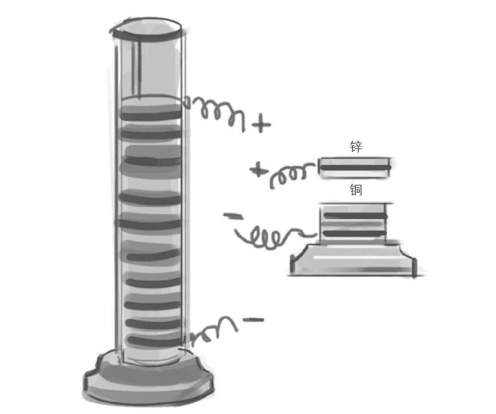

伏打电堆

当时，弧光灯的亮度算是非常高的。有人估计，其亮度相当于 4000 支蜡烛的亮度（大约是现代汽车的聚光灯亮度的 1/10）。

弧光灯的亮度带来了大量的热，同时也带来了火灾的危险。由于其亮度及潜在的火灾危险，人们认为弧光灯不适合家居使用。

弧光灯曾被用于商业场合，但当时没有稳定的电力供应，所以无法长时间使用。要广泛使用电力照明，这条路是走不通的。随着人类科技在这个世纪的进步，在本章后面的内容里，电力照明会再度回归。

与此同时，电力的其他应用即将取得重大进展。

##### 迈克尔·法拉第

许多人也许都知道迈克尔·法拉第这个名字。他是历史上最具影响力的科学家之一，改变了我们对电、化学和电磁学的理解。他的成就包括：发明了本生灯和直流电动机，发现了苯，研发了法拉第笼。阿尔伯特·爱因斯坦甚至在他办公室的墙上挂了一张法拉第的照片。

令人惊讶的是，1791 年出生于英国的法拉第几乎没有接受过正规教育，他只好自学。15 岁左右的法拉第在做图书装订工时，不经意间看到了两本改变他的人生轨迹的书。一本是艾萨克·瓦茨（Isaac Watts）的《悟性的提升》（The Improvement of the Mind），这本书让法拉第学会了理解和自律；另一本是简·马塞特（Jane Marcet）的《化学对话》（Conversations on Chemistry），这本书激励他走向电子实验的方向。在英国皇家学会听了英国化学家汉弗莱·戴维的讲座后，法拉第最终以其助手的身份，和他一起踏上了欧洲之行。

遗憾的是，法拉第当时不被看重，也不被视为“绅士”。他不得不坐在公共马车的顶上，而不是马车里面，吃饭时也只能和仆人一起。这让他非常沮丧，但令他坚持下去的是与伟大智者见面的机会，以及他对科学世界的热情。

法拉第的天才在于他表达想法的方式——用语十分清晰和简单。不过他确实也无法进行复杂的表达，因为他的数学知识有限。尽管如此，他成功地将气体液化，制造了新型玻璃，改良了钢合金，发现了纳米粒子和苯。现在，塑料、染料、药物、润滑剂、橡胶等物品的生产都要用到苯。不过，这些都不是他最伟大的发现。他最伟大的发现当属 1821 年使用伏打电堆来产生运动——换言之，也就是电动机。

戴维和当时两位最杰出的科学家（包括发现了电磁的詹姆斯·麦克斯韦）曾尝试过制造一台电动机，但以失败告终。1821 年，人们发现，电在磁场存在时能够产生力。

与这些人相比，法拉第的教育程度相对较低，但在与他们简单地讨论了这个问题后，法拉第成功制造出了一台持续做环形运动的电动机。虽然它产生的力很小，但它运作了起来。

我们来想想电力驱动与蒸汽驱动之间的平行关系。我们再次看到，以前的设想是如何被后来的想法建立起来，从而产生新的技术的。

如今，虽然看起来法拉第发现的原理与他的电动机截然不同，但我们的电脑硬盘、电动自行车、手机振动感应器等都应用了这个原理。值得注意的是，尼古拉·特斯拉改良了法拉第的想法，发明了交流电动机，现在被普遍用于从洗衣机到电动汽车等各个领域。

但法拉第的成就不止于此。1831 年，他发明了发电机，也就是直流发电机。该设备的工作原理与电动机恰好相反：将机械能转变为电能。

到了 19 世纪 30 年代，人们开始了解电的奥秘，但它尚未引发变革。这是因为直流发电机产生的电压很低（只有几伏），电力不足。虽然它证明了电力可由磁力产生，但它能提供的电力非常有限。不过，新的思想者们仍在为这一最新发明寻找用途。

#### 电力通信的开启

与我们之前提到的发明家不同，查尔斯·惠斯通（Charles Wheatstone，1802 年生于英国）拥有音乐背景。他的父亲售卖乐器，是个长笛老师。十几岁时，惠斯通阅读广泛，经常在当地商场的一个旧书摊上读书。一天，他偶然看到一本介绍伏打的发明的书，伏打在 10 多年前发明了电池。他当时没有钱，但很快攒钱买了这本书。

查尔斯·惠斯通和他的兄弟决定自己做一个电池。他们很快意识到，他们没有足够的钱来购买铜板。惠斯通非常投入，用自己剩下的铜币完成了电池的组建。

1821 年，惠斯通在当地的商场里制造了一个音箱，通过电线播放现场乐器的声音，这吸引了人们的注意——这在当时非常有趣。他还发明了“麦克风”这个词，用以命名他发明的将声音机械地扩大到每只耳朵的装置。

##### 电报

1835 年，查尔斯在担任伦敦国王学院教授期间，发现了利用电力传输信息的潜力，他因此放弃了机械麦克风的方法，转而探索电报的概念。他能够看到，这项技术如果成功，会为整个世界带来难以置信的便利。他的想法是继续发展已有的各种原始的电报通信方法——其中最引人瞩目的是俄国发明家巴伦·许林格（Baron Schilling）的工作，他成功地在两个房间之间进行了通信。电报信息可以在非常低的电压下工作，在当时的发电状况下，这是理想的技术。

与此同时，印度陆军军官威廉·库克在休假期间决定去海德堡大学上几堂解剖学课。在那里，他看到了原始电报的演示，立即意识到了其重要性。库克放弃了解剖学研究，开始研究电报。他联系了迈克尔·法拉第和爱丁堡的一位学者彼得·罗杰，以咨询科学知识。罗杰建议库克去拜访惠斯通。

库克提议与惠斯通合作，但二人对该项目的动机截然不同。惠斯通纯粹是对这一技术的科学意义有兴趣，而库克则是想要赚大钱。尽管如此，经过一番犹豫之后，惠斯通还是同意与库克建立合作伙伴关系。

1837 年，他们在伦敦的尤斯顿火车站和卡姆登镇火车站之间架设了一台实验机器，距离为 2.4 千米。在接收端，菱形刻度盘中有一系列字母和五根电磁针，电报的接收者通过磁针的指向来读取电报内容。为了发送和接收消息，系统至少需要五根电线来传输信息。

1837 年 7 月 25 日，第一封电报发出了。惠斯通回忆当时的感觉时说道：“我一个人站在屋子里，听着磁针的咔嗒声，从未感觉如此忐忑。在我拼出那些词时，我感到这项发明的重要性掷地有声，其实用性无可挑剔、无可争议。”然而，铁路负责人对此不以为然。他们将电报视为不实用的古怪装置，只是一个愚蠢的玩意儿。他们马上让人从车站里撤走了装置。一切似乎已成败局，但是，两年后，这项发明被英国大西部铁路公司重新拾起，传输距离 21 千米。这标志着电报首次被实际使用。

###### 偶然推动必然

公众对电报的了解依然很少，直到它迎来了最不寻常的宣传。1845 年，一起刑事案件的嫌疑人约翰·塔维尔登上了一辆开往伦敦的火车。在知道了他的目的地后，一封电报被发送到他计划前往的车站。当塔维尔走出车厢时，警察已经在那里等着逮捕他了。当时，这一事件令世人备感震惊。这种形式的通信竟然能够迅速在行驶的火车上拦截罪犯？这件事被广泛宣传，电报的重要性终于得到了证实。

在美国，一系列悲剧事件将推动另一位发明家思考对通信进行进一步的改良。

## 塞缪尔·莫尔斯
想象这样一个情景：1825 年，你在华盛顿特区，为一位名人创作一幅画像。在 480 千米外的康涅狄格州的纽黑文，你的妻子正卧病在床。有一天，当你正在画这幅画时，一个骑马的信使给你带来了消息，说你妻子的病情正在好转。于是你继续画画。第二天，骑马的信使给你带来了另一条信息，这次则是关于你妻子死亡的详尽报告。你悲痛欲绝，抛下一切，前往纽黑文。当你抵达时，你妻子已经入土为安了。

这就是发生在塞缪尔·莫尔斯（Samuel Morse）身上的事。

这些悲惨的事件让他陷入了深深的绝望，但这将促使他开始探索快速远距离通信的方式。他的成果就是单线电报和莫尔斯电码，后者成为电报通信的标准，时至今日仍在使用。

莫尔斯电码非常巧妙和简洁，它使用点和划来代表字母表中的字母。熟练的操线员每分钟可以发送 80 个字符。

1844 年，莫尔斯从华盛顿特区向马里兰州的巴尔的摩发送了他的第一封电报。上面写着：“神为他行了何等的大事！”这句话摘自《圣经·民数记》23 章 23 节。莫尔斯电码成为电报的标准，因为相比惠斯通的机器那样至少用五根线来对应字母，使用点和划要简单多了。

也许，要是没有遭遇悲剧，莫尔斯的名声也就仅限于伟大的艺术作品了。

### 远距离通信
电使城市之间可以进行迅速通信，但对于被大洋隔开的国家而言，通信依然只能依靠轮船。这种通信的速度非常慢。例如，美国与英国之间发送的消息需要 10 多天才能到达。

19 世纪 50 年代，随着电报的普及，越来越多的人认为应当将这种技术应用于大西洋对岸（约 3200 千米）。1854 年，大西洋电报公司开始建造第一条横跨大西洋的电报电缆。英国和美国的船只被用于在洋底铺设绝缘电缆。在四次尝试失败后，该项目在 1858 年第五次尝试时完成了。这是该类项目第一次获得成功。虽然花费了诸多努力，但电缆只运作了三个星期。

1858 年 8 月 16 日，两块大陆之间发出了第一封官方电报：维多利亚女王发给美国总统詹姆斯·布坎南的项目竣工贺信。不久之后，信号质量恶化，传输变得缓慢。为加速通信，白宫给电缆施加了额外电压，这彻底毁坏了电缆。在电缆运作时，英美之间的通信时间从 10 天缩短至 17 个小时左右。

在美国，电报线路已经连接了美国东部地区的各个城市。1851 年，横跨美国的电报线路的建设工作开始了。1861 年 10 月 24 日，第一封电报从旧金山发往华盛顿特区。也是在这一天，驿马快信就此停用。在这之前，驿马快信是将信件（信息）从东岸传至西岸最快的方法，毕竟要在 8 年之后才会出现火车。电报让驿马快信过时了，如同蒸汽火车最终让马车运输过时了一样。

书面交流现在能在短时间内进行长距离传输，具有巨大的经济和社会影响，但是语言呢？

## 电话
苏格兰人亚历山大·格雷厄姆·贝尔出生于 1847 年，当时电报在英国和美国的发展势头正猛。虽然贝尔是因为发明电话而被人铭记，但是，我们在本书的后面会看到，他的遗产将通过晶体管的发明直接奠定计算机运算的基础。

贝尔是个充满好奇心的孩子，有发明创造的天赋。12 岁时，他在好友家的面粉厂制造了一个给小麦去壳的装置。虽然他有实用发明的头脑，但学习成绩很差，15 岁就辍学了。不过，他后来确实接受了高等教育。

贝尔性格内向，与母亲特别亲密。小时候，母亲鼓励他发展在音乐方面的天赋。当母亲开始失去听觉时，贝尔受到了沉重的打击。这些事激励他去学习声学。最后，他在波士顿创办了聋人学校。

### 贝尔和他的小把戏
贝尔经常进行一些创造性的、有意思的演讲实验来取悦他人。有一次，他用家里的狗做了其中一个实验。他训练狗进行长时间的咆哮。当狗发出声音时，他操纵着狗的嘴唇和声带，让它发出“嗷啊呜嘎吗吗”的声音。客人们在他的一点点说服之下，相信了他的狗能够说出“How are you,Grandmama”（奶奶，你好吗）。目击者坚称自己看到了一只会说话的狗！

贝尔还为聋哑教师讲授“可视语言”，但他很快就发明了自己的读唇术和言语教学方法。到 1871 年，他已经是听障人士教育领域的领军人物了。他认为，聋人应当从手语中解放出来，应当有能力讲话。当时，聋人通常会被社会排斥。

大约在这个时候，贝尔开始研究一种谐波电报。他利用自己的音乐背景和声学知识，认识到多个信号（莫尔斯电码的点和划）如果位于不同的音高上，就可以经由同一根电线发送。

它的工作原理是这样的：一个电报员可以用莫尔斯电码敲出信息。然后，电码的信号以特定频率的短声频进行传输。在同一线路上，另一个电报员可以用不同的频率打出莫尔斯电码。在接收端，一个设备只能对一个频率做出回应（振动），而不会对同一线路上的其他频率做出回应。如果多个接收端使用多个不同频率，那么同一条线路上就可以发出多条信息，而不会混淆。贝尔称之为多重信号电报。

在得到两个密友的资金支持后，贝尔和年轻的助手托马斯·沃森一起，进一步发展了这个想法。一天，贝尔和沃森做这个项目时，沃森不小心拔下了其中一台传输设备。贝尔没有听到莫尔斯电码信息的那种哔哔声，而是听到了另一个房间里的接收器传来的一声清晰的拨弦声。贝尔立马想到，如果拨弦声能通过这台设备进行传输，那么任何声音——甚至嗓音——都有可能通过电子设备进行传输。这是转折性的一刻。它标志着电话的诞生和多重信号电报的消亡。那天是 1876 年 3 月 10 日，在那一天，电话发出了第一句话的声音：“沃森先生，到这里来，我想见你。”1876 年 8 月 4 日，贝尔只做了一个可以工作的电话模型，并向亲朋好友进行了展示。在听到 6 千米之外的人的读书声和唱歌声时，他们都惊呆了。

当年晚些时候，贝尔在费城的百年博览会上展示了原型机器，这款电话机因此在国际上名声大噪。当天观看展示的都是德高望重之人，维多利亚女王就是其中之一。她称这项发明是“最不寻常的”。

不过，不是每个人都啧啧称奇。展示结束后不久，西联公司总裁威廉·奥顿就有机会购买贝尔的这项发明。他最为臭名昭著的一句话是：“这个电子玩具能给我们公司（西联公司）带来什么用处？”当然，奥顿大错特错了。

一切顺风顺水的贝尔在一年后，也就是 1877 年，成立了贝尔电话公司。贝尔电话公司后来被称为美国电话电报公司，或 AT&T，至今仍是世界上最大的电信服务商之一。

在贝尔进行公开展示后不到 10 年，美国便涌现出超过 15 万个电话用户。

电话满足了人类最大的需求之一，使天各一方的人可以听到彼此说的话。的确，电话是史上最成功的发明之一。实际上，现在的智能手机算得上是贝尔这项发明的曾孙。

大多数人不知道的是，亚历山大·格雷厄姆·贝尔经常回忆说，他对世界最大的贡献并不是发明了电话，而是对聋人的口语教育。

到 19 世纪 70 年代末，电使得人类能够通过声音（而不是莫尔斯电码信号）进行远距离交流。但是有没有办法保存这些声音？当时，还无法录制声音并进行回放。托马斯·爱迪生即将打破这一局面。

### 托马斯·爱迪生：录音
1877 年 7 月，爱迪生偶然发现了这个解决方案，当时他正在研究对电报信息进行录音和回放的方法。他最开始是在一卷纸上通过振动产生的压痕来捕获莫尔斯电码。经过一番思考，他推断，任何声音都可以做到这一点。他所需要的只是一个振动的物体，可以在一个易受影响的表面标记出它的运动。最开始的方法是用锡纸包裹圆筒。

爱迪生向媒体公布其发明的方式也确实非常聪明。《科学美国人》的一位撰稿人回忆道：“1877 年 12 月，一位年轻人走进《科学美国人》的办公室，在编辑面前放了一台简单的小机器，几乎没有提供任何预先说明。这位来客没有进行任何仪式就转动了曲轴，让现场所有人大吃一惊的是，机器说话了：‘早上好，你好吗？你觉得这台留声机怎么样？’机器就这样为自己代言，让大家知道，它是一台留声机……”

留声机在 1878 年 2 月 19 日被授予了专利：美国专利第 2000521 号。亚历山大·格雷厄姆·贝尔将改进这项技术。贝尔在用心聆听之后，觉得应该用蜡制圆筒来代替锡纸圆筒。结果，声音质量好了很多，这使得 19 世纪 90 年代第一张唱片走向商业化。

## 电灯闪耀
19 世纪 70 年代，人们还在研究法拉第的发电机（就是我们之前看到的将机械能转化为电能的发电机）。到了 70 年代末，其他国家对这些技术有了兴趣，开始进行将其与弧光照明的概念相联系的试验。

第一批实用的大型发电机是在法国生产的，因此 1875 年地球上首次出现了路灯。到 1878 年，巴黎整座城市都装了弧光照明系统。伦敦技术期刊《电工》的一位撰稿人来到法国，对这一成就印象深刻，但很遗憾这项技术没能来到英国。期刊中写道：“电灯在巴黎的应用与日俱增，但在伦敦却看不到这样的光。”

作为回应，英国在发电方面开始大跨步前进，到 19 世纪 90 年代初，英国使用了 700 台弧光灯。市场、铁路和大型建筑前的路边是安装弧光照明的理想场所。虽然在公共场合使用，但在私人住宅中还是没有这样的电灯。

### 电灯泡之争
白炽灯的想法几乎和弧光灯一样久远。许多人曾经尝试通过加热一根细线来产生光亮（产生白热光），但截至此时，这似乎是不可能的事。有这么几个原因：一是必须找到一种能够反复加热和冷却的材料，二是这种材料必须封装在金属发热时不会破裂的玻璃容器内，三是必须排出空气，以免灯丝氧化（生锈）。

直到今天，仍有许多人认为是托马斯·爱迪生发明了白炽灯，但如同爱迪生的众多“发明”一样，他其实更多的是改进了已有的想法，而不是进行新的思考。事实上，一直追溯到 18 世纪初，已经有数十个使用白热光进行照明的事例，但直到 19 世纪 70 年代末，灯泡竞赛才真正进入白热化阶段。当时，主要竞争对手来自大西洋两岸：纽约有托马斯·爱迪生和威廉·索耶（William Sawyer）在竞争，伦敦有约瑟夫·斯旺（Joseph Swan）在竞争。

斯旺占据领先位置。他用许多材料进行过实验，包括碳、铂和棉线。他的成果成功获得了一项英国专利，还有诸多个“第一次”，包括：第一次为房屋照明，第一次为剧院照明，第一次为公共建筑照明。

在此期间，爱迪生在纽约申请了自己的“电灯改进”专利。爱迪生也开始用碳丝和铂丝，但他的团队发现，碳化的竹子可以持续使用 1200 多个小时。爱迪生团队创造的灯泡无疑是具有开创性的。但可疑的是，这些成果似乎很大程度是基于其美国同伴（竞争对手）威廉·索耶的设计。

可用的灯泡已经被发明出来了，但发明者是谁？现在有许多互相冲突的专利。爱迪生在英国输了官司，不得不把所有权让给斯旺。同时，在美国，威廉·索耶的合作伙伴阿尔邦·曼（Albon Man）也在本土挑战爱迪生的专利。爱迪生一开始输掉了官司，但经过 6 年的法庭斗争后，他最终胜诉了。几年后，他还收购了斯旺的英国公司。自此，爱迪生的电灯泡传奇在历史上巩固了下来。

到 1900 年，一些伟大的人物给我们带来了电话、录音、电灯和火车。这真的是一个全新的世界。

### 第三章 新世界（1900—1909）
1900 年已经过去很久很久了，当时的世界完全是另一副模样。当年，美国的人口为 7500 万，莱曼·弗兰克·鲍姆的《绿野仙踪》刚刚出版，纽约地铁系统的建设刚开始启动。

在 20 世纪的最初 10 年里，出现了许多第一次。1900 年，巴黎奥运会第一次有女运动员参加；1901 年，首届诺贝尔奖颁奖典礼举行；1902 年，第一个专门用于放映电影的剧院——洛杉矶电气剧院开放。4 年后，第一部长篇电影《凯利帮的故事》（The Story of Kelly Gang）在澳大利亚墨尔本上映。在这 10 年中，还出现了其他发明，包括洗衣机、吸尘器和第一次娱乐广播。

1901 年，鲁道夫·狄塞尔（Rudolph Diesel）在巴黎世界博览会上展示了他的柴油发动机（燃料为花生油）。这届世博会吸引了 5000 万名参观者，会上还展示了其他新兴技术，如：有声电影、自动扶梯和第一台磁性录音机。在那个年代，巴黎是技术创新的中心。

随着多国开始耀武扬威，各国的边界也在发生变化。新帝国主义势焰熏天：欧洲、美国和日本的当权者都试图通过侵占亚洲、非洲和南美洲不断扩大的领土来统治世界。

与此同时，伟大的思想家们也很忙：1905 年，爱因斯坦向全世界宣布了狭义相对论。它假定，静止的观察者在各处看到的物理定律表现形式是一致的，并且光速是恒定的。这个理论假设了各种奇怪的东西，比如重力引起的时空弯曲和黑洞。也许最奇怪的一大相对论效应就是物体接近光速时导致的结果：物体的运动速度越接近光速就越重，以光速运动的物体将是无限重的。爱因斯坦的理论也带来了一些奇怪的副作用，如时间会因位置和速度发生变化。例如，接近光速时，时间会减慢，这种效应称为时间膨胀。

这听起来可能离日常生活很远，但其实我们每天都在应用狭义相对论。比如，GPS（全球定位系统）卫星以 1 万千米/时的速度绕地球运行，如果不根据时间膨胀调整卫星上的时钟，一天之后，它们的测量结果就会减少 8 千米！想象一下，用这种精度的谷歌地图进行导航会是什么体验。

在 1905 年就能预见这种效应，的确很了不起。但除了爱因斯坦，20 世纪初还有其他思想巨人，他们的想法深深影响了今天的世界。

## 个人汽车运输的黎明
20 世纪第一个 10 年是成功的，更确切地说是一连串快速的成功。在技术方面，内燃机在 20 世纪的前几十年得到广泛应用。从某种程度上来说，这项技术接过了 19 世纪蒸汽机的接力棒。你可能会惊讶地发现，19 世纪居然会有蒸汽汽车。这些汽车需要足足 45 分钟才能在寒冷的天气里启动，并且需要加满大量的水。这两个因素限制了汽车的续航里程。世界亟待更好的解决方案。

于是，1808 年出现了第一辆氢动力汽车，1838 年出现了第一辆原始的电动汽车，1870 年出现了第一辆汽油动力汽车。1885 年，卡尔·本茨（Karl Benz）生产了第一辆汽油动力汽车，这项发明产生了深远的影响（本茨的公司后来发展成为梅赛德斯—奔驰公司）。

### 最早的车很多都是……电动车？
其实，早期的汽油动力汽车并不完美。启动时，需要铆足劲儿和手摇柄对抗，连换挡都很费劲。此外，油门居然在方向盘上。由于这些原因，电动汽车被认为是当时最好的个人交通工具，它们噪音极低，易于驾驶，相对不费力就能操作。

费迪南德·保时捷（保时捷汽车公司的创始人）和托马斯·爱迪生等大人物也开始全力研究电动汽车。1898 年，保时捷制造了第一辆汽车，是电动的。一年后，爱迪生开始研发更耐用的汽车电池。他认为电动汽车才是未来。然而，经过一次又一次尝试，他还是不得不在 10 年后放弃了这个想法。

电动汽车非常适合在城市里短途出行，因为当时的乡村道路还不适合开车。到 1900 年，只有 22%的汽车靠汽油驱动，40%是电动车，剩下的 38%是蒸汽车。

在世纪之交，汽车（电动或其他）是一种昂贵的新奇事物，只有皇室和富人才能体验到私人汽车的好处。要让每个人都能自由出行，就要改变汽车的生产方式，让汽车的价格变得可负担。一个叫亨利·福特的人让这一切变成了现实。

### 平价汽车之父
1891 年，爱迪生照明公司雇用了一位聪明的工程师，当时他 28 岁。他是个天才，很快就得到了晋升。短短两年后，他就成为总工程师。他的名字叫亨利·福特。

亨利·福特 1863 年 7 月 30 日出生于密歇根州。13 岁的时候，他的母亲去世了，他父亲命令他接管家族农场。虽然他非常爱他的母亲，但他对于待在家里做一辈子农活非常反感。很小的时候，福特就对机械工作感兴趣。15 岁左右，他就能给朋友和邻居修理手表。

16 岁时，福特离开农场，在底特律当机器操作员学徒，1891 年去了爱迪生公司。当时，爱迪生会在空闲时间试验无马马车的构想。1896 年，福特制造了他的第一辆车，并精心命名为福特“四轮车”。他在与爱迪生公司高管的会议上展示了他的新车计划。有趣的是，爱迪生本人非常想看到福特的另一款改进车型。三年后，福特离开爱迪生公司，全身心投入汽车研发。

经过两次失败的尝试后，福特汽车公司于 1903 年成立。第一辆福特汽车是 A 型车，配备了一台 8 马力的电动机（马力——记得第一章中詹姆斯·瓦特提出的术语吗？），售价为 800~900 美元，具体取决于双座或四座。福特公司在 1903 年和 1904 年制造了 1750 辆汽车，全是一种颜色——红色（可能是因为这让车看起来快一点儿）。福特公司几乎把 2.8 万美元的初始资金都花光了，在 1903 年卖出第一台 A 型车时，公司银行账户只剩下 223.65 美元。当时福特面临的是不成则败，所幸美国人民非常喜欢这辆车，公司也因此旗开得胜，越做越好。

#### 第一辆福特是谁买下的？
1903 年 7 月 23 日，来自芝加哥的牙医欧内斯特·芬尼成为第一辆 A 型车的主人。A 型车没有风挡玻璃，所以多年来欧内斯特可能从其他 A 型车司机那儿得到了一些额外的牙科生意。

#### 创新思维让福特与众不同
在 A 型车之后，福特公司又生产了一系列车型，但相比当时的竞争对手，它们都比较贵。例如，六缸福特售价 2800 美元（相当于今天的 7 万美元），而奥兹摩比（Oldsmobile）的竞争对手（Runabout）售价仅为 650 美元（相当于今天的 1.65 万美元）。

随着福特汽车越来越成功，它需要想办法在降低生产成本的同时提高产量。

低成本的秘诀在于生产方法。当时，福特公司的工人分为两三人一组，每天只能生产不到 10 辆车。各小组会先做好汽车的各个部件，再进行组装。

1908 年，随着 T 型车的诞生，公司尝试了一种新的生产方法。福特曾研究过其他行业，如面粉厂、面包店、啤酒厂和肉类加工厂，并从它们连续流动的生产方式中汲取灵感。于是 T 型车采用的模式是先批量生产零件，再集中送入生产车间。装配过程分为 84 个步骤。每个工人只会接受其中一个步骤的培训。福特甚至聘请了一位动作分析专家弗雷德里克·泰勒来确保工作尽可能高效完成。此外，福特还制造了一些机器人，用于更快地冲压零件。

在汽车工业，没有什么比引入装配线更具革命性。1910 年，福特在密歇根州开设了高地公园装配厂。1914 年，引入了每分钟移动 1.8 米的机械输送带，进一步加快了生产节奏。

早在 1908 年就问世的电启动器让 T 型车不再需要手动启动。这项进步，加上更便宜的燃料和大规模生产，挑战了电动汽车的可行性，而当时电动汽车的生产能力完全比不上汽油汽车。

## 效率的果实
生产一辆汽车的时间从 12 小时缩到了 93 分钟。这究竟具有怎样的革命性呢？要知道，1914 年，福特生产了 30.8162 万辆汽车，比其他所有制造商的产量加起来还要多。到 1924 年，福特已经生产了超过 1000 万辆 T 型车。每辆车的价格也从 850 美元降到 260 美元（相当于从今天的 1.21 万美元降到 3700 美元）。

装配工作虽然单调，但对工人而言不像人们想象的那么糟糕。由于效率提高，典型的工作日时间可以从 9 小时减少到 8 小时。工人每天的工资是 5 美元（相当于今天的 124 美元），是当时行业标准的两倍。理论上，工厂工人买得起属于自己的 T 型车。当工人以 72 千米/时的速度在街道上驰骋时，他们一定会觉得自己就像摇滚明星。

至此，福特已经成功地让汽车成为普通人家的消费品。

T 型车和它的大规模生产技术改变了美国的文化和经济。汽车餐厅和汽车电影院开始出现，汽车旅馆成为一个新概念。事实上，人们现在可以在任何地方开车（汽车的设计考虑到了崎岖的地形、雪地，甚至是河流）。因此，农村地区开始出现企业。

早期的汽车和卡车还影响了钢铁、橡胶、玻璃、食品和娱乐行业。

到 20 世纪 50 年代，汽车行业已经在美国创造了 900 万个就业机会，甚至还有一个岗位叫作“喇叭员”。他们唯一的任务就是检查工厂里的汽车的喇叭声，看看是否调到了制造商规定的频率。比如，汽车喇叭声一般有两个调：降 E 和 G 调。

## 家庭娱乐的黎明

T 型车颠覆性地改变了人们在家之外的生活，而在家里，这项重任则交给了音频娱乐。

100 年前的家庭娱乐状态似乎令人难以置信。现在如果我们想听音乐，只需要按一下按键，点击一下屏幕，甚至只要说一声，就可以实现。但当时可没有这么简单。足不出户就能欣赏音乐只属于会弹奏乐器的那些家庭。一起跟唱也是当时人们最喜欢做的事。实际上，留声机最开始的竞争对手并不是另一种音频回放机器，而是普通的钢琴。

按照今天的标准，爱迪生的留声机和唱机略显粗糙，但它们为当时的娱乐方式带来了全新的可能。留声机第一次引出了“私人音乐”的概念。随时都能听音乐，还不用到现场，这的确是一场革命。这在当时显然是一个非常好的想法。

随着唱片的质量提升，其销量也开始提高。随之而来的是大规模生产和有效的营销。不久，唱片的价格从 2 美元降至 35 美分左右。1907 年，维克多唱片公司发行的恩里科·卡鲁索（Enrico Caruso）翻录版《穿上戏装》（Vesti la Giubba）成为第一张销量达 100 万的唱片。

## 乔治·伊士曼（柯达）：摄影的普及

只需按一下按钮或用手指轻按玻璃屏幕，我们就能冻结时间，永远留住瞬间。冻结的图像就像时间传送门，能带领我们重温一个又一个历史时刻。在摄影技术诞生之前，这只能交由技艺娴熟的艺术家来实现。

1900 年左右，照相机与今天的截然不同。它体积庞大，操作复杂，拍摄的对象必须完全静止 6 到 8 秒才能拍出一张照片。如果过程中移动了，图像就会模糊。想象一下，在这种条件下和你的朋友拍照，会是什么感受。弄不好会一塌糊涂。

拍照的时候，摄影师要在大玻璃板上倒上多层化学物质并进行混合，使玻璃板感光，然后将其插入相机镜头的后部，最后在玻璃板干燥之前拍摄照片，因此这也叫“湿版摄影”。但问题在于，玻璃板很重、易碎且使用起来很麻烦。只有专业的摄影师才受得了一直使用这样的设备。

一个叫乔治·伊士曼的纽约青年对摄影颇感兴趣，但一直觉得相机用起来很费劲。即使他上过专业课程，每次摆弄这些又难用又邋遢的化学试剂，也还是很挣扎。他知道一定会有更好的解决方法。

于是，伊士曼做了合乎逻辑的事情，研究是否有更好的摄影技术。每天晚上，他都要阅读国际摄影期刊。事实证明，这一步非常明智，因为这让伊士曼发现了一种更简单的摄影新方法。在英国，摄影师正在尝试所谓的“干版”摄影。他们预先在板上涂好化学物质，避免了拍摄时液体滴落。这个发明可真是颗遗珠。但当时还没有互联网，不能将这种新的摄影趋势传到美国，因此很少有美国人知道英国人发明了一种更好的摄影方法。

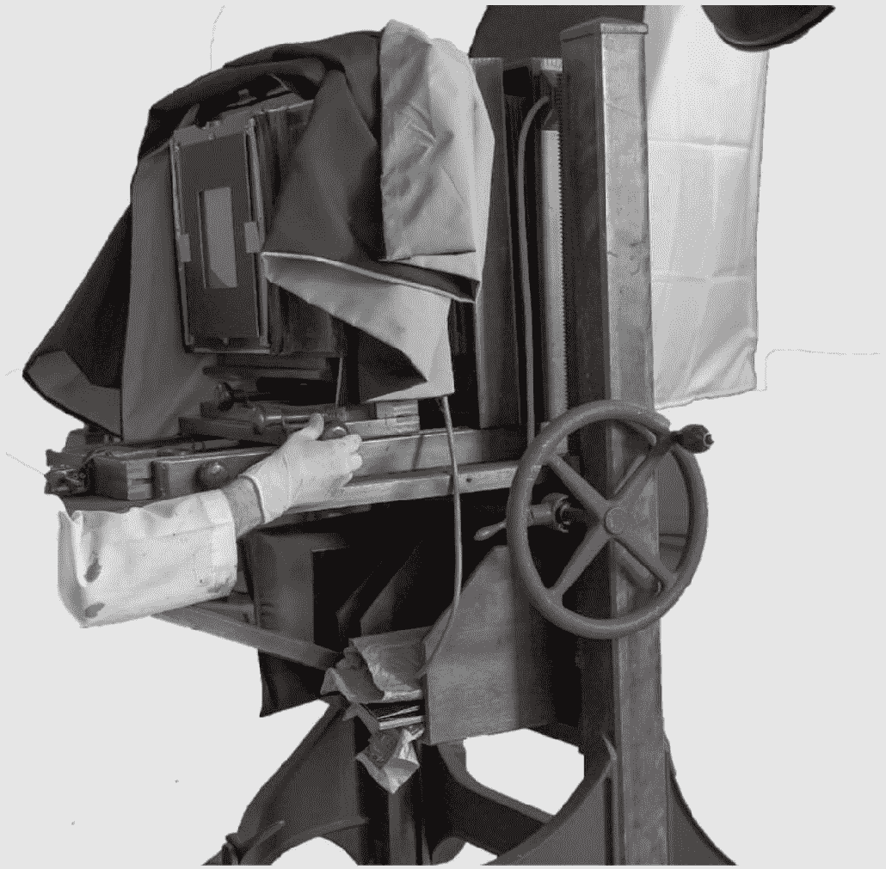

湿版摄影

伊士曼接着想到了下一步——创造自己的干版。为什么不呢？能阻止他尝试的可能只有两个理由，一是他高中就辍学了，二是他从来没有学过化学，但他觉得这些都没关系。他很快就开工了。虽然伊士曼高中都没读完，他还是找到了一份银行簿记员的日常工作。下班后，他整夜都在他母亲的厨房里鼓捣，将各种化学物质倒在玻璃上，然后放进烤箱里烘烤，尝试制作干版。伊士曼非常投入，以至于他母亲经常发现他在地板上就睡着了。

伊士曼决定用他的新技术拍摄邻居家的房子，进行测试。一天，当地的一个摄影师看到了他拍的照片，感到非常好奇。于是，这个摄影师买了一些干版，并把它们推荐给纽约的摄影器材巨头安东尼公司。安东尼公司刚好在寻找新型创新产品，伊士曼的发明正好符合。

安东尼公司向 26 岁的伊士曼开出了一份合同。1881 年 1 月，伊士曼在纽约有了自己的干版工厂，同时继续兼顾银行的工作。他亲自调制所有的化学试剂，每天工作到深夜。第二天去银行上班的时候，他的手指常常被化学物质染成黑色。他下定决心一定要成功。很快，他就能够聘请几个员工帮忙了。

后来，因为一次升职被拒，伊士曼从银行辞职了，他的同事都觉得他犯了个大错，但很快伊士曼证明，他才是笑到最后的人。摄影师们很快发现了伊士曼的发明。有了他研发的简单好用的干版，他们终于能开心地摆脱湿版摄影这份苦差事了。

但事情并非一帆风顺，其他公司很快赶上并开始售卖他们自制的干版。最终，竞争对手的产品质量超越了伊士曼的，他意识到自己可能要失败了。

伊士曼必须迅速思考。很快，他想到了带有化学涂层的可卷曲纸膜。这样一来，摄影师在拍摄新照片时不用更换新的干玻璃，只需将卷筒卷到下一帧胶片即可。这个想法十分前卫，伊士曼对此兴奋不已。“再过几周，我们就能征服世界！”他对他的员工大声喊道。1885 年，他展示了他的发明。虽然赢得了一些奖项，但是胶卷材料的局限性意味着图像质量达不到专业摄影师的标准。由于画质问题，纸卷胶片在市场上失败了。伊士曼受到了极大的打击。然而，他灵光一现，决定将注意力转到他做这一切的初衷——让摄影变得简单，让摄影属于每一个人。也许专业人士不认可纸卷胶片的作用，但普通人可能会喜欢随意地拍快照，即使画质不够完美也没关系。这个想法值得一试。

### 将摄影带给大众

1886 年，伊士曼将他的计划从制作胶片转向制造易于使用的照相机。这次设计要做的是世界上最简单的相机。创意诞生一个月后，他开发出一款相机。它的名字叫什么呢？柯达。

柯达的体积很小，上面没有多少可移动部件，没有对焦，也没有取景器，它的口号是：“只需按下快门，其他的交给我们。”这引发了一场革命。这台相机不再需要复杂的化学品或玻璃板，它只是一个小盒子。袖珍相机引起了人们的兴趣，甚至同年写成的小说《德古拉》（Dracula）中也提到了它。柯达相机在某种程度上是成功的，但是 25 美元（相当于 1887 年普通人 3 个月的工资）的售价对大多数人来说太贵了。要实现快速成功，柯达只需找到生产平价相机的方法。

1888 年，乔治·伊士曼结束了和安东尼公司的合同，成立了伊士曼—柯达公司（现在的柯达）。

真正获得消费者认可的是布朗尼相机。伊士曼让公司的相机设计师弗兰克·布朗奈尔（Frank Brownell）设计出一台尽可能便宜的相机，同时要保证机器实用可靠。他的策略是将爱拍照的小孩作为目标受众。1901 年推出的布朗尼相机个头小巧、价格便宜（相机 2 美元，胶卷 1 美元一卷）、使用方便，一卷胶卷能拍 8 张照片。这个产品一推出就引起了轰动，第一年就卖出了 25 万台。

布朗尼相机改变了人类的生活。有史以来第一次，所有人都能够任意捕捉生活的瞬间，这在人类历史上前所未有。

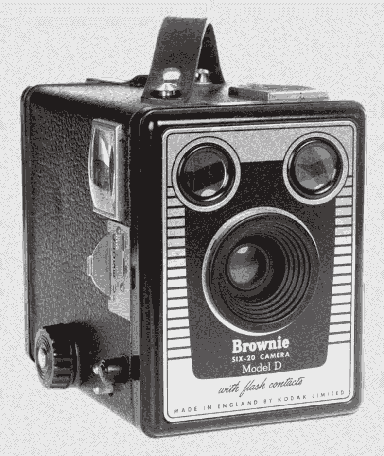

布朗尼相机

乔治·伊士曼很多次都想放弃，但正是他的毅力永远地改写了世界。今天，世界上有几十亿台能放进口袋的相机。尽管它们的工作模式不尽相同，它们带来的结果是一样的——能让我们留下生命中的特殊时刻。

有趣的是，接下来我们会看到，伊士曼还间接促成了塑料的发现。

### 塑料是怎么来的？

看看你的周围，有多少东西是用塑料做的？我们要感谢谁发明了这种今天必不可缺的东西呢？

利奥·贝克兰（Leo Baekeland）是生于 1863 年的比利时裔美国化学家。他是个聪明的学生，年仅 21 岁就获得了博士学位。1889 年，他被任命为比利时根特大学化学系副教授。同年，他获得了一笔访问英国和美国大学的奖学金。随后，纽约哥伦比亚大学的一名教授说服了这位比利时青年留在美国。

贝克兰是一名摄影爱好者，经过两年的努力，他发明了一种可以在人造光下显影的维洛克斯相纸。这是第一种取得商业成功的相纸（远远超过伊士曼的原始纸质胶卷）。1899 年，贝克兰以 100 万美元（相当于今天的 3000 万美元）的价格将维洛克斯相纸和他成立的公司出售给柯达的乔治·伊士曼。

拿到柯达给的钱后，贝克兰成了有钱人，可以想做什么做什么。对他来说，他最想做的是化学实验。他建立了自己的私人实验室，希望在化学科学界找到下一个他能发挥自己解决问题才能的领域。

他在日记中写道：“我是一个经济自由又精神自由的男人，准备再次投入我最爱的学习中去……几年来，我一直享受着这种巨大的幸福，享受做自己最喜欢的事而不被打扰的奢侈。”19 世纪末的很多化学家都在尝试发明一种又坚固又耐热的新型合成材料。虽然已经有了橡胶等有机树脂，但它们还不够坚固，无法广泛应用。化学家尝试使用两种化学物质来研制新的合成材料：苯酚（来自煤和焦油）和甲醛（来自甲烷的燃烧）。

值得注意的是：现在甲醛被证实致癌，汽车废气和烟草烟雾中都有。然而，这些早期化学家做的实验有多危险，他们自己却一点都不知道。

其中一个化学家阿道夫·冯·贝耶尔（Adolf von Baeyer）成功创造出一种他觉得“没用”的“黑色糊状物体”。贝耶尔的一个学生创造了一坨“黏稠物”，据他说是“做出来后一点用都没有”。

尽管如此，贝克兰还是继续研究苯酚和甲醛，希望在别人倒下的地方站起来。他煞费苦心地研究贝耶尔和其他人的实验，一点点调整变量，直到出现有用的东西。通过单独调整温度、压力和每种化学试剂的用量，他终于发现了“黄金”——或者说是塑料。他发现了一种强韧、轻便、廉价、不会粉碎或碎裂、耐热的材料，而且最厉害的地方在于，它可以被塑造成任何形状。他把这种新型材料叫作胶木，这就是最早的塑料。1909 年，他为自己的发明申请了专利，并向美国化学学会宣布了这项发明。

这项发明马上获得了成功。新材料还能够很好地和彩色染料融合，用于生产鲜艳好看的产品。它最早的用途包括生产纽扣、收音机、电话外壳、台灯、国际象棋、台球和塑料玩具。贝克兰因此获得了很多奖项。今天，贝克兰的塑料制品已经成为历史收藏家的稀有珍品。

## 打败重力的莱特兄弟

到 1900 年，空中飞行已经不是一项新成就了。自 1783 年起，法国人就能乘坐热气球上天。1900 年，第一艘齐柏林飞艇在德国升空。然而，这些机器能做的还只是飘浮，和达·芬奇等大师设想的像鸟一样翱翔还有一定差距。

第一批专门用来飞行的机器灵感来自鸟类。它们通常直接复制鸟类的样子，有着能上下扑动的大型机械翅膀（这些机器被称为扑翼飞机）。

早期的飞行面临着巨大风险。比如，如果你错误地估计了机翼的运作模式，很可能会英年早逝。

弗兰兹·瑞切特（Franz Reichelt）是一个裁缝，他认为可穿戴降落伞是迈向人类飞行的下一步。瑞切特成功进行了几次初步实验，包括从他的公寓五楼释放绑着降落伞的假人，于是他继续拿自己做实验。1912 年，瑞切特不顾亲友的反对，戴着可穿戴降落伞从埃菲尔铁塔上跳了下来。然而，降落伞未能打开，他在撞向地面的时候当场死亡。

奥托·李林塔尔（Otto Lilienthal）使用悬挂式滑翔机在柏林进行了超过 2000 次滑翔。他唯一的控制方法是改变自己的体重。不幸的是，在一次飞行测试中，他的滑翔机在失速后垂直坠落地面。他虽然挺过了最初的撞击，但 36 小时后，还是重伤不治。李林塔尔的遗言是：“必须要有牺牲。”这句话也成为他的墓志铭，忧伤地提醒着那些勇于尝试的人，掌握飞行意味着什么。

有一些人则比较成功。

法国发明家克雷芒·阿德尔（Clément Ader）是第一个实现自力推进飞行的人。他发明的机器模仿的是飞行的蝙蝠。他在 1890 年 10 月 9 日进行了第一次飞行，距离为 50 米。后来的报道说他在 1892 年飞了 180 米。

德裔美国移民古斯塔夫·怀特海（Gustave Whitehead）在 1899 年试飞了一台蒸汽动力飞机。

到这里，已经有人进行过多次不可控的滑翔和短距离动力飞行，但是还没有人能造出靠自身动力载人的比空气更重的可控飞机。世界各地的许多工程师和科学家都试图解决这个飞行难题，当时这被称为“空中航行问题”。1900 年，一阵交通创新的旋风兴起，并引起了公众的浓厚兴趣。美国人和欧洲人都在想：毕竟，汽车有了，电动汽车也有了……接下来当然要造出飞行器！

在美国，不起眼的自行车掀起了一阵热潮。1892 年，奥维尔·莱特和威尔伯·莱特兄弟俩（分别为 25 岁和 21 岁）决定进入自行车行业。他们在俄亥俄州代顿市开了一家小自行车店，售卖自己制作的手工自行车。然而，五年之后，奥维尔变得焦躁不安，觉得这样并不能充分发挥自己的才能。与此同时，威尔伯一直关注着航空业的发展。他觉得他们两兄弟应该尝试一下可控飞行。

控制是飞行中最难的部分。要怎么操纵一个已经在空中飞的东西呢？威尔伯站在室外，一边思考这个问题，一边观察飞翔的鸟。通过仔细观察，他认为鸟类可能是通过轻微转动翅膀来转向的。兄弟俩做了一个小小的箱形风筝来测试他们的想法。他们巧妙地把绳子系在风筝的两个翅膀上，使得拉动一侧翅膀时，缆绳会将翅膀结构扭向一边。这被称为翘曲机翼，是飞行控制中简单又重要的突破。

风筝的测试效果非常完美，当翅膀翘曲或扭转的时候，风筝会转向设想的方向。1900 年，莱特兄弟做了一个全尺寸版本，并增加了控制机制。他们在北卡罗来纳州的小鹰镇测试了这架全尺寸飞机。

他们在一座小山上进行了几次成功的小型滑翔，但 1902 年，悲剧还是发生了。一天，威尔伯在滑翔中进行转向时，突然从机翼上滑了下去，飞机很快失去了控制。飞机撞向地面，他被猛烈地抛了出去，头撞到了飞机的一根支柱。虽然他活了下来，但受惊不小，而且备受打击，表示人类在接下来的 50 年内都不可能实现飞行。

但两兄弟还是没有放弃。几个月后，他们在自己的自行车店里重拾飞行实验。奥维尔灵光一现，决定在店里面建一个小型风洞，来验证他们的想法并测试不同的机翼形状。这个风洞是一个小木箱，一头装有 30 马力的风扇，另一头是一块可以观察内部机翼的玻璃。

奥维尔详尽测算了每种机翼的性能，最后找到了最好的设计。让人难以置信的是，他的测试过程和现代的工程方法非常相近。这的确非常惊人，特别是 1902 年的奥维尔只是一个读了三年高中的自行车修理工。

设置好风洞后，奥维尔首先意识到了机翼的行为和质量并没有关系——关键在于机翼的形状。因此，莱特兄弟不用再豁出性命制造全尺寸模型，也不需要跳下高地来测试设计是否可行了。

到了 1902 年，他们完美地改良了设计，实现了对滑翔机的稳定控制。

第二年，他们做好准备做大事业——动力飞行。依靠他们店里一个机械工的技术，他们制造了一个引擎和一副螺旋桨。

然而，天有不测风云。关于他们的滑翔机的一些细节被泄露，并被发表在一本法国期刊上，这再次激起了全世界对飞行的兴趣。虽然莱特兄弟抢占了先机，但并没有维持多久。法国人也把目光转向了天空。一场天空征服大赛一触即发！

### 向天空进发

1903 年 12 月 17 日一大早，在小鹰镇的沙滩上，莱特兄弟将引擎和螺旋桨装到了飞机上，秘密试飞一切就绪。兄弟俩庄重地握了握手，就像这是他们的最后一次见面，然后就分头行动了——奥维尔上天试飞，威尔伯在地面观察。奥维尔启动了引擎，加速的引擎传出了巨大的响声。历史即将改变。

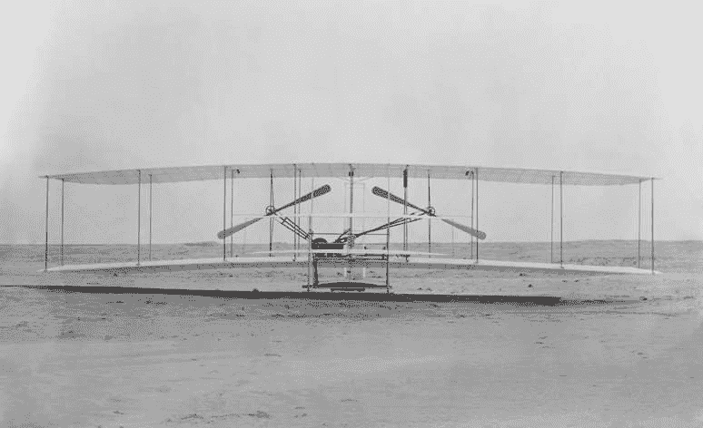

莱特兄弟的飞机

几秒之后，飞机稳健地向前移动，并开始起飞。它总共飞行了 12 秒。世界上第一趟全控制动力飞行成功了。他们那天飞了 4 次，最长的一次飞了 57 秒。人类终于能飞上天了。兄弟俩用电报把细节告诉了他们在俄亥俄州的父亲。

到了 1905 年，随着“飞行器”的改良，他们的飞行时间延长到了 30 分钟。然而，他们遇到了一个问题。他们想要售卖这个发明，但要怎么实现呢？他们担心如果公开展示这项技术，可能会被窃取，因为他们还没有申请专利。于是，他们不走寻常路，在还没有向大众展示产品是什么之前就在市场上推广起他们的“飞行器”。话虽如此，他们最初的想法是将美国政府作为潜在顾客。他们的交易大概是这样：签订合同，告诉我们你想用这个飞行器做什么。我们会进行研发，让飞行器具备相应的功能；如果成功，客户就付款。

美国政府拒绝了这个提议。

于是，莱特兄弟转向欧洲市场。这时，德国和法国处在战争边缘，所以兄弟俩觉得肯定会有一方对这种飞行器很感兴趣。他们的报价是多少呢？20 万美元（相当于今天的 520 万美元）。结果是两个国家都不愿意为一种他们见都没见过的东西花这么多钱。

这时，在巴黎，阿尔贝托·桑托斯·杜蒙（Alberto Santos Dumont）刚刚实现动力飞行，法国人在不断追赶。尽管这架飞机只能飞直线，法国人还是感到非常惊奇，并把杜蒙称为航空之父。

回到美国后，莱特兄弟收到了他们的专利（空气动力控制技术），但他们还是不愿意向任何人展示他们的飞机。他们担心自己的秘密设计会被暗中观察的路人窃取。口说无凭，很多人开始质疑莱特兄弟说法的合理性。尤其轻蔑多疑的法国人很快就变成了大家公认的航空领军人，而莱特兄弟还在捂着他们的发明。

到了 1908 年 1 月，法国人亨利·法尔芒（Henri Farman）成功以圆形的航线飞行了 1 千米。飞行过程的控制非常生硬，但还是成功了。莱特兄弟开始变得像世界舞台上的小丑。

幸运的是，莱特兄弟说的话传到了罗斯福总统的耳朵里。他派了一个军队去调查这个所谓的“飞行器”。军队和莱特兄弟达成了价值 2.5 万美元的交易，并从他们那儿买了一架飞机。

这单交易是这样的：生产一架能载两个人以 64 千米/时的速度飞行 200 千米，每次飞行时间一小时的飞机。

莱特兄弟同意了。现在，他们终于可以向世界证明他们的机器能飞了。

莱特兄弟最早的目标客户是多疑的欧洲人，特别是法国人。1908 年 8 月 8 日，很多人来到法国勒芒，希望目睹莱特兄弟的飞行器。场地中间是莱特兄弟的飞机，威尔伯坐在驾驶座上。在所有人的注视下，他启动了引擎，很快就开始了飞行。现场的人马上震惊得从座位上弹了起来。

这架飞机的确能够流畅受控地转弯，这说明莱特兄弟没有撒谎。他们终于得到了证明！法国媒体承认这架飞机比所有法国工程师制造出来的都要好太多。“我们被打败了。”当天的一些法国报纸这样写道。

今天，每天都有超过 10 万趟飞行，全年有超过 3700 万趟飞行。当然，在莱特兄弟之后，还有很多人对此做出了贡献，但空中旅行的真正起源的确是非常不起眼的：两个高中学历却直觉敏锐的自行车匠。

### 俄亥俄州和远方

尼尔·阿姆斯特朗（同样来自俄亥俄州）在 1969 年登月时带了莱特兄弟飞机的一个零件，是左翼上的一块织物。

接下来发生的事是：到 1910 年，人类开始大量生产汽车、个人音乐、飞机、小型个人相机和塑料。20 世纪的头 10 年预示着这个世纪会和上一个世纪十分不一样。

### 第四章 发明与大冲突（1910—1919）

接着上个 10 年，20 世纪第二个 10 年，人们继续创新和发展新思想。1912 年，德国地球物理学家阿尔弗雷德·魏格纳（Alfred Wegener）提出了“大陆漂移”的完整概念。同年，“泰坦尼克号”沉没了，瑞典斯德哥尔摩举办了第一届应用电子计时（和终点摄影）的奥运会。唐纳德·利平科特（Donald Lippincott）以 10.6 秒刷新了男子 100 米短跑纪录。

## 不锈钢的诞生

1912 年，来自英国谢菲尔德的哈里·布瑞利发明了不锈钢。在“一战”备战期间，英国不断加强自己的军事力量。位于伦敦的皇家武器弹药厂遇到了来复枪枪管腐蚀的问题，这会导致枪支准度较低。他们邀请了布朗弗斯研究室（Brown Firth Labs，一家钢铁厂）的负责人布瑞利来提出对策。布瑞利尝试向制造标准钢的金属混合物中添加过量的铬，然后偶然发现了一些特殊的东西——一种不会腐蚀或生锈的钢，也就是不锈钢。

当时，钢一段时间后会生锈已经成为一条生活定理——就像木头会腐烂一样。令人惊讶的是，除了哈里之外，没有人相信不锈钢能被广泛运用。他的上级认为开发其他用途只是浪费时间，他要把这些摆弄发明的心思放到一边。直到“一战”结束，人们才终于意识到不锈钢的潜力。今天，不锈钢的应用无处不在，从汽车、餐具、建筑到电子产品。至今，全球钢铁产量约为 4600 万吨。

## 第一部动画长片

1917 年，阿根廷人基里诺·克里斯蒂亚尼（Quirino Cristiani）制作的 70 分钟电影《传教士》（El Apostol）是世界上第一部动画电影。这部电影非常受欢迎，讲述的是对阿根廷政治的戏谑评论。在电影中，总统飞上了云端，尝试用闪电来清除布宜诺斯艾利斯的腐败，结果导致整个城市起火。结果在 1926 年，这部影片真的因为其所在的电影工作室起火而被烧毁了。这个影片只有一个副本，这意味着我们永远地失去了它。

### 有人要吃吐司吗？

早在千禧一代爱上牛油果吐司之前，最初的烤面包机是在明火上烤制面包的。最早的一台投入量产的烤面包机是 1909 年由弗兰克·肖尔勒（Frank Shailor）发明的通用电气 D—12。它使用起来有点儿痛苦，因为人要站在面包机旁盯着，等吐司看起来烤好之后再翻面，并且每次只能烤一面。

1914 年，西屋公司生产了另一个版本的烤面包机，但也没有好太多。

真正的突破出现在 1919 年，查尔斯·斯特里特（Charles Strite）发明了第一台弹出式烤面包机，运用了发热电磁线圈进行烤制。当时面临的问题是，所有吐司都是手切的，每片厚薄不一，但 10 年后，切吐司机也渐渐变得流行。有了这项进步，每片吐司的厚薄变得标准，电动弹出式烤面包机也开始被越来越多人使用。今天，烤面包机是美国最常见的家用电器。

## 世界大战及发明

随着各项发明以稳定的速度齐头并进，政治局势也愈演愈烈，很快就要爆发一场前所未见的可怕战争。接下来我们将看到，战争的恐怖促成了科技的快速进步。想要完全了解当时的科技发展情况，要先了解和第一次世界大战相关的各个事件。

### 大战的源头：战争的火药桶

世界权力格局风起云涌。1910 年，葡萄牙长达 800 年的封建王朝被推翻了。1911 年，意大利和土耳其开战。1912 年，一场革命推翻了中国的最后一个朝代，建立了“中华民国”。在这段时间里，欧洲各国也渐渐结盟。大英帝国、法兰西第三共和国和俄罗斯帝国为一派（协约国），意大利王国、德意志帝国和奥匈帝国为另一派（同盟国）。火药桶即将被引爆。

随着西欧大部分地区实现工业化以及联盟的组建，一场军备竞赛已经鸣锣开战。刚刚兴起并完成统一的德国凭借自身的繁荣和技术实力让整个欧洲惶恐不安。英国和法国尤其担心新德国。与此同时，在欧洲的第二大国家、成立 50 年的奥匈帝国，占全国人口一半的塞尔维亚斯拉夫群体对国家的不满情绪日渐积聚。斯拉夫人（东欧人）认为他们并没有像当地奥地利人及匈牙利人一样被公平对待。

奥匈帝国是一个工业强国。它拥有全球第四大机器制造业，仅次于美国、德国和英国。奥匈帝国也是世界第三大家用电器、电力工业设备和发电厂发电设备制造商和出口商，仅次于美国和新德意志帝国。它在当时是一个技术先进的国家，是一个不可忽视的强国。

奥匈帝国当时的领导人是 81 岁的弗朗茨·约瑟夫一世，他对自己的执政方式非常坚持，包括边缘化斯拉夫人。王位的继承人是弗朗茨·斐迪南大公，他与约瑟夫一世的态度完全不同，希望通过公平对待斯拉夫人为国家带来和平。

1914 年 6 月 28 日，斐迪南访问波斯尼亚的萨拉热窝，受到了人们的热烈欢迎。突然，一枚炸弹从他的车上弹下来，在他身后爆炸。他没有听取他人的建议取消行程，继续沿路前进，直到被一名 19 岁的波斯尼亚激进分子加夫里洛·普林西普（Gavrilo Princip）开枪打死。普林西普与五名塞尔维亚人密谋了这次暗杀，但他们没有搞清楚斐迪南不仅不是坏人，还支持斯拉夫人追求平等。这次暗杀的目的是让斯拉夫南部各州脱离奥匈帝国并组建自己的国家：南斯拉夫。

不久之后，81 岁的奥匈帝国领导人为了报仇，向塞尔维亚宣战（他们被视为斯拉夫人的兄弟）。

正因这次宣战，世界各大联盟都卷入了战争：英国、法国、俄国支持塞尔维亚人，德国和奥斯曼土耳其支持奥匈帝国。杀死弗朗茨·斐迪南的这颗子弹成为引爆火药桶的火柴。

## 第一次世界大战：大冲突

“一战”开始时，军队还靠骑马行军作战。到“一战”结束时，军队的装备已经变成了地上的坦克和天上的飞机。当国家命运攸关的时候，只有拼命创新才能打胜仗。这些因素让“一战”成了史上第一次工业与科学的战争。

虽然奥匈帝国技术先进，但由于经济形势艰难，他们在军备竞赛中渐渐落后。比如说，在进行侦察任务的时候，他们用的不是飞机，而是气球。

德国和奥匈帝国认为四到五周就能结束和塞尔维亚的战斗，但塞尔维亚军队（规模只有德奥两军的 1/10）的反击令人难以置信。三场战役后，塞尔维亚击败了奥匈帝国，但损失惨重。很快，这场小冲突变得比最初想象的要复杂得多。

与此同时，作为世界经济和军事超级大国、无可争议的海上霸主，英国已经有了击溃德国的计划。英国动用航运力量，切断了德国的粮食供应，迫使德国投降。德国以牙还牙，也动用自己的船只来封锁英国的粮食和军用物资。英国对此多少有所预料，但他们没料到的是，德国还藏了一手新技术：一种名为 Unterseebot（意为“海底船”）或 U 型潜艇的全新武器。顾名思义，U 型潜艇基本上就是潜水艇。虽然这在今天十分普遍，但当时要想让它在战争中稳定发挥，需要大量的工程专业知识和 20 世纪第二个 10 年已有的先进技术。德国 U 型潜艇能向敌方舰艇发射鱼雷，而敌方还全然不知他们即将被毁灭。

相比于海上创新，空中创新更是厉害。

### 航空领域的进步

1915 年，德国构思了世界上第一次战略性空袭，他们用小型飞艇轰炸了英国。

不久后，德国设计了第一架能通过螺旋桨进行机枪扫射的飞机，以此获得了西线的制空权。其实现的秘诀就是射击断续器。

1917 年，由于航运依然被封锁，大多数欧洲大国的人民开始面临粮食短缺的危机；为此，必须要赢得决定性的胜利。因此，不久前由莱特兄弟开创的航空工程开始突飞猛进。很快，天上开始了激烈的空战。

英国对德国空中力量的回应是战略轰炸。英国很快制造出大型双翼轰炸机，它也是当时世界上最大的飞机之一。

#### 宾利和宝马的首秀其实是在天上

“一战”前，沃尔特·欧文·宾利（Walter Owen Bentley）和他的兄弟霍勒斯·米尔纳·宾利（Horace Millner Bentley）是伦敦的汽车销售。然而，在内心深处，沃尔特一直想设计并制造自己的汽车，而不是卖别人的汽车。1913 年的一天，他看到了一张铝镇纸，突然间有了一个想法。如果用更轻的铝制活塞替换重型铸铁活塞，会如何呢？不久后，这些轻型宾利铝制活塞就派上了用场。“一战”时，它们被用在了著名的英国索普维斯骆驼（Sopwith Camel）战斗机的引擎里。“一战”后，沃尔特利用自己的经验创办了宾利汽车有限公司。今天，宾利可以说是全球最负盛名的汽车品牌。

1917 年 4 月，巴伐利亚机械制造厂（Bayerische Motoren Werke，宝马）成立。宝马的第一款产品是用于德国战备的宝马 IIIa 飞机引擎。IIIa 引擎表现优异，燃油效率也很高。成为战备意味着宝马可以迅速扩展业务，只要是在航空领域。这台引擎终结了战争。配备它的飞机在空中无可匹敌。这款引擎创下了不少速度纪录，它还让一架双翼飞机在 1919 年就达到了 9750 千米，也就是今天乘喷气式客机才能大概到达的高度。想想，那可是 1919 年！

直到今天，宝马仍在为新加坡航空公司设计喷气式飞机头等舱的内饰。

#### 纪录片的诞生

随着战争爆发，人们对重大事件产生了浓厚的兴趣。报纸可以讲述故事，但新兴的电影业能做得更好。一张图片可能会胜过千言万语，但每秒 15 到 30 张图片的价值可能还要更高。这一时期的部分电影采用了不同的结构，但它们唯一的目的便是记录重大事件。这类电影在后来被称为纪录片，战争让这种电影形式崭露头角。

### 战争结束

最早是在俄国军队中出现了下级违抗上级命令的情况。俄军伤亡人数当时已达 180 万人，俄军将士们早已苦不堪言。俄国国内的老百姓正在忍饥挨饿，革命也随之而来。1917 年 11 月，俄国宣布退出“一战”。

筋疲力尽的法国军队也拒绝战斗，不久后，法国也退出了战争。这样看来，德国和奥匈帝国占了上风。

后来，一艘德国 U 型潜艇击沉了一艘载有美国人进入英国水域的客轮，德国又怂恿墨西哥袭击美国。直到此时，美国才被迫参战。

新加入的美军帮助同盟国抵制住了德国，扭转了战局。1918 年 11 月 11 日，德国的最后一搏没能扭转乾坤，战败的德国人签署了停战协议。至此，“一战”尘埃落定，共计 3700 万名军人和平民在战争中丧生。

“一战”的结束导致了最后四个近代帝国的灭亡：奥匈帝国、奥斯曼帝国、德意志帝国和俄罗斯帝国。一个旧时代已经结束，一个新时代刚刚开始。

## 艰苦时期的坚持奋斗

虽然“一战”摧残了全世界，但在这一时期，几个有创造力又专注的人创立了新公司，这些公司后来都家喻户晓。对其中部分公司而言，战争所创造的需求和其深远的影响实际上成了他们成功的跳板。现在，我们来挑几个故事看看。

### 夏普公司：一切从铅笔开始

1915 年，日本商人早川德次签下了一份生产用于自动铅笔的金属配件的合同。研究了整支铅笔的设计后，他留意到它非常脆弱，认为自己可以做得更好。早川德次在实用的自动铅笔中看到了商机，他立马开始工作，经常废寝忘食。最终，他设法改进了铅笔的内部设计，使其更为耐用。

经过多次调整，铅笔变得越来越好用，也越来越可靠。最终的产品是一种现代的旋转型自动铅笔（名为“Ever—Sharp”，意即“不用削，可永保笔芯尖锐”）。之后，早川德次与他的兄弟早川雅治一起销售铅笔，每月产量达 1400 支。

为了把生意做起来，他们去一些商店销售产品，但这些商店很挑剔，对铅笔毫无兴趣。但两兄弟没有放弃。他们最终遇到了一家有意向的高级文具店，尽管这家商店在要求早川兄弟进行 36 次设计改进后，才最终接受他们的产品。

奇怪的是，“一战”才是他们的救世主。1914 年战争爆发后，美国和欧洲难以得到德国制造的自动铅笔。早川兄弟的铅笔是唯一达到德国产品质量要求的产品，因此，他们的铅笔在美国和欧洲开始流行起来。这款 Ever—Sharp 自动铅笔便是夏普公司名字的由来。之后，夏普又生产了收音机和首批日本本土制造的电视机。20 世纪 60 年代，他们又创造了日本首批批量生产的微波炉和太阳能电池，以及世界上首个全晶体管桌面计算器。

夏普的创新持续了几十年。今天，夏普已被富士康收购，共有员工 4.2 万名，资产 151 亿美元。

### 松下：发掘市场缺口

松下公司（最初是“松下电器家居用品制造厂”）由松下幸之助于 1918 年创立。他的父亲曾是个富有的商人，但因为大米投机生意失败而失去了所有财产。

1918 年，松下幸之助在他位于日本大阪的两层住宅中建立了松下。当时，员工只有 3 个年轻人：23 岁的松下、他 22 岁的妻子井植梅野和梅野 15 岁的弟弟井植岁男。有趣的是，井植岁男后来又创立了三洋。

虽然松下的第一款产品是风扇绝缘板，但松下对商业世界洞见深刻，他坚信设计精良且高品质的家用电器仍有很大的市场未被开发。松下发现了市场的缺口，并开始为此努力。

松下夜以继日地改良他的设计，最终选择制造两款新产品：一款灯泡的连接插头和一款用于灯泡的双向插座。事实证明，它们大受欢迎，因为它们的质量比市面上任何其他产品都要好。由于员工人数不多，松下可以保持低成本。结果，他的产品价格比竞争对手的便宜 30%到 50%。

到 1918 年年底，松下已有 20 名员工。在之后的 100 年里，松下又制造了自行车灯，生产了真空管之类的电子元件、电熨斗、收音机、唱机、VHS 录像机。80 年代初，松下甚至还在日本制造了一款 IBM（美国国际商用机器公司）电脑。

如今，松下拥有员工 257 533 名，收入为 650 亿美元，资产为 533 亿美元。

### IBM

1911 年，四家公司——英国制表机公司（The British Tabulating Machine Company）、国际时间记录公司（International Time Recording Company）、计算规模公司（Computing Scale Company）和邦迪制造公司（Bundy Manufacturing Company），合并成了纽约的 CTR（计算制表记录公司）。

CTR 的产品种类繁多，包括咖啡研磨机、自动切肉机、员工计时系统、体重秤和穿孔卡片设备。尽管 CTR 的架构没有变化，但它于 1924 年更名为 IBM。

最终，IBM 的王牌业务还是自它成立起就主打的穿孔卡片业务。

那时，“computer”（计算机）这个词指的还是负责计算算术和的人，是一个真正的职业——不难看出，现代计算机的名字从何而来了。在讲到 20 世纪 80 年代（第十一章）关于计算机的故事时，我们还会进一步探索 IBM。

如今，IBM 拥有 38 万名员工，是机器学习领域新兴的竞争者。

### 波音：撞坏我的飞机？那我造架更好的

尽管距离莱特兄弟进行首次可控动力飞行只过了 13 年，航空业已经初具雏形。威廉·爱德华·波音成了业界响当当的大人物。他的背景和你想的可能不尽相同。波音曾是密歇根州一家木材公司的高管。

通过新建的巴拿马运河，威廉·波音将木材运往美国东海岸，并大获成功。

1909 年，波音在西雅图的一个博览会上看到了他的第一架飞机，并被深深吸引。他上了飞行课，不久后，又买下了自己的飞机。尽管如此，波音这家全球数一数二的飞机制造公司的诞生其实纯属巧合。

在一次飞行中，波音的试飞员赫伯特·蒙特损坏了他的飞机。当听说替换零件数月之后才能到货后，波音同海军朋友康拉德·韦斯特维尔特说道：“我们可以自己造一架更好的飞机，并且造得还要比别人快。”波音让韦斯特维尔特设计一架飞机，然后他将建造这架飞机。最后诞生的是一架海空两栖的水上飞机，并且性能拔群。两人对自己的能力很有信心，于是在 1916 年创立了自己的公司——太平洋航空产品公司。

1917 年，美国加入“一战”，军队需要飞机。美国海军与太平洋航空产品公司（当时，它刚刚更名为波音飞机公司）签订了一份合同，要求其供应 50 架飞机。

1918 年“一战”结束时，过剩的廉价二手军用飞机淹没了商用飞机市场。这样一来，飞机制造商再也卖不出新飞机，许多飞机公司因此倒闭。波音开始被迫生产其他商品。它剑走偏锋，造起了梳妆台、柜台和其他家具，只为熬过这段艰难的日子。

随着市场改善，波音公司渐渐回归飞机制造业，开始专注于商用飞机市场。波音公司开始做航空邮件运营商，后来又开通了客运服务。波音的一笔业务还直接导致了美国联合航空公司的诞生。

如今，波音拥有 14.768 万名员工，每年生产 748 架商用飞机、180 架军用飞机和 5 颗卫星。

#### 波音工厂

现在位于华盛顿的波音埃弗里特工厂规模非常大，在修建工厂时，天花板附近甚至会形成云层。工厂有 100 多万个灯泡，下面有 3.7 千米的人行隧道。

#### 疯狂岁月

20 世纪第一个 10 年末期，“一战”加快了航空技术的发展，这可以作为现代的开端。

世界已经全然不同：人民已经厌倦了艰难困苦，准备大步向前。接下来是一个和平时期，技术有了很大发展，世界上大多数国家也因此迎来前所未有的经济增长。美国人把这个时期亲切地称为“咆哮的 20 年代”。法国人的说法则颇为别致，把它称作“疯狂岁月”。

### 第五章 转动的齿轮（1920—1929）

在整理这一章资料的时候，我才惊讶地发现 20 世纪 20 年代诞生了多少重要发明。在这 10 年里，汽车影响着文化，电话、收音机和厨房电器等电子产品开始被广泛应用，即时媒体报道也开始改变文化。从此，不只有科学家和哲学家能成为名人，体育明星和电影明星也能出名。这一时期的新发明还包括给小孩子玩的攀爬架、口香糖、吹风机、汽车头枕、测谎仪、推土机、芝士汉堡以及得来速（奇怪的是，得来速最早是城市中心银行于 1926 年发明的）。

在这一章，你将看到 20 世纪科技发展的基石。电视机、有声彩色电影和消费者商品的量产等都是上一个 10 年不存在的新事物。

## 地球上最繁荣的国家

“一战”后，美国经济迎来大繁荣，而机械化的批量生产是成功的关键。新的机器和制造方法带来了更高的利润，生活水平也相应得到提高。与此同时，自动化不再局限于汽车工业，而是成为多个行业的主流技术。无论是饼干还是冰箱，都可以进行量产。生活似乎比以前轻松了许多，不仅是相对于战争的恐怖，更是因为技术已经成了人们生活的一部分。自动化技术促进了就业，创造了锅炉工、铆钉工、铸造工等岗位。蒸汽动力终于让位，石油和电力成了主要能源。

到 20 世纪 20 年代末，美国很多中产阶级享受到了前所未有的生活方式。在“现代”家庭中，这尤为明显。科技成为日常生活的一部分，中产阶级有足够的资金为它们买单。吸尘器取代了地毯除尘拍，批量生产的电冰箱、缝纫机和烤箱也开始进入市场。从弹出式烤面包机到食物搅拌机，这些新发明帮助美国家庭节约了大量家务时间。

批量生产也开启了大众广告时代，美国每年花在广告上的钱达到了 10 亿美元（相当于今天的 140 亿美元）。得益于新艺术和音乐形式的渗透，美国度过了美好的 20 世纪 20 年代。然而，欧洲的情况却迥然不同。

### “一战”后的德国

《凡尔赛和约》（和约强迫德国认罪，并包含一系列针对德国的经济和政治惩罚措施）摧毁了德国的经济。在和约的 440 个条款中，有 414 个旨在惩罚德国。1922 年，德国通货膨胀失控，商品价格迅速上涨。

在德国，雇主会用装满钱的手提箱给员工发工资。毫不夸张地说，员工拿到工资后，立马就得跑到商店去。等他们到商店时，物价已经上涨了。在通胀最严重的时候，价格每两天就会翻一番。举个例子，1923 年 1 月，买片面包要 250 马克。到同年 11 月，得要 2 亿马克。

### 汽车的兴起

汽车行业是美国制造业的最大推动力之一。亨利·福特在批量生产方面的贡献创造了就业岗位，并生产出工人阶级也负担得起的商品。借此，美国熬过了 1920 年年初的艰难时光。

1924 年，福特 T 型车的销量达到了 1000 万辆。汽车行业一跃成为美国最大的产业之一，甚至连汽车废料场都在蓬勃发展。随着就业人数创历史新高，工厂工人甚至开始买股票。到 20 世纪 20 年代中期，1/5 的美国人拥有汽车。英国花了 40 年才达到这种汽车拥有率。

至此，美国成了制造业的霸主，亨利·福特的生产方式扩散到了全国，甚至扩散到了欧洲。意大利的菲亚特是欧洲最早复制福特的公司之一。有趣的是，菲亚特工厂的屋顶上还有条测试跑道！

## 广播改变了文化

在今天看来，广播似乎只是个过时的老古董，但它对流行音乐、广告乃至整个文化都产生了巨大影响。相比于其他任何媒体，这项技术能让所有人以最快的速度听到世界各地的消息，这可是件不得了的事情。1920 年，广播迎来大爆炸式的发展。1920 年年初，美国的家庭听众仅有 5000 名；18 个月后，300 万个家庭都拥有了收音机。4 年后，这个数字变成了 5000 万。

在 20 世纪 20 年代，每个人都在听收音机，它成了“即时大众传媒”的第一种形态。全国各地的人都可以获得即时、共享的体验。在夜里，一家人常常围在收音机旁，在街上收听最新时事的行人也屡见不鲜。当时，听广播剧、体育和音乐是人们每天的一大乐事。

有趣的是，“广播”一词最初是个农业术语，指的是广播种。这样想来，这个词的逻辑就说得通了。

广告商很快开始利用这种新媒体。1926 年圣诞节前夕，麦片公司 Wheaties 在收音机上播出了第一支广告短歌。转眼间，它便成了全美最畅销的麦片品牌。无线电的潜力是巨大的，到 1941 年，2/3 的广播节目都植入了广告。

### 广播的持久影响

电视在很大程度上要归功于广播的黄金时代。NBC（美国全国广播公司）、ABC（美国广播公司）和 CBS（哥伦比亚广播公司）等主要广播公司至今仍是媒体行业的领头羊。整个音乐流派，如爵士乐和摇滚乐，都是通过广播得以传播的。20 世纪广播行业里最受尊敬的公司之一也许是 BBC（英国广播公司）。

1920 年，英国第一档电台节目播出。公众听得欲罢不能，但由于军方认为广播干扰了军事通信，它很快就被禁播。民众对此公开表示反对。1922 年，有不少民众进行请愿，请求允许播放广播。英国授权机构决定只向无线电接收器制造商旗下的一家公司颁发许可证，这家公司便是后来的 BBC。有意思的是，它的资金最初来自制造商成员的无线电设备销售。

### 广播剧：《世界大战》

最能说明广播力量的案例莫过于纽约 CBS 臭名远扬的广播剧《世界大战》。1938 年的万圣夜，广播制作人奥森·韦尔斯（Orson Welles）告诉听众，当晚的节目是根据科幻小说《世界大战》改编的广播剧，讲述的是外星人入侵。这只是一期普通的夜间放送，但其中有个问题：有些听众在收听的时候，节目已经开始，错过了广播开头的免责声明，他们误以为这是真实的新闻，相信城市正遭到外星人袭击。虽然这在今天听起来很搞笑，但当时却非常可怕。接近 200 万人认为这是真的。一些听众给亲人打电话诀别，一些听众带着武器跑上大街，去抵抗入侵的火星人。普林斯顿大学的两位教授整晚都在寻找据称在入侵前坠落的陨石。打给各地警察局的咨询电话接连不断，警官解释说他们也在关注这一事件。最后大家终于发现这档节目纯属虚构，我猜警官们虽然松了一口气，但肯定也非常恼火。

## 谁发明了电视？

电视的前身可追溯到 19 世纪 80 年代由阿瑟·科恩（Arthur Korn）发明的尼普科夫圆盘，但凭当时的技术，还造不出任何机器用来观看有意义的图像。

这时，苏格兰工程师约翰·洛吉·贝尔德（John Logie Baird）闪亮登场。1923 年，35 岁的贝尔德在英国的黑斯廷斯租了一间工作室，着手解决电视的问题。由于没有企业提供支持，他需要发挥自己的创意。通过普普通通的家居用品，如帽子的盒子包装、一把剪刀、一些织补针、一些自行车灯镜片再加上一个用过的茶叶箱和胶水，他创造了第一台老式电视。

两年后的 1925 年 3 月，贝尔德在伦敦一家百货商店门口首次展示了他的这套系统。当时，它还只能显示物体的黑色轮廓。1925 年 10 月 2 日，贝尔德成功地进行了第一次电视传输，展示了假人“Stooky Bill”的黑白虚拟形象。这次传输发生在他伦敦实验室的两个房间之间，图像分辨率为 30 线，帧率为每秒 5 帧。

当显示屏出现图像时，贝尔德欣喜若狂。他说：“假人头部影像出现在了屏幕上，清晰度高得让人难以置信。我成功了！我不敢相信自己的眼睛，全身都兴奋到颤抖。”假人固然不错，但贝尔德很快意识到如果是人脸会更令人兴奋。他难以克制自己的激动，找来了办公室职员威廉·泰顿。不明所以的泰顿很快成了第一个上电视的人。然而，尽管泰顿上电视实现了这次突破，他却似乎对此并不感冒。

贝尔德问起泰顿他对这项发明的看法时，泰顿回答道：“贝尔德先生，我觉得不怎么样，这太粗糙了。”但贝尔德并没有气馁，为了寻求关注，他拜访了《每日快报》，向他们宣传这项新发明。

无线转播系统在当时听起来有多荒诞呢？《每日快报》的新闻编辑听了都非常恐慌，他对一位同事说：“老天爷啊，前台那边有个疯子，千万别管他！他说他有台机器能实现无线传输！小心点——他手上说不定有把剃刀。”1926 年 1 月，贝尔德电视的帧率已经改进到了每秒 12.5 帧（约为今天电视节目一半的水平）。1928 年，彩色电视问世。1929 年，在贝尔德的新公司——贝尔德电视发展有限公司的帮助下，新成立的 BBC 制作了第一档电视节目。

贝尔德在法国成立了分公司，成了法国第一家电视公司。之后，他还取得了更多成就。通过 BBC，他在 1930 年制作了第一部电视剧，1931 年拍摄了第一部户外电视节目。尽管如此，贝尔德的机械系统却时日无多了。1923 年，弗拉基米尔·科斯玛·兹沃金（Vladimir Kosma Zworkin）发明了阴极射线管，这种设备能以全电动的方式达到贝尔德机械系统的效果。

20 世纪 30 年代后期，电子电视系统成为主流，贝尔德的机械系统最终于 1937 年被淘汰。但贝尔德并没有到此为止，他继续钻研新的电子技术，并在 1944 年 8 月 16 日，向世界展示了他制作的首台可行的全电子彩色电视。值得注意的是，贝尔德还发明了一种 1000 线的显像系统（线越多意味着分辨率越高）。从理论上说，它的图像质量甚至能和今天的高清电视相媲美。早在 1943 年，那可是个不可思议的成就！可惜实施这个系统的计划失败了，继承它的精神的电视直到 2003 年才出现，等了足足 60 年。

### 多姿多彩的贝尔德

贝尔德是一个相当古怪的人，他的一些发明也反映了这一点。例如，他发明了玻璃剃须刀（毫不意外地碎了）、气动活塞鞋（惊为天人地炸了），还试图通过加热石墨来制造钻石（不巧让整个格拉斯哥短路了）。

有一天，在又一次不寻常的实验中，他接上一万伏的电源来灼烧并电击自己。幸运的是，只有一只手被烧伤。不幸的是，他也被人从自己的房子里赶了出来。虽然他性格奇怪，但在世界各地都享有荣誉：澳大利亚的洛吉奖就是为纪念约翰·洛吉·贝尔德而命名的。

2002 年，英国进行了一次全国投票，贝尔德在英国广播公司选出的 100 位最伟大的英国人中名列第 44 位。

2014 年，贝尔德成了电影电视工程师协会的一员。

### 电影的有声进化

“一战”后，欧洲精疲力竭，加上战后满目疮痍，电影制作极少。这对美国电影走向舞台中心来说是天赐良机。其中就有一部电影将永远地改变电影世界。

1927 年发布的电影《爵士歌手》（The Jazz Singer）是电影对电台广播的回应。这是第一部达到正片长度的有声电影。《爵士歌手》在拍摄技术方面的突破得益于华纳兄弟和第一国家电影公司发明的“维他风”（Vitaphone）。电影的音轨记录在留声机唱片上独立播放，与投影仪电机保持同步，直到此时，才第一次实现了这个成就。

“维他风”在拉丁语和希腊语中都代表“有生命的声音”。

与视觉相匹配的音效对观众来说简直令人惊叹。《爵士歌手》打破了之前所有的票房纪录，并让华纳兄弟一举成为好莱坞大厂。

## 飞机成为长途运输的未来

20 世纪 20 年代初，航空邮件开始试用，但依然很危险。在最初的邮件路线上飞行的 40 名飞行员中，有 31 人死于飞机事故。虽然莱特兄弟已经证明受控飞行是完全可能的，要进行稳定的空中旅行还是太危险了，可能永远无法实现……或者至少公众是这么认为的。一切在 1927 年发生了变化。

24 岁的查尔斯·林德伯格（Charles Lindbergh）刚从军队飞行训练学校出来一年，就成了航空邮件飞行员。他领着每周 81 美元（相当于今天的 1414 美元）的薪水，从圣路易斯到芝加哥派送邮件。

当时，有一场飞行比赛，参赛者需要独自从纽约直飞到巴黎，奖金为 2.5 万美元（相当于今天的 35.2 万美元）。在那个时候，大家还普遍觉得飞机太危险，不可能完成这一壮举，何况已经有 6 名飞行员在穿越大西洋时丧生。

林德伯格相信他有能力完成这项不可能的任务，他梦想着能改变历史。此次飞行最大的挑战其实就是保持清醒。为了备战，林德伯格在飞行前曾坚持 55 个小时不睡，以测试他的极限。

### 关键的飞行

1927 年 5 月 20 日，林德伯格坐上自己花 1 万美元定制的单翼飞机“圣路易斯精神号”，从纽约长岛起飞，开始了挑战。在 33.5 个小时的旅程中，林德伯格只准备了 5 个火腿三明治。可惜，他的睡眠耐力训练还不够。在飞行 24 个小时后，他说他出现了幻觉，说飞机下方移动的“雾岛”在向他“传授”着智慧真言。尽管如此，查尔斯还是战胜了困意，熬了过去。

随着降落时间的接近，15 万名激动不已的群众早已在巴黎的预定降落地点等待着他。当林德伯格终于降落时，他一下子成了大明星，成了全世界最出名的美国人。在他乘船回到美国时，同样有 400 万人等着他。

林德伯格站在莱特兄弟的肩膀上，实现了不可能的成就。这次突破性的单人飞行让飞机成为出行方式的未来。次年，林德伯格成了《时代》杂志有史以来第一个“年度人物”。在这趟飞行一年后，商业航空旅行增加了 400%，泛美航空公司就是诸多早期航空公司中的一家。

#### 林德伯格的心脏灌注泵

战争结束后，退伍的军队飞行员几乎无事可做。军队以 300 美元的价格出售多余的飞机，于是空中表演成了年轻飞行员的谋生方式。林德伯格在从事邮件空运之前，可能是最大胆的飞行员之一。他对肾上腺素上瘾，因此他的特技表演非常刺激，比如在低空关掉发动机，仅靠滑行飞完最后一段航程，有时甚至还尝试“机翼漫步”（即飞机在空中时，站在机翼上）。在 4 次飞机失事中，林德伯格都及时跳伞，得以幸存。

1930 年，林德伯格的嫂子因心脏病去世。这件事对他触动不小，他决心发明一种让器官在体外存活的方法。林德伯格与法国诺贝尔奖得主、外科医生亚历克西·卡雷尔（Alexis Carrel）合作，在 20 世纪 30 年代早期的大部分时间里，他们都投身于这个项目。到 1935 年，林德伯格研发了一种特殊的泵，能为体外器官提供空气和液体，让它们在不被感染的情况下保持工作状态。这个泵被广泛誉为医学界的一大突破，为后来的首个人造器官打下了基础。从器官实验到航空旅行，林德伯格改变了医疗领域和航空领域。在征服天空的同时，太空这个前沿领域的创新也就在眼前。

### 太空时代之父

罗伯特·哈钦斯·戈达德（Robert Hutchings Goddard）可能是 20 世纪初最被低估的梦想家之一。戈达德出生于 19 世纪 80 年代，从小沉迷于天空，经常用望远镜研究天空。他开始在家里尝试做实验。

好笑的是，这其中包括一次拿着静电锌电池试图跳得更高。他的母亲可能受够了这一片乱糟糟，告诉他如果他成功了，可能会飞出地球再也回不来了，这才让戈达德立马停了下来。

后来，在试验化学品时，戈达德在家里引发了一场爆炸，他父亲觉得要是能把他的这种热情用在科学事业上，不失为一个好的想法。

16 岁时，戈达德读了赫伯特·乔治·威尔斯的《世界大战》（前文中提到的引发大规模恐慌的电台节目的原作），开始对太空感兴趣。

1914 年，他已经获得了两项多级火箭的专利。1919 年，戈达德的作品汇编出版，名为“达到极限高度的方法”（A Method of Reaching Extreme Altitudes），其中描述了火箭飞行的数学理论，甚至还提出了探索地球大气层和空间的概念。该出版物还包括一项关于如何将火箭送上月球的理想实验，并辅以大量坚实的数学计算。戈达德的早期出版物被誉为火箭科学的先驱之作。可惜，这种赞美只能算是事后诸葛亮。当时，大多数媒体都认为他的想法很可笑。公众因此把戈达德当作一个疯子，即便他的计算完全合理。

囿于公众的反对，戈达德退隐山林，继续秘密进行研究。屋漏偏逢连夜雨，他没有第三方的资金支持，毕竟没人会想赞助一个疯子。但戈达德不屈不挠，1926 年，他开发了第一艘液体火箭，并在同年 3 月 16 日进行了试飞。

这个火箭仅仅上升 12.5 米并飞行了 2.5 秒，但这个实验第一次证明液体火箭是完全可行的。经过一些调整，例如增加可控推力喷嘴，火箭就可以定向飞行。

看了 1929 年关于戈达德的一次火箭发射报道之后，查尔斯·林德伯格决定伸出援手。林德伯格成了戈达德的发明的忠实粉丝，为他成功集资 10 万美元（相当于今天的 180 万美元）。后来的历史证明，戈达德在火箭制造技术方面取得的进步以及他的远见卓识为早期的导弹和太空旅行做出了宝贵的贡献。当“阿波罗 8 号”1968 年执行第一个绕月载人航天任务时，林德伯格给宇航员发了一条信息：“你把罗伯特·戈达德的梦想变成了现实。”

## 一个时代的结束

### “股市只涨不跌！”

20 世纪 20 年代初，美国国内笼罩着一片前所未见的乐观主义。在谈到美国经济时，卡尔文·柯立芝（美国 1923—1929 年的总统）表示：“美国的头等大事就是商业。”随着生活质量的改善，公众对此充满信心。当时有句流行的说法是“与柯立芝一起酷”。消费信贷是 20 世纪 20 年代的新发明。这便是所谓的“先买后付，活在当下，勿忧未来”。这种心态后来衍生了迄今为止最严重的金融灾难。

为了赚更多的钱，大量平民百姓第一次投身股市。在美容院、远洋客轮、夜总会和火车站，自动收报机纸条无处不在，所有人都可以据此了解最新股价。

“先买后付”的文化最终蔓延到股市，人们借钱来买更多的股票。到 1929 年，大约 90%的股票都是靠借来的资金购买的，而银行借出的资金中有 40%都投在了股市。但这在当时并没有关系，因为每个人都在赚钱，虽然这些钱并不是真金白银。

#### 派对的结束

1929 年 10 月 23 日，华尔街的股价近 10 年来首次下跌。汽车公司首当其冲，没有人知道原因。正如金融分析师吉姆·里卡兹（Jim Rickards）所说，搞清楚金融崩溃就像找出导致雪崩的雪花一样。我们也许知道大概的原因，比方说大量的雪、重力等等，但导致之后的连锁反应、导致雪崩的究竟是哪一片雪花呢？我们不可能知道。

汽车公司股价下跌本身并不是什么大事，因为市场调整是很正常的事情，但胡佛总统仍然认为，他应该向国家发表讲话，预防大众产生焦虑的情绪。1929 年 10 月 25 日，胡佛告诉美国公众：“美国的支柱产业仍然健全、繁荣。”4 天之后，事实证明情况并非如此。

在接下来的日子里，人们陷入恐慌，开始大量抛售股票……但没人接盘。股价下跌 2 美元、4 美元、10 美元，没有一点儿放缓的迹象。交易大厅里有人尖叫，有人喘息。交易员们害怕了，人群聚集在证券交易大楼外的街道上。1929 年 10 月 29 日，股市崩盘，经济迎来大萧条。

这是史上最严重的金融灾难。股市行情向好时，投资者借钱购买了股票，现在却不得不把这笔钱还给银行。问题是，现在他们身无分文。

一切开始倒转。银行开始索要还款，投资者却还不起。银行不得不亲自买单，紧接着，银行开始破产，大部分美国民众也因此破产。即便是征信良好的公司也不能获得贷款来给他们的员工付工资，于是裁员像雪崩一样席卷全国。眨眼间，繁荣烟消云散。

美国的贸易伙伴欧洲也没能幸免于难，全世界的工人阶级都遭受了重创。作为战后全球经济的发动机、世界消费之都的美国，经济开始停滞不前，发出了痛苦的呻吟。美国经济的放缓激荡着全球贸易，很快，随着海外的美国公司纷纷关门，其他国家也感受到了经济衰败。各国政府无能为力，像多米诺骨牌一样，所有行业都开始摇摇欲坠。

本已处境艰难的德国再遭重创，德国人民开始寻找一个能带给他们希望的人，无论是谁都可以。

20 世纪 20 年代伴随着希望和创新翩翩而来，结束时却成了另一个模样。

1. 原文为“Keep cool with Coolidge”，为柯立芝竞选美国总统时的口号，句中的 cool（酷）和 Coolidge（柯立芝）押头韵。——译者注

### 第六章 声音、远见和天才（1930—1939）

到了 20 世纪 30 年代，世界上很多经济体面临严重崩溃。华尔街崩盘的后续影响导致贸易瘫痪，许多国家的经济几乎在一夜之间遭到破坏。

世界各地港口的船只大量闲置，因为几乎没有人需要运输货物。英国是世界上最大的船舶制造国，它受到的影响尤为严重。仿佛染上了一种疾病一样，英国的其他周边产业也受到了商业衰退的影响，失业的连锁效应影响了整个经济体系。

英国政府决定削减开支，等待经济发展自然地回归正轨。美国也是这么做的，但结果非常可怕：人们排着跨越几个街区的长队，等着发面包。美国陷入了严重的困境，贫民窟的数量越来越多。这些贫民窟被称为“胡佛村”，是以当时总统的名字命名的。全世界最繁荣的国家发生了什么？为何衰落得这么快？！

只要听说哪里有职位空缺，成千上万的人就会搭火车到几千米外寻找工作机会。他们之中，有曾经的科学家、医生和工程师。所有人都陷入了同样绝望的境地。

人们说，需求是发明之母，而这最困难的时代给我们带来了史上最具创造性的发明之一——可编程计算机。本章后面会详细介绍，但首先，我想讲这个年代的其他一些创新事例。

克莱德·汤博（Clyde Tombaugh）1930 年发现了冥王星，拉开了这 10 年的序幕。1936 年，柯达胶卷（由乔治·伊士曼的柯达公司发明）为大众带来了彩色摄影。同年，出生于俄罗斯的伊戈尔·西科斯基（Igor Sikorsky）发明了第一架实用直升机，于 1939 年首次飞行，而如今的传统直升机仍然保留了它的设计特点。

匈牙利兄弟拉斯洛·比罗（László Bíró）和捷尔吉·比罗（György Bíró）发明了圆珠笔，解决了钢笔容易晕染、漏水的问题。第一款电吉他和低音吉他也在这 10 年间问世，提高了音乐的表现力。由于电子声音放大技术得到了改善，这两个乐器的发明，都是为了在现场环境中使乐器的声音更清晰。而 20 世纪 30 年代比所有这些发明都更重要的，是可编程计算机。

## 最早的计算机

仔细想一想，计算机算得上是一种独一无二的科技发明。我们所说的这项发明，是一种可以思考的机器，它的运算速度比任何人都要快数百万倍。这可能是 20 世纪最为重要的科技发明，因此我们会花点儿时间来详细讲一讲。

想要知道计算机是如何诞生的，我们要从一个更宏观的角度，来看一下它是如何从概念的种子发展成第一台可运作的模型。

### 查尔斯·巴贝奇和自动计算机器

我们在第四章中讲过，“计算机（computer）”其实指的是人。“计算机”这个词起源于 17 世纪 40 年代，它的意思是“做计算的人”。17 世纪，它指的是以使用表格进行计算作为职业的人。虽然这项工作很无聊，但它确实很重要，因为当时的数学表格并不像今天一样，被视为无关紧要的琐事。那时候，数学表格是科学、工程学、金融学甚至经济学发展的动力，也只能由一群才华横溢的数学家制作——虽然他们偶尔也会犯错误。19 世纪 20 年代早期，一位热情的数学家和哲学家查尔斯·巴贝奇（Charles Babbage），正因别人犯下的错误而饱受折磨。

他多次在天文学的日志表中发现错误，感到很生气。这些错误虽然恼人，但也没什么了不得的，但也有一些错误会产生实实在在的影响。

比如，由于导航表中的错误，船舶有时会偏离航线，导致搁浅。巴贝奇知道，必须找到解决办法解决这种混乱的情况。而现代计算机技术的关键思想，最早就诞生于巴贝奇构想出的解决方法。

在考虑计算问题的过程中，巴贝奇即将孕育出伟大思想的种子。

他想：既然物理机器能做体力劳动，那为什么不能做脑力劳动呢？

带着这个问题，他便有了一个想法：创造一台可以算出表格的所有计算结果，并将它们正确打印出来的机器。他将这项发明称为差分机。

差分机的功能，是仅通过加法和减法来进行多项式运算（对数、正弦、余弦和正切）。

这个机器本质上是完全机械化的，有几个垂直的轴，还有可以显示任何数字的圆盘。这些圆盘和齿轮连接在一起，齿轮以机械化的方式在旁边的轴上进行加法或减法运算。

到 1822 年，巴贝奇已经完成了机器模型的一部分，它可以进行多项式方程的运算，不会犯错误，由蒸汽驱动。这在当时是令人难以置信的事情：可以进行复杂的脑力劳动的物理机器——梦想成真了！

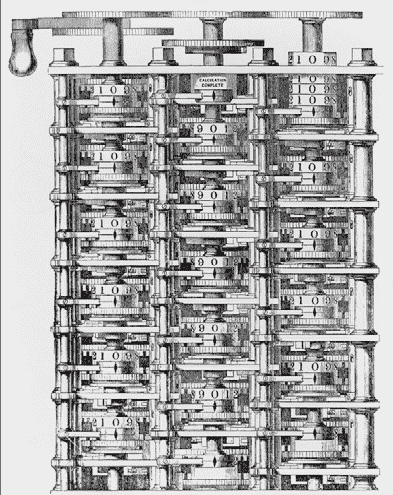

查尔斯·巴贝奇发明的差分机

巴贝奇会在聚会上把他的机器演示给那些精英人士看，比如贵族、诗人、政客和工业家。在一次这样的聚会上，一位名叫埃达·拜伦（Ada Byron）的年轻女士（后来改名为埃达·洛夫莱斯，Ada Lovelace）看到了这台机器，对它爱不释手。她和巴贝奇合作，为历史做出了自己的贡献，很快我们还会讲到她。

不幸的是，对于巴贝奇而言，他那个时代的工具不足以完成一台更大规模的机器。他怀着坚定的意志，在 1834 年开始设计一台更加通用的版本，以实现任何类型的计算，而不只是多项式方程。他打算把这个机器称为分析机。

这个概念就是通用计算机，它领先了当时的时代 100 年。

### 分析机：计算机的早期构想

分析机在本质上是完全机械化的，巴贝奇对它的构想包括一个“磨盘”，用来控制、旋转、定位所有轮盘上的机械数字。

实际上，这个“磨盘”相当于现代计算机的 CPU（中央处理器，在第九章会再讲到 CPU）。

分析机的设计还包括一个存储区，所有正确的数字都会存储在那里（我们现在把类似的东西叫作计算机内存）。

把打了孔的卡片插进分析机，便可对它下达指示；它还有一个打印机和一个曲线绘图仪。分析机带有可编程的 CPU 和内存，代表了最初对计算机的完整设想。然而，由于太过复杂，分析机从未被建造出来。

### 埃达·洛夫莱斯：真正的新思想

尽管困难重重，埃达·洛夫莱斯还是实现了历史上的重要里程碑。她是第一个意识到计算机除了平淡无奇的计算还能有其他应用方式的人。她还发布了最初的算法（虽然只是假设），被视作最早的计算机编程师。

她所采用的工作方式，无疑是新的思维方式。

洛夫莱斯的一生仿佛是一部悲伤电影的剧本。她 1815 年生于伦敦，还算是个不错的起点，但自那时起，她的人生就开始走下坡路。她的父亲对她说的第一句话就是：“哎！你生下来就是为了来折磨我吧！”毫无意外，她一个月大的时候，父母就离异了，洛夫莱斯再也没见过她的父亲。她 8 岁时，父亲就去世了。

从 4 岁开始，这个小姑娘就由数学和科学领域中最好的一些老师单独教学。洛夫莱斯的母亲认为，从小教她数学，可以让她不像父亲那样精神错乱。最起码可以看出来，她父母的离婚一定很不愉快。

17 岁时，洛夫莱斯展现出了惊人的数学天赋，人们都夸她是一个有独立思考能力的人。对她来说，研究数学的时候，想象力和直觉是不可或缺的素质。1833 年时，洛夫莱斯只有 18 岁，巴贝奇向她展示了“差分机”的原型。洛夫莱斯被深深地吸引了。他们开始并肩工作，洛夫莱斯聪明的头脑常常使巴贝奇赞叹不已，巴贝奇给她起了个外号叫“数字女巫”。

洛夫莱斯的人缘很好，经常与查尔斯·惠斯通（电报的发明者）和迈克尔·法拉第（直流电动机的发明者）之流待在一起，这两位也都是天赋异禀之人，我们在第二章中已经介绍过。想象一下所有极具聪慧之人齐聚一堂的情景！洛夫莱斯还是个特别有趣的人，不仅因为她在数学方面有独到的见解，也因为她对计算机技术有不同的看法。像巴贝奇一样的其他人，把计算机视作一个冰冷的算术机器，而在她眼中，计算机的潜力不仅于此。

极富远见的埃达·洛夫莱斯认为，只要能有一种方式把文字、图像和声音转化成数字格式，并且由一台机械化的计算机来处理，它就会成为一种协同工作的工具。

1843 年，洛夫莱斯接到了一个任务，要把关于巴贝奇分析机的一篇文章从意大利语翻译成英语。有趣的是，这篇文章的作者是路易吉·蒙博（Luigi Menabrea）。此人是意大利的一位军事工程师，也是未来的总理。

在翻译这篇论文时，洛夫莱斯决定写一些批注。她写批注的时候文思如泉涌，最后批注比论文正文还长了三倍。她写出的东西意义非凡，最终成为科技史的重要一刻。在洛夫莱斯的批注中，包括一种通过指令来“编程”分析机，进行数学运算的方式。如果真的有一台完全体的分析机被制造出来，那么这种“程序”其实是可行的。就这样，洛夫莱斯写下了第一个计算机编程算法。

洛夫莱斯的想法远远领先于时代，又过了将近 100 年，人们才意识到这些想法的价值。洛夫莱斯关于巴贝奇分析机的批注在 1953 年发表，全世界直到此时才意识到，第一个计算机程序早在大家都想象不到的时候就被写出来了。

尽管如此，直到今日，洛夫莱斯的名字还是没有为公众所知。悲伤的是，洛夫莱斯在 36 岁时死于癌症。她和自己从未了解过的父亲一样，在同样的年龄英年早逝。她要求把自己的遗体埋在父亲的旁边。

#### 别告诉我丈夫我喜欢赌博

洛夫莱斯对数字的喜爱，还延伸到了赌博上。她想建立一个数学模型，来预测哪匹马会赢，从而大赚一笔。然而这个模型没有用，反而让她输了不少钱。

19 世纪 40 年代晚期，她赌马输了 3000 多英镑（相当于今天的 31.1 万英镑/43.1 万美元）。欠了这么一大笔债，她走投无路，只能向丈夫承认自己犯了大错，想必她丈夫应该很不满。

### 艾伦·图灵：设想现代计算机

艾伦·图灵（Alan Turing）1912 年 6 月 23 日生于伦敦，是一个聪颖过人、勤学好问的人，但性格有些忧郁。后来，他成为计算机科学和人工智能领域的先驱。在中学时期，图灵就可以在自己的脑子里解微积分，那时候老师还没有教过他微积分。上大学时，他对量子物理有着浓厚的兴趣，特别是其背后的数学原理。

对图灵来说，微积分是小菜一碟。1935 年夏天，23 岁的图灵在跑步的时候，脑海中浮现了一个概念：一台通用型计算机（他并没有借鉴巴贝奇的点子）。

他脑海中的这个概念是一台机器，仅使用有限的控制和指令便可以解决问题。他把这台机器称为逻辑计算机器（后更名为图灵机）。

但是，要解决的是什么问题呢？这正是他的设想的有趣之处。要解决的，其实是个哲学问题：“能不能用一系列规则，来证明数学命题的真假？”

这种使用一系列特定规则来解决所有数学问题的概念，学名叫作“可判定性”问题。这最早是由德国数学家戴维·希尔伯特（David Hilbert）于 1928 年提出的，主要内容是：

有没有可能，至少从原则上来说，存在一种确定的方法或流程，能够判定所有的数学问题？

也就是说，是否所有数学问题都能通过有限的步骤求解？这也是巴贝奇想要通过机械化的分析机所解决的问题，只不过图灵是在理论层面审视这个问题。

通过思想实验的方式，图灵想出了比巴贝奇更完整的解决方案——图灵机。从理论上来讲，这台机器可以仅通过一组规则，进行任何数学问题的运算。换句话说，还是通用计算机的概念，只是这次的想法更完善。

图灵机为现代电子计算机的工作方式提供了蓝图。直至今日，我们还使用这种思想实验来测量计算机程序的能力。如果一个程序可以实现图灵机所具有的功能，则称其为图灵完备，达到了编程语言能力的最高水平。但还没有任何一种方法，能比图灵机实现更多的功能。

后来在“二战”期间，图灵帮助获胜的同盟国设计了一个破解代码的机器，名为 Bombe。有了这台机器，英国便能知道德国打算攻击哪里，这让他们在这次战争中占据了关键优势。

图灵接下来还发展了一些别的构想，比如针对人工智能的图灵测试。1950 年，图灵在论文《计算机和智能》（Computing Machinery and Intelligence）中描述了一种测试，暗示计算机也能拥有智能。一位参与测试的人员会通过键盘与另一个人聊天，中途在他不知情的情况下，另一边的人会被换成计算机。

如果测试参与者无法察觉这种变化（也就是说无法区分计算机和人类的回应），那么这台计算机就通过了图灵测试。只有谷歌在 2018 年明确通过了图灵测试，但也仅限于电话交谈和预订的情况下。

在这场与其他伟大计算机先驱的赛跑中，艾伦·图灵最终迎来了一个悲伤的结局。1952 年，他的家被破门而入。警察在调查这起盗窃案时，发现了图灵有同性恋关系的证据，当时这是一种会遭到监禁的罪行。

这件事被曝光后，图灵也被逮捕，他的名声大不如从前。他深受这件事的打击，服毒自杀，年仅 42 岁。

### 第一台可编程计算机

之前的故事中讲到的所有构想，都引领我们走向了第一台可自由编程的实体计算机。它的发明者，是一个懒得自己做数学计算的人。

1935 年，德国工程师康拉德·楚泽（Konrad Zuse）在亨舍尔飞机公司（Henschel Aircraft Company）工作。其中的一项工作，就是分析飞机的应力。要手动计算一个有 6 个变量的应力方程，需要一天多的时间；要是有 25 个变量，那就要一年多。这还没算上犯错耽误的时间。

楚泽想制造一台机器帮他算，让自己的工作轻松一点。“我懒得做这个工作，”楚泽在 1992 年的一场采访中说，“所以才发明了计算机。”楚泽小时候很喜欢玩麦卡诺的拼装玩具，也痴迷于各种结构的美感和技术特征。他选择土木工程专业，也是因为它结合了美学和技术。

他毕业的时候，发现自己处在一个很不愉快的境地。为了计算建筑、桥梁上的力和应力，他必须经受十分枯燥的工作。重复性的计算工作充斥着他的生活，看上去好像没完没了。

楚泽又重新拾起小时候对麦卡诺模型的兴趣，因为他有了一个绝妙的想法，就是用一个巨大的麦卡诺模型来使他的工作自动化。楚泽对这个想法很有自信。1936 年，他辞掉了工作，搬回家和父母一起住，就为了研究这台机器。我想他父母一定很失望吧。

过了一段时间，楚泽邀请了大学的一些朋友来帮忙。他们都觉得这个项目非常酷，但就连楚泽也不知道，当时的机械计算机是怎么运作的。但正因为他什么也不懂，才能够从一个全新的视角来看待这个问题，从零开始建造一台自动计算器。

他重新发明了轮盘，和之前的完全不一样。当时的机械计算机是使用十进制计算的。楚泽避开了这一点，选择使用二进制系统（机器的开关只会跳到 1 或者 0 的位置，而不是使用复杂的齿轮系统从 0 切换到 9）。最终证明，这种方式简单多了，也能让机器进行更加复杂的运算。

对楚泽来说，最难的部分并不是理清制作机器所需的逻辑和数学原理，而是组建这台机器本身。Z1（他给最终成品起的名字）有 1000 个薄薄的、插在槽里的金属片，用来做内存。程序是通过纸带阅读器输入机器的，这台阅读器可以读取老式的 35 毫米的胶片，胶片上面打了很多洞。它还有一个键盘，通过一排灯显示运算结果。这台计算机可以存储 64 个数字，可以进行加减乘除运算及平方根运算。

1938 年，在朋友的帮助下，楚泽的 Z1 终于大功告成。他试着计算一个 3×3 的矩阵，成功了。历史上第一台可以自由编程的计算机刚刚开机了！不幸的是，它马上就坏了。这其实是一个长期的问题：Z1 太不稳定了，很容易坏。楚泽不断深化他的想法，直到设计出更好的 Z3 版本，使用电话的继电器开关来代表 0 和 1 的位置。

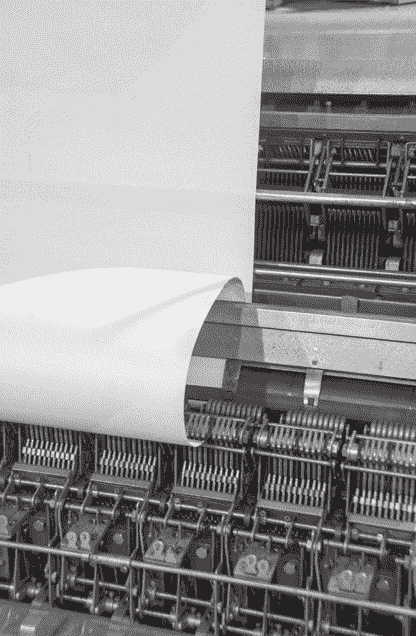

Z1 计算机

一台可以进行数学运算的机器，在战争中一定是无价之宝。而战争也即将来临。

### 愈发紧张的战争氛围

1934 年，阿道夫·希特勒当选为德国元首。选他当元首，部分是为了应对当时德国糟糕的经济形势。他一上台就抨击《凡尔赛和约》（及其迫使德国接受的惩罚），赢得了民心。

人们想要改变，而德国社会主义工人党（希特勒的党派，即纳粹党）看起来能干实事。仅仅在两年的时间内，700 万名德国人就回归了工作岗位。制造业蓬勃发展，高速公路等土建工程也在实施，而对很多人来说最重要的是，德国又一次有了民族尊严。甚至对当时的小孩子来说，能站在所谓的“希特勒青年团”之中，在万字旗之下向前踏步，也是值得骄傲、令人欣喜若狂的事情。当时旗子上的符号并不具备太多的意义。它代表的，仅仅是一个在不断发展中的、不会再忍气吞声的国家。不幸的是，宣传口径促使大多数德国人民相信他们高人一等，人民的骄傲最终演变成了邪恶的行径。很快，人们的关注点就转向了居住在德国的那些“有问题的”犹太人、波兰人、斯拉夫人，还有残疾人。

#### 大众汽车：从希特勒到嬉皮士

希特勒为德国人民做了很多计划。为了把自己的想法传播给大众，每家每户都有价格亲民的收音机，名为 Volksempfänger（德语的意思是“人民接收器”）。希特勒懂得要利用收音机这种新兴科技来进行宣传，虽然这个收音机的名字不太好记。

除了收音机，他还给人们带来了另一个东西：汽车。

20 世纪 30 年代，相比于美国，德国的汽车非常落后。在德国，只有有钱人才有汽车，50 个人中只有 1 个人有汽车。而在美国，大约每 4 个人中就有 1 个人有汽车。

希特勒对德国的发展愿景的一部分，就是想要创造每个德国人都买得起的汽车。它的名字叫作“人民的汽车”，或者叫大众汽车（Volkswagen）。当然，这并不只是纳粹独有的点子。上一章中介绍的美国福特 T 型车，也是差不多的概念。

1938 年，第一家大众汽车工厂建立了。希特勒参加了奠基仪式，在一次演讲中，亲自为这款大众汽车模型命名。这款车就是后来人见人爱的甲壳虫，但在最开始的时候，它的名字听起来更霸气一些，叫 Kraft—durch—Freude—Wagen（StrengthThrough Joy Car，从快乐中获得力量）。

“从快乐中获得力量”（你喜欢上这个名字了吗？）于 1939 年开始生产。然而，在“二战”爆发前，生产被中断，这款汽车只生产了 210 辆。最后，这些汽车只给了军队的高官，而工厂继续生产四驱军用车。德国人民最开始错过了机会。

战争结束后，作为停战条件的一部分，大众工厂被交给了美国人。这座在战争中受到重创的工厂（还有一颗没爆炸的炸弹卡在了屋顶上）被免费送给了亨利·福特，但他一点兴趣也没有。然后，这座工厂又被交给了英国人。英国的汽车制造商看了看小小的甲壳虫，觉得这称得上是他们见过的最糟糕的设计之一了。

他们说：“它不符合汽车最基本的技术要求……对普通买家来说没有吸引力……把它作为商业车推广，一点儿钱也赚不到。”一位名叫伊万·赫斯特的英国军官接到了一个任务：清理大众汽车的工厂，让它重回生产的正轨。他做得很成功，于 1949 年被任命为工厂主管；1955 年，工厂生产了 100 万辆甲壳虫汽车。虽然它“对普通买家来说没有吸引力”，但卖得还不错，而且它的性能和稳定性都超过了欧洲其他的竞争对手。

越来越多的甲壳虫出口到欧洲其他国家。但在美国，比起那些功能强、车型大、外观华丽的小轿车，甲壳虫仿佛是一个笑话。大众汽车要是能把甲壳虫卖给美国人，那他们相当于打进了全球最大的汽车消费市场。但是，他们怎么才能做到这一点呢？

大众汽车公司知道，美国人永远不会相信这种丑陋的小车比他们的汽车更强大。那为什么不在“丑”这一点上做文章呢？这个很棒的创意在 1959 年被付诸实践。当时的一些广告语包括“丑，仅是表象”（Ugly is only skin deep），还有“其貌不扬”（A face only a mother could love）。这些广告效果不错，很快这些车就在美国有了一大批狂热追随者。大众甲壳虫，还有后来的康比（Kombi）厢型车，都成为 20 世纪 60 年代反主流文化的标志。这家缘起于希特勒的公司，摇身变成了“嬉皮士”。

后来，甲壳虫成为历史上最持久的汽车型号之一。1938—2003 年，它最初的型号总共生产了 2100 多万辆，其间的改动非常少。1998 年，“新甲壳虫”取代了原来的型号。大众汽车集团现在是销量最高的汽车生产商，拥有奥迪、兰博基尼、宾利、布加迪、杜卡迪、保时捷、斯柯达、西雅特等众多汽车品牌。

甲壳虫原本是为德国人民造福的无公害小汽车，也能为希特勒带来一个不错的结局。然而不幸的是，希特勒并没有止步于此。

### 第七章 战争绝望催生发明（1940—1949）

20 世纪 40 年代，世界进入了水深火热的年代。尽管如此，人们还是正常地生活了一段时间。摇摆爵士（Swing）成了最流行的音乐类型，沃尔特·迪士尼推出一系列电影《小飞象》、《小鹿斑比》和《幻想曲》，到达了事业的巅峰。这些在技术上极具开拓性的电影，都是在几年内制作完成的。

这 10 年的确充斥着改变历史的时刻，但也是两极分化的年代：20 世纪 40 年代下半叶，美国曾有一段繁荣时期，充斥着乐观主义的情绪；而欧洲和日本则被一种痛定思痛、百废待兴的忧郁情绪笼罩。这个年代给我们带来了一些轻松愉快的发明，如飞盘、弹簧玩具和巧克力豆，但也见证了原子弹和迷幻药的问世。

1945 年，战争结束，人口增长达到了前所未有的程度，因为年轻人看到了更美好的未来。这些带着乐观主义出生的婴儿，造就了人们熟知的“婴儿潮”。1946 年出生的名人，包括汤米·李·琼斯、乔治·W.布什、弗雷迪·墨丘里、史蒂文·斯皮尔伯格、西尔维斯特·史泰龙和唐纳德·特朗普。

### 第二次世界大战

人们曾以为第一次世界大战是“终结一切战争的战争”，然而不幸的是现实并非如此。1939 年，世界又一次陷入战争——只不过这一次，战士们配备了更好的武器、更快的飞机、可怕的坦克，以及可以摧毁一切的原子弹。

这次战争长达 5 年之久，参战人员来自 30 个国家的 1 亿多人。战争结束时，牺牲人数高达 5000 万到 8500 万。

这场战争也是“一战”的后遗症。德国的动乱使阿道夫·希特勒掌握大权，紧接着他试图把自己的意志强加于欧洲其他人民之上。之前我们提过，希特勒的纳粹党建立在雅利安人种优越论之上，他们把好几个其他少数民族当成了替罪羊。他们主要针对的人群是德国的犹太人，犹太人在战争的过程中被屠杀。

德国的影响力与日俱增。在同意大利和日本共同结成轴心国集团之后，德国吞并了奥地利，占领了捷克斯洛伐克。1939 年 9 月 1 日，尽管英国和法国发出了警告，德国还是入侵了波兰，这标志“二战”正式开始。

德国入侵波兰时采取了速战速决的方式：他们把这种战略叫作“闪电战”，借助德国的高科技坦克和飞机，像闪电一样迅速攻击对方。一排排德国坦克开进波兰的乡村地区，与之相伴的还有德军的俯冲轰炸机。波兰军队还骑着马，拿着骑枪，根本无力抵抗。很明显，这是一种新型的战争。

入侵波兰之后，德国又迅速地扩展疆土，先后入侵丹麦、挪威、比利时、荷兰，最后占领了法国。

随后，德国又盯上了英国。由于英国是岛国，在海军和空军方面也很有优势，因此德国的攻击没能成功，但德国的空袭还是使英国遭受了严重的破坏。

同时在东线战场，希特勒和约瑟夫·斯大林不牢靠的休战协议也开始土崩瓦解，双方开始较劲儿。初期，德军入侵俄国，并很快占领了大片领土。俄国损失惨重，有 2000 万人在战争中丧生。但最后事实证明，德军士兵无法承受俄罗斯的寒冬，所有攻势都在莫斯科城外停止了。

1941 年 12 月 7 日，一队日本轰炸机飞向夏威夷珍珠港的美国海军基地。不等当地的美国海军乐队停止演奏，珍珠港便在一道炫目的闪光中遭到了日本人的袭击——日本人加入了德国和意大利的阵营。这次轰炸是为了让美国海军失去战斗力，因为美国海军会成为日本侵略菲律宾和越南等邻近地区的障碍。珍珠港事件将美国正式卷入战争。

与此同时，在新墨西哥州，世界上最优秀的科学家和工程师中的一些人正在沙漠中开展一项被严格保密的项目，名为“曼哈顿计划”。这个计划建立在分裂原子时可以释放大量能量的理论基础之上：一种由原子提供能量的炸弹。阿尔伯特·爱因斯坦在 1939 年写给罗斯福总统的一封信中，就描述了这一原理。执行曼哈顿计划的团队由罗伯特·奥本海默领导，他们正在和德国赛跑，致力于创造出史无前例的最强大的武器。

在这些科学家研究如何制造第一颗原子弹的同时，盟军（英国、法国、美国、澳大利亚、加拿大等）成功夺取了意大利在北非占领的地区，也在意大利国内站稳了脚跟。1944 年 6 月 6 日，盟军发起诺曼底登陆战役（法国），很快解放了巴黎。盟军从西部、东部和南部进入德国，一路解放德国，解救了纳粹集中营的幸存者。1945 年 5 月 8 日，德国投降。

1945 年 8 月 6 日，美国在日本广岛投下原子弹，几天后，又对长崎进行了第二次袭击。原子弹让一切灰飞烟灭，只留下可怕的阴影和尘埃。爆炸和接连而来的辐射使 20 多万人失去了生命，日本也终于投降。

“二战”结束了，但其代价十分惨重。德国被一分为二：民主德国依附于苏联，联邦德国由盟军控制，这样的局面持续到了 1990 年。这场冲突是人类历经的最具破坏性的时期。血淋淋的战争到处充斥着毁灭，人们很难看到任何一线希望，不知道这样的噩梦何时才会终结。但战争确实让科技发展到了新的高度。随着计算机技术、火箭、雷达、飞机、密码学和晶体管技术的进步，人类文明又一次从灰烬中崛起。让我们一探究竟。

## 我的零食怎么化了？——微波炉的发明

下次用微波炉热剩饭的时候，不妨想想这个故事：

战争期间，雷达（无线电探测和测距）得到了运用。像探照灯一样，短脉冲微波（亚光电磁频率）会被发送至一个物体，再返回接收器，这样我们就能“看到”物体，并且探测其距离和位置。

雷达最初由英国人发明，在美国得到完善，用来对付纳粹分子。雷达使盟军能够先发制人，在德军飞机看到他们之前，先“看到”德军的飞机。据说，在战争期间快速发展的雷达技术使胜利的天平偏向了盟军。美国一家名为雷神（Raytheon）的军工制造公司，是制造战争所用的关键雷达设备（称为磁控管）的主要生产商。

1945 年年初，雷神公司工程师珀西·斯宾塞（Percy Spencer）正努力改进公司的雷达设备。这是一个漫长的工作日，斯宾塞的肚子开始咕咕作响。该吃点儿零食了。当斯宾塞伸手从口袋里拿出美味的巧克力棒时，他惊讶地发现这个巧克力棒已经化得不成样子了。斯宾塞很快意识到，肯定是雷达磁控管的微波把它加热了。他知道他无意中发现了一件大事。斯宾塞很兴奋，请一位研究助理拿了一袋玉米粒给他。他把玉米粒放在靠近磁控管的桌子上，玉米粒开始跳动。事实证明：雷达设备中使用的微波可以烹饪食物！

原来，微波可以为食物中的分子提供能量，使它们迅速振动。振动的分子本质上就是热量：当物体的温度上升时，其实只是组成其材料的分子振动的速度变快了。因此，微波可以以一种全新的方式加热食物。如果这项发明可以大幅缩短平常加热食物的时间，一定会使美国人民爱不释手。

战争结束后，雷神公司首席执行官劳伦斯·马歇尔认为微波炉是个很不错的想法。他坚持让斯宾塞集中精力，创造一个可以为公众所用的产品。公司为斯宾塞安排了一支工程师团队，让他们开始工作。

过了一段时间，这个团队开发出一款产品，但它一点儿也不轻巧。它和一台冰箱一样大：1.8 米高，270 千克重。这个庞然大物发出了 3000 瓦的能量，被称为“雷达炉”（后来被称为“微波炉”）。在产品手册上，有一些现在看起来很奇怪的烹饪建议：“50 秒内煎好牛排？没问题。煎蛋？还没数到 12 就做好了。”1947 年，雷神公司发布了一款商业版的微波炉，其尺寸更小，售价为 3000 美元（相当于今天的 3.3 万美元）。可以想象，这个价格对于普通人来说太贵了。因此，这台设备被卖给了餐厅和其他公司的餐饮场所。过了几年，人们意识到，拿昂贵的军用级别磁控管来加热剩下的鸡肉，实在有点儿小题大做。于是，微波炉变得越来越轻，到 20 世纪 60 年代末，终于缩小到我们今天所熟悉的尺寸。

不过，战争的影响远远不只加热剩饭剩菜，它还促成了飞机技术的巨大飞跃。

## 喷气机时代

德国在“一战”中战败后，《凡尔赛和约》规定德国停止研发飞机技术。然而，和约中没有提及喷气式飞机和火箭技术，因为在签订和约时，它们还不存在。

在德国的哥廷根大学，有一名年轻的工科学生，名叫汉斯·冯·奥海恩（Hans von Ohain），他正在研究喷气式发动机的想法。当时他年仅 21 岁，但已经是一位出色的物理学家。在他的教授的鼓励之下，冯·奥海恩开始研究如何建造一种新型的推进系统的原型。

与此同时，英国有一位 26 岁的空军飞行员弗兰克·惠特尔（Frank Whittle）也在研究喷气式推进的问题，他对德国在进行同样的研究这件事毫不知情。1932 年，惠特尔为世界上第一台喷气式发动机申请了专利。虽然惠特尔的创新具有革命性的意义，但英国军方并不相信他的想法能成功，结果惠特尔没能筹集到足够的资金。

如果英国人接受了惠特尔的喷气式发动机，他们就有机会借此威慑希特勒，阻止他 1939 年冒着和英法开战的风险进军波兰。令其雪上加霜的是，惠特尔的专利发表在世界各地的技术文件中，包括德国。一些历史学家认为，年轻的大学生冯·奥海恩可能读过这些专利文章，并将从中获得的灵感融入了自己的设计之中。

无论事实如何，1935 年，冯·奥海恩制造出了一台能用的喷气式发动机原型。他和他的教授找到一家德国航空航天公司海因克尔（Heinkel），这家公司立刻看到了其中的潜力，要他们制造一台实物大小的发动机。

而在英国，惠特尔成立了自己的一家小公司，于 1937 年对喷气机进行了测试。他在早期测试中遭遇了很多挫折和失败。有一次，惠特尔没能控制试验发动机的推力功能，导致其不断往上升。当时大多数员工都从房间中逃了出去，但惠特尔还是没走，想看看接下来会发生什么。结果发动机爆炸了，所幸惠特尔没有受伤。

发生这种事情，英国政府可不太满意，对制造这种危险的新型喷气式发动机的想法更没有信心了。

由于希特勒要求制造单座的喷气式飞机，使纳粹空军成为一种强大的威胁，海因克尔公司加紧推进这个项目。1939 年，距离战争爆发还有不到一个月的时间，一台喷气机原型升空了，那就是 He 178。

在这场秘密竞赛中，德国人胜过了英国人，率先使喷气机飞上了天空。然而，在战争爆发时，纳粹军仅使用传统的螺旋桨驱动式飞机，便占领了陆空两方。令人意外的是，这其实是因祸得福，因为德国很快就失去了对新型喷气机的兴趣——毕竟他们的螺旋桨飞机用着还挺不错的。

不过，军方失去了对喷气机的兴趣，不代表德国所有人都对它没兴趣。一位 41 岁的飞机设计师威廉·梅塞施密特（Wilhelm Messerschmitt）立志开发喷气式战斗机。他的成果就是梅塞施密特 262。它能以 965 千米/时的速度飞行，并投入了批量生产。到 1944 年，这台飞机已经开始执行任务。它是这次战争中最强大的飞机，比起盟军用来给轰炸机护航的飞机而言，它每个小时的飞行速度要快 160 千米。然而，由于这项技术太过新颖，发动机只有 25 个小时的使用寿命。

德国人也试验了一些奇奇怪怪的点子。其中一个就是梅塞施密特 163 火箭动力飞机。它有后掠翼，没有尾翼，起飞之后也没有地方收纳机轮，所以轮子会在飞机飞行时脱落，掉到地上。163 里的燃料非常不稳定，能把没有穿防护装备的飞行员活活溶解。更糟糕的是，它还没有两座的训练机型，所以飞行员不得不只身一人踏上可怕的首飞之旅。

与任何一种传统飞机相比，163 的上升速度要快大约 4.5 倍。战争快结束时，163 被用来出其不意地攻击盟军的轰炸机。它们比任何其他飞机都要更灵活、飞得更快，但在空中只能停留 3 分钟。

驾驶 163 飞机可不是儿戏。一旦起飞，轮子就被丢掉了，因此 80%的伤亡都是在起飞和降落时发生的。

拖拖拉拉的英国人终于在 1944 年推出了自己的喷气机——格罗斯特流星。它比德国的喷气机慢，但惠特尔的发动机（用在了流星上）比德国的更强大、更可靠。但到头来，这件事对双方的影响都不是很大，因为过了不到一年，战争就结束了。不过，弗兰克·惠特尔后来获得了英国女王颁发的爵士勋位，以对他的贡献做出嘉奖。

## 现代计算机的诞生

1940—1945 年，美国和英国都在独立研发计算机，以便在战争中夺得先机。1951 年，市面上就有了商业计算机，可以自动处理、操作信息。以下是其背后的故事。

### 第一台全电子数字计算机

约翰·文森特·阿塔纳索夫（John Vincent Atanasoff）是艾奥瓦州立大学的一名教授。他注意到，自己的学生会花好几周的时间来手动计算物理课上要用的线性方程。和上一章中谈到的康拉德·楚泽一样（他在做应力计算的时候用的也是线性方程），阿塔纳索夫对这个烦琐的流程感到不耐烦。1934 年，艾奥瓦州立大学的这名教授开始探索自动计算的概念。1939 年，阿塔纳索夫招募了一位名叫克利福德·贝里（Clifford Berry）的研究生来帮忙。

1942 年，两人研发出了阿塔纳索夫—贝里计算机（Atanasoff Berry Computer，简称 ABC）。这是个突破性的发明，因为它使用真空电子管进行运算，而不是使用齿轮或者机械开关（类似康拉德·楚泽的计算机）。然而，阿塔纳索夫—贝里计算机从本质上来说并不能编程，也并不是通用型计算机。

#### 计算机是如何通过“灯泡”运作的

真空管是一种新兴的技术，它在战争中得到了改良，看起来它能找到新的归宿。

真空管是一个封闭在玻璃中的真空空间，有点儿类似电灯泡，只不过在顶端和底部各有一个电子连接点。当加热真空管的时候，电子就可以单向流动，从真空管的一端流向另一端。这个功能如果加以利用，可以作为一个“开/关”的控制器，代表 0 和 1（我们称之为“位”）。这些二进制位可以用来运行代码，或者聚在一起构成“字节”（8 位为一个字节）来储存数据。真空管比机械开关要快得多，因此成为当时计算机的优选材料。

真空管在广播、电视、早期的雷达设备中也有使用，后来才被晶体管取代，我们将在下一章详细介绍。

在战争时，阿塔纳索夫服役于美国海军，他和贝里的研究被中断。战后，阿塔纳索夫—贝里计算机的一部分被抢救了过来，但从未获得专利。起初，阿塔纳索夫—贝里计算机鲜为人知，直到 1973 年在一个与 ENIAC（后来发明的美国军用计算机）的专利争端案件庭审时，法庭才认可了阿塔纳索夫和贝里的功绩。判决中说，现代计算机的基本原理来源于约翰·文森特·阿塔纳索夫博士。不过，仍然有很多人怀疑他最早的那台机器能不能运作，所以在 2010 年，艾奥瓦州立大学的一组教员和学生开始重建阿塔纳索夫—贝里计算机。

他们只采用了最原始的图纸，还有 20 世纪 40 年代留下的原部件（包括老旧的真空管）。重建的机器确实是可以用的，这证明数字计算机的起源就是阿塔纳索夫—贝里计算机。虽然它是一个革命性的发明，但阿塔纳索夫—贝里计算机不是通用型计算机（可自由编程）。它被设计出来只是为了解线性方程。要说到严格意义上能进行任何运算的计算机，我们就得来看一下 ENIAC。

### ENIAC（第一台电子通用计算机）

虽然图灵和巴贝奇是第一批在理论上设想了通用（可以做任何计算）计算机的人，但这样的机器从来没被建造出来——至少没被建造成电子通用计算机。能把这些愿景付诸实践的新的思想先锋，马上就要出场了。

#### 射击表

从查尔斯·巴贝奇的故事中，我们已经知道了数学表格有多麻烦。不过，美国军队在“二战”的时候还在使用表格，来根据风和温度的情况，准确地瞄准、开火。要制作这种射击表，需要费很大的功夫，还要用到很浪费时间的机械计算器。

战争进行到一半的时候，表格的数量不足以满足美军的需求。没有射击表，陆军炮手只能胡乱地射击炮弹，非常浪费钱和炮弹。

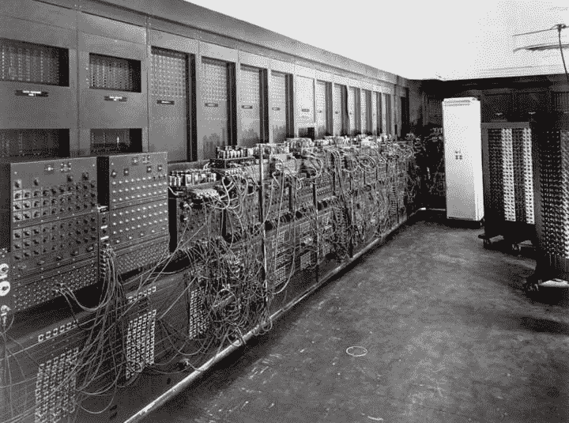

ENIAC 计算机

这时，来自宾夕法尼亚大学的约翰·莫奇利出场了。这位物理学家有一个大胆的想法——创造一台巨大的电子计算机，在 100 秒之内算出炮弹的运动轨迹，而不是花上好几周的时间。它在本质上是最原始的超级计算机。花 100 秒的时间完成一个星期的工作量，这听起来异想天开。但美国军队也实在是走投无路，于是在 1943 年，很勉强地拿出 50 万美元（相当于今天的 880 万美元），来资助这个头号机密项目。

#### 这鬼东西为什么用不了？

莫奇利和研究生 J.布雷斯帕·埃克特开始着手研究这台电子数字积分计算机（即 ENIAC）。同胞在战争中的牺牲，驱使他们不知疲倦地钻研，以把这个项目做成。

这是个十分艰巨的任务。他们必须尽快从头开始设计、建造、测试和学习如何编程。当他们的工作结束时，两位勤勤恳恳的研究人员拿出来的，是一个长 15 米、重 30 吨的庞然大物。最糟糕的是什么呢？这台机器中负责切换（通过在“1”和“0”之间转换来进行运算）的是 1.75 万个脆弱不堪的真空管，偏偏容易在你最不希望它们坏的时候坏掉。我们之前提到过真空管：虽然比起先前的机械开关已经先进了不少，但只要有一个出现故障（像灯泡一样，如果过热就会被烧坏），整台机器就不能工作了。

即使采取了一些预防措施，这种情况还是常常发生，机器在坏掉之前只能运行 10~30 分钟。不过，它还是能每秒进行 5000 个加法、357 个乘法和 38 个除法运算。虽然它缺陷重重，却是当时最先进的计算机。

除了容易烧坏，ENIAC 实际上也没有内存，对于每一个要解决的新问题，还得重新人工布线（把几百条线拔掉，重新整理，再插上）——还好我们今天有了电脑内存，只需简单地双击鼠标就可以解决这些问题。

尽管如此，ENIAC 是第一台可以计算任何给定内容的实体计算机（而不是想象出来的计算机）。唯一的问题是什么呢？ENIAC 是在日本投降之后两个月才建成的，那时候战争已经结束了。

### UNIVAC（第一台商业通用计算机）

战争和 ENIAC 项目结束之后，莫奇利和埃克特决定使用这种新型计算机技术，以造福人们的生活。他们想为商业领域制造一台计算机。

1951 年 3 月，经过 6 年的努力，这对大学夫妇向美国人口普查局售卖了第一台通用计算机：UNIVAC。和之前 ENIAC 烦琐的手动接线不一样，UNIVAC 可以更容易地为多种不同的任务编写程序。磁带驱动器可以储存数据，并且计算结果可以迅速地打印出来。这对于 1951 年来说是很惊人的事情，不过没什么人注意到。

计算机进入公众视野之时，人们无动于衷的态度几乎在一夜之间改变了。1952 年，CBS 和雷明顿兰德公司想策划一次前所未有的公关大戏：用计算机预测德怀特·艾森豪威尔和阿德莱·史蒂文森的总统竞选结果。这将是一个史无前例的大新闻。

投票的数据慢慢积累，UNIVAC 预测艾森豪威尔会获得压倒性的胜利，然而民调数据显示双方的票数非常接近，难以判断。CBS 得知计算机打印出的结果后，坚持让 UNIVAC 团队检查一下机器有没有出问题——肯定是出故障了。当然，最后，艾森豪威尔真的以压倒性的优势获胜了。UNIVAC 预测了这次获选，和真实选票结果相比误差只有 1%。计算机的时代来临了。虽然这是个激动人心的消息，但这些机器仍然是由极不稳定的真空管做成的。直到有了一项名为晶体管的发明，才彻底改变了这一切。

## 晶体管：承诺和背叛

虽然计算机登上了时代的舞台，但由于真空管的诸多问题，由它们所制造的计算机需要极大的电力，非常不稳定，且造价昂贵。随后，晶体管出场了。

晶体管也许是 20 世纪最重要的发明。这个设备的初衷仅仅是为了放大（增强）电子信号，但它很快有了更大的用处。没有人预料到，这么小的一个东西，能为商业、文化和社会带来如此巨大的变革。

晶体管对于现存的任何电子设备而言，都是不可或缺的一部分。在我们的计算机中，有十几亿个晶体管藏在芯片里。除了放大信号，晶体管也可以当作一个开关，像真空管一样控制电子的流动方向。它可以是“开”（“1”）或者“关”（“0”）状态。

这些开/关状态可以转化成二进制的编码，我们现在所有的数据都是以这种形式存在的。这些小小的晶体管每秒可以转换几十亿次状态，使我们得以处理、操作数据，带我们进入了如今的数字世界。只要有芯片的设备，就有晶体管：从电视、收音机、VR 头盔，到计算机、汽车、手机。如今的晶体管小至几纳米，但是最初它们差不多和人们的手掌一样大。

晶体管的起源是一个意想不到的故事：一个关于三个人之间的承诺、嫉妒和冲突的故事。

### 晶体管的起源

实际上，晶体管的故事比这三个人之间的爱恨情仇开始得更早一些，可以一直追溯到 1907 年。当时，亚历山大·格雷厄姆·贝尔的公司 AT&T 有一个亟待解决的问题。贝尔发明电话的专利快要过期了，公司面临重重竞争，甚至把已经退休的前任总裁西奥多·韦尔找回来帮忙。专利怎么说也是保不住了，韦尔觉得，公司必须做出点儿新的名堂。必须拿出其他规模相当的公司想都不敢想的东西——覆盖全美国的电话服务！这听起来像在吹牛皮，因为从来没有人证实过这个想法的可行性。

然而，一年之前，美国发明家李·德福雷斯特改良了真空管，可以用它来放大电子信号。由于音频电子信号可以通过电话线传递，这种真空管便可以把声音放大。这就是 AT&T 在寻找的东西，他们的梦想终于没那么遥远了……

如果放大器可以沿着电话线安装，那么清晰、响亮的音频信号就可以穿越整个国家。AT&T 抓住这个机会，买下了德福雷斯特的专利，自己又大胆地进行了改良。改良后，信号可以有规律地沿着电话线被放大，这意味着不管相隔多远，都能打电话了。

但随着时间的推移，一个大麻烦出现了。又是真空管的问题。我们知道，这些（起到放大作用的）真空管电力消耗高，产生的热量高，因此极不稳定。

20 世纪 30 年代，贝尔实验室（AT&T 旗下的研究部门）的研究主任梅文·凯利意识到，要想继续发展电话业务，必须找到一种更好的设备。他感觉，一种名为半导体的奇怪材料可能会派上用场。

半导体的导电性介于导体（如铜和银）和绝缘体（如玻璃或塑料）之间。在战争期间，雷达技术快速发展，很多人都在研究如何以新的方式实现更快的响应时间。真空管没法实现这一点，因此人们对硅材料进行了检测。事实证明，硅（硅谷得名的原因）是一种很好的半导体，在雷达系统中效果极好。但人们还不确定，半导体是否可以用于其他系统中。

1945 年战争结束后，梅文·凯利决定组建一支专家“梦之队”，通过半导体解决真空管问题。这种特殊材料造就了后来独一无二的晶体管。

凯利为这项任务选择的，都是特别到不能再特别的人。

### 半导体晶体管“梦之队”

首先是沃尔特·布拉顿（Walter Bratton），他是三个成员中年龄最大的，也是一位实验型物理学家，动手能力很强，几乎没有他造不出来的东西。其次是约翰·巴丁（John Bardeen），20 世纪最伟大的理论物理学家之一，他跳了三级，15 岁便开始读大学。他虽然聪明过人，但性格温文尔雅，十分谦逊。最后是比尔·肖克利（Bill Shockley），他是三个成员中最年轻的，也是团队的领导。他是一位杰出的科学理论专家，野心勃勃、争强好胜，正是这样的性格导致他最后的失败。

就在研究团队组建起来之前，肖克利制作了一个粗略的模型，他觉得这东西的运作原理很像（后来所谓的）晶体管，并且开始做实验。多年来，他一直想使用半导体来完善晶体管系统，然后声名大噪。虽然他的想法在纸上谈兵时看起来很扎实，但这个设备却不起作用。

肖克利把这些想法带到了研究团队中去，并且再一次得到了验证。他觉得可能是自己计算错了，就让同事约翰·巴丁检查他的研究成果。结果证明计算结果没错，但为什么不起作用呢？肖克利让巴丁和布拉顿研究如何改进他的原始模型，自己跑去从另一个角度独立研究这个问题。

一开始，他们三个合作得非常愉快。巴丁能想出新的实验和新的测试方法，而测试需要用什么，布拉顿都能建出来。他们偶尔把肖克利和其他员工叫过来，征求他们的意见。

巴丁和布拉顿取得了一些小小的进展，用上了半导体的材料，但是信号没放大多少，然后他们便停滞不前，接下来一年都没做出什么能展示的新成果。大家的关系开始有些紧张了。很快，巴丁和肖克利就变得经常针锋相对。

1947 年下半年，研究取得了重大突破。巴丁突发奇想，决定把整个装置泡在水里，突然信号就放大了很多倍。每个人都震惊了。很快他们得出结论，之所以产生这种现象，是因为半导体里的电子现在可以从它的表面流动了。此后，巴丁和布拉顿的研究进展得很顺利，距离最终创造出功能完备的晶体管，只是时间问题了。

两人激动不已，叫来了肖克利，想告诉他，他们终于实现了目标。晶体管终于被制造出来了，肖克利很高兴，但让巴丁和布拉顿感到吃惊的是，肖克利很快就变了脸，开始嫉妒他们，继而感到愤怒。肖克利之所以生气，是因为晶体管的发明现在不能归功于他了。

沮丧的肖克利开始闷头拼命工作，想把晶体管做得更好。他看了看巴丁和布拉顿的设计，意识到这个发明有一个缺陷：他们的设备太脆弱了。要是这个晶体管设备总是坏，怎么能指望它在现实生活中派上用场呢？更何况，想大规模生产更是难上加难。肖克利开始研究如何造出更结实的晶体管。

不到一个月，肖克利便找到了解决方案。他自始至终谁也没告诉，特别是巴丁和布拉顿，这两个人还在改进原有的设计。

肖克利背着另外两人，联系了贝尔实验室的律师，要申请专利。他有一个重要条件：只有比尔·肖克利的名字能被列为晶体管的发明者。巴丁和布拉顿听说这件事后，感到被背叛了。他们不知疲倦地工作了好几年才解决这个问题，到头来自己的心血却被人偷走了。后来事情出现了转机，律师决定把专利颁给巴丁和布拉顿，因为他们认为肖克利既没有参与核心概念的开发，也没有参与晶体管的实验。

## 公开亮相

1948 年 6 月 30 日，AT&T 在纽约公开了这一发明。在仪式上，AT&T 向媒体宣称，他们会授权这项技术的使用权。为了准备一些公开发布的照片，公司让巴丁、布拉顿和肖克利在摄像机前，重现他们发现可运作的晶体管时的场景。

接下来的一刻凸显了肖克利的本性：让他们就位准备拍照时，肖克利坐在了布拉顿的椅子上，占了最中间的位置，而巴丁和布拉顿只能站在两边。后来布拉顿给肖克利写了一封信，表达他的失望：“看来晶体管的发现，毁掉了我迄今有幸合作过的最好的研究团队。”后来这张照片也没掀起什么波澜，因为媒体认为这完全是小题大做。《时代》周刊把它登在了一个不太显眼的版块，名字叫“本周科学发现”。当时大多数人还是觉得真空管就够用了（也不知道为什么！）：为什么要把它们换掉呢？还有人觉得晶体管只不过是个可爱的电子玩具。

这一切有所改变，是在日本一家被炸的百货商店里，两个工程师打开了一本科学杂志，看到了晶体管——一个小小的、可以放大信号的设备。盛田昭夫和井深大刚刚开了一家新公司，名叫东京通信工业（后更名为索尼），他们意识到 AT&T 的发明可以建造出终极消费品——一个微型的、可装进兜里的收音机。羽翼未丰的索尼正在头脑中酝酿着一场声学革命，与此同时，其他促进音乐发展的科技也正在涌现。

## 现代化的消费音乐

随着战争的阴云在美国逐渐消退，20 世纪 40 年代渐入尾声，整体氛围再次变得信心满满。工厂又回归民用品的生产，消费品商业再次蓬勃发展。这意味着人们有工作，有钱可花，还有东西可以买。休闲用品成为一项利润颇丰的业务，其中一款产品是可以长时间播放的唱片（long—playing record），又称 LP。

1948 年，LP 被推出，为人们打开了优质消费音乐的大门。LP 被用作黑胶唱片的标准格式，因为它比传统的唱片能储存更多歌曲。有趣的是，“专辑”这个词本来指的是把多个带保护套的光盘像一本书一样储存起来，因为单张唱片无法容纳足够的音频。LP 的问世改变了这一点，但“专辑”这个名字被保留了下来，一直沿用至今。

20 世纪 40 年代以战争和破坏开始，但给我们留下了早期计算机、晶体管和喷气式发动机等发明。在这 10 年刚开始时，大多数人认为这些概念是不可能实现的，但伟大的思想使它们成为现实。世界各国的边境线被重新绘制，人类的无限可能也刚好被开启。在下一章中，我们来聊一聊这些想法如何变成一块基石，种下了现代化的种子。那就是 20 世纪 50 年代。

## 第二部分 加速期

### 第八章 今日的种子（1950—1959）

奇怪的是，“二战”刚结束时，美国和苏联关系不错，但并没有持续太久。1946 年，温斯顿·丘吉尔发表了著名的“铁幕演说”，让美国人开始对共产主义产生恐惧。随着中国在 1949 年加入共产主义阵营，世界上 1/4 的人成了共产主义者：似乎这个意识形态传到美国只是时间问题。

到 1950 年，关于“二战”的恐怖记忆渐渐淡去，但这两个对立的世界观却展开了一场更根深蒂固、更敏感微妙的斗争。

尽管局势紧张，但大多数发达国家即将发生重大转变。出于之前提到的各种原因，各国开始蓬勃发展，即使是受战争影响严重的国家，也出现了经济反弹。这一繁荣盛景一直持续到了 20 世纪 70 年代。

这种新出现的经济繁荣加上战争绝望催生的技术，为科技进步的绝对爆炸式增长奠定了基础。随着和平时期的全面展开，20 世纪 50 年代将会出现各种各样的日常发明，如除臭滚珠、信用卡、呼啦圈、动力转向装置、自动门、太阳能电池、激光和芭比娃娃。此外，在科学和工程方面也出现了历史性突破。

从本质上讲，这段时间的发展为今天的世界埋下了种子。

#### 敬畏与悲剧：第一架客机（1952 年）

战后不久，喷气推进技术的创新（由弗兰克·惠特尔发明）让整个社会获益。1949 年，英国推出了第一架载客班机哈维兰彗星，震惊了全世界。直到首秀前，这项发明都被严格保密。

这是一架无可匹敌的飞机。彗星客机由银色金属制成，外形美观，飞行速度几乎是竞争对手的两倍，这意味着它只需一半时间就可到达目的地。此外，由于飞行高度足够高，飞行遭遇的气流较少，乘坐会更平稳。除了螺旋桨发动机的杂音外，只能听到机翼内四个喷气式发动机怪异幽灵般的呜呜声。对于 1949 年的人们来说，它就像是科幻小说中描述的东西，出现时间比美国人设想的还早了 5 年。彗星客机 1952 年开始服役，开启了喷气式飞机时代。

世界各国看到这架喷气式飞机的惊人速度后都表示非常感兴趣，一时间，飞机订单暴增。从法国到印度、日本，甚至英国的竞争对手美国都希望在其国家航空公司的机队中使用喷气式飞机。有了它，地球像是瞬间变小了。就在彗星客机看似前途一片光明的时候，世界各地开始发生离奇事故。好几架彗星客机刚起飞就坠毁了。

事后人们发现，机翼的设计会导致飞机起飞时在低速状态下发生失速。当飞机的升力不足以支撑空中飞行时会发生失速，导致高度快速下降。

喷气式飞机起飞时需要特别注意，因为在到达一定的速度之前，并没有足够的空气流经机翼上方。反观螺旋桨飞机，螺旋桨本身流出的空气会流经机翼，使得飞行员能控制低速的飞机。发生事故的问题在于，早期的飞行员认为彗星客机和原来的螺旋桨飞机一样，于是用了同样的方法驾驶。

情况还在不断恶化。1954 年，两架彗星客机相隔几个月接连坠毁，无人生还。在调查期间，所有彗星客机立即停飞。与此同时，所有外国订单被勒令停工。每次出事，人们都对飞机的形象展开新一轮抨击，曾经让人赞叹不已的天空精灵变成了一场又一场惨剧。

在英国，调查小组试图在大型飞机棚里将飞机拼回原型，以探究造成灾难的原因。但是，他们该如何解开这个谜题呢？当时还没有可以提供数据的黑匣子，没有任何线索，甚至不知道从何下手。调查人员接下来做的是一项工程操作。他们将完好无损的彗星客机机身放置在一个大的密封容器内，让机翼露出。然后他们将水注入容器，反复排水。这样做是为了模拟在多次飞行期间发生的机身膨胀和收缩循环。这项实验揭示的真相令人震惊。

随着循环次数增加到相当于 5000 次三小时飞行，窗户角落开始出现应力开裂。随着时间的推移，这些裂缝逐渐增大并最终撕裂外壳。若在飞行期间发生，这会导致灾难，因为机身内部气压远大于周围空气的外部气压。基本上，在形成裂缝后，飞机在飞行期间会迅速膨胀（称为快速减压）。说白了，飞机会爆炸。

可能你会想为什么是在窗户角落形成裂缝。现在的飞机窗户是圆的，对吧？但当时还不是。当时彗星客机的窗户是方的，这是为了给乘客提供更好的视野。这种设计选择使得大量应力集中在窗户的尖锐角落，导致裂缝出现。出于这个原因，从那时起，所有飞机都改用圆形窗户，以防止这种情况再次发生。彗星客机的惨痛教训为日后的航空安全做出了巨大的贡献。

##### 再有坠机，至少我们不会一无所知

彗星客机坠机事件及相关后续调查给一位名叫戴维·沃伦的澳大利亚研究员以启发，并发明了一种可以在飞行中记录飞机仪表和驾驶舱音频信息的装置，他称之为“飞行记忆单元”。今天，它被称为“黑匣子”，在无数次事件中被证明对空难事故的成功调查至关重要，进一步保障了空中旅行的安全。

令人意外的是，彗星客机后来以彗星 4 的形式再次出现在大众面前。经过重新设计，新型号配备了椭圆形窗户和更厚的金属外壳，大小和动力都是原来的两倍。彗星客机一直运行到 1997 年才最终退役。

#### 生命密码：DNA 结构（1953 年）

DNA（脱氧核糖核酸）结构发现于 20 世纪 50 年代，这种化学物质是编码制造和复制几乎所有生物的指令。1953 年，詹姆斯·沃森和弗朗西斯·克里克（两人为同事兼好友）正式发现 DNA，为基因工程、生物技术和分子生物学打下了基础，相信这就是大多数人了解到的 DNA 分子背后的故事。事实上还有一个人也参与了这项改变世界的发现，但似乎从未被提起，她的名字叫罗莎琳德·富兰克林。要了解富兰克林的贡献，我们要再回顾一段历史。

1946 年，在法国晶体学家雅克·梅林教授的指导下，罗莎琳德·富兰克林学会了 X 射线衍射的用法。她进一步开发了 X 射线的功能，以此来获取复杂形态物质的影像。后来，富兰克林带着她的 X 射线知识到伦敦国王学院进行研究工作。

1951 年，罗莎琳德·富兰克林和莫里斯·威尔金斯（富兰克林的长期合作研究伙伴）在国王学院研究 DNA。威尔金斯和富兰克林的主要研究工具是 X 射线衍射，原理是 X 射线穿透分子后会从分子内部结构表面反弹，从而形成分子结构的阴影图。富兰克林的这个技巧可以用于“看到”DNA 分子。

罗莎琳德很内向，经常被同事以为清高，她因此不得不独自完成大部分工作。她的手法谨慎娴熟，将 X 射线摄影机改进得非常精细，连英国著名的科学家约翰·德斯蒙德都说她的 X 射线照片“无论拍什么都是最漂亮的”。1953 年 1 月的某一天，在实验室里，她获得了清晰的双螺旋 X 射线图像。看到富兰克林的照片，莫里斯·威尔金斯惊讶不已，并在她不知情的情况下向分子生物学家詹姆斯·沃森展示了富兰克林的一些发现。沃森和威尔金斯几年前曾在意大利见过面，讨论过使用 X 射线衍射来推断 DNA 分子的结构。

富兰克林的 X 射线照片（称为“照片 51”）让沃森变得不能自已。据报道，沃森曾说：“一看到这张照片，我就惊讶得张大了嘴巴，心跳加速。”不久之后，沃森与克里克进行了合作，并取得了重大进展。

他们提出 DNA 分子由两条叫作核苷酸的分子链组成，两条链互相平行，形成“双螺旋”，就像螺旋形楼梯。该发现发表在 1953 年 4 月的《自然》杂志上，解释了 DNA 分子在细胞分裂过程中如何进行自我复制，使得生物能够以惊人的准度进行繁殖，除了偶尔发生突变。

由于他们的研究工作，沃森、克里克和威尔金斯都获得了 1962 年的诺贝尔奖。尽管罗莎琳德·富兰克林对 DNA 双螺旋结构的建立做出了巨大贡献，但她并没有获奖：她在 4 年前死于癌症，终年 37 岁。被历史遗忘又英年早逝，她莫名让人想起了第六章中的埃达·洛夫莱斯，让人惋惜。

#### 打倒脊髓灰质炎：脊髓灰质炎疫苗（1953 年）

脊髓灰质炎（也称为小儿麻痹症）是一种病毒感染，能改变患者体内的宿主细胞，以便病毒自我复制。感染症状包括喉咙痛、发烧等，但若病毒进入了脊髓和神经系统，还可能导致肌肉萎缩和麻痹。虽然后者很少见，但患者有可能在几天或几小时内就失去运动能力。最重要的是，脊髓灰质炎很容易在人与人之间传播。

20 世纪初，随着人口密集的城市变得越来越多，脊髓灰质炎在历史上第一次流行。1916 年，仅纽约市就有 2000 多人死于感染，更多人因此瘫痪。那是一个充满了不确定性的年代。每一波脊髓灰质炎暴发，人们都会逃离城市，公共集会一律取消。1952 年，美国发生了最严重的疫情：有近 6 万例病例被报告，其中 3000 例死亡，2.1 万例残疾。直到今天，脊髓灰质炎还无法治愈。但值得庆幸的是，我们有了疫苗。

这背后的功臣是乔纳斯·索尔克博士。“二战”期间，索尔克参与开发流感疫苗，并成为匹兹堡大学的首席研究员。1948 年，索尔克获得一项大型研究基金，用于开发脊髓灰质炎疫苗，解决这场迫在眉睫的健康危机。在短短两年内，索尔克就研制出了初代疫苗。

以下是它的原理：索尔克博士设计了一种杀死多种脊髓灰质炎病毒的方法，并将灭活的病毒注入健康人的血液中。由于机体防御机制，患者的免疫系统会自动产生抗体，以抵抗感染，同时患者不会患病。20 世纪 30 年代，莫里斯·布罗迪曾经尝试过这种技术，但没有获得成功。当时许多科学家认为索尔克的方法行不通，他们错误地认为灭活病毒不会促使身体产生足够强的免疫反应，只有微弱的活病毒才能做到这一点。但索尔克不想冒险。

为了表示对自己工作的信心，索尔克医生在他自己、他的家人以及后来的脊髓灰质炎患者身上进行了第一次人体试验。到 1953 年，他的方法明显奏效了。1953 年 3 月 23 日，索尔克在《美国医学协会杂志》（Journal of the American Medical Association）上发表了他的研究结果，两天后在 CBS 电台介绍了他的研究。美国和世界从此松了一口气，并看到了希望。

1954 年，美国开始对 200 万名学龄儿童进行临床试验。1955 年 4 月，美国宣布该疫苗有效且安全，并开始在全国范围内接种。今天，脊髓灰质炎几乎已在世界范围内被消灭。2017 年，全世界 70 亿人口中仅报告了 113 例。

想象一下，如果脊髓灰质炎继续在今天人口稠密的城市中肆虐，必将导致一片混乱。索尔克博士堪称 20 世纪 50 年代医学界的 MVP（最有价值选手）。

#### 史上最具标志性的乐器：芬达 Stratocaster（1954 年）

像大多数吉他手一样，我总能听出芬达吉他的声音，特别是 Stratocaster。它是如此独特，我只能用“富有表现力”来描述它的声音：一种能让艺术家传达各种微妙情感的声音。Stratocaster 拾音器（将弦乐振动转换为音频信号的磁性设备）的特殊位置赋予了它多种音色，适用于大多数音乐类型，从乡村、摇滚、灵魂乐、爵士到朋克。芬达 Stratocaster 已经成为有史以来最具传奇色彩的乐器。从吉米·亨德里克斯到约翰·梅尔，再到 Blink—182 的汤姆·迪朗格，Stratocaster 随处可见。但是，Stratocaster 是怎么来的呢？

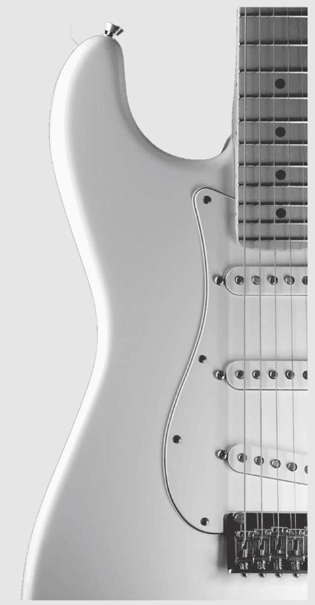

芬达 Stratocaster

“二战”期间，里奥·芬达在加利福尼亚州富勒顿开了一家无线电维修店。花了一段时间研制扩音器和实验电吉他后，芬达创造了第一把电吉他——Esquire。1951 年，他紧接着推出了 Telecaster，这个型号具有活泼“古怪”的独特音色。芬达有一个热爱曲线的搭档，叫作弗雷迪·塔瓦雷斯。1954 年，基于 Telecaster 的设计，塔瓦雷斯赋予了 Stratocaster 激进、永恒、流畅的外形。

让人意外的是，里奥·芬达并不是一名吉他手，而是一名工程师。但在他的管理下，公司生产了一系列如此受欢迎的吉他和贝斯产品，它们的声音永久地影响了音乐世界。

#### 磁带录像机（1956 年）

“二战”后，人们开始使用电视信号录音带，但当时的设备要达到极限才能实现功能（磁带必须以 610 厘米/秒的速度运行，才能获得电视信号所需的高频回应）。查尔斯·金斯堡认为他可以做得更好。他的新机器可以在避免运行过快的情况下实现同样的功能，从此机器不再需要运转到冒烟。

1956 年，磁带录像机（Ampex VRX—1000）面世，永远地改变了电视。从此，电视节目不再限于直播，提前拍摄变得可能，剪辑也变得更简单。

#### 一探究竟：超声波（1956 年）

伊恩·唐纳德是格拉斯哥大学的一名产科教授。在格拉斯哥的一家造船厂，他注意到工人使用超声波检查技术来排查船舶厚厚的表面和结构中的缺陷。超声波检测的工作原理是将人类听觉范围以外的声波发射到物体表面，并测量反射回来的波。这些反射回波被转换成电信号，并以图像形式进行呈现。1956 年，唐纳德和工程师汤姆·布朗决定研究这是否可以被用于医疗领域。早期的测试证明这项技术是可行的，仅仅两年后，他们就公布了这项发现。从此，超声波医疗检测正式……诞生（不好意思，第一个想到的是这个词）。

#### 第一个可编程机器人（1957 年）

第一个机器人的故事开始于一个意想不到的地方—不是棚屋或工作室，而是 1956 年的一场鸡尾酒会，出席者包括发明家乔治·德沃尔和商人兼科幻小说迷约瑟夫·恩格尔伯格。恩格尔伯格痴迷于真正的机器人，当德沃尔向他介绍他最近发明的“程序化物品转移”装置时，恩格尔伯格感到很兴奋。在德沃尔的专利中，这项发明被描述为“第一次基本实现全功能的机器发明，适用于需要循环数字控制的多种场景”。它基本上是一个可编程、可控制的机械臂。

德沃尔曾参与多项新颖发明，包括最早的微波炉产品之——“Speedy Weeny”（能自动烹饪和分发热狗——每个人必备的产品）。

德沃尔和恩格尔伯格共同发明了 Unimate（环球自动化的缩写）。它是第一个真正的现代化、数字化、可编程、可教授的机器人。

商用机器人于 1959 年面世，很快在通用汽车的汽车制造工厂中投入使用。很快，得益于 Unimate，美国和日本的汽车制造商尝到了自动化的甜头。1966 年，恩格尔伯格与约翰尼·卡森一起登上《今夜秀》，并展示了这款机器人。它能执行各种任务，例如倒饮料和移动各种物品，公众的想象力也因此得到了放飞。

今天，机械臂已经成为全球许多行业不可或缺的一部分。

## 懵懂的婴儿——第一张数码照片（1957 年）
1957 年，拉塞尔·基尔希是美国国家标准局的一名研究人员，有权使用标准电子自动计算机（SEAC），这是美国仅有的几台可编程计算机之一。它体积庞大，时钟频率为 1 兆赫（每秒 100 万次交换），速度是智能手机的 2800 分之一左右。计算机成像研究团队负责人基尔希想看看计算机是否具备复制图片的功能，于是他扫描了一张他儿子的 5 厘米见方的照片，将这张照片变成了二进制代码（0 和 1）。结果，他得到了一张 176 像素的黑白婴儿图像。不经意间，他创造了历史。20 年后，数码照片和数码相机面世。到了今天，基本所有照片都成了电子形式。

## 太空沙滩球——第一个人造轨道天体（1957 年）
1957 年 10 月 4 日，人类有史以来第一次将人造天体送入太空——苏联卫星“斯普特尼克 1 号”（Sputnik 1）成为第一颗进入轨道的人造天体，每 96 分钟绕地球一圈。虽然它只有沙滩球那么大，重量也仅有 83 千克，它的成功发射还是震惊了世界。有趣的是，苏联原来计划发射一个体积大得多并装配多种仪器的重达 1400 千克的航天器。可惜，大型飞船的开发速度非常慢，该项目的管理人员渐渐变得焦虑不安，担心速度太慢会被美国人赶超。于是，他们最后选用了一个金属银沙滩球来执行首次升天任务。“斯普特尼克 1 号”的整个任务非常短暂，仅仅发送了 22 天无线电信号，就于 1958 年年初坠入大气层燃烧殆尽了。

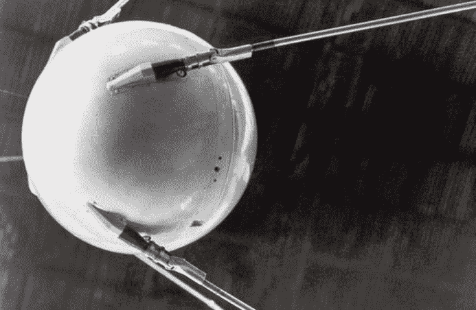

斯普特尼克 1 号

“斯普特尼克 1 号”的发射具有重大意义，它促使美国人建立了 NASA（美国国家航空航天局）和 DARPA（美国国防部高级研究计划局），这标志着太空竞赛的开始。接下来我们会看到，“斯普特尼克 1 号”催生了阿帕网（ARPANET），开启了如今的互联网。它还间接加速了与互联网息息相关的生活必需品——数字调制解调器的发明。

## 知足常乐——数字调制解调器（1958 年）
调制解调器起源于需要通过电话线连接的打字机。1943 年，IBM 利用这项技术以每秒 25 比特（约每秒 3 个字母）的速度传输打卡数据——可以说是很慢的数据传输速度。

在“斯普特尼克 1 号”发射一年后，美国的防空系统需要进行升级，以让不同地点的计算机终端能够相互传递信息。一番考察后，他们与 AT＆T 签订了合同。1958 年，AT&T 推出了数字调制解调器，用于连接美国和加拿大的终端。

这些调制解调器的运行速度为每秒 110 比特。

换句话说：

◇ 加载一个普通网页（500KB）需要 15 个小时。
◇ 下载一个高质量 MP3 文件需要将近两周。
◇ 下载一个 5 分钟 1080p 的 YouTube 视频（每秒 12MB）需要大约两个半月！

想象一下你点击一个视频，然后两个半月之后才能看。看到这里，我们好像不该再抱怨现在的网速了。

1962 年，AT＆T 发布了第一款商用调制解调器，速度是 1958 年的 3 倍，至少也算是有所改进了。

## 妙趣横生——第一款图形电子游戏（1958 年）
对于大部人来说，电子游戏一直陪伴在我们左右：从经典的《乓》和《吃豆人》等街机游戏，到最近的游戏机和虚拟现实等新形式。但鲜为人知的是，电子游戏的历史可以追溯到 20 世纪 50 年代后期，它是物理学家威廉·辛吉勃森的智慧结晶。

战争期间，辛吉勃森主要研究雷达系统的阴极射线管显示器和原子弹中的电子计时系统。战争结束后，他到了布鲁克黑文国家实验室的仪器组工作。

布鲁克黑文每年都有一个开放日，成千上万的公众会来参观实验室。辛吉勃森负责策划一个展示公司设备的展览。他在想究竟能展示些什么，然后发现很多展品都……很无聊。就像人们大老远跑来看油漆变干，甚至比油漆变干更枯燥。于是他想到一个带动展览气氛的办法：为游客设计一个互动游戏怎么样？这样能够清楚地告诉人们，实验室的科研是和社会息息相关的。

为了实现这个目标，辛吉勃森四处搜罗可以用来创造互动游戏的零件。他找到一台可以显示物体弯曲轨迹的模拟计算机，就像示波器上的弹力球图形。凭借他在战争期间使用雷达显示器的经验，仅仅用了几天，这位物理学家就设计出了一个游戏。成果是一个侧视角的网球场，虽然比较粗糙，但是已具有可操作性。这个游戏由两条线组成：一条代表地面，另一条代表球网。这个游戏叫什么名字呢？——“双人网球”。

游戏的控制也非常简单——用一个旋钮调节玩家击球的角度，另一个按钮来发射球。

1958 年 10 月，布鲁克黑文实验室迎来了第一批访客。游客们纷纷被“双人网球”吸引，并在游戏机旁围成一圈。虽然这个发明很受欢迎，但辛吉勃森并没有多想，更没想到电子游戏的概念后来会变得如此受欢迎。他说：“我没想到这会让大家这么兴奋。我想，人们排长队不是因为这个游戏多有趣，而是因为其他展品都太无聊了。”现在，电子游戏行业的年收入约为 1100 亿美元。您可真是谦虚呀，辛吉勃森，太谦虚了。

### 改变社会的力量
正如你看到的，20 世纪 50 年代涌现了大量突破性发明，几乎每年都有。为了给这一章画上完美的句号，我们接下来会看看改变社会的三项创新：便携式音乐、集成电路和电视。

## 传奇的诞生：索尼
在之前的章节中曾介绍过，AT＆T 贝尔实验室的三人组发明了晶体管，但这项发明一直没有得到重视，直到刚刚成立了索尼的盛田昭夫和井深大偶然发现了它。他们认识到这项技术具有放大声音的功能。二人对此十分着迷，决定改进设备，用于大规模生产。索尼一直尝试在日本当地销售录音机，但效果不甚理想，因为战后的日本仍然一片萧条。如前所述，晶体管的初次应用是使收音机更小。

当时的真空管（预晶体管）收音机通常是木制的橱柜，在客厅里占据了相当大的空间。晶体管收音机更节能，体积也更小。然而，盛田昭夫和井深大不是唯一有这个想法的人。随着人们进一步认可该技术的功能，美国电子制造商 Regency 击败了索尼，在 1954 年推出了 TR—01 便携式晶体管收音机。它的价格为 50 美元（相当于今天的 460 美元），是真空管收音机的三倍。这是一场声音的革命。消费者不再需要等待收音机漫长的预热，并且轻巧的机身也实现了随身携带随时播放的可能。

尽管这些收音机非常受欢迎，但由于它们生产成本高，对制造商来说，仍然无利可图。此外，美国军方愿意为一个高质量的晶体管组件出价 100 美元（相当于今天的 920 美元）。显然，美国公司更愿意放弃消费市场而进入利润更高的军事行业。因此，对于那些能够低价生产晶体管收音机的人来说，晶体管无线电市场向他们敞开了大门。索尼抓住了这个机会。盛田昭夫和井深大努力提高了晶体管技术的经济可行性。在 Regency TR—01 推出一年后，索尼就研发了经济实惠的晶体管收音机。

1955 年 4 月，井深大带着收音机进军美国。然而，大部分潜在合作伙伴对此反应冷淡，直到索尼遇到了宝路华这个知音。宝路华是一家手表制造商，它理解索尼致力研发的产品，并订购了 10 万台，这笔订单的收入超过了当时整个索尼公司的价值。然而，宝路华想把自己的品牌名印在产品上。井深大拒绝了这项要求，并中止了交易。后来，井深大说这是他做过的最重要的商业决策。

回到日本后，井深大打算从头再来。索尼知道它离成功仅有一步之遥，只需要创造动机刺激人们购买。这个问题的答案后来成了一个很好的营销案例：不如就叫“口袋收音机”吧？这样人们就能意识到这个产品的革命性意义了！但问题是正常尺码的衬衫口袋肯定放不下收音机。

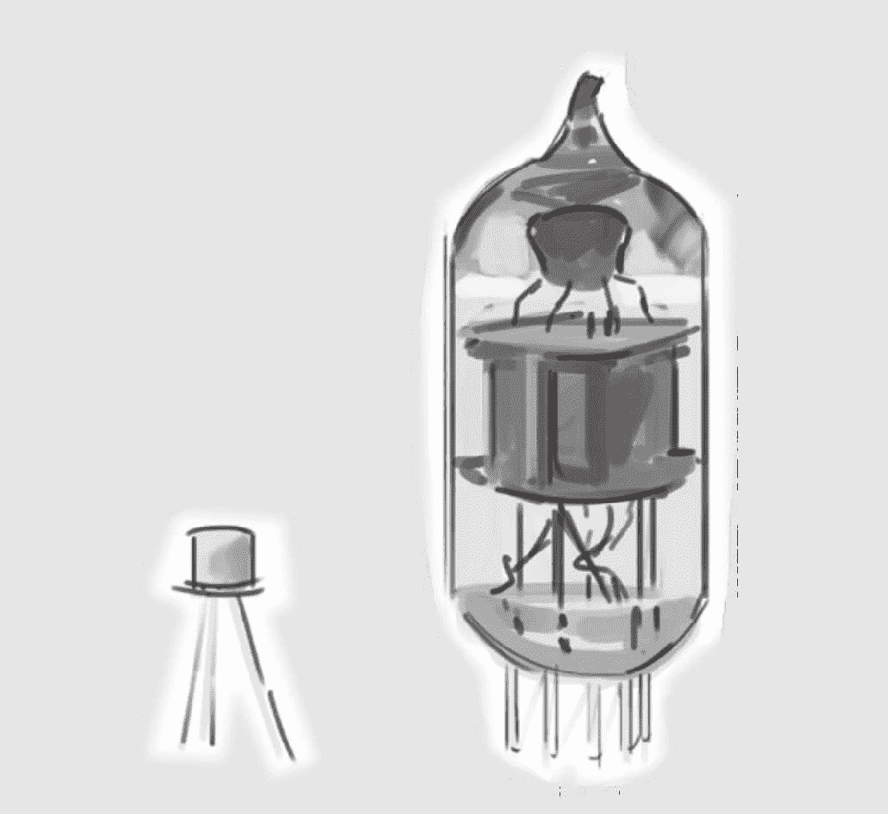

微晶体管与大真空管

怎么解决呢？改大销售团队的衬衫口袋，让它们能放得下收音机。这成功了。不久之后，美国商店的老板们开始排队购买索尼收音机（现在被命名为 TR—55）。短短 5 年内，索尼公司从 7 名员工发展到 500 多名员工。这开启了索尼的传奇及便携式音乐新时代，远远早于后来人们熟知的 Walkman（随身听）、iPod（苹果公司音乐播放器）和手机。

有了收音机，孩子们可以第一次避开父母单独听音乐。这种新的自由也导致某些电台的音乐播放类型产生了变化，它们变得更加前卫、大胆和露骨。这种新声音开启了摇滚乐时代。这是晶体管第一次对社会产生直接影响，之后还会有更多。

## 现代计算的门户：集成电路
事实证明，晶体管在收音机中发挥着重要作用，但在计算机中的作用则很有限。如果能在足够小的空间里装入足量的晶体管，将能实现相当可观的计算能力，但难点在于那个时代制造出的晶体管能有多小呢？晶体管必须通过电线来相互连接。可以想象，一旦做得太小，就难以保证它们的稳定性，因此科学家们希望将整个电路（晶体管、电线等）压缩到一起。如果他们可以制造出微型电路，那么所有部件都可以做得更小，也可以批量生产。

解决方案就是集成电路。当时科学家们的想法是用化学蚀刻工艺代替电线，来连接晶体管。这是当时科学界的又一次大飞跃，现在几乎所有电子产品使用的都是集成电路。

集成电路的故事还得从 AT&T 贝尔实验室的梦之队开始说起。1950 年，约翰·巴丁和沃尔特·布拉顿越来越受不了比尔·肖克利，整个团队开始分裂。1951 年，巴丁对肖克利忍无可忍，决定退出贝尔实验室，梦之队也因此宣告解散。

到 1955 年，肖克利在贝尔实验室的名声越来越差。显然，他在这里是难有作为了。于是，肖克利决心创立自己的公司，目标是创造一种新型的改良晶体管。

不出所料，没有人想与他合作。因此，垂头丧气的肖克利默默地关闭了公司，从东海岸搬到了加利福尼亚州的帕洛阿尔托。他希望能避开自己那段颇具争议的过去，在这里招募一些“一无所知”的团队成员。

在当时看来，在加州成立一家技术公司非常奇怪，因为包括 IBM（之后会再提到这家公司）、雷神、通用电气在内的大多数公司，总部都在东海岸。肖克利搬到西海岸的原因部分是出于家庭，但更确切的原因，是斯坦福大学愿意提供廉价土地吸引科技公司向西进军。

最终，肖克利在 1957 年成立了一家新的公司，取名非常低调——肖克利半导体实验室。尽管肖克利性格乖张，但他的确很擅长招揽人才。他想方设法招募到了一些不了解他动荡过去的年轻人。肖克利拼凑出的新团队恰好包括八位美国最伟大的工程师和科学家。他们被后世称作“叛逆八人帮”。

### 叛逆八人帮
肖克利半导体实验室群英荟萃，这些人才之后也成了硅谷的奠基人。他们是：希尔顿·罗伯茨（Sheldon Roberts）、尤金·克莱纳（Eugene Kleiner）、维克多·格里尼奇（Victor Grinich）、杰伊·拉斯特（Jay Last）、朱利叶斯·布兰克（Julius Blank）、罗伯特·诺伊斯（Robert Noyce）、戈登·摩尔（Gordon Moore）和吉恩·赫尔尼（Jean Hoerni）。

1957 年 6 月，这八个人在旧金山的一家旅馆举行了秘密会议。在肖克利手下工作期间，他们都发现肖克利变得越来越偏执。就和在 AT&T 的时候一样，肖克利担心最后他不能在团队的发明上分一杯羹。这八个人坐在酒店房间里，传递着一张一美元钞票，轮流在上面签名。这张钞票代表的，是他们决心离开肖克利半导体实验室、创立自己公司的协议。也正是这个计划为他们赢得了“叛逆八人帮”的称号。

这家新公司成立后交由麻省理工学院杰出的研究员罗伯特·诺伊斯来领导。诺伊斯对接手这个雄心勃勃的项目迟疑不决，因为当时他刚刚建立了自己的家庭，并且在 20 世纪 50 年代，初创公司面临着很大的风险。但诺伊斯咬紧牙关在钞票上署了名。这样一来，“叛逆八人帮”便有了他们的新公司：仙童半导体公司（Fairchild Semiconductor）。

### 硅谷传说
在旧金山酒店的那一天被《纽约时报》评为改变人类历史最重要的十天之一。仙童半导体公司代表着硅谷的精华：风险高于稳定，创新而非守旧，快速试验优于缓慢增长。得到资金支持后，仙童团队齐心协力，用硅半导体造出世界上第一个可用的集成电路。这项发明能让一块晶片上紧凑排布的晶体管实现独立运作。集成电路（其本身就是由晶体管组件制成的）是所有芯片的基本单元。它引发了电子界的革命，为今天的技术推开了大门。

史蒂夫·乔布斯在 2005 年说过，在硅谷工作有点儿像参加接力赛，仙童将接力棒传给了他，由他开启了个人计算机时代。

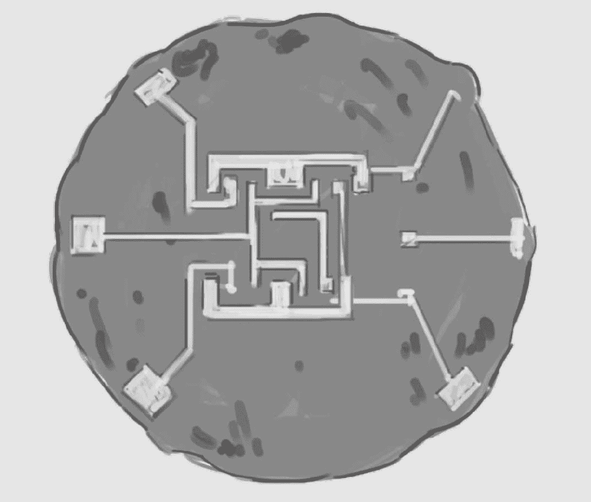

早期集成电路（用化学蚀刻的方式而非电线将晶体管连接起来）

仙童的“叛逆八人帮”让现代智能手机变得比以前把人类送上月球的计算机还要强大 1.2 亿倍多。

### 摩尔定律
仙童半导体的戈登·摩尔曾在 1965 年预测：“计算机芯片的晶体管（处理能力）可容纳的元器数量每 18 个月翻一番。”这一结论后来被称为“摩尔定律”。这个定律并非基于任何计算，而是源自摩尔对行业的预测。出人意料的是，“摩尔定律”自提出后屡试不爽。

此外，戈登·摩尔也因为其他一些故事而出名。1968 年，他和诺伊斯共同成立了另一家小公司，这家公司你大概也听过：英特尔。

最终，贝尔实验室的梦之队也算是获得了一丝慰藉。1956 年，肖克利、巴丁和布拉顿都获得了诺贝尔物理学奖。

## 电视的兴起
20 世纪 40 年代，电视还名不见经传。在英国，它是专属于富人的新奇事物，一台电视机大概相当于一周工资的七倍。在美国，所有电视节目都是现场录制，NBC、CBS 和 ABC 三大电视网络的节目都在纽约拍摄。按今天的标准，整个节目制作过程非常简单，调好摄影机、开拍，最后再将 16 毫米的胶卷运往全国各地用于播出。

到 1950 年，情况开始有所变化。在美国，大约有 440 万个家庭拥有电视。AT&T 铺设了一条横跨全美的同轴电缆网络。这样一来，电视信号即可到达美国大部分农村地区。不久后，美国实现了有史以来第一次声画同步。从此全国开始共享新闻、热门电视节目和体育赛事。在英国、欧洲和日本，类似的变革也席卷而来。

1953 年，彩色电视问世。巧的是，“电视餐”（盒装冷冻快餐）也于同年被发明。看起来电视逐渐流行起来。

最经典的电视看起来像个盒子，通常放在大木橱里，带个圆形屏幕。当然，和今天 50 英寸大的平面屏相比，这个屏幕可以说是非常袖珍了。

看电影的人骤减，听电台广播的人也差不多。尽管 50 年代已经有了电视节目，但直到 60 年代越南战争和登月这种震撼世界的大事件在全球播出，电视才真正开始成为文化的塑造者。电视改变了我们看世界的方式和速度。比如，约翰·肯尼迪遇刺的消息能在一小时内传遍全美 90%的地区，主要靠的就是现场直播。不管是好是坏，世界从此开始紧密相连。

### 第九章 和平年代，互联网的种子（1960—1969）
20 世纪 60 年代充斥着崭新的思维方式、创新性的观点、前卫的服饰以及新生的音乐形式——而这一切都起源于婴儿潮一代。

战后出生的婴儿潮一代在 60 年代逐渐成年。50 年代的金科玉律也被青年人新生的叛逆思维取代。变化如此之大，以至于这一群体普遍被冠以一个新的名称：“十几岁的青少年。”与此同时，经济形式也为他们提供了强大后盾。60 年代的青年所处的经济环境好到令人始料未及。事实上，21 岁以下人群的收入是战前同一年龄段收入的 10 倍。美国青少年的消费习惯开始刺激经济发展。在这 10 年间创立的很多公司都反映了这个时代的富足：达美乐比萨、慧俪轻体（Weight Watchers）和赛百味都在 60 年代应运而生。时装开始彰显个性，笔挺的假领和棒球夹克双双为大胆而新潮的款式让路。鲍勃·迪伦、滚石乐队和披头士等成为时代之声。

1954—1965 年，美国接受中学教育的年轻人数量翻了一番。日本和英国的情况也与之类似。对于很多人来说，家庭中有人进入大学还是有史以来第一次。

与此同时，在科技界，晶体管和集成电路方面的创新使得计算机的体积缩小到一个适宜的尺寸。硅谷日益成熟，风险投资也已诞生。协和式飞机成为世界上首款超音速客机。盒式录音带问世，光盘的种子也悄然种下。这是一个充满变革和变革性思潮的 10 年。

## 太空第一人（1961 年）
当苏联将人造卫星“斯普特尼克 1 号”送入太空时，举世震惊，但苏联的小伙子们并未就此止步。1961 年 4 月 12 日，27 岁的苏联宇航员尤里·加加林搭乘“东方 1 号”宇宙飞船进入太空，成为太空第一人。

“东方 1 号”仅绕地飞行了 89 分钟，最大飞行高度达 203 英里（约 327 千米），全程由自动控制系统控制。大体上，飞船就像一个能够容纳一人的炮弹。在执行这一严峻任务的过程中，加加林沉默寡言，他说的唯一几个字是：“飞行任务进展正常，我很好。”这或许在一定程度上是因为加加林当时正在以大约 2.9 万千米/时的速度飞行。这就相当于每秒飞行 8 千米！

正如几十年前首位单独完成跨大西洋飞行的飞行员查尔斯·林德伯格一样，加加林顷刻间成为举世闻名的人物。在苏联，他更是“登上神坛”成为传奇。人们立起一座座纪念碑，将全苏联大大小小的街道改成他的名字，以此向他致敬。

美国这次先机尽失，简直可以说是遭到了迎头痛击。雪上加霜的是，最初美国将第一次太空飞行的日期定在了 1961 年 5 月——仅在加加林之后一个月，这无异于自取其辱。1961 年 8 月，苏联宇航员盖尔曼·蒂托夫搭乘“东方 2 号”再次升空，美国再遭重击。蒂托夫绕地 17 周，在宇宙中的飞行时长超过了 25 小时。

直至 1962 年 2 月，宇航员约翰·格伦搭乘“友谊 7 号”飞船绕地飞行三周，美国推迟已久的第一次载人飞行任务才算完成。意识到国民自信心亟待提升，肯尼迪总统于是宣布美国将在 10 年内登上月球。

与此同时，在苏联，苏维埃征服宇宙的壮举被看作共产主义优于资本主义的有力证据。然而，只有在“斯普特尼克 1 号”和“东方号”项目工作过的内部人员才知道，这些成功其实归因于一位伟人，一位实至名归的创新思想家——谢尔盖·帕夫洛维奇·科罗廖夫。然而，直至 1966 年去世，总设计师科罗廖夫在西方，甚至在苏联，都鲜为人知。

1933 年，科罗廖夫帮助苏联发射了第一枚液体火箭。5 年后，在约瑟夫·斯大林的一次大清洗中，科罗廖夫和他的同事一起被送上法庭。最终，他因通敌叛国罪和阴谋颠覆罪进入劳改所。后来，随着“二战”局势日益紧张，苏联的领导层开始意识到德国的火箭技术实为一大威胁。考虑到科罗廖夫的天赋，政府让他重新为国效力。

1945 年，“二战”结束后，科罗廖夫被派往德国学习纳粹火箭技术。他受命研究 V—2 火箭，这一火箭曾在战时给英国造成沉重打击。然而，苏联并不是唯一一个在这场“火箭竞赛”中“学习”德国经验的国家——美国也早已对此势在必得。最终美国捕获了 V—2 火箭的设计师，并最终让他成为美国宇宙项目的领导者。

苏联人则更进一步，想方设法试图获得火箭、图纸，以及一些德国 V—2 技术人员。到 1954 年，科罗廖夫已经制造出能够运载一枚五吨核弹头的火箭。1957 年，俄国的第一颗洲际弹道导弹发射成功。

然而，科罗廖夫早已着眼于更大的事情，这就回到了那个叫作“斯普特尼克 1 号”的大铁球上。它的成功发射标志着苏联在宇宙竞赛中取得的第一个胜利。在科罗廖夫的引领下，苏联的宇宙项目在 20 世纪 60 年代早期令世界望尘莫及。苏联在太空方面“零的突破”包括：首次动物绕地飞行；首枚大型科学卫星；首位男性宇航员；首位女性宇航员；首次三位男性宇航员；首次太空行走；首艘撞月飞船；首艘绕月飞船；首艘撞击金星的飞船；首艘实现月球软着陆的飞船。

虽然成就数不胜数，但是人们只知道科罗廖夫的神秘头衔“总设计师”。1966 年，科罗廖夫逝世。为表彰他的事迹，科罗廖夫作为苏联英雄被葬入克里姆林宫墓园。

## 首位宇航员的奇闻怪事

1968 年 3 月 27 日，在完成太空之旅 7 年以后，尤里·加加林在清晨早早起床，直奔契卡洛夫斯基机场。他此行的目的是在多年担任宇航员后，重新接受训练成为一名战斗机飞行员。最初的计划是让加加林驾驶俄国的`米格—15`战斗机完成一些试飞任务，然而此计划最终却未能实现。

当天机场的天气极差，风雨的来临也让人始料未及。那天早晨，当加加林发现自己忘带证件时，便对周围的人说这是个不祥之兆。尽管天气恶劣、预兆不祥，加加林最终依然平安起飞。在训练完成后，他通过对讲机告知基地人员，自己将马上返航。

然而，这是所有人最后一次听到他的声音。

几小时后，一支飞行救援队起飞展开搜寻。在搜寻过程中，救援队员从空中看到了那架飞机燃烧的残骸。人们希望这位前宇航员能够在飞机坠毁前乘坐弹射座椅逃脱，然而这一希望在第二天加加林的遗体被找到后彻底落空。苏联随后就这一事故展开深入的调查，然而却未能得出确切结论。普遍观点认为，加加林为躲避某一物体（飞鸟或气象气球）而紧急转向，从而使飞机失去控制。

有些人说加加林醉酒后决定开飞机去兜风找乐子。这不足为奇，毕竟加加林嗜酒的历史广为人知。这名年轻的苏联宇航员在全世界一夜成名，这对他来说也并非易事。他出生于乡村，毫无准备便成为万人崇拜的偶像。成名后，他收到成千上万封信件，全苏联的人民纷纷给他写信诉说自己的烦恼并寻求帮助。慢慢地，加加林开始酗酒，并沉迷于其他的冒险活动。

也有人说，他是美国中情局派来的秘密间谍，因身份暴露而被下毒。另一种传闻是他其实在那场空难中幸存，并从此隐姓埋名。更有甚者，说他是为了躲避 UFO（不明飞行物）才导致飞机坠毁。然而，事实究竟如何？我们还能知道真相吗？

你们何其幸运。就在 2013 年，这起坠机事件的原因最终尘埃落定。结果显示，当时有另一架体量大很多的飞机（苏霍伊`Su—15`）进入加加林驾驶的`米格—15`所在空域，加加林被迫闪避，最终导致飞机坠毁。这样一起平淡无奇的事故，最终却酿成了悲剧。苏联当局和空中交管部门为自身的失职感到无地自容，因而这一真相才久久未被公之于众。

## 首款数字电子游戏（1961 年）

你一定听过威廉·辛吉勃森通过其自创的游戏“双人网球”为自己的展览锦上添花的故事。尽管这标志着电子游戏的诞生，但其媒体形式还未迎来巨大突破。

如前面所说，多年来，晶体管体积的减小逐渐使得计算机的体量随之缩减。由于新一代的计算机已不会大到需要占满整个房间，它们便被称作“小型计算机”。小型计算机不仅体积小，与之前的计算机相比，它们的用途也更广。从此，它们不再仅被当作计算和记录的工具。

尽管计算机技术突飞猛进，但电子游戏行业尚未诞生。当时几乎所有的游戏都是为满足特定目的而设计的，只能适配一个单独的设备运行。人们尚未意识到，可以设计一个游戏软件，使其在多个设备上都能运行。

直到 1961 年，麻省理工学院收购（美国）数字设备公司（Digital Equipment Corporation）的程序数据处理机 1 号（`PDP—1`）小型计算机，这一情况才有所改观。`PDP—1`采用矢量显示系统。尽管没有 CPU，它的晶体管依然能够达到 5 兆赫（每秒 500 万次转换）的处理速度。这个速度是现代智能手机时钟速度的 1/500 左右，但在当时看来着实强大。`PDP—1`由被称作“系统构件”的晶体管板组装而成。

由于`PDP—1`体积小、速度快，麻省理工的学生和职工在闲暇时便喜欢用它编写与学术研究无关的程序。1961 年至 1962 年，哈佛和麻省理工的职工马丁·格雷茨（Martin Graetz）、史蒂夫·拉塞尔（Steve Russell）和韦恩·维塔宁（Wayne Wiitanen）共同在`PDP—1`上设计了名为“太空大战”（`Spacewar！`）的游戏。

这款双人游戏使玩家置身于太空混战之中。设计这款游戏的一个初衷便是要将`PDP—1`的潜能发挥到极致。在硬件设备条件有限的情况下，该游戏运行的顺畅程度却出人意料。

《太空大战》后来被拷贝到美国其他几所大学的小型计算机上。它因此成为第一个可以在多个地方运行的电子游戏。然而，这款游戏未能真正流行开来。`PDP—1`的价格是 12 万美元，折算成当今货币，则价值将近 100 万美元。因其造价昂贵，最终只售出 55 台。

《太空大战》逐渐为人所知，在其后的几年，各个大学的程序员开始开发并推广自己的游戏。在下一章中，我们会继续讲述这个故事，到时我们便能看到，电子游戏是如何一跃成为主流的。

## 互联网和万维网的种子（1962 年）

其实，早在 1962 年之前，互联网和万维网的种子就已然种下。或许你从未听过这个名字，但范内瓦·布什（Vannevar Bush），这位“二战”期间的军方科学领袖、工程师和思想家，便是当今信息时代的开创人。直至 21 世纪第二个 10 年，随着互联网日益发展，布什才声誉日盛。

范内瓦·布什的成就之一是成立了雷神公司，并在“二战”期间领导 3 万余名科学家、工程师及高级军官开展研究。布什权力极大，并且只对总统本人负责。一度全美国约 2/3 的物理学家都为他效力。

### 范内瓦·布什：信息时代之父

我认为，范内瓦·布什是本书中最具影响力的人物之一。他的观点启发了现代生活中的很多核心科技——在他之后产生的很多新技术都是基于他的想法。在组织 3 万余名学者进行研究的过程中，布什很快意识到，他们缺乏分类记录所有科研信息的好方法。若是伟大的战后科学发现就此被埋没在海量毫无意义的出版物之中，那结果必然是灾难性的。在 1945 年发表的一篇名为《诚如所思》（`As We May Think`）的文章中，布什设想出一种机器，它可以像我们的大脑一样将信息关联起来，即通过联想来实现。

此设备叫作“麦克斯存储器”（`Memex`，取自英文 MEMory EXtension，即记忆延伸）。`Memex`最初被设定为一个通用图书馆——它与台式计算机有着惊人的相似之处。科研信息（文字、图片）被印在微缩胶卷上，并在放大后投放至显示器。若研究者希望就一个特定主题进行深入检索，可以要求系统向其发送（微缩胶卷上的）关联信息。

例如，一位科研人员可以使用`Memex`阅读一项研究，并通过他的`Memex`获取并阅览所有相关（相关联）的图片和研究。

这些信息无法在数台`Memex`之间实现数字传送，只能通过邮件（毕竟那是 1945 年）。就像点击维基百科上的一篇文章，然后等着链接网页上的信息像信件那样送到你的门前。

让我们用现代词语将这个想法的要点逐一解释一下：

邮政服务将由**互联网**提供；

在`Memex`上索取信息的能力由**万维网**实现；

关联信息的概念就是今天我们所熟知的**超链接**（即我们在网络上通过点击从一处跳转到另一处的方式）。

布什相信，这样一个设备将会带来信息爆炸，继而引发知识爆炸。他果然有先见之明。

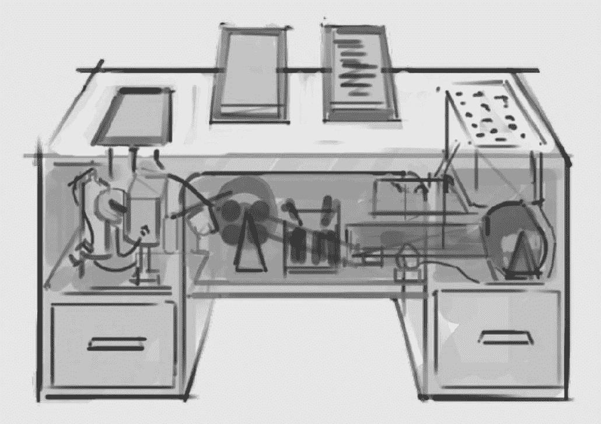

麦克斯存储器

本质上，布什已经提前 45 年构想出了万维网。直至 1990 年，万维网才最终诞生。虽然布什未能目睹这一成就，但是他的每个设想都成了现实，甚至远远超出他的预期。布什着实是 20 世纪最有远见卓识的伟人之一。

### 绘制蓝图

虽然布什早已构想出互联网，但是直到 20 世纪 60 年代，技术的进步才允许人们开始着手实现它。

1962 年 8 月，以布什的研究为基础，心理和行为科学家约瑟夫·利克莱德（J.C.R Licklider，又称为利克）开始绘制互联网的蓝图。利克当时在`DARPA`担任行为科学、指挥与控制研究主任。`DARPA`是在“斯普特尼克 1 号”人造卫星发射一年后创建的。

20 世纪 60 年代初，`DARPA`依然人工处理所有研究，这并不理想。例如，麻省理工若想与达特茅斯间传递数据，就需要派一个人乘坐火车亲自去递送穿孔卡，然后再等上两到三个小时，直到所有材料都打印完成后才能返回。与之相比，难道还要抱怨下载速度慢吗？

信息传递的快捷性成为当务之急，尤其是苏联人已经成功进入了太空，还进入了……两次。利克想到了一个解决方案：计算机之间需要实现直接对话。1962 年，他编写了《人机共生》（`Man—Computer Symbiosis`）。这本书阐明了机器识别将独立于人类认知的观点。这就涉及了“思维中心”的概念——它是网络发展的先决条件。

1964 年，他开始着手搭建“互联”的愿景。1967 年，他描述了一座“未来图书馆”，可以将全世界的书籍囊括到线上，任何人都可以取阅。

他同时还设想实现线上合作——人们无论身处何方，都能够彼此沟通，共享信息。利克解释道：

计算机交流网络的独特之处在于，不仅（处于不同地理位置的）同事间可以随时互相沟通，而且他们与工作所用的信息库也能实时交流。（这意味着）建立完成的蓝图无须打印出来再分发至全国，而是可以直接显示在每个人的范围（屏幕）内。显而易见，这必将给我们所有的计划、组织和执行方式带来翻天覆地的变化。

此外，利克还假想了银行系统：

如果我们能够以电子的方式处理一切，并且你所有的身份信息能够集中在一张塑料小卡片上并插入机器，那么我可以想象（供应商）会希望你通过银行账户来为此付款……这就需要网络。

你看，利克不只是对未来的发展有一个粗略的概念，他已经能够完全想象出终端产物的具体形态。

虽然利克于 1964 年离开了`DARPA`，但是他却将自己的愿景传递给了引领`DARPA`的后起之秀。随着阿帕网的引入，早期互联网于 1969 年诞生。阿帕网使得加州大学洛杉矶分校与斯坦福大学的计算机终端之间实现了信息交流。它便是现代互联网的真正雏形。

通过这一网络发送的第一条信息是“`Lo—`”。现在你可能在想：这个词真有趣，为什么选择它呢？其实，第一条信息本该是“`Login`”（登录），但还没发到“g”，系统就崩溃了。尽管如此，这个时刻依然标志着一个新时代的开始。阿帕网在下一个 10 年中不断发展，使全美国的计算机实现了互联。

### 首个交互式图形程序（1963 年）

科技的发展可谓突飞猛进。50 年代后期，计算机还仅仅是冷冰冰的数字计算机器。然而 1963 年，麻省理工毕业生伊凡·苏泽兰（Ivan Sutherland）读到了范内瓦·布什 1945 年的论文《诚如所思》。在论文中，布什描述了叫作`Memex`的个人知识信息机器。受这一观点的启发，苏泽兰提出：是否能实现人与计算机之间的“对话”呢？且并非通过文字或话语，而是通过绘画实现。这一疑问最终促成了几何画板（`Sketchpad`）的问世。这是一个交互性绘图程序，用户一边用光笔绘图，一边按屏幕旁的一列按键。几何画板首次实现了计算机绘图，并由此促进了一个新的程序种类的产生——计算机辅助绘图（`CAD`）。令人称奇的是，几何画板的所有功能均在一台内存仅有大约 272 KB 的 1958 年计算机上得以运行，与其配套的是一个 9 英寸示波仪显示器（显示信号的屏幕，比如心脏监护器）。这是一个突破性的想法，为我们今天所用的图形用户界面奠定了坚实的基础。

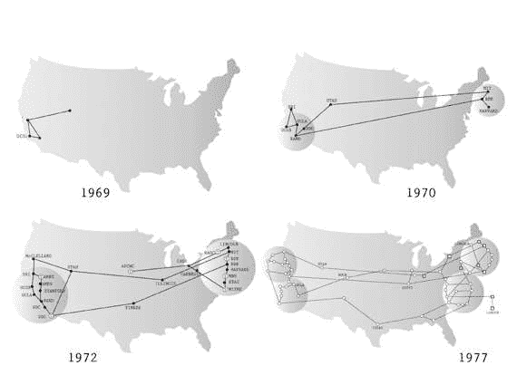

阿帕网的发展

可别忘了，当时的计算机还是通过穿孔卡或穿孔带接收指令，输出的也只有嘟嘟声、打印出的材料，或是闪烁的灯光。在那样的条件下，通过触笔对图形对象实时处理，这一技术的革新性可想而知。它基本等同于魔术。计算机先驱阿伦·凯曾经问伊凡·苏泽兰：“你怎么可能在同一年内分别设计出第一个交互性图形程序、第一个非程序性编程语言和第一个面向对象的软件系统？”苏泽兰回答说：“我当时完全不知道这是件难事。”

有趣的是，伊凡·苏泽兰恰巧是艾德·卡姆尔的导师。1972 年，卡姆尔因一个课题创作出了第一部计算机动画电影，进而在后来一举创立了皮克斯公司。这一点我们在下一章详述。

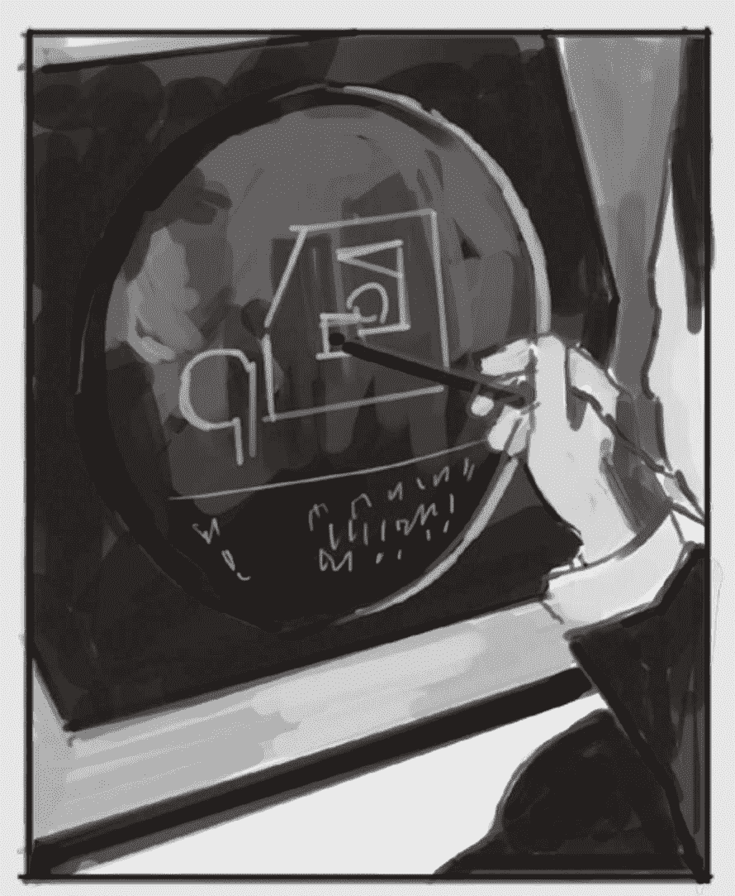

几何画板是第一个图形交互式计算机程序

### 将计算机普及给每一个人：`BASIC`（1964 年）

20 世纪 60 年代，在外行看来，计算机代码最初一定是一团乱麻。然而到了 1964 年，一切开始有所改观。当年，达特茅斯学院的两名教授首次引入了一种代码语言，这种代码的设计初衷就是要足够简单，任何人都可以使用。这个新的语言被称作“初学者通用符号指令代码”（`Beginner’s All—purpose Symbolic Instruction Code`，简称`BASIC`）。

在`BASIC`之前，计算机程序设定，以及其后的计算机使用，都复杂到无以复加。早期大型计算机在组装阶段就完成了程序设定。它很像宜家的成套家具，唯一不同的是，你需要掌握代码，以便实现不同部件间的互通与协同。事实上，只有极为专业的科学家和数学家才愿意花费精力去学习如何编写并使用代码。因此，他们也就成为唯一使用计算机的人群。虽然编写代码依然需要专业技术，但是`BASIC`大大简化了这一过程。

达特茅斯学院的数学和计算机科学教授约翰·凯梅尼（John Kemeny）和托马斯·库尔茨（Thomas Kurtz），以及`BASIC`的其他创始人都希望能够降低计算机代码编写的门槛。

中心思想是这样的：为什么不使用大多数人能直接理解的日常用语呢？比如，用`HELLO`（你好）和`GOODBYE`（再见）来代替`LOGON`（登录）和`LOGOFF`（注销）。更重要的是，`BASIC`还需要具备编译器的功能。编译器将人类能够读懂的书面语言转换成计算机可以理解的 1 和 0。以前，用户需要手动将程序敲击到穿孔机上，从而得到穿孔卡。然后再等待计算机一行一行将代码进行翻译，以获得最终结果（可能要花上一整天）。而现在，用户只需要用通俗易懂的英语向计算机键入指令，`BASIC`立即能完成语言转换。这让一切变得简单快捷，彻底取代了曾经耗时费力的手动代码输入方式。

#### 比尔·盖茨与`BASIC`的不解之缘

比尔·盖茨是最先开始深入探索`BASIC`潜能的人之一。盖茨出生于一个富裕的西雅图家庭。他的父亲是著名律师，母亲在第一洲际银行及联合之路董事会工作。盖茨家族天性热爱竞争，因此，盖茨很小的时候就喜欢在战略棋盘游戏《大战役》（`Risk`）中占据主导地位—由此掌握的技能在他之后的人生中注定派上大用场。

大概在盖茨 12 岁的时候，他的父母开始感到担忧。但这并非因为童年时代的他交友不善。恰恰相反，盖茨成绩优异，只是常常花大量时间独自看书。因此，他的父母认为他性格孤僻。然而，1968 年发生的一件事彻底改变了盖茨的人生轨迹，也就此改写了历史。

1968 年，13 岁的盖茨在湖滨高中（Lakeside High School）读书时第一次见到了计算机。当时他们学校与通用电气进行了分时共享合作，也就是说湖滨高中支付通用电气一定费用，从而在特定时间段使用其计算机。但是，大型计算机依然放在通用电气，学校只能通过终端显示器看到计算机输出的内容。20 世纪 60 年代，这种做法非常普遍，因为计算机体积太大，价格太高，常人很难拥有。若非科学家、工程师，或身处某一所大学，那么亲眼见到计算机的可能性几乎为零。因此，这个机会对于湖滨高中而言实在不可多得。

盖茨酷爱在通用电气的计算机上用`BASIC`编写程序。后来盖茨说，当时自己完全被那台机器的魅力吸引，惊叹于它每次完美执行软件代码的能力。他当时如醉如痴，后来老师破例允许他利用数学课的时间编写代码。他写出的第一套代码是人机对战版的井字棋。至此，盖茨仿佛听到了命运的召唤。

后来，学校因为资金短缺在当年终止了与通用电气的合作。这迫使盖茨和他（新结识）的编程伙伴一起寻找其他可用的计算机。最终，他们找到了一台属于计算机中心公司（Computer Center Corporation，CCC）的`PDP—10`计算机。起初，CCC 十分乐意让他们使用这台计算机，直到发现比尔·盖茨、保罗·艾伦、里克·韦兰（Ric Weiland）和肯特·埃文斯（Kent Evans）这四名湖畔高中的学生竟然利用代码漏洞来获取免费使用时长，CCC 于是在暑假期间禁止他们再使用计算机。禁令解除后，四名学生同 CCC 达成了协议：“如果能给我们更多的使用时长，那么我们愿意帮助修补代码漏洞。”CCC 欣然同意，并一直履行此约定，直至 1970 年公司破产。

众所周知，比尔·盖茨的故事并未就此终结。在下一章中我们即将看到，他和保罗·艾伦利用`BASIC`创立了微软。该公司为个人计算机（PC）革命奠定了基础，同时也是苹果公司创立的基石。

正当人们重新构想计算机的运行方式之时，精神病学的内部组织形式也得到了重新的认知。这还要从 20 世纪 60 年代，一种臭名昭著的化学品逃出实验室的大门，一举为世人所知说起。它就是麦角酸酰二乙胺，也叫作致幻剂（`LSD`）。

## 影响深远：致幻剂渗入文化（1964 年）

没有任何一种化学物质能像致幻剂一样对我们对大脑的认知产生如此深远的影响。以这种化学物质为核心的一次巨变定义了整整 10 年之期。

麦角酸酰二乙胺的问世最早要追溯到 2000 多年前。依据古希腊传统，每年人们都要到一个神秘之地进行朝圣，并在此处喝下一种由发酵的麦角（一种生于患病谷粒或黑麦上的菌类）制成的饮品，其中就含有与致幻剂类似的化学物质。一些历史学家怀疑，这类经历影响了古希腊的思想家。

致幻剂在 20 世纪 40 年代于现代社会中初现端倪。1943 年，瑞士化学家艾伯特·霍夫曼无意中发现并合成了它。当时，霍夫曼正试图用麦角真菌制作一种促进血液流动的兴奋剂，无意间他的手指碰到了嘴部。毫不夸张地讲，接下来的 12 个小时可谓十分惊险。他记录道：

我要费很大的力气才能保持口齿清晰。我请实验室的助手陪我一起回家。在路上，我的状态开始变差。视野中的一切开始变得摇摆不定，而且扭曲变形，就像曲面镜中的成像一样。而且我记得当时感觉无论如何都无法离开所在之地。然而，后来助手告诉我，我们当时行进的速度非常快。

在家中，他的情况开始变得恐怖：“我周围的事物现在变得更可怕。房间里的一切都在旋转。那些平日里熟悉的物体和家具变得奇形怪状。它们不断变换移动，仿佛活了一般，毫无停息之意。”

霍夫曼认为，他的这一发现将成为强有力的工具，促进人们对大脑的科学研究。他所在的总公司山德士制药公司（Sandoz Pharmaceuticals）从此开始进行此药物的生产。

致幻剂

血清素

伦敦圣乔治医院精神科的精神病学家汉弗莱·奥斯蒙德（Humphry Osmond）和他的同事约翰·斯迈西斯（John Smythies）得知了艾伯特·霍夫曼的发现。他们二人通过实验对精神分裂症等精神疾病的影响进行了研究。在研究中，他们向健康的受试者发放致幻剂，并研究其反应。一种化学物质可以引发与精神分裂症类似的症状，这一事实对于医学界的启发可谓醍醐灌顶。药物学家戴维·尼科尔斯（David Nichols）认为，这一观念的转变正是神经科学的开端。

奥斯蒙德和斯迈西斯观察了麦角酸酰二乙胺的化学结构，发现它与神经递质血清素非常相似。会不会由于二者形态十分相似，导致致幻剂对大脑中的血清素产生了干扰呢？这个灵光乍现的时刻最终使他们得出结论：精神问题是由大脑中的化学物质失衡造成的。这一结论至今仍是主流观点之一。事实上，例如盐酸氟西汀（百忧解）等抗抑郁药正是作用于大脑中的血清素受体—这直接应用了早期致幻剂研究得出的结论。在这一发现之后，精神病学家开始放弃精神分析法，转而投向基于脑化学的新疾病模型研究。

研究早期致幻剂科研突破的博士生戴维·E.尼科尔斯记述了当时的情况：“直到那时，主流精神病学仍未发现，一些行为的产生可能与大脑中某些神经化学活动相关。相反，如果一个孩子患有精神分裂症，那么责任往往归结于母亲，因为人们认为是她没有提供足够的营养，或是在养育子女时行为失当。全世界的父母，尤其是女性，在承担养育重任的同时，还要因孩子患有精神分裂症等疾病而背负罪责，因为世人都将他们视为父母中的失败者。这种想法在今天看来令人匪夷所思，但当时主流精神病学理论的确如此。”

1954 年，英国作家阿道司·赫胥黎志愿参与了奥斯蒙德的一个研究。他对实验产生的效果感到十分惊异，进而开始鼓励更多人参与体验。赫胥黎写了《知觉之门》一书，探索实验中所产生的一系列想法。《知觉之门》后来获得了广泛关注，其中包括美国中情局和苏联。

## 致幻剂坠入歧途

苏联和美国军方仔细研读了《知觉之门》。双方都认为，赫胥黎所描述的化学物质或许能被制成吐真剂，并应用于战争。很快，他们就展开了相关试验。然而，令人大失所望的是，致幻剂的作用实在难以控制，所有试验都没能成功。受试者甚至无法集中注意力回答问题。这又让美国当局产生了一个新想法——或许可以用这种药物来使敌方领导人当众出丑。因此，他们制订计划，准备在大型公共活动前将此药偷偷倒入敌人的茶或咖啡中。

为试验这一想法，特工人员在办公室暗中将致幻剂倒入彼此的水杯中。然而，当一位名叫弗兰克·奥尔森（Frank Olson）的特工于一次实验后死亡时，事态开始变得严重。他的死因被归结为一次痛苦的实验经历后药物作用的持续影响。此事件证实，致幻剂不仅药效强大，而且非常危险。2017 年，围绕他死亡的重重疑点，奈飞（Nexflix）公司出品了系列影视剧《苦艾草》（Wormwood）。

与此同时，好莱坞的治疗师开始用致幻剂帮助好莱坞的演员和名人解决他们的问题。

## 致幻剂研究的终结之始

备受尊重的哈佛讲师蒂莫西·利里（Timothy Leary）最初于 1962 年开始接触并体验致幻剂。他立志要通过这种药物改变美国整体的政治、宗教和文化结构。然而利里的想法却让其他研究者感到担忧。他们认为，致幻剂应在严格控制下仅用于科学研究。

尽管同事们多次抗议，利里仍然坚持宣扬自己的观点，同时举国上下的年轻人也都被他的经历深深吸引。1963 年，利里被哈佛解雇。从此，他更加肆无忌惮，从德高望重的学者沦为一个头发凌乱的说教人。他的口号是：“内向探索，激发热情，脱离体制。”深入向内探索身边世界，激发对于新意识水平的热情，并脱离社会强制但过时的体制。这一口号所传达的信息与当时盛行的反主流文化产生了强烈的共鸣。

同时，位于西海岸的斯坦福大学学生，也是日后享誉盛名的作家肯·凯西（Ken Kesey）听说了这些纷繁复杂的事情，决定参加中情局出资的致幻剂试验。试验结束没多久，凯西申请进入一个精神科病房工作。在一次轮班期间，他注射了该机构所存的致幻剂。其后的经历给予他灵感，最终创作出经典小说《飞越疯人院》。

与东海岸的利里一样，凯西决定在美国西海岸宣传推广致幻剂。他召集了一群朋友，开着一辆五颜六色的巴士在旧金山湾一带分发药物。后来，他们的足迹慢慢遍布全国。

通过肯·凯西及其朋友们的努力，致幻剂迅速爆炸式地在美国东西海岸推广开来。这个时间恰到好处：最早一批出生于婴儿潮时期的孩子到 1964 年刚满 19 岁。他们渴望发声，同时又质疑一切——他们成为美国反主流文化的代表。

事到如今，艾伯特·霍斯曼，致幻剂的发现者，眼睁睁地看着所发生的一切，自己却束手无策。他一定觉得致幻剂是个“问题儿童”。1966 年 10 月 6 日，致幻剂被加利福尼亚州政府确定为非法药物，然而这一举动反而让致幻剂魅力大增。大门乐队、披头士乐队、滚石乐队和感恩而死乐队等音乐团体都开始暗中传播与致幻剂有关的信息，将致幻剂再次禁锢在实验室之内绝对比登天还难。

1967 年，当“爱之夏”运动爆发之时，一切到达顶峰。当时 10 万名年轻人涌入旧金山海特—阿什伯里区，各家媒体也争相随行。这些穿着奇装异服的年轻人被称作嬉皮士。保守的美国人被眼前的一切吓得瞠目结舌。1968 年，致幻剂最终在全美 50 个州均被列为非法药物。1969 年，在充满传奇色彩的伍德斯托克音乐节上，致幻剂在绚烂的聚光灯中遭遇了有史以来最不光彩的一刻——威维·格雷（Wavy Gravy）掷地有声地警告台下的人群：不要服用那种棕色药物。那时，致幻剂见不得光的阴暗面已经慢慢为众人所知。当时旧金山地区已有儿童离家出走进而失踪的案件发生，同时有很多滥用此药的人受到了永久性的伤害，甚至有人因此丧命。

艾伯特·霍夫曼早早便从 60 年代的纷扰世事抽身而出。他离世时已是 102 岁高龄。

### 行事新风

在距离反主流文化摇篮——海特—阿什伯里区仅几个街区之外的地方，一个完全不同，却同样令人热血沸腾的事件正在发生。1968 年 12 月 18 日，在格雷厄姆市政礼堂，道格拉斯·恩格尔巴特（Douglas Engelbart）即将进行一次关于计算机未来的展示。这个展示是如此超前于时代，以至于它被冠以“所有演示之母”的美名。

还记得伊凡·苏泽兰和他发明的几何画板，就是本章前面提到的那个可以用光笔绘图的计算机吗？

正是伊凡的发明，以及布什的`Memex`设备给恩格尔巴特提供了灵感，他开始对人机互动进行全新的思考。计算机能不能成为私人助理？它能不能成为计划者、组织者，以及辅助交流的设备？更重要的是，它的操作有没有可能变得极为简单，让所有人都能无师自通？

#### 所有演示之母（1968 年）

一部闪着雪花的黑白电影对“所有演示之母”进行了记录。这部电影很容易找到，非常值得一看。在一段开场白之后，恩格尔巴特对着人群说道：“想象一下，你是一位在办公室工作的白领。如果你拥有一台配有显示器的电脑，全天开机，随时可用，那是怎样一种场景？你能从中获益多少？”

早在盖茨之前，微软之前，甚至是施乐复印机之前，恩格尔巴特就已经提出了这一想法。在 1968 年的演示中，他不仅介绍了世界上第一台图形化个人计算机这一超越时代的概念，同时还对此设备的工作方式进行了演示说明。

首先，他在显示器上打开一个空白文档，并键入了一些文字。当时，尽管这的确是一个近期出现的新发明，但仅凭这部分还根本算不上突破性的创新。可后面就全然不同了。当文字出现在屏幕上以后，道格拉斯使用鼠标对一些词句进行了复制和粘贴。随后，他又继续展示如何对页面进行排版布置。这是计算机鼠标首次得到应用，且是应用于（相当于）第一个文字处理程序之中。

恩格尔巴特使用计算机将他所写的文字另存为一个文件。然后，他点击右键，并执行了一个等同于“查看文件属性”的指令。

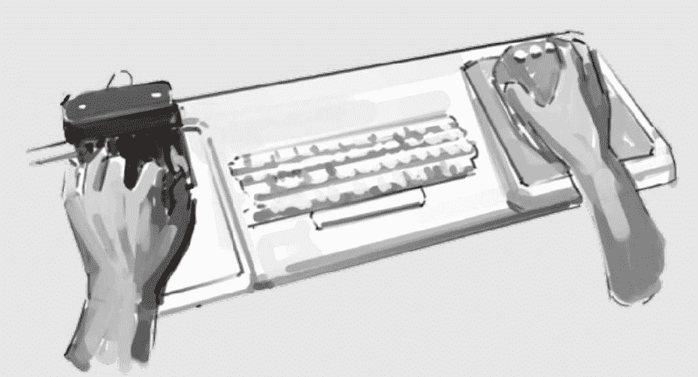

恩格尔巴特的演示是现代意义上第一次对鼠标、键盘和图形化界面的应用

接下来是一份键入的购物清单。恩格尔巴特对各项进行分类，并通过点击打开其中一类。进而，他又展示了多种对购物清单进行编辑和修改的方式。

恩格尔巴特随后通过“链接跳转”浏览了购物清单中各项内容的更多细节信息。这本质上就是超文本。这与我们之前讲到的超链接非常相似——它们将你从一个网页引向另一个网页，但却是通过文本来实现的。

后来，恩格尔巴特在这一演示中称，他的团队已经使用这一系统长达数月了，同时还成功将六台电脑连接到了一起。换而言之，他们初步实现了一个闭环内联网（与`阿帕网`时期的开放互联网相对应）。他甚至继续展示了一种在计算机之间发送电子邮件的形式，而当时距`阿帕网`问世尚有一年的时间。

在 1968 年，这可谓石破天惊。仅仅演示的一个部分就足以让观众瞠目结舌，但恩格尔巴特却一个创新接着一个创新地不断累积。真不愧是“所有演示之母”。

恩格尔巴特开发了鼠标、超文本、屏幕窗口，以及许多现代软件所具备的其他特征。范内瓦·布什在此处仍旧功不可没。恩格尔巴特认为是布什启发了他，让他意识到计算机不仅仅可以处理数字，同时还有望成为信息管理的工具。尽管这已经足以让人难以置信，但其实直到 20 世纪 90 年代中期，人们才真正认识到图形式计算机相互联结的重要性。

虽然图形式计算机起步稍慢，但马上，电脑的发展就会突飞猛进，变得更快、更小。

#### “集一整台计算机于一张芯片！”：英特尔（1968 年）

在上一章中，我们讨论了仙童半导体（由“叛逆八人帮”创立）以及硅谷中集成电路的发明。掌握了这一科技，仙童就已遥遥领先于当时的技术巨头 IBM 和摩托罗拉。

尽管仙童半导体一直是硅谷最为灿烂夺目的明星，但每一年都有新的公司在硅谷成立，随之而来的是崭新的工作机会。员工们非常喜欢这位曾经满心不情愿的老板罗伯特·诺伊斯所塑造的企业文化。因为它与其他公司截然不同——诺伊斯希望能消除管理人员和公司员工之间的界限。在他的观念中，每个人都是团队的一员。员工愿意每天工作 10 到 12 个小时，唯一的原因便是他们享受工作的过程。

起初，这种文化氛围就宛如一个群英荟萃的大学宿舍。员工们相互竞争以获得高额收入。不久，仙童迅速崛起，就像今天的亚马逊、苹果和谷歌一样，无论在股票市场还是在科技领域都首屈一指。然而不久，事实就证明仙童的人才过多，导致很多人的能力无法施展。因此，到 1962 年，仙童半导体开始逐渐瓦解。

半数的创建团队和无数的研究员、工程师都纷纷离开公司，组建新的企业。他们中的大多数或是继续在集成电路领域工作，或是成为该市场中仙童公司的直接竞争对手。随着仙童公司的前员工不断将他们的所见所学向外传播，硅谷也迎来了爆炸式的发展。这些前员工的影响力极大，以至于他们被直接冠以“仙童”的雅号。到了 20 世纪 80 年代，100 家公司如雨后春笋般涌现，他们的创立者均来自仙童最初的人才库。不过即使在风雨飘摇之时，仙童仍旧能够乘风破浪，勇创佳绩。仅仅是 1964 年一年，仙童就向美国宇航局输送了 10 万台设备。然而，诺伊斯将目光放得更远—他关注的是美国的消费者。

随着硅谷中创意的不断积聚，有足够资金的人便希望能投资于人类历史上最热门、最尖端的科技。因此，风险资本应运而生，这一点我们之前已有所提及。

由于越来越多的人才逐渐离开仙童，诸如德州仪器和摩托罗拉这类的公司开始迎头赶上。诺伊斯也意识到他必须开始新的事业。1968 年，他与同事戈登·摩尔合作，启动了一个研制存储芯片设备的项目。这主要是要同磁盘驱动器竞争。凭借诺伊斯和摩尔的业内声誉，以及新兴的风险投资者群体，在不到两天的时间内，该项目就筹得 250 万美元的巨款，这直接促成了一个新公司的创立。

诺伊斯和摩尔经过精挑细选，将顶尖级精英收入公司，其中包括安迪·葛洛夫（Andy Grove），一位出生于匈牙利的化学工程师，1963 年曾效力于仙童的研发部门。他在新的公司担任运营总监一职。公司的老员工们一致认为聘用安迪是诺伊斯所做的最明智的决定。因为他干劲儿十足，对一切事务都精益求精，并且时间观念极强。无论是诺伊斯还是摩尔，都没有这样的意志和决心来挥鞭激励企业向前。

他们共同将公司命名为英特尔（`Intel`），即“集成电子”（integrated electronics）的缩写。同时，英特尔也与“智慧”（intelligence）一词存在着千丝万缕的联系。尽管英特尔的成立并未得到媒体的特别关注，但在硅谷依然令不少人欢欣鼓舞。

1969 年春天，当英特尔的工程师们仍然醉心于存储芯片的研究之时，一个简单的要求悄然传入了英特尔的大楼，而这最终改写了整个计算机的历史。

#### 计算机大脑（`CPU`）的发明

日本公司比吉康（Busicom）曾与英特尔签约，请其为公司的新型计算器设计专用微芯片。不幸的是，比吉康所要求的产品太复杂，而且造价过高，英特尔无法生产。年轻的工程师特德·霍夫（Ted Hoff）率先提出了他的顾虑。他认为英特尔此次难免有些逞能过头了。

特德·霍夫聪明绝顶。20 世纪 60 年代初在斯坦福读书时，他历时 4 年潜心研究模式识别（也就是后来为人们所熟知的“神经网络”）和集成电路。1968 年，霍夫作为第 12 号员工加入英特尔。当霍夫向诺伊斯阐明顾虑之后，诺伊斯反问霍夫是否能够研究一种比比吉康的要求更为简单的芯片设计。诺伊斯总是鼓励实验室中的研究人员大胆设想并勇于实践。

由此，霍夫构想出一种能够通过程序设定来实现某一特定应用的单一芯片。在这个例子中，它将实现计算器的功能。但是，它也可以通过不同程序来做任何事。如果架构足够简单，那么一台计算机的存储、计算和处理功能就可以统一到一个集成电路中完成。

通过努力，他们终于研制出第一个微处理器：其本质是将一整台通用计算机集于一张芯片。

最终，英特尔`4004` `CPU`诞生。该设备集 2000 余根晶体管于一身，其广告语为：“单片计算机。”自此刻起，数字革命正式拉开帷幕。`CPU`的出现超越了之前所有的计算机创新。它被视为过去 100 年中最伟大的发明之一。`CPU`自此将成为现今我们所用的一切计算机辅助类工具的大脑和驱动力。

尽管只有 3.2 毫米宽、4.2 毫米长，霍夫及其团队所发布的芯片却与早期电子计算机之一——电子数字积分计算机埃尼阿克（`ENIAC`）同样强大。诞生于 20 世纪 40 年代的埃尼阿克包含 1.8 万根不稳定的真空管，而且体积极为庞大，能占满整个房间。尽管埃尼阿克之后的计算机体积逐渐缩小，但是`4004`与当时所有的计算机相比依然是巨大的飞跃。1969 年，计算机的体积普遍都与冰箱相差无几，而霍夫的芯片却能将如此庞大的计算机微缩至小小的指尖！

尽管如此，日本的客户依然质疑芯片多任务处理的能力。例如，他们担心芯片无法在显示加载指示灯的同时进行运算。然而，霍夫用事实证明他们的顾虑是多余的。他们唯一需要做的就是编写一个程序，从而使得运算处理和指示灯闪烁能够同时进行（或是两个任务以人脑无法分辨的极快速度交替进行）。芯片通过扫描键盘完成输入，然后在计算器的显示屏上输出计算结果。

这一切都通过微指令，也称微程序来实现。这些微程序需要手工将所编写的代码输入一个`ROM`（只读存储器）芯片之中——这也是英特尔的最新发明！

#### `ROM`：一台计算机的个性

英特尔将`ROM`称作系统的“个性”，因为它是指挥计算机运行的部件。如要改变一台计算机的运行方式，你只需对它的`ROM`进行程序改编即可。传统上，这本要经过一个漫长而复杂的过程——改变单个晶体管间电路的连接方式，或是将大块的电路板整个更换。现在看来，这简直令人难以置信。

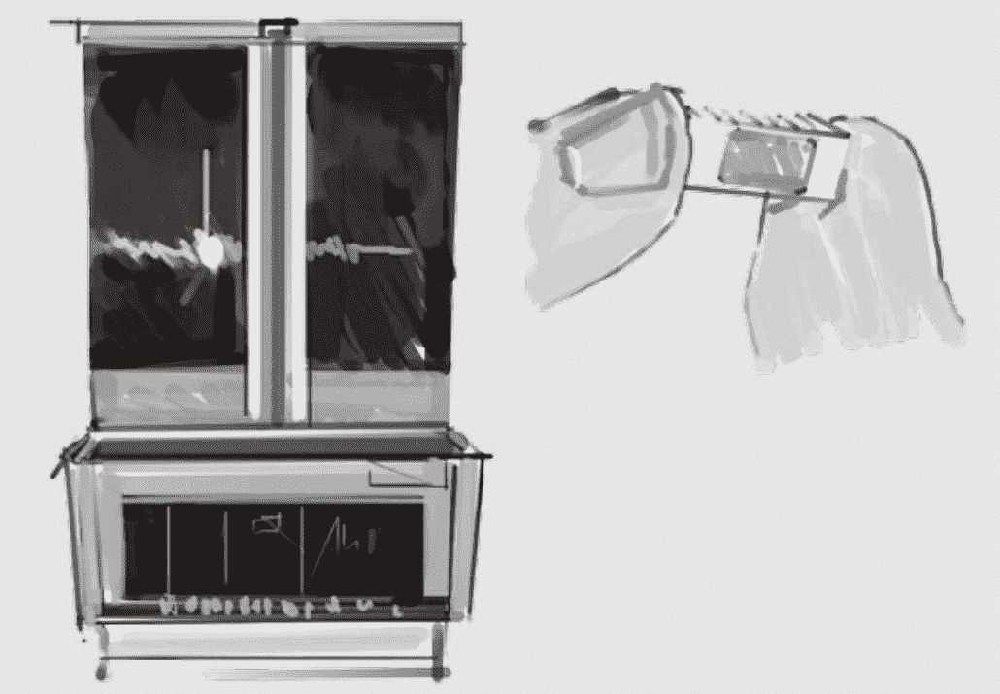

典型的 1969 年计算机 VS `CPU`

在日本制造的计算器上，`CPU`能够在进行运算和指示灯闪烁之间来回切换，这个概念至关重要。现代计算机的`CPU`正是通过执行一个个小任务，并且每一毫秒在成百上千的任务之间相互切换来完成工作的。计算机进行任务切换的速度是如此之快，以至于让我们产生一种错觉，认为它能在同一时间进行多任务处理。

当`4004`微处理器问世时，人们都觉得它不可思议。

特德·霍夫曾提到，他在 1971 年拉斯维加斯的一个计算机会议上有这样一段经历：“当时有一位顾客走进来，坚决表示我们将计算机集于芯片的声明是口出狂言。我们的一位工程师于是将数据表递给了他，他看后感叹道：‘天哪，这确实是一台计算机！’当时，很多人都觉得这是不可能的事。”

稍后，一个更新版本的芯片——英特尔`8080`，成为第一款广为使用的“微型计算机”（`MITS`公司生产）的心脏。这款英特尔驱动的计算机也为苹果和微软（`Microsoft`指的是微计算机软件（Microcomputer Software））的诞生奠定了基础。这一点会在下一章中详述。如今，微处理器市场已价值数十亿美元，而英特尔也成为世界上最大的`CPU`生产商，并且仍在台式计算机和笔记本电脑的市场中保持领军地位。

20 世纪 80 年代初，特德·霍夫离开英特尔，开始担任雅达利（`Atari`，美国一家电脑游戏机厂商）的技术副总裁。罗伯特·诺伊斯在 70 年代后期也自英特尔离任。

20 世纪 60 年代，这是怎样一个时代啊！短短 10 年之间，计算机技术发生了翻天覆地的变化。在文化方面，婴儿潮一代对社会产生了深远的影响。在科技方面，新的创意层出不穷，彻底改变了人们的生活。

在下一章中，我们即将看到，科技渐渐融入主流文化，技术创新也因此日新月异。

### 第十章 新纪元（1970—1979）

20 世纪 60 年代的激进思潮震动了世界。到了 70 年代，西方社会的集体情绪急速转折。战后的经济繁荣接近尾声，中东危机导致油价上涨，越南战争不断升级，尼克松因“水门事件”被弹劾。许多人走上街头，为女权、种族平等、同性恋群体权益摇旗呐喊。新纪元运动如火如荼地开展，对美国政府的反对之声也日渐激烈。这项运动把世界带向了“自我时代”。

20 世纪 70 年代后半段，随着经济稍有起色，一种叫作“迪斯科”的新音乐形式出现了。迪斯科最初是布鲁斯和 R&B 的混音，无间断地在舞厅里播放，让人们可以舞得尽兴，不用担心音乐何时停止。摇滚乐也在发生变化，华丽摇滚和强力芭乐在 70 年代末迎来了属于自己的时代。

这 10 年间，电子邮件首次登场，同时出现的还有第一款文字处理软件`C 语言`编程和软盘。1972 年，尤金·塞尔南（Gene Cernan）成为最后一个登上月球的人。1975 年，一位名不见经传的年轻导演带着电影《大白鲨》闯入国际影坛。他叫斯蒂芬·斯皮尔伯格，即将成为最伟大的电影人之一。1976 年，最成功的超级电脑`Cray-1`面世，实现了巨大的技术突破，以 80 兆赫的炫目速度飞速运行（相当于智能手机单核处理器速度的 1/25）。易拉罐设计、便利贴、魔方这些日常发明也诞生于这个时代。但是，这 10 年中最伟大的成就当属 1977 年 NASA 的“旅行者”探测器。同年发生了 176 年一见的天文现象，太阳系的几颗行星形成“连珠”，正巧让人类能够好好研究这些星体。

“旅行者 2 号”是第一艘探索天王星和海王星的宇宙飞船。它发现天王星转轴略微倾斜，并探测到 10 颗新卫星；它发现冥王星的周围有 6 颗卫星环绕，还有一团体积与地球相当的风暴每 18 小时环绕冥王星飞行一次。我们如今对于天王星和冥王星的了解几乎全部来自“旅行者 2 号”。这艘飞船还探测到木星的卫星伊娥上有 9 座火山，产生的烟柱以 1 千米/秒的速度冲入空中 300 千米！“旅行者 2 号”也抵达木星附近，并发现木星的密度比水还小。如果我们有一片足够大的海洋，木星就会漂浮在海面上。

旅行者飞船以钚同位素为燃料，至今仍维持运行。探测器向地球传输数据的速度比一台拨号调制解调器还慢，每 3 年传输 10 亿英里（约 16 亿千米）。

除了太空旅行，20 世纪 70 年代的各项成就引领人类走进现代生活方式，是另一种新纪元的开篇。1953 年，詹姆斯·沃森、弗朗西斯·克里克、罗莎琳德·富兰克林（被遗忘的 X 射线女巫）就发现了 DNA 的双螺旋结构。奇怪的是，人类又花了 20 年才理解该发现的实际意义。1972 年，赫伯特·伯耶（Herbert Boyer）和斯坦利·科恩（Stanley Cohen）重组出第一个转基因生物体——卡那霉素（一种抗生素）抗性细菌。没多久，鲁道夫·耶尼施（Rudolf Jaenisch）就构建出第一只转基因小鼠。

## 家用游戏机终于登场（1972 年）

如今的我们对电子游戏都不再陌生。从任天堂、Xbox 到 PlayStation（PS 游戏机），家用游戏机让我们度过了无数欢乐时光。第八章中辛吉勃森发明的《双人网球》和第九章中麻省理工的《太空大战》是早期电脑游戏的两次尝试，但谁才是那个发明了家用游戏机的天才呢？

要回答这个问题，我们得先回到 1966 年。

### 电视游戏盒

1966 年，军用设备公司 Sanders Associates 的设计总监拉尔夫·贝尔（Ralph Baer）正在等公交车。百无聊赖中，他突然想到，一个很简单的“游戏盒”就能让电视转化为游戏机。受这个想法的启发，他在第二天就写下了简短的产品提案。

他要拿这个发明怎么办呢？贝尔知道，他的上司不会给这个提案拨款，因为军用产品和游戏设备毫无关系。于是他拉上同事鲍勃·特伦布莱（Bob Tremblay），在一间空房里单独工作。

不久，他们就做成了一个原型机，起名为“电视游戏 1”。多么有创造力的名字。坦白讲，这个原型并不怎么样。这个游戏由一条可以在电视屏幕上移动的垂直线组成。虽说视觉效果略显寒碜，贝尔还是把“电视游戏 1”带到了 Sanders 研发总监赫伯特·坎普曼（Herbert Campman）的面前。现场也许是这样的：坎普曼扬了扬眉，耸了耸肩，脱口而出，“好吧，管他呢”。最终，坎普曼同意为这个产品拨款 2500 美元（相当于今天的 19332 美元）。

第二年，贝尔带领一小组工程师改进产品。最终，他们做出了一款可以用塑料光枪射击的游戏机。

贝尔把新游戏带到坎普曼面前时，坎普曼是真的动心了。坎普曼立刻增加拨款，并把这个游戏推荐给高层，后者大多不屑一顾。即便如此，Sanders 的 CEO（首席执行官）仍然认为电视游戏机是可以卖出去的。1969 年，贝尔团队设计出的游戏机包括近 30 个游戏，他们现在只缺买家了。电视制造商是最合乎逻辑的选择。1971 年，在经过与美国无线电公司多次失败的协商后，贝尔与米罗华（Magnavox）达成了协议。产品发布日期定在 1972 年 9 月，这款游戏机被命名为“米罗华奥德赛”，定价为 99.99 美元（相当于今天的 600 美元）。如果要买一台配套的电视机，要额外付 50 美元（相当于今天的 353 美元）。这就是第一台家用游戏机的故事。

由于名词“电子游戏”当时还不存在，在推广期间，这套游戏系统被称为“闭环电路的电子游乐场”。

那么，公众对于这台游戏机的反响如何呢？当时家里唯一的娱乐设备就是黑白电视，现在可以用电视玩游戏了？这一定是穿越到未来的感觉吧！可是其销量并没有反映出这一点。

含糊的广告让人以为这款游戏机只能和米罗华电视配套使用，再加上价格不菲，奥德赛的销量一直很平庸。直至 1975 年停产，它的全球销量只有 35 万台左右。尽管如此，奥德赛仍然是电子游戏发展的里程碑，催生了游戏巨头雅达利。

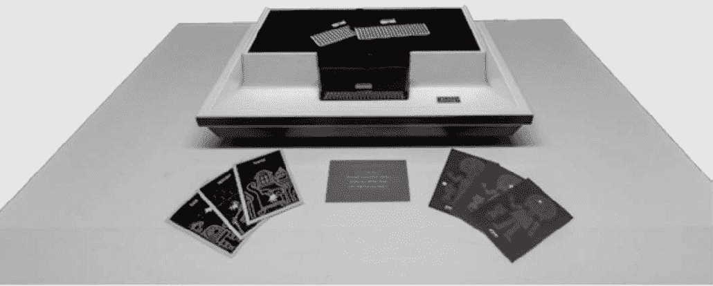

米罗华奥德赛

### 嘿！别和我抢《乓》——雅达利的故事

奥德赛的故事没有就此停止。奥德赛发布之时，诺兰·布什内尔（Nolan Bushnell）是一家街机制造商的首席工程师。布什内尔之前设计出一款电脑游戏《电脑空间》（1962 年麻省理工《太空大战》的街机版本）。《电脑空间》也是第一台商业街机。机身类似橱柜，所有硬件都是为这款游戏特别定制的，因为游戏不能在便宜的小电脑上运行。游戏机被放置在当地酒吧中，反响平平。也许是因为游戏过于复杂，也许是因为客人都喝醉了，无法理解游戏的玩法。不管怎样，布什内尔都需要一个新的产品。

1972 年 5 月的一天，他在一家经销商那里看到了奥德赛游戏的演示。从他看到电视屏幕上出现乒乓游戏的那一刻起，就知道巨变即将到来。他立刻停止旧业务，创办新公司雅达利，并且雇用了艾伦·奥尔康（Allan Alcorn）。

布什内尔隐藏了奥德赛是米罗华公司财产的事实。他让奥尔康设计一台类似的投币打乒乓球的游戏机，作为他的培训内容。布什内尔真正的目的是盗取奥尔康的劳动成果，白捞一台游戏机。

奥尔康很有天分，他认为原版游戏太无聊了，应当做出改变。奥德赛的乒乓球在一条直线上匀速来回，他认为乒乓球的方向应该根据玩家的手势而改变，球速应该随着游戏时间加快，在错过一个球之后，速度重置到初始状态。这个游戏后来的名字是“乓”（Pong）。

《乓》街机的装置很简单：一台黑白电视，一些运行游戏的定制硬件，一个洗衣店的投币系统，下面连着一个牛奶盒，以储存硬币。

1972 年 8 月，这台游戏机进入当地的一个酒吧，想测试一下人们的反应。可是安装游戏机短短几天后，机器就无法正常运作了。奥尔康接到维修电话，赶去酒吧。这一路，他一定在思考这些问题：出了什么问题？代码写错了，还是硬件组装不当？他来到酒吧门口，发现人们排起了长队，等待酒吧重新开张。他们都在等着玩《乓》！

那问题是什么呢？游戏机太受欢迎了，投币系统负荷过重，导致装置短路并关闭。这时候，雅达利的这两个人知道他们拥有了一台即将风靡全国的产品。

《乓》很快成为最受美国年轻人欢迎的游戏，游戏机房则成为孩子们最爱去的地方。布什内尔后来接受采访时说道，很多年轻人都是在玩《乓》的过程中结识了他们的人生伴侣。

《乓》，也可以说是奥德赛，真正开启了现代电玩时代。1974 年，雅达利因窃取创意被米罗华起诉，并同意支付一笔罚款。

## 开启皮克斯的那只手（1972 年）

我们已经习惯的无处不在的 3D 动画有个非常有趣的诞生故事，和一个男人埃德温·卡特姆（Edwin Catmull）的聪明才智有关。卡特姆出生于 1945 年，是战后婴儿潮的一代。他的偶像是爱因斯坦和迪士尼。《木偶奇遇记》和《彼得·潘》这样的电影点燃了他的想象。他想成为动画人，但找不到途径。于是他选择在犹他大学主修计算机，作为对偶像爱因斯坦的致敬。读研究生时，他是伊凡·苏泽兰的学生。上一章说过，苏泽兰发明了世界上第一个电脑绘图程序——几何画板。卡特姆认为在电脑上做动画是他的两大热爱——科学与艺术——的完美结合。

从那时起，卡特姆的主要目标和野心就是做一部电脑动画。观察到电脑动画可悲的现状后，卡特姆认识到现有的软件无法为电影产业提供足够的支持。这个年轻人决定制作自己的动画软件，创建纹理映射、抗锯齿和深度缓冲，就这样以一己之力奠定了 CG（Computer Graphics，计算机图形学）的基础。

他的第一个机会是课堂作业，要求制作一个数字 3D 物品。卡特姆决定通过制作石膏模型把他的左手数字化。不幸的是，这个模型太紧了，当他试图把手从模型中抽走的时候，手背上的汗毛全部扯掉了。在痛苦的分离后，卡特姆追踪手表面的 350 个三角形，这些三角形的边代表坐标。他必须把一个个坐标输入电传键盘中，让电脑处理。

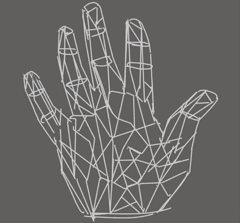

卡特姆的 3D 左手

当时的电脑无法一次计算出整帧画面，所以要先用长曝光相机拍摄屏幕上的输出结果，直到整帧画面处理完成，然后再拍摄快照。处理一个画面就要做很多工作。

最后完成的视频被简单地命名为“一只电脑动画的手”，于 1976 年被好莱坞制片人看中，并被收入电影《未来世界》（《西部世界》的科幻续集）。这是第一部使用 3D 电脑图形的电影。

卡特姆后来建立了自己的电脑图形实验室，与伟大的乔治·卢卡斯（George Lucas）合作，将 CG 科技带入娱乐世界。后来，卡特姆的电脑图形实验室脱离卢卡斯影业，成立独立公司，取名为皮克斯。1986 年，皮克斯将收到苹果的联合创始人乔布斯的大数额投资。

皮克斯追根溯源，竟然是一只没有汗毛的左手。CG 在今天无处不在，但更加无处不在的是手机，它也是 20 世纪 70 年代的发明。

## 第一部手机（1973 年）

手机完全改变了我们对未来的期待。如今，整个世界就在我们的指尖，一触即发。我们可以随时随地阅读、观看、聆听、购物和创作。

我刚刚形容的是智能手机带来的革命，而这一切其实是 10 年之内的发明。在智能手机让我们的口袋装得下世界之前，手机的功能十分简单。20 世纪 90 年代和 21 世纪初，它们只有一台简单的主机、相机，高级一些的还有特别简单的上网功能。但是当我们回到 80 年代，移动电话只做一件事：打电话。

第一部原始的、只能用来打电话的手机是什么呢？我们口袋里的智能手机的祖师爷到底是什么样呢？让我们来认识一下发明手机的人。

说起第一部手机的故事，我们要回到 20 世纪 40 年代。严格来说，移动电话在这时就存在了，但只能在车里使用。如果你有一部移动电话，那你很可能是个有头有脸的人物。在这时，在车里装电话是唯一让电话移动的方法。因为电话需要的电量很大，只有车载电池能满足。

另一个缺陷是，在一个特定区域内（比如纽约），只有 12 条电话线路存在，所以大部分时间你不得不等待使用信号。连上一部车载电话需要 30 分钟，这就是现实，也是人们必须忍受的不便，直到现实发生了改变。

1968 年，美国联邦通讯委员会（Federal Communications Commission，FCC）要求 AT&T 解决这个问题，于是 AT&T 发明了蜂窝网络结构。

这个系统把一大片信号覆盖区域拆分成小片，以便多人可以同时在车里使用手机。那时，普通的移动系统用一台中央高功率基站为整个城市输送信号。新系统可以把一些低功率基站排列在蜂窝状格子中（这就是“蜂窝网络”名字的来源）。当车子开动时，通话会自动从一个蜂窝转接到另一个蜂窝。

摩托罗拉也有一个车载电话的部门，不希望 AT&T 独自占有新系统的优势，垄断这个新兴行业。摩托罗拉很担心如果他们什么都不做，这就是他们移动电话事业的终结。所以他们开始研发能与新系统配合的手机，而该手机的技术将一骑绝尘，把 AT&T 远远甩在身后。1972 年，摩托罗拉要求一位叫马丁·库珀（Martin Cooper）的员工领导这个项目。

有一天，库珀正思考着如何制造一部手机，突然想起漫画《至尊神探》（Dick Tracy），其主人公迪克有一块可以打击犯罪的移动腕表。

这启发了库珀：与其给一个地点分配一个手机号码，为什么不把号码分配给一个人呢？那样不论你在哪里，都可以联系任何人。这是一个革命性的概念，但是这样的工具真的可能被制造出来吗？库珀想到了一个新的科技——英特尔公司 1971 年新发明的微处理器。微处理器外形小，占用空间少，消耗功率低，却和其他处理器有同样的工作能力，成为整个设计的关键。

1973 年 3 月，库珀的团队制作出名为 DynaTAC 的原型机。同年 4 月 3 日，库珀在纽约的新闻发布会上介绍了这个原型机。

### 第一通电话是骚扰电话

在新闻发布会前，库珀要进行通话测试，他决定打给一位名叫尤尔·恩格尔（Joel Engel）的工程师。恩格尔是摩托罗拉的死对头 AT&T 移动电话项目的总工程师。所以库珀选择用新电话打给恩格尔，告诉他摩托罗拉已经打败了 AT&T。没错，第一通移动电话是骚扰电话。库珀解释道：

我们当时不了解这通电话的历史意义。我们只担心一点：按下按钮的那一刻，电话会打通吗？很幸运，确实打通了。

1983 年，在多年的迭代后，摩托罗拉向消费者推出了第一部便携式手机 DynaTAC 8000x。这部手机的重量接近 1 千克，需要 10 小时才能充满电，而通话时间只有 30 分钟。不过那也不是问题，因为你的手臂要把这部电话举到耳边，也坚持不了 30 分钟。最夸张的是，DynaTAC 8000x 当时的售价近 1 万美元。

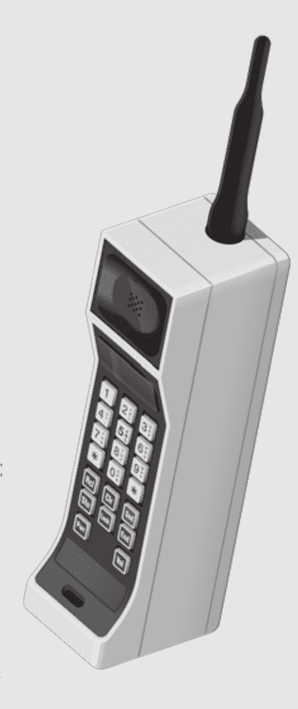

DynaTAC 8000X

这部手机最终获得了巨大的成功，并开启了移动手机的革命。当库珀 1973 年打第一通移动电话时，那是唯一的一部真正的手机。现在，手机的数量比人还多。当库珀打通那个影响世界的电话时，另一件改变历史进程的事发生了：第一台使用图形用户界面的商业电脑诞生了。

## 煮熟的鸭子飞了：施乐奥托（1973 年）

想象你拥有 20 世纪最伟大的发明之一，却因不了解你拥有的是什么而把它拱手送给了别人。施乐（Xerox）就是这样把施乐奥托（Xerox Alto）送给了别人。

奥托是帕洛奥托研究中心（Palo Alto Research Centre，简称 PARC 实验室）1973 年发明的一台实验性电脑。PARC 团队包括罗伯特·泰勒——上一章中提到的 DARPA 研究员，以及其他受道格拉斯·恩格尔巴特（演示之母）和约瑟夫·利克莱德启发的研究员。

奥托远远领先于它的时代。这是第一台接近我们今天认知的台式个人电脑。个人电脑的核心思想基于利克莱德 20 世纪 60 年代写的论文《人机共生》。在论文中，他把电脑描述成一个友好的同事，帮助人类解决人脑无法处理的问题。

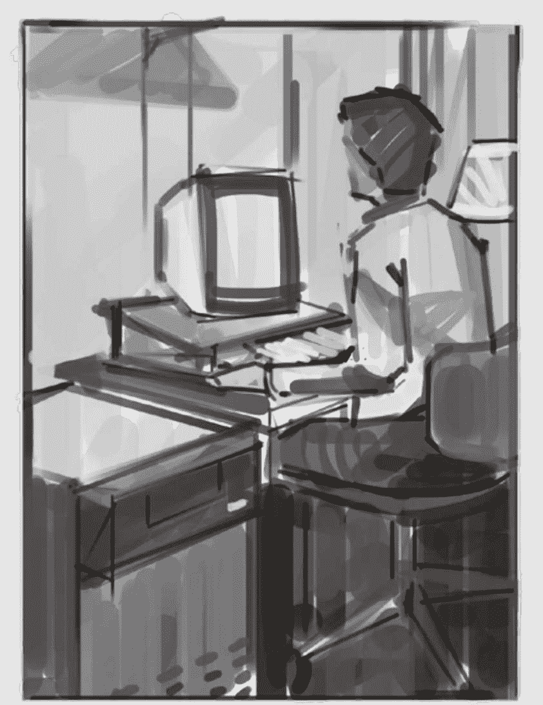

施乐奥托从各方面来说都是一台现代台式电脑

奥托电脑有一个鼠标、显示屏、图标、菜单、图案，能够复制、粘贴、移动、删除文件的档案整理器，甚至有一个可以连接电脑的本地网络。这套系统被称为“图形用户界面”（Graphical User Interface，GUI），试图在屏幕上模仿办公桌，达到无纸化办公的效果。在 1973 年，这是一种全新的思维方式。

奥托代表的是第一套台式电脑的图形用户界面。

在屏幕上指向并点击一个图形在当时的主流计算机界是非常新的概念，尽管这项技术已经在“演示之母”上展示过。在 GUI 之前，你必须先输入一行文字指令，才能让电脑运作。如果你不小心输错了指令，电脑就会产生错误。

数千台奥托在 PARC 实验室被生产出来，但从未被出售给公众，仅仅在一些施乐办公室和几所大学里被使用。施乐高层并不理解他们拥有的是什么，他们觉得奥托是个酷炫的玩具，仅此而已。管理层对电脑的未来没有任何想象，但是史蒂夫·乔布斯有，然后施乐就把这个完整的愿景送到了他手上。事情是这样的：

尽管一些员工强烈抗议，施乐的经理邀请乔布斯在 1979 年来欣赏奥托。这是一个交易：乔布斯答应帮助施乐团队了解如何以更低的成本制造电脑，因为苹果 II 当时十分畅销，作为交换，施乐允许乔布斯来 PARC 实验室参观，了解最前沿的研究。

这次参观让乔布斯瞠目结舌，他立刻意识到这就是未来，他想象中的电脑会做的一切就展示在他面前。乔布斯没有浪费这个机会，在苹果的下一款产品丽萨（Lisa）电脑上大量借鉴了 GUI，配有显示屏和鼠标，这也是 1985 年麦金塔电脑（Macintosh）的前身。我们会在下一章中重新回到这个故事。

## 个人计算机的诞生（1975 年）

个人计算机（PC）如何为商务和家庭生活带来革新已无须赘述，但这场革命是怎么开始的呢？我们马上就会发现，第一台 PC 是微软和苹果的结合。

1974 年，一位工程师爱德华·罗伯茨（Ed Roberts）试图让他的计算器公司 MITS 有一些转机。在与银行贷款人的会议上，他决定放手一搏，说要通过做一件从未有人做过的事来拯救他的公司：为计算机发烧友制作个人电脑套件。这原本是不可能完成的任务，而 3 年前特德·霍夫和英特尔公司发明的微处理器（CPU）使之成为可能。CPU 技术能把整个电脑的内容集中在一块芯片上。1972 年，英特尔发布了更强大的 8080 芯片。罗伯茨看到了这个机会，把芯片用于他的新电脑 Altair 8800——世界上第一台微型计算机。

### 《大众电子》：点燃一切的火花

MITS 花费 400 美元（相当于今天的 1800 美元）让这台微型计算机登上了《大众电子》（Popular Electronics）的封面。对于主要受众为业余爱好者的《大众电子》来说，刊登计算机广告是有些风险的，因为业余爱好者不一定对电脑感兴趣。结果却恰恰相反。

罗伯茨告诉该银行，MITS 公司原本预计最多只有几百个订单，但结果短短数月就售出了几千台。热情的电脑发烧友甚至把车停在 MITS 公司的仓库前，以便拿到自己的电脑。

仔细想想，这种需求是很自然的。20 世纪 70 年代早期，计算机仍然是高精尖产品，仅仅看一眼就需要通行证，别说可以使用一台了。使用电脑通常是分时共享模式，多个用户通过登录主机终端，共用一台大型机。而且随着技术进步，电脑越来越难操作。20 世纪 70 年代中期，电脑技术迅猛发展，其功能远远不仅是数学计算。

在全球范围内，年轻的科技人才被电脑的概念深深吸引。其中一位就是叛逆的电脑黑客比尔·盖茨，他此时正在大学里读书。

保罗·艾伦（Paul Allen）是盖茨的高中同学。他在杂志封面上看到 8800 后，立刻带着杂志冲进盖茨的大学宿舍。盖茨一看到这台设备，就知道这是未来。消费型 PC 终于到来了。这个事件改变了盖茨的人生，也改变了我们所有人的生活。一瞬间，所有可能性都触手可及了。

嗯……只能说差不多吧。8800 是个非常原始的模型。最早的用户会说，这台设备不能连接键盘和显示器，只是一堆开关和灯光的组合。8800 操作也很麻烦，你必须拨动开关输入指令。比如，为了完成 2+2 的运算，每个 2 都要拨动 8 次开关才能输入，摁第 9 次才能加载数字。输入“+”也需要按 8 个键，然后答案“4”会出现在从左数第三盏灯上（我说了这很复杂）。更糟糕的是，这台电脑没有记忆。你在编程时不能把机器关掉，否则它会失去所有的记忆。我们必须对今天操作便捷的电脑心存感激。

### 微软：盖茨把爱好变成了公司（1975 年）

当保罗·艾伦冲入比尔·盖茨的宿舍，向他展示 8800 时，盖茨同时意识到电脑革命即将抛下他独自开始了。他打电话给 MITS 公司，告诉他们他和艾伦已经为这台电脑写好了软件，而且编程即将完成。可问题是，他们还没有开始写。19 岁的盖茨看到他可以在新兴的 PC 产业中先声夺人。他立刻辍学，前往新墨西哥，住在 MITS 工厂对面的宾馆里，和艾伦一起为 Altair 8800 写软件。他们决定为 Altair 写一个基础软件，让它可以做比闪光更高级的事。他们甚至没有一台 Altair 机器对代码进行测试，只有英特尔介绍 8800 芯片的一本小册子。只要他们犯一个错误，软件就无法正常运作。他们没有被巨大的挑战干扰，在几个月中完成了软件的编程，并打印在穿孔纸带上。这张穿孔纸带就是微软的第一款软件。你会发现微软就是微型电脑软件的缩写。

艾伦带着代码去往 MITS 工厂，在 CEO 罗伯茨的见证下，在 8800 上试用软件。艾伦输入 2+2，电脑立刻输出 4。他又输入一些平方和平方根，全部成功了。这款软件成功了。盖茨的商业头脑、冒险精神、自信和技巧让他和艾伦制作出他们还没有，但知道世界需要的技术。

盖茨和艾伦的软件成功为 Altair 8800 赋能。这一年结束之前，人们可以把 Altair 接上屏幕，在微软 BASIC 软件的基础上编写游戏、会计软件和文字处理程序。这就是微软公司的起源。

真正的革命开始了，而微软处于革命的风暴眼。今天我们也知道，他们之后做得并不赖。

### 苹果电脑（1977 年）

如果 PC 产业是一枚硬币，一面是微软，另一面就是苹果。如今，他们是世界上最有价值的公司，但这一切是怎么开始的呢？人们常说，当你在正确的时间出现在正确的地点，伟大的事情就会发生。

那是 1977 年，是创新科技爆炸的绝佳时机。20 世纪 60 年代反主流文化的残余远离美国主流文化，仍在激烈地变革。与此同时，英特尔开发出 CPU。16 岁的史蒂夫·乔布斯和 21 岁的史蒂夫·沃兹尼亚克相遇，他们都是普普通通的大学生，喜欢科技、恶作剧、披头士。他们的朋友不会想到不久后他们会改变世界。

登上《大众电子》封面的 8800 在全国范围内引发电脑狂潮，各地都兴办起电脑俱乐部，比如旧金山的家酿计算机俱乐部，它们主要讨论的是电脑如何能够真实地为人类生活带来便利。

西海岸电脑节的创始人吉姆·沃伦认为，家酿计算机俱乐部的信仰体系受到该地区反主流文化的影响。俱乐部的风气是互相帮助和分享一切。整个团队都想弄清楚新电脑套装的功能。购买了微软软件的社团成员在没有被盖茨许可的情况下，复制并传阅他写的纸带软件。他们并不觉得这有什么不对，但是盖茨很生气。

这样公开的行为与盖茨的信仰并不一致。盖茨专程飞来家酿演讲，恳请人们停止写他的软件。俱乐部的成员不太关心盖茨的抗议。他们只是兴奋地想知道每一段代码能给 Altair 带来什么新功能。

沃兹尼亚克（后称“沃兹”）后来承认，是他在家酿的第一场会议给予他灵感，让他开始设计自己的电脑，他每周都会带着电脑来会上讨论。沃兹一直是爱鼓捣发明的人，曾经因为在大学电脑上发送恶作剧信息被开除。70 年代早期，他还在读大学，他喜欢阅读一些小册子，在纸上设计自己的电脑，迫切地攒钱为购买 CPU 做准备。他回忆道：

我把一本描述 PDP—8 电脑的书带回家，它对我来说堪比《圣经》。你可能会在弹奏乐器的时候爱上一件乐器，我爱上了描述电脑内部的微小细节。我可以在纸上自己给自己出问题，如果我能找到解决方案，就特别开心。

大一时，沃兹告诉父亲，有一天他一定会买台式电脑。他父亲说：“儿子，这玩意儿的价格和一幢房子差不多。”沃兹答道：“那我就住在公寓里。”

1975 年，沃兹开始组装他的电脑，并在同年 6 月完成了第一个原型机。因为他在惠普设计计算器，所以可以从公司“借”来硅片。

沃兹带去俱乐部给大家展示的原型机可以显示字母，运行几个简单的程序。这是历史上首次在家用电脑屏幕上显示文字。他的电脑每周都会有新进展。沃兹设计电脑的主要动力就是可以在俱乐部的兄弟面前显摆一下。

沃兹十分害羞，甚至不愿意在会议过程中举手，他把电脑组装好，放在一边，等大家来看。大家会围在他的电脑边，问他问题，永远也问不完。

沃兹的朋友乔布斯当时是雅达利的实习生，也是俱乐部的成员，他观察到大家对这款产品的热情。他建议沃兹把这些产品带入市场。

沃兹已经证明他有能力一手设计出电路板、PC 所需要的硬件和软件，所以理论上他们两个可以实现这个想法，也许能成……

### 第一台苹果电脑

最初，沃兹想把他的电脑设计卖给惠普，但他们拒绝了他 5 次。最后证明这是惠普的损失。

于是沃兹在乔布斯的建议下，决定尝试出售他组装的电路板。沃兹卖掉了自己的惠普计算器，乔布斯卖掉了自己的大众汽车，作为项目的启动资金。他们在朋友的帮助下总共筹集了 1300 美元（相当于今天的 5700 美元），在乔布斯的卧室和车库里制作出第一台家用 PC。这就是苹果的处女作—苹果 I，售价 600 美元（相当于今天的 2640 美元）。该设计所用芯片数量比任何同类机器都少。沃兹声名鹊起，被称为电脑设计界的“文艺复兴时期艺术家”。苹果 I 是一块单独的主板，没有键盘和显示器。

1976 年 4 月，乔布斯和沃兹尼亚克共同成立了苹果电脑公司。同年，该公司售出 50 台苹果 I。对乔布斯来说，这证明并非只有俱乐部里的极客渴望一台 PC，俱乐部之外也存在广泛的客户群。但是，普通用户要怎么办呢？我们其他人该怎么办呢？乔布斯解释道：

我很清楚，世界上有一群电脑发烧友可以用一堆硬件拼装自己的电脑，或者至少可以用我们的主板，给电源连上变压器，加上外壳和键盘。但是，每出现一个会这样做的人，就有 1000 个不会这样做的人，但也很想尝试编程。所以我对苹果的愿景是，我们可以卖出第一台完整的电脑套装。

我认为这个见解对很多发烧友是完全的盲区。对于乐于搞发明的人来说，理解整套 PC 的商业价值并不是那么显而易见。需要一定的商业头脑才能看到这一点。

乔布斯对一台现成 PC 的设想在当时是不可能的，它需要很多芯片，成本很高，设计过于复杂。事实证明，沃兹并不知道这是不可能的。

沃兹是电脑设计的魔法师。苹果 I 能显示颜色全靠他在雅达利设计街机时学到的技巧（沃兹参与制作了著名的游戏《打砖块》）。乔布斯贡献了自己的设计知识，让电脑更好看，同时坚持电脑必须操作简单。即使从今天看来，苹果 I 苗条、倾斜的外形设计也十分前卫。比起当时普遍笨重乏味的机箱，苹果 I 让人耳目一新。

### 苹果 II

乔布斯筹集到制作电脑的资金，于是苹果 II 诞生了，售价为 1300 美元（相当于今天的 5242 美元）。这是一台功能强大的现成家用电脑，用户只需要接入键盘、显示器、电源线。这台电脑的主要软件是微软 BASIC。

1977 年，PC 已不再是两年前初生时的模样—发烧友组装的电子元件盒，只有灯光和开关。此时的 PC 是一台可以直接使用的机器。这是家用电脑真正的元年。1977 年，年轻的公司带着苹果 II 到西海岸电脑节展示，立刻吸引了所有人的目光。苹果 II 色彩斑斓，内置显卡，观众都不敢相信他们的眼睛。这是有史以来最完整的电脑。

苹果 II 是第一台使用 BASIC 软件的家用电脑，也是第一台有声音、颜色、图像、塑料机箱、主机板中内置 48KB RAM 内存而不需要内存插槽的电脑。

直到 20 世纪 80 年代，苹果 II 也很畅销，共售出几百万台。它和 Commodore PET、Tandy TRS—80 一同称霸 80 年代的 PC 市场。

## PC 影响商业世界

1979 年，苹果推出杀手级应用—电子表格 VisiCalc，本质是面向商务用户的 Excel 表格。VisiCalc 最初被设想为“魔法黑板”。会计再也不用因为在表格上做出一个变动就重新计算所有数据，电脑可以自动计算。

当看到现场演示的时候，会计们脱口而出：“这下我们的工作可简单太多了！”甚至有人因为这款软件喜极而泣，激动得颤抖。VisiCalc 产品在 1985 年停止生产，而微软在同年推出 Excel，延续这项伟大的发明。

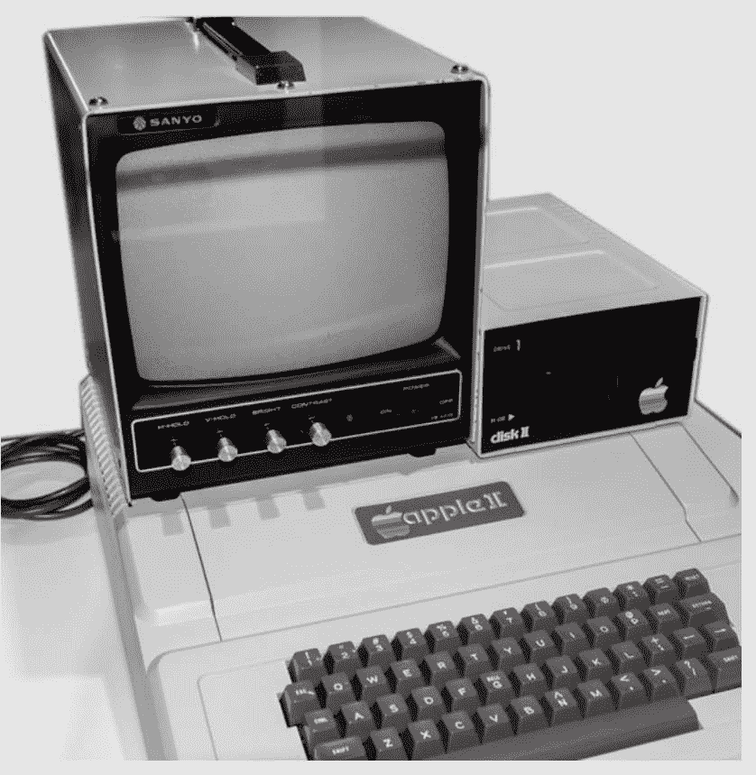

苹果 II 电脑

在这之后，苹果公司业绩呈几何级增长，乔布斯 23 岁时身价就超过 100 万美元，24 岁时超过 1000 万美元。25 岁生日那天，他的身价超过 1 亿美元。因为苹果 II 的面世，乔布斯在两年内就从一个在车库里工作的发明家，变为身价超过 1 亿美元的富豪。

苹果的未来并非一帆风顺，IBM 和微软之间对 PC 市场的争夺战将在 80 年代上演。我们在下一章中将回到苹果的故事。

## 在 DVD 和 CD 之前，我们有镭射影碟（1978 年）

我们都知道光盘，但是在如今的后实体媒介时代，我们可能很难理解这是多么伟大的发明。CD 刚刚面世时，简直就是一场革命。与黑胶、磁带不同，音乐不会因为倒带而受损，音质也不会随着时间的推移而变差。声音真的可以永远被储存了。数字声音在 1982 年因为镭射影碟（AT&T 的贝尔实验室的另一个发明）的出现而成为现实。这简直就是科幻小说里的内容。90 年代中期，当我还是个孩子的时候，我记得我被这个概念惊艳了。

今天的很多年轻人可能不知道 CD 的基础技术是更早之前的技术镭射影碟，最初被称为 Disco Vision，在当时是石破天惊的发明。它本该以势如破竹之势横扫世界，却很快被遗忘了。

### 什么是镭射影碟？

镭射影碟（Laser Disc，简称 LD）是一种家庭影院模式，第一种商业视觉储存媒介。

它可以说是 20 世纪 70 年代末的 DVD。飞利浦、米罗华和先锋都制作过镭射碟片播放器。LD 于 1978 年面世，比家用录像系统（VHS VCR）早两年，比 CD 早 4 年。碟片的面积很大，直径达 30.5 厘米。

第一台大规模生产的工业镭射唱盘机是 MCA DiscoVision PR—7820。70 年代末 80 年代初，通用汽车公司使用这种设备播放培训视频和幻灯片。第一部在 LD 上发行的电影是斯皮尔伯格的《大白鲨》。1978—2001 年，超过 1 万部电影通过该媒介发行。

VHS 是镭射影碟最大的竞争对手。LD 的优势在于，它可以播放静止的图像，而不会被旋转盘座磨损。LD 的图片锐度也更高，水平像素达到 430 左右，而 VHS 只有 240。LD 既可以存储模拟信号，也可以存储数字音频，而 VHS 只能存储模拟信号。LD 可以储存多条音轨，VHS 则不行。这让电影可以加入导演评注音轨和其他花絮（这在当时是第一次，尽管它是蓝光/DVD 的标配）。

LD 最初比 VHS 盒带的制作成本低，因为他们不需要 VHS 所需的转动部件和塑料外壳。此外，其复制过程也更加简单。然而，由于需求量较大，录像带的制作成本很快就降低了。到了 90 年代，每台成本只有 1 美元。LD 的使用寿命也比 VHS 更长。LD 是通过非接触式的光学读取内容，而非磁性读取。因此，倒带不会磨损承载信息的部分，制作精良的 LD 理论上使用寿命比人还要长。

### 所以，哪里出了岔子呢？

如果 LD 有这么多优点，为什么它没有席卷世界呢？

LD 分量更重（约半磅）、更大，如果操作不当，比 VHS 更容易受损。而且，根据不同存储格式，碟片每面只能放下 30 到 60 分钟的内容，所以有些电影需要两张或更多的碟片才能承载。此外，大多数 LD 播放机需要用户从沙发上站起来，走到播放器面前，手动翻面。

错误勘察在当时也不存在。所以即使是一粒尘埃，或是表面上轻微的划痕都会造成阅读错误，导致各种视频质量问题：雪花、波浪纹、刺耳杂音、画面中断。DVD 和之后的电子媒体都有保护机制，以防止这样的情况发生。

尽管颇受欢迎，制造商拒绝在市场上推广 LD 录制设备，而竞争对手 VCR 播放器可以录制录像带。这个举动损害了它在全球范围内的销量。庞大的光碟尺寸、播放器和影碟的高制作成本，以及无法录制内容的缺陷，都让 LD 的销量低迷（尽管在日本市场反响更好）。

最后一张 LD 于 2000 年在美国发行，但有趣的是，直到 2009 年，播放器仍在生产中。

所以事情就是这样，未来的技术并没有成为主流。真是一小段诡异的科技史。

## 索尼随身听：口袋里的音响（1979 年）

20 世纪 50 年代，索尼凭借晶体管收音机在美国电子产品市场大出风头。如今，它即将带着另一款明星产品回归。以前只有在科幻小说中出现过可以装进口袋的唱机，当它真正出现在市场上时，便完全改变了人们听音乐的方式。

是索尼董事长井深大（第七章、第八章中二人组中的一个）的个人需求催生出了随身听。他热爱音乐，也经常旅行。为了能带上自己的音乐一起走，他会随身携带索尼 TC—D5 盒式录音机。

这款录音机的重量为 1.7 千克，尺寸为 237 毫米×48 毫米×168 毫米，确实搬得动，但也绝非便携。井深大为此有些烦心，认为应该有更好的方法。他指派员工大贺典雄完成这个任务。大贺典雄利用索尼小型录音机“新闻人”中现有的磁带录音技术，制造出一个只能听音乐的磁带播放器。播放器原型是为井深大的下一次飞行临时拼凑起来的，很粗糙，电池在飞行途中就耗尽了。但是井深大对这个概念印象深刻，他决定要在索尼制作出消费版的播放器。

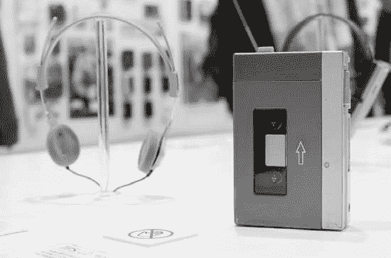

索尼随身听

索尼其他的经理觉得这个想法很糟糕，谁想要一个只能回放磁带、无法录音的便携式盒式磁带设备呢？这种无用的产品有什么意义？

井深大坚持认为，所有人都希望在散步时收听自己选择的音乐。结果证明他是对的！这个小实验的结果——索尼随身听——成为热卖产品，售价为 150 美元（相当于今天的 500 美元），总共售出 4850 万台。

“随身听”这个名字沿用至今，代表高分辨率音乐播放器出现在索尼的产品线中。

### 走进 80 年代

当 20 世纪 70 年代接近尾声时，世界已经变了个样。电脑成为个人财产，有配套软件。电脑发烧友的数量日益增多，甚至有些企业也在使用电脑技术。未来世界的两个巨人——微软和苹果——已经诞生。我们会在下一章中讲述它们之间激烈的竞争。

1979 年，中东再次发生石油危机，经济陷入停滞。但从 1980 年开始，社会的方方面面都发生着不可逆转的变化。

### 第十一章 科技接管现代世界（1980—1989）

我对 20 世纪 80 年代一直情有独钟。夸张的服饰风格、过耳不忘的音乐，还有天马行空、经久不衰的流行电影：《ET》（E.T.）、《回到未来》（Back to the Future）、《终结者》（The Terminator）、《捉鬼敢死队》（Ghostbusters）、《春天不是读书天》（Ferris Bueller’s Day Of）、《壮志凌云》（Top Gun）、《疤面煞星》（Scarface）。

一提到 80 年代，我仿佛就能听到磁带发出的“嘶嘶”声，记起录音机上巨大的按钮，以及按下按钮时的满足感。这是模拟信号的年代。

80 年代末期，西方世界蓄势待发，即将崛起。但在 80 年代初，美国刚刚经历了大萧条以来最严重的经济衰退。企业倒闭，犯罪率上升，可卡因泛滥，艾滋病成为流行病。1980 年，美国的通胀率接近 14%，你能想象在一年中物价上涨 14%吗？

20 世纪 70 年代的离婚率创史上最高，对下一代产生了毁灭性打击，孩子们不得不学会如何在破碎的家庭中生活。这些孩子在尼克松、水门事件、越南战争的时代背景下长大，成为愤世嫉俗的一代。他们被称为 X 世代。

罗纳德·里根总统在短短 3 年内把通胀率降到了 3.6%，成为某些孩子眼中的英雄。年轻人开始觉得保守主义很酷，他们（雅痞）不太看得起父母的嬉皮理想主义。

苏联在 80 年代初仍然是一股强大的力量，日本的创新技术产业蒸蒸日上。日本产品曾经被认为是劣质和廉价的，但在 80 年代打了一个翻身仗，占领了美国的公路和电子商店。底特律无法与制作精良、低价格、低油耗的日本车竞争。1980 年，底特律的轿车制造商损失了 40 亿美元。

在 80 年代最晦暗的几年，一阵创造风潮让人从绝望中得以喘息。在纽约，嘻哈和霹雳舞渐渐变成主流；在加州，由年轻的托尼·霍克领头的滑板文化逐渐成熟。霍克发明了多种空中特技，用 VHS 录像机把自己的表演拍成电影，为这项新的运动奠定了基础。

NASA 是为应对苏联斯普特尼克人造卫星和其他太空探索项目的威胁而成立的，在 80 年代达到了巅峰。但是，1986 年的“挑战者号”灾难打击了美国人的骄傲。“挑战者号”的发射在 CNN（美国有线电视新闻网）直播。在全球观众的注目下，低温冻结的 O 形环密封圈失效，导致火箭助推器解体，飞船上的 7 名宇航员全部遇难。

电子表格，如 VisiCalc，彻底改变了商业世界。盈利亏损可以在几秒之内就知道，不需要等几天甚至几周。股市因为电脑化迎来了新的高潮。这 10 年也见证了个人主义的盛行，因为似乎每个人都可以轻易赚钱。电影《华尔街》的主角葛登·盖柯的名言“贪婪是个好东西”概括了 80 年代后半段的社会基调。

在 80 年代，60 和 70 年代的发明渐渐成为日常生活的一部分。VHS 和磁带大受欢迎。CD 将在 80 年代末期迎来属于自己的巅峰。随身听让人们成为自己电影的主角，为自己的日常场景选择背景音乐。

美国和日本统领了 80 年代的技术革新。英国也有非常活跃的 PC 市场，但没有得到同样的关注。80 年代末期，信息联结的世界终于来到，正如 50、60 年代的伟大梦想家所设想的那样。

本章将讨论科技如何接管现代世界。但首先，让我们先享受一下视觉和听觉的盛宴。

## 我要我的 MTV！（1981 年）

1981 年 8 月 1 日，MTV 正式开播，一种新的娱乐方式由此开启：由主持人介绍音乐，人们在家里就能观看音乐表演。这个频道定义了一整代青年——MTV 世代。

登上 MTV 的第一个视频是英国乐队巴格斯（Buggles）的《视频杀死了电台明星》（Video Killed the Radio Star），可以说它预言了这个频道将如何改变音乐产业。

虽说 MTV 看起来十分叛逆，但其实它的根基是大企业——华纳电视公司。1980 年，华纳已经拥有两个主要的频道：电影频道和尼克国际儿童频道。新增一个专注于音乐的频道似乎是个好选择，可是华纳一开始拒绝了 24 小时播放音乐的频道提案。在导演看来，这个频道基本上就是带图片的广播。一些内部讨论之后，大家最终决定，音乐频道不会是亏本的生意，因为唱片公司为了提升曝光率，会免费提供播放内容。MTV 必须在 7 个月之内制作完成，因为华纳希望它在所有学生都放假的夏天登台。MTV 首轮播放只有 250 个音乐视频。令人惊讶的是，这个电台只在美国的小城镇播放。

第一个因 MTV 成名的乐队是杜兰杜兰（Duran Duran）。他们大胆地将整张专辑的音乐制作成一个短片，这引起人们的热烈讨论。不久，每个乐队都想做音乐录像带，登上 MTV 的舞台。

尽管如此，MTV 最初十分拮据，入不敷出。当时电视台联系滚石乐队的米克·贾格尔，他是摇滚明星，出场费极高。与贾格尔会面时，一位制作人开玩笑似的把一张一美元纸币扔在桌上说：“我们只能出这么多。”贾格尔可能很欣赏他的胆识，便同意出演。1982 年，贾格尔著名的《我要我的 MTV》广告曲横空出世。随后，美国各地的电视台都接到潮水般的电话，要求开设新频道。几年内，MTV 遍布各州，永远改变了音乐产业的版图。当我还是个孩子时，偶尔有机会在澳大利亚电台看到 MTV。我当时觉得这是世界上最酷的电台，捕捉并呈现着最新、最潮的音乐动态。

## 电子游戏

### 《吃豆人》（1980 年）

《吃豆人》是有史以来最受欢迎的游戏之一。1980 年，南梦宫在日本发布了这款游戏，并在同年进军美国市场。这是第一款不以太空和体育为主题的主流游戏。

这款游戏是 25 岁的岩谷彻的创意，他在一年内把想法变成了现实。

这款游戏最初的名字是“Puck Man”。美国团队担心玩家会把 P 的一部分刮掉，变成 F，所以把名字改成了“Pac—Man”，也就是“吃豆人”。“能量药丸”的想法是受“大力水手”的启发，波比通过吃菠菜来获得超人的能力。

这款游戏有点儿古怪，没人预料到它会成为爆款。刚发布时，它的反响确实一般，但很快人气开始飙升。到 1980 年年底，《吃豆人》赚的钱比《星球大战》（当时票房最高的电影）还多。整个 20 世纪，该游戏的玩家人次达到 100 多亿。如今，吃豆人的形象在世界各地仍有很高的辨识度。

## 游戏业地震（1983 年）

Atari 2600 于 1977 年（奥德赛发布不久后）面世，成为家庭电玩的王者。到 1980 年为止，雅达利成为美国历史上成长最快的公司。在短短数年内，它的销售额从 7000 万美元增长到 20 亿美元。

没过多久，别的公司就注意到了雅达利的成功。电玩成为最热门的产业，所有人都想分一杯羹。有些公司甚至完全抛弃原有的产业，一心做电玩。这样的炙热将带来灾难，稚嫩的电玩产业还没开始就结束了。

电玩市场很快就过于饱和，游戏机和游戏数量惊人，同时还有更多的产品想挤进来。游戏机的竞争对手是新兴的 PC 技术。PC 性价比更高，可用来玩游戏，还有很多别的功能。这在更大程度上打击了游戏产业。

更糟糕的是，制作游戏的工程师无法得到他们应有的份额。即使一个游戏收入过百万，程序员每年也只能拿到大约 3 万美元的固定工资。有些雅达利程序员受够了这种安排，脱离雅达利，成立了动视公司，开发与雅达利硬件系统兼容的第三方游戏。

这可以说颠覆了电玩的制作模式。很快，市场上出现了更多的独立游戏开发商。为了让你们更明白事情的严重性，类似桂格麦片和通用磨坊这样的食品公司也开始制作他们自己的电子游戏。食物和电玩有什么关系？除了游戏机上的薯片碎屑以外，没有任何关系。此时，任何人都可以在未授权的情况下为雅达利或其他游戏机制作游戏。这最终摧毁了整个行业。

### 雅达利大崩溃

讽刺的是，大厦倾倒的第一条裂缝是最热门的游戏造成的。《吃豆人》是当时十分火爆的街机游戏，雅达利也想从中获利。1981 年，公司从南梦宫买来版权。当时接近年底，管理层希望《吃豆人》能在圣诞节之前完成。于是雅达利匆忙地推出这款游戏，结果惨不忍睹。雅达利版的《吃豆人》反应很慢，错误百出，甚至不像《吃豆人》。最终雅达利收获了 500 万盒滞销游戏卡带。

这次打击后，雅达利仍然是游戏业的主宰者，掌控着整个行业的命脉。然而，1982 年，雅达利又犯了同样的错误。他们买到了斯皮尔伯格《ET》的版权，匆忙投入制作。这次他们只给程序员 6 周的时间去开发这款游戏。结果，这款游戏被钉在史上最烂的耻辱柱上，遭人唾弃。又有 500 万盒游戏卡带烂在了仓库里。

雅达利 1983 年的财务报告显示，当年收入增长仅为 10%，而非预测的 50%。华尔街不喜欢这个结果，于是电玩公司的股票大跌。这一事件引起行业地震，终于击垮了如日中天的电子游戏产业。

1983 年年底，雅达利负债 5 亿美元。

那 1000 万盒滞销游戏卡带呢？它们被装进 20 辆卡车里，开去新墨西哥州的垃圾场埋了。有意思的是，2014 年，在一次挖掘作业中，游戏卡带重新出土。

当时大家普遍认为电玩产业如空中流星，彻底坠毁了。但有几个聪明的日本商人认为电玩是有未来的，他们的公司是任天堂。

## 任天堂娱乐系统（1985 年）

任天堂公司的历史可以追溯到 19 世纪末，当时公司制作的是卡牌游戏。20 世纪，其业务重心转变为玩具。20 世纪 70 年代，任天堂看到了雅达利的成功，开始制作家用乒乓游戏机。1980 年，他们发行了 Game&Watch（游戏和时钟）。正如名字所示，这是一个和计算器一样大的掌上游戏机，上面也装着一个时钟。公司也尝试制作街机，但是都失败了。任天堂北美公司的社长荒川实号召下属们集思广益，寻找下一个改变行业的创意。29 岁的艺术家宫本茂接受了这个任务。

任天堂原本希望设计一款以大力水手为主要人物的游戏，希望可以借助大力水手的人气带动销售。可是任天堂没有买到版权，所以宫本做了一些人物调整。奥利佛·奥尔变成了公主保琳，波比成为“跳跳人”，波比的敌人布鲁托变成了大猩猩。这款游戏的名字是《大金刚》。

自从 1981 年发布以来，《大金刚》迅速征服了市场，登陆美国 6 万台街机，为任天堂赚到了 1.8 亿美元。

任天堂受到鼓舞，在 1983 年面向日本市场推出红白机（Famicom，Family Computer 的缩写）。最初红白机上的游戏都是移植自任天堂的街机游戏，后来公司把眼光投向了北美市场。可是，由于电玩产业的惨败，美国商店十分警觉。

1985 年，任天堂把红白机重新包装，把名字改成“任天堂娱乐系统”（NES），准备销往美国。这次的游戏机套装还包括一支塑料光枪和一台机器人 R.O.B，任天堂希望这款产品从名字到外形都和传统电子游戏保持距离，以全新的概念空降美国市场。可惜这个想法并没有成功。

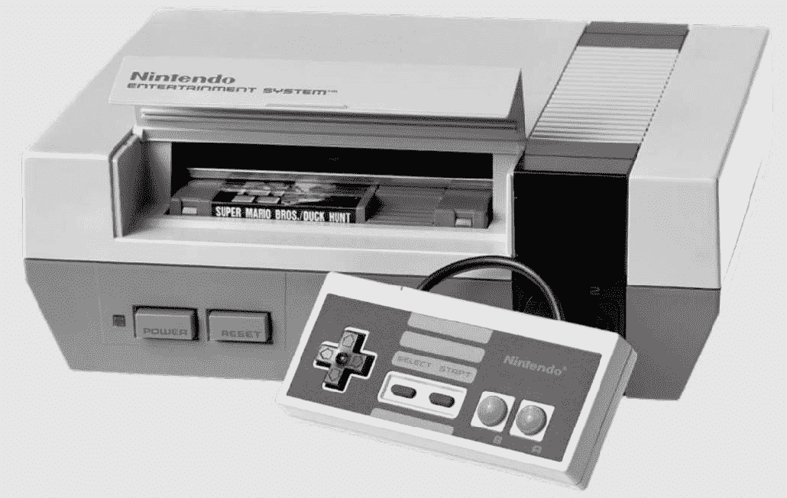

任天堂娱乐系统

最终日本任天堂的社长山内溥决定，如果任天堂要进军美国市场，他的团队也必须亲自去美国。名为“任天堂 SWAT”的小分队被派往美国，负责演示游戏并且把游戏放上货架。他们甚至为店家提供了免风险条款。店家只需要为他们卖出的机器付钱，任天堂会收回没有卖出的机器。最终，任天堂娱乐系统获得巨大成功。

1985 年，任天堂发布“跳跳人”。这是一款前所未有的游戏：有广阔而富有想象力的世界，有精致的画面和滚动的视觉效果。后来这款游戏改名为“超级马里奥”。迄今为止，这款游戏售出 4000 万份。我在 90 年代第一次玩“超级马里奥”，现在仍然觉得和那时一样好玩。这次成功后，下一个重量级产品“塞尔达传说”再次引发热潮。

任天堂从雅达利的错误中吸取教训，为游戏机制作特殊的硬件芯片，隔绝了外部程序员。他们对能在任天堂游戏机上运作的游戏有着绝对的质量控制。所以，第三方开发员只带来了让游戏机更加成功的游戏。

短短 10 年间，任天堂从电玩行业的外行一跃成为家用游戏机市场的领航者。

### 关于马里奥

◇ 马里奥以任天堂美国办公室的房东马里奥·西加列（Mario Segale）命名。他曾经在一次公司会议中破门而入，要求公司立刻支付逾期租金。

◇ 马里奥至今出现在 200 多款电子游戏中，总共售出 1.93 亿台以上。截至 1993 年，仅“超级马里奥兄弟 3”就在美国赚了 5 亿多美元。说他是个大人物并不为过。

◇ 马里奥是意大利人，没有胡子，不戴帽子。宫本茂觉得画头发太麻烦，所以给他戴上了帽子。画上胡子是因为胡子比嘴巴在游戏画面中显眼。

## 手提录音机（20 世纪 80 年代早期）

晶体管收音机加上磁带、大喇叭，是 20 世纪 80 年代年轻人最渴望的装备。手提录音机在当时是很重要的领域，知名品牌包括索尼、松下、大众电子。手提录音机可以接入麦克风和唱片机，变身为临时现场演出系统。另一个关键的功能是低音炮，能让人感受到胸中的节奏。年轻人喜欢这种感觉，贝斯让抒情歌曲的情绪更加饱满，让舞曲更有动感和力量。手提录音机特别受城市孩子们的欢迎，在嘻哈音乐和文化发展上发挥了关键作用，并催生出一种新的街舞。孩子们在舞蹈中宣泄无限的活力，有时头顶地面，身体旋转。这种风格一开始被称为 B—boy，后来被称作霹雳舞。

### 手提录音机磁带开启了饶舌时代

因为手提录音机的便携性，音乐爱好者们开始把地下音乐录到磁带上，与别人分享——可以说是 20 世纪 80 年代的 Spotify。街头开始了纽约 DJ（包括 Grandmaster Flash 和 Kool Herc）盗版音乐磁带的买卖。这些卡带为后来一整代饶舌歌手提供了灵感，比如 Run DMC（美国著名黑人说唱乐队）、埃勒·酷（LL Cool J，原名为詹姆斯·托德·史密斯）、Public Enemy（来自纽约长岛的嘻哈乐队）、野兽男孩乐队（Beastie Boys）和 Eric B & Rakim（美国著名二人说唱组合）。正是这些歌手把饶舌乐带入了主流音乐世界。

### 新思想：PC 辅助人类

20 世纪 80 年代，电脑技术逐渐成熟，从少数发烧友手中的玩具进化成专业的消费品。这个年代最响亮的名字是 Commodore（与苹果公司同时期的个人电脑公司）、苹果、IBM、雅达利，我们接下来会一一讲述。

#### Commodore：低调的成功

如今的电脑行业早已遗忘了 Commodore 这个名字，但它曾经是响当当的 PC 制造商。自从 1982 年发布以来，Commodore 64 仍然保持着最畅销电脑的纪录。一直到 1994 年停产，共计卖出 1700 万台。

Commodore 公司的另一条著名产品线是 Amiga。当时一片黑与白的电脑世界，Amiga 却因为特质芯片拥有彩色图案和各种多媒体，技术十分超前。由于公司经营不善，没有让 Amiga 充分发挥出潜力。而且，在当时的环境中，更好的画质和音质反而会对 Amiga 的销量不利。因为一台商用电脑必须是严肃的，是工作用的工具。

#### 人类脑力的自行车：苹果

在 1980 年对投资人的一场宣讲会上，顶着一头乱发的乔布斯分享了他对于电脑未来的想象。很久以后，人们才意识到这段话的意义。

乔布斯引用了 1973 年他还是个孩子的时候看到的《科学美国人》中的一段话。这期杂志上刊登了一篇研究运动力的论文，其中列出每种动物运动效率的排名。秃鹰登顶，行走的人类则落入榜单的后 1/3。但是有一个转折，使用自行车的人，效率比秃鹰高两倍。

这段话启发了乔布斯。

这项研究让乔布斯发现，人类是优秀的工具制造者，但其中还有更深层次的信息。本书开篇提到的工业革命，放大了人类的体能。蒸汽代替了汗水，让人类可以做更多的事，更有效率地使用能量。乔布斯把电脑称为“大脑的自行车”。

1980 年 12 月 12 日，苹果上市。这是自 1956 年福特汽车上市以来最大规模的 IPO（首次公开募股）。尽管公司获得如此成功，乔布斯的嬉皮精神仍然留存。这个 25 岁的年轻人经常一边吃瓜子，一边在办公室走来走去。他有时不洗澡，经常赤脚走来走去。这时，沃兹已经不在管理层身居要职。

这是乔布斯和苹果的好时光，但是这个光脚的嬉皮士不会一路坦途。

## 蓝色巨人进入 PC 市场：IBM

在苹果如新星般升起时，IBM 是世界上最大的科技（并非 PC）公司。IBM 的公司文化与硅谷反主流文化大相径庭。IBM 的员工都是传统、规矩的大学毕业生。公司甚至有不成文的服装规定：白衬衫，蓝西服。IBM 主要的业务是大型机和其他传统业务。PC 市场太新潮，完全由热情和好奇心驱动，看起来有些狂野。

1980 年，IBM 看到苹果在 PC 市场的成功，意识到自己的判断失误。PC 可以被用来扩展人类智慧，用来交流。他们也看到资本正滚滚流入该行业。PC 市场诞生 3 年后，规模就达到了 10 亿美元。

问题是 IBM 的官僚系统决定过程十分缓慢，要敲定一个 PC 设计方案需要经过好几年，他们怎么可能及时生产出一个有竞争力的不过时的产品呢？

为了加速制作过程，IBM 内部的一个小分队准备用现成的电子部件做出第一批 PC。因为不用从零件开始生产，他们在一年内制作完成了一台商业个人电脑。对于 IBM 来说，用非 IBM 制造的部件是很不寻常的。现在硬件都已经搭建好了，他们只需要制作软件就够了。

操作系统（OS）是电脑的数字“交警”，可以记录文件的储存位置，指示电脑如何使用硬件，比如鼠标、屏幕、软磁盘机。BASIC 是已经存在的系统，但它仅仅是个基本的用户界面。IBM 的野心是让他们的电脑接管世界，他们需要更强大的操作系统。

电脑行业从此时起开始争夺统治权，所有人都希望自己的操作系统可以胜出，竞争愈演愈烈。如果说 70 年代对电脑行业来说是爱与分享的和平年代，80 年代则是剽窃和剥削的年代。

这其中有一个电脑史上最悲伤的故事。

### 比尔·盖茨与本可以成为比尔·盖茨的人

1980 年，IBM 刚开始制作 PC 时，他们联系过微软，希望在微软的帮助下开发操作系统。在对项目只字未提之前，“蓝西装”们要求比尔·盖茨（一开始被误认为公司实习生）签署一份保密协议。盖茨必须答应对 IBM 的项目守口如瓶。当盖茨被告知希望微软提供 OS 时，他没有像之前对 MITS 一样，凭空保证出一套系统。他表示微软没有 OS，让 IBM 联系著名电脑科学家加里·基尔代尔（Gary Kildall）。

基尔代尔蓄着红胡子，性情温和，为人谦逊，却是实实在在影响 PC 发展的重要人物。1971 年，基尔代尔为英特尔的第一个 CPU 4004 开发程序语言，然后他意识到这套语言还需要一套系统来控制芯片与 CPU 的其他部分交互。1972 年，这套程序就是 CP/M（微机控制程序），第一个通用计算机操作系统，和微软 BASIC 不同。BASIC 是在电脑现有的 OS（对硬件发出指令的部分）上运行的表面程序。

CP/M 之前，每台电脑都有自己特制的操作系统，就好像每台汽车都需要专属的燃料一样。CP/M 出现后，程序员只需要编写软件，然后 CP/M 会接管其他部分。只花一点儿功夫，就可以在不同电脑上使用不同软件。

基尔代尔对于商业事务没多大兴趣，但他的妻子多萝西说服他为自己的软件申请著作权。Digital Research 公司就这样成立了。1979 年，Digital Research 已成为操作系统的行业标准。可以说，Digital Research 在 20 世纪 70 年代末的地位就如同今天的微软，基尔代尔就是当时的比尔·盖茨。

#### 基尔代尔人生中最黑暗的一天

回到我们的故事。IBM 不想浪费任何时间，立刻听从了比尔·盖茨的建议，去西雅图拜访基尔代尔。盖茨立刻给基尔代尔打电话，告诉他有人要去找他，并强调：“要好好对待他们，他们可是大人物！”因为签署了保密协议，盖茨不能告诉他到底是谁要登门造访。不幸的是，基尔代尔没有理解盖茨的用意。他可能以为只是另一家小公司，没想到是地球上最大的科技公司。

不论怎么样，IBM 拜访基尔代尔时，他并不在家。虽说具体的细节很模糊，IBM 前 CEO 杰克·萨姆斯的说辞是，基尔代尔当时正乘坐私人飞机去出差。

“蓝西装”们最终与基尔代尔的妻子交涉，她现在是 Digital Research 的运营总监。IBM 的律师想让她签署保密协议，证明他们从来没去过。可是多萝西并不买账，拒绝签署。IBM 团队并没有什么耐心——时间就是金钱！僵持一段时间后，他们就沮丧地离开了基尔代尔家。

过了几天，IBM 再次联系比尔·盖茨。这次盖茨抓住了机会。他看到 IBM 提交了更清晰的商业形象，是有潜力改变 PC 市场的。盖茨故技重施，告诉 IBM 微软其实是有能力制作 OS 的，虽然他们当时还没有。

微软解决这个问题的方案是作弊，从一家小公司 Seattle Computing Products 购买了一套操作系统，冒充自己公司的产品。微软以 7.5 万美元的价格买下了蒂姆·帕特森（Tim Paterson）开发的 OS。这套 OS 被称作“快速而肮脏的操作系统”（Quick and Dirty Operating System，简称 QDOS）。名字已经说得很清楚，这套软件的代码几乎就是照抄 CP/M——基尔代尔的软件。两款软件有几处不同，但相似之处多得可疑。

Seattle Computing Products 抄袭了 CP/M，现在微软拥有了一套运行正常的操作系统，QDOS 后来改名为微软 DOS 或者 MS—DOS，与每一台 IBM 生产的 PC 配套出售。所以如果你用过 MS—DOS 的话，你可以说你用过“快速而肮脏的操作系统”。当然，这套 OS 的官方名字别有用心地被改为微软磁盘操作系统。

第一台 IBM 生产的 PC 于 1981 年 8 月发布，预计销售量为 25 万台。结果在短短几年内，就卖出了 200 万台。IBM 超过苹果，成为世界上最大的 PC 制造商。

此时，比尔·盖茨即将登顶世界富豪榜。MS—DOS 操作系统贡献了一半的功劳，是敏锐的商业嗅觉最终让他获得了成功。

由于 IBM 的 PC 是由现存的零件组装完成的，其他制造商如康柏和惠普也开始用相同的零件克隆 PC。微软把 MS—DOS 的使用权以 5 万美元的价格卖给 IBM，但也留下一个陷阱。微软从未对 IBM 提起他们的交易是排他性的。不久，微软把操作系统卖给了 IBM 的竞争者，并且从每一台出售的电脑中抽成。

这次版权交易被称为交易史上最伟大（或最狡猾）的生意，让盖茨成为亿万富翁。基尔代尔的失败则被称为人类历史上最惨痛的失败。意识到自己的巨大损失后，基尔代尔一改宽容的本性，威胁要把 IBM 告上法庭。

作为和解条款，IBM 同意在出售 PC 时，不仅提供微软的 DOS，也将提供 CP/M。奇怪的是，基尔代尔就此满足了。在他的想象中，现在人们可以选择他们到底更喜欢哪一款软件，正义终于得到了伸张。但只有一个问题，在 IBM 提供的两款软件选择中，MS 售价 40 美元，CP/M 则为 240 美元！

IBM 再一次耍了基尔代尔，他的 CP/M 从此落入历史尘埃，输给了自己的克隆。这严重打击了基尔代尔，他甚至不想再起诉 IBM 或微软。错失这个巨大的机会可能为基尔代尔的婚姻埋下了祸根，多萝西不久后就申请离婚。无处不在的 PC 无处不在地提醒着基尔代尔他的失败。他因此患上抑郁症，并开始沉迷于酒精。1994 年，基尔代尔在一个自行车酒吧与别人发生争执，头部受创身亡。

如今，基尔代尔只是科技史的一个脚注，所以我们一定要记住他对计算机技术的贡献。

### 乔布斯借来的“创新思维”

与此同时，乔布斯正着眼于一个新问题。在人们可以用 PC 解决问题之前，他们需要知道如何使用 PC。这在 80 年代是个大问题，并不是所有人生来就会打字。大家需要的是简单的、自然的和电脑互动的方式。

1980 年，清瘦的乔布斯留着胡子，披着长发。在一次演讲中，他表示，电脑的力量在 3 年内就以几何倍速增长，这令人难以置信。听众问他为什么电脑还需要更多的能力，乔布斯的回答颇有见地：

我们需要把电脑的能力用于让人和电脑的互动更加通畅。也就是说，让电脑操作更便捷，特别是在非运算的领域。

乔布斯之所以这么自信，是因为他一年前在 PARC 实验室看到了施乐奥托。还记得那台几乎就是台式 PC 的电脑吗？就是它。

### 施乐奥托：失败

施乐奥托的技术将被用来制造苹果的丽萨电脑。其技术发展到 1985 年，又创造出麦金塔电脑，其理念进而影响了微软的 Windows 系统。麦金塔和 Windows 系统是我们今天所有触屏设备的概念始祖。

让我们回到施乐让电脑的未来被乔布斯窃取的那个故事。也许你还记得，施乐 1979 年邀请 24 岁的乔布斯到 PARC 实验室参观，希望他可以帮助施乐团队降低生产成本。交易内容是，施乐将得到苹果的 100 万股，而苹果将得以见识 PARC 实验室里所有的革命性产品。这笔交易没有取得科研部的同意，商业发展部门仍然签署了协议。

看到奥托的演示后，乔布斯意识到这就是电脑的未来，要求他的整个编程团队来观摩。这个要求遭到 PARC 员工的反对，但是高层领导觉得并无不妥，立刻同意了乔布斯的要求。施乐就这样不知不觉地交出了对未来的控制权。乔布斯觉得这很公平。他的理由是毕加索说过一句话：“优秀的艺术家模仿，伟大的艺术家窃取。”

第一件以此为精神要领的苹果产品是 1983 年面世的丽萨。

正如我们今天所见，奥托（以及之后的丽萨）的最大优势在于图形用户界面（GUI）。在这项创新之前，电脑操作十分复杂，甚至令人生畏。如果你想使用一个程序，必须知道正确的指令，并且用文字输入指令。

比如，如果你想要复制一个叫`Darude—sandstorm.mp3`的文件到你的音乐文件夹，你要一个字一个字打出：`copy c:\\file Darude—sandstorm.mp3 d:\\music`（顺便说一句，mp3 在当时还不存在）。

基于奥托的技术，丽萨会显示图像菜单。你再也不需要记住这一长串指令，只需要点击正确的选项。

如此一来，PC 的使用变得简单而直观，拖动鼠标，通过点击控制文件。这就是图形用户界面的力量。

### 苹果需要一位真正的 CEO

苹果上市后，在丽萨的研发过程中，苹果的高管要求乔布斯雇用一位可以中和他的理想主义者脾气，能够用数字说话的管理者。他们认为乔布斯喜怒无常，经验不足，无法继续指导丽萨项目，于是禁止他参与。1983 年，乔布斯与百事 CEO 约翰·斯卡利会面，斯卡利仿佛是由模板刻出来的商人，看起来是个完美人选。

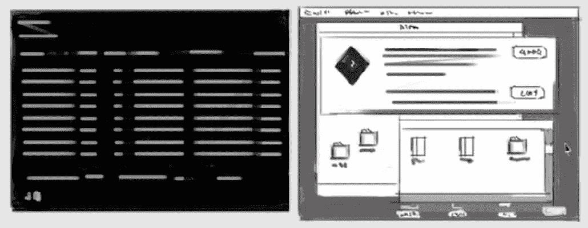

文本交互界面 VS（从施乐借来的）丽萨的图形用户界面

由于被禁止参与丽萨项目，乔布斯有些受打击，但他很快就把注意力转移到苹果内部的一个小型研究团队上。这个团队刚刚制造出一台功能齐全的小型图形电脑。看到这款产品，乔布斯立刻要求成为这个项目的总监。这台低成本的图形电脑就是麦金塔，简称 Mac。这台电脑必须特别出色，因为留给苹果的时间不多了。1983 年，IBM 的 PC 产品已经开始攻陷市场，“蓝西装”们行动起来了！

### 最初的 Mac

Mac 与传统电脑不同，它界面友好，设计个性化，希望帮助用户打开想象力的窗户，是通向艺术、教育和商业世界的门户。Mac 不只是一台机器。

IBM 的 PC 设计师们则完全从企业的角度设计电脑。它丑陋、冷血、笨重，只是一件完成工作的工具。

苹果的制作部门被分为几个团队：Mac 团队很年轻，平均年龄 21 岁，他们是音乐家、诗人、艺术家，同时也是优秀的电脑科学家。Mac 团队会在办公室里竖起海盗旗，以显示他们的反叛精神。Mac 团队后来与丽萨、苹果 II 的团队竞争十分激烈，是苹果内部不太健康的竞争。

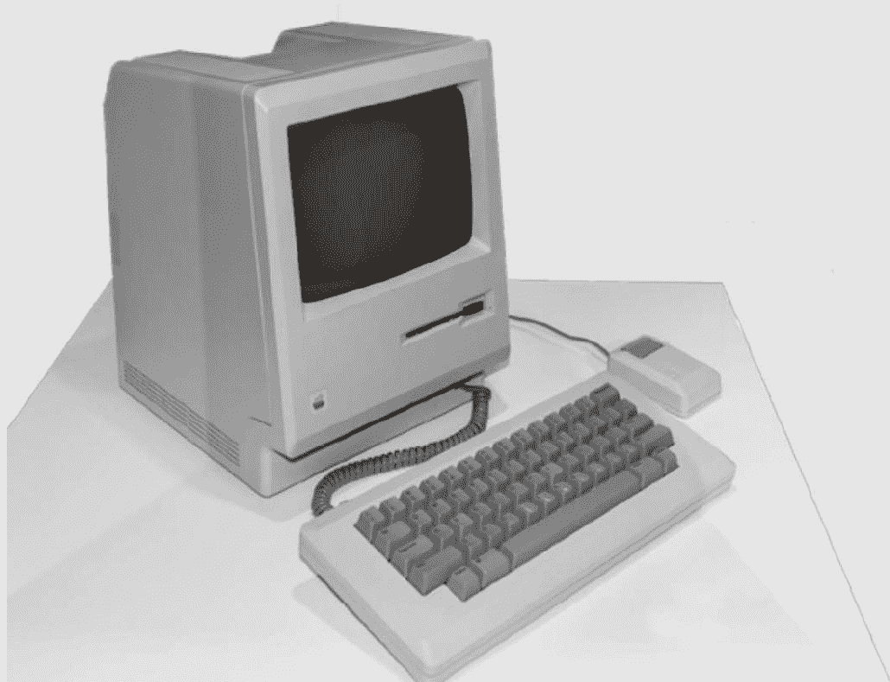

Mac

虽说理论上十分完美，但丽萨的成品没有成为爆款。丽萨有很多设计问题，花了 200 个人一年的工作时间才完成，而且价格过高，一台售价 1 万美元（相当于今天的 2.3 万美元）。而人们甚至不能理解这到底是什么。它彻底失败了。

相反，1984 年 1 月发布时，Mac 一开始起步就很好。然而，其销售在很大程度上开始失去动力。

1985 年，几乎所有的苹果粉都买了一台 Mac，然而危机正悄然来袭。批评者们觉得这台机器无法提高工作效率，只是个玩具。他们并没说错。Mac 问世一年后，市场上也没有出现很多可供 Mac 使用的软件，因为乔布斯的团队没能研发出 Mac 的办公软件。Mac 上只有绘图和写作两款主要软件，而售价比 IBM 的 PC 高出 1000 美元（相当于今天的 2300 美元）。而且由于图形界面太占内存，Mac 的内存不够。所以当你想要换程序的时候，必须更换软盘。

当时，每售出 20 台 PC，只能售出一台 Mac。很多分析家认为，苹果在几个月内就会玩儿完。甚至连最靠谱的产品苹果 II 都卖不过 IBM 的 PC。乔布斯花了很多心血在 Mac 上，不愿意相信销售数字，他觉得 Mac 应该是有史以来最畅销的电脑。对于乔布斯来说，这完全说不通，未来的电脑怎么可能卖不出去？！

在这期间，Mac 给比尔·盖茨两年的使用权限，让其为 Mac 设计软件。苹果没有把微软看作竞争对手，他们只能看到 IBM。乔布斯并不了解盖茨投机者的天性，也不知道这个决定会给苹果带来毁灭性的打击。

在为 Mac 设计软件时，盖茨意识到 Mac 的图形界面会对微软 DOS 产生威胁，DOS 还是基于文本的操作系统。他需要自己的图形界面，所以盖茨的团队就在 DOS 的基础上制造了一套图形界面，其名为 Windows 1.0。

这套系统错误百出，而且不太好看，但是 Windows 至少能让 DOS 不至于被淘汰，苹果的图像堡垒的第一条裂缝就这样悄然生长了。

当 Mac 的销量远不如乔布斯的预期时，斯卡利和乔布斯之间的关系开始恶化。斯卡利认为应该把钱花在苹果 II 上，延长其使用寿命，但乔布斯不同意。他认为电脑的未来 Mac 更值得投资，有窗口、有图像的未来。

1985 年，苹果的董事会被召集起来，对乔布斯的未来做出决定。因为斯卡利和乔布斯的嫌隙无法弥合，必须有一个人要离开。董事会意见分裂。很多人很欣赏乔布斯，而其他人则认为斯卡利在带领公司上更有经验，这可能正是苹果现在所需要的。最终，董事会选择了斯卡利。在之后的访谈中，乔布斯悲哀地说道：“斯卡利毁掉了我花 10 年建立起的一切。”

乔布斯卸任后，Mac 被 Adobe 拯救了。Adobe 为 Mac 开发出优质软件，并发明了多语言排版。1987 年，Mac 的销量达到每年 100 万台，和 IBM 的成绩相近，这一切都没有乔布斯的参与。

我对彩色 Mac 有着很美好的记忆，因为我那落后的小学在 1998 年就有一套这样的电脑。我最喜欢的两个游戏是《水晶任务》和《跳方块》，想到它们，我就很想立刻下载来玩。

### 乔布斯的狂野旅程

被苹果解雇后，乔布斯花了一段时间反思自己，并认识到自己的不成熟。他不再一边晃荡一边吃瓜子，他开始穿上鞋，成为一位真正的专业人士。大家经常说有两个乔布斯：被解雇前的乔布斯和被解雇后的乔布斯。

1985 年，乔布斯在苹果召集了一组忠诚的前同事，开始下一段冒险：NeXT。

NeXT 是一个聚焦于最前沿科技的电脑硬件软件公司。团队立刻开始为他们的新电脑制作操作系统，命名为 NeXTSTEP。NeXT 电脑很贵，起价 6500 美元（相当于今天的 14000 美元）。

1988 年，NeXT 的目标是与大型机和 Unix 竞争。他们的优势是小而强悍，并宣称这台机器相当于一所台式大学。NeXT 电脑可以储存大量信息，有高级检索功能，能够解决大学水平的复杂问题。

被问起这台机器的目的时，乔布斯回答：“我希望有些孩子可以在宿舍里用这台机器弄清楚如何治愈癌症。”

这话乍听起来有些奇怪，但其背后是有原因的。乔布斯带着 Mac 去大学推广时，曾遇到一位化学教授，他是诺贝尔奖得主，当时却被一个难题困住了。他试图教他的学生如何在实验室里合成 DNA，但是并不顺利。

学生们仅仅从课本上学习合成方法，因为做实验对本科生来说太昂贵了。这位教授知道电脑可以模仿 DNA 的合成，不过那是超级电脑的功能，并不属于个人电脑。于是他希望乔布斯能为大学制造出一台小而强悍、有 1MB 内存和高清显示屏的电脑。

正是这位教授的请求催生出 1988 年上市的 NeXT 电脑，拥有 8MB 内存、256MB 的硬盘和 25 兆赫的处理器。

除了上述品质，NeXTSTEP 软件也让制作 App 变得很简单，特别是 App 的图形界面。App 需要一个文字区块来输入用户的名字吗？不用担心，把这个区块拖到这里就好了。需要一些按钮吧？拖动就好了！这在当时是非常前沿的技术。

乔布斯曾经评价道，20 位程序员要用 2 年的时间才能用 DOS 制作一款 App，而使用 NeXTSTEP 系统，只需要 3 位程序员用 6 个月的时间。Mac 把图形用户界面带给了现代电脑，NeXTSTEP 则带来了现代软件设计技术。其使用的简便程度直接影响了万维网（后文将提到）的诞生。

1989 年，乔布斯预测每月会有 1 万台 NeXT 电脑售出。他为此建造了自动化程度最高的电脑工厂，月产能达到 15 万台。直到 1993 年停产，NeXT 总共售出 5 万台。NeXT 硬件已经退出历史舞台，但 NeXTSTEP OS 仍沿用至今。移植到其他硬件的 NeXTSTEP OS 将更名为 Openstep。

1997 年，苹果会从乔布斯手里买下 Openstep OS，并让他回到董事会。从那时起，他一步步爬回苹果的顶端，在 2000 年重任 CEO。

至于 NeXTSTEP，则成为 Mac OS 10 和苹果手机操作系统 iOS 的奠基技术。

### 万维网的最初目的

范内瓦·布什、利克莱德、恩格尔巴特的远见带领我们一步步走到现在。80 年代，互联网存在的意义就是分享数据，但是这个基本形式并不具有革命性。数据共享只能发生在封闭的网络中，而从一块网络分享到另一块并不简单。建立在互联网之上的万维网才真正释放出知识增长的全部潜力，为人类进步画上浓墨重彩的一笔。万维网是怎么开始的呢？

1980 年，CERN（欧洲核子研究组织）拥有 1 万名员工。CERN 位于瑞典，拥有大型强子对撞机（用于发现新物质的粒子加速器），以及其他高级的东西。CERN 有数不尽的硬件软件需求，电子邮件是主要的交流形式。但是，当不同的项目开始合作时，一切都变得混乱。科学家们需要能够记录所有数据的工具：结果、研究团队、电话号码等。

1984 年，大多数项目协调工作就是不断更新信息。人们来来去去，有些信息完全丢失。不同电脑间传输的文件大多时候也无法打开。

CERN 请来了英国电脑科学家蒂姆·伯纳斯—李（Tim Berners—Lee）来帮助解决这个问题。伯纳斯—李一直在研究超文本的课题（此前提到过恩格尔巴特的发明，此处指可以把一个文档页面链接到另一个文档页面），并开发出 ENQUIRE 程序。但是 ENQUIRE 并没有如想象中运作。问题有两个方面：并非所有人都有权限进入公司的全部页面，而 ENQUIRE 只能让人们在相同目录下的文件（比如员工数量或一组结果）中跳转。

为了解决这个问题，伯纳斯—李改变了 CERN 的信息访问权限：所有人都可以通过 ENQUIRE 获取公司的所有页面，但是所有信息被存储在网络上，以防兼容性问题。每个链接可以跳转到任何其他页面，无论其信息类别。

伯纳斯—李认为，在物理世界，人们被管理结构规整地分门别类，但是这个管理结构内外蕴含的信息并不能被规整地分类。如果你让联结起来的人们任意分享任何信息，那么不同类别信息之间的关系是很混乱并且永远变换着的。但是，这确实反映了我们自然联结信息的方式：如果要画一张关联图，表示出这些信息之间的关系，它们的形状就像一张网—虽然混乱，却还是各有联结。如果你还记得布什在《诚如所思》中提到的 Memex，你可以看到心理上联想信息的相似之处。

超文本对于给 CERN 变化且混乱的信息建模非常合适。整个管理系统可以自然地成长和适应新变化。万维网的存在要归功于超文本。如果你不相信我的话，HTML 是超文本标记语言（HyperText Markup Language）的缩写，而 HTTP 是超文本传输协议（HyperText Transfer Protocol）的缩写。没有超文本，就没有互联网。

1989 年 3 月 13 日，伯纳斯—李写下关于建造“一个带有类型化链接的超文本数据库”的提案。尽管这个枯燥的提案标题没有吸引很多注意，伯纳斯—李还是在他的上司麦克·森德尔（Mike Sendall）的鼓励下开始实施这个方案。

### 早期网络

一年之内，伯纳斯—李的超文本数据库项目就启动了，但并没有人想用。为了让人们使用这个系统，伯纳斯—李把所有员工的电话号码输入数据库。这是挺阴的一招，但确实有用。CERN 电话簿已成为历史，也作为互联网上最早存在的网页被书写进历史。

没过多久，伯纳斯—李做了一个关于网页的报告。令人惊讶的是，该报告的内容仍然在网上。

很快，CERN 以外的人们也开始通过网络把他们自己的信息放到互联网上。几年后，这引发了历史上最强劲的信息大爆炸，让信息以前所未有的速度传播，打破了知识领域的壁垒，实现信息全球化。范内瓦·布什的最初设想终于完成了。

伯纳斯—李为他的创造想了好几个名字，包括信息网眼（Information Mesh）、信息矿（Information Mine）、信息的矿（Mine of Information）。最后，他选择了万维网（World Wide Web）。所以，我们现在说的“WWW……”原本很有可能是“IM”或“MO”……

### 科技进入音乐世界：雅达利

我十分迷恋 80 年代的音乐，尤其是后期。作为音乐制作人，我最感兴趣的是，当时的电子音乐人如何在工具受局限的情况下制作音乐。

### 雅达利 ST（1985 年）

雅达利 ST 比 Mac 便宜，功能却更多。这是第一台价格低于 1000 美元并拥有 1MB 内存的电脑，对电子乐的发展起到了至关重要的作用。

这台电脑让音乐爱好者第一次能在电脑上用 Cubase 或 Logic 这样的软件简单地作曲。

自 1989 年面世以来，Cubase 是第一款使用图形界面的专业制作软件。其他音乐软件仍然依赖文字指令。

ST 的黑白屏幕对眼睛比较友好，效果和纸张接近。ST 的延迟极低，不输专业设备。低延迟意味着，你摁下按钮和音符的一瞬间就可以听到声音。包括 Fatboy Slim（英国中年男人诺曼·库克的个人乐队）、麦当娜、爱飞克斯双胞胎（Aphex Twin）、DJ 达鲁（以单曲 Sandstorm 成名）在内的很多音乐人都曾经使用过雅达利 ST。

同时，电子合成器也越来越受欢迎，改变了流行乐的声音景观。早期的例子包括软细胞合唱团（Soft Cell）的 Tainted Love、舞韵合唱团（Eurythmics）的《甜蜜的梦》（Sweet Dreams）。

### 罗兰 TR—808

1980 年，罗兰公司推出 TR—808 鼓机，后简称为 808。最初面世时，它是一个商业失败的案例。制作人和音乐家都觉得这是垃圾，因为它的声音过于合成、过于电子化了，和真实的鼓完全不同。

有些人却觉得这个声音很有吸引力。古怪、合成、疯狂、锋芒毕露的声音是他们从未听到过的。808 是第一台允许自定义节奏，而不是预设节奏的鼓机。这台机器很容易使用——它会循环播放内置节拍，你听到喜欢的就可以一键添加。你可以释放想象、随意尝试，最后完成原本想象不到的音乐。除此之外，机器输出的所有频率似乎都是专门为吸引人耳而设计的。

20 世纪 80 年代初期，芝加哥电台 DJ 喜欢混合各式各样的舞曲，包括迪斯科旧唱片、最新的嘻哈乐。有的 DJ 会更进一步，用盘式磁带录下正在播放的唱片，随即计入新的混音曲目。鼓机就是最后一块拼图。808 尖锐粗粝的声音渐渐成为芝加哥和底特律的代名词。

这种音乐迅速传播。一个 DJ 把磁带给他的朋友，他的朋友会拷贝几份，送给别人。在你意识到发生了什么之前，一首歌可能已经传遍了芝加哥。这种声音被称作浩室（house），是自 50 年代摇滚乐诞生以来最有影响力的音乐现象。

1985 年，第一张浩室唱片——杰西·桑德斯（Jesse Saunders）的 On and On 制作完成，他在唱片中实验性地大量使用 808。从那时起，DJ 之间的竞争愈发激烈。

1985 年，每个拥有一台电子鼓的芝加哥年轻人都在制作浩室音乐。他们是革新者，是先驱。他们并不是音乐家，却知道如何使用操作相对简单的电子鼓与合成器。不久，808 在电子乐中的地位堪比吉他中的 Fender Stratocaster。808 的影响力在今天也没有完全消减。如今的 trap 音乐仍广泛使用 808 的响弦（snare）、踩镲（high hat）、底鼓（kicks）。坎耶·维斯特（Kanye West）甚至以专辑《心碎节拍》（808’s and Heartbreak）向这台鼓机致敬。

### 科技对早期电子乐的影响

罗兰鼓机、低音合成器影响了芝加哥浩室音乐、底特律的电音、纽约的电子乐，并逐渐波及全世界。

强力的芝加哥之声传到了英国（1986 年传到北方，后来传到南方）。

1989 年夏天，成千上万人开始参加商业地下浩室派对，称为 raves。当时的伦敦南部每周有 200 多场 raves，媒体报道了这个现象，引发了该音乐在全英国的爆炸。我个人认为这是最后一场凝聚力如此之强的、音乐驱动的革命。这次派对狂潮后来被称为“第二个爱之夏季”（Summer of Love），因为它与 1969 年的“爱之夏季”有诸多相似之处。当时是摇滚乐，现在是电子乐；当时是致幻剂 LSD，现在是摇头丸。正如他们所说：给你足够的时间，历史会押韵。

1991 年，英国舞曲的节奏越来越快，同时加入旧迪斯科舞曲、breakbeats 和 funk 唱片（如詹姆斯·布朗），以制造出狂野和硬核的声音。90 年代中期，英国车库舞曲（我至今最爱的电子乐流派）在伦敦诞生了。

电子乐不断进化，衍生出很多电音分支，如鼓打贝斯（drum and bass）、trance、电子舞曲（EDM）、氛围音乐（ambient）、dub。如今有无数种形式的电子舞曲。可以毫不夸张地说，今天所有的音乐都含有电子元素。

## 第三部分 大扩张

### 第十二章 数据时代的怀旧情结（1990—1999）

90 年代到来的时候，整体的氛围是轻快的。正如我们所见，尽管海湾战争即将爆发，但冷战在这一时期宣告结束。这 10 年内涌现的名人包括 O.J.辛普森（OJ Simpson）、戴安娜王妃和莫尼卡·莱温斯基（Monica Lewinsky）。在本书中介绍的各个时代中，这也是我第一个亲身经历过的 10 年，因此它对我来说也意义非凡。

垃圾摇滚作为一种全新的音乐形式和穿搭风格诞生于西雅图，被涅槃乐队（Nirvana）发扬光大。垃圾摇滚饱含着暴怒与愤世嫉俗，是属于 X 世代的赞歌。Blink—182 和绿日（Green Day）等乐队将朋克音乐推到聚光灯之下。而绿洲乐队（Oasis）和 the Verve 在英国催生了一种更商业化的 60 年代音乐。辣妹组合（Spice Girls）等也让锐舞、嘻哈和流行音乐引人注目。贾斯汀·汀布莱克（Justin Timberlake）、克里斯蒂娜·阿奎莱拉（Christina Aguilera）和布兰妮·斯皮尔斯（Britney Spears）都在米老鼠俱乐部（Mickey Mouse Club）登台亮相。

情景喜剧红遍大江南北，《宋飞正传》（Seinfeld）这部“没有主题”的电视剧轰动了全世界。1991 年，《泰坦尼克号》、《狮子王》、《阿甘正传》、《黑衣人》、《侏罗纪公园》、《小鬼当家》、《黑客帝国》和《玩具总动员》陆续推出，至今仍被视作一代经典。

与此同时，互联网开始跨越全球，将人与人联结起来。文化多元化不断兴起，从“世界”音乐的流行中可见一斑。同样，外国电影也掀起了一股热潮。

时尚是多元的，哥特服饰、垃圾摇滚风法兰绒、宽松风格、偏嬉皮士风格的衣服都成为时代潮流。极限运动和“酷一点，兄弟”（Radical, dude）的口号也十分流行。我记得当时但凡面向小孩子的电视广告，总会安排骑 BMX 自行车或者滑板的画面，就为了让广告看起来更时髦。我 8 岁那年买了一辆廉价的荧光黄塑料 BMX 自行车，它在我不小心摔进后院游泳池里的时候折成了两段，我当时还难过得哭了。

西方社会变得更加开放，经济也是一片繁荣。这造就了一种奇怪的现象，东方哲学（特别是环保主义）和年轻人所追逐的创业精神显得势不两立。经济繁荣的好时光（80 年代和 90 年代）引发了婴儿潮的再临，这一代人后来被称作千禧一代。走在千禧时代前沿的，是在互相连通的世界中成长的第一代人。这之中的名人包括碧昂丝、罗杰·费德勒、马克·扎克伯格、哈里王子和尤塞恩·博尔特。

大多数西方国家的经济开始增长，创造了就业机会，通货膨胀下降，互联网的爆炸式发展带来了前所未有的繁荣。1991—2001 年是历史上时间最长的经济扩张，这种包罗万象的经济发展由技术引领，被称为“新经济”。

经济衰退似乎永远不会再出现。在美国，时薪在 4 年（1996—2000）内上涨了 10%，仿佛每个人都拿了奖金一样。

互联网的发明拓展了计算机的用途，把它变成了沟通和发现知识的工具，而不仅仅是辅助大脑的工具。在 90 年代，电子邮件成为有史以来最热门的东西，它比传统邮件更快、更便宜（实际上是免费的）。除了通过电子邮件进行交流外，聊天室也越来越流行。来自世界各地的虚拟社群可以聚在一起，讨论感兴趣的话题。

科技硬件同样经历了爆炸式发展。1990—1999 年，电脑的能力飙升，内存从平均 1048 KB 提升到 1 GB。相比之下，20 世纪 80 年代，计算机的平均内存仅从 128 KB 增加到 1048 KB，摩尔定律得以被证实。

随着 MP3 播放器、在线下载服务、数字图书馆以及数码相机的普及，一场数字革命也在 90 年代后半期拉开帷幕。

Mac 的销量从 1990 年开始大幅下滑。微软 Windows 3.0（DOS 上的图形界面）在一年内销售了 3000 万份，将 Mac 挤到了角落。IBM 还试图通过发布原创的操作系统 OS/2 与比尔·盖茨抗衡，但没有成功。

科学界也取得了一些突破。宇宙暗能量被假设为能量宇宙的 70%，DNA 用于刑事案件鉴定，多莉（Dolly）成为第一个成功克隆的哺乳动物，哈勃太空望远镜发射升空，永远改变了天文学。

## 第一条短信（1992 年）

在 90 年代以前，青少年根本买不起手机，因为价格太贵了。离开家之外，付费电话是他们交流的唯一方式。约好了几点在哪儿见，就一定得准时到那个地方，不然你的朋友那天就找不到你。（不过对于守时的人来说，这简直太完美了！）

90 年代后期，随着科技的飞速发展，手机的价格下降，大多数年轻人（或者他们慷慨大方的父母）都能买得起手机了。

与手机的普及相伴而生的，是把人际交流带到另一个高度的短信。短信使快速传播信息变得方便快捷，例如“我晚 5 分钟到”“我在外面”“你在哪？”之类。如今，每天人们要发出几万亿条消息。

短信的实际名称是短消息服务（SMS）。“短”是因为一条短信最多只有 160 个字。

世界上第一条短信是由来自英国的 22 岁的尼尔·帕普沃思（Neil Papworth）发送的。帕普沃思是一家电信承包商的开发工程师，当时接到了一个为沃达丰（Vodafone）开发信息服务的任务。第一条短信的内容是“圣诞快乐”，收信人理查德·贾维斯是沃达丰的一名主管，当时应该正在办公室的圣诞派对上大吃大喝。那个时候手机还没有键盘，所以帕普沃思只能在电脑上打出这条信息。

故事差不多就是这样，对吧？从那以后，每个人都可以给自己的伙伴发消息了。嗯……其实也没有那么快。大多数早期全球移动通信系统（GSM）手机都没有发短信的功能。最早的短信功能是单向传输的，从网络运营商传送给顾客的移动设备，内容都是移动网络通知，比如手机账单通知等。芬兰公司诺基亚是第一家引进用户发送短信服务的，当时是 1993 年。

到了 1999 年，短信终于可以在不同的移动网络之间传送了。到了 2007 年，发送短信的数量已经超过了打电话的数量。如今，短信是全世界使用最广泛的数据应用，有 81%的手机用户都在使用。

## 第一部智能手机（1994 年）

如果你找个人问问，他们心目中第一部全触屏智能手机是哪一部，可能大多数人都会说是第一代 iPhone，或者如果他们稍微了解一点科技史，就会说是 LG 熊猫。他们都错了。

你可能还记得，马丁·库珀在 1984 年推出第一部手机，这震惊了全世界，那就是摩托罗拉 DynaTAC x 8000。虽然这一突破性的设备支持无线通信，但它根本算不上“智能”。

要谈到第一部智能手机，那就得快进到 1992 年。当时最原始的掌上电脑（PDA）成为流行物品，笔记本电脑刚刚被发明。1992 年，其他公司还在探索通信功能的最佳结合方式，IBM 就已经有了一部智能手机原型，在计算机行业展销会（Comdex）上公之于众。

IBM 展示他们开发的这部小型手机原型时，便默不作声地开创了历史。这部手机具有 PDA 功能，配备 4.5 英寸的大触摸屏，进一步完善后于 1994 年投放市场，名为西蒙个人通信设备（Simon Personal Communicator）。

那么，这款手机究竟能做什么呢？除了接打电话外，西蒙还能够收发传真和电子邮件，还有其他几个应用程序，如通讯录、日历、日程表、计算器、世界时钟和记事本，全部通过触摸屏和手写笔操控。它有 1 兆内存、1 兆闪存和一个 16 兆赫处理器，几乎和当时的低配版台式机一样快。这款手机太先进了，突破了人们的认知。由于更薄的翻盖手机的兴起，IBM 西蒙仅卖出了 5 万台，在 1995 年 2 月停产，寿命很短，只有不到一年。

IBM 西蒙在今天听起来平淡无奇，但在当时，它绝对是一个革命性的概念。这个概念实在太具有先驱性，直到 13 年之后，智能手机行业才再次意识到，适合设备的屏幕比固定按钮更好。2007 年，iPhone 再次推广了这一概念。我们将在下一章中讲述 iPhone 背后的惊人故事。

## 网络大爆炸（1994 年）

互联网是我们生活的重要组成部分，人们为了利用它，发明了无数的技术。如今，互联网上有超过 18 亿个网站和超过 40 亿用户。它在诞生之后，是怎么变得如此重要的呢？

你或许还记得，在 1989 年，蒂姆·伯纳斯—李使用一台 NeXTSTEP 计算机，在欧洲核子研究组织的办公室里建立了网络，目的是使人能轻松浏览任何类型的信息。1991 年，欧洲核子研究组织发布了万维网代码，几年内便占领了全世界。互联网始于 1991 年 8 月，当时只有一个网站：万维网项目。到 1992 年，网站的数量增至 10 个。

最初，互联网上不允许有商业活动，但国会于 1992 年推翻了这个规定。1993 年，CERN 将网络免费公开。截至当年年底，全球已有 1400 万互联网用户，但网站的数量只有 130 个。

但当时，网络只是一系列统一文本。里面的内容并不丰富，而且必须要记住代码，只有搞技术的人才会用。因此，网络的可访问性受到限制，没有简单的方式可以导航或浏览。因此，图形浏览器应运而生。图形界面又一次发挥了它的作用：让任何人都可以轻松使用技术。

1993 年，马克·安德森发布 Mosaic 浏览器，这是第一款被普遍使用的图形网络浏览器。凭借这一技术，现在每个人都可以轻松地在网络上浏览，而无须编程知识，但他们仍然无法像今天这样搜索信息。我们将在本章后面讨论信息搜索这个问题是如何被解决的。

Mosaic 像一场野火，通过互联网迅速烧遍了全球。网站（网页）的数量从 1993 年的 130 个增加到 1994 年的 2738 个，增长速度超过 2000%。Mosaic 后来演变为 Netscape 浏览器，在短短一年半的时间里，用户数量从 0 增至 6500 万，打破了当时所有软件的纪录。

对于 Netscape 浏览器，我也有自己的回忆。当时我五六岁，父亲是一名大学讲师。我放学之后，他还有些工作要处理，便让我在他的办公室用他的电脑。记得那时候，我使用 Netscape 浏览器查找关于宇宙的所有信息，从行星查到黑洞理论。互联网很容易使用，一个小孩子也没问题。

Netscape 1994 年赢利 7500 万美元，1995 年赢利 3.7 亿美元，成为历史上增长最快的公司。但比尔·盖茨可能不这么想。

在 Netscape 1995 年取得成功后，比尔·盖茨告诉微软员工，要优先开发互联网。这一举措造就了 Internet Explorer，这是一款免费浏览器，而 Netscape 每个软件包的价格为 49 美元（企业版）。

20 世纪 90 年代末，所有事情的发展速度都加快了 10 倍。时间的概念仿佛被压缩，业内人士已经开始用“互联网年”来衡量时间。人们没有时间休息，竞争对手迅速崛起和衰落。相比之下，在那段时间，传统公司每年的增长率可能是 10%，而互联网公司每月的增长率可能是 15%！在这个阶段，个人计算机是地球上最能创造财富的产品。

当时的编程行业存在劳动力短缺的问题，失业率为零。这一时期，2 年的网络行业经验就相当于上一代编程人员 10 年的经验。在印度，当地人英语水平较高，这引起互联网公司的极大兴趣，他们雇用了大量的印度员工。事实上，1997 年时，班加罗尔的三年级学生就开始学习计算机。

### 早期互联网的问题

虽然 Netscape 图形网络浏览器让人们以更便捷的方式接触了互联网，但也产生了新的问题。随着互联网不断发展，越来越多的内容被发布到网上，要找到自己所需要的东西也变得越来越难。要是有办法能让信息更有条理就好了……

起初，互联网是以目录的形式整理信息的，就像图书馆那样。但这其实是一种旧式的思维方式。也有些网站在这方面做得更好，比如雅虎（稍后详细描述），他们会手动对网站进行分类，并建立可供搜索的索引。但很遗憾的是，这一进步花了很长时间，而且有时候你要找的内容没那么容易被归类。因此就需要一个更精确的归纳方式，一种新的思维方式。除了把信息归类之外，为什么不能根据受欢迎程度进行排列呢？比如，将点击率最高的链接置于顶端。这一章节后面的内容会详细讲述这样的想法如何促使谷歌的诞生。

### 美国在线（AOL）的崛起（1994 年）

在互联网爆炸之初，网络公司大规模兴起，试图深入理解这一全新的领域。在这些早期公司之中，有一个非常伟大的公司，叫作美国在线（America Online, AOL）。

要开始讲述这个故事，我们得回到 1985 年。

很少有人知道，那时候有些好奇心旺盛的人想建立一个封闭的网络（在蒂姆·伯纳斯—李建立万维网之前）。1985 年，一种名为 Quantum Link（简称 Q—Link）的线上服务建立了。这种服务基于超文本，但它专为 Commodore 64 计算机打造，因此只有这种计算机的用户才能使用。它的特点是支持动态图标、在线聊天室、在线多人游戏（例如猜字游戏），还提供研究文章和资源的学习服务，甚至还支持第一个图像化大型网络游戏。

1985 年，Q—link 有 100 名用户，到 1986 年增长为 5 万名用户。很显然，通过超文本将计算机连接起来可以实现很强大的功能，它也很受人们欢迎，即使人们每个月都要为此付 22 美元。虽然 Q—link 只在晚上和周末开放使用，但人们仍然觉得它会变成下一个轰动性的发明。

1989 年 10 月，Q—link 与苹果结盟失败，把服务的名称改成了美国在线。AOL 变成了一种用户友好型的上网方式。

1991 年，DOS 和 Windows 版本的 AOL 即将发布。由于有了新的用户群体，这家公司飞速成长。

简·布兰特是市场营销的负责人，也是 AOL 这一奇迹般成长背后的功臣。1993 年，她做了一件事，它突破了当代对商业的所有认知。

简·布兰特在上一份工作中，将她写的书通过邮件免费发放给大家，从而提升了书的知名度，使销售量大幅增长。这种营销策略特别有效。所以 AOL 将她纳入麾下时，也决定试试这个法子。他们发放了大约 9 万份 AOL 软盘，里面有免费的软件和试用许可。他们本以为发出去的软盘中，只有 1%的用户会正式购买，结果这个比例达到 10%，让公司走上了成功之路。（后来 AOL 也用这个方式推广 CD，全世界生产的 CD 一度有 50%都有 AOL 的标识！）得益于这个策略，AOL 迅速成为第一大网络服务商。简·布兰特这个市场营销的点子就是后来人们所熟知的“地毯式营销”。

1993 年，一直在寻找机会的比尔·盖茨发现了 AOL 的潜在机遇，决定与这个团队聊一聊。两边没有达成一致，所以微软决定开发自己的网络项目，它最后演变成了 MSN 聊天器和 IE 浏览器。

接下来几年，AOL 和一些教育机构合作，比如美国教师联盟、国家地理、国会图书馆和美国教育部，提供第一个实时家庭作业帮助服务、第一个线上课程，以及第一个线上展览。

三年之内，AOL 的用户增长到 1000 万人。

1996 年，微软和 AOL 达成协议，将 AOL 和 Windows 软件捆绑。1997 年，AOL 增长幅度巨大，有 3400 多万订阅用户。1998 年 11 月，AOL 宣布以 42 亿美元的价格收购 Netscape，同时发布了 AIM，也就是 AOL 即时聊天器。到那时，每 6 分钟就有一个新用户注册。2000 年 1 月，AOL 和时代华纳宣布合并计划，组成 AOL 时代华纳公司，它即将成为全世界最大的媒体公司。AOL 变得如此之大，以至于经常被误认为它就是互联网本身。

### 后来又出了什么问题？

如今，AOL 这个词已经十分陌生，因此一定是后来出了什么问题。发生了什么呢？

问题出在这里：AOL 端口让你按类别进行浏览，这在搜索引擎发布之前是完全没有问题的，但这也仅仅是权宜之计。同样，1994 年左右互联网大爆炸时，突然有很多免费的独立网站可供大家使用。这打破了最初支撑 AOL 崛起的商业模式。

然而，最严重的问题还是 2000 年的互联网大崩盘。AOL 经历了历史上最为惨重的企业损失，亏损高达 1000 亿美元。到了这个阶段，人们乐于使用谷歌这样的搜索引擎在互联网上查找所需的信息。换句话说，人们对 AOL 及其类似产品的需求没有了。

## PS 的诞生（1994 年）

哪有人不喜欢索尼的 PS（PlayStation）呢？它远远领先于时代，为我们带来数不清的欢乐时刻，开辟了游戏的 3D 时代。但是，它是怎么起源的呢？

虽然 PS 在游戏玩家心中有无可取代的地位，但这个产品最初却是因恨而生。我们来看看这个故事吧。

PS 最初起源于一个人：索尼的工程师久多良木健。1988 年，看到自己的女儿在任天堂娱乐系统上玩游戏，久多良木健初次对电子游戏行业产生了兴趣。他联系了任天堂，想为即将推出的超级任天堂系统打造一款 CD—ROM 驱动器，名为超级光驱。任天堂同意了，于是，1990 年，久多良木健在索尼内部组建了一支研发团队。索尼计划于第二年在电子消费品展（CES）上展示他们的 SNES—CD，当时给它起了个代号，叫 PlayStation。它是一个多媒体平台，不仅能玩任天堂的游戏，还能播放音频、数据和视频 CD。对于 1991 年的人们来说，这可是件大事。

然而对于索尼来说，不幸的事马上就要发生了。才过了一天，任天堂就发布了一个惊人的公告：他们宣布与索尼终止合作关系，开始与飞利浦合作。SNES—CD 似乎永远无法重见天日了。

这件事让索尼总裁大贺典雄感到很生气。为了缓和局面，任天堂告诉索尼，他们可以在除了游戏的其他方面展开新的合作。久多良木健拒绝了，开始研究能与其抗衡的游戏系统。然而对久多良木健来说不幸的是，其他索尼员工并不愿意把所有精力都投入电子游戏行业。久多良木健又组建了一支新团队，他们不得不搬到另一座大楼的索尼音乐总部。

1993 年，索尼音乐 CEO 和久多良木健共同成立了索尼计算机娱乐。能得到索尼音乐的支持也算是因祸得福，因为当时的市场营销、创意、游戏盘的生产都可以由内部团队完成，省时省钱。

过了一年，在东京的一家旅馆中，索尼向各个软件公司展示了游戏机能，以及他们的发行计划。这次会议后，充满激情的游戏开发商们蜂拥而至。艺电（Electronic Arts）和南梦宫（Namco）都表示很有兴趣。这个系统（很快将演变成 PlayStation）的主要卖点在于 3D 图像和运行 CD 的能力，这在当时远远领先于时代。它具有 34 兆赫的 CPU 和 2MB 的内存，算是那个时代很强大的产品。

1994 年 12 月，索尼 PS 在日本发行。当时它主要的竞争对手是世嘉的土星（Sega Saturn），但 PS 完胜。它具有价格较低的优势，此外，土星的双核 CPU 也让游戏开发面临重重困难，因此平台上的游戏比较少。1995 年，PS 在全世界发行，受欢迎度大大提高。剩下的就被载入史册了。

PS 是首个销量超过 1 亿的游戏机，并成为 90 后标志性的消费品。任天堂 N64 也没能盖过索尼的气势。索尼很聪明地将下一代产品命名为 PS2，后来成为史上最畅销的家用游戏机，卖出了 1.55 亿台。PS3 和 PS4 也相继成为明星产品，奠定了索尼家用游戏机之王的地位。

### X 和 O

设计游戏手柄的时候，索尼的设计师后藤祯佑决定使用 4 个符号。三角形代表玩家的视角，方框代表一张纸（菜单或者游戏中包含的其他文件），还有 O 和 X 键，分别代表“是/对”和“不是/不对”选项——在西方市场，这两个符号的意义对调了，X 就变成了表达肯定意义的“继续/行动”选项。

第一个由索尼自主开发的游戏大作是 Motor Toon Grand Prix，由一个名为 Poly 的小团队开发。这个团队后来成为 Polyphony Digital，也就是传奇游戏《跑车浪漫旅》系列的研发者。

1994 年，南梦宫也开发了一个测试平台，叫“System II”，在开发过程中模拟 PS1。首次使用这个测试平台的大作是一个格斗游戏的测试程序，当时正在测试 3D 人物材质。这个实验游戏就是后来的《铁拳》，PS 的一款明星大作。

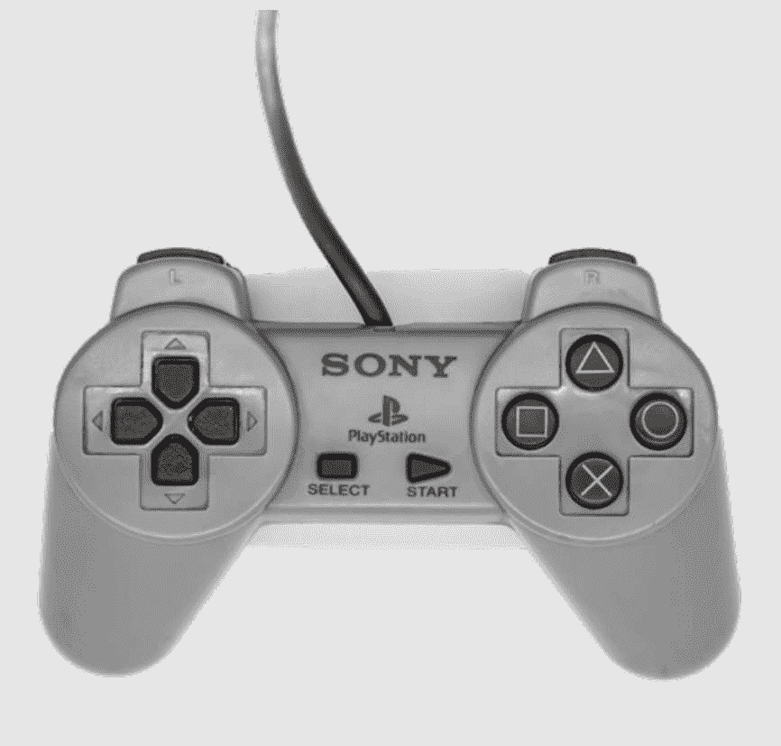

索尼 PlayStation

## 还记得雅虎吗？（1994 年）

在互联网行业还没成型的时候，雅虎是互联网建设的几个支柱之一。

雅虎网成立于 1994 年，由斯坦福毕业生杨致远（Jerry Yang）和戴维·费罗（David Filo）建立。当时各种网站和信息鱼龙混杂、毫无秩序，雅虎的目的就是为人们搭建互联网的门户。当时几乎没有有效的方式可以快速地浏览你要找的信息。雅虎于 1996 年上市，到 1997 年，它成为互联网上流量第二大的网站，仅次于 AOL。

1998 年，两名年轻的斯坦福博士拉里·佩奇（Larry Page）和谢尔盖·布林（Sergey Brin）找到雅虎，说他们有款新产品。他们刚刚开发了 PageRank，一种搜索引擎算法，可以让人快速地在互联网上找到相关信息。两名斯坦福博士要价 100 万美元，雅虎拒绝了，因为他们认为 PageRank 会从雅虎的网站抢走用户，减少雅虎的流量和收入。PageRank 就是后来的谷歌。

互联网大崩盘几乎使所有科技公司损失惨重，但雅虎、谷歌还有其他几家公司挺过了这场风暴。但雅虎也不是毫发无伤，他们的股价从每股 118 美元跌到了每股 4.06 美元。后来，这家公司的股价再也没升到这么高过。

2002 年，雅虎是访问量最大的网站，但是在互联网大崩盘之后，网络端口（旧式的信息整理方式）便无人使用，因为用户都投入了类似谷歌这种搜索引擎的怀抱，来寻找自己所需的信息。雅虎的技术跟不上了。为了维持下去，雅虎一共收购了 114 家公司，但没有一项收购能拯救雅虎。

最终，雅虎各方面的业务都被许多更优秀的互联网公司甩在身后。雅虎邮箱被 Gmail 和 Hotmail 取代，雅虎聊天工具被 WhatsApp、微信和 Facebook（脸书）等聊天工具取代。雅虎新闻也被打败了，人们从各类社交媒体了解时事，比如 Facebook、Twitter（推特），还有专业的新闻网站，甚至还有 YouTube。

用户渐渐抛弃了雅虎的服务，其广告收入和公司利润也不断下降。

因此，雅虎渐渐衰落，到了 2010 年，已经所剩无几了。

## Windows 95（1995 年）

1995 年，Windows 已经不再是套在 DOS 系统外面的一层马甲。之前版本的微软操作系统不稳定，因此给人留下了很差的印象。微软系统总是莫名其妙地死机，设置过程也十分复杂。而 Windows 95 将取代 DOS 操作系统，成为微软公司稳定、可靠的新鲜血液。这个版本的 Windows 加入了几个新功能和特性，在后续的几十年一直保留，其中包括“任务栏”和“开始”菜单。有趣的是，如今任何人听到布莱恩·伊诺（Brian Eno）设计的开机音效，都会有一种怀旧的感觉。

## 《玩具总动员》拯救皮克斯（1995 年）

皮克斯成立于 1979 年，当时是卢卡斯影业计算机业务部旗下的分公司 Graphics Group。这是一家计算机图形公司，由埃德温·卡特姆带领（他在 70 年代曾经扫描自己的手，制作了一部 3D 电影）。

Graphics Group 自从创立之始，就想要创作一部电脑动画长片。1979 年，他们打算把这个片子创作出来，预计 20 世纪 80 年代初发布。这个项目被称为 The Works，长度为 90 分钟。但这个片子没有实现。

当时的计算机速度太慢、能力太弱，不足以制作动画长片。在制作过程中，有一位团队成员计算了这部电影要渲染的帧数所需的输出时间：7 年。1986 年，这个电影项目停止了。The Works 如果按计划做出来，将会是第一部全部 3D 的 CGI（电脑合成影像）电影。

这个电影项目被停掉的时候，只完成了 1/10 的内容。为了解决计算机运行速度缓慢的问题，皮克斯的团队决定自己研发计算机硬件。于是就有了皮克斯图像电脑（Image Pixar Computer），价格只需 21.9 万美元。当时它的能力十分强大，大约比传统设备快 50 倍。一般需要 15 分钟来渲染（绘制和建造）的画面，现在只需要 18 秒。

1986 年，卢卡斯影业想要把 Graphics Group 卖出去。几个月之后，Graphics Group 就从卢卡斯影业独立出来，成为独立的企业皮克斯，总裁就是卡特姆。虽然这是个好消息，但羽翼未丰的皮克斯需要投资。投资公司一直不愿意给皮克斯投资，直到 40 多年后，皮克斯找到了史蒂夫·乔布斯。乔布斯（从苹果离职后担任 NeXT 的 CEO）很喜欢将艺术和科技结合这个想法，为这个新公司投资了 1000 万美元。投资后，乔布斯成为主要股东，拥有 70%的股权。虽然股权发生了变化，皮克斯的终极目标还是没变：创造一部完全由电脑合成的动画长片。

沃尔特·迪士尼工作室随后购买了几台皮克斯图像电脑，还有由皮克斯编程的定制软件，作为其 CAPS（计算机动画制作系统）的部分设备。有了 CAPS，2D 动画的绘制、上色就可以由计算机辅助，既省时又省钱。

第一部使用 CAPS 制作的电影是《救难小英雄》（1990 年）。这是第一部 100%由电脑辅助制作的动画长片电影。《阿拉丁》（1992 年）和《狮子王》（1994 年）也使用了这一系统，一直到 1995 年制作《风中奇缘》时才换了新系统。

然而，迪士尼为 CAPS 采购的计算机数量有限，因此皮克斯的计算机销量一直表现平平。乔布斯意识到马上就会遇到财务问题，他建议也在其他感兴趣的市场发售皮克斯图像电脑：工程、地质、医疗领域。皮克斯的员工约翰·拉塞特（John Lasseter）制作了一些完全使用电脑合成的短视频，来展示高超的技术水平。这些展示视频包括《小台灯》（1986 年）和《锡铁小兵》（1988 年）。拉塞特从小就喜欢各种玩具，特别擅长用拟人化的方式为静态的物品注入个性，这些物品甚至不用说话，就能个性鲜活地展现在人们面前。这就是皮克斯早期电影的精髓。

CGI 动画短片使迪士尼认识到了这种电影制作方式的全部潜力。讽刺的是，约翰·拉塞特之前被迪士尼炒了鱿鱼，正是因为他想推行全 CGI 电影（在两个同事给他看了《电子世界争霸战》之后）。看完以皮克斯台灯为主人公的《小台灯》和其他 CGI 短片之后，迪士尼又想把拉塞特请回来。拉塞特断然拒绝，选择留在皮克斯。他对卡特姆说：“我可以去迪士尼当个小导演，但留在皮克斯，就有机会创造历史。”

毫无悬念，拉塞特常常和谁待在一起呢？答案是：史蒂夫·乔布斯。

虽然皮克斯制作出了令人震撼的展示短片，皮克斯图像电脑的销量仍然毫无起色。实际上，总共只卖出了 300 台。这家公司还试着做了一些 CGI 电视广告，卖 Windows 和 Mac 用的软件，但这些努力都还不够。销售不足威胁到了皮克斯的生死存亡，因为财务亏损越来越严重。乔布斯又向这个项目投了更多钱，获得了公司更多的股份。他的总投资接近 5000 万美元。这使他得以全权控制皮克斯，但也让他个人几乎面临破产。皮克斯仍然在生死间挣扎，最后不得不把计算机硬件这块业务卖掉，开始裁员。幸运的是，1991 年，根据摩尔定律（第八章），动画级计算机终于有足够强大的能力，能在适中的时间内创造并渲染一部完整的动画长片（而不只是动画展示短片）。

### 迪士尼与皮克斯强强联手

迪士尼现在意识到，拉塞特是请不回来了，于是决定跟皮克斯开展合作。这个跨时代的合作投资高达 2600 万美元，内容是制作 3 部计算机动画长片，第一部就是《玩具总动员》。如果没签下这个合同，皮克斯可能几年之后就要关门大吉了。皮克斯开始制作《玩具总动员》，拉塞特当导演，乔布斯是执行制作人。第一段 30 秒的试验视频于 1992 年交给了迪士尼，首次观看令他们印象深刻。

然而，并不是一切都进行得很顺利。两家公司之间的合作关系越来越紧张，因为迪士尼的高层不断地否定皮克斯提出的剧本创意。比如说，迪士尼将伍迪设定为一个性格急躁、一意孤行的“讨厌鬼”（蒂姆·艾伦后来在给这一人物配音时是这么评论的）。

1993 年，在想法和创意交锋之际，电影制作到了一半，为迪士尼的高层管理人员举办了一场《玩具总动员》的预览观影会。这简直是一场灾难！迪士尼的高层对这个片子厌恶至极，实际上拉塞特自己也不喜欢。按他自己的话说，这部电影“是一个充满了我所见过的最不幸、最卑鄙的角色的故事”。

电影的制作马上被叫停了，似乎 CGI 长篇动画的梦想永远不会实现了。

但拉塞特没有放弃，他告诉迪士尼，他会在两周之内修改好剧本。他真的做到了，而且给出的剧本也十分优秀，于是 1994 年，制作再次开始。简单介绍一下背景，要知道使用 90 年代早期的技术来制作这样一部电影，确实不容易。每一帧都要 45 分钟至 30 小时的时间来渲染，取决于场景的复杂程度和细节。有人物说话的电影片段，每 8 秒钟都需要动画师一周的时间来完成。每个镜头都要经过 8 个团队之手，要 300 个计算机处理器（每天 24 小时运转）才能把最终成品渲染出来。

但灾难还没有结束。虽然皮克斯得到了资金援助，但还是在继续亏损：皮克斯图像电脑、软件和 CGI 广告所获得的收入还不够填补《玩具总动员》项目的花销。乔布斯作为董事长和皮克斯的大股东，也感到有些紧张。投资 5000 万美元，项目眼看就要失败，谁能不紧张呢？甚至在 1994 年，乔布斯还在思索是否要把皮克斯卖给贺曼贺卡公司（Hallmark Cards），还有微软的联合创始人保罗·艾伦。

在电影完成之际，这种担忧随之烟消云散。《玩具总动员》全部由电脑合成，看到片中美丽的世界，乔布斯也感到惊叹不已，也认识到皮克斯一定会造就历史。

《玩具总动员》全球票房超过 3.73 亿美元。皮克斯在 1995 年 11 月 29 日 IPO，规模超过了 Netscape，成为当年最大的 IPO。

我相信，第一次看到这部电影时，你也一定像我一样感到震撼。这部电影比我看过的任何计算机合成的动画都要逼真。每一片叶子、每一个小小的细节，都恰到好处。它超出了我的想象，也超出了整个行业的想象。《玩具总动员》的衍生品包括玩具、电子游戏、主题乐园景点、商品和两部电影续集。《玩具总动员》让玩具在 90 年代再度流行起来。毫无疑问，它凭借一己之力拯救了皮克斯。

## 亚马逊开创电商新纪元（1995 年）

在网上浏览你想买的任何物品，并且一个小时内送货上门，甚至不用离开你的椅子——放在 10 年之前，这样的奇思妙想听起来就像科幻小说一样。但这种当日送达的服务，如今亚马逊在欧洲和美国每天都在提供。至今，亚马逊在全球 16 个国家卖出了 3.5 亿件商品，送货可达 185 个国家。这么大的一家公司是怎么开始的呢？

和苹果公司创始的故事一样，亚马逊也是在一个车库内创立的，这次的创始人是杰夫·贝佐斯（Jeff Bezos）。最初想到这个想法时，他在华尔街的一家公司 D. E. Shaw & Co.担任副总裁。这份工作让他认识到互联网用户的极速增长，看到了无穷的潜力。现在人们互相连接，创立网上商店，只是时间的问题。

贝佐斯和这家公司的老板讨论的时候，想到了网上商店的概念，亚马逊背后的创意就此形成。贝佐斯把这个想法做了下去。他一开始得出的结论是，要创立一个什么都卖的网上商店是不现实的，所以他列了 20 种可以在网上卖的商品类别，包括电脑软件、书籍、办公用品、服饰和音乐。书籍是看上去最适合作为第一个在网上售卖的商品。不管你在哪儿买，书都是一样的，并且也能给人很多不同的选择。

贝佐斯和他的妻子麦肯齐·塔特尔（MacKenzie Tuttle），还有一位创业老兵谢尔·卡凡（Shel Kaphan）一起，创建了一家新公司。他最开始于 1994 年 7 月在华盛顿州注册了这家公司，名为 Cadabra Inc. 有人把这个名字听成了 Cadaver（尸体）。一个公司的名字能被误听成“尸体”，实在不吉利，于是他们换了个新的名字。贝佐斯说，他们选择“Amazon”，是因为它是世界上流域面积最大的河流，象征着他的目标，就是成为最大的网上零售商。当时互联网上的网站也是按照字母顺序排列的，他希望自己的网站能成为最先被展示出来的网站之一。1994 年 11 月 1 日，Amazon.com 正式注册，团队开始扩大。

亚马逊试运行时，第一本书于 1995 年 4 月 3 日卖出。这本书是道格拉斯·霍夫施塔特（Douglas Hofstadter）所著的《流体概念与创意类比：思想基本机制的计算机模型》（Fluid Concepts & Creative Analogies: Computer Models of Fundamental Mechanisms of Thought）。听起来很刺激的一本书！1995 年 7 月 16 日，亚马逊网站正式上线，所有用户都可以访问。网站开放时配备了一个可搜索的数据库，里面有超过 100 万个书名，虽然当时在其位于西雅图的库房中，只有大概 2000 本库存。剩下的则按照需要从批发商处订购。

当时，亚马逊没有雇人对书籍进行打包，所以团队人员白天接单，晚上打包。第二天早上，这些书被运送到邮局。这种简陋的配置，在亚马逊登上雅虎网首页的时候得以改变。有了曝光度之后，亚马逊被大量订单淹没了，第一个月就将书籍运送至 45 个国家（当时不需要美国地址）。

贝佐斯预测，如果进展比较顺利的话，到 2000 年，其销售额可达 7400 万美元；如果进展特别顺利的话，其销售额可达 1.44 亿美元。实际上，其 2000 年的销售额高达 16.4 亿美元。这就是亚马逊疯狂扩张的开始。亚马逊当时的格言是“快速扩张”（Get Big Fast）。

1997 年 5 月 15 日，亚马逊举办 IPO，筹集了 5400 万美元，公司市值达 4.38 亿美元。

他们预测，阅读人群规模较小，会成为公司发展的瓶颈，于是决定引入新的产品。他们选择了 DVD 和音乐，在特拉华州开了一个新的配送中心，并把现有的配送中心扩张了 70%。

1998—2000 年，亚马逊收购了互联网电影资料库（IMDb）、Telebuch（德国在线书店）和 Bookpages，得以战略性地触及英国和德国市场的消费者。这段时间，他们也扩大了产品线，售卖玩具和电子产品。

亚马逊的飞速发展，全世界有目共睹。贝佐斯被《时代周刊》选为年度人物。令人吃惊的是，亚马逊一直没有公开利润，直到 2001 年第四季度，才宣布其利润达到 500 万美元（虽然销售额高得惊人，但他们把所有的资金都用于公司的发展）。贝佐斯称，这是因为比起利润，他更看重消费者体验。亚马逊还在持续增长，成为 21 世纪第二个 10 年后的一股主流力量（第十四章）。

## MP3 播放器（1997 年）

### 远见者

在我们的口袋里装着巨大的电子音乐曲库，这在如今是十分平常的事情。如果我们往回想，思考最初的起源，就会想到第一代 iPod，还有一些其他早期 MP3 设备。但令人吃惊的是，MP3 播放器的历史要追溯到 70 年代晚期。

1979 年，英国科学家凯恩·克雷默及其友人詹姆斯·坎贝尔想出了一个点子：一个烟盒大小、可携带、固态（芯片内存）的音乐播放器。克雷默当年 23 岁，坎贝尔当年 21 岁，他们所设想的这个系统名为“IXI”，有一个显示屏和四向导航键。听起来是不是很耳熟？

固态内存当时很少见，但克雷默觉得这种情况一定会改善。他预测，可靠、高质量的数字音乐播放器一定会有市场，不论消费者还是唱片公司都会喜闻乐见。克雷默还描述了数字发行（类似 iTunes 商店）和使用可更换芯片储存音乐的方式。他的远见使实体媒体的时代于 1979 年终结。

克雷默填写了专利申请，开始创立自己的公司。起初，一切都很顺利。预计订单额有 3.28 亿美元，甚至保罗·麦卡特尼爵士也提供了资金支持。

1988 年，专利面临着失效的威胁，克雷默的公司需要募集 32 万美元来更新专利。董事会就此产生了分歧，专利过期了，这意味着克雷默不能因任何使用这个想法的产品而获得认可。结果这个早期诞生于英国的 MP3 播放器并没有被完全生产出来。此外，4 年之后，mp3（压缩音频）格式才问世。

### 第一个投入生产的 MP3 播放器（MPMan）

第一个便携式 MP3 播放器是 MPMan（我猜名字应该来源于 Walkman），1997 年由世韩信息系统公司（Saehan Information Systems）发布，这是三星的一家子公司。这款基于闪存的 MP3 播放器有 32MB 和 64MB（6 或 12 首歌）两种内存选择。它还包括一个 LCD 屏，用来显示正在播放的歌曲。

音乐对我来说一直很重要，所以我清楚地记得我 2004 年买的第一个 MP3 播放器，它是一个小小的 1GB 内存的银色 Conia 设备，只有拇指那么大。我们学校的人都不敢相信，这么小的设备居然能装下 1GB 的东西。我记得我同学当时要反复查看侧面标的存储容量，确保我没有撒谎。

凯恩·克雷默后来怎么样了？

2008 年，苹果承认克雷默是 iPod 技术的发明者，当时他是一个穷困潦倒的家具销售员。在《每日邮报》的一次采访中，他解释道：

我当时正在梯子上刷漆，苹果公司的一位女士给我打了个电话。她带着美国口音，说她是法务部门的负责人，希望能认可我的贡献。不得不承认，最开始，我以为是朋友开玩笑。但是我们聊了很久，当时我还一直站在梯子上。

这件事情的前后联系在一起，是在一家具有专利的公司 Burst 将苹果告上法庭之时，他们宣称 iPod 侵犯了他们的专利权。苹果让克雷默飞到美国，担任庭上的辩护证人，使用他在 1979 年 IXI 的原图纸来证明克雷默才是 iPod 的发明者。苹果通过克雷默解决了法务问题，也补偿了他所花费的时间。

刨根问底后，他解释道：“苹果给了我一个（iPod），但过了 8 个月就坏了。”我们会在下一章接着讲 iPod，看看这个能往兜里装 1000 多首歌的设备是如何掀起一场革命的。

## 史蒂夫·乔布斯回归苹果（1997 年）

不论你对乔布斯这个人做何评价，毫无疑问的是，苹果需要他。90 年代乔布斯不在苹果的时候，苹果的情况是这样的：

**1991 年：**苹果推出便携式的 Mac，名为 PowerBook，销量不好。

**1993 年：**苹果推出牛顿，一款使用手写笔的手提电脑，也失败了。

7 月的时候，苹果公司的报告指出，他们在一个季度内亏损 1.88 亿美元。苹果公司总裁迈克尔·斯宾德勒取代约翰·斯卡利成为 CEO，苹果进行了结构重组，斯卡利辞去苹果董事长一职。

同时，乔布斯在 NeXT 电脑公司，决定集中发展软件业务，电脑硬件业务退居其次。

**1995 年：**微软发布了 Windows 95，它比之前的版本更易使用，更类似于 Mac 系统。竞争激烈、部件短缺、错误地预测了消费者需求等问题，使苹果面临重重挑战。

同时，由乔布斯担任执行制作人、由皮克斯出品的《玩具总动员》，也就是第一部电脑合成的商业动画长片，在影院上映了。皮克斯在华尔街上市，通过 IPO 募集了 1.4 亿美元。

**1996 年：**苹果宣布计划以 4.3 亿美元收购 NeXT。在这次收购中，乔布斯被任命为苹果的顾问。在我看来，苹果意识到了让乔布斯离开是个错误的决定，向他抛出了橄榄枝。

之前的章节中提到过，NeXTSTEP 演变成了 MacOS X（MacOS 10），也是 iPhone 上 iOS 操作系统的基础。在下一章，我会讲到更多细节。

**1997 年：**NeXT 被收购之后，乔布斯在董事会获得了一个席位。他从这里开始，再次攀上了苹果公司的最高点。

苹果公司著名的“不同凡想”（Think Different）的广告语就是在这一年发布的。

**1998 年：**苹果回归盈利状态，通过糖果色的一体化 iMac 台式机，震撼了个人电脑行业。苹果停止生产牛顿，再次回归正轨。

## 谷歌的创立（1998 年）

就在苹果重新崛起的这段时间，计算机在家庭中越来越普及。这和 20 世纪 80 年代不同。现在，普通人也可以通过互联网，迅速地触及世界各地。

网络上建立起无穷无尽的知识、信息类别，但如果没法找到所需的信息，也没有意义。必须把网站整理得更有条理。

1995 年，拉里·佩奇在做斯坦福大学数字图书馆的项目。一天晚上，他做了个梦。在梦中，他想象自己可以把整个互联网存储到老旧的大学计算机上。醒来之后，佩奇做了一些计算，觉得这是可以实现的，但只能通过储存网站链接实现，而不是储存网站本身。他得到了启发，开始创建可以实现这一目标的程序。

与此同时，俄罗斯移民谢尔盖·布林正在斯坦福大学学习计算机科学，他对数据挖掘和数据倾向很有兴趣。佩奇和布林于 1995 年认识。拉里·佩奇把自己下载整个互联网的梦想告诉了布林。而因为布林对数据挖掘和数据倾向很有兴趣，互联网对他而言，也是最有趣的数据组。

佩奇的父亲是一名计算机科学家，所以他从小就是围着计算机长大的。1978 年，佩奇 6 岁，就开始玩父亲的电脑了，这在当时是很少见的情况。据佩奇说，他是他们小学中第一个用 word 处理过的文件交作业的人。童年时期，他就在阅读时下流行的科学和计算机杂志，对它们的运作原理也很感兴趣。

计算机同样给布林带来了很大的启发，特别是它们所赋予我们的能力。他十分感兴趣的是，如何能利用这种能力来做有用的事情，而不只是玩电子游戏。在 80 年代，他和一个朋友在 Mac 上编写原始 AI 程序、引力模拟器、聊天机器人（对话模拟器）和字母识别程序。这段经历在布林的一生中十分关键。

佩奇和布林有着类似的童年经历，他们携手合作，想把全世界的信息有序地整理起来。为了解决这个问题，佩奇从反向链接开始入手——先从本地的斯坦福主页开始。他发现有 1 万条外部链接可以连接到斯坦福的首页。但有一个问题：屏幕上只能显示 10 个链接结果。很明显，他们要找到一种方法来对链接页面进行排序，使最重要的链接显示在前面，这有点儿类似于受欢迎度排名。

经过一些调整之后，就得到了你所期待的结果：两人成功地把斯坦福的首页配置成了相关度最高的结果。网络上的信息可以根据“链接受欢迎程度”，按照级别进行排序，这是谢尔盖·布林首先提出的想法：如果有更多的链接连到某个网站，那么它的排序就会更高。佩奇和布林一开始没打算创建搜索引擎，他们仅仅是出于好奇和研究的目的。他们是在分析数据时，发现他们所开发出来的技术可以变成一种更便捷的信息搜索方式。

他们把这个技术命名为 PageRank。这是按照拉里·佩奇的名字来命名的，但也有双重含义，因为它具有网页排序的功能。

佩奇和布林意识到，把全世界的信息组织起来，会产生很大的影响力。他们的产品可以为所有搜索信息的人所用。他们现在只需要成立一家公司，把它推广出去。于是，他们创立了一家互联网公司，名为 BackRub。

BackRub 于 1996 年 3 月开始对网站编制索引（存储可以进行排名的网站）。从此开始，索引数量迅速增长。到 1996 年 8 月，约有 7500 万个网页都已有索引，总共占了 207GB 的内存。

1998 年，他们给 PageRank 的想法上了专利，并且把公司名字从 BackRub 改成了 Google。

早在 2000 年，Page 就在讨论如何用 AI 存储网络上所有的信息，从而对任何问题做出回答。仔细想想，这就是我们今天使用谷歌的方式。你和朋友辩论时，或者只是对某件事感到好奇时，要怎么办？谷歌！

1998 年，谷歌搜索每天被使用 1 万次。2000 年，搜索数量达到 5000 万；2018 年，搜索数量超过 35 亿。

如今，谷歌的功能不只是搜索，还有谷歌邮箱、谷歌地图、YouTube、安卓、数据分析、量子计算、AI，这只是他们在 21 世纪的业务内容中的几个。

## 纳普斯特（1999 年）
谷歌掀起互联网搜索革命之时，音乐界也因 MP3 音乐的分享而大不相同。如今这一代的听众认为音乐应该是免费的，而这种心态始于纳普斯特。

1998 年，美国东北大学的大一学生肖恩·范宁（Shaun Fanning）只有 19 岁，他和一个朋友创建了纳普斯特（Napster）。这是个革命性的概念：在全互联网免费分享存储的音乐。

范宁从大学退学，很快在网上推出了纳普斯特，让所有人都可使用。这个消息在聊天室里一传十十传百，几个月就有了 4 万名用户。

纳普斯特是第一个大型的端对端文件分享软件。只要用户相互连接，就可以下载其他用户硬盘上储存的文件。早期很多人对此持怀疑态度，认为没有人愿意把自己的硬盘公开给全世界。但是如果能获得免费的音乐，好几百万人都愿意冒这个险。

在 20 世纪 90 年代，虽然 CD 很流行，但每张都要卖 18 美元左右，如果你只喜欢其中的一首歌，这个价格还是很高的。到 1999 年，美国的音乐行业收入累计达 150 亿美元。纳普斯特在一瞬间摧毁了这一切。

消费者可以免费获取自己想要的音乐了。这个文件分享软件在大学校园里迅速走红，到 2001 年，有超过 2500 万人都在使用纳普斯特的服务。

唱片公司一点儿甜头都没有尝到，他们把纳普斯特的服务称为“光天化日下的偷窃”。2001 年 7 月，经过长达一年的法律斗争，这个服务不得不关闭。

但这种观念已经渗透到大众的认知中。木已成舟，免费文件分享网站开始大规模涌现。像 LimeWire（一个使用 Gnutella 网络来寻找与传送档案的 Java 平台点对点档案分享客户端）、电驴（eDonkey2000）、Soulseek 之类的软件，连我都说不清自己有没有用过。

随之而来的是更多的官司，但损失已不可避免。CD 销量在这 10 年持续下降。2001 年，史蒂夫·乔布斯发布了 iTunes 数字音乐商店，才将合法下载任意歌曲的想法推广出去。

这一举措打破了唱片公司的垄断局面。后来，像声田（Spotify）这样的流媒体服务成了压死唱片公司的最后一根稻草。

## Emoji（表情符号）的由来（1999 年）
表情符号是日本的栗田穣崇在 1999 年发明的。他的创意来源于观察年轻人使用寻呼机（还记得吗？）的方式。90 年代中期，日本的年轻人特别喜欢某个品牌的寻呼机，这不只是因为它的功能，还因为它有一个爱心符号，可以在发短信的时候发送。

这款寻呼机的新一代问世时，把这个爱心取消了，这引发了强烈抗议，很多用户流失，开始寻找另一款有爱心符号的寻呼机。这给了栗田穣崇很大的灵感。1999 年，他帮人设计一个手机计算机系统，想到手机如果能支持选择一系列符号，在日本一定会很流行。他想得没错，不只是日本，全世界都是这样。

## 千年虫（1999 年）
2000 年元旦前夕，人们只关心两件事：晚上怎么嗨，以及怎么解决千年虫。

这个问题在于，用两位数字存储日期的系统马上要跨越世纪，会将 2000 年最后的两个数字（00）读取为 1900 年。据说这会让全世界陷入混乱。没人知道为什么这次日期变换会影响到重要的系统，但是没几个人愿意冒险。在 20 世纪 90 年代末期，企业、政府和个人为了制服千年虫产生了一场大混乱，在整个过程中花了几十亿美元。

现在我们可能会把当年的千年虫当笑话来看，但回顾当时的预测，确实很可怕。

当时预计全世界用来修复千年虫的花费高达 1.1 万亿美元。当时人们以为从银行到核设施都面临着灾难性的威胁，可能会有无法预期的后果。

公众也被吓得够呛。美国的一项调查发现，42%的人打算囤水囤粮，34%的人觉得银行和会计系统会崩溃，还有 51%的人打算避开 2000 年 1 月 1 日左右乘飞机。

1999 年 12 月 31 日午夜临近时，全世界都屏住了呼吸……基本上什么也没发生。只不过全世界的人都喝得烂醉。

可能会让你感到吃惊的是，有一些系统确实发生故障了。比如，一个美国军用卫星监视系统崩溃了，过了好几周才恢复过来。

1999 年时，世界上的 60 亿人民中很少有人经历过战争或地缘政治冲突。对大多数人来说，世界一派和平，经济繁荣昌盛。互联网用了短短 9 年的时间改变了全世界。人类已经无法走上回头路。2000 年，我们进入了可以称得上是“后现代”的生活时代。

### 第十三章 个性化的科技（2000—2009）
全世界的狂欢落下帷幕，大家对千年虫危机的恐惧也渐渐消退，剩下的只有对 2000 年的期待。21 世纪终于来临了。

但这种愉悦并没有持续多久，“9·11”恐怖袭击事件带来了极大的社会震动。它不仅给美国人带来了伤害，也波及了全世界。我记得第二天，我们学校（在西澳大利亚）把学生都带到了椭圆球场，以防意外发生。那天在球场，还有接下来几天在教室中，老师让我们坐下来，让我们讨论对那次事件的感想。我记得那个时候我感到难以置信。

随着这 10 年的发展，制造业搬离了美国和日本，到了其他国家。欧元本来是一个货币协议，但 2002 年以货币的形式开始流通。中国经济开始飞速增长，到 2009 年几乎占世界经济的 9%，是全球第三大经济体。

2001 年，安然公司的丑闻和破产事件震惊了整个商界。类似的欺诈犯罪事件在 2008 年也有发生，当时对冲基金和银行把垃圾贷款包装成高级资产。同时，伯纳德·麦道夫利用人们的欲望，在房地产泡沫发生之时快速圈了一笔钱，创造了全世界最大的庞氏骗局。麦道夫携 600 多亿美元的巨款逃跑了。

随着《老大哥》（Big Brother）和《美国偶像》（American Idol）推出，真人秀大受欢迎，两个节目都出了澳大利亚的本土版。我还以为这是一种原创电视节目，特别是《澳洲偶像》（Australian Idol）的概念。像《老大哥》这样的节目，似乎也没太大新意。我以为这种类型的电视节目应该只是一时的热度，事实证明我错了。

21 世纪初，节奏布鲁斯再次开始流行，情绪摇滚也流行起来。像“我的化学浪漫”（My Chemical Romance）和“打倒男孩”合唱团（Fallout Boy）这样的乐队通过 Myspace 之类的网站，在 21 世纪早期推广了情绪摇滚。

21 世纪初，时尚朝着未来化的趋势发展，银色裤子一点儿也不罕见（我甚至还有一条），还有漂染尖刺头、紧身裤、喇叭裤、工装裤等等，不拘一格。

这个年代长大的人叫作 Z 世代，主要是 X 世代的后代。他们是第一个伴随着 Facebook、YouTube 等社交媒体长大的一代。由于全球化的发展，他们大体上都更为包容。他们也都有创业的精神，特别是在 2008 年经济大萧条之后。为了回应这次经济危机，一位化名为中本聪的人在 2008 年发布了比特币白皮书，作为一个替代性的金融系统。

MSN 聊天器在 21 世纪变得很受欢迎，成为最酷的交流方式。青少年每次看到喜欢的人上线，心跳都会加快。Windows XP、Vista 和 Windows 7 都在这 10 年间首发。2003 年，3G 移动网络标准使人们实现了手机上网。谷歌邮箱于 2004 年发布。

到 2005 年左右，手机的价格已经很便宜了，几乎每个人都有一部。微软的 Zune 播放器和 PlayStation 便携版也是很受欢迎的设备。这也是消费者科技的黄金时代：一切都在发生变化，似乎都在有条不紊地向前发展。

### 互联网大崩盘（2000 年）
大多数人都很熟悉互联网泡沫：年轻的电脑迷不管想出什么和互联网相关的想法，都能赚个几百万美元。好吧，也没这么简单，但差不多是这样。一切始于 1993 年，Mosaic 网络浏览器（后来的 Netscape）使人们可以轻松浏览互联网。然后因为有了谷歌，每个人都可以搜索并找到他们想要的信息。这就打开了一个巨大的市场大门。90 年代晚期，人们把互联网视作一种新的经济：一个具有震撼力的、有魔法的概念，可以改变整个世界。

没错，互联网确实有改变世界的能力，这是显而易见的。但人们对它的期望太高，夸大了它的能力，做出了很多头脑发热的投资。只要哪家公司名字是以.com 结尾的，就有人给它扔钱，哪怕这公司连个实在点儿的计划都没有。这些新公司一旦开放 IPO，他们的员工便会一夜暴富。

哪有必要搞什么商业计划，对吧？这些明日之星般的公司大肆举办奢华的互联网派对，连眼都不眨。一切都美好得有点儿不真实……且慢，让我们接着往下看。

#### 空中楼阁：四分五裂
这些互联网公司的股价上升时，旁观者也想尽快加入战局，分得一杯羹。很快，当地的出租车司机就会给你提建议，告诉你该买哪支互联网股票。但其实，是时候该撤了——有些人意识到这些公司根本不赚钱，都抽身离场了。

最后，只留下数不胜数的没有兑现的承诺。

2000 年下半年，投资者们幡然醒悟，派对终于结束了。人们为了摆脱危机挤破了头，在一阵恐慌中把股票都卖了。截至 2000 年 11 月，超过 1.7 万亿美元（互联网股票 75%的价值）都蒸发了。2002 年，整个股票市场中有 5 万亿美元不翼而飞，因为科技股票也影响到了其他的股票。大多数科技公司都在这次危机中元气大伤。举个过山车式的例子，Blucora 是一家搜索引擎公司，2000 年 3 月的股价是每股 1305 美元，到了 2002 年，股价跌至每股 2 美元。当时只有谷歌和亚马逊活了下来。由于这次危机主要是因科技股而起，整个股票市场次年又开始回暖。

### 被 Blockbuster 拒之门外的 Netflix（2000 年）
从 20 世纪 80 年代中期到 90 年代晚期，家用录像系统是世界的主宰。除此之外，没有别的方法可以在家随意观看喜欢的电影，而不用受到电视节目的束缚。但问题在于，VHS 录像带太贵了。因此，像 Blockbuster Video 这样的录像带租赁店就填补了这个空白。它们完美地解决了问题，成为全球几亿人民周末的日常活动。

最后，像 Netflix、Hulu、亚马逊 Prime Video 之类的线上视频播放服务摧毁了老式录像带租赁店的商业模式。Blockbuster 进入市场比较晚，虽然很早就有人给它发了邀请。

2000 年，Netflix 提议它可以解决 Blockbuster 线上设施的问题，他们要求的回馈是，Blockbuster 把 Netflix 作为一个店内设施（意思是，消费者可以在店内取他们在 Netflix 上预订的 DVD，这样就可以减少邮寄 DVD 的需求，Netflix 当时的商业模式主要是邮寄）。Netflix 前首席财务官巴里·麦卡锡说：“他们几乎是在嘲笑声中把我们送出办公室的。”但故事到这里还没有结束。2007 年，Blockbuster 步入正轨，它的网上电影业务全面碾轧 Netflix。Netflix 的管理层想把公司卖给 Blockbuster，还能挽回些面子，但是 Blockbuster 不想收购 Netflix，觉得他们的发展方向有问题。

但事情有了诡异的转变，当年比较晚的时候，Blockbuster 的董事会上产生了一次分歧，导致他们更换了 CEO。新的 CEO 叫吉姆·凯伊斯，他完全不知道公司的未来会在哪里。他决定 Blockbuster 应该主要做租赁业务，而不是网上娱乐业务。这是个错误的决定。凯伊斯却一点儿也不担心。2008 年，他说：“Netflix 作为竞争者，不值一提。”

仅过了 18 个月，Blockbuster 就失去了 85%的市值。3 年之内，他们开始申请破产。

Blockbuster 销声匿迹，而 Netflix 开始繁荣发展。Netflix 在全球有 1 亿多订阅用户，改变了很多人对娱乐的看法。

### 诺基亚的崛起（2000 年）
诺基亚 1011 是在 1992 年发布的，是第一部商业 GSM（全球移动通信系统）手机。当年早些时候，约玛·奥利拉（Jorma Ollila）接手诺基亚，把它推向了电讯行业的方向。为此他把诺基亚其他的业务都卖掉了。奥利拉在恰当的时机提出了恰当的想法。1991 年，诺基亚处于亏损状态，但到 1999 年，他们实现了 40 亿美元的利润，并超过摩托罗拉，成为第一大手机制造商。

2000 年，诺基亚使出了撒手锏。他们发布了摔不坏的 3310。这是当时最完美的手机：容易使用、耐久性强，有耐用的电池和好用的按键，还有几个让人上瘾的小游戏。这部手机在全球卖出了 1.26 亿台，成了当时的经典。我姐姐当时有一个大红色的，我特别喜欢用它玩游戏。当时还出了各种各样的手机壳，在比我大的孩子之间十分流行。

3310 的发布，对诺基亚而言只是个开端。其他爆款手机还有 2005 年推出的 6280，以及 2007 年推出的诺基亚 N95，后者拥有第一个在美国上市的 500 万像素的摄像头，还有 GPS 地图等功能。

我记得 2004 年，我用自己的钱买了第一部手机。那是一部诺基亚 6020，有彩色屏幕，3.5MB 内存，还有很棒的 30 万像素后置摄像头（清晰度约是现在标准的 1/40）。我们今天可能会笑话它，但在当年，能用这么小的设备拍视频，对我来说是很新奇的事情。

### 第一部拍照手机（2000 年）
如今，智能手机的摄像头已经发展到可以取代入门级独立相机的水准了。

今天很多人都会想：手机可以拍照，为什么还要抱着一部巨大的相机呢？手机那么方便，效果也不差，所以……

甚至有一些电影都是用 iPhone 拍出来的，这就是我们今天的水平。

第一步拍照手机（有内置摄像头的手机）是夏普推出的 J—phone。这是 2000 年 11 月在日本推出的。它的分辨率是 11 万像素。

2001 年，BBC 在网站上报道了这一发明。现在看当时的一些评论，有些十分有趣：

我喜欢拍照，但是我不想单独带另外一台设备。如果手机能和相机结合在一起，还有日程表、浏览器，那实在是太酷了。

——嘉布丽尔·埃诺，美国

能拍照的手机确实是个很新奇的发明。对于暗访或者潜入来说，非常方便，要是伪装得更好一点，谁能想到到手机上找摄像头呢？

——乔安娜，芬兰

可以在散步的时候拍可爱的小狗的照片。

——约翰，美国

这是个很明显的进步。最终，所有的可移动设备，包括电话、相机、掌上电脑，都一定会整合在一台通信设备上。

——朱利安·艾利特，英国

朱利安猜得完全没错！乔安娜的想法虽然有点儿诡异，但也没有错。

### iPod 将苹果打造成文化标志（2001 年）
它是白色的，有一副牌大小，有一个奇怪的圆环，还有足够的空间容纳大约 1000 首歌曲。起初没有人知道该怎么看待它，但它很快就变得无处不在。

回顾最初，史蒂夫·乔布斯展示初代 iPod 时，很明显苹果是很有远见的。他们是这么获得成功的：

数码相机和便携式摄像机开始进入市场，有了像 Napster 这样的互联网文件共享服务，数字音乐也大受欢迎。为了迎合这一趋势，苹果为照片、视频和音乐等应用推出了一系列 Mac 平台上的“iApp”。在这个过程中，他们研究了需要和这些应用程序匹配的现有设备，并意识到虽然 iApp 支持这些设备，但这些设备并不支持 iApp。

他们提出了一个问题：如果能发明一个专门支持苹果软件的设备呢？这意味着能实现前所未有的软件和硬件集成水平。苹果本来想从照片开始（利用数码相机和摄像机的趋势），但最终选择了音乐，因为它是每个人生活的一部分，而且乔布斯喜欢音乐。目前还没有市场领导者，所以这是苹果进入市场的黄金时间。

初代 iPod 是一个巨大的飞跃。iPod 不只是像随身听或闪存式（基于芯片的）MP3 播放器那样，只能播放一张 CD。它具有较薄的硬盘驱动器，能将整个音乐库放在口袋里。初代 iPod 有 5GB 的内存，相当于 2000 年台式机内存的一半左右，并且可以放在口袋里！当时 iPod 的电池性能甚至优于苹果的笔记本，可以维持 10 小时。但或许最具创新性的发明，是可以滚动的控制轮。

当时的 MP3 播放器很难使用，必须要手动点击每首歌才行。如果你有 1000 首歌……那就别指望了。怎么能在一秒钟内滚过数千首歌曲？控制滚轮通过内置的加速功能改变了这种情况，而且点击它时可以听到声音，还能提供触觉反馈。这是用户界面设计的一个突破。切歌曾经是件苦差事，现在变成了一种乐趣。这就是苹果造就的经典。

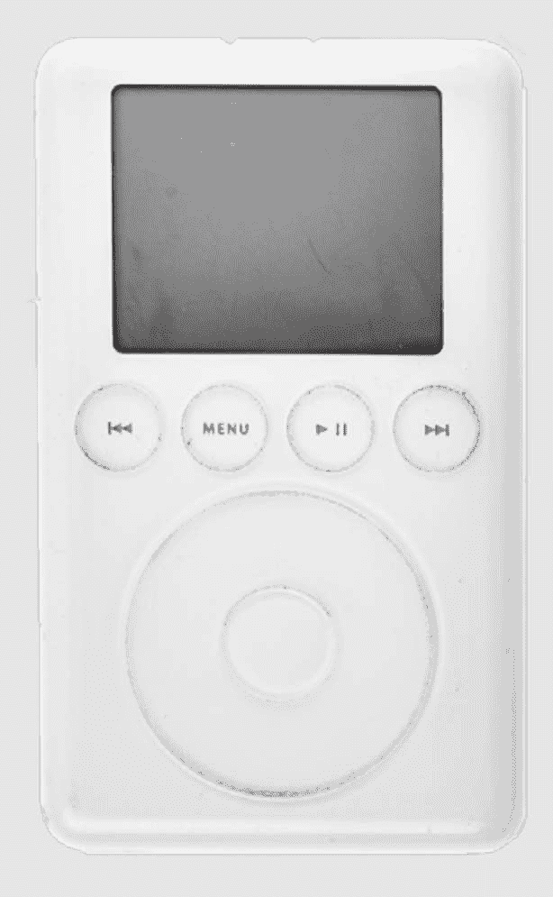

初代 iPod

考虑到它的内存，iPod 与其他设备相比也很小。它便携、轻巧耐用，造就了苹果的标志性设计。不过，设计 iPod 可不是一件容易的事。

#### 我不管，再薄一点！
据前苹果公司员工阿密特·乔德哈利（Amit Chaudhary）称，乔布斯是这样让他的工程师缩减初代 iPod 厚度的：

当工程师完成第一台 iPod 的原型时，他们向史蒂夫·乔布斯展示了他们的作品，以获得批准。乔布斯拿着它把玩，仔细查看，在手中掂了掂重量，马上就说：“不行，太大了。”

工程师解释说，根本不可能把它做得更小。乔布斯没说话。过了一会儿，他走到一个鱼缸旁，把这台 iPod 扔进了水箱。当它接触到底部时，气泡漂浮到了顶部。

“里面有气泡，”他吼道，“也就是说里面还有空间！把它缩小！”被乔布斯怒斥之后，工程师们实现了不可能，初代 iPod 诞生了。最初，iPod 销量平平，因为它只支持 Mac 系统。然而，当 iPod 项目负责人托尼·法德尔（Tony Fadell）说服乔布斯让这台设备支持 Windows 时，其销量开始大涨。

### 马斯克的航天梦（2002 年）
埃隆·马斯克于 1971 年出生于南非。从宾夕法尼亚大学毕业，获得商学和物理学位后，他和别人共同创立了 PayPal。PayPal 获得成功之后，他成了一个富人，很快就放眼天际，寻找下一个努力的目标。有一天，他突发奇想，想将一些植物送到火星，告诉大家人类可以创造奇迹，来激励人们。马斯克开始为这个任务询问成本报价时，美国的公司预估的成本约为 8000 万美元。这个价格没有打动他，于是他想买一枚翻新过的俄罗斯洲际弹道导弹，但没有成功。

## SpaceX 的崛起

大约在同一时间，也就是 21 世纪初，美国宇航局正在退出发射航天器的业务。马斯克认为这是个好机会，于 2002 年创立了太空探索技术公司（或称 SpaceX）。

21 世纪第二个 10 年，很多媒体开始炒作 SpaceX，但这些炒作不是凭空捏造的。这只是开始；现在，我们来看看这家公司迄今取得的成就。

### SpaceX 实现了其他公司没有实现的哪些目标？

以前只有政府机构才能实现的里程碑：

·第一家让火箭进入预定轨道的私营公司（2008 年）

·第一个由私企开发的将商业卫星发射至预定轨道的火箭（2009 年）

·第一家成功发射、使其绕轨运行、恢复航天器的私营公司（2010 年）

·第一家向国际空间站发送航天器的私营公司（2012 年）

### 为人类开创历史先河

在历史上，要使可恢复、可重复使用的火箭发射、飞入轨道、平稳返回地球（直立着陆），一直是火箭科学研究的神秘领域。可重复使用的火箭可以大幅降低成本，并缩短周转时间。人们原本认为这种壮举是不可能的，直到 SpaceX 把它变成了常规。使用这种方法，他们完成了：

·轨道火箭首次发射并直立着陆回到地球（2015 年）

·使用过的轨道火箭重新发射和着陆（2017 年）

2019 年，SpaceX 还完成了第一个载人私人舱访问国际空间站任务。

### 社交媒体的崛起（2002 年）

人类是社交性的动物，大多数人都希望更多地了解彼此。

有一个著名的实验是这样的：如果一个人在街道中间盯着天空，每个人都会不理他直接走过去——就是个疯子，对吧？但是，如果一群人在街道中间都盯着天空，更多的人会停下来看——肯定有什么有趣的东西。那么多人这么干，肯定不会错。

在一群人中，往往别人做什么，人们就做什么（我亲切地称这个词为“跟着羊群走”）。这是人内在的天性，也是我们现在所称的“社交媒体”成功的关键。

第一个流行的社交网站是 TheGlobe.com。它于 1995 年推出，并于 1998 年上市。TheGlobe.com 仍然保持着 IPO 最大首日收益纪录。其首席执行官斯蒂芬·帕特诺（Stephan Paternot）成为不计其数的互联网百万富翁中的典范。

但是，21 世纪，社交媒体的变化十分迅速，TheGlobe 和其竞争者都意识到，很难找到制胜的诀窍。

#### Friendster（2002 年）

Friendster（全球最大的社交网站之一）由加拿大程序员乔纳森·艾布拉姆斯（Jonathan Abrams）于 2002 年创立。在创建 Friendster 之前，艾布拉姆斯是 Netscape 的高级软件工程师，于 1998 年离职。

大约在 2001 年，他开始思考人们联系、互动的新方式，一种能把线上线下生活整合在一起的方式。

“人们在网上互动的方式，要么是匿名的，要么通过别名或者网名。”艾布拉姆斯说，“我想把线下的真实环境带到网上，这样我就不是网民 307，而是乔纳森。”他说得没错。匿名会影响人们的行为方式。至少在最初，人们在像 Facebook 这样的网站上会更加谨慎，因为你所说的话会对你的生活产生实际影响。

相比之下，像今天 YouTube 这样的地方，到处都是辱骂性的评论，就像猴子把粪便扔得到处都是一样。有的时候，最好只看视频，不看评论。

艾布拉姆斯将 Match.com 作为基础，来深化这一想法。他想知道，如果人们的主页显示的是他们自己的信息，并与其他人的主页连接，而不是专注于恋爱偏好，会怎么样？

他的想法是，模拟在现实世界中发生的人际关系——一种交友网络。这个想法成为后来的 Friendster，是从流行的 mp3 下载网站 Napster 演变而来的。2002 年，friendster.com 网站被注册，在几个月内拥有了 300 万用户。显然，到了见证奇迹的时刻了。

Friendster 给谷歌留下了深刻的印象。2003 年，谷歌提出以 3000 万美元收购 Friendster，却被拒绝了。当时，Friendster 在媒体上备受关注，是顶级的社交网络。直到 2004 年 4 月被 Myspace 取代。即使 Friendster 在美国开始衰退，它在亚洲的表现还是不错，直到 Facebook 出现。2009 年，意味着 Friendster 时代的终结。2015 年，Friendster 被永久关闭。

#### Myspace（2004 年）

你即使不知道 Friendster，也很有可能知道 Myspace。在我上高中时期，Myspace 可是最火的网站。自定义个人主页、浏览音乐和选择个人主页的歌曲，是我课余时间的重要活动。“最佳朋友”功能还引发了不少闹剧，因为你只能选 8 个人。这可能是一个设计缺陷。

Myspace 始于 2003 年 8 月，是在线营销网站 eUniverse 的一群员工创立的。他们都有 Friendster 账户，并且很喜欢社交网络这个想法，所以决定要创立自己的社交网络。eUniverse 对他们的项目给予了全力支持。

到 2004 年，Myspace 已经拥有了庞大的用户群，主要是青少年和年轻人。Myspace 非常注重音乐，也就是说地下乐队（特别是摇滚和情绪摇滚乐队）可以将他们的作品发布在 Myspace 页面上。像庞客星期天（Taking Back Sunday）这样的乐队在互联网上变得非常受欢迎，都得益于这个功能。2005 年年初，Myspace 开始谈判收购 Facebook，但马克·扎克伯格要价 7500 万美元，导致收购没有谈成。第一亿个 Myspace 用户于 2006 年注册；2007 年年底，Myspace 在社交网站中遥遥领先。

然而好景不长，2008 年年中，Myspace 被 Facebook 超越。Myspace 坚持以音乐为本，不愿更改或添加新功能，这导致它不断衰落。此外，当年的青少年长大成人，踏入大学时，发现等待着他们的是 Facebook——更加高大上，而且更适合成年人。

#### Facebook（2004 年）

Facebook 和之前的社交网络的区别在于，马克·扎克伯格持续性地对这个社交媒体网站进行调整，来留存用户，不管这些变化是好是坏。

马克·扎克伯格出生于 1984 年，从小就是个聪明的孩子。作为千禧一代，他的成长经历中就有使用计算机的经验，并且从父亲那里学习编程。扎克伯格在中学的时候，已经可以自己编写软件，他的父亲也聘请了一位软件开发师来教导这个小程序员。扎克伯格的导师有一句名言，说扎克伯格是一个神童，连他自己都很难超越自己的学生。

高中时，扎克伯格和一个朋友开发了一个名为 Synapse 的媒体播放器，它可以学习听众的习惯，并根据推测给他们推荐可能喜欢的音乐。Synapse 是个很有趣的概念，引起了微软和全球其他巨头的关注，但扎克伯格没有满足于此。他想要更进一步的挑战。

扎克伯格高中毕业考入哈佛大学时，已经是一个经验丰富的程序员。在哈佛，他写了一个名为 Facemash 的程序，大体上是一个带有照片投票和排名系统的交友网站。一些颜值不高的学生可能感到不愉快，但 Facemash 周末上线，周一哈佛的服务器就崩溃了。学生们连网都上不去了，它就是这么受欢迎。

大约在同一时期，第二代社交媒体开始崛起，Myspace 和 Friendster 取得了不错的成绩。哈佛大学的三名学生卡梅伦·温克莱沃斯、泰勒·温克莱沃斯以及迪夫亚·纳伦德拉，已经花一年时间建立了一个名为“哈佛连接”（Harvard Connection）的网站，但后来有两名程序员毕业了，因此他们正在寻找一位有才华的新程序员来接管。

听说了 Facemash 的事后，他们很清楚，扎克伯格就是他们要找的人。扎克伯格接受了他们的邀请，并加入了“哈佛连接”项目，但他有自己的想法。虽然故事的细节有争议，但据说扎克伯格背叛了哈佛大学的团队，一直在做自己的网站，拖着“哈佛连接”的工作不做。最后，扎克伯格从“哈佛连接”的社交理念中汲取灵感，并由此做出了“The Facebook”。后来，它的名字改为“Facebook”，剩下的就是我们所熟知的历史了。

如今，我们不能仅仅把 Facebook 视作一个社交网络。Facebook 公司的业务比社交网络要大得多。

今天，Facebook 拥有 14 亿活跃用户，是访问量第三的网站，仅次于谷歌和 YouTube。每 20 分钟，Facebook 上就会分享 100 万个链接，发出 200 万个好友请求，发送 300 万条消息。每天，Facebook 都会创造 4PB 的数据，上传 3.5 亿张照片。

Facebook 的市值超过 5 万亿美元，比可口可乐、百事可乐和麦当劳加起来还多。

然而，随着 Facebook 的发展，越来越多的人开始讨厌它。数据共享丑闻和对社会的负面影响，使公司元气大伤。许多研究表明，Facebook 降低了人们的幸福感；CT 扫描显示，社交网络明显使发育中的大脑降低了同情心。在最后一章中，我们会更多地讲到 Facebook 的社会影响。

### YouTube 用视频连接世界（2005 年）

#### 给 YouTube 的小小致敬

没有 YouTube，就没有 ColdFusion（冷聚变，一个动态 Web 服务器），甚至也不会有你正在阅读的这本书。我是 2009 年开始用 YouTube 的，当时发布的是在 HTC HD2 手机上运行 3D UI 安卓插件的视频。我的频道开始有起色，是我展示初代三星 Galaxy Note 功能的时候。当时的手机还很小，大屏手机（当时称为手机平板电脑）非常少见。我马上意识到，这是未来的趋势：只需一部手机，便可以自由浏览文件、上网，便捷地查看电脑版网页。

我们的手机功能越强，就需要越多的屏幕空间，当时这对我来说是显而易见的事。然而，初代 Note 的问题在于，它感觉太像手机了。我在 YouTube 上展示了一些改版软件，让它感觉更像是一台迷你电脑，那时候我觉得这样更酷。

其他看视频的人显然也这么觉得。我当时带着这么大一部手机，以各种花样使用它，不搞技术的朋友经常嘲笑我。如今，大多数智能手机都很大。当时我觉得，手机正要进化成全新的东西，而我只是向人们展示了未来的可能性。我很高兴当时我能有机会与全世界分享自己的想法，并得到人们的回应。谢谢你，YouTube！

#### YouTube：身在福中不知福

小时候，我每次想看视频，都必须在录像机上（后来在 DVD 上）看。然后就有了 YouTube。今天，我们随时可以免费观看几乎无穷无尽的内容。

YouTube 的出现无疑改变了世界。它的规模和影响之大，令人难以置信。每个月，人们都要观看总计 70 亿个小时的视频。要想把 60 秒之内上传的视频看个遍，需要连续观看 15 天；要想看完一天之内上传的视频，需要 65 年。

YouTube 是互联网上访问量第二大的网站，也是互联网上第二大搜索引擎。这就可以让你稍加了解，YouTube 有多么重要。但这一切是怎么发生的呢？让我来给你讲个故事。

#### YouTube 的起源

一切都始于埃隆·马斯克和他的合伙人共同创立的公司 PayPal。PayPal 的三名员工改变了世界，他们是查德·赫利（Chad Hurley）、陈士骏（Steve Chen）和贾德·卡林姆（Jawed Karim）。他们在 PayPal 工作了一段时间后，想创建一个视频约会网站。这个网站被创建出来，称为“TuneIn Hookup”，一个人们可以上传自己的视频，找到合适的约会对象的网站。你可能也猜到了，这个网站并没有成功。

很多人，特别是女性，不想通过上传视频来找对象。这个网站生存得很艰难，于是开始在 Craigslist（一个大型免费分类广告网站）上做广告。尽管他们愿意给女性支付 20 美元的高额报酬，让她们上传自己的视频，但还是没人愿意。

然而，正如这类故事的惯例一般，契机出现了。2005 年的一天，卡林姆注意到，在网上找珍妮·杰克逊 2004 年超级碗走光的视频真是不容易。他因此有了个主意：必须发明一种更简单的方式，来上传和分享视频。技术已经有了，只是怎么把网站建起来的问题。

卡林姆意识到，他们可以使用 TuneIn Hookup 网站现有的代码，作为视频网站的基础。他修改了 TuneIn Hookup，允许用户上传任何类型的视频。

不久之后，网站更名为 YouTube。2005 年 2 月 14 日，在加利福尼亚一家比萨店上方一个简陋的房间里，YouTube 公司成立了。YouTube 的第一个视频是《逛动物园的我》，于 2005 年 4 月 23 日上传。在这个视频里，卡林姆很不自然地在介绍他背后的大象。

没过多久，YouTube 就有了第一部百万大片。当时是 2005 年 9 月，是耐克的一个广告。在视频里，巴西球员罗纳尔迪尼奥正在用足球表演各种技巧。

2006 年 10 月，谷歌从门缝中探出个头，心想：“嘿，这个很不错啊。”他们以 16.5 亿美元的高价收购了 YouTube。

#### 迅速增长

谷歌把 YouTube 称作互联网发展的下一步。这是个很大胆的声明，特别是在 YouTube 公司只有 65 名员工的情况下。但谷歌知道，YouTube 一定会火，它与以往的网站都不一样。很快，YouTube 成为网络上增长最快的网站之一。

YouTube 的概念体现在它的名称中：YouTube 中的 You 是指你是制片人，目的是播放自己制作的视频。这个主题在 2006 年得以彰显，当年《时代》杂志的年度人物是“你”。封面上的标题写着：“你。没错，就是你。你可以掌控信息时代。欢迎来到你的世界。”说得没错，我们可以随心所欲地在 YouTube 上展示任何东西。

2007 年 5 月，YouTube 合作伙伴计划开始，改变了许多人的生活。YouTube 首次让普通人能把自己的爱好变成一项业务。大约一年后，最成功的那批用户收入达到了 6 位数。过了不久，YouTube 便成为真正的主流。

YouTube 在 21 世纪初呈指数增长，创造了自己生机勃勃的独特文化。它还没出现多久，便开始取代电视，令人备感惊异。

据英国广播公司报道，在 18 岁以下的人群中，YouTube 的重要程度已经超过电视。一些真正的名人也开始活跃在 YouTube 上。我想到的其中一个是贾斯汀·比伯。还有像《大城小妞》（Broad City）和《工作狂》（Workaholics）这样的节目，也是先以 YouTube 短剧的形式出现，而后才成为黄金时段的电视节目。

今天，YouTube 是全球最大的视频媒体发行商，从独立小电影到新闻，再到全新的节目类型。YouTube 上不仅仅是猫咪视频、视频博客和病毒视频了。

2010 年，TED Talks 掌门人克里斯·安德森（Chris Anderson）指出，由 YouTube 促成的群众性学习，可能会造就人类历史上最大的学习周期。这可能还没有实现，但我确实已经学习了很多技能，比如通过观看 YouTube 上的教程学会了视频剪辑，我相信你也有类似的经历。YouTube 视频在全球各地的学校和大学中被播放，也是很常见的事情。人类第一次拥有了公共的数字视频库。

然而，有人说最近 YouTube 已经失去了其真正的本质，公司利益、广告丑闻和禁止赢利的倾向十分猖獗。在撰写本文时，YouTube 仍处于不稳定的状态，似乎未来可能会发生变化。我们也可拭目以待，看看像 Twitch（一个面向视频游戏的实时流媒体视频平台）这样的竞争对手，以及去中心化加密视频网站会走向何方。

### 智能手机时代的降临（2007 年）

如今的智能手机，就好像是我们手中的迷你电脑。就功效和处理速度而言，智能手机的增长速度远远高于个人电脑。

在我 2013 年的 ColdFusion 视频《有史以来最伟大的故事》中，我说：“20 世纪的第一个 10 年将是未来与现在交织的 10 年，我们会看到一些新趋势。首先，智能手机将变得非常强大，其更新换代之快让很多人都感到难以跟上。我们将看到 64 位移动操作系统的出现。我们将依稀看到遥远的未来，其中一个例子就是智能手机和个人电脑之间的融合。想象一下：5 年后，你的智能手机就像现在的个人电脑一样强大，运行着电脑软件。”

我说得可能有点儿夸张，但在撰写本书时，这或多或少都已成为现实。未来与现在的交织已经开始了。2018 年，苹果宣布它将开始缩小 iOS（移动）和 MacOS（桌面）操作系统之间的差距，也就是说，要让 iOS 应用程序在 Mac 上运行。到 2018 年，与智能手机使用相同芯片的完全版 Windows 电脑正在出货。按照我在 2013 年已经预测到的发展速度，再加上大量资金投入到更快、更高效的处理器中，最终在小小的手机上取得了如此的进步，丝毫不辜负摩尔定律。

智能手机的革命当然很有趣，但也许更有趣的是其背后的故事。当然，故事的主人公是一款闪亮的新款 iPhone。

#### iPhone（2007 年）

iPhone 的销量已超过 10 亿部，是有史以来最具影响力的产品。它将智能手机变成了通往世界的任意门：你想要的一切，尽在手中。

##### 一“触”即发

在智能设备问世之前，人机交互一团糟，要操作数字设备是一件苦差事。21 世纪初，想要放大图像，通常要点击菜单，选择“缩放”选项，然后选择想要放大多少倍。我们今天放大图像的方式却大不一样，只需两只手指捏合屏幕操作。

触摸屏在 21 世纪初就已存在，但主要是电阻式触摸（屏幕必须用力按压，就像 ATM 屏幕或者火车站和机场的信息屏幕）。在小屏幕上，触摸不准确，令人焦躁。20 世纪 90 年代，苹果试图在牛顿上使用这种电阻式触摸，但是没成功。

这是第一个必须解决的问题。

LG 在 2006 年尝试推出全电阻触摸屏手机，但可以想象，这部手机的体验与 ATM 机一样笨重。到 2007 年，全世界都在探索手机的新形式。其实只需要一家公司在合适的时间地点，推出合适的产品。

iPhone 的第一颗种子是在 1999 年种下的，并不是来自苹果公司，而是一家名为 FingerWorks 的小公司。FingerWorks 由韦恩·韦斯特曼（Wayne Westerman）创立，已经研究出了如何有效地使用另一种技术——电容式多点触控。这种触控反应快速、灵敏、精确，而且最重要的是足够智能，可以识别不同的手指以及触控的目的。

21 世纪初，FingerWorks 发布了一款名为 iGesture 的触控板，帮助手腕受伤的人使用计算机，而不会加重病情，因为韦斯特曼自己的手腕有点儿问题。他甚至写了一个简单的 AI 程序，来帮助系统理解意外触摸和目的性触摸的区别。执行手势时，触控板会对其进行解读，并将动作转换为计算机快捷键，如复制、粘贴和滚动。

FingerWorks 在 iPhone 的开发中发挥了关键作用。

##### MP3 手机给苹果带来威胁

2004 年，iPod 占了苹果公司 50%的销售额，但公司仍因一件事而忧心忡忡。苹果公司越来越担心，手机将会严重影响 iPod 的销量。当时的手机可以播放 MP3，变得和 iPod 十分相似。对此，苹果公司必须采取一些措施了。

之前，史蒂夫·乔布斯对于让苹果做手机这个想法十分抗拒。他担心这会使公司的业务失去重心（这正是乔布斯回归苹果后所解决的问题），而且他认为手机市场很小众，只能卖给科技发烧友。当时的手机还不太好用，因此我可以理解，为什么像苹果这么时髦的公司对于进军手机市场这件事也看走了眼。

大约在同一时期，大获成功的 iPod 业务部的负责人托尼·法德尔建议乔布斯在 iPod 中安装 WiFi。就在乔布斯还在考虑此事时，法德尔和他的小团队开始着手开发一款新 iPod——一个结合了 PDA 功能的机型。但其结果……堪称灾难。想象一下，一台通过改编的软件来让用户浏览网页的 iPod……还只有一个点击控制轮。乔布斯觉得不行。他明白这东西不是不能用，只是体验太糟糕了。乔布斯告诉法德尔，换种方法试试。

### 触屏 Mac？

在苹果公司，一支由工程师和软件设计师组成的团队每周都会在用户测试室里开会。团队成员来自不同的部门，却都因为相同的求知欲和想象力集结在这里。他们意识到，网络与数字革命将会为计算机带来更丰富也更复杂的媒体，点鼠标和敲键盘也许不再是浏览网页的最佳方式。会不会还有一种更流畅的交互方式？带着这种想法，他们在公司内部成立了一个非正式的媒体集成团队。

2002 年的一天，一位名叫蒂娜·黄的苹果员工因为手腕损伤，把她的 FingerWorks 设备带到了办公室。这是一个黑色的长方形平板，只消动动手指，就能让计算机无缝执行复杂的任务。这种工作方式为她减轻了手腕压力。但对于这个故事来说，更重要的是这个平板内置了智能多点触控系统。

每周在用户测试室开会的几名苹果员工看到了这个 FingerWorks 平板。他们已经在构思新的媒体交互方式，而多点触控交互看起来是一个不错的方向。

受此启发，他们赶制了一个样本给苹果的营销部门。通过多点手势触控板和投影仪，他们展示了 MacOS X 极具交互性的图景。这个设计的亮点在于，在平板上用手指手势操作 MacOS 软件上的各种元素。这次展示完全没有激起营销团队的兴趣：他们觉得没什么用。他们怎么可能懂呢？除了能拿来做公司内部的升级版 Mac 鼠标，当时根本没有产品真的需要这项技术。

媒体交互团队并未气馁，每周照旧聚集在一起研究各种可能性。

乔纳森·伊夫每周都会参加媒体交互团队会议，他也向乔布斯展示了他们的概念，被乔布斯否决了。他说这种东西只能在“坐在马桶上看书”时派上用场。

但在深入考虑之后，乔布斯渐渐接受了这个点子，批准了这个项目。这个多点触控 MacOS 项目进度缓慢，变得漏洞百出，最后还是被终止了。

2004 年 7 月，乔布斯做了一个恶性胰腺肿瘤切除手术。他察觉到自己时日无多，想加快进程把在苹果公司该做的事给做成。

### 我们得弄一台手机

2005 年，程序员兼用户界面设计师巴斯·奥尔丁（Bas Ording）接到了乔布斯的电话，要他做一个能访问滚动通讯录的触控界面样本。乔布斯现在想做一款触屏手机。

在制作的过程中，奥尔丁发现当他滚动列表的时候，文字图像到达屏幕顶端就会停住。突然滚不动了，他还以为是他的代码出问题了。过了一会儿，奥尔丁意识到其实是他已经滑到了列表的底端。他想：何不做一个“弹簧”的特效，通过视觉反馈让用户知道他们已经把列表拉到底，而不是感觉系统出故障了呢？这就是 iPhone 的“橡皮筋”特效的诞生记。奥尔丁是个 X 世代，他后来声称是《超级马里奥兄弟》这款动画效果简单却“符合直觉”的游戏激发了他的灵感。

乔布斯第一次看到奥尔丁的橡皮筋特效时，意识到手机确实可以做成触控界面。

在制作滚动列表样本的同时，其他的触屏项目也在苹果公司悄然进行着。尽管看上去十分酷炫，这些样品不过是一大堆支离破碎的概念：来一点缩放来一点捏合，再加几个股票、记事本、计算器之类的小玩意儿……全都没有统一的结构。

### 开发成品

乔布斯并没有对这一堆毫无关联的样本产生兴趣——它看上去不像是一个可销售的产品。2005 年年初，乔布斯要团队在两个星期内搞出点儿花样，只能成功，不能失败。

苹果的一支小团队花了两个星期的时间，试图让公司的第一款触屏手机正常工作。他们重点考虑了手机的外观和功能：触屏该如何打电话？怎么从日历转到网页浏览器？从一个应用转到另一个的逻辑架构应该是怎样的？令人惊喜的是，两周以后，他们拿出了一些成果展示给乔布斯。

### 好戏开场

乔布斯第一次看到原型机的时候，既没有喜出望外，也没有大声惊叹。他沉默了。他坐回座位上，说：“再演示一遍。”事实上，他被原型机震惊了。自此，这个项目成为苹果内部的头号机密。大约在这时，苹果收购了 FingerWorks，把他们的整个团队吸收了进来，来打造这个宝贝。苹果一度在开发触控技术这一项上就安排了 40 个人。

### 苹果的内部竞争

苹果有两条路，来将这项技术转化为产品：把业已成功的 iPod 扩展为手机，或者使用 FingerWorks 的触控技术把 MacOS 收缩进手机里。没人知道哪种方案更好，因此乔布斯决定两种方案都做。

扩展 iPod 队由托尼·法德尔领导，而多点触控 MacOS 队由斯科特·福斯特尔领导。当时福斯特尔的团队不被人看好，毕竟托尼·法德尔拉动了数百万的 iPod 销量，还开发着两项重磅产品——iPod Nano 和 iPod Video。

战斗已经打响了。但问题在于，双方队伍都不被允许知晓对方的开发状况，甚至搞硬件的不准看软件，搞软件的也不准看硬件。在发布会之前，公司内部都没有人知道这部手机会是什么样子，而且他们也不知道什么时候会召开发布会。

### 苹果的 iTunes Phone 灾难

就在这些项目的开发过程中，苹果高管说服乔布斯采取一些措施，以应对逐渐渗透市场的 MP3 手机的销售。乔布斯同意和摩托罗拉（他们凭借薄薄的 Razr 手机成为当时最潮的手机公司）合作，来制作一款 iTunes 手机。

在本质上，苹果想借此既不影响 iPod 的销量（这是他们以前的担忧），又能让人们尝试使用 iTunes 进而购买 iPod。苹果不参与硬件的开发，而只是专注于将 iTunes 整合进去。

最后的成果就是摩托罗拉 Rokr。它发售时已经过时了，这个产品真的……很糟糕。Rokr 演变成一场失控的灾难，它的退货率达到了业界平均水平的六倍之高。消费者们期待苹果公司能带来一款大作，而这个显然不是这么回事。

令摩托罗拉的高管震惊的是，乔布斯随即打算在同一场发布会公布 iPod Nano。Nano 是一款小到不可思议的彩色 iPod，乔布斯想借此抹平 Rokr 糟糕的风评。我在 2005 年看到它第一次登台亮相时，就觉得它是有史以来最美的电子消费品。

在 Rokr 失败之后，乔布斯转而关注 iPod 手机（由托尼·法德尔的团队负责），因为这是一个更安全的方案，但同时他也允许斯科特·福斯特尔的触控 MacOS 团队继续开发。

### 能打电话的 iPod

法德尔的团队尝试了各种设计，其中之一与 Video iPod 十分相似，但具备电话模式。当你想听音乐时，它就像是一台常规的 iPod，能通过触控滚动轮来实现暂停、播放等等。当你想要拨号打电话时，你可以把它转为电话模式，整个设备就像是一台转盘式电话一样。乔布斯仍然坚信，这个概念没问题。

这个设计支持 WiFi，还有一个内置的扬声器。通过早期的尝试，很明显滚动轮是一个累赘。人们要用这台设备实现一些更复杂的功能，如拨号、打字时，滚动轮只会更麻烦。有意思的是，在乔布斯最初的设想中，“返回”键是必不可少的功能，但开发团队坚称简洁的功能会让消费者更信赖这台设备。

### 用什么软件？

即使在苹果内部，也没有人知道这台新产品到底是什么东西。两个团队之间曾因此有过几次争执。iPod 团队觉得它跟 iPod 一样，是另一种便携式配件，因此软件并不重要。但触控 MacOS 团队觉得它是一个功能丰富的、能拿在掌中使用的多点触控电脑。

法德尔和他的团队认为，这款新手机应该配有强化版的 iPod 软件，但福斯特尔的队伍认为，一个精简版的 MacOS X 会是更好的选择。福斯特尔的团队推断，移动芯片技术已经强大到足以运行某个 MacOS X 的版本了。很快他们就把滚动功能流畅地运用在了缩略版的 MacOS 上，自此他们决定这就是前进的方向。这个缩略版的 MacOS X 后来成为 iOS。很快，法德尔的 iPod 手机的点子被废弃，所有的力量都被集中在开发 iOS 上。

随着软件开始开发，各种细节问题也得逐步解决。怎么解锁手机却又不让它在口袋里发生误操作？弗雷迪·安佐斯（Freddy Anzures）是苹果的一个用户界面工程师，他有一天在一个谁也想不到的地方找到了解决方案：马桶上。

一天，安佐斯在美国的国内航班上突然想上厕所。他离开座位，走向了卫生间。他锁上小隔间的门时，不经意间观察到了它上锁的机关。非常简单，只要滑动就能解锁。这个简单的概念给了他灵感。其结果就是大名鼎鼎的滑动解锁功能。

与此同时，乔纳森·伊夫开始构思这款手机的硬件外观。尽管其间几度偏离一开始的想法，乔纳森·伊夫的最初草稿极其接近最终的成品。他设想的是一个无边的池塘，“像一个池塘一样，显示界面会像魔法一样出现。设备的其他部分不能抢眼”。有趣的是，伊夫最初是不想在手机上留下耳机接口的。

### 越来越难

随着项目艰难地进展，保密、竞争和时间上的压力让烦躁的情绪在公司蔓延。这也难怪，他们所创造的一切都是全新的。

此时的触屏技术还不成熟。苹果的工程师们必须想个办法，让透明多点触控屏能量化生产。必须开发未经实验的定制芯片，必须想办法保证手机有信号，材质设计必须优化。

基本上，这支从未做过手机的团队，现在正在试着做出你能想象到的最野心勃勃的设备，好比说还没学会走就要开始跑！可想而知，开发者也要面临重重困难。如果一个开发中的应用崩溃了，可能的原因能有 100 万种，从代码问题到硬件问题，一切皆有可能。

到 2006 年年初，iOS 在手机的开发过程中取得了很大的进展，但键盘依旧很难用。斯科特·福斯特尔暂停了一切 iOS 的应用程序开发，转而让所有人专注于解决键盘的问题。整整三周，所有团队成员都在研发键盘，直到最后有一个人终于做出了一个精确的键盘。这次的突破在于用简单的 AI 去识别用户在输入什么内容（也就是“预判文本”）。举例来说，如果你输入了“t”，接下来你要输入的很有可能就是“h”。因此，这个键盘会在不改变按键视觉大小的情况下，把“h”的感应区域扩大。可能永远没有人能知道，究竟是苹果公司里的谁带来了这一创举，但我猜测应该是来自 FingerWorks 的韦恩·韦斯特曼，毕竟此时他已是多点触控和 AI 协同技术的专家。

### 最后关头

就在即将大功告成的时候，灾难发生了。为了让这前无古人的手机的各个部件都有最高水准，苹果和三星合作来制作手机的特制 CPU，但苹果并没有给三星留出足够的时间。三星开发的 CPU 有着会让手机系统崩溃的漏洞，而此时距离手机发布仅剩三个月时间了。时间如此紧迫，仿佛一场灾难就要来临。

iPhone 的许多其他部分，都是在开发流程接近尾声时胡乱加进去的。它的撒手锏之一谷歌地图，是事后才想到要加进去的。而硬件方面，最初设想的 iPhone 屏幕和 iPod 一样是塑料的，发布了一个月之后才决定要用玻璃！

## 改变世界的一天

2007 年 1 月 9 日是发布会到来的那一天。尽管苹果内部的团队成员为这个项目努力了多年，也没有人知道 iPhone 的最终成品到底长什么样子。

乔布斯登台演讲的时候，这款手机依然有一部分尚未完成。iPhone 漏洞百出的 CPU 问题还没有得到很好的解决，而只是为了这次展示修修补补了一番。这意味着这台手机随时有可能在展示过程中就地崩溃。

苹果的团队屏住呼吸，战战兢兢地坐下看着史蒂夫·乔布斯激情洋溢地宣告：“……我们称之为……iPhone！”大多数观众给出了积极的反响，但也有些许不确定的笑声，有些人似乎以为这个名字是乔布斯开的玩笑。尽管如此，展示会进行得很顺利，观众也十分喜欢他们看到的能流畅滚动的黑科技。但在托尼·法德尔这位 iPod 手机团队的负责人看来，乔布斯做了一件无比残忍的事。在向观众展示如何删除联系人时，他兴高采烈地把法德尔的名字从 iPhone 通讯录上抹掉了。乔布斯这样做等于告诉托尼他被开除了。福斯特尔说，在展示会的排练中，乔布斯总是随机删除一个名字，但从来没有删过法德尔的。对观众来说，这不过是一次演示，表现这款手机各种有趣酷炫的功能；但对于在苹果公司上班的人来说，这是一个信号。法德尔要遭殃了。

这一举动也展示了这个项目最突出的特点——残忍。这个项目对整个保密团队的要求之严苛，以至于毁掉了一些婚姻，摧残了一些人的健康。

但这些牺牲没有人知道，在一切都安排完毕之后，全世界都对 iPhone 激动不已。发烧友排着长队，就为了能买上一部。

iPhone 发布的那个星期，我记得我和一个大我 9 岁的朋友聊过。我跟他说有一款没有按键、全是屏幕，一切操作都靠精准触控的手机即将上市。在看过乔布斯展示滚动和手势后，我认识到这对于小屏设备来说是绝佳的交互方式。我清楚地记得他把双手举过头顶，用嘲讽的语气说道：“哇！没有按键耶！”数年后，他自己也买了一部 iPhone。

未来已经到来了。人们终于有了能装在口袋里的电脑。正如苹果的软件工程师亨利·拉米劳克斯（Henri Lamiraux）所说：“我们把一台 Mac 压缩进了一个小盒子里。它就是 Mac 2 号，它有着同样的 DNA、同样的延续，从 NeXT 到 Mac 再到 iPhone 一贯如此。”iPhone 的计算能力是 NASA 在 1969 年载人登月时的数千倍，但却无比易用，还能提供完整的网络浏览体验。即使是小孩子拿到 iPhone 也知道该怎么用，这是对恩格尔巴特最初设想的图形界面的认可。电容式多点触控和手势打破了人机交互中的屏障。

还有其他细节设计，比如会在打电话时关闭屏幕的距离传感器，来防止手机和你的脸部误触而挂断电话；还有通过内置加速计来感应你是在用竖屏还是横屏模式，都让这个产品感觉像魔法一般。

伴随 iPhone 而来的，是人们对科技的看法彻底转变。从此，信息与新闻都是即时的。我们每时每刻都被连接在一起。在接下来的 10 年里，这种过度的连接将引发新的问题。

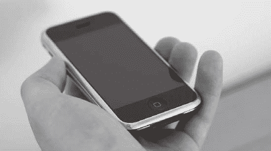

iPhone

## 应有尽有的 APP：App 的黄金时代（2008 年）

最初的热度散去之后，iPhone 的销量增长开始放缓。2008 年推出的 App Store，让苹果公司重回巅峰。

若不是有 App Store 打开局面，iPhone 只会成为一个看起来酷炫，用起来也酷炫，但无法流行下去的电子产品。起初，苹果推广“网络应用”这一概念。他们原本计划让用户点开 Safari 浏览器，然后登上一个专为 iPhone 设计的网站，用户在那里可以找到基于 HTML 的游戏、各种功能和应用程序。很显然这个计划不是很成功，因为很快苹果公司就宣布要推出 App Store，作为解决方案。此前，iPhone 发布的一整年间，它只有 16 款应用可供运行。全部的应用只能填满一个主界面屏幕——更不必说 iPhone 和其他的手机相比，功能是多么有限。它不能发多媒体信息，没有录像功能，不能复制粘贴……能列上好长一串儿。

诺基亚、黑莓，还有其他手机公司一直以来都提供这些功能，但这回的区别在于，这是第一款没有按键的手机，它的屏幕像画布一般任你发挥。既然这个设备能运行应用，iPhone 的软件制作者想用它做什么就能用它做什么。唯一能限制他们创造力的，只有他们的想象力和硬件机能。时至今日，无数的应用上架销售，而移动应用也成为一个新的产业。

诺基亚、黑莓、Palm 这些公司认为他们掌握了行业要领，但是他们没能看清未来的方向。他们觉得万事永不变，等到他们有所察觉，想在这个美丽新世界繁荣发展时，已经太迟了。想要与苹果一较高下，新的思路是必不可少的，而有一家公司接受了这个挑战，它就是谷歌。

## 走进安卓时代（2008 年）

2003 年，iPod 方兴未艾之时，一些新的东西开始形成。安迪·鲁宾（Andy Rubin）和里奇·曼纳（Rich Mena）在加州帕洛阿尔托成立了一家公司，起名为安卓公司。

安卓最初的定位是一家数码相机软件公司。早年间，他们意识到这个市场太过狭小，因此转而专注于制作智能手机操作系统，来与诺基亚的塞班系统和微软的 Windows Mobile 竞争。他们觉得，要及时将新产品推给消费者的难度很大，而缺失的一环就是一个开放的平台。正因如此，他们打造的智能手机操作系统就有这样的特点。

2005 年 7 月，在收购了 YouTube 之后，谷歌又一次把头探进门内：“嘿，这个看上去还不错。”谷歌愿以 5000 万美元收购安卓。有了这些资金，安卓开始着手开发手机原型。早期安卓的原型机看起来更像黑莓手机——没有触摸屏，但有全键键盘。后来的原型经过重新设计，支持触屏，才得以与其他手机同台竞争，如 2006 年的 LG Prada，当然还有 2007 年的 iPhone。

在 21 世纪第一个 10 年后期，安卓扮演着十分重要的角色。

接下来的几年，渐渐过渡到了我们今天的世界。正如在 80 年代中后期麦金塔和 Windows 电脑的竞争一样，iPhone 的 iOS 和谷歌的安卓操作系统又一次打响了大战。第一款安卓手机在 2008 年面世，它就是 GI。GI 是谷歌和 HTC 通力合作的产物，作为安卓的第一次尝试并不算差，但如人们所料，它还有很大的改良空间。iPhone 在运行速度、易用性和代码效率上都远胜 GI。

但安卓自有妙计。安卓的开源特点和完全可定制化的软件正是关键，它意味着任何人和公司都能以安卓为基础，根据自己的喜好量体裁衣。事实证明这一招非常有效，很快从电话到汽车，再到冰箱和便携式电影放映机，到处都能看到安卓软件的身影。

21 世纪第二个 10 年越来越近时，世界也再一次发生变化。社交媒体把我们前所未有地紧密联结了起来，全人类的资讯都在我们的指掌之间。在下一个 10 年，我们将见证科学技术的光速发展。

### 第十四章 不可能的可能（2010—2019）

在希腊哲学家和老学者们生活的年代里，力求了解一切人类所知的东西，并不算什么异想天开的事。然而，这个理想随着网络和互联网的出现变成了不可能。截至 2017 年，在人类所知的所有信息中，90%都是前两年之内出现的。这神奇地印证了范内瓦·布什在第九章中的预言。知识的存在，以及世界上最杰出的智者们对知识的传播，为科技领域和整个世界带来了急速的发展。而在 21 世纪第二个 10 年，这个进展在世界范围内显得尤其明显，这个我们会在最后这一章进一步探讨。现在，我们先了解一下背景知识。

21 世纪第二个 10 年，发展中国家的发展速度变得极其快。2000—2012 年，世界贫困率下降了一半，这是人类历史上经济发展最快的时期。当时，非洲儿童的死亡率已低于 1950 年欧洲儿童的死亡率。同时期，世界上增长最快的一些经济体位于撒哈拉以南的非洲地区，该地区的数百万居民也开始买得起中国制造的智能手机了。随着卫星网络的发展，这些人可以轻松地获得各种信息。2017 年，印度信实公司（Reliance company）价格低廉而高速的电信数据，为印度带来了一次数字革命。可再生能源价格的下降，以及世界各国领导人对气候变化的担忧，使得可再生能源在这 10 年间不断加速发展。此外，阳光动力 2 号太阳能飞机于 2016 年完成环球飞行，证实了太阳能飞机的可行性。电池技术在全球范围内开始发展，无人机产业也在一夜之间呈爆炸式发展。

创新变得越来越全球化，小型创业公司在发达国家不断涌现，如雨后春笋。就连我身边都有许多朋友参与到创业公司当中。新型个人交通工具也在创业产业中开始浮现，包括悬浮滑板、电单车和电动滑板车。美国歌手波兹·马龙（Post Malone）亲切地把电子烟称为“the Mouth Fedora”，而吸电子烟也变成了一个文化符号。优步（Uber）和爱彼迎（Airbnb）的出现，代表着共享式经济和零工经济的到来。智能眼镜和智能手表也成为一个产品类别，开始了它们的生命周期。

21 世纪第二个 10 年的时尚拥抱了嬉皮士亚文化潮流。无论是大胡子还是小胡子，都越来越流行，两边剃短顶部留长的发型引领了潮流。超级英雄电影和各种续集受到了观众的喜爱。CGI 动画的发展仍然强劲，2010 年的《玩具总动员 3》成为世界上第一部票房破 10 亿美元的动画电影。浩室音乐、陷阱音乐（trap）和电子舞曲重回潮流，此时期的流行音乐中有许多元素都借鉴于这些音乐。网络迷因（Internet meme）文化对音乐也造成了影响，其中 PSY 的《江南 style》和鲍尔（Baauer）的《哈林摇》（Harlem Shake）都登上了美国《公告牌》（Billboard）榜单，大获成功。各类网络渠道的成熟发展，促使整个音乐产业呈碎片化发展。寒潮音乐（Chillwave）和草根制作人（bedroom producer）也开始接触到更多的受众。人们可以在各个平台上上传并分享自己的作品，这意味着电子音乐开始分裂成更小的流派，这些流派统称为“微流派”（microgenre），其中包括 Glo—fi、dream—beat、卧室流行（bedroom pop）和梦幻流行（dream pop）。只需一台电脑和网络，一切都在咫尺之间。

在这个背景下，21 世纪第二个 10 年的技术呈抛物线状加速发展。之前几十年以来所积累的信息和技术，都齐聚一堂，为 21 世纪第二个 10 年服务。而最能体现技术发展之快的东西，就在你的口袋里。6 个月前发布的手机，6 个月后已经跟大哥大一样过时了。如此之快的消费产品周期，是前所未有的。

飞速的发展背后也有着它的代价。千禧一代和 Z 世代对手机成瘾。社交媒体和网络对年轻人——尤其是儿童—在心理上的影响在这 10 年也愈发让人担忧。

举个例子，苹果前工程副总裁亨利·拉米罗（Henri Lamiraux）曾说：“我发现大家无论何时何地都带着自己的苹果手机。我觉得挺好的，但同时我也很清楚，软件不是我的老婆，我老婆会画油画，她创造的东西是永远都在那里的。而技术呢？20 年后，谁还会关心 iPhone？”要知道，iPhone 是 21 世纪最具影响力的电子设备，而拉米罗曾负责 iPhone 软件工程的开发。

2018 年，苹果的 iOS 系统和谷歌的安卓系统都更新了自己的软件功能，为的是鼓励人们健康使用电子设备。这些功能旨在减少人们使用手机的时间。在未来还会有更多此类新功能。

移动技术和笔记本电脑的发展也日益加快，这主要得益于电力效率的大幅提高。我 2017 年买的戴尔 XPS 15 笔记本电脑机身十分轻薄，内存高达 32GB，在这台电脑发布的 3 年前，这可是难以想象的。而在 21 世纪第二个 10 年的尾声，内存达 128GB 的笔记本电脑（个人电脑）和内存达 16GB 的手机已经成为可能。这与 2000 年时的情况形成了对比，当时的电脑平均内存只有 1GB。

内存革命早已开始，而且还在不断发展。在 21 世纪第二个 10 年初期的硬盘技术下，一个 500GB 的硬盘跟一块厚重的大砖头一样。8 年后，我们能买到轻薄无比的 8TB 硬盘，同时期的手机存储容量都达到了 1 TB。

21 世纪第二个 10 年的网络黑客和信息泄露情况也会加剧。爱德华·斯诺登揭露并证实了美国国家安全局监视世界的行动，震惊全球。2017 年网络黑客活动上升到了一个新高度，WannaCry 勒索软件侵入了来自 150 个国家的 23 万台电脑。被勒索的用户必须支付黑客比特币才能继续正常使用电脑。多个组织机构都遭到入侵，包括医院、航空公司以及联邦快递。

尽管个人隐私出现危机，在 21 世纪第二个 10 年里，苹果的 Homepod 以及亚马逊的 Alexa 这类智能家居系统还是走向了主流。Anki 的 AI 智能宠物机器人 Vector 代表着电子宠物的诞生。电子竞技也一夜之间流行了起来，甚至有人考虑将电子竞技纳入 2020 年冬季奥运会中。科技公司在后 5 年也成为王者。Facebook 以 10 亿美元收购了 Instagram，以 190 亿美元收购了 WhatsApp 聊天软件，进一步扩大业务种类。两个被收购的软件都是极其受欢迎的社交媒体平台。亚马逊等其他电商公司也持续发展，传统购物商场因而接连倒闭。谷歌因为违反欧盟反垄断法，被罚款 50 亿美元，创反垄断罚款纪录。苹果当仁不让成为世界上最有价值的上市公司。

中国在这 10 年中的发展也越来越突出。中国登月成功，并取代美国成为世界上最大的贸易国。中国申请的专利总数甚至超过了美国。中国的国内生产总值排名也在短短 35 年间从 100 名之后上升至第二名！中国成为新的世界生产枢纽，这是其发展迅速的一个原因。中国的输出量价值不算高，但数量非常多。无论你在哪儿，随处可见“中国制造”的标志。而印度的经济增长速度比中国还快，印度现在是世界上增长速度最快的主要经济体。同时，曾经强大的日本，如今信用评级也走向下坡（该国被认为还债能力低）。此外，20%的日本人口年龄超过 65 岁，这使得日本成为世界上老龄人口占比最多的国家。为此，人们加快了研发机器人的速度，以更好地满足老年人对照料服务的需求。其他国家也面临大量的退休人口，这些人大多出生于婴儿潮时期，养老计划的压力引起了财政的紧张。在美国，每天有 1 万个出生于婴儿潮时期的人年龄升至 65 岁以上。

自 21 世纪第二个 10 年晚期的全球金融危机以来，全球经济恢复缓慢。一些经济分析家认为，问题还没完全被解决，低利率和中央银行多印的钞票只起到补丁的作用。加印的钞票只造成了股票和房市的膨胀，而没创造新工作机会，这造成了西方国家中产阶级缓慢而悄声无息的缩减。经济压力同时也在某些国家引发民事冲突。2015 年的叙利亚内战造成大量难民进入欧洲，这是自“二战”以来规模最大的一次难民潮。其中德国接纳的难民数量最多，国内社会气氛紧张，政治不稳定。

经济困境也对美国造成了极大影响，2016 年美国总统大选，对经济情况不满的选民占多数，他们大多投了唐纳德·特朗普一票。惊讶、愤怒和不解的声音响遍全球，左翼和右翼的意识形态两极化明显。个体呼声在社交媒体的帮助下传播更广，而这使得分化更加严重。来自两个政治观点的极端主义者的声音最为响亮，但他们只印证了另一方对其的刻板印象。

“假新闻”盛行、事实不再的时期，准确的信息成了难得而宝贵的资源。这是范内瓦·布什的预言未曾预料到的。主流媒体衰落，许多媒体利用标题党策略，希望在嘈杂的产业中吸引读者的注意力，使得人们对媒体的信心跌至史上最低。这个现象进一步助长了两极化，人们对政府和组织的信心整体下降。

21 世纪第二个 10 年初期，人们的权利是拥有自己的观点，而在 21 世纪第二个 10 年末期，人们的权利变成了选择自己的事实、真理和真相。细微的差别不再，事实变得模糊。那些苦苦尝试理解破碎的社会结构的人，最终都求助于当代哲学家，包括乔丹·彼得森（Jordan Peterson）、山姆·哈里斯（Sam Harris）和布雷特·温斯坦（Bret Weinstein）。温斯坦将这群人命名为“知识分子暗网”。

许多其他事件也引起了大家的注意，包括 2012 年希格斯玻色子（该粒子赋予物质质量）的发现、“好奇号”探测器登陆火星（2012 年）、利用光遗传学对（老鼠的）特定记忆进行操控（2013 年）、引力波的探测、石墨烯电池的实验应用，以及詹姆斯·韦伯望远镜项目——这个望远镜能观察到系外行星（太阳系外的行星）。值得一提的是，人类于 1988 年发现了第一个系外行星，而在那之前，我们根本不知道系外行星的存在。截至 21 世纪第二个 10 年中期，科学家已成功发现数千个系外行星。

## 移动设备的发展（2010 年）

2010 年，苹果股份有限公司推出了首款平板电脑 iPad。iPad 拥有多点触控互动功能。这是史蒂夫·乔布斯在因胰腺癌去世之前负责的最后一个新产品。iPad 推出后立即热销，发布几个月后就成为史上最畅销的非手机类技术产品。在 iPad 之前，平板电脑产业一片混乱，正如 iPhone 之前的触屏手机产业一样。安卓平板电脑紧随其后进入市场。随后，个人电脑的销量也开始下降，促使平板电脑和二合一笔记本电脑的销量上涨，以及上网本的消亡。

在美国，截至 2011 年，人们使用手机应用程序的时间超过了使用万维网的时间，而在全球范围内，46 亿人使用付费电信服务。2012 年，三星超越诺基亚，成为世界上最大的手机制造商。2018 年，中国手机品牌华为赶超苹果，成为第二大手机制造商；同年，平板电脑和智能手机的销量超过上网本的销量，上网本在这 10 年的后期逐渐消亡。

2014 年，任天堂 Switch 首次大规模展示了新研发的移动芯片的功能。Switch 是一款突破性产品，玩家可以选择手持模式使用，也可以连接电视使用，获得更全面的游戏体验。Switch 是任天堂推出的最畅销的游戏系统，也是美国和日本有史以来最畅销的游戏机。在 Switch 发布后的一年内，其销量超过 1400 万台。

## 3D 打印机（2010 年）

如今的 3D 打印技术发展迅速，从工程到医药领域，该技术为各领域提供了新的原料。3D 打印技术日益成熟，开始被用于各个领域，人们不仅可以打印楼房和人体器官，还可以打印食品或为病人定做假肢。但问题来了：如果说 3D 打印技术早在 20 世纪 80 年代就出现了，那么为什么所有这些技术在 21 世纪第二个 10 年才突然出现呢？这与一项重要的专利有关，这个专利在 2009 年到期了。充满创造力的生产商们早已摩拳擦掌，这个专利一到期，他们就冲入 3D 打印新世界开始探索。

比较一下如今的 3D 打印技术和我当年写论文时的打印技术，可以比较明显地看出技术发展的速度之快。我 2012 年写的论文主题是不锈钢 3D 打印（选择性激光烧结），当时我大学里配备的打印机是最先进的模型，然而它的尺寸有四台冰箱那么大，价格接近 100 万美元。而到 2018 年，钢材打印机可以放在书桌上，价格只有约 12 万美元。

塑料和聚合物材料 3D 打印机甚至更小，大约只有微波炉那么大，价格也便宜很多，不超过 400 美元。

韩国科学家已经研发出新的人类皮肤 3D 打印技术。这个新技术的价格大约是其他方法的 1/50，需要的基材也是其他方法的 1/10。这对那些患烧伤或需要皮肤移植的病人来说，这是个非常好的消息。

2018 年，来自美国一所大学的研究人员成功地进行了玻璃的 3D 打印。他们设计的“液体玻璃”是玻璃粉末和一种液态聚合物的混合物。同年，来自苏黎世联邦理工学院的研究人员成功利用 3D 打印技术制作了史上第一颗完全柔软的人造心脏。

## 机器学习与人工智能的发展（2012 年）

随着计算能力的指数级增长，机器能够利用机器学习（Machine Learning，简称 ML）技术实时识别物体和翻译对话。ML 是我们手机上和智能家居系统中语音识别功能的基础，是自动驾驶汽车上图像识别功能的基础，是 Facebook 识别照片里你朋友的脸的基础。换句话说，机器变得越来越“聪明”了。21 世纪第二个 10 年机器学习的主题是教计算机用人类的思维方式学习。ML 能带来的影响比大多数人所想的都大得多。

虽然很多普通人不知道，但如果没有机器学习的核心支持，许多重要技术如今根本不会存在。ML 在许多场合中起着控制的作用，包括网络流量、电网、代码编制、水果采摘、烘焙、银行业务、放射学、电话服务和服务器场的电源管理、天线设计、石油勘探、恐怖分子侦测、警力分配、边境执法和开交通罚单等场合。大部分曾经由电脑负责执行的、有重要经济价值的任务，在 21 世纪第二个 10 年都被 ML 取代了，并且自此快速发展。21 世纪第二个 10 年中期，人们在机器学习领域取得了巨大进步，实现了人们过去认为不可能的许多任务。我们此处将用一定篇幅来解释 ML 以及其相关技术，了解它们的应用，并研究它们对世界带来了什么影响。

### 第一部分：理解这一切

#### 人工智能、机器学习与深度学习的差别

对许多人来说，人工智能（artificial intelligence，简称 AI）、机器学习和深度学习（deep learning，简称 DL）三者是互换通用的。在开始前，我们有必要清晰地定义这三个概念。

**人工智能：**人工智能又称 AI，是计算机科学的一个分支。人工智能的目标是让机器去模仿人类的认知，侧重于解决复杂的问题。人类能做的任何事情，真正的一般人工智能应该都能做到（甚至还能做更多）。这就是该技术的最终目标。

**机器学习：**机器学习是人工智能的一个子集。机器学习侧重于让机器自主学习，并不需要人编写的代码指令。ML 系统能够分析大量数据、应用知识、进行训练，并从先前的错误中吸取教训，从而高效地完成指定的任务。但在 21 世纪第二个 10 年中期，人们注意到了一些有趣的现象。谷歌的“Alpha Go”ML 系统显示了惊人的能力，能够完成预期之外的任务。我们稍后会详细介绍这一系统。

**深度学习：**深度学习是机器学习的一个子集。这项技术试图模仿我们大脑中神经元的活动（尤其是新皮质。新皮质占大脑的 80%，有褶皱，是大脑进行思考的部分）。这个组织叫人工神经网络（ANN）。人工神经网络系统确实能够进行真正的学习，虽然我们还不完全了解系统学习的方式。

计算机软件可在人工“神经网络”中模拟大脑中大量神经元活动，这个基本构想已经存在几十年了，但直到 2010 年才变得实际可行。我们稍后会详细介绍。

#### 深度学习的潜力

2012 年，时任微软研究院院长里克·拉希德（Rick Rashid）在中国参加了一个会议，会上他展示了一个应用深度学习技术的语音软件，这让与会者惊叹不已。这个软件将他说的话转录成英文文本，转录的错误率仅为 7%。它随后将英文文本译成中文，并模仿拉希德的声音用普通话阅读中文翻译。几年之后，这个了不起的发明变成了一个再普通不过的东西。

还不止于此：想象一下，有这么一个程序，它可以仅根据音频来猜测某个场景中所发生的事情。此外，它猜测的能力十分稳定，比人猜得还准。那么他们是否可以通过观看大量情景喜剧来学习预测人类行为（问候、挥手、拥抱和握手等）呢？又或者说一个程序的声音逼真到和真人声音毫无差别呢？

这就是人工神经网络的力量。到 21 世纪第二个 10 年后半期，这些技术已经非常成熟。不用几年，这些技术也将会变得再普通不过。

技术的发展速度可能让你感到惊讶，但你绝不是唯一一个这么想的人。深度学习的发展让谷歌的联合创始人谢尔盖·布林也感到敬畏。这是谢尔盖·布林 2017 年的一段发言：

说实话，我一开始根本没怎么注意……所有受过 90 年代教育的电脑科学家都知道，（深度神经网络）不可行。但这个技术的革命进展十分深层，就连我这个身处革命当中的人也感到十分惊讶。这是一个了不起的时代，对我们来说一切都没有限制。我们不仅可以天马行空地想象，还可以放手去做。这理解起来有点儿难，但其背后确实是各种了不起的可能性。

#### 人工神经网络是如何运作的？

要真正地理解人工神经网络，我们首先要认识自己。

当我们受到某种刺激（如图像、声音或触碰这种数据）时，我们的大脑会收到化学信号，而神经元也会被激活。最小阈值决定了神经元的激活，简单来说就是当传递到神经元的信号足够强时，神经元会被激活，如果信号太弱，则神经元不会被激活。这其实就是一个开关。没错，这就像晶体管和计算机二进制语言一样。此外，我们的大脑有改变或调整神经元连接的能力，大脑可以加强现有的连接，删除无用连接，甚至创建新连接。这是我们与生俱来的能力。神经元之间的路径会随着学习而增强。

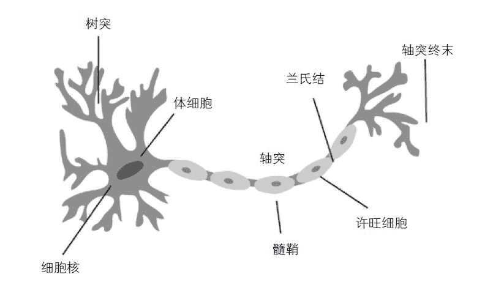

神经元的典型构造

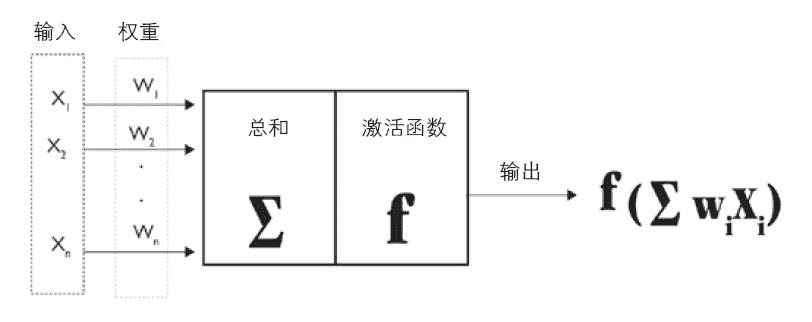

人造神经元构造

◇ 人造神经元接收一个基本内容，简单模仿大脑神经元的处理过程。

◇ 节点作为细胞核（此处的节点是一个数学函数，决定激活时间）。

◇ 输入作为树突（输入数据）。

◇ 权重函数作为突触（是否激活人工神经元取决于权重函数，这里的结果是从 0 到 1 的一个数字）。

◇ 输出作为轴突（此处是一个代表答案的数据）。

人类大脑中有 860 亿个神经元，这些神经元的组织形式是一个复杂的 3D 结构。在这个结构下，神经元几乎有无限个连接组合。另一方面，人工神经网络的组织形式是分层的，其中有输入层和输出层，还有中间的“隐藏层”，学习主要发生在隐藏层中。

我们以人脸识别为例，以加强对这个概念的理解。网络可以在各个层中将图像分解为元素。比如说第一层负责色彩和阴影，第二层负责轮廓，第三层负责形状，诸如此类。如果你想知道这背后的数学计算方法，其实它就是一组大型矩阵乘法，目标是将损失函数最小化。而损失函数就是一个衡量系统错误的指标。之前提到过，神经元的激活取决于权重，而权重的调整基于损失函数。如果能尽可能地减少损失，那么这个神经网络将会是非常高效的。

#### 人工学习

要了解这些系统是如何学习的，我们需要认真观察一下人类是怎么注意到两个十分相似的东西之间的差别的。我们需要从另一个角度来研究这个问题，而不是用人类的观点来看待这个问题。

以猫和狗为例：在客观角度来看，它们都是四足动物，身上都是毛茸茸的，耳朵都长在头顶……但为什么人能够轻松区分两者呢？当我们还是孩子的时候，成人会教我们区分动物。当我们学会区分不同动物后，每当我们进行这种思考，被激活的神经元之间的连接都会加强。我们很快就不再需要新的例子来练习了。人类的学习过程十分发达，即使看到一只和以前见过的不一样的猫，我们也能识别。人工神经网络识别图像的过程和这个过程很相似。人工神经网络接收到某些猫狗的图片，一些神经元被激活，神经网络得出正确与否的答案（答案基于损失函数得分）。最后，特定的连接得到增强（权重值增加）。而这些连接获得的图片越多，学习的越多。这个过程叫“训练”。

现在我们知道了什么是人工神经网络，接下来让我们看看它是怎么变成“深度学习”的。

#### 深度学习的历史

这一切都始于 1957 年，心理学家弗兰克·罗森布拉特（Frank Rosenblatt）发明了一个他称为“感知器”的东西，它是一个数字神经网络，能够模仿某些大脑神经元。罗森布拉特给这个网络的第一个任务，就是要求它将一组图像分为两类。他扫描了一组男性和女性的照片作为数据，假设随着时间的推移，这个网络能够学习区分两类照片（或至少了解为什么有些图像看起来像男性的，有些图像看起来像女性的）。而这其实就是人类学习的方式。

仅在一年之后，罗森布拉特发明的技术开始大受欢迎。1958 年，《纽约时报》在报道中写道，感知器是“电子计算机的雏形，并能走路、说话、阅读、书写、自行复制，以及意识到自己的存在”。

不幸的是，尽管受到了大家的欢迎，罗森布拉特的神经网络系统运作起来仍有很多问题。由于只有一层神经元，它的感知器功能十分有限。在这方面它能改进的不多，因为当时的计算机只能处理一层神经元。1969 年，马文·闵斯基（`Marvin Minsky`）——罗森布拉特的同事兼他的儿时好友——出版了一本书，书中对这些实验进行了评估。闵斯基在书中表示神经网络“整体上来说令人失望”，并且“没有足够的支持”。据说这本书对计算机科学界的影响十分巨大，以至于后来 10 多年内，人们搁置了对人工神经网络的研究。

虽然人工神经网络的研究当时停滞不前，但有一位计算机科学家对此十分积极，他认为大家都错了。这个科学家名为杰弗里·辛顿（`Geoffrey Hinton`），他认为如果人类大脑真的是一个神经网络，那么它一定是为一个极其强大的系统服务的。人工神经网络一定是可行的，可能只是需要一些调整。辛顿认为弃而不研究人工神经网络是个巨大的损失。

辛顿来自英国，1985 年，他来到多伦多大学，开始了自己的研究。他和他的团队很快意识到问题出在罗森布拉特的单隐藏层上。人工神经网络需要更多层才能有更强大的功能。巧的是，如今的计算机已经足够强大了。我们现在将这种多层的方法称为“深层”神经网络。在做了一些改动后，人工神经网络开始运行起来。在接下来的几年里，人工神经网络成功做到了两件事情，这是以前从未实现的。

1989 年，迪安·波莫罗（`Dean Pomerleau`）开发了一辆自动驾驶汽车，并将它开上了马路。90 年代，能识别手写数字的神经网络系统问世。这些成就固然激动人心，但当时技术的发展程度仍然十分有限，无法在其他领域被运用，科学家们走进了另一个死胡同。

这一次，他们面临的是双重难题：

◇ 缺乏计算能力。
◇ 可用的训练数据不足。

人工神经网络再次沦为梦想。辛顿这次还是非常坦率，他没有放弃，并继续鼓励进一步开展研究。对这个不可行的研究，他一直坚持自己的信念，后来还因此受到嘲笑，并在计算机科学界被冷落。

时间来到了 2012 年，此时的计算机速度已经足以支持人工神经网络在更多领域中的应用。此外，借助互联网提供的数据，这些系统现在可以进行高强度训练。人工神经网络所需要的一切都准备就绪，就差一个为大家证明它的价值的人了。

### 人工智能运动的诞生
现代人工智能运动真正意义上的诞生可以追溯至 2012 年的一个事件：在一次`ImageNet`挑战赛中，人工神经网络横空出世。

`ImageNet`成立于 2009 年，它的本质是一个图像数据库，里面的图像来自真实世界，用于训练机器学习系统。图像可分为 1000 种类别，从汽车、动物和建筑物这类实物，到爱情和幸福这种抽象的概念。在那之前，人工神经网络从未参与过这个挑战赛。

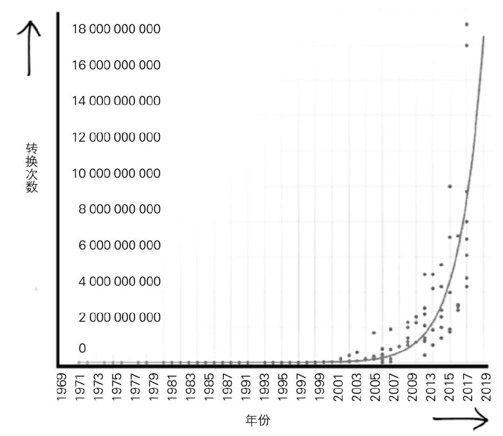

要让人工神经网络登上舞台大放异彩，大型数据集是缺失的最后一环。训练数据的增加，使得人工神经网络的表现也得到了改善。再回到前面提到的对猫的识别，如果你只见过三只猫，相机拍摄的角度和不同的光线情况只有几种。即使只是给你看从另一个角度拍摄，或在不同光线下拍摄的同一只猫，你可能都无法识别。但如果你见过 1000 多只猫，那么再去进行识别对你来说会容易得多。这就是数据的重要性。计算机的直觉没有人类那么强大，需要借助更多的例子学习。在人工智能领域，数据是机器学习的核心。如果数据是新一代石油，那么`ImageNet`就是一个巨大的石油储备，而人工神经网络是唯一一个能利用它获得巨大成功的机器。

2012 年，当时被大家嘲笑的杰弗里·辛顿已经 64 岁了，此时的他要继续工作，十分不容易。由于背部受伤，他坐下的时候腰椎间盘会突出，因此只能一直站着。他和他的团队在 2012 年创建了一个人工深度神经网络，这是第一个参加`ImageNet`挑战赛的神经网络。辛顿的这个程序名为`AlexNet`，其功能是前所未有的。在比赛中，`AlexNet`无往不胜，成功率高达 75%，比之前的最好成绩高出 41%。这次比赛让世界见识到了人工神经网络的厉害。

自那开始，所有人都开始用人工神经网络参加`ImageNet`挑战赛，识别物体的准确率在短短 7 年内从辛顿的 75%上升到了 97%。97%的准确率比人类识别物体的能力还要高！

人类历史上从未出现过识别物体能力比人类还高的计算机。在这不久后，研究的起步和人们对人工神经网络的兴趣将会改变整个世界。

如今，图像识别已经司空见惯，它甚至还能从医疗成像中识别疾病。而`ImageNet`也促使训练数据集开始蓬勃发展。数据集中增加了视频、语音，甚至游戏。

## 第二部分：机器学习的应用
现在你大概已经对机器学习的巨大潜力有了一定的了解。但是，机器学习能走多远呢？2012 年，一个名为 IBM 沃森（`IBM Watson`）的深度学习人工智能在《危险边缘》（`Jeopardy!`）节目中获胜。在人类的自然对话中，它能实时正确回答许多问题。沃森的方法是大量阅读网上的信息，并寻找模式来理解问题。

2016 年，谷歌的`AlphaGo`（阿尔法狗）在世界上最激烈的围棋比赛中击败世界冠军李世石，这次比赛成为一个分水岭。作为古老的中国棋类游戏，围棋虽然规则简单，但走法非常复杂。围棋与国际象棋不同，计算机可以计算出国际象棋中的所有走法，而围棋的可能走法数量比整个宇宙中的原子数量还要多。此外，许多人还认为下围棋需要用到人类的直觉。当人们问职业棋手为什么走某一步的时候，他们可能会说“凭感觉”。因此，对人工智能来说，围棋是圣杯一样的存在。人们没有教过`AlphaGo`围棋的规则，它是看其他人下棋自学成才的。`AlphaGo`随后将自己的复制版本作为对手，不断练习，直到自己的技巧达到超人的水平。再后来，`AlphaGo`甚至能够执行计划之外的任务。

2018 年，IBM 的一个人工智能已经有和人类进行辩论的能力，而沃森也开始为医生们提供医疗建议了。在此之前，沃森阅读并研究了数百万篇医学研究。

### 医疗领域中的人工智能
婴儿潮一代中许多人的寿命越来越长，在不久的将来，医生们可能需要额外帮助才能满足医疗需求。2017 年，中国推出了一个名为“`觅影`”的深度学习系统，在推出后仅仅一年内，觅影已服务 400 名患者。人工智能是“`中国制造 2025`”计划中重要的一部分，这个计划的目标是在 2025 年前将中国打造成全球高科技产业中的领头羊，产业领域包括机器人。计算机科学领域也正准备迎接一场专门医疗保健的革命。举个例子，现存的几百万个可穿戴设备可以为人工智能提供大量数据，供其训练，这些人工智能可以帮助医生更好地治疗病人。

有一个有趣的研究，是关于人类眼科医生的。研究统计显示，人类诊断某些眼科疾病的能力较差。在实验中，两名人类眼科医生只在 60%的情况下就诊断结果达成一致。更糟糕的是，如果让一名眼科医生就一幅图像做出诊断，几小时后，给这个医生再看同一幅图像，只有 65%的情况下，他们同意自己先前做出的诊断。截至 2018 年，人工神经网络的能力已经超过人类眼科医生。到目前为止，一些人工神经网络已经有早期诊断食道癌的能力，准确率达到 90%—这是一年内取得的成绩。此外，谷歌还在尝试视网膜图像的深度学习，试图实现糖尿病引发的眼部疾病的早期诊断。此外，实验还显示，深度学习人工神经网络的速度比放射科医师要快 1 万倍。

### 其他应用
2017 年，`Deepfakes`（专业 AI 换脸工具）技术出现，只需点击一下鼠标，就可以把影片中一个人的脸换成另一个人的脸。在此之前，这个过程十分烦琐，并且需要花费数十万美元。现在，只需要从谷歌收集一系列面部图像，剩下的交给深度学习人工神经网络就大功告成了。这里展示的就是一个电影场景，其中一个女演员的脸被换成了尼古拉斯·凯奇的脸。

2018 年，英伟达（`Nvidia`）创建了一个算法，这个算法可以把非常晃动的慢动作影片变得十分流畅，算法处理后的影片看起来就像用专业慢动作相机拍摄的一样。同年，英伟达还推出了一款可以实时进行光线追踪计算的人工神经网络显卡。在计算机图形中，光线追踪可用于计算光线在某种材料上是如何反射或被吸收的。`CGI`电影（如《玩具总动员》）和电子游戏的效果看起来不同，就是因为光线追踪的应用。计算中最困难的部分被英伟达的人工神经网络承包后，过程得到了极大的改善。电影级别的电脑动画效果曾经是好莱坞电影公司才有的技术，而现在台式机用户和游戏玩家也能拥有，这都得感谢人工神经网络。

基于一张静止图像，人工神经网络可以设计出一系列影片。想象一下：你给人工神经网络提供一张静态照片，它随后创建一段视频，视频中是它认为接下来会发生的场景。如果照片中是海滩，那么接下来应该是拍打的海浪；如果照片中是人群，接下来这些人应该会走起路来。

人工神经网络的能力还包括：

◇ 自动将黑白图像和视频转换为彩色图像和视频。
◇ 仅通过文字描述生成和照片一般真实的图像。
◇ 能将视频样本中的夜晚变为白天，反之亦可，还能改变里面的天气。
◇ 优化低像素图像（让图像更清晰），就像电视剧《犯罪现场调查》（`CSI`）里的技术一样。
◇ 太空望远镜中的错误校正等其他许多功能。
◇ 更重要的问题来了：如果这些系统的功能继续如此快速地发展，那人类的未来会是什么样的呢？这个问题被称为自动化问题。

## 第三部分：是灾难还是下一个工业革命？

### 自动化带来的影响：机器人让我们失业了！
技术不断在进步，而人们担心这会给就业带来影响。20 世纪 20 年代还有专门负责开关地铁门和电梯门的人员，而现在，自动化的地铁门和电梯门已经存在超过一代的时间了，你上次见到这种门童是什么时候？从 20 世纪 50 年代以来，已有 800 万名农民、700 万名工厂工人和成千上万个电话接线员被自动化取代了。早在 20 世纪 60 年代，美国总统肯尼迪就将自动化列为人们就业的头号风险。然而，工作这个东西还是存在的。

### 这次不一样
仔细想想，在人工智能帮助下可以实现自动化的东西有很多，这里没有一个明确的界限。这是当今技术革命和过去的技术革命最大的一个区别。至少所有不需要创意、机械精准要求不高，或者不需要超精细的人类交互的工作，在不远的将来都能实现自动化。而这也会极大地影响这个世界运作的方式。当然，我们很难预测具体会是什么样的影响。

我认为当人工智能开始侵占人类的工作时，会引发社会不安。机器学习的进步是一把双刃剑，但我们要如何面对层出不穷的、“不可能的可能”中的变化呢？

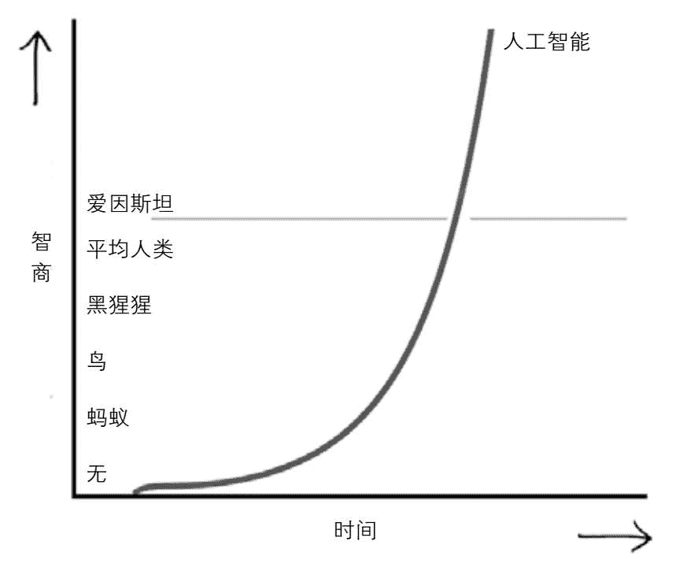

人工智能的智商水平

人们认为在接下来的 10 年中，人工智能可以完成许多简单的任务，让人类有更多的时间去做需要创意的事情。我之前听过这个观点，但我觉得，这个世界上不是每个人都充满创意的，或者还有很多没时间和财力去培养创意的人。

另一个观点是，先进的人工智能可以提高生产力，从而创造出新行业，并需要新的供应商来支撑这些行业发展。这也代表着新的就业机会。但在这方面，大家的观点各异，一些专家强调我们需要寻求可行的金融解决方案来应对人工智能的影响。其中有许多新的概念，包括基于无信任系统（如`区块链`）的普遍基本收入概念。（本章稍后会进一步讨论区块链。）

或许在未来，人们都会有自己的公司，都有属于自己的人工智能帮助提高生产力，而不是为某一个公司工作。但我认为不是大部分人都同意这个观点的。到 2030 年，全球范围内估计有 8 亿份工作会因为自动化而岌岌可危。

谈到人工智能，有些人会马上想到审判日和天网，但我个人认为，我们关注的重点应该是控制人工智能的人。如果这个强大的人工智能在未来是开源并且人人都可以使用的话（当然，有相应保护措施），这可能是个好消息。相反，如果这个世界上最强大的人工智能被少数人控制，就不太可能是好消息了。在第二种情况下，控制人工智能的人就是规则制定者。为了防止人工智能落入坏人手中，人们已设立了相关的机构组织，包括“生命未来研究所”和`OpenAI`。由此可以看出，人们已经在思考要怎么走好接下来的路。

### 虚拟现实和增强现实（2012 年）
想象一下，在未来，只需戴上头戴设备，你马上就进入另一个世界中，还可以和这个世界中的物体进行互动，和里面的人交谈，就好像拥有了第二种人生；又或者在电子游戏中，你不再只是个控制角色行走的人，而是游戏中的一个角色。这就是虚拟现实（`VR`，`Virtual Reality`）可以给我们的未来。virtual（虚拟）是 15 世纪中期的一个英语单词，意思为“有实际效果，但非真实或现实的东西”。基本上就是利用计算机生成的产品或类似的东西来模拟或取代现实。

当你戴上头戴设备后，对你的大脑来说，你已经身处另一个地方。你不再是观众，而是其中一员了。试想一下，和印刷品相比，影片多了视觉效果和声音这两个元素。同样，虚拟现实多了物理运动、空间感和参与感这几个元素。因此，有人称之为第一个移情技术。人类在历史上第一次体会到成为另一个人的感觉，`BeAnotherLab`组织也在 2014 年的一个实验中证实了这一点。人们可以利用`VR`技术来体验成为另一个性别的感觉。

在过去将近一个世纪里，尤其是在 20 世纪 90 年代，人们已经尝试过使用`VR`技术，但是从未取得明显的进展。无奈的是当时的计算能力和显示技术过于落后。但 2010 年，17 岁的帕尔默·勒基（`Palmer Luckey`）在家中的车库里制作出了`VR`头戴设备的原型，这改变了一切。当时的头戴设备质量很差，勒基为此感到十分失望，并决定要做个更好的头戴设备。他的设备是第一个使用手机显示技术的`VR`设备，这是一个非常重要的突破。新设备的景象更清晰也更宽阔，而勒基在车库里做出的这个头戴设备最终演变成了`Oculus Rift`（一款为电子游戏设计的头戴式显示器）。

勒基设计的头戴设备掀起了新一代`VR`设备的浪潮，然而过了将近 10 年，人们才开始将其应用到商业中。

#### 增强现实
“augment”这个词源自拉丁语“augere”，意为“增加”或“加入”。增强现实（`AR`，`Augmented Reality`）和虚拟现实类似，增强现实利用计算机生成的图像（一般为运动追踪）对人身处的现实场景进行补充或增强。

2016 年，增强现实和`Pokemon Go`（精灵宝可梦 Go）游戏突然进入了大家的视野。`Pokemon Go`这个手机游戏程序并不是`AR`的一个最佳示例，但它代表着该技术首次被广泛应用。到这个 10 年的结尾，`AR`工具包让虚拟 3D 物体变得轻而易举，和用手机扫描东西一样简单。`Adobe`的`Project Aero`软件也让人们可以轻松创作`AR`。苹果公司也在这个 10 年的后期推出了自己的`AR`技术，它对`AR`技术的兴趣预告了`AR`将走向主流的趋势。

## CRISPR 基因编辑技术（2012 年）
`CRISPR`这个革命吸引了整个科学界的关注。在`CRISPR`首次亮相的几年内，世界各地的实验室都开始使用这个新技术来改变人类、动物或植物的 DNA。

### 什么是 CRISPR？
`CRISPR`（全名为常间回文重复序列丛集，英文全称为`Clustered Regularly Interspaced Short Palindromic Repeats`） 是存在于细菌中的一个生物 DNA 系统。其中基本原理为细菌将`CRISPR`系统作为防御工具。当遇上原本可能攻击破坏该`CRISPR`的入侵病毒时，`CRISPR`会将该病毒的 DNA 进行切割。`CRISPR`就像一把内置的生物剪刀。

更特别的是，`CRISPR`剪刀对病毒有记忆，它能搜索并侦测特定的 DNA 序列，再将其切割。`CRISPR`就是一个小型的自动生物系统。挺酷的吧。而如今最重要的问题在于科学家是否能够控制这个技术。

1987 年，日本科学家在克隆实验材料时偶然把`CRISPR`的一个片段也给克隆了，`CRISPR`技术就是这么被发现的。他们对系统进行了一段时间的研究，但没有观察到系统有任何切割与侦测功能。直到 2012 年，人们才了解到`CRISPR`所有的功能。

### CRISPR 有什么用处？
`CRISPR`被发现后不久，人们开始将其用于有机体 DNA 代码的切割、编辑和粘贴。与旧的 DNA 编辑技术相比，这种新的方法更快也更简单。

研究人员对干细胞进行修改后，将其重新注入患者体内，并让`CRISPR`占据受损的器官。在一项研究中，研究人员将修改后的干细胞直接注入中风病人的大脑里，大多数病人都重获大部分活动能力，一个坐轮椅多年的病人甚至能重新走动了。

在另一项研究中，重新设计过的癌细胞被用于侦测并摧毁血液性癌症与肿瘤。大量的`CRISPR`分子剪刀能够切割并摧毁癌症 DNA，直至 DNA 无法继续繁殖。

在另一种抗癌方法中，`CRISPR`能促使免疫系统本身去对抗疾病。身体的免疫系统大部分情况下无法识别癌症，而`CRISPR`的研究目标就是为了解决这个问题。科学家对免疫系统进行重新设计，使得系统能够侦测并摧毁癌症 DNA。

2018 年一篇发表在《科学转化医学期刊》（`Science Translational Medicine`）上的研究展示了含有高级`CRISPR`细菌的细胞，这些细胞在完成任务后会进行自我毁灭。此外，这些`CRISPR`细菌细胞还在不危害周围健康细胞的情况下成功杀死了一系列癌细胞。

这个生物方法较新，因此它的风险和长期的影响尚不完全明了。然而，该技术可以在癌症治疗中提供更快、更便宜和更精确的细胞疗法。

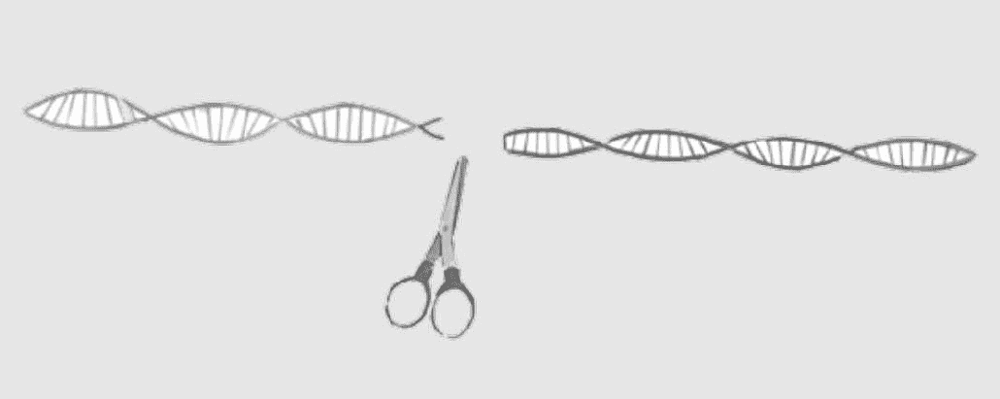

`CRISPR`就像一把内置的生物剪刀

## 机器人前进的一大步（2016 年）
2016 年，机器人开发公司波士顿动力公司（`Boston Dynamic`）在`YouTube`上传了一个视频，这个视频让全世界大吃一惊。视频中可以看到一个人形机器人（名为`Atlas`）在行走、拾起盒子，又将盒子放在架子上，当被人推了一把后，它还能轻松地自我纠正。2018 年，网上出现了越来越多关于`Atlas`的视频。这一次，`Atlas`不仅可以慢跑、做后空翻，还做了几年前人们无法想象的很多动作。好像一夜之间，机器人有了人类的运动天赋。

人们花了很久才取得了机器人技术的突破，因为事实证明，运动是个非常难的事情！我们大脑中的运动神经元比认知神经元多三到四倍。人的身体中有大约 700 块肌肉。身体的平衡和灵敏的行动背后，是巨大的处理能力。有了更快的计算机和更智能的软件，新型机器人突然出现在我们身边。

2018 年，人们取得了另一个机器人技术的突破，然而这次的幕后英雄让人十分意外—迪士尼。在迪士尼主题公园里，迪士尼公司创造了他们称为“阿凡达机器人”的一个东西。这个机器人的动作前所未有地流畅自然。在宣传视频的一个特写镜头中，这个机器人面对镜头谈话。许多`YouTube`视频的评论都一口断定这是个`CGI`特效。这是史上第一次成功跨越恐怖谷的机器人。

## 量子计算的开始（2016 年）
量子计算机被称为人类文明的下一个飞跃—人们把它与工具制作、农业和工业革命相提并论。有人认为量子计算机和人工智能一样重要，甚至比人工智能还关键。

乍看之下，量子计算的实质很难懂，但一旦理解，你便会明白这个技术为什么可以改变一切。你也会发现，现实是多么奇怪。因此，我们在此会用一定篇幅来探索量子计算机的神奇世界。

### 它有什么特别的？

想象一下，有这么一种新型计算机，它可以同时计算出一个问题所有可能的解法。你可以给这台计算机一个有无限种可能解法的问题，它能在几小时内给出答案。而作为参照，如果我们让人类历史上所有电脑都一起来解这个问题，可能要花几十亿年才能解出。我们将这些现有的计算机称为“经典计算机”，而将这种看似不可能的新型计算机称为“量子计算机”。

## 它如何运作？

普通计算机将数据作为二进制位（用 0 或 1 代表）处理，而量子计算机将数据作为量子比特（英文为 quantum bits，缩写为“qubits”）处理，它可以同时以 0 和 1 的状态存在，这样一来就可以同时进行多个计算。这种同时以 0 和 1 的状态存在的情况有点儿像一碗概率的大杂烩（称为叠加），这也是量子物理（也称为量子力学）的一个特点。这样一来，我们就可以利用较少量的粒子来储存并控制大量信息。

换句话说，普通计算机解题的方法和你走迷宫的方法差不多：不断尝试每一个可能的路径，遇到死胡同就掉头，直到走出迷宫。而量子计算机可以利用叠加一次性同时尝试所有的路径—简单来说就是走捷径。

我们先往回走一步，探索一下量子比特到底是什么。普通计算机的位是由小晶体管制成的，而量子比特可以是任何具有量子行为的东西：电子、原子、分子，甚至一个金属环（在环境合适的情况下可行，稍后详细介绍）。举个例子，电子通常以两种状态之一存在着：spin—up 或 spin—down。在二进制中，如果我们用 1 代表 spin—up，用 0 代表 spin—down，就可以开始编写代码了。同样，因为叠加，电子可以同时是 1 和 0。一些研究人员推理认为叠加证明了替代宇宙的存在。

如果你觉得这听起来有点儿莫名其妙，没关系，你不是唯一一个这么觉得的人。量子计算之父理查德·费曼（Richard Feynman）曾说：“如果你觉得你已经懂了量子力学，那你其实不懂。”稍后我们还会介绍更加奇怪而特别的量子行为。首先，我们来看看费曼是怎么想出这个疯狂的点子的。

## 量子计算之父

理查德·费曼 1918 年出生于纽约市。毫无疑问，他是一个非常特别的人。第二次世界大战期间，费曼是（范内瓦·布什的）曼哈顿计划中的理论物理学家，他还在 BBC 上有过自己的节目。他不仅是一位非常出色的讲师，还是量子电动力学（描述物质与光间相互作用的一个量子理论）界的一位先锋。此外，费曼不仅提出了纳米技术这个概念，还是量子计算领域的一名先驱。

费曼很早就开始自学数学，并在普林斯顿大学的入学考试中取得满分成绩。除了正式教育，费曼还在课下自学了许多比老师教的要难得多的东西。

费曼有其他许多古怪的癖好。在参加曼哈顿计划期间，出于无聊，费曼破解了他居住的小区里所有保险箱的密码。有一次，他打开了一个存放原子弹机密文件的保险箱，还在里面留了一张写着加密信息的小纸条。其他物理学家同事发现之后吓得不得了，他们还以为德国间谍把原子弹机密给偷走了！当然，这只是费曼的一个小恶作剧。

1982 年，费曼发表了一个题为《计算机模拟物理学》（Simulating Physics with Computers）的演讲。在演讲中，他提出了一个非常特别的想法：无论普通计算机功能多么强大，无论用多少台普通计算机，它们永远无法模拟现实世界中的量子系统。意思是，假设你想建立一个分子模型，看看它与其他分子相互作用时的行为。在现实世界中，当组成原子的电子轨道重叠时，会形成一个分子。

想要准确地模拟真电子，我们要记得，真电子可以以多种状态同时存在。虽然我们可以认为这是一个概率（偶然），但在经典系统（普通计算机）中，这是一个很麻烦的问题。因为随着粒子数量的增加，可能的状态（或概率）的数量也呈指数级增长。因此，4 个电子就有 16 种可能的存在状态。如果有 10 个电子，就要求我们观察 1024 个状态，而 20 个电子就有 1048576 种可能的状态。如果想模拟一个含有数百万电子的真物理系统，情况很可能会失控！对于传统计算机来说，一台笔记本电脑可以模拟含有 26 个电子的系统，要模拟含有 43 个电子的系统，就需要用到超级计算机了。如果是含有 50 个电子的系统呢？想都别想了。在人类有生之年，用传统计算机是不可能实现的。

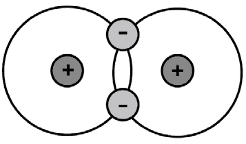

“共同电子”

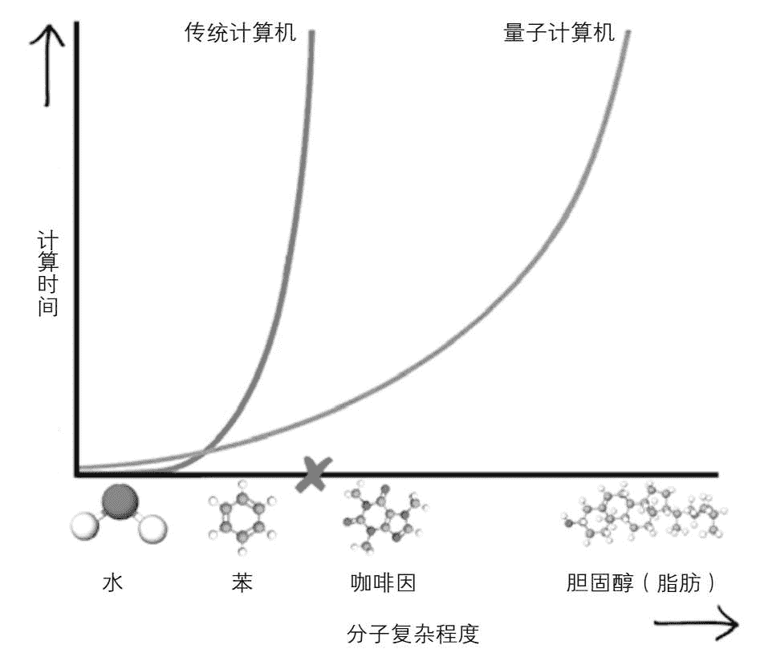

传统计算机将花费无止境的时间模拟现实中的量子系统

大自然（由带电子轨道的原子组成）和现实世界本身就是量子系统，如果要用传统计算机模拟大自然或现实世界，必须要取相差较大的近似值。下图中是两个简单分子，经典的超级计算机误差率高达 70%到 200%。

经典的超级计算机在计算简单分子键长所显示出的误差

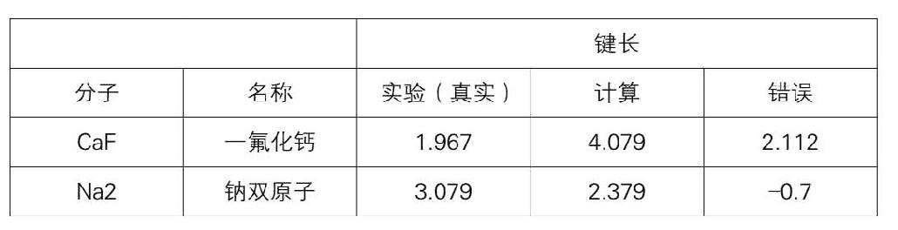

我们可以把这归结为：描述一个量子系统所需的信息，只能存在于另一个量子系统中！

### 第一部分：自然编码

#### 量子计算机的到来

量子计算机其实和大自然一样，从设计上来看它们都是量子，这是由量子计算机的量子比特的性质决定的。量子计算机的量子比特能够应对极其复杂的大自然。换句话说，每添加一个量子比特，量子计算机的能力就会成倍增长，这是普通计算机做不到的。

普通计算机可以模拟水分子，但完全不可能模拟咖啡因这种简单的东西，这立马相形见绌。如果要模拟咖啡因和其他更复杂的东西，甚至胆固醇，我们只需给量子系统添加一些量子比特即可，添加数量可以是 50 个或者更少。

从理论上来说，人们预测含 100 个量子比特的量子计算机的计算能力比地球上所有超级计算机加起来还强。一个由 300 个量子比特数据组成的数字寄存器可同时容纳的数字比宇宙中所有已知的原子数还多。想象一下，未来的量子芯片可能会有数十亿个量子比特，这个数字是可以和传统计算机的 CPU 和内存相媲美的。真是令人难以置信。

费曼认为如果我们想要模拟整个世界，可以将物理法则编码为量子比特的运算，类似使用经典比特的逻辑门电路。这个想法十分奇特：它不再仅是现实的一个数学近似值（现有技术下可行的做法），而是把纯物理编码成大自然和现实世界的本质。接下来我们只需要静观其变，让高度逼真的模拟进行下去即可。当我们向某种物质的结构中添加一些分子时，可能会发现这个物质的硬度增加了 10 倍。许多理论认为，利用这种模拟分子方法，人们可以发明出新物质、新药品以及能源生产新技术。

### 第二部分：古怪的量子

若想得到指数加速，量子比特必须具有通信功能。而量子比特通信的方法奇特无比。在量子物理学中，在量子纠缠这个过程中，每个量子比特的命运都是紧密联系的。纠缠指的是两个叠加粒子之间的关系：一个粒子的状态决定了另一个粒子的状态。想象一下，你有两个骰子，一个在加拿大温哥华，另一个在澳大利亚珀斯。如果你摇这两个骰子 1000 次，你觉得摇出来的应该是两个不一样的数字。但如果这是两个量子纠缠的骰子，你摇 1000 次骰子，每次摇出来的都会是一样的数字。这种奇怪的现象让爱因斯坦都烦恼不已，他亲切地将它称为“幽灵般的远距效应”。爱因斯坦认为我们可能只是还没发现这个东西而已。但事实似乎并非如此。

2017 年，中国科学家证明即使一对粒子中的一个粒子身处外太空，还是存在量子纠缠。就算距离比这还远，量子纠缠还是会存在。

一旦纠缠在一起，就算两者之间隔着一个宇宙的距离，量子粒子都会保持这个状态不变！在量子计算机中，纠缠和叠加使得系统可以同时存储所有可能的解法。

这听起来可能很奇怪，但仔细想想，在日常生活中，我们认识这个世界的方法其实是完全错误的。量子力学才是大自然真正的运作方式，若要维持物质、辐射和磁力的稳定，量子力学是基础。这才是事实！

### 第三部分：现代量子计算

在费曼之后，直到 1994 年，量子计算机一直都只是学术界一个好奇的对象。贝尔实验室的美国数学家彼得·秀尔（Peter Shor）发现了一种利用量子计算机破解密码的理论方法。这乍看之下可能没什么特别的，但它是许多线上安全系统（从银行到加密技术）的基础。其基本原理是，目前几乎不可能做到取一个很大的数字，并尝试求这个数字的素因数。经典计算机现有的最佳算法要用多个步骤来破解代码，步骤数量还随数字的大小成倍增长，假设情况下可能要耗上几十亿年才能实现。利用秀尔的算法，一台量子计算机可以在几个小时内就完成这项任务。从这一点上，很明显量子计算机的能力远远超过了模拟现实。

#### 且慢！量子的设计问题

人们在 21 世纪第二个 10 年初期就开始建造早期的量子计算机，然而有两个很重要的问题至今尚未解决：

第一个问题源于量子物理本身。量子计算机产生的答案是以概率的形式出现的。当我们重复一个问题时，为了让量子系统向正确的答案“靠近”，我们设计的代码能鼓励量子比特选择正确的量子态（因此给出正确的答案）。有意思的是，设计的量子代码应该用粒子物理中的波动性质来消除错误答案，并放大正确答案。随后就能检测并显示答案。

把量子计算机的数据想象成房间里一个随机亮起的灯泡。光粒子就像信息量子比特一样，而量子代码是一组（被精心排列好的）微观的小镜子。在这个类比中，当量子计算机开始运行时，灯泡会亮起，出现量子代码，光的波粒子因此也会被代码“小镜子”反射，几十亿束光线聚焦在地面上，形成一个针脚一样大的聚光灯。在这种情况下，房间里的其他光线会变暗。这个聚光灯就是正确答案，而房间里其他暗淡的灯光代表错误答案以及系统中的一些杂音。

第二个问题是维持量子环境的实际可行性，这也是我们现在还没有一个强大的量子电脑的原因。量子比特就像害羞的歌剧女主角，要使其处于量子叠加状态（同时以多个状态存在），必须确保它们感到自在。量子比特不能受到任何辐射，温度也必须在绝对零度以上。量子比特粒子一旦发生任何反应，量子效应就会被吓跑。任何轻微的干扰，包括光粒子、辐射，甚至量子振动，都可能使粒子脱离叠加状态，这样一来，机器就没了任何优势。我们之前提到过，量子比特是以任何形式存在的、具有量子行为的物质，这意味着我们可以用金属环来创造一个理想的环境。更为成熟的旧量子比特技术利用金属超导体来产生叠加状态，最常见的方法是用超冷金属环（温度几乎为绝对零度）。在这样的温度下，电子可以自由流动，不会发生任何反应。更奇怪的是，所有的电子不仅能顺时针流动，还能逆时针流动！

如今的技术可以维持量子叠加状态，但维持的时间只有几分之一秒，这个时间完全不够执行一个有效的算法。如何维持这种脆弱的量子状态，仍然是量子工程师和科学家面临的一大挑战。

#### 量子计算机与现实问题

事实证明，量子计算机擅长处理输入和输出较小的问题，同时还能给出大量的可能性。

举个例子，我们想知道日本距离最远的两个城市之间的距离，地图数据（道路距离等）是输入；这个数据很大，传统电脑是无法处理的。输出则是一个数字，代表最远距离。那可能性呢？这看似是一个简单的具有量子特性的超冷金属环问题，但仔细想想，其中几乎有无限个可能的路线。

事实上，现有的计算机永远无法解决这类问题。我们还有许多其他类似的现实问题，包括气候模式、气候变化、人工智能训练的发展、复杂分子的模拟、股市数据格局的观察，以及大脑活动的记录。这类模式的观察可能会是常规观察，和现有的计算机不一样，不要求对该量子计算机问题有详细的了解，这个想法很有趣，但是要谨慎对待。

**一个充满量子的未来即将到来？**21 世纪第二个 10 年初期的量子计算机庞大而笨重，几乎占据了整个房间，还配有复杂的冷却设备，确保为量子效应提供所需的微妙环境。时过境迁，而情况并没有怎么改变，20 世纪 50 年代的大型机计算和 21 世纪第二个 10 年的量子计算机看起来相差无几。如果这就是我们现在的情况，量子计算机是否能像普通计算机一样变小呢？这是有可能的，但时间不会太长。

这个领域的发展一直处于滞后的情况，直到 2016 年左右，技术突破的速度开始加快。IBM 宣布推出 5 个量子比特的计算机，并提供免费云计算服务。在接下来的两年内，科学家利用这项新技术发表了数百篇研究论文。从理论上来说，量子计算机需要至少 50 个量子比特才能赶超所有传统计算机的速度。这个阈值被称为“量子霸权”。2018 年，谷歌发布了一个包含 72 个量子比特的量子芯片（但大部分是用于纠错的）。

虽然我们离实用的量子计算机还很远，还有很长的路要走，但它的潜力不容小觑。

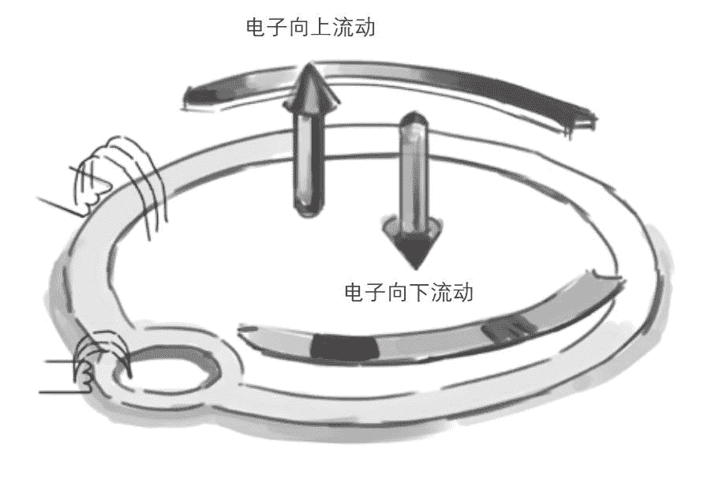

具有量子特性的超冷金属环

我认为，如果费曼（他于 1988 年去世）能看到人们对量子计算重新燃起的兴趣，以及我们在量子计算领域取得的成绩，他会感到非常欣慰。在当时那个一切都还不明了的情况下预见到量子计算的潜力，不是一般的头脑能做到的。

## 电动飞机的到来（2017 年）

随着电池技术以及电动汽车的新需求的发展，我们现在的选择越来越多了。我们可以用电池来给达到生产规模的小型固定翼飞机提供动力了。

一直以来，实用电动飞机都是个不确定性很大的工具，比实用电动汽车更难以捉摸。如今的电池技术已经较为发达，可以为某些做特殊用途的全电动飞机提供动力，例如飞行训练和短途旅行用的飞机。2018 年，我有幸见到了史上第一台商用全电动飞机（Pipestrel Alpha Electro），见识了当时的技术水平。包括电池在内，这架飞机仅有 350 千克重。只需要 5 分钟就能完成电池更换。这架飞机非常轻，我几乎可以在机库里把它推来推去。

Alpha Electro 和普通燃油轻型飞机不同，普通燃油轻型飞机的发动机技术有 50 年之久，里面有数百个活动部件，而 Alpha Electro 的发动机中只有一个活动部件。此外，AlphaElectro 只有一个操作发动机的开关和油门杆。旧的飞机模型在飞行中会混合燃料来发动引擎。Alpha Electro 非常安静，我在驾驶舱里尝试时，感觉控制得十分轻松。近期，已有人考虑在空中的士领域使用电动飞机。空客和波音这样的老牌公司也尝试制造垂直起降飞机。这类飞机像直升机一样，但能很快开始短途水平飞行。2017 年，中国公司“亿航”在迪拜开始了垂直起降电动飞机的运营。

## 区块链和其他无信任系统的崛起（2017 年）

2008 年全球金融危机爆发后不久，网上出现了一篇神秘的白皮书。这份白皮书的作者是一个自称中本聪的人或团体，没人知道这是谁。

这篇神秘的白皮书介绍了一个点对点的新金融系统。该系统使用数字加密货币，该货币名为比特币，而该系统被称为区块链。许多人厌倦了不断受中心化力量干预的经济体系，对他们来说，这是个福音。许多人认为该系统是一个进步。加密货币在 2017 年进入公众视野，当时比特币价值上涨 1000%，而瑞波币（Ripple，另一种加密货币）上涨了 36000%。许多人将区块链称为下一代互联网。

如今的互联网由复制和分发的信息组成，信息可以是视频、电子邮件和数据。换句话说，当你在 YouTube 上观看视频或收到一封电子邮件时，你看到的是原始信息的副本。对于具有实际价值的资产（例如钱、选票、数字身份、股票、债券、房屋或汽车所有权合同）来说，我们并不想对它们进行过多复制。举个例子，你的名下有原始的 5000 美元，你肯定不希望这 5000 美元的副本落入其他人手里。密码学家将其称为“双重支出问题”，这个问题的意思是存在一个东西的两个数字副本，而这个东西原本只应该有一个独特的身份。

区块链技术中的密码学（数学安全）让区块链技术成为第一个解决了双重支出问题的该类技术。如今，新一代互联网诞生了，这个互联网是建立在有实际价值的物品的实际价值之上的。这在某种程度上解释了为什么它这么重要。一些区块链货币承诺能保证匿名，并能在同级之间保证隐私，这促使了暗网的发展。暗网是一个匿名市集，在上面可以买到非法药品、枪支武器和非法服务，这一切都是区块链支持的。

简而言之，区块链是一个持续更新的清单，清单上记录了谁拥有什么。这个档案清单是去中心化的，系统中所有人都可以查看并验证，这个清单被称为分布式分类账。这个清单被分成几个连接块，受加密技术的保护，加密技术能保证你的档案安全。我们把这个称为“自动信任”或“无信任”系统，意思是这里的信任是系统内置固有的。区块链密码技术为我们提供了一个确认参与者真实身份的数学方法。由于区块链具有分散性质，现有的技术是无法攻破区块链的。如果一个区块被入侵，系统里的所有人都能很清楚地看到，受影响的区块可以被自动拒绝。

区块链是第一拨加密货币（包括比特币与以太坊）的基础技术，它的用途十分多样，不仅是技术高超的聪明的犯罪分子会利用区块链技术，区块链技术的使用范围也超出了数字货币本身。区块链有一个叫智能合约的功能，人们可以利用这个功能将现实世界的合同写成代码，在满足某些条件的情况下，合同会自行执行。这个功能催生了以区块链为基础的社交网络和线上游戏，也被银行和纳斯达克应用。如果将智能合约连接在一起，就可以创建一个完全自动化的公司，在某些情况下可以满足公司中大部分的人力管理需求。除了区块链外，Tangle 和哈希图（Hashgraph）这些无信任系统都是在 21 世纪第二个 10 年后期开发的。

## 5G 网络的开始（2018 年）

我们都知道什么是 3G 和 4G 网络。5G 网络速度要快很多，还可以从许多方面改变现代人的生活。5G 的技术优势主要是由于它使用的频率比现有的系统要高得多，因此带宽更宽。5G 的速度也将是 4G 网络的 100 倍。用 3G 下载一部两小时的电影需要 26 个小时，用 4G 下载需要 6 分钟，用 5G 则只需要 3.6 秒而已！

5G 的响应时间也快得多。4G 响应时间约为 50 毫秒，5G 只有 1 毫秒。1 毫秒意味着比你眨一下眼睛的速度还快 400 倍。这样一来，我们可以在云上无缝地完成大量工作，而这在以前是不可能的。由于延迟时间短，自动驾驶汽车的安全性也更高了，因为在紧急情况下，每一毫秒都是致命的。分析师预测，5G 网络将会是物联网的框架，包括配备联网家电的智能家居、与家庭安全和照明的结合、自动驾驶汽车和使用医疗设备与工业机器人的行业。专家们称未来这些新兴技术需要的数据速率可能高达 100GB/秒。现在的目标是实现每平方千米内能支持 100 万台设备。无论是在演唱会、大型节日上，还是会议中，我们都可以告别龟速网络了。多玩家游戏中的延迟也会成为历史，游戏玩家们应该会非常开心。5G 信号塔可以对数据需求更大的区域聚焦发射信号，这和我们现在的系统不同，当前的信号塔是以本身作为圆心进行圆形信号辐射的。

据估计，到 2025 年，5G 的采用率将达到 14%至 65%。目前，5G 的使用进展受到基础设施开发和高昂成本的阻碍。由于和 3G 的频率相似，4G 当时可以利用已有的设备。而 5G 为了容纳更宽的带宽，频率要高得多（类似卫星广播），这意味着 5G 需要新的基础设施。

目前中国正处于领先地位，许多公司都开始进行 5G 试验，包括华为和中兴。2020 年东京奥运会计划在赛事场地使用 5G 技术，美国也开始了小规模的试验。

### 5G 的危险？

有些人对 5G 抱有疑虑。5G 信号的波长和小型生物结构的大小相似。赫尔辛基大学的一项研究分析了人体皮肤对 5G 频率的反应，研究的结论是人体皮肤确实会吸收能量，尤其是汗管，但其他器官不受影响。因此，5G 对人体健康影响目前尚不完全清楚。

## 埃隆·马斯克成为公众人物（2018 年）

2010 年，几乎没有人知道埃隆·马斯克是谁，可能只有少数电动车的拥趸在驾驶特斯拉的 Roadster 的时候看到了未来。我的 YouTube 频道的观众多次跟我提到，回想起来，他们是在我 2014 年的特斯拉视频里第一次听说马斯克这个人的。现在我们已经来到 21 世纪第二个 10 年的末尾，而埃隆·马斯克也成为许多人的偶像。人们眼中的他是个有物理学学位的工程师，很出名，因为他能创造一些很酷的东西——这种人不是天天都能见到的。人们对马斯克又爱又恨，爱恨的程度几乎一样。有些人喜欢他严谨的态度，但有人觉得他是个大嘴巴和多管闲事的人。负面的评论中有的认为他说的比做的多，有的认为他是个彻头彻尾的骗子；同时，积极的评论中有的认为他是个做实事的人，有的认为他会拯救地球。2018 年，马斯克的一条推特让他惹上了麻烦，对象是美国证券交易委员会（SEC）。他在推特中宣布他将实现公司的私有化（这里的法律问题在于，这类信息是不应该被公开的）。他被迫辞去特斯拉董事会主席一职。具有讽刺意味的是，这件事发生时，特斯拉的 Model 3 车型刚成为美国最畅销的汽车（按收入计算），当时澳大利亚的评论家们也对特斯拉电池的优秀性能感到震惊。

## 电动汽车走向主流（2018 年）
尽管早期出现生产问题，特斯拉的 Model 3 仍然是第一款上路的“主流”生产的电动汽车。特斯拉刚刚打开了闸门。几年后，沃尔沃、捷豹和路虎等传统公司也宣布要开始制造电动车，但要到 2020 年才上市。现代、保时捷和阿斯顿·马丁也加入了这个行列。一开始受人嘲笑的电动汽车，后来成为富人奢华的梦想，再后来逐渐成为主流。2017 年在墨尔本的时候，我有幸驾驶了特斯拉 Model S P100D 车型，那几天的驾驶体验十分流畅，车子反应很快，感觉根本不像在开车。这感觉完全不同。
一些人担心电动汽车换电池会是个问题，但事实证明这个担心完全没有必要。纳帕谷的一辆出租车就是特斯拉的 Model S 车型。2018 年，这辆车的里程表显示该车已行驶超过 40 万千米，而这辆车的电池健康状态仍然为 93%。

## 试管食物（2019 年）
在过去，实验室培植的试管肉是科幻小说里才有的东西，然而自 21 世纪第二个 10 年以来，科幻成为现实：人们可以从宿主动物身上抽取干细胞，过滤取得可生长的肌肉和脂肪组织，再将肌肉与脂肪分开培植。培植的过程中利用热度、氧气和含有盐、糖、蛋白质与其他营养素的血清来支持细胞生长。在这种环境中，细胞误以为自己仍在宿主动物体内，并开始复制。一个干细胞能发展为一万亿个肌肉细胞。科学家面临的挑战是如何让实验室里的细胞以类似于我们在超市里看到的肉的方式生长。简单的一块肉，背后是一套复杂的结构，包含各种不同的组织和骨骼等。科学家现在能做到的，是培植一块结构统一的碎肉，这种碎肉看起来很真，而且还会渗血水。
史上第一块培植汉堡肉于 2013 年问世，培植成本高达 33 万美元。成本高主要是因为一种高效营养的血清。截至 2018 年，培植成本已经降低，一块肉饼造价 11 美元（麦当劳的一个巨无霸平均价格为 4 美元）。为了进一步降低成本，一些公司利用机器人技术与机器学习来筛选出最便宜的血清替代品。还有人尝试选择利用转基因植物材料降低成本。
有论点指出，试管肉可以帮助养活不断增长的全球人口。牛生长所需的面积相比马类和其他牲畜要大 28 倍，消耗的水量也多 11 倍。此外，牛肉的生产需占据 25%的全球地表面积，还会增加林业排放量。
试管肉计划在 2019 年投放市场。
1. “fedora”直译为“毛呢帽”，此处指“自我感觉很好很酷，但事实完全相反的东西”；“mouth fedora”直译为“嘴巴用的毛呢帽”，意思是吸电子烟的人以为自己很酷，其实不然。——译者注

### 第十五章 展望未来
回首完过去，我们熟悉了构建现代世界的新思想家们，一路从 300 多年前的简单技术起源，看到当今的迅速发展和成熟。这本书写于 2018 年，每个月都有新的创新成为头条新闻；这样说来，在这趟旅程的尾声，我们看看下个 10 年即将发生的事情，似乎正合适不过。

## 家用机器人
灵活性是机器人仅剩的技术难题之一，指的是如何用类似手的附件有效地移动物体。2018 年，埃隆·马斯克资助的公司 OpenAI 训练了一只能像人类一样优雅操纵物体的机械手。OpenAI 团队使用强化学习来实现这一目标。本质上说，强化学习就是反复地实验。在实验中，他们在虚拟环境（相当于积累了 100 年的经验）中模拟操纵物体的手。结果是，这只手能操纵它以前从未见过的物体；此外，在未经训练的情况下，它甚至能模仿人手特有的一些动作（手的滑动和转动）。
如果这些突破能与波士顿动力灵活的机器人结合起来，那么 10 年内可能会出现商用的家用机器人或医疗机器人。但很多人不确定这项技术是否应该被用于军事。

## 电池技术的提升
21 世纪 20 年代就在眼前，性能提升的电池将会成为创新的命脉。新的电池技术已崭露头角，领军者们包括：

### 加州大学欧文分校的金纳米线电池
在早期测试中，这种电池在 3 个月内完成了 20 万次充电，没有任何损耗迹象。

### 三星和 Grabat 的石墨烯电池
三星已经开始使用注入石墨烯（把碳原子排列成一个原子宽的薄片）的锂电池，它能将充电速度提高 5 倍（智能手机 12 分钟内即可充电完成），电池续航时间延长 45%。
Grabat 公司已经生产出能让电动汽车驾驶 804 千米的石墨烯电池。几分钟内，电池即可充满，比现在最先进的技术还要快 33 倍。

### Power Japan Plus 的双碳电池
这款电池具有持续性，充电速度是三星锂离子电池的 20 倍，充电周期为 3000 次。

### Phinergy 和美铝加拿大公司
测试发现，一辆使用锂空气电池的汽车每充电一次可行驶 1770 千米。这一测试由以色列公司 Phinergy 和美铝加拿大公司合作完成。
以上这些电池是否能够成为主流电池并不是最重要的，它们都清晰表明了一个趋势：电池技术在经历又一次进步。这能攻克可再生能源的主要瓶颈，也能催生现在看来还太昂贵或不切实际的新技术，比如长途电动飞机。

## 网络越来越受到威胁
随着 21 世纪 20 年代越来越近，布什和利克设想并由蒂姆·伯纳斯—李实现的开放式网络正面临威胁。类似欧盟的链接税（对定向到某些出版商的内容的超链接所征收的税）这样的指令损害了互联网的初心。
包括李在内的互联网先驱曾签署过一封信，其中写道，如果链接税这样的措施在互联网刚出现的时候就实行，“那么今天（的互联网）就不可能是现在的样子。尽管很难预测这些措施对自由开放的互联网会造成怎样的伤害，但我们认为影响会很大”。
互联网的未来是不确定的。我衷心希望我们在未来能为一个开放和自由的互联网而奋斗。

## 大脑与技术合二为一
想象一下：在未来，人与机器可能融为一体。
埃隆·马斯克的 Neural Link（脑机融合系统）的目标就是实现人机融合。马斯克表示，要想将技术接入人脑，面临的问题是“带宽不够宽”。换言之，靠双手与我们需要的信息进行交互是很慢的。Neural Link 的目标就是创造出一个高带宽的“大脑接口”，将人类与计算机直接相连，让我们与人工智能融为一体。大脑会充当边缘系统层（情绪、记忆、行为、刺激），人工智能则充当另一层来完成所有繁重的工作。理论上，装上 Neural Link 之后，任何人都可以获得极大的认知能力。
对某些人而言，将人脑直接和技术联系起来是一个可怕的概念，在这一点上，我宁愿犯点儿错误。

## 替代货币
随着人们对当前经济体系越来越没有信心，其他形式的货币（如加密货币），可能会再次兴起。然而，成长的阵痛肯定会伴随而来。潜在问题包括：黑客攻击（很可能会用上未来的技术）以及货币是否会为主流大众所采用。
除了加密货币，区块链和其他无信任系统的规模和影响力也会越来越大。

## 抵制社交媒体
对社交媒体的抵制始于 21 世纪第二个 10 年中期公众对 Facebook 声势浩大的讨伐。人们对它提出了各种指控，包括造成精神伤害、引发数据和安全问题等，似乎所有人都受够了 Facebook 这个社交媒体平台。
皮尤研究中心 2018 年的一项调查显示，在美国，Facebook 用户中有 44%的年轻人（年龄在 18~29 岁）已经把手机上的 Facebook 应用程序删掉了。总的来说，Facebook 可能是未来社交媒体的风向标。
我一直在思索为什么我觉得社交媒体对社会有百害而无一利。经过一段时间的思考和研究，我得出了结论……

### 毁灭人类的同理心
同理心是人类感受或理解他人观点的能力。设身处地为他人着想，并且扪心自问：“如果那是我怎么办？”同理心是防止人类表现出兽性倾向的主要因素之一。2015 年前后，已经有研究发现，社交媒体在生理上损害了年轻用户的同理心。
社会研究所发现，就同理心而言，21 世纪第二个 10 年末的大学生比 20 世纪 90 年代的大学生低 40%。

### 损害人类心理健康
大多数社交媒体平台，特别是 Facebook，都会“攻击”人性。这些公司的工程师会利用人类大脑中多巴胺的生物奖励机制，让我们在网站上耗费更多时间。例如，点赞、评论和分享能刺激大脑释放多巴胺，所以我们不停地这样做。在 Facebook 上找到我们喜欢的帖子也会释放多巴胺，所以在找到一个喜欢的帖子前，我们会一直泡在 Facebook 上。
不幸的是，对一些人来说，这可能会导致上瘾，就像对药物产生化学依赖性一样。此外，当我们的帖子无人问津时，或当我们拿自己的生活和其他人精心修饰的、未必真实的生活相比较时，我们可能会感到孤独、焦虑、嫉妒，甚至是抑郁。
2018 年，Facebook 前总裁肖恩·帕克和前高管查马斯·帕里哈皮蒂亚都表示，他们对自己曾设计的内容感到悲伤和内疚。帕里哈皮蒂亚表示，社交媒体“正在撕裂社会”，“破坏社会的运作方式”。

### 互动有毒
21 世纪 20 年代越来越近，社交媒体制造的分歧似乎也越来越多。人们好像再也没法心平气和地聊天，但这是为什么呢？
一方面，同理心不强会导致对他人的观点很冷漠；此外，我觉得可能还有另一个原因：邓宁—克鲁格效应。
邓宁—克鲁格效应由戴维·邓宁和贾斯汀·克鲁格于 1999 年提出。他们发现，如果人们对某个话题的了解有限，往往会对自己说的话信心满满，并且过分高估自己讨论这个话题的能力。相反，人们懂得越多，就越不愿意表达自己的看法。
如果用这个理论来解释社交媒体的对话，那么最无知的人说的话最多，原因就在于他们太过自信。
在邓宁—克鲁格效应加上崩塌的同理心所创造出的环境中，最无知的人却是最能说的，但他们无法理解与他们对立的观点。与此同时，最博学的人可能会保持沉默。简而言之，社交媒体最后会变成一个粪池，到处都是自大的蠢蛋，成天骂骂咧咧。
我认为可以肯定的是，如果社交媒体巨头们继续利用这些人性弱点，下一个 10 年，我们可能会看到对社交媒体的全面抵制。

## 再次登月：SpaceX
2018 年，埃隆·马斯克宣布，他的太空运输公司 SpaceX（见第十三章）将在 2023 年让 8 名乘客乘坐代号为 BFR 的宇宙飞船登月。
BFR 是一艘适合长途旅行的大型宇宙飞船，可搭载 100 人。该任务将从地球发射，绕月球一周后返回地球。这趟月球之旅总共需要 5 天。
月球之旅的第一位乘客将是日本亿万富翁前泽友作，他买下了全部 8 个席位。前泽友作酷爱艺术，他希望带着 7 位艺术家（音乐家、诗人、作家、电影制片人等）与他一起观看人类创造的惊人艺术，并与全人类分享。
如果一切顺利，在无数次无人试飞后，第一次载人绕月飞行会如期进行。这个想法虽然诡异，但如果最终能成为现实，必定是不可思议的。乐观估计，月球基地和定期的民用月球旅行可能会在 10 年内慢慢出现，价格也会渐渐下降。无论它最后能否成真，想想我们生活在这个一切皆有可能的时代，不是很有趣吗？

# 终章 创新思维的力量
在这本书里，我们看到了今天的世界是如何由那些站在先驱肩膀上的革新者建立起来的。我们可以把科技的进步想象成平地上的一块巨石。远处是一个陡峭的山坡。每一项创新都将巨石向前推进一点，下一项创新又将它推动一点。起初，巨石只能缓慢移动，但随后它会开始加速……过去数百年便是如此，技术进步的速度一直在加快。不久后，巨石到达了陡峭的山坡，它滚动的速度比任何人推它的速度都要快得多。未来已来，技术进步将慢慢开始冲下陡坡。
最令人啧啧称奇的是，让这一切成为可能的是一小群关键的智者——一群充满好奇心、有创新思维的发明家。他们能想象出完全不存在的东西。他们天赋异禀，能化抽象的想法为现实。他们的这些奇思妙想或来自新发明，或来自思考，至于还有一些点子的来历，说来也怪，纯属意外。

## 创新链
詹姆斯·瓦特的蒸汽机是第一股强大到可以推动巨石的力量。随着巨石滚动，所有其他的创新都会让它越来越快。
尼古拉·特斯拉设想了一个能让电力为人类所用的世界。他取得的成就与蒸汽相结合，再一次助推了制造业。亨利·福特见证了制造业如何能让每个人都拥有一辆汽车，从而拓展了城市的结构。
不久后，莱特兄弟凝望着天上的鸟儿，想象着人类有一天可以和它们一起飞翔。很快，我们果真做到了。在这些梦想的基础上，查尔斯·林德伯格冒着生命危险，比前人飞得更远。他的勇敢坚毅为我们开创了航空旅游业。
在动荡的“二战”时期，数字时代的命脉——晶体管诞生了，它是贝尔实验室的先驱们孜孜不倦的实验和坚定不移的决心的结果。

> 代表着技术进步的巨石在平地上滚动得越来越轻松。

“二战”结束时，范内瓦·布什宣称，杰出的科学家们应该将他们的注意力从破坏转向发明造福全人类的事物。他思维超前，在当时提出了扩展存储器的概念：一种能够存储、搜索并且能让所有人共享信息、紧密相连的机器。
约瑟夫·利克莱德和伊凡·苏泽兰深受布什的启迪。顺着这个想法，利克莱德后来创造了互联网。伊凡·苏泽兰也接过布什创新的火炬，开发出了几何画板。在苏泽兰的构想里，人机可以实时协同工作，这便是计算机图形学的开端。
布什的火炬又从苏泽兰传到了道格拉斯·恩格尔巴特手中。恩格尔巴特将计算机图形学发展到一个全新的高度：无须穿孔卡，人机便可自由交互。恩格尔巴特关于鼠标、键盘、图形和联网计算机的想法催生了桌面工作站的概念。
与此同时，仙童梦之队的科学家们把晶体管变成了计算机的大脑——CPU。从此，计算能力的加速可以支持又一波新思潮。不久后，比尔·盖茨为人类带来了计算机编程。

> 此时，巨石明显开始加速。

恩格尔巴特的新思维又促成了施乐帕克研究中心的创新，后者启发了史蒂夫·乔布斯。之后，乔布斯通过 Mac 将图形计算机推向全世界。
乔布斯的软件 NeXTSTEP 和恩格尔巴特简化人机交互的核心理念一脉相承，后来，这个软件被用来构建万维网，最终埋下了 iPhone 的种子。万维网和 iPhone 永远改变了世界。

> 到目前为止，这块巨石还在平地上，但它正在以极快的速度滚动着。而且，下坡就在眼前。

万维网的建立基于互联网，它汇集了全世界杰出人士的思想。就像布什设想的那样，知识可以前所未有地获得和分享。然后突然间，我们可以用干细胞再生器官，可以编辑 DNA，可以吃实验室里培育的食物，我们有运动机器人、电动汽车、太阳能飞机、新电池技术、可以感知海量数据的人工智能以及力量难以想象的量子计算机……

> 巨石在陡坡上全速下冲，其滚动速度已经比我们推动的还要快了。

伟大的科学家们似乎已经不再去推动巨石，他们的发明就像重力一样，已经接管了将巨石推下坡的任务。
但接下来会发生什么？巨石能够自己滚动是否意味着在未来，我们都生活在一个无须工作的乌托邦？人类终于不用打苦工了吗？又或者，巨石的自由落体是否意味着一切已经失控了呢？
我们刚刚到山坡跟前，所以可以肯定的只有一件事：到了这一步，我们走过的旅程，以及让我们看到这一切的新思维，是世界上最伟大的故事之一——而这个故事，未完待续。

