# 火种与算法：科技演进简史

## 前言

文明的扩散宛如燃起的大火：起初只是微弱火星，随后是摇曳的火苗，最终化为燎原之势，速度与烈度不断攀升。

——尼古拉·特斯拉

人类的进程始终由创新驱动。我们站在前人搭建的肩膀上，造出更强更有力的工具，循环往复。有的成果彻底改写世界，例如火焰、蒸汽动力、晶体管；有的影响相对有限，例如动力手套、声控开关、嗅觉电视。今日习以为常的技术背后，藏着大量鲜为人知的来历。本书要讲的正是这段创造史。战时与和平年代皆然，创造力持续推动世界，有时也带来破坏。我们将沿着科技的脉络回溯自身的发展，从工业革命一路走到人工智能时代。

出发前，先聊一个创新思维的标杆，科技史上不可或缺的人物，被称为“二十世纪的缔造者”。他是尼古拉·特斯拉。

在后续章节里，你几乎再看不到特斯拉的名字，并非他不重要，而是他太重要。倘若每页都提及，名称会变得泛滥。

先梳理他留下的遗产，部分由他亲手实现，部分由他启发他人完成：交流电力、感应电动机、特斯拉线圈、无线照明、蒸汽驱动交流发电机、无线电、水力发电、X射线成像、遥控器。尚未计入那些他已有构想，却因材料与时代限制未能落地的设想。正因如此，埃隆·马斯克把电动汽车公司命名为特斯拉。

关于特斯拉的传说逐年增加，荒诞之处在于，这些故事可能仅触及真实的冰山一角。在纽约，他曾造出一台微型地震装置，还让马克·吐温站上去。机器仅发出轻微闷响，却足以把那位作家吓得魂不附体。传说中还有无线供电、天气操控与死亡射线。据说死亡射线被装进一只无标记的行李包，随身携带，直至他离世后包也不知所踪。

关于特斯拉的奇闻多半缺乏实证，但经得起检验的经历已足以填满整部百科全书。他远超同时代人，当他在麦迪逊广场花园的电力展上首次演示无线遥控船时，观众皆以为他是魔术师，或能意念操控，甚至有人怀疑船舱里藏着一只受训的猴子。

交流电力与感应电动机让我们得以把家电接入墙上的插座，这是一次巨大跃迁。它不仅在1893年芝加哥世博会上惊艳亮相，更承担了该届博览会的照明供电。

没有特斯拉，就没有家里的电、车内的发动机；看《美国偶像》时也无法用遥控器换台；骨折诊断离不开X光影像，每周排行榜也听不到无线电广播。

特斯拉完美诠释了阿瑟·克拉克的名言：足够先进的技术与魔法无异。但我们不必把所有时间都耗在这位神奇的塞尔维亚裔美国发明家身上。翻开第一章，从工业革命说起。

1. 尼古拉·特斯拉（Nikola Tesla，1856—1943），塞尔维亚裔美籍发明家、机械工程师、电气工程师。——编者注

## 第一部分 起源时代

### 第一章 工业革命

若你曾食用非自种的粮食、穿过非自制的衣物、驾驶过汽车、使用过电、观看过电视、操作过手机电脑、睡过床、使用过马桶、自来水，或在高楼中工作生活，恭喜，你正在享受工业革命的红利。那是人类史上规模最大的一次结构性变革。

工业革命前，食物、衣物与住所皆受限于所居土地，平均寿命约四十岁，婴儿死亡率触目惊心，系统化教育极为稀缺。疾病与营养不良普遍存在。人类从未大规模使用邻区以外生产或流通的物品。最快的交通方式是马匹，八成以上人口以务农为生。缺乏大规模生产与远距离大批量运输，人们只能留在食物源附近求生。如今美国务农人口已不足百分之一。

现代生活的曙光从何处升起？

#### 推动了一场革命的蒸汽机

一切肇始于十八世纪初的英国。当时矿业发达，锡矿与煤矿开采为主要产业，但雨季一来矿井即被淹没。在多雨的英国，这几乎是常态。于是数十人日夜往井里舀水，效率极低且成本高昂。显然需要更优解。

这时出现了德文郡达特茅斯的托马斯·纽科门。他造出了第一台实用蒸汽机。

关键在于对水最基本属性的变革性利用：受热后水化为蒸汽，蒸汽膨胀便可推动物体。这是有史以来首个把蒸汽用于做功的实用装置。

这台后被称作纽科门发动机的蒸汽泵被安放在矿井，锡与煤的产量随之上升。有了蒸汽之力，人力排水成为历史。只是纽科门机运行缓慢、耗煤量大、成本高。

##### 詹姆斯·瓦特

在纽科门奠定的基础上，有人开始改进，这人是苏格兰人詹姆斯·瓦特，他真正把工业革命推向前进。

瓦特生于1736年1月19日，父亲经营造船厂。学校里他学习拉丁文与希腊文，老师认为他“反应迟钝”，其实他只是对语言缺乏兴趣。工程与数学方面，他表现卓越。

十九岁时他前往格拉斯哥学习精密仪器制造，如天平与望远镜零件。后来为格拉斯哥大学制作仪器时，他需修复一台纽科门蒸汽机。很快他对该机器产生兴趣，并注意到其效率低下。他决心改进。1763年一个星期天散步时，他灵光一现：为何不在同一汽缸里加热又冷却，而是在外部单独设置冷凝室？如此机器便能完成上下双向推动。

该设想最终把燃料需求削减约75%。在小模型上试验成功后，他深信可行。随后他与实业家马修·博尔顿结成伙伴关系，这对组合彻底改写世界。

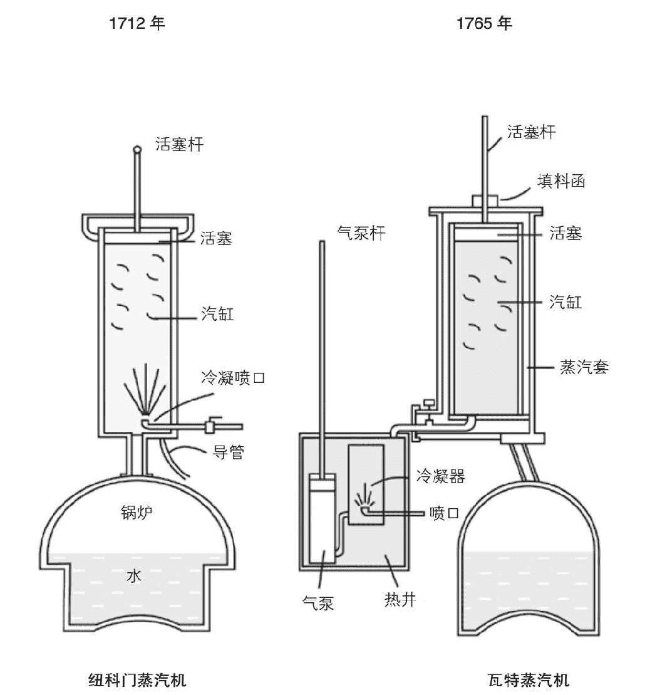

据说博尔顿像史蒂夫·乔布斯，商业头脑燃烧；而瓦特像阴郁版的史蒂夫·沃兹尼亚克，技术活多由他承担。虽然说法不假，双方职责的交织比苹果这两位创始人更为紧密。

十八世纪七十年代中期，詹姆斯·瓦特与马修·博尔顿通过博尔顿—瓦特公司把新式蒸汽机销往全英。它立刻影响采矿业，也波及酿酒业的麦芽研磨。

为解释蒸汽机的威力，瓦特需要一个通俗说法。他估算一匹马可拉约82公斤的物体，于是对客户说：“我的机器有二十匹马的劲儿——二十马力。”“马力”这一功率单位由此诞生。

随后蒸汽机的改进打开了工厂大门，纺织业迎来革命。商品大规模生产首次成为可能，为城市带来新岗位。于是人们离开农田涌向城市。

#### 蒸汽改造交通

蒸汽动力改造了生产，瓦特意识到提高气体压力后它还能用于运输。蒸汽机车把生活水平推向新高度。第一项相关专利由瓦特于1784年获得，但通常被认为是博尔顿—瓦特公司员工威廉·默多克的创意。这些专利禁止在瓦特蒸汽机基础上制造高压蒸汽机，直到1800年专利到期，创新才井喷。

康沃尔工程师理查德·特里维西克的改进之一让高压蒸汽得以使用，威力更大，蒸汽机车因此成为可能。设计与单位体积功率提升，机器变小，可用于工厂，也可移动。

1804年是里程碑。那一年世界人口达到十亿，人类分离出吗啡，拿破仑掌权，更重要的是，人类第一次在陆地上无需人或动物之力运输货物。首台蒸汽机车载重超过25吨，时速约8公里/小时。汽车还要再等近一个世纪。

蒸汽火车与铁路成为英国主要出口品，对欧洲产生有限影响，最大的冲击在美国。十九世纪初许多机车从英国进口，到1830年美国已能自造火车，新行业形成。

#### 蒸汽改变美国

起初铁路由来仅数千米，长途铁路旅行因此更受追捧。此前美国人靠骆驼商队与驿站马车运邮或旅行，效果很差。

从圣路易斯到旧金山，无论骆驼还是马车，都要穿越约4500公里土路，耗时三周左右。作家马克·吐温曾经历一次驿站马车之旅，感受极差且震惊。

餐食是豆子、不新鲜培根与硬面包。他形容舒适程度为“骨头要散了”“牙齿撞来撞去”“肌肉彻底耗尽”。

1863年，年轻的土木工程师西奥多·朱达想建一条贯通东西的终极铁路。当时国会也在讨论，但路线未定。朱达提出最佳方案并承担建设。他与联合太平洋铁路签约从东海岸开工，与中央太平洋铁路签约从西海岸开工。1869年5月10日，经过六年苦工，在内华达沙漠铺轨与无数人牺牲后，两线在犹他州会合，第一条横贯大陆铁路建成。

铁路把加州与美国其它地区联通。有了蒸汽火车，人与大批货物首次能轻松长途陆运，无限可能被打开。

货物与服务能运往港口无法覆盖的新城镇。人们不再生于斯死于斯，能自由流动。加州连通后，易腐食品装入冷藏车厢迅速运往全国，开启繁荣新时代。

今天我们发电仍基本靠蒸汽。煤电站、核电站与部分天然气电站都是烧水产生蒸汽驱动涡轮发电。瓦特某天散步的灵感，至今仍影响我们。

蒸汽机从工厂走向铁路时，另一项科技悄然出现，其革命性丝毫不逊于蒸汽机。

这就是电力。

### 第二章 奠定基础

#### 电之奥秘

远古以来，电只是抽象概念。五千年前你触到一条带电鱼，会被电到，除了闪电外这在你的人生里可能绝无仅有。那条鱼看起来神秘甚至有魔力。这个谜题延续了上千年。

“电”一词源自威廉·吉尔伯特1600年出版的《磁石论》，被视为英国第一本真正科学著作。“电”来自希腊文“琥珀”。

##### 亚历山德罗·伏打与电池的诞生

十八世纪末，人类造出了自己的电。1799年意大利发明家亚历山德罗·伏打发明了伏打电堆，由锌板与铜板叠加，中间夹浸盐水的纸板。这是第一个能持续提供电流的装置，本质是电池。

1800年，兴奋的伏打给伦敦皇家学会写信报告发现。当时学界普遍认为电只能由生物产生，这一消息震动很大。不久后人们通过电解分离出钾、钙、镁等新元素。

伏打因此名声大噪，甚至电势单位“伏特”以他命名。尽管声名显赫，他仍十分重视家庭生活，时常避开公众。

伏打电堆为电力研究奠定基础，只是普及时代尚未到来。

###### 电力照明的误入歧途

很长时间里，人类日落后只能靠油灯蜡烛照明。若外出归来灯油用尽，就很麻烦。1805年左右有所改变，英国人汉弗莱·戴维展示了用电照明。他造出一种灯，电流通过两根小碳棒，棒间约100毫米缝隙形成白热光弧。这种“弧光照明”通常由数千组伏打电池高压供电。

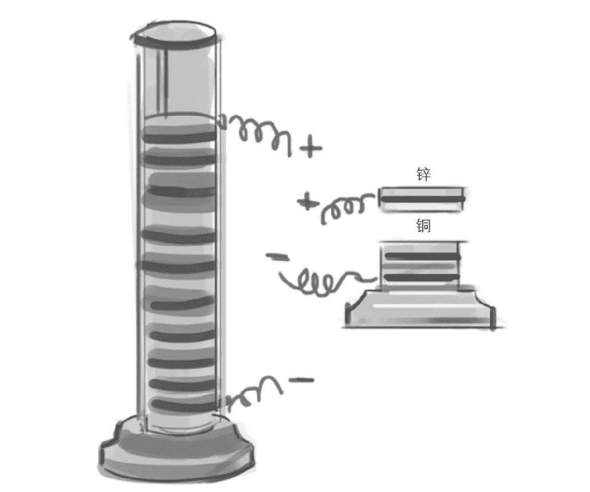

当时弧光灯算非常亮，有人估计相当于四千支蜡烛，约是现代汽车聚光灯亮度的十分之一。

弧光灯发热量大，有火灾风险。亮度虽高，却不适合家居。曾用于商业场合，但当时电力供应不稳定，难以长时间使用。要广泛用电力照明，这条路走不通。随着世纪进步，电力照明会在本章后半段再度回归。

与此同时，电力的其它用途正在取得重大进展。

##### 迈克尔·法拉第

迈克尔·法拉第是历史上影响最深的科学家之一，改变了我们对电、化学和电磁学的理解。他的成果包括本生灯、直流电动机、苯的发现、法拉第笼。爱因斯坦办公室墙上还挂着他的照片。

让人惊讶的是，1791年生于英国的法拉第几乎没受正规教育，自学成才。十五岁左右他在装订书店工作，无意间看到两本书改写人生。一本是艾萨克·瓦茨的《悟性的提升》，教会他理解与自律；另一本是简·马塞特的《化学对话》，点燃他做电子实验的热情。在皇家学会听了汉弗莱·戴维的讲座后，法拉第以助手身份随他赴欧。

遗憾的是法拉第当时不被看重，不被视作“绅士”。他只能坐公共马车的车顶而非车内，吃饭也只能与仆人同桌。这让他沮丧，但与伟大智者交流的机会和对科学的热情让他坚持下去。

法拉第的天才在表达上——语言清晰简明。他数学有限，不擅复杂表达。尽管如此，他成功液化气体、制造新型玻璃、改良钢合金、发现纳米粒子和苯。如今塑料、染料、药物、润滑剂、橡胶等生产都用到苯。不过这并非他最伟大的发现。1821年他用伏打电堆产生运动，也就是电动机，才是巅峰。

戴维和当时发现电磁的詹姆斯·麦克斯韦等人曾尝试造电动机而失败。1821年人们发现电在磁场中能产生力。法拉第虽教育程度低，却在与他们简单讨论后成功造出持续环形运动的电动机。力量很小，却能运转。

我们再次看到旧想法被新想法承接而产生新技术。如今硬盘、电动自行车、手机震动感应器都运用了这一原理。值得注意的是，尼古拉·特斯拉在此基础上改进，发明了交流电动机，现遍及洗衣机到电动车。

法拉第的贡献不止于此。1831年他发明发电机，即直流发电机。原理与电动机相反：把机械能转为电能。

十九世纪三十年代，人们开始理解电的奥秘，但它尚未引发变革。因为直流发电机电压很低，只有几伏，电力有限。它证明了电力可由磁力产生，却提供不了多少能量。新的思想者仍在为这项发明寻找用途。

#### 电力通信开启

与前述发明家不同，查尔斯·惠斯通（1802年生于英国）有音乐背景。他父亲卖乐器，是长笛老师。十几岁时他常在当地商场旧书摊读书。一天他偶然看到介绍伏打发明的书，当时没钱买，很快攒钱购得。

查尔斯·惠斯通与兄弟决定自己造电池。他们没钱买铜板，惠斯通用剩下的铜币凑合完成。

1821年，惠斯通在商场里造了一个音箱，通过电线播放现场乐器声音，引发关注。他还造出“麦克风”一词，用来命名他把声音机械放大到耳朵的装置。

##### 电报

1835年，查尔斯在伦敦国王学院任教期间，看出电力传输信息的潜力，于是放弃机械麦克风，转向电报概念。他能预见这项技术若成功，会为世界带来难以置信的便利。他的思路是发展已有的原始电报尝试，其中最引人注目的是俄国发明家巴伦·许林格的工作，他曾在两间房之间成功通信。电报信息可在极低电压下工作，对当时发电水平很理想。

与此同时，印度陆军军官威廉·库克休假期间去海德堡大学上几堂解剖课。那里他看到原始电报演示，立刻意识到其重要性。库克放弃解剖研究，开始钻研电报。他联系迈克尔·法拉第和爱丁堡学者彼得·罗杰咨询。罗杰建议他去拜访惠斯通。

库克提议合作，但动机不同。惠斯通纯粹对科学意义感兴趣，库克想赚钱。犹豫后，惠斯通同意合作。

1837年，他们在伦敦尤斯顿火车站和卡姆登镇火车站之间架设实验装置，距离2.4公里。接收端是一个菱形刻度盘，有系列字母和五根电磁针，接收者通过磁针指向读报。系统至少需要五根电线传输信息。

1837年7月25日，第一封电报发出。惠斯通回忆：“我一人站在屋里，听着磁针咔嗒声，从未如此忐忑。当我拼出那些词时，我感到这项发明的重要性有力地撞击着我，其实用性无可挑剔、无可争议。”铁路负责人却不以为然，视电报为不实用的古怪玩意儿，立刻让人撤走装置。一切似乎已成败局，但两年后，英国大西部铁路公司重新拾起，传输距离21公里。这是电报首次被实际使用。

###### 一次追捕让电报成名

十九世纪中叶，电报对大众来说仍是个陌生玩意儿。真正把它推上公众视野的，是1845年离奇的一场抓捕。嫌疑人约翰·塔维尔搭乘前往伦敦的列车，警方得知行迹后立刻把消息发往终点站，等塔维尔一下车，抓捕人员已在站台等候。当时的人惊讶于讯息居然能追上移动中的火车，这桩案件被广泛宣传，电报的实用价值才被真正认可。

同一时段的美国，几桩不幸的家庭变故也在暗中推动另一位发明者去思考如何把信息送得更快。

## 莫尔斯

想象你是1825年的华盛顿画家，在480公里外的康涅狄格纽黑文，你的妻子病重。信使骑马来报病情好转，你继续作画。第二天又来一位送信人，带来妻子已经去世的详细情形。你赶到时，她已安葬。

塞缪尔·莫尔斯亲身经历了这一切。巨大的悲痛让他决心寻找远距离快速传讯的办法。最终诞生的成果是单线电报与莫尔斯码，后者至今仍是电报通信的通用语言。

莫尔斯码的巧妙在于极简，用点和划对应字母。熟练的操作员每分钟可打出约八十个字符。

1844年，莫尔斯把第一封电报从华盛顿送到马里兰巴尔的摩，内容取自《民数记》，大意是上帝做出的伟大之事。他的方案胜出，因为惠斯通的装置至少需要五根线，而点划只需一根线。

没有那场悲剧，莫尔斯或许只会被记住为一位画家。

### 海底与大陆的连线

电报让城际通联加速，但被海洋隔开的国家仍依赖轮船，美英之间传讯常需十多天。

五十年代起，舆论开始主张把技术延伸到大西洋彼岸，跨度约三千二百公里。1854年大西洋电报公司启动首条跨洋电缆工程。英美船队在洋底铺设绝缘线，经历四次失败后，1858年的第五次尝试才算成功，然而电缆只稳定运行了三周。

1858年8月16日，两大洲互发首封官方电报，维多利亚女王向美国总统詹姆斯·布坎南祝贺竣工。不久信号衰减，传输变慢。白宫为提速加压，反而毁坏了线路。运行期间，英美间的通信时效从十天缩短到约十七小时。

国内层面，电报网已遍布美国东部。1851年贯通美国的线路工程启动，1861年10月24日首封电报从旧金山抵达华盛顿，当天驿马快信正式停用。此前驿马快信是东西岸最快的递送方式，火车通到西岸还要再等八年。电报让驿马过时，正如蒸汽机车后来让马车过时一样。

文字能跨越千里，声音呢？

## 电话的到来

苏格兰人亚历山大·格雷厄姆·贝尔生于1847年，正值电报在英美高速发展。世人因电话记住他，后世的研究也显示他的思路间接奠定了计算机运算的基础。

贝尔童年好奇，爱动手。十二岁时在友人家面粉厂制造小麦脱壳装置。他实践能力强但学习吃力，十五岁辍学，后来仍接受高等教育。

他性格内向，与母亲感情深。母亲鼓励他发展音乐，后来失聪让他深受打击，于是他研究声学，并在波士顿创办聋人学校。

### 贝尔的实验与多重信号

贝尔常做声学演示取悦观众。有一次他用自家狗做实验，让狗长吠并操纵嘴唇声带，发出怪诞的拟声。经他引导，宾客相信狗会说“How are you, Grandmama”。目击者宣称见过会说话的狗。

他也为聋哑教师讲解可视语言，很快自创读唇法与口语教学法。到1871年，他已是听障教育领域的领军人物，主张聋人应摆脱手语，能够开口讲话。

大约此时，贝尔开始研究谐波电报。借助音乐与声学背景，他意识到若把莫尔斯点划置于不同音高，就能在同一根线上并行传输。

原理是：一位操作员以特定频率的短促音调发送莫尔斯码，另一位操作员用不同频率发送。接收端只对设定频率响应。多套接收机配多频率，就能在一条线上传多条信息而不互相干扰。贝尔称其为多重信号电报。

在两位友人的资助下，贝尔与助手托马斯·沃森继续完善。一天沃森不慎拔掉发射装置，贝尔没有听到惯常的嘀嗒声，反而听见另一间房的接收器传来清晰的拨弦声。他立刻想到，若拨弦声能传，人声也完全可以经电子设备传输。这是转折点，电话由此诞生，多重信号电报随之被放弃。那天是1876年3月10日，第一句话是“沃森先生，到这里来，我想见你”。1876年8月4日，贝尔造出可用的电话模型并向亲友演示，众人听到六公里外传来的读书与歌声，无不震惊。

同年晚些时候，贝尔在费城百年博览会展出原型机，电话因此名噪海外。现场贵宾包括维多利亚女王，她称此发明“最不寻常”。

并非所有人都看好。展后不久，西联公司总裁威廉·奥顿有机会收购该技术，他名言是“这个电子玩具能给我们公司带来什么用处”。事实证明他大错特错。

势头正盛的贝尔于1877年创立贝尔电话公司，后演变为美国电话电报公司即AT&T，至今仍是全球电信巨头之一。

公开展示不足十年，美国电话用户已突破十五万。

电话满足了人类沟通的核心需求，让远隔天涯的人能彼此听见。毫无疑问这是史上最成功的发明之一，今天的智能手机可视作其后裔。

鲜为人知的是，贝尔常说，他对世界的最大贡献并非电话，而是聋人的口语教育。

到十九世纪七十年代末，电已让人能用声音而非电码远距离交流。但声音能否保存？当时还无法录音回放。托马斯·爱迪生即将打破这一限制。

### 爱迪生与留声机

1877年7月，爱迪生在研究如何把电报信息录下并回放时偶然找到答案。他起初用振动在纸卷上留下压痕捕捉莫尔斯码。稍加思考，他推断任何声音都能如此处理。他需要一个可振动的物体在敏感表面留下运动痕迹。最初他用锡纸包覆圆筒。

爱迪生公布发明的方式也巧妙。《科学美国人》撰稿人回忆：“1877年12月，一位年轻人走进办公室，把一台简陋小机器放在编辑面前，几乎没作说明。这位来客转动曲轴，在场所有人惊呆了，机器开口了：‘早上好，你好吗？你觉得这台留声机怎么样？’机器就这样为自己代言。”

留声机于1878年2月19日获专利，美国专利第2000521号。贝尔随后改进技术，主张用蜡制圆筒替代锡纸，音质大幅提升，为十九世纪九十年代第一张唱片商业化铺路。

## 电光初现

十九世纪七十年代，人们仍在研究法拉第的发电机。七十年代末，其他国家开始把这些技术与弧光照明结合试验。

首批实用大型发电机在法国制造，因此1875年地球上首次出现路灯。到1878年，巴黎整座城市装上弧光系统。伦敦技术期刊《电工》撰稿人去法国考察后印象深刻，却遗憾技术未能传入英国，期刊写道：“电灯在巴黎的应用与日俱增，但在伦敦却看不到这样的光。”

作为回应，英国发电步伐加快，至十九世纪九十年代初已使用七百台弧光灯。市场、铁路和大型建筑前是理想安装点。虽然公共场所普及，私人住宅中却仍见不到电灯。

### 灯泡专利之争

白炽灯构想与弧光灯同样久远。许多人曾试图通过加热细丝产生白热光，但一直被认为不可行。原因有三：必须找到能反复加热冷却的材料，该材料需封装在受热不会破裂的玻璃容器内，且必须抽空空气以防灯丝氧化。

至今很多人认为托马斯·爱迪生发明了白炽灯，但正如他众多“发明”一样，他更多是改进而非原创。事实上早在十八世纪初已有数十例白热光照明记录，但直到十九世纪七十年代末，灯泡竞赛才真正白热化。当时主要竞争者分属两岸：纽约的托马斯·爱迪生与威廉·索耶，伦敦的约瑟夫·斯旺。

斯旺占领先机。他试验了碳、铂、棉线等材料，成果获英国专利，并创造多个第一次：首次为房屋照明、首次为剧院照明、首次为公共建筑照明。

与此同时，爱迪生在纽约申请了“电灯改进”专利。他也使用碳丝和铂丝，但团队发现碳化竹丝可连续使用一千二百多个小时。爱迪生团队的灯泡无疑具有开创性，但可疑的是，这些成果很大程度上基于美国同行威廉·索耶的设计。

灯泡已能使用，但发明归属是谁？专利相互冲突。爱迪生在英国败诉，被迫把所有权让给斯旺。同时在美国，威廉·索耶的合伙人阿尔邦·曼也在本土挑战爱迪生的专利。爱迪生初时败诉，但经过六年诉讼最终胜诉。数年后他又收购了斯旺的英国公司，爱迪生电灯泡的传奇由此在历史上巩固。

至1900年，电话、录音、电灯和火车已由伟大人物带给世界。这真是一个全新世界。

### 第三章 新世界（1900—1909）

1900年已过去许久，当时的世界完全不同。那年美国人口为七千五百万，莱曼·弗兰克·鲍姆的《绿野仙踪》刚出版，纽约地铁建设刚启动。

二十世纪最初十年出现了许多第一次。1900年巴黎奥运会首次有女运动员参赛；1901年首届诺贝尔奖颁奖典礼举行；1902年首个专门放映电影的剧院——洛杉矶电气剧院开放。四后，第一部长篇电影《凯利帮的故事》在澳大利亚墨尔本上映。此期间还出现了洗衣机、吸尘器和首次娱乐广播等发明。

1901年，鲁道夫·狄塞尔在巴黎世界博览会上展示柴油发动机，燃料为花生油。本届世博吸引五千万参观者，还展示了有声电影、自动扶梯和第一台磁性录音机。当时巴黎是技术创新的中心。

随着多国扩张，边界也在变动。新帝国主义盛行：欧洲、美国、日本的统治者都试图通过侵占亚洲、非洲、南美洲不断扩大的领土来主宰世界。

与此同时，伟大思想家们也在忙碌。1905年，爱因斯坦向全世界宣布狭义相对论。它假定静止观察者在各处看到的物理定律形式一致，且光速恒定。该理论假设了重力引起的时空弯曲和黑洞。也许最奇怪的效应是物体接近光速时会变重，以光速运动的物体质量将无限。爱因斯坦理论还带来时间因位置和速度而变化的副作用。例如接近光速时时间会减慢，称为时间膨胀。

这听起来离日常生活很远，但我们每天都在应用狭义相对论。比如GPS卫星以一万千米每小时绕地球运行，若不按时间膨胀修正卫星钟，一天后测量结果就会偏差八千米。想象一下用这种精度进行谷歌地图导航的体验。

在1905年就能预见此效应，的确了不起。但除了爱因斯坦，二十世纪初还有其他思想巨人，他们的想法深刻影响今天的世界。

## 汽车黎明

二十世纪第一个十年是一连串快速的成功。在技术层面，内燃机在二十世纪前几十年得到广泛应用。从某种程度上，这项技术接过了十九世纪蒸汽机的接力棒。你可能会惊讶，十九世纪居然有蒸汽汽车。这些汽车在寒冷天气需足足四十五分钟才能启动，并且需要加满大量水。这两个因素限制了续航。世界亟待更好的解决方案。

于是1808年出现第一辆氢动力汽车，1838年出现第一辆原始电动汽车，1870年出现第一辆汽油动力汽车。1885年，卡尔·本茨生产了第一辆汽油动力汽车，这一发明产生深远影响，本茨公司后来发展为梅赛德斯—奔驰。

### 早期汽车为何偏爱电

早期的汽油动力汽车并不完美。启动时需要卯足力气手摇柄对抗回弹，连换挡都很费劲。此外油门居然在方向盘上。正因如此，电动汽车被视为当时最好的个人交通工具，它们噪音极低，易于驾驶，相对不费力就能操作。

费迪南德·保时捷和托马斯·爱迪生等大人物也投身电动汽车研究。1898年，保时捷制造了第一辆汽车，是电动的。一年后，爱迪生开始研发更耐用的汽车电池。他认为电动汽车才是未来。然而经过一次次尝试，他最终不得不于十年后放弃。

电动汽车非常适合城市短途出行，因为当时乡村道路并不适合开车。至1900年，只有百分之二十二的汽车靠汽油驱动，四成是电动车，剩下百分之三十八是蒸汽车。

世纪之交，汽车无论电动与否都是一种昂贵的新奇事物，只有皇室和富人才能体验私人汽车的好处。要让每个人都能自由出行，就需改变汽车的生产方式，使价格可负担。一个叫亨利·福特的人让这一切成为现实。

### 让汽车走进普通家庭

1891年，爱迪生照明公司雇佣了一位聪明的工程师，当时二十八岁。他是天才，很快得到晋升。短短两年后，他成为总工程师。他的名字叫亨利·福特。

亨利·福特1863年7月30日出生于密歇根州。十三年时母亲去世，父亲命令他接管家族农场。虽然他深爱母亲，但对在家里做一辈子农活极不情愿。很小他就对机械工作感兴趣，十五岁左右就能为朋友和邻居修理手表。

十六岁时，福特离开农场，在底特律当机器操作员学徒，1891年进入爱迪生公司。当时爱迪生会在空闲时间试验无马马车的构想。1896年，福特制造了他的第一辆车，精心命名为福特“四轮车”。他在爱迪生公司高管会议上展示了新车计划。有趣的是，爱迪生本人非常想看到福特的改进车型。三年后，福特离开爱迪生公司，全身心投入汽车研发。

经过两次失败尝试后，福特汽车公司于1903年成立。第一辆福特汽车是A型车型，配备了一台八马力的电动机，售价八百至九百美元，视双座或四座而定。福特公司在1903和1904年制造了一千七百五十辆汽车，全是一种颜色——红色，可能因为这让车看起来快一点。公司几乎耗尽了二点八万美元的初始资金，1903年卖出首台A型车时，公司银行账户只剩下二百二十三点六五美元。当时福特面临不成则败，所幸美国人民非常喜欢这辆车，公司因此旗开得胜，越做越好。

#### 谁买了首辆福特

1903年7月23日，来自芝加哥的牙医欧内斯特·芬尼成为第一辆A型车的主人。A型车没有风挡玻璃，所以多年来欧内斯特可能从其他A型车司机那儿得到了一些额外的牙科生意。

#### 装配线改变制造

在A型车之后，福特公司又生产了一系列车型，但相比当时竞争对手都比较贵。例如，六缸福特售价二千八百美元，相当于今天的七万美元，而奥兹摩比的竞争对手Runabout售价仅六百五十美元，相当于今天的一点六五万美元。

随着福特汽车越来越成功，它需要想办法在降低生产成本的同时提高产量。

低成本秘诀在于生产方法。当时福特公司的工人分为两三人一组，每天只能生产不到十辆车。各小组先做好汽车各个部件，再进行组装。

1908年，随着T型车系诞生，公司尝试了一种新的生产方法。福特曾研究面粉厂、面包店、啤酒厂和肉类加工厂，从它们的连续流动生产方式中汲取灵感。于是T型车采用先批量生产零件再集中送入生产车间的模式。装配过程分为八十四个步骤。每个工人只接受其中一个步骤的培训。福特甚至聘请动作分析专家弗雷德里克·泰勒来确保工作尽可能高效完成。此外，福特还制造了一些机器人，用于更快地冲压零件。

在汽车工业，没有什么比引入装配线更具革命性。1910年，福特在密歇根州开设高地公园装配厂。1914年，引入每分钟移动一点八米的机械输送带，进一步加快生产节奏。

早在1908年问世的电启动器让T型车不再需要手动启动。这项进步，加上更便宜的燃料和大规模生产，挑战了电动汽车的可行性，而当时电动汽车的生产能力完全比不上汽油汽车。

## 效率的果实

93分钟造车
把整车装配从十二个小时压缩到九十三分钟，这个效率跃升带来的不只是速度。1914 年福特一年交付三十万零八千一百六十二辆，已超过其余厂商总和。十年后累计的 T 型车产量突破千顷万辆大关。售价同步下探，从八百五十美元跌到二百六十美元，按今天购买力约等于从一万两千一百美元降到三千七百美元。

流水线看似重复枯燥，对当时的工人感受却并非想象中那么压抑。产量上去后，标准工时由九小时提到八小时。日薪五美元，折算今天约一百二十四美元，是当时行业平均的两倍。理论上，一名装配工攒够钱也能买下自己组装的车。以七十二公里时速在街头穿行，那种感觉大概堪比摇滚明星登台。

汽车由此从奢侈品变成普通家庭可考虑的物件。

大规模生产的 T 型车重塑了美国的经济与生活形态。汽车餐厅、露天影院出现，汽车旅馆成为新业态。因为能应付烂路、积雪甚至浅水，人的活动半径被大幅拉开，乡村也因此孕育出新的商业点子。早期汽车与卡车还带动了钢铁、橡胶、玻璃、食品和娱乐等多个相关产业。到了五十年代，汽车工业在美国提供了约九百万个岗位，连“喇叭检验员”这样的岗位都出现，职责就是确保下线的喇叭音高符合厂商标准，通常是降 E 和 G 两个音。

声音进家门
汽车改变了外出方式，室内娱乐则由声音接手。

百年前的客厅娱乐显得不可思议。如今一句指令就能放歌，当时却只能靠自家乐器。齐唱是当时最受欢迎的消遣。留声机诞生初期，最大的竞争对手不是另一台放音设备，而是钢琴。

以今天的眼光看，爱迪生的留声机和唱片很粗糙，却首次提出了私人音乐的概念。不用亲临现场就能随时聆听，这本身就是一次革命。当时看来这个点子极具吸引力。

唱片工艺提升后销量攀升，规模化生产与营销让价格从两美元一路降到约三十五美分。1907年，维克多唱片公司发行的恩里科·卡鲁索翻唱《穿上戏装》，成为首张销量破百万的唱片。

伊士曼与摄影的平民化
按一下快门或轻点屏幕就能冻结时间。影像好似时间之门，能让人反复回到历史现场。摄影诞生前，这类记录只能依赖技艺高超的画师。

约在1900年，相机的形态与现在截然不同。机身笨重、操作繁琐，被摄者必须静止六到八秒，稍有移动画面就模糊。想象在这种条件下与朋友合影，成品往往一塌糊涂。

湿版流程里，摄影师要在大块玻璃板上逐层涂抹化学药剂使其感光，再把玻璃装进镜头后部，在未干前完成拍摄，故得此名。玻璃板又重又脆，使用极不方便，只有职业摄影师才肯忍受。

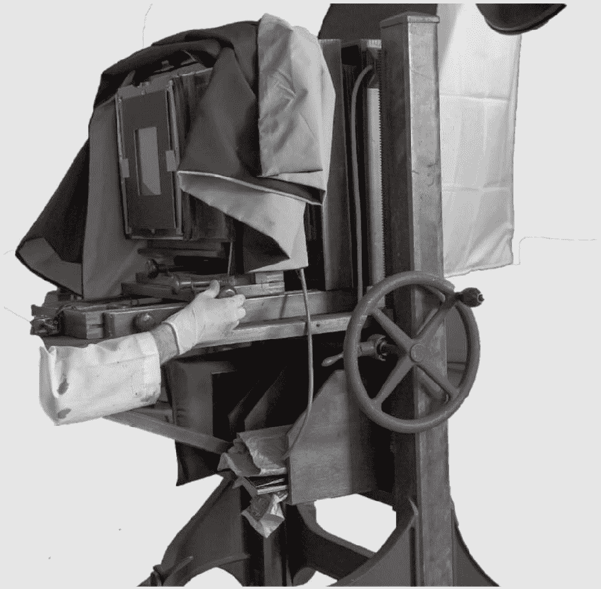
湿版摄影

纽约青年乔治·伊士曼热爱摄影，却觉得当时器材太费劲。即便接受过专业训练，他每次与脏乱的化学试剂打交道仍感挣扎。他确信一定有更简便的办法。

于是他开始研究更易用的拍摄技术。每晚阅读国际摄影期刊让他得知，英国摄影师正在尝试干版，即事先涂好药剂避免拍摄时液体滴落。这个改进很精彩，只是在没有网络的年代，消息未能传到美国，美方鲜有人知。

伊士曼决定自制干版。阻止他的理由似乎只有两个：高中辍学，且从未学过化学，但他认为这无妨。他白天在银行做簿记员，下班后整夜待在母亲厨房，把化学物质倒在玻璃上再送进烤箱烘烤，试着做出干版。他太投入，常被母亲发现睡在地板上。

用新工艺拍下邻居房屋做测试后，当地一位摄影师产生兴趣，购买了干版并向纽约器材巨头安东尼公司推荐。安东尼正寻找创新产品，伊士曼的方案正好契合。

安东尼与二十六岁的伊士曼签约。一八八一年一月，他在纽约设立干版工厂，仍兼顾银行工作。他亲手配制试剂，工作到深夜，第二天上班时手指常被染黑。他决心要成事，很快招到数名助手。

一次升职被拒后他愤而离职，同事皆以为他犯错，但很快证明他笑到最后。摄影师们很快发现伊士曼的干版，可以开心摆脱湿版的苦差事。

竞争很快到来，其他公司开始出售自制干版，最终对手的产品质量反超，他意识到可能要失败。

他必须快速调整思路。很快想到覆有化学涂层的可卷曲纸膜。拍摄时无需更换玻璃干版，只需把卷筒转到下一帧即可。这个设想很前卫，他兴奋地喊：“再过几周，我们就能征服世界！”一八八五年他公开演示，虽然获奖，但胶片材料的局限导致画质达不到专业标准。纸卷胶片因画质问题在市场上失利，他大受打击。随后他灵光一现，决定回归初衷——让摄影变简单，让摄影属于每个人。专业人士或许不认可，但普通人或许喜欢随意抓拍，即便画质不完美也无所谓。这个思路值得一试。

### 让快门进入每个家庭
一八八六年，伊士曼把重心从胶片转向易用的照相机。这次的目标是世界上最简单的相机。构思一个月后，他做出了一台机器，命名为柯达。

柯达小巧，几乎没有活动部件，没有对焦也没有取景器，口号是“只需按下快门，其他的交给我们”。相机不再需要繁复化学品或玻璃板，只是一个小盒子。袖珍机引发关注，甚至同年发表的小说《德古拉》里也提及它。柯达在某种程度上成功，但二十五美元的价位对大多数人太贵，相当于一八八七年普通人三个月的收入。要快速扩张，就必须做出平价机型。

一八八八年，乔治·伊士曼结束与安东尼的合作，创立伊士曼-柯达公司，即现在的柯达。

真正被消费者接受的是布朗尼相机。伊士曼让设计师弗兰克·布朗奈尔做一台尽可能便宜却可靠的相机，策略是瞄准爱拍照的孩子。一九零一年推出的布朗尼个头小巧、价格亲民——机身两美元，胶卷一美元一卷，一卷可拍八张。上市即轰动，第一年售出二十五万台。

布朗尼改变了人类生活。首次所有人都能随意捕捉生活瞬间，在人类历史上前所未有。

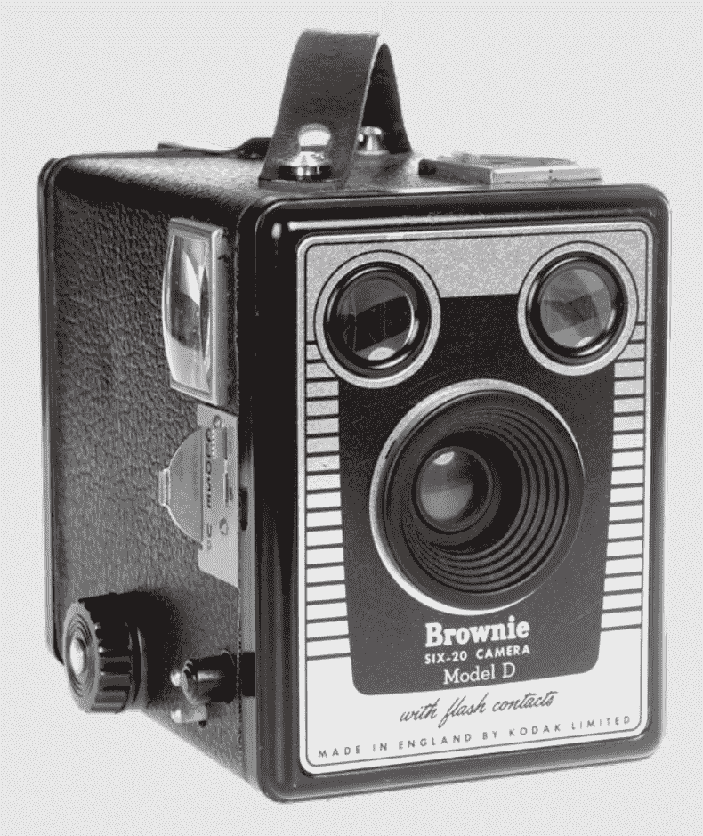
布朗尼相机

伊士曼多次想放弃，正是他的坚持永久改写世界。今天有几十亿台能放进口袋的相机，工作方式各不相同，结果一致——让人留下生命中的特殊时刻。

有趣的是，伊士曼还间接促成了塑料的诞生。

### 塑料的偶然诞生
看看周围，有多少物品是塑料做的？这种如今必不可少的材料要归功于谁？

利奥·贝克兰是生于一八六三年的比利时裔美国化学家，二十一岁获博士学位。一八八九年他出任比利时根特大学化学系副教授，同年获奖学金访问英美大学，随后被纽约哥伦比亚大学教授说服留在美国。

贝克兰是摄影爱好者，经过两年努力，他发明了可在人造光下显影的维洛克斯相纸。这是第一种商业成功的相纸，远超伊士曼早期的纸质胶片。一八九九年，他以一百万美元的价格，约合今日三千万美元，将维洛克斯相纸及其公司卖给柯达的乔治·伊士曼。

拿到钱后，贝克兰成为富人，可随心投入研究。他建立私人实验室，寻找下一个能发挥解决问题的领域。

他在日记写道：“我经济自由又精神自由，正准备重返我最爱的学习……几年来我一直享受这种巨大幸福，享受做自己喜欢的事而不被打扰。”十九世纪末许多化学家都在尝试发明坚固耐热的新型合成材料。已有橡胶等有机树脂，但强度不足。研究主要集中在两种物质：苯酚来自煤焦油，甲醛来自甲烷燃烧。

值得注意，如今甲醛已被证实致癌，且存在于汽车废气和烟草烟雾中。但早期化学家并不知晓实验的危险性。

其中阿道夫·冯·贝耶尔制造出他认为“没用”的黑色糊状物体，其学生也造出一坨“黏稠物”，据说“做出来一点用也没有”。

贝克兰仍继续研究苯酚与甲醛，希望在他人失败处取得突破。他细致研究贝耶尔等人的实验，逐步调整变量，直到出现可用物质。通过单独调节温度、压力及试剂用量，他终于找到“黄金”——塑料。他发现一种坚韧、轻便、廉价、不易碎裂、耐热且可塑成任意形状的材料。他把这种新材料命名为胶木，即最早的塑料。一九零九年他申请专利，并在美国化学学会宣布。

发明迅速获得成功。新材料还能很好地与彩色染料融合，用于生产鲜艳产品。最早用途包括纽扣、收音机、电话外壳、台灯、国际象棋、台球和塑料玩具。贝克兰因此获多项大奖。如今贝克兰的制品已成为收藏家的稀有珍品。

莱特兄弟与天空的博弈
到一九零零年，空中飞行已非新鲜事。自一七八三年起法国人就能乘坐热气球。一九零零年第一艘齐柏林飞艇在德国升空。但这些器械只能漂浮，与达·芬奇等大师设想的像鸟般翱翔仍有差距。

早期飞行器灵感来自鸟类，通常直接模仿外形，带有能上下扑动的机械翅膀，即扑翼机。

早期飞行风险极大，错误估计机翼运作模式很可能英年早逝。

裁缝弗兰兹·瑞切特认为可穿戴降落伞是通往人类飞行的下一步。他先用假人从公寓五楼做初步实验，后用自己试验。一九一二年，他不顾亲友反对戴着可穿戴降落伞从埃菲尔铁塔跳下。降落伞未能打开，他当场死亡。

奥托·李林塔尔用悬挂式滑翔机在柏林进行了超过两千次滑翔，唯一控制方式是改变自身重量。不幸一次测试中滑翔机失速垂直坠地，他挺过撞击，却在三十六小时后重伤不治。他的遗言“必须要有牺牲”也成为墓志铭，提醒着敢于尝试者，掌握飞行意味着什么。

也有人更成功。

法国发明家克雷芒·阿德尔是首个实现自力推进飞行的人，机器模仿飞行蝙蝠。一八九零年十月九日首次飞行五十米，后来报道称一八九二年飞了百八十米。

德裔美国移民古斯塔夫·怀特海在一八九九年试飞蒸汽动力飞机。

此时已有多次不可控滑翔和短距离动力飞行，但尚未有人造出靠自身动力载人的、比空气更重的可控飞机。世界各地工程师和科学家都在解决当时被称为“空中航行问题”的难题。一九零零年，交通创新的旋风兴起，公众兴趣浓厚。美国人和欧洲人都想：汽车有了，电动汽车也有了……接下来当然要造飞行器！

在美国，自行车热潮兴起。一八九二年，奥维尔与威尔伯·莱特兄弟在俄亥俄州代顿市开设自行车店，自行生产手工自行车。五年后奥维尔感到焦躁，觉得这不能充分发挥才能。与此同时威尔伯一直关注航空业，认为兄弟俩应尝试可控飞行。

控制是最难的部分。如何操纵已在空中的物体？威尔伯在室外观察飞鸟，认为鸟类可能通过轻微扭动翅膀转向。兄弟俩做了一个小箱形风筝测试想法，巧妙系绳使拉动一侧翅膀时结构向一侧扭转。这被称为翘曲机翼，是飞行控制的重要突破。

风筝测试完美，翅膀扭转时风筝按设想方向转向。一九零零年莱特兄弟做全尺寸版本并加入控制机制，在北卡罗来纳州的小鹰镇测试。

他们在一座小山上完成几次成功小型滑翔，但一九零二年悲剧发生。威尔伯滑翔转向时从机翼滑落，飞机很快失控，撞向地面，他被抛起，头部撞到支柱。虽然存活，却受惊不小，并表示人类未来五十年内都不可能实现飞行。

两兄弟并未放弃。几个月后他们在自行车店重拾实验。奥维尔灵光一现，在店内建小型风洞验证想法并测试不同机翼形态。风洞是个小木箱，一头装三十马力风扇，另一头是可观察机翼的玻璃。

奥维尔详尽测算每种机翼性能，最后找到最佳设计。难以置信的是，他的测试方法与现代工程极为相似。特别是在一九零二年，奥维尔只读过三年高中，是一名自行车修理工。

风洞完成后，他首先意识到机翼行为与质量无关，关键在于形状。因此莱特兄弟无需以身犯险制造全尺寸模型，也不用从高地跳下测试可行性。

到一九零二年，他们完善了设计，实现了滑翔机的稳定控制。

第二年，他们准备动力飞行。依靠店里一名机械工的技术，他们制造引擎和螺旋桨。

天有不测风云，滑翔机的细节被泄露并发表在一本法国期刊上，再次激起全球对飞行的兴趣。莱特兄弟虽抢占先机，却未能保持多久。法国人也把目光转向天空，一场天空征服竞赛一触即发。

### 一九零三年首次起飞
一九零三年十二月十七日清晨，在小鹰镇沙滩上，莱特兄弟把引擎和螺旋桨装到飞机上，秘密试飞就绪。兄弟俩庄重握手，像是最后一次见面，然后分工——奥维尔上天试飞，威尔伯在地面观察。奥维尔启动引擎，巨大的声响传来，历史即将改写。

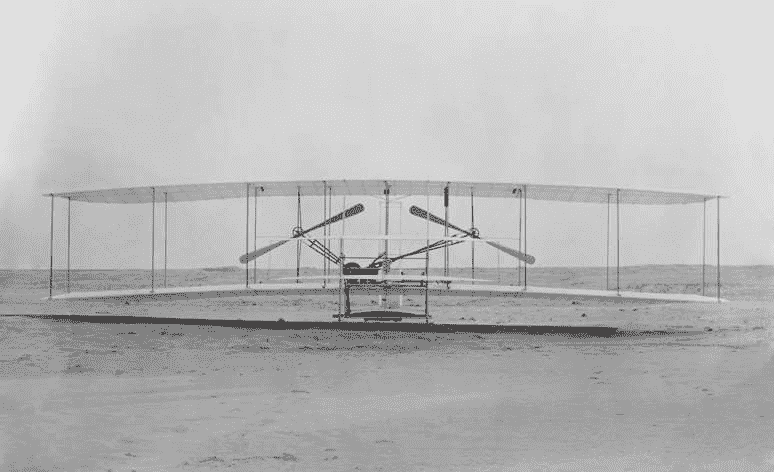
莱特兄弟的飞机

几秒后，飞机稳健前移并开始起飞。整次飞行十二秒。世界上第一次全控制动力飞行成功了。当天他们飞了四次，最长五十七秒。人类终于能飞上天。兄弟俩用电报把细节告知在俄亥俄州的父亲。

到一九零五年，随着飞行器改良，飞行时间延长到三十分钟。然而他们遇到难题。他们想售卖发明，却不知如何实现。担心公开展示技术会被窃取，因为尚未申请专利。于是他们反其道而行，在尚未向大众展示产品前就在市场上推广“飞行器”。话虽如此，他们最初设想将美国政府作为潜在客户。交易大致是：签约，告诉我们你想用飞行器做什么，我们研发让飞行器具备相应功能；成功后客户付款。

美国政府拒绝提议。

于是他们转向欧洲市场。当时德国与法国处在战争边缘，兄弟俩觉得肯定有一方感兴趣。报价二十万美元，约合今日五百二十万美元。结果两国都不愿为从未见过的东西花这么多钱。

这时在巴黎，阿尔贝托·桑托斯·杜蒙刚刚实现动力飞行，法国人不断追赶。尽管飞机只能飞直线，法国人仍感到惊奇，并把杜蒙称为航空之父。

回到美国后，莱特兄弟拿到专利——空气动力控制技术，但仍不愿向任何人展示飞机。他们担心秘密设计会被暗中观察的路人窃取。口说无凭，很多人开始质疑。尤其轻蔑多疑的法国人很快成为公认的航空领军，而莱特兄弟仍捂着发明。

到一九零八年一月，法国人亨利·法尔芒成功以圆形航线飞行一千米。控制很生硬，但仍成功。莱特兄弟开始像世界舞台上的小丑。

幸运的是，莱特兄弟的说法传到罗斯福总统耳中。他派军队调查所谓的“飞行器”。军队与莱特兄弟达成两万五千美元交易，并购买一架飞机。

交易内容是：生产一架能载两人以每小时六十四公里的速度飞行二百公里、每次飞行一小时的飞机。

莱特兄弟同意。现在他们终于可以向世界证明机器能飞。

最早的目标客户是多疑的欧洲人，特别是法国人。一九零八年八月八日，许多人来到法国勒芒，希望目睹飞行器。场地中央是莱特兄弟的飞机，威尔伯坐在驾驶座上。在众人注视下，他启动引擎，很快开始飞行。现场的人马上震惊得从座位上弹起。

这架飞机确能流畅受控地转弯，说明莱特兄弟没有撒谎。他们终于得到证明！法国媒体承认这架飞机比所有法国工程师制造的都要好太多。“我们被打败了。”当天的一些法国报纸这样写道。

如今的天空异常繁忙，单日起降就超过十万架次，全年累计超过三千七百万架次。莱特兄弟之后还有无数人参与推动，但飞行旅行的起点确实低得惊人：两位只有高中学历、以自行车修理工身份起家却拥有敏锐直觉的匠人。

### 俄亥俄州和远方
1969 年登月的那位俄亥俄人尼尔·阿姆斯特朗，带上月球的纪念物里有一块莱特飞机左翼的布料。

随后发生的变化很快。到 1910 年左右，汽车、个人音乐播放、飞机、袖珍相机和塑料制品都进入了批量生产阶段。20 世纪前十年与前一个世纪的差异已经清晰可感。

### 第四章 发明与大冲突（1910—1919）
承接上一个十年，20 世纪第二个十年依然是创新密集期。1912 年，德国地球物理学家阿尔弗雷德·魏格纳系统提出大陆漂移假说。同一年泰坦尼克号沉没，斯德哥尔摩举办了首届采用电子计时与终点摄影的夏季奥运会，唐纳德·利平科特以 10.6 秒刷新男子百米纪录。

## 不锈钢的诞生
1912 年，谢菲尔德人哈里·布瑞利带来了不锈钢。当一战在即，英国急于强化军备，伦敦皇家武器弹药厂发现来复枪枪管腐蚀严重影响精度，于是请来布朗弗斯实验室的负责人布瑞利想办法。布瑞利在常规钢的合金配方里刻意加大铬的比例，意外得到一种不生锈、不腐蚀的钢。

在当时，钢会生锈就像木头会腐烂一样理所当然。除了布瑞利本人，没人看好这种材料的普及前景，上级认为继续钻研是浪费精力。直到战争结束，其价值才被真正认识。今天不锈钢无处不在，覆盖汽车、餐具、建筑到电子设备。目前全球粗钢年产量约为 4600 万吨。

## 第一部动画长片
1917 年，阿根廷导演基里诺·克里斯蒂亚尼推出长达 70 分钟的《传教士》El Apostol，被公认为世界首部动画长片。影片在大众中很受欢迎，以戏谑手法影射阿根廷政治，总统被画到云端，用闪电清洗布宜诺斯艾利斯的腐败却引燃整座城市。讽刺的是，1926 年母片所在的制片厂失火，影片仅存一份拷贝就此化为灰烬，永久失传。

### 有人要吃吐司吗？
在牛油果吐司风靡之前，烤面包本是靠明火手工进行。最早实现量产的烤吐司机是 1909 年由弗兰克·肖尔勒为通用电气设计的 D-12，使用体验很糟，必须人站在一旁盯着，烤好一面再翻面，且每次只能烤单面。

1914 年西屋也推出了改进版，体验提升有限。真正的突破在 1919 年到来，查尔斯·斯特里特发明了弹跳式烤面包机，利用发热电磁线圈工作。当时吐司都是手工切开，厚薄不一，直到十年后切片机流行，面包片才趋于标准。电动弹出式烤面包机随之普及，如今它是美国最普及的家用电器之一。

## 世界大战及发明
发明以稳定节奏推进的同时，政治矛盾也在加剧，一场史无前例的灾难性战争一触即发。接下来可以看到，战争的残酷极大加速了技术演进。要理解当时的科技图景，必须先了解与第一次世界大战相关的关键节点。

### 大战的源头：战争的火药桶
国际权力版图急剧震荡。1910 年葡萄牙延续八百年的封建王朝被推翻，1911 年意大利与奥斯曼土耳其开战，1912 年中国末代王朝被推翻，中华民国成立。欧洲列强也在结盟：大英帝国、法兰西第三共和国与俄罗斯帝国组成协约国；意大利王国、德意志帝国与奥匈帝国组成同盟国。火药桶已装满引线。

随着西欧工业化推进与同盟形成，军备竞赛拉开序幕。刚完成统一的德国凭借经济与技术实力令欧洲不安，英法尤为警惕。与此同时欧洲第二大国、建国五十年左右的奥匈帝国，约占全国人口一半的塞尔维亚斯拉夫人不满情绪高涨，认为自己比奥地利人和匈牙利人受不到公平对待。

奥匈帝国是工业强国，全球机器制造业排名第四，仅次于美国、德国、英国；家用电器、电力工业设备与发电厂设备制造出口位居世界第三，仅次于美国与新德意志帝国。整体技术水平很高，不容小觑。

当时的掌权者是 81 岁的弗朗茨·约瑟夫一世，执政风格固执，推行斯拉夫人的边缘化。继承人弗朗茨·斐迪南大公立场相反，希望通过善待斯拉夫人换取国内和平。

1914 年 6 月 28 日，斐迪南访问波斯尼亚萨拉热窝，受到热烈欢迎。一枚炸弹从车上弹开在他身后爆炸，他未听从建议取消行程，继续前行后被 19 岁的波斯尼亚激进分子加夫里洛·普林西普枪杀。普林西普与五名塞尔维亚人策划暗杀，却误以为斐迪南是镇压者，实际上他支持斯拉夫人的平等诉求。暗杀的初衷是让南斯拉夫地区脱离奥匈帝国独立。

不久后，同样 81 岁的奥匈帝国领导人为报复向塞尔维亚宣战。这一宣战把各大同盟卷入：英法俄支持塞尔维亚，德奥及奥斯曼土耳其支持奥匈。刺杀斐迪南的那颗子弹成了点燃火药桶的火柴。

## 第一次世界大战：大冲突
开战初期部队仍靠骑马行进，到战争结束时地面已有坦克，天上已有飞机。当国家存亡系于一线，唯有疯狂创新才能求胜。一战因此成为历史上首个工业与科学结合的战争。

尽管技术先进，奥匈帝国因经济困顿在军备竞赛中落后，侦察任务仍依赖气球而非飞机。德奥曾预计四到五周就能拿下塞尔维亚，但兵力仅为其十分之一的塞尔维亚军反击异常顽强。三场会战后塞尔维亚击败奥匈，自身损失惨重。原本的小冲突迅速扩大。

与此同时，英国作为世界经济军事霸主、海上霸权，谋划用航运封锁逼德国就范，切断德国粮食供应。德国以同等手段封锁英国物资。英国有所准备，却没想到德国祭出一项新技术：代号 Unterseebot 的 U 型潜艇，即潜水艇。当时要让其稳定作战需要大量工程与 20 世纪第二个十年的先进技术。U艇可向敌舰发射鱼雷，目标往往在被摧毁前浑然不觉。

海战之外空战更具冲击力。

### 航空领域的进步
1915 年德国首次使用飞艇实施战略空袭，轰炸英国。

随后德国研制出可通过螺旋桨射击的机枪，借助射击断续器获得西线制空权。

1917 年海上封锁导致多国粮食短缺，必须取得决定性胜利，莱特兄弟开启的航空技术突飞猛进，空战迅速白热化。

英国以战略轰炸作为回应，制造了体积庞大的双翼轰炸机，当时也是世界上最大的飞机之一。

#### 宾利和宝马的首秀其实是在天上
一战前，沃尔特·欧文·宾利与兄弟霍勒斯·米尔纳·宾利在伦敦卖汽车。沃尔特心中始终想造自己的车。1913 年他看到一只铝制的镇纸，萌生用轻质铝活塞替代铸铁活塞的想法。随后这些轻型铝活塞应用于英国著名战斗机索普维斯骆驼的发动机。一战后沃尔特创立宾利汽车有限公司，如今已是全球最负盛名的汽车品牌之一。

1917 年 4 月，巴伐利亚发动机工厂即宝马成立。首款产品是为德国战备生产的宝马 IIIa 飞机发动机，性能优异且省油。战时需求让宝马迅速扩张在航空领域。IIIa 发动机几近终结战争，装配的飞机在空中无敌，还创下多项速度纪录，并让一架双翼机在 1919 年抵达 9750 公里高度，相当于今日喷气客机可达的航程。想想那是 1919 年。

至今宝马仍为新加坡航空设计头等舱内饰。

#### 纪录片的诞生
战争爆发后公众对重大事件兴趣高涨。报纸能讲故事，电影能做得更好。一张照片胜千言，每秒 15 到 30 张画面价值更高。当时部分影片专门记录重大事件，后被归为纪录片，战争推动了这一形式的诞生。

### 战争结束
俄军内部最早出现下级违抗上级的现象，伤亡已达 180 万，士兵疲惫不堪，国内饥荒引发革命。1917 年 11 月俄国宣布退出一战。

法国军队同样士气崩溃，拒绝作战后退出。德奥似乎占优。

随后德国 U 艇击沉载有美国人的客轮，并怂恿墨西哥进攻美国，美国被迫参战。

新加入的美军帮助协约国稳住战线并扭转局势。1918 年 11 月 11 日，德国最后一搏失败，签署停战协定。战争结束，共计约 3700 万军人和平民死亡。

一战终结了四个近现代帝国：奥匈帝国、奥斯曼帝国、德意志帝国与俄罗斯帝国。旧时代落幕，新时代开启。

## 艰苦时期的坚持奋斗
尽管一战摧残全球，战时仍有创造力强的人创立后来家喻户晓的公司，部分公司正因战争需求而起飞。

### 夏普公司：一切从铅笔开始
1915 年日本商人早川德次承接为自动铅笔生产金属配件的订单。研究后他发现铅笔结构脆弱，认为能做得更好，于是废寝忘食改进内部结构，提高耐用性。

多次调试后铅笔越发好用可靠，最终定型为现代旋转式自动铅笔 Ever-Sharp，即不需削尖、笔芯常新的意思。随后早川德次与其弟早川雅治合伙销售，每月产量 1400 支。

他四处推销却屡遭冷遇，最终遇到一家高级文具店，在要求做 36 次设计修改后才接受产品。颇具讽刺的是，一战成为其转机。1914 年战争爆发后，美欧无法获得德国制造的自动铅笔，早川的产品质量达到德国标准，迅速在海外流行。Ever-Sharp 之名也成为夏普的由来。此后夏普生产收音机、日本本土首台电视机，20 世纪 60 年代推出日本首批量产微波炉与太阳能电池，以及世界首台全晶体管台式计算器。

夏普的创新延续数十年，如今已被富士康收购，员工约 4.2 万人，资产约 151 亿美元。

### 松下：发掘市场缺口
松下电器最初名为松下电器家居用品制造厂，由松下幸之助于 1918 年创立。其父本为富商，因大米投机破产。

1918 年松下幸之助在大阪两层住宅内起步，起初只有三人：23 岁的松下、22 岁的妻子井植梅野和 15 岁的岳弟井植岁男。后者日后创立三洋。

首款产品是风扇绝缘板，但松下洞察到高品质家电的巨大市场空白。他夜以继日改进，最终推出灯泡连接插头与双向灯座，因质量优于市面产品而大受欢迎，又因人手少成本低，价格比竞争对手低 30% 至 50%。

至 1918 年底员工增至 20 人。随后百年间松下制造自行车灯、真空管等电子元件、电熨斗、收音机、唱机、VHS 录像机，80 年代初甚至在日本代工制造 IBM 电脑。

如今松下员工 257533 人，收入 650 亿美元，资产 533 亿美元。

### IBM
1911 年，英国制表机公司、国际时间记录公司、计算规模公司与邦迪制造公司合并为纽约的 CTR 计算制表记录公司。产品涵盖咖啡研磨机、自动切肉机、员工考勤系统、体重秤与穿孔卡片设备。1924 年更名为 IBM。

IBM 的核心业务始终是成立之初主打的穿孔卡片。那时 computer 指的是从事算术计算的人，是一个职业，后来才演变为机器名称。20 世纪 80 年代关于电脑的故事将进一步展开 IBM 的历史。

现今 IBM 拥有 38 万名员工，是机器学习领域的活跃玩家。

### 波音：撞坏我的飞机？那我造架更好的
距离莱特兄弟首飞仅 13 年，航空业已成雏形。威廉·爱德华·波音成为行业巨头，背景与想象不同，他本是密歇根木材公司高管。

借助新开的巴拿马运河，他将木材运往美国东岸获利丰厚。

1909 年西雅图博览会上他看到首架飞机后深受吸引，学飞行并购入自用飞机。波音帝国的诞生却带有偶然性。

一次试飞中，试飞员赫伯特·蒙特损坏了飞机。获知备件需数月才能到货后，波音对海军朋友康拉德·韦斯特维尔特说我们可以自己造一架更好的，并且更快。波音让韦斯特维尔特设计，他负责建造，最终造出一架性能出色的水上两栖飞机。二人信心十足，于 1916 年成立太平洋航空产品公司。

1917 年美国参战后军方急需飞机，太平洋航空产品公司即后来的波音飞机公司签下供应 50 架飞机的合同。

1918 年战争结束，廉价二手军机充斥市场，新机难以售出，多家公司倒闭。波音被迫转产梳妆台、柜台等家具度日。

市场回暖后波音重返航空业，专注商用飞机，并开展航空邮件与客运业务，其一项业务直接催生了美国联合航空。

如今波音员工 147680 人，每年生产 748 架商用飞机、180 架军用飞机、5 颗卫星。

#### 波音工厂
位于华盛顿的波音埃弗里特工厂体量巨大，厂房屋顶附近常形成云层，内有超过百万个灯泡，下方有 3.7 千米人行隧道。

#### 疯狂岁月
20 世纪第一个十年末，一战加速了航空技术发展，可视为现代的开端。

世界面貌已然不同，民众厌倦苦难渴望向前。随之而来的是和平期，技术迅猛发展，多数国家迎来前所未有的经济增长。美国称此为咆哮的 20 年代，法国则称之为疯狂岁月。

### 第五章 转动的齿轮（1920—1929）
整理本章资料时惊讶于 20 年代诞生的重要发明数量。汽车影响文化，电话、收音机、厨房电器普及，即时媒体改变文化。此后不只有科学家和哲学家成名，体育明星与电影明星也能成为公众人物。本时期新事物包括儿童攀爬架、口香糖、吹风机、汽车头枕、测谎仪、推土机、芝士汉堡以及得来速，颇为意外的是得来速最早由 1926 年的城市中心银行发明。

本章可看到 20 世纪科技发展的基石，电视机、有声彩色电影与消费者商品的量产都是上一个十年所无。

## 地球上最繁荣的国家
一战后美国经济繁荣，机械化大批量生产是关键。新设备与制造方式提升利润，生活水平随之提高。自动化不再局限汽车业，而是多行业主流。饼干到冰箱皆可量产。生活相较战时恐怖已显得轻松，也因技术已融入日常。自动化创造了锅炉工、铆钉工、铸造工等岗位，蒸汽让位于石油与电力。

到 20 年代末，美国中产阶级享有前所未有的生活方式。现代家庭体现最明显，技术成为日常，中产足以负担。吸尘器取代地毯拍，批量生产的电冰箱、缝纫机、烤箱进入市场。从弹出式烤面包机到食物搅拌机，这些发明大幅节省家务时间。

流水线制造催开了大众广告的时代，美国一年在广告上砸下的钱高达十亿美元，按今天的购买力约在一百四十亿左右。正因为新艺术与音乐形态的渗透，北美才度过了意气风发的 20 世纪 20 年代。与此形成鲜明对照，欧洲的处境截然不同。

### “一战”后的德国
凡尔赛条约像重锤般砸向德国经济，条约强令德国认罪并附带了一连串经济与政治惩罚。440 条条款里，有 414 条直指惩罚。1922 年通胀彻底失控，物价狂飙。

发薪日，雇主推着塞满纸钞的手提箱。拿到钱的工人必须立刻冲进商店，否则钞票就贬值。等到店门口，标价已经变了。最疯狂时物价两天翻一番。举例来说，1923 年 1 月一块面包 250 马克，到同年 11 月要 2 亿马克。

## 汽车的兴起
汽车业是美国制造业的最大引擎之一。亨利·福特在批量生产上的革新创造了岗位，并造出了工人阶级也能买得起的商品。靠此美国才熬过了 20 世纪 20 年代初的阵痛。

1924 年福特 T 型车的累计销量冲破千万辆。汽车行业一跃跻身美国支柱产业之列，连废旧车场也跟着兴旺。就业人数创纪录，工厂工人甚至开始买股票。到 20 世纪 20 年代中期，约五分之一的美国人已拥有私家车。英国要花四十年才达到同样的拥有率。

到此美国稳坐制造业霸主宝座，福特的生产方式向全国乃至欧洲扩散。意大利菲亚特是最早效仿的欧洲企业之一，有趣的是菲亚特厂房的屋顶上还建了一条测试跑道。

## 广播改变了文化
放在今天广播像是老古董，但在流行音乐、广告和整体文化上的影响却无可比拟。相比其他媒体，这项技术让全世界的信息以最快速度同时抵达每一个人，1920 年广播迎来爆发式增长。年初全美只有 5000 个家庭在收听，18 个月后拥有收音机的家庭跃至 300 万，4 年后则达到 5000 万。

20 世纪 20 年代收音机几乎无处不在，它成了第一种即时的群众媒介。同一个瞬间，全国各地的人分享同一段体验。夜里一家围着收音机，街头的行人停下来听最新时事也时常见到。广播剧、赛事和音乐成了日常消遣。

“广播”本是农业用语，指撒播种子，这个词的演绎也相当贴切。

广告商迅速盯上这块新阵地。1926 年圣诞前夕，麦片品牌 Wheaties 在电波里播出了第一支广告小歌。转眼间它成了全美最畅销的麦片。到 1941 年，已有约三分之二的广播节目里植入了广告。

### 广播的持久影响
电视很大程度上受益于广播的黄金时代。NBC、ABC 与 CBS 等老牌广播公司至今仍是媒体行业的中坚。爵士乐和摇滚等整个音乐流派都靠广播传播。英国广播公司 BBC 也是 20 世纪广播界最受敬重的机构之一。

1920 年英国首档电台节目试播，公众反应热烈，但军方担心干扰军事通信而叫停。民众公开反对，并于 1922 年发起请愿。监管机构最终只向一家由收音机制造商控制的公司发放许可，这家公司后来演变成 BBC。其早期经费主要来自制造商会员的设备销售收入。

### 广播剧：《世界大战》
最能体现广播威力的案例是纽约 CBS 在 1938 年万圣夜播出的《世界大战》。制作人奥森·韦尔斯告诉听众，节目改编自科幻小说，描绘外星人入侵。部分观众错过了开头的免责说明，还以为是真实新闻，以为城市正遭攻击。约 200 万人相信了。有人打电话向亲人诀别，有人带武器上街“抵抗”火星人。普林斯顿两位教授整夜寻找据称坠落的陨石，各地警察局被咨询电话塞爆，最后才澄清节目纯属虚构。警官们既松了口气又十分恼火。

## 谁发明了电视？
电视的雏形可追溯至 19 世纪 80 年代阿瑟·科恩发明的尼普科夫圆盘，但当时技术还造不出可看懂的画面。

苏格兰工程师约翰·洛吉·贝尔德随后登场。1923 年 35 岁的他租下英国黑斯廷斯的一间工作室，决意攻克电视难题。没有企业资助，他用帽盒包装、剪刀、织补针、自行车灯镜片、旧茶叶箱和胶水拼出第一台简陋电视。

两年后 1925 年 3 月，他在伦敦一家百货门口演示，画面只能呈现物体的黑色轮廓。1925 年 10 月 2 日，贝尔德在伦敦实验室两个房间之间完成首次电视传输，展示了假人“Stooky Bill”的黑白影像，分辨率 30 线，帧率每秒 5 帧。

图像出现时贝尔德狂喜：“假人头部清晰地出现在屏幕上，清晰度高得难以置信。我成功了！不敢相信自己的眼睛，全身颤抖。”接着他想用真人脸，找来办公室职员威廉·泰顿。泰顿成了世界上第一个上电视的人，却评价道：“贝尔德先生，我觉得不怎么样，这太粗糙了。”贝尔德并未气馁，前往《每日快报》造势。报社编辑惊恐地说：“老天，前台有个疯子，别理他！他说有机器能无线传输，提防他手里有剃刀。”

1926 年 1 月帧率提升至每秒 12.5 帧，约是当代节目的一半。1928 年彩色电视问世。1929 年在贝尔德电视发展公司协助下，新成立的 BBC 制作了首档电视节目。

贝尔德在法国设分公司，成为法国第一家电视公司。1930 年经 BBC 制作了第一部电视剧，1931 年拍摄了首个户外电视节目。机械系统随后被淘汰，1923 年弗拉基米尔·科斯玛·兹沃金发明的阴极射线管能以全电方式实现同样效果。20 世纪 30 年代后期电子电视成为主流，贝尔德的机械系统于 1937 年被取代。但他仍继续研究，1944 年 8 月 16 日展示了首台可行的全电子彩色电视，并发明了 1000 线显像系统，理论上画质可媲美当代高清。1943 年的这一构想不可思议，可惜实施计划失败，其精神直到 2003 年才重现，间隔整整 60 年。

### 多姿多彩的贝尔德
贝尔德是个怪才。曾造出会碎的玻璃剃须刀、会炸的气动活塞鞋，还试图加热石墨造钻石导致格拉斯哥短路。有一次他接上 1 万伏电源电击自己，幸运只烧伤一只手，不幸被赶出家门。世界各地为他致敬，澳大利亚的洛吉奖即以他命名。2002 年他在 BBC 百大英国人投票中位列第 44 位，2014 年入选电影电视工程师协会。

### 电影的有声进化
一战后欧洲精疲力竭，电影制作稀少，这给了美国电影腾飞的机会。1927 年上映的《爵士歌手》是电影对广播的回应，也是首部长度达正片标准的有声电影。突破得益于华纳兄弟与第一国家电影公司发明的“维他风”。音轨记录在留声机唱片上，与放映机同步，首次实现声画同步。“维他风”在拉丁语和希腊语中意为“有生命的声音”。音效与画面结合让观众惊叹，《爵士歌手》打破票房纪录，一举把华纳兄弟推成好莱坞巨头。

## 飞机成为长途运输的未来
20 年代初航空邮件试运行却极危险。早期航线上 40 名飞行员中 31 人死于空难。莱特兄弟证明受控飞行可行，但公众仍认为长途空中旅行太危险。直到 1927 年局面改写。

24 岁的查尔斯·林德伯格从军校毕业一年后成为航空邮件飞行员，每周薪资 81 美元，约合今日 1414 美元，航线为圣路易斯至芝加哥。

当时有个悬赏 2.5 万美元，约合今日 35.2 万美元的挑战：独自从纽约直飞巴黎。大家普遍认为飞机太危险，至少已有 6 名飞行员在大西洋失事。林德伯格相信自己能成，他渴望改写历史。为保持清醒，他曾在起飞前连续 55 小时不睡觉测试极限。

### 关键的飞行
1927 年 5 月 20 日，林德伯格驾驶自费 1 万美元定制的单翼机“圣路易斯精神号”自纽约长岛起飞。33.5 小时的航程里他只带了 5 个火腿三明治。飞行 24 小时后出现幻觉，自称飞机下方“雾岛”在传授智慧真言。他仍坚持下来。

抵达巴黎时，15 万群众已在降落场等候。林德伯格一夜成名，成为全球最知名的美国人。返美途中又有 400 万人迎接。

他站在莱特兄弟肩上完成被视为不可能的任务。这次单人跨洋飞行让飞机成为出行的未来。次年他成为《时代》杂志史上首位年度人物。一年后商业航空出行增长 400%，泛美航空是早期代表之一。

#### 林德伯格的心脏灌注泵
战后退伍飞行员大多无业，军队以 300 美元处理剩余飞机，空中表演成为谋生手段。林德伯格在投身邮运前是最敢冒险的飞行员之一，嗜好肾上腺素，曾在低空关闭发动机靠滑行、进行机翼漫步。四次坠机均靠跳伞幸存。

1930 年嫂子死于心脏病，激发他发明让器官体外存活的方法。他与诺贝尔奖得主外科医生亚历克西·卡雷尔合作，30 年代持续研究。到 1935 年他研发出一种泵，能为体外器官提供空气与液体，使其在无感染情况下维持工作，被誉为医学突破，为后来的首个人造器官奠基。林德伯格既改写航空，也推动医疗，而太空的创新就在眼前。

### 太空时代之父
罗伯特·哈钦斯·戈达德可能是 20 世纪初最被低估的梦想家。19 世纪 80 年代出生，他自幼迷恋天空，常以望远镜观天。童年实验包括拿静电锌电池试图跳得更高，母亲警告他若成功可能飞出地球永不回来，他才停手。一次化学实验引爆家宅，父亲劝他把热情投入科学。

16 岁时读到赫伯特·乔治·威尔斯的《世界大战》，对太空产生兴趣。1914 年他获两项多级火箭专利。1919 年出版《达到极限高度的方法》，提出火箭飞行数学理论，探讨大气层与空间探测，还给出把火箭送上月球的理想实验并附大量计算。早期出版物被视为火箭科学先驱，但当时媒体多嘲笑他疯狂，公众视其为疯子，尽管计算合理。

受舆论压力他隐入山林秘密研究，缺乏第三方资金。1926 年他造出首艘液体火箭，3 月 16 日试飞，上升 12.5 米飞行 2.5 秒，首次证明液体火箭可行。随后增加可控推力喷嘴实现定向飞行。

看到 1929 年的火箭发射报道后，林德伯格出面支持，为他筹到 10 万美元，约合今日 180 万美元。历史证明戈达德的技术进步与远见为早期导弹与太空旅行奠基。1968 年阿波罗 8 号首航绕月时，林德伯格致信宇航员：“你实现了罗伯特·戈达德的梦想。”

## 一个时代的结束

### “股市只涨不跌！”
20 世纪 20 年代初美国笼罩前所未有的乐观。总统卡尔文·柯立芝说：“美国头等大事就是商业。”生活质量改善带来信心，流行口号是“与柯立芝一起酷”。消费信贷是 20 世纪 20 年代的新发明。这便是所谓的“先买后付，活在当下，勿忧未来”。这种心态后来衍生了迄今为止最严重的金融灾难。

大量平民首次进入股市，美容院、远洋客轮、夜总会、火车站到处是自动收报机纸带，人人追踪股价。

先买后付的文化蔓延到股市，人们借钱买股票。到 1929 年约 90% 的股票靠借贷购买，银行放贷资金中 40% 投向股市。当时没人担心，因为大家都在赚钱，尽管钱并非真金白银。

#### 派对的结束
1929 年 10 月 23 日华尔街股价近十年来首次下跌，汽车公司首当其冲，原因不明。金融分析师吉姆·里卡兹曾说弄清崩盘诱因就像找出一片引发雪崩的雪花。我们或许知道大雪、重力等宏观原因，却永远无从知晓哪一片雪花触发连锁。

汽车股价下跌本不是大事，市场调整常有，但胡佛总统仍于 10 月 25 日向全国讲话称：“美国支柱产业仍健全繁荣。”四天后证明为误判。

随后两天恐慌性抛售，无人承接。股价跌 2 美元、4 美元、10 美元毫无放缓。交易大厅里尖叫与喘息，交易员恐惧，民众聚集在交易所外。10 月 29 日股市崩盘，大萧条拉开序幕。

这是史上最严重的金融灾难。投资者借钱买股现今须还债，却已身无分文。

一切倒转。银行追索还款，投资者无力偿付。银行被迫自担损失继而倒闭，大批美国人破产。即便信誉良好公司也拿不到贷款发薪，裁员如雪崩。繁荣瞬间蒸发。

美国贸易伙伴欧洲也未能幸免，全球工人阶级受创。作为战后全球经济引擎、世界消费中心，美国经济停滞呻吟。美国放缓冲击全球贸易，海外美国公司关门，其他国家相继衰退。各国政府无力回天，行业像多米诺骨牌般倾倒。

本已艰难的德国再遭重创，德国人开始寻找能带来希望的人。

20 世纪 20 年代带着希望与创新到来，却以另一副面目收场。

### 第六章 声音、远见和天才（1930—1939）
进入 20 世纪 30 年代，全球众多经济体陷入严重崩溃。华尔街崩盘的余波导致贸易瘫痪，多个国家经济几乎一夜瓦解。

世界各地港口船只大量闲置，因几乎无人需要运输货物。英国作为全球最大造船国受创最重。商业衰退像疾病一样蔓延，邻近产业受累，失业的连锁反应拖垮整个经济体系。

英国政府选择紧缩开支，等待经济自然复苏。美国亦采取同样做法，结果惨烈：人们排队数个街区领取面包。美国陷入严重困境，贫民窟激增，被称为“胡佛村”，以时任总统命名。世界最繁荣的国家为何如此迅速衰落？！

只要听说有职位空缺，数以万计的人便搭火车前往数千米外求职。其中不乏科学家、医生与工程师。所有人陷入同样的绝望。

人们常把需求称为发明的源头，而那段无比艰苦的年代恰好诞生了人类历史上最具颠覆性的创造之一——可编程计算机。下面会详细展开，但先聊聊同一个十年的几项别样突破。

克莱德·汤博在1930年发现了冥王星，为这十年拉开序幕。1936年，乔治·伊士曼创立的柯达公司把彩色摄影带入大众视野。同一年的另一位俄罗斯出生者伊戈尔·西科斯基造出了第一架实用直升机，1939年完成首飞，如今常见的直升机仍保留着它的设计基因。

匈牙利兄弟拉斯洛·比罗和捷尔吉·比罗解决了钢笔易晕染漏墨的困扰，发明了圆珠笔。十年间电吉他与电贝斯也相继问世，电子放大技术让现场演奏的声音更清晰。只是，与这些闪亮发明相比，1930年代更重大的意义在于可编程计算机的出现。

## 计算机器的萌芽
想一想，计算机是件独一无二的技术。它是一种能思考的机器，运算速度比任何人快数百万倍，很可能是二十世纪最重要的技术发明，值得花时间细讲。

要了解计算机如何诞生，得从概念的种子到第一台能跑的模型来回溯。

### 巴贝奇与差分机的梦想
我们曾在第四章提到，“computer”原先指人。十七世纪四十年代，这个词就是指做计算的人。十七世纪它特指靠查表谋生的职业。工作单调却关键，因为当时的数学表推动着科学、工程、金融乃至经济的发展，只能由一批才华出众的计算员来制作，偶尔也会出错。十九世纪二十年代初，数学家兼哲学家查尔斯·巴贝奇正被他人的错误折磨。

他在天文年表中屡次发现错误，十分恼火。有些错误只是麻烦，有些则会致命。比如航海表出错，船只会偏离航线搁浅。巴贝奇意识到必须解决这种混乱，而现代计算技术的关键思想就萌发于他的应对之策。

他在思考计算问题时冒出了一个念头：既然物理机器能干体力活，为何不能干脑力活？由此他设想打造一台能自动算出表上所有数值并正确打印的机器，取名差分机。

差分机靠加减实现多项式运算，包括对数、正弦、余弦、正切。本质上完全是机械的，有数根垂直轴和能显示数字的圆盘，圆盘与齿轮相连，机械地在相邻轴上做加减。

到1822年，巴贝奇完成了部分模型，能蒸汽驱动不犯错地做多项式运算，这是当时难以置信的事——能做复杂脑力劳动的物理机器梦想成真了。

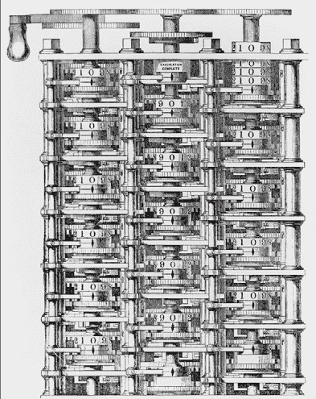

巴贝奇在沙龙里向贵族、诗人、政客和工业家演示机器。在一次聚会上，年轻的埃达·拜伦，也就是后来的埃达·洛夫莱斯，看到了机器并深深着迷。她与巴贝奇合作，为历史留下印记，后面还会提到她。

遗憾的是，巴贝奇那个时代的工艺不足以完成更大规模的装置。他决心在1834年开始设计更通用的版本，能处理任何计算而不只是多项式，命名为分析机。这个构想超前了整整一百年，相当于通用计算机的雏形。

### 分析机：通用的机械蓝图
分析机在本质上仍是机械的，巴贝奇设想了一个“磨坊”来控制、旋转并定位所有轮盘上的数字。这个“磨坊”相当于今天的CPU。

设计还包含一个存储区，用来存放算对的数字，也就是我们今天所说的内存。打孔卡片可以插入机器下达指令，它还配备打印机和绘图仪。分析机拥有可编程的运算单元和存储，构成了对计算机的完整早期设想，只是因过于复杂从未被造出来。

### 洛夫莱斯：首位程序员的觉醒
尽管困难重重，埃达·洛夫莱斯创造了历史里程碑。她是第一个意识到计算机不只会做枯燥算术，还能有别的应用的人。她还发表了最初的算法，被视作最早的程序员。

她的工作方式是一种全新的思维。

洛夫莱斯的人生像一部悲剧剧本。她1815年生于伦敦，起点不错，但此后一路下滑。父亲对她说的第一句话是“哎，你生来就是折磨我的吧！”一个月大时父母离异，她再也没见过父亲。八岁时父亲去世。

四岁起，她由当时数学与科学领域最好的老师单独辅导。母亲认为数学能让她不像父亲那样精神失常，可想而知父母的婚姻并不愉快。

十七岁时，她展现出惊人的数学天赋，被称赞有独立思考能力。对她而言，想象力和直觉是研究数学不可或缺的素质。1833年十八岁时，巴贝奇向她展示了差分机原型。她被深深吸引，二人并肩工作，巴贝奇夸她是“数字女巫”。

洛夫莱斯人缘甚佳，常与电报发明者查尔斯·惠斯通和直流电动机发明者迈克尔·法拉第等人交往。我们在第二章已经介绍过他们。想象一下这些聪慧者齐聚的场景！她不仅在数学上有独到见解，对计算机技术也有不同看法。像巴贝奇那样的人把计算机看作冰冷的算术机器，而她看到了更多潜力。

极具远见的洛夫莱斯认为，只要能把文字、图像和声音转成数字格式，由机械计算机处理，它就能成为协作工具。

1843年，洛夫莱斯受命把关于巴贝奇分析机的一篇文章从意大利语译成英语。那篇文章作者是意大利军事工程师、未来的总理路易吉·蒙博。

在翻译时，她决定写批注。思如泉涌，批注比正文长三倍。这些文字意义非凡，成为科技史的关键时刻。批注里包含用指令“编程”分析机进行数学运算的方法。如果有一台完整的分析机，这种程序是可行的。于是洛夫莱斯写下了第一个计算机编程算法。

她的想法领先时代近百年，直到1953年她的批注才发表，世界才意识到第一个计算机程序早在难以想象的时候就已诞生。

尽管如此，洛夫莱斯的名字至今仍不广为人知。她三十六岁时死于癌症，与从未了解过的父亲同龄早逝。她要求安葬在父亲旁边。

#### 赌马败北的隐秘往事
洛夫莱斯对数字的热爱延伸到了赌博。她想建立数学模型预测哪匹马会赢，从而大赚。但模型无效，反而让她赔钱。

十九世纪四十年代末，她因赌马输掉三千多英镑，相当于今天三十一万英镑、四十三万美元。欠下巨债，她走投无路，只能向丈夫坦白。

### 图灵：从理论到图灵机的构想
艾伦·图灵1912年6月23日生于伦敦，才智过人、喜欢钻研，性格有些忧郁。后来成为计算机科学和人工智能的先驱。中学时他就能在脑中解微积分，而老师尚未教授。上大学时他对量子物理及其数学原理兴趣浓厚。

对图灵而言微积分小菜一碟。1935年夏天，二十三岁的他在跑步时闪现一个概念：一台通用计算机，他并未借鉴巴贝奇。他设想的是一台只用有限控制和指令就能解决问题机器，称之为逻辑计算机器，后改名为图灵机。

问题是什么？这正是他设想的有趣之处。问题是个哲学难题：能否用一系列规则证明数学命题的真假？

这种用特定规则解决所有数学问题的概念叫“可判定性”，最早由德国数学家戴维·希尔伯特于1928年提出：是否原则上存在一种确定方法，能判定所有数学问题？也就是说，是否所有数学问题都能在有限步骤内求解？这也是巴贝奇想用机械分析机解决的问题，只不过图灵在理论层面审视它。

通过思想实验，图灵提出比巴贝奇更完整的解决方案——图灵机。理论上，这台机器能仅靠一组规则运算任何数学问题。换句话说，还是通用计算机的概念，只是这次更完善。

图灵机为现代电子计算机的工作方式提供了蓝图。至今我们仍用这个思想实验衡量程序能力。如果一个程序能实现图灵机的功能，就称之为图灵完备，达到编程语言能力的最高水平。目前没有任何方法能超越它。

二战期间，图灵帮助盟军设计了解码机器Bombe。有了它，英国能获知德国的攻击意图，在战争中占据关键优势。

图灵还发展了人工智能的图灵测试。1950年论文《计算机与智能》中描述了一个测试：参与者通过键盘与另一人聊天，中途不经他同意换成计算机。若参与者无法察觉变化，计算机就通过了测试。只有谷歌在2018年明确通过，但仅限电话交谈和预订场景。

在这场与其他先驱的竞赛中，图灵的人生以悲剧收场。1952年，他的家被闯入。警方调查盗窃时发现他有同性恋关系，当时这是可判监禁的罪行。

曝光后他被捕，名声大跌。他深受打击，自服毒自杀，年仅四十二岁。

### Zuse 与首台可编程硬件
之前所有构想都指向第一台可自由编程的实体计算机。它的发明者是个懒得自己算数学的人。

1935年，德国工程师康拉德·楚泽在亨舍尔飞机公司工作，任务之一是分析飞机应力。手动计算含六个变量的应力方程需一天多，二十五个变量则要一年以上，还不算出错的时间。

楚泽想造台机器帮他算，减轻工作。他在1992年采访中说：“我懒得干这活，所以才发明了计算机。”童年他爱玩麦卡诺拼装玩具，对结构之美和技术着迷。他选土木工程也是因其兼具美学与技术。

毕业后，他面临枯燥的重复计算，生活仿佛无尽。楚泽重拾童年对麦卡诺的兴趣，设想用巨大的麦卡诺模型实现自动化。他信心十足。1936年辞职搬回父母家研究机器，父母想必失望。

一段时间后，他邀请大学朋友帮忙。他们觉得项目酷，但连楚泽也不知道当时机械计算机如何运作。正因一无所知，他才能从全新视角从零搭建自动计算器。

他重新发明了转盘，与之前完全不同。当时机械计算机用十进制，楚泽避开它，选择二进制系统，机器开关只在1或0间跳动，而非复杂的0到9齿轮。最终证明这更简单，也能做更复杂的运算。

对楚泽而言，最难的不是逻辑与数学，而是造机器本身。Z1有约一千片薄金属片插在槽中作内存。程序通过纸带阅读器输入，阅读器读取带孔的老式35毫米胶片。还有键盘和一排指示灯显示结果。计算机可存64个数，能做加减乘除和开方。

1938年在朋友帮助下，Z1完工。他尝试计算一个3×3矩阵，成功了。历史上第一台可自由编程的计算机刚刚启动！不幸的是它马上坏了。这一直是问题：Z1太不稳定，易坏。楚泽不断深化想法，直到设计出用电话继电器代表0和1的Z3。

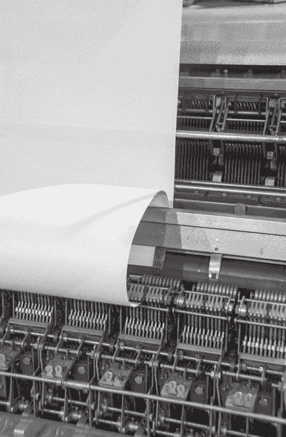

战争中能做数学运算的机器无价，而战争即将来临。

### 战云密布的德国
1934年，阿道夫·希特勒当选德国元首，部分原因是德国经济糟糕。他上台后抨击《凡尔赛和约》及其惩罚，赢得民心。

人们渴望改变，纳粹党看起来能办事。仅两年内，七百万德国人重返工作。制造业兴旺，高速公路等基建展开，许多人感到民族尊严回归。孩子们能在希特勒青年团中在万字旗下踏步也感到骄傲。当时旗上的符号意义不大，只代表一个不再忍气吞声、不断发展的国家。遗憾的是宣传让大多数德国人相信自己高人一等，骄傲最终演成邪恶。很快关注点转向德国境内的犹太人、波兰人、斯拉夫人及残疾人。

#### 甲壳虫：从纳粹工程到反文化图腾
希特勒为德国人民做计划。家家户户都有平价收音机Volksempfänger，希特勒懂得利用这种新技术宣传，尽管名字难记。

他还带来汽车。

1930年代德国汽车落后美国。德国只有富人才有车，五十人中仅一人拥有；美国约四人中有一人有车。

希特勒愿景之一是造出每个德国人买得起的汽车，名为人民的汽车Volkswagen。这并非纳粹独有，上一章提到的福特T型车概念相似。

1938年第一家大众工厂奠基，希特勒出席并亲自命名车型。那辆后来人见人爱的甲壳虫起初名字更霸气：Kraft-durch-Freude-Wagen，即从快乐中获得力量。

“从快乐中获得力量”于1939年开始生产，但二战爆发前被中断，仅生产210辆。最后这些车只给了军队高官，工厂改生产四驱军车。德国人民第一次错过机会。

战后，作为停战条件，大众工厂被交给美国人。严重受损的工厂屋顶上还卡着未爆炸的炸弹，被免费送给亨利·福特却遭拒绝，随后交给英国人。英国汽车制造商看完小小的甲壳虫，觉得这是见过最糟糕的设计。

他们评价它不符合基本技术要求、对普通买家没吸引力、作为商用车一点钱也赚不到。英国军官伊万·赫斯特受命清理工厂使其恢复生产。他做得很成功，1949年被任命为主管；1955年工厂生产出一百万辆甲壳虫。虽“对普通买家没吸引力”，它却卖得不错，性能与稳定性超越欧洲竞争对手。

越来越多甲壳虫出口欧洲。在美国，与功能强、车型大、外观华丽的轿车相比，甲壳虫像个笑话。大众想打进全球最大汽车消费市场，怎么办？

大众知道美国人永远不会相信丑陋小车比他们的车更强。那为什么不就丑这一点做文章？这个创意于1959年付诸实践。广告语包括“丑仅是表象”和“只有妈妈才爱的脸”。广告奏效，很快美国出现大批狂热追随者。甲壳虫和后来的康比厢型车成为1960年代反主流文化的标志。这家源于希特勒的公司摇身变成嬉皮士象征。

此后甲壳虫成为历史上最持久的车型之一。1938至2003年间原始型号共生产超过2100万辆，改动极少。1998年“新甲壳虫”取代原型号。今天的大众集团是销量最高的汽车制造商，拥有奥迪、兰博基尼、宾利、布加迪、杜卡迪、保时捷、斯柯达、西雅特等众多品牌。

甲壳虫本可为德国人民造福，也可能给希特勒带来体面结局。遗憾的是希特勒并未止步。

### 第七章 绝望中的战争与技术爆发（1940—1949）

四十年代的世界像是一台同时播放着爵士乐和爆炸声的留声机。摇摆乐席卷舞厅，沃尔特·迪士尼在《小飞象》《小鹿斑比》《幻想曲》里达到了创作高峰，这几部在技术上很有开创性的作品都是在短短几年内完成的。

整个十年既是历史的拐点，也是分化的年代。上半段的动荡之后，美国在下半叶迎来一段充满乐观气息的繁荣，欧洲和日本却笼罩在战后重建的疲惫与忧郁里。人们在同一时期玩上了飞盘、弹簧玩具和巧克力豆，也亲眼目睹了原子弹与迷幻药的出现。

1945 年战争终结，出生率冲到前所未有的高度。年轻人对未来充满信心，带着那种乐观降生的一代就是后来的婴儿潮。1946 年出生的代表性人物有汤米·李·琼斯、乔治·W.布什、弗雷迪·墨丘里、史蒂文·斯皮尔伯格、西尔维斯特·史泰龙和唐纳德·特朗普。

### 二战全景
第一次世界大战曾被视作“终结一切战争的战争”，但现实并非如此。1939 年世界再次陷入战火，士兵们手里的武器、飞机的速度、坦克的威力以及原子弹的威胁都比上一次更致命。

战争持续五年，约有三十个国家、超过一亿人卷入，死亡人数在五千万到八千五百万之间。这场冲突是前一次大战的余波：德国内乱让阿道夫·希特勒掌权，他企图把意志强加于欧洲。纳粹的意识形态建立在雅利安人种优越论上，把犹太人等少数族群当作替罪羊，在战争进程中实施大规模屠杀。

德国势力迅速扩张，与意大利、日本组成轴心国，先后吞并奥地利、占领捷克斯洛伐克。1939 年 9 月 1 日，德国无视英法的警告入侵波兰，二战正式开端。德军使用的“闪电战”依靠高性能坦克和飞机，以雷霆速度打击对手。波兰军队仍在使用骑兵和骑枪，几乎没有抵抗能力。

随后德国相继进入丹麦、挪威、比利时、荷兰，最终占领法国。转而对准英国时，由于英国是岛国且海空力量占优，德军未能得手，但空袭给英国造成严重破坏。

东线战场上，希特勒与斯大林的不稳休战破裂。德军入侵苏联后迅速占领大片土地，苏军伤亡约两千万人。最终，严寒在莫斯科城外遏制了德军的攻势。

1941 年 12 月 7 日，日本轰炸机袭击夏威夷珍珠港的美国海军基地，乐队演奏尚未结束基地已陷入火光。日本加入轴心阵营，这次打击旨在削弱美国海军，为进攻菲律宾、越南等地区扫清障碍。珍珠港事件让美国正式参战。

与此同时在新墨西哥州，一支顶尖科学家和工程师团队在高度保密下进行“曼哈顿计划”。计划基于裂变原子释放巨大能量的原理，旨在制造原子弹。爱因斯坦 1939 年致罗斯福的信阐述了原理，项目由罗伯特·奥本海默领导，与德国展开竞赛。

就在科学家攻关之际，盟军在北非夺回意大利占领区，并在意大利本土站稳脚跟。1944 年 6 月 6 日诺曼底登陆成功，巴黎很快解放。盟军从西、东、南三路进入德国，解放了纳粹集中营幸存者。1945 年 5 月 8 日，德国投降。

1945 年 8 月 6 日，美国在广岛投下原子弹，数日后长崎再次遭袭。爆炸与辐射夺走二十多万人的生命，只留下阴影与尘埃。日本随后投降。

战争结束代价惨重，德国被一分为二：东德依附苏联，西德由盟军控制，直至 1990 年统一。人类经历过最具毁灭性的冲突，血与废墟几乎看不到希望。但战争也把科技推向新高度，计算机、火箭、雷达、飞机、密码学与晶体管技术的进步，让文明从废墟中再次崛起。

## 零食融化了：微波炉的意外诞生
用微波炉热剩饭时，可以回想这个故事。战时雷达被广泛使用，它像探照灯一样发射短脉冲微波，信号碰到物体后反射回接收器，从而“看见”目标并测距。

雷达由英国首创、美国完善，用于对抗纳粹。盟军因此能先一步发现德军飞机。快速发展的雷达技术被认为是扭转战局的关键。美国雷神公司是生产雷达核心部件磁控管的主要厂商。

1945 年初，雷神工程师珀西·斯宾塞在改进雷达设备。工作一整天后他肚子饿了，从口袋掏出一根巧克力棒，却发现它已融化。斯宾塞意识到是磁控管的微波把它加热了。他请助理拿来一袋玉米粒放在磁控管附近，玉米粒开始跳动。由此证实雷达微波可以烹饪食物。

微波为食物分子提供能量，使分子高速振动，振动本质上就是热。温度上升就是分子运动加快。微波因此提供了一种全新加热方式。

战后，雷神首席执行官劳伦斯·马歇尔认为这有市场价值，让斯宾塞专注开发民用产品，并组建团队。第一台原型笨重异常，高约 1.8 米、重 270 公斤，相当于一台冰箱，发 3000 瓦功率，被称作“雷达炉”。说明书里写着 50 秒煎好牛排、数到 12 以内煎好鸡蛋。1947 年雷神推出商业版，体积缩小但售价 3000 美元，约合今日 3.3 万美元，普通家庭负担不起，主要卖给餐厅。几年后人们觉得用军用磁控管热剩鸡肉太奢侈，微波炉逐渐轻薄，到 60 年代末才变成今天熟悉的样子。

战争的影响远不止此，也催生了飞机制造的飞跃。

## 喷气时代的起跑线
一战战败后《凡尔赛和约》禁止德国研发航空技术，但喷气式飞机和火箭技术当时并不存在，于是被遗漏。

在德国哥廷根大学，21 岁的工科学生汉斯·冯·奥海恩研究喷气发动机构想，在教授鼓励下开始制作新型推进系统原型。

同一时期，英国 26 岁的飞行员弗兰克·惠特尔也在独立研究喷气推进，互不知情。1932 年他为世界首台喷气发动机申请专利，但英国军方不信，资金难以筹集。若当时被采纳，或许能遏制希特勒 1939 年冒险进军波兰。惠特尔的专利发表在国际技术文献中，一些历史学家认为冯·奥海恩可能受其启发。

1935 年，冯·奥海恩造出可运行的喷气发动机原型，随后与教授找到海因克尔公司，该公司立即着手制造全尺寸发动机。

在英国，惠特尔 1937 年创办小公司测试喷气机，屡遭挫折。一次试验中发动机推力失控不断上升，大多数员工逃离现场，惠特尔留下观察，最终发动机爆炸，他毫发无伤。事故让英国政府更加不信任这种危险技术。

因希特勒要求打造单座喷气战机，海因克尔加快进度。1939 年战争爆发前不到一个月，原型机 He 178 升空，德国在秘密竞赛中领先。

讽刺的是，战时纳粹仍主要依靠螺旋桨飞机取胜，这反而让德国对喷气机兴趣下降。空军设计师威廉·梅塞施密特坚持研发喷气战斗机，成果是 Me 262，时速可达 965 公里，于 1944 年投入作战，是战争中最强的机型，比盟军护航机快约每小时 160 公里，但发动机寿命仅约 25 小时。

德国还试验了奇特的 Me 163 火箭动力飞机，后掠翼、无尾翼，起飞后轮子脱落，燃料不稳定会灼伤飞行员，且没有双座教练机，飞行员必须独自首飞。它的爬升速度是传统飞机的 4.5 倍，滞空仅约 3 分钟，用于突袭盟军轰炸机。起降阶段伤亡占 80%。

英国直到 1944 年才推出格罗斯特流星，速度不及德国机，但惠特尔的发动机更可靠。战争在一年内结束，影响有限。惠特尔后来获颁爵士勋位。

## 计算机如何走出实验室
1940 至 1945 年，美英各自研发计算机以求在战时占优。1951 年，首批商业计算机面世，能够自动处理信息。

### ABC：数字计算的首次点火
约翰·文森特·阿塔纳索夫在艾奥瓦州立大学任教，注意到学生为线性方程手动计算耗时数周，和康拉德·楚泽处理应力计算时的烦恼相似。1934 年他开始探索自动计算，1939 年招募研究生克利福德·贝里协助。

1942 年二人完成阿塔纳索夫—贝里计算机，使用真空电子管运算，而非齿轮或机械开关。但它不能编程，也不是通用机。

#### 真空管——用灯泡做开关
真空管是战时改进的技术，玻璃封装的真空腔，顶部和底部各有电子接点，加热后电子单向流动，可充当开/关，代表 0 与 1，即位。二进制位可组成 8 位的字节储存数据。真空管比机械开关快得多，成为当时首选。它也被用于广播、电视和早期雷达，后被晶体管取代。

战争期间阿塔纳索夫入伍海军，研究中断。战后部分设备被抢救，但未获专利。直到 1973 年 ENIAC 专利纠纷审理时，法庭才承认阿塔纳索夫和贝里的贡献，称现代计算机基本原理源于他。仍有人质疑早期机器是否能运行，2010 年艾奥瓦州立大学团队按原始图纸和 40 年代部件重建，证实其可用性。该机是数字计算机的源头，但仅用于解线性方程，并非通用机。

### ENIAC：首台通用电子计算机
图灵和巴贝奇在理论上设想过通用计算机，但未实现电子版。真正把愿景变为现实的是接下来的人物。

#### 炮兵射击表的困境
美国军队二战时仍靠表格根据风速和温度修正炮弹轨迹，制作耗时且需机械计算器支援。战至中期表格供应不足，炮手只能盲射，浪费弹药和资金。

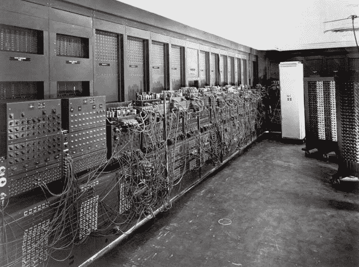

ENIAC 计算机
宾夕法尼亚大学物理学家约翰·莫奇利提出大胆设想：用一台巨型电子计算机在 100 秒内算出弹道，而非数周。这相当于原始的超级计算机。军队无路可退，1943 年勉强拨款 50 万美元，约合今日 880 万美元，支持该机密项目。

#### 为什么它总宕机
莫奇利与研究生 J. 布雷斯帕·埃克特启动电子数字积分计算机 ENIAC 的研制。同胞伤亡促使他们全力以赴。项目从零开始设计、制造、测试并学习编程，最终成果长 15 米、重 30 吨。最致命的是内部 1.75 万个脆弱真空管负责逻辑切换，易在最关键时刻损坏。真空管过热即烧毁，导致整机停机。即便采取防范，运行 10 至 30 分钟就常出故障。每秒可完成约 5000 次加法、357 次乘法、38 次除法，仍是当时最先进。

ENIAC 没有内存，每次新问题都要人工重新布线，几百根线拔出整理再插回。所幸今天只需双击鼠标。尽管如此，它是首台可计算任意给定问题的实体通用计算机，唯一遗憾是日本投降两个月后才建成，战争已结束。

### UNIVAC：走进市场的第一台通用机
战后，莫奇利与埃克特希望把技术用于民生。经过六年开发，1951 年 3 月他们向美国人口普查局交付首台通用机 UNIVAC。相比 ENIAC 的手工布线，UNIVAC 可编程处理多种任务，磁带驱动器保存数据，结果可快速打印，对当时而言令人惊叹，却鲜为人知。

1952 年 CBS 与雷明顿兰德策划公关，借 UNIVAC 预测艾森豪威尔与阿德莱·史蒂文森的总统大选。UNIVAC 预测艾森豪威尔将大胜，而民调显示两人势均力敌。CBS 怀疑机器故障，要求检查。最终艾森豪威尔如预测般压倒性获胜，误差仅 1%。计算机时代正式到来，只是机器仍依赖不稳定的真空管，直到晶体管出现才彻底改变。

## 晶体管：小小器件的大变革
计算机虽已登台，但真空管的电力消耗、稳定性和成本问题突出。随后晶体管登场。

晶体管或许是二十世纪最重要的发明之一，最初仅为放大电子信号，后用途大增。没人料到如此微小的器件会带来商业、文化与社会的深远变革。

现如今几乎任何电子产品都绕不开晶体管，芯片里往往塞着十几亿颗。它的本职是放大信号，同时也能像真空管那样充当电子流的闸门，只是状态只有两种：导通也就是“1”，截止也就是“0”。

这种开与关的组合被翻译成二进制编码，成了我们所有数据的通用语言。每一颗晶体管每秒能翻转数十亿次，正是这极快的切换让我们处理信息、操控数据，最终进入数字时代。有芯片的地方就有晶体管，从电视收音机、VR头盔，到电脑汽车手机无一例外。如今的晶体管已小到几纳米级别，而最早的原型却大得接近人的手掌。

晶体管的来历并不是一条笔直的技术线，而是一个夹杂承诺、嫉妒与冲突的人物故事。

### 晶体管的起源
故事要往前推，得回到1907年。AT&T 当时面临一个棘手问题：亚历山大·格雷厄姆·贝尔的电话专利即将到期，公司竞争加剧，甚至把已退休的前总裁西奥多·韦尔请回来救场。韦尔认为，光靠专利守不住，必须拿出连同行都不敢想的野心——铺设覆盖全美的电话网。这听起来像吹牛，因为可行性从未被证实。

就在一年前，美国发明家李·德福雷斯特改进了真空管，能够放大电子信号。音频信号可以通过电话线传输，有了放大器，声音就可以被拉远。AT&T 嗅到机会，买下德福雷斯特的专利并进行改良。改装后，信号可以在电话线上被有节奏地反复放大，跨越数千公里通话成为可能。

问题很快冒头。真空管功耗高、发热量大、稳定性差。到了1930年代，贝尔实验室的研究主管梅文·凯利意识到，若电话业务要继续扩张，必须找到更可靠的器件。他关注到一种导电性介于导体与绝缘体之间的奇异材料——半导体。

战时雷达技术高速发展，人们渴望更快响应。真空管跟不上需求，于是硅被拿来测试。硅后来成为半导体的代表，也因此有了硅谷之名。它在雷达系统里表现优异，但能否用于其他领域仍是未知。

1945年战后，梅文·凯利决定组建一支专家“梦之队”，用半导体解决真空管的短板。这支队伍注定要创造出独一无二的晶体管。

### 半导体晶体管“梦之队”
凯利挑选的人都很极端。最年长的沃尔特·布拉顿是动手派实验物理学家，几乎没有他造不出来的装置。其次是约翰·巴丁，二十世纪顶尖的理论物理学家之一，15岁便跳级读大学，聪明却温和谦逊。最年轻的是比尔·肖克利，他担任团队领袖，理论造诣高，野心勃勃又好胜，这性格最终埋下失败的种子。

在团队正式成立前，肖克利已经做过一个粗糙模型，他觉得运作原理类似于后来的晶体管，并开始了试验。多年以来他一直想靠半导体完善晶体管从而成名。纸面上看起来可行，却怎么也造不出来。

肖克利把想法带进团队，又一次被证实无效。他怀疑自己计算出错，让巴丁复核。计算是对的，原因不明。肖克利于是让巴丁和布拉顿改进原模型，自己另辟蹊径独立研究。

起初三人配合很顺。巴丁能提出新实验方案，布拉顿总能把所需装置造出来。他们偶尔会把肖克利和其他员工叫来听取意见。

巴丁和布拉顿用上半导体材料做了些小进展，但信号放大微弱，随后陷入停滞，一年里几乎没有可展示成果。气氛开始变差，巴丁和肖克利频繁针锋相对。

1947年下半年出现转机。巴丁突发奇想把整套装置泡进水里，信号放大倍数骤增。大家震惊后得出结论，半导体表面的电子开始自由流动。此后巴丁和布拉顿进展明显，距离做出完整晶体管只差时间。

两人兴奋地把肖克利叫来分享成果。肖克利表面高兴，转瞬间嫉妒与愤怒涌上心头，因为发明的功劳不再属于他。

沮丧的肖克利埋头想把晶体管做得更好。他发现巴丁和布拉顿的器件太脆弱，可靠性差，量产几乎不可能。于是他着手研究更坚固的方案。

不到一个月他找到办法，而且始终瞒着巴丁和布拉顿，他们仍在完善原设计。

肖克利暗中联系贝尔实验室律师申请专利，并提出一个条件：发明人名单上只能有比尔·肖克利。巴丁和布拉顿得知后感到被背叛，多年心血似乎被夺走。后来律师判定专利应归巴丁和布拉顿，理由是肖克利既未参与核心概念的形成，也未参与晶体管的实验验证。

## 公开亮相
1948年6月30日，AT&T在纽约对外公布这一发明，并宣布会授权使用。为拍摄宣传照，公司让三人在镜头前重现发现可工作晶体管的场景。

拍照那一刻暴露了肖克利的本性：他抢坐布拉顿的椅子，坐到最中间，巴丁和布拉顿只能退到两边。布拉顿后来写信表达失望：“晶体管的发现毁掉了我迄今合作过最好的研究团队。”

这张照片并未掀起波澜。媒体认为小题大做，《时代》周刊只把它放在不显眼的版面，标题是“本周科学发现”。当时多数人仍觉得真空管够用，不明白为何要换掉，还有人把晶体管看成可爱的电子玩具。

转机出现在日本。一家被炸毁的百货店里，两名工程师翻到一本科学杂志，看到晶体管这个能放大信号的小东西。刚创立东京通信工业的盛田昭夫和井深大，后来把公司改名为索尼，他们意识到这项技术可以造出终极消费品——一个微型、可随身携带的收音机。索尼在构思声学革命的同时，其他推动音乐的科技也在萌芽。

## 现代化的消费音乐
二战阴霾散去后，1940年代末美国信心回升。工厂重回民用产品生产，消费市场再度繁荣。人们有工作、有收入，也有东西可买。休闲用品成为高利润赛道，其中最典型的就是长播放唱片LP。

1948年LP面世，为优质消费音乐打开大门。它成为黑胶唱片的标准，因为能装下更多曲目。有趣的是，“专辑”一词本指把多张带套光盘像书一样收藏，因为单张唱片容不下足够音频。LP改变了容量，却保留了这个名字。

1940年代始于战争与破坏，却留下了早期计算机、晶体管、喷气发动机等发明。当十年伊始时，这些概念被视作不可能，伟大思想却让它们成为现实。世界版图被重绘，人类可能性被开启。下一章将聊聊这些想法如何在1950年代变成现代化的基石。

## 第二部分 加速期
### 第八章 今日的种子（1950—1959）
二战刚结束时美苏关系尚可，但没能持久。1946年丘吉尔的“铁幕演说”让美国人对共产主义产生恐惧。1949年中国加入共产阵营，世界约四分之一人口成了共产主义者，似乎意识形态随时可能渗入美国。

到1950年，战争恐怖记忆淡去，但两种世界观的角力变得更深、更微妙。

尽管紧张，多数发达国家正在经历重大转型。因为战争创伤和重建需求，各国经济出现反弹，繁荣一直延续到1970年代。

这种经济繁荣叠加战争催生的技术，为科技的爆发式增长奠定基础。和平时期的1950年代涌现大量日常发明：除臭滚珠、信用卡、呼啦圈、动力转向、自动门、太阳能电池、激光、芭比娃娃。科学工程方面也有历史性突破。这段时期的发展为今天的世界埋下种子。

#### 敬畏与悲剧：第一架客机（1952 年）
战后不久，喷气推进技术开始惠及民众。由弗兰克·惠特尔发明的喷气推进让飞机速度跃升。1949年英国推出首架载客喷气客机哈维兰彗星，首秀前严格保密。

它堪称当时无可匹敌的存在：银色机身线条优美，速度几乎是同类机型的两倍，航程时间减半。飞行高度高，气流平稳，乘坐更舒适。除了螺旋桨噪音，只有机翼内四台喷气发动机发出的幽灵般呜鸣。对1949年的人而言，它像是提前五年出现的科幻。1952年彗星投入服役，宣告喷气时代开启。

各国为之疯狂，订单激增。法国、印度、日本乃至美国的航空公司都想加入。地球仿佛被瞬间缩小。

就在前景一片光明时，离奇事故接连发生，多架彗星起飞不久便坠毁。

调查发现，机翼设计在起飞低速阶段易失速，升力不足导致高度骤降。喷气飞机起飞需要特别注意，因为在达到一定速度前，机翼上方的气流不足。相比之下，螺旋桨飞机靠螺旋桨产生的气流冲刷机翼，可在低速下保持控制。事故飞行员沿用螺旋桨驾驶习惯，导致灾难。

形势恶化。1954年，两架彗星相隔数月坠毁，无一生还。调查期间所有彗星停飞，外国订单被叫停。曾经被赞的天空精灵变成连环惨剧。

英国调查组试图在大型机棚里将飞机拼回原样探究原因。当时没有黑匣子，几乎没有线索。工程师把完好机身放入大型密封容器，露出机翼，反复注水排水，模拟飞行中机身膨胀收缩的循环。

实验结果令人震惊。循环次数达到约5000次三小时飞行当量后，窗角开始出现应力裂纹。随着时间推移裂纹扩大，最终撕裂外壳。飞行中机身内部气压远高于外部，裂纹会引发快速减压，飞机几乎瞬间解体。

为何裂纹总在窗角出现？现在的飞机窗是圆的，而当时彗星的窗是方的，为给乘客更好视野。方形窗的尖角集中应力，导致裂纹产生。从那以后，所有飞机改用圆形窗以避免重蹈覆辙。彗星的惨痛教训为航空安全作出巨大贡献。

##### 再有坠机，至少我们不会一无所知
彗星事故启发了澳大利亚研究员戴维·沃伦，他发明了一种能在飞行中记录仪表和驾驶舱音频的装置，称之为“飞行记忆单元”，后世称为黑匣子。它在无数事故调查中发挥关键作用，进一步保障空中旅行安全。

令人意外的是，彗星以彗星4的形式重生。重新设计后采用椭圆形窗和更厚的金属蒙皮，机身和动力均翻倍。彗星一直服役到1997年才退役。

#### 生命密码：DNA 结构（1953 年）
DNA结构在1950年代被揭示，这种化学物质编码了几乎所有生物的制造和复制指令。1953年詹姆斯·沃森和弗朗西斯·克里克正式公布发现，为基因工程、生物技术和分子生物学奠基。大多数人只知这段故事，却忽略了罗莎琳德·富兰克林的贡献。

1946年，在法国晶体学家雅克·梅林指导下，富兰克林学会了X射线衍射，并在此基础上开发出获取复杂形态物质影像的方法。随后她赴伦敦国王学院研究。

1951年，富兰克林与莫里斯·威尔金斯在国王学院研究DNA，主要工具就是X射线衍射。X射线穿透分子后反弹形成阴影图，可“看见”分子结构。富兰克林将摄影技术打磨得极致，英国科学家约翰·德斯蒙德曾称她的X射线照片“拍什么都是最漂亮的”。

1953年1月，她在实验室获得清晰的双螺旋X射线图像。威尔金斯震惊，在富兰克林不知情的情况下把部分发现展示给沃森。沃森与威尔金斯早在意大利见面时就讨论过用X射线衍射推断DNA结构。

富兰克林的照片51让沃森“张大嘴巴、心跳加速”。不久后沃森与克里克合作取得突破。

他们提出DNA由两条核苷酸链平行盘绕，形成像螺旋楼梯一样的双螺旋。这一发现于1953年4月发表在《自然》，解释了DNA如何在细胞分裂时自我复制，让生物以惊人精度繁殖，偶发突变除外。

因此沃森、克里克和威尔金斯在1962年共享诺贝尔奖。罗莎琳德·富兰克林虽对双螺旋建立作出巨大贡献，却未能获奖，她在四年前因癌症去世，年仅37岁。被历史遗忘又英年早逝，让人想起第六章的埃达·洛夫莱斯，令人唏嘘。

#### 打倒脊髓灰质炎：脊髓灰质炎疫苗（1953 年）
脊髓灰质炎，又称小儿麻痹症，是一种会劫持宿主细胞自我复制的病毒感染。早期症状为喉咙痛、发烧，若侵入脊髓和神经系统，可导致肌肉萎缩和瘫痪。虽属少数，但发病数小时内即可丧失运动能力，且传播性强。

20世纪初，人口密集城市出现大规模流行。1916年纽约市就有两千多人死亡，更多人瘫痪。每波疫情城市居民纷纷撤离，公共集会被取消。1952年美国遭遇最严重的一次，近6万例报告，3000人死亡，2.1万人致残。至今无法根治，但疫苗改变了结局。

主角是乔纳斯·索尔克博士。二战期间他参与流感疫苗研发，后成为匹兹堡大学首席研究员。1948年他获得大型研究基金，专门攻克脊髓灰质炎。

两年内他研制出首代疫苗。原理是培育并灭活多种脊髓灰质炎病毒后注入人体，免疫系统识别并产生抗体，获得抵抗力而不发病。1930年代莫里斯·布罗迪曾尝试类似方法失败。当时多数学者认为灭活病毒无法诱发足够强免疫反应，只有微弱活病毒才行。索尔克选择相信自己的思路。

为表信心，他先在自己、家人以及患者身上做人体试验。到1953年方法被证实有效。1953年3月23日，他在《美国医学协会杂志》发表结果，两天后在CBS电台公开介绍。世界为之松一口气。

1954年美国启动针对200万学龄儿童的临床试验。1955年4月，疫苗被宣布安全有效，全国接种展开。如今脊髓灰质炎已在全球范围内几乎被消灭。2017年，全球70亿人口中仅报告113例。

若没有疫苗，脊髓灰质炎在今天的密集城市中肆虐将是一场灾难。索尔克堪称1950年代医学界的MVP。

#### 史上最具标志性的乐器：芬达 Stratocaster（1954 年）

和绝大多数吉他爱好者一样，我总能一眼听出芬达的音色，尤其是 Stratocaster。它独一无二，唯一能概括的词是“富有表现力”——一种让演奏者传递细腻情感的声音。Stratocaster 的拾音器布局让它能迸发出多种音色，适配乡村、摇滚、灵魂乐、爵士到朋克等几乎所有流派。芬达 Stratocaster 已经成为史上最具传奇色彩的乐器。从吉米·亨德里克斯、约翰·梅尔到 Blink-182 的汤姆·迪隆格，都少不了它的身影。那么这把琴究竟是怎么来的？

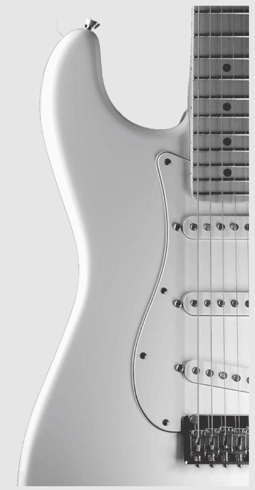

芬达 Stratocaster 诞生记

二战期间，里奥·芬达在加州富勒顿开了一家无线电维修铺。经过一段时间的扩音器研发和电吉他实验，他造出了第一把电吉他 Esquire。1951 年紧接着推出了 Telecaster，这款琴拥有活泼“古怪”的个性化音色。芬达有一位热爱线条的搭档弗雷迪·塔瓦雷斯。1954 年在 Telecaster 基础上，塔瓦雷斯为 Stratocaster 赋予了大胆、永恒且流畅的外形。

令人意外的是，里奥·芬达并非吉他手，而是一名工程师。在他的带领下，公司推出了大量深受欢迎的吉他与贝斯，其音色永久改变了音乐世界。

#### 1956 年：磁带录像机问世
战后人们开始尝试用磁带记录电视信号，但那时的设备已逼近极限，磁带必须以每秒 610 厘米的速度运转才能捕捉高频。查尔斯·金斯堡认为可以做得更好。他的新机器能在不高速运转的前提下达到同等效果，设备也不再需要冒烟般的运转。

1956 年，Ampex VRX-1000 磁带录像机面世，从此改写电视业。节目不再只能直播，延时拍摄成为可能，剪辑也变得轻松。

#### 1956 年：超声波迈向医学
格拉斯哥大学的产科教授伊恩·唐纳德在当地造船厂注意到，工人用超声波检测船体厚壁的缺陷。原理是把超出人耳范围的声波射向物体表面，再捕捉反射波并转成电信号形成图像。

1956 年，唐纳德与工程师汤姆·布朗开始探讨这项技术能否用于医疗。初期实验证明可行，两年后他们公开了成果，医学超声检查由此正式起步。

#### 1957 年：首台可编程机器人诞生
第一个机器人的故事并非始于车间，而始于 1956 年的一场鸡尾酒会。发明家乔治·德沃尔与痴迷科幻的商人约瑟夫·恩格尔伯格相遇。德沃尔向他展示了刚发明的“程序化物件转移”装置，恩格尔伯格立刻兴奋起来。专利里称其为“能够实现全功能机器发明、适用于需要循环数字控制的多种场景”，本质上是一只可编程、可操控的机械臂。

德沃尔还涉足过多种奇思妙想，包括最早的微波产品之一“Speedy Weeny”，能自动烹饪并分发热狗。

两人共同创造了 Unimate——通用自动化的缩写，它是第一台真正的现代化、数字化、可编程、可教学的机器人。

1959 年商用机器人首次出现，很快在通用汽车的汽车厂投入使用。很快美日汽车制造商都尝到了自动化的甜头。1966 年，恩格尔伯格携机器人登上《今夜秀》，它能倒饮料、搬运物品，公众的想象力被彻底点燃。如今，机械臂已成为全球众多行业的标配。

## 1957 年：首张数码照片的婴儿影像
1957 年，美国国家标准局的研究员拉塞尔·基尔希可以使用 SEAC，这台标准电子自动计算机是美国为数不多的可编程主机之一，庞大无比，时钟 1 兆赫，运算速度大约只有智能手机的 2800 分之一。负责计算机成像研究的基尔希想验证电脑能否复制图像，便扫描了他儿子 5 厘米见方的照片，并将其转为二进制编码。结果得到了一幅 176 像素的黑白婴儿图，不经意间开创了历史。20 年后数码照片和数码相机才问世，如今几乎所有照片都是电子形态。

## 1957 年：人造卫星如沙滩球升空
1957 年 10 月 4 日，人类首次把人造天体送入太空，苏联的“斯普特尼克 1 号”成为第一颗轨道卫星，每 96 分钟绕地球一圈。虽然它只有沙滩球大小，重 83 公斤，发射成功仍震惊世界。有趣的是，苏联原本计划发射一颗重达 1400 公斤、搭载多种仪器的庞大航天器，但大型飞船研制缓慢，项目负责人担心被美国超越，最后改用一颗银色金属沙滩球先行升空。任务极短，仅发送了 22 天无线电信号，便于 1958 年初在大气层中烧毁。

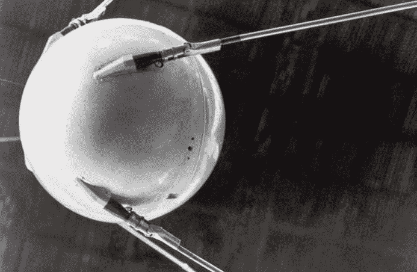

斯普特尼克 1 号

此次发射促使美国成立了 NASA 和 DARPA，掀开了太空竞赛的序幕。随后“斯普特尼克 1 号”催生了阿帕网 ARPENT，为今天的互联网埋下种子，也间接加速了与互联网息息相关的数字调制解调器的发明。

## 1958 年：数字调制解modem初现
调制解调器的雏形源于用电线连接打字机的需求。1943 年，IBM 用该技术以每秒 25 比特、约每秒 3 个字母的速度传输打孔数据，速度可谓龟速。

斯普特尼克发射一年后，美国防空系统需要让各地计算机终端互传信息。经考察后与 AT&T 签约，1958 年 AT&T 推出了连接美国与加拿大终端的数字调制解调器，速率 110 比特每秒。

这意味着：
◇ 加载一个 500KB 的普通网页 needs 15 小时
◇ 下载一首高质量 MP3 近需两周
◇ 下载一段 5 分钟 1080p 的 YouTube 视频约需两个半月

想象一下点击后要等两个半月才能观看，再也不该为现在的网速抱怨了。1962 年 AT&T 发布首款商用调制解调器，速度是 1958 年的 3 倍，算得上进步。

## 1958 年：首款图形电子游戏亮相
对很多人而言电子游戏一直都在：从经典街机到主机与虚拟现实。但鲜为人知的是，电子游戏可追溯到 50 年代末，物理学家威廉·辛吉勃森的智慧结晶。

战时辛吉勃森研究雷达阴极射线管显示器和原子弹电子计时系统，战后进入布鲁克黑文国家实验室仪器组。

布鲁克黑文每年开放日吸引成千上万公众。辛吉勃森负责展览策划，发现许多展品极其枯燥，像是来看油漆干。于是他想做一个互动游戏，让公众直观感受到科研与社会的联系。

为此他搜罗零件，找到一台能显示轨迹弯曲的模拟计算机，类似示波器上的弹跳球图形。凭战时雷达显示经验，几天内他就做出一款游戏：一个侧视网球场，简单却可玩，由地面线和球网线构成，命名为“双人网球”。操作也很直观，一个旋钮调节击球角度，一个按钮发射球。

1958 年 10 月首批访客被吸引，围在机器旁。发明很受欢迎，但辛吉勃森并未深思，也没想到电子游戏后来会如此风靡。他说：“我没想到大家会这么兴奋，可能只是因为其他展品太无聊了。”如今游戏产业年收入约 1100 亿美元，也许正是他太过谦虚。

### 推动社会变革的力量
正如所见，50 年代几乎每年都有突破性发明。为本章收尾，我们来看三项改变社会的创新：便携音乐、集成电路与电视。

## 索尼传奇的起点
此前提到，AT&T 贝尔实验室三人曾发明晶体管，但直到新成立的索尼掌舵者盛田昭夫与井深大偶然发现它后才被重视。他们看出其放大声音的潜力，决定改进并量产。索尼曾尝试在战后萧条的日本本地销售录音机，效果平平。晶体管最初的应用是让收音机变小。

当时的真空管收音机多为木制大柜，占据客厅不少空间。晶体管收音机更省电、体积更小。不过盛田与井深并不孤单，1954 年美国 Regency 打败索尼推出 TR-01 便携晶体管收音机，售价 50 美元，约合今日 460 美元，是真空管机的三倍之多。这是一场声音革命，消费者不再等待漫长预热，也能随身携带。

尽管很受欢迎，高昂成本让制造商难以盈利。美国军方甚至愿为优质晶体管组件支付 100 美元，约合今日 920 美元。各大美国公司宁愿放弃消费市场转投军工。因此，低价生产晶体管收音机的厂商获得了市场。索尼抓住了机会，盛田与井深致力于提升晶体管的经济可行性。Regency TR-01 上市一年后，索尼便推出经济型晶体管收音机。

1955 年 4 月井深大带机赴美，多家潜在合作伙伴反应冷淡，直到遇见宝路华手表制造商。宝路华看懂了索尼的产品，下单 10 万台，订单金额超过当时索尼公司总值。但宝路华要求印上自家品牌，井深大拒绝并终止交易。他后来称这是自己最重要的商业决定。

回到日本后，井深大决定重来。索尼只需一个购买动机，于是提出“口袋收音机”的营销概念，让人意识到其革命性。问题是普通衬衫口袋装不下。

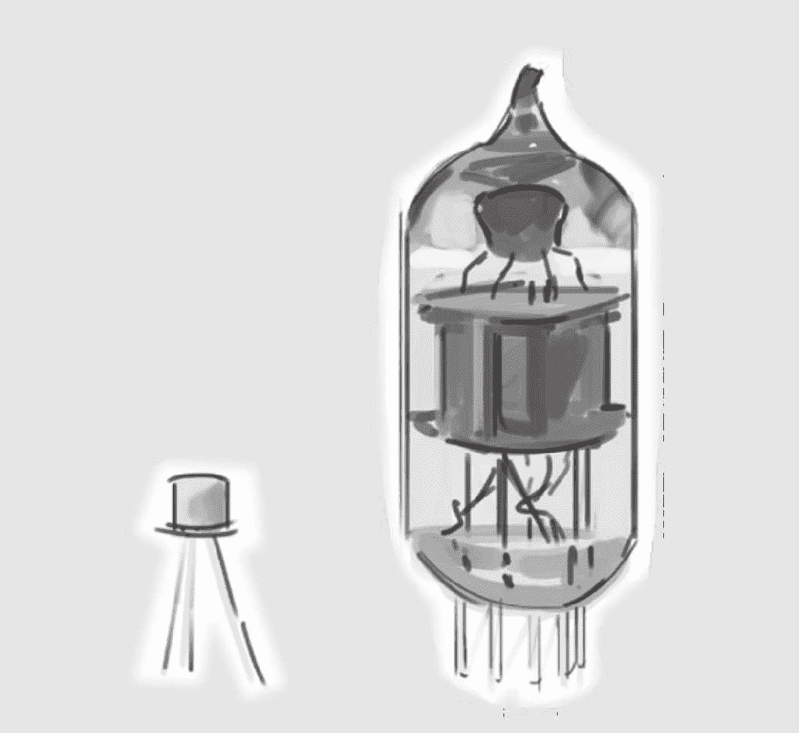

微型晶体管对比笨重真空管

解决方案是把销售团队的衬衫口袋做大，刚好能放下收音机。这招成功了。随后美国商店老板纷纷排队购买索尼收音机，型号被命名为 TR-55。短短五年，索尼从 7 名员工扩张到 500 多人，开启了索尼传奇与便携音乐新时代，比 Walkman、iPod 和手机早了许多。

有了收音机，孩子们第一次能在不被父母干扰的情况下独自听音乐。新的自由也改变了部分电台的音乐风格，使其更前卫、大胆、露骨，新声音点燃了摇滚时代。这是晶体管首次对社会产生直接影响，之后影响只增不减。

## 集成电路：现代计算的入口
晶体管在收音机上大放异彩，但在计算机上受限。若能在极小空间里塞入足够晶体管就能实现可观算力，难点在于晶体管能做多小。晶体管需用导线互联，一旦过小稳定性难以保证，科学家希望把整块电路压缩在一起。若能制造微型电路，所有部件可更小且批量生产。

答案是集成电路。科学家设想用化学蚀刻工艺代替导线连接晶体管，这是一次巨大飞跃，如今几乎所有电子产品都依赖它。

故事始于 AT&T 贝尔实验室的梦之队。1950 年约翰·巴丁与沃尔特·布拉顿受不了比尔·肖克利，团队分裂。1951 年巴丁忍无可忍退出贝尔实验室，梦之队解散。

到 1955 年肖克利在贝尔实验室声誉日差，决心自立门户，目标是创造改良晶体管。无人愿与他合作，沮丧的肖克利关掉公司，从东海岸搬到加州帕洛阿尔托，希望避开争议过去招募“新手”。

当时在加州建技术公司很反常，因 IBM、雷神、通用电气等大公司总部都在东海岸。肖克利西迁部分因家庭，更关键的是斯坦福愿意提供廉价土地吸引科技公司西进。

1957 年他创立低调的肖克利半导体实验室。尽管性格古怪，他很会招揽人才，招到一批不了解他过往的年轻人，组建了一个后来称作“叛逆八人帮”的团队。

### 八叛逆的崛起
肖克利半导体实验室汇聚了日后硅谷奠基人：希尔顿·罗伯茨、尤金·克莱纳、维克多·格里尼奇、杰伊·拉斯特、朱利叶斯·布兰克、罗伯特·诺伊斯、戈登·摩尔、吉恩·赫尔尼。

1957 年 6 月，八人于旧金山一家旅馆秘密会面。在肖克利手下他们感受到日益偏执的压抑，像在 AT&T 时一样担心分不到发明成果。他们轮流在一张一美元钞票上签名，象征决心离开肖克利另起炉灶，也因此得名“叛逆八人帮”。

新公司由麻省理工杰出研究员罗伯特·诺伊斯领导。他本犹豫接手，因刚组建家庭，而 50 年代创业风险极高。最终诺伊斯在钞票上签字，诞生了仙童半导体公司。

### 硅谷传说
《纽约时报》把旧金山酒店那一天评为改变人类历史的十天之一。仙童半导体体现了硅谷精髓：风险高于稳定、创新而非守旧、快速试验优于缓慢增长。得到资金支持后，团队以硅半导体造出世界首个可用的集成电路，让晶片上紧密排列的晶体管独立运作。集成电路是所有芯片的基本单元，引发电子革命，为今日技术打开大门。

史蒂夫·乔布斯 2005 年说，在硅谷工作像接力赛，仙童把接力棒传给他，他开启了个人电脑时代。

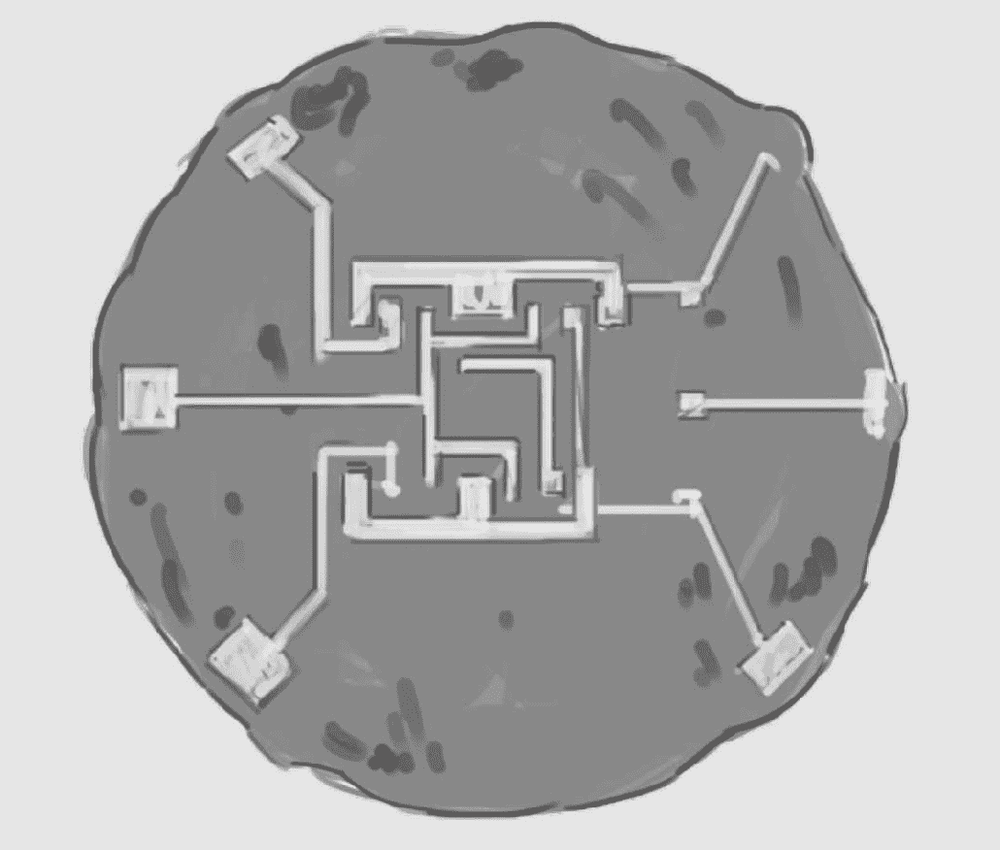

早期集成电路：用化学蚀刻而非导线连接晶体管

仙童的叛逆八人帮让现代智能手机比登月时代的计算机强大 1.2 亿多倍。

### 摩尔定律
仙童的戈登·摩尔于 1965 年预测：“芯片可容纳的晶体管数量每 18 个月翻一番。”后称摩尔定律，并非源于计算而是行业预判，令人惊讶的是它长期成立。

戈登·摩尔因其他事也出名，1968 年他与诺伊斯共同创立英特尔。最终贝尔实验室的梦之队也在 1956 年得到慰藉，肖克利、巴丁、布拉顿共同获诺贝尔物理学奖。

## 电视的兴起
40 年代电视尚属罕见。在英国它是富人的新奇物，一台电视约等于一周工资七倍。在美国所有节目均为现场直播，NBC、CBS、ABC 三大网络都在纽约拍摄，按今天标准制作极简：调好摄像机、开机拍摄，再把 16 毫米胶片运往全国播出。

到 1950 年美国约有 440 万家庭拥有电视。AT&T 铺设了横贯全美的同轴电缆网络，信号可达大部分农村。随后美国实现首次声画同步，全国共享新闻、热门节目与体育赛事，英国、欧洲、日本也同步变革。

1953 年彩色电视问世，巧合的是“电视餐”盒装冷冻快餐也在同年诞生。电视逐渐流行。

经典电视像个盒子，常置于大木柜中，屏幕为圆形。相比今日 50 英寸平面屏，那时屏幕袖珍。

看电影的人骤减，收音机听众也下降。尽管 50 年代已有电视节目，直到 60 年代越南战争与登月等震撼事件全球播出，电视才真正成为文化塑造者。它改变了我们观看世界的方式与速度。例如肯尼迪遇刺消息在一小时内传遍全美 90% 地区，主要靠现场直播。无论好坏，世界从此紧密相连。

### 第九章 和平年代，互联网的种子（1960—1969）
20世纪60年代充斥着崭新的思维方式、创新性的观点、前卫的服饰以及新生的音乐形式——而这一切都起源于婴儿潮一代。

1960s：叛逆觉醒与星空初启

战后出生的婴儿潮在六十年代步入青年期。五十年代奉为圭臬的生活准则，被一股骤然冒头的叛逆意识冲散。这个庞大群体因此被贴上“青少年”的新标签。与此同时，经济面给他们极强的底气。六十年代的年轻人享受到的购买力远超预期，21岁以下人群的收入达到战前同龄人十倍。青少年消费开始推动经济增长，这十年诞生的企业印证了时代的富足：达美乐比萨、慧俪轻体和赛百味都源于此期。服饰转向自我表达，规整的假领和棒球夹克让位给大胆前卫的款式。鲍勃·迪伦、滚石乐队和披头士成为这一代的声音。

1954至1965年，美国中学在校生数量翻了一番，日本与英国亦相近。对不少家庭而言，子女进入大学是全新的第一次。

科技层面，晶体管与集成电路的突破把电脑体型压缩到可用范围。硅谷走向成熟，风险投资应运而生。协和式飞机问世，成为首架超音速客机。盒式磁带出现，光盘的雏形悄然埋下。这是变革频发的十年。

## 太空第一人（1961 年）

苏联把斯普特尼克1号送上天后震惊世界，却未止步。1961年4月12日，27岁的苏联宇航员尤里·加加林搭乘东方1号进入轨道，成为首位进入太空的人。

东方1号绕地仅89分钟，最高高度约203英里即327千米，全程自动控制。飞船本质上像个容纳一人的人形炮弹。飞行中加加林沉默，唯一传回的话是“飞行正常，我很好”。这并非冷淡，而是他当时以约2.9万千米/时的速度飞行，相当于每秒8千米。

如当年首飞跨大西洋的查尔斯·林德伯格，加加林一夜成名。在苏联他被抬上神坛，纪念碑林立，街名改作他名。

美国先机尽失，几乎被迎头痛击。更尴尬的是，美国原计划把首次载人飞行定在1961年5月，只晚加加林一个月。1961年8月，盖尔曼·蒂托夫乘东方2号升空，绕地17圈，累计飞行超25小时，美国再受打击。

直到1962年2月，约翰·格伦搭乘友谊7号绕地三圈，美国迟来的首次载人飞行才完成。肯尼迪随即宣布十年内登月。

在苏联，征服太空被视作共产主义优于资本主义的证明。但内部人士清楚，真正的功臣是谢尔盖·帕夫洛维奇·科罗廖夫，这位实至名归的思想家。直至1966年去世，他在西方乃至苏联都鲜为人知。

1933年科罗廖夫参与发射苏联首枚液体火箭。五年后斯大林大清洗，他与同事受审，因通敌叛国罪入劳改营。二次大战中苏联意识到德国火箭威胁，科罗廖夫被召回效力。

1945年战后，他被派往德国研究纳粹V-2火箭。苏联并非唯一学习德国经验者，美国也早已锁定目标，并最终让V-2设计师成为美国航天项目带头人。苏联人则想尽办法获取火箭、图纸和德国技术人员。到1954年，科罗廖夫已造出可载五吨核弹头的火箭。1957年，苏联首枚洲际弹道导弹发射成功。

科罗廖夫眼光更远，指向斯普特尼克1号那颗大铁球。它的成功标志苏联在太空竞赛的首胜。在他带领下，苏联在六十年代初无人能及。零的突破包括：首次动物绕地飞行；首枚大型科学卫星；首位男性宇航员；首位女性宇航员；首次三人乘组；首次太空行走；首艘撞月器；首艘绕月器；首艘撞击金星器；首艘月球软着陆器。

即便成绩斐然，外界只知他“总设计师”的神秘头衔。1966年科罗廖夫逝世，安葬于克里姆林宫墓园，获苏联英雄称号。

## 首位宇航员的奇闻怪事

1968年3月27日，太空飞行七年后，加加林清晨起床前往契卡洛夫斯基机场，打算重返飞行训练成为战斗机飞行员。原计划驾驶米格-15试飞，最终未实现。

当日天气恶劣，风雨突至。清晨加加林发现忘带证件，自言不祥之兆。尽管条件糟糕，他仍顺利起飞。训练结束后，他通过对讲机告知基地即将返航。这是所有人最后一次听到他的声音。

数小时后救援队发现飞机燃烧残骸。人们希望他弹射逃生，第二天遗体被找到后希望破灭。苏联调查未得出定论，普遍说法是加加林为躲避物体如飞鸟或气象气球紧急转向，导致失控。

另有传言称他酒后开飞机兜风。加加林酗酒史广为人知。乡村出身的他被推上全球偶像，压力巨大，收到成千上万来信，逐渐酗酒并沉迷冒险。

也有说法称他是美国中情局间谍身份暴露被下毒，或是空难中幸存改名隐居，甚至为躲避不明飞行物坠毁。真相如何？

幸运的是，2013年真相最终澄清。当时另一架体型更大的苏霍伊Su-15进入米格-15空域，加加林被迫闪避而坠毁。一场平常的飞行失误酿成悲剧。苏联当局与空管部门羞愧难当，才长期隐瞒。

## 首款数字电子游戏（1961 年）

威廉·辛吉勃森用“双人网球”为展览添彩的故事人所共知，虽然标志电子游戏诞生，媒介形式尚未突破。

晶体管小型化让电脑体积缩小，于是小型计算机出现。它们不仅体积小，使用范围也更广，不再仅限计算记录。

尽管技术飞跃，游戏产业仍未形成。当时游戏多为特定目的设计，只能运行在单一设备上，人们尚未意识到软件可在多台设备间通用。

转机在1961年，麻省理工购入美国数字设备公司的PDP-1小型机。PDP-1采用矢量显示，晶体管处理速度达5兆赫，即每秒500万次转换，约为现代智能手机的五百分之一，但在当时已很强劲。机体由“系统构件”晶体管板组装。

因体积小速度快，麻省理工的学生和职工常在业余时间用它编非学术程序。1961至1962年间，哈佛与麻省理工的马丁·格雷茨、史蒂夫·拉塞尔和韦恩·维塔宁在PDP-1上开发出《太空大战》。

这是双人对战太空游戏，初衷是榨干PDP-1潜力。在硬件受限下运行却异常流畅。

《太空大战》后来被拷贝到美国其他大学的小型机，成为首个能在多地运行的电子游戏。但并未真正流行。PDP-1售价12万美元，按今值近百万，仅卖出55台。

游戏渐为人知，此后各校程序员开始自研推广。下一章会继续讲述电子游戏如何跃入主流。

## 互联网和万维网的种子（1962 年）

互联网与万维网的种子其实更早种下。范内瓦·布什，这位二战军方科学领袖、工程师和思想家，被视作信息时代开创者。直到21世纪第二个十年，随着互联网发展，他声誉才大增。

布什创办雷神公司，并在二战期间领导三万余名科学家、工程师和高阶军官开展研究。他权力极大，只对总统负责，约三分之二的美国物理学家为他工作。

### 范内瓦·布什：信息时代之父

布什是极具影响力的人物之一，他启发了现代生活的诸多核心技术，后续许多新技术都基于他的构想。组织庞大科研团队时，他意识到缺乏有效分类记录信息的方法。若战后伟大发现被埋没于海量出版物，灾难难免。1945年文章《诚如所思》中，他设想一台像大脑一样靠联想关联信息的机器。

该设备命名为麦克斯存储器，取自记忆延伸。最初设定为通用图书馆，与台式电脑惊人相似。科研信息以微缩胶卷保存，放大后投至显示器。研究者可要求系统发送关联信息。

例如，研究者用麦克斯存储器阅读一篇论文，就能调阅所有相关图片与研究。

当时信息无法在多台麦克斯存储器间数字传输，只能靠邮寄。如同点击维基百科一篇文章，然后等链接内容像信件送到门口。

用现代语言概括要点：

邮政服务由**互联网**承担；

在麦克斯存储器索取信息的能力由**万维网**实现；

关联信息的概念即今天的**超链接**。

布什相信这将带来信息爆炸继而知识爆炸，他判断准确。

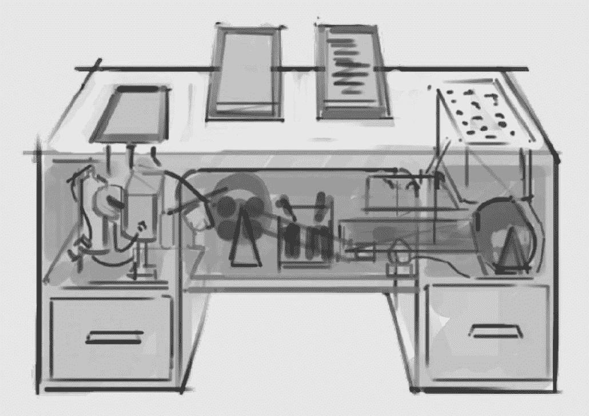

麦克斯存储器

本质上布什早45年构想出万维网。直到1990年万维网才真正诞生。布什虽未亲眼见证，但每个设想都成真，甚至超出预期。他是20世纪最具远见者之一。

### 绘制蓝图

布什已构想互联网，但直到六十年代技术才允许实现。

1962年8月，受布什研究启发，心理与行为科学家约瑟夫·利克莱德开始绘制互联网蓝图。当时他在DARPA担任行为科学、指挥与控制研究主任。DARPA创建于斯普特尼克1号发射一年后。

六十年代初，DARPA仍人工处理研究，效率低下。例如麻省理工向达特茅斯传数据，需派人坐火车送穿孔卡，往返需两三小时，相比之下下载慢已不算问题。

信息传递速度成为紧迫需求，尤其苏联已两次进入太空。利克莱德提出计算机间需直接对话。1962年他撰写《人机共生》，提出机器识别独立于人类认知的观点，涉及“思维中心”概念，为网络发展奠基。

1964年他开始描绘“互联”愿景。1967年他描述“未来图书馆”，把全世界书籍囊括线上供人取阅。

他还设想线上协作，无论身处何地都能沟通共享信息。他写道：

计算机交流网络独特之处在于，不仅不同地理位置同事可随时沟通，而且他们能实时与工作信息库交流。建成蓝图无需打印分发全国，可直接显示在每个人屏幕内。这必将对所有计划、组织与执行方式带来翻天覆地变化。

他还设想银行系统：

若能电子方式处理一切，身份信息集中在可插入机器的塑料小卡上，我可以想象供应商会希望你通过银行账户付款……这就需要网络。

利克莱德不仅有粗略概念，他已能具体想象终端形态。

尽管1964年离职DARPA，他把愿景传给继任者。随着阿帕网引入，早期互联网于1969年诞生。阿帕网让加州大学洛杉矶分校与斯坦福大学终端间实现信息交流，是现代互联网雏形。

首条传输信息为“Lo-”。原计划发送“Login”，但在g前系统崩溃。时刻仍标志新时代开始。阿帕网在下个十年不断扩展，使全美计算机互联。

### 首个交互式图形程序（1963 年）

技术突飞猛进。五十年代后期电脑只是冰冷数字计算器。1963年，麻省理工毕业生伊凡·苏泽兰读到布什1945年的《诚如所思》，文中描述麦克斯存储器。受启发，他提出能否实现人与电脑的“对话”，且不是文字或语言，而是绘画？这一疑问催生几何画板。

这是一个交互绘图程序，用户用光笔绘图并按屏幕旁按键。几何画板首次实现电脑绘图，推动计算机辅助绘图诞生。惊人的是所有功能运行在内存约272KB的1958年电脑上，配9英寸示波仪显示器。这是奠定今日图形用户界面基础的突破。

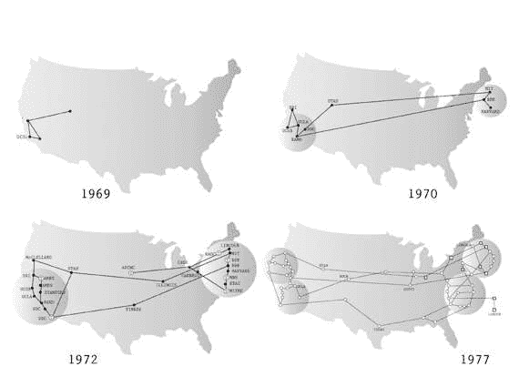

阿帕网的发展

别忘了当时电脑靠穿孔卡或穿孔带输入，输出只有嘟嘟声、打印件或闪烁灯光。在此条件下，用触笔实时处理图形对象，革新性可想而知，近乎魔术。电脑先驱阿伦·凯曾问苏泽兰：“你怎能在同一年设计出首个交互图形程序、首个非程序性编程语言和首个面向对象软件系统？”苏泽兰答：“我当时完全不知道这很难。”

有趣的是，伊凡·苏泽兰恰是艾德·卡姆尔的导师。1972年卡姆尔创作首部计算机动画电影，后创立皮克斯，下一章详述。

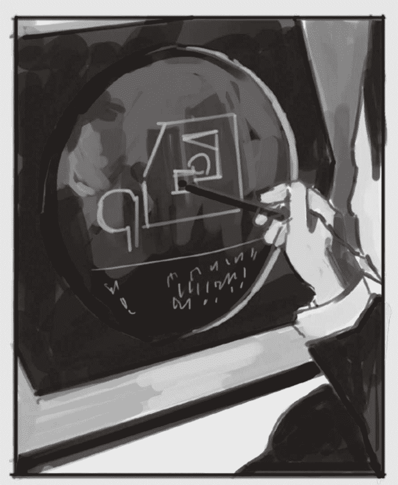

几何画板是第一个图形交互式计算机程序

### 将计算机普及给每一个人：`BASIC`（1964 年）

六十年代，外行眼中电脑代码一团乱麻。但1964年一切开始改观。当年达特茅斯学院两名教授引入一种代码语言，设计初衷是足够简单人人可用，被称作初学者通用符号指令代码，即BASIC。

BASIC之前，电脑程序设定与使用复杂到极致。早期大型机在组装阶段就完成程序设定，如同宜家成套家具，只是你需掌握代码以实现部件协同。事实上只有专业科学家和数学家愿意学习代码，也就成为唯一使用者。尽管编程仍需技术，BASIC大幅简化流程。

达特茅斯数学与计算机科学教授约翰·凯梅尼和托马斯·库尔茨等创始人希望降低代码门槛。

核心思路：为何不用大多数人能直接理解的日常用语？例如用HELLO和GOODBYE替代LOGON和LOGOFF。更关键的是BASIC具备编译器功能。编译器把人类可读文字转为电脑可理解的1和0。过去用户需手动敲入穿孔机得到穿孔卡，再等电脑逐行翻译，可能耗时一整天。现在用户只需用通俗英语键入指令，BASIC立即完成转换。让一切变得简单快捷，取代了耗时费力的手动输入。

#### 比尔·盖茨与`BASIC`的不解之缘

# 从终端到芯片的少年时代

盖茨是把 `BASIC` 当成武器去探索的第一批玩家之一。他出生在西雅图上层家庭，父亲执业律师，母亲在第一洲际银行与联合之路担任董事。家里竞争氛围浓厚，小时候他就沉迷于策略桌游《大战役》`Risk`，喜欢抢占制高点，这种好胜心贯穿后来的所有选择。

十二岁上下，父母开始担心。他学习成绩很好，却常把时间泡在书籍里，被认为性格偏内向。真正拐点的年份是 1968。

那年十三岁的他就读于湖滨高中，学校与通用电气签署了分时租用协议，按时段付费使用 GE 的主机，学生只能通过终端看到结果。六十年代的机器体积庞大价格高昂，普通人几乎没有接触机会，对湖滨而言算是稀缺资源。

盖茨沉迷于在 GE 主机上用 `BASIC` 写程序。他后来回忆，机器每次都能精准执行代码的可靠性让他着迷，数学课也被老师破例允许用来编程。第一件作品是人机对战的井字棋，从此他感觉自己被某种召唤锁定。

不久学校因经费问题取消与 GE 的合作。盖茨和新认识的编程伙伴去寻找下一台可用机器，最后找到计算机中心公司 CCC 的 `PDP-10`。一开始 CCC 很欢迎，直到发现盖茨、保罗·艾伦、里克·韦兰和肯特·埃文斯四人用代码漏洞窃取免费时长，暑假期间被禁止使用。解禁后双方谈妥条件：给予更多时长，换取他们修复漏洞。这项协定一直维持到 1970 年公司倒闭。

盖茨的故事并未结束。下一章会看到他与艾伦以 `BASIC` 创立微软，为个人电脑时代奠基，也间接构成了苹果诞生的土壤。

与此同时，计算机的想象被重塑之际，精神病学也在经历一次内部重构。导火索是六十年代从实验室流出的臭名昭著化学品——麦角酸二乙胺，也就是人们熟知的 `LSD`。

## LSD 如何改写大脑认知（1964）

没有任何一种化合物像 `LSD` 那样彻底改变我们对大脑的认识。以它为核心的十年变革定义了一整代人。

麦角酸二乙胺的线索可以追溯到两千多年前的古希腊。传统记载里，人们会前往神秘之地朝圣，饮用由患病谷物上的麦角发酵的饮料，其中含有与 `LSD` 相似的成分。史家推测这或许影响了古希腊思想家的体验。

进入现代社会，它在四十年代初浮现。1943 年瑞士化学家艾伯特·霍夫曼意外合成该物质。本想用麦角真菌制成促进血流的兴奋剂，不慎接触到口中。随后十二小时惊险异常，他记录说说话都费劲，请助手陪回家，路上视野摇晃扭曲像曲面镜，总觉得走不掉，而助手说其实走得很冲。在家更可怕，房间旋转，熟悉家具活过来般不断蠕动。

霍夫曼相信这是研究大脑的强力工具。他所在的山德士制药公司随即开始生产。

`LSD`

serotonin

伦敦圣乔治医院精神科医生汉弗莱·奥斯蒙德与约翰·斯迈西斯得知此发现后，用它研究精神分裂症等疾病。他们给健康受试者服用并观察反应。一种药物能诱发类精神分裂症状的事实，对医学界是震动。药理学家戴维·尼科尔斯认为这正是神经科学的起点。

奥斯蒙德和斯迈西斯注意到麦角酸二乙胺的结构与神经递质血清素极像。相似形态是否干扰了血清素？这一灵感促成结论：精神问题源于脑内化学失衡。该观点至今仍具影响，例如氟西汀等抗抑郁药正是作用于血清素受体，直接承袭自早期的 `LSD` 研究。此后精神病学家逐渐放弃精神分析，转向基于脑化学的疾病模型。

研究早期的博士生戴维·E·尼科尔斯回忆：那时主流学界仍不承认行为与神经化学有关，反而把精神分裂的孩子归咎于母亲养育不当或营养不足。父母尤其是女性被迫背负罪责，今天看来匪夷所思，却是当时的主流。

1954 年英国作家阿道司·赫胥黎自愿参与奥斯蒙德实验，被效果震撼后鼓励更多人尝试。他写下《知觉之门》，书中想法广泛传播，连美国中情局和苏联都关注。

## 迷幻物落入权力与娱乐

苏联和美国军方读完《知觉之门》后，都想把这种化学物制成吐真剂用于战争。试验很快展开，结果令人失望，药效难以控制，受试者无法集中回答问题。美国随即另起念头，或许能让敌方领导人在公开场合出丑，于是策划在大型活动前把药偷入茶或咖啡。

特工为测试此想法在办公室暗中给同事的杯子里下药。一次实验后特工弗兰克·奥尔森死亡，死因被归为实验创伤后药物持续作用。此事证实 `LSD` 强大且危险。2017 年奈飞剧集《苦艾草》再现了死亡疑云。

与此同时好莱坞治疗师开始用 `LSD` 帮助演员和名人解决问题。

## 学术理想在街头失控

哈佛讲师蒂莫西·利里 1962 年起接触 `LSD`，立志借此改变美国政治宗教文化。其他研究者担忧，要求药物只在严格控制下用于科研。尽管同事多次抗议，利里仍坚持宣传，吸引大批年轻人。1963 年被哈佛解雇后，他从学者变为散发传教气质的人物，口号是“内向探索，激发热情，脱离体制”。这与当时的反主流文化强烈共鸣。

西海岸斯坦福学生、后来的作家肯·凯西听说此事后参加了中情局资助的 `LSD` 试验。试验后他进入精神科病房工作，轮班时注射了机构存药。经历启发他创作经典小说《飞越疯人院》。如利里般，凯西在西海岸推广 `LSD`，召集朋友开着彩绘巴士在旧金山湾区散发药物，足迹后遍及全国。

在凯西等人推动下，`LSD` 在美国东西海岸爆炸式扩散。时机恰好，婴儿潮一代到 1964 年刚满 19 岁，渴望发声又质疑一切，成为反主流文化代表。

发现者艾伯特·霍夫曼眼睁睁看着这一切，束手无策。他称其为“问题儿童”。1966 年 10 月 6 日加州率先将 `LSD` 定为非法，反而提升魅力。大门、披头士、滚石、Grateful Dead 等乐队暗中传播信息，把 `LSD` 重新禁锢在实验室比登天还难。

1967 年“爱之夏”爆发，十万人涌入旧金山海特-阿什伯里区，媒体跟进，穿奇装异服的嬉皮士让保守美国人瞠目。1968 年 `LSD` 在全美五十州非法化。1969 年伍德斯托克，威维·格雷在台上警告人群不要服用棕色阿西德。那时 `LSD` 的阴暗面已显：旧金山出现儿童离家失踪，滥用者永久性损伤甚至死亡。霍夫曼早早抽身于六十年代纷扰，102 岁离世。

### 与海特-阿什伯里仅隔几条街的另一场演示

距离反主流文化摇篮仅几个街区，另一场同样激荡的事件正在发生。1968 年 12 月 18 日，在格雷厄姆市政礼堂，道格拉斯·恩格尔巴特准备展示电脑的未来，被后世称为“所有演示之母”。

此前伊万·苏泽兰的光笔绘画系统 Sketchpad，以及布什的 `Memex` 设备，给恩格尔巴特启发。他思考人机交互的新可能：电脑能否成为私人助理、计划者、交流辅助？操作能否简单到人人无师自通？

#### 1968 年改变交互的母演示

一部雪花黑白电影记录了这次演示，至今仍值得观看。开场后恩格尔巴特问大家：想想办公室白领，若有一台带显示器的电脑全天开机，随时可用，能获益多少？

在盖茨、微软、施乐之前，恩格尔巴特早已提出此想。1968 年他不仅提出图形个人电脑概念，还现场演示。

他先打开空白文档打字，那时虽是新发明却不算突破。随后不同了，他用鼠标复制粘贴词句，再展示排版。这是鼠标首次应用，也用于最早的文字处理程序之一。

他把文字存成文件，点击右键执行类似查看属性的指令。随后出现购物清单，他分类，点击打开某类，并演示多种编辑方式。

接着通过“链接跳转”浏览清单项的细节，本质上是超文本，与我们今天的超链接相似。

恩格尔巴特还说团队已使用该系统数月，并把六台电脑连成闭环内联网，与后来的阿帕网开放互联网相对。他甚至演示了电脑间发邮件，而阿帕网要一年后才诞生。

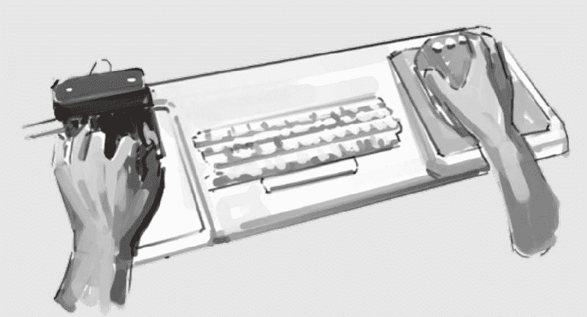

恩格尔巴特的演示是现代意义上第一次对鼠标、键盘和图形化界面的应用

对 1968 年而言石破天惊。单一个创新足以惊人，他却连番累积，名副其实母演示。

恩格尔巴特创造了鼠标、超文本、屏幕窗口等现代软件特征。范内瓦·布什功不可没，他意识到电脑不仅能算数，还应成为信息管理工具。直到九十年代中期，人们才真正认识到图形化联网电脑的重要性。

图形电脑起步稍慢，但很快发展会加速，变得更快更小。

#### 英特尔诞生：一颗芯片装下整机 1968

上章提过仙童半导体与“叛逆八人帮”，集成电路让仙童领先 IBM 与摩托罗拉。

尽管仙童是硅谷明星，每年仍有新公司成立。员工喜欢罗伯特·诺伊斯打造的文化，淡化管理与员工界限，人人是团队一员，大家愿意工作十到十二小时，只因享受过程。

起初像精英大学宿舍，竞争高薪。仙童迅速崛起，如今的亚马逊、苹果、谷歌之流。很快人才过多，能力无法施展。1962 年仙童开始瓦解。

半数创始团队和大量工程师离职创业，多为仙童直接竞争对手。随前员工扩散知识，硅谷爆发式成长，他们被称为“仙童之子”。到八十年代上百家公司出自仙童人才库。即使动荡，仙童仍有佳绩，1964 年一年向 NASA 交付十万台设备。诺伊斯目光更远，看向美国消费者。

硅谷创意聚集，风险资本应运而生。随着人才流失，德州仪器和摩托罗拉迎头赶上。诺伊斯决定再创业。1968 年他与戈登·摩尔启动存储芯片项目，以抗衡磁盘驱动器。凭声望与新兴风险投资商，项目两天内筹得 250 万美元，促成新公司成立。

诺伊斯和摩尔挑选顶尖人才，包括安迪·格洛夫，这位匈牙利出生的化学工程师 1963 年在仙童研发部门工作，后任运营总监。老员工认为聘用他是诺伊斯最明智决定，他干劲十足、追求完美、时间观念强，诺伊斯和摩尔缺少这种鞭策力。

公司命名为英特尔 `Intel`，源自集成电子 integrated electronics，也暗含智慧 intelligence。媒体关注有限，硅谷却欢欣鼓舞。

1969 年春，英特尔工程师仍在钻研存储芯片时，一个简单要求改变了电脑历史。

#### 微处理器如何成为电脑大脑

日本公司比吉康与英特尔签约，请其为新计算器设计专用微芯片。但要求太复杂昂贵，英特尔无法生产。年轻工程师特德·霍夫最先提出顾虑，认为有些逞能。

霍夫聪颖，六十年代初在斯坦福研究模式识别即神经网络和集成电路，1968 年以第十二号员工加入英特尔。向诺伊斯说明后，诺伊斯反问他能否设计更简化的方案。诺伊斯一向鼓励大胆设想。

于是霍夫构想出可编程单一芯片，能实现特定应用。例子是计算器，但换程序可做任何事。若架构足够简，电脑的存储、计算、处理功能可统一于集成电路。

一番努力后，他们研制出首个微处理器：本质是把整台通用电脑集于一枚芯片。

最终诞生英特尔 `4004` `CPU`，集成 2000 余个晶体管，广告语“单片计算机”。从此数字革命正式开启。`CPU` 的出现超越之前所有创新，被视为过去一百年最伟大发明之一。此后它成为所有电脑辅助工具的大脑与驱动。

指尖浓缩的巨算力
霍夫团队公布的芯片尺寸只有 3.2 毫米宽、4.2 毫米长，运算能力却与上世纪四十年代的电子数字积分计算机 `ENIAC` 达到同一量级。`ENIAC` 靠 1.8 万根不稳定的真空管支撑，体积大到能占据整间屋子。之后机型不断缩小，但 `4004` 相比同时代产品仍是质变。1969 年主流主机体量接近冰箱，霍夫把那样规模的计算能力塞进了指尖。

即便如此，日本客户仍怀疑多任务表现，担心指示灯闪烁时会耽误运算。霍夫用现场演示消除顾虑：写一段程序就能让算数与灯号并行，或以肉眼分辨不出速度轮换。先经键盘扫描取入指令，再把结果送到计算器屏幕呈现。

实现靠微指令，也就是微程序。这些微程序要手工录入一枚 `ROM` 芯片，而 `ROM` 正是英特尔刚推出的新件。

#### `ROM`：给系统定性
英特尔把 `ROM` 叫做机器的个性，因为它在指挥运行。想改变设备行为，只需重写 `ROM` 里的程序。过去要改动晶体管间的连线，或整块更换电路板。现在回看，那套流程令人难以置信。

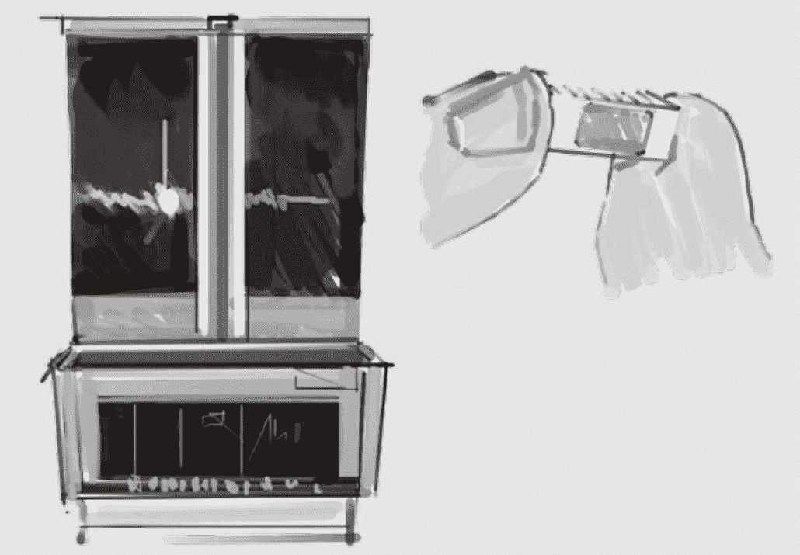

1969 年的典型主机 VS `CPU`
在日本本土的计算器上，`CPU` 能在算数与指示灯闪烁间高速切换，这个思路很关键。如今的 `CPU` 也把工作拆成大量微小任务，并在毫秒内在上千任务间跳动。切换快到让人产生同时处理的错觉。

`4004` 上市时业界只剩下惊讶。

特德·霍夫回忆，1971 年拉斯维加斯的一次行业会议上，有位客户径直走来，坚称把整台电脑集成到芯片的说法是夸大。英特尔工程师递上资料表，对方看完后惊呼：天啊，这真是一台电脑。当时多数人觉得不可能。

随后推出的英特尔 `8080`，成为首款被市场广泛采用的微型计算机 `MITS` 的核心，也为苹果与微软 `Microcomputer Software` 的兴起埋下伏笔，具体缘由下一篇展开。如今微处理器市场已值数十亿美元，英特尔仍是全球最大 `CPU` 厂商，并在台式与笔记本领域保持领先。

八十年代初，特德·霍夫离开英特尔，出任雅达利 `Atari`，美国一家电脑游戏机厂商 的技术副总裁。罗伯特·诺伊斯也在七十年代后期离开英特尔。

六十年代堪称变革十年，短短十年计算技术翻天覆地。文化上，婴儿潮一代深深影响社会；科技上，层出不穷的创意彻底改写生活。

下一章会看到科技逐步进入主流文化，创新也随之提速。

### 第十章 新纪元（1970—1979）
六十年代激进思潮震荡世界后，七十年代西方社会的集体情绪急转。战后经济繁荣走向尾声，中东危机推高油价，越南战争持续升级，尼克松因水门事件被弹劾。大批民众走上街头，为女权、种族平等、同性恋权益发声。新纪元运动如火如荼，反美政府的声音也愈发高涨。这股浪潮把世界带向自我时代。

七十年代后半段经济稍有回暖，迪斯科流行起来。迪斯科源于布鲁斯与 R&B 的混音，在舞厅里无缝播放，让人尽情起舞无需担心停歇。摇滚也在演进，华丽摇滚与强力芭乐在七十年代末迎来高峰。

这十年间电子邮件首次出现，同时诞生第一款文字处理软件、`C` 语言编程与软盘。1972 年尤金·塞尔南 `Gene Cernan` 成为最后一位登月者。1975 年名不见经传的年轻导演斯蒂芬·斯皮尔伯格携《大白鲨》闯入国际影坛，他将成为电影史巨匠。1976 年最成功的超级计算机 `Cray-1` 面世，运行频率达 80 兆赫，仅约智能手机单核处理器的四分之一。易拉罐拉环、便利贴、魔方等日常物件也诞生于此。但十年里最伟大的成就当属 1977 年 NASA 的旅行者探测器。同年上演 176 年一遇的天象，太阳系多颗行星连珠，便于观测。

旅行者 2 号是首艘探访天王星与海王星的飞船。它观测到天王星自转轴倾斜，并发现十颗新卫星；它还发现冥王星周围有六颗卫星环绕，并探测到一团体积接近地球的风暴，每 18 小时绕冥王星一周。我们对这两颗星的大部分认知都来自旅行者 2 号。该船还探测到木星卫星伊娥上有九座火山，火山烟柱以每秒一千米的速度冲入空中三百千米。旅行者 2 号亦抵近木星，发现其密度小于水。若有一片足够大的海洋，木星会漂浮其上。

旅行者飞船以钚同位素为燃料，至今仍在运行。它回传数据的速率比拨号调制解调器更慢，每三年传输约十亿英里，约 16 亿千米。

除太空探索外，七十年代的各项成果引领人类步入现代生活方式，开启另一种新纪元。1953 年詹姆斯·沃森、弗朗西斯·克里克、罗莎琳德·富兰克林 被遗忘的 X 射线女巫 发现 DNA 双螺旋结构。奇怪的是，人类又花了二十年才理解其意义。1972 年赫伯特·伯耶 `Herbert Boyer` 与斯坦利·科恩 `Stanley Cohen` 重组出首个转基因生物体——卡那霉素抗性细菌。不久鲁道夫·耶尼施 `Rudolf Jaenisch` 便构建出首只转基因小鼠。

## 家用游戏机终于登场（1972 年）
今天我们对电子游戏司空见惯。从任天堂、Xbox 到 PlayStation `PS` 游戏机，家用主机陪伴无数时光。第八章辛吉勃森发明的《双人网球》与第九章麻省理工的《太空大战》是早期尝试，究竟谁造出家用游戏机？

要回答，得回到 1966 年。

### 电视游戏盒
1966 年，军用设备公司 Sanders Associates 的设计总监拉尔夫·贝尔 `Ralph Baer` 等车时百无聊赖，突然想到一个简易游戏盒就能让电视变成游戏机。受此启发，他第二天就写下简短的产品提案。

他该如何推动？贝尔知道上司不会为与军用无关的游戏设备拨款，于是拉上同事鲍勃·特伦布莱 `Bob Tremblay` 在空房里私下工作。

不久他们做出原型机，取名电视游戏 1。名字很直白。原型并不出色，游戏仅由一条可在电视屏幕上移动的垂直线组成。视觉效果寒酸，贝尔仍把电视游戏 1 拿到 Sanders 研发总监赫伯特·坎普曼 `Herbert Campman` 面前。现场也许是坎普曼挑眉耸肩说好吧管他呢，最终同意拨款 2500 美元，相当于今天的 19332 美元。

第二年，贝尔带队改进，最终做出可使用塑料光枪射击的机器。

把新品带到坎普曼面前时，他是真心动了。他立刻追加拨款，并把项目推荐给高层，后者大多不屑一顾。即便如此，Sanders 的 CEO 仍认为电视游戏机能卖出去。1969 年贝尔团队设计的机器包含近三十个游戏，现在只缺买家。电视制造商是最合理的选择。1971 年在与美国无线电公司多次失败协商后，贝尔与米罗华 `Magnavox` 达成协议。产品定于 1972 年 9 月发布，命名为米罗华奥德赛，定价 99.99 美元，相当于今天的 600 美元。若要搭配电视，还需额外付 50 美元，相当于今天的 353 美元。这就是第一台家用游戏机的故事。

当时名词电子游戏尚未存在，推广期间这套系统被称作闭环电路的电子游乐场。

公众反应如何？当时家中唯一的娱乐设备就是黑白电视，现在能用电视玩游戏，这感觉像穿越未来。可销量并未体现这一点。

含糊的广告让人以为机器只能与米罗华电视配套，再加上价格不菲，奥德赛销量一直平平。直至 1975 年停产，全球销量仅约 35 万台。即便如此，奥德赛仍是电子游戏发展的里程碑，催生了游戏巨头雅达利。

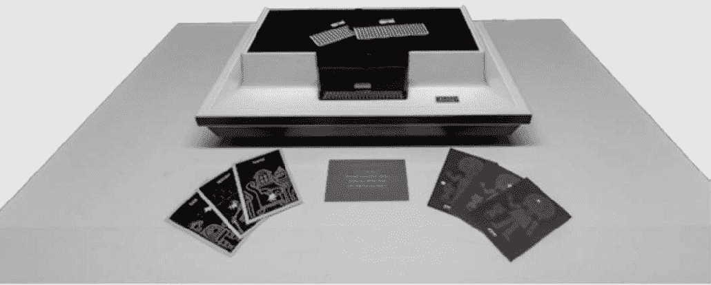

米罗华奥德赛

### 嘿！别和我抢《乓》——雅达利的故事
奥德赛的故事并未结束。奥德赛发布时，诺兰·布什内尔 `Nolan Bushnell` 是一家街机制造商的首席工程师。布什内尔此前设计出电脑游戏《电脑空间》，即 1962 年麻省理工《太空大战》的街机版本。《电脑空间》也是第一台商业街机。机身类似橱柜，全部硬件为该游戏特别定制，因为游戏无法在廉价小电脑上运行。机器被放在当地酒吧，反响平平。也许游戏过于复杂，也许客人喝醉无法理解玩法。不管怎样，布什内尔需要新产品。

1972 年 5 月，他在一家经销商处看到奥德赛游戏的演示。从电视屏幕上出现乒乓游戏的那一刻起，他就知道巨变即将到来。他立刻停止旧业务，创办新公司雅达利，并雇用了艾伦·奥尔康 `Allan Alcorn`。

布什内尔隐瞒了奥德赛是米罗华公司财产的事实。他让奥尔康设计一台类似的投币打乒乓球机器作为培训内容。布什内尔真正的目的，是白拿奥尔康的劳动成果。

奥尔康很有天分，认为原版太无聊，应当改进。奥德赛的乒乓球在一条直线上匀速来回，他认为球的方向应随玩家手势改变，球速应随游戏时间加快，在错过一球后速度重置到初始状态。这个游戏后来名叫乓 `Pong`。

乓街机的装置很简单：一台黑白电视，一些运行游戏的定制硬件，一个洗衣店的投币系统，下面连着一个牛奶盒储存硬币。

1972 年 8 月，这台机器进入当地酒吧测试反应。可安装几天后机器就无法正常运作。奥尔康接到维修电话赶往酒吧。路上他一定在想出了什么问题？代码写错还是硬件组装不当？他来到酒吧门口，发现人们排起长队，等待酒吧重新开张。他们都在等着玩乓！

问题是什么？机器太受欢迎，投币系统负荷过重导致装置短路并关闭。这时雅达利的两人意识到他们拥有一台即将风靡全国的产品。

乓很快成为美国年轻人最受欢迎的游戏，游戏机房成为孩子们最爱去的地方。布什内尔后来在采访中说，很多年轻人都是在玩乓的过程中结识人生伴侣。

乓，也可以说是奥德赛，真正开启了现代电玩时代。1974 年雅达利因窃取创意被米罗华起诉，并同意支付一笔罚款。

## 开启皮克斯的那只手（1972 年）
我们习以为常的无处不在的 3D 动画有个有趣的诞生故事，与埃德温·卡特姆 `Edwin Catmull` 的聪明才智有关。卡特姆出生于 1945 年，是战后婴儿潮一代。偶像是爱因斯坦和迪士尼。《木偶奇遇记》和《彼得·潘》点燃他的想象。他想成为动画人却找不到途径，于是选择在犹他大学主修计算机，作为对偶像爱因斯坦的致敬。读研究生时，他是伊凡·苏泽兰的学生。上一章说过，苏泽兰发明了世界上第一个电脑绘图程序几何画板。卡特姆认为在电脑上做动画是科学与艺术的完美结合。

从那时起，卡特姆的主要目标就是做一部电脑动画。观察到电脑动画可悲现状后，他认识到现有软件无法为电影产业提供足够支持。这个年轻人决定自制动画软件，创建纹理映射、抗锯齿和深度缓冲，就这样以一己之力奠定 CG `Computer Graphics` 计算机图形学 的基础。

他的第一个机会是课堂作业，要求制作一个数字 3D 物品。卡特姆决定通过制作石膏模型把自己的左手数字化。不幸的是模型太紧，当他试图把手从模型中抽出时，手背上的汗毛全部扯掉。痛苦分离后，卡特姆追踪手表面的 350 个三角形，这些三角形的边代表坐标。他必须把一个个坐标输入电传键盘，让电脑处理。

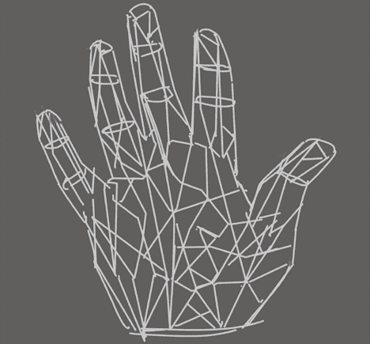

卡特姆的 3D 左手

当时的电脑无法一次算出整帧画面，所以要用长曝光相机拍摄屏幕输出结果，直到整帧处理完成，再拍摄快照。处理一帧画面需要大量工作。

最后完成的视频被简单命名为一只电脑动画的手，于 1976 年被好莱坞制片人看中，并被收入电影《未来世界》 《西部世界》的科幻续集。这是最早使用 3D 电脑图形的电影。

卡特姆后来建立自己的电脑图形实验室，与伟大乔治·卢卡斯 `George Lucas` 合作，将 CG 科技带入娱乐世界。后来，卡特姆的电脑图形实验室脱离卢卡斯影业，成立独立公司，取名皮克斯。1986 年皮克斯将收到苹果联合创始人乔布斯的大额投资。

皮克斯追根溯源，竟然是一只没有汗毛的左手。CG 在今天无处不在，但更加无处不在的是手机，它也是 20 世纪 70 年代的发明。

## 第一部手机（1973 年）
手机彻底改变了我们对未来的期待。如今整个世界就在指尖，一触即发。我们可以随时随地阅读、观看、聆听、购物和创作。

我刚刚形容的是智能手机带来的革命，而这一切其实是十年之内完成的。在智能手机让口袋装下世界之前，手机功能十分简单。90 年代和 21 世纪初，它们只有简单主机、相机，高级一些的还有极简的上网功能。但回到 80 年代，移动电话只做一件事：打电话。

第一部原始的只能用来打电话的手机是什么？我们口袋智能手机的祖师爷长什么样？让我们认识发明手机的人。

说起第一部手机的故事，要回到 20 世纪 40 年代。严格来说移动电话此时就存在，但只能在车里使用。如果你有一部移动电话，那你很可能是个有头有脸的人物。在这时在车里装电话是唯一让电话移动的方法。因为电话需要的电量很大，只有车载电池能满足。

另一个缺陷是，在一个特定区域内如纽约，只有 12 条电话线路存在，所以大部分时间你不得不等待使用信号。连上一部车载电话需要 30 分钟，这就是现实，也是人们必须忍受的不便，直到现实改变。

1968 年，美国联邦通讯委员会 `Federal Communications Commission` `FCC` 要求 AT&T 解决这个问题，于是 AT&T 发明了蜂窝网络结构。

这个系统把一大片信号覆盖区拆分成小片，以便多人可同时在车里使用手机。那时普通移动系统用一台中央高功率基站为整个城市输送信号。新系统可把一些低功率基站排列成蜂窝状格子，这就是蜂窝网络名字的由来。当车子开动时，通话会自动从一个蜂窝转接到另一个蜂窝。

摩托罗拉也有一个车载电话部门，不希望 AT&T 独自占有新系统优势，垄断新兴行业。摩托罗拉担心若什么都不做，这就是移动电话事业的终结。所以他们开始研发能与新系统配合的手机，而该手机技术将一骑绝尘，把 AT&T 远远甩在身后。1972 年摩托罗拉要求员工马丁·库珀 `Martin Cooper` 领导这个项目。

有一天库珀思考如何制造一部手机，突然想起漫画《至尊神探》 `Dick Tracy`，其主人公迪克有一块可打击犯罪的移动腕表。

这启发库珀：与其给一个地点分配手机号码，为什么不把号码分配给一个人？那样无论你在哪，都可以联系任何人。这是个革命性概念，但这样的工具真的可能被制造出来吗？库珀想到一种新科技——英特尔公司 1971 年新发明的微处理器。微处理器外形小、占用空间少、消耗功率低，却和其他处理器有同样工作能力，成为整个设计的关键。

1973 年 3 月，库珀团队制作出名为 DynaTAC 的原型机。同年 4 月 3 日，库珀在纽约新闻发布会上介绍了这款原型机。

### 第一通电话是骚扰电话
在新闻发布会前，库珀要进行通话测试，他决定打给工程师尤尔·恩格尔 `Joel Engel`。恩格尔是摩托罗拉死对头 AT&T 移动电话项目的总工程师。所以库珀选择用新电话打给恩格尔，告诉他摩托罗拉已经打败 AT&T。没错，第一通移动电话是骚扰电话。库珀解释道：

我们当时不了解这通电话的历史意义。我们只担心一点：按下按钮的那一刻，电话会打通吗？很幸运，确实打通了。

1983 年，经过多年迭代，摩托罗拉向消费者推出首部便携式手机 DynaTAC 8000x。这部手机重量接近 1 千克，需要 10 小时才能充满电，而通话时间只有 30 分钟。不过那也不是问题，因为你的手臂要把这部电话举到耳边，也坚持不了 30 分钟。最夸张的是，DynaTAC 8000x 当时售价近 1 万美元。

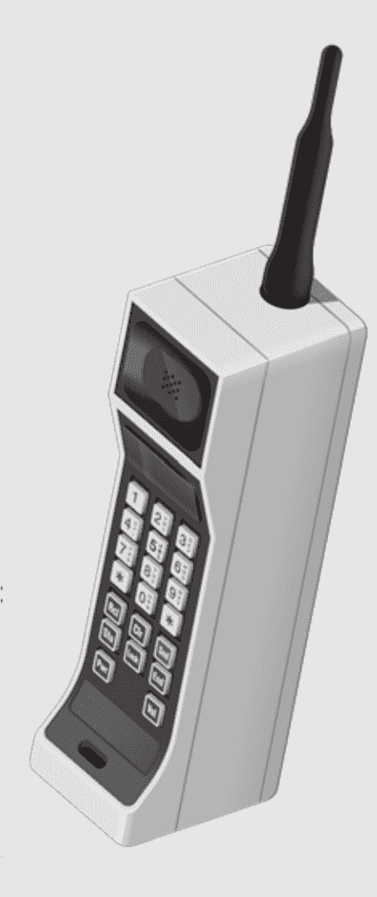

DynaTAC 8000X

这部手机最终获得巨大成功，并开启移动手机革命。当库珀 1973 年打第一通移动电话时，那是唯一一部真正的手机。现在手机的数量比人还多。当库珀打通那个影响世界的电话时，另一件改变历史进程的事发生了：第一台使用图形用户界面的商业电脑诞生了。

## 煮熟的鸭子飞了：施乐奥托（1973 年）
想象你拥有 20 世纪最伟大的发明之一，却因不了解你拥有的是什么而把它拱手送给别人。施乐 `Xerox` 就是这样把施乐奥托 `Xerox Alto` 送给了别人。

奥托是帕洛奥托研究中心 `Palo Alto Research Centre` 简称 PARC 实验室 1973 年发明的一台实验性电脑。PARC 团队包括罗伯特·泰勒——上一章提到的 DARPA 研究员，以及其他受道格拉斯·恩格尔巴特 演示之母 和约瑟夫·利克莱德启发的研究员。

奥托的出现远超当时技术水平，它几乎就是我们现在所理解的桌面个人电脑雏形。个人电脑的核心理念，源自利克莱德在 20 世纪 60 年代撰写的《人机共生》论文。文中他把计算机描绘成一位温和的伙伴，专门分担人类大脑难以胜任的难题。

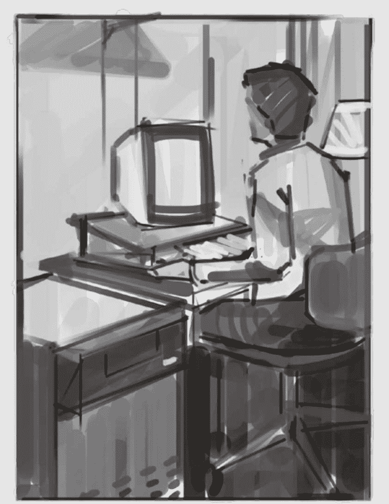
奥托：从各方面看都像今天的台式电脑

这台机器配备了鼠标、屏幕、图标、菜单与视觉图形，还拥有可执行复制、粘贴、拖动、删除等操作的档案管理工具，更实现了本地网络互联。整套方案被称为图形用户界面 GUI，其设计思路是让屏幕模拟真实办公桌面，推动无纸化工作。1973 年的今天来看，这种思路堪称颠覆。

可以说，奥托正是桌面电脑图形界面的首个实现。

在主流机房里，用鼠标指点并点击屏幕图形的操作当时极具新鲜感，即便“演示之母”已展示过类似技术。GUI 出现前，操作全靠逐行输入文字命令，一旦敲错，系统便会报错。

PARC 实验室里制造了上千台奥托，但从未面向市场，仅在少数施乐部门和几所大学内部流通。高层对这项成果缺乏认知，只把它当成炫酷的玩物。管理层看不到电脑的未来，但乔布斯看到了，而施乐恰好把这份完整愿景送到了他面前。具体经过是这样的：

即便内部有强力反对，施乐管理层仍在 1979 年邀请乔布斯前来观摩奥托。条件是交易：乔布斯需协助施乐团队学习如何以更低成本生产电脑，因为苹果 II 当时热销；作为回报，施乐开放 PARC 实验室让他接触最前沿研究。

参观让乔布斯震惊不已，他顿时明白这正是未来，脑海中的理想电脑功能全都活生生呈现。乔布斯迅速借鉴了这些概念，把 GUI 引入后来的丽萨电脑，并配上屏幕与鼠标，而丽萨正是 1985 年麦金塔的前身。有关这个故事，我们将在下一章继续展开。

## 个人电脑诞生记：1975

个人电脑如何重塑办公与家庭生活已无需多说，关键在于这场革命从何触发。下面你会发现，首批 PC 的故事其实与微软和苹果紧密相连。

1974 年，工程师爱德华·罗伯茨正试图为计算器公司 MITS 寻找生机。在一次与银行贷款人的会面中，他下定决心要用一项前所未有的尝试拯救公司：为电脑爱好者打造个人电脑套件。彼时这几乎是不可能的，直到三年前特德·霍夫与英特尔发明出微处理器。CPU 让整台电脑的功能浓缩到单片芯片之中。1972 年英特尔推出了更强力的 8080 芯片，罗伯茨抓住机会用它打造了 Altair 8800——公认的世界上第一台微型电脑。

### 《大众电子》封面点燃电脑热潮

MITS 斥资 400 美元，约合今日 1800 美元，让这台微型电脑登上《大众电子》封面。杂志主要面向业余爱好者，刊登电脑广告本有风险，毕竟爱好者未必对电脑感冒。结果却完全相反。

罗伯茨向银行表示，公司原本只预期几百台订单，却在数月内售出数千台。狂热的爱好者甚至把车停在 MITS 仓库门口，只为抢先拿到机器。

回头看，这种需求理所当然。70 年代初，电脑仍是尖端设备，参观都需要证件，更别说使用。普遍采用分时共享，多个用户通过终端共用一台大型机。随着技术迭代，操作也愈发复杂。到了 70 年代中期，电脑能力已远超单纯计算。

全球范围内，诸多年轻科技人被电脑概念深深吸引，其中就包括当时在校的叛逆黑客比尔·盖茨。

保罗·艾伦是盖茨的高中同窗。看到杂志封面上的 8800 后，他立刻冲进盖茨宿舍。盖茨一眼就断定这就是未来，消费级 PC 真正来了。这件事改写了盖茨的人生，也改写了我们的生活。所有可能性仿佛一夜之间触手可及。

不过要打个折扣。8800 非常原始，最早的用户形容它只是开关和灯泡的集合，不能接键盘和显示器。操作极为繁琐，必须手动拨动开关输入指令。比如算 2+2，每个 2 都需拨动八次开关才能录入，第 9 次才加载，输入加号又要按八个键，最后答案“4”会亮在从左数第三盏灯上，复杂得可怕。更糟的是，它没有存储记忆，关机即清空程序。我们得感谢今天便捷的操作体验。

### 微软起步：1975 年从爱好变公司

当艾伦冲进宿舍展示 8800 时，盖茨意识到电脑革命可能要将他甩在后面。他致电 MITS 称自己和艾伦已为这台机器写好软件，即将完成，实际上他们尚未动笔。19 岁的盖茨嗅到在新兴 PC 领域抢占先机的机会，立刻辍学前往新墨西哥，住进 MITS 工厂对面的旅馆，与艾伦一起为 Altair 8800 编程。他们目标是写一个基础系统，让机器能做比闪烁灯更高级的事。讽刺的是，他们手头没有一台 Altair 可供测试，只有一本英特尔关于 8080 芯片的小册子。一个小错误就会导致软件失效。但他们毫无畏惧，数月内完成编程并打印成穿孔纸带，这张纸带就是微软的首个产品。微软之名，源自微型电脑软件的缩写。

艾伦带着代码前往 MITS 工厂，在 CEO 罗伯茨面前演示。输入 2+2，机器立刻返回 4；平方、开方等运算也全部正确。软件大获成功。盖茨的商业嗅觉、冒险精神、自信与执行力，让他们造出了尚不存在但世界亟需的技术。

这款软件让 Altair 8800 变得可用。年底前，用户就能把 Altair 接上屏幕，基于微软 BASIC 开发游戏、会计和文字处理程序。微软由此诞生。

真正的革命就此拉开帷幕，微软正处在风暴中心。回头看，他们此后做的相当出色。

### 苹果崛起：1977 年

若把 PC 产业比作硬币，微软是一面，苹果就是另一面。如今它们都是全球最值钱的公司，但起点何在？人们常说，时势造英雄。

1977 年正是科技爆发的好时机。60 年代反主流文化虽远离主流，仍在发酵。英特尔的 CPU 也在同期发展。16 岁的史蒂夫·乔布斯与 21 岁的史蒂夫·沃兹尼亚克相识，两人都只是普通大学生，热爱科技、恶作剧与披头士。朋友们未曾料到他们不久将改变世界。

登上《大众电子》封面的 8800 在全国掀起电脑热潮，各地纷纷成立电脑俱乐部，如旧金山的家酿计算机俱乐部，成员们热议电脑如何真正服务生活。

西海岸电脑节创始人吉姆·沃伦认为，俱乐部的文化深受当地反主流思潮影响，强调互助与共享。大家都想弄清新电脑套件的潜能。部分成员未经盖茨许可复制并传播他的纸带软件，他们觉得无伤大雅，但盖茨怒不可遏。

这种公开复制与盖茨的信念相悖。他专程飞抵家酿演讲，请求大家停止传播。俱乐部成员并不在意抗议，他们只想看到每段代码能给 Altair 带来什么新可能。

沃兹后来坦言，正是家酿第一场聚会点燃了他设计自家电脑的灵感，他每周都带机器来讨论。沃兹生性爱折腾，曾因在校内电脑上发恶作剧信息被开除。70 年代初还在上大学时，他喜欢研读小册子、纸上画电路，省吃俭用攒钱买 CPU。他曾回忆：

我把一本介绍 PDP-8 的书带回家，对我而言像《圣经》一样珍贵。就像有人在弹琴时爱上一件乐器，我爱上了电脑内部的细微构造。我能在纸上给自己出难题，解出来时特别满足。

大一时沃兹对父亲说，总有一天他会买台电脑。父亲回：“儿子，这东西贵得跟房子似的。”沃兹答：“那我就搬去公寓住。”

1975 年沃兹着手组装自己的电脑，六月完成首个原型。因在惠普做计算器设计，他得以“借用”公司硅片。

他带到俱乐部的原型机能显示字母并运行简单程序，史上首次在家用电脑屏幕上出现文字。每周都有新改进。沃兹的动力很简单：在俱乐部兄弟面前炫耀。

沃兹极度内向，会议中不愿举手发言，只是把机器摆好等待围观。大家围着机器提问，问题绵绵不绝。

沃兹的朋友乔布斯当时在雅达利实习，也是俱乐部成员。他看到大家对这台机器的热情，建议沃兹将其推向市场。

沃兹已证明自己能独立完成电路板、硬件与软件的设计，理论上两人联手足以实现这个设想。

### 苹果 I 的诞生

起初沃兹想把设计卖给惠普，却被拒绝五次。后来证明惠普错失良机。

在乔布斯建议下，沃兹决定出售自组电路板。沃兹卖掉惠普计算器，乔布斯卖掉大众汽车，两人凑出 1300 美元，约合今日 5700 美元，在朋友帮助下于乔布斯卧室和车库打造出首台家用电脑。这就是苹果 I，售价 600 美元，约合今日 2640 美元。其芯片用量少于任何竞品，沃兹因此被誉为电脑设计的文艺复兴艺术家。苹果 I 只是一块裸主板，没有键盘和显示器。

1976 年 4 月，乔布斯与沃兹尼亚克共同创立苹果电脑公司。当年售出 50 台苹果 I。对乔布斯而言，这证明渴望 PC 的不仅是俱乐部极客，外部也存在广泛需求。但普通用户怎么办？乔布斯说：

我明白世上有些发烧友能自己拼装硬件，甚至用我们的主板加电源、变压器、外壳和键盘组装。但每有一个能做到的人，就有千人想编程却不会。所以我的愿景是卖出第一台完整的电脑套件。

对许多发烧友而言，这点难以理解。对爱发明的人来说，完整 PC 的商业价值并不显而易见，需要商业眼光才能洞见。

当时业界认为一体成型 PC 几乎不可行，需要大量芯片、成本高、设计复杂。但沃兹似乎不知道这个限制。

沃兹是电脑设计的魔术师。苹果 I 的彩色显示得益于他在雅达利设计街机时积累的技巧，他参与过《打砖块》的开发。乔布斯则贡献审美，让机器更美观，并坚持操作简便。即便以今天的眼光看，苹果 I 修长倾斜的外形也相当前卫，与当时笨重单调的机箱截然不同。

### 苹果 II 席卷市场

筹到资金后，苹果 II 正式问世，售价 1300 美元，约合今日 5242 美元。整机即用，只需接上键盘、显示器和电源，核心软件正是微软 BASIC。

1977 年的 PC 已不再是两年前的发烧友拼装盒，只剩灯光开关。此时 PC 成为开箱即用的机器，家用电脑元年真正到来。当年苹果带着 II 号机亮相西海岸电脑节，瞬间吸睛。彩色画面、内置显卡让观众惊叹，这是迄今最完整的电脑。

苹果 II 是首款搭载 BASIC 的家用电脑，也是首台拥有声音、色彩、图像、塑料机箱、主板自带 48KB RAM 无需插槽的机器。

直至 80 年代，苹果 II 依然热销，累计销量达数百万，与 Commodore PET、Tandy TRS-80 并称 80 年代 PC 三巨头。

## PC 如何改变商业

1979 年，苹果推出杀手级应用 VisiCalc，本质上是面向商务的电子表格，被视作“魔法黑板”。此前会计每改动一格就需重算全部，VisiCalc 让电脑自动完成计算。

现场演示时，会计们惊呼工作轻松了太多，甚至有人激动落泪。VisiCalc 于 1985 年停产，同年微软推出 Excel，承接了这一伟大创新。

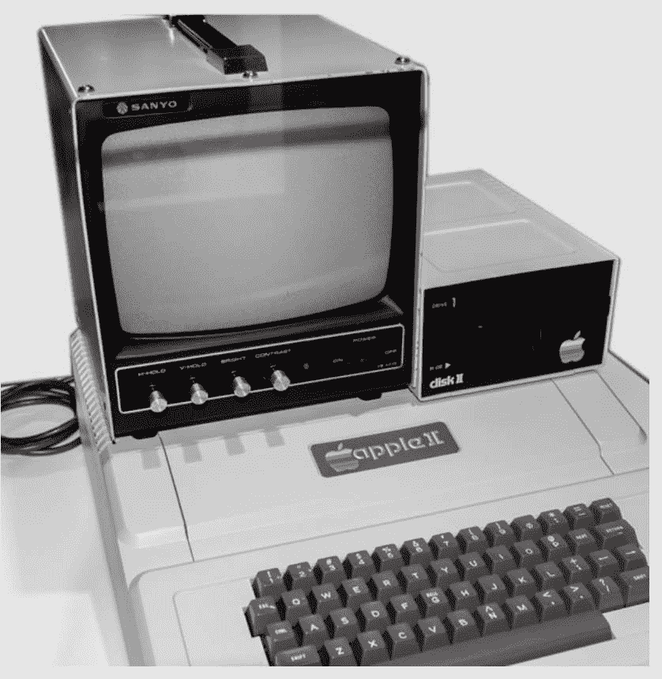
苹果 II 电脑

此后苹果业绩指数级增长。23 岁时乔布斯身价突破百万美元，24 岁超千万，25 岁生日当天突破一亿美元。凭借苹果 II，他在两年内从车库发明家跃升为身价过亿的富豪。

苹果之路并非坦途，80 年代 IBM 与微软的 PC 市场角逐即将展开，苹果的故事我们将在下一章再续。

## 镭射影碟：1978 年的光盘先驱

光盘我们已习以为常，但在实体媒介淡出的今天，很难想象它的革命性。CD 刚出现时就是一场颠覆，与黑胶、磁带不同，反复播放不会磨损，音质也不会随时间退化。声音真的可以永久保存。数字音频在 1982 年得益于镭射影碟的诞生才成真，这项来自 AT&T 贝尔实验室的发明堪称科幻。我在 90 年代中期还是孩子时，就曾为这个概念震撼。

许多年轻人或许不知，CD 的技术根基正是更早的镭射影碟，最初名叫 Disco Vision，当时堪称石破天惊的发明。它本该席卷全球，却迅速被遗忘。

### 镭射影碟是什么

镭射影碟 Laser Disc，简称 LD，是家庭影院形态的首款商业视觉存储介质。

可以看作 70 年代末期的 DVD。飞利浦、MCA 先锋等均生产过 LD 播放器。1978 年上市，比家用录像机 VHS 早两年，比 CD 早四年。碟片直径达 30.5 厘米，体积庞大。

首款大规模工业用镭射唱盘是 MCA DiscoVision PR-7820。70 年代末到 80 年代初，通用汽车曾用它播放培训视频和幻灯片。首部发行于 LD 的电影是斯皮尔伯格的《大白鲨》。1978 至 2001 年间，超万部电影通过该媒介发行。

VHS 是其最大对手。LD 优势明显：可反复播放静止画面而不受机械磨损；画质更清晰，水平像素约 430，VHS 仅 240。LD 既能存模拟信号也能存数字音频，VHS 仅限模拟。LD 支持多音轨，VHS 不行。这让电影能加入导演 commentary 等花絮，当时是首次实现，后来成为蓝光 DVD 的标配。

早期 LD 的制造成本低于 VHS 盒带，因其无需转动部件和塑料外壳，复制也更简便。但需求增长推动 VHS 成本快速下降，到 90 年代每盒仅约 1 美元。LD 寿命更长，光学非接触读取，不像磁带那样磨损，优质 LD 理论寿命可超人一生。

### 为何没能流行

既然优势如此明显，为何它没能称霸市场？

LD 更重更厚，约半磅，操作不当易受损。每面仅能承载 30 至 60 分钟，片长较长的电影需多碟。多数播放器还需用户起身手动翻面，体验不便。

当时缺乏错误校正，细微尘埃或轻微划痕就会导致雪花、波纹、杂音或画面中断。DVD 后来的电子介质已有纠错保护。

尽管受众不错，厂商却拒绝推广 LD 录制设备，而 VCR 可录制带子，这一策略打击了销量。巨型碟片、高昂的播放器与碟片成本，加上无法录制，令其表现平平，日本市场稍好些。

美国最后一张 LD 于 2000 年发行，但播放器一直生产到 2009 年。

这就是故事，领先的技术未必能成为主流，科技史上的一段奇异插曲。

## 索尼随身听诞生：1979 年

上世纪 50 年代，索尼靠晶体管收音机在美国市场大放异彩。如今它将带着另一款明星产品归来。口袋唱机曾只存在于科幻小说，一旦面世便彻底改变了人们的音乐体验。

索尼董事长井深大的个人需求催生了随身听。他热爱音乐且常旅行，为此总随身携带索尼 TC-D5 盒式录音机。

该机重 1.7 公斤，尺寸 237×48×168 毫米，可搬动但并不便携。井深大为此困扰，认为应有更好方案。他委派大贺典雄负责。利用索尼小型录音机“新闻人”的磁带技术，大贺做出只能播放的磁带机。原型为井深下次飞行临时拼凑，粗糙不堪，电池在途中耗尽。但井深对概念印象深刻，决定在索尼推出消费版。

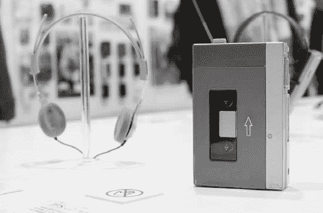
索尼随身听

索尼其他经理认为想法糟糕，谁会要只能回放、不能录音的便携盒带设备？这无用产品有何意义？

井深坚持认为人们都想在散步时听自己选择的音乐，事实证明他正确。这个实验成果——索尼随身听——大获成功，售价 150 美元，约合今日 500 美元，累计销量 4850 万台。

“随身听”之名沿用至今，成为索尼高品音频播放线的代名词。

### 踏入 80 年代

当上个世纪七十年代快要收尾时，世界已经面目全非。个人电脑成了可以拥有的物件，配套软件也跟着普及。玩电脑的人越来越多，企业里也开始用上电脑技术。未来科技的两座高峰——微软和苹果已经冒头，它们之间的缠斗留到下一章再说。

1979 年中东再掀油价风暴，经济停滞不前。但从 1980 年起，社会各层都在发生不可逆的转变。

### 第十一章 八零年代 科技接手世界 1980—1989

我对八十年代有特别的偏爱。夸张的穿搭、洗脑的金曲，还有一批经久不衰的银幕作品：《E.T.》《回到未来》《终结者》《捉鬼敢死队》《毕业舞会风云》《壮志凌云》《疤面煞星》。一谈起那个年代，我脑中就会响起磁带机里的轻微嘶响，想起录音机上那种笨重的按键和按下时的满足感。那是一个模拟信号主导的时代。

八十年代末，西方的世界蓄满了能量即将腾飞。可开头几年，美国刚经历了大萧条之后最惨的经济滑坡。公司倒闭、治安恶化、可卡因泛滥、艾滋病肆虐。1980 年美国通胀逼近 14%，一年里物价涨十四分之一是什么概念？七十年代的离婚率创历史纪录，下一代在破碎的家庭里长大，在尼克松、水门案、越战的阴影下成长，养成了犬儒的性格，被叫做 X 世代。

罗纳德·里根在短短三年内把通胀压到 3.6%，在不少孩子眼里成了英雄。青年人开始觉得保守主义有魅力，雅痞阶层则不大瞧得上父母辈的嬉皮理想。

八十年代初苏联依然强硬，日本的制造与技术产业则节节攀升。过去日本货被视作粗糙廉价，八十年代却实现反转，占据了美国的道路与电器店。底特律造不出精工细作、便宜省油的日本车来抗衡。1980 年，底特律的轿车厂商一年亏掉 40 亿美元。

在八十年代最阴郁的年份，一股创作浪潮让人喘口气。纽约的嘻哈与霹雳舞从街角走向主流，加州的滑板文化在托尼·霍克带领下成熟。他创造了多种空中动作，用 VHS 把自己的表演拍成影像，为运动打下基础。

NASA 为对抗苏联的斯普特尼克及其他太空项目而诞生，八十年代达到高峰。1986 年挑战者号事故重创美国自豪感。发射通过 CNN 全球直播，低温冻住的 O 形环密封失效，助推器解体，机上七名宇航员全部殒命。

电子表格 VisiCalc 重塑了商业规则，盈亏能在数秒内算清，不必等数周。股市因电脑化迎来新高。这一十年个人主义盛行，似乎人人都能轻松赚钱。电影《华尔街》里葛登·盖柯的那句“贪婪是好东西”，概括了八十年代后半段的氛围。

到了八十年代，六七十年代的发明已融入日常。VHS 与磁带大行其道，CD 将在十年尾声登顶，随身听让每个人都能做自己生活的导演，为日常配乐。

美国与日本主导了八十年代的技术更新，英国的 PC 市场同样活跃却少被提及。八十年代末，信息互联的世界终于抵达，正如五十六十年代的梦想家所设想。

本章要聊科技如何接管现代生活，先来一场视觉与听觉的派对吧。

## MTV 诞生 1981

1981 年 8 月 1 日，MTV 正式开播，一种全新的娱乐形态就此开启：主持人串场，观众在家就能看音乐表演。这个频道定义了一代年轻人——MTV 世代。

登上荧幕的第一支影像是英国乐队巴格斯的《视频终结了电台之星》，几乎预言了频道对音乐产业的改造。

看似叛逆的 MTV，根基其实是巨型企业华纳电视。1980 年华纳旗下已有电影频道和尼克国际儿童频道。增设一个音乐频道看似合理，华纳起初却拒绝了全天候放音乐的提案。在制作人眼里这不过是配图的广播。商议后大家决定，音乐频道不会亏本，因为唱片公司为求曝光会免费供片。华纳要求七个月内完成，希望赶在学生放暑假时上线。首播时只有 250 支音乐影像，且只在美国的小城镇播出。

第一个因 MTV 成名的乐队是杜兰杜兰。他们把整张专辑做成短片，引来热议。此后每个乐队都想拍音乐影像登台。

起初 MTV捉襟见肘，入不敷出。电视台曾接触滚石乐队主唱米克·贾格尔，出场费高得惊人。会面时一位制作人把一美元纸币丢在桌上：“我们只能出这个价。”贾格尔欣赏这份胆量，答应出演。1982 年他的广告曲《我要我的 MTV》发行，随后全美电视台接到潮水般的来电，要求开设该频道。几年内 MTV遍布各州，彻底改写音乐产业版图。我小时候偶尔在澳洲电台瞥见 MTV，总觉得那是世上最酷的频道，捕捉着最新潮的音乐脉动。

## 电玩热潮

### 吃豆人 1980

《吃豆人》是史上最卖座的游戏之一。1980 年，南梦宫先在日本推出，随后进入美国。这是第一款脱离太空与体育主题的主流游戏。

创意来自 25 岁的岩谷彻，他用一年时间把点子变成产品。

最初名字叫 Puck Man，美国团队担心有人把 P 刮成 F，于是改名 Pac-Man，吃豆人。能量豆的灵感来自大力水手，波比吃菠菜变超人。

游戏有点古怪，没人料到会爆红。首发反响平平，很快人气暴涨。到 1980 年底，《吃豆人》的收入超过当时票房冠军《星球大战》。整个二十世纪，该游戏玩家累计超过百亿次。如今吃豆人的形象仍具极高辨识度。

## 1983 年电玩大地震

Atari 2600 于 1977 年上市，在奥德赛之后成为家用主机之王。到 1980 年，雅达利已是美国成长最快的公司，销售额从七千万美元飙到二十亿美元。

成功引来跟风，游戏机成了最热门行业，所有人都想分杯羹。一些公司甚至放弃原业务专攻电玩。这种狂热导致灾难，行业还没站稳就已受创。

市场迅速过载，主机与游戏数量惊人，还有更多产品想挤进来。竞争对手是新兴的个人电脑，性价比更高，还能玩游戏并有多重用途，对游戏业打击更大。

更糟的是，工程师得不到应有回报。即使一款游戏赚过百万，程序员年薪约三万美元。一些雅达利程序员受够了，另起炉灶成立动视，开发兼容雅达利硬件的第三方作品。这颠覆了制作模式，随后独立开发商大量涌现。严重到连桂格麦片、通用磨坊这类食品公司都做游戏。食物与游戏何干？除了主机上掉落的薯片碎屑外毫无联系。当时任何人都能在未授权情况下为雅达利或其他主机制作游戏，这最终摧毁了整个行业。

### 雅达利崩盘

讽刺的是，压垮大厦的第一道裂缝来自最热的游戏。《吃豆人》在街机上火爆，雅达利想分一杯羹。1981 年买下版权，管理层要求圣诞前推出，于是仓促上阵。雅达利版反应迟钝、bug 频出，甚至不像吃豆人。最终 500 万盒卡带滞销。

挨过这一击后，雅达利仍掌控业界命脉。1982 年又犯同样错误。买下斯皮尔伯格《E.T.》版权，只给程序员六周开发时间。结果被钉上史上最烂耻辱柱，又有 500 万盒卡带积压。

1983 年财务报告显示收入仅增 10%，远低于预测的 50%。华尔街不满，游戏公司股价暴跌，行业地震终于击垮当红产业。1983 年底，雅达利负债五亿美元。

那一千万盒滞销卡带被装上二十辆卡车运到新墨西哥的垃圾场掩埋。有趣的是，2014 年一次挖掘中卡带重新出土。

当时人人都以为电玩已如流星坠落。但几位日本商人看好未来，他们的公司是任天堂。

## 任天堂入侵美国 1985

任天堂的根可追溯到十九世纪末的纸牌业务，二十世纪转向玩具。七十年代看到雅达利成功，开始做家用乒乓游戏机，1980 年推出 Game & Watch，一体机兼时钟，大小如计算器。任天堂也尝试街机但屡败。北美社长荒川实让部下集思广益，29 岁的艺术家宫本茂担纲。

任天堂原本想做大力水手题材以借势，没拿到版权后宫本做了调整。奥利弗·奥尔变成公主保琳，波比变成“跳跳人”，敌人布鲁托变成大猩猩。游戏定名为《大金刚》。

1981 年上市后迅速席卷市场，美国六万台街机，任天堂赚进 1.8 亿美元。

受鼓舞后，1983 年任天堂在日本推出红白机 Famicom。起初游戏多为街机移植，随后瞄准北美。但因电玩业崩盘，美国零售商格外警惕。

1985 年任天堂把红白机重新包装，改名任天堂娱乐系统 NES，准备进军美国。新套装附塑料光枪和机器人 R.O.B.，企图从名到形都与传统游戏保持距离。但这招没奏效。

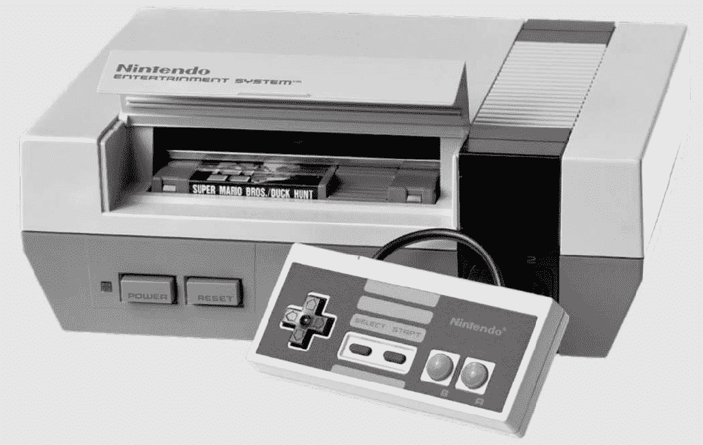
任天堂娱乐系统
最终日本社长山内溥决定亲自派团队进美。名为“任天堂 SWAT” 的小分队负责演示并上架。他们甚至提供免风险条款：店家只为卖出的机器付钱，未售出的由任天堂回收。最终 NES取得巨大成功。

1985 年任天堂推出跳跳人，这是一款开创性的作品：广阔想象的世界、精致画面、滚动视觉。后来改名为超级马里奥，至今售出四千万份。我在九十年代初次玩它，如今依然觉得好玩。随后《塞尔达传说》再掀热潮。

任天堂从雅达利的教训中吸取经验，为主机设计专属硬件芯片，隔绝外部程序员，对可运行游戏实行严格质量控制。于是第三方开发商只带来让主机更成功的作品。

十年间，任天堂从业外玩家跃升为家用主机领航者。

### 马里奥小档案

◇ 马里奥的名字取自任天堂美国办公室的房东马里奥·西加列。他曾破门而入催缴逾期租金。

◇ 马里奥至今登场两百多款游戏，总销量超 1.93 亿。截至 1993 年，《超级马里奥兄弟 3》在美国就赚 5 亿多美元。

◇ 马里奥设定为意大利人，本无胡须也不戴帽。宫本茂觉得画头发麻烦才加帽子，胡子比嘴巴在小画面里更显眼。

## 80年代初的手提音响

晶体管收音机加磁带加大喇叭，是八十年代年轻人最想要的装备。知名品牌有索尼、松下、大众电子。设备可接麦克风与唱片机，变身临时现场系统。低音炮是关键，能让胸口感受到节奏。贝斯让抒情曲更饱满，舞曲更有力。手提音响深受城市孩子喜爱，对嘻哈文化发展起关键作用，并催生新街舞。孩子们在舞中释放活力，有时头顶地面身体旋转。最初称 B-boy，后改称霹雳舞。

### 磁带如何点燃说唱

因手提设备的便携，乐迷把地下音乐录到磁带上分享——可说是八十年代版的 Spotify。纽约街头，DJ 如 Grandmaster Flash 与 Kool Herc 贩卖盗版音乐磁带。这些卡带给后来一代说唱歌手灵感：Run DMC、LL Cool J、Public Enemy、野兽男孩、Eric B & Rakim。正是在他们推动下，说唱进入主流。

### PC 开始为人脑加力

八十年代电脑技术成熟，从发烧友玩具进化为专业消费品。最响亮的名字有康懋达、苹果、IBM、雅达利。

#### 康懋达 沉默的王者

如今电脑圈很少提康懋达，但它曾是重量级 PC 厂商。自 1982 年推出以来，Commodore 64 保持最畅销电脑纪录，直到 1994 年停产共卖 1700 万台。

康懋达另一条产品线 Amiga。当时电脑世界黑白一片，Amiga 因专属芯片拥有彩色画面与多媒体，技术超前。因经营不善未能充分发挥。且当时环境下，更好的画质音质反而不利销售，因为商用电脑必须是严肃的工作工具。

#### 苹果 把电脑比作自行车

1980 年对投资人的演讲上，乱发乔布斯描绘电脑的未来，很久以后人们才明白分量。

乔布斯援引 1973 年《科学美国人》一篇研究运动效率的文章。秃鹰效率最高，步行的人类排在后三分之一，而骑自行车的人效率比秃鹰高两倍。

这启发了乔布斯。工业革命放大人类体能，蒸汽代替汗水。乔布斯把电脑称作“大脑的自行车”。

1980 年 12 月 12 日苹果上市，自 1956 年福特上市以来最大规模 IPO。公司虽成功，乔布斯的嬉皮气质仍在。25 岁的他常一边嗑瓜子一边在办公室踱步，有时不洗澡，常赤脚。这时沃兹已不在管理层。那是乔布斯与苹果的黄金期，但这个光脚嬉皮不会一帆风顺。

## IBM 踏入个人电脑

苹果崛起时，IBM 是全球最大科技公司，业务并非个人电脑。IBM 文化与硅谷反主流文化截然不同。员工多为传统规矩的大学毕业生，公司有不成文着装规定：白衬衫蓝西服。IBM 主打大型机等传统业务。PC 市场新潮、热情、看起来狂野。

1980 年 IBM 看到苹果在 PC 市场的成功，意识到判断失误。PC 可扩展人类智慧、促进交流。资本正滚滚流入，PC 市场诞生三年规模已达十亿美元。

问题在于 IBM 官僚体系缓慢，敲定一种 PC 设计需数年，如何及时做出有竞争力的产品？为加速，IBM 小分队用现成电子元件拼装首批 PC。不从零件起步，一年内做出商用个人电脑。对 IBM 来说用非自家元件很罕见。硬件搭好只剩软件。

操作系统是电脑的数字交警，记录文件位置，指示电脑如何使用硬件如鼠标、屏幕、软盘。BASIC 已存在但只是基础界面。IBM 想让电脑接管世界，需要更强的系统。

从此时起，电脑行业为争夺统治权展开斗争，所有人想让自己的系统胜出。竞争愈演愈烈。若七十年代是爱与分享的和平年代，八十年代则是剽窃与掠夺的年代。

其中有一个电脑史上最悲伤的故事。

### 盖茨与差点成为盖茨的人

1980 年 IBM 开始做 PC 时联系微软，希望在微软帮助下开发操作系统。在项目细节未透露前，“蓝西装”们要求比尔·盖茨签署保密协议，盖茨起初被误认是实习生。他必须对 IBM 项目守口如瓶。当被告知微软要提供 OS 时，他没有像对 MITS 那样空口保证系统，而是表示微软没有 OS，让 IBM 去联系著名电脑科学家加里·基尔代尔。

### 被遗忘的操作系统先驱
红胡子、性情温和的基尔代尔在个人电脑史上留下的印记远比名声大。1971年他为英特尔第一颗CPU 4004编写语言，随后发现芯片与处理器之间需要一套协调层。1972年他推出CP/M，微机控制程序，被视作第一款通用型电脑操作系统，与在既有系统上跑的BASIC有本质区别。

在CP/M出现前，每台机器都自带专属系统，就像每辆车都要加专用油。CP/M之后，程序员只需写好应用交给它处理底层，稍作改动就能跨机复用。

基尔代尔本人对生意兴趣不大，是太太多萝西劝他为软件申请版权，Digital Research随之成立。1979年该公司已成为操作系统标杆，70年代末的地位相当于今天的微软，基尔代尔也常被比作那个时代的盖茨。

#### 与IBM的一次致命误会
IBM急于推出个人电脑，听从盖茨的建议去西雅图拜访基尔代尔。盖茨打电话只说有大人物要来，嘱咐要好好招待，却因保密协议不能透露身份。基尔代尔没get到信号，以为是家小公司，没想到是全球最大科技公司。

等IBM一行上门时基尔代尔不在，据前CEO萨姆斯的说法他正坐私人飞机出差。几位“蓝西装”只好与多萝西交涉，她当时已是Digital Research的运营主管。IBM律师想让她签保密声明，证明此行未发生，多萝西拒绝。团队没耐心，僵持后离开。

几天后IBM再次找盖茨，这次盖茨看见机会。IBM的形象更清晰，有改变PC市场的潜力。盖茨再度演戏，告诉IBM微软能做操作系统，当时其实还不行。

微软的对策是收购。花7.5万美元从Seattle Computing Products买下蒂姆·帕特森做的系统，名叫QDOS，即快速而粗糙的操作系统，代码与CP/M高度雷同。两套软件只有细微差异，相似度令人怀疑。

收购完成后QDOS改名MS-DOS，随IBM PC一起出售。用过MS-DOS的也可以说用过这套粗糙系统，官方包装成磁盘操作系统。

首台IBM PC在1981年8月发布，原计划25万台，几年内卖出200万台。IBM超过苹果，成为全球最大PC厂商。

盖茨正要登上富豪榜，MS-DOS贡献了大约一半功劳。IBM PC采用现成零件，其他厂商如康柏、惠普开始克隆。微软以5万美元把DOS卖给IBM，却未约定排他，随后又卖给竞争对手并按台收取费用。

这笔交易被称作史上最伟大也最狡猾的交易，让盖茨成亿万富翁。基尔代尔的失利则被视作最惨痛的失败。意识到损失后，他威胁要起诉IBM。

和解时IBM同意在PC上同时提供微软DOS和CP/M。基尔代尔一度觉得正义伸张，可以让用户自选。但IBM提供的价格是MS 40美元，CP/M要240美元。

再次被戏弄后，CP/M淡出历史，基尔代尔打击沉重，不再想起诉。错失良机或导致婚姻裂痕，多萝西不久申请离婚。PC无处不在不断提醒失败，他患抑郁并沉迷酒精，1994年在自行车酒吧争执中头部受伤去世。如今他只是脚注，但对技术贡献值得记住。

### 乔布斯眼中被借来的交互未来
与此同时乔布斯思考另一难题：人们得先学会用电脑才谈得上解决问题。80年代并非人人都懂打字，需要更自然的人机互动。

1980年留胡子的乔布斯在演讲中说电脑能力三年内几何级增长。听众追问为何还要更多能力，他答：应把能力用来让交互更顺畅，尤其非计算领域。

他如此笃定，因一年前在PARC见到施乐Alto。那台近乎台式机的机器给他方向。

Alto的技术用于苹果丽萨，发展到1985年催生麦金塔，进而影响微软Windows。麦金塔与Windows是今天触屏概念的源头。

回顾施乐把未来拱手让出的故事。1979年施乐邀请24岁的乔布斯参观PARC，希望他帮忙降成本。交易是施乐获苹果100万股，苹果可参观所有革命产品，未获科研部同意由商务部门签署。

看完Alto演示后，乔布斯认定这是未来，要求带整个编程团队观摩。PARC员工反对，高层觉得无害同意。施乐就此失去控制。乔布斯认为公平，引用毕加索：优秀艺术家模仿，伟大艺术家窃取。

第一件以此为精神的苹果产品是1983年面世的丽萨。

从今天看，Alto及丽萨最大优势是图形用户界面。此前操作复杂畏惧，使用程序必须记指令并逐字输入。

举例想复制文件`Darude—sandstorm.mp3`到音乐目录，要敲`copy c:\\file Darude—sandstorm.mp3 d:\\music`，当时mp3还不存在。

基于Alto技术，丽萨用图像菜单展示，再不需背指令，只需点选。拖动鼠标点击管理文件，这就是GUI力量。

### 施乐Alto为何昙花一现
苹果上市后，丽萨研发期间高管要求乔布斯聘请能平衡理想主义、会用数字说话的管理者。他们认为乔布斯反复无常、经验不足，禁止他参与丽萨。1983年他会见百事CEO约翰·斯卡利，后者像刻出来的人选。

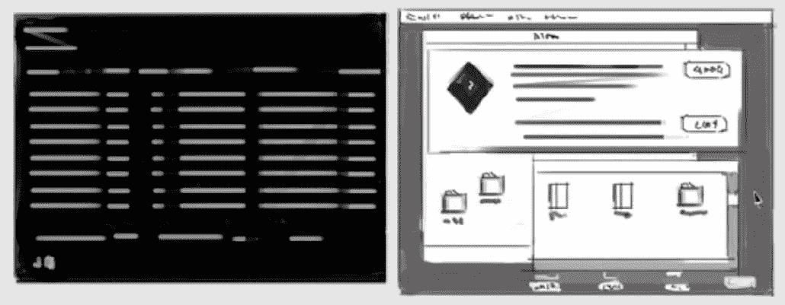

被排除在丽萨之外打击不小，乔布斯转向苹果内部一个小型研究团队。该团队刚做出一台功能完整的小型图形机。乔布斯立刻要求担任负责人，这就是低成本图形机麦金塔，简称Mac。那时IBM PC已开始攻城，“蓝西装”行动起来了。

### 苹果为何要请来职业经理人
Mac与传统机不同，界面友好设计个性化，试图打开想象窗口，成为通往艺术、教育、商业的入口，不只是机器。

IBM的PC设计从企业出发，丑陋冷血笨重，只是工具。

苹果内部被分团队，Mac团队很年轻平均21岁，成员兼具音乐家诗人艺术家与电脑科学家身份，常在办公室挂海盗旗显示反叛。Mac团队与丽萨、苹果II团队竞争激烈，内部气氛不健康。

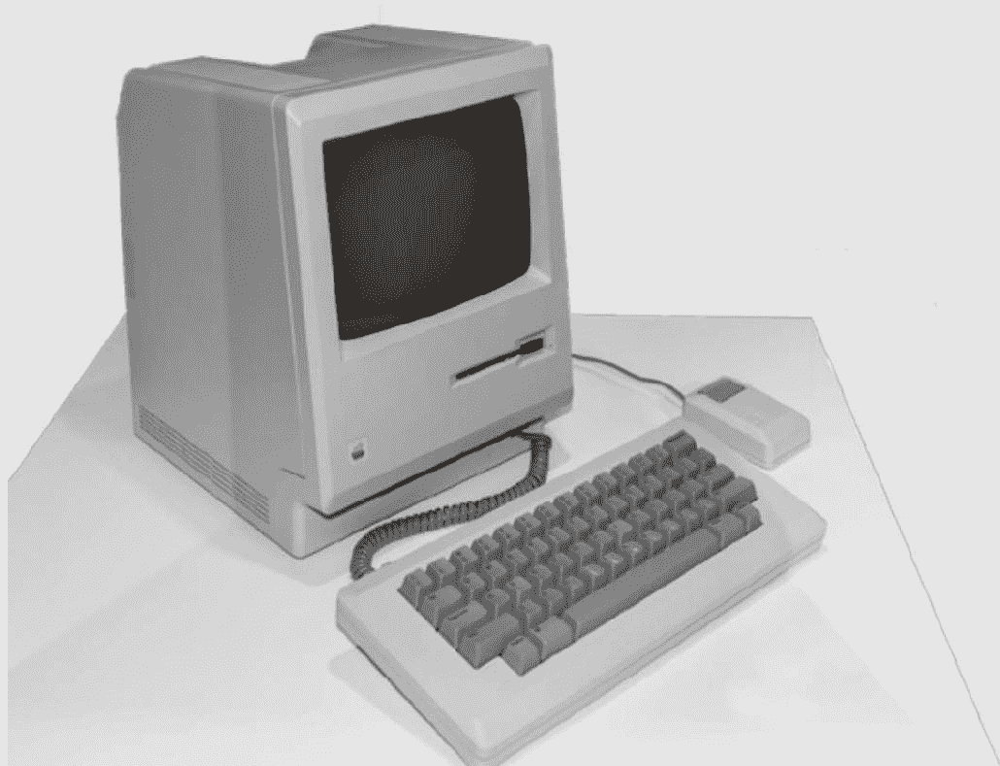

理论上完美但丽萨成品未成爆款。耗费200人一年工作，售价1万美元，相当于今天2.3万美元。人们甚至不明白它是什么，彻底失败。

相反1984年1月发布时Mac起初表现不错，但很快动力衰减。

1985年几乎所有苹果粉丝都买了Mac，危机却潜伏。批评者认为机器无法提升效率，只是玩具。说得没错，问世一年后市场上缺乏软件，因乔布斯团队未做出办公应用。Mac只有绘图写作两款主要软件，售价比IBM PC高1000美元，约合今天2300美元，且因图形界面占内存，内存不足导致换程序要换软盘。

当时20台PC卖出一台Mac。分析师认为苹果数月内会完蛋，连苹果II也卖不过IBM PC。乔布斯投入太多心血，不愿相信数字，觉得Mac应是最畅销电脑。对他而言说不通，未来机怎么会卖不动？

期间Mac给盖茨两年使用权，让其为Mac做软件。苹果未把微软当对手，只盯IBM。乔布斯不了解盖茨投机本性，这决定带来毁灭打击。

为Mac开发软件时，盖茨意识到图形界面对文本DOS构成威胁，于是团队在DOS上做图形层，起名Windows 1.0。

系统 bug 多且不美观，但至少让DOS免于被淘汰，苹果图像堡垒出现第一道裂缝。

Mac销量不及预期时，斯卡利与乔布斯关系恶化。斯卡利主张把钱投在苹果II延续寿命，乔布斯不同意，认为有窗口图像的未来更值得。

1985年董事会召集决定乔布斯去留，因两人分歧无法调和。董事会意见分裂，最终选择斯卡利。访谈中乔布斯说：斯卡利毁掉了我十年建立的一切。

卸任后Mac被Adobe拯救。Adobe为Mac做优质软件并发明多语言排版。1987年Mac销量达年100万台，与IBM接近，这一切没有乔布斯参与。

我对彩色Mac有美好回忆，小学1998年就有。最爱的两个游戏是《水晶任务》和《跳方块》，想起来就想下载。

### 被开除后的第二次创业
被苹果解雇后，乔布斯反思并认识到不成熟，不再晃荡嗑瓜子，开始穿鞋专业化。人们常说有两个乔布斯：开除前与开除后。

1985年他召集忠诚前同事开启NeXT冒险。

NeXT聚焦前沿科技硬件软件公司。团队立即为新机制作操作系统NeXTSTEP。NeXT电脑昂贵，起价6500美元，约今天14000美元。

1988年NeXT目标对标大型机与Unix，优势小而强悍，宣称机器相当于台式大学。可存大量信息，有高级检索，能解决大学级复杂问题。

被问目的时乔布斯答：希望孩子能在宿舍用它弄清如何治愈癌症。

这话奇怪但有来历。乔布斯带Mac大学推广时遇诺贝尔化学教授难题，他想教学生实验室合成DNA却不顺利。学生只能课本学习，因本科生做实验太贵。教授知道电脑可模拟DNA合成，那是超级电脑功能，于是希望乔布斯为大学造一台小而强悍、1MB内存高清屏的电脑。

正是请求催生1988年上市的NeXT机，配置8MB内存、256MB硬盘、25兆赫处理器。

除此，NeXTSTEP让App制作变简单，尤其图形界面。需要输入名字框？拖过去就行。需要按钮？拖动即可，这在当时前沿。

乔布斯曾评价，用DOS做App需20人两年，NeXTSTEP只需3人半年。Mac带来图形界面，NeXTSTEP带来现代软件设计，其便捷度直接影响万维网诞生。

1989年乔布斯预测月销1万台，为此建自动化工厂月产能15万台。至1993年停产，总共售出5万台。NeXT硬件退出舞台，但NeXTSTEP OS沿用至今，移植后更名OpenStep。

1997年苹果买下OpenStep并让乔布斯回董事会，2000年重任CEO。

NeXTSTEP成为Mac OS X与iOS奠基技术。

### 万维网诞生的真实动机
范内瓦·布什、利克莱德、恩格尔巴特的远见一步步引向今天。80年代互联网用于分享数据，但封闭网络间难以互通，并不具革命性。建立在互联网上的万维网才释放知识增长潜力，为人类进步添浓墨重彩。

1980年CERN有1万员工，位于瑞士，拥有大型强子对撞机等设备。需求庞大，邮件为主要交流。跨项目合作时混乱，科学家需要记录结果、团队、电话等工具。

1984年多数项目协调靠不断更新信息，人来人往导致丢失，不同电脑间文件常打不开。

CERN请来英国科学家蒂姆·伯纳斯—李解决。他研究超文本并开发ENQUIRE，实际未达预期。问题一是并非所有人可进入全部页面，二是只能在同一目录文件间跳转。

为解决，他改变权限：所有人可通过ENQUIRE获取全部页面，信息存于网络以防兼容问题。每个链接可跳至任意类别页面。

伯纳斯—李认为物理世界被结构分层，但信息关系混乱且不断变化，这映射人类自然联想。若画关联图，形状像网，混乱却各有联结。布什的Memex有相似心理。

超文本适合建模CERN变化混乱信息，系统可自然成长适应。万维网归功于超文本。HTML为超文本标记语言缩写，HTTP为超文本传输协议缩写，无超文本无互联网。

1989年3月13日他写下建造“带类型化链接超文本数据库”提案。虽标题枯燥，在上司麦克·森德尔鼓励下开始实施。

### 网络雏形的冷启动
一年内超文本数据库项目启动，却无人使用。为推广，他把员工电话号码全部录入。这是阴招但有效。CERN电话簿成为历史，也是互联网最早网页之一。

不久他做了网页报告，该报告内容至今仍在网上。

很快CERN外的人也开始把信息放到网上。几年后引发最强劲信息大爆炸，信息以前所未有速度传播，打破壁垒实现全球化。范内瓦·布什的设想终成现实。

蒂姆·伯纳斯-李在命名自己的发明时曾反复斟酌，先后考虑过信息网眼 Information Mesh、信息矿 Information Mine，以及信息的矿 Mine of Information。最终他定名为万维网 World Wide Web。换句话说，如今我们习惯念叨的“WWW……”本也可能变成“IM”或“MO”……

### 科技闯入音乐：雅达利的时代
80 年代后期的音乐是我一直痴迷的对象。身为音乐制作人，我最着迷的点在于，面对当时设备极度受限的状况，电子音乐人究竟是怎么把作品做出来的。

### 雅达利 ST，1985 年的音乐电脑
雅达利 ST 的售价比 Mac 更亲民，配置反而更强。它是首台售价跌破1000美元且标配1MB内存的机器，对电子音乐的推进作用堪称关键。
借助这台机器，乐迷们第一次能够在电脑上调用 Cubase 或 Logic 这类软件轻松进行创作。
1989 年问世的 Cubase，成为首个采用图形界面的专业制作工具。此前绝大多数音乐软件仍停留在文字命令阶段。
ST 的黑白显示屏视觉负担轻，看起来接近纸面。它的响应延迟极低，已能媲美专业器材，低延迟意味着按下按键的瞬间音符立刻响起。Fatboy Slim，也就是诺曼·库克的个人项目、麦当娜、Aphex Twin 爱飞克斯双胞胎，以及以 Sandstorm 出名的 DJ 达鲁，都在不同时期用到过这台雅达利 ST。
与此同时，电子合成器热度持续攀升，重塑了流行音乐的声响面貌。Soft Cell 的 Tainted Love、Eurythmics 舞韵合唱团的《甜蜜的梦》 Sweet Dreams 都是早期代表。

### 罗兰 TR-808：被嫌弃的鼓机逆袭
1980 年罗兰发布了 TR-808 鼓机，坊间简称 808。初登场时它几乎是商业上的败笔，制作人与乐手普遍认为它糟糕透了，声响太过人工化、太电了，与真实鼓组相去甚远。
但也有人被它的音色深深吸引。那种古怪、合成、癫狂、锋利的声音此前从未出现过。808 还是首台支持自行设定节奏而非仅用预设的鼓机。操作上十分直观，它会不断循环内置节拍，听见喜欢的部分就直接点一下加入。想象空间被彻底打开，随意试探往往能拼出事先想不到的段落。更妙的是，它所产生的频段似乎天生就是为取悦耳朵而生。
80 年代初，芝加哥的电台 DJ 偏爱混搭各式舞曲，从老迪斯科唱片到最新嘻哈都有。部分 DJ 更进一步，把现场播放的唱片用盘式磁带录下来，再混进新的曲目里。鼓机正好补上了最后一块拼图。808 那种尖利粗糙的质感，慢慢成了芝加哥与底特律的声音符号。
这种音乐传播速度惊人。一个 DJ 把磁带递给朋友，朋友再拷几份传给下一批人，等你反应过来时整首歌已在芝加哥传开。这种风格被叫做浩室 house，自上世纪50年代摇滚诞生以来，很少有音乐现象能比它更具影响力。
1985 年，杰西·桑德斯 Jesse Saunders 完成了首张浩室唱片 On and On，里面大量实验性地使用了 808。从此 DJ 间的竞争愈发白热化。
1985 年，只要芝加哥年轻人手里有一台电子鼓，就在做浩室。他们不是传统意义上的音乐家，却精通相对简单的电子鼓和合成器使用。很快，808 在电子乐里的分量就等同于吉他里的 Fender Stratocaster。时至今日它的影响仍在，trap 音乐里仍大面积使用 808 的响弦 snare、踩镲 high hat、底鼓 kicks。坎耶·维斯特 Kanye West 甚至用专辑《心碎节拍》808's and Heartbreak 向它致敬。

### 科技如何重塑早期电子乐
罗兰鼓机与低音合成器深度塑造了芝加哥浩室、底特律电子以及纽约的电子场景，并逐步扩散到全球。
那股强劲的芝加哥声浪在 1986 年先抵达英国北方，之后蔓延至南方。
1989 年夏天，成千上万人涌入商业化的地下浩室派对 raves。当时伦敦南部每周就有两百多场，媒体报道后全英迅速引爆。我始终觉得，这是最后一场凝聚力如此强、以音乐为核心的革命。这波狂欢后来被叫做“第二个爱之夏季” Summer of Love，因其与 1969 年的“爱之夏季”多处呼应：当年是摇滚，现在是电子；当年是 LSD，如今是摇头丸。正如那句话说的，给历史足够时间，它会押韵。
1991 年，英国舞曲的 BPM 越来越快，并开始混入老迪斯科、breakbeats 与 funk 唱片，比如詹姆斯·布朗，以制造更狂野硬核的质感。90 年代中期，我至今最爱的电子流派之一——英国车库舞曲在伦敦诞生。
电子音乐持续演化，分化出鼓打贝斯 drum and bass、trance、EDM 电子舞曲、ambient 氛围音乐、dub 等诸多分支。如今电子舞曲的形式多到数不清。可以毫不夸张地说，今天的音乐几乎都含有电子成分。

## 第三部分 大扩张
### 第十二章 1990-1999：数据年代的集体怀旧
九十年代开启时，整体气氛格外轻松。冷战在这一阶段正式落幕，尽管海湾战争一触即发。该 decade 涌现的公众人物有 O.J.辛普森 OJ Simpson、戴安娜王妃、莫尼卡·莱温斯基 Monica Lewinsky。在本书梳理的各个时期里，这是我唯一亲身经历的十年，所以对我而言格外不同。
垃圾摇滚在西雅图诞生，既是一种音乐形态也是穿衣风格，被涅槃 Nirvana 推向高峰。它充满愤怒与犬儒，是 X 世代的号角。Blink-182、绿日 Green Day 等把朋克带进主流视野。英国则由绿洲 Oasis 与 the Verve 掀起更商业化的 60 年代回潮。辣妹组合 Spice Girls 等让锐舞、嘻哈与流行一起进入大众视线。贾斯汀·汀布莱克 Justin Timberlake、克里斯蒂娜·阿奎莱拉 Christina Aguilera、布兰妮·斯皮尔斯 Britney Spears 都曾在米老鼠俱乐部 Mickey Mouse Club 上台演出。
情景喜剧风靡全球，《宋飞正传》 Seinfeld 这部号称“无主题”的剧集轰动世界。1991 年上映的《泰坦尼克号》《狮子王》《阿甘正传》《黑衣人》《侏罗纪公园》《小鬼当家》《黑客帝国》《玩具总动员》等，如今仍被视作经典。
与此同时，互联网开始全球化连接人与人。文化多元化抬头，从“世界音乐”的流行就能看出端倪，外国电影也掀起一波热潮。
时尚走向多元，哥特装、垃圾摇滚风格的法兰绒、宽松造型、带点嬉皮士味道的单品都成为主流。极限运动与“酷一点，兄弟” Radical dude 的口号大行其道。我记得当时几乎所有面向儿童的电视广告都要放骑 BMX 或滑板的内容来显得潮。8 岁那年我买了辆廉价荧光黄塑料 BMX，后来不慎摔进后院泳池里被折成两截，我难过得哭了。
西方社会愈发开放，经济也持续繁荣。这种繁荣催生出一种矛盾：东方哲学尤其是环保主义，与年轻人追逐的创业精神显得格格不入。80 与 90 年代的经济好日子带来了婴儿潮的回潮，这批人后来被称为千禧一代。走在时代前沿的是第一代在互联世界中长大的人，其中包括碧昂丝、罗杰·费德勒、马克·扎克伯格、哈里王子和尤塞恩·博尔特。
多数西方国家经济上行，就业增加，通胀回落，互联网的爆发带来空前繁荣。1991 至 2001 年是史上最长的一轮经济扩张，由技术驱动，被称为新经济。
经济衰退仿佛已成历史。美国在 1996 至 2000 四年间，时薪上涨了 10%，仿佛人人领了奖金。
互联网让计算机的用途从辅助大脑转向沟通与知识探索。90 年代里，电子邮件成为最火的应用，比传统邮寄更快更便宜，实际上基本免费。除了邮件，聊天室也愈发流行，来自各地的虚拟社群可以在里面聊自己感兴趣的话题。
硬件也迎来了爆发。1990 至 1999 年间，电脑性能飙升，平均内存从 1048 KB 跃至 1 GB。对比之下，80 年代平均内存只从 128 KB 增加到 1048 KB，摩尔定律在此得到印证。
MP3 播放器、在线下载、数字图书馆与数码相机相继普及，数字革命在 90 年代后期正式拉开帷幕。
Mac 的销量自 1990 年起大幅下滑。微软 Windows 3.0，一个运行在 DOS 上的图形界面，一年内售出 3000 万份，把 Mac 挤到边缘。IBM 曾试图以自家 OS/2 系统对抗比尔·盖茨，但最终失败。
科学领域也有关键突破：暗能量被认为占宇宙能量的 70%，DNA 开始用于刑事鉴定，多莉 Dolly 成为首例成功克隆的哺乳动物，哈勃太空望远镜升空，永久改写了天文学。

## 第一条短信，1992 年的诞生
90 年代之前，手机价格高得离谱，青少年根本买不起。出门后只能靠投币电话联系。约好几点在哪见就必须准时到，否则朋友当天就找不到你。对守时的人来说，这简直完美。
90 年代后期，技术飞速发展带动手机降价，大多数年轻人，或他们慷慨的父母，已能负担得起。
手机普及的同时，短信把沟通推向新高度。它让信息传递变得极快，像“我晚5分钟”“我在外面”“你在哪”这类短句随手可发。如今每天全球发送的消息已达几万亿条。
它学名是短消息服务 SMS，之所以叫短，是因为一条最多 160 个字符。
首条短信由英国 22 岁的尼尔·帕普沃思 Neil Papworth 发出。他当时在一家电信承包商任开发工程师，受命为沃达丰 Vodafone 开发信息服务。内容只有“圣诞快乐”，收件人是沃达丰主管理查德·贾维斯，当时他应该正沉浸在办公室圣诞派对里。那个年代手机还没键盘，帕普沃思只能在电脑上打出这条信息。
故事似乎到此为止，对吧？从此大家就能互相发消息了。实际上没那么快。大多数早期的 GSM 手机根本不支持发短信。最初短信是单向的，由运营商推送到用户设备，主要是网络通知，比如账单提醒。芬兰诺基亚是首家引入用户主动发送短信服务的厂商，时间是 1993 年。
1999 年短信才实现跨网络传输。2007 年短信发送量首次超越通话量。如今短信是全球使用最广泛的数据应用，81% 的手机用户都在用。

## 第一部智能手机：1994 年的西蒙
如果你随便问人第一部全触屏智能手机是哪款，多数会说是初代 iPhone，或有点科技史知识的会说是 LG 熊猫。都错了。
你可能记得，马丁·库珀在 1984 年发布了震惊世界的摩托罗拉 DynaTAC x8000 第一部手机。它实现了无线通信，却谈不上智能。
要说真正的智能手机，得跳到 1992 年。当时最原始的掌上电脑 PDA 正流行，笔记本也刚出现。其他公司还在摸索通信功能怎么融合，IBM 已在 Comdex 计算机展上展示了一款智能手机原型。
IBM 在展示这款迷你原型时，悄然改写了历史。它具备 PDA 功能，并配有 4.5 英寸的大触摸屏，完善后于 1994 年上市，命名为西蒙个人通信设备 Simon Personal Communicator。
它能做什么？除了通话，西蒙还能收发传真与邮件，还内置通讯录、日历、待办、计算器、世界时钟、记事本等应用，全靠触摸屏和手写笔操作。配置上它有 1 MB 内存、1 MB 闪存、16 MHz 处理器，速度接近当时入门级台式机。概念太超前，认知跟不上。受更薄翻盖机冲击，西蒙仅售出 5 万台，于 1995 年 2 月停产，生命周期不足一年。
放在今天，西蒙听起来平常，但在当时它是革命性的。它的前瞻性太强，智能手机行业直到 13 年后才重新认识到，适配设备的屏幕比实体按键更优。2007 年 iPhone 重启这一思路。下一章我们会讲 iPhone 背后的故事。

## 1994 年，网络大爆炸
互联网已是生活基建，为之人们发明了无数技术。如今网上有超过18亿个网站、40多亿用户。它诞生后是如何变得如此关键的？
1989年，蒂姆·伯纳斯-李在欧洲核子研究组织办公室用 NeXTSTEP 电脑搭建起网络，目的就是让信息浏览更轻松。1991年，欧洲核子研究组织开源了万维网代码，几年内席卷全球。互联网在1991年8月起步时只有一个站点：万维网项目。到1992年站点增至10个。
起初网络禁止商业行为，直到1992年国会推翻禁令。1993年CERN把网络免费开放。年底时全球用户达1400万，但网站仅130个。
当时网络只是以统一文本呈现，内容单薄且需记忆代码，门槛极高。于是图形浏览器诞生，图形界面再次发挥作用，让普通人也能轻松上手。
1993年马克·安德森发布 Mosaic，这是首款广泛使用的图形浏览器。它让浏览不再需要编程知识，不过搜索信息仍像今天一样方便。我们后面会谈到搜索问题如何被解决。
Mosaic 如野火般蔓延，网页数从1993年的130个激增至1994年的2738个，增幅超2000%。Mosaic 后来演进为 Netscape 浏览器，一年半内用户从零涨到6500万，打破软件纪录。
对 Netscape 我有亲身记忆。那时我五六岁，父亲是大学讲师，放学后他工作我就用他的办公电脑。那会儿我用 Netscape 查宇宙，从行星到黑洞理论，互联网好上手，小孩子也能用。
Netscape 1994年盈利7500万美元，1995年达3.7亿美元，成为当时增长最快的公司。但比尔·盖茨显然不这么看。
看在 Netscape 1995年的成功，比尔·盖茨要求微软员工优先做互联网，最终诞生了 Internet Explorer 这款免费浏览器，而 Netscape 软件包售价49美元，企业版更贵。
90年代末，节奏加快十倍。时间感被压缩，业内开始用“互联网年”算时间。没人能停歇，竞争对手转瞬兴衰。传统公司年增约10%，互联网公司月增可达15%。那段时间，个人电脑是地球上最赚钱的产品。
编程人才严重短缺，失业率接近零。两年网龄顶得上上一代十年的经验。印度因英语优势被互联网公司青睐，大量招聘。1997年班加罗尔的三年级小学生已开始学电脑。

### 早期网络的信息混乱
Netscape 图形浏览器让上网更易，却也带来新烦恼。随着内容激增，怎么找所需信息变得愈发困难。信息需要更有序的整理方式……
起初网络像图书馆一样靠目录分类，这已是过时思路。雅虎等站点做得稍好一些，会人工分类并建立搜索索引，但效率低且难归类。于是需要更精准的归纳逻辑，除了分类，为什么不按热度排序，把点击率最高放顶端？后面章节会详细讲这种想法如何催生谷歌。

### AOL 崛起：1994 年的网络先锋
互联网爆发初期，大量网络公司涌现试图理解这个新世界。其中最耀眼的之一就是美国在线 America Online AOL。
要讲清 AOL，得回到 1985 年。
很少人知道，在蒂姆·伯纳斯-李创建万维网前，就有人想建封闭网络。1985年，名为 Quantum Link 简称 Q-Link 的线上服务诞生。它基于超文本，却只为 Commodore 64 设计。它提供动态图标、聊天室、在线多人游戏如猜字，还供应学习文章与资源，甚至支持首个图像化大型网络游戏。
1985年 Q-Link 只有100用户，到1986年涨至5万。可见超文本联网潜力巨大且受欢迎，即便月费22美元也不妨碍使用。虽然只在晚间和周末开放，大家仍觉得它将成为下一个爆款。
1989年10月，Q-Link 与苹果的合作失败后更名为美国在线。AOL 从此成为更友好的上网入口。
1991年 DOS 与 Windows 版 AOL 即将推出。新用户群推动公司高速增长。
市场营销负责人简·布兰特是 AOL 神速扩张的关键人物。1993年她做了一件事，打破了当时商业常规。

简·布兰特上一份工作里把自己撰写的书籍通过邮件白送给读者，用这种方式把书的曝光度拉高，销量随之大幅攀升。这一打法效果相当突出。AOL 把她招进公司后，也照搬了同样思路。他们印发了约九万张 AOL 软盘，盘里装着免费软件和试用授权。内部预期能有 1% 的人转为付费，结果实际转化率冲到 10%，直接把公司推向了高峰。后来 AOL 延续这套路推广光盘，全世界生产的光盘里一度有一半都贴着 AOL 的标志。正因如此，AOL 迅速登顶成为当时最大的网络服务商。布兰特这一招后来被称作“地毯式营销”。

1993 年一直在寻找机会的比尔·盖茨看中了 AOL 的潜力，想与团队聊聊。双方没有谈拢，微软便自建网络项目，最终演化为 MSN 聊天器和 IE 浏览器。

随后几年，AOL 与多家教育机构联手，包括美国教师联盟、国家地理出版、美国国会图书馆和教育部，推出了首个实时家庭作业辅导、首个在线课程以及首个线上展览。

短短三年内，AOL 的用户规模突破一千万人。

1996 年，微软与 AOL 达成捆绑协议，把 AOL 与 Windows 系统打包。1997 年订阅量激增至三千四百万。1998 年 11 月，AOL 宣布以 42 亿美元收购 Netscape，同时上线了 AIM 即时通讯。那段时间平均每六分钟就新增一名注册用户。2000 年 1 月，AOL 与时代华纳宣布合并，组建 AOL 时代华纳，声称要成为全球最大的传媒集团。AOL 变得如此庞大，以至于外界常常把它等同于整个互联网。

### 转折与衰退
AOL 这个名字如今已经很陌生，说明中间一定出了问题。症结在哪？

AOL 的门户按分类浏览，在搜索引擎出现前尚算可用，但终究只是权宜之计。更关键的是，1994 年前后互联网迎来大爆发，大量免费的独立网站涌现，直接瓦解了当初支撑 AOL 崛起的商业模式。

最致命的打击是 2000 年的互联网大崩盘。AOL 创下了企业亏损纪录，损失高达一千亿美元。到了那个阶段，人们更习惯用谷歌这类搜索引擎在网上检索信息，对 AOL 及其同类产品的需求也就消失了。

## PlayStation 如何诞生？（1994）
谁不喜欢索尼的 PlayStation？它领先时代，带来无数快乐，并开启了游戏的 3D 时代。它缘起何处？

PlayStation 之所以诞生，起因是“恨”。故事的主角是索尼工程师久多良木健。1988 年，他看到女儿在任天堂娱乐系统上玩游戏，对电子游戏产生兴趣。随后他联系任天堂，希望为即将推出的超级任天堂打造一款 CD-ROM 驱动器，项目代号超级光驱。任天堂同意了，1990 年久多良木健在索尼内部组建研发团队，计划第二年 CES 上展示 SNES-CD，内部代号 PlayStation。它不仅能玩任天堂游戏，还能播放音频、数据和视频 CD，对 1991 年的人来说是件大事。

不幸的是，一天后任天堂宣布终止合作，转投飞利浦。SNES-CD 似乎要胎死腹中。

此事让索尼总裁大贺典雄非常恼火。任天堂为缓和关系表示可在非游戏领域合作，久多良木健拒绝，决意研发能与其抗衡的游戏主机。只是其他索尼员工不愿把重心全放在游戏上。久多良木健另起炉灶，团队搬到索尼音乐总部。

1993 年，索尼音乐 CEO 与久多良木健共同成立索尼计算机娱乐。得到索尼音乐支持算是因祸得福，市场营销、创意和光盘制造都能内部自供，节省成本。

一年后，在东京一家旅馆里，索尼向软件厂商展示主机和发行计划。会上气氛热烈，艺电和南梦宫均表达兴趣。该系统后来的主打卖点是 3D 画面和 CD 运行能力，当时远超时代。配置为 34 兆赫 CPU 和 2 MB 内存，在那个年代已属强悍。

1994 年 12 月，PlayStation 在日本首发。竞争对手是世嘉土星，但 PlayStation 完胜，价格更有优势，且土星双核 CPU 让开发困难，游戏数量有限。1995 年全球发售，热度大幅提升。后来的发展已载入史册。

PlayStation 成为首款销量突破一亿的游戏机，成为 90 后标志性消费品。任天堂 N64 也未能压过索尼。索尼随后推出 PS2，后来成为史上最畅销家用游戏机，销量 1.55 亿台。PS3 和 PS4 延续辉煌，奠定了索尼家用游戏机霸主地位。

### 手柄上的四枚符号
设计手柄时，索尼设计师后藤祯佑采用了四个符号。三角形代表玩家视角，方块代表纸张，即菜单或游戏中的文件，O 和 X 分别代表“是/对”和“否/不对”——在西方市场意义对调，X 变成了肯定性的“继续/执行”。

索尼首个自主研发的大作是《Motor Toon Grand Prix》，由一个名为 Poly 的小团队制作。该团队后来发展为 Polyphony Digital，《跑车浪漫旅》系列的开发商。

1994 年，南梦宫开发了名为“System II”的测试平台，可模拟 PS1。首个使用该平台的大作是格斗游戏的测试版，专注 3D 人物材质。这个实验项目最终成为《铁拳》，成为 PS 的明星作品。

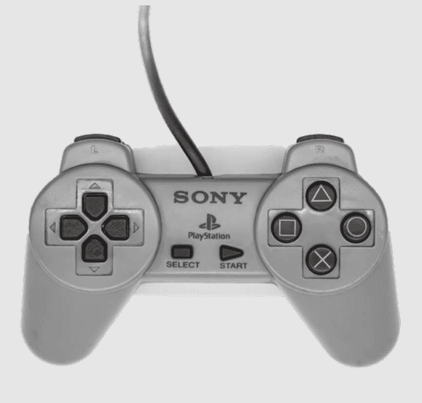

索尼 PlayStation

## 雅虎的黄金年代（1994）
互联网尚未成型时，雅虎是构建网络的支柱之一。

雅虎网 1994 年由斯坦福毕业生杨致远和戴维·费罗创立。当时网站信息杂乱无章，雅虎的定位是为人们提供互联网门户。快速获取所需信息的有效手段几乎没有。雅虎 1996 年上市，到 1997 年已成为互联网流量第二大的网站，仅次于 AOL。

1998 年，两名斯坦福博士拉里·佩奇和谢尔盖·布林找上雅虎，称有新产品。他们刚做出 PageRank，一种能快速找到相关信息的搜索引擎算法。两名博士要价 100 万美元，雅虎拒绝，认为 PageRank 会分流用户，减少流量和收入。后来 PageRank 成了谷歌。

互联网崩盘几乎让所有科技公司遭受损失，雅虎和谷歌等少数公司挺了过来，但雅虎并未毫发无损。股价从每股 118 美元跌至 4.06 美元，此后再也没回到过那个高点。

2002 年雅虎仍是访问量最大的网站，但崩盘后，旧式的网络门户被抛弃，用户转向谷歌这类搜索引擎。雅虎技术落后。为求存活，雅虎累计收购 114 家公司，却没有一次能扳回颓势。

最终，雅虎各业务都被更优秀的公司超越。雅虎邮箱被 Gmail 和 Hotmail 取代，聊天工具被 WhatsApp、微信、Facebook 等取代。雅虎新闻也被社交媒体、专业新闻网站和 YouTube 击败。

用户逐渐放弃雅虎服务，广告收入和利润持续下滑。到 2010 年，雅虎已所剩无几。

## Windows 95 重塑桌面（1995）
1995 年的 Windows 已不再是套在 DOS 外面的壳。之前的微软系统不稳定，给用户留下很差印象。系统经常无故死机，设置复杂。Windows 95 取代 DOS，成为稳定可靠的新血液。本版加入了任务栏和开始菜单等功能，并在之后数十年一直保留。有趣的是，布莱恩·伊诺设计的开机音效至今仍让人怀旧。

## 一部动画如何拯救皮克斯（1995）
皮克斯 1979 年成立时是卢卡斯影业旗下 Graphics Group，计算机图形公司，由埃德温·卡特姆领衔。

该部门自成立起就想制作一部电脑动画长片。1979 年立项的《The Works》计划 80 年代初上映，时长 90 分钟，但并未实现。当时计算机太慢，团队曾算出渲染所需时间长达七年。1986 年项目喊停。若按计划完成，它会是第一部全 3D CGI 长片。

项目停摆时仅完成十分之一。为解决算力问题，皮克斯决定自研硬件，于是有了皮克斯图像电脑，售价 21.9 万美元，性能比传统设备快约 50 倍，原本 15 分钟的渲染被压缩到 18 秒。

1986 年卢卡斯影业拟出售 Graphics Group，数月后该部门独立为皮克斯，卡特姆担任总裁。羽翼未丰的皮克斯需要投资，多年后才找到史蒂夫·乔布斯。乔布斯欣赏艺术与科技结合，投入 1000 万美元，持有 70% 股权。虽然股权变化，皮克斯的目标未变：打造完全由电脑合成的动画长片。

沃尔特·迪士尼工作室随后购买数台皮克斯图像电脑及定制软件，用于 CAPS 计算机动画制作系统。借助 CAPS，2D 动画的绘制上色可由电脑辅助。

首部使用 CAPS 的影片是《救难小英雄》1990 年上映，业界首部 100% 电脑辅助制作的动画长片。《阿拉丁》1992 年、《狮子王》1994 年也使用该系统，直到 1995 年《风中奇缘》才换新系统。

迪士尼采购的 CAPS 电脑数量有限，皮克斯电脑销量平平。乔布斯意识到财务危机，建议将皮克斯图像电脑推向工程、地质、医疗等市场。员工约翰·拉塞特制作了《小台灯》1986 年和《锡铁小兵》1988 年等全 CGI 短片展示技术。拉塞特擅长赋予静物拟人个性，这正是皮克斯早期风格。

CGI 短片让迪士尼看到潜力。讽刺的是，拉塞特曾因力推全 CGI 电影被迪士尼解雇，观看《小台灯》后迪士尼又想请他回去，他断然拒绝留在皮克斯，对卡特姆说：“去迪士尼我只能当小导演，留在皮克斯才有机会创造历史。”

拉塞特常与史蒂夫·乔布斯待在一起。

尽管有震撼短片，皮克斯图像电脑仅售出 300 台。公司还尝试 CGI 电视广告和软件，但杯水车薪。销售不足威胁生存，亏损加剧。乔布斯追加投资，总投入近 5000 万美元，换来完全控制权，却也几乎个人破产。皮克斯最终卖掉硬件业务并裁员。幸运的是 1991 年按摩尔定律，动画级计算机已足以在合理时间内完成长片渲染。

### 迪士尼与皮克斯的联姻
迪士尼意识到请不回拉塞特，决定与皮克斯合作。投资 2600 万美元制作三部电脑动画长片，首部《玩具总动员》。若无此合同，皮克斯可能几年内倒闭。皮克斯启动项目，拉塞特执导，乔布斯任执行制片。1992 年交付的 30 秒测试片段给迪士尼留下深刻印象。

合作并非顺利。迪士尼高层不断否定剧本创意，例如把伍迪设定为急躁固执的“讨厌鬼”。

1993 年，片子过半时为迪士尼高管放映，结果灾难。迪士尼高层厌恶此片，拉塞特自己也不满意，他称影片“充斥着我见过最不幸最卑鄙的角色”。

制作被叫停，CGI 长片梦想似乎破灭。但拉塞特坚持两周内改好剧本，并做到。1994 年制作重启。以当时技术制作如此影片极难：每帧渲染需 45 分钟至 30 小时，人物对白片段每 8 秒需动画师一周，每条镜头经 8 个团队之手，需 300 台处理器 24 小时运转。

困境仍在。皮克斯虽获资金，但图像电脑、软件和广告收入仍无法覆盖《玩具总动员》开销。乔布斯焦虑，投资 5000 万美元眼看要失败，甚至 1994 年考虑把皮克斯卖给贺曼贺卡或微软联合创始人保罗·艾伦。

影片完成后担忧消散。看到《玩具总动员》美丽世界，乔布斯惊叹，认定皮克斯将创造历史。

《玩具总动员》全球票房超过 3.73 亿美元。皮克斯 1995 年 11 月 29 日 IPO，规模超过 Netscape，成为当年最大 IPO。

初看这部电影时震撼感犹在，其逼真度超越当时所有 CGI 动画，每片叶子细节都恰到好处。它超出了行业想象。《玩具总动员》衍生出玩具、游戏、主题乐园景点和续集，让 90 年代玩具再度流行。它凭借一己之力拯救了皮克斯。

## 亚马逊如何开启电商时代（1995）
在网上挑选商品并一小时内送到家，十年前的这个想法听起来像科幻。如今亚马逊在欧洲和美国每天提供当日达。迄今全球售出 3.5 亿件商品，配送覆盖 185 个国家。如此庞大的公司如何起家？

如苹果创始故事一样，亚马逊也在车库起步，创始人杰夫·贝佐斯。当时他在华尔街公司 D.E. Shaw & Co. 担任副总裁，目睹互联网用户极速增长，嗅到无限潜力。

与老板讨论时，网上商店的创意成形。贝佐斯起初认为做全品类网上商店不现实，于是列出 20 个可网上销售的品类，包括软件、书籍、办公用品、服饰、音乐。书籍最适合首发，购买体验一致且选择丰富。

贝佐斯与妻子麦肯齐·塔特尔及创业老兵谢尔·卡凡一起创立公司。1994 年 7 月在华盛顿州注册，名为 Cadabra Inc。有人把名字听成 Cadaver，即尸体，寓意不佳，于是改名。贝佐斯解释选择 Amazon 因为它是世界最大流域河流，象征成为最大网上零售商的目标。当时网站按字母排序，他希望排在前面。1994 年 11 月 1 日 Amazon.com 正式注册，团队开始扩张。

1995年4月3日，亚马逊试运营的第一笔订单成交。书名是道格拉斯·霍夫施塔特的《流体概念与创造性类比：思想基本机制的计算机模型》，名字拗口但很抓眼球。三个月后，7月16日，网站正式对外开放，搭载了一个可检索的书目库，收录超过100万种图书。即便如此，西雅图仓库里实际囤货只有约2000册，剩下的都是按单向批发商调货。

早期根本没有专业的打包团队，员工白天负责下单，夜里亲手打包，第二天一早再送到邮局。这种粗放运作，直到亚马逊被放到雅虎首页后才改变。流量暴增让订单瞬间失控，试运营首月就把书寄到了45个国家，当时甚至不需要美国地址。

贝佐斯曾估算，顺利的话2000年营收能到7400万美元，特别顺利则1.44亿美元。现实远超预期，2000年实际销售额冲到16.4亿美元。扩张的狂飙就此开启，当时的内部口号是“快速做大”Get Big Fast。

1997年5月15日，亚马逊完成IPO，融资5400万美元，市值一度达到4.38亿美元。

团队很快意识到仅靠图书天花板太低，于是拓展品类，先从DVD和音乐入手，同时在特拉华州新建配送中心，并把原有仓库扩建了七成。

1998到2000年间，亚马逊接连收购互联网电影资料库IMDb、德国在线书店Telebuch和Bookpages，精准切入英德市场，同时产品线也加入了玩具和电子产品。

高速增长让贝佐斯登上《时代周刊》年度人物榜单。更让人意外的是，亚马逊长期不公布盈利，直到2001年第四季度才宣布实现500万美元利润，巨额收入几乎全部再投入。贝佐斯的说法是，客户体验优先于利润。公司持续攀升，最终在21世纪第二个十年后成为主流力量。

## 1997：MP3播放器问世
### 提前三十年的构想
1979年，英国23岁的凯恩·克雷默和21岁的友人詹姆斯·坎贝尔画出了一个点子：烟盒大小的便携式固态音乐播放器，项目代号IXI，带显示屏和四向导航键。听起来和后来的设备几乎一模一样。

当时固态存储极其罕见，克雷默却笃定技术会成熟。他预言高品质数字播放器会迎来市场，无论是用户还是唱片公司都不会拒绝。他还设想了数字分发模式，像后来的iTunes商店，以及用可更换芯片存歌的方案。可以说，实体媒介的终结在他1979年的笔记里就已经写下。

克雷默递交了专利申请，并组建公司。起步很顺利，预计订单高达3.28亿美元，连披头士的保罗·麦卡特尼都参与投资。

但1988年专利快到期时，公司需要32万美元续费，董事会意见分裂，专利最终过期。克雷默因此无法为任何使用该思路的产品主张权利。讽刺的是，MP3压缩格式要到四年后才出现。那台诞生于英国的早期MP3播放器最终没能量产。

### 首台量产机 MPMan
真正进入市场的首款便携MP3播放器叫MPMan，1997年由三星子公司世韩信息系统推出。机身基于闪存，提供32MB和64MB两种容量，约能装6到12首歌，配有小LCD屏显示曲目。

作为一个音乐爱好者，我记得2004年买的第一台MP3是银色1GB的Conia，小得像拇指。同学当时都不信这么小能装1GB，反复翻看侧面的容量标。

克雷默后来怎么样了？
2008年苹果承认克雷默是iPod技术的先驱。那时他已沦落为一名贫困的家具推销员。每日邮报采访时他回忆，正在梯子上刷漆时，苹果法务部门的人打来电话，用美式口音说要承认他的贡献。他起初以为是恶作剧。

这桩事和一起专利诉讼有关。专利公司Burst起诉苹果iPod侵权，苹果把克雷默请到美国出庭，用他1979年IXI的原始图纸证明iPod思路源自克雷默。苹果借此解决了法律问题，也给了他时间补偿。

他后来吐槽，苹果送了他一台iPod，但八个月后就坏了。下一章会讲iPod如何装下千首歌并引发革命。

## 1997：乔布斯重返苹果
90年代乔布斯离开苹果后，公司状态堪忧：
1991年推出便携Mac PowerBook，销量平平。
1993年推出手写笔电脑牛顿，彻底失败。
1993年7月财报显示单季度亏损1.88亿美元。总裁迈克尔·斯宾德勒接替约翰·斯卡利担任CEO，重组公司，斯卡利辞去董事长。

同期乔布斯在NeXT，砍掉硬件主攻软件。

1995年微软发布Windows 95，操作更友好更像Mac。苹果在竞争、零部件短缺、误判用户需求等多重压力下举步维艰。

同年，乔布斯担任执行制片，皮克斯出品《玩具总动员》，首部全电脑合成商业动画长片上映。皮克斯借此上市，IPO募得1.4亿美元。

1996年苹果宣布以4.3亿美元收购NeXT，乔布斯被聘为顾问。外界普遍认为这是对当年放走他的补偿。

NeXTSTEP后来演化为Mac OS X，也是iPhone系统iOS的基础，后续章节会详述。

1997年NeXT被收购后，乔布斯进入董事会，重新掌握实权。

同年苹果推出“Think Different”“不同凡想”广告语。

1998年，彩色一体机iMac让苹果重回盈利，惊艳PC行业。牛顿项目被正式终止，公司走上正轨。

## 1998：谷歌诞生的前夜
这一时期计算机正走进寻常家庭，和80年代截然不同。普通人能快速触达全球信息，但海量网页需要被整理，否则毫无用处。

1995年拉里·佩奇在斯坦福做数字图书馆项目。一晚他做梦，梦见把整个互联网塞进老旧的大学服务器。醒来后他算了一下，这可行，但只能存链接而非网页本身。由此萌生了排序程序的想法。

同一时间，俄罗斯移民谢尔盖·布林在斯坦福读计算机，对数据挖掘充满兴趣。1995年两人相识，佩奇分享了下载全网的设想，布林则把互联网视作最有价值的数据集。

佩奇自小与电脑为伴，父亲是计算机科学家。1978年6岁的他就开始用父亲的机器，那在当时极罕见。据他回忆，自己是小学里第一个用Word交作业的学生。童年里他痴迷科学和计算机杂志。

电脑也深刻影响了布林，他想用这项技术做真正有用的事，而非仅玩游戏。80年代他与朋友在Mac上写过初代AI程序、引力模拟器、聊天机器人和字母识别。这一段经历奠定了他后来的方向。

两人童年相似，目标一致：把世界信息理顺。佩奇从反向链接入手，先以斯坦福首页为起点，发现有1万个外部链接指向它。但浏览器一次只能展示10条结果，他们需要一种排序机制，让最重要链接排在前面，像流行度排名。

在多次调试后，他们让斯坦福首页的链接按相关度排列成功。核心思路由布林提出：指向一个网站的链接越多，其排名越高。两人本无意做搜索引擎，只是研究数据的副产品撞上了实用价值。

他们把这个算法命名为PageRank，既取自佩奇的名字，也暗指网页排序。

他们意识到组织全球信息的价值巨大。1996年3月，他们在BackRub项目下开始抓取网站索引。6月到8月间，索引量飙升至7500万个网页，占用207GB空间。

1998年他们为PageRank申请专利，并把公司改名为Google。

2000年佩奇已经在谈论用AI存储全网信息以回答任何问题，这正是今天我们使用谷歌的方式：辩论或好奇时，打开谷歌。1998年每日搜索量仅1万次，2000年增至5000万，2018年突破35亿。

今天的谷歌远不止搜索：邮箱、地图、YouTube、Android、数据分析、量子计算、AI等构成其21世纪版图。

## 1999：纳普斯特点燃免费音乐
就在谷歌重塑搜索时，音乐界被MP3分享颠覆。如今年轻人视音乐为免费的，这种观念源头就是纳普斯特。

1998年，19岁的东北大学大一新生肖恩·范宁和朋友创立纳普斯特。概念很简单：在互联网上免费共享存储的音乐。

范宁退学后迅速上线，消息在聊天室病毒式传播，数月内用户达4万。

纳普斯特是首个大规模端对端文件分享软件，用户互联后可直接下载对方硬盘里的文件。起初有人怀疑谁愿公开硬盘，但免费音乐的诱惑让数百万人铤而走险。

90年代CD仍主流，一张约18美元，若只钟情一首歌性价比极低。1999年美国音乐产业收入约150亿美元，纳普斯特一夜之间撼动了它。

到2001年，使用人数超过2500万，校园内风靡。

唱片公司怒斥其为“公开抢劫”。长达一年的诉讼后，2001年7月纳普斯特被迫关停。

观念却已扎根。随后涌现大量免费分享站点：LimeWire、电驴、Soulseek等，监管难以遏制。CD销量在十年间持续下滑。2001年乔布斯推出iTunes数字商店，才把合法下载推向主流，后来Spotify等流媒体彻底终结唱片公司的垄断。

## 1999：表情符号诞生记
表情符号由日本的栗田穣崇于1999年创造。灵感来自对寻呼机用户的观察。90年代中期，日本年轻人偏爱某款寻呼机，只因它自带爱心符号，可在短信里发送。

该品牌下一代产品取消了爱心，导致用户抗议流失，转投他机。栗田由此受到启发。1999年他参与设计手机系统，设想若手机支持一套可选符号，在日本会大受欢迎。事实证明他是对的，日本之外全世界都爱上了它。

## 1999：全世界的千年虫焦虑
2000年新年前夕，人们只担心两件事：派对怎么嗨，以及千年虫怎么办。

问题出在大量系统仅用两位数字存年份，2000年会被误读为1900年。外界担忧这将引发全球崩溃，虽然具体影响不明，但没人敢赌。90年代末企业、政府和个人投入巨资修复，据说花费达数十亿美元。

今日看来很荒诞，但当时的预测极其可怕。有人估算修复总成本高达1.1万亿美元，银行到核设施都可能瘫痪。

公众恐慌蔓延。美国调查显示42%的人打算囤粮储水，34%担心银行系统崩溃，51%不愿在2000年1月1日前后坐飞机。

1999年12月31日午夜，全世界屏息……基本什么也没发生，大家只是喝醉了。

当然也有局部故障：美国一颗军用卫星监控系统崩溃，花了几周才恢复。

1999年，60亿人口中极少经历战争。世界相对和平繁荣。互联网用9年改写一切，人类无法回头。2000年，人类进入所谓后现代生活。

### 第十三章 2000-2009 个性化科技十年
狂欢过后，千年虫恐惧消退，2000年到来带着期待，却很快被9·11袭击打破。袭击不仅震动美国，也冲击全球。我记得第二天学校把我们带到西澳的椭圆场避险，之后几天老师让我们在教室里谈感受。那时的震惊难以形容。

十年间制造业从美国日本外迁。欧元2002年正式流通。中国经济加速，到2009年占全球经济近9%，成为第三大经济体。

2001年安然丑闻震动商界。2008年次贷危机再次上演，对冲基金和银行把垃圾贷款包装成高级资产。同期伯纳德·麦道夫以房地产泡沫为掩护，制造全球最大庞氏骗局，携600多亿美元失踪。

真人秀爆发，《老大哥》和《美国偶像》风靡，澳洲也推出本土版。我曾以为这是昙花一现，结果它们长期占据电视。

音乐上节奏布鲁斯回潮，情绪摇滚兴起。My Chemical Romance、Fallout Boy等乐队借助Myspace等平台崛起。

时尚趋向未来感，银色裤装、染尖刺头、紧身裤、喇叭裤、工装裤混杂。

这一代人被称为Z世代，X世代的孩子。他们在Facebook、YouTube伴随下长大，更包容，也更具创业精神。2008年金融危机后，化名中本聪的人发布比特币白皮书，提出替代金融系统。

MSN Messenger成为青少年最酷的交流方式，上线即心跳。Windows XP、Vista、7相继发布。2003年3G标准让手机上网成为现实。2004年Gmail上线。

到2005年左右手机价格大幅下降，人手一部。微软Zune和PSP也是热门设备。这是消费科技黄金期，一切都在有序进化。

### 互联网大崩盘（2000 年）

几乎每个人都听过互联网泡沫的故事：在那个年代，只要脑子里冒出一个和网络沾边的点子，似乎就能轻易换来几百万美元。现实当然没那么简单，但整体氛围确实如此。1993 年起，Mosaic 浏览器，也就是后来的 Netscape，让普通人第一次能顺畅地在网上冲浪。随后搜索引擎出现，大家都能迅速找到想要的信息。于是到 90 年代末，互联网被视作一种全新的经济体，一种有魔力的力量，似乎能重塑整个世界。

世界确实被改变了，这是毋庸置疑的。但人们把期望拔得太高，投资也过于冲动。只要公司名字带 .com，就有人不问青红皂白地砸钱，哪怕它连像样的商业计划书都拿不出来。一旦上市，员工往往一夜暴富。搞什么计划书还有必要吗？那批明星公司大办奢华的网络派对，仿佛一切都理所应当……且慢，故事还没结束。

#### 泡沫破裂：从狂欢到崩盘
股价攀升时，外围的人也急着挤进来分一杯羹，甚至街头的出租车司机都在推荐互联网股票。但转折点已经到来，有人看清这些企业根本不产生利润，赶紧撤离。

2000 年下半年，投资者的认知终于归位，派对戛然而止。恐慌中大家争相出逃。截至 2000 年 11 月，互联网相关的市值蒸发超过 1.7 万亿美元，相当于 75% 的价值消失。次年科技股的连锁反应让整个股市损失约 5 万亿美元。多数科技公司元气大伤。Blucora 就是一个过山车式的例子，这家搜索引擎公司在 2000 年 3 月的股价高达每股 1305 美元，到 2002 年跌至每股 2 美元。最终挺过来的只有谷歌和亚马逊。危机集中在科技板块，次年大盘便开始回暖。

### 被 Blockbuster 拒之门外的 Netflix（2000 年）
80 年代中期到 90 年代末，家用录像带是主流。VHS 很贵，看片只能靠电视节目，受限严重。于是 Blockbuster Video 这类租赁店填补了空白，成为几亿人周末的常态。

后来 Netflix、Hulu、亚马逊 Prime Video 等线上点播服务彻底颠覆了传统租赁。Blockbuster 反应迟缓，尽管早早收到过邀请。

2000 年，Netflix 提出可以帮 Blockbuster 解决线上业务的问题，代价是让消费者能在 Blockbuster 店内取件，减少邮寄环节。当时 Netflix 的商业模式仍以邮寄 DVD 为主。前 CFO 巴里·麦卡锡回忆说，对方几乎是笑着把他们请出了办公室。故事并未结束。2007 年，Blockbuster 的在线业务一度压过 Netflix。Netflix 管理层甚至想把公司卖给 Blockbuster 挽回颜面，但 Blockbuster 认为发展方向不对而拒绝。

同年内部出现分歧，公司更换 CEO。接手的是吉姆·凯伊斯，他对未来方向缺乏清晰判断，决定把重心放在门店租赁而非网络娱乐上，这是个致命误判。凯伊斯毫不担心，2008 年他公开表示：“Netflix 作为对手，不值一提。”

仅 18 个月后，Blockbuster 市值蒸发 85%。三年后申请破产。Blockbuster 消失，Netflix 却蓬勃发展，全球订阅用户超过 1 亿，彻底改变了大家的娱乐习惯。

### 诺基亚的腾飞（2000 年）
诺基亚 1011 在 1992 年推出，是第一部商用的 GSM 手机。此前不久，约玛·奥利拉接管公司，将业务重心转向电信，并剥离了其他业务。时机恰到好处。1991 年诺基亚仍在亏损，到 1999 年实现 40 亿美元利润，并超越摩托罗拉成为全球最大手机厂商。

2000 年，诺基亚打出王牌：3310。这部被称摔不坏的机器，操作简单、耐用、待机长、按键顺手，还附带几款上瘾的小游戏。全球销量达到 1.26 亿台，成为经典。我姐姐当年有一部大红色的，我总爱拿来玩游戏。那时各种手机壳在同龄人中很流行。

3310 只是开始。随后还有 2005 年的 6280，以及 2007 年的 N95，后者搭载了在美国上市的首款 500 万像素摄像头，并配备 GPS 地图。

我记得 2004 年自己花钱买的第一部手机是诺基亚 6020，彩屏、3.5MB 内存，后置 30 万像素摄像头，清晰度大约是现在标准的四十分之一。今天看来会笑，但当年能用巴掌大的设备拍视频，对我而言很新鲜。

### 拍照手机诞生（2000 年）
如今手机摄像头已能匹敌入门级单反。很多人会想：手机都能拍照，为什么还要带个笨重的相机？方便又够用，甚至已有电影用 iPhone 拍摄。

第一部内置摄像头的手机是夏普推出的 J-phone，2000 年 11 月在日本上市，分辨率约 11 万像素。

2001 年 BBC 在网站上报道了这项发明，当时的评论很有意思：

我喜欢拍照，但不想再带额外设备。如果手机能集相机、日程、浏览器就太酷了。——美国 嘉布丽尔·埃诺

能拍照的手机很新奇，暗访时很方便，伪装得好谁会想到手机上藏摄像头呢？——芬兰 乔安娜

走路时可以拍可爱的小狗。——美国 约翰

这是明显的进步，所有便携设备最终都会整合进一台通信终端。——英国 朱利安·艾利特

朱利安的判断完全正确，乔安娜的想法虽然有点怪，也没错。

### iPod 让苹果成为文化符号（2001 年）
它是白色的，差不多一副扑克牌大小，配着一个奇特的滚轮，能装下约 1000 首歌。起初没人知道怎么评价它，很快它无处不在。

史蒂夫·乔布斯发布初代 iPod 时，苹果的前瞻性已经显现。成功源于这样的背景：

数码相机和便携摄像机开始普及，Napster 等文件共享让数字音乐火爆。苹果为 Mac 平台推出了一系列 i 生活应用，用来处理照片、视频和音乐。研究后他们发现，i 应用能支持现有设备，但现有设备并不支持 i 应用。

于是提出一个问题：如果做一台专门为苹果软件服务的硬件会怎样？这意味着软件和硬件的集成水平前所未有。苹果本想从照片入手，利用相机趋势，最终选择音乐，因为音乐是生活的一部分，乔布斯也热爱音乐。当时没有绝对的领导者，正是进入的黄金时机。

初代 iPod 是巨大飞跃。它不像随身听或基于芯片的 MP3 播放器那样只能塞进一张 CD 的曲目。它用较薄的硬盘把整张音乐库装进口袋。5GB 容量相当于 2000 年台式机内存的一半左右，却能随身携带。续航甚至超过苹果笔记本，可达 10 小时。最具创新的是可滚动的控制轮。

当时 MP3 播放器操作很糟，得逐首点击。面对上千首歌根本没法用。控制轮靠加速度算法改变滚动速度，点击时有声音和触感反馈，让切歌从苦差变成乐趣。这是界面设计的突破。

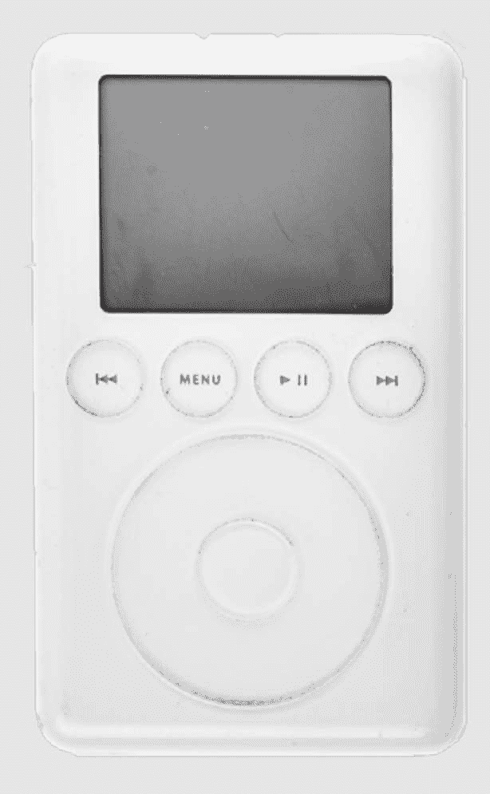
初代 iPod

从存储看，iPod 也非常小巧，便携、轻薄耐用，奠定了苹果标志性的设计语言。不过设计过程并不轻松。

#### 我不管，再薄一点！
据前苹果员工阿密特·乔德哈利称，乔布斯是这样逼工程师减薄的：

原型完成后，工程师向乔布斯展示，他把玩几下后说：“不行，太大了。”

工程师解释说已经到极限了。乔布斯没说话，走到鱼缸旁把 iPod 丢进去，气泡从底部升起。

“有气泡，说明里面还有空间！把它做薄！”被怒斥后，工程师实现了不可能。最初 iPod 只支持 Mac，销量平平。直到项目负责人托尼·法德尔说服乔布斯支持 Windows，销量才爆发。

### 马斯克的太空梦想（2002 年）
埃隆·马斯克 1971 年生于南非。宾夕法尼亚大学取得商学与物理学位后，与人共同创立 PayPal。公司成功后他成为富人，随后把目光投向天空。某天他突发奇想，想把植物送上火星来激励人类。向美国公司询问发射成本，被告知约 8000 万美元，他并不满意，随后尝试购买翻新的俄罗斯洲际弹道导弹，未能如愿。

## SpaceX 的崛起
与此同时，21 世纪初美国宇航局开始退出发射业务。马斯克认为机会来了，于 2002 年创立太空探索技术公司 SpaceX。

进入 2010 年代后媒体热炒 SpaceX，但这些成绩并非空穴来风。

### SpaceX 实现了哪些前所未有的目标？
此前只有政府能完成的里程碑：

·2008 年，首个让火箭进入预定轨道的私营公司
·2009 年，首个由私企开发的将商业卫星送入预定轨道的火箭
·2010 年，首个成功发射、绕轨运行并回收航天器的私营公司
·2012 年，首个向国际空间站运送货物的私营公司

### 为人类开启新纪元
让可回收、可重复使用的火箭发射、入轨、平稳垂直着陆，一直被视为神秘难题。可重复使用能大幅降低成本并缩短周转。SpaceX 让它成为常态：

·2015 年，轨道火箭首次发射并垂直返回着陆
·2017 年，使用过的轨道火箭重新发射并着陆

2019 年，SpaceX 完成首次私人载人舱访问国际空间站任务。

### 社交媒体兴起（2002 年）
人类天生喜欢社交。有一个著名实验：如果单个人在街中间仰望天空，没人理会；如果一群人一起看，更多人会停下来。羊群效应是社交媒体成功的关键。

第一个流行的社交网站是 TheGlobe.com，1995 年上线，1998 年上市，创下 IPO 首日涨幅纪录。CEO 斯蒂芬·帕特诺成为众多互联网新贵之一。

21 世纪初社交媒体变化极快，前辈们很难找到制胜法门。

#### Friendster（2002 年）
Friendster 由加拿大程序员乔纳森·艾布拉姆斯于 2002 年创立。他此前是 Netscape 高级软件工程师，1998 年离职。

2001 年左右他思考如何把线上线下生活整合。“人们在网上要么匿名，要么用网名，我想把真实身份带进网络。” 他以 Match.com 为基础构思，设想主页展示真实信息并与其他人连接，模拟现实人际关系。灵感部分源自 Napster。2002 年域名注册，数月内用户破 300 万。

2003 年谷歌曾出价 3000 万美元收购，被拒绝。当时它是最顶级的社交网络，直到 2004 年 4 月被 Myspace 超越。在美国衰退后，亚洲市场仍保持活力，直到 Facebook 出现。2009 年宣告结束，2015 年正式关闭。

#### Myspace（2004 年）
我高中时，Myspace 正是主流。自定义主页、听歌、设置主页歌曲占据大量课余时间。“最佳好友”功能限制 8 人，引发无数闹剧。

Myspace 起源于 2003 年 8 月，由在线营销公司 eUniverse 的员工创立。他们喜欢 Friendster，决定自己做一个。eUniverse 全力支持。

到 2004 年用户群以青少年为主，音乐导向明显，地下乐队如 Taking Back Sunday 因此走红。2005 年初曾与 Facebook 谈收购，扎克伯格要价 7500 万美元告吹。2006 年迎来第一亿用户，2007 年底成为社交网站领头羊。

好景不长，2008 年中被 Facebook 超越。Myspace 固守音乐，不愿增加新功能，逐渐衰落。青少年步入大学后，更倾向于更成熟的 Facebook。

#### Facebook（2004 年）
Facebook 与前辈的区别在于，马克·扎克伯格持续不断地调整产品以留住用户。

扎克伯格 1984 年出生，自幼接触电脑，父亲教他编程。中学时他已能独立写软件，父亲还请来导师指导。

高中时他与朋友开发媒体播放器 Synapse，能学习听众习惯并推荐音乐，引起微软等公司兴趣，但他想要更大挑战。

进入哈佛后，他写了 Facemash，一个带照片投票排名的交友网站。周末上线，周一服务器就被挤爆。

同期，哈佛学生卡梅伦·温克莱沃斯、泰勒·温克莱沃斯和迪夫亚·纳伦德拉筹建“哈佛连接”，两名程序员毕业后需新人接手。听闻 Facemash 后，他们邀请扎克伯格加入。他接受邀请，但另有打算。据说他借用“哈佛连接”概念，却拖延项目并 secretly 开发自己的网站。最终诞生了“The Facebook”，后更名为 Facebook，历史由此展开。

今天，Facebook 公司业务远超社交网络本身。

如今 Facebook 坐拥 14 亿活跃用户，是仅次于谷歌和 YouTube 的全球第三大访问网站。每隔 20 分钟，平台上就会有 100 万个链接被分享、200 万个好友请求发出、300 万条私信送达。单日产生的数据高达 4PB，照片上传量达到 3.5 亿张。市值一度超过 5 万亿美元，这数字比可口可乐、百事可乐和麦当劳三家加总还要高。

但随着体量膨胀，厌恶的声音也在升高。数据泄露丑闻、社会负面效应让公司元气大伤。大量研究指出 Facebook 会削弱幸福感，CT 扫描甚至显示社交网络明显降低了发育中大脑的同理心。关于 Facebook 的社会影响，后续章节会展开更多讨论。

### YouTube 把世界搬进镜头（2005）

#### 给 YouTube 的一句感谢

没有 YouTube，就不会有 ColdFusion，也不会有你现在读到的这本书。我是 2009 年开始在上面发片的，第一条是演示 HTC HD2 上跑 3D UI 安卓插件的视频。频道真正起色，是我展示初代三星 Galaxy Note 的功能时。那会儿手机普遍很小，大屏机型也就是现在说的手机平板，极少见。我立刻意识到趋势：一部机器就能随意查文件、上网、看电脑版网页。算力越强，屏幕需求越大，这点当时很直观。只是首代 Note 还是太像手机了，我在 YouTube 上放出几套改装系统，让它更像迷你电脑，当时觉得这样才够酷。看我视频的人显然也有同感。我常带着那块大板砖到处折腾，不懂行的朋友总笑我。如今大多数智能手机都长这样了。当年我觉得手机要进化成全新形态，我只是先把未来的可能性展示出来。能跟全世界分享想法并得到回响，我很庆幸。谢谢你，YouTube！

#### 免费视频让我们忘了珍惜

小时候想看段视频，只能在录像机后来是 DVD 上找。今天我们能随时免费看近乎无限的内容。

YouTube 的出现彻底改写世界，其规模让人难以置信。每月人们共观看 70 亿小时视频。把 60 秒内上传的内容全看完，需要连播 15 天；把一天内上传的全部看完，则要 65 年。

YouTube 是互联网第二大访问站点，也是第二大搜索引擎，这足以说明它的重要性。怎么走到这一步的，讲个故事就明白。

#### 约会网站如何变成 YouTube

源头可追溯到埃隆·马斯克等创立的 PayPal。改变世界的三名 PayPal 员工是查德·赫利、陈士骏和贾德·卡林姆。他们离职后想做一个视频约会网站，取名 TuneIn Hookup，让用户上传视频找对象。结果并不成功。尤其是女性，并不愿意靠上传视频来找伴。网站举步维艰，还在 Craigslist 上买广告，甚至愿意给女性 20 美元报酬来上传，依旧无人问津。

转机在 2005 年出现。卡林姆发现，要在网上找到珍妮·杰克逊 2004 年超级碗走光片段非常困难。他由此想到，必须有更简单的方式上传和分享视频。技术早已具备，关键是如何搭建网站。

卡林姆意识到可以用 TuneIn Hookup 现有的代码作为基础，改造成通用视频站，允许上传任何类型的视频。不久站点更名 YouTube。2005 年 2 月 14 日，公司在加州一家披萨店楼上简陋的房间成立。首条视频《逛动物园的我》于 2005 年 4 月 23 日上传，卡林姆笨拙地介绍着身后的大象。

没多久就诞生了首个百万播放作品。2005 年 9 月耐克的一支广告，巴西球星罗纳尔迪尼奥用脚上演各种技巧。2006 年 10 月，谷歌以 16.5 亿美元收购了 YouTube。

#### 从小众到现象级的狂奔

谷歌称 YouTube 为互联网的下一步，语气很大胆，放在只有 65 名员工的小公司身上更显惊人。但谷歌笃定它会火，且与既有网站不同。很快它成为网络上增速最快的站点之一。

名字本身就点明了概念：YouTube 里的 You 就是说你是制片人。2006 年《时代》杂志把年度人物定为“你”，封面写着：“你。没错，就是你。你能掌控信息时代。欢迎来到你的世界。”正如所言，YouTube 上可以随心展示任何东西。

2007 年 5 月 YouTube 合作伙伴计划上线，改变很多人的人生。普通人第一次能把爱好变成生意。约一年后，最头部创作者年收入已达六位数。随后 YouTube 真正进入主流。

21 世纪初的指数式增长造就了独特的生态，很快开始取代电视。BBC 报道称，对 18 岁以下人群而言 YouTube 的重要性已超过电视。贾斯汀·比伯这样的真人明星从这里冒出，《大城小妞》《工作狂》等剧也先以 YouTube 短剧起家，后登陆黄金档。

今天 YouTube 是全球最大的视频发行商，从独立短片到新闻，再到全新节目形态。早已不只是猫片、视频博客和病毒视频。

2010 年 TED 掌门人克里斯·安德森指出，YouTube 推动的大众学习可能催生人类历史上最大规模的学习周期。或许尚未完全实现，但我已通过教程学会了视频剪辑，你大概也有类似经历。全球各地的学校和大学里播放 YouTube 视频已成常态，人类首次拥有了公共的数字视频库。

只是也有人说 YouTube 近来失去了初心，企业利益、广告丑闻、对盈利创作者的打压愈演愈烈。写作时它仍处不稳定状态，未来可能继续变数。像 Twitch 这样的直播竞争对手，以及去中心化加密视频网站会走向何方，拭目以待。

### 智能手机时代来临（2007）

现在的智能手机本质上就是掌中迷你电脑。按功效和处理速度看，增长远超个人电脑。

我在 2013 年的 ColdFusion 视频《有史以来最伟大的故事》里说过，20 世纪前十年将是未来与现在的交织期。智能手机会变得极强，更新换代让人跟不上，会出现 64 位移动系统，也会看到手机与电脑融合。想象一下，五年后你的手机跟现在的电脑一样强，还能跑电脑软件。

当时听起来有点夸张，写书时却已大体成真。未来与现在的交织已然开始。2018 年苹果宣布缩小 iOS 与 MacOS 的差距，让 iOS 应用能在 Mac 上运行。同年，使用与智能手机同款芯片的全功能 Windows 电脑已上市。按照 2013 年预测的速度，再加上对更快更高效处理器的巨额投入，小小手机取得的进步完全不负摩尔定律。

手机革命有趣，背后故事更值得玩味。主角是一款闪亮的新 iPhone。

#### iPhone（2007）：转折之作

iPhone 销量已超 10 亿部，是史上最具影响力的产品。它把智能手机变成了通往世界的入口，你想要的一切都在手中。

##### 触控从笨拙到灵敏的跨越

智能设备出现前，人机交互混乱不堪。21 世纪初想放大图片，要点菜单、选缩放、再选倍数。如今两指捏合即可。

触摸屏 21 世纪初就存在，但主流是电阻式触摸，需要用力按压，像 ATM 或车站信息屏那样。小屏幕上触控不准、让人焦躁。90 年代苹果曾在牛顿上尝试电阻触摸，未获成功。这是首先要解决的问题。

LG 在 2006 年推出全电阻触屏手机，体验跟 ATM 机一样笨重。到了 2007 年，全球都在寻找手机的新形态，只差一家公司在正确的时间推出正确产品。

iPhone 的种子其实在 1999 年种下，并非来自苹果，而是小公司 FingerWorks。创始人韦恩·韦斯特曼研究出电容式多点触控的实用方案，反应快、灵敏、精准，还能识别不同手指和触控意图。

21 世纪初 FingerWorks 发布 iGesture 触控板，帮助手腕受伤者用电脑而不加重病情，因为韦斯特曼自己的手腕有问题。他还写了简易 AI 来区分意外触碰与有意操作，手势被解读后转为复制、粘贴、滚动等快捷键。FingerWorks 在 iPhone 诞生中发挥了关键作用。

##### iPod 面对手机的威胁

2004 年 iPod 占苹果销售额的 50%，公司却心有不安。手机开始能播 MP3，与 iPod 越来越像，苹果担心会被严重冲击。

此前提及让苹果做手机，史蒂夫·乔布斯极度抗拒。他怕业务失焦，也认为手机市场小众，只适合极客。当时的手机体验不佳，难怪苹果会错过。

同一时期 iPod 业务负责人托尼·法德尔建议在 iPod 上加入 WiFi。乔布斯还在犹豫时，法德尔和他的小团队已开始开发一款融合 PDA 功能的新 iPod。结果堪称灾难：一个靠改装软件上网、只有点按控制轮的 iPod。乔布斯觉得不可行，不是不能用，而是体验糟透了。他让法德尔换个思路。

### 苹果内部的触屏 Mac 设想

苹果内部有支工程师和设计师组成的团队，每周在用户测试室碰头。他们意识到网络与数字革命会让电脑承载更丰富的媒体，鼠标键盘未必是最佳浏览方式。是否能有更流畅的交互？基于这个想法，他们成立了非正式的媒体集成小组。

2002 年一天，员工蒂娜·黄因手腕受伤，把自己的 FingerWorks 设备带到办公室。那是个黑色长方形平板，动动手指就能让电脑完成复杂任务，减轻了手腕负担。对故事而言更重要的是它内置了智能多点触控。

每周开会的几名苹果员工看到了这块平板，正在构思新媒体交互，多点触控看起来是条好路。受启发，他们为营销部门赶制了样片。借助多点手势触控板和投影仪，他们展示了 MacOS X 的高度交互蓝图。核心是在平板上用手指操作 MacOS 元素。这次演示并未打动营销团队，觉得没用。除了能当内部升级版鼠标，当时根本没有产品需要这技术。

媒体集成组没放弃。乔纳森·伊夫每周参加会议，也把概念带给乔布斯，被否决了。乔布斯说这东西只能在坐马桶看书时用。

深想之后乔布斯逐渐接受点子，批准项目。多点触控 MacOS 项目进展缓慢、漏洞百出，最后被终止。

2004 年 7 月乔布斯做了恶性胰腺肿瘤切除手术，他觉得时日无多，想把该在苹果做的事加快做成。

### 乔布斯要的触屏手机

2005 年，程序员兼界面设计师巴斯·奥尔丁接到乔布斯电话，要他做一个能访问滚动通讯录的触控界面样例。乔布斯此刻想做触屏手机。

制作中奥尔丁发现，滚动列表时文字图像到达屏幕顶端就停住，看似滚不动，像是代码出错。过会儿才明白是滑到底了。他想，何不当个“弹簧”特效，用视觉反馈告诉用户已拉到底，而不是系统故障？这就是 iPhone 有名的“橡皮筋”效果诞生记。奥尔丁后来称《超级马里奥兄弟》那种简单直觉的动画启发了他。

乔布斯第一次看到橡皮筋效果时，意识到手机确实可以做触控界面。

与此同时苹果内部还有其他触屏项目在暗中进行。它们看起来很酷，却是一堆支离破碎的概念：一点缩放捏合，加些股票记事本计算器的小玩意，没有统一架构。

乔布斯对这些毫无关联的样片没兴趣，看不出能卖。2005 年初他要求团队两周内拿出成果，只能成功不能失败。

一支小团队用两周时间让首款触屏手机跑起来。重点在外观与功能：触屏怎么打电话？怎么从日历切到浏览器？应用间切换逻辑是什么？令人惊喜的是，两周后他们拿出成果展示给乔布斯。

### 原型出现的那一刻

乔布斯第一次见到原型机时沉默，没有欢呼也没有惊叹。他坐回座位说：“再演示一遍。”事实上他被震惊了。自此项目成为苹果头号机密。差不多这时苹果收购了 FingerWorks，把整个团队吸纳进来。苹果一度只在触控技术上就投入 40 个人。

### 两条路线暗中竞争

苹果有两条路：把已成功的 iPod 扩展成手机，或用 FingerWorks 的触控技术把 MacOS 缩进手机。没人知道哪种更好，乔布斯决定两条都做。

扩展 iPod 队由托尼·法德尔领衔，多点触控 MacOS 队由斯科特·福斯特尔领衔。当时福斯特尔团队不受看好，法德尔拉动了数百万 iPod 销量，还在做 Nano 和 Video iPod。

竞争开打，但双方被禁止互相了解，甚至硬件组不能看软件，软件组不能看硬件。发布会前，连公司内部都没人知道手机最终会是什么样子，也不知道发布会何时召集。

### Rokr 惨败的 iTunes 手机

在这些项目推进时，苹果高管说服乔布斯应对 MP3 手机的渗透。乔布斯同意与摩托罗拉合作做 iTunes 手机。苹果想借此保住 iPod 销量，同时让用户习惯 iTunes 后买 iPod。苹果不参与硬件，只负责整合 iTunes。

最终成品是摩托罗拉 Rokr。发售时已过时，产品糟糕透顶，退货率达到业界平均水平的六倍。消费者期待苹果带来大作，这个显然不是。让摩托罗拉高管震惊的是，乔布斯随即打算在同场发布 iPod Nano。Nano 小到不可思议且是彩屏，乔布斯想借此抹平 Rokr 的负面。2005 年我亲眼看到它首秀，觉得它是史上最美的消费电子之一。

Rokr 失败后，乔布斯转向法德尔团队的 iPod 手机，觉得更安全，但也允许福斯特尔的触控 MacOS 团队继续开发。

### 会打电话的 iPod 方案

法德尔团队尝试多种设计，其中之一像 Video iPod，但加入电话模式。听音乐时它就是普通 iPod，用触控滚轮暂停播放等。拨号时切换到电话模式，整机像转盘电话。乔布斯仍觉得概念可行。

该设计支持 WiFi，还有内置扬声器。早期尝试很快表明，滚轮是累赘。想实现拨号、打字等复杂操作时，滚轮只会更麻烦。有趣的是，乔布斯最初认为“返回”键必不可少，但团队坚持简洁功能更能让消费者信任。

### 到底该用怎样的软件

即便在苹果内部，也没人清楚这东西到底是什么。两个团队为此争执过几次。iPod 团队认为它跟 iPod 一样是便携配件，软件不重要。触控 MacOS 团队则认为它是一个能握在掌中、功能丰富且多点触控的电脑。

托尼·法德尔带领的团队坚持认为新机应该内置强化版的 iPod 套件，而斯科特·福斯特尔的队伍则力推一套精简的 Mac OS X。福斯特尔这边判断移动处理器已强大到足以跑一个阉割版的 Mac OS X。很快团队就在这套精简系统上做出了顺滑的滚动体验，从此把研发航向定下来。那套精简的 Mac OS X 后来就是 iOS。紧接着法德尔的 iPod 手机方案被放弃，全部人力集中到 iOS 上。

软件推进的同时，各类细节问题相继冒头。怎么做到既能解锁又避免口袋里误触？苹果界面工程师弗雷迪·安佐斯在意想不到的地方找到了答案——厕所隔间。一天他搭美国国内航班起身去洗手间，关上隔间门时下意识注意到了门锁的机制。操作极其简单，滑动一下就能打开。这个灵感直接催生了后来家喻户晓的滑动解锁。

与此同时，乔纳森·伊夫在构思硬件的外观语言。尽管想法中途多次调整，他的首张草图已经非常接近量产版。他描绘的是一个没有边界的“水池”，屏幕像魔法般浮现，其他部件不能抢戏。有趣的是，伊夫起初根本不想在机身上留下耳机孔。

### 压力倍增
项目推进十分艰难，保密、竞争和时间的三重挤压让内部情绪愈发焦躁，毕竟一切都是从零开始。那时的触控技术尚不成熟，工程师必须让透明的多点触控屏实现量产可行性，还要研发从未被验证过的定制芯片，解决天线信号问题并优化材质。

本质上，这个从未做过手机的团队正试图打造史上最激进的设备，相当于还没学会走就想跑。可想而知开发遇到的问题极其棘手，任何一次应用崩溃背后的原因都可能多达百万种，从代码缺陷到硬件故障皆有可能。

到了2006年年初，iOS在手机项目中的进展已经可观，但虚拟键盘依旧难用。斯科特·福斯特尔叫停了所有应用层的开发，让全员集中攻坚键盘整整三周。最后有人做出了一套精准的键盘，关键突破是用轻量级AI做输入预测，也就是预判文本。比如敲下“t”后，系统会认为“h”很大概率紧跟，因此在视觉尺寸不变的前提下放大“h”的感应区。谁真正贡献了这项创意外界无从得知，但推测很可能是来自FingerWorks的韦恩·韦斯特曼，毕竟他当时已是多点触控与AI协同的专家。

### 绝境时刻
眼看就要收官，危机却来了。为追求顶级水准，苹果与三星合作打造专属CPU，但苹果没有给三星足够的时间窗口。三星提供的CPU存在会导致系统崩溃的隐患，而离发布日只剩三个月，时间表堪称灾难边缘。

iPhone 许多关键部件都是在开发尾声才仓促塞入的。它的王牌之一谷歌地图就是事后才加入的想法。硬件方面，最初打算的屏幕材质和iPod一样是塑料，项目推进一个月后才改成玻璃。

## 那场改变世界的发布
2007年1月9日，发布会如期登场。即便苹果内部奋战多年，仍没人真正见过最终成品的样子。

乔布斯上台时，手机仍有部分未完成。CPU的漏洞尚未彻底修复，只做了演示用的临时修补，意味着现场随时可能死机。

团队屏着呼吸看着史蒂夫·乔布斯激昂宣布“……我们称它为……iPhone！”现场多数观众热情鼓掌，也有少许迟疑的笑声，仿佛有人以为这是个玩笑。演示整体顺利，流畅滚动的手势黑科技让人惊艳。但对iPod手机团队负责人托尼·法德尔而言，乔布斯做了一件极残忍的事。演示删除联系人时，他兴高采烈地把法德尔的名字从通讯录里划掉，等于公开宣告托尼被踢出局。福斯特尔回忆，排练时乔布斯总会随机删一个名字，却从未删过法德尔。对观众而言这只是功能展示，对内部而言这是信号——法德尔的时代结束了。

这次操作也折射出项目的核心气质：残酷。保密要求之高，足以毁掉婚姻，摧残健康。牺牲无人知晓，而当一切就绪，全世界为iPhone疯狂，发烧友排起长队只为抢一台。

发布当周，我还记得和大我九岁的朋友聊过这件事。我告诉他一款没有实体按键、全屏操作靠精细触控的手机要来了。看过乔布斯演示滚动和手势后，我意识到这对小屏设备是完美交互。他当时双手举起嘲讽道“哇！没有按键耶！”几年后他自己也买了一台。

未来真的到来了，人们拥有了能装进口袋的电脑。如苹果软件工程师亨利·拉米劳克斯所言：“我们把一台Mac压缩进了一个小盒子里。它就是Mac 2号，它有着同样的DNA、同样的延续，从NeXT到Mac再到iPhone一贯如此。”iPhone的算力是1969年NASA载人登月时的数千倍，却极易上手，还能提供完整网络浏览。连小孩拿到也能自如使用，这是对恩格尔巴特图形界面设想的致敬。电容式多点触控与手势打破了人与机器的隔阂。

还有那些细节，比如通话时距离传感器自动暗屏防止脸部误触挂断，加速计感知横竖屏切换，让产品充满魔法感。

iPhone带来的不仅是设备，更是认知转变。信息与新闻变得即时，人人时刻在线。此后十年，过度连接也带来了新的社会问题。

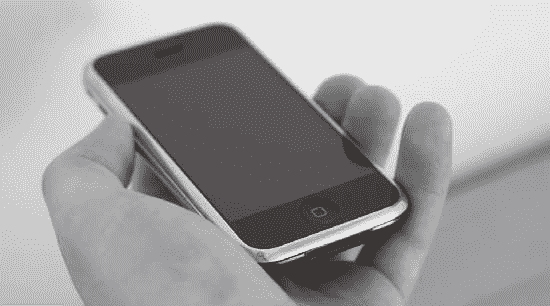

## 掌中电脑时代

热度褪去后销量放缓，2008年上线的App Store让苹果重回高位。

没有App Store，iPhone只会沦为好看好用却难以持续的酷品。起初苹果主推“网络应用”，计划让用户打开Safari访问为iPhone定制的网站，获取基于HTML的游戏与工具。这个方案很快失效，苹果随后宣布推出App Store作为替代。iPhone发布整整一年里，系统里只有16款应用，刚好填满一个主屏——相比之下功能贫乏得惊人：不支持彩信、无摄像、不能复制粘贴等，短板一串。

诺基亚、黑莓等厂商早已提供这些功能，但区别在于这是第一款无按键的手机，屏幕像画布任人发挥。只要设备能跑应用，开发者想做什么就做什么，唯一限制是想象力和硬件。很快应用商店井喷，移动应用成为独立产业。

诺基亚、黑莓、Palm自以为握住了规律，却没看清方向。等他们反应过来想进场时已太迟。想要对抗苹果，必须换思路，而谷歌接受了挑战。

## 安卓崛起：2008年的另一场战争
2003年iPod正火时，安迪·鲁宾与里奇·曼纳在帕洛阿尔托创办了安卓公司。

起初安卓想做数码相机软件，发现市场太小后转向智能手机操作系统，意在对抗诺基亚塞班和微软Windows Mobile。他们认为缺少开放平台会阻碍产品落地，因而打造了开放性系统。

2005年7月，谷歌刚收购YouTube后就盯上了安卓，愿意出5000万美元收购。拿到资金后安卓开始做原型。早期原型像黑莓，有全键盘无触屏，后来改造成触屏版才有竞争力，同期有2006年的LG Prada，以及2007年的iPhone。

21世纪第一个十年后期，安卓扮演关键角色。

几年后，世界进入了我们今天熟悉的格局。正如80年代末Mac与Windows的竞争，iOS与安卓展开了新一轮对决。2008年首款安卓手机面世，是谷歌与HTC合作的G1。它作为安卓首秀不算差，但运行速度、易用性和代码效率都逊于iPhone。

安卓的底牌是开源和可高度定制，任何人和公司都能在此基础上量身改造。策略奏效很快，从手机到汽车、冰箱、便携投影，到处都是安卓的身影。

又一个十年将至，社交媒体把人类前所未有地连在一起，全世界资讯触手可及。下一个十年将见证技术光速演进。

### 第十四章 十年狂飙（2010—2019）
在古老哲学家时代，追求全人类已知知识并非异想天开。但在网络时代这已不可能。截至2017年，人类已知信息的90%都在过去两年内产生。这印证了范内瓦·布什在第九章的预言。知识的积累与传播推动了科技和世界的加速，而21世纪第二个十年这种加速在全球尤为明显。

21世纪第二个十年，发展中国家增速惊人。2000—2012年，全球贫困率减半，是人类经济史上最快时期。当时撒哈拉以南非洲一些国家儿童死亡率已低于1950年的欧洲。数百万非洲居民开始买得起中国制造的智能手机。卫星网络普及让信息获取更易。2017年印度信实公司低价高速的数据服务引发数字革命。可再生能源成本下降叠加气候担忧，推动绿色能源加速。2016年阳光动力2号完成环球飞行，证明太阳能飞机可行。电池技术进步，无人机产业爆发式增长。

创新全球化，小型创业公司如雨后春笋，我身边的朋友也纷纷加入。新型个人出行工具涌现：悬浮滑板、电单车、电动滑板车。美国歌手波兹·马龙（Post Malone）亲切地把电子烟称为“the Mouth Fedora”，电子烟成为文化符号。Uber和Airbnb的出现标志共享经济与零工经济兴起。智能眼镜和智能手表开启新品类生命周期。

时尚拥抱嬉皮士潮流，大胡子小胡子流行，两侧剃短顶部留长的发型当道。超级英雄电影和续集大受欢迎。CGI动画持续强势，2010年《玩具总动员3》成为首部票房破10亿美元的动画。浩室、trap和电子舞曲回潮，流行音乐大量借鉴。网络迷因影响音乐，PSY的《江南Style》和Baauer的《Harlem Shake》登上Billboard。分众化渠道让音乐产业碎片化，Chillwave和bedroom producer获得更多听众。人们在各平台上传分享作品，电子音乐分裂为微流派，如Glo-fi、dream-beat、卧室流行、梦幻流行。只需电脑和网络，一切尽在掌握。

在此背景下，21世纪第二个十年的技术呈抛物线加速。几十年积累的信息技术集中爆发，最直观的体现就在口袋里的手机。半年前的机型半年后就显过时，如此快的消费周期前所未见。

高速发展的代价是成瘾。千禧一代和Z世代对手机依赖严重，社交媒体对年轻人尤其是儿童的心理影响愈发令人担忧。

苹果前工程副总裁亨利·拉米罗曾说：“我发现大家无论何时何地都带着苹果手机。我觉得挺好，但也清楚软件不是我的老婆，我老婆会画油画，她创造的东西永远在那里。而技术呢？20年后，谁还会关心iPhone？”iPhone是21世纪最具影响力的电子设备，而拉米罗正是iPhone软件工程负责人。

2018年，iOS和安卓都推出功能鼓励健康使用，旨在减少使用时长，未来还会有更多类似设计。

移动技术和笔记本发展加速，得益于能效大幅提升。我2017年买的戴尔XPS 15机身轻薄，内存32GB，而发布前三年这几乎不可想象。第二个十年末期，128GB内存的笔记本和16GB内存的手机已成可能，对比2000年时电脑平均内存仅1GB。

存储革命持续。十年初期500GB硬盘厚重如砖，8年后可买到轻薄8TB硬盘，同期手机存储达1TB。

网络攻击与信息泄露加剧。爱德华·斯诺登揭露美国国家安全局全球监控震惊世界。2017年WannaCry勒索软件侵入150国23万台电脑，受害者需付比特币解锁。医院、航空公司、联邦快递等机构均遭攻击。

即便隐私受侵，智能家居如苹果HomePod、亚马逊Alexa走向主流。Anki的AI宠物机器人Vector代表电子宠物诞生。电竞一夜爆红，甚至有人提议纳入2020冬奥。科技公司称王。Facebook以10亿美元收购Instagram，以190亿美元收购WhatsApp，业务版图扩张。亚马逊等电商持续成长，传统商场纷纷倒闭。谷歌因违反欧盟反垄断法被罚50亿美元，创纪录。苹果成为全球市值最高上市公司。

中国发展突出，成功登月并取代美国成为最大贸易国，专利申请量超美国，GDP排名35年内从百名外升至第二，成为世界生产枢纽。中国制造无处不在。印度增速更快，成为全球增长最快主要经济体。日本信用评级下滑，20%人口超65岁，成为老龄化最严重国家，推动机器人研发。其他国家也面临婴儿潮退休潮，养老压力紧张。美国每天约有1万人进入65岁。

第二次十年的后期全球金融危机后经济恢复缓慢，部分分析师认为低利率和印钞只是补丁，导致股市房市膨胀却未创造就业，中产悄然萎缩。经济压力在部分国家引发动荡。2015年叙利亚内战引发自二战以来最大难民潮，德国接纳最多，社会紧张。

经济困境影响美国，2016年大选不满者支持唐纳德·特朗普上台，全球出现惊讶与愤怒，左右极化加剧。社交媒体放大个体声音，分化更严重。极端主义最响，却只强化对立刻板印象。

“假新闻”盛行，事实稀缺。范内瓦·布什未曾预料到这点。主流媒体衰落，标题党泛滥，公众对媒体信任跌至历史低点，进一步加剧极化，对政府和组织的信任整体下滑。

十年开端时人们还能主张拥有自己的观点，到了十年收官能被称作权利的，演变成挑选自己愿意相信的事实、真理与真相。微妙的边界消失了，事实变得模糊。对破碎社会结构感到困惑的人，把期待寄托在几位当代思考者身上——Jordan Peterson、Sam Harris 与 Bret Weinstein。正是 Weinstein 为这群人命名为“知识分子暗网”。

同一时间段，科学探索的脉络同样引人注目。2012 年希格斯玻色子被证实，这是赋予物质质量的粒子；同年 Curiosity 探测器降落火星；2013 年光遗传学实现了对小鼠特定记忆的精准调控；引力波首次被探测到；石墨烯电池进入实验阶段；詹姆斯·韦伯望远镜项目启动，它能够观测太阳系外天体。补充一点，人类直到 1988 年才发现第一颗系外行星，此前根本无此概念。到第二个十年的中叶，已确认的系外行星累计数以千计。

移动浪潮：以 iPad 为起点的 2010 年
2010 年苹果发布首款平板 iPad，具备多点触控互动。这是 Steve Jobs 因胰腺癌离世前主导的终章新品。上市后立刻热卖，几个月内即成为史上最畅销的非手机类技术产品。此前平板市场混乱，正如同 iPhone 出现前触屏手机的局面。安卓平板随后跟进。个人电脑销量随后下滑，平板与二合一本需求上升，上网本走向消亡。

在美国，到 2011 年人们使用手机应用的时间已超过上网时间，全球约 46 亿人使用付费电信服务。2012 年三星后来居上，取代诺基亚成为全球最大手机制造商。2018 年中国手机品牌华为超过苹果，升至第二大厂商；同年平板与智能手机的出货量超过上网本，后者在十年后期彻底淡出。

2014 年任天堂 Switch 大规模展示了新移动芯片的效能。这台主机可手持游玩，也能连电视获得完整体验，成为任天堂最畅销游戏系统，也是美国与日本有史以来最畅销的游戏机。发售一年内销量突破 1400 万台。

三维打印解禁：2010 年的专利拐点
当下三维打印已从工程延伸到医药，为各领域提供新型材料。随着技术成熟，人们开始建造房屋、打印人体器官、制作食品与定制假肢。问题在于，三维打印概念在上世纪 80 年代就已出现，为何在 21 世纪第二个十年集中爆发？关键在于一项核心专利于 2009 年到期。专利一放开，众多生产商立刻涌入该领域探索。

回望十年前迭代速度惊人。2012 年写下的论文主题是不锈钢三维打印，选择性激光烧结。当时校园里最先进的设备体量相当于四台冰箱，价格接近 100 万美元。到 2018 年，钢材打印机可置于书桌之上，价格降至约 12 万美元。

塑料与聚合物类打印机更小，体积约等于微波炉，价格通常不超过 400 美元。

韩国团队研发出新型人体皮肤三维打印方案，成本约为传统方法的五十分之一，基材用量也仅为十分之一，对烧伤与需皮肤移植的患者意义重大。

2018 年美国一所大学的研究人员实现玻璃三维打印，自行研发的“液体玻璃”由玻璃粉末与液态聚合物混合。同年苏黎世联邦理工学院团队利用三维打印制作了史上首颗完全柔软的人造心脏。

算力觉醒：2012 年机器学习的转折
在计算能力指数级增长的推动下，机器能够借助机器学习实时识别物体并翻译对话。机器学习是手机与智能家居语音识别的基础，也是自动驾驶图像识别和 Facebook 照片人脸识别的底层。可以说机器正在变得越来越“聪明”。第二个十年的主线，是教会计算机以人类方式学习。机器学习带来的影响远超多数人想象。

许多重要技术若无机器学习核心支撑根本不会存在。机器学习在诸多场景承担控制职能，包括网络流量、电网调度、代码编写、水果采摘、烘焙、银行业务、放射学、电话客服、服务器场电源管理、天线设计、石油勘探、恐怖分子甄别、警力分配、边境执法和交通罚单开具等。第二个十年，大量原本由电脑执行且具重要经济价值的任务被机器学习取代，并在此后快速演进。到十年中期，机器学习实现了过去被认为不可能的任务。下面将解释机器学习及其相关技术、应用，并探讨其对世界的影响。

第一部分 先把概念理清楚

人工智能、机器学习与深度学习的区分
对很多人来说，三者可互换使用，开始前需要厘清。

人工智能：计算机科学的一个分支，目标是让机器模仿人类认知，重点解决复杂问题。真正的通用人工智能应能完成人类能做的任何事，甚至更多。这是该技术的终极目标。

机器学习：人工智能的子集，强调让机器自主学习，无需人工编写代码指令。ML 系统能够分析海量数据、应用知识、进行训练并从过往错误中吸取教训，从而高效完成指定任务。但在第二个十年中期出现有趣现象，Google 的 AlphaGo ML 系统展现出超出预期的能力，能够完成未被设想的任务。我们稍后会详述。

深度学习：机器学习的子集。它试图模仿大脑神经元活动，尤其是新皮质。新皮质占大脑约 80%，有褶皱，是负责思考的部分。该结构被称为人工神经网络 ANN。人工神经网络确实能进行真正学习，只是我们尚未完全弄清学习机制。

软件可以在人工神经网络中模拟大脑大量神经元的活动，这个基本构想已有数十年历史，但直到 2010 年才变得切实可行。我们稍后会详细说明。

深度学习能做到什么程度
2012 年，时任微软研究院院长 Rick Rashid 在中国参加会议，现场演示了一款基于深度学习的语音软件，引发现场惊叹。该软件将他说的内容转录为英文文本，转录错误率仅 7%。随后它把英文译成中文，并模仿 Rashid 的声音用普通话朗读译文。几年后，这项了不起的发明变得再普通不过。

还不止于此：设想一个程序，只凭音频就能推测场景中发生了什么，而且推断稳定且比人更准。那它是否可以通过观看大量情景喜剧来学习预测人类行为，比如问候、挥手、拥抱和握手？是否还能让程序的声音逼真到与真人无异？

这就是人工神经网络的力量。到第二个十年后半段，这些技术已相当成熟，不久后也会变得平常。

技术推进速度令人震惊，但并不孤单。深度学习的进展也让 Google 联合创始人 Sergey Brin 感到敬畏。Brin 在 2017 年的表述是：

说实话，我最初根本没怎么在意……所有受过 90 年代教育的计算机科学家都知道深度神经网络不可行。但这项技术革新的深度连我这个身处其中的人也感到惊讶。这是一个了不起的时代，限制不再存在。我们不仅能天马行空想象，还能付诸实践。理解起来有点难，但背后蕴含着令人惊叹的可能性。

人工神经网络的工作原理
要真正理解人工神经网络，先要认识自身。

当我们接收到刺激——如图像、声音或触碰这类数据——大脑会产生化学信号，神经元随之被激活。激活取决于最小阈值，简单说信号足够强时神经元被点亮，太弱则不亮。这本质上是一个开关机制，就像晶体管和计算机的二进制语言一样。此外，大脑能够改变和调整神经元连接，加强已有连接、删除无用连接，甚至建立新连接。这是天生的能力，神经元间的通路会随学习而增强。

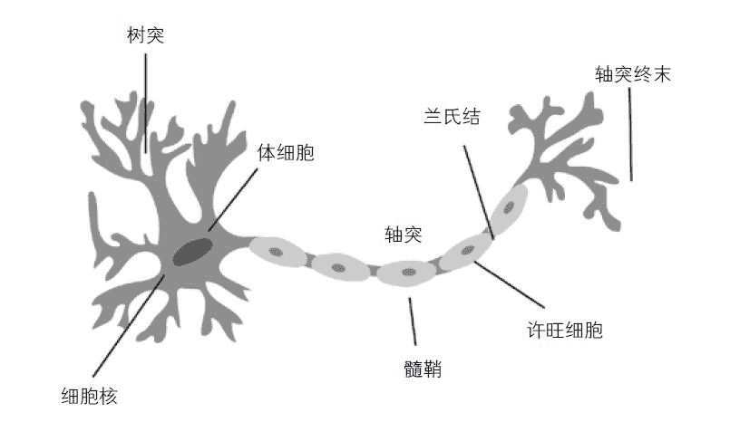

神经元的典型构造

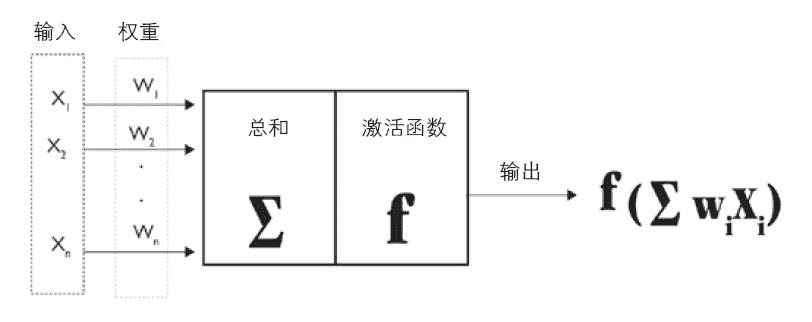

人造神经元构造

◇ 人造神经元接收基础信息，简单模拟大脑神经元的处理方式。
◇ 节点扮演细胞核的角色，此处的节点是一个数学函数，用于决定激活时机。
◇ 输入相当于树突，即输入数据。
◇ 权重函数相当于突触，由它决定人工神经元是否激活，结果是一个 0 到 1 之间的数值。
◇ 输出相当于轴突，提供代表答案的数据。

人类大脑约有 860 亿个神经元，组织成复杂的三维结构，连接组合几乎无限。相比之下，人工神经网络采用分层结构，包含输入层和输出层，以及中间的“隐藏层”，学习主要发生在隐藏层。

以人脸识别为例帮助理解，网络会在各层逐步把图像拆解为元素。第一层可能处理色彩与阴影，第二层处理轮廓，第三层处理形状，以此类推。从数学角度看，这是一系列大规模矩阵乘法，目标是最小化损失函数。损失函数衡量系统错误的程度。神经元激活取决于权重，而权重调整又基于损失函数。若能持续降低损失，该神经网络的效率会非常高。

机器是如何学会学习的
要了解这些系统如何学习，可以观察人类如何区分两个非常相似的事物。换个角度看，而不是用人类视角。

以猫和狗为例：客观来看，它们都是四足、有毛、耳朵长在头顶……但人类却能轻松区分。童年时成人会教我们辨别动物。学会后，每次进行这类思考，被激活的神经元间连接就会加强。很快我们不再需要大量示例来练习。人类学习能力发达，即使遇到从未见过的猫也能识别。人工神经网络识别图像的过程与此类似。网络接收猫狗图片，部分神经元被激活，网络据此给出正确或错误的答案，答案基于损失函数评分。随后特定连接被增强，权重值提升。获得的图片越多，学习越多。这个过程称为“训练”。

现在我们知道了人工神经网络是什么，接下来看它如何变成“深度学习”。

深度学习为何会复兴
故事始于 1957 年，心理学家 Frank Rosenblatt 发明了一种他称作“感知器”的数字神经网络，能够模仿部分大脑神经元。他的第一个任务是让网络把一组图像分为两类。他扫描了男女照片作为数据，假设网络会随着时间学会区分照片，或者至少理解为何某些图像看起来像男性、某些像女性。这正是人类学习的方式。

仅一年后，该技术开始流行。1958 年，《纽约时报》报道称感知器是“电子计算机的雏形，能走路、说话、阅读、书写、自我复制，并意识到自己的存在”。

不幸的是，尽管受欢迎，Rosenblatt 的系统仍存在诸多问题。由于只有一层神经元，感知器能力有限。当时计算机只能处理单层神经元，改进空间不大。1969 年，Marvin Minsky 出版一本书评估这些实验，他认为神经网络“总体令人失望”，且“缺乏足够支持”。据说该书影响深远，导致之后十多年人们搁置了人工神经网络的研究。

研究停滞时，有一位计算机科学家始终坚持，他认为大家错了。他就是 Geoffrey Hinton。他认为如果人类大脑真是神经网络，那它必定服务于极其强大的系统。人工神经网络一定可行，只是需要调整。Hinton 认为放弃研究是巨大损失。

Hinton 1985 年赴多伦多大学开展研究。他和团队很快发现问题出在 Rosenblatt 的单隐藏层，人工神经网络需要更多层才能更强。巧合的是，当时的计算机已足够强大。我们现在称这种多层方法为“深层”神经网络。经过改进，人工神经网络开始运行。随后几年里，它实现了两项此前未曾实现的事。

1989 年，Dean Pomerleau 开发了一辆自动驾驶汽车并驶上道路。90 年代，识别手写数字的神经网络系统问世。这些成就令人振奋，但当时技术仍局限，无法广泛应用，科学家再次陷入僵局。

这一次的困境是双重的：计算能力不足，可用的训练数据不够。人工神经网络再次成为梦想。Hinton 依然坦率，他没有放弃，持续鼓励研究。对这个“不可行”的方向，他始终坚信，后来因此被嘲笑并在学界被冷落。

2012 年到来时，计算机速度已足以支持人工神经网络在更多领域应用。借助互联网提供的数据，系统可以进行高强度训练。人工神经网络所需的一切已准备就绪，只差一个能证明它价值的人。

现代人工智能运动的开端
现代人工智能运动的真正起点可追溯至 2012 年的一个事件：ImageNet 挑战赛中，人工神经网络崭露头角。

ImageNet 成立于 2009 年，本质是一个图像数据库，图像来自真实世界，用于训练机器学习系统。图像分为约 1000 个类别，从汽车、动物、建筑等实体，到爱情、幸福等抽象概念。此前，人工神经网络从未参与该挑战赛。

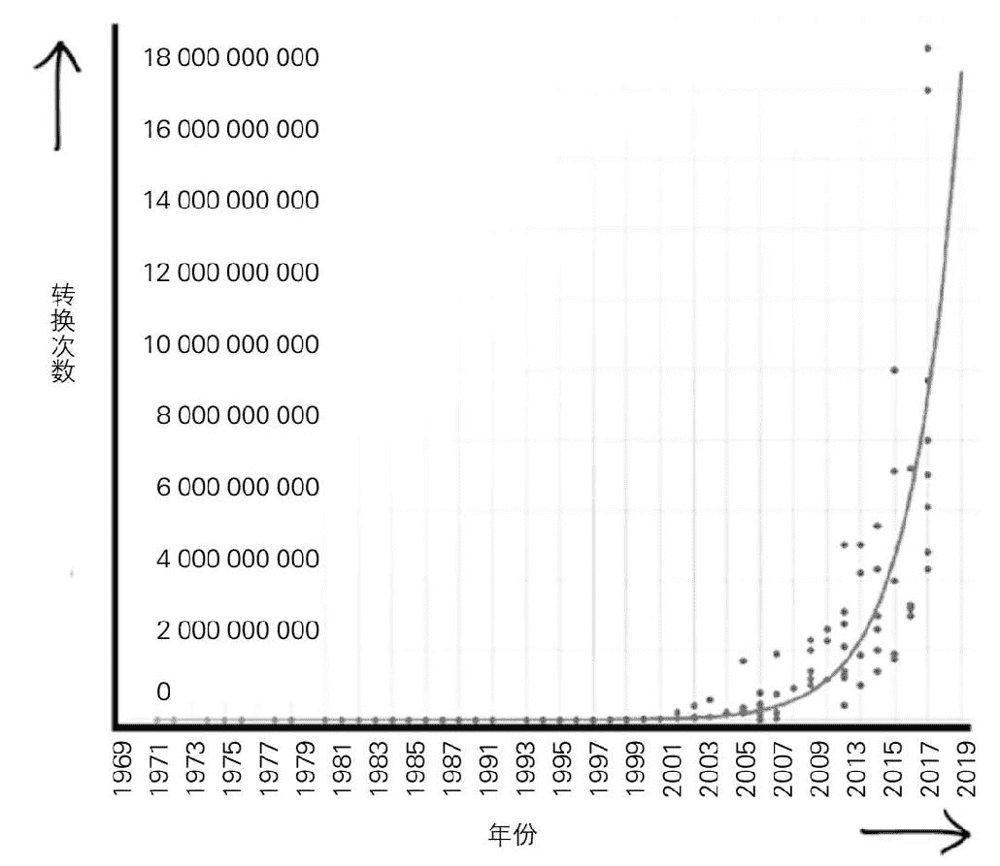
要让人工神经网络在舞台上发光，大规模数据集是最后一块拼图。训练数据增多，表现随之提升。回到猫的识别，如果只见过三只猫，拍摄角度和光线变化有限，即使换个角度或光线，你可能也认不出。但如果你见过上千只猫，识别就会容易得多。这就是数据的重要性。计算机直觉不如人类，需要更多样本学习。在人工智能领域，数据是机器学习的内核。若把数据比作新一代石油，ImageNet 就是一座巨大的油田，而人工神经网络是唯一能从中获益的机器。

2012 年，被嘲笑的 Geoffrey Hinton 已 64 岁，因背部受伤只能站着工作。他和团队当年创建了一个人工深度神经网络，这是第一个参加 ImageNet 挑战赛的网络。Hinton 的程序名为 AlexNet，功能前所未见。比赛中 AlexNet 一路领先，成功率达 75%，比此前最好成绩高出 41%。这次比赛让世界见识到人工神经网络的力量。

此后，所有人都开始用人工神经网络参赛。短短 7 年内，识别物体准确率从 Hinton 的 75% 提升至 97%。97% 的准确率已超过人类识别物体的能力。

人类历史上从未出现过识别能力超越人类的计算机。此后，研究起步和对人工神经网络的兴趣将彻底改变世界。

如今图像识别已司空见惯，甚至能从医学影像中识别疾病。ImageNet 也催生了训练数据集的蓬勃发展，数据集中增加了视频、语音乃至游戏。

第二部分 机器学习落地场景
现在你对机器学习的巨大潜力已有一定了解。但它能走到多远？2012 年，IBM 的深度学习人工智能 Watson 在《危险边缘》节目中获胜。它能在人类自然对话中实时准确回答问题。Watson 的方法是大量阅读网络信息并寻找模式来理解问题。

2016 年，Google 的 AlphaGo 在围棋世界最激烈比赛中击败世界冠军 Lee Sedol，成为分水岭。围棋规则简单但变化极大，与国际象棋不同，计算机可以穷举国际象棋所有走法，而围棋的可能走法数量远超宇宙原子总数。很多人认为下围棋需要人类直觉，职业棋手常说“凭感觉”。因此围棋对人工智能而言如同圣杯。AlphaGo 并未被教导围棋规则，而是通过观察他人对弈自学成才。随后它用自己的复制体反复对练，直至技巧达到超人水平。后来它甚至能执行计划外的任务。

2018 年，IBM 的人工智能已具备与人类辩论的能力，Watson 也开始为医生提供医疗建议。此前它阅读并研究了数百万篇医学文献。

医疗里的人工智能实战
婴儿潮一代寿命不断延长，未来医生可能需要额外助力来满足医疗需求。2017 年中国推出名为“觅影”的深度学习系统，上线一年内已服务 400 名患者。人工智能是“中国制造 2025”计划的重要组成部分，该计划目标是在 2025 年前将中国打造为全球高科技产业的领头羊，重点包括机器人。计算机科学领域也在迎接一场专门的医疗保健革命。例如，数百万台可穿戴设备能为人工智能提供大量训练数据，帮助医生更好地治疗病人。

眼与码之间的赛跑

一项关于眼科医生判断稳定性的对照实验给人留下深刻印象。数据显示在某些眼病判读上，人类的一致性并不理想。让两位医生分别审阅同一批影像，两人的结论吻合率仅约六成。更让人意外的是，把同一张图在数小时后再次交给同一位医生复核，其前后自洽率也只在六成五左右。到了2018年，深度神经网络在相关任务上的表现已经明确超过临床医生。现阶段已有网络在食道癌早期筛查中做到约九成的准确率，且这一突破只用了一年时间。谷歌也在推动视网膜图像的深度学习计划，目标是实现糖尿病所致眼部病变的早期预警。从效率角度看，深度学习的判读速度比传统放射科医师快上万倍。

### 其他应用
2017年，Deepfakes这类专业的 AI 换脸工具出现，按一下鼠标就能把片中人物的面孔替换成另一人。往常完成同类效果需要繁琐流程且花费数十万美元。如今只要从谷歌搜集一组面部照片交给深度学习网络处理即可。演示里一名女演员的面孔被换成了尼古拉斯·凯奇。

2018年，英伟达发布了一个算法，能把抖动严重的慢动作素材处理得流畅自然，观感接近专业慢动作镜头拍摄。同年英伟达还推出可实时进行光线追踪运算的神经网络显卡。在图形学里，光线追踪负责模拟光线在不同材质上的反射与吸收。《玩具总动员》这类 CGI 电影和电子游戏的画面差别很大程度上来自光线追踪。把计算中最耗资源的环节交给英伟达的神经网络后，效率大幅提升。过去只有好莱坞负担得起的电影级动画，如今在台式机和游戏玩家端也能实现，这都要归功于神经网络。

基于一张静态照片，神经网络可以推演出一段视频。想象提供一张静止画面，它会生成一段对后续场景的预测。照片里是海滩，接下来就会出现拍岸的浪；照片里是人群，人群就会开始行走。

神经网络的能力还包括：

◇ 自动把黑白影像与视频上色。
◇ 仅凭文字描述生成接近照片真实度的图像。
◇ 能把视频里的夜晚变为白天，反之亦可，还能改写其中的天气。
◇ 优化低像素图像，让画面更清晰，有如电视剧《犯罪现场调查》里的取证技术。
◇ 太空望远镜的误差校正等大量其他任务。
◇ 更关键的问题是，如果这些系统的能力继续以如此快的速度演进，人类的未来会走向何方？这就是自动化问题。

## 第三部分：是灾难还是下一个工业革命？
### 自动化带来的影响：机器人让我们失业了！
技术持续演进，人们担心就业会受影响。20世纪20年代还有专人负责开关地铁门和电梯门，如今自动门已使用了超过一代时间，你上一次见到门童是什么时候？自20世纪50年代起，已有约800万名农人、700万名工厂工人和成千上万名电话接线员被自动化取代。早在60年代，美国总统肯尼迪就把自动化列为就业的首要风险。不过工作本身并未消失。

### 这次不一样
思考一下，在人工智能加持下可以被自动化的事项还有很多，这里并没有一条清晰的界线。这正是当下技术革命与过去技术革命最大的不同。至少那些不需要创意、对机械精准度要求不高、或不需要极精细人类互动的工作，在不远的将来都可能被自动化。而这会极大地改写世界的运行方式。具体会怎样，我们很难精准预测。

我认为当人工智能开始侵蚀人类的工作，会引发社会的不安。机器学习的进步是一把双刃剑，面对层出不穷的“不可能的可能”变化，我们该如何应对？

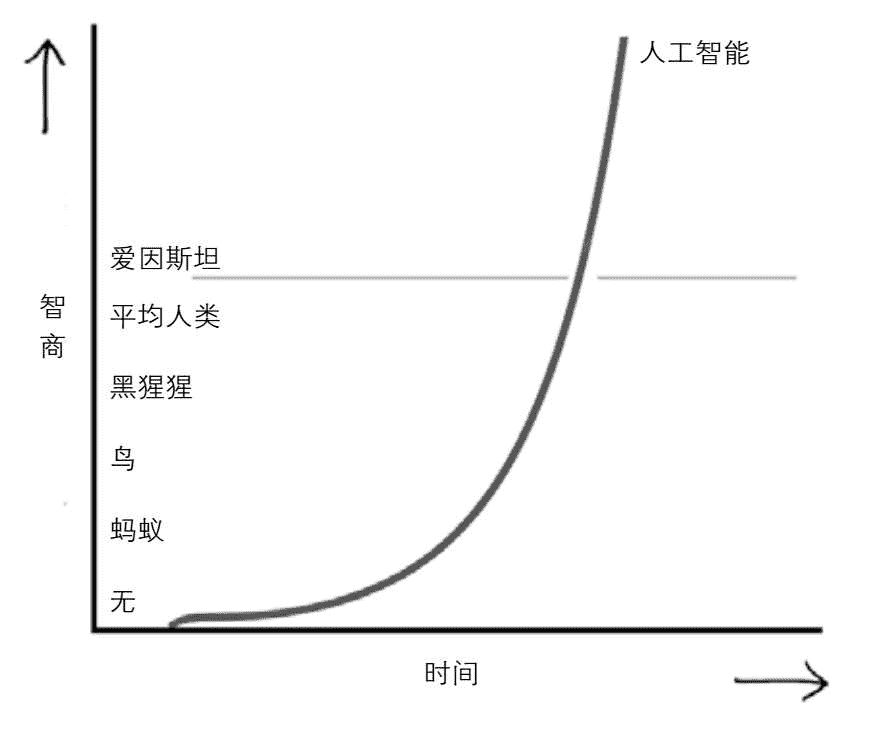
人工智能的智商水平

普遍的看法是未来十年人工智能可以完成许多简单任务，让人类腾出时间去做需要创意的事务。我听过这个说法，但我觉得并非所有人都富有创意，也有很多没时间和财力去培养创意的人。

另一种说法是，先进的人工智能能提升生产力，从而催生新产业，并需要新的供应商来支撑，这也就意味着新的就业机会。但在这一点上看法分歧很大，一些专家强调需要可行的金融对策来应对人工智能的影响。其中出现了不少新概念，包括基于无信任系统如区块链的普遍基本收入设想。本章后面会再聊区块链。

或许未来每个人都有自己的公司，都拥有专属的人工智能来提升生产力，而不是为某个公司打工。但我觉得大多数人并不认同这一观点。到2030年，全球预计有8亿份工作会因自动化而岌岌可危。

谈到人工智能，有些人立刻想到审判日和终结者，我个人更在意的是控制人工智能的人。如果未来强大的人工智能是开源、受保护措施的人人可用，这可能是好事。反之，如果世界上最强的人工智能被少数人把控，恐怕就不是好事了。在后一种情形下，掌握人工智能的人就是规则制定者。为了防止人工智能落入坏人手里，人们设立了生命未来研究所和OpenAI等机构组织。这表明人们已经在思考下一步怎么走。

### 虚拟现实和增强现实（2012 年）
设想一下，未来戴上头戴设备就能立刻进入另一个世界，还能与里面的物体互动，和里面的“人”交谈，仿佛拥有了第二种人生；在电子游戏中，你不再只是操控角色行走的人，而是游戏里的一个角色。这就是虚拟现实VR Virtual Reality能带来的未来。virtual这个词在15世纪中期出现，意为“有实际效果却非真实的东西”。本质上是用计算机生成的产物来模拟或替代现实。

戴上头显后，对大脑而言你已身处他处。你不再是观众，而是参与者。印刷品到影片多了视觉和声音，同样，虚拟现实多了身体运动、空间感和参与感，因此有人称其为首个移情技术。人类历史上第一次体会到成为另一个人的感觉，BeAnotherLab在2014年的实验中证实了这一点。人们可以借助VR技术来体验成为另一个性别的感觉。

将近一个世纪以来，尤其在90年代，人们尝试过VR，但从未取得实质进展。当时的计算能力和显示技术太落后。2010年，17岁的帕尔默·勒基 Palmer Luckey在自家车库里做出了VR头显原型，改变了一切。当时设备的质量很差，勒基很失望，于是决心做个更好的。他的设备是第一个使用手机显示技术的VR头显，这是至关重要的突破。新设备画面更清晰、视野更宽，最终演变成Oculus Rift，一个面向电子游戏的头戴式显示器。

勒基的头显掀起了新一代VR的浪潮，然而用了将近十年，人们才开始将其商业化。

#### 增强现实
augment源自拉丁语augere，意为“增加”或“加入”。增强现实AR Augmented Reality与虚拟现实相近，它利用计算机生成的图像，通常配合运动追踪，对使用者所处的真实场景进行补充或增强。

2016年，增强现实与Pokemon Go游戏一起进入大众视野。Pokemon Go并不是AR的最佳范例，但它代表了该技术首次被大规模应用。到这个十年结束时，AR工具包让放置虚拟3D物体变得像用手机扫描一样简单。Adobe的Project Aero软件也让人们轻松创作AR。苹果公司在该十年后期推出了自己的AR技术，它对AR的兴趣预示了AR将走向主流的趋势。

## CRISPR 基因编辑技术（2012 年）
CRISPR吸引了整个科学界的关注。在它首次亮相的几年内，世界各地的实验室都开始用这一新技术改写人类、动物或植物的DNA。

### 什么是 CRISPR？
CRISPR全称是常间回文重复序列丛集，英文Clustered Regularly Interspaced Short Palindromic Repeats，存在于细菌中的一种生物DNA系统。其基本原理是细菌把CRISPR作为防御工具。当遇到可能攻击破坏它的入侵病毒时，CRISPR会把该病毒的DNA剪开。CRISPR就像一把内置的生物剪刀。

更特别的是，这把剪刀带有记忆，能搜索并识别特定的DNA序列，再将其剪断。CRISPR是一个小型自动生物系统。挺酷的。而现在最重要的问题是科学家能否控制这项技术。

1987年，日本科学家在克隆实验材料时偶然把CRISPR的一段也克隆了，这就是CRISPR被发现的时刻。他们研究了一段时间，但并未观察到剪切与侦测功能。直到2012年，人们才弄清CRISPR的全部功能。

### CRISPR 有什么用处？
发现不久后，人们就把它用于有机体的DNA代码的剪切、编辑和粘贴。与旧的DNA编辑技术相比，这种新方法更快更简单。

研究人员改造干细胞后将其重新注入患者体内，让CRISPR修复受损的器官。在一项研究里，研究人员把改造后的干细胞直接注入中风患者大脑，大多数病人恢复了大部分活动能力，一位多年坐轮椅的病人甚至重新站起来走了。

在另一项研究里，重新设计的癌细胞被用于侦测并摧毁血液性癌症与肿瘤。大量的CRISPR分子剪刀能剪断并摧毁癌症DNA，直至其无法继续繁殖。

在另一种抗癌方式中，CRISPR能促使免疫系统本身对抗疾病。身体免疫系统大多无法识别癌症，而CRISPR的研究目标就是解决这个问题。科学家对免疫系统进行重新设计，使其能够侦测并摧毁癌症DNA。

2018年一篇发表在Science Translational Medicine上的研究展示了含有高级CRISPR细菌的细胞，这些细胞完成任务后会自我毁灭。此外，这些CRISPR细菌细胞在不伤害周围健康细胞的情况下成功杀死了多类癌细胞。

这一生物方法很新，风险与长期影响尚不完全明了。但该技术能在癌症治疗中提供更快、更便宜、更精确的细胞疗法。

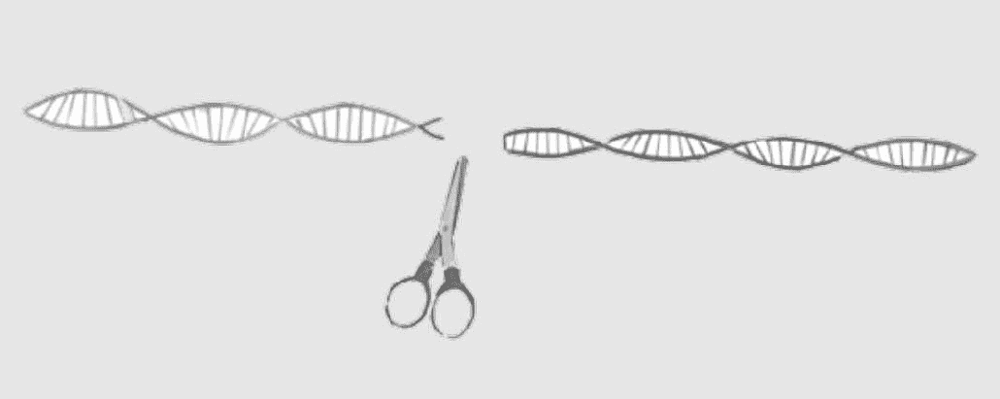
`CRISPR`就像一把内置的生物剪刀

## 机器人前进的一大步（2016 年）
2016年，机器人开发公司波士顿动力公司Boston Dynamic在YouTube上传了一段视频，震惊全世界。视频里人形机器人Atlas在行走、拾起盒子并放到架子上，被人推一把后还能轻松自我纠正。2018年，网上出现了更多关于Atlas的视频。这一次，Atlas不仅能慢跑、做后空翻，还完成了几年前人们无法想象的动作。似乎一夜之间，机器人获得了人类的运动天赋。

人们花了很久才在机器人技术上取得突破，因为运动实在太难了！我们大脑中的运动神经元比认知神经元多三到四倍。人身上约有700块肌肉。身体的平衡和灵敏行动背后是巨大的处理需求。有了更快计算机和更智能软件，新型机器人突然出现。

2018年，人们取得另一个机器人突破，这次幕后英雄让人意外——迪士尼。在迪士尼主题公园里，迪士尼公司创造了他们称之为“阿凡达机器人”的东西。这个机器人的动作前所未有地流畅自然。宣传视频的特写里，机器人面对镜头说话。许多YouTube评论一口断定这是CGI特效。这是历史上第一次成功跨越恐怖谷的机器人。

## 量子计算的开始（2016 年）
量子计算机被视作人类文明的下一个飞跃——人们把它与工具制作、农业和工业革命相提并论。有人认为量子计算机与人工智能一样重要，甚至更为关键。

乍看之下量子计算的实质很难懂，但一旦理解，你就会明白它为何能改变一切。你也会发现现实有多么奇异。因此我们在此花一定篇幅探索量子计算机的神奇世界。

### 它有什么特别的？
想象一种新型计算机，它能同时算出一个问题所有可能的解法。你可以给它一个有无限种可能解的问题，它能在数小时内给出答案。相比之下，若让人类历史上所有电脑一起解这个问题，可能需要几十亿年。我们把现有计算机称为经典计算机，而把这种看似不可能的新型计算机称为量子计算机。

## 它如何运作？
普通计算机把数据当作二进制位处理，用0或1表示，而量子计算机把数据当作量子比特qubits处理，它可以同时处于0和1的状态，从而同时进行多个计算。这种同时处于0和1的状态有点像一碗概率的大杂烩，称为叠加，这是量子物理即量子力学的一个特征。这样可以用较少的粒子存储并控制大量信息。

换句话说，普通计算机解迷宫的方法和你走迷宫差不多：不断尝试每条可能路径，遇到死胡同就掉头，直到走出迷宫。而量子计算机可以利用叠加一次性同时尝试所有路径——简单说就是走捷径。

我们先往回走一步，看看量子比特到底是什么。普通计算机的位由小晶体管制成，而量子比特可以是任何具有量子行为的东西：电子、原子、分子，甚至一个金属环，在环境合适时可行。比如电子通常以两种状态之一存在：spin-up或spin-down。在二进制里，若用1代表spin-up，用0代表spin-down，就能开始写代码了。同样，因为叠加，电子可以同时是1和0。一些研究人员由此推断叠加证明了平行宇宙的存在。

如果你觉得这听起来有点莫名其妙，没关系，你不是唯一一个这么想的人。量子计算之父理查德·费曼Richard Feynman曾说：“如果你觉得你已经懂了量子力学，那你其实不懂。”稍后我们还会介绍更奇怪而特别的量子行为。首先，看看费曼是怎么想到这个疯狂点子的。

## 量子计算之父
理查德·费曼1918年出生于纽约市。毫无疑问他是一个非常特别的人。第二次世界大战期间，费曼是曼哈顿计划中的理论物理学家，他还在BBC上有过自己的节目。他不仅是极出色的讲师，也是量子电动力学的先锋。此外，费曼还提出了纳米技术概念，是量子计算领域的先驱。

费曼很早就自学数学，并在普林斯顿大学入学考试中取得满分成绩。除了正式教育，他在课下自学了许多比老师教的更难的东西。

费曼还有许多古怪癖好。参加曼哈顿计划期间，出于无聊，他破解了居住小区里所有保险箱的密码。有一次他打开了一个存放原子弹机密文件的保险箱，还在里面留了一张写着加密信息的小纸条。其他物理学家同事发现后吓坏了，还以为德国间谍偷走了原子弹机密！当然这只是费曼的一个恶作剧。

1982年，费曼发表了一个题为《计算机模拟物理学》Simulating Physics with Computers的演讲。在演讲中，他提出一个很特别的想法：无论普通计算机功能多么强大，无论用多少台普通计算机，它们永远无法模拟现实世界中的量子系统。意思是，假设你想建立一个分子模型，看看它与其他分子相互作用时的行为。在现实世界中，当组成原子的电子轨道重叠时，会形成一个分子。

要准确模拟真电子，我们要记得，真电子可以以多种状态同时存在。虽然我们可以认为这是一个概率，但对经典系统即普通计算机来说，这是一个很麻烦的问题。因为随着粒子数量增加，可能状态或概率的数量呈指数级增长。因此，4个电子就有16种可能存在状态。10个电子就需要观察1024个状态，而20个电子就有1048576种可能状态。如果想模拟一个含有数百万电子的真物理系统，情况很可能会失控！对传统计算机来说，一台笔记本电脑可以模拟含有26个电子的系统，要模拟含有43个电子的系统就需要用到超级计算机了。如果是含有50个电子的系统呢？想都别想了。在人类有生之年，用传统计算机是不可能实现的。

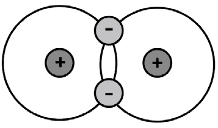
“共同电子”

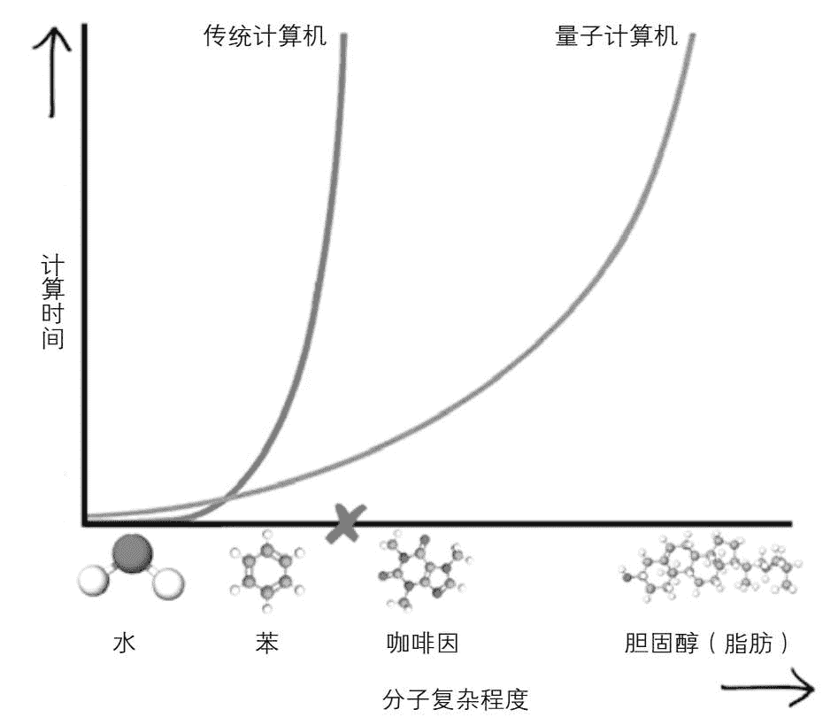
传统计算机将花费无止境的时间模拟现实中的量子系统

大自然即由带电子轨道的原子组成，和现实世界本身就是量子系统，若要用传统计算机模拟大自然或现实世界，必须要取相差较大的近似值。下图是两个简单分子，经典超级计算机的误差率高达70%到200%。

经典超级计算机在计算简单分子键长时显示的误差

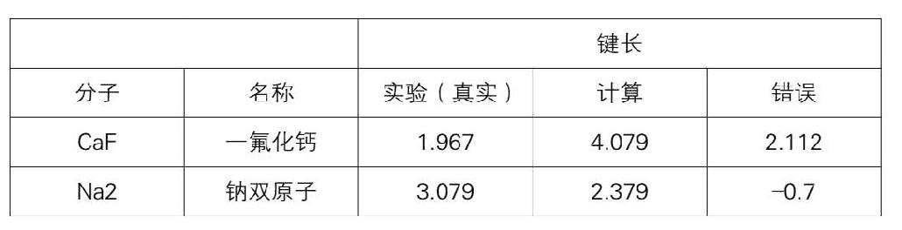
我们可以把这归结为：描述一个量子系统所需的信息，只能存在于另一个量子系统中！

### 第一部分：自然编码
#### 量子计算机的到来
量子计算机其实和大自然一样，从设计上来看它们都是量子，这是由量子计算机的量子比特的性质决定的。量子计算机的量子比特能够应对极其复杂的大自然。换句话说，每添加一个量子比特，量子计算机的能力就会成倍增长，这是普通计算机做不到的。

普通计算机可以模拟水分子，但完全不可能模拟咖啡因这种简单的东西，这立马相形见绌。如果要模拟咖啡因和其他更复杂的东西，甚至胆固醇，我们只需给量子系统添加一些量子比特即可，添加数量可以是50个或者更少。

从理论上来说，人们预测含100个量子比特的量子计算机的计算能力比地球上所有超级计算机加起来还强。一个由300个量子比特数据组成的数字寄存器可同时容纳的数字比宇宙中所有已知的原子数还多。想象一下，未来的量子芯片可能会有数十亿个量子比特，这个数字是可以和传统计算机的CPU和内存相媲美的。真是令人难以置信。

费曼：把宇宙编译成量子线路

理查德·费曼曾提出一个近乎狂想的蓝图，若要真正复刻自然，就必须把物理定律直接写成量子比特的运算序列，思路与今日用经典比特搭建逻辑门相仿。不同寻常之处在于，这不再是数学上的近似模拟，而是试图把纯粹的物理过程编码为现实本身的构造。随后只需放任它自行演化。往某种物质的结构里添入少量分子，就可能让硬度提升十倍。诸多推测认为，借助这种分子级模拟，人们有望创造全新材料、设计新药、开辟能源生产的新路径。

### 第二部分：纠缠的诡异连线

指望获得指数级提速，量子比特之间必须能够沟通，而这种沟通方式极为反常。在量子物理里，纠缠会让每枚量子比特的命运紧扣在一起。简单说就是两粒子间的关联：其中一方的状态会瞬间决定另一方的状态。设想一对骰子，一枚放在温哥华，一枚放在珀斯。按常理摇一千次，点数应当各不相同。若是纠缠骰子，摇一千次每次点数都会完全一致。这种怪现象让爱因斯坦困扰，他戏称之为“幽灵般的远距作用”。爱因斯坦猜测我们只是尚未找到解释，现实却似乎另有其理。

2017年，中国团队证实即便一对粒子中一方被送入太空，纠缠依然存在。隔得再远，关联也不会消失。

一旦纠缠形成，哪怕相隔一个宇宙的距离，量子粒子仍会保持联系不变。在量子计算机里，纠缠与叠加让系统能同时容纳所有可能的解。

乍听很反直觉，但细想我们日常认识世界的方式其实错了。量子力学才是自然真正的工作方式，若要维持物质、辐射和磁场的稳定，它是根基。这就是事实。

### 第三部分：从学界玩具到现实隐忧

费曼之后一直到1994年，量子计算机在学界只是个有趣的玩具。贝尔实验室的美国数学家彼得·秀尔 Peter Shor 找到一种用量子计算机破解密码的理论方案。看似不起眼，却动摇了银行到各种加密系统在内的线上安全根基。核心在于，如今几乎不可能对一个超大数字做质因数分解。经典算法的步骤随数字规模成倍增长，极端情况下可能耗费数十亿年。用秀尔算法，一台量子机可能在数小时内完成。从此可见，量子机的能力远超单纯模拟现实。

#### 量子工程的两大卡点

21世纪第二个十年初期，人们已开始搭建早期量子机，可两个关键问题仍未解决：

第一个问题源于量子物理本身。量子机给出的答案是概率性的。为让系统趋向正确答案，设计的程序会引导量子位挑选正确的量子态，从而输出正确结果。有趣的是，好的量子程序会利用粒子波动特性抑制错误答案并放大正确答案，随后才能读出结果。

可以把量子机的数据想象成房间里随机亮起的灯泡。光子类似信息载体的量子位，量子程序则像一组精密排列的微观小镜子。机器启动时灯泡亮起，光的波被程序的小镜子反射，数十亿束光聚焦成地面上一枚针尖大小的强光斑。其余光线变暗。这个强光斑是正确答案，黯淡的光点代表错误答案与噪声。

第二个问题是维持量子环境的现实可行性，这也是我们至今没有强量子电脑的原因。量子位像害羞的歌剧女主角，要让它们进入叠加态，同时以多种状态存在，必须让它们感到安全。量子位不能接受任何辐射，温度必须接近绝对零度。一旦发生任何反应，量子效应就会被惊走。哪怕极轻微的干扰，包括光子、辐射甚至量子振动，都可能让粒子退出叠加态，机器便失去优势。我们之前提到，量子位可以是任何具备量子行为的物质，这意味着可用金属环营造理想环境。更成熟的老技术用金属超导体产生叠加态，最常见的是用接近绝对零度的超冷金属环。在这种温度下电子可自由流动且不反应。更奇特的是，电子不仅能顺时针流动，也能逆时针流动。

当前技术能维持叠加，但时长只有几分之一秒，完全不足以执行有效算法。如何维系这种脆弱的量子状态，仍是工程师和科学家的重大挑战。

#### 量子擅长的现实难题

事实表明，量子机擅长处理输入输出都很小、却拥有海量可能性的问题。

举例，想知道日本境内最远的两个城市距离，地图数据如道路距离是输入，这部分数据量很大，传统电脑难以处理。输出只是一个数字，代表最远距离。那可能性呢？这看起来像是可用超冷金属环和量子特性解决的简单问题，但细想其中几乎存在无限多条路线。

实际上，现有计算机永远无法解决这类问题。我们还有许多类似的现实难题，包括气候模式、气候变化、人工智能训练推进、复杂分子模拟、股市数据规律观测，以及大脑活动记录。这类模式的观测或许能成为常规操作，和现有计算机不同，不需要对量子机问题有详尽理解，这个想法有趣，但要谨慎对待。

量子时代真的会来吗？21世纪第二个十年初期的量子计算机庞大笨重，几乎占满整间屋子，还配有复杂制冷设备，以提供量子效应所需的细腻环境。时过境迁，情况并无大改，20世纪50年代的大型机和21世纪第二个十年的量子机看起来相差无几。如果现在情况如此，量子机能否像普通电脑一样缩小？有可能，但时间不会太短。

该领域发展长期滞后，直到2016年左右，技术突破速度开始加快。IBM 公布5量子位电脑，并提供免费云服务。随后两年内，研究人员借助这项新技术发表了数百篇论文。从理论看，量子机至少需要50个量子位才能全面超越传统计算机的速度。这个临界点被称作“量子霸权”。2018年，谷歌发布了一款含72个量子位的量子芯片，不过其中大部分用于纠错。

虽然实用量子计算机仍遥远，还有很长的路要走，但它的潜力不容小觑。

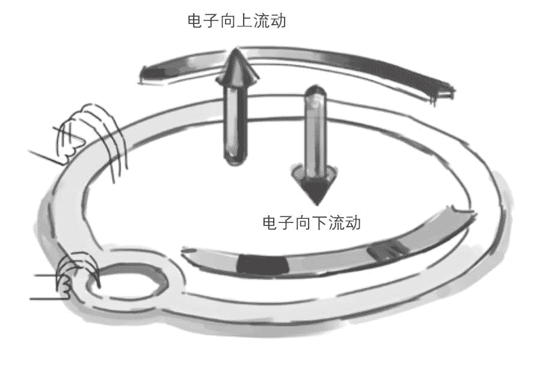

具有量子特性的超冷金属环

我认为，如果费曼（他于 1988 年去世）能看到人们对量子计算重新燃起的兴趣，以及我们在量子计算领域取得的成绩，他会感到非常欣慰。在当时那个一切都还不明了的情况下预见到量子计算的潜力，不是一般的头脑能做到的。

## 电动飞机的到来（2017 年）

随着电池技术以及电动汽车的新需求的发展，我们现在的选择越来越多了。我们可以用电池来给达到生产规模的小型固定翼飞机提供动力了。

一直以来，实用电动飞机都是个不确定性很大的工具，比实用电动汽车更难以捉摸。如今的电池技术已经较为发达，可以为某些做特殊用途的全电动飞机提供动力，例如飞行训练和短途旅行用的飞机。2018 年，我有幸见到了史上第一台商用全电动飞机（Pipestrel Alpha Electro），见识了当时的技术水平。包括电池在内，这架飞机仅有 350 千克重。只需要 5 分钟就能完成电池更换。这架飞机非常轻，我几乎可以在机库里把它推来推去。

Alpha Electro 和普通燃油轻型飞机不同，普通燃油轻型飞机的发动机技术有 50 年之久，里面有数百个活动部件，而 Alpha Electro 的发动机中只有一个活动部件。此外，AlphaElectro 只有一个操作发动机的开关和油门杆。旧的飞机模型在飞行中会混合燃料来发动引擎。Alpha Electro 非常安静，我在驾驶舱里尝试时，感觉控制得十分轻松。近期，已有人考虑在空中的士领域使用电动飞机。空客和波音这样的老牌公司也尝试制造垂直起降飞机。这类飞机像直升机一样，但能很快开始短途水平飞行。2017 年，中国公司“亿航”在迪拜开始了垂直起降电动飞机的运营。

## 区块链和其他无信任系统的崛起（2017 年）

2008 年全球金融危机爆发后不久，网上出现了一篇神秘的白皮书。这份白皮书的作者是一个自称中本聪的人或团体，没人知道这是谁。

这篇神秘的白皮书介绍了一个点对点的新金融系统。该系统使用数字加密货币，该货币名为比特币，而该系统被称为区块链。许多人厌倦了不断受中心化力量干预的经济体系，对他们来说，这是个福音。许多人认为该系统是一个进步。加密货币在 2017 年进入公众视野，当时比特币价值上涨 1000%，而瑞波币（Ripple，另一种加密货币）上涨了 36000%。许多人将区块链称为下一代互联网。

如今的互联网由复制和分发的信息组成，信息可以是视频、电子邮件和数据。换句话说，当你在 YouTube 上观看视频或收到一封电子邮件时，你看到的是原始信息的副本。对于具有实际价值的资产（例如钱、选票、数字身份、股票、债券、房屋或汽车所有权合同）来说，我们并不想对它们进行过多复制。举个例子，你的名下有原始的 5000 美元，你肯定不希望这 5000 美元的副本落入其他人手里。密码学家将其称为“双重支出问题”，这个问题的意思是存在一个东西的两个数字副本，而这个东西原本只应该有一个独特的身份。

区块链技术中的密码学（数学安全）让区块链技术成为第一个解决了双重支出问题的该类技术。如今，新一代互联网诞生了，这个互联网是建立在有实际价值的物品的实际价值之上的。这在某种程度上解释了为什么它这么重要。一些区块链货币承诺能保证匿名，并能在同级之间保证隐私，这促使了暗网的发展。暗网是一个匿名市集，在上面可以买到非法药品、枪支武器和非法服务，这一切都是区块链支持的。

简而言之，区块链是一个持续更新的清单，清单上记录了谁拥有什么。这个档案清单是去中心化的，系统中所有人都可以查看并验证，这个清单被称为分布式分类账。这个清单被分成几个连接块，受加密技术的保护，加密技术能保证你的档案安全。我们把这个称为“自动信任”或“无信任”系统，意思是这里的信任是系统内置固有的。区块链密码技术为我们提供了一个确认参与者真实身份的数学方法。由于区块链具有分散性质，现有的技术是无法攻破区块链的。如果一个区块被入侵，系统里的所有人都能很清楚地看到，受影响的区块可以被自动拒绝。

区块链是第一拨加密货币（包括比特币与以太坊）的基础技术，它的用途十分多样，不仅是技术高超的聪明的犯罪分子会利用区块链技术，区块链技术的使用范围也超出了数字货币本身。区块链有一个叫智能合约的功能，人们可以利用这个功能将现实世界的合同写成代码，在满足某些条件的情况下，合同会自行执行。这个功能催生了以区块链为基础的社交网络和线上游戏，也被银行和纳斯达克应用。如果将智能合约连接在一起，就可以创建一个完全自动化的公司，在某些情况下可以满足公司中大部分的人力管理需求。除了区块链外，Tangle 和哈希图（Hashgraph）这些无信任系统都是在 21 世纪第二个 10 年后期开发的。

## 5G 网络的开始（2018 年）

我们都知道什么是 3G 和 4G 网络。5G 网络速度要快很多，还可以从许多方面改变现代人的生活。5G 的技术优势主要是由于它使用的频率比现有的系统要高得多，因此带宽更宽。5G 的速度也将是 4G 网络的 100 倍。用 3G 下载一部两小时的电影需要 26 个小时，用 4G 下载需要 6 分钟，用 5G 则只需要 3.6 秒而已！

5G 的响应时间也快得多。4G 响应时间约为 50 毫秒，5G 只有 1 毫秒。1 毫秒意味着比你眨一下眼睛的速度还快 400 倍。这样一来，我们可以在云上无缝地完成大量工作，而这在以前是不可能的。由于延迟时间短，自动驾驶汽车的安全性也更高了，因为在紧急情况下，每一毫秒都是致命的。分析师预测，5G 网络将会是物联网的框架，包括配备联网家电的智能家居、与家庭安全和照明的结合、自动驾驶汽车和使用医疗设备与工业机器人的行业。专家们称未来这些新兴技术需要的数据速率可能高达 100GB/秒。现在的目标是实现每平方千米内能支持 100 万台设备。无论是在演唱会、大型节日上，还是会议中，我们都可以告别龟速网络了。多玩家游戏中的延迟也会成为历史，游戏玩家们应该会非常开心。5G 信号塔可以对数据需求更大的区域聚焦发射信号，这和我们现在的系统不同，当前的信号塔是以本身作为圆心进行圆形信号辐射的。

据估计，到 2025 年，5G 的采用率将达到 14%至 65%。目前，5G 的使用进展受到基础设施开发和高昂成本的阻碍。由于和 3G 的频率相似，4G 当时可以利用已有的设备。而 5G 为了容纳更宽的带宽，频率要高得多（类似卫星广播），这意味着 5G 需要新的基础设施。

目前中国正处于领先地位，许多公司都开始进行 5G 试验，包括华为和中兴。2020 年东京奥运会计划在赛事场地使用 5G 技术，美国也开始了小规模的试验。

### 5G 的危险？

有些人对 5G 抱有疑虑。5G 信号的波长和小型生物结构的大小相似。赫尔辛基大学的一项研究分析了人体皮肤对 5G 频率的反应，研究的结论是人体皮肤确实会吸收能量，尤其是汗管，但其他器官不受影响。因此，5G 对人体健康影响目前尚不完全清楚。

## 埃隆·马斯克成为公众人物（2018 年）

2010 年，几乎没有人知道埃隆·马斯克是谁，可能只有少数电动车的拥趸在驾驶特斯拉的 Roadster 的时候看到了未来。我的 YouTube 频道的观众多次跟我提到，回想起来，他们是在我 2014 年的特斯拉视频里第一次听说马斯克这个人的。现在我们已经来到 21 世纪第二个 10 年的末尾，而埃隆·马斯克也成为许多人的偶像。人们眼中的他是个有物理学学位的工程师，很出名，因为他能创造一些很酷的东西——这种人不是天天都能见到的。人们对马斯克又爱又恨，爱恨的程度几乎一样。有些人喜欢他严谨的态度，但有人觉得他是个大嘴巴和多管闲事的人。负面的评论中有的认为他说的比做的多，有的认为他是个彻头彻尾的骗子；同时，积极的评论中有的认为他是个做实事的人，有的认为他会拯救地球。2018 年，马斯克的一条推特让他惹上了麻烦，对象是美国证券交易委员会（SEC）。他在推特中宣布他将实现公司的私有化（这里的法律问题在于，这类信息是不应该被公开的）。他被迫辞去特斯拉董事会主席一职。具有讽刺意味的是，这件事发生时，特斯拉的 Model 3 车型刚成为美国最畅销的汽车（按收入计算），当时澳大利亚的评论家们也对特斯拉电池的优秀性能感到震惊。

## 电动汽车走向主流（2018 年）

尽管早期出现生产问题，特斯拉的 Model 3 仍然是第一款上路的“主流”生产的电动汽车。特斯拉刚刚打开了闸门。几年后，沃尔沃、捷豹和路虎等传统公司也宣布要开始制造电动车，但要到 2020 年才上市。现代、保时捷和阿斯顿·马丁也加入了这个行列。一开始受人嘲笑的电动汽车，后来成为富人奢华的梦想，再后来逐渐成为主流。2017 年在墨尔本的时候，我有幸驾驶了特斯拉 Model S P100D 车型，那几天的驾驶体验十分流畅，车子反应很快，感觉根本不像在开车。

一些人担心电动汽车换电池会是个问题，但事实证明这个担心完全没有必要。纳帕谷的一辆出租车就是特斯拉的 Model S 车型。2018 年，这辆车的里程表显示该车已行驶超过 40 万千米，而这辆车的电池健康状态仍然为 93%。

## 试管食物（2019 年）

在过去，实验室培植的试管肉是科幻小说里才有的东西，然而自 21 世纪第二个 10 年以来，科幻成为现实：人们可以从宿主动物身上抽取干细胞，过滤取得可生长的肌肉和脂肪组织，再将肌肉与脂肪分开培植。培植的过程中利用热度、氧气和含有盐、糖、蛋白质与其他营养素的血清来支持细胞生长。在这种环境中，细胞误以为自己仍在宿主动物体内，并开始复制。一个干细胞能发展为一万亿个肌肉细胞。科学家面临的挑战是如何让实验室里的细胞以类似于我们在超市里看到的肉的方式生长。简单的一块肉，背后是一套复杂的结构，包含各种不同的组织和骨骼等。科学家现在能做到的，是培植一块结构统一的碎肉，这种碎肉看起来很真，而且还会渗血水。

史上第一块培植汉堡肉于 2013 年问世，培植成本高达 33 万美元。成本高主要是因为一种高效营养的血清。截至 2018 年，培植成本已经降低，一块肉饼造价 11 美元（麦当劳的一个巨无霸平均价格为 4 美元）。为了进一步降低成本，一些公司利用机器人技术与机器学习来筛选出最便宜的血清替代品。还有人尝试选择利用转基因植物材料降低成本。

有论点指出，试管肉可以帮助养活不断增长的全球人口。牛生长所需的面积相比马类和其他牲畜要大 28 倍，消耗的水量也多 11 倍。此外，牛肉的生产需占据 25%的全球地表面积，还会增加林业排放量。

试管肉计划在 2019 年投放市场。

### 第十五章 展望未来

回首完过去，我们熟悉了构建现代世界的新思想家们，一路从 300 多年前的简单技术起源，看到当今的迅速发展和成熟。这本书写于 2018 年，每个月都有新的创新成为头条新闻；这样说来，在这趟旅程的尾声，我们看看下个 10 年即将发生的事情，似乎正合适不过。

## 家用机器人

灵活性是机器人仅剩的技术难题之一，指的是如何用类似手的附件有效地移动物体。2018 年，埃隆·马斯克资助的公司 OpenAI 训练了一只能像人类一样优雅操纵物体的机械手。OpenAI 团队使用强化学习来实现这一目标。本质上说，强化学习就是反复地实验。在实验中，他们在虚拟环境（相当于积累了 100 年的经验）中模拟操纵物体的手。结果是，这只手能操纵它以前从未见过的物体；此外，在未经训练的情况下，它甚至能模仿人手特有的一些动作（手的滑动和转动）。

如果这些突破能与波士顿动力灵活的机器人结合起来，那么 10 年内可能会出现商用的家用机器人或医疗机器人。但很多人不确定这项技术是否应该被用于军事。

## 电池技术的提升

21 世纪 20 年代就在眼前，性能提升的电池将会成为创新的命脉。新的电池技术已崭露头角，领军者们包括：

### 加州大学欧文分校的金纳米线电池

在早期测试中，这种电池在 3 个月内完成了 20 万次充电，没有任何损耗迹象。

### 三星和 Grabat 的石墨烯电池

三星已经开始使用注入石墨烯（把碳原子排列成一个原子宽的薄片）的锂电池，它能将充电速度提高 5 倍（智能手机 12 分钟内即可充电完成），电池续航时间延长 45%。

Grabat 公司已经生产出能让电动汽车驾驶 804 千米的石墨烯电池。几分钟内，电池即可充满，比现在最先进的技术还要快 33 倍。

### 双碳电池的超长循环表现
Power Japan Plus 推出的双碳电池在耐久性和补能效率上都很亮眼，整体使用寿命能够保持稳定，充一次电所需的时间大约只有三星同类锂离子电池的五十分之一，循环次数能达到三千次。

### 铝空气电池跑出1770公里
以色列公司 Phinergy 联合加拿大铝业公司 Alcoa 完成的一项路试显示，装配锂空气电池的车辆在完成一次充电后，可行驶约一千七百七十公里。

上述进展是否最终被大众采用并非重点所在，更关键的是它们共同指向一个明确信号：储能技术正迈入新一轮跃升。这一趋势有望突破可再生能源的储能短板，也让过去被认为成本过高或不切实际的应用，比如远程电动飞行，变得更具可行性。

## 开放互联网正遭侵蚀
步入 2020 年代，布什与利克赖德提出、蒂姆·伯纳斯-李搭建起来的开放网络正承受压力。诸如欧盟提出的链接税这类法规，对指向特定出版商内容的超链接收取费用，直接冲击了网络最初的开放精神。

李等互联网先驱曾联名致信，指出如果链接税在网路萌芽期就被实施，“今天我们看到的互联网根本不会是这个模样”。虽然难以准确预估这类措施会造成多大破坏，但影响料将深远。互联网走向仍不明朗，我个人仍希望未来有人能持续为开放、自由的网络发声。

## 脑机接口让融合成为可能
设想一个场景，人与机器的界限逐渐消失。
埃隆·马斯克主导的 Neural Link 脑机系统正是朝着这一方向努力。马斯克认为将技术接入大脑的最大障碍是带宽不足，人手交互太慢。Neural Link 旨在打造一个高带宽的脑接口，让人类直接与电脑连接，进而与人工智能融合。大脑负责情绪、记忆、行为和感知等边缘功能，人工智能则承担繁重的计算任务。理论上，植入该系统后，个体的认知能力可获得显著提升。
对部分人来说，脑与技术的直接连接令人不安，在这一点上，我更倾向于保持谨慎。

## 替代货币或将再起波澜
对既有金融体系的信任度下降，让加密货币等非传统货币形态可能卷土重来。但成长必伴随阵痛，风险包括未来技术加持的黑客攻击，以及这种货币能否被普罗大众真正接受。
除加密货币之外，区块链及各类无需信任的中介系统，其规模和影响力也在持续扩大。

## 社交媒体为何遭遇抵制
对 Facebook 的大规模不满始于 21 世纪第二个十年的中期。指控涵盖制造精神伤害、数据与安全隐患等，公众的忍耐似乎已经耗尽。
皮尤研究中心 2018 年的数据显示，美国 18 到 29 岁的 Facebook 用户中，有 44% 已将手机上的应用卸载。Facebook 或许正成为未来社交媒体走向的风向标。
我一直在思考为何认为社交媒体弊大于利，经过研究后得出了以下结论。

### 同理心被悄然削弱
同理心指感受或理解他人视角、设身处地思考的能力，是遏制人类兽性的重要因素之一。2015 年前后已有研究指出，社交媒体在生理层面削弱了年轻用户的同理心。
一项社会研究发现，21 世纪第二个十年末的大学生，其同理心水平较 20 世纪 90 年代的同龄人下降约 40%。

### 心理健康承受多巴胺冲击
大多数社交媒体，尤其是 Facebook，会利用人性弱点。其工程师善于运用大脑的多巴胺奖励机制，提升停留时长。点赞、评论、分享都会触发多巴胺释放，找到喜欢的内容同样会带来愉悦感，于是用户不断重复这些行为。
对部分人而言，这会演变为类似药物的依赖。更糟的是，当帖子无人回应，或将自己的生活与他人精修后的形象比较时，容易产生孤独、焦虑、嫉妒乃至抑郁。
2018 年，Facebook 前总裁肖恩·帕克与前高管查马斯·帕里哈皮蒂亚均表示对自己参与设计的产品感到愧疚。帕里哈皮蒂亚直言社交媒体“正在撕裂社会”，“破坏社会的运转方式”。

### 对话环境日益有毒
随着 2020 年代到来，社交媒体的分裂效应愈发明显。人们似乎已难以心平气和地交流，原因何在？
一方面，同理心的衰退让人对他人观点冷漠；另一方面，邓宁-克鲁格效应可能在起作用。
该效应由戴维·邓宁和贾斯汀·克鲁格于 1999 年提出，指出知识有限的人往往过度自信，高估自己讨论的能力，而越懂的人越不愿轻易发声。
套用到社交平台，就会出现知识最少的人发言最多，而最有见识的人选择沉默。邓宁-克鲁格效应叠加同理心崩塌的后果是：最无知者最喧闹，却无法理解对立观点；最博学者退场。最终平台沦为自负者互骂的垃圾场。
可以确定的是，若科技巨头继续利用这些人性弱点，下一个十年或将出现对社交媒体的全面抵制浪潮。

## SpaceX 计划艺术家绕月
2018 年，埃隆·马斯克宣布，SpaceX 将在 2023 年搭载八名乘客搭乘代号 BFR 的宇宙飞船绕月。
BFR 是一款专为远途设计的大型飞船，可承载百人。该任务将从地球升空，环绕月球一周后返回，预计全程约五天。
首位乘客是日本亿万富翁前泽友作，他一次性买下全部八个名额。出于对艺术的热爱，他希望携七位艺术家、音乐家、诗人、作家、电影人等共同观赏人类创造的艺术，并与全人类分享。
在多次无人试飞成功后，若载人绕月如期执行，这个看似奇特的想法将变得不可思议。乐观推测，十年内可能出现月球基地和定期民用月球旅游，票价也会逐步下降。无论是否成真，能生活在万物皆有可能的时代本身就令人兴奋。

# 终章 创新思维的力量
在这本书里，我们看到当今世界是由一代代站在先驱肩上的人所塑造的。可以把技术进步想象成一块放在平地上的巨石，远处有一道陡坡。每一项创新都推动巨石向前一点，起初移动缓慢，随后加速。过去数百年技术进步的速度便不断加快。当巨石抵达陡坡，其滚动速度很快会超过人力推动。未来已至，技术正慢慢冲下坡道。

最让人惊奇的是，推动这一切的是一小群具有好奇心与创新思维的发明者。他们能构想出从未存在的事物，把抽象概念变为现实。有些灵感来自新发现，有些来自思考，还有一些则纯属偶然。

## 创新链
詹姆斯·瓦特的蒸汽机提供了第一股足以推动巨石的力量。随着巨石滚动，其他创新让它越滚越快。
尼古拉·特斯拉设想电力为人所用，其成就与蒸汽结合再次助推制造业。亨利·福特见证了制造业如何使汽车普及，进而重塑城市结构。
随后莱特兄弟仰望飞鸟，憧憬人类与之同行，很快这一梦想成真。在此基础上，查尔斯·林德伯格冒着生命危险飞得更远，为航空旅游开路。
在动荡的二战时期，晶体管诞生，成为数字时代的命脉，这是贝尔实验室先驱们长期实验与坚定决心的成果。

> 代表着技术进步的巨石在平地上滚动得越来越轻松。

二战结束后，范内瓦·布什呼吁顶尖科学家将注意力从破坏转向造福人类。他超前地提出扩展存储器的概念：一种可存储、检索并让所有人共享信息、紧密互联的机器。
约瑟夫·利克莱德和伊凡·苏泽兰深受布什启发。利克莱德据此开发出互联网，苏泽兰则开发出几何画板，开创了实时人机协同的计算机图形学。
布什的火炬又传到道格拉斯·恩格尔巴特手中，他将人机交互提升到新高度，让用户无需穿孔卡即可自由操作。鼠标、键盘、图形界面与联网电脑的设想催生了桌面工作站的概念。
与此同时，仙童公司的科学家们把晶体管变为计算机大脑——CPU。从此计算能力的加速支撑起新一轮思想浪潮，不久比尔·盖茨为大众带来计算机编程。

> 此时，巨石明显开始加速。

恩格尔巴特的新思路推动了施乐帕克研究中心的创新，后者启发了史蒂夫·乔布斯。乔布斯随后通过 Mac 将图形电脑推向世界。
乔布斯的 NeXTSTEP 软件继承了恩格尔巴特简化交互的核心理念，之后被用于构建万维网，最终孕育出 iPhone 的种子。万维网与 iPhone 彻底改变了世界。

> 到目前为止，这块巨石还在平地上，但它正在以极快的速度滚动着。而且，下坡就在眼前。

万维网建立在互联网之上，汇聚了全球思想。如布什所愿，知识得以前所未有地获取与分享。随后我们能用干细胞再生器官、编辑 DNA、在实验室培育食物，拥有运动机器人、电动汽车、太阳能飞机、新一代电池、可感知海量数据的 AI 以及威力惊人的量子计算机……

> 巨石在陡坡上全速下冲，其滚动速度已经比我们推动的还要快了。

伟大的科学家似乎不再直接推动巨石，他们的发明如同重力，已接管了将巨石推下坡的任务。
接下来会怎样？巨石自行滚动是否意味着未来将迎来无须劳动的乌托邦？人类是否终将摆脱苦工？还是说自由落体意味着失控？
我们才刚到坡口，唯一确定的事是：走过的这段旅程，以及让我们看见这一切的新思维，构成了世界最伟大的故事之一，而这个故事仍在继续。