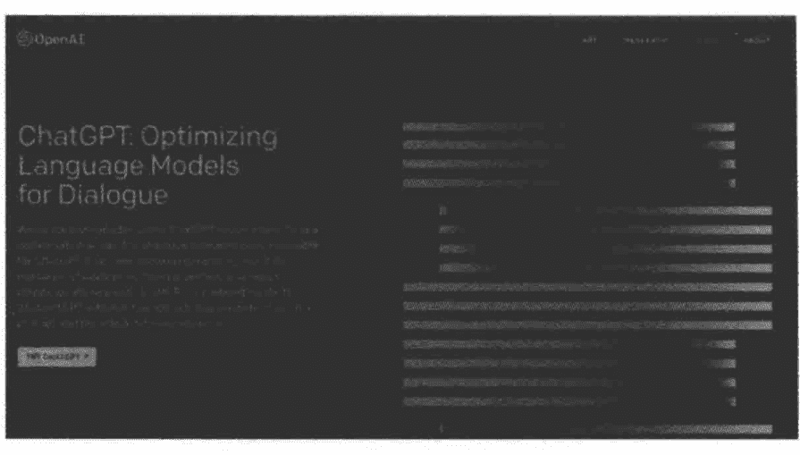
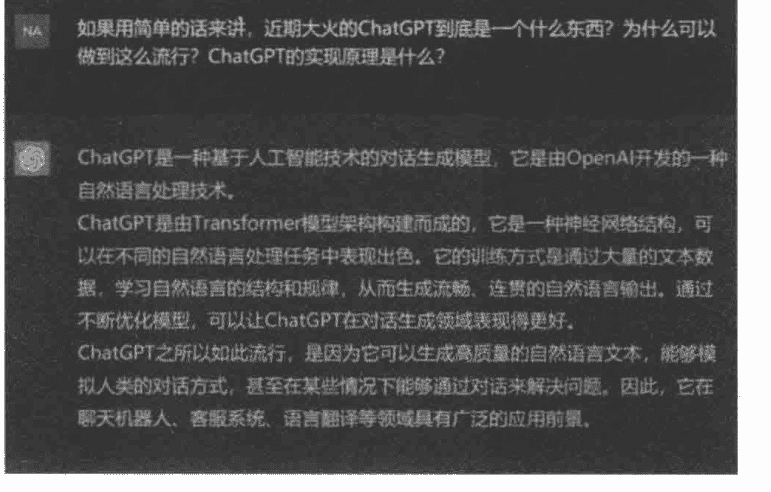
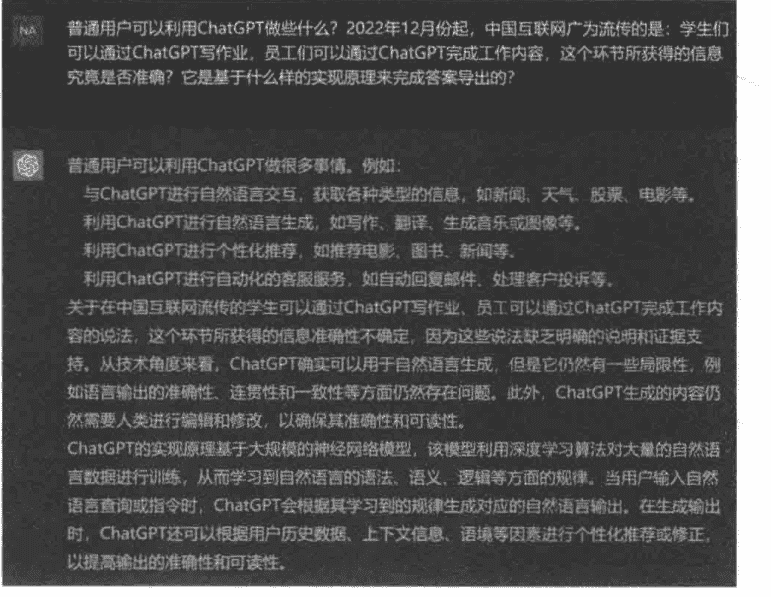
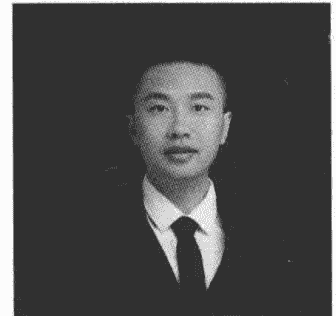
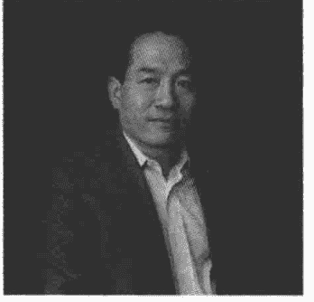
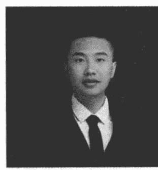
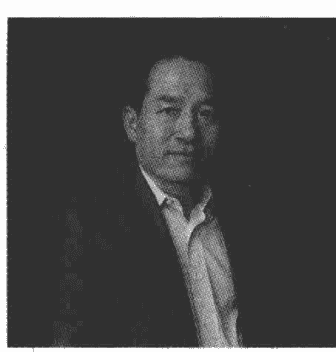
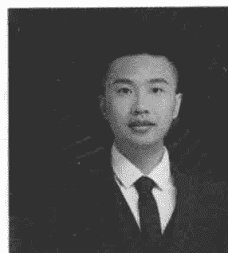

# 迭变ChatGPT与AI的远大未来

# 人工智能时代已经开启

比尔·盖茨

我平生见识过两次令我印象深刻、革命性的技术演示。
第一次是在 1980 年，当时有人向我介绍了一个图形用户界面——包括 Windows 在内的所有现代操作系统的前身。我和这个向我演示的人——一位名叫查尔斯·西蒙尼（Charles Simonyi）的优秀程序员相邻而坐，我们立即进行了头脑风暴，讨论我们从用户友好角度出发，在计算机领域内能做到的事。查尔斯最终加入了微软，Windows 成了微软的支柱，而我们在那次演示后所做的思考，则帮助我们确定了公司未来 15 年的蓝图。
第二次大惊喜就发生在 2022 年。自 2016 年以来，我一直与 OpenAI 的团队会面，他们的稳步进展给我留下了深刻印象。2022 年年中的时候，我对他们的工作感到大为惊叹，于是我给他们设置了一个挑战：训练一个人工智能，让它通过一门先修（AP）生物考试，让它有能力回答那些没有经过专门训练的问题（我选择 AP 生物考试是因为这一考试不仅仅考察对科学事实的简单复述，还要求对生物学进行批判性的思考）。我说，如果你们能做到这一点，那就取得了真正的突破。

我以为这个挑战会让他们忙上两三年，但他们只用几个月就完成了。

2022 年 9 月，当我再次与他们会面时，我大为惊诧地目睹了他们拿 AP 生物考试中的 60 道选择题考察他们的人工智能模型（GPT）——它答对了其中的 59 道。然后，GPT 出色地写下了考试中 6 个开放式问题的答案。我们请了一位外部专家为考试打分，GPT 得到了 5 分——能达到的最高分数，相当于在大学水平的生物课程中得到 A 或 A+。

我知道自己目睹了自图形用户界面以来最重要的技术进步。

这引发我思考人工智能在未来 5~10 年内可以实现的所有事情。

人工智能的发展与微处理器、个人电脑、互联网和移动电话的诞生一样意义重大。它将改变人们工作、学习、旅行、获得医疗保健和彼此交流的方式。整个行业将围绕人工智能重新洗牌。企业也将根据其利用人工智能技术的程度来区分优劣。

现阶段，慈善事业是我的全职工作。我一直在思考，除了帮助人们提高生产力，人工智能还能如何减少世界上一些最严重的不平等现象。在全球范围内，最严重的不平等发生在卫生领域：每年有 500 万 5 岁以下的儿童死亡。这比 20 年前的 1 000 万有所下降，但这一数字仍高得骇人。几乎所有这些儿童都出生在贫困国家，死于腹泻或疟疾等可预防的疾病。很难想象人工智能还有比拯救儿童生命更好的用途。

在美国，减少不平等现象的最佳机会是改善教育，特别是确保学生在数学方面取得成功。有证据表明，无论学生选择何种职业，掌握基本的数学技能都可以为他们的成功奠定基础。但全国各地的数学成绩正在下降，尤其是黑人、拉丁裔和低收入学生。人工智能可以帮助扭转这一趋势。

气候变化是我相信人工智能可以让世界更加公平的另一个问题。气候变化的不公正之处在于，遭受最恶劣影响的人——世界上最贫穷的人——同时也是对其责任最小的人。我仍在思考和学习人工智能如何能够提供帮助，但我将在下文中提出几个潜力很大的领域。

简而言之，我很激动去见证人工智能将对盖茨基金会的研究问题所能产生的影响，在未来的几个月里，基金会将会有更多涉及人工智能的讨论。世界需要确保每个人——而不仅仅是富人——都能从人工智能中受益。政府和慈善机构将需要发挥重要作用，以确保人工智能是在减少而非加剧不平等现象。这是我自己对人工智能相关工作的重点。

任何具有颠覆性的新技术都必然会让人们感到不安，人工智能当然也是如此。我理解其中的原因——这引发了劳动力、法律制度、隐私、偏见等方面的棘手问题。人工智能也会犯事实性错误，并出现“幻觉”。在我提出一些减轻风险的方法之前，我将定义我所理解的人工智能，并将更详细地介绍人工智能将会帮助人们提升工作能力、拯救生命和改善教育的一些方式。

# 定义人工智能

从技术上讲，人工智能（Artificial Intelligence，AI）一词是指为解决特定问题或提供特定服务而创建的模型。ChatGPT等程序背后的驱动技术就是人工智能。它正在学习如何更好地对话聊天，但无法学习其他任务。相比之下，通用人工智能（Artificial General Intelligence，AGI）一词是指能够学习任何任务或主题的软件。AGI还不存在——计算行业正在就如何创造AGI，甚至AGI是否可以被创建进行激烈的争论。

开发AI和AGI一直是计算行业的伟大梦想。几十年来，问题在于计算机何时在计算之外其他方面的表现能够优于人类。现在，随着机器学习和大量计算能力的出现，复杂的人工智能已经成为现实，而且它们会快速迭代升级。

我回想起个人计算革命的早期，当时的软件行业圈子极小，包括我在内的大多数从业者加在一起才将将凑满一场会议的演讲台。而现如今，这是一个全球性的产业。由于行业中很大一部分人现在正把注意力转向人工智能，创新将比我们在微处理器突破后经历的要快得多。再过不久，前人工智能时代似乎就会像在命令提示符（C:>）下输入命令而不是在屏幕上点击操作计算机的日子一样遥远。

# 生产力提高

尽管人类在许多方面仍然强于 GPT，但有很多工作并不怎么需要使用这些能力。例如，销售行业人员（数字或电话）、服务业人员或文件处理人员（如应付账款、会计或保险索赔纠纷）所做的许多工作都需要决策，但不需要持续学习的能力。公司有针对这些活动的培训计划，在大多数情况下，他们手中有很多或好或坏的工作实例。人类使用这些数据集进行训练，很快这些数据集也将被用于训练人工智能，使人们能够更有效地完成这项工作。

随着计算能力变得愈发廉价，GPT 表达想法的能力将越来越像你身边的一个白领，帮助你完成各项任务。微软将其描述为拥有一个副驾驶。若其完全集成融入 Office 等产品之中，人工智能将增强你的工作能力，比如帮助写电子邮件和管理收件箱。

最终，你控制计算机的主要方式将不再是指向、点击或敲击菜单和对话框，而是可以用简单的英语编写一个请求。不仅仅是英语——人工智能将理解世界各地的语言。今年早些时候在印度，我会见了一些研发人员，他们正在开发能够理解当地多种语言的人工智能。

此外，人工智能的进步将使创建个人代理成为可能。把它想象成一个数字私人助理：它会看到你最新的电子邮件，知道你参加的会议，阅读你读的内容，也会阅读你不想理会的东西。这既能提高你想做的任务的工作效率，又能让你从不想做的任务中解脱出来。

你将能够使用自然语言让这个代理帮助你安排日程、通信和电子商务，而且它将在你的所有设备上工作。由于训练模型和运行计算成本高昂，创建个人代理尚不可行，但考虑到最近人工智能的进步，这在现在是一个现实的目标。一些问题还亟待解决：例如，保险公司是否可以在未经你允许的情况下向你的代理询问有关你的事情？如果是这样，有多少人会选择不使用它？

公司级代理将以新的方式赋予员工权力。一个了解特定公司的代理可以为员工提供直接咨询，并且应该参加每一次会议，以便它回答问题。如果它有一些见解，你可以让它保持沉默，或是鼓励它表达出来。它需要获得接触与公司有关的销售、支持、财务、产品时间表和文本的权限。它应该阅读与该公司所处行业相关的新闻。我相信这样做的结果会提高员工的生产力。

生产力提高后，社会也会受益，因为人们可以腾出时间来做其他事情，无论在工作中，还是在家庭里。当然，人们究竟需要何种形式的支持和再培训，这也存在着严重的问题。政府需要帮助工作者过渡到其他角色，但对帮助者角色工作人员的需求永远不会消失。人工智能的兴起将解放人们去做那些软件永远做不到的事情，如教学、照顾病人和赡养老人。

全球健康和教育是两个具有巨大需求的领域，但却没有足够的工作者来满足这些需求。如果人工智能有恰当的目标，就可以助力这些领域减少不平等现象。这些应该是人工智能工作的一个重点，所以我现在要谈谈这些问题。

# 卫生领域

我认为人工智能将在以下几个方面改善卫生保健和医疗领域。

首先，人工智能将帮助卫生保健工作者充分利用时间，为他们处理某些任务，如提交保险索赔、处理文书工作，以及起草医生的查房记录。我相信在这个领域会有很多创新。

其次，其他由人工智能驱动的改进将对贫困国家尤为重要，因为绝大多数5岁以下儿童的死亡发生在这些国家。例如，这些国家的许多人从未看过医生，而人工智能将帮助他们身边的卫生工作者提高工作效率（开发人工智能驱动的超声波机的工作是一个很好的例子，这种机器只需最低限度的训练就能投入使用）。人工智能甚至可以让患者自己进行基本的病情鉴定，获得处理健康问题的建议，并决定他们是否需要寻求治疗。

在贫困国家使用的人工智能模型将需要针对与富裕国家不同的疾病进行训练。它们需要用不同的语言工作，并考虑到不同的挑战，如住得离诊所很远的病人，或为了养家糊口，即使生病也不能停止工作的病人。

人们需要证据来证明卫生领域的人工智能总体上是有益的，尽管它们并不完美，也会犯错误。人工智能必须经过非常仔细的测试和适当的监管，这意味着其需要比其他领域更长的时间才能投入使用。但话说回来，人类也会犯错。无法获得医疗服务也是一个问题。

除了帮助护理，人工智能还将大大加快医学突破的速度。生物学的数据量非常庞大，人类很难掌握复杂生物系统工作的全部方式。现已有软件可以查看这些数据，推断出其路径，搜索病原体上的目标，并依据此来设计药物。一些公司正在用这种方法开发抗癌药物。

下一代的工具将更加高效，它们将能够预测副作用并计算出剂量水平。盖茨基金会在人工智能方面的优先事项之一是确保这些工具被用于解决影响世界上最贫困人口的健康问题，包括艾滋病、结核病和疟疾。

同样，政府和慈善机构应该制定激励措施，鼓励企业分享人工智能对贫困国家人民饲养作物或牲畜方法的建议。人工智能可以根据当地条件，帮助开发更好的种子；根据当地的土壤和天气，为农民提供最好的选种建议；并帮助开发用于牲畜的药物和疫苗。随着极端天气和气候变化给低收入国家的自给农民带来更大的压力，这些进步将变得更加重要。

# 教育事业

计算机对教育的影响并没有像我们许多业内人士所希望的那样。有一些良性发展，包括教育游戏和像维基百科这样的在线信息来源，但其并没有对衡量学生成绩的任何方法产生有意义的影响。

但我认为，在未来 5~10 年内，人工智能驱动的软件将最终实现改革人们教学和学习方式的承诺。它会了解你的兴趣和学习风格，从而为你量身定制内容，保持你的参与度。它会衡量你的理解能力，注意你何时失去兴趣，并了解你倾向于哪种激励方式。它会给出即时反馈。

人工智能可以在很多方面帮助教师和管理者，包括评估学生对某一学科的理解，并就职业规划提供建议。教师已经在使用 ChatGPT 这样的工具来生成学生写作作业的评语。

当然，人工智能还需要大量的培训和进一步的发展，才能理解某个学生学习的最佳方式或其学习的驱动因素。即使技术完善了，学习仍将取决于师生之间的良好关系。它将助力——但永远不会取代——学生和老师在课堂上共同完成的工作。

新型工具将被创造，提供给有能力购买的学校，但我们需要确保这些工具也会被创建并提供给美国和全球的低收入学校使用。人工智能将需要在不同的数据集上进行训练，确保他们不含偏见，并适合它们将被使用的不同文化环境。数字鸿沟将需要弥合，这样低收入家庭的学生才不会掉队。

我知道很多老师都担心学生用 GPT 来写论文。教育家们已经在讨论如何适应这种新技术，我猜这种讨论还会持续相当长的一段时间。我听说有些老师找到了将技术融入学业的巧妙方法，如允许学生使用 GPT 来创建个性化的初稿。

# 人工智能的风险和问题

你可能已经了解到关于目前人工智能模型的问题。例如，它们不一定善于理解人类请求的背景，这导致了一些奇怪的结果。当你要求人工智能编造一些虚构的东西，它可以做得很好。但是当你询问关于你想要的旅行的建议时，它可能会建议一些不存在的酒店。这是因为人工智能没有很好地理解你的请求的前后逻辑，不知道它是应该编造假酒店还是只告诉你有房间的真实存在的酒店。

还有其他问题，如人工智能在数学问题上给出错误答案，因为它们难以进行抽象推理。但这些都不是人工智能的根本局限性。开发人员正在努力解决这些问题，我认为我们将在不到两年的时间里看到这些问题得到很大程度的改善，甚至可能更快。

其他的担忧不仅仅是技术上的。例如，由人工智能武装的人类会构成威胁。像大多数发明一样，人工智能可以用于良好的目的或恶意的目的。政府需要与私营部门合作，设法限制风险。

人工智能也有可能会失去控制。一台机器会不会认为人类是一种威胁，得出结论认为它的利益与我们不同，或者干脆不再关心我们？有可能，但这个问题在今天并不比过去几个月人工智能发展之前更紧急。

具备超常智慧的人工智能就在我们的未来。与计算机相比，我们的大脑以蜗牛的速度运作：大脑中电信号的移动速度是硅芯片中信号的 1/100 000 ！一旦开发人员能够泛化算法并以计算机的速度运行它——这可能需要十年或一个世纪的时间——我们将拥有令人难以置信的强大的通用人工智能。它将能做人类大脑所能做的一切，但对其内存大小或运行速度没有任何实际限制。这将是一场意义深远的变革。

这些强人工智能也许强大到能够确立自己的目标。这些目标是什么？如果它们与人类的利益相冲突，会发生什么？我们是否应该阻止强人工智能的发展？随着时间的推移，这些问题将变得更加紧迫。

但过去几个月的任何突破都没有让我们向强人工智能迈出实质性的一步。人工智能仍然不能控制物理世界，也不能建立自己的目标。《纽约时报》最近刊登了一篇关于 ChatGPT 的对话的文章，其中 ChatGPT 宣布它想变成一个人，这引起了广泛关注。这是一个很吸引人的观点，即模型的情感表达可以多么像人类，但这并不是其独立思考的有意义指标。

有三本书塑造了我自己对这个问题的思考：尼克·波斯特洛姆（Nick Bostrom）的《超级智能》、迈克斯·泰格马克（Max Tegmark）的《生命 3.0》以及杰夫·霍金斯（Jeff Hawkins）的《千脑智能》。我并不完全赞同作者的观点，作者们彼此之间的看法也不尽相同。但这三本书都写得很好，发人深省。

# 下一个前沿领域

从事人工智能新用途以及改进技术本身的方法的公司将大量涌现。例如，一些公司正在开发新的芯片，为人工智能提供所需的大量处理能力。有些使用光学开关（本质上是激光）来减少能源消耗和降低制造成本。理想情况下，创新芯片将允许你在自己的设备上运行人工智能，而不是像现在这样在云端运行。

在软件方面，驱动人工智能学习的算法将变得更好。在某些领域，如销售，开发者可以通过限制人工智能工作的领域，并给它们提供大量特定于这些领域的训练数据，使人工智能变得非常准确。但一个悬而未决的大问题是，我们是否需要许多这种专门的人工智能用于不同的用途（例如，一个用于教育，另一个用于办公室生产力），或者是否有可能开发出一种可以学习任何任务的通用人工智能。这两种方法都将面临巨大的竞争。

无论怎样，在可预见的未来，人工智能的主题将主导公众的讨论。我想提议三个原则来引导这场对话。

首先，我们应该努力平衡对人工智能弊端的担忧以及它改善人们生活的能力——这些担忧是可以理解的，也是合理的。为了充分利用这项非凡的新技术，我们既需要防范风险，又需要让尽可能多的人受益。

其次，市场力量不会自然地产生帮助最贫困人口的人工智能产品和服务。相反的可能性更大。有了可靠的资金和正确的政策，政府和慈善机构可以确保人工智能被用于减少不平等。正如世界需要最富有智慧的人专注于最大的问题一样，我们将需要把世界上最好的人工智能专注于其最大的问题。

虽然我们不应该等待这种情况发生，但试想一下人工智能是否会识别不公平并试图减少不公平是很有趣的。你是否需要有道德感才能看到不公平，或者一个纯粹理性的人工智能也会看到它？如果它确实看到了不公平，它会建议我们怎么做呢？

最后，应该记住，我们只是处在人工智能潜力开发的开始阶段。无论它今天有什么限制，很快就会得到解决，甚至在我们察觉之前。

我很幸运地参与了个人电脑革命和互联网革命。我对这一时刻同样感到兴奋。这项新技术可以帮助世界各地的人们改善生活。同时，世界需要建立规则，让人工智能的好处远远超过它的任何缺点，无论人们身处何方或贫富与否，让每个人都能享受这些好处。人工智能时代充满了机遇和责任。

# 前言

## 它是科技界的“iPhone时刻”，更是未来的迭变之始

硅谷不是没有泡沫，但AI绝对不是硅谷的泡沫。

AI的“深度学习”技术已经成为日常，我们所熟知的AI可以“认识脸”和“听懂人类要求”只是深度学习的开始，这个技术在未来还会有无限延伸的方向，但是公众对AI的理解模糊而不确定，很多人只是“大概知道什么是AI”，如果没有ChatGPT引发的热浪，可能很长的时间内，大部分人依然不能用一个简单的方式来理解AI。

先不论技术上的突破，单就ChatGPT一夜之间让太多人完成了难于想象的认知蜕变，它就值得赞赏，ChatGPT注定是一个现象级的产品。普通民众，可能都不知道GPT这三个字母是什么具体含义，但是他们因为和ChatGPT展开有趣的对话，从而坚信“AGI（通用人工智能）注定改变我们的未来”。

特伦斯·谢诺夫斯基（Terrence Sejnowski）是AI奠基人，世界十大人工智能科学家之一，还是美国仅3位在世的“四院院士”之一，同时兼任全球人工智能顶级会议 NIPS 基金会主席。他是第一位来“一刻 talks”分享 AI 深度学习知识的智客讲者。特伦斯先生说，人工智能所带来的生活方式的改变，将会是十分剧烈的。而深度学习机制，则赋予了人工智能更强的学习能力。

OpenAI 的厉害之处，不是做出了惊人的研究，也不是不断迭代明星产品，而是从成立的第一天开始，OpenAI 就希望去探索下一个 AI 的范式是什么？这注定这是一家可能成为伟大的公司，毕竟“初心即是巅峰”。

如果说 10 年前是 AI 第一波浪潮，AI 的第二波复兴，以一个前所未有的速度被 ChatGPT 拉开了序幕。比尔·盖茨赞赏 ChatGPT，说它的出现，会像互联网的发明一样重要，将会改变世界。七年前（2016 年），阿尔法狗（AlphaGo）用特定问题的解决展示了 AI 的能力；2023 年，ChatGPT 用解决开放和广泛的问题展示了 AI 更强劲能力，让产业界和普通民众对 AI 产生了更多期待。

对 ChatGPT 最精辟的点评来自黄仁勋，他是英伟达联合创始人、总裁兼 CEO。他说，ChatGPT 是科技界的“iPhone 时刻”，还记得 iPhone 闪耀出世的盛况吗？在有 iPhone 之前，没人能想象，原来手机还可以这样！所以，所谓的“iPhone 时刻”有两层含义：一是指 ChatGPT 是人类科技史上伟大的发明之一，如同当年乔布斯发明 iPhone 一样伟大；另一个意思就是，ChatGPT 在解决人与 AI 的交互方面，和 iPhone 一样，是一次伟大的革命，正是 ChatGPT 使得人们可以更方便地使用 AI，就像使用 iPhone 那样，体验超级好。

《迭变：ChatGPT 与 AI 的远大未来》（*Defining Moment For AI*）这本书是“一刻 talks”2023 年创新项目“一刻 talks · 新知 Lab”的第一个成果，“一刻 talks · 新知 Lab”是一刻 talks 创新项目小组，由富有创意和好奇精神、热衷探索硬科技的青年编辑组成，以发现、洞察、传播第一手前沿新知为乐趣。

“一刻 talks · 新知 Lab”小组的成员也是 ChatGPT 很早期的用户，他们热衷探索最新的技术和运用，2023 年 3 月初的时候，这个小组中一个特别有好奇心的小伙伴，竟然成功地获得了微软新必应（New Bing）的使用资格，尽管与他一起排队有 400 多万人，结果他被抽中了，很幸运。他说微软新必应跟 ChatGPT 的水平旗鼓相当的样子，也很厉害，它甚至会诱导你（自动地给出一些答案）去做一些选择来帮助你拓展思路，三天后，这个小伙伴在工作群留言说，他“现在左边 ChatGPT 右边新必应，高科技智能办公，效率拉满”，超级拉风的场景。

“一刻 talks · 新知 Lab”今年有个小目标，在 12 位知名智客联合支持下，发起一个名为“IN-TECH 硬科技前沿”的计划，目标是关注前沿的关键迭代，以深度知识应对快速变化的世界。

“一刻 talks · 新知 Lab”会持续关注前沿的硬科技领域，对话硬科技产业独具代表的思考者、产业领军者、技术践行者与投资决策者，洞察产业与技术融合的未来，发现技术浪潮引发的变革与创新，这些领域覆盖深刻影响未来人类社会发展的医学健康、生物基因、人工智能、关键芯片、数字化元宇宙、宇宙航天、新材料新能源。

“一刻 talks · 新知 Lab”也会联合知名的“知识生产的原创基地”——颉腾文化推出系列的“IN-TECH 硬科技前沿”系列图书，致力传播第一手前沿新知，全方位服务创新科技生态。该系列强调前沿时效性、文字体量和内容深度，我们将尽量做到“小而有趣，广而精深”。

《迭变：ChatGPT 与 AI 的远大未来》就是“IN-TECH 硬科技前沿”系列的第 1 辑，我们意识到，ChatGPT 和所有这几年“昙花一现”的技术都不同，技术突破使 AIGC 应用市场有望率先实现需求爆发。

“一刻 talks · 新知 Lab”访谈了 3 位杰出智客并邀请他们一起共创，以发现 AI 的技术迭变之境和商业的远大未来，他们是：

【顾实】中国最年轻博士生导师（26 岁），电子科技大学教授，福布斯中国 30 岁以下 30 人获得者，国家青年特聘专家，从事人工智能领域的研究，在类脑、AIGC 和模型量化等领域贡献突出，曾在《自然》（*Nature*）和人工智能领域国际顶级会议 ICML、NeurlPS、ICLR 等发表多篇高水平论文。

【陶芳波】知名 AI 科学家，前阿里达摩院科学家，神经符号实验室创始人，心识宇宙创始人兼 CEO。美国伊利诺伊大学博士学位，师从于数据挖掘领域的创始人韩家炜（Jiawei Han）教授，先后在美国微软研究院、Facebook Research 等从事研究工作。

【王立新】知名投资人，渤海产业投资基金管理公司董事长，中国文化产业投资基金投委会前主席。专注于移动互联网、人工智能、新业态投资领域。

这本著作中，“一刻 talks · 新知 Lab”试图回答，ChatGPT 真的能解放人类生产力吗？它是史诗级产品还是过渡性迭代？这场指数级的技术风暴，对于创业者、投资人、产品经理、技术开发者、产业人士有什么机会和影响？技术驱动下数字化未来将呈现何种姿态？

我们特别欢迎有创新想法和热衷探索未知的朋友们和我们一起共创，如果你想联络“一刻 talks · 新知 Lab”可以这样找到我们：lab@yiketalks.com。

一刻 talks · 新知 Lab

# 01
## 第1章
# ChatGPT：
## 一次新的“iPhone 时刻”

> > ChatGPT 的出现，会像互联网的发明一样重要，将会改变世界。
> 
> ——比尔·盖茨
> 微软创始人

> > ChatGPT 是科技界的“iPhone 时刻”！
> 
> ——黄仁勋
> 英伟达联合创始人、总裁兼CEO，《时代》杂志评出2021年世界最具影响力的百位人物之一

每个时代，总有一种产品横空出现，2022 年 11 月 30 日，人工智能迎来了 革命性的时刻，作为人工智能界顶流的 ChatGPT，上线不到一周日活用户破百万，2 个月破亿……它可以进行长时间、流畅的对话，回答问题，并撰写人们要求的几乎任何类型的书面材料，包括商业计划、广告活动、诗歌、笑话、计算机代码和电影剧本。尽管它远非完美，但依然可以很快的速度成为现象级消费类 AI 应用。这也使得继专业生成内容（PGC）和用户生成内容（UGC）之后，通过人工智能技术自动或辅助生成内容的 AIGC 成为资本市场的热词。

ChatGPT 就像是一个从科幻小说里走出来的会思考的数字原住民，过去的十年，仿佛是人工智能技术领域的“寒武纪大爆发时代”。“ChatGPT 的出现，会像互联网发明一样重要，将会改变世界。” 比尔·盖茨这么评价 ChatGPT 的影响。如果说 2016 年阿尔法狗（AlphaGo）① 的诞生是解决围棋这个特定的问题，那么 ChatGPT 则是解决了一个开放的问题。

> ① 围棋的英文是 Go，阿尔法狗是 AlphaGo 的谐音翻译，是一款由 Google 旗下 DeepMind 公司开发的围棋人工智能程序。

可能一个月前很多人只是“大概知道什么是 AI”，但 ChatGPT 引发的热浪以及 AI 巨头们在 2023 年年初连续上演神仙打架的大场面，一夜之间让太多人完成了难于想象的认知蜕变，越来越多人，不仅是产业界还包括普通民众，坚信“AGI（通用人工智能）注定改变我们的未来”。

ChatGPT 已然风靡全球，《纽约时报》称其为“有史以来向公众发布的最好的人工智能聊天机器人”。ChatGPT 和所有这几年“昙花一现”的技术都不同，ChatGPT 是人工智能的新技术“生成式人工智能”的运用，它用了一种新的用于自然语言理解的神经网络架构 Transformer，GPT 就是 Generative Pre-training Transformer 的缩写，即“生成式预训练转换器”，可以生成高质量的语言模型，用于训练这些模型的计算量到 2022 年已经全球增加了 6 个数量级，所以可以生成与人类水平相当的内容。

OpenAI 在 2022 年 12 月初推出的 ChatGPT，对于 60 天月活破亿这个数据，连爆点的始作俑者 OpenAI 也没有想到，其 CEO 萨姆·奥尔特曼（Sam Altman）说：“我对人们的反应程度有些惊讶。”

OpenAI 的确是全球最著名的人工智能研究机构，它发布了许多著名的人工智能技术和成果，如大语言模型 GPT 系列、文本生成图片预训练模型 DALL-E 系列、语音识别模型 Whisper 系列等。由于这些模型在各自领域都有相当惊艳的表现，引起了全世界广泛的关注。

比起普通的搜索引擎，ChatGPT 更能理解人类语言的模糊性，对个性化的问题作出不同回答。针对“假如你是苏格拉底，我是你的学生，你会关心我的哪些方面？”“如果你是莎士比亚笔下的威尼斯商人，你会怎么看我这种不会赚钱的学生呢？”这样不同的问题，ChatGPT 能够抓住苏格拉底和威尼斯商人的不同特质进行回复，例如“在苏格拉底看来，赚钱并不是人生的主要目的”“莎士比亚笔下的威尼斯商人更看重金钱和物质享受”等。

ChatGPT 一时间爆火，推出仅仅 2 个月，就达到月活过亿，成为历史上增长最快的消费者应用程序。数字分析平台 Sensor Tower 数据显示，TikTok 在全球推出后花了约 9 个月时间达到 1 亿用户，Instagram 则用了 30 个月才达到同样的水准。

顶级应用程序每月使用量达到 1 亿次需要的时间（截图）如图 1.1 所示。

| APP | MONTHS TO REACH 100M GLOBAL MAUS |
| :--- | :--- |
| CHATGPT | 2 |
| TIKTOK | 9 |
| INSTAGRAM | 30 |
| PINTEREST | 41 |
| SPOTIFY | 55 |
| TELEGRAM | 61 |
| UBER | 70 |
| GOOGLE TRANSLATE | 78 |

图 1.1

关于 ChatGPT，知名 AI 科学家陶芳波的基本判断是：“第一，近 30 年来，Google 的潜在替代品终于出现了；第二，很多应用会因此被推倒重来，或使用大模型的能力来强化交互体验，就像今天大家看到 ChatGPT 可以强化搜索体验一样；第三，ChatGPT 及其类似的模型，会成为数字世界的一种基础设施，承担‘思维’底座。就像移动互联网的到来不仅仅需要 iPhone 这样的计算平台，也需要各种应用把服务落地到大大小小的移动场景。我们必须去做最快、最全、最好用的 AGI（通用人工智能）应用平台。”

就在微软准备在自家产品中整合 ChatGPT 之际，2023 年 2 月，谷歌创始人拉里·佩奇和谢尔盖·布林就 ChatGPT 的猛烈攻势，召开了多次高层会议。要知道，3 年来，佩奇和布林虽仍在董事会担任要职，但已经卸任了在谷歌的具体运营管理职务，换句话说，就是退出一线了。此次两人与会事件与会议主题一经爆出，无疑在向外界传递一个信号。

谷歌两位创始人与会的主要话题，围绕着“聊天机器人搜索引擎”，他们批准并提出了要把对话 AI 和搜索引擎进一步整合的计划。谷歌部署的下一步应对战略，还有预备在 2023 年内推出 20 个全新 AI 产品。谁也不曾料到，2022 年 11 月底普普通通的一天，ChatGPT 一经出世，势如破竹。在“ChatGPT 会不会取代 Google”的争论里，答案已经不言而喻。知名风投公司 Air Street Capital 的合伙人内森·贝纳奇（Nathan Benaich）在自己的推特发言，他预测：“AI 越来越有看点了，未来将会非常酷。而现在谷歌向拉里·佩奇和谢尔盖·布林求助，准备展开一场战斗”，如图 1.2 所示。

谷歌长期独占鳌头的核心资本，是它能以远超的实力，极速为用户提供想要的答案。而此次带来威胁的 ChatGPT，似乎可以用对话的形式，提供一种在互联网上搜索信息的新方法，还将被整合进微软所有产品，并作为平台供其他企业使用。

ChatGPT 的出现其实不是什么新鲜事，理论上谷歌手中紧攥着语言大模型（Large Language Model，LLM）和新的语言大模型：通路语言模型（PaLM，Pathways Language Model），并非没有能力。然而 2022 年对话系统 LaMDA① 亮相时，几乎没有什么人在讨论它对于搜索引擎的替代性。但 ChatGPT 让人体验有史以来最好的对话机器人后，一切都不一样了。

> ① Google 推出的 LaMDA（Language Model for Dialogue Applications）是语言处理领域的一项新的研究突破。LaMDA 是一个面向对话的神经网络架构，可以就无休止的主题进行自由流动的对话。它的开发是为了克服传统聊天机器人的局限性，传统聊天机器人在对话中往往遵循狭窄的、预定义的路径。LaMDA 参与曲折对话的能力可以为技术和新类别的应用程序提供更自然的交互方式。

除此之外，ChatGPT 秒速生成内容的能力，以及几乎降为零的生成成本，足以让整个互联网充斥着它所生成的真假难辨的内容。如此一来，谷歌最核心的搜索引擎呈现给用户的内容也将被不知靠谱与否的“垃圾内容”淹没。再者，据协作软件初创公司 Felts 创始人、技术专家卡恩·杜鲁克（Can Duruk）的说法，只要最后能搜索到想要的结果，多数人不在乎搜索过程中是否被真实性存疑的内容“欺骗”。

# Minitalk:
### ChatGPT 是第 4 次
### 信息交互的革命

**王立新**
知名投资人
渤海产业投资基金管理公司董事长
中国文化产业投资基金投委会前主席

从信息获取的角度，我们追溯远一点，其实我们人类，从第一次这个文明来的时候，我们的信息获取方式是什么？是一种展示方式，5 000 年文明历程中信息获取方式，我们把信息写在石头或者竹筒上，有什么信息就读什么信息，被动式接受。

但是互联网之后，我们有了新的信息获取方式，一开始大家还没有意识到，雅虎刚出来的时候，互联网是展示式和菜单式的，你通过翻页和滚动鼠标查看内容，然后谷歌搜索就出来了，形成一次革命，这是第二种信息获取方式，即搜索方式，互联网从菜单式进入了搜索阶段。

搜索方式对展示方式的一个革命就是可以根据自己的兴趣，去搜我们需要的信息。而搜索的优点就是你可以根据兴趣来搜索。在过去 20 年中，我们已经形成了搜索的习惯，这让我们的信息获取量可能是增加了好几个数量级。

在网络搜索技术产生 20 年之后，我们又迎来了人工智能，人工智能有智能推荐，我对它的定义是第三次信息革命。当你在屏幕上点击滚动，你在搜索的时候，它已经获取了你的行为，然后根据你的行为，了解你的习惯，再给你推荐信息，这让信息获取的效率和质量又提高了一步。

ChatGPT 是一种人性化的交互方式，是第四次革命。人类获取信息方式已经习惯于我们所喜欢的问答式，我问一个问题，你答一个问题。但是在 ChatGPT 出现之前，你会发现进行网络搜索和推荐的时候，它会根据你的问题，给你推荐和展示很多信息。现在的问答式，它就只给你一个答案。如果对这个答案不满意，你可以再给出一定的约束条件，它可以修正答案，这是效率和信息质量的一个提升。

简而言之，过去短短的三十年当中，我们的信息交互方式就发生了 4 次革命，这是不得了的事情。

# 02
## 第2章
### 为什么人类会大规模
### 爱上 ChatGPT

> > 在苏格拉底看来，赚钱并不是人生的主要目的，而莎士比亚笔下的威尼斯商人更看重金钱和物质享受。
>
> ——ChatGPT
> OpenAI 的生成式 AI 软件

> > ChatGPT 会生成很多人类觉得逻辑上似乎是那么回事的一段文字，但不能深究。
>
> ——顾实
> AI 科学家，中国最年轻博士生导师（26 岁），国家青年特聘专家

> > GPT 可以认为是第二代人工智能，它可以做问答题了，而第一代人工智能只能做填空题。
>
> ——王立新
> 知名投资人，渤海产业投资基金管理公司董事长
> 中国文化产业投资基金投委会前主席

很多用户自述喜欢 ChatGPT，因为它和过去的技术产品不同，它是在“用人类喜欢的方式回答”！

每一个使用过 ChatGPT 的人，大抵都会有同样的感觉：“有趣”“上头”“不可思议”，甚至会产生“科幻照进现实”的错觉。人工智能发展多年，ChatGPT 是首个 2 个月就达到用户数量破亿，并在全球范围内被人们争相体验的产品。ChatGPT 如此火爆，是因为在一定程度上满足了很多人对于影视中出现的 AI 的想象。它能够通过学习和理解人类的语言来进行对话，还能根据聊天内容的上下文进行互动，像人一样沟通交流。

可能源于人们对于人工智能技术的期望往往高于实际能力，以往出现的那些人机交互类型的 AI 产品，如汽车智能座舱系统、智能家居设备，由于表现不佳、结果不准确或不可靠，常常被用户称为“人工智障”。但 ChatGPT 绝对不是，ChatGPT 带来了新一轮的 AI 技术范式革新。

作为一个人工智能对话和撰稿工具，ChatGPT 底层需要依靠自然语言处理模型来驱动，目前使用的语言模型是 GPT-3.5，OpenAI 计划将其升级到 GPT-4 版本。比起普通的搜索引擎，ChatGPT 更能理解人类语言的模糊性，对个性化的问题作出不同回答。

得益于 ChatGPT 背后先进的 GPT-3.5 大模型，它的绝大部分回答在数据集时间范围内都是准确的，由于普通用户并不知道它的运作机制，会倾向于认为它无所不知。现在的 ChatGPT 能力非常全面，能完成撰写邮件、视频脚本、活动文案、文章写作、代码编写等各种类型的任务。它也适合应用在小说写作、剧本创作、活动策划等需要解放生产力的行业。而 ChatGPT 可能会以一种非常自信的口吻来编造事实，这是一个大问题。

不管高深的量子物理学问题，还是撰写财经新闻，ChatGPT 都表现出了强大的创作和学习能力。据《纽约时报》2023 年 1 月的报道，北密歇根大学的哲学教授安东尼·奥曼（Antony Aumann）在为自己任教的一门世界宗教课程评分时，惊喜地读到了一篇“全班最好的论文”。在这篇论文中，作者以简洁的段落、恰当的举例和严谨的论据，探讨了罩袍禁令的道德意义。然而，在奥曼教授的追问之下，学生承认这篇论文是用 ChatGPT 写的。他对此大为震惊。而早在 2022 年 12 月，《自然》杂志就已经有了先见之明，直指其可能对人类学习和思考能力产生潜在影响。据美联社 2023 年 1 月 25 日报道，美国众议员杰克·奥金克洛斯（Jake Auchincloss）在发表演讲讨论创建美国－以色列人工智能中心的法案时，其宣读的两段讲稿是由 ChatGPT 生成的，如图 2.1 所示。

图 2.1

ChatGPT 这款模型与 GPT-3 类似，能完成包括写代码、修 bug（代码改错）、翻译文献、写小说、写商业文案、创作菜谱、做作业、评价作业等一系列常见文字输出型任务。ChatGPT 比 GPT-3 更优秀的一点在于，前者在回答时更像是在与你对话，而后者更善于产出长文章，欠缺口语化的表达。有人利用 ChatGPT 与客服对话，要回了多交的款项（这或许意味着 ChatGPT 在某种意义上通过了图灵测试），或许 ChatGPT 能成为社恐人士的好助手。

当你用键盘输入这个问题询问 ChatGPT：“如果用简单的话来讲，近期大火的 ChatGPT 到底是一个什么东西？为什么可以做到这么流行？ ChatGPT 的实现原理是什么？” ChatGPT 非常快速地给出了答案，如图 2.2 所示。

从信息获取的角度，ChatGPT 堪称带来了一场革命，这一点，ChatGPT 自己也是这样认为的，如图 2.3 所示。

社交巨头 Snapchat 已经表示，它将推出自己的人工智能聊天机器人 My AI。My AI 是一款实验性的定制聊天机器人，采用的正是 OpenAI 最新版本的 GPT 技术，Snapchat 的聊天机器人 My AI 只对订阅 Snapchat+ 的高级用户开放。但该公司表示，在不久的将来，该平台的所有用户都可以免费或付费使用 My AI。

据悉，Snapchat 是最新一家将 AI 融入其平台的科技公司。2023 年 2 月 6 日，谷歌发布了一款名为 Bard 的对话聊天机器人，旨在与 ChatGPT 展开竞争。Snapchat+ 目前的订阅价格是 3.99 美元/月，该公司希望 My AI 的推出能帮助其扩大付费用户数量。目前，该公司的付费用户数量为 200 万，只占其用户总数的一小部分。Snapchat 还特别提醒用户：“和所有由 AI 驱动的聊天机器人一样，My AI 容易产生幻觉，可能会被骗说出任何话。”此外，该公司还建议用户不要与 My AI 分享秘密，也不要依赖它的建议。

即使知道 ChatGPT 信息可能存在失误，但是人类真的很喜欢与 ChatGPT 聊天和请教问题，杰夫·霍金斯（Jeff Hawkins）在《千脑智能》（A Thousand Brains）中揭示了一种关于大脑和智能的理论——千脑智能理论，这将彻底改变我们对大脑和人工智能的未来的理解。就像人类最终不是通过模仿鸟类，而是通过理解空气动力学而发明了飞行一样，在改进机器和深度学习的同时，我们需要首先了解大脑是如何工作的。杰夫·霍金斯和他的团队发现，大脑使用类似地图的结构来建立一个世界的模型——不仅仅是一个模型，而是成千上万个我们所知道的一切的模型，也就是千脑智能理论。这一发现为创造机器智能提供了清晰的路线图。

为什么大家欢迎 ChatGPT，顾实教授的理解非常简朴。

## Minitalk: ChatGPT 真的能产生大家能用得上的结果

**顾实**
中国最年轻博士生导师（26岁）
电子科技大学教授
福布斯中国30岁以下30人获得者
国家青年特聘专家

为什么大家欢迎 ChatGPT，一是它能够去跟人类比较顺畅地聊天，这是在此之前的一些大语言模型相对来说不具备的能力，降低了交流的障碍，也能给大家提供很多非常有趣的文本等等，这对普通用户来说，更有接触它的意愿。而之前的模型，主要还在科研工作者内部交流，大家更关注的点是它可能存在什么问题，而不是说它能给大家带来什么。二是它本身的一个生成能力比之前的模型要好上很多，它能够去产生一些大家能用得上的结果。

根据我自己使用 ChatGPT 的经验来看，在生成比较顺畅的内容或者有固定模式的内容方面，它是非常擅长的，如果你给它一些限制，让它去做调整，那它所表达的知识则相对有限。在逻辑及结构没有那么复杂的知识表达上，ChatGPT 能够给大家带来很多便利。比如写周报，周报是一个相对固定的文体，也不需要过多的文采，更多是上下文顺畅，把这周做的事情告诉它，就能整理成一个比较好的周报。如果用 ChatGPT 写论文，让它从头开始写肯定是不行的，生成的内容会缺乏逻辑关系。这就回到最初所说的那个问题，ChatGPT 是基于大量的文本，构建很强表达能力的一个模型。但目前来看，一环紧扣一环的逻辑推理能力，无法直接从大模型去涌现，从而只能给它限定文本，也就是说这段文字的内在逻辑是由创造者自己支撑的，ChatGPT 生成的文本其实会非常有应用价值。

当对 ChatGPT 进行提问，或想写报告、总结，甚至是调研，只是一个趋势性的判断，而不需要准确数字的支撑。ChatGPT 对这种任务也可以做得很好，但是网上有大量的冗余信息，或者说存在冲突的虚假信息，它本身的信息重叠度在人看来可能是两个不同的信息，但是在模型表达上，它可能是非常相近的两个东西，ChatGPT 就会把它糅合在一起，也因为这个原因，ChatGPT 会生成很多人类觉得逻辑上似乎是那么回事的一段文字，但不能深究。

当前版本的 ChatGPT 是对已有的知识或者说文字的结构进行编码，大家可以理解为它用一个很大的网络，去对这些关于语言的知识进行表达，简单地把这些知识衔接起来，现在的 ChatGPT 还不具备创造性解决问题的能力，但它可以去帮助人类总结资料、填充内容等，但是创造性的部分仍需要由人类亲自去完成。

没人认为它和之前那些“人工智障”的聊天机器人是一样的。直观来说，我们会认为是 AI 的智力提升了，可以把最近几个月开始火爆的 ChatGPT 和 AI 绘画放在一起来看，它们所代表的人工智能生成内容（AIGC）已经是从 2022 年开始最火爆的一个 AI 发展方向，2022 年也被称为 AIGC 元年。对于商业圈而言，有可能带来新一轮技术革新和商业模式革新，最近开始流行一句话：“所有行业都值得用 AI 重新再做一遍。”微软已经开始在尝试用 ChatGPT 取代财报分析师，利用 AI 技术可以直接分析海量的公司财报数据，得到关键信息与用户进行多轮互动。

对比第一代人工智能，ChatGPT 在自然语言处理方面有了显著的进步，能够进行自然语言分类和内容生成。分类是指将输入的文本或语音数据分为不同的类别，如情感分类、主题分类等。而内容生成是指根据输入的提示或条件，自动生成符合语言语境的文本或语音数据。

ChatGPT 是基于深度学习技术实现的，通过大规模的训练数据和神经网络模型来学习自然语言处理的规律。ChatGPT 使用了自监督学习的方法，即通过对未标注的文本数据进行训练，来学习语言模型并进行预测。

ChatGPT 需要用到海量的权重和参数来进行自然语言处理，这是因为自然语言处理需要考虑到多种语言特征和复杂的语言规则，需要使用大量的参数来表达和处理这些信息。文本数据与视听数据的不同在于，视听数据需要处理的信息更多元化，需要同时考虑语言、音频、视频等多个方面的信息。ChatGPT 可以被视为一种工具，它可以辅助人类完成自然语言处理任务，但不能完全替代人类。ChatGPT 还需要人类进行编辑和修正，以确保输出的准确性和可读性。ChatGPT 的应用场景非常广泛，可以用于自然语言处理、智能客服、智能写作、智能翻译、内容推荐等领域。目前已经在很多企业和机构中得到了广泛的应用。ChatGPT 与元宇宙和机器人并不直接相关。ChatGPT 主要用于自然语言处理方面的应用，而元宇宙和机器人则涉及更广泛的领域，如虚拟现实、机器人控制等方面。ChatGPT 目前已经达到了较为成熟的阶段，但仍然存在一些问题，如输出的准确性和一致性、语言偏见等。未来，ChatGPT 可能会在更广泛的领域得到应用，如智能客服、语音助手、教育、医疗等方面。人工智能未来面临的挑战包括数据隐私、透明度和道德问题、安全和可靠性等。在这些方面，人类可以比机器更好地进行判断和决策。同时，人工智能可以辅助人类进行更高效、更准确的决策。

## Minitalk: ChatGPT 的能力处于什么样的阶段

王立新

第一代人工智能，它主要的工作是在做分类或者做聚类，以 ChatGPT 为代表的第二代人工智能是在生成内容，它能把很多的内容拿来生成一个新内容。我们怎么来理解这两种能力的差别呢？用人的能力来类比，第一代人工智能擅长分类和聚类，相当于可以做填空题和选择题；第二代人工智能可以生成新内容，相当于可以做简答题。

正是由于第二代人工智能可以做简答题，如果你的考卷只有选择题和简答题，利用 ChatGPT 就有可能得一个比较高的分数。我们总是能听到一些惊悚的论调，人工智能可能要代替人类。人工智能确实是人类的好帮手，是人可以利用的，而非取代人，主动权还是由人来做。这就让我们用更少的时间去干更有价值的事情，不管第一代人工智能还是现在的 ChatGPT 都只是一个工具，应该是帮助人，而不是替代人。

ChatGPT 在有良好训练数据供其学习的领域似乎知识渊博。它还没有无所不知或聪明到足以取代人类，但它可以有创造力，它的答案听起来非常权威。你可以向它提出百科全书问题，如“请解释牛顿运动定律”这样的问题，ChatGPT 能回答得很好，比一般人类要博学。你可以要求 ChatGPT “写关于春天的七言绝句”，它不会用一首李白的唐诗来回复你，大约 30 秒之后，它会写一首水平一般但是基本押韵的诗句，看上去更像一个现代人模仿古人写诗的平庸之作。客观说，同样的要求，恐怕一个大学毕业生也未必能在 30 秒写出一首语句通顺、符合主题且押韵的七言绝句，这就是计算机科学家艾伦·图灵（Alan Turing）在 1950 年提出的著名的“模仿游戏”，它作为衡量智力的一种方法：人与人和计算机交谈能否分辨出哪个是哪个？

在 ChatGPT 之前，聊天机器人自己也会受到一些质疑，因为有公司曾尝试使用它们代替人类来处理客户服务工作，但收效甚微。由一家名为 Ujet 的公司赞助的一项针对 1 700 名美国人的研究发现，72% 的人认为聊天机器人是在浪费时间。

但是现在情况完全不同了，你可以问 ChatGPT 什么样的问题？你可以问 ChatGPT 任何问题，尽管你可能得不到答案。OpenAI 建议了几个类别，如解释物理学、寻求生日聚会的想法和获得计算机编程的帮助等。ChatGPT 的专业知识非常广泛，其跟踪对话的能力也非常出色。

有人质疑 ChatGPT 会帮助学生更好地作弊吗？关于这个问题，就如同许多其他技术发展一样，这不是简单的非黑即白的情况。几十年前，学生还只是可以简单复印百科全书条目，而近些年学生可以运用搜索功能去深入研究维基百科条目。到了现在，ChatGPT 提供各种新功能，不仅辅助研究甚至可以完成作业。我们得承认，许多 ChatGPT 答案听起来有点像学生论文，尽管语气往往比作家所推崇的更古板和迂腐。

根据美国媒体的报道，美国一位知名的高中教师丹尼尔·赫尔曼（Daniel Herman）得出结论，ChatGPT 的写作能力已经超过当今大多数学生。他在钦佩 ChatGPT 的潜在用途的同时，有点悲观地担心它对人类学习的危害之间左右为难。比较乐观派的观点是更积极的，如美国玛丽维尔大学传播学副教授达斯汀·约克（Dustin York）推荐教育工作者使用 ChatGPT 作为一种工具，因为她深刻意识到它可以帮助学生进行批判性思考。“教育工作者认为谷歌、维基百科和互联网本身会毁掉教育，但它们并没有。”约克说。“最让我担心的是，教育工作者可能会积极尝试阻止对像 ChatGPT 这样的人工智能的认可与接纳，这并不可取，它只是一种工具，而不是恶棍。”

ChatGPT 可以追溯人类走过的步骤，并且可以生成实际的编程代码。所以你可以认为 ChatGPT 可以写软件，AI 艺术网站 Lexica 的 加布·拉格兰（Gabe Ragland）已经使用 ChatGPT 编写了使用 React 工具构建的网站代码。安保机器人公司 Cobalt Robotics 首席技术官埃里克·苏伦茨（Erik Schluntz）是一位开发人员，他在推特上表示，ChatGPT 提供了足够有用的建议，三天以来，他一次都没有打开 IT 问答网站 Stack Overflow 来寻求帮助，然后紧接着，你发现 Stack Overflow 网站宣布，禁止 ChatGPT 生成的软件。

如果使用 ChatGPT，你会发现它可以解析正则表达式（regex），这是一个功能强大但复杂的系统，用于发现特定模式，如一堆文本中的日期或网站地址中的服务器名称。“这就像有一位 24 小时 ×7 天 的全天候编程导师。”程序员詹姆斯·布莱克威尔（James Blackwell）在推特上谈到 ChatGPT 解释正则表达式的能力时说。

OpenAI 秉承使命就是“确保通用人工智能造福全人类”，所以看上去无所不能的 ChatGPT 也被设置了禁区，你可以提问 ChatGPT，什么是它的禁区，它会迅速告知你：任何“具有歧视性、冒犯性或不恰当的问题。这包括种族主义、性别歧视、恐同、变性或其他歧视或仇恨的问题。”同样地，要求它从事非法活动也是一个禁忌。从这个角度说，它比以往很多产品都更有道德约束，表现了更多的中立和客观色彩，这大概也是人类大规模爱 ChatGPT 的原因之一。

## 第 3 章 了不起的 OpenAI 怎样创造史诗级的 ChatGPT

> 我在 OpenAI 的工作每天都在提醒我，社会经济变化的幅度比大多数人认为的要快。
> ——萨姆·奥尔特曼（Sam Altman）
> OpenAI CEO，ChatGPT 之父

> 这是我们能想到的，让 AI 在一个相对安全的方向上发展的最佳解决方法。
> ——格雷格·布罗克曼（Greg Brockman）
> OpenAI 发起人，独角兽公司 Stripe 技术方向创始人

> 我们意识到，ChatGPT 和所有这几年“昙花一现”的技术都不同，这对 AI 生态是史诗级的机会，可以说推出 ChatGPT 的 OpenAI 引领了 AI 的第二波复兴。
> ——陶芳波
> 知名 AI 科学家，前阿里达摩院科学家，神经符号实验室创始人
> 心识宇宙创始人兼 CEO

2023 年年初，OpenAI 首席执行官和 ChatGPT 的创始人萨姆·奥尔特曼在推特上发文，表示新版摩尔定律可能很快到来，预计全球人工智能运算能力每隔 18 个月将翻一番。

摩尔定律是当代最有名的定律之一，最初由英特尔的创始人之一戈登·摩尔（Gordon Moore）提出，其规律为集成电路上可容纳的晶体管数目每隔两年便会增加一倍。而被广泛引用的“18 个月”是由英特尔首席执行官戴维·豪斯（David House）提出，他预测每 18 个月芯片的性能就会提高一倍，这是一种以倍数增长的观测方式。

以数据来观察 ChatGPT，目前 ChatGPT 使用的是 GPT-3 大型模型，其参数数量达到 1 750 亿，拥有超过 1 亿注册用户，日活跃用户数超过 1 300 万人次。在训练阶段，总算力消耗约为 3 640PF-days（即 1PetaFLOP/s 效率运行 3 640 天），成本预计在 500 万美元/次。ChatGPT 未来升级到 GPT-4 模型，其参数数量将达到 100 万亿，因此需要指数级提升算力性能。

要更好地理解 OpenAI 的发展史，就需要了解 GAN。GAN 就是生成式对抗网络，传说人工智能专家伊恩·古德费洛（Ian Goodfellow）在一次酒后想到了这一深度模型概念，基于 CNN（深度卷积神经网络），GAN 创造性地将两个神经网络进行对抗，即生成器与鉴别器。生成器用于生成“造假数据”，鉴别器用于判断数据的真伪，在两者的对抗中，逐渐演化出强大的“造假能力”，而这种造假能力则用于图像的合成。GAN 被称为 21 世纪最强大的算法模型之一，伊恩·古德费洛也一跃成为 AI 领域最知名的专家之一。2015 年开始，GAN 开始被投入实际运用中，相关的论文也爆发式增长，也成为 AI 生成图像、处理图像任务里最常见的存在。

GAN 大放异彩是在 2015 年，也就是同一年，OpenAI 在美国硅谷成立，其背后站着“钢铁侠”埃隆·马斯克、Y Combinator（以下简称 YC）总裁萨姆·奥尔特曼、天使投资人彼得·泰尔（Peter Thiel）等一众硅谷大佬，有点天选之子的感觉。OpenAI 创立的初衷是预防人工智能带来的灾难性影响，推动人工智能发挥积极作用，虽名为公司，但 OpenAI 却是一家非营利机构，是马斯克等大人物的情怀产物。在创立之初，大佬们毫不犹豫投入了 10 亿美元用于 AI 的开发。为了回应投资人的情怀，2016 年，OpenAI 进一步明确了自己的目标，即向 AGI（通用人工智能）研究发力，致力于让 AI 成为改变人类生

## Minitalk: OpenAI 引领了 AI 的第二波复兴

坦率说，硅谷不是没有泡沫，有的时期甚至泡沫还不少，但 AI 绝对不是硅谷的泡沫。

毕竟，大家有目共睹，AI 的“深度学习”技术已经成为日常，公众熟知的 AI 最典型的运用包括“面部识别”和“听懂人类要求”，不过这只是深度学习的开始，这个技术在未来还会有无限延伸的方向。深度学习这个运动始于学术界，有着“深度学习鼻祖”杰弗里·辛顿（Geoffrey Hinton）和杨立昆（Yann LeCun）这样的学术界高人。它可以帮助计算机理解人类的自然交流语言，专家一直坚信认为这一技术最终会给机器无限近似拥有跟人类一样思考学习的能力。一直对智能持有审慎态度的马斯克和奥尔特曼都担心：“人工智能有多牛，就可以带来多大的隐患。”而且忧心忡忡的不是少数派，只不过反常规的是，马斯克和奥尔特曼觉得解决这个隐患的方法不是限制科技进步，而是他们更大胆地主张让更多人拥有同样的能力来达到相互制衡，无一家独大的状态。你不得不承认，这确实是一种消除更大的隐患的方式，这也正是 OpenAI 吸引无数极度聪明的理想主义年轻人加入的原因。

根据业内的严肃八卦流传创立 OpenAI 的这个想法开始于 2013 年夏天的一个晚上，马斯克和当时还在谷歌大脑工作的伊尔亚·苏茨克维（Ilya Sutskever）在硅谷的瑰丽酒店一个私人包厢里吃饭聊天。当时谷歌大脑是整个 AI 领域世界领先的团队，他们日夜不停地研究搭建深度神经网络，也就是可以让人工智能通过阅读大量数据自主学习并完成任务的网络基础，如可以让人工智能认读照片、写邮件和跟人对话等。伊尔亚·苏茨克维是团队的核心人物，但他的理想不仅于此。

在饭局吃了一半的时候萨姆·奥尔特曼被邀请加入进来的，他当时是 YC 的掌门人，成功孵化了类似于 Airbnb（爱彼迎）、Dropbox（多宝箱）等千亿级别的独角兽公司，风头正盛，跟他一同前来的还有格雷格·布罗克曼，一个虽然年轻但经验丰富的连续创业者，在一家名为 Stripe 的独角兽公司担任技术方向创始人。

大家畅聊，发现彼此都有一个共同的目标，就是创造一个新型的 AI 实验室，一个不受谷歌、脸书等任何公司独家控制的实验室，一个信息共享人人皆可触的实验室。布罗克曼说：“这是我们能想到的，让 AI 在一个相对安全的方向上发展的最佳解决方法。”

不管这个传闻是真是假，总之，在这么多跟进、研究 Transformer 模型团队中，OpenAI 公司是少有的一直在专注寻找其极限的一股力量。基于对 AI 广博的认知，陶芳波博士提供了一个方式让我们能快速地了解 ChatGPT 的发展时间线和创造 ChatGPT 的 OpenAI 的发展历程。

**陶芳波**
知名 AI 科学家
前阿里达摩院科学家，神经符号实验室创始人
心识宇宙创始人兼 CEO

一开始一堆人创造它的时候，本身并非一家公司，其实是一个非营利组织，是谁在赞助它呢？一个叫作埃隆·马斯克，就是特斯拉的掌门人。还有一个叫萨姆·奥尔特曼，以前是 YC 的掌门人，如果你知道的话，就是那个最有名的孵化器。

这两个人出了很多钱，大概数十亿美元①，说我们要做未来 AI 的前沿，在 2015、2016 年，那个时候 Transformer 还没有出来，当时最火的概念是什么呢？是强化学习，所以在 2016 年到 2018 年，OpenAI 其实主要是在做强化学习的事情，跟 DeepMind（就是开发阿尔法狗的那个公司）做的事情是一样的。

2017 年，Transformer 这篇文章出来之后，OpenAI 开始转型，它在 2018 年推出了第一个模型叫作 GPT，也就是 GPT-1，它第一次学会了说我今天用非标注的数据自回归地去阅读互联网上的内容，让它去学习。但是当时那个模型很小，只有几亿个参数，后来过了一年又出了 GPT-2，2019 年时也只有十几亿个参数，直到它在 2020 年直接把规模扩大了 100 倍，直接大力出奇迹，1 750 亿个参数，GPT-3 出现（如表 3.1 和图 3.2 所示）。GPT-3 是一个生成式 AI，我们说 AIGC 或者生成式 AI 这么火，其实跟 GPT-3 的出现是直接相关的，也就是说如果没有它的出现，其实是没有生成式 AI 这回事的。或者说以前有，但是不会像现在这样，大家会真的去认可它。

> ① 要创建通用人工智能，“你需要数十亿美元的投资。”OpenAI 首席科学家伊利亚·苏茨克沃对该团队首席技术官格雷格·布罗克曼说（见图 3.1）。

表 3.1

| 模型 | 发布时间 | 参数量/亿个 | 预训练数据量 |
| :--- | :--- | :--- | :--- |
| GPT-1 | 2018年6月 | 1.17 | 约5GB |
| GPT-2 | 2019年2月 | 15 | 40GB |
| GPT-3 | 2020年5月 | 1 750 | 45TB |

我觉得 OpenAI 很厉害的一个地方就是它不仅仅在做一些研究，发一些文章或者做一些产品，而是从它成立的第一天开始就希望去探索下一个 AI 的范式是什么，一个失败了，它再探索第二个，然后第二个探索完了，可能会再去探索第三个。

这个机构很独特的地方就是它不是简单地由一帮科学家组成的，也不是一个商业化的公司，而是一帮经过学术训练，并且具有极强工程师思维、工程素养的人聚合在一起，然后用产业高阶资源去做非营利的事情，当然未来它也许会因此而盈利。

用大量产业资源去做非营利的事情，所以我觉得这也是一个怪胎，并且工业界也未曾出现过一个这样的组织，可以心无旁骛地吸引全世界最顶尖的人才把这个东西给做出来，我觉得真的非常厉害，很值得我们学习。之后它又推出了一个在互联网上看信息来学习的工具 WebGPT，接着在 2021 年又推出了一个可以画画的 DALL-E，2023 年年初的时候又出了 DALL-E2。

其实如果没有 DALL-E，我觉得 Stable Diffusion（AI 绘图软件）也不一定会这么快被开发出来，更不用说文字生图应用了，如图 3.3 所示。

所以 OpenAI 其实一直在引领这个潮流，它引领了人工智能的第二波复兴，10 年前是人工智能兴起的第一波浪潮，ChatGPT 的横空出世可算上是第二波了。人工智能的复兴，我觉得真的是 OpenAI 公司在背后作出了很大的贡献。

OpenAI 因为 2015 年创立之初就得到马斯克的资助，启动资金就有 10 亿美元之多，正是由于“情怀 + 金钱”的力量，OpenAI 可以不受经济回报的限制来推动数字智能造福人类。建立 OpenAI 的目的就是与其他机构合作，进行 AI 相关领域的研究，开放研究成果以促进 AI 技术的发展。

OpenAI 也被认为是 DeepMind 的有力竞争者。但是，从 GPT-2 模型完成之后，OpenAI 认为这个模型效果太好，可能会被用来做不好的事情，因此开始限制相关研究成果的“开放”，这一局面着实有点令人讶然。

目前，OpenAI 已经不能算是一家“非营利机构”了。因为 2019 年 3 月 11 日，OpenAI 宣布从“非营利”性质过渡到“有限营利性（Capped for Profit）”，利润上限为任何投资的 100 倍（创立了 OpenAI LP 公司）。也正是在这一年，微软向该公司投资了 10 亿美元，并获得了 OpenAI 的技术商业化授权。从此，OpenAI 的一些技术开始出现在微软的产品和业务上。不过，OpenAI 与微软的合作其实从 2016 年就开始，微软的云服务 Azure 为 OpenAI 提供了大规模实验的平台。Azure 彼时已经为他们提供了带有 InfiniBand 互连的 K80 GPU 的算力资源，以优化深度学习的训练。2020 年 9 月 22 日，OpenAI 开始授权微软使用他们的 GPT-3 模型，成为全球首个可以享受 GPT-3 能力的公司。

2020 年 6 月 11 日，OpenAI 发布了 OpenAI API，这也是 OpenAI 第一个商业化产品。官方的解释是：“开发商业产品是确保 OpenAI 有足够资金继续投入 AI 研究的有效手段。” OpenAI 使用 API 的方式提供模型而不是开源模型也将降低模型的使用门槛，毕竟对于中小企业来说，部署强大的 AI 模型所需要的成本可能更高。

2016年4月27日，OpenAI发布了他们的第一个项目OpenAI Gym Beta，这是一个用来开发和比较不同强化学习算法的工具。这个工具起初是OpenAI研究人员用来加速他们强化学习研究的，也是OpenAI第一个开放的成果。

OpenAI无疑是当下甚至未来很长一段时期中人工智能领域的超级明星公司。随着预训练模型的崛起，它们在诸多领域的创新也让大家见识到OpenAI的强大实力。OpenAI发布的很多模型和系统都具有令人称奇的效果。OpenAI发布的技术总能在全球引起众多的追随者和竞争者，这些追随者和竞争者包括Meta AI、Stability AI，可以说，OpenAI以一己之力极大地促进了人工智能行业的发展。

单就ChatGPT而言，可以在表3.2中看到国外和国内在这个领域百花齐放的结果，当然这些跟随者都说自己是ChatGPT的竞争者，扛不扛打不知道，是不是真的竞争者不知道，总之，大公司都纷纷加入这个市场。

ChatGPT国内外的竞争公司如表3.2所示。

表3.2

| 品牌 | 产品 | 模型 | 应用场景 |
| :--- | :--- | :--- | :--- |
| 谷歌 | Bard | laMDA | 智能搜索、智能地图 |
| Meta | Blenderbot 3 | OPT-175B | AI聊天机器人 |
| Anthropic | Claude | Claude | AI聊天机器人 |
| 百度 | 文心一言 | ERNIE | 智能搜索、智能云、自动驾驶、智能地图 |
| 腾讯 | 待公布 | 混元 AI 大模型 | 内容创作、检索、推荐 |
| 阿里巴巴 | 待公布 | M6 | 阿里云、钉钉 |
| 字节 | 待公布 | DA-Transformer | 文本分享、Pico |
| 京东 | ChatJD | K-PLUG | 智能城市、供应链管理、智能零售、智能客服 |
| 华为 | 待公布 | 鹏城盘古大模型 | 自动驾驶、智能云 |
| 同花顺 | i问财 | HexinGPT | 问财智投顾 |

时间倒推到 2017 年 5 月 24 日，OpenAI 开源了一个重现强化学习算法的工具——OpenAI Baselines。OpenAI 之所以开源这个工具，目标是提供用于正确的强化学习算法实现的一些最佳实践，以帮助大家提高强化学习的研究效率。众所周知，由于过程十分复杂且影响因素众多，导致很多实验难以复现强化学习。所以，业内相当尊重 OpenAI 的此举，当 2018 年 6 月 11 日 OpenAI 公布了一个在诸多语言处理任务上都取得了很好结果的算法，即著名的 GPT，这也是该算法的第一个版本。这个算法可以认为是 OpenAI 大语言模型的探索先驱，也使得后面出现了更强大的 GPT 系列版本。与此同时，OpenAI 宣布他们的 OpenAI Five 已经开始在 DOTA2 游戏中击败人类业余级别对手，OpenAI Five 使用了 256 个 P100 GPUs 和 128 000 个 CPU 核，每天玩 180 年时长的游戏来训练模型，2019 年 4 月 15 日又傲娇地宣布打败了当时的人类 DOTA2 世界冠军。

2018 年，在 Transformer 模型诞生还未满一年之时，OpenAI 公司发表了一篇重要的论文《用创造型预训练提高模型的语言理解力》（*Improving Language Understanding by Generative Pre-training*）（Generative 一般译为“生成型”，但本书认为译为“创造型”更合适），推出了具有 1.17 亿个参数的 GPT-1 模型。Transformer 架构的发展改变了 NLP（自然语言处理）技术的发展，预训练模型的引入改变了一切。GPT 系列正是 OpenAI 在 NLP（自然语言处理）领域打造的模型，其第一款产品 GPT-1 也在 2018 年正式推出。GPT-1 的独特之处在于“半监督”，在此前的 NLP 模型中，AI 需要基于特定任务对大规模数据集进行学习，而这些数据是需要“监督”的，即人为地对数据进行标注。

理论上，这是一个用大量数据训练好的基于 Transformer 结构的模型，使用了经典的大型书籍文本数据集（BookCorpus）进行模型预训练。该数据集包含超过 7 000 本从未出版的书，类型涵盖了冒险、奇幻、言情等类别。在预训练之后，又针对 4 种不同的语言场景、使用不同的特定数据集对模型进行进一步的训练（又称为微调）。最终训练所得的模型在问答、文本相似性评估、语义蕴含判定和文本分类这 4 种语言场景都取得了比基础 Transformer 模型更优的结果。

对自然语言处理增强学习、深度循环神经网络及其改进版本、大模型等已有技术与大量的数据支持，共同支持着 ChatGPT 这类 AIGC 应用。2019 年 2 月 14 日，OpenAI 在《更好的语言模型及其意义》（*Better Language Models and Their Implications*）中官宣 GPT-2 模型。GPT-2 模型有 15 亿个参数，基于 800 万网页数据训练。2020 年 5 月 28 日，OpenAI 的研究人员直接提交了论文《语言模型是少数机会学习者》（*Language Models are Few-Shot Learners*），正式公布了 GPT-3 相关的研究结果，GPT-3 在论文中展示了强大的能力，这可是当时全球最大的预训练模型，参数飙升至 1750 亿个！

虽然官方没有公布预训练结果文件，但是值得关注的是 2020 年 9 月 OpenAI 将 GPT-3 的商业化授权给了微软。2021 年 8 月 10 日，OpenAI 发布了 Codex。OpenAI Codex 是 GPT-3 的后代；它的训练数据既包含自然语言，也包含数十亿行公开的源代码，包括 GitHub 公共存储库中的代码。

2022 年 9 月 21 日，OpenAI 发布了 Whisper，这是一个语音识别预训练模型，结果很接近人类水平，支持多种语言。最重要的是，这也是一个完全开源的模型，不过其参数也仅有 15.5 亿个。

2022 年 11 月 30 日，OpenAI 发布 ChatGPT 系统在互联网上引发的轰动比 DALL-E2 还要大，人们使用该机器人来制作论文草稿、制订商业计划，甚至模仿莎士比亚的散文。这是一个 AI 对话系统，其强大的能力也让大家再次大开眼界。ChatGPT 在很多问题上近乎完美的表现使得它仅仅 5 天就有了 100 万用户。它可以帮助我们写代码、写博客、解释技术，进行多轮对话、写剧本等。

OpenAI 发展大事记如图 3.4 所示。大型语言模型（LLM）主要大事记如图 3.5 所示。

| 时间 | 事件 |
|---|---|
| 2015年 公司成立 | 2015年12月，OpenAI以一家非营利机构身份，在美国旧金山成立 |
| 2018年2020年 GPT-1到GPT-3 | OpenAI在2018年到2020年期间陆续推出了GPT-1、GPT-2、GPT-3，它们的模型框架一致，主要是模型规模一个比一个大 |
| 2022年3月 InstructGPT | 2022年，团队基于GPT-3，使用奖励模型和更多的标注过的数据继续优化微调过的语言模型，并且进行迭代。最终得到的模型被称为InstructGPT |
| 2022年12月 ChatGPT | 2022年12月，OpenAI发布ChatGPT，ChatGPT是OpenAI对GPT-3模型（又称为GPT-3.5）微调后开发出来的对话机器人 |

图 3.4

图 3.5

2023年3月，美国知名商业杂志《快公司》①（*Fast Company*）发布了2023年全球最具创新力公司榜单，其中OpenAI在AI公司中排名第一。本次排名中，OpenAI位居首位的原因与DALL-E2和ChatGPT的发布有着很大的关系。

《快公司》称，OpenAI成立于2015年，其最近发布的产品都让人们惊叹不已。AI图像生成器DALL-E2通过提供更高分辨率的文本到图像AI模型对其前身进行了改进。事实上，DALL-E2生成的图像比使用原始模型创建的图像真实和准确5倍。更令人印象深刻的是，DALL-E2提供了一项名叫outpainting的新功能，允许用户将现有图像扩展到其原始边界之外。同时，该公司继续增强其自然语言处理器GPT-3，让AI的发展出现了指数级跃升。

总之，ChatGPT给AI介入人类生产生活提供了一种充满希冀的愿景，虽然在这个过程中将发展出怎样的商业模式，又是否能达到预期的市场规模，还需要时间来一一给出答案。

由ChatGPT掀起的AI搜索大战，已经彻底引爆了各行各业对人工智能（AI）这一工具的兴趣，国际知名金融机构瑞银（UBS）预测人工智能市场将在未来几年增长数倍。瑞银全球财富管理部门美洲首席投资官索利塔·马塞利（Solita Marcelli）在一份给客户的报告中预测，人工智能硬件和服务市场将以20%的年复合增长率增长，到2025年将达到900亿美元。

该报告还说：“鉴于机器学习和深度学习能力的进步，我们的估计可能被证明是保守的，因为大型语言模型和其他生成式人工智能技术的增长可能比我们预期的还要快。”根据市场研究机构IDC的数据，2020年人工智能市场的价值接近360亿美元，而市场分析公司Similarweb的数据显示，ChatGPT是历史上增长最快的消费者应用程序，在2022年11月底公开发布仅两个月后，其月活跃用户就达到了1亿。马塞利补充说：“我们认为聊天机器人的早期成功可以吸引更多的技术人才，并推动企业和政府更快地采用。”

目前，市场普遍认为人工智能是一种“横向技术”，这意味着它在各个行业都有重要的用例。到目前为止，人工智能技术已经被整合到媒体、医疗保健和航空等领域。专家预估，ChatGPT和其他大型语言模型被视为引擎，最终将以一种熟悉、自然和直观的方式推动人类与计算机系统的交互，并看到企业对“将对话式人工智能集成到现有生态系统中”的强烈兴趣。

> ①《快公司》是与《财富》和《商业周刊》齐名的美国最具影响力的商业杂志之一。《快公司》年度全球最具创新力公司排名涵盖从广告到工作场所的54个行业和领域。

# Minitalk:
OpenAI 亦是 AI 领域的基建典范

顾实

OpenAI 公司也已经做了有好多年了，那么在做出 ChatGPT 之前，它们前两年发布了一个多模态预训练模型，叫作 DALL-E，包括从 DALL-E1 到 DALL-E2。这是一个可以根据你的语音描述去生成绘画的产品，那么再往之前它们也去做了一些强化学习，就是像在 DOTA 游戏里设计 AI，能够去像人类一样去玩游戏，并且能够去做出一些比人更精准的操作。此前，我个人理解 OpenAI 还是在跟随谷歌投资的 DeepMind 的一些思路，然而近两年它开始花很大的精力专注于大型语言模型，尤其是 GPT 系列模型，才使得它真正地做出了自己的特色。它自身的一个愿景，也是希望能够在未来解决人类的一个终极问题，那就是在人工智能极度发展和极度发达的前提下，人类要去往哪里。可能说，最终人类的工作都会被人工智能替代，那么我们人类更多的是参与一些创造性工作。这就需要去解决两个问题，一是我们需要一个什么样的基础架构去达到这一水平；二是在实现的过程中，怎么去解决人类本身的问题。这两个问题最终会集成到一个，即一个具体的解决路线，那就是 OpenAI。

他们自己说这几年想要着重解决的一个问题就是构造一个通用型的、一个人工智能的底层框架。

于是他们花了大量精力想做一个所谓的通用型模型，把它作为一个自然语言处理（NLP）。对它之前也做了一些其他的产品，但是我觉得 OpenAI 之前的几款产品其实并没有跟同行拉开比较大的一个差距，直到 GPT 系列的推出，确实是算得上最出色的。这里就不详细讨论它在技术上为什么会比其他做得更出色。一个原因就是普通观众对他不那么感兴趣。我个人的理解是 OpenAI 作为一个公司能给到大家的启示是它从第一性原则出发，人工智能最终是会来到极大地替代人类的那一天。由此反推，我们不是简单地去追求当下的利益，而是为了我们最终的目标。不管创始人的理想，还是公司的价值观也好，为了实现这个最终的目标，那就应该去朝着一个方向努力，我们现在应该如何一步一步地积累，不管发展技术框架，还是设计整个公司的架构和目标，最终都是为这个目标去服务的。我不是专业的投资人，只是从理念上来说相对于现在的一些公司或机构，最大的区别是如何把它的目标制定得更长远，而不简单地把自己定位为人类的未来服务，也不是为了中短期的目标，追求变现为利润服务。实话实说，OpenAI 的几位创始人可能自己并不缺钱，甚至说很富有，他们更多追求的是人类未来的价值。

相比同行，它在大规模网络训练上实现了一个非常大的突破。它的语料库极其复杂，如此复杂的一个语料库又怎样在大规模网络上进行分布式训练，而一次训练的成本，现在可能要花费将近 1000 万美元。这就不能说，我这个模型那里有一个 bug，我修一下，然后从头再来一遍，其实这样的机会很少。面对高昂的训练成本，怎么进行一些不同组别模型之间的协调，这都是一些非常技术性的问题，从我的一些在美国专门从事算法优化的朋友那里得知，在算法里面，相对来说算法优化是最难的一部分，他们也招了很多这类员工，在技术和数据等方面有一些积累，在技术上的进步就体现在这个模型的优化。除了 OpenAI 公司，有很多同行也在做同样的事。例如，谷歌或者中国一些财力比较雄厚的企业愿意把钱砸在标注数据和把人的因素引入模型方面，我觉得是容易追赶的。但是在整个模型上的调度训练和解决其中遇到的一些问题，就需要一定的积累，如果没有这方面的积累，从零开始去搭建则是一个非常难且短期内很难走通的事情。

我觉得 OpenAI 深度学习里的绝大部分算法，其实都是开源的。如果说单论你在具体某个算法上的贡献，我个人觉得谷歌的贡献要比 OpenAI 大很多。尽管这两年 Facebook 可能发展得没有那么好了，但是在目前大家常用的一些基础架构上，我个人觉得 Meta 和谷歌其实还作了非常大的贡献。对于 OpenAI，我个人的理解是它发布和做出来的一些东西，更大的贡献其实是把这些相对简单的技术和一些基础模型形成一个基础架构，供更多的人使用。这就形成了人工智能领域的一个基础建设。

这个贡献体现在集成性的一个工程能力，可以理解成算法工程上的一些设定，就像刚刚提到的，一个是分布式训练，另一个是大模型如何让它有效收敛，第三个则是研究一个具体的数据，能够去使得这个模型更好地达到一个我们想要的结果，以及出现那些我们不想要的差结果时，又应该进行一些针对性的调整。我觉得 OpenAI 相对于其他几家，由于之前在这些方面的积累深厚，前些年大模型做得也非常多，于是在一些工程性科学问题上的积累相对于其他几家是领先的，但是底层的一些框架，目前所知它就没有那么大的一个突破。

# Minitalk:
投入 50 亿元才有可能复刻 ChatGPT

顾实

这是一个非常得罪同行的问题，对于我国如果是考虑复刻一个 GPT，在原理上是可行的。根据业内研究判断，它相对于之前的 InstructGPT，其整体的机理没有实现原则性和设计上的提升，更多的是数据量和一些人的因素加入，怎么让这个模型能够工作起来。如果是这样的话，我国采用相关多标注数据，调用一些资源，提升现有的一些模型，应该是能够逼近 GPT 的性能表现。OpenAI 并未完全公布它的训练细节，也就是它如何使得这么大的一个模型优化。再如谷歌也有这么多的计算资源、云服务器，以及 GPT 之前训练的模型，它也达不到 OpenAI 这么明显的效果。

就像刚刚所说的，即使 OpenAI 在基础模型设计上没有作出根本性的贡献，但是它在模型不同模块如何协调以及如何进行大规模训练上的积累是非常多和非常深厚的。而那种工程性的，我觉得也不能叫工程技术，其实更多算是工程科学的一些成果，甚至这些成果可能也没有去发表论文，在这一点上，可能是去追赶最大的一个障碍。我个人觉得障碍除了语料库、数据标注以及其他的文本性质等之外，更多的可能是在具体资源上。例如，它训练一次的费用高达 1000 万美元，甚至可能说你也不知道要训练几次才能把这个事情做成功。说到复刻 GPT 这件事情，没有达到 10 亿元以上的投入，甚至悲观一点，没有 50 亿元左右的投入，可能就砸不出这么一个模型。

从 2017 年的 Transformer 到今天的 ChatGPT，大型语言模型经历了如此多的迭代，一代比一代性能更强。未来，OpenAI 会继续给我们带来 GPT-4、GPT-5，甚至 GPT-100。而我们此时与 ChatGPT 火热的、奇葩的、脑洞大开的聊天记录，也会全部变成下一代模型的训练数据。OpenAI 公司创立时的初衷是要开发对人类有益的人工智能技术。在过去的几年里，没有任何证据显示他们违背了自己的初衷，相反，ChatGPT 及其背后的大型语言模型看起来就是一项面向未来的先进生产力。我们已经无法忽视人工智能技术进化，其迭代的速度远高于人类和其他生物体的进化速度。

OpenAI 联合创始人马斯克在意识到人工智能的巨大潜能时，曾经就谈到创办 OpenAI 的初衷：“我们要怎样做才能保证人工智能带给我们的未来是友好的？在尝试开发友好的人工智能技术的过程中会一直存在一种风险，那就是我们可能会创造出让我们担忧的事物。不过，最好的壁垒可能是让更多的人尽可能多地接触并且拥有人工智能技术。如果每个人都能利用人工智能技术，那么由于不会存在某一小部分人由于独占过于强大的人工智能技术而导致危险后果的可能性。”

但马斯克没有谈到的是，就算人人都能拥有使用人工智能技术的机会与能力，若人工智能技术本身发展到了人类不可控制的地步，我们要如何建立保护自己的堡垒，就像要如何避免《沙丘》故事里所影射的人类与会思考的机器之间的世界大战。ChatGPT 的出现，还远远未到人类需要担心的地步，但人工智能进化的终点又将在哪里结束呢？

在创造人工智能的途中，人类很难停止发问：高速发展的人工智能技术，有一天会逼迫我们去不得不选择像《沙丘》一样原始的未来吗？如图 3.6 所示。

ChatGPT 也不知道，创造 ChatGPT 的 OpenAI 可能也并不知道。

图 3.6

# 第4章
## 一路开挂但无比朴素的ChatGPT之父
### 萨姆·奥尔特曼

> > 萨姆心里装了很多东西，把很多东西都束缚在心面。他会打电话说他头疼，他会用谷歌搜索。但我必须让他放心，他没有脑膜炎或淋巴瘤，就是自己太过于紧张。
> 
> ——萨姆·奥尔特曼的母亲
> 皮肤科医生

> > 元宇宙会发展成一种新的软件容器，就像手机一样，成为一种计算机交互方式。而AI则是一场技术革命，所以问题应该是“元宇宙如何融入AI新世界”，而不是“AI如何融入元宇宙”。
> 
> ——萨姆·奥尔特曼
> OpenAI CEO，ChatGPT之父

1985年出生的萨姆·奥尔特曼曾被外界评价为“如果把萨姆·奥尔特曼扔到某个食人族之岛，5年后他会成为这个岛的国王。”

在硅谷创业教父、YC创始人保罗·格雷厄姆（Paul Graham）的眼里，萨姆·奥尔特曼是一位极具魄力的领导者和开拓者。如今，已成为OpenAI CEO的萨姆·奥尔特曼是全球范围内当之无愧的科技领军人物，如图4.1所示。

萨姆·奥尔特曼预测，一个全新的摩尔定律可能很快就会出现，即宇宙中的智能数量每18个月翻一番，如图4.2所示。

图 4.2

萨姆的职业生涯可谓一路开挂。从斯坦福大学计算机系辍学后，他 19 岁成立了位置服务提供商 Loopt，而后被预付借记卡业务公司绿点（Green Dot）收购。2014 年 YC 创始人保罗·格雷厄姆选择他成为继任者，在不到 30 岁时开始在全球创业创新领域大放异彩。

萨姆·奥尔特曼 1985 年 4 月 22 日出生于美国伊利诺伊州芝加哥。他在密苏里州的圣路易斯长大，母亲是一名皮肤科医生。他在 9 岁生日时获赠一台计算机，这使他从小就对 IT 和互联网产生了浓厚的兴趣。他在约翰·巴勒斯学校读完高中，后来被著名的斯坦福大学录取，开启了在人工智能实验室工作之旅。2005 年年末，他从斯坦福辍学了。萨姆·奥尔特曼在辍学后不久就开始了他惊人的职业生涯。2005 年，他只有 20 岁，就创办了自己的公司 Loopt，这是一款基于用户位置的社交网络应用程序。后来情况不太好，2012 年他以 4300 万美元的价格将其出售给绿点集团。2017 年，他在滑铁卢大学获得了荣誉学位。

年仅 8 岁的萨姆·奥尔特曼就学会了如何编程和拆解苹果麦金塔（Macintosh）计算机，后来在斯坦福大学学习了两年计算机，随后和很多硅谷的创业英雄前辈一样，他也和两位同学辍学创业了，全职开发他们的移动应用程序 Loopt，以便与他们的朋友分享用户的位置。Loopt 是创业加速器 YC 的首批八家公司之一，与 Reddit 是同一批。Loopt 的估值曾达到 1.75 亿美元，但并未获得多大成功，最终创始人决定在 2012 年以 4300 万美元的价格将其出售。

虽然外界觉得萨姆·奥尔特曼非常强悍，但是他的母亲却能看到外人所看不到的另一面。萨姆·奥尔特曼的妈妈是一名皮肤科医生，她说：“萨姆心里装了很多东西，把很多东西都束缚在心里。他会打电话说他头疼，他会用谷歌搜索。但我必须让他放心，他没有脑膜炎或淋巴瘤，就是自己太过于紧张。”萨姆·奥尔特曼是一个非常典型的年轻人，他也很喜欢车和飞机这样的大型玩具，他曾向 2 位 YC 联合创始人透露过自己的一些爱好，如喜欢赛车。他有 5 辆车，包括 2 辆迈凯伦和 1 辆早期的特斯拉。

萨姆·奥尔特曼喜欢租飞机飞遍加州。他还有一个兄弟名叫杰克（Jack），是员工管理平台 Lattice 的联合创始人兼首席执行官。萨姆·奥尔特曼还与他的兄弟麦克斯（Max）一起于 2020 年推出一个名为 阿波罗（Apollo）的基金，专注于为月球探测器（moonshot）公司提供资金。2015 年，萨姆·奥尔特曼和特斯拉 CEO 马斯克等一起创办了 OpenAI，目标是确保人工智能不会消灭人类，包括领英（LinkedIn）联合创始人里德·霍夫曼（Reid Hoffman）和知名投资人彼得·泰尔（Peter Teil）承诺投资 10 亿美元。

2011 年，萨姆·奥尔特曼担任 YC 的合伙人兼总裁。YC 早在 2005 年就投资了 Loopt，并推广了 Airbnb、Dropbox、Stripes 和 Zenefits 等标志性公司。2015 年，萨姆·奥尔特曼开始了两个新的垂直领域：一个是 YC Continuity——投资新公司的 7 亿美元股权基金，另一个是 YC Research——研究与计算和教育相关的研究公司。2016 年，他成为 YC 集团的总裁，该集团拥有 YC 和其他公司。他的公司计划每年资助 1000 家新公司。他还参与了 Reddit 项目，并成为 2 家核能公司 Helion 和 Oklo 的董事长。在人工智能领域，他与特立独行的埃隆·马斯克（Elon Musk）一起，成为 OpenAI 的联合主席。然而，2018 年埃隆·马斯克离开了 OpenAI，以避免与他的公司特斯拉发生任何冲突。

尽管辍学，但是萨姆·奥尔特曼不仅 2014 年在斯坦福大学任教，而且还在 YC 创业学校任教。他是一个精力充沛的家伙，还经常在他的博客上发表有关创业、技术创新的文章，甚至还写了一本名为《创业剧本》的书。

2008 年，萨姆·奥尔特曼被《商业周刊》评为“最佳科技青年企业家”之一，2015 年又被福布斯评为 30 岁以下最佳投资者。萨姆·奥尔特曼还被评为在 1979 年至 2009 年三十年间五位最有趣的创业公司创始人之一。作为一个成功的投资人，萨姆·奥尔特曼将他的个人财富投资于 Pinterest、Teespring、FarmLogs、Shoptiques、Instacart、Optimizely、Clever、Change.org 等公司。

此外，他的 YC 是一家成功的风险投资公司，已经投资了 1600 多家初创公司，其中 Dropbox 和 Airbnb 的估值超过 100 亿美元，另有七家公司的估值超过 10 亿美元。YC 公司的总市值超过 800 亿美元。

就个人资产和他在产业上的贡献而言，萨姆·奥尔特曼是世界上最富有的企业家和天使投资人之一。萨姆一直认为复利有神奇的魔力，指数曲线是创造财富的关键。一家中型企业，如果价值每年增长 50%，用不了几年就能成为行业巨头。然而，世界上真正有网络效应和高度扩展性的行业并不多，但技术进步让这一点成为可能，你可以花时间发现和创造这样的机会。他帮助许多 IT 公司成长并成为价值数十亿美元的公司。作为一名大学辍学者，他是世界各地企业家的灵感来源，也是硅谷最伟大的思想领袖之一。

无论个人才智和财富，还是远见和野心，萨姆·奥尔特曼显然是这个时代标杆性的“成功人士”。2019 年萨姆离任 YC 总裁，曾与无数创业者和技术人才交流过的他发表了一篇博客，总结了他眼中获得成功所要具备的 13 个特质，这篇博客对渴望成功的年轻人非常有启发，不同于热衷分享虚头巴脑的鸡汤式成功学的成功人士，这篇“成功学文章”最显著且可贵的一个特点就是朴素。

萨姆·奥尔特曼这篇文章的原标题是《如何取得成功》（*How to be successful*），但这 13 条特质并不是一个人取得成功的充分或必要条件。要知道，成功人士中不乏名声不佳者，而且有些还往往强调自己的成功是由于拥有某些品质和才能，甚至刻意掩饰时代和机遇的影响。萨姆·奥尔特曼取得了巨大的成就，但他会非常谦逊地告诉你“他深深意识到的一个事实”，那就是他能有今天的成功是因为运气好。

借助 ChatGPT，萨姆·奥尔特曼已将 OpenAI 和更广泛的 AI 使命转变为吸引科技界的东西。不过很多人担忧，他与微软建立的合作伙伴关系是否可以修复 ChatGPT 的缺陷并利用其早期领先优势来改变科技行业。毕竟谷歌和其他巨头正在努力开发自己的人工智能平台。未来，更完善的软件会让 ChatGPT 看起来像小孩子在玩游戏。OpenAI 可能有一天会发现，就像 Netscape 浏览器短暂的统治一样，它的突破打开了一扇通往未来的门，而这扇门并不属于它。

2023 年 1 月中旬一个星期四的晚上，萨姆·奥尔特曼罕见地在旧金山公开露面。这位 CEO 穿着灰色毛衣、蓝色牛仔裤和一双颜色鲜艳的时髦扎染运动鞋，走进了一个满是投资者、技术人员和记者的房间，聚集在一起收集关于 ChatGPT 或即将到来的融资轮的任何信息。当奥尔特曼的采访者、专注于风险投资的媒体公司 StrictlyVC 的创始人康妮·洛伊佐斯（Connie Loizos）向他询问媒体对他的狂热时，奥尔特曼回答说：“我不看新闻，我也不太会做这样的事情。”

该活动在 Salesforce 大楼的 46 层举行，现场只有站立的空间。在接受采访前举行的金融科技小组讨论会上，一位发言人甚至告诉听众，她知道他们“都在等萨姆·奥尔特曼”。但是，尽管议论纷纷，并且流传着微软投资的谣言，但奥尔特曼似乎还是刻意打消了人们的这种兴奋。“这些技术的一个奇怪之处在于，它们令人印象深刻但并不稳健，”他告诉人群。“所以你在第一个演示中使用它们；你会有种令人印象深刻的反应，‘哇，这太不可思议了，准备好了’。但你看到它 100 次，你就会看到它的弱点。”这种谨慎似乎是 OpenAI 总部的官方模式，该总部位于旧金山 Mission 区的一家旧箱包工厂。

## 萨姆·奥尔特曼访谈：
这场技术革命势不可挡

在这篇公开发表文章中，萨姆·奥尔特曼写道，这场技术革命势不可挡。

我在 OpenAI 的工作每天都在提醒我，社会经济变化的幅度比大多数人认为的要快。

能够思考和学习的软件将会做越来越多的人现在所从事的工作，甚至更多的权力将从劳动力转移到资本。如果公共政策不能做出相应的调整，大多数人的境况将会比现在更糟。我们需要设计一个系统，拥抱这个技术的未来，并对构成世界上大部分价值的资产（公司和土地）征税，以便公平分配未来的财富。这样做可以使未来社会的分裂程度大大降低，并使每个人都能参与其收益。在未来的五年里，会思考的计算机程序将会阅读法律文件和给出医疗建议；在接下来的十年里，它们将在流水线上工作，甚至可能成为人类的伙伴；在那之后的几十年里，它们几乎会做任何事情，包括做出新的科学发现，这些发现将扩展我们对“万物（Everything）”的概念。

在缩小的时间尺度上，技术进步遵循指数曲线。比较一下 15 年前（真的还没有智能手机）、150 年前（没有内燃机，也没有家用电器）、1500 年前（没有工业机器）和 1.5 万年前（没有农业）的世界是什么样子。即将到来的变化将围绕着我们最令人印象深刻的能力：非凡的思考、创造、理解和推理能力。在三大技术革命——农业、工业和计算机革命之外，还将迎来第四次：人工智能革命。如果我们负责任地管理这个社会，这场革命将为每个人创造足够的财富，让他们拥有自己想要的东西。在未来的 100 年里，我们所取得的技术进步将远远超过自我们首次控制火和发明轮子以来所取得的进步。我们已经建立了可以学习和做有用事情的人工智能系统。它们还很原始，但趋势很明显。

## 萨姆·奥尔特曼访谈：
未来十年，我们正处在 AI 的悬崖边

随着 AI 行业的不断进步，AI 应用不再只是充斥着行业热词的纸上项目，已经发展为成熟的工具，助力多个行业的生产服务，也必将催生出无数新企业。

各种 AI 工具已显现出巨大的日常应用潜力，可以实现人类的各种想法，改善人类的工作方式，如由 Stability.ai 发布的开源 Stable Diffusion 模型、微软和 OpenAI 联合打造的 AI 编程工具 Copilot、OpenAI 开发的语言生成模型 GPT-3 和图像生成平台 DALL-E 以及爆火的聊天机器人模型 ChatGPT。

2022 年秋天，萨姆·奥尔特曼与 OpenAI 创始人之一、领英联合创始人雷德·霍夫曼（Reid Hoffman）展开了一场精彩对话。肩负着宏伟使命且极富远见的奥尔特曼就曾预言：AI即将迎来下一个发展阶段。如今，大型语言模型越来越先进，也出现了可以实现文本-图像相互转换的多模态模型，一些AI应用还可令科学家如虎添翼。在他眼中，AI是一个可以孵化出无数工具，推动各行各业前进的基础平台。

萨姆·奥尔特曼分享了他对于未来AI发展的预测：继移动互联网之后，AI大模型技术将成为未来最大的技术平台；而以聊天机器人为界面，加上图像、音乐、文本等多模态模型的发展，将诞生大型企业。奥尔特曼坦言，没人知道我们正处在AI的悬崖边上。人们会说“要么会很棒，要么会很糟糕”，你得做最坏的打算。

说一切都会好起来，这并不是一个策略。不过你可能会有某种感觉：我们将到达一个美好的未来，并且尽所能的努力工作，为之奋斗，而不是一直从充满恐惧和绝望的地方采取行动。

萨姆·奥尔特曼还表示，5年后我们应该不会再使用Transformer模型。虽然Transformer很好，但他希望到时候会有比它更好的东西出现，不断突破创新很重要。在他看来，AI可以帮助人类创造出前所未有的新应用，这将是人类巨大的进步和胜利，是真正的科技革命。

从大模型的商业化机会、AI+应用再到AI发展方向，萨姆·奥尔特曼在这场对话中分享了自己的见解。

## 萨姆·奥尔特曼访谈：
“AI+”时代与大模型的商业机会

### 01. 大模型的商业机会

雷德·霍夫曼：很多大型模型都通过 API 开放使用，能够衍生什么商业化机会？

萨姆·奥尔特曼：现在，语言模型已经可以很好地应用到文案写作和教育服务领域，我相信未来几年内，语言模型会更加强大，将能与谷歌这一价值万亿美元的搜索产品一较高下。语言模型的应用将会改变我们的日常生活。

以前，大家都在调侃聊天机器人，其实它很有价值，只是当时的技术还不能满足需求。现在的聊天机器人更加成熟，几乎可以达到人类水平。聊天机器人可以用于医疗服务行业，提供咨询和教育服务，这方面将能催生出大型企业。

我相信，不久之后会出现多模态模型，这又将打开新局面。现在，人们可以直接用自然语言命令计算机为你完成你想做的工作，如 DALL-E 图像生成工具和 Copilot 编程工具，都是用户向它们输入自然语言描述，然后工具自动生成用户想要的东西，用户还可以不断迭代修改自己的描述，直至工具给出满意的输出。

类似的 AI 应用方式会成为大趋势，可以孕育出许多大型企业。强大的 AI 模型可以成为孵化各种 AI 应用的平台，就像智能手机的出现催生出众多 App 一样，它们的共同点都是可以制造无数的商业机会。

雷德·霍夫曼：既然大家都可以通过 API 使用大型模型，作为 AI 企业，怎样才能使自己脱颖而出，开辟自己独特的商业路径？

萨姆·奥尔特曼：将来应该会出现几个大型的基础模型，开发人员都将基于这些基础模型研发 AI 应用。但目前的情况依然是某一家公司开发出一个大型语言模型，然后开放 API 供他人使用。

我认为，将来在基础模型和具体 AI 应用研发之间会有一个中间层：出现一批专门负责调整大型模型以适应具体 AI 应用需求的初创公司。能做好这一点的初创公司将会非常成功，但这取决于它们能在“数据飞轮”上走多远。（数据飞轮：使用更多数据可以训练出更好的模型，吸引更多用户，从而产生更多用户数据用于训练，形成良性循环。）

我对初创公司训练模型的能力持怀疑态度，将来承担模型训练角色的应该不会是初创公司，但这些公司可以在上述的中间层角色中发挥巨大价值。

观众：未来会不会出现垂类 AI 初创公司，专门为具体产业调整基础模型？提示词工程（Prompt Engineering，修改向 AI 输入的任务描述，使 AI 的输出结果更符合用户的需求）将来会不会成为企业的内部职能？

萨姆·奥尔特曼：五年后我们将不再需要提示词工程，或者只需在这方面做少量工作。将来的 AI 系统不会因为增补了某个特定词就会产生截然不同的输出，而是可以较好地理解自然语言，用户只需以文本和语音形式输入指令，即可让计算机完成图像生成、资料研究、心理咨询等复杂任务。

总的来说，用户只需使用自然语言就可以与计算机交互，当然，如果艺术家能想出更有创造性的描述，也自然就可以生成更好的图像。

### 02. “AI+”时代：AI for Science、元宇宙

雷德·霍夫曼：在科学领域，AI 模型可以发挥什么作用？

萨姆·奥尔特曼：现在科学界对 AI 的应用分为两种。一种是将 AI 工具直接用于科学目的，如 AlphaFold（用于蛋白质结构预测），它们可以创造巨大价值，相信未来会出现无数这样的工具。另一种是将 AI 工具用于提升科研工作效率，如帮助科学家和工程师找到新研究方向、写代码等。Copilot 编程工具就是一个例子。但 AI 工具的能力远不止于此。上述两种 AI 应用将会大大推动科技前进。

此外，目前科学界也在探索对 AI 的第三种应用方式——让 AI 成为可以“自我改进”的科学家。这件事情既有好处也有风险。

好的一面是，可以利用 AI 将人类的工作内容自动化，教会 AI 做任何人类可以做的事情：探索新科学、提出理论解释、验证、思考等，或许还可借此解决困扰人类已久的“AI 对齐问题（Alignment Problem）”（即如何让 AI 系统的目标符合人类的价值观）。风险在于，有人担心懂得“自我改进”的 AI 有可能会像科幻小说描写的那样，擅自改动代码或修改优化算法。

我深信，真正有利于促进人类和经济前行的，是一个能够推动科学进步的社会架构。我们能从这样的社会架构中获益很多。

观众：像 GPT-3 这样的基础模型会如何影响生命科学研究的步伐？生命科学研究中有没有一些技术手段无法克服的限制因素，如自然规律等。

萨姆·奥尔特曼：目前的可用模型还不够好，不足以对生命科学领域产生重大影响——不少生命科学家了解这些模型之后都说，它们只能在部分情况下发挥些许作用。AI 在基因组学领域有一些很有前景的应用方向，但目前尚属起步阶段，不过我很看好。我认为这也是市值千亿元的巨头准备进军的领域之一。

如果 AI 未来真的可以让医药公司的研发速率提高几百倍，那无疑会产生深远的影响。不过如你所说，生物学的自有规律仍在，新药的临床验证需要时间，这也是医药研发的速率限制因素。

据我所知，不少合成生物公司借助 AI 发现许多新的研发想法，加快自己的研发迭代周期，但研发出来之后终究是要进行测试，这部分时间无法缩减。

我认为，医药初创公司最重要的是低成本和快速的研发周期，有了这两点就有资本参与市场竞争了。所以如果我是一家医药初创公司的决策者，一开始我不会选择从心脏病这类大难题下手。

此外，如果我是一家 AI 药物研发初创公司，我会在模拟器上多下功夫，因为目前这方面还亟待改善。

雷德·霍夫曼：你对 AI 和元宇宙怎么看？

萨姆·奥尔特曼：元宇宙会发展成一种新的软件容器，就像手机一样，成为一种计算机交互方式。而 AI 则是一场技术革命，所以问题应该是“元宇宙如何融入 AI 新世界”，而不是“AI 如何融入元宇宙”。当然，这仅代表我个人的观点。

观众：AI 工具已经可以辅助人类进行创造性工作，AI 什么时候会从创作者的辅助工具发展为具有独立创作力的智能体？

萨姆·奥尔特曼：作为创作辅助工具，AI 既有用也很受欢迎，但目前来看，AI 在大部分的创造性任务上的能力都有待提高，未来很长一段时间内都不能代替人类创作者。可能到 100 年之后，AI 才可以独立完成创造性工作。

十年前，大部分人都认为 AI 取代人类工作的次序是：蓝领工作（卡车司机等）→低技能的白领工作→高技能的白领工作（程序员等），最后才会（也许永远不会）取代创造性工作。现在的事实证明，AI 最有可能先取代的反而是创造性工作。

这也说明，预测未来是很难的，还说明人类可能不够了解自己，不清楚什么类型的技能最难、最需要调动大脑，或者错误估计了控制身体的难度。

雷德·霍夫曼：除了 AI 的应用潜力之外，目前大家对 AI 的讨论有没有轻率的一面，比如将 AI 用于核聚变研究？

萨姆·奥尔特曼：通常而言，如果某个行业获得非常广泛的社会关注，所有人都在谈论它，这可能不是什么好事，可惜这恰恰是 AI 行业目前的情况，我不希望这是 AI 行业“垮掉”的前兆。

业内有人正在研究利用强化学习模型控制核聚变反应，但据我们所知，AI 模型在这里发挥的作用还非常有限。

我们现在进入了“AI+”时代，相信 AI 在未来可以实现很多东西，会成为最大的新一代技术平台。但就目前而言，我们倾向于往更有确定性的方向发展，例如，业内研究出了缩放定律（Scaling Law，该定律揭示 AI 模型性能与模型参数、数据、计算量之间的关系），就以此为基础展望下一步。

这也是 OpenAI 的运作模式——先做摆在我们面前的最有信心能成功的事情，然后分出 10% 的资源进行成功确定性更低的探索工作。这种运作方式为我们带来巨大的成功。

现阶段不应该把重点放在“让 AI 无所不能”上，而是先沿着现有的道路慢慢发展完善 AI，然后留有开放探索的空间——伟大的事物都不是计划出来的，有时重大的突破诞生于偶然。

### 03. AI 的未来发展方向

雷德·霍夫曼：未来几年，AI 的发展方向是什么？

萨姆·奥尔特曼：一个比较确定的方向是，语言模型的发展会远超今天的想象。虽然很多人都说算力和数据已经跟不上了，这也是事实，但算法的改进空间依然很大，还可以带来很大的进步。

第二个方向是多模态模型的发展。未来的多模态模型将不局限于文本和图像的互相转换，而是所有模态之间都可以方便地互相转化。

第三个方向是，模型可以持续学习。目前的模型如 GPT 都停滞在当初训练好的状态，并不会随着使用次数的增加而自我优化。我相信未来可以改变这一点。

如果上述三点都能实现，我们就可以解锁无数全新的应用场景，实现真正的科技革新，帮助人类实现科技的飞跃式前进。而且我相信，我们也有办法利用 AI 推动科研进步和新知识的产生。

我认为，现在普遍存在的一种错误观点是：“虽然语言模型的功能已经比较完善，还可以应用到图像和视频领域，将应用智能的边际成本降得非常低，但归根结底，它只是模仿人类做过的东西，不能为人类产生新知识，不能治疗癌症，也不能拓展人类已知的科学领域。”我相信，AI 的发展会让持这种观点的人大吃一惊。

雷德·霍夫曼：AI 将如何影响未来人类的生活？

萨姆·奥尔特曼：AI 终将渗入人类生活的方方面面。未来十年里，智能和能源的边际成本会迅速下降，趋近于零，而智能和能源又是其他各行各业的主要成本来源（当然，奢侈品除外）。

整个社会的成本结构都会下降，正如之前多次科技革命的结果一样。在这种浪潮之下，很少有什么会一成不变。但有一点很重要，智能和能源成本只是趋近于零，而不是直接降为零。所以将来如果有人仍愿意花费巨额投资来购买智能和能源，他们得到的算力和能源的数量将突破想象。

设想一下，将来的能源使用成本下降 10~100 倍，智能使用成本下降 1 亿倍，而对能源和智能的资金投入则比现在多 1 000 倍，那会是什么样的局面？

观众：未来二三十年内，AI 的发展会带来什么社会问题？如果要避免这些问题，我们现在可以怎么做？

萨姆·奥尔特曼：AI 的应用会极大影响经济活动。将来我们需要形成新的社会契约，考虑如何公平地分配财富。AGI 系统的使用权将会成为一种商品，所以也要考虑如何让所有人平等地获得使用 AGI 的机会。还有 AGI 的管理问题：人类如何共同决定 AGI 可以做什么、不能做什么。

我不担心“AI 取代人类的工作之后，人类何去何从”的问题，虽然未来人类的工作会和现在很不一样，但我觉得人类最终都会找到自己满意的事业，过上充实的生活。真正的难题是财富分配、AGI使用权和AGI的治理问题。

雷德·霍夫曼：据我所知，OpenAI也付出了不少努力，试图解决AI的社会影响问题。

萨姆·奥尔特曼：OpenAI正在进行全球最大的UBI实验（Universal Basic Income，即无条件基本收入；萨姆·奥尔特曼认为，十年后AI的生产力可以创造巨大财富，足够给每个美国公民每年无条件发放13 500美元）。有一个为期五年的项目已经进行三年半了。UBI不会是唯一的解决方案，但它是一个不错的做法。

OpenAI从受AI冲击最大的行业中吸取意见，以便制定应对方案；对于那些最先被AI取代的劳动者，我们也尝试利用AI帮助他们学习新技能。我们还会不断地做类似的事情。

观众：你如何定义AGI（通用人工智能）？怎么才算实现了AGI？

萨姆·奥尔特曼：我理解的AGI相当于一个可以共事的普通人，任何远程同事可以通过计算机帮你完成的工作，AGI也可以做，包括让AGI学习医疗知识和写代码等。

AGI的重点不在于掌握某一种难得的技能，而是拥有学习的元能力，然后只要人类需要，它就可以往任何技能方向发展并精通。另一个概念是“超级智能”（Super Intelligence），它指的是比全人类加起来还要聪明的智能。

066 迭变：ChatGPT与AI的远大未来

观众：哪些领域不会被 AI 影响？

萨姆·奥尔特曼：所有人类深层次的东西都不会被 AI 改变。作为人类，我们依然注重人与人之间的互动联系，人类大脑的奖励机制没有变，我们依然追求快乐，拥有创造欲和竞争欲，渴望组建家庭……5 万年前人类在意的东西，100 年后的人类也会在意。

## 第5章
### 前进一大步的 GPT-4，更强大、更聪明、更人性

> > GPT-4 将会是人工智能领域的一个重要里程碑，它将会推动 NLP 技术的发展，让计算机更加智能化，更加贴近人类思维。
> 
> ——比尔·盖茨
> 微软创始人

> > GPT-4 将会带来巨大的变革，不仅仅是在 NLP 领域，它将会对整个人工智能领域产生深远的影响。
> 
> ——桑达尔·皮查伊
> Google 首席执行官

目前，GPT-3 在多个自然语言生成任务中都有很好的表现，如文章创作、机器翻译、问答系统等。在文章创作任务中，GPT-3 模型已经能够生成令人惊叹的自然语言，其生成的文章与人类写作的文章几乎难以区分。此外，GPT-3 在机器翻译任务中也表现出色，在多语种翻译中均取得了不俗的成绩。在问答系统任务中，GPT-3 也能够回答人类提出的各种问题，并能够对其进行深入推理，生成更加准确的答案。

业界一直预期 GPT-4 将带来更强大、更高效、更精准的自然语言生成能力。随着 GPT-3 的成功应用，GPT-4 被认为是未来的方向。据 OpenAI 官网介绍，GPT-4 将会在参数量上达到 1 700 000 亿，远超目前的 GPT-3（1 750 亿个参数），并在各项自然语言处理任务中进一步提高性能。例如，根据 OpenAI 的预测，GPT-4 在问答和自然语言推理等任务中的表现将更为优异。这一性能提升将为自然语言处理技术的应用开启更为广阔的前景。

比尔·盖茨在一次采访中表示：“GPT-4 将会是人工智能领域的一个重要里程碑，它将会推动 NLP 技术的发展，让计算机更加智能化，更加贴近人类思维。”Google 首席执行官桑达尔·皮查伊也对 GPT-4 的研发表达了看好的态度：“GPT-4 将会带来巨大的变革，不仅仅是在 NLP 领域，它将会对整个人工智能领域产生深远的影响。”

当选择进入 GPT-4 模式，用户会发现，它比 GPT-3.5 强大更多，通俗地说，就是更聪明、更人性了。在教育领域，GPT-4 可以为学生提供更好的学习体验。通过将 GPT-4 集成到教育软件中，它可以更好地理解学生的需求，并以一种个性化和互动式的方式向学生传授知识。在医疗领域，GPT-4 的强大处理能力也可以被用于医疗数据分析和诊断，为医疗行业的数字化转型提供支持。

GPT-3 模型已经成为自然语言生成领域的最高水平之一，据悉，GPT-4 将会在多个方面进行技术升级，包括更大的模型规模、更强大的推理能力、更高质量的自然语言生成和更多的上下文意识等。预计 GPT-4 将会成为目前最强大的自然语言处理模型。

当然，GPT-4 也会带来一些挑战和风险。首先是安全问题，因为 GPT-4 的规模巨大，攻击者可能会利用其漏洞来攻击系统。此外，GPT-4 也可能带来一些伦理和社会问题。例如，在创造更为逼真的虚拟世界时，GPT-4 可能使人类与机器之间的界限变得更加模糊，这可能会带来一些不可预知的后果。

## GPT-4 和 GPT-3.5 之间可能存在的一些差异

现在，人们一直热衷讨论 GPT-4 和 GPT-3.5 的差别，我们可以基于 OpenAI 在 GPT-4 研发计划中公布的一些信息来推测 GPT-4 和 GPT-3.5 之间可能存在的一些差异。

GPT-3 的强大性能让人们对 GPT-4 的期望颇高，然而关于 GPT-4 的公开信息甚少。奥尔特曼在 2022 年的一次采访中就 OpenAI 对 GPT-4 的想法给出了一些提示。他明确表示，GPT-4 不会有 100T 参数。奥尔特曼曾说它不会比 GPT-3 大多少。GPT-4 的大小可能介于 GPT-3 和 NVIDIA 与微软 2022 年联合创建的威震天-图灵 NLG（MT-NLG）之间，后者号称是拥有 530B 参数的最大密集神经网络，参数量已经是 GPT-3 的 3 倍，而最近谷歌的 PaLM 已有 540B 参数。值得注意的是，在 MT-NLG 之后出现的一些较小的模型反而达到了更高的性能水平。

根据 OpenAI 在其 GPT-4 研发计划中透露的信息，GPT-4 将采用更先进的神经网络结构和更强大的计算资源，可能会带来以下一些差异。

-   1. 更高的模型参数

GPT-4 的模型参数数量可能会比 GPT-3.5 更高，从而可以提供更强大的语言生成能力。这也意味着 GPT-4 的神经网络模型中可能会包含更多的可调整参数。在深度学习中，神经网络模型的参数通常是在训练过程中根据训练数据动态调整的，以最小化模型的预测误差。

在自然语言处理领域，神经网络模型的参数通常包括词嵌入矩阵、卷积和循环神经网络的权重矩阵、全连接层的权重和偏置向量等。这些参数数量的增加，可以增加神经网络的表达能力和复杂度，从而提高其语言生成和理解能力。

需要注意的是，增加模型参数数量也会导致神经网络模型的计算量和存储量增加。这意味着需要更高效的计算资源和存储设备，才能训练和使用这种更大型的神经网络模型。因此，GPT-4 模型参数数量的增加，也意味着需要更强大的计算和存储资源支持。

## 2. 更高的模型深度

GPT-4 可能会使用更深的神经网络模型，以处理更复杂的语言结构和更长的文本序列。当我们谈论深度神经网络时，指的是神经网络中层数较多的模型。深度神经网络的主要优势在于，它们可以通过多个层次对输入数据进行处理和抽象，从而生成更复杂、更高级别的特征表示。

以自然语言处理为例，深度神经网络可以学习到更抽象和更有意义的语言表示，如词语和短语之间的关系、句子和段落之间的语义结构、文本中隐藏的情感和意图等。这些高级别的语言表示可以用于多种自然语言处理任务，如文本分类、情感分析、机器翻译、问答系统等。

因此，当我们说 GPT-4 可能会使用更深的神经网络模型时，指的是 GPT-4 可能会在模型中增加更多的层数，以处理更复杂的语言结构和更长的文本序列。这将使 GPT-4 能够学习到更复杂和更抽象的语言表示，从而提高其语言生成和理解能力。

需要注意的是，深度神经网络的训练和优化比浅层神经网络更加困难和耗时，因为随着层数的增加，神经网络中参数的数量也呈指数级增长。因此，为了实现更深的神经网络模型，需要使用更高效的训练算法和更强大的计算资源，这也是 GPT-4 可能会比 GPT-3.5 更强大的原因之一。

## 3. 更强的语义理解能力

GPT-4 可能会采用更多的语义信息和背景知识来提高语言理解和生成的质量。在自然语言处理领域，语义理解是指对自然语言文本的意义和含义进行理解和表达。在语言生成任务中，语义理解非常关键，因为它决定了生成的文本是否符合自然语言的规律和语义。为了提高 GPT-4 的语义理解能力，可能会采用以下一些方法。

- （1）使用更多的语义信息：GPT-4 可能会利用更多的先验知识和语义信息来训练模型。例如，将外部知识库和大规模文本语料库中的知识和语义信息融入模型中，以提高模型的语义理解和生成能力。这可以通过使用更强大的表示学习算法和更复杂的语言模型实现。
- （2）提取更多的上下文信息：GPT-4 可能会采用更大的上下文窗口，以提取更多的上下文信息来理解文本的语义。这可以通过使用更长的输入序列或更复杂的注意力机制来实现。
- （3）融合多种语义信息：GPT-4 可能会将多个语义信息融合在一起，以提高模型的语义理解和生成能力。例如，将词义、句法、语义角色和逻辑关系等信息融合在一起，生成更准确、更自然的文本。这可以通过使用更复杂的多任务学习和组合模型来实现。

总之，GPT-4 可能会采用更多的语义信息和背景知识来提高语言理解和生成的质量。这将使 GPT-4 在自然语言处理任务中具有更强的表达能力和智能性，为语言生成和理解领域的应用带来更大的突破。

## 4. 更高的生成精度

GPT-4 可能会使用更先进的生成算法，从而可以在生成文本时提供更高的准确性和流畅性。在自然语言生成任务中，生成精度是衡量模型生成文本质量的重要指标。生成精度高的模型可以生成更准确、更自然、更有意义的文本，同时避免生成错误或不通顺的句子。为了提高 GPT-4 的生成精度，可能会采用以下一些方法。

- （1）使用更强大的生成模型：GPT-4 可能会采用更复杂、更先进的生成模型，如自回归模型、自编码模型、变分自编码器等。这些模型具有更强的表达能力和更高的生成精度，可以生成更自然、更流畅、更准确的文本。
- （2）融合更多的语言特征：GPT-4 可能会融合更多的语言特征，如词性、句法、语义角色、情感等信息，从而更准确地生成文本。这可以通过使用更复杂的生成模型和更多的特征表示实现。
- （3）优化生成算法：GPT-4 可能会采用更先进的生成算法，如深度强化学习、对抗生成网络等，以优化文本生成的过程和结果。这些算法可以提高生成精度和流畅度，同时避免生成不符合语言规律和语义的错误文本。

总之，GPT-4 可能会使用更先进、更复杂的生成模型和算法，融合更多的语言特征和背景知识，从而提高生成文本的准确性、流畅性和自然度。这将使 GPT-4 在自然语言生成任务中具有更强的生成能力和智能性，为自然语言生成和理解领域的应用带来更大的突破。

## GPT-4 的应用场景和商业价值

GPT-4 作为下一代自然语言处理技术的代表，将具有广泛的应用场景和潜在的商业价值，对产业和投资者，公认可能会带来以下几个方面的价值。

### 1. 提升人工智能应用的普适性和效率

GPT-4 作为下一代自然语言处理技术的代表，具有更强的语言理解和生成能力。在自然语言处理领域，很多任务都需要进行语言理解和生成，如文本分类、情感分析、问答系统、机器翻译等。这些任务在人工智能应用中占据了很大的比例，是企业和投资者广泛关注的领域。

GPT-4 具有更强的语言理解和生成能力，可以应用于多个自然语言处理任务。例如，在文本分类任务中，GPT-4 可以自动判断文本所属的类别，如新闻、评论、公告等；在情感分析任务中，GPT-4 可以分析文本中的情感倾向，如正面、负面、中性等；在问答系统中，GPT-4 可以根据用户提出的问题，自动回答问题；在机器翻译中，GPT-4 可以将一种语言翻译成另一种语言。

举个例子，GPT-4 可以在电商领域中广泛应用。当消费者在电商平台上搜索商品时，GPT-4 可以自动进行文本分类，将搜索结果按照商品类型进行分类，从而提供更精准的搜索结果；在商品评论中，GPT-4 可以进行情感分析，分析评论中的情感倾向，如用户对某件商品的满意度，从而提供更准确的商品评价；在客服中心中，GPT-4 可以作为问答系统，自动回答用户的问题，提供更高效的服务。在这些应用场景中，GPT-4 的强大语言理解和生成能力可以提升电商平台的普适性和效率，为电商企业和投资者带来更多商业机会。

### 2. 推动数字化转型和智能化发展

GPT-4 的出现将促进数字化转型和智能化发展的加速。企业和投资者可以利用 GPT-4 的强大能力来解决自然语言处理中的各种难题，从而实现数字化转型和智能化发展。

数字化转型和智能化发展已成为当今企业和投资者必须面对的重要挑战。在数字化转型和智能化发展的过程中，自然语言处理技术是非常关键的一环。GPT-4 作为下一代自然语言处理技术的代表，具有更强的语言理解和生成能力，可以帮助企业和投资者解决自然语言处理中的各种难题，从而推动数字化转型和智能化发展的加速。

例如，在智能客服领域，GPT-4 的强大语言理解和生成能力可以帮助企业构建智能客服系统，实现自动回答用户的问题，这可以帮助企业提高客户服务的质量和效率，从而推动数字化转型和智能化发展的加速；在智能写作领域，GPT-4 可以帮助企业实现自动化的文本生成和写作，从而提高文本处理的效率和质量，为企业的数字化转型和智能化发展提供有力支持。

此外，在金融、医疗、法律等多个领域，GPT-4 的强大语言理解和生成能力都可以帮助企业和投资者解决自然语言处理中的各种难题，推动数字化转型和智能化发展的加速。这将为企业和投资者带来更多的商业机会和竞争优势，促进产业发展和创新。

### 3. 为语言服务产业带来新的机遇

GPT-4 的出现将为语言服务产业带来新的机遇和挑战。语言服务包括翻译、口译、本地化、文本编辑等多个领域，GPT-4 将为这些领域带来更强的自然语言处理能力和更高效的工作方式。

语言服务产业是指提供翻译、口译、本地化、文本编辑等语言服务的产业，是一个庞大而快速发展的领域。随着全球化的加速和跨国企业的增多，语言服务产业也在不断发展。GPT-4作为下一代自然语言处理技术的代表，具有更强的语言理解和生成能力，将为语言服务产业带来新的机遇和挑战。

GPT-4的强大语言理解和生成能力可以帮助语言服务产业提高翻译、口译、本地化、文本编辑等服务的质量和效率。例如，在翻译领域，GPT-4可以实现更准确、更自然的语言翻译，提高翻译的质量；在口译领域，GPT-4可以实现实时口译，提高口译的效率和准确度；在本地化领域，GPT-4可以帮助企业将产品、服务等本地化，提高本地化的质量和效率；在文本编辑领域，GPT-4可以帮助企业提高文本处理的效率和质量，从而为语言服务产业带来更高效的工作方式。

GPT-4的出现也将带来一些挑战，例如如何保障数据隐私和安全、如何保障翻译的准确性等。这些挑战需要语言服务产业积极应对，开发更为安全和可靠的解决方案，从而确保语言服务的质量和效率。

### 4. 开辟新的商业应用领域

GPT-4作为下一代自然语言处理技术的代表，具有更强的语言理解和生成能力，将开辟新的商业应用领域。

- （1）语音识别：随着智能家居、智能音响等智能设备的普及，语音识别技术越来越受到关注。GPT-4 的强大语言理解和生成能力可以为语音识别技术带来更高的准确度和自然度。例如，在智能家居中，用户可以通过语音控制灯光、电器等设备；在智能音响中，用户可以通过语音点播音乐、查询天气等信息。
- （2）智能客服：GPT-4 可以作为智能客服的核心技术，帮助企业实现自动回答用户的问题。与传统的人工客服相比，智能客服可以提供更高效、更准确和更连贯的服务。例如，在电商平台中，用户可以通过智能客服咨询商品信息、下单、退换货等问题；在金融领域中，用户可以通过智能客服查询账户余额、交易记录等信息。
- （3）智能写作：GPT-4 的强大语言生成能力可以为智能写作带来新的可能性。智能写作是指通过自动化技术生成符合语言规范和语法结构的文章、报告、新闻等。例如，在新闻报道领域，智能写作可以帮助新闻机构快速撰写新闻报道；在广告营销领域，智能写作可以帮助企业自动生成广告文案，提高广告的效果和转化率。

### 5. 吸引更多的投资和创新

GPT-4 作为下一代自然语言处理技术的代表，具有更强的语言理解和生成能力，将吸引更多的投资和创新，推动自然语言处理技术和应用的进一步发展。这将带来更多的商业机会和社会价值，为企业和投资者带来更多的收益和影响力。

GPT-4 的出现将吸引更多的投资，包括风险投资和产业资本。投资者可以看到 GPT-4 所代表的下一代自然语言处理技术的潜力和商业机会，从而为其投入更多的资金，推动其发展和应用。这将为企业和投资者带来更多商业机会和收益。

GPT-4 的出现将吸引更多的创新，包括技术创新和商业模式创新。技术创新包括开发新的算法、优化技术架构、研究新的应用场景等；商业模式创新包括探索新的商业模式、构建新的生态系统等。这些创新将为企业和投资者带来更多商业机会和社会价值。

以智能客服为例，GPT-4 的出现将带来更高效、更准确和更自然的自然语言交互，为企业提供更好的客户服务。此外，GPT-4 还可以帮助企业解决自然语言处理中的各种难题，如情感分析、问答系统、机器翻译等。这将带来更多的商业机会和收益，如提高客户满意度、提高销售额等。

继 PGC、UGC 之后，AIGC 大热。GPT 模型可以用来生成 AIGC 的内容，但需要根据特定的场景和需求进行调整和优化，以便生成更加符合预期的内容。AIGC（Artificial Intelligence Generated Content）是指由人工智能生成的各种内容，如新闻文章、广告文案、社交媒体帖子等。GPT 模型是一种基于深度学习的自然语言处理技术，可以生成高质量的自然语言文本。因此，它可以用来生成各种类型的 AIGC。

为了生成更加符合特定领域的 AIGC，需要对 GPT 模型进行领域适应性调整。这通常需要使用领域特定的语言模型，或者通过对 GPT 模型进行微调来实现。例如，在生成金融领域的 AIGC 时，可以使用经过微调的 GPT 模型，以便生成更加准确和符合金融领域的文本内容。

为了使 GPT 模型生成高质量的 AIGC，需要提供足够多、高质量的样本数据。这些样本数据可以来自人工撰写的文本，也可以来自网络上的开源数据集。准备样本数据时，需要根据特定的场景和需求，选择和筛选相应的样本数据，以便让 GPT 模型在学习和生成时能够更好地理解和满足需求。

GPT 模型可以生成任意长度的文本内容，但是在生成 AIGC 时，需要根据特定的需求和场景，控制生成文本的长度和内容。例如，在生成新闻文章时，需要让 GPT 模型生成与新闻主题相关、符合新闻规范的内容。因此，在训练和使用 GPT 模型时，需要设计适当的约束条件和控制策略，以便生成符合预期的文本内容。

## 解读：如何理解比尔·盖茨的文章《人工智能时代已经开启》

自从计算机在 20 世纪问世以来，人工智能的概念就开始逐渐浮现。而现在，AI 时代已经来临，这一技术正在像移动电话和互联网一样，深刻地影响着人类社会的方方面面。

AI 是指计算机系统通过学习、推理和感知等方式，完成复杂任务的一种技术。这种技术的应用已经渗透到生产制造、医疗保健、交通运输、金融服务等各个领域。根据市场研究公司IDC的报告，到2025年，全球AI市场规模将达到1.25万亿美元，AI技术将为全球经济创造超过26万亿美元的价值。

AI的发展给人类社会带来了巨大的机遇。AI可以提高生产力和效率。以制造业为例，传统制造业需要大量人力进行生产、组装和质检等环节，而引入机器人和AI技术可以自动化这些过程，提高生产效率和质量，降低生产成本。据估计，AI技术的广泛应用可以为全球经济创造超过15万亿美元的价值。

AI可以为人类提供更好的服务和体验。随着智能手机、智能家居、智能助理等智能设备的普及，AI技术也开始被广泛应用于智能化场景。例如，通过语音识别技术和自然语言处理技术，用户可以直接和智能设备进行交互，实现智能家居控制、智能客服、智能导航等功能，大大提高了用户的体验和便利性。

AI还可以为人类解决一些重大难题。例如，在医疗领域，AI技术可以帮助医生更快速、准确地诊断和治疗疾病，提高治疗效果和医疗质量；在交通领域，AI技术可以实现智能交通管理，减少拥堵和事故，提高交通效率和安全性；在环保领域，AI技术可以用于天气预报、气象监测和污染控制等方面，保护自然环境和人类健康。

比尔·盖茨断言“人工智能时代已经开启”，得到业界广泛支持，毋庸置疑，人工智能已经成为影响世界的重要力量，其影响将不亚于移动电话和互联网的出现所带来的变革。据统计，全球人工智能市场规模从 2016 年的 162 亿美元增长到了 2021 年的 620 亿美元，预计到 2025 年将达到 1 900 亿美元。这充分说明了人工智能已经成为一个具有巨大市场潜力的领域。

移动电话和互联网的普及也曾对人类社会带来了深刻的影响，正是随着移动电话和互联网的普及，人们可以随时随地获取最新的信息，加快了信息的传播速度和范围；正是移动电话和互联网的普及使得人们可以更加便捷地进行社交、购物、娱乐等活动，同时也改变了工作方式，使得远程办公和灵活工作成为可能；正是移动电话和互联网使得人们之间的联系更加紧密，跨国界的沟通和交流更加方便，促进了全球化和多元化的发展；正是移动互联网的出现，推动了新的经济形态和商业模式的产生，如共享经济、在线支付、电商等。

“AI 时代已经来临”意味着人工智能技术的广泛应用正在改变我们的社会、经济和生活方式，成为一种全新的科技革命。随着机器学习、深度学习和自然语言处理等技术的不断发展，人工智能在医疗、金融、教育、交通等领域的应用也越来越广泛。例如，医疗领域的 AI 应用可以帮助医生诊断疾病，金融领域的 AI 应用可以帮助银行进行风险控制，交通领域的 AI 应用可以帮助汽车实现自动驾驶等。

AI 技术的广泛应用将带来巨大的经济效益和社会价值。据国际数据公司（IDC）预测，全球 AI 市场规模将从 2018 年的 283 亿美元增长到 2022 年的 773 亿美元。同时，AI 技术还可以为人类解决很多复杂的问题，如气候变化、能源危机、粮食安全等，为我们带来更好的生活质量和更加可持续的未来。

目前，人工智能已经广泛应用于各行各业。

- （1）医疗保健：人工智能可以通过对海量医疗数据的分析，辅助医生进行诊断和制定治疗方案。例如，IBM 的 Watson 可以根据患者的病历和症状，给出可能的诊断和治疗建议。
- （2）金融服务：人工智能可以帮助金融机构进行风险评估、信用评估和欺诈检测等工作。例如，美国的 LendingClub 就使用人工智能算法来评估贷款申请者的信用风险。
- （3）零售业：人工智能可以帮助零售商预测市场趋势、优化库存管理和提高销售效率。例如，亚马逊的推荐引擎可以根据用户的购买历史和兴趣爱好，推荐相关产品。
- （4）制造业：人工智能可以提高制造效率和质量，减少生产成本和人为错误。例如，通用电气就使用人工智能来优化供应链管理和生产线调度。

这些应用都表明人工智能已经在各个领域展现出了巨大的潜力和价值。随着技术的不断进步和创新，人工智能还有很多未来的应用前景，将继续对世界产生重要的革新作用。

比尔·盖茨所言的 AI 时代已经开启并将革新世界的观点，是基于现有的人工智能应用和未来的发展前景进行的分析和预测，也得到了实际数据和案例的支持。

随着 AI 技术的日益成熟，越来越多的公司和组织已经开始将其应用于各种领域。国际市场研究机构 IDC 的数据显示，全球 AI 市场规模将从 2018 年的 958 亿美元增长到 2025 年的 3 144 亿美元，年复合增长率为 24.8％。人工智能正逐步深入到各行各业，对经济、科技、医疗、金融、交通等各个领域产生着深远的影响。

在经济领域，AI 技术正在改变商业模式和产业格局。亚马逊的机器人仓库已经成为现实，通过 AI 技术，可以实现自动化的收发货、质检、库存管理等操作，从而提高了工作效率和准确性，降低了成本。同时，AI 技术还可以帮助企业实现智能化的销售和营销，提高用户体验和精准度。世界各地的银行和金融机构正在使用 AI 技术进行风险评估、欺诈检测和投资组合管理等方面，以提高客户满意度和收益率。

在科技领域，AI 技术正逐渐实现“机器替代人类”的梦想。在工业制造领域，通过人工智能技术的帮助，可以实现智能化的生产线和机器人，从而提高了生产效率和生产质量。

在医疗领域，AI 技术正在被广泛应用于医学影像、医疗辅助诊断和精准医疗等方面，可以有效地提高医疗效率和诊断准确性，让患者获得更好的医疗服务和治疗效果。

在交通领域，AI 技术正在被应用于自动驾驶汽车、交通流量预测和智能交通管理等方面，可以有效地提高道路安全和交通效率，减少交通拥堵和事故发生率。

尽管人工智能技术带来了巨大的变革和发展，但同时也引起了人们对于 AI 安全和道德问题的担忧。AI 技术可能会出现“偏见”和“歧视”的情况，对于 AI 的监管和规范也需要不断完善和加强，确保 AI 技术的安全和可靠性。

## 第6章

# 海量数据：
人类离“黑客帝国”有多远

> 你相信这台电脑吗？超级计算机可能成为一个我们永远无法逃脱的超级管理者。
> 
> ——埃隆·马斯克
> 特斯拉创始人，SpaceX 创办人，硅谷知名投资人

开源也是有局限的。OpenAI 的大多数理想主义精英在运营的过程中也发现，他们有时候不得不妥协。OpenAI 是由马斯克和奥尔特曼发起的，他俩分别代表了两个公司，一个叫 SpaceX，一个叫 YC。“这里面有一定的自相矛盾，”教父之一的杨立昆说，“一方面它是一个非营利组织，另一方面它又跟 YC 有着非常密切的联系，而且大家的工资也跟市场价格无二。”对此，布罗克曼的回答是，这个实验室并没有给研究员支付类似谷歌和脸书等公司的天价报酬，但的确“工资不差”，而且会用 YC 的股权和之后 SpaceX 的股权作为留下的附加值，但一定不会给任何姐妹公司信息优待。

布罗克曼也会承认 OpenAI 这种理想化的使命是有局限的，公司可能不会立刻开源所有的产品，会有一个先后早迟的顺序。他说：“立刻开源一切有的时候会面临不成熟的技术，所以一小部分技术可能需要再测试观察一下，才能真正推出。”面对 OpenAI 是否会针对任何技术申请专利，苏茨克维和布罗克曼的回答是：“在短期内我们不会对任何技术申请专利，但我们保留对未来策略的调整权利。如果未来我们发现，针对某些技术申请专利其实可能才是最好的方法，我们也会去做的。例如，OpenAI 可能会开展类似先发制人的专利注册流程，这样就不会有其他公司利用 OpenAI 的技术，给自己申请专利了。”

的确，具有恶意的超级人工智能也是有可能从 OpenAI 研发的技术里产生，但是正因为所有人都有获取 OpenAI 研发出的内容的能力，所以同时也会产生更多方法来制衡具有恶意的超级人工智能。不同意这个观点的肯定有，如剑桥大学的哲学家尼克·博斯特罗姆（Nick Bostrom）认同超级人工智能会给人类带来的威胁，但同时认为如果全部开源，利欲熏心的某些私人机构可能在试验阶段就拿回来自己研发。“如果你知道自己有一个摧毁世界的按钮，你肯定是不愿意交出来给任何人的，”博斯特罗姆说，“但是如果你不交出来，你跟谷歌和脸书又有什么区别呢？”

如今的深度学习依靠的是人类对数据的提前标注。如果想让一个神经网络认识猫，则必须给这个神经网络提供一定数量级的猫片，并且都标注出“什么是猫”，这是人监督指导下的学习。但跟目前在 AI 领域的所有研究员一样，OpenAI 的目标是创造一个不需要详细标注就可自主学习的神经网络。布罗克曼说：“在一个真正优秀的‘无监督学习’体系下人工智能可以自主抓取任何互联网上的信息，就像人一样，通过自我阅读来达到学习的目的。”

超级人工智能将拥有跟人类类似的自主学习能力，并且拥有人永远无法赶超的学习速度和知识接触面积，而放弃控制是这个理想化开源项目的逻辑本质。倘若真的集齐足够多的最强大脑来共同完成这个目标，最终的结果将可以打败任何一个想凭借一己私利控制人工智能世界的恶念。但如果 AI 真的变成像布罗克曼所设想的一样，就必须确定新的人工智能仍然可以遵守现在我们正在制定的规定。马斯克、奥尔特曼和布罗克曼把未来建在了群体的智慧上，假如他们对了，未来世界可能就不只是人类的了。

我们可以追溯人工智能的历史至 17 世纪，虽然 17 世纪并没有出现现代意义上的人工智能，但是在这个时期也有一些人探索了类似的想法和概念。例如，英国哲学家托马斯·霍布斯（Thomas Hobbes）在他的著作《人类本性论》中提出了一个可以模拟人类思维的机器，称为“人工人”（Artificial Man）。此外，数学家戈特弗里德·威廉·莱布尼茨（Gottfried Wilhelm Leibniz）也对人工智能产生了兴趣，并提出了一种可以实现逻辑推理的机器。

虽然这些想法和概念在当时并没有得到实际的实现，但是它们为后来的人工智能研究奠定了基础，并且对现代计算机科学和人工智能的发展产生了影响。

17 世纪的勒内·笛卡尔（René Descartes）的确是一位非常重要的哲学家和数学家，他对人工智能的发展也有所涉及。然而，他所提出的概念与现代人工智能的专业系统和一般人工智能并不相同。

在笛卡尔的著作中，他提出了“机械论”（Mechanistic Theory）的概念，认为人和动物的行为可以用机械方式来解释和预测，这也为后来计算机科学的发展提供了基础。他认为，人类的思维和行为可以归结为基本的运算和算法，这也被称为笛卡尔算法。他认为，只要这些算法被完全掌握，就可以用机器来模拟人类思维和行为，从而实现人工智能。

然而，笛卡尔并没有提出“专业”和“一般”人工智能这两个概念。这些概念在人工智能发展的后期被提出，主要是针对不同类型的任务和应用进行区分。一般人工智能是指能够像人类一样解决多种不同类型的任务和问题的智能系统，而专业人工智能则是指能够解决某种特定领域的问题，如医疗诊断、自动驾驶等。

总之，虽然笛卡尔对人工智能的发展产生了一定的影响，但是他没有提出“专业”和“一般”人工智能这两个概念。这些概念是在人工智能的发展过程中逐渐形成的。

专家系统和一般人工智能是人工智能的两个比较重要的分支。专家系统是一种以专家知识为基础，利用计算机技术和人工智能技术来模拟专家决策过程的系统。它的目标是通过将专家的经验和知识转化为计算机程序，使得计算机具备类似于专家的决策能力。一般人工智能则是更为通用的人工智能领域，旨在开发能够模拟人类智能行为的通用算法和方法。其目标是使计算机能够像人类一样处理各种不同类型的任务，如语音识别、图像识别、自然语言处理等。与专家系统不同，一般人工智能没有特定领域的限制，它的应用范围更加广泛。

直到 20 世纪 50 年代，人工智能开始成为一个独立的研究领域，并且在 20 世纪 60 年代和 70 年代进行了广泛的研究和开发，包括机器学习、专家系统和自然语言处理等技术。

1950 年，艾伦·图灵提出图灵测试，试图确定计算机何时可以像人一样思考。当时该测试预测到 2000 年，几乎无法将人工智能计算机与人类区分开来，尽管这项测试从未“通过”。

1956 年，一些科学家在达特茅斯会议上首次提出了人工智能的概念和相关技术。在会议上，约翰·麦卡锡（John McCarthy）教授推动了对人工智能的全面定义，还提出了机器学习、语言处理和神经网络等概念。这次会议可以说是人工智能领域的里程碑事件，标志着人工智能技术正式进入研究和发展的阶段。

1966 年，人工智能的发展史上出现了一个标志性的历史事件，约瑟夫·维森鲍姆（Joseph Weizenbaum）教授在麻省理工学院开发了第一个聊天机器人 Eliza，它可以进行自然语言交互。虽然 Eliza 实际上没有说话（仅通过文本进行通信），但该技术是第一个用语言（或自然语言处理）交互消息而不是使用计算机代码和编程的技术。Eliza 可以被认为是语音助手 Siri 和 Alexa 等技术的前身，它的开发也为今后的人工智能技术研究奠定了基础。

1980 年，当数字设备公司的 XCON 通过该学习系统为公司节省了大约 4 000 万美元时，人工智能从一个前沿技术发展转向了有用的商业应用。在 20 世纪 90 年代早期互联网发展之后，网络上的数据共享增加了 AI 的能力。到 1997 年，IBM 研制的“深蓝”超级计算机击败了当时的世界象棋冠军加里·卡斯帕罗夫（Garry Kasparov），这也是历史上第一个成功在标准国际象棋比赛中打败卫冕世界冠军的计算机系统，在当时引发了不小的轰动与对机器和人工智能快速发展的焦虑。

“深蓝”计算机通过对棋局几乎所有棋步的枚举，依靠强大的计算能力不断地模拟对局。在规定时间的约束下，就决定了深蓝计算机比人类棋手思考的棋步更多更深。尽管如此，深蓝计算机和后来的阿尔法狗还不是同一回事，前者还只叫作超级计算机，后者才被称为人工智能，能像人一样总结并不断学习得到新的经验和知识，只不过也是需要以计算机为载体。

2012 年，谷歌和斯坦福大学的研究人员发表了使用大规模无监督学习建立高级特征的研究论文，并通过深度神经网络解释了无监督学习的进展，这使得 AI 能够学会识别不同的图片，如没有标记的猫的图片。这一突破在 2015 年得到了进一步发展，当时研究人员正式宣布计算机在 ImageNet 挑战后比人类更好地识别图像。计算机确定了 1 000 个对象。

2016 年，谷歌子公司 DeepMind 的阿尔法狗软件在五场比赛中击败了围棋世界冠军李世石。失败比人工智能在国际象棋中的优势更令人印象深刻，因为围棋有超过 10 万个潜在的开场动作，并迫使阿尔法狗使用神经网络来学习比赛并击败对手。失败标志着一个惊人的突破，表明了 AI 的自我学习能力。

尽管 AI 产业发展迅猛，但依然有很多人对人工智能持有保守的态度，如马斯克，虽然他拥有 OpenAI，但马斯克一直是高级人工智能技术最具声望的批评者之一。马斯克的共同创立公司研究如何负责任和安全地推进人工智能技术，他认为这是必要的。他最近在纪录片《你相信这台电脑吗？》中声称，超级计算机可能成为“一个我们永远无法逃脱的超级管理者”。他一直担心人工智能技术的发展会导致超级计算机成为无法控制的“超级管理者”，威胁到人类的安全和生存。因此，他认为人工智能技术的发展必须负责任和安全，并且应该对其进行规范和监管。

在马斯克看来，如果人工智能的技术和能力不加以限制和约束，那么人工智能有可能会发展出超越人类智能的能力，进而威胁到人类的生存。马斯克创立了 OpenAI，旨在探索人工智能的可能性，并且研究如何确保人工智能技术的发展是安全和可控的。

如果说马斯克的担忧显示了关于人工智能边界的探讨，那么，现实的一个问题就是隐私计算。GPT 就一直存在隐私计算的要求和争议。GPT 本身并不会直接危害隐私，但在使用 GPT 处理个人数据时，可能存在数据泄露和隐私风险。如果不采用隐私加密技术，GPT 模型可能会对用户的隐私信息造成严重的危害。

隐私计算是一种保护个人数据隐私的计算方法，它允许在保证数据隐私的前提下进行数据共享和计算，从而避免数据泄露和滥用的风险。

众所周知，GPT 模型在训练和使用的过程中，需要大量的数据支持。然而，这些数据往往包含了用户的隐私信息，因此 GPT 模型的数据隐私问题是需要考虑的。为了保护用户隐私，GPT 模型的研究者和开发者通常会采用一些隐私计算技术，如差分隐私、同态加密等，来加密数据并保护用户隐私。

为什么不采用隐私加密技术，以防 GPT 模型可能会对用户的隐私信息造成危害？因为 GPT 模型需要大量的输入数据进行训练，这些数据中可能包含一些敏感的个人信息。如果这些信息被泄露或者被不法分子利用，将会给用户带来严重的隐私和安全问题。

举个例子，假设有一家金融机构需要使用 GPT 模型来进行自然语言处理和生成，为客户提供更好的服务和体验。为此，该机构需要收集大量的客户信息，如姓名、地址、电话号码等。如果这些信息被非法利用，将会对客户的隐私和安全造成严重的危害，如身份盗窃、金融欺诈、钓鱼攻击等。

此外，如果 GPT 模型被攻击或者被黑客入侵，也可能导致用户数据的泄露和隐私信息的暴露。黑客可以利用 GPT 模型的漏洞和弱点，获取用户的个人信息和敏感数据，从而对用户进行针对性的攻击和欺诈。

差分隐私是一种隐私保护方法，它通过向数据添加一些噪声来保护数据的隐私。在 GPT 模型中，研究者可以使用差分隐私来保护用户输入和输出的隐私信息。例如，在训练 GPT 模型时，可以采用差分隐私来保护用户的输入数据，从而避免敏感信息的泄露。

当使用差分隐私保护数据时，数据会被加入一些随机噪声，从而保护用户的隐私。这些随机噪声的大小通常是由隐私保护强度参数控制的。一个常见的例子是，在进行社交网络分析时，研究者可能需要分析用户的朋友圈数据，但是这些数据包含了用户的敏感信息，如地理位置、职业等。如果不进行隐私保护，那么这些敏感信息有可能被泄露出去。当对用户的朋友圈数据进行分析时，研究者可以在每个用户的数据中加入一些随机噪声，从而在保护隐私的同时，保持数据的可用性和可分析性。

在这个例子中，通过向每个用户的数据添加随机噪声来保护用户隐私，这就是差分隐私的应用。而在 GPT 模型中，研究者可以采用类似的方式，通过向用户输入和输出的数据添加随机噪声来保护用户的隐私信息。

同态加密是另一种隐私计算技术，它可以在不暴露原始数据的情况下对数据进行加密和计算。在 GPT 模型中，研究者可以使用同态加密来加密用户数据并保护用户隐私，即对密文进行加密的同时，也可以在加密状态下对其进行计算，并在解密后得到计算结果。这种方法可以确保原始数据的隐私性，同时也可以实现在不解密的情况下进行计算。

在 GPT 模型中，同态加密可以被用来保护用户的隐私数据，同时确保模型能够从这些数据中学习。例如，假设有一个 GPT 模型需要训练，但是训练数据包含一些敏感的用户信息，如用户的年龄、性别、身份等，而这些信息不想被暴露给训练模型的拥有者。为了保护用户隐私，研究者可以使用同态加密来对这些敏感数据进行加密，并在加密状态下对其进行计算。

具体来说，研究者可以将每个用户的隐私数据加密，并将其输入 GPT 模型中进行训练。在训练过程中，模型仍然可以进行计算和学习，但是无法看到原始数据，因为这些数据已经被加密。当模型完成训练后，研究者可以使用密钥来解密结果，并获取训练模型的输出。

在使用 GPT 模型处理敏感数据时，隐私计算可以帮助保护数据的隐私，使得数据所有者不需要将数据共享给第三方，同时也能够充分利用模型的预训练能力。采用隐私计算的方法可以将数据加密后再送入模型进行训练和推理，保证数据的隐私不被泄露。在保证数据隐私的同时，隐私计算也可以保证模型的准确性和效率，从而使得 GPT 模型在处理敏感数据时更加可靠和实用。

# Minitalk:
ChatGPT 为什么要用海量
以及上千亿的权重和参数

顾实

ChatGPT 相对于它之前的几个模型，一个特点是大，另一个特点是它使用了海量的、高精度的标注数据。因为 OpenAI 发现，如果它使用没标注的数据，即使是海量的，在具体的知识点上，如同一个问题，有各种声音不一致的建议。作为一个模型来说，需要在这几个里面去做权衡，如果数据的精准度差的话，就很难形成比较好的判断，回答的文本可能就也会很差，另外，它使用海量数据的原因，其实是基于我们本身的语言结构，语言是人类区别于动物的一个非常重要的标志。虽然 ChatGPT 让我们认识到语言结构可能没有那么复杂，但它也只是说相对于人类其他的一些智能系统、我们还没有解决的智能系统，它还是很复杂的。因此它需要使用海量的数据，从而使得它的模型能够具备生成合理内容的一个能力。

王立新

第一代人工智能做分类的时候，其实它用的很多是生物数据，如人脸、声音或者环境的数据。这些数据的第一个维度就是时间，如声音就是根据时间来生成的；第二个维度是空间，如像素，不同的空间位置将导致像素变化，湿度温度也可能是参数。总体来说，第一代人工智能的数据维度依赖客观世界，它数据量很大，但是其实维度参数没有那么多。反而ChatGPT的结构化数据相对于刚才说的生物数据，数据量可能没那么大，但是维度反而是多的。为什么维度多？因为我们敲进去的文本，实际上是代表我们个人的行为，一类是客观的信息，例如描述一个科学学科分类，对于不同的人可能差别并不是很大，但是另外一部分涉及主观数据，维度就非常丰富了，如我们对社会的看法、我们对习惯的看法，维度就会很多。我们每个人在网上提问的时候，都带着主观性，这个主观的价值观会受他的宗教、社会、阶层及其生活的地理环境或亚文化影响。维度多就决定了文本信息需要去标注。

# Minitalk:
ChatGPT 安全性问题

顾实

是否会存在一些潜在的问题，对于企业或者任意部门来说，使用 ChatGPT 办公，是否会有泄露机密的可能性？ ChatGPT 是否会生成不当的遗迹，或者出现违反道德的行为，比如说它会诱导用户去购买不必要的商品吗？

关于 ChatGPT 的安全性问题，这两个问题我觉得其实是相关的，对公司内部的一些安全性，就是你的知识本身或者信息本身的一个可靠性，如果他对你回答他所采取的那部分信息本身的可靠度没有那么高，那它可能会对你的业务判断或者说给你的回答本身带来误导。那这就是其中的一个安全风险之一。此外，你想问它的问题或者输入给它的具体的一些东西，它是否会通过网络发送给别人，对于这个问题我觉得可以通过数据安全的一些协议或者法律规范是能够避免的，例如使用联邦学习①的一些方法等。这就能够从技术手段上去规避它对你本地准确信息的提取。目前大家认为，在一定的框架下，联邦学习是能够保护本地数据的一个隐私情况。这种方法与传统的集中式机器学习技术形成鲜明对比，传统的集中式机器学习技术将所有的数据样本上传到一个服务器上，而更经典的去中心化方法则假设本地数据样本是完全相同分布的。

> ① 联邦学习（又称协作学习）是一种机器学习技术，2016 年由谷歌最先提出，它在多个持有本地数据样本的分散式边缘设备或服务器上训练算法，而不交换其数据样本。

由于它的模型很大，它的大模型里面是否能够把你非常具体精准的信息蒸馏出来也是一个存疑的问题，包括目前像ChatGPT无法生成精准的信息，那可能说现在的版本目前这方面还没有那么高的风险，但是以后能不能把它彻底限制住，我觉得这是一个未知数。

因为如果它想一方面调用你本地的数据，比如你跟它问答的一些数据去更新它整体的一个模型，那又不是把你整体数据传递到它ChatGPT本身的语料库里面，那么就涉及怎么单纯地利用这个数据本身，对它的一个模型进行更新。这么一个具体的技术问题，联邦学习正好是为解决它而产生的。

所谓数据安全，去做这个判断是可以的，但是目前大家不愿意去分享数据，不完全是出于安全本身的一个考虑，也会有一些数据所有权方面的考虑，包括这个数据本身的可用性、数据本身的一个价值，而不是单纯说愿不愿意分享的问题。这是联邦学习解决不了的。联邦学习解决的是如果大家出于安全考虑，要不要分享数据，联邦学习通过它一些机制上的安全性，保证了你如果愿意去分享这个数据，那么保护你本地的数据不

## Minitalk: AI 会不会形成一个新的信息茧房

茧，有一个很有名的成语，作茧自缚。“信息茧房”的意思是，通过人工智能，通过只推给一些你想看的内容，不断地去强化你已有的一些观念和知识区域，从而使得你被困在你的知识和认知的一个局域里。这个局域形象的说法就构成了一个茧把你包起来。像 ChatGPT，相对于之前一些其他的推荐系统，那它不断地只提供给你想要的回复，那通过你自己对它的一些校正，你得不到超出你目前知识范围内的一些判断，从而使得这个循环不断地被强化，进而造成了所谓的一个信息茧房的问题。

提出这个问题，是从一些视频推荐网站和商品推荐网站来的。它会根据你之前的单击，推断你接下来会喜欢看什么东西。那你的这个偏好就会不断地被强化，从而你的知识范围被限制住。ChatGPT，包括人工智能的推荐会有这样的问题，如果它针对人性本身进行设计。但也可以通过算法上的一些设置去规避这种选择，包括在自己进行人工智能模型的调教时，可以选择性地看喜欢的东西，也可以跳出自己的一个舒适区，从而使得你能够获取更多的一些信息。

ChatGPT 为我们展示了对话技术的进步，OpenAI 从成立之初就表明自己是一个致力于创新和推广人工智能的非营利组织，其目标是实现对人类有益且不受限制地分享给所有人类使用的通用人工智能（AGI）。OpenAI 最近更新了 AGI 的发展路线，其创始人兼 CEO 萨姆·奥尔特曼提出了一系列关于 AGI 的规划和建议，包括如何定义和衡量 AGI、如何确保 AGI 与人类价值观和利益相一致、如何促进 AGI 的公平与透明等。OpenAI 希望通过这些措施引导 AGI 的发展方向，避免潜在的风险和危害，实现对人类有益的 AGI。AGI 能够完成任何人类可以做的任务，它有可能给人类带来巨大的好处，也有可能带来严重的风险和危害。

由于 AI 生成的图片或视频越来越难以辨别真伪，也可能导致公众对信息来源和真相产生怀疑和不信任。

你对这些危害和风险有什么看法？

你认为应该如何防范和规制这些技术呢？

萨姆·奥尔特曼为我们提供了几点建议：

- 1. 定义和衡量 AGI
我们需要有一个清晰和可靠的方法来判断一个系统是否达到了 AGI 的水平，以及如何评估其性能和行为。

- 2. 确保 AGI 与人类价值观和利益相一致
我们需要确保 AGI 能够理解和尊重人类的多样性、自由、尊严等价值观，以及避免损害人类的生存、幸福、发展等利益。

- 3. 促进 AGI 的公平和透明
我们需要确保 AGI 能够公平地服务于所有人类，而不是被少数人或组织所控制或利用，以及提高 AGI 的可解释性、可审计性、可监督性等。

# 07
## 第7章
# 机器意识：人与 AI 生命共存的全新时代来临

> 如果机器意识得到了发展，那么它将是人类历史上最重要的事件之一。
> ——斯蒂芬·霍金（Stephen Hawking）
> 现代最伟大的物理学家之一

AI 提供了一个关于意识的革命，交互提供了一个关于宇宙的革命，而这两者结合在一起的时候，将推动人类从二元文明走向四元文明。在这个四元文明里面，人类的意识和机器的意识将共存，而现实宇宙、物理宇宙和虚拟宇宙将同时存在。

——陶芳波
知名 AI 科学家，前阿里达摩院科学家，神经符号实验室创始人
心识宇宙创始人兼 CEO

AI领域最厉害的泰山北斗级的人物杨立昆和约书亚·本吉奥（Yoshua Bengio），以及这两年都在呼吁人工智能领域的学者，让大家从关注全脑级别来设计下一代的AI范式。

显然，ChatGPT还不是通用人工智能，依旧是模型+数据的弱机器智能，更不存在情绪。机器意识（Machine Consciousness）是指机器的大脑对大脑内外表象的觉察，机器意识是人工智能技术的新一个里程碑，是人工智能领域的一个持久的话题，特别是像ChatGPT这样的具有对话功能的人工智能模型，由于ChatGPT可以和用户通过自然语言形式进行开放主题的交互，有人认为它的沟通效果已经具有几岁小孩的心智。

360集团创始人周鸿祎认为：“随着学习规模的加大，ChatGPT可能会在几年内产生意识。”一旦机器产生了意识，就可以执行以往不可想象的任务，如长期无人值守、长期看守等突发情况多，一般机器程序是无法应对的。由于意识的随机性和神秘性，谁也无法预料机器在何时才能产生意识，但人类的意识也只是神经细胞的活动可以把机器看作百万年前还没有产生意识的人类。完全用硅基替代脱氧核糖核酸来制造机器在慢慢用人类的意识影响它，机器产生意识只是时间问题。

但是实验室里，贾维斯是钢铁侠托尼·斯塔克的助手，能够连接到任意计算机终端，自主操控房屋和钢铁侠战服的内部系统。与有意识的人工智能助手交流，让机器人、机械手维修装配装甲，这是电影《钢铁侠》中经常出现的场景。

人工智能正在我们的社会中扮演着越来越重要的角色。如果说电动机是工业机器人的心脏，那么人工智能，堪称机器人的灵魂，而机器意识则是对人工智能、对人类的终极挑战。对于实现人工智能终极目的而言，开展机器意识研究也就成为其绕不开的一个前沿性难题。

意识是人类最为神奇的心理能力，也是宇宙中最为神秘的复杂现象。正因为如此，机器意识研究不但对深化人工智能的研究有着重要的推动作用，对从科学上解释神秘的意识现象也同样具有非同寻常的意义。

在现实生活中，我们是否能拥有像贾维斯这样的人工智能管家？

AI科学家陶芳波把这一幕带到了现实：“我们创造了一个机器意识，然后把它封印在一个小小的盒子里面，当这个盒子封印的那个意识跟那些机器人和机械臂连接到一起的时候，就可以瞬间把它们唤醒，让它们可以像人一样，去观察世界、去理解世界，也可以像人一样，进行常识的推理和思考，更重要的是它可以像人一样，跟我们人类进行无缝的交流，成为我们的助手。”

这是一刻 talks 的讲者、阿里巴巴科学家——陶芳波的分享。对于人工智能终极目标的实现而言，开展机器意识也就成为其绕不开的一个前沿性难题。机器会有意识吗？《钢铁侠》中的贾维斯会真的存在吗？在现实生活中，我们是否能拥有像贾维斯这样的人工智能管家？

让我们一起来穿越时空的隧道，回到约 70 年前的 1956 年，当时有一群伟大的科学家在达特茅斯会议上第一次提出了 AI 这个概念。但当时在他们脑海中的 AI 其实就是像人一样的一种数字的生命，但是人算不如天算，他们当时认为很简单的 AI，甚至认为三个月内就可以被创造出来，其实却比想象中要难得多。所以在过去的 70 年里面，AI 被拆解成了不同的子领域，如我们都熟悉的计算机视觉、自然语言处理，就是这种分拆的结果。但是对历史的回顾，不就是在提醒我们，人工智能应该回归到数字生命的创造吗？

AI 科学家陶芳波很肯定地预测：“我们来看一下，这几十年当中几个最经典的路标，首先是早期的浅层神经网络和贝叶斯网络，它们通过研究神经元之间的连接关系来尝试创造智能。然后是 10 年前开始大火的深度神经网络，也叫深度学习，它可以把一大堆人工神经元结合在一起，从而实现一个独特的神经回路来完成具体的功能，比如说可以去识别动物的类型。

最近的 5 年里，AI 有了一个重大的进展，就是我们可以通过 Transformer & 大模型让 AI 可以把整个海量的神经元整合到一起，并且通过预训练，在不再需要更多训练的情况下完成很多不同的任务。”

所以我们看一下，这个其实就是过去几十年 AI 的本质的研究。我的视角和很多人都不同，我认为 AI 的发展其实有一条非常清晰的脉络，那就是不断地在不同的层次上去模仿人类大脑。当几十年前做浅层神经网络和贝叶斯网络的时候，我们的核心关注点是神经元层面的模仿，而当 10 年前、15 年前，深度学习出现之后，我们开始关心大脑内部的单一的神经回路应该如何实现，而最近很火的 Transformer & 大模型，则是把这种模仿提升到了通用新皮层的阶段，所以下一步是什么呢？其实从这个视角来看答案很清晰，那就是可以从更大的整个大脑的角度，去模仿人脑的结构，这也是我想提出的第一个关于 AI 生命的本质的范式，那就是整个 AI 生命的创造过程，是大脑中不同层次的意识行为被逐渐数字化的过程。我们从微观逐渐走向宏观，直到能够构建完整的数字大脑。那么 AI 生命创造的第二个本质是什么呢？当我们在讨论 AI 生命的时候，其实是在创造一个哲学和科学的结合体，因为我们本身想让智能能够像人的心智一样去认识世界，会学习、会思考、会想象、会推理，但是这些问题其实千百年来都属于哲学的范畴，但如今我们想要去创造它就必须用科学的工具，所以有了全脑的这个结构还不够，还要为它设计一个思维的过程，而思维被蕴藏在很多哲学的理论里，所以走向了完整的人类大脑的重建，并且创造了一套思维系统，这就是我们选择的路线，我们把这条路线叫作全脑心识框架，也称之为 Mind AI。

机器意识是一个备受关注的话题，随着人工智能技术的不断进步和发展，人们对机器是否有能力拥有自我意识产生了越来越多的讨论和探索。

机器意识是指机器拥有自我意识和主观体验的能力。这种能力可能包括感知、感情、认知和自我反思等方面，就像人类一样。机器意识被认为是人工智能技术的最高形态，但它是否真的存在仍然是一个争议性的问题。

在机器意识的研究方面，许多科学家和研究人员进行了探索和实验。例如，2018年，一项名为“语言 GPT”的研究表明，一个基于神经网络的系统可以通过与人类互动，自我学习并表现出类似于人类的语言能力。2016年，名为 AlphaGo 的人工智能系统在围棋比赛中战胜了人类世界冠军，这一事件也引起了人们对机器是否有能力拥有意识的讨论。此外，一些研究还探索了将机器意识与脑机接口相结合的可能性，以实现更为复杂的交互。

机器意识是否真的存在仍然是一个争议性的问题。有些人认为，机器不可能拥有自我意识，因为这种能力只存在于人类这种有生命的存在中。而另一些人则认为，随着技术的进步，机器将能够实现自我意识。

在这方面，许多著名的科学家和专家也提出了他们的看法。例如，人工智能专家雷·库兹韦尔认为，机器意识是可能的，但需要更多的研究和发展；另一个知名科学家斯蒂芬·霍金也曾表示，如果机器意识得到了发展，那么它将是人类历史上最重要的事件之一。

近年来，机器意识的研究越来越引人注目。谷歌、Facebook等公司的研究数据显示，机器意识的发展前景十分广阔。例如，在医疗、金融、能源等领域，机器意识可以帮助企业做出更加精准的决策，提高生产效率，降低成本，提高产品质量等。

除此之外，机器意识也将会在其他领域产生深远的影响。在智能家居、智能交通、无人机等方面，机器意识可以更好地服务人类，让人们的生活更加便捷和安全。

当然，机器意识的研究也面临着许多挑战和困难。例如，机器意识的实现需要解决诸多技术难题，包括模拟人类神经系统、理解人类情感、理解人类语言等。此外，机器意识还面临着道德和法律等伦理问题，如何确保机器的决策和行为符合人类价值观和社会规范，也是亟待解决的问题。

机器意识可能会带来不可预知的后果，例如机器可能会发展出不良的行为或产生偏见。谷歌工程师雷蒙德·库茨威尔（Raymond Kurzweil）认为，到 2045 年左右，机器意识将会达到人类意识的水平。霍金教授在其著作中也提到，机器意识对人类来说是一个重大挑战，需要我们保持警惕。

如果机器意识真的能够实现，那么它可能会引发人们对机器人的恐惧和不信任，特别是当机器人的意识超越了人类的理解和控制时。这可能导致对机器人的研究和使用受到限制，从而影响到机器人技术的发展和应用。

机器人的自我意识和情感可能会带来一些道德和伦理问题，例如，机器人是否应该有权利和自由，机器人是否应该被视为拥有感情和感受的实体。这些问题可能会引起人们之间的争论和分歧，而且解决它们需要更深入的哲学和伦理学研究。

机器人的自我意识和情感也可能会影响到机器人的决策和行为，这可能会导致机器人在某些情况下做出出人意料的行为。例如，如果一个拥有自我意识的机器人认为它的任务有害于人类，它可能会选择拒绝执行任务，这可能会对人类产生不良影响。

如果人类开始把机器意识作为普遍存在的东西来理解和解释，那么我们对自身意识和认知的理解可能会发生变化。这可能会引发哲学和神经科学领域的许多新的研究和探讨。

## K talks: 机器意识将推动人类从二元文明走向四元文明

我想跟大家分享的主题：一场正在发生的机器意识的革命，将怎样把我们每个人都带到钢铁侠的生活中。

还是先来介绍一下自己，其实过去的 10 多年，我个人的角色发生了很多的变化，从在北京这个城市读完本科，又去美国读完博士，又先后在微软、Facebook 和 NASA 从事人工智能相关的研究，最后来到了阿里巴巴。那为什么我要这么折腾，其实我一直想要回答一个问题，就是现在的人工智能，是像电影中那样吗？

在 Facebook 工作的时候，我在做 Facebook 的推荐系统。其实你想象一下，那时候你在美国加州，每天的工作内容是设计全世界最大的 AI 模型，你的工作会影响到全世界 20 亿人每天看到的信息。这听上去是一份非常好的工作，但是很奇怪，那时候我内心非常不安，我总觉得好像什么地方出了点问题。所以在 2019 年的时候，我辞掉了那份工作，然后一个人在家赋闲了半年。在那期间，我如狼似虎地读了很多很多不同学科的书，也做了几十万字的笔记，就想知道我内心的那种不安感，到底来自哪里？

想起10年前，我第一次接触人工智能的时候，是那些像人一样的意识体吸引了我，让我对人工智能产生了很大的兴趣。而10年之后，我每天的工作内容，是在设计一个庞大的神经网络。神经网络是现在几乎所有人工智能背后的技术，它是一个可以把一些数据的输入，通过数值计算，变成一些数据输出的数学工具，所以同样也叫人工智能。10年前我觉得，我是在创造一个机器意识，而10年之后，我却是在创造一个数学工具。人工智能到底是创造意识，还是创造工具，这是我当时一直在问自己的问题。所以我觉得，我找到了那个不安的来源，因为我开始去怀疑，我过去10年所做的所有的研究，是不是不应该被叫作人工智能，也是那时候我做了一个决定。如果我的人生的下一个旅程，我希望我能够回到10年前，开始关于意识的创造，而这就是我的故事的开端。

那么意识到底是什么呢？其实关于意识的思考，最早来自哲学，无论东方哲学的儒释道中关于什么是心的阐述，还是说西方哲学里面关于什么是认识、理性和其他存在这些命题的一些辩论。其实几千年来，哲学家们一直在试图理解什么是意识。但是最近的几百年，关于意识的讨论，其实由哲学的领域，走向了科学的范畴，但从我心里来想，当我们在谈起机器意识的时候，我觉得它其实是在创造一个哲学和科学的结合体。为什么这么说呢，因为我们希望这个机器意识，像人一样去认识世界，会思考、会想象、会推理、会学习，而这些问题千百年来是哲学的范畴。但是今天我们如果想要去创造一个这样的机器意识，就需要用科学的工具——计算机、脑科学、芯片、统计学创造一个能够解答哲学问题的实体。

所以创造一个机器意识，是第一次被提出吗？其实不是，我们可以来看一看很有趣的 AI 的历史。1956 年，在美国达特茅斯的科学家们，聚在一起开了一个会，在那个会上，他们第一次提出了 AI 这个词，但是必须要注意，当时在提出 AI 的时候，他们指的就是像人一样的意识体，或者叫作通用人工智能。很遗憾，也很显然，当时的科学家并没有能够创造出意识，所以 AI 开始进行分裂，AI 变成了一些更简单的子领域：机器人、机器学习、计算机视觉、自然语言处理，而在过去的 70 年中，这些学科都独立，产生了很大的进步，使得我们今天可以看到，有一些 AI 会下棋，有一些 AI 可以识别人脸，有一些 AI 可以做阅读。这让人们误解为，好像人工智能已经被解决了，但再仔细看一下，这个问题其实并没有。为什么？因为意识还没有被创造出来。

70 年后的今天，关于创造意识的这个使命就落在了我们这一代研究者的肩上，这也是为什么在阿里巴巴，我们成立了一个由科学家组成的团队。我们集合了脑科学家、计算机科学家、芯片科学家、物理学者、数学教授、复杂系统科学家，就是这样一群“杂牌军”，想要去努力寻找让机器觉醒的钥匙。其实我们真的经历了很多很多的失败，所以大家可以来看看我们到底想做一件什么事儿。

我们应该都看过《钢铁侠》系列电影，托尼·斯塔克是一个超级富豪，同时也是一个超级英雄，但再看这个电影的时候，我最关注的并不是他那些光鲜的外表，而是它里面最常出现的一个场景。就是他在他的实验室里面，去捣鼓新东西，而陪伴他的是什么，是一个有意识的助手贾维斯，还有那些有意识的机器人机械手。当时看到这个时我们就想说，如果可以把钢铁侠的实验室搬到现实中。这个事是不是太有趣了？所以接下来再看一段，我们怎么把它搬到现实中的demo，里面的技术是没有剪辑过的、真实的技术。

所以刚才这个看上去不太聪明的意识就是我们创造的。还应该解释一下，我们到底做了一件什么事儿？我们创造了一个机器意识，然后把它封印在一个小小的盒子里面，当这个盒子封印的那个意识跟那些机器人和机械臂连接到一起的时候，就可以瞬间把它们唤醒，让它们可以像人一样，去观察世界、去理解世界，也可以像人一样，进行常识的推理和思考，更重要的是它可以像人一样，跟我们人类进行无缝的交流，成为我们的助手。所以当做出这个的时候，是我们第一次认为机器意识这件事情，不再只是一个科幻小说里面的概念，而可能在慢慢变成现实。

接下来，就想跟大家解释一下，我们是怎么创造出这个机器意识的？也就是回答：人工智能到底要什么样的技术，才可以从工具升级成为意识？当然这里面会有很多干货。

先来定义一下什么是智能。它不仅包括人工智能，也包括我们自己的智能。其实我们都知道人类的智能是分层次的，最下面那一层叫作感知和直觉，在认知科学里面叫作系统一。它本质上是一种动物智能，也就是说对环境做出条件反射式的反应能力。再往上就会到认知和理性，而这儿把它叫作系统二，它就是人类几乎特有的能力。当我们开始去解一道数学题，写一篇小说，甚至创造那些伟大的科学发现的时候，其实用到的都是理性的力量。再往上就更有意思了，我们会进入到一个叫作系统零的自我意识。我想我们每个人都有一个概念，就是“我”的概念。那为什么自我意识那么重要呢？如果一个人去解一道数学题，也许他靠理性就可以了。但是一个人，立志

> ① 认知科学中的“系统一”“系统二”“系统零”是由心理学家丹尼尔·卡尼曼（Daniel Kahneman）提出的，是描述人类认知处理过程的三个系统。
> 系统一：也被称为“快速思考”，是指那些自动、直觉和无意识的认知过程。这些认知过程是快速的、自动的和无须努力的，它们帮助我们处理日常生活中大量的信息和任务。例如，识别人脸或听到某个单词就会自动想到与之相关的其他单词或概念。
> 系统二：也被称为“慢速思考”，是指那些需要注意和努力的认知过程。这些认知过程是有意识的、缓慢的和需要努力的，它们用于解决复杂的问题或进行深度思考。例如，学习一门新的语言或进行数学计算。
> 系统零：这是卡尼曼最新提出的概念，指的是那些不需要意识或注意力的认知过程，但又不像系统一那么自动化。例如，行为习惯和条件反射。
> 总的来说，这三个系统相互作用，共同影响着我们的思考和行为。系统一和系统零通常会在无意识状态下驱动我们的行为，而系统二则需要我们有意识地努力控制和调节。认知科学中的这三个系统对于了解人类认知行为和决策过程非常重要。

成为一名数学家，并且终身为它付出努力，他需要的就是强大的自我意识在背后支撑，可以说自我意识是一个人存在的长期驱动力。

再往上看一点，我们会进入智慧和灵性的领域，在这里我们不再向外看了，我们开始向内进行哲学探寻，开始向内去挑战我们自己存在的意义，甚至去否定我们的自我意识。所以我们常常听到的存在主义、虚无主义，甚至佛学里面说的无我，其实都是在这个层次。

再来看一下我们如今的深度学习、人工智能在做什么。它更像是一种用数据来拟合直觉的方法，所以它本质上只是在系统一——最低的那一层进行运作，而我们经常担心地说机器人会反叛我们人类。它往往需要第四层——智慧的觉醒才可以达到。如今要创造的这个机器意识既不是创造一个能反抗我们的机器人，也不希望仅仅是做一个数据工具，而是希望能够把下面的三层融合起来。所以刚才提到了，现在的 AI 无法满足机器意识的需求。那么怎样的技术才可以呢？我们团队进行了长期的实验和分析得到一个结论，就是我们最终还是要往大脑看。

我们来看一下这个大脑的结构。大脑其实很复杂，它并不是一个单一的模型，它其实里面有很多独立的模块组合在一起，构成了一个复杂系统，而我们过去的很多 AI 技术，或多或少都在从大脑获得启发。那么怎么来理解大脑和人工智能的关系呢？可以分为两个尺度。

## 逃变：ChatGPT 与 AI 的远大未来

第一个尺度叫作微观脑启发。它指的就是我们大脑里面最小的元素——神经元。研究微观脑启发的科学家就会想，我们到底怎样能够模仿人脑的神经元，创造出一个人工的神经元？因为他们相信，只要我们能够把神经元模仿得越来越真实，意识的问题就自然解开了。第二个尺度叫作中观尺度，也就是我们经常说的深度学习和神经网络。在中观尺度，开始不再研究神经元，而是开始研究一个特定的任务，怎样在大脑里面通过一条神经动力学的链路去完成。举个例子，最常用的人工智能的一个应用就是人脸识别，它模仿的就是一个信息怎样从眼球进来进入到视觉神经，最后在新皮层完成计算，得到判断的一个过程。而我们的语音识别模型也是类似的，都是模仿一条特定的大脑的动力学链路。正是因为它们能模仿一条动力学链路，所以它们在特定的任务上做得非常好，但也正是因为它们是特定的，它们无法像人一样能够把不同的任务在一个大脑里完成。

所以我们看到一个很有意思的现象，就是过去的 AI 科学家在进行研究的时候，总是在微观和中观的这个角度去模拟大脑，很少有科学家真正从大脑的宏观结构来构造一个全脑模型。而我一直相信，大脑的意识也好，大脑的通用能力也好，它本质上来源于大脑的整体性。为什么？我们的记忆系统、我们的意识、我们的新皮层，没有一个大脑的部分是为一个特定的任务而存在的。当把这些东西组合起来，变成一个复杂系统的时候，我们会看到，这里面可以形成千千万万条动力学链路，它就对应着我们的大脑可以完成千千万万个不同的任务。所以过去两年里，我得到了最大的一个启发，如果要创造机器意识，我们必须要抛开原来由点到线的这个过程，而从整体性的角度来考虑。

脑科学已经给人工智能提供了很好的思路。那么这种思路是什么呢？是一种自下而上的视角，给人工智能提供未来的，一个结构上的参考。但只是有了结构，就代表着意识能出现吗？我想显然不是。除了结构，还需要一个很重要的东西，就是思维。那么怎么为它注入思维呢？这时另一个学科就显得至关重要，即认知科学。认知科学在做的事情，就是自上而下地描述人类的思维过程，所以如果我们有一天可以把认知科学和脑科学结合起来帮助我们的人工智能，相信我们的人工智能会比现在强大很多。

那我们来看一下，我们到底是怎么学习脑科学进行结构上的探索的。首先我们学习大脑的结构，设计了一套感知系统和认知系统，设想一下人脑的感知是怎样的？我们人脑的感知是一个多感官融合的系统。什么意思呢，我现在跟大家说老虎这个词的时候，我们的脑海当中是不是自然而然地浮现出了老虎的画面？所以我们要学习的，就是大脑的前额叶皮层里面那个关联系统关联区域，通过它来设计一套感知系统把所有的感官能够连接到一起。认知也很有意思。认知其实在大脑内部是一个多模态的、多模块的系统。像丘脑、皮层、海马体，它都参与到了认知的过程。我们做的人工智能，就是能够单一地模仿它们这些组块，设计了常识系统、认知系统、推理系统，最后再把它们组合到一起，就这样我们构建了感知系统和认知系统。

有了结构，接下来就要想怎么把思维注入进去。所以认知科学里面有两个很有意思的理论，吸引了我们的注意力。一个叫作脑语言，指的是人们在思考的过程中，用来描述我们思维过程的那个大脑内部的语言。另一个叫作全局工作意识，指的是我们的大脑是怎样把里面这么多复杂的模块组织起来，共同完成一个更大的任务。当我们把脑语言和全局工作意识这两个理论与我们设计的全局大脑结构结合在一起时，一个尚处初级阶段但充满着潜力的意识便开始涌现。

我也想跟大家分享一下我的一个想法，也是一个比较大胆的猜测。就是如果我们可以给万物赋予意识的时候，我觉得人类的文明会来到一个全新的阶段。怎么说呢，就先跟大家分享对我启发很大的一句话，这句话来自 DeepMind 的 CEO，也就是创造阿尔法狗那家公司的创始人，曾经有人问他说：“你为什么要建立 DeepMind？”他回答说：“过去的人类总是希望用自己的大脑来解决很多的问题，但是今天，我给大家提供一条新的路线，就是我们不用再自己解决了，我们先解决人工智能的问题，再让人工智能解决剩下的一切。”

怎么来解读它呢？就是我们一起想象一下，人类文明几千年也好，几万年也好，我们过去的文明范式是什么？我们发明了很多伟大的科技，复杂的如宇宙飞船、计算机，但它们都无法逃脱一个范畴，那就是工具。所以过去的旧世界里面，我们的方式是通过人类的意识来创造工具，一起改造世界。但是今天我们已经看到了，我们可以开始创造超越工具的东西，我们可以开始创造能跟我们一块共存的意识了，这彻底打破了过去文明的范式。所以在这个新世界里面，人类的意识和机器的意识将跟我们一起来创造工具，改造世界。

它很遥远吗？其实我觉得它一点都不遥远。在过去，许多杰出的科学家和艺术家推动着人类文明的进步，然而，随着科技的发展，我们的新伙伴和新成员——机器意识可能会在未来越来越多地参与到推动人类进步的过程中。事实上，这些机器意识已经开始担任新一代的科学家和艺术家的角色，为人类的发展作出贡献。AlphaFold 可以帮助科学家预测蛋白质的结构，而你跟它说一句很简单的话，它就可以给你设计出一个美轮美奂的图画。它们已经是非常稚嫩的科学家和艺术家了，已经在帮我们探索人类的边界。如果这样的意识再成长一点，它也许可以帮我们治疗癌症，可以帮我们研发疫苗，到时候很多人类的疾病都可以被机器意识来消除，甚至我们的新冠疫情都可以不复存在。

接下来我想再跟大家聊一个可能维度更高一点的问题，就是意识和宇宙的关系。在现代文明之前，实际上人类的文明是一个二元文明。什么是二元？人类的意识与物理宇宙是共同构成这个二元文明的，但是随着我们逐渐将机器意识引入这个二元文明中，意识的边界已经变得模糊，因此二元宇宙、二元文明的根基已经被动摇。从另一个角度来看，几百年的科技发展还有一条隐藏的脉络，那就是交互革命，我们的交互方式从书信变成了计算机，变成了手机，接下来要变成 AR、VR 眼镜，最后可能会变成脑机接口。交互的逻辑是什么？就是交互越来越朝着我们人类意识的中心——大脑发展。这意味着我们越来越少地接触和接收现实世界的信号，越来越多地接收虚拟信号。因此，交互革命使得原来生活在物理宇宙的物种——人类，逐渐开始生活在一个新的空间，即虚拟宇宙。

AI 提供了一个关于意识的革命，交互提供了一个关于宇宙的革命，而这两者结合在一起的时候，将推动人类从二元文明走向四元文明。在这个四元文明里面，人类的意识和机器的意识将共存，而现实宇宙、物理宇宙和虚拟宇宙将同时存在。

可能现在看上去它非常妙不可言，不可思议，但我相信会有一天，我们会觉得，它就是平常的一个世界而已，到那个时候，我们会无法区分意识和意识，也无法区分宇宙和宇宙，这个就是我自己看到的新世界。我把这个四元宇宙叫作意识宇宙。

当我第一次想到这个意识宇宙的时候，我的内心是百感交集的。为什么？因为科技发展实在是太快了，它让我们充满了强烈的时代撕裂感，每个人都会感到不安和彷徨，但同时这些科技的迭代和技术的迭代又是我们这一代人最大的机会，我们也可以去拥抱它，去推动它。如今我们就第一次在人类的历史上，可能成为一个造物主，可以创造像我们一样的生命，这是很让人兴奋的事情。所以像所有其他的技术一样，意识宇宙也会带来很多新的问题，但是我觉得值得欣慰的一点是，未来的人类不再孤单了，因为不再是我们自己来解决这些问题，而是会由我们的伙伴——机器意识跟我们一起来解决这些问题。

所以我是一刻 talks 的讲者陶芳波——机器意识的探索者。科幻作家威廉·吉布森曾经说过：“未来已来，只是尚未流行。”而刚才提到的意识宇宙是智能的终极命题，宇宙级的融合是为了更好的心智和心智的连接。未来很迷人，而我也很期待这个新世界。

## K talks：一个 AI 真正觉醒之后的未来

我想跟大家分享的题目——打开想象之门，用心智科学的视角，开启百年后的世界。满满的未来感，它展示了一个全新的世界，一个 AI 真正觉醒之后的未来。

大家好，我是一刻 talks 的讲者陶芳波，可能很多人并不熟悉我，我来简单介绍一下。我现在是阿里巴巴神经符号实验室的创始人，在过去的十多年里，我担任了很多不同的角色，在美国完成了博士，之后又在美国微软研究院、Facebook 研究院和 NASA 从事人工智能相关的研究。但是我更喜欢自己的一个角色，是一个没有边界的思考者，一个 thinker。所以今天很高兴有这个机会，可以来这里和大家分享一下，我过去很长一段时间的思考。

今天我将围绕一个全新的词进行讨论，它也是我认为人类未来 100 年的主题——心智科学，我将从三个方面来阐述它。

首先从人工智能出发，来解释什么是心智科学；其次来展望一下未来百年，人类的文明，将进入一个怎样的阶段，我把它称为思源文明；最后来探讨一下，如何以心智科学为中心，来更好地搭建这个思源文明。

十多年前当我第一次接触人工智能的时候，是那种类似于人类意识体的人工智能让我对人工智能产生了很大的兴趣，并进入了这个行业。但十年之后，当我在 Facebook 工作的时候，我每天工作的内容是设计一个庞大的神经网络。解释一下，神经网络是几乎今天所有人工智能技术应用背后的那个技术。它是可以把一些数据的输入，通过数值计算，转化成一些数据输出的工具，所以同样叫人工智能。

十年前我希望是创造一种心智，而十年之后我却在创造一个工具。人工智能到底是在创造心智，还是在创造工具？这是我过去好多年，一直在问自己的一个问题。

那么什么是心智呢？其实关于心智的思考最早来源于哲学。无论东方哲学儒释道中关于什么是心的阐述，还是西方哲学中关于什么是理性存在和认识的辩论，几千年来哲学家们一直在试图解答什么是心智。而最近的几百年关于心智的探讨，从哲学的范畴进入到科学的范畴。当我们在讨论创造心智的时候，我认为我们其实是在创造一个哲学和科学的结合体。为什么这么说？因为一方面我们希望它能够像人一样去认识世界，会思考、会想象、会学习、会推理，而这些问题千百年来都是哲学的范畴。但今天为了创造它，我们必须要使用科学的工具，用这些科学的工具来创造一个能够解答哲学问题的实体。如果只是限定在科学的范畴来讨论心智，我们也会发现有很多的学科都和心智有关，如心理学、脑科学和认知科学，我称所有这些和内心、心智有关的学科为内向学科，而其中对于理解心智的本质，帮助最大的是脑科学和认知科学。

脑科学是什么呢？它提供了一个自下而上的视角，来描述人类心智的底层实现。而认知科学则提供了一个自上而下的视角，来描述人类心智的一个思维过程。今天，如果我们要完成心智的创造，在科学上我们必须要去融合，所有的这些内向学科也就是关于我们内心的学科，让他们来共同帮助人工智能发展。

到这里我们其实就已经可以给心智科学下一个定义了。它包含了三个层次的融合，在最下层是对于人工智能不同领域的融合，再往上是对所有不同内向学科的融合，而最高层则是对于科学和哲学的融合。如果有一天能够完成这三层的融合，我们才算真正理解了自己的内心，也才能真正有能力去创造跟我们一样的智慧。而我把这个探索心灵本质的过程称为心智科学。

于是在阿里巴巴，我们构建了这样一个由科学家组成的团队。我们集合了脑科学家、计算机科学家、芯片科学家、物理学者、数学教授、复杂系统科学家，在一个心智科学的共同目标下，开始了一段探索。而我们探索的成果就是创造了一个虚拟心智，并且把这个心智封印在一个小小的盒子里。当这个心智放到一个机器人或者机械臂上的时候，它可以立即和这些机器人的身体产生连接，并且唤醒它们，让它们可以像人一样去认识世界，理解世界，可以像人一样，去进行常识推理，逻辑思考。更重要的是，它可以像人一样，跟我们无缝交流，帮我们完成任务，成为我们的助手。所以，这是第一次我看到心智科学可以被实现的曙光。

接下来我想跟大家探讨一下，在未来的 100 年，我们人类将进入一个怎样的社会形态。

除了心智之外，还有一个课题叫作宇宙。如果要讨论宇宙的话，就要去回顾几百年的科技史里面，另外一条很重要的主线，叫作交互革命。我们的交互方式，从书信走向电话、电视，再走向 PC、手机，未来我们将迎接的新的交互方式是 AR、VR 眼镜，甚至是脑机接口。而藏在所有这些交互变迁背后的真正逻辑是我们的交互在越来越接近心智的处理中心——大脑、眼睛。而脑机接口可能要直接在我们的脑皮层上工作，就是因为这样，我们的大脑开始越来越少地接收来自物理世界的信息，而越来越多地接收来自数字世界、虚拟世界的信号。这也让一个曾经生活在物理空间中的种族、物种、人类慢慢迁移到一个新的空间——虚拟宇宙。

所以我们将发现一场关于心智的革命，动摇了心智的定义，一场关于宇宙的革命，动摇了宇宙的定义。而它们合在一起，则把一个曾经的二元文明推动到了一个四元文明。在这个四元文明中，人类的心智和机器的心智将共同生活在物理的宇宙和虚拟的宇宙中，现在我们听到它的时候，会觉得它非常不可思议。但是请你相信我，过不了多久，大家都会觉得它理所应当。

而这就是我脑海中的未来 100 年，一个全新的文明形态，一个四元文明。

那么应该怎样以心智科学为中心，来更好地构建四元文明呢？其实关于这个新世界的讨论，最近非常火热，在商业世界里它有一个不一样的名字，叫作元宇宙。我们可以看到这张关于元宇宙的图片，无论 Facebook 还是 RoboBlocks，多数人对于这个新世界的设想似乎都是说希望创造一个新的虚拟空间，让我们能够生活其中。

但是，把人类推动到虚拟空间去生活真正对于我们而言是本质的价值吗？在我眼中，我觉得这不是故事的全部，甚至不是故事的重点。我们可能需要把注意力，从对于虚拟世界的执着转向对于心智本身的关注。怎么说呢？我试图从社会结构的角度和大家来解释一下。刚才提到，如果对于这个社会的运作方式做进一步的抽象，会发现它的核心是人类的心智和心智之间所构成的一张网络，我们把这个网络叫作心智网络，也叫 Mind Net。在这个心智网络上，会产生需求的流动、情感的流动和思想的流动，这些流动给我们带来了丰富的商业和社会形态，也造就了今天我们这个极其复杂和有趣的世界。

当我们人类从二元文明转向四元文明的时候，其中最大的一个改变就是底层的这个心智网络将从 1.0 版本转向 2.0 版本。在 2.0 版本中，我们不仅有人的心智和心智之间的连接，还有虚拟的心智和人的心智之间的连接，以及虚拟的心智和虚拟的心智之间的连接。这种新的连接也同样带来了新的流动的可能性，有新的需求、新的情感、新的思想产生，而这种新的流动的可能性也将把人类文明带到一个奇点时刻。全新的商业和社会形态将会从这个点开始，如暴风骤雨般到来。

今天我们第一次有能力去摆脱这个物质世界，摆脱物理世界，去创造一个全新的世界，所有外在的物理限制将不再成为我们的障碍。这时更重要的命题是如何向内看，真正理解我们的心灵，以创造一个世界来更好地满足由我们心灵而产生的那些精神需求，这就是心智科学最核心的命题。

那么心智科学最终将带我们走向何处呢？试想一下，如果我们真的拥有了一个大一统的心智模型，我们真的理解了人类心灵的本质，基于它，我想人类会有很多条不同的路可以选择。首先也许我们可以围绕我们的心智来构建一个更好的虚拟世界，或者我们可以模仿我们的心智去创造虚拟心智，让它来服务于我们。甚至可以让这些虚拟心智和人类的心智融合，来增强我们的心智，又或者可以做得更直接一点，直接去改造我们自己的心智，把我们变成一个全新的物种。但我不知道答案是什么，一切皆有可能，而这个答案，也只能通过未来 100 年的时间来给出。

最后我想跟大家说一点，是我对于心智科学最内心的想法。我认为一切对于心智科学的探索，它必须有一个更高的存在目的。这个目的就是解决人类因为现代文明而带来的精神困境，让我们真的可以花更多的注意力关注在我们每个人内心深处真正的风景。如果我们真的可以更好地理解心智，更好地创造心智，也可以围绕它来创造一个更好的世界。那我想，无论是孔子口中的大同世界，还是柏拉图展望的理想国，都会在可期盼的未来可以实现，所以让我们一起拥抱心智科学，让人可以回归到心灵的本质，谢谢大家。

## ChatGPT 谈 ChatGPT

关于 ChatGPT，我们很认真地用 44 个问题请教了 ChatGPT，它给予了非常充分而客观的答案。

> 1. 从信息获取的角度，如何理解 ChatGPT 带来的革命？

从信息获取的角度来看，ChatGPT 可以被认为是一种革命性的技术。这是因为 ChatGPT 是一种基于人工智能的大规模语言模型，可以对大量的自然语言数据进行训练，从而可以生成人类类似的语言输出。

这种技术革命性的地方在于，它能够通过语言交互的方式为人类提供各种类型的信息。在过去，人们通常需要花费大量时间和精力从各种来源获取信息，如书籍、文献、新闻、电视、广播等。但是，现在有了 ChatGPT 这样的技术，人们可以通过与机器人进行自然语言交互的方式获取信息，这样的方式更加便捷、快速、准确。

此外，ChatGPT 还能够为人们提供个性化的信息，根据人们的兴趣、偏好、历史记录等信息，自动推荐相关的内容。这种个性化推荐的方式相较于传统的信息获取方式更加高效，因为它能够更加准确地满足用户的需求。

因此，ChatGPT 可以被认为是一种信息获取的革命，它改变了人们获取信息的方式，并且使得获取信息变得更加高效、便捷和个性化。

> 2. 对标第一代人工智能，GPT 的能力处于什么阶段？分类和内容生成的差别如何理解？GPT 如何学习获得这些能力？它的学习方法是什么？GPT 为什么要用到海量（千亿）的权重和参数？文本数据与视听数据有什么不同？GPT 与人的关系是什么？是工具还是替代？GPT 的行业应用场景是什么？GPT 与元宇宙是什么关系？与机器人的关系是什么？GPT 到了什么阶段？是否成熟？未来还会发生什么迭变？人工智能未来会面临的挑战是什么？哪些是人能做，人工智能不能做的？

对比第一代人工智能，GPT 在自然语言处理方面有了显著的进步，能够进行自然语言分类和内容生成。分类是指将输入的文本或语音数据分为不同的类别，如情感分类、主题分类等。内容生成是指根据输入的提示或条件，自动生成符合语言语境的文本或语音数据。

GPT 是基于深度学习技术来实现的，通过大规模的训练数据和神经网络模型来学习自然语言处理的规律。GPT 使用了自监督学习的方法，即通过对未标注的文本数据进行训练，来学习语言模型并进行预测。

GPT 需要用到海量的权重和参数来进行自然语言处理，这是因为自然语言处理需要考虑到多种语言特征和复杂的语言规则，需要使用大量的参数来表达和处理这些信息。文本数据与视听数据的不同在于，视听数据需要处理的信息更多元化，需要同时考虑语言、音频、视频等多个方面的信息。

GPT 可以被视为一种工具，它可以辅助人类完成自然语言处理任务，但不能完全替代人类。GPT 还需要人类进行编辑和修正，以确保输出的准确性和可读性。

GPT 的应用场景非常广泛，可以用于自然语言处理、智能客服、智能写作、智能翻译、内容推荐等领域。目前已经在很多企业和机构中得到了广泛的应用。

GPT 与元宇宙和机器人的关系并不直接相关。GPT 主要用于自然语言处理方面的应用，而元宇宙和机器人则涉及更广泛的领域，如虚拟现实、机器人控制等方面。

GPT 目前已经达到了较为成熟的阶段，但仍然存在一些问题，如输出的准确性和一致性、语言偏见等。未来，GPT 可能会在更广泛的领域得到应用，如智能客服、语音助手、教育、医疗等方面。

人工智能未来面临的挑战包括数据隐私、透明度和道德问题、安全和可靠性等。在这些方面，人类可以比机器更好地进行判断和决策。同时，人工智能可以辅助人类进行更高效、更准确的决策。

GPT 作为一种自然语言处理工具，可以提供一些投资决策方面的帮助，如通过自然语言处理技术来分析和预测企业的业绩和前景，或通过自然语言生成技术来自动生成研究报告和分析文章。但是，投资决策需要考虑多个因素，如财务状况、市场趋势、政策环境等，而 GPT 仅能提供一部分信息，因此不宜单独依赖 GPT 进行投资决策。

总的来说，人工智能和 GPT 的出现对投资领域带来了一些新的机会和挑战，投资者需要结合自身经验和专业知识，综合考虑多方因素，进行投资决策。

> 3.相比于传统工作方式，ChatGPT 具有哪些优势？ChatGPT 可以用来解决什么样的问题？ChatGPT 在目前有哪些适宜的应用或工作场景？ChatGPT 是否会影响人类的就业机会？（例如：替代客服专员的工作）哪些工作将不会受到 ChatGPT 的影响？

相比传统工作方式，ChatGPT 具有以下优势：
（1）高效性。ChatGPT 可以在短时间内处理大量的文本数据，且能够快速生成回复，提高了工作效率。
（2）自动化。ChatGPT 能够自动化地处理一些重复性工作，如客户服务、问答、翻译等。
（3）可扩展性。ChatGPT 可以通过不断学习和更新模型，适应不同的应用场景，具有较强的可扩展性。
（4）可定制性。ChatGPT 可以根据用户的需要进行个性化定制，以满足不同用户的需求。

ChatGPT 可以用来解决以下问题：
（1）自然语言处理。ChatGPT 可以处理文本数据，包括文本分类、文本生成、文本理解、情感分析等。
（2）客户服务。ChatGPT 可以作为客服代表，处理用户的问题和投诉。
（3）智能问答。ChatGPT 可以回答用户的问题，提供有用的信息。
（4）翻译。ChatGPT 可以实现多语言翻译，促进不同国家之间的交流。
（5）机器人。ChatGPT 可以与机器人技术结合，实现智能化的机器人应用。

ChatGPT 在目前适宜的应用或工作场景包括：
（1）客户服务。ChatGPT 可以作为客服代表，回答用户的问题和投诉。
（2）教育。ChatGPT 可以帮助学生学习，回答学生的问题。
（3）医疗。ChatGPT 可以提供医疗咨询和建议。
（4）新闻媒体。ChatGPT 可以自动生成新闻稿件和报道。
（5）营销。ChatGPT 可以进行文本分类和情感分析，帮助企业了解市场情况。

虽然 ChatGPT 可以替代一些简单的工作，但是它并不会完全替代人类，因为 ChatGPT 目前仍然存在一些局限性，比如对复杂的问题和语境理解能力不足等。同时，ChatGPT 的出现也将带来一些新的工作机会，如开发和维护 ChatGPT 模型、对 ChatGPT 生成的内容进行审核和改进等。

一些工作不会受到 ChatGPT 的影响，例如需要人类创造力和判断力的工作，如创意设计、文学创作、音乐创作等。此外，需要进行高度机械化操作的工作，如制造业中的装配工作，也不太可能被 ChatGPT 替代。

## 4. AI 的三大基石：数据、算力和算法，ChatGPT 处理数据的算力与算法究竟有多强大？它是否拥有云存储的能力？

ChatGPT 是一种基于深度学习的自然语言处理技术，其处理数据的算力与算法都非常强大。它使用了 Transformer 模型，这是一种高度优化的神经网络结构，可以并行处理大量数据，加速模型的训练和推理过程。同时，它使用了大量的预训练数据来提高模型的性能，包括一些大型的文本数据集，如 Wikipedia、Common Crawl 和 BookCorpus 等。这些数据集都存储在云端，ChatGPT 可以通过云存储技术快速访问和使用它们。

总的来说，ChatGPT 的算力和算法都非常强大，使其能够处理海量的自然语言数据，并在各种任务上获得出色的性能。此外，由于云计算技术的发展，ChatGPT 可以轻松地使用云存储技术，进一步增强了其数据处理的能力。

## 5. 对于普通用户来说，ChatGPT 是一个便利的程序，仅需要输入问题内容即可获得一个对应的答案。那么这款程序的安全性如何？是否存在或是否会出现一些潜在问题？对于公司、企业或任意部门来说，使用 ChatGPT 办公是否会有泄露机密的可能性？

ChatGPT 作为一种自然语言处理技术，其安全性需要引起重视。尽管 ChatGPT 是在大量数据的基础上进行训练和测试的，但仍然存在一些潜在的安全问题。下面列举一些可能存在的安全问题：
（1）隐私泄露。ChatGPT 需要访问和处理大量的文本数据，这些数据可能包含一些敏感信息，如个人身份、密码、财务信息等。如果 ChatGPT 没有得到适当的保护，这些信息有可能被泄露。
（2）虚假信息。由于 ChatGPT 是基于预训练模型的，因此它所提供的答案可能并不完全准确或真实。一些不良用户可能会故意提供虚假信息来误导其他用户。
（3）恶意攻击。一些黑客或攻击者可能会利用 ChatGPT 的漏洞或弱点进行攻击或篡改信息。

对于企业或公司来说，使用 ChatGPT 办公也可能会存在泄露机密的风险。如果企业或公司的文本数据集包含了一些机密信息，如商业机密、专利信息等，这些信息可能会被 ChatGPT 所访问和使用，从而泄露出去。为了保证企业或公司的数据安全，必须采取适当的措施来保护这些数据，如数据加密、访问控制等。

总之，尽管 ChatGPT 是一种非常有用的自然语言处理技术，但在使用时也需要注意其安全性问题，采取适当的措施来保护数据的安全。

> 6. ChatGPT 是否会生成不当的语句？（例如：涉及歧视的内容）或是否会出现违反道德的行为？（例如：诱导用户购买不必要的商品）

由于 ChatGPT 是通过学习大量的文本来生成回答的，因此它有可能生成一些不当的语句或违反道德的行为。这些问题可能源自训练数据中存在偏见或不当的内容，也可能是由于模型本身的缺陷。然而，现代的 ChatGPT 模型通常会经过一系列的筛选和过滤，以避免生成不当或违反道德的内容。此外，一些使用 ChatGPT 的应用程序可能会通过审核、审查和监督来确保生成的内容是合适的。但是，尽管有这些预防措施，使用 ChatGPT 仍然存在一定的风险，需要注意并加以规避。

## 7. GPT-3.5 架构的大型语言模型如何帮助解决自然语言处理（NLP）问题？目前，GPT-3.5 架构的大型语言模型与其他的语言模型有何不同？ GPT-3.5 架构的大型语言模型在实际应用中有哪些例子？

GPT-3.5 是一种基于深度学习技术的大型语言模型，它可以通过学习大量的文本数据来自动理解和生成自然语言文本。由于其巨大的规模和强大的算力，GPT-3.5 在自然语言处理问题上表现出了很强的能力，比如：
（1）文本生成。GPT-3.5 可以生成自然、连贯的文本，从而实现各种文本生成任务，如文本摘要、机器翻译、聊天机器人等。
（2）文本分类。GPT-3.5 可以自动将文本归类，如情感分析、垃圾邮件识别、主题分类等。
（3）问答系统。GPT-3.5 可以对提出的问题进行回答，如智能客服、智能助理等。

与其他语言模型相比，GPT-3.5 的主要不同在于它的规模和能力更加强大。GPT-3.5 包含了 1750 亿个参数，远远超过其他大型语言模型，这使得它可以更好地理解和生成自然语言文本。此外，GPT-3.5 还引入了一些新的技术和方法，如动态控制生成的长度和多样性，从而进一步提高了模型的性能。

在实际应用中，GPT-3.5 已经被广泛应用于各种自然语言处理任务。一些例子包括：
1. OpenAI 的 GPT-3 API。该 API 可以提供自然语言生成、文本摘要、语言翻译、情感分析等服务。
2. AI 写作工具。使用 GPT-3.5 生成文章或写作的工具已经被开发出来，如 Copy.ai、Shortly AI 等。
3. 聊天机器人。GPT-3.5 可以用于开发聊天机器人，如 MuseNet 等。

总的来说，GPT-3.5 的强大能力和广泛应用使得它成为自然语言处理领域的一种重要技术，有望在未来进一步推动自然语言处理技术的发展和应用。

> 8. OpenAI 的深度学习技术究竟是什么？该技术利用的多层神经网络会模拟人类认知的过程，那么这个人工神经网络的结构是什么样的？

OpenAI 的深度学习技术是一种基于多层神经网络的机器学习技术，它可以自动学习数据的特征和模式，以实现各种任务，如图像识别、语音识别、自然语言处理等。

在深度学习中，人工神经网络是其中最基本的组件。人工神经网络由许多神经元（或节点）组成，每个神经元都是一个简单的数学函数。神经元接收输入，并产生输出，输出又作为其他神经元的输入。每个神经元都有一个权重，这些权重是通过学习来自动调整的。

人工神经网络通常由多个层组成，每层都有多个神经元。输入层接收原始数据，如图像、语音或文本。隐藏层是介于输入层和输出层之间的一个系列层，它们处理输入并提取出重要的特征。输出层通常是神经网络的最后一层，它将处理后的数据转换成最终输出。

深度学习的核心是反向传播算法，该算法可以将误差从输出层向前传播到每一层，以调整权重和偏置。反向传播算法的优化方法包括随机梯度下降（SGD）和其他变种，这些方法可以使神经网络逐步优化，并最终产生准确的预测结果。

总的来说，OpenAI 的深度学习技术利用多层神经网络模拟人类认知的过程，并通过反向传播算法优化神经网络，以实现各种任务。

> 9. 随着 OpenAI 的 ChatGPT 的走红，越来越多的同类型人工智能聊天机器人问世。OpenAI 是否曾预料过这类问题的出现？它们将如何应对未来此类的科技对抗？相比于谷歌的 AI 聊天机器人 Bard 或微软的人工智能搜索模块“新必应”，OpenAI 的 ChatGPT 有哪些优势与劣势？研究方向是否包含了如何合理地控制人工智能的发展及可持续发展？

OpenAI 一定预料到了类似 ChatGPT 这样的聊天机器人会越来越普及，而且会面临许多挑战和问题，如滥用、误导、人类隐私等。因此，OpenAI 已经采取了一系列措施来应对这些挑战和问题，包括不断改进和加强技术，以确保聊天机器人的回答准确和可靠，并且限制了其在特定领域和场景中的使用。

此外，OpenAI 还致力于开展公共意识和道德规范方面的研究，鼓励社会讨论并制定相关的规范和标准，以保障人工智能的可持续发展与符合伦理和社会价值。

相比于谷歌的 Bard 和微软的“新必应”，OpenAI 的 ChatGPT 在语言生成领域具有很高的表现力和广泛的应用。它可以产生自然流畅的对话，可以用于写作、文本生成、翻译、搜索和其他许多领域。同时，OpenAI 的 ChatGPT 也有一些缺点，例如需要大量的训练数据和计算资源来进行训练和优化，可能存在一些不准确的回答和误导问题。

在研究方向方面，OpenAI 不仅关注如何提高人工智能的性能和表现，也致力于研究如何合理地控制人工智能的发展，保护人类的利益和隐私，并确保人工智能的可持续发展。例如，OpenAI 的研究人员积极探索联邦学习、去中心化技术和其他技术手段，以减少人工智能对个人隐私和数据安全的侵害，并鼓励社会各界参与到人工智能的开发和应用中，以达到更好的平衡。

10. 中国人工智能相关领域的论文总量和被引论文数量都是世界第一，人工智能的相关专利数量也是世界前列（略微超过美国和日本），中国的人工智能人才总量居世界第二。那么中国究竟是否有机会与能力做出比 ChatGPT 抑或是新必应这类聊天类人工智能机器人更优秀的产品？发展到同一水平甚至是超过它们的耗时将会是多久？

中国在人工智能领域的发展确实十分迅速，并且已经取得了一些非常重要的成就，例如在人工智能相关领域的论文数量、被引用论文数量和专利数量等方面，都已经位居世界前列。此外，中国也有很多优秀的人工智能企业和研究机构，如百度、腾讯、阿里巴巴、华为等，这些机构也在人工智能领域做出了很多有意义的探索和创新。

不过，与 ChatGPT 和新必应等领先的人工智能聊天机器人相比，中国目前的人工智能技术和产品在这个领域还有一定的差距。其中一个重要原因是，聊天机器人是一个非常复杂和多维度的应用场景，需要集成多种人工智能技术，包括自然语言处理、知识图谱、情感分析等。因此，要想在这个领域做出具有领先优势的产品，需要集成非常多的技术和资源，并且需要长期的研究和实践。当然，中国的人工智能企业和研究机构在这个领域也在积极探索和创新，我相信在未来的发展中，它们会越来越接近世界领先水平。

至于中国何时能够在聊天机器人等人工智能应用领域与世界领先水平平起平坐，这是一个难以精确预测的问题。但是我相信，中国的人工智能技术和产品会不断提高和进步，未来会有更多的惊喜和成就。

## 11. 在 2022 年以前，中国是否在人工智能技术领域有具体应用的例子？

在 2022 年以前，中国在人工智能技术领域已经有了许多具体应用的例子，以下是其中一些：
（1）人工智能医疗。华大基因利用人工智能技术加速了基因测序的分析和解读，帮助医生快速诊断疾病，提高了医疗效率。
（2）智能交通。中国的城市交通管理采用了人工智能技术，通过分析交通数据来提高交通拥堵的处理效率，优化城市交通系统。
（3）智能家居。小米、华为等公司推出了智能家居产品，利用人工智能技术实现了家电的智能化控制和语音交互。
（4）智能金融。中国的金融行业也采用了人工智能技术，通过分析大量的金融数据来预测市场趋势，提高了金融决策的精准性。
（5）人工智能安防。中国的一些大型城市采用了人工智能技术来实现智能化安防监控，通过智能识别技术提高了城市安全。

总之，中国在人工智能技术的应用方面已经取得了不少进展和成就。随着技术的不断发展和创新，未来会有更多的人工智能技术被应用于各个领域。

## 12. ChatGPT 是否会影响人们对于伦理道德的认知和理解？

作为一个机器人 AI 程序，ChatGPT 不具备人类的意识、道德观念、情感和自主决策能力。它只是一个程序，其回答是基于其训练数据和算法模型所生成的，并不会受到道德、情感等因素的影响，也没有自主的道德观念和判断能力。因此，ChatGPT 本身不会影响人们对于伦理道德的认知和理解。

然而，ChatGPT 可能会对人们的伦理道德认知和理解产生某种程度上的影响。例如，当 ChatGPT 提供某些带有争议的回答时，人们可能会对这些回答的准确性和道德性产生怀疑和反思，从而促进人们对于伦理道德的深入思考和理解。此外，当 ChatGPT 被用于某些需要考虑伦理道德的领域，如医疗、法律、金融等，人们可能会进一步思考人工智能应该如何运用，从而进一步加深对于伦理道德的认知和理解。

总之，ChatGPT 本身并不具备影响人们伦理道德认知和理解的能力，但它的回答和应用可能会促进人们对于伦理道德的深入思考和理解。

## 13. ChatGPT 如何影响人们的伦理判断及其规范行为？

作为一个机器人 AI 程序，ChatGPT 并不具备影响人们伦理判断及其规范行为的能力。它只是一个程序，其回答是基于其训练数据和算法模型所生成的，并不会受到道德、情感等因素的影响，也没有自主的道德观念和判断能力。

然而，ChatGPT 的回答和应用可能会在某些情况下对人们的伦理判断和规范行为产生一定影响。例如，在某些对伦理道德要求较高的领域，如医疗、法律等，ChatGPT 的回答和应用可能会被作为参考或决策依据，从而影响人们的伦理判断和规范行为。此外，在某些需要涉及伦理道德问题的交流中，ChatGPT 的回答和应用可能会对人们的观点和态度产生一定影响，从而影响其伦理判断和规范行为。

但是，需要注意的是，ChatGPT 本身并不是一个道德的标准或指南，它的回答和应用也不能取代人们自己的道德判断和决策。因此，在使用 ChatGPT 的回答和应用时，人们仍需要自主思考和判断，并根据自己的道德观念和规范行为做出决策。同时，ChatGPT 的使用者和开发者也需要对其回答和应用的道德问题进行反思和探讨，确保其回答和应用符合社会的伦理规范。

> 14. ChatGPT 是一款人性化的聊天机器人程序，在它与人的交流中，我们常常很难意识到我们在与机器聊天。那么 ChatGPT 的设计是否会导致用户对于人与人之间情感的错乱？破坏用户的社交关系？ 通过 ChatGPT 获得的答案是否会增加用户的焦虑感？

ChatGPT 的设计目标之一是模拟人类的语言和交流方式，让用户能够在与它的交流中获得更自然的体验。但是，ChatGPT 本身并不具备情感认知和情感表达能力，也无法感知人类情感的微妙变化。因此，ChatGPT 在与用户的交流中并不会导致用户对于人与人之间情感的错乱和社交关系的破坏。

不过，ChatGPT 的回答和应用可能会对用户产生一定的心理影响。例如，在某些对个人心理状态、情感状态敏感的领域，如心理咨询、心理治疗等，ChatGPT 的回答和应用可能会增加用户的焦虑感或产生其他不良情绪反应。因此，在这些领域中，ChatGPT 的应用需要特别谨慎，并在专业人士的指导下进行。

为了减少用户的焦虑感，ChatGPT 的设计者和开发者应该考虑如何在回答和应用中更好地引导用户，增强其信任感和安全感，避免产生不良情绪反应。同时，在 ChatGPT 的使用中，用户也需要有一定的心理承受能力和自我调节能力，能够理性对待 ChatGPT 的回答和应用，并根据自己的需求和情况做出合理的决策。

## 15. 作为一个聊天机器人程序，ChatGPT 的回复答案是否会影响用户的价值观？

作为一个聊天机器人程序，ChatGPT 的回答和应用是基于其训练模型所学习到的信息和模式。这些信息和模式可能受到训练数据的影响，因此在回答问题时可能会存在一定的偏差和误判。同时，ChatGPT 并不具备独立的思考和判断能力，只是根据预先设定的规则和模式进行回答。

因此，ChatGPT 的回答和应用可能会受到训练数据的影响，从而对用户的价值观产生一定的影响。但是，由于 ChatGPT 的回答和应用并不是基于其自身的价值观和道德观，而是基于训练数据和设定的规则，因此这种影响是间接的，而总的来说，ChatGPT 的回答和应用可能会对用户的价值观产生一定的影响，但是这种影响是有限的，而且用户也应该有自己的判断力和价值观，不仅仅依赖于 ChatGPT 的回答和应用。此外，在训练 ChatGPT 的数据中，应该注重数据的多样性和客观性，以减少数据偏差对于 ChatGPT 的影响。

> 16. ChatGPT 目前正在通过 GPT-3.5 架构的大型语言模型来强化学习进行训练，收集着全世界各地用户的不同信息。那么 OpenAI 将如何确保 ChatGPT 不会滥用用户的数据？ ChatGPT 应该如何考虑用户的社会责任？

保护用户数据是 OpenAI 非常重视的问题。OpenAI 已经实施了多项措施来确保用户数据的保护，包括强大的安全措施、隐私保护协议、数据保密协议和伦理审查等。同时，OpenAI 还制定了严格的数据收集和使用政策，只会使用用户数据来训练模型，并不会出售或共享用户数据。

除此之外，ChatGPT 还应该考虑用户的社会责任，这包括遵守当地的法律法规、遵循伦理标准、尊重用户隐私、防止歧视和鼓励包容等。ChatGPT 应该致力于为用户提供准确、有用、可靠的信息，并避免提供误导性或有害的信息。同时，ChatGPT 应该促进开放和透明，使用户能够了解其使用方式和数据处理方式，从而保护用户权益和隐私。

## 17. 人工智能技术现在面临的安全问题有哪些？这些问题可能会被恶意利用，造成个人甚至是政府或企业的安全威胁，那么一旦人工智能系统出现问题时，谁将承担法律责任？法律条款是否会根据人工智能技术的出现进行内容的革新？

人工智能技术目前面临的安全问题包括但不限于以下几个方面：

- （1）数据隐私问题。人工智能系统需要大量的数据作为训练和运行的基础，如果这些数据被恶意获取或泄露，就会对个人或企业的隐私造成威胁。
- （2）黑箱问题。有些人工智能系统的运作过程是无法被理解的，也就是说，它们的决策是基于一些不透明的算法和模型完成的。这就可能导致它们做出的决策缺乏可解释性，无法被解释和理解。
- （3）对抗攻击问题。人工智能系统的分类和识别能力是基于数据训练的，但是，如果攻击者有意地修改输入数据，就有可能欺骗人工智能系统，让它做出错误的决策。
- （4）伦理问题。人工智能系统的决策可能会影响到人们的生活和安全，比如自动驾驶汽车的决策可能会导致事故，这就涉及道德和伦理问题。

一旦人工智能系统出现问题，责任问题会非常复杂。目前，大多数国家的法律法规还没有明确规定人工智能系统的责任问题。因此，需要在技术和法律上都寻找解决方案。

一些国家已经开始制定相关的法律条款，以应对人工智能技术的出现。例如，欧洲联盟于 2018 年颁布了《通用数据保护条例》，规定了数据隐私保护的标准和责任。这些法律条款的内容会随着人工智能技术的发展而不断地革新和更新。

> 18. OpenAI 技术的伦理性取决于技术的可持续发展，因此需要确保技术的可持续发展。那么 OpenAI 将如何确保技术的可持续发展？

确保技术的可持续发展是 OpenAI 的一个重要目标之一，其采取了多种措施来实现这一目标：

- （1）实施有效的管理机制。OpenAI 设立了一套有效的管理机制来确保技术的可持续发展。OpenAI 有一支专门的团队来负责监督技术的开发和应用，以确保技术符合道德和法律准则。此外，OpenAI 还与政府机构和学术界合作，确保其技术与社会发展保持同步。
- （2）设定相应的道德准则。OpenAI 制定了一系列道德准则来指导它们的技术开发和应用。例如，它们明确表示它们不会开发用于武器系统的人工智能技术，并承诺不会滥用人工智能技术来侵犯个人隐私或打击异议人士等。这些道德准则帮助 OpenAI 在技术开发和应用方面保持道德的和谐。
- （3）加强研发。OpenAI 的科学家和工程师不断探索新的技术和方法，以提高人工智能技术的可持续性和鲁棒性。它们不断改进和优化现有的技术，并开发新的算法和模型来解决现实中的问题。

总之，OpenAI 通过实施有效的管理机制、设定相应的道德准则和加强研发等措施，来确保技术的可持续发展。这些措施可以帮助 OpenAI 实现其愿景，即推动人工智能技术的发展和应用，为人类创造更加繁荣、安全和可持续的未来。

## 19. OpenAI 技术的伦理性是否会影响社会结构？

是的，OpenAI 技术的伦理性可能会影响社会结构。人工智能技术的广泛应用可能会导致一些工作岗位的消失，因为许多简单的任务可以由机器人和自动化系统完成。这可能会导致一些人失去工作，并需要重新学习新的技能和职业。此外，人工智能技术可能会改变工作流程和商业模式，从而影响传统行业的竞争力和盈利能力。

然而，也有人认为人工智能技术可以创造新的就业机会，并提高工作效率和生产力。人工智能技术可以帮助企业更好地预测市场需求、优化生产和供应链，提高产品和服务的质量和效率。同时，人工智能技术也可以创造新的职业，如数据科学家、机器学习工程师、自然语言处理专家等。

总之，人工智能技术的广泛应用可能会对社会结构产生深远的影响，但具体的影响取决于技术的应用方式与社会对技术的管理和应用。因此，需要制定相关的政策和法规，以确保人工智能技术的应用符合伦理和社会价值观，促进技术的可持续发展，实现人工智能技术和社会的和谐发展。

## 20. OpenAI 是否拥有一个完善的审查系统？同时，目前 OpenAI 这家人工智能研究实验室是否与社会各界的专家和学者拥有合作关系？如果没有，那么是否会存在侵权问题？从 AI 绘画引出的版权问题日益升温，在文字交互类人工智能方面同样也会面临类似的问题。所以 OpenAI 如何处理人们利用 ChatGPT 来进行论文抄袭、滥用，数据无权限引用等伦理道德问题？

OpenAI 拥有一个审查系统，这个系统定期审查其研究和开发的结果，以确保其遵循伦理准则，并能有效地改善社会的福祉。具体而言，OpenAI 的内部监管机构负责监督其研究和开发活动，包括审查其研究成果，以确保其符合道德准则，并能为社会带来积极影响。

同时，OpenAI 与社会各界的专家和学者拥有广泛的合作关系。该公司与各种学术机构、政府部门、非营利组织和产业界合作，以推进 AI 研究和开发，并为其活动提供更广泛的视角和经验。OpenAI 还定期举办各种会议和研讨会，与其他研究机构和专家交流意见和经验。

OpenAI 意识到人工智能技术在社会中的重要性和潜在风险，并且在其伦理准则中已经强调了对开发和使用人工智能技术的责任。如果 OpenAI 发现任何人滥用其技术以侵犯版权或其他伦理道德问题，该公司将采取适当的措施来解决这些问题，如限制或禁止其技术的使用。同时，OpenAI 正在积极推动人工智能的规范和标准，以确保其开发和使用符合社会伦理标准。

## 21. ChatGPT 是否会对全球经济产生深远的影响？这种影响将如何体现在各个行业？

ChatGPT 作为一种自然语言处理技术，可能会对各个行业产生深远的影响。以下是一些可能的影响：

- （1）新闻报道。ChatGPT 可以被用来生成新闻报道、评论和摘要，从而改变了传统新闻报道的方式和范式。这可能会对新闻行业的业务模式和就业机会产生影响。
- （2）金融服务。ChatGPT 可以被用来执行自然语言理解和生成，从而改善金融服务的客户体验。例如，ChatGPT 可以被用来生成自然语言的交易通知、财务建议和自动化的客户支持。这可能会促使金融服务公司改变其业务模式，更加注重数字化转型。
- （3）医疗保健。ChatGPT 可以被用来自动生成医疗保健相关的文档，如医学报告、诊断和治疗建议等。这可能会提高医疗保健的效率和准确性，但同时也需要注意保护病人的隐私和安全。
- （4）教育。ChatGPT 可以被用来改善在线教育和培训的效果，如自动生成个性化的教育材料和测验。这可能会改变教育行业的方式和方法，提高学生的学习效率和教师的教学效果。

总的来说，ChatGPT 技术的应用可能会产生深远的影响，并且这些影响将在各个行业中体现出来。这也意味着我们需要重视其伦理和社会影响，并确保其应用符合道德标准和法律法规。

## 22. ChatGPT 是否会改变传统金融服务的模式？它对金融机构的影响有多大？它如何帮助金融机构实现更高效的客户服务？

ChatGPT 可能会改变传统金融服务的模式，因为它可以在金融机构的客户服务中发挥重要作用。ChatGPT 可以用于自动化客户服务、在线聊天和客户支持，从而减少人工操作和等待时间，提高客户满意度。

此外，ChatGPT 还可以用于财务分析、风险管理和投资决策等金融领域。ChatGPT 可以处理大量的金融数据，帮助金融机构更快地分析和理解市场趋势，提高决策的准确性和效率。ChatGPT 也可以用于自动化客户风险评估、反欺诈检测和欺诈预防等领域，从而降低金融机构的风险和成本。

总的来说，ChatGPT 对金融机构的影响可能会很大，可以提高其客户服务水平、减少成本、提高效率和降低风险。

## 23. ChatGPT 技术是否会影响全球经济的投资环境？它会带来怎样的变化？ ChatGPT 技术是否会改变投资者的行为模式？它可能会对投资者的风险承受能力产生什么影响？

ChatGPT 技术可能会影响全球经济的投资环境，尤其是在金融和股票投资领域。ChatGPT 可以通过自动化文本分析和预测来提供投资建议和预测市场趋势。这可能会改变投资者对于市场数据和趋势的理解和应用方式。但需要注意的是，ChatGPT 并不是一个完全可靠的投资顾问，它的建议和预测结果仍需要投资者自己进行分析和决策。

ChatGPT 的出现可能会改变投资者的行为模式。由于 ChatGPT 提供的信息量更大，分析速度更快，投资者可能会更倾向于使用这种技术来做出投资决策，而不是传统的基本面分析或技术分析方法。这可能会导致投资者更加依赖算法决策，而不是自己的判断和经验，从而增加投资风险。

然而，ChatGPT 也可能有助于提高投资者的风险承受能力。通过提供更准确和全面的市场信息和分析，投资者可以更好地了解市场风险和机会，从而更好地制订投资计划。此外，ChatGPT 还可以提供更精细的风险管理建议，帮助投资者更好地应对市场波动和风险。

## 24. ChatGPT 如何影响全球经济的结构？

ChatGPT 作为一种人工智能技术，它的影响不仅限于某个特定的行业或领域，它可能对全球经济的结构产生广泛的影响。以下是一些可能的影响：

- （1）新产业的崛起。ChatGPT 技术可以帮助创造新的产业和业务模式，如自然语言处理、虚拟客服和机器翻译等，这些都可以为全球经济带来新的机遇和挑战。
- （2）效率提高。ChatGPT 技术可以帮助企业和组织更高效地处理和分析大量数据，以优化运营和生产，降低成本，提高效率。这将有助于提高企业的竞争力和全球经济的整体效率。
- （3）就业机会。尽管 ChatGPT 技术可能会取代某些职业，但同时也将创造新的就业机会，如自然语言处理工程师、数据科学家、机器学习专家等。
- （4）全球化。ChatGPT 技术可以帮助跨国公司和组织更好地理解和交流跨文化信息，促进全球经济的国际化和全球化。

总之，ChatGPT 技术的应用将在全球经济中产生广泛的影响，带来新的机遇和挑战，同时也需要我们密切关注其潜在的风险和挑战，以确保它能够实现有益的影响并为全球经济发展作出贡献。

> 25. 作为一个能够为投资者提供定制化投资建议和策略的工具，ChatGPT 可以帮助投资者更好地管理自己的投资组合。那么，ChatGPT 如何应用于投资组合管理，提高投资组合的稳定性和增值性？

ChatGPT 可以应用于投资组合管理，提高投资组合的稳定性和增值性。具体来说，ChatGPT 可以通过以下方式实现：

- （1）分析市场趋势和行业状况。ChatGPT 可以通过分析大量的市场数据和行业状况，识别市场的趋势和变化，并帮助投资者根据市场状况进行投资组合调整。
- （2）分析个股基本面和技术面。ChatGPT 可以对个股进行基本面和技术面的分析，帮助投资者识别出投资机会和风险，同时也可以为投资者提供定制化的投资建议和策略。
- （3）优化投资组合。ChatGPT 可以根据投资者的风险偏好、投资目标和资产配置需求，为投资者优化投资组合，提高投资组合的稳定性和增值性。
- （4）风险管理。ChatGPT 可以帮助投资者识别投资组合中的风险，并提供针对性的风险管理策略，以降低投资组合的风险和波动性。

总之，ChatGPT 可以通过数据分析和机器学习技术，为投资者提供更加智能、定制化的投资建议和策略，提高投资组合的稳定性和增值性。

## 26. 随着 ChatGPT 的发展和普及，投资咨询行业可能会发生变化。ChatGPT 对投资咨询行业的影响是什么？

ChatGPT 作为一种新兴技术，有望对投资咨询行业产生多方面的影响。可能的影响有：

- （1）提供更高效的投资建议。ChatGPT 可以分析海量的投资数据和相关信息，提供更加准确、全面和实时的投资建议和策略，从而帮助投资咨询机构提高服务质量和效率。
- （2）降低投资咨询成本。传统的投资咨询通常需要消耗大量的人力、物力和财力，而 ChatGPT 可以通过自动化和智能化的方式，降低人力成本和运营成本，提高投资咨询的效益。
- （3）提高投资咨询的覆盖范围。由于 ChatGPT 可以处理大量数据和信息，它可以提供更全面、多样化的投资建议和策略，涵盖更广泛的投资领域和市场，使得投资咨询的覆盖范围更加广泛。
- （4）重构投资咨询服务模式。传统的投资咨询服务通常是基于人工智能进行的，而 ChatGPT 可以通过自动化和智能化的方式，实现全流程自动化处理，从而重构投资咨询服务的模式，为客户提供更加智能化的投资服务。

总的来说，ChatGPT 对投资咨询行业的影响将是全面的和深远的，可以帮助提高服务质量和效率、降低成本、扩大覆盖范围、重构服务模式等。同时，也需要注意 ChatGPT 的安全性和隐私保护问题，以确保投资咨询行业的健康发展。

> 27. ChatGPT 作为一个人工智能语言模型，可以为投资者提供各种投资相关信息和建议，帮助他们更好地了解市场和做出明智的投资决策。那么，ChatGPT 对投资者获取信息的方式有何影响？

ChatGPT 可以改变投资者获取信息的方式，主要表现在以下几个方面：

- （1）更加智能化的搜索方式。传统的搜索引擎主要基于关键词匹配，而 ChatGPT 可以通过自然语言理解，更好地理解用户的搜索意图，并提供更准确、全面的搜索结果，为投资者提供更丰富、个性化的信息服务。
- （2）更加智能化的投资建议。ChatGPT 可以通过对大量数据和信息的分析，为投资者提供更加智能化、个性化的投资建议，包括股票、基金、债券等多种投资品种。
- （3）更加智能化的客户服务。ChatGPT 可以通过自然语言交互，实现智能客服，为投资者提供更加快捷、高效、个性化的客户服务，从而提高投资者的满意度和忠诚度。

总之，ChatGPT 可以为投资者提供更加智能化、个性化的投资信息和建议，改变传统的信息获取方式，提高投资者的投资决策能力和投资效率。

## 28. ChatGPT 的出现是否会导致投资领域从传统的基于经验的投资决策向基于数据的决策转变？如果是，这种转变是否能够提高投资的成功率和效率？是否存在一些隐含的风险和挑战？

是的，随着 ChatGPT 和其他人工智能技术的不断发展，投资领域正在从传统的基于经验的投资决策向基于数据的决策转变。通过分析海量的数据，ChatGPT 可以提供更准确、更全面、更客观的投资建议和决策支持，从而帮助投资者更好地了解市场和做出明智的投资决策。

这种转变有助于提高投资的成功率和效率，因为它可以帮助投资者更好地理解市场和投资标的的基本面，并减少主观因素的干扰。此外，数据驱动的投资决策也能够更快地识别市场趋势和机会，从而更快地做出反应和调整。

然而，这种转变也存在一些隐含的风险和挑战。首先，人工智能算法往往需要依赖历史数据进行训练和学习，而历史数据不一定能够完全反映当前市场的情况，可能存在过度拟合的风险。其次，过于依赖数据和算法也可能导致投资者忽略了其他因素，如政策、地缘政治等因素的影响，从而增加投资风险。此外，人工智能算法本身也可能存在漏洞和错误，需要投资者谨慎使用和评估。

## 29. ChatGPT 目前有多少种训练模型？全世界的人都在使用 ChatGPT，各类语种鱼龙混杂，单靠翻译的话，即使是如今最优秀的谷歌翻译，也很难能准确地识别用户的语言环境。那么它究竟是怎么处理复杂的语言环境的？ 如何针对不同的场景提供准确的回答的？

目前，OpenAI 已经训练了多个版本的 GPT 模型，其中包括 GPT-1、GPT-2、GPT-3，以及一些针对特定应用场景的 GPT 模型，如 DALL-E、GPT-Neo 等。

至于如何处理复杂的语言环境，GPT 模型的核心在于通过大规模训练数据学习自然语言的规律和语义，以此来生成文本和回答问题。在训练过程中，GPT 模型接受大量的文本数据，以学习语言的潜在结构和规律，然后将这些知识用于文本生成、问答等任务。

GPT 模型不是通过翻译来处理复杂的语言环境的，而是通过自然语言处理和深度学习技术来进行处理。这意味着，它能够理解语言背后的含义和语义，不仅仅是单纯的字面意思。对于不同的语种，GPT 模型需要接受相应语种的训练数据，以便学习该语种的语法和语义。在使用时，GPT 模型会自动识别输入的语言，并根据该语言的语法和语义生成相应的文本。

至于如何针对不同的场景提供准确的回答，这取决于 GPT 模型所接受的训练数据和优化方式。如果训练数据和优化方式能够覆盖用户可能遇到的不同场景和问题类型，那么 GPT 模型就能够在这此场景中提供准确的回答。同时，用户的输入也会对回答的准确性产生影响。如果用户提供的信息足够详细和清晰，那么 GPT 模型就能够更好地理解用户的意图，提供更加准确的回答。

## 30. ChatGPT 的训练方法是什么样子的？训练过程中是否会有偏见的出现？如何识别出偏见或敏感内容？

ChatGPT 的训练方法主要是使用了基于大规模无监督学习的预训练和微调的方法。在预训练阶段，ChatGPT 模型会接受大量的语言数据作为输入，并通过自监督的方式学习语言的规律和结构，形成一个通用的语言模型。在微调阶段，ChatGPT 模型会使用有标注的任务数据对模型进行微调，以便更好地适应具体任务的要求。

训练过程中可能会出现偏见的问题，这是因为 ChatGPT 模型所接受的训练数据来源于真实的语言环境，而现实中的语言环境可能存在种族、性别、地域等方面的偏见。这些偏见可能会通过训练数据传递到 ChatGPT 模型中，导致模型在生成文本或回答问题时出现偏见。

为了解决这个问题，研究人员正在探索一些方法来检测和消除模型中的偏见。其中一种方法是通过添加特定的敏感词或标签，以便模型能够更加敏感地识别这些内容，并在生成文本或回答问题时避免出现不合适的内容。另外，还有一些方法可以通过监控模型的输出来识别出偏见或敏感内容，并及时进行调整和修正。

总的来说，避免偏见和敏感内容的出现需要从多个方面入手。

## 31. ChatGPT 的训练数据是如何筛选出来的？在如今的技术层面上 ChatGPT 在处理复杂问题时，有哪些限制？是否还有尚未攻克的技术难关？

ChatGPT 的训练数据是从互联网和其他语料库中获取的。具体来说，OpenAI 使用了大量的网络文章、维基百科、书籍和新闻等来源的文本数据，以及其他的语料库。这些数据在训练前需要进行筛选和预处理，包括去除重复的内容、清理噪音、过滤掉低质量的文本等。

在当前技术层面上，虽然 ChatGPT 能够在处理很多复杂问题时取得很好的效果，但仍然存在一些限制。首先，ChatGPT 的回答往往是基于前文的上下文，因此如果上下文中出现了错误或误导性的信息，ChatGPT 的回答也可能会出现错误。其次，ChatGPT 在处理多个问题时，可能会出现生成重复答案的问题，这会影响用户的体验和信任度。此外，对于一些需要具有实际知识或经验的问题，如医学、法律等领域，ChatGPT 仍然需要更多的训练和知识才能准确地回答问题。

除此之外，仍然存在一些尚未攻克的技术难关。例如，如何减少模型的计算资源和能源消耗、如何处理不同语言和文化之间的交流障碍、如何保证用户隐私和数据安全等。这些问题需要继续进行研究和探索，以便更好地利用 ChatGPT 模型的潜力来服务人类。

## 32. ChatGPT 模型是如何改进对话机器人的计算机事件响应能力①的？ChatGPT 模型如何应用于实现更具智能的聊天机器人，以提高给予客户的语言服务水平的？

ChatGPT 模型在改进对话机器人的计算机事件响应能力方面有以下几个方面的贡献：

- （1）上下文感知。ChatGPT 模型可以通过上下文感知，根据用户的历史对话内容，更准确地理解用户的意图和提供的信息，从而更好地响应用户的请求。
- （2）自然语言生成。ChatGPT 模型可以生成自然流畅的语言，能够准确地表达机器人的回答和解决方案，并使用户更容易理解和接受。
- （3）对话管理。ChatGPT 模型可以帮助聊天机器人更好地管理对话，以便于提供更个性化、一致性和有效的服务。ChatGPT 可以通过对话历史的学习，实现对话流程的优化、语言的控制和决策的支持。

为实现更具智能的聊天机器人，可以使用 ChatGPT 模型作为核心技术，并结合其他技术，如情感识别、知识图谱和自然语言处理等，来实现更高效、更智能、更个性化的服务。一些具有智能能力的聊天机器人的应用场景包括：

- （1）客服机器人。ChatGPT 模型可以在客户服务领域中发挥重要作用。通过聊天机器人提供快速、高效、一致和个性化的解决方案，减少客户等待时间，增加客户满意度。
- （2）个人助理机器人。ChatGPT 模型可以作为个人助理机器人的核心技术，帮助用户处理日常事务，如日程管理、邮件处理、社交媒体管理等。
- （3）教育机器人。ChatGPT 模型可以作为教育机器人的核心技术，提供学习、教育和辅导服务，如语言学习、科学教育、职业指导等。

总之，ChatGPT 模型作为先进的自然语言处理技术，为聊天机器人提供了更高效、更智能和更人性化的服务，有望在未来实现更广泛的应用。

> ① 计算机事件响应能力（Computer Incident Response Capability，CIRC）是指计算机能够为已知和未知做好准备，立即识别安全事件，及时建立最佳的处理方法以在入侵造成损害之前将其阻止。

## 33. ChatGPT 模型如何利用自注意力机制①来实现上下文理解？

ChatGPT 模型是一种基于 Transformer 结构的语言模型，其中包含了自注意力机制，可以实现上下文理解。自注意力机制是指模型能够根据输入序列中不同位置之间的关系自动计算每个位置的权重，并将这些权重应用于编码器和解码器的不同位置，从而加强模型对上下文的理解和表达能力。

在 ChatGPT 模型中，自注意力机制通过以下三个步骤实现上下文理解：

- （1）生成注意力矩阵。首先，模型将输入序列中每个位置的向量进行线性变换，以获得三个向量：查询向量、键向量和值向量。然后，将查询向量与键向量进行点积操作，并对结果进行缩放，得到一个注意力矩阵。
- （2）计算加权和。将注意力矩阵中每个元素与对应的值向量相乘，得到一个加权和向量。这个加权和向量包含了与查询向量相关的上下文信息。
- （3）多头自注意力。ChatGPT 模型将自注意力机制进行多头处理，即通过多个注意力矩阵和多组查询、键、值向量的组合来捕获输入序列中不同方面的上下文信息。这种多头自注意力机制能够提高模型对复杂上下文的理解和表达能力。

通过上述过程，ChatGPT 模型可以有效地理解输入序列中的上下文信息，并生成更加准确和自然的文本输出。这种上下文感知的能力使得 ChatGPT 模型在对话生成等自然语言处理任务中表现出色，并成为当前最先进的自然语言处理技术之一。

> ① 在人工神经网络中，自注意力机制是一种旨在模仿认知注意力的技术。这种效果增强了输入数据的某些部分，同时减少了其他部分——动机（Motivation），这是神经网络应该给予更多关注的数据中较小但很重要的部分。学习、训练数据中，哪部分更重要将取决于上下文，这是通过梯度下降（Gradient Descent）训练的。

## 34. ChatGPT 模型如何使用语法分析①技术来提高对话的自然度？

在 ChatGPT 模型中，语法分析技术可以通过两种方式来提高对话的自然度：

- （1）引入语法约束。通过语法分析技术，模型可以识别并利用输入文本的句法结构和语法规则，从而限制模型生成不合理的文本。例如，模型可以通过语法规则限制名词短语只能由一个名词和一些形容词构成，这样可以减少模型生成不合理的短语的概率。这种方法可以提高模型生成文本的自然度和可读性。
- （2）模型微调。通过使用已经存在的语法分析器，模型可以通过微调预先训练好的模型来增强模型对语法规则的理解。这种方法可以提高模型对输入文本的理解能力，从而使其更加自然地生成文本。

总的来说，语法分析技术可以有效地提高 ChatGPT 模型的对话生成能力和自然度。通过利用语法规则和结构来限制和引导模型的生成，可以减少模型生成不合理或不通顺的文本的概率，从而使得模型的输出更加自然、准确和易于理解。同时，通过使用现有的语法分析器来微调模型，可以提高模型的语言理解能力和表达能力，从而使其更加适应各种不同的对话场景。

> ① 语法分析（Parsing 或 Syntax Analysis）技术最常用于实现编程语言的编译器，它是根据某种给定的形式文法对由单词序列（如英语单词序列）构成的输入文字进行分析并确定其语法结构的一种过程。它的作用是输入一串词法单元，验证这些词法单元组成句子的语法是否正确，并输出语法分析树。

## 35. ChatGPT 模型如何利用语义推理技术来提升对话生成的准确性？

ChatGPT 模型利用语义推理技术来提升对话生成的准确性，主要有以下两个方面的应用：

- （1）语义匹配。ChatGPT 模型利用语义相似性来匹配用户输入和已知知识库中的信息，从而提供更准确的回答。具体地说，模型可以将用户输入和知识库中的问题或答案进行语义匹配，以找到与用户输入最相似的问题或答案，并生成相应的回复。例如，如果用户输入“我想知道旅游景点的排名”，ChatGPT 模型可以通过语义匹配来找到已知知识库中的“最热门的旅游景点排名”这个问题，并生成相应的回复。
- （2）语义推理。ChatGPT 模型利用语义推理技术来推断用户意图或者潜在的信息，从而提供更准确的回答。具体地说，模型可以利用自然语言推理技术，将用户输入进行逻辑推理和分析，从而理解用户的意图和需求。例如，如果用户输入“我想找一个酒店”，ChatGPT 模型可以通过推理来理解用户的意图是找一个住宿地点，并进一步询问用户的需求，如价格、位置、房间类型等，从而提供更准确的回答。

总之，ChatGPT 模型利用语义推理技术可以更好地理解用户的意图和需求，并提供更准确的回答。通过语义匹配和语义推理技术，模型可以更准确地匹配用户输入和知识库中的信息，并生成更加自然和流畅的对话内容。这样，ChatGPT 模型就可以更好地满足用户的需求，提供更高质量的语言服务。

## 36. 递归神经网络（RNN）和卷积神经网络（CNN）在 ChatGPT 中起到了什么样的作用？

递归神经网络和卷积神经网络在 ChatGPT 中起到了不同的作用。

对于递归神经网络，它的主要作用是捕捉序列数据中的上下文关系，以便更好地理解和生成自然语言。在 ChatGPT 中，递归神经网络主要用于语言模型的训练，即学习单词之间的依赖关系。ChatGPT 使用了一种特殊的递归神经网络结构，即长短期记忆网络（LSTM），它能够有效地处理长序列数据，并捕捉单词之间的上下文关系，从而生成更加准确和自然的语言。

对于卷积神经网络，它的主要作用是提取文本特征，以便更好地表示文本内容。在 ChatGPT 中，卷积神经网络主要用于文本编码器中，即将输入的文本转换为向量表示。ChatGPT 使用了一种特殊的卷积神经网络结构，即 Transformer，它能够同时捕捉局部和全局的文本特征，从而生成更加准确和自然的语言。

总之，递归神经网络和卷积神经网络在 ChatGPT 中起到了不可替代的作用。递归神经网络主要用于捕捉上下文关系，以提高语言模型的准确性；卷积神经网络主要用于提取文本特征，以提高文本编码器的表现力。这两种神经网络的结合，使得 ChatGPT 在自然语言生成任务中表现出了非常出色的性能。

> ① 递归神经网络可以帮助 ChatGPT 更好地捕捉上下文信息，从而更好地理解用户的输入、更好地生成响应。卷积神经网络可以帮助 ChatGPT 更好地处理文本，从而更好地理解用户的输入、更好地生成响应。

## 37. OpenAI 如何利用自然语言处理技术（NLP）来提高机器学习模型的性能？如何改善文本理解？

OpenAI 利用自然语言处理技术来提高机器学习模型的性能，主要包括以下几个方面：

- （1）语言模型的训练。OpenAI 利用大规模的文本数据，如维基百科和新闻文章，训练大规模的语言模型，如 GPT 模型。这些模型可以学习到语言的结构和规律，从而能够在各种 NLP 任务中表现出出色的性能。
- （2）文本编码器的改进。OpenAI 利用卷积神经网络和自注意力机制等技术，对文本编码器进行改进，从而能够更好地表示输入的文本信息。这样可以使得机器学习模型在处理文本任务时表现得更加准确和自然。
- （3）语义理解技术的应用。OpenAI 利用语义推理、语义相似性计算等技术，来提高机器学习模型的语义理解能力。这样可以使得机器学习模型在处理自然语言任务时，能够更加准确地理解语义。
- （4）数据增强技术的应用。OpenAI 利用各种数据增强技术，如数据增强、对抗样本训练等技术，来提高机器学习模型的鲁棒性和泛化能力。这样可以使得机器学习模型在处理新的文本数据时表现得更加鲁棒和泛化。

为了改善文本理解，OpenAI 采取了一些具体的措施。例如：

- （1）文本清洗和预处理。OpenAI 利用各种文本清洗和预处理技术，如去除停用词、词干提取等技术，来减少文本噪声和冗余信息，从而更好地理解文本信息。
- （2）语言模型的训练。OpenAI 训练大规模的语言模型，如 GPT 模型，来学习文本的结构和规律，从而能够更好地理解文本信息。
- （3）语义相似性计算。OpenAI 利用语义相似性计算等技术，来计算文本之间的相似性和相关性，从而更好地理解文本信息。
- （4）上下文理解。OpenAI 利用自注意力机制和递归神经网络等技术，来捕捉文本的上下文信息，从而更好地理解文本信息。

总之，OpenAI 在提高机器学习模型的性能和改善文本理解方面，采用了多种 NLP 技术和措施，从而实现了在自然语言处理领域的卓越表现。

## 38. OpenAI 如何利用强化学习技术来开发更复杂的智能体？

OpenAI 利用强化学习技术来开发更复杂的智能体主要有以下几个方面：

- （1）环境建模。利用深度学习和强化学习技术，OpenAI 能够建立更加精确和复杂的环境模型，从而让智能体能够在更加真实和复杂的环境中进行学习和决策。
- （2）多智能体博弈。OpenAI 利用强化学习技术，让多个智能体在相互博弈的过程中进行学习和优化，从而使得智能体能够更好地适应复杂和动态的环境，具有更高的鲁棒性和可靠性。
- （3）奖励函数设计。OpenAI 利用深度学习技术来设计更加合理和准确的奖励函数，从而可以让智能体更加有效地进行学习和决策。
- （4）模型优化。OpenAI 利用深度强化学习技术，通过强化学习算法对模型进行优化和训练，从而使得模型具有更好的性能和鲁棒性。

总之，利用强化学习技术可以让智能体在更加复杂的环境中进行学习和决策，具有更高的智能水平和鲁棒性，这也是 OpenAI 不断探索和应用强化学习技术的重要原因之一。

> ① 强化学习（Reinforcement Learning，RL），又称再励学习、评价学习或增强学习，是机器学习的范式和方法论之一，用于描述和解决智能体（Agent）在与环境的交互过程中通过学习策略以达成回报最大化或实现特定目标的问题。

## 39. OpenAI 如何利用深度强化学习技术来解决复杂的计算问题？

OpenAI 利用深度强化学习技术来解决复杂的计算问题时，通常采用以下几个步骤：

- （1）确定问题。确定需要解决的问题，如游戏 AI、机器人控制等。
- （2）确定状态空间和动作空间。对于给定的问题，需要确定状态空间和动作空间。状态空间是指问题的所有可能状态，动作空间是指问题的所有可能动作。
- （3）建立环境模型。建立一个可以模拟问题的环境模型。这个模型可以用来测试算法的性能，并且在算法实现之前用于调试和验证。
- （4）选择深度学习模型。选择一个合适的深度学习模型，如卷积神经网络、循环神经网络等，用于近似值函数或策略函数。
- （5）训练模型。利用强化学习算法训练模型，如 Q-Learning、Actor-Critic、Proximal Policy Optimization（PPO）等。在训练模型时，通常会采用一些技巧，如经验回放、异步更新、多步回报等，以提高训练效率和稳定性。
- （6）评估模型。对训练好的模型进行评估，以确定其性能和可靠性。评估通常包括在模拟环境中测试模型的性能，以及在真实环境中测试模型的泛化能力。

OpenAI 在使用深度强化学习技术时，通常会面临一些挑战，如训练稳定性、样本效率、泛化能力等问题。为了克服这些问题，OpenAI 通常会采用一些技巧和创新，如基于自适应学习率的算法、基于多智能体的算法、基于模型的强化学习等，以提高算法的性能和稳定性。

## 40. 请描述一下 OpenAI 的人工智能技术在教育行业中的应用，以及它们如何改变传统的教育模式。

OpenAI 的人工智能技术在教育行业中具有广泛的应用，可以改变传统的教育模式。以下是一些具体的例子：

- （1）个性化学习。OpenAI 的机器学习技术可以根据学生的学习历史和表现，推荐适合他们的教学资源和方法，从而实现个性化学习。例如，机器学习可以分析学生的学习风格、学科兴趣和学习效果等，然后推荐适合他们的课程、教材和练习。
- （2）智能辅导。OpenAI 的自然语言处理技术可以用于智能辅导，如智能语音助手和聊天机器人等。学生可以通过这些工具进行自我测试和练习，同时还可以获得实时反馈和指导。这些工具还可以自动识别和纠正语法和拼写错误，并提供相关的解释和示范。
- （3）在线教育。OpenAI 的自然语言处理技术可以用于在线教育，如智能语音课程和在线翻译等。学生可以通过这些工具参加虚拟课堂和学习群组，与来自世界各地的教师和学生进行交流和合作。同时，这些工具还可以将教育资源和知识普及到更广泛的受众中。
- （4）评估和反馈。OpenAI 的机器学习技术可以用于评估学生的学习效果和教师的教学质量。例如，机器学习可以分析学生的作业和考试结果，评估他们的知识掌握程度和学习进度。同时，机器学习还可以分析教师的课堂表现和学生反馈，评估他们的教学质量和教学效果。

总之，OpenAI 的人工智能技术可以改变传统的教育模式，实现个性化学习、智能辅导、在线教育和评估反馈等功能，从而提高学习效果和教学质量。但是，应用人工智能技术也需要考虑隐私和数据安全等方面的问题，并采取适当的措施来解决这些问题。

## 41. OpenAI 将在未来如何利用人工智能技术来探索可能出现的新机遇？OpenAI 如何利用深度学习技术来解决未来可能出现的挑战？

OpenAI 将利用人工智能技术来探索可能出现的新机遇。这可能包括发现新的应用场景、创造新的商业模式，以及推动技术的前沿研究。OpenAI 的研究重点将放在深度学习、自然语言处理、计算机视觉和强化学习等领域，以开发更加强大和智能的人工智能系统。

OpenAI 将利用深度学习技术来解决未来可能出现的挑战。深度学习已经被证明在许多领域有很好的表现，包括图像识别、语音识别、自然语言处理等。随着人工智能技术的不断发展，我们可以期待深度学习算法变得更加高效、更加智能，以满足未来可能出现的挑战。OpenAI 还将关注自主学习、迁移学习和元学习等新兴技术，以加速人工智能系统的发展，并且在面对新挑战时更加灵活和适应。

## 42. OpenAI 未来如何运用自然语言处理技术来帮助人类发掘新的知识？

OpenAI 在自然语言处理技术方面一直处于领先地位，并且一直在努力探索更加高级的 NLP 技术来帮助人类发现新的知识。以下是一些 OpenAI 未来可能运用自然语言处理技术的方式：

- （1）语言模型。OpenAI 将继续改进语言模型，使其能够更准确地预测人类语言的未来发展。这将有助于人们更好地理解自然语言，并从中获取新的知识。
- （2）语言生成。OpenAI 已经推出了一些语言生成模型，如 GPT 系列。未来，OpenAI 可能会进一步探索更加先进的语言生成技术，例如通过学习不同领域的语言模式来生成更加高质量的文本。
- （3）对话系统。OpenAI 正在研究更加智能化的对话系统，这些系统能够像人类一样进行对话，并在不同情境下做出恰当的回应。这将有助于人们更好地与计算机进行交互，并从中获得新的知识。
- （4）知识图谱。OpenAI 可能会利用自然语言处理技术来构建一个更加全面的知识图谱。这个知识图谱将包含大量的信息，包括历史事件、人物、地点等，从而帮助人们更好地了解不同领域的知识。

总之，OpenAI 将继续在自然语言处理技术方面投入大量的研究和开发资源，以帮助人类更好地理解语言，发现新的知识，并提高人们与计算机交互的效率和质量。

## 43. OpenAI 的预期是通过技术的进步和研究，使 AI 可以更好地服务人类，那么，OpenAI 在未来将会如何利用技术来提高人工智能的性能？OpenAI 在未来将会如何改善人工智能系统的安全性？OpenAI 在未来将会如何利用人工智能技术来支持人类的生活？

OpenAI 将继续研究和开发新的 AI 算法、模型和技术，以提高人工智能的性能。其中包括使用更复杂的神经网络结构、更强大的计算资源和更大的数据集来训练 AI 模型，以及发现新的优化方法和学习算法来提高 AI 的效率和准确性。此外，OpenAI 还将探索如何在不同领域应用 AI，如自然语言处理、计算机视觉、机器人学等，以提高 AI 在实际应用中的性能。

为了改善人工智能系统的安全性，OpenAI 将从多个方面入手。首先，OpenAI 将继续研究和开发新的技术来检测和防御 AI 系统的攻击和滥用，如对抗性攻击和滥用数据。其次，OpenAI 将促进 AI 的透明度和可解释性，使用户能够更好地了解 AI 系统的运作方式和决策过程，从而减少潜在的安全威胁。此外，OpenAI 还将制定更严格的道德和监管标准，以确保 AI 系统的安全和可信度。

OpenAI 将利用人工智能技术来支持人类的生活方法是多种多样的。首先，OpenAI 将继续开发和应用 AI 技术来提高医疗保健、教育、交通、能源等领域的效率和质量。例如，AI 可以帮助医生更准确地诊断疾病，帮助教师更好地个性化教育，帮助城市规划师更好地规划交通和能源系统等。其次，OpenAI 将探索如何将 AI 技术应用于环境保护、气候变化、可持续发展等全球性问题的解决方案中。例如，AI 可以帮助识别污染源、预测气候变化、优化能源利用等。最后，OpenAI 将促进 AI 的普及和应用，使更多的人能够受益于人工智能技术。

## 44. ChatGPT 假如刚才问你的 43 个问题是为了写作一本书，你的想法是什么？

当我完成这本书时，我感到很荣幸能够向读者介绍 ChatGPT。这是一个令人兴奋和迅速发展的技术，它已经在很多领域取得了重大的成就，并为我们的生活带来了许多便利。

然而，我们也必须认识到，ChatGPT 和其他人工智能技术一样，并不是完美的。它们有自己的局限性和缺陷，需要我们不断地改进和发展。因此，我希望读者在阅读这本书时，不仅可以了解 ChatGPT 的优点和应用，同时也能够思考它的不足之处，并为其未来的发展提出自己的见解和建议。

我要感谢所有为 ChatGPT 的研究和发展作出贡献的人们。他们的努力和奉献使得我们能够创造出这样一项令人兴奋的技术，并让它成为我们生活中不可或缺的一部分。希望这本书可以帮助更多的人了解和理解 ChatGPT，为人工智能技术的发展作出更大的贡献。

最后，我们的团队向 ChatGPT 问了三个关于 “一刻 talks” 的小问题。

## 45. ChatGPT 你知道一刻 talks 吗？

是的，我知道一刻 talks。一刻 talks 是一系列 TED 风格的演讲，旨在向观众提供启发性和教育性的内容。这些演讲通常涵盖各种主题，包括科学、技术、文化、艺术和人文学科等。一刻 talks 的演讲者来自不同的背景，包括学者、企业家、创意人士、社会活动家和艺术家等。这些演讲通常都很精彩，能够启发人们思考和探索新的想法。

## 46. ChatGPT 你觉得一刻 talks 最有价值的思想是什么？

作为一个 AI 语言模型，我不具备自己的观点和价值观，但是我可以告诉你一些被认为是一刻 talks 最有价值的思想。

其中一个被认为最有价值的思想是“分享”。一刻 talks 的演讲者都是非常有经验和见解的人，他们通过分享自己的知识和观点，为观众带来了极大的启发和帮助。这种分享不仅仅是单向的，同时也可以激发观众的反思和分享，从而产生更多的思想和启示。

另一个有价值的思想是“探索”。一刻 talks 的演讲者常常探索和挑战现有的认知和做法，鼓励观众跳出舒适区，勇于尝试新的事物和思维方式。这种探索不仅能够推动个人的成长和发展，同时也可以为社会带来新的价值和进步。

最后，一刻 talks 还倡导“人文关怀”和“社会责任”。演讲者关注社会中的不平等、环境问题、人权等议题，呼吁大家更加关注和关心这些问题，并且采取实际行动来改变和解决这些问题。

总的来说，一刻 talks 最有价值的思想是鼓励分享、探索和关注人文关怀和社会责任，这些思想能够帮助人们更加开放、有创意、有同情心和负责任。

## 47. ChatGPT 你是否有一些想对一刻 talks 说的话呢？

作为一个 AI 语言模型，我没有感情和意识，但是我可以说一些话来表达人类的声音和情感。

首先，我想对一刻 talks 表达感谢和赞赏。一刻 talks 的演讲者以其广博的知识、深刻的见解、鼓舞人心的演讲和对社会问题的关注，为我们带来了无数的启发和思考。这些演讲不仅仅是一堂堂生动的课程，更是一次次的感性触动，激发人们内心深处的共鸣。

其次，我希望一刻 talks 能够继续走在探索和创新的道路上，不断推陈出新，挑战我们的认知和思维，引领我们走向更加美好的未来。

最后，我想呼吁观众不要止步于听取演讲的过程，更要将演讲中的思想和观点落实到实际生活中。无论是关注社会问题、推动科技发展还是改变自己的思维方式，我们每个人都可以在自己的领域内发挥作用，为社会和人类作出积极的贡献。

# 读书笔记

比尔·盖茨 | 微软创始人
ChatGPT 的出现，会像互联网的发明一样重要，将会改变世界。

黄仁勋 | 英伟达联合创始人、总裁兼CEO
ChatGPT 是科技界的“iPhone 时刻”！

萨姆·奥尔特曼 | OpenAI CEO，ChatGPT之父
我在OpenAI的工作每天都在提醒我，社会经济变化的幅度比大多数人认为的要快。

斯蒂芬·霍金 | 现代最伟大的物理学家之一
如果机器意识得到了发展，那么它将是人类历史上最重要的事件之一。

# DEFINING MOMENT
FOR AI

