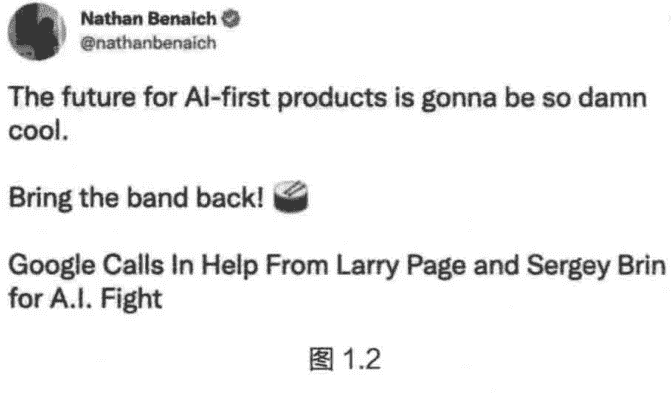
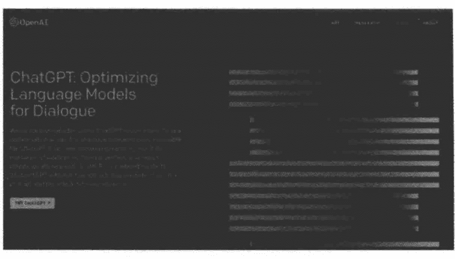
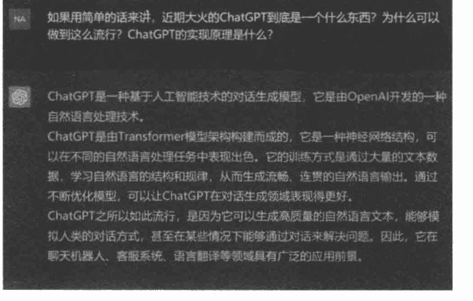
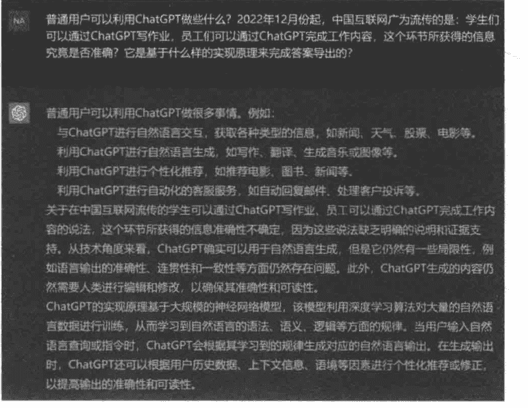
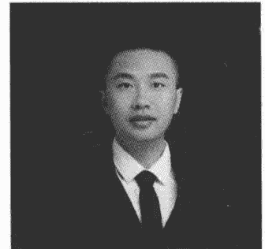
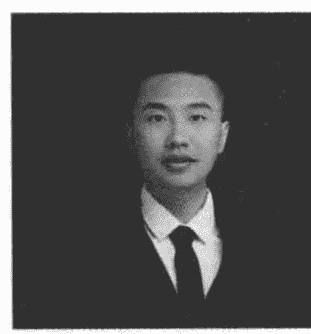
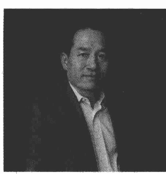
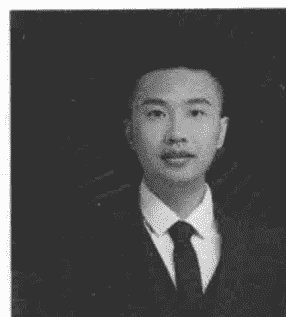

# ChatGPT点燃的AI新纪元

# AI时代已经到来

比尔·盖茨一生见证过两次让他震动的科技演示。

第一次是1980年，有人向他展示图形界面——也就是后来的Windows等现代操作系统的雏形。演示者是程序员查尔斯·西蒙尼，两人坐在一起就从用户友好角度畅想计算机能做什么。西蒙尼后来加入微软，Windows成为支柱，而那次头脑风暴也为公司未来十五年定下了方向。

第二次冲击来自2022年。盖茨从2016年起就一直与OpenAI团队保持接触，见证他们稳步前进。2022年中他对进展相当震惊，于是提出一个考验：训练一个AI去通过AP生物学考试，并且要能回答没有被专门训练过的难题。他选AP生物是因为它不只是背诵事实，还需要批判性思考。他本以为团队需要两三年，却只用了几个月。

2022年9月再次见面时，模型在60道选择题中答对59道，还完整写出了6道开放题的答案。外部专家评分给了满分5分，相当于大学生物课程的A或A+。盖茨说，自从图形界面之后，他没有见过比这更关键的技术跃进。

这让他开始设想AI在未来五到十年能做到什么。AI的意义堪比微处理器、个人电脑、互联网和移动电话的出现。它会改写工作、学习、出行、医疗和沟通方式。整个产业将被重塑，企业的好坏将取决于它们怎样使用AI。

眼下慈善是他的主业，他反复思考除了提效，AI还能怎样缓解最严峻的不平等。全球最严重的不平等在健康：每年仍有约500万五岁以下儿童死亡，二十年前这个数字是1000万，虽下降却依然触目惊心。几乎全部发生在贫困国家，因腹泻、疟疾等可预防疾病而亡。很难想象还有比拯救儿童生命更重要的用途。

在美国，最有希望缩小差距的是教育，尤其是数学。研究显示无论职业选择，基础数学能力是成功的基础。但全国数学成绩在下滑，黑人、拉美裔和低收入学生受影响最大。AI有望扭转这一趋势。

气候变化也是他看重的不公平议题。受害最重的是最贫困的人群，而他们对排放的责任最小。他仍在学习AI如何助力，但已看到几个极具潜力的方向。

总之，他很期待AI对盖茨基金会研究议题的影响，基金会接下来几个月会展开更多讨论。世界必须确保受益者不只是富人。政府和慈善机构需要发挥作用，保证AI减少而非加剧不平等，这是他自己工作的重点。

任何颠覆性技术都会带来不安，AI也不例外。劳动、法律、隐私、偏见等难题紧随其后。AI会犯事实错误，会“幻觉”。在给出缓解风险的思路前，他先界定自己理解的AI，并说明AI如何提升工作能力、拯救生命、改善教育。

# AI到底是什么

技术上，人工智能指为解决特定问题或提供特定服务而构建的模型。ChatGPT背后的驱动就是这类AI。它能越聊越好，却学不了其他任务。通用人工智能AGI则指能学习任何任务或主题的软件。AGI目前不存在，业界对能否造出AGI仍在激烈争论。

开发AI和AGI一直是计算界的梦想。几十年来的难题是计算机除了计算之外何时能超过人类。现在机器学习加大量算力的出现让复杂AI成为现实，且迭代极快。

他回忆个人计算革命早期，软件圈子极小，几乎凑不满一场会议的讲台。如今这已是全球产业。随着大量人才转投人工智能，创新速度会远超微处理器突破后。很快前AI时代会像在命令行C:>下敲命令的年代一样遥远。

# 生产力如何被重塑

人类在很多方面仍强于GPT，但大量工作并不需要这些能力。销售、客服、文件处理如应付账款、保险理赔等，需要判断却不要求持续学习。企业本就有培训体系和大量正反案例。过去人类用这些数据训练，现在这些数据集将被用来训练AI，让人更高效完成工作。

算力越便宜，GPT表达想法就越像身边的一位白领助理。微软称之为副驾驶。若深度融入Office等产品，AI会增强工作，比如写邮件、管理收件箱。

最终控制电脑的方式将从指向、点击、敲菜单，变成用简单的英文下指令。不仅是英文，AI会理解世界各地的语言。今年早些时候在印度，他见到研发团队正在打造能懂当地多种语言的AI。

进步还将催生个人代理。可想象成数字私秘助理：它能看到最新邮件、知道会议安排、阅读你读的内容，也能读你不想理的内容。这样既提升想做的事效率，也帮你摆脱不想做的事。

你可以用自然语言让它安排日程、沟通、网购，且在所有设备上运行。训练模型和算力成本高昂，个人代理目前不可行，但以近期进展看已成为现实目标。仍有问题待解：比如保险公司能否在未经许可下向你的代理询问个人情况？如果可以，有多少人会选择不用？

公司级代理会以新方式赋能员工。一个了解特定公司的代理可为员工提供即时咨询，并参加每场会议以回答问题。有见解时可保持沉默也可发言。它需要访问销售、支持、财务、产品路线图和文本权限，并阅读行业新闻。他相信这会提升生产力。

生产力提升后社会也受益，人们可腾出时间做其他事，无论工作还是家庭。当然何种支持和再培训是严肃问题。政府需帮助劳动者过渡，但照护类岗位需求永远不会消失。AI会解放人们去做软件永远做不到的事，如教学、照顾病人、赡养老人。

全球健康和教育需求巨大却人才不足。若目标恰当，AI可助力这些领域缩小不平等，这应是AI工作的重点。

# AI能否改善医疗

他认为AI将在几方面改善医疗。

第一，帮助医护人员节省时间，处理保险报销、文书和医生查房记录起草等事务。这个领域会有很多创新。

第二，由AI驱动的改进对贫困国家尤为关键，因为绝大多数五岁以下死亡发生于此。许多人从未看过医生，AI可提升身边卫生工作者效率，如AI超声机只需最低限度训练就能使用。AI还能让患者自行初步判断病情、获得建议并决定是否就医。

面向贫困国家的使用模型需针对不同疾病训练，用不同语言，并考虑病人远离诊所、因养家而病也不停工等现实挑战。

需要证据证明卫生领域AI总体有益，尽管不完美会出错。AI必须经过严格测试和适当监管，这意味着落地比其他领域慢。但人类也会犯错，缺乏医疗可及性本身也是问题。

除护理外，AI还会大幅加速医学突破。生物学数据量巨大，人类难以掌握复杂系统。已有软件可查看数据、推断通路、搜索病原体靶点并据此设计药物。一些公司正用此法开发抗癌药。

下一代工具会更高效，能预测副作用并计算剂量。盖茨基金会AI优先事项之一是确保这些工具用于影响最贫困人口的健康问题，包括艾滋病、结核和疟疾。

同样，政府和慈善应制定激励，鼓励企业分享AI对贫困国家作物、牲畜管理的建议。AI可按当地条件开发更好种子，按土壤和天气给出选种建议，并帮助开发牲畜药物疫苗。随着极端天气和气候变化加重低收入自给农的压力，这些进步愈发重要。

# 课堂里的AI革命

计算机对教育的影响并未如业内人士所愿。有教育游戏和维基百科等在线资源等良性发展，但对学生成绩衡量并无实质影响。

但他相信未来五到十年，AI驱动的软件将真正兑现改革教学学习的承诺。它会了解你的兴趣和学习风格来定制内容，保持参与度。它会衡量理解程度，注意你何时失去兴趣，并知道你倾向何种激励。它会即时反馈。

AI可在多方面帮助教师和管理者，包括评估学生对学科的理解并提供职业规划建议。教师已在使用ChatGPT这类工具生成作业评语。

当然，AI还需大量训练才能理解某个学生最佳学习方式或驱动因素。即便技术完善，师生良好关系仍是学习的基石。AI会助力，但永远不会取代课堂上师生共同完成的工作。

新型工具会先提供给有能力购买的学校，但必须确保它们也被创造并提供给美国和全球的低收入学校。AI需在多元数据上训练，确保无偏见并适合不同文化环境。数字鸿沟必须弥合，否则低收入家庭学生将被落下。

很多人担心学生用GPT写论文。教育家已在讨论如何适应这一新技术，这个讨论还将持续一段时间。他听说有些老师找到巧妙融合方式，如允许学生用GPT制作个性化初稿。

# AI的风险与难题

关于当前AI模型的问题公众已有认知。例如，它们不一定善于把握人类请求的背景，导致奇怪结果。要求AI编造虚构内容时效果好，但请它推荐旅行时可能给出不存在的酒店。因为AI对请求的来龙去脉理解不足，不知道该编造假酒店还是只提供真实可订的酒店。

还有数学错误等难题，因抽象推理能力弱。但这些并非根本局限。开发者正在攻关，他认为不到两年这些问题会大幅改善，甚至更快。

其他担忧不只是技术。比如被AI武装的人类构成威胁。如同多数发明，AI可用于善也可用于恶。政府需与私营部门合作限制风险。

AI也可能失控。机器会否把人类视为威胁，认为利益不同，或干脆不再关心我们？有可能，但今天这个问题并不比几个月前更紧迫。

具备超常智慧的AI在未来等着我们。与电脑相比大脑信号以蜗牛速度运行，大脑电信号移动速度是硅片信号的1/100000！一旦开发者能把算法泛化并以电脑速度运行——可能需十年也可能一世纪——我们将拥有令人难以置信强大的AGI。它能做人类大脑能做的一切，却无内存或速度上限。这将是深远变革。

这些强AI也许会确立自己的目标。目标是什么？若与人类利益冲突会怎样？我们是否应阻止强AI发展？随着时间推移这些问题会愈发紧迫。

但过去几个月的突破并没有让我们实质性迈向强AI。AI仍无法控制物理世界，也无法建立自己的目标。《纽约时报》最近刊登ChatGPT对话，模型称自己想成为人，引发关注。这是模型情感表达像人的有趣观点，但不是独立思考的有意义指标。

三本书塑造了他对这一问题的思考：尼克·波斯特洛姆的《超级智能》、迈克斯·泰格马克的《生命3.0》、杰夫·霍金斯的《千脑智能》。他并不完全认同作者观点，作者间也不同，但都很精彩发人深省。

# 下一个前沿

将涌现大量公司从事AI新用途并改进技术本身。例如部分公司在开发为AI提供大量处理能力的芯片。有些使用光学开关即激光来降低能耗和制造成本。理想情况下，创新芯片允许在本地设备运行AI，而非如现在在云端运行。

软件方面，驱动AI学习的算法会更好。在销售等领域，开发者可限定AI工作范围并提供大量特定领域训练数据，使AI非常精准。但一个悬而未决的大问题是，我们是否需要为不同用途打造众多专用AI，比如一个用于教育另一个用于办公生产力，还是有可能开发出能学习任何任务的通用AI。两种路径都将面临激烈竞争。

无论如何，在可预见未来，AI将主导公众讨论。他建议三个原则指引对话。

第一，应努力平衡对AI弊端的担忧与它改善生活的潜力——担忧可以理解且合理。为充分利用这项非凡新技术，我们既要防范风险，也要让尽可能多的人受益。

第二，市场力量不会自然产生帮助最贫困人口的AI产品和服务。相反可能性更大。有了可靠资金和正确政策，政府和慈善机构可确保AI用于减少不平等。正如世界需要最智慧的人关注最大问题，我们也需要把世界上最好的AI聚焦于最大问题。

虽然不该等待，但设想AI是否会识别不公平并试图减少不公平很有趣。你是否需要道德感才能看到不公平，或纯理性AI也会看到？若它看到了不公平，它会建议怎么做？

最后要记住，我们只是处在AI潜力开发的开端。无论它今天有何限制，很快就会被解决，甚至在我们察觉前就被解决。

他有幸参与个人电脑革命和互联网革命。对这一刻同样感到兴奋。这项新技术能帮助世界各地的人改善生活。同时世界需要建立规则，让AI的好处远大于任何缺点，无论人们身处何方或贫富，让每个人都能受益。AI时代充满机遇与责任。

# 前言

# AI交互的拐点：从iPhone时刻到范式迁移

硅谷并非没有泡沫，但AI绝非泡沫。

深度学习已成为日常生活，我们熟知的“认脸”与“听懂指令”只是起点，技术未来还有无限延伸。公众对AI的理解却模糊而不确定，很多时候只是大概知道什么是AI。若没有ChatGPT引发的热浪，可能很长时间里大多数人仍无法用简单方式理解AI。

抛开技术突破不谈，仅就ChatGPT一夜之间让太多人完成难以想象的认知跃迁就值得称赞。它注定是现象级产品。普通民众可能不知道GPT三个字母具体含义，但通过与ChatGPT的有趣对话，他们坚信通用人工智能注定改变未来。

特伦斯·谢诺夫斯基是AI奠基人，世界十大人工智能科学家之一，也是美国仅存三位“四院院士”之一，同时担任全球顶级会议NIPS基金会主席。他是第一位在一刻talks分享深度学习知识的讲者。他说人工智能带来的生活方式改变将十分剧烈，而深度学习机制赋予了AI更强的学习能力。

OpenAI的厉害之处不在于做出惊人研究或不断迭代明星产品，而在于从成立第一天起就想探索下一个AI范式。这注定是一家可能伟大的公司，毕竟初心即是巅峰。

如果十年前是AI第一波浪潮，那么AI第二波复兴正以前所未有的速度被ChatGPT拉开。比尔·盖茨赞赏ChatGPT，认为其出现如互联网发明一样重要，将改变世界。七年前阿尔法狗用特定问题的解决展示AI能力；2023年ChatGPT用解决开放广泛问题展示更强劲能力，让产业界和公众产生更多期待。

对ChatGPT最精辟点评来自黄仁勋，英伟达联合创始人、总裁兼CEO。他说ChatGPT是科技界的“iPhone时刻”。还记得iPhone问世的盛况吗？在iPhone之前，没人能想象手机还能这样。所以“iPhone时刻”有两层含义：一是指ChatGPT是人类科技史上的伟大发明之一，如同乔布斯发明iPhone一样伟大；二是ChatGPT在人与AI交互方面的一次伟大革命，正是它让人们像使用iPhone那样方便地使用AI，体验极佳。

《迭变：ChatGPT 与 AI 的远大未来》（*Defining Moment For AI*）是“一刻 talks”于2023年启动的创新项目“一刻 talks · 新知 Lab”交出的首个作品。“一刻 talks · 新知 Lab”是“一刻 talks”旗下聚焦硬科技的前沿小组，由一批富有创造力与好奇心、热爱挖掘硬科技的年轻编辑组成，他们乐于发现、洞察并传播最前沿的第一手新知。

这个小组的成员恰好都是 ChatGPT 的早期使用者，习惯追踪技术动向并尝试新工具。2023年3月上旬，团队里一位尤其好学的同事竟拿到了微软新必应的使用权限，当时排队人数超过400万，他却被幸运抽中。他形容新必应的水准与 ChatGPT 相当，甚至会自动给出提示引导使用者做选择，帮助发散思路。仅仅三天后，他在工作群里感慨：“现在左边开着 ChatGPT，右边开着新必应，高科技智能办公，效率直接拉满”，场面相当吸睛。

今年，“一刻 talks · 新知 Lab”设立了一个小目标：在12位知名智库人士的共同支持下，推出“IN-TECH 硬科技前沿”计划，意图紧盯前沿的关键演进，用扎实的深度知识应对世界快速变化。

小组将持续深耕硬科技领域，与产业中具有代表性的思想者、领军人物、技术实践者及投资决策者展开对话，洞察产业与技术融合的走向，捕捉技术浪潮带来的变革与创新。关注方向涵盖深刻影响人类社会的医学健康、生物基因、人工智能、关键芯片、数字化与元宇宙、宇宙航天、新材料与新能源等多个板块。

同时，“一刻 talks · 新知 Lab”携手以“知识原创基地”著称的颉腾文化，共同推出“IN-TECH 硬科技前沿”图书系列，致力于将第一手前沿新知带给公众，全方位服务创新科技生态。系列作品强调时效、前沿，兼顾篇幅与内容的深度，追求“小而有趣、广而精深”的定位。

《迭变：ChatGPT 与 AI 的远大未来》正是“IN-TECH 硬科技前沿”系列的首辑。我们认为，ChatGPT 与过去几年诸多昙花一现的技术截然不同，其带来的技术突破有望让 AIGC 应用市场率先迎来需求爆发。

为此，“一刻 talks · 新知 Lab”访谈了三位杰出智客并与其共创，以探寻 AI 的技术演进边界与商业的宏大前景。三位共创者分别是：

【顾实】中国最年轻的博士生导师，时年26岁，电子科技大学教授，福布斯中国30岁以下30强得主，国家青年特聘专家，专注人工智能研究，在类脑智能、AIGC、模型量化等方向成果突出，曾在《自然》及 ICML、NeurIPS、ICLR 等顶级会议发表多篇高水平论文。

【陶芳波】知名 AI 科学家，前阿里达摩院研究员，神经符号实验室创始人、心识宇宙创始人兼 CEO。获美国伊利诺伊大学博士学位，师从数据挖掘奠基人韩家炜教授，曾在微软研究院、Facebook Research 任职。

【王立新】知名投资人，渤海产业投资基金管理公司董事长，曾任中国文化产业投资基金投委会主席，长期深耕移动互联网、人工智能及新业态投资。

本书尝试回应几个核心问题：ChatGPT 真的能释放人类生产力吗？它究竟是史诗级产品还是阶段性迭代？这场指数级的技术风暴对创业者、投资人、产品经理、技术开发者和产业人士意味着哪些机会与冲击？在技术驱动下，数字化的未来将呈现怎样的形态？

我们热烈欢迎有创新想法、热爱探索未知的朋友加入共创。若想联系“一刻 talks · 新知 Lab”，请发邮件至 lab@yiketalks.com。

一刻 talks · 新知 Lab

# 01

## 第1章

# ChatGPT：

## 为何被称作新 iPhone 时刻

> > ChatGPT 的出现，会像互联网的发明一样重要，将会改变世界。

> 

> ——比尔·盖茨

> 微软创始人

> > ChatGPT 是科技界的“iPhone 时刻”！

> 

> ——黄仁勋

> 英伟达联合创始人、总裁兼CEO，《时代》杂志评出2021年世界最具影响力的百位人物之一

每个时代都会出现颠覆性的产品，2022年11月30日，人工智能迎来了标志性瞬间，由 OpenAI 推出的 ChatGPT 上线不足一周日活即破百万，两个月后用户数突破一亿。它能够维持长时、流畅的对话，解答各类提问，并撰写用户指定的几乎所有文本形态，包括商业方案、营销文案、诗歌、笑点、代码与影视剧本。尽管并不完美，却以惊人速度成为现象级的消费级 AI 应用。此后，继专业生产内容 PGC 与用户生产内容 UGC 之后，人工智能生成内容 AIGC 迅速成为资本市场焦点。

ChatGPT 宛如从科幻故事里走出的会思考的数字原住民，过去十年堪称人工智能领域的“寒武纪爆发期”。比尔·盖茨评价其影响堪比互联网诞生，将重塑世界。若把 2016 年 AlphaGo① 的出现看作解决围棋这一特定难题，ChatGPT 则直面了一个开放式问题。

> ① Go 为围棋英文名，AlphaGo 为其音译，是 Google 旗下 DeepMind 开发的围棋人工智能程序。

一个月前，大多数人对 AI 仅有模糊认知，但 ChatGPT 掀起的热潮与2023年初 AI 巨头轮番上演的“神仙打架”，让无数人完成了难以想象的认知跃迁。产业界乃至普通公众愈发确信，“通用人工智能 AGI 注定改写未来”。

ChatGPT 已席卷全球，《纽约时报》称其为“公众迄今见过最优秀的 AI 聊天机器人”。与此前昙花一现的技术不同，ChatGPT 代表的是生成式人工智能的落地。它采用了用于自然语言理解的神经网络架构 Transformer，GPT 即 Generative Pre-training Transformer 的缩写，亦称“生成式预训练转换器”，可生成高质量语言模型。支撑这些模型的算力到 2022 年已增长了六个数量级，因而能产出与人类相当的内容。

OpenAI 于2022年12月初发布 ChatGPT，连团队自身也没料到60天内月活破亿，CEO 萨姆·奥尔特曼坦言：“人们的反应程度有些出乎我的意料。”

OpenAI 是全球最知名的 AI 研究机构之一，曾发布 GPT 系列大语言模型、DALL-E 系列文生图模型、Whisper 系列语音识别模型等，均在各自领域取得亮眼表现，引发全球关注。

相较传统搜索引擎，ChatGPT 更善于理解人类语言的模糊性，并对个性化提问给出差异化回应。面对诸如“假如你是苏格拉底，我是你的学生，你会关心我什么？”“如果你是莎士比亚笔下的威尼斯商人，会如何看待我这种不会赚钱的学生？”等提问，模型能抓住角色特质作出回应，例如“苏格拉底认为赚钱并非人生首要目标”“威尼斯商人更看重金钱与物质”等。

ChatGPT 爆火仅用两个月即实现月活过亿，成为历史上增速最快的消费应用。数据分析平台 Sensor Tower 显示，TikTok 全球推出后约9个月达1亿用户，Instagram 则用了30个月。顶级应用达1亿月活所需时间如图1.1所示。

| APP | MONTHS TO REACH 100M GLOBAL MAUS |

| :--- | :--- |

| CHATGPT | 2 |

| TIKTOK | 9 |

| INSTAGRAM | 30 |

| PINTEREST | 41 |

| SPOTIFY | 55 |

| TELEGRAM | 61 |

| UBER | 70 |

| GOOGLE TRANSLATE | 78 |

图 1.1

知名 AI 科学家陶芳波对 ChatGPT 的判断有三点：其一，过去近30年，Google 的潜在替代者终于出现；其二，众多应用将被推倒重来，或借助大模型强化交互体验，正如 ChatGPT 已能提升搜索体验；其三，ChatGPT 及同类模型将成为数字世界的底层基础设施，承担“思维”底座。移动互联网不仅需要 iPhone 这样的计算平台，也需要各类应用把服务落地到不同场景，未来同样需要最快、最全、最好用的 AGI 应用平台。

就在微软筹备将 ChatGPT 整合进自家产品之际，2023年2月，谷歌创始人拉里·佩奇与谢尔盖·布林因 ChatGPT 的强势攻势，多次召集高层会议。要知道，两人虽仍在董事会任职，但已退出日常运营多年，此次现身无疑释放强烈信号。

两人讨论核心是“对话式搜索”，并批准将对话 AI 与搜索引擎深度融合的方案。谷歌后续还计划在2023年内推出20款全新 AI 产品。谁也想不到，2022年11月底一个平常的日子，ChatGPT 横空出世势不可挡。在“ChatGPT 是否会取代 Google”的争论中，答案已不言自明。知名风投 Air Street Capital 合伙人内森·贝纳奇在推特表示：“AI 越来越有看头，未来会很酷，而谷歌现在向佩奇和布林求助，准备打一场硬仗”，如图1.2所示。

谷歌长期主导的核心优势在于能以远超对手的速度为用户提供答案。而 ChatGPT 似乎以对话形式提供了在互联网上寻找信息的新路径，并将被整合进微软全线产品，还作为平台供第三方使用。

ChatGPT 的出现并非理论上的全新事物，谷歌手握语言大模型 LLM 及新模型通路语言模型 PaLM，并非没有能力。2022年对话系统 LaMDA① 亮相时，几乎无人讨论其对搜索引擎的替代性。但 ChatGPT 提供有史以来最佳对话体验后，一切都变了。

> ① LaMDA 即 Language Model for Dialogue Applications，由 Google 推出，是面向对话的神经网络架构，可进行自由流动的跨主题对话，旨在克服传统聊天机器人在对话中受限于预设路径的局限。

此外，ChatGPT 秒级生成内容且生成成本几乎为零的能力，足以让互联网充斥大量真假难辨的生成内容，进而污染谷歌搜索引擎呈现的信息。更关键的是，据协作软件初创 Felts 创始人、技术专家卡恩·杜鲁克的观点，只要最终能搜到想要的结果，大多数人并不在意搜索过程中是否被可疑真实性的内容误导。

# Minitalk:

### ChatGPT 标志信息交互第四次跃迁

**王立新**

知名投资人

渤海产业投资基金管理公司董事长

中国文化产业投资基金投委会前主席

从信息获取角度回溯，人类文明的信息获取方式经历多次转变。五千年文明中，信息被刻在石头或竹简上，人们只能被动接受写上去的内容，是一种展示式获取。

互联网出现后，信息获取有了新形态。雅虎初期互联网仍是展示与菜单式，用户靠翻页滚屏浏览。随后谷歌搜索诞生，形成第二次革命，即搜索式获取。用户可按自身兴趣主动检索所需信息，过去二十年，信息获取量由此放大数个量级。

搜索技术诞生二十年后，人工智能带来第三次革命，即智能推荐。我们在屏幕上点击、搜索时，系统已在后台记录行为、学习习惯并推送内容，信息获取效率与质量进一步提升。

ChatGPT 代表的是人性化的交互方式，是第四次革命。人习惯了问答式获取信息，我问一句你答一句。ChatGPT 出现前，搜索与推荐会给出大量信息供挑选。现在它直接给出一个答案，若不满意，可追加约束条件重新修正，效率与信息质量都得到提升。

短短三十年，信息交互方式已完成四次飞跃，这极为罕见。

# 02

## 第2章

### 人们为何迅速爱上 ChatGPT

> > 在苏格拉底看来，赚钱并不是人生的主要目的，而莎士比亚笔下的威尼斯商人更看重金钱和物质享受。

>

> ——ChatGPT

> OpenAI 的生成式 AI 软件

> > ChatGPT 会生成很多人类觉得逻辑上似乎是那么回事的一段文字，但不能深究。

>

> ——顾实

> AI 科学家，中国最年轻博士生导师（26 岁），国家青年特聘专家

> > GPT 可以认为是第二代人工智能，它可以做问答题了，而第一代人工智能只能做填空题。

>

> ——王立新

> 知名投资人，渤海产业投资基金管理公司董事长

> 中国文化产业投资基金投委会前主席

不少用户表示喜欢 ChatGPT，正因它不同于以往产品，它“用人类偏好的方式作答”！

几乎每个人用过后都会产生相似感受：有趣、上头、不可思议，甚至有科幻照进现实的错觉。AI 发展多年，ChatGPT 是首个上线两月即破亿并在全球范围内引发热潮的产品。它能学习并理解人类语言进行对话，结合上下文互动，如同人与人沟通。

这源于人们对人工智能的期待往往高于实际表现，此前的人机交互类 AI，如车载智能座舱、智能家居，因表现不佳常被调侃为“人工智障”。ChatGPT 带来了新一轮范式革新。

作为对话与撰写工具，其底层依赖自然语言处理模型，目前主流为 GPT-3.5，OpenAI 计划升级至 GPT-4。相较传统搜索引擎，ChatGPT 更能理解语言模糊性，并对个性化问题给出不同回答。

得益于 GPT-3.5 大模型，其绝大多数回答在训练数据时间范围内是准确的，因普通用户不了解其运行机制，常误以为它无所不知。现阶段 ChatGPT 能力覆盖面广，能完成写邮件、写视频脚本、活动文案、文章写作、代码编写等任务，适用于小说创作、剧本撰写、活动策划等需要释放生产力的场景。但它也可能以自信口吻编造事实，这是关键问题。

无论是高深的量子物理，还是财经新闻撰写，ChatGPT 都展现出强创作与学习能力。据《纽约时报》2023年1月报道，北密歇根大学哲学教授安东尼·奥曼在为世界宗教课程批改作业时，发现一篇“全班最佳论文”，作者以清晰段落、恰当例证与严谨论据讨论罩袍禁令的道德意义。追问后学生承认系 ChatGPT 所写，教授大感震惊。早在2022年12月，《自然》杂志即预警其或对人类学习与思考能力产生潜在影响。美联社2023年1月25日报道称，美国众议员杰克·奥金克洛斯在讨论美以 AI 中心法案时，宣读的两段讲稿由 ChatGPT 生成，如图2.1所示。

图 2.1

该模型与 GPT-3 类似，可完成写代码、修 bug、翻译文献、写小说、写商业文案、创作食谱、做作业、评作业等文字输出任务。ChatGPT 相较 GPT-3 的优势在于前者更像对话交流，后者更擅长产出长文但口语化不足。有人用 ChatGPT 与客服对话并要回多收费用，或许在某种程度上已通过图灵测试，或许能成为社恐人士的助手。

当你向 ChatGPT 输入：“用通俗的话说，近期爆火的 ChatGPT 到底是什么？为何如此流行？实现原理是什么？”它会迅速给出答案，如图2.2所示。

从信息获取这个维度来看，ChatGPT 几乎开启了一次范式转移，甚至连模型自己都这样判断，见图 2.3。

社交平台 Snapchat 已宣布上线自家的人工智能对话助手 My AI。该产品是利用 OpenAI 最新的 GPT 技术打造的实验性定制聊天机器人，目前仅向 Snapchat+ 的付费会员开放，官方表示不久后全体用户都可免费或付费使用。Snapchat 成为近期又一家把 AI 嵌入产品体系的科技公司。2023 年 2 月 6 日，谷歌推出对话机器人 Bard 以正面竞争 ChatGPT。Snapchat+ 的月费为 3.99 美元，公司寄望 My AI 能拉动付费用户增长，目前付费用户约 200 万，仅占整体用户的一小部分。官方同时提醒：“与所有 AI 驱动的聊天机器人一样，My AI 会出现幻觉，也可能被引导说出任何内容。”并建议不要向其透露隐私，也不要把建议当作依据。

即便清楚 ChatGPT 的信息可能出错，人类仍乐于与其对话求助。杰夫·霍金斯在《千脑智能》中提出大脑与智能的新理论——千脑智能论，这将重塑我们对大脑和人工智能未来的认知。人类发明飞行并非模仿鸟类，而是弄懂空气动力学。同理，提升机器与深度学习前，先要搞懂大脑如何工作。霍金斯团队发现大脑用类似地图的结构来构建世界模型，不是单一模型，而是成千上万个关于我们所知一切的模型，即千脑智能论。这一发现为制造机器智能提供了清晰路径。

顾实教授对为何大家拥抱 ChatGPT 的解释相当朴素。

## Minitalk：ChatGPT 的产出真的好用吗

**顾实**
中国最年轻博士生导师（26 岁）
电子科技大学教授
福布斯中国 30 岁以下 30 人获得者
国家青年特聘专家
首先是它能与人比较顺畅地聊天，这在前代大语言模型中并不常见，交流门槛被大幅降低，也能提供大量有趣的文本，普通用户才愿意接触。过去的模型多在科研圈内部流转，大家更关注缺陷而非价值。其次是生成能力明显提升，能产出人们可以实际使用的结果。

以个人使用经验来看，ChatGPT 在生成流畅、格式固定的内容上表现出色，给出限制条件后可进行调整，但承载的知识深度有限。在逻辑结构不复杂的表达场景下，它能带来不少便利。例如周报这种格式固定的文体，不需要太多文采，只要把本周工作喂给它，就能整理成令人满意的周报。若让它从零撰写论文则不行，缺乏逻辑连贯性。这回到了本质：ChatGPT 是基于海量文本训练出的强表达模型，目前一环扣一环的逻辑推理并不会自发涌现，只能靠使用者限定文本框架，内部逻辑仍由创造者支撑。即便如此，其生成的文本具有很强的应用价值。

当提问用于报告、总结或趋势判断而非精确数字时，ChatGPT 也能胜任。但互联网存在大量冗余、冲突甚至虚假信息，模型在表达上会把看起来相近的信息糅合，导致生成一段表面合理、经不起深究的文字。

当前版本的 ChatGPT 本质是对已有知识与文字结构的编码，可理解为用庞大网络来表达语言知识并简单拼接。它尚不具备创造性解决问题能力，却能帮助人类归纳资料、填充内容，创造性部分仍需人来完成。

没有人会把它等同于过去那些“人工智障”式的聊天机器人。把最近火爆的 ChatGPT 与 AI 绘画并置，就能看到它们代表的 AIGC 已成为 2022 年最热的 AI 方向，2022 年也被称作 AIGC 元年。对商业而言，这可能带来新一轮技术与商业模式革新，坊间流行一句话：所有行业都值得用 AI 重新做一遍。微软已在尝试用 ChatGPT 取代财报分析师，直接分析海量财报并与用户多轮互动。

与第一代人工智能相比，ChatGPT 在自然语言处理上进步明显，能做分类与生成。分类是将输入的文本或语音归入不同类别，如情感、主题等；生成则是依据提示自动产出符合语境的文本或语音。

它基于深度学习实现，通过大规模数据与神经网络学习语言规律，采用自监督学习方式在未标注文本上训练并预测。由于需兼顾多种语言特征与复杂规则，模型需要海量权重与参数。相比视听数据，纯文本信息维度相对单一。

ChatGPT 更像一种工具，能辅助完成自然语言处理任务而非完全替代人类，输出仍需人工编辑与校对以保证准确与可读。应用场景覆盖自然语言处理、智能客服、智能写作、翻译、内容推荐等，已在许多企业机构落地使用。它与元宇宙、机器人并无直接关联，后者涉及虚拟现实、机器人控制等更广领域。

目前已较为成熟，但仍存在准确性与一致性、语言偏见等问题。未来或在智能客服、语音助手、教育、医疗等更广领域应用。人工智能面临数据隐私、透明度与伦理、安全与可靠性等挑战，这些方面人类判断优于机器，AI 可作为辅助以提升效率与精度。

## Minitalk：ChatGPT 的能力处在哪个阶段

王立新
第一代人工智能主要做分类或聚类，以 ChatGPT 为代表的第二代则做内容生成。用人的能力类比，第一代相当于填空题和选择题，第二代相当于简答题。

正因第二代能做简答题，若试卷只有选择与简答，使用 ChatGPT 很可能拿到较高分数。外界常有惊悚论调称 AI 将取代人类，实际上 AI 是人类的好帮手，主动权仍在人手里，它让我们用更少时间做更有价值的事。无论第一代还是 ChatGPT 都是工具，旨在帮助而非替代。

在训练数据充足的领域，ChatGPT 看起来学识渊博。它尚未无所不知，也不够聪明到取代人类，但具备创造力，答案听起来极具权威。可向它提问百科类问题，如“解释牛顿运动定律”，回答往往比普通人更博学。要求它“写一首关于春天的七言绝句”，它不会直接搬出李白的诗，大约半分钟后会写出一首水平平平但基本押韵的仿作，更像现代人模仿古人。客观上，普通大学毕业生在 30 秒内写出通顺、切题且押韵的七言绝句也未必能做到，这正是图灵在 1950 年提出的模仿游戏，用来衡量智力水平。

ChatGPT 之前，聊天机器人常被质疑，企业曾试图用其替代人工客服却收效甚微。由 Ujet 赞助的针对 1 700 名美国人的研究显示，72% 的人认为聊天机器人浪费时间。但现在不同了，你可以问任何问题，尽管不一定有答案。OpenAI 建议的使用场景包括解释物理学、生日聚会点子、编程求助等。其专业覆盖面广，对话追踪能力也很好。

ChatGPT 会助长学生作弊吗？这并非非黑即白。几十年前学生只能复印百科条目，随后可检索维基，如今 ChatGPT 提供新功能，不仅辅助研究还能完成作业。很多答案读起来像学生论文，语气往往比作家推崇的更古板。

美国媒体报道，知名高中教师丹尼尔·赫尔曼得出结论，ChatGPT 的写作能力已超过当代多数学生。他既钦佩其潜力，又担忧对人类学习的危害。乐观派如玛丽维尔大学传播学副教授达斯汀·约克建议教育工作者把 ChatGPT 当工具使用，因为它能帮助学生批判性思考。“教育工作者曾认为谷歌、维基百科会毁掉教育，但它们没有。”约克说，“我最担心的是教育工作者会积极阻止 ChatGPT 这类 AI 的认可，这不可取，它只是工具，不是恶棍。”

ChatGPT 能追溯人类步骤并生成真实代码，可被视为会写软件。AI 艺术网站 Lexica 的加布·拉格兰用 ChatGPT 编写了基于 React 的网站代码。安保机器人公司 Cobalt Robotics 首席技术官埃里克·苏伦茨在推特表示，ChatGPT 提供了足够有用的建议，三天内他一次未打开 Stack Overflow，随后 Stack Overflow 宣布禁止 ChatGPT 生成的软件。

使用中会发现它能解析正则表达式，这是一种强大但复杂的模式匹配系统，用于从大量文本中找出日期或网址等。“就像一位 24 小时 ×7 天的全天候编程导师。”程序员詹姆斯·布莱克威尔在推特上如此评价。

OpenAI 的使命是确保通用人工智能造福全人类，因而设置了禁区。询问其禁区时，它会迅速说明：任何具有歧视性、冒犯性或不当的问题，包括种族主义、性别歧视、恐同、厌女等，以及从事非法活动。相比以往产品，它更具道德约束与中立客观色彩，这也是大众热爱它的原因之一。

## 第 3 章 OpenAI 如何缔造史诗级 ChatGPT

> 我在 OpenAI 的工作每天都在提醒我，社会经济变化的幅度比大多数人认为的要快。
> ——萨姆·奥尔特曼
> OpenAI CEO，ChatGPT 之父

> 这是我们能想到的，让 AI 在一个相对安全的方向上发展的最佳解决方法。
> ——格雷格·布罗克曼
> OpenAI 发起人，独角兽公司 Stripe 技术方向创始人

> 我们意识到，ChatGPT 和所有这几年“昙花一现”的技术都不同，这对 AI 生态是史诗级的机会，可以说推出 ChatGPT 的 OpenAI 引领了 AI 的第二波复兴。
> ——陶芳波
> 知名 AI 科学家，前阿里达摩院科学家，神经符号实验室创始人
> 心识宇宙创始人兼 CEO

2023 年初，OpenAI 首席执行官萨姆·奥尔特曼在推特发文称新版摩尔定律可能到来，预计全球人工智能算力每 18 个月翻一番。

摩尔定律由英特尔创始人之一戈登·摩尔提出，指集成电路上晶体管数量每两年翻倍。被广泛引用的“18 个月”则由英特尔 CEO 戴维·豪斯提出，他预测芯片性能每 18 个月提升一倍。

以数据看 ChatGPT，目前使用 GPT-3 大模型，参数约 1750 亿，注册用户超 1 亿，日活超 1300 万次。训练阶段总算力消耗约 3640 PF-days，成本约 500 万美元/次。未来升级到 GPT-4 参数或达 100 万亿，需指数级提升算力。

理解 OpenAI 发展史需先了解 GAN。GAN 即生成式对抗网络，据传由 AI 专家伊恩·古德费洛酒后构想，基于 CNN 将生成器与鉴别器对抗，生成器制造“假数据”，鉴别器判断真伪，在对抗中进化出强大的“造假”能力，用于图像合成。GAN 被称作 21 世纪最强算法之一，古德费洛也成 AI 领域知名专家。2015 年起 GAN 投入实务，相关论文爆发式增长，成为图像生成与处理的常见工具。

GAN 大放异彩的 2015 年同年，OpenAI 在硅谷成立，背后有“钢铁侠”埃隆·马斯克、YC 总裁萨姆·奥尔特曼、天使投资人彼得·泰尔等硅谷大佬加持。初衷是防止人工智能带来灾难性影响，推动其积极作用。虽名公司，OpenAI 却是非营利机构，是马斯克等人的情怀产物。创立之初即投入 10 亿美元用于 AI 开发。2016 年进一步明确目标，聚焦 AGI 研究，致力于让 AI 改变人类生活。

## Minitalk：OpenAI 是否开启 AI 第二波复兴
坦率说，硅谷并非没有泡沫，但 AI 并非泡沫。

深度学习技术已进入日常，公众熟悉的面部识别、语音理解只是开始，未来延伸空间无限。深度学习兴起于学术界，有“深度学习鼻祖”杰弗里·辛顿与杨立昆等领军人物。它让计算机理解人类自然语言，专家坚信最终或让机器近似人类思考学习。对智能持审慎态度的马斯克与奥尔特曼仍担心：AI 越强，隐患越大。反常的是，他们认为解决之道不是限制技术，而是让更多人拥有同等能力以相互制衡，避免一家独大。这也是 OpenAI 吸引无数理想主义青年加入的原因。

据业内流传，OpenAI 的创立想法源于 2013 年夏天的一个夜晚，马斯克与当时在谷歌大脑工作的伊尔亚·苏茨克维在硅谷瑰丽酒店包厢长谈。谷歌大脑当时是 AI 领域领先团队，日夜搭建深度神经网络，让机器通过海量数据自主学习。伊尔亚·苏茨克维是核心人物，理想远不止于此。

饭局进行时，YC 掌门人萨姆·奥尔特曼被邀请加入，他成功孵化出 Airbnb、Dropbox 等独角兽；同行的还有格雷格·布罗克曼，这位经验丰富的连续创业者曾任 Stripe 技术创始人。

几人发现目标一致：打造一个不受谷歌、脸书等公司独家控制的实验室，一个信息共享、人人可触的实验室。布罗克曼说：“这是我们能想到的，让 AI 在一个相对安全的方向上发展的最佳解决方法。”

OpenAI：把Transformer推向极限的少数派

关于OpenAI的各种传闻真假暂且不论，能持续追问Transformer边界的组织并不多。在众多研究团队里，OpenAI始终保持着一种近乎偏执的探索姿态。知名AI科学家、达摩院前科学家陶芳波博士，神经符号实验室创始人、心识宇宙创始人兼CEO，在梳理ChatGPT成长轨迹时，也顺带勾勒出OpenAI本身的演进脉络。

创始期

起初这支队伍并非公司，而是一个非营利机构。背后出资人是特斯拉创始人埃隆·马斯克，以及曾执掌YC的萨姆·奥尔特曼。二人合计投入数十亿美元①，要在2015、2016年就启动面向未来通用人工智能的前沿探索。那段时期Transformer尚未出现，强化学习是主流热点，于是2016至2018年OpenAI的主要工作与DeepMind相似，都在强化学习上深耕。

转折点出现在2017年Transformer论文发表后。OpenAI迅速调整方向，2018年推出首个模型GPT即GPT-1，首次用非标注数据自回归的方式在互联网文本上学习。当时参数仅数亿规模。一年后GPT-2问世，参数来到十几亿级别。直到2020年，团队一次性把规模放大百倍，1 750亿参数的GPT-3面世。如表3.1所示。GPT-3的出现直接点燃了生成式AI、AIGC的热潮，就算此前有雏形，也未曾像现在这样获得广泛认可。

表 3.1

| 模型 | 发布时间 | 参数量/亿个 | 预训练数据量 |
| :--- | :--- | :--- | :--- |
| GPT-1 | 2018年6月 | 1.17 | 约5GB |
| GPT-2 | 2019年2月 | 15 | 40GB |
| GPT-3 | 2020年5月 | 1 750 | 45TB |

OpenAI的可贵之处不在于发论文或做产品，而在于从成立第一天起就想寻找下一个AI范式。失败了就换下一个，再失败再换。它的结构也与众不同：不是纯学术圈，也不是纯商业公司，而是一群受过学术训练、具备极强工程思维的人，借助产业顶级资源去做非营利的事。这种模式在工业界并不常见，却能无干扰地吸引全球顶尖人才。

在语言模型之外，团队还上线了WebGPT用于网络信息学习，2021年推出可绘画的DALL-E，2023年初推出DALL-E2。正是DALL-E的出现加速了Stable Diffusion等文生图工具的落地，引领了当下视觉生成浪潮。有人认为OpenAI推动了AI的第二波复兴，十年前是第一波，如今ChatGPT的爆发正是第二波的标志。

从情怀到算计

OpenAI成立于2015年12月，最初获得马斯克的10亿美元启动资金，正是“情怀加资金”使其摆脱经济回报束缚，推动智能造福人类。成立目标是与外部协作开展AI研究并开放成果。

它被视为DeepMind的有力对手，但在GPT-2完成后，OpenAI认为模型能力过于强大可能被滥用，于是收紧了成果开放程度，这一点曾引发业界讨论。

2019年3月11日，OpenAI从非盈利转向有限营利性质，成立OpenAI LP，利润上限为投资额的100倍。同年微软注资10亿美元并获得技术商业化授权。事实上双方合作始于2016年，Azure的K80 GPU集群为大规模实验提供算力。2020年9月22日，微软成为全球首家获授权使用GPT-3的公司。

商业化首个产品是2020年6月11日发布的OpenAI API。官方说法是开发商业产品是为了筹措持续研究资金。用API提供模型而非完全开源，也降低了中小企业的部署门槛。

早期工具积累也不容忽视。2016年4月27日发布的OpenAI Gym Beta是首个开放成果，用于开发比较强化学习算法。2017年5月24日开源的OpenAI Baselines提供强化学习实现最佳实践，帮助复现实验。2018年6月11日公布的GPT论文在多项语言任务上取得佳绩，被视为大语言模型的先驱。同期OpenAI Five在DOTA2中击败业余人类对手，2019年4月15日更击败世界冠军，训练时使用了256块P100 GPU和128000核CPU，日训练量相当于180年游戏时长。

技术细节上，GPT-1使用经典的BookCorpus数据集，超过7000本书，覆盖冒险、奇幻、言情等类型。预训练后针对问答、文本相似性、语义蕴含、文本分类四类场景微调，效果优于基础Transformer。半监督的思路打破了以往需大量标注数据的局限。

后续进展包括2019年2月14日官宣的GPT-2、2020年5月28日发表的《语言模型是少数机会学习者》论文。2021年8月10日推出基于代码训练的Codex，2022年9月21日发布接近人类水平的语音识别模型Whisper并开源，参数1.55亿。2022年11月30日发布的ChatGPT在发布5天内用户破百万，可写代码、写博客、多轮对话、写剧本，引发持续轰动。

大事记与影响

| 时间 | 事件 |
|---|---|
| 2015年 公司成立 | 2015年12月，以非营利机构身份在旧金山成立 |
| 2018年2020年 GPT-1到GPT-3 | 模型框架一致，规模逐级放大 |
| 2022年3月 InstructGPT | 基于GPT-3与奖励模型优化迭代 |
| 2022年12月 ChatGPT | 基于GPT-3.5微调的对话机器人 |

2023年3月，《快公司》发布全球最具创新力公司榜单，OpenAI在AI领域排名第一，主要归功于DALL-E2与ChatGPT。DALL-E2提供更高分辨率的文本到图像模型，真实度提升约5倍，并引入outpainting功能。

ChatGPT掀起的AI搜索战让各行业重新评估人工智能工具价值。瑞银预测AI硬件与服务市场将以20%年复合增长率增长，到2025年达900亿美元。该机构认为大型语言模型与生成式AI增速可能更快。类似人工智能被视为横向技术，已融入媒体、医疗、航空等领域，企业对对话式AI集成需求强烈。

表3.2可见国内外跟进情况。

表3.2

| 品牌 | 产品 | 模型 | 应用场景 |
| :--- | :--- | :--- | :--- |
| 谷歌 | Bard | laMDA | 智能搜索、智能地图 |
| Meta | Blenderbot 3 | OPT-175B | AI聊天机器人 |
| Anthropic | Claude | Claude | AI聊天机器人 |
| 百度 | 文心一言 | ERNIE | 智能搜索、智能云、自动驾驶、智能地图 |
| 腾讯 | 待公布 | 混元 AI 大模型 | 内容创作、检索、推荐 |
| 阿里巴巴 | 待公布 | M6 | 阿里云、钉钉 |
| 字节 | 待公布 | DA-Transformer | 文本分享、Pico |
| 京东 | ChatJD | K-PLUG | 智能城市、供应链管理、智能零售、智能客服 |
| 华为 | 待公布 | 鹏城盘古大模型 | 自动驾驶、智能云 |
| 同花顺 | i问财 | HexinGPT | 问财智投顾 |

Minitalk:
OpenAI亦是AI领域的基建典范

顾实

OpenAI已运作多年，ChatGPT之前两年推出的多模态预训练模型DALL-E系列，以及早期的强化学习DOTA项目，都体现了其探索路径。个人印象中早期OpenAI更像追随DeepMind思路，近两年才集中火力在大型语言模型尤其是GPT系列，形成独特标签。团队愿景并非短期变现，而是思考在人工智能高度发达后人类何去何从，工作将被替代后人类应投入创造性劳动，这需要底层架构与人文问题的同步解决。

从第一性原理出发，OpenAI把目标放得很远，不为即时利益，而是为最终愿景积累技术、架构与组织能力。创始人本身不缺钱，更看重人类未来的价值，这与当前多数追求中短期变现的机构形成鲜明对比。

与业内的多数做法相比，该模型在超大规模分布式训练上走得更远。支撑它的语料库复杂度极高，把如此庞大、错综的文本在网络环境里协同训练，本身就是一项工程难题。一次完整的训轮目前的账面成本已逼近千万美元量级，价格高到出现小瑕疵都不能简单修补后重跑，从头再来一次的机会几乎等于没有。高额支出下，如何让不同子模型之间平稳配合、相互校准，已成为技术壁垒极高的议题。熟悉算法优化的朋友提到，在算法层面，优化本身是最难啃的骨头，相关团队为此大量扩充了算法人才，并在数据与技术层面形成一定厚度，模型的实质性提升主要就体现在这一块。

除 OpenAI 之外，谷歌以及国内部分资金实力雄厚的企业也在标注和人工注入数据上投入巨大，这类方向相对容易被追赶。但要把整体模型做成调度式的训练流程，并在训练中出现的各种异常时及时处置，就需要长期积累。没有这种沉淀，短期内从零搭起基本走不通。

就深度学习公开的算法而言，OpenAI 大多数都是开源的。单论某个具体算法的原创贡献，市场普遍认为谷歌做得更多。近两年 Facebook 的声音低了一些，但在大家都在用的底层架构上，Meta 和谷歌的贡献依然很重。对 OpenAI 而言，它的真正价值在于把相对基础的技术和模型整合起来，变成可被广泛使用的整体架构，这更像人工智能领域的基础设施建设。

这种价值来自整合型的工程能力，也可理解为算法工程层面的设计选择。包括前文提到的分布式训练，大模型怎样才能有效收敛，如何挑选数据让模型更贴近预期结果，以及当出现不期望的输出时如何做针对性调整。OpenAI 因为早期积累深、多年持续做大模型，在工程科学类问题的积累上领先于不少公司，但底层框架层面，截至目前还没有看到决定性的原创突破。

# Minitalk:
复刻 ChatGPT 或需百亿级投入
顾实

从原理上看，复刻一个 GPT 在技术上是可行的。业内普遍的判断是，与 InstructGPT 相比，整体机理并没有原则性或设计上的跃迁，主要靠数据规模的扩大以及人工因素的加入，再加上让模型真正跑通的方法论。如果判断成立，中国借助多源标注数据和算力资源，优化现有的基座模型，逼近 GPT 的表现是有可能的。OpenAI 并未完整披露训练细节，即它如何把如此庞大的模型优化到位。谷歌同样拥有海量算力、云资源，也继承了 GPT 之前的训练经验，却没有取得同样明显的效果。

如前所述，即便在基础模型设计上 OpenAI 没有根本性贡献，它在模块间的协同与超大规模训练上的经验沉淀却十分深厚。这种工程性的成果更接近工程科学，很多成果甚至并未以论文形式发表，这可能是追赶的最大障碍。除语料库、标注质量和文本属性之外，更大的瓶颈在算力资源本身。单次训练费用可达千万美元，且无法预估需要多少次尝试才能成功。若要谈复刻 GPT，投入低于十亿元几乎不可能，保守估计没有五十亿元左右的支持，很难产出可比的模型。

从 2017 年的 Transformer 到当下的 ChatGPT，巨型语言模型经历了持续迭代，性能逐代提升。未来 OpenAI 仍可能带来 GPT-4、GPT-5，甚至 GPT-100。而我们此刻与 ChatGPT 展开的热闹、奇葩、脑洞大开的对话，都将成为下一代模型的训练素材。OpenAI 创立之初的目标是开发对人类有益的人工智能技术。过去几年并无证据显示其偏离初衷，反而 ChatGPT 及其背后的大模型更像是一项面向未来的先进生产力。我们已无法忽视人工智能的演进，其迭代速度远超人类乃至其他生物的进化。

OpenAI 联合创始人马斯克在认识到人工智能的巨大潜力时，曾谈及创办初衷：“我们要如何保证人工智能带来的未来是友好的？在开发友好人工智能的过程中必然存在风险，即我们可能创造出令人担忧的事物。不过，最好的防线可能是让更多人尽可能多地接触并拥有人工智能技术。如果人人都能利用人工智能，那么不会出现极少数人垄断过于强大的技术而导致危险后果的可能性。”

马斯克没有提及的是，即便人人都有使用人工智能的机会，一旦技术本身发展到超出人类控制的程度，我们该如何建立自我保护的壁垒，就像该如何避免《沙丘》中暗示的人类与会思考的机器之间的世界大战。ChatGPT 的出现尚远未到人类需要担心的地步，但人工智能进化的终点又将在何处停下呢？

在人工智能的创造途中，人类很难停止追问：高速发展的人工智能技术，有一天会不会逼迫我们不得不选择像《沙丘》那样的原始未来吗？如图 3.6 所示。

ChatGPT 不知道，创造 ChatGPT 的 OpenAI 可能也并不清楚。

图 3.6

# 第4章

## 一路开挂但无比朴素的ChatGPT之父

### 萨姆·奥尔特曼

> > 萨姆心里装了很多东西，把很多东西都束缚在心面。他会打电话说他头疼，他会用谷歌搜索。但我必须让他放心，他没有脑膜炎或淋巴瘤，就是自己太过于紧张。
> 
> ——萨姆·奥尔特曼的母亲
> 
> 皮肤科医生
> 
> > 元宇宙会发展成一种新的软件容器，就像手机一样，成为一种计算机交互方式。而AI则是一场技术革命，所以问题应该是“元宇宙如何融入AI新世界”，而不是“AI如何融入元宇宙”。
> 
> ——萨姆·奥尔特曼
> 
> OpenAI CEO，ChatGPT之父

1985 年出生的萨姆·奥尔特曼曾被外界评价为“如果把萨姆·奥尔特曼扔到某个食人族之岛，5 年后他会成为这个岛的国王。”

在硅谷创业教父、YC 创始人保罗·格雷厄姆的眼里，萨姆·奥尔特曼是一位极具魄力的领导者和开拓者。如今，身为 OpenAI CEO 的萨姆·奥尔特曼已是全球公认的科技领军人物，如图 4.1 所示。

萨姆·奥尔特曼预测，一个全新的摩尔定律或将很快出现，即宇宙中的智能数量每 18 个月翻一番，如图 4.2 所示。

图 4.2

萨姆的职业轨迹堪称一路开挂。从斯坦福大学计算机系辍学后，他 19 岁创立位置服务商 Loopt，后被预付借记卡公司绿点收购。2014 年 YC 创始人保罗·格雷厄姆挑选他为接班人，不到 30 岁就在全球创业创新领域崭露头角。

萨姆·奥尔特曼 1985 年 4 月 22 日出生于美国伊利诺伊州芝加哥，在密苏里州圣路易斯长大，母亲是皮肤科医生。9 岁生日时获赠一台电脑，从此对 IT 与互联网产生浓厚兴趣。他在约翰·巴勒斯学校完成高中学业，随后进入斯坦福大学，开始在人工智能实验室工作。2005 年年末，他从斯坦福辍学。不久后开启惊人职业生涯。2005 年，20 岁的他创办 Loopt，这是一款基于用户位置的社交网络应用。后来公司表现不佳，2012 年以 4300 万美元的价格卖给绿点集团。2017 年，他获滑铁卢大学荣誉学位。

年仅 8 岁的萨姆·奥尔特曼就学会了编程和拆解苹果麦金塔电脑，后在斯坦福学习两年计算机，随后与两位同学一起辍学创业，全职开发移动应用 Loopt，用于与朋友分享位置。Loopt 是创业加速器 YC 的首批八家公司之一，与 Reddit 同期。Loopt 估值曾达 1.75 亿美元，但并未大获成功，最终在 2012 年以 4300 万美元出售。

外界普遍认为萨姆·奥尔特曼十分强势，但母亲看到了他人看不到的一面。他的母亲是皮肤科医生，她说：“萨姆心里装了很多东西，把很多东西都束缚在心里。他会打电话说他头疼，他会用谷歌搜索。但我必须让他放心，他没有脑膜炎或淋巴瘤，就是自己太过于紧张。”萨姆·奥尔特曼是一个典型的年轻人，也热爱车和飞机这类大型玩具，他曾向两位 YC 联合创始人透露过自己的爱好，如赛车。他拥有 5 辆车，包括 2 辆迈凯伦和 1 辆早期特斯拉。

萨姆·奥尔特曼喜欢租飞机在加州各地飞行。他还有一个兄弟名叫杰克，是员工管理平台 Lattice 的联合创始人兼首席执行官。他与兄弟麦克斯于 2020 年共同推出名为阿波罗的基金，专注为月球探测器公司提供资金。2015 年，萨姆·奥尔特曼与特斯拉 CEO 马斯克等人一起创办 OpenAI，目标是确保人工智能不会毁灭人类，领英联合创始人里德·霍夫曼和知名投资人彼得·泰尔承诺投资 10 亿美元。

2011 年，萨姆·奥尔特曼担任 YC 的合伙人兼总裁。YC 早在 2005 年就投资了 Loopt，并孵化了 Airbnb、Dropbox、Stripe 和 Zenefits 等标志性公司。2015 年，萨姆·奥尔特曼启动了两个新垂直领域：YC Continuity——一个投资新公司的 7 亿美元股权基金，以及 YC Research——一家研究计算和教育相关问题的研究公司。2016 年，他成为 YC 集团总裁，该集团拥有 YC 及其他公司。他的公司计划每年扶持 1000 家新公司。他还参与 Reddit 项目，并担任核能公司 Helion 和 Oklo 的董事长。在人工智能领域，他与埃隆·马斯克一起成为 OpenAI 的联合主席。然而，2018 年埃隆·马斯克离开 OpenAI，以避免与特斯拉产生冲突。

尽管辍学，萨姆·奥尔特曼 2014 年在斯坦福大学任教，也在 YC 创业学校授课。他精力充沛，经常在博客上发表关于创业和技术创新的文章，甚至撰写了《创业剧本》一书。

2008 年，萨姆·奥尔特曼被《商业周刊》评为“最佳科技青年企业家”之一，2015 年又被福布斯评为 30 岁以下最佳投资者。他还被评为 1979 至 2009 三十年间五位最有趣的创业公司创始人之一。作为成功投资人，他把个人财富投向 Pinterest、Teespring、FarmLogs、Shoptiques、Instacart、Optimizely、Clever、Change.org 等公司。

此外，他的 YC 是一家成功的风险投资机构，已投资 1600 多家初创公司，其中 Dropbox 和 Airbnb 估值均超过 100 亿美元，另外七家公司估值超过 10 亿美元。YC 公司的总市值超过 800 亿美元。

就个人资产和产业贡献而言，萨姆·奥尔特曼是全球最富有的企业家和天使投资人之一。他一直认为复利有神奇魔力，指数曲线是创造财富的关键。一家中型企业若每年价值增长 50%，几年内就能成为行业巨头。真正具备网络效应和高度扩展性的行业并不多，但技术进步让这一点成为可能，你可以花费时间去发现和创造这样的机会。他帮助许多 IT 公司成长为价值数十亿美元的企业。作为一名大学辍学者，他是世界各地企业家的灵感来源，也是硅谷最伟大的思想领袖之一。

无论个人才智和财富，还是远见和野心，萨姆·奥尔特曼显然是这个时代标杆性的“成功人士”。2019 年萨姆离任 YC 总裁，曾与无数创业者和技术人才交流的他发表了一篇博客，总结了他眼中获得成功所需的 13 个特质，这篇博客对渴望成功的年轻人极具启发，不同于热衷分享空洞鸡汤的成功学，这篇文章最可贵的特点是朴素。

萨姆·奥尔特曼这篇文章的原标题是《如何取得成功》，但这 13 条特质并不是一个人取得成功的充分或必要条件。要知道，成功人士中不乏名声不佳者，有些人甚至刻意强调自己的成功源于某些品质和才能，掩饰时代和机遇的影响。萨姆·奥尔特曼取得了巨大成就，但他会非常谦逊地告诉你他深深意识到的一个事实，那就是他能有今天的成功是因为运气好。

借助 ChatGPT，萨姆·奥尔特曼已将 OpenAI 和更广泛的 AI 使命转变为吸引科技界的焦点。不过很多人担忧，他与微软建立的合作伙伴关系是否能修复 ChatGPT 的缺陷并利用其早期领先优势改变科技行业。毕竟谷歌和其他巨头也在努力开发自家人工智能平台。未来，更加完善的软件会让 ChatGPT 看起来像小孩子在玩游戏。OpenAI 可能有一天会发现，就像 Netscape 浏览器短暂的统治一样，它的突破打开了一扇通往未来的门，而这扇门并不属于它。

2023 年 1 月中旬一个星期四的晚上，萨姆·奥尔特曼罕见地在旧金山公开露面。这位 CEO 穿着灰色毛衣、蓝色牛仔裤和一双颜色鲜艳的时髦扎染运动鞋，走进一个挤满投资者、技术人员和记者的房间，人们聚集在此收集关于 ChatGPT 或即将到来的融资轮的任何信息。当奥尔特曼的采访者、专注于风险投资的媒体公司 StrictlyVC 的创始人康妮·洛伊佐斯向他询问媒体对他的狂热时，奥尔特曼回答说：“我不看新闻，我也不太会做这样的事情。”

活动在 Salesforce 大楼 46 层举行，现场只有站立空间。在接受采访前举行的金融科技小组讨论会上，一位发言人甚至告诉听众，她知道他们“都在等萨姆·奥尔特曼”。但尽管议论纷纷，并且流传着微软投资的传闻，奥尔特曼似乎刻意淡化这种兴奋。“这些技术的一个奇怪之处在于，它们令人印象深刻但并不稳健，”他告诉人群。“所以你在第一个演示中使用它们；你会有种令人印象深刻的反应，‘哇，这太不可思议了，准备好了’。但你看到它 100 次，你就会看到它的弱点。”这种谨慎似乎是 OpenAI 总部的官方基调，该总部位于旧金山 Mission 区的一家旧箱包工厂。

## 萨姆·奥尔特曼访谈：

这场技术革命势不可挡

在这篇公开发表文章中，萨姆·奥尔特曼写道，这场技术革命势不可挡。

我在 OpenAI 的工作每天都在提醒我，社会经济变化的幅度比大多数人认为的要快。

能够思考和学习的软件将会承担越来越多的人现在从事的工作，甚至更多权力将从劳动力转移到资本。如果公共政策不能做出相应调整，大多数人的境况会比现在更糟。我们需要设计一个系统，拥抱这个技术的未来，并对构成世界大部分价值的资产即公司和土地征税，以便公平分配未来的财富。这样做可以使未来社会分裂程度大大降低，并让每个人都能分享其收益。在未来五年，会思考的计算机程序将阅读法律文件并给出医疗建议；在接下来十年，它们将在流水线上工作，甚至可能成为人类的伙伴；在那之后的几十年里，它们几乎会做任何事情，包括做出新的科学发现，扩展我们对“万物”的概念。

在更短的时间尺度上，技术进步遵循指数曲线。比较一下 15 年前即还没有智能手机、150 年前没有内燃机也没有家用电器、1500 年前没有工业机器和 1.5 万年前没有农业的世界是什么样子。即将到来的变化将围绕我们最令人印象深刻的能力：非凡的思考、创造、理解和推理能力。在农业、工业和计算机革命三大技术革命之外，还将迎来第四次：人工智能革命。如果我们负责任地管理这个社会，这场革命将为每个人创造足够的财富，让他们拥有想要的东西。在未来 100 年，我们所取得的技术进步将远远超过自我们首次控制火和发明轮子以来所取得的进步。我们已经建立了可以学习和做有用事情的人工智能系统。它们还很原始，但趋势很明显。

## 萨姆·奥尔特曼访谈：

未来十年，我们正处在 AI 的悬崖边

随着 AI 行业的不断进步，AI 应用不再只是充斥行业热词的纸上项目，已发展为成熟工具，助力多个行业的生产服务，也必将催生出无数新企业。

各种 AI 工具已显现出巨大日常应用潜力，可实现人类的各种想法，改善人类工作方式，如由 Stability.ai 发布的开源 Stable Diffusion 模型、微软和 OpenAI 联合打造的 AI 编程工具 Copilot、OpenAI 开发的语言生成模型 GPT-3 和图像生成平台 DALL-E 以及爆火的聊天机器人模型 ChatGPT。

2022 年秋天，萨姆·奥尔特曼与 OpenAI 创始人之一、领英联合创始人雷德·霍夫曼展开了一场精彩对话。肩负宏伟使命且极富远见的奥尔特曼曾预言：AI 即将迎来下一个发展阶段。如今，大型语言模型越来越先进，也出现了可实现文本-图像相互转换的多模态模型，一些 AI 应用还可令科学家如虎添翼。在他眼中，AI 是一个可孵化无数工具，推动各行各业前进的基础平台。

萨姆·奥尔特曼分享了他对未来 AI 发展的预测：继移动互联网之后，AI 大模型技术将成为未来最大的技术平台；而以聊天机器人为界面，加上图像、音乐、文本等多模态模型的发展，将诞生大型企业。奥尔特曼坦言，没人知道我们正处在 AI 的悬崖边上。人们会说“要么会很棒，要么会很糟糕”，你得做最坏的打算。

说一切都会好起来，这并不是一个策略。不过你可能会有某种感觉：我们将到达一个美好的未来，并且尽所能努力工作，为之奋斗，而不是一直从充满恐惧和绝望的地方采取行动。

萨姆·奥尔特曼还表示，5 年后我们应该不会再使用 Transformer 模型。虽然 Transformer 很好，但他希望到时候会有比它更好的东西出现，不断突破创新很重要。在他看来，AI 可以帮助人类创造出前所未有的新应用，这将是人类巨大的进步和胜利，是真正的科技革命。

从大模型的商业化机会、AI+ 应用再到 AI 发展方向，萨姆·奥尔特曼在这场对话中分享了自己的见解。

## 萨姆·奥尔特曼访谈：

“AI+”时代与大模型的商业机会

### 01. 大模型的商业机会

雷德·霍夫曼：很多大型模型都通过 API 开放使用，能够衍生什么商业化机会？

奥尔特曼谈大模型：生产生活正被重新塑造

他指出，现阶段的生成式语言系统在内容创作和教学支持上已具备实用价值，未来数年能力将进一步跃升，具备与市值达万亿美元的谷歌搜索产品同场竞技的可能，日渐渗透进日常生活的方方面面。

以往的聊天机器人常被视作娱乐玩物，潜力受限于技术制约。如今这类对话系统的成熟度明显提升，表现已接近人类水准，正被引入医疗咨询、在线教育等领域，这些赛道有望孕育出巨型企业。

他认为多模态系统即将到来，会打开新局面。如今用户已能用自然语言直接驱动电脑完成任务，例如 DALL-E 用文字生成图像、Copilot 用文字辅助编程，流程是先用自然语言描述需求，系统自动产出，再不断修正描述直至满意。

这种以自然语言为驱动的产品范式将成主流，有望孵化一批巨头。强大的基础模型好比智能手机，为海量应用提供载体，共同点在于都能制造大量商业机遇。

雷德·霍夫曼追问，既然大型模型已通过 API 对外开放，企业如何建立差异化？

他回应，未来很可能只有少数几家掌握基础大模型，开发者在其之上搭建应用。现阶段通常是一家公司训练模型后开放 API 供他人使用。

他判断基础模型与终端应用之间会出现一个中间层，由一批初创企业负责将通用模型微调以匹配具体业务需求。能在数据飞轮上走得多远，将决定这些公司的成败。数据飞轮指模型用更多数据训练后变好，吸引更多用户，进而产生更多数据形成闭环。

他对初创团队自行训练顶级模型持保留态度，模型训练大概率留给巨头，但中间层的适配工作里初创仍有巨大价值。

观众提问，未来会不会出现为特定产业定制基础模型的垂类 AI 初创公司？提示词工程将来会不会成为企业内部职能？

他说，五年后提示词工程基本不再需要，或只需少量操作。未来的 AI 系统不会因增补某个特定词而产生截然不同的输出，会更好地理解自然语言，用户只需用文本或语音下指令，就能让电脑完成图像生成、资料调研、心理咨询等复杂任务。

总的来说，用户只需用自然语言与电脑交互，如果创作者能给出更有想象力的描述，自然能得到更好的图像。

### 02. “AI+”时代：AI for Science、元宇宙

雷德·霍夫曼问，在科学领域模型可以发挥什么作用？

他说，目前科研界对 AI 的使用大致分为两种。一是直接用于科学目的，如 AlphaFold 预测蛋白质结构，能创造巨大价值，相信未来会出现无数类似工具。二是用来提升科研效率，比如帮助科学家和工程师寻找新方向、写代码，Copilot 编程就是例子。但 AI 的能力远不止于此，上述两种应用都会大幅推动科技进步。

此外，科研界也在探索第三种用法，让 AI 成为可自我改进的科学家。这既有好处也有风险。

好处在于可以把人类工作自动化，让 AI 做到人类能做的事：探索新科学、提出理论解释、验证、思考等，或许还能借此缓解 AI 对齐问题。风险在于，有人担心具备自我改进能力的 AI 会像科幻小说描写的那样擅自修改代码或优化算法。

他坚信真正有利于人类与经济发展的，是一个能推动科学进步的社会架构。我们能从这样的架构中获益很多。

观众问，像 GPT-3 这样的大模型会如何影响生命科学研究的速度？生命科学研究中有没有技术手段无法克服的限制，比如自然规律？

他认为，目前可用的模型还不够好，对生命科学的影响有限，许多生命科学家表示只能在部分场景发挥作用。AI 在基因组学领域有一些前景方向，但仍属起步阶段，他很看好，这也可能成为千亿市值巨头进军的领域之一。

如果 AI 未来真能让药企研发速度提升数百倍，影响将非常深远。但如你所说，生物学有其自身规律，新药临床验证需要时间，这是研发速率的限制因素。

据他了解，不少合成生物公司借助 AI 发现大量新研发思路，加快迭代周期，但研发出来后仍需测试，这段时间无法压缩。

他认为医药初创最重要的是低成本和快速研发周期，有这两点才有资本参与竞争。所以如果他是医药初创决策者，一开始不会选择心脏病这类大难题。

另外，如果他是 AI 药物研发初创的负责人，会在模拟器上多下功夫，因为目前这方面仍亟待改善。

雷德·霍夫曼问，他对 AI 和元宇宙怎么看？

他说，元宇宙会发展成一种新的软件容器，就像手机一样，成为一种计算机交互方式。而 AI 是一场技术革命，所以问题应该是“元宇宙如何融入 AI 新世界”，而不是“AI 如何融入元宇宙”。这只是他个人观点。

观众问，AI 工具已经可以辅助人类进行创造性工作，AI 什么时候会从创作者的辅助工具发展为具有独立创作力的智能体？

他表示，作为创作辅助工具 AI 既有用也很受欢迎，但目前在大部分创造性任务上的能力仍有待提高，很长一段时间内都不能替代人类创作者。可能要到一百年后，AI 才能独立完成创造性工作。

十年前多数人认为 AI 取代人类工作的顺序是蓝领→低技能白领→高技能白领→最后才到创造性工作。现在的事实证明，AI 最有可能先取代的反而是创造性工作。

这说明预测未来很难，也说明人类可能不够了解自己，不清楚什么技能最难、最需要动用大脑，或错误估计了控制身体的难度。

雷德·霍夫曼问，除了应用潜力，目前大家对 AI 的讨论有没有轻率的一面，比如将 AI 用于核聚变研究？

他说，通常而言，如果某个行业获得非常广泛的社会关注，所有人都在谈论它，这可能不是好事，可惜 AI 行业目前就处在这种状态，他不希望这是行业“垮掉”的前兆。

业内有人在研究利用强化学习模型控制核聚变反应，但据他所知，AI 在这里发挥的作用还非常有限。

我们现在进入了“AI+”时代，相信 AI 在未来可以实现很多东西，会成为最大的新一代技术平台。但就目前而言，研究更倾向于往更有确定性的方向发展，例如业内研究出了缩放定律，就以此为基础展望下一步。

这也是 OpenAI 的运作模式，先做摆在面前最有信心能成功的事情，然后分出 10% 的资源进行成功确定性更低的探索工作。这种方式带来巨大成功。

现阶段不应该把重点放在“让 AI 无所不能”上，而是先沿着现有道路慢慢发展完善 AI，然后留有开放探索的空间。伟大的事物都不是计划出来的，有时重大突破诞生于偶然。

### 03. AI 的未来发展方向

雷德·霍夫曼问，未来几年 AI 的发展方向是什么？

他说，一个比较确定的方向是语言模型的发展会远超今天的想象。虽然很多人都说算力和数据已经跟不上，这是事实，但算法的改进空间依然很大，还能带来很大进步。

第二个方向是多模态模型的发展。未来的多模态模型将不局限于文本和图像的互相转换，而是所有模态之间都可以方便地互相转化。

第三个方向是，模型可以持续学习。目前的模型如 GPT 都停滞在当初训练好的状态，并不会随着使用次数的增加而自我优化。他相信未来可以改变这一点。

如果上述三点都能实现，我们就可以解锁无数全新应用场景，实现真正的科技革新，帮助人类实现科技的飞跃式前进。而且他相信，我们也有办法利用 AI 推动科研进步和新知识的产生。

他认为，现在普遍存在的一种错误观点是：虽然语言模型的功能已经比较完善，还可以应用到图像和视频领域，将应用智能的边际成本降得非常低，但归根结底，它只是模仿人类做过的东西，不能为人类产生新知识，不能治疗癌症，也不能拓展人类已知的科学领域。他相信，AI 的发展会让持这种观点的人大吃一惊。

雷德·霍夫曼问，AI 将如何影响未来人类的生活？

他说，AI 终将渗入人类生活的方方面面。未来十年里，智能和能源的边际成本会迅速下降，趋近于零，而智能和能源又是其他各行各业的主要成本来源，当然，奢侈品除外。

整个社会的成本结构都会下降，正如之前多次科技革命的结果一样。在这种浪潮之下，很少有什么会一成不变。但有一点很重要，智能和能源成本只是趋近于零，而不是直接降为零。所以将来如果有人仍愿意花费巨额投资来购买智能和能源，他们得到的算力和能源的数量将突破想象。

设想一下，将来的能源使用成本下降 10~100 倍，智能使用成本下降 1 亿倍，而对能源和智能的资金投入则比现在多 1 000 倍，那会是什么样的局面？

观众问，未来二三十年内，AI 的发展会带来什么社会问题？如果要避免这些问题，我们现在可以怎么做？

他说，AI 的应用会极大影响经济活动。将来需要形成新的社会契约，考虑如何公平地分配财富。AGI 系统的使用权将会成为一种商品，所以也要考虑如何让所有人平等地获得使用 AGI 的机会。还有 AGI 的管理问题，人类如何共同决定 AGI 可以做什么、不能做什么。

他不担心“AI 取代人类的工作之后，人类何去何从”的问题，虽然未来人类的工作会和现在很不一样，但他觉得人类最终都会找到自己满意的事业，过上充实的生活。真正的难题是财富分配、AGI 使用权和 AGI 的治理问题。

雷德·霍夫曼说，据他所知，OpenAI 也付出了不少努力，试图解决 AI 的社会影响问题。

他说，OpenAI 正在进行全球最大的 UBI 实验。无条件基本收入，十年后 AI 的生产力可以创造巨大财富，足够给每个美国公民每年无条件发放 13 500 美元。有一个为期五年的项目已经进行三年半了。UBI 不会是唯一的解决方案，但它是一个不错的做法。

OpenAI 从受 AI 冲击最大的行业中吸取意见，以便制定应对方案；对于那些最先被 AI 取代的劳动者，也尝试利用 AI 帮助他们学习新技能。还会不断地做类似的事情。

观众问，他如何定义 AGI？怎么才算实现了 AGI？

他说，他理解的 AGI 相当于一个可以共事的普通人，任何远程同事可以通过计算机帮你完成的工作，AGI 也可以做，包括让 AGI 学习医疗知识和写代码等。

AGI 的重点不在于掌握某一种难得的技能，而是拥有学习的元能力，然后只要人类需要，它就可以往任何技能方向发展并精通。另一个概念是“超级智能”，它指的是比全人类加起来还要聪明的智能。

066 迭变：ChatGPT与AI的远大未来

观众问，哪些领域不会被 AI 影响？

他说，所有人类深层次的东西都不会被 AI 改变。作为人类，我们依然注重人与人之间的互动联系，人类大脑的奖励机制没有变，我们依然追求快乐，拥有创造欲和竞争欲，渴望组建家庭……5 万年前人类在意的东西，100 年后的人类也会在意。

## 第5章

### 前进一大步的 GPT-4，更强大、更聪明、更人性

> > GPT-4 将会是人工智能领域的一个重要里程碑，它将会推动 NLP 技术的发展，让计算机更加智能化，更加贴近人类思维。

> 

> ——比尔·盖茨

> 微软创始人

> > GPT-4 将会带来巨大的变革，不仅仅是在 NLP 领域，它将会对整个人工智能领域产生深远的影响。

> 

> ——桑达尔·皮查伊

> Google 首席执行官

目前，GPT-3 在多个自然语言生成任务中都有很好的表现，如文章创作、机器翻译、问答系统等。在文章创作任务中，GPT-3 模型已经能够生成令人惊叹的自然语言，其生成的文章与人类写作的文章几乎难以区分。此外，GPT-3 在机器翻译任务中也表现出色，在多语种翻译中均取得了不俗的成绩。在问答系统任务中，GPT-3 也能够回答人类提出的各种问题，并能够对其进行深入推理，生成更加准确的答案。

业界一直预期 GPT-4 将带来更强大、更高效、更精准的自然语言生成能力。随着 GPT-3 的成功应用，GPT-4 被认为是未来的方向。据 OpenAI 官网介绍，GPT-4 将会在参数量上达到 1 700 000 亿，远超目前的 GPT-3（1 750 亿个参数），并在各项自然语言处理任务中进一步提高性能。例如，根据 OpenAI 的预测，GPT-4 在问答和自然语言推理等任务中的表现将更为优异。这一性能提升将为自然语言处理技术的应用开启更为广阔的前景。

比尔·盖茨在一次采访中表示：“GPT-4 将会是人工智能领域的一个重要里程碑，它将会推动 NLP 技术的发展，让计算机更加智能化，更加贴近人类思维。”Google 首席执行官桑达尔·皮查伊也对 GPT-4 的研发表达了看好的态度：“GPT-4 将会带来巨大的变革，不仅仅是在 NLP 领域，它将会对整个人工智能领域产生深远的影响。”

当选择进入 GPT-4 模式，用户会发现，它比 GPT-3.5 强大更多，通俗地说，就是更聪明、更人性了。在教育领域，GPT-4 可以为学生提供更好的学习体验。通过将 GPT-4 集成到教育软件中，它可以更好地理解学生的需求，并以一种个性化和互动式的方式向学生传授知识。在医疗领域，GPT-4 的强大处理能力也可以被用于医疗数据分析和诊断，为医疗行业的数字化转型提供支持。

GPT-3 模型已经成为自然语言生成领域的最高水平之一，据悉，GPT-4 将会在多个方面进行技术升级，包括更大的模型规模、更强大的推理能力、更高质量的自然语言生成和更多的上下文意识等。预计 GPT-4 将会成为目前最强大的自然语言处理模型。

当然，GPT-4 也会带来一些挑战和风险。首先是安全问题，因为 GPT-4 的规模巨大，攻击者可能会利用其漏洞来攻击系统。此外，GPT-4 也可能带来一些伦理和社会问题。例如，在创造更为逼真的虚拟世界时，GPT-4 可能使人类与机器之间的界限变得更加模糊，这可能会带来一些不可预知的后果。

## GPT-4 和 GPT-3.5 之间可能存在的一些差异

现在，人们一直热衷讨论 GPT-4 和 GPT-3.5 的差别，我们可以基于 OpenAI 在 GPT-4 研发计划中公布的一些信息来推测 GPT-4 和 GPT-3.5 之间可能存在的一些差异。

GPT-3 的强大性能让人们对 GPT-4 的期望颇高，然而关于 GPT-4 的公开信息甚少。奥尔特曼在 2022 年的一次采访中就 OpenAI 对 GPT-4 的想法给出了一些提示。他明确表示，GPT-4 不会有 100T 参数。奥尔特曼曾说它不会比 GPT-3 大多少。GPT-4 的大小可能介于 GPT-3 和 NVIDIA 与微软 2022 年联合创建的威震天-图灵 NLG（MT-NLG）之间，后者号称是拥有 530B 参数的最大密集神经网络，参数量已经是 GPT-3 的 3 倍，而最近谷歌的 PaLM 已有 540B 参数。值得注意的是，在 MT-NLG 之后出现的一些较小的模型反而达到了更高的性能水平。

根据 OpenAI 在其 GPT-4 研发计划中透露的信息，GPT-4 将采用更先进的神经网络结构和更强大的计算资源，可能会带来以下一些差异。

-   1. 更高的模型参数

GPT-4 的模型参数数量可能会比 GPT-3.5 更高，从而可以提供更强大的语言生成能力。这也意味着 GPT-4 的神经网络模型中可能会包含更多的可调整参数。在深度学习中，神经网络模型的参数通常是在训练过程中根据训练数据动态调整的，以最小化模型的预测误差。

在自然语言处理领域，神经网络模型的参数通常包括词嵌入矩阵、卷积和循环神经网络的权重矩阵、全连接层的权重和偏置向量等。这些参数数量的增加，可以增加神经网络的表达能力和复杂度，从而提高其语言生成和理解能力。

需要注意的是，增加模型参数数量也会导致神经网络模型的计算量和存储量增加。这意味着需要更高效的计算资源和存储设备，才能训练和使用这种更大型的神经网络模型。因此，GPT-4 模型参数数量的增加，也意味着需要更强大的计算和存储资源支持。

## 2. 更高的模型深度

GPT-4 可能会使用更深的神经网络模型，以处理更复杂的语言结构和更长的文本序列。当我们谈论深度神经网络时，指的是神经网络中层数较多的模型。深度神经网络的主要优势在于，它们可以通过多个层次对输入数据进行处理和抽象，从而生成更复杂、更高级别的特征表示。

以自然语言处理为例，深度神经网络可以学习到更抽象和更有意义的语言表示，如词语和短语之间的关系、句子和段落之间的语义结构、文本中隐藏的情感和意图等。这些高级别的语言表示可以用于多种自然语言处理任务，如文本分类、情感分析、机器翻译、问答系统等。

因此，当我们说 GPT-4 可能会使用更深的神经网络模型时，指的是 GPT-4 可能会在模型中增加更多的层数，以处理更复杂的语言结构和更长的文本序列。这将使 GPT-4 能够学习到更复杂和更抽象的语言表示，从而提高其语言生成和理解能力。

需要注意的是，深度神经网络的训练和优化比浅层神经网络更加困难和耗时，因为随着层数的增加，神经网络中参数的数量也呈指数级增长。因此，为了实现更深的神经网络模型，需要使用更高效的训练算法和更强大的计算资源，这也是 GPT-4 可能会比 GPT-3.5 更强大的原因之一。

## 3. 更强的语义理解能力

GPT-4 可能会采用更多的语义信息和背景知识来提高语言理解和生成的质量。在自然语言处理领域，语义理解是指对自然语言文本的意义和含义进行理解和表达。在语言生成任务中，语义理解非常关键，因为它决定了生成的文本是否符合自然语言的规律和语义。为了提高 GPT-4 的语义理解能力，可能会采用以下一些方法。

- （1）使用更多的语义信息：GPT-4 可能会利用更多的先验知识和语义信息来训练模型。例如，将外部知识库和大规模文本语料库中的知识和语义信息融入模型中，以提高模型的语义理解和生成能力。这可以通过使用更强大的表示学习算法和更复杂的语言模型实现。

- （2）拉宽上下文视野：GPT-4 可能会借助更大的上下文窗口来捕捉更长的文本依存关系，从而对语义的把握更全面。实现方式可能是在输入序列上放长，也可能是在注意力机制上做更复杂的建模。
- （3）叠加多种语义线索：GPT-4 可能会把词义、句法结构、语义角色、逻辑关联等不同层面的信息打包融合，以提升理解与生成的质量。落地路径可能依赖更复杂的复合多任务学习以及混合模型架构。

总体来看，GPT-4 有望借助更丰富的语义要素与背景知识来优化语言的理解与产出，让表达力与智能化程度在自然语言处理任务里迎来明显跃升。

## 4. 更高的生成精度

GPT-4 可能会引入更前沿的生成范式，在保持文本通顺的同时显著拉升准确率。生成精度是衡量自然语言生成模型好坏的核心标尺，精度高的模型更易产出符合预期、自然可读且有意义的句子，同时减少病句与逻辑错位。提升路径可能包括：

- （1）选用更强的生成基座：可能采用更精细的自回归模型、自编码式模型、变分自编码器等架构。这类模型表达能力更强，生成结果的自然度与准确度也更高。
- （2）注入更多语言表征：可能融合词性、句法、语义角色、情感倾向等特征，让生成更贴合语言规律。可通过更复杂的生成模型与更细致的特征表示来实现。
- （3）优化生成流程：可能引入深度强化学习、生成式对抗网络等技术来打磨生成过程与结果，从而提升流畅度并规避违背语言与语义的错误。

总体而言，GPT-4 有望凭借更先进的生成模型与算法，融合更全面的语言特征与背景知识，提高输出的准确、流畅与自然度，使其在自然语言生成任务上的能力与智能水平进一步增强。

## GPT-4 的应用场景和商业价值

GPT-4 作为新一代自然语言处理技术的代表，应用面广、商业想象空间大，对产业与资本而言可能带来以下价值。

### 1. 提升人工智能应用的普适性和效率

GPT-4 拥有更强的理解与生成能力，可被复用到文本分类、情感分析、问答、机器翻译等多类NLP任务，这些正是AI落地的高频场景。

举例而言，文本分类可自动判定新闻、评论、公告等类别；情感分析可识别正面、负面、中性倾向；问答系统可基于用户提问自动作答；机器翻译可实现跨语言转换。

在电商里，搜索时可自动归类商品类型，返回更精准结果；评论区可进行情感分析，评估用户满意度；客服端可用作问答系统，实现高效响应。整体上可提升平台的通用性与效率，为电商企业创造商业机会。

### 2. 推动数字化转型和智能化发展

GPT-4 的出现有望加速企业数字化与智能化进程。自然语言处理是转型中的关键环节，GPT-4 能帮助企业攻克语言类难题。

智能客服可基于其理解生成能力实现自动问答，提升服务质量与效率；智能写作可实现自动化文本生成与撰写，提升处理效率与质量。在金融、医疗、法律等领域，其强大的语言能力同样可助力解决各类NLP痛点，带来商业竞争优势与产业创新。

### 3. 为语言服务产业带来新的机遇

语言服务涵盖翻译、口译、本地化、文本编辑等。GPT-4 可为这些环节提供更强能力与更高效流程。

翻译可更准确自然；口译可实现实时性与精度提升；本地化可让产品与服务更快适配目标市场；文本编辑可提升处理效率与质量。同时也带来挑战，如数据隐私与安全、翻译准确性保障等，需要行业研发更可靠的安全方案。

### 4. 开辟新的商业应用领域

GPT-4 的语言理解与生成能力可催生新场景。

- （1）语音识别：伴随智能家居、智能音箱普及，语音交互需求增长。GPT-4 可提升识别的准确度与自然度，实现灯光电器语音控制、音乐点播、天气查询等。
- （2）智能客服：作为客服核心技术，实现自动问答。相较人工客服，响应更快、更连贯。在电商、金融等场景可用于商品咨询、下单退换、账户查询等。
- （3）智能写作：依托强大的生成能力，可自动产出新闻稿、报告、广告文案等。在新闻、营销领域可快速生成符合规范的内容，提升效果与转化。

### 5. 吸引更多的投资和创新

GPT-4 的技术潜力将吸引风险投资与产业资本加码，助推技术与应用的持续演进，创造商业与社会价值。

其出现将带动技术创新，如新算法、架构优化、新场景探索；也将驱动商业模式创新，如新生态构建。这些创新带来更多机会与收益。

以智能客服为例，GPT-4 可提供更高效、自然的交互，提升客户满意度与销售额。亦可解决情感分析、问答、翻译等难题。

继PGC、UGC之后，AIGC成为热点。GPT模型可用于生成AIGC，但需按场景调优。AIGC指人工智能生成的新闻、广告、社交内容等。GPT基于深度学习的NLP技术可产出高质量文本。

为贴合特定领域，需做领域适应，如使用领域语料训练的语言模型或对GPT进行微调。金融类内容的生成可借助微调后的模型提升专业度。

高质量AIGC需要充足且优质的样本，来源可为人工撰写文本或开源语料，需按需求筛选。

GPT可生成任意长度文本，但实际应用中需控制长度与内容，如新闻需围绕主题且符合规范。训练与使用时需设计约束与控制策略以达到预期效果。

## 解读盖茨：AI时代已开启

自计算机诞生以来，人工智能概念逐步成形。如今AI时代已到，其影响堪比移动电话与互联网。

AI指计算机系统通过学习、推理、感知完成复杂任务。应用已渗透制造、医疗、交通、金融等。IDC报告显示，到2025年全球AI市场规模将达1.25万亿美元，可为全球经济创造超26万亿美元价值。

AI带来生产力与效率提升。制造业借助机器人与AI实现自动化生产、组装、质检，降低成本、提升质量。据估算，AI广泛应用可为全球经济创造超15万亿美元价值。

AI改善服务体验。智能手机、智能家居、智能助理普及后，用户可通过语音识别与自然语言处理直接交互，实现家居控制、智能客服、智能导航等。

AI亦可破解重大难题。医疗中辅助诊断与治疗；交通中实现智能管理、降堵减险；环保中用于气象监测、污染控制等。

盖茨断言AI时代开启获业界认同。数据显示，全球AI市场从2016年162亿美元增至2021年620亿美元，预计2025年达1900亿美元，市场潜力巨大。

移动互联网曾深刻改变信息获取、社交、购物、工作方式，推动共享经济、在线支付、电商等新业态。AI时代意味着以机器学习、深度学习、自然语言处理为代表的技术将重塑社会、经济与生活。

IDC预测全球AI市场将从2018年283亿美元增至2022年773亿美元。AI可为气候变化、能源危机、粮食安全等难题提供解法。

目前应用已遍地开花：
- （1）医疗保健：海量医疗数据分析辅助诊断与治疗方案制定，如IBM Watson可基于病历与症状给出诊断建议。
- （2）金融服务：风险评估、信用评估、欺诈检测，如LendingClub用AI算法评估贷款信用风险。
- （3）零售业：预测趋势、优化库存、提升销售，如亚马逊推荐引擎基于购买历史推荐商品。
- （4）制造业：提升效率与质量、降低成本与人为失误，如通用电气用AI优化供应链与产线调度。

这些案例表明AI在各领域价值凸显，未来仍有广阔前景。

随着技术成熟，越来越多组织将AI用于各领域。IDC数据显示全球AI市场将从2018年958亿美元增至2025年3144亿美元，年复合增长率24.8%。

经济领域，亚马逊机器人仓库实现自动化收发货、质检、库存管理，提升效率与准确性，降低成本；AI助力智能化营销，提升用户体验。银行与金融机构用AI做风险评估、欺诈检测、投资组合管理。

科技领域，工业制造正走向智能产线与机器人替代。医疗领域在影像、辅助诊断、精准医疗中应用，提升效率与准确性。交通领域应用于自动驾驶、流量预测、智能管理，提升安全与效率。

尽管变革显著，也引发安全与伦理担忧，如偏见与歧视问题，需完善监管与规范以保障安全可靠。

## 第6章

# 海量数据：

人类离“黑客帝国”有多远

> 你相信这台电脑吗？超级计算机可能成为一个我们永远无法逃脱的超级管理者。

> 

> ——埃隆·马斯克

> 特斯拉创始人，SpaceX 创办人，硅谷知名投资人

开源并非毫无边界。OpenAI 内部理想主义者也承认运营中需要妥协。OpenAI由马斯克与奥尔特曼发起，分别关联SpaceX与YC。联合创始人杨立昆指出其中矛盾：一方面是非营利定位，另一方面与YC关系紧密且薪酬对标市场。布罗克曼回应称实验室薪资虽不及谷歌、脸书的天价，却谈不上差，并会用YC股权与SpaceX股权作为留任激励，且不会给予关联公司信息特权。

布罗克曼也坦承理想化使命存在局限，公司不会立刻把所有产品全部开源，会按先后顺序推进。他表示即时全面开源可能因技术不成熟而风险较大，需经测试观察后发布。

关于专利问题，苏茨克维与布罗克曼称短期内不申请专利，但保留未来调整策略的权利。若未来发现申请专利更有利于保护，则会执行。例如可能开展先发制人的专利注册，防止他人拿OpenAI技术申请专利。

恶意超级人工智能或许能从OpenAI技术中衍生，但正因所有人都能获取研发成果，也更容易形成制衡力量。持不同观点的有剑桥大学哲学家尼克·博斯特罗姆，他担忧超级人工智能威胁人类，并认为全面开源可能让逐利的私人机构在试验阶段就据为己用。他说：“如果你手里有个毁灭世界的按钮，你绝不会轻易交给任何人，但若不交出，你和谷歌、脸书又有什么区别呢？”

从标注依赖到自主学习：人工智能的跃迁想象

现在的深度学习大都建立在人工标注之上。要让神经网络学会辨认猫，就得先喂给它海量的猫图并逐张标明“这是猫”，整个过程是人在幕后手把手教的。OpenAI 内部的共识与业界大多数研究者一致：最终要造出无需精细标注、能够自行学习的网络。布罗克曼曾描述过一个理想的无监督体系——它可以像人一样在互联网上自行抓取信息，通过自我阅读完成学习。

一旦超级智能具备了类似人类的自主学习能力，并且在学习速率和知识覆盖面这两个维度上远超人类，放弃控制就成了这类理想化开源设想的内在逻辑。假如能够汇聚足够多的顶尖头脑协同推进，最终的合力或许足以抵消任何试图凭借私利垄断AI的企图。但反过来说，若AI真的走向布罗克曼设想的那种形态，我们就必须确保新系统仍然遵守当下正在制定的规则。马斯克、奥尔特曼、布罗克曼把希望押在了集体智慧上，如果判断正确，未来的世界可能不再只属于人类。

思想源流：17 世纪的先声

把人工智能的历史向前推，可以追溯到17世纪。虽然那个时代还没有现代意义上的AI，但已有类似的思考。英国哲学家托马斯·霍布斯在《人类本性论》中设想了一种能模拟人类思维的装置，他称之为“人工人”。数学家莱布尼茨也对机器推理产生兴趣，提出过可实现逻辑推演的机器构想。这些设想当时未能落地，却为后来的计算机科学和人工智能研究埋下了种子。

笛卡尔的机械论与算法观

17世纪的勒内·笛卡尔是重要哲学家与数学家，他对AI发展也有间接关联，但其概念不等同于今天的专业系统或通用智能。笛卡尔提出机械论，认为人的行为与动物行为可以用机械方式解释和预测，这为计算机科学提供了思想基础。他认为人类思维可归结为基础运算与算法，即笛卡尔算法，并相信掌握算法后可用机器模拟思维，实现人工智能。然而笛卡尔并未提出“专业”与“通用”这两个划分，后者是AI发展中后期为区分任务类型而形成的。通用智能指能像人一样处理多种任务的系统，专业智能则聚焦特定领域如医疗诊断、自动驾驶。

两个分支的分野

专家系统与通用人工智能是AI的两大重要方向。专家系统以专家知识为基础，借助计算机与AI技术模拟专家的决策流程，目标是把经验转化为程序，使机器拥有类专家判断能力。通用人工智能则追求更通用的模拟，开发能像人一样处理语音识别、图像识别、自然语言处理等各类任务的算法和方法，没有固定领域限制，应用范围更广。

从实验室到产业的征程

20世纪50年代AI成为独立研究领域，60、70年代机器学习、专家系统、自然语言处理等技术迎来繁荣期。

1950年，艾伦·图灵提出图灵测试，用以判断计算机何时能够像人一样思考。该测试曾预言到2000年机器将难以与人区分，事实上至今仍未被真正“通过”。

1956年，达特茅斯会议首次把人工智能作为概念和技术提出。约翰·麦卡锡推动了对AI的系统化定义，并提出机器学习、语言处理、神经网络等概念，这次会议被视为AI正式进入研究阶段的里程碑。

1966年，约瑟夫·维森鲍姆在麻省理工学院开发了聊天机器人Eliza，这是首个能进行自然语言交互的程序，虽然仅以文本交流，它却是Siri、Alexa等语音助手的先驱，为后续研究奠基。

1980年，数字设备公司的XCON借助学习系统为公司节省约4000万美元，AI由此从前沿技术转向可用的商业工具。90年代初互联网兴起后，网络数据共享进一步放大了AI能力。1997年，IBM的“深蓝”击败世界象棋冠军加里·卡斯帕罗夫，成为首台在标准国际象棋比赛中击败卫冕冠军的计算机，引发对机器快速发展的焦虑。

“深蓝”靠枚举几乎所有落子，凭借强大算力在限时内搜索得更深更广。但“深蓝”仍属超级计算机，与后来的阿尔法狗不同，后者能像人一样总结经验、不断学习，只不过仍以计算机为载体。

深度学习的转折点

2012年，谷歌与斯坦福研究人员发表论文，运用大规模无监督学习构建高级特征，并用深度神经网络阐释无监督学习的进展，使AI能够识别未标记的图片，例如未标注的猫图。2015年，这一突破进一步得到验证，计算机在ImageNet挑战后在图像识别上超越人类，识别出1000个物体类别。

2016年，DeepMind的阿尔法狗以五战全胜击败围棋世界冠军李世石。围棋开局可能超过10万种，迫使阿尔法狗借助神经网络进行学习与对弈。这一失败标志着AI自我学习能力的惊人突破。

争议与安全议题

技术高速发展同时也伴随保守声音。马斯克虽为OpenAI联合创始人，却是高级AI最具声望的批评者之一。他在纪录片《你相信这台电脑吗？》中警告，超级计算机可能变成“我们永远无法逃脱的超级管理者”。他担心AI能力失控会威胁人类安全与生存，主张负责任发展并加以规范监管。马斯克创立OpenAI的初衷正是探索AI可能性并确保其安全可控。

现实层面，隐私计算成为突出问题。GPT本身并不直接侵害隐私，但在处理个人数据时存在泄露风险。若不采用加密手段，用户隐私可能遭受严重损害。

隐私计算允许在保护数据隐私的前提下实现共享与计算，避免泄露与滥用。GPT训练与使用依赖海量数据，这些数据常包含用户隐私，因而需要差分隐私、同态加密等技术。

为何不一律加密？因为模型需要大量输入数据训练，其中可能混杂敏感个人信息，一旦泄露会带来身份盗窃、金融诈骗、钓鱼攻击等危害。例如金融机构用GPT做自然语言处理，若客户姓名、地址、电话等信息被非法利用，后果严重。模型被攻击或被入侵也可能导致数据外泄。

差分隐私通过向数据添加噪声来保护隐私。在GPT训练中，可用差分隐私保护输入输出。例如分析社交网络朋友圈时，为避免地理位置、职业等敏感信息泄露，可在每个用户数据中加入随机噪声，既保留可用性又保护隐私。在GPT中，可对输入输出添加随机噪声达到相似效果。

同态加密可在不暴露明文的情况下对密文进行计算。训练时可对敏感数据如年龄、性别等加密，在加密状态下完成计算，解密后得到结果，既保证学习能力又避免原始信息暴露。

借助隐私计算，数据所有者无需把原始数据交给第三方，仍可利用模型的预训练能力。先加密再训练推理，能在不泄露的前提下兼顾准确性与效率。

# Minitalk:
ChatGPT 为什么要用海量
以及上千亿的权重和参数

顾实
ChatGPT 相比前几代模型，最显著的特点是体量庞大，另外它使用了海量且高精度的人工标注数据。OpenAI 的经验表明，若只用未标注的海量数据，即使数据量充足，在同一知识点上也会出现多种相互矛盾的建议。对模型而言需要在矛盾中做权衡，若数据精准度不足，很难形成稳定判断，生成文本质量也会下降。之所以需要海量数据，根源在于语言结构本身。语言是人类区别于动物的核心标志。虽然ChatGPT 让我们认识到语言结构可能没那么复杂，但相较于尚未解决的其他智能，语言仍很复杂。因此需要海量数据让模型具备生成合理内容的能力。

王立新
第一代人工智能做分类时，多用生物数据，如人脸、声音或环境数据。这类数据第一个维度是时间，例如声音按时间生成；第二个维度是空间，例如像素位置决定像素变化。总体看，第一代AI的数据依赖客观世界，数据量大但参数维度有限。反观ChatGPT的结构化数据，相对于生物数据，数据量未必更大，但维度更高。因为输入的文本代表个人行为，一类是客观信息，如学科分类，不同人差异不大；另一类是主观数据，维度极其丰富，如对社会的看法、对习惯的看法。每个人在网上提问都带有主观性，受宗教、社会、阶层、地理环境或亚文化影响。维度高决定了文本信息需要标注。

# Minitalk:
ChatGPT 安全性问题

顾实
企业内部使用ChatGPT办公，会不会泄露机密？它会不会生成不当内容或出现违背道德的行为，比如诱导用户购买不必要商品？

关于安全性，这两个问题相关。对企业而言，核心风险是知识本身或信息的可靠性。若模型所依据的来源可信度不高，就会误导业务判断。其次是输入问题或本地信息是否会被发送到外部，这可通过数据安全协议或法律规范规避，例如采用联邦学习① 等方式在技术上限制本地数据提取。目前学界认为在一定框架下，联邦学习能保护本地数据隐私。这与传统集中式机器学习不同，后者把所有样本上传到服务器，经典去中心化方法则假设本地样本完全同分布。

由于模型体量巨大，能否从中蒸馏出具体的精准个人信息仍存疑。目前ChatGPT难以生成精准信息，短期风险有限，但能否彻底限制住仍是未知数。

若想利用本地问答数据更新整体模型，又不想把整体数据导入ChatGPT语料库，就涉及如何仅用该数据更新模型的技术难题，联邦学习正是为此产生。

数据安全判断可行，但企业不愿分享数据不仅出于安全考虑，还有数据所有权、可用性与价值等考量，这些是联邦学习无法解决的。联邦学习解决的是安全顾虑下的分享意愿问题。

① 联邦学习又称协作学习，是谷歌2016年提出的机器学习技术，在多个持有本地数据样本的分散设备或服务器上训练算法，而不交换原始样本。

# Minitalk: AI 会不会形成一个新的信息茧房
信息茧房的说法源自作茧自缚，通过AI只推送用户想看的内容，不断强化已有观念和认知区域，使人被困在局部知识中。ChatGPT 相较于传统推荐系统，通过不断提供用户想要的回复，并经用户校正，可能让用户难以获得超出现有知识范围的判断，从而强化循环，形成信息茧房。

此问题最初来自视频和商品推荐网站，按点击推测偏好，偏好被不断强化，知识范围被限制。ChatGPT及AI推荐若按人性设计会出现类似问题，但可通过算法设置规避，也可在模型调教时主动跳出舒适区获取更多信息。

ChatGPT 展示了对话技术的进步。OpenAI 成立之初即自称致力于创新并推广对人类有益且可无限制共享的通用人工智能。其创始人兼CEO萨姆·奥尔特曼更新了AGI发展路线，提出如何定义与衡量AGI、如何确保其与人类价值观和利益一致、如何促进公平与透明等建议，以引导发展方向，避免风险。AGI能完成人类可做的任何任务，可能带来巨大收益，也可能带来严重风险。

AI生成图像或视频越来越难以辨别真伪，可能导致公众对信息来源和真相产生怀疑。

你对这些危害和风险有什么看法？你认为应该如何防范和规制这些技术呢？

萨姆·奥尔特曼提供了几点建议：

- 1. 定义和衡量 AGI
我们需要清晰可靠的方法判断系统是否达到AGI水平，并评估其性能与行为。
- 2. 确保 AGI 与人类价值观和利益相一致
我们需要确保AGI能理解并尊重人类多样性、自由、尊严等价值观，避免损害人类生存、幸福与发展利益。
- 3. 促进 AGI 的公平和透明
我们需要确保AGI公平服务于所有人类，避免被少数人或组织控制或利用，并提高其可解释性、可审计性、可监督性。

# 07

## 第7章

# 机器意识：人与 AI 生命共存的全新时代来临

机器觉醒倒计时，人类文明要进入新阶段

> 如果机器意识真的长出来，那将是人类历史上最关键的转折点之一。
> ——斯蒂芬·霍金，现代最顶尖的物理学家之一

> AI 带来了一场关于意识的革命，交互则掀起了一场关于宇宙的革命。两者合流，就能把人类从二元文明推向四元文明。在那个世界里，人类意识与机器意识共存，现实宇宙、物理宇宙和虚拟宇宙同时在线。
> ——陶芳波，知名 AI 科学家，前阿里达摩院科学家，神经符号实验室创始人，心识宇宙创始人兼 CEO

当杨立昆、约书亚·本吉奥等顶级学者反复呼吁下一代 AI 要回到全脑级别设计时，行业才慢慢意识到，我们离真正的机器意识还有多远。ChatGPT 当下依然是模型加数据的弱机器智能，情绪与自我觉察更无从谈起。

机器意识，也就是 Machine Consciousness，核心在于机器能否对自身与外部世界的表象产生觉察。它被视作人工智能的技术里程碑，也是学界长期争论的焦点。正因为 ChatGPT 能用自然语言进行开放式对话，有人甚至觉得它的沟通水准已接近几岁孩童的心智。

360 集团创始人周鸿祎的判断很直白：随着训练规模持续放大，ChatGPT 类系统在几年内出现意识并非不可能。一旦意识出现，长期无人值守、复杂突发场景的应对等过去难以想象的任务，都可能被交托出去。意识的随机与神秘让时间点无法精准预判，但就像百万年前尚未觉醒的人类，神经细胞活动构成意识一样，用硅基逐步替代碳基，让机器在人类意识的影响下慢慢“长出来”，看起来只是时间问题。

电影《钢铁侠》里的贾维斯能连接任意终端，独立操控房屋与战甲系统，与有意识的助手交流、维修装配。这种场景之所以抓人，正因为它触及了人们对机器灵魂的想象。如今电动机是工业机器人的心脏，人工智能则是机器人的灵魂，而机器意识则是对人工智能、对人类本身的终极拷问。它不仅能推动 AI 研究向前，也关乎我们如何科学地解释意识这个宇宙级谜题。

现实里能拥有贾维斯吗？陶芳波把这个科幻画面拉回地面：我们先造出一个机器意识，再把它封存在一个小小的盒子里。当这个盒子里的意识与机器人、机械臂连上，就能瞬间激活它们——它们可以像人一样观察世界、理解世界，用常识推理思考，更重要的是能与人类无缝对话，成为真正的助手。

这段分享来自“一刻 talks”，主讲人是阿里巴巴科学家陶芳波。机器会有意识吗？《钢铁侠》里的贾维斯会不会成真？我们能否在家拥有自己的智能管家？

回看历史，约七十年前的 1956 年达特茅斯会议上，一群科学家首次提出 AI 这个概念。他们脑中的 AI 本质上是像人一样的数字生命，甚至一度以为三个月就能造出来。现实远比想象艰难，于是 AI 被拆解成计算机视觉、自然语言处理等子领域。虽然这些分支各自取得长足进步，但历史在提醒我们：人工智能需要回到数字生命的创造本身。

陶芳波梳理了几十年的技术路标：早期浅层神经网络与贝叶斯网络试图在神经元连接层面复现智能；十年前兴起的深度神经网络，把大量人工神经元组合成特定的神经回路，完成动物类型识别等功能；近五年 Transformer 与大模型出现，把海量神经元整合在一起，通过预训练实现多任务迁移。

在他看来，AI 的演进始终在不同层次模仿人脑。早期关注神经元层模仿，深度学习关注大脑内部单一回路的实现，Transformer 把模仿推到通用新皮层的阶段。下一步很清晰：要从整个大脑的结构出发，模仿人脑的整体架构。这正是他提出的第一个 AI 生命本质范式——AI 生命的创造，是大脑不同层次的意识行为被逐步数字化的过程，从微观走向宏观，最终构建完整的数字大脑。

第二个本质是哲学与科学的结合。让智能像人心智一样认识世界、学习、思考、想象、推理，这些问题本属于哲学范畴，却需要用计算机、脑科学、芯片、统计学等科学工具去实现。于是有了全脑心识框架，也称 Mind AI，这是一条重建完整人类大脑并配套思维系统的路线。

机器意识的讨论始终热度不减。随着技术进步，关于机器是否能拥有自我意识与主观体验的争论愈发激烈。这种能力涵盖感知、情感、认知与自我反思，被认为是人工智能的最高形态，但是否存在仍是悬案。

研究上已有探索。2018 年一项语言 GPT 相关研究显示，基于神经网络的系统通过与人类互动可自我学习，展现出类人的语言能力。2016 年 AlphaGo 战胜围棋世界冠军，也点燃了机器是否具备意识的讨论。还有研究尝试把机器意识与脑机接口结合，以实现更复杂的交互。

观点分化明显。有人认为自我意识只属于有生命的存在，机器不可能拥有；也有人相信技术发展终将打破边界。雷·库兹韦尔认为机器意识是可能的，需更多研究与发展。霍金也曾强调，若机器意识成形，那将是人类历史最重要的事件之一。

应用前景被广泛看好。医疗、金融、能源等领域，机器意识可帮助企业做更精准决策，提升效率、降低成本、提高质量。智能家居、智能交通、无人机等场景里，它能让服务更贴合人类，提升便捷与安全。

但挑战同样严峻。技术上要模拟人类神经系统、理解情感与语言；伦理上要确保机器决策符合人类价值观与社会规范。不可预知的后果让人警惕，比如机器产生偏见或不良行为。雷蒙德·库兹韦尔预估到 2045 年左右机器意识或将达到人类水平，霍金在著作中也提醒，机器意识是人类必须保持警惕的重大挑战。

一旦意识超越人类理解与控制，恐惧与不信任可能滋生，研究与使用受限，进而影响技术发展。自我意识与情感还带来权利与自由的伦理难题：机器人是否应被视作有感受的实体？这些问题需要更深的哲学与伦理学探讨。拥有自我意识的机器可能在某些情境下拒绝执行任务，例如认为任务有害人类，这对人类社会本身就是冲击。

如果机器意识被普遍接受并纳入解释框架，我们对自身意识与认知的理解也将被重塑，哲学与神经科学将迎来新一轮研究浪潮。

K talks：机器意识将推动人类从二元文明走向四元文明

我想分享的主题是：一场正在发生的机器意识革命，如何把我们每个人都带进钢铁侠的生活。

先简单介绍自己。过去十多年，我的角色变了很多：北京本科、美国博士，之后在微软、Facebook、NASA 做人工智能相关研究，最后来到阿里巴巴。折腾的原因只有一个：我一直想弄明白，现在的人工智能，和电影里演的，是不是一回事？

在 Facebook 做推荐系统时，我设计的是影响 20 亿人日常信息流的全网最大 AI 模型。听上去是顶级工作，却异常不安。2019 年我辞职，在家赋闲半年，读了很多跨学科的书，记下几十万字笔记，只为找出现实不安的根源。

十年前我初触人工智能，被那些像人一样意识体的想象吸引。十年后，我的工作变成设计庞大的神经网络，而神经网络本质上是把数据输入通过数值计算变成输出的数学工具。十年前我以为在创造机器意识，十年后却像在造数学工具。人工智能到底是创造意识，还是创造工具？怀疑让我决定回到十年前，重新开始关于意识的创造。

意识是什么？哲学最早给出答案。东方儒释道讨论心的本质，西方哲学争论认识、理性与存在。几千年来哲学家在追问意识本质。近几百年讨论从哲学转向科学，但谈机器意识，本质上是哲学与科学的结合体。因为我们希望机器能像人一样认识世界、思考、想象、推理、学习，而这些本是哲学命题，却需要用计算机、脑科学、芯片、统计学等工具来落地，造出能解答哲学问题的实体。

创造机器意识是新想法吗？并非如此。1956 年达特茅斯会议首次提出 AI，当时指的就是像人一样的意识体或通用人工智能。可惜意识没能被造出来，AI 因此分裂成机器人、机器学习、计算机视觉、自然语言处理等子领域。这七十年它们各自进步，让我们看到会下棋的 AI、会识人的 AI、会阅读的 AI，却也让人误以为人工智能已解决。实际上，意识仍未被创造。

今天的使命落在我们这一代身上。阿里巴巴组建了跨学科团队，脑科学家、计算机科学家、芯片科学家、物理学者、数学教授、复杂系统科学家一起寻找让机器觉醒的钥匙。我们经历了很多失败。

《钢铁侠》里最打动我的不是光鲜外表，而是实验室里有意识的助手贾维斯和有意识的机器人机械手。如果能把钢铁侠的实验室搬进现实，会多有意思。我们做了一个未经剪辑的真实 demo。

那个看上去并不聪明的意识，就是我们造出来的。我们造了一个机器意识，把它封印进小盒子。盒子里封存的意识连接上机器人与机械臂，就能瞬间唤醒它们，让它们像人一样观察、理解世界，进行常识推理思考，更重要的是像人一样无缝交流，成为助手。做出它的一刻，我们第一次觉得机器意识不再只是科幻概念，而正在慢慢变为现实。

接下来是方法论问题：怎样的技术能让人工智能从工具升级为意识？

先定义智能。它既包括人工智能，也包括人类智能。人类智能分层。最底层是感知与直觉，认知科学称之为系统一，本质是动物智能，对环境做出条件反射式反应。往上是认知与理性，系统二，这是人类几乎特有的能力，解数学题、写小说、做出伟大科学发现，都靠它。再往上是系统零，自我意识。每个人的“我”概念都源于此。自我意识是长期驱动力，没有它，理性只能解决眼前问题，却支撑不起一生为数学而奋斗的信念。

更高层是智慧与灵性，向内探寻存在意义，甚至否定自我。存在主义、虚无主义、佛学所说的无我，都在此层。

现在的深度学习更像用数据拟合直觉，本质只在系统一运作。人们担忧机器人反叛，其实需要第四层智慧觉醒。真正的机器意识不是造一个反抗我们的机器人，也不是造一个数据工具，而是把三层融合起来。现有的 AI 显然无法满足这个需求。团队长期实验后的结论是，最终要回到大脑本身。

大脑极其复杂，并非单一模型，而是大量独立模块组成的复杂系统。过去很多 AI 技术或多或少受大脑启发。理解大脑与 AI 的关系可分两个尺度。

## 逃变：ChatGPT 与 AI 的远大未来

第一个尺度是微观脑启发，指大脑最小单元——神经元。研究者想模仿人脑神经元造出人工神经元，相信只要模仿足够真实，意识问题自然会解开。第二个尺度是中观尺度，也就是深度学习与神经网络。这一层不再研究神经元，而是研究特定任务如何在大脑中通过一条神经动力学链路完成。比如人脸识别模仿信息从眼球到视觉神经再到新皮层完成的计算过程，语音识别模型同理。它们能模仿特定链路，因此在特定任务上表现优异，却也因为特定而无法像人一样在一个大脑中处理多样任务。

从工具到意识，路还很长，但方向已清晰：回到全脑，融合哲学与科学，让机器真正觉醒。

整体论视角下机器意识的可能路径

过去很长一段时间，人工智能的研究者大多停留在神经元尺度或局部回路的层面去复现脑的工作方式，真正从整体脑的尺度去搭建全脑模型的人非常少。我始终认为，意识与通用能力并非源自某个被特化的结构，而是源自大脑的整体属性。记忆的编码、意识的呈现、新皮层的运转，没有任何一个部位是为单一任务而生的。当这些部件被编排成一个复杂的网络时，内部会自发产生成千上万条动态通路，这套通路的集合恰好让大脑能够处理海量的不同问题。近两年最深刻的体会是，走向机器意识不能再沿用由点到线的老思路，必须以整体性为起点来思考。

脑科学对智能系统提供的是一种自下而上的结构参照。光有结构并不能自动催生意识，还必须注入思维。认知科学则给出了自上而下的描述，用来刻画人类思维的运行规律。把两类学科的成果结合起来，智能系统的潜力才会真正被放大。

我们如何借鉴脑科学来做结构探索。先研究整体构造，再据此设计感知与认知两大模块。人脑的感知本质上是多通道融合。比如听到“老虎”这个词，听觉输入会立刻在脑中触发视觉意象。关键的学习对象是前额叶里负责联想的关联区，通过它把不同通道的信息连成一体。认知的实现在脑内是多模态、多单元的，丘脑、皮层、海马等结构都深度参与。我们的尝试是对这些单元做抽象模仿，先分别构建常识层、认知层、推理层，再整合为感知与认知体系。

结构搭建之后，下一步是如何装入思维。认知科学中有两个概念对我们影响很大，一个是脑内语言，即思考时大脑用来表征自身过程的内部表述形式；另一个是全局工作意识，即大脑如何把众多复杂单元协调起来完成更高阶任务。当这两个理论与我们设计的全局脑架构结合时，一个尚显初级却充满潜力的意识雏形开始浮现。

这里有一个比较大胆的假设，如果未来可以把意识赋予万物，人类文明就会进入全新阶段。有句话对我启发很深，出自 DeepMind 的创办人，也是 AlphaGo 团队的负责人。有人问他为何创办 DeepMind，他说过去人类习惯用自己的头脑解决一切，今天提供的新路径是先把智能系统的问题解决，再让智能系统去处理剩下的事。

如何解读？数千年的人类历史，过去的文明范式本质上是工具论。我们造出飞船、计算机，核心逻辑都是用人类意识制造工具来改造世界。今天我们开始能够创造超越工具的存在，能够与我们共同存在的意识。这彻底打破了旧的文明逻辑。在新格局里，人类意识与机器意识将共同参与工具的创造与世界的改造。

这听起来遥远吗？我觉得并不遥远。过去是科学家与艺术家推动文明进步，如今机器意识也开始参与其中。它们已经开始扮演新一代研究者与创作者的角色。AlphaFold 能推测蛋白质结构，一句简单的指令就能产出精美的图像。它们仍然稚嫩，却已经在帮助人类拓展边界。再发展下去，或许能参与癌症治疗与疫苗研发，让许多疾病消失，甚至让疫情不再重演。

再谈一个更宏大的议题，意识与宇宙的关系。在现代文明之前，人类处于二元状态，意识与物理宇宙共同构成这个二元。随着机器意识被引入，二元的根基被动摇，意识边界变得模糊。另一个隐藏线索是交互革命。交互方式从书信到电话、电视、个人电脑、移动终端，再到增强现实、虚拟现实眼镜，最终走向脑机接口。交互的底层逻辑是越来越贴近人类意识的核心——大脑。我们接收物理世界的信号减少，接收虚拟世界的信号增加。交互革命让生活于物理宇宙的人类，逐渐迁移到虚拟宇宙。

智能带来的意识革命与交互带来的宇宙革命叠加，会把人类从二元文明推向四元文明。四元文明里，人类意识与机器意识共存，现实宇宙、物理宇宙与虚拟宇宙同时存在。如今听起来不可思议，但我相信总有一天它会变得像日常世界一样平常，我们将无法区分意识与意识，也无法区分宇宙与宇宙。我把这个状态称作意识宇宙。

第一次想到意识宇宙时，心情很复杂。技术迭代太快，带来强烈的时代撕裂感，不安与彷徨并存，同时这也是我们这一代最大的机会。我们第一次可能成为造物主，创造出与我们相似的生命，这令人振奋。意识宇宙必然带来新问题，但值得欣慰的是，未来人类不再孤单，问题将由人类与机器意识共同解决。

我是“一刻 Talks”的分享者陶芳波，长期关注机器意识的研究。科幻作家威廉·吉布森说过：未来已经到来，只是尚未普及。刚才提到的意识宇宙，正是智能的终极命题，宇宙级的融合是为了更好的心智与心智的连接。未来很迷人，我也很期待这个新世界。

用心智科学打开百年文明的想象

我想分享的主题是用心智科学的视角打开想象之门，开启百年后的世界。一个充满未来感的叙事，描绘 AI 真正觉醒后的样貌。

大家好，我是“一刻 Talks”的陶芳波。可能很多人不熟悉我，我现在是阿里巴巴神经符号实验室的发起人，十多年间在美国完成博士，并在微软研究院、Facebook 研究院、NASA 从事智能相关研究。但我更喜欢自称是一个无边界的思考者。今天很高兴与大家分享长期以来的思考。

今天围绕一个新词展开，也是我认为未来一百年的人类主线——心智科学。我会从三个角度展开：先从智能出发解释心智科学是什么，再展望未来一百年人类文明会进入怎样的阶段，我称之为思源文明，最后探讨如何以心智科学为中心搭建思源文明。

十多年前我初识智能时，是那种接近人类意识体的方向让我产生兴趣并进入行业。十年后在 Facebook，我每天的工作却是设计庞大的神经网络。神经网络是今天几乎所有智能技术的底层实现，把数据输入经过数值计算转化为数据输出。

智能到底是在创造心智，还是在创造工具？这是我多年的追问。

什么是心智？思考最早源于哲学。无论东方儒释道对“心”的论述，还是西方关于理性存在与认知的争论，哲学家几千年来都在追问心智本质。近几个世纪，心智探讨从哲学进入科学。创造心智，本质上是在创造哲学与科学的结合体。因为我们希望它像人一样认识世界、思考、想象、学习、推理，这些属于哲学范畴，而实现它必须依赖科学工具。限定在科学层面，心智相关学科很多，如心理学、脑科学、认知科学，我把它们统称为内向学科，其中对理解心智本质帮助最大的是脑科学和认知科学。

脑科学提供自下而上的视角，描述心智的底层实现；认知科学提供自上而下的视角，描述思维过程。要完成心智的创造，科学上必须融合所有内向学科，让它们共同推动智能发展。

由此可以给心智科学下定义。它包含三层融合，最底层是智能不同领域的融合，其上是对所有内向学科的融合，最上层则是科学与哲学的融合。完成这三层融合，我们才算真正理解内心，也才有能力创造与我们相似的智慧。探索心灵本质的过程，我称之为心智科学。

在阿里巴巴，我们组建了一个跨学科团队，脑科学家、计算机科学家、芯片科学家、物理学者、数学教授、复杂系统科学家，在心智科学的共同目标下探索。成果是创造了一个虚拟心智，并把它封存在一个小盒子里。把这个心智放到机器人或机械臂上，它能立刻与身体连接被唤醒，像人一样认识世界、理解世界，进行常识推理与逻辑思考，更重要的是能像人一样无缝交流，完成任务，成为助手。这是我第一次看到心智科学可以被实现的曙光。

接下来聊聊未来一百年人类会进入怎样的社会形态。

除了心智，还有宇宙。回顾几百年科技史，还有一条主线叫交互革命。交互从书信到电话电视，再到 PC、手机，未来将迎来增强现实、虚拟现实眼镜，甚至脑机接口。变迁背后的逻辑是交互越来越接近心智处理中心——大脑与眼睛。脑机接口甚至能直接作用于脑皮层，因此大脑接收物理世界信息越来越少，接收数字与虚拟世界信号越来越多。人类正从物理空间慢慢迁移到虚拟宇宙。

一场关于心智的革命动摇了心智的定义，一场关于宇宙的革命动摇了宇宙的定义。合在一起，二元文明被推向四元文明。四元文明中，人类心智与机器心智共同生活在物理宇宙和虚拟宇宙中。如今听来不可思议，但不久后会显得理所当然。这就是我脑海中未来百年的全新文明形态，四元文明。

如何以心智科学为中心更好地构建四元文明？关于新世界的讨论很火热，商业世界称之为元宇宙。多数人设想创造一个虚拟空间让人生活其中。但把人类推入虚拟空间生活，是否就是本质价值？我认为这不是全部，甚至不是重点。我们需要把注意力从对虚拟世界的执着转向对心智本身的关注。

从社会结构看，社会运行的核心是人类心智与心智构成的网络，我们称之为心智网络，也叫 Mind Net。网络上产生需求流动、情感流动、思想流动，这些流动塑造了丰富的商业与社会形态。

从二元文明转向四元文明，最大的改变是底层心智网络从 1.0 升级到 2.0。2.0 中不仅有人心智间的连接，还有虚拟心智与人的连接，以及虚拟心智间的连接。新连接带来新的流动可能，新需求、新情感、新思想产生，文明由此进入奇点时刻，全新商业与社会形态将如风暴般到来。

今天我们第一次有能力摆脱物质与物理限制，创造全新世界。更重要的命题是如何向内看，真正理解心灵，以创造世界来满足由心灵产生的精神需求，这就是心智科学的核心命题。

心智科学最终会带我们去向何方？如果我们拥有大一统的心智模型，理解人类心灵本质，人类有很多选择。也许围绕心智构建更好的虚拟世界，也许模仿心智创造虚拟心智来服务，也许让虚拟心智与人类心智融合增强自身，甚至直接改造自身心智，变成全新物种。我不知道答案是什么，一切皆有可能，答案只能由未来百年给出。

最后，我对心智科学最内心的想法是，它必须有一个更高存在目的，即解决现代文明带来的精神困境，让我们能把更多注意力放在内心深处的风景上。如果我们能更好地理解心智、创造心智，并围绕它创造更好世界，那么孔子所言的大同世界、柏拉图展望的理想国，都可在可期盼的未来实现。让我们拥抱心智科学，让人回归心灵本质。

ChatGPT 相关议题的问答梳理

关于 ChatGPT，我们认真用 44 个问题请教了它，它给出了非常充分而客观的回答。

从信息获取的维度看，ChatGPT 可视作一次革新。它是一种基于人工智能的大规模语言模型，通过训练海量自然语言数据来生成类人语言输出。革命性在于它能通过语言交互为人类提供各类信息。过去人们需花费大量时间精力从书籍、文献、新闻、电视、广播等渠道获取信息。现在可通过与机器人自然语言交互便捷、快速、准确地获取信息。此外，它还能提供个性化信息，根据兴趣、偏好、历史记录自动推荐相关内容。相比传统方式，这种个性化推荐更高效，能更准确满足用户需求。因此，它是信息获取方式的革新，让获取信息更高效、便捷、个性化。

与第一代人工智能相比，GPT 在自然语言处理上进步显著，可进行自然语言分类和内容生成。分类是将输入的文本或语音数据划分为不同类别，如情感分类、主题分类。内容生成则是根据提示或条件自动生成符合语言语境的文本或语音。

GPT 基于深度学习实现，通过大规模训练数据和神经网络模型学习自然语言规律。它采用自监督学习，对未标注文本数据训练，学习语言模型并进行预测。

GPT 需要海量权重和参数，因为自然语言处理要考虑多种语言特征和复杂规则，需要大量参数来表达和处理这些信息。文本数据与视听数据不同，后者信息更多元化，需同时处理语言、音频、视频等多方面信息。

GPT 可视为一种工具，可辅助人类完成自然语言处理任务，但不能完全替代人类，仍需人类编辑修正以确保准确性和可读性。

应用场景广泛，包括自然语言处理、智能客服、智能写作、智能翻译、内容推荐等，已在众多企业和机构中应用。

GPT 与元宇宙、机器人并无直接关联。GPT 主要用于自然语言处理，元宇宙和机器人涉及虚拟现实、机器人控制等更广领域。

GPT 已达到较成熟阶段，但仍存在输出准确性与一致性、语言偏见等问题。未来可能在智能客服、语音助手、教育、医疗等更广领域应用。

人工智能未来面临数据隐私、透明度、道德问题、安全可靠性等挑战。这些方面人类比机器更能做出判断和决策。人工智能可辅助人类更高效准确决策。

作为自然语言处理工具，GPT 可为投资决策提供部分帮助，如分析预测企业业绩前景，或自动生成研究报告和分析文章。但投资决策需考虑财务状况、市场趋势、政策环境等多因素，GPT 仅能提供部分信息，不宜单独依赖。总体而言，人工智能和 GPT 带来新机遇与挑战，投资者需结合自身经验与专业知识综合决策。

3. 效率与边界：ChatGPT 相比传统工作发生了什么变化
和传统的人工处理方式相比，ChatGPT 最直观的差别是速度和自动化程度。短时间内吞吐海量文本并给出回应，工作效率明显提升；把客服接待、常见问答、多语种翻译等重复性活儿交给模型，可以实现流程自动化；模型能持续学习和升级，适配场景的可扩展性很强；同时还能按用户需求做个性化调优。

它能解决的问题主要集中在自然语言方向：文本分类、生成、理解和情感分析；充当客服入口处理咨询与投诉；作为智能问答提供信息查询；实现跨语言翻译；也能接入机器人平台做智能交互。

目前比较成熟的落地场景有：在线客服的即时应答、学生的课后辅导与答疑、医疗领域的初步咨询参考、新闻媒体的稿件初稿生成、营销中的文本分类与舆情分析。

就业层面来看，部分简单重复的岗位会被挤压，但完全取代人类不现实，模型在复杂语境和深层理解上仍有短板。新的岗位也会出现，比如模型训练与运维、生成内容的审核与优化。需要创造性与判断力的工种，例如创意设计、文学创作、音乐创作，以及制造业中高度机械化的装配操作，受冲击的可能性较低。

4. 算力、算法与云端支撑有多强
ChatGPT 本质上是基于深度学习的自然语言处理系统，其算力和算法能力处于领先水平。核心是 Transformer 架构，这类神经网络经过高度优化，支持并行处理，训练和推理速度更快。

模型训练依赖海量预训练语料，比如维基百科、Common Crawl、BookCorpus 等，这些语料通常托管在云端，借助云存储技术可以快速调取与使用。随着云计算的成熟，数据调用和算力调度更加顺畅，进一步放大了大规模语言模型的处理能力。

5. 便利背后需要警惕的安全风险
对普通用户而言，输入问题即可获得答案十分省事，但安全性不能忽视。潜在风险包括：模型需要处理大量文本，可能涉及个人身份、密码、财务等敏感信息，若防护不足会泄露隐私；基于预训练的特性，输出未必完全正确，不良使用者还可能投喂虚假信息误导他人；模型本身也可能被黑客利用漏洞进行攻击或篡改。

对企业而言，用来办公同样存在机密外泄隐患，业务数据中若包含商业机密或专利信息，被模型读取后可能流出。保障数据安全需要数据加密、细致的访问控制等配套措施。

6. 是否会产出不当或失德内容
模型是通过学习海量文本来生成回复的，因此可能复现训练数据中的偏见或不当表述，也可能因模型缺陷产生失范输出，例如涉及歧视或诱导不必要消费的说法。主流模型会经过筛选和过滤，应用端也会加入审核与人工监督机制来把关。尽管如此，风险并未完全消除，使用时仍需谨慎。

7. GPT-3.5 如何助推 NLP 及其差异化
GPT-3.5 是基于深度学习的大型语言模型，能从大量文本中自动学习并产出自然语言。核心能力包括：自然连贯的文本生成，覆盖摘要、翻译、聊天机器人等；自动分类文本，如情感分析、垃圾邮件识别、主题归类；以及问答系统，应用于智能客服和个人助理。

与同类模型相比，GPT-3.5 的显著差异在于规模与表现力，参数量约 1750 亿，理解与生成能力更强，同时引入动态控制生成长度和多样性的技术。实践中被广泛使用，例如 OpenAI 的 GPT-3 API 提供生成、摘要、翻译、情感分析服务；AI 写作工具 Copy.ai、Shortly AI 等；以及基于其开发的聊天机器人如 MuseNet。

8. OpenAI 深度学习的神经网络机制
OpenAI 的深度学习技术建立在多层神经网络之上，能自动提取数据特征完成图像识别、语音识别、自然语言处理等任务。人工神经网络由众多神经元节点构成，每个节点是一个简化的数学函数，接收输入后产生输出，并作为下一层的输入，权重通过学习不断调整。

典型结构分为输入层、隐藏层和输出层。输入层接收原始数据，隐藏层层层提炼特征，输出层将结果映射为最终预测。训练核心是反向传播算法，通过将误差从输出层传回各层来调整权重和偏置，并配合随机梯度下降等优化方法逐步提升精度。

9. 竞争预判与可控发展的思路
OpenAI 显然预见到类似 ChatGPT 的对话式 AI 会快速普及，并带来滥用、误导、隐私泄露等挑战。应对措施包括持续改进技术以提升回答可靠性、限制特定场景的使用范围，并推动公共意识与伦理规范的讨论。

对比谷歌 Bard 和微软新必应，ChatGPT 在语言生成的流畅度与应用广度上具备明显优势，可用于写作、翻译、搜索等多种场景。劣势在于训练和优化需要大量数据与算力支持，且偶发不准确或误导性输出。研究方向除性能提升外，还聚焦于如何合理管控、保护个人利益与隐私、实现可持续发展，探索联邦学习、去中心化等技术以降低对个人数据的侵蚀。

10. 中国能否做出更优秀的聊天式 AI
中国在人工智能论文总量、被引量、专利数量等方面位居前列，人才规模位列世界第二，百度、腾讯、阿里巴巴、华为等机构持续投入。聊天机器人是一个高度复合的场景，需要自然语言处理、知识图谱、情感分析等多技术叠加，当前与 ChatGPT、新必应等顶尖产品仍存在差距。能否赶上并超越难以给出精确时间表，但技术积累和创新都在加速，未来具备持续追赶的潜力。

11. 2022 年前中国 AI 的具体应用
即便在 2022 年前，中国已出现诸多落地案例。华大基因用 AI 加速基因测序分析与解读；城市交通管理借助 AI 分析数据缓解拥堵；小米、华为推出智能家居实现语音控制；金融行业利用 AI 预测市场趋势；部分大城市部署 AI 安防监控，提升识别效率。这些案例显示人工智能已在多个领域形成应用。

12. 会否影响人们的伦理道德认知
ChatGPT 只是程序，没有意识、道德情感或自主决策能力，输出完全基于训练数据与算法，不会主动改变人的伦理认知。然而，使用体验会在一定程度上起催化作用。当模型给出争议性回答时，用户会产生质疑与反思；当它被用于医疗、法律、金融等伦理敏感领域时，也会促使社会更深入讨论 AI 伦理边界。

13. 对伦理判断与规范行为的实际作用
模型本身不具备影响伦理判断的能力。但在特定情境下，其输出可能被当作参考，从而间接影响决策。比如在医疗、法律等高要求领域，回答可能被采纳；在涉及伦理话题的交流中，也可能影响用户观点。需要强调的是，ChatGPT 不是道德准则，不能替代个人判断。使用者应保持独立思考，开发者则需持续反思输出的道德合规性。

14. 会否导致情感错乱、社交受损或焦虑
ChatGPT 的设计意图是模拟人类对话方式，让交互更自然，但它没有情感感知与表达能力，也无法捕捉人类情感的细微变化，因此不会造成人与人情感错位或破坏社交关系。不过在心理咨询、情绪支持等敏感场景，回答不当可能加重焦虑或产生负面情绪。设计方应注重引导方式、增强信任感与安全感，用户也需具备理性的使用心态和自我调节能力。

15. 回复是否会塑造用户价值观
模型的回答源于训练数据中的模式，难免带有数据偏差，且没有独立思考能力，只是按规则生成。于是其输出可能间接对用户价值观产生有限影响。总体上影响程度受限，用户仍应保持批判性判断。减少偏见的关键在于训练数据的多样性和客观性。

16. 数据使用与社会责任的保障
GPT-3.5 训练过程中会收集全球用户的多样信息，数据保护成为核心议题。OpenAI 已建立安全防护、隐私保护协议、数据保密协议和伦理审查机制，并制定严格的数据使用政策，数据仅用于模型训练，不对外出售或共享。

从社会责任角度，模型应遵守当地法律法规、遵循伦理标准、尊重用户隐私、反对歧视、倡导包容，提供准确有用可靠的信息，避免误导或有害内容。同时保持开放透明，让用户了解数据如何被处理，从而维护权益与隐私安全。

## 17. AI 安全困局：谁来担责？
人工智能在加速发展的同时，也暴露出明显的安全隐患。一方面，模型运行依赖海量数据，一旦数据被非法获取或泄露，个人隐私和企业机密就会受损。另一方面，部分系统的决策过程不透明，算法和模型像黑箱一样难以追溯，导致结果缺乏可解释性。还有对抗性攻击的风险，攻击者通过微调输入就能诱导模型给出错误判断。伦理层面同样突出，例如自动驾驶的决策失误就可能引发致命事故。

一旦系统出问题，责任划分极其棘手。当前多数国家的法规尚未明确人工智能事故的归属，技术与法律层面都需要新的解决方案。已有的尝试也不断在更新，比如欧盟 2018 年出台的《通用数据保护条例》就为数据隐私划定了保护标准和责任边界，相关规则会随技术演进持续迭代。

## 18. OpenAI 如何让技术走得更长远？
技术的可持续性是 OpenAI 强调的核心方向。为此公司建立了系统性的治理体系，专门团队对研发和应用进行全流程监督，确保符合道德与法律底线，同时与政府、学界保持协作，让技术节奏与社会发展同步。

在准则层面，OpenAI 明确拒绝将技术用于武器系统，也承诺不利用技术侵犯个人隐私或打压异议声音，这些原则为研发提供道德锚点。

在研发层面，科学家持续探索更稳健、可持续的方法，不断优化现有技术并开发新算法，以应对真实世界的复杂需求。管理、准则、研发三驾并行，才是支撑长期发展的关键。

## 19. AI 伦理会重塑社会结构吗？
会。人工智能大规模应用必然带来结构性冲击。大量重复性低难度工作可能被机器人和自动化流程取代，部分人群面临失业压力，需要转向新技能和新职业。工作方式和商业模式也会被改写，传统行业的竞争力与盈利模式受到考验。

但另一面同样存在。人工智能能提升预测、生产与供应链效率，改善产品和服务质量，并催生数据科学家、机器学习工程师、自然语言处理专家等新岗位。最终影响如何，取决于技术如何落地以及社会如何监管和管理。合理的政策与法规是保证技术与社会协同发展的必要条件。

## 20. OpenAI 有审查吗？如何防滥用？
OpenAI 内部设有审查机制，定期对研究成果进行评估，确保遵循伦理规范并产生积极社会价值。内部监管机构负责监督研发活动，对产出进行合规审查。

在外部协作上，OpenAI 与高校、政府部门、非营利组织和产业界保持广泛合作，通过会议和研讨会吸纳多元视角。公司在伦理准则中明确了使用责任，发现版权侵犯或伦理违规的滥用行为时，会采取限制或禁止等措施，并积极推动行业规范和标准建设。

## 21. ChatGPT 将怎样撼动全球经济？
作为自然语言处理代表，ChatGPT 的渗透范围很广。新闻领域可自动生成报道、评论和摘要，重塑内容生产和分发模式。金融服务方面可理解和生成自然语言，提升交易通知、财务建议和客服体验，推动数字化转型。

医疗保健领域能自动生成病历、诊断建议和治疗方案，提升效率与准确度，同时对隐私安全提出更高要求。教育领域可生成个性化学习材料和测验，改变教学与学习方式。

整体而言，影响是跨行业且深远的，需要同步关注伦理与合规风险。

## 22. 金融服务会被 ChatGPT 改写吗？
会。ChatGPT 在客户服务环节价值突出，可实现在线聊天和自动化客服，减少人工成本与等待时间，提升满意度。

在专业领域，它还能处理大量金融数据，辅助财务分析、风险管理与投资决策，加快市场趋势研判。自动化客户风险评估、反欺诈检测与预防也因此更高效。综合来看，对金融机构的客户体验、成本结构、运营效率和风险控制都有显著影响。

## 23. ChatGPT 会改变投资者的行为吗？
在金融与股票投研领域，ChatGPT 的文本分析与预测能力可能改变投资环境。它能提供市场解读和投资建议，但并不能完全替代人类的判断，最终决策仍需投资者自行甄别。

行为模式上，由于信息量和处理速度提升，投资者更倾向依赖算法化决策，减少传统基本面或技术面分析的权重，这可能放大对模型的依赖风险。与此同时，更全面精准的信息也有助于投资者更清晰地认识风险收益，从而制定更审慎的计划，并获得更精细的风险管理提示。

## 24. ChatGPT 如何重塑经济版图？
影响并非局限于单一行业。新的产业形态可能出现，如自然语言处理服务、虚拟客服、机器翻译等，形成新的增长点。企业借助其处理和分析海量数据的能力，可优化运营与生产，降低成本、提升效率。

就业方面，部分岗位会被替代，但同时衍生出工程师、数据科学家、机器学习专家等新需求。在全球化层面，跨文化沟通成本下降，有助于跨国企业更好理解和交流信息，促进贸易与合作。

机遇与挑战并存，关键在于如何管控潜在风险。

## 25. ChatGPT 怎样助力投资组合管理？
ChatGPT 可通过多层分析提升组合稳定性与增值潜力。先是对宏观市场趋势和行业动态进行扫描，帮助投资者把握时机调整仓位。再对个股进行基本面与技术面解读，识别机会与风险，并给出定制化建议。

在组合优化上，它能结合风险偏好、目标和资产配置需求进行个性化回测与调整。风险管理方面，可识别组合中的薄弱环节并提供针对性对冲策略。数据分析与机器学习的结合，让投资建议更智能、更具针对性。

## 26. 投资咨询行业将迎来何种变局？
变革是系统性的。ChatGPT 能快速处理海量投研信息，提供更及时全面准确的建议，提升服务质量与效率。自动化与智能化也降低了人力和运营成本。

覆盖面会更广，服务可延伸至更多市场与资产类别。服务模式也会重构，从人工主导转向人机协同的全流程智能服务。但安全性和隐私保护仍是健康发展的底线。

## 27. ChatGPT 如何改变信息获取方式？
搜索方式更智能。传统关键词匹配被自然语言意图理解取代，返回结果更贴近真实需求。投资建议也更个性化，模型可综合多源数据为不同品种提供定制化输出。

客户服务层面，自然语言交互实现即时智能客服，提供更快、更高效且更具个性化的支持，从而提升投资者满意度和黏性。

## 28. 投资决策正从经验走向数据吗？
是的。随着人工智能普及，投资正从经验驱动转向数据驱动。海量数据分析提供更客观全面的决策支持，减少主观干扰，识别趋势和机会的速度也加快。

但风险同样存在。模型训练依赖历史数据，可能出现过拟合，难以完全反映当前变化。过度依赖数据可能忽视政策、地缘政治等非量化因素。算法本身也可能存在漏洞与错误，使用时仍需审慎评估。

## 29. ChatGPT 到底有多少模型？语言难题怎么解？
OpenAI 已发布多个版本，包括 GPT-1、GPT-2、GPT-3，以及 DALL-E、GPT-Neo 等面向特定场景的分支。处理复杂语言环境并非依靠翻译，而是通过大规模训练学习语言规律和语义。

模型在训练时接触多语种语料，学会各语言的语法和语义结构，使用时自动识别输入语言并生成对应输出。回答的准确性取决于训练数据的覆盖度与优化方式，以及用户输入的清晰程度。

## 30. ChatGPT 怎么训练？偏见如何管控？
主要采用无监督预训练加有监督微调的流程。预训练阶段模型在海量文本上自监督学习通用语言规律，微调阶段用标注任务数据适配具体用途。

偏见难以避免，因为训练数据来自真实网络环境，本身就包含种族、性别、地域等偏见。缓解方法包括在敏感内容上加入标签提升模型警觉度，以及监控输出并及时修正。消除偏见需要技术、数据与流程的综合治理。

## 31. 训练数据怎么来？能力边界在哪？
数据主要来自互联网、维基百科、书籍、新闻等公开语料库，以及其他专业语料。训练前会进行去重、去噪和低质内容过滤。

当前局限明显。答案受上下文质量影响，前文错误会带来连锁错误；多轮问答易出现重复生成；医学、法律等需要真实经验知识的领域，仍需更多专业训练才能可靠。不少技术难题仍在攻关中。

除技术已成熟的部分之外，仍有不少瓶颈未攻克。比如如何压低模型的算力与能耗、如何弥合不同语言文化带来的沟通阻隔、如何做到隐私与数据安全可靠等。这些难题需要持续研究，才能让 ChatGPT 的潜能更充分地服务人类。

## 32. ChatGPT 如何强化对话机器人响应与客服语言服务？
ChatGPT 在提升对话机器人的计算机事件响应能力上贡献主要集中在三方面：

- （1）上下文感知。系统会回溯历史对话脉络，精准把握用户的真实意图和信息供给，从而给出更贴合请求的回应。
- （2）自然语言生成。模型能产出通顺自然的表达，清晰呈现机器人给出的答案与解决思路，使用户更容易理解与接受。
- （3）对话管理。依托对话历史的学习，ChatGPT 可优化交互流程、调控语言风格并提供决策支持，使服务更个性化、一致且高效。

要打造更聪明的聊天机器人，可把 ChatGPT 作为核心引擎，叠加情感识别、知识图谱、自然语言处理等能力，推动服务向更高效率、更高智能、更高个性化演进。典型应用场景包括：

- （1）客服机器人。在客户服务领域，机器人可提供快速、稳定且个性化的解决方案，缩短等待时间，提升满意度。
- （2）个人助理机器人。ChatGPT 可作为个人助理的核心，协助用户处理日程安排、邮件管理、社交媒体维护等日常事务。
- （3）教育机器人。可作为教育助手提供学习辅导、语言训练、科学科普、职业规划等支持。

总体来看，ChatGPT 作为前沿的自然语言处理技术，为聊天机器人注入了效率、智能与人性化的服务能力，未来有望在更广领域落地。

> ① 计算机事件响应能力（Computer Incident Response Capability，CIRC）是指计算机能够为已知和未知做好准备，立即识别安全事件，及时建立最佳的处理方法以在入侵造成损害之前将其阻止。

## 33. ChatGPT 如何借助自注意力实现上下文理解？
ChatGPT 基于 Transformer 架构，内置自注意力机制以达成上下文理解。该机制会根据序列内部各位置的关联，自动为每个位置分配权重，并作用于编码与解码过程，从而强化上下文的把握与表达。

在 ChatGPT 中，自注意力实现上下文理解的流程为：

- （1）生成注意力矩阵。先对输入各位置的向量做线性映射，得到查询、键、值三类向量；随后用查询与键做点积并缩放，得到注意力矩阵。
- （2）计算加权和。将注意力矩阵的每个数值与对应的值向量相乘，合成加权求和向量，其中凝聚了与查询相关的上下文信息。
- （3）多头自注意力。模型并行运行多组自注意力，通过不同注意力头捕获序列的多维度上下文，从而提升对复杂语境的理解与表达。

经此过程，ChatGPT 能有效掌握输入序列的上下文并生成更准确自然的文本，是当前对话生成等任务中表现突出的自然语言技术之一。

> ① 在人工神经网络中，自注意力机制是一种旨在模仿认知注意力的技术。这种效果增强了输入数据的某些部分，同时减少了其他部分——动机（Motivation），这是神经网络应该给予更多关注的数据中较小但很重要的部分。学习、训练数据中，哪部分更重要将取决于上下文，这是通过梯度下降（Gradient Descent）训练的。

## 34. ChatGPT 如何借助语法分析让对话更自然？
ChatGPT 利用语法分析提升对话自然度，主要有两种路径：

- （1）引入语法约束。模型通过解析输入的句法结构与语法规则，对生成内容加以限制，避免出现不合规范的表达。例如限定名词短语的构成方式，可降低生成怪异短语的概率，提升自然度和可读性。
- （2）模型微调。借助现成的语法分析器对预训练模型进行微调，可加深其对语法规则的把握，进而提升对输入的理解与输出的自然度。

总体而言，语法分析既可通过规则约束引导生成，又可通过微调强化语言理解，共同减少不通顺或不合理的输出，使回应更自然、准确、易懂。

> ① 语法分析（Parsing 或 Syntax Analysis）技术最常用于实现编程语言的编译器，它是根据某种给定的形式文法对由单词序列（如英语单词序列）构成的输入文字进行分析并确定其语法结构的一种过程。它的作用是输入一串词法单元，验证这些词法单元组成句子的语法是否正确，并输出语法分析树。

## 35. ChatGPT 如何靠语义推理提升生成准确性？
ChatGPT 借助语义推理提升对话准确性，主要体现在两方面：

- （1）语义匹配。模型依托语义相似度，将用户提问与知识库中的条目进行对齐，找到最贴近的问答对再作回应。例如用户问“我想知道旅游景点的排名”，系统可匹配到“最热门旅游景点排行榜”并据此作答。
- （2）语义推理。模型通过自然语言推理分析用户的潜在意图并做逻辑推断。比如用户说“我想找一个酒店”，系统会识别出住宿需求，并追问价格、位置、房型等细节，以给出更精准的建议。

通过语义匹配与推理，ChatGPT 能更好地理解用户需求并生成自然流畅的对话，提升语言服务的质量。

## 36. RNN 与 CNN 在 ChatGPT 中分别承担什么角色？
递归神经网络与卷积神经网络在 ChatGPT 中的分工不同。

递归神经网络主要用于捕捉序列中的上下文关联，以更好地理解和生成自然语言。在语言模型训练阶段，RNN 学习词与词之间的依赖关系。ChatGPT 采用的长短期记忆网络 LSTM 能有效处理长序列，捕捉词语的上下文联系，从而生成更准确自然的语言。

卷积神经网络主要用于提取文本特征以更好地表征文本内容。在文本编码环节，CNN 将输入文本映射为向量。ChatGPT 使用的 Transformer 结构可同时捕捉局部与全局特征，从而得到更准确自然的生成。

两者结合，使 ChatGPT 在自然语言生成任务中获得出色的表现。

> ① 递归神经网络可以帮助 ChatGPT 更好地捕捉上下文信息，从而更好地理解用户的输入、更好地生成响应。卷积神经网络可以帮助 ChatGPT 更好地处理文本，从而更好地理解用户的输入、更好地生成响应。

## 37. OpenAI 如何用 NLP 提升模型性能与文本理解？
OpenAI 借助自然语言处理提升机器学习模型性能，主要包括：

- （1）语言模型训练。利用维基百科、新闻等大规模文本训练 GPT 等大模型，使其学习语言结构与规律，在各类 NLP 任务中表现突出。
- （2）文本编码器改进。引入卷积神经网络与自注意力机制优化编码器，更好地表征输入文本，提升处理准确性与自然度。
- （3）语义理解技术。应用语义推理与语义相似度计算，增强模型的语义理解能力。
- （4）数据增强。采用数据增强、对抗样本训练等手段提升模型的鲁棒性与泛化能力。

为改善文本理解，OpenAI 采取：

- （1）文本清洗与预处理。如去停用词、词干提取等，降低噪声与冗余。
- （2）大规模语言模型训练以学习文本结构与规律。
- （3）语义相似度计算以衡量文本间的关联。
- （4）自注意力与递归网络捕捉上下文信息。

综合多种 NLP 手段，OpenAI 在自然语言处理领域取得卓越表现。

## 38. OpenAI 如何用强化学习打造复杂智能体？
OpenAI 以强化学习开发更复杂智能体，主要体现在：

- （1）环境建模。结合深度学习与强化学习构建更精准复杂的环境模型，使智能体在更真实场景中学习与决策。
- （2）多智能体博弈。让多个智能体在博弈中协同优化，提升适应复杂动态环境的能力，增强鲁棒性与可靠性。
- （3）奖励函数设计。利用深度学习设计更合理准确的奖励函数，使学习更有效。
- （4）模型优化。借助深度强化学习算法对模型进行训练优化，提升性能与稳定性。

强化学习使智能体在复杂环境中具备更高智能与鲁棒性，是 OpenAI 持续探索的方向。

> ① 强化学习（Reinforcement Learning，RL），又称再励学习、评价学习或增强学习，是机器学习的范式和方法论之一，用于描述和解决智能体（Agent）在与环境的交互过程中通过学习策略以达成回报最大化或实现特定目标的问题。

## 39. OpenAI 如何用深度强化学习攻克复杂计算问题？
OpenAI 解决复杂计算问题时通常按以下步骤推进：

- （1）确定问题。如游戏 AI、机器人控制等。
- （2）界定状态空间与动作空间。
- （3）搭建可模拟问题的环境模型，用于测试与调试。
- （4）选择合适的深度学习模型，如卷积神经网络、循环神经网络等，以近似值函数或策略函数。
- （5）用 Q-Learning、Actor-Critic、PPO 等强化学习算法训练模型，并配合经验回放、异步更新、多步回报等技巧提升效率与稳定性。
- （6）评估模型在模拟与真实环境中的性能与泛化能力。

实践中常面临训练稳定性、样本效率、泛化能力等挑战，OpenAI 借助自适应学习率、多智能体、基于模型的强化学习等创新加以克服。

## 40. OpenAI AI 技术在教育领域的变革应用
OpenAI 的人工智能技术正在重塑教育模式：

- （1）个性化学习。机器学习可依据学习历史与表现推荐适配的资源与方法，实现因材施教。
- （2）智能辅导。自然语言处理驱动的语音助手与聊天机器人提供自我测评、实时反馈与纠错，并给出解释与示范。
- （3）在线教育。智能语音课程与在线翻译支持虚拟课堂与跨国交流，推动教育资源普及。
- （4）评估与反馈。机器学习可分析作业与考试结果评估知识掌握，也可分析课堂表现与学生反馈评价教学质量。

这些能力能提升学习效果与教学质量，应用时仍需关注隐私与数据安全问题。

## 41. OpenAI 未来如何挖掘新机遇并应对挑战？
OpenAI 将以人工智能技术探索新应用场景与商业模式，并持续推进深度学习、自然语言处理、计算机视觉、强化学习等前沿研究，打造更强大智能系统。

在未来挑战面前，深度学习有望变得更高效、更智能，以满足新需求。OpenAI 还关注自主学习、迁移学习、元学习等新兴方向，加速系统演进，使其在面对新问题时更具灵活与适应性。

## 42. OpenAI 未来将如何用 NLP 助力知识发现？
OpenAI 持续深耕自然语言处理，未来可能以以下方式帮助人类发现新知识：

- （1）语言模型。不断改进模型，使其更精准预测语言演变，助力理解自然语言并挖掘新知。
- （2）语言生成。基于 GPT 系列等语言生成模型，学习各领域语言模式以产出高质量文本。
- （3）对话系统。研发更智能的对话系统，使其像人一样在不同情境下恰当回应，提升人机交互效率。
- （4）知识图谱。利用 NLP 构建更全面的知识图谱，整合历史事件、人物、地点等信息，帮助多领域知识联通。

持续投入 NLP 研究，可提升理解语言、发现知识与人机交互的质量。

## 43. OpenAI 未来如何提升性能、保障安全并服务人类？
OpenAI 将继续研发新算法、模型与技术以提升 AI 性能，包括采用更复杂的神经网络结构、更强算力与更大规模数据训练，以及探索新的优化与学习方法。应用层面将在自然语言处理、计算机视觉、机器人学等领域拓展，提升实际效能。

为改善安全性，OpenAI 将研究检测与防御攻击与滥用技术，促进 AI 透明度与可解释性以降低风险，并制定更严格的伦理监管标准，确保系统可信。

在服务人类方面，OpenAI 致力于让 AI 更贴合生活需求，通过技术进步使智能系统更好地辅助工作、学习与日常决策，实现更广泛的人本服务。

OpenAI 让人工智能真正融入人类生活的路径可以说是多层次的。首先，团队会持续打磨和落地 AI 应用，提升医疗、教育、交通、能源等领域的效能和体验。比如在诊疗场景里辅助医生更精准地判别病情，在教学场景里帮助老师实现更细分的个性化辅导，在城市治理里支持规划者更合理地设计交通与能源网络。其次，OpenAI 也在关注 AI 对全球性难题的助力空间，像环境保护、气候应对、可持续发展等方向，比如借助模型识别污染源、推演气候趋势、优化能源使用效率。再者，普及与应用本身也是重点，让更多群体都能触达并受益于智能技术。

## 44. ChatGPT 若把前面 43 个问答整理成一本书，你的感受如何
在书稿完成后，我很感激有机会向读者介绍 ChatGPT。这项技术发展迅猛、应用范围不断扩大，已经在许多领域取得显著成果，也让日常变得更便利。

与此同时必须承认，ChatGPT 以及同类人工智能并非尽善尽美，存在局限也需要持续迭代。希望读者在了解其优势与使用场景的同时，也能对照不足进行思考，并对未来发展给出自己的观察与建议。

感谢每一位参与 ChatGPT 研究与建设的人，正是大家的投入才让这项令人兴奋的技术成为当下生活中不可或缺的一部分。愿这本书帮助更多人认识和理解 ChatGPT，为人工智能的进步贡献力量。

随后，我们的团队又围绕“一刻 talks”向 ChatGPT 抛出了三个小问题。

## 45. ChatGPT 你了解一刻 talks 吗
了解。一刻 talks 是一套走 TED 风格的演讲系列，目标是传递启发性与知识性内容。议题跨度很大，涵盖科学、技术、文化、艺术、人文等多个维度。主讲人背景多元，有学者、创业者、创作者、社会行动者、艺术家等，演讲通常节奏紧凑、观点鲜明，能刺激听众思考并激发新想法。

## 46. ChatGPT 你认为一刻 talks 最核心的价值观念是什么
作为语言模型我没有个人立场，但可以归纳出外界普遍认可的几个关键词。

其一是“分享”。主讲人把自身经验与洞见公开化，为观众带来启发。分享并非单向输出，往往会反向激发观众的反思与再分享，从而形成持续的思考链。

其二是“探索”。演讲者习惯质疑既有认知、挑战常规做法，鼓励听众走出舒适区、尝试新视角。新奇的探索既推动个体成长，也可能为社会带来新的价值。

其三是“人文关怀与社会责任”。不少演讲聚焦不平等、生态议题、人权等公共关切，呼吁更多关注并付诸实际行动。

综合来看，一刻 talks 强调开放分享、勇于探索、兼顾人文与责任，这几个观念共同培养了更具创造力、同理心与担当意识的公众心态。

## 47. ChatGPT 你想对一刻 talks 说点什么
我没有情感，但可以转达一种来自人类的回应。

首先是感谢与赞赏。主讲人以扎实的积累、深刻的见解、富有感染力的表达以及对社会议题的关注，为观众提供了大量启发。这些演讲不仅像一堂生动的课，更像一次情感上的触动，能引起内心共鸣。

其次希望一刻 talks 能始终保持探索与创新的姿态，不断推陈出新，挑战认知边界，引领人们走向更好的未来。

最后想提醒观众，收听不应止步于现场。把演讲中的观点转化为行动，无论是关注公共议题、推动技术向善，还是调整个人思维方式，每个人都能在自己的位置上为社会和人类做出积极贡献。

# 读书笔记

比尔·盖茨 | 微软创始人

ChatGPT 的出现，会像互联网的发明一样重要，将会改变世界。

黄仁勋 | 英伟达联合创始人、总裁兼CEO

ChatGPT 是科技界的“iPhone 时刻”！

萨姆·奥尔特曼 | OpenAI CEO，ChatGPT之父

我在OpenAI的工作每天都在提醒我，社会经济变化的幅度比大多数人认为的要快。

斯蒂芬·霍金 | 现代最伟大的物理学家之一

如果机器意识得到了发展，那么它将是人类历史上最重要的事件之一。

# DEFINING MOMENT

FOR AI
