# 从剑桥到北京追问人工智能

## 大学科普丛书

## 记录科学进程 传承古今智慧 点燃探索热情 弘扬现代文明

当代文明的演进离不开科学与人文的协同推进。高校拥有得天独厚的综合资源，如今的科普早已不止于知识传递，而是强调把科技与历史、哲学、艺术、经济等社会学科有机融通，用以传播科学思想、弘扬科学精神。大学科普因而成为推动现代文明持续发展的关键力量。

- 市面上不少剑桥题材图书侧重风物，本书则聚焦剑桥的学养与日常如何唤醒个体的独立思考与身体感知，并对源于剑桥大学的智能变革与人类深度科技化前景进行深入拆解。——北京航空航天大学教授 我国人机环境系统工程博士专业创立者之一 袁修干
- 让机器承接人类所能之事并拓展人类难以企及的边界，人工智能是一门极具挑战的前沿学科，也是当下社会的焦点。本书以哲学与伦理为入口，用通俗易懂的语言梳理人工智能的历史脉络与现实图景，见解新颖，是一部引人入胜的佳作。——中国科学院院士 南京理工大学科协主席 姜筱亭
- 这是一部视野开阔的科普。作者从剑桥出发抵达北京，探寻人工智能的源起、当下与未来，并从技术、认知、环境、情感、伦理等多维度拆解其本质与影响。我们正迈入人工智能时代，这本书值得认真阅读。——北京大学科协副秘书长 《大学科普》杂志编委会副主任 郑英姿
- 第四次工业革命的底色是智能化，人工智能正在重塑世界。它源于何处、将向何去、核心技术与知识框架为何？作者以扎实的研究回应，既有严谨思辨，也有灵动想象与生动故事，是AI领域难得的科普读物。——中国人工智能学会理事 重庆大学产业技术研究院执行院长 葛垚

## “大学科普丛书” 顾问委员会

潘复生 钱林方 杨俊华 张卫国

周泽扬 杨 竹 刘东燕 唐一科

## “大学科普丛书” 第一辑编委会

主 编 潘复生

副主编 靳 萍 沈家聪 佟书华

编 委（按姓氏笔画排序）

万 历 王晓峰 朱才朝 向 河 向中银

刘 珩 刘东升 刘雰宇 孙桂芳 李 森

李成祥 肖亚成 沈 健 张志军 张志强

林君明 郑 磊 郑英姿 胡学斌 柳会祥

侯俊琳 曹 锋 龚 俊

## 总序

人类史本质上是追问自然与社会运行规律的记录。从原始的模糊到文明的清晰，对自身处境的好奇从未中断。经由传承、质疑、探索与扬弃，人类在认识自我、自然与社会的过程中积聚了强大的思想动能，为彰显理性光辉、丰盈精神世界、推动社会进步提供了精神支撑。科学以范畴、定理、定律等形式呈现现实的本质与规律，既能解释已知，也可预言未知，在文明进程中始终居于核心位置。随着探索深入，科学知识的普及与传播作用日益凸显。

2016年5月30日，习近平总书记在全国科技创新大会、两院院士大会、中国科协九大上讲话，提出到新中国成立百年时把我国建设成世界科技强国的目标。总书记强调，科技创新与科学普及是创新的两翼，科普应与创新同等重视。没有全民科学素质的普遍提升，就难以形成宏大的创新队伍，难以实现科技成果的快速转化。希望科技工作者把普及科学知识、弘扬科学精神、传播科学思想、倡导科学方法作为职责，在全社会营造讲科学、爱科学、学科学、用科学的氛围，让亿万人民中的创新智慧充分迸发。

当前国内科普图书市场，原创精品仍显不足，热度较高的多为引进作品，这与我国科研水平快速提升不相匹配。近年来科普在全球范围内受重视程度上升，工作形态亦出现新变化。在现代传播理念下，科普既要关照科学的诞生、演进及其规律，也要关照自然规律、科技活动基本方法以及科技与社会的互动。科普不仅要传递自然科学与人文社会科学知识，更要促进公众在德智体美方面的全面发展，因而需要持续创新，务求实效。

由重庆市科协主管、重庆市大学科学传播研究会主办的《大学科普》杂志，自2007年创刊以来，始终秉持普及科学知识、创新科学方法、传播科学思想、弘扬科学精神、恪守科学道德的宗旨，致力于连接大学与社会，组织全国科学家解读科学发现与技术发明，生产高质量科普内容并开展丰富活动，激发公众的科学热情，传播科学精神与创新精神，在全国科普界形成独特影响，为提升全民科学素养作出了积极贡献。

十年磨砺。《大学科普》长期围绕公众关注的科技议题打磨，积累了丰富的高校科普资源，一批科技工作者由此走向科普创作。在此基础上推出一套原创科普丛书水到渠成。科学出版社高度重视，双方经过一年多策划，形成清晰的丛书思路，汇聚全国高校与科教机构的优秀作者，以科学技术史、科技哲学、科学学、教育学、传播学为支撑，融合自然科学、工程技术与人文社会科学，力求为读者带来全新的阅读体验，真正激发科学热情、传播科学思想、弘扬科学精神。热切期待更多科学家与科普工作者加入，为全民科学素养提升与国家创新发展贡献力量。

中国工程院 院士

中国材料研究学会 理事长

吉林大学 校长

2017年3月20日

## 前言

地大小并不决定灵性，剑桥便是一个充满灵气的所在。那里有山有水，也有剑有桥。所谓山其实是一处小土坡，是罗马营地遗址，登高可俯瞰全城，让人流连。水是流淌数千年的康河，水浅流缓，串联起几座著名学院的石桥、木桥、铁桥，因桥而连山水，“cam+bridge”于是构成剑桥。世间山水桥比比皆是，为何独此闻名？因为这里有剑，并非罗马之剑，而是英国之剑。英国人以此利剑为人类开辟新世界，洞察宇宙与人类的奥秘。本书试图探寻这些发现背后的秘密，并希望延续这些发现，让那棵苹果树在东方的沃土上持续开花结果，生生不息，进而铸剑建桥，促成东西方互鉴。

本书源于笔者2012年10月至2013年10月在剑桥大学访学期间的所见所感，并结合科学哲学、艺术宗教等方面的思考撰写。回国后，针对源自剑桥的人机交互技术与智能科学的历史脉络进行梳理，同时结合本人正在进行的人机融合智能研究展开本质探讨，涉及自主系统、机器学习、深度态势感知、人机环境系统、智能哲学、人机交互、军事智能、机器人、智能传播等，均作总结与反思，初步勾勒出人工智能未来发展的走向。部分思考与剑桥直接相关，部分看似无关却暗含内在联系，可谓言在此意在彼。总之写作初衷单纯：师夷长技以自强。正如歌词所言，我与祖国，片刻难分。

刘 伟

2019年5月于北京

## 第一章

## 人工智能：从“史前”到现在

人工智能诞生至今已逾六十余年。这期间有高潮亦有低谷。对人类而言，花甲之年已显迟暮；对人工智能而言，历经起伏后今日仍蓬勃向前，并愈发年轻。

### 一、人工智能，从头说起

要展望未来，需先回看过去。展望人工智能的未来，也需追溯其源起与历史。

人类文明曾有四大古文明。古巴比伦与古埃及几乎同期出现，距今约六千年前已形成国家、工具与文字，二者直接奠定了欧洲文明的根基。这两大文明多关注人与器物的关系，如水利、工具、制度与法律，后影响地中海希腊文明并辐射全欧，催生科学技术，科学技术的核心即研究人与物之关联。

第三大文明是古印度文明。其重要特质在于探究人与神灵之关系，即人与抽象、不可控事物之互动。在中东与印度一带诞生了几乎所有主要宗教，如伊斯兰、基督、印度教、佛教，皆关乎人与神。

第四大文明是关注人与人、人与环境关系的重要文明，即中华文明。保存至今最为完整的文明是中华文明，它体现的并非人与器物、人与神灵，而是在意人与人如何和谐、人与环境如何共生、天地人如何互动。

距今约2500年前，西方科学与哲学之祖泰勒斯，与中国的老子、孔子近乎同时，其思想可概括为“Water is best”。水是物质，生命源于海洋，水哺育人类，故西方科学与哲学初期便与物质紧密相连。而老子的“上善若水”、孔子的“逝者如斯夫”亦是对水的感叹，但多偏向感性与伦理，由此可窥东西方文明分野。

由此可见，历史长河中四大文明分别聚焦人与器物、人与神灵、人与人、人与环境。科学技术的发展与人与器物密切关联，故现代科技起源于欧洲顺理成章。但随着社会进步，人与人、人与环境的关系愈发凸显，世界焦点正由西方转向以人与人、人与环境为核心的东方视角。

人与器物之关系是西方重要研究方向，机器为人造物，人机交互亦源于西方。其本质是共在，即“being together”。人将自身优势与机器长处结合，形成实质性交互问题。未来人工智能的发展方向很可能转向人机融合或人机混合智能，即把人类智慧与机器智能结合，形成更强的发展趋势。这不仅要研究人机交互的生理层面，也要研究心理与大脑层面。实则“人机交互”或“人机混合智能”表述都不够精确，最准确的说法是“人-机-环境交互系统”，因为人与机器及物质的交互并不完整，需经环境这一大系统沟通，故人-机-环境系统工程或将成为主要方向。

人工智能或智能的本质何在？可从人的成长窥见。胎儿在母腹已具听觉、嗅觉、味觉、触觉等感受，并与内外环境互动，已形成简单自我概念。出生后因视觉听觉发育未完善，多靠触觉认识世界。随着自主能力增强，婴儿会试图摆脱成人扶助，自己爬行行走，这时已学会否定，即否定他人帮助。最新研究表明，儿童形成语言时，除被反复灌输的“爸爸”“妈妈”外，自己首个常用词多为否定动词“不”，随后发展出“没有”“别”等词。否定外部、否定自我进而产生智慧性，体现了智能的起点。值得注意的是，人工智能中的否定机制尚远未形成，故与人之智能仍存显著差异。

研究中我们发现，人工智能的起点是“being”，即存在，客观物质，这是西方哲学重要概念，关乎世界是物质还是意识。对人智能与智慧而言，还有“should”，即“应该”。《三国演义》中的“义”即“应该”的意思，“仗义”的“义”亦是此意，“应该”在东西方皆受重视，是交流交汇点。哲学上译为意识，即“awareness”“consciousness”。另有“want”，人有欲望，机器无欲望，只按程序指令运行；人还有“can”，能与不能的问题，机器并无此困惑，只执行操作。

休谟提出“是”推不出“应该”。事实推不出价值观。中国古语“天行健，君子以自强不息”亦不成立。“天行健”是事实，“君子以自强不息”是价值观，二者不可等同。此中涉及“change”，人会不断改变，机器则因循守旧，刻舟求剑。我们认为这五点是人工智能与人类智能的重要差异。此外，人还有感知的恒常性，在外界变化中仍能保持对事物本来面目的感知，如颜色恒常性。背景改变会影响颜色感知，人却能在变化中捕捉不变；而机器对外部颜色变化会实时反应，很难捕捉不变之本质。

现代人工智能发展中，剑桥大学发挥了重要作用，有三位代表人物。第一位是阿兰·图灵，他提出图灵测试与图灵机思想，影响了人工智能发展轨迹。第二位是“深度学习之父”杰弗里·辛顿，他是剑桥心理学本科生，后赴加拿大从事人工神经网络研究，提出深度学习概念与方法，推动人工智能复兴与繁荣。第三位是“阿尔法狗之父”哈萨比斯，他毕业于剑桥大学，对人工智能发展亦起重要推动作用。

霍金曾指出，数十年来人工智能聚焦于智能体产生的问题，即在特定情境下可感知并行动的系统。在此语境下，智能是与统计学、经济学相关之理性概念，通俗说是做出良好决策、计划与推理的能力。

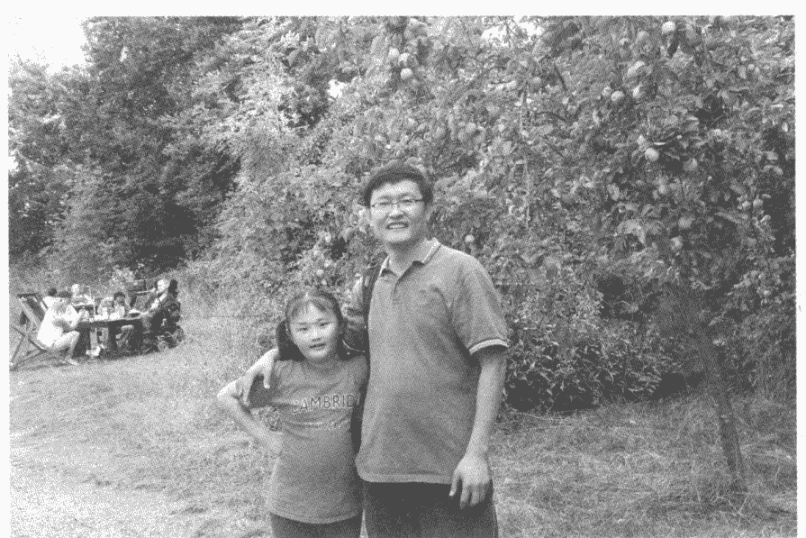

图 1-1 在剑桥偶遇霍金

人工智能源于智能，而智能最深处是哲学问题。早期一批哲学家持续讨论何为智能、何为知识。迈克尔·波兰尼在20世纪60年代撰写《默会维度》，提出“我们知道的越多，我们知道的越少”，并认为我们所知远多于我们能表述的。波兰尼此语体现了默会知识、隐性知识在推动显性知识演化中的主导作用。

弗里德里希·哈耶克在经济领域影响深远，获诺贝尔经济学奖。他涉猎政治、社会、经济、文化、艺术、哲学与心理学，认知科学著作《感觉的秩序》中明确提出“Action more than design”，行为远比设计重要，人类感觉是通过行为表征而非刻意设计，后续演化才产生设计。维基百科联合创始人吉米·威尔士高度推崇此书，认为它启发了他创立维基百科。

卡尔·波普尔是伟大哲学家，提出物理、精神、人工三世界观点。其名著《科学发现的逻辑》提出科学并非证实而是证伪，科学是通过提出猜想、反驳、试错不断推进，而非归纳实证。归纳存在诸多漏洞，因归纳不完备，波普尔针对性地加以梳理。

通常认为人工智能学科起源于1956年美国达特茅斯会议。但其科学起源可追溯至19世纪曾任剑桥卢卡斯教授的查尔斯·巴贝奇，他是机械计算机鼻祖，研制出可计算正弦余弦数值的机械计算机，人类由此开启计算时代。另一位是剑桥的伯特兰·罗素，他以哲学思想与数学基础创立分析哲学重要分支。路德维希·维特根斯坦将分析哲学推向高峰，《逻辑哲学论》中提出语言是哲学重要工具与切入点。此前哲学发展有两大里程碑，一为世界本源问题，是物质还是意识，讨论千年，后笛卡儿研究认识方法并提出二元论。此后方法虽多收效有限，直至维特根斯坦改变哲学走向。其前期研究语言的人工性，即标准化、格式化、程序化语言；后期否定前期工作，转向生活化、自然化语言，认为真正的哲学是通过生活化语言体现其深奥与意义。

智能到底是什么？权威工具书给出了不同的说法，《韦氏大词典》强调理解和适应性行为的能力，《牛津词典》指向观察、学习、理解与认知，《新华字典》则简洁地概括为智慧和才干。人工智能研究者詹姆斯·阿尔布斯在回应亨利·赫克斯穆尔时，列出了一幅更繁复的图景：知识的获取表达存储，智能行为的生成与学习，动机情感优先级的形成与运用，传感器信号向符号的转换，借助符号进行逻辑运算、对过往的推理与对未来的规划，以及幻觉、信念、希望、恐惧、梦境乃至善良爱情等现象的产生机制。由此可见，人工智能作为前沿交叉学科至今没有统一界定。符号主义学派主张用数理逻辑和计算机符号操作来模拟人类认知，建立以知识为基础的系统；联结主义学派主张在仿生学和脑模型基础上，通过神经网络的连接方式与学习算法构建人脑式的系统；行为主义学派则认为智能体现在感知与行动上，强调智能体与环境的交互与适应。三大学派分别从思维、神经与身体出发，目标一致，都是造出能像人一样具备智慧并自适应环境的智能体。

二、AI发展的四次浪潮
总体上，人工智能走过四个阶段：酝酿、起步、反思与蓬勃。

1. 萌芽酝酿期
意识何为是哲学长谈。17世纪笛卡尔提出“我思故我在”后，意识构成的争论就未停歇。托马斯·霍布斯否定身心二元论，认为人是理性存在；梅洛·庞蒂则认为身心并不分离。这些思辨为早期AI提供了思想土壤。1943年麦克洛奇与匹茨提出M-P模型，把神经元看作二值开关，不同组合可实现逻辑运算，开创了人工神经网络研究。1949年唐纳德·赫布提出同步激活增强突触连接的学习假说。M-P模型与赫布规则为后来的联结主义奠基。1945年冯·诺依曼提出沿用至今的计算机结构。1948年诺伯特·维纳指出神经系统与计算机工作相似，将自动控制提升到新高度，对AI创立产生深远影响。1936年与1950年，阿兰·图灵先后提出图灵机与图灵测试，用以探究机器能做什么、如何界定智能。维特根斯坦在《哲学研究》中则主张机器终究不能思维。

2. 初步起步期
早期突破集中在定理证明。艾伦·纽厄尔与赫伯特·西蒙编写的逻辑理论家LT程序从结论逆向推导，1963年证明出罗素与怀特海《数学原理》第一章全部定理。两年后王浩与亚伯拉罕·鲁滨逊用消解方法证明了《数学原理》全部命题演算定理。其他方向也初见端倪。1957年罗森勃拉特引入感知机概念，推动联结主义研究，也让神经网络露面。模仿生物进化的演化计算开始出现，代表人物是约翰·霍兰德与大卫·福格。1965年麻省理工学院人工智能实验室的罗伯兹写出多面体识别程序，开创机器视觉。

3. 低谷反思期
进展并不等于预期。1969年马文·明斯基与塞缪尔·派珀特出版《感知器》，指出单层感知器无法解决XOR异或问题，对研究信心造成重创。20世纪70年代初，DARPA与美国核管理委员会等资助机构收紧支持，AI迎来了第一次寒冬。低谷催生反思。德雷福斯代表批判派，主张AI研究终将陷入困局；费根鲍姆代表乐观派，认为需要大量知识投入。于是知识工程与专家系统兴起，如反向链接专家系统MYCIN可诊断特定传染病。1976至1980年被视作复兴期。进入80年代，研究重返神经联结与遗传算法。1982年约翰·霍普菲尔德提出Hopfield神经网络，引入计算能量概念并给出稳定性判断。1984年他又提出连续时间Hopfield模型。1986年杰弗里·辛顿、戴维·鲁姆哈特与詹姆斯·麦克勒兰德重新提出反向传播算法BP。联结主义巧妙避开了符号主义的知识表示难题。1991年罗德尼·布鲁克斯发表论文，批评符号与联结主义把简单问题复杂化，强调感知与行为的直接联系，促进了行为主义发展。该阶段研究空前活跃，但1987年左右因缺乏实质突破、专家系统应用受限，AI再次陷入停滞。

4. 爆发增长期
1997年深蓝战胜国际象棋冠军重新点燃热情。2006年辛顿提出深度置信网络，使深层神经网络训练成为可能，深度学习迎来春天。2011年IBM的沃森参加《危险边缘》问答节目并击败两位人类冠军。2012年辛顿的学生阿列克斯·克里泽夫斯基用AlexNet在ImageNet图像分类大赛中大幅领先，深度神经网络开始大放异彩；同年谷歌大脑通过观看大量视频自发识别出猫。2016年DeepMind的阿尔法狗战胜围棋世界冠军李世石，推动AI进入第三次高潮期。

三、AI成果与局限并存
阿尔法狗的胜利让AI成为社会热词，也带来误解。有人视其为万能解药，有人视其为潘多拉魔盒。实际上AI是一把双刃剑，需辩证看待。目前发展正处点状突破向面状推广的过渡。

一方面，以计算机视觉、自然语言处理为代表的领域取得重要突破。这些应用多为面向有限开放场景的特定任务单系统，或由多个专用系统集成而成，如人脸识别、棋类、自动驾驶、简单场景语音识别。场景相对简单、任务明确、可形式化且数据积累丰富，部分系统已超越人类，如图像分类、棋类、无人驾驶。

另一方面，面向多类任务的通用人工智能GAI虽已研究数十年，进展有限，应用遥遥无期。通用AI更接近人类智能，人脑能融合视觉听觉触觉等多感官，进行小样本学习、举一反三、跨领域迁移，并完成判断思考推理规划等。而专用AI属于弱AI，强AI需通用AI支撑。当前通用AI仍面临多模态融合、小样本学习、逻辑推理、直觉与逻辑决策等多重难题。总体而言，今日AI有算力而欠算计，有智能而缺智慧，有感知而无认知。

尽管AI已走过花甲，发展速度不逊于青年时期，社会影响更广。深度学习、强化学习等新技术持续突破，“人工智能+”模式已渗入安防、零售、工业自动化、无人驾驶等行业，为技术进步与产业转型注入动力。随之而来的是社会治理、伦理、法律等新挑战，需要全社会协同应对。

四、通往强AI的关键瓶颈
AI正处蓬勃阶段，但问题并未消失，研究精力集中也导致部分方向被忽视。有些领域已逼近或超越人类，其他方面差距依旧巨大。应用正深刻改变社会家庭、工作生活、军事医疗等多个层面。AI既是技术问题，也是非技术问题，是双刃剑。

回顾历史，每当AI取得重大突破后寒冬便会到来，原因多为技术水平达不到心理与商业预期而被搁置。这对当下繁荣期是警示，需前瞻性解决瓶颈。

能否实现强AI仍是疑问。目前的智能在通用性上远未达标。阿尔法狗虽惊艳，却只能在围棋领域发力，无法迁移。搜狗CEO王小川曾指出，现有AI存在明显短板，即便三个月后阿尔法狗也难赢当年败局。瓶颈主要在三处。

其一是动机性。心理学认为动机涉及行为起端、方向、强度与持续性，马斯洛1943年在《人类激励理论》中提出生理、安全、爱与归属、尊重、自我实现五层需求，不同层次产生不同动机。让机器产生类似动机极难，因为动机表征困难，形成机制不明，转换边界不清，权重难以设定，且存在意识与无意识动机之分，而AI对意识层面知之甚少。

其二是常识。常识是文化背景下人们共享的经验知识，涵盖空间、时间、文化、物理等方面，对决策判断至关重要。机器如何形成常识？1959年约翰·麦卡锡便设想过此点。一种做法是让机器像孩子一样观察学习，但成本高昂。明斯基认为常识是长期实践积累的庞大知识体系，包含规则、异常、趋势与制约。另一种做法是构建大型常识库。1984年道格拉斯·莱纳特提出的CYC项目通过访谈与数据处理形成CYCL数据库，但成本极高。更可行的思路是开放众建，如OMCS开放式常识项目，让互联网用户共同撰写。

其三是决策。人类决策分理性、描述性与自然决策。理性决策追求价值最大化，如冯·诺依曼的最大期望效用、萨维奇的主观期望效用。描述性决策认为人并非完全理性，卡尼曼与特沃斯基的前景理论提出价值函数与权重函数的影响，并存在启发式偏差。自然决策研究人在真实环境中的选择，加里·克莱因的再认启动模型RPD认为人依经验模式匹配。机器智能决策可借鉴融合，以压力与情景为依据切换模式，如低压力时用理性模式，高时间压力时用自然模式。

这些难点正是机器智能与人智能差距最明显处，也是下一代产品是否更有温度的关键。

五、资本巨头与AI创新
AI发展不仅受技术制约，也受资本与产业结构影响。随着AI成为新一轮产业变革的核心驱动，重塑生产分配交换消费，催生新技术产品产业模式，深刻改变生产生活与思维方式。谷歌、微软、百度、阿里巴巴、腾讯等科技巨头在研发与应用上领先，成为执牛耳者。资本与技术的结合形成“超级权力”，对其影响需审慎看待。

创新科技是人机环境系统产物，资本与技术的角色重要。过去认为资本是财富积累力量，技术尤其是可产业化的科学技术也是财富来源，二者结合威力巨大。蒸汽机、电动机、计算机、互联网都体现这一范式。在AI时代，模式出现变化。表面上重大突破多出自谷歌、微软、IBM、亚马逊、Facebook、苹果、华为、百度、阿里、腾讯等大公司平台，实质上多数突破并非由它们孵化，而是多伦多大学辛顿实验室、哈萨比斯领导的DeepMind等小团队研发后被收购。算法、芯片、数据被称作AI三大支柱，算法被喻为上帝之眼，数据是智能血液，有人认为数据与算法决定市场。事实并非如此。算法输出是统计概率而非必然性，缺乏推理能力，适用范围受限，在一域是专家他域便成外行。数据若不与开发者意图、用户体验、市场环境结合，价值难以释放。因此，大公司“超级权力”对突破性进展影响有限，更多中小团队与小公司可能带来颠覆性技术，大公司角色多在收购融合推广工程化与市场化。

人工智能的发展离不开重资本投入和持续的技术沉淀，这种不对称很可能在产业之间、在不同人才群体和阶层之间拉开发展能力、资源占有以及社会影响力的鸿沟。于是少数跨国巨头更容易在人工智能时代坐大，掌握调配全球产业结构、人才流向、资本流动和技术走向的垄断性权力。缺少必要的引导、制约与监督时，技术滥用会威胁社会安全，而技术沦为资本权力的延伸也会激化社会矛盾。

美国学者纳尔逊曾强调，研究美国国家创新体系就绕不开防务政策，它与反垄断法并列为影响美国经济科技的两大公共政策。反垄断法的要义是遏制垄断、保障市场竞争。对比来看，防务政策更像一种“扶持垄断”的公共安排：借国家安全的理由使政府集中社会资源合法化，并守护关键产业与部门。根本上，市场社会的优良发展关乎国家利益，但资本逐利与技术增益之间往往存在张力。大量资本为换取中短期回报无视技术成熟规律搞竭泽而渔，形成新技术被资本绑架的局面；为利润最大化而漠视社会责任的现象也屡见不鲜，如游戏开发。总体而言，资本与技术深度融合塑造的“超级权力”型科技巨头，对国家经济社会既有加速产业升级、促进社会跃迁的正面效应，也有催生垄断利益集团、压制新技术成长的负面效应。如何扬长避短、实现良性协调，是未来经济社会与资本技术发展必须反复求解的难题。

## 第二章

## 认知透视：深度态势感知何为

人类的认知方式和思维构造无比复杂且具备天然优势，但在技术加持下，对大脑的模拟与再现已非空想。通过深度态势感知，我们能够复现人的认知活动，也能孕育出不同于人的机人智慧；它既可在信息与资源匮乏的场景下运行，也能在信息与资源过载的场景下发挥作用。

某种程度上，人类文明就是不断认知世界与自我的过程。追溯知识获取的源头，美索不达米亚文明约距今六千多年、古埃及文明约距今六千年，以及由其衍生的古希腊文化约距今三千年，其内核是人与物、即人与客观对象的关系，这为科学技术快速发展奠定了文化基础。古印度文明则多体现人与神的信仰联结。稍晚的中国上古文明是四大古文明中延续至今最完整的，其核心在于人与人、人与环境的沟通互动，这或许是中华文明长久不衰的重要原因。

在人、物、环境持续交互的系统里，认知数据的生成、流通、处理、变异、卷曲、放大、衰减与消失永不休止。如何在充满变量的进程中保持稳定与连续，人们创造了大量理论模型与工具方法，试图从自然与社会的秩序中寻找规律与答案。近代起，16世纪天主教教士哥白尼提出“日心说”，将权威从宗教转向科学，此后数百年，实验与逻辑重塑了时空观，一次次减轻了人的生理、脑力乃至精神负担。

科学思想演进的同时，技术也在突飞猛进。系统论、控制论、信息论“老三论”余温未散，耗散结构论、协同论、突变论“新三论”已然登场；电子管、晶体管、集成电路尚未褪场，纳米、超算、量子通信等技术便蠢蠢欲动。20世纪四五十年代在此基础之上萌发的就是人工智能这一前沿方向。但受制于认知机理不明、数学建模不足、硬件算力受限等因素，人工智能长期徘徊于弱智阶段。依据当前数学与硬件进展判断，短期内实现突破并不乐观，于是从认知机理切入成为众多科学家的选择。本章对深度态势感知做初步介绍与评述，期望推动该理论在国内的研究与应用。

### 一、深度态势感知的理论缘起

2013年6月，美国空军司令部任命以态势感知研究著称的米卡·安德斯雷Mica R. Endsley担任新一任空军首席科学家。这位1990年毕业于南加州大学工业与系统工程专业的女博士，与前任首席科学家马克·梅贝里Mark T. Maybury同样聚焦人机交互的认知工程，而此职此前多由航空航天或机电工程背景者占据。类似的人事转向也在美军其他军种出现，这或暗示未来军民科技竞争中，以硬件制造为主导的模式正被以软件智慧为核心的指挥控制体系逐渐取代。

与此同时，全球人工智能与自动化领域热衷态势感知研究，计算机界致力于上下文感知context awareness算法，语言学深耕自然语言处理的语法、语义、语用，心理学掀起情景意识讨论，西方哲学主流也转向分析哲学。分析哲学大致分人工语言分析与日常语言分析两路。认知神经科学等分支则把重心放在意识本身，试图从脑结构与工作方式揭示意识产生机制。无论态势感知、上下文感知抑或其他，各领域追求的终点一致，都是揭开真正智能的面纱。

当下我们身处一个信息活跃的人-机-环境系统。指挥控制系统正是通过人、机、环境三者交互及信息的输入、处理、输出、反馈来调节主体活动，降低结果不确定性。指挥控制的核心环节是态势感知技术。米卡·安德斯雷提出了态势感知模型，其结构如图2-1所示。

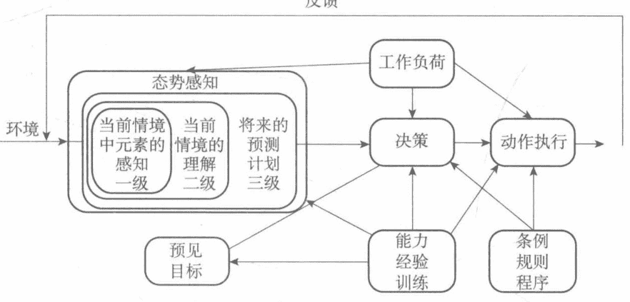

图 2-1 动态决策态势感知（SA）模型（Endsley，2000）

该模型将态势感知划分为三级，逐级递进不可跳过，沿信息处理链由环境感知到环境理解再到预测规划。第一级是感知环境各要素，即信息的输入；第二级是对当前情境的综合理解，即信息的处理；第三级是对后续情境的预测与规划，即信息的输出。

人、机、环境构成的情境要素往往快速变化，在快节奏演变中因时空与信息不足，对未来态势的精确定量预测会大打折扣，但定性分析仍可进行。大数据时代，人工智能系统需要在厘清各要素及其干扰项间排斥、吸引、竞争、冒险等逻辑关系的基础上，构建基于离散规则与连续概率，乃至融合情感与顿悟的定性定量综合决策模型。简言之，若不弄清数据表征关系，特别是异构变异数据的关系，大数据挖掘便不可靠，基于其上的智能预测也不可靠。

智能预测系统还常需区分管理缺陷与技术故障。如何把非概念问题概念化、异构问题同构化、不可靠部件组建成可靠系统，如何以刚性或柔性反馈把人因失误降到最低、提升机与环境的效能？1975年图灵奖得主、1978年诺贝尔经济学奖得主西蒙H.A. Simon提出有限理性对策：把无限域中的非概念、非结构化成分转化为有限时空可操作的柔性概念与结构化成分，使非线性不确定系统趋于线性化与满意化处理。它不追求大海捞针，而满足于一碗水中捞针，从而把表面无关的事物关联起来，使预测更智慧、更易落地。

但在工程实践中，受主客观干扰与方法不完善影响，态势感知理论与技术仍存不少缺陷。构建与维持态势感知对许多岗位与环境的人而言并不容易。飞行员反映，他们大量时间用于对事件做心理实时描述。其他复杂系统同样需处理海量实时信息，信息变化快或难以获取时尤甚。

### 二、态势感知的敌人

良好的态势感知极具挑战性，其根源在于人类信息处理特性和复杂领域特性，两者交互形成“态势感知恶魔”。恶魔是破坏态势感知的常见因素。为奠定态势感知设计基础，我们将讨论八大恶魔：注意隧道效应、记忆瓶颈、工作负荷焦虑疲劳等压力、数据过载、错位、复杂性蠕变、错误心智模型、人不在回路异常。下面依次展开。

### 1. 注意的隧道效应

复杂态势感知要求同时把握环境多方面。飞行员需兼顾空间位置、机载系统状态、气流对乘客舒适与安全的影响、周围交通及空管指令；空管员需同时监控数十架飞机的间隔、飞机流管理、飞行员请求及进出空域申请；机车司机需监视发动机、燃油、轨道其他列车及维修信号。

态势感知高度依赖对环境各侧面的持续处理。有时需并行处理多条信息，如边开车边收听电台了解交通，这即注意分享。由于单一通道如视觉或听觉有限，注意分享范围受限。

人们会采用扫描或采样策略以保持信息更新。扫描周期可能是数秒到数分钟，也可能是数小时。无论复杂度如何，注意在信息源间的切换都很关键。然而人们常陷入注意力变窄即隧道效应，注意被锁定在某一特征或任务上，有意无意放弃扫描。此时被聚焦部分的感知可能很好，被忽略部分则迅速过时。

人们常误以为聚焦核心是好事，但只有对整体现状的高层理解才能判断何为真正关键。否则关键因子易被忽视。以美国东方航空公司飞机坠毁于佛罗里达大沼泽地为例，三名机组成员专注于指示灯故障，忽视飞行路径，最终未正确设置自动驾驶，机毁人亡。

此问题普遍存在。琼斯与恩兹利研究飞机与空管事故发现，35%的态势感知误差属于信息虽在但未被注意。常因人们专注其他任务相关信息而丢失情境要素。

隧道效应不止于航空。从手机到车载导航，技术在汽车上的普及正培育新的注意隧道。研究显示开车时使用手机风险是不使用的四倍，与是否手持无关，根源在于注意力分散。频繁在设备与驾驶任务间切换构成挑战。头盔式显示器也可能使士兵聚焦屏幕而忽视周遭。未来设计需正视并抵消隧道效应的影响。

### 2. 无法避免的记忆瓶颈

工作记忆是态势感知的核心，而非长期记忆。工作记忆是把当前情境汇集成有意义图景的中央缓存，由长期知识与即时输入共同构成。其容量有限，米勒的研究表明约可容纳7±2个信息组块。态势感知失败常因缓存空间不足或信息自然衰减。经验丰富者会把多个信息压缩为更紧凑的组块，如空管员把30架飞机聚合成5到6个相关组。心理模型越丰富，组块越高效。

信息不会永久保留。若不通过重复等主动维护，抽象信息约20至30秒即消失，如电话号码或呼号；与长期模型关联后可保留更久。

态势感知的许多特征需驻留在记忆中。扫描环境时需记住先前信息并与新信息融合；听觉信息不能像视觉那样随时回看。内存限制在复杂、高容量场景中形成明显瓶颈。

严重依赖记忆的系统易致重错。一次洛杉矶国际机场事故中，工作超载的空管员忘记把一架飞机移至指定跑道，却指令另一架飞机降落同一跑道。她看不到跑道，只能靠记忆描述。

更合理的归因是系统设计过度依赖人记忆。飞行员需记住复杂空管指令，司机需记住口头指示，军事指挥官需记住战场部队位置等，均使态势感知痛苦，失误几乎必然发生。

### 3. 工作负荷、焦虑、疲劳和其他压力

态势感知常在压力下进行。压力可源于生存威胁、自尊、职业发展或后果严重事件，也包括时间压力、认知负荷、不确定性。物理压力包括噪音、振动、温度不当、光线不足，以及疲劳和昼夜节律对抗，如长途夜间飞行。

压力会消耗态势感知。首先占用有限工作记忆，减少用于处理与保持态势信息的认知资源。其次削弱信息采集能力，使人更少关注外围、扫描混乱、更易陷入隧道效应，还更可能过早关闭决策、忽视可用信息。整个接收过程变得不系统且易错。

这些压力源应尽量避免或通过设计缓解，但并非总能实现，如个人风险不可完全消除。此时需要系统支持高效信息获取以维持高水平态势感知。

### 4. 数据过载

数据过载在诸多领域普遍存在。数据变化速率远超人的感觉与认知处理能力，导致感知缺失或空白。

当听觉或视觉消息超过处理量时，态势感知迅速过时。问题常被视为数据体量所致，实则是带宽受限。人的感觉与处理机制带宽固定，但可通过呈现方式调节流速。混乱数据流速慢，文本流比图形化呈现更慢。优化设计可显著减轻或消除数据过载。

## 5. 错位

真实世界注意资源竞争激烈。司机需同时应对广告牌、其他车辆、路标、行人、仪表、收音机、乘客、手机通话及车载技术。复杂系统中，显示、警报、无线电或电话呼叫同样争夺注意。

人们常寻找与目标相关信息，但显著性也会捕获注意。红色、移动物体、闪烁灯光更易吸引注意；大声噪音、大形状、近距离物体也更突出。这些特征在进化上具生存价值。某些词义如“火”、人名也具显著性。

显著性本身是双刃剑，既能强化态势感知，也能削弱它。只要运用得当，运动感、色彩对比等自然属性就可把注意资源牵引到真正关键的信息上，成为提升态势感知的设计杠杆。但在实践里这类杠杆极易过度使用或使用不当。譬如让并不重要的提示在屏幕上闪烁，就会抢占视线，干扰对更重要事物的判断。空中交通管制显示器里，系统判定可能冲突的飞机图标就会闪光，真正冲突时这无疑是帮助；问题在于误报太多——当管制员已经把飞机构开，或飞机本来就要在某点转弯爬升脱离冲突时，高强度的闪烁提示带来的不是帮助而是噪音，会拖累操作员对其他信息的把握。

在很多系统中，闪灯、移动图标、鲜亮配色被无节制堆砌，形成类似拉斯维加斯大道的效果。信息都在争抢注意，反而没一件能被处理好。大脑被迫压制所有竞争信号，消耗显著的认知资源去过滤期望之外的干扰。

自然界物体的显著性难以调控，但工程系统里的显著性完全由设计者决定。可惜大量系统仍以灯光、蜂鸣、警报等主动吸引注意，或误导、或淹没操作者。次要信息常常因呈现方式而被感知为更重要。比如飞行显示器里，用从低可信传感器得来的不确定性数据，在目标符号外画一个很大的不确定环，会把飞行员的注意拉向这种更不确定的信息，让它看起来比基于更可靠数据、显示更小圆环的其他目标更重要，造成本应缩小注意范围却反向放大的非预期后果。错位突出是态势感知里必须规避的重要“恶魔”。

## 6. 复杂性蠕变

与信息过载的“恶魔”相伴的是复杂性蠕变的“恶魔”。新系统开发中，复杂性像藤蔓一样蔓延，设计者通过不断堆叠功能特征不知不觉释放它。电视、录像机甚至电话功能繁多到让人难以形成“它到底怎么工作”的清晰心理模型。研究显示，能正确使用自家录像机的不足两成。在消费品里这带来烦躁，在关键系统里可能招致悲剧。飞行员反馈说，对机上自动飞行管理系统正在做什么、接下来要做什么的理解存在严重困难，这一点即便对使用多年的老手也未必解决。

根源在于复杂性。它让操作者难以真正理解系统原理，更别提达到人机合一的高效配合。复杂性是微妙的态势感知破坏者：它削弱信息获取能力，更致命的是破坏对系统信息的正确解读以及对未来的预测，即第二层和第三层态势感知。情境的细节、意外的决策、程序的细微之处足以让系统以完全不同的方式运行。若无法建立包含全部特征的心智模型，提示极易被误读。

训练常被视作解药，现实却是复杂性越高，遇到低频情况时人们越显得经验不足，需要更多训练去熟悉系统，却也更容易遗忘细节。

## 7. 错误的心理模型

心理模型是绝大多数系统中建立与维持态势感知的基础解释机制。它指导如何整合信息、如何判断重要性、如何对未来做出合理预期。但不完整的心理模型会导致理解和预测失误，更隐蔽的是，错误的心理模型会被用来解释信息。

习惯了某型飞机的飞行员，可能把对旧机的正确模型带到新机上，从而误读新显示。线索被误解时事故就可能发生。医生误诊时也类似：新症状被强行纳入早期诊断框架，延误正确判断与治疗。模式错误是典型表现——操作者以为系统处于一种模式，实际上是另一种，于是信息被完全错误解读。

例如，导航员曾因误以为下降率以英尺/分①显示，实际系统却以度为单位，导致对下降信息理解错误。

① 1 英尺 =0.3048 米。

错误的心理模型“恶魔”很阴险，也称表征错误，操作者往往意识不到自己正基于错误模型工作。研究发现，即便存在明显冲突线索，空中交通管制员仍有 66% 的情况未能察觉并纠正已激活的错误模型。人们倾向于用牵强的解释去调和冲突线索，以维持自己选择的模型，这不仅损害态势感知，也让自我纠错变得困难。因此避免诱发错误模型的界面设计至关重要，自动化模式的限量标准化是有效原则之一。

## 8. 人不在环路异常

自动化带来了态势感知的终极“恶魔”。它在某些情形下能减轻负荷，但在另一些情形下会降低态势感知。自动化带来的复杂性与模式错误本身就是相关“恶魔”。更进一步，自动化会把人移出控制回路，使其对自动化执行状态的把握变差。

1987 年一架飞机在底特律起飞时坠毁，除一人外全部遇难。调查显示自动起飞构型警告系统失效，飞行员未意识到起飞构型错误，襟翼缝翼未正确设置，且不知道自动化并未按预期提供支持。这正是人被移出回路导致态势感知失效的典型。

自动化正常运行时，离线可能无害；但当自动化失效，或遇到无预设处理预案的异常时，离线的操作者往往难以及时发现问题、正确解释信息并介入决策。

来自人类信息处理的固有限制与系统设计的不足会持续破坏态势感知，传统理论很少涉及。面向新态势感知的设计需正视这些问题并尽可能规避。以人为本的支持性设计能避免信息加工过程中的已知缺陷。

### 三、深度态势感知解密

### 1. 基本观点

深度态势感知可理解为“对态势感知的感知”，是一种人机智慧，既含人的智慧也融合机器智能，是能指与所指的合一，既关乎事物属性，也关乎属性间关系，既能读懂本意也能捕捉弦外之音。它在安德斯雷主体态势感知的信息输入处理输出基础上，叠加人机物环境及其相互关系的整体趋势分析，兼具软硬双向调节反馈，涵盖自组织自适应与他组织互适应，包含局部定量预测与全局定性评估，是一种具有自主自动弥聚效应的信息修正补偿机制，即期望选择预测控制体系。若说视觉源于物体漫反射，深度态势感知就如同在暗室点灯，看见事物的本原。

某种意义上，深度态势感知是完成特定任务时，系统充分调动目的、感觉、注意、动机、预测、自动性、运动技能、计划、模式识别、决策、经验知识提取存储执行反馈等认知活动的综合体现。它能在信息资源匮乏时运转，也能在信息过载时发挥作用。

模拟与现场研究发现，深度态势感知系统存在“跳蛙”现象，即信息输入后直接进入输出控制，跳过整合处理阶段。这多源于任务主题明确、注意高度集中与长期训练形成的条件反射，如边嚼口香糖边聊天边打伞行走般无意识协调。该系统实现的是近乎完美的自动控制，而非有意识的规则反应。与普通态势感知相比，其采样样本更离散，信息过滤更强，体现“去伪存真、去粗取精”。过滤器让指定信号顺畅通过，对其他信号衰减，从而提纯信噪比。深度态势感知能精准抓住刺激客体的关键特征，可视为“由小见大、窥斑知豹”的能力，因而具备快速搜索比对提炼与运筹优化修剪规划预测的认知能力，可迅速自动执行主题任务。普通态势感知则信息特征多且杂，采样量大、融合慢、预测迟缓、执行力弱。

在时间压力下，经验丰富的深度态势感知常基于离散的经验图式脚本进行决策，而非逐项评估。这些图式脚本是自动性模式的基础，源于经验积累而非常规统计概率。图式是概念事件的描述，是长期记忆组织基础。Top-Down 处理依赖既有认识，Bottom-Up 只与当前刺激相关，识别过程都涉及 Top-Down 的已有信息组织。Top-Down 已被证实影响深度知觉与视错觉，两者可并行。

多数正常情境下态势感知按 Top-Down 达标，异常或紧急时则可能转 Bottom-Up。关键在于保持主动前摄而非被动反应，如前馈控制策略。主动性可通过异常情境训练获得。

在真实复杂背景下，构建精确可靠的数学模型是研究者追求。为此需理解人机环境系统信息传递机理。人类能从复杂环境中搜索特定目标并选择处理，这即注意力聚焦。多目标多任务时，如何快速获取所需信息是难题。将人的环境聚焦与自聚焦机制应用于多模块深度态势感知技术，可使系统在注意机制控制下高效处理信息并输出。若要实现，需先解决适度规模多模块系统的建立，以及模块间整合协调问题。

从认知技术看，深度态势感知过程是主动行为而非被动响应。在环境刺激下，通过采集过滤改变分析策略，从动态信息流中抽取不变性，在人机环境交互中产生近乎直觉的操作控制。计算是动态非线性的，不必一次性算清所有问题，只对所需信息计算；且计算应自适应，随外界交互而变化。因此深度态势感知计算是环境、装备与认知感知器共同作用的结果，三者缺一不可。

对不确定动态环境感知与反应能力的探索，对应急指挥、工业故障快速处置、系统重构、复杂环境仿人机器人设计等具有重要参考价值。

### 2. 意义的建构

深度态势感知系统的核心目的不是堆砌态势，而是构建态势的意义框架，从而在众多不确定情境下实现深层预测与规划。

“感”多指向碎片化属性，“知”则指向关联建立。人感知过程常同步进行，可同时感知属性与关系，并交叉混合生成直觉或情感，由无关到弱关再到强关，甚至出现跳蛙。类比在此中起桥梁作用，将隐性默会知识转化为显性规则概率。现象学认为意识关键在于知觉，即通过自身与物体互动经验整合而产生的可控性。对桌上苹果的知觉包含可吃、可取、可抛等行动可能。

知觉需与行动结合才赋予输入信号语义。计算机接收视频却无视觉，因其无行动能力。知觉产生需输入信号、自我运动与环境物体协调整合，形成经验记忆，再遇相关信号时才产生知觉。智能还需在知觉平台上构建推理思考规划能力。

人机在语言信息处理上的差异主要体现在能否将表面无关事物关联起来。即便大数据时代，基于规则概率的决策与基于情感顿悟的判断之间鸿沟仍存。

爱因斯坦曾言逻辑带你从 A 到 B，想像力带你到任何地方。人能有目的弥合逻辑与想像、具象与抽象。维特根斯坦认为词义由使用语境决定。思想斗争根源于不确定性，解决关键是寻求满意解而非最优解。阿尔法狗击败李世石的参数平衡，体现竞争冒险机制的临界线，如太极阴阳。

意识如何产生仍是谜题，涉及基本结构与交互积累经验。前者是人机差异，后者是必要条件。意识是人机环境系统交互产物，当前机器缺乏主动交互，因而缺乏参照坐标。

笔者曾与摄影家交流，其十句话对意义建构亦有启发：作品不够好因离生活太远；用眼睛捕捉的是照片，用心灵捕捉的是艺术；作品是真实自我；最简单的照片最难；只有好照片没有准则；摄影师是照片一部分；影子比物体更吸引；名著音乐绘画给予灵感；摄影不只是镜子，留有想像空间；一生等待光与景交织。

数据可视为对刺激的表示或应对。爱因斯坦说思考时使用的不是词和语言，而是符号与图像，可随时重组。语言线性化符号，也限制思维，人机差异体现为记忆型与模糊型。人的优势在于把更大范围尺度甚至超越语言的无关相关化，机的局限在于有限相关。

描述三维空间跟踪定位系统时，将位置方向纳入目标属性即可推断关系。大数据冗余可能引发精度干扰或认知过载，小数据学习因更依赖分析精度而具有助益。小数据短板在于缺乏大数据冗余补偿。

### 四、人的智慧对人工智能

人机智能的分界线在哪里

现在的设备记忆基本靠符号化编码来承载，人的聪明却习惯用意象联想来运转。AI 的推演是彻底的形式运算，人的权衡常把客观逻辑和主观直觉揉在一起。算出来的预报多半改不了结局，算计出来的预期却常常改写未来。换一个角度看，深度态势感知并非靠算力堆出来，而是认知在搭建。自主有利也有弊，有合情合理也有违常理，它是一种由内而外的自我修正，在经验校验和类比迁移里慢慢成型。把推算比作脑机，权衡更像心机，心量有多大，视野就有多大。

有人说 AI 就是人类认识自己，其实更像是人类在试图认识自己，因为“我是谁”这个原点至今仍很模糊。“我是谁”既是自决的起点，也是整个人类智能坐标系的原点。记忆在这个坐标系里像一支有方向的意识矢量，也就是主观指向。与冯诺依曼式的存储不同，这里的数据与规则并不是死的，而是在人与机器与环境的互动中随时应变，灵活度高低往往映射出自决性的大小。沟通就是自决的典型范例，它依托的是互动情境而非单纯场景，无论怎么测，都是预设反应与即兴反应的混合，准确度能分出人机差异。

有人把语言拆成三重指向，指物指心指名，研究它们之间的关联一直是难题。十九世纪英国学者提出的能指与所指，细究起来也不过是属性与关系的问题。一个词汇、一句表达、一篇文字都离不开自决情境的限定。我们能知道的远多于能说出来的，所指常常大于能指。看那些眼神会说话的人就明白了。根源在情理转化的机制里：感性像理性的虫洞，打破束缚；理性像感性的黑洞，限制作假。自决意识既驾驭情理，也被情理制约。

当前智能领域最难的点，是主观指向与行为表现的落差。行为可以客观显化，主观指向却隐性内在。主观指向包含思与想，反思是经验的总结，前想是面向未来的假想，反复思量最终都指向解决当下问题。

规则化与指向性的差别是表里、现象与规律的差别。比如日落与腿疼。太阳落山的表象是太阳下山，本质是地球公转；腿疼的表象是疼痛，实质是大脑特定区域的神经信号。

主观指向是主体对事物的感知，因而内在且个性化。规则化是对客体的感知，像物理定理数学公式，脱离个体而被多数人接受，因而外在且共性化。

休谟问题说从事实推不出价值，但世界本就是事实与价值交织的，能否从价值推回事实？汉字是智能的集中体现，有形有意，日月人一眼可懂，西文则多无形无意，靠逻辑类推。智能的本质是把主观指向与规则化统一起来，汉字从象形到会意的演进就是人类自然智能的发展简史。人机融合中的深度态势感知，正是主观指向与规则化的综合。

智能的本质在于自决与对相似的判断，在于拿捏好相似度基准的分寸。人优于机器的一点是，能从更少的数据里更早发现模式。原因之一是机器没有原点，即“我是谁”的问题。对人而言，事物的存在并非纯客观，而是带着目的去观察的结果，这种主客混合体多是上下文的产物，围绕是、应、要、能、变的建构与解构常常同步。哪怕视觉，也兼具具体指向与抽象意蕴，握手既是生理接触也是心理暗示。人脑在自决活动中能实现从欧几里得空间到拓扑空间的映射，做选择和控制时会随目的变化相似度基准，即情理联系的网络，而非单纯距离，从而决定情境归类。

与机器相比，人对语言或信息组块能力更强，记忆有限而理性有限；机器组块弱，记忆近乎无限而理性硬性。机器要可靠，语言运行与自我监督必须同步。人可以用母语不讲语法交流，能在多情境下感知语言图画音乐的多义性，听觉视觉触觉在辨别的同时带情感，常能捕捉只可意会不可言传的信息。机器虽能下棋答题，却缺乏跨领域随机应变能力，对矛盾模糊信息无反应，缺少竞争冒险选择机制，主次不分，综合辨析不足，不会用归纳演绎形成概念，更遑论形而上学理论。

高手学习先靠感性选择，再靠理性思考。感性是内在的主观指向，潜在关联的显化；理性是规则化的指向，显性关联关系。

人的学习与机器学习的差异还在于，人的学习是碎片与整体混合进行，自适应更强，持续在信息不足情境下做稳定预测与不稳定控制，失预失控时有发生，因而需要多级快慢反馈及时修正。非结构非标准情境下人优于机器，结构化标准化场景下机器反超。这种自适应是累积的，最终形成个性化合理性预期，自主即预期加预测加控制的机制由此成长。智能不是百科全书，而是包含虚构与想象。虚构是智能的实质表征，从似曾相识似是而非似非而是等强意会弱言传的现象可见一斑。

> 想象力比知识更重要，因为知识是有限的，而想象力概括着世界上的切，推动着进步，并且是知识进化的源泉。

主流机器学习先用学习算法从样本生成模型，再用模型解决问题。现实中问题常不分学习与解题，而是把系统运行拆成大量基本步骤，每步由简单算法实现推理规则。步骤衔接实时确定，一般不可严格重复。因此通用智能系统不应有固定学习算法，也不应有不变解题算法，学习与推理应是同一过程。

人的学习融合因果、相关乃至风俗习惯，有些可程序化，很多难以描述，如主观感受与默会知识。机器显性知识远大于隐性概念外延。对人认知而言，规则与概率关系是弥聚性的，规则是大概率存在，概率是未形成规则的状态。习惯是规则的无意识行为，学习是概率的累积，包括熟悉类比与生疏修正。前者多无意识，后者有意识，是复合过程。人处理信息变速进行，或自动化的下意识习惯释放，或半自动的有无意识平衡，或纯人工的慢条斯理。过程不只是信息表达传输，还包括在知识向量空间中建构语法状态并重构语义语用体系。

自由调节的环境系统触发自决体系的反向运动，形成人与机与环境的多向运动，进而产生矛盾冲突。解决不一致甚至相反的问题常非单纯数学所能及。有边界有条件有约束的问题是数学探讨，无边界无条件无约束则往往成哲学研究，如虚构如何修正真实，真实如何反馈虚构，这就是个耐人寻味的问题。

### 五、深度态势感知的未来
深度态势感知本质上是变与不变、一与多、自决与被动等诸多悖论产生并解决的过程。所以该系统不应是简单的人机交互，而应是贯穿整个人机环境系统的自决认知过程。鉴于研究深度态势感知系统涉及面较广，极易产生非线性、随机性、不确定性等，所以其系统建模研究时常面临着较大的困难。在之前的研究中，多种有价值的理论模型被提出并用于描述态势感知系统行为，但这些模型在对实际工程应用系统的实质及影响因素方面考虑还不够全面，也缺乏对模型可用性的实验证证，所以本章重点就是针对深度态势感知概念的实质及影响因素这两个关键问题进行了较深入探讨，追根溯源，以期早日实现高效、安全、可靠的深度态势感知系统，并应用于相应的人机智慧产品或系统中。

## 第三章
探索人机未来：人机融合智能

“话说天下大势，分久必合，合久必分”，自然科学中的诸多学科之大势也莫不如次。在人类经历了数百年的学科精细分化之后，随着人工智能的快速发展，许多学科正在慢慢交叉融合起来。在经历了三次起伏后，即 20 世纪 70 年代后期对数学定理证明非万能的清醒、90 年代后期对专家系统与五代机的失望、2006 年深度学习掀起了新一轮的浪潮，人们狂热的希望逐渐踏实了很多，目光也慢慢地从科幻转移到了一个崭新而又富有活力的领域：人机融合智能。

深度态势感知作为认知领域的研究重点，其中就提到了人的智慧与机的智能统一问题。它立足于认知领域，参考人的态势感知方式，构建具有人机智慧的新的认知方式。这揭示了未来智能发展的方向，即人与机器的智慧融合——人机融合智能。从当前人工智能发展中的问题和局限我们可以推导出，人机融合智能才是当今智能时代的最佳解决方案。

### 一、人工智能的考验
从历史上看，人工智能大概分三大门派，一是以模仿大脑皮质神经网络及神经网络间的连接机制与学习算法的联结主义，主要表现为深度学习方法，即用多隐层的处理结构处理各种大数据；二是以模仿人或生物个体、群体控制行为功能及感知动作型控制系统的行为主义，主要表现为具有奖惩控制机制的强化学习方法，即通过行为增强或减弱的反馈来实现输出规划的表征；三是以物理符号系统具有产生智能行为的充分必要条件假设和有限理性原理为代表的符号主义，主要表现为知识图谱应用体系，即用模拟大脑的逻辑结构来加工处理各种信息和知识。正是由于这三种人工智能派别的取长补短，再结合蒙特卡罗算法，使得特定领域的人工智能系统超过人类的智能成为可能，如国际商业机器公司的“沃森”问答系统和 Google DeepMind 的“阿尔法狗”围棋系统等。尽管这些人工智能系统取得了骄人的绩效，但仍有不少不足之处，而且有可能会产生很大的隐患和危险。

首先，分析一下让人工智能在当下炙手可热的联结主义。当前的人工智能热度不减，其主要原因是 2006 年辛顿提出的深度学习方法大大提高了图像识别、语音识别等方面的效率，并在无人驾驶、“智慧+” 某些产业中切实体现出助力作用。然而，任何一种算法都有其不完备性，深度学习算法也不例外。该方法的局限性和不足之处在于：不可微分，弱监督学习，样本分布偏移大、新类别多、属性退化严重、目标多样，开放动态环境下该方法效果较差，计算收敛性不好。另外，相对于其他机器学习方法，使用深度学习生成的模型非常难以解释。这些模型可能有许多层和上千个节点，单独解释每一个节点是不可能的任务。数据科学家通过度量它们的预测结果来评估深度学习模型，但模型架构本身是个“黑盒”，它有可能会让你在不知不觉间失去“发现错误”的机会。再者，如今的深度学习技术还有另一个问题，它需要大量的数据作为训练基础，而训练所得的结果却难以应用到其他问题上。如何在各种现实情境任务中恰如其分地解决这些问题，就需要结合其他的方法取长补短、协调配合。

其次，行为主义中的增强学习的优点是能够根据交互作用中的得失进行学习绩效的累积，与人类真实的学习机制相似。该方法最主要的缺点是把人的行为过程看得太过简单，实验中往往只是测量简单的奖惩反馈过程，有些结论不能迁移到现实生活中，所以往往外部效度不高。还有，行为主义貌似研究可以观察的行为，但是由于它的主张过于极端，不研究心理的内部结构和过程，否定意识的重要性，进而将意识与行为对立起来，进而限制了人工智能的纵深发展。

最后，是符号主义及其知识图谱，符号主义属于现代人工智能范畴，基于逻辑推理的智能模拟方法模拟人的智能行为。该方法的实质就是模拟人的大脑抽象逻辑思维，通过研究人类认知系统的功能机理，用某种符号来描述人类的认知过程，并把这种符号输入能处理符号的计算机中，从而实现人工智能。符号主义的思想可以简单地归结为“认知即计算”。从符号主义的观点来看，知识是信息的一种形式，是构成智能的基础。知识表示、知识推理、知识运用是人工智能的核心，知识可用符号表示，认知就是符号的处理过程，推理就是采用启发式知识及启发式搜索对问题求解的过程，而推理过程又可以用某种形式化的语言来描述，因而有可能建立起基于知识的人类智能和机器智能的同一理论体系。目前知识图谱领域面临的主要挑战包括：知识的自动获取、多源知识的自动融合、面向知识的表示学习、知识的推理与应用。符号主义主张用逻辑方法建立人工智能的统一理论体系，但遇到了“常识”问题的障碍，以及不确知事物的知识表示和问题求解等难题，因此，受到其他学派的批评与否定。

从上述人工智能三大流派的特点及缺点分析，我们不难看出，人的思维很难在人工智能现有的理论框架中得到解释。那该如何做才有可能寻找到一条通往智能科学研究的光明前程之路呢？下面我们将针对这个问题展开思考和讨论。

### 二、人工智能的道路是有限的
“计算机之父”图灵的朋友和老师维特根斯坦在他的《逻辑哲学论》中写道：“世界是事实的总和而非事物的总和。”其中的事实是指事物之间的关涉联系——关系，而事物是指事物的各种属性，就目前人工智能技术的发展态势而言，绝大多数都是在做识别事物属性方面的工作，如语音、图像、位置、速度等，而涉及事物之间的各种关系层面工作还很少，但是已经开始做了，如大数据挖掘等。面对眼花缭乱的人工智能技术，人们常常思考着这样一个问题：什么是智能？智能的定义究竟是什么？

关于智能的定义，有人说是非存在的有，有人说是得意忘形，有人说是随机应变，有人说是鲁棒适应，有人说可能有一百个专家就有一百种说法。实际上，现在要形成一个大家都能接受的定义是不太可能的，但是这并不影响大家对智能研究中的一些难点、热点达成一致看法或共识，如信息表征、逻辑推理和自主决策等。

一般而言，任何智能都是从数据输入开始的，对人而言，数据就是各种刺激；对机器而言，数据就是各种传感器采集到的各种数据，数据是相对客观的，而从中提炼出有价值的数据——信息就是相对主观的，信息带有人 的价值观、偏好倾向和风俗习惯特征。人机处理数据最大的差异在于形成信息的表征，机器中的数据常常是结构化归一量化后的“标准数据”，数据表征的符号就是0、1或其他进制的数字；人采集到的数据则是各种非结构化、非一致性不同量纲种类的刺激输入，其表征方式是极其灵活多变的，对一朵花、一棵树甚至可以有无限多种表征，正所谓“一花一世界、一树一菩提”，而且表征出的信息符号是由“能指”“所指”构成的，“能指”指具体的物理刺激形象，“所指”指信息所反映的事物的概念及拓扑关系。比如，对于一杯水，机器可能表征它为高度、宽度、密度、颜色等客观数值参数，而人除此之外，还可以把它表征为热情、友谊、问候、送客等方面的多维内涵外延拓展，这种千差万别的混合指向变化，机器无论如何是表征不出，也处理不了的……所以，从智能的源头就可以找到人工智能与人类智能的根本区别之所在。数据的变化与动态映射是感知的瓶颈，人会期望性地补偿或回望性地修正，而机器就是把“过去性”当成“当下性”来处理，若数据处理过程中不敏感则罢，若是临界性数据，就常常会差之毫厘谬以千里了。数据、信息、知识、逻辑本质上就是事物之间不同程度的关系表征，这种表征可以体现在人的记忆和直觉之间，也可以显示于机器的存储与计算之中。只不过机器数据的单一表征从一开始就异于人的多种刺激融合，这也是机器不能产生类人意向性的主要原因：缺乏灵活的一多分有机制。

有人认为符号化和对象化可能是两个不同的步骤。一个对象可以没有符号名字，也可以有多个符号名字，一个符号可以表示多个不同对象。智能的理解要做到符号到对象的指向性，没有做到指向性，只是符号间关系的处理，不能算理解。实际上对人而言，感与知往往是同步的，在形成习惯风俗后，对象与符号应该是融合的。

有了数据和信息之后，智能的信息处理架构就格外重要了。截至目前，有不少大家提出了一些经典的理论或模型，例如在视觉领域，大卫·马尔的三层次理论结构至今仍为许多智能科技工作者所追捧。作为视觉计算理论的创始人，马尔认为，神经系统所做的信息处理与机器相似。视觉是一种复杂的信息处理任务，目的是要把握对我们有用的外部世界的各种情况，并把它们表达出来。这种任务必须在三个不同的水平上来理解，这就是计算理论、算法、机制。

马尔早先提出的一些基本概念在计算理论这一级水平上已经成为一种几乎是尽善尽美的理论。这一理论的特征就是它力图使人的视觉信息处理研究变得越来越严密，从而使它成为一门真正的科学。

当前，在解释人类认知过程工作机理的理论中，由卡耐基·梅隆大学教授约翰·罗伯特·安德森提出的 ACT-R 模型被认为是非常具有前途的一个理论。该理论模型认为，人类的认知过程需要四种不同的模块参与，即目标模块、视觉模块、动作模块和描述性知识模块。每一个模块各自独立工作，并且由一个中央产生系统协调。ACT-R 的核心是描述性知识模块和中央产生系统。描述性知识模块存储了个体所积累的长期不变的认识，包括基本的事实、专业知识等。中央产生系统存储了个体的程序性知识，这些知识以条件-动作规则的形式呈现，当满足一定条件时，相应的动作将被对应的模块执行，产生式规则的不断触发能够保证各个模块相互配合，模拟个体做出的连续认知过程。ACT-R 是一种认知架构，用以仿真并理解人的认知的理论，该理论试图理解人类如何组织知识和产生智能行为，目标是使系统能够执行人类的各种认知任务，如捕获人的感知、思想和行为。

无论是大卫·马尔的三层次结构计算视觉理论，还是约翰·罗伯特·安德森的 ACT-R 理论模型，以及许多解释和模拟人类认知过程的模型，都存在一个共同的缺点和不足，即不能把人的主观参数和机器/环境中的客观参数有机地统起来，模型的弹性不足，很难主动地产生鲁棒性的适应性，更不要说产生情感、意识等更高层次的表征和演化。当前的人工智能与人相比，除了在输入表征和融合处理方面的局限外，在更基本的哲学层面就存在这先天不足，即回答不了“休谟问题”。

休谟疑难：事实如何支撑价值

英国哲学家大卫·休谟在《人性论》与《人类理智研究》中留下的一道未竟难题，围绕因果与归纳展开，核心在于描述性的“存在”能否导出规范性的“应当”。休谟强调绝大部分日常知识都建立在因果推理之上，这一议题后被康德归结为休谟问题。当代语境里，它更像人工智能的结构性瓶颈：把数据抽象成信息时，能指更贴近客观的 being，所指则指向主观的 should。

从认识论看，应然是把刻画状态与特质的多组变量中挑出极值或最值，实然则是在同一组数值里随意取样。从价值论看，应然对应价值变量集合的最优选择，实然仍是任意取值。偏好、习惯、风俗的牵引让人类在认知与价值判断上频繁出现非因果的归纳演绎。“天行健”作为事实命题，严格说来并不能直接推出“君子以自强不息”的价值命题，但类比的惯性在时间里慢慢染上因果色彩。

机器在存量、算力与精度上具备明显优势，却仍难以处理人类提出却至今未解的休谟困境。现阶段系统更多体现数字逻辑与语言处理，在规则明确、场景受限、输出靠统计的任务里效率很高，一旦进入充满情感与意向的复杂情境，便难以凭空创造或随机应变。长远看，智能发展的方向必然指向人机智能的持续融合。

### 三、人机共生的新形态
简言之，人机融合智能是把人的强项与机的强项拼合成一种新型智能形态。

丘吉尔说过，能回望多远就能展望多远，于是回看融合的历史很有必要。这一形态的根源主要在人机交互与智能研究，两条线索都与剑桥大学紧密关联。1940年夏德军轰炸伦敦时研究序幕展开。英国为自卫开展雷达、战机与破译，剑桥圣约翰学院最早搭建了飞机座舱 Cambridge Cockpit，用以降低飞行员操作失误。国王学院出身的图灵主导了对德军恩尼格玛密码的破解。19世纪剑桥的巴贝奇与阿达·奥古斯塔合作研制机械计算机软硬件，阿达是拜伦之女，被视为首位程序员。20世纪数学家罗素、逻辑学家维特根斯坦，这位是图灵的师友，都对智能萌芽做出贡献。如今深度学习之父辛顿曾在剑桥心理系学习，阿尔法狗之父哈萨比斯毕业于剑桥计算机系。

融合的关键在于个体能否读懂机器如何看待世界，并在机器的约束内做出有效判断；反过来，机器也要对协作的个体足够熟悉，像双打搭档般默契。缺乏默契，精密协同无从谈起。有效的融合实质是把人的思维带进机器，这要求人对原本无意识执行的任务进行自觉审视，机器则需学习协作者的个性化习惯与偏好，双方都要随环境实时变化。高山流水式的共鸣，让人类凭借直觉突破逻辑局限，机器则能捕捉人类感官触及不到的信号。

人对命题的理解总是由诸多成分组合而成。人机融合困难的根源在于时空与认知的错位。人类的信息与知识具有可变性，一个表征既指向自身也关联他者，始终相对；机器的数据标记缺少这种相对性。人对意向的时空偏重心理，机器的形式表达偏重物理。人类的学习、推理与判断随机应变，法随时变随事变；机器的机制由设计者为特定时空任务预设，与使用者即时意图常有偏差，可变性较弱。个体的意向性与空间无关，仅随时间延展，机器的形式系统却常同时依赖时空。能否找到能生成意向性的形式化手段是融合的关键，现有数学物理手段尚不能胜任，这只是智能复杂性的两面。

意识是对显隐关系的梳理，有时表现为直觉。人直觉在同化与顺应间自由切换，能做不完全归纳与弹性演绎，且完全源于内在自主。直觉经验本质上是感性的自动意识联结。它把存在性、可能性、意向性、潜在性化显，也把零散的数据信息以非逻辑方式表征，其粘合剂是情感，而这是机器不具备的能力。情智即此之意，直觉让人隐约看到理性逻辑看不见的关联，把看似风马牛不相及的属性凑在一起，形成某种意向性的可能。机器更擅长分类聚类，利用可描述可程序化的形式语言做强监督学习、构建认知模型与辅助决策。目前人机理解多为单向，好消息是双向苗头已现。让人类处理价值取向的主观信息、机器计算规则概率统计的客观数据，就能把休谟问题转化为可操作程序，实现客观数据与主观信息的统一。新机制下需意向价值时由人主导，需形式化事实时由机器分担，从而出现人机大于人、小于机的效果。

相较单纯人工智能，人机融合智能更具基础性。前者偏应用技术，后者触及根本。融合不仅是科学问题，还牵涉人文艺术、哲学乃至神学。智能并非人类专属，也关乎动物植物等生命体。美国首届心理学协会会长威廉·詹姆斯说过，智慧是一种忽略的艺术。

单纯计算难以带来突破，认知加计算或许是未来。若把认知比作美女，计算比作野兽，未来的智能科学就是美女与野兽，数据则是牵着野兽缰绳的线。实现这一机遇需要不同于当前方向的新课题，把认知科学关于人类与动物如何学习推理的研究与计算科学结合，形成可用人类方式工作的系统。being 与 should 的狭义结合是数据与知识、结构与功能、感知与推理、直觉与逻辑、联结与符号、属性与关系的结合，也是未来智能体系的发展方向；广义结合则是意向性与形式化、美女与野兽的结合。人工智能的“美女派”善于关系生关系，“野兽派”善于属性生关系。临界是介于有序与无序之间的状态，往往效率最高。人机融合智能要寻找这种平衡，让人的无序与机的有序、人的有序与机的无序相得益彰，达成安全、高效、敏捷的结果。人是多智能一体的一元体，好的融合应有彼此带入感，根据态势提前相互感知、诱导与意图引领。

既然我们常无法确知因果，只能观察到某些事物总是连结在一起，从个别案例能否推出普遍结论就值得怀疑。想象力与创造力是感性与理性的界面，或许人机智能的融合能在主客观、感性与理性之间实现一定程度的适应性融合。

## 第四章 人机环境的结构性张力
人类开展包括人工智能在内的一切研究、发明各种工具的终极目的始终是服务自身。人在环境里受环境影响，而改变环境的需要又催生工具。从使用工具起，人类史就是一部人、机、环境三要素相互关联、相互塑造的历史。作为重要工具，人工智能源于人机环境系统中的需求，也依赖该系统发挥作用。

人与机器的交互不仅关乎人机关系，也关乎二者与环境的关联。在讨论完人机关系的未来后，有必要再审视人机环境之间的关系。

人工智能是人类发展到一定阶段必然产生的学科，既包括人，也涵盖机与环境，因而可视为人机环境系统交互的学问，同样有一个漫长的过去，却只有短暂的历史。其萌芽可追溯至文艺复兴，第一、第二次工业革命浪潮中逐步展开。法国布莱士·帕斯卡尔研制了第一台现代意义上的数字计算机，两次世界大战极大加速了学科进程，剑桥巴贝奇的差分机与图灵机的验证把研究范围拓展到人类学习、生活、工作各方面。到现在，研究人工智能的学科不仅涉及生理、心理、物理、数理、地理等自然科学技术知识，还应触及哲理、伦理、法理、艺理、教理等人文艺术宗教的道理。

深蓝证明了在有限时空中计算可以胜过算计，为现代人工智能奠基假设提供了例证：物理符号系统足以产生智能行为。2011年2月17日，以IBM创始人托马斯·沃森命名的电脑在智力问答赛中击败两位美国选手夺冠，2016年阿尔法狗战胜围棋世界冠军李世石，进一步引发了对人工智能如何重塑社会生活形态的讨论。

### 一、AI 作为人机环境系统的产物
当前制约机器人科技发展的瓶颈正是人工智能，而人工智能的难点在于对认知的解释与建构，认知研究的要害则在于自主与情感等意识现象的破解。弄清意识本质是生命认知中最具挑战也最引人入胜的问题。该领域是科学、哲学、人文艺术与神学的交集。意识变幻莫测、主观随意，时常脱离科学技术的逻辑实证与经验验证，距离较远自然难以获得充分认同，但最近的前沿研究正悄然改变局面。研究飘忽的意识不合科技尺度，若在意识前加上情境或情景二字呢？人在大时空下的意识不确定，而在小尺度时空情境下经格物致知或许能找到规律。自古就有天时地利人和对态势感知与意识的影响的说法，直至1988年，米卡·安德斯雷提出态势感知概念框架，才以现代科学手段明确研究情境意识，不过这仍只是定性概念模型，机理分析与定量计算远未完善。

在真实的人机环境交互中，人的情境意识、机器的物理情境意识、环境的地理情境意识往往同构于同一时空，人五种感知本应并行，注意力切换才产生主题与背景的差异感。在人行为环境与机物理环境、地理环境相互作用中，人的情境意识被视为开放系统，其行为特征不由人的要素单独决定，而取决于人机环境整体的内在特性。人在系统中的行为只是整体过程的一部分。人机环境中的诸多闭环常是并行或嵌套的，特定情境下反馈环节信息交叉融合，产生兴奋或抑制作用。类似宗教情感的柔性反馈可称软调节反馈，人常延迟情感释放；类似法律强制的刚性反馈可称硬调节反馈，常规自动控制多属此类。化繁为简、化虚为实是衡量人工系统稳定性、有效性与可靠性的关键，是用数学快速搜索比对还是运筹学优化修剪，都值得深入研究。

人机环境交互系统由有意志、有目的、有学习能力的个体活动构成，变量众多、关系复杂，贯穿主观因素与自觉目的，主客体界限模糊，具有个别性、人为性、异质性、不可预测性、价值与事实统一性、主客相关性等特点，充满随机性，不具备重复性。相对地，关于机装备、环境自然的研究活动中主客体界限分明，具有实证性、自在性、同质性、确定性、价值中立性、客观性等特点。在西方，无论古代、中世纪还是现代，哲学宗教不仅是意识形态，已成为强大的政治力量，渗透社会生活的各个层面，甚至把哲学、政治、法律等上层建筑置于宗教控制之下。总之，主客观元素的交织使人机环境交互异常复杂且不确定。因此研究不应仅限科学范式如实验、理论、模拟、大数据，也应引入人文艺术方法如直观、揣测、思辨、风格、图像、情境，并在许多情形下与哲学宗教的进路如现象、具身、分析、理解与信仰相联。

在充满变量的人机环境交互系统中，逻辑并非主客观的必然与确定，而是与各种可能性同步互动，是一种得意忘形、见招拆招、随机应变的思维与能力，更适合人类的复杂艺术过程，这正是人工智能所欠缺的。

### 二、人机认知差异的表征
在自然语言中，句子的字面意义远不足以决定所要表达的内容，本质原因是真实参照系与虚拟参照系错位。比如见面问“您吃了吗？”，实际暗含早餐午餐晚餐的背景，在中国多是一句问候，无需回答吃什么、怎么吃、感觉如何。人与人交流时，这些默会内容在虚拟参照系中被意会，人机交流时却常失去这些默会参照，导致信息流动失速、紊乱、变向。面对歧义和悖论，人与人会调动默会虚拟参照系达成统一，人机之间缺乏这种机制，常造成不可调和的矛盾。对个体而言，意识是虚拟与真实参照系共同作用的结果，这也是机器难以产生意识的主因：缺乏虚拟参照系，或虚拟参照系统太弱。语义本质上是人们之间对有意义元素的约定，潜意识里的约定俗成比语法更灵活、跨界，规律至今未形成有效规则，因而构成复杂性。值得注意的是，人机的真实与虚拟参照系不仅平行，还可交叉融合，具体如何进行仍需研究。

人与机器在语言与信息处理上的差异，主要体现在把表面无关事物关联起来的能力。尽管大数据时代可能带来变化，但机器基于规则条件与概率统计的决策方式，与基于情感感动与顿悟冥想的判断之间的鸿沟依然存在。

### 三、人工智能与哲学
人类文明本质上是认知的体现，从最早的美索不达米亚文明到四大文明之后以西方为主导的现代科技，其原点都可归于认知。历史学家认为，以古希腊文化为驱动的现代西方文明源于古巴比伦与古埃及，本质反映人与物之间的关系；古印度文明常蕴含人与神的信念；古代中国文明的核心则反映人与人、人与环境之间的沟通。纵观人机物环境系统交互，认知数据的产生、流通、处理、变异、卷曲、放大、衰减、消逝无时无刻不在进行。

有人说人工智能是哲学问题，这并非无稽，计算机能否完整实现人类智能本身就是哲学命题。康德提出哲学要回答三个问题：我能知道什么？我应该做什么？我可以期待什么？对应认识、道德、信仰。哲学不是追问什么是什么，而是追问为什么是与如何是。自2013年10月回国后，笔者一直在思考人机交互本质，偶然与友人谈及共在 being together 一词，颇为贴切。设想当下及可见的未来，人机关系不应是取代而是共存：按需分配、取长补短、共同进步、相互激发，有科有幻、有情有义、相得益彰。巧合的是，自2014年起机器学习、互联网、机器人、人工智能迅猛发展，深度学习、类脑计算、情景感知成为时髦词，但细究其核心实质仍是解释与建构问题。

哲学与科学、宗教相似，都是为了获得理解而必须先行相信，除非你相信自己不应去理解的过程。这不是盲从，而是先信仰后理解的先验。在科学中，物理学解释世界是什么样的，计算机数学建构世界如何被造，若无先于理解的信任与信仰，很难坚持，暗夜中若无前行动力，人难以起步，如无利润环境商人难现。信仰是一种赞同的思考，常是非理性的冲动情感，却能通过非理性抵达理性，即通情达理，这本身就是一个有趣的悖论，或许也是无中生有的禅理，以情化理。

在艾萨克·牛顿之前担任剑桥卢卡逊教席 the Lucasian Chair 的神学家、古典学家与数学家艾萨克·巴罗 Isaac Barrow 宣称，信仰的固有对象是某个命题，可扩展为某个命题系统，如真宗教所讲授的所有命题。对一个人的信任 fiducia 实质上可归结为赞同 assensus 某个关于此人的命题：信任一个人或物只是一个简短表达，比喻性地意指确信与那个人有关的某个命题为真。用现代分析宗教哲学家的话说，信仰 in 等同于相信 that。

神学家爱德华·斯蒂林弗利特 Edward Stillingfleet 宣称，信仰是心灵的一种理性与推理行为，是对证据的赞同，或促使心灵赞同的理由。洛克与他都认为应把信仰理解为对命题的赞同，就宗教信仰而言，是基于最高理性的赞同。

境随心，心随境：关于感知与概念的双向回响

有时外界看似静止，变动的是内在的主观体验。面对同一篇文字、同一段旋律、同一组影像，不同的情绪会投射出迥异的察觉与解读，这就是境随心转。反之亦然，刺激在变化，主体却能保持内核稳定。由差异化的媒介输入中提炼出稳定表征、形成抽象概念，这便是心随境转。

无论哪种情形，世界与我们自身都是由易、不易、简易、迂易、无易、有易、一易、多易等多种演化形态交织而成。在这层层变动里，需要一类或多类参照框架来协调矛盾与悖论。若追溯框架根源，实质是人、装置与环境的持续交互。最深刻的智慧或许就藏在交互所产生的自我矛盾里，若果真如此，如何破译便成为关键。

在哲学层面，“我”很可能就是整个人类探索的原点与坐标。“我是谁、我从哪里来、要往何处去”这类根本追问，也正构成智能研究的瓶颈。

### 四、通向强智能之路
未来的强智能很可能不是单一的自然规律原理，而是一种有机复合体，由科技、艺术、人文、哲学、宗教等多重维度叠加而成，是有限理性与有限感性的反复激荡产物。它既包含像科技那样只服从理性本身、不受权威制约的确定性知识，也包含艺术、人文、哲学、宗教等至今难以被确定性知识完全肯定的思考。

它既关注人-装置-环境系统中的海量数据开采，对蝴蝶效应式的临界小数据同样敏感；既涉及计算、感知、认知等客观环节，也偏好算计、动机、猜测等主观环节。它既与系统论、控制论、信息论等传统三论相关，也与耗散结构论、协同论、突变论等新三论相连。它是整体与局部之间开环、闭环、自上而下、自下而上交叉融合的过程，是通过无关-弱相关-相关-强相关及其逆向过程的混关联变换实现的。

基于研究，关于智能技术有三点认识。第一，智能过程并非被动响应，而是一种主动行为。系统在环境信息刺激下，通过采集、筛选、调整态势分析策略，从动态信息流中抽取出不变性，并在人与机环境的互动中生成近乎直觉的操作或控制。第二，智能的计算是动态且非线性的，与认知计算相似，通常无需一次算清全部问题，而是对所需信息进行即时计算。第三，智能的计算应是自适应的，人-机系统的特性会随外界互动而变化。因此智能技术中的计算，本质上是外部环境、装置与人的认知感知共同作用的结果，三者缺一不可。

以人类行为特征为基础研究智能系统，即在不确定动态环境中研究组织的感知与反应能力，对社会系统重大事件的应急指挥、复杂工业系统的故障快速处置与系统重构、复杂环境下仿人机器人的设计与制造，都具有重要参考价值。

鉴于智能系统研究面广极易产生非线性、随机性、不确定性等特征，建模常面临较大困难。既往提出的多种理论模型在描述表征、学习、理解、自主、预测等行为时虽有价值，但在对智能实质及影响因素的考量上仍不够全面，也缺乏可用性的实验验证。因此本章重点在于剖析人-装置-环境系统的实质与智能的影响因素，追本溯源，以期早日实现高效、安全、宜人、可靠的强智能系统。

## 第五章 探索人与机的“爱恨情仇”
人类文明本质上是人类不断认知世界与自我的过程。随着时代演进，人与物的关系持续改变，人与装置的关系也随智能发展进入新阶段。在智能时代，人与智能系统的互动未来将走向何方，值得持续探索。

人与装置的关系正走向融合，学界努力构建融合式智能体以兼取双方优势。在智能时代，不仅人、装置、环境关系在变化，互动方式也在不断更迭。就像人与人之间复杂的爱恨情仇，人们不断完善既有的互动模式，又不断推翻旧方式，建立更符合认知与技术发展要求的新模式。如何将智能融入互动全过程，如何让互动方式更好地适应智能发展，如何在互动中培育智能的自主性与情感性，都需要不懈探索。

### 一、现代人与机
人机互动研究可追溯至二战时期，最初聚焦于因不合理设计导致的飞行事故，主要应用于航空航天，后逐渐扩展到社会经济各领域。人机互动中较热的分支是态势感知，其概念由曾任美国空军首席科学家的女科学家米卡·安德斯雷提出。态势感知或情景意识的提出对领域产生深远影响。米卡·安德斯雷定义为：在特定时空内，对环境各组成成分进行感知、理解，并预测其后续变化。可以看出，智能科学是交叉学科，涉及心理学、计算机科学、神经科学、哲学、语言学等，可统称为认知科学。

当前人-装置-环境系统工程发展迅猛，研究在人、装备、环境系统间实现最优匹配，涉及信息输入、处理、输出、控制、反馈。整体设计与优化旨在实现系统高效、安全、健康、和谐、敏捷运转。

当前领域出现众多分支，如人机互动、普适计算、情感计算等，并衍生出多模感知、上下文感知、情感智能、环境智能、认知智能、多模界面、感性界面等关键技术，目标是实现自然的互动。其核心在于数据。智能的产生与刺激都与数据密切相关：刺激是人感知到的外部映射；数据是装置接触到的外部输入，二者融合、理解后产生反应与规划。

数据空间对计算机至关重要，研究数据的多指向性是当前难点与瓶颈。数据的多指向性也是人机差异的重要方面：人能理解数据的多指向与多含义，装置受规范与规则限制，只能从单一角度看待数据。

当前智能发展的三大标志是深蓝、沃森、阿尔法狗，三者都与数据相关，均处理海量历史数据、规则、规划。但这三类顶尖系统都存在瓶颈，即只能得形忘意而不能得意忘形。真正的人类智能需要临场决策，而非像计算机及当前弱智能那样按套路运算。

### 二、人与机的学说：人机工程
### 1. 何为人机工程学
人机工程学研究人、装置、环境系统中三大要素间的关系，为解决系统中人的效能与健康问题提供理论和方法。它探讨在设计人机系统时如何融入人的特性和能力，以及人如何受装置、作业和环境条件的制约。还研究人的训练、人机系统设计开发，以及与人机系统相关的生物学或医学问题。

美国称之为人类工程学、人因工程学；欧洲称之为人类工程学、生物工艺学、工程心理学、应用实验心理学、人体状态学等；日本称之为人间工学；我国除上述名称外，还有工效学、宜人学、人体工程学、人机学、运行工程学、机构设备利用学、人机控制学等。多重命名体现了该学科是人体科学与工程技术的结合。

该学科是人体科学、环境科学向工程科学渗透交叉的产物。以人体科学中人类学、生物学、心理学、卫生学、解剖学、生物力学、人体测量学为一支，以环境科学中环境保护学、环境医学、环境卫生学、环境心理学、环境监测技术为另一支，以技术科学中工业设计、工业经济、系统工程、交通工程、企业管理等为躯干，构成学科体系。作为综合性边缘学科，其研究领域包括电话、电传、计算机控制台、数据处理系统、高速公路信号、汽车、航空、航海、现代化医院、环境保护、教育、互联网等，甚至可用于大规模社会系统，与国民经济各部门密切相关。

### 2. 人机工程学的国内外发展情况
人机工程技术是21世纪信息领域需解决的重大课题。美国面向21世纪信息技术行动计划的基础研究包括软件、人机互动、网络、高性能计算机，其中人机互动被列为与软件技术、计算机技术并列的国家关键技术之一，被视为对计算机工业有突出重要性、对其他工业也很重要。美国国防部关键技术计划不仅将人机互动列为软件技术发展重要内容，还专门增设与软件技术并列的人机界面。日本提出FRIEND 21计划，目标为开发21世纪个性化信息环境。我国从十五规划到十三五规划等均将人机互动列为重要内容。

在中国，人机工程学研究始于20世纪30年代，零星开展，系统深入开展在文化大革命后。1980年4月全国人类工效学标准化技术委员会成立，统一规划研究审议全国相关基础标准制定。1984年国防科工委成立国家军用人-机-环境系统工程标准化技术委员会。两委员会建立有力推动学科发展。1989年成立中国人类工效学学会，1995年9月创刊学会会刊人类工效学季刊。20世纪90年代初，北京航空航天大学建立国内首个博士学科点，随后南京航空航天大学、西北工业大学、北京理工大学、北京大学医学部等相继设立相关专业点。进入21世纪，随着科技经济发展，人们对工作条件、生活品质要求提高，对产品用户体验及人机工程特性日益重视，企业也以以人为本、人体工学设计作为产品卖点。

### 3. 当前人机工程技术研究的发展趋势
### （1）人机界面技术研究
在人机工程学中，人机界面是重要分支，是指人机相互施加影响的区域，凡参与人机信息交流的领域均属之。可将设计界面定义为设计中面对、分析的一切信息交互总和，反映人-物关系。

广义上，人机系统中人与装置之间存在相互作用的面，称为人-机界面，人机信息交流与控制活动均发生在界面上。装置的各种显示作用于人实现机-人信息传递，人通过视觉、听觉等感官接受信息，经大脑加工决策作出反应实现人-机信息传递。界面设计直接关系人机关系合理性，研究主要针对显示与控制。

狭义上，指计算机系统中的人机界面，即人机接口、用户界面、人机互动，是计算机科学最年轻分支之一，由计算机科学与认知心理学结合而成，同时吸收语言学、人机工程学、社会学成果。发展30余年已成为研究用户及其与计算机关系的主要学科。尤其是20世纪80年代以来，随软件工程迅速发展及新一代计算机技术推动，人机界面设计开发成为国际计算机界活跃研究方向。随着计算机技术、网络技术发展，人机界面学将朝以下方向演进。

第一，高科技化。信息技术革命带来计算机业巨变，计算机趋向平面化、超薄化；便捷式、袖珍型电脑改变办公模式；输入方式由单一键盘鼠标向多通道发展，追踪球、触摸屏、光笔、语音输入等相继出现；多媒体技术、虚拟现实及强视觉工作站提供真实动态影像和灵感型界面，产品造型设计丰富多彩。

第二，自然化。早期界面简单，使用机器语言。硬件技术及计算机图形学、软件工程、人工智能、窗口系统等软件技术进步推动图形用户界面、直观操作、所见即所得、虚拟现实、增强现实等交互原理方法产生并广泛应用，取代旧有键入命令式操作。人机界面自然化迈进一步。人们不仅满足于屏幕显示或打印输出，更要求通过视觉、听觉、嗅觉、触觉及形体、手势、口令更自然地进入环境空间，形成人机直接对话，获得身临其境体验。

第三，人性化。现代设计风格由功能主义走向多元化与人性化。消费者要求表现自我意识、个人风格与审美情趣，产品越来越丰富细化，体现人情味与个性。一方面要求功能齐全高效适于人操作使用，另一方面要求满足审美与认知精神需求。现代电脑设计摆脱旧有四方壳机器味，棱角圆滑，色彩不再单一，机器更紧凑完美，被赋予情感；软界面中颜色、图标、屏幕布局条理性、软件操作连贯性与共通性充分考虑人的因素，使操作更简单友好。目前人机互动正从精确向模糊、单通道向多通道、二维互动向三维互动转变，发展用户与计算机之间快捷低耗的多通道界面。

第四，和谐的人机环境。未来计算机应能听、能看、能说，并能善解人意，即理解和适应人的情绪心情。未来发展以人为中心，使计算机易用好用，人可通过语言、文字、图像、手势、表情等自然方式与计算机交流。

国外大公司如国际商业机器、微软等在中国设立的研究院多以人机接口为主要研究任务之一，尤其在汉语语音、汉字识别方面，如汉语识别与自然语言理解、虚拟现实技术、文字识别、手势识别、表情识别等。应在人机互动方式技术竞争中，尤其在人机界面优化设计、视觉-目标拾取认知技术等方面取得主动权。

### （2）视觉与目标抓取认知研究
眼睛是心灵窗口，通过它可了解许多心理活动。人类信息加工很大程度上依赖视觉，外界约80%至90%信息经眼睛获得。眼球运动模式与心理变化相关，眼动研究被视为视觉信息加工研究中最有效的手段，吸引神经科学、心理学、工效学、计算机科学、临床医学、运动学等领域专家关注，其成果在工业、军事、商业领域广泛应用。

视觉-目标拾取认知科学研究中最重要的两个问题是人对信息流的获取与控制。据研究，人对外部信息流获取约80%通过视觉，视觉重要性使其研究始终为科学界关注，其中人眼搜索机制早引起神经病学家、眼科学家、生理学家、解剖学家及工程师兴趣。近年来，美国国家航空航天局、哈佛大学、麻省理工学院、剑桥大学、牛津大学等设有专门研究部门。人对外部信息流控制主要通过手、脚、口等效应器官完成，研究人目标拾取运动这一基本重要作业运动形式，可为界面设计、评估、操作提供量化理论依据，具有很好工程应用价值，一直是工效学、心理学、生理学研究热点。随着计算机及界面技术发展，眼动仪在界面设计领域受高度重视。美国空军最早在新的人机互动设计中运用视觉追踪技术，最初用于战斗机座舱设计。深入研究表明视觉追踪技术不但可用于座舱设计，还可把人眼作为计算机的一种输入工具，形成视觉输入人机界面。另外，有研究机构将眼动测量用于虚拟现实研究，有效解决大视场与高精度图像显示矛盾。随着高性能摄像机与图像处理技术发展，眼动仪将向高精度、高实用性、低成本方向发展。

人是人-机-环境系统主体，只有深刻认识人在系统中的作业特性，才能研制出最大限度发挥人及整体系统能力的优质高效系统。人的目标拾取运动作为一种输出形式，具有速度-精确度折中关系，即完成时间与命中目标精确度成反比。该特性广泛存在于人的各种输出与其他控制系统中。因此，建立实用、精确的速度-精确度折中关系理论模型是研究主要任务。

### 4. 人机工程与人因工程的辨析
人机工程学与人因工程学可能是两个独立学科领域，连词和可支持此解释。若二者同义，为何不用一个名称？几年前美国相关专业组织决定将其名称加入人机工程学，并决定添加连词和而非破折号或斜线，因后者更常暗示同义。

许多专业人士认为术语人机工程学与人因工程学同义。对一些人而言，人机工程学涉及生理，人因工程学涉及感知认知。人机工程学由人与工作环境相互作用演变而来，范围涵盖人体与周围工作环境。环境定义很广，包括装置、工具、周边环境、任务等。人因工程学主要集中北美，被从事脑力活动心理过程工作者使用。世界其他地区更多将人机工程学这个术语用于描述脑力活动与体力活动总和，在生物力学与物理场所设计领域更强调后者。在美国，术语人机工程学通常暗示颈部以下体力活动，随着使用增多，名称趋于一致。

人机工程学中的ergo指工作，学科范围可视为局限于该前缀。如何定义工作是至关重要的，很多人可能会将工作限定为与就业相关的活动，这将不会包括休闲活动领域。但是，工作可以解释得很广泛，因为它涉及一般的为完成一个目标而物理能源损耗的过程。因此，其中人类大多数的活动及他们的身体进程可以被合理地认为是在工作，因此，ergo与工作相联系起来了。通过高频术语分析，发现人因工程学和人机工程学HF/E涉及安全、高效人机系统的研究和生产的工程设计中的应用。使用相同的分析方法，登普西等人于2000年提出了以下的定义：人机工程学是以提高人体机能为目的的人机系统设计与工程。

技术与人的对话：从效率优化到情感共鸣

2000年8月，国际人类工效学会理事会公布了一份官方界定，认为该学科要关照人与系统其他要素的相互理解，并以理论、原则、数据与方法为依据进行设计，使人的福祉和系统的整体表现都能得到提升。表述虽然冗长，却概括了这一领域的多元关注点。

技术对行为的塑造力极强，却常常对使用主体缺乏感知。人数不多但持续增长的专业群体正努力让技术系统与使用者走得更近。随着系统日趋复杂，实现协同所需的投入也在加大。未来几年，这种协调能力将成为技术真正进步的关键。业界亟需一个更清晰、简洁且可用的概念来描述这份努力，或许在身体与认知都被不断增益的时代，人机工效学可以承担这一角色。

在当下的人机场景里，操作者置身特定环境中操控复杂系统与各类数字终端，既要宏观扫视，也要精细专注完成操作。通过工效学的分析方法，可以看清注意力与体力的分配规律，也可以厘清仪表、显示器与外部视野的布置逻辑，从而获得更顺畅的交互、减轻负荷、降低失误、提高整体效能。这类思路对计算机系统、自动化控制、交通运输、工业设计，以及军事指挥在战争、灾害、金融危机等重大事件中的应急组织、复杂工业系统的快速排障与重构、复杂环境下仿人机器人的研制等，都具有重要的借鉴价值。

### 三、自主是智能的根基
面向未来的人机交互与人工智能，发展脉络大致可归为四类：主动的推荐、自主的学习、自然的演化、自我防御。其中自主始终贯穿，是核心要义。

美军的Deep Green智能指挥项目借鉴Deep Blue的思路，迁移到指挥控制领域。系统由指挥官助手、水晶球、闪电战三部分构成，能够整合当前与历史战场态势，并为指挥官提供实时决策支持。项目中最关键的是自主性与主动推荐能力，这也是智能科学中既热门又棘手的议题。

对自主的理解可拆解为四点。第一，记忆而非存储。记忆具有灵活性，能在相关或不相关线索下触发直觉，存储只能提供逻辑记录。第二，选择性。选择是单向的，例如A挑选B。第三，匹配性。匹配是双向的，A可选B，B也可反选A，这与单向选择不同。第四，可控性。没有控制与反馈，自主难以成立。

未来的系统至少要实现人机环境三者的自主耦合，形成认知智能。认知的本质是信息流动，包含输入、处理、输出与反馈。

智能发展的重要方向是人机混合智能。强人工智能、通用人工智能与类人人工智能的实现仍遥远，当前更现实的是人机混合智能。它研究如何在人、机与环境之间达成最佳智能契合，将人的能力与机器能力结合，涉及整体设计与优化，目标是可靠性、效率与舒适性。它涉及两个基本命题：人的意向性与机器的形式化。意向性指意识的指向。机器难以处理灵活、可变甚至矛盾的事物，却擅长不疲劳、擅长计算、准确及时地处理形式化符号信息，而这恰是人的短板。如何把机器优势与人类优势融合，是人机混合智能的关键。意向性与意识是智能科学的瓶颈。意识是情境感知，另一种是非情境感知，能跨越时空，那是人类特有的意识。美国早期心理学家威廉·詹姆斯曾指出，智慧是一种忽略的艺术，人懂得忽略不重要的信息，把精力聚焦在关键特征上，而机器擅长处理大体数据，不擅长处理小体数据。

《孙子兵法》言知己知彼百战不殆。知己知彼不可分割，不知彼就难以知己。任何事物都无法自我解释，只能在其他参照物中被感知、理解、发现、说明与定义。己与彼是相对概念，相互对立又相互依存，若无外部参照，便无法认识自我。不知彼而知己，一胜一负。辩证看待己与彼，可以认为自我并不存在，没有环境与参照物，自己无法解释自己。自我意识也可能是交互的产物，只是能跨越时空逻辑。本质上，所有自主系统都带有不自主，只是显隐程度不同。

当前制造的机器或智能系统有存在却无自我。自我诞生于对自身存在持续的交互、组织与生成。若缺乏主动的交互与组织，就不是自主，就没有自我。没有自我，便无自感与他感、自知与他知，感性连不上理性，客观形不成主观，事实衍生不出价值。由此可见，不知彼而知己的结果趋向随机。

自我的形成是意识的基础，自我构建了一个坐标系，原点即自我，人类以自我为原点衡量周围世界。意识出现常带来无中生有、有中生无。无中生有是外界刺激形成数据并赋予数值，数值既包含客观数量也形成主观赋值，比如数字1既是客观量，也有主观情感承载，如一杯咖啡、一块手帕。随后要提取有价值的成分，即信息。信息是有价值的数据，从信息到知识再到逻辑，是从0到1、从1到n的过程，呼应古老哲学从一到多再归于一的循环。有中生无是逻辑产生意向，意向导出意识，从意识沉淀潜意识再升华为无意识，即从n到1、从1到0的过程，是万物归一的历程。

### 四、赋予机器情感温度
情感是人类智能的重要组成，是穿透理性的利器。情感计算是否可行，能否像形式化常识那样实现，都值得深思。

约半个世纪前，美国心理学家奈瑟尔描述了人类思维的三个基本且相互关联的特征，这些特征也在程序中显现：思维随成长积累并正向影响过程；思想始于与情绪情感的密切关系，这种关系从未完全消失；几乎所有人类活动，包括思维，都在同一时刻具有多样而非单一的动机。赫伯特·西蒙有相似观点。情绪情感是日常生活的基石，但缺乏情感交互的技术让人失望，技术层面实现自然人机交互仍是紧迫课题。目前情感计算受关注，研究方向有人工情感、感性工学、情感神经学等。明斯基在著作与论文中反复强调情感，涉及情感神经科学、情感心理学。IEEE关于情感计算的期刊与国际会议为识别、诠释、模拟人类情绪的研究提供学术支持。

### 1. 情绪的定义与计算化
emotion一词源于希腊文pathos，最初用来表达对悲剧的感伤。达尔文认为情绪源于自然、存在于身体，是炽热、非理性的冲动与直觉，遵循生物学规律；理智源于文明、存在于心理。《心理学大辞典》定义情绪为人对客观事物是否满足自身需要而产生的态度体验。明斯基认为情绪是思维的一部分。平克也认为情绪是被当作非适应包袱过早注销的心智另一部分。达马西奥基于神经生物学研究将情绪至少分为原发性与继发性，前者与生俱来，常被理解为婴儿期的典型情绪，后者源于更高认知过程。拉塞尔则从核心情绪与心理建构两个维度构建情绪，前者指神经系统状态如昏昏欲睡，后者指行动如面部表情、音调及其关联。因情绪复杂，研究者对定义至今未统一，相关理论超过150种。

emotion由前缀e与动词move组合，直观含义是从一处移动到另一处，后引申为扰动、活动，直至近代心理学确立后，詹姆斯才用它表述个人精神状态的一系列变化。皮卡德在书中对情绪与情感术语作了区分，她认为情感相对于情绪而言是较长期的状态。情绪影响态度、情感、其他感觉、认知功能、行为与心理，且情绪体验多次累积后可形成稳定倾向，当人们多次觉得完成某任务很高兴，就会爱上该任务。相比情绪而言，情感更具深刻性与稳定性。在自然语言处理中，有研究结合大词典及相关工作指出，语言中情感是无意识且难以定义的，从文本中可检测到的是有意识的情绪表征，而情绪这一复杂心理现象几乎无法从文本完全检测，只能检测其构成要素。鉴于学界惯例，本文除必要区分外统一使用情感一词。

情感计算最早源于MIT媒体实验室。皮卡德读到理查德·西托威克关于联觉的书《尝出形状味道的人》后受到启发，西托威克提出感知在一定程度上由大脑边缘系统处理，该部分负责注意、记忆与情绪。1995年皮卡德提出情感计算概念，1997年出版《情感计算》。书中指出，情感计算是指针对人类外在表现进行测量与分析，并能对情感施加影响的计算，开辟了计算机科学新领域，其思想是让计算机拥有情感，像人一样识别与表达情感，从而使人机交互更自然。

并非所有研究者都认同皮卡德。支持者借鉴现象学，把情绪视为人与人、人与机互动的成分。情绪互动方法主张从建设性、人文决定性的视角展开，而非传统认知与生物学角度，重点在于让人们获得可反映情绪的体验并以某种方式修改其反应。

### 2. 情绪复杂性的探究
#### （1）外在表现的复杂性
相较手势、步伐、声音等表征，面部表情最易控制。面部表情是脸上不同情绪的反应，本质是面部、眼睛或皮肤肌肉位置的变化。坦率的面部表情最易理解，但不同国家的表情各异。相对其他国家，亚洲人面部表情强度较低，因亚洲文化中在脸上显露特殊情绪不礼貌，负面情绪表达会影响社会和谐。这印证了埃克曼早期的发现：文化最大差异在于公共场合如何表达情绪。他偷拍美国留学生与日本学生观看原始成人礼可怕画面的表情。当白大褂实验人员集体访谈时，日本学生在令美国学生吓得后退的场景中仍礼貌微笑；当被试单独待在房间，美国与日本学生的面部表情同样恐惧。针对外在复杂性，研究者多采用多模态结合、额外信息叠加，以及结合时代科技产品的方法来提升识别率。

有研究设计实验澄清六种基本情绪识别中眼睛眉毛与嘴巴区域的作用，得出面部表情识别不能简化为简单特征或整体处理的结论。新加坡国立大学电气工程团队利用人类视觉皮质与径向编码提升性能，提出混合面部表情识别框架，该框架亦可用于体态识别，并能从图像中提取年龄、性别等额外信息。

人与人之间的情绪交互复杂，单一感官数据模糊、不确定、不完备。研究者常采用多种方式识别情绪状态，20世纪90年代最初是融合视觉面部表情与音频信号，多源整合提升精度。有研究尝试身体姿势与面部表情混合模型，基于澳大利亚悉尼科技大学的人脸与身体姿势双模数据库，选取数百个视频，涵盖基本表达如厌恶、恐惧、喜悦、惊讶、悲伤、愤怒，以及非基本表达如焦虑、无聊、困惑、不确定。实验框架分为面部特征提取与表示、身体姿态特征提取与表示、表达时间分割、时间归一化、表达分类五部分。

身体姿势交流同面部表情属于非语言交流。越来越多研究表明，身体表达在传递情绪上与面部一样强大。情感计算可通过提取人体手势特征识别用户情绪。随着虚拟现实发展，肢体参与度逐渐增大，身体姿势不仅控制与游戏的互动，还会影响自身情绪。Blue Eyes技术中，Blue指蓝牙实现可靠无线通信，Eyes指通过观察眼动获得更多信息。该技术主要用于视觉注意监测、生理状态监测如脉搏率、血氧、操作者位置检测如站立卧坐等，通过检测表情、捕获表情图像并提取眼部区域实现识别。

#### （2）内在表现的复杂性
文本句子中每一个形容词、动词甚至单个字都可表达情绪状态。笔记分析技术不仅能通过书写者的情绪输出分析基线、倾斜、笔压、大小、边缘区等笔记特征，还能揭示书写者的健康、道德、过去经历、精神问题及隐藏才能。有研究发现笔记分析在一定程度上有助于理解书写者的行为、动机、欲望、恐惧、情绪投入。另有研究通过构建情绪模糊本体、计算文本影响力，对微博公众情绪进行分析，发现公众对突发事件的情绪表达与政府处理方式密切相关。使用文字表达情感受文化影响，文化在情绪文本表达中的作用需要自然语言研究者开发更强大的检测算法。

戴维森2002年提出，情绪体验并非只发生在头脑，整个身体都在感知。血液激素变化、传至肌肉的神经信号紧张或放松、血液流向身体不同部位，都改变姿势、动作与面部表情。身体反应会反馈回大脑，形成可调节思维的经验，也会反馈回身体。随着技术发展，互联网与智能手机可提供大量数据。人们上网活动包括搜索查询、浏览网页、广告选择与电子商务，用户创建的电子邮件、短信、博客等内容均可分析。典型智能手机包含加速度计、环境光、陀螺仪、手势、磁强计、温度计、湿度计、气压计等传感器。有研究通过捕获智能手机的输入输出呼叫频率、时长与联系人等活动，分析患者行为变化。另有研究认为，处理面部表情、声音或姿势时，部分方法在精度与实时性间权衡，而自然语言处理与脑电信号在实际应用中效率与可用性不足，遂提出使用键盘、鼠标触控板、单触与触屏显示器等方便低成本输入设备。该系统通过人工神经网络与支持向量机开发训练监督模型，结果显示较现有方法准确度提升约6%，达到93%左右，在情绪识别、用户建模与情绪智能上表现突出。

### 3. 情绪计算的最新应用探究
近年研究者尝试多种方法与技术识别用户情绪，主要包括面部表情识别、姿态识别、自然语言处理、人体生理信号识别、多模情绪识别、语音识别。人机情绪交互涵盖人脸表情交互、语音情绪交互、肢体行为情绪交互、文本信息情绪交互、情绪仿生代理、多模情绪交互。情绪仿生代理增强计算机的表现力与亲和力，情绪智能系统可根据人情绪反馈，使交互更自然。

全球多实验室积极研究情感计算，以下总结近三年主要应用。2014年，MIT实验室通过安装于汽车等机器上的硬件如相机，结合基于程序语言的语音识别应用、可穿戴设备实时调节当前情绪，尤其是面部识别算法，获取一系列情绪指标，弥补生理信号类传感器不足，探索情绪感知与机器连接潜力。情感分析公司使用计算机视觉与深度学习分析面部微表情或网络视觉内容中的非语言线索，基于庞大数据存储库学习识别更复杂系统，将情绪人工智能引入机器人、医疗、教育与娱乐等领域，并展望用于检测癫痫病患者情绪信号以提前预警。

2015年，阅面科技推出情绪认知引擎ReadFace，由云端数学模型与大数据理解情绪，以及端SDK组成，可嵌入任何带摄像头的设备感知并识别表情，输出人类基本表情运动单元、情绪颗粒与认知状态，广泛应用于互动游戏智能机器人或智能硬件、视频广告效果分析、智能汽车、人工情绪陪伴等。哈尔滨工业大学机器人技术与系统国家重点实验室研发语音情绪交互系统，提出智能情绪机器人情绪交互框架并实现智能服务机器人的情绪交互系统。北京航空航天大学基于特征参数的语音情绪识别能有效识别语音情绪。中国科学技术大学基于特权信息的情绪识别提出融合用户脑电信号与视频内容的情绪视频标注方法，以及以某一模态特征为特权信息的情绪识别与视频情绪标注方法。清华信息科学与技术国家实验室与中国科学院心理研究所行为科学重点实验室基于生理大数据情绪识别进展，针对使用DEAP数据库诱发情绪并采集脑电及外周生理信号的16篇文章梳理，详细比较特征提取、数据标准化、降维、情绪分类、交叉检验等方法。

### 4. 情绪计算的深度探究

### 情感计算的现实瓶颈与前瞻方向
现阶段可部署的情感计算原型，多把情绪识别建立在单一信息通道之上。支撑建模的数据集本身存在明显短板：标注样本规模有限，基于体态的判别几乎只围绕舞蹈、手势、步态等少数几种身体表现，更多注重内部一致性的检验，对外部场景的效度验证投入不足。因此后续工作需要在情绪分类上持续深化，并构建更完备的资源体系，其中婴幼儿与儿童情绪数据的补充尤为紧迫。

神经科学层面，人脑情绪处理的神经解剖基础极其繁复，目前的认知仍很有限，这也限制了理论对情感计算模型建设的支撑强度。

在人机交互或人际互动情境中，人的情绪轨迹并非线性平稳。皮卡德在《情感计算》中用两个生活比喻来划分情绪复合：一是微波炉加热时开关周期性通断，二是冷水热水按比例调配温度。两种方式都能让物体达到温热状态，前者更贴近爱恨交加时的摇摆，后者接近拉塞尔环形模型中愉悦叠加低唤醒形成的轻松感。现实中情绪复合的形式远比这两类丰富。用可动态更新的数字平台去建模验证难度很高，因为情绪的输入与输出必须在多元情境中产生并经检验。

国际研究已开始向深度情感计算迁移。例如阿尤什·沙玛等借助语言数据联盟的情绪韵律语音及文本，通过交叉验证与引导式韵律特征提取，实现深层情绪的识别分类。

展望来看，多模型认知指标与生理指标的融合、动态完备数据库的建立、前沿智能硬件的接入，将成为主流趋势，从而更好地实现对用户行为的预测、反馈与调节，推动人机交互向更自然的方向发展。

### 五、游戏人工智能演进路径
寻找一种能够承载意向性的形式化表达，是实现人机有效融合的关键，单独依靠数学或物理手段仍显不足，因为智能只是复杂系统问题的两个侧面之一。

2013 年《Playing Atari with Deep Reinforcement Learning》发表后，Google DeepMind 在围棋上推出的 AlphaGo 再度震动业界。追溯至 1950 年，香农提出为计算机编写象棋博弈程序的设想，游戏人工智能便成为 AI 研究的前沿，被誉为 AI 圈的“果蝇”，持续推动技术进步。下面梳理该领域的发展脉络。

### 1. 基本概念
厘清人工智能的含义，游戏人工智能的轮廓也就清晰了。人工智能至今没有统一定义，不同学派表述各异：符号主义认为 AI 源于数理逻辑，通过计算机符号操作模拟人类认知，形成基于知识的系统，代表作是曾风靡的专家系统；联结主义认为 AI 源于仿生学，尤其是人脑模型，通过神经网络连接机制与学习算法构建基于人脑的系统，代表作是当下热门的深度学习；行为主义认为智能取决于感知与行动，通过智能体与环境的交互与适应建立基于“感知-行为”的系统，代表作是独具特色的强化学习。三者分别从思维过程、脑结构、身体层面切入，目标都是创造出像人类一样具备智慧、能够自适应环境的智能体。衡量智能体是否达到人类水平，目前公认的有图灵测试和中文屋子。

游戏人工智能是 AI 在游戏场景中的落地实践。通过解析游戏场景变化、理解玩家输入带来的态势，进而控制游戏内各对象行为逻辑并做出合理决策，让它们表现得接近人类智能，以提升娱乐性和挑战极限。游戏 AI 是结果导向的，最看重决策环节，可视为从“状态输入”到“行为输出”的映射，只要输入能给出貌似智能的输出，就认定为智能，而不深究其实现方式。评价游戏 AI 目前尚无公认标准，且它并不特别关心是否像人，而是更关注智能上限——能否战胜人类领域专家，如“沃森”在智能问答中击败《危险边缘》超级明星肯·詹宁斯与布莱德·拉蒂，“阿尔法狗”在围棋上击败欧洲冠军樊麾、世界冠军李世石。

### 2. 运行机理剖析

### （1）人类游戏机理
游戏并不陌生，从小时候的小霸王学习机到五子棋、象棋，都是美好回忆，人类玩游戏的完整过程是怎样的？

具体流程如下：玩家眼睛捕捉屏幕画面在视网膜成像，经视觉神经传至 V1 区提取线条、拐点等初级视觉信息；再经 V2 区传至 V4 区，进一步提取颜色、形状、色对比等中级信息；中级信息经大脑 PIT 区传至 AIT 区，提取描述、面部、对象等高级信息并传至 PFC 区；在 PFC 区进行类别判断并依据既有知识制定决策，随后在 PMC 区动机驱动下产生行为指令传至手部执行。计算机接收到键盘、鼠标等输入后，按内部逻辑更新游戏状态，并通过显示屏、音箱等输出给用户，游戏环境随之更新。随后玩家进入下一轮循环，直至游戏结束或主动放弃。

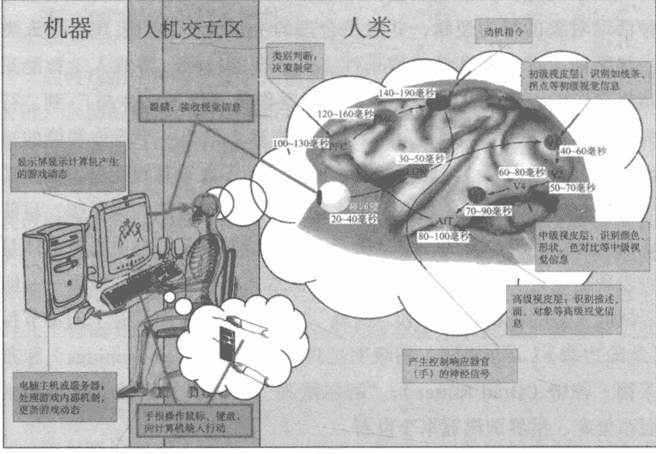

图 5-1 人类的游戏机理

### （2）机器如何玩游戏
游戏 AI 旨在创造熟练操作的智能体，要让机器玩好游戏，就需了解其运行机理。

计算机游戏机理如图 5-2 所示：首先通过读取视频流、游戏记录等方式获得环境原始数据，经去重、去噪、修正等预处理提取低级语义信息；再经降维、特征表示形成高级语义信息；随后用传统机器学习进行模式识别以理解数据含义；最后结合先前经验，即数据挖掘、人工提取或自学习产生的领域知识库进行决策，生成行动方案并执行以改变环境，进入新一轮迭代。每次迭代中，智能体还能积累新经验，逐步进化。

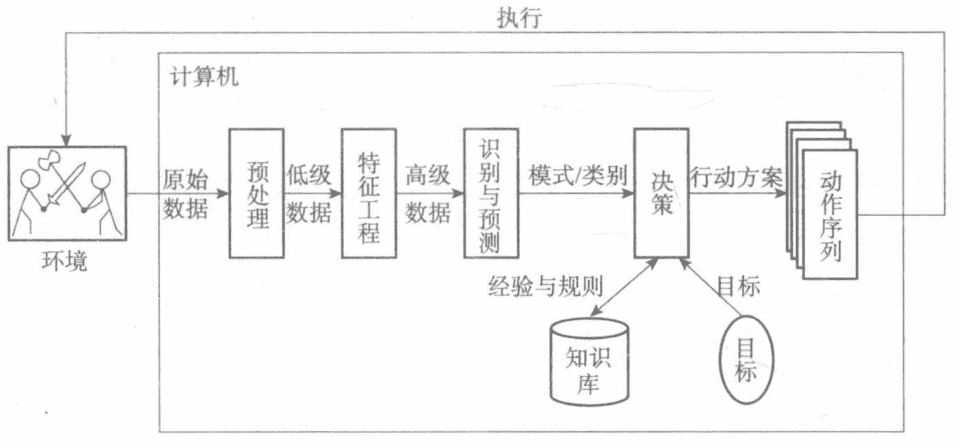

图 5-2 计算机的游戏机理

### （3）通用玩家模型
综合人类与计算机的游戏机理，可归纳出玩家的一般性机理，如图 5-3 所示：将游戏玩家视为态势感知过程，接收原始数据作为输入，输出动作序列。内部先态势觉察生成低级语义，再态势理解形成高级认知，随后态势预测估计未来态势并据此做威胁评估，再依据既有经验与规则，在目标与动机驱动下生成行动方案，引导游戏向更有利的方向发展，最后进入下一个循环。

该机理也可看作从“状态”到“动作”的映射，游戏环境状态、玩家目标为自变量，玩家操作为因变量，映射关系是核心。它可借助神经网络进行特征提取与表征，也可直接用自变量通过公式计算得到输出并映射到动作。

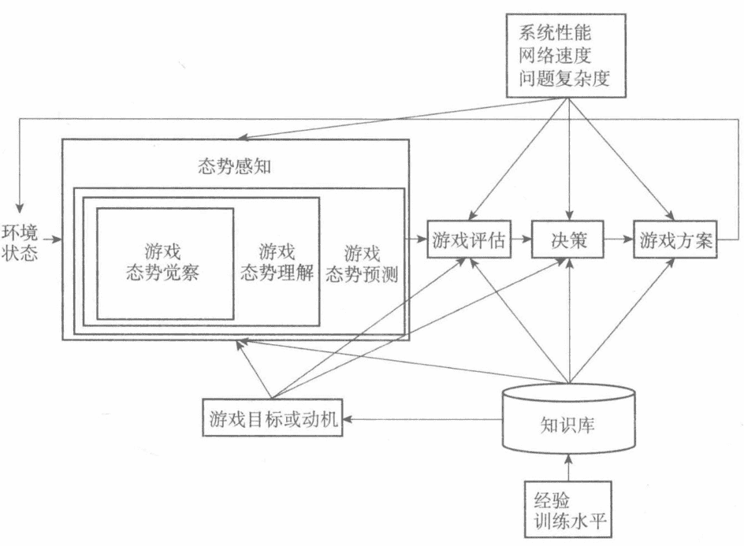

图 5-3 游戏的一般性机理（据 Endsley）

### 3. 关键里程碑
自香农提出计算机象棋博弈方案以来，游戏 AI 已走过 70 余年，无数科学家贡献了成果。下面列出主要里程碑以把握研究现状。

### 表 5-1 游戏人工智能里程碑表

| 年份 | 名称 | 作者 | 描述及意义 |
|------|------|------|------------|
| 1950 | 计算机象棋博弈编写程序的方案 | 克劳德·艾尔伍德·香农 | 开创机器博弈先河，为计算机对弈奠基 |
| 1951 | Turochamp | 艾伦·麦席森·图灵 | 首个可运行的对弈程序，引入博弈树结构 |
| 1956 | 西洋跳棋 | 阿瑟·塞缪尔 | 首个具备自学习能力的游戏，采用强化学习算法，仅靠自我对战即可胜过康涅狄格州冠军 |
| 20 世纪 60 年代 | 国际象棋弈棋程序 | 约翰·麦卡锡 | 首度引入 Alpha-beta 剪枝博弈树算法，在相同资源下使搜索深度翻倍 |
| 1980 | 吃豆人（Pac-man） | 南梦宫公司 | 首次使用规则序列、动作序列与随机决策技术 |
| 1990 | 围棋弈棋程序 | 艾布拉姆斯 | 首次把蒙特卡罗方法用于计算机博弈的盘面评估 |
| 1996 | Battlecruiser 3000AD | 3000AD 公司 | 首次在商业游戏中引入神经网络 |
| 1996 | Creature | NTFusion 公司 | 首次引入 DNA 概念与遗传算法 |
| 1997 | “深蓝”（Deep Blue） | 国际商业机器公司 | 首个达到人类国际大师水平的象棋程序，采用剪枝博弈树技术，以 3.5 : 2.5 战胜世界棋王卡斯帕罗夫 |
| 2011 | “沃森”（Watson） | 国际商业机器公司 | 首次在智能问答中战胜人类，使用 Deep QA 技术击败《危险边缘》明星肯·詹宁斯和布莱德·拉蒂 |
| 2013 | 玩 “Atari 2600” 的程序 | DeepMind 团队 | 首个无需先验知识、可自学习且具迁移性的游戏引擎，使用 CNN+Q-learning 的 DRN 技术，输入原始视频与游戏反馈，从零基础成为 7 款 Atari 游戏专家 |
| 2016 | “阿尔法狗”（AlphaGo） | Google DeepMind 团队 | 首个在 19×19 全棋盘无让子情况下战胜人类职业棋手的围棋程序，采用 SL+RL+MCTS 方法，击败欧洲冠军樊麾 |

### 4. 常见实现手段

### （1）有限状态机
构建类人智能生命体时，核心是让它对所见做出响应。有限状态机正是将复杂行为拆分为“块”或状态进行处理，机制如图 5-4 所示：接收游戏态势与玩家输入，提取低阶语义并依据各状态先决条件映射到响应状态，随后按产生式规则生成动作方案，最后执行响应动作序列并回传游戏，进入下一循环。与图 5-2 比较可知，有限状态机是计算机游戏机理的简易实现：按规则手动将原始数据映射为“状态”完成特征工程与识别，再用产生式系统将“状态”映射到动作完成决策制定，而对态势理解、评估与游戏动机则不透明。

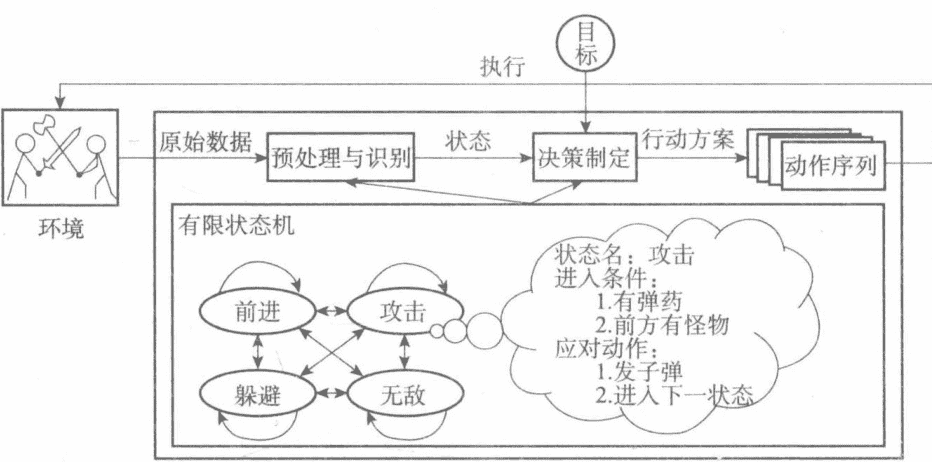

图 5-4 有限状态机的游戏机理

有限状态机是有限状态与转移及动作行为的特殊有向图，可通俗理解为一种可在给定输入下从一个状态变换到另一个状态或产生输出的装置，同一时刻仅处于一种状态。通过不同状态及其转换，可实现看似智能的游戏引擎，提升娱乐性与挑战性。但其状态划分与动作制定完全依赖人类先验知识，决定智能上限；状态增多时时间空间复杂度指数增长，仅适用于状态较少的游戏；且难以处理状态碰撞。

### （2）搜索
“人无远虑，必有近忧”，若能预见未来并评估，只需挑选最佳路径即可决策。搜索在棋类游戏中备受青睐，其中最突出的是搜索树与蒙特卡罗搜索树。相较于一般机理，搜索更侧重预测与评估，决策只是从预测结果中挑选最优方式（图 5-5）。

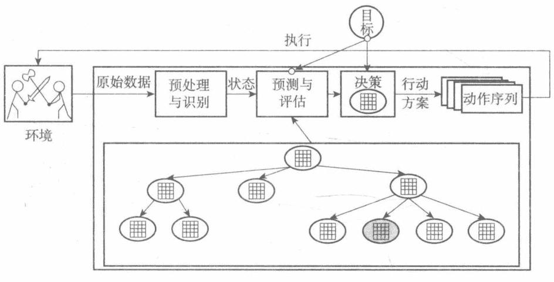

搜索直观易懂，穷尽搜索必能找到全局最优，且普适性强。但前提是准确的态势评估与足够搜索深度，而态势评估多由专家制定，即使用机器学习学得的评估函数也难客观衡量当前态势；搜索的时空复杂度随深度指数增长。

### （3）有监督学习
分类与拟合是有监督学习方法，也是实现游戏 AI 的重要手段，旨在从有标签数据中挖掘类别特性。人类正是通过不断学习才成为游戏高手，棋类更是需学习前人经验与专门训练。人类积累了开局库、残局库、战术等指导。与一般机理相比，有监督学习更关注预处理、态势理解与预测：先对数据去重、去噪、填充缺失值，再分析并提取特征，利用机器学习算法从数据中挖掘信息形成知识，实现对当前态势的描述或态势到决策的映射（图 5-6）。Google DeepMind 的“阿尔法狗”即使用有监督学习训练策略网络指导决策，其 SL 策略网络基于 KGS GO 服务器上 3000 万棋局记录，用随机梯度上升法训练的 13 层神经网络，在测试集上准确率达 57.0%，为落子策略提供支撑。

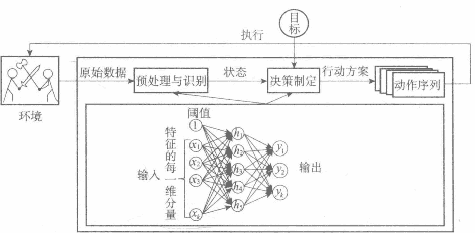

图 5-6 有监督学习机理

在无人工干预下，有监督学习能自主从数据中成长为高手，且同一模型经少量调整即可适配不同游戏。但数据质量与数量直接决定性能，且模型易出现欠拟合、过拟合，部分算法易陷入局部最优，参数选择也直接影响智能水平。

### （4）遗传算法
遗传算法模拟达尔文物竞天择原理，不断筛选最优个体、淘汰不良个体，使系统自我改进。游戏智能体借助遗传算法迭代进化，可在无人类知识参与下从不擅长走向精通。

系统中每个个体即一个游戏智能体，可映射为串联的遗传信息，代表待优化特征。如图 5-7 所示，与一般机理对照，遗传算法更侧重决策指定，目标是通过一定数量的智能体自我进化出高超水平者，实现态势到应对方案的正确映射。算法维持一定规模种群，每轮计算适应度后选出存活个体、淘汰落后者，随后幸存者“繁殖”填补空缺，并在复制时引入微小变异模拟基因突变。选择-繁殖-突变反复进行即可实现进化。

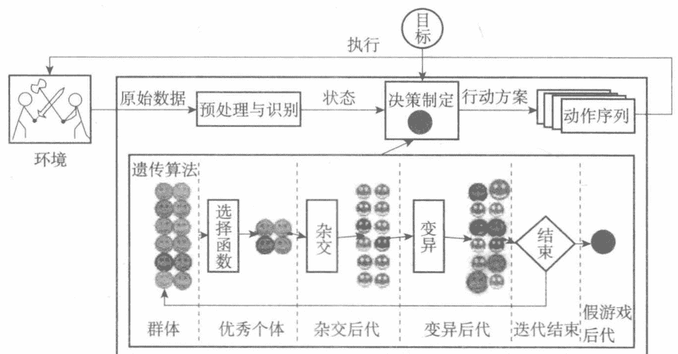

图 5-7 遗传算法的游戏机理

遗传算法与问题领域无关，可无人为参与实现游戏智能，且可扩展性强，可与其他技术组合。但通常只能获得满意解而非最优解，参数与适应度函数的确定需反复尝试，收敛速度慢，训练耗时较长。

### （5）强化学习
无知的智能体通过不断与环境交互改进自身、趋利避害，这就是强化学习。如图 5-8 所示，相较一般机理，强化学习更关注决策制定，内部维护策略函数，对游戏态势做出决策获取反馈并不断改进策略，使针对环境态势与自身决策的回报最大化，迭代后获得态势到决策的最优映射。

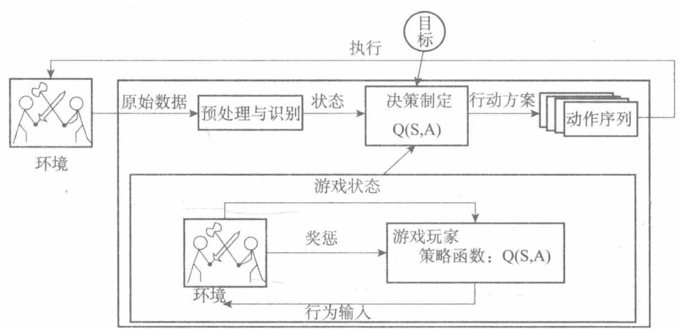

图 5-8 强化学习的游戏机理

强化学习具备坚实的数学基础与成熟算法，在机器人寻址、游戏智能、分析预测等领域广泛应用，且为与问题领域无关的自学习方法，可无人工参与实现游戏智能。但面对连续、高维的马尔可夫决策问题会遭遇维数灾难，学习效率不高，理论收敛性也难以保证。

### （6）DRN
DRN 是 Google DeepMind 在《Playing Atari with Deep Reinforcement Learning》中提出的融合深度学习与强化学习的神经网络方案，无需人类知识，同一算法即可在多款游戏中从新手变专家。与一般机理相比，DRN 将处理流程集成于单一神经网络，自主实现逐层抽象并生成决策。先用预处理把 128 色 210×160 图像转为灰度 110×84，再选取重要的 84×84 图像作为输入；随后 CNN 自动提取特征并表示，作为 BP 神经网络输入进行有监督学习，自动掌握游戏策略。

DRN 在 Atari 游戏上的应用验证了其有效性：击败人类顶级玩家。但底层依赖 CNN 做特征提取，使其更适用于以二维数据为输入的游戏。

### （7）深度学习、强化学习与博弈树共振

Google DeepMind 的 AlphaGo 把三大引擎绑在了一起：值网络负责对棋局整体好坏打分，策略网络负责在盘面上挑落子点，蒙特卡洛树搜索则负责向前推演、模拟后续走向。策略网络是先用有监督学习模仿高手，再用强化学习自我对弈迭代；值网络则完全靠强化学习自训。两套网络一起把人类棋理提炼出来，再让自己形成对局势的认知，随后交由蒙特卡洛树把这些已学会的知识落到具体对局中预测与评估，从而决定下一步怎么走。

## 5. 即时游戏里的信息融合与既视感

### （1）即时游戏中的信息融合
信息融合的前身是数据融合，最早可追溯到1973年美国国防部资助的声呐信号处理项目，概念在七十年代便已出现。九十年代信息技术普及后，概念被泛化，军事领域对其应用热情持续高涨。广义上说就是把多种来源的信息合成新信息，合成结果直接决定决策质量，前提是信息本身要准确。

在即时游戏语境下，学界给出了新的解释：玩家在接收血量、坐标、时间、技能冷却等多种游戏数据时，把它们整合起来并据此做判断。玩家对反复出现的场景、突发情况、技能图标等形成记忆或条件反射后，一旦再次涌入类似繁杂的信息流，就会产生似曾相识的主观体验。因为记忆深浅、注意力高低不同，融合过程会出现认知差异与反应差异，最终影响决策与任务完成度。这种在游戏中出现的似曾相识常被称为游戏既视感。

### （2）神秘的既视现象“似曾相识感”
既视感就是对从未真正经历过的事物产生一种强烈的主观熟悉感。有人去一家从未光顾的餐厅，进门瞬间会恍惚，觉得碗筷摆放、灯光色调、陌生人的举止都仿佛见过，甚至能猜到朋友下一句话。这种感觉来得不受控制，伴随强烈的真实感，令人既惊奇又困惑，常被形容为第六感，甚至被牵连到梦境或先知。调查显示约三分之二的成年人有过类似经历，不少人形容自己当时分不清现实与梦境，整个人处在恍惚状态。

目前尚无可靠的实验室触发手段，既视感难以在观察时被复现，成为研究难题。脑神经学派认为大脑潜意识会虚构情境，现实遇到相似场景时与虚构记忆共振产生幻象；医学界倾向记忆错误解释，认为记忆缓存写入时出错，疲劳时更容易发生。物理学派的说法则更富想象：神经信号传导快于光速导致四维空间短暂混乱；灵魂是高能粒子可穿越时空；平行时空偶发交叉让人短暂“进入未来”。南卫理公会大学的阿兰·布朗曾指出，这个领域被太多无法证实的理论污染，成为科学家不愿触碰的难题。

### （3）即时游戏中的既视现象
通过对北京邮电大学即时游戏玩家的访谈，可以把现实既视与游戏既视做对比，证明游戏场景的研究可行性。

玩家常有这样的体验：去过一个场景后，再进入相似地图会觉得“来过”，甚至按旧记忆走向某个区域；玩过某款游戏后换到另一款，遇到敌人来袭会下意识按之前游戏的关键键位，典型玩家都能共鸣。

两者共通点是都对未曾经历的事物产生莫名的熟悉感。区别在于，现实既视出现频率低、常被视作错觉，且记忆源头难以追溯，难以在实验室复现；而游戏既视源于游戏经历，游戏机制在不同作品间高度同质化，相似感更强、出现更频繁。游戏记忆相对干净，玩家往往能回忆起熟悉感来自哪一次操作，甚至能据此推导解决办法，因此游戏既视并不神秘，也为实验触发提供了可能。

### （4）工业设计中的既视现象的运用
日本设计师深泽直人善于把既视感导入新产品，唤起用户熟悉感。他提炼人与物之间本就存在的关联，把共同的记忆投射到新设计中，形成“无意识设计”。

最典型的例子是他的 CD 播放器。那根悬空的拉线一出现，注意力立刻被吸引，不需要说明本能就会去拉，音乐随之响起，在下意识动作里得到惊喜。熟悉的拉线动作被无缝植入，让新产品获得似曾相识的亲切感。

即时游戏的信息输入输出极快，玩家意识活动强烈。巧妙利用既视感或能收到奇效。关键问题是既视感与哪些因素关联最紧密，设计时如何拿捏这些因素让效果可控。

### （5）对即时游戏中既视感的猜想
从拉线的例子出发，既视感会引导无意识行为，但产生既视感是否需要意识参与？如果把拉线换成快门或开关，注意力被分散后第一选择是否还是拉线？

有理由提出假设：注意是意识活动的基础。既视感虽常导向无意识反应，但触发它可能首先需要注意。实时游戏里信息融合明显，玩家要在繁杂输入中分配注意力。因此首个研究方向是注意力强弱对既视感的影响。若集中注意时更易出现既视，则集中与分散条件应有显著差异；若既视是轻度注意即可触发的潜在记忆，则两种条件结果相近。

第二个方向是记忆程度的相关性。既视感是否随对场景的记忆加深而增强？在注意力集中时记忆深度可能影响不大，但在注意力分散时，记忆深度是否会成为决定性因素？这一问题可先在预实验中探路，再在正式实验中深化。

## 6. 游戏人工智能的复杂性
在图形与交互之后，人工智能成为游戏发展的瓶颈。追求的不再只是画面逼真，而是更有人性、更智能的伙伴或对手。

游戏 AI 的实现离不开坚实的数学。浅层机器学习的 SVM 核心是寻找最大间隔的分类超平面，涉及高维映射与 KKT 优化；深度神经网络是在海量数据上拟合复杂函数，涉及卷积、蒙特卡洛、最优化；强化学习本质是马尔可夫决策过程，通过迭代更新策略函数实现自主决策；决策树则依赖信息增益率、基尼系数等信息论指标。数学渗透每一个环节，也制约着突破节奏。

计算量同样关键。AlphaGo 最后一个版本使用 40 条搜索线程、48 个 CPU 与 8 个 GPU；分布式版本则动用 1202 个 CPU 与 176 个 GPU。Google Brain 用千台电脑训练出十亿连接的神经网络学会识别猫。海量计算推动 Hadoop、Spark 等并行框架在 AI 中普及。

## 7. 游戏人工智能的社会影响
我国游戏产业伴随硬件与软件提升快速发展，AI 应用日益广泛。社会发展对游戏 AI 的塑造主要体现为四个面向。

### （1）强游戏的人性化
老龄化加深、空巢老人增多，独生子女家庭父母忙碌，缺少玩伴。人性化智能可提供陪伴与娱乐，甚至寓教于乐。对战时玩家不希望面对冷冰冰的机器，而希望对手有情绪、有张力，且水平与自己相近，既不因无法取胜而沮丧，也不因轻易获胜而无聊。设计时需兼顾水平调节与人性化表现。

### （2）挑战智能极限
电子竞技已从边缘走向庞大产业。香农提出象棋程序以来，追求更强智能从未停止，AlphaGo 战胜李世石被视作人类最后堡垒的突破。此类研究更关注绝对战力而非类人化，呈现出“书呆子”式的强力。

### （3）不完全信息决策
棋类多为有限状态、规则明确的完全信息博弈，而军事等现实问题是高维、动态、不确定的无规则不完全信息决策。DeepMind 在战胜李世石后转向星际争霸，正是探索状态更复杂、规则更弱、信息不全的博弈，也有研究尝试把 AlphaGo 技术迁移到兵棋推演与空战决策。

### （4）自主学习
与深蓝、沃森不同，DeepMind 的价值在于自主学习与迁移能力。人们期望一个无需人工干预，就能在不同游戏中自学成高手的框架。DeepMind 的 DRN 技术无需调参，仅靠自主学习就精通 7 种 Atari 2600 游戏，部分项目超越人类水平。

## 8. 小结
游戏 AI 与模糊人机边界不同，更强调对智力极限的冲击，标志是战胜人类顶尖玩家；与培养领域专家不同，它更重视培育自学习智能体，标志是零经验自主学习。最前沿的游戏引擎都融合深度学习与强化学习，以此孕育高智商自学个体。

2016 年 AlphaGo 3:1 战胜李世石，是否意味着突破人类智能极限？笔者认为未必。记忆与速算不是智能本质，搜索与前瞻也不能代表人类智能，人类还有情感、思想、快速迁移学习等能力。AlphaGo 的胜利只是单一领域的超越。游戏 AI 不适合用图灵测试衡量，人脑在游戏上的表现本就不突出。更合理的关注点是同一引擎自战，始终由同一方获胜并击败人类最强者，换言之是对游戏最优决策值的探索。

本章梳理了人机交互与人工智能的瓶颈与演进。第一阶段是传统 AI，规则明确、数学形式化，涉及自动化与结构化数据处理；第二阶段是人-机-环境交互，形成自动化处理与弱 AI 新规则；第三阶段是智慧化强 AI 信息系统，规则尚未建立，需要人类智慧与通用 AI 多学科交叉。

## 第六章 人工智能：寓教有方
智能是知识累积的结果，还是搜索与学习的产物，或是知识、搜索与学习三者的结合？智能是否更多体现在可能性而非现实性上？

### 一、人机交互，灵活助教
人工智能浪潮下，教育领域出现大量融合应用，涵盖智能分析、智慧校园、智能导师、智能测评、教育机器人等。知识表示、自然语言处理、智能代理、情感计算、机器学习与深度学习均可落地。智能教育的核心是对学习者状态、教学资源与学习效果进行持续监控，实现教学计划与资源分配的自动调节，本质是自适应学习与个性化调控。

传统教学一视同仁，忽视个体差异；自适应学习则因材施教，提升效果。这一理念自孔子私塾、剑桥导师制以来就被推崇，现代技术让它成为现实。互联网、算法进步与在线教育数据的积累使自适应系统从想象走向落地，科大讯飞的高考机器人、Knewton 的适应性学习平台都是明证。

自适应学习与知识分类全景

上世纪五十年代程序化教学出现后，教育与计算开始深度绑定。经历了计算机辅助教学、生成式辅助教学以及智能教学系统的探索，思路才逐渐收敛到自适应方向，最终形成个性化智能学习的形态。这一思路的理论起点可追溯到1973年哈特利团队提出的智能教学系统基本架构，提出后便得到全球关注并引发大量研究。美国学者彼得森的研究成果最为丰厚，率先给出自适应学习系统通用原型，学界称之为AEHS模型。之后AHAM、LAOS、XAHM、WebML等参考框架相继登场，相关理论在持续迭代完善。

产品层面也在同步推进。ALEKS、Knewton、CogBooks等智能平台在市场上表现较为突出，国内同样涌现出众多个性化学习网站。随着积累加深，教学要素的样貌发生了明显迁移：教学资源从最初被教学策略捆绑的文本，解绑为可独立调用的超文本，再演进为富媒体，灵活性和多样性显著提升；教学策略从写入程序的固定路线，变为依据学习者即时反馈动态挑选，再发展到个性化推荐；教学方式从学习者机械自学，转向教师科学引领，再进化为学习者主动建构；学习者画像从统一对待，发展为刺激-反应式的动态评估，再扩展为融合基础属性、学习偏好、知识状态等多维刻画。

1994年哈莱茨与施瓦茨提出德克斯特超文本参考模型之后，无论物理实现划分为几层，通用参考架构通常涵盖学习者画像、领域知识模型、知识推荐模型与测评模块模型。

学习者画像是系统的核心单元，保存学习者的基本属性、掌握水平、学习轨迹和学习风格。年龄性别等基础信息在注册时采集并保持稳定；掌握水平由测评模块实时刷新；学习轨迹贯穿整个自适应周期，形成完整过程记录，也是数据挖掘的重要基础；学习风格反映个体在学习中的偏好差异，是个性化导航与呈现方式的关键依据，对虚拟维修等场景的自适应效果影响显著，采集手段较为多样。

领域知识模型描绘学习者需要掌握的知识全集，是另一核心单元。表达形式多样，包含知识图谱、本体论、知识空间、概念图等。构建方式按人工参与度可分为专家主导、自动化、半自动化。专家主导依赖人工搭建，工作繁琐且迁移性差；自动化借助统计、自然语言处理、机器学习等技术挖掘，准确率相对偏低但迁移性好；半自动化是人工与自动的结合。自动化构建时需先以关键词提取发现领域术语，再以关系提取发现术语间关联，最终完成如虚拟维修机械领域的知识模型构建。

知识推荐实质上是教学资源到学习者的映射函数，决定系统智能水平，涵盖内容导航与自适应呈现。内容导航依据学习者画像生成个性化学习路径，实现知识到个体的映射，帮助学习者建构自身知识结构。自适应呈现则按学习风格推送合适的资源与形式，例如有人偏好课件观看，有人偏好桌面式演示，有人偏好沉浸式演示，有人偏好概念学习，有人偏好动手操作。优秀的推荐模型能让学习者以最契合的方式获得最需要的知识，提升效率。

测评模块是判断掌握水平的重要手段，先进的自适应测评仅需少量题目即可精准定位盲点与薄弱环节。高效测评节省时间、提高效率，避免了传统虚拟维修中对所有学习者一刀切的弊端。

更智能的教育方式能帮助学习者找到最舒适自然的学习路径，不仅提升效率，也增强学习兴趣，促进主动学习。虽然已有大量研究成果，但系统完善仍需在真实教学环境中反复试用与反馈。未来需持续改进自适应学习技术，推出更具针对性的学习系统，让教育走向更高程度的智能化与个性化，使学生以更舒适高效的方式接受学习。

### 二、人类知识探秘
人不仅拥有关于事实的陈述性知识和关于如何行动的程序性知识，还包含大量默会知识，而这些知识的表征、加工与运用才是真正智能的根源，离不开社会化与交互作用，比如体现价值的意向性知识即是人工智能难以企及的边界。

现实中目标帮助我们集中注意并明确任务，人工智能研究中目标同样指明机器学习的期望结果。机器学习的本质是对训练后行为改变方式的明确表达。具备根据已知信息做最优决策能力的系统即为理性的思考者。归纳能力则是从大量实例中提炼一般规律的能力。如何让机器像人一样习得不同类型的知识？可从心理学家布鲁姆对学习、教学、评价的分类入手。

学习目标由认知过程与知识维度共同界定，指导教学与评价。目标表述由动词与名词组成：动词描述预期的认知过程，名词描述期望习得的知识。认知过程维度包括记忆、理解、运用、分析、评价、创造六个层级，形成认知复杂性的连续体，理解比记忆更复杂，运用比理解更复杂，以此类推。

教育研究中最经典的问题之一是：什么值得学习？抽象而言，答案界定了受教育者的标准；具体而言，答案界定了学科的意义。但标准本身不足以提供可靠答案，清单式的标准往往更令人困惑。教师仍需回答这一问题，通常依靠课堂时间分配与重点提示。分类表能让教师更清晰地看到目标的排列与关联。

借助分类表审视课程，可获得更完整的认识。条目密集的行列格子一目了然，空白的行列格子同样明显，空白提示了尚未考虑的目标维度。

### 表 6-1 目标在知识表中的分类

| 目标 | 描述 | 示例 |

|---|---|---|

| 总体目标 | （1）功能在于为政策制定者、课程开发人员、教师和人民大众提供长远观点和奋斗口号

（2）是当前达不到的某种东西：是为之努力的某种东西，或要成为的某种东西。它是一种宗旨或意图，被陈述的目的在于激发想象和给人们提供他们要努力追求的某种东西 | （1）所有学生都将开始学校学习的准备

（2）所有学生在显示胜任挑战性教材的能力后能升学

（3）所有学生将学会使用他们的心智，以便他们将来成为有责任心的公民、进一步学习和为国民经济中的生产性工作做好准备

（美国教育部 2000 年的目标） |

| 教育目标 | （1）同总体目标相比，教育目标较为具体

（2）给教师在计划课堂活动和评价学生时运用 | （1）阅读乐谱的能力

（2）解释各种社会数据的能力

（3）区分事实与假设的技能

（使用行为和内容进行描述） |

| 教学目标 | （1）教学目标比教育目标有更大的具体性

（2）使教学和测验集中在相当具体领域 | （1）学生能区分常用的四种标点

（2）学生学会两个一位数的加法

（3）学生能够列举美国内战的三个原因 |

总体看，目标分类并不能直接告诉教师教什么，却能把标准转化为共同语言，便于与个人理想对比，并以多样可能性为课程建议提供视角。

按知识维度划分，知识可分为事实性、概念性、程序性与反省认知性四类。

### 1. 事实性知识
事实性知识是专家在交流、理解与系统化时使用的思维基本要素，迁移到不同情境时几乎无需改变。它是学科的基础单元，通常以与具体事物相连的符号或符号串呈现，多呈抽象形式，包含术语知识与具体细节要素知识。

术语知识由学科特有的言语与非言语符号构成，是学科的基础语言，如字母表、科学术语、发音标记等。

具体细节要素知识涉及事件、地点、人物、时间、信息源等，可精确到具体日期或数量，也可泛指时期或顺序。与情境依赖的事实相比，具体事实更具独立分散性。

### 2. 概念性知识
概念性知识关乎分类、类目及其间的关联，是更复杂且有组织的知识形态，体现为图式、心理模型或理论。

分类与类目知识包括用于不同主题的类别、部分与排序，帮助发现与处理新成分。不同于术语与事实，它在多个成分间建立联系，如句子成分、心理问题类型、文学体裁等。

原理与概括知识在学术学科中起支配作用，用于解释现象与解决问题，把大量具体事实组合起来，描述过程与关系，如物理定律、算术交换律、文化概括等。

理论、模型与结构知识把原理与概括整合为相互关联的体系，对复杂现象给出清晰完整的解释，如国会结构、板块构造论、基因模型、化学理论间关系等。

### 3. 程序性知识
程序性知识回答“怎么做”，涵盖技能、算法、技术、方法及其使用标准。包括具体学科的技能与算法知识、技术与方法知识、以及何时选用恰当程序的标准知识。

技能与算法可表述为操作步骤，如水彩绘画技巧、解方程算法等。技术与方法知识不一定导向唯一答案，如社会科学研究方法、科学问题求解技术、文学批评方法等。选用标准关乎在何种情境下采用何种程序，如选择代数解法、选择说明文或议论文等文体。

### 4. 反省认知知识
反省认知知识指关于自身认知的觉察与知识，包含策略性知识、情境条件性知识与自我知识。策略性知识涉及学习与问题解决的通用策略，如记忆术、释义、摘要等精加工策略。个体还会积累何时如何恰当使用这些策略的知识，如电话号码靠复述、深入理解靠精加工。自我知识涉及学习相关的优劣势、对认知工具的偏好、任务目标与兴趣等。

所有分类学都是对现实的抽象简化，以揭示内在秩序。此框架亦不例外。正如美味需品尝，分类总结有助于机器学习研究者深入探究知识的构成与习得规律。

### 三、机器知识解析
理查德·萨顿反对传统的人工植入知识路线，如显式知识表示或手工启发式函数。他总结的历史教训有三：一是研究者常试图把知识硬编码进智能体；二是短期看似有效且令人满意，长期则停滞甚至阻碍进展；三是通过搜索与学习的计算扩展，配合规模化，终能实现突破。

### 1. 元知识的概念
学界对元知识尚无严格统一定义，通俗讲即“关于知识的知识”，用于描述知识类或集合的内容、结构、特征。缺少元知识，人便无法描述、使用、认识知识。在自动控制与人工智能领域，元知识指用于使用与控制领域知识的知识。它并非领域知识，不能直接解决具体问题，而是关于领域知识的性质、结构、功能、规律、组成与运用的知识，是管理与控制领域知识的工具。

元知识是思维与意识的核心，缺乏元知识便难以学习与认知基础知识，对认知系统的建立至关重要。人工智能与深度学习追求模拟人脑思维，自主学习机制离不开元知识学习能力，缺少该能力难以称之为真正智能。

### 2. 知识的分类
布鲁姆开创学习目标分类学，将目标分为认知、情感、动作技能三大领域。认知领域分为知识、理解、应用、分析、综合、评价六类。随后修订从未停止，加涅的学习结果分类、安德森的产生式理论以及安德森团队主导的布鲁姆修订版最具影响力。

### 3. 加涅的学习结果分类
加涅把学习结果分为陈述性知识、智慧技能、认知策略、态度、动作技能五类。

### 表 6-2 加涅的学习结果类型

| 类型 | 定义 |

|---|---|

| 陈述性知识 | 要求学习者逐字逐句地记忆、解释或者从事实、名单、姓名中总结或组织信息。陈述性知识有时被描述成是“知道什么” |

| 智慧技能 | 智慧技能的结果是学习和培训情境中的主要学习目标。智慧技能最重要的是将规则应用于之前没有遇到的例子中，也称为程序性知识，描述为“怎么做” |

| 认知策略 | 学生用认知策略来管理自身的学习，有时称为学习策略或者“学习如何学习”。认知策略支持其他领域的学习 |

| 态度 | 态度是一种使学习者倾向于选择某种行为方式的心理状态。加涅将态度描述为认知、情感和行为相互作用的结果 |

| 动作技能 | 以流畅和精确定时为特征的肌肉运动调节就是动作技能 |

陈述性知识可用言语表达，回答“是什么”。智慧技能指向按一定方式做事的能力，即“怎么做”，如运用规则解决确定性问题。认知策略是调控自身学习、记忆与思维的高层智慧技能。

### 4. 修订的布鲁姆教育目标认知分类
安德森为首的专家小组于2001年发布修订版。本文据此分析各类知识的认知过程，寻找虚拟维修训练中元知识的认知规律。

修订版最大的变化是将目标拆分为认知过程维度与知识维度。认知过程仍为六类，第一类由知识改为记忆，保留理解、运用、分析、评价，并新增创造。原版的知识维度被独立出来，分为事实性、概念性、程序性、元认知性。认知过程作横轴、知识维度作纵轴，形成二维分类模型，不同知识维度对应不同认知过程，从而产生不同的学习目标与策略。

综合前述分类，这里以目前权威的修订布鲁姆认知分类作为元知识分类框架。

### （1）事实性知识
事实性知识是学习专业时必须掌握的基本要素，包括时空人物事件，对应装备虚拟维修如技术性能与参数。它可作为独立点状信息存在，自带价值。

认知过程上，呈现阶段可见其离散性，学习交互以被动接收为主，认知以记忆为主。特点为：以陈述性为主；高级分析加工少，认知负荷集中在信息量；过程离散；以被动视听为主。

可分为术语知识与具体细节要素知识。术语知识由言语与非言语符号构成，是学科交流的基础，便于快速记忆与深入学习。具体细节要素知识指时地人事件等，可能精确到开关按钮操作时刻，也可能为时期或顺序概括，相较情境依赖事实更具独立性。

### （2）概念性知识
概念性知识指整体结构中要素间的关联，体现专业如何形成、要素如何相互作用组成完整系统。它把概括以意义方式整合，用以揭示问题现象的内在联系。认知过程由记忆向理解过渡。特点为以抽象陈述性为主，需理解加工，记忆与理解相互作用。亚类包括类别与分类知识、原理与概括知识、理论模式与结构知识。

知识如何被搭建、被使用

在学习体系里，类别与分类的能力关乎类目设立、类群划分、要素拆分与有序排列。材料随着发展，学习者会逐渐意识到搭建类目与组群来把现象结构化、系统化是很有用的。对照专有名词与具体事实，这类认知更为概括、更为抽象。类别与分类的掌握是学科建立的重要基石。把信息归入合适类别、把经验落入适当类目，是学习是否有效的典型标志。近年的概念转变研究也指出，信息被放进错误类目，会直接制约后续的学习进程。

原理与概括的认知建立在分类与类目之上。它以抽象的方式把所见现象提炼出来，形成可用的知识储备。这类抽象对描述现象、解释成因、推演走向并据此行动都具有关键价值。简单说，它是从海量事实与事件中提炼核心，再剖析核心间的内在关联与互动，以及这些关联如何构成整体图景。

理论、模式与结构的认知则把原理与概括进一步串联起来。它关注如何把若干原理、概括以特定方式联结，形成系统的理论、模式或结构。

不同学科拥有不同的研究范式与认识论，学习者需要了解教材在概念层面如何被加工与组织，以及该领域内部的研究取向。

### （3）程序性知识

程序性知识本质上是“怎么做”的知识，涵盖如何思考、如何解决问题的能力。在面对难题时，不仅要知道解法，更要清楚在何种情境下用何种方式解决何种问题。

它不仅包括由记忆到理解的常规认知流程，还涵盖理解之后的应用与分析。

程序性知识呈现出几个典型特征：①内容整合度高，需要高阶分析才能把握；②强情境依赖，任务核心在于精准判断当下情境并做出合理决策；③过程具有交互性，需要主动投入并反复迭代；④过程是连贯整体，对实时性要求很高。

从结构上看，程序性知识可细分为三类：具体学科技能与算法的知识、具体学科技巧与方法论的知识、以及何时选用恰当程序的判断知识。

整体而言，程序性知识可表达为步骤序列。有的步骤顺序固定，有的需要中途决策以决定先后；有的结果单一确定，有的答案则开放多元。

与通常导向固定结果的具体技能和算法不同，部分程序并不产生预设的唯一答案。例如遵循科学方法设计研究，实验的结论会因情境变量而差异很大，这类程序的结果具有开放性与不确定性。

具体学科技能与算法的知识更多体现为学界共识或学科规范，而非直接源于观察或发现。关于何时运用适当程序的判断知识，则要求学习者不仅知其然，还知其所以然并知其何时用，这类知识带有历史性与百科式特征。

该子类更强调情境感知能力：先对当前状态作出判断，再把判断结果与已知的程序性知识进行匹配，最后选择在何时何地何种复杂条件下使用何种程序，并以此评定使用定律解决问题能力的水平。

### （4）元认知知识

元认知知识指对认知本身的认知，也指个体是否足够了解自己并能作出正确评判，包括洞察认知活动的长处与短板，以及采用何种通用策略去获取所需信息。

元认知的发展是递进的，依托于事实性知识、概念性知识、程序性知识。由事实记忆起步，到概念理解，再到程序应用与分析，在此基础上元认知增加评价与创造的环节。

其主要特点为：①难度更高、要求更严；②可以在设计阶段发挥作用，以优化学习训练效果。

元认知知识可分为三个亚类：策略知识、关于认知任务的知识、自我知识。

策略知识关乎学习、思考与解决问题的通用策略，可跨任务、跨教材使用，而非仅服务于单一学科的一类问题，例如求解二次方程与欧姆定律都可借用。

除策略之外，个体还积累了对认知任务本身的认识。弗拉维尔指出，任务难度各异，需要匹配相应策略。回忆任务要求主动搜寻并提取信息，再认任务则只需在选项中挑选正确答案。

弗拉维尔还强调自我知识的重要性。专家的标志之一是对自身无知的清醒认识，从而能主动寻找合适信息。对自我知识深度与广度的觉察，避免自我评价的夸大与虚假，使人清楚自己知道什么、不知道什么。

## 第七章 人工智能：以智制胜

克劳塞维茨在《战争论》中提出，战争是强迫对手服从己方意志的暴力行为，追求最大程度摧毁敌人、保存自身。从冷兵器到信息化战争，人类本身未变，战争形态却天翻地覆，根本驱动是军事装备技术的演进，这正是实现“最大化打击”的关键。智能化已在多领域引发深远影响，军事领域必然在列。

当前人工智能虽仍有很大提升空间，但在各行业已广泛落地，军事是重要应用场域。国家维稳中国防建设始终排在首位，每项可用新技术都会被用于提升战力。人工智能必然优先进入军事。同时，军事智能的计算越精准，风险越高，因为对手可伪装欺骗。人机有机融合因此更为关键。如何借人工智能屈人之兵，智能化把“如何打垮敌人”的问题推向新高度。

军智重人，民智重机。二者逻辑主体不同。军智的计算逻辑以人类为中心，研究对象是人的思维、自然语言等，强调“应是什么”“应做什么”，涉及手段、情感、意志与偶然性；民智的计算逻辑以计算机为处理主体，侧重“是什么”“干什么”，涉及规则、统计、概率与确定性，研究计算机处理方式及人机互动。民智擅长从0到1、1生2……军智在此之上还能从1到0、2生1……

### 一、更聪明的武器，更智能的战争

随着深度学习、强化学习等新一代技术的突破，计算机视觉、自然语言处理、生物医疗、游戏博弈等领域取得明显进展，人工智能在军事中的应用日益广泛，催生出军事智能的概念。

各军事强国均把人工智能视为未来战争的颠覆性技术，加快智能化作战装备研发。2018年，美国国防部设立联合人工智能中心，专职推动军队智能化建设并统筹智能化军事体系。智能化装备的大量运用，不仅在技术层面改变传统战争形态，也在指挥控制理论上对传统制胜机理产生不同程度的冲击。因此，加速军事智能化，既要推进装备研究，也要提升智能化条件下指挥控制理论的研究。

从古至今，军事装备或系统始终是人-机-环境复合体。未来无人机、无人车、无人艇等都不会完全无人，只是人由前置转后置，由体力操作转为智慧指挥，由具体执行转为控制决策，其中蕴含复杂的人机交互问题。单靠人工智能或人类智能都难以达最佳效能，人机智能融合是重要方向。

严格来讲，军事智能不仅涵盖自然科学与工程技术，还涉及社会科学，如人文、哲学、宗教乃至艺术，《孙子兵法》英文译名 The Art of War 即为明证。优秀的军事指挥既是技术也是艺术。军事智能是人工智能的顶峰，相比民用，其对抗性与博弈性更强。它不仅是武器智能，更是指挥控制系统智能与体系智能。人工智能以技术为主，军事智能则是技术与艺术的结合。未来最优形态并非个体性平台，而是系统性网络体系，可能横跨陆海空天网等多个人-机-环境系统，且具备自主升级能力。

人工智能底层是二进制0、1逻辑，军事智能底层则是人类的多元意向非逻辑。军智将改变作战需求与样式：从火力强度转向点穴式制约，从传统攻防转向多域协同，从自动信息技术升级到智能洞察，从OODA迭代进化到人机融合的深度态势认知，从而实现机器技术与人类艺术的有机联结。

正如民用人工智能缺乏统一定义，军事智能在应用上虽较明确，但在概念上仍无定论，未来也难以形成完全一致的共识，因人本身难以归纳，涉及人的智能行为更为多变。克劳塞维茨把战争看作不透明的智能博弈，军事智能的不确定性与模糊性甚至超出人类认知。

即便世界再复杂，仍有蛛丝马迹。第三次抵消战略自2014年9月由美军提出，已进入全面实施。美国副防长沃克提出，自主学习、机器辅助作战、有人无人编组、网络化半自主武器是五大重点技术。美军在2016至2018财年持续加大对自主系统、情报数据分析、大数据、机器人、自动化与先进传感的投入。能否研究出支撑应用的算法、提升人工智能与自主技术水平，成为决定各方向发展的关键。从公开信息看，美军在军事智能上主要聚焦两点：机器学习与自主系统。机器学习代表形式化、程序规范性，描述规则事态；自主系统代表意向性、非形式化经验性，描述可能事态。形式化推理把命题、符号化并按变形规则转化；非形式化推理则直接依赖自然语言变换。两者初期或各自推进，但最终会趋向一致：人机融合智能系统。这表明未来军事智能既非纯机器学习，也非单一自主系统，而很可能是人机优势结合的融合智能，其科学本质是回答认知与计算的关系问题。

### 二、深度态势感知，精准军事洞察

对军事智能而言，无论机器学习还是自主系统，最终都是为了更精确感知、更正确推理、更准确预测，这就指向核心概念：态势感知。

无论军用民用，人工智能的本质不是简单赋能，而是人类智慧的自我反馈，是他人在不同时空的概念知识在“我”的情境中运行，因而会出现人机融合的不适。若硬说是赋能，也只是把过去可程序化、可预测的知识赋予现在的能力。知识分两层：顶层由概念、符号、离散、命题性知识构成；底层由感觉、前概念、亚符号、连续、非命题性知识构成。底层关感性，对应态势中的“态”；顶层关理性，对应态势中的“势”。

态是暂时表象，势是本质真相。态势感知是通过多角度思考实现知己知彼，从表及里、外到内、左到右、下到上、态到势、感到知的过程。若加入逆向，由里及表、内到外、右到左、上到下、势到态、知到感，就构成深度态势感知。孙子所言的“知”即这种双向乃至多向的交互融合。

“自己”是看不见的，只有与他物碰撞反弹后才得以认识。撞上强者方知己强弱。优秀指挥员不仅能感态知态，还能感势知势。态偏形式化，势偏意向性。

深度态势感知是平台、系统、体系各层感知融合的结果。可控的指挥是势态管理，不可靠的才是态势感知。视觉上先见林后见木，先整体后个体，与先势后态一致。

态是对事物的印象，势是对印象的观念。科学发现有四类，军事态势发现亦有四类。感性孕育理性，艺术牵引创造。态势感知的理性不仅限于形式理性，还需实践理性作桥梁，把理论理性与行为实践打通。纯理论理性抽象且理想化，实践理性则可指导行动。同一态在不同时间、地点于人脑中形成的“象势”不同。如“爱”“冷”等词随年龄、环境而变化。明代王阳明为体悟“死”字曾躺进石棺。同一字因多义对应多象，导致一态多势、多态一势。

态常包含合乎常规的类型组合，势常违背常规组合，可称为常态异势。态的表面对称易掩盖势的深层不对称，类人体左右对称而内脏不对称。

态聚类可限制态网络搜索。搜索源于核心态即势，通过扩散激活扩展。若无限扩展会得到大量无关势。受聚类约束的搜索结果更具系统性与连贯性。

对态而言本质是表征问题，偏感形，即感己感彼；对势而言本质是构建联系的理解问题，偏知义，即知己知彼。态到态交互无智能出现，得形失意；态到势交互是数据流动生成信息知识、形成价值的过程，即智能产生，得意忘形。理性难创造，感性难精确。态形成势的过程即智能元素的浮现。

态势结构理论把态势刻画为基于类比匹配的结构系统，结构由不同类型态的聚类或势场构成。类比匹配存在于态势间或描述间。类比态势共享事实结构，类比描述共享概念结构，后者无需为真，只需规则排列相同。康德区分相似与类比，类比是两个不相似对象间关系的完全相似。

在军事智能尤其是态势感知处理中，形式化与意向性描述分析至关重要。形式化是理性的意向性，意向性是感性的形式化，逻辑是二者桥梁。意向的可及性是形式化的关键，也是可能性向现实性转化的前提。可及性即态与势间限定的交互映射。

从数学映射到物理漫射再到心理影射都涉及智能，是逻辑命题与经验命题融合，是人类理解感知的过程，其中理到解部分即人工智能。当前人工智能最难突破的是非家族相似性的漫射与影射，人机合作有助于解决。人的意向性形而上，机的形式化形而下，人机融合为虚实结合。差异产生动力，人易感知前提变化，机器不足。让机器感知外部前提变化并随机应变是人机融合障碍。如人类的词语概念随情境自然变化，机器则变化有限，如何统一变与不变是关键。军事智能的人机合一不是人心加机脑，而是人单人多人敌我加机装备机制加真实虚拟作战环境的体系交互统一。

军事智能本质是主客观融合，有机与无机融合，目的在于适应。研究第一步是解决表征问题，先搞清“谁”的问题，即知己知彼。对人而言，意向性与目的性使表征不确定不导致决策不确定，人本身是目的而非工具。中西思维差异也由此而来。态是先天惯性，势是后天惯性，感知即理解态势。深度态势感知即深度理解态势。如“状态注定，势可改变”，而非“态势注定不可改变”。态由天定，势由己生。

军事智能不是情境性的，而是跨情境、跨场景、跨态势的，因而超越感知的觉。深度态势感知系统并非完美，却具重要参考价值，是一种基于复杂博弈与反思的理解之道。它帮助指战员直面未来战场的不确定性，更好地与自身条件环境互动，理解复杂性并把握角色，进而获得有利过程与结果。也可以这样理解：深度态势感知并非提供新知识，而是让熟知的事物变得陌生，提供新视角，使人更接近胜利。

情势感知若被归为纯粹的形式化建模，给它加上主观指向就成了立体的感知。强求一句完美的字面定义并不现实，真正有价值的是把其中的指向性拆成可操作的逻辑结构。这种拆解必然损失掉指向性里最有韵味的部分，比如余味、审美张力、拓扑感受。更在意的是可验证性，以及指向性带来的认知增益和模型化带来的执行增益。语言与推理本质上都是把主观指向装进可操作框架的工具，艺术向科学的迁移也是这个道理。文化、变化、转化、异化里的“化”字很有味道，既有融合的意思，也有改变的痕迹，可戏称为“化学”。同样，状态、动态、变态里的“态”，和趋势、形势、局势里的“势”构成的情势图谱，比知识图谱更可靠、更灵巧。

根源在于人看待事物的属性在流动，关系也在流动；机看待属性是固定的，关系变化的区间还是人先划定的价值域，就像知识图谱被框住那样。可以这样归纳：态对应事实场，势对应价值场，感对应事实的获取，知对应价值关联的把握。

在深度情势感知的虚实对照上，按人机来划分态参照即事物参照、势参照即事实参照、感参照即显著参照、知参照即价值参照。当这些参照在大部份维度上趋同，或至少没有根本冲突时，正确的觉察和合理的决策才有可能出现。

情势图谱定范围和方向，知识图谱提精度和速度，二者配合才能让情势感知从概念走向工程。

对自主系统而言，某种程度上它就是一套主动否定装置。小孩学语最早学会的就是“不”“没有”“别”，这就是自主的萌芽。而“好的”“同意”“太棒了”这样的回应，有时反而意味着自我在消退。当然否定自我也算一种自主，只是机器距离这一点还很远。比如反思催生的隐喻，只有人类才具备。隐喻是言外之意，语法逻辑只能捕捉弦内之音。真实世界本就黑白并存，法不就是把非简化了吗？规则的形成大致如此：从小概率到大概率，再从合法到非法。隐喻也有法，只是和形式逻辑的法不一样，它是义法、用法，久而久之形成共识，就从隐喻变成明喻、变成语法。法就是达成一致的共识，没有共识就没有天，天就是共识的边界。隐喻指向的不是态而是势，是逻辑的逻辑，也是大胆假设下的谨慎论证。

### 三、人机耦合：优势放大策略
人机协作智能里，人能把握现实的可能性，机能运转逻辑的可能性，二者都会产生因果或相关，但意义不同。也许协作中存在多重因果或相关交织，显隐兼具，形成复杂问题。在复杂系统里多个因果会嵌套纠缠，而我们注意到的关系常与真实关系不一致。赋予机器智能的前提假设本身就是有限的，有限性限制了大量变化的可能性。解决这些问题不是靠堆新经验，而是靠整理我们早已知道的常识。人自身的感和觉也有隐性协议，这些默会规则支配着情势感知，是先看后认，还是先认后看，亦或是依情势混合使用？每个人方法都不同，习惯和阅历使然。

人与人交流的协议不少，而且在互动中能自如切换，游刃有余，往往在自相矛盾中也能自圆其说，像自然语言的多义性。有的协议是隐性的常识规则，有的是个性化习惯，边界模糊、弹性很大、约束宽松、条件灵活。相比之下，人机交互协议显得单调机械，界面分明却板着脸，严谨却缺少趣味。

厉害的人总能抓住本质，找对角度，让不同现象的深层联系浮出水面。机器也在朝这个方向被塑造。人会犯错，现在机器犯的错也是人犯的，我们很多经验和对真理的把握正是从错误里来的。当机器开始真正犯错时，颠覆才真正开始。

人有确定性也有不确定性，机也一样。怎样把不确定面转化为相对稳定的确定性加以使用，是人机协作的核心议题。人的确定加机的确定相对好理解，人的不确定加机的确定、人的确定加机的不确定、人的不确定加机的不确定，难度逐级递增。解决好这些就是协作过程。不确定性源于表征与推理的可变性，背后藏着两个假设：程序可变性和描述可变性。它们也是期望与实际判断不一致的原因之一。程序可变性体现在对前景和行为推导的差异，描述可变性则是对事物动态非本质的表征。人类学习能建立范围不确定的隐性知识，也能建立范围不确定的隐性秩序。机器学习也能建立一定范围的隐性知识和秩序，只是范围远小于人类，可解释性更差，容易出现理解盲点。高手和新手面对的情境往往一样，高手会关注关键和临界，及时把态优化成势，新手却难以完成情势转换，导致态的僵化。

对人而言，机是延伸自我的工具，也是认知自我的手段，通过机的长处认识自己的短处，通过机的短处认识自己的长处，再做补偿或强化。人机协作不是一蹴而就，因为缺乏双向的感知与觉察。现在更多是主从式的人机交互，配合上还有失调，但未来值得期待，毕竟人发明机器的同时也在发现自己。

无维的数据信息催生出无所不能的智能，有维的知识图谱只能产生有边界的仿真智能。孟子说独乐乐不如众乐乐，幸福共享价值才增加。把快乐告诉朋友，你得到两份快乐。对军事智能也一样，几个臭皮匠分享数据信息，融合价值会提升。早先惠勒说信息即物质，信息既是特殊物质也是特殊能量，像实数与虚数。把知识告诉伙伴，你在流动中获得更多知识。就像给同学讲懂一道难题时，自己也会迸发出独立思考时没有的东西。数据孤立时价值有限，流动起来才形成信息和知识，流动量越大、速度越快、方向越准、融合越充分，智能成分越高，胜算越大。

在天时地利人和的研究里，孔子把重点放在人和上。人和可理解为行为与思想的和谐，探讨主观能动性，认识规律利用规律。智能出现的前提是关系的产生。西方哲学里“我是谁”的“我”就是关系。意识就是关加系。知识是用理性区隔事物，却忽略了感性区隔，所以知识图谱只是局部世界的映射。秩序是生命的一半，另一半是非秩序。从态空间进入势空间，就是从数据特征空间进入信息向量空间，就是从逻辑空间进入非逻辑空间，就是从形式空间进入意向性空间，即从语法空间进入语义空间。这种跨空间带来的误差表达，就是深度情势感知的核心公式。从数学上找不同尺度的公式很难。实践发现，数据从欧几里得空间进入概率空间会产生误差，找到误差表达就能构建严谨的跨空间距离。只看上层是欧几里得距离，下层是数据进入概率空间后的误差，用简单办法解决了实体应用。

抽象符号间的联系本身不能产生知识和意义，形式符号系统的语义解释和知识建构如何内生于系统，类似于人类内在于系统，是未来人工智能的核心。抽象符号的联系是人赋予的知识和意义，机器的自我还很难处理这类关系。研究清楚人脑解构也解决不了智能问题，没有交互就没有关系，没有相互联系就没有智能。

就关系和属性而言，关系更重要，它既让你关注个体特点，也在互动中理解个体与群体的特征。知识是对事物关系的某种角度描述，并未穷尽所有角度。关系可以是属性级、系统级甚至多系统体系级，各级可跨越，有些系统关系甚至不必考虑属性影响。

机器基于大量正确样本训练，人类基于少量正确或错误样本学习。机器学习易陷入局部最优，也许是数学的局限，像蚁群算法。人更擅长把握整体最优。机器调参困难，人类用意向性则相对自如。

自主系统的本质是解决不同时空条件下设计者与使用者之间的一致性问题。解决军事智能人机协作问题，要打破认知惯性，突破传统时空关系，把感知图谱、知识图谱、情势图谱融合起来思考。

### 四、空中对弈演进路径
1903年莱特兄弟的飞行者1号首飞，人类进入蓝天时代。飞机诞生初期主要服务地面侦察，1914年一战爆发时，军用飞机几乎没有武器。新技术是战争形态演变的重要推手。百年空战历程中，机炮、空空导弹、机载雷达、预警机、电磁光电干扰、战术战法不断迭代，推动空战形态更替。

进入信息化、人工智能时代，空中博弈的战场环境愈发复杂，作战节奏显著加快。面对海量信息和不确定不完全因素，指挥人员必须在更短时间内果断决策，指挥难度大增。信息获取的高速度与打击摧毁的快节奏，已让单纯依赖人力指挥处于被动。而人机协作和深度情势感知的发展，让空中博弈愈发智能。

当前空中博弈人机难融合的主因是时空与认知的失配。人处理的信息知识可以变异，一个表征既是事物本身又是其他事物，一直具有相对性；而机载装备及其他支撑系统处理的数据标识缺乏这种相对变化。人意向中的时间空间与机形式中的时间空间不在同一尺度，一个偏心理一个偏物理，一个偏主观一个偏客观。认知上，人学习推理判断随机应变，机的学习推理判断是设计者为特定时空任务预设的，与当前使用者意图常不一致，可变性差。

意向性是对内在感知的描述，即心理过程、目的、期望，形式化是对外在感知的描述，即物理机理、反馈。人机协作智能与深度情势感知就是意向性与形式化的综合。形式化倾向于直观的空间认知，延伸到时间描述就是意向性，形式化是态，意向性是势。人机协作要形成对内在与外在、主观与客观、认知与行为的整体感知模型，能描述人的心理过程、目的、期望以及机器的物理机理、反馈。

把生命体特有的目的性行为概念用反馈概念替代，把按反馈原理设计的机器工作行为看成目的性行为，并未跨越生命体与非生命体的隔阂。人的目的性行为分简单显性和复杂隐性，简单显性可与机器反馈近似等价，复杂隐性即意向性却远不能用反馈替代，它可以延时、增减、弥聚、变向。用反思定义更准确，但反思很难赋予非生命机器。反思的目的性可用主观价值表征，这将成为人机协作的关键。反思是一种非生产性反馈，或有组织性的反馈。自主是有组织的适应性，或被组织的适应性。据此，可以把恩德斯利情势感知三级模型与维纳反馈思想结合，提出基于反馈的空中博弈深度情势感知模型。

深度情势感知理论模型在不同情境下的信息处理方式会不同，情势感知具有实时性，会随时间不断更新迭代。我们尝试用循环神经网络框架细化情势感知。将情势感知中的态定义为人机环境系统各类表征个体状态的主客观数据，即state，势定义为事件发展趋势即trend，感定义为对态的觉察即sense，知定义为对势的理解。为了获取数据，可把态形式化为显著性，势形式化为价值性，感形式化为反应时，知形式化为准确率。感态重时效，知势重有效。

笛卡尔“我思故我在”是二元认识论的起点也是终点，唯一确定的是我的体验。认知科学认为人的认知能力有限，最优化无法实现。参与人必须了解目标方程，这需要庞大的认知先决条件，系统描述极其复杂。知己知彼不可分，不知彼就不能知己，任何事物无法自我解释，只能通过他者参照感知、理解、定义自己。进而可认为自我不存在，没有环境和参照物，自己解释不了自己，就像“我就是我”不能定义我。自我意识也可能是不存在的，它是交互产物，只是可以穿越时空逻辑。根本上所有自主系统都是不由自主，只是显隐程度不同。笛卡尔把哲学观点形式化为二元直角坐标系。

关于深度情势感知虚实参照系，可分为人机不同的态参照、势参照、感参照、知参照，当这些参照大部分一致或无本质矛盾时，才可能产生正确觉察与决策。只有把一物与他物区分开来才能认知该物。哲学最难的任务之一是明确世界的内在特征与外在特征，比如物体有质量与这个物体是浴缸。所以下一步工作是把模型具体应用到情境中检验有效性和可靠性。

### 五、从兵器对抗到算法对抗
以智能算法为代表的人工智能迅猛发展，新的军事智能理念应运而生。2017年4月26日美国国防部提出算法战概念，用以替代人工数据处理并为人提供建议的算法成为战争算法，并推动相关技术研究。

算法战的目的是获得主动权，主动不是随心所欲，而是恰如其分地随机应变，因势利导、顺势而为。

算法是优化，是有效处理问题的工具，优化也是算法，是有效选择算法的手段。《孙子兵法》就是一套算法集，三十六计皆然，恰当选择运用适当的算法才是关键，孙子兵法即算法战，战争论亦然。

一般而言个性化认知都有一面性，不具多面性，易产生误差。如何通过片面的苗头、兆头形成对整体甚至本质的洞察并抓住时机行动，是衡量算法水平的重要标尺。厉害的智能算法得意不忘形，既守事实空间，又能影响自己与对手潜意识里的感知、推理、预测、行为。

算法战核心是割裂对方的自知与知他，甚至自感与他感，使之盲聋哑瘫。最难的是隐性关系提取捕捉和显性关系排除过滤，通过算己算彼达到知己知彼。

算法战有概算、计算、精算、细算，更有算计、盘算、暗算。关键是要跳出算和法来看算法，才可能真正把握运用它。

世界充满不确定性，蝴蝶效应无处不在。如何在茫茫大海中寻找到希望，算法就是灯塔。

新一代作战体系核心是人机协作智能，本质上未来战争不仅取决于人工智能和远程精确弹药，更取决于思考、行动、创新和人的因素。

计算可以让机器承担大量操作性任务，但执行操作不等于替代执行操作的人。人作为自然实体操作，与机器计算实现的操作有根本区别，即约翰·塞尔强调的意向性维度。机器操作不是意向性活动，因为它不能解释自己的操作，人的行动是意向性的，体现概念能力，操作时也在自我解释。智慧关联到决定人们理解事实的价值目标。无论军事智能还是民用智能，都有反思内在价值追求的向度，这只能由人的意向性自我解释实现，不可能由非人实现。战争是人与装备结合，再好的装备也需要人操作。例如俄罗斯在人工智能武器立场文件中要求人在决策循环中，但不赞同限制国家研发测试的国际制度。因此俄国防部门采用以结果为导向的前瞻方法开发人工智能。总的来看，军事智能将从思想、技术、应用模式全方位影响作战。目前已初见端倪：一是智力会超越体力、信息有效协同，成为决定胜负首要因素；二是无形监控取代残酷摧毁，成为首选途径；三是在体系作战中，人机协作产生的集智作用可能超过集中火力和兵力。

理性不能用于创造规则，也不能设计复杂系统，只能对已有的自发秩序进行抽象提炼。比如看到凡·高的《一双鞋子》，不是看一个静止艺术品，而是透过鞋子感受人的生活、思想、情感，从而感受世界。画中世界、艺术世界、作者世界、观者世界共同构成艺术。归根到底机器只能计算，在计算与有意义的人类竞争之间仍有根本区别。正如拿破仑所说，世界上两种力量刀剑和思想，长远看刀剑总是被思想击败。人由信念构成，他即他所信。智慧不同于科学知识，科学关心事实如何，智慧更关心如何赋予事物价值意义。军事智能与民用智能终极问题很可能不是科技，而是永恒的道德伦理，这是超越智能的智能。

## 第八章 人机共播时代
随着智能终端和平台技术的快速发展，“人人都是报道者”“人人都是主播”的梦想正在变为现实。传媒业的生产方式、传播方式、运行方式、消费方式正在巨变，未来眼观六路耳听八方的内涵外延将被赋予新意，人类感和知会衍生出不一样的味道。人机协作将成为智能传播系统的核心发展方向。

除了军事领域，人工智能正切实改变生活。互联网使人类进入信息高速多元传播时代，越来越多的人成为主播，成为信息传播节点。随着人工智能深入应用，人机都将成为智能传播时代的重要节点。

### 一、感知秩序的智能重构

当智能化传播趋于成熟，人类对视觉、听觉、触觉、嗅觉、味觉乃至思维的排序方式将被彻底改写。新的认知范式会以更高的速度、更立体的呈现、更饱满的质感运行，同时多样性也被放大，其中负面与欺骗的成分同步抬升。面对这种拐点，技术研发与落地必须持续加码，传播学理论与用户体验的洞察与创新也得同步提升，否则难以抵御新闻传播领域即将到来的颠覆式竞争。

回望历史，智能传播始终是人、技术与环境构成的三元体。海量数据、自动化手段、移动网络、云计算并不意味着无人化，只是分工从前台移向后台，从体力执行转向智慧统筹，从操作层面升格到方案层面，并伴随更复杂的人与设备协同及混合难题。单靠算法或单靠人智都无法触及天花板，真正的主线是人与设备能力的深度耦合。

从本质看，智能驱动的传播是一条加速自我认知的通道。它让个体更快地冲破旧我边界，在多时空情境下促成新我的状态、势态、感受与认知相互作用。数据、信息、可用的数据与知识正被有机编织，甚至出现了数加信加知的复合输入形态，使知识网络中的节点、属性、关联从静态标量转为随机矢量，并不断孵化出鲜活的知识。未来的理想形态可能不再是单一平台，而是一个横跨不同人技环境系统的网络化联动整体，并具备自我迭代优化的能力。

人技术环境融合的关键在于表征、推理与决策的协同。首先依据价值倾向筛选数据，在输入端把客观数据与主观信息结合，并融合既有经验。其次在融合处理中，人处理非结构化框架如自然语言会逐步结构化，设备处理的结构化语法则趋向非结构化，这个过程既要用基于公理的推理，也要兼顾情感、意向等非公理推理，使全流程更严谨也更具人性。最后在输出环节，人脑的记忆碎片与感官输入绕过逻辑层次直达思维，形成直觉，其可靠程度取决于综合判断力，而设备则以计算得到的逻辑进行间接评判。直觉与间觉并用的决策是人机结合输出的鲜明特征。

人际语言是能指与所指的复合体，当前人与设备的交互多为单通道，导致弦外之音缺席。未来或将在能指与所指之间形成折中交互，以支撑人机体系化发展。

现阶段的核心难题是如何在多元中达成统一表达。人与设备都兼具确定与不确定两面，把不确定面转化为相对稳定可用的确定面是融合要义。确定加确定相对容易，确定与不确定的各类组合难度递增，化解过程即是人与设备有机融合的过程。

更深一层，人类学习能建立范围不确定的隐性知识与隐性秩序，其作用是创造意义而非单纯获取。设备学习虽也能生成隐性知识与秩序，但覆盖更小、可解释性更差，易出现理解盲区。默会性与内隐规则放大了不确定性，根源在于人、设备、环境各主体都具备在不确定非静态环境中自我修正的能力。

2018年8月11日，诺贝尔经济学奖得主托马斯·萨金特在世界科技创新论坛上指出：人工智能本质上就是统计学，只是披上了更华丽的外衣。在智能传播里，人与设备感知与推理的基础都是统计概率性的，归纳、演绎、类比等逻辑都存在漏洞，升级空间充足。归根结底，破解人机结合要打破认知惯性、突破传统时空，进而把感知图谱、知识图谱、态势图谱融为一体思考。

### 二、主播席上的人机共生

恩格斯在《路德维希·费尔巴哈和德国古典哲学的终结》中强调思维与存在的关系是哲学的基本命题，这对智能传播同样关键。哈耶克在《感觉的秩序》序言中指出，完全解释心智形成的外部世界图景是不可能的，这意味着现象世界无法被彻底解释，也揭示了人类思维的不可解性与存在的不稳定性。休谟提出的“是”能否推出“应该”的难题至今未解，人机结合或能提供新思路：人类意向性认知形成的价值取向与设备形式化计算产生的事实性交互，其碰撞足以照亮主客观之间的通道。

1968年图灵奖得主理查德·哈明曾说，计算的目的不在数据而在洞察。计算机本质是通过数理反映心理与物理规律。玻尔也认为，完备的物理解释应高于数学形式体系。认知的核心是智能与洞察，计算属于认知却不等于认知。智能传播的要义也不在数据而在洞察，人机融合要自然生长出洞察机制，让人类借助符号与媒介交流信息以促成变化。

从知识分层看，波兰尼将知识分为显性与隐性。显性可表述，属于格式化符号系统；隐性可体验，属于非格式化意念系统。借麦克利兰冰山模型，人类知识中科学技术在水面之上显性可量化，人文在水面之下隐性且价值由不可量化的隐性知识决定，核心在无意识层。人机思维可在显隐知识的发现与体验中发挥作用。对智能传播而言，无论显性学习还是隐性理解，最终指向精确感知、正确推理、准确预测，这便触及态势觉察这一核心概念。

态为形，势为上，感为觉，知为察。态势觉察可视为可道的默会之道。弗雷格区分观念与含义，前者心理主观私人不可共享，后者非心理公共客观可交流。态势觉察最难的两点：一是把主观私人的势如围魏救赵之势转化为客观公用的态参数；二是把主观私人的知转化为客观公用的感数据。

《孙子兵法》言转圆石于千仞之山者势也。智能传播中的深度态势觉察聚焦深、知、势三要素，可简称为深知势。这里的势并非状态之形，而是带意图指向的加速度变化过程。态势觉察包含人与设备两个维度，人多表现为态势交融、态中有势、势中生新态、感中有知、知中有感。研究瓶颈在于如何以偏概全、以局部解全局。深度态势觉察也体现为不同层级平台系统的融合。可控的传播是从势到态的管理，不可靠的传播是从态到势的感知。中文态势与英文situation不同，后者是state加trendy，前者态偏客观逻辑，势偏主观非逻辑。人对相同态势的感知各异，人对态的把握往往已包含设备的势。目前融合中，态的难点在形式化符号表征的准确性，势的瓶颈在意向性抽象的完整性，感的麻烦在反身性主动获取，知的阻碍在局部与整体的转换，以及人机态势感知知的全面融合。

### 三、智能传播的本质解码

智能包括人工智能，本质是人学，从模仿人智开始。输入模拟人的感觉传感器，处理仿真人的推理方法，输出效仿人的决策行为，整个程序终究为人服务、向人学习。

智能的实质是适应性交互，包含自适应与他适应的混合。传播是两个独立系统借助媒介进行有目的的信息传递，本质是信息分享。结合起来看，智能驱动传播实质是颠覆自我、人人、人物、人物环境等交互方式，蒸汽机、电动机、计算机网络、智能机、人加设备都是历次革命的注脚。

智能驱动传播的重点在于人的变化而非僵化，即加速自否性与反身性。自否定是进化迭代，反身性是人与传播的相互影响，二者构成人文性并包含能动的创造。设备缺乏自否与反身，但人的态势感知中暗含这两种成分。人既是又不是，是关系而非属性。罗素为排除悖论区分了两种“是”，一种指属性，一种指等同。由此可推，若态为being，则势为should。认识论上，态是从众多数值中取任一值，势是从中取最大值或极值；价值论上同理。

价值是人机态势感知的核心，它并非原有产生过程，而是人机环境共同作用生成的显性与隐性部分，隐性更值得关注。抽象符号联系无法产生知识意义，形式符号系统的语义解释与知识建构内在于系统还是依赖人定义，是未来研究的核心理题。势是人、物、环境各部分间的价值秩序与结构，是主观的内外相应心理作用，每个人心里见出的势各不相同。势的本质是事物的杂多状态与其内在本质的协调一致，其原则不在于客观规则逻辑与概率计算，而在于有意义的特征呈现。最高原则是从特征出发抵达意蕴，以小信息弱概率实现大反映强运筹，用感性表达理性，用虚拟诱导现实，用should实现being。总之，势是理念的感性价值显现。

### 四、法治框架中的传播边界

动物智能多为生理性，人类智能兼具生理、心理、社会性。德国谚语秩序是生命的一半，另一半是非秩序。电工学中击穿指高电压下绝缘体变导体，人类也有逻辑击穿能力，在特定情境下把理性逻辑转为感性非逻辑直觉。

韦伯视道德为局限于时空情境的德性，无法凭借逻辑证明为普适原则。现代法学哲学中普适主义与特殊主义、法律与德性的张力是基本分歧。道德之道是道路，德是得到，仁义道德即人应走向获得的路。它是深度概念抽象加工、直觉化认知框架、无意识化的深度态势感知，是内在道德要求的刺激反应快模式，而非理性慢模式。

数据变信息是定向理解，信息变知识是更小范围定向理解，是聚合过程；反向则为泛化与弥散，是弥聚过程。人与外部世界的交互即认知弥聚。

去除数据的物理性是瞬间而复杂的巨变：从死沉到活生、从无价到有价、从有限到无限、从无味到有意义。此即人类主观形成过程，人可发现未来动向并利用过去影响当下。如同剥离动物性，非刺激反应，而是刺激选择反应，中间的选择是主观源头。

感知呈现的不是自然属性之和，而是时间性、历史性的意义。界限使交互有序，规则、概率、知识、信息、数据、规范、法律、道德都是界限的秩序表达。如张三打李四他进了医院与张三打李四他进了监狱，人机理解的界限不同。态势感知需服从局部界限遵守秩序，才能进入另一时空界限。追求统一跨域的理想状态即打破局部界限秩序，这正是深度态势感知。

随着技术完善，操纵信息将更易。法国《欧洲时报》2018年9月6日报道，法国国防部9月4日发布的报告指出信息操纵规模扩大将造成巨大混乱，可能撼动社会政治体制。报告警示图片音频视频编辑软件威胁，称其能让任何人讲出任何话且不易辨识，通过数字修改人物面部可实现极高可信度的假视频，修改公众人物言论易且可混发多个版本。制作成本低、风险低，操纵行为会增多。界限让世界有序，自我需服从界限，在遵守秩序后才能进入新的时空界限。

哈耶克强调自发秩序是社会秩序主要源泉，非人为创造。从远古习俗到现代，哈耶克划分的人之行动与人之设计正混合融接。当前人为既指行动也指设计，人的感觉秩序是自然加人工，立法亦需自然加人工。海德格尔言不是我说话，而是话让我说。在智能时代，说话与话说必须与实际情况有机结合，法律法规才能顺势制定，保障社会秩序与自由秩序。

## 第九章 对机器人的隐忧

机器人被誉为制造业皇冠顶端的明珠，集机械、电子、传感、人工智能于一体。人工智能是其智能来源，机器人是人工智能在军事、工业、民用等领域的重要载体，二者融合推动生活方式变革。

进入21世纪，工业机器人趋于成熟，仿人机器人、仿生机器人、家用机器人取得重要进展，服务机器人因快速发展受关注。与军事传播不同，智能机器人建立在人工智能构想之上，向着更贴近人类方向发展，随人工智能推进而加速崛起。

我国《国家中长期科学和技术发展规划纲要（2006—2020年）》对智能服务机器人作出定义：在非结构环境下为人类提供必要服务的多种高技术集成智能装备。该规划将其列为未来有新发展的战略高技术。与工业机器人不同，服务机器人不具有工业自动化应用，而是为人类或设备执行有用任务。用途广泛，一般包括专业服务机器人和个人家庭服务机器人。

服务机器人正迎来扩张期。国际机器人联盟的统计显示，2017 年这块市场一年内装机总量同比增长 25%，已累计到约 850 万台；同期市场规模同比提升 27%，达到约 85 亿元人民币。应用场景很宽，从专业端到家用都有落地：医疗辅助、患护照护、危险作业支援、安防巡检等属于专业服务；清扫、管家式助手、日常生活辅助则进入家庭。产业化、模块化和家庭化被视为接下来主线，服务机器人将更深地走进普通家庭，成为日常生活的常态配备。

仿人方向的代表是本田的 ASIMO。2000 年首秀后不断迭代，2011 年版本可同时与多人对话，能预判正在移动的人的行进方向和速度并自行规划避让路线。可步行、奔跑、倒退，单脚跳、双脚跳，在略有起伏的地面行走，甚至能在跳跃中改变方向，奔跑极限约 9 千米/时。双手具备精细操作，能拧开水瓶盖、握住纸杯、倒水，同时说话时能用手语同步表达。

波士顿动力在人形线上有 Atlas。2013 年发布，采用液压驱动四肢，机身用航空级铝钛打造，身高约 6 英尺，重约 330 磅①，外覆蓝光 LED 灯带。视觉系统包含激光测距仪和立体相机，由机载电脑统一控制。双手具备精细动作能力，四肢合计 28 个自由度。早期原型为保持稳定接入外接供电，后续版本可在崎岖地形行走攀爬，并能独立使用手臂和腿部。Atlas 入选美国国防高级研究计划局的机器人挑战赛，同场还有多支研究团队的人形方案，技术水平均属前沿。

同属波士顿动力的四足仿生 BigDog 也成果显著。它不采用轮式或履带，全靠四条机械腿驱动。腿部装有关节位置传感器和地面接触传感器，还配激光陀螺仪与立体视觉系统。体长 1 米，高 0.7 米，重 75 千克，体量接近一头小驴。最高可在粗糙地形以 5.3 千米/时的速度前进，可负重 154 千克，爬坡能力达 35°。动作由机身电脑根据传感器信号实时控制，导航与平衡均由该系统完成。

医疗领域标志性产品是 2000 年前后投入使用的达·芬奇外科手术系统。平台由医生控制台、床旁机械臂系统和成像系统三部分构成，支持微创复杂手术。应用后手术精度明显提升，患者恢复周期缩短，医护负担也得到减轻。

家用服务机器人中最成熟的是扫地机器人。自 20 世纪末第一台产品问世后，其产业化程度和普及度最高。技术从早期的随机清扫演进为路径规划式清扫，大幅提升了日常清洁效率。

### 一、AI 与机器人的深层联动
机器人尤其是未来智能机器人，不能仅看作信息、控制、生物、材料、机械的集合，而应被视作科技、人文、艺术与哲学融合的有机体，是有限理性与有限感性的叠加与碰撞。智能机器人的演进与人工智能密不可分，而当前 AI 的局限也是制约机器人发展的关键瓶颈。

人工智能同样“过去漫长、历史短暂”。萌芽可追溯至文艺复兴，17 世纪莱布尼茨、霍布斯、笛卡尔等人尝试把理性思考形式化为代数或几何体系，首次提出形式符号系统假设，为后来的 AI 研究奠基。19 世纪剑桥的查尔斯·巴贝奇造出差分机，实现机械化数学运算。两次世界大战加速了相关研究，图灵机的提出让“机器能否思考”进入主流议题。1956 年达特茅斯会议断言学习的各个方面或任何智能特性都能被精确描述并由机器模拟，把研究范围扩展到学习、生活和工作的全域。如今 AI 已涵盖生理、心理、物理、数理等自然科学，也涉及哲学、伦理、艺术、宗教等人文学科。

1997 年 5 月 11 日，IBM 的深蓝击败国际象棋世界冠军卡斯帕罗夫，证明在有限时空里计算可胜算计，为物理符号系统能够产生智能行为提供了实证支持。2016 年 3 月，Google 的 AlphaGo 在首尔以 4:1 战胜围棋世界冠军李世石，再次引发社会对 AI 改变生活方式的讨论。尽管成果亮眼，当前 AI 多集中于语音识别、图像识别、自然语言处理等单一任务，提升多为量变，质变尚未到来。

AI 本质上是人-机-环境系统的交互学问。在充满变数的交互中，逻辑呈现的不是必然确定性，而是与多种可能同步互动的随机应变能力，这正是现有 AI 所缺的。研究难点已从技术实现转向认知解释与构建，自主性和情感等意识现象是关键。意识主观且难以把握，与讲求逻辑实证的科技有偏差，难以获关注。但把意识限定在小尺度时空情境下，可能发现其规律。现有的符号表征和计算体系难以逼真反映真实世界，数学本身亦不完备。认知科学恰好弥合了真实世界与机器建构的对立，围绕是、应、要、能、变展开融合，形成新人-机-环境交互体系。

### 二、莫拉维克悖论
机器人发展中存在一个反常识现象：让计算机在智力测试或下棋中达到成人水平相对容易，却很难让其具备一岁幼儿般的感知与行动能力，这就是莫拉维克悖论。

该悖论由汉斯·莫拉维克、罗德尼·布鲁克斯、马文·明斯基等人于 20 世纪 80 年代提出。其核心是，对计算机而言，实现逻辑推理等高级智慧所需计算资源相对较少，而实现感知、运动等“低级”智慧却需要巨大算力。

认知科学家史蒂芬·平克认为这是 AI 研究的重要发现，在《语言本能》中写道：35 年 AI 研究的最大收获是“难的问题简单，简单的问题困难”。辨识人脸、拿起铅笔、在房间内行走、回答简单问题等 4 岁儿童本能，在工程上至今仍是最难攻克的方向。新一代智能设备或将取代分析师、工程师等岗位，但园丁、接待员、厨师短期内难以被替代。

马文·明斯基强调，最难复制的是人类无意识技能。看起来简单的动作往往比看起来复杂的操作更难实现。早期研究者曾乐观预测数十年内可造出思考机器，部分原因在于他们已能用逻辑编写程序、解决代数几何问题、下国际象棋。逻辑和代数被视作智慧象征，于是认为解决“难题”后“易题”会随之而来。但事实相反，环境识别、常识推理等其实极难，机器解决的逻辑问题恰恰是最容易形式化的。

悖论揭示后，研究思路转向模仿人类与物理世界的感觉与反应。罗德尼·布鲁克斯提出 Nouvelle AI，主张先造没有识别能力却具备感知与行动能力的机器，其研究始于 1990 年，但 2011 年的 Baxter 机器人仍难以像装配工人那样自如拾取细小物件。

若把 AI 比作机器的大脑，莫拉维克悖论对应的运动控制与感知系统则像小脑。大脑与小脑协同发展，机器人才能真正服务于人。

### 三、社会层面的新议题
### 1. 安全性问题
机器人服务的前提是安全。工业机器人已有相对成熟的标准体系，服务机器人领域此前标准较为缺失。国际标准化组织于 2014 年 2 月发布 ISO 13482，这是服务机器人首个国际安全标准，涵盖移动仆从、载人、身体辅助三大类机器人的基本安全要求。

服务机器人安全不仅是电气等硬件安全，还包括软件安全。普通计算机软件失控或被攻击，影响多在虚拟空间；机器人软件失控则会直接驱动硬件动作，对物理空间产生即时影响，可能造成人身伤害。目前机器人软件安全研究仍较少，专用防护方案也不完备，隐患值得重视。

## 2. 恐怖谷理论
1970 年日本专家森正弘提出恐怖谷理论。该概念最早由恩斯特·延奇在 1906 年论文《恐怖谷心理学》提出，后被弗洛伊德在 1919 年阐述。森正弘假定，随着外形和动作与人类越相似，人类情感反应先趋正面；但当相似度达到某个临界点，反应会骤然转为负面，细微差异会让机器人显得僵硬恐怖，像行尸走肉。若相似度继续提升至接近常人之间的差异，好感度才会回升。好感度随相似度变化的曲线在临近 100% 时出现断崖式下跌，形成“谷”。

## 3. 机器人威胁论
机器人威胁的讨论比现代机器人更久。1921 年卡雷尔·恰佩克在剧本中首次提出“robot”一词，结尾即为机器人反抗并消灭人类。此后成为科幻文学与电影的永恒母题。近年马斯克认为人工智能危险性甚至超过核武器，霍金警告其可能导致人类末日，比尔·盖茨也建议审慎管控可能出现的超级智能。

现实中，机器人距离真正智慧仍相距甚远。现存所谓智能机器人多为科研或娱乐属性，大规模产业化产品主要是工厂机械臂和家用吸尘器。按智能等级划分功能、智能、智力、智慧，目前大部分产品仍处功能阶段，少数实验室方案接近智能层级。终结者只是银幕形象。

历史表明，每次新技术都会引发恐慌与反对，从远古刀箭到汽车、飞机、核能，人类最终都适应并受益。技术本身无善恶，关键在于使用者。若新技术利大于弊，应积极拥抱，同时防范不当使用，继续前行。

人与机器人的关系不应是替代，而是共存。未来可能是人机共在的时代，按需分工、取长补短、共同进化，相互激发。

## 第十章 智能：数与理，矛与盾
智能是否等同于数理逻辑？并非完全如此。智能除形式化数理逻辑外，还应包含意向性，以及辩证逻辑、价值、矛盾等数学以外的要素。

### 一、智能与逻辑
人是默会而隐性的，机是显性而外露的。人机融合智能如太极图般持续运动转化，环境包括伦理在内是驱动转化的动力。人、机、环境三者关系如石头剪子布，人造机，机改变环境，环境塑造人。

象棋像批判，越下越少；围棋像建构，越下越多。西方哲学多倾向批判，东方的《易》《道德经》《孙子兵法》则体现建构思想。《易》既创建了阴阳鱼的定性辩证思维，也建立了八卦的形式化符号系统，深远影响西方。

尽管不少人认为 AI 重在数学与算法，实则数学与算法的局限也在阻碍发展。维特根斯坦曾指出，未来数学出现矛盾时，人们会为摆脱协调性束缚而自豪。当代数学不完备，需非数学弥补。形式逻辑可补外延思维规定与外延关系，辩证逻辑可补内涵思维规定与内涵关系。

辩证逻辑可简述为灵活表征、非单调推理、直觉决策、随机应变，擅长处理人-机-环境复杂系统。它不局限于专家系统、知识图谱等形式化方法，后者缺乏认知弹性。辩证思维能产生洞察，如塞翁失马。它是开放逻辑，统一时序与极限，使事实、归纳、猜想、反驳与价值趋于一致。

有人认为传统逻辑一致性是形式系统的基本要求，否则会导出矛盾。若研究 paraconsistent logic 被自称辩证逻辑，也未形成共识。但世界并非只有是非，还存在“是非”，既是又不是。矛盾共存、否定之否定、量变质变等辩证法则是经久不衰的思想内核。

在科技、演艺和消费主义语境下，文化科技多与盈利挂钩，利润面前传统与伦理常被稀释。相较西方重真假逻辑，东方更看重是非之心。

### 二、智能的拓扑不是数学的拓扑
智能包含逻辑与非逻辑关系，而数学计算符号难以体现蕴含与情理关系如喜好。绝大多数训练出来的思维遵循数理规则，丧失了自然弹性。形式化系统分析真实机体往往导致信息损失，再次印证数学的局限。

每个概念都有其边界之外，人类智能的精妙之处正在于此。当前智能多在努力实现语文的数学化，而更关键的是数学的语文化。

人类造字是语言表征的积累，造智则是思想意识的拓扑延展，非数学拓扑所能完全涵盖。形式系统只能近似反映，难以取代。意向性是联结事实与价值、真善美的桥梁，形式化只能部分实现。真善美以有限映照无限，智能是有限感性与理性的适应性存在。

单纯用数学乃至其拓扑去解决智能，如同用大数据方法解决智能，都是沙基建塔、缘木求鱼。数学的作用不容忽视，但其局限与不足也应正视。

仿真演练若长期占据主导，很容易让掌握的知识变得僵化，对突发的应变能力也随之下降。由此可见，人与机器的融合议题远不止大脑内部的计算问题，躯体以及外部环境的维度同样关键。仿真里可行的手段搬到真实场景未必奏效，虚拟与现实之间不存在简单的映射关系，认知水平与实践能力的差距也远非想象那么小……这类困境早已超出传统计算框架与现存数学的解释力，需要全新的工具来承接。

数学在此显得尴尬，许多现象根本无法用数与图来说明，就像那些宣称包治百病的药物，越是强调万能越要保持距离。

人们常常用准确率和似然度来衡量事物，总觉得不得要领。未来也许会出现更合适的评价方式，比如把准确率与似然度结合起来去逼近李小龙截拳道的本质，如何以最直觉的方式化解格斗难题。这里的直觉并非表面上的直来直去，而是一种整体性的通透。得失奖惩并不遵循类机器的强化学习法则，而是牵涉到意向性的弯折，这种弯折正是不好用数理描述的现象。维特根斯坦说过：“总有一天会出现包含有矛盾的数学演算研究，人们将会真正感到自豪，因为他们把自己从协调性的束缚中解放出来了。”

意义是在行走中生成的概念，是行为实践里被父母与不同年龄的人反复说出的“床前明月光……”。数学对此同样有限，机明人暗，物是人应非，人常识机规则。要冲破常规，就必须突破人与机器各自的局限，培育新式能力。人机协同的价值不只是提效，还包括降低不确定性、保障安全可靠、提升舒适与灵活性。

人处理信息与知识的速度慢于机器处理数据与图形的速度，但人的跨域推理、想象、直觉往往比机器的逻辑计算、匹配、搜索更快。把两种节奏截然不同的过程揉在一起已不易，更遑论形成有机流畅的计算心理。

物理世界发现暗物质、暗能量之后，生命世界或许正在打开“暗信息”这一理性的新大陆。单纯的感受不等同于智能，没有主动的觉与知，又何来觉知与智能。人的认知本身就无法完全被计算，其中充满非计算的情事。

信念与意图的区别在于：一个从过去往前看，一个从未来往后看；一个偏积极，一个偏中性；一个是无根据的臆测，一个是有目的的猜想。不少人都在尝试计算意图，却罕有人计算信念，为何？因为这尚不在数学的势力范围。

多元的统一正是中国古哲学所谓“和”的体现。人机的“和”也不完全是数学，还有人学的成分。凡事有生有灭，数学亦不例外，替代它的学科正在路上。伦理不是个人产物而是群体产物，智能亦是如此，所以智能本质上是群体意向性的产物，包括数学也是群体意向性的产物。

个体智能的逻辑若是 a>b，b>c，则 c 不能大于 a；而群体智能的逻辑若是 a>b 且 b>c，那么 c 可以大于 a。

人工智能源自形式逻辑框架，人类智能源于辩证思维体系，人机融合智能的根本在于逻辑与非逻辑的思想结合：无论是非，只管正反，不止叠加，还有纠缠。

### 三、真实的智能是包含矛盾的
人们常以为人机环境系统各部分通过互补构成整体，实际上整体把各部分组织成互补的关系，更可能是互补与被互补的互动。

帕斯卡说：“我认为不了解整体就不可能了解部分，不清楚各个部分也不可能了解整体。”这意味着整体的属性是变化的，部分的属性更可能是变化的。系统整体性组织会对部分进行抑制、改造和约束，新的部分会生成新的整体。

一个智能系统要能形成并存在，其内部构件在本性或运行规律上就必须同时具备相互吸引又相互排斥、既靠拢又闪避、既结合又分离、既统合又脱节的能力。在人机融合智能中，意向性是联结事实与价值、真善美的唯一桥梁，形式化只能在某种程度上实现这种意向性。

实际上，人机融合智能与社会科学密切相关。就人机而言，人是一个心理与生理的结合体，具有群体社会性；而机器是一个数理与物理的实体，更多是非社会性。之所以是非社会性，是因为它是人造出来用于社会以改造环境，它本身是人造物，没有社会性。

人有一种习惯性错觉，把暂时的东西看成永恒，比如标定、公理、统计、因果，其实不然。有数理逻辑学者指出，集合论出现悖论，是因为在它的基本方法中有一个不可抵挡的“矛”，即任一集合 s 都可以扩大到一个更大的集合 P（s）。同时，其中还有一个能抵抗一切的“盾”，即它包含有一切集合的那个集合。显然，单独使用矛或单独使用盾都不会出现逻辑悖论。但人类思维过程中不得不同时使用两者，由于思维环节会出现互为因果的循环圈，所以矛与盾相触，导致了“以子之矛、陷子之盾”的悖论。

人、机、环境三者之间是石头剪子布的关系：人造机器 + 机器改造环境 + 环境塑造人。其中环境不单指自然环境，还包括社会伦理环境、商业环境、科技环境等；机也不单指机器装备，还包括机制管理等；人也分单人、多人等。就伦理而言，东方侧重是非之心，明辨是非可以为伦，甚至包括柔性的智；西方伦理讲究真假，还涉及刚性的科学和法律，所以东西方伦理在某些层面并不相同。西方更侧重法，法制严格规范。所以柔性伦理与刚性法律如何结合，也是东西方思想融合的问题，也是人机的本质问题之一。例如波音 737MAX 事故频发，就是典型的人、机、环境系统问题，涵盖技术能力、市场伦理、个人伦理、整体社会伦理。简单说，波音与空客竞争，为使用更大功率更省油的 LEAP 发动机，必须突破原始设计的安全极限，737 MAX 并未重新实验设计，只是小改小造，为事故埋下伏笔。其中的 MCAS 软件逻辑设计不合理，单攻角传感器误测时 MCAS 就专断执行，无论驾驶员如何处置仍坚持低头向下扎，造成巨大损失，是一起典型的人机环境商业融合失效案例。

实际上所有算法都有缺陷，都有边界约束条件，都不是万能的，但一些商业机构、新闻媒体或影视制作组织让公众产生科技无所不能的幻觉，造成很不好的影响。客观而言，人机智能都不是万能的，机器学习也不是真正意义上的学习，人类学习能够产生范围不确定的隐性知识与规则，意味着自己都不知道何时何地用到曾学过的知识，机器学习做不到。波音案例在哲学上能引发更深刻的思考，因为美国科学技术全球领先仍出现如此大问题，更应深入反思人机环境系统工程。

我国科技界更应好好反思，西方之所以有今日之成就，与源远流长的哲学思考密不可分，没有笛卡儿、莱布尼兹、康德、罗素、维特根斯坦、马赫，就很难出现牛顿、爱因斯坦、图灵、冯·诺依曼。笔者认为应尊重哲学，与哲学家交朋友，虚心学习，讨论真正的问题。研究科技一定要看过去，忘记过去就意味着落后。过去是现代发展的线索，例如英国计算机科学家、人工智能哲学家玛格丽特·博登很早就提出人工智能的核心瓶颈在于意向性与形式化的有机结合，时至今日仍未突破，这也是人与机器混合智能的困难之处。另外，通用智能虽是理想，但所有智能都有范围，只在范围内有效。就像药一样，没有包治百病的药，只在某个范围内有效，所以一定要注意研究适用范围。

## 第十一章 智能探源：哲学与大脑
我们可以上天入地，但要了解头颅内发生的事情却困难重重。几个世纪以来，人们从未停止对意识问题的探索。无论哲学、神经科学还是人工智能领域的专家，都在深入思考：意识究竟是什么？它位于何处？如何理解意识与物质的因果关系？意识与智能之间又有什么关系？

马克思·威尔曼斯曾提出著名的意识五大问题：第一，意识是什么，它位于何处？第二，如何理解意识与物质之间的因果关系？第三，意识有什么功能？第四，与意识相关的物质形式是什么？第五，检测意识的最恰当方式是什么？这五大问题基本概括了意识研究的全部方向。但找到方向只是第一步，目前意识研究仍处百花齐放阶段，如伯纳德·巴尔斯的全局工作空间理论，加来道雄的意识时空模型，朱利奥·托诺尼的信息整合理论等，至今没有公认的模型或理论。还有学者因研究难度或其他原因认为意识无须深入研究，比如约翰·霍甘曾悲观预测人类永远不可能完全了解意识与心灵。

本章将总结意识研究的理论与实验成果，并着重探讨意识与脑、意识与智能之间的关系。

### 一、意识的哲学属性
哲学家对意识问题情有独钟，在他们眼中，我们是谁，世界是什么，我与世界的关系等问题非常重要。以下试图从身心二元论、意识的涌现与还原论等方面研究意识中的哲学问题。

### 1. 身心二元论
一元论与二元论历来是哲学争论的战场。一元论者认为物质与意识本质上是同一种东西；二元论者认为实在由两种截然不同的事物构成，即意识与物质分离。

希腊早期哲学家赫拉克利特曾说：事物之间的平衡与对立使宇宙成为统一整体，世间万物由某种单独的基本过程或基本物质组成，这正是一元论的核心。

希波克拉底认为，脑是我们所有思想、感受和观念的基础。

柏拉图认为人被分为肉身与灵魂，肉身掌管感官知觉，灵魂掌管理智，为身心二元论奠定基础，其观点被《新约》吸收并广泛传播。

柏拉图的学生亚里士多德提出质疑，驳斥老师关于人类灵魂独立性的观点，认为思维是肉体的形态或功能。

如果说柏拉图提出二元论的雏形，那笛卡儿就是真正提出二元论的人。他提出思维与身体永远是不同的实体。阿维森纳支持笛卡儿。

笛卡儿二元论一经提出便遭到全世界哲学家的刁难。阿奎纳说本我所思考的与本我通过感官知觉感知到的是完全一致的。哲学家吉尔伯特·赖尔说二元论是“范畴错误”，并称二元论者口中的自我为“机器中的幽灵”，表明人类无须借助这一幽灵也能理解和生存于世界。其他哲学家指出，笛卡儿没有说明身体与思维的来源，只能求助于神，这样主观二元论又滑落到客观一元论，这是不可原谅的错误。

托马斯·霍布斯于1655年批判笛卡儿，认为其学说毫无意义。他所著《利维坦》认为人类是纯粹物理性的，心脏是一根弹簧，神经是一串细绳，关节是轮子，上述部分共同工作令身体运作。他还认为精神传递着身体所需的各种信息。

巴鲁赫·斯宾诺莎认为人类可以了解两种属性：延伸的属性和思想的属性，因此被称为“二元属性主义者”。

乔治·贝克莱为纯粹一元论者。他认为物质实体不存在，即使外在肉体存在我们也无法得知。世界都是由观念组成的。梅洛·庞蒂在《知觉现象学》中说明心理与身体不是独立个体，否定了二元论的观点。

威廉·詹姆斯认为，心智事件与物理事件并非某个根本实体的不同方面，而仅仅是解析被觉知世界的不同的方式。

约翰·埃克勒斯与波普尔在《自我及其大脑》中提出三个世界的本体观，第一世界是物理世界，第二世界是意识世界，第三世界是客观的文化与知识世界。这也表明了他们的身心二元论观点。

由此可见，二元论与一元论的观点均有鲜明的时代特点，很难分出孰是孰非。虽然身心二元论在科学界被排斥在主流之外，但仍广泛存在于宗教与文学作品中。身心一元论虽被学术界广泛接受，却没有详细阐明物质与意识的区别，意识何去何从，这就涉及我们下面要讨论的涌现与还原的观点。

### 2. 意识的涌现与还原论
涌现与还原是一对逆过程。涌现指很多单一要素组成整体系统后，出现了单个要素所不具有的性质和功能，即整体大于部分之和，其中整体相较部分简单相加多出的部分就是涌现性的体现。而还原则指系统的所有功能可以还原为组成系统的各个元素的功能。

20世纪初，布罗德曾经说道：物质主义有三种，即激进、还原和涌现。激进者宣称意识根本不涉及任何事物，还原论者相信意识只不过是脑状态，涌现者相信意识是脑的高阶状态。

尤琳·普莱斯认为，一旦我们知道脑状态导致了意识体验，一个有意识的体验就可以被还原为给定的脑状态。

哈德卡斯尔认为，意识可以被还原，那些认为不可还原的理由是站不住脚的。

涌现的思想可追溯到亚里士多德：整体不同于部分之和，与如今的涌现含义很接近。约翰·霍兰德认为，涌现是复杂系统的属性之一。赖安则认为，涌现和认识论相关，不是从本体论立场出发，这样会产生涌现不可知论。

19至20世纪，涌现问题集中在生命领域。生命的化学规律与物理规律令人疑惑，一个个小细胞究竟如何构成人体复杂行为？随着弗朗西斯·克里克等人破解DNA双螺旋结构，人们顿悟小小细胞蕴含如此复杂结构。现在人们逐渐明白，生命是一种涌现现象，一切生命现象皆来自身体内分子与分子之间的相互联系。那么意识是否也一样可以被还原？

举例来说，如果一个人相信意识的涌现性，那他必定会认为意识可以还原为各个神经元的相互作用。如果深入研究下去，那是否是只要神经元存在交互作用就可以产生意识，还是应该存在一个意识涌现的临界点，超出这个阈值才有意识。

本杰明·里贝特提出，意识是一个涌现场，有能力否决由脑前意识计划和准备的行动。

约翰·赛尔说道：意识是脑神经活动导致的，并且不过是这种活动的高阶，涌现的结果而已。

我国学者张世民也曾说：在任一具体情景内，从一切可能的刺激信号 S 到一切感觉事件 M 的集合，存在至少一个二元关系 R，可以定义心智结构 R 许可的行为集合 B。R 在 B 内任一子集进行选择，将所取的元素呈现给更高的心智结构意识，这就是所谓的涌现。

除了涌现与还原外，还有一派学者相信物质既不可还原，也不可涌现。代表人物为莱布尼茨，他曾说道：单子是简单的，没有组分。复合物是简单物的聚合。意识研究专家克里斯托弗·科赫也赞同这样的观点，他认为，意识是生命物质的根本属性，不可能源于任何其他物质。

在笔者看来，涌现这种说法显得有些随意，究竟如何取舍？何时取舍？舍弃的机制与原理是什么？这些最重要的問題并不能用一句涌现来表示。

无论是涌现论还是单子论，意识的来源问题始终没有得到解决。或许正如托马斯·内格尔曾经感叹的那样：“正是由于意识，心身关系才使人倍感棘手……如果没有意识，心身关系问题将变得索然无味；而一旦有了意识，它又成为一个使人感到希望渺茫的问题。”

## 二、意识的脑属性
在生物与神经科学领域，意识之谜一直是大家探索的焦点，正如苏珊·格林菲尔德所说，大脑是一个令人琢磨不透的器官，它是唯一能自我观察，而且能沉思其内在工作的器官。那么，究竟脑是整体产生意识还是局部产生意识？意识和脑内神经元的数量有无关系？下面探讨这个问题。

### 1. 意识的整体与局部之争
对大脑的研究早已开始，早在1633年，数学家、哲学家笛卡儿就在著作《第一哲学沉思录》中表明了身心二元论观点。更为重要的是，他认为松果体是意识的栖息之所，原因如下：松果体是大脑内唯一不对称的部位在他那个年代看来是这样的，所以必须是灵魂的位子，而且松果体小、轻、易于移动，虽然其他部位也具有类似特点，但不是因为位于大脑外侧就是可以分为两瓣，所以是不合适的候选。在笛卡儿看来，意识仅仅存在于松果体。

笛卡儿去世后，很多人出来抨击其理论为伪科学，经不起推敲，其中比较著名的有威利斯，他说动物也有松果体，但并没有人这样的想象力与高级能力；思丁森说笛卡儿的解剖学基本假设是错误的，他几乎不懂大脑。可见，笛卡儿的松果体并没有作为主流学说流传下来。

19世纪初，法国生物学家佛罗昂曾做过如下实验：摘除动物脑的不同部位，观察脑功能的改变。结果发现，拆除脑的不同部位后，所有功能均减弱，因此，他得出结论：不同的意识功能不可能位于脑的特定部分，脑结构是均匀的，并以整体方式工作。

19世纪下半叶，保罗·布罗卡和卡尔·韦尼克通过对患者的研究发现，大脑中特定部位的损伤与某种意识行为的障碍有关。如果整体论是正确的，那么某一特定区域受损并不能影响到意识。布罗卡和韦尼克的实验也极大动摇了人们对整体论的相信程度。

大卫·米尔纳和梅尔文·古德尔通过一系列大脑实验，于1992年提出双视觉信息流通路，一条为背侧通路，把视网膜输入转化为动作；另一条为腹侧通路，专门司职有意识的视觉信息，这为后来的意识分析提供了很大的启发。

美国神经生理学家罗杰·斯佩里通过手术切除了癫痫患者的胼胝体，缓解了癫痫患者的症状，但是他发现了一些异常：有一个患者想用一只手拥抱他的妻子，却发现另一只手在做完全不同的事情，他递了一个钩子到她的脸上。斯佩里设计了著名的裂脑人实验，并经过反复观察与分析得出结论：左半球和右半球可能是同时有意识的，两种思维是不同的，思维的体验是平行运行的。

科赫曾经说过，皮质及其附属结构的局部属性调节意识的特定内容；反之，全球属性对于维持意识是关键的。

马尔斯伯格曾经说脑可以通过峰电位发放的时间同步化来标记相应的神经元集群。

直到今日，很多人还认为大脑是以整体的、格式塔式的方式工作，但不可否认的是，大脑在某些局部区域仍然对于意识有着极其重要的影响。

### 2. 意识产生的部位
1967年，美国国家精神健康研究所医生保罗·麦克莱恩为了了解看似随机的大脑结构，把大脑分为3个部分，即爬虫脑、哺乳动物脑与大脑皮质。爬虫脑包括脑干、小脑和基底核；哺乳动物脑包括杏仁核、海马、丘脑在内的边缘系统，大脑皮质则包括我们大脑皮质的额叶、枕叶、顶叶与颞叶4个部分。

在爬虫脑中，脑干和小脑对于意识有什么作用呢？

意识，究竟安家何处

神经科学走到今天，靠大量的脑损伤观察和临床案例拼出了一幅大致的地图。汇总起来，小脑对自我觉知的贡献可以忽略不计。它主要在幕后打理那些不经思考的运动程序，若让它来主导意识的诞生，运动本身的反应速度就得大幅下降，这从进化角度是不可接受的。由此也反证了一个直觉：神经元的多少并不能简单换算成意识的多少。小脑里的神经元数量大约是整个大脑皮层的四倍，是全脑神经元最密集的区域。倘若意识与神经元数量成正比，近八成的神经元理应产生最强烈的意识活 动，但事实并非如此。

脑干和小脑的角色完全不同，它更多扮演生命维持的枢纽，调控心跳、呼吸、消化、体温和睡眠等基本生理。丹尼尔·博尔（Daniel Bor）曾指出，意识最关键的唤醒中枢在脑干网状结构，它通过精密的分区调控睡眠与清醒的节律。但他也打了个比方，没有电源电脑打不开机，但电源却不是电脑的核心。同理，脑干网状结构对意识的开启必不可少，却不能因此就断定意识的产生就在这里。

美国科学家穆罕默德·考贝西（Mohamed Combesi）及其团队在研究癫痫时意外发现，用特定频率刺激大脑深处一个很薄的区域后，患者会进入睡眠状态，撤去刺激后又恢复清醒，而且对这段经历毫无记忆。反复验证后定位到屏状核，这个位于大脑中央下方的薄层组织。研究者推测屏状核在意识整合中扮演重要角色，可能参与情感和思想的形成，这项发现刊于 2014 年的《新科学家》。

与爬虫相比，哺乳动物进化最显著的差异是边缘系统的完善，其中包括丘脑、杏仁核、海马等，主要负责情绪与情感的处理。若丘脑大面积受损，患者会呈现植物人样貌，和单纯昏迷不同，这类病人眼皮仍能睁开，说明脑干功能尚在。尼古拉斯·施弗（Nicholas Schiff）通过大量实验提出假设：中央丘脑及其进出通路对意识的维持极其关键。科赫则认为丘脑内五个板内核的集合是意识的助推器之一，左右板内核中哪怕只有不足方糖大小的损伤，也足以让意识消失。

大量文献指向丘脑在意识形成中的核心地位。它位于脑干之上，既能汇总来自各脑区的信号，也能向外分发信息。丘脑不仅是中转站，还承担过滤与组织的职能，把海量信息梳理后再送入意识层面。

海马对意识的影响如何？1957 年斯科维尔（Scoville）和米尔纳（Milner）报道了著名病例 H.M.，双侧颞叶部分切除包括双侧海马后，患者出现严重顺行性遗忘，无法形成新记忆，但 procedural 技巧仍能保留。日常交流中其主观意识并未明显受损。据此，克里克推断海马并非意识的必要条件。

那新皮质呢，意识是否产生于大脑皮层？先看枕叶初级视皮质。休伯尔（Hubel）和维塞尔（Wiesel）在 1958 年的猫视觉研究中首次描述了对移动边缘敏感的神经元，并提出简单和复杂细胞及视功能柱。此后探索持续。20 世纪 90 年代中期，尼克斯·罗格赛迪斯（Nikos Logotheis）对猴子做双眼竞争实验，左眼呈现人脸，右眼呈现房子，结果猴子先看到房子再看到人脸，循环交替。作为初级视觉中枢，V1 理应同时捕捉两种信号，却出现了不同步的现象。罗格赛迪斯据此认为 V1 对意识的直接作用有限，它的损伤导致视觉丧失，更像是中转站被切断，而非意识本身被摧毁。

科赫也持类似观点。他算过，人平均每分钟眨眼约 15 次，视觉信号因此被阻断数十次。若意识完全依赖 V1 的实时输入，眨眼时意识就该中断。但实际我们几乎感觉不到眨眼带来的空白，毫秒级的间隙被更高层的皮质填补，这是 V1 无法完成的。

继续往前探，其他皮层的关联是什么？萨米尔·泽基（Semir Zeki）提出大脑存在主节点概念，例如颜色感知的主节点损伤会导致失色症，但其他知觉不受影响。他认为 MT 负责随机点运动感知，V4 负责颜色感知。达马西奥指出颞叶后部与前部的损伤表现不同，后部关联概念性材料，前部关联特定时点。实验显示，左侧颞叶或双侧颞叶局部发作比右侧颞叶发作更易影响意识。

顶叶和额叶的贡献又如何？功能性磁共振显示，图像切换时激活的不仅是高于 V1 的视觉区，外侧前额叶皮质和后顶叶皮质也会被点亮。两者常同步激活，博尔称之为前额叶-顶叶网络。斯坦尼斯拉斯·迪昂（Stanislas Dehaene）曾让受试者快速浏览杂乱方块，方块中央偶尔插入文字，文字时近时远。两种条件下，高级感觉区与前额叶-顶叶网络均被激活。

李奥塔·卡耐（Ryota Kanai）及其同事让被试观看不同方向旋转的点状刺激，诱发两种交替的视觉体验。结果显示，顶叶越厚，被试报告的图像切换次数越多。马特·戴维斯（Matt Davis）对麻醉状态下的被试做 fMRI，发现无论麻醉深度如何，处理简单声音的颞叶区仍活跃，而一旦进入睡眠，前额皮质活动迅速停止。

克里斯托弗·科赫把神经相关物定义为意识的最小神经机制，强调大脑皮质及其附属区离散区域的生物电活动对意识内容的体验是必要的。意识的神经相关物关键在于高阶感觉区与前额皮质在计划和决策之间形成较长的互惠连接。维克拉·托米（Victor Lamme）提出循环过程模型，认为信息只有在不同脑区之间循环时才会产生意识，单纯的双向局域交流只能产生有限的意识，只有当交流延伸到前额叶-顶叶网络时，才会出现完整深层的意识。

受损会怎样？菲尼亚斯·盖奇（Phineas P. Gage）的案例表明额叶损伤严重影响计划和生活能力，也显著降低意识水平。鲍勃·奈特（Bob Knight）遇到过双侧前额叶均损的患者，表现近乎傀儡，几乎没有意识活动。后顶叶皮质双侧受损会进入罕见的巴林特氏综合征，患者丧失空间感，对整个世界的意识和体验被抹去。

综合实验与理论，顶叶和额叶受损会大幅下降意识水平，而丘脑与脑干对意识的产生不可或缺。正如帕特里夏·丘奇兰德（Patricia S. Churchland）所言，脑干、丘脑、大脑皮质这三者构成了意识的基础支架。

### 三、意识的智能属性
随着人工智能的升温，学术界对“智能”与“意识”的关系讨论越来越多。能理解世界却造不出有意识的机器，成为当前 AI 领域的一个尴尬点，或许关键就在于如何厘清智能与意识的界限。

### 1. 人工智能与意识
自诞生以来，人工智能在摸索中前行，其中符号主义、行为主义、联结主义三大学派最具代表性。

### （1）符号主义与意识
符号主义提倡用逻辑推理模拟人类智能，也称逻辑主义，数学演算被视为其起点。代表人物赫伯特·纽厄尔和艾伦·西蒙在 1956 年研发了程序逻辑理论家 LT，它从假设的数学命题出发逐步推导出定理，曾证明罗素与怀特海《数学原理》中的 52 条定理。西蒙自豪地称制造出了会思考还能创新的机器。随后通用的问题求解器 GPS 出现，能在算子帮助下解决各类问题。纽厄尔等人开发的 SOAR 系统至今仍被研究。1976 年尼尔森 N.J. Nilsson 与纽厄尔提出物理符号系统假设，认为可符号化的一切状态都能被计算机处理。费根鲍姆 Edward Feigenbaum 等人研发专家系统，里南 Douglas Lenat 发起大百科全书项目。符号主义走的是数学推理-启发式算法-专家系统-知识工程路线，强调知识表示与推理，却难以处理经验与常识这类无法符号化的内容，正如中国古话只可意会不可言传。他们甚至几乎不提意识，按符号表示法，即便产生意识也可能只涉及左脑的一部分。

### （2）行为主义与意识
行为主义源于心理学，约翰·华生 John Broadus Watson 在《行为主义》中主张意识不属于心理学研究范畴，研究对象应是可观测的刺激反应。在 AI 领域，行为主义者视 1948 年维纳提出的控制论为起点，钱学森的工程控制论、卡尔曼 Rudolph E.Kalman 的卡尔曼滤波器都极大推动了该流派。布鲁克斯教授在 1990、1991 年发表论文批判联结主义与符号主义，其 6 足机器人是代表作。行为主义的核心是 S-R 公式，刺激对应反应，只要找到内在映射就能预测行为。这与科赫论述的“僵尸脑”有相似之处，但在需要多行为抉择时就无能为力。意识恰恰用于处理需要灵活出奇制胜的情境，行为主义从一开始就把意识排除在外，自然无法产生真正意识。

### （3）联结主义与意识
联结主义主张模仿大脑连接方式。1943 年麦克卡伦 Warren McCulloch 与皮茨 Walter Pitts 提出 MP 模型，开启联结主义。1949 年赫伯 D.O. Hebb 提出学习定律，同时兴奋的相连神经元其联结强度会增强。1958 年罗森布拉特 Frank Rosenblatt 提出感知器模型，1959 年塞尔弗里奇 Selfridge 提出鬼域模型，将识别分为映像鬼、特征鬼、认知鬼、决策鬼四个阶段。1982 年霍普菲尔德 John Hopfield 提出具有联想记忆能力的霍普菲尔德网络。1986 年辛顿、鲁姆哈特和麦克勒兰德重新提出反向传播算法 BP。2006 年辛顿提出深度置信网络 DBNS，标志深度学习开端。联结主义与智能更为接近，无监督学习也能产生类智能体。但意识能否还原为神经元活动，抑或神经元活动涌现意识，仍是关键分歧。类智能并不等于类意识。

### 2. 意识的模型
哲学家、神经学家与 AI 学者都试图建模意识过程。

杰拉德·埃德尔曼 Gerald M. Edelman 在《意识与复杂性》中提出动态核心假说，认为任何时刻只有人脑中一小部分神经元直接参与意识体验，大部分神经活动与主观报告无关。雷·杰肯道夫 Ray Jackendoff 在《意识与可计算心智》中提出中层理论，将意识分为物理脑、计算心智、可感知心智三级。伯纳德·巴尔斯 1998 年提出全局工作空间理论，意识发生于一个全局工作空间，无意识处理器在背景运行，类似剧院舞台与聚光灯，注意即聚光灯。基于此，斯坦尼斯拉斯·迪昂与让-皮埃尔·尚则 Jean-Pierre Changeux 提出神经全局工作模型，认为每时段只有一种信息能进入全局工作空间。

朱利奥·托诺尼提出信息整合理论，认为系统需满足信息丰富且高度整合两个条件才有意识，用 Φ 表示整合信息量。Φ 过低则无意识。按此标准，小脑神经元虽多但排列为简单晶体结构，Φ 值很低，因而无意识。该模型提出后广受引用。达尼尔·丹尼特 Daniel Dennett 在《意识的解释》中提出多重草稿模型，意识加工是并行的，自我只是叙述焦点而非内在体验者。斯图亚特·哈梅罗夫 Stuart Hameroff 与罗杰·彭罗斯 Roger Penrose 提出编制-客观还原理论，认为意识源于量子时空结构的坍缩。加来道雄在《心灵的未来》中提出时空模型，将意识水平分为四级：

表 11-1 意识的时空模型框架

| 级别 | 物种 | 参数 | 大脑结构 |
|---|---|---|---|
| 0 | 植物 | 温度、阳光 | 没有 |
| I | 爬行动物 | 空间 | 脑干 |
| II | 哺乳动物 | 社会关系 | 边缘系统 |
| III | 人类 | 时间（未来） | 前额皮质 |

安德森提出 ACT-R 模型，由目标、视觉、动作、描述性知识四个子模块组成，由中央产生系统协调。瑞士洛桑联邦理工学院等团队在《科学公共图书馆·生物学》提出两阶段模型，认为大脑以间隔方式产生瞬间意识，意识之间相隔约 400 毫秒的无意识状态。

## 3. 意向性与形式化
我们反复强调，人工智能的瓶颈在于意向性与形式化的融合。意向性不可还原、不可重复、动态可变，形式化则相反。智能是解决问题的能力，意识是感知事物的能力。人类通过感知解决问题，计算机并非如此。虽然智能取得进展，意识层面几乎停滞。2016 年阿尔法狗击败人类围棋冠军，围棋需要智慧，比赛中机器没有焦虑，赢了也没有喜悦，不涉及任何意识或感受。

自主包含记忆、期望、选择、匹配、控制、同化、顺应等模块，人类自主的强处在于这些模块可同时有序或失序执行。主动注意分配属于知感，被动则是感知。正如黑格尔所言，精神的力量不容低估，求知者能揭开宇宙奥秘。我们通过调节视觉焦点看清外部世界，注意使关注物清晰、忽略物模糊。意识的觉察亦如此。物理世界由光反射决定，眼睛因此高效。意识到的关系在人-机-环境交互中涌现，犹如多道彩虹。

“应该”体现意向系统的合理性。丹尼特指出意向立场的前提是系统合理性，即把被解释者视为理性行为者。意向系统还需遵守逻辑法则，不自相矛盾。意向系统是一种理想化最优理性系统。有趣的是，理性有时以感性方式表达，感性也能以理性方式呈现，如爱情的诗歌与歌唱。数据、信息、知识、逻辑本质上都是关系的表征。改变光可欺骗眼睛，改变交互可欺骗意识。意向性与形式化是智能科学的两大命门，前者容纳矛盾，后者不容沙子。

### 四、意识-思维-智能
智能是意识之间的桥梁，具有外显性，意识具有内隐性。我们难以量化他人意识，却能通过手段辨别智能，这也是人工意识比人工智能更难的原因。笔者认为意识与智能都必须在人、机、环境交互中产生。单纯的脑难以产生健全意识，如同顶尖色彩理论家若自出生被关在黑屋，意识是否等同常人。建造有意识智能体需将其置于具体环境，先理解情境、辨别选择，再发展智能与意识，才能更接近人类意识。

### 五、非存在的有

意识与程序的悖论

聊到人脑，就绕不开意识，而它恰恰是人工智能不得不面对的那个临界点。计算机和机器人最终都靠硬件里运行的程序来驱动。倘若把程序视为客观存在，那么写出程序的人所依托的逻辑情境意识，是否也得是客观的？客观通常被理解为独立于心灵之外、不随意志波动而始终在场的东西，与主观相对。由此推下去，要么对客观的界定出了问题，要么“写程序者的逻辑情境意识也必须是客观的”这一推论出了问题，两者并存就构成了逻辑学里的悖论——同一个体系里能推出互相抵触的结论。

硬件可以算客观，软件也可以算客观，大脑也是客观，那种在脑中流转的逻辑情境意识就一定是主观的吗？

意识一旦出现，脑内传递的未必是符号、数据或信息，更像是电脉冲与化学离子的迁移，随后形成兴奋区和抑制区。笛卡尔把几何的直观与代数的严谨结合创造解析几何，这类跨界经验很有启发，莫尔斯电码把脉冲与数字绑定也催生了工程应用。可知，单靠一门学科去解释认知或人工智能，多少有些天真。

生理感知与心理映像，能够自然延展为数理、图理、视像的内涵与外延吗？

情感本身就是一种意识，它常常干扰理性，是机器至今无法自发产生的特质。哪怕是人工植入，它仍是他造。有人在尝试计算情感，可预见的未来里“感”的层面或许会有进展，而“情”的本质恐怕仍遥远。对人来说，恩、恋、友、真情却能被较为直接地体会，这大概也是艺术会长期伴随人类的原因。

本部分从哲学、脑科学、智能三个维度切入。哲学上先讨论身心一元与二元的争论，再谈涌现与还原；生物上先从整体与部分的视角谈起，再指向意识的关键区域；智能上则从人工智能三大流派与意识的关系谈起并引入意识模型。三个领域分属不同学科，实则相互支撑。哲学离不开生物实验的发现，也离不开智能模型的支撑，智能之争本质也是哲学之争，更依赖生物学。由此三重视角研究意识是恰当的。

遗憾的是，迄今仍没有一套可量化的意识测量工具，用来衡量并构建非生物体的意识。这是众多研究者正在推进的方向。相信不久的将来这套方法会成形并被使用，那时我们才可能真正自认理解了意识。

## 第十二章 人机融合的哲学探秘

人机融合型智能是一种全新形态，既非人的智能，也非人工智能，而是跨物种、跨属性结合的下一代智能体系。若把真看作存在，善看作意向，美即存在与意向的叠加；假设机器代表存在，人代表意向，那么人机结合就是存在与意向的统一，是形式化与意向性的合一，也是东西方文明共同结晶的体现。

东方追求智能时常走“反求诸己”的路，想突破自身思维边界获得超越；西方则倾向借助外力计算实现超越，计算意味着可穷举或至少极限可收敛。面对无穷发散的意向问题，人工智能难以走出聚合这一步，而人机融合则有望跨越这一步：人的意向性能灵活地协调各种智能难题中的矛盾与悖论。

表面看这是当代科技议题，实质也是古老的伦理议题。伦有提举、类比、人际关系、条理次序、姓氏等多义。伦理指人与人、人与自然的关系及其规则，常被看作道德标准的追寻。道德是后天习得的行为规范，是社会生活中的意识形态之一，是做人做事的底线。它帮助人们自觉自律。若无道德，人类社会便不再美好，甚至退化为动物世界。伦理道德最直接的作用是让人形成价值观，而价值观恰是产生意向与存在的源泉，意向性是意识根基，存在是规律映射，人类智能的根源在此：“德化情，情生意，意恒动。” “意恒动，识中择念，动机出矣。”

传统逻辑规范的是可自控的推理活动。皮尔士指出推理现象与道德活动相似，因为推理本质上是受控的思想，正如道德活动是受控的行为。因此推理必然带有受控特征。一个作出理性结论的人，不仅认为结论为真，也认为类似情境下推理同样成立。若不然，其推断只是脑中一闪而过的想法，并未被认可，不构成推理。核心在于，任何可判定好坏的行为都必须是可自控的，逻辑学以区分推理优劣为任务，故其对象必须是可自控活动。对人造机器而言，其本质必然是可自控活动的结果，而人的活动未必完全受逻辑自控，人机融合智能更非逻辑的自控推理。

### 一、人机融合智能的思考

人类价值观的源头是伦理学，机器的源头是人类。现实中人类自身的伦理困境已不少，若再给机器植入价值，伦理范式间的冲突只会更多。可预见，人机融合的未来荆棘丛生、难题重重。

伦理可规范出道理，道理可演化出物理，物理可抽象出数理，数理可泛化至管理、生理、心理……一种自然数据一旦接触另一种自然或社会数据，其性质就会改变，而临界区的数据变化会直接催生价值与信息。自然、社会、真实、虚拟的隐显混合信息所构成的能指所指，往往呈现生态多样性，在理论中愈发活跃。人与机器之间的理论、概念、知识、信息、数据呈弥散膨胀关系，为保持不失真，其相互转换效率需要某种衡量方式，这些表征即是关键突破口。概念在很多情境下不分内涵外延，只需意向达成一致。人机融合后，系统的输入、处理、输出会产生显著变化。

首先，通情达理即意向到存在的信数。人的信息与机器的数据可经由信数这一新中介融合，信数由一个向量加标量或一组向量加多组标量构成的矢标量值，以此初步判定融合程度优劣，即输入阶段的评价指标。该过程是通过人的价值取向有选择地获取数据，不但融合客观数据与主观信息，还包含先验知识与条件。

其次，在融合处理中，人的非结构化信息架构如自然语言会趋于结构化，而机器的结构化数据语法会趋于非结构化。在半结构化情境下，既要使用公理推理，也要兼顾非公理推理，使推理更缜密合理。

最后，在决策输出阶段，人常把若干记忆碎片与五感信息综合，跳过逻辑层次直接反射到思维，形成直觉，其准确度取决于综合判断能力；机器则通过计算得到“间觉”作间接评价。直觉与间觉的结合，是人机融合智能输出的重要特征。总体而言，融合的关键在于多样灵活弥聚的表征、公理与非公理混合推理、直觉与间觉交融的决策。

人机混合与人机融合有本质差别。混合是两种物质简单混杂，未发生化学变化，如沙入水仍是两者；融合则是多种元素组成新物质，如一氧化碳。人机混合中界面分明，但随自主系统发展，人机在物理域、信息域、认知域、计算域、算计域、感知域、推理域、决策域、行为域的界面愈发模糊，你中有我、我中有你，融合趋势显著，用人机融合智能更能反映其本质关系。

人的感觉常是嵌套混合贯通的，视觉里包含听觉、触觉、嗅觉、味觉，而机器信号采集是单一独立分离的，各通道无交叉融合。人机感觉秩序迥异，刺激与数据、信息与信号差异巨大。对人而言，未被感觉到的刺激常隐藏在已感觉到的刺激里，形成无意识或下意识感觉。这种联觉在文字词语中亦有相似机理，机器至今尚未开发，这或许是人机融合的一个瓶颈。如何打破“人擅计、机长算”的基本架构，全息表征的输入至关重要，其中不仅有显性数值，还有默会的众多关系。人的“看”里潜含大量其他感觉，机器的“看”缺乏联觉统觉，听觉等亦然。情境中每个事物都有众多属性与关系，当前标注只是九牛一毛，打标后挂一漏十，现有人工智能的数据标注工作值得商榷。深入看，人对复合信息加工也是并行复合的：既有达理的逻辑推理，也有通情的感性发展；既有显性信息的公理分析，也有隐性信息的非公理综合，慢慢形成显隐理解共存，进而演化为显隐意向性，为规划决策做准备。在价值驱动下，显性意向性可化为理性决策，隐性意向性可化为直觉决策。

传统人工智能中，联结主义以人工神经网络为主，处理数据；行为主义以强化学习为主，处理信息；符号主义以知识图谱和专家系统为主，处理知识与推理。三者有递进意味，但与人擅长的概念生成与理论建立相距甚远，尤其在情感化表征、非公理推理与直觉决策方面差距明显。机器学习的反馈迭代也远低于人，因人的态势感知来自科学技术，也源于社会学、史学、哲学、文学、艺术等多维素养，进而形成价值取向。机器暂时只能做单一领域专家，如围棋象棋。一般而言，机器在定义域内存储量大且准确、处理速度快，人则在非定义域内更灵活深刻、信息融合能力强。人的优势是画圈划分领域，机的优势是画圆精确执行，人机融合则既能画好圈又能画好圆，可跨域达成目标，正所谓人心所想，机器所为。如今的人机融合产品多为共性，如手机电脑，个性化服务尚在萌芽，原始级别系统已悄然出现，如个人辅助决策系统。

对人而言，学习重要在于忽略非关键数据、遗忘不重要信息，从而游刃有余地把握特征关联、概念概率与因果。可惜机器学习不会忽略也不会遗忘，人类信息过滤与价值取向判断相关，类似决策机理，而机器缺乏价值体系。从透视主义看，人的认知有两类选择性透视：生理功能上的，如可见光感受；观念上的，如情境、理论与价值预设。生理层面决定我们感知什么不感知什么；观念层面使目标被放大、虚构与过滤。价值取向可分生理性与社会性，均含个性与共性，并在不同情境中转换释放，形成各异认知特点。迄今这些价值体系尚未赋予机器。人类意向性的背后是价值取向即价值观伦理性，让形式化机器产生价值取向就是让其产生意向性，即形式化意向性，有道德伦理的机器或可由此实现。若无法产生有价值取向的机器，一切难以起步。如何使伦理道德像理性逻辑一样可描述程序化，正是伦理化为道理再化为公理原理的过程。人的深度学习不同于机器深度学习：人是学校教育与社会教育统一，理论与实践合一，矛盾悖论协同，内外共鸣；而机器深度学习源于人工神经网络的多隐层感知器，通过组合低层特征形成高层抽象，以发现分布式特征表示。根本差异在于一个经过思考实践，一个只是仿真模拟。

人类倾向用概念、关系、属性做解释，因任何解释都在认知常识框架下进行。认识世界的过程就是用概念、属性、关系去认知世界的过程。概念属性关系是基石，机器难以把不同性质事物联系起来，人却能关联表面无关之事。为何整体不同于部件之和？因部件产生了关系，有内在也有外在，语义进化即新关系形成，知识产生也是新关系被发现的过程，关系具单向性与依附性，建立人机双向关系至关重要，这是突破口。其中构造与功能关系、特征属性与语义向量关系是当前热点难点。

知识图谱与专家系统在实际应用中屡现漏洞，核心原因是关系梳理不到位。主观参数与客观参数不匹配不协同是重要问题，如维纳对智能控制的定义：当一个状态变量可调节，另一个不可控制时，如何依据不可控变量的历史信息确定可调变量最优值以达成理想状态。评判认知模型好坏，或许就看其如何处理突出值、价值观、频率性、可信度等主客观融合特性。费希纳提出外部与内部心理物理学，外部物理刺激作用于感官引起脑活动，进而产生心理感受体验。他认为感觉过程涉及外部物理刺激、内部脑活动与内部心理体验。外部心理物理学研究物理刺激强度与感觉体验强度关系，内部心理物理学研究脑活动强度与感觉体验强度关系。高级意识是什么？有人认为它是大量基础意识的有机构成，这种集成应具穿越性，能把“无关”事物有指向性地关联起来，穿越性比集成更迅捷。目前单纯人类智慧在单个领域已落后于人工智能，跨领域超级智能仍无依托，人机融合智能却能更快更好更灵活地同化外来信息、顺应外部变化，是有机与无机的跨界混搭，是记忆与存储、算计与计算、直觉与间觉、自主与他主、慧与智的弥聚，或许正是未来方向。

人机融合智能的核心问题是介入问题，亦是体验问题，即何时何地以何种方式相互介入，尤其在歧义点或关键阈值期间的反应时与准确率。例如交互中机器变化对人机融合很重要，可改变人的习惯偏好甚至世界观。再如融合时彼此的接受、容忍、信任、匹配、调度、切换、说服、熟练程度，以及如何训练出个性化伙伴关系，都是亟待解决的具体问题。未来人机说服技术需要通情达理、因势利导。由于人机融合在细节层面与人人合作同样复杂，因而从技术角度看，人机融合智能绝非单纯数学仿真建模问题，而应是实验统计验证拟合问题。

理解一项技术可从抽象角度入手，抽象越高适应范围越广。如计算机的本质是可编程的计算机器，任何可转化为计算问题的问题它都能解，否则无法解决。人处理外部客观事物属性关系本身就含多重意义，再加上主观认知丰富，复杂性不可避免，机器数据分析则相对简单。信息输入处理输出对人而言是双向的，如看想看的、听想听的、手脑互动等；数据处理则是机器单向行为，反馈前馈难以掩盖其无机性。罗素认为事物由我们拥有的直观知识与理解构成，知识实质是感性知觉。机器不会学不会问，所以没学问。你问人“吃了没”，人会理解；你问机器“充电了吗”，机器会理解吗？试图以现有形式化方法获取类人智能的思想，或许行不通，因所有仿真与模型都是错误的，只是有些模型参考性更大。

人与人之间有人道，机与机之间有机道，人与机之间有人机道。数据、信息、知识因主体介入程度不同而性质变化。例如面对一堆数据时与主体关联便得信息；信息经思维运算形成认识便成知识；知识传播给他人又变回信息；信息无主体介入则退为数据。语法层面，规则性语法正被概率性语法替代；而语义语用层面，可能性价值成为新型决策依据。

人机融合智能科学研究的是物理与生物混合的复杂系统。智能作为现象，表现在个体与自然社会群体的相互作用与行为过程中。基于信息技术的认知延展可为延展认知的哲学假说辩护，心灵边界将更模糊，身体、大脑、环境、技术、社会正形成新的融合智能体。这不仅改变基本认知结构，还会改变我们对人性与存在状态的理解。与不同机器融合表现出的智能是不同的，与手机交互时的智能远大于与自行车交互时的智能。或许这些现象可像物理学一样用统一力、相互作用、基本元素描述。例如图像识别，真实识别不是图像平面位置，而是识别图像指向的空间位置，需建立空间概念与物体关系概念。单纯概率统计解决不了看图说话，需建立基于当前图像的个性反馈，即后天智能。人便有随时随地“标注”的能力。

不管怎样，标注最终终止于符号而非世界物体，应做能与环境世界打交道之物，标注即物体本身，物体的图像、声音、触觉、气味皆可通过训练映射到物体。符号并非无用，符号本身也是物体对象，只需通过训练认识。符号到其所指物体的映射关系亦是通过训练形成的。

讯息在人身上的流动从不保持恒速。有的瞬间像反射般脱口而出，几乎没有意识介入；有的在清醒与潜意识之间做半自主的调和；有的则需要全神贯注的慢工细琢。更重要的是，这种加工远不止搬运与转递，还牵涉到在知识的坐标框架里搭建起语法结构，并把语义与语用的整体重新生成出来。

### 二、感知远超运算

当下主流系统把运算能力摆在首位，距离真正以人为本仍有距离。把类人的理解能力嵌入系统，让推断、取舍、记忆等逼近人类水准，是学界最棘手的议题。

理解的要义在于洞察与智慧，而洞察的底层是心理体验。AI 的根基是数理，心与数难以对齐，相似便无从谈起。纯粹的装置再怎么训练也不会拥有情感，人类的理性看似像机器，实则建立在情感意志之上，是知情意合一的心智体。大量记忆一旦沾上“我”，就会显著变快变准，这正是邻近智能里情感化的机制。真正的结合需要心理与数理的同理共情，理解与运算才可能对话。有人指出，除非拿出确凿证据说明如何按非定域原理把精神意识装进系统，否则哪怕行为再像，也不能算有精神意识。没有精神意识，再强的运算也生不出洞察。爱对于人是一种独特的交互界面，能由内而外不断扩展与世界的连接，这是现阶段装置做不出的界面。

世界的事物无法自我说明，只能借他物来说明。万物既有相近又有差别，所以比喻与类比永远是近似。概念、观念、习俗、常识、表征与交流都建立在这种近似之上。数学作为运算的源头同样近似，它依赖公理、假设、条件、限制、边界与规定。可惜不少数学家与AI研究者忽视了近似，把有限当成无限，把不完美视作完美，用先天有限的公式、方程、范式与演算去硬干不可能完成的工程，反而造成自动化程度越高，人自身的认知心理负担越重的悖论。

自我是在长期与人、物互动中慢慢长成的，亲人、声响、物件、纸笔都在其中。交互与融合是智慧的源头，也是思考的工具，从语言到手机都可能是理解本身的延伸。一方面理解一直在与世界融合，另一方面被滥用的运算也会反向塑造理解。1968年图灵奖得主理查德·哈明曾指出，运算的意义不在于数据，而在于洞察。人的觉知与意识被延伸到外部，常与各类设备交织。冥冥中，生活体验塑造了我们对真实世界的期待。

表面看AI在检索、运算、存储与优化上远超人类，并不成立。目标出现时，人很难立刻形成有效态势，只有态势演化到合适的时空与强度，人才能进入好状态。可以把态势感知划分为预启动、发展、达成、深化、衰退、收尾等阶段，注意力集中程度是调节这些阶段的主要手柄。态势感知由无机的符号形式化处理与有机的理解解释思维两部分构成，前者能靠运算优化，后者更适合理解处理。像态静势动、态动势静、感动知静、感静知动、态多势少、态少势多、感多知少、感少知多、态虚势实、态实势虚、感虚知实、感实知虚这类情境，运算难以表征，理解却相对容易把握。态势的态势是深度态势，感知的感知是深度感知。所有人机交互的终点都是为人际沟通或自我认知服务，机器只是媒介与工具。AI模拟的是思维，而思维本质上是交互中人的心理活动与过程，思维稳定后才形成思想。所以在AI里，人的心理比方法、能力与数据更根本，AI的源头是人而非工具。称当下是工人智能、偷懒智能并不夸张。

运算是从概念出发走向世界，理解是从世界出发走向概念，一正一反，一形一意，一机一人。理解与运算的关系常被抽象为事实与符号的描绘映射，也就是赋义的过程。命题符号在被理解前对人而言是无生命的。理解与赋义是反向过程，赋义是从事实到思想再到符号，理解是从符号到思想再到事实。计算机是用形式化手段实现非形式化意向性的工具，也就是用数理反映物理与心理规律。玻尔曾说，完备的物理解释应当高于数学形式体系。

从哲学高度看，理解是感性素质，运算是理性修养。艺术主要训练感性，科学技术主要延伸理性。现实世界的感性理性互动多涉及隐藏信息，而当前AI研发恰恰忽略了这点。蒙特利尔大学深度学习先驱约书亚·本吉奥在邮件里写道，学习模型与现实仍有巨大差异，尤其在复杂情境下。以数理运算为核心的AI之路依然漫长。正如一句老话，只有运算才分对错，理解没有标准答案。本能是在没有预见的情况下无需训练就能产出结果的能力。美国第一届心理学协会会长威廉·詹姆斯认为本能结构是模块化的，各自负责简单行为又协同工作。目前机器的运算远未达到本能水平，所以人与机的决策差异很大程度上在于对压力与风险的认知有无。从长远看，AI应学会合作辅助人类，形成人与机器协同的新智能体。

有人觉得人机信息传递效率极低，未实现真正协同。仔细想，关键矛盾不是交互本身，而是理解与运算如何结合。1972年图灵奖得主埃德斯加·狄克斯特拉曾说，程序测试只能证明有错，不能证明无错。波兰尼也断言，知识获取甚至科学知识的获取，每一步都需要个人的意会估计与评价。量子论建立后，主客体关系认识发生根本变化。在量子世界，主体与客体不再绝对分明，正如玻尔所说，我们既是演员也是观众。海森堡指出，几率函数运动方程里包含了量子运动与测量仪器即归根到底是人的相互作用，这种作用也是不确定性的来源。玻尔所说的演员观众关系意味着主体客体化与客体主体化的过程，最终呈现波兰尼式的双向内居。运算也在悄悄向理解靠拢，正如1966年图灵奖得主艾伦·佩利所言，任何名词都可以动词化。1971年图灵奖得主约翰·麦卡锡认同，专门的科学理论最终都体现于常识，证明理论时回到常识推理，因为常识指导实验。可以看出，理解中的常识恰是被运算过滤掉的精华。常识是非结构化的多模态信息与知识的复合体，远超机器理解。

人类在常规拓扑上的直觉有限，在高维难以形成具象想象，能把握的只有严格数学推导加上活泼的心理抽象。只有这样，逻辑与非逻辑空间才能共生合力，破解自然提出的难题，也才能处理那句经典困境，我们的麻烦不在于不懂，而在于自以为懂。

简而言之，理解不等同于运算，运算却是一种理解。

### 三、在人机之间寻找第三态

我们能知道的永远多于能说出的，我们不晓得的远多于已知的，我们连自己不晓得什么也不知道。

人的感觉刺激与信息是动态分类与聚类式的，不是单次完成，而是多次弥散变化，轮回机制至今未明。大道无形的道是碎片化流动的，因此零碎的规则、概率、知识、数据与行为构成了人的智能，这是在千奇百怪的日常异构情境中生成演化出来的。人智从一开始就不是形式化逻辑化，人类的逻辑是为非逻辑服务的定制；机器则相反，从一开始就是条理化程序化，也是为人的非逻辑服务。

数据标记与信息表征的区别在于意义是否出现，意义即是否理解可能性。机器的表征体系虽由人设定赋予，却从诞生起就失去了活性，即意向性参与下的属性关系灵活连接与缝合。人的表征方式常让旁观者也为难，一花一世界，一树一菩提。知识图谱的短板在于分类僵化，让知识失去了内涵与外延弥散的弹性。用有限表现无限是美，用有限诠释无限是智，连接两者的是善。机器决策常以合适维度降低信息熵，人处理信息却是弥散维度，有张有弛，弥散有度，意形交替，一多分有，弹性十足。

若说机器存储是实构化，人记忆就是虚实构化，并且随时间推移虚越来越多实越来越少，不仅能有中生无，甚至可以无中生有，像历史传奇与流言蜚语一样。更妙的是，人记忆会衍生情感，这对机器而言难以想象。

人的学习大多数时候不是为了得到明确答案，而是寻找理解世界、发现世界的方式。机器的所谓学习目的不是发现联系，而是寻求一个结果。

智能的根本不是算，是法，是理解之法之道。理解是关键。NLP若不先解决理解只追识别率，不会有突破。人对声音的识别率很低，经常要问别人说了什么。能问别人说了什么才是关键能力，因为知道不等于理解。很多系统的理解最终靠人，没有人参与再多文字也无理解。目前AI在感性仿生上不足，无法完全把握人类决策的生理与心理机制。换言之，只有AI像人一样感受外部世界，用处理器做类人理性思考，从内到外模拟学习人类，才算完善。

博弈理论家鲁宾斯坦在《经济学与语言》中用模型说明辩论对旁听者极有好处，因为辩论迫使双方披露私有信息。他的数学推导并未超出哲学论证范围，他在回信中说用数学只是为了更清晰，并同意数学方法可能遮蔽深刻洞察。人直觉性统觉的载体是有机体感觉器官，已包含对各种关系的理解。要把理解固定为记忆才需要理性能力。理性能力最初是概念的形成。概念是界限约束条件，会随情境变化甚至走向对立，这也是智能难以定义的原因。叔本华指出，计算开始的地方理解就终结了，因为计算只关注符号间关系，而非现实中不断变化的因果。与概念思维的苍白相对，直觉理解提供原初性知识，重大发现都是思考者在有利环境下千锤百炼后突然显现的光辉时刻。在可预见未来，只要计算机智能还不基于感官，就永远无法获得人类创造力。这里的感官是指直接感知世界、呈现图景的器官，而非需要人类帮助再现的装置。钱学森说，人体是开放的巨系统，通过呼吸饮食视觉听觉等与外界物质信息交往，由亿万分子构成复杂巨系统。当前AI只用了人类理性中可程序化的一小部分，距离理性尚远，更不用说更神奇的感性。

伽利略说数学是描述宇宙的语言，准确说是语言之一。除此之外还有众多描述方式。智能科学要面对如何融合不同语言的语法语义语用。对于多元认知，共性成分稀缺而重要，数学是其中一种尝试，用以描绘对象关系。不同文明描绘方式不同形式自然不同。数学不是究竟，只是对实相某方面的陈述，像盲人抚摸象腿。数学与诗歌都是想象产物。纯粹数学家的感受像花边树叶青草地。一位数学家因耶路撒冷消息灵光乍现写出《少年维特之烦恼》纲要，自称无意识完成。数学王子高斯解决多年难题后写信说成功像闪电袭击，自己也理不清知识尝试与成功如何关联。奖惩是机器增强学习核心，人学习在奖惩间还有适应选择等过渡，人类奖惩机制远比机器复杂，有奖奖惩惩，甚至还有惩奖，明降暗升明升暗降。人类的小心思，机器继承得很少。

在车流中穿行全身而退是人机态势协同的经典场景。态势与阴阳相似，态为阳显性存在，势为阴隐性意向，感为阳知为阴，阴中有阳阳中有阴。

人学习与机器学习最大区别在于常识性。人的教育是复合式认知，不只是规则概率输入。常识复杂，涵盖物理心理生理伦理文理，既有时间空间拓扑也有逻辑非逻辑拓扑。人既是动物也是静物，机也是如此但动静差异明显。未来方向是人机融合学习、理解、决策、推理、感知、意图与智能。

人能把变量变常量，把理性变感性，把逻辑变直觉，把非公理变公理，把个性一变共性多，把对抗变妥协。人能把how程序化，也能用描述性知识表达why，至于what where when可交给机器检索。可惜无论自然智能还是AI，最后都涉及价值取向，机器在可见未来不会有之。若价格是标量价值是矢量，则数据是标量信息是矢量机器是标量人是矢量，知识是矢量的矢量。数据终究物理性无价值，信息心理性具有价值取向。

主流AI理论优势丧失的根源在于理性选择假定暗示行为同质性，忽略真实世界差异与人对世界认识差异，导致适用性下降无法解释异象。解决方向是把个体行为异质性纳入分析框架，把同质性作为异质性的特例。异质性可归结为两点假定：个体有限理性，个体不完全利己亦有一定利他。心理学经济学神经科学社会生态学哲学为此提供基础，这可称人异机同现象。未来智能应在融合多学科新一代数信息学基础上成长，而非仅靠不完备的数学。

新手对抽象枯燥信息无感，高手能从中提炼生动鲜活信息，通理达情，看到别人看不到、觉察别人觉察不到，形成直觉快决策，导致非理性行为信念频发。认知吝啬鬼指大脑为节省资源喜好表面信息快速下结论，极易出错。心理学中完全析取推理则要求对所有选项与可能性进行分析评估得出正确答案，速度慢但更可靠。

知识默会造成不确定性，规则内隐增加交互复杂性，根源在于交互对象能在不确定非静态环境中自我修正。因此需要知识更新与组织机制挖掘。人机交互实质是人感性结构化与部分理性程序化的融合。共情是情感秩序一致性的共现期望。意识领域至少有六种共现方式：映射共现、同感共现、流动共现、图像化共现、符号化共现、观念化共现。共现贯穿所有意识体验结构，是基本要素，机器仍远不能实现。

霍金与穆洛迪诺曾以光为例说明其兼具粒子与波动的特质，认知能力的表现也被认为同理：聚焦时像粒子，扩散时像波动，且这种转换并非自发，而是由注意机制在背后推动。客体本身相对稳定，真正处在变动中的是匹配与分配，它在不断刷新，因而总带着时过境迁的意味。把握不同时期下人类与装置功能分析的演变轨迹，是一个很有意思的议题。

当下不少打着无人化旗号的系统，实际上并非彻底摆脱人类，而是把直接操作抽离了，反而对间接的把控提出更高要求。不同情境下的自主形态并不相同，个体的自主与整体系统的自主存在明显差异。融合的关键在于多种均衡的拿捏——能力、时机、方式、判断上的均衡，失衡之处往往就是失败的根源。交互可分为内在的自我对话与指向他者的外部对话，许多表征对旁观者而言只有形式上的逻辑意义，与发出者的心理意涵常常不一致，这就导致深层沟通容易出现梗阻、晦涩乃至难以为继。装置擅长处理家族相似性的情境，人类则在处理非家族相似性上更具优势，能够从毫不相关的素材中提炼关联，协同的价值就在于兼顾二者。跨界联结的本质是捕捉非家族相似性并进行定向关联。波粒二象性本质上是连续与离散的交替，态势把握与认知都具有这种双象性，离散状态利于跨界融合非家族相似性，连续状态则多表现为惯性维持家族相似性。人类认知的非理性一面偏向离散，装置的理性一面偏向连续，二者结合是否符合应然的正义，是衡量成效的重要标尺。

人与装置协同的两大难题是理解与反思。人像弱态强势、弱感强知，装置像强态弱势、强感弱知。目前尚未达到相声式的你来我往，因为单向理解机制仍未出现，能产生幽默感的机器依然遥远。乒乓球赛中运动员的算到做到、情绪不干扰技术、调节体能进入最佳状态、关键时刻的心理坚韧与信念，都是机器难以复制的生命特质。协作需要组合式的预期策略，尤其是恰当的第二层、第三层预期。自信心来自训练，信任链的形成通常经历陌生、不信任、弱信任、较信任、信任、较强信任到强信任。没有信任就没有预期，没有预期就会失调，单次匹配难以成就融合，第二、三层预期的一致性往往决定协同的稳定性。信任链的前提是人的自信，由此产生信他与他信，其中暗含多阶预期问题。若把语法看作形式，意向看作语义，二者合起来即语用。人-装置协同是语法与语义、离散与连续、明晰与粗糙、自组织与他组织、自学习与他学习、自适应与他适应、自主化与智能化相结合的无身认知加具身认知共同体、算与法混合体、形式系统加非形式系统的复合体。反应时与准确率是衡量优劣的重要指标。人-装置协同既是装置与装置的协同，也是人与人的协同，前者是器理加脑机制，后者是情意加理智。机器智能偏硬，人类智慧偏软，二者合流即软硬并存，通用、强、超强的智能都属此范畴，故为未来方向。但协同机理尚未清晰，更令人忧虑的是人仍在进化，装置却变化过快。个体与群体行为的异质性不仅存在于经济、心理领域，也是智能研究的核心难题之一。主流智能科学犯了昔日经济学之错，把人当作理性人，活生生的人有欲望、动机、信念、情感、意识，数学化的机器智能对此无力应对。如何把冰冷生硬转化为温暖柔性，是判断是否真正的标准，也是突破人工瓶颈的痛点。只有钢筋没有混凝土。经济学融入心理学才由理性经济人变为感性经济人，智能科学仅融入心理学仍不足，还需渗入社会学、哲学、人文学、艺术学才能通情达理，由理性智能人演进为自然智能人。智能中的意向性由事实与价值共同生成，外显时为关系，内隐时为意识。数学形式化可能制约智能，维特根斯坦认为形式是结构的可能性。对象是稳定持续之物，配置是变动非持久之物。维特根斯坦还指出当前之事不可推导未来之事，而迷信恰是迷信因果，基本事态之间并无因果。无结构之物才可恒定，有结构之物必然不稳定，成分组合方式改变即不再存在。每一次传统选择背后都潜藏程序不变性与描述不变性的假设，二者也是期望效用描述不够深刻的原因之一。程序不变性指偏好不依赖推导方式，描述不变性指偏好不依赖描述方式。

悉尼大学的克里斯·雷德研究指出，它们正在重塑智能的定义。一种名为海绵宝宝的黄色多头绒泡菌虽无大脑神经，却能记忆、决策、预测变化，解迷宫、模拟运输网络、挑选食物。这一现象迫使科学家重新思考智能本质。智能是人、物、环境系统间的交互现象，即智慧、情、意、义、易、心。心理之心是人-机-环境系统的交互，难以如物理还原般心理还原。生与物、活与不活、可还原与不易还原是根本差别。人文艺术易于产生颠覆性原创，原因在于跨域反身性的移情同感、超越自我，风马牛亦可相及，人不愿一生因循守旧，人文艺术提供更广想象，人们看什么不重要，诠释方式才重要。

德里达的名言“放弃一切深度，外表即一切”，隐含的意思是生活本身并不遵循逻辑，它是非逻辑的、无标准的，如同文学以陌生逻辑起舞。

### 四、人-机对话与可解释性问题
人的意识是虚拟参照系与真实参照系共同作用的结果，这也是装置难以产生意识的主因——虚拟参照系缺失或极弱。语义本质是人们约定使用有意义元素的方式，潜意识的约定俗成比语法更具跨界与灵活性，其规律尚未形成有效规则，故充满复杂性。追求 AI 的可解释性或许是个伪命题。A 与 B 的交互可解释性由主体 A 主观判定，对 A 而言 B 本身就是黑箱，B 如何真实配合 A，A 无法确知。即便 B 提供解释，也可能是真、假或混杂，有时连 B 自己也说不清真实意图。人与人、人与装置的可解释性是渐进的，从不可解释到可解释再到不可解释，依赖个性化经验与认知机制，自我理解与诠释的慢慢磨合形成默契与信任。未来机器对人的理解性解释会在一定范围内展开。可解释与否或许不重要，关键在于多方良好的互动组织行为与信任机制，这才是交互融合的本质：个性化理解大于可解释计算。知己知彼的“知”不仅包含可解释的计算，也包含不可解释的算计。

人-机智能融合难，源于时空与认知的不同步。人类处理的信息与知识可变异，同一表征既指自身也关联他物，始终处于情境相对状态。机器对数据信息标识缺乏这种相对变化。更关键的是人意向中的时空与机器形式中的时空不在同一尺度，一个偏心理一个偏物理。如人类在顺利或困难时，一分钟、一间房的感受截然不同。人类学习推理判断随机应变，时变法变、事变法变；机器的学习推理判断由设计者为特定任务预设，与使用者的即时意图常不一致，这种参照系差异导致可变性不同步。找到能产生意向性的形式化手段，或使形式化具备意向性，将是通往有效融合的关键。当前数学物理手段只能覆盖智能复杂性的两个侧面，更多侧面仍无法覆盖。

智能不是 AI，更不是机器学习算法。AI、机器学习算法也不是智能，智能是人-机-环境的相互融合，三者之间的知己、趣时、变通。

### 五、再论人与装置共生的智慧
人-装置协同智慧是由人-机-环境系统相互作用产生的新型智能系统。它与人的智慧、机器智能不同，体现在三方面：输入端，把传感器客观数据与人主观感知信息结合；中间处理，机器数据计算与人信息认知融合，形成独特理解路径；输出端，机器运算结果与人的价值决策匹配，形成概率化与规则化协调的优化判断。人-装置协同智能亦是广义群体智能形式，人既指个人也指众人，机既指装备也指机制机理，还关联自然社会环境、真实虚拟环境。核心在于解决融合过程中产生的表征、推理与混合自主优化决策等难题。

人类历史中古埃及象形文字、古巴比伦楔形文字、古印度河流域印章文字、中国甲骨文构成四大古文字体系，唯有甲骨文延续至今且充满活力。根本在于西汉隶书出现，自此中文完成由表形到表意的惊险一跃。把不同构件组合成字产生新义，叫会意。态势感知即象形加会意，态势感知是智能科学基础，智能的关键在于何时完成“得意忘形”的跃迁。当前迹象表明，人意向性加机形式化是实现这一最高形式的最好路径。

人-装置协同智能是机器智能发展的必经之路，涉及理论方法与人机环境关系探索。近年来机器智能热度攀升，产品进入生活，人关注度提高。但客观看，当前机器智能与设想仍有距离，如何把人类智能迁移到机器是难以回避的问题。这需要智能科学家进一步研究，不仅要考虑机器技术高速发展，更要考虑交互主体人类思维认知方式，让机器与人类各司其职、互相促进，这才是前景与趋势。

## 第十三章 机器智能的道德边界
机器智能的迅猛发展给生活带来困扰不安，奇点理论提出后，人们对机器可能带来的极大危险的质疑增多，机器事故与武器的出现印证了这种疑虑。机器道德、机器伦理研究层出不穷。究竟何为机器智能道德，机器会否取代人类，谁来负责，接下来说说价值规范问题。

### 一、机器智能是否具备道德属性
### 1. 道德概念的来由
“伦理”英文 ethics，源自希腊文 ethos，与拉丁文 mores 同义，指风俗习惯。西方伦理学流派众多，经典的有叔本华唯意志主义、詹姆斯实用主义、斯宾塞进化论、海德格尔存在主义，其中存在主义影响最广，以自由为核心，认为自由是价值唯一源泉。

中国道德概念可追溯至公元前六世纪，《周易》《尚书》已有伦、理单独使用。伦指人际关系，三纲五常中的伦即人伦；理指条理道理，指行为准则。不同学派道德观差异大，儒家重孝悌忠信与道德修养，墨家倡兼相爱交相利，法家重法治高于教化，人性本恶需法制约。总之道德是哲学分支，研究社会道德现象及其规律。道德建立人与人关系，并以潜在价值观制约行为。没有道德概念，社会将无伦常秩序。

### 2. 机器智能的道德议题
“机器智能道德”一词出现前，学者已研究机器与人关系。1950年维纳在《人有人的用途：控制论与社会》中担忧自动化导致人脑贬值。七十年代德雷福斯发表《炼金术与人工智能》《计算机不能做什么：人工智能的极限》，从生物心理学层面得出机器智能必败结论。机器伦理概念源于《走向机器伦理》，提出机器伦理关注机器对使用者与其他机器的行为结果。作者之一安德森表示机器越智能应承担社会责任并具伦理观念，以更好决策。2008年英国计算机专家诺埃尔·夏基呼吁尽快制定机器道德准则。国外研究较多，如2005年欧洲机器人研究网络《机器人伦理学路线图》、韩国工商能源部《机器人伦理宪章》、美国NASA对机器人伦理资助，文献集中于法律、安全与社会伦理。

国内起步较晚，近几年学者聚焦机器智能道德，相关文献有《机器人技术的伦理边界》《人权：机器人能够获得吗？——从《机械公敌》想到的问题》《我们要给机器人以“人权”吗？》《给机器人做规矩了，要赶紧了？》《人工智能与法律问题初探》等。可看出研究从单纯技术伦理转向人机交互关系伦理，是进步。但国内外目前仍缺乏成形法律法规约束。人们关注度提升，相信不久政府会出台通用道德规范条例。

关于机器智能与人关系，多有质疑。1967年《机器的神话》作者强烈反对机器工作，认为机器使人丧失个性，社会机械化。奇点理论宣传加剧对机器全面替代人类的担忧，核心思想是机器智能不久将超越人类。

笔者认为机器智能进步是不争事实。机器在感觉、运动、计算上将远超人类，这是强项，但不会根本冲击人类岗位。原因有三。机器有优势，人类有优势，且人类优势短期难模仿。人类能从小数据中迅速提炼规律，并在资源有限时做非理性决策。人类有直觉，能把无关事物相关化。人类内部处理方式与机器不同，人类轻易完成之事对机器可能需巨大资源。2012年谷歌让机器从千万张图片自发识别猫，2016年谷歌大脑团队让机器按材质调整抓握力，对小孩简单，对AI却是难题。正如莫拉维克悖论，高级推理计算量不大，低级感觉运动技能计算资源庞大。

目前人类与机器交互未达同步对称，仍存在时间差，人类占据主动且有不可逆优势。皮埃罗·斯加鲁菲在《智能的本质：人工智能与机器人领域的64个大问题》中提出，人类在杂乱自然中建立规则秩序，因利于生存繁衍。环境结构化程度越高，机器越易制造；结构化越低，被取代可能性越小。机器产生发展建立在人们对环境了解改造之上，反过来机器发展促进改造认知。如天平两端，去掉一方即失衡。没有人类指引，机器只能停留在低端重复工作；机器低端工作同时，人们追求更高层次结构化，机器随之迈进。这是人—机器—人—机器的迭代上升，人类始终领先。故机器只可能取代工作，而非取代人类。

机器智能高速发展也带来机遇。技术发展有负面影响，但全局看利大于弊。新技术产生乘法效应，高科技领域每增一份工作，其他行业至少增四份。如今机器智能企业如雨后春笋，拉动服务业金融业发展，带来更多就业。

总之技术发展非一蹴而就，需时间沉淀。从类人猿工具制造到电力再到互联网，技术运用都需要过程。担心机器智能立即冲击工作有些杞人忧天。蒸汽机替代骡马，印刷机取代抄写员，农业自动化替代大量农民，均未致工人流离失所，反而找到新工作。新兴技术创造岗位高于所替代岗位，无需过度担心机器取代人类。

### 三、谁来为事故负责
2016年7月，特斯拉无人驾驶汽车致司机当场死亡，成为媒体焦点。人们不仅关注事故本身，更担心行为执行主体为机器时责任如何承担。是惩罚不知情的机器，还是设计者或下令者，或两者兼有？若机器应受罚，如何处置，是清空记忆如《西部世界》，还是直接销毁？目前并无相关法律规范约束。

人与机器的共处危机：谁来为错误买单

智能设备渗透生活的每一步后，我们对它的容忍也在悄悄拉宽。在人、机、环境三者互动里，小毛病出来时，人们习惯往外推卸，先假设是网络、是环境、是偶然失误，很少去累积那些不起眼的异常。后悔的是，系统像个黑箱，内部运行状态并不透明，人就出现了一段认知的空窗期。等机器自己扛不住了，控制权才被抛回给人，这时操作者被迫卷进循环，却既不清楚发生了什么，也不知道该如何收场。

双重压力下，时间紧任务重会让人的认知负荷直接爆表，本可避免的失误因此发生。一旦核心环节在此刻出错，后果就是放大版的危险。出了事，舆论往往先指责现场人员的消极作为，却把机器本身的责任淡化，这种归因显然偏颇。有研究提到，60%到80%的失误可归因于操作者。但回看案例会发现，操作者面对的常常是系统故障中诡异又陌生的表现，旧经验在这里基本失效，只能事后诸葛亮。

与机器的配合大致有三种姿势。人在环内意味着人在主导，操控感强；人在环外就是全自动，人被架空；还有一种是可进可退，人能按需被动或主动介入。目前市面上的无人产品多是自动与手动切换，但被动介入的模式很不稳，无论是时间还是空间上都容易失控，引事故。

更极端的情况是人为操纵导致的事故。以军用无人机为例，减少己方伤亡的诉求让有人机逐步被无人机替代。操作链条被拉长，责任也被稀释，一个任务由多个人拼接完成，每个人只触及一小段，于是“杀戮”显得理所当然。许多人相信无人机足够聪明，能比人更少误伤平民。讽刺的是，2014年美军在巴基斯坦和也门的无人机打击中，死亡人数达到1147人，而目标只有41名与恐怖组织有关的人员，大多数死者实为平民。2012年人权观察的报告就指出，完全自主武器会加剧对平民的伤害，不符合人道精神。不过军用智能武器的伦理探讨目前大多仍停留在纸面，真要落地还需要很长的路。

综合来看，在复杂的人机环境里，事故归责很难一刀切。每个人、每台机器都是系统的一部分，单独看都完成了分工，合起来却酿成不可挽回的后果。至于人机该如何共存，需要更清晰的共识。

### 四、人工智能伦理的漫长征程

目前的人工智能本身并无伦理可言，有伦理的只有人。我们习惯把伙伴的期待投射到机器上，给它贴上智能、伦理、情感等标签，这也反映了人们希望机器像人一样理解意图、自然交互的渴望。眼下更迫切的是先把人类伦理中可结构化的部分拆清楚，才可能让机器学习并形成自己的伦理框架。

伦理由“伦”与“理”构成，其中“伦”指人伦，是文化长期沉淀的结果，具有很强的文化依赖。伦理还是情境化的，某个情境下可接受的做法换到另一个情境就难以理解，如何跨情境迁移是难题。

讲人机环境交互，机不仅是机器或电脑，还包括机制与机理；环境也不只是自然与社会，还涉及人的心理环境。单点关注容易顾此失彼。技术的发展必须与机制、机理同步进化，否则技术跑得越快，约束越滞后。现在的AI伦理研究就有这种意味：人类智能的机理尚未明晰，机器智能的机理更谈不上。

机器擅长处理传感器采集的外在环境数据，却很难分析人的内在心理环境。人的心理活动带有意向性和动机性，这是算法难以触及的。机器的发展因此不仅是算力提升，更是机制完善。能否造出试图理解人类内隐行为的系统，是交互迈向更高层次的前提。

AI伦理研究是技术发展到一定阶段的副产物，覆盖技术本身以及人机、机环、人机环的关系。历史不长却发展迅猛。近几年深度学习兴起以及阿尔法狗战胜李世石等事件，让公众和学界的兴趣骤升。但可以预见，技术与想象的智能程度仍有差距，把人类伦理迁移到机器的难度也极大。更现实的是AI发展波动明显，如何保证政府投入与公众热情在高峰低谷都能保持稳定，也需要伦理学者持续投入。

归根结底，AI伦理不仅要跟上技术速度，更要尊重人类思维与认知方式，让人与机器各司其职、互相促进。

### 五、面对AI造假该如何应对

技术都是双刃。AI在军事上可用于虚实结合、造势，民用到能提升可用性。可近年的AI合成信息大量涌现：骚扰电话、刷好评、数据污染、合成语音、深度伪造的视频图像、凭空捏造的事件，已经占据真实生活和虚拟空间。不少专家认为，现实与虚拟的交互正在从人与人交流转向平台间自动化的对冲。

机器本身不会作假，它更像函数，只负责输入到输出，不问对错。AI造假的本质是人的造假，是人用预设程序和设备进行目的性造假，像一场魔术，旧公式配新语境即可。训练良好的生成对抗网络配合丰富数据，做出逼真的照片、视频、文本并不难，其目的就是制造知觉错乱、淹没真实。

世界是由关系构成而非属性叠加。哪怕找到构成物质的最基本单元，机器也无法真正理解单元间的相互作用，而这些相互作用才是世界的核心。现代物理也发现人体与石头共享基本微粒，却仍解释不了意识与情感的出现。把握住事物联系才是世界本源这个要点，大多数AI造假就能被识破。

识别可借助深度态势或上下文感知。正常人不会轻易做出异常行为，正常机构也不会突然失序。但非常时期也可能出现例外，常规识别不难，难的是特殊情境下的细微甄别。

除了基础防伪，还需要发展更精细的态势感知工具与技术，进行前置识别干预，从态势、情境、感知、认知等层面展开。比如视频水印、隐藏信息对抗网络、具备深度态势感知的声纹、视频、图像、电话、网络分析器，反像素攻击等。同时完善应急管理机制、法律道德规制，尽早立法，普及科普，让反造假技术真正落地到机构和家庭，形成人机环境协同的反造假生态。

假的真不了，真的假不了。道高一尺魔高一丈，没有哪套AI能做到完美造假，人类恰恰是应对不完备性的高手。坏人在现实得不到的，在虚拟里也得不到，因为以恶人为中心的情境终究违背大多数人的根本利益。

Wang Y, Lu M, Wu Z, et al. 2015. Visual cue-guided rat cyborg for automatic navigation research frontier. IEEE Computational Intelligence Magazine, 10 ( 2 ): 42-52.

Wu Z, Zheng N, Zhang S, et al. 2016. Maze learning by a hybrid brain-computer system. Scientific Reports, 6: 31746.

Wu Z, Zhou Y, Shi Z, et al. 2016. Cyborg intelligence: Recent progress and future directions. IEEE Intelligent Systems, 31 ( 6 ): 44-50.

Xiong H Y, Alipanahi B, Lee L J, et al. 2015. The human splicing code reveals new insights into the genetic determinants of disease. Science, 347 ( 6218 ): 1254806.

## 余绪：人机共振的再思考

我一直把能被叙述、被编码的那部分视作人智的外壳，真正驱动的场域是人、器物与情境相互作用的现场。简言之，智的出现源于人造物与环境的动态叠加，由不同行动主体的状态变化衍生出局面、情势与走向，统称势。人的素质高低、机的顺逆、境的松紧，共同决定智能是否显现，关键在于三者能否形成同步共振，建设性干涉会放大，破坏性干涉会抵消，合一时效能突出，分散时效能减弱。频率校准才是人机融合智能的核心。

谈智离不开整体与无限的视角。学界有人主张以全新的眼光重新审视古来人、物、境的三角关系。我们在进行智性活动时，往往随外境波动抓住关键节点进行微调，既兼顾局部又把握全局，既回应即时需求又兼顾中长期预期，按需调整信息与知识的权重。流程多是规则化与非规则化的混合。机器难以复制这种带随机性的混合应变，其烙印是确定性程序。像 AlphaGo 之类在边界清晰的算力竞赛中占优，在开放对抗中则明显不及封闭环境。真正的能力不仅在于适应，更在于不适应，从而开辟新可能：自主、重塑、丰富、改写、独立。图灵式的装置只有刺激-反应，缺乏选择与同化机制。

信息化是事实的计算，智能化是价值的把握。从数据到信息到知识是认知的计算，从知识到信息到数据是计算的认知。若把智比作语言，AI 更像语法，人类更像语义与语用。语法依赖规则、统计与概率，语义语用则依赖人与人之间对有意义元素的默会约定，这种潜意识的惯例比语法更跨界、更灵活，目前的规则认知对其仍很粗糙。符号化是规范语法的载体，情境化是自然语义的根基。个体情境与群体情境既有可还原的部分，也有新生的成分，理解智的难点之一是内外、一多交织的干扰。把合适的信息以合适的方式在合适的时间地点送到合适的人手里，这本身就是智的一种显现。宏观上人是机的升维，机是人的降维；微观上则反之。因为宏观面对的是异构事物与非家族相似，微观则多为同类。对人智系统而言，围棋的意义也仅是局部的局部。

AI 的最底层是二极管的 0、1 二元逻辑，人类认知的底层是多元意向。人类智能更像艺术，人工智能更像技术。AI 只是工具，却常被当作万能钥匙，甚至被想象成无所不能，而忽略了人的智慧。人类智能里感性的成分更多，尤其是勇气。在态势急转时，人常被情感而非理性主导，理智需要勇气来唤醒并在行动中维系。在人智里，我们常见有序与无序之间的创造性张力，同一事物因主动看、被动看、半主动看而呈现不同。AI 容易形成的偏见，是把规则知识图谱里的先验与常识当作硬约束引入生成模型，反而束缚效果。如何把人的模糊感知、识别与机的精确感知、识别结合，是一个值得深思的问题。

休谟之问说从事实推不出价值，而这个世界却是事实与价值混合的，能否从价值推出事实？汉字是智的集中体现，有形有意，如日、月、人，一目可辨；西方的文字常常无形无意，靠逻辑类推。智的本质是将意向性与形式化统一起来的能力，所以汉字从象形到会意的发展，就是人类自然智能的简史。偏旁部首就是一类封装，把强相关的字聚在一起。若说造字是语言表征的封装积累，那么造智就是意识思想的拓扑延展。

智不是百科全书，它包含虚构与想象，不仅要分类，还要归并；不仅要合并同类项，而且要合并异类项，因而智产品系统的顶层设计非常重要。

AI 一般是逻辑的、家族相似性的，人类智慧常常是非逻辑的、非家族相似性的。未来的智是在特定环境下人的认知与机智的融合，即人机融合智。人机融合智不是 AI，更不是机器学习算法。AI、机器学习算法都不是人机融合智，人机融合智是人、机、环境的相互融合，是《易经》里的知几、趣时、变通。人机融合智是随动的，不是预设的。其中知己知彼的知，不是简单的态势感知，更是态势认知。认知是从势到态的过程，感知是从态到势的过程。认知侧重认，信息输入处理输出的流动；感知侧重感，数据信息的输入过滤。认知涉及先验和经验，所以态势认知包含了以往的态势感知。AI 是双刃剑，计算越精细准确，危险越大，因为坏人可以隐真示假，进行欺骗，所以人机有机融合的智更重要。客观而言，当前的人工智能基本上就是自动化＋统计概率，简单地说，归纳演绎的局限在于用不完备性解释完备性。

毕加索曾说：绘画不是一个美学过程，而是一种魔法，一种获取权力的方式，它凌驾于我们的恐惧与欲望之上。读懂毕加索作品里的魔法，就能把它迁移到智的领域，尤其到人机融合智的领域。

书近尾声，我反而感到这本书才刚刚开始。陀思妥耶夫斯基说，我只担心一件事，我怕我配不上自己所受的苦难。此刻我唯一忧虑的是，我怕我配不上所受的帮助和厚爱。如果说文字具有生命力，那她一定也有灵魂，如果想看看遥远未来的样子，可以打开各种各样的经典或杂志，里面都有，只是很多尚未被关联。若这本小书能够让您在闲暇之余产生瞬间的这种感觉，也算是对笔者的一丝安慰了。生命实在是太短暂，人应该对某样东西倾注深情。不经意之中，笔者选择了剑桥，也选择种下了一颗种子。

构思阶段得到赵路、郭晴、王目宣、刘志强等人的建议与支持；成书期间承蒙张玉坤、倪桑、曹国熙的大力相助；陶雯轩、王赛涵、韩建雨、何树浩、伊同亮等同学提供了宝贵参考。同时感谢国家社科基金重大项目“智能革命与人类深度科技化前景的哲学研究”（项目批准号：17ZDA028）的资助，以及各位专家和学者的激发、唤醒、探讨！

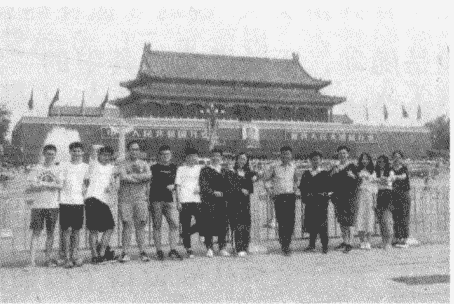

本书算是初步完成对我父亲的一个承诺，也感谢我所有亲朋好友对我一直来的鞭策和支持，尤其要感谢侯俊琳老师和张莉老师的大力支持，感谢侯俊琳老师给本书起的书名。

剑桥渐渐过去，北京渐渐到来，但美好的事物永远不会过时的。感谢您的阅读！

刘伟

2019 年 7 月

Document generated by Anna's Archive around 2023-2024 as part of the DuXiu collection (https://annas-blog.org/duxiu-exclusive.html).

Images have been losslessly embedded. Information about the original file can be found in PDF attachments. Some stats (more in the PDF attachments):

{

"filename": "6L+96Zeu5Lq65bel5pm66IO9ICDku47liZHmoaXliLDljJfkuqxfMTQ2NTQ2MzQuemlw",

"filename_decoded": "\u8ffd\u95ee\u4eba\u5de5\u667a\u80fd \u4ece\u5251\u6865\u5230\u5317\u4eac_14654634.zip",

"filesize": 79580932,

"md5": "76cac57d46e4934815238b8e2ca7a681",

"header_md5": "03e44d77530379edc1766ed950d840fe",

"sha1": "c4302a6241109cf4eb633d04b782553f546356f3",

"sha256": "45861ab2d68cf062f1c2e20ffe56f69300e268c50add36d11a6d57971bea4fd0",

"crc32": 565799638,

"zip_password": "",

"uncompressed_size": 88351754,

"pdg_dir_name": "\u256b\u2556\u2556\u256c\u2569\u255a\u2566\u2563\u00f1\u2553\u255f\u2500\u2584\u2524\u2559\u255c\u00fa\u2555\u253c\u2561\u2555\u2592\u2592\u255b\u2310_14654634",

"pdg_main_pages_found": 236,

"pdg_main_pages_max": 236,

"total_pages": 248,

"total_pixels": 1201854838,

"pdf_generation_missing_pages": false

}