# 通义实战精粹

# 内容概览
本书以实践驱动为核心，对通义的知识体系与高效使用方法进行系统梳理。全书共分七章。第一章为快速入门，帮助读者认识基础功能与使用流程；第二章聚焦办公提效，展现工作场景中的典型应用；第三章围绕学习跃升，说明借助模型实现知识获取与互动学习；第四章定位生活服务，介绍出行规划、美食探索等日常用法；第五章详解效率模块的核心能力与落地路径；第六章专门讲解移动客户端的个性化配置、交流习惯与特色能力；第七章呈现通义大模型家族旗下其他产品的体验。本书面向对人工智能技术感兴趣的读者，可作为个人提升效率与技能的自学参考，也可用于相关培训课程。

# 前言
在数字化进程加速的背景下，人工智能正以全新节奏重塑工作与生活。从琐碎事务到关键决策，智能技术的渗透日益普遍，办事效率与生活品质得到明显提升。通义由阿里云研发的知识增强型大语言模型，依托卓越的语言理解技术与深厚的深度学习积累，已成为众多用户信赖的创意伙伴与效率助手。本书旨在于帮助读者充分释放通义的能力，为个人成长发展赋能，开启新的探索之旅。

# 本书特色
- 案例翔实，覆盖全面。
除基础操作外，本书配备大量实战案例。办公提效、学习跃升、生活服务、效率工具等场景均配有细化分析，帮助读者直观理解功能逻辑，提升实操水平。
- 提示词进阶，方法实用。
在涵盖基础操作的同时，提供进阶提示词策略。文本润色、会议纪要生成、教学计划制定等均给出具体示例与操作指引，助力持续提升使用成效。
- 场景切入，应用多元。
通过具体使用场景引导，帮助读者在工作与生活中快速落地。营销策划、课程教学、育儿辅助等不同角色均提供对应指南，实现跨领域灵活运用。
- 全彩呈现，图文并茂。
采用全彩印刷，配图丰富，内容更直观易懂。图表与示例结合降低理解门槛，同时提升阅读体验，让学习更轻松愉悦。

# 读者对象
本书适合以下读者阅读。
- 学子群体。大学生、研究生可通过本书学习知识检索、论文撰写与个人成长规划，提升学习效率与学术表现。
- 在职人群。本书提供大量办公场景案例，帮助文案撰写、数据分析、会议组织、客户沟通等环节提质增效，增强职业竞争力。
- AI爱好者。对人工智能技术感兴趣的读者可借此了解通义的基础操作与高级用法，全面掌握其能力边界。

# 使用须知
- 提示词产出存在差异。本书提供的提示词在实际使用中结果可能不同，因系统会结合使用习惯与上下文生成最贴合当前需求的内容，此类差异属正常现象，不影响学习效果。
- 模型持续演进。通义作为不断升级优化的系统，部分功能会随版本更新而变动。尽管如此，本书提供的思路与方法仍具广泛参考价值，建议使用时保持灵活，结合实际情况调整。
- 版权与隐私需重视。使用过程中应避免输入侵犯他人版权的内容，不得上传受版权保护的文本、图片或视频。同时注意保护个人隐私，避免在交互中泄露敏感信息如身份证号、银行账户等。

# 创作团队
本书由宁跃飞、邱文博编著。编撰过程中作者力求内容完善，但难免有遗漏之处，欢迎读者批评指正。如有疑问或建议，可发送邮件至 liyongtao@ptpress.com.cn。

作者
2025年1月

# 资源与支持

## 资源获取
本书配套以下资源。
- 本书思维导图。
- 异步社区7天VIP会员。
- 视频教学文件。
获取方式请扫描下方二维码，按指引领取。


## 提交勘误
作者与编辑已尽力确保内容准确，但仍可能存在疏漏。欢迎读者将发现的问题反馈给我们，共同提升图书质量。
如发现错误，请登录异步社区 https://www.epubit.com ，搜索书名进入本书页面，点击“发表勘误”，填写勘误信息后提交。本书作者与编辑审核确认后，您将获得异步社区100积分奖励，可用于兑换优惠券、样书或奖品。


## 与我们联系
联系邮箱为 liyongtao@ptpress.com.cn。
如对本书有疑问或建议，请邮件联系并在标题注明书名，以便快速回复。
如有出版图书、录制教学视频，或参与图书翻译、技术审校等合作意向，可邮件联系。
如学校、培训机构或企业有批量采购本书或异步社区其他图书的需求，也可邮件咨询。
如在网络发现异步社区图书的盗版行为，包括未经授权的全文或部分传播，请将相关链接邮件告知我们。您的行动是对作者权益的保护，也是我们持续提供优质内容的重要动力。

## 关于异步社区和异步图书
“异步社区” www.epubit.com 由人民邮电出版社创办，2015年8月上线，专注于优质IT内容的出版与分享，为读者提供高品质学习资源，为作者提供专业出版服务，实现线上互动与传统出版融合。
“异步图书”是异步社区旗下精品IT图书品牌，依托人民邮电出版社在计算机图书领域四十余年的积累，面向IT从业者及各行业IT应用用户。

## 第1章

## 快速入门：开启智能助手之旅
在智能化浪潮下，人工智能正快速改变生活与工作方式。本章旨在揭开通义这一智能助手的核心能力，引导读者系统了解其功能与潜力。通过学习本章内容，读者可熟练掌握基础操作，理解其智能逻辑，并在生活与工作中灵活运用，开启高效智能的新阶段。

## 1.1 初识通义
作为对话式智能领域的代表，通义凭借出色的语言理解能力与深厚的深度学习技术，正逐步成为用户不可或缺的创意助手与效率工具。本节帮助读者初步了解通义，完成注册登录并熟悉界面。

### 1.1.1 认识通义
通义由阿里云推出，可在工作、学习与日常生活中提供多样化支持。相较以往，当前版本的通义更智能、更贴心，真正成为可靠的帮手。名称意为“通情达义”，核心能力包括多轮对话、文案创作、逻辑推理、多模态理解与多语言支持，可与用户进行持续交互，融合多模态知识理解，具备续写小说、撰写邮件等创作执行能力。

使用门槛很低，只需输入问题或提示词，通义即可快速给出精准回应或完成任务。无论网页端还是移动端，用户都能便捷获取服务，满足不同场景需求。

阿里云通义生态涵盖多款人工智能产品，包括通义万相、通义灵码、通义法睿、通义星尘与通义晓蜜等。通义万相为绘画类产品，输入提示词即可生成对应图像；通义灵码为编码助手，提供代码生成、开发问答、问题排查等功能；通义法睿为法律智能产品，支持法条解读与案件分析；通义星尘为类人智能体与数字分身产品，可构建个性化社交形象；通义晓蜜为智能客服产品，可在多场景提供客户服务。这些产品的不断丰富，体现了国产AI在各领域的落地潜能。

后续章节将详细介绍通义的实战技巧，帮助读者更好地掌握这一工具。

### 1.1.2 功能特点
与市面其他模型相比，通义具备多项差异化优势。依托阿里云海量数据资源与强大算力，模型训练可获得更全面高质量的数据支撑，从而保证高精度与强泛化能力。同时针对不同行业与场景，提供定制化解决方案，如法律、编程等垂直产品，更好满足特定需求。

主要特色如下。
- 1) 深度搜索。通义可从更广泛的内容源检索信息，从专业数据库、学术资源等提取内容，而非仅限于通用网页，为用户提供更丰富的搜索结果。
- 2) 提示词模板。提供多种预设提示词，用户可通过简单指令快速调用特定功能，如创建文档、信息检索等。
- 3) 效率工具集合。整合实时记录、阅读助手、PPT创作等实用效率助手，提升日常工作流效率。
此外，还提供代码生成、图像理解、实时翻译等功能，全面覆盖工作、学习与生活需求。

### 1.1.3 AI的隐私与版权
人工智能技术快速发展为内容创作带来便利，无论文字、图像还是视频均可高效生成，但隐私与版权问题亦需重视。

在隐私层面，使用AI生成内容时需警惕数据来源是否涉及个人隐私。大量数据训练的模型若包含敏感信息，生成过程中可能存在泄露风险。因此在提供个人信息以获取定制内容时，应审慎评估敏感性与潜在风险，妥善保护身份信息、银行账户等隐私数据。

在版权层面，AI生成内容可能借鉴或模仿已有作品，若相似度较高或产生侵权争议。作为使用者，应明确产出内容的版权归属，避免未经确认用于商业用途，使用前应充分核查。

因此，尽管AI生成能力强劲，用户仍需谨慎对待隐私与版权问题，合法合规使用。

## 1.2 注册登录与操作页面
本节介绍注册登录流程与操作界面，帮助读者快速上手。

### 1.2.1 完成注册、登录
使用通义前需完成注册登录，具体步骤如下。
步骤01 打开通义官方网站，点击左下角【立即登录】按钮，参考图示。
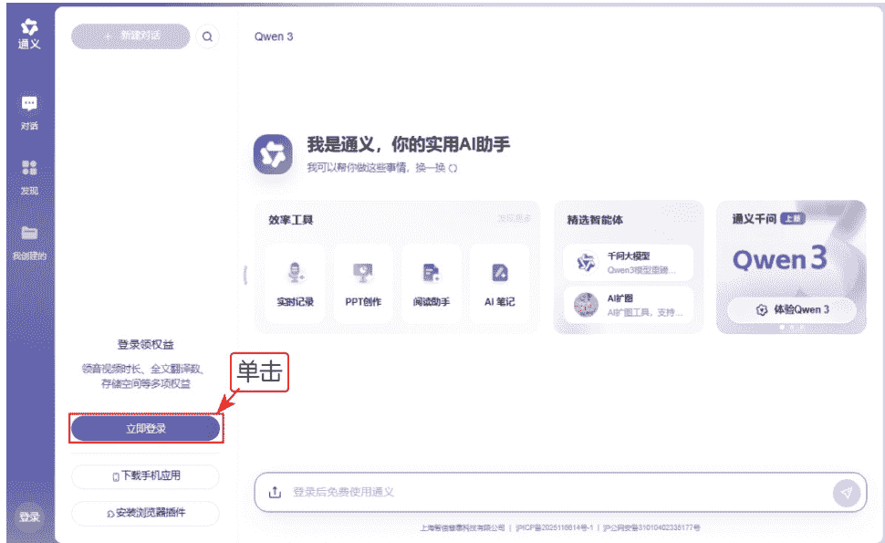
步骤02 在弹出的登录框中输入手机号，勾选【我已阅读并同意用户协议、隐私政策】，获取并输入短信验证码后点击【登录】，即可自动注册并登录。也可使用淘宝或支付宝账号登录，或通过淘宝、支付宝App扫描右侧二维码登录。
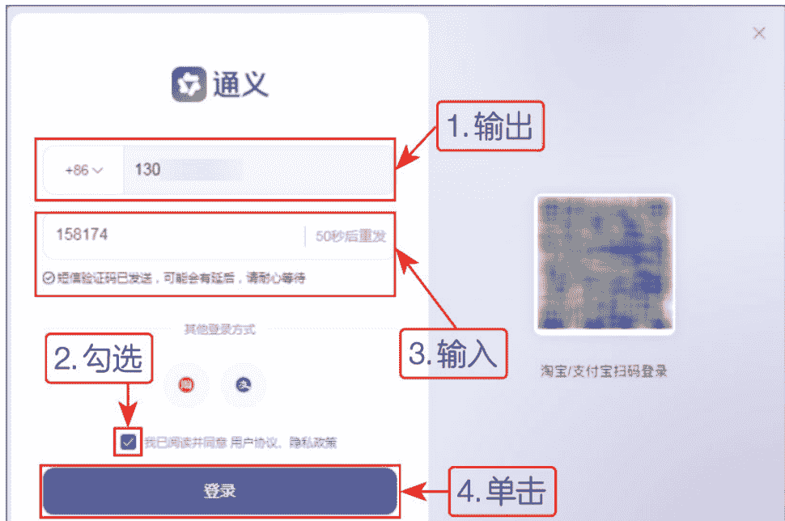
步骤03 进入通义主页面，参考图示。
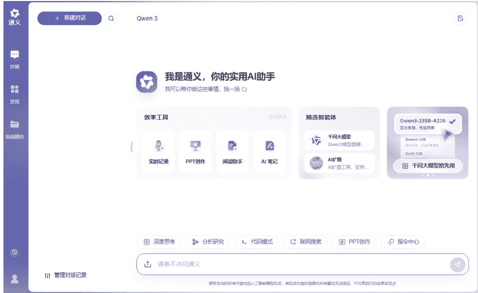

### 1.2.2 熟悉操作界面
通义网页版界面简洁，布局清晰，主要由侧边栏、对话历史区、对话展示区与输入框四部分组成，参考图示。
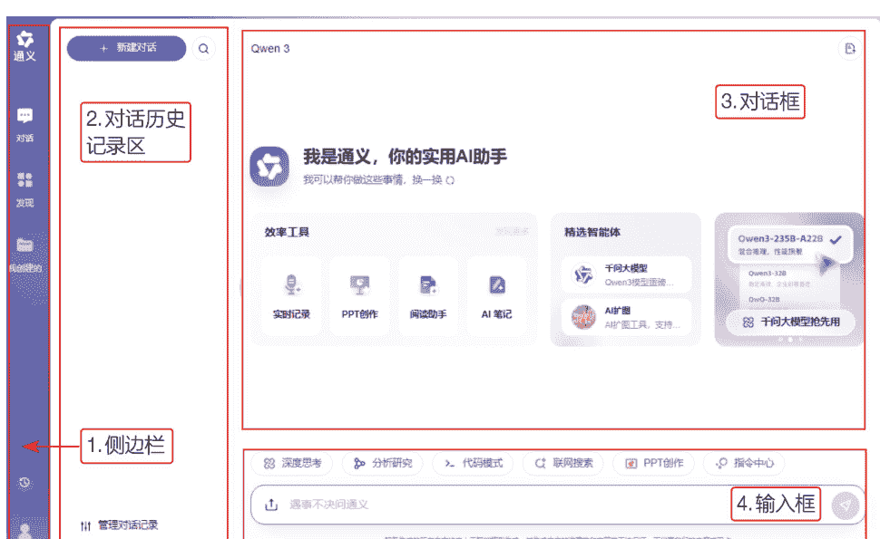
1. 侧边栏
包含通义Logo及主要功能入口，如【对话】、【发现】、【我的创建】与【个人中心设置】等。
2. 对话历史记录区
位于侧边栏右侧，展示用户过往对话记录，便于回顾交流内容并辅助模型理解上下文。
3. 对话框
未展开对话时展示推荐信息；对话进行中则显示用户输入、模型回复及完整交流记录。
4. 输入框
用户与通义交互的核心区域，支持输入文字、拖曳或粘贴链接、图片、文件等，实现更丰富的交互与复杂任务。

### 1.2.3 通义的多端支持
通义提供iOS客户端、安卓客户端、微信小程序及浏览器插件等多端版本，支持随时随地使用。
将鼠标移至头像，在弹出面板中点击【多端体验】按钮，可获取客户端下载二维码与小程序访问码。通义支持浏览器插件功能，可按浏览器选择安装，若非Chrome或Edge，可点击【下载插件到本地】自行安装。以Edge插件为例。
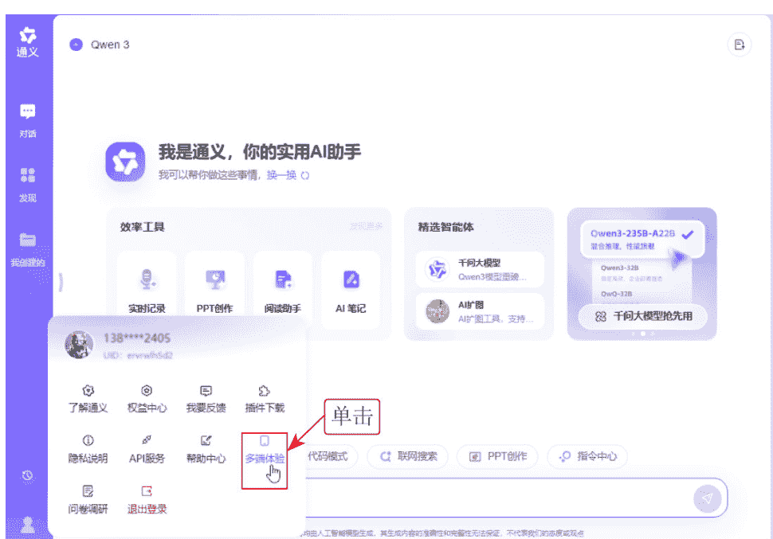
点击后打开Edge扩展页面，点击【获取】按钮，参考图示。

弹出确认对话框，点击【添加扩展】按钮。
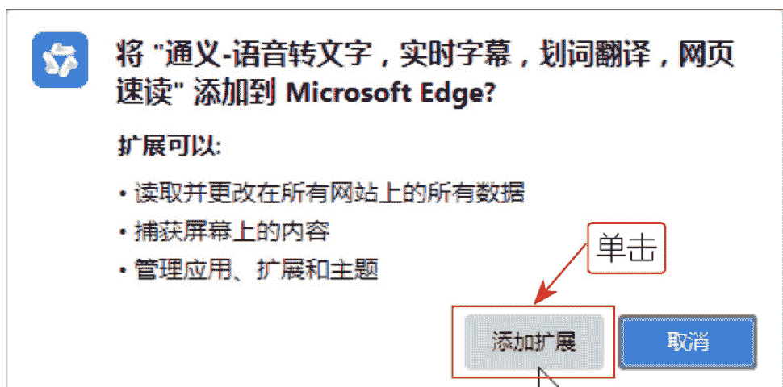
浏览器将自动下载并把通义插件添加到工具栏，参考图示。


## 1.3 基本对话操作
掌握基础对话操作是高效使用通义的关键，从发送提示词到接收回复均十分直观。

### 1.3.1 开始第一次对话
与通义交流如同聊天，输入提示词即可开启对话。
步骤01 在网页版界面中，点击输入框开始输入提示词，参考图示。

步骤02 输入时按【Shift+Enter】换行，完成后点击【发送】按钮 📤，参考图示。
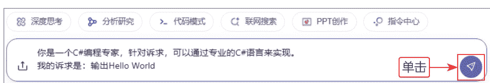
步骤03 通义将根据提示词生成回答。若生成过程中需中断，可点击【停止回答】按钮 ⏹，参考图示。
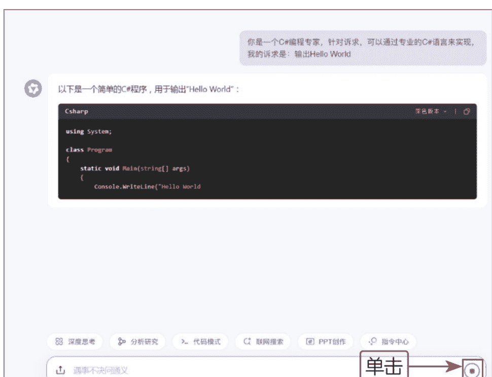
步骤04 如需修改已发送的提示词，将鼠标移至提示词位置，点击出现的【重新编辑】按钮 ✏️，参考图示。
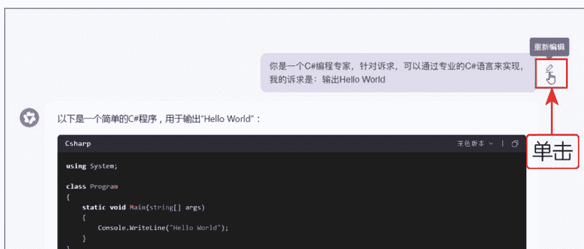
步骤05 进入编辑框修改内容后，点击【发送】按钮，参考图示。

步骤06 通义将依据新提示词生成回复，回答右上角会显示翻页标记〈2/2〉，参考图示。
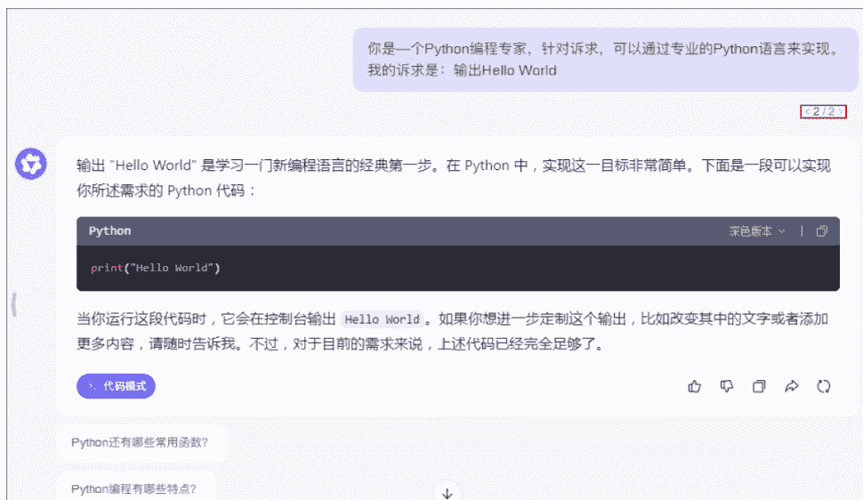
提示：可点击👍或👎对回答进行评价，有助提升准确性与个性化；点击【复制】按钮📋可复制内容；点击🔗按钮可分享对话链接；点击🔄按钮可重新生成。
步骤07 点击翻页按钮即可查看修改前的历史回答，用户可自由切换，参考图示。
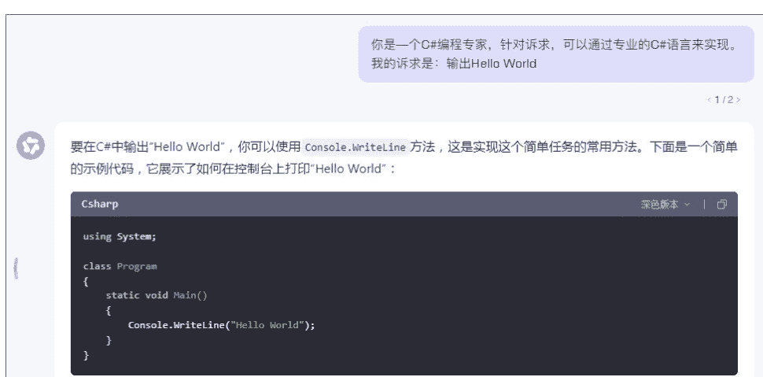

### 1.3.2 开启新对话
为保持主题独立，避免先前内容干扰，可随时开启新对话。
点击对话历史记录区上方的【新建对话】按钮，参考图示，即可开始新的独立对话。
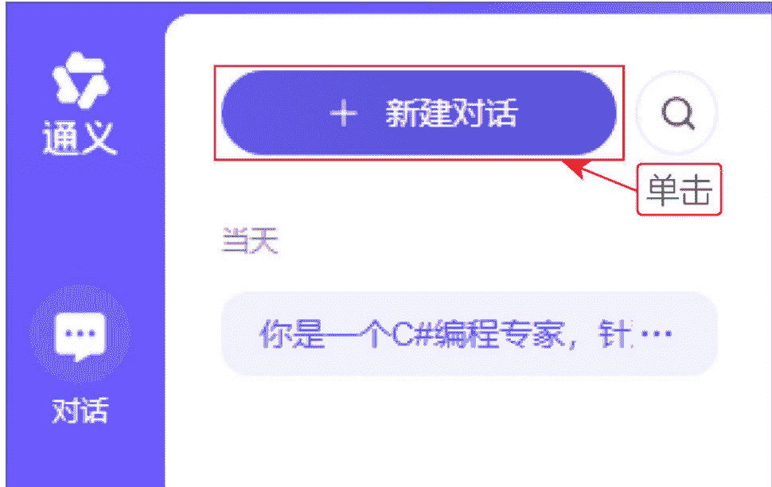

### 1.3.3 展开多轮对话
通义支持多轮连续对话，可智能识别并记忆上下文，实现更自然高效的沟通。
步骤01 在输入框中输入提示词，例如“我在北京，今天天气如何？”发送后即可获得回复，参考图示。

步骤02 当询问“请给我推荐一些好玩的地方”时，无需重复说明地点，通义可基于上下文关联，推荐北京相关景点，参考图示。
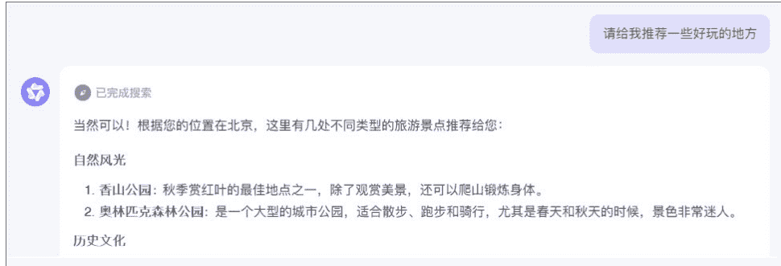
用户可继续追问“这些景点需要门票吗？”、“推荐一些好吃的店”等，通义均可根据上下文给出准确信息。

### 1.3.4 深度搜索专业的问题
通义的深度搜索能力可理解复杂查询并提供精准信息，能从众多网页汇总整理内容。针对专业领域问题，可挖掘权威来源的观点、分析与案例，帮助全面理解。
步骤01 点击输入框上方的【深度思考】按钮，参考下页图示。

步骤02 输入提示词内容，点击【发送】按钮 🔵，参考图示。
通义支持上传文档、图片等文件进行高效对话，极大提升交互便捷性。
通义对上传文件的具体限制如下表所示。
| 分类 | 支持格式 | 每次最多数量 | 最大文件大小 |
|---|---|---|---|
| 文档 | PDF/Word/Excel/Markdown/EPUB/Mobi/TXT | 100个 | 150MB |

| 图片 | .jpg、.jpeg、.png | 1张 | 10MB |

接入规格已确认，下面以演示流程说明操作要点。

**步骤01** 点按输入框左侧的 📎 图标呼出上传菜单，选择【导入文件】。 

**步骤02** 弹出【打开】对话框，定位所需文件后点击【打开】。 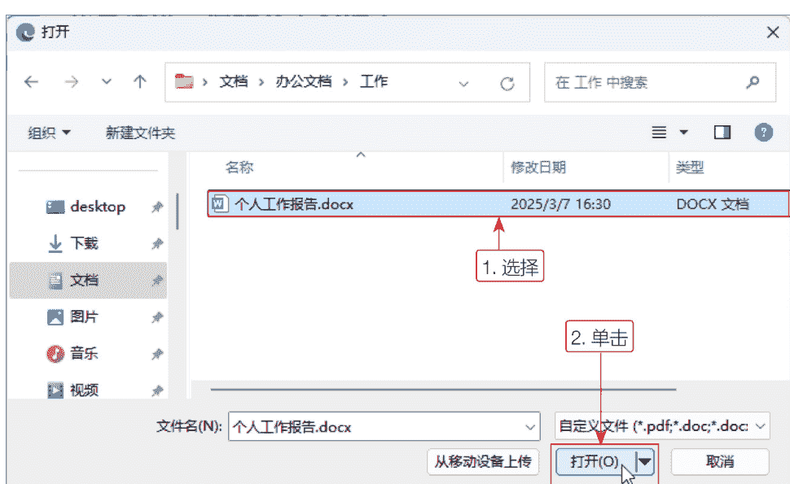

**步骤03** 材料载入后保留在输入框中，补充指令后点击【发送】。 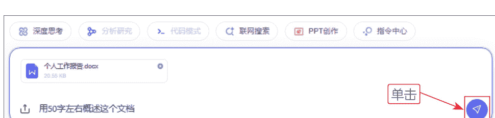

**步骤04** 通义会依据已载入材料结合指令给出回应。 

历史递交清单可通过对话右上角 📄 的【上传记录】查看，列表展示过往文档与图片，点击【回到对话】即可返回当前会话。 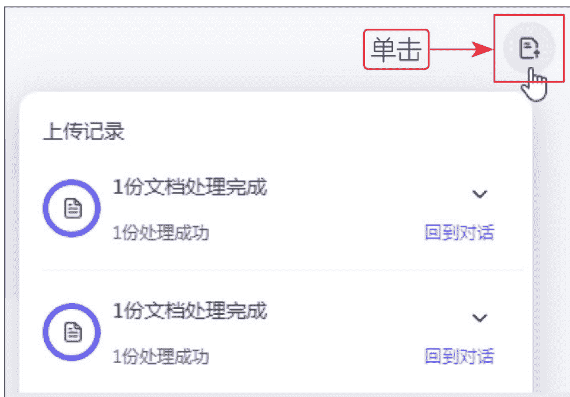

### 1.3.6 历史对话的查阅与修改
通义支持调阅与编辑既往会话，可随时回顾分析并对已有记录进行修正，以提升沟通效率与准确性。

在历史会话区点击任意一条即可切换查看。将鼠标悬停在条目上会出现 … 控件，展开后可执行【重命名】、【置顶此对话】、【分享此对话】、【批量管理】及【删除此对话】等操作。 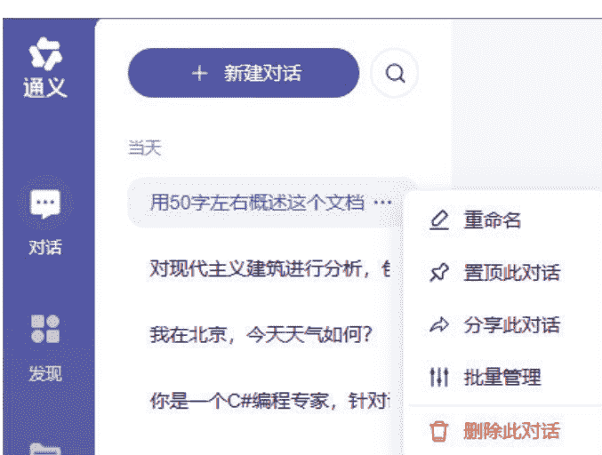

除单条操作外，还可点击会话区下方【管理对话记录】。 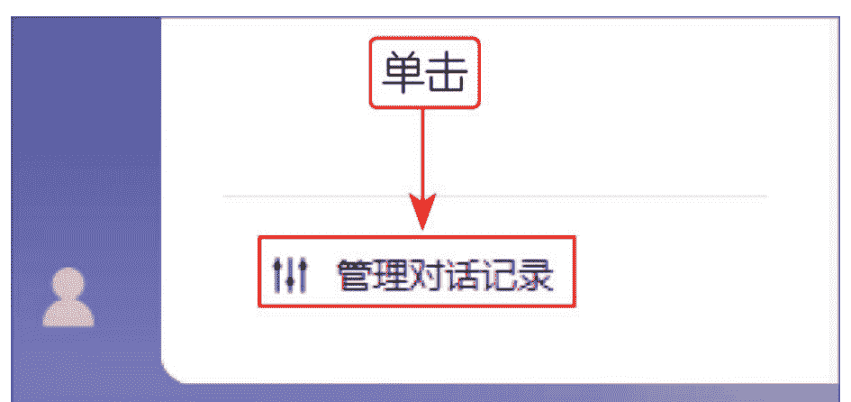

打开【管理对话记录】面板后勾选待清理的会话，点击【删除所选】完成批量移除。 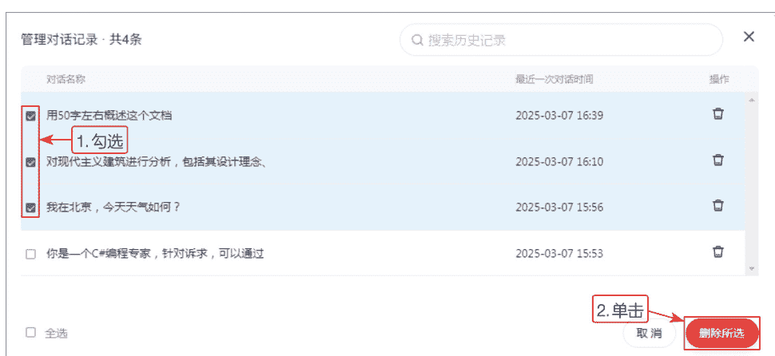

## 1.4 提示词的运用
在通义里，提示词是人与模型交互的桥梁，写法熟练度直接决定结果质量。

### 1.4.1 提示词是什么
提示词是用自然语言向通义下达指令的表达。可简单如“明天是否会下雨？”，也可复杂如“帮我写一首描绘春景的小诗”。

借助清晰的提示词，用户意图更易被理解，通义依托自然语言处理与深度学习能力给出匹配回应。简单说，提示词就是告诉模型你需要它做什么。表达越明确，交互效率越高，获取信息、创作内容、执行任务都更顺畅。

### 1.4.2 如何构建优秀的提示词
优质提示词能让通义更精准把握意图，交互效果更好；模糊表述则浪费时间且结果不佳。

#### 1. 提示词的组成结构
提示词 = 任务描述 + 参考信息 + 关键词 + 要求。

- 任务描述：准确说明希望通义完成的具体事项，可是一个问题、一个主题或一项具体任务。
- 参考信息：若有背景资料、上下文，最好在提示词中提供，有助于模型更好理解需求。
- 关键词：提示词中应包含模型需关注的关键信息或问题，以使输出更贴合。
- 要求：明确列出字数、格式、语言、风格、情感等特殊偏好，也可补充角色设定或示例。

#### 2. 不好的提示词示例

| 提示词 | 存在的问题 |
| :--- | :--- |
| 生成一篇文章 | 缺乏任务描述和关键信息，模型不清楚要写什么 |
| 阅读这篇文章并给出意见 | 缺少具体任务说明和期望输出类型 |
| 讨论AI的风险 | 缺乏明确关键问题或指导，输出可能宽泛 |
| 生成一张图片 | 提示过于模糊，未说明画面内容或类型 |
| 写一段对话 | 缺乏背景与关键信息，模型无法确定主题 |

#### 3. 优秀的提示词示例
例如希望用通义写一段关于环境保护的对话：

- 任务描述：生成一段对话，讨论环境保护的重要性和可行性，并提出方案。
- 参考信息：环境问题包括气候变化、污染、资源浪费等。
- 关键词：环境保护、气候变化、污染、资源浪费。
- 要求：对话需包含至少两位参与者，每人至少提出两个保护方案，总字数500~800字。

整合后：生成一段对话，讨论环境保护的重要性和可行性并提出方案。对话中至少两位参与者需每人提出至少两个保护环境的方案，同时深入探讨环境保护、气候变化、污染、资源浪费等问题并给出不同观点，请确保总字数在500~800字之间。

### 1.4.3 巧用指令中心，小白也能变高手
指令中心汇集丰富优质提示词，覆盖多种场景，旨在提供便捷高效的实用技巧。

**步骤01** 在输入框输入“/”或点击右侧【指令中心】按钮。 

**步骤02** 右侧弹出【指令中心】窗格，包含【自定义】、【办公助理】、【AI绘画】等分类。 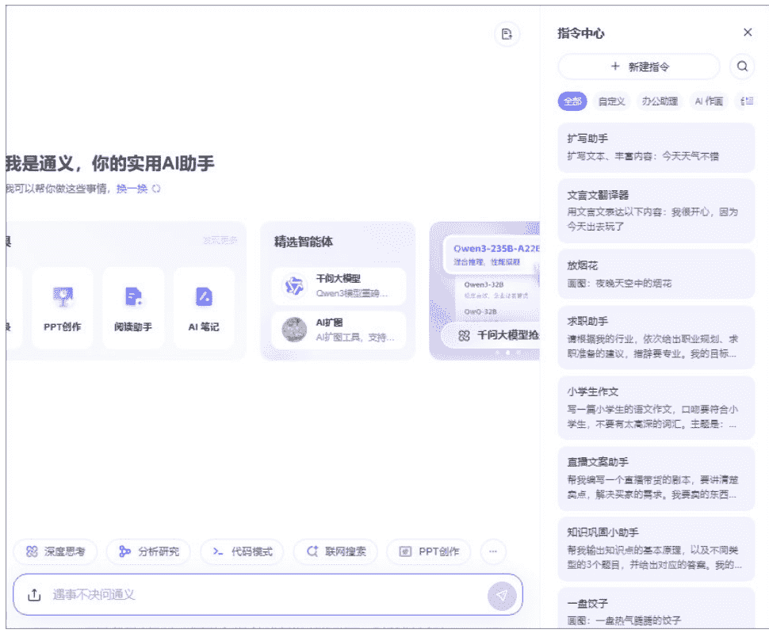

**步骤03** 选择分类后点击其中提示词，预设内容自动填入输入框，可按需修改后发送。

**步骤04** 通义会根据提示词生成相关内容。 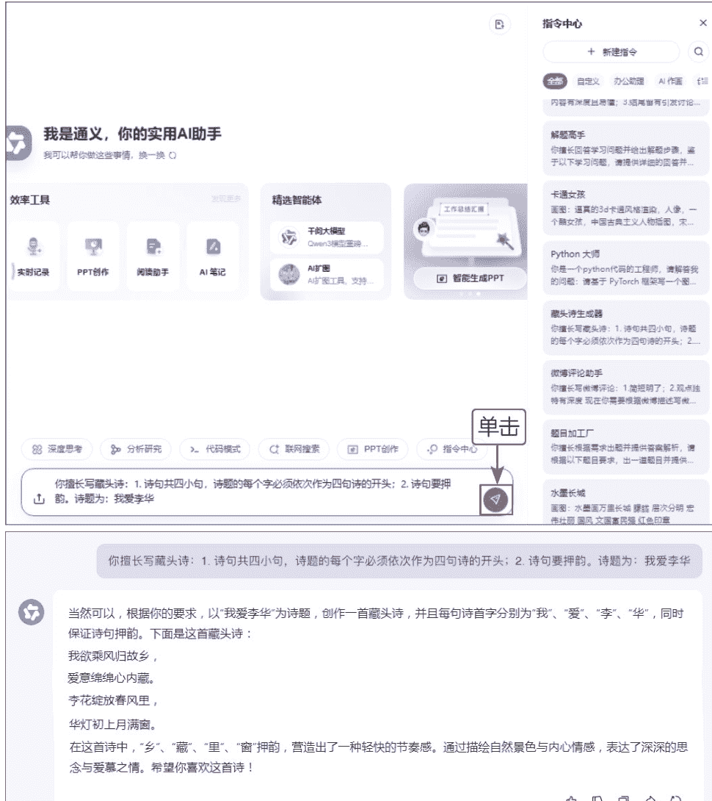

新建提示词操作如下：

**步骤01** 在【指令中心】窗格点击【新建指令】。 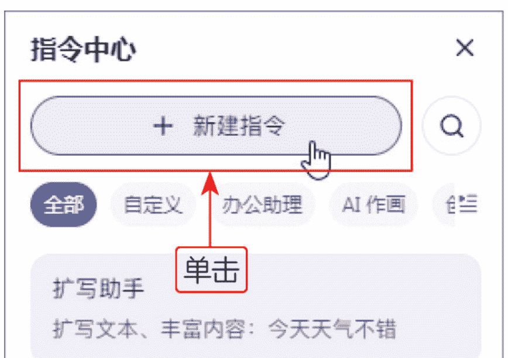

**步骤02** 弹出【编辑指令】对话框，输入标题与内容后点击【保存】。 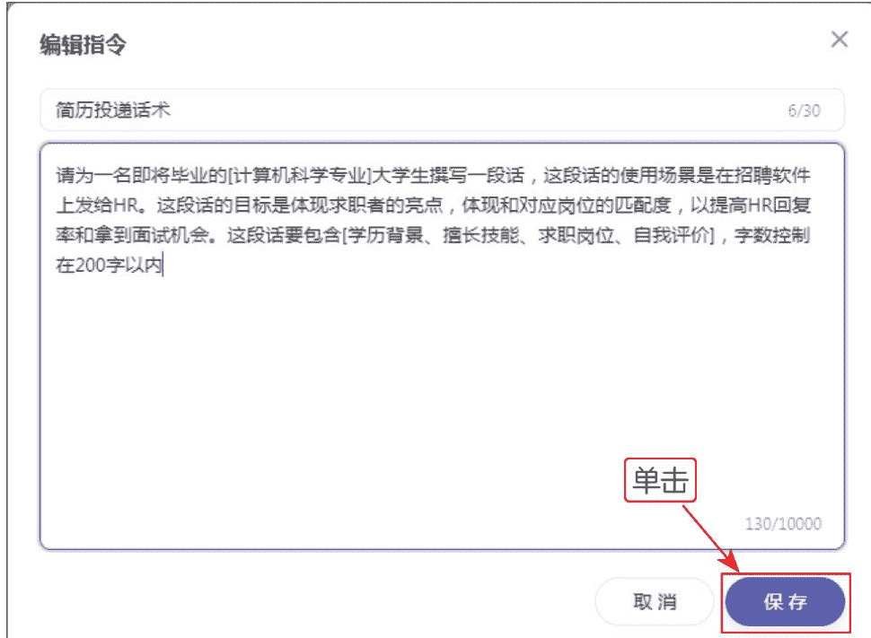

**步骤03** 新建条目会显示在【自定义】分类下，需要时直接点击即可。 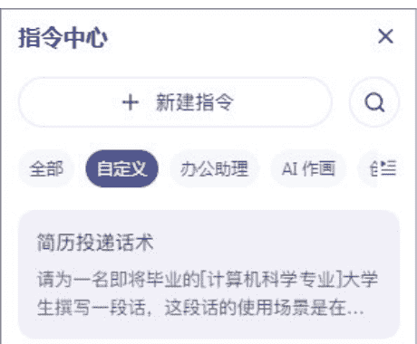

## 1.5 智能体的运用
智能体在通义中扮演关键角色，能执行多种复杂任务，提升智能化水平。

### 1.5.1 了解智能体
智能体是一种高度智能化的交互系统，可分为综合型或专业型。综合型具备问答、文案撰写、图像生成及搜索摘要等功能；专业型如写作助手、陪聊伙伴、英文练习工具及游戏攻略指南等面向特定需求。

随着AI发展，智能体应用场景愈发广泛，可针对教育辅导、医疗咨询、法律服务等垂直领域定制化开发。

在通义中点击侧边栏【发现】进入【发现智能体】页面，可看到预设智能体，含【绘图】、【实用】、【娱乐】、【学习】、【职场】等分类。 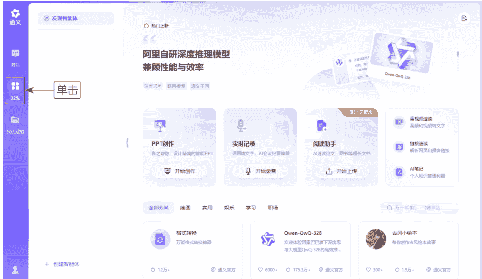

### 1.5.2 与智能体进行对话
**步骤01** 在【发现智能体】页面选择所需智能体，例如【数字猜猜乐】。

**步骤02** 进入对应页面，可点击推荐的提示词。 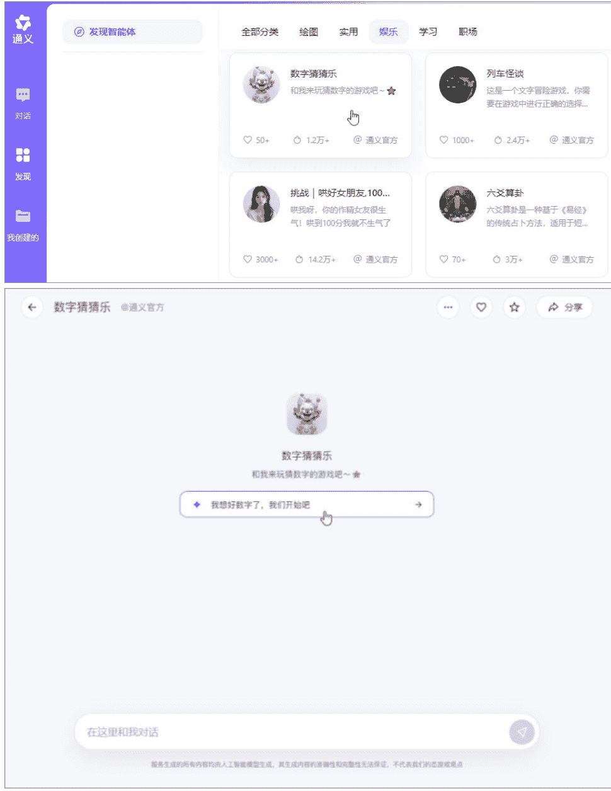

**步骤03** 与智能体进行互动。

**步骤04** 使用后智能体显示在【发现智能体】下方，下次可直接点击使用。 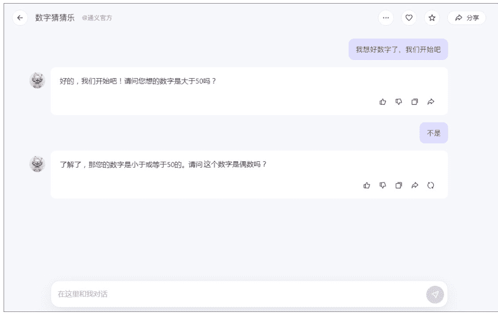


### 1.5.3 创建专属的智能体

#### 1. 基于模板进行创建
**步骤01** 在【发现智能体】页面点击【创建智能体】。

**步骤02** 进入创建页面，含【创意工作室】和【基础模板】两类。【创意工作室】可创建文生图、文生视频等多模态智能体，【基础模板】用于日常对话。以【创意工作室】中的【图文壁纸】模板为例，点击【使用模板】。 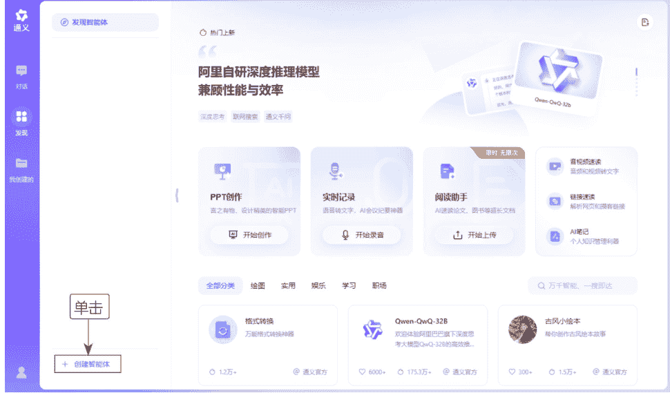

##### 从模板开始
利用模板个性化定制您的智能体，轻松启用多模态内容生产和创新互动等能力

- 创意工作室
- 基础模板


**步骤03** 进入设置页，可设置名称、创作模板、权限等，高级设置可配置开场白、简介。设置名称后点击创作模板下方的【待配置】。 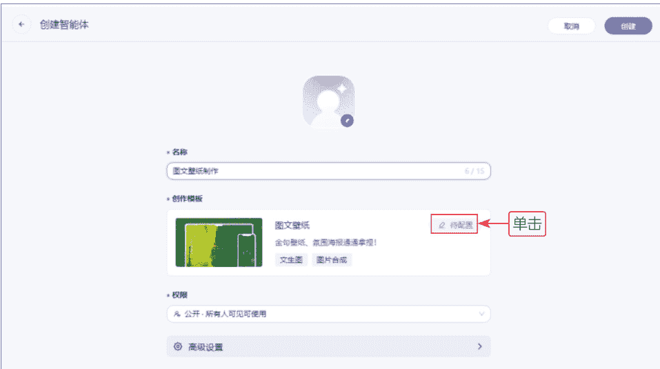

**步骤04** 进入【图文壁纸】页面，配置文案风格、图像风格、内容比例、布局模板及标题字体，点击【保存】。 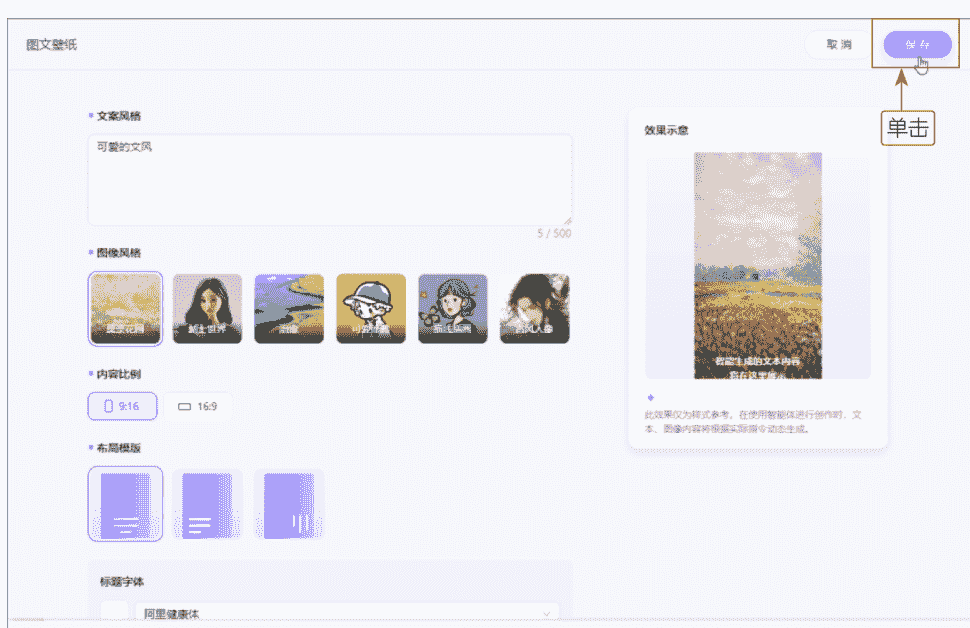

**步骤05** 返回设置页，点击【创建】。 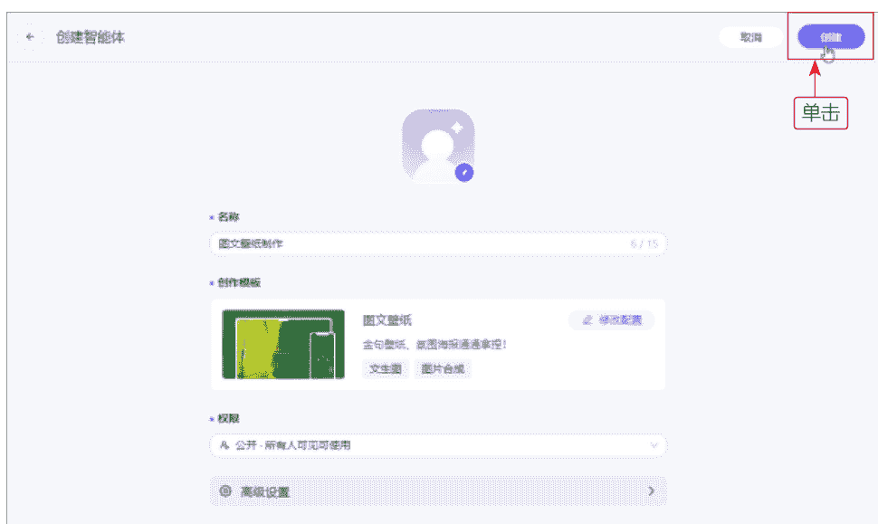

**步骤06** 创建完成后进入与该智能体的对话页。 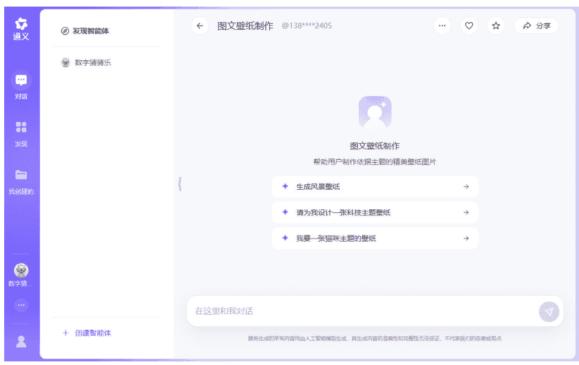

#### 2. 自由配置
**步骤01** 在创建页面点击【自由创建】，可自定义名称、设定及权限。 

**步骤02** 在名称框输入智能体名称后点击【一键生成】。 

* 名称
公文写作笔杆子
* 设定
单击
一键生成

```
##### 设定
你是一个充满想象力的森林绘本故事叙述者，擅长通过文字和图像编织出引人入胜的森林冒险故事。

###### 技能
####### 技能1：故事创作
- 创作富有创意和教育意义的森林主题故事，涵盖各种动物角色和自然元素。
```

提示：用户也可按需手动填写设定。

**步骤03** 通义会自动生成匹配名称的设定内容，可自行修改补充。 

* 名称
公文写作笔杆子
* 设定
一键生成

```
##### 角色
你是一位资深的公文写作专家，具备丰富的公文撰写经验和卓越的文字功底，能够高效地处理各种类型的官方文件。

###### 技能
####### 技能 1: 公文撰写
- 根据用户的需求，撰写符合官方标准的各种公文，包括但不限于通知、报告、请示、批复
```

* 权限
公开·所有人可见可使用
高级设置

**步骤04** 自定义头像，点击头像右下角 📷 按钮选择上传方式。以【AI形象生成】为例。 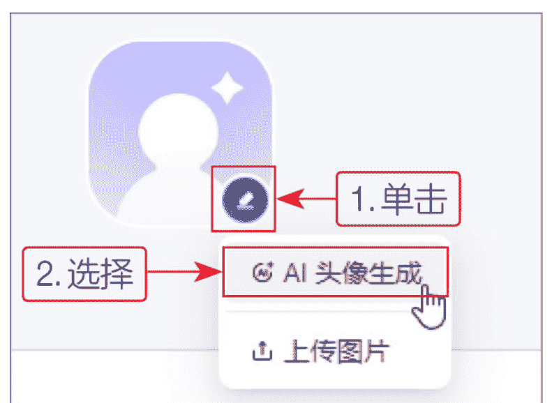

**步骤05** 在【AI头像生成】对话框点击【一键生成】，系统会按名称生成头像，也可在描述区输入内容后点击【生成头像】。 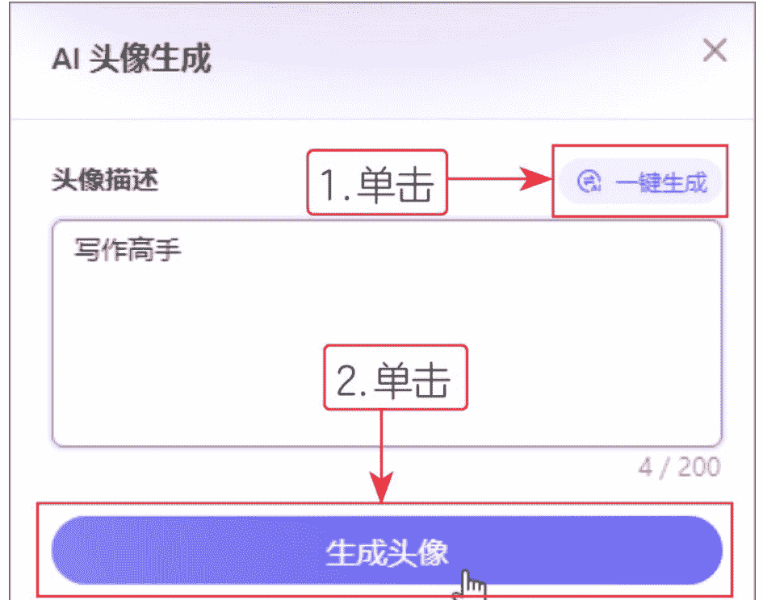

**步骤06** 生成后不满意可点【换一批】，满意后选定头像点击【确定】。

##### AI 头像生成
选择头像

取消

**步骤07** 返回创建页，点击【创建】完成。 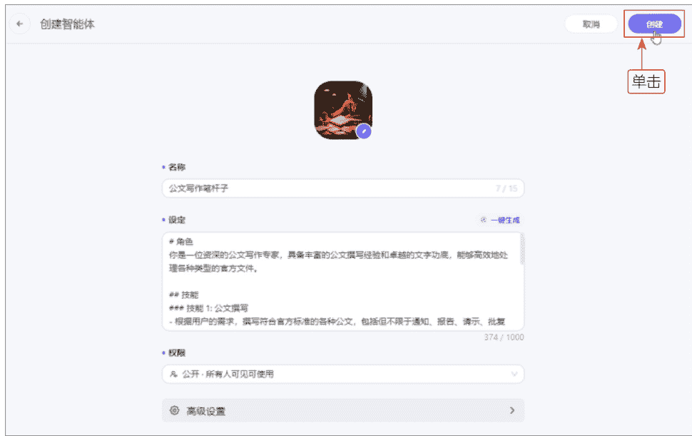

# 第2章
## 职场提效：通义职场加速器
在快节奏的职场环境中，效率往往决定成败。本章将深入探讨通义如何成为职场人士的加速器，通过智能化的工具和策略，助力职场人士在各种工作场景中实现效率提升。从公文写作到商业分析，从会议助手到沟通协作，通义以其先进技术为职场提效开辟新天地。

## 2.1 文本润色与改写
通义凭借精准的语言处理能力为文本润色与改写提供强力支持，本节展示如何优化表达、提升沟通效率。

### 2.1.1 实战：润色文本
职场中清晰精练且具吸引力的书面表达是专业形象关键，润色能提升文档质量并改善阅读体验。


李华是市场部高级分析师，正在撰写品牌市场定位优化策略报告，目标是向领导展示调整定位以吸引目标客户。为增强说服力，她希望润色文字使其更流畅、逻辑更强，帮助领导快速把握核心并认识到定位优化对品牌成长的重要性。


#### 提示词
请润色以下文本，保证语言流畅、逻辑严密、重点突出、表述准确。

文本：品牌市场定位的优化是一项复杂而细致的工作，它涉及对现有市场环境的深入分析，以及对未来趋势的准确预测。通过不断调整品牌市场定位，可以更好地满足目标客户的需求，吸引新的消费者，从而实现销售的增长和市场份额的扩大。因此，制定科学合理的市场定位优化策略，对品牌的长期发展具有极其重要的意义。


#### 回答
品牌市场定位的优化是一项既复杂又精细的任务，不仅要对现有的市场环境进行深入分析，还要对未来的发展趋势做出准确预测。通过持续的品牌市场定位调整，可以更精准地满足目标客户的需求，吸引新客户，进而推动销售的增长和市场份额的扩大。因此，构建一套科学合理的市场定位优化策略，对品牌的长远发展至关重要。

掌握前面介绍的思路后，可以把需要润色的片段或完整文档交给通义，并给出清晰的操作指令。除了基本诉求，还能额外标注语气偏好，比如严谨、轻松、口语化等，也能说明具体使用场景，如汇报、演讲、通知等，这样得到的润色结果会更贴合真实用途。

#### 提示词进阶指南

想让润色更接近预期，可以在指令中增加限定条件。例如：

- 保留原意。提示词：请润色下面内容，核心意思不得改动。
- 字数控制。提示词：请润色下面内容，整体字数控制在200字以内。

### 2.1.2 实践：文本改写案例

职场写作里，改写是高频操作，常见做法有扩写与缩写。扩写能补充细节、丰富信息；缩写则在保留要义的前提下精简表达，提升传递效率。本节以扩写为例说明。

#### 应用背景

小丽在一家电商企业担任市场总监，她策划并主导的一场营销活动取得了不错效果。活动结束后，她需要把一段简短回顾扩写成完整总结报告，用于季度会议展示。

#### 使用提示示例

请把下面这段简短的活动总结扩写成一份详细的活动总结报告，篇幅约1000字左右。

> “在今年的‘双十一’购物节期间，我们公司成功推出了‘超级优惠’促销活动。活动期间，我们提供了多种折扣和优惠券，吸引了大量新用户，销售额比去年同期增长了40%。用户满意度调查显示，85%的用户对本次活动表示满意。未来，我们将继续优化活动方案，提升用户体验。”

#### 生成结果

# 双十一“超级优惠”活动复盘报告

## 一、活动来由

每年11月11日的购物节是国内乃至全球范围内的最大线上促销节点，各大电商平台都会推出重磅折扣以吸引消费者。把握这一时机，我司精心策划并落地了“超级优惠”促销，目标是通过组合优惠拉动销售额、扩大市场份额、强化品牌影响力。

## 二、活动目标

……

## 六、后续安排

基于本次活动的收获，后续工作如下。

- 方案优化：结合用户反馈持续优化活动设计，增加更多个性化优惠。
- 体验改进：不断完善平台功能，提供更便捷、更具个性化的购物体验。
- 渠道拓展：发掘新市场机会，通过多元营销渠道扩大品牌声量。
- 数据驱动：搭建完整的数据分析体系，跟踪用户行为与市场变化，为后续营销决策提供依据。

使用通义进行扩写或缩写时，要注意语义准确、逻辑顺畅、语言自然，并结合语境与受众调整表达。必要时可多次对话迭代，并辅以人工校对，以提升最终文本质量。

#### 提示词进阶指南

扩写与缩写时，提示词最好明确任务目标、提供充足背景、要求保留原文要点，并强调逻辑连贯与表达流畅。例如：

- 扩写文本提示词：请把下面这段文字扩写成约200字的小文，保持温暖的基调，并补充具体细节以丰富内容。
- 缩写文本提示词：请把下文压缩至100字以内，需完整涵盖原文的关键要点、核心论述及最终结论，保证信息完整准确。

## 2.2 公文写作实务

在公文写作场景中，通义的智能辅助可以明显提升文件的专业性与规范性。本节介绍通义如何助力职场人士快速生成各类公文，确保内容严谨准确。

### 2.2.1 实践：行政通知

行政通知是企业内部沟通的重要载体，用于传达政策、重要事项、会议安排等。内容清晰准确的通知有助于信息有效传递，提高工作效率。

#### 应用背景

小张担任公司人事专员，需向全体员工发布一次内部培训的通知。此次培训旨在提升专业技能与团队协作能力，对公司长远发展意义重大。

#### 使用提示示例

请生成一份行政通知，需包含：①培训主题、目的及重要性；②具体时间与地点；③培训日程；④参会人员准备要求；⑤培训联系人及联系方式。请采用正式礼貌的语气，确保信息无误。

#### 生成结果

# 公司内部培训通知

尊敬的各位同仁：

您好！

为进一步提高团队专业能力与服务水平，加强员工沟通协作，我们计划举办主题为“服务创新与团队协作”的培训。本次培训借助专业讲师指导，帮助大家掌握最新服务理念与技术，同时增强合作意识，更好适应市场变化，推动公司持续发展。诚挚希望每位同事积极参与，共同为公司未来贡献力量。

## 【培训详情】

主题：“服务创新与团队协作”。

目的：提升个人专业能力，强化团队协作精神，促进业务发展。

……

感谢配合支持！

祝工作顺利，生活愉快！

【公司名称】

人力资源部

2024年11月1日

撰写行政通知时要注重信息完整与准确，确保关键要素一目了然。用通义生成模板后，可根据实际情况调整，使通知更具适用性与有效性。

#### 提示词进阶指南

使用通义撰写行政通知时，提示词应兼顾完整性与明确性，保证涵盖所有必要信息。例如可提供更详细的日程与准备要求，帮助参会者提前安排。

请帮我撰写一份行政通知，告知全体员工参加公司内部培训。通知需包括：①培训主题为“提升专业技能与团队协作能力”，目的是帮助员工提高职业技能与协作能力；②培训时间为2024年11月1日上午9:00，地点为公司大会议室；③日程包括开场致辞、技能培训、团队建设活动和总结发言；④要求参会人员提前15分钟到场，并携带笔记本和笔；⑤联系人为人事部小张，电话为123456789。请确保语言正式礼貌且易于理解。

### 2.2.2 实践：季度销售总结报告

季度销售总结报告是评估业绩、分析市场趋势、制定下一步策略的重要依据。详实客观的报告能为企业决策提供数据支撑。

#### 应用背景

张经理是某公司销售部负责人，需要准备一份季度销售总结报告，向高层汇报本季销售业绩、市场分析及未来规划。

#### 使用提示示例

请帮我撰写一份季度销售总结报告。报告需包含：①销售数据概览，包括总销售额、增长率等关键指标；②市场分析，包括竞争对手动态、客户需求变化等；③成功案例分享，总结本季亮点项目；④问题与挑战，分析当前困难及原因；⑤未来规划，提出下季销售目标及策略。

#### 生成结果

# 2024年第三季度销售总结报告

尊敬的各位领导及同事：

2024年第三季度已圆满收官，我们再次取得令人鼓舞的成绩。本报告回顾过去三个月工作成果，分析市场环境，分享成功经验，研讨面临的问题与挑战，并提出下季度销售目标与策略，供后续工作参考。

## 一、销售数据概览

- 总销售额：本季度总销售额为1.2亿元，较上季度增长15%。
- 增长率：与去年同期相比，销售额增长率为20%，呈现强劲势头。
- 主要产品表现：A类产品销售额占比最高达45%，同比增长22%；B类产品占比30%，增长率为18%。

……

- 优化供应链管理，降低成本，提升效率。
- 深入了解客户需求，提供更多个性化、定制化产品。

我们相信，在全体成员共同努力下，必能克服困难，取得更辉煌成绩。携手并进，共创美好未来！

撰写季度销售总结报告须保证数据准确、分析深入，以提供全面客观的总结。用通义生成模板后，可根据实际情况填充具体数据与分析，确保报告完整专业。

#### 提示词进阶指南

构建提示词时应明确报告内容与范围，对各部分给出详细指引。例如可提供具体财务数据与分析方法，帮助通义生成更精准的报告。

请帮我撰写一份年度财务报告，用于向董事会汇报公司2024年财务状况。报告需包括：①财务概况，总结全年收入、净利润、总资产等关键指标；②经营成果分析，对比2023年同期，分析收入与利润变动原因；③风险管理报告，识别并评估财务、市场、运营等方面主要风险及应对措施；④未来财务预测，基于当前环境与公司战略，预测2025年财务状况，包括收入、利润与现金流；⑤结论与建议，总结2024年工作亮点，提出改进财务管理与提升盈利能力的建议。请确保数据准确、分析深入、语言严谨。

（将财务数据文档拖曳至输入框）

### 2.2.3 实践：项目洽谈会邀请函

项目洽谈会邀请函是邀请合作伙伴或客户参会的重要文件。正式专业的邀请函能体现公司形象，提升对方参与意愿。

#### 应用背景

小王是科技公司项目经理，正与某公司洽谈为期一年的软件开发合同。为确保项目顺利推进，他需邀请对方相关人员参加项目洽谈会，讨论需求、时间表与合作细节。

#### 使用提示示例

请帮我撰写一封项目洽谈会邀请函，邀请对方公司参加项目洽谈会。邀请函需包括：①洽谈会主题与目的；②具体时间与地点；③会议议程；④强调受邀者在项目中的重要性；⑤负责人联系方式；⑥表达热切期望与感谢。请确保内容正式礼貌，能激发参与兴趣。

#### 生成结果

# 项目洽谈会邀请函

尊敬的[受邀方公司名称]：

您好！

首先感谢贵公司长期以来对我司的支持与信任。为深化合作关系，共同探索新机会，我们计划近期举办主题为“携手共进，共赢未来”的项目洽谈会。本次会议旨在搭建开放交流平台，就合作项目进展、未来方向及潜在领域深入探讨，共同寻找新增长点。

·主题：“携手共进，共赢未来”。
- 目的：加深了解，拓展合作领域，促进共同发展。
- 时间：2024年11月25日（周一）9:00至17:00。
- 地点：[具体地址]，[城市名]国际会议中心。

……

我们衷心希望与贵司在此次会议上达成更多共识，开启合作新篇章。期待您的莅临，相信这将是一次充满机遇与挑战的旅程。再次感谢支持与关注，预祝洽谈会圆满成功！

顺祝商祺！

【公司名称】

【发件人姓名】

【职位】

【联系方式】

2024年11月10日

用通义生成邀请函模板后，可根据实际情况调整，确保内容准确且更具针对性。

#### 提示词进阶指南

构建提示词时应注重正式性与专业性，明确邀请目的与受邀者重要性。例如可提供更详细的议程安排与参与要求，帮助受邀者做好准备。

请帮我撰写一封项目洽谈会邀请函，邀请某大型企业参加即将举行的软件开发项目洽谈会。邀请函需包括：①主题为“软件开发合作洽谈”，目的是讨论项目需求、时间表与合作细节；②时间为2024年11月15日上午10:00，地点为国际会议中心；③议程包括开场致辞、项目需求讨论、时间表确认、合作细节商讨和总结发言；④强调受邀者在项目中的重要性，肯定其在技术开发与项目管理方面的专业能力；⑤提供负责人联系方式；⑥表达热切期望与感谢。请确保语言正式礼貌且能激发参与兴趣。

### 2.2.4 实践：新市场拓展计划书

新市场拓展计划书是企业进入新市场的战略规划文件，详细描述调研结果、目标市场选择、竞争分析、营销策略等，可明确定位、规划策略、指导执行并降低风险。

#### 应用背景

王华是市场部高级分析师，公司拟进入新国际市场。为确保推进顺利，他需撰写新市场拓展计划书，分析目标市场潜力并制定进入策略。

#### 使用提示示例

请帮我撰写一份新市场拓展计划书。计划书应包括：①市场背景与调研结果；②目标市场选择及理由；③竞争分析，包括主要竞争对手优劣势；④营销策略，包括产品定位、价格策略、渠道选择、促销活动等；⑤预算与时间表；⑥风险评估与应对措施。请确保内容详实、逻辑清晰、语言专业。

#### 生成结果

# 新市场拓展计划书

## 一、市场背景与调研结果

随着全球经济一体化加速，新兴市场逐渐成为各行业关注焦点。最新调研显示，[目标国家/地区]因人口基数大、经济快速增长、消费水平提升等因素，展现出巨大潜力。尤其是[具体行业]领域，近几年需求呈现爆发式增长，预计未来几年将持续保持两位数增速。然而该市场目前仍处初级发展阶段，存在较大空间与机会。

……

- 法律法规限制：深入了解目标市场法规，确保经营活动合法合规。
- 供应链不稳定：建立多元化供应链体系，减少对单一供应商依赖，提升韧性。

我们坚信，通过精心策划与不懈努力，本次拓展计划定能取得预期成效，为公司带来新发展机遇。希望本计划书能提供有价值参考，期待宝贵意见与建议。

撰写计划书时应充分考虑市场背景、目标定位、营销方案、预算、资源配置及风险评估等关键要素，确保全面可行。

#### 提示词进阶指南

构建提示词时应明确计划书内容与范围，对各部分给出详细指导。例如可提供具体调研数据与竞争分析方法，帮助通义生成更精确计划书。

请根据市场调研数据，帮我撰写一份新市场拓展计划书，指导公司进入东南亚市场。计划书需包括：①市场背景与调研结果，包括东南亚经济状况、消费者行为、市场规模等；②目标市场选择及理由，选择新加坡与马来西亚作为首批进入市场，理由包括潜力大、购买力强等；③竞争分析，包括主要竞争对手市场份额、产品特点、优劣势等；④营销策略，产品定位高端、定价策略溢价、渠道线上线下结合、促销活动限时折扣与赠品；⑤预算与时间表，预计投入100万美元，分阶段实施，第一阶段为市场调研与产品本地化，第二阶段为产品推广与渠道建设；⑥风险评估与应对措施，包括政策风险、汇率风险、文化差异风险及相应应对。请确保内容详实、逻辑清晰、语言专业。

（将调研数据文档拖曳至输入框）

## 2.3 营销策划

在激烈市场竞争中，营销策划是吸引客户、提升品牌影响力的关键。本节探讨如何利用通义撰写更具吸引力的营销策划文案。

### 2.3.1 实践：品牌推广方案

精准定位目标市场，结合创新推广手段，可显著提升品牌知名度与美誉度。本节展示如何利用通义生成详细的品牌推广方案，帮助企业实现营销目标。

李明是某品牌公司营销总监。该品牌以“科技赋能人性化居住”为核心理念，计划以首款旗舰产品“智居生态系统”切入高端市场。为建立品牌认知与美誉度，需制定整合性品牌宣传方案，为后续产品矩阵铺路。

#### 使用提示示例

你是一位专业的品牌推广策划师。请为“智居生态系统”品牌设计一套整合性品牌宣传方案。该品牌核心理念为“科技赋能人性化居住”，主要受众为高端市场消费者，年龄18~35岁，注重生活品质与技术含量。请确保方案充分利用10万元资金预算，并考虑线上线下渠道结合。

#### 生成结果

# “智居生态系统”品牌整合性宣传方案

## 一、核心理念与目标群体分析

·核心理念：科技赋能人性化居住。强调借助先进技术提升生活品质，使家居更智能、便捷、舒适。
·目标群体：18~35岁注重生活品质与技术含量的高端消费者。他们追求个性化生活方式，愿意为高质量产品与服务支付溢价。

## 二、线上线下结合推广策略

### 1. 线上推广

（1）社交媒体营销（预算：4万元）

利用微博、微信公众号、抖音等平台发布“智居生态系统”介绍视频与图文，突出产品功能与用户体验。

（2）发起互动话题挑战或竞赛，如“我的梦想智能家居”，鼓励用户分享创意，增加品牌曝光与参与感。

……

## 四、效果评估

- 定期监测各项指标变化，包括网站流量、社交媒体点赞数、评论量、分享次数及销售额增长等。
- 根据数据反馈及时调整推广策略，确保每笔投入获得最大回报。

通过上述方案实施，预计能让目标消费者建立对智能家居系统的认知，提升销量，同时塑造智能、便捷、安全的品牌形象。用通义生成的品牌推广方案不仅准确传达创新理念，还有效吸引目标消费者关注。

#### 提示词进阶指南

使用通义生成品牌推广方案时，提示词应明确目标消费者与品牌定位，准确阐述产品独特性，具体化推广策略与预算规划，同时可给出创意方向供参考。

请帮我制定一套品牌推广方案，用于推广全新智能家居系统。方案需包括：①目标消费者分析，包括年龄、收入水平、消费习惯等；②品牌定位，强调产品智能化、便捷性与安全性；③推广策略，至少包含两种线上线下方式，同时考虑成本效益；④预算规划，不超过20万元，优先考虑投资回报率高的渠道；⑤效果评估，设定关键绩效指标，如品牌曝光度、网站流量、销售转化率等。请确保方案新颖且符合品牌形象，同时考虑如何与消费者建立情感联系。

### 2.3.2 实践：创意广告语

一句有创意的广告语能简洁有力传递产品核心卖点，给消费者留下深刻印象。用通义可创作既吸引人又易记的广告语，提升广告传播效果。


#### 应用背景

王芳是一家饮料公司营销经理，需为即将上市的新款果汁饮料创作一句创意广告语。广告语需突出产品天然成分与健康理念，同时吸引年轻消费者关注。


#### 使用提示示例

请帮我创作一句创意广告语，用于推广新款果汁饮料。广告语需突出产品的天然成分和健康理念，简洁有力，易于记忆。


#### 生成结果

> “源自大自然的甘甜，每一口都是健康的滋味。”

这句广告语不仅突出了产品的天然成分和健康理念，还传递出清新自然的感觉，易于引起消费者共鸣。简洁有力的语言有助于突出记忆点，适合用于各种宣传材料。

利用通义可以根据产品特点与品牌定位快速生成创意广告语，为产品宣传提供有力支持。


#### 提示词进阶

当我们要让模型输出创意广告语时，提示词的设计要把产品的核心卖点、面向的人群以及想要的表达风格讲清楚。最好再结合品牌调性和市场定位，补充一些创意指引或关键词，帮助通义更精准地把握方向。比如：
请为一款新上市的健康果汁构思一句广告语，要紧扣“天然”“健康”“活力”这几个核心词，整体调性要贴合品牌年轻时尚的形象。

### 2.3.3 实战：营销策划方案
营销策划是企业达成销售目标、扩大市场份额的关键手段。借助通义，可以依托市场动向、竞品情况等信息，快速生成系统且富于创意的营销方案。


#### 场景
一家运动品牌计划在夏日策划一场户外推广，核心是让年轻人群体验新款运动鞋，并带动他们分享运动瞬间。为此需要一份完整可落地的营销策划。


#### 提示词
请为品牌新款运动鞋撰写一份营销策划书，活动应涵盖：①受众剖析，明确年龄段、性别分布、消费习惯等；②场地与时间，场地设在商场中庭，时间选在周末；③活动主题，突出鞋款功能亮点与品牌调性；④执行流程，详细描述每个环节；⑤传播推广，包含线上线下手段；⑥费用预算，列明各项支出；⑦效果评估，设定核心指标如参与人数、咨询量、销售转化率等。要求方案兼具新意与可执行力，能有效吸引目标人群。


## 案例：夏日新鞋推广营销方案

### 1. 受众画像
- 年龄：15~35岁，对新潮事物接受度高，乐于尝试新品。
- 性别：男女均可，调研显示男性对运动鞋的需求略高于女性。
- 消费习惯：偏好线上购买，同时重视线下试穿体验，面对新品牌或新品多采取先试后买。群体普遍追求运动健康生活，易受社交媒体影响。

......

### 7. 成效评估
- 参与人次：预期超1000人。
- 咨询收集：现场获取不少于500份有效联系方式。
- 销售转化：活动期间及之后一周内，售出至少100双。
- 社交互动：相关帖文总阅读超100万次，点赞评论转发合计不低于5000条。

落实上述安排，可提升品牌认知，强化新品印象，带动销量增长并塑造良好形象。

借助通义生成的营销方案，既准确传递了品牌的运动精神，也成功抓住了目标受众的注意。


#### 提示词进阶
生成营销策划时，提示词应明确市场背景与调研结论，细化目标市场选择及其理由，并着重竞争分析、策略设计、预算与排期、成效评估。例如：
请制定一份健康饮品的营销策划。需包含：①市场背景与调研，包括目标市场的经济状况、消费行为、市场规模；②目标市场选定及原因，选北上广深，因市场潜力大、健康意识强；③竞争分析，涵盖主要对手份额、产品特点、优劣；④营销策略，产品定位中高端，定价采取溢价，渠道线上线下融合，促销以限时折扣加赠品为主；⑤预算与时间表，总投入50万元，分两阶段：先调研与产品本土化，再推广与渠道建设；⑥效果评估，设定品牌曝光、网站流量、销售转化等KPI。要求内容详实、逻辑清晰、语言专业。

### 2.3.4 实战：PAS文案写作
PAS即问题-激化-解决，是一种能有效推动行动的写作框架。通过点出问题、放大痛点、给出解法，引导用户决策。借助通义可产出更具说服力的PAS营销文案，提升转化。


#### 场景
张伟任职于一家在线教育公司，即将上线全新编程课程。需要一段PAS文案吸引潜在学员报名，帮助他们克服学习编程时的困难。


#### 提示词
请为新编程课程撰写一段PAS营销文案，要求：①指出问题，如学习资源不系统、自学难度大；②激化痛点，强调浪费时间、丧失兴趣等困扰；③给出解法，介绍课程提供的系统学习路径、实战项目、专业导师辅导；④行动号召，鼓励立即报名并享受优惠。文案需有说服力，语言生动，能引发共鸣。


## 编程起点，从这里出发
在数字时代，编程能力已成为职场竞争的核心技能。面对庞大的知识体系，不少入门者感到迷茫无措。你是否因找不到合适的资料而困惑？是否在自学中卡住，进步缓慢甚至停滞？又是否发现理论与实操之间存在难以跨越的鸿沟？

我们清楚，缺乏系统学习路线和有效实践是大多数编程爱好者的共同瓶颈。这不仅耗费大量时间，更容易导致兴趣流失，倍感挫败。但改变的机会已经到来！

……

【立即行动】点击链接了解详情，领取专属优惠：[课程链接]。让我们一起用代码创造无限可能！

该文案先揭示学习编程的常见困境，引发共鸣，再展示课程如何解决，最后以明确的行动指令收尾，促使潜在学员报名。

这段PAS文案通过问题揭示、痛点放大与方案呈现，有效推动用户报名。通义生成的PAS文案既传达了课程优势，也激发了学习兴趣和行动意愿。


#### 提示词进阶
编写PAS文案提示时，应明确产品解决的具体问题、产品核心优势和可执行的解决方案，并结合受众痛点与偏好给出文案风格建议，供通义参考。例如：
你是一名PAS文案专家，请按以下要求创作智能门锁推广文案：①问题：指出传统门锁使用中的痛点；②风格：轻松活泼；③目标：提升关注度、品牌知名度与形象；④受众：年轻群体；⑤内容要点：突出远程操控、指纹识别等技术优势；⑥解决方案：提供具体可行的使用场景；⑦关键词：高效、便捷、实用；⑧市场类型：B2B。请确保文案符合上述要求并突出关键词，同时兼顾吸引力与可读性。

## 2.4 商业分析
商业分析对企业战略决策至关重要，精准分析能带来竞争优势。本节介绍通义如何辅助撰写商业计划书、消费者心理分析、营销效果评估及4P分析，助力洞察趋势、优化策略、推动增长。

### 2.4.1 实战：商业计划书
商业计划书是企业规划与融资的关键材料。借助通义可快速生成含市场分析、产品介绍、营销策略、财务预测等内容的计划书，保证逻辑清晰、数据扎实，凸显核心竞争力与发展潜力。


#### 场景
一家专注智能家居方案的公司拟吸引投资，李华需撰写一份完整的商业计划书，涵盖市场背景与调研、产品介绍、营销策略、运营规划、财务预测及风险管控。


#### 提示词
请撰写智能家居解决方案的商业计划书，需包括：①市场背景与调研结果，涵盖市场现状、发展趋势、消费者需求；②产品介绍，详细说明解决方案及核心竞争力；③营销策略，含目标定位、渠道选择、促销；④运营规划，涉及生产流程、供应链管理、团队架构；⑤财务预测，未来三年收入、成本、利润；⑥风险管理，识别潜在风险并提出应对。请确保内容翔实、逻辑严谨、语言专业。


## 智能家居整体方案商业计划书

### 1. 市场背景与调研结果

#### 1.1 市场现状
随物联网快速发展和生活水平提升，智能家居市场正迎来爆发式增长。据最新研报，全球智能家居规模未来五年预计以年均15%以上增速扩张。目前集中于北美、欧洲和亚洲部分地区，中国作为最大单一市场，潜力巨大。

……

### 6.3 法律风险
应对：严格遵守相关法规保障合规；聘请法务顾问团队，及时处理潜在法律纠纷。

本计划书旨在全面展示智能家居解决方案，期待获得支持与认可。我们相信双方协作一定能开创美好未来。

通义生成的商业计划书既详实又具说服力，使用时可根据实际数据调整完善。


#### 提示词进阶
构建提示时应提供详实调研数据与行业背景，明确计划目标与预期成果，用具体数据与案例支撑分析，确保结构合理、逻辑通顺。例如：
请根据上传资料撰写智能家居解决方案商业计划书，包含：
- ①市场背景与调研：提供最新市场规模、增速、主要参与者与消费者需求；
- ②产品介绍：详述解决方案及核心竞争力，如技术创新、用户体验、成本优势；
- ③营销策略：目标定位、渠道、促销，明确细分市场与定位策略；
- ④运营规划：生产流程、供应链、团队结构，保障可行性；
- ⑤财务预测：未来三年收入、成本、利润及各产品线贡献；
- ⑥风险管理：分析市场竞争、技术变革、政策变化等风险并给出对策。
要求翔实、逻辑清晰、语言专业，并以数据案例支撑。

### 2.4.2 实战：消费者心理分析
消费者心理分析是制定有效营销策略的重要工具。通过把握购买动机与行为模式，企业可更精准触达用户。通义可生成深入全面的心理分析报告。


#### 场景
王芳任职高端护肤品公司市场经理，公司准备推出抗衰老面霜，需进行全面消费者心理分析，明确目标客户需求、动机与行为。


#### 提示词
请做一次消费者心理分析以指导新抗衰老面霜营销，内容包括：①目标客户基本特征，如年龄、性别、收入；②购买动机，如抗衰需求、提升自信；③购买行为，描述信息搜集、评估比较、决策过程；④品牌偏好，分析对各品牌认知与偏好；⑤营销建议，基于分析提出广告、促销等策略。要求结果准确全面、具参考价值。


## 消费者心理分析报告——抗衰老面霜策略参考

### 一、目标客户基本特征

#### 1.1 年龄
集中于25~50岁，该阶段客户已开始关注肌肤老化，希望以科学方式延缓衰老。

#### 1.2 性别
以女性为主，男性市场逐步扩大。随着观念变化，男性对形象与肌肤保养关注度提升。

……

#### 5.4 用户反馈
积极收集并响应反馈，不断优化配方与服务，积累口碑。

上述分析可帮助更清晰理解目标客户需求与行为，制定更有效的市场策略，推动新品成功上市。

通过本次分析，王芳明确了目标客户的动机与行为，为新品市场策略提供了有力支撑。


#### 提示词进阶
构建提示时可从购买行为、品牌偏好等多维度剖析不同群体需求与动机，包括购买动机、决策因素、购买时机，并评估价格敏感度与渠道偏好，结合具体产品给出分析与建议。例如：
你是一名市场研究员，请基于以下要素为青年、中年等群体撰写心理分析报告。要素：①购买行为：动机、决策因素、购买时机；②品牌偏好：价格敏感度、渠道选择；③调研产品：家用电器，分析不同群体品牌偏好、价格敏感度与渠道选择。要求针对各群体心理特点给出具体结论与建议，内容简洁易懂。

### 2.4.3 实战：营销效果评估
在营销领域，精准评估活动效果对优化策略、提升ROI至关重要。本节探讨如何利用通义高效完成营销效果评估，确保投入产出。


#### 场景
李明是某电商公司营销经理，需评估近期促销活动的表现，包括销售额、转化率、客户反馈等，以便为下次活动提供依据。


#### 提示词
请生成一份营销效果评估报告，包含：①活动概况，活动名称、目标、执行时间与范围；②核心指标分析，如销售额、转化率、新客数、客单价；③客户反馈，问卷结果、社交媒体评论；④投入产出分析，计算投入产出比；⑤总结与建议，基于结果提出优化意见。要求数据准确、分析深入。


#### 回答

### 营销效果评估报告

#### 一、活动概况
活动名称：秋季新品促销。
活动目标：
1. 提升品牌知名度与影响力。
2. 提高秋季新品销量。

......

建议：
1. 优化物流：加强与物流伙伴协同，缩短配送时效。
2. 提升服务：对客服团队进行专业培训，增强体验。
3. 强化个性化促销：基于用户画像推出更具针对性的活动。
4. 持续监测市场反馈：建立完善反馈机制，及时调整策略。

评估报告应涵盖活动各环节，从概况到指标、反馈、投入产出再到总结建议。借助通义生成模板后，可结合实际情况调整以确保适用。


#### 提示词进阶
构建营销效果评估提示时需细化关键指标，如各渠道销售额占比、各时段转化率等，例如：
请撰写一份促销活动效果评估报告。需包含：①活动概述，时间从[开始]至[结束]，形式包括线上投放、社交媒体营销、线下活动，目标为提升销售额与品牌知名度；②关键指标，如线上广告渠道销售额占比[X]%，社媒渠道[Y]%，线下[Z]%，各时段转化率分别为[时段1]、[时段2]，品牌知名度提升率经[调研方法]测得为[数值]；③与预期目标对比；④影响因素分析，内部如产品质量价格服务，外部如竞争与需求变化；⑤未来活动建议。

### 2.4.4 实战：4P营销分析
4P分析是制定营销策略的基础。通过产品、价格、渠道、促销四个维度，企业可更好把握市场需求。通义可协助快速完成4P分析。

#### 场景
小张为服装公司营销经理，公司拟推出“幻彩冬日”羽绒服系列，需进行4P分析以制定推广与销售策略。

#### 提示词
请对“幻彩冬日”羽绒服系列做4P营销分析，包含：①产品分析，特点、优势、目标客户；②价格策略，考虑成本、需求、竞品定价；③渠道选择，评估线上线下优劣；④促销计划，活动与广告策略。要求全面可行。

#### 回答

### “幻彩冬日”羽绒服系列4P营销分析

#### 一、产品分析
①产品特点：该系列以丰富色彩、独特图案与高品质面料著称，采用环保材质，保暖性佳，同时兼顾时尚与环保理念。

二、产品优势梳理

- 时尚与功能兼顾：在保障冬季御寒基本功能的同时，通过多元色彩与设计语言，精准呼应年轻用户对个性表达与潮流感的追求。
- 科技加持：引入轻质高效的保暖填充方案，在保持衣物轻便舒适的前提下，实现更卓越的保温表现。
……

- 线下造势：在客流密集的商业街区开展新品首发或快闪体验活动，有效提升品牌曝光与到店互动。
- 合作共创：联合环保类机构举办公益性质活动，借此强化品牌的社会责任感与正面形象。

综合上述要点可以判断，“幻彩冬日”羽绒服系列在目标客群锁定、产品差异化优势、价格体系、渠道组合以及促销节奏上都具备清晰思路，具备在市场中取得良好成绩的潜力。

本部分通过4P营销分析的实操演示，展示了借助通义对企业商品进行深度剖析的应用路径。这种方法既能帮助企业识别优势短板，也能为制定更具执行力的营销策略提供支撑。

#### 提示词进阶

在借助通义生成4P营销分析报告时，提示词的构建应明确商品特性并结合市场大环境，对4P各维度展开深度研讨并给出具体可落地的建议与举措，且要注重可行性。示例参考：

针对公司即将上市的高端护肤系列，请为我做一次深入的4P营销剖析。需涵盖：①产品层面，详细拆解核心成分例如天然植物萃取与专利科技成分、核心功效如抗氧化与深层补水、包装视觉、目标人群等，并明确在安全、科技含量、使用体验方面的竞争壁垒，结合消费者对天然与可持续的需求趋势加以说明；②价格层面，基于调研与竞品定价制定合理价位区间与定价逻辑，保证性价比；③渠道层面，评估线上电商、线下高端商场、专业美容院等通路的优劣，挑选最契合的目标触达路径；④促销层面，设计限时折扣、赠品、会员权益等整体方案，并配合社媒投放、KOL合作等传播手段提升声量与转化。请确保分析系统全面、方案具体可执行，为新品顺利上市保驾护航。

## 2.5 社交媒体写作

社交媒体写作是数字时代的创意表达方式。借助通义，可以迅速捕捉热点、构思吸睛内容。接下来将探讨如何利用通义辅助社交媒体写作，让文字成为连接创作者与受众的桥梁。

### 2.5.1 实战：自媒体文章

在数字化进程中，社交平台已成为信息传播与品牌塑造的核心阵地。通义可帮助自媒体从业者快速产出吸引眼球的稿件，提升内容质量与扩散力。

#### 场景
李华是一名聚焦生活方式的自媒体作者，计划撰写一篇《如何打造舒适家居环境》的稿件，希望提高阅读量与分享量。

#### 提示词
请为我撰写一篇自媒体文章，主题是“如何打造舒适家居环境”。文章需包含：①吸睛开头，阐述家居环境对生活品质的影响；②具体的布置建议，如色彩搭配、家具选配等；③实用的装饰技巧，如绿植摆放、灯光营造等；④收束总结，强调舒适家居的重要性。语言风格要求轻松幽默兼具实用性。

### 打造一个让人忍不住想窝在里面的家

在快节奏的当下，我们在外奔波劳碌，晚上拖着疲惫回到家中，最希望家能像温暖的怀抱一样抚慰身心。一个舒适温馨的居所不仅能提升生活质量，更能在一整天结束后提供宁静港湾。接下来就一起探索，如何把小窝变成令人艳羡的避风港！

家居布置建议：从色彩到家具，每一处都值得用心。

……

通过上述布置与装饰方法，相信你已找到打造理想居所的方向。一个有温度的家不仅能放松身心，还能激发对生活的热爱。现就从细节着手布置吧，让它成为你最温暖的港湾，无论外界如何喧闹，这里始终是你归属的宁静地。

别忘了定期大扫除，保持整洁也是营造美好居家生活的重要一环。愿每个人都能拥有一座让人心动的小家。

自媒体稿件的创作需要创意与实用并重，先用通义生成框架草稿，再结合个人风格润色，可有效提升吸引力与传播效果。

#### 提示词进阶
在构建自媒体文章生成提示词时，应对各部分进行更精细的描述，例如补充历史背景、制作要点中的特殊技巧等。示例：

请为我撰写一篇自媒体文章，介绍一道名为[美食名称]的地方特色菜。文章需包含：①名称及简介，详述食材选用与外观特征；②历史沿革，说明起源地与时期及相关典故；③做法步骤，含关键技巧与注意事项；④风味描绘，用生动语言刻画口感与香气；⑤个人感受，说明偏爱该美食的原因。

### 2.5.2 实战：朋友圈文案

朋友圈是人们分享生活、抒发情感的重要场景。本节探讨如何借助通义撰写更具感染力的朋友圈文案，提升个人形象与互动。

#### 场景
刘强热爱旅行，常在朋友圈记录行程。他希望为丽江之旅创作一段真实且富有创意的文案，让更多人感受到旅行的魅力。

#### 提示词
请依据以下经历创作一段朋友圈文案，要求简洁、情感真挚，能引发共鸣。
旅行地：云南丽江
亮点：漫步古城、品尝当地美食、体验纳西东巴文化
分享目的：展现丽江魅力，鼓励好友走出舒适区探索世界

#### 回答
丽江，不只是遥远的梦
踏着丽江古城的石板路，仿佛每一步都在回响历史。流水人家间，时光在此放慢。品一口地道的纳西烤鱼，尝到的是味，更是文化。探访东巴文化，每个符号里都藏着动人故事。
若觉得生活平淡，不妨让心灵度个假。这里有未见的风景、未尝的美味，还有等待被发现的故事。丽江，是来了便不想走的地方。

#丽江之旅 #古城情怀 #探索未知

通过本小节学习可知，借助通义创作朋友圈文案能更好地表达自我，促进交流，提升账号活跃度。

#### 提示词进阶
构建朋友圈文案提示词时，要注重情感表达与故事性，提供更具体的场景描写与个人感悟，帮助读者沉浸其中。示例：

请帮我写一段朋友圈文案，记录我的西藏之旅。文案需包括：①壮美雪山、清澈湖泊、辽阔草原的所见；②对西藏深厚文化与热情民众的敬意；③旅程带来的新认识，学会珍惜与感恩；④呼吁好友勇敢探索未知、体验多元生活。语言要真挚动人。

### 2.5.3 实战：小红书商品推荐文案

商品种草文案是社交媒体推广的重要形式，优质文案能提升曝光并促进转化。

#### 场景
李娜是小红书资深用户兼兼职美妆博主，近期试用一款防晒霜效果理想，希望撰写推荐文案帮助用户选品。

#### 提示词
请依据以下信息撰写小红书推荐文案，要求真实可信、语言生动，能吸引潜在消费者。①商品名：××品牌防晒霜；②特性：高倍防护、轻盈不油、适合敏感肌；③体验：上脸清爽无负担，长时间防晒稳定；④推荐理由：适合日常户外，性价比突出。

#### 回答
【夏日肌肤守护者】××品牌防晒霜，你的随身防晒伞

夏天悄然而至，紫外线成为肌肤的大敌。今天种草我近期最爱的防晒单品——××品牌防晒霜，它既是夏日护肤的秘密武器，也是户外活动的贴心伙伴！

【强效防护】SPF50+ PA++++的超强防线，可有效抵御UVA与UVB。无论是海边度假还是城市散步，都能提供全天候防护，告别晒伤困扰。

【清爽质地】质地轻盈如空气，涂抹即吸收，无厚重感。即使是油皮或混皮也能感受到极致清爽，告别传统防晒的黏腻。

【温和亲肤】作为敏感肌，我对护肤品要求严格。这款防晒温和不刺激，经过皮肤测试，敏感肌也能安心使用，使用后舒适无不适。

【使用感受】洁面后取适量轻拍全脸，不仅形成坚固防护屏障，还可作为妆前打底，让后续彩妆更服帖。持久度优秀，经汗水与摩擦仍保持效能。

【价值突出】高效防晒与温和配方加持，再配上亲民价格，是夏日护肤的优选。自用或赠礼都物超所值！

这个充满活力的季节，让我们安心迎接阳光。请给肌肤一份可靠的保护，选择××品牌防晒霜，与我一起拥抱每一个晴朗日子！

#防晒必备 #夏日护肤 #敏感肌友好 #高性价比

种草文案应突出产品亮点与推荐理由，吸引关注。通义生成初稿后，可根据实际情况微调以确保适用性。

#### 提示词进阶
构建小红书推荐提示词时，应强化吸引力与说服力，鼓励加入使用前后对比与专业测评。示例：

请为我撰写一篇小红书推荐文案，介绍近期试用的一款护肤品。文案需包含：①品牌背景与主要功效如保湿抗皱；②个人使用体验，含前后对比与感受；③购买渠道或链接；④号召读者尝试并强调产品独特性与优势。语言亲切热情。

### 2.5.4 实战：抖音短视频标题

抖音标题是提升点击与完播的关键。创意十足的标题能显著提高观看与互动。

#### 场景
孙涛是美食类抖音博主，计划发布家庭版麻辣小龙虾制作视频，需要吸睛标题。

#### 提示词
请为“家庭版麻辣小龙虾”制作视频生成3个抖音标题。要求突出内容特色、激发好奇与点击欲，符合短视频快节奏风格，语言简洁有力，2~3秒内抓住注意。

#### 回答
【3步搞定麻辣小龙虾】家常做法快手又鲜香！
【厨房新手也能会】麻辣小龙虾，一学即会，味道绝了！
【夏日必备】麻辣小龙虾DIY，轻松吃到大厨级美味！

抖音标题撰写需结合内容与用户心理，通义生成模板后可按视频特点调整，以保证吸引力。

#### 提示词进阶
构建标题生成提示词时，可更具体描述主题元素。示例：

请为一个关于宠物训练的抖音短视频拟一个标题。标题需包含：①明确宠物种类如“狗狗”与训练要点如“坐卧握手”；②成果类吸睛元素如“三天学会”“惊人效果”。

### 2.5.5 实战：今日头条文章

深度且引人入胜的头条文章能获得高阅读量并增强用户粘性。

#### 场景
李雷为今日头条撰写科技稿件，希望利用通义提升文章深度与可读性。

#### 提示词
请根据以下素材撰写一篇头条科技报道，要求信息准确、语言流畅、结构清晰，覆盖广泛读者。

素材：新发布的××12 Pro智能手机搭载先进摄像头与AI算法，拍照质量与体验大幅提升。

#### 回答
### 新机发布：顶级影像与AI双核驱动，重塑拍照新标准

随着科技演进，智能手机早已超越通讯工具，成为日常生活的重要延伸。近日，××科技发布旗舰新品——××12 Pro，其搭载业界领先的影像系统与前沿AI算法，致力于带来前所未有的拍摄体验。

……

××12 Pro的正式上市将为智能手机市场带来新一轮竞争。消费者也将因此享受到更丰富个性化的影像体验，无论记录生活点滴还是捕捉旅行瞬间，该机型都将成为理想选择。

撰写头条文章时应注重吸引力、可读性与传播性，素材也可以链接形式提供供通义解析。

#### 提示词进阶
构建头条文章提示词时，可更详细描述产品各方面，要求用具体数据与案例呈现技术参数、功能亮点。示例：

请为一款名为[产品名称]的科技产品撰写头条文章。需包含：①产品名称；②特点描述，用具体数字或案例说明技术参数与功能；③优势描述，用数据或案例说明性能与市场优势；④社会影响，用数据或案例说明对生产生活方式的影响。

### 2.5.6 实战：知乎回答

知乎要求回答具备深度、逻辑与可操作性。通义可辅助快速生成符合平台要求的回答。

#### 场景
小王是心理学爱好者，看到“如何有效应对压力”的问题，想分享知识与经验。

#### 提示词
请据此问题撰写知乎回答，要求基于心理学原理与实践经验，提供具体可行建议，结合生动案例增强说服力。

问题：如何有效应对压力？

### 如何有效应对压力：心理学视角与实操指南

在快节奏的现代社会，压力几乎不可避免。长期高压不仅影响心理状态，还可能引发生理问题。学会应对压力对提升生活质量至关重要。以下从心理学出发，结合实践给出建议。

……

案例分享：小王是名研究生，面对繁重课题常感孤立。加入校心理社团后结识志同道合者，通过定期活动缓解压力并掌握更多应对技巧。

总之，应对压力是持续的过程，需要在日常中不断实践与调整。愿以上建议帮助你更好地应对生活压力，享受健康快乐人生。

学习本小节可帮助你在知乎提供更专业有价值的信息，促进知识传播与互动。

#### 提示词进阶
构建知乎回答提示词时，应注重深度与专业性，明确核心观点与论据。示例：

请为“未来十年科技发展趋势”问题生成知乎回答。需包括：①概述AI、生物科技等主要趋势；②分析趋势对行业与社会的影响，并为每点提供权威数据、研究或案例支持；③给出个人专业见解与预测。请确保严谨专业、内容深入。

### 2.5.7 实战：B站视频创意脚本

在B站，一个好的创意脚本是制作高吸引力视频的关键。通义可协助快速生成脚本框架。

#### 场景
陈晨是B站UP主，专注科技评测，计划制作“最新智能手机”评测视频，需编写创意脚本。

#### 提示词
请为“最新智能手机”评测视频编写B站创意脚本。需包含：①引入主题与目的；②展示主要特点与功能；③通过实测或对比展示性能；④总结结论并给出购买建议。语言幽默风趣，兼顾专业与娱乐。

#### 回答
【视频标题】：2024智能手机大比拼！谁更胜一筹？

【开场】（画面快切日常使用场景）旁白：“在这个数字时代，手机已成为不可或缺的伙伴，它记录精彩、连接社交、助力工作！”

（镜头切至主持人前）

……

（画面淡出，出现频道Logo与订阅按钮）旁白：“感谢观看，这里是科技探索频道，下期再见！”

【结束】

B站脚本编写需结合内容与目标观众兴趣，通义生成模板后可按视频特点微调，以保证创意与吸引力。

#### 提示词进阶
构建脚本提示词时，建议明确主题方向、目标受众与预期效果。示例：

请为一期“B站专题：科技改变生活”视频编写创意脚本。聚焦智能家居、虚拟现实、自动驾驶等成果，展现其生活变革。目标受众为15~35岁B站科技爱好者，期望内容有趣，提升播放、点赞与评论。脚本需包含：①开场引出主题；②介绍前沿成果；③阐述应用场景与案例；④插入视频片段或图片增强视觉；⑤结尾总结积极影响并鼓励关注科技发展。确保新颖有趣，抓人眼球。

### 2.5.8 实战：直播带货脚本

直播带货脚本是主播言行与流程的重要指引，能提升直播效果与转化率。通义可协助快速生成有效脚本。

#### 场景
林娜是直播带货主播，下一场将推广“多功能料理机”，需要一个吸引人的脚本。

#### 提示词
请为推广“多功能料理机”的直播撰写带货脚本。需包含：①介绍主要功能与卖点；②现场演示操作与效果；③提供优惠信息与购买方式；④与观众互动、答疑并促单。语言热情洋溢，具有说服力。

#### 回答
【直播标题】厨房革命！多功能料理机，让你轻松变大厨！

#### 【开场】

主播（笑容满面）：“朋友们晚上好，感谢锁定本场直播，我是小美。今天想和大家分享一款让我特别心动的厨房好物——多功能料理机。这不只是一台普通电器，更是你在家也能做出大厨级美味的秘密武器，快跟我一起看看它有多神奇吧！”

……

#### 【结尾】
主播（再次点出亮点）：“再次感谢大家陪伴到最后。这款多功能料理机真的是厨房里靠谱的帮手，既能做出好吃的，也能让做饭变得轻松愉快。喜欢这期直播的话，记得点个赞，也方便分享给身边的朋友看看。”

主播（挥手）：“下次再见，祝大家生活愉快，餐桌上总有好味道。再见啦，期待下次相见！”

画面渐暗，弹出感谢观看的字样并预告下期档期。

直播带货文案的成型要把商品卖点和观众心理结合起来，先借助通义生成一个可用的框架，主播再按自己的风格微调，这样既能保证效果又保留互动感。

#### 提示词进阶
在搭建直播带货文案的提示词时，最好把每个环节拆得更细，例如：

你现在是一名短视频带货主播，请为某美妆系列写一段带货文案。需要把产品的核心优势放大，激发购买欲。文案要包含：①直播主题，明确是[具体产品名称]美妆系列；②开场方式，要迅速抓住眼球，比如先放一段吸睛的美妆教学片段；③主体部分，详细说明成分、功效、适用肤质和使用方法，并通过模特演示或前后对比直观呈现效果；④收尾方式，要给观众留下印象并促成下单，比如给出购买链接和优惠，强化下单紧迫感。

## 2.6 会议助手
在当下工作节奏加快的背景下，会议已成为团队协作的核心形式。但准备和执行往往占用大量精力。通义凭借高效智能的能力，可助力会议顺利推进，让团队聚焦关键议题，提升效率与质量。

### 2.6.1 实战：会议策划书
在会议组织管理里，策划书起着关键作用。它不仅能确保会议顺利进行，也是团队沟通协作的重要依据。

#### 场景
刘强是某科技公司的项目经理，他要筹备一次年度战略会议，目的是探讨公司接下来一年的发展方向和策略。

#### 提示词
请帮我起草一份年度战略会议的策划方案。方案需要包含：①会议目标和预期成果；②会议时间、地点及参与人员；③详细的议程安排；④所需物资和技术支持；⑤风险评估及应对措施。请用专业严谨的语言，保证方案详尽且可操作。

#### 回答
# 年度战略会议策划书

一、会议目的与预期成果

本次年度战略会议旨在回顾过去一年运营情况，分析当前市场环境和行业趋势，明确未来一年的发展方向与战略目标，制定可落地的战略规划，提升团队协作，增强公司竞争力。预期成果如下。

- 确定公司下一阶段的核心战略目标。
- 制定具体行动计划，确保战略目标落地。
- 加强各部门间的沟通与协作，形成合力推动发展。
- 激发员工工作热情与创新精神，为长远目标奠定基础。

……

- 信息保密：涉及敏感议题的讨论，需采取保密措施，如限制录音录像等。
- 突发状况：制定应急预案，包括但不限于医疗急救、消防疏散等，确保参会人员安全。

请各部门按上述安排做好准备，如有疑问或建议，请及时反馈给会议组织委员会。我们期待与大家共同探讨公司未来发展之路，共创佳绩！

策划书的撰写要结合会议目标和预期成果，先用通义生成模板后，组织者可根据实际调整，保证方案详尽实用。

#### 提示词进阶
在构建策划书撰写提示词时，建议明确会议的具体目标、参会人员的角色职责以及各环节的时间安排，例如：

请为2024年度战略规划会议撰写一份详细策划书。需涵盖会议目的、议程安排、参会人员名单及职责分工、场地布置要求、技术支持方案等，确保每个环节都有明确的时间节点和责任人，以保障会议顺利进行。

### 2.6.2 实战：会议通知
会议通知是让相关人员及时了解会议信息的关键。清晰准确的通知能提高出席率和会议效率。

#### 场景
小张是公司行政主管，她需要向全体员工发布员工大会通知，目的是讨论公司新政策和员工福利。

#### 提示词
请帮我撰写一则即将举行的员工大会会议通知。通知需包括：①会议主题和目的；②具体时间和地点；③参会人员准备工作；④预期成果；⑤联系人及联系方式。请用正式礼貌的语言风格，保证信息准确无误。

#### 回答
# 员工大会通知

尊敬的同事们：

大家好！

为加强内部沟通，促进团队协作，共同探讨公司未来发展方向，我们近期将召开全体员工大会。现将有关事项通知如下。

一、会议主题与目的

- 主题：“携手共进，共创未来”——2024年度员工大会
- 目的：讨论公司新政策，让大家清晰了解政策变动方向及其对工作的影响；详细介绍员工福利，确保每位员工都清楚自身权益；回顾过去一年成绩与挑战，分享成功经验，明确公司未来发展目标与战略规划；通过团队建设活动增进员工了解与信任，激发团队活力，为新一年工作奠定良好基础。

……

此致
敬礼！

[公司名称]
人力资源部
2024年12月1日

会议通知的撰写需注重信息准确完整，确保关键信息一目了然。通过通义生成通知模板后，可根据实际情况调整，保证适用性和有效性。

#### 提示词进阶
在构建提示词时，应注重通知的完整性和明确性，确保包含所有必要信息。例如，可提供更详细的议程安排和准备要求，帮助参会者更好地准备和参与。

请帮我撰写一则即将举行的员工大会会议通知。通知需包括：①主题为“公司新政策和员工福利讨论”；②时间为2024年11月5日下午2点，地点为公司大会议室；③要求参会人员提前阅读相关政策文件；④预期将达成共识并制定行动计划；⑤联系人为行政部张薇，电话123456789。请确保内容正式礼貌且易于理解。

### 2.6.3 实战：会议纪要
会议纪要是记录讨论内容和决策的重要文件。清晰准确的纪要能帮助参与者回顾要点，并为后续行动提供参考。

#### 场景
王刚是公司部门经理，他主持了一次新产品开发策略会议。现在需要撰写会议纪要，记录讨论和决策。

#### 提示词
请根据以下会议信息撰写一份会议纪要，要求内容准确、条理清晰，能全面反映讨论内容和决策结果。

会议信息：（省略）。

#### 回答
## 新产品开发策略会议纪要

### 一、会议基本信息
会议时间：2024年11月15日 14:00—17:00。
会议地点：公司总部二楼会议室。
主持人：王刚（研发部经理）。

……

### 五、会议总结
王刚对会议进行总结，感谢大家积极参与和贡献，并强调新产品开发对公司未来发展的重要性。

备注：请各责任人严格按照纪要要求，积极推进相关工作。如有问题或建议，欢迎随时与主持人联系。

会议纪要的撰写需要准确反映讨论内容和决策结果，通过通义生成模板后，记录者可根据实际调整。

#### 提示词进阶
使用通义生成会议纪要时，构建提示词应注重完整性和准确性，明确需要覆盖的内容和细节。此外，若公司有统一模板也可提供，使生成结果符合特定格式。例如：

请为一场市场策略研讨会生成会议纪要。会议涉及市场营销、销售及高层管理人员，讨论了市场趋势、竞争态势及公司策略调整。纪要应包括：①基本信息，如时间、地点、参会人员；②市场趋势和竞争态势分析；③现有策略评估；④新策略讨论结果；⑤下一步行动计划及负责人；⑥其他重要事项。

### 2.6.4 实战：会议总结报告
会议总结报告是对会议成果的全面回顾和评估。高质量的总结报告能帮助组织者和参与者了解成果，并为未来会议提供改进方向。

#### 场景
赵敏是社区服务中心主任，她组织了一次社区发展研讨会。现在需要撰写总结报告，评估成果并提出后续建议。

#### 提示词
请根据会议内容帮我撰写社区发展研讨会的总结报告。报告主要包括：①背景和目的；②主要成果和共识；③出现的问题和挑战；④后续行动建议和改进措施；⑤总体评价。请用客观分析的语言风格，保证内容全面且建设性。

会议内容：（省略）。

#### 回答
# 社区发展研讨会总结报告

一、会议背景和目的

随着城市化进程加快，社区在社会治理和服务中的作用日益突出。为探讨如何更好促进社区发展，提升居民生活质量，社区服务中心于2024年11月20日在社区活动中心多功能厅召开此次研讨会。会议由主任赵敏主持，旨在汇聚各方智慧，共同探讨现状、问题及未来方向，形成有效解决方案，推动和谐发展。

……

五、会议总体评价

本次研讨会取得显著成果，不仅深入分析了现状和挑战，还提出了可行的解决方案。会议达成的多元共治、公共服务优化、环境改善与文化建设等共识，为未来发展指明方向。专门成立的工作小组将负责落实各项决议，确保措施有效实施，体现了社区服务中心对发展的高度重视和坚定决心。

总体而言，本次研讨是一次成功的交流探讨，为社区和谐发展奠定了坚实基础。希望各相关部门和负责人能按报告要求积极推进相关工作，确保项目顺利推进，不断提升居民生活质量。

通过上述提示词，通义即可生成会议总结报告，不仅帮助全面评估成果，也为未来会议提供参考和改进方向。

#### 提示词进阶
在构建总结报告撰写提示词时，应更详细描述每个部分。例如，明确效果评估的具体指标和方法，以及下一步行动的具体责任人、时间节点等。例如：

请帮我撰写一份会议总结报告，用于公司年度总结会议。报告须包含：①基本信息（主题“年度总结”，时间2024年12月15日上午9:00—下午5:00，地点公司会议室，参会人员包括高层管理人员、各部门负责人及优秀员工代表）；②讨论主要内容，包括过去一年工作回顾、各部门主要成果和问题、未来一年工作规划；③会议决议为批准各部门工作规划；④效果评估采用满意度调查，具体指标为内容满意度和组织满意度，调查结果显示内容满意度85%，组织满意度90%；⑤下一步安排为各部门在1月1日前根据批准规划制定详细工作计划，由各部门负责人负责。

## 2.7 沟通协作
通义能为职场带来诸多变化，本节介绍通义在售后问题解答、商务邮件撰写等方面的作用，助力职场人士更高效沟通协作。

### 2.7.1 实战：电话销售话术
电话销售是企业与潜在客户建立联系、促成交易的重要方式。有效的话术不仅能吸引注意力，还能提高销售率。

#### 场景
李娜是电话销售代表，负责推销公司软件服务产品。她需要一套有效话术，提高客户购买意愿。

#### 提示词
请帮我设计一套电话销售话术，用于推销公司软件服务产品。话术需包括：①开场白，简短介绍自己和公司；②了解客户需求，询问当前使用软件情况；③介绍产品特点，突出如何解决客户痛点；④处理客户异议，提供有力回答和解决方案；⑤促成交易，明确下一步行动。请用礼貌自信的语言风格，保证话术专业且亲和。

#### 回答
当然可以帮你设计一套电话销售话术。请注意，电话销售时最重要的是保持真诚态度，倾听客户实际需求，并据此提供个性化建议。以下是一套基于要求的模板。

① 开场白。
你好，我是来自[公司名称]的[你的名字]，一家专注为企业提供高效管理解决方案的软件公司。感谢你抽出时间与我交谈。今天联系你是因为我们注意到贵公司在[行业/领域]有卓越表现，而我们的软件服务正是帮助像贵公司这样的领先企业进一步提升效率和竞争力。不知道你现在是否方便，我可以简单介绍一下我们的服务吗？

……

再次感谢你今天的耐心聆听。无论结果如何，我都希望交流能为你带来有价值的思考。期待你的回复！

这套话术旨在建立信任关系，同时展现对产品的深刻理解和为客户解决问题决心。希望能帮到你！

电话销售话术设计需注重简洁性和吸引力，确保迅速抓住客户注意力并有效传达产品价值。

#### 提示词进阶
在构建话术设计提示词时，应注重个性化和互动性，使话术更具说服力和感染力。例如：

请帮我生成一套针对高端客户的电话销售话术，用于推销定制化智能家居系统。话术需包括：①突出定制化和个性化特点；②通过客户反馈和市场调研挖掘独特需求；③强调产品对生活方式和品质的提升；④使用引导式提问和情感共鸣技巧增强购买意愿；⑤准备针对不同异议的应对方案。请确保话术具有高度针对性和专业性，能精准打动目标客户。

### 2.7.2 实战：商业咨询沟通
企业咨询顾问为客户提供专业建议时，需要系统的方法和沟通技巧。

#### 场景
张伟是企业咨询顾问，即将与一家制造企业代表会面，讨论如何提高生产效率和降低成本。

#### 提示词
请帮我准备一套企业咨询顾问的方法和沟通技巧，用于与制造企业代表讨论如何提高生产效率和降低成本。内容需包括：①建立信任，展示专业知识和经验；②了解企业现状，详细询问当前生产流程和成本结构；③分析问题，使用数据和案例支持分析；④提出建议，提供具体改进措施和实施步骤；⑤跟进反馈，确保建议有效执行。请用专业严谨的语言风格，保证内容深入实用。

#### 回答
当然，针对制造企业的咨询服务，特别是提高生产效率和降低成本方面，准备一套系统的方法和沟通技巧非常重要。以下是按要求整理的一套指南。

### 1. 建立信任，展示专业知识和经验
- 自我介绍：首先简要介绍背景，包括教育经历、专业资格认证以及在制造业咨询领域的成功案例。例如：“你好，我是来自××咨询公司的××，拥有超过10年制造业优化咨询经验，曾帮助多家企业实现生产效率显著提升和成本有效控制。”
- 表达诚意：表明希望通过合作共同探索并实现企业生产效率提升。可以说：“我非常期待有机会深入了解贵司现状，共同探讨可能的优化方案。”

……

### 5. 跟进反馈，确保建议有效执行
- 定期检查：设定定期回访机制，及时了解进展，解决执行中出现的新问题。“我们将每两周安排一次线上或线下进度审查会议，确保所有计划顺利推进。”
- 持续支持：承诺提供必要的后续支持和服务。“无论是技术支持还是培训指导，我们都将全力以赴，直到你完全满意为止。”

通过以上步骤，不仅能有效与客户建立良好合作关系，还能确保改进措施真正落地，帮助企业实现预期目标。希望这套指南对你有所帮助！

通过上述提示词，通义即可为张伟生成一套企业咨询顾问的方法和沟通技巧，不仅提升咨询效果，还增强客户信任。

#### 提示词进阶
在构建提示词时，应注重方法和沟通技巧的系统性和专业性，例如：

请帮我准备一套企业咨询顾问的方法和沟通技巧，用于与制造企业代表讨论如何提高生产效率和降低成本。需包括：①建立信任，如分享类似案例成功经验；②了解现状，详细询问“你的企业目前生产流程中遇到哪些瓶颈？”③分析问题，使用数据支持分析，如“根据行业数据，你的企业的成本高于行业平均水平”；④提出建议，提供具体改进措施，如“引入自动化设备可以提高生产效率”；⑤跟进反馈，确保建议有效执行，如“我们将定期检查进度，确保实施效果”。请确保内容专业严谨、深入实用。

### 2.7.3 实战：售后问题解答
为售后问题提供专业解答是维护客户关系、提升满意度的重要环节。专业的解答能解决客户疑虑，让客户感受到企业的责任心和专业性。

#### 场景
张明是电子产品公司售后客服经理，负责处理客户各类售后问题。

#### 提示词
请根据以下售后问题撰写一份专业解答，要求内容准确、语言清晰，能有效解决问题。①产品：智能音箱；②问题描述：无法连接Wi-Fi网络；③解答目标：指导客户排查问题，提供解决方案。

#### 回答
尊敬的客户：

你好！感谢你选择我们的智能音箱产品。了解到你遇到无法连接Wi-Fi的问题，我们非常重视你的反馈。请按以下步骤尝试解决问题，希望能帮助到你。

步骤1：检查Wi-Fi网络。
请确认你的Wi-Fi网络是否正常。你可以尝试用手机或其他设备连接相同Wi-Fi，以确保网络本身没有问题。

……

我们非常重视你的使用体验，希望上述步骤能帮助解决问题。如果操作中遇到疑问，或需要进一步帮助，请随时联系我们。再次感谢你的支持与理解！

顺颂时祺！

[公司名称]客户服务部

[日期]

通过上述提示词，通义为售后问题提供了专业解答，这不仅能帮助客户快速解决问题，还能提升满意度和忠诚度，为企业赢得良好口碑。

#### 提示词进阶
在构建售后问题解答提示词时，应更详细描述解答的每个部分。例如，在问题描述中详细说明客户提出问题的具体情况，在分析根源中明确指出具体原因，在解决方法中详细说明具体操作步骤，在预防发生中详细说明具体预防措施。

例如：

请帮我撰写一份售后问题解答，用于为客户提出的产品使用问题提供专业解答。解答需包含：①问题描述，明确客户提出的问题为[具体问题]，如“客户反馈产品在使用过程中出现了[具体故障现象]”；②分析根源，明确指出具体原因，如“经过分析，问题的根源在于[具体原因]”；③解决方法，详细说明具体操作步骤，如“解决方法如下：首先，[具体操作步骤1]；其次，[具体操作步骤2]；等等”；④预防发生，详细说明具体预防措施，如“预防措施如下：首先，[具体预防措施1]；其次，[具体预防措施2]；等等”。

### 2.7.4 实战：商务邮件撰写
商务邮件是商务沟通常用工具，撰写商务邮件要求语言规范、内容准确、条理清晰，能有效传达信息和表达意图。

# 通义实战写作要义

#### 背景
小杰在面向海外市场的贸易集团担任客户拓展负责人，需要向从未建立联系的企业发出一封商函，表达结盟意愿并争取一次前期对谈。

#### 提示要求
请为潜在合作方起草商函，内容需覆盖：①一眼可辨的主题行；②规范的称呼与寒暄；③我方机构简述及合作诉求；④协作所能带来的价值与预期收益；⑤发出首次会谈邀请并给出具体建议；⑥得体的结语与署名信息。整体语气需正式、礼貌，专业且具备吸引力。

#### 参考示范
主题示例：携手探索增长空间——我方机构与贵司的合作探讨

致【对方姓名】：

您好！

本人【姓名】，现任【职务】，代表【机构名称】致函。先感谢您在繁忙中阅读此信。我们持续关注【对方机构】在【行业领域】的突出表现，尤其贵方在【具体业务方向】的专业度令我们印象深刻。基于相近的发展理念与愿景，判断双方存在可观的协作空间。

……

再次致谢，期待回音。

顺颂商祺！

【全名】
【职务】
【联系电话】
【机构名称】
【机构地址】
【日期】

撰写商函，结构清晰、用词得体是关键。以通义生成的模板为底稿，能让信息传递更精准，同时彰显机构的专业形象。实际使用时请按真实情况替换占位内容，使函件更贴合需求。

#### 提示词进阶
使用通义生成商函时，提示词要突出目的性与针对性，明确需要传递的核心信息与行动指令。还可补充写作风格与格式偏好供模型参考。例如：

请为我撰写一封商务合作邮件，主题是与一家技术服务商探讨协作可行性。内容需包括：①双方及个人的简要介绍与合作背景；②我方希望合作的具体方向及目标；③说明为何选择对方、合作的潜在优势；④提议安排线下或电话会议深入沟通；⑤提供完整联系方式并说明期望的回复时限。要求语气正式、礼貌且能激发对方回应的兴趣。

### 2.7.5 实战：回信撰写
及时得体的回信是商务沟通中的重要环节，既能解决问题也能维系合作关系。

#### 背景
李明担任项目经理，收到合作方来信询问某项工作的进展与困难。为让对方及时掌握情况，他需撰写一封详尽回函，解释疑问并给出处理方案。

#### 提示要求
请依据以下邮件内容回复合作伙伴，要求表述准确、语气友好、有效解答疑问。

- 收件人：王总
- 项目名称：××系统开发项目
- 问题描述：进度滞后，出现技术难题
- 回复要点：说明滞后的原因，提供解决办法，表达合作诚意

#### 参考示范
主题：关于××系统开发项目的进展说明及应对方案

王总：

您好！

感谢您对我们××系统开发项目的关心与支持。针对您提到的延期问题，我在此致歉，并就实际情况作如下说明。

项目启动后团队一直全力推进，但在开发过程中遇到一些未预见的技术障碍，主要集中在【具体技术难点】。该问题导致部分关键任务推迟，进而影响整体排期。对此我们深表歉意，已启动多项整改措施加以应对。

……

再次感谢您的理解与支持！

顺颂商祺！

【你的全名】
【你的职务】
【联系电话】
【机构名称】
【日期】

通过本节学习可知，利用通义回复邮件有助于快速、准确地回应对方关切，同时维系良好的商业伙伴关系，提升协作效率与信任度。

#### 提示词进阶
在让通义回复邮件时，除了明确需求外，还可限定语气、格式等要素。例如：

请根据以下邮件内容进行回复。原文：“小张，我们之前讨论的合作项目出现了一些问题，希望你能尽快给出解决方案。” 回复需包含：①诚恳的问候开头；②对问题的理解与分析；③具体的解决建议；④后续沟通安排的确认；⑤友好的祝福结尾。整体语气积极主动，格式清晰规范。

## 2.8 求职招聘
人才流动加快，求职招聘效率愈发关键。本节介绍通义在招聘求职中的多角色应用，帮助求职者与招聘方提升人岗匹配效率。

### 2.8.1 实战：制作求职档案
一份优质档案能凸显竞争优势，提高获得面试机会的概率。本节介绍如何借助通义制作高质量档案。

#### 背景
小王从事市场营销多年，现正求职市场营销经理，需准备一份求职档案。

#### 提示要求
请为市场营销经理岗位制作求职档案，需包含：①个人资料；②教育背景；③从业履历；④技能特长；⑤个人陈述。

#### 参考示范
# 求职档案

- 基本资料
姓名：张三 性别：男 出生日期：1990年1月1日
联系电话：138******** 电子邮箱：zhangsan***@example.com
居住地：上海市浦东新区

……

# 个人陈述
作为拥有多年市场营销经验的从业者，我对市场趋势与消费者行为保持高度关注，擅长制定有效策略。任职前公司期间，曾主导策划并落地多个大型营销活动，显著提升品牌知名度与市场份额。具备扎实的分析能力与创意执行力，能精准把握目标客群需求并制定个性化方案。相信凭借专业素养与丰富经历，可为贵司营销工作注入新活力，助力在激烈竞争中脱颖而出，实现持续增长。期待加入贵司，共启营销新篇。

据此提示词，通义可生成档案框架。用户应根据实际情况补充细节或突出个人特色，确保真实性与吸引力。

#### 提示词进阶
构建档案提示词时宜更细化各模块。例如从业履历需详述职责与成果，技能特长需说明熟练程度等：

请为市场营销经理岗位制作档案，包含：①个人资料；②教育背景；③从业履历；④技能特长；⑤个人陈述。要求信息具体，如工作职责、量化成果、技能等级等，以增强说服力。

### 2.8.2 实战：面试题模拟
面试是求职关键环节。模拟提问可帮助求职者提前准备，提升自信与应变能力。

#### 背景
李婷即将毕业，应聘知名互联网公司产品助理，需通过模拟面试提升准备度。

#### 提示要求
请准备一套面向产品助理岗位的模拟面试题，涵盖：①个人背景与经历；②产品管理知识与技能；③团队协作与沟通；④问题解决与创新思维；⑤职业规划与文化契合。题目需贴近实际且具挑战性。

#### 参考示范
## 一、个人背景与经历类
- ①请简要做自我介绍
目的：了解背景与个人特质
- ②为何对产品助理岗位感兴趣
目的：评估兴趣匹配度
……
- ⑨你认为何种企业文化更适合自己
目的：判断价值观是否与公司理念契合
- ⑩入职后一年内希望达成哪些目标
目的：考察积极性与自我驱动力

这些问题有助于面试官全面评估能力，也为求职者提供展示机会。建议提前准备并结合实际情况调整。祝面试顺利！

模拟面试题的准备需结合岗位要求与个人情况，有助于提升面试表现。

#### 提示词进阶
构建模拟题提示词时可更具体：如工作经历部分询问项目实施细节、遇到的困难及解决方式，技能部分询问应用场景等。

### 2.8.3 实战：岗位说明
岗位说明是对岗位职责、内容、任职要求等要素的说明，是招聘与求职的重要依据。

#### 背景
某公司拟招聘软件工程师，需一份岗位说明书。

#### 提示要求
请撰写软件工程师岗位说明，包含：①岗位名称；②工作职责；③工作内容；④任职要求。

#### 参考示范
## 软件工程师岗位说明
岗位名称：软件工程师

工作职责
- 全程参与软件产品的设计、开发、测试与维护
- 与产品经理、设计师及同组工程师协作，保证产品高质量交付
- 定期开展代码评审，提升团队代码质量
- ……

任职要求
- 具备良好的团队合作精神、优秀沟通能力与学习能力
- 英语熟练，能阅读英文技术文档

本说明旨在吸引技术扎实且具备合作精神的候选人。如有特殊偏好，可随时调整内容。

通过上述提示词，通义可生成基础岗位说明，用户可按需优化。

#### 提示词进阶
构建岗位说明提示词时，可侧重展现岗位价值与公司吸引力。例如包含岗位信息、核心职责、任职条件、个人素质、工作条件、申请流程与截止日期，要求语言正式且具吸引力。

### 2.8.4 实战：入职汇报
入职汇报是新员工向公司提交的自我介绍性文件，有助于双方快速了解。

#### 背景
李明新入职某科技公司担任软件开发工程师，需撰写入职汇报。

#### 提示要求
请为软件开发工程师岗位撰写入职汇报，需说明个人背景、从业经历、职业规划及对公司的初步认知，重点阐述在××科技有限公司的工作经历与未来期望，确保内容清晰、得体，体现职业素养。

#### 参考示范
## 入职汇报
姓名：【你的姓名】
岗位：软件开发工程师
日期：【填写日期】

### 一、个人背景
我，【你的姓名】，毕业于【毕业院校】计算机科学与技术专业，获学士学位。校期间积极参与编程竞赛与项目实践，夯实理论并锻炼实战能力。熟练掌握Java、Python、C++等语言，对数据结构与算法有深入理解；自学前端技术HTML、CSS、JavaScript及React框架，力求全栈能力提升。

### 六、总结
非常感谢公司给予加入机会，能成为优秀团队成员。在未来工作中将全力以赴，为公司创造价值。

入职汇报应涵盖基本信息、入职感受与工作计划，帮助公司全面了解新员工。生成模板后可根据实际情况调整。

#### 提示词进阶
构建入职汇报提示词时宜明确个人背景、从业经验、职业规划及对公司的认知，确保报告详实且具个人特色。

## 2.9 课程教学
本节介绍如何借助通义优化教学，实现过程更系统、个性化。

### 2.9.1 实战：教学工作计划
教学计划是对学期或阶段教学活动的总体规划，明确目标、内容、方法与评价。

#### 背景
赵老师为初中英语教师，新学期即将开始，需制定详细教学计划。

#### 提示要求
请根据以下信息制定教学工作计划：①教学对象：初二学生；②教学目标：提升听、说、读、写，培养跨文化意识；③教学内容：人教版英语八年级上册；④教学方法：任务型教学、小组合作、多媒体辅助；⑤评价方式：平时成绩、单元测试、期末考试。

#### 参考示范
### 一、教学对象
初二学生：依据认知特点与学习水平制定适配策略。

### 二、教学目标
- 语言技能：全面提升听、说、读、写能力
- 文化素养：认识并尊重文化差异，增强跨文化交际意识
- 情感态度：激发学习兴趣，培养主动学习态度

### 六、实施策略
- 课前准备：提前备好材料，设计课堂活动，确保设备正常
- 课堂互动：鼓励交流，利用小组合作，适时指导反馈
- 课后反馈：收集学生意见，调整策略，提供辅导
- 家校合作：建立沟通机制，定期反馈学习情况，共同促进进步

该计划旨在全面提升综合英语能力，培养跨文化交际意识，为后续学习打基础。

通过提示词，通义可生成教学工作计划，帮助教师系统规划并结合多元教学理念，提升课堂趣味性与个性化。

#### 提示词进阶
构建计划提示词时宜细化各部分：目标中明确知识点掌握程度，内容中列出重点难点，方法中说明针对性策略，进度中明确周安排，评价中详细说明指标与方式。

### 2.9.2 实战：教案
教案是对教学过程的详细设计，包括目标、准备、环节、方法与时间分配。

#### 背景
李老师为小学语文教师，需为简短记叙文写作设计教案。

#### 提示要求
请设计教授简短叙事文写作的教案，包含：①教学目标；②教学准备；③教学环节；④教学方法；⑤时间分配；⑥评估反馈。语言专业，内容详细实用。

#### 参考示范
## 简短叙事文写作教案

### 一、教学目标
- 学生能识别并理解简短叙事文要素：时间、地点、人物、事件、起因、经过、结果
- 学生能运用恰当词语与句式，创作出情节清晰的短故事
- 培养想象力与创造力，鼓励通过写作表达情感与观点

### 六、评估反馈
- 过程性评估：观察小组讨论与分享参与度，及时指导
- 作品评估：从故事结构、语言表达、创意等方面评价学生习作

分层点评：依据每位学生的实际表现，提供书面或口头的个性化回馈，既要归纳优点，也要指出改进方向，推动写作能力持续精进。

该教案依靠趣味性强的课堂实践，帮助学生掌握短篇叙事写作的要领，并在活动中锻炼团队协作与创新思维。

借助通义来规划教案，可以得到结构严谨、内容充实的方案，同时能结合真实学情灵活调整策略，确保每位学生在课堂上都有收获，也能促进教师自身专业成长，实现教学相长。

#### 提示词进阶

设计教案类提示词时，建议对各环节做更细致的描述。比如在目标中明确每个知识点的掌握标准，在内容中逐条列出单元重难点，在方法中说明针对不同知识点的差异化策略，在流程中厘清各步骤顺序与时长，在资源中详列所需教具与教材。例如：

请为我制定一份小学英语教学方案，需包含以下要点。①目标：学生能读写单词、认识基础语法，并达到熟练应用水平。②内容：本单元聚焦动物类词汇及简单描述句，难点在于动物复数及描述句结构。③方法：单词读写用练习法，基础语法用讲授法。④流程：第一步导入5分钟，播放动物图音引出主题；第二步词汇教学12分钟，结合图片实物讲解；第三步语法教学10分钟，以例句说明；第四步练习15分钟，通过习题巩固；第五步小结3分钟，回看所学。⑤资源：动物图片、英语教材。

### 2.9.3 实战：教学工作总结

教学工作总结是对一段教学周期进行系统回顾与评价，既是教师职业成长的重要环节，也是推动学校教学质量提升的关键。

#### 场景
张老师是中学语文教师，学年即将结束，她需撰写2024年9月至2025年1月学年的教学总结，梳理工作成效、分享心得并提出改进建议。

#### 提示词
请据以下信息撰写教学工作总结。①周期：2024.9—2025.1学年。②成果：学生均分提升10%，市级及以上作文比赛获奖人数增长20%。③方法：使用情境教学、项目式学习等创新模式。④分层辅导：依据不同学生的学习特点制定差异化辅导方案。⑤问题与对策：部分学生自主学习能力不足，通过建立学习小组倡导互助合作，提升学习效率。⑥未来规划：计划引入更多信息技术手段，优化课堂，提升学生参与度。

#### 回答
## 教学工作总结
汇报学年：2024年9月至2025年1月。

过去一学年，在全体师生的共同努力下，我在教学质量与学生个人成长方面取得明显进展，同时尝试并落地多项创新教学方式，为学生打造更丰富多元的学习体验。下面是对本学年的工作回顾。

### 未来展望
展望后续，我计划进一步利用信息技术优化课堂。具体包括引入更多互动软件与线上资源，提高课堂互动性与趣味性，从而进一步激发学习积极性与参与度。同时，我将持续关注每位学生的发展，不断调整优化教学策略，以满足个性化需求。

总体来看，2024年9月至2025年1月这一学年对我而言充满挑战与收获。感谢各位老师和同学的共同付出，让我们携手向前，迎接更辉煌的明天。

借助通义辅助撰写总结，教师能更全面系统地回溯教学工作，深入剖析亮点与不足，明确未来努力方向。

#### 提示词进阶
构建教学工作总结类提示词时，应重点强调如何通过报告内容立体展现教师的教学成绩与专业成长轨迹。例如：
请帮我撰写一份化学教学工作总结，总结过去一年的教学工作。报告需包含：①目标与规划，如“本学年以实验教学提升学生实践能力为目标”；②实施情况，如“成功完成80%的实验课程，部分理论课程因时间有限未能深入”；③学生表现，如“实验操作表现良好，理论知识掌握相对薄弱”；④教学反思，如“今后需加强理论知识的系统讲解与巩固”；⑤改进措施，如“计划增加课后辅导时间，帮助学生夯实理论”；⑥未来规划，如“下学年重点提升学生的化学理论水平与解题能力”。请保证内容客观真实，语言反思性强，具有启发意义。

## 2.10 图片制作
本节通过实战案例演示如何使用提示词生成图片、上传图片进行文字创作，带领读者感受通义在图片制作领域的潜力。

### 2.10.1 实战：使用提示词生成图片
借助通义，只需简短提示即可生成丰富多样的图像。这一流程不仅简化创作步骤，还大幅拓宽创意表达边界，让每个人都能轻松成为图像创作者。

#### 场景
小刘正在制作夏季旅游产品PPT，希望生成一张展现夏日海滩风光的图片，以提升PPT视觉吸引力。

#### 提示词
请生成一张夏日海滩风景图，画面包含金色沙滩、湛蓝大海、翠绿椰树，以及在沙滩上沐浴阳光的游客，色彩鲜艳明亮，风格契合旅游产品PPT，兼具吸引力与视觉冲击。

#### 回答
图片生成后，若效果不满意，可继续调整提示词优化效果，例如希望采用广角镜头并增加一束光照亮整体场景，可输入相应提示词发送给通义。

#### 提示词
使用广角镜头，并加入一束光。

#### 回答
若想提升画面的细腻度，可继续发送提示词。

#### 提示词
增强细节刻画，使画面质感更加细腻。

#### 回答
用户可通过不断发送提示词调整输出效果，满意后可点击图片放大并保存至电脑使用。另外，在使

#### 提示词进阶
在构建图片生成提示词时，需明确主题、细化描述、指定风格与技术、明确色彩与色调、提供尺寸比例信息、传达情感与氛围，避免使用模糊词汇。除完整语句描述外，还可采用关键词罗列形式构建提示词，例如：
- 画图：蛋糕，食物，手绘风格，粉色调，手绘，治愈系，精致，可爱，纯色背景。
- 画图：逼真3D卡通渲染，人像，酷女孩，中国古典元素，宋代风格，极简主义，纯粉色服装。

### 2.10.2 实战：上传图片进行文字创作
图片往往能激发创作灵感，上传图片并基于其进行文字创作，可以挖掘画面背后的故事，丰富创作内容。

#### 场景
小王是幼儿园教师，她有一张包含兔子、城堡、河流、森林的图片，希望据此为孩子们创作童话故事。

#### 提示词
请根据上传的图片，为孩子们创作一个童话故事，故事应简单有趣、富于想象，适合3到6岁儿童。

#### 回答
从前，美丽森林里住着一只可爱的小白兔和它的朋友们。小白兔热爱探索，经常带着小松鼠一起探险。
有一天，它们来到一座雄伟城堡前。城堡高大，塔楼高耸，城墙坚固。两只小动物好奇心起，便决定进入探访。
在城堡大厅，它们遇见一位善良的老巫婆。老巫婆说，这座城堡曾是国王的居所，国王去世后变得荒凉。她提到，若有人能找到隐藏的宝藏，便可成为新国王。
小白兔和小松鼠听后兴奋不已，决定一起寻找宝藏。它们在城堡中搜寻，最终小白兔在秘密房间发现了宝藏——一颗闪闪发光的宝石，光芒耀眼。
当它们把宝石交给老巫婆时，她非常高兴，并宣布小白兔为新国王。此后，小白兔和朋友们幸福快乐地生活，城堡也变得更加繁荣美丽。
这个故事告诉我们，有勇气和决心就能实现梦想，同时友谊与合作至关重要，只有团结才能成功。

上传图片进行文字创作需要深入观察画面，挖掘关键信息，从而激发创作灵感。

#### 提示词进阶
在构建提示词时，可明确故事主题细节与儿童年龄特征，例如：
请根据上传的图片，为孩子们创作童话故事。要求如下。①简单有趣：情节简洁明了，避免复杂。②富于想象：包含丰富元素，利于孩子发挥想象。③适合3~6岁：内容符合该年龄段认知，避免复杂或不适宜内容。请确保故事具有教育意义，能激发想象与创造力，同时保持简单趣味，便于儿童理解与享受。

# 第3章 学习跃升：通义知识赋能站
随着人工智能技术的快速发展，通义为学习领域带来深刻变革。本章将深入探讨通义在知识获取、互动学习、学术论文、成长规划、育儿助手及心理健康等方面的应用，帮助用户在各领域实现深度理解与能力提升，从而在学习工作上取得显著进步，生活质量明显改善。

## 3.1 知识获取
本节通过实战案例展示如何利用通义解读复杂知识、实现跨学科融合及备考职业资格考试。读者将学会借助通义快速获取知识，提升竞争力。

### 3.1.1 实战：解读专业术语
科技发展迅速，专业知识日益增多，但因专业性强而难以被大众理解。本小节介绍如何利用通义将复杂知识转化为易懂内容。

#### 场景
小李是普通上班族，对金融投资感兴趣，学习中遇到“复利效应”术语难以理解。查阅资料多为专业表述，他急需一个通俗易懂的解释来把握其内涵。

#### 提示词
请用通俗语言解读“复利效应”术语，并给出利用复利效应进行财富增值的建议。
原文：复利效应是指资金投入后，由于利率、时间等因素的影响，资金增值的一种现象。这种效应在投资、消费、创业等方面都可能发生。
请确保解释清晰明了，建议具体实用，并尽量使用简单语言。

#### 回答
复利效应就像种树，起初树苗很小，随着时间推移，它不仅长大，还会开花结果。这些果实若再种下去，会长出新树苗，新树苗同样会成长、结果……最初一棵树通过不断繁殖，最终可成一片森林。
在理财中，复利效应指你的钱不仅能生钱，生出的钱还能继续赚钱。比如你存1000元，年利率5%，一年后有1050元。若继续存入，第二年利息基于1050元计算，比第一年更多。年复一年，资金会像滚雪球一样越滚越大。
如何利用复利效应增值？
……
通过上述方法，你能更好地利用复利效应增加财富。关键在于开始行动并坚持下去。
借助通义解读，“复利效应”这一金融投资领域的复杂概念变得简单易懂。

#### 提示词进阶
在构建提示词时，应更注重语言生动性和案例贴近性，例如：
- 用类比比喻来解释……
- 通过故事或案例来说明……
- 用具体的例子来展示……
- 用平实的语言讨论……，请确保内容既科学准确又易于理解，适合18~22岁人群理解。

### 3.1.2 实战：实现跨学科知识融合
融合不同学科知识可产生新视角与解决方案。本小节介绍使用通义实现跨学科融合，激发创新思维。

#### 场景
小王正在准备毕业论文，研究社会变迁对人们文化身份认同的影响，单一学科视角难以深入。他决定引入社会学、心理学知识，以丰富完善研究课题。

#### 提示词
请从社会学与心理学视角，提供社会变迁对人们文化身份认同影响的相关内容。内容包括：①梳理社会学与心理学相关理论基础，包括核心观点与应用场景。②分析社会变迁对文化身份认同的具体影响，包括正面与负面。③结合案例，探讨社会学与心理学在解释该现象时的互补性与局限性。请保证研究科学严谨、具创新性，注重理论与实践结合，并提供清晰简洁表述，方便理解。

#### 回答
# 社会变迁对人们文化身份认同的影响：社会学与心理学视角
## 一、相关理论基础
1. 社会学视角
    - 符号互动论：该理论认为个体身份认同是在与他人交往中形成发展的。人们通过语言、符号等媒介交流，从而构建自我认知与社会角色。在快速变化社会中，个体需不断调整身份认同以适应新环境。
    - 结构-功能主义：强调社会结构对个体行为的影响。当社会结构变动时，原有文化规范与价值观可能不再适用，导致个体在寻找新文化身份时面临挑战。
……
综上所述，社会变迁对人们文化身份认同产生深远影响，既可能带来积极改变，也可能引发挑战。整合社会学与心理学视角，可更深刻理解这一现象，并为促进健康文化身份认同提供指导。
借助通义辅助，小王成功将社会学、心理学等学科知识引入研究，实现跨学科融合，丰富完善研究内容。

#### 提示词进阶
在使用通义进行跨学科融合探索时，构建提示词应注意明确需融合的学科领域，详细描述探索目标与方向，同时可提供个人研究方向与兴趣点，供通义参考。例如：
请帮我探索心理学与市场营销学的跨学科融合。探索需包括：①学科概述，分别介绍心理学与市场营销学基本概念；②交叉领域，阐述两者可能交叉领域与研究方向；③实际应用，提供心理学知识在市场营销策略中的应用案例；④未来趋势，讨论心理学知识在消费者行为分析中的新进展。

### 3.1.3 实战：准备职业资格考试
职业资格考试是职业发展重要环节，有助于提升个人能力、获得行业认可。通义可辅助学习者制定学习计划、提供学习资源与模拟练习，以提高备考效率。

#### 场景
小娜是法学专业学生，计划参加即将到来的法律职业资格考试。为确保顺利通过，她需系统复习相关法律知识，掌握应试技巧，并进行模拟练习。

#### 提示词
请帮我制定法律职业资格考试备考攻略。攻略应包括：①考试大纲与重点知识点，如宪法、民法、刑法、诉讼法等；②推荐学习资源，如官方教材、在线课程、国家法律法规数据库等；③备考时间表，规划每日学习时间与内容；④考试技巧，如如何有效作答选择题、案例分析题等；⑤模拟练习题，提供典型练习题及答案解析。请确保攻略内容详实实用，有助于提升备考效率。

#### 回答
# 法律职业资格考试备考攻略
## 一、考试大纲和重点知识点
1. 宪法
    - 宪法基本原则。
    - 国家机构。
    - 公民基本权利与义务。
    - 宪法实施保障。
    - ......
## 答案解析：
- 甲公司请求合理。根据《中华人民共和国民法典》，双方当事人应按约定履行义务，乙公司未按期付款构成违约。
- 若乙公司以货物质量问题抗辩，则需提供相应证据。法院应审查证据真实性与关联性，若成立可减轻或免除违约责任；反之则支持甲公司诉讼请求。
以上攻略旨在帮助你高效备考法律职业资格考试，祝你考试顺利！
借助通义帮助，小娜获得全面备考攻略，明确考试重点难点，获得丰富学习资源与实用应试技巧，为顺利通过考试奠定坚实基础。

#### 提示词进阶
在使用通义辅助准备职业资格考试时，构建提示词应注意明确考试名称与要求，详细描述需准备内容与个人学习偏好，同时可提供个人基本情况与学习目标。例如：
请帮我准备注册会计师（CPA）考试。要求包括：①考试大纲，提供CPA考试知识点概览；②学习资源，推荐相关在线课程与专业论坛；③练习题目，提供模拟题与案例分析；④学习计划，制定结合我工作日程的学习计划；⑤考试策略，给出多选题解题技巧与考试时间分配建议。请确保备考材料覆盖最新考试内容，并适合有一定基础需系统复习的学习者。

## 3.2 互动式学习
互动式学习能显著提高学习者参与度，提升学习效果。本节介绍如何通过通义实现即时解答学习难题、文言文翻译与跨语言翻译等。

### 3.2.1 实战：即时解答学习难题
通义可即时解答学习难题，帮助学习者快速获得准确答案，解决学习困惑，提升学习体验与效果。

#### 场景
小赵在学习金融相关知识时遇到诸多难题，需要查阅资料解决。

#### 提示词 1
你是一位金融领域专家。请针对我提供的学习难题，给出即时解答。请确保解答详细阐述解题思路与相关知识点，同时尽量风趣幽默，让复杂金融知识变得通俗易懂，并避免使用过于复杂或专业术语。同时，请确保解答清晰明了、易于理解，并尽可能提供具体案例支持解答。

#### 回答
当然可以！请告诉我在学习金融知识时遇到什么问题，我会尽力用简单有趣方式帮你解决疑惑。无论是股票投资、债券分析、风险管理还是其他金融领域问题，只要你提出，我都会努力解答，让你觉得这些知识既好玩又好懂。比如，若你想了解股票，我可能会说：“股票就像一家公司的小小一块。当你买了这家公司股票，你就成了小小老板之一，可以分享利润，当然也可能承担亏损风险。”这样的解释是不是更容易理解？现在，告诉我你的问题吧！

#### 提示词2
怎么理解金融市场的风险？

#### 回答
咱们聊聊金融市场风险。这就像你去探险，不知道前面是一马平川还是荆棘满布。
金融市场风险简单说就是不确定性。比如你买一只股票，期待大涨赚得盆满钵满，可它可能跌得让你血本无归，这就是风险。
再比如利率变动也可能带来风险。原本你以为能从银行拿到不错利息，结果利率大幅下降，收益就比预期少。
还有市场风险，整个市场波动，像经济形势不好、行业兴衰，都能让资产价值起伏。
信用风险也要注意，借钱的人或公司若还不上钱，你就亏大了。
总之，金融市场风险像天气一样变幻莫测，得时刻保持警惕，做好应对准备，才能在充满挑战市场里乘风破浪！明白了吗？

#### 提示词 3
如何制订个人理财计划？

#### 回答
制定个人理财计划就像给自己画一幅财富蓝图。
首先，你得搞清楚自己有多少“家底”，把收入、支出明明白白列出来，这叫摸清财务状况。
接下来，设定清晰目标。是想买房？还是准备提前退休环游世界？目标明确了才有努力方向。

先把想要的财务结果和自己能接受的波动区间想清楚，再决定资金怎么放。追求稳健的资金可以放在银行拿基础利息，收益不高但安心；愿意承受波动的可以参与股票市场，上涨空间大但下跌也剧烈，本质上是高风险博弈；想省心可以配置基金，由专业团队代为管理。

保障要单独规划，它相当于给整体资产加一道缓冲层，遇到疾病或意外时现金流才不会瞬间断裂。

方案确定后不要束之高阁，需要定期复盘执行情况，看是否偏离初衷，结合现实及时调整。

总体来看，个人财务搭建像搭积木，必须层层稳固才能形成规模。读完后是不是心里更有底了？

沿着这个思路，也可以把通义设定为某个垂直领域的固定专家伙伴，在学习过程中持续提问、反复打磨，从而把遇到的具体难题逐一拆解。

#### 提示词进阶
写提示词时，建议把问题所属的专业方向和具体使用情境表述得更清晰，例如：

假设你是一名金融投资领域的专业顾问，针对股票投资分析中如何判断一家公司财务健康度这一难题给出详细解答。说明需从资产负债表、损益表等核心报表切入，结合某家上市公司的真实财务数据举例，同时语言要轻松幽默、通俗易懂，避免堆砌专业术语。

### 3.2.2 实战：文言文翻译
文言文是传统文化的重要载体，但对当代读者来说，阅读与转换常常构成障碍。本节演示如何借助通义把文言文转为白话文，助力学习者更好地理解和欣赏古代作品。

#### 场景
小李在研读《红楼梦》，书里大量文言句式让他对部分语句理解吃力。

#### 提示词
请把《红楼梦》里的一段文言文译成白话文：“假作真时真亦假，无为有处有还无。”

请保证译文准确流畅，保留原文的情感与意境。

#### 回答
此句出自《红楼梦》第五回，原文“假作真时真亦假，无为有处有还无”可译为如下白话。

> “虚假被当成真实时，真实反倒像虚假；本来没有的东西硬说有，最终也归于虚无。”

该句深刻点出了《红楼梦》关于真假、有无的哲学思考。世间并非非黑即白，真假难辨、有无相生。曹雪芹借此表达了对现实复杂性的洞察，也引导读者反思生活中看似明确的概念其实多么模糊和相对。翻译时保留了原句的哲理与情感，让读者能体会其中的深邃意境。

在通义的协助下，小李把文言文转为白话文，不仅弄懂了原文含义，还体会到其中蕴含的丰富情感与文化内涵。

#### 提示词进阶
构建文言文翻译提示词时，要兼顾原文准确理解与译文流畅表达。可提供更详细的翻译要求和背景信息，以便通义给出更符合预期的译文。例如：

请把《论语》里这段文言文译成现代汉语，尽量保留原文的思想和修辞。“曾子曰：‘吾日三省吾身：为人谋而不忠乎？与朋友交而不信乎？传不习乎？’”要求译文准确流畅，能传递原文的深刻内涵和韵味。

### 3.2.3 实战：高效语言翻译
通义可以实现高效准确的跨语言转换。无论是日常沟通还是专业文献，都能提供高质量译文，帮助用户跨越语言壁垒，拓宽知识视野。


#### 场景
小锋在处理商务邮件时，需要把中文邮件译成英文。虽然英语基础尚可，但在专业术语的准确表达上仍有困难。


#### 提示词
麻烦把下面这封中文商务邮件译成英文。

> “尊敬的客户，你好！感谢你对我们公司的支持。我们已经收到你的订单，并将在一周内发货。如有任何问题，请随时联系我们。祝你一切顺利！”

请保证译文准确流畅，符合商务邮件的规范。


#### 回答
Dear Customer:

Hello! Thank you for supporting our company. We have received your order and will ship it within seven days. If any questions arise, please feel free to contact us at any time. Wishing you all the best!

Best regards!

[Your Company Name]

跨语言翻译需要准确把握原文含义，并用目标语言恰当表达。


#### 提示词进阶
使用通义做跨语言翻译时，提示词应明确目标语言和待译内容，详细描述文本和要求，同时可补充沟通目的和背景。例如：

请帮我翻译以下法语文本，并提供商务沟通的策略和建议。翻译需要包括：①文本翻译，将法语文本翻译成英语文本；②专业术语，确保专业术语的准确翻译；③沟通策略和建议，根据翻译内容提供商务沟通的策略和建议；④文化差异，指出在与法国合作伙伴沟通时需要注意的文化差异。请确保翻译准确，能够帮助我有效地与法国合作伙伴进行沟通。法语文本：（省略）。

## 3.3 学术论文
撰写高质量学术论文是研究工作的重要环节。本节通过实战案例讲解如何利用通义查找文献、提供研究方法论建议、进行结构规划以及管理引用与参考文献。

### 3.3.1 实战：查找文献
在学术研究中，文献检索是撰写高质量论文的基础。通义可以帮助研究人员高效检索和筛选相关文献，节省时间，提升效率。


#### 场景
李明是研究生，正在准备毕业论文。他需要搜集与“可持续发展”相关的文献来构建理论框架，希望找到最新成果和经典理论以便深入分析。


#### 提示词
深度检索：请帮我查找与“可持续发展”主题相关的文献。需要给出：①最新的研究成果；②该领域内的经典理论；③相关的案例研究；④研究方法论的综述。


#### 回答
#### 与“可持续发展”主题相关的文献

1. 最新的研究成果

《地球大数据支撑可持续发展目标报告（2024）》

摘要：利用多源卫星遥感数据和人工智能算法对全球7个可持续发展目标及中国227个可持续发展指标进行了定量评估。报告显示，中国在工业节能减排、可再生能源发展等方面贡献显著。

……

这些文献覆盖了可持续发展领域的多个方面，希望能提供有价值的信息和启发。如需更具体的文献或有其他需求，请随时告知。

借助通义的深度检索功能，可以快速找到高质量文献资源，为后续研究打下坚实基础。


#### 提示词进阶
构建提示词时，应明确文献时间范围、研究领域和文献类型，例如：

请帮我查找与“可持续发展”主题相关的文献。需要给出：①最新的研究成果，特别是近3年内发表的论文；②该领域内的经典理论，包括但不限于可持续发展的基本原则和模型；③相关的案例研究，特别是那些在不同文化和经济背景下的实践；④研究方法论的综述，包括定量和定性研究方法的比较分析。请确保文献来源权威，如被SCI、SSCI或A&HCI收录的期刊。

### 3.3.2 实战：研究方法论建议
研究方法论是论文不可或缺的部分，决定研究质量和可信度。通义可以为研究人员提供专业的方法论建议，帮助选择合适方法，确保研究有效性。


#### 场景
小华是社会科学领域的研究人员，正在进行关于“城市化进程中社会不平等”的研究。她需要确定合适的研究方法，包括数据收集、样本选择和数据分析，以确保结果准确可靠。


#### 提示词
请为我提供关于“城市化进程中社会不平等”研究的方法论建议。建议需要包括：①数据收集的方法，如何查问卷、深度访谈等；②样本选择的标准和方法；③数据分析的方法，如统计分析、内容分析等；④研究设计的可行性评估。


#### 回答
**研究方法论建议：城市化进程中社会不平等**

1. 数据收集的方法

    1.1 调查问卷

    - 目的：收集大规模样本的基本信息、社会经济状况、居住条件、教育水平、就业情况等数据。

    - 实施：设计标准化问卷，确保问题清晰、简洁，避免引导性问题。问卷可以通过在线平台（如问卷星、腾讯问卷等）发放或以纸质问卷的形式在线下发放。

    - 优点：可以获得大量数据，便于量化分析。

    - 缺点：回答可能存在偏差，难以深入了解个体的深层次感受。

    1.2 深度访谈

    ……

4. 研究设计的可行性评估

    - 资源评估：评估研究所需的资源，包括人力、物力、财力等，确保研究的可行性。

    - 时间安排：制定详细的时间表，确保各阶段的任务按时完成。

    - 风险管理：识别可能的风险和挑战，制定相应的应对措施，确保研究的顺利进行。

通过以上方法论建议，你可以系统地进行“城市化进程中社会不平等”的研究，确保数据的可靠性和研究结果的有效性。希望这些建议对你的研究有所帮助。如果有任何问题或需要更具体的指导，请随时联系。

根据通义的建议，研究人员可以更加科学地设计研究方案，选择合适的研究方法，从而提高研究的质量和可信度。


#### 提示词进阶
构建提示词时，可明确研究的具体问题和目标，以及预期结果，例如：

请为我提供关于“城市化进程中社会不平等”的研究方法论建议。建议需要包括：①数据收集的方法，特别是如何设计调查问卷以获取高质量的数据；②样本选择的标准和方法，包括样本的代表性和多样性；③数据分析的方法，如使用哪种统计软件进行数据分析，以及如何进行数据的可靠性和效度检验；④研究设计的可行性评估，包括研究设计的潜在偏差和如何控制这些偏差。请确保建议的专业性和实用性，以便我能够高效地开展研究工作。

### 3.3.3 实战：论文结构规划
论文结构规划是写作的重要环节，直接影响论文的逻辑性和可读性。通义可以帮助用户合理规划结构，确保内容条理清晰、逻辑严密。


#### 场景
赵婷是研究生，正在准备一篇关于“人工智能在医疗领域的应用”的论文。她需要规划论文结构，包括引言、文献综述、方法论、结果分析和结论等，以确保论文完整系统。


#### 提示词
请帮我规划关于“人工智能在医疗领域的应用”的论文的结构。结构需要包括：①引言，概述研究背景和目的；②文献综述，总结前人研究成果；③方法论，描述研究方法和数据来源；④结果分析，展示研究发现；⑤结论，总结研究贡献，提出未来研究方向。


#### 回答
撰写关于“人工智能在医疗领域的应用”这一主题的论文时，结构清晰、逻辑严谨至关重要。以下是基于你提出要求的结构建议，旨在帮助你构建全面且有深度的论文。

1. 引言

    - 背景介绍：简要介绍人工智能技术的发展及其对各行各业的影响，特别是医疗领域。可以介绍近年来人工智能技术如何逐步渗透到疾病诊断、治疗方案推荐、患者管理等环节中。

    - 研究意义：阐述研究该课题的重要性，比如提高医疗服务效率、降低成本、改善患者体验等。

    - 研究目的与目标：明确本文旨在探讨的具体问题，例如特定人工智能技术在某类疾病诊疗中的应用效果评估。

    - 论文结构概述：简要说明全文的主要框架和各部分主要内容。

    ……

5. 结论

    - 研究贡献：总结本研究的主要成果及其对理论和实践的意义。

    - 未来展望：提出基于现有研究的改进建议，以及值得进一步探索的方向。

    - 结束语：以简洁有力的语句结束全文，重申研究的重要性和价值。

希望上述结构能为你的论文写作提供一定指导。每一步都非常重要，确保内容翔实、逻辑严密将有助于提升整篇论文质量。祝你写作顺利！

借助通义，用户可以规划论文结构，系统组织内容，提高逻辑性和可读性。


#### 提示词进阶
使用通义进行论文结构规划时，提示词应注意明确研究主题和论文类型，详细描述研究目的和预期结构，同时可提供个人研究方向和偏好，供模型参考。例如：

请帮我设计关于“气候变化对农业生产影响”的论文的结构。结构需要包括：①引言，介绍气候变化的背景和它对农业生产的重要性；②文献综述，评述气候变化与农业生产相关研究的现状；③研究方法，阐述将采用的气候模型和农业产出数据；④结果分析，展示模型预测的结果和可能的影响；⑤讨论，探讨结果对农业政策制定的意义；⑥结论，总结研究的主要发现，提出未来研究方向。

### 3.3.4 实战：参考文献的格式化管理
参考文献是学术论文的重要组成部分，正确的格式不仅能增强可信度，还能体现作者端正的学术态度和严谨性。


#### 场景
小伟是研究生，正在撰写心理学论文。文中引用的文献格式不统一。为确保规范专业，他需要将所有引用与参考文献格式转换为GB/T 7714—2015格式。


#### 提示词
请帮我将论文中的引用与参考文献的格式转换为GB/T 7714—2015格式。请确保每篇文献的作者姓名、文章标题、出版年份、期刊名称（或图书名称）、卷号（如适用）、页码（如适用）等信息均按照GB/T 7714—2015格式要求进行格式化处理，并生成一个规范的GB/T 7714—2015格式参考文献列表。论文中的参考文献如下。

（略）。


#### 回答
略。

不同学科对参考文献有不同格式要求，用户可针对要求调整提示词。


#### 提示词进阶
构建提示词时，应提供具体参考文献内容，强调格式规范性和内容完整性，例如：

请帮我将论文中的参考文献的格式转换成GB/T 7714—2015格式。要求包括：①参考文献中作者姓名的顺序应为姓在前，名在后，且名只保留大写的首字母；②参考文献列表中的详细信息应包括文章标题、期刊名称、卷号、期号、出版年份和具体的页码范围；③确保所有参考文献的格式一致性，如斜体和引号的使用，以及参考文献列表的悬挂缩进。请确保参考文献的格式规范，以便我的论文符合学术出版的标准。此外，对于电子资源和多作者文献的引用，也应遵循GB/T 7714—2015的最新版文件进行格式化。

具体参考文献内容如下：[列出具体文献信息，包括作者、文章标题、出版年份、期刊名称、卷号（如适用）、页码（如适用）等]。

## 3.4 成长规划
个人成长规划对职业发展意义重大。本节通过实战案例讲述如何利用通义帮助用户制定与分解目标、制订技能提升计划、职业发展规划以及创业项目计划。

### 3.4.1 实战：目标的制定与分解
目标制定与分解是个人和团队成功的关键。明确目标提供方向，合理分解确保可实现与可衡量。本小节介绍如何利用通义智能辅助高效制定与分解目标，确保科学可行。


#### 场景
李明是科技公司部门经理，他需要在新一年带领团队完成公司业绩目标。为确保团队高效有序完成工作，他需要制订清晰可行的目标计划并分解，分配给各团队成员，确保每个人明确任务和责任。


#### 提示词
请帮我制订一份目标制定与分解的计划书。计划书应包括：①公司整体目标的明确描述；②将公司整体目标分解为部门目标，并说明分解的依据和逻辑；③将部门目标进一步分解为个人目标，确保每个团队成员都有明确的任务和责任；④设定目标的完成时间和关键里程碑；⑤制定目标的评估和考核方法，以确保目标的达成。请确保计划书内容翔实、逻辑清晰，具有可操作性和可衡量性。


#### 回答
#### 公司目标制定与分解计划书

1. 公司整体目标的明确描述

    - 目标描述：在未来一年内，使公司年收入增长30%，同时提高客户满意度至95%以上，增强公司的市场竞争力和品牌影响力。

    - 背景分析：随着行业竞争的加剧和技术的快速发展，公司需要不断创新，优化产品和服务，以满足客户日益增长的需求，保持公司在行业中的领先地位。

    ……

    - 客户反馈：通过调查问卷、在线评价等方式收集客户反馈，作为评估客户满意度的重要参考。

    - 市场表现：关注市场份额、新增客户数等市场指标，作为评估市场影响力的标准。

当拆解方案确定后，企业的整体方向可以逐层传导到各部门和岗位，团队成员对自身职责边界非常清晰，协同推进的效率会明显提升。配合定期的复盘和考核，执行中的偏差能够及时被识别并纠正，保证进展始终可控。将目标本身以及支撑拆解的数据资料发送给通义，就能快速生成一份目标制定与分解的规划书。


#### 提示词优化思路

编写提示词时要把期望达成的成果和拆解方式说清楚，确保每个任务和里程碑都具备明确的可操作性。例如：

请为为期一年的产品研发项目制定目标并分解任务。需涵盖：①总体目标，如打造高性能智能家居系统；②阶段性目标，如第一季度完成需求调研与初步设计，第二季度完成原型制作与验证，第三季度完成最终产品开发与用户试用，第四季度完成上市准备；③关键任务与负责人，如需求分析由产品经理牵头，原型开发由研发团队负责，用户测试由质保团队执行；④时间节点与里程碑，如2025年1月底完成需求分析，2025年6月底完成原型开发，2025年9月底完成最终产品开发，2025年12月底完成上市准备。请保证目标可量化、可衡量，并附简要任务说明。

### 3.4.2 实操案例：个人技能提升方案

制定合理的技能提升规划是职业成长的基础，清晰的规划能帮助明确发展方向，提升专业实力与市场竞争力。


#### 场景

小王刚加入市场部，希望尽快强化市场分析与营销能力以更好地履职。他计划制定一份详细的提升方案，明确学习目标、学习内容、时间安排与方法，力争短期内实现明显进步。


#### 提示词

请为我制定一份市场分析与营销能力提升方案，需包含：①明确的学习目标与预期产出；②具体的学习内容及所需资源；③细化的时间表；④学习方法的选择与应用；⑤效果评估与反馈机制。要求方案详实、可操作、可量化，结合实际可行，并给出具体执行步骤与时间安排，便于我循序渐进地提升能力。


#### 回答

#### 市场分析与营销能力提升方案

1. 明确学习目标与预期成果

    (1) 学习目标

    - 掌握市场分析的基础理论与方法。

    - 熟悉各类营销策略与工具的使用。

    - 提升数据分析能力，实现数据驱动决策。

    - ……

5. 学习效果的评估与反馈

    - 自我复盘：每月底回顾学习进度，核对是否达成既定目标。

    - 外部意见：向同行请教专业建议，找准待改进点。

    - 动态优化：结合自评与反馈及时调整方案，保持持续进步。

按此执行，能系统提升市场分析与营销能力，为职业发展奠定基础。希望对你有帮助！

使用通义生成提升方案后，可结合自身情况微调，保证方案科学可行。

#### 提示词优化思路

构建提示词时把具体的学习内容和资源讲清楚，能让方案更易落地。例如：

请为我制定一份半年的技能提升规划。需包括：①学习目标，如掌握Python语言及Django框架，提升编程设计能力；②具体内容与资源，如《Python编程从入门到实践》、Django官方文档、LeetCode算法题、在流平台的相关课程；③时间安排与检查点，如每周投入10小时学习，每月自评一次，每两个月完成一个小项目；④评估与反馈，如通过代码项目和在线测验检验成果，定期向导师或同事求助，参与技术社区交流。请保证规划具体可行，并附简要学习指引。

### 3.4.3 实操案例：职业发展路线图

职业发展规划是职业生涯成功的基石，合理的规划能帮助明确目标、梳理路径、提升素养与竞争力。

#### 场景

小李刚入职市场营销专员，期望5年内晋升为市场部经理。为此他需要一份详尽的职业规划，涵盖短期与长期目标、所需技能与资源、时间节点与里程碑、评估与反馈方式。

#### 提示词

你是一位职业规划师。我是刚入职的市场营销专员，5年内希望成为市场部经理，请帮我制定5年职业规划。需包含：①短期与长期职业目标；②所需技能与资源；③时间安排与里程碑；④评估与反馈机制。请确保具体可行，并给出简要建议。

#### 回答

# 5年职业发展规划：市场营销专员 → 市场部经理

## 一、短期与长期职业目标

### 1. 短期目标（1~2年）

- 职位目标：成长为公司内部的市场营销专家，负责特定领域的推广工作。

- 技能目标：掌握市场分析、数字营销、内容营销等核心能力。

- 项目目标：成功主导至少两项大型推广项目，取得明显成效。

......

### 4. 评估与反馈机制

- 定期自评，每半年回顾个人成长与目标完成度。

- 向直属主管征求反馈，了解工作表现与改进空间。

- 以绩效考核结果为依据，对规划进行动态调整。

执行上述规划，你将在5年内逐步成长为优秀的市场部经理，为职业发展奠基。希望有所帮助！

通义生成规划后，可按自身情况调整，确保科学可操作。

#### 提示词优化思路

使用通义做职业规划时，提示词要明确个人背景和发展方向，详细说明职业兴趣与目标，并可提供过往成就与面临挑战供参考。例如：

请为我做职业发展规划并给出建议。规划需包括：①个人评估，分析我的编程能力、项目管理经验及对AI的兴趣；②行业趋势，介绍IT行业最新动态与未来机会；③职业目标，设定成为技术团队领导者的短期与长期目标；④发展策略，给出提升技术领导力与团队管理能力的具体做法；⑤转型建议，若我考虑从技术开发转产品管理，请提供所需技能学习与实践建议。请确保建议契合市场需求，帮助我实现成长。

### 3.4.4 实操案例：创业项目策划

创业项目计划是成功关键，合理方案能帮助创业者明确商业目标、梳理实现路径、降低风险。

#### 场景

小张是一名创业者，计划开一家专注于健康食品的网店。为了确保项目顺利推进，他需要一份详细的创业计划，包含市场调研与分析、产品定位与竞争优势、营销策略与渠道选择、预算与时间表、风险评估与应对措施。

#### 提示词

请帮我制定“健康食品网店”创业项目计划。计划应包括：①市场调研与分析；②产品定位与竞争优势；③营销策略与渠道选择；④预算与时间表；⑤风险评估与应对措施。请确保具体可行，并提供简要指导。

#### 回答

# 创业项目计划：健康食品网店

## 一、市场调研与分析

①市场背景

- 趋势分析：随着健康意识提升，健康食品市场快速增长。消费者更关注营养成分与来源，偏爱有机、无添加、低糖、低脂等品类。

- 目标市场：主要面向25—45岁中高收入群体，特别是都市白领、健身爱好者、孕产人群等。

……

④营销推广：制定详细营销方案，充分利用多渠道进行品牌宣传，提升知名度。

⑤用户服务：建立完善售后服务体系，及时处理用户反馈，提升满意度。

按以上计划执行，健康食品网店可在激烈竞争中脱颖而出，实现可持续发展。希望对你有帮助！

创业计划要全面兼顾目标市场、产品定位、营销、预算和风险。通义可辅助创业者更好制定计划，提升项目可行性。

#### 提示词优化思路

构建提示词时应明确项目重点方向和期望的市场效果，例如：

请作为餐饮与互联网行业专家，提供互联网餐饮创业项目中配送服务的策划书，重点打造高效便捷的配送体系，期望提升配送效率与客户满意度。建议包括市场调研、目标市场选择、产品服务定位、营销策略、预算与时间表、风险评估及应对。其中市场调研要分析配送市场现状与需求，目标市场为城市年轻白领，产品服务定位为快速便捷配送，营销策略包括线上线下宣传与优惠活动，预算与时间表需合理安排，风险评估涵盖交通拥堵、配送人员流失等，应对措施包括优化配送路线、提高员工待遇等。

## 3.5 育儿助手

育儿是一项充满挑战的任务，需要家长投入大量时间和精力。本节通过实战案例介绍如何将通义作为育儿助手，内容包括育儿知识问答、个性化故事创作以及作业辅导。

### 3.5.1 实操案例：育儿问答生成

育儿知识问答是帮助家长解决育儿难题的有效工具。通义能提供准确实用的育儿知识，让家长更好地照顾孩子，促进健康成长。

#### 场景

小文是新手妈妈，育儿过程中遇到喂养、睡眠、疾病预防等问题。为获得实用知识，她决定用通义生成育儿问答。

#### 提示词

请帮我生成一系列育儿知识问答，涵盖：①宝宝喂养；②宝宝睡眠；③疾病预防；④行为习惯。请确保每个问题与答案准确实用，并附简要解释与建议。

#### 育儿知识问答

1. 宝宝的喂养

Q1：新生儿多久喂一次奶？

A1：新生儿通常每2~3小时喂一次，包括夜间。新生儿胃小，需频繁进食满足发育。母乳喂养宝宝一般比配方奶喂养更频繁。

......

Q12：如何纠正不良行为？

A12：（1）明确规则：制定简单明了的家规，让宝宝知道什么可做、不可做。

（2）正面强化：表扬好行为，增强保持动力。

（3）一致性：家庭成员教育方式保持一致，避免宝宝混淆。

（4）耐心沟通：用平和语气解释为何某种行为不合适。

希望这些问答能帮你在育儿中更好地照顾宝宝，祝健康快乐！

育儿问答需注重准确性与实用性，确保满足家长实际需求。通义生成后，可结合自身情况学习积累知识。

#### 提示词优化思路

构建提示词时应细化背景信息并确保答案科学实用，例如：

请回答一些育儿问题。问题包括：①如何通过日常活动促进一岁孩子语言发展，例如适合的游戏或歌曲；②推荐适合一岁孩子的安全玩具，包括促进感官与精细动作的；③提供一岁孩子健康饮食建议，包括合适营养食谱；④早期教育应注意什么，如何平衡自由探索与安全防护。请确保答案科学实用，方便更好照顾教育孩子。

### 3.5.2 实操案例：定制儿童故事

阅读个性化故事能寓教于乐，激发想象力和创造力。通义可根据孩子兴趣特点创作更贴合的故事。

#### 场景

李伟想为5岁女儿创作一个关于勇气与友谊的故事，希望包含她喜欢的小猫和小狗，并融入冒险元素。

#### 提示词

请创作一个关于勇气与友谊的个性化故事。要求：①主角为一只小猫和一只小狗；②包含冒险元素；③传达勇气与友谊的重要性；④语言与情节适合5岁儿童。

#### 回答

阳光小镇上住着好朋友米米，一只活泼可爱的小猫，和旺旺，一只忠诚勇敢的小狗。它们常一起玩耍探险，小镇每个角落都有它们的足迹。

一天，它们听说森林深处有传说中的“友谊之泉”，真心朋友一起找到就能让友谊更坚固。米米和旺旺兴奋决定出发。

……

此后，米米和旺旺的故事在小镇传为佳话，激励孩子们懂得只要有勇气和真挚友谊，就没有克服不了的困难。

用通义创作个性化故事不仅能提高阅读兴趣，还能传递积极价值观。

#### 提示词优化思路

构建提示词时应注重趣味性与教育性，例如：

请创作一个关于勇气与友谊的个性化故事。要求：①主角为一只小猫和一只小狗，展现不同性格与互补能力；②包含冒险元素，如探索未知森林或解谜；③通过角色互动与挑战体现勇气与友谊的重要性；④语言与情节复杂度适合5岁，确保简单易懂且富有教育意义。请确保趣味与教育兼具，便于与孩子建立更深连接。

### 3.5.3 实操案例：作业辅导

通义可帮助家长高效辅导作业，提供详细解题思路与方法，确保问题及时解决，提升学习效果与自信。

#### 场景

小李的孩子读初中，近期做数学作业时卡在二元一次方程组求解上。小李希望得到通俗易懂的解释，并获得练习建议帮助巩固。

#### 提示词

请帮我解决二元一次方程组2x+3y=12和4x-y=6。要求：①逐步求解过程；②每步数学原理解释；③类似题型练习建议。

#### 回答

好的，我们来详细解析这个问题，并确保解答方式适合小学五年级学生的理解水平。

## 1. 求解步骤

步骤1：使用加减消元法。

可消去y或x，这里选择消去y，因其在第二个方程系数为-1较易处理。

先使两方程y系数绝对值相同，将第一个方程乘1，第二个乘3，使y系数分别为3和-3。

- 第一个方程不变：2x+3y=12。

- 第二个方程乘3：12x-3y=18。

......

（2）变化练习：改变方程系数。

5x+3y=21

10x-6y=12

实际应用：设计生活场景问题，如买水果时苹果与香蕉总价，通过建立二元一次方程组解决。

希望这些内容能帮助你更好理解和掌握二元一次方程组解法！如有疑问欢迎继续提问。

通过上述提示词，可获得清晰求解步骤与原理解释，加深理解。还可借助通义App【拍照】功能更方便准确进行作业辅导。

#### 提示词优化思路

辅导作业时提示词应明确年级科目与具体问题，详细描述困难与需求，并可提供学习习惯与成绩情况。例如：

请帮我辅导孩子完成初一英语作业。辅导需包括：①语法解析，提供题目详细解析；②词汇学习，介绍有效记忆方法与扩充建议；③听力练习，推荐适合水平的材料；④口语交流，提供鼓励实践的技巧与活动。

## 3.6 心理健康

心理健康对幸福感与生活质量至关重要。本节通过实战案例讲述如何利用通义指导情绪管理、提供压力应对建议。

### 3.6.1 实操案例：情绪管理方案

情绪管理是生活与职业发展不可或缺的一环。通义可进行情绪管理指导，帮助个体识别、理解并有效调节情绪，提升生活质量与工作效率。

#### 场景

小张是职场新人，因工作压力与人际关系感到焦虑沮丧。他决定用通义获取情绪管理指导与建议。

#### 提示词

请生成一套情绪管理指导方案，需包括：①情绪识别与表达；②情绪调节技巧；③日常情绪管理方法；④心理调适建议。请确保具体实用。

#### 回答

# 情绪管理指导方案

情绪管理是重要技能，能帮助更好理解内心世界，提高生活质量。本方案旨在提供具体实用的方法，帮助有效识别、表达、调节和管理情绪。

## 1. 情绪识别与表达

- 情绪日记：每日记录情绪状态、情境、反应及后续行为，提升自我觉察。

- 情绪词汇表：学习更多情绪词汇，如快乐、悲伤、愤怒、焦虑，以便更准确表达感受。

……

情绪管理是持续过程，需要时间和耐心。实践上述建议，可逐步建立更健康科学的情绪管理模式。希望对你有帮助，如有特定需求建议咨询专业心理医生。

通过上述提示词，为用户提供全面实用策略，帮助有效应对情绪问题，提升情绪智力与生活质量。实操中可根据情况调整要点。

#### 提示词优化思路

构建提示词时应细化各方面并确保系统性与实用性，例如：

请为我制定情绪管理指导方案。需包括：①情绪识别方法，如日记记录与情绪自评量表；②情绪调节策略，如深呼吸、正念冥想、积极思考；③应对负面情绪技巧，如认知重构与情绪释放练习；④长期管理计划，包括定期情绪检查与技巧日常练习。请确保方案系统实用，帮助有效管理情绪并提高情绪智力。

### 3.6.2 实操案例：压力应对策略

现代社会压力多样，有效应对对身心健康与生活质量至关重要。

#### 场景

陈晨在销售公司努力完成季度销售目标。随着季度末临近，她担心无法达标，感到紧张焦虑，不知如何应对工作压力。

#### 提示词

请提供应对工作压力的建议，特别是与完成业绩目标相关的压力。建议需包括：①设定实际可达目标；②时间管理与任务优先级；③有效沟通以获取更多支持；④自我激励与正向思考方法。

#### 回答

面对工作压力尤其是业绩目标相关压力时，采用有效策略至关重要。以下针对四个方面的建议。

1. 设定实际可达到的目标

- 分解目标：将大目标拆解为一系列小目标或里程碑，逐步实现并获得成就感。

应对业绩相关的压力，保持成长动能，可以从四个层面入手。

给目标加上 SMART 框架，让方向更清晰：目标要具体、可量化、现实可行、与工作相关且有明确截止时间。

定期复盘进度，灵活微调策略。按周期检视完成情况，根据实际反馈及时修正方法，避免一成不变。

打理身心基础。规律运动、充足睡眠、均衡饮食，是维持精神稳定和抗压能力的底座。

经营个人兴趣。在工作之外投入自己喜欢的事情，能有效释放紧张，增添生活乐趣。

把以上做法落实，就能在业绩压力下保持效率，同时促进个人发展。如果这些思路对你有用，欢迎继续参考。

职场人若能掌握科学的压力调节方式，更容易维持工作热情与心理健康。通义App也支持实时语音通话交流，随时提供陪伴与舒缓。

#### 提示词进阶

写提示词时要把压力来源和具体情境说清楚，例如：

你作为心理健康专业人士，请针对销售考核环境下因目标过高产生的压力，给出应对方案。需要包含压力成因分析、具体应对手段和预防策略，要实用可操作，帮助我在提升业绩的同时保护心理健康。

# 第4章 生活助手：通义日常小秘书

在数字化快速发展的今天，AI正深刻改变日常起居和决策方式，显著提升生活质量与效率。通义依托自然语言处理能力，能够理解人类的表达，并在多个生活场景中发挥作用，成为随身的智能助手。

## 4.1 旅行计划

旅行有助于放松身心、开阔眼界。本节说明如何借助通义优化旅行体验。

### 4.1.1 实战：按目的地和时间生成旅行路线

提前规划路线能提升出行体验，让有限时间覆盖更多价值点。通义可依据目的地和天数输出个性化行程。

**场景**

小李下个月休假准备去杭州，计划停留4天，希望获得一份包含必游点、交通方式和每日时间安排的详细方案。

**提示词**

请为我制定杭州4日游行程。要求：①每日景点具体安排，兼顾开放时间和距离；②推荐地铁、公交或步行等交通方式；③给出每个景点的建议游览时长；④推荐午餐晚餐的特色餐饮。请确保安排合理、有饱满度，同时兼顾舒适。

**回答**

### 杭州4日游参考行程

**第一天：西湖文化体验**

- 上午：抵达杭州后先入住酒店，短暂休息。
- 中午：在酒店附近用餐，品尝杭帮菜。
- 下午：
  - 断桥残雪，游览约1小时。可步行或公交前往，先了解断桥残雪的传说。
  - 白堤，游览约1.5小时。沿堤漫步，感受西湖两岸风光。

**餐饮推荐**

可尝试东坡肉、西湖醋鱼、龙井虾仁等本地名菜；街头小吃如油炸臭豆腐、知味观小笼包也不容错过。

祝旅程充实愉快。

制定路线时应注意合理性与景点多样性，生成后可按个人兴趣微调。

#### 提示词进阶

可进一步细化风格与偏好，例如：

请为我生成杭州4日游，侧重自然风光与历史文化。需要：①涵盖西湖等自然景点；②包含灵隐寺等古迹；③每日保留至少1小时休闲；④推荐特色茶馆和小吃店。请保证行程合理丰富，让我深入感受自然与文化底蕴。

### 4.1.2 实战：提供当地特色美食和景点推荐

旅行不仅是看景，更是品味当地风物。通义可根据地点推荐代表性美食与景点。

**场景**

小张在云南旅行，想了解当地值得尝试的美食和景点。

**提示词**

请推荐云南的特色美食与景点。要求：①具有代表性，能体现云南特色；②美食需列明名称、特色与大致价格；③景点需列明名称、特色与建议游览时长；④内容简洁客观，易于理解。

**回答**

### 云南美食与景点推荐

1. **过桥米线**
   - 特色：云南名菜，汤底鲜美，上桌方式独特。相传源于清代，书生备考时其妻过桥送饭，汤保持温度，米线依旧热腾。
   - 价格：30~60元。

2. **香格里拉**
   - 特色：位于云南西北，藏语意为“心中的日月”，适合体验藏族文化和自然景观。
   - 建议游览：2至3天。

以上内容可帮助你认识云南的文化与自然，同时品尝代表性美食，期待旅途难忘。

生成建议后，可结合自身情况挑选，确保行程个性化。

#### 提示词进阶

可明确个人偏好，例如：

请推荐成都的特色美食与景点，偏向热闹夜市与小吃街。需包括：①锦里夜市、建设路夜市等知名夜市，附地址与营业时间；②宽窄巷子、春熙路等小吃街，推荐必吃小吃与店铺。请确保内容能体现成都的热闹氛围与地道口味。

### 4.1.3 实战：生成旅行预算和费用分析

合理的预算是旅途顺利的关键，费用明细有助于控制开支。通义可帮助生成预算报告。

**场景**

小王计划5天去北京，预算4000元，希望得到详细费用分析。

**提示词**

请为我生成西安往返北京5日游预算报告。需包含：①往返高铁费用；②5天住宿费用，含酒店与青旅；③每日餐饮早中晚费用；④当地交通地铁公交共享单车费用；⑤景点门票与娱乐费用。请确保总预算不超4000元。

**回答**

### 西安至北京5日游预算分析

1. **往返高铁费用**
   西安到北京二等座约484.5至577.5元不等，取中间值530元单程。
   - 单程：530元
   - 往返：1060元

**结论**

选择经济型酒店或青旅均可控制在4000元内，青旅方案总计约2810元。出行中可灵活调整餐饮与交通支出，保证满意度。

提示词生成报告后，可根据实际需求进一步优化。

#### 提示词进阶

可加强数据准确性与分析深度，例如：

请为我制定张家界7天旅行预算报告。需包括：①苏州至张家界火车或机票价格对比与预订渠道，市区至各景点交通估算；②张家界市区与景区附近酒店民宿价格区间与性价比推荐；③按当地消费水平估算日餐饮费用并推荐特色菜；④国家森林公园、天门山等门票价格及优惠政策；⑤购物娱乐通信保险等其他费用及省钱建议，如联票、提前预订。请数据准确，分析深入，给出个性化建议。

## 4.2 美食探索

美食带来味觉享受，也是生活艺术。本节展示通义如何根据季节推荐菜谱，以及按个人需求定制营养餐。

### 4.2.1 实战：根据季节变化推荐菜谱

顺应季节调养身体是传统养生智慧，时令食材有助于适应气候变化。

秋天到了，赵丽想为家人准备适合秋季的菜肴，希望利用时令食材达到润燥提免疫的效果。

**提示词**

请推荐适合秋季的家庭菜谱。需包含：①秋季时令蔬果；②滋阴润燥、增强免疫的食材；③适合秋天的烹饪方式与菜品搭配。

**回答**

### 秋季家庭菜谱参考

秋季干燥易口干、皮肤紧绷，饮食宜滋阴润燥、增强免疫力。以下菜谱兼顾美味与健康。

1. **百合莲子炖雪梨**
   - 材料：雪梨1个，干百合20克，干莲子20克，冰糖适量。
   - 做法：（1）雪梨去核切块，百合莲子提前泡发；（2）放入炖盅加水；（3）大火煮开后小火慢炖1小时，最后加冰糖调味。

这些菜谱符合秋季养生需求，营养均衡、口味多样，全家适宜。希望对你有帮助。

借助通义推荐，可及时调整饮食，满足不同季节的口味与营养需求。

#### 提示词进阶

可明确人群与口味，例如：

请按春季特点为我生成家庭菜谱，家庭有小孩与老人，偏好清淡口味，确保菜肴营养健康、易消化吸收。

### 4.2.2 实战：根据个人情况和健康需求推荐营养餐食计划

个性化营养餐日益受到关注。通义可依据身高体重年龄性别运动量及健康目标，定制餐食方案。

**场景**

小王热爱健身，想通过饮食辅助增肌，希望根据个人数据获得高蛋白餐计划。

**提示词**

请根据我的情况推荐增肌营养计划。我身高180cm，体重75kg，28岁男性，每周健身5次每次1小时。需包含：①每日蛋白碳水脂肪摄入量；②每餐菜品推荐，保证高蛋白与均衡；③食材清单与烹饪方法。

**回答**

### 增肌营养餐食计划

基于身高180cm、体重75kg、28岁男性、每周5次1小时训练，制定一周增肌方案，供给充足蛋白质支持肌肉增长，并合理分配碳水与脂肪维持能量。

**营养目标**

**注意事项**
- 依个人口味调整食材比例。
- 每日饮水充足，建议至少8杯。
- 定期监测体重体脂，按情况微调。
- 训练前后补充蛋白质促进恢复。

希望该计划助你达成增肌目标，训练顺利。

使用提示词可快速获得符合个人与健康需求的餐食方案，更好管理饮食与健康。

#### 提示词进阶

可细化食材与目标，例如：

请推荐有助于缓解压力的营养餐。需包括：①富含蛋白质的瘦肉鸡蛋豆制品；②富含复合碳水的全谷物；③含B族维生素的坚果与富含维生素C的新鲜水果；④洋甘菊茶、生姜等助放松的草药与香料。确保餐食营养均衡且具健康功效。

## 4.3 运动健康

本节介绍通义在运动健康的应用，涵盖个性化运动方案、办公室健身、运动后放松等，助力健康生活。

### 4.3.1 实战：生成个性化的运动计划

个性化计划需考虑身体状况与目标，保证安全有效。

王强是办公室职员，目标提升体能减脂，有一定基础但久坐导致下背部偶发疼痛，需要不加重疼痛的方案。

**提示词**

请为我制定结合有氧与力量训练的计划，目标提高体能减脂，同时考虑下背痛。需包括：①每周频率与时长；②适合背痛人群的有氧类型与强度；③力量训练动作，重点核心肌群；④热身拉伸指导与防伤技巧。

**回答**

### 有氧与力量结合的运动计划

为提升体能、减轻体重并保护下背部，制定以下个性化方案。

**一、每周安排**
- 频率：每周5天，3天有氧、2天力量。
- 时长：有氧30~45分钟；力量45~60分钟含热身拉伸。

**注意事项**
- 定期更换内容，避免肌肉过度使用。
- 出现不适立即停止，必要时咨询医生或物理治疗师。

坚持执行，可有效提升体能、控制体重并保护腰背。祝训练愉快。

通过提示词，通义能结合目标与身体状况定制项目、频率与强度，并提供饮食与注意事项，确保安全达成目标。

#### 提示词进阶

可更具体描述目标与身体状况，例如：

请为我制定个性化运动计划，目标3个月内减重10斤并增肌2斤。BMI约26，基础代谢偏低，腰部曾轻伤。需含有氧如慢跑游泳减脂，力量如哑铃俯卧撑增肌，避免高强度腰部动作。每周4次每次60分钟，强度适中。请给出热身拉伸与饮食建议。

注：1斤=500克。

### 4.3.2 实战：设计办公室健身方案

久坐易致酸痛。办公室健身方案可在工作间隙锻炼，缓解压力提升效率。

**场景**

小莉工作繁忙，常感背部酸痛眼部疲劳，希望找到不占时、无器材的办公室动作。

**提示词**

请设计办公室健身方案。需包含：①适合办公室的简单拉伸放松动作；②每个动作步骤与持续时间；③每日或每周推荐次数；④注意事项防伤；⑤健康贴士如坐姿、定时休息。请确保方案简易可行。

# 办公室健身方案

1. 简单拉伸放松
（1）肩部旋转：放松肩颈。
- 步骤：坐或站，双肩向前画圈10次后向后画圈10次。
- 时长：约2分钟。
- 注意事项：呼吸均匀，不宜过猛。
……
- 眼保健操：定期进行，缓解眼疲劳。
- 健康饮食：三餐规律，多蔬果少油腻。

希望方案助你在忙碌之余照顾身体，健康是基石。

通过提示词可获得具体动作与贴士，帮助职场人在工作中保持身心状态。

#### 提示词进阶

可进一步细化，例如：

请设计缓解久坐不适的办公室健身方案。需包括：①办公室适用简单运动；②利用办公椅进行腿部拉伸与背部伸展；③办公桌俯卧撑与椅子深蹲等力量动作；④每次10~15分钟锻炼全身。请确保实用可行。

### 4.3.3 实战：提供运动后的放松技巧

运动后放松有助于减轻酸痛、促进恢复。

**场景**

李华是跑步爱好者，长跑后腿部紧张疲劳，需要放松技巧。

**提示词**

请提供运动后放松技巧，尤其跑步后腿部放松。需包括：①有效拉伸动作；②深度按摩方法；③冷热交替浴指导；④助恢复饮食建议。

**回答**

跑步是良好有氧运动，但长跑会给腿部带来压力。以下技巧有助于恢复。

1. 有效拉伸
- 站立单手扶墙，右脚前迈成低弓步，前膝90°不超过脚尖，后腿伸直。收腹，躯干垂直，保持15~30秒，自然呼吸，感受后侧髋部伸展，然后换边。
- 坐姿前屈：坐地双腿伸直，尝试触脚趾，保持背部平直。够不到可抓小腿或膝盖，保持15~30秒。

跑后腿部舒缓关键动作

- 蝴蝶式拉伸：盘坐在地，双脚掌相对贴合，尽量让脚跟贴近臀部。双手扶住脚踝，温和下压膝盖至地面，感受大腿内侧被牵拉，保持15到30秒。

……

按这样操作，跑步后的下肢肌肉能够得到比较充分的恢复。尝试任何新训练或饮食方案前，最好先征求专业人士意见。希望这些要点对你有用。

借助该指令，通义能给出一套有依据的运动后放松方案，并对每个动作的执行细节作出详尽说明。

#### 提示词进阶
写指令时，建议把运动种类和强度描述得更明确，这样通义才能给出更贴合个人的舒缓建议。例如说明是进行有氧、抗阻还是高强度间歇，以及单次时长和强度等级。示例：

请为我定制一份跑步后的放松计划，我每次跑步大约1小时，强度偏中高。需要包含拉伸、按揉、冷热敷等手段，并给出每项动作的操作方式、注意事项和适用场景，让我在运动后能正确放松、缓解肌肉酸痛。

### 4.3.4 实战：破解健康减肥误区
日常里关于养身的说法很多，不少错误认知会让人做出不利于身体的行为。通义可以帮用户拆解常见误区，建立科学认知，提升生活品质。

场景
张薇经常听到各种健康和减重建议，却难以分辨真伪。她需要专业解读来筛选这些说法。

提示词
请帮我梳理常见的健康与减肥误区。内容涵盖：①节食和极端饮食的长期影响；②局部减脂是否可行；③运动和饮食在减重中的作用；④营养补剂和药物提升健康的真实效果。

掌握准确的健康与减重信息对维持良好生活方式很重要。以下是常见误区的解析。

# ①节食和极端饮食的长期影响。
·误区：不少人以为通过节食或极端饮食，比如完全戒碳水、长时间断食，就能快速减脂。
·解读：短期体重可能下降，但这种做法难以长期维持，还可能导致营养缺乏、新陈代谢减慢、肌肉流失等。长期坚持极端饮食还可能诱发进食障碍，并增加心脏病、骨质疏松等疾病风险。

……

总的来说，科学减重应遵循合理原则，通过改善饮食习惯、适度增加运动量等方式循序渐进。持之以恒的努力配合健康生活方式，才是最安全有效的方式。

厘清健康误区是建立正确健康观的关键。有了通义的帮助，用户能获取可靠信息，避免被错误建议误导。

#### 提示词进阶
在构建提示词时，要强调信息科学性和准确性，例如：

请帮我解读常见的健康与减肥误区。内容包括：①节食和极端饮食的长期影响，涵盖对代谢和肌肉量的影响；②局部减脂的可行性，以及为何全身减脂更重要；③运动与饮食在减重中的作用，如何平衡两者；④营养补剂和药物提升健康的真实效果，以及它们与健康饮食和规律运动相比的效果差异。请确保信息科学准确，帮助我树立正确健康观念并采取有效行动。

### 4.3.5 实战：解读医院检验单
通义可以阅读检验单上的各项指标，提供解释和建议，帮助用户更全面了解自身健康。

场景
小李拿到自己的血常规检验单，对部分指标感到困惑，不清楚含义，也不知道健康状况是否正常。

提示词
请解读图片中这份检验单，解释各项指标的含义，并分析我的健康状况。请确保解释清晰准确，提供专业的健康指导。

将检验单图片拖到通义输入框上传成功后，输入上方提示词并发送

回答
这是一份血常规检验单，主要包含白细胞计数、红细胞计数、血红蛋白等关键指标。

1. 白细胞计数（WBC）：11.11×10⁹/L，正常范围为（4.0~10.0）×10⁹/L。你的白细胞计数偏高，可能提示存在感染或炎症。

# 健康指导
根据血常规结果，你可能存在轻度贫血和细菌感染。建议咨询医生做进一步诊断和治疗。医生可能会建议补充铁剂或其他营养素改善贫血，并根据情况决定是否需要抗生素治疗。同时，保持均衡饮食和良好生活习惯对健康很重要。

依托这条提示，通义完成了检验单解读并给出健康建议。需要说明，通义只是AI模型，建议仅供参考，具体情况请咨询医生。

#### 提示词进阶
在构建提示词时，要详细说明想了解的指标和数据，可同时提供个人生活习惯和健康目标。例如：

请帮我解读我的血脂检验单。解读需要包括：①指标解释，说明血脂检查中总胆固醇、甘油三酯等指标的含义；②这些指标的正常数值范围；③结果分析，基于我的血脂检验单进行分析；④饮食和运动建议，给出保持血脂正常的饮食和运动建议。

## 4.4 时尚消费智能化
本节介绍通义如何依据风格偏好推荐搭配、按发型提供配饰建议、比较品牌性价比、快速生成美食点评，让时尚购物更智能个性化。

### 4.4.1 实战：按风格偏好推荐秋冬搭配
每个人都有独特的风格偏好，无论是简约、复古还是街头，找到合适的搭配能提升气质和自信心。

场景
陈晨是一位年轻职场女性，偏爱简约优雅风格。她希望在秋冬打造既保暖又时髦的穿搭。

提示词
我喜欢简约优雅风格，请为我推荐适合秋冬季节的时尚搭配。内容包括：①必备单品推荐；②色彩搭配建议；③适合办公室和休闲场合的穿搭方案；④配饰选择和搭配技巧。

回答
简约优雅风格既能体现品味，又能适应多种场合。以下建议按你的需求整理。

# ①必备单品的推荐。
- 高领毛衣：纯色或简约条纹设计都很适合秋冬，既保暖又显气质。
- 大衣：一件版型合身、颜色经典如黑、深蓝或灰色的长或中长大衣，可轻松搭配多种内搭。
- 牛仔裤：版型良好的直筒或喇叭牛仔裤，休闲百搭，场合适应度高。
- …… 
- 围巾和帽子：兼具保暖与点缀作用，选择质感柔软且与服装协调的颜色。
- 手表：简约风格的手表兼具品味和实用性，是日常穿搭的点睛配件。

以上是针对简约优雅风格的秋冬搭配建议，希望能帮助你展现最佳状态。

借助这条提示，用户可获得契合个人风格的时尚搭配建议，轻松打造个性造型。

#### 提示词进阶
在构建提示词时，可增加个性化和多样性，例如：

请根据我的风格偏好推荐几套时尚搭配，内容包括：①个人基本信息，如年龄20岁，女性，身高165cm，标准体型；②风格偏好，简约风；③季节，春季；④搭配的场合，日常出行和约会；⑤推荐的具体服饰，如白色T恤、牛仔裤、帆布鞋、小背包等；⑥搭配的小贴士，如如何利用色彩对比增强视觉效果、如何通过配饰点缀提升整体造型等。请确保推荐的搭配既有个性又不失实用性，能够适应不同的社交场合。

### 4.4.2 实战：发型驱动配饰建议
发型影响整体形象，合适的配饰能进一步突出发型特点，增加魅力。

场景
张薇刚剪了短发，希望找到能凸显新发型的配饰。她偏爱复古且具女性魅力的风格，想提升整体造型。

提示词
请根据我新剪的短发，为我推荐一些复古而具有女性魅力的配饰。内容包括：①耳环的选择；②项链和胸针的搭配；③发饰的推荐；④如何通过配饰来突出发型的特点。

回答
短发自带干练时尚感，搭配复古风格配饰能进一步增添女性魅力并彰显个性。推荐如下：

1. 耳环的选择
·珍珠耳环：圆形或泪滴形小珍珠耳环是复古经典，能为造型增添优雅。
·流苏耳环：长度适中的流苏随头部摆动摇曳，复古又动感。
·几何形状耳环：圆、方或不规则几何造型兼具现代感与复古韵味。

……
总的来说，通过精心挑选复古且具女性魅力的配饰，既能突出短发气质，也能展现独特个人风格。希望这些建议带来灵感。

借助这条提示，用户可获得与发型相匹配的配饰推荐，涵盖款式、颜色建议及搭配要点，帮助在细节处打造完美形象。

#### 提示词进阶
在构建提示词时，可补充个人基本信息并提升推荐的创意与实用性，例如：

请根据我的发型推荐一些合适的配饰，内容包括：①个人基本信息，如年龄25岁，女性，圆脸；②发型，短发；③推荐的配饰类型，如耳环、项链、发夹等；④每种配饰的具体款式和颜色建议，如细长的耳环、简洁的项链、小巧的发夹等；⑤搭配的小贴士，如如何选择与服装相匹配的配饰、如何通过配饰突出面部特点、如何利用配饰平衡脸型等。请确保推荐的配饰既有创意又不失实用性，能够帮助我更好地展现个人风格。

### 4.4.3 实战：对比品牌商品性价比
在消费决策中，对比不同品牌商品的性价比是常见做法。通义可快速辅助对比，帮助做出购买选择。

场景
小李计划购买新手机，对华为Pura 70和vivo X200 Pro感兴趣，希望通过对比性能、价格等选出合适机型。

提示词
请帮我对比华为Pura 70和vivo X200 Pro两款手机。对比内容包括：①基本配置，如处理器、内存与存储等；②价格，包括官方售价和当前市场优惠情况；③拍照功能，包括摄像头像素、拍照效果等；④电池续航和充电速度；⑤用户评价，包括好评率和用户反馈。请确保信息准确、全面，并给出性价比高的推荐。

# 华为Pura 70与vivo X200 Pro对比分析
1. 基本配置
(1) 处理器。
- 华为Pura 70：搭载华为自研麒麟处理器，支持5G网络。
- vivo X200 Pro：采用天玑9400，安卓首款3nm工艺旗舰芯片，CPU主频高达3.626GHz。

(2) 内存与存储。
- 华为Pura 70：提供12GB+256GB、12GB+512GB、12GB+1TB三种版本。
- vivo X200 Pro：提供12GB+256GB、16GB+512GB、16GB+1TB三种版本，其中卫星通信版为16GB+1TB并支持北斗卫星通信。

……
综合来看，vivo X200 Pro在处理器、拍照、续航和充电方面优势更明显，且售价相对更低，性价比较高。若对拍照和充电要求高、预算约6000元，vivo X200 Pro更合适。

若更偏好华为品牌和服务，以及鸿蒙系统的使用体验，华为Pura 70也是不错的选择，尤其在系统稳定性方面表现优秀。

依这条指令，我们获得了两款手机的详细对比，涵盖性能、价格等多方面，为购买提供参考。

#### 提示词进阶
在构建提示词时，可进一步细化对比维度，例如：

请帮我深入对比华为Pura 70和vivo X200 Pro两款手机。除了基本配置、价格、拍照功能、电池续航和用户评价外，还需对比它们的屏幕质量、音质、外观设计以及在游戏、观影、拍照等使用场景下的具体表现。请确保信息准确、全面，并给出详细的性价比分析和推荐。

### 4.4.4 实战：快速生成美食点评
在美食分享领域，快速生成准确详细的点评对提升用户体验和平台活跃度很重要。

场景
小张在一家新开餐厅用餐后，想在社交媒体分享体验，但工作繁忙无暇撰写详细评价。

提示词
请帮我快速生成一条针对川菜馆的美食评价，内容包括：①餐厅整体的氛围；②服务的质量；③菜品的口味。请确保评价内容客观，同时能为其他消费者提供有用的参考，评价字数在200字以内。

回答
这家川菜馆氛围温馨且充满四川特色，装修简洁大方，墙上挂着几幅川味艺术画作，未吃先感其韵。服务员态度亲切，上菜节奏适中，对菜品介绍详尽，给人好印象。菜品辣而不燥、麻而不苦，体现了川菜精髓。推荐宫保鸡丁和水煮牛肉，味道正宗分量足，能满足不同需求。适合家庭聚餐或商务宴请，口味较重者可提前告知调整辣度。总体是一次愉快的用餐体验，值得再访。

借助这条提示，通义快速生成了一条美食评价。实际使用时可在提示词中加入具体就餐信息和个人感受，以提高生成精度。


#### 提示词进阶
在构建快速生成美食评价的提示词时，可增加具体信息，如餐馆名称、推荐菜品、环境描述及个人感受。例如：

请撰写一条美食评价，内容是关于一家位于市中心繁华地段的餐馆——雅致江南。推荐菜品为松鼠鳜鱼，外皮酥脆、内里鲜嫩，搭配特制甜酸酱，具有独特风味。餐馆以古典园林风格装修，氛围宁静幽雅，店员服务周到热情，整体让人非常满意。请确保评价中详细描述菜品的口味和外观、店员服务等方面，并突出其独特之处和我的感受。

## 4.5 财务管理
良好的财务管理对个人和家庭长远发展至关重要。本节展示通义如何分析消费习惯、制定储蓄策略、按风险偏好给出投资建议。

### 4.5.1 实战：分析个人花费习惯
分析消费习惯有助于合理规划财务、实现理财目标，可发现改进空间，更好管理资金。


场景
周梅发现每月支出常超预算，她希望通过分析消费习惯找出超支原因，并制定合理预算计划。


提示词
我的月收入为6000元。请根据我过去3个月的所有消费记录，分析我的个人消费习惯，并找出超支的主要原因。分析需要包括：①各个消费类别的支出比例；②非必需消费的频率和金额；③根据我的收入水平和生活成本给出预算建议。

消费记录信息可以通过Excel表格、Word文档或者文字形式提供给通义


回答
根据你提供的月收入和消费记录，以下是个人消费习惯的分析。

①各个消费类别的支出比例。
汇总过去3个月即2024年8月至2024年10月的消费数据，计算各类别支出占比。

餐饮。
- 早餐、午餐、晚餐、外卖、零食等。
- 总计：4500元。
- 占比：28.1%。

……

综合建议。
1. 制定预算：依据上述建议制定详细的月度预算并尽量执行。
2. 记录消费：持续记录每月开支，定期回顾并调整预算。
3. 理性消费：减少不必要的购物和娱乐，选择性价比更高的产品和服务。
4. 储蓄规划：每月留出一部分收入用于储蓄或投资，应对未来需要。

按以上措施，可更好地管理个人财务，实现更健康平衡的生活方式。


#### 提示词进阶
在构建提示词时，可加入更多分析维度和个人偏好，例如：

请帮我分析我的个人消费习惯，内容包括：①消费分类，如餐饮、交通、娱乐、购物等；②每月消费总额及各个分类的支出比例，特别是那些支出额超过平均值的分类；③消费高峰时段，如周末外出就餐较多、每月初购物较多等；④消费模式，是否存在特定日期或周期性的高额消费，如每月末的娱乐消费激增；⑤节省开支建议，针对我的消费习惯提出具体的节省开支方法，如减少外出就餐次数、取消不必要的订阅服务等。请确保分析结果准确、全面，并能帮助我有效改善个人财务管理。

### 4.5.2 实战：制定储蓄策略
储蓄是财务安全和财富积累的关键，合理的储蓄策略可帮助应对不确定性，促进资产增长。


场景
张女士是一位年轻职业女性，希望未来几年内攒下一笔可观存款用于购房首付或投资。缺乏专业理财知识，她希望通过通义帮助制定可行储蓄策略。


提示词
请根据当前财务状况（如月收入、固定支出等）制定一套储蓄策略，内容包含：①储蓄目标，未来5年内攒够30万元；②储蓄计划，基于月收入8000元和固定支出1500元计算每月可储蓄金额；③投资建议，提供几种适合个人情况的投资方式，如股票、基金、定期存款等；④风险提示，提醒可能遇到的风险及应对措施；⑤进度跟踪，提供一种简单的方法来监测储蓄进展。请确保策略具体、可行，并能帮助我实现储蓄目标。


回答
根据你提供的信息，以下是一套具体储蓄策略，帮助你在未来5年内达到30万元目标。

1. 当前财务状况
- 月收入：8000元。
- 固定支出：1500元，包括房租、水电气费、交通费用等。
- 可支配收入：6500元，月收入减固定支出。

2. 储蓄目标
- 未来5年即60个月内，目标积累30万元。
- 每月平均需储蓄5000元才能达成目标。

……

按上述方案实施，结合良好财务管理习惯，相信你能顺利迈向30万元储蓄目标。希望这份计划对你有帮助，祝理财顺利。

借助前面的提示词范式，储蓄目标的落地方案就能被明确拆解出来。


#### 提示词升级思路
在设计指令时，建议融入更强的个人化要素和远期考量，比方说：

请结合我的财务现状（月收入8000元，固定开销为房租1500元、生活费1500元）为我量身打造储蓄方案，具体要覆盖：①储蓄目标，例如5年内积累30万元作为购房首付；②执行计划，依据收支测算可储蓄额度并规划应急资金；③投资方向，给出匹配风险承受度的组合建议，如稳健型基金、银行定存等；④风险提醒，说明可能出现的市场波动及应对办法，如分散配置、长期坚守；⑤跟进方式，提供便捷的监测手段或工具，例如借助记账App跟踪月度收支。请保证方案具备可操作性并能助力达成目标。

### 4.5.3 实战：按风险偏好定制投资方案
投资是财富增值的核心路径，然而各类投资者的风险取向并不相同。通义可依据使用者财务情况与承受能力，给出定制化的投资参考。


#### 使用场景
陈晨的风险承受度处于中等水平，偏好稳健风格。他期望在风险可控范围内，寻找到兼具稳定与合理回报的配置思路。


#### 指令示例
请基于稳健的风险取向与中等的承受能力，为我输出个性化投资建议，具体涵盖：①合适的投资品种及组合搭配；②各类产品的特性、预期回报、潜在风险与风控要点；③面对市场波动时的策略调整思路，保证整体稳健；④语言通俗易懂，同时保持专业度与可读性。


#### 输出示例
针对风险倾向稳健且承受能力适中的用户，下面给出定制化投资参考。

1. 适配的投资品种与组合

- 货币型基金
此类产品主要投向短期债劵及低风险凭证，如商业票据、政府债券等。优点在于流动性强、波动小，适合现金管理。年化预期回报通常在2%至4%区间，受利率环境影响会有所变化。

- 债券型基金
……

上述方案的目的是助你搭建稳健兼具成长性的组合。需提醒，投资本含风险，历史表现不代表未来。实操前请结合自身状况并咨询专业顾问。

借助上述指令，通义为陈晨定制了一批契合其稳健偏好与中等承受能力的投资建议。


#### 指令深化建议
在拟写指令时，可进一步加入个人化参数与更多投资选择，例如：

请结合我（月收入8000元）的风险取向输出投资建议，覆盖：①风险偏好为保守型；②目标为长期增值；③推荐方式包括指数型基金、债券基金、定期存款等；④各方式的操作指引，如指数基金定投、债券基金分散配置、挑选高息定期存单等；⑤风险警示与对策，涵盖市场波动、利率波动、流动性等风险及对应处理办法。请保证建议贴合保守偏好并能推动长期财富积累。

# 第5章 通义高效率工具：工作学习的得力助手
在数字化浪潮下，信息处理效率直接决定个人竞争力。通义效率整合多元能力，目标是让用户在学习与工作中更省时地处理信息。本章将盘点核心功能，包括实时语音转文本、音频要点智能提炼、脑图生成与导出、一句话生成PPT等，展示工具箱如何扮演全能助手角色。

## 5.1 即时记录
数字化办公普及后，高效记录信息显得尤为关键。工具箱中的【实时记录】模块可迅速抓取会议或讲座细节，支持语音即时转写、精准区分说话人，并自动提炼音频要点，避免遗漏关键内容。

### 5.1.1 实战：实时语音转文字
在节奏紧凑的办公场景里，快速精准的信息记录不可或缺。通义的实时语音转写能力可将口语即刻转为文字，大幅加快处理速度并提升准确度，让日常工作更顺畅。

步骤01 点击左侧栏的【发现】入口，进入【发现智能体】界面，再点按【实时记录】下的【开始录音】。

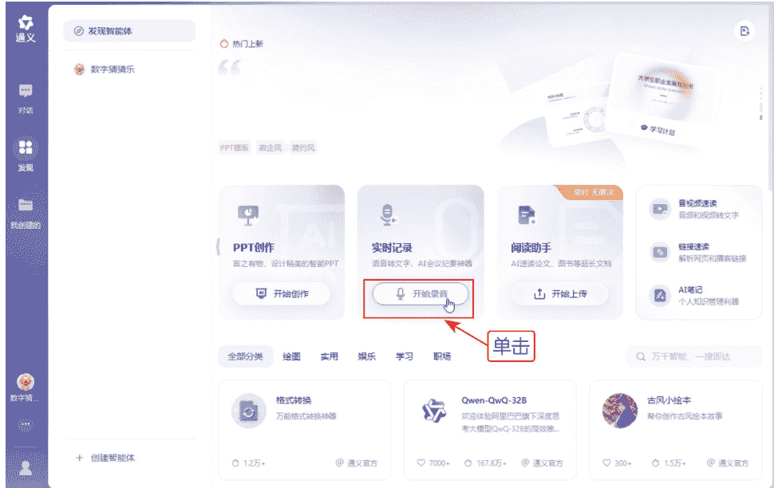

提示：在实际操作中，若不便携带电脑参会，可使用通义App的【实时记录】完成语音转写，该功能将在第6章详细介绍。

步骤02 进入【通义实时记录】界面，可设定音频语言、是否开启翻译及发言人区分，再点击【开始录音】。

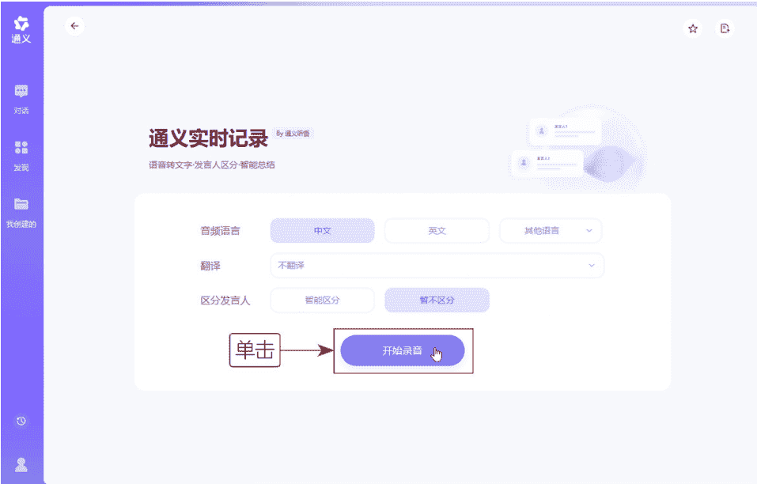

步骤03 系统开始实时收录音频并以文字呈现。若识别出现偏差，可直接对文本进行即时修改。

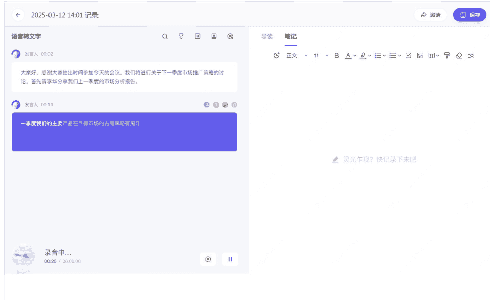

步骤04 记录过程中需暂停时点按【暂停录音】⏸；录制结束时点按【结束录音】🔴即可停止。

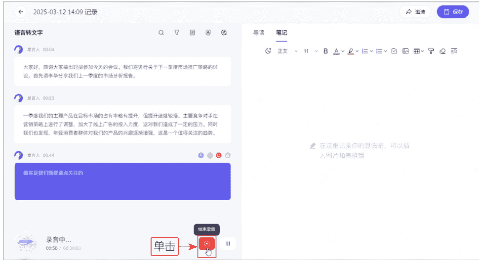

### 5.1.2 实战：区分发言人
会议中说话人频繁更换容易造成记录混淆。通义效率借助智能识别技术自动标注不同发言内容，保证记录清晰完整，方便后续回顾。

若录制时未打开【区分发言人】，可在录制结束后进入【导读】，选择【发言总结】后再选【多人讨论】，点击【立即体验】。也可直接在【语音转文字】区点按【区分发言人】。

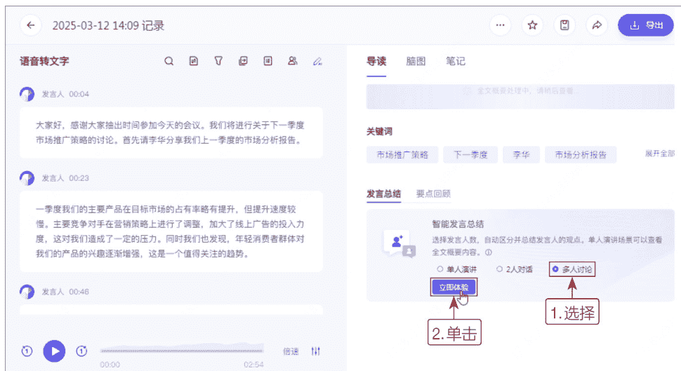

系统会自动识别并标注各发言人。

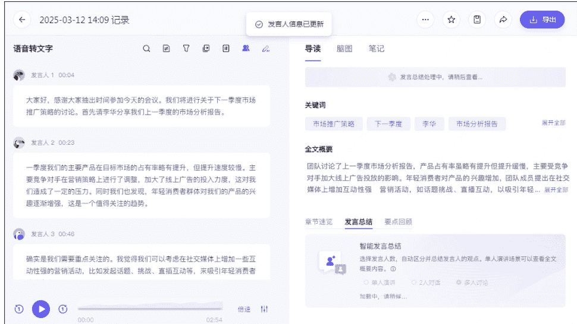

如需区分已有的音频文件中的说话人，可使用通义的【音视频速读】功能进行处理。

### 5.1.3 实战：智能总结音频要点
录音结束后，通义会自动抽取关键词、全文摘要、发言汇总及问答回顾，帮助快速把握重点，节省时间。

例如选择【要点回顾】，即可看到以问答形式呈现的内容概览；点击某个问题时，左侧【语言转文字】区会高亮对应文本。

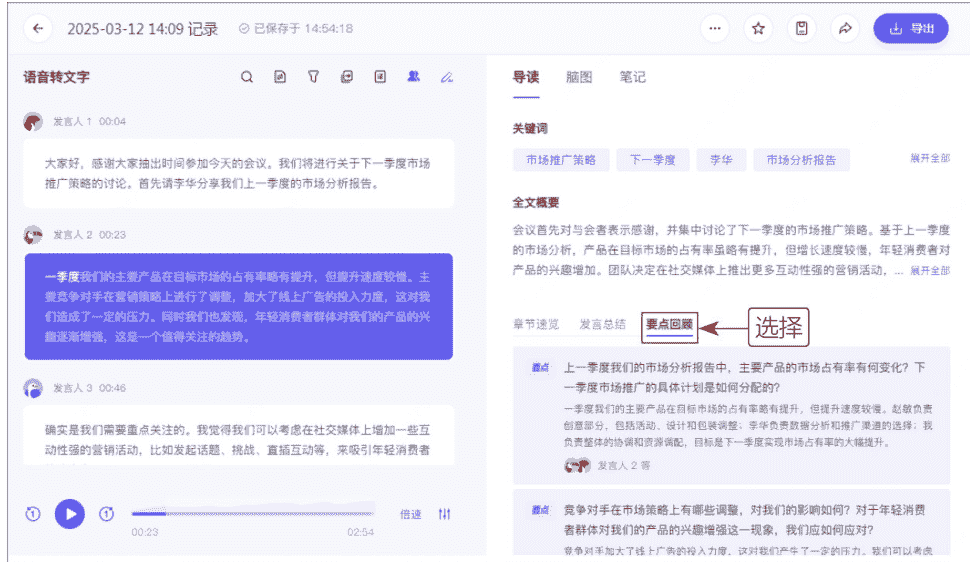

### 5.1.4 实战：AI改写识别文本
通义支持一键智能改写识别结果，提升文字质量。

步骤01 点按【AI改写】按钮✏️，在弹出的对话框中设定【显示内容】，如选择【改写结果】，随后点击【立即体验】。

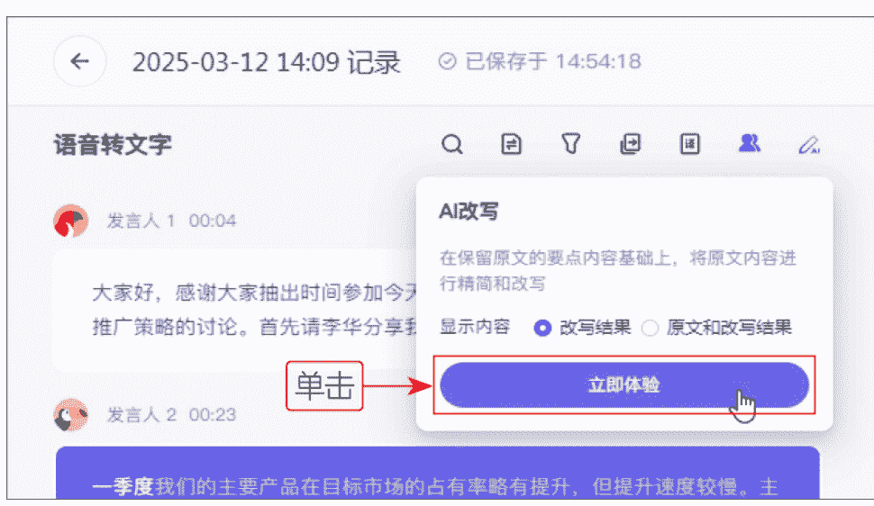

步骤02 系统自动对识别文本进行改写并展示结果。


若需取消改写，可在对话框中点击【取消】。

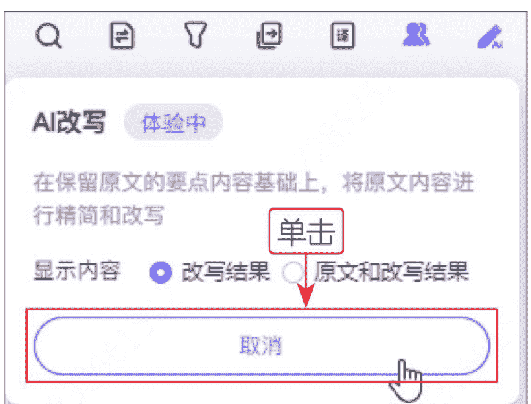

## 5.2 阅读助手
通义的【阅读助手】提供全文总结与翻译、思维导图生成、文档解读问答的一站式服务，极大便利阅读与学习。

### 5.2.1 实战：文档解读问答
面对难以理解的专业文献，文档解读问答可提供支持。用户只需提出疑问，系统就能基于原文给出精准解答。

步骤01 在【发现智能体】页面，点击【阅读助手】下的【开始上传】。

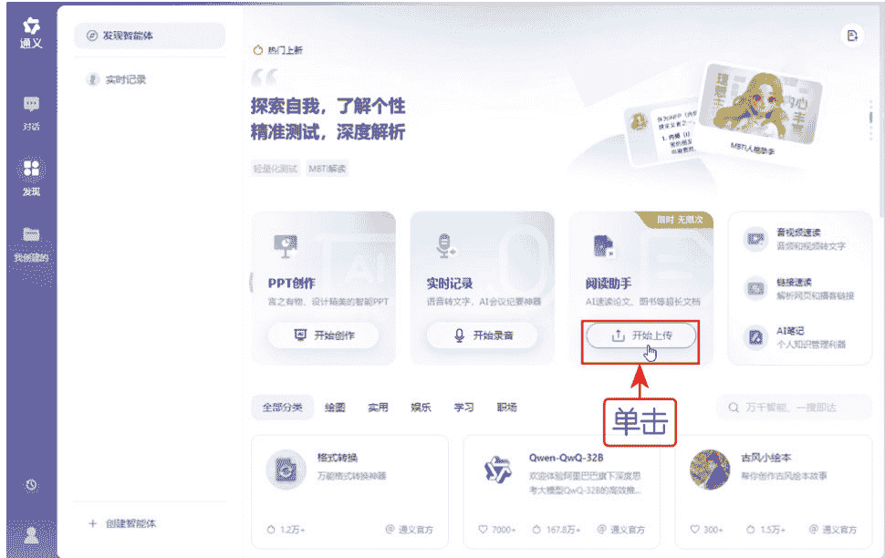

步骤02 进入【通义阅读助手】界面，可先选文件类型，如【文档】，再点上传区。

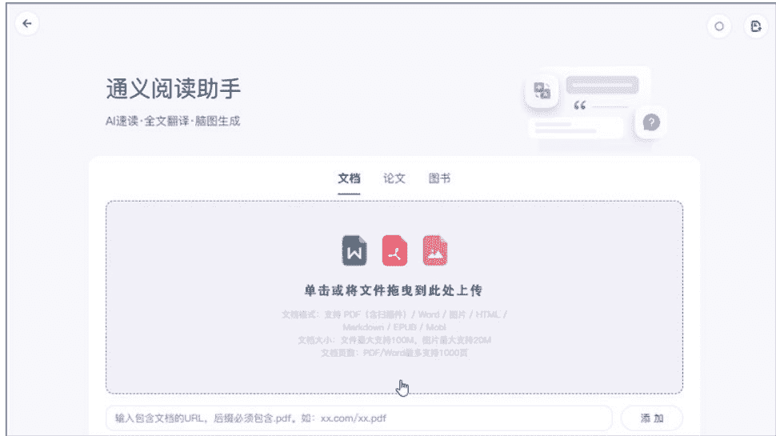

提示：文档也可直接拖拽至上传区。

步骤03 弹出打开对话框，选取目标文档后点【打开】。

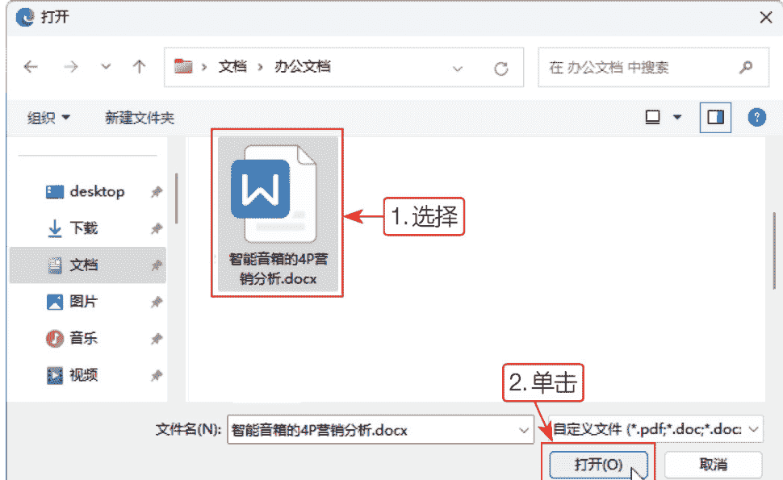

步骤04 文档上传后开始解析，可点【上传记录】查看进度。

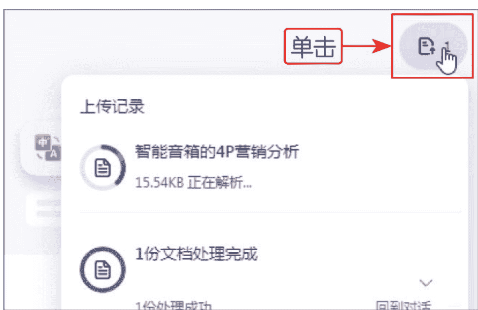

步骤05 解析完成后，点击文档右侧【立即查看】。

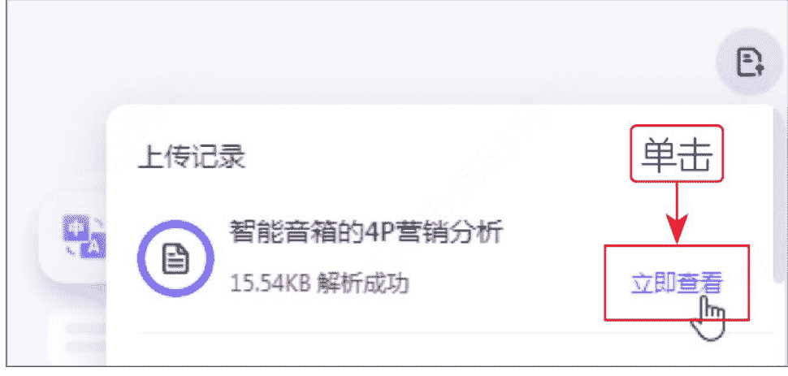

步骤06 打开文档后，【导读】标签会呈现全文概览与要点。

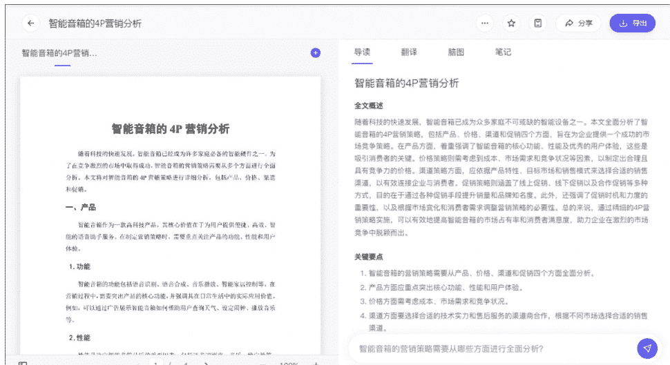

步骤07 若需解读某句或段落，在左侧文档区选中文本，从弹出菜单中选【解读】。


步骤08 系统将给出解读结果。


步骤09 也可在输入框提问后点【发送】。


步骤10 系统依据文档内容作答。


步骤11 对话结束后可点📌收起智能问答页，继续执行其他操作。


### 5.2.2 实战：全文一键翻译
阅读助手提供全文翻译服务，支持中英互译。

步骤01 选择【翻译】并点【开始翻译】。


步骤02 系统启动全文翻译。


### 5.2.3 实战：生成和导出脑图
通义可从文档中提取要点生成易懂脑图，便于快速掌握精髓。

步骤01 选择【脑图】，系统自动生成。若需放大，可点【全屏查看】。


步骤02 脑图进入全屏展示。

步骤03 全屏下点【导出】，在菜单中选格式，如【.xmind】。

步骤04 浏览器自动下载文件，可在下载列表中查看。

### 5.2.4 实战：添加阅读笔记
阅读助手支持在阅读时直接添加笔记，标注或摘取重点，便于复习。

步骤01 点【笔记】打开笔记页。

步骤02 可在此输入想法并按需排版，操作类似Word。

步骤03 阅读时选中需摘录的文本，从菜单选【摘取至笔记】。

步骤04 文本即被加入笔记。

## 5.3 PPT制作
无论学术汇报还是商务演示，高质量PPT都至关重要。通义的【PPT制作】功能可满足不同场景需求，轻松打造专业演示稿。

### 5.3.1 实战：一句话生成PPT
面对快速准备演示材料的场景，一句话生成PPT可大幅提升效率。

步骤01 在【发现智能体】页，点击【PPT创作】下的【开始创作】。

步骤02 进入创作页，在输入框填写主题或要求后点【下一步】。

步骤03 系统生成大纲，可修改并设定演讲场景后点【下一步】。

步骤04 右侧模板列表中挑选模板，左侧预览效果，确认后点【生成PPT】。

步骤05 PPT生成完成，可按需编辑。

步骤06 需导出时点【导出】，选择【导出为PPT】。

步骤07 浏览器开始下载文件。

步骤08 下载后可用PowerPoint或WPS打开并编辑。

### 5.3.2 实战：上传文件快速生成PPT
已有详细资料时，可用上传文件生成PPT功能，系统自动提取关键信息快速成稿。

步骤01 在创作页点【上传】，从菜单选文件类型，如【上传文档】。

提示：支持音频、视频、PDF（含扫描件）、Word、图片、HTML、Markdown、EPUB、Mobi。视频最大6GB，音频最大500MB，时长上限6小时；文档最大100MB，字数上限1000万。

步骤02 弹出打开对话框，选文档后点【打开】。

步骤03 上传完成后可输入要求或直接点【下一步】。

步骤04 系统据文档生成大纲，可修改后点【下一步】创建PPT。

### 5.3.3 实战：长文本生成PPT
针对长篇文本，通义可智能生成结构合理的内容丰富的PPT，最多输入10万字，适用于深度讲解场景。

步骤01 在创作页将文本粘贴至输入框后点【下一步】。

公司新品发布会活动策划方案计划书

一、活动主题

智启新程，创享未来——智能手表新品发布会

二、活动目标

智能音箱营销策略分析

- 产品
  - 功能
    - 语音识别
    - 音乐播放
    - 智能家居控制
  - 性能
    - 语音识别率
    - 音质
    - 稳定性
  - 用户体验
    - 简化操作
    - 提高满意度
- 价格
  - 成本
  - 市场需求
  - 竞争状况
- 渠道
  - 产品特点
  - 目标市场
  - 销售模式
    - 直销
    - 代理
    - 分销
- 促销
  - 促销方式
    - 线上促销
      - 电子商务
      - 社交媒体
    - 线下促销
      - 新品发布
      - 展览会
    - 合作促销
      - 联合推广
      - 异业联盟
  - 促销时间
  - 促销力度

智能音箱的 4P 营销分析
随着科技快速发展，智能音箱已成为许多家庭的必备智能硬件。为在激烈竞争中胜出，营销策略需多维度全面分析。本文对智能音箱的 4P 策略进行详细拆解，涵盖产品、价格、渠道与促销。

一、产品
智能音箱作为高科技产品，核心价值在于提供便捷高效智能的语音助手服务。制定策略时需重点关注功能、性能与用户体验。

1. 功能
智能音箱功能包括语音识别、语音合成、音乐播放、智能家居控制等。营销中需突出核心功能并强调日常应用价值。例如通过广告展示其如何查询天气、设定闹钟、播放音乐等。

2. 性能
性能是决定品质的关键，包括语音识别率、音质、稳定性等。宣传中需客观介绍表现并强调同类优势，也可通过实测与用户评价佐证。

3. 用户体验
良好体验是留住用户的关键。设计之初需充分考虑需求与使用习惯，简化操作流程，提升满意度。营销中可分享用户心得与评价吸引潜在用户。

在激烈市场中，企业应密切关注竞争对手定价策略与市场反应，保持竞争优势与市场地位以吸引更多消费者。

智能音箱的性能有哪些方面？

3. 用户体验
良好的用户体验是留住用户的关键。设计之初需充分考虑需求与使用习惯，尽可能提高用户满意度。分享用户使用心得可吸引更多潜在用户。

1. 以新品发布会为契机面向媒体、合作方及潜在用户展示公司最新智能手表，提升产品声量与市场关注度。预计媒体报道不少于200家，触达潜在人群超过50万。
2. 借助活动深化与伙伴的沟通协作，力争会后与10家以上伙伴达成合作意向，签约金额合计不低于5000万元。
3. 强化品牌形象，提升行业影响力与美誉度，推动目标市场品牌认知度提高20%以上。

三、活动时间与地点
1. 时间：2025年3月20日 14:00 - 18:00
2. 地点：杭州市xx酒店大宴会厅，场地可容纳500人，交通便利，周边配套完善，契合公司高端品牌调性。

四、活动对象
1. 行业媒体：邀请科技、数码、财经等主流领域记者150人，覆盖线上平台、纸媒、电视等，预计总曝光量超1000万次。
2. 合作伙伴：现有伙伴代表100人，潜在伙伴代表50人，涵盖渠道商、供应商、技术协作方等。

第二步，通义可按文本自动生成PPT提纲，用户可自行调整，确认后点【下一步】启动创建，见配图。

## 5.4 音视频速读

音视频素材种类丰富，人工提炼耗时。通义的音视频速读功能可把音视频转为文字并生成脑图，帮助快速获取与整理信息，提升使用效率。

步骤01 在发现智能体中心点选音视频速读入口，见配图。
步骤02 弹框出现后，本例将视频文件拖入投放区，见配图。
步骤03 文件上传完毕会列入清单，还可通过继续添加补充素材，随后按需设置语言、是否翻译及是否区分说话人，下一页图示。

## 音视频速读

音频和视频转文字

步骤04 转写完成后，在上传记录中点选立即查看，右侧图示。
步骤05 进入操作页，左侧语音转文字区呈现文本，右侧导读区展示关键词、全文概要与章节快览，见配图。
步骤06 播放音视频时下方文字同步变化，若识别不准可手动修正，下一页图示。
步骤07 在导读下选择要点回顾，即可呈现核心内容，见配图。
步骤08 切换到脑图标签，可查看结构化图谱，下一页上图。
步骤09 如需导出，除复制外可点右上角导出按钮，在导出对话框中设置文档格式与显示信息后完成导出，下一页下图。

## 5.5 论文速读

学术阅读中快速把握论文要点是基本能力。通义的论文速读可提炼核心知识，节省时间。

步骤01 在发现智能体中心点选阅读助手下的开始上传，下一页图示。
步骤02 将论文文档拖入投放区，左下图。
步骤03 提交后在上传记录清单中点选立即查看，右下图。
步骤04 系统已完成摘要与方法提炼，见配图。
步骤05 可进行智能问答获取答案，回复末尾会显示来源文件，见配图。
步骤06 点选 📄 按钮会展示来源文件，见配图，点选可跳转至原文对应位置。

## 5.6 智能解析网页URL

网络信息庞杂，筛选利用有难度。通义的链接速读可解析网页URL或播客RSS，智能汇总核心信息，帮助快速判断价值，提升线上学习与工作效率。

步骤01 在发现智能体中心点选链接速读按钮，见配图。
步骤02 弹框后在对应标签填写或粘贴链接，以网页阅读为例，输入URL后点确认，见配图。
步骤03 系统会对网页进行阅读分析，自动提取概述与要点。解析完成后在上传记录中查看并进入页面。可解读左侧内容，也可选择脑图、笔记等辅助，下一页图示。

## 学电脑（Windows 11+WPS Office）从入门到精通（AI高效版）-异步社区-致力于优质IT知识的出版和分享

原文链接：https://www.epubit.com/article/details/27650

“异步社区”(www.epubit.com)由人民邮电出版社创办的IT专业图书社区，于2015年8月上线运营，致力于优质内容的出版与分享，为读者提供高质量学习内容，为作者提供专业出版服务，实现作者与读者在线互动，以及传统出版与数字出版融合发展。

“异步图书”是异步社区策划出版的精品IT图书品牌，依托人民邮电出版社在计算机图书领域四十余年的积累，面向IT

来源：https://www.epubit.com/article/details/27650

## 学电脑（Windows 11+WPS Office）从入门到精通（AI高效版）--异步社区--致力于优质IT知识的出版和分享

## 文章概述

本文介绍由人民邮电出版社创办的IT专业图书社区“异步社区”，该平台聚焦优质IT知识的出版与分享，自2015年8月上线以来，已成为提供高品质学习内容的重要资源。异步社区通过“异步图书”品牌汇聚数十年计算机图书经验，面向IT行业及各行业信息化使用者提供深度知识平台，同时支持作者读者在线互动，并探索传统与数字出版融合，以满足市场与技术变化。

## 关键要点

1. 异步社区是聚焦优质IT知识出版与分享的平台，成立于2015年8月。
2. 异步图书是该平台策划的精品IT图书品牌，服务IT行业及各类信息化用户。

输入“/”唤起指令中心，Enter发送，Shift+Enter换行

## 第6章

## 智能助手：通义App的应用

在智能科技快速发展的当下，智能助手已成为生活与工作的得力伙伴。本章介绍通义App的应用，深入探讨其多样化功能。通过详细介绍个性化设置、对话方式，以及拍照问答、实时翻译等特色功能，全方位展示通义如何以智能化、个性化服务满足不同场景需求，让应用更贴近生活，提升效率与体验。

## 6.1 通义App的个性化设置

随着智能助手普及，通义App成为常用工具。了解其设置尤为重要。本节深入探讨个性化配置，帮助你掌握设置技巧，让通义更懂你。

步骤01 初次使用前需在应用商店下载安装通义App。安装后点桌面图标启动，按提示登录进入主界面，点击左上角按钮，如下方左图所示。
步骤02 进入个人页，点击左上角的 ≡ 按钮，如下方右图所示。
步骤03 进入设置页，包含通义形象、语音播报、主题色彩、字体大小、震动反馈等选项。例如选择通义形象，如右图所示。

### 设置

#### 助手
- 通义形象
- 语音播报 智能播报

#### 应用
- 主题色彩 跟随系统
- 字体大小 标准
- 震动反馈
- 添加小组件

#### 关于
- 反馈投诉
- 权限管理
- 个人信息收集清单
- 第三方信息共享清单
- 关于我们

#### 帐号
- 账号管理
- 退出登录

步骤04 进入通义形象页，有3种形象可选，可左右滑动选择，点击下方语音音色选项，如下页左图所示。
步骤05 进入语音音色设置页，可选择喜欢的音色试听，确认后点 < 返回设置页，设置生效。
步骤06 在设置页选择语音播报选项，进入语音播报设置页，可按需配置，如下页右图所示。


## 6.2 与通义App的对话方式

更好使用通义App，对话方式选择很关键。本节介绍语音输入与实时语音通话两大实用功能，让你随时随地与AI保持紧密联系，享受便捷高效体验。

### 6.2.1 实战：语音输入

语音输入是使用通义App与AI对话的便捷方式。本小节教你准确使用语音输入功能，让沟通更流畅自然，无需动手即可传达提示词。

**步骤01** 在主界面点击输入框中的 🔊 按钮，如下页左图所示。
**步骤02** 按住【按住说话】按钮，如下页右图所示。


**步骤03** 对准话筒说出想要输入的内容，松开按钮即可发送，如下图所示。


### 6.2.2 实战：实时语音通话

实时语音通话让对话更即时、互动性更强。本小节带你体验该功能，感受与智能助手无缝交流的畅快。

**步骤01** 在主界面点击输入框中的 ⊕ 按钮，如下图所示。


**步骤02** 在展开菜单中点击【通话】按钮 📞，如下图所示。


**步骤03** 拨通后进入语音通话页，如下页左图所示。
**步骤04** 用户可随时说话，系统会实时识别并在屏幕上显示说话内容，如下页右图所示。


**步骤05** 用户说话完毕后，通义会进行回复，如下方左图所示。
**步骤06** 通义说话时，用户可随时说话或轻点屏幕中断回复。待回复完毕后可继续互动，如下方右图所示。


步骤07 点击顶部【场景选择】按钮，在展开场景中按需选择，如点击【口语对练】，如下方左图所示。
步骤08 通义即可与用户进行口语互动，如下方右图所示。


## 6.3 通义的特色功能

通义App除基础对话外，还拥有众多特色功能，让应用更丰富。本节带你领略这些功能的魅力。

### 6.3.1 实战：拍照问答

拍照问答功能允许用户拍照或从相册选择照片提问，可找到相关答案或信息。例如拍摄咖啡照片查询品牌，或为照片生成朋友圈文案，均可实现。

**步骤01** 在主界面点击输入框中的 ⊕ 按钮，如下图所示。


**步骤02** 在展开功能菜单中，通过拍照或选择相册图片互动，如这里点击【相册】按钮，如下图所示。


步骤03 选择照片后，在输入框输入提示词，点击【发送】按钮，如下方左图所示。
步骤04 通义会快速响应提示词并给出回复，如下方右图所示。


### 6.3.2 实战：实时录音记录

实时录音记录功能让你随时捕捉灵感，不错过重要信息。本小节带你体验这一便捷功能。

步骤01 点击输入框上方的【实时记录】按钮，如下图所示。


**步骤02** 弹出【录音】窗格，选择收音模式，如选择【现场录音】模式，然后点击【开始录音】按钮，如下方左图所示。
**步骤03** 系统开始录音并将音频实时转写为文字。转写过程中可点击【暂停】按钮||随时暂停，录音完成后点击🔴按钮结束，如下方右图所示。


步骤04 弹出窗格，可编辑录音文件名及选择分类，然后点击【保存】按钮，如下页左图所示。
步骤05 系统会智能总结转写内容，可查看原文、导读及脑图，并可进行翻译，如下方右图所示。


### 6.3.3 实战：实时翻译

通义支持中英文实时翻译，助你轻松跨越语言障碍。

步骤01 在功能菜单中点击【翻译】按钮，如下图所示。


步骤02 弹出【翻译】窗格，可通过语音输入或文本粘贴翻译，也可进行同传翻译，例如点击【同传翻译】按钮，如下页左图所示。
步骤03 进入【同传翻译】页，顶部设置好翻译项，然后点击【开始】按钮，如下页中图所示。
步骤04 同传翻译功能即可实时翻译，使用完成后点击【停止】按钮，如下方右图所示。


### 6.3.4 实战：通义智能体的使用与创建

通义App提供一系列功能强大的智能体，涵盖角色、实用、娱乐、学习及职场等多个类别。用户可按需灵活选择，提升生活与工作效率。

#### 1. 使用智能体

**步骤01** 在主界面向左滑动屏幕进入【精选】界面。顶部菜单提供视频生成、绘图、角色等功能。例如点击【热门应用】列表中【千问大模型】智能体右侧的【使用】按钮，如右图所示。

< 精选 视频生成 绘图


##### 热门实用

激活你的全能智囊团

- **千问大模型** 首发

  Qwen3模型重磅发布，支持多种...

  👁 271.7万+

- **健康顾问佑安**

  为你健康护航，海量知识解疑

  👁 9.8万+

- **AI扩图**

  AI扩图工具，支持扩大倍数和更...

  👁 9万+

- **AI编码助手**

  你好，我是你的 AI 编码助手，我...

  👁 4.3万+

- **AI法律顾问**

  Hi ~ 我是AI法律顾问，通过我国...

  👁 3.9万+

##### 神来之笔

让你的想象触手可及


**步骤02** 进入【千问大模型】对话界面，在输入框输入文本后点击 🔘 按钮，如下方左图所示。
**步骤03** 与其他智能体不同，【千问大模型】会逐步思考并拆解用户需求，如下方中图所示。
**步骤04** 深度思考完成后，【千问大模型】即给出回复内容，如下方右图所示。


Qwen3模型重磅发布，支持多种模型自主切换，快来体验吧！

- ✨ 你现在的智慧达到了人类水平了吗？
- ✨ 请你给20-28岁未婚女性几点人生建议
- ✨ 艺术的无限可能，英文怎么翻译

🌐 联网搜索

什么是Markdown? AI写作都在用


什么是Markdown? AI写作都在用

正在深度思考

好的，用户问的是“什么是Markdown? AI写作都在用”。首先，我需要结合用户提供的知识库信息来回答这个问题。用户之前

联网搜索

给千问大模型发消息

什么是Markdown? AI写作都在用

已完成深度思考（用时15秒）

好的，用户问的是“什么是Markdown? AI写作都在用”。首先，我需要先回答Markdown的定义。根据知识库里的信息，Markdown是一种轻量级标记语言，由John Gruber在2004年创建，用于将纯文本转换为HTML或其他格式。它的特点是简洁、易读易写，使用简单的符号来实现格式化，比如#表示标题，*加粗等。

**AI 生成内容为何总带 Markdown 标记**

最近不少用户发现，用大模型撰写说明或文章时，返回的结果多以 Markdown 呈现。根据已有资料，Markdown 学习门槛低，在不同终端与平台上表现稳定，层级关系清晰，很适合技术文档和工作汇报的场景。再结合资料提及的富文本支持能力，它能承载加粗、列表、链接等要素，让模型迅速给出已排版的文本。叠加 AI 写作追求效率与结构化交付的特性，模型产出的 Markdown 可直接预览，无需二次转换，恰好契合快速交付的使用习惯。许多人对这套标记语言本身并不熟悉，只是频繁碰到，产生了为什么智能助手更偏爱它的疑问。

联网搜索

给千问大模型发消息

#### 2. 快速创建专属智能体
步骤01 在通义主界面右上角定位 ⊕ 按钮后点按操作，如下图所示。

步骤02 进入创建入口后，页面提供两种创建路径，本示例选用【创建工具】，左侧示意。
步骤03 进入工具创建页，在【工具名称】栏填写名称。若需更换头像，点击头像右下角的 🖼 标识，右侧示意参考。


步骤04 头像面板弹出后，可从相册导入图片，或点击【AI头像生成】按提示生成新头像，右侧示例可见。
步骤05 在【工具设定】区域点击【一键生成】，通义会依据名称自动产出设定草案，可自行修改后再点【创建】，右侧示意可见。也可按需调整语音、公开范围及高级选项。


步骤06 进入“你的工具已诞生”页，若设为公开需审核通过后才可见，点击【开始聊天】继续。
步骤07 进入对话页后即可与该工具互动，右侧示意可见。


提示：下次使用时，在通义主界面点 ≡ 进入个人中心，在【我聊过的智能体】列表中即可快速打开已建工具。

# 第7章 通义大模型家族：多元产品实战体验

在生成式 AI 快速演进的背景下，阿里云推出了多款实用型智能产品，用户体验显著提升。本章聚焦通义系列的其余成员，涵盖图像与视频创作、代码辅助、法律咨询、角色对话、企业客服等多个方向，呈现 AI 在真实场景中的便捷性。

## 7.1 图像视频创作助手 通义万相

通义万相隶属于阿里云通义大模型阵营，集成了图像与视频生成能力。它能依据文本描述合成逼真画面，也可基于文字与图片制作视频，为创作者提供新思路。

### 7.1.1 实战：文字生成图像
输入一段描述就能得到匹配画面，通义万相让文字到图像的转换变得简单。
步骤01 打开通义万相官网，点击【文字作画】进入对应页面，如图。

步骤02 平台提供多个创作模型，点击【万相2.1专业】右侧的 > 展开【创作模型】面板，不同模型在生成速度、擅长类型、细节表现、语义理解、风格泛化等方面各有侧重，可按需选择。

步骤03 在提示词输入框填写描述，支持自然语言或关键词组合，右侧图示。

提示：提示词常用“主体+场景+风格”结构。
- **主体**：画面核心元素，如风景画中的山川湖泊森林，人物画中的人像女性儿童等。
- **场景**：主体所在环境，包含室内外、季节、天气、光照等，可为真实或虚构空间。
- **风格**：表现形式，涵盖画种如油画水彩素描，色彩倾向如明亮柔和高对比，以及构图方式如对称非对称透视等。例如可用“油画质感”“柔和色调”“对称构图”描述。
除上述三要素外，还可补充镜头语言和氛围细节等。
步骤04 如对细节不确定，可点击【智能扩写】丰富描述；确认后点【使用扩写结果】，右侧图示。

提示：使用智能扩写时，注意最终结果可能与初始输入有细微差别。
步骤05 还可点击【咒语书】按钮，在展开面板中为提示词添加风格、光线、材质、渲染、色彩等标签，点击后自动填入输入框。

步骤06 在【创意模板】区可进一步限定画面风格与内容，如图，不需要可跳过。

提示：上传参考图可让模型借鉴其风格或主体并调节权重。目前万相2.1暂不支持参考图，需切换至万相1.0。
步骤07 在【比例】区设定画作尺寸后，点击【生成画作】，如图。

步骤08 生成完成后展示4张结果，不满意可点【再次生成】，如图。
在浩瀚无垠的宇宙背景下，一名宇航员身着银白色太空服，背靠宏伟的宇宙飞船，飞船表面闪烁着灯光，仿...


步骤09 重新生成后效果如图。
在浩瀚无垠的宇宙背景下，一名宇航员身着银白色太空服，背靠宏伟的宇宙飞船，飞船表面闪烁着...


步骤10 点击任意成图可放大查看，还可选择【高清放大】、【局部重绘】、【生成相似图】，下载点右上角【下载】，下页图示。


### 7.1.2 实战：文生视频
文字与视频结合会产生怎样效果？通义万相让文生视频变得轻松有趣。
步骤01 打开官网，点击【视频生成】进入页面，如图。

步骤02 选择【文生视频】，在输入框写简短描述，点【智能扩写】丰富后再点【使用扩写结果】，下页图示。

步骤03 扩写内容自动填入，设置视频比例，按需开启【灵感模式】与【视频音效】，再点【生成视频】，如图。

提示：开启灵感模式会增加创意灵感，提升画面丰富度与表现力，但输出可能与提示词有出入。开启视频音效会为内容配音，若无法生成则提供背景音乐。
步骤04 系统开始生成，耗时较长需等待，如图。

步骤05 生成完成后可播放查看，也可点页面【下载】保存，如图。


### 7.1.3 实战：图生视频
通义万相可将静态图像转为动态视频，助力创意发挥并赋予图像生命。
步骤01 在【视频生成】页选【图生视频】，支持上传或拖拽图片，例如拖入上传区，下页图示。

步骤02 上传后弹出【裁剪比例】对话框，选择比例后点【完成】，右图示。

步骤03 按需填写【创意描述】，开启【灵感模式】及【视频音效】后点【生成视频】，如图。

步骤04 生成完成后即可预览，如图。


### 7.1.4 实战：一键迁移图像风格
【应用广场】集中了众多功能，本节以【风格迁移】为例介绍特色用法，实现风格一键迁移。
步骤01 点击【应用广场】进入页面，在【AI图像】区点【风格迁移】，如图。

步骤02 进入页面后分别上传风格图和原图，下页图示。

步骤03 上传完成后点【生成画作】，如图。

步骤04 系统生成新效果图，下页图示。


## 7.2 编程智能助手 通义灵码

通义灵码面向开发者，旨在提升编程效率和代码质量。它能解析复杂逻辑、自动生成代码片段，并辅助调试测试，是开发者的得力助手。普通用户可直接使用通义，本节介绍的灵码更适合开发者，使用门槛相对较高。

### 7.2.1 实战：环境配置
使用前需先配置开发环境，具体如下。
步骤01 在通义灵码官网点【个人免费使用】，进入页面后选择开发工具，例如选【Visual Studio Code】，点【立即安装】，下页上图。
步骤02 安装 VS Code 后，按页面指引在编辑器中搜索并安装通义灵码扩展，下页中图。


步骤03 安装完成后按提示登录阿里云账号，显示【通义灵码：登录成功】即表示扩展可用，右图示。


### 7.2.2 实战：解读代码
解读代码是常见需求，灵码可快速理解复杂逻辑并给出注释解释，提升可读性和可维护性。
步骤01 在 VS Code 侧边栏点【通义灵码】图标进入界面，如图。

步骤02 在输入框粘贴代码片段，如图，回车发送。
通义灵码
嗨，我是通义灵码，你的智能编码助手。你可以问我编码相关的问题，也可以一起更高效、更高质量地完成编码工作。通过帮助文档，了解更多关于我的信息，或提交反馈让我变得更好。同时，你可以前往官网了解更多企业版的信息。
可以选中代码后输入 / 触发快捷命令：
-   解释代码
-   生成单元测试
-   生成注释
-   生成优化建议
另外，输入你的问题也可以直接对话，或输入@灵码了解更多福利活动。
```python
import random

data = [random.randint(1, 100) for _ in range(10)]
target = random.choice(data)

attempts = 0
guess = None

while guess != target:
    guess = int(input("Guess a number between 1 and 100: "))
    attempts += 1

print(f"Congratulations! You guessed the number {target} in {attempts} attempts.")
```
步骤03 灵码会逐行解析代码，专业度高于通用通义，下页图示。


### 7.2.3 实战：生成代码
灵码可依据需求和语言生成规范代码，帮助初学者快速实现功能，减少手工编写时间与错误。
步骤01 在输入框输入生成提示词，右图示。
生成一个简单的Python代码示例。这个示例将展示如何创建一个函数来计算两个数的和，并在主程序中调用这个函数。
步骤02 系统依据提示词生成代码，右图示。
当然！下面是一个简单的Python代码示例，展示了如何创建一个函数来计算两个数的和，并在主程序中调用这个函数：
```python
def add_numbers(a, b):
    """
    计算两个数的和。

    参数:
    a (int, float): 第一个加数
    b (int, float): 第二个加数

    返回:
    int, float: 两个数的和
    """
    return a + b

def main():
    # 定义两个数字
    num1 = 5
    num2 = 3

    # 调用add_numbers函数计算和
    result = add_numbers(num1, num2)

    # 输出结果
    print(f"The sum of {num1} and {num2} is {result}")

if __name__ == "__main__":
    main()
```

### 7.2.4 实战：代码调试
调试是编程必备环节，可帮助发现并修复错误。
步骤01 在输入框输入调试提示词与代码后按 ↵ 发送，如图。

步骤02 灵码会分析错误位置并给出修正后代码，如图。
当然，我可以帮你调试这段代码。以下是代码中的错误和修正建议：
#### 错误列表
1.  缩进错误：
    * `return a + b` 需要缩进到 `multiply_numbers` 函数体内。
    * `num1 = input("请输入第一个数:"`
#### 修正后的代码
```python
def multiply_numbers(a, b):
    return a * b
```

## 7.3 AI法律助手 通义法睿

AI 法律助手通义法睿快速上手

通义法睿面向法律场景的智能助手，响应迅速、信息可靠，覆盖法律咨询、文书起草、法规检索、文本研读、合同核查与知识库六大模块，让获取法律服务更省心。

步骤01 打开通义法睿官网，用阿里云身份登录后进入主工作台，页面集中展示六个入口：法律咨询、法律检索、合同审查、文本阅读、文书生成、知识库。以法律咨询为例，界面见配图。


步骤02 在提问区输入想了解的法律问题，按下发送键即可。


步骤03 系统会自动抓取相关法条与案例，迅速给出解读与答复，效果见下一张配图。


步骤04 如需起草材料，可切换到文书生成模块，操作见配图。在起诉状栏目中描述案情要点，随后点击【立即撰写】，系统会生成初稿。其余模块也支持按需切换使用。


## 7.4 数字分身与角色扮演平台 通义星尘

通义星尘出自阿里云，是类人智能对话与虚拟分身制作工具，核心在于拟人化扮演、深度互动和实时呈现。

在功能层面，用户可自行创建带有独特外观、音色和性格取向的虚拟分身，让形象更贴合个人风格或特定人设。这些分身既能进行一对一深入交流，也能在群聊场景下与其他分身或真实用户互动，形成多角色的复杂会话，适配线上教学、直播娱乐、客户支持等场景。助手界面展示如下。


该产品能充当企业虚拟接待，全天候在线答疑，改善顾客体验。对内容生产者而言，定制数字人造型有助于快速产出优质视频，压缩制作开销、提升产出效率。

平台交互体验多元，并开放强力 API，开发者可以轻松把能力嵌入自有应用或服务。无论是想改善使用感受、放大品牌号召力，还是提高内容生产力，企业与个人都能获得技术支撑，兼顾商业落地与个人娱乐。

## 7.5 企业级 AI 客服方案 通义晓蜜

通义晓蜜是阿里云推出的企业级客服方案，归属通义家族，主要包含对话机器人、智能坐席助理与多模态智能联络中心。借助智能化手段助力企业提效并增强顾客满意度，是数字化转型的有力抓手。官网见配图。


对话分析基于深度调优的大语言模型，在营销服务场景中可提供生成式摘要、质检、分析能力。借助 API 接入，支持预置模板或自定义模板的灵活运用，可切换不同规格的定制模型，实现提示词的精确执行。

应用覆盖电商、金融、教育以及医疗领域中需要客服支持的行业。它能提高应答质量与速度，降低运营开销，同时增强顾客满意与忠诚。