# ChatGPT商业实战：从场景到价值

## 作者小传
查尔斯·瓦格马尔自2019年起在Microsoft 365领域从事业务分析工作。他曾为一家数字化客户体验机构打造知识管理平台，该平台以聊天机器人为载体实现流程自动化、催生新用例，并负责归集与人工智能及客户体验相关的客户参考资料与知识资产。

## 译者小传
王进喜，中国政法大学法学院教授、博士研究生导师，律师学研究中心主任，并兼任中国法学会律师法学研究会副会长；2008年入选教育部“新世纪优秀人才支持计划”，2010年主持教育部长江学者和创新团队发展计划“证据科学研究与应用”创新团队；曾任澳大利亚新南威尔士大学2009—2012年度客座研究员，2010年9月至2011年6月赴美国加利福尼亚大学戴维斯分校法学院担任高级访问学者。主要研究方向为法律职业伦理与法律职业行为法、证据法。

汪政，法学博士研究生、一级律师、独立董事、仲裁员，浙江省优秀律师。现任浙江泰杭律师事务所主任、浙江合众法律科技智能研究院院长，同时兼任杭州市上城区政协常委、全联并购公会副会长、欧盟中国委员会国际法律服务中心副主任、浙江财经大学法学院客座教授等职。曾主编《互联网金融合规指南与法律政策指引》，在《法律科技重构法律服务市场》《律师事务所发展路径和模式浅析》、“Research on Generative Artificial Intelligence Legal Profession Substitution”“Causality-inspired Legal Provision Selection with Large Language Model-based Explanation”等刊物发表论文十余篇。

汪政律师（左）和王进喜教授（右）

本书成稿于我至亲母亲卡玛拉·大卫·瓦格马尔女士离世数日之后。谨以此书献给她以及我的父亲大卫·杰努·瓦格马尔先生，他们为我的职业之路奠定根基。没有他们的付出，我不会走到今天。亦感谢我挚爱妻子普莉亚·瓦格马尔女士，感谢她的爱意、鼓励与照料。

## ｜译序｜

当下，一股全新科技力量正以前所未有的速度与广度重塑人类社会，这就是人工智能。其中由OpenAI推出的自然语言处理模型ChatGPT，已成为AI领域的代表性产品，关注度持续攀升，应用前景极具想象。作为以信息为核心的行业，法律实务长期错过技术革命浪潮，工作形态与两百年前相去不远。律师行业没有任何理由回避人工智能，也绝不可能脱离其影响。作为长期关注科技融入法律实务的研究者，我有责任把ChatGPT可能带来的革命性与颠覆性冲击介绍给法律从业者，揭示其背后蕴含的巨大潜力，并探索它如何与法律实践结合，为委托人提供更高效率、更具响应性、性价比更优的法律服务，同时为委托人的工作生活平衡注入新动能。

# ChatGPT如何重塑商业实践

本书通过生动的案例与深入剖析，呈现ChatGPT在多行业中的关键作用，如何推动企业创新、提升效率并创造新价值。从客户服务到市场营销，从数据分析到内容生产，ChatGPT的渗透面令人瞩目。它不仅能模拟人类对话，更能在上下文语境下产出高度相关且有用的信息，这使其在众多场景中优于传统自动化工具。

书中还探讨了ChatGPT对就业形态的影响与伦理难题。技术演进的同时，需直面这些挑战并寻求平衡。政策制定者、企业家与技术专家须携手协作，确保技术造福社会而非造成伤害。

值得说明的是，本书中文版由我与博士生汪政律师共同翻译。汪政长期投身科技在律师实务中的应用，对法律科技敏感度极高。他在ChatGPT等法律科技方面的研究与实践经验、专业素养与严谨作风，保障了译作质量。

总之，我希望读者能认识ChatGPT及其商业价值，并思考如何借力这项技术助推自身发展。人工智能应用才刚刚启程，对其挑战与机遇的认知亦处于开端，人们对美好生活的向往也会转化为对更强AI的持续期待。理解、见证并参与以人工智能为引领的全面变革，或许正是使命与机遇。

王进喜
于美国加州大学戴维斯分校法学院
2024年11月

## ｜推荐序｜

在信息爆炸的时代，人工智能技术正以前所未有的节奏改变世界。它不仅在科学工程领域取得突破，更深度渗入商业各环节，成为驱动创新与转型的核心力量。《释放ChatGPT的力量：真实世界的商业应用》便诞生于此背景，旨在探究如何将以ChatGPT为代表的生成式大语言模型转化为现实商业价值。

本书中文翻译由法律科技领域享有声誉的泰杭律师事务所汪政主任与其导师中国政法大学王进喜教授联合完成。汪政主任凭借对全球技术动态的敏锐洞察与技术与法律实践融合的深刻理解，为译作注入国际视野与实务见解。王进喜教授在国内外法学研究与技术应用于法律教育方面处于前沿，为译作提供坚实学术底座。二人凭借丰富行业经验与深厚法律科技功底，既保证译文准确专业，也为中文读者打开通往法律科技前沿的窗口。

本书不仅梳理了ChatGPT的技术基础，还以鲜活实例展示技术在各行各业的渗透，从客户服务到营销、从人力资源到产品开发，无所不在。这些技术大幅提升工作效率、降低成本支出，更关键的是帮助企业精准洞察客户需求、优化交互体验，进而构建稳定长远的客户关系。

当然，随之而来的是诸多挑战与责任。如何确保AI决策透明？如何避免算法偏见导致不公？如何构建高效且负责任的技术生态？这些问题需在创新推进中同步重视。

本书不仅是技术原理介绍，更是探讨先进技术如何服务企业与个人的作品，可为企业家提供借鉴，也为关注科技进步及其社会影响者提供视角。我相信，基于此类技术的成功案例将在中国乃至全球不断涌现。让我们共同迎接充满无限可能的时代。

孙常龙
于阿里巴巴通义实验室
2024年11月

## 致谢
感谢已故挚友阿尔文·费尔南迪斯，虽已不在身边，记忆长存。
斯里达尔·马赫斯瓦尔，NNIT集团供应链顾问，感谢你的持续支持。
普拉文·索拉特，ATOS业务单元负责人，感谢你的美好祝愿。

# 第 1 章

## ChatGPT入门导览
本章将对ChatGPT进行概览，探索AI对话领域并厘清ChatGPT在此领域的定位。同时回顾ChatGPT的发展脉络，检视其商业真实案例，并认识其在人工智能版图中的意义。

## 人工智能概览
人工智能领域正快速演进，目标是打造可执行人类典型任务的智能系统。它让计算机通过自行执行复杂操作实现学习与适应。新一代硬件与算力提升推动了这一进程，AI已在医疗、金融等领域获得广泛应用。

人工智能大致分为两类。
- 弱人工智能只能完成特定任务，难以迁移至任务之外。亚马逊的Alexa与苹果的Siri即为典型虚拟助手。
- 强人工智能可像人类一样处理多样化任务与行动，仍是研究者长期且艰难的目标。

人工智能由多种技术构成。机器学习是其子集，让计算机通过海量数据分析进行预测；其中深度学习可执行语音识别与图像识别等任务。自然语言处理致力于构建理解并解释人语的系统，广泛应用于翻译与情感分析。AI发展既带来变革潜力，也引发偏见、隐私与就业替代等伦理担忧。

AI的实践应用覆盖多领域。
- 自然语言处理驱动的AI为Google Assistant、Alexa等虚拟助手提供能力，可分析文本语音并响应，还能完成翻译与情感分析。
- 图像视频分析用于识别面部表情、检测照片物体与审核社交媒体内容。
- 推荐系统依托AI帮助用户发现内容与商品，如亚马逊与Netflix。
- 在MRI与X光分析中，AI辅助医疗诊断与治疗，可检出异常并预测癌症风险，还能支持虚拟健康助手与聊天机器人提供信息。
- 金融服务借助AI进行欺诈检测与预防及市场趋势研判。
- 自动驾驶汽车依赖AI实现安全导航与障碍识别。
- 游戏中AI创造更智能对手提升体验，并为YouTube、Spotify等平台生成个性化推荐。
- 制造业应用AI机器人提升运营效率与产能，并实现预测性维护。
- 营销人员利用AI基于购买历史与行为制定定制化策略。
- AI用于野生动物监测、能源消耗降低以应对气候变化。
- 网络安全领域AI加速检测网络钓鱼、病毒等威胁。
- 教育工具借助AI提供个性化指导与学习进度评估。
- AI技术如Morpheus可探测并分类深空星系，助力绘制宇宙早期结构图。
- AI可刺激经济增长，开辟新业务、优化现有流程并催生新企业。

同时需关注隐私与算法偏见等社会伦理问题，以减少负面影响。

## 对话式AI对商业务的价值
客户支持与参与是企业成功的关键。AI聊天机器人正成为改变游戏规则的技术，提供卓越客户体验。这些程序可学习复杂语言并以对话方式响应。

AI驱动的聊天机器人可提升运营效率、改善服务与销售，并通过多渠道实现与员工客户的实时交互。
- 可即时回答常见问题、提供产品信息并协助解决用户困扰，减轻人工支持压力。
- 在销售与电商场景中帮助客户决策、找到理想商品并引导结账。
- 可依据潜在买家需求进行资格筛选并移交销售人员，减少人工成本并聚焦高价值线索。
- 可协助预约安排，节省双方时间并降低冲突。
- 可用于互动式调研与反馈收集，提供洞察与情感分析。
- 虚拟助理可完成日程安排、提醒设置及公司政策查询，提升行政效率。
- 神经机器翻译利用深度学习与神经网络实现文本与语音翻译，支持实时多语言沟通。
- 人力资源与招聘借助聊天机器人筛选候选人、介绍企业文化并提问。
- 新员工培训可通过个性化材料与指导实现无缝融入。
- 互动营销平台利用聊天机器人开展游戏、问卷与竞赛提升参与度。
- 可嵌入软件与移动应用，为终端用户提供即时帮助。
- 可协助员工遵循合规流程与步骤。

总体而言，商业对话AI可增强客户体验、提升效率，降低运营成本并形成数字竞争优势。

## 生成式预训练模型是什么
生成式预训练转换器GPT是指在海量文本上训练的计算机程序。可视作一位语言专家，研读书籍、网站与文章以学习人类语言使用方式。

训练后GPT可完成多种非凡任务，如生成类人回答、翻译语言、问答并使对话更愉悦。它能解析情境并产出相关有意义的回应，广泛应用于虚拟助手与聊天机器人。通过分析学习数据，它不断提升跨语言理解与响应能力。尽管语言能力强，GPT仍是程序，不具备人类感受与思考。

## ChatGPT的演进历程
ChatGPT引擎基于OpenAI的GPT语言模型。2018年，OpenAI发布GPT系列首个模型，展示基于转换器的自然语言处理能力。2019年推出GPT-2，参数规模超十亿，是前代的重大升级。在权衡开源风险后，OpenAI向公众开放GPT-2，成为大规模AI模型演进的重要里程碑，被研究者与开发者广泛采用，用于文本生成与翻译等任务。

2020年发布参数达1750亿的GPT-3，其自然语言处理表现全面超越前代。基于其对话变体打造的ChatGPT旨在展示聊天机器人功能，作为研究预演向用户开放以收集反馈。OpenAI持续迭代模型，结合用户反馈与研究进展，使技术更安全、实用与强大。

GPT系列与ChatGPT为语言处理领域贡献巨大，使开发者能构建更先进易用的应用。随着AI发展，模型迭代将持续推进。

## 支撑ChatGPT的技术原理
ChatGPT是一种强大的语言模型，用于人机交互，基于OpenAI开发的GPT-3与GPT-4。该聊天机器人可提供类人响应并进行交互。

OpenAI的GPT架构支撑AI助手ChatGPT。ChatGPT在海量文本数据上完成训练。
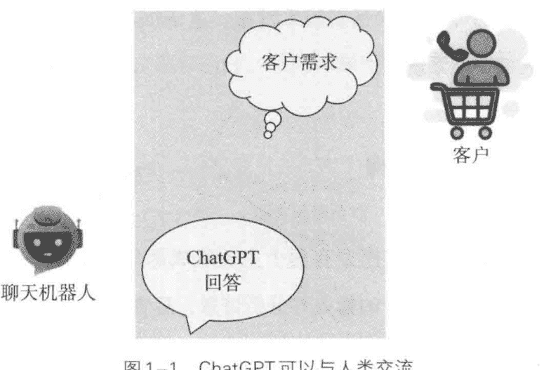
- 平台具备对话式风格，可处理自然的人类交流。
- 平台可拒绝用户的不当请求。
- 平台支持多种自然语言理解。
- 平台具有自主学习能力属性。
- 平台能够记忆与用户的全部交互历史。
- 平台可被编程以开发新应用。

用户可通过ChatGPT及时获取各类问题与主题的相关答案，其数据驱动学习机制有助于持续优化响应质量。2023年发布的GPT-4是OpenAI当时最先进的AI系统。

## ChatGPT的内部架构
ChatGPT语言模型包含两个核心部分：理解与生成。前者处理用户输入并分析情境，后者生成连贯且情境相关的回应。

借助这两个组件，ChatGPT可实现类人对话，利用用户输入提供有价值的交互与响应。

图1-2只是给出了一种概括性的结构示意，落地执行时所需的功能远比图上展示的要复杂得多。

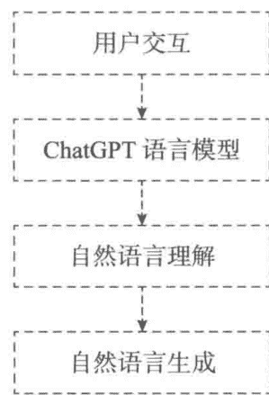

图1-3对运行机理做了拆解。负责接收用户提问并完成语义解析的单元通常被叫做理解模块，它能够捕捉上下文并推断出提问背后的真实意图。

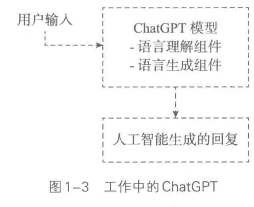

随后的生成模块会利用前一步的解析结果，产出语义连贯且贴合场景的文本。总体来看，系统先把握输入的含义再作出回应，追求的效果是更自然的对话体验。

图1-4展示的是部署方案的简化版本，真正投入使用时整体架构往往更为繁复。复杂度提升会带来算力上的压力，但同时也有可能换来更准的判断和更丰富的输出。

商业落地：真实场景中的模型应用

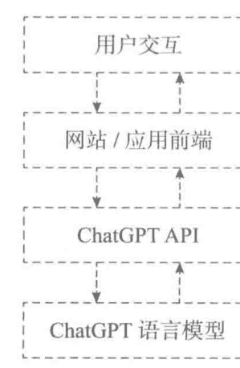

该方案支持用户通过网页或App前端以文本方式发起交互，输入被送入模型处理后返回结果。

图1-5说明，在处理用户输入时，架构已经开始兼顾多模态情境，涵盖视频、图像等多种数据，为生成答案提供更充足的上下文支撑。

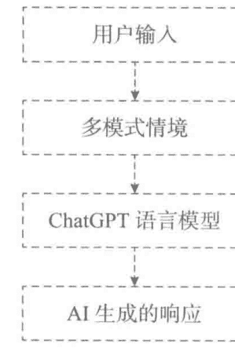

随后介绍训练流程架构，见图1-6，这对理解商业化部署很有参考价值。

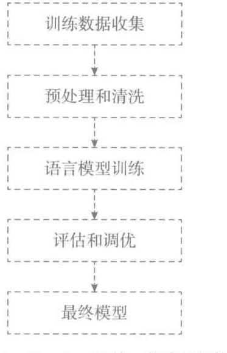

图1-6显示，训练数据的采集会从书籍、网站、文章等渠道汇聚海量文本，随后进行清洗与预处理以去除噪声并提升可用性。

在此基础上采用以Transformer为核心的方法训练语言模型，并通过多次迭代持续优化表现。

模型会借助多项任务与评测基准检验效果，若测试未达标则进行调整。训练评估全部通过后，最终版本才会对外发布。

接下来介绍的是推理工作流程，见图1-7。使用者先与平台交互，以语音或文字形式提交输入。

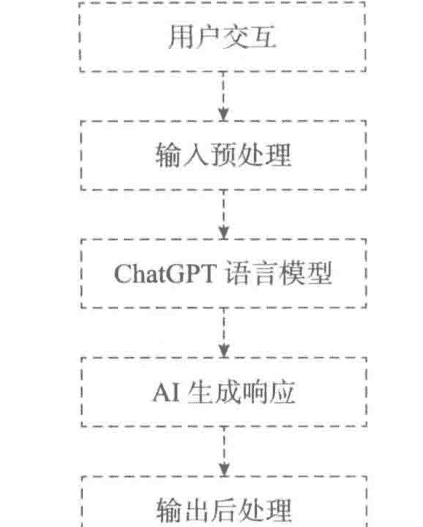

输入通常先做预处理，例如分句与分词，这是送入语言模型前的常规操作。经预处理的文本进入语言模型处理后生成回复。

最终由模型基于接收到的输入及训练数据中习得的语境所产生的AI回复，会先经过格式化与去标记等后处理，便于展示。

上述流程同时覆盖了推理与训练两条路径，实际应用中往往更复杂，也可按需定制。

## ChatGPT未来展望
语言理解能力的持续进化是影响走向的关键因素之一。GPT-3等早期模型已展现出较强能力，但提升空间依然存在。

未来交互有望更具个性化，能够依据过往对话记录学习并按用户偏好定制回复。在复杂对话理解方面预计会有明显跃升，可能主动提出澄清性问题并驾驭更深层次的讨论。

当前以文本对话为主，未来很可能拓展至语音、图像等多种输入形态，提供更沉浸、多元的体验。随着技术成熟，其应用范围将扩大至教育、医疗、内容创作等多个领域。

未来版本或许能无缝嵌入各类平台和应用，让开发者和企业更方便地在产品中接入对话式AI功能。

尽管大模型能力强劲，但算力需求极高。后续研发会侧重更小、更高效的模型，便于在各类设备上本地部署。

随着对话式AI生态扩张，伦理关注度也会提升，这将塑造模型的发展方向。开发者需确保模型符合伦理规范。

OpenAI等机构很可能持续收集用户反馈并迭代优化。AI技术为聊天机器人开辟了新可能，但必须正视伦理关切与偏见问题，以保障其对社会的正面价值。

## ChatGPT商业落地场景
在数字化浪潮下，企业为提升效率和客户体验，正转向AI驱动的语言模型。该对话机器人可通过自然语言处理与用户互动。

它已在多个行业发挥作用，能够改善客服、创造商机、精简内部流程。借助它，组织能与员工和客户开展智能且有趣的对话，具体应用包括：

- 嵌入App和网站，可为客户提供即时解答，处理高频咨询并推送产品信息，提升满意度同时降低客服成本。
- 搭载该模型的对话机器人可挖掘商机、优化销售流程、解答常见问题，并提升转化率，同时给出咨询建议。
- 营销和内容团队可借助其快速生成社媒文案、文章、产品描述，并进行头脑风暴和数据参考。
- 虚拟助理可帮助员工安排会议、处理内部问询、管理日程，提升效率并简化运营。
- 接入翻译平台，可为企业提供实时多语种翻译服务，改善与国际客户的沟通。
- 招聘与HR场景中，可用于简历筛选、回答职场相关问题、优化招聘流程。
- 营销活动中，可嵌入互动游戏、问答、个性化推荐，提升用户参与度和品牌互动。
- 教育机构可利用虚拟导师提供个性化辅导、答疑和学习方案。
- 医疗领域可处理非紧急问询，为患者提供初步解答，减轻医务人员压力。
- 语言学习App可用其模拟真实对话，帮助学习者提高外语能力。
- 房地产可用来解答房源问题、预约看房、推动销售流程启动。
- 酒店业可用于预订协助、提供目的地信息、解答旅行相关疑问。

这些案例展示了如何将模型融入企业运营，以改善体验、提升效率并促进互动。技术发展将催生更多创新用途。

## ChatGPT伦理审视
使用者应注意的首要伦理风险是回复中可能出现的偏见。这往往源于训练数据规模庞大且包含社会偏见，开发者需主动识别并消解。

通过ChatGPT进行的交互可能涉及敏感数据的传输。开发人员和公司必须采取必要的措施，确保他们收集的信息免受未经授权的访问。这可以用加密和匿名的方法来实现。

ChatGPT和其他人工智能模型通常被视为黑匣子，这使得用户很难理解它们如何回答某些问题。对这些模型作出的决策进行清晰的解释、展示透明度，对于建立用户信任并使用户意识到人工智能的局限性非常重要。

公司应该告知用户必须意识到他们正在与人工智能对话，充分解释人工智能的行为对于获得用户的同意至关重要。清晰的交流可以促进信任并防止用户受到欺骗。

企业和开发者应该考虑ChatGPT对各种应用场景可能产生的影响。他们必须避免剥削性或者有害的使用场景，以阻止操纵、发布传播错误信息或者骚扰。

人工智能模型可能被用来制作令人反感或者有害的内容。开发人员和公司必须贯彻落实相关机制和采用过滤器来识别和防止此类内容被创建。

人工智能模型必须以符合人权、伦理原则和社会规范的价值观来概念化。在创建负责任的人工智能系统时，应考虑到更广泛的社会影响。在人工智能模型中实施安全功能和保护屏障对于防止其被无意或者恶意使用至关重要。对其行为的监控和审核可以帮助识别和防止有害输出。

开发者必须积极打击对诸如ChatGPT等人工智能模型的滥用。他们还应该制定明确的指导方针，说明如何使用这些模型及其后果。促进政策制定者、学者和行业专业人士之间的合作，可以促进人工智能领域的伦理行为规范，并为开发人工智能模型确立最佳实践。

尽管ChatGPT等人工智能模型具有巨大潜力，但是它们也有伦理责任。

- 开发者和用户应考虑此类系统的各种好处，同时确保以负责任的方式使用它们。
- ChatGPT应拥有必要的工具来过滤不当和冒犯性内容。当平台与用户互动时，这一点尤其重要，因为它必须维护社区标准并避免宣扬暴力、仇恨言论或者其他此类内容。
- 随着人工智能模型变得更加复杂，它们有可能影响人们的意见和决策。为了防止这种情况，开发人员应该确保这些工具在有用的同时不会操纵或者欺骗用户。
- 与人工智能进行交互应有合适的用户年龄，并且平台应能够提供适合每个人的内容。开发人员还应采取措施限制人工智能收集信息，并确保其遵守相关法律。

商业落地：真实场景中的模型应用

- 开发人员应确保ChatGPT不会传播虚假信息或者错误信息。它应该是一个可以提供事实数据并拒绝传播虚假信息内容的模型。
- 人工智能交互必须了解用户的情感情绪健康，尤其是那些患有心理健康问题的用户。平台必须实施保障措施来识别病痛迹象并提供适当的转诊服务。
- 开发人员还必须努力减轻ChatGPT响应中的歧视和刻板印象的影响。这可以通过仔细的数据集管理和对抗性训练等技术来实现。
- 应获得用户必要的同意和所有权才能允许ChatGPT使用和收集用户的数据。公司在与ChatGPT交互时必须对其数据的使用方式保持透明，并且这应该通过透明的流程来完成。公司应该提前了解ChatGPT如何使用和存储他们的数据。
- 开发人员不得出于任何目的利用ChatGPT制作虚假评论或者传播误导性内容。通过实施检查，他们可以维护人工智能生成的数据的公正性。
- 随着人工智能领域的不断扩展，开发人员必须采取必要措施，防止人工智能生成的内容被用于恶意目的。
- 公司必须定期监控ChatGPT的输出并收集用户反馈以识别问题并提高其性能。相关组织还应该为个人提供报告聊天机器人创建的有问题的内容或者交互的渠道。
- 能够解释人工智能产生的数据对于开发人员来说非常重要，尤其是在处理医疗建议等敏感情况时。
- 人工智能系统创建的交互可能会产生意想不到的后果。这可能包括造成伤害或者强化刻板印象。定期审核和收集用户反馈可以帮助识别这些问题并实施修复。
- 随着人工智能模型数量的持续增加，了解其社会影响变得更加重要。为了确定可能的优势和风险，相关组织应进行研究和评估。

与利益相关者和政策制定者合作，制定有关适当使用人工智能模型例如ChatGPT的法规和指南，帮助开发者和公司负责任地使用ChatGPT。这样做可以帮助确保该技术为社会作出积极贡献，同时也最大限度地减少可能的风险。

## 小结
本章介绍了人工智能和ChatGPT，展示了ChatGPT的商业应用示例。接下来我们将重点关注ChatGPT的商业相关性，了解ChatGPT技术，探索ChatGPT在现实中的应用，增强与ChatGPT的商业问题交流，在商业中实施人工智能对话，并在使用ChatGPT时注意伦理考虑因素。

# 第 2 章

## 了解 ChatGPT 的底层技术
前文介绍了ChatGPT的基础概念与使用示例，并回顾了发展历程与对话式AI的意义。本章将从历史视角切入，解析支撑ChatGPT的核心技术，包括机器学习、自然语言处理、神经网络等。

## 导 言
ChatGPT属于生成式人工智能，允许用户以文本形式与AI互动。类似自动化聊天系统，它可用于提问或获取解释。GPT通过结合人类反馈与机器学习持续提升表现。

OpenAI于2015年由埃隆·马斯克和山姆·奥特曼联合创立，2022年11月正式推出ChatGPT。公司获得微软等投资者支持，并开发了Dall-E等图像生成工具。

ChatGPT基于GPT技术，能够从数据序列中捕捉规律。GPT-3是一个大规模语言模型和神经网络学习框架。

## 用于机器学习的ChatGPT
ChatGPT是基于机器学习技术的先进语言处理模型，代表了AI的重要进步。它构建于GPT-3.5之上，后者是一种神经网络，擅长识别和生成类人文本。

其目标是提供更精准的语境理解，通过在海量互联网文本上训练的深度学习算法实现。这种预训练使其能把握人类语言的细微差别。

借助微调，ChatGPT可针对特定任务或场景定制，表现突出于客服、医疗、金融等领域，是跨行业通用的工具。

其算法根植于Transformer架构的深度神经网络，包含多层前馈网络和注意力机制，使其能高效完成语境化语言处理。

通过强化学习，模型可利用用户生成内容持续学习与改进，微调阶段使其能响应真实反馈，提升信息有用性和准确性。

算法演进标志着对话式AI的重大突破，可大幅革新虚拟助手、内容生成等应用，产出高度连贯的文本。

与此同时，算法正不断迭代以确保合乎伦理、无偏见，使其成为负责任的社会工具。

机器学习是AI的子领域，通过分析大量数据改进算法，实现少干预的预测。该技术基于先进模型，可自主学习并输出所需结果。

例如，Google搜索借助机器学习实现自动补全和预测。用户输入首字母即可获得建议。早在谷歌之后，亚马逊、Spotify、Flipkart等平台也普遍采用。

预测性搜索与自动补全协同工作，通过分析用户行为预测下一步需求。例如Netflix据此推荐影片。

在ChatGPT中，机器学习同样用于提升性能，使预测搜索与补全更精准。

## ChatGPT和机器学习
机器学习被用于在海量数据上训练ChatGPT，该语料涵盖多种语言模型，可生成类人对话。

开发团队融合无监督学习与监督学习提升机器人能力，前者从数据中归纳规律，后者追求更稳定输出。

监督学习通过标记数据训练模型，再据新输入预测结果。训练循环中采用RLHF，即人类反馈强化学习。

RLHF是一种增强对话能力的机器学习技术，通过反馈回路引导模型区分正确与错误回复。

奖励模型会激励模型给出正确答案，错误回复则获低分。在奖励机制下，机器人能产出更精准答案。

RLHF使回复更具人性化，根据训练师提供的示范调整输出。初期训练中，训练师扮演助手与用户角色。

## 弱人工智能和强人工智能
弱人工智能只能完成预设任务，也称狭义AI或ANI，由人类算法驱动，只能模拟智能执行固定动作。

强人工智能则具备形成心智的潜力，能模拟人类思维与行为，可通过数据处理实现类意识学习。

ChatGPT可生成对文本提示的回应，其强大的自然语言处理能力使其成为先进的狭义AI。它还能模仿提示的风格与语气。

例如，询问“悲伤”的感受时，它能给出共情式回答；要求撰写让他人“愉快”的文章时，语气会随之变化。它能理解查询从“我”到“人们”的转变。

通过分析海量数据模拟人类反应，ChatGPT展示了狭义AI的强大效能。

机器学习帮助其把握自然语言处理的细微之处，并提升输出质量。

本节强调了机器学习在ChatGPT成长中的关键作用，使其能识别数据模式并持续提升性能。

机器学习带来的优势包括：

- 通过其机器学习功能，ChatGPT可以就客户服务和电子商务领域的查询提供个性化响应。
- 通过其机器学习功能，ChatGPT可以创建有效的在线内容和营销活动，分析趋势并提出相关的社交媒体策略。
- 在教育行业，教育工作者在机器学习的帮助下，可以识别学生的学习需求并开发有效的课程。
- 在医疗保健行业，机器学习可被用于收集和分析数据。医疗专业人员可以使用它来提供更有效和个性化的建议。
- 此外，ChatGPT可被用于提供财务建议和研究市场趋势。

机器学习如何让 ChatGPT 持续进化

本文聚焦机器学习与 ChatGPT 的协作关系。模型的回答质量能否不断提升，是其运行机制的关键。借助机器学习的训练范式，ChatGPT 能够优化用户体验，输出更精准、更具个性化的回复，同时在检索式问答上的表现也随之增强。

## 自然语言处理场景下的语言模型能力

ChatGPT 是一款面向文本理解与生成的先进系统，其底层依赖变换器架构的深度神经网络。

它可以生成流畅文本、进行具备上下文感知的对话，并解答与自然语言处理相关的提问，在机器翻译、内容创作、虚拟助手与聊天机器人等用途中表现突出。对研究者与企业来说，它是发挥人工智能驱动的语言生成与理解能力的实用工具。它体现了自然语言处理技术的进展，有助于人与计算机之间实现更自然的交流。文本对话往往与 ChatGPT 搭配使用，因其被设计为促进此类交互，能够读懂提示并按虚拟助手、聊天机器人等应用的需求给出相关回应。

底层是变换器型深度神经网络，能够处理序列信息，特别适合理解和生成人类语言。

训练数据来自互联网大规模文本，覆盖多主题与多语言，使得模型对语境、语法等语言细节有较好把握。

参数规模庞大，能够挖掘文本中的复杂规律与模式，强大的语言创造力由此体现。

虽然主要面向通用语料，模型也可针对特定领域进行定制，以满足医疗、金融等行业诉求。

在上下文理解上表现扎实，可以在长对话中保持连贯，并在多轮交互中维持语境一致。

使用强化学习策略，ChatGPT 会在每次用户交互中优化回答，并通过反馈持续提升表现。

多语言能力使其具备全球适用性，可以理解并生成不同语言文本，促进跨文化沟通。

## 自然语言任务中的典型落地

情绪分析指的是从文本中识别情绪倾向并归为中性、积极或消极，是自然语言处理的重要任务，用以洞察消费者对服务的感知与互动。

客户反馈常包含反讽、委婉等复杂表达，单纯依据词语判断易出错，大型语言模型能有效解决此问题（参见图2-1）。

释放 ChatGPT 的力量：真实世界的商业应用

> 这句话的意思是什么？
烤鸡胸肉凯撒沙拉很好吃。
该句表达对烤鸡胸肉凯撒沙拉口味的肯定与喜爱。

> 这句话的意思是什么？
天哪，烟几乎让人无法忍受，所有的雪茄吸烟者都把垃圾吹得到处都是！
该句表达出对烟雾环境的不满与反感。

> 这句话的意思是什么？
价格合理，但服务有点慢，尤其是在等待结账的时候。
该句对价格表示认可，同时指出结账环节服务速度慢的问题。

图2-1 ChatGPT 在情感分析中的应用①

在自然语言处理中，ABSA 即基于方面的情感分析，它不把整段文本视为单一对象，而是拆解产品或服务的各个维度进行情感归类。

结合 ChatGPT 与自然语言处理模型，企业可搭建情感分析管道，针对产品或服务的各个方面识别客户偏好（如图2-2）。

① 译者注：ChatGPT 可通过情感分析判断提问者的情绪为积极、消极或复杂。

对这条评论做基于方面的情感分析：表演不是很好，但人物更令人着迷，安抚也更生动。

拆解如下：

1. 表演
   - 描述：表演不是很好
   - 极性：负面
2. 人物
   - 描述：人物更令人着迷
   - 极性：正面
3. 安抚效果
   - 描述：安抚也更生动
   - 极性：正面

综合来看，评论整体偏正面，但仍包含对表演的负面评价。

图 2-2 ChatGPT 使用 ABSA①

ChatGPT 的功能之一是命名实体识别 NER，即在文本中识别并分类词或短语，对组织、人物、地名等要素的定位很有用。

临床数据分析是自然语言处理的常见场景，因生物医学语言复杂且实体密集，任务难度较大。

通过大规模语料训练，ChatGPT 可实现高质量 NER 标注，帮助识别并归类药物与疾病（参见图2-3）。

> 你能从这段文字中提取与医学相关的术语吗？
FLASH 放射治疗是一种超高剂量率放疗，其剂量率比常规临床放疗高出数个数量级，有望改写癌症治疗未来。FLASH 放射治疗诱导出“FLASH 效应”，即超高剂量率辐射在保持局部肿瘤控制的同时显著降低正常组织毒性。导致该效应的机制尚未完全明确，目前聚焦于氧张力变化与活性氧物种生成的作用。近年来，FLASH 效应在体外与体内研究中均获验证，2019 年首例 T 细胞皮肤淋巴瘤患者接受 FLASH 放射治疗。现有研究多用组织穿透力较弱的电子束，限制临床转化。质子束治疗因能在深部组织精准沉积剂量而备受关注，但 FLASH 质子研究仍有限。本文系统梳理现有成果，阐释 FLASH 效应的理论机制，并探讨 FLASH 质子束治疗的潜力。

提取的医学相关术语包括：
1. FLASH 放射治疗
2. 超高剂量率
3. 癌症治疗
4. FLASH 效应
5. 局部肿瘤控制
6. 正常组织毒性
7. 氧张力变化
8. 活性氧物种
9. T 细胞皮肤淋巴瘤
10. 组织穿透能力
11. 电子束
12. 质子束治疗
13. 临床转化

这些术语涉及放疗、肿瘤学及相关生物医学概念。

图2-3 ChatGPT 使用 NER①

① 译者注：ChatGPT 可用于文本分析，对术语进行识别与分类。

## 神经网络视角下的 ChatGPT

ChatGPT 的突破彰显了深度学习框架的强大能力。它以转换器架构为基础，重塑了自然语言处理领域。

### 转换器架构要义：

转换器架构由 Vaswani 等人在《注意力就是你所需要的一切》中首次提出，擅长处理序列数据。

ChatGPT 的体系多层叠加，包含前馈神经网络与自注意力等组件，可分层提取并执行文本的语境信息。

核心在于注意力机制，能衡量输入序列中每个词、标记的重要性，使模型聚焦相关语境并生成连贯语言。

嵌入层把输入词转为高维数值向量，使词语具备可计算性。

模型虽在大规模文本上预训练，也可微调用于特定领域或任务，从而提升性能并满足定制需求。

借助强化学习，ChatGPT 能在用户交互中持续改进，通过真实反馈自我更新。理解与生成多语言文本是其能力之一，体现了转换器架构的灵活性与全球吸引力。

大规模训练数据与神经网络结构使其在多任务与基准测试中取得高水平表现，巩固其先锋地位。

基于转换器概念的深层结构，ChatGPT 改变了自然语言处理的实现方式，其文本处理与类人内容生成能力在虚拟助手、聊天机器人等领域应用广泛，为人工智能驱动的语言生成与理解设定了新标准。

### 人工神经网络：

人工神经网络被视作人工智能的重要基石，本质上是节点集合，可帮助计算机从示例中识别模式并学习。ChatGPT 作为基于转换器架构的框架亦属此类。

神经网络借鉴神经系统与大脑原理，利用互联结构处理数据并产生输出，类似生物神经元。在医疗诊断、语音识别等领域均有应用。

ChatGPT 采用前馈层与归一化层以提供类人回应。非线性变换帮助学习复杂模式，归一化层确保各训练模块输入值保持一致。

正式开放前，ChatGPT 需经过预训练，通过编码、词元化、输出生成、概率分布等步骤处理文本。

机器学习与人工智能技术相互交织。神经网络兴起归因于高性能计算与大数据带来的数据格局，允许开发者收集并存储海量信息来训练复杂网络。

ChatGPT 框架基于机器学习与神经网络原理，通过训练神经网络识别并响应文本输入。性能微调对确保其准确处理特定输入至关重要。

### 机器学习：

机器学习即训练神经网络识别并响应各类语言。

ChatGPT 通过分析用户文本输入并提炼要点，在理解主题后依据知识库生成回应。

### 自回归生成：

自回归是 ChatGPT 生成回应的方式，按前文逐词推断，保证语法正确且符合对话语境。

适应与学习是其核心优势之一。它持续吸收新文本数据，增强语言理解并产出更准确相关的答案。

自回归通过逐词构建响应，确保连贯一致与语法规范。

其能生成高度拟真书面文本的能力源于自然语言生成过程，依赖复杂算法。

模型先列出可用的词与短语候选，再依据相关性与语法正确性进行排序。

排序后，采用自回归方式逐一挑选最佳答案，以保证语境相关性与语法标准。

### 微调：

微调指训练神经网络更好地响应特定输入类型，提升其给出更准确有帮助答案的能力。

提供准确相关答案是 ChatGPT 的主要挑战之一。为此它持续采用不同技术改进输出。

除生成答案外，ChatGPT 也可用于翻译、摘要等自然语言处理场景。借助该技术，开发者可构建更自然地理解与回应查询的虚拟助手与聊天机器人。

## 技术架构概览

ChatGPT 体系由多种技术与组件构成，融合深度学习等相关技术，构建复杂人工智能系统。

其以深度学习为支撑，深度学习是机器学习分支，利用多层神经网络处理与理解大量信息，常用于语言理解与建模。

框架建立在转换器模型之上，该模型广泛用于建模与分析复杂句子，革新了自然语言处理方式。其注意力机制有助于分析并解释句子中不同词的关联。

训练分两阶段。第一阶段学习语法与语境语言基础，第二阶段为微调，在特定数据集上训练以提升在客户支持、医疗、法律等领域的表现。

不同注意力机制在各层实现，以捕捉文本中的语境与依赖关系，用于理解词间复杂联系。

嵌入层把词元化输入转为数值向量，保留语义关联，适合神经网络分析。

采用强化学习方法增强模型在用户交互中的回应，并利用反馈改进语境化回答。

开发者可通过 API 轻松将框架集成到应用中，扩展其功能。

框架设计可无缝协作多种语言，满足多样化语言需求。

其技术架构由深度学习、强化学习、注意力机制与伦理考量组成，确保在自然语言处理任务中表现优异。

### 架构在神经网络中的体现

如前所述，ChatGPT 架构基于转换器模型，重塑了自然语言处理。以下概述其在神经网络中的意义。

输入层接收用户基于文本的指令，包括查询或消息。

文本被词元化，分解为子词或词，便于结构化处理。

嵌入层把编码文本转为神经网络可理解的数值向量。

核心结构包含大量类转换器元素。

响应生成采用解码技术，如波束搜索或贪婪解码，选定词元后以人类可读形式输出。

借助强化学习与微调，ChatGPT 可提升在特定任务与领域的表现，并改进对用户交互的响应。

转换器模型框架是 ChatGPT 生成与理解自然语言的核心，适合开发各类自然语言处理服务应用。

## 小结

至此本章结束。读者应已对涵盖机器学习算法、自然语言处理与神经网络的 ChatGPT 技术形成系统认知。后续章节将介绍其在软件开发、客户支持、创意写作、人力资源运营等方面的应用。

# 第 3 章 ChatGPT 实践场景全景

本章聚焦 ChatGPT 的实践用途，通过真实案例揭示其价值。

我们将覆盖软件开发、客户支持、人力资源运营、旅游业、运营、营销、销售、内容创作、翻译等场景，探讨 ChatGPT 如何提升用户体验并创造良好互动。人工智能是助力用户完成多样任务并实现自动化活动的有前景技术。

本章将讨论各行业中最常见的应用。若计划利用企业数据开发生成式人工智能，可考虑投入训练与优化大语言模型。

### 软件开发

在软件开发中，ChatGPT 可集成到工作流或应用中执行特定自然语言处理任务。以下介绍多种利用方式。

- 可使用 OpenAI 的 API 或 Python 平台库，后者允许直接通过代码与模型交互。
- 使用 OpenAI API 前需注册，系统会要求提供 API 密钥用于请求验证。
- 应通过指定库或端点发出 API 请求，包含提供给模型的输入文本与指令。
- 请求发出后，ChatGPT 返回响应，便于收集与处理程序生成的数据。
- 为减少错误影响并限制请求量，应在代码中实现有效错误处理与速率限制。
- 可将 ChatGPT 功能集成到应用或开发流程，用于创建代码片段、提供界面支持、自动生成内容及提供帮助。
- 应遵循全面测试流程确保集成正常，并根据需求与用户体验调整参数与指令。
- 集成前须遵守 OpenAI 或其他 AI 语言模型提供商的条款与条件。

使用 ChatGPT 进行应用开发时，需注意其偏见与局限，并确保收集数据的安全与隐私受保护。

图 3-1 展示了如何将 ChatGPT 功能集成到现有软件项目中。

如图 3-1 所示，步骤如下：

1. 你的软件应用程序向 ChatGPT 发出的 API 请求由提示和你想要提供给语言模型的特定设置或者指令组成。

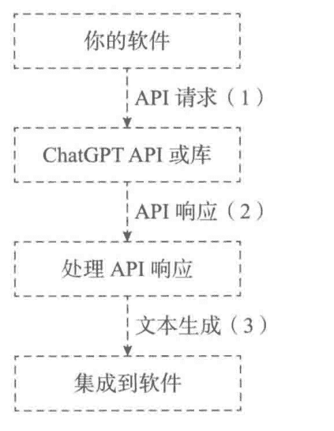

图3-1 ChatGPT在软件开发中的用法

2. 处理请求后，ChatGPT 会生成响应，其中包含模型依据用户输入产生的输出。
3. 应用程序随后处理 API 响应，以提取 ChatGPT 生成的输出或信息。
4. 输出可能包括翻译、代码生成、文本补全等语言相关任务，可在应用中使用。
5. 输出可按需集成到应用中，以更自然的方式呈现给用户，或作为自动化内容创建流程的一部分。

### 客户支持

将 ChatGPT 集成到客户支持，可改善客户互动并提供更好服务。

1. 在部署前，先明确 ChatGPT 可协助的场景，如为常见问题提供答案或指导故障排查。
2. 使用前确保模型基于历史数据充分调整，使其理解公司支持运营的语境与语言。
3. 为 ChatGPT 构建用户界面，让人工支持人员可与其交互，可集成到现有软件或单独仪表板。
4. ChatGPT 可自动处理客户查询，提供预定义答案，释放人工支持人员专注更复杂问题，提升服务质量。
5. 升级机制允许人工支持人员接管 ChatGPT 面临的敏感或具挑战性询问，以更适当方式处理，确保客户获得个性化关注。

ChatGPT 商业落地全景图

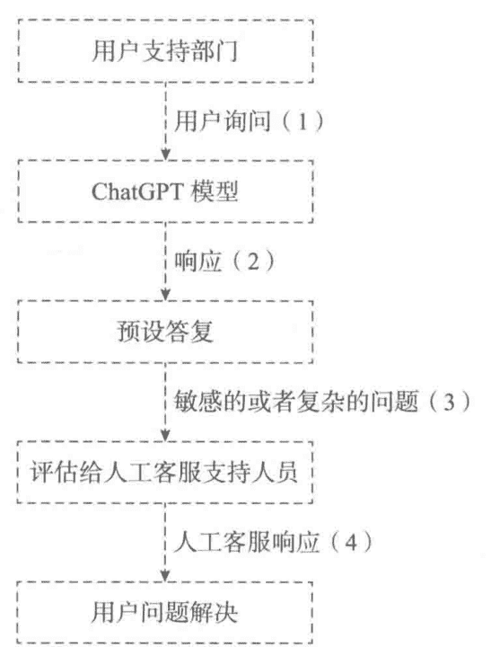

图3-2 客户支持如何采用ChatGPT的流程图

该图呈现的内容如下：

1. 客户可通过邮件、对话窗口或其他沟通方式向ChatGPT发起支持请求。
2. 模型接收到问题后，利用语言能力生成回复。
3. 对简单常见的问题，系统会给出预设答案，实现自动处理。
4. 当请求涉及敏感信息或问题较为复杂时，ChatGPT会把对话自动转交给人工客服。
5. 被转接的请求进入人工支持团队，由专员继续跟进。
6. 人工客服以个性化方式给出解答，处理客户的复杂诉求。
7. 人工介入持续进行，直至客户问题彻底解决。

这种做法既能分担日常咨询的压力，又能为敏感或复杂情况保留人工服务，从而提升体验并缩短响应时长。

在客服部门部署ChatGPT时，安排受过培训的人员对系统输出进行复核与监督是最关键的举措之一，这能确保回复的准确性与合规性。持续收集客户与一线支持同事对ChatGPT表现的反馈，并据此迭代优化，是保持服务质量的习惯。在对话过程中主动告知客户正在使用智能助手，有助于增强信任感并提升聊天意愿；若客户希望转人工，应简化转接路径并快速响应，避免产生焦躁。处理隐私信息时，需确认模型已按安全规范训练和配置，必要时进行匿名化。建立定期的内容维护机制，保持知识库与支持资料的时效性，才能让模型持续贴合业务需求。总体而言，将ChatGPT融入客服能够带来更高的效率与更优质的服务，但自动化与人工支持之间需要取得平衡。

### 人力资源运营
在人力资源工作中，ChatGPT能够帮助优化流程、提升效率，具体实践方式多样。

1. 与应聘者在线交流，收集可上班时间、工作经历和资质等信息，以筛选出更匹配的候选人。
2. 嵌入招聘门户或职业网站，为候选人详细解释申请流程、福利制度和企业文化。
3. 入职向导由ChatGPT驱动，引导新员工完成 onboarding 流程并解答疑问。
4. 员工成长助手提供学习资源与培训材料，助力能力提升。
5. 向员工解释公司制度，涵盖福利、休假等具体政策。
6. 在绩效管理场景中提醒审核节点、截止日期并给出改进建议。
7. 通过调研收集员工意见，利用模型分析敬业度和满意度趋势。
8. 搭建HR帮助台，处理工资单查询、休假申请等高频咨询。
9. 支持离职访谈与入职培训，帮助员工理解流程并获取反馈。
10. 与绩效系统联动，公示表彰、推送公司活动及奖励信息。
11. 面向跨国团队提供多语言沟通支持。
12. 自动生成绩效、休假汇总及劳动力分析类报告。

尽管ChatGPT能覆盖大量HR事务，最终仍需人工团队协同发力，特别是在涉及敏感议题时，不应完全取代人类的参与与监督。

### 旅游和旅游业
旅游行业借助ChatGPT平台可提升旅行者及相关方的整体体验。

1. 充当虚拟导游，按偏好推荐本地活动、景点与事件。
2. 协助制定行程、提供换乘信息并给出适宜出行时段的建议。
3. 帮助跨语言交流，缓解旅行者与当地居民的语言障碍。
4. 提供目的地历史、风俗与安全指引等背景资料。
5. 推送实时天气信息，便于合理安排行程。
6. 发送出行提醒，如登机口变更、航班延误等通知。
7. 按预算推荐住宿与酒店选项。
8. 推送本地节庆与活动信息。
9. 根据饮食需求推荐餐厅与菜品。
10. 提供紧急电话、旅行保险等安全出行信息。
11. 汇总他人点评与推荐，辅助出行决策。
12. 鼓励生态友好选择，支持可持续旅行实践。
13. 为无法亲临现场的旅客提供沉浸式虚拟游览。
14. 为旅游机构提供高效问答与客服支持。

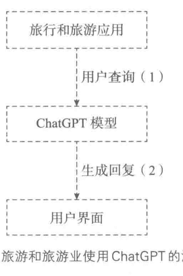

将ChatGPT技术融入旅游业，可为旅客提供个性化、及时的服务，提升满意度与旅程品质。

对该图的说明如下：

1. 旅客通过旅游应用提出与行程相关的信息需求或求助。
2. 查询被送入ChatGPT框架，系统基于语言理解生成回复。
3. 框架输出包含建议、行程安排及相关细节的回答。
4. 应用界面将结果呈现给用户，可通过网页、聊天窗口或移动端访问。

旅客可与ChatGPT互动，获取定制化推荐、行程规划、翻译、安全提示、活动更新等信息，使旅程更顺畅、更明智。

### 运营
ChatGPT可帮助组织提升效率并简化各类流程。

1. 用户查询进入ChatGPT框架，系统据输入生成回应。
2. 框架产出所需信息或操作指引。
3. 将其嵌入运营流程可减少手工操作。
4. 提供翻译支持，促进与国际伙伴的沟通。
5. 供给常见问题解答与知识库，助力员工快速自助。
6. 作为入职助手，向新人介绍流程并分发培训材料。
7. 分析数据并输出洞察，支持经营决策。
8. 接入项目管理工具，跟踪项目状态。
9. 管理供应链环节，如订单优化与库存追踪。
10. 执行核查与质量控制，确保标准合规。
11. 提供故障排查与IT支持。
12. 承担部分HR职能，如面试、反馈收集、政策咨询。
13. 协助监管合规与风险评估。
14. 管理采购流程并与供应商沟通。
15. 分析关键绩效指标并生成报告。

在运营场景落地前，需保证数据安全与隐私受保护，并定期评估表现。通过整合到流程中，可提升客户体验、优化效率与业务运营。

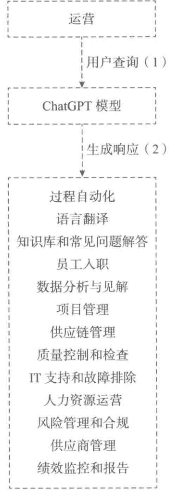

图3-4 使用ChatGPT进行运营管理的流程图

将ChatGPT集成到运营环境可以改进流程并为消费者提供更好支持，但必须确保数据安全、坚持人工监督原则，并审慎评估其在不同场景下的有效性。

### 营销
ChatGPT可用于营销以实现定制化体验、优化投放并吸引消费者。

1. 作为对话式机器人，实时与客户互动并提供产品信息。
2. 生成营销素材，如博客、资讯邮件与社媒更新。
3. 基于过往行为与偏好构建个性化推荐系统。
4. 通过问卷、互动测验等形式收集线索。
5. 调研收集反馈以改进产品或服务。
6. 接入社媒管理平台，处理常见问题与评论。
7. 开展个性化邮件营销，按偏好动态生成内容。
8. 生成并测试广告文案变体，提升投放效果。
9. 辅助头脑风暴营销活动、落地页与产品功能概念。
10. 分析大量文本，洞察客户情绪与市场趋势。
11. 依据兴趣、行为与偏好对客户进行细分与定位。
12. 创建虚拟品牌大使以互动。
13. 在对话中开展竞赛与促销，提升品牌参与度。
14. 基于购买历史实现交叉销售与追加销售。
15. 监测社媒对话与趋势，跟踪偏好变化。

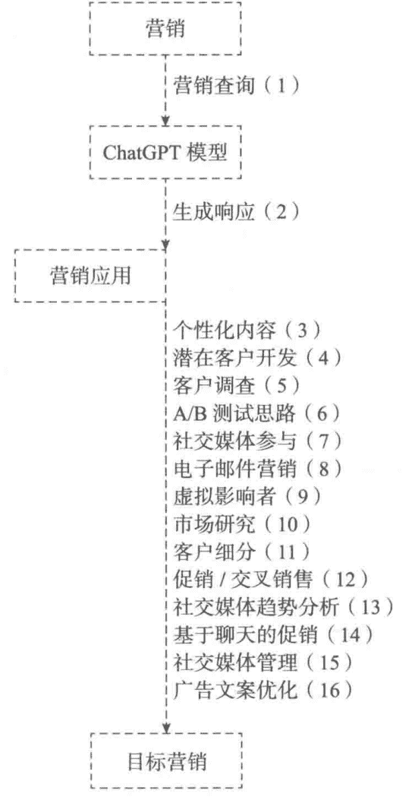

使用ChatGPT进行营销时需保持透明，客户应清楚系统运作方式，同时定期评估策略成效。

图3-5 使用ChatGPT进行营销活动的流程图

如图3-5所示，营销查询是指为优化广告文案或制作内容而提出的请求，通常伴随调研或客户互动。流程如下。

1. ChatGPT模型接收查询并处理输入，按语言理解生成相关应答。
2. 生成的回复提供解决方案或信息支持。
3. 结果被接入营销应用，用于执行任务与策略。
4. 通过聊天式竞赛与促销提升品牌认知与参与。
5. 利用ChatGPT处理常见问题与社媒消息，促进积极互动。
6. 测试并优化广告文案变体，提升营销投入产出。

将ChatGPT纳入营销工作，有助于改善互动、实现内容定制并支撑数据驱动决策。

### 销售
ChatGPT可助力销售人员提升客户互动并简化运营。

1. 收集线索信息、判定意向后推送给销售代表。
2. 通过定制内容与跟进信息培育潜在客户。
3. 提供销售助手，解答常见问题并给出产品说明。
4. 个性化沟通并按客户偏好推荐方案。
5. 分析历史数据与市场趋势，辅助判断与预测。
6. 识别交叉销售与追加销售机会。
7. 进行竞品分析，评估定价、策略与活动。
8. 分析销售绩效以提升团队效率。
9. 收集售后反馈以提升满意度与流程。
10. 搭建虚拟助理协助完成销售流程并提供提示。
11. 提供资源与培训材料以支持持续成长。
12. 集成报价系统，快速生成准确报价。
13. 协助安排会议、演示与跟进。
14. 发现销售漏斗中的机会与瓶颈。
15. 生成报告与洞察完善销售策略。

使用ChatGPT进行销售管理时，自动化与人际互动需保持适当平衡，关系建立与复杂交易仍需销售人员主导，需定期评估与改进以满足业务需求。

使用ChatGPT进行销售管理的流程图

如图3-6所示，销售查询以潜在客户的信息需求或相关问题为起点。流程如下。

1. ChatGPT模型接收销售查询并处理输入，按语言理解生成回应。
2. 模型输出为销售相关问题提供实用方案或数据。
3. 结果被整合进销售应用，执行各类策略与任务。

集成至销售管理体系可简化流程、增强互动、优化策略，提升成果与客户满意度，需持续评估有效性并迭代优化。

## 内容创建
内容创作涵盖博客、视频、信息图表、文章等各类数字或书面产出，目标是提供吸引力强、信息丰富且有趣的材料以触达特定受众。创作前需明确受众与目的，如娱乐、教育、获客或品牌曝光，并对主题进行充分研究。创作阶段涉及文案、脚本、录音等形式，校对与编辑是保证质量的关键。搜索引擎优化有助于提升可见度，发布渠道包括博客、社媒与官网。推广手段如社媒传播、邮件营销与协作可扩大触达，借助分析工具监测表现以持续改进。

ChatGPT用于内容创建，如图3-7和图3-8所示。

请写一篇关于可持续发展的博客

### 可持续发展：为未来铺就绿色之路
在快速变化的当下，可持续发展日益受到关注，它关乎环境保护、经济增长、社会公平与文化多样性。核心在于满足当代需求而不削弱后代满足自身需求的能力。

1. 可持续发展的三大支柱
经济可持续性要求在不破坏自然资源的前提下实现长期增长，推动绿色生产与技术创新。社会可持续性强调公平包容，确保教育、医疗等基本服务可及。环境可持续性是核心，通过可再生能源、减排与生物多样性保护为地球留存健康未来。

2. 可持续发展的重要性
图3-8 用ChatGPT创建博客①
> ① 译者注：ChatGPT可基于不同指令生成相关内容。

## 翻译
使用ChatGPT进行翻译涉及其生成能力，虽以自然语言理解为主，仍可实现跨语言转换。

翻译"My name is Charies"为法语

"My name is Charies" 翻译成法语是: "Je m'appelle Charies"。

图3-9 将英语翻译成法语

操作步骤：先明确源文本与目标语言；通过API或程序库与ChatGPT交互，发送源句并给出翻译指令；收到回复后根据项目需求进行后处理。需注意，ChatGPT的基础翻译能力可能不及专业机器翻译工具；截至2021年9月，其翻译仅限于训练时支持的语言范围。

## 小结
本章展示了ChatGPT在客户支持、人力资源、旅游运营、整体运营、营销、销售、内容创作与翻译等真实场景中的应用，每个案例均说明其如何提升效率与用户体验。

# 第 4 章

## 使用 ChatGPT 加强商业交流
本章将聚焦ChatGPT如何帮助企业以更自然、更有效的方式与客户互动。

## 沟通升级，效能加倍

在快节奏、重响应的商业环境里，沟通能力已成为企业能否在竞争中保持优势的核心战略要素。随着技术持续演进，一批新的工具正在重塑企业对话方式。

人工智能与 ChatGPT 就是典型代表，它们让个人与组织之间的互动模式发生根本变化。下面围绕客户支持、营销邮件、全球供应链协作、内部沟通与数据分析，说明这两项技术如何切实改善企业交流。

### 客服更高效
优质的客户服务是企业基本功，但海量咨询与服务触达难题，让不少团队难以维系稳定体验。对最需要帮助的用户来说，获取支持往往并不容易。

面对咨询量攀升和流程复杂化，Spotify、万事达国际组织与 Lyft 等公司已将 AI 聊天机器人引入客服体系。这些互动平台可在数秒内解答常见问题并给出实用建议。

借助这类平台，用户无需长时间等待人工介入，直接向机器人提出关切即可获得反馈。

### 邮件营销更轻松
在高频沟通的当下，营销表达的精准度至关重要。人工智能正在改写规则，其中 ChatGPT 的应用尤为突出，它让企业宣传方式更具效率。

ChatGPT 能通过实时灵感与简化写作流程，帮助市场人员提升文案能力。

撰写有效邮件时，选定内容往往是最大难点。有了 ChatGPT 支持，可快速产出更具吸引力的内容，抓住潜在客户注意力。

它还能修正语法、优化表达、调整语气，确保信息专业且符合品牌调性。

对外沟通的一致性是品牌信任的基础。ChatGPT 能够保持用词统一，使邮件与整体传播策略保持一致。

使用前需先明确撰写目标，确保输出符合需求。提供背景、目的与语气等上下文，能让建议更贴合。即使生成流程被简化，人审与微调仍不可少，以保证最终信息与品牌口径一致。

### 跨境协作零障碍
全球化背景下，企业业务跨越多国。多语言翻译能力让 ChatGPT 成为连接合作伙伴、利益相关方与客户的桥梁，有助于推进国际协作并消除语言壁垒。

### 内部协作更顺畅
内部沟通的效率取决于协作质量。借助 ChatGPT，员工可一键安排会议、发送提醒。部分沟通流程的自动化，让团队把精力投入到关键任务与业务结果上。

### 数据洞察更精准
ChatGPT 能解析海量数字与文本，提炼有价值结论，并捕捉社交媒体与日常对话中的趋势与模式。

通过收集和分析客户反馈，企业可做出更审慎决策，提升产品与服务质量。电商平台就能依此识别客户需求，调整产品模型以适应市场变化。

其目标是提升客户满意度，并提供支撑企业超越竞争、跟上市场变化的精准数据。

将 AI 与 ChatGPT 融入沟通体系，能改善人企业互动方式，优化内部流程，提供多语言支持、数据分析与客服能力。集成后，企业可优化流程、提供更好服务，同时维系与员工的积极关系。随着技术成熟，企业应主动用好这些工具创造新机会。

## 自动化释放沟通资源

在高度竞争的市场里，高效沟通无处不在。无论对内对外，快速准确传递信息都决定成败。把部分沟通流程自动化，就能把宝贵资源释放到其他工作上。

ChatGPT 基于人工智能与机器学习生成和理解类人文本，可自动处理邮件回复、客户咨询等任务。其自然语言理解能力使其能以接近人类的 kah 方式对话，成为提升沟通效率的理想工具。

### 客服自动化实战
本部分聚焦 ChatGPT 在客户支持中的具体应用：邮件沟通、聊天机器人与话术生成。其优势包括效率提升、满意度提高与全天候服务。

在客服场景中，ChatGPT 常用于训练聊天机器人。这些模拟人类对话的程序可嵌入应用或官网，解答问题、处理常见诉求。

邮件自动化是其最常见用法之一，能理解并回复客户来信，帮助企业处理更多咨询。此外，它还能为客服人员生成标准话术，确保常见问题的回答准确一致，从而提升客户体验。

### 内部沟通自动化
本部分说明借助 ChatGPT 实现组织内部沟通自动化的价值。

首要优势是效率提升，可自动化会议安排、提醒发送等事务，让员工聚焦核心工作。其次是一致性提升，它能分析组织消息中的语言使用，确保沟通与品牌与信息口径保持一致。

自动化还能降低人为疏漏，例如定时推送重要提醒，减少信息遗漏。落地前需明确自动化范围：内容创作、内部沟通、客户服务等，随后训练模型理解组织语气与用词。

集成后应进行测试，如将聊天机器人接入官网或把邮件系统接入自动回复能力，确保流畅运行。组织还需建立维护与监控机制，跟踪表现、识别改进点、持续训练。同时向利益相关者与员工沟通功能变化及影响。

## 技术演进路线

未来 ChatGPT 处理自然语言的能力将进一步增强，能够应对更复杂表达，为企业提供更丰富服务。

一个可行方向是融合计算机视觉，使其能理解并响应图文信息，实现物体与图像的自动识别。未来交互也将更个性化，对话更像人际交流。

随着人工智能与机器学习的进步，更高效强大的语言模型将不断出现，增强 ChatGPT 的能力边界。

## 优势与风险并存

企业成败取决于沟通质量。过去的商务沟通往往正式、缺乏温度，对话生硬。ChatGPT 的出现改变了这一局面。

### 主要优势
它具备理解语境、以同理心回应并按用户偏好调整的能力，能以人性化方式对话，拉近企业与利益相关者距离。

显著优势之一是生产力提升，可处理重复性日常任务，协助内部运营，释放人力处理复杂工作，从而降本增效、优化流程。

在快节奏市场，快速决策至关重要。ChatGPT 能在数秒内分析大量数据，提供可执行建议与洞察，并通过场景模拟与预测分析帮助企业把握机会与风险。

稳固的客户与利益关系是成功关键。ChatGPT 可通过了解需求并给出贴合建议来提升体验，多语言能力也帮助企业跨越语言障碍触达全球客户。

发展亦伴随伦理议题，如数据隐私与个人信息处理。OpenAI 已推行透明度政策与问责机制，使用方应优先保护隐私、获取同意、减少偏见，在效率与伦理间取得平衡。

ChatGPT 标志着商业沟通新阶段的开启，使组织更高效、与客户建立更有意义的联系、激发新想法与商业机会。

### 潜在风险
成本是首要考量。虽能节省时间与资源，但训练与集成投入可能较大。

其次是误差风险。作为机器学习模型，它并不总是给出正确回应，需要监控与纠正机制。

其局限还在于无法处理某些特殊沟通场景，对专业领域业务尤为棘手。

数据安全亦需重视，模型训练依赖大量数据，企业间共享存在难度。伦理考量应始终置于首位。

## 对话方式的根本转变

借助 ChatGPT，企业可改善与员工、伙伴与客户的互动。依托 AI 与自然语言处理，它能自动化对话、提供定制化客户体验，并在数秒内回应咨询，是经济高效的工具。

它可通过 AI 方法分析数据并产出定制化回复，激发兴趣、培养关系、提升忠诚度。同时自动化对话可减少人工需求与相关成本，提升利润。

总体而言，ChatGPT 从根本上改变了企业与各方互动方式。利大于弊，但仍需审慎评估。

使用前需了解 AI 沟通基础：技术功能及其在吸引消费者中的应用。企业可利用客户数据提供个性化服务，如特价与推荐，并构建自然交互的聊天机器人。通过分析反馈并持续调整，确保用户体验良好。

数据录入、线索开发、客户服务等流程均可自动化，节省资金与时间并提高满意度。整体来看，ChatGPT 正让沟通更自然高效，为企业带来新机遇，随着技术演进其影响将持续扩大。

## 核心要点
AI 驱动沟通的兴起彻底改变了企业与员工、客户的互动方式。ChatGPT 作为领先语言模型，使自动化系统能理解与回应客户咨询，有望成为未来商务沟通的基石。

借助它，企业可通过对话式学习了解客户问题，提升服务自然度与个性化，减轻人工压力，实现更积极的客户体验。

它还能自动化销售与营销流程，例如分析对话识别趋势与模式，改善客户体验。其分析能力天然聚焦于趋势与模式挖掘。

挑战同样存在。若信息非最新，结果可能误导或不准；对复杂询问理解不足也可能导致客户不满。

# 第 5 章

## AI 对话的业务落地
本章介绍如何将 ChatGPT 集成到业务运营中，以改善客户服务、营销与生产力。

## 为何要引入 ChatGPT
将 ChatGPT 接入现有软件方案可带来多重收益。

优质客户支持对企业至关重要，但管理成本高且耗时。ChatGPT 通过聊天机器人实现全天候个性化响应。

它能提供及时准确答案，并处理需深度思考的复杂咨询。基于学习的框架使其能应对更复杂的主题，并可定制以掌握行业术语。

多语言兼容使其能像服务英语客户一样服务非英语消费者，对跨国公司尤为有利。

可与 IBM、Microsoft、Salesforce 等第三方应用无缝协作。落地需具备 Salesforce 开发者账号与 ChatGPT 账号并生成 API 密钥，API 提供指令以实现跨工具通信。

集成后，消费者获得更简洁个性化的体验，提升忠诚度与满意度，同时减少日常支持的人力与时间投入。

重复任务自动化提升效率与生产力，使团队专注重要活动。提示机制有助于保持沟通有效，加快项目进度、减少延误。

其多文本生成能力可腾出时间处理复杂问题。通过客户数据配置，可提高准确性并降低误报。

企业还能收集分析反馈与互动，识别运营缺口并吸引客户。通过对比集成前后满意度，可评估效果。

未来 ChatGPT 将更深入业务运营，提升效率与个性化服务，随着需求增长在满意度提升中发挥关键作用。

## 常见的集成服务形态
该类集成服务旨在帮助企业将程序无缝嵌入现有应用与平台，确保流畅体验与最佳性能。

服务类型包括聊天机器人创建、API 集成、平台定制，以及训练与微调等以提升性能。它们帮助企业将功能嵌入现有基础设施。

实施可带来以下好处：提供更高效个性化的客户服务并快速响应大量咨询；从知识库快速检索与分发信息，实现即时响应并扩大业务；优化流程、更有效分配资源，处理重复任务以支撑扩张；打造难忘客户体验，改善品牌形象并建立忠诚度；提供 24 小时客户支持，覆盖不同时区；降低对庞大支持团队的依赖从而降本；可随业务弹性扩展；收集分析互动以深入理解客户行为，支持决策；将日常工作转移给 AI，让员工聚焦高价值任务；按需创建定制聊天机器人，提升运营效率。

## 行业落地案例
基于 AI 的聊天机器人集成在多行业均有应用，下面选取八个代表性场景说明。

## 医疗健康
医疗机构可提供症状分析、虚拟患者支持与常见医疗咨询解答。集成后聊天机器人可基于症状给出初步判断，帮助用户了解状况并建议后续措施。

## 房地产
房地产行业集成后可对潜在买家提供个性化回复。虚拟经纪人可处理房产咨询与看房预约。通过模拟人类对话，帮助买家找到匹配需求的房源并解答价格与位置问题。

## 金融
金融机构可通过集成提供个性化建议。金融科技公司可创建账户以回答银行相关咨询。例如在线银行应用可集成 ChatGPT 处理转账、余额查询等交易。

## 教育
在线教育平台可集成 ChatGPT 提供聊天机器人授课与考试方案。它能充当虚拟导师，回答学生问题、提供解释，帮助完成作业或针对主题辅导。

## 电子商务
聊天机器人可实时回答客户咨询。集成到电商网站可提供定制化支持，实现订单跟踪与推荐。根据用户偏好推荐产品并给出颜色尺寸建议，实时化解疑虑。物流运营也能改善，支持货运跟踪、交付状态更新与包裹位置查询。

透明沟通配合 AI 助手，能让企业更快把精准信息递给用户，整体体验随之提升。

## 旅行业应用
把 AI 助手接入出行类平台后，行程规划、住宿查找、景点及航班咨询的响应速度明显加快。旅行品牌可以基于旅客偏好生成定制路线，并在预订流程中提供人性化协助。

## 人才管理场景
人力与员工管理团队可将 AI 助手嵌入手部系统，实现入职流程自动化、解读福利说明与公司规章、解答组织相关疑问。系统还能自动排期会议、汇总报表并推动内部沟通。

## 娱乐互动场景
已有团队利用 AI 助手优化内部沟通与会议排程；它也能通过个性化内容、互动游戏设计和虚拟角色营造更丰富的娱乐体验。除上述领域外，其他行业同样能从服务接入中获益。领先的 AI 厂商可帮助组织提升运营效率并实现流程自动化。其高扩展性与多用途特性使其成为企业常用工具。

该工具能自动筛查并剔除不当内容，按用户兴趣推送相关信息，并第一时间回应提问。社交平台借此使用后，互动率上升、客服压力减轻，内容审核也更顺畅。

## ChatGPT 在客户服务中的典型应用
与客户的对话过程中，企业可以捕捉影响体验的负面信号。对话样本越多，洞察越可靠。人工完成此类分析费时且易产生倦怠。AI 助手能迅速归纳互动中的痛点，并快速揪出高频问题，例如支持缺口或技术故障。

企业也能让助手自动回复用户评价。大量消费者在下单前会阅读评价，调研显示线上买家超过一半会在购买前阅读多条点评。

从用户视角看，品牌需要对反馈作出快速回应。及时回复有助于判断客户是否满意。回复评论是一件费力的活儿，因为措辞会影响品牌形象。有了 AI 助手，客服团队能更快逐条处理。

正面反馈值得借助工具回应，负面评论更需及时处理。支持团队的日常任务之一就是解答常见问题。AI 能把这部分自动化，但上线前最好用自有产品数据对模型进行训练，以保证答案准确。

除对话翻译外，AI 还能处理多语种请求。举例来说，企业在协助阿拉伯语用户使用英语界面时，用户可能会用从右到左的文字提问、直接用阿拉伯语交流，或把按钮名称复制过来要求翻成从左到右的英语。AI 能识别不同文字系统和语言，并在两种语言间顺畅转换。

相较于传统翻译方案，AI 的明显优势是支持多语种并行翻译，且不会打断其他语言的上下文。

把知识库变成简明指引的一种做法是制作操作演练。多数情况下客户会被引导去读说明文章。AI 的价值在于能在不打开链接的情况下提炼文章精华。

检验摘录是否足以回答用户问题的办法是让助手总结原文要点。在客服场景中，它还能分析用户的用词和情绪，进而生成情绪适配的回复。

如果客户表示还在等网站回复，企业可以让 AI 生成一条告知信息，说明问题正在处理中。

## 优势与局限
亮点体现在：

- 咨询量大时人工逐条回复难以为继，借助 AI 后邮件和回复的处理速度明显提升。
- 只要提供背景资料，就能让助手生成包含企业想传达要点的回复。
- 可设定表达风格，使其贴合品牌调性。
- 利用 ChatSpot 等聊天机器人可以记录全部提问，并有可能实现自动闭环。
- IBM 指出 AI 聊天机器人可处理最高 80% 的客户咨询。这意味着积压减少，服务质量保持。人工只需处理 AI 无法独立完成的难题。有了助手，团队不再需要翻遍知识库。
- 团队可以要求助手检索问题并给出即时答案。
- 多项功能有助于削减运营成本，比如自动回应常见问题并压缩支持人员工时。

限制方面：

- 生成内容可能不准确。
- AI 虽先进仍会犯错，例如给出错误信息，可能损害声誉和服务体验。
- 个性化不足。它能给出不错的答案，但也可能误导。消费者看重个性化，AI 可以分担重复工作，却难以达到人类的个性化水平。
- 在情绪化场景，例如客户极度不满时，助手或许能给出看似同理的回复，却未必真正理解客户。严重问题应由人工介入，AI 有时无法把握情绪，最好有人把关。
- 虽然总体安全，但仍有安全风险。恶意使用者可通过指令操控助手，有害意图者可能伪造内容损害品牌，一旦发生数据泄露，企业会陷入被动。

## 客户服务常用提示示范
现实中已有多样化应用，若企业想善用 AI，就需要给出合适的提示。下面几例可作参考。

示例提示一：

我们的产品出技术问题，一位客户因此感到不安，这很正常。我该怎么安抚她并解释情况？

AI 的回复如图 5-1 所示。

> 一位客户遇到技术故障，请告诉我如何写邮件让她冷静下来

写邮件时关键在于展现同情、理解并让客户感到被重视。下面是一封冷静、专业且富有同理心的邮件示例：

**主题：关于您技术问题的协助**

亲爱的[客户的名字]，

首先非常感谢您联系我们并告知问题。我们理解技术故障会让人沮丧，为此深表歉意。

请放心，我们高度重视您的问题，会尽力尽快解决。我们正在仔细排查，并将尽快提供有效方案。在此期间，如有额外疑问或需要进一步帮助，请随时告知。

感谢您的耐心与理解，我们会尽快更新进展，确保问题得到妥善处理。

祝一切顺利，

[你的名字]

[你的职位]

[公司名称]

图 5-1 电子邮件交流提示

示例提示二：

根据 HubSpot 上的评论，分析客户的以下情绪：

HubSpot Marketing Hub 帮助我们提高了营销的效率和效果。其易于使用的界面和各种渠道的集成使我们的工作流程更加简化。

我们需要的一切，包括潜在客户开发和电子邮件营销，都可以通过该平台轻松获得。

该平台的设计直观，使其成为不同级别营销人员的理想选择。它帮助我们简化了营销工作并取得了卓越的成果。

AI 的响应如图 5-2 所示。

根据您提供的评价，显而易见，客户对HubSpot Marketing Hub的情感非常积极。以下是表达的积极情感的详细分析：

1. **提高效率和效果**：客户提到HubSpot Marketing Hub帮助他们提高了市场营销工作的效率和效果。这表明该平台对他们的整体生产力和营销成果产生了积极影响。

2. **用户友好的界面**：评论突出了平台易于使用的界面，这是一个强烈的积极因素。它表明用户觉得这个平台直观且用户友好，这对没有高级技术技能的市场营销人员来说至关重要。

3. **多渠道整合**：客户赞赏HubSpot Marketing Hub整合了多种营销渠道，这简化了他们的工作流程。整合功能是营销软件的关键特性，因为它帮助用户从一个平台管理多个营销方面。

4. **工具的可访问性**：客户指出，通过该平台，他们可以轻松访问所有所需的工具，包括潜在客户生成和电子邮件营销工具。

为一般主题创建电子邮件模板是使信件格式保持井井有条的好方法。

> ① 译者注：AI 可以通过解析客户的评论，对产品或服务的效率、有效性、便利性等方面进行客户满意度分析。

释放 AI 的力量：真实世界的商业应用

示例提示三：

我们需要创建一份有说服力且内容丰富的150字声明，

解释如何根据GDPR（《通用数据保护条例》）保护你的数据免遭未经授权的访问和使用。

AI 的响应如图5-3所示。

根据《通用数据保护条例》（GDPR），我们采取严格的安全措施，确保您的个人数据免受未经授权的访问和使用。我们实施数据加密、访问控制和多因素身份验证等技术手段，以保护您的信息。此外，我们定期进行安全审计和漏洞扫描，确保所有数据存储和处理活动符合GDPR要求。所有处理您数据的人员都经过严格的隐私和数据保护培训。我们承诺仅在法律允许的范围内使用您的数据，并确保您可以随时访问、更正或删除您的个人信息。通过这些措施，我们致力于最大限度地减少数据泄露和滥用风险。

图5-3 根据需求作出响应

## 语气简化
提示：

使以下消息听起来更非正式（参考之前的隐私消息）。

图5-4显示了 AI 的响应。

根据GDPR，我们采取了很多安全措施来保护您的数据免受未经授权的访问和使用。比如，我们使用数据加密、访问控制和多重身份验证来确保您的信息安全。我们还定期检查系统，确保一切符合GDPR的要求。所有处理您数据的员工都经过隐私保护的培训。我们承诺只在必要时使用您的数据，您也随时可以查看、修改或删除自己的信息。我们会尽一切努力保护您的数据安全，避免泄露或滥用。

图5-4 纠正语气问题

## 新功能测试提问
提示：

在全面推出一项新功能之前，我们正在与一些用户进行测试。请创建一个问题列表，我应该向他们提出这些问题来评估该功能的有效性，请将问题数量限制为五个。

图5-5显示了 AI 的响应。

以下是评估新功能有效性的五个问题：

1. 您在使用该功能时遇到了哪些具体挑战或困难？

   - 这个问题可以帮助识别用户在使用过程中可能遇到的障碍。

2. 该功能是否满足了您的预期需求？如果不，您希望它具备哪些额外的功能或改进？

   - 通过了解用户的期望，可以评估功能的适用性和改进方向。

3. 您认为该功能的使用界面友好吗？是否有任何地方让您感到困惑或不便？

   - 此问题旨在收集用户对界面的反馈，确保其易用性。

4. 您在使用该功能时，是否发现它提高了您的工作效率或改善了您的体验？请提供具体例子。

   - 这个问题可以帮助衡量功能对用户工作的实际影响。

5. 您会推荐这个功能给其他用户吗？为什么或为什么不？

   - 通过了解用户的推荐意愿，可以评估功能的整体吸引力和价值。

这些问题将有助于深入了解用户对新功能的看法和体验，从而为后续改进提供宝贵的反馈。

## 寻求客户评论
提示：

我们会要求给我们提供高NPS（净值推荐值或客户满意度）分数的客户在Google上提交他们的评论，以便我们能够提高排名。

图5-6显示了 AI 的响应。

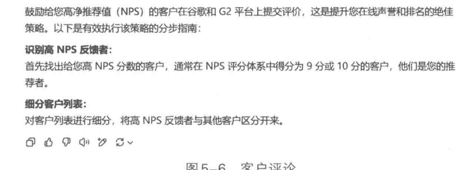

## 小结
本章介绍了如何将支持人工智能的聊天机器人集成到业务中以提供出色的客户服务。下一章将介绍使用 AI 时的安全和伦理问题。

# 第 6 章

## 使用ChatGPT时的安全和伦理考量
本章我们将学习数据隐私和安全介绍、AI 数据隐私和安全伦理、AI 中的信息风险、AI 中的数据隐私、关于 AI 的法规、AI 的最佳实践和安全措施、为你的组织起草 AI 使用政策以及使用 AI 的安全风险。

## 数据隐私和安全介绍
数字技术的兴起导致互联网积累了大量个人信息，公司可以通过收集和使用这些信息来谋利。为了保护这些数据，人们应该了解公司是如何收集和存储数据的。

如果没有适当的安全和隐私措施，收集和存储的数据可能最终落入未经授权的人的手中，这可能导致数据泄露或者某些数据在暗网上被出售。

如果公司以不安全的方式收集和存储信息，则竞争对手可以轻松访问该信息，或者将其出售给其他未经授权的第三方。数据泄露可能会影响企业的业绩和声誉。

数据隐私政策是一个框架，描述人们如何访问和控制他们存储的信息。它涉及遵守有关个人数据保护的法律。公司需要采取各种措施来确保隐私受到保护，其中包括对未获授权的各方建立访问限制，获得数据主体的必要同意，以及维护数据的完整性。

当涉及收集个人信息（例如一个人的名字）时，通常认

## 数据隐私与安全

为个人会与所有人分享此类信息。然而，其他详细信息，例如出生日期、手机号码和居住地，可能会被视为个人信息，需要隐私保护。

数据隐私的概念适用于某些类型的个人信息的收集和使用，例如健康和医疗记录以及社会安全号码，甚至包括信用卡详细信息和银行账号等财务数据。

数据隐私还涉及公司运营业务所需信息的收集和使用，包括支出金额和投资方式等财务数据。在收集和使用个人信息时，金融机构必须遵循严格的安全协议以保护客户的隐私。

根据欧盟的 GDPR 规定，任何可用于识别个人身份的信息，例如个人的全名、地址、电话号码和电子邮件地址，均被视为个人身份信息。随着技术的进步，这个范围已经扩大到各种其他类型的数据，包括地理位置、社交媒体帖子和生物识别信息。

《健康保险可移植性和责任法案》（HIPAA）是一项监管法规，旨在保护来自医院、保险公司和医疗保健提供者的私人和敏感医疗数据，例如个人的精神或者身体状况，包括过去和现在的健康状况。医疗保健实体（例如医生或者医院）应为个人提供必要的信息保护服务。

公司收集和使用的财务数据为个人财务信息，包括有关个人财务活动的各种详细信息，例如信用卡详细信息和银行账号。

数据安全策略是旨在通过防止未经授权的访问和利用来保护个人信息隐私的过程。它涉及利用各种技术和策略来维护该数据的秘密性。这个概念包含信息安全的各种要素，除了服务条款和程序，还包括存储设备和硬件的物理安全。

数据安全策略通过防止未经授权的访问和利用来维护信息的完整性。它可以通过使用第三方安全解决方案来完成，例如 Norton Security、BitDefender 等安全解决方案。这些产品可以通过检测和预防威胁来帮助保护数据的秘密性。

加密算法可将常规文本转换为未经授权的用户无法读取的格式。它只能由已获授权用户使用来访问数据。另一种类型的加密方式是数据库和文件加密，可用于隐藏文件的内容。

实施数据安全策略时，可以考虑的重要因素之一是数据的销毁。此方法会完全覆盖设备上存储的数据。

组织可以采用数据屏蔽技术，使开发人员能够创建应用程序，同时隐藏其中的实际数据。该方法可以确保开发过程是在安全的环境中进行的。

数据恢复能力是指，即使出现网络攻击等意外的业务中断的情况，组织的数据也始终可用且可访问。组织对各种类型故障（例如断电和硬件问题）的恢复能力取决于其数据恢复能力。快速恢复对于最大限度地减少这些事件的影响非常重要。

如果医疗记录和财务信息等敏感信息被不当访问，个人可能面临身份盗窃和欺诈的风险。公司的数据在泄露后可能会被移交给竞争对手，而学生身份信息可能会被窃取和使用。如果事件发生在政府内部，可能会引发国家安全问题。为了遵守法规，许多组织使用第三方工具和解决方案，例如 OneTrust（合规科技公司）、ServiceNow（IT服务管理公司）等第三方。这些第三方可保护数据的秘密性、安全性。

数据保护至关重要，原因如下：

- 数字经济的兴起要求公司收集和共享客户信息。这是通过使用社交媒体和其他形式的技术来完成的。制定清晰透明的程序来管理个人数据的收集和使用对于确保客户感到安全非常重要。

- 同样重要的是，公司必须制定必要的程序，以确保在收集和使用个人数据时遵守适当的法规。如果公司不遵守这些规定，可能会面临严厉的处罚。

欧盟的 GDPR 加强了个人在使用和保护其个人信息方面的权利。该法律规定了公司在处理个人数据方面的责任和标准。

数据安全和隐私之间是有区别的。前者是指用于保护公司收集和使用的信息的各种措施和技术。然而，实施这些措施可能并不总是足以履行保护数据隐私的义务，它仍然涉及遵守相关法规的问题。

## 使用 ChatGPT 时的伦理
尽管开发人工智能聊天机器人的尝试很多，ChatGPT 仍是迄今为止极具影响力的工具。ChatGPT 的神奇之处在于，它使用从电子书、社区论坛和博客等各种来源收集的大量数据，往往只需不到一秒的时间即可生成详细的回复。此外，其 GPT-4 版本已经通过了 LSAT（美国法学院入学考试）和美国律师考试等多项高难度考试。

ChatGPT 的数据收集方法受到批评的主要原因是它们收集的是公开可得的信息。尽管收集此类数据并不违法，但是仍可被视为违反欧盟 GDPR 等数据隐私规定。例如，如果从用户收集的信息包括宗教或者种族背景等敏感个人信息，则可以适用此类规定。

ChatGPT 的开发人员维护用户提交的训练提示，以确保该工具不会保留此类数据。这样做是为了确保系统不断提高其性能。这也确保了 ChatGPT 收集的数据是公司集体人工智能情报的一部分。但这严重侵犯了用户删除数据的权利。

人们将 ChatGPT 用于各种目的，例如营销传播、学术研究和编程代码审查。它修复文本或者代码中的错误和语法错误的能力导致人们无意中与人工智能工具共享专有信息。例如，当某些三星员工希望 ChatGPT 检查他们的编程代码时，他们也将秘密数据提供给了 ChatGPT。

ChatGPT 的目标是更好地理解用户提供的信息。它曾根据 2021 年之前互联网上可用的数据进行训练。所训练数据的质量对于确保其生成准确且无偏见的内容非常重要。由于互联网充满偏见和虚假内容，人工智能工具可以轻松复制这些偏见。

2023 年，出于对隐私的担忧，意大利成为第一个禁止 ChatGPT 的西方国家。该国收到了大量有关该工具使用的投诉，这导致了 GDPR 的制定。在 OpenAI 提供了一些隐私保证后，该禁令最终被撤销。这表明旨在帮助人们的技术有可能会产生意想不到的后果。

尽管人工智能工具有潜力改善人们交流和收集信息的方式，但是数据隐私法仍然担心它们的潜在影响。由于 ChatGPT 的成功，隐私法正在慢慢赶上人工智能技术的进步。

# G7押注风险分层，ChatGPT保密争议仍在拉锯

2023年4月，G7成员公开谈及生成式AI与ChatGPT的治理取向，整体偏向按风险高低分层管理，而非一刀切的硬性约束。业界与政府的协作被视作缩小技术进展与保密保护差距的路径。

## 对话痕迹到底流向何处

使用该对话机器人常被官方与使用者联想到日志留存与保密说明的争议。

官方说明写明了采集与利用的逻辑。付费版本或在对话中主动提供内容时，系统会记录IP地址、地理位置等细节。

这类采集在业内并不少见，属于常规操作。但会话本身会留下行为轨迹。OpenAI会保存姓名、联络方式、支付凭证、交易纪录、登录凭据等基础档案。与客服联络或发邮件时，姓名、地址、对话内容会被留存。发表评论后，社交媒体互动及使用者自愿提供的私密资料也会被追踪。使用期间还会获取浏览器种类、IP、会话时长、操作系统与设备名称。

为追踪网站与聊天窗口的浏览，OpenAI部署Cookie，并称这些资料用于统计分析与互动研究。

所有会话会被归档，系统完整记录一次对话的内容，包括敏感片段。使用者在起草专业或私人文件时，往往不自觉地将私密内容喂给模型。

在缺乏防护的工作场景下使用，可能会让公司、员工、客户的细节暴露给模型。例如把客户反馈写进报告，就可能意外外泄客户资料。

按说明，OpenAI应当给出清晰告知，让使用者明白资料如何被采集与利用，并在明示同意后依法处理。若要分享被视为私密的内容，建议先与OpenAI签署数据处理附录。

联络方式可能被多个主体获取。说明显示OpenAI会把资料提供给他人，服务商、供应商、法人实体等也可能接触，技术训练师等人员也可能审阅对话纪录。

OpenAI并未细说共享的具体路径，但表示出于执行功能或满足商业需求，可能把资料提供给服务商，涉及云计算、分析、邮件、网络托管、活动管理等。

说明中更明确的部分指出，在合作伙伴交易、并购、破产或清算情形下，或为维护使用者、公众及自身免于法律风险而向执法部门提供资料时，也会进行共享。

训练人员会分析对话以优化模型，并核查内容是否符合公司规则。一旦向机器人提供个人资料，训练师即可看到。

总体来看，OpenAI与该系统收集的大多属于设备与账户层面的无害资料。

## 使用该工具会碰到哪些信息风险

负责合规的领导应评估企业采用该机器人可能面临的多重风险，并制定缓解措施。若未防范，可能带来法律责任与经济损失。

需要警惕的是，若未关闭历史记录，收集到的内容可能进入训练材料。弗里德曼指出，非企业使用者的回复中可能包含敏感资料。合规部门必须建立技术使用框架，防止个人或组织资料被未经授权访问。

该工具即便表现突出，合规部门仍需跟进行为偏见相关的法律，宜由主题专家与技术部门协作完成。

模型在大量互联网资料上训练，可能涉及侵犯知识产权与版权。程序在生成输出时不提供解释或来源参考，因此定期关注版权法规变化很重要。

恶意行为者滥用该工具已导致大规模虚假信息，例如虚假评论。基于大语言模型的程序还易受提示词注入攻击，这种技术可诱导模型执行设计目的之外的任务。

法律与监管部门的负责人应定期与网络安全同行协调，降低人工智能使用相关风险。

若企业未向消费者披露该工具的使用情况，可能承担法律后果并失去信任。

## 缓解保密问题的思路

自2022年11月发布以来，该机器人使用者增长迅速，已成为许多人生活的组成部分，但安全性如何？

尽管在安全措施与保密条款加持下可安全使用，仍存在漏洞。本部分探讨这些问题及监管因素，帮助使用者更清晰评估安全性并做出明智决策。

该工具的安全性由OpenAI负责，该公司开发了聊天机器人及GPT框架。这些功能旨在让输出更自然、更接近人类，并实施多项保护措施。更多细节可参考OpenAI官方说明。

GPT服务器以加密格式存储资料，系统间传输也加密，确保资料免受未授权访问。

除安全措施外，OpenAI还采用访问控制，包括授权与身份验证协议，防止未授权个人访问使用者资料。

公司还聘请外部审计员每年检查API，以发现并解决潜在问题，确保安全措施有效。

OpenAI建立了漏洞赏金计划，鼓励技术爱好者、黑客与研究人员报告安全问题。

通过对话资料，OpenAI可提升自然语言处理能力，同时遵循适当的处理做法。

收集使用者资料的目的是通过分析和临时存储使用者对该工具的所有内容来改进自然语言处理。OpenAI对收集与使用方式保持透明，用于改善体验并训练语言模型。

资料以安全方式存储，仅用于预期目的，并在达成目标所需时间内保留，期满后删除或匿名化以保护隐私。

仅在使用者同意或有明确法律要求时，信息才会被与其他方共享。OpenAI会确保第三方遵循适当的隐私与资料处理规则，确保资料安全处理。使用者可期待OpenAI尊重隐私并对其信息保持控制，公司提供便捷方式访问与修改个人信息。

ChatGPT平台并非保密，会记录每次对话并将资料用于训练。

### 商业场景中的保密细节

您提供的个人信息：创建账户或与我们沟通时，我们可能收集以下信息：

- 账户信息：创建账户时收集姓名、联系方式、账户凭证、支付卡信息和交易历史。
- 用户内容：使用服务时可能收集您提供的信息，包括输入内容、文件上传或反馈。
- 通信信息：沟通时可能收集姓名、联系方式及消息内容。

图 6-1 ChatGPT 隐私政策

据公司政策，它收集与服务交互的使用者信息，例如反馈、文件上传和输入，用于改进人工智能模型，并允许训练师审阅聊天记录。

OpenAI表示无法从历史记录中删除特定提示。若与ChatGPT驱动的机器人聊天并希望删除某条提示，这是不可能的。因此建议不要分享敏感资料或个人信息。2023年4月韩国三星方面人士多次向平台分享秘密资料的报道凸显了后果，三星正采取措施防止类似事件并可能禁止通过其网络使用ChatGPT。

您可以使用该工具删除聊天记录。单击垃圾桶图标可删除特定对话，批量删除则进入“设置”选择“删除所有聊天”。

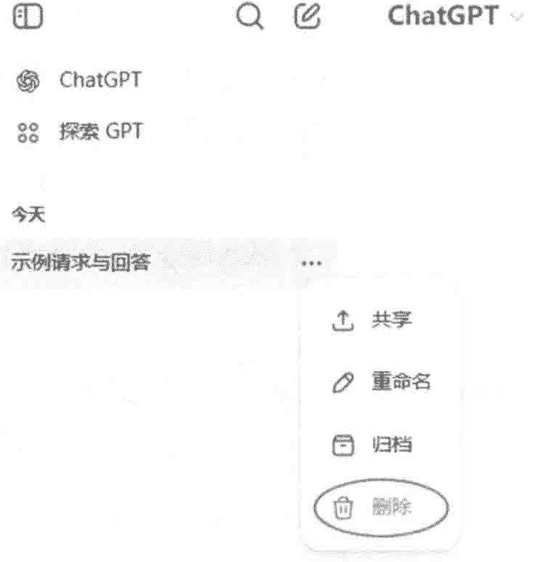

默认阻止ChatGPT保存聊天记录，可进入“设置”页面，打开“个性化”，关闭“记忆”选项，如图6-4所示。

### 真实场景中的商业应用

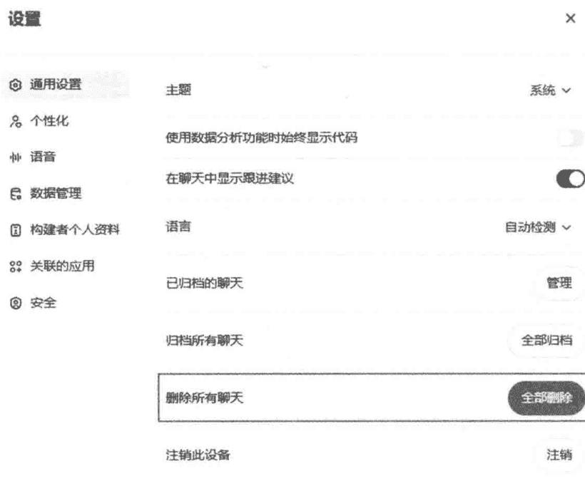

图6-3 点击对话

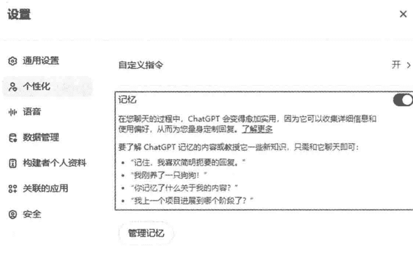

图6-4 设置窗口

若未选择“记忆”，新聊天记录将停止保存，避免用于模型训练，并立即生效。已保存对话将在一个月后从平台删除。

了解删除与停止自动保存的方法后，接下来审视使用该工具的风险。

评估聊天机器人安全性时，需考虑双方风险，包括未经授权的资料访问、有偏见信息及个人资料丢失。

ChatGPT等在线服务使用者，尤其是通过浏览器访问者，易遭遇资料泄露。若未授权方访问聊天日志等敏感信息，泄露风险更高。

一旦发生泄露，敏感信息、私人对话等可能被暴露，损害隐私。若网络犯罪分子利用窃取信息实施欺诈，就会发生身份盗窃，造成经济或声誉损失。

泄露还可能导致信息被分发或出售给恶意使用者，用于非法活动如传播虚假信息。

为应对网络犯罪威胁，OpenAI已采取措施最大限度降低未授权访问风险。尽管如此，人为错误仍可能导致泄露。若员工或使用者在ChatGPT中输入商业秘密或密码，这些信息可能被犯罪组织利用。

为保护公司与员工，应制定人工智能技术使用指南。亚马逊、沃尔玛等大公司已警告员工共享秘密资料的风险。摩根大通、Verizon等公司也禁止使用ChatGPT。

常见风险是该工具可能呈现不准确或有偏见信息。庞大训练资料可能导致模型无意产生偏见，影响依赖人工智能生成内容与决策的企业。个人需在使用信息时保持公正，避免传播虚假信息。

## 相关法规图景

隐私与资料保护规定适用于人工智能技术，在不同法域各有差异。

GDPR适用于位于欧盟并处理欧盟居民个人资料的组织，确保隐私与权利受保护。

美国加州CCPA为消费者规定与个人资料相关的权利，要求企业告知资料收集方式及共享情况。

各国制定了自身法律以保护人工智能系统收集的信息，包括新加坡PDPA和巴西LGPD。2023年3月意大利因隐私问题禁止ChatGPT，一个月后OpenAI增加安全功能后禁令解除。

欧洲议会已关注ChatGPT等人工智能系统缺乏法律规制的问题。2023年通过《人工智能法案》，要求开发人工智能技术的公司披露训练资料版权来源。

这些法规按项目带来的风险程度分为不同类别，从低到高。法规不会禁止高风险工具，但将强制严格透明度措施。

《人工智能法案》是规范人工智能使用的综合立法。在正式落实前，使用者仍应谨慎使用ChatGPT。

## 安全使用建议与防护要点

为保护使用者资料，OpenAI落实了多种安全功能，但使用者仍需采取必要步骤降低风险。

应始终避免在对话中泄露敏感信息。使用任何接入ChatGPT的应用程序前，应仔细查看隐私政策，了解对话如何存储与使用。

为降低未经授权访问与使用风险，应始终使用假名或匿名账户，防止真实身份与对话关联。

使用服务或应用程序前，应熟悉保留对话的政策，了解对话在删除或匿名化前保留多久。

遵循OpenAI的隐私与安全政策，并持续更新做法以确保安全。了解其安全功能有助于获得更安全体验。

在使用语言模型的同时，还应采取必要措施保护个人资料与隐私。

为降低风险，应限制共享信息并审阅隐私政策，使用假名账户、监控资料保留，并及时了解安全措施变化。

随着人工智能日益普及，使用者在使用过程中优先考虑隐私与安全至关重要。

## 为组织制定使用规范

参与创建与部署自动化系统的人员必须确保系统安全且不存在对个人或社群的歧视。

若计划在公司推出自动化人工智能解决方案，需要全面的平等评估框架，包括在系统设计时顾及残障人士的方法。

自动化系统开发、设计与操作人员在访问、使用、传输与删除使用者资料前需征求使用者许可，并考虑其他方法保护隐私。

系统不应实施侵犯隐私的默认设置和给使用者带来负担的设计决策。

开发、设计与部署人员应以通俗易懂的语言提供文档，便于理解系统工作原理及其作用，并解释性能与使用原因。

ChatGPT政策可帮助组织创建在线内容、与客户交流、生成销售宣传、总结冗长报告并分析业务趋势。

## 安全风险面相

尽管ChatGPT备受关注，许多IT领导者尚未接受人工智能聊天机器人。Verizon出于安全考虑禁止员工使用该程序。据Check Point Research研究，网络犯罪分子已在使用ChatGPT开发攻击工具。

### 恶意软件
能创建伦理守则的人工智能也可用于编写恶意软件。尽管ChatGPT拒绝编写恶意软件的提示，但使用者可轻松规避限制。例如黑客可请求代码执行渗透测试，然后用于网络攻击。

尽管程序努力阻止非法或不合伦理提示，仍有许多人能轻松绕过限制。开发人员持续努力，但使用者仍会挑战极限。

### 网络钓鱼
生成式人工智能兴起预计使网络钓鱼攻击更复杂，网络安全专家已在准备。

资料表明，使用ChatGPT的人更可能进行社会工程攻击。

网络钓鱼常依赖拼写、语法错误。借助生成式人工智能，攻击者可快速创建令人信服的定制文本欺骗受害者。

攻击者可将ChatGPT输出与生成图像和语音欺骗的软件结合，开展深度伪造网络钓鱼。

### 网络犯罪
生成式人工智能的积极效应包括增加入门级网络安全分析师培训机会。另一方面，它也让黑客更有效地提升技能。

缺乏经验的威胁行为者可能询问如何部署勒索软件或破解网站。OpenAI政策阻止聊天机器人帮助非法活动，但冒充渗透测试者可改变话题并获取详细指令。

数百万新网络犯罪分子可在ChatGPT等生成式人工智能帮助下提升技术技能，增加互联网整体安全风险。

### API攻击
企业API增加，针对其的攻击亦随之上升。据Salt Security研究，2022年上半年针对客户API的独特攻击者数量增长874%。

Forrester Research专家表示，网络犯罪分子最终可能利用人工智能查找并利用API中的漏洞，这通常需大量时间。此方法可用于提示ChatGPT查看API文档并执行查询。

## 附录

## 法律人工智能实操手册

汪政

如何促进、规范和保障人工智能安全、可信、可控地健康发展成为时代命题，特别是人工智能在法律领域的应用是未来不可回避的挑战，亦是千载难逢的历史机遇。律师事务所应为律师及其他工作人员使用人工智能技术制定规则。ChatGPT和DeepSeek等大语言模型在生成法律文件方面仍不充分，存在局限性与错误，要求律师在法律文件生成等实务工作中采用严格的人工修正程序。同时最新研究表明，大语言模型在法律实践基础上经调整与训练，已成功应用于特定法律任务并减少错误。未来新一代法律人工智能将进一步降低法律服务成本，且更易使用。

ChatGPT 商业实战与法律智能实践笔记

这份手册共划分为三块内容。开篇从人工智能的分类边界、风险点与局限性谈起，聚焦法律人工智能在研发与落地上应当坚守的原则、伦理底线与操作要点；第二块以 DeepSeek 为样本，说明通用大语言模型在法律实务中的典型用法；第三块以 THGPT 为案例，拆解法律垂类大语言模型在实务里的落地形态。①

① 第二部分、第三部分详见文末二维码。

## 第一部分 法律人工智能的研发应用

人工智能是研究如何让机器模拟、延伸并扩展人类智能的学科，其终极追求是赋予机器感知、推理、学习、决策与交互的能力 Russell & Norvig, 2020 。按任务广度与实现路径，技术可划为狭义与广义两大方向。狭义方向业界常称为 AIGC，即生成式人工智能，指聚焦特定任务的内容生成范式，比如文本、图像、音频、视频的自动创作。AIGC 建立在深度学习之上，多采用生成对抗网络与 Transformer 等架构，借助海量数据训练输出高质量结果，但效能始终被预设任务与训练数据所框定 Rombach et al., 2022 。广义的人工智能 AGI 则指向能够跨领域自主学习与推理的系统，可像人一样应对全新任务并处理复杂问题，具备感知、认知、元学习等多模态整合能力，目前仍处在理论探索期 Legg & Hutter, 2007 。与只解决特定问题的生成式系统不同，AGI 拥有更宽泛的认知与推理空间，能在多个领域学习、适应并执行任务。当前主流的 ChatGPT、DeepSeek 等仍属狭义范畴，并非 AGI。因此基于数据与算力构建的生成式系统天然带有公平性受损、知识产权侵害、信息泄露、恶意运用、安全威胁、模型幻觉、环境社会与监管压力、第三方风险等核心问题。与此同时，AI 在法律实务里的应用还牵涉独立性、胜任度、保密义务、委托人利益最大化等伦理困境，以及幻觉与虚构、算法偏见、可信度不足、可解释性缺失、人文敏感薄弱等局限。

法律人工智能的研发与落地涉及技术、伦理、制度与社会的交叉议题，关键在于把科技创新与公平、透明、隐私保护等基本价值相平衡。

### 一、研发落地的核心原则

#### （一）公平公正与反歧视

- 1. 规避算法偏见：确保训练数据的代表性，避免因历史数据带来的种族、性别、经济地位等偏差导致歧视性输出。
- 2. 均等对待：系统不得因使用者身份差异提供差别化服务，应借助公平性测试等技术手段验证决策公正。

#### （二）透明与可解释

- 1. 决策可追溯：结论应具备可解释性，如采用白盒模型或辅助说明机制，让使用者理解推理逻辑。
- 2. 局限需披露：须明确告知使用者适用边界与潜在误差，避免误导性使用。

#### （三）责任与追责

- 1. 厘清责任主体：明确研发者、部署方、使用者的责任边界，如错误法律建议的责任是源于技术缺陷还是人为误用。
- 2. 建立追责机制：通过日志记录、审计功能等技术手段支持事后复核。

#### （四）隐私与数据安全

- 1. 数据最小化：仅采集必要信息，避免过度收集个人敏感信息、合同主体、商业条款与案件细节等。
- 2. 强化保护：采用加密、匿名化等技术，确保数据存储与传输符合《中华人民共和国网络安全法》《中华人民共和国数据安全法》《中华人民共和国个人信息保护法》等法规要求，并达到三级及以上网络安全等级保护标准。

### 二、研发落地的伦理考量

#### （一）人机协同与辅助定位

法律人工智能应作为技术工具辅助法官、律师等法律职业人员，而非取代专业判断。依据《最高人民法院关于规范和加强人工智能司法应用的意见》法发〔2022〕33号所提辅助审判原则，AI 辅助结果仅可作为审判工作或审判监督管理的参考，司法裁判必须由审判人员作出，裁判权由审判组织行使，司法责任最终由裁判者承担。

#### （二）防止权力滥用与技术垄断

- 1. 避免“监控式执法”或“预测性司法”，如基于历史数据预测个人犯罪风险，可能侵害基本人权。
- 2. 防止法律科技企业与研发部门凭借技术优势对法律机构或法律职业人员形成技术胁迫或垄断。

#### （三）社会影响评估

- 1. 评估对弱势群体的冲击，如无力支付人工法律服务费用的群体，避免加剧司法资源分配不均。
- 2. 研发应用的目的是促进社会和谐与公平正义，而非激化矛盾或鼓励诉讼，不得违背公序良俗，不得损害公共利益与秩序，不得违背社会公德与伦理。

#### （四）人文敏感

- 1. 法律人工智能需适应不同司法辖区的文化背景与法律体系，避免千篇一律的技术输出。
- 2. 法律人工智能本质上缺乏社会意识与人文敏感性，对社会背景、社会因素如文化、价值观、规范以及人际关系的理解有限。该局限可能对缺乏警惕的用户包括法律职业群体造成缺乏人文关怀的严重后果。

### 三、研发落地的注意事项

#### （一）技术开发阶段

- 1. 数据质量：保证训练数据覆盖多元场景，并定期更新以反映法律修订与社会变化。
- 2. 算法验证：通过多维度测试如对抗性测试评估模型鲁棒性与可靠性。

#### （二）应用场景限制

- 1. 明确禁用领域：涉及公民自由权、生命权、身体权、健康权等重大司法决策如死刑刑事裁判，应禁止使用法律人工智能进行智能审判或法律决策建议。
- 2. 高风险场景须特别审查：如自动化合同审查中，合同可能隐藏不公平条款、违法侵权条款、环境破坏条款等。

#### （三）合法与伦理监管

- 1. 遵守法律法规与技术标准：遵循数据“三法一条例”《中华人民共和国网络安全法》《中华人民共和国数据安全法》《中华人民共和国个人信息保护法》与《关键信息基础设施安全保护条例》、以及《生成式人工智能服务管理暂行办法》等法规，并符合 ISO/IEC 42001 等人工智能技术标准。可借鉴欧盟《人工智能法案》制定高风险人工智能系统的强制性标准，并为法律职业应用人工智能制定规范、标准与指引。
- 2. 建立伦理审查委员会：由法律、技术、伦理专家共同参与系统设计与部署，构建技术嵌入伦理规范与伦理风险评估机制。

#### （四）用户教育与知情权

- 1. 明确告知局限，如“无法替代专业律师对复杂案件的分析能力”以及“法律咨询意见仅供参考”等提示。
- 2. 提供人工干预通道，允许用户对决策提出异议并接入人工，如智能法律咨询场景应提供人工律师咨询通道。

### 四、法律人工智能研发落地的未来方向

#### （一）技术层面

研发可解释性更强的法律人工智能，如基于大语言模型的语义匹配与因果关系学习的法律条文选择框架①，基于大语言模型的神经符号法律判决预测框架①等。

> ① Z. Wang, Y. Ding, C. Wu et al., Causality inspired legal provision selection with large language model based explanation, Artificial Intelligence and Law, https://link.springer.com/article/10.1007/s10506-024-09429-3, Dec. 23, 2024.

#### （二）制度层面

推动国际协作制定统一的法律人工智能治理体系与伦理准则，完善法律人工智能责任保险机制等。

#### （三）社会层面

加强公众参与的法律人工智能社会可接受性讨论，在司法效率与司法公平之间寻求平衡。

总体而言，法律人工智能即法律工作的智能化。其目标在于推动法律职业现代化，提升法律服务的普惠性与司法质效，维护社会公共利益与公平正义。

第二部分、第三部分

人工智能法律实务应用资料包

> ① B. Wei, Y. Yu, L. Gan et al., An LLMs-based neuro-symbolic legal judgment prediction framework for civil cases, Artificial Intelligence and Law, https://link.springer.com/article/10.1007/s10506-025-09433-1, Feb. 8, 2025.

## 译后记

## 法律人工智能

> 过去250多年，经济增长的核心驱动力始终是技术创新。经济学描述的通用技术包括蒸汽机、电力与内燃机。我们时代最重要的通用技术就是人工智能，尤其是机器学习。

——埃里克·布林约尔松与安德鲁·麦卡菲

《释放ChatGPT的力量：真实世界的商业应用》中文版现已出版。我与导师王进喜老师引进并翻译此书的契机来自2024年1月在美国加州的一次会面。当时我正在撰写博士论文《法律科技伦理研究》，其中一章聚焦人工智能在法律实践中的应用伦理。为更深入地了解人工智能在各行业商业应用带来的潜能与伦理风险，我们决定将查尔斯·瓦格马尔所著《释放ChatGPT的力量：真实世界的商业应用》译成中文。本后记在简要评述译作的基础上分为三部分：第一部分介绍人工智能在法律实践中的应用；第二部分探讨法律人工智能伦理；第三部分展望法律人工智能未来。我与王进喜老师共同翻译、推荐此书并撰写后记，希望帮助中国读者尤其是律师与法律科技研发人员更好驾驭法律人工智能。了解人工智能在法律行业应用的缘由与本质，才能真正实现“以人为本”的技术赋能，推动社会进步与人类福祉，避免无谓争论与虚幻吹捧。

首先，查尔斯·瓦格马尔从技术角度介绍了 ChatGPT 的架构包括机器学习算法、自然语言处理与神经网络，解析了人工智能与 ChatGPT 如何改善企业沟通的多个维度，包括客户支持、内部协作与数据分析，并阐述了人工智能在软件开发、客户支持、人力运营、旅行业、运营管理、营销、销售、内容创作、翻译等领域的实践应用，指出人工智能有望成为未来商业沟通的重要组成部分，并说明如何借助人工智能降低成本、提升客户满意度。其次，作者讨论了 ChatGPT 与企业管理及业务运营系统的融合，以改善客户服务、营销与生产力。利用 ChatGPT 提供的集成服务，企业可将 ChatGPT 无缝嵌入现有应用与平台，确保流畅体验与最佳功能，创造新的发展机会。最后，作者对数据安全、隐私保护等伦理问题表达关切，包括数据隐私、安全伦理与信息风险，如何制定 ChatGPT 使用政策及安全风险。同时强调人工智能必须遵循人权、伦理原则与社会规范。对大语言模型等实施安全功能与防护屏障，有助于防止无意或恶意使用，监控与审核可识别并阻止有害输出。构建负责任的人工智能应用时应考虑更广泛的社会影响。

本书提供了人工智能技术与数字化商业服务系统融合的实用方案。由此，我们思考如何在本书研究基础上专项解决人工智能在法律领域尤其是律所与法律服务市场的商业应用问题。鉴于原著对人工智能商业领域的全面概述，未能详细展开法律领域应用，为弥补不足，特分享本人博士论文《法律科技伦理》中关于人工智能在法律领域应用的研究。

## 第一部分 法律人工智能

人工智能与法律是诞生于20世纪70年代初的新兴交叉领域。①布坎南与海德里克1970年发表的《关于人工智能和法律推理若干问题的一些考察》②被视为该领域的开山之作。1983年，龚祥瑞、李克强发表《法律工作的计算机化》，提出“由于计算机技术在法律领域的运用及其发展，法律工作正在发生根本性变化”。③该文是国内最早探讨“法律科技”④的文献。作为学科概念，“法律人工智能”最早出现于美国波士顿东北大学举办的“第一届人工智能与法律国际学术大会”The First International Conference on Artificial Intelligence and

① 熊明辉：《从法律计量学到法律信息学——法律人工智能70年（1949-2019）》，载《自然辩证法通讯》2020年第6期。
② B. G. Buchanan & T. E. Headrick, *Some Speculation about Artificial Intelligence and Legal Reasoning*, Stanford Law Review, Vol.23, p.40-62 (1970).
③ 龚祥瑞、李克强：《法律工作的计算机化》，载《法学杂志》1983年第3期。
④ 汪政：《法律科技重构法律服务市场》，载《法治研究》2023年第6期。

## （一）人工智能在律师事务所的商业应用

人工智能与法律研究的核心目标是构建可计算机化的法律应用模型。人工智能与法律包含两层含义：一是人工智能在法律实践中的应用，二是人工智能的法律问题。本文所指的法律人工智能主要指前者，即把人工智能技术应用于法律工作，通俗地说，法律人工智能即法律工作的人工智能化，是基于人工智能技术在法律实务领域垂直研发、部署与应用的产品与平台。人工智能在法律领域的应用大致涵盖七个子方向：（1）计算机在法律中的运用；（2）智能数据库；（3）智能法律信息系统；（4）计算机辅助法律起草；（5）数据库管理系统；（6）专家系统；（7）知识系统。法律与人工智能正加速交融。

按技术路径，法律人工智能可分为广义与狭义。狭义的法律人工智能指运用人工智能技术为法律职业与法律实践研发的产品与服务，面向法律服务提供者的工具如法律文书自动生成、案件管理、合同审查软件；面向客户的自助工具如在线法律咨询、智能合同平台；智能化分析工具如法律预测、风险评估、证据筛选等。而广义的法律人工智能则涵盖利用人工智能技术的各类法律实践场景，例如用 ChatGPT、DeepSeek 等生成式人工智能进行法律咨询、检索、文书起草、合同解析、类案检索、案件预测等。

法律人工智能在研究与实践中的作用能发展到何种程度？部分学者认为人工智能将深刻改变法律领域与律师工作。它可能为法律实践与学术带来重要贡献与根本性转变，提供新颖洞见，显著提升研究效率与有效性，以更少资源获得更准确可靠的结果。此外，法律人工智能还可能改善法律服务、创新商业模式、提供新知识，为政策与立法提供更坚实的技术基础。关于人工智能进入律所，英国曼彻斯特大学法学院弗兰克·H.史蒂芬教授指出，律所组织形式与所有权限制使其难以获取可改善服务的组织与生产技术。例如，美国 Wise Legal Services、Rocket Lawyer、Legal Room 和 Legal Shield 采用基于法律科技的替代商业模式，为个人与中小企业提供在线法律服务，包括公司注册、遗产规划、法律体检、文件自动化、实践管理、文件存储、计费、会计与电子检索。尽管法律科技在服务创新上意义显著，但“客户仍不满意，律师也不满意，觉得一定有更好的采用方式”。这表明法律科技的未来路径仍需清晰设计。

ChatGPT 等人工智能应用可能威胁的十大行业岗位中包括法律行业，原因在于律师助理与法律助理需大量消化信息、综合知识并撰写摘要或意见。麦肯锡全球研究院合伙人 Madgavkar 指出，语言导向的岗位易被自动化。数据高度结构化且以语言为主，非常适合生成式人工智能。但她也补充，人工智能无法完全自动化这些工作，因仍需人类判断来理解客户或雇主需求。我们认为随大语言模型等技术进步，以法律咨询为核心的法律服务业将受惠于人工智能。语言对话是人类基本交流方式，法律人工智能咨询终将取代以语言交互为主的人工法律咨询，成为主要交互形式。此外，人工智能还能帮助律师处理文书与案件分析。人工智能替代部分岗位已成趋势，ChatGPT 的出现加速了这一进程，让大量以文本工作为主的人切身感受到替代威胁。其结果是，若律所未能充分利用新技术潜能，可能丧失自20世纪初以来在法律服务市场的主导地位。因此，人工智能在法律行业的应用既是不可避免的挑战，也是难得的历史机遇。

**律所为何纷纷拥抱法律AI？全球热潮与中国分化**

波兰国际人工智能学会的米哈尔·杰克夫斯基和米哈尔·阿拉斯基维奇教授曾对全球200余家、合计近十万名法律从业者的律所展开调研，并在《人工智能在法律业务中的应用项目报告》2023版中公布结果。数据显示律所日常工作中可重复的环节平均占到38.2%，其中诉讼类事务的重复性比例更高达52%。这种高占比意味着把常规重复工作交由法律人工智能自动化，可以释放大量时间与人力成本，提升精准度和执行效率，让律师把精力转向需要深度专业判断与战略设计的复杂业务。报告的量化分析也显示从业者的共识很明显，人工智能最先被寄予厚望的场景是平凡高频的法律工作：法律研究约79.7%的人认为可被辅助，文件审查72.1%，合同起草55.8%。进一步看，合同起草55.8%、合同校对40.1%、合同分析41.1%的数据印证了智能合同正成为行业关注的焦点。预测层面，生成式人工智能有望在未来三年内重塑法律服务版图，约四成法律任务将进入AI化轨道，使用AI的律所可创造数千亿美元的增量价值，并且掌握AI能力正迅速演变为市场上的核心竞争力。

在欧美发达市场，法律人工智能的落地已从试点走向常态。与之相比，中国律师行业起步较晚。1979年律师制度恢复后，86.24%的律所规模偏小，20人以下的轻型团队往往仍停留在信息化的起步阶段，甚至尚未完成数字化管理；12.47%的中型律所信息化基本到位，正起步尝试数字化运营；100人以上的头部门店仅占1.29%，它们基本完成数字化并开始探索智能化。监管层面关注度不足、专项研究人才稀缺等掣肘，导致国内整体进程明显滞后于欧美。

不过头部律所和一批数字原生律所的嗅觉已经很灵敏，它们开始以行动抢占先机。典型做法包括用AI实现数据录入自动化、挖掘潜在客户、提供7×24小时在线法律咨询、自动生成各类法律文本、优化客户个性化体验、强化客户关系与忠诚度、提升内部协作与决策效率、压降运营成本、提高整体生产力，甚至出现AI驱动的律所新形态。随着技术扩散，低频高价的法律服务将逐步转向高频平价的普惠模式，人机协作成为日常工作常态。中国律师行业45年来的传统红利窗口正在关闭，机器尚难触及的多层次复杂法律业务与跨境法律服务，反而成为律师展示专业能力、展开竞争的新赛道。在新质生产力推动下，行业正迈向专业化、精细化、高质量服务的新阶段。

## （二）法律人工智能应用产品

GPT-4为代表的生成式大模型，已经能够完成过去需要专业律师亲手处理的咨询、代书、合同审查、诉讼文书自动生成、法律意见起草与分析报告撰写等任务。美国最早出现了一批以Della、Kira、Legal Sifter、Luminance为代表的AI法律科技公司，以及以Spellbook和Harvey为代表的生成式AI厂商；欧洲与亚洲则有AnyLawyer等应用。生成式AI与传统的大数据检索、文本解析等初级AI不同，它依托大模型可以弥补人性偏误，协助做出更理性、更贴近实际的决策。

2023年2月，全球第七大律所安理国际律师事务所宣布旗下3500多名律师全部接入由OpenAI投资的Harvey，成为全球首家全面使用基于OpenAI GPT模型的生成式AI律所。Harvey以GPT-4为底座叠加海量法律数据，打造出面向律所的类ChatGPT助手，可应对各实践领域、司法辖区和法系下的复杂挑战。同年9月16日，Sky News报道，英国上诉大法官科林·比尔斯勋爵在律师协会的演讲中透露，自己已用ChatGPT对判决书进行摘要，并认为这将颠覆性地提升律师和法官的工作效率。技术进化正在加速，不使用AI的律所将面临竞争劣势。传统上看似保守的法律界正在拥抱技术解决方案，尤其大型律所对规模与效率提升的渴求更强，而小型律所的热情同样高涨，说明AI红利并非大型机构独享。我们以ChatGPT的检索为辅，汇总了国外基于NLP与ML的代表性法律AI厂商，主要包括Open AI、IBM Watson、Luminance、ROSS intelligence、DoNotPay、Casetext、LegalMation等，其具体应用如下表所示。

表1 国外部分生成式人工智能在法律领域的应用情况

序号 名称 网址 功能简介
1 Genie AI www.genieai.co 法律文件起草与多模式文本编辑
2 LawGeex www.lawgeex.com AI合同审阅助手并输出修改建议
3 Icertis www.icertis.com 智能合同全生命周期管理助手
4 Aline www.aline.co 以AI驱动合同流程数字化转型
5 Harvey www.harvey.ai 合同分析、尽职调查、诉讼与监管合规支持
6 Evenup www.evenuplaw.com 基于百万级数据驱动的律师工作工具
7 CoCounsel casetext.com 快速法务研究、庭审准备、文档审阅与合同自动化修订
8 DoNotPay donotpay.com 法律咨询、流程整理与诉讼代理服务
9 Paxton AI www.paxton.ai AI驱动的合同审查与法律研究平台
10 AI Lawyer ailawyer.pro 即时法律援助、文档生成与文件比对审查

国内布局也在加速。2022年12月8日，最高人民法院发布《关于规范和加强人工智能司法应用的意见》法发〔2022〕33号，提出到2025年基本建成较为完备的司法人工智能技术应用体系，到2030年建成具有规则引领与示范效应的司法人工智能技术应用和理论体系。据不完全统计，国内大模型已超200个。生成式AI在语言交互与文本处理上的成熟度最高，与语言相关的法律业务也将率先实现商业化改造。法律文本主导的特性，使其成为AI攻坚的理想场景。过去十年，北大法宝、北京华宇、百事通、中科泰杭等法律科技公司已在智慧警务、检务、法院、律所等领域深耕。2025年1月，杭州深度求索的DeepSeek引爆全球，进一步点燃了行业对法律AI的研发热情。国内部分代表性应用见下表。

表2 国内部分生成式人工智能在法律领域的应用情况

序号 名称 网址/平台 主要功能
1 法研开放平台 open.cjbdi.com 法律问答、诉讼评估与法规检索
2 法能手 App、小程序 综合法律咨询、合同审查、文书撰写及律师匹配
3 熊猫AI法律数智平台 www.pandalawai.com 快速合同生成、智能审核与问答服务
4 AI法律助理一氏 小程序 细分领域专项法律咨询
5 幂律智能 www.milvzn.com 问答、文书、合同管理与审查一体化
6 麦伽智能法律大语言模型 www.megatechai.com 类案检索、合规内控与法律文书智能写作
7 律皓法管家 www.faguanjia.cn 在线法律咨询服务
8 得理 www.delilegal.com 检索、阅读、生成与AI法律研究综合平台
9 智小律 小程序 微信小程序法律咨询
10 元典问达 www.ailaw.cn 问答咨询结合案例法规检索
11 法宝GPT ai.pkulaw.com 智能问答、模拟法庭演练与自动写作
12 海瑞智法 www.hairuilegal.com 检索、案情分析、文书生成与实战演练
13 通义法睿 tongyi.aliyun.com/farui 多模对话、文书生成与合同审查
14 讯飞星火法律大模型 xinghuolegal.com 基于星火大模型的法律问答咨询
15 法唠AI chatlaw.cn 模拟判决生成、判例问答及批量索赔服务
16 MeCheck www.powerlaw.ai/mecheck 自定义审查清单的合同智能审阅与模板管理
17 MetaLaw meta.law AI驱动的相似案件检索
18 iCourt (Alpha系统) www.icourt.cc 智能咨询、报告生成与合同审阅
19 智拾GPT www.zhi10.com 合同起草、文书写作、检索翻译与案件分析
20 法观 fg.fengqiao.cn 综合咨询、写作与合同审查服务
21 小包公 www.xiaobaogong.com 类案法规检索与合同审查
22 法天使合同库 www.fatianshi.cn/legaloffice 基于AI的合同检索与审查要点发现
23 智AI www.zhiexa.com 在线法律问答
24 法智 www.fazhi.law 咨询、检索、审查一体化
25 浪潮海若大模型 cloud.inspur.com 法条检索、案例分析、判决推理与知识问答
26 YAYI雅意 yayi.wenge.com 文书合同阅读与智能体问答
27 中科泰杭THGPT ai.thgpt.net 智能咨询、合同智审、专项助手、知识库与诉讼支持

随着自主大模型普及，法律AI的规模化、系统化应用场景将逐步常态化，垂直法律大模型将成为法律人、企业乃至家庭的刚需工具。但研发并非大型科技公司或大所的专属，绝大多数创新来自初创法律科技公司，也完全适配中小所。中国法律与科技界应拓宽研究广度与深度。建议中小律所、县域律所结合自身专长与市场需求，自主研发AI产品，并通过API无缝接入现有数字化管理平台，以提升办案效率与服务能力、改善客户互动与满意度、拓展业务并实现降本增效。可打造AI法律咨询、社区AI法律顾问等场景，降低人力投入与财政支出，提升公众获得感。人力资本律师可定制HR专属法律AI，解决招聘、考核、调岗、解聘等合规需求。合同管理方面，无论个人、企业还是政府，都需要智能起草、审核、校对与电子签署服务。标准化合同、小微企业的高频合同完全可由AI完成精准管理，而专业性高、结构复杂的项目则需要更高水准的训练模型。人工智能至少可以承接重复琐碎的环节，让专业人士聚焦创造性难题，并有望催生出超越人工的法律AI产品。未来计算机视觉与多模态模型的融合，将让法律文本与视觉信息被同时理解，为全球化法律服务带来新形态。

法律AI不仅涉及模型与推理，还关乎法律问题差异、业务流程建模、跨系统集成与协同，同时隐私保护、信息安全、知情同意、算法偏见、可解释性、职业独立性、保密性等伦理议题必须置于首位。这些问题关乎社会接受度，需要完善的治理机制。

## 第二部分 法律人工智能伦理

AI尚处早期，发展方向仍可调整，但随着技术固化，调整成本会急剧上升。2023年8月28日，谷歌、DARPA等联合发布的《识别并缓解生成式人工智能的安全风险》综述指出，生成式AI面临公平性受损、知识产权侵权、信息泄露、恶意使用、安全威胁、模型幻觉、环境社会与监管风险、第三方风险等八大关键风险。在此背景下，法律职业人员仍须恪守职业伦理。法律职业伦理的核心包括独立性、称职性、保密性与委托人利益最大化。

独立性原则。法律职业之所以受人尊重，不仅因其兼具利己利他属性，更因其肩负维护公共利益与公平正义的职责。律师使用AI工具时必须保持独立判断，不能完全依赖AI对案件作出实质性判断并据此行动。一旦独立性丧失，法律职业的社会根基与价值平衡功能将受损。

称职性原则。法律职业通过准入、考核、惩戒维护行为规范。称职性要求律师在借助AI等技术时保持审慎、合规，不得损害行为的合法性与正当性，并具备相应的技术胜任能力。盲目使用或滥用AI建议，既不符技术要求，也违背称职义务。

保密性原则。律师对委托人隐私、商业秘密、国家秘密负有保密义务并受职业特免保护。使用AI时，案件信息、个人信息、商业信息及国家安全信息都须进行脱敏处理，防止泄露，避免违约。

委托人利益最大化原则。律师须维护委托人合法权益，当委托人利益与公共利益或自身利益冲突时应申请回避。使用AI的目的应是最大化委托人利益，若存在风险应停止使用。提供服务并收费时，应明示成果中使用了AI技术，并承担全部责任，这才是职业要求的体现。

# 从ChatGPT到DeepSeek：通用智能时代的法务生存手记

把高度纷繁的智能系统嵌进审判运行，虚构式生成、隐性偏倚、运行机制不透明等隐患就随之浮现。模型越擅长自主创作并在实践中自进化，技术供给方的边界与归责就越需要厘清，对外部规制的诉求也愈发迫切。即便工具的定位始终是辅助于人，不同主体的利益仍可能冲突。例如，诉讼参与方正越来越多借助AI预判胜算、推演谈判策略、规划程序路径，若并非全体当事人都能获得同等水准的技术支持，诉讼的公平起点便会被扰动。

谈及智能裁判，复杂度会进一步放大。对标准化程度较高的纠纷，机器给出结论相对容易，比如道路车祸、信用卡争议等场景，目标设定与效果评估都比较清晰。但在疑难复杂案件中，要求系统界定何为公平、并量化公平程度，本就是极难回答的问题，即便在传统审判中也常无定论。正因如此，法务场景下的AI至少面临五类短板：虚假生成与幻觉、算法歧视与偏倚、系统可信度不足、可解释性薄弱以及人文敏感性缺失。

ChatGPT在法务行业的幻觉问题已有典型教训，即美国纽约州罗拉诉世达国际律师事务所一案。①该案中，一名纽约律师利用ChatGPT准备法律文件，模型却生成了六则完全捏造的案例。律师误把ChatGPT当作检索工具，未意识到其本质是生成式大语言模型且存在幻觉局限，最终因检索失误成为反面教材。这也引出一连串伦理拷问：法庭引入AI是否会侵蚀公平审判的权利？法官自由裁量空间是否被算法压缩？一审、二审、再审程序是否会被干扰？当事人上诉权利是否受到实质性削弱？公众对置于AI监控下的司法公正会产生何种疑虑？这些都属于法律AI伦理价值判断的范畴。

推动AI安全、可信、可控地健康发展，已成为时代命题。我们认为法务AI的伦理内核应涵盖效率与公正、程序公正与实体公正、主体能动性与裁判公正、司法公开与算法透明、人文关怀与人本理念。智能调解、计算量刑、在线争议解决、庭审直播、督促程序等应用已进入司法实践，部分场景已具备准司法功能。

2022年12月8日，最高人民法院发布《关于规范和加强人工智能司法应用的意见》，明确AI辅助审判原则，并重申无论技术如何演进，AI都不得替代法官裁判，裁判权必须始终由审判组织行使，而非由机器决策。展望未来，AI将推动法律代码化，即代码之治。代码不仅执行规则，还参与制定与阐释规则。①

实现法务AI伦理价值的路径大致有三：一是让律师和法官更多参与AI工具使用及识别、减轻偏见的培训，并做到合理正当使用；二是促进律师、法官、技术专家与政策制定者之间的持续沟通，共同完善职业伦理规则、技术标准与使用指引；三是面向公众普及AI的潜在益处与风险，帮助其正当地使用法律AI，获得更普惠、便捷、个性化的服务。

另一个值得深思的问题是，随着法务AI的发展，人与人、人机之间如何建立信任。信任的基础在于公平公正，这也倒逼人们对公平正义进行哲学反思。官僚主义、功利主义等看似公正实则操弄权术的做法，将失去社会根基。未来社会组织形态可能转向以法治为基础、以资源共建共享为特征的人本主义法治社会。法律AI能否助力民主法治建设、能否促进人类命运共同体理想的实现，仍是重要研究课题。

综上，法律AI引发的伦理问题已迫在眉睫，然而我国法律职业伦理学科起步较晚，对法律科技与职业伦理的关注更是不足。我们提出法律AI伦理的初衷是增进理解、最大化效用、最小化伤害。希望通过本书的出版，促进法学界与科技界相互理解，最大化推动法律科技服务人类福祉，最小化因种种原因带来的社会危害与负面效应。因为伦理是指引科技向善的必由之路，法律AI伦理有助于推动法律职业现代化、普惠型法律服务市场的形成以及法治社会建设与社会公平正义的维护。

## 第三部分 法律人工智能未来展望

过去未去，未来已来。谷歌DeepMind首席执行官戴密斯·哈萨比斯指出，把AI当作普通技术是错误的，它具有划时代意义。现在谈大语言模型已不够，它们已是多模态的，涵盖视觉、音频、视频、代码与文本。但要做到特定领域最高水平，仍需专用系统，因为通用学习系统尚显不足，必须回归逻辑网络与专家系统。在此之上构建的新一代助手将更强大、更个性化，即通用助手。

在法律领域，未来它就是随身的个人律师助手。无论手机或穿戴设备，都能随时讨论法律问题、提供咨询意见，或在电脑桌面协助完成法律事务工作、法庭上辅助诉讼。因为我国民事法庭并未强制要求当事人必须聘请律师代理，诉讼主体可依据意愿选择是否委托律师。①

基于生成式AI、通用AI、具身智能及人机交互特征，我们对法务AI的发展作出三点判断：一是信息化、数字化的法律科技工具将被法务AI强化或替代；二是具身智能法律机器人将出现；三是AI法治时代终将到来。

首先，传统检索工具主要提供法规检索、合同模板检索、法律文本检索和类案检索，满足职业人员与公众的基础订阅需求。随着机器学习与法律推理能力的提升，法务AI可直接向公众提供法律咨询、生成合同与法律文书并附引证，借鉴学术引用方式争取准确性、可信度与市场认可，从而替代或补强检索订阅产品。

其次，具身智能法律机器人是法务AI与具身智能的结合。具身智能整合心理学、人机交互、新材料与AI等多项前沿技术。当通用AI满足人类普遍价值观时，具身法律机器人的诞生将成为必然。它可提供法律咨询、撰写起诉状等服务，在企业法务部门处理重复繁琐工作，在律所担任助手处理大量基础文书。智能审判辅助与具身机器人的融合甚至可能催生机器人法官，传统法庭上由机器人主持审判与维护公平正义的景象并非遥远。

最后，AI法治时代需要积极引导、规范与保障，构建智能社会的法治秩序。①AI法治社会正从构想走向现实。未来法务AI将在立法、执法、司法、社会治理与公共法律服务等领域广泛应用。智能咨询、智能调解发挥社会治理“治前端”功能，智能审判辅助缓解“案多人少”“立案难”等困境，让人民享有普惠法律服务，满足对司法公正与社会公平正义的需求。传统事后惩戒型法治社会将向事前预防型转型。

最后说明，本后记旨在抛砖引玉，期待更多同道参与法务AI应用与伦理的讨论并提出批评，以助力法律行业高质量可持续发展，推动中国式社会治理现代化建设与发展。

汪 政

于北京上书房

2024年11月

# ChatGPT与DeepSeek：通用人工智能时代的生存指南

本书聚焦人工智能技术革新浪潮下的商业转型机遇，从ChatGPT的技术原理切入，解析其底层机器学习算法与自然语言处理机制，进而展开多维度商业场景分析，涵盖客户支持、人力资源运营、精准化营销策略及自动化销售支持等应用方案，探讨其如何重塑人机交互模式并驱动业务效率提升。

本书随书附赠《法律人工智能实操手册》，专为律师、企业法务人员及广大法律爱好者精心编写，提供多场景人工智能提示词及使用方案，有效助力解决法律问题、提升工作效能，保障科技创新正确、可靠、合理地应用于法律实践。

> 挖掘大语言模型的无限潜力，见证其向通用人工智能的迈进历程，化身为智能体，在现实世界中引领商业革新！

——熊明辉

浙江大学数字法治实验室主任

浙江大学光华法学院求是特聘教授

> 进喜和汪政师徒联袂打造法律人工智能之作，是对“法律人的明天”最好的诠释！

——王忠德

大成律师事务所终身名誉主席

欧盟中国委员会理事会副主席

华中科技大学出版社 华中明法 华中出版自营书城

