# 智潮重塑：AI时代的学问转向

## 前言

把人类文明摊开来看，教与学始终是牵引文明进步与个体成长的核心线索。不同历史阶段，学的方式与意义都在迁移。进入智慧新纪元后，学的事态在持续更新，内涵在不断拓宽，整体图景也愈发清晰。智慧力量已渗透进教育与学习的各个触点，伴随人从语言启蒙到知识获取、智慧体悟、能力跃升与幸福建构的完整历程，正在引发一次深层的学习分野。

在这一阶段，学习活动的中心回到了人自身，学习主体的地位被凸显。受技术牵引，学习观念发生转向：由重结果转向重方法，由重知识存量转向重能力增量，由重知识传递转向重知识生成，由重应试转向重素质与创新并举，由片面发展转向全面发展，由教师主导转向学习者主导。与此同时，智慧化学习、个性化学习、探究式学习、自主学习、自适应学习等新样态相继出现，对学习力、思维力、创新力等综合素养的培养意义重大，也契合智能社会对高精尖人才的需求。

在更大背景下，AI深度介入学习场景，催生出众多新型学习载体。依托智能学习平台，资源实现泛在共享，移动学习、泛在学习等形态快速普及。智慧无处不在，迭代加速已成常态，这是传统教育未曾遭遇的情境。学习者需要善用各类智能工具实现随时随地学习，进而搭建终身学习框架，共同构建智慧学习型社会。

技术赋能学习，衍生出适配智能社会的全新理念、路径与方法，对重塑AI时代的人类学习意义深远。本书在内容层面梳理了新兴技术对学习的冲击、智能学习的概念与特质、传统学习形态的剖析、学习能力的培育、学习中介的关键要素、智能学习平台的搭建、学习资源的共享、学习角色的转换、学习评价的多元化、碎片化学习的局限与突破、学习型社会的构建等议题，并针对这些议题给出可操作性建议。

本书希望与读者共同体悟：智慧新时代，变化是常态，学习就在身边。我们需要以新理念、新习惯、新方式、新角色立足智能时代，在“学无处不在、学无时不有、想学即能学”的文化环境里汲取知识、体悟智慧、增强能力、获得幸福。

本书撰写参考了大量中外文献，在此向相关研究者与作者致谢。因作者学识有限，文中或有疏漏错误，敬请读者批评指正。

刁生富
2019 年 11 月 18 日

# 第一章 技术赋能：AI如何改写学习规则

拐点已至：智慧时代正式开启
万物智化：新时代的鲜明底色
技术驱动：AI对学习的深层影响

2016 年，谷歌 DeepMind 的围棋程序 AlphaGo 以 4 比 1 战胜韩国职业棋手李世石，一战让全球聚焦 AI，被视为重要里程碑。这不仅是机器的胜利，更是人类智能技术的跃进，对社会生活产生深远影响。在 AI、大数据、云计算、区块链等新技术的推动下，智慧新时代到来，人类学习发生根本性变化，技术赋能正在催生一场脱胎换骨的学习革命。

## 一、时代变迁：AI时代的到来

在新一代人工智能与新一代信息技术加速普及的背景下，互联网、物联网、云计算、大数据等技术重塑生产生活方式，一个名为“智慧时代”的新阶段悄然到来。社会形态、生产方式、生活方式、组织架构与治理模式都在技术作用下被迅速且全方位地改写。“人工智能” 也成为这一时代的高频词。

AI 的源头可追溯到六十多年前。1950 年，计算机科学奠基人阿兰·图灵在《计算机器与智能》中提出图灵测试，探讨机器是否能具备智能，并得出机器可拥有智能的结论；马文·明斯基把 AI 定义为机器完成本需人类完成的任务的科学；赫伯特·西蒙则认为 AI 是对符号的操作，每个符号对应物理客体。

1956 年夏，麦卡锡、明斯基、罗切斯特、申农等科学家聚会，共同研讨机器模拟智能问题，并首次提出“人工智能”这一术语，标志着该学科正式诞生^[([1]](#txt001.html#footnote_content_txt001_1))。历经六十年起伏，2016 年 AlphaGo 人机对弈的胜利再次点燃政府、产业和学界的关注。

学界对 AI 的界定不一，但总体上是指借助计算机模拟人类智慧完成任务，在过程中不断模拟人类思维与智能行为，探索智能活动规律。通俗来说，AI 就是赋予机器自动推理、语音识别、视觉识别、运动控制、人工意识等能力，让机器像人一样思考与行动（如图 1-1 所示）。

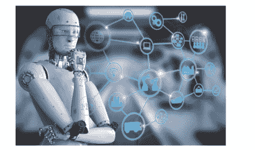
图 1-1　AI 具备的能力

六十余年间，AI 研究几经沉浮，因技术突破而受追捧，因商业化受阻而被质疑。总体而言，新技术成熟前往往经历萌芽、成长、高速发展三阶段，AI 亦不例外，其关键节点汇总于表 1-1。

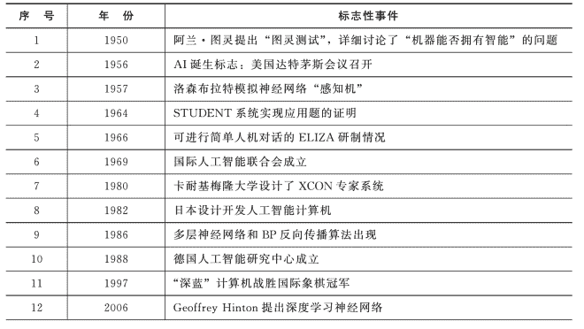
续表
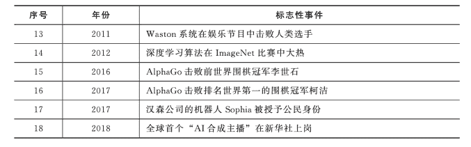

1956 年达特茅斯会议召开，AI 正式诞生。同期提出感知机、贝尔曼公式等基础理论，大大推动了发展，但受限于数学模型与计算手段，解决实际问题能力不足。1973 年《莱特希尔报告》指出未达预期，随后研究陷入低谷。

20 世纪 80 年代，“专家控制系统”概念出现，即计算机程序系统蕴含领域专家的知识与经验，可处理高层次问题。多层神经网络与反向传播算法问世再次点燃关注。但专家系统依赖的硬件失败、维护升级困难，加上软件算法未突破，导致发展再次受挫。

进入 90 年代后，杰弗里·辛顿发现训练高层神经网络的有效方法，2012 年在图像识别取得突破；2016 年 AlphaGo 战胜李世石；深度学习、支持向量机、贝叶斯采样推理等技术涌现；GPU 普及与大数据发展共同推动 AI 进入新一轮高潮。人们逐步认识到其颠覆性与巨大经济价值。世界各国纷纷出台政策支持，2016 年 10 月奥巴马发布《国家人工智能研究和发展战略计划》；2017 年 7 月我国国务院印发《新一代人工智能发展规划》；2019 年 3 月 5 日李克强总理在政府工作报告中提出“智能+”。“人工智能”连续三年写入政府工作报告，成为拉动新兴产业发展的新动力。

AI 在生产生活的广泛应用推动人类活动智慧化。按功能与阶段划分，一般分为弱 AI、强 AI、超级 AI（如图 1-2 所示）。

图 1-2　AI 的分类

弱 AI 在特定领域、特定任务上超越人类，看似智能但未实现真正智能，也不具备意识与智慧。它可在人类输入数据基础上替代重复性、高精度、高危险性工作，如智能办公、智能教学等，解放人力，降低成本。会下围棋的机器不一定会下象棋，专才而非通才体现了当前发展的普遍特征。弱 AI 很好诠释了“人智+机智”融合优势互补的价值。

强 AI 即人类级别 AI，是具备独立思考能力的机器智能，拥有自主意识，能独立适应环境变化。它在各方面超越人类，甚至完成人类无法完成的任务，在抽象思维与复杂问题解决上如人般游刃有余。其实现涉及思维与意识的哲学与伦理议题，有学者认为数十年内难以实现。

超级 AI 指全面超越人类的智能。牛津哲学家尼克·博斯特罗姆将其定义为“在几乎所有领域都远超最聪明的核心大脑，包括科学创新、通识与社交技能”。

技术赋能加速生活节奏，技术对生活的影响重于技术本身。AI 作为新兴力量，已渗透教育、学习、商业、办公、金融、零售等各领域。例如 Siri、Alexa 等语音助手在商业中角色攀升；AI 辅助证券研究提升分析师覆盖效率；机器学习节省人力，让人从机械重复中解放，提高效率。

AI 时代既是机遇也是挑战。近几年在语音识别、图像识别、信息处理上已超越人类，有专家预测在通用智能领域虽难匹敌人类，但在特定领域解决问题的能力优于人类。技术是双刃剑，它带来福祉的同时也带来问题，如简单体力劳动岗位被智能机器替代，人类再次面临失业风险。因此智慧时代更凸显对高素质、创新型、智慧化人才的迫切需求。

人类进入智慧时代是历史必然。在智能科技高速发展的当下，AI 已深入生活各方面，未来将持续快速发展并对生产生活产生深远影响。

## 二、智化万物：智慧时代的鲜明底色

人类文明在进入智慧时代前，经历了游牧、农业、工业和信息时代（如图 1-3 所示）。

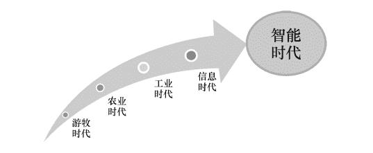
图 1-3　时代发展历程

技术是推动时代演进的核心动力，每一次革新都带来变革。从游牧到农业源于种植技术进步；农业时代出现农具与家畜，手工业与商业随之兴起；工业时代包括蒸汽与电气，主要是能源资源开发，机器生产替代手工；信息时代是信息技术产物，计算机普及使信息占据社会核心地位。如今在互联网、物联网、云计算、大数据、AI、区块链等新兴技术驱动下，社会面貌巨变，人类生活趋向智慧化，社会进入全新智慧阶段，并呈现多重特征。

### 第一，“智慧化”是智慧时代最突出特征，也是发展方向。

随着技术深化，人类社会向智慧化演进，现代文明也趋向智慧化。智慧化的“智”为智慧，“能”为能力，“化”为演进过程。当下智慧化即通过技术提升产品能力，使其持续适应社会需求。家居、办公、学习、生活等多领域均显现智慧化趋势。

### 第二，社会智慧化的基础要素是数据，即社会的数据化。

数据是 AI 时代的“新石油”，缺乏样本数据支撑，AI 难以快速发展。AI 1.0 与 2.0 时代的最大桎梏之一在于数据收集、存储与处理跟不上技术节奏。如今软硬件持续优化，数据获取与存储量巨大，AI 由 1.0 时代的搜索推理，到 2.0 时代的知识工程，再到 3.0 时代的机器学习。机器学习是从海量样本中寻找规律并获取知识的数据驱动方法。因此智慧化社会的底色必然是万物互联的数据化社会。

### 第三，人机融合共存愈发凸显。

科学技术的终极意义在于解放与促进人的自由发展，唯有满足人的需求才有价值。智慧时代，人们不仅把自然作为改造对象，也把智能机器和“类人”智能体作为认识与改造对象。为避免人类沦为机器奴隶，AI 发展需要伦理、安全、法律与社会责任的指引，让科研共同体遵循科学精神，实现人机融合共存，构建人类命运共同体。

### 第四，智慧时代人类知识的广度与深度空前提升。

进入智慧时代前，人类对知识的掌握相对浅薄，主要限于书本。智慧时代在宏观与微观上都大幅拓展了知识边界，这得益于技术的 Purchase 与应用。

### 第五，AI 技术自适应能力强。

自适应强调机器的智能，系统可自动化适应外部环境从而主动解决问题。目前 AI 在行走、感知、自适应等方面取得进展，系统能自觉适应环境、数据与场景变化。通过与云端、人、物的扩展连接，系统具备更强适应性、灵活性与扩展性。

### 第六，终身学习需求与能力更加迫切。

“得人才者得天下”，AI 竞争本质是人才竞争。智慧时代需要高素质创新型人才，对创新能力与创造力要求更高。除掌握文明基础知识外，还需具备机器应用与操作知识，如计算机运用、信息处理等，这要求不断增强学习能力，提升综合竞争力。

华为预测到 2025 年，全国 14% 的家庭将拥有机器人，97% 的大企业将采用 AI 技术生产。同时预测智能机器人将作为“家人”存在，如护理与仿生机器人；智能技术将扩展视野，突破时空限制；全球 90% 人将拥有智能终端助理；智能交通将助力智慧城市建设；机器人将替代人类从事高危险、高重复性、高精度工作，节约成本；大数据与云计算融合将推动创新型社会发展。无障碍沟通、共生经济、5G 加速、全球数字治理也在十大趋势之列。可见 AI 时代，人类将从机械重复劳动中解放，有更多时间从事创造性工作，只有持续学习、自我革新才能生存并拥抱智慧时代。

## 三、技术驱动：AI 对学习的深层影响

随着 AI 在学习领域的渗透，“智能+学习”推动学习范式根本性变革，学习中介、平台、资源、角色、评价等全链条发生革命性变化。在智能学习大背景下，自主学习、个性化学习、自适应学习、“人机协作”式学习、碎片化学习等新型方式与方法相继出现。

### 学习中介的变革。

学习中介直接影响学习成效，必须随时代演进。学习中介包括学习方法、学习工具、学习数据与学习环境。智慧时代的学习中介需与技术结合，学习方法从单一走向多元，合理使用智能学习方法可事半功倍；学习工具作为辅助中介，人机协作在学习活动中占据重要地位；学习数据层面，大数据思维推动从因果关系向相关关系转变；学习环境从固定有限走向灵活无边界。

### 学习平台的变革。

智慧时代到来前，学习者多局限于线下课堂。当下学习融入智能元素后，传统平台被革新，智能学习平台出现，在线课堂如 MOOC、学习强国等大量涌现。学习朝着智能、多元、个性、协同方向发展，集资源共享、智能搜索、语音识别于一体的智能学习平台成为重点研发项目。对学习者而言，智能平台新颖有趣，能激发积极性，保持好奇心。充分利用可实现线上线下、课内外结合，提升效率与效果。

### 学习资源的变革。

智慧时代学习资源正在重塑，智能学习资源占据重要地位，资源智能化是新趋势。技术发展与学习理念更新是驱动力。智慧时代学习资源不再局限于教材，开放性、共享性、生成性、碎片化是其重要特征。人类需跳出传统资源观，结合时代特点树立智能学习资源观，资源变革在学习革命中发挥关键作用。

### 学习角色的变革。

在传统教学语境里，教室秩序围绕教师展开，学习者更多扮演聆听与复述的角色，师生关系长期处于单向主导状态，这对学习过程的推进和成效都不利。进入智能化阶段，学习主体的位置被明显前移，身份发生系统性位移：知识获取从被动吸收转向主动建构，角色从知识习得者升级为问题思考者，对学习资源的态度从附属使用变为自主驾驭，教育关系从被灌输转向自我教化，评价维度从外部判定转向自我判断，真正体现以人为本、以学生为中心的取向。

### 评价视角从单一到立体
评价本身就是学习环节的重要组成部分。智能时代需要把学习评价从平面推进到立体。依托智能评价体系，评价主体可以多元化，评价手段可以多样化，评价标准可以分层化，评价结果可以个性化。

智能化的烙印是智能时代学习最鲜明的标识，也塑造了时代的气质。智能技术全面嵌入学习过程，对传统范式进行整体重塑，从而把学习效能推向最优。自学、个人化学习、自适应学习、人机协同学习、碎片化学习等新形态接连出现，为人类打开了新的学习通道。

让学习者真正实现自主，是智能时代学习的终极指向。借助智能技术，学习者可以摆脱对教师的依赖心理，由机器学习走向深度学习，最终抵达自主学习。建构主义认为，自主学习以学习者为核心，通过外部情境主动搭建知识体系，即把外在信息内化为自身结构的过程。自主动手的过程也是探究的过程，它能有效强化自学与探究能力，进而提升创造性思维与创新力——这正是智能社会科技、经济与社会发展必须具备的核心素养。

中国目前正处在机器学习、深度学习向自主学习过渡的阶段。要实现自主学习，需要三个基础前提：其一，为学习者提供智能化的学习平台，营造智能化的学习场景；其二，打造可用于自主学习的虚拟环境，让虚拟环境的真实感和情感体验尽可能逼近现实世界；其三，为机器植入人工神经网络，构建能够自觉适配学习者知识框架与知识结构的系统。

智能学习的突出特质是尊重个体差异，推动个人化展开。智能学习系统通过分析学习进度、反馈信息等数据，为学习者推送适配的内容，学习者据此不断调节节奏。通过自主发现问题、分析问题、解决问题并总结经验，学习者最终形成自己的学习方式。智能学习系统构成一个闭环，不断校准学习状态，激发求知欲与兴趣，使效果持续优化。

与个人化相近的是自适应学习。其核心在于系统具备强自适应能力，既能响应外部学习环境，也能匹配个体差异。系统会依据知识背景、兴趣爱好、学习习惯、学习策略等特征自动调适，进而提供虚拟学习环境、学习案例和符合发展需求的内容，在一定程度上赋予学习者主体地位，助力自主学习。

人机协同式学习是智能时代的重要方式。在学习及其他领域，人与机器的协作愈发关键。两者各有长处：机器在记忆力、信息搜集、分析处理等方面远超人类；人类在情感处理、逻辑推理等方面更具优势。协同能够实现智慧与智能互补，从而达成最佳效果。

图 1-4　人机协作^([\[3\]](#txt001.html#footnote_content_txt001_3))

智能时代，碎片化学习已成常态。突破时空限制的随时随地学习，有助于全民学习与终身学习的落地。碎片化学习是在移动学习和泛在学习之后的新型形态，是社会发展的必然产物，也是获取知识的重要途径。随着智能技术加速发展，手机、平板等移动终端普及，微博、微信、短视频等智能应用兴起，以及4G全覆盖、5G商用，为“时时学习、处处学习”提供了技术支撑与条件保障，碎片化学习正被越来越多学习者接受，甚至成为主流。

手机是碎片化学习的核心载体，深受现代学习者青睐。价格亲民、屏幕增大、功能丰富、携带便捷，使其成为碎片化学习的主要媒介，也成为智能时代生活的重要组成部分。据中国互联网络信息中心在北京发布的第44次《中国互联网络发展状况统计报告》显示，截至2019年6月，我国网民规模达8.54亿，较2018年底增长2598万；互联网普及率达61.2%，较2018年底提升1.6%。^([\[4\]](#txt001.html#footnote_content_txt001_4))大学生是使用手机终端进行碎片化学习的主力群体，“00后”作为智能时代的原住民，碎片化学习已成为他们除校园课堂之外最重要的学习方式。

在智能时代，碎片化学习呈现时间碎片化、空间碎片化、内容碎片化的特点，推动学习时间和空间从固定封闭走向无边界。在高度智能化的社会中，碎片化学习成为普遍现象，有利于全民终身学习的实现和学习型社会的构建。

人工智能技术赋能学习，学习的革命正在进行，也将持续进行。

### 【注释】
[\[1\]](#txt001.html#footnote_quote_txt001_1)韩阳，孙佳泽，王昊天.浅谈人工智能的发展历程及瓶颈［J］.数字通信世界，2019（06）：124.
[\[2\]](#txt001.html#footnote_quote_txt001_2)胡伟.人工智能时代的教育改革：背景、方向与路径——基于美国人工智能报告的分析［J］.现代教育技术，2019，29（07）：12-17.
[\[3\]](#txt001.html#footnote_quote_txt001_3)图片来源：http：//www.aikf.com/aikefu/uiFramework/commonResource/image/2017101611425 236786.jpg
[\[4\]](#txt001.html#footnote_quote_txt001_4)中国互联网网络信息中心.第 44 次中国互联网络发展状况统计报告［R］.2019-08-30.

# 第二章　智能学习新形态与核心价值
智能学习：智能新时代学习的新样态
一个中心两个基本点：智能学习的关键支点
智能学习的价值：个人化与自主动机
新方法论：如何用好智能学习

我们正处在一个智能技术深度渗透、社会全面数据化、高度智能化的新时代。学习的形态也随之演进，形成了以智能技术为内核的智能学习。它展现出新的特质与价值，推动传统学习变革，催生新的学习理念、方式与方法。

## 一、智能学习何以成为时代新形态
2016年3月，人工智能程序AlphaGo击败世界围棋冠军李世石，人工智能再次进入公众视野，也标志着人类逐步迈入智能新时代。随着互联网、大数据、人工智能、云计算、区块链等技术渗透到生活各领域，学习这一对技术变化极其敏感的场域，也出现了新的形态——以智能技术为基础的智能学习。通过大数据、互联网和人工智能对学习行为数据进行采集、分析与反馈，智能学习展现出强劲的生命力。

学习贯穿人生始终，从咿呀学语到入学求知再到终身实践，学习从未中断。作为获取知识、习得技能、认识世界的主要方式，学习已成为日常生活的核心内容。如今的智能新时代，只有不断更新学习观念、创新学习方式、借助智能环境持续学习，才能丰富知识结构，促进个人发展，满足智能社会对人才的需求。

学习有广义与狭义之分。广义上指人类社会和动物世界的一切学习活动，即在生活过程中通过经验获得行为或行为潜能的相对持久变化；狭义上指学习者在阅读、观察、理解、实践等手段下获得知识或技能的过程，是一种在教师指导下有目的、有计划、有组织的系统性学习活动，如学校教育。以下论述从狭义学习与智能的结合切入，进而拓展至广义学习，最终回归终身学习理念。

在智能新时代，对学习的重视程度提升，教师教学压力与学习者学习压力、竞争压力同步增大。若缺乏相应技术或措施应对，“低效高负”将侵蚀学习活动。提升学习效率已成为首要课题，而人工智能与学习的结合正是破解这一难题的重要路径。

### 打通人工智能与学习的边界
人类进入智能时代得益于人工智能技术的发展。“人工智能+学习”的融合催生出点读机、学习机、学习机器人等各类智能学习软件与终端，实现线上线下、校内校外的联通。借助人工智能技术，学习者一方面能由被动转向主动，通过自我学习发现问题、提出问题、思考讨论，甚至开展人机协作学习来解决问题；另一方面，线上学习可与线下同步，课外学习可延伸课堂，从而提升整体成效。

美国哈佛大学学者霍华德·加德纳在1983年出版的《智力的结构：多元智能理论》中提出多元智能理论。加德纳从“智力是在特定文化情境或社群中解决问题的能力”出发，认为人类至少存在八种智能，各自代表独特的思考模式但相互依存互补。八大智能分别为语言智能、数学逻辑智能、空间智能、身体运动智能、音乐智能、人际智能、自我认知智能、自然认知智能（图 2-1 所示）。

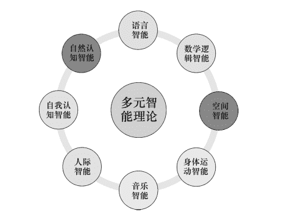
图 2-1　加德纳多元智能理论

语言智能指用口头语言或文字表达思想情感并理解他人的能力，涵盖语义、语法、语音等运用；数学逻辑智能指逻辑运算、复杂思维、推理、归纳、分析的能力；空间智能指感知空间与周围事物并以图像形式呈现的能力；身体运动智能指灵活运用身体表达思想情感并操作物体的能力；音乐智能指对音律、音调、音色等敏锐感知并具备表演创作天赋的能力；人际智能指理解他人、友好相处并捕捉情绪做出适当反应的能力；自我认知智能指认识自我、反思行为、清楚优势劣势与独特人格的能力；自然认知智能指观察自然事物并辨别分类的能力。

多元智能理论为智能时代学习提供了理论支撑，它强调探究式学习以启发诱导思考与问题解决，有助于教师与学习者更好理解智能的特点与优势，推动学习者智能全面发展，这也呼应了“人工智能+学习”的主旨，将学习置于人工智能大背景下更有利于全面发展。

智能学习是在互联网、大数据、人工智能等技术支撑下展开的学习。人工智能英文缩写为AI，亦称机器智能（如图 2-2 所示），它是由人的智慧模拟大脑神经网络所创造的智能，是研究并开发用于模拟、延伸、扩展与增强人类智能的理论、方法、技术及应用系统的新兴技术科学。自诞生以来，人工智能理论与技术日益成熟，应用领域不断扩展，未来带来的科技产品将成为人类智慧的载体。

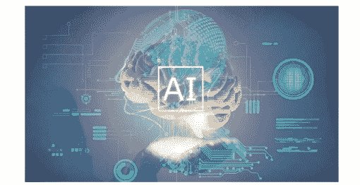
图 2-2　人工智能^([\[2\]](#txt002.html#footnote_content_txt002_2))

智能技术催生出的智能学习，是将互联网、大数据、人工智能与学习深度融合的模式，不脱离传统学习却超越其本身，推动学习变革与发展。智能学习要求学习者聚焦学习主题，通过智能终端或学习平台访问个人学习空间或系统，选择适宜资源，获取适配任务，实现自我诊断、自我评价、自我决策、自我导向的主动学习。与传统学习相比，其实践特征体现在学习目标高阶化、资源共享开放化、学习交互虚拟化、学习路径个性化、评价多元智能化。^([\[1\]](#txt002.html#footnote_content_txt002_1))

任何学习系统都包含主体、客体、中介三大要素。主体是学习者，客体是学习内容，中介是学习工具或手段。工具手段的升级必然带来学习方式的变化。

智能学习与传统学习的根本差异在于工具手段的不同。智能学习以智能设备为支撑，设备能以数据形式记录学习行为与学习轨迹，依据技术分析结果给出学习建议，帮助学习者做出更理性的决策。

人工智能还衍生出机器学习Machine Learning、ML和深度学习Deep Learning、DL等概念，三者关系如图 2-3 所示。机器学习是人工智能的核心，是赋予计算机智能的根本途径，适用于归纳与综合；深度学习是机器学习领域的新方向，属于人工神经网络研究范畴，主要应用于计算机与人工网络。

本文探讨的智能学习是指人工智能与学习的结合，是在互联网、大数据、人工智能背景下对传统学习方式的革新，为智能时代学习注入新活力。

学习是永恒议题，智能学习是一个融合多种理论、方法、技术与活动的复杂系统。我们应积极拥抱智能时代学习新形态，把握人工智能浪潮下的发展趋势，认识其挑战，推动人工智能与学习的深度融合与快速发展。

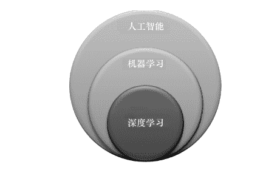
图 2-3　人工智能、机器学习和深度学习的关系

## 二、智能学习的核心支点与特征
智能学习是对传统学习的突破与革新。在大数据的驱动下，智能学习能够实现人机交互与人机协作。传统学习多以教师为中心，忽视学习者主体地位、个性特征与智力差异，不利于个性化发展与潜能挖掘。智能学习借助新兴技术融入个性化元素，挖掘各方面潜能，让学习活动更贴合个体发展需要。新型信息技术为传统课堂学习流程注入新内涵，拓展学习边界，推动学习过程向智能化转型。

智能学习必须立足于“一个中心，两个基本点”（如图 2-4 所示）。“一个中心”指以学习者为中心；“两个基本点”指充分发挥学习者主观能动性，并突出自主学习。

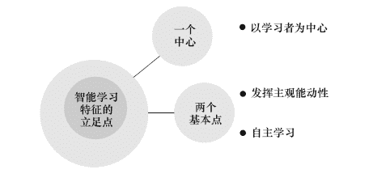
图 2-4　智能学习特征的立足点

智能学习更强调个人化。由于教师时间精力有限，传统班级授课制难以兼顾每个学习者的情况与特点，统一标准难以达成个性化。智能学习借助大数据使个性化成为可能。学习前，大数据系统会采集分析性格特征、知识基础等背景信息，学习者据此选择最适合自己的学习方式；学习中，系统实时检测分析学习结果并适时调整，再根据反馈为每个学习者定制方案，从而实现真正的个性化。

智能学习具备较强的感知与记忆能力。感知是对外部世界的捕捉与信息获取，是智能学习的前提；记忆是将感知到的信息储存在以互联网和大数据为基础的群体智能中，并能依据已有知识储备对知识进行预测、分析、比较，以期达到最优学习效果。人的多元智能相互关联但发展不平衡，智能学习通过感知与记忆进行针对性指导，让个体多元智能得到最大化开发。

智能学习具有强大的自适应能力。自适应学习是结合机器学习算法与大数据分析，将人工智能与学习深度融合的模式。^([\[3\]](#txt002.html#footnote_content_txt002_3))传统学习中学习者适应性较差，智能技术的融合弥补了不足，推动学习者由消极被动转向积极主动。自适应能力不仅能根据已有知识基础选择适配内容，还能利用大数据分析学习过程，为学习者推荐个性化学习方式。

智能学习是智能与学习的集合体。两者概念体系不同却密不可分，尤其体现在中介手段上。学习活动需要依赖新兴技术才能保持活力，与时俱进；智能也需要以学习为载体才能展现力量。智能与学习相互作用、相互促进，这正是智能学习的重要特征。

智能学习源于现实又高于现实。学生的生理心理成长具有特殊性，家长、日常生活、社会环境对智力发展影响极大。^([\[4\]](#txt002.html#footnote_content_txt002_4))除学校系统教学外，家庭、生活、社会环境在智能学习中极为关键。日常生活中的点滴都与学习密切相关，如婴儿学走路、学说话、模仿成人行为皆为学习。智能学习来源于现实又超越现实，需要综合考量家庭、社会、技术等多重因素，从全局出发统筹兼顾，为学习者制定最佳学习方案。

智能学习的核心取向已经从信息堆积转向思维塑造。它的要义并非不断累加知识点，而是深挖学人的潜能，培育出富于创造力与思辨力的人才。布鲁姆把教学目标归纳为六个层次，即知识、领会、应用、分析、综合、创造。其中知识、领会、应用多属低阶认知活动，对应低阶思维；分析、综合、创造则处于高阶认知层面，对应高阶思维。^([\[5\]](#txt002.html#footnote_content_txt002_5))在延续传统学习重实践的基调上，智能学习更强调条理化思维、综合化思维、批判性思维和创造性思维的养成。

在引导效能方面，智能学习呈现出更高的指向性与精准度。传统教学中，教师要投入大量精力进行引导，往往收效有限。智能学习依托海量知识库，可帮助学习者快速、便捷、准确地锚定自己的知识坐标，并借助人机互动与智能系统沉淀的数据及时反馈，促使学习者不断优化方案、调节节奏。

交流形态上，智能学习明显偏向虚拟化。传统情境多以面对面为主，教师主导、学习者被动。智能学习则主要通过线上虚拟课堂来解析学习行为数据，为每一个学习者定制程序、匹配差异化任务、提供多样化的学习路径，全部过程在虚拟环境中完成。正因缺少直接的外部制约，对学人的自律与自控提出了更高要求（如图 2-5 所示）。

图 2-5　智能学习交流虚拟化^([\[6\]](#txt002.html#footnote_content_txt002_6))

总体而言，智能学习是对传统学习方式的革新，它既突出学习者为中心，又激活其主观能动性，使学习者在智能化环境中实现真正的自主学习。人工智能时代，技术与学习的深度融合有助于获得更优的学习成效。

## 三、智能学习的价值：个性化与自主

人工智能与机器学习正重塑教育未来。现阶段传统学习与智能学习并存过渡，仍暴露出一些短板，人们期待借助智能技术来化解教与学中的难题。

AI 具备提效、实现个性化、降低人力成本、简化管理的优势，智能学习正是在发挥机器与教师各自长处的基础上，通过协同配合为学习者带来最佳体验。其价值主要体现在以下方面。

智能学习能有效缓解心理压力，助力自信心建立。性格内向、胆怯、缺乏自信的学人在传统课堂因担心失误被批评、害怕同伴异样目光，往往有想法也不敢表达，长期下来形成沉重心理负担。智能环境能在一定程度上消解胆怯，让交流讨论更自由轻松，从而提升自信心。

智能学习契合个体差异，支撑个性化成长。个性化教学长期以来是教育追求，但教师精力有限，班级授课难以兼顾每个差异。智能学习容纳差异化并能响应个性化需求。美国 Carnegie Learning 与 Third Space Learning 的平台即通过自建大数据系统对学习者进行系统分析，向教师提供反馈以便精准施教。智能学习依托大数据实现先诊断、后学习、再巩固（如图 2-6 所示），帮助师生动态调整方案，提升成效。

智能学习让因材施教走向现实。因材施教既是教育原则也是创新学习的抓手，它能启发学习、提升自主学习力、培养发散思维、激发积极主动性。鉴于智力与性格各异、知识接受度不同，智能学习在面向全体的同时更尊重个体特征，系统持续记录兴趣偏好、认知水平、学习行为等表现，实现真正的因材施教与因人而异。^([\[7\]](#txt002.html#footnote_content_txt002_7))

图 2-6　智能学习中大数据的作用

智能学习有助于培育自主学习力。与传统方式不同，它具备智能属性，能够把游戏化元素融入学习，使过程更愉悦。兴趣是驱动学习的根本，只有自愿投入才会主动学。智能工具的辅助能够激发自主思考，学习者可自行发现问题并寻求解决。本质上也在启迪想象力与探索力。机器人兼具类人智慧与部分功能，将人工智能智慧融入学习，实现寓教于乐。

智能学习能够优化教与学的方式。传统模式下教师需花费大量时间记录表现、批改作业、进行评分。智能技术的介入减轻了教师负担，同时为缩小学习差距提供合理化建议。智能学习还能为课外学习提供支持，多数家长下班后仍需辅导作业，智能学习能分担这一压力。人工智能与学习的结合，正推动教与学方式的深刻变革。

智能学习可全面呈现学习画像，促进师生的理解。系统构建的是数据驱动的智能环境，能够将学习行为可视化。大数据对各阶段学习进行动态监测，数据客观真实，使教师与家长更清晰地掌握学习者的多方面情况，从而进行更有针对性的指导，提升学习效能。从沟通视角看，也有利于教师与学习者、家长与学习者之间的互动。非同龄的教师与家长难以完全进入孩子内心，智能学习成为连接双方的桥梁。

智能学习为全民学习与终身学习注入强劲动力。它提供平等学习机会，即使来自不同国家、地区、使用不同语言的学人也不会被区别对待，例如系统可根据个体信息生成不同字幕以满足需求。其推广覆盖因病缺课、处于不同学习阶段或有特殊需求的学人，突破时空限制，让每个人在各个阶段都能享有受教育权，体现教育公平，助力全民学习与终身学习，构建新型智能学习社会。

智能学习推动评价体系多元化。课程评价是学校教育的基本环节，也是确保教育正确的保障。受传统教育与应试影响，现行评价体系存在诸多问题：过度强调甄别选拔、片面追求相对性标准、过度关注可量化指标、缺乏有效工具与方法。智能学习以新技术为手段、以大数据为基础，实现评价多元化（如图 2-7 所示）；它持续关注学习状态变化，以发展视角看待学习者，坚持以学习者为中心；不仅追踪学业成绩，更重视综合素质考察，促进全面发展；摆脱主体、标准、方式、结果单一的局面，形成智能评价系统，使结果更公正、更具参考价值。

学习智能化正成为新时代的发展方向，更多人工智能技术在学习领域的应用将带来革命性影响。人工智能导师、智能内容开发、虚拟技术提供个人化发展新路径，使人工智能与学习的融合愈发紧密，衍生的价值既持续又变革性。

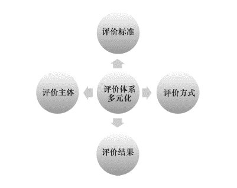

图 2-7　多元化的评价体系

## 四、实践路径：如何更有效地运用智能学习

人工智能浪潮既是机遇也是挑战，如何把握机遇、应对挑战是每个学习者面临的课题。我们需要厘清技术与学习的内在关系，从主观与客观两个层面探讨更好利用智能学习的方式。

### （一）学习者方面

无论何种学习模式，都应坚持“学习者是主体，教师为主导”的原则。任何学习活动都要赋予学习者主体地位，发挥教师引导作用，注重培养自主学习、合作学习、探究学习等综合能力，激发求知欲望。智能时代，学习者与教师协同努力，才能让智能技术真正作用于学习。

接纳智能学习并强化自主

作为当前重要方式与未来趋势，学习者需提升对智能学习的接纳度。人工智能作为新兴技术，涉及初步数据管理分析与数据库等模块，多数学习者了解有限。面对新技术不应排斥，而应积极主动接纳、了解，形成清晰认知，逐步扩大接受范围，只有在意识上认可，才能更好利用。此外，掌握人工智能相关基础知识是前提，学习者应加强计算机、互联网、大数据等基础知识学习，以便更顺畅接触人工智能。

学习者需自觉培养自主学习意识。朱熹在《观书有感》中写道：“问渠那得清如许，唯有源头活水来。”在智能学习背景下，要成为全面发展人才，就需强化自主学习能力。自主学习能力如同源头活水，是知识保持活力的源泉。只有抓住这一源头，才能跟上智能时代的变化，实现自我成长。当然，提高自主学习能力并非一蹴而就，需要长期积累逐步提升。

具体可从三方面入手：其一，转变学习观念，充分认识自主学习是成为智能社会人才的有效路径；其二，结合教师教学目标与自身发展制定详细规划，有目的开展阶段性自主学习；其三，利用网络技术与大数据对自主学习成果进行评价，分析过程中出现的问题，找准改进点，客观评价学习效果，更好达成目标。^([\[8\]](#txt002.html#footnote_content_txt002_8))在大数据时代，树立终身学习理念，培养自主学习意识与能力，才能实现可持续发展。

面对新学习方式，学习者更要增强学习自信。自信是内在的自我肯定与相信，是成功必要条件，表现为完成任务的信心程度及积极自我评价。传统学习中，表现、成绩、同伴认可有助于建立自信。在智能时代，学习者应借助技术优势强化自信。智能学习中，自信促进效率提升，使学习者更频繁主动使用智能设备进行学习。

## （二）教师方面

教师需正确引导学习者开展智能学习。互联网、大数据、人工智能都是双刃剑，智能学习有利有弊。当前中小学普及效果并不理想，调查显示不少学习者打着学习旗号进行听歌、打游戏、刷短视频等行为。教师应加强教育引导，通过讲座、宣传栏、主题班会、公众号等渠道加大宣传，促使学习者养成良好学习习惯，形成积极学习动机，提升自制力。

教师应培养学习者的交流合作能力。人工智能为学习提供无限可能，使学习突破校内课堂局限，由线下走向线上、由课内走向课外。学习范围扩大也改变了交流协作方式。智能学习环境中互动不再面对面，而在虚拟场景进行，要求学习者具备虚拟环境无障碍交流能力。同时，协作不再局限于班级内部，在技术推动下向无边界扩展。智能学习借助设备、平台、通信技术，使学习者既能与同地域同学科者协作，也能与跨学科跨地域者协作，构建综合化个性化的人际学习网络，持续优化外部社会学习网络。

教师应培养学习者对智能工具的使用能力。智能学习依赖工具与技术实现认知加工、发展与知识迁移，因而使用能力是基本功。包括工具操作能力、学习资源获取能力、资源处理能力与个人智能管理能力等。智能时代更强调自主学习，不仅教师需掌握，学习者更需具备。该能力培养程度在很大程度上决定智能学习成效。因此教师在培养学习者前，应先提升自身智能技术素养。

## （三）条件方面

仅靠学习者与教师主观努力不足以支撑智能学习，还需客观条件保障。平台建设、优质资源开发、硬件完善为智能学习提供外部支撑。

### 构建智能学习平台

平台建设是成败关键，也是开展智能学习的前提基础。智能时代要实现合理利用，第一步是搭建智能学习平台。平台使学习走出校园，为课外与线上学习提供无限可能。

### 加强优质学习资源的开发

资源质量决定学习内容水平，是智能学习不可或缺的条件。大数据背景下平台建设也是资源最大化共享的关键。平台与资源开发需严格把关：其一，严格审核智能学习网站与平台建设，确保安全性；其二，严格审核文字、图片、视频、音频等网络资源，确保正确性与科学性。平台与资源对智能学习影响直接，建设与开发容不得疏忽。

### 完善智能学习的硬件设施

目前部分学校尚未实现无线网络全覆盖，对以手机为代表的移动智能设备持排斥态度，禁止手机入校或进课堂，这在一定程度上等同于阻断智能学习入校。此外，部分学校虽引入智能设备，但学习者受限于电池续航、存储空间等硬件问题。可见不完善的硬件会大幅降低智能学习使用率，不利于提升学习效率。因此学校应采取措施完善设施：发布文件倡导课堂引入智能手机；与运营商合作实现校园5G全覆盖并保障安全与网速；可与厂商合作研发适配学习场景的手机，提升续航与存储。完善硬件能为智能学习提供便利，提升成效。

时代在进步，技术在演进，人们对学习的重视不断提升，全民学习、终身学习成为潮流，智能学习终将成为必然。如今智能学习体系尚不成熟，需要学习者、教师、学校等多方长期协同努力。从意识、思想到能力都要紧跟时代，充分发挥智能与学习的结合优势，才能在人工智能浪潮中抓住机遇、不断前行。

## 注释

[\[1\]](#txt002.html#footnote_quote_txt002_1)王红艳.智慧学习：内涵、特性与能力要求［J］.韶关学院学报，2019，40（01）：99-103.

[\[2\]](#txt002.html#footnote_quote_txt002_2)图片来源：http：//file.elecfans.com/web1/M00/8B/37/o4YBAFyUL6yAPyAqAAEFCsHj900700.jpg

[\[3\]](#txt002.html#footnote_quote_txt002_3)张旭.人工智能背景下高职教育自适应学习模式可行性及发展路径研究［J］.信息记录材料，2019，20（06）：232-234.

[\[4\]](#txt002.html#footnote_quote_txt002_4)张力.浅谈多元智能学习与学前教育［J］.辽宁师专学报（社会科学版），2008（02）：51-52.

[\[5\]](#txt002.html#footnote_quote_txt002_5)王红艳.智慧学习：内涵、特性与能力要求［J］.韶关学院学报，2019，40（01）：99-103.

[\[6\]](#txt002.html#footnote_quote_txt002_6)图片来源：http：//fs10.chuandong.com/upload/images/20160401/1D1925C1975D35E7m.png

[\[7\]](#txt002.html#footnote_quote_txt002_7)张旭.人工智能背景下高职教育自适应学习模式可行性及发展路径研究［J］.信息记录材料，2019，20（06）：232-234.

[\[8\]](#txt002.html#footnote_quote_txt002_8)丁莉.“互联网+教育”时代背景下大学习者自主学习能力的培养分析［J］.科技风，2019（20）：67-68.

[\[9\]](#txt002.html#footnote_quote_txt002_9)王红艳.智慧学习：内涵、特性与能力要求［J］.韶关学院学报，2019，40（01）：99-103.

# 第三章 智能时代学习的变革：传统学习痛点的反思

班级授课制：对学生个性化的忽视

应试教育：特点与弊端分析

智能学习新趋势：知识更新的速度与智能学习的价值

学习模式被颠覆：智能时代传统学习的变革

班级授课制、应试教育等传统学习模式在教育体系中占据重要地位。然而，随着社会步入智能时代，传统模式的弊端与不足日益显现。传统学习中，学生多处于消极被动接受知识的状态，难以主动参与，远未达到自我教育层面。这正是传统学习的中心痛点，需要在智能学习框架下进行深刻反思与变革。

## 一、班级授课制：集体效率与个性缺位的矛盾

班级授课制是当下绝大多数国家课堂的主流组织方式，它的发展轨迹贯穿中西数千年。

早在公元前一世纪，古罗马教育家昆体良就受到推崇尝试分班教学，可因缺乏理论支撑并未推广，仅停留在萌芽。西欧中世纪学校偏爱个别指导，分班思路再次被搁置。直到16世纪，西欧经历宗教改革与机器大生产取代手工的浪潮，班级教学才开始试验。17世纪捷克学者夸美纽斯在总结实践经验后系统提出班级授课制，为工业革命培养了大批人才，随后经赫尔巴特等人的论证完善逐步成形。

中国方面，孔子首倡“有教无类”，开创私人讲学，提出人人享有受教育权。西汉太学兴盛时已出现集体授课形态。宋代“三舍法”、明代国子监都显露出班级雏形，却因缺乏系统实践未能成体系。清末教育改制推动下班级授课制快速普及，1862年创办的京师同文馆首次正式采用这一教学组织形式，此后历经时代变迁仍沿用至今。

班级授课制本质上是将一定数量的学生按年龄和知识水平编成固定班组，由固定教师在固定教室和固定时间里，按统一计划向全班进行集体教学。相较于先前的个别化教学，它更便于教学管理，也为师生、生生之间的交流合作提供了平台。

其运行特征可归纳为五固定：学生按年龄背景组成固定班；教师按风格特长承担固定教学任务和班级；上课地点对师生固定不变；学校作息与课时固定；教学内容按统一目标和标准传授。

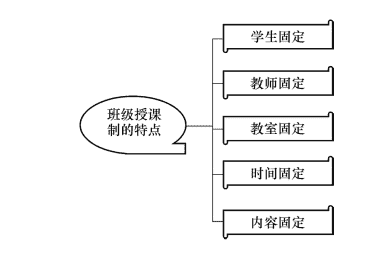

图 3-1　班级授课制的特点

正因这些特性，它长期占据主流。第一，它是“一师多教”的集体形式，在师资紧张时能实现资源最大化利用。第二，教学是教与学的双向互动，打破了个别教学交流受限的弊端，促进了师生和同学间的互学互助。第三，在统一时间按统一标准讲授统一内容，有利于系统知识的递进与合作能力的培育。

然而，班级授课制的底层逻辑是“以教为中心”“一对多”。教师用同一标准要求全体，个性化培养被忽视。虽同龄学生在身心上具共性，但受环境、生理、心理、受教育经历和主观努力影响，智力结构、认知方式、气质性格差异显著。

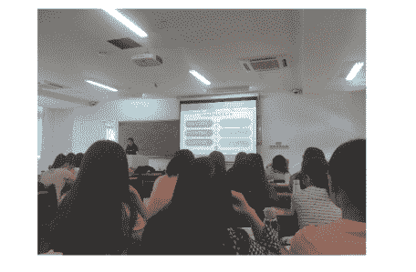

图 3-2　班级授课制的教学模式

在大数据、互联网和人工智能普及的今天，这种模式的局限愈发明显。

教学方式多停留在灌输与填鸭。孔子说“知之者不如好之者，好之者不如乐之者”，强调激发兴趣与情感体验。可在班级制下，教师常把知识单向塞给学生，学生被动接收指令，缺乏主动探索与思考，学习主动性、创造力与思维能力被压缩。

教学内容偏重理论而轻实践。教学多依教材参考资料进行教条化讲解，忽视让学生走出校园感受生活、从做中学。理论与实践脱节，动手机会少，知识理解停留在浅层，实践操作能力难以形成。

班级制也拉大学习差距。教师课堂关注多集中在成绩好的学生，对学困生关注不足，后者自信受损，发言讨论意愿低，产生自卑与疏离感，形成“优等生”与“差等生”并存的局面。实质上并无绝对的优差，只是个体差异被统一评价放大。

智能时代下，班级制的信息获取渠道受限，难以匹配大数据与人工智能带来的新型学习形态。MOOC、智能学习平台等基于大数据的分析与社会化交互工具，实现了优质资源跨区域共享，帮助教师优化教学、学生自主调整计划，而班级制难以承载这一变革。

教学时间、内容、进度长期固化，对新兴学习方式容纳度低，具有一定的禁锢性。统一标准难以兼顾不同水平与特点学生的多层次需求，个性化发展被挤压。

破局的关键在于拥抱智能。打造智能学习平台支持探究式学习是核心。平台可让学生把课堂疑问发布出来与师友讨论，构建虚拟课堂实现自主或小组学习，如学习通在高校的应用，以及优质课程资源的大规模共享。

同时需要：树立终身学习意识，敢于实践与反思；推动师生角色转换，激活学生自我学习意愿；摒弃单一固化模式，引入多样化智能教学；强化小组合作交流；建立多元化智能评价；缩小班额推行小班化。

教学既要看群体特征，更要看个体特征。每个学生都是独特的，教学应遵循身心发展规律与个性特点坚持以生为本，建立统一标准与多样性兼顾的教育制度，改革课程、教学与评价，让差异被看见、天性不被压抑。

## 二、应试教育：分数导向的代价

进入智能时代，技术进步与生产力提升让人们愈发质疑应试教育能否满足社会需求。

应试教育是以升学考试为核心培养技术性人才的教育思想与行为，以分数为导向重视应试能力提升，忽视素质发展，用学习成绩与升学率衡量学生水平和教师工作。

### 应试教育与智能时代学习变革

## 应试教育的历史与弊端

在中国教育史上，科举常被视作应试教育的源头。国家通过统一考试选拔官吏，考试时间与科目全国统一，长期作为封建国家选拔标准，推动学校发展，但也使学校丧失自主性，成为科举附庸，教育自然沦为应试。

高考恢复后，应试教育仍是甄别选拔人才的主渠道。考试让竞争更公平公正，一度营造了良好环境。但在智能新时代，社会对素质要求提高，其弊端凸显。

应试教育是一种终结性而非终身性教育。它把人生划分为学习、工作、退休三段，认为学校几年的灌输可解决一生知识需求，认为毕业后可“一劳永逸”。这加重学习负担，而在知识更新加速、旧知识快速老化的今天，学校所学难以终身受益，不利于可持续发展。

学习模式高度被动。学生长期处于被动接受状态，主动性和积极性被消磨，而这正是智能社会学习者必备素质。

学生沦为知识容器。教学名义上是教与学的双边，实则教师主导、学生被动，照本宣科讲完理论即算完成，学生缺少加工再创造。

过度强调分数导致“高分低能”。家长与教师看重分数，学生为高分喘不过气，被培养成“学习机器”，个性、创新与发散思维受阻。

图 3-3　学生的“高分”压力^([\[4\]](#txt003.html#footnote_content_txt003_4))

教师角色异化。本应“良师益友”、引导促进学习的教师，为提升升学率进行大量灌输与机械练习，忽视学生基础与接受程度，未提升学习能力。

教学方法同质化。应试教学围绕考试安排课程内容，使学校育人意义弱化。教师以分数与升学率作为评价标准，忙于灌输与训练，自身专业素质提升被搁置。

知识结构碎片化。各科内容相关性与灵活性不足，教育被降格为“术”的演练，知识点彼此孤立、标准化答案主导。学生难以自主建构知识体系，框架零散混乱，不适应智能社会。

课程设置失衡。小学到大学重基础课专业课与智育，轻德育体育美育劳动技术教育。文理分科加剧知识结构不合理。中小学为升学常挤占体育、美术、音乐等兴趣课程，高中生每日被语数外、理化生占据，综合素质难以全面发展。

总体而言，应试教育并非全盘否定。客观公正的选拔保证了公平性，也在长期内发挥作用。关键在于权衡取舍。在人工智能时代，应统筹素质教育、创新教育与应试教育的优势，用素质与创新教育引领应试改革，同时以应试机制促进素质与创新的落地，探索符合国情又接轨世界趋势的教育路径。

## 三、智能学习新趋势：知识更新与学习速度的赛跑

科技飞速发展，智能化技术正加速知识更新，更新周期不断缩短，传统学习方式已跟不上知识半衰期。若不改进学习方式提升速度，便会被时代抛下。

学习速度即学习效率，指习得特定内容所需时间。耗时越短或单位时间内获取知识越多，效率越高。效率提升带来更好的学习体验，学生状态从被动乏味转向主动投入。

学习速度与教育模式和学习方式密切相关。传统模式与题海战术在应试背景下盛行，大量题目带来压力，反而拖慢效率。素质教育强调智育与其它四育协同，学习速度提升对全面发展至关重要。

当前科学界每五分钟就有一项新发现，物理学界每三分钟出现一种新物质结构，化学界每分钟诞生一个新反应式。面对如此更新，传统学习难以满足需求，必须以智能工具、自主学习能力与改善方式提升效率，始终站在知识前沿。

智能时代教学不再是简单的传递接受，更偏向启发式。教师从知识灌输者转向引导者，留出思考时间，让学生提出问题、分析问题、解决问题并反思，提升探究与思辨能力。

学习重塑了学生主体地位。传统模式压抑主体，内容在传递接受中显得枯燥。智能学习契合学生思维敏捷、想象力丰富的特点，激发主动参与。

学习更依赖实际操作。主体地位回归后，学生可自主安排时间与进度，主动参与学习。参与度越高，学习速度越快，效率自然提升。

智能化场景让学生的日常学习时长得到更合理的切分，整体效能明显提升。学习时间大体可分为课堂在场时间和课余自主时间两类。课堂时段，教师以多媒体为依托开展引导教学；课余时段，学习者借助智能终端、在线学习平台及各类学习软件，按照兴趣偏好进行深度钻研，持续拓展认知边界。相比之下，传统环境缺少智能媒介的辅助与督促，自由时间难以被有效利用，诸多宝贵的碎片时段被白白浪费。

总的来看，学习始终是社会进步的阶梯。学习速率在任何时期都关键，尤其在信息爆炸的智能社会，必须借助技术手段加快对知识迭代的追赶，才能系统性提升学生的综合素养与生存价值，让人类在智能社会中保持不败。

## 四、智能冲击下的学习范式重塑
随着智能时代到来，机器在感知、记忆、预测等维度的表现已超越人类，知识也以数据形态呈现，这直接改写了学习方式、学习内容与学习路径，对传统学习构成严峻冲击。若沿用旧有运行逻辑，传统学习在智能时代将寸步难行。因此必须善用智能技术对传统学习进行改造，培养契合智能社会需求的高素质创新型人才。

在智能时代，传统范式必将重构，应试教育的权重下调，素质教育的价值凸显。党的十九大报告强调全面贯彻党的教育方针，落实立德树人根本任务，发展素质教育，推进教育公平，培养德智体美劳全面发展的社会主义建设者和接班人。素质教育被写入报告，彰显其在当下的必要性与重要性。

进入智能时代，以大数据、互联网、物联网、云计算、人工智能、区块链等新一代信息技术为底座的智能科技加速演进，也推动了素质教育的落地。知识以数据形态存在并快速传播获取，人脑在海量数据面前显得吃力，而人工智能在数据接收与处理上具有先天优势。人类难以独立处理大数据，不得不把部分权力让渡给人工智能，传统知识学习模式在人工智能时代被彻底颠覆。算法开始替代人脑逻辑，直接对知识进行理解与应用，而且算法日益独立，能从自身经验中学习，甚至发明者也无法完全解释其某些决策。^([\[7\]](#txt003.html#footnote_content_txt003_7))学生在传统模式下习得的知识应用于智能社会存在滞后性，已难以匹配现实与未来需求。因此结合智能技术改造传统学习是最优路径。

从应试教育向素质教育过渡，是智能时代变革传统学习的重点。“应试教育”以分数为导向，以升学率为唯一衡量标准，片面强化应试能力培养，忽视全面发展。升学压力下，大量题海训练加重学业负担，使学生处于被动学习状态。这种模式培养的学生难以满足智能社会需求。而“素质教育”是教育改革的重要方向，是我国基础教育的目标模式。原国家教委朱开轩主任指出：素质教育从本质上说，是以提高全民族素质为宗旨的教育。素质教育是为实现教育方针规定的目标，着眼于受教育者群体和社会长远发展的要求，以面向全体学生，全面提高学生的基本素质为根本目的，以注重开发受教育者的潜能，促进受教育者德智体等方面生动活泼的发展为基本特征的教育。^([\[8\]](#txt003.html#footnote_content_txt003_8))素质教育源于应试教育的弊端，是智能社会教育的正确选择。

素质教育与应试教育相对应，明确了当下教育的目标与方向，二者却是相互联系、相辅相成的。应试教育作为传统学习的主流模式，在其时代具有生命力，不可否认当下也并非毫无价值，其存在具有合理性。应试教育源于考试选拔，若无考试选拔人才的方式便不会出现应试教育。长期实践证明，世界各国在人才选拔上普遍选择考试。

高考作为相对公平的人才选拔方式，即便在智能时代也应正视并加以改革，充分发挥其作用，为素质教育服务，培养创新型人才。素质教育虽为发展趋势，但不能盲目抛弃应试教育走向“个人主义”。应试教育与素质教育并非谁淘汰谁，而是如何克服应试教育的弊端，实现取长补短，共同推动教育事业发展。智能时代若单独讨论应试或素质教育，人为割裂二者，都是片面与孤立的。

真正的教育应顺应时代需要培养创新型人才。智能时代是创新时代，创新是一个民族进步的灵魂、国家兴旺的不竭动力。智能时代比以往任何时候都更需要创新型人才。创新作为时代进步的必要要素，必须通过创新教育培养和发展学生的创新能力，为国家培养人才。创新教育以培养创新精神和创新能力为基本取向，采用创造性方法和手段提升学生创新意识与能力，打造适应时代的创造型人才。

智能时代加速到来，对素质型与创新型人才需求迫切，对传统学习的变革势在必行。变革需关注以下方面。

要正确处理应试教育、素质教育与创新教育的关系。表面看三者对立，实质都是培养人才的模式，只是侧重点不同。应试教育以升学率为导向，素质教育和创新教育以培养高素质创新型人才为指导；应试教育重“学会”，素质教育和创新教育重“会学”；应试教育关注部分学生属精英教育，素质教育和创新教育面向全体属大众教育。因此应辩证看待三者关系。

促进教育观念转变，是变革传统学习的首要要求。观念转变包括教师、学生乃至整个社会。长期受应试教育潜移默化影响，难以短期接受新模式。只有观念转变，才能真正认清应试与素质、创新教育的本质。智能社会下，分数不再是衡量个人的唯一标准，更看重综合素质与创新能力。故观念转变是有效变革的前提。

教师需不断提升自身素养，成长为创造型教师。智能时代变革中，教师身负重任。一方面为学生提供更先进的教育，教师应践行终身学习理念，利用大数据不断提升专业素养与教学能力，打造创造型教师。另一方面，借助智能化学习媒介，优化与拓展知识结构，在教学中融入个性化要素，营造轻松愉悦的学习氛围，实施个性化教学，激发培养学生学习主动性与积极性。

要善用智能学习平台与资源，推动学习途径变革。传统学习以课堂和书本为唯一途径，获取资源受限，知识在一定程度上脱离社会生活实际，难以学以致用。素质教育与创新教育为培养适应社会的新型人才，要求充分利用智能学习平台与资源，实现教育的社会化，构建学校与社会的双向参与机制，丰富教学途径，拓宽教育视野，有助于摆脱狭隘的升学指挥棒下的自我封闭，实现开放式现代教育。^([\[9\]](#txt003.html#footnote_content_txt003_9))智能时代的学习平台与资源为教与学提供便利，极大满足教学与学习需求。

总之，智能社会对传统学习的变革维度众多，如学习目标、课程、内容、方法等。借助智能技术实现应试教育向素质教育、创新教育的转化任重而道远，需认清社会发展趋势，加快变革步伐，共同为社会培养全面发展的高素质创新型人才。

### 【注释】

[\[1\]](#txt003.html#footnote_quote_txt003_1)商春锦.班级授课制的历史、现状与对策［J］.福建教育学院学报，2003（07）：110-112.

[\[2\]](#txt003.html#footnote_quote_txt003_2)李高楠，谭鹏，杨晓涵，等.班级授课制在高等教育体系中的利弊及创新趋势［J］.大学教育，2018（11）：35-37.

[\[3\]](#txt003.html#footnote_quote_txt003_3)艾修亮，郑长新.从人的可持续发展看应试教育的弊端［J］.山东教育学院学报，2000（06）：84-85.

[\[4\]](#txt003.html#footnote_quote_txt003_4)图片来源：http：//img.mp.itc.cn/upload/20160331/125df87475514bfca5fae47aeef4c758\_th.jpg

[\[5\]](#txt003.html#footnote_quote_txt003_5)曾舒婷.从卢梭的自然主义教育思想看我国现代应试教育弊端［J］.荆楚理工学院学报，2017，32（05）：66-70.

[\[6\]](#txt003.html#footnote_quote_txt003_6)杨国林.不断更新知识是企业持续发展的保证［J］.理论界，2007（08）：250-251.

[\[7\]](#txt003.html#footnote_quote_txt003_7)罗妤，黄平林，余先德.关于人工智能时代素质教育的若干思考［J］.学校党建与思想教育，2018（06）：54-56.

[\[8\]](#txt003.html#footnote_quote_txt003_8)孙金胜.谈“应试教育”向“素质教育”的转变［J］.河南职业技术师范学院学报（职业教育版），2008（03）：109-110.

[\[9\]](#txt003.html#footnote_quote_txt003_9)何山，欧婷婷，文节.浅谈实现由应试教育到素质教育转轨的策略［J］.法制与社会，2009（09）：293.

# 第四章 重塑学习力，从培养开始
学习力：约等于社会竞争力
综合作用：学习力的影响因素
新方法论：智能时代学习力的培养

“学习力”指学习者的学习能力，主要体现在对新知识的掌握与接受程度。智能时代科技日新月异，人类素质难以同步，智能时代对学习能力提出新要求。

## 一、学习力即核心竞争力
学习力是学习或工作中至关重要的能力。人类迈入智能时代，科技发展深刻冲击生产生活，对教育学习提出新挑战。在学习或工作中，个体发展很大程度上取决于学习力。学习力强者能在学习或工作中迅速得心应手，反之则会无所适从。故要在智能时代提升社会竞争力，学习力成为必备能力。

学习力即学习者将所学知识资源转化为知识资本的能力，核心在于快速高效地学习新知识、掌握新技能。学习活动主体可以是个体或组织，学习力是学习动力、毅力与能力的综合体现。

从知识维度看，个体学习力包括知识总量、知识质量、知识流量、知识增量四个方面（如图 4-1 所示）。知识总量指个体获取知识及理解深度广度；知识质量通过综合素质、学习效率与学习品质衡量；知识流量指学习知识所耗时间以及获取与扩展知识的能力；知识增量指对学习成果的创新程度及所学知识产生的价值高低，这是学习力更看重的方面。具备四方面者，学习力必定高超。

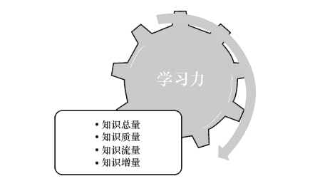
图 4-1　个体学习力的四个方面

组织学习力强于个体学习力，是个体学习力创新集中的体现，并能直接将学习力转化为创新成果。组织学习力强调团队学习力比个人更重要，重视内部协作、信息自由流动与共享，同时注重提升团体内部个体的学习力。团队学习既是个体间相互交流学习的过程，也是成员寻求知识高度统一产生创造性成果的过程。

学习力是社会竞争力的关键体现。智能时代竞争激烈，只有不断提升竞争力才不会被淘汰。学习力不仅体现在个体学习工作，也体现在生活方方面面，公司市场优胜劣汰便是例证。20 世纪 60 年代，《财富》杂志世界 500 强企业堪称全球竞争力最强。然而到 20 世纪 80 年代，三分之一公司消失，到世纪末所剩无几。这既反映新科技革命迅速淘汰传统产业的趋势，也反映这些企业不善于与时俱进而被抛弃。实践证明，通过自我超越、心智模式、团体学习等提升修炼的企业，都能重焕活力。微软、松下、青岛海尔、美的集团等即为例子。

从学习力视角看，企业要在激烈竞争中生存，需具备以下要素：一是能在最短时间以最高效率获取信息并转化为自身知识；二是员工养成不断学习习惯，扩充知识面，提升学习力；三是加强团队协作，形成独特团队文化；四是能迅速高效地将所学应用于企业发展、变革与创新，多维度适应市场与满足客户个性化需求。具备这些要素的企业即便在智能社会也较难被淘汰。处于人工智能时代的个体亦然，应随着技术高速发展，增加知识总量、提高知识质量、扩大知识流量与增量，进而不断提升学习力。

学习力由学习动力、学习毅力、学习能力三个要素构成（如图 4-2 所示）。学习动力指个体内在驱动力，体现学习目标，主要包括学习需要、学习情感、学习兴趣。学习需要即实际情况与期望水平间的差距；学习情感即个体对知识的理解与处理时的情绪态度；学习兴趣即推动求知的内在动力。学习毅力即为完成学习目标持续克服困难实现预定目标的状态，反映意志力，作为学习行为的保持因素，对学习力至关重要。学习动力与毅力驱动学习能力，学习能力即运用所学知识发现问题、分析问题、解决问题的能力，是学习活动与产生学习力的基础。

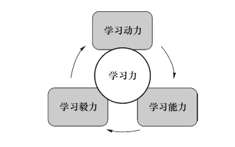
图 4-2　学习力的三要素

判断学习者或组织是否具备强学习力，可从其是否具有远大坚定目标、坚定意志、对理论知识掌握程度以及实践经验总结等方面判断。从图 4-2 可知，学习力是动力、毅力、能力的交集，三者兼备方为真正学习力。

关于学习力，我国中商国际管理研究院专家学者从实际出发，用五种曲线描述学习力，包括蒙智曲线、早谢曲线、中庸曲线、卓越曲线、睿智曲线。^([\[1\]](#txt004.html#footnote_content_txt004_1))

蒙智曲线描述有学习障碍或无启发智力的学习者，类似“白丁”。此类学习者可能受家庭经济等多因素影响缺乏受教育机会，阅读与思考能力未被启发，学习力明显不足。多为社会底层劳动者及先天学习障碍者，需社会关爱。

早谢曲线学习者多处于青少年时期，正在接受学校教育，大多取得高中学历，对知识有大致了解，具备初步学习能力，离开学校后即停止学习。此阶段学习者多处社会中下层，学习力达峰后因懈怠心理逐渐下降，故称“早谢”。

中庸曲线指高中毕业生通过努力考入高校深造，取得专业知识、技能证书及学士学位。学习力达到新高度，有清晰明确目标并为之奋斗，但随生活经验增加学习力缓慢下降，多属社会中间层。

卓越曲线指从小具备较强学习能力者，大学毕业后继续攻读硕士、博士或博士后，或离开学校后持续贯彻终身学习理念，从做中学。此类学习者学习力可达顶点，随职业生涯结束缓慢下降，属于社会上层。

睿智曲线学习者品学兼优，学习力持续上升，始终清楚人生目标与理想，保持持续主动学习态势，过程中不断增强学习力，困难迎刃而解。能不断提升自我以适应不同时代人才需求，属于社会顶层精尖人才。

随科技发展与社会进步，人类学习力呈现从蒙智到早谢再到中庸、卓越的演进。进入智能社会，学习力发展正从卓越曲线过渡到睿智曲线。智能时代是学习的时代，也是睿智时代。

智能时代知识更新加速，社会竞争愈发激烈。学习者竞争的本质是学习力竞争。因此须不断学习、进步、提升学习力，跟上时代潮流。

## 二、学习力形成的关键要素
上文提到学习力是社会竞争力的体现，个体或组织唯有持续提升学习力，才能在变化环境中保持竞争力。时代在变革，社会在进步，但许多学习者的学习力未得到有效提升，重要原因在于影响学习力的因素众多，主要包括自身、学校、家庭、社会因素（如图 4-3 所示）。

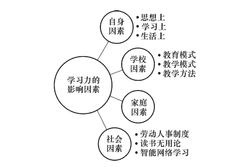
图 4-3　影响学习力的因素

### （一）自身因素

学力卡点与AI时代解法

个人对学力的制约因素相当多元，投入时长是否达标、态度是否端正、对所学专业的热爱度、自控水平如何、能否主动提问并深挖、目标与方向是否清晰，这些维度共同塑造最终表现。其中时间精力不足与态度偏差是最具牵引力的主因。^([\[2\]](#txt004.html#footnote_content_txt004_2)) 部分学员对学业产生抵触与厌倦，甚至出现逃课，必然拖慢学力提升节奏。个人端制约主要集中在观念、行为与生活三个层面。

观念层面，即便进入AI时代，“唯分数论”的惯性仍在。多数同学把重心放在课本理论的堆砌上，认为分数高就等于实力强。由此目标模糊、钻研精神缺失、自律偏弱，具体表现为照本宣科完成任务，很少对知识点做深度挖掘。AI时代需要思想转向，真正的学不应以拿高分为终点，而应以提升学力为方向。

行为层面，获取知识的路径偏窄，基本依赖教师与教材。长期形成的依赖心理削弱了自我驱动的意愿与能力，不利于知识的加工内化。拓宽进路是增强学力的关键。如今科技高速发展，学员应善用智能学习工具，培养自主驱动的习惯，进而提升学力。

生活层面，人际质量会直接作用于学业表现。关系融洽时，更容易与同学朋友愉快相处，效率随之提高；良好关系还能带来成就感，进而激发热情。反之，关系紧张会带来矛盾与心理负担，甚至诱发厌学情绪。

### （二）学校因素
学校是学业活动的主要场域，对身心发展与学力养成起主导作用，影响点主要在办学取向、授课形态与教法。

办学取向层面，我国长期实行应试导向。受用人制度、教育结构与师资配置等因素影响，分数与升学率被过度放大，成为衡量教学质量的唯一标尺。该取向偏重知识灌输，目标是造就“高分机器”，忽视了兴趣培养与全面发展，不利于学力提升。

授课形态层面，班级授课仍占主导。其一，它属于大班制教学，教师用统一内容与统一标准对待全体学员，很难兼顾性格与智力差异，真正的因材施教难以实现。^([\[3\]](#txt004.html#footnote_content_txt004_3))其二，对部分学员而言，班级氛围不够浓厚，难以从学业中获得满足感与愉悦感。个性既决定未来发展，也影响学力，教师需要结合时代特征对学员个性进行研究。

教法层面，单一枯燥的方式难以发挥教育效能。方法的多样与合理程度对学力有重要作用。我国课堂以讲授法为主，长时间的语言灌输会形成依赖，抑制积极性与自主性。教师应借助智能化新型教具吸引注意力，提升课堂参与度。多样的教学方式能带来更好的学习体验，促进学力的生成。

除此之外，课堂教学、课堂活动与设施设备等也在不同程度上作用于学力。

### （三）家庭因素
家庭是孩子接受教育的起点，家长作为第一任教师，其习惯与思维方式会长期塑造孩子。血缘关系构建的家庭既是生产生活单位，也是学习单位，对成长具有重要作用。

随着生活水平提高，独生子女家庭增多，望子成龙的期望愈发急切。苏霍姆林斯基指出，父母在培养人时运用的智慧极其复杂。大多数家长缺乏教育专业知识，在部分环节难以正确引导，过度施压往往适得其反。同时，父母学历、职业、家庭氛围与物质条件等都会影响孩子学业。家长要求与自身状况的矛盾，会削弱孩子的积极性与学业效果。

### （四）社会因素
社会对学力的作用是多维的，涵盖制度、群体、道德规范与法律法规等。其中，用人制度、“读书无用论”及网络学习是核心变量。

用人制度对学业具有导向作用。许多学员希望通过学业获得好工作、改变人生。推进人事制度改革，建立科学规范的选人用人机制，有助于提升学习动力并提供制度保障。

“读书无用论”否定了知识的价值，是一种极端错误的社会思潮。社会上一些被埋没人才的个例容易让人产生自暴自弃的想法。新时代学员应认识到努力终有回报，养成良好习惯，提升学力以增强竞争力。

网络学习基于全球互联的智能化虚拟环境，已成为继手语、图书、电子学习之后最广泛的教育方式。它以学员为中心，传播迅速，打破时空限制。但网络空间也存在不良信息，自控力不足者易受诱导，对身心与学业造成负面影响。

## 三、新方法论：智能时代学力的培养
社会步入智能时代后，对教育的重视达到新高度。从应试到素质再到创新，综合素质与创新能力的价值日益凸显。学力作为现代人基础性素养，在互联网、大数据、AI与区块链支撑的智能社会中尤为关键，^([\[4\]](#txt004.html#footnote_content_txt004_4))因此更需系统培养。

培养需由学员、教师、学校、家庭协同推进。

### （一）学习者方面
人们普遍认为学业是智力与非智力因素共同作用的结果。研究表明，学业成绩与智力相关性属中等水平，而非智力因素对成才起决定作用。非智力因素具有调节、控制、维持与补偿功能，是提升质量与促进智力发展的强动力。哈佛大学心理学教授丹尼尔·戈尔曼在《情绪智力》中指出，成功中智商约占20%，情商约占80%。因此，发展智力是重要内容，培养非智力因素是素质教育与创新教育的重点。^([\[5\]](#txt004.html#footnote_content_txt004_5))

智力因素如注意力、观察力、记忆力，受先天遗传影响较大，可塑性有限；非智力因素如动机、兴趣、情感、意志，则在指导学业活动方面作用更大，可塑性更强。AI时代应从非智力因素入手，提升学力与社会竞争力。

激发学习驱动力。驱动力是推动学业并指向目标的内在动力，属于非智力要素。借助强化理论如刺激-反应、自我效能等进行训练可使其持续。即使在AI时代，驱动力仍是学力生成不可或缺的动力，唯有驱动力被点燃，才能确立正确目标并取得最佳效果。

培养学习热情。从教育心理学看，学习热情是认识、探究知识的倾向，是求知的内在力量。爱因斯坦所言“兴趣是最好的老师”，保持热情才能激发求知欲与好奇心。对某一学科产生热情，学员会持续专心钻研，从而提高效果。

### （一）学习者方面
培养学员的创造性思维，提升创新能力。亨利·福特说“不创新，就灭亡”。创新的本质是发散性思维，要求多角度发现、思考并解决问题。学力的养成与创造性思维密切相关。AI时代应借助技术创设多元问题情境，保持好奇心，在自主探究中发现问题、提出问题、解决问题，培养创新型人才。

善用智能学习媒介，推动方法变革，实现效果最优化。依托互联网、云计算、大数据与AI，涌现出智能移动终端、学习网站与平台等。学员可进行自主探究式学业，提升自主能力；通过大数据快速获取海量资源，合理安排时间，满足个性化需求。媒介的运用使学习方式从单一枯燥转向多样有趣、智能化，从而达到最优效果。

### （二）教师方面
AI的渗透为教育带来机遇与挑战。智能时代教师素质的提升对学力生成至关重要。未来将是人机协作共存的时代，教师需主动适应，转变观念，掌握智能技术并融入教学，提升自身学力，以更好地培养学员学力。

### 教师要贯彻“终身学习”理念，提升自身学力
学力是现代与未来社会最核心竞争力。教师自身具备学力是培养学员学力的前提。AI时代要求教师坚持持续学习，提升专业素养，强化学习能力。“学如不及，犹恐失之”“学而至上，学以致用”，持续学习尤其是智能、移动学习能力，是教师不被替代的根基。^([\[6\]](#txt004.html#footnote_content_txt004_6))人类创造了AI，也必须持续学习才能立于不败之地。

### 教师要提升自身个人魅力和人格修养
AI可解放教师的繁杂工作，但情感与精神层面的交流、个人影响力与品格修养的影响无法替代。美国教育家里克纳说：“教育应实现两个伟大目标：使受教育者聪慧，使受教育者高尚。”高品位人格魅力会产生积极影响。教师应将文化知识内化为素养，转化为敬业精神、坚强意志、积极态度与宽广胸怀，以高尚情操培养学员人格。^([\[7\]](#txt004.html#footnote_content_txt004_7))

### 教师要改变教学方式，使整个教学活动更趋向灵活化和个性化
借助电脑、手机、多媒体等智能教具，可实现线上线下、课内外、物理环境与虚拟环境的融合，让学员在深度学习中自由交流、讨论、协作。教师还能通过智能技术分析兴趣、能力等数据，为学员制定个性化目标与推送内容，使个性充分展现。教学方式的变革推动活动更灵活、更个性化，从而达到最佳效果。

教师培养学力还可通过转变教学观念与思维、由知识灌输者转向启发者、优化课程设计与教学目标等实现合力提升。

### （三）学校方面
学校是人才培养主阵地，对学力培养起关键作用。随着AI发展，学校不再是唯一知识输出地，利用AI创建的“学习中心”不断涌现。学校应加强与AI结合，培养学力，真正服务于终身学习与终身发展。在线课程、讨论小组、实习实践、自我探索与自我完善将成为教育主流，^([\[8\]](#txt004.html#footnote_content_txt004_8))以培养德智体美劳全面发展的创新人才为目标。

学校教育一旦脱离对学力的激发，便失去根基与动力。聚焦学力是提升育人质量的重要突破口，也是改进育人工作的重要指向。^([\[9\]](#txt004.html#footnote_content_txt004_9))可从深化教学改革、师资建设与考核机制入手。

### 学校应加强高水平人工智能师资队伍的建设
智能技术已在校园广泛使用，但不少教师对相关知识了解不足。学校应满足各科教师差异化需求，提供与AI专家学者学习的机会与平台，针对深度学习、人机协作、智能语音处理、智能学习平台等进行培训，提升技术应用技能，打造高水平师资队伍。熟练运用技术的教师能在传授知识的同时激发学习积极性，提升课堂活力，潜移默化中提升学力。

### 学校应加强深化教学改革与人工智能相结合，充分发挥其育人作用
当前，我国正处于全面建成小康社会的关键期。习近平新时代中国特色社会主义思想、党的十九大精神、习近平关于教育的重要论述及全国教育大会精神，为推进教育现代化指明方向，也对育人工作提出本质要求。^([\[10\]](#txt004.html#footnote_content_txt004_10))因此，学校教育需与AI深度融合，深化改革，如利用`MOOC`等在线平台拓展知识面、加深理解，营造多元学习氛围浓厚的学习课堂。

### 学校应建立健全智能考核机制和多元评价体系，用制度去规范教师的教学行为和学习者的学习行为
学校应实行线上线下结合的考核与评价：一方面通过教师总结会与学员班会进行自评互评，促进教学反思；另一方面结合教学数据总结分析教师行为与学员学习行为，及时反馈建议。智能考核与多元评价能为教学制定合理计划，提升学习效果。

### （四）家庭方面
家长是孩子的第一任老师，家庭教育具有启蒙作用，在学力培养中占据重要地位。现今生活节奏加快，家长忙于工作，对孩子学业了解不深，沟通不足成为突出问题，应引起重视。学习与生活中应多尊重、关心孩子，让其感受到被爱，而非仅以成绩论优劣。

家长应督促孩子制定可行学习计划，定时定量完成任务，增强责任感与成就感，激发学习动机与欲望。同时认识到每个孩子都在发展中，潜能巨大，应培养兴趣爱好、发展个性、挖掘潜能。此外，帮助养成良好生活习惯与独立学习习惯，进而提升学力。

总之，AI时代学力的培养是多层次、多角度的，需学员、教师、学校、家庭与社会共同努力，推动教育现代化。AI时代的教育，在落实立德树人根本任务与办好人民满意教育中，应给予学力以关注与培养，这是基础教育工作者的基本态度，也是培养未来人才的必然选择。^([\[11\]](#txt004.html#footnote_content_txt004_11))

### 【注释】

[\[1\]](#txt004.html#footnote_quote_txt004_1)搜狗百科.学习力［EB/OL］.https：//baike.sogou.com/v7649745.htm？fromTitle=%E5%AD%A6%E4%B9%A0%E5%8A%9B

[\[2\]](#txt004.html#footnote_quote_txt004_2)赵攀，靳越，蒋志良.孩子学习效果的影响因素及提升策略［J］.西部素质教育，2019，5（15）：208.

[\[3\]](#txt004.html#footnote_quote_txt004_3)盛雪.高校班级授课制下实践个性化教学的策略探究［J］.才智，2019（16）：62.

[\[4\]](#txt004.html#footnote_quote_txt004_4)何丽娜，王敬杰.基于学习力培养的学校改进［J］.基础教育参考，2019（11）：75-76.

[\[5\]](#txt004.html#footnote_quote_txt004_5)宋斌.重视非智力因素的培养，提高孩子的综合素质［A］.教育部基础教育课程改革研究中心.2019 年“教育教学创新研究”高峰论坛论文集［C］.2019：2.

[\[6\]](#txt004.html#footnote_quote_txt004_6)许谦.人工智能视域下高校教师能力的提升［J］.盐城师范学院学报（人文社会科学版），2018，38（06）：112-115.

[\[7\]](#txt004.html#footnote_quote_txt004_7)许谦.人工智能视域下高校教师能力的提升［J］.盐城师范学院学报（人文社会科学版），2018，38（06）：112-115.

[\[8\]](#txt004.html#footnote_quote_txt004_8)同上。

[\[9\]](#txt004.html#footnote_quote_txt004_9)何丽娜，王敬杰.基于学习力培养的学校改进［J］.基础教育参考，2019（11）：75-76.

[\[10\]](#txt004.html#footnote_quote_txt004_10)同上。

[\[11\]](#txt004.html#footnote_quote_txt004_11)何丽娜，王敬杰.基于学习力培养的学校改进［J］.基础教育参考，2019（11）：75-76.

# 第五章 智能时代学习的四大中介

方法、工具、数据、环境，这四项学习中介正在被智能技术重塑。智能新时代里，大数据与人工智能已渗透到生产生活的方方面面，学习也被从根本上改写。方法、工具、数据、环境的变革带来的是颠覆性影响，思维范式的迁移与人机协同的兴起更提供了关键的方法论线索。把握住这些中介，是学习者与教师在智能环境下拿下学习成效的必修课。

## 一、方法：让学习事半功倍的核心

从古至今，效率都是学习的追求标尺，效率的高低往往映射出学习者的整体表现。而效率与方法的关联极为紧密，用对方法，就能实现事半功倍。学习本质上是复杂的认知活动，需要持续投入与扎实积累，但方法对结果的放大作用不容忽视。科技迭代加速，效率意识提升，方法论的选择与运用变得尤为关键。

学界对“方法”的界定并不统一，通说是指主体为达成目标所采取的方式与手段。学习方法的说法很宽泛，课前预习、课堂听讲、做笔记、课后复习属于其一，强化、消退、惩罚等也常被归入其中。总体看，学习方法是指经过长期实践沉淀、能够提升学习效能的操作路径。法国物理学家朗之万在谈读书经验时说：“方法的得当与否往往会主宰整个读书过程，它能将你托到成功的彼岸，也能将你拉入失败的深谷。”方法对学习全局的重要性由此可见一斑。

学得好的学习者与学得一般的学习者，关键差别多在方法的使用上。科学测验显示，约95%的人智商落在70至130的常模区间，仅2.5%低于70，智力并非决定学习成效的主因，方法才是核心。不同阶段、环节、年级、科目需要的路径各异，选择与使用需随情境而变。成绩优异者通常掌握了更科学的方法，因而收效更好；成绩平平者往往尚未找到正确路径，付出与回报不匹配。

智能时代对教师与学习者提出新要求：教师要传授学习方法而非仅灌输知识，学习者要具备自主学习的能动性。现实中多数课堂仍停留在知识传递，方法指导缺位，导致学习者在摸索中浪费大量时间，收效甚微。最高级的教学是“为不教而教”，追求的是“会学”而非“学会”。方法众多，有效者稀少，学习者在教师引导下通过自主实践才能提炼出适配自身的方法，唯有适配才能实现最佳效果。

智能时代需要高素质创新型人才，学习者要想不被时代落下，必须拥有超常规的高效学习方式，进而提升学习力。学校提供同等的时间与资源，谁掌握科学高效的方法，谁就能在同一起跑线上脱颖而出。在智能新时代，科学高效的方法是保持进位、走在前列的必要条件。

智能时代的学习方法呈现出鲜明特征。

以学习者为中心。传统课堂多以教师为中心，或教师与学习者双主导，虽倡导以学习者为中心，但落地不足。传统方法偏重死记硬背与机械重复，易引发倦怠与抵触。智能技术催生出多样辅助手段，把主动权交还给学习者，学习者可依据自身状态挑选适配路径，中心地位真正显现。

方法呈现多样性。目标、内容与个体差异的叠加，使得方法自然多元。既包括预习、听课、作业、复习、考试等传统做法，也涵盖正强化、负强化、消退、惩罚等心理机制，还包含接受学习、发现学习、自主学习、探究学习、意义学习、机械学习、独立学习、合作学习等分类。智能时代更强调自主、合作与探究的结合。

方法具有差异性。大数据、物联网、互联网、人工智能的融入带来了人机协作、人机融合的局面，机器人教师、计算机辅助教学、智能学习媒介广泛应用。方法虽多，并非人人通用。依据兴趣与个性特点进行选择，能激发学习动机，培养学习兴趣。

方法体现实践性。智能科技促进真实情境与虚拟情境的融合，可模拟还原真实场景，提供更多实践场域。现场教学、角色扮演、游戏化练习等都充满真实感，智能背景下的学习活动为学习者营造真实或强刺激的场景，因而任何方法都更具实践色彩。

掌握合理科学的方法，能在最短时间内收获事半功倍的效果。每个学习者都应结合自身实际找到最优路径，让学习效率真正提升。

## 二、工具：释放人机协同的力量

“工欲善其事，必先利其器”。高效方法离不开教师指导与个人摸索，更离不开工具支撑。学习工具是提升学习效果的中介，其形态随科技发展不断演进。工具发展是动态的，新工具持续涌现，效能也在变化。这意味着学习过程需要持续、精细的技术支持，工具必须不断完善与细化，功能不断扩展，才能逼近理想效果。^[(\[1\]](#txt005.html#footnote_content_txt005_1))

工具随时代更迭。远古时期以石头、算盘、贝壳为主；近现代以教材、粉笔、黑板、字典为主；科技发展后出现MP3、点读机、多媒体等多样教具。

当下大数据、互联网、人工智能普及，学习工具在多样化的同时走向智能化，各类智能机器、学习平台、网站与在线课堂深度介入，学习面貌焕然一新。学习方式更科学高效，学习活动更具活力。智能时代实现人机交互与人机协作，“人机协作”成为最鲜明的学习特征。

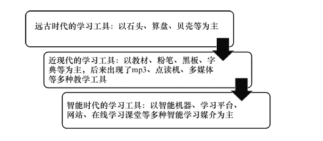

图 5-1　学习工具的发展趋势

人工智能普及对学习产生颠覆性影响，知识形态逐渐丰富，“软知识”“人机知识”“暗知识”等新形态相继出现。

知识演变与人机协作
“软知识”与“硬知识”相对，“硬知识”指被明确定义、可长期保存的知识，“软知识”指随智能技术更新不断产生、处于动态演进的知识。两者边界模糊，可相互转化，在智能时代知识体系中，软知识的重要性日益凸显。

智能时代知识生产主体由人转向人机双主体，从而产生“人机知识”。步入智能时代前，知识生产、加工、处理、传授、批改等均由人类教师完成。步入智能时代后，技术专家在机器中植入人工神经网络芯片，使机器具备数据分析处理能力，催生新知识。这种人机共同作用产生的知识即“人机知识”。人类教师由此从繁重工作中解放，专注专业提升，机器高效完成常规任务。

随着技术深入，未来可能出现“暗知识”。“暗知识”相对于“明知识”即显性知识而言，指难以结构化表达但存在于学习生活中的隐性知识。其产生需智能技术高度成熟，目前仍处早期阶段。

机器作为主要辅助工具，其学习方式源于人类又高于人类。一方面，专家可将硬知识与明知识编码入系统，在教师辅助下服务人类学习；另一方面，机器可自主学习，通过人工神经元网络构建类大脑体系，实现深度学习。机器在记忆、存储、处理上远超人类，但人类大脑仍是知识源头，无法被取代。

依托智能工具，学习从单一人类学习发展为人机协作式学习，人机协作在学习领域占据核心地位。智能机器提供工具、环境、平台、资源，还“独立”参与信息与知识加工，甚至协作生产知识。因此未来会出现人人协作、人机协作、机机协作、人机人协作等多种形态。人的参与与智能机器的参与共同作用，能极大提升学习的速度、广度与深度。^[(\[2\]](#txt005.html#footnote_content_txt005_2))智能工具的介入使人机协作成为主流学习形态（如图 5-2 所示）。

图 5-2　人机协作^[(\[3\]](#txt005.html#footnote_content_txt005_3))

智能机器在智能学习中扮演学习者、教师、学习伙伴等多重角色（如图 5-3 所示）。

图 5-3　智能机器扮演的角色

初级阶段，机器作为学习者，通过算法与大数据训练掌握基础知识，完成简单工作。

中级阶段，机器作为教师，掌握大量知识，向学习者传授内容。

高级阶段，机器作为学习伙伴，与人类共同探索未知。一方面协助完成基础性与复杂性工作，释放人力；另一方面借助算法与数据分析完成人类难以单独完成的任务。人类擅长软思维，非逻辑、非程式化思维，包括形象、联想、直觉、灵感与顿悟；机器擅长硬思维，逻辑、程式化、计算思维。在硬思维的正确率与速度上机器占优，可从大数据中挖掘人类未知的隐秘关联；人类则善于举一反三、触类旁通、创造新知。优势互补可产生前所未有的成果。^[(\[4\]](#txt005.html#footnote_content_txt005_4))

在人机协同的智能学习中，机器承担助教、心理辅导员、成长分析师、保健医生、班主任等多重角色。其最大差异在于通过数据采集与分析聚焦个性化需求，智能推荐适配内容，促进个性化发展。

工具介入也重塑教师角色。未来教育是教师与人工智能协作共存，发挥各自优势，实现个性化、包容、公平、终身教育，促进全面发展。^[(\[5\]](#txt005.html#footnote_content_txt005_5))在人工智能影响下，教师角色发生重大变化，机器承担检查批改作业等烦琐机械工作，辅助教学，帮助完成难以完成的任务。

人机协作让教育回归“教书育人”本真。教书育人是指教师关爱学生，在传授知识的同时以言传身教引导其寻找生命意义、塑造人格。智能时代前，应试教育盛行，重复性机械工作消耗大量精力，育人乏力。智能时代机器可替代试卷批改、成绩记录等简单工作，让教师拥有更多精力从事育人。机器与教师合力使教育本质重归正轨。

人机协作使“有教无类”与“因材施教”成为可能。传统“一对多”班级授课难以兼顾差异，智能学习下则可行。教师结合大数据分析可更精准地了解每个学生，实时跟踪学习状态，动态调整计划与进度。

人机协作提供新方法与新手段，推动个性化与自主学习。人工智能与大数据在学习领域的创新优化了学习路径。一方面大数据分析学习情况与习惯，机器、教师、学习者自身都能清晰认知现状并预测规划，推送适配内容，提升体验，促进个性化学习。另一方面人机协作包含机器与学习者的协同，学习者成为主体，发挥主体性进行自主学习，不断提升自主学习、创新、探索能力。

随着大数据与智能技术飞速发展，智力发展速度难以匹配技术迭代速度，必须借助智能工具发展智慧，人机协作成为趋势。人机协作本质是分工合作，人与机器各展所长。未来随脑机接口研究推进，人与智能机器结合可能更紧密，出现“超人”形态，机器人将在更多领域替代人类工作，人脑可通过无创或有创方式与智能网络物理对接，便捷交换信息与知识，人可通过意念指挥机器，也可直接获取网络信息。^[(\[6\]](#txt005.html#footnote_content_txt005_6))智能时代，个体不再是单一存在，而是个体与机器的统一体。

## 三、数据：从因果推理到关联洞察

数据在学习中的作用随时代推移愈发凸显，尤其在大数据与人工智能时代，数据至关重要。大数据的产生与发展推动工作、生活、思维的整体变革，对人类生活的方方面面产生颠覆性影响，其到来标志着人类生活将面临一场新的革命。

大数据是在信息洪峰中浮现的概念，名义上就是各种数据的集合。起初它只是IT行业的术语，维基百科2014年的表述是：数据体量大到人工在合理时限内难以截取、管控、处理并转成可读信息。大数据的标签常被提炼为4V：规模巨大，通常以T级、P级起步；流转与处理速度快；形态各异；可信度要高。借助模型化处理，海量信息可以揭示演变规律、预判走向并支持即时干预。^([\[7\]](#txt005.html#footnote_content_txt005_7))

从时间线看，大数据大致经历四个阶段：1980—2008年的萌芽，2009—2012年的成长期，2013—2015年的爆发，2016—2019年的快速发展。我国起步稍晚，但在数字经济与数字中国建设的推动下，正进入高速通道。

智能时代学习面临新挑战，数据与学习的深度融合已成必然。数据是事实与观察的产物，是对客观现象的概括，未经加工的原始素材。在学习里，数据覆盖教师的教法、目标、内容、资源、媒介，也覆盖学生的成绩、日常表现、作业完成情况等。

随着渗透加深，大数据的内涵在变。它不只是技术，也是一种从海量复杂信息中发现有意义关联、提炼变化规律、精准预判趋势的能力；它更是一种思维，让数据开口，把数据放在思考与决策的起跑线。^([\[8\]](#txt005.html#footnote_content_txt005_8))智能时代几乎一切活动都被记录，教育与数据的联动格外紧密，正确使用会带来难以估量的影响。

教育场景产生的数据是整体大数据的一个分支，呈现出以下面貌。

复杂是首要标签。复杂体现在来源与关联两个维度。第一，学习数据散落在各自独立的库里，彼此联系薄弱甚至孤立，拼接起来费力；第二，内部关联错综，删改其中一部分就可能让整体分析失真。若使用者缺乏分析工具，复杂性会限制数据利用。

多样很突出。多样首先体现在格式上，结构化、半结构化、非结构化混杂，格式不兼容、结构不匹配、语义不一致，给管理带来困扰。^([\[9\]](#txt005.html#footnote_content_txt005_9))其次体现在来源上，既有学习过程与校园生活产生的数据，如活动记录、评价结果、打印资料，也有管理与研究收集的数据，如基本信息、科研设备与材料。

体量在持续放大。相比其他行业，教育数据总量不算大，但受教育重视与智能技术应用影响，智能时代的学习数据正快速攀升。内容已扩至文字、数字、图文音视频及在线优质课堂。单个库可能不大，多个库聚合就能形成规模化大库。随着采集、存储、管理成本下降，教育数据的价值被更清晰认识，体量将持续扩大。

速度快是典型特质。快体现在产生、获取、处理与传播全链条。信息化提升与智能学习媒介普及加速了数据流转。以在线学习平台MOOC为例，系统会实时采集IP、观看时长、答题时长与正确率，生成即时反馈并推送个性化方案，帮助学员调整节奏。同时互联网的高速发展让学习数据的传播速度倍增。

可信是底线。可信关注不确定与不可靠，处理时需保留原始特征。^([\[10\]](#txt005.html#footnote_content_txt005_10))只有数据可信，后续的复杂、多样、体量与速度才有意义。现实中可信易受干扰：成绩录入失误、观看时长不准——电脑开着却在游戏、离线下载、多人共视导致零时长等。必须正视缺陷并采取措施保障真实。

总体看，教育数据的特质契合智能时代大数据的趋势，用大数据思维审视其价值更合理。

思维会随时代迁移。智能时代前，很多人习惯因果思维，聚焦“是什么、为什么、怎么做”。智能技术加速后，效率诉求抬头，相关关系被认为更具实操性。数据让人与人联系更紧密，思维正从因果偏向相关。

相关关系指一个变量变动时另一个同步变动。沃尔玛多年前的案例典型：通过消费记录发现纸尿裤与啤酒销量都高，把两者摆在一起后销量双升。飓风来临前，手电筒之外，蛋挞、海边冰激凌、太阳镜销量也异动。相关思维直接利用结果，不必深究因果。

传统教学强调理论传授的“是什么、为什么、怎么做”顺序，而智能学习中并非所有问题都要刨根问底。智能时代大数据思维的转变并非抛弃因果，而是因地制宜灵活搭配因果与相关，解决学习实践中的真实问题。

## 四、学习环境：智能时代被低估的底座

学习环境是智能时代学习的关键支点，不可忽视。进入智能社会，学习环境被全面重塑，智能元素融入传统场景，注入活力，也对旧有模式形成冲击与挑战。学习者需要对环境有清晰把握。

学习环境源于建构主义，指支撑学习活动的一切内外条件。广义上包括社会、家庭、学校等全部学习场景；狭义上指学校校风校纪、师资、教学设备等。智能时代的学习环境突破了时空限制，成为一种无边界形态。

无边界学习环境是新趋势，通过智能网络构建学习平台、汇聚优质资源、形成在线课堂，学习者可通过直播或回放不受时空限制地开展课上课下拓展。

该环境建立在智能特质上。其一，课堂师生均可手持移动终端，学习全程在线完成；其二，学习可在公交站、地铁、餐厅等多地进行。内容趋向多样，互动趋向智能与个性化。

历史回溯显示，20世纪50年代末计算机辅助教学诞生，之后十年人工智能与计算机辅助教学结合尝试，受当时技术与经济限制存有弊端。20世纪90年代，基于建构主义的智能学习环境被提出，用以弥补早期系统的不足。

### 智能学习环境
智能学习环境是激发兴趣、引导建构式学习、强调概念理解的场所、空间或工具。它具备开放性、合作性、异步性，提供丰富资源，便于不同群体有意义互动；以学习者自主驱动为核心，具有交互、交流、合作与导航性；围绕学习者展开，提供丰富教学材料、实时信息访问、个性化学习模式、易用工具集与便捷互动；是智能教学系统的泛化形态。^([\[11\]](#txt005.html#footnote_content_txt005_11))在科技飞速发展的背景下，其建设意义重大。

如今智能技术发展与学习者对新型环境的迫切需求使智能学习环境再次受重视。技术层面，大数据、物联网、互联网、云计算、人工智能在教育中的普及带来智能机器人、智能设备、智能平台与网站，催生移动学习、泛在学习、智慧学习等形式。需求层面，知识更新加速远超学习速度，学习者需要智能环境获取知识与信息。

智能学习环境契合历史趋势，是融入智能媒介的新型环境（如图5-4所示）。它像隐形催化剂，为掌握科学高效学习方法提供更多可能。任何环境都需介入具体学习过程，诱发表现，从而识别心理与行为变化的关键因素。从多媒体到人工智能的应用都在努力营造学习、评价与反馈环境，把真实世界问题带入课堂，提供支架支持复杂认知，获得智能导师与智能学伴的指导反馈。^([\[12\]](#txt005.html#footnote_content_txt005_12))

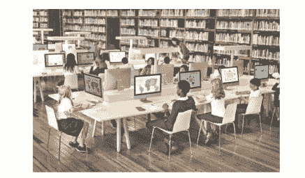
图5-4　智能学习环境^([\[13\]](#txt005.html#footnote_content_txt005_13))

其功能多元，主要包括概念学习、问题解决、自适应导航、教学指导、学习伙伴（如图5-5所示）。概念学习关注过程与概念掌握；问题解决为学习者提供真实或虚拟场景检验知识、发现与解决问题；自适应导航依据学习数据制定计划并推送内容；教学指导可自动依教师数据模仿教学风格提供支持，减轻教师负担；学习伙伴则基于行为匹配相似伙伴协同学习。

智能学习环境区别于传统与普通数字化环境，是高端形态，优越性显著。

它是一种自适应环境，能自动匹配学习风格与能力。以知识表示、自然语言处理、机器学习与深度学习、情感计算为核心的人工智能系统相继出现，为智能教学环境奠定物质基础；教育学、神经科学、心理学、社会学等学习科学则提供理论指导与科学依据。^([\[14\]](#txt005.html#footnote_content_txt005_14))它可诊断分析学习状况，推送适配内容并制定策略。

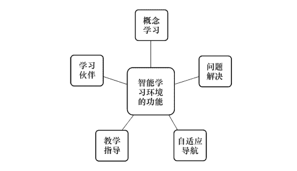
图5-5　智能学习环境的功能

智能学习环境使终身学习成为可能。它冲破校园围墙限制，学习不再受固定时间、特定教室或年龄阶段束缚。移动设备支持随时随地移动学习、泛在学习与碎片化学习，促进能力提升与持续发展。从围墙到无边界，践行“人人皆学、时时能学、处处可学”的目标。

它围绕学习者展开，让个性充分发展，自我学习、交互学习与个性化学习得到发挥。学习者是主体，需认识人在学习中的独特价值，以全面发展与自我实现为目标，以信任内在潜力、动机与热情为前提，以生活经验与社会现实为媒介，以知情意行和谐共进为标尺。^([\[15\]](#txt005.html#footnote_content_txt005_15))

综上，智能学习环境是人与智能技术深度融合的面向未来形态，其运行依赖技术持续更新与渗透，并能促进学习行为与创新能力发展。作为智能时代不可忽视的学习条件，它对人类学习与发展具有不可替代的作用。

## 注释

[\[1\]](#txt005.html#footnote_quote_txt005_1)穆肃，郭鑫.学习工具发展的“风向标”——基于对 2012 年 TOP100 学习工具变化趋势分析［J］.现代远程教育研究，2014（01）：42-48.

[\[2\]](#txt005.html#footnote_quote_txt005_2)王竹立.论智能时代的人-机合作式学习［J］.电化教育研究，2019，40（09）：18-25+33.

[\[3\]](#txt005.html#footnote_quote_txt005_3)图片来源：http：//01.imgmini.eastday.com/mobile/20170815/20170815052347\_d3deba8e2ce8cb a843ac9f98aa3009b0\_3.jpeg）

[\[4\]](#txt005.html#footnote_quote_txt005_4)王竹立.论智能时代的人-机合作式学习［J］.电化教育研究，2019，40（09）：18-25+33.

[\[5\]](#txt005.html#footnote_quote_txt005_5)余胜泉.人机协作：人工智能时代教师角色与思维的转变［J］.中小学数字化教学，2018（03）：24-26.

[\[6\]](#txt005.html#footnote_quote_txt005_6)王竹立.论智能时代的人-机合作式学习［J］.电化教育研究，2019，40（09）：18-25+33.

[\[7\]](#txt005.html#footnote_quote_txt005_7)杨现民，唐斯斯，李冀红.发展教育大数据：内涵、价值和挑战［J］.现代远程教育研究，2016（01）：50-61.

[\[8\]](#txt005.html#footnote_quote_txt005_8)杨现民，唐斯斯，李冀红.发展教育大数据：内涵、价值和挑战［J］.现代远程教育研究，2016（01）：50-61.

[\[9\]](#txt005.html#footnote_quote_txt005_9)牟歌，王军，王浩浪，等.教育领域数据的大数据特征分析［J］.教育现代化，2016，3（15）：30-33+46.

[\[10\]](#txt005.html#footnote_quote_txt005_10)牟歌，王军，王浩浪，等.教育领域数据的大数据特征分析［J］.教育现代化，2016，3（15）：30-33+46.

[\[11\]](#txt005.html#footnote_quote_txt005_11)钟国祥，张小真.一种通用智能学习环境模型的构建［J］.计算机科学，2007（01）：170-171+197.

[\[12\]](#txt005.html#footnote_quote_txt005_12)郭炯，郝建江.人工智能环境下的学习发生机制［J］.现代远程教育研究，2019（05）：32-38.

[\[13\]](#txt005.html#footnote_quote_txt005_13)图片来源：http：//5b0988e595225.cdn.sohucs.com/images/20190729/942c45ef0e4d40b3b376626 8690b53d4.jpeg

[\[14\]](#txt005.html#footnote_quote_txt005_14)郝祥军，王帆，祁晨诗.教育人工智能的发展态势与未来发展机制［J］.现代教育技术，2019，29（02）：12-18.

[\[15\]](#txt005.html#footnote_quote_txt005_15)艾小平，杨川林.以学习者为中心的开放大学课程开发［J］.现代远距离教育，2013（06）：57-61.

# 第六章　学习平台：虚实融合的交汇点

【从课堂到智能：学习平台如何重塑】

在人类尚未迈入智能化阶段时，课堂几乎就是学习的唯一入口。随着互联网、大数据、人工智能加速渗透，传统的学习载体已难以匹配时代节奏，学习平台正向智能化、多样化方向演进。

一、传统课堂的局限与困境

在中国教育长周期里，课堂长期占据主导地位，并在班级授课制下形成了教师主导、教材主导、课堂主导的“三位一体”教学惯性。基本流程是预习、讲授、复习、巩固、作业。1999年新一轮基础课程改革启动至今二十余年，班级授课的形式并未根本改观，课堂仍是学习者获取知识的主要渠道。教师依据教材和课程标准进行知识传递，过程通常表现为讲授、板书或PPT演示、练习、复习考试。教师能通过表情、语言、互动获取反馈并微调教学，但智能时代到来后，传统模式的短板愈发凸显。

教师占据主导，学习者主体性被弱化。教学围绕教师展开，教师是知识输出者和活动组织者，学习者更多处于被动接收状态。这种以讲授和示范为主的方式容易显得枯燥，学习者的参与热情和主动性难以被有效激发，与智能时代强调学习者为中心的理念相悖。

以分数为指挥棒，忽视综合素养提升。应试导向把成绩作为衡量教学质量的唯一标尺，教师看分数、学校看成绩，形成闭环。学习被锁定在升学与考级结果上，个性化与全面发展的需求被挤压。智能时代更需要以综合素养为评价依据，而非分数单一维度。

容易形成盲目迷信书本与权威的思维。课堂上学什么以教材为定数，学习者常将知识进行机械复制，不利于独立思考与创造性思维的形成。孟子言“尽信书，则不如无书”，提醒人们要做到不唯书只唯实。同样，教师在学生心中的权威地位也易滋生盲目崇拜，而智能时代呼唤民主平等的师生关系。

参与度低、学习成效有限。教学内容受大纲和教材制约，范围相对狭窄；口授、示范、板书等单一手段缺乏新鲜感，难以提升课堂投入度。填鸭式与一问一答式教学中，参与互动的多为教师常关注的少数学生，其他学生易产生挫败感，整体教学效果受损。智能时代要求教师提升专业素养，兼顾每个个体，给予同等展示机会。

重教材轻学生、重教法轻学法，违背因材施教。教科书按大纲编写具有权威性，考试以教材为基准，导致教学过度依赖教材灌输，学生个性挖掘不足。传统平台下创新与探索能力匮乏，课堂氛围沉闷，教师权威带来的无形压力进一步抑制了好奇心与探索精神。学习活动应围绕学习者展开，需融合智能技术对传统课堂进行革新。

二、智能学习平台的价值释放

传统平台的短板倒逼改革。依托智能技术重塑学习平台，能更好地满足个性化需求，实现人的全面发展，契合科技进步与社会发展方向。相比传统模式，智能学习平台在系统、资源、操作、个性化、评价、空间等维度呈现出明显优势。

系统趋向智能化。智能化是平台改造的核心。系统能记录学习者的浏览频次、停留时长等行为数据，推送偏好资源并形成反馈，自动生成个性化方案。智能技术已深入生活与学习，大幅改变学习方式并提升效率。当前国内高校普遍上线学堂在线、爱课程、智慧树等智能化平台。

资源共享化。学习资源是平台建设的关键。传统资源以教材与参考资料为主，智能时代在此基础上叠加优质网络课程、名校名师课程、远程直播课程，构建庞大资源库实现优化共享。

可操作性强。平台融入智能技术后更强调自主操作。学习者自行注册、自主选课、自主加入兴趣小组，操作门槛低，主体地位得到强化，学习热情被点燃。

个性化学习促个性绽放。对每个学习者而言，平台更像“私人定制”。系统据视频观看时长、次数、答题正确率进行分层，推测学习水平并推送匹配资源，实现真正的因材施教。相比传统模式，智能平台更能培养发散思维与独立思考，促进个性化发展。

评价多元化。智能时代多采用线上线下混合教学，评价也呈现混合特征，按课前、课中、课后展开。课前通过习题检测已有基础；课中以视频回顾与小测检验理解；课后以巩固练习与考试检验成果。单纯客观题无法反映逻辑思维，需将系统测评与教师测评结合，主观题用于考察思考与解决问题的能力。教师可设定评阅标准由系统自动批改，课程论坛还支持生生互评，提升评价真实性。

重建学习空间
学习空间重建是指借助新兴智能技术重新设计学习环境。无论虚拟还是物理空间，都应保证顺畅交流。不同空间会诱发不同学习行为。新型空间为师生、生生多角度互动提供支撑，支持文字、图片、语音、视频交流，打破时空限制，使异地学习者同步上课，并可邀请校外专家在线接入。重建学习空间是必然趋势，需结合教育理念与技术应用。

智能时代的机遇与挑战
智能科技的爆发为平台创新带来机遇与挑战。借助智能技术改造传统平台，将推动学习方式变革，提升兴趣与效率。新时代教育改革的核心是转变学习方式，让探究与自主学习成为获取知识、能力、情感综合发展的路径。平台的创新对个人发展与社会进步具有积极意义。

三、智能新形态：智能学习平台的搭建与管理

学习平台是学习者获取知识的媒介，可为网址、App或图书馆。智能学习平台则是在数字化学习基础上融合智能技术，提供全新的学习体验，具有智能化、个性化、高效化、便捷化特征。搭建此类平台是未来教育趋势，其原理与流程大同小异。

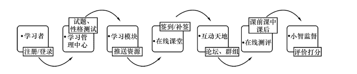
图 6-1　学习平台的一般操作步骤

搭建步骤大致如下：

第一步，注册登录成为平台用户。

第二步，进入学习者管理中心进行行为测试，包括学科测评与性格测评。

第三步，学习模块。学习者进入课程中心选择感兴趣课程，平台结合前期测试数据构建数据模型，推断优势与劣势，自动筛选推送资源并制定个性化方案。

第四步，在线课堂。进入课堂前需“签到”，且须完成前置学习才能解锁下一节。资源涵盖优质网络课程、名校名师课程、远程直播课程。背后是强大的知识图谱数据库，可串联知识点，模仿优化优秀教师的教学顺序，有效缓解优质师资短缺，符合认知规律与知识掌握层次。

第五步，互动天地。学习者可自由组建论坛或群组交流，系统也会主动推送相关社群，促进学习者之间、学习者与专家教师之间的答疑互动，打破地域隔阂。

第六步，在线测评。包含课前测评进行预学、课中测评检验当堂理解且答对后方可继续、课后测评进行知识点练习与考试。结合教师测评以考察语言表达与逻辑思维，确保结果客观公正合理。

第七步，小智监督。系统据学习过程向教师与学习者提供反馈，辅助教学与学习调整，并每日对学习表现进行评价打分。

以上七步针对新用户。老用户登录后可直接从第四步开始，平台已积累前期数据，并在每次学习中持续记录分析，不断完善个性化方案，形成优化闭环。

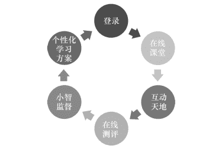
图 6-2　老用户学习平台使用

平台具备情感色彩，能够综合思考时长、答题正确率、观看频次、互动频率判断学习状态，并据掌握程度动态调节难度。当检测到状态不佳时，会弹出提醒帮助学习者调整注意力与积极性。

典型案例是乂学教育自主研发的松鼠AI智适应在线学习系统。从2004年起他们便研发适配中国场景的智适应体系，目标是掌握知识点情况并制定个性化方案。系统持续监控学习过程、评估能力、发现不足并提供最佳路径与方案，旨在用人工智能打造优秀教师，缓解师资稀缺，让每个学习者拥有定制化一对一教学。近年来该系统在多次人机大战中胜出，并在全国快速普及。2015年6月18日，乂学教育-松鼠AI成立于上海并完成10亿元人民币融资，捐赠超100万账号给偏远贫困家庭儿童，有助于教育公平。

与传统平台相比，智能平台在知识掌握上不依赖高频考试，而是精确定位；学习内容多样化，更能满足个性需求；减轻教师负担，让其聚焦专业研究；培养好奇心与探索精神，提升学习效率。

搭建之后需强化管理。一方面严格审核在线课程资源以保证质量；另一方面结合学习者实际持续完善平台。管理主体包括管理员、教师、学习者，可自我管理亦可相互监督。管理员职责主要包括：

做好智能技术支持。平台运行依赖技术保障，需定期检查维修并确保安全性。后台应妥善保存学员信息，方便账号遗失或无法登录时及时修改密码。

建立在线审核制度。审核是教学质量保障。需严格审查课程文字、图片、视频的正确性、真实性与可靠性，防止传播消极信息或违法内容。可旁听课程并提出改进建议，同时监督学习情况。

确保课程多样性。针对学习者差异，课程应兼顾必修与选修。每学期必修课不少于4门，需在规定时间内完成学习与考核；选修课原则上不低于2门，按学分制考核。若未完成，后台会提示，三次提醒后仍未完成则取消学习权限。

设置投诉建议区。收集师生意见与建议是平台成长的重要途径。设立专区定期总结反思，以完善系统与管理。

智能学习平台的搭建与管理非一日之功，需要管理者、教师、学习者共同遵守规则，维护平台生态。

四、MOOC（慕课）：智能学习平台的典型代表

慕课：大规模开放的在线学习浪潮

在当下层出不穷的智能化学习平台里，慕课是最具代表性的形态。MOOC 是 Massive 大规模、Open 开放的、Online 在线的、Course 课程的缩写，指的是大规模开放网络课程。2011 年，斯坦福大学的 Sebastian Thrun 与 Peter Norvig 把人工智能课程放到互联网上，一经推出便震动教育界，来自 190 多个国家的超过 60 万学习者注册报名，“MOOC” 这一概念由此进入公众视野。此后各国纷纷搭建以慕课为主体的学习平台。历史虽短，但它作为一种新型教育形态，已在全球范围内获得广泛关注。

智能时代到来后，慕课在中国教育中得到广泛推广并产生一定成效。作为智能学习平台的典型，慕课的操作流程与同类平台大体相似，主要涵盖注册、选课、在线学习、互动、考试；课程建设则主要围绕学习资源、学习时长、测评、讨论展开。

学习资源上，课堂教学可通过观察学习者的语言、表情获得即时反馈并动态调整教学。而慕课隔屏授课，看不到学员的神态，教师难以据此调整教学策略，因而在资源的选择与设置上，需要更多站在学习者立场审视其可行性。

学习时长上，课堂教学多为 40 分钟，受校规、班级纪律和教师权威的约束，学习者会自觉完成任务。慕课多在寝室或家中自主进行，缺乏外部监督。为保证学习效果，单次学习时长不宜过长，20 至 25 分钟较为合适。针对这一时段的内容应做到短小精炼，便于反复观看时迅速把握重难点，从而提升学习效率。

测评上，传统课堂测评多以课后为主，慕课则将适量题目嵌入课程进程，有助于强化理解、巩固知识，并在一定程度上减少学完即忘的问题。完成答题后以积分、五角星等方式给予精神激励，可有效激发学习积极性。

讨论上，课堂教学的讨论往往偏向少数学生，不自信、内向、胆怯者即便有想法也难以表达。慕课的讨论区则允许任何有观点、有想法者自由发帖，并能得到教师或他人的回应。这种互动有助于锻炼思维能力和表达能力。

慕课平台的搭建与使用始终以学习者的兴趣为出发点。只有对课程感兴趣，学习者才可能坚持到底，不会中途放弃。课中设置的小测验有助于加深理解与记忆。讨论区搭建起学习者、优秀教师与专家的交流通道。学习还可将 PC 与手机 App 结合，实现随时随地的碎片化学习。智能学习平台使用方式灵活，仍有持续挖掘与完善的空间。

作为一种新学习方式，慕课的强劲生命力正推动国内外教育发展，在降低学习成本、提高学习效率、增强交互性等方面意义突出。在其助力下，人类的学习将持续创新、与时俱进。

## 五、智能手机：移动学习平台

随着智能学习平台的建设，以智能手机为载体的移动学习平台应运而生。手机作为智能学习平台的重要媒介之一，正推动智能时代的学习进程。伴随科技进步，手机从只能通话的传统设备发展为具备信息计算与处理等多重功能的智能终端。智能手机屏幕大、便于携带，同时集合了传统手机、电脑、网络等媒介的优势。在智能技术基础上，它创造出更多适配新时代学习的产品，成为人类随时随地学习的移动平台。

智能手机作为移动学习平台具备以下优势。

其一，价格可及。随着移动互联网普及和品牌竞争，手机价格大幅下降。以国内情况看，智能手机基本人手一部，已成为日常生活不可或缺的移动设备。

其二，体积小便携。智能手机体积并未因功能增加而膨胀，既保留了传统手机便携的特点，又研发出适合阅读的大屏，且多为高倍抗蓝光，有助于保护视力。其便携性契合快节奏生活，更好地服务学习者。

其三，学习方式多样。学习者可根据需求下载各类学习软件，学习不再受固定时间、地点、科目的限制，可结合自身实际灵活安排。

智能手机的多维度支持为移动学习提供了可能。短信是最基础的功能，也是移动学习的最原始形态，通过单向或双向发送短信实现信息传递与交流。多年以前，许多学校使用“家校通”向家长发送短信布置作业或反馈学习情况，家长足不出户即可了解学生在校情况，实现家校沟通。

智能手机除通信外，还拥有独立操作系统。内存扩大后，学习者可按需下载各类 App，如手机 QQ、微信等，实现多向沟通与交流。它也能像电脑一样浏览各大网站，多样的网站资源可满足不同学习需求。同时具备离线下载功能，学习者可在无网环境下提前缓存资源，实现离线学习。

总的来看，智能手机作为移动学习平台突破了时间和地点的限制。随着智能技术发展，人们对学习的重视度持续提升，全民终身学习成为智能时代主旋律，利用智能手机学习已成必然趋势。

## 六、新方法论：如何利用好智能学习平台

智能学习平台作为新事物出现之初，使用效果并不理想。短期内接受并有效利用新平台对许多学习者而言有一定难度。一方面，智能学习平台通常无需付费且缺乏外部监督，需要学习者高度自律，自制力不足者难以在规定时间内完成课程。另一方面，平台缺乏师生、生生面对面的情感交流，部分学习者难以适应。因此，要用好智能学习平台，需注意以下方面。

发挥教师的组织作用，推动传统学习平台向智能学习平台转化。这一转化符合时代发展潮流，也是新时代学习变革的要求。教师是推动转化的关键纽带。转变教育观念是前提，只有观念更新，教师才有精力研究智能平台下的高效教学方法并取得最佳效果。教师还需自觉转换角色，由知识灌输者变为教学活动的组织者、协调者、促进者。要对传统平台与智能平台的异同进行比较研究，促进两类资源整合，实现优势互补。教师还可结合教学实际设计案例，总结学习者在智能平台上存在的问题并提出解决办法。总之，教师应发挥组织作用，推动新型在线学习与传统学习融合，帮助学习者更快适应。

学习者需不断提升自身素养。第一，具备自我管理能力和自制力，是在线学习成功的重要因素。网络是双刃剑，包含大量无用信息和垃圾信息，会产生负面影响。在线学习要求提升自我认知能力，并具备较强自制力，在瞬息万变的智能社会中保持目标坚定。第二，拥有良好的信息素养。信息素养是高效在线学习的必要条件，有助于在庞大资源库中快速提取所需信息，并进行表达、创造性加工与改造。可通过网络书签、浏览器记录等方式持续提升。第三，具备实事求是的科学批判精神。平台上的多元观点可能冲击人生理念与价值观，此时需保持清醒头脑，科学批判、实事求是，坚定理想信念。

培养学习兴趣，激发学习动机。俗话说兴趣是最好的老师，培养兴趣不应强迫，否则会产生抵触心理。可通过赋予学习者主体地位、开展自主探究与合作学习等方式激发兴趣与求知欲。智能学习平台本身新颖，与传统枯燥方式相比更易吸引注意，并提供海量资源。学习者可依据已有知识水平与认知特点选择感兴趣内容，在教师正确引导下，兴趣与动机会更强。

引导线上学习行为，促进线上与线下结合。智能时代线上线下融合模式将学、思、做整合，线上学习为主、线下为辅。学习者可自由选择时间与内容，但在线学习缺乏面对面情感交流，适应需时。因此要将线上与线下结合，在线下学习中引导学习者有意识参与在线学习，逐步改变在线学习行为。结合模式既能激发热情、培养自主学习能力，也能提升分析问题、解决问题与合作交流能力。

# 第七章　学习资源：垄断与共享的时代竞合

学习资源是支撑学习活动开展的关键要素，在学习中发挥重要作用。其发展经历了从传统资源到信息化资源，再到智能化资源演进，丰富了人类学习。智能时代学习资源的大口径共享及合理利用，对学习者、教师和管理者都带来前所未有的价值，将成为智能社会学习的主要来源。如何合理利用智能时代学习资源，成为学习过程中的核心问题。

## 一、传统学习资源：智能时代仍要充分利用

学习资源是指在教育教学过程中促使学习者行为改变的外在条件，可用于学习活动的一切要素，主要包括人、物、信息等。它可分为结构化学习资源与非结构化学习资源。结构化资源是指将人类积累的知识条理化、系统化、结构化形成的资源；非结构化资源则来源不确定、结构模糊、稳定性不强，资源间缺乏明显关联。

信息社会前，学习资源以教材为主，教材仅收录知识体系的一小部分，资源匮乏且难以大范围快速共享。信息社会后，资源开始信息化，传统资源与信息化融合，通过上传网络实现共享，在一定程度上改变了学习状态。如今步入智能时代，学习资源依托智能技术实现生产、传递、共享和管理，推动学习发展。

时代变化必然带来资源变化，传统资源与智能时代资源不可同日而语。智能时代资源覆盖更广、传播更快、分享更普遍、管理更高效，将成为主流使用形态。尽管智能平台已在各地普及促进资源共享，部分学校仍以传统资源为主，二者存在历史与时代的矛盾。因此即便在智能时代，传统学习资源仍需用好。

传统学习资源以教材为核心。教材如图 7-1 所示，在教学中占据重要地位，教材、教师、学生构成教学三大要素。首先，教材是传递与习得知识的主要文字载体，是教学与学习的媒介，是教师传授知识的依据，也是学生习得知识技能、提升综合素质的工具。其次，教材不仅依据国家教育目的、课程标准和学生身心发展规律编订，还凝聚了专家学者的专业智慧，是学科精华与智慧结晶。再次，教材使知识系统化、规范化，便于掌握理解，也为作业考试提供复习依据。最后，教材是教师教学的行动指南，缺少它课堂教学会失去方向，难以把握重点难点。

图 7-1　传统学习资源：教材^([\[1\]](#txt007.html#footnote_content_txt007_1))

无论智能时代前后，教材使用均有优劣。优点在于，教材是传递人类优秀文化的物质载体，是间接经验的直接来源，编排体现知识点层次脉络，符合身心发展规律与认知特点；能突出重点难点，有助于掌握理解，并在作业考试时提供参考。缺点在于，单科教材内容面较窄，学科间联系不紧密，不利于知识框架构建与全面发展；学习资源获取渠道单一，多依赖教材和教师，限制视野，不利创新精神与探索精神培养。

若资源不与时俱进，传统学习资源终将被淘汰。基于其重要性，智能时代下仍需重视并作出调整。

丰富教材资源，拓展教材空间。任何学科都有庞大知识体系，教材收录的只是极小一部分。学生可在课外阅读相关书籍补充知识，也可借助多媒体、音频、视频、网络资料完成学习目标。教师亦可通过提升专业知识补充课堂资源。师生都应加大对教材外资源的获取，拓展教材空间。

推动教材改革。随着智能技术在学习领域的广泛应用，智能技术与教材的整合是传统资源存续的最佳路径。智能技术改变了获取知识的方式与思维方式，智能时代主要通过技术获取知识，对纸质教材构成挑战。教材改革将带动内容呈现、教学方式、学习方式与思维方式的变革。智能时代学习应发挥技术优势，对教材进行改革，使其契合发展潮流。学习资源已从教材参考书拓展至各类在线资源，教材也从静态信息转向动态交互信息。小小教材已难以承载智能时代教学需求，对内容与范围进行改革势在必行。

灵活运用教材。师生都应灵活使用教材，对其进行创造性加工。教师可借助智能媒介打造个性化课堂，活跃氛围；学生可巧妙利用教材制定个性化方案，为教学注入活力。同时应通过师生共同努力实现教材知识与生活的沟通联系，将理论运用于实践，深化理解与运用。

推行探究式教学模式。探究式教学即师生围绕知识点展开探讨，有助于加深理解，也有利于师生、生生合作交流，更利于培养创新人才。该模式符合智能时代人才培养导向，赋予学生主体地位，激发自我管理与学习积极性，改变传统资源的被动灌输。

传统学习资源在教育发展中发挥重要作用。即便进入智能时代，也不应全盘否定，而应取其精华、去其糟粕，持续改革创新以适应发展趋势。

## 二、新型学习资源：智能时代下的学习资源

互联网、物联网、大数据、云计算、人工智能等技术快速发展，人类进入智能时代，在线学习兴起，对智能化学习资源提出迫切需求，资源建设与研究被提上日程。

智能时代的资源是对传统资源的融合、创新与改革，不仅包括多媒体课件、网络课程、电子书等，还包括各类软件 App、虚拟助手等。智能学习资源以学习者为中心，旨在促进自主学习、探究学习与有意义学习，是学习内容、工具、方式等要素的综合体。

目前，随着在线学习平台兴起，在线学习在智能社会地位重要，资源作用愈发突出。由于平台历史不长、尚处初期，资源发展并不理想，存在系统不完善、共享率低、质量不高、重复使用等问题。

学习资源系统不完善，信息混乱。资源网络传播为生活学习带来便利，有助于获取信息。但若缺乏完善管理体系，混乱信息会产生负面影响。因系统管理不足及部分学生身心尚未成熟，学习过程中可能接触垃圾信息，尤其是色情暴力信息会危害青少年身心。因此平台需有强大技术支撑，完善资源系统，后台严格把关，对垃圾信息过滤处理，减少其进入资源库。学生也需提高道德认知与信息辨别能力，自觉抵制不良信息。

学习资源质量不高，优质资源开发不足。随着平台普及，许多高校建有独立学习系统，资源多由任课教师创建，部分教师为完成任务重数量轻质量，且高校间交流不足，导致资源质量不高、优质资源缺乏。学习者获取的资源质量有限，重复使用现象普遍，创新不足，难以满足需求，对能力提升帮助有限。因此高校应加强交流合作，开发优质资源，提升质量，使其成为学习催化剂。

共享受阻是当前在线学习的普遍困境。平台准入门槛偏高，导致大量优质内容流动不畅。许多院校自建的系统只向本校师生开放，外校用户根本无useinand进；商业机构的课程则普遍付费上墙，想学就要先买单。网页上的资料也常设限，关键词检索能看到海量文献，点开后却多为摘要预览，完整内容需下载 App 或付费解锁。这些壁垒不仅拉低了资源的开放程度，也在无形中削弱了学习者的热情。

这种局面只是过渡现象。随着智能技术贯穿教与学的全流程，资源体系正加速完善，学习效能明显提升，共享的口径也在不断放大。智能时代的知识载体早已超出纸本教材，扩散到多媒体、电子读物、网络页面和各类智能学习终端。其表现呈现出以下几个鲜明特质。

学习资源的来源日趋多元。过去主要靠教材、参考书和口口相传，现在则汇聚纸质讲义、网络信息、在线课程、广播新闻等多渠道输入。来源的宽广既拓宽了内容面，也让供给更贴合不同学习需求。

呈现形式更加丰富。传统课堂以纸质课本单一传递为主，容易枯燥乏味。智能时代的知识以文字、图片、音频、链接等多种形态出现，形式新颖更能抓住注意力，有助于保持学习热情，加深理解与迁移。

获取路径极大便捷。过去找资料受渠道、地点限制。资源上网后，随时随地可通过电脑或移动设备调用，打破了时间、空间和年龄的束缚，为全民深度学习提供了可能。

共享能力显著增强。智能资源依托 App 和在线平台可跨时空、跨区域大面积分发，不再受实物载体数量限制，有助于缓解偏远地区短缺难题，让优质师资实现近乎一对一的覆盖，推动教育公平。

更新时效大幅提升。传统资源修订周期长，已难以匹配技术迭代速度。智能媒介让传播速度、覆盖量和范围都得到空前增强，4G 全覆盖与 5G 运行进一步加速更新，同时衍生出传送、重现、可控、参与等新功能。

交互特征愈发明显。与单向灌输不同，智能资源支持双向交流，可同步也可异步。学习者既能接收信息，也能即时或延时反馈，甚至成为资源的创造者和发布者。

管理效率明显提高。传统管理依赖人力，投入大效果有限。借助智能技术可快速收集、处理、分类资源，节省人力物力，提升运营效率。

人工智能的快速发展与教育理念的迭代，成为推动资源转化的核心动力。虚拟现实、智能学习平台的普及，配合开放教育、在线学习、移动学习、碎片化学习等新理念，使智能时代资源呈现开放、整合、虚拟化、碎片化、生成化、移动化等趋势。社会形态与学习资源具备极强可塑性，数量与质量同步攀升，从生产到传播、处理、管理全链条都在智能化。

## 三、共享升级：智能时代的开放式流通
在智能技术深度渗透下，学习资源实现了新的突破即大范围开放共享。它要求实现教师与教师、教师与学生、学生与学生、高校与高校之间的多向共用，其意义主要体现在以下方面。

契合个性化学习需求。每个学习者性格与需求不同，智能资源以多样形态、便捷获取和广泛共享为支撑，打破固定时空限制，可随时调取所需内容。学习方式也从被动接受转向主动建构，配合海量在线供给，既锻炼信息甄别能力，也满足个性需求。

助力资源体系优化。多形态资源可被系统自动归类，形成科学的知识架构。搜索关键词即可聚合同类或相关内容，学习者按需择优，利于自主搭建知识体系并发挥主动性。

促进教育公平落地。地区经济发展差异导致学习机会失衡。大范围共享让欠发达地区学生也能接触名师课程，共享优质供给，有助于缩小差距，提升整体学习水平。

推动协同创新。平台打通了高校、教师、学生之间的资源通道，多主体互学互进，共同完成学习与方法创新。

提升学习效率。共享降低了学习成本，在投入不变的前提下放大学习产出，是应对全民终身学习趋势的现实选择。

扩充内容广度。共享本质上是整合，多主体合作与交流不断刷新资源面貌，提升利用率、拓展知识面、丰富学科内容。

实现大口径共享并非一蹴而就，需从以下角度着手。

加大优质资源建设。应以精编内容为核心，由资深专家教师打磨并入库，在夯实基础的同时培养分析与解决问题能力。高校需加大教师培养投入，打造高水平队伍；教师也应更新观念，聚焦专业能力提升与教学方式变革。

建立激励机制。许多教师不愿公开心血之作，或担忧知识产权。学校可设立评定标准、开展教学竞赛等方式给予正向激励，降低共享顾虑。

构建评价体系。建立多元主体、多元方式的质量把关机制，确保内容权威可靠，为大规模共享提供保障。

强化安全管控。平台承载大量教学心血，需保持技术稳定、完善资源管理系统，保障内容安全，消除创作者后顾之忧。

智能时代的共享为自主学习和个性化学习提供了海量供给，有助于满足个性需求、优化资源、促进公平和协同创新。持续开发与共享并重，完善平台建设、强化优质课程供给、建立激励机制、保障资源安全，才能形成良性生态。知识更新加速、信息趋于混乱的背景下，如何善用智能资源成为关键命题。学习者需提升辨别力，取其精华、弃其糟粕，而不能仅盯着教材、图书馆或人际帮助，更应面向智能时代的资源场域。

## 四、善用资源：智能时代的学习方法指南
智能技术渗透学习场景，为深度学习和个性化学习提供了条件。这种深度学习意味着自主学习，其前提在于有效获取智能资源。获取环节让学习从被动灌输转向主动建构、从填鸭教学转向自主探索、从知识传播转向知识创造，形成新的学习形态。善用智能资源既是自主探究能力的体现，也是创新能力的试金石。

### （一）学习者的视角
需树立正确的世界观、人生观和价值观。认清智能技术已深嵌生活，不与时俱进则难以适应；保持坚定的智能学习信念，用优质资源充实自我；以正确价值取向指导发展。

要有自制力，抵御诱惑。网络信息双刃并存，优质资源与不良内容并置。处于身心发展期的学习者自控力较弱，易受干扰。应学会取精去糟，对不良信息坚决说不，避免负面影响。

避免过度依赖，培养独立见解。资源是学习的工具而非替代品。过度依赖会使人沦为知识的被动容器。教育目标是培养会思考的人，应适度使用资源，提炼见解并进行创新。

### （二）教师的视角
要主动更新教学理念。智能时代要求教师保持开放心态，摒弃抵触情绪，从学生的引导者出发，推动学习方式与观念的改变，并主动接纳智能资源服务教学。

需对传统资源进行改造并提升专业素养。单一依托教材已不适用，应结合智能资源重塑内容，同时不断精进专业知识与技能，避免被技术替代。

### （三）管理者的视角
要完善资源管理系统，保障稳定性。管理系统是资源聚合与分发的核心，需及时更新补充，保持权威、可靠、真实、科学、共享、多样等特质，满足个性化需求，同时屏蔽商业广告，营造安心学习环境。

要开放获取渠道，实现真正共享。打破账号限制、付费墙、App 强制下载等门槛，降低使用成本，使资源流通回归初心。

对学习者、教师和管理者而言，善用资源各有价值：学习者拓展内容面、满足差异需求；教师获得更多教学与研究素材，实现价值转化；管理者提升系统运行效能，为社会提供舒适学习空间。智能社会中，资源正成为学习主渠道，如何合理使用将成为学习过程的核心环节。

# 第八章 角色变革：从被动接受到主动驱动

## 核心争论：教师主导还是学生主导

## 主体觉醒：学生如何从旁观者变为行动者

## 双轨学习：算法学习与人的学习

## 应对策略：人在机器时代的突围路

智能时代的教育不应偏向教师中心或学生中心，片面强调任何一方都流于形而上学，当代教育应追求教师主导与学生主体对立统一的平衡。

## 一、两种立场解析：教师中心与学生中心
教师与学生是教学互动的两个基本要素，真正的教学是由教与学构成的双向交往。长期以来，在师道尊严的传统影响下，教师中心长期占据主导。后来为打破这一局面，学生中心学说兴起，主张学生为教学核心。两种学说都较为极端，难以平衡，不利于教学开展，仅有辩证统一才符合教育追求。

建构主义在 20 世纪 90 年代引入中国，对传统以教师为中心的观念带来冲击。传统弊端在于过度强调教师主导，淡化学生主体。建构主义强调以学生为中心，自主学习与探究式学习能最大化探索与创新。2010 年《国家中长期教育改革和发展规划纲要（2010—2020 年）》明确提出教育应以学生为主体、教师为主导，充分发挥学生主动性，培养高素质劳动者与创新人才。我国教育改革在吸收先进理论的同时，特别强化了建构主义指导。

教师中心的代表是德国教育家赫尔巴特。该学说突出教师权威，教学围绕教师展开，学生被动接受流程化知识。教师主导有助于维护权威，却容易固化思维，抑制主观能动性，培养出缺乏个性的群体。过度抬高教师地位，压抑学生的积极性与主动性。

谁来主导课堂：教师与学生的平衡术

杜威与卢梭常被视作生本理念的代表。那套思路把课堂的重心放在孩子身上，认为教养的一切安排都应围绕受教者的体验来做。在这种模式里，孩子像是活动的发起者，授课者退为支持者，长期下来能点燃发散性思维与兴趣。但把孩子放进绝对的核心位置，就会弱化教员的引领，而教员本就是知识的传递者、精神的塑造者，其主导作用不可替代。

师本主张与生本主张各有得失。前者突出授课者在教学现场的主导，却压抑了受教者的能动性；后者突出孩子的地位，却削弱了教员的引导功能。单一推行任一极端都走向偏颇，都是片面的。两者虽然立场不同，却都承认内因的关键作用。

从教学本质看，教与学是授课者与受教者相互作用、彼此促进的过程，二者构成对立统一。实践中多表现为教员在传授内容的同时，着力培养创新、探索等能力。教学既要兼顾教员的主导，也要尊重孩子的能动，强调主导时不能忽略孩子的参与，强调主体时也不能排斥教员的指引。没有孩子，教学失去意义；没有教员，教学无法进行。平衡才是关键。生本不等于更先进，师本也不等于落后，进步未必只能靠完全自主，教员把控全局同样能促进成长。动机提升、兴趣聚焦看似是生本的结果，有时恰恰是教员教得好、引导得当的体现。两者各有所长，彼此交融、难以割裂。如今将二者统一，已成为发展的主流走向。

近年这一脉络又衍生出主导主体论、双主体论、过程主体论、阶段主体论等，立场多有偏颇。授课者与受教者都是教学不可或缺的角色，必须厘清二者的定位。随着智能时代到来，师本与生本正深度融合，形成新的教育理论，教员与孩子仍是教育活动最核心的存在，二者合一才能更好地完成教学任务。

二、从被动到主动：学习主体的进化路径
习近平总书记在党的十九大报告中指出，要全面贯彻党的教育方针，落实立德树人根本任务，发展素质教育，培养德智体美全面发展的建设者和接班人。教员要给予孩子正确引导，立足受教者主体，促进学习角色的转变。

学习是孩子的核心任务，在学习中理解知识、拓展视野、运用知识提升实践能力，从而增强创新意识与实践能力。因此孩子是学习的主角，必须主动去学。马克思曾说：“在科学上没有平坦的大道，只有不畏劳苦沿着陡峭山路攀登的人，才有希望达到光辉的顶点。”这正是提醒孩子不要畏惧失败，树立自信，找准自身定位，发挥主体性，学习才能进步。随着智能时代到来，孩子的角色必须随之演进。

智能技术的快速发展让学习方式和教育模式日益多元，传统模式受到冲击，已难以满足时代与孩子的需要。受教者在学习过程中的作用至关重要，若要契合智能时代，就必须借助智能技术重塑学习角色。

孩子是教学的重要构成，是教员教学的对象，也是传统文化的传承者，没有孩子就没有教员与教学。为达到最佳教学效果，必须明晰角色分工。

在智能时代背景下，教员与孩子的角色都发生了变化。孩子角色的转变要遵循以人为本、以生为中心的原则，立足孩子是学习活动的主体，主要体现在六个方面：由被动的知识接收者转向主动构建者，由学习者转向思考者，由学习资源的从属者转向操纵者，由被教育者转向自我教育者，由听课者转向参与者，由被评价者转向自我评价者。

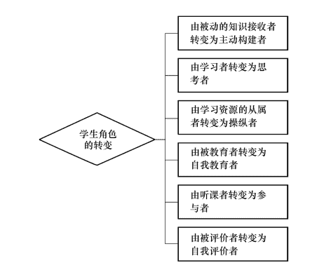

图 8-1　学生角色的转变

在智能环境下，孩子不再是填鸭式教学中的被动接受者。各种在线平台与智能软件涌现，海量资源实现共享，孩子可依据兴趣、学习状况与进度挑选内容，定制个性化方案。新型学习方式让过程主动化，帮助孩子自主建构知识体系，完成从被动接受到主动构建的转变。

孩子角色由学习者转向思考者。师者传道授业解惑，传统课堂中孩子多扮演学习者的身份。进入智能时代，孩子主体地位凸显，独立学习与思考能力得到提升。真正的学习是自主阅读、自主思考、自主探究，以思考者的姿态出现。不论是传统课堂还是线上线下融合的新模式，都应倡导启发式教学，培养独立学习与思考能力。

从学习资源的从属者转向操纵者。在传统模式下，资源主要来自教员与教材。智能时代孩子主体回归，对资源的掌控力增强。随着智能媒介普及，学习资源呈现多样化、易获取、共享化、交互化特点。孩子能按兴趣筛选与操纵资源，制定个性化方案，合理安排时间与进度。这种转变有利于个性化发展，真正实现因材施教。

由被教育者转向自我教育者。角色转换体现学习从被动到主动，赋予孩子主人翁意识，激发自我教育意识与能力。过去孩子多以被教育者出现，智能时代主体性凸显后自我教育意识增强。孩子本就具有自我教育的欲望与能力，一旦主体地位确立，就能从消极被动走向积极主动，从依赖教员引导走向自主学习，满足自我认同心理需求后，会产生自我要求与约束，更好地进行自我教育。

由听课者转向参与者。传统课堂中教员依据自身知识结构照本宣科，孩子被动接收，不利于效率提升。智能时代课程设计需与时俱进，同时兼顾孩子已有基础与生活经验。教员应倾听孩子意见，赋予参与者角色，让孩子依据心理特点与知识结构积极参与，从而提升兴趣与效率，实现育人目标。

由被评价者转向自我评价者。传统评价以教员为主体，依据纸笔测验成绩判断，重视结果忽视过程，结果并不科学，会打击努力但失利孩子的自信。智能时代赋予孩子自我评价身份，孩子能综合平时表现与成绩进行自评。通过自我评价加深自我认识，促进反思，提升自我教育与反思能力。孩子最了解自己，评价结果也更合理准确。

孩子角色的转变必须建立在能动学习主体的基础上。智能时代要尊重个体差异，让孩子成为学习主人，培养创新精神、独立思考与自主学习能力。孩子作为知识构建者、思考者、资源操纵者、自我教育者、课堂参与者、自我评价者的转变，都体现了主体地位，遵循以人为本、以生为中心的原则，满足智能时代教育要求。

三、人机学习博弈：算法与大脑的较量
人工智能作为颠覆性的新兴技术，对各行各业产生深远影响，学习也不例外。随着技术发展，机器学习应运而生，学习领域出现了与人类学习相对峙的新形态。机器学习是通过各类算法让机器从大量样本中自动学习隐性结构与规律，从而对新数据进行智能识别与预测。人工智能对人类学习的影响主要通过机器学习实现，它是人工智能的核心，能以海量数据训练学习行为完成学习任务，AlphaGo即为典型案例。学习是人智能的重要特征，学习能力的强弱是衡量智能高低的重要标准，人类优秀传统文化的传承与创新依赖于学习，人类文明也由此延续。

在大数据、互联网、物联网、神经网络等技术推动下，人工智能智能水平逼近甚至在某些方面超越人类。人工智能在学习领域的应用以学生在智能学习过程中留下的数据为基础，对学习行为进行预测与分析，实现个性化学习。机器学习作为人工智能分支，应用神经网络模仿大脑功能与结构，有助于在学习数据挖掘中获取有意义的知识结构与理论框架。

机器学习经历了浅层学习、深度学习、宽度学习三个阶段。浅层学习是初级阶段，人类模拟大脑构建人工神经网络，可归纳学习规律进行预测，但仅有一层隐含层，应用范围有限，故称浅层。深度学习具有多层隐含层，可对语音、图像、文字等数据进行输入、整理与分析，是机器学习的核心。宽度学习结构更简洁、运行速度更快、效率更高，以随机向量函数链接神经网络RVFLNN为载体，通过神经节点的增量实现网络横向扩展，是一种随机向量单层神经网络学习系统。

机器学习与人类学习都能学习并产出知识，区别在于运行载体不同。要超越人类学习，机器必须具备感知、思考、判断、反应等能力，具备听、说、读、写，以及知、情、意、行四要素。随着技术快速发展，机器学习在知识识别、理解、运用、预测等方面取得突破，如表 8-1 所示。

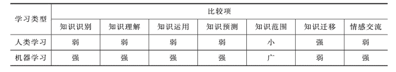

在知识识别上，机器学习感知觉能力更强。知觉是对客观事物的整体认识，是机器学习的基础。人类学习始于感知外部世界，感觉器官天生具备，而机器需技术支撑。随着智能技术发展，机器在文字、图像、语音、视频等知识识别上实现快速处理，感知效果更佳。语音识别、人脸识别、扫地机器人、物流机器人、无人驾驶等都是典型例证，机器感知觉能力在不少方面已超过人类。

在知识理解上，机器学习理解与判断更快更准。大脑是人类学习最重要器官，机器学习也需中枢结构。神经网络的安装使信息加工处理成为可能。安装“人工大脑”后，机器可持续输入自然语言信息，快速实现翻译转换，理解判断能力优于人类学习。

在知识运用上，机器学习学习力更强、创新程度更高。知识学以致用是智能的重要体现，创新并灵活运用是人智能的核心。人类易疲劳，创新受多重因素限制，而机器可24小时不间断学习，创新不受外界影响。

在知识预测上，机器学习预测更精准。人类可基于知识点总结预测，但记忆有限制。机器可将学习痕迹转化为数据永久保存在云端，对出错率、正确率、掌握程度、难易度、兴趣点等进行精准预测，甚至比人类更了解自己。

在知识范围上，机器学习涉及更广更全面。人类学习多关注小范围的“点”，难以兼顾“面”，适合对某点理解掌握；机器学习关注“由点到面”的系统化知识，既利于微观把握，也利于宏观整体把握。

人类学习从古至今占据主导地位，具有不可替代的优势。人类学习是生活经验积累的过程，融合语言、情境、文化，学习中必须考虑文化、习俗、情感因素。

在知识迁移上，人类学习迁移能力更强。人类可依据知识基础、生活经验与情境进行迁移，具有自适应特点；机器迁移能力较弱，脱离特定情境就难以应对。人类具有主观能动性，迁移能力是机器目前难以企及的。

在情感交流上，人类学习情感交流能力更强。教师被称作人类灵魂的工程师，教育本质是育人，这是机器教师无法取代的。智能技术催生的学习平台与App如小猿搜题、作业帮等可作学习助手，但在情感交流上远不及人类教师。教育本是师者的言传身教，机器可获取大量知识进行教育，却无法塑造灵魂。

进入智能时代，一方面机器学习在某些方面超越人类是不争事实，需要借助智能技术革新人类学习；另一方面即使在多方面超越，机器学习也不可能取代人类学习。人脑是人类智能最重要体现，若要超越人智能就必须破解大脑之谜。因此模仿与研究人脑功能结构仍是人工智能研究的核心工作。鉴于大脑结构功能的复杂性，相关研究需长期坚持。由此可得出结论，目前人类不会因机器学习而被淘汰。

总体看，机器学习在感知、记忆、存储、判断、预测等方面能力更强，但存在“有智能没智慧”的局限；人类智慧强于机器，智能却相对弱。智能时代人类学习离不开机器学习支撑，机器学习缺乏人类学习配合也难以达到理想效果。出现机器学习不是淘汰问题，而是形成共同体，实现优势互补，为机器学习注入人的智慧，为人类学习增添机器智能，最终形成人机共存的共同体，达到未来智能社会的理想状态。

四、应对之策：在智能浪潮中守住人的优势
科技快速发展，人类社会进入智能时代。这是先进的时代，也让人产生危机感。智能技术带来机遇的同时也带来挑战，机器学习进入视野，人们担心人类学习被取代。因此思考智能时代人类应如何学习才能立于不败之地显得尤为重要。

人类应结合智能技术转变学习方式。机器学习为人类学习方式变革提供契机。面对新技术挑战，学习方式必须相应调整，才能回归教育本质，提升学习质量。人工智能不仅应用于学习领域，也参与优秀文化的传承与创新。结合智能技术转变学习方式，有利于重建学习空间、丰富学习资源；有利于优化学习策略，培养创新型与全面发展人才；有利于培养分析问题与解决问题的能力。

人类需要深刻认识自己，提升自我效能感。北京景山学校计算机教师吴俊杰说：“在人工智能时代，在更‘黑’的‘黑科技’时代，人怎么活着、为什么学习、怎样学习等，才是更本质的问题。”这又把人类带回认识自我的古老命题。许多高校开设人工智能课程，让学生在研究机器中了解机器，更深刻认识自我，提升自我效能感，通过自身认知去认识机器与自我，提高完成学习任务的自信。从认识自己出发，学生会不断发掘学习能力与适应能力。

随着智能社会加速演进，人机协同的工作形态正成为常态。对此，人类必须持续补足对智能技术的理解。机器学习是把握这一时代的关键，知己知彼才能占据主动。机器拥有的是计算式的智能，人类具备的是反思性的智慧，两者在擅长的范畴上各有千秋。正是基于这种互补性，人类应当放下身段向机器学习，从编程语言等基础技能到智能系统等整体架构，都值得虚心研习。借此不仅能提升自身的学习效能，也能优化思维方式与逻辑习惯。

在协作层面，人类需要同时精进人机协作与人人协作。智能社会把协作边界从人与人拓展到了人与机，沟通场景也因此延伸到人与机器的交互，并且在学习领域的应用日益普遍。但机器无法洞察人类的内心世界，人与人之间的深度沟通仍不可替代。所以要同时强化与人工智能共处的能力和与人类共处的能力。人工智能本质上是人类智能的产物，智能时代也是人类创造的时代，凭借独特的人类创造力去认识与塑造智能社会，人类完全可以不断提升对人工智能的超越能力。

在认知层面，人类需要树立科学的世界观并强化创新本领。世界观是人对世界整体看法与根本态度。在智能技术迅猛发展的背景下，世界观不再是知识的简单堆砌，而是要厘清事物间的关联、把握全局并形成整体模型。另一方面，机器擅长对既有数据的训练与拟合，对全新事物的原创与突破则远不及人类。世界观的构建和创新能力的养成，是机器不具备的特质，也是人类应对机器学习挑战的重要底牌。

总体来看，智能时代要想立于不败之地，人类需要转变学习方式、深化自我认知、掌握智能技术、熟练人机与人人协作、提升三种核心能力，并以正确的世界观驱动持续创新。高中生曾向诺贝尔文学奖得主莫言请教人工智能对世界的影响，他幽默回应：“你们要好好学习，未来还是你们的，不是机器人的。”这印证了一个核心判断：只要持续学习，人类的学习价值就永远无法被替代。

### 【注释】

[\[1\]](#txt008.html#footnote_quote_txt008_1)吴木营，罗诗裕，邵明珠.当代教育理念中“教师中心论”与“学生中心论”的哲学思考［J］.东莞理工学院学报，2012，19（06）：90-93.

[\[2\]](#txt008.html#footnote_quote_txt008_2)王卉，周序.虚无的对立与事实上的统一——论“教师中心”与“学生中心”的关系［J］.现代大学教育，2019（03）：40-46.

[\[3\]](#txt008.html#footnote_quote_txt008_3)孟大军.角色：新时代学生学习心态的“传感器”［J］.教学月刊小学版（综合），2019（06）：54-55.

[\[4\]](#txt008.html#footnote_quote_txt008_4)袁利平，陈川南.人工智能视域下的宽度学习及在教育中的应用［J］.远程教育杂志，2018，36（04）：49-56.

[\[5\]](#txt008.html#footnote_quote_txt008_5)袁利平，陈川南.人工智能视域下的宽度学习及在教育中的应用［J］.远程教育杂志，2018，36（04）：49-56.

# 第九章 学习评价的立体化转向

学习评价始终是教育环节中的核心议题。传统评价模式的局限日益显现，智能评价提供了新的特质与原则，如何在智能时代善用评价手段成为新课题。2019年8月28日，联合国教科文组织发布《北京共识——人工智能与教育》，这是首个为落实2030教育议程利用人工智能提供全球指导的文件。文件指出人工智能在辅助教学与学习评估方面潜力巨大，应评估并调整课程，推动人工智能与学习方式变革深度融合。学习评价与学业表现、综合素养紧密相连，智能时代需要在传统评价基础上构建智能评价体系，以更全面、更分层的方式实现科学客观的评估。

## 一、学习评价的核心地位

学习评价是教学活动中的关键命题。它是对学习过程及其结果依据既定目标进行的价值判断。通常涵盖对学习主体、学习内容、学习方法、学习环境等要素的审视，重点在于过程与成效。

评价的核心目的在于全面把握教学全貌，改进教与学，使学习效果达到最优。它既要关注结果，也要关注过程；既要看学习水平，也要看学习过程中体现的情感态度。因此评价应坚持“学生是发展中且具有差异性的个体”的前提，构建科学、公平、促进全面发展的评价体系。

评价在发展中呈现出以下特征。

### 评价对象的多元性
评价涉及主体、内容、方式等多维度。主体多元化包括校领导、教师、学生、家长及社会成员均可参与；内容丰富化不仅限于课堂文化知识，还涵盖德智体美劳等成长维度；方式多样化除传统考试外，智能技术渗透后涌现出更多高效智能化手段。要素繁多，要求综合审视以保证公正、合理、真实。

### 评价目的的进阶性
学生处在持续发展中，评价应服务于发展。需兼顾自我评价与他人评价、量化与质化评价，尊重主客体能动性，激发参与性，保证真实客观。同时被评价者应通过评价他人促进自我反思，认识不足，把评价转化为发展的动力。

### 评价标准的一致性
标准需与国家教育目标与学校教学目标保持一致，确保学习效果契合要求并最终服务国家教育目标。同时评价也应体现统一性，但不能忽视个体差异，需因材施具体分析。

评价具有多重功能，包括诊断功能、反馈调节功能、激励功能和导向功能。

### 诊断功能
通过价值判断了解学习水平、知识理解、重点难点把握及遇到的障碍，为后续发扬优点、改进不足提供依据。例如分析某知识点错误频率以溯源原因并预防再犯。

### 反馈调节功能
评价结果可及时为学习提供反馈，对各环节进行调节与控制，帮助认识优缺点、调整进度、改进方法、提升效率。

### 激励功能
合理评价能激发内在学习动力。积极结果可激励继续努力，建设性反馈也可促发奋进，激发学习热情，促进个性化发展。

### 导向功能
评价如指挥棒，指引学习方向不偏离轨道，对学习内容、方式产生引导作用。

评价可按不同标准分类。按功能分有诊断性评价、形成性评价、总结性评价；按主体分有他人评价与自我评价；按参照标准分有相对性评价、绝对性评价、个体差异性评价；按方式分有定量评价与定性评价。

## 一、学习评价的分类

### 诊断性评价
又称准备性评价，学习活动前对学生的知识、认知、情感进行分析，发现问题并提出对策。难度相对较低，重在摸清知识基础以便调节进度与内容。

### 形成性评价
即过程性评价，学习进行中为达成教育目标而实施。常在单元结束时进行，可及时掌握学情并调整教学方案。

### 总结性评价
即事后评价，学习结束后检验最终成效。难度中等，多以课程或学期末考试形式出现，用于判断是否达标并评估教学。

### 三种学习评价的比较
表 9-1　三种学习评价的比较
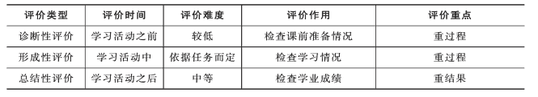

### （2）按照评价的主体分可分为他人评价和自我评价
他人评价由被评价者以外人员依据标准进行，主体可为教师、同学、家长等。优点是客观公正，缺点是耗时耗力。
自我评价由学生对自身表现进行评判。优点是促进及时改进，缺点是主观性强。

### （3）按照参考标准分可分为相对性评价、绝对性评价和个体差异性评价
相对性评价即常模参照，以整体水平为基准。利于选拔，但忽视努力程度。
绝对性评价即目标参照，以教育目标为基准。可衡量实际掌握情况，但不利于甄别人才。
个体差异性评价即纵向或横向自我比较。尊重个性，体现因材施教，但缺乏统一标准。

### （4）按照评价方式分可分为定量评价和定性评价
定量评价以量化手段收集、分析、处理学习行为。利于甄选，但忽略过程性表现。
定性评价通过记录、观察、分析进行质性判断。关注过程，追求目标一致，但结果较为模糊。

## 二、传统学习评价：弊端与改进

在应试教育影响下，传统评价弊端凸显。

重记忆轻理解，重理论轻实践。受升学率导向影响，过度依赖分数选拔，忽视综合素养。学生形成孤立知识点堆积，缺乏体系，实践与创新能力不足，死记硬背难以体现解决问题的真实能力，阻碍深层理解与批判精神。

教师主权绝对，学生自我与互评被忽视。评价以教师为主导，学生被动接受，主观性较强。学生最了解自身学情，应结合教师评价开展自我与他人评价以提升客观性。

重结果轻过程，总结性评价占据主导。纸笔考试成为主要手段，缺乏展现综合能力的环节。学习是渐进过程，持续评估与即时反馈才能实现阶段诊断与改进。

忽视个性化发展。统一标准难以适应个体差异，培养不出智能时代需要的高创造性与批判性人才。分数等级划分虽能激励部分人，也会打击多数人自信心，不利心理健康。

改进建议包括：强化自我评价，提升反思能力；合理运用正向与负向评价，平衡激励与警示，建立自信心；过程与结果并重，形成性与总结性评价结合；统一与差异评价结合，在共同标准下关注个体差异。

总之，智能时代需完善传统评价，强化反思、平衡评价、兼顾过程与结果、兼顾统一与差异，使评价更好服务全面发展与个性化成长。

## 三、智能学习评价：特点与原则

学习评价在整个学习链条中处于关键位置，随着大数据、物联网、互联网、人工智能等智能技术的加速普及，对评价方式提出了全新要求。2019年5月16日至18日，联合国教科文组织发布的《北京共识》明确提出要应用或研发人工智能工具助力动态自适应学习、挖掘数据价值以支撑学生综合素养的多维评估，并服务大规模远程教学。依托智能技术构建或应用的智能化学习评价，能够为学生提供持续支持，实现多维度、远程化的评价，覆盖整个学习轨迹，兼顾个体差异，同时对学习状态进行监测与调节，进而提升自主学习效能，更贴合当代学习者的需求。

新技术对学习既带来机遇也带来冲击，一方面颠覆传统模式，另一方面注入全新动能。智能时代的评价需要借助多媒体终端、浏览器、网页及在线平台等工具，深入洞察学习实况并作出判断。相较于传统做法，智能化评价代表了一次升级与创新，主要体现在评价更智能、主体更多元、方式更丰富、标准更分层、结果更个性化。

### 评价智能化
与传统评价相比，智能化是最显著差异。过去的评价多依赖单元结束后或学期末的纸笔测验，侧重知识掌握程度，聚焦结果而忽视过程。智能评价则不同，学习全程都会产生数据痕迹，系统可基于这些数据自动完成评估，并在评估过程中即时反馈，帮助学习者动态调整状态与节奏，最终实现最优学习效果。

### 评价主体多元化
传统模式下评价基本由教师单独完成，难免掺入主观色彩，对学困生并不公平，也容易出现片面失衡。智能时代评价主体呈现多元化趋势，教师之外，还引入自评、同学互评、家长评价等多种视角，形成综合判断。多主体参与提升了结果的客观性、合理性与公正性，帮助每位学生更清晰地了解自我、准确定位。

### 评价方式的多样化
过去主要靠考试衡量学生，考试天然偏向结果而非过程。即便在高等教育，平时表现与期末考试仍常按 4:6 或 6:4 等比例折算，短期内难以改变，但对待分数的思路可以更开放，从分数背后读懂学习状态。智能评价引入了更多维度，比如课程观看时长、知识点点击频次、课堂测验正确率、成长档案积累等，对过程与结果给予同等重视，实现综合研判。

### 评价标准的多层次化
传统评价往往用单一标准衡量全体，忽视个体差异，进而制约个性发展。智能评价借鉴加德纳多元智能理论，着眼于智力与性格上的差异，构建分层标准，以学习过程表现作为依据，结合不同学生的特点进行判断。分层标准既促进全面成长，也为个性化发展提供空间。

### 评价结果的个性化
传统评价常以定性标签划分优、中、差，单靠分数判定，忽略个体独特性，只做横向同辈比较，缺乏纵向自我对比。智能评价弥补了这一缺陷，同时兼顾横向与纵向视角，结合个性差异及分层标准给出定制化结论，评价逻辑从追求统一的“规整体”转向尊重个性的“非规整体”。

事物皆有两面，唯物辩证法提醒我们辩证看待。智能评价优势明显，也存在短板，主要集中在以下几个方面。

智能评价仍属新生事物，系统成熟度不足。一方面，受观念制约，部分师生认可度与接受度偏低，从传统评价转向智能评价存在适应成本；另一方面，部分平台缺乏科学有效的评价管理机制，使用受限。目前我国整体处于起步阶段，初期易出现数据采集不足、评价仍偏重主观与动态判断、学习问题反馈滞后等现象。

智能评价目前缺少可持续的激励机制。而长效激励既能激发学习动力，也能提升学习体验。线上课程大多依赖自主学习，完成后平台常以电子证书形式颁发结业证明，部分证书寄送至学员手中，但权威性不足，久而久之削弱学习热情。

实时互动能力薄弱也是明显短板。线上评价缺少师生、同学间的面对面交流，教师难以捕捉学生的真实想法，不利于身心成长。交流滞后导致问题得不到及时解答，用户体验下降，进而影响学习成效，阻碍普及进程。

针对上述不足，需要在持续完善中构建体系化的智能评价框架。建设过程中要强化技术支撑、加强实时监管、职责清晰、奖惩明确，并遵循以下原则。

### 科学性原则
智能评价体系是平台核心组件，指标、数据、结果与教学活动紧密关联。唯有保证科学性，教学整体才能高效运行。体系设计应避免资源浪费、职能重叠，确保高效便捷。

### 有效性原则
指标与数据必须真实可信，保证评价有效。评价应契合学生实际，覆盖每一位学习者，助力其进步；同时学习者的成长也应反哺评价体系，形成良性循环，这正是有效性的核心。

### 发展性原则
体系必须具备可发展性。每位学生都在成长，潜能无限，评价应促进发展、鼓励进步。不能仅以分数论英雄，唯分数主义会挫伤积极性，阻碍成长。

### 可行性原则
体系建设需师生共同参与。各项指标、方式、主体应清晰具体，易于理解与接受，才具备操作性与可行性。

构建智能评价体系对平台建设、管理以及学习型社会推进都具有重要意义。

体系建设可强化平台建设与管理，为家长、教师、学校及相关部门提供结构化用户信息，帮助他们精准把握学习状况并制定改进策略。同时统一标准，规范平台运行，使评价更科学合理。

体系建设也助力学习型社会落地。通过推动在线平台发展，缓解教育资源不均衡，减轻偏远地区入学难与资源匮乏问题，为每个人提供公平受教机会，逐步实现全民学习的愿景。

总体来看，智能时代的评价正迈向智能化、多元主体、多样方式、分层标准，并在此基础上形成完整体系，对平台建设与社会学习都意义重大。借助智能技术，评价变得更灵活高效，也更客观科学。

## 四、新方法论：如何利用好智能时代的学习评价
学习评价是学习不可或缺的环节，在智能时代更具导向意义。智能评价既能调节引导学习过程，又帮助学生自我认知、建立自信，还能激发发展活力。因此，如何善用智能评价已成为普遍关注的议题。可从以下几个方面着手。

首先要以技术为支撑，确保体系科学规范。传统评价基本依赖人工，主观性强，难以保证规范。智能评价必须依托技术才能稳定运行，机器判断相比人工更客观，可为科学规范提供保障，技术支持是首要前提。

其次要保持客观，避免情感干扰。机器缺乏情感交流，恰恰成为客观性的来源。传统评价易掺入人情与经验主义，而智能评价以机器为主，无个人情感与利益介入，能据过程表现与学业成果作出真实准确的判断。

第三要赏罚分明，确保公平公正。对表现优异者给予高评价，对表现不足者给出低评价，做到实事求是。智能评价需兼具确定性与灵活性。高低结果均应坦然接受，扬长补短。清晰的奖惩机制让评价更公平，帮助学生自我认知与定位。

第四要自觉遵守规则，共同维护体系。规矩是运行基础，师生作为主体与自我评价者，应主动遵循评价规则，成为体系的维护者，保证合理使用。

第五要及时反馈并分析结果以改进方法。评价贯穿学习全程，一方面关注参与度、交流讨论及独特见解的提出；另一方面要在恰当时机用适宜语言给出反馈，推动学生自主调整进度与方式，持续提升兴趣与综合素质。

进入智能时代，传统评价仍有可借鉴之处，但“流水不腐，户枢不蠹”，唯有与时俱进才能有所收获。传统模式需改革创新才能在新时代占有一席之地，智能评价亦需吸取经验，在技术支撑下实现多维与远程化评价。从一维到多维，主体由教师单一主导转向多元共建，方式由纸笔测验扩展为综合测试，标准由僵化统一转向灵活分层，结果由“规则体”转向“不规则体”。学习评价已不再局限于传统路径。

这正是智能评价体系的价值所在，既实现维度跃迁，也规避了传统方式单一僵化的弊端。每个时代都有其特有的评价方式，站在前人肩上可望更远，也应避免重蹈覆辙。正如习近平总书记在G20峰会上所强调，治理需开放适应变化，学习评价亦应与时俱进、顺应潮流。

### 【注释】
[\[1\]](#txt009.html#footnote_quote_txt009_1)陈明选，邓喆.教育信息化进程中学习评价的转型——基于理解的视角［J］.电化教育研究，2015，36（10）：12-19.
[\[2\]](#txt009.html#footnote_quote_txt009_2)同上.

# 第十章　碎片化学习：价值、缺陷与超越

## 碎片化学习：新型的学习方式

## 泛在学习：碎片化学习的价值

## 负面影响：碎片化学习的缺陷

## 新方法论：碎片化学习的超越

在智能时代，碎片化学习正成为全球学习的重要形态。本章将围绕碎片化学习的内涵、特征、价值、不足及提升路径展开讨论。

## 一、碎片化学习：新型的学习方式
自2015年“互联网+”写入国家战略以来，“互联网+教育”逐步落地，对传统教育产生深远影响，人类学习方式发生明显转变。伴随移动学习、泛在学习等智能学习兴起，碎片化学习逐渐进入人们视野。

学习者借助移动终端上的各类App——微博、微信、QQ、知乎、快手、抖音等，以及MOOC、松鼠AI智适应、学习强国、翻转课堂等平台获取知识技能。这些平台汇聚海量优质资源，能够较好满足个性化需求。以湖南省2018年职业院校为例，全省新建数字化教学资源库531个，原创信息化教学资源达32.78TB，智慧课堂课时占比24.12%。^([\[1\]](#txt010.html#footnote_content_txt010_1)) 全国高校在资源建设上投入更大，海量信息化资源推动碎片化学习普及。

图 10-1　通过移动手机终端学习^([\[2\]](#txt010.html#footnote_content_txt010_2))

“碎片化”已渗透政治、经济、文化、生活与学习等诸多领域。信息技术快速迭代，新产品在教学中广泛应用，人们利用智能手机、可穿戴设备，在工作生活间隙借助零散时间进行碎片化学习，从海量信息中自主汲取知识碎片。学习习惯与行为方式正悄然改变，人类迈入碎片化学习时代。^([\[3\]](#txt010.html#footnote_content_txt010_3))

由此可见，碎片化学习已成为智能时代的普遍学习形态。要让学习者更有效利用碎片化时空，首先需厘清其基本内涵。

“碎片化”即完整事物被拆解为零散单元，体现打破常规、重塑模式的思路。学界对碎片化学习的界定存在广义与狭义之分。广义上，指学习者依据自身情况，在自然情境中借助零散知识内容、多样智能媒体、分散时空开展学习的新风格。^([\[4\]](#txt010.html#footnote_content_txt010_4)) 狭义上，指在碎片化时间内依托网络平台、多媒体资源、无边界空间与灵活形式进行系统化有效学习的方式。^([\[5\]](#txt010.html#footnote_content_txt010_5)) 无论广狭，核心都是学习者在零散时空中借助移动终端高效获取知识。

碎片化学习与智能技术发展及移动终端普及密切相关。一方面，技术进步导致信息资源碎片化，碎片化学习是其必然产物，改变了对传统学习模式的认知；另一方面，移动终端普及为碎片化学习提供了前提，手机的灵活使用使其成为可能，重塑学习行为。学习碎片化本质是时空与内容的双重碎片化（如图 10-2 所示）。

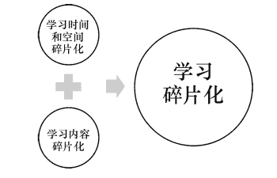
图 10-2　学习碎片化

智能时代碎片化学习呈现工具多样、时间不连贯、空间不固定、内容零散、注意力随意等特征。

智能时代碎片化学习具有工具多样性的特征。近年来，随着“互联网+”的推进，各种移动设备为碎片化学习提供了必要的条件。在智能时代，人们的学习工具趋向多样性，人们对各种以智能技术为基础的新兴电子设备（如手机、电脑、多媒体等）和新兴媒体形态（如短信、微信、微博、网站、广播和小视频等）的使用率大大增加。学习工具的多样性能够实现学习者和信息之间的交互，使学生在接收信息的同时也能创造信息、传递信息。同时，它还能实现文字、图片、音频、视频等多种资源的整合，满足学习者的个性化需求。

智能手机由于其价格、体积、容量等优势倍受学习者的青睐，作为智能时代下进行碎片化学习应用最广泛的学习工具。在智能时代，随着智能技术的发展和移动网络的普及，智能手机成为每个人的随身必备装备，学习者可以利用手机在各个场景随时随地进行碎片化学习。如在听课、听讲座的活动中，由于信息量太大，导致信息记录不全，这时可以利用移动手机的录像或录音功能记录相关信息；在忘记携带笔记本的情况下，可以利用手机的“便签”或“备忘录”记录下重要信息；在遇到知识盲点的情况下，可以利用智能手机在网上进行扩展学习，加深自己对知识的理解和运用。

智能时代碎片化学习具有时间不连续性和空间不固定性的特征。时间和空间是人类进行学习活动必不可少的要素，传统的学习模式把学习活动限定在特定时间和特定地点，而智能时代的碎片化学习打破了时间和空间的“特定”限制，使其具有不连续性和不固定性。现如今，随着生活节奏的加快，学习者的碎片化时间越来越多，原本需要在完整的时间里完成的任务被“肢解”成若干部分，使学习者可以在碎片化的时间里完成分解的内容。学习时间碎片化导致学习任务很难在某个固定的学习空间去完成。因此，学习者的学习空间从固定的场所变得广泛、无限制，学习者可以在公交上、地铁上或者餐桌上等各个场所进行碎片化学习。碎片化学习时间的不连续性和学习空间的不固定性打破了时间和空间的限制。只要有互联网的地方，学习者就可以随时随地进行学习（如图 10-3 所示）。

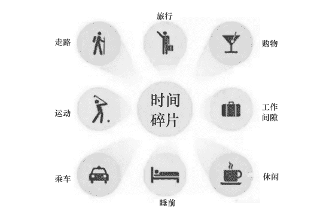
图 10-3　时间碎片^([\[6\]](#txt010.html#footnote_content_txt010_6))

智能时代的微学习样貌，最直观的就是内容被切分成细小单元。互联网削薄了地理壁垒，认知素材似乎唾手可得，移动联接又让信息触达几乎无缝。可渠道越繁盛，完整体系越容易被拆解，单元之间关联薄弱，信息显得混杂松散。人习惯用手机电脑里的客户端、网页、平台去捕捉素材，一张配图、一枚表情、一段邮件片段、几行文字、一小段音频都能充当输入口。这种简短迅速的形态迎合了快餐式的生活节奏，恰因破碎零散才获得广泛青睐。网络的普及既把知识整体瓦解，也让碎片供给更厚实，并托起了随时随处获取的可能。

从注意力的角度看，微学习带有强烈的漂移跳跃性。智能技术加速了生活与思维的速率，思考容易出现断点式跳跃。内容本身支离破碎，学习过程也自然随性，注意会随素材切换而迁移。关联度不高让人难以用宏观视角统合问题，进而很难自成体系。

从载体的角度看，微学习呈现出渠道多元、素材丰厚、选择自由的态势。场景不再被传统课堂框定，随着技术深化，在线平台与学习类 App 层出不穷，供给形式多样。内容覆盖语言、地理、数学、化学等多个领域，各知识点可并行触达，认知获取不再受单一学科或单点限制。多元渠道与丰厚素材共同提供了高度定制的选择空间。

总体而言，智能时代的微学习在工具、时间、空间、内容和注意力上都呈现出碎片态势。这决定了使用者既要学会借助互联网终端进行微学习，也需要对传统学习方式做出调整。表面看去杂乱无章，但若能对素材、时间和方式进行有效整合与管理，把无序转为有序、把松散关联拉紧，仍能抵消负面效应，实现认知结构的建构。

二、泛在学习语境中的价值释放
当下个体的学业、工作与生活都离不开智能技术的支撑，获取认知的路径因移动设备的普及而愈发多元。各类移动App、学习平台、网站乃至综艺节目都成了传递认知与创造认知的载体。以手机为核心的微学习，对学习本身、学员与教学者都有重要意义。

（一）从学习端看
自主学习是现代学习的核心理念，也是学得好的可靠基础。微学习更强调自主，而自主是学习能力的重要体现。智能时代的微学习突破了时空藩篱，资源和平台琳琅满目，学习可以随时随地发生。所以学员更需要善用这种形态，锻炼自主学习能力。

微学习冲破了传统学习在时间和空间上的框限，提供了随处可学的机会。其灵活性突出体现在三个维度：时间上，不再局限于学校规定的课时，课余随时可学；空间上，公交、地铁、办公处、食堂、寝室都能成为学习场景；内容上，可以按兴趣和需求自由挑选。手机常在的现象让时时学习处处学习成为现实，也带来了符合个人需求的学习效果。

互联网学习资源呈现多样化，为微学习提供了充足素材。资源覆盖面广、信息量大、共享便捷。学员在微学习中，往往根据自身兴趣和认知需求挑选内容，并通过刷信息、阅读、互动以及基于已有基础的信息加工来获取认知。这种方式既丰富了学习形式，也能依据自身能力调节学习，提升综合认知水平。微知识点通常较为简洁，逻辑相对独立，容易被非专业背景的人理解。与传统知识点那种强逻辑、线性的结构不同，微学习更需要学员自觉培养发散思维，将多样内容整合，达到开阔视野、补充课堂认知的目的。

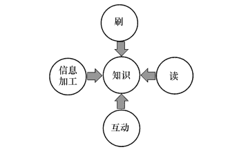

图 10-4　碎片化学习内容获取环节

微学习是智能时代的产物，符合历史演进方向，具有鲜明的时代性。随着技术迭代、新媒体涌现、认知更新加速，接受认知的周期明显缩短。互联网以学员为中心进行认知更新和传播，在很大程度上保证了认知的鲜活度和科学性。认知生成快、载体丰富、网络便捷，让学员能实时掌握最新数据，紧跟热点，及时更新内容。（如图 10-5 所示）

图 10-5　人类进行碎片化学习

（图片来源：https：//i01piccdn.sogoucdn.com/6770a4c645053970）

（二）从教学者端看
传道授业解惑是教学者的传统定位。智能技术高度发展的今天，微学习的出现是对教学方式的冲击与创新。教学者需要在变革中把课堂教学与微学习结合起来，以深化学习效果。

智能时代的微学习打破了固定时间和固定空间的学习模式，学习可以在无边界的时间与空间里进行。教学者在微学习环境下要更好地发挥其引导作用，在课堂的高效时段着力构建体系、解答疑难，为探索新型授课模式提供可能。这种模式对师生的吸引力都很大，作为激发课堂活力与生命力的催化剂，能推动教学者探索、创新教学方式和认知。

人类教学者与智能教学者是当下的热议话题。对人类教学者而言既是机遇也是挑战。微学习通过智能移动终端传播认知，省去了口述、面对面等传统环节，但缺乏管理和情感交流，不利于课堂展开。纯人授课则受教学者精力、认知储备、记忆力等限制。所以人类教学者需要树立微学习与传统教学结合的意识，实现人机交互与人机协作。人类教学者与智能教学者共同成为教育者（如图 10-6 所示），实现新型媒体模式与传统教学的优势互补，推动教学发展。

教学者对移动终端的合理使用能促进时时学习处处学习。通过终端，教学者可以更新教学方式、提升专业能力，也能对学习内容进行拓展、更新和传播，满足学员需求。把微学习融入学校活动，能为学员提供分阶段适配的内容，更好解决认知盲点和困难。同时，终端使用让教学者能及时收集反馈，掌握学员课内外学习情况。

图 10-6　人类教师和智能教师成为共同教育者

（三）从主体意识看
学员是学习活动的主体，每个移动端用户都是潜在的学员。塔夫认为个体具备自动自发学习的潜能，在学习中对自己负责，能自主制定和执行计划、选择策略。微学习更需要赋予学员主动性，让主体地位充分体现，这对个性化发展意义重大。

积极影响
人是主动的能动主体，智能时代的微学习充分体现了这种能动性。随着技术发展，生活节奏和认知更新都加快，互联网持续流动海量信息和学习资源，学员能按喜好和需求挑选内容，找到合适方法并不断进步，体现教育主体性和健康为本的理念。微学习时外界干扰相对较少，学员可依据自身情况能动、自主地选择内容，促进个性化发展。

微学习强化了学员的操作性，使学习从被动转向主动。在庞大的信息库里，学员对内容的选择不是被动的，而是主动的。通过移动设备自主挑选、讨论交流，学员的主体性得到充分发挥，有助于培养主体精神和人格，提升批判性思维、思辨能力与自主学习能力。

微学习对反馈具有即时性。学员在获取认知的第一时间就能反馈学习情况，并据此调整进度和内容。即时性体现在刷到知识点后，通过微阅读获取，若放下手机记不住，可立刻回溯巩固，加深印象。

微学习是快餐式生活的典型学习方式，学员应充分利用移动终端及学习内容便捷、时效、分享等特点，发挥其价值，真正推动全民学习。

三、隐忧：微学习的短板
任何事物都有两面性。微学习作为智能技术发展的产物，在带来积极影响的同时，也存在需要克服的缺陷。

认知支离，难以形成体系。智能时代的微资源呈现支离破碎、杂乱无章的特点。知识点跨度大，一条是语文，下一条可能是科学，难以系统化。逻辑关联弱，加上学习时间和空间不固定，记忆难度增加。每天浏览几条时政、背几个单词、看几个微视频，看似充实，实则一掠而过、走马观花，记住的东西很少，很难取得理想效果。这种浅层学习与系统学习形成对立，不利于碎片认知串联成系统体系。

碎片认知相对浅显，缺乏深度。移动终端的认知面向大众，多以简单易学为主。难度大的内容在编辑时常被降维，或采用问题到结果的简略逻辑，省略了演绎过程，隐藏了问题与结果间的联系和原理。新认知难以与大脑中原有认知建立联系，知识点停留在点上，难以连成线面，成为空中楼阁。学员难以触及认知精髓，内容空洞干瘪，意义有限。

学员重数量轻质量。学员沉迷于获取碎片认知的快感，注重数量而忽略质量。微特征让学员难以静下心来深入思考，难以集中注意力，获取停留在浏览式的碎片阅读。零散认知难以联结，长期下来难成完整体系，进而打击学习兴趣和自信心。

微学习内容面广而粗糙，结构松散，且更新快周期短。网络微资源来源复杂，微博、微信、博客等以随机方式发布联系微弱的认知碎片于用户间流传。为保证新鲜度和流行性，信息更新频率越来越快，呈现周期越来越短。面广粗糙、结构松散、更新过快不利于系统化学习，甚至干扰原有认知结构。

微学习容易导致思维碎片化。内容碎片化意味着知识点关联性差，难以纳入既有认知体系，不利于体系构建和专业技能形成。面对海量数据和动态信息，人类思维与屏幕流动的像素高度匹配，变得更为敏捷，习惯爆炸式收发信息，最终形成非线性思维路径，呈现发散、碎片化特征，认知趋于浅表。标题党、煽情、娱乐、跳跃链接、夸大数据、美图以及暴力色情污染信息，导致思维游离断链。因此，内容碎片化不利于深度思考，容易造成思维碎片化（如图 10-8 所示），长期影响思维与情感。

微学习一定程度上影响身心健康。一方面，学习主要依赖手机，碎片时间增多导致使用更频繁，长时间盯屏对眼睛、脊椎、皮肤造成伤害，形成低头族，沉迷信息流，成为屏幕的臣民，减少人与人交流，不利于人际交往。另一方面，网络碎片信息充斥虚假、劣质、低俗、不完整、不准确甚至错误内容，易引发信息污染和迷航，淹没真正有价值的认知，缺乏辨别力的学员容易被误导，若无正确引导易走偏。此外，自制力不足者易沉迷交友、游戏、短视频，偏离学习目的。

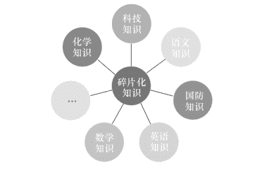

图 10-7　不成体系的碎片化知识

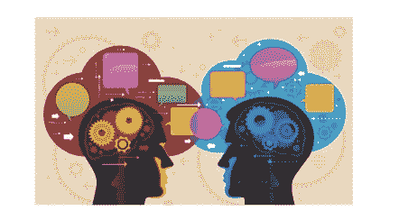

图 10-8　思维碎片化

图 10-9　自觉抵制不良信息

智能时代的碎片认知因其本身缺陷，获取的认知相对简单，缺乏灵魂与深度，且很难联结成系统。同时，生活节奏加快，学员更热衷数量快感而忽略质量，这些特征会导致思维碎片化，并对身心健康产生负面影响。

虽然上述缺陷是客观存在的，但可通过措施弥补，实现对微学习的超越。

四、跃升路径：超越微学习的局限
微学习是技术发展的必然结果，也是时代趋势。它具有很强随意性，若缺乏正确引导，碎片认知与系统认知会严重脱节，甚至背离学习初衷，不利于人才培养和社会进步。因此，微学习需与教育目标相契合，成为当下教育的重点。每个人都应正确看待微学习行为，不要让碎片切断学习脉络，不要让碎片打破应有学习氛围，要学会合理运用碎片化，引导微学习，实现超越。

建立完整系统的认知框架。大多数学员在微学习时关注点，而忽略线面，更难形成完整三维架构。学员应自觉把点状认知串联，增强逻辑性和关联性，在框架建设中补充与创新，达到碎片化输入、结构化积累、体系化输出的效果，弱化碎片化的负面影响。建立框架的前提是善于从海量信息中挖掘真正有价值的认知，从而培养组织能力、思考能力和学习力。

体系化内容与颗粒化内容可以相互配合。体系化的知识像一张完整的网，线索清晰、关联紧密；颗粒化的知识则像是随时可以拾取的知识点，松散却便于即时使用。颗粒化本质是把整体拆解、分散开来，其短板在于离散，容易失焦；体系化则较为规范、联系更紧密，但在灵活性上不足。两者各有优劣，把零散的输入重新纳入整体框架，才能实现从即时记忆到长期沉淀的跃迁。智能时代的碎片式学习正在走向拆分与整合、独立与整体相统一的演进，学习路径也不再是单向直线攀升，而呈现出螺旋回旋的上升形态。^([\[27\]](#txt010.html#footnote_content_txt010_27))

碎片式学习的设计要围绕人的成长展开。每位学习者都是独特的个体，教学安排应当尊重差异、回应个性，这应是根本出发点。在碎片场景中，学习者能够自主挑选主题，把分散的知识点串联起来，从而推动个性化成长。传统校园教学多以统一标准要求全体，容易忽视个性需求。智能时代的碎片学习需要兼顾覆盖面与差异性，既面向全体，也要尊重性格与智力的不同，核心在于让个性发展与全面发展同步推进。让内容更具趣味、层次更分明、实用性更强，才能激发持续学习的动力。^([\[28\]](#txt010.html#footnote_content_txt010_28))

学校要为碎片式学习提供可落地的环境。没有环境支撑，碎片学习难以持续开展。校园网络全覆盖是实现随时随地学习的基础底座。把碎片学习带入课堂，能够让线上线下、课内课外有机衔接，如图 10-10 所示。教师借助移动终端开发与拓展课程资源，为课堂注入活力与生机。学生应正视碎片学习，合理使用手机或电脑，对课堂内容进行预习、衔接与复习，从而整体提升学习力。

碎片学习的真正落脚点是以学习者为核心。超越表面操作，才能让其更好地服务于学习者。智能化的碎片学习依托多元媒介，推动探究式和启发式学习，引导学生自我管理、自主驱动，促成教学模式的多元化变革，^([\[29\]](#txt011.html#txt011_29))培养综合能力，为社会进步输送全面发展的人才。

碎片学习需要传统模式与智能模式的融合。保留传统模式的严谨性，同时借助智能化手段对传统进行革新与优化，让学习更高效便捷。也有研究提示，长期只做碎片学习不利于形成完整知识体系，学习者容易按兴趣取舍，导致思维偏化、发展失衡。将传统学习与智能学习结合，有助于把经典知识与新知识整合，激发学习主动性，培养发散思维，促进综合素质全面提升。

智能时代已然到来，接受与否都无法阻挡。碎片学习作为一种新形态，正深刻影响学习方式。新时代的学习者应与时俱进，把碎片学习融入传统学习，拓宽视野，搭建知识体系，提升整体综合素质。

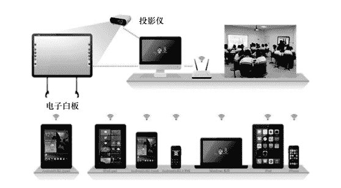

图 10-10　移动终端在课堂上的运用

（图片来源：http：//img.wmzhe.com/contents/8f/0e/8f0ea5bcdb347609d6e66e60e3edf4b1/h00/h00/3c671074a3c1679bba9edd7d3465bcd9.jpg）

### 【注释】

[\[1\]](#txt010.html#footnote_quote_txt010_1)湖南省教育厅.湖南省高等职业教育质量年度报告（2019）［R/OL］.（2019-02-18）［2019-11-13］.http：//jyt.huna.

[\[2\]](#txt010.html#footnote_quote_txt010_2)图片来源：http：//img.mp.itc.cn/upload/20170426/5d20781e409a49e09ce381ec47857abb\_th.jp eggov.cn/sjyt/xxgk/tzgg/201902/t20190218\_5275930.html

[\[3\]](#txt010.html#footnote_quote_txt010_3)聂炬.大学生碎片化学习现状及应对策略［J］.中国教育技术装备，2017（20）：23-25.

[\[4\]](#txt010.html#footnote_quote_txt010_4)王觅.面向碎片化学习时代微视频课程的内容设计［D］.上海：华东师范大学，2013.

[\[5\]](#txt010.html#footnote_quote_txt010_5)王竹立.移动互联时代的碎片化学习及应对之策：从零存整取到“互联网+”课堂［J］.远程教育杂志，2016（4）：9-16.

[\[6\]](#txt010.html#footnote_quote_txt010_6)图片来源：http：//www.hzmba.net/upload/2019-01-15/71033b874c6794f05caf8060fc0304fb.jpg

[\[7\]](#txt010.html#footnote_quote_txt010_7)林楠，吴佩婷.新媒体时代下的碎片化现象分析［J］.广西师范大学学报：哲学社会科学版，2014（4）：47-51.

[\[8\]](#txt010.html#footnote_quote_txt010_8)黄建锋.碎片化学习：基于“互联网+”的学习新样式［J］.教育探索，2016（12）：115-119.

[\[9\]](#txt010.html#footnote_quote_txt010_9)郭玥.移动互联背景下碎片化学习模式的策略研究［J］.数字通信世界，2019（08）：245.

[\[10\]](#txt010.html#footnote_quote_txt010_10)王祥修，左丽丽.互联网时代大学生学习的碎片化现象及其对策研究［J］.发展研究，2019（06）：94-100.

[\[11\]](#txt010.html#footnote_quote_txt010_11)毕玉珊，林玲玉，曹爱萍.基于移动网络环境碎片化学习模式研究［J］.黑龙江科学，2019，10（13）：18-19.

[\[12\]](#txt010.html#footnote_quote_txt010_12)图片来源：http：//5b0988e595225.cdn.sohucs.com/images/20171023/44d348bb1513472e8435fa3 ba628b11f.jpeg

[\[13\]](#txt010.html#footnote_quote_txt010_13)张金兰，周维华.建构从“碎片化”的分解到“系统化”的还原——成人知识传授的新路径［J］.中国成人教育，2019（11）：8-12.

[\[14\]](#txt010.html#footnote_quote_txt010_14)王祥修，左丽丽.互联网时代大学生学习的碎片化现象及其对策研究［J］.发展研究，2019（06）：94-100.

[\[15\]](#txt010.html#footnote_quote_txt010_15)王祥修，左丽丽.互联网时代大学生学习的碎片化现象及其对策研究［J］.发展研究，2019（06）：94-100.

[\[16\]](#txt010.html#footnote_quote_txt010_16)郭利霞.移动互联网背景下大学生碎片化学习优化研究［J］.科学咨询（教育科研），2018（10）：44-45.

[\[17\]](#txt010.html#footnote_quote_txt010_17)李冬莲.“互联网+”时代碎片化学习误区研究［J］.无线互联科技，2019，16（14）：21-23.

[\[18\]](#txt010.html#footnote_quote_txt010_18)王绍建，冯宝贵，孙娟.移动互联网时代碎片化学习的反思［J］.科教文汇（下旬刊），2019（08）：54-55.

[\[19\]](#txt010.html#footnote_quote_txt010_19)陈晨.互联网背景下的碎片化学习［J］.现代交际，2019（16）：25+24.

[\[20\]](#txt010.html#footnote_quote_txt010_20)李冬莲.“互联网+”时代碎片化学习误区研究［J］.无线互联科技，2019，16（14）：21-23.

[\[21\]](#txt010.html#footnote_quote_txt010_21)刁生富，刘晓慧.盛行于焦虑：技术文化哲学视野中的阅读问题［J］.西南民族大学学报，2019（10）：58-62.

[\[22\]](#txt010.html#footnote_quote_txt010_22)郭利霞.移动互联网背景下大学生碎片化学习优化研究［J］.科学咨询（教育科研），2018（10）：44-45.

[\[23\]](#txt010.html#footnote_quote_txt010_23)图片来源：http：//www.hdtmedia.com/wp-content/uploads/2015/02/81.jpg

[\[24\]](#txt010.html#footnote_quote_txt010_24)图片来源：http：//5b0988e595225.cdn.sohucs.com/images/20180129/6ddd6c908f1845d39597495 627385308.jpeg

[\[25\]](#txt010.html#footnote_quote_txt010_25)聂炬.大学生碎片化学习现状及应对策略［J］.中国教育技术装备，2017（20）：23-25.

[\[26\]](#txt010.html#footnote_quote_txt010_26)毕玉珊，林玲玉，曹爱萍.基于移动网络环境碎片化学习模式研究［J］.黑龙江科学，2019，10（13）：18-19.

[\[27\]](#txt010.html#footnote_quote_txt010_27)张金兰，周维华.建构从“碎片化”的分解到“系统化”的还原——成人知识传授的新路径［J］.中国成人教育，2019（11）：8-12.

[\[28\]](#txt010.html#footnote_quote_txt010_28)徐越蕾.为了每一个学生的全面、个性化发展——上海戏剧学院附属高级中学生涯发展教育课程创建与实施［J］.中小学心理健康教育，2019（06）：38-42+45.

[\[29\]](#txt010.html#footnote_quote_txt010_29)孔燕.碎片化学习在高等教育中的应用策略［J］.科教导刊（下旬），2019（04）：21-22.

# 第十一章　学习型社会：人人都是学习者

## 学习型社会：当代社会教育发展的主题

## 概念演变：学习型社会的提出与变化

## 未来学习生态：构建无边界学习环境

## 普遍共识：全民学习与终身学习

## 新方法论：智能学习型社会的构建

我们正迈入智能新时代，知识更新与增长速度都在加快，对个人素质的要求也随之提升。个人、组织与社会对学习的需求愈发迫切。学习型社会是这一时代的核心价值取向，在智能时代构建它，使学习呈现全民化与终身化，有助于促进教育公平与人的全面发展，推动社会进步。

## 一、学习型社会：当代社会教育发展的主题

学习型社会是指借助制度与手段让全民学习、终身学习得以持续的社会形态。作为当前国际教育发展的主线，它意味着学习方式的转型与创新，让学习面向所有人、贯穿一生，实现机会公平，促进个人完善与社会进步。

“学习型社会”这一提法最早由美国学者哈钦斯 R.B.Hutchins 在 1968 年提出。20 世纪 70 年代初，联合国教科文组织明确提出建设学习型社会的目标。此后随各国政治经济文化加速发展，人们对学习的需求持续上升，学习型社会的理念获得广泛重视，各国纷纷开展创建行动。如今人类逐步进入智能新时代，学习者为提升竞争力，对学习的渴求愈加明显。

学习型社会最核心的特征是推动人人持续学习，全民学习与终身学习是其本质，促成人类社会全面发展是其终极目的。学习型社会要在全社会营造人人学习、终身学习的氛围。

学习型社会是信息网络化、经济全球化、生活智能化的产物。它要求每个人不断更新自我，以应对新时代挑战。学习型社会虽源于教育、与教育紧密相连，但并不仅限于教育范畴，它也是社会学概念，内涵极为丰富：它代表一种新的社会发展观、新的生产方式、新的生活方式、新的结构模式、新的发展战略。

学习型社会将成为智能时代新的教育形态与社会形态，其特点可概括为创新性、终身性、公平性、开放性、发展性、多样性。

创新性是学习型社会的灵魂。任何生产活动都离不开学习，社会进步与国家繁荣都依赖学习的推动，而学习推动力最终体现在创新上。学习与创新是辩证统一的，创新必须以学习为基础，没有学习基础的创新是无源之水、无本之木。创新性的学习方法已成为现代社会的必然要求。在智能技术快速迭代、知识不断更新的今天，只有通过创新性学习掌握前沿知识并加以创造，才能跟上时代。创新性学习既是推动学习型社会发展的动力，也是其核心。

终身性是学习型社会的底色。终身学习已成为现代社会的显著特征，学习贯穿人的一生，成为每个阶段的刚需。在智能社会，知识总量将在现有基础上成倍增长。仅仅依靠学校阶段的学习已远远不够，“一次性充电、终身放电”的模式已过时。每个人都需要在人生各阶段坚持学习，形成“活到老学到老”的理念。

公平性是学习型社会的应有之义。学习型社会为教育公平提供了条件。学习化社会具备物质基础，能够为成员提供充足的学习机会与场所，保证终身教育顺利开展。^([\[1\]](#txt011.html#footnote_content_txt011_1))以终身教育为指导的学习型社会关注每一位学习者，满足学习欲望，为公平学习提供思想保障。终身教育体系的建立，为智能时代的教育公平提供了制度保障，打破了传统学习在时空上的限制，形成更开放、更灵活的教育系统，为每个人提供平等机会。

开放性是学习型社会的本质特征。传统学习封闭、受限，获取的知识有限；而智能学习型社会学习是开放的。开放体现在时间与空间的无边界：一方面，学习不再局限于学校阶段，人生各阶段都可学习；另一方面，学习空间突破了课堂局限，学校、家庭、社会皆可成为学习场。学习型社会还能根据个人、国家与社会需求灵活开展正规或非正规学习，体现高度灵活性。开放与灵活使学习的深度与广度大幅拓展，有助于形成全民学习氛围，促进整体素质提升。

发展性是学习型社会的重要维度。世界万物都在变化发展，学习型社会也在持续演进。学习型社会的学习是动态发展的：一方面，信息时代知识更新频率加快，人的学习能力与创造能力也在不断变化；另一方面，学习是为了实现人的全面发展，进而推动社会进步与文明发展。

多样性体现在组织形态上，主要包括个人组织、团体组织与学习型组织。个人组织指个体自主学习，侧重个人知识与综合素质提升；团体组织指以团队为学习主体，注重整体能力提升；学习型组织是前两者发展的高级形态，是学习型社会形成的初级形态。它把分散的学习主体连接成网络，实现个人、组织与社会的有机统一。

学习型社会的发展已成为各国社会发展的重要目标，得到全社会关注与支持。对学习型社会的认识，既是建设智能学习型社会的重要任务，也是实现全民学习、终身学习的前提。

## 二、概念演变：学习型社会的提出与变化

学习型社会的历史并不长，其脉络可追溯至 20 世纪 60 年代。该概念最早由美国学者哈钦斯 R.B.Hutchins 在 1962 年提出。他在《学习社会》一书中认为：学习化社会是教育与社会、政治、经济组织，包括家庭与公民生活紧密交织的过程，在这个社会里，“每个公民都能在任何情况下获得学习、训练和自我提升的各种手段”。

美国学者爱德华 Edwards 在不同时期对概念有不同界定：1968 年，他认为学习型社会是一个有教养的社会 Educated Society；20 世纪 70 年代中期，他提出学习型社会是一个学习市场 Learning Market；20 世纪 90 年代后，随着信息技术与网络发展，他提出学习型社会是一个网络社会 Learning Networks。

1972 年，联合国教科文组织提出“人要向着学习化社会前进”的目标。联合国教科文组织国际教育发展委员会的报告《学会生存——教育世界的今天和明天》这样描述学习化社会：“教育已不再是少数杰出人才的特权或特定年龄的限定活动；教育正日益向着涵盖整个社会和个人终身的方向发展。”“未来的教育必须成为一个协调的整体，在这个整体内社会的一切部门都从结构上统一起来。这种教育将是普遍的和继续的。”^([\[2\]](#txt011.html#footnote_content_txt011_2))

学习从未止步：智能时代的全民成长之路

2001年，领导人在亚太经合组织人力资源能力建设高峰会议上提出要搭建终身教育体系、建设学习型社会的倡议。2002年11月8日至14日，十六大报告提出要形成全民学习、终身学习的社会形态，促进人的全面发展，并将建设学习型社会列为全面建设小康社会的四大目标之一。20世纪末至21世纪初，随着全球科技加速迭代，终身学习的理念在各国得到广泛关注。

进入21世纪，诸多国家把学习型社会视作教育发展的核心方向，逐渐成为世界性的教育追求。如今人类已步入智能时代，互联网、物联网、人工智能等新技术密集落地，知识更新速度空前加快，学习型社会的诉求愈发迫切。《北京共识》明确人工智能要服务于普惠终身学习机会，重申终身学习是实现可持续发展目标4的指导原则，涵盖正规、非正规与非正式学习。^([\[3\]](#txt011.html#footnote_content_txt011_3))

学习型社会的演进受政治、经济、技术等多重因素驱动。智能技术正在渗透生活的各个角落，重塑学习方式与价值判断。持续学习成为常态，学习力上升为社会核心竞争力，共同推动学习型社会向前演化。

学习正被重塑为一种持续的生活常态。智能时代知识迭代极快，人类学习常显滞后。技术预言家J.马丁测算，人类知识大约每三年翻一番。西方职场流行一种说法：一年不学习，知识折旧可达80%。智能浪潮带来的裂变效应进一步压缩知识半衰期。面对裂变，每个人必须找准生存与发展路径。若不能适应智能时代节奏，及时更新知识结构，就可能沦为功能性文盲，要消除这种阻碍，全民学习与终身学习是关键。^([\[4\]](#txt011.html#footnote_content_txt011_4))借助智能技术开展不间断学习，才能让学习速度追上知识迭代。

学习的价值已由谋生手段转向精神追求。传统观念里学习是为了获得养家糊口的职业，谋生后即停止。在智能新时代，文明水平的提升让人们意识到学习不仅关乎就业。自我素质提升与综合能力成长成为更核心的追求，于是学习变成自我实现层面的精神诉求。

学习力成为竞争的决定因素。智能时代来临前，竞争多体现在分数与学历。高度智能的竞争环境里，真正的优势源自核心竞争力，而后者根植于个体的学习能力。想要在人工智能快速发展的社会中站稳脚跟，就必须不断提升学习能力以强化核心竞争力。

学习型社会是人类共同进步的必然要求，也是历史发展的趋势。它在全球获得广泛响应，其本质是人人皆学与学贯一生。人人皆学意味着每个人都是学习者，学贯一生意味着从出生到生命终点每个阶段都不间断学习。其终极目标是促进人的全面发展与社会的繁荣进步。

三、学习边界消失：无边界生态正在成形

智能新时代的广泛应用重塑了学习场景，对传统教育形成冲击，学习形态随之改变。泛在化与碎片化成为当代学习的主要特征。进入智能时代，学习本身也进入无边界阶段，无论资源、领域、内容还是方式，都突破了边界。这就是未来学习生态的雏形，无边界学习环境正在成形。

无边界学习概念最初由英国教育界提出，指借助一切可用的学习平台，为学习者提供随时随地学习的条件，打破时间与空间限制。无边界学习环境就是在智能时代依托身边一切学习机会展开学习活动的场景。学习环境是学习活动的物质基础。在智能时代，打破学习边界已成必然，需要为学习者提供智能化环境，让学习体验最佳化、效果最优化。

无边界学习作为智能时代的重要趋势，呈现四个鲜明特征。首先是主体主动性，学习者作为主体拥有选择权，可依据自身需求自主决定学习活动。其次是环境的无边性，学习环境不再受校园围墙与固定时段制约，向无边界延伸。再次是方式的多样性，人机协作、MOOC在线学习等新型方式相继出现。最后是过程的社会性，学习过程与社会适应相互作用，学习者在学习中融入社会并反作用于社会。

现行教育体制下，无边界学习实质是模糊学习边界，拓展更广阔的学习空间。其必要性源于时代需求与学习内在需求。

从时代看，人类已进入以智能技术为标志的时代，人与智能机器并存，人机融合成为常态。在此背景下，人机共存成为首要命题，而学习是解决这一命题的最佳途径。整个世界都应变成教室，让学习顺应人机融合的时代需要。

从学习本身看，学习随生产力与生产关系演进而变化。原始社会学习本就无边界。工业时代分科课程出现后，学习被固化在固定时间与地点。智能时代则让随时随地学习成为常态，泛在化与碎片化学习普及，知识跨时空、跨领域融合成为特征。无边界学习不再以识记与机械训练为主，更强调创造力与创新力的培育。

无边界学习环境的构建符合历史走向，已渗透到生活方方面面，具体体现在：

在方式上，突破传递接受式教学，实现灵活多样。线上线下、理论实践、虚拟现实多重融合，情景创新、实践体验、交流共享深入推进。探究式学习成为主流，通过发现问题、分析问题、解决问题综合运用学科知识，培养分析与创新能力。

在资源上，学习资源不再局限于校内教材，而是延伸至家庭与社会。智能技术将学校、家庭、社会资源联通，形成整体，为学习者提供无边界资源，获取知识更便捷，视野更宽广。

在时空上，打破固定时间与地点的限制。智能技术使随时随地学习成为可能，学校与课堂的边界被打破，整个社会成为学习场域，学校也成为社会的一部分。

在内容上，实现真正的因材施教。学生智力与性格各不相同，无边界学习内容允许学习者按兴趣与思维方式自主选择，形成独特的知识结构。满足个性化差异、构建个性化知识体系是智能社会的重要追求。

智能时代对学习的要求与社会发展总体趋势一致，因此无边界学习环境的构建要着眼于全面可持续发展，培养适应智能时代的高素质人才。具体价值体现在：

有利于个性化自主学习。权威专制型的师生关系让位于民主平等的导学关系。教师扮演指导者，学生以自学、互学等方式为主，提升自主学习的意识与能力。

有利于拓展学习宽度与深度。学校课程在宽度深度上存在局限。无边界环境将学校课程延伸至社会知识，把理论应用于社会各领域，提升整体素养。

有利于打破时空限制注入活力。学习不仅限于课堂，家庭与社会学习同样重要。打破学校课堂的时间与地域限制，实现校家社整合，为学习注入活力与生命力。

此外，无边界学习环境还有助于突破定势实现教师培养无边界，打破常规管理形成民主开放模式，实现实体教育与虚拟教育的融合。无边界学习如同海洋，让学习者在其中自由畅游。

两千多年前孔子提出知无涯，陶行知倡导生活即教育、社会即学校、教学做合一，都为今天的无边界学习提供了思想源头。无边界学习环境的构建非一蹴而就，需要持续参与。

四、共同认知：人人可学、学以终身

学习型社会是通过机制与手段促进人人皆学与学贯一生的社会。这一观念深入人心，已成为不可分割的社会思潮。从提出到今天，在宏观政策引导与各级机构改革创新推动下，人人皆学、学贯一生已成为普遍共识。

20世纪20年代，耶克斯里最早提出终身教育。1965年，法国教育家保罗·伦格兰在联合国教科文组织国际成人教育促进委员会上指出，教育不应止于童年与青年，应贯穿一生。这一观点获联合国教科文组织高度重视。1972年学会生存——教育世界的今天和明天出版后，终身教育受到各国关注，^([\[5\]](#txt011.html#footnote_content_txt011_5))并强调通过终身学习建立不断演进的知识体系——学会生存。^([\[6\]](#txt011.html#footnote_content_txt011_6))此后终身教育理念广泛传播。终身学习作为新时代的学习方式与价值取向受到高度重视。在中国，从传入到成为普遍共识经历了萌芽、确立、发展、完善四个阶段。

### 萌芽阶段（1980—1997 年）
1980年8月教育部发布关于进一步加强中小学教师培训工作的意见，指出教师进修院校承担中小学在职教师终身教育的责任。1995年教育法中出现终身教育，政策地位确立。1997年国家教委关于当前积极推进中小学实施素质教育的若干意见两次提及终身学习，强调为学生奠基终身学习能力。^([\[7\]](#txt011.html#footnote_content_txt011_7))这一阶段终身学习引入中国并写入政策。

### 确立阶段（1988—2001 年）
终身学习在政策文件中出现频率提升，随后逐渐形成体系。如1998年面向21世纪中等师范教育改革的几点意见、1999年教育部1999年工作重点和办好教育电视节目等多次提及终身学习体系。1998—2001年体系化出现标志着终身学习的确立。

### 发展阶段（2002—2011 年）
2002年十六大报告提出形成全民学习、终身学习的学习型社会，促进人的全面发展，并将其列为全面建设小康社会四大目标之一。党的十七大提出发展远程教育与继续教育，建设全民学习、终身学习的学习型社会。2003年关于进一步加强高等教育自学考试工作若干问题的意见关于进一步加强人才工作的决定以及2004年关于开展全国创建学习型组织，争做知识型职工活动的实施意见等文件均强化终身学习理念，推动其发展。

### 完善阶段（2012 年至今）
2012年至今是完善阶段。党的十八大提出完善终身教育体系、建设学习型社会。十九大报告强调加快建设学习型社会。国家中长期教育改革和发展规划纲要（2010—2020年）提出到2020年初步形成基本的学习型社会。^([\[8\]](#txt011.html#footnote_content_txt011_8))国家教育事业发展十二五规划、关于推进学习型城市建设的意见、十三五规划建议等进一步深化政策。2015年习近平总书记提出建设人人皆学、处处能学、时时可学的学习型社会，从主体、空间、时间三个维度提出要求。同时人类步入智能时代，2019年5月16—18日联合国教科文组织北京共识指出采用人工智能平台与学习分析构建支持人人皆学、处处能学、时时可学的综合性终身学习体系，尊重学习者能动性，开发人工智能在促进灵活终身学习途径以及学习结果积累、承认、认证与转移方面的潜力。^([\[9\]](#txt011.html#footnote_content_txt011_9))一系列政策推动人人皆学、学贯一生进一步完善。

从概念提出到理念形成再到体系建立，终身学习经历萌芽、确立、发展、完善阶段，拓宽了学习渠道，培养了终身学习意识，满足了社会学习需求，形成了全民终身学习的氛围。

五、构建路径：迈向智能学习型社会

随着科技的快速发展，建设学习型社会已成为世界教育改革的客观趋势。在从工业经济向数字经济、智能经济转型的背景下，传统教育难以适应变革，建构智能时代的学习型社会至关重要。

智能时代学习型社会让人类更多借助人工智能认识与改造世界，使其更智能化、普及化，对提升国际竞争力、社会和谐与个人发展具有重要意义。

### 智能学习型社会的构建是稳定国家地位、提高国际竞争力的战略选择
在知识爆炸与科技迅猛发展的时代，创新成为经济社会发展核心动力。创新能力是综合国力竞争的核心资源。建构智能时代的学习型社会在教育层面占据先机。智能时代既是学习工具，也是学习环境与学习伙伴，正在从网络时代的学习工具向智能时代的学习伙伴演进。人与智能机器关系日益融合，从他者变为自身。这将不断提升国家的国际地位与竞争力。

### 智能学习型社会的构建是促进社会和谐发展的关键
社会和谐是国家富强、民族复兴的关键，不仅依赖经济基础，也依赖社会协调。智能时代的学习型社会不会被时代淘汰，反而通过智能学习模式促进社会和谐。

### 智能学习型社会的构建是个人发展的必然要求
物竞天择，适者生存。在信息与科技快速迭代的智能时代，唯有不断学习才能适应变化，避免被淘汰。构建智能时代的学习型社会是人类发展的必然要求。

学习型社会在发展中取得进步，但也面临智能技术带来的挑战。需要国家、学校与个人共同努力，在智能技术辅助下推动学习可持续发展。学习型社会不是自动形成，需要有意识构建。构建智能学习型社会是时代产物，是智能时代对人类进步的客观要求，也是历史必然。

习近平总书记强调要始终把教育摆在优先发展战略位置，不断扩大投入，努力发展全民教育、终身教育，建设学习型社会，让每个孩子享有受教育机会，让14亿人民享有更好更公平的教育，获得发展自身、奉献社会、造福人民的能力。党的十九届四中全会提出构建服务全民终身学习的教育体系。进入智能时代，人类获取知识的速度难以跟上知识更新速度，学习需求更加迫切。智能时代学习型社会的构建能够提供全民终身学习体系，为终身学习提供保障。

智能学习型社会的全民终身学习体系要坚持教育为人民服务、为社会主义服务的宗旨，以凝聚人心、完善人格、开发人力、培育人才、造福人民为目标，保障人人享有受教育机会，实现教育发展成果更多更公平地惠及全体人民；搭建以学习者为导向的资源共享平台，建立覆盖各类人群、方式灵活的终身学习服务体系；构建衔接沟通各级各类教育、认可多种学习成果的终身学习立交桥，提供多次选择机会，满足个人多样化学习与发展需要。^([\[10\]](#txt011.html#footnote_content_txt011_10))

智能时代的学习重构与社会共进

随着网络和智能技术持续加速演进，人类的工作与学习都必须同步作出调整，才能贴合这个大环境。进入智能化阶段，人与智能的协同变得愈发关键，常见形态有人与机器的协作以及人与网络的协作。智能时代的学习型社会是社会演进的产物，对学习的诉求在强度、持续性和覆盖面上都高于以往，只有全社会保持不竭的学习动能，才能应对接踵而至的新挑战。

在此基础上，还应着力打造智能时代的学习型家庭、学习型企业、学习型城市等各类单元。相较于传统意义上的全民学习与终身学习，智能时代更突出了合作学习这一新能力。

智能学习型社会的成型与时代进程及科技进步高度绑定。新一代信息技术呈现爆发式增长，人类生产生活的样态发生系统性重塑，以职业准备为导向的知识传授和技能培养已难以匹配当下高度信息化、智能化、个性化的需求。因此构建智能学习型社会既顺应历史走向，也具备了物质条件，成为当下的重要任务。

推动智能学习型社会，一方面是顺应变革、与时并进，在国际竞争中保持主动，同时服务于我国经济社会转型、社会和谐与社会主义现代化强国建设，也契合个体全面发展的诉求；另一方面，智能时代已奠定物质基础。互联网的出现不仅为学习型社会的建设提供了媒体条件，也丰富了受教育的形式。传统模式下学习主要依赖教师讲授，如今在信息网络高度发达的情境下，除常规课堂外，还可通过网络开展远程教育、借助资源共享实现自主学习。教育由此突破传统边界，延伸至社会各领域、家庭与工作生活场景，真正实现任何人、任何时间、任何地点皆可学。

学习型社会的建构长期以来是社会发展的关注点。实践中，建设智能学习型社会需从国家、学校、个人三个层面协同推进。

### （一）从国家层面
国家通过政策大力发展智能机器。智能机器的迭代速度惊人，部分能力已超越人类。以学习能力为例，人工神经元网络通过模拟人脑神经结构构建电子线路，使机器人可在多重网络线路上进行学习。其传输速率远超人脑，且抗干扰性强；信息处理、存储、记忆容量也大幅领先人类。智能机器的普及让生活更便捷高效，也为智能学习型社会的构建提供关键支撑。“事实上，从网络诞生之日起，人类的学习已逐渐从单纯的人类自身学习，走向人-机合作式学习。网络时代，人-机合作学习主要是人-网合作学习，智能时代则更多地演变成人-智能机器合作学习，最后有可能发展为人-智能机器一体式学习。”^([\[11\]](#txt011.html#footnote_content_txt011_11))人机协同既保留人的主导，又借助机器算力，从而显著拓展学习的深度与广度。

国家需强化立法，为学习型社会提供法治保障。借助政策法规规范和推动学习型社会与终身教育体系，是许多发达国家的成熟经验。我国对相关立法的呼声持续高涨，但目前仅有少数省市出台了地方性法规。为此，应从法律层面启动立法程序、发布指导意见，把学习型社会的建设从倡导上升为全民共识与行动。唯有以法律固化，才能提升全民参与意识与重视程度，推动建设落地。

国家应积极倡导借助现代智能网络技术开展远程教育。网络普及是智能时代的鲜明标志，也为学习型社会建设创造了便利。远程或网络教育打破了年龄、身份、地域的限制，让社会成员随时随地持续学习。充分运用信息网络开展远程教育，有助于实现人人能学、终身可学，是建设学习型社会的重要路径。

### （二）从学校层面
以学校教育体系为根基，培育新时代学习者。学校教育是学习型社会建设的核心基础，培养具备较强综合学习能力与高度学习自觉性的新一代学习者，是建成学习型社会的关键。学校应在终身教育理念指导下，运用信息技术对教育内容、模式、方法进行系统革新，丰富教育形式、创新教学手段，以满足新时代学生需求，为学习型社会储备人才资源。

把握契机，依托智能技术办好继续教育，加快学习型社会建设。党的十九大报告明确提出办好继续教育、加快学习型社会建设、提升国民整体素质。继续教育面向全体社会成员，是学校教育的补充与完善，也是终身教育体系的重要环节，对提升国民素质、推进现代化强国建设、满足人民学习需求意义重大。各級政府、教育主管部门及继续教育机构需抓住时机，完善制度与评价机制，拓展学习机会、优化社会环境。核心在于找准现有问题，深化体制改革，提升继续教育的质效。

学校应开设前沿智能技术课程，推动移动互联网融入日常生活。当前人类生活已深度联结互联网，但对诸多新智能技术的系统学习与应用仍不足。将移动互联网带入生活，让人机交互成为常态，能更快逼近智能学习型社会。依托学校或在线课程普及智能技术知识，并实现课程免费开放，是提升公众科学素养、构建智能学习生态的基础路径。

### （三）从个人层面
学习者应树立终身学习导向。智能时代倡导全民学习、终身学习，要求每个人把学习视为贯穿一生的持续活动与价值追求，而非仅限于学校阶段。

学习者需借助智能技术革新学习方式。智能学习已成为时代主导形态，移动学习、碎片化学习、智慧学习等基于智能媒介的新模式不断涌现，为学习者提供多元渠道。传统方式已难以满足智能时代需求，学习者应善用手机、电脑、多媒体等智能终端重塑学习习惯。智能化学习打破时空束缚，使学习更具人性化与灵活性。

学习者还需聚焦综合素质与创新能力提升。面对复杂国际形势，实现民族复兴、增强综合国力亟需高素质创新型人才，国家对青年人才培养高度重视。2014年6月，习近平总书记在中科院十七次院士大会、工程院十二次院士大会上强调，广大院士要担起培养青年科技人才责任，甘为人梯、言传身教、慧眼识才，为拔尖创新人才成长铺路搭桥；青年科技人才要树立科学精神、培养创新思维、挖掘创新潜能、不断超越前人。2013年7月，习近平在中科院考察时指出，要最大限度调动科技人才创新积极性，尊重创新自主权，营造鼓励成功、宽容失败的社会氛围。^([\[12\]](#txt011.html#footnote_content_txt011_12))新时代学习者应自觉提升综合素养与创新能力，为学习型社会建设贡献力量。片面追求应试与单向发展的学习模式已过时，智能新时代更看重全人发展与创新潜能，唯有与时俱进才能不被淘汰。

总之，国家、学校、个人等各主体需顺应时代特征协同发力，将智能学习型社会从宏观设计落到微观实践，从法治保障延伸到全民行动，逐步迈向全民学习、终身学习的智能学习型社会。

### 【注释】
[\[1\]](#txt011.html#footnote_quote_txt011_1)王伟杰，常波.我们怎样走进学习化社会——构建学习社会的思考［N］.中国教育报.2003-03-05.
[\[2\]](#txt011.html#footnote_quote_txt011_2)联合国教科文组织国际教育发展委员会.学会生存——教育世界的今天和明天［M］.北京：教育科学出版社.1972.
[\[3\]](#txt011.html#footnote_quote_txt011_3)联合国教育、科学及文化组织.北京共识——人工智能与教育［M］.2019.05.16-18.
[\[4\]](#txt011.html#footnote_quote_txt011_4)张春龙.“学习型社会”：内涵、背景、特征［J］.唯实，2017（02）：63-66.
[\[5\]](#txt011.html#footnote_quote_txt011_5)赵世平.终身学习理论的历史发展［J］.中国成人教育.1999（8）：16-17.
[\[6\]](#txt011.html#footnote_quote_txt011_6)贡咏梅.终身教育、终身学习、学习社会理念之辨析［J］.教育探索.2006（11）：60-61.
[\[7\]](#txt011.html#footnote_quote_txt011_7)国家教委.关于当前积极推进中小学实施素质教育的若干意见.1997.
[\[8\]](#txt011.html#footnote_quote_txt011_8)高向杰.日本终身学习质量保障机制研究及启示［J］.中国电化教育.2017（7）：47-52.
[\[9\]](#txt011.html#footnote_quote_txt011_9)联合国教育、科学及文化组织.北京共识——人工智能与教育［M］.2019.5.16-18.
[\[10\]](#txt011.html#footnote_quote_txt011_10)籍献平.构建终身学习体系加快建设学习型社会［N］.河北日报，2019-11-08（007）.
[\[11\]](#txt011.html#footnote_quote_txt011_11)王竹立.论智能时代的人-机合作式学习［J］.电化教育研究，2019（09）：1-9.
[\[12\]](#txt011.html#footnote_quote_txt011_12)李俊鹏.习近平新时代人才观对科研院所创新人才培养工作的启示［J］.经济师，2019（11）：185-186+188.

# 附录一　学习的革命：大数据与求知的新路径

**摘　要：**大数据对学习的影响具有革命性，推动学习方式走向个性化、学习资源走向海量化、学习思维走向新型化、学习过程走向可记录化以及学习活动走向协作化，同时也带来数据冰冷情感缺失、资源冗杂效率失焦、数据沉睡导致思维错觉、技术依赖引发记忆失能等新难题。探索大数据时代求知新路径，需坚守理性思维，更新学习方式，转变教育心态，丰富评价维度，革新学习文化，进而构建以大数据为底座的学习综合生态体系。

**关键词：**大数据；学习；教育

学习贯穿人类社会始终，但在不同时代呈现截然不同的形态与内涵。从封建时代等级森严的私塾式学习，到工业时代工厂式标准化学习，再到物联网、云计算催生的科学式、智能化个性化学习，学习的内涵不断扩展。如今大数据正以无所不在的方式渗透教育全流程，孕育千禧一代、数字原住民等新学习主体，也必将推动一场学习革命。与此同时也产生一系列新问题，有必要分析大数据时代学习新态势与新问题，探讨优化与创新路径。

## 一、大数据时代学习的新态势

### （一）学习方式个性化
新一代信息技术催生的最显著变化是社会数据化，学习数据化正驱动个性化发展，逐步突破传统体制障碍、观念束缚与思维惯性。移动互联网与物联网让数据在沟通交流中高速流转，人类连接前所未有，新学习环境与习惯逐步成型。交互产生的大量数据可被量化精准分析，使学习得以系统化、科学化、个性化改进，效率更高、覆盖更广、特征更鲜明。

大数据极大拓展了自主选择学习方式的自由度，为挖掘潜能、弥补短板提供可能。大数据与传统数据相比具有非结构化、分布式、体量庞大、分析从专家转向用户、高度可视化等特点，契合个性化与人性化学习诉求。正如 Facebook 创始人马克·扎克伯格认为，个性化学习是破解教育困境的关键。以大数据发掘每个学生的特质与天赋，尊重其个体成长，已成为重要生存方式。随着学习者规模膨胀、群体多元、知识需求多样，基于数据开放共享、可分析可量化以满足个性化体验、提升教育质量的混合式学习设计、学习测量、自适应学习技术、移动学习、物联网、下一代学习管理系统、人工智能、自然用户界面等成为2017年地平线报告高等教育版的新兴技术行列。

以大数据为支撑的个性化学习正成新常态。政策层面，2017年中国教育工作总体要求提出构建网络化、数字化、个性化、终身化的教育体系；实践层面，美国K-12教育中的AltSchool以深度个性化学习为核心，借助数据捕获与分析形成的个性化任务清单 Playlist 以及追踪平台 My AltSchool 量化学生指标，据此确定教学内容与进度。

### （二）学习资源海量化
大数据时代信息生态高速演进，知识半衰期持续缩短，万物互联的社会基础催生源源不断的学习资源。新知识呈指数级爆发，信息持续拓展，知识边界不断延伸，学习资源呈现海量特征。

过去受技术与大脑存储限制，学生主要依赖教师与教材获取知识，更新缓慢。如今云计算、物联网、可穿戴技术、大数据、互联网深度嵌入社会并重塑教育，催生海量、多形态、智能化的学习资源。其一，互联网数字资源可实现快速迭代。免费、便捷、可捕捉、可量化、可传递的数据资源由占有变为分享，资源享有者、消费者、生产者角色日益重叠，融合学科知识、教学活动、海量优质资源的网络课程正动态生成且可即时改进发布。其二，数字技术吸引跨行业人才参与，推动数字学习资源生产。众多教师与学校正利用这些资源扩大学习，补充或替代印刷材料，全球数字学习项目蓬勃开展。其三，可用性与先进度的数字化学习系统不断普及，学习资源展现覆盖云平台、可视化、个性化过滤、模拟、游戏、互动、智能辅导、协作、评估与反馈等多种形态。在海量资源加持下，学习进程与体验显著提升。

### （三）学习思维新型化
在智能终端触手可及、学习空间无处不在、学习数据遍布各处的环境下，新一代学习主体的母语正转向电脑、手机、互联网等数字载体，大脑结构随之改变，学习思维呈现非线性、多回路、关联性、跨界性特征。

过去有限教学资源、信息相对闭塞、循序渐进的教育培养出线性思维。如今数字原住民成为主流，电脑游戏、邮件、互联网、手机、即时通信成为生活必需，面临学习数据化与网络化的全新挑战。学习者日益以互联网思维获取与评估信息。其处理数字信息的心理倾向主要表现为对数字呈现信息敏感度下降，习惯快速接收，偏好并行处理与多任务，如随机访问、超链接检索，偏爱图文而非纯文本，成长于即时满足与高频奖励，喜欢游戏胜于严肃学习方式。

大数据是获得新认知、创造新价值的源泉。随着文明进程发展，大数据正全方位影响人类，人们在学习、数据与信息中不断寻求契合点，以进行有效融合，构建适配自身路径与方法。

### （四）学习过程可记录
传统大班制教学受人工处理与技术条件束缚，难以对学生学习过程产生可分析数据。大数据时代，个人学习路径不仅可以完整捕获而且将伴随学生整个生命周期，并使大数据驱动的教育决策得到及时且科学的反馈与发展。

# 数据时代的学习重塑

让学习轨迹可以被记录、被呈现，正在让决策更可事后复盘、让成长更可被追踪，也在把终身学习从口号拉向闭环。教育里的大数据应用，上世纪八九十年代还只是试探性的探索；九十年代到本世纪初，在线课程爆发式增长，数以百万计的学习者涌入线上，教学与学习的关系被改写，也打开了采集行为数据和课程互动的新通道。在这种语境下，从入学前的测评到讨论区的发言、博客的草稿、维基的协作编辑，都能在发生时被留存进数据库。数据伴随学习实时或准实时汇聚，再经分析工具转译为支持教学判断的依据。美国新媒体联盟 2015 年《地平线报告》提到，完整保存学习路径有助于优化体验，也能在学习共同体里建立身份与声誉，还可作为求职或升学数字凭证，未来五到六年可能成为主流。可见学习分析工具在持续进化，不停捕捉学习状态、强项弱项与节奏，并以可视化方式呈现，让学习实现量化采集。

### （五）协作正在改写学习共同体的边界
世界趋平、信息泛滥、阶层松动、社交便捷的时代，学习共同体的范围在不断扩张。建构主义强调，知识不是被动接受教师灌输，而是学习者在社会互动与合作中共同建构的。协作让人在信息洪流里更快捕捉信号、形成智慧，已成为海量数据环境下实现全面发展与终身成长的关键驱动。

数据开放、信息易得、个人闲暇增多的智能化时代，聚集不再受限，社会化探究成为可能，协作式生态正推动学习浪潮与精神探索的深入。大量合作学习研究表明，孩子一起学习时会共享想法生成的过程，在互动里相互督促、共同创造、深度反思与协同解题。印度教育学家苏伽特·米特拉的一系列实验极具代表性，1999 年他在新德里周边贫民窟放置一台联网电脑并设隐蔽摄像，孩子们仅靠互助自学，就学会操作电脑、用英语交流并在网上追问科学问题。他还提出自主学习环境 SOLE，让教育者扮演调解者，鼓励社区式网络探究；以及自组织调解环境 SOME，全球退休教师自愿通过 Skype 每周投入一小时助力学小组工作。

协作要兼顾共享、互动、反思与参与价值，同时要守护个体的独特性，在群体中彰显自我价值。技术介入后，学习者唯有在更大社群里重新确认独立价值，在价值与信念上站稳脚跟，才能真正拥抱更大的社群。

## 二、大数据语境下学习面临的新困境

### （一）算法主导带来的情感空缺
当下个性化学习很大程度上依赖算法实现，却难以触及人类情感态度、价值取向、直觉灵感等主观能动性，容易把个性化锁进程序化的窠臼。

海量数据带来的预测精度与个性化程度正走向难以质疑，学习改进与实时推进建立在机器算法之上，AlphaGo 是典型案例。问题在于学生不是机器，除知识获取外情感需求更关键。传统教育强调师生、生生面对面交流，教师承担榜样示范与权威尊严，学生能获得精神层面的激励与彼此意识相遇的情感表达。

若个性化学习忽视人的维度，不夯实学习基础设施，漠视“人件”，海量数据学习就会出现热处理、温导入、冷输出，学习者可能沦为情感缺失的学习机器，对个人和社会发展都不利。

### （二）资源过剩与效率错位
流动性与可达性让数据愈发庞大杂乱。资源洪流一方面打破传统学习方式、提升个性化，另一方面混杂性与不精确性也在考验学习者的认知能力，容易出现效率倒挂。

资源冗杂容易导致信息过载与认知超负荷。第一，资源以几何级数扩散，打破时空与物质匮乏限制，获取不再是障碍，但海量数据量大价值密度低，信息过载与资源迷航随大规模开放在线课程兴起而加剧，影响学习质量。第二，互联网数字资源为教师提供更多选择，证据也显示资源选择对学习效果影响显著，但绝大多数资源的有效性缺乏研究。第三，《智能时代》提到大数据的多维度、全面性与革命性，对应而言时空、数据、信息与知识也呈现多维度、碎片化、虚拟化、易变特征，对认知构成挑战。如今面授正转向线上与线下辅导结合的混合模式，若虚拟学习环境设计不当，因长期记忆不足导致工作记忆过载，会引发认知超负荷、混乱、孤独感与焦虑，进而出现低动力与高辍学风险。

### （三）数据沉睡引发的判断错位
数字技术冲击着遗忘权与删除权，人类判断模式被重塑。海量数据成为教育者决策工具与评判学生优劣的标尺，删除权丧失束缚学生成长，也易让教育者的判断失误并产生思维错觉。

未来评估者若回看过时个人数据，潜意识会被旧数据牵制，形成固化、片面、不公的判断。人在数据化圆形监狱中，行为被数据化、凝视、共享、记忆、同化。有人指出，海量数据时代人类记忆与遗忘的平衡被反转，记忆成常态遗忘成例外，数据记忆正威胁思维、决策、应变与学习能力。

以个性化定制为目标的学习分析系统不间断采集个体学习生活数据，可用预测模型识别风险学生并干预，但学习分析也存在不确定性、可访问性与可视化指标不足等问题。可汗学院数据分析主管贾斯·科梅尔曾说：“为了提升平均准确度并让学习曲线末端更好看，我们可以在早期打击能力较弱的学习者，并怂恿他们中途放弃。”学生背负着整个学业生涯的行为数据，学习被前所未有地量化和记录，这些沉睡的数据正成为阻碍进步、成长与改变的潜在隐患。

### （四）技术依赖下的记忆退化
学习本质是回忆旧知、习得新知的循环，但数字化让记忆越来越外包。“外脑存储”“记忆外包”成为常态，大量信息从大脑转存到外部，催生“数字健忘”。

数字化对学习记忆方式产生持续影响，记忆外包与数字健忘最为突出。一项针对 1000 名 16 岁以上消费者的调查显示，91% 依靠互联网和数字设备作为记忆工具；另一项 6000 人的调查发现，71% 不记得孩子电话号码，57% 不记得自己电话号码。尼古拉斯·卡尔在《浅薄》中警告，当记忆任务被推给外部数据库、绕过内部巩固过程时，专注力、个体深度、独特个性与共享的社会文化深度都可能流失，大脑宝藏被掏空。过度依赖技术记忆会在潜移默化中弱化甚至瓦解个人记忆功能。

## 三、大数据语境下学习的新方向

### （一）保持头脑的理性清醒
大数据技术编织出比特与原子交织、虚拟与现实融合的新社会形态，随时刷屏、搜索、抉择、学习成为生活乃至生存方式。面对海量信息，人类思维习惯爆炸式收发，演化出非线性、发散性、碎片化等新形态，这更凸显保持理性的重要。

保持理性要重视阅读、搜索与判断。苏伽特·米特拉认为大数据时代学生必须掌握三件事：阅读、搜索、辨别真伪。阅读上，如今超过 50 亿数字屏幕闪烁，碎片化信息松散聚集，极易带偏注意力。无论纸读屏读，都应理性思考推理，在阅读中反思建构观点，把控自我，养成深度阅读与思考习惯。搜索上，便捷搜索因技术与惰性已成“偷懒哲学”，在冗杂资源中提取信息愈发重要。美国学者乔治·西孟斯说，管道比管道里的内容更重要，获取知识的途径比当前掌握的知识更关键。判断上，牛津词典把“后真相”定为 2016 年度词汇，真相被不理性、主观、冗杂信息掩盖。移动设备上数千来源巨浪般涌来，真相不再来自权威，而是受众碎片拼接。应重视信息的保真度、可靠性、有效性与来源，基于现实评估、批判性思考与辩论，方能以理性头脑形成驾驭新时代的世界观。

### （二）升级学习方式
社会环境变迁与教育资源重组，让知识获取不再局限于师生单向传递，教师角色从知识主导者转向辅助者，以学校为中心的模式正在重构。跟上变化，实现学习方式的升级势在必行。

以不断迭代的数字工具为依托，探索满足新环境新需求的学习方式。首先，充分利用现有技术并发展大数据驱动的新技术，把虚拟现实的数据与信息融入人体，让信息更近。谷歌眼镜、微软 HoloLens、Cicret 手环、Apple Watch、2015 年 TED 上展示的传感背心等可穿戴设备、沉浸式设备、三维打印、人工智能等，都能颠覆学习内容方式。其次，借助新技术发展“富裕”学习方式，孕育全新形态。未来学习将在技术支撑下呈现面向未来、按需学习、激发潜能与提升幸福感的特征，学习者需自主、积极、科学地了解并适应碎片化学习、游戏化学习、混合式学习、协作学习、量化学习、移动学习与个性化学习等，最终完成学习方式的更新升级。

### （三）转换教育心态
信息大爆炸与知识指数增长，若安于现状不求变，只会成为时代的傀儡。在人人可成创客、组成个人化平台的数字时代，数字移民应不断求变，提升学习者的好奇与兴趣，让学习获得幸福感。

新学习时代对数字移民提出心理需求。首先，按需改变，真正做孩子的向导。为缩小与新式学生的鸿沟，教师应主动进入学生的新世界，帮助他们整合数字时代的信息与知识，不断创新教学。例如，用充满数据反馈的游戏平台作为学习工具，让数据成为学生展示学习情况的接口，激发兴趣。其次，持续学习，注重创造力思维。霍华德·加德纳已提出多元智能，但教育者仍倾向于以窄而难的事实与逻辑开发智力，标准化测试与死记硬背也在破坏创造力。在智能社会到来之际，若止步观望、犹豫踟蹰，就可能被时代抛弃。应转变教育与学习心理，拥抱大数据与智能机器，成为善于学习、改变与创新的少数人。

### （四）构建多元评价体系
从工业时代到信息时代，人才能力需求在转变。学习体系应提供多样化、规范化、正式化的发展机会，融合教育大数据形成新型认可认证体系并入现有教育系统，实现评价的过程性、多元性与全面性。

工业时代评价局限于卷面分、学位证与辍学率，而大数据时代更关注学习能力、社交技能、协作能力、批判性思维、语言与逻辑等综合能力。评价应转向过程化、多元化、全面化。首先，评价过程化。除了考试、论文、作业，评价应渗透于日常生活，如图书馆借还书数据、作息规律、上课专注度等，通过个人与微观大数据随时随地进行分析与预警。其次，多元化与全面化。政策制定者、教育系统与学校应利用数字化学习系统收集成绩测试无法捕捉的重要品质数据以改进评估。第一，将评估嵌入数字学习系统挖掘认知技能数据，美国伍斯特理工学院研究显示，学生与学习软件互动数据，特别是答错后反应，有助于预测并改善未来数学表现。第二，挖掘数据评估非认知技能。传统教育对认真、自信等非认知品质衡量不足，美国学者温莉瑞儿创建的基于游戏的持久性评估，在控制性别、游戏经验、预测测验知识与游戏喜好后，能预测学习持久性。第三，虚拟环境探究技能评估。哈佛大学克里斯·德德团队研究虚拟世界沉浸式科学学习与评估，表明模拟环境评估难以测量的学习成果如科学探究技能是可行的。学习评价将与大数据结合，以行为量化与可视化实时记录与评估，提供全方位反馈。

### （五）推动学习文化革新
大数据与学习构成多元生态，需要多方协作才能实现实质性突破。构建新型教育生态系统，需要重构学习内容、空间、目标与理论，全方位打造基于大数据的学习综合生态系统。

第一，整合人文关怀的数字化学习内容。扎根本地教育环境，将开放式内容与本地语言、课程设置匹配；突破程序化禁锢，重视价值观、情感态度与生命价值教育；以数字公平为目标，培养数字文化与网络素养。

第二，重构未来学习空间。首先社会化协同办学，引入大数据技术人员、工匠等社会资源推动学校功能从实验场向知识加工场转变。其次从学生、教学、科研、管理层面加强校园大数据应用研究，建设学生个人数据中心。最后创新学习空间，让网络空间与物理空间结合，如创客空间、众创空间、分布式远程教室等。

第三，树立面向未来的学习目标。让数据技能与读写数学能力同等重要；关注人工智能难以替代的能力，如社交、语言逻辑、社会协作、创新等；随数据科学家需求增长，培育下一代数据科学家。大学虽已开设大数据本科与研究生课程，但与市场需求相比仍大量短缺。短缺根源在于缺乏结构化 K-12 大数据计划，而该计划能为学生准备批判性思维、归纳推理与分析技能。

第四，注重大数据学习理论顶层设计。文明与历史常被科学推动，应更新大数据科学，让学习理论指导现实；探索大数据时代学习新规律，构建科学理论；拓展学习边界，使其成为发挥潜能、天赋与个性的重要力量。

## 参考文献

［1］维克托·迈尔-舍恩伯格，肯尼斯·库克耶.大数据时代：生活、工作与思维的大变革［M］.盛杨燕，周涛，译.杭州：浙江人民出版社，2013.15.

［2］魏忠.大数据时代的教育革命［N］.江苏教育报，2014-08-06（4）.

［3］王运武，杨萍.《2017 地平线报告（高等教育版）》解读与启示——新兴技术重塑高等教育［J］.中国医学教育技术，2017（2）：117-123.

［4］西蒙斯，李萍.关联主义：数字时代的一种学习理论［J］.全球教育展望，2005（8）：9-13.

［5］YANG S J H，HUANG C S J.Taiwan Digital Learning Initiative and Big Data Analytics in Education Cloud［C］.Japan：Iiai International Congress on Advanced Applied Informatics.IEEE，2016：366-370.

［6］GRAHAM L，METAXAS P T.“Of course it's true；I saw it on the Internet！”：critical thinking in the Internet era［J］.Communications of the Acm，2003，46（5）：70-75.

［7］PRENSKY M.Digital Natives，Digital Immigrants［J］.Journal of Distance Education，2009，292（5）：1-6.

［8］维克托·迈尔-舍恩伯格，肯尼斯·库克耶.大数据时代：生活、工作与思维的大变革［M］.盛杨燕，周涛，译.杭州：浙江人民出版社，2013.9.

［9］PICCIANO A G.The Evolution of Big Data and Learning Analytics in American Higher Education［J］.Journal of Asynchronous Learning Network，2012，16（4）：9-20.

［10］HUANG H M.Discovering Social and Moral Context in Virtual Educational World［J］.Computer Mediated Communication，1999：19.

赛博空间与学习的重塑

摘要
网络的爆发式普及为人造出一个与物理世界并行的虚拟生存域——赛博空间。其独有的属性和在教育里的深度渗透，正在掀起新一轮学习变革。学习的时间与地点、学习的根基、学习的形态都在结构性迁移，并衍生出新的学习观念：开放、个性化、社会化、终身化、虚拟化、学会学习、学会创造。迎接这一轮变化，新一代学习者需要主动锻造电子学习力，把握计算与网络常识、强化信息实操、重视英语运用、提升信息自护力。

关键词
赛博空间；学习革命；电子学习；学习方式；学习理念

一
互联网的兴起在现实物理空间之外又搭建起一种虚拟场域，这就是赛博空间。cyberspace音译而来，常被解读为控制论与空间的组合，指受规则调控的空间，也被叫做网络空间、在线空间、电脑空间或虚拟社会。它依托全球互联的计算机网络，由人、设备、信息源相互联结形成的新型社会交往空间，本质上是知识在特定规则下由人与计算机共同建构的即时与非即时空间。它呈现出虚拟、开放、数字化、自由、可变、资源丰裕、时空压缩等特质。

这些特质不仅重塑生产生活与思维情感，也在教育领域全面落地。中国互联最早从科技教育起步，中国教育科研网CERNet是全国首个骨干网，如今是国内第二大网络，联通超一百四十个城市、七百多所高校科研机构，用户逾四百万，是教育信息化的核心底座。远程教育也进入网络化新阶段，中国教育电视台的卫星宽带多媒体传输平台可承载多套电视、语音与IP数据广播，与CERNet高速互联，初步形成可交互的现代远程教育体系。教育始终是网络应用的前沿，从无处不在的在线助教到大量涌现的网络高校，互联网正重写教育的面貌，极大延展教育的时空边界，提升学习兴趣与主动性，打破传统教与学的套路，引发现代学习革命。

第一，时空边界被冲破。网络把世界连成整体，网络化学习突破了校园的物理限制，走进每个家庭，成为主副兼备的形态。适应性强的远程学习吸引力持续增长，互联网具备把全球每个客厅变为实时互动课堂的技术可能。

第二，学习根基被改写。阅读、写作、计算曾是传统学习的三大支柱，在赛博空间里均发生根本性位移。阅读从纸面文本转向超文本与多媒体电子阅读；写作从手写转向键盘、鼠标、扫描、语音输入，出现超文本构思与多媒体写作，读写趋于合一；计算从数字运算转向以二进制与基2代码为基础的数字化模拟与高速运算，读写算融为一体。

第三，学习形态被革新。网络教育对教学流程产生系统影响。班级制向个别化教学演进，教师讲授转向教材与教师一体化，实体课堂转向虚拟课堂，注入式教学转向咨询辅导式教学，标准化的知识转向个性化的知识。

第四，智能环境被改写。智能环境指支持智能发展所需的社会环境，核心是教学学习环境，也涵盖图书馆、博物馆等。智能环境能改变问题分析与综合的方式，甚至影响大脑物质与化学构成。灵活的环境更易造就灵活的人。赛博空间直接提升知识传递效率，改善校园智能环境，并在社会层面提升对信息、知识与智力开发的重视，行业知识密集与智力密集程度提升，人们可在不同场景与不同时期高效学习，加速认知发展。

二
学习方式的转型必然带来学习观念的更新，这是21世纪教育者与学习者必须关注的议题，主要体现在以下七个方面。

第一，开放学习。信息网络技术本身具有开放性，网络发展需要开放的社会与文化环境。网络技术与在线大学的兴起，让教学、科研、成果转化与产业化比过去更开放、沟通更充分。多媒体与网络的普及让远程教育更完善，学习不再受特定时空限制，可居家上课，大学边界模糊，高等教育从垄断与僵化走向开放与多样。

第二，个性化学习。网络在教学中的广泛使用为个性化学习提供了技术条件，教学形态由班级制转向个别化，过程由教师主导转向以学生为中心。教师可实施柔性教学实现因材施教，学生拥有自主权、参与权与选择权，可按兴趣、需求与水平自主择校择师择课择时择地，实现自主、充分、有效学习，在知识结构个性化的基础上强化人格个性化。

第三，社会化学习。网络把整个社会连成整体，学校教育、社会教育、家庭教育的界限逐步淡化。普通高等教育与职业技术高等教育、正规与非正规教育趋于融合。学校教育向社会全方位开放，社会教育向家庭延伸，整个社会变为学习型社会。学习从少数人扩展到全体，从人生阶段扩展到终身，从获取文凭转向适应与驾驭未来社会。

第四，终身学习。信息与知识的高速增长、传播与转化使终身学习成为刚需，计算机与网络提供了技术基础。纸质教材知识滞后社会发展数年，而网络电子课程可在一周内更新。终身学习是21世纪的生存概念与生活方式。教育的终极目标正从获得文凭转向终身受教育。

第五，虚拟学习。计算机多媒体与网络可模拟大量现实情境，将外部世界引入课堂，让学生获得贴近真实的体验。例如美国宇航局通过网络向中学生开放，与宇航员对话并收集太空信息。

第六，学会学习。信息爆炸与知识加速老化凸显学习方法的重要性。在减负与提质之间，最明智的选择是学会学习。未来的文盲不再是目不识字的人，而是不会学习的人。学会学习才能提升能力，培养全面发展人才。网络环境下，教学内容从单纯知识灌输转向知识与方法论并重，方法论习得时间超过知识习得，激发创造性思维，培养信息素养与学习能力将成为教育改革重点。

第七，学会创造。创造教育是素质教育的核心。素质教育既要学会学习，更要学会创造，创新是知识经济时代人才的主导素质。网络与多媒体技术可构建信息丰富、反思性的学习环境与工具，允许学生自由探索，扩大创造自由度，有利于批判性与创造性思维发展。计算机与网络的最大教育价值在于提供自由探索、尝试与创造的条件。

三
为迎接赛博空间学习革命的挑战，适应方式变革与观念更新，新世纪学习者应主动培养电子学习能力。

第一，学好计算机与网络相关知识。要从把握时代趋势、迎接挑战的高度认识其重要性。早在1984年，邓小平就提出计算机普及要从娃娃抓起。十五计划指出各级各类学校要积极推广计算机及网络教育。全社会普及信息化知识与技能。教育部提出用五年到十年时间在全国中小学普及信息技术教育，实现校校通，推动信息化带动教育现代化。赛博空间已成为一种新文化，要求我们像识字算术一样学习计算机与网络知识，为电子学习与赛博生存奠基。

第二，提高信息实践能力。信息实践能力指上机上网进行检索、处理、交流的能力，是信息素养的重要体现。在掌握计算机网络基础上，进一步学习信息检索知识，通过必修、选修、讲座或自学掌握文献检索与利用、网络信息检索、电子信息资源检索等，掌握检索途径、方法与策略。熟悉数据库检索指令与步骤，熟练使用互联网服务功能，如电子邮件、文件传输、远程登录、电子公告牌、万维网等。通过实践增强信息感知力与敏感性，按需制定检索策略与概念。

第三，进一步重视英语学习。网络空间语言使用频率依次为英语84%、德语4.5%、日语3.1%、法语1.8%。英语是赛博空间的主导语言，当前互联网约90%内容为英语。语言是信息交流的基本载体，对信息素养影响重大。在网络环境下，缺乏一定英语水平难以培养提高信息素养。需转变英语教育理念，从知识与过级教育转向能力与应用教育，真正掌握语言工具获取所需信息。

第四，提高信息免疫力。网络空间存在大量信息污染，冗余、盗版、虚假、过时、错位信息等构成信息垃圾，且难以自激活。色情信息泛滥在网络传播中呈现时间瞬间化、空间无边界化特征。不同国家文化传统、价值观念、社会制度差异加剧传播复杂性。提升信息素养过程中，必须加强信息免疫力，树立正确人生观与价值观，提升甄别能力与自控、自律、自我调节能力，自觉抵御垃圾与有害信息侵蚀，完善合乎时代的信息伦理素养。同时要防止盲目信息崇拜。信息崇拜借助盲从与愚忠，即使不了解意义与需求，人们也已相信生活在信息时代。预防负面效应可减少滥用与误用，降低不良信息影响，避免现实人网络人人格分裂与物理空间与赛博空间脱节，形成虚拟与现实的良性互动，提升赛博空间中学习与生存能力。