# 重塑：人工智能与教育的未来


# Preface

On May 16, 2019, the "International Conference on Artificial Intelligence and Education," co-organized by UNESCO, the Ministry of Education of the People's Republic of China, and the Chinese National Commission for UNESCO, was held in Beijing. At the opening ceremony, General Secretary Xi Jinping sent a congratulatory letter stating: "China attaches great importance to the profound impact of artificial intelligence on education, actively promotes the deep integration of AI and education, promotes educational reform and innovation, gives full play to the advantages of AI, and accelerates the development of education that accompanies everyone for life, education that is equally accessible to everyone, education that suits everyone, and more open and flexible education... promoting human society to usher in an intelligent era of human-machine collaboration, cross-border integration, and co-creation and sharing. Grasping the global trend of AI development, finding the right breakthrough points and main directions, and cultivating a large number of high-end AI talents with innovative capabilities and a spirit of cooperation is an important mission of education."

General Secretary Xi Jinping's congratulatory letter profoundly expounded on the disruptive impact of AI technology on the field of education and China's high attention to the deep integration of AI and education. During the conference, about 300 international representatives from over 100 countries and more than 10 international organizations collectively visited several schools in Beijing, including Tsinghua University, to gain a detailed understanding of their integration of AI and education, ultimately forming a common vision of the international community for educational development in the intelligent era—the *Beijing Consensus*. On August 28, 2019, UNESCO released the *Beijing Consensus on Artificial Intelligence and Education*, which became the first important document globally to provide guidance and recommendations on using AI technology to achieve the Education 2030 Agenda, solemnly declaring to the world: The new era of AI education has arrived!

The new era of AI education writes a new chapter in human education. AI empowering education has triggered a revolutionary upheaval in education: difficult issues such as educational quality, equity, discrimination, and ethics have been further tackled; "teaching students in accordance with their aptitude" has moved from theory to practice, a lifelong education system has been constructed, and the boundaries of education have been broken and transcended; the focus of education has undergone a major shift, with "exam-oriented education" transforming into "quality-oriented education"; education is returning to its essence, human creative strategies, comprehensively innovate education, teaching, and learning methods through the systemic integration of AI and education, and use AI to accelerate the construction of open and flexible education systems, ensuring that all people enjoy equitable, suitable, and quality lifelong learning opportunities, thereby promoting the realization of sustainable development goals and a community with a shared future for mankind." The *Beijing Consensus on Artificial Intelligence and Education* has elevated the value of AI for education and the importance of the systemic integration of AI and education to an unprecedented height.

From a technical perspective, AI refers to the general term for technologies through which humans, via technical means, endow machines with specific human wisdom and capabilities. It is an imitation, enhancement, and extension of human intelligence. It possesses value attributes far exceeding human intelligence itself in the field of operational skills, and its development has extensive influence and far-reaching significance.

The development of AI, from the opening of the Dartmouth Conference in 1956 to the present, has a history of only 63 years. Reviewing the short decades of AI development history, it can be considered a tortuous technical history of "three rises and two falls," or a technical growth history of "spiral ascent." It represents the arrival of a new era—the Intelligent Era—triggering wave after wave of heated discussion and nurturing infinite hope for humanity.

The development trajectory of AI can be roughly summarized into four basic stages: "initial theoretical exploration — concept formation — technological maturity — scenario application." With the continuous development of emerging technologies such as the Internet, Internet of Things, big data, and cloud computing, the technical spectrum of AI has gradually matured. Basic intelligent technologies related to it, such as expert systems, visual recognition, natural language processing, and deep learning, have been perfected. AI technology has gradually taken root in numerous application scenarios, and human society is striding towards a new intelligent era.

The rapid development and wide application of AI mark a new peak in humanity's use of science and technology. It has directly brought humanity to a new era height. The angle from which people view the world has undergone new changes, and the ability to transform the world has been greatly enhanced. From the origin of humanity to the present, we have roughly experienced six eras: the Stone Age, Bronze Age, Iron Age, Steam Age, Electrical Age, and Information Age. Now, humanity has opened a new era mode, opening its arms to welcome the arrival of the Intelligent Era. At three key time points since humanity entered the 21st century, three new eras that are interconnected yet slightly different have appeared successively: the Network Society Era, the Big Data Era, and the Intelligent Machine Era. The three together constitute a new social era—the Artificial Intelligence Era^[1].

Entering the AI era, like all previous technological eras, humanity's production methods, lifestyles, thinking activities, and learning forms will all face new opportunities and challenges. "Embracing it" and "keeping it at a distance" are destined to be two different story endings. This is a social characteristic existing in all new technological eras.

The greatest impact of AI on society lies in disruption and reconstruction. It lets people deeply experience that—everything is becoming intelligent. With the aid of intelligent technology, humanity has embarked on an era journey of self-breakthrough and transcendence.

The realistic charm of AI also lies in disruption and reconstruction. It allows previously independent industries to penetrate and integrate with each other, bringing new changes in industry forms, social division of labor, organizational forms, thinking modes, and activity boundaries. Particularly in fields closely related to the public, such as healthcare, education, employment, manufacturing, transportation, government affairs, and public services, all will enter intelligent modes one by one, moving from the original "Internet of Everything" to "Intelligence of Everything." Under this trend of the intelligence of everything, the most keen-scented business sector is surging, with major enterprises plunging into the intelligent industry and laying out intelligent industrialization, causing the scale of the AI industry to soar rapidly.

Globally, according to statistics from the *2018 Global and China AI Industry Market Scale Forecast* (as shown in Figure 1-1): In 2015, the global AI market scale had already exceeded 168.4 billion RMB; from 2015 to 2018, it maintained an average annual growth rate of 17%, rapidly expanding to 270 billion RMB in 2018. Preliminary estimates suggest that the global AI market scale will reach 428.5 billion RMB in 2019, with a growth rate of 58.7%; the global AI market scale in 2020 will reach 680 billion RMB, with a growth rate of 58.7%. Compared with the growth rate before 2018, a leapfrog growth appeared in 2018–2019, with rapid development momentum.

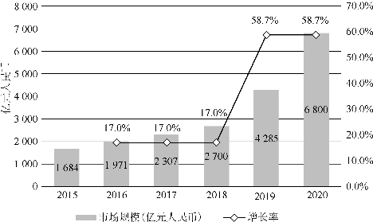

Domestically, according to statistics from the *China AI Industry Market Outlook and Investment Strategic Planning Analysis Report* released by the Forward-looking Industry Research Institute (as shown in Figure 1-2): In 2015, China's AI market scale had exceeded 10 billion RMB; in 2016, its scale reached 14.19 billion RMB, a year-on-year increase of 26.3%. As of 2017, China's AI market scale increased to 21.69 billion RMB, a year-on-year increase of 52.8%. In 2018, China's AI market scale reached 33.9 billion RMB, an increase of 56.3% over 2017, far higher than the global 17% growth level. It is predicted that in 2019 and 2020, China's AI market scale will reach 50 billion RMB and 71 billion RMB respectively. From 2015 to 2020, the compound annual growth rate of China's AI market scale is 44.5%, with broad future market prospects and vast AI "new blue oceans" awaiting development.

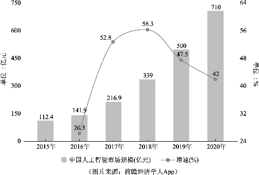

Whether it is the global AI industry or the domestic AI industry, both are currently achieving rapid expansion of overall scale against the wind. Overall, this reflects that on a global scale, the degree to which AI technology is nested in the social structure and the depth of its influence have exceeded people's original imagination.

Education is a great undertaking concerning human development and the future of the nation, and it is also an industry extremely sensitive to technological development. In this intelligent era of rapid technological development, discussing the revolutionary impact that AI technology has already brought and may bring to education is of profound significance. The future has arrived, but the future is a continuation of the present. Today, fully grasping the disruption and reshaping of education by AI technology, and proactively recognizing the new models of future intelligent education, is of a value that cannot be overstated.

# 2. Empowering Education: AI Catalyzes Educational Revolution

Revolution refers to a major transformation and adjustment of something, a leap process from quantitative change to qualitative change triggered by a series of catalytic activities. Since ancient times, whenever people discuss revolution, it is mostly related to politics. But besides political revolutions, many other fields also experience revolutions. For example, technological revolutions, industrial revolutions, agricultural revolutions, commercial revolutions, intelligent revolutions, learning revolutions, etc. The forms of revolution are rich and diverse. Regardless of the situation, the emergence of a revolution is the result of the combined action of multiple factors, encompassing four basic elements: economic foundation, contradictions and conflicts, technological innovation, and revolutionary leadership forces.

In any field, as long as things are affected by "internal and external" factors, changes of varying depths will occur. Some occur in form, while others occur in essence. The latter can be further understood as irreversible major transformations and adjustments, which we can name as a revolutionary change in that field. As the degree to which humanity enters the intelligent era deepens, correspondingly, the degree to which people are forced to be involved deepens, and at this time, people's dependence on AI technology becomes stronger, including all aspects of people's "food, clothing, housing, transportation, and use," without exception. In other words, the revolutionary impact of AI technology on humanity is multi-faceted, covering almost all fields of human life, including the education field shared in this book—the revolution of education and the future of education are closely related to AI.

Regarding educational revolutions, history has seen four occurrences. The "Four Educational Revolutions" were first proposed by British educator Eric Ashby. He believed that the first educational revolution appeared when the duty of education shifted from the family to Christian churches or Jewish synagogues; the second educational revolution was the adoption of writing as an educational tool by humans; the third educational revolution was the invention of printing; the fourth educational revolution was the application of microelectronics technology^[4]. Based on the four elements of the aforementioned revolutions, a technical interpretation of the educational revolutions that have occurred in a society with increasing economic development: the first educational revolution benefited from the emergence of professional teachers; the second benefited from the emergence of writing; the third benefited from the emergence of books; the fourth benefited from the emergence of information technology.

# 3. Questioning the Meaning: The Purpose of Educational Revolution in the Intelligent Era

# 4. Educational Revolution: The Purpose, Content, and Structure of This Book

---

**Footnotes**

[1] See original book notes for references.

[2] *2018 Global and China AI Industry Market Scale Forecast*.

[3] *China AI Industry Market Outlook and Investment Strategic Planning Analysis Report*.

[4] Eric Ashby, *The Four Educational Revolutions*.


# 3. Questioning the Significance: The Purpose of the Educational Revolution in the Intelligent Era

As Marx said: "Everything humanity strives for is related to their interests^([\[6\]](#txt001.html#footnote_content_txt001_6))." In the era of artificial intelligence, people's dedication to the reform and innovation of the education undertaking is undoubtedly closely related to their interests. From the perspective of how AI empowers education, people may easily misunderstand that the pursuit of educational reform is merely **efficiency, cost, and quality**. This greatly misinterprets our original intention—mistaking the object education serves as a **"commodity"**.

What needs to be emphasized is that AI empowering education only empowers the operational and management levels of the education undertaking. Specifically, it serves teachers in the teaching process, provides quality teaching for students, and promotes students' healthy growth and all-round development—**this is the original intention and goal of educational reform in the intelligent era**. The realization of this goal, the value brought by AI education, will concern the future of students and the entire society.

**First, promote the "return of students' subject status".** People wholeheartedly promote the development of the education undertaking, the purpose of which is to let students **"return to subject status"** in learning activities, making the cultivation of socialist builders and successors the common development goal of students and teachers. In the AI era, teachers assisted by intelligent technology can develop new courses more efficiently and better respond to students' learning needs; students assisted by AI technology can better consolidate their professional knowledge. After all, all purposes related to education will revolve around promoting the all-round development of students. According to Marx's theory of all-round human development, actively promoting the **"balanced development of the five educations" (moral, intellectual, physical, aesthetic, and labor education)**, and cultivating well-rounded new people of the era, is the mission of education in this era.

**Second, highlight the mission and significance of teachers.** Education must firmly believe that every student possesses unique skills and talents, and also firmly believe that every teacher is an **engineer of the human soul**. "**Use life to influence life, use life to shape life, use life to guide life**," education is destined to bring a different life to the educated. Only in this way can the nation's collective sense of honor, the sense of mission for national rejuvenation, and the sense of responsibility for prosperity and strength penetrate the hearts of students, embedding themselves in their marrow and souls. Educational reform needs to become a bridge and link for realizing social value and personal value; it needs to serve the transformation and development of the country, society, and individuals.

**Third, conducive to the realization of personal value and social value.** Society is a society composed of individuals; on each person rests mission and glory. We should all become independent, self-reliant strivers and contributors to the nation's prosperity and rejuvenation—"**we are all dream chasers**." The qualitative determinacy of education requires us to clearly answer the questions of "**for whom to cultivate people,** **what kind of people to cultivate,** and **how to cultivate people**." The great significance of education lies not in education itself, but in whether it truly fulfills the function and utility of **"fostering virtue through education, shaping people and souls."**

**Finally, run education that satisfies the people.** A century's plan, education is the foundation. To run education that satisfies the people, education must be placed in a position of priority development. The country must unswervingly take the road of educational innovation; relevant departments at all levels must actively carry out practical activities of educational innovation, adhering to the path of **"from practice, to practice."** On the road of educational reform, we must always adhere to the leadership of the Party, further enhance ideological understanding of educational reform, actively go deep into the masses and the groups of educated objects to do a good job in education, and solidly promote educational reform into the hearts of the people, towards students, and towards the future.

The purpose of the educational revolution in the intelligent era is to highlight the value and significance of education in the process of promoting **"the all-round development of human beings."** Draw wisdom from the advantages of AI empowering education, cast intelligent elements into the entire process of human education, endow education with specific wisdom and capabilities, and promote the occurrence of the educational revolution. At that time, the optimization and reorganization of the educational ecosystem and structure, the fulfillment of the purpose of the educational revolution in the intelligent era, its value is obvious—it is conducive to the return of students' subject status, the realization of personal and social value, highlighting the mission and significance of teachers, and overall promoting the healthy and rapid development of education. In short, the cross-integration of AI technology and education facilitates the country in better running education that satisfies the people.

# 4. Educational Revolution: The Purpose, Content, and Structure of This Book

Wei Yuan pointed out in the *Preface to the Illustrated Gazetteer of the Maritime Countries*: "**Why was this book written? It says: Written to use barbarians to attack barbarians, written to use barbarians to negotiate with barbarians, written to learn the superior techniques of barbarians to control barbarians.**" Then, before writing this book, we were also to this trend and a forward-looking prospect for the development of intelligent education.

Under the strategic guidance of the state, the intellectualization development of the education field is in full swing. Conceptual discussions on the integration of AI and education are also deeply favored by the academic community. The parallel development of AI and education has given birth to AI education. After experiencing policy guidance and market pull, the practice and application of AI education have prompted people to discuss the concept of AI education. As of now, discussions on the concept of AI education mainly exist at the application level, teaching link level, and educational structure intellectualization level.

At the application level, Xu Peng believes that the application fields of AI education are mainly concentrated in intelligent teaching systems, intelligent agents, intelligent Q&A systems, and intelligent education decision support systems ^([\[2\]](#txt002.html#footnote_content_txt002_2)). Liang Yingli believes that the application fields of AI education are mainly concentrated in intelligent tutor systems, automated assessment systems, educational games, educational robots, etc. ^([\[3\]](#txt002.html#footnote_content_txt002_3)).

At the teaching link level, Baidu Encyclopedia believes that AI education is the process of using computer technology to provide assistance, guidance, consultation, help, or decision-making for instructional designers and other teaching product developers during the instructional design and teaching product development process ^([\[4\]](#txt002.html#footnote_content_txt002_4)). The Ministry of Science and Technology of the PRC pointed out in the *Report on the Development of Innovative Applications of Intelligent Education* that AI education is based on new-generation information technologies such as deep learning, big data, and virtual reality, constructing an intelligent education environment centered on learners, running through all links of the education process **"lesson preparation-teaching-practice-examination-evaluation-management,"** realizing a new education model of more diversified, precise, and personalized talent cultivation ^([\[5\]](#txt002.html#footnote_content_txt002_5)).

At the educational structure intellectualization level, Zhong Xiaoliu et al. believe that AI education is a new type of ubiquitous, perceptive, integrated, and intelligent education ecosystem built on new-generation information technology ^([\[6\]](#txt002.html#footnote_content_txt002_6)). Xu Lifang believes that AI education refers to the intellectualization of the education and teaching process, and is the AI education and teaching ideological enlightenment for personnel engaged in education work ^([\[7\]](#txt002.html#footnote_content_txt002_7)).

Through conceptual discussion and analysis at the intellectualization levels of application, teaching links, and educational structure, the concept of AI education has gradually become clear. AI education includes two aspects: **education intellectualization and intellectualized education**. In terms of the intellectualization level of education, it mainly focuses on the intellectualization of the education process and education links, specifically manifested in various application forms and execution links of education. It aims to improve the state of existence of educators, educational media, and the educated. It is a **"bottom-up"** educational reform, involving specific application scenarios of AI technology in the education field, such as intelligent tutor systems, teaching management, teaching evaluation, educational consulting, etc. In terms of the intellectualized education level, the concept of AI education originates from **"top-down"** humanistic care and the transcendence of institutional boundaries, aiming to seek overall ideological enlightenment for education and teaching from the spiritual realm of human education, thereby bringing ecologicalization and wisdom to the entire human education system.

In summary, AI education refers to the process of social ubiquity in the technological space of intellectualized education and education intellectualization based on AI technology. From the perspective of the integration of technology and education, AI education is a composite of real education and virtual education, a new education architecture centered on the **"object of education."** The whole process and whole structure of education will achieve three-dimensional integration with intelligent technology, highlighting the true value and purpose of education, and centrally demonstrating the educational charm of the new era.

# 2. Education in the New Intelligent Era: Coexistence of Personalization and Humanization

AI education is an organic combination of technology, education, and humanities. It represents the new forms of educators, the educated, and educational media in educational activities and problems through technical means, and reflects the value and function of the core new characteristics of AI empowering education in the technological space. It allows the subject status of learners in teaching activities to return, highlighting the new connotation of **"learning to master things"** and **"learning to become a person"** in education in the new intelligent era. Further clear definition of the characteristics of AI education is an important basis for discussing the value, function, and application of AI education.

## 1. Intelligentization

Intelligentization is the general characteristic of AI education. The intelligentization characteristic of AI education refers to the tendency to actively satisfy the needs of educators and learners under the support of intelligent technology. Data, algorithms, and computing power are the core driving forces of AI education. Whether it is intelligent teacher systems, intelligent expert systems, or intelligent personalized recommendation learning systems, they are all based on intelligent modeling of massive educational big data. In the process of model generalization, the functional modules of the AI education system are continuously improved.

AI education is a functional system that rapidly mines potential value from massive educational big data. Leveraging the trial-and-error advantage of AI technology, it can improve the educational environment and enhance the quality of educational resources without affecting student learning, bringing rich emotional experiences to school teaching work.

## 2. Personalization


### Personalization

Personalization is the most important characteristic of AI education; it highlights the educational value of AI education in the practical operational phase. In the AI era, intelligent data mining, data analysis, data classification and aggregation, construction of data knowledge graphs, student data profiling, teacher AI assistants, virtual schools, and hidden curricula are all "specialties" of AI technology. AI education, through the application of AI platforms, effectively captures learners' learning record data, including learning habits, thinking patterns, subject preferences, knowledge structures, emotional tendencies, economic conditions, and other data (as shown in Figure 2-1), covering the learning preparation stage, learning process stage, and learning outcome stage. Finally, coupled with the entire historical learning data on the horizontal time axis, the learner's personal learning situation will become transparent and visible under the support of intelligent visualization technology, promoting the formation and continuous improvement of the learner's personal learning knowledge graph.

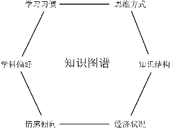

Figure 2-1 Learner Data Knowledge Graph

The personalized characteristic of AI education is highly beneficial for enhancing learners' learning enthusiasm and initiative; for teachers, it facilitates personalized teaching and refined teaching program design; for school administrators, it facilitates precise student management. The personalization of AI education relates to the construction of personalized learning for individual learners and the lifelong education system.

## 3. Humanization

In the AI era, the humanistic characteristic of education is significant. Education has always been an activity of shaping people, a purposeful activity of cultivating people. The object of education is a living individual; therefore, no matter the era, education cannot depart from humanistic development. However, comparatively speaking, the humanistic characteristic of education in the AI era is more prominent.

AI education, with the help of a series of intelligent technologies, liberates teachers from complex and repetitive teaching activities. Knowledge-based instruction in intellectual education can be handed over to the AI education system to complete. Teachers will have more time and energy to engage in "EQ" teaching work, enhance emotional resonance with students, thereby facilitating the formation of good teacher-student relationships, and facilitating the serious implementation of educational concepts such as understanding, respect, support, sincerity, sympathy, resonance, and personalization.

Liberating teachers from complex and repetitive teaching activities will place greater emphasis on "emotional investment" in education, moving people with emotion, so that students feel warmth and regard the learning space as their "home," thus forming a "family-style" organization that is warm and where everyone "loves the home" and "serves the home." In such a space, in such an atmosphere, students are more likely to accept the teacher's education^([\[8\]](#txt002.html#footnote_content_txt002_8)). Education in the AI era tends toward participation and socialization in the educational activity process, which helps improve relationships among students and enhance emotional exchange and value interaction among them.

## 4. Collaboration

Due to factors such as information barriers, data divides, interest disputes, and rights conflicts, the traditional "siloed" development model of education is more common. Communication between education departments and across departments is difficult, seriously hindering the development process of education. However, the birth of AI education has made a targeted transcendence of the drawbacks of traditional education, and based on AI technology, integrates real education and virtual education into an organic "macro-education" system. Education managers, teaching implementers, and education objects shuttle flexibly within it, featuring a high degree of collaboration.

The collaboration of AI education manifests as the synergistic development of the trinity of "education management, education decision-making, and education teaching"; it manifests as the synergistic development linking "individuals, families, schools, and society"; and it also manifests as a collaborative intelligent education innovation platform integrating "government, industry, academia, research, and application." In summary, the collaboration of AI education fundamentally manifests as human-machine collaboration; human-machine collaboration is the core characteristic of AI education.

## 5. Boundlessness

AI education is a multi-spatial ubiquitous education model, possessing both inclusivity and openness. In the intelligent education environment, the boundaries of education have broken through the campus "walls," moving toward an open education time-space of "society as school" and "life as education." Due to the development of intelligent space technology, information space gradually becomes curriculum space and teaching space, while physical space gradually becomes activity space and practice space. The entire process of educational teaching activities has broken through the limitations of time and space, moving toward a boundless existence transcending time and space; education is everywhere and always present.

# III. The Value Chain of AI Education: An Increasingly Value-Added Closed Loop

AI education is the result of AI empowering education at the technical, thinking, and structural levels. Viewed from the overall attributes of AI education, the characteristics of intelligence, personalization, humanization, collaboration, and boundlessness are significant. Viewed from the value attributes of AI education, the social value and individual value embedded in the concepts and characteristics of AI education constitute two aspects of the same whole, reflecting the general direction of AI education adapting to social development and individual development.

When discussing the value of AI education, it is necessary to first understand its meaning. The value of AI education refers to the function and significance of its existence measured by the yardstick of people or society. In other words, it is the benefit relationship of AI education to human needs. Usually speaking, people's pursuit of the value of AI education is actually the pursuit of their own value, and the entire process of AI education is actually a process of increasingly value-added^([\[9\]](#txt002.html#footnote_content_txt002_9)). This "value-added" process is precisely the process of the value chain of AI education gradually closing the loop.

The value chain of AI education (as shown in Figure 2-2) covers the total value and partial values of AI education. Total value is also called macro value, referring to the value of AI education at the entire social level. It is not limited to the description of a specific region but is a total value consideration for the entire education service object. It concerns both the empowerment of education links and the improvement of education quality, as well as the promotion of educational equity and the improvement of the overall quality of the nation. Partial value is also called micro value, which can be divided according to a specific sequence into value for students, value for teachers, and value for schools.

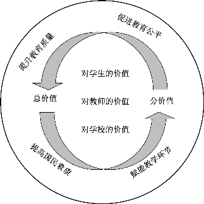

Figure 2-2 Closed Loop of AI Education Value

The transition of AI education value from partial value to total value is the result of value deepening and social extension triggered by the transfer of overall AI technical advantages to education sub-fields. Therefore, the exploration and truth-seeking of AI education value need to go through a process from micro to macro.

## (I) Micro Value of AI Education

The micro value of AI education includes value for students, value for teachers, value for families, and value for schools.

### 1. Value of AI Education for Students

The value of AI education for students is nurtured within its personalized characteristics. The key to the personalized characteristics of AI education is the specialized data profiling and visualized presentation of knowledge graphs for individual students. AI education modeling based on data is based on real-time analysis and dynamic monitoring of students' dynamic data, which can effectively, timely, and rapidly perceive and feedback students' personalized needs, including knowledge needs, emotional needs, and ability needs. The AI education system will also recommend personalized learning tasks, cultivate personalized learning methods, and formulate personalized learning plans based on students' needs data. The content will organically cover the comprehensive cultivation of students' operational skills and intelligent skills, specifically including skills and wisdom in moral, intellectual, physical, aesthetic, and labor education.

In the intelligent era of knowledge explosion, for individual students, what is most lacking is the ability to actively construct knowledge and the ability to learn creatively. The emergence of AI education will greatly reduce the pressure on individual students to master knowledge, while also facilitating students to use more free time to learn how to develop themselves, and more conducive to students developing into composite talents to better adapt to the needs of intelligent social development in the future.

### 2. Value of AI Education for Teachers

With the continuous development of AI technology, the "genetic effect" of powerful tech genes has blossomed everywhere in the education field and borne fruitful results. The value of AI education for teachers is manifested in the genetic inheritance of AI technical advantages, bringing huge changes to teacher roles, authority, and work content. Especially in the field of teachers' work, in traditional education, teachers' work is complex and repetitive work occupies a large amount of teachers' trivial time. Although exhausted, they have no choice but to do it. However, the education revolution in the AI era has changed the previous work model. Nowadays, teachers' lesson preparation, teaching, homework grading, learning situation analysis, personalized program formulation, and teaching resource mining can all be handed over to the AI education system for one-click easy resolution. Teachers will have more time and energy to devote to value judgment, emotional guidance, and ideological leadership.

For teachers, AI education not only liberates them to a certain extent but also gives them more free space for flexible handling in teaching vision and teaching methods, allowing the core value of teachers to be exerted. In the AI era, the development of intelligent education makes most of the educational work existing in traditional education gradually replaced by AI, but this replacement is not in the complete sense; rather, it replaces teachers from the complex work of knowledge imparting.

For hundreds of years, teachers' responsibilities have been "teaching" and "educating" simultaneously. However, teachers are also flesh and blood, and they also get exhausted. Practice has proved that in traditional education, the vast majority of teachers' teaching time is consumed by "teaching," while the true value of "educating" has been divided up by "scores" and "indicators." Therefore, in the past, teachers' educational value has not been fully exerted; even if exerted, it could only face a very small number of students.

The development of AI education has enabled the "educating" value orientation of teachers to be gradually realized in the rapidly developing intelligent technology. The arrival of AI education, the existence of AI expert systems, AI teachers, and AI education robots, although giving human teachers a certain professional impact and challenge, this impact is not harmful; on the contrary, it is AI reminding people in a new way that contemporary education should change the previous educational form, should return to the essence of education, and should put the educational value of "educating people" first.

The essence of education is to cultivate people, to cultivate people who meet the needs of social development and personal development. In the AI era, the work of "educating people" has finally returned to the hands of teachers, and is no longer like before, taking the social punishment system as the ultimate means of education.

The educational value of teachers in the AI era mainly takes guiding students to realize life value as the judgment standard, and promoting student growth and living out individuality as the main theme of education. In the process of education, teachers can use intelligent technology tools to discover students' traits, adopt targeted educational methods, help students explore their own advantages and values, liberate students' personalities, and let every student "become an adult through learning" in "teaching according to aptitude."

When teachers turn in educational value, the educational content facing students also undergoes huge changes, beginning to transform from the traditional "imparting knowledge" to cultivating students' structural thinking ability, innovative thinking ability, critical thinking ability, collaboration ability, ability to discover and appreciate beauty, and ability to apply theory to practice, etc. By cultivating students' series of abilities, enhance students' comprehensive ability to discover, analyze, and solve problems. At that time, students will be able to think independently, quickly acquire knowledge, perceive emotions, construct new cognition, transfer and apply knowledge in various complex environments, thereby becoming a "well-rounded person in moral, intellectual, physical, aesthetic, and labor aspects," a "complete person" in the strict sense.

From the current stage of AI education development, the intelligence level of AI education is still relatively low, insufficient to support AI teachers completely replacing human teachers in the field of "teaching," but rather serving as assistants initially. Therefore, the value of AI education for teachers is also reflected in helping human teachers achieve precise teaching by intelligently analyzing learning situations and students' personalized data.

AI education can also help human teachers improve their overall scientific research level. In the era of big data and AI, the accumulation of data provides the necessary premise for empirical research, thereby triggering a new round of research boom in the education field, further promoting the dual combination of quantitative assessment and qualitative analysis in the field of educational research, effectively helping human teachers mine more valuable data information. Today, the selection of excellent teachers has begun to favor teachers who can use AI, and even more so those who are proficient in using AI.

### 3. Value of AI Education for Families

From the family perspective, education in the AI era has its most important value embodied in the value of "companionship." Since the post-90s generation was born, the pace of the entire social life environment has become very fast. The time for parents and children to get along and accompany each other has significantly decreased. Children in the process of growth eagerly expect companionship from parents, but due to objective condition constraints, or after children enter school, the connection and companionship between them become less and less. This dilemma eventually evolves into the problem of missing family education.

However, since mankind entered the AI era, with the development of AI education, the dilemma of family education has gradually found a way out. AI education assists family education, achieved through two channels: children's family education robots and school intelligent education parent terminals.

Children's education robots enter the family, mainly accompanying children's growth and development through dialogue. On the one hand, children's education robots based on AI technology can provide necessary intelligent dialogue, interesting interaction, collaborative games, simultaneous interpretation, etc., according to children's developmental stages, allowing children who fear loneliness most to obtain warm companionship and high-quality family education at any time during growth. On the other hand, introducing AI education robots into family education can liberate parents from the work of tutoring children's homework, giving them more time and energy to care for children's physical and mental health development, and more time to accompany children.

From the perspective of the school intelligent education parent terminal, AI education actually uses AI technical means to break through the emotional isolation between students and parents caused by students entering campus. Parents can use the AI education parent terminal to more comprehensively understand students' learning dynamics, ideological tendencies, and behavioral habits, thereby promoting effective communication between parents and students. For example, iFLYTEK's Xiaoxuewang parent terminal, with its powerful data statistics and data visualization advantages, can arouse parents' active attention to their children's school life, thereby enhancing parents' emphasis on family education, and also helping parents understand their children's true needs in learning.

### 4. Value of AI Education for Schools

Schools introducing AI technology to transform and upgrade the entire education system is of great significance to the school's educational teaching activities. The most critical value lies in promoting the scientization of school management. The core of management lies in precise decision-making, and the key to precise decision-making lies in the "structural rationality" of decision-making data. The reason why AI technology can empower education is because of the solid foundation of education informatization. In April 2018, the Ministry of Education officially issued the "Education Informatization 2.0 Action Plan." The country has started a new round of strategic layout for the development of education informatization. At that time, effective improvements will be made in education data structure, education data sharing mechanisms, education data confidentiality agreements, education teaching intellectual property rights, and other aspects, bringing great convenience to the school's education teaching management.

Up to now, under the guidance of education informatization policies, schools of all levels and types across the country have gradually implemented the intelligent transformation of education on the basis of informatization. The pattern of "smart campus" is forming, and the perception ability of the school's AI education system can also be rapidly upgraded. In the near future, when AI technology covers all corners of the school, the school's management work will become very intelligent. The school's teaching management, safety management, student status management, learning situation analysis management, and other activities will all achieve intelligent control, ultimately realizing the modernization of school education management.

## (II) Macro Value of AI Education

From a macro perspective, the value of AI education concerns both the empowerment of education links and the improvement of education quality, as well as the promotion of educational equity and the improvement of the overall quality of the nation.

### 1. Empowering Education Links

AI education's most significant manifestation of its overall intelligent characteristic lies in the empowerment of education links. Various types of education, from a teaching perspective, can be summarized into generally five links: lesson preparation, teaching, assigning and grading homework, extracurricular tutoring, and academic assessment and feedback. AI technology empowering education links is actually making these "five" basic teaching links intelligent. For example, in the lesson preparation link, teachers' teaching plans, curriculum plans, courseware production, and other work can all be based on intelligent mining technology to collect relevant shared materials from major websites and databases. This not only saves production time but also gives teachers a large amount of time to perfect lesson preparation content, making the quality of lesson preparation higher and higher. Another example is the assigning and grading homework link; whether subjective or objective questions, intelligent grading can be realized. Theorem proving, intelligent learning games, solving calculus, intelligent behavior demonstration, intelligent shorthand, intelligent translation, speech synthesis, intelligent writing, etc., are all mastered.

### 2. Improving Education Quality

Education quality is a measurement indicator of educational effects, the sum of effects produced by various educational factors acting on educational objects. The amount of knowledge of the educational object is a concentrated embodiment of education quality. Education links, education methods, education management, education systems, education content, education environment, etc., are all factors that affect education quality. These factors conducive to improving student learning effects will all achieve intelligent transformation under the action of AI technology. The introduction of AI technology can effectively identify factors restricting the improvement of education quality and conduct intelligent control and regulation on them. On the basis of improving education efficiency, it promotes the "high-quality development" of education.

### 3. Promoting Educational Equity

In a congratulatory letter to the 2019 International Conference on Artificial Intelligence and Education, General Secretary Xi Jinping pointed out: "China attaches great importance to the profound impact of AI on education, actively promotes the deep integration of AI and education, promotes educational reform and innovation, gives full play to the advantages of AI, and accelerates the development of education that accompanies everyone for life, education that faces everyone equally, education that suits everyone, and more open and flexible education. China is willing to work with all countries in the world to focus on frontier issues of AI development, deeply explore ideas and measures for educational development and innovation under the conditions of rapid AI development, build consensus, deepen cooperation, expand sharing, and jointly promote the building of a community with a shared future for mankind^([\[10\]](#txt002.html#footnote_content_txt002_10))." It can be seen that AI empowering education is of great significance for promoting educational equity, and is related to the construction process of a "community with a shared future for mankind." The core idea of the educational equity value hidden in AI education is to "teach all valuable knowledge to all people." In the AI era, practices to solve educational equity problems have begun. From the transformation from "single-teacher mode" to "dual-teacher mode," and then breaking through to "multi-teacher mode," high-quality teaching courses have been provided to students across the country. The completion of the national "Three Connections and Two Platforms" construction is a typical case of AI technology promoting the fair radiation of educational resources nationwide. AI technology promotes the development of educational equity and realizes value realization.

### 4. Improving National Quality

National quality is a comprehensive concept, including many aspects, specifically divided into "three categories and eight types": three categories of quality refer to natural quality, psychological quality, and social quality; eight types of quality refer to political quality, ideological quality, moral quality, professional quality, aesthetic quality, labor quality, physical quality, and psychological quality^([\[11\]](#txt002.html#footnote_content_txt002_11)). In summary, national quality includes individual quality and collective quality. Education is the basic channel for the formation of national quality. With the continuous development of AI education, its practice and application are becoming increasingly mature, meaning that the value of AI technology in empowering education links, improving teaching quality, and promoting educational equity is greater. Overall, AI technology entering the education field will build education into an open and inclusive giant education system. A learning society will be constructed, a lifelong education system will be formed, education content will cover all aspects of national quality education, a sound personality will be shaped, and the possibility of "all-round development" of educational objects will be greatly improved. At the same time, patriotic education, collectivist education, and ethical and moral education will also be developed. Ultimately, the internal structural trend of AI education and national quality will move towards harmony, organically unifying individual quality and collective quality from the overall perspective, and national quality will be greatly improved.

## Notes

[\[1\]](#txt002.html#footnote_quote_txt002_1) Xinhuanet. State Council. China's Education Modernization 2035\[OL\]. http://www.xinhuanet.com/politics/2019-02/23/c_1124154392.htm.

[\[2\]](#txt002.html#footnote_quote_txt002_2) Xu Peng, Wang Yining. Research Status and Reflection on Domestic AI Education Application\[J\]. Modern Distance Education, 2009(05): 3-5.

[\[3\]](#txt002.html#footnote_quote_txt002_3) Liang Yingli, Liu Chen. Analysis of Current Status, Typical Characteristics and Development Trends of AI Education Application\[J\]. China Educational Technology, 2018(03): 24-30.

[\[4\]](#txt002.html#footnote_quote_txt002_4) Baidu Encyclopedia. AI+\[OL\]. https://baike.baidu.com/item/AI%2B/19622390?fromtitle=%E4%BA%BA%E5%B7%A5%E6%99%BA%E8%83%BD%2B&fromid=23708226&fr=aladdin.

[\[5\]](#txt002.html#footnote_quote_txt002_5) Ministry of Science and Technology of the PRC. Report on the Development of Intelligent Education Innovation Applications\[R\]. http://president-wxstage.mofaxiao.com/share.

[\[6\]](#txt002.html#footnote_quote_txt002_6) Zhong Xiaoliu, Song Shuqiang, Hu Min, et al. Construction of Smart Education Ecology in the Perspective of the Fourth Education Revolution\[J\]. Journal of Distance Education, 2015(4): 34-40.

[\[7\]](#txt002.html#footnote_quote_txt002_7) Xu Lifang, Mo Hongwei, Li Jin, et al. Research on Intelligent Education and Educational Intelligence Technology\[J\]. Education Modernization, 2018, 5(03): 116-117+119.


# Chapter 3 The Unspeakable Predicament: The Narrative of Traditional Education

## References

[8] Ding Yanjie. "Human-Oriented" Humanistic Education [J]. Forum on Industry and Technology, 2009, 8(05): 179-180.

[9] Jiuyu Xiang. Values of Ideological and Political Education and People [J]. Teaching and Research, 2002(12): 55-59.

[10] Xinhuanet. Xi Jinping Special Reports. Xi Jinping Sends Congratulatory Letter to International Conference on Artificial Intelligence and Education. http://www.xinhuanet.com/politics/leaders/2019-05/16/c_1124502111.htm.

[11] Baidu Baike. National Quality [OL]. (2019-9-26) [2019-10-9] https://baike.baidu.com/item/%E5%9B%BD%E6%B0%91%E7%B4%A0%E8%B4%A8/8589150?fr=aladdin.

## Shortage of Educational Resources: Prominent Issues of Educational Equity

**"Teaching Students in Accordance with Their Aptitude": A Principle Stranded in Theory**

**Teacher-Centered Approach: Causing the "Empty Seats, Absent Minds" Phenomenon in Education**

**Rapid Knowledge Update: Education Disconnected from Social Development**

**The "Needham Question" and "Qian Xuesen's Question": Rethinking Our Education**

Where there are problems, there are needs; problems are unmet needs. Today, traditional education, represented by exam-oriented education, has fallen into "disrepute" amid the clamor for quality-oriented education. However, traditional education has neither directly transformed into quality-oriented education nor announced its exit from the historical stage. Instead, it has formed an educational structure in reality where "quality-oriented education is supplementary, exam-oriented education is primary." It is evident that the actual force of traditional education still dominates the educational orientation of the entire society and has not stagnated due to the development of quality-oriented education. But it is undeniable that in the process of developing quality-oriented education, the drawbacks of traditional education have become increasingly prominent.

### 1. Shortage of Educational Resources: Prominent Issues of Educational Equity

The so-called shortage of educational resources refers to the insufficient supply in the acquisition of resources and enjoyment of rights by the objects of education, or the realistic gap in the perceived abundance of resources when comparing supply and demand, due to limitations imposed by the resource conditions of the subjects and objects of education. The so-called issue of educational equity refers to the problem of unbalanced resource allocation in "static" or "dynamic" fields, including issues of equality of opportunity, process, and outcome, caused by specific resistances (such as social resistance, family resistance, and policy resistance) encountered by the objects of education in the fair possession of educational opportunities.

Shortage of educational resources and issues of educational equity seem unrelated, but in reality, when the problem of resource shortage develops into a regional issue, the problem of educational equity arises accordingly. Equity issues evolving from regional disparities ultimately lead to uneven resource allocation among educational individuals. Generally speaking, educational equity issues directly manifest as equality of educational opportunity, and the wealth gap is the direct cause leading to inequality of educational opportunity. Therefore, the essence of educational equity issues is the problem of uneven resource allocation caused by the wealth gap of the educational objects themselves.

Since the Reform and Opening Up, China's urbanization process has advanced rapidly, with cities and rural areas developing quickly. However, some social problems have emerged alongside, among which the urban-rural gap has gradually attracted social attention. For a long time in the past, the dream of building a great industrial power once led the whole society to sacrifice the countryside and the environment, focusing on developing urban industry. In this process, while urban economic development achieved remarkable results, it also left "sequelae" for social development. The urban-rural gap in education is a result of these "sequelae." The development of urban education and rural education were originally two lines that would intersect; moving towards "integrated urban-rural education" is the ideal goal, but due to various limiting factors (such as resources, policies, culture, etc.), the gap between them has widened.

China's urban-rural education gap manifests as unbalanced development: in relatively developed large and medium-sized cities, educational resources are rich and diverse, with a large gap compared to suburbs; in the slower-developing western regions, the urban-rural education gap is relatively small; but if coastal urban education is compared with rural education in western mountainous areas, the gap is even more severe.

Today, in the poor mountainous areas of the west, the focus of education is still on intellectual development; "literacy" is the most basic constituent element of educational activities. In contrast, in the eastern coastal cities, educational development serves the all-round development of the person; while cultivating students' intellect, more emphasis is placed on the comprehensive development of students' "moral, intellectual, physical, aesthetic, and labor" qualities. It is not difficult to see from this that in recent years' National College Entrance Examinations (Gaokao), there is a reason why students from poor mountainous areas account for a very small proportion of the total enrollment in key universities like "Tsinghua, Peking, Fudan, Jiao Tong" [1].

The urban-rural education gap deserves further deep reflection. In the development environment of the urban-rural dual structure, a series of educational problems continue to extend, and the subtle gaps can be felt from family, school, to society. In terms of the family level, comparing rural families with urban families, their concepts of educating children are obviously different. Even if the degree of importance attached is the same, rural families are limited by factors such as fewer cultural and educational resources, low parental education levels (intergenerational transmission of knowledge), and narrow parental social networks, making it difficult to compete with urban families. Moreover, the most prone to the disconnect between learning and practice are rural families, because the mainstream culture of society is in the towns; the alienation between the living environment and the learning environment easily causes students' maladjustment. Of course, even among different families within the city, such problems exist, but the relative gap is smaller.

In terms of the school and social levels, the inequality of urban-rural educational resources is also prominent. Looking solely at educational hardware facilities, the educational hardware facilities in eastern coastal cities are several grades better than rural educational infrastructure, whether comparing cities with rural areas, or eastern, central, and western regions. In cities where industrialization and informatization develop complementarily, the improvement and upgrading of educational infrastructure are rapid. This is related to the city's educational demand, supported by economy and technology, guided by the market, and the city's educational infrastructure quickly reached the national modernization level. However, the situation is different in rural and remote western areas. Even today, students in information technology classes still need to share a computer among several people; many experimental classes still remain at the theoretical level, and platforms to support students in doing experiments have not yet been built.

The problem of educational resource shortage is, at its root, a historical legacy of the urban-rural dual structure. Its adverse social reactions will lead to the emergence of educational unfairness. In this process, groups possessing "favorable timing, geographical advantage, and human harmony" can preferentially enjoy limited educational resources. This enjoyment of limited resources will eventually evolve into unfair competition in education, deviating to a certain extent from the original intention and mission of education.

It can be seen that the causes of educational resource shortage and educational unfairness are diverse, but mainly due to regional differences in economic development. Other issues such as biased regional resource allocation, insufficient national fiscal investment, and unreasonable educational policies only cause regional educational resource shortages to a certain extent. For this reason, all sectors of society have been exploring relief approaches for the shortage of educational resources, adopting multiple measures such as universal compulsory education, teaching support in mountainous areas, charitable donations, and building schools. But to this day, the problem of educational resource shortage remains severe.

Therefore, it requires all people from all walks of life who care about education to re-examine the existence of this problem. Is there truly a new path that can further resolve this inequality in resources and opportunities, even if it is just a small step forward, its value is nationwide benefit.

### 2. "Teaching Students in Accordance with Their Aptitude": A Principle Stranded in Theory

"Teaching students in accordance with their aptitude" (Yincai Shijiao) is a very core teaching principle, referring to the teacher conducting teaching based on the individual characteristics of students in the process of educating them. There are no two identical leaves under the sun, and no two identical people in the world. Every student is unique; a social group composed of countless unique individuals will be colorful and richly diverse. Even in the same family environment, even twins, their development will have significant differences. From the perspective of pedagogy, heredity, environment, school education, and subjective initiative are the four major factors influencing individual student development. Because each student is affected by different elements and intensities, they show obvious individualized differences in knowledge, emotion, ability, personality, interest, moral cultivation, willpower, and other aspects.

In other words, adopting the same educational method to proceed "mechanically," ignoring the differences in each student's learning ability, can largely only be regarded as completing the educational task; in reality, it has not entered the students' hearts, nor has it realized the value and purpose of education. Therefore, if the "teaching students in accordance with their aptitude" can be truly realized, it is of extraordinary significance to students and a remarkable achievement for teachers.

As early as 2,500 years ago, Confucius had already recognized the importance of teaching students in accordance with their aptitude and put it into educational practice. Looking at it now, what a great pioneering work it is, with astonishing penetrating power through history. People often say education is a specialized profession, where universality and particularity coexist. It is called universal because its existence shares commonality with tens of thousands of other professions; it can be understood as a means of making a living, or a means of teaching people to make a living. It is called special because the object it serves is special; it is a job of "teaching people how to be human." Everyone is a member of society, so theoretically, educational workers cannot selectively give up on students, but need to selectively educate each student.

Regarding teaching students in accordance with their aptitude, in *The Analects* - *Book 11: Advanced Disciples*, there is a story that reflects this vividly. One day, after Confucius finished class and returned to the "rest room," while the student Gongxi Hua was pouring water for Confucius, Zilu (Zhong You) and Ran You arrived separately and asked Confucius the exact same question, but Confucius gave different answers. Gongxi Hua was very puzzled and asked the teacher why. The specific details are as follows:

> Zilu asked: "Should one act immediately upon hearing (the Way)?" The Master said: "With your father and elder brothers still alive, how dare you act immediately upon hearing it?"
>
> Ran You asked: "Should one act immediately upon hearing (the Way)?" The Master said: "Act immediately upon hearing it."
>
> Gongxi Hua said: "Zilu asked 'Should one act immediately upon hearing?' and you said 'With your father and elder brothers still alive'; Ran You asked 'Should one act immediately upon hearing?' and you said 'Act immediately upon hearing.' I am confused; may I ask why?" The Master said: "Ran You is retiring and hesitant, so I urge him forward; Zilu has the energy of two men, so I hold him back."

Analyzing carefully, the dialogue between Confucius and the three disciples Zilu, Ran You, and Gongxi Hua is full of flashes of wisdom. For the same question, the answers obtained were different. In the contrast between Gongxi Hua's doubt and Confucius's wise explanation, it reflects that Confucius was very familiar with his students; knowing their strengths and advantages, he also knew their weaknesses and shortcomings, thus he could teach them in accordance with their aptitude. After hearing the explanation, the student Gongxi Hua suddenly understood.

Changing the context: if the "two students" had asked Gongxi Hua this question at that time, the answer would probably have difficulty reflecting the wisdom of teaching students in accordance with their aptitude. Therefore, reflecting on the implementation context of teaching students in accordance with their aptitude, it is inevitably fraught with difficulties. With the development of the education undertaking to this day, the education system, teaching methods, teaching scenarios, and teaching methods have become somewhat fixed. The school, as the main place of education, shows obvious insufficient adaptability. The continuous changes in students' ages and learning abilities present a characteristic of fluidity in the development process. From kindergarten, primary school, junior high, secondary vocational school, high school, junior college, vocational college, university, to graduate school, the teachers and environments encountered at each stage are different. Education presents characteristics of scale and fixation. Teachers find it difficult to balance teaching quality and teaching efficiency simultaneously, and can only use "scores" as the most direct evaluation indicator, pursuing the rise of collective scores. For the individual, it is difficult to achieve personalized care. In essence, this is due to the conflict between fluidity and fixation.

The school teaching scenario is basically the large-class teaching system. The relationship between teachers and students is "one-to-many." Time is tight, tasks are heavy. Apart from completing teaching tasks, there is rarely time to pay attention to each student's special situation. Coupled with the very obvious and highly variable individualized differences among students, this further increases the difficulty for teachers to implement teaching students in accordance with their aptitude. Over the long span of education, the relationship between teachers and students also shows instability. Teachers naturally change at different teaching stages, because it is unrealistic to have a middle school teacher teach graduate students. Looking back at the educational context of Confucius teaching students in accordance with their aptitude: "Confucius had three thousand disciples, seventy-two of whom were accomplished," and most of these students followed Confucius for life. This is a very stable teacher-student relationship, so the teacher could naturally easily grasp the students' personalities and tempers, but today's environment does not allow it.

Regarding teaching students in accordance with their aptitude itself, due to factors such as teacher literacy, exam-oriented education indicators, and the unequal status of teachers and students, the implementation process is complicated. The teacher's judgment of the student's "cai" (aptitude/material) is limited to the teacher's experience and imagination. Rigidly teaching students in accordance with their aptitude, students easily become "the person the teacher wants to cultivate." But such a person is not an innovative person, nor the person the student wants to become. Because the implication of teaching students in accordance with their aptitude contains the unequal relationship between students and teachers. The teacher is the pre-awakened one, the master of knowledge and truth; truth needs to be taught by the teacher to the student. Transcending teaching students in accordance with their aptitude recognizes that students are gradually developing; even if the teacher is older and more experienced, the teacher is also developing, and the teacher does not completely master the truth [2].

Thus, the implementation of teaching students in accordance with their aptitude seems too difficult, because it involves too many influencing factors, fundamentally relating to the comprehensive consideration of educational theory, educational methods, educational means, and student reality. If the unity of theory and practice in historical and realistic logic cannot be achieved, then the implementation of teaching students in accordance with their aptitude will not conform to the laws of students' physical and mental development and the laws of implementing education on students.

It cannot be denied that over the past many years, the education model of exam-oriented education, class teaching system, score-only theory, and "following the class" has cultivated countless professional talents for China's economic take-off and made huge contributions. At least as of now, it seems to be more beneficial than harmful. But if in the new intelligent era, we can reduce the harm of the "drawbacks" to a lower level, and our schools and teachers can strive to achieve teaching students in accordance with their aptitude with the help of some technical means and methods, then why don't we do this in advance?

The essence of "teaching students in accordance with their aptitude" is "knowing people well to teach them well, letting everyone exert their talents." Although its forms have varied in the long river of history, evolving to today, we can call it personalized education, customized education, flexible education, etc. Despite myriad changes, the principle remains the same. Teaching students in accordance with their aptitude mainly emphasizes that education should vary from student to student, "prescribing the right medicine for the illness." It focuses on guiding students to go out, and return to their own hearts, to explore and discover that different self in a specific context. Only those who find their true selves can reconcile with their own world, reach a consensus with the outside world, form critical and innovative spirits in the pursuit, and thus move towards a better future.

### 3. Teacher-Centered Approach: Causing the "Empty Seats, Absent Minds" Phenomenon in Education

A teacher-centered approach is a significant feature of traditional education, with specific historical origins. China is a large agricultural country. The traditional agricultural society was an "acquaintance society" that "valued agriculture and suppressed commerce," and the idea of "being content with one's native land and reluctant to move" was deeply rooted in people's hearts. The acquaintance society relied on blood and geographical ties to maintain relationships among group members; interpersonal interactions did not require much professional background knowledge. Educational activities among people mostly revolved around agricultural production experience, such as mastering climate changes of the four seasons, imparting skills of "spring plowing, summer planting, autumn harvest, winter storage," etc., constituting the basic content of educational activities in agricultural society.

If defined in a narrow sense of education, in the traditional agricultural society, most people had not received education, and those who truly received education were only the upper class or scholarly families. In such an era background, generally speaking, people held awe for those wisdoms that restricted them but which they could not deeply understand. Therefore, from the perspective of the common people, the awe for cultural knowledge stemmed precisely from their deep restriction by upper-class intellectuals, giving rise to a thought—as long as one can master knowledge, one can also become an upper-class person. With the development of social productivity, social production labor became increasingly complex. On the premise of the continuous expansion of the national ruling team, the channels for the lower society to leap to the upper society gradually opened up. Seeking fame and fortune through reading, changing social strata, was a supreme strategy.

Since one wanted to change one's destiny, one first had to apprentice to a master to learn a skill; "those who understand without a teacher" were few and far between. Thus, the teacher, as a professional representative, stepped onto the historical stage. "The teacher is one who transmits the Way, imparts knowledge, and resolves doubts." The teacher is the one who understands the Way, the one with extensive knowledge, the wise man who is well-educated and reasonable. Comparatively speaking, they have more angles to view the world than the ignorant. So, it is only natural that they receive special esteem and respect from society. This is the source of the traditional "dignity of the teacher's way," and also the reason for the early culture of "teacher-centered" formation in educational activities. During this period, the students' ignorance indeed required a "teacher-centered" approach to facilitate their learning of more knowledge and wisdom. In the early and middle stages of the formation of this educational feature, "teacher-centered" indeed played an important role in the cultivation of social talents.

However, with the continuous development of education and the continuous improvement of educational levels, the concept of "teacher-centered" has continuously attracted criticism and has been proposed as an object of reform in recent years' radical educational reform thoughts. It calls for re-recognizing this problem and letting students return to the teaching activities—calling for "student-centered."

"Teacher-centered" reflects an authority culture, including teacher authority, knowledge authority, textbook authority, etc. In a specific sequence, it originates from people's respect and awe for knowledge, leading to the recognition of textbook authority, which then evolves into teacher authority.

Therefore, the criticism of teacher authority in the education circle in recent years, in essence, is the criticism of knowledge authority. Due to the diversity of knowledge acquisition channels, the difficulty of knowledge value realization, or the influence of some "uselessness of reading" thoughts, the authority of knowledge and the situation of teachers' monopoly on knowledge have been gradually broken, and naturally, the authority of teachers has begun to be questioned.

At a deeper level, the teacher-centered approach easily causes the "empty seats, absent minds" phenomenon in education (Ren Xue Kong Chang)—this is the fundamental reason it suffers criticism. As for teacher authority, its value is self-evident, but when its existence begins to hinder student development, making students dislike the classroom, the phenomenon of "students physically present but minds absent" forms. In such a classroom, students may have begun to sprout the idea of "muddling through, getting the diploma and leaving." As for exploring and constructing new knowledge, that has nothing to do with them. This may be the greatest misfortune existing in educational activities.

When people's educational thoughts gradually develop and mature, they increasingly understand that the value of education lies in guiding students to conduct self-education. In the process of self-education, students hope to construct a person capable of self-reflection and self-growth with an independent personality. Therefore, a view opposing "teacher-centered," the "student-centered" view, has received deep attention. At this time, the teacher must inevitably undergo some role transformation, needing to reappear before students with a new image. Of course, this is difficult to achieve in a short time; it requires a period of adaptation.

In summary, under the new era background, teacher-centered, textbook-centered, students can only passively accept knowledge, and the social nerves are averse to it. "Knowledge-only education" and "score-only education" will only further obliterate students' creativity and critical thinking. Cultivating students with "independent spirit and free thought" lacks scientific basis in this model.

Historically, the educational selection function of "excelling in learning leads to officialdom" required students to master rigid historical classics to be valued by the government. But looking at now, society's requirements for students are not this, but focus on examining a student's ability to discover, analyze, and solve problems in a specific environment. Therefore, today's educational reform must care about the return of students' subject status, correct the unequal teacher-student relationship, let students become the subject of learning, and let teachers become the planners, designers, and guides of teaching activities.

Change is the goal; how to change is the means. In the intelligent era, how to conduct educational reform to keep pace with the times is an issue that needs further exploration.

### 4. Rapid Knowledge Update: Education Disconnected from Social Development

We live in an era of knowledge explosion. The speed of knowledge update is astonishing, the boundaries of knowledge continue to expand outward, the structure of knowledge continues to undergo new fission, and the half-life of knowledge is shortening day by day.

The half-life of knowledge refers to the process of change of a new knowledge from useful to useless, from brand new to obsolete, within a certain period. It reflects the effect of the value of certain knowledge decreasing with the passage of time. The Law of Knowledge Depreciation believes that if you do not study for a year, 80% of all the knowledge you possess will depreciate. More data shows that "updating knowledge and ideas at a rate of 6%–10% per year is necessary to adapt to the needs of future society," which is not alarmist [3].

Research shows that after humanity entered the 19th century, the speed of knowledge update doubled every 50 years; entering the early 20th century, it doubled every 10 years; entering the late 1980s, it doubled every 3 years; entering the early 21st century, it doubled every year, or even faster... The era of knowledge explosion is also an era of knowledge economy. Those who can quickly keep up with the speed of knowledge update can better adapt to social development and changes. From the above comparison, it can be known that the knowledge accumulation of the past hundreds of years may not be as much as the accumulation in just one year or a few months at present. Knowledge is updating and iterating every day; everyone is a creator, sharer, and beneficiary of knowledge.

*The Book of Rites: The Great Learning* says: "If you can renew yourself one day, renew yourself every day, and renew yourself again the next day." This means that for one's own knowledge, if one can update it for one day, one should keep updating it daily, and on the basis of updating, continue to update. The ancients were like this; in today's intelligent era, people should do so even more.

Generally speaking, the speed of knowledge update is the most critical knowledge element in the education system. Then, can our education system quickly adapt to this fast-paced change? This question is very worthy of deep thought, because it directly relates to the quality and effect of education.

The fast-paced culture of society—fast food, takeout, express delivery, coffee shops, Didi express cars, etc.—all reflect the "fast attribute," "fast life," and "fast culture" of the social rhythm. The formation of the fast culture atmosphere is the result of everyone jointly accelerating the rhythm of life, work, and study. Therefore, to respond to the "fast culture," the education system must also keep up with the rhythm, but from the current critical attitudes of people, it is not difficult to know that the progress of reform seems unsatisfactory.

Society is a complex giant system. Its complexity determines the diversity and systematicity of talent cultivation. Unilateral knowledge education far from meets this requirement. Those who have truly worked hard on all-round development will inevitably have more opportunities to win first in social competition with others. The reason is simple: under the same conditions, they can create more social value and personal value in a shorter time. This should be the goal that "fast-paced" educational reform aims to achieve.


### Deep-seated Reasons for the Disconnection Between Social Knowledge Updates and Education

Social knowledge updates rapidly, while the education system updates slowly, causing a disconnect between education and social development. This ultimately requires serious reflection from educators. From the perspective of educational development, it has always been a microcosm of social development and indeed has a certain lag in the time dimension, because education is constrained by the level of social productive forces and the socio-economic and political systems. Therefore, at its core, this disconnect in education is actually a manifestation in the educational environment of the "conflict between agricultural and industrial civilizations, and the conflict between industrial and intelligent civilizations." Its causes are extremely complex, encompassing issues of the relationship between theory and practice, harmony between humans and nature, and equality among humans.

#### Limitations of School Education

School education is always inseparable from the word "school." Compared to society, schools are more like ivory towers. The so-called concepts of "learning, knowing, and doing" are mostly only suitable for "schools." School education emphasizes knowledge education and theoretical education, but practical courses are scarce. This is a major reason for the disconnect between theory and practice in the educational environment. Students acquire knowledge, but how to apply knowledge contextually and how to innovate by combining acquired knowledge is a frequently overlooked issue. For example, many universities currently clearly suffer from the pain point of a disconnect between educational content and corporate talent needs, and between educational content and social talent needs. In particular, students who purely indulge in theoretical learning in school, due to a lack of social practice experience, find it difficult to adapt to social requirements after graduation.

#### Imperfections in the Educational Curriculum System

Furthermore, the current educational curriculum system is not yet sound. The "people-oriented" educational value concept advocated by traditional education focuses on cultivating students' "IQ." As for students' "EQ," it has not been well cultivated in schools. Naturally, the focus of school curricula is set around cultivating students' "IQ." Originally, in addition to courses such as "Politics, History, Geography, Physics, Chemistry, Biology, Chinese, Math, English," the educational curriculum should also include personality education, spiritual education, life meaning education, social skills education, family values education, marriage education, social relations education, ethical and moral education, and wealth concept education of "seeking wealth with principles and virtue." But the reality is not so. The existing curriculum system does not view students as a whole, as individuals with sound personalities, but rather as objects to be dissected and reformed.

#### Challenges of Teacher Professionalism and Teaching Resources

Regarding the "disconnect," we must also discuss teachers' professional competence, the screening of teaching resources, and students' learning abilities. The rapid development of science and technology gives rise to rapidly changing social demands, requiring students' knowledge structures to be updated in strict accordance with social standards; this is the only way to help overcome the "disconnect" problem. But in fact, action is extremely difficult. In the intelligent era, many teachers are long separated from society outside the school; their own teaching thinking and content are easily restricted by the school environment. Confined by such limitations, these teachers naturally find it difficult to cultivate outstanding students. Comrade Deng Xiaoping once pointed out: "Whether a school can cultivate qualified talents for socialist construction, cultivate laborers with socialist consciousness and culture who are well-developed morally, intellectually, and physically, the key lies in the teachers^[\[4\]](#txt003.html#footnote_content_txt003_4)." The fact is exactly so; a good teacher can indeed produce good students. This is why the "four-have good teacher" (having ideals, moral integrity, solid knowledge, and a loving heart) is advocated today.

In addition, in terms of educational resources, there are also great screening difficulties. The compilation of textbooks alone is extremely time-consuming and laborious. From compilation to publication, and then to revision and selection as teaching materials, a very long time is required. But during this period, much of the textbook content for many courses has already become outdated. Consequently, teachers need to spend a lot of time and energy in class correcting and searching for the latest relevant information.

#### Erosion of Students' Learning Abilities

Finally, students' learning abilities are eroded, making them unable to keep pace with the times. Especially when vast amounts of knowledge aggregate, factors such as uneven information quality, intersecting data, fragmented knowledge, disciplinary barriers, and the negative value of intelligent products greatly affect students' learning enthusiasm and initiative. Take smartphones as an example; the relationship between smartphones and students' learning abilities is worthy of deep reflection. In the era of rapid intelligent technology development, smartphone functions are "dazzling and diverse," and students are deeply immersed in them, which has a significant impact on their learning. More importantly, when phones are associated with students, people actively associate them with "playing games" rather than learning. It can be seen that in the intelligent era, while intelligent elements embedded in educational activities bring convenience, they also consume students' learning energy and weaken their learning abilities, urgently requiring correct value guidance.

If one day, the update speed of educational knowledge catches up with the pace of the times, and school education and social education are no longer seriously disconnected, what would society be like? What would students be like? Such a future is full of charm, constantly attracting us to explore the path of future education together in the new intelligent era.

## Five, "The Needham Question" and "The Qian Xuesen Question": Rethinking Our Education

In the 1930s, the famous British scholar Joseph Needham, while researching the history of Chinese science and technology, proposed the "Needham Question" in his monumental work *Science and Civilisation in China*. Once raised, the question sparked intense discussion worldwide. In 2005, Premier Wen Jiabao visited the famous scientist Qian Xuesen, who asked: "Why are our schools always unable to cultivate outstanding talents?" This question from Qian was termed the "Qian Xuesen Question," which also triggered widespread social debate.

Whether it is the "Needham Question" or the "Qian Xuesen Question," although their perspectives differ, both involve issues of science and technology, education, and talent cultivation in China since modern times. The huge social resonance triggered by these questions stems, on the one hand, from the social influence of the two scholars, and on the other hand, because these two questions precisely hit the vital points of China's science and technology, education, and talent cultivation. Therefore, it is only natural that they evoke strong resonance across society.

A close examination of these two questions reveals that their cores both relate to the issue of talent scarcity. Tracing back to the essence, the most relevant field is still education. A century's plan hinges on education; without good education, it is impossible to cultivate high-quality talents, and the country's "hard power" and "soft power" will be affected. Talent is the primary resource; national development relies on talent, scientific and technological development relies on talent, economic and social development relies on talent, and talent cultivation relies on education. Therefore, the "Needham Question" essentially asks: "Why did no top-tier scientific and technological talents emerge in modern China?"

Regarding the "Needham Question," Needham provided some answers in his voluminous *Science and Civilisation in China*, which can be roughly summarized into three points: First, Chinese society was an agricultural society, overly emphasizing experience and utility; Second, China lacked a worldview conducive to the growth of science; Third, the imperial examination system stifled the Chinese people's strong interest in exploring the mysteries of nature.

As for the "Qian Xuesen Question," although Qian did not give his own answer, his question remains in the hearts of the people nationwide. Countless people's pursuit and answers to this question, the keen attention of numerous academic groups, and years of contemplation by national educators will all form part of the unique insights into this question.

Currently, there are many research results in this area, and theoretical thinking is quite complete. But overall, people are still mainly standing on the ideal level. In the practical level, execution and action are insufficient. Criticism combined with practice is the only criticism considered more valuable.

Ideals are beautiful, the future is bright, but the road is tortuous. For these two world-class problems—the "Needham Question" and the "Qian Xuesen Question"—what we expect is that in future education, these two questions will completely become history!

### Nobel Prize Data Reflecting the Current State of Education

Returning to the field of education, the key to talent cultivation lies in education, and the basic focus of education is in schools. School education is the synonym for narrow-sense education, but it fundamentally reflects a country's educational level. So, how high is the development level of our education? We can know the answer from a set of statistical data on Nobel Prize awards.

According to statistics from the top 30 universities with the most Nobel laureates globally^[\[5\]](#txt003.html#footnote_content_txt003_5), Harvard University in the US has won a total of 158 Nobel Prizes, firmly ranking first in the world. The University of Cambridge in the UK has won 118, firmly ranking second. The third, fourth, and fifth places are the University of California, Berkeley (107), the University of Chicago (98), and Columbia University (96) in the US. From the ranking of the top 30 universities globally by Nobel laureates, universities in the US, UK, and Germany have scientific research strength and research levels at the world forefront (as shown in Table 3-1). Notably, according to the latest data from the Ministry of Education, as of June 15, 2019, the Ministry announced a total of 2,956 higher education institutions nationwide, but not a single university made the list.

**Table 3-1 Top 30 Universities with the Most Nobel Laureates Globally (1901—2018, only top 30 shown)**

```
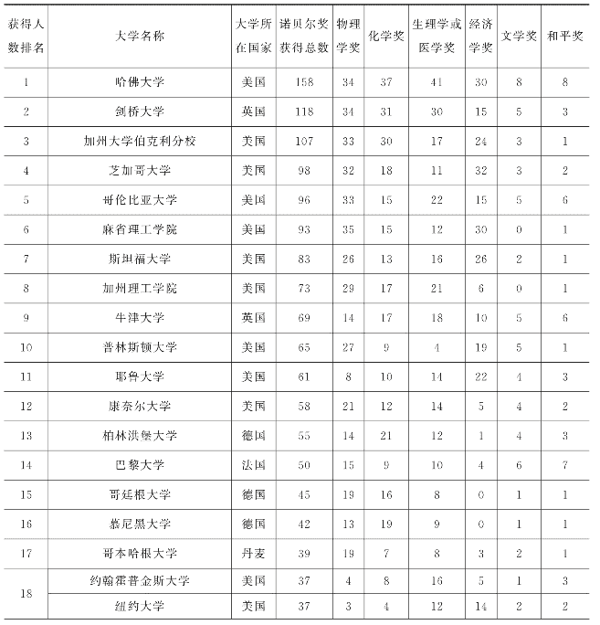
```

Continued Table

```
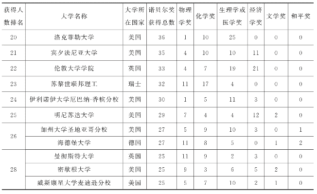
```

According to statistics on the top 5 countries by number of Nobel laureates per category^[\[6\]](#txt003.html#footnote_content_txt003_6), the US ranks first with an absolute advantage. Other Nobel laureates come from the UK, Germany, France, Russia, Japan, Israel, Sweden, Spain, Switzerland, the Netherlands, Norway, etc. It is evident that China does not appear in the world's top five for Nobel laureates.

The data shown in Figure 3-1 reflects from one aspect that the gap between China and the world is not a tiny margin, but a huge distance. From the perspective of world population distribution, logically, China's Nobel Prize data should be among the world's top. But from modern times to the present, the above phenomenon is indeed surprising. The birth of the "Needham Question" and the "Qian Xuesen Question" in China must be related to this "anomaly."

Viewing Chinese education from a global perspective, rethinking our education is imperative. In the intelligent era, China's education should change this status quo. World-class innovative talents, great scientists, great philosophers, etc., should also take root and sprout in China's soil, and be able to grow vigorously with the support of the new era's educational environment.

In the new intelligent era, our education should rise to the challenge and catch up.

## Notes

[\[1\]](#txt003.html#footnote_quote_txt003_1) "Qing-Bei-Fu-Jiao": Tsinghua University, Peking University, Fudan University, Shanghai Jiao Tong University.

[\[2\]](#txt003.html#footnote_quote_txt003_2) Lu Xiaodong. Beyond Teaching Students in Accordance with Their Aptitude[J]. Educational Academic Monthly, 2014(10): 3-17.

[\[3\]](#txt003.html#footnote_quote_txt003_3) Baidu Encyclopedia. Knowledge Obsolescence Law[OL] [2019-08-03] https://baike.baidu.com/item/%E7%9F%A5%E8%AF%86%E6%8A%98%E6%97%A7%E5%AE%9A%E5%BE%8B/6870457?fr=aladdin.

[\[4\]](#txt003.html#footnote_quote_txt003_4) Deng Xiaoping. Selected Works of Deng Xiaoping (Vol. 2)[M]. Beijing: People's Publishing House, 1983: 236.

[\[5\]](#txt003.html#footnote_quote_txt003_5) Personal Library. Yu Ze Wei Shan Yu Yan. Top 30 Universities with the Most Nobel Laureates Globally[OL]. http://www.360doc.com/content/19/0321/04/19446_823043081.shtml.

[\[6\]](#txt003.html#footnote_quote_txt003_6) Liu Sitao. Jin Jili. 2018 World University Nobel Prize Count Ranking[OL]. (2018-10-16)[2019-9-13]. https://www.jjl.cn/article/142266.html.

# Chapter Four Transcending Time and Space: New Ways of Educational Presence

## One, Freely Disposable Learning Time: Extending the Possibilities of Students' Free Development

Time is the form of human existence. Marx believed: "Time is actually the positive existence of man; it is not only the measure of human life, but also the space for human development^[\[1\]](#txt004.html#footnote_content_txt004_1)." In other words, time is represented in two dimensions: the measure of life and the space for human development. Human history, present, and future will all be governed by time without exception; all human activities will be closely related to it; human work, study, and life will leave deep traces in the flow of time, thereby shaping a three-dimensional human image in the accumulation of history.

Time has one-dimensionality and irreversibility. In past human impressions, flowing time is the unrepeatable repetition of "yesterday and today," and no one can rise above it. Therefore, facing time, humans have only two choices: race against time, or be "led by the nose" by time. Human educational and learning activities are no exception; they are all constrained by time. Without the existence of time, the possibility of development cannot be discussed.

Time is an important element constituting learning activities. Effective use of learning time has a significant impact on learning outcomes. In traditional education, the center of education is the classroom, the teacher, and the textbook. Fixed class times, fixed teachers, fixed schedules, fixed exercise times, etc., mean students' freedom is also fixed. In this way, every activity of the school reflects the closed characteristics of the educational model as a whole, making students a part of "fixity." Students have little free learning time and generally follow established study plans. In this state, students' effective use of learning time is passive. Therefore, in the learning process, students are prone to wasting study time, low learning efficiency, improper time management, and short effective study time. But in the new intelligent era, these problems are being broken through and transcended.

### Retentivity of Learning Time Scale

Intelligent era education possesses retentivity on the learning time scale. Retentivity on the learning time scale refers to the trace-keeping and datafication of the learning process, which can fill the gap in the field of learning data in traditional education. For example, when students study on video websites, they can give timely online feedback in the comment section below the video, or express their learning thoughts and opinions in the bullet comments (danmaku). All these data accumulated during the learning process can ultimately be historically restored and visually integrated through the application of AI data mining technology, achieving the sealing of learning time in its previous form. In the field of deep learning, "Long Short-Term Memory network technology" and "Deep Recursive Network technology" happen to effectively assist pattern recognition, allowing data information of different scales to flow on different time dimensions. This will provide necessary help for students' later management of learning time. Even more, it can directly reflect students' learning patterns or learning drawbacks, thereby assisting students in developing good study habits and improving their autonomous learning abilities.

### Aggregation of Learning Time Scale

Aggregation on the learning time scale refers to the aggregation of multi-spatial learning activities occurring on the same frequency time scale. Relying on artificial neural network technology, it can promote the organic connection of ubiquitous learning activities in multiple spaces, realize the integration of scattered learning achievements in multi-dimensional time, and save students' learning time overall. Theoretically, everyone's learning time is the same. Within the same time range, if the learning activities of all learners are regarded as a giant network, then each person's learning activity is only a time node. The collection of every time node in the learning space constitutes the learning time of all humanity. All learning achievements produced in this process are ultimately fed back to each time node in the form of intelligent sharing. Therefore, the aggregation of time lays the foundation for ideological resonance and conditions for sharing learning achievements for each student's learning.

From the perspective of learning results, since sharing is a prerequisite, if students want to achieve the goal of saving learning time, they must seek connection technologies for learning resources from the entire learning time stream. At this point, one must mention the online learning system based on AI technology. Multiple learners study simultaneously in this system. The platform-based aggregation of learning achievements and data modeling of knowledge graphs, the platform-based sharing of data and interactive communication of the learning process, can effectively use the advantage of the group to promote the realization of the goal of individuals quickly obtaining more comprehensive learning resources. This undoubtedly saves each student a lot of time and energy spent on finding learning resources. This is exactly as Marx pointed out: "The free development of each is the condition for the free development of all^[\[2\]](#txt004.html#footnote_content_txt004_2)." Only when a sufficient number of learners participate in the intelligent online learning system will the benefit to its users be high.

AI-era education possesses retentivity and aggregation characteristics on the learning time scale. The existence of retentivity is based on the powerful storage and computing capabilities of intelligent technology in the educational field. It comprehensively and multi-dimensionally records and computes the interaction processes between teachers and students, students and websites, students and students, and students and intelligent machines. In traditional education, as students' learning time passes, time that could no longer be possessed can now be effectively converted into educational big data with the help of AI technology, thereby filling the gap in the "past tense" of student learning on the time axis.

The existence of aggregation is based on the empowerment of intelligent technology on learning efficiency. In the conversion of intelligent machine advantages, it effectively integrates the work of teachers' lesson preparation, teaching, evaluation, learning situation analysis, and teaching material collection; students' learning, examination, review, and acquisition of extended materials; school management, school culture construction, and other aspects. With the continuous transfer of intelligent technology advantages into the educational field, people are transforming the "necessary trivial time" existing in traditional educational activities into "freely disposable learning time," providing more free time for "student-centered" learning activities.

In AI-era education, both teachers' "teaching" and students' "learning" require time. With the help of AI technology, the gap in the "past tense" of educational activities on the time axis can be effectively filled, which is conducive to promoting the organic integration of "historical education, current education, and future education" on the time dimension. The empowerment of education by AI technology in efficiency is essentially a process of time control over specific educational activities and phenomena that have occurred. It is an intelligent choice from "trivial" to "necessary," and students' active learning state is brewing within it. Students' learning initiative and positivity will usher in change.

At what moment will students truly feel the existence of time? Naturally, it is the moment when students realize the value of learning time. From the student's perspective, free time means the space for free development, and the student's development gains another possibility. Marx pointed out in *Economic Manuscripts (1857—1858)*: "Free time" refers to the time "that man can freely dispose of," it is man's "leisure time," the time "used for higher activities," the time "in which man can directly develop his various essential forces, the time 'for the full development of the individual'^[[3]](#txt004.html#footnote_content_txt004_3)." Today, with the help of intelligent technology, the easy access to learning resources, the improvement of learning efficiency, the mastery of learning patterns, and the revelation of learning drawbacks are all liberating students from the "veiled" learning space, returning more "time that can be directly used to develop one's own essential forces" to students. Therefore, the existence of time can only give students the perception of its significance at the moment of loss, and only at the moment of freely acquiring time can students perceive its shaping value.

In summary, in the AI era, there exists freely disposable learning time, which can extend the possibilities of students' free development. For a student, the existence of freely disposable learning time is of extraordinary significance. The acquisition of free time can effectively promote the full development of students. The space for students' ability development, spiritual development, and social relations will be extended until students thereby achieve free development.

## Two, Coexistence of Multi-dimensional Educational Spaces: Spatial Shift from "Separation" to "Aggregation"

Space is a structural form composed of basic elements such as length, width, and height in a certain way. It is a physical quantity measuring the positional difference of things. "Size" and "virtuality/reality" are its direct manifestations. There are many types of space, including physical space, virtual space, ideological space, activity space, etc. Space is the realistic condition for human survival, the carrier of all human activities, and the application carrier of all human technologies. The separation of space will inevitably lead to the termination of human activities and applications in practice.

Educational space refers to a structural form jointly composed of educational activities and educational phenomena. It is the practical combination of space and education. The intellectualization of educational space is the exploratory application of AI technology in educational space under the background of the intelligent era. Its application forms include three dimensions: understanding educational space, transforming educational space, and creating educational space. In the intelligent era, the purpose of AI technology empowering educational space is to realize the coexistence and integrated development of multi-dimensional educational spaces. The fusion of AI technology and space concepts gives birth to new space science, space technology, and space applications, jointly constituting the framework and blueprint of "technology + space," which has important significance for shaping intelligent educational spaces.


### The Fifth Human-Machine Relationship: AI Teachers and Human Teachers

#### Intelligent Empowerment: The Transformation of the Teacher's Role

#### Preparing for the Future: Will Human Teachers Be Replaced?

#### Human-Machine Co-teaching: From Opposition to Unity

### I. Intelligent Empowerment: The Transformation of the Teacher's Role

Since the beginning of the 21st century, Artificial Intelligence (AI) has continuously disrupted various fields with its tremendous energy, constantly changing people's understanding of the "traditional." In the field of education, no one anticipated that the emergence of AI would challenge the existence of human teachers. However, facts have proven that AI has indeed brought "surprises," or perhaps "panic," to human teachers. In August 2018, Sophia, the world's first AI citizen, was hired as the first AI teacher in human history, marking the official entry of AI into the education industry. The emergence of AI teachers has triggered a rethinking of human-machine conflict—will human teachers be replaced by AI teachers? In the AI era, what role should human teachers play, and how should they coexist with AI teachers? These are all new issues worthy of in-depth exploration in the new intelligent era.

## III. Disintegration of Spatiotemporal Constraints: Intelligent Construction of Borderless Education

Throughout the long history of human education development, the evolution of education has been closely related to changes in social needs. With the development of the new generation of AI technology, people in the new environment have gradually realized that traditional education confined to specific time and space—such as fixed teaching scenarios, venues, environments, educators, methods, and concepts—has built a thick "wall" in the hearts of students, significantly hindering and restricting the generation of students' social adaptability, resulting in students' inability to adapt well to the needs of social development. Therefore, social development continuously drives people to explore new spaces for educational development from within time and space. The yearning for the "boundless" and the breaking and transcending of educational boundaries hold significant value for expanding students' "psychological boundaries" and "cognitive boundaries."

AI empowers education; educational time shifts from "necessary fragmented time" to "freely disposable learning time," and educational space shifts from "single-dimensional space" to the coexistence of "multi-dimensional educational spaces," providing new spatiotemporal opportunities for educational development. It can be affirmed that, conditioned on students possessing freely disposable learning time, it is easy to facilitate the integration of individual students with multi-dimensional educational spaces, thereby transcending the limitations of traditional educational time and space on student development, breaking the realistic boundaries of education, and opening the door to borderless education.

In 1998, Australian scholar Stuart Cunningham, in his monograph *New Media and Borderless Education*, first introduced "Borderless Education" as an academic term into the researchers' vision. With the continuous development of education, the spaces and boundaries of education have gradually blurred. The diversified participation of educational subjects and the parallel coexistence of multiple educational forms have continuously dismantled the solidified "barriers" of traditional education.

Borderless education refers to the borderless occurrence of educational activities and phenomena, specifically including borderless educational time, borderless educational space, borderless teaching content, borderless teaching forms, borderless educational objects, borderless interdisciplinary integration, and borderless teaching classrooms, etc. The birth of borderless education has proposed a revolutionary roadmap for transformation within the entire education system. It takes the traditional closed educational space as a "formidable opponent," breaking the boundaries of traditional education at the spiritual level and subverting the "orthodox authority" of traditional education at the practical level. Therefore, the concept of borderless education has been highly favored by both the educational and business communities during its development. A batch of borderless education academic achievements, consulting companies, technology companies, and training companies have emerged, promoting the socialized development of borderless education.

In the intelligent era, borderless education is the product of the breaking of boundaries between family education, school education, and social education, and is closely related to people's lives. In borderless education, education is everywhere. Supported by intelligent supporting technologies, the development of borderless education presents three important characteristics: intelligence, extensive coverage, and immersion. Education and life permeate each other; as the saying goes: "Education is life," "Life is education." Borderless education, whether in real space or virtual space, is the return of the human "authentic self" in socialization scenarios. In the new "borderless" architecture, the deep-seated contradictions latent in traditional education are gradually recognized and resolved, and traditional education and modernized education continue to move toward unity in historical evolution. Further promoting the rational social development of borderless education, the intelligent construction of a "connected yet boundless" grand education ecosystem is an important measure for realizing the presence of borderless education.

### Borderless Educational Objects

Education in the intelligent era is intelligent education based on the Internet of Things, Big Data, Image Recognition, Natural Language Processing, and Speech Recognition. In the intelligent construction of a borderless education ecosystem, educators should first study the "borderless" characteristics of education. On the basis of clarifying the connection methods between different educational objects and the intelligent education system, they should achieve effective docking between the personalized needs of different educational objects and the personalized supply of the intelligent education system. The borderless attribute of educational objects is mainly manifested in the diversity of educational objects. To achieve "borderless educational objects," it is also necessary to build a coverage system for educational objects facing children, adolescents, middle-aged people, and the elderly throughout the entire life cycle, realizing the integrated education of "family, school, and community" at the technical level.

### Borderless Educational Resources

To achieve borderless educational resources, one can start from the concept of sharing. Supported by intelligent security technologies, promote cross-domain sharing of educational resource data. Establish relevant interest coordination mechanisms to coordinate and resolve interest disputes arising from educational data sovereignty, providing a realistic premise for the sharing of "multi-source heterogeneous" educational resource data. Finally, it is necessary to optimize educational resource banks and strengthen the construction of basic educational resource banks. The teaching resource database is the material basis for the construction of the resource sharing mechanism and the organic composition of borderless educational resources. Database construction should be based on the fluidity of curriculum resources, realizing the free flow of human resources through information construction methods such as expert databases, which is of great significance for realizing borderless education.

### Borderless Educational Venues

For people, the greatest convenience of borderless education lies in the fact that the "desire to learn" can realize "presence." Therefore, to use intelligent technology to construct a borderless education ecosystem, first, it is necessary to actively carry out popularization and publicity education activities on borderless educational venues, transforming students' understanding of educational venues so that when learning needs arise, students can find corresponding learning venues in the shortest time. Second, based on the concept of intelligent and precise connection of "intelligent learning venues," combined with personalized intelligent push service technology, match the presence status of educational venues with the presence status of students in real-time. Students can appropriately select corresponding learning systems according to their own learning space environment. Third, promote the reform of the educational system. Currently, the barriers of traditional educational venues have not completely disappeared. It is necessary to promote "spatial turn" through "system reform," breaking the boundary restrictions of educational venues in terms of cultural concepts, customs, and social norms, and achieving the institutionalized transformation of "borderless educational venues."

The disintegration of spatiotemporal constraints and the intelligent construction of borderless education constitute a major "educational spatiotemporal" revolution triggered by intelligent technology in the field of education. It pushes the development of borderless education to the extreme and also pushes the development of people's psychological boundaries to the extreme. In such an educational spatiotemporal context, the meaning of education gradually becomes prominent. Learning freedom and learning rights are gradually recognized in education. "Presence of education" moves toward "presence of learning." Borderless learning is arriving; the "desire to learn" can realize "presence."

## IV. Borderless Learning: "Desire to Learn" Realizes "Presence"

In the intelligent era, under the conditions of multi-dimensional empowerment by intelligent technology, the "ubiquitous multi-space" attribute of education is significantly enhanced. The boundaries of education are gradually blurred and broken through. Traditional education gradually undergoes a paradigm shift—fields such as educational objects, educational resources, educational venues, educational forms, and educational content will all witness a battle of educational reform between "bounded" and "borderless." Borderless education is striding toward us, and borderless learning is gestating within it.

With the development and finalization of borderless education systems, educational organizations, and educational management systems, the accompanying "borderless learning" has gradually entered people's vision. Supported by intelligent technologies such as Big Data, the Internet of Things, Image Recognition, Speech Recognition, Natural Language Processing, Digital Twins, and Edge Computing, borderless learning has emerged independently from borderless education. The concept of borderless learning was first proposed by the British educational community. It refers to utilizing all learning platforms to provide learners with a learning environment where they can engage in learning activities at any location, any time, using any learning opportunities available at hand. Specifically, borderless learning includes borderless learning content, borderless learning methods, borderless learning fields, borderless learning resources, etc.

With the continuous expansion of the connotation and extension of borderless learning, a paradigm shift has occurred from "classroom everywhere" to "learning everywhere." Borderless learning shifts the focus from educators to educational objects and places them at the center of research on educational activities. It further advocates a learning form where anyone (Anyone) can learn any content (Any Content) in any form (Any Format) at any time (Anytime) and any place (Anywhere), thereby making personalized, customized education oriented toward every individual possible.

Borderless learning is the socialized extension of borderless education from the students' standpoint, an excellent opportunity for educators to implement teaching students in accordance with their aptitude, and a "universal victory" for students in their struggle for the initiative in learning. According to the concept of borderless learning, since the student learning environment is no longer limited by factors such as learning time, location, content, and methods, learning activities and phenomena become "ubiquitous" and "omnipresent." Borderless learning means learning is everywhere, possessing three core characteristics: trans-spatiotemporal, human-machine integration, and personalization.

### Trans-spatiotemporal Characteristic of Borderless Learning

The superiority of intelligent technology and its new shaping value, hand in hand with the development trend of student learning forms toward free learning forms that transcend spatiotemporal constraints, enable students to rely on intelligent learning terminals, smart wearable devices (AR/VR, etc.), and intelligent learning platforms to timely and effectively acquire learning resources across different time spans and spatial spans. They conduct learning and knowledge construction and integrate into them with a new learner identity. Through the use of intelligent terminal devices, they achieve a trinity of cross-border integration of "history—reality—future." Time and space, as the realistic carriers of learning activities and phenomena, their transcendence means the return of the learner's "marginal" status. The ubiquitous multi-spatiotemporal learning form highlights the "borderless" attribute of borderless learning.

### Human-Machine Integration Characteristic of Borderless Learning

The intelligent era is an era where technology empowers "all things." The intelligent characteristics of all things derive the intelligent characteristics of learning carriers. Before the arrival of the borderless learning society, the separation of learning carriers (intelligent learning machines) from learners, and the existence of barriers between humans and learning tools, limited the efficiency and channels for students to acquire learning resources. However, with the socialization and implementation of the borderless learning concept, the human learning process is mainly a process of interaction between humans and intelligent learning devices. From the student's perspective, intelligent learning machines have become an important component of student learning activities. The integration of the carrier's borderlessness, the borderlessness of the value carried by the learning machine, and the borderlessness of student learning determines the existence of the human-machine integration characteristic of borderless learning.

### Personalized Characteristic of Borderless Learning

The origin of borderless learning essentially stems from the personalized appeal of people's differentiated needs at the learning level. In the intelligent era, the intelligent and socialized borderless learning form can effectively respond to students' personalized learning needs based on relevant intelligent technologies. With the maturity and integration of technologies such as intelligent data mining, intelligent feature extraction, intelligent recommendation algorithms, and intelligent precision pattern recognition, the intelligent borderless learning ecosystem has gradually formed within the construction of the borderless education system. At that time, the borderless learning system will follow the personalized development needs of students, centering on the personalized development of students, demonstrating the charm of personalized customized learning in the intelligent era.

In the intelligent era, the transcendence of educational spatiotemporal boundaries welcomes the borderless development of education and learning. The personalized, trans-spatiotemporal, and human-machine collaborative characteristics of borderless learning push borderless education and borderless learning to the extreme of development—education is everywhere, classrooms are everywhere, learning is everywhere. In the "ubiquitous" education and learning environment, the objective conditions for learning have been met—"learning resources are extremely rich, learning time is extremely free, learning venues are visible everywhere."

From a broad socio-historical background, as the degree of social technologization continues to deepen, social division of labor has begun to shift continuously from "refinement" to "integration." Social requirements for talent competency and literacy continue to rise. The overall talent demand trend shows a shift from "skilled workers" to "composite talents." Literacies such as data literacy, information literacy, and AI literacy must all be possessed. Against such an era background, individuals situated within it need to maintain an enterprising attitude and action towards learning at all times. Therefore, in the intelligent era, the satisfaction of the objective conditions of education and learning has laid an objective foundation for the learning of the vast majority of learners. The subjective willingness of learners, under the edification of social culture, should pay full attention to their own development, rather than being enslaved by technology.

The intelligent era is an era of borderless education and learning. The passive status of learners is changed, and their subject status returns. At the same time, learners must also bear corresponding responsibilities. In a rapidly changing era, they must be responsible for their own future development and actively shoulder the major mission of "knowing oneself, developing oneself, transforming oneself." In the intelligent era, the unity of the subjective and objective aspects of learning makes "learning possible whenever one wants to learn." As long as students truly begin to think about themselves, the "presence" of learning will occur; as long as students want to learn, they can realize the presence of learning.

## References

[1] Central Compilation and Translation Bureau. *Marx Engels Collected Works* (Vol. 47) [M]. Beijing: People's Publishing House, 1979: 532.

[2] Central Compilation and Translation Bureau. *Marx Engels Selected Works* (Vol. 1) [M]. Beijing: People's Publishing House, 1995: 294.

[3] Central Compilation and Translation Bureau. *Marx Engels Collected Works* (Vol. 46) (Part 1) [M]. Beijing: People's Publishing House, 1980: 221-226.

[4] China Academy of Space Technology. Xi Jinping Promotes Comprehensive Development of Space Science, Space Technology, and Space Applications [OL]. [2016-06-01] http://www.cast.cn/Item/Show.asp?m=1&d=4472.

[5] Shanghai Observer. AI Empowers Future Space: How Great is the Imagination of Intelligent Space Industrialization? [OL]. [2018-11-07] https://www.jfdaily.com/news/detail?id=115061.

[6] Wu Tinglin. Boundary Dissolution and Multi-party Cooperation: Path Selection for Resource Allocation in Higher Vocational Education [J]. *Jiangsu Higher Education*, 2018(01): 104-107.

[7] Changchun Education Online. Yishiyan Galaxy's Borderless Education: Creating Infinite Possibilities for Children's Future! [OL]. (2018-11-25) http://www.sohu.com/a/277700567_700972.

[8] Gong Le, Chen Shuo. Construction of Higher Education Resource Sharing Mechanism from the Perspective of Borderless Education Theory [J]. *Chinese Adult Education*, 2017(17): 23-25.

[9] Jianshu. Interdisciplinary? STEAM? Perhaps You Need to Understand Borderless Learning First [EB/OL]. [2018-10-27]. https://www.jianshu.com/p/94417eab2fec.

[10] Xun Yuan. Vision of Higher Education Globalization: From Borderless Education to Borderless Learning [J]. *Electro-education Research*, 2019, 40(05): 32-39.


## Evolution and Development of Teacher Roles in the Intelligent Era

The teacher role represents the expectations and requirements of society regarding teachers' capabilities and status; it is a concentrated manifestation of teacher identity. Because teachers' labor possesses characteristics such as complexity, creativity, long-term impact, and exemplarity, the enactment of teacher roles carries multiple attributes. Good teacher roles hold significant importance for the growth and development of students.

The evolution and development of teacher roles are deeply imprinted with the marks of the times. From a deeper perspective, the teacher's role is bestowed by society; it is a re-manifestation of social expectations and requirements within the teacher's identity. Therefore, a good teacher role must be one that integrates with the overall educational environment and is inextricably linked to student development. Consequently, the evaluation of teacher roles must be measured within a specific historical context, rendering the distinction between "traditional" and "modern" meaningless. However, history is an organic whole; the division of history into specific time-space segments inevitably has limitations. The spatiotemporal evolution of teacher roles—"historical legacies" and "disconnection from the times"—arouses our concern for the "traditional."

With the continuous development of the intelligent era, the anachronism of traditional teacher roles has intensified. In the intelligent era, educational development presents characteristics of intelligence and boundlessness. Educational activities and issues in the fields of educational resources, methods, content, and evaluation will all become intelligent and boundless, bringing tremendous impact to the entire human education system. Naturally, teacher roles adapted to traditional educational models will face corresponding challenges. The traditional teacher role, people's initial impression of which is "imparting knowledge, teaching skills, and resolving doubts" (传道授业解惑), retains its value even today.

People's understanding of the "Dao" (Way/Truth) in "imparting the Dao" is a microcosm of the traditional teacher role. In the past, people believed that the "Dao" meant principles and knowledge, and the teacher's role was to explain knowledge and principles to students and supervise the rigid completion of learning tasks. In the teaching process, students were viewed by teachers as "students" or "learners to be perfected," conceptually forming an unequal status between teachers and students, with teachers becoming controllers rather than participants in the traditional classroom. This not only made students passive recipients of knowledge in teaching activities but also reduced them to objects of knowledge and principle instillation, hindering the process of students' individualized development and restricting the cultivation of critical and creative thinking abilities.

Education is an activity that cultivates people; it should focus on developing students' abilities to discover, pose, and solve problems. However, in the process of traditional teacher role enactment, "teachers pose problems, students solve teachers' problems" became the main content of teacher-student interaction. In the AI era, social problems are innumerable, and students' problem awareness is constantly increasing. Merely learning to solve problems posed by teachers makes it difficult for students to form independent thinking abilities, particularly the abilities for self-questioning and self-seeking of truth. From this perspective, the AI-era classroom cannot merely be a place where teachers propose a series of problems for students to solve; rather, it requires teachers to guide students to pose their own problems and then solve them, because posing a problem is more important than solving it^([\[1\]](#txt005.html#footnote_content_txt005_1)).

In the new intelligent era, the drawbacks of traditional teacher roles are increasingly manifest. In this state, teacher role images such as "gardener," "engineer," and "candle" gradually transform, and teacher roles begin to show a new return—a return to the "ordinary" role. In the AI era, the evolution and development of teacher roles, based on the inheritance of excellent traditional roles, respond to society's new demands and expectations for teachers. Correspondingly, a major shift in teacher roles has emerged as the times require.

In the process of empowering education, intelligent technology liberates educators and educational administrators from complex educational activities, such as assigning homework, grading homework, setting exam questions, and semester evaluations. All these activities will, with the support of intelligent technology, greatly save teachers' time and energy, giving them more time and space for exploratory teaching work. Today, in the intelligent social environment, "co-learners," "resource integrators," "teachers of fishing methods" (those who teach how to learn), and "personalized instructional planners" are becoming the latest synonyms for teacher roles.

### Co-learner

In the AI era, the return of the teacher role from "sage" to "ordinary person" enables the effective establishment of an equal relationship between teachers and students. As Paulo stated: "The most surprising consequence of the technological revolution is its challenge to the authority of experts. Because it can break through any man-made constraints^([\[2\]](#txt005.html#footnote_content_txt005_2))." That is to say, the fifth educational revolution triggered by AI technology directly impacts the authority of traditional teachers. The traditional teacher authority as the controller of "knowledge" and "principles" gradually transforms, and teachers and students begin to move toward a new model of cooperative learning, with teachers appearing in teaching situations as co-learners. Teachers become guides and interactors in cooperative learning. In the traditional "one-way instillation" teaching situation, given the explosive growth of knowledge and the enhanced fluidity of teaching tasks, the "one-to-many" relationship between teachers and students indirectly increases the teaching burden on teachers. Undeniably, in exploring new knowledge in the new era, an individual teacher's strength cannot compare with the collective learning wisdom of the student group. Therefore, in the AI era, to maximize the realization of educational goals, teachers must integrate themselves into the student group, learn together with students, understand students' needs, grasp students' characteristics, learn students' social languages, and accompany students in constructing new cognition.

### Resource Integrator

In AI-era education, the construction of intelligent education system platforms provides convenient channels for teachers and students to access educational resources. Traditional teachers, when conducting teaching activities, mainly used textbooks as teaching resources; other supplementary materials basically did not require teachers to integrate them themselves but were purchased directly according to the established syllabus. Therefore, the teacher's role as a resource integrator was not prominent. However, in the AI era, due to the integration of educational big data, educational resources present "4V" characteristics (Volume, Velocity, Variety, Veracity), so much traditional curriculum and textbook content has become obviously outdated. Coupled with the needs of the times for students, teachers must handle the relationship between textbooks and new curriculum resources well, and comprehensively use intelligent technology to explore diversified educational resources to meet the practical needs of society and students. With the continuous emergence of diversified educational resources, educational resource big data grows daily. Under such era conditions, teachers urgently need to cultivate their own resource integration capabilities in order to quickly excavate educational resources beneficial to student growth from the "mixed bag" of educational resources. Thus, the role of the teacher as a resource integrator in the intelligent era is forged.

### Teacher of Fishing Methods (Empowerer)

With the continuous development of the intelligent society, the phenomenon of cross-disciplinary integration is becoming increasingly common. Humanities and natural sciences penetrate each other, and massive amounts of knowledge pour into the education field, undergoing new iterations and updates in an extremely short time. As the saying goes: "Give a man a fish and you feed him for a day; teach a man to fish and you feed him for a lifetime." In other words, teaching students learning methods is more meaningful than simply letting them master existing theoretical knowledge in textbooks, because only those who master scientific learning methods suitable for themselves can adapt to a rapidly changing society through continuous learning. Therefore, when a contradiction arises between students' learning and knowledge iteration, teachers need to "take the lead," act as guides in learning, guide students starting from learning methods, and help students improve their learning abilities, rather than letting students exhaust themselves "cramming" new knowledge. In the intelligent era, the teacher's role is the person who teaches students *how* to learn—the true "teacher of fishing methods."

### Personalized Instructional Planner

Since ancient times, the concept of personalized teaching (teaching students in accordance with their aptitude) has been deeply rooted in people's hearts, but constrained by realistic conditions, true personalized teaching has not been realized. However, with the continuous development of new-generation technologies such as the Internet of Things, big data, and artificial intelligence, teaching platforms supported by emerging technologies have emerged. On this basis, students' learning status data will achieve visualization, and students' learning patterns and development patterns will be clear at a glance. In this case, if teachers want to understand an individual student's learning situation, they only need to open the corresponding data platform on a mobile terminal to view the student's personalized learning status data at any time. Based on this, the formulation of teachers' teaching plans can, on the original basis, execute two sets of teaching plans: one is a public teaching plan for all students, and the other is a personalized teaching plan for individual students relying on the intelligent learning platform. In the future, with the continuous transformation of educational concepts, the "facing all" teacher role begins to fade, while the "facing the individual" teacher role gradually takes center stage on the historical stage, becoming the main component of the teacher role.

AI empowers human teachers; emerging roles such as co-learner, resource integrator, teacher of fishing methods, and personalized instructional planner converge on human teachers, enriching and developing teacher roles unprecedentedly. As teacher roles continue to enrich, people's understanding of "imparting knowledge, teaching skills, and resolving doubts" deepens, entering the true connotation of "imparting the Dao" as spoken of by Han Yu. Han Yu said in "On Teachers": "Those who receive the book and practice its sentences and readings are not what I call transmitting the Dao and resolving doubts." In the AI era, the enactment of teacher roles is by no means the simple understanding of lecturing "knowledge" and imparting "principles" as traditionally understood, but rather, with the support of intelligent technology, teachers' comprehensive recognition and mastery of educational laws, returning to a firm grasp of the "Dao."

The enrichment and development of teacher roles in the AI era hold significant significance for establishing "teacher authority," improving "teacher-student relationships," and promoting the comprehensive development of students. Jaspers believed there are two types of authority: one is inner authority, the other is outer authority. Inner authority mainly comes from the power of personality and spirit, while outer authority mainly relies on power^([\[3\]](#txt005.html#footnote_content_txt005_3)). The evolution of teacher roles in intelligent education is precisely a trajectory of combined inner and outer authority, a transformation of teacher authority from "outer authority" to "inner authority." In this transformation process, students may not even perceive the existence of teacher authority. Because the authority accompanying the teacher's professional literacy ultimately transfers from the educator to the educatee, manifested by the student's disciplinary literacy representing the teacher's authority, thereby breaking the students' dependence on teachers caused by information asymmetry in traditional education. The teacher-student relationship achieves equality in this "transformation" of authority.

The enrichment and development of teacher roles help promote student development. The transformation of teacher roles is an inevitable product of adapting to the development of the times, and also a gradual victory of the educational philosophy that focuses on student development. In the new intelligent era, promoting the comprehensive development of students is the top priority, and fostering virtue through education is the fundamental task of education in the new era. The transformation of teacher roles precisely adapts to the requirements of educational purposes and tasks, rhythmically conforming to the development laws of the new intelligent era, gradually changing traditional teacher roles, making teachers and students "blend together" and "knead into one," thereby giving greater play to the teacher's exemplary leading role and setting a model for students' healthy growth and comprehensive development. Therefore, the transformation of teacher roles achieves equality in teacher-student relationships through the "transformation" of authority, then facilitates the integration of teachers and students, and ultimately promotes the healthy growth and comprehensive development of students.

### 2. Preparing for a Rainy Day: Will Human Teachers Be Replaced?

With the continuous development of the Internet, big data, and artificial intelligence, systems formed by technological integration have begun to mature, making the emergence of AI teachers possible. Historically, it was difficult for people to imagine robots becoming teachers, let alone imagining their existence threatening the jobs of human teachers. However, in the intelligent era, those past "impossibilities" of imagination have turned from "unthought of" into reality.

The advent of AI teachers can be traced back to the birth of "Expert Systems." An expert system is an intelligent computer program system containing a large amount of knowledge and experience at the level of domain experts, capable of using human experts' knowledge and problem-solving methods to handle problems in that field. Expert systems are essentially storage systems for knowledge and experience; massive knowledge and rich human practical experience gathered in intelligent computer systems constituted the earliest expert systems. When the system is running, any visitor accessing the system will receive a specific answer, or methods and strategies to solve the problem. Therefore, as a branch of AI technology, the development of "expert systems" not only demonstrates the trend of AI theory "landing in application" but also reflects the "unmanned" and "intelligent" trends in the teaching profession.

The fundamental driving force behind the birth of AI teachers lies in the inherent limitations of human beings themselves. In the process of manufacturing and using tools, humans, dominated by their own "inertia," naturally have the desire and emotional tendency to rely on tools; the application of AI technology in the field of education is no exception.

The birth of AI teachers stems on one hand from the maturity of technological development, and on the other from human "inertia." The maturity of intelligent technology is the foundation for AI teachers to stand up, but human "inertia," or the inherent limitations of human beings, has become the historical root and powerful force driving the birth of AI teachers, compelling people to continuously use intelligent technology to endow intelligent machines with the professional literacy and capabilities of human teachers.

In August 2018, Sophia, the world's first AI robot with human citizenship, was hired as an AI teacher by the global leading online education group iTutor Group. Thus, Sophia became the first AI teacher in human history. iTutor Group's hiring of the AI robot Sophia was not sudden. According to news from Yiou Network in late February 2018, as early as the "New Era, New Education, Create the Future" conference in Shanghai in 2018, iTutor Group had already reached a strategic cooperation agreement with the AI robot Sophia. To date, Sophia can basically undertake online teaching tasks and handle some relatively complex educational and teaching problems. On the one hand, leveraging its powerful memory capacity, it can provide personalized teaching services for students in a targeted manner, reaching the level of a human teaching assistant overall; on the other hand, appearing in human form, it can better communicate and interact with students, playing an important role in accompanying student growth.

The hiring of an AI robot (citizen) as a teacher sparked heated social discussion. When the AI Sophia appeared before people in the identity of a teacher, while people celebrated, they also worried about the future and fate of human teachers: Will AI teachers replace human teachers? Under such an era crisis, what preparations should human teachers make to avoid being replaced by AI teachers? The impact of AI robots on various human professions possesses an inherent subversive power; while people ponder the replacement of teachers, people in other fields are also pondering this question.

In October 2017, the British Broadcasting Corporation (BBC), based on the data system of Cambridge University researchers Michael Osborne and Carl Frey, analyzed the probability of 365 global professions being eliminated in future society. The specific data is shown in Table 5-1^([\[4\]](#txt005.html#footnote_content_txt005_4)). From the data in the table, the top five professions most likely to be eliminated by AI robots in the future are: telemarketers (99.0% probability of elimination), typists (98.5%), accountants (97.6%), insurance agents (97.0%), and bank clerks (96.8%), followed by government clerks, switchboard operators, receptionists, customer service, HR, real estate agents, chefs, etc.

According to BBC statistics, the replacement of human professions by AI robots will penetrate all areas of human life. Israeli writer Yuval Noah Harari believes that the future division of labor will become increasingly specialized, and human society will give birth to a class unprecedented in history that is useless to both the economy and the military—the "useless class"^([\[5\]](#txt005.html#footnote_content_txt005_5)). However, returning to the field of education, we cannot help but ask: Will human teachers really be reduced to the "useless class"? Will they really be completely replaced by AI teachers?

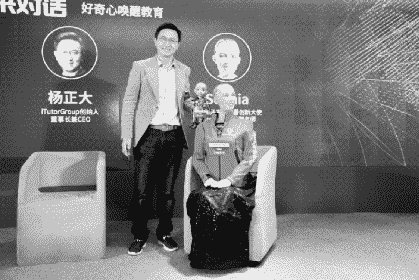

Figure 5-1 iTutor Group Founder, Chairman and CEO Yang Zhengda with the World's First AI Teacher Sophia^([\[6\]](#txt005.html#footnote_content_txt005_6))

Table 5-1 Probability of Various Professions Being Eliminated in the Future①

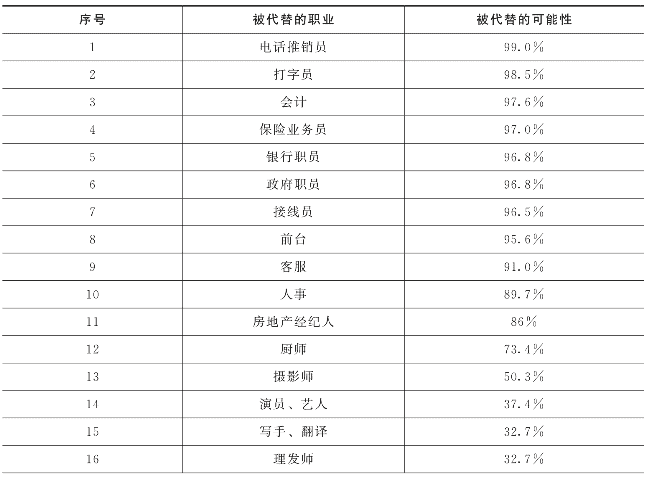

Continued Table

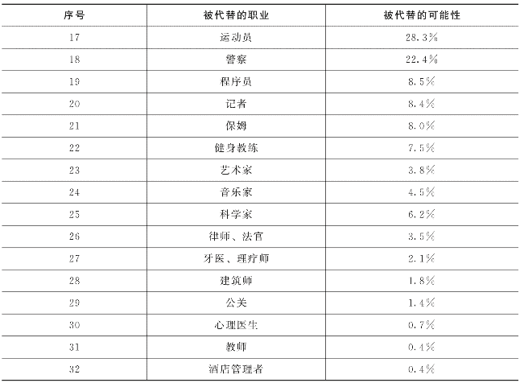

The answer to the question "Will AI teachers replace human teachers?" can actually be found in the BBC statistical data—**the probability of human teachers being replaced by AI robots is only 0.4%.** However, it is worth noting: in the AI era, if teachers do not know how to apply AI technology, the probability of being replaced by AI teachers will increase significantly.

In 1996, UNESCO pointed out in the *Recommendation Concerning the Status of Teachers* that teaching work should be regarded as a "profession." The implication is that teaching is a specialized occupation; they must possess educational capabilities and sound character, be able to accurately grasp the characteristics of their service objects, and master a whole set of matching educational theories and methods. In other words, teachers' professional skills and literacy originate from professional talent cultivation channels and are difficult to replace in professional aspects.

Before discussing whether AI teachers will replace human teachers, it is necessary to first carefully analyze what AI robots are good at and what they are not good at; this is the key to future human teachers not being replaced. From the BBC statistical data, it can be seen that in future social development, professions easily eliminated by AI technology share common characteristics. Take educational customer service as an example: all professions that can provide convenient services to learners can be called educational customer service. Their inherent value orientation is to provide convenient services to learners, so why does this job have a 91% probability of being replaced by AI?

This question is not difficult to answer, because AI customer service can tell you the answer. Intelligent educational customer service is a customer service system based on AI semantic recognition technology. In long-term service, it can actively construct problems and generate countermeasures for specific contexts, just like a customer opening the Taobao shopping interface to seek help from customer service. When you start typing a question, the intelligent educational customer service has already predicted the various questions you might raise regarding a certain learning module based on its deep learning experience, and provides routine answers. At the same time, it can rely on intelligent recommendation system functions to push relevant learning product links to you.

However, observant people will find that on the same intelligent customer service human-machine interface, the same question basically only gets the same answer. This shows that the foundation of intelligent educational customer service is actually a problem-solving system. In other words, the existence of intelligent educational customer service is a big data comprehensive summary of the real educational customer service problem domain; specific problems in specific contexts have different answering methods but basically consistent content. This "routine" nature of work gives AI customer service systems obvious advantages in comparison with human customer service: they are tireless, can be online 24/7, and can answer various "tricky" questions raised by different types of users. Therefore, the replacement of the educational customer service profession is worth deep reflection. Similarly, the work of typists can now basically replace typists by relying on intelligent voice input, intelligent image text recognition, intelligent visual recognition, and other technologies. In smartphone social software (WeChat, QQ, etc.), everyone can enable the voice-to-text function to easily realize text input.

As mentioned above, whether it is customer service, typists, accountants, or bank clerks, these jobs are all simple and repetitive labor; the staff in them do not need to think too much, they only need to master business skills proficiently.

However, why do professions such as architects, public relations, psychologists, and hotel managers have a probability of being replaced by AI robots that does not exceed 2%? Comprehensive comparative research finds that these major professions involve too many emotional and wisdom factors, involving complex interpersonal networks, humanistic value care, and understanding of life. Their professional operation modes require wise minds more than fixed business models.

Therefore, overall, the reason the emergence of AI triggers "collective anxiety" in specific professional fields is that AI possesses unparalleled advantages over humans at the operational skill level. However, at the wisdom skill level, AI's weaknesses begin to be exposed. "Knowledge, Emotion, Will, Action" (知、情、意、行) constitute the four basic capabilities of human teachers, but because AI teachers are the embodiment of machines, they themselves do not possess life attributes, so they have significant defects in emotional and volitional capabilities. Teaching, as a professional occupation, not only requires business operational skills but also requires mastery of specialized wisdom skills. The lack of wisdom skills in AI teachers reveals the intrinsic reason for the low probability of human teachers being replaced—AI teachers are rigid, lack emotion, and lack innovative spirit.

AI teachers are intelligent systems based on AI technology, specifically engaged in teaching work in virtual and real environments; their essence is non-living entities. Judging from the current development process of AI technology, due to the limitations of intelligent technology itself, the existence of AI teachers can only "follow routine" to complete "instructional" teaching tasks, including the AI teacher Sophia. Due to the lack of independent consciousness, absolutely obedient AI teacher systems are precise executions of human educational standards.

For example, when AI teachers grade homework, the uniqueness of the judgment criteria for objective questions gives them great "freedom" to perform, and both grading efficiency and quality far exceed human teachers. However, for subjective questions without unique judgment criteria, AI teachers appear somewhat at a loss. Even if given certain standards through technical means, the judgment system composed of "standards" still cannot effectively perceive the examinee's emotional attitudes and tendencies. Therefore, in the process of AI teachers grading homework, it is very easy to cause originally brilliant essays to fail the AI teacher's judgment system.


## The Role of Teachers and Teacher-Student Relationships in the Age of Artificial Intelligence

### Limitations of AI Teachers and the Response of Human Teachers

The existence of AI teachers represents the absolute execution of standards. To date, the development of AI teachers has still not escaped the influence of the "genetic genes" of "expert systems." This determines both their astonishing capabilities in solving problems and highlights their limitations in being unable to engage in the work of "cultivating people" (moral/character education). When students seek help from AI teachers, they receive solutions to every request, but are not guided from a higher level of wisdom to construct their own problem-solving strategies. Over time, students will develop a dependency on AI teachers. This "bundled" student growth model is not conducive to the generation of critical and creative thinking; in extreme cases, it can even ruin students' futures, ultimately reducing them to sacrificial victims in the teaching context of AI teachers.

The limitations of AI teachers seem to constitute the most powerful evidence that human teachers cannot be replaced by them. The advantages of human teachers lie precisely where AI teachers cannot compensate and cannot replace. However, human teachers must also be aware that if they cannot master the skills that AI teachers cannot master, human teachers are highly likely to be eliminated by AI teachers. As Ray Clifford said: "Technology will not replace teachers, but teachers who use technology will replace teachers who do not^[[7]](#txt005.html#footnote_content_txt005_7)." Without foresight, teachers will face immediate worries. Since the possibility of human teachers being replaced by AI teachers has been identified, taking precautions in advance is the urgent task at hand for human teachers.

In November 2017, the *Opinions on Comprehensively Deepening the Reform of Teacher Workforce Construction in the New Era*, reviewed and approved at the First Meeting of the 19th Central Committee for Deepening Overall Reform presided over by General Secretary Xi Jinping, mentioned that by 2035, China should basically achieve a scientific and efficient teacher management system and mechanism, realizing the modernization of the teacher governance system and governance capacity. Teachers must proactively adapt to new technological changes such as informatization and artificial intelligence, and actively and effectively carry out educational teaching. In the AI era, "professional intelligentization" and "intelligent professionalization" develop alternately; the intelligent development of human teachers and the professional development of AI teachers proceed in parallel without contradiction. When the professional development of AI teachers progresses smoothly, the intelligent development of human teachers should also advance rapidly, proactively adapting to the major adjustments and transformations of the intelligent society.

The intelligent development of human teachers is the top priority for them not to be replaced by AI teachers in the future teaching profession, and is the inevitable choice for human teachers and AI teachers to move towards integration. In any era of major technological development, people cannot choose to fight against the general trend of the world; only by standing bravely at the forefront of the tide, arming themselves with the armor of cutting-edge technology, can they see higher and walk further. The same applies to teachers in the intelligent era; if they want to avoid elimination, they have no choice but to join the ranks of intelligentization, follow the trend, and take the path of "Human-Machine" integration.

### Three, "Human-Machine Co-teaching": From Opposition to Unity

Viewed from the perspective of the development of education as a whole, the debate between AI teachers and human teachers, regardless of who wins or loses, will be detrimental to the high-quality development of education—dialectical development and integration are the best choices. On National Day in 1983, Comrade Deng Xiaoping inscribed for Beijing Jingshan School: "Education must face modernization, face the world, and face the future." In February 2019, the General Office of the CPC Central Committee and the General Office of the State Council issued the *Implementation Plan for Accelerating Educational Modernization (2018–2022)*. The Plan pointed out that in the new era of social development, we must promote the modernization of the educational governance system and governance capacity, and steadily promote the high-quality development of education. Therefore, in the AI era, educational development should gather forces from all sides, strive to form a synergy in education, and while resolving the contradictions between AI teachers and human teachers, promote a more rational overall structure of education.

Human-Machine Co-teaching refers to the joint teaching by human teachers and AI teachers. The two are both opposing and unified, complementary to each other, and develop together. "A hundred-year plan, education is the foundation; the foundation of education lies in teachers." Whether AI teachers or human teachers, both are the bearers of the heavy responsibility of education; cooperation benefits both, division harms both. It is evident that Human-Machine Co-teaching is the best path for the development of both types of teachers at present, and the best choice to prevent human teachers from being replaced. As shown in Figure 5-2, "Teacher Intelligentization" and "Intelligentized Teachers" are the two major intelligentization trends to resolve the current conflicts between human and machine teachers, and the overall architecture for realizing the unity of opposites between humans and machines.

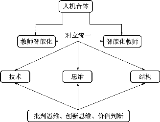

Figure 5-2 Human-Machine Integration

In the discussion in the previous section, it was mentioned that the teaching activities of AI teachers are simple and repetitive, but in specific teaching contexts, they possess the advantages of high execution efficiency and precise implementation of standards, which human teachers do not possess, or are far inferior to AI teachers in. However, what cannot be ignored is that human teachers undoubtedly possess transcendent value in critical thinking, innovative thinking, and value judgment. In order to break the cycle of mutual competition and elimination between humans and machines, and to achieve human-machine integration and development, it is imperative to carry out innovative integration from three perspectives: technology, thinking, and structure, thereby highlighting the "non-traditional attributes" of future teachers.

The integration and transcendence of AI teachers and human teachers: technological means are the realistic foundation for integrated development; integration at the thinking level is the directional guarantee; structural integration is the focal point of Human-Machine Co-teaching. The core problem that technological integration needs to solve is the chasm between the two, including two sub-problems: the "technological blind spots" of human teachers and the "value blind spots" of AI teachers. The integration of thinking mainly refers to the integration of the mechanical thinking of AI and the dialectical thinking of humans. Structural integration mainly refers to the structural alignment of the various qualities of human teachers and AI teachers.

As can be seen from the Human-Machine Integration structure diagram in Figure 5-2, throughout the entire process of human-machine integration, the birth of future teachers who organically integrate technology and values will be facilitated. In the overall intelligentization trend of Human-Machine Co-teaching, future teachers will form all-round teaching talents or educators with the human body as the carrier, technical knowledge and skills as the amulet, and care for life and humanistic values as the soul; the image of teachers will be completely subverted.

Therefore, starting from the present, when educating students with the assistance of AI technology, we need to recognize the fact that AI teachers are strong in knowledge imparting. We also need to guide relevant human teachers to shift their teaching from facing the knowledge system for imparting, towards cultivating core competencies such as humanistic heritage, responsibility, national identity, and cross-cultural communication. Students' creative ability, aesthetic ability, collaborative ability, and contextualized knowledge application ability are the core and focus that human teachers should pay attention to^[[8]](#txt005.html#footnote_content_txt005_8), moving towards unity in the division of labor and collaboration between human teachers and AI teachers.

In the AI era, the task of cultivating future educational talent teams is arduous, among which the cultivation of the teaching ability of all-round teachers is the key difficulty. But no matter what, taking the path of future teachers under Human-Machine Co-teaching is the inevitable choice, and the most effective way for human teachers to truly avoid being eliminated by AI teachers. The emergence of future teachers requires the support of new educational methods, educational systems, educational resources, and educational structures. If we want to realize the value of future teachers as early as possible, we should currently actively carry out theoretical innovation and practical implementation work, open the closed doors and windows, breathe the fresh air of the new world, break through and transcend the barriers of traditional education, and accelerate the process of modernizing the educational governance system and governance capacity.

### Notes

[[1]](#txt005.html#footnote_quote_txt005_1) Deng Yinzhen. Who Moved My Podium—The Transformation of Teacher Roles in the Context of the AI Era[J]. Information Technology Education in Primary and Secondary Schools, 2018(06): 86-89.

[[2]](#txt005.html#footnote_quote_txt005_2) Zhang Qing. Changes in the Authoritative Role of Teachers in Online Education and Its Sociological Reasons[J]. Journal of Hunan Normal University (Educational Science Edition), 2010, 9(05): 63-65.

[[3]](#txt005.html#footnote_quote_txt005_3) Ren Min, Li Yingchun. Half of the Analects Makes a Good Teacher: Implications of the Analects for Teachers[M]. Beijing: China Light Industry Press, 2014: 195.

[[4]](#txt005.html#footnote_quote_txt005_4) Sohu.com. Delinshe: 365 Occupations, the Least Likely to be Replaced by AI in the Future Turns Out to Be...[OL] [2017-10-17]. https://www.sohu.com/a/205327096_157944.

[[5]](#txt005.html#footnote_quote_txt005_5) Wang Delin, Li Chengbin. Will Teachers Be Reduced to the "Useless Class"?—From the Perspective of AI[J]. Educational Research, 2018, 32(10): 60-65+125.

[[6]](#txt005.html#footnote_quote_txt005_6) Image source: China Entertainment News. Learning with Sophia, VIP Jr Opens a New Era of Intelligent Education[OL]. [2019-3-6]. http://www.sohu.com/a/298464284_344165.

[[7]](#txt005.html#footnote_quote_txt005_7) Yu Shengquan. Human-Machine Collaboration: The Transformation of Teacher Roles and Thinking in the AI Era[J]. Digital Teaching in Primary and Secondary Schools, 2018(03): 24-26.

[[8]](#txt005.html#footnote_quote_txt005_8) Yu Shengquan. Human-Machine Collaboration: The Transformation of Teacher Roles and Thinking in the AI Era[J]. Digital Teaching in Primary and Secondary Schools, 2018(03): 24-26.

---

# Chapter 6 The Foundation of Education: Teacher-Student Relationships and Teacher Literacy in the Intelligent Era

## "Immigrants" and "Natives": The Generational Divide Between Teachers and Students in the Intelligent Era

### Socialization and Reverse Socialization: Teachers Learning from Students in the Intelligent Era

### Intelligent Literacy: Enhancing the New Literacy of Teachers in the Intelligent Era

The "post-2000s" generation is different from previous generations because they are "**Intelligent Natives**"—they are born in the intelligent era and grow up in the intelligent era; everything about them is closely related to intelligence. Their birth reflects the development of an era and embodies the shaping of people by an era.

In the lives of Intelligent Natives, corresponding to them are "**Intelligent Immigrants**." From a fundamental perspective, there are significant differences between the two. It is precisely because these differences are too significant that they have ultimately evolved into a generational divide between the two generations. This generational divide maps onto the field of education, and a generational divide inevitably exists between teachers and students as well. However, through teachers' reverse learning from students and the enhancement of teachers' intelligent literacy, a bridge of communication can certainly be built across this "divide."

### One, "Immigrants" and "Natives": The Generational Divide Between Teachers and Students in the Intelligent Era

In the new intelligent era, while intelligent machines spawned by AI technology continuously replace human work, they also continuously create many convenient conditions that shape humans themselves. This not only gives people more time to think about future problems but also makes cooperation between humans and intelligent machines a norm of life.

Usually, in an era of profound transformative significance, the group that can adapt to the environment first is not the group that has been deeply professionalized and stereotyped in a certain independent field; on the contrary, it is the younger generation. The AI era is exactly like this; the rapidly advancing trend of intelligentization is penetrating every field of people's production, life, and thinking with "lightning speed." Due to differences in people's cognitive ability, adaptability, and application ability regarding intelligent technology, people are divided into two distinctly different identities at the technical level—"**Intelligent Natives**" and "**Intelligent Immigrants**."

In different era backgrounds, due to differentiated technical thresholds, the division of two identities caused by the technical level has different expressions. In the Internet era, two identities of people have been generated—"Netizens" (Net Natives) and "Net Immigrants." Thanks to the development and evolution of Internet technology, it has built a bridge in the technical field to promote mutual communication among people, and the atomized society has gradually been broken. In the Information Age, "Digital Natives" and "Digital Immigrants" are the basic components of social members. Facing emerging digital technologies, the two identities of social members have significant differences in their worldviews and methodologies regarding the world of this era. In the Big Data and AI era, two identities of social groups are also being generated—"**Intelligent Natives**" and "**Intelligent Immigrants**." The existence of these two social identities centrally expresses the two different cultural phenomena and identity attributes existing in the entire human society of the current era.

**"Intelligent Natives"** refer to the native citizens of the AI era. Because they are "born in intelligence, raised in intelligence," they are a generation that has grown up under the influence of AI technology and intelligent cultural environments, possessing very strong social adaptability. Simply put, it seems they knew how to operate smartphones from birth; for many electronic products, they learn them after watching a few times, basically "self-taught without a teacher." For example, in intelligent games, the native group moves freely; if it weren't for identity verification checkpoints, in the virtual game world, people fundamentally cannot judge that the opponent is a child of only a few years old!

At the same time, the education they receive also differs significantly from "other groups." For native citizens of the intelligent era, robot programming has become a key course, and related educational institutions have emerged one after another, launching similar curriculum systems. Today, there is no need to be present at the educational site; one only needs to enter "children's programming education" in the browser's search window, and hundreds of pieces of information come into view, with complete categories, all reflecting the current popularity of children's programming education. Robot programming courses are a challenge for "Intelligent Immigrants," but in the impression of Intelligent Natives, it is a norm of life. Because they find "fun" in learning, and fully express their unbridled imagination in learning. From the current perspective, Intelligent Natives possess three major characteristics.

1.  **Younger Age (Low-age)**. The birth time of Intelligent Natives is about the same as the time of the "Third Rise" of AI. Therefore, today's Intelligent Natives generally possess the characteristic of younger age.
2.  **Intelligent Life**. Intelligent life is the most significant characteristic of Intelligent Natives, and also the place where the biggest gap exists between Intelligent Natives and "Intelligent Immigrants." Intelligent life is the result of intelligent technology universally changing life. In an intelligent life environment, low-age children born into it, due to the strong plasticity and adaptability of their own developmental stage, quickly integrate into intelligent life and become a part of it.
3.  **Life Intelligentization**. This is a higher-level characteristic of Intelligent Natives. It is not only the difference between Intelligent Natives and "Intelligent Immigrants," but also an important basis for horizontally distinguishing the degree of intelligentization among the Intelligent Native group. From the dimension of difference with "Intelligent Immigrants," Life Intelligentization reflects a new lifestyle of Intelligent Natives—"No intelligence, no life." From the horizontal dimension, the higher the degree of Life Intelligentization, the higher the degree of adaptation of the natives to the intelligent society, meaning they will have greater competitive advantages in future social competition.

**"Intelligent Immigrants"** refer to those who passively adapt to society in the AI era. Because their growth environment lacked the companionship of intelligent products and the influence of intelligent culture, whether psychologically or socio-culturally, their sense of strangeness towards the AI era is extremely strong. For them, it is truly "everything is new." In addition, according to the attitude of Intelligent Immigrants, they can be further divided into Intelligent Bystanders and Intelligent Refugees who are in a state of avoidance, and Intelligent Adapters who actively devote themselves to adapting to the new intelligent era.

From the concept of Intelligent Immigrants, it can be known that they belong to a generation that "migrated" from other eras to the intelligent era. Due to the drastic changes in the living environment, the "Native" advantages once manifested in them have gradually been replaced by the new generation of "Natives." On them, it is easy to find things that are out of place in the intelligent era, such as their disdain for intelligent technology, anxiety about intelligent robots, strong dissatisfaction with the Life Intelligentization of Intelligent Natives, etc., all of which reflect the inherent era characteristics on them.

Fortunately, some Intelligent Immigrants have noticed this. They have begun to seek methods of change, started to actively learn how to adapt to the AI era, and become "Intelligent Adapters" of the intelligent era. Among the Intelligent Adapters, some have led Intelligent Natives to create many miracles; some have transformed into mentors of Intelligent Natives, pulling them back from the dangerous edges of the intelligent era to the center of the era; some have painstakingly researched AI and intelligent philosophy for years, willingly serving as teachers and dedicating themselves to the intelligent society.

In the AI era, Intelligent Natives and Intelligent Immigrants universally exist, and debates about them arise one after another. Due to differences in politics, economy, culture, and other factors, the divide running through the two has taken root in the era, becoming a limiting factor restricting the development of the era, and further evolving into the "Generational Divide" of the AI era, lying horizontally between the two generations. From this perspective, there must be a complex relationship between Intelligent Natives and Intelligent Immigrants, while conflict, harmony, and competition are the basic components constituting this relationship. Assuming we discard absolute time and space boundaries, people can further explain the origins of the formation of the current relationship between the two. Fundamentally, the "Generational Divide" between Intelligent Natives and Intelligent Immigrants stems from the role imbalance of the two generations of social members; therefore, the reshaping of roles requires the joint efforts of both generations.

In the eyes of most people, the relationship between the two is an important factor influencing the development of the era, having a certain impact on various fields, especially the field of education which focuses on "cultivating people" and "shaping people." Today, the natives of the AI era, the "post-2000s" generation, are a dividing line. People after the "post-2000s" (including the "post-2000s") will become the main representatives of Intelligent Natives. When you see children under 10 years old playing games on smartphones or searching for HD cartoons on smartphones, when you see today's children skillfully shuttling through various applications of intelligent products, as a teacher, can you keenly perceive the children's needs? Or can you understand their behavior? The answer to this question perhaps constitutes the realistic interpretation of the conflict, harmony, and competition between Intelligent Natives and Intelligent Immigrants in the era.

Currently, in the compulsory education stage, the relationship between teachers and students happens to map the corresponding relationship between Intelligent Immigrants and Intelligent Natives—teachers are Intelligent Immigrants, students are Intelligent Natives. It is evident that the generational divide between teachers and students objectively exists.

In the AI era, the generational divide between teachers and students essentially reflects the conflict and isolation between traditional education and modern education. Recalling the era in which teachers grew up, the leisurely childhood makes today's children envious—Leisure "Self" Existence (pun on *Zi* - self). The "post-2000s" children are different because they devote the vast majority of their time to learning; due to the comprehensive permeation of intelligent culture, intelligence has become a part of their lives—Leisure "Intelligence" Existence (pun on *Zhi* - intelligence).

Thus, in summary, the core of the formation of the divide between today's teachers and students lies in their different ways of perceiving the world. Teachers use their "five senses" to perceive the world, thereby forming overall views and opinions on the world. Students perceive the world through intelligent terminals; their worldview is more like an indirect worldview (as Intelligent Natives would say). They are accustomed to using intelligent terminals as intermediaries for everything; it seems that intelligence is their senses. As the saying goes: "What kind of worldview, what kind of methodology." Therefore, the difference in worldview between teachers and students determines the difference in the angles from which teachers and students view problems and the methods they use to solve problems.

It is evident that the generational divide between teachers and students is an important factor affecting the effectiveness of teaching activities, and the key to solving the problem lies with the teachers. In the AI era, the role of teachers needs to be reshaped, and the literacy of teachers needs to be re-cultivated. Teachers need to stand at the forefront of the era, think broadly facing students, actively learn from students, and actively engage in the ranks of improving their own literacy, in order to "emerge from the cocoon as a butterfly" and transform into wise guides for student development.

### Two, Socialization and Reverse Socialization: Teachers Learning from Students in the Intelligent Era

In the AI era, the conflict between Intelligent Natives and Intelligent Immigrants returns to the field of education, manifesting as the generational divide between teachers and students, reflecting the incompatibility between traditional education and intelligent education. The existence of the generational divide between teachers and students, besides stemming from their different worldviews, is also due to the differences in the ability of teachers and students to accept new things, the rapid development of intelligent technology, the guidance of national education policies, and the era-specific attention to social themes such as democracy, equality, and rule of law.

In traditional education, students' social experience mainly comes from the older generation, teachers, elders, and authority figures. The older generation acts as the implementers of education; the direction of socialization is one-way—top-down socialization. But in the intelligent era, children, students, and the young are not only the objects of socialization but also the implementers of socialization. Sometimes, the older generation, teachers, elders, and authority figures also have to receive education and guidance from children, students, the young, and subordinates. Therefore, human socialization is two-way, rather than the traditional one-way socialization. This gives rise to the concept of Reverse Socialization.

Reverse Socialization is also called "Cultural Reverse Nurturing." It refers to the younger generation transmitting cultural knowledge to the older generation, or the traditional educatees exerting influence back on the educators, transmitting knowledge of social changes to them. In traditional agricultural society, people lived in a closed and conservative living environment; the way of acquiring social experience was relatively simple; therefore, children's socialization was mainly subject to the teaching of the older generation.

Reverse Socialization is a product of modern industrial society, especially a product of the information society and intelligent society. American anthropologist Margaret Mead proposed in her book *Culture and Commitment* that in today's world, the contradictions and conflicts between generations can be attributed neither to social and political differences, nor to biological differences, but mainly to differences in cultural transmission. She divided human culture from ancient times to the present into three basic forms: Pre-figurative Culture, Co-figurative Culture, and Post-figurative Culture.

> "Pre-figurative culture refers to the younger generation learning mainly from the older generation; Co-figurative culture refers to the learning of both the younger and older generations occurring among peers; while Post-figurative culture refers to the older generation learning from the younger generation in turn^[1]."

In Post-figurative culture, the younger generation, originally in the position of being educated, can "turn the tables" and act as the educator. The phenomenon described by Mead is manifested even more prominently in the AI era. In reality, everyone can often see that many teachers have learned from their own students how to operate computers, make courseware, use PS software, retrieve intelligent databases, download e-books, shop intelligently, use WeChat correctly, etc. This is precisely the phenomenal manifestation of Post-figurative culture.

#### (1) Causes of Reverse Socialization

Mead believes that in Post-figurative culture, the reason why the younger generation, originally in the position of being educated, can act as the educator is that no generation in history has ever experienced such huge and rapid changes as they have, and no generation has been able to "understand, experience, and absorb such rapid social changes occurring before their eyes" like them. Specifically speaking, in the AI era, the main reasons for the emergence of Reverse Socialization are as follows:


### (I) Causes of Reverse Socialization

First, the difference in the ability of teachers and students to accept new things. Teachers, usually limited by age and historical context, have a limited capacity to accept new things, new concepts, and new ideas, leading to outdated concepts. The younger generation of students, especially children and adolescents, are full of curiosity about new things and are adept at accepting new things, new ideas, and new concepts. Therefore, in teacher-student communication and interaction, it is not the students learning from the teachers, but the teachers learning from the students; reverse socialization thus forms naturally.

Second, the rapid development of science and technology. Upon entering the intelligent society, a new generation of science and technology represented by artificial intelligence has developed rapidly, subjecting society to unprecedented impact. Science and technology have not only changed people's lifestyles but also made social interactions exhibit characteristics of transience, diversity, and novelty. Faced with the impact of science and technology, especially artificial intelligence technology, the older generation, influenced by past mental stereotypes, cannot make adaptive changes quickly, while the younger generation has not yet formed mental stereotypes. They have a strong ability to accept and adapt to new things in the face of rapid social changes and can make choices freely. Subsequently, they influence the older generation with their own practical experience, i.e., engaging in "feedback" behavior, resulting in reverse socialization.

Third, the social themes of democracy, equality, and rule of law. Democracy, equality, and rule of law are the themes of modern society. Against this background, students' sense of autonomy, democracy, and equality continues to grow; they often demonstrate innovative consciousness and enterprising spirit. In accepting traditional culture, they dare to innovate boldly and inject new content into teachers' existing knowledge structures, helping teachers accept new things and better adapt to new social changes.

### (II) Significance of Reverse Socialization

Although teachers focus their attention on the socialization process of students, regarding student development as paramount, the significance of reverse socialization cannot be ignored. In the late 1960s and early 1970s, a reverse socialization culture gradually began to form on the basis of social informatization. As the degree of social technologization deepens, the significance of reverse socialization becomes increasingly apparent—its emergence injects new vitality into social reform, helps alleviate intergenerational conflicts between teachers and students, and promotes harmonious coexistence and common development between teachers and students.

First, reverse socialization injects new vitality into social reform. A Chinese proverb says: "The Yangtze River's rear waves push the front waves." Ackoff stated in *Turning Learning Right Side Up: The 21st Century Learning Revolution*, "Most teachers—whatever their training—cannot hope to match in the classroom what students can pick up at will from sources of their own choosing^([\[2\]](#txt006.html#footnote_content_txt006_2))." Ackoff's main point is that the knowledge and concepts mastered by teachers are ultimately limited and pale in comparison to the collective wisdom of students. In the new intelligent era, student development is boundless; therefore, students cannot be satisfied with what teachers transmit but must continuously innovate and forge ahead to powerfully drive social progress. When students transmit their new values, lifestyles, and ways of mode to be "responding in development." How to develop? Of course, by cultivating new-generation talents through education and proposing innovative strategic directions for social development. Therefore, the future development of education must keep pace with "three paces": the pace of socio-economic development, the pace of scientific and technological development, and the pace of socio-cultural development.

Education must keep pace with socio-economic development. In the intelligent era, with the development of the intelligent economy, economic systems, economic structures, market mechanisms, production and manufacturing, sales and services, etc., will all be mixed with elements of the era, and everything in the economic field will move towards intelligence. Therefore, the development of education must also comply with the needs of socio-economic development and quickly take the road of educational transformation. The change of the era means that the way of creating social wealth must change, and the quality and structure of the social labor force must also change with the intelligent economy; this is a necessary educational reflection, otherwise it is easy to endanger the "rice bowls" (livelihoods) of workers. Education must serve socio-economic development, keep pace with the pace of socio-economic development, and embark on the road of intelligence.


# Educational Reform and Liberal Arts Exploration in the Age of Artificial Intelligence

## I. Educational Development Must Keep Pace with the Times

### Education Must Keep Pace with Scientific and Technological Development

The developmental form of education may evolve under the influence of science and technology; the birth of intelligent educational technology is the result of such evolution in the educational field. Regarding the classroom, "chalk" and "blackboard" are the knowledge presentation media of traditional classrooms, but the emergence of intelligent technology has gradually distanced this medium from students, replacing it with a new form of knowledge presentation medium. For instance, new media courseware, projectors, big data AI platforms, WeChat official accounts, etc., not only adapt to students' living environments but also enable data-based recording and visual analysis of the learning process at the technical level. The development of science and technology has largely changed the media and methods by which students acquire knowledge, as well as the aesthetic sense and experience of the learning process. Educational development must inevitably keep pace with this new social form shaped by emerging technologies.

### Education Must Keep Pace with Socio-Cultural Development

Today, AI technology is fundamentally changing the processes of production, dissemination, and value realization of socio-culture, and the value of intelligent elements in the socio-cultural environment is gradually increasing. Relative to socio-culture, education itself is also a tool for the production, dissemination, and screening of culture; it hopes to promote the free expression of every member of society within a larger cultural framework through innovative educational methods. In real life, the way each person discovers the meaning of life is closely related to the cultural environment in which they live^([\[3\]](#txt007.html#footnote_content_txt007_3)). Since people already live in an intelligent cultural space, education can provide talent for the development of this socio-culture, channels for its dissemination, and methodology for its innovation. Educational development must find its convergence point within the structural system of socio-culture.

### Social Development Poses New Requirements for Education

Social development pushes back on the development of economy, technology, and culture, and also poses new developmental requirements for education. Therefore, what kind of educational landscape the AI era needs to form to meet the social development requirements of the intelligent age is a question worthy of deep reflection.

## An Open and Inclusive Educational System

To meet the requirements posed by social development, the education system itself should be an **open and inclusive educational system** (as shown in Figure 7-1). This system should include various forms of education, such as online classrooms, vocational education, basic education, higher education, social vocational training, preschool education, family education, school education, social education, inclusive education, etc., ultimately forming a massive AI education system with diverse forms, pluralistic structures, and multi-dimensional educational methods, aiming to respond to overall social needs from the broad educational field. Simultaneously, to realize education preparing for future life, today's education should also focus on the field of "**liberal arts education**" (or "generalist education"), actively leveraging AI technology to carry out new liberal arts education and new engineering education in the AI era, laying out the future talent market in advance on the premise of being grounded in real life.

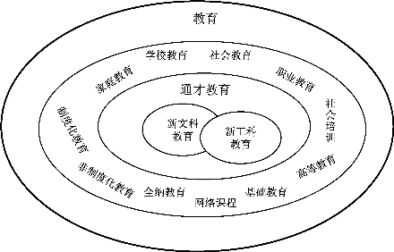

**Figure 7-1 Open and Inclusive Educational System**

An open and inclusive educational system inherently contains educators' reflection on the discipline-based, major-based educational model; it does not reject the existing discipline-based education, but the results of this reflection are worth pondering. Because before the arrival of liberal arts education, the discussion on the defects of the arts-sciences division education will surely play a practical role and value in the construction of the liberal arts education system.

## II. Institutional Reflection: Limitations of Arts-Sciences Division Education

Arts-sciences division refers to the systematic separation of the comprehensive subjects "Chinese, Math, English, Politics/History/Geography, Physics/Chemistry/Biology" into arts (Chinese, Math, English, Politics/History/Geography) and sciences (Chinese, Math, English, Physics/Chemistry/Biology) when students transition from Grade 10 to Grade 11. Students can choose one to continue studying based on their foundation and interests. For students, the high school arts-sciences division seems like a watershed in life; different choices represent different ways of from the education system due to talent scarcity; cultivating new talents for new industries becomes an important aspect distinguishing new engineering education from traditional engineering education.

### Innovation in Curriculum System

The "newness" of new engineering education is also reflected in the newness of the educational curriculum. On the basis of inheriting the advantages of traditional engineering education, new engineering education has launched a new generation of curriculum systems adapted to social development. In 2018, the General Office of the Ministry of Education issued the *Notice on Announcing the First Batch of "New Engineering" Research and Practice Projects (Jiao Gao Ting Han [2018] No. 17)*, calling for the accelerated formation of a batch of replicable and promotable reform achievements, achieving breakthroughs in emerging engineering curriculum systems, new-form teaching materials and content, MOOCs, engineering education faculty teams, and practice bases^([\[7\]](#txt007.html#footnote_content_txt007_7)); the *Notice* further announced 612 new engineering research projects from universities nationwide. The specific scope of reform-related courses involved is shown in Table 7-1. The top five curriculum reforms are concentrated in the fields of big data and AI technology; related independent courses have emerged accordingly, such as Data Science and Technology, IoT Engineering, Robotics Engineering, Intelligent Science and Technology, Smart Grid Information Engineering, Optoelectronic Information Science and Engineering, Big Data and AI, Software Engineering, AI, and other major courses.

**Table 7-1 Scope of New Engineering Curriculum Reform System**

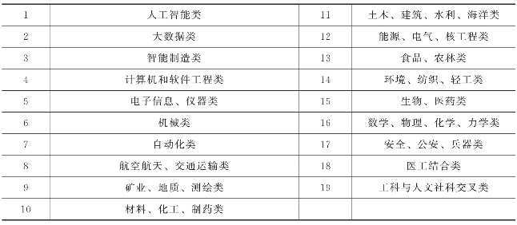

Echoing the Ministry of Education's new engineering curriculum reform and practice, local universities' curriculum systems have begun to station in new fields; majors such as big data, AI, virtual reality, and cloud computing have entered universities one after another. As of now, over 40 universities nationwide have established AI colleges. In the first half of 2019 alone, Peking University, Renmin University of China, Xi'an Jiaotong University, Southeast University, and others established AI colleges within their schools. It is predicted that around 2025, the establishment of big data AI colleges and majors will rapidly expand to schools of all levels and types nationwide, with beneficiary students showing full coverage characteristics.

In late October 2019, the world's first AI university — Mohamed bin Zayed University of Artificial Intelligence (MBZUAI) — announced its establishment in Abu Dhabi, UAE, aiming to "introduce new models of academia and research to the field of AI, provide students and faculty with the world's most advanced AI systems, and unleash the potential of AI in promoting economic and social development." From AI colleges to AI research institutes, to AI universities, curriculum development regarding AI has achieved relatively comprehensive coverage.

### Transformation of Educational Methods

The "newness" of new engineering education will also be reflected in the "newness" of educational methods. In the era of big data and AI, new engineering education and big data AI technology will be "inseparable"; intelligent, humanized, collaborative, diversified, and personalized education will become the basic characteristics of new engineering education.

Big data AI technology will further penetrate the entire new engineering education system; major courses of new engineering education will highlight the value of personalized education more prominently under the support of big data AI technology. Based on the construction of data-based AI education algorithm models, the knowledge, behavior, and emotion of new engineering education objects can all achieve personalized expression. Based on the transparency and datafication of students, teachers, and schools, educational methods gradually change, moving from traditional cramming and indoctrination teaching toward personalized, heuristic, and participatory teaching, ultimately achieving a major transformation of the humanistic educational methodology in the field of new engineering education, realizing the unity of new engineering value and humanistic value at the methodological level.

"AI+" applications have entered the normalized stage of society, triggering the transformation of traditional engineering education; a series of new characteristics of engineering education emerge, with new engineering education at the forefront of educational development. The penetrating power of AI technology is so great, and its value to engineering education is so prominent, that people have begun to explore the application and solutions of AI education in the field of new engineering education, further promoting the integration of intelligent elements with new engineering education.

In 2016, the Ministry of Education put new engineering construction on the agenda. 2017 was called the first year of AI application; AI application and new engineering construction grew together, and the integration between the two followed a pattern. Application means adapting to needs for use. AI application refers to AI technology adapting to social development needs and providing the technology itself for use by various social fields. In the AI era, the integration of AI application and new engineering education mainly involves integrating AI technology into the entire process of new engineering education to achieve the modernized development of new engineering education.

#### Personalized Learning for Students

The application of AI technology in new engineering education helps build a personalized learning system for students through AI system platforms, combining the characteristics and laws of new engineering education to conduct personalized teaching for students. Based on data accumulated during individual student learning processes, exclusive learning models for specific students are constructed; with the help of intelligent models, students' learning blind spots can be quickly filled, misconceptions quickly corrected, emotions quickly identified, learning needs fed back in a timely and effective personalized manner, and the formulation of learning plans and acquisition of learning resources will all become personalized. The integration of AI technology into new engineering education promotes the realization of personalized new engineering education, helping students leverage the cross-disciplinary learning system of new engineering to break through learning dilemmas caused by disciplinary barriers, and cultivate new engineering talents with "12 types of thinking abilities"^([\[8\]](#txt007.html#footnote_content_txt007_8)) in heuristic, participatory, personalized learning systems.

#### Precision Teaching for Teachers

The realization of precision teaching for teachers requires docking with the needs of new engineering education objects, achieving precise connection between the two. With the gradual deepening of AI technology application in the field of new engineering education, AI education systems possessing speech recognition, visual recognition, natural language processing, and deep learning capabilities can timely and effectively examine students' learning situations, i.e., intelligent analysis of learning status. They can use students' learning big data as a basis to quickly identify learning characteristics, methods, effects, interests, and grades, and build learning status models on this basis; during the generalization process of student learning models, they can effectively insight into the crux of problems existing in the learning process. For example, if students have knowledge gaps in industrial design, additive manufacturing, virtual reality theory, etc., the system will output learning status data regarding these gaps, guiding teachers to improve teaching plans or methods, and provide personalized teaching for students with special needs.

#### Scientific Management for Schools

Scientific school management is an important application of AI technology in the field of new engineering education; it will effectively improve school management efficiency and quality, promoting the service transformation and upgrading of the entire school management system. Using AI recognition technology to actively mine big data in the field of school management, visualizing and making transparent the physical attributes of the management system, forming a school education management system pattern of "speaking with data, deciding with data, managing with data, innovating with data," promoting the scientification, systematization, and normalization of school safety management, teaching management, resource management, evaluation management, etc. Breaking the traditional departmental interest pattern, encouraging integration between departments, promoting the sharing and rational allocation of new engineering school-running resources; assessment mechanisms break traditional evaluation models, encouraging teachers to integrate across majors, promoting exploration of unknown technologies, breaking traditional management mechanisms, promoting cross-departmental and cross-school collaborative development, and promoting the realization of cross-major course selection and personalized training plans^([\[9\]](#txt007.html#footnote_content_txt007_9)).

## IV. New Liberal Arts Education: AI Empowering New Liberal Arts Education

Liberal arts education is the general term for humanities and social sciences education, which has a large gap compared to natural sciences education. For a long time, compared to engineering education, liberal arts education has been in a relatively weak position; the "golden age of liberal arts" where "civil affairs were valued over military affairs" has slightly declined; "Master math, physics, and chemistry, and you can travel the world without fear" has become the most common "catchphrase" of science and engineering students, reflecting the decline and marginalization of liberal arts from the side.

### Causes of the Marginalization of Liberal Arts Education

The marginalization of liberal arts education is a special phenomenon in current school education, related to student employment, social talent demands, and the inherent difficulty of the subjects. Traditional engineering education follows the path of learning "one specialized skill"; after graduation, students can obtain a stable job relying on their professional skills, and their employment and career choices are relatively broad. Because in a society where traditional industry and new technology industries develop alternately, talent demand is also biased toward introducing engineering talents; plus, engineering education emphasizes logical and abstract thinking more, so most students inclined toward perceptual thinking naturally gravitate toward liberal arts. Comparative research shows that the world's top academic journals are almost entirely engineering journals (such as *PNAS*, *Cell*, *Nature*, *Science*, etc.); world-class journals for liberal arts are few and far between, which inevitably limits the influence and scope of research achievements for liberal arts students.

### The Indispensability of Liberal Arts Education and the Sprouting of New Liberal Arts Education

Nevertheless, liberal arts education cannot be ignored, because the decline of humanities and social sciences also means the incompleteness of engineering education. Professor Ma Feicheng, a senior professor of humanities and social sciences at Wuhan University, explains: "Overall, various disciplines and even the entire scientific community are constantly moving toward integration while being highly differentiated." The development of liberal arts and engineering education, although they went down two vastly different paths in the early stage, according to Professor Ma, the deeper the differentiation, the higher the level of development; the divergent development of the two subjects is actually moving toward the grand integration of education from a broader field. Therefore, the lag of liberal arts can only be regarded as a phased "anomaly" in educational development; its subsequent evolution should start from new liberal arts education.

In October 2017, at Hiram College in the US, the concept of new liberal arts education was proposed for the first time. Scholars pointed out: New liberal arts refers to disciplinary restructuring and arts-sciences crossover relative to traditional liberal arts, i.e., integrating new technologies into courses such as philosophy, literature, and language, providing students with comprehensive cross-disciplinary learning^([\[10\]](#txt007.html#footnote_content_txt007_10)). With the spread of the new liberal arts education concept, domestic educational research departments first noticed this new educational phenomenon. Against the social background of comprehensively revitalizing undergraduate education, the state specifically introduced the concept of new liberal arts education into China for the future development of liberal arts.


## Launch of the "Six Excellences and One Top" Plan 2.0 in 2018 and the Development of New Liberal Arts Education

On April 29, 2018, the Ministry of Education (MOE), together with 13 other departments including the Ministry of Science and Technology (MOST), the Ministry of Industry and Information Technology (MIIT), and the Ministry of Finance (MOF), jointly convened the Launch Conference for the "Six Excellences and One Top" Plan 2.0 in Tianjin. The conference emphasized the comprehensive implementation of the "Six Excellences and One Top" Plan 2.0, the development of New Engineering, New Medical Sciences, New Agricultural Sciences, and New Liberal Arts, promoting a "Quality Revolution" across universities nationwide, forming a "Quality China" brand covering all fields of higher education, and winning the tough battle for the comprehensive revitalization of undergraduate education^([\[11\]](#txt007.html#footnote_content_txt007_11)).

### Introduction and Strategic Layout of New Liberal Arts Education

The introduction and strategic layout of New Liberal Arts Education have ushered in a new wave of development for domestic liberal arts education; the argument of "Liberal Arts Uselessness" has collapsed on its own, causing related research to receive high attention.

Universities such as Renmin University of China, Zhengzhou University, Xi'an Jiaotong University, and East China Normal University have opened new channels for liberal arts development.

Even Tsinghua University, long known as "China's Highest Institute of Technology," is promoting the construction and development of New Liberal Arts, striving to elevate its New Liberal Arts education to a new level.

The rise of domestic New Liberal Arts Education represents a return of liberal arts education after decades of neglect.

The "New" in New Liberal Arts Education is reflected in "comprehensive interdisciplinary learning," signifying that the traditional categorized "isolated" disciplinary teaching model is changing.

### Dilemmas Facing the Development of New Liberal Arts Education

The development of New Liberal Arts Education, due to its highly comprehensive and interdisciplinary nature, also faces new difficulties.

Professional New Liberal Arts faculty teams need to be cultivated; professional New Liberal Arts teaching resources need to be explored; professional New Liberal Arts teaching evaluation systems need to be established.

All of the above will become obstructive factors in the development of New Liberal Arts Education, urgently requiring new tools and means to address the new problems existing in New Liberal Arts Education.

Considering the comprehensiveness and interdisciplinary nature of New Liberal Arts, it can be foreseen that the development process of New Liberal Arts Education will inevitably feature an interplay of "complexity" and "massive complexity."

### Opportunities for New Liberal Arts Education in the Artificial Intelligence Era

In the AI era, intelligent education systems possess both high-speed computing capabilities and the advantage of computational models that "simplify complexity." Coupled with the massive multi-source heterogeneous data accumulated throughout the history of liberal arts education, AI technology has unique capabilities precisely in handling issues of "complexity" and "massive complexity."

Meanwhile, the MOE's 2018 "Notice on the Action Plan for Artificial Intelligence Innovation in Higher Education Institutions" pointed out the need to strengthen the cross-disciplinary integration of AI with computer science, control science, quantum science, neuroscience and cognitive science, as well as mathematics, psychology, economics, law, sociology, and other related disciplines^([\[12\]](#txt007.html#footnote_content_txt007_12)).

It is evident that, whether at the technical level or the policy level, the bottlenecks encountered in the development of New Liberal Arts Education in the AI era will find new solutions in the field of AI technology.

### Artificial Intelligence and the Cultivation of New Liberal Arts Faculty Teams

The cultivation of New Liberal Arts faculty teams is critical to the success or failure of New Liberal Arts construction and development.

During the New Liberal Arts construction process, Dean Cao Shenggao of the School of Chinese Classics at Shaanxi Normal University frankly stated: "Whether liberal arts can be done well depends crucially on the teachers."

Therefore, introducing AI technology into **New Engineering Education** should first focus on cultivating a batch of high-quality New Liberal Arts faculty teams to ensure the sustainable development of New Liberal Arts Education.

In New Liberal Arts Education of the intelligent era, the educational activity process naturally centers on intelligent education. This includes the use of intelligent teaching equipment, cultivation of teachers' intelligent teaching literacy, transformation of intelligent teaching concepts, formation of comprehensive liberal arts teaching literacy, and forging of teachers' intelligent innovation literacy. All these require leveraging the value and advantages of AI technology to cultivate interdisciplinary talents with a comprehensive New Liberal Arts educational background, thereby building a top-tier New Liberal Arts faculty team.

First, higher education institutions should take the lead in reforming teaching materials for **New Engineering** faculty cultivation, bridge the fragmentation of teacher quality caused by disciplinary teaching in the upstream education stage, focus on New Engineering basic theoretical education, enrich educational practice curricula, and forge new-type New Engineering talents.

Second, higher education institutions should construct a sound incentive policy, actively encourage disciplinary teachers to undergo re-education and further learning, provide financial assistance for teachers' re-education, improve teachers' professional levels and literacy, so as to better engage in the cultivation and teaching of New Engineering talents^([\[13\]](#txt007.html#footnote_content_txt007_13)).

Third, higher education institutions should actively recruit AI interdisciplinary talents. **New Engineering** faculty teams are scarce, and higher education institutions cultivating **New Engineering** faculty teams still lack educational talents.

Therefore, higher education institutions should focus on recruiting and cultivating school-based **New Engineering** educational talents, and on this basis, derive a **New Engineering** educational talent team.

Finally, higher education institutions should create dedicated **New Engineering** education platforms, assign specific personnel to promote **New Engineering** education work, improve relevant educational systems and reward mechanisms, strengthen **New Engineering** education research, ensure the connection between **New Engineering** education theory and practice, promote the platform-based development of **New Engineering** education, and achieve batch output of **New Engineering** education talent teams.

### Emphasizing Artificial Intelligence and New Liberal Arts Teaching Resource Mining

In the era of Big Data and AI, the richness and diversity of teaching resources provide a good resource foundation for the development of New Liberal Arts Education.

With the aggregation of New Liberal Arts teaching resource big data—including media current affairs materials, open courses in cyberspace, online question banks, online resource databases, and New Liberal Arts teaching resources shared by major universities—the convenience for teachers and students to access teaching resources will increase, but simultaneously the difficulty of screening data for them will also increase.

An important pillar of AI is **Data Mining** technology (`Data Mining`).

Data mining technology is a scientific method for extracting hidden predictive information from large-scale databases or data warehouses; it enables people to ultimately recognize the true value of data, i.e., the potential usable information and knowledge within the data^([\[14\]](#txt007.html#footnote_content_txt007_14)).

By applying data mining technology, New Liberal Arts educators and educatees can be helped to efficiently acquire teaching resources, avoid the dilemma of educational resource screening, and improve the efficiency and quality of New Liberal Arts education and teaching.

### Artificial Intelligence and New Liberal Arts Teaching Evaluation

New Liberal Arts teaching evaluation refers to evaluation activities that make value judgments and future decision-making behaviors on the process and results of New Liberal Arts education based on New Liberal Arts teaching objectives.

The objects of New Liberal Arts teaching evaluation will include students, teachers, teaching environment, teaching methods, teaching content, teaching management, etc.

Since the evaluation objects possess dynamic changing characteristics, the establishment of the New Liberal Arts education teaching evaluation system needs the assistance of AI technology to mine educational big data from the process and results of New Liberal Arts education, conduct teaching evaluation modeling based on data, and establish a professional AI teaching evaluation platform.

In the evaluation system, comprehensive teaching evaluation content and objects should be included, a standardized teaching evaluation index system established, and the value and advantages of AI technology's deep learning, intelligent perception, and intelligent intervention fully leveraged.

In terms of evaluation methods, an evaluation pattern integrating formative evaluation, diagnostic evaluation, and summative evaluation should be facilitated, highlighting the combination of formative evaluation with the dynamic characteristics of the teaching process, achieving the unity of value and scientificity in New Liberal Arts teaching evaluation.

## V. Scientific Integration: An Important Path for University Talent Cultivation in the Intelligent Era

Modern science is both highly differentiated and highly integrated.

On the one hand, differentiation becomes increasingly finer, disciplines increasingly numerous, and the degree of specialization increasingly higher.

On the other hand, various interdisciplinary, transdisciplinary, and marginal disciplines continue to emerge, and the speed of integration becomes increasingly higher.

It can be said that scientific differentiation is actually another form of expression of scientific integration.

Therefore, integration occupies the dominant trend of scientific development.

This trend is specifically manifested as:

### Specific Manifestations of the Trend of Modern Scientific Integration

#### First, Multi-level and Multi-dimensional Intersection and Penetration of Disciplines

Modern science has changed the past situation of mutual isolation and disconnection; on the basis of high differentiation, disciplines mutually penetrate, widely "hybridize," are intricately intertwined, and serve as foundations for each other, developing into thousands in quantity; the gaps between disciplines are gradually being filled, and horizontal connections between knowledge are becoming increasingly close.

As Nobel Foundation Chairman Sune Bergström profoundly pointed out: "From the selection of Nobel laureates in recent years, it can be clearly seen that the old academic boundaries between physics and chemistry have been broken through in various aspects. They not only intersect with each other but also form continuous zones without clear boundaries; even in other sciences such as biology and medicine, the same relationship has occurred."

#### Second, The Emergence of Transdisciplinary Disciplines

Systems science formed by the cross-penetration of disciplines such as electronic computers, communication technology, biology, physics, and mathematics—including systems theory, information theory, and cybernetics formed after WWII, and dissipative structure theory, synergetics, catastrophe theory, hypercycle theory, and chaos theory flourishing since the 1960s—with their fruitful systems methods and in-depth exploration of complexity, profoundly reveal the connections and developmental laws between various levels of nature.

The emergence of this large batch of emerging transdisciplinary disciplines constitutes the new discipline category of systems science, forming the basic theory of modern artificial intelligence.

#### Third, The Emergence of Comprehensive Disciplines

The widespread application of science and technology has greatly accelerated the pace of human social development, while also making today's socio-economic systems more complex, confronting humanity with a series of major issues, such as global problems like environmental, ecological, and energy issues, as well as national development strategies and social management issues.

To properly solve these problems, natural sciences, social sciences, and humanities, which previously conducted research independently, must cooperate well, break the traditional scientific system of segmented blocks and lack of communication, and replace it with a comprehensive system integrating the requirements of various disciplines.

Environmental science, management science, and cognitive science are all highly comprehensive disciplines, embodying the convergence of natural sciences, social sciences, and humanities.

#### Fourth, The Mathematization of Science

Mathematics, which in the past was only closely linked to part of natural sciences, has now penetrated into all scientific research.

Disciplines such as biology, psychology, economics, and sociology are increasingly widely applying mathematical language, models, and methods for quantitative research.

The rise of systems science and the widespread application of computers have further promoted the process of scientific mathematization.

By the 1980s, a series of economic models, social models, and psychological models had been established, and mathematical methods were extensively borrowed for the argumentation of social science theories and the prediction and decision-making of social operations.

Data analysis has become an important feature of modern economics and management.

### Five Implications for University Talent Cultivation

The trend of modern scientific integration provides an important implication for university talent cultivation—in university talent cultivation, one must be good at grasping this characteristic, pay attention to "generalist" education, and cultivate high-quality talents.

#### First, Guide Students to Comprehensively Master Knowledge and Form a Rational Knowledge Structure

Learning knowledge and skills is a primary task that university students must strive to complete during their schooling.

Regarding knowledge, British philosopher Bacon long ago said: "Knowledge is power," emphasizing the important role of knowledge, which has become even more prominent in the intelligent economy era, because knowledge is an important basis for assisting students in forming innovative thinking.

In fact, in the intelligent economy era, the connotation/extension of the concept of **knowledge** (`knowledge`) is also gradually expanding.

The "Organisation for Economic Co-operation and Development" (OECD), headquartered in Paris with developed countries as its main members, in its report "The Knowledge-Based Economy," cited the Western "4W" concept of knowledge-seeking since the 1960s, dividing all knowledge created by humanity so far into four major forms:

**`know-what`** (know what, factual knowledge), **`know-why`** (know why, principle knowledge), **`know-how`** (know how, skill knowledge), **`know-who`** (know who, human capital knowledge).

Dr. Wu Jisong of China added three more forms in his monograph "Knowledge Economy": **`know-when`** (know when, time knowledge), **`know-where`** (know where, location knowledge), **`know-quantity`** (know how much, quantitative knowledge).

The importance of knowledge itself and the diversity of knowledge forms give university teachers in the new era a very important implication—in the university teaching process, students should be guided to make full use of limited time to learn as much knowledge as possible, paying special attention to the following aspects:

1. Professional knowledge and its latest progress and dynamics that must be learned as a "**professional**."
2. Knowledge that should be possessed as a "**cultured person**," e.g., natural science students should learn some humanities and social science knowledge, humanities and social science students should learn some natural sciences, especially modern science and technology knowledge.
3. Knowledge needed to expand as a "**social person**" to enhance one's social competitiveness after graduation, e.g., students learning Chinese and foreign languages had better learn more about finance, banking, law, and modern management.
4. "Instrumental" knowledge that must be mastered for learning knowledge, such as philosophy and logic as thinking tools; mathematics, computers, and AI as quantitative and computational tools; mother tongue and foreign languages as language tools. To adapt to the needs of scientific mathematization and international communication, special attention should be paid to the learning of mathematics and foreign languages.

Through diligent study in the above aspects, students will gradually become people with a rational "knowledge structure," adapting to the requirements of modern science and technology and the intelligent economy for talents.

#### Second, Require Students to Combine "Specialization" and "Breadth" in the Learning Process

The relationship between "generalists" and "specialists" is an issue worthy of serious thought and resolution for today's university teachers.

Since the 1950s, the growth of human knowledge has been geometric, i.e., growing at a rate of multiples or tens of multiples.

By the 21st century, human knowledge has been expanding in a three-dimensional, cross-intersecting manner—exponential growth, the so-called "knowledge explosion."

For example, human scientific knowledge doubled every 50 years in the 19th century; every decade or so in the mid-20th century; now, every 5-6 years; some predict that by the mid-21st century, it will double every 1-2 years, or even faster.

This requires new-century university students to have both a broad and solid knowledge foundation, and to be able to engage in specialized or special study and research with limited time and energy, track the frontiers of disciplinary development, and correctly handle the relationship between the two.

Here, attention should be paid to the following four points:

1. "**Breadth**" is the foundation of "**Specialization**." Through extensive learning and continuous accumulation, master broad knowledge to lay a solid foundation for study and research.
2. Dialectically understand "**Breadth**." "Breadth" is not without limits; extensive reading also requires selection. Aimless, purposeless, unselective, and constantly shifting "breadth" is harmful rather than beneficial. One should proceed from near to far, from shallow to deep, continuously enrich and update knowledge; persist in using various means for knowledge accumulation, and consolidate and deepen learned knowledge in study.
3. Handle the relationship between major and non-major well. To organically combine "specialization" and "breadth," one must consider the relationship between major and non-major. The major should be "specialized and profound," non-major "broad and extensive," with non-major serving the major. In major study, one should strive to master new disciplines, new knowledge, new insights, and new dynamics. When encountering difficulties in major study, one should check if it is due to reasons of knowledge foundation and breadth.
4. Establish a rational knowledge structure in the unity of "breadth" and "specialization." Learning is like an old fisherman casting a net to catch fish; at the beginning, the net should be cast as wide as possible, then slowly contracted, finally concentrating on one point. In handling the relationship between "breadth" and "specialization," students should be guided to make their knowledge continuously "sequenced," "refined," and "evolved," forming a rational knowledge structure.

#### Third, Let Students Pay Attention to Transdisciplinary Transfer of Knowledge

In chemistry, there are many difficult problems in calculating solution concentration, but using the method of setting up equations from mathematics solves them easily; in biology, the mechanisms of photosynthesis and respiration are very complex, but representing their processes with chemical reaction equations makes them clear at a glance; in geography, the speed of Earth's revolution is difficult to understand, but using Kepler's laws from physics to design a calculation problem makes it suddenly clear... Such examples are innumerable.

In fact, science and knowledge are originally a unified organic whole interwoven with each other; the reason people divide them into different disciplines like mathematics, physics, chemistry, astronomy, geography, biology, etc., is only for the convenience of research and study.

As the famous physicist Planck pointed out: "Science is an internal unity; its decomposition into separate departments is not due to the nature of things, but due to the limitations of human cognitive ability. In fact, there exists a continuous chain from physics to chemistry, through biology and anthropology to social sciences; this is a chain that cannot be broken at any point."

In the teaching process, we must intentionally enable students to grasp the interconnections between knowledge of different disciplines, paying attention to transferring knowledge from one discipline laterally to another.

This not only helps consolidate old knowledge and smoothly accept new knowledge but also enhances memory, improving the ability to analyze problems, solve problems, and think dialectically.

Over time, students can form their own knowledge network, establish a rational thinking structure, more effectively understand the whole of things, which is also very important for students' re-learning and application after graduation, and helps students form the concept of lifelong learning.

#### Fourth, Enable Students to Learn the Transplantation of Methods

So-called "transplantation" is the application of concepts, categories, and research methods of one or several disciplines to other disciplines.

Among various transplantations, the transplantation of methods is more important.

In the teaching process, we must not only make students pay attention to the lateral transfer of knowledge but also make them pay attention to the mutual transplantation of methods; we must help students learn some transdisciplinary knowledge, such as systems theory, information theory, cybernetics, etc. They reveal the essential connections and laws of motion of the objective material world from different aspects, providing new ideas for the development of modern science and technology; following relativity and quantum mechanics, they have once again completely changed the world's scientific picture and scientists' thinking modes.

The methods they provide, such as systems methods, information methods, functional simulation methods, etc., have greater universality, making the transplantation between methods more realistic.

At the same time, students should also pay attention to the mutual transplantation between natural science methods and social science methods; although natural sciences and social sciences follow different laws, their research methods are mutually referable.

Natural science methods, such as mathematical and logical methods, observation and experimental methods, simulation and analogy methods, have been transplanted in large numbers and widely into social science research since the early 20th century, achieving great success.

Since the mid-20th century, some relatively universal and mature social science methods, such as value analysis methods, ethical norm methods, teleological hypothesis methods, historicism methods, intuitive extrapolation methods, fuzzy thinking methods, etc., also began to be introduced and applied to natural science research.

Transplanting natural science methods into social sciences helps increase the precision and persuasiveness of understanding social phenomena and laws; transplanting social science methods into natural sciences helps enhance the applicability of research on natural phenomena and laws, and enables researchers to grasp their own value orientations.

#### Fifth, Guide Students to Be Good at Reclaiming the "Virgin Land of Science"

Each discipline has its own specific research scope and boundaries, while the "blank areas" between disciplinary boundaries are often those that no discipline has ever explored.

With the continuous deepening of scientific understanding, these "blank areas" gradually become objects of scientific research, and are often the places where results are most easily achieved.

American scientist Wiener said: "The field where the greatest harvest can be obtained in scientific development is the no-man's land neglected between various established departments... to conduct appropriate surveys in these blank areas on the map of science. This can only be undertaken by such a group of scientists, each of whom is an expert in their own field, but each of whom has very correct and proficient knowledge of their field."

Wiener likened these "neglected no-man's lands" to uncultivated "virgin land of science."

And later disciplines such as cybernetics, information theory, and electronic computers bloomed brilliant flowers on these "uncultivated virgin lands."

A large number of facts prove that results are more easily achieved in the marginal areas of disciplinary intersection and penetration; teachers must cultivate students' innovation consciousness and exploration spirit, guide and encourage students to explore the "no-man's land" between disciplinary boundaries.

## References

[\[1\]](#txt007.html#footnote_quote_txt007_1) Central Compilation and Translation Bureau. *Selected Works of Marx and Engels* (Vol. 1)[M]. Beijing: People's Publishing House, 1995: 56.

[\[2\]](#txt007.html#footnote_quote_txt007_2) Xinhua Net Client. What are the future development trends of Chinese society? | Thinker Q&A[OL]. [2018-12-21]. https：//baijiahao.baidu.com/s?id=1620411832929840975&wfr=spider&for=pc.

[\[3\]](#txt007.html#footnote_quote_txt007_3) Ackoff, Greenberg. *Turnaround Learning: The 21st Century Learning Revolution*[M]. Translated by Yang Caixia. Beijing: Renmin University of China Press, 2014: 137.

[\[4\]](#txt007.html#footnote_quote_txt007_4) Wu Zhenyong. Strengthening Humanistic Quality Education for Science and Engineering University Students[J]. *Journal of Tianjin University (Social Sciences Edition)*, 2001: 268-270.

[\[5\]](#txt007.html#footnote_quote_txt007_5) Chen Jianhua. "Division of Arts and Sciences": Distortion of Value Orientation in Basic Education[J]. *Nanjing Social Sciences*, 2009(04): 97-101.

[\[6\]](#txt007.html#footnote_quote_txt007_6) Guangming Daily. Where is the "New" in "New Engineering"?[OL]. [2017-04-03]. http：//edu.cnr.cn/list/20170403/t20170403_523690794.shtml.

[\[7\]](#txt007.html#footnote_quote_txt007_7) Ministry of Education. Notice on the First Batch of "New Engineering" Research and Practice Projects[OL]. [2018-03-21]. http：//www.moe.gov.cn/srcsite/A08/s7056/201803/t20180329_331767.html.

[\[8\]](#txt007.html#footnote_quote_txt007_8) In August 2017, the Massachusetts Institute of Technology (MIT) launched a new round of engineering education reform, the "New Engineering Education Transformation" (NEET) program, proposing 12 mindsets that New Engineering talents should possess: learning how to learn, making, discovering, interpersonal skills, personal skills and attitudes, creative thinking, systems thinking, critical and metacognitive thinking, analytical thinking, computational thinking, experimental thinking, and humanistic thinking.

[\[9\]](#txt007.html#footnote_quote_txt007_9) Dong Zhaowei, Wang Suzhen, Sun Jieli. Research on Big Data Talent Cultivation in Economics and Management Based on New Engineering Concepts[J]. *Journal of Hebei University of Economics and Business (Comprehensive Edition)*, 2018, 18(02): 76-80.

[\[10\]](#txt007.html#footnote_quote_txt007_10) 360 Encyclopedia. New Liberal Arts[OL]. https：//baike.so.com/doc/28831252-30294611.html.


[[11]](#txt007.html#footnote_quote_txt007_11) Ministry of Education. "Six Excellences and One Top" Plan 2.0 Launch Conference Held: Launching a Revolution in Higher Education Quality, Helping Build a Quality China. [OL]. [2019-04-29]. http://www.moe.gov.cn/jyb_xwfb/gzdt_gzdt/moe_1485/201904/t20190429_380009.html.

[[12]](#txt007.html#footnote_quote_txt007_12) Ministry of Education. Notice on the Action Plan for Artificial Intelligence Innovation in Institutions of Higher Education [OL]. [2018-04-11]. http://www.cac.gov.cn/2018-04/11/c_1122663790.htm.

[[13]](#txt007.html#footnote_quote_txt007_13) Su Xiaoguang, Yu Lili. Discussion on Artificial Intelligence and New Engineering Talent Cultivation [J]. China Management Informatization, 2018, 21(16): 195-196.

[[14]](#txt007.html#footnote_quote_txt007_14) Yang Ye. Mining of Online Teaching Resources and Automatic Text Classification System [J]. Journal of Guangdong University of Technology, 2005(02): 79-82.

# Chapter 8 Smart Campus: Intelligent Teaching and Management

- Origin and Concept: History and Future of Smart Campus
- Applications and Services: Intelligence Everywhere in Smart Campus
- Future Classroom: Vision of Smart Classrooms
- From Discrete to System: Construction Strategies for Smart Campus

Since the 1970s, smart campus construction has gone through the industrial era, the information era, and the artificial intelligence era. Different eras, due to the differing shaping forces of emerging technologies, have shaped smart campuses of varying forms. The campus is a microcosm of society; the smart campus is a microcosm of the smart society. In the AI era, intelligent technology will not completely replace campus management work, but compared to schools that do not use AI, schools that apply AI technology to teaching and management activities are destined to make greater contributions to talent cultivation in the future education system.

## 1. Origin and Concept: History and Future of Smart Campus

In the 1970s, the Massachusetts Institute of Technology (MIT) in the United States, combining the context of the times, proposed the "Electronic Campus" plan, which became the prototype of the "Smart Campus." By the 1980s, influenced by foreign "Smart Campus" construction, China also launched campus informatization construction. In 1990, Professor Kenneth of Claremont University in the US first proposed the concept of "Digital Campus," which attracted tremendous attention and became the core concept for campus upgrading and transformation in many countries worldwide. To date, the technological transformation and upgrading of campuses have roughly gone through three stages: the electronic stage, the digital stage, and the smart stage.

In 2010, in China's Informatization "12th Five-Year Plan," Zhejiang University proposed building an "exciting" "Smart Campus" ^([\[1\]](#txt008.html#footnote_content_txt008_1)). In 2017, the *13th Five-Year Plan for National Education Development* stated: "Support the construction of 'Smart Campuses' in schools at all levels and of all types, comprehensively utilize the Internet, big data, artificial intelligence, and virtual reality technologies to explore new models of future education and teaching. ^([\[2\]](#txt008.html#footnote_content_txt008_2))" In 2018, the national standard *Smart Campus Overall Framework* was released, specifically providing framework construction and policy guidance for China's "Smart Campus" construction.

"Smart Campus" refers to the comprehensive application of emerging technologies such as LAN, mobile Internet, Internet of Things, big data, cloud computing, and artificial intelligence to fully intelligently perceive, coordinate, control, and intelligently serve the school's teaching and management activities, improve the foundation of the school's administrative office and teaching forms, enhance the campus's intelligence and wisdom level from an overall perspective, and under the support of intelligent technology, make the campus's overall operation mode present characteristics such as flexibility, precision, and efficiency.

The smart campus is the extension and development of the traditional campus. It extends the furnishings and layout of the traditional campus in physical space, and the two have great similarity in hardware facilities. However, from a development perspective, the biggest difference between the smart campus and the traditional campus lies in software facility construction. Software facilities are the true source of "wisdom" in the campus; they replace part of the work of staff, and even the wisdom of staff, in the original physical operating space of the campus, and possess significant transcendental value in operating efficiency and quality, thereby driving schools at all levels and of all types to reform, with wisdom and intelligence becoming the dominant direction of campus transformation and upgrading.

So, why carry out smart campus construction and reform across society? Ultimately, the reason lies not only in the value of the smart campus itself but also in the limitations of the traditional campus, because traditional education itself contains factors that restrict talent development.

The campus has no fixed pattern; it takes different forms under different historical contexts. Campus 1.0 represents the most traditional educational form, where educational activities between people were mainly conducted through "oral transmission." The campus at that time had no fixed time and space constraints, or perhaps it could not even be called a "campus."

With the development of social productivity, national governance and social industrialization required large numbers of professional technical talents, but people who grew up in the traditional Campus 1.0 era could not quickly adapt to the development needs of the industrial era, leading to the rapid development of Campus 2.0. Campuses in this period continued to expand in scale, serving as typical venues for "gathering the world's talents to educate them," cultivating numerous professional technical talents for social development.

In the Campus 2.0 era, the education and teaching model emphasized the ability to quickly cultivate enough talents for social development. Therefore, the class-based teaching system prevailed, but this also resulted in minimal differences among students. The same educational model, the same educational standards—different students became "products" cast from the same mold. Innovative spirit and critical spirit became what students cultivated in the Campus 2.0 era lacked.

The AI era is an era of innovative development. "Innovation is the soul of a nation's progress and the inexhaustible driving force for a country's prosperity." Youth students, as the future builders and successors of the nation, the Campus 2.0 model can no longer adapt to society's demand for innovative talents. A campus lacking innovative and critical spirits is inherently unreasonable.

Against this background, intelligent elements continuously permeated the campus and structurally nested with campus construction work, giving rise to the Campus 3.0 era. In the Campus 3.0 era, students become the center of the entire campus, and both software and hardware facilities will focus on students' personalized needs. Therefore, the intelligent and smart transformation and upgrading of the campus is imperative.

The construction of smart campuses originates from the needs of social development and the needs of students' personalized development. Because the development of traditional campuses could no longer effectively meet the era's "dual needs," people began to turn their development vision toward smart campuses, thus setting off a boom in smart campus construction in the intelligent era.

Driven by demand and promoted by policy, smart campus construction is in full swing. Today, the development of smart campuses has entered a stage of extensive application, forming a diversified, refined, and ubiquitous development pattern. The development process is undergoing a rapid transformation "from points to lines, from lines to surfaces," and its applications and services have basically achieved full campus coverage, including scenarios such as campus safety, teaching management, library management, and student grade management.

In the AI era, future smart campus construction requires forward-looking layout of its development, advance strategic planning, continuous promotion of the synchronized development of standardization and personalization of smart campus construction, continuous promotion of the scientific management and precise services of smart campuses advancing side by side, and precise positioning of the instrumental value and ideological value of smart campus construction. Empowered by intelligent technology, the smart campus gains "wisdom." As an important place for student growth, the smart campus should become a place that inspires student wisdom, a place that promotes the perfection of student personality, a place where students achieve success—a "growth paradise" in students' lives.

## 2. Applications and Services: Intelligence Everywhere in Smart Campus

The full-scenario application and full-scenario service of the smart campus refer to the virtual mapping of various real organizational structures and service activities within the campus onto the smart campus system platform. "Centralized management" and "Unified leadership" become the guiding ideology of the application process; it aims to move all real campus teaching and management activities onto the platform. The most direct manifestation is that for every activity entity existing in the campus, there is corresponding data and space in the smart campus.

The full-scenario application and service of the smart campus include campus safety management, library management, teaching management, teacher team management, student club management, campus lighting, campus one-card system, etc. Currently, smart campus applications have achieved full campus coverage; basic campus supporting services are all connected with emerging technologies, showing great tension on the "smart" level. Specific typical application scenarios are as follows.

### (1) Artificial Intelligence and Campus Safety Management

The importance of social public safety is self-evident. In May 2019, General Secretary Xi Jinping pointed out at the National Public Security Work Conference: "We must ensure that public security work adheres to the correct political direction, persists in reform and innovation, persists in comprehensively and strictly governing the Party and managing the police, and forges a high-quality, tough police force that the Party Central Committee can rest assured of and the people are satisfied with... strictly governing the police cannot be relaxed for a moment. We must persist in building the police politically and governing the police strictly, and strive to forge a 'public security iron army' with iron-like ideals and beliefs, iron-like sense of responsibility, iron-like professional skills, and iron-like discipline. ^([\[3\]](#txt008.html#footnote_content_txt008_3))" From the perspective of the Party and the state's attention to safety issues, they attach great importance to social public safety issues and insist on building "a high-quality, tough police force that the Party Central Committee can rest assured of and the people are satisfied with," which undoubtedly highlights the urgency and suddenness of social public safety issues; the Party and the state are always ready to respond to safety issues. Safety issues specifically include food safety, health safety, production safety, economic safety, psychological safety, and social security.

Campus safety is an important component of social public safety, relating to the safety and happiness of millions of families. According to the 2018 and 2019 "China Safe Xiaokang Index" survey data, campus safety issues have been listed in the "Top Ten Safety Issues Most Worried by the Public" ranking (as shown in Table 8-1), ranking 5th and 7th in 2018 and 2019 respectively.

**Table 8-1 "Top Ten Safety Issues Most Worried by the Public" Ranking**

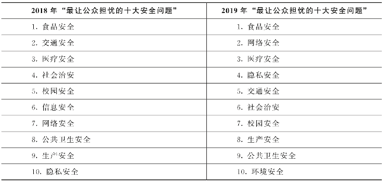

(Source: Xiaokang Network. 2018, 2019 China Safe Xiaokang Index: Top Ten Safety Issues Most Worried by the Public [OL]. http://www.sohu.com/a/239248333_426502; http://mini.eastday.com/a/190709153848239.html)

In the past two years, the public's concern about campus safety is not groundless but has its reasons. Today, in some campuses, some "naughty" students or "street hoodlums" still take the lead in inciting some students to make trouble, smashing and dismantling campus doors, windows, newsstands, and other facilities. Even more vicious, some evil elements target vulnerable students, carrying out violent attacks against this group; due to the extremely vicious nature, these escalate into campus violence incidents.

Campus safety issues are not limited to campus violence hazards; campus bullying incidents cannot be ignored either. On April 9, 2019, a 40-second video of "female middle school students fighting" went "viral" online. The video shows two female middle school students in school uniforms fighting in a deserted alley; more accurately, one female student frantically bullying another, intermittently insulting the other with foul language. And the students filming nearby could be heard laughing. It is visible that the situation of campus bullying is relatively serious.

Campus safety incidents include not only campus violence and bullying incidents but also campus traffic safety incidents, campus food safety, campus fires, unsafe campus facilities, etc. These incidents share a commonality: they all cause varying degrees of harm to students. If such campus safety incidents are not eliminated in time, they will quickly affect the overall campus safety environment. For example, if an ongoing campus bullying incident is not mediated by the school and family in time, it can easily evolve into a campus group incident, with students "forming gangs" to fight each other, with unimaginable consequences.

Campus safety means that all faculty and students during their time on campus will not be threatened or harmed by the environment or others, nor will they become people who threaten or harm others, thereby maintaining a relatively safe state. In smart campus construction, campus safety construction should be placed first. Therefore, building a smart campus should follow the principle of "safety first," comprehensively carry out campus safety governance work, to ensure that the most basic survival and safety needs of all faculty and students are met, and not let them live in constant panic of insecurity.

To give all faculty and students a harmonious and safe environment, it is necessary to consider how to effectively utilize new-generation scientific technologies such as big data and artificial intelligence to assist campus safety management work in the process of promoting smart campus construction. AI technology is a technology integration system, a manifestation of highly integrated technology, containing various sub-technologies, among which video recognition technology is one. In the intelligent era, installing cameras covering the entire school within the smart campus is an important guarantee for campus safety. The purpose of installing full-coverage cameras is not to monitor, but to expose possible "darkness" under the sun, present it to managers, thereby making every corner of the campus a collection of visualizable video data, revealing "hidden" campus safety problems. Campus camera recordings are installed near elevators, entry/exit vehicles, toilets, campus building rooftops, and various places where pedestrians pass, all for the purpose of improving campus safety.

Before the introduction of intelligent video recognition technology, many schools had already established the most basic monitoring network, laying the foundation for the subsequent introduction of intelligent technology. In the traditional campus monitoring network, only massive monitoring data was collected, requiring a large number of employees to manually analyze data rather than automatic system analysis. That is to say, the original monitoring system did not possess functions such as intelligent recognition, early warning, and video summarization, which requires upgrading the security monitoring network, introducing an intelligent video monitoring cloud system, adding intelligent recognition functions (such as license plate recognition, facial recognition, abnormal behavior recognition, etc.) on the basis of security monitoring video, and pushing video summaries to the cloud for search ^([\[4\]](#txt008.html#footnote_content_txt008_4)). In this way, abnormal behavior data occurring within the campus can achieve early warning and control at the first moment.

AI video recognition technology is based on the automated and intelligent discrimination and identification technology of AI machines. Compared with traditional video monitoring technology, it has advantages such as high video content audit efficiency and fast discovery of harmful audio information. Therefore, the existence of the campus intelligent video monitoring cloud system will undoubtedly help enhance the overall level of the smart campus security system and further effectively guarantee campus safety.

When talking about campus safety issues, one cannot avoid the student health issues triggered by campus influenza. The campus is a place where large crowds gather; once influenza breaks out, it spreads extremely fast and has strong radiation capability, which should be focused on and controlled. According to the Google Flu Trends prediction model, introducing AI technology helps early warning of campus influenza development trends. In 2017, Ping An of China and the Chongqing Disease Control Center jointly successfully developed the world's first AI influenza prediction model. After practical testing, the model can predict the development trend of influenza one week in advance, greatly improving the efficiency of influenza prediction and the response capability of early warning. The prediction accuracy of both influenza and hand, foot, and mouth disease models reaches over 86%, and the prediction accuracy in high-incidence seasons can reach over 90%; applying the COPD intelligent screening model can significantly reduce screening costs and improve screening efficiency. Currently, the model's accuracy has reached 92%. It is visible that if the AI influenza prediction model is nested in the smart campus construction process, it will inevitably further enhance the campus influenza prediction capability, realize campus influenza monitoring and early filing, and activate response plans, with schools, families, and disease control centers coordinating together to jointly give children a healthy learning environment.

The application of AI technology in campus safety management, with its efficient and precise work, can not only identify campus abnormal behaviors in advance but also detect campus dangerous scenarios in time, and realize intelligent reminders and early warnings, achieving the elimination of campus safety hazards from the source. Whether it is the intelligent influenza prediction model or the campus intelligent monitoring recognition system, they are all application forms of AI technology in campus safety, truly related to campus safety and the physical and mental health of all faculty and students.

From the current perspective, the embedding of AI technology into smart campuses should also pay attention to coordination in several aspects. On the one hand, attention should be paid to the cultivation of professional AI talent teams; the model optimization of the campus safety system requires a very high level of intelligent technology, which cannot be handled by general technical workers. On the other hand, the intelligent and smart upgrading of the campus is a systematic project; separately upgrading the intelligent level of campus safety early warning involves many uncertain factors, requiring good coordination work. In the coordination process, it is no longer limited to the campus safety management department but involves the upgrading and transformation of the entire software and hardware facilities. Therefore, it is necessary to establish a departmental coordination mechanism of "vertical linkage" and "horizontal coordination."

### (2) Artificial Intelligence and Library Management

Today on university campuses, the library has become a synonym for learning places: going to the library to "borrow and read books," "find materials for papers," "discuss topics," etc., constitutes an essential activity for college students. The technological management of the new era campus library—smart library—indeed provides students with an excellent learning environment, facilitating both the search for paper book materials and electronic materials. Compared with traditional libraries, the advantages are obvious.

In traditional libraries, all book resources are mainly in paper versions; books and documents are huge in size, occupy a lot of space, and when the library opens, the placement of books, handling, sorting, and other work require a lot of manpower. In addition, students entering and leaving the library require manual identity verification, and borrowing books requires manual entry of book borrowing registration; service quality is easily affected by human factors (the mood of library staff easily affects students' impression of the library). Moreover, the retrieval of collection resources in traditional libraries is relatively difficult, the speed of resource acquisition is very slow, easily affecting students' learning interest.

To change this situation, in the process of smart campus construction, the library form must be reshaped. How to apply emerging technologies to improve library service quality and enhance students' pleasant experience of the library has become an important issue in smart campus construction.

In mid-March 2018, the 29th Beijing Educational Equipment Exhibition was held in Beijing. The conference showcased various styles through expert forums, enterprise case sharing, and campus case sharing. Xinshengda Education reported on the "Smart Library Solution," proposing the *RFID Library Solution*, which contains rich wisdom for smart library construction. Through the application of RFID technology, the binding of bookshelves, tags, books, and locations is realized, comprehensively achieving intelligent management and service of the overall information of library cataloging, retrieval, statistics, book reading, and circulation. Smart bookshelves, smart inventory carts, librarian workstations, automatic book borrowing and returning machines, mobile book return cabinets, smart card issuing machines, RFID security gates, OPAC query machines, high-frequency shelf labels, smart navigation systems, RFID book tags, surveillance cameras, smart bookshelves, and other technologies cover the entire library application scenario, bringing values such as efficient management, convenience, data visualization, and personalized book customization to library operations.

The smart library is the extension and development of the traditional library; it fundamentally extends the service time and space of the library, redefines the existence of the library conceptually, and has even extended to the sharing field based on intelligent technology. In recent years, "sharing culture" has prevailed unprecedentedly in society; shared bicycles, shared cars, shared power banks, shared platforms, shared data, etc., have emerged. Precisely because of this, the word "sharing" successfully entered the "Top Ten Buzzwords in Chinese Media in 2017." The social penetration of sharing culture has not stopped at the above fields but continues to develop horizontally; library development has also been influenced—shared libraries have emerged. In June 2018, Changsha's first shared library was born. This library aims to advocate a cultural atmosphere of "book sharing, universal reading, and common participation," building the library into a comprehensive library integrating reading, training, exhibitions, forums, and other functions. Citizens can read and relax here for free, and enterprises and institutions can also hold training, exhibitions, and other public welfare activities here.

At the same time, supporting service functions such as "WeChat Mini Program + IC Borrowing Card + Fingerprint Recognition + Facial Recognition Cabinet Opening for Borrowing + Disinfection System + Book Donation System" assist the emergence of intelligent shared book cabinets. According to the intelligent book cabinet developed by Luotang Technology, the intelligent shared book cabinet is essentially an unmanned shared book cabinet, a shared book cabinet that realizes self-service book borrowing and returning through intelligent cabinets. Readers can not only borrow and return books through the intelligent book cabinet but also reserve books via WeChat, which is very convenient and fast ^([\[5\]](#txt008.html#footnote_content_txt008_5)).

It can be seen that the application of AI technology in smart libraries is in full swing, with diverse application forms, including smart libraries, intelligent shared book cabinets, intelligent shared libraries, smart archives, etc.; in terms of specific technology integration, including smart bookshelves, smart navigation, smart tags, etc. The combination of AI technology and libraries has catalyzed new forms of libraries, enabling libraries to gradually move towards informatization and modernization in the process of critical inheritance of traditional libraries.

In the application cases of AI combined with libraries, the concept of smart library gradually becomes clear. A smart library refers to the application of new-generation information technologies such as the Internet, Internet of Things, big data, and artificial intelligence in library management, planning, and construction, making the innovated library a gathering place of book resources with highly intelligent management and services. From the perspective of time and space, because of the empowerment of intelligent technology, many "7+24 libraries" have been able to operate normally. It is visible that the smart library is a place not limited by time and space; once built, users can enter the library anytime, anywhere for data retrieval and download, which is very convenient.

From the current development trend, the value of smart libraries is mainly reflected in these aspects: First, smart libraries can realize the recycling of book resources to the greatest extent, reducing the problem of book resource waste caused by information blockage; Second, smart libraries can reduce manual costs of management and service, save construction and maintenance costs, improve the overall service quality of the library, and enhance users' positive experience; Finally, the library's book resources are rich, resource density is high, physical volume is small, occupying less library space resources, which is conducive to using more space for learning scene layout.


## Technical Applications and Development of Smart Campus

### (III) Artificial Intelligence and Campus Smart Lighting System

The integration of artificial intelligence technology with campus lighting systems has given birth to the campus smart lighting system. The campus smart lighting system refers to the application of technologies such as big data, cloud computing, and artificial intelligence in the management, service, and operation & maintenance processes of campus lighting systems, comprehensively improving the utilization efficiency of lighting resources and the control capability of lighting systems, thereby constructing an intelligent platform for the smart campus lighting system that integrates functions such as data collection, data storage, data analysis, data optimization, precise decision-making, and resource prediction.

The campus smart lighting system is a new generation of lighting systems developed on the basis of traditional campus lighting systems. Before intelligent technology was integrated with the campus lighting system, there were relatively obvious resource waste problems. Traditional campus lighting systems either designated a campus-wide lights-out time or designated that lights stay on all night; the result was low resource utilization efficiency, causing serious waste of lighting resources, or the lighting needs of teachers and students not being effectively met. "Lights on when people leave" and "lights off when people come" are common issues in traditional campus lighting systems. To solve these "two major problems" existing in campus lighting systems, the unmanned and intelligent lighting concept supported by artificial intelligence technology has undoubtedly become a focus of smart campus construction.

After the smart campus lighting system nests artificial intelligence technology, the campus lighting network begins to become intelligent. At that time, the campus lighting system can be controlled omnidirectionally through intelligent terminals, achieving "one-key multi-control," saving the labor cost of manually executing light-switching tasks. Moreover, the smart campus lighting system based on algorithm models enables the brightness of each lamp to change with the surrounding environment. It can adjust the overall brightness of the lights according to the ambient light brightness and adjust the lights in occupied areas to the most suitable brightness. Through the application of intelligent sensing technology and edge computing technology, when daytime arrives, some lights of the lighting system will turn off; for the interlayers between densely populated floors, due to weak peripheral light, the lighting system remains operational. As long as teachers or students pass by, it can achieve the goal of "lights on when people come, lights off when people leave" with the help of intelligent sensing technology. Therefore, the smart campus lighting system has relatively outstanding value in three dimensions: energy saving, environmental protection, and comfort.

The smart campus lighting system can also realize functions such as remote meter reading, intelligent fault detection, power grid danger location, illegal electricity use warning, and current control. The work that previously required manual meter reading is now entirely handled by the backend processor of the smart lighting system. For example, with the help of specific algorithm models, the system can calculate fees based on the actual lighting power consumption data of each dormitory, and inform students of the results via the smart campus lighting system platform and SMS. Students can pay remotely on the smart lighting platform, which not only provides convenience for students' lives but also saves a lot of time and energy for the staff of the campus lighting consumption system, overall reducing the operating costs of the lighting system.

With the help of the campus smart lighting system, the smart campus becomes more comfortable and pleasant. In summary, the value of the campus smart lighting system is reflected in two aspects: On the one hand, it creates an intelligent light-sensing environment for all teachers and students. Supported by a series of energy-saving and environmental protection technologies, the entire lighting system can fully utilize peripheral natural light to achieve energy-saving purposes, improving the overall living environment of teachers and students, which is conducive to improving their work and study efficiency. On the other hand, it improves the overall management level of the campus lighting system, realizing the transformation from "manual" to "intelligent." Many management ideas and concepts can be implemented therein, while greatly reducing the operation and maintenance costs of the school lighting system and saving overall campus expenditure.

### (IV) Artificial Intelligence and Smart Teaching Management System

The smart teaching management system refers to the process by which schools fully utilize new management means and methods to enhance the "presence" state of teachers and students. Supported by multi-source heterogeneous teaching big data, teaching management algorithm models, 5G rapid transmission technology, cloud storage, and ultra-high-speed computing, people have begun to discuss the advantages and disadvantages of traditional teaching management models.

In traditional campus teaching management, due to imperfect campus supervision mechanisms, limited numbers of supervision staff, and supervision technology limited by software and hardware levels, there are many limitations in teaching management. High-quality management activities originate from high-quality decision support, and high-quality decisions originate from comprehensive mastery of decision data. Only by fully utilizing objective and comprehensive teaching big data can managers make correct decisions. Teaching management generally includes methods such as planning, organizing, coordinating, and controlling, but confined by the fragmentation and single-dimensionality of traditional managers' data collection, even the most scientific management strategies are to no avail.

Traditional teaching managers make management decisions based on partial data. For teachers and students in teaching activities, teachers are in a managed position, and students are in a dominated position. Teaching management activities cannot fully reflect the will of teachers and students. Therefore, teaching management activities become the privilege of managers; the participation rights and rights to know of teachers and students are separated; the "two-way feedback" mechanism of teaching management is immature; the subject status of students is restricted; teachers lose the initiative in planning teaching activities and become listeners and executors. It can be seen that the school's traditional teaching management is actually the manager's business, not the common business of all teachers, students, and administrative staff, thereby restricting the scientific process of school teaching management and also constraining the formation of critical thinking environments and innovative thinking environments.

To solve the drawbacks existing in traditional teaching management, introducing emerging technologies to assist in expanding the "two-way feedback" channels and platforms of teaching management has become an important link in the intellectualization and intelligence of teaching management. The construction of smart teaching management is divided into three dimensions: first, a learning management system oriented towards students; second, a teacher management system oriented towards teachers; third, an academic affairs system oriented towards managers. The first two systems are interactive, and the teacher management system can efficiently mobilize learning data from the learning system and control the learning system's operation interface through specific algorithms. The learning management system can feed back learning data to the teacher management system in a timely manner, and the teacher system is directly connected to the academic affairs system.

#### Learning Management System

Specific functional modules include student information management, student online learning management, student academic performance management, student learning situation statistical analysis, student learning course progress management, learning process recording and tracking, online interactive learning platform, student learning feedback management, etc. In this system, besides teachers being able to quickly mobilize their data, students can also shuttle through it relatively freely. For example, querying grades, viewing their own learning progress, freely selecting video learning resources in the system, downloading course files they want to study in depth, etc. It can be seen that this system provides very convenient channels for students' learning, while also providing technical support for teachers to deeply understand students.

#### Teacher Management System

Specific functional modules include teacher information management, teacher performance management, teacher teaching progress management, teacher homework correction system, teacher question-setting platform, teacher information feedback platform, student learning situation docking ports, etc. In this system, teachers complete login authentication through faculty identity authentication codes and can run all functions in the system. For example, teachers can use the teacher system to achieve one-click access to the specific teaching progress of a certain subject in a certain class recently, understand the specific learning performance of students in the course, and conduct pre- and post-learning performance tests for students, thereby timely improving teaching progress and teaching methods, promoting the adaptation of educational teaching work to the student learning process and individual student learning situations.

#### Academic Affairs Management System

School managers can use this system to understand students' learning situations and teachers' teaching situations, as well as teachers' teaching progress and effectiveness, students' learning situations and effectiveness, teachers' overall professional quality and professional image, students' evaluations and feedback on teachers, and teacher and student satisfaction with school management work, etc. From the perspective of systems theory, the student learning system is the core and key of the entire smart teaching management system, while the teacher teaching system and the school academic affairs management system serve directly for student learning. The construction concept of the entire smart teaching management system is "student-centered, majors serving students, achieving students' future," highlighting the educational value of "cultivating virtue and nurturing people."

From the perspective of management science, students, teachers, and schools achieve connection in a "virtual field," filling the "understanding gaps" between the three caused by distance and time, thereby constructing a smart ecological management system where the virtual and the real "reflect wisdom into each other" in the smart campus, undoubtedly achieving the goal of "dual leap" in management efficiency and management quality.

The entire smart teaching management system forms a "student-centered" intelligent management framework, and its greatest value is naturally reflected in students' learning effects.

First, it can provide students with learning materials such as multimedia courseware and learning resources. Students can select learning content on demand according to their own situations and reasonably arrange study plans. This is conducive to cultivating students' good habits of independent learning and lifelong learning. At the same time, the intelligent teaching management system can also provide students with space to store learning achievements and record learning feelings, forming student growth portfolios, allowing teachers to better conduct process evaluations of students' learning activities[⁷].

Second, it can save students time spent searching for learning resources, formulating study plans, and summarizing knowledge blind spots. While reducing students' learning tasks, it also provides free time for students' free development.

Finally, in the learning process, students can receive personalized emotional attention from teachers and intelligent learning recommendations from the intelligent learning system, reflecting students' personal value and teachers' humanistic care for students. Teachers' love for students no longer stays at "empty talk." From the perspective of cognitive behaviorism, teachers can let students know the specific reasons for each reward or punishment, making the shaping of students' behavior more rule-based.

The value of the smart teaching management system is not limited to this; it can also reduce teachers' workload and provide school managers with a mobile office platform, etc. All these highlight the "wisdom" of the Campus 3.0 era. In the intelligent era, although artificial intelligence will not completely replace humans in managing campus teaching work, schools that do not use artificial intelligence technology in teaching management activities are destined to be at a disadvantage in the competitive education system. Therefore, the upgrading of the smart campus teaching management system should actively introduce new-generation information technology and new-generation artificial intelligence technology and take them as the foundation to comprehensively improve the quality of teaching management, thereby enhancing the overall educational quality of the school.

### (V) "Campus One Card" Moving Towards "Campus One Face"

In 1999, Fuzhou Yinda Company took the lead in launching the Bank-School One Card system, which was the earliest campus one card system. After perfecting its payment function, it was soon promoted to campuses across the country, bringing a lot of convenience to school management and service work. Based on this, many companies also began to enter this field, continuously improving and enriching the technical architecture and platform service areas of the campus one card. Today, domestic campus one cards have basically achieved full coverage.

The campus one card is a comprehensive application tool supported by technologies such as the Internet, Internet of Things, and computers. It has functions such as identity authentication, campus consumption, teaching attendance, school medical treatment, and activity sign-in. It is an essential activity credential for every student in the Campus 3.0 era. It integrates the categorized applications of traditional campus students' "one person, multiple cards," realizing the campus application goal of "one card for all uses." In terms of its concept itself, the campus one card features multi-card integration, digital identity, and human-computer interaction credentials.

Campus one cards can be divided into student cards oriented towards students, faculty cards oriented towards faculty and staff, and temporary cards oriented towards personnel active on campus for short periods. These three types of cards are all processed using real-name identity authentication methods, serving as independent credentials for personal campus activities. However, if the campus card expires or a fake campus card is processed, activity behaviors in the school will be restricted. In other words, this is the very purpose of the existence of the campus one card: to facilitate the management and service of an "open and complex" campus system.

Different campus eras, from the "paper hanging 牌" campus cards ("one life, multiple cards") to "digital machine-readable" campus cards, the evolution of students' campus identity authentication methods all reflect the history of campus development and are closely related to the entire social environment. Then, in the era of artificial intelligence, during the construction of the smart campus, what face will the campus one card appear with?

On June 27, 2018, the official WeChat account of Beijing Normal University released a message stating that the school would use facial recognition access control systems in all dormitory buildings, meaning that Beijing Normal University would enter the comprehensive "brush face" era. This also means that, as a top normal university in China, taking the lead in implementing the management and application of artificial intelligence technology entering the campus will open a new era of "Campus One Card" applications, and the "Campus One Card" begins to move towards "Campus One Face."

Since the transformation from "Campus One Card" to "Campus One Face," its application has begun to spread continuously. On July 27, 2018, Peking University began operating "Campus One Face" at the Southwest Gate. In its access control system, breaking through the drawbacks of traditional 1:1 facial recognition technology, it adopted 1:n real-time facial recognition technology, supported by a database of 100,000 photos. Every time a student enters the school, it only takes one second to achieve precise matching of facial features, thus passing the campus access control system.

On December 3, 2018, Shimen Middle School in Foshan City, Guangdong Province, fully launched the facial recognition intelligent system. The school main gate and dormitory area gates all use "brush face" for entry and exit. This "brush face" system also records student leave, late arrival, and other attendance situations. Foshan schools have ushered in the "brush face" era. It can be seen that "brush face" will become the new normal of future smart campuses, and students will no longer be troubled by issues such as "card loss, forgetting, wear and tear, replacement, card replacement, theft."

Today, with the continuous improvement of intelligent facial recognition technology, the application of "Campus One Face" has begun to become popular, attracting the interest of relevant researchers. "Campus One Face" is an upgraded version of "Campus One Card." It is an intelligent application system based on new-generation information technologies such as the Internet of Things, big data, cloud computing, and artificial intelligence. Its specific application systems include: facial recognition access control system, facial recognition dormitory management system, facial recognition campus payment system, facial recognition campus security system, facial recognition campus registration system, facial recognition teacher attendance system, facial recognition library system, facial recognition class management system, etc. The application of "Campus One Face" plays an important role in promoting the intellectualization process of the smart campus, allowing teachers and students to truly experience the real existence of the smart campus from the application level.

The reaction speed of artificial intelligence recognition technology is extremely fast, making the construction and layout quality of "Campus One Face" in smart campus construction better and office efficiency higher. For example, if a stranger appears on campus, in the traditional "Campus One Card" system, the access control system is manually guarded, inevitably leading to work errors due to fatigue and exhaustion. However, after introducing the "Campus One Face" system, the campus access control system is online 24 hours a day. As long as a stranger visits, registration information can be realized immediately, overall improving the security level of the smart campus. In addition, artificial intelligence recognition technology can randomly check student attendance and learning situations at any time. For example, if academic affairs personnel want to understand a student's learning situation, they can directly use the "Campus One Face" intelligent recognition system to understand whether the student's time for eating in the cafeteria is regular, the number of times the student goes to the library, whether the student returns to the dormitory to punch in at the designated time, etc. These can all reflect the student's learning situation and recent behavior habits and activity range from the side. Based on these data, combined with the student's academic performance, the reasons for abnormal fluctuations in the student's grades can be analyzed in detail, so as to take corresponding intervention measures.

From the value dimension, the intelligent "Campus One Face" not only helps to enhance campus security work and intelligently identify students' learning situations but also facilitates student entry registration. However, everything has two sides. The normal operation of "Campus One Face" requires prior facial data collection and storage, and then data comparison based on the database. That is to say, for "Campus One Face" to operate normally in a school, it must accurately collect and store the facial information of all teachers and students in the school, thereby forming big data about "Campus One Face." Therefore, the privacy protection issue of all teachers and students has become the biggest headache for the school. Because this data relates to the personal safety and property safety of teachers and students, if the campus database is attacked by criminals, or if the campus database's own confidentiality work is not done well, the negative impact on teachers and students is huge. In addition, the information collected by "Campus One Face" facial data has limitations. When dealing with changes in teachers' and students' clothing, hairstyles, facial expressions, and other factors in the later stage, recognition errors will occur, sometimes becoming obstacles to teachers' and students' work and study.

Therefore, to address the privacy protection issues and recognition error issues brought by the "Campus One Face" system, schools should strengthen cooperation and communication with service outsourcing parties, improve the accountability mechanism for problems, clarify possible dangerous vulnerabilities, and prepare relevant technical remedial plans in advance; they should strictly encrypt and store the campus facial database, introduce "hacker" technology, block possible intrusion channels for hackers, and embed intelligent early warning mechanisms on various intrusion channels to pop up early warning prompts when invaded, so that the school can close data flow channels in time to ensure the security of school big data; finally, schools should cultivate and introduce intelligent composite talents to provide the necessary talent foundation for the smart "Campus One Face" system.

## Three, The Future Classroom: Conceptions on the Smart Classroom

### (I) The Relationship Between Classroom and Class

For traditional education, the classroom becomes everyone's first impression. The song "Childhood" sings like this: "The teacher's chalk on the blackboard, still writing non-stop desperately... Always have to wait until before sleep to know that only a little homework was done, always have to wait until after the exam to know that the books that should have been read were not read..." From the lyrics, we can quickly outline a picture of the classroom: the teacher explaining important knowledge points; a group of children gathered into a class, writing furiously. In this picture, teachers, classrooms, class, teaching materials, and students complement each other; the classroom and class merge into one. Therefore, whenever people mention the relationship between the classroom and class, they are very confused and find it difficult to effectively distinguish the two. So, what exactly is the relationship between the classroom and class?

In traditional education, "teachers," "teaching materials," and "class" constitute the "three centers" of teaching. The teacher holding a teaching material teaching students in the classroom is the most intuitive impression the traditional class gives people, and this is also the common experience of students' student careers in the past. During this period, the classroom and class coexisted, and everyone's understanding of the two was only coexisting in a memory. Some even directly equated the two, believing that the classroom and class are synonyms, both referring to the place where teachers engage in educational activities and students engage in learning activities. However, with the development of education, people gradually discovered that the existence of the class is not limited to the classroom but exists in places with teaching activities. Therefore, the view that the classroom and class are equivalent has been challenged.

The understanding of the essence of things becomes more and more real in the evolution of history, and the dialectical relationship between the classroom and class is the same. In the era of artificial intelligence, the emergence of emerging technologies has impacted the traditional forms of the classroom and class. People gradually realize that both the classroom and class are activity places for teaching activities. Because before the emergence of emerging technologies, classes basically all took place inside the classroom, so it was difficult for people to distinguish the relationship between the two.

In the intelligent era, the concepts of class and classroom have also changed. Both the class and the classroom are places for teaching activities, but the former has a wider scope, not only referring to teaching activities in the classroom but also including various teacher-student interactions, student-student interactions, and other activities; the class is a combination of physical attributes and virtual attributes. The classroom refers to a room specially used for teaching activities, a physical space; the classroom is closely combined with the class only when teaching activities are taking place.

Therefore, strictly speaking, the class is ubiquitous. It is an abstract concept. As long as one wants to learn, any time, any place, any scene can be a class, while the classroom is a physical place that people can truly see. In terms of origin, the class existed earlier than the classroom. Only when specialized private school education and school education appeared did the classroom come into being. In terms of connection, the moment when the classroom and class combine most closely is manifested in the teaching activities of the class-teaching system form.

With the development of artificial intelligence technology, the debate about the classroom and class has appeared again. The question of how the classroom and class should combine has become a problem of concern to people in the new era. In the intelligent era, human-computer interaction technology is maturing day by day. The artificial intelligence education revolution catalyzed by intelligent technology requires the construction of the smart campus to be implemented in every corner of the school. Teachers' teaching thinking, the school's basic education software and hardware facilities, students' learning thinking, etc., all need to undergo an innovation. As the main place for teaching activities in the smart campus, the intelligent transformation of the classroom will be an important task in the construction of the smart campus.

### (II) Construction and Application of Smart Classroom

The construction of the smart campus, the technological transformation of teaching activity places such as classrooms, and the upgrading of software and hardware service platforms have enabled the emergence of the smart classroom. The smart classroom refers to the process of promoting the intellectualization and intelligence of teaching activity places and education channels based on emerging technologies such as the Internet of Things, big data, cloud computing, and artificial intelligence. From the perspective of specific classroom forms, answers still need to be found in corresponding applications. For example, when Pingdu City, Shandong Province launched the synchronous classroom (smart classroom) project, it pointed out that, supported by campus software and hardware facilities, it would further carry out smart classroom construction work, specifically introducing and practicing aspects such as classroom software and hardware facilities, course recording, and remote interaction, pointing out three dimensions of smart classroom construction, requiring both attention to the recording of real data and attention to the smooth flow of interaction channels between teachers and students. In terms of smart campus construction, the main realization place for the three dimensions of the smart classroom still needs to be centered on the smart classroom. The smart classroom is shown in Figure 8-2.

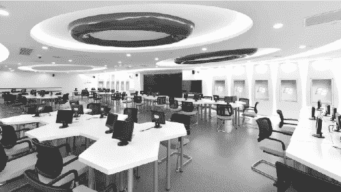

Figure 8-2 The Real Space of the Smart Classroom[⁸]

[⁷]: Reference [7]
[⁸]: Reference [8]


## IV. From Discrete to System: Construction Strategies for Smart Campus

Whether it is the smart classroom, security management system, smart teaching management system, smart one-card system, smart library system, or campus lighting system in a smart campus, all are application processes of service transformation and management upgrade towards wisdom and intelligence achieved with the help of new-generation information technology and new-generation artificial intelligence technology.

In the era of artificial intelligence, the transformation and upgrading of various subsystems of the smart campus all serve to promote educational equity, improve educational quality, and cultivate innovative talents. Their entire updating and replacement process basically proceeds along three dimensions: technology, concept, and application, and all center on "student-centered" management, achieving a dual improvement in teaching efficiency and quality. Therefore, the final construction of a smart campus means that the campus management concept will realize a transformation from "management" to "service," and then to "achievement"; school teaching will shift from "teacher-centered" to "student-centered," and school education will become the center of personalized education.

With the continuous development of the Internet of Things, big data, cloud computing, edge computing, 5G technology, and artificial intelligence technology, the tendency towards the intelligence of all things is becoming increasingly significant, intelligent industries are increasing, the level of social intelligence is further improving, and overall social development will enter a stage of deep intelligence. Therefore, the development of artificial intelligence education will inevitably follow the trend of social development and move towards a stage of deep intelligence. At the same time, as one of the "three major places" of education, the trend of deep intelligence development in smart campuses must inevitably "move in the same direction" as the general direction of educational development. Therefore, continuing to promote the construction of smart campuses brooks no delay.

Judging from the current development status, the construction of smart campuses has achieved certain results. Various management and service fields on campus have basically realized intelligence and have begun to develop in the direction of integration. However, overall, efforts still need to be made in terms of system wisdom, to improve independent application systems with "exclusivity," starting from both technology and demand, to optimize the comfort and convenience of human-computer interaction, and enhance the intelligent perception experience of smart campus actors.

From a long-term perspective, the construction of smart campuses should continue to carry out work in four aspects: First, from the perspective of top-level planning, formulate a scientific blueprint for smart campus construction, lead the standardized, systematic, and deeply intelligent development of smart campus construction at the level of guiding ideology and policy assistance, while also giving the builders of smart campuses full autonomy to highlight local and regional characteristics during the construction process, demonstrating innovative charm and humanistic color.

Second, a sound supervision mechanism for smart campus construction should be established to prevent the "deviant" development of smart campuses. The supervision mechanism should cover the operation, management, and funding of smart campuses, ensuring the deep integration of new-era educational ideas, social values, human-centered values, and the life of the smart campus. Supported by an efficient and transparent campus supervision mechanism, the smart campus should truly become a place for "cultivating virtue and nurturing people," rather than becoming a breeding ground for "unfairness, corruption, and injustice."

Third, strengthen theoretical research. Theory is the knowledge and statement about things; scientific theory can be transformed into material force in practice and can also guide the direction of practice development. Smart campus construction is still in the development stage, and relevant theoretical research is not yet mature. Therefore, it is necessary to conduct a concentrated discussion on this issue specifically, to form a theory and philosophical view on smart campus construction, thereby scientifically guiding the work of smart campus construction. Theoretical research on smart campuses contains two levels: one is whether there is a theory that can guide the design and construction of smart campuses; the other is whether smart campus construction can give birth to new theories. Smart campuses are still relatively new things, providing opportunities for possible theoretical construction; on the basis of comparative analysis of many theories, construct the smart campus's own design and construction theory^([\[10\]](#txt008.html#footnote_content_txt008_10)).

Finally, strengthen the guarantee of construction resources. National finance should increase investment in smart campus construction; school authorities should actively coordinate school and community resources to ensure sufficient operation and maintenance funds for smart campus construction. Actively carry out talent introduction work, cultivate versatile campus intelligence talents, and provide a necessary talent foundation for the development of smart campuses.

The construction of smart campuses in the new era of intelligence essentially lies in leveraging new-generation information technology and new-generation artificial intelligence technology to provide necessary support and technical guarantees for cultivating innovative talents and leading figures of the new era. Therefore, at the national level, top-level planning and policy guidance for smart campus construction should be done well; at the social level, financial support and necessary material guarantees should be provided; at the school level, the trend of the times should be closely followed, theoretical research on smart campus construction should be strengthened, "on-campus" and "off-campus" resources should be actively integrated, and all-out efforts should be made to enhance the level of campus wisdom.

## Notes

- [[1]](#txt008.html#footnote_quote_txt008_1) Baidu Baike. Smart Campus [EB/OL]. `https：//baike.baidu.com/item/%E6%99%BA%E6%85%A7%E6%A0%A1%E5%9B%AD/9845341?fr=aladdin.`
- [[2]](#txt008.html#footnote_quote_txt008_2) The State Council. Notice on Issuing the "13th Five-Year Plan" for the Development of National Education [EB/OL]. `http：//www.gov.cn/zhengce/content/2017-01/19/content_5161341.htm.`
- [[3]](#txt008.html#footnote_quote_txt008_3) China National Radio (CNR). Xi Jinping's Important Speech at the National Public Security Work Conference Arouses Enthusiastic Response [OL]. [2019-05-10]. `http：//china.cnr.cn/news/20190510/t20190510_524607295.shtml?uc_biz_str=S：custom.`
- [[4]](#txt008.html#footnote_quote_txt008_4) Luo Shaoke, Lu Yangkui. Application Research of Video Recognition Technology in University Campus Traffic Safety Management [J]. China Educational Informatization, 2017(05): 48-50.
- [[5]](#txt008.html#footnote_quote_txt008_5) Luotang Technology. Luotang Smart Book Cabinet [OL]. `https：//www.lotaai.com/books.`
- [[6]](#txt008.html#footnote_quote_txt008_6) Image source: China Industry Information. China's Library RFID Market Size Approx. 937 Million Yuan in 2018, "Public Library Law of the PRC" Expected to Become Important Driving Force for Industry Growth [OL]. `http：//www.chyxx.com/industry/201908/772630.html.`
- [[7]](#txt008.html#footnote_quote_txt008_7) Huang Xianzheng. Intelligent Teaching Management System of Chengdu University Normal College [D]. Chengdu: University of Electronic Science and Technology of China, 2011.
- [[8]](#txt008.html#footnote_quote_txt008_8) Image source: Sohu. Smart Campus, Where is the "Wisdom"? [OL]. `http：//www.sohu.com/a/270084973_100145035.`
- [[9]](#txt008.html#footnote_quote_txt008_9) Image source: Baidu. Baidu Smart Classroom [OL]. `https：//study.baidu.com.`
- [[10]](#txt008.html#footnote_quote_txt008_10) Yu Changhong, Wang Yunwu, Ma Wu. Current Situation, Problems and Countermeasures of Smart Campus Construction [J]. Teaching and Management, 2015(06): 48-51.

# Chapter 9 Three Creations Education: Cultivation of Innovative Thinking Ability

- Limitation Analysis: Factors Hindering Innovation in the Intelligent Era
- Innovation Education: Cultivating Mass Innovation in the Intelligent Era
- Maker Education: Growth of Makers in the Intelligent Era
- Entrepreneurship Education: Incubating Mass Entrepreneurship in the Intelligent Era
- Coordinated Efforts: Cultivating Innovative Thinking in the Intelligent Era

In recent years, innovation education, maker education, and entrepreneurship education (Three Creations Education) have attracted widespread attention from educators and all sectors of society. On the one hand, this stems from the value of Three Creations Education; on the other hand, it is because Three Creations Education serves as a powerful response to the rapid development of technology in the intelligent era and its transformation into real productive forces. Since the state and society vigorously promoted the culture of Three Creations Education, the creative passion buried in people's hearts, long restricted by industrial culture and not well released for many years, was instantly ignited. This fundamentally triggered people to rethink current education, especially the essence, purpose, practice, and application of Three Creations Education, and how to cultivate students' innovative thinking ability in the new intelligent era.

## I. Limitation Analysis: Factors Hindering Innovation in the Intelligent Era

Innovative thinking refers to a way of thinking that breaks conventions and mental sets, thinks about, solves problems, and creates new things outside the original boundaries of thought; essentially, it is creation and innovation. Innovative thinking also refers to a scientific thinking that adapts to the times, advances despite difficulties, and pioneers innovation^([\[1\]](#txt009.html#footnote_content_txt009_1)).

Historically, innovative thinking bears distinct imprints of the times. In the traditional agricultural and industrial eras, innovative thinking mainly revolved around agriculture and industry; in the big data era, it mainly proceeded from the perspective of digitization and datafication; in the artificial intelligence era, it mainly revolves around intelligence. For example, innovative thinking in the AI era is primarily a cross-disciplinary thinking, integrative thinking, and correlational thinking. The origin and development of this mode of thinking benefit from the social culture extended by the development concepts of big data and AI technology themselves, subtly achieving an era's innovation culture, thereby giving rise to innovation education and promoting the study of innovative thinking.

In the AI era, the whole and the part begin to present a harmonious relationship of organic unity; various perspectives move from "fragmentation" to "integration"; people's behavioral modes shift from "single-dimensional" to "multiple intelligences"; and the technological field also begins to move from individual "technological isolates" to "technological complexes." Today, this trend of "holism," "diversification," and "integration" has become inevitable. The intelligent machines invented by people are not only expected to replace humans in various repetitive labors but are even hoped to alleviate human burdens in the realm of thinking modes. To this end, people must first create complex machines that integrate "thinking, behavior, and emotion." Therefore, objectively, only those with innovative thinking and innovative ability can better adapt to the needs of this era's development.

In January 2019, General Secretary Xi Jinping emphasized at the opening ceremony of a special seminar for leading officials at the provincial and ministerial levels on adhering to bottom-line thinking to prevent and defuse major risks, the need to enhance capabilities in strategic thinking, historical thinking, dialectical thinking, innovative thinking, rule-of-law thinking, and bottom-line thinking, particularly stressing the importance of innovative thinking. General Secretary Xi pointed out: "Innovation is the soul of a nation's progress, the inexhaustible driving force for a country's prosperity, and the deepest national endowment of the Chinese nation." In General Secretary Xi's view, "In fierce international competition, only innovators advance, only innovators grow strong, only innovators win." In today's era, grasping innovation means grasping the "bull's nose" (crucial link) that moves the overall situation of economic and social development. Practice proves that whether it is a large country or a small locality or enterprise, "innovation is the primary driving force leading development." Therefore, General Secretary Xi has always required that "innovation must be placed at the core of the overall national development, and scientific and technological innovation must be placed in a more important position"^([\[2\]](#txt009.html#footnote_content_txt009_2)). It can be seen that innovative thinking and innovative ability concern both the future and destiny of the Party and the country, and the future of enterprises and the long-term development of individuals; truly, "grasping innovation is grasping development, planning innovation is planning the future."

Innovative thinking is the foundation of innovative ability. A person without innovative thinking cannot fundamentally possess innovative wisdom no matter what method is used. The core of innovative thinking is divergent thinking, associative thinking, and integrative thinking. If one cannot master the core and essence of innovative thinking, it is difficult to exert the charm of innovative thinking. Thus, it can be seen that innovative thinking is the sum of a series of new ways of thinking about problems.


## Development of Innovative Thinking, Innovation Education, and Maker Education in the Intelligent Era

## I. Restrictive Factors of Innovative Thinking

Innovative tendency, always unable to jump out of traditional frameworks or fixed thinking paths.

### Restrictions of Traditional Concepts and Culture on Innovative Thinking

The restrictions of traditional concepts and culture on innovative thinking are deep-rooted. Traditional concepts and culture are divided into two categories: one is advanced culture, the other is backward culture. For example, the conservative concepts and culture manifested in the Westernization Movement; they believed that things left by ancestors could not be changed by descendants, and what people needed to do was "obey." Therefore, the Westernization Movement ultimately failed. Another example: in the late Qing Dynasty, the court chose to use horses to pull trains on tracks to avoid damaging the feng shui of the imperial tombs, becoming a laughingstock to the world. It can be seen that traditional concepts and culture hold a negative attitude towards new things, while innovative thinking pursues creation and innovation; the two are obviously different. Thus, existing traditional culture and concepts will inevitably restrict people's creative activities and innovative thinking.

### Restrictions of Industrial Culture's Sequelae on Innovative Thinking

The sequelae of industrial culture refer to a cultural environment of commercialization, standardization, and rationalization formed in society since the Industrial Revolution. From an economic perspective, industrial culture is a utilitarian culture, originating from society's excessive pursuit of economic scale and profit; in the entire cultural development process, speed and scale become the primary goals people pursue. Similarly, from the education field, this culture still shows its drawbacks. In the overall industrial environment, education development is mainly to cultivate traditional industrial talents, i.e., to deliver specialized talents for specific fields. Because social positions themselves define talents as only needing specialized talents, people only need to master a specific independent skill proficiently to obtain good remuneration. Therefore, this culture itself encourages the specialized development of talents. Obviously, traditional industry can no longer adapt to the intelligent era, and conflicts between industrial culture and intelligent culture have begun to form in society. Today, in the realm of people's thinking, there still exists fierce conflict between these two cultures. Especially in the context of China's complementary development of industrialization and intelligentization, industrial talents shaped by traditional cultural models no longer meet the development needs of the intelligent era.

## II. Innovation Education: Cultivating Mass Innovation in the Intelligent Era

Innovation education refers to educational activities aimed at cultivating people's innovative thinking, innovation ability, innovation spirit, and innovation personality. The core and key of innovation education is to cultivate the innovative thinking of the educational objects, and to shape innovation ability under the guidance of new thinking modes, forge innovation spirit in innovation practice, and ultimately form an innovation personality of "willing to innovate, daring to innovate, and good at innovating."

The AI era is an era of grand technological integration; technology fusion and cross-disciplinary technology are the main ways to innovate traditional technologies; technology application and development show trends of datafication and intelligentization; the development of various technologies is no longer independent advancement but coordinated progress in the entire technology space. Therefore, compared to tradition, innovation education in the intelligent era needs to closely revolve around informatization, datafication, wisdomization, and intelligentization to possess era value and practical guiding significance.

### (I) Necessity of Implementing Innovation Education

Competition from all sectors of society ultimately boils down to competition for innovative talents. The saying "He who obtains innovative talents wins the competition" fully reflects the value and significance of innovation from the side; implementing innovation education concerns the future and destiny of the nation, society, enterprises, and individuals.

**For the nation**, implementing innovation education, on the one hand, helps forge an innovation culture, create an overall innovation atmosphere, encourage more people to engage in innovation actions, and improve overall national innovation quality; on the other hand, it is conducive to building an innovative country. In June 2016, the CPC Central Committee and the State Council issued the "National Innovation-Driven Development Strategy Outline," which stated: "Innovation-driven development is the lifeline of the nation. The core support of national strength is scientific and technological innovation capability. If innovation is strong, the nation prospers; if innovation is weak, the nation declines. An important reason for China's backwardness and suffering in modern times was missing successive technological revolutions, leading to weak science and technology and weak national power. To realize the Chinese Dream of the great rejuvenation of the Chinese nation, we must truly make good use of science and technology, this revolutionary force and powerful lever of the highest significance." This shows that innovation education bears the future and destiny of the nation, the heavy responsibility of a nation's scientific and technological innovation, and is a major measure for building an innovative country.

**Innovation education is the foundation of enterprise survival.** "Others don't have it, I do; others have it, I excel; others excel, I am unique." Although this expression reflecting corporate innovation is colloquial, the reasoning is profound. For enterprises, developing products not on the market through innovation paths is the most effective way to seize the market. For products operated by all enterprises, what enterprises need to do is innovate in product performance, structure, and appearance, creating higher-value products to be more welcomed by the market. Therefore, carrying out innovation education in enterprises is of great significance; it is the key for enterprises to cultivate and retain innovative talents, and directly relates to the enterprise's market share and future prospects. No one believes an enterprise that stagnates and does not seek innovation can stand forever.

**Innovation education is an important content of education.** Education is a purposeful activity of cultivating people; it concerns the survival and development of the educational objects. But in today's era, innovation has become a key element in the competition of nations, enterprises, and individuals; the national level needs innovative talents, the enterprise level needs innovative talents, and from the perspective of personal development, only by receiving innovation education can one better adapt to a social life full of fierce competition. Therefore, whether it is family education, school education, or social education, all should teach students to establish innovative concepts, cultivate innovative personalities, and actively view and solve problems from new perspectives. From a technological perspective, the entire development history of humanity is a history of survival and elimination. Especially in the intelligent era, the conflict between technology and humanities is exceptionally fierce; the elimination between people and between people and machines shows a "double superposition" trend; those without innovative thinking and ability will not only be replaced by others but also face the danger of being replaced by machines. Therefore, innovation education should become an important content of current education; all levels and types of education should revolve around innovation education to effectively enhance the innovation ability and level of educational objects.

### (II) New Perspectives on Innovation Education in the Intelligent Era

Innovation education in the intelligent era concerns the innovation activities and practices of different subjects such as the nation, society, enterprises, and individuals; it is the result of joint efforts of national and local educational institutions, and also the result based on talent cultivation, infrastructure construction, and national top-level planning and design.

**Innovation education is an important breakthrough for talent cultivation in the intelligent era.** Xinhua News Agency learned from the Ministry of Education that as of October 2019, the number of teachers in universities nationwide specifically engaged in innovation education has exceeded 110,000. Among them, 28,000 are full-time teachers engaged in innovation and entrepreneurship education, and 93,000 are part-time teachers. This shows that China's innovation education currently has a certain faculty foundation. The existence of innovation education not only makes educational objects become innovative talents but is also an important driving force for forging educators on the path to innovation. The benign interaction between educators and educational objects will constitute the most active factor in innovation education activities and practices. However, in terms of the overall development of innovation education, the faculty gap is still large, which is determined by the current supply-demand contradiction of faculty in China's entire education field. The shortage of innovation education faculty is mainly manifested in the unbalanced talent teams between eastern and western regions; large concentrations of innovation education talents in developed regions, loss of such talents in remote and backward regions, and a relatively small overall scale of national innovative talents. Therefore, to carry out innovation education, efforts should be increased to promote the construction and cultivation of the innovation education faculty team, forge an "iron army" in the field of innovation education, become the vanguard of innovation education, and lead the trend of the times in innovation education.

**In innovation education, cultivating innovative talents is the primary task.** Without the support of an innovative talent team, innovation education will become water without a source, and the practice of innovation education cannot be discussed. However, in the AI era, since we have already discussed the construction of the innovation education talent team, we should continue to deeply explore the social practice and application of innovation education, so as to pave the way for the sustainable development of subsequent innovation education. In the intelligent era, the deep intelligent development of various social fields gives important direction to the practice of innovation education. Therefore, current innovation education is mostly closely related to the Internet, big data, and AI technologies. For example, the `Tianjin AI Innovation Education Pilot` pioneered a regional AI innovation education development model — `School-Enterprise Cooperation`. On May 16, 2019, the `Hedong District Innovation Education Laboratory, Tianjin` landed at `Tianjin No. 7 Middle School`, accumulating successful experience for Hedong District, Tianjin, in exploring AI innovation education. This `School-Enterprise Cooperation` innovation education model mainly innovates education content, improves the education environment, and improves curricula, taking AI technology as the main direction of innovation education to meet students' needs for exploring AI technology.

AI technology, for today's primary and secondary school students, seems to be an "unattainable" technology, and students maintain a high sensitivity to it. Students' sensitivity mainly stems from the socialization and mystification of the AI technology craze. Regarding the technology itself, the post-80s and post-90s generations praise it highly, but their learning path is arduous, because these two generations are not "intelligent natives" but only "intelligent immigrants." Psychologically, students at this stage have the strongest curiosity and the strongest ability to accept new things; moreover, students themselves have a strong desire to surpass their ancestors and parents and become outstanding new people of the era. Therefore, their demand for exploring AI technology is very strong.

Based on this, AI innovation education in primary and secondary schools began to develop. In March 2019, the `First International Secondary School AI Exchange and Exhibition` was successfully held in Beijing. This conference mainly focused on AI basic education for secondary school students, aiming to convey the enthusiasm for secondary school AI innovation education to the whole society through the exchange and exhibition format, and discuss specific practical paths. The exchange conference involved multiple disciplines (such as Computer Science, Information Science, Engineering, Mathematics and AI, etc.) and multiple AI technologies (such as `Facial Recognition`, `Human Anomaly Behavior Detection`, `Autonomous Driving`, `Environmental Monitoring`, etc.). This conference also provided an innovation platform for secondary school students, not only affirming their innovation achievements but also gathering a large number of innovation education experts and scholars to give practical guidance, which has significant practical significance for enhancing students' overall innovation ability and helping them gain a sense of innovation achievement and value.

The generation of primary and secondary school students are the navigators of future innovation education; as "intelligent natives," they take intelligence as the thinking basis for problem-solving, which will inevitably greatly enhance students' social adaptability and comprehensive innovation ability. From idea to practice implementation, from the information era to the intelligent era transformation, secondary school AI innovation education is in full swing; this is an inevitable requirement of the intelligent era. In June 2018, the publication of the `AI Textbook "Fundamentals of Artificial Intelligence (High School Edition)"` co-authored by `East China Normal University`, `SenseTime`, and renowned teachers had a certain impact. As the social influence of this textbook continues to grow, more and more primary and secondary schools have begun to use it as teaching material to offer AI education courses. As of now, more than 40 middle schools nationwide have become educational experimental bases for this textbook, fully demonstrating the practical attractiveness of intelligent innovation education, and indirectly telling the Chinese people that today's intelligent innovation education has become a professional educational form, not just talk.

In summary, school innovation education should not only focus on cultivating the innovative qualities of people themselves but also guide students to understand emerging technologies and cultivate a basic theoretical foundation for innovation, so that students can actively take up the technological weapons of the new era to re-explore the world, thereby enhancing overall innovation ability.

Different fields have differences in the practice modes of innovation education. In terms of the social level, the practice mode of innovation education will also be novel, presenting itself in a brand-new form.

During the 2019 National "Two Sessions," General Secretary Xi Jinping emphasized at the Fujian delegation review meeting: "We must foster a favorable development environment for innovation, entrepreneurship, and creation. We must draw momentum from reform and opening up, release the innovation, entrepreneurship, and creation dynamism of the whole society to the maximum extent, and continuously enhance China's influence and competitiveness in the world's major changes." To stimulate social innovation vitality, enterprises were the first to step forward to carry out innovation education practice.

In July 2019, the `Alibaba GET Digital Economy Innovation and Entrepreneurship Competition Finals` opened at `Guizhou University`; the finals evaluated the advantage value, market prospects, business models, and financing plans of innovation projects, strengthening the practice orientation of school innovation education led by enterprises, and highlighting the social influence of innovation education practice. Enterprise innovation education practices take various landing forms; `Zhangmen Education` opened a new situation for the landing of innovation education. As a strong domestic tutoring institution, `Zhangmen Education`, jointly founded by "Tsinghua, Peking, Fudan, SJTU, Zhejiang"^[\[4\]](#txt009.html#footnote_content_txt009_4), became the only invited "`5G+Education`" online enterprise in China in September 2019, settling into China's first "`5G Global Innovation Port`" alongside large well-known enterprises such as `Huawei` and `China Mobile`. It is reported that this innovation port is located in Shanghai, China, aiming to serve both domestic and international markets and launch new-era `5G innovative products`. `Zhangmen Education`'s settlement will surely promote the integration of innovation education with emerging `5G technology`, achieving the `5G era` of innovation education.

"`5G+Innovation Education`" marks the development of innovation education entering a new era of deep technology integration. With the continuous development of `5G technology` and the continuous maturity of commercial applications of `AR`, `VR`, `MR` and other technologies, the innovation education led by `Ping An Technology Co., Ltd.` — `5G technology` and `AR technology` received attention simultaneously, and the "`5G+AR+Innovation Education`" model was born. In the AI era, innovation education is mainly conducted through `MOOCs`, `Online Open Courses`, `Face-to-face Video Interaction`, etc.; problems of traditional `4G network technology` such as slow data transmission speed, high latency, and poor transmission quality limited its high-quality development, greatly affecting the quality of innovation education. However, `5G technology` just solves the deficiencies in the `4G` innovation education process, injecting fresh vitality into the development of innovation education.

Overall, the "`5G+AR+Innovation Education`" model aims to start from the efficiency and quality of data acquisition by educational objects, combined with `AR experience technology`, to present the ultimate experience of higher definition and higher educational experience to innovation education objects, thereby ensuring the sharing and popularization of innovation education videos based on intelligent transmission; the immersive experience of innovation education arises from this. The "`5G+AR+Innovation Education`" model piloted by `Ping An Technology` was finally launched in close cooperation with the `Resource Development Department of the Central Institute of Educational Technology`: the `Central Institute of Educational Technology Educational Teaching Comprehensive Application System Virtual Reality Platform — Ping An Technology K12 VR Education Cloud`, which overall improved the teacher-student interaction mode, multi-person online education mode, and curriculum content presentation mode of innovation education, deeply solving the realistic pain points of traditional innovation education, and deeply favored by innovation education objects. Therefore, `Ping An Technology`'s "`5G+AR+Innovation Education`" model is penetrating into school innovation education and family innovation education.

The `School-Enterprise Cooperation` model and the "`5G+AR+Innovation Education`" model of innovation education in the AI era only represent some typical cases of innovation education; regarding the combination of innovation education and emerging technologies, there are countless possibilities waiting to be explored. In the AI era, the contradiction between intelligent machines and humans is gradually intensifying; only by seeking innovation and seeking independence in the fields of emotion, thinking, and spirit can humans maintain a state of harmonious coexistence with machines. Therefore, innovation education in the AI era will not stagnate but will continue to develop forward, unstoppable. Therefore, an overall plan should be made for the future development of innovation education, not only to regulate the application of emerging technologies in the field of innovation education but also to examine the era value and significance of innovation education. Innovation education must not be turned into a utopian education of "innovation for innovation's sake," but should, under the guidance of the Party's innovation education thought and with the help of scientific innovation education planning, guide people to improve the lifelong learning mechanism, strengthen the foundation, deepen basic innovation education reform, and improve the overall innovation level of people.

## III. Maker Education: The Growth of Myriad Makers in the Intelligent Era

Associated with innovation and entrepreneurship education, maker education is also an issue that the new era must highly focus on. When talking about maker education, one must mention the punk culture and anti-consumerism culture of the 20th century, as well as the closely related `DIY culture`.

### (I) Cultural Background of the Birth of Maker Education

In the 1970s, the American music scene set off a wave of punk culture; in the demands of punk culture, criticizing traditional music culture and pursuing fashion and new culture as the goal, it directly or indirectly reflected the realistic situation of social development at that time, as well as the naked attack and provocation of mainstream culture by people; in fact, it was a cultural venting of people's strong dissatisfaction with social reality. But anyway, the emergence of punk culture reconciled internal and external social contradictions in the US at the cultural level, driving a new round of transformation for the entire country and society.

At the same time, consumerism culture born in the 1920s and 1930s prevailed in the world, blending and developing with punk culture. With the gradual acceleration of the global industrial process, people gradually moved from the original era of material scarcity into an era of material abundance; a consumer culture dominated by material consumption and enjoyment became the mainstream culture of human civilization — consumerism culture — and led to many social problems. Many experts began to reflect on the social harms brought by this culture and guide people to consume rationally, thereby giving rise to an anti-consumerism culture coexisting with consumerism culture. Anti-consumerism culture advocates that people focus on rationality in the consumption process, spurn the physical and mental pleasure brought by shopping, and that shopping should be utility-oriented. In the 1990s, the `International Buy Nothing Day` (last Friday/Saturday of November each year), advocated and initiated by Canada's `Adbusters Magazine`, became an important part of anti-consumerism culture, informing the world of the value and significance of moderate consumption.

Essentially, whether punk culture or anti-consumerism culture, in the era context at that time, they were both new cultures. The reason they were considered subcultures or non-mainstream cultures of that era is mainly because they had significant conflicts and resistance with the orthodox industrial culture of that time. It is precisely because of the social pains brought by the orthodox industrial culture that people, at the cost of "losing self" and "becoming one-dimensional," exchanged for a collective social awakening; people began to seek a new culture dominated by individual life value and dignity, hoping to find free and autonomous existence therein. Therefore, the blending and fusion of punk culture and anti-consumerism culture forged the now prevalent American `DIY culture`.

`DIY` stands for `DO IT YOURSELF`, meaning do it yourself what you can do; this culture advocates that people should solve their own problems. "I got it, I'll do it myself," "No need to help, I can do it," "I can solve this," etc., become the realistic manifestations of `DIY culture`. `DIY culture` is a self-reliance culture, encouraging people to use their own hands and brains to solve their own survival and development problems. Precisely so, `DIY culture` caters to the requirements of the era; in this highly competitive era, people should more actively seek their own changes rather than pin their hopes on others. And this transformation, in different era contexts, mainly manifests as innovation culture and creative culture, requiring people to cope with complex external environments with new perspectives, new thinking modes, and new problem-solving models. Therefore, `DIY culture` eventually evolved into maker culture; people nurtured by maker culture love technology, are keen on practice, and firmly believe that a happy life originates from practice.

In the era of big data and AI, maker culture has gradually matured and spread from local areas to the globe. Combined with the current intelligent technology era context, colloquially speaking, maker education is "`Maker Culture + Education`".

### (II) Essence and Advantages of Maker Education

Given that people still maintain a feeling of "familiar yet strange" towards maker education, before discussing the specific practices of innovation education, it is necessary to specifically look at the concepts and characteristics of maker education. Regarding the concept of maker education, different scholars give different interpretations; the benevolent see benevolence, the wise see wisdom.


### The Connotation and Value of Maker Education

Zhao Xiaosheng believes that maker education is essentially a new carrier and new form of innovation education in the information age, providing a possible "operating system" for optimizing the cultivation system of innovative talents ^([\[5\]](#txt009.html#footnote_content_txt009_5)). Yang Xianmin et al. believe that maker education is a new educational model that integrates information technology, adheres to the educational philosophy of "open innovation, inquiry experience," takes "learning by creating" as the main learning method, and aims to cultivate various types of innovative talents ^([\[6\]](#txt009.html#footnote_content_txt009_6)). Zhang Maocong believes that maker education emphasizes the subject status and value of people, and is committed to transforming students from slaves of knowledge into masters of knowledge; it focuses on the cultivation of the "whole person" with abilities of knowledge, emotion, will, and action, deepening and internalizing knowledge through the application of knowledge, and paying more attention to the creation of knowledge ^([\[7\]](#txt009.html#footnote_content_txt009_7)).

Combining the background of the artificial intelligence era, let us discuss maker education again. Zhu Zhiting believes that maker education in the AI era aims to cultivate makers who are dedicated to AI development and innovation. These makers must not only have solid technical skills and keen technical foresight but also possess the maker spirit of understanding cooperation, being good at communication, and never giving up easily. Emerging technical means such as AI open platforms, intelligent robots, and the Internet of Things provide open and novel experience and creative practice platforms for maker education ^([\[8\]](#txt009.html#footnote_content_txt009_8)). It can be seen that maker education is essentially a carrier of innovation education, completing innovation education work with the help of emerging technologies, and its main purpose lies in cultivating people's maker abilities and maker spirit.

In the AI era, intelligent maker education is deeply welcomed by society. In November 2009, then-US President Obama, at the "Educate to Innovate" event, advocated for the first time that American students should become innovators of knowledge and creators of society. This became a landmark for the US government to take the lead globally in launching the "National Innovation Strategy" and further implementing maker education ^([\[9\]](#txt009.html#footnote_content_txt009_9)). Following this, the US proposed the "National Innovation Strategy" at the national strategic level, which in turn triggered a large number of internationally renowned universities and enterprises to layout maker education, extending the global influence of US maker education. Maker education labs, maker education spaces, maker education schools, maker education institutions, maker education incubation bases, etc., emerged as the times require.

The birth of maker education has been able to gain government policy promotion and active pulling by enterprises and research institutions, mainly because maker education itself possesses huge potential value. First, maker education can cultivate innovative to the requirements of the times and the guidance of national policies, the team of Chengde Zhixiang Robot Maker Center integrated maker culture and intelligent technology, established a specialized intelligent maker platform, and became one of the few pioneers in the field of international AI maker education. Since its establishment, the Chengde Maker Education Platform has achieved numerous results in relevant educational curriculum fields. Currently, they have incorporated courses such as 3D printing, laser engraving, UAV model aviation, scale model racing, Scratch children's programming, bilingual Scratch programming (the world's first composite course integrating traditional Chinese culture English, programming, AI, programming English, artistic creation, and other elements), radio communication, Arduino intelligent manufacturing, US VEX robotics, etc., into the curriculum system of the intelligent maker platform. In particular, its bilingual innovative quality education curriculum system independently developed by combining AI technology, traditional Lego education, and maker education technology is deeply welcomed and loved by the vast majority of service targets. At present, the platform has reached cooperation agreements with many schools in the Chengde area. From independent enterprise development to entering campuses to open up new horizons for intelligent maker education, the Chengde Zhixiang Robot Maker Platform is gradually developing into a standardized, institutionalized, and standardized intelligent maker platform.

Today, with the continuous development and maturity of the Chengde Maker Platform, its platform scale is also expanding. In terms of faculty strength alone, its teaching team is expanding rapidly. On this basis, the curriculum system of this intelligent maker education platform is continuously improving. High-difficulty courses such as innovative creation parent-child courses, scale models, microcontrollers, program design, AI programming language Python programming, Arduino open-source hardware, etc., have been introduced into Chengde intelligent maker education one after another, and the educational effects of this intelligent maker education platform are remarkable. From 2017 to 2019, in just three years, Chengde teenagers trained by the Zhixiang Robot Maker Center have won championships and third places in well-known competitions such as the National Youth Maker Competition Finals and the World Robot Contest.

The specialized platform of intelligent maker education mainly conducts innovation education around the AI curriculum system, which has important value for the intellectual development, thinking training, and practical ability cultivation of the educational objects. The core thinking of this AI maker education platform is to cultivate innovative talents for the future intelligent era and enhance the intelligent basic literacy of the current "digital natives." Future national competition will certainly be a competition of emerging technologies based on intelligent technology; the contest of national power is essentially a contest of AI innovative talents. Therefore, we should rapidly promote the popularization of intelligent maker education platforms in various ways.

#### Case Study: Haier Maker Education Platform

Taking Haier's maker education platform as an example, it is a maker education platform based on maker culture. Haier has many maker education platforms, including Haier University, Haier Maker Acceleration Platform, Haier·Haibi College Student Entrepreneurship Crowdsourcing Platform, Haier Maker Lab, Haier Maker Summer Camp, Startup Weekend (Youth Maker Edition), Youth Maker Plan, Future New Kinetic Energy, etc., covering a wide range and diverse types.

Haier's maker education originates from Haier's "Entrepreneurship and Innovation" culture. In Haier Group, this culture aims to cultivate and achieve every employee to become their own CEO through Haier's own learning platform and maker acceleration platform, and takes achieving Haier users as the core culture of maker culture, making Haier's employees "everyone a maker." Since Haier built the corporate "dual-creation culture" and forged the "dual-creation spirit," Haier's maker platforms have attracted a large number of domestic and foreign maker resources, and expanded the cultivation of Haier's maker talent team through course forms such as open classes, youth plans, summer camps, mentor guidance, and maker open classes.

With the in-depth development of the intelligent era, Haier's maker platforms are developing in the direction of channel expansion and platform intelligence. The development of Haier's maker platforms is not limited to the internal self-growth of the group but also actively steps out of the group gate, moving towards campuses and society. In terms of channel expansion facing schools, Haier Group created the Haier·Haibi College Student Entrepreneurship Crowdsourcing Platform, providing students with C2C and B2C services such as campus social networking, student life, and docking with investment institutions and merchants under the O2O model. And by deeply integrating modern emerging technologies and introducing intelligent online systems, it subverts the traditional campus consumption model. In the process of years of campus service and enterprise business data accumulation, Haier just caught up with the era of mature big data technology, enabling Haier's maker education service platform to rely on big data technology to realize the platform's "one-to-many" service, breaking down the barriers between various independent maker platforms.

The intelligent development of Haier's maker education platform highlights Haier's maker spirit of "entrepreneurship without guarding the business." Daring to innovate and standing at the forefront of innovation requires enormous courage and exceptional forward-looking thinking. The intelligent development of Haier's maker platform means that the technical direction of the entire Haier Group has shifted, and the entire system of the enterprise will unfold around intelligent transformation and upgrading, so it carries great innovation risks. But facts have proved that the intelligent development of their maker education platform has followed the trend of the times. Recently, standing at the forefront of AI maker education, a maker open class organized by the "Haier Frontier Innovation Center" and co-organized by New Wisdom Yuan started at Haier University, aiming to assist Haier's makers in deeply mastering AI and VR, AR, intelligent application scenarios, and the future singularity, in the hope of jointly creating Haier's intelligent new future. In the future, Haier's maker education will continue to move towards a more comfortable, portable, and intelligent future under the guidance of its maker culture.

#### Summary of Maker Education Practices and Policy Support

In summary, whether it is the Chengde Zhixiang Robot Maker Education Platform or the Haier Maker Education Platform, both leverage the advantages and strength of platformization to help maker education move towards specific practice, thereby promoting the effective connection between educational resources and maker education objects. The final destination of both is to hope to fit the background of the intelligent era, and under the conditions of new social trends and changes in market talent demand, efficiently cultivate innovative and entrepreneurial talents adapted to the intelligent era, and take their achievements as the pride of the maker education platform.

Today's maker education is mainly oriented towards courses related to intelligent technology, aiming to cultivate a team of intelligent innovative talents. With the development and maturity of maker education, the social attention it triggers is getting higher and higher. Taking Shandong Province as an example, in March 2017, the Shandong Provincial Department of Education issued the "Notice on Printing and Distributing the Guiding Opinions on the Construction of Maker Spaces in Shandong Schools," proposing to accelerate the construction of maker spaces, advocating relevant units in the province to actively construct innovative investment mechanisms, effectively integrate innovative resources, and strongly support the construction of maker spaces. Up to now, provinces such as Shandong, Guangdong, Henan, Xi'an, Shanxi, etc., have issued documents supporting the construction of maker spaces domestically, bringing unexpected benefits to makers.

The introduction of AI technology into maker education means the birth of new intelligent models, new trends, and new concepts of maker education; the traditional maker education model is being deconstructed and reconstructed. Under the strong support of makers themselves, families, schools, enterprises, and governments, maker education in the AI era will further advance into a new blue ocean. Overall, most current practices of AI maker education focus on the basic intelligent education of makers. Looking to the future, maker education will, with the support of IoT, big data, and AI technologies, pay more attention to the high-end education field of AI, not only touching the basic knowledge structure of AI but also involving AI's emotional education and cognitive education.

## Entrepreneurship Education: Incubation of Mass Entrepreneurship in the Intelligent Era

As a newly emerging technical field, the development of AI technology has brought a great gift to the world—intelligence, prompting a paradigm shift in the world's production, life, and learning modes. The way of thinking about problems and solving problems based on AI technology as a thinking premise, and the critical theories and practical theories formed among people, are all unfolding in an orderly manner around AI technology. At the same time, new challenges have emerged. Since emerging technologies represent a brand-new field, research on their theories and applications requires amazing forward-looking thinking to find new ways out in their frontier fields.

This shows that in the intelligent era, everything people face is new, meaning that people must respond to real life with a completely new way of thinking, and also create the future with a completely new way of thinking. With the continuous development of AI technology, basic theoretical research on AI technology has entered a relatively deep field. However, the combination of AI technology with specific application fields is currently still in the exploration stage, such as the combination of AI and the medical field, the combination of AI and the education field, etc. Against this background, the application boom of AI technology will inevitably give rise to a boom in entrepreneurship regarding AI applications.

Premier Li Keqiang called for "Mass Entrepreneurship and Innovation" at the Summer Davos Forum in September 2014 ^([\[10\]](#txt009.html#footnote_content_txt009_10)), urging the broad masses of the people to actively carry out innovation and entrepreneurship work.

Under the call for "Mass Entrepreneurship and Innovation," a new wave of entrepreneurship has been set off in various fields in China, and AI entrepreneurship education closely related to it has also developed rapidly. Popularly speaking, AI entrepreneurship education refers to "AI + Entrepreneurship + Education," that is, applying AI technology to entrepreneurship education. On the one hand, it conducts entrepreneurship education around the field of AI education; on the other hand, it searches for new paths of AI entrepreneurship in many fields around AI technology.

Dr. Li Xiaoming, chief expert of the Ministry of Education's College Graduate Entrepreneurship Think Tank, stated: "China's innovation technology education urgently needs to be strengthened; innovation technology theory needs to be developed and researched, and needs to create China's innovation education with the help of AI. Innovation and entrepreneurship education needs more tools. By applying new technologies such as AI, we can create an atmosphere where everyone can innovate, anytime can innovate, anywhere can innovate. First, teachers themselves master the technology, then let students master innovative technology, and finally stimulate students' innovative potential, thereby continuously improving China's innovation ability and becoming an innovative country ^([\[11\]](#txt009.html#footnote_content_txt009_11))." To create a "dual-creation" atmosphere in the intelligent era, it naturally follows that entrepreneurship education should be carried out around the field of AI education in higher education institutions.

In May 2017, the University of Chinese Academy of Sciences took the lead in establishing the School of Artificial Intelligence Technology; subsequently, many higher education institutions also set up AI schools one after another. The entry of AI majors into university campuses plays a significant role in cultivating intelligent entrepreneurial talents for the future development of intelligent society. Whether in systematic theoretical knowledge or professional practical skills, they have innate advantages in future entrepreneurship in the AI field. Therefore, when 2019 college entrance examination candidates filled in their 志愿 (volunteers/choices), the AI major became a popular major.

AI education is cultivating the necessary talent teams for AI entrepreneurship education and preparing for finding new paths of AI entrepreneurship. Social development requires personnel walking on the front line of entrepreneurship to actively carry out AI innovation and entrepreneurship activities, drive the entire entrepreneurship field to transform its development direction, and seize the commanding heights of intelligent entrepreneurship.

As early as July 2017, Google announced a project called "Developers Launchpad Studio" on its official website, lasting 6 months, and investing huge funds in the supported projects. According to Google Research Director Peter Norvig, the main goal of the project is to cultivate AI and machine learning startups worldwide.

Focusing on the field of intelligent entrepreneurship education, model enterprises are operating in the mode of "Entrepreneurship Education + Industrial Incubation." Just as Tencent's "Cloud + Entrepreneurship Plan" intelligent entrepreneurship education model is unfolding, Alibaba's Ant Financial Shared Learning Platform is also advancing by leaps and bounds in the field of intelligent entrepreneurship education, and successfully won the "Zijin Product Innovation Award" at the 2019 China AI Summit. Today, the Ant Financial Shared Learning Platform has become a model of domestic intelligent entrepreneurship education. For entrepreneurship education based on AI technology, data, algorithms, and computing power are all key focuses that need centralized attention. In the field of data governance for intelligent entrepreneurial enterprises, Ant Financial's intelligent entrepreneurship education platform is deeply welcomed due to its relatively strong technical support, strong financial backing, and perfect curriculum system as background.

#### Case Study: Ant Financial Shared Learning Platform

Ant Financial helps intelligent entrepreneurial enterprises solve data problems. Data is the foundation of intelligence. Data privacy protection, standard data governance, data sharing, data silos, and other issues are major difficulties troubling the development of intelligent entrepreneurial enterprises. For this, Ant Financial has given its own professional solutions, establishing a professional shared learning platform dedicated to helping different entrepreneurial institutions and entrepreneurial individuals solve data problems. Ant Financial carries out enterprise data governance education on the basis of technical advantages, government regulations, and ethical norms, ensuring the data security of the shared learning platform, realizing multi-party collaboration and authorized sharing of data, obtaining more accurate and efficient data models and decision-making frameworks, and thereby releasing the data value of intelligent entrepreneurial enterprises.

From the above discussion, it can be seen that the AI schools of higher education institutions indirectly cultivate intelligent talents for social development, while the Ant Financial Shared Learning Platform invisibly helps the rise of many intelligent enterprises through education. It is visible that no matter what form of entrepreneurship education, it will closely revolve around AI technology. In general, entrepreneurship education based on AI technology should make full use of three types of platform resources: campuses, enterprises, and educational institutions, actively explore "two markets" domestic and international, effectively use a series of AI technologies to continuously extend into the depth of AI applications, thereby realizing the deep fit between AI entrepreneurship education and the development of the times, and meeting the diversified needs of social development and human development.

## Collaborative Efforts: Cultivation of Innovative Thinking in the Intelligent Era

The focus of innovation, maker, and entrepreneurship education is to cultivate students' creative thinking ability, which requires us to grasp the characteristics of creative thinking and promote the implementation of "Three Creations Education" (Innovation, Maker, Entrepreneurship).

Creative thinking refers to the process of reorganizing existing knowledge and experience, proposing new solutions or procedures, and creating new ways of thinking. It develops on the basis of general thinking and is a manifestation of the high development of human thinking ability. As a high-level thinking in human thinking, it has the following main characteristics.

### Characteristics of Creative Thinking

#### Breaking Conventions, Differing from Tradition

First, breaking conventions, differing from tradition. Creative thinking often manifests in non-logical, unconventional forms, that is, differing from traditional experience and methods. It can question existing theories and boldly conceive new theories and new methods. This is a significant feature distinguishing creative thinking from traditional thinking. As the famous writer Wilde said: "The first man to compare a woman to a flower was a genius; the second was a mediocrity; the third was a fool." The famous mathematician Gauss, when in elementary school, solved the problem "What is the sum of 1 to 100?" not by using the traditional method of calculating "1+2+3+...", but by using a unique method: 101×50=5,050. This algorithm broke the convention and was original, embodying creative thinking.

#### Active and Enterprising, Daring to Advance

Then, active and enterprising, daring to advance. The initiative and enterprising nature of creative thinking show that the creator's psychology is in a state of active advancement, exerting the maximum subjective initiative of the individual. Relying on this positive mentality, creators can overcome various difficulties and obstacles to win new victories. British doctor Jenner, after 30 years of repeated experiments, finally achieved the result of inoculating cowpox into animals to give them immunity. Afterwards, he took great risks to conduct human inoculation experiments on his own children, finally confirming that cowpox can prevent smallpox. It is visible that being active, enterprising, and daring to advance is one of the significant characteristics of creative thinking, and also one of the important conditions for ensuring creative achievements.

#### Being Different, Bold and Unique

Second, being different, bold and unique. Creative thinking often has the characteristics of novelty and uniqueness, therefore it is often pioneering, even isolated. When Wegener proposed the continental drift hypothesis, the whole world was in an uproar; suspicion, ridicule, and reproach put him in a dilemma of isolation and helplessness. It was not until decades after Wegener's death that the continental drift theory was gradually accepted by people. A student, when he has mastered creative thinking, can not only assimilate new knowledge and new concepts into his existing conceptual and knowledge systems but also use new knowledge and new concepts to transform old concepts. Therefore, when solving problems, he does not rigidly adhere to formulas, can integrate and master them comprehensively, apply them flexibly, and solve problems conveniently and simply.

#### Three-Dimensional Thinking, Keen Insight

Third, three-dimensional thinking, keen insight. Traditional thinking often thinks from a single direction; once encountering difficulties, it often blocks the train of thought, making the problem unsolvable. Creative thinking belongs to multi-directional thinking; it forms three-dimensional thinking from different directions, different angles, different levels, or from point to surface, from surface to point, point and surface coexisting, multi-route complementing each other. Due to its multi-directionality in thinking, solving problems appears different, and it can think of methods others cannot. When solving problems, some students only use one method, some use multiple methods, and even use methods not introduced in textbooks. Therefore, the latter considers problem angles much larger than the former, and the component of creative thinking is also greater. The gain of these students is not only learning knowledge, but more importantly learning thinking methods, thus obtaining greater exercise and improvement.

#### Flash of Inspiration, Sudden Emergence

Finally, flash of inspiration, sudden emergence. Creative thinking often flashes in the human brain in the form of sudden arrival. Of course, this suddenness is not "falling from the sky," but the result of the brain's highly concentrated intense thinking and experience accumulation over time. The well-known Newton's proposal of the law of universal gravitation and Kekulé's proposal of the ring structure of benzene are good examples.

### Strategies for Cultivating Creative Thinking

Creative thinking is not innate to everyone. Under the past exam-oriented education conditions, overemphasis on scores and knowledge education, neglecting quality and "Three Creations" education, resulted in students' innovative abilities not being well developed. Therefore, in the new intelligent era, when we promote "Three Creations" education and cultivate "Three Creations" talents according to the characteristics of creative thinking, we must pay special attention to the following points.

#### Establishing Innovation Awareness

First, establish innovation awareness. First, there must be the desire and expectation for innovation. Only with the idea of wanting to innovate will people actively pay attention to the formation process and results of innovative thinking. Second, establish innovation awareness. Establishing innovation awareness is the ideological foundation for cultivating creative ability. Third, master the methods of establishing innovation awareness. There is an intrinsic connection between innovation awareness and innovative thinking; there is no absolutely opposing trend between the two, but more of a mutually complementary and mutually promoting relationship. Therefore, mastering the methods of establishing innovation awareness will inevitably help people form innovative thinking. Finally, integrate innovation awareness into quality-oriented education. In promoting quality-oriented education, students must be made to establish innovation awareness, especially to have curiosity, thirst for knowledge, and a sense of doubt, as well as maintain the independence and creativity of thinking.

#### Overcoming Negative Thinking Patterns

Second, overcome negative thinking patterns. Cultivating students' innovative thinking requires attention to correcting and overcoming some negative thoughts and ideas that hinder innovation, especially overcoming mental laziness, half-knowledge, rigidity and singularity, all talk no action, "I can't do it," "following the crowd," and other problems.


### Third, Cultivate Good Study Habits

Good study habits are one of the keys to enhancing creativity; they are the mother of success, while poor or bad habits are an open door to failure. Therefore, we must focus on cultivating good study habits in students, including diligence in learning, willingness to ask questions, careful observation, critical thinking, consistent note-taking, and practical application.

### Fourth, Overcome the Interference of Mental Set

Under unchanged conditions, mental set can simplify people's thinking processes, facilitating the rapid resolution of problems. However, when conditions change, it can become a rigid thinking pattern, leading people astray and thus hindering problem-solving. Therefore, attention must be paid to guiding students to overcome the interference of mental set. In particular, students should be taught to grasp the essence of things when viewing problems and to carefully study the requirements of all aspects of a problem, rather than hastily applying pre-existing mental patterns the moment they encounter a problem.

### Fifth, Cultivate Students' Divergent Thinking

Using multiple methods to solve a single problem—that is, seeking solutions from multiple angles, directions, aspects, and levels—is divergent thinking. Divergent thinking enables us not to remain at a general level when thinking about and solving problems, but to strive to advance in higher and newer directions, so that problems can be solved better and more thoroughly. In current school education, many students have narrow and single-track thinking; their thinking is sluggish and rigid. They only know how to mechanically apply examples or copy methods taught by teachers, unable to hypothesize several possible solutions based on given conditions. When a problem changes slightly, they are at a complete loss. They cannot transfer or adapt knowledge across disciplines, lacking flexibility and creativity in thinking. The reasons are multifaceted, but an important one is students' poor divergent thinking ability.

### Sixth, Teach Students Lateral Thinking

Lateral thinking is relative to vertical thinking, which develops in depth in a straight line. If vertical thinking is considered the "front," then lateral thinking considers the problem from the "side." From the perspective of thinking innovation, thinking should develop from "line" to "surface," and even to "body." Lateral thinking encourages people to extend in all directions along the original line of thought to gain more understanding and inspiration. Students should be cultivated to consciously set aside the originally dominant idea when solving problems, to seek another line of thought that was previously not valued or noticed.

### Seventh, Develop Students' Right Brain

The human brain is divided into the left and right hemispheres; they perform their respective duties and cooperate with each other. In current education, the left brain is mainly developed and utilized, while the right brain is developed less, even though the right brain occupies an important position in creative thinking. Therefore, developing the right brain is a very important and urgent task.

### Eighth, Strengthen Art Education

Art education can develop the potential of the right brain and promote the balanced development of the left and right brains, helping to generate creative ideas, stimulate innovative motivation, and provide methodological principles for innovation. Cultivating intuition and imagination and inducing creative inspiration play an important role in innovative activities and cultivating innovative talents. Currently, art education should be strengthened to nurture innovative talents and enhance our country's scientific and technological innovation capabilities.

## Notes

[¹]: China News Service. Why Xi Jinping Has Always Attached Importance to "Innovative Thinking" [OL]. http://www.chinanews.com/gn/2019/01-29/8741840.shtml.
[²]: China News Service. Why Xi Jinping Has Always Attached Importance to "Innovative Thinking" [OL]. http://www.chinanews.com/gn/2019/01-29/8741840.shtml.
[³]: Baidu Encyclopedia. Mental Set [OL]. https://baike.baidu.com/item/%E6%80%9D%E7%BB%B4%E5%AE%9A%E5%8A%BF/9263375?fr=aladdin.
[⁴]: "Qing, Bei, Fu, Jiao, Zhe" refers to Tsinghua University, Peking University, Fudan University, Shanghai Jiao Tong University, and Zhejiang University.
[⁵]: Zhao Xiaosheng, Si Xiaohong. Maker Education: A New Educational Form Catalyzing Innovation in the Information Age [J]. E-education Research, 2016, 37(04): 11-17.
[⁶]: Yang Xianmin, Li Jihong. The Value Potential and Controversies of Maker Education [J]. Modern Distance Education Research, 2015, (2): 23-34.
[⁷]: Zhang Maocong, Liu Xinyang, Zhang Chenying, et al. Maker Education: Essence, Functions, and Realistic Reflections [J]. Modern Educational Technology, 2016, 26(02): 14-19.
[⁸]: Zhu Zhiting, Shan Junhao, Yan Hanbing. International Investigation and Development Strategies for AI-oriented Maker Education [J]. Open Education Research, 2019, 25(01): 47-54.
[⁹]: Jingshi Academy. The Flourishing American "Maker Education" [OL]. http://www.sohu.com/a/238343517_381106.
[¹⁰]: Cited from: Tan Siqin. Research on AI Curriculum Construction and Its Development Direction under the Perspective of Entrepreneurship Education [J]. Innovation and Entrepreneurship Theory Research and Practice, 2018, 1(12): 47-48.
[¹¹]: Zhejiang Sina. Innovation and Entrepreneurship Education: Embracing New Intelligence to Explore New Paths [OL]. http://zj.sina.com.cn/edu/2018-11-22/detail-ihmutuec2666200.shtml?qq-pf-to=pcqq.c2c.

# Chapter 10 Aesthetic Education: An Indispensable Link in Cultivating Innovative Talents

**Nature Definition**: Emotional Education that Refines Temperament and Purifies the Soul  
**Value Discovery**: Shaping Physically and Mentally Healthy, Harmoniously Developed Individuals  
**Art Education**: Stimulating Human Imagination and Creativity  
**Existing Limitations**: Restricting Human Aesthetic and Creative Abilities  
**Transcending Path**: Joint Efforts of Family, School, and Society

Promoting the all-round development of human beings has always been the "original aspiration" of education and its ultimate goal. However, in educational practice, due to the long-term influence of exam-oriented education, among the all-round education covering "morality, intelligence, physique, aesthetics, and labor," except for "intellectual education" courses, the attention paid to other courses is relatively much lower. Especially aesthetic education in primary and secondary schools—music, art, dance, and other classes—basically all give way to subjects related to the high school entrance examination and the college entrance examination. The era of artificial intelligence is an era of innovation, and aesthetic education is closely related to innovation. It can be said that aesthetic education is an important link that cannot be ignored in cultivating innovative talents in the new intelligent era, requiring high attention and joint efforts from families, schools, and society.

## I. Nature Definition: Emotional Education that Refines Temperament and Purifies the Soul

Aesthetic education is emotional education; it possesses the characteristics of sensuous imagery, free methods, subtle influence, and emphasis on practice. Understanding the nature and characteristics of aesthetic education is of great significance for transforming educational concepts and carrying out aesthetic education practice.

### (1) The Nature of Aesthetic Education

Theoretically, aesthetic education belongs to aesthetics; practically, it belongs to education. As a fusion of aesthetics and education, aesthetic education, under the guidance of certain aesthetic and educational thoughts, takes beautiful things as materials and tools, stimulates and strengthens people's emotional experiences through aesthetic activities, to create new people with all-round and harmonious development.

Regarding the nature of aesthetic education, there have always been different views at home and abroad, mainly four viewpoints: first, that aesthetic education is the education of aesthetic theory; second, that aesthetic education is art education; third, that aesthetic education is education about the value of beauty; fourth, that aesthetic education is emotional education. Among these viewpoints, regarding aesthetic education as "emotional education" is more appropriate.

This is mainly because: First, from the perspective of the means of realizing aesthetic education. Unlike intellectual education and moral education, aesthetic education does not rely on theoretical reasoning or normative means, but is realized through intuitive, concrete things or images in objectified activities. It always takes emotional activity as a mediator, linking object and subject into one, and achieves educational purposes through the experience, selection, and choice of emotions. At the same time, in this process, the subject receives education in enjoyment, without pressure from outside or inside, entirely out of free internal choice, achieving educational purposes through subtle influence.

Second, from the perspective of the nature of aesthetic feeling. Aesthetic activity is a spiritual or emotional activity unfolded by humans in the aesthetic relationship with reality. Hegel pointed out: "The aesthetic has a liberating nature; it lets the object retain its freedom and infinity, not taking possession of it and utilizing it as a tool beneficial to finite needs and intentions. Therefore, the beautiful object neither appears suppressed and coerced by us humans, nor invaded and conquered by other external things [¹⁰-1]." In fact, aesthetic feeling is the result of the comprehensive interweaving and joint activity of multiple psychological functions. The final result of the entire aesthetic process is aesthetic emotion. Human aesthetic emotion is not innate, nor is it entirely spontaneously generated in aesthetic activities; it requires conscious training and cultivation, that is, reaching it through the path of aesthetic education. Through aesthetic education, the sensory aesthetic ability is improved, turning pure sensory organs into "ears that appreciate music" and "eyes that perceive formal beauty." In this process, the human soul is also tempered and shaped, making human emotions rationalized, turning the individual, sensory, and intuitive into the social, rational, and historical, thereby enhancing the ability of free intuition and free feeling. Therefore, aesthetic education is a kind of emotional education; its process is the process of rationalizing human emotions, and its ultimate purpose is to establish a "new sensibility," shape a perfect aesthetic psychological structure, and cultivate fully developed people.

Third, from the perspective of the position of aesthetic education in the educational system. We might as well look at the content shown in Figure 10-1.

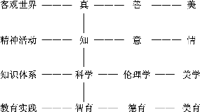

From the above figure, it can be vividly seen that the objective world has three aspects: truth, goodness, and beauty; human mental activities have three parts: cognition, emotion, and will; the human knowledge system has science, ethics, and aesthetics; educational practice correspondingly has intellectual education, moral education, and aesthetic education. Among them, intellectual education imparts knowledge and develops intelligence through science to grasp "truth"; moral education strengthens will and improves morality through ethics to grasp "goodness"; aesthetic education refines temperament and purifies the soul through aesthetics to grasp "beauty." To learn and study science, ethics, aesthetics, etc., develop cognition, will, emotion, and pursue truth, goodness, beauty, one must also have a strong physique, which requires physical education. Among these four educations, although intellectual, moral, and physical education all contain certain emotional factors, they are not the main ones; only aesthetic education mainly cultivates human aesthetic sentiment. Therefore, the essence of aesthetic education is to move people with beauty and touch people with emotion. The position of aesthetic education in the field of emotional education is irreplaceable by any other education.

Fourth, from the perspective of the history of aesthetic education thought development. In the history of aesthetics and education, many aestheticians and educators, such as Plato, Aristotle, Schiller, etc., regarded aesthetic education as emotional education that refines temperament and purifies the soul. Cai Yuanpei, a positive advocate of aesthetic education in China, clearly pointed out: "Aesthetic education is the application of aesthetic theory to education, with the purpose of cultivating sentiment [¹⁰-2]." Famous contemporary Chinese aesthetician Zhu Guangqian also believed: "Aesthetic education is a kind of emotional education," "The function of aesthetic education lies in cultivating sentiment and nurturing nature [¹⁰-3]."

### (2) Characteristics of Aesthetic Education

From the nature of aesthetic education, it can be seen that aesthetic education has the following main characteristics:

1. **Aesthetic education is education through sensuous imagery**. Unlike intellectual education which imparts scientific knowledge and moral education which spreads ethical morality, the main means of aesthetic education are neither abstract generalization using concepts, judgments, and reasoning, nor rational preaching using ethical concepts, but rather infecting and touching people's emotions through the concrete, perceptible images of beautiful things to achieve educational purposes. As Dobrolyubov said: "Our emotions are always aroused by vivid images, not by general concepts [¹⁰-4]." Moving people with form and touching people with emotion is the most distinctive feature of aesthetic education. It is precisely this characteristic that makes this educational form suitable for objects of various ages, classes, and cultural levels.

2. **Aesthetic education is education through free methods**. Aesthetic education is education that enables people to gain more freedom, which objectively determines that the methods adopted by aesthetic education are free. It does not require rational persuasion and mobilization of the educated, let alone coercion and orders, but attracts people with the charm of beauty itself, presenting beautiful objects to the educated in a relaxed and pleasant manner, so that the educated are completely in a state of conscious voluntariness when receiving aesthetic education, yearning for and pursuing beauty according to their own psychological needs and interests, with their spirit always in a "state of freedom." In this wholehearted appreciation and relaxed aesthetic enjoyment, they receive aesthetic education.

3. **Aesthetic education is education through subtle influence**. Aesthetic education is a subtle and imperceptible education; its effect is profound and long-lasting, and it will play a role throughout a person's life. Liang Qichao once spoke of the four powers of novels dominating the human way—"熏" (fumigation/influence), "浸" (immersion), "刺" (stimulation), "提" (elevation). "Fumigation is like entering a cloud of smoke and being baked by it, like being near ink and vermilion and being dyed by them." "Immersion means entering and transforming together with it." He also pointed out, "When a person reads a novel, unknowingly, their eyes become blurred, their brain shakes, their nerves focus; today they change a bit, tomorrow they change a bit; moment by moment, intermittently and continuously; over time, the realm of this novel enters their spiritual platform and cannot be expelled, becoming a special primitive seed. With this seed, whenever they encounter other touches and receptions in the future, they fumigate it day by day, the seed grows more prosperous, and they fumigate others with it, so this seed can spread throughout the world."

   Liang Qichao also took reading *Dream of the Red Chamber* and *Water Margin* as examples to illustrate the immersion effect of novels: "Those who finish reading *Dream of the Red Chamber* must have lingering attachment and lingering sorrow; those who finish reading *Water Margin* must have lingering joy and lingering anger. Why? The power of immersion makes it so [¹⁰-5]." In fact, not only novels, but all literature and art, when using beautiful images for aesthetic education, are a process of gradual edification and subtle influence, a process of "entering the night silently with the wind, moistening things without a sound." In this process, emotion penetrates into the human subconscious in a way of "input without self-awareness," forming a perfect psychological structure and orientation, possessing considerable stability, and exerting a major and far-reaching influence on the entire spiritual life of a person.

4. **Aesthetic education is education emphasizing practice**. Humans create beauty in practical activities, engage in aesthetic appreciation and obtain aesthetic pleasure in practical activities, and also receive aesthetic education in practical activities. Therefore, beauty, aesthetic feeling, and aesthetic education are different aspects of the same practical process, all possessing practicality. To achieve the purpose of aesthetic education, one cannot do without aesthetic practice; every aesthetic education activity is itself a practical activity. Marx said: "In my production, my individuality and its characteristics were objectified; therefore, I not only enjoyed the individual manifestation of my life in the activity, but also in the contemplation of the product, due to the knowledge that my individuality is material, sensuously perceptible, and therefore an undeniable right, I felt individual pleasure." Also: "It is precisely in the alteration of the objective world that man truly proves himself to be a species-being. This production is his active species-life. Through this production, nature appears as his work and his reality. The object of labor is, therefore, the objectification of man's species-life; for he not only reproduces himself intellectually, as in consciousness, but actively and actually, and hence he contemplates himself in a world he has created [¹⁰-6]." Therefore, in carrying out aesthetic education activities, one must pay attention to the guidance of aesthetic theory and also emphasize concrete practice; feel, experience, and comprehend beauty in aesthetic practice; improve aesthetic accomplishment and ability in aesthetic practice; create and pursue beauty in aesthetic practice.

## II. Value Discovery: Shaping Physically and Mentally Healthy, Harmoniously Developed Individuals

Innovation is the dominant quality of talents in the intelligent era, and aesthetic education has extremely important value for cultivating innovative talents in the new era. Aesthetic education not only has 不可低估的意义 (significance that cannot be underestimated) for shaping physically and mentally healthy, spiritually fulfilled, noble in personality, and well-rounded individuals, but also has extremely important value for cultivating innovative talents in the intelligent era.

### (1) Innovation is the Dominant Quality of Talents in the Intelligent Economic Era

A history of human social development is both a history of productivity and economic development and a history of humans gradually perfecting themselves and continuously improving their qualities. In different eras, due to different economic and social environments, the requirements for the dominant qualities of talents are also different, as shown in Table 10-1.

**Table 10-1 Dominant Qualities of Talents in Different Economic Eras**

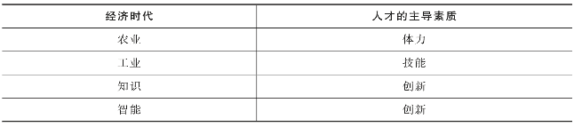

From the above table, it can be seen that after human society got rid of its primitive state, it has experienced the agricultural economic era and the industrial economic era, and is now moving towards the intelligent economic era. In the agricultural economic era, the production process was a simple combination of human physical and mental strength, and productivity mainly relied on human physical expenditure; the requirements for the cultural quality of talents were relatively low. Therefore, the dominant quality of talents in the agricultural economic era was physical quality. The development of modern science and technology and the ensuing industrial revolution pushed human society from the agricultural economic era into the industrial economic era. From spinning machines and steam engines to the electrification and automation of industry, machines replaced part of human labor; the requirements of productivity development for workers have shifted from mainly physical to mainly skill-based, and society needs a large number of applied talents with strong practical operation capabilities. Therefore, the dominant quality of talents in the industrial economic era was skill quality.

With the rapid development of modern science and technology and the social economy, the industrial economy is being replaced by the intelligent economy and will inevitably become the dominant economy of the new century. The intelligent economy is an economy based on the production, distribution, and use of data, algorithms, and computing power, relying on creative human resources, and supported by intelligent high-tech industries. In the intelligent economic era, knowledge, information, and data replace capital and energy as the fundamental driving force of social and economic development; data productivity has become a key factor in social productivity, national competitiveness, and economic achievement; science and technology, as the primary productive force, has transformed from a "multiplicative multiplier" of productive forces in the industrial economy into an "exponential multiplier" in the intelligent economy. Therefore, innovation is the soul of the intelligent era, and innovative quality is the dominant quality of talents in the intelligent era.

It can be said that the 21st century is the century of human innovation, a century that needs innovative talents and continuously produces innovative talents. In this century, the level of a country's innovation and the magnitude of its innovation capability will play a crucial role in the fierce world economic and technological competition. The level of human innovative capability is influenced not only by intellectual factors but also by non-intellectual factors. This requires our education to break out of the vicious circle of "exam-oriented education" and comprehensively implement quality education and innovation education. Here, implementing aesthetic education for students, cultivating their aesthetic quality, improving their aesthetic ability, and thereby enhancing their innovative ability, is an important measure of quality education and innovation education.

### (2) The Role of Aesthetic Education in Cultivating Innovative Talents

In the history of scientific development, the more outstanding the scientist, the more aesthetic nourishment they have absorbed from the treasure house of art. Copernicus not only left behind the monumental work *On the Revolutions of the Heavenly Spheres*, which marked the beginning of modern science, establishing a new world system and worldview, but he himself was also an outstanding painter; his "heliocentric theory" provided the world with a concise and harmonious image of the universe, which can be said to be a great victory of mathematical aesthetic view in the history of science. Einstein not only left behind the theory of relativity, which marked the beginning of modern science, creating a new view of space-time, but he was also an equally accomplished violinist. He believed that our world "can be composed of musical notes, or mathematical formulas [¹⁰-7]." The relaxed atmosphere of musical performance helps in thinking about scientific problems. These examples not only fully illustrate that scientists with artistic accomplishment are more likely to innovate in scientific research, but also illustrate the role of aesthetic education, which takes art as its main means, in cultivating innovative talents.

From the perspective of the purpose of aesthetic education. Schiller once said: Aesthetic appreciation is a "doing without doing" "free appreciation"; in the aesthetic kingdom, man shakes off the shackles of all relations, and frees himself from all coercion, whether physical or moral. "Through freedom to give freedom, this is the fundamental law of the aesthetic kingdom [¹⁰-8]." The goal of aesthetic education is to enable people to gain more freedom and become perfect, fully developed, free people. Such perfect, fully developed, free people are precisely the people with innovative capabilities needed in the intelligent era.

From the perspective of the innovation process. The creative process generally includes four stages: preparation, incubation, generation of creative ideas, and verification. Among them, in the two important stages of incubation and generation of creative ideas, the right brain plays a leading role. These two stages are the period when new ideas, new concepts, and new methods are produced, and are therefore the most critical period in creative thinking activities. Looking from another angle, so-called innovation is to connect those pieces of information in the mind that are considered unrelated, recombine them, and make forced associations. To carry out these associations, one relies on the amount of information, and the right brain has the largest amount of information; second, it relies on image thinking, intuitive thinking, and inspiration, which are also mainly governed by the right brain. Due to the influence of traditional education, students in school mainly receive logical thinking education and training—thinking rigorously, emphasizing norms, proceeding step by step—which should be said to have a good side as well.

[¹⁰-1]: Hegel. *Aesthetics* [M]. Beijing: People's Publishing House, 1979.
[¹⁰-2]: Cai Yuanpei. *Collection of Cai Yuanpei's Essays on Aesthetic Education* [M]. Beijing: People's Education Press, 1992.
[¹⁰-3]: Zhu Guangqian. *On Beauty* [M]. Beijing: Huaxia Publishing House, 1997.
[¹⁰-4]: Dobrolyubov. *Collection of Literary Essays* [M]. Beijing: People's Publishing House, 1958.
[¹⁰-5]: Liang Qichao. *Collected Works of Yinbingshi* [M]. Beijing: Zhonghua Book Company, 1989.
[¹⁰-6]: Marx. *Economic and Philosophic Manuscripts of 1844* [M]. Beijing: People's Publishing House, 1963.
[¹⁰-7]: Einstein. *The World As I See It* [M]. Beijing: Commercial Press, 1979.
[¹⁰-8]: Schiller. *Letters on the Aesthetic Education of Man* [M]. Beijing: Commercial Press, 1985.


## Introduction

However, this logic-thinking-centered education, coupled with "cramming" teaching and learning methods, leads to "overuse" of the left brain, while courses related to the right brain are neglected, suppressing the right brain. Innovative work requires not only the dominance of the right brain but also the cooperation of the left and right brains. In terms of thinking, one must be skilled in both analytical and intuitive thinking; both convergent and divergent thinking; both abstract and concrete thinking.

Therefore, in the intelligent era, to cultivate innovative talents, special attention must be paid to developing the right brain of the educatees and promoting the harmonious development of both hemispheres. Aesthetic psychology tells us that the aesthetic process involving perception, understanding, imagination, emotion, and other factors is essentially a cognitive process, except that the object of cognition possesses the characteristic of imagery. From a physiological mechanism perspective, it is primarily the function of the right cerebral hemisphere. Aesthetic education, characterized by image education and emotional education, plays an important role in developing the right brain and promoting the harmonious development of the two hemispheres. It can enhance human sensitivity, train image memory ability, develop imagination and image thinking ability, cultivate intuitive ability, inspire creative inspiration, thereby promoting the development of human creativity.

### From the Perspective of Scientific Methodology

The pursuit of beauty can stimulate the motivation for intelligent research. Motivation is the cause that prompts an individual to act. Scientific activities, like other human activities, are significantly influenced by motivation in the selection of research topics and the progress of the research process. Scientists' tremendous creative enthusiasm and research motivation largely stem from their sense of beauty. The famous American philosopher of science Kuhn pointed out that when a new scientific paradigm replaces an old one, "the new theory is said to be more beautiful, more appropriate, or simpler than the old one"; in the establishment of a new theory, the importance of aesthetic considerations can sometimes be decisive^([\[9\]](#txt010.html#footnote_content_txt010_9)). At the same time, aesthetic principles also provide methodological principles for scientific research, such as the principles of symmetry, simplicity, and harmony. Einstein long ago pointed out that "external empirical verification" and "inner perfection" should be the criteria for selecting scientific theories.

### From the Perspective of Physical and Mental Health

Health and beauty are inseparable, because humans are not only natural beings but more importantly social beings. In education, only by combining aesthetic education with physical education can we cultivate physical beauty, spiritual beauty, and skill beauty, endowing people with a healthy and beautiful appearance of natural external beauty and social internal beauty, achieving harmonious development. Moreover, aesthetic education can delight the mind with beauty, regulate mood, channel emotions, maintain psychological balance, and promote physical and mental health, because the perception, understanding, appreciation, and creation of beauty always bring spiritual enjoyment, making one feel refreshed and pleased.

The ancient Chinese thinker Xunzi said: "When music prevails and the will is clear; when rites are cultivated and conduct is accomplished; ears and eyes are sharp, blood and qi are peaceful; customs are transformed, the world is at peace; the beautiful and the good rejoice together"^([\[10\]](#txt010.html#footnote_content_txt010_10)). Aristotle also said: "Music is not only a source of pleasure for people, but also beneficial in relieving fatigue"^([\[11\]](#txt010.html#footnote_content_txt010_11)). According to the latest research, after listening to a piece of Mozart, human brain vitality increases, thinking becomes more agile, actions more effective, as if oiling rusty brain parts. This can even affect epileptic patients and others with neurological disorders, alleviating their conditions. This is the so-called "Mozart Effect"^([\[12\]](#txt010.html#footnote_content_txt010_12)). In fact, not only music, but all other forms of art education and aesthetic education have similar effects, which cannot be achieved by mere physical exercise. The physically and mentally healthy, harmoniously developed individuals shaped by aesthetic education are precisely the innovative talents needed in the intelligent era.

## Three, Art Education: Stimulating Human Imagination and Creativity

Art education can develop right brain potential and promote balanced development of the left and right brains, facilitating the incubation of innovation and the generation of creative ideas, stimulating innovation motivation, providing methodological principles for innovation, cultivating intuition and imagination, and inspiring creative inspiration, playing an important role in innovation activities and the cultivation of innovative talents. Currently, we should overcome the influence of overemphasizing specialized education, strengthen art education, cultivate innovative talents, and enhance our country's scientific and technological innovation capability.

Robert Root-Bernstein, a biochemist from Los Angeles, USA, has long been engaged in exploring the "mysterious connection" between science and art. Recently, after completing a study of the biographies of 150 famous scientists and artists from ancient and modern times, he said that there are many surprising "commonalities" between Einstein and Picasso, Pasteur and Bach. Da Vinci was a painter; his masterpiece *Mona Lisa* has been handed down through the ages. At the same time, he was a scientist who made outstanding contributions in physics, geography, medicine, military, and other fields; Einstein, a world-renowned German-American scientist, the founder and pioneer of modern physics, the proposer of relativity and "mass-energy equivalence". At the same time, he was an outstanding violinist who deeply loved art. Steve Jobs once said: "Why has Apple achieved such outstanding success? Because in hiring we deliberately recruited a group of people who were musicians, artists, poets, and who happened to be computer scientists as well; it was these people who changed the world." This shows that scientists and inventors with artistic cultivation are more likely to achieve major innovations in scientific and technological activities, which also illustrates the important role of art education in cultivating scientific and technological innovation talents.

### On the One Hand: Art Education and Right Brain Development

Modern brain science, through research on split-brain patients and normal subjects, shows that the two hemispheres of the brain are functionally asymmetric. In most people, the left hemisphere is the center for language, mathematics, and analytical thinking, while the right hemisphere is the center for spatial relations, pattern relations, music, and art appreciation^([\[13\]](#txt010.html#footnote_content_txt010_13)). The high development of human innovative ability is the result of the balanced functional development of the left and right hemispheres and their close coordination in activities. Here, the function of the right brain, long neglected by education, stands out. Art education, characterized by image education and emotional education, plays an important role in developing the right brain and promoting the harmonious development of the two hemispheres. Through art education, image thinking and abstract thinking (logical thinking) are organically combined to fully mobilize the enthusiasm of the brain's "non-dominant hemisphere," striving to compensate for the function of the "dominant hemisphere," enabling the two hemispheres to achieve balanced and coordinated development, thereby forming such a mechanism: Art Education → Promotes Image Thinking → Promotes Right Brain Development → Enhances Innovative Thinking Ability → Intellectual and Creative Development. Research by Dr. Eisner of Harvard University further supports this conclusion. He confirmed that art education can promote the development of eight major creative ability factors—perceptual ability for relationships among things, attention to subtle differences, awareness of using diverse methods to solve problems, ability to shift goals during the process without adhering to fixed concepts, ability to make decisions in the absence of rules, operational ability in a constrained environment, imagination and creativity, and the ability to insight into the world with an aesthetic vision^([\[14\]](#txt010.html#footnote_content_txt010_14)).

### On the Other Hand: Art Education and Thinking Modes

Scientific cognition is an extremely complex activity with numerous factors involved. But the process of scientific discovery is "constituted by the interaction of rational activities and creative thinking mainly manifested as intuition and inspiration." Rational criteria and intuitive inspiration play the role of "complementary methodology"^([\[15\]](#txt010.html#footnote_content_txt010_15)). Both intuition and inspiration possess characteristics such as directness, suddenness, non-logicality, wholeness, and originality. Under modern scientific and technological conditions, this mode of thinking has increasingly important methodological value for scientific research and technological invention. This is determined by the objects and characteristics studied by modern science. Modern science, on the basis of high differentiation, is highly integrated, advancing rapidly in the direction of polarization, attempting to reveal the laws of motion at deeper, broader, more ancient, and more complex levels of nature and under various extreme states; its objects of study are increasingly the fundamental "Dao" (Way/principles) of the universe. In this situation, empirical science established since modern times on the basis of scientific methods of observation, experiment, logic, and mathematics, as well as analytical and reductionist thinking modes, has gradually revealed its own limitations. Overemphasizing unity, eternity, and simplicity, while neglecting and excluding diversity, temporality, and complexity, has caused internal contradictions, conflicts, and crises in science. In the 20th century, the formation and development of relativity, quantum mechanics, elementary particle theory, and systems science indicated that the positivist thinking mode prevalent in the era of empirical science could no longer meet the needs of the times. Scientific giants like Einstein all advocated replacing positivism with a new thinking mode. He believed that the path to scientific discovery is first intuitive, not logical. "The supreme task of the physicist is to arrive at those universal elementary laws from which the cosmos can be built up by pure deduction. There is no logical path to these laws; only intuition, resting on sympathetic understanding of experience, can reach them." Therefore, he explicitly pointed out that in scientific research, "I believe in intuition and inspiration"^([\[16\]](#txt010.html#footnote_content_txt010_16)). Art education can cultivate intuitive ability, inspire creative inspiration, thereby promoting the development of creativity. Besides intuition and inspiration, scientific and technological innovation cannot do without imagination. Because scientific and technological innovation activities do not merely rely on strings of dry experimental data and logical rules, but require insight into the internal and external causal relationships of unknown things.

Lenin once highly valued the role of imagination (fantasy) in scientific development, saying: "Fantasy is an extremely precious quality." "Some people think that only poets need fantasy; this is groundless, a stupid prejudice! Even in mathematics fantasy is needed; without it, calculus could not have been invented.^([\[17\]](#txt010.html#footnote_content_txt010_17))" Precisely because of the important role of imagination in scientific and technological innovation, Guo Moruo earnestly said: "Science is practical. Science is honest learning; it tolerates no falsehood and requires arduous labor. At the same time, science needs creation, needs fantasy; only with fantasy can we break the shackles of tradition and develop science. Comrades in scientific work, please do not let poets monopolize fantasy.^([\[18\]](#txt010.html#footnote_content_txt010_18))" One of the important ways to cultivate imagination is to receive artistic edification. The sense of beauty, rhythm, and harmony cultivated by art education will greatly enhance human imagination and creativity.

As seen above, art education plays an important role in innovation activities and the cultivation of innovative talents. The "Overall Plan for National School Art Education" issued by the Ministry of Education explicitly states: "Art education is the main content and approach for schools to implement aesthetic education, and is also a powerful means to strengthen socialist spiritual civilization construction, subtly improve students' moral standards, cultivate noble sentiments, and promote intellectual and physical and mental development." The "Decision of the CPC Central Committee and the State Council on Deepening Educational Reform and Comprehensively Promoting Quality-Oriented Education" has clearly stated: "We must quickly reform the weak situation of school aesthetic education work and integrate aesthetic education into the entire process of school work." The Ministry of Education further decided: "Promulgate the 'Regulations on School Art Education Work' as soon as possible, and formulate relevant implementation rules and supporting documents around the 'Regulations' to bring school art education work onto the track of scientific, standardized, and institutionalized management, continuously improving education quality.^([\[19\]](#txt010.html#footnote_content_txt010_19))" Therefore, in the current process of vigorously promoting quality-oriented education and innovation education, great efforts should be made to solve the existing problems in this area, so as to cultivate more talents with innovative qualities and abilities, and enhance our country's scientific and technological innovation capability.

## Four, Existing Limitations: Restricting Human Aesthetic and Creative Abilities

The era we live in today is the era of intelligence; data is the foundation of intelligence, and innovation is the soul of intelligence. The level of innovative ability is influenced not only by intellectual factors but also by non-intellectual factors. Examining traditional aesthetic education reveals the following limitations, which restrict people's aesthetic and creative abilities.

### First, Parental Education in Family Aesthetic Education

Abroad, the concept of family education has gradually been replaced by parental education. So-called parental education is a discipline that teaches parents how to understand and meet their children's physical and mental development needs, fulfill parental responsibilities, and assist children in effective growth, adaptation, and development. Parental education is considered the connotation and essence of family education, as well as its internal foundation, and differs greatly from traditional family education, as shown in Table 10-2.

**Table 10-2 Differences between Parental Education and Family Education**

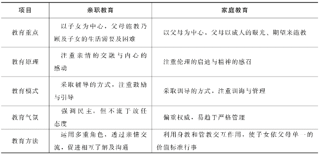

(Source: Shi Xinxin. *ABC of Parental Education* [M]. Beijing: China Textile Press, 1999: 6.)

As can be seen from the table above, parental education and traditional family education differ in educational focus, principles, modes, atmosphere, and methods. Parental education provides at least the following three important insights for modern family aesthetic education:

First, in the subject-object relationship of family aesthetic education, parents are the principal aspect of the contradiction and play a decisive role; the key factor in the success or failure of aesthetic education is the parents' cultural knowledge and aesthetic cultivation. Therefore, family aesthetic education is first the "aesthetic education" of the parents themselves, and only secondarily the parents' aesthetic education of their children. In today's intelligent era, parents should continuously update their concepts, increase their knowledge, and strengthen their aesthetic cultivation.

Second, family aesthetic education should focus on the blending of family affection and inner touch, highlighting the emotional and subtle influence characteristics of aesthetic education, focusing on encouragement and guidance, adopting a counseling approach, rather than the traditional family instruction's focus on admonition and management, adopting a disciplinary approach.

Finally, teaching by example is better than teaching by words. Imitation is the nature of children. In the process of children's growth, the first objects of imitation are parents. Every word and deed of parents are objects of imitation for children. How parents dress, how they talk to others and talk about others, how they read books and newspapers... all this has important significance for children. Children can detect and feel subtle changes in their parents' tone; all shifts in parents' thoughts are conveyed to children through invisible channels. As parents, they can enable children to grow healthier through teaching by words and deeds, especially by example. In the intelligent era, for parents to play their roles well, they must enhance the scientific nature of their values, have a healthy lifestyle, and establish a healthy and civilized family environment. This is crucial to the success or failure of aesthetic education and all education.

### Second, Art Education in School Aesthetic Education

Art education is an important aspect of aesthetic education; art courses offered by schools, whether music, fine arts, or dance, etc., all occupy an important position in the implementation of school aesthetic education. As the highest form of human aesthetic activity, artistic works can artistically, concentrically, and emotionally process commonplace examples in life, far surpassing other aesthetic images in moving and infecting people, possessing an incomparably strong captivating charm.

### Third, Creation of Humanistic Environment in Social Aesthetic Education

Compared with family aesthetic education and school aesthetic education, social aesthetic education is a larger stage. Because after birth, through socialization, a natural person becomes a social person, sociality becomes the essential attribute of human beings. In social aesthetic education, we must not only pay attention to the beautification of the natural environment but more importantly to the optimization of the social environment, especially the creation of a good humanistic environment.

## Five, Transcending Paths: Family, School, and Society

In the intelligent era, aesthetic education should be regarded as a social systems engineering project running throughout life, strengthened from multiple channels. Strengthen aesthetic education through family, school, and society. Family aesthetic education, school aesthetic education, and social aesthetic education are interconnected and mutually reinforcing. We should give full play to the respective advantages of each educational force, enabling family, school, and society to complement each other, operate in coordination, form a synergy, exert overall function, and achieve good aesthetic education results.

### Family Aesthetic Education: Starting Point and Cradle

The family is the cell constituting society, the first station of human socialization, and an important place for lifelong human activities. The family is also the starting point and cradle of aesthetic education. The cultivation of a person's aesthetic ability and the formation of aesthetic concepts and tastes are closely related to the family. Therefore, the importance of family aesthetic education is self-evident. The implementation of family aesthetic education can utilize family environment, family atmosphere, daily life, literature and art, nature, etc. Parents should consciously make full use of these aspects to strive to cultivate children's aesthetic ability and taste, enabling them to grow healthily and harmoniously.

### School Aesthetic Education: Important Base

If the family is the foundation of aesthetic education, then the school can be said to be the important base of aesthetic education. This is because, compared with the family, schools possess characteristics of purposefulness, planning, systematicness, scientificity, and concentration. The implementation of school aesthetic education can utilize subject teaching for aesthetic education. The central link of school education is the teaching activities of different subjects. Therefore, school aesthetic education cannot be separated from subject teaching aimed at intellectual education. Courses offered by schools not only possess formal beauty characteristics of symmetry, balance, harmony, and unity in diversity in their forms of expression—such as the original language basis of concepts, models, graphics, molecular formulas, equations, calculation processes, speculative processes—but also constitute the deep rationality of aesthetic education, playing an important role in improving students' aesthetic perception ability. Art education is an important aspect of aesthetic education. Art courses offered by schools, whether music, fine arts, or dance, etc., all occupy an important position in the implementation of aesthetic education.

In current educational practice, due to the influence of "exam-oriented education," the one-sided pursuit of "enrollment rates," and the one-sided emphasis on specialized education, some schools have reduced or even stopped offering art courses. This is extremely unfavorable for cultivating well-rounded innovative talents. Einstein once solemnly pointed out: "It is not enough to educate a person with specialized knowledge. Through specialized education, he may become a useful machine, but not a harmoniously developed person. It is most basic to make students understand values and develop fervent feelings for them. He must acquire a keen discernment for beauty and moral goodness. Otherwise, he—with his specialized knowledge—will more closely resemble a well-trained dog than a harmoniously developed person"^([\[20\]](#txt010.html#footnote_content_txt010_20)).

### Social Aesthetic Education: Larger Stage

Compared with family aesthetic education and school aesthetic education, social aesthetic education is a larger stage. In fact, humans cannot objectively leave society, and thus inevitably receive social aesthetic education at all times. Therefore, aesthetic education activities should run through all times and spaces of the entire social life. The implementation of social aesthetic education can utilize nature, social facilities, humanistic landscapes, various activities, etc. Special attention should be paid to utilizing culture and art for aesthetic education. As Liang Qichao said: "The most powerful weapon of emotional education is art: music, fine arts, and literature—these three magic weapons hold the keys to the 'secrets of emotion'." Therefore, social aesthetic education should make good use of culture and art to infiltrate the soul, enlighten wisdom, enhance virtue, and satisfy human aesthetic psychological needs. At the same time, literary and art workers should realize: "...The responsibility of artists is heavy; between merit and sin, there is no margin. Once artists recognize their position, they should know: the most important work is to cultivate their own emotions, striving towards the noble and sincere, looking upward and experiencing inward; only when the beautiful emotions in their hearts are fully nurtured, and then expressed with exquisite technique, will they not disgrace the value of art"^([\[21\]](#txt010.html#footnote_content_txt010_21)), so as to create artistic masterpieces enjoyed by the masses.

Social aesthetic education must first actively utilize a harmonious interpersonal environment for education. Harmony is the highest level of beauty. We must improve the moral quality and mental health level of the whole society, strive to create a harmonious interpersonal environment full of care, so that members of society are moved emotionally, receive education imperceptibly, change their inner world, and jointly create a beautiful life. Second, we must utilize humanistic landscapes for aesthetic education. Like nature, humanistic landscapes such as architecture, gardens, cultural relics, and scenic spots are also good materials for social aesthetic education. While developing, protecting, repairing, and reconstructing these landscapes, we should fully exert their role in aesthetic education, enabling people to gain more aesthetic education and enjoyment. Finally, we must utilize culture and art for aesthetic education. Culture and art can move, change, and perfect people emotionally, and are the main methods of aesthetic education.

In summary, family aesthetic education should advocate parental education, focusing on the blending of family affection and inner touch; school aesthetic education should fully utilize subject teaching and attach importance to art courses; social aesthetic education should run through all times and spaces of social life, and pay special attention to utilizing culture and art for aesthetic education. Literary and art workers should recognize their social responsibility and create artistic masterpieces enjoyed by the masses.

## Notes

[\[1\]](#txt010.html#footnote_quote_txt010_1) Hegel. *Aesthetics: Volume 1* [M]. Beijing: Commercial Press, 1997: 147.

[\[2\]](#txt010.html#footnote_quote_txt010_2) Cai Yuanpei. *Selected Works of Cai Yuanpei on Aesthetics* [M]. Beijing: Peking University Press, 1983: 174.

[\[3\]](#txt010.html#footnote_quote_txt010_3) Zhu Guangqian. *Collected Works of Zhu Guangqian on Aesthetics (Vol. 2)* [M]. Shanghai: Shanghai Literature and Art Publishing House, 1982: 505-506.

[\[4\]](#txt010.html#footnote_quote_txt010_4) Dubrovlev, A.V. Koltsov. *Foreign Theorists and Writers on Image Thinking* [M]. Beijing: China Social Sciences Press, 1979: 89.

[\[5\]](#txt010.html#footnote_quote_txt010_5) Liang Qichao. *Selected Works of Liang Qichao: Lower Volume* [M]. Beijing: China Radio and Television Press, 1992: 4.

[\[6\]](#txt010.html#footnote_quote_txt010_6) Central Compilation and Translation Bureau. *Collected Works of Marx and Engels (Vol. 42)* [M]. Beijing: People's Publishing House, 1979: 37.

[\[7\]](#txt010.html#footnote_quote_txt010_7) Einstein. *Collected Works of Einstein. Vol. 1* [M]. Beijing: Commercial Press, 1979: 2.

[\[8\]](#txt010.html#footnote_quote_txt010_8) Schiller. *Letters on Aesthetic Education* [M]. Beijing: China Federation of Literary and Art Circles Publishing Company, 1984: 145.

[\[9\]](#txt010.html#footnote_quote_txt010_9) Kuhn. *The Structure of Scientific Revolutions* [M]. Shanghai: Shanghai Science and Technology Press, 1980: 129.


# Chapter 11 Educational Revolution: Moving Towards the Future Amidst Change and Constancy

## References

[10] Department of Aesthetics, Philosophy Department, Peking University. Selected Materials on the History of Chinese Aesthetics: Volume 1[M]. Beijing: Zhonghua Book Company, 1980: 54.

[11] Aristotle. Politics[M]. Beijing: The Commercial Press, 1965: 419.

[12] Listening to Mozart's Music Increases IQ by Half[N]. Guangzhou Daily, 2001-01-06(A5): 5.

[13] K.W. Walsh. Neuropsychology[M]. Science Press, 1984: 296-297.

[14] E.W. Eisner. Educating for Tomorrow's Jobs and Life Skills[OL]. http://www.artsednet.edu.

[15] Liu Dachun. Complementary Methodology[M]. World Knowledge Press, 1994: 86.

[16] Albert Einstein. Collected Works of Einstein (Vol. 1)[M]. Beijing: The Commercial Press, 1979: 102+284.

[17] Central Compilation and Translation Bureau, CPC Central Committee. Complete Works of Lenin (Vol. 33)[M]. Beijing: People's Publishing House, 1988: 282.

[18] Dai Youfu. Appreciation of Famous Scientists' Speeches[M]. Jinan: Shandong People's Publishing House, 1995: 156.

[19] Chen Zhili. Study Reference Materials for the Action Plan for Educational Revitalization Facing the 21st Century[M]. Beijing: Beijing Normal University Press, 1999: 65.

[20] Albert Einstein. Collected Works of Einstein (Vol. 3)[M]. Beijing: The Commercial Press, 1979: 310.

[21] Liang Qichao. Selected Works of Liang Qichao: Volume 2[M]. Beijing: China Radio and Television Press, 1992: 23.

## Intelligent Education: Analyzing the Essence Amidst Change and Constancy

Standing in the present and looking to the future, the era of artificial intelligence is inseparable from visions of future education. The combination of artificial intelligence and education has given birth to AI education. Education comprises two aspects: "teaching" (jiao) and "nurturing" (yu). "Teaching" refers to imparting knowledge and skills; "nurturing" refers to cultivating people, fostering virtue and character. Throughout history, educational development has never been like today, able to simultaneously balance both dimensions of "teaching" and "nurturing," and simultaneously address the needs of both teachers and students. It is evident that education in the AI era has ushered in a true return of education—a return to the most essential care for human beings: human value, dignity, and all-round development.

Future education will inevitably move towards an era of deep integration with intelligent technology, where intelligent teachers and human teachers coexist. Intelligent teachers will focus on knowledge and skills education, helping learners profoundly grasp operational knowledge, and assisting in cultivating learners' wisdom-oriented knowledge and skills. Human teachers, on the other hand, will have core tasks significantly different from the present. Human teachers will shift from the original knowledge and skills education to emotional and moral education, focusing on cultivating learners' qualities of "fostering virtue and character, learning to become a complete person, and being born as a human," truly practicing the human teacher's value of cultivating people.

In the first 20 years of the 21st century, the integration of AI and education was still in its initial stage. The application of AI technology in education was mainly concentrated in the teaching assistant phase, manifested as professional human teachers utilizing AI teacher systems to assist in completing teaching management, formulating teaching plans, improving teaching processes, optimizing teaching assessment, and standardizing teaching evaluation across a wide range of fields. However, the overall intelligent education theory, methodology, and practice still await theoretical generalization. The subdivided and micro fields of education still require deep integration with intelligent technology. Therefore, future education must follow a development model of advancing through pioneering. The overall practical path moves from the macro to the meso and micro domains, while the theoretical extension direction gives birth to a systematic and open educational theory system from concrete practice.

In future education, human-machine coexistence will become a universal fact. Intelligent robots will begin to appear in the role of existing teachers, and the role of human teachers will also undergo tremendous changes. Instead, human teachers will be liberated from knowledge and skills education, devoting more time to students' moral and emotional education, so that students possess both virtue and talent, integrating scientific spirit and humanistic spirit.

In future education, during the educational process, AI education systems will be able to conduct intelligent and personalized teaching based on data such as students' learning progress, intensity, efficiency, weak points, concentration level, attention span, and learning interest. Education's attitude towards people will thoroughly shift from objects requiring compulsory transformation to objects requiring transformation based on the needs of the learners and society.

Thus, the development direction of AI education discussed above is also the direction AI education needs to change, and the area where the transformation brought by AI to education is most prominent. However, these changing phenomena ultimately only reflect the changes brought to education itself by AI empowering education. The unchanging things hidden behind the changes still need to be excavated, such as the purpose of education.

In November 2018, Yu Minhong, founder of New Oriental, emphasized in an exclusive interview with The Paper in Wuzhen, Zhejiang: "Any technological change is merely a change in tool utilization and cannot change the essence of education. No technological improvement can be compared with the essence of cultivating a person." "From an educational perspective, the core elements of education are to cultivate a fully developed person, a physically and mentally healthy person, a person full of curiosity and spirit of exploration in the pursuit of knowledge. These are impossible to change. ^(1)" Similarly, from Yu Minhong's remarks, it can be seen that AI empowering education always appears in the form of a tool. The education of humans by tools, due to the human-centric attribute of tools, means that the most fundamental connection mode in educational activities—the person-to-person education model—has not changed, and the purpose of education itself to cultivate people has not changed. In other words, the essence of education has not changed.

In the AI era, the intelligentialization of education and intelligent education, the forms of education are constantly changing, the tools of education are constantly changing, the models of education are also constantly changing, and their trends of change will innovate with the updates and iterations of intelligent technology. However, amidst the changes in education, what remains constant is the purpose of cultivating fully developed people. No matter how advanced intelligent technology becomes, education must cultivate fully developed people, people with both virtue and talent, people with innovative thinking, innovative ability, imagination, and compassion.

The unchanging essence contains value within. Future education will fully demonstrate its economic, political, and cultural values. Particularly, its value is more prominent in inheriting culture, creating knowledge, and cultivating intelligent talents, and it holds significant significance for improving people's overall quality of life and quality of life.

## Lifelong Education: From the Rise of Concept to Practical Implementation

In the mid-19th century, capitalist countries led by the United States set off a wave of the Second Industrial Revolution globally. The electrified mode of production greatly increased the level of social productivity, ushering humanity into the "Electrical Age." Under the influence of the Second Industrial Revolution, rapidly rotating electrical machines endlessly shaped the entire human world. The production methods, lifestyles, and thinking habits of human society were all being changed without limit. It was the technological power during the Industrial Revolution that, with its astonishing energy, rapidly subverted traditional society. The political destiny, economic forms, and social structures of society were no exception, and the world gradually changed from a dispersed world into an integrated world.

Everything is in infinite change. Due to the accelerated changes in society, people began to think about how to cope with this change, how to survive better within it, and how to better demonstrate individual value and dignity. It was against this broad social background that lifelong education was born.

Lifelong education was first formally proposed in 1965 by Paul Lengrand, the French Director of the UNESCO Institute for Adult Education. Paul Lengrand pointed out that lifelong education is not a specific practice, nor a specific educational stage, but generally refers to an educational thought. Lifelong education refers to the sum of all education received in a person's life, covering various types of education and education received at all age stages. Since its proposal, lifelong education has become an important ideological basis for countries worldwide to formulate educational guidelines and policies, and is highly valued by all nations.

From its background of birth, lifelong education aims to help people remain in a "sober state" at all times, requiring people in an era of accelerated change to clearly recognize the importance of lifelong education and lifelong learning, because it is directly closely related to people's survival and development. In other words, the concept of lifelong education is a crucible of thought guiding people to adapt to a changing society; as long as one follows its principles, one will survive better than those who completely disregard it.

However, technological limitations and spatiotemporal limitations of education restricted the practical implementation of lifelong education. In the industrial age and information age, this educational thought was destined to be piloted only on a small scale and could not be promoted globally. The main reason is that in that era, individual development rarely took the development of others as a prerequisite. There existed inevitable spatiotemporal boundaries between each relatively independent individual, limiting the implementation of the idea of lifelong education. Especially when people wanted to find the laws of lifelong education from general educational practices and apply lifelong education to specific individuals, primitive data barriers, information gaps, and the isolated state of stage-based educational departments blocked the shaping of the "lifelong" nature of lifelong education. For example, for contemporary university students, constructing their lifelong education system is feasible for their future, but integrating their preschool, primary, and secondary education would likely only yield fragmented stage-based learning outcomes. As for process data of learning, the learners themselves have probably forgotten it "completely." Because for this generation of university students currently in school, their past has become "fragmented memories" with only results and no process. One can imagine, how can such a state advance the realization of the lifelong education concept?

However, in the era of big data and artificial intelligence, this educational status quo is changing. The concept of lifelong education has ushered in a golden period of development—from the rise of the concept to practical implementation. Supported by big data and AI technology, all educational influences exerted by educators on learners, as well as the process data of learners' active learning, will be stored in the form of educational big data. Through top-level design of national lifelong education, big data of various education types achieve cross-border sharing and centralized correlation, thereby forming educational big data clusters concerning individuals and groups. When educational big data is integrated, a lifelong education system based on AI technology is being generated. The personal educational and learning activities of learners are fully mapped onto the lifelong education platform, and the educational laws for individuals and for the whole population are "unveiled."

Education in the AI era, as Bill Gates pointed out in *The Road Ahead*, "The ultimate goal of education will change, not for a diploma, but for lifelong education. ^(2)" Throughout a person's life, everything they engage in is related to their education, and all their educational activities will in turn react upon the learner's present survival and development. Lifelong education platforms, lifelong learning platforms, intelligent open universities, and lifelong education public service systems are gradually being built, promoting the practical implementation of lifelong education. Future education will more directly serve human survival and development, realizing human value, dignity, and all-round development.

### Promoting Lifelong Learning Policies

On August 2, 2019, the UNESCO "International Consultation Meeting on Lifelong Learning Policies" was successfully held in Chengdu (as shown in Figure 11-1) ^(3). The meeting mainly conducted pre-publication consultation, argumentation, and review for two publications: the *Joint Report on the Guidelines and Key Policy Interpretations of Lifelong Learning* and the *Lifelong Learning Handbook: Policies and Practices*. The *Joint Report on the Guidelines and Key Policy Interpretations of Lifelong Learning* aims to explore the policy implications of "lifelong learning" through a series of case studies and comparative analysis of lifelong learning policies, analyzing the knowledge, evidence, and core principles that policymakers and other stakeholders should possess based on national experience, human rights, and development frameworks, so as to formulate and implement relevant lifelong learning policies. The *Lifelong Learning Handbook: Policies and Practices* elaborates on the concept of lifelong learning and discusses how to promote lifelong learning through practical methods at the national, local, and institutional levels. Lifelong learning is a core component of lifelong education; the promotion of lifelong learning policies will inevitably directly or indirectly promote the development and improvement of lifelong education.

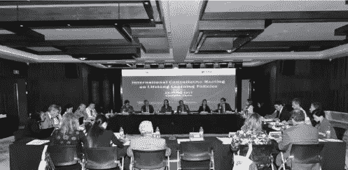

Figure 11-1 UNESCO "International Consultation Meeting on Lifelong Learning Policies"

### Building Lifelong Education Platforms

The construction of lifelong education platforms is the platform foundation for effectively connecting and integrating learners' lifelong education data and lifelong learning data in the AI era. Therefore, it is necessary to closely focus on the living environment of learners and carry out extensive "coverage-application" construction of educational platforms, covering all educational stages and types of learners from an overall perspective. With the help of big data AI lifelong education platforms, a comprehensive educational platform integrating "family-school-society" is formed. According to Xinhuanet, as early as 2012, the National Open University facing the whole nation had been established. The National Open University has been committed to promoting lifelong learning for all. In the open university, a learning mode combining online self-study, remote support, and face-to-face tutoring provides rich and diverse educational courses for different types of people (different ages, occupations, etc.), greatly promoting the implementation of lifelong education practice for all.

### Constructing a Lifelong Education System

UNESCO pointed out in the released *Beijing Consensus on Artificial Intelligence and Education* that education in the AI era should "comprehensively innovate education, teaching, and learning methods through the systemic integration of AI and education, use AI to accelerate the construction of an open and flexible education system, and ensure that all people enjoy fair, quality lifelong learning opportunities suitable for each individual." "It is necessary to adopt key technologies such as AI platforms and data-based learning analytics to construct a comprehensive lifelong learning system where everyone learns, everywhere learns, and anytime learns. ^(4)" The construction of a "comprehensive lifelong learning system" is promoting the structural formation of the lifelong education system. In the AI era, the boundaries of education are being broken. Learners are no longer fixed in designated fields for learning or receiving education, but can learn and construct knowledge at any time and place. In the future, with the help of key technologies such as deep learning, natural language processing, and machine pattern recognition, a lifelong education system featuring "collective intelligence sharing, human-machine collaboration, cross-domain association, and integration" will be constructed, assisting the practical implementation and innovative development of lifelong education.

Human society has begun to enter a "post-human society." The rise of emerging technologies represented by intelligent technology has challenged the original anthropocentric worldview, outlook on life, and values. "Being squeezed" has become a significant mark shared by humans in this era. Therefore, the development of AI education must lead the entire post-human society to break free from the "intelligent shackles" of the post-industrial society and embrace the AI lifelong education system. Future education does not mean all post-humans will be "squeezed" by AI. Only those post-humans who "disdain" lifelong learning and lifelong education will inevitably suffer the "bitter fruit" of AI.

## Facing the Future: Education Prepares for Students' Future

The change in education is in its form; the constancy in education is in its essence. Educational forms are rich and colorful, but the essence of education always revolves around cultivating people. In any era, the essential attributes of education will not change. This is determined by the essential attributes of society and reflected in the relative independence of education. The existence of education originates not from other fields, but from human productive labor. In this regard, the essence of education does not change, and the purposes and tasks determined by its essence do not change either. It is worth noting that while the essence of education does not change, the content of education will continue to expand, and the purposes and tasks of education will also continue to expand—keeping pace with the times. The qualitative determinacy of education, supported by diverse technologies, has drawn increasing attention to the questions of "what kind of people to cultivate" and "how to cultivate people." However, the ones most entitled to answer this question should be the learners themselves. They know best "what kind of person they want to become," not "what kind of person educators want them to become."

So to speak, the content of the essence of education has now expanded into the domain of learners, containing two layers of meaning: one is the expectation of educators, which in a sense represents the development requirements of society, pointing out the direction for confused learners; the other is the urgent demand of learners, which directly supports learners moving towards the future continuously, not stopping at a certain stage. In other words, learners themselves know what they want their future selves to be like. Therefore, they start thinking about this from now on, because they always believe that following their hearts and never stopping thinking will eventually lead them to become who they want to be, and life will become what they want it to be. This is probably the so-called "Pygmalion Effect."

Different from this, past education focused on immediate short-term benefits, whether for the high school entrance exam to enter a good school, or for the college entrance exam to enter a good university. However, once these goals are achieved, confusion and bewilderment become the theme of life, and many students spend their university years in such a state.

Learners are an organic whole. As educators, one should not artificially split them into fragments and then assemble them; such short-term effects are certainly good. However, the cracks formed between fragments on the learners will become lifelong marks of deficiency for them. However, future education based on more advanced AI technology will inevitably have long avoided the above limitations, focusing on future-oriented education, which will become a universal commonality of future education. In summary, future education prepares for students' future. This education neither ignores students' past nor completely disregards the present reality, but, supported by past educational big data and learning big data, fully endows students with numerous future possibilities.

Education prepares for students' future. In the history of human education, many educators have mentioned the relationship between education and life: some proposed education prepares for religious life, some believed education is life, and some believed education prepares for leisure life, etc. However, the most praised view is still the educational thought of "preparing for future life." As early as the late 19th century, the famous British educational thinker Herbert Spencer proposed that the purpose of education is to "prepare for a complete future life." Indeed, in an era of material abundance and intellectual freedom, this educational thought contains strategic vision—students' learning is future-oriented learning.

In Euclid's *Elements*, a disciple once asked him what benefit he would get from learning geometry. This utilitarian thought was quickly criticized by him. Facing such a question, Euclid said to his attendant, "Give him three coins, since he wants to gain profit from learning. ^(5)" Thus, whether modern or ancient, there are astonishing similarities in educational concepts—emphasizing the future value of education.

Preparing for students' future life is not only an important concept of some educators but also the development vision of some educational institutions. The Programme for International Student Assessment (PISA Education) is such an example. It aims to improve the quality of education and students' overall capabilities from angles such as developing assessment tools, presenting result reports, analyzing factors of student performance, and coordinating the development of education quality and equity. PISA Education points out that educational development should focus on students' knowledge construction ability, not memory ability. Behind memory ability is a whole set of exam-oriented education systems, emphasizing rote memorization, causing many students to lose thinking and innovative abilities, falling into an infinite loop of indoctrination. Knowledge construction ability, on the other hand, is the ability to cultivate students' capacity to create knowledge. In the process of guiding students to create knowledge, PISA Education also includes literacy assessment in its evaluation content. The literacy defined by PISA differs from the literacy emphasized by other educational forms. The literacy it emphasizes is that students, through school education and life education, actively apply learned knowledge and skills to real life, so as to enhance their overall life ability and quality, thereby adapting to future life full of changes, ensuring they possess the ability to interpret and solve problems in different contexts.


## IV. Staying True to Our Original Aspiration: Education Promotes the All-Round Development of Human Beings

Human intelligence is the foundation of artificial intelligence; the development of human intelligence plays a decisive role in the development of artificial intelligence. In the stage of weak artificial intelligence, AI is the imitation, extension, and enhancement of human intelligence. This nature determines its "subordinate" status and indirectly reflects the passive attribute of AI. Only in an era of highly developed human intelligence can the development of AI reach new heights. The "three booms and two busts" (three rises and two falls) of AI illustrate this point.

The development of AI stems from the integration and fusion of technologies, thereby systematically reproducing human intelligence on a relatively three-dimensional level (not on a single dimension). However, once AI has completed the work of imitation, extension, and enhancement, it completely separates from the matrix of human intelligence compared to human intelligence, becoming an independent AI entity possessing the relative independence of AI.

The development of AI, with its relative independence, triggers the awakening of human ontological consciousness. Historically, there have been three major schools of AI development: Connectionism, which imitates human neural transmission; Symbolism, which imitates human logic and language; and Behaviorism, which imitates human behavior patterns. Different schools imitate different objects, but all imitate the complex forms of human beings themselves and the essence of human life in different ways.

The evolution of the imitation paradigm has undergone a process from simple to complex, from single to systemic. AI's imitation of human intelligence is only the basic stage of its development; the stages of extension and enhancement mark the beginning of AI's declaration of independence. At that time, conflicts between human intelligence and AI will be triggered, commonly known as human-machine conflicts. To resolve the human-machine contradiction, humans have sought several solutions: one is anarchism, letting it develop freely; two is technological terrorism, strictly restricting its development; three is scientific controlism, seeking advantages and avoiding harm. Obviously, the third solution implies human compromise and tolerance, highlighting the complementary relationship between human intelligence and AI.

The complementary relationship between human intelligence and AI means there exists a "shared destiny" attribute between the two. Today, AI's imitation, extension, and enhancement of human intelligence have reached a very high level, particularly in the aspect of behavioral imitation, which is relatively mature. Generally speaking, so far, the rethinking of human-machine relations triggered by AlphaGo, the anxiety over "technological unemployment" caused by the large-scale implementation of the "machine replacing humans" strategy, all reflect that AI machines have begun to reversely urge the development of humans themselves, and have prescribed a strict developmental order for humans in the process of intelligence development. Only by developing in an all-round way can humans better face the issues of survival, life, and development in the future human-machine symbiotic society.

Therefore, the high development of AI directly or indirectly forces the development of humans. Strictly speaking, it promotes the all-round development of humans. Because in the fields of "no brain, no emotion" (mechanical/repetitive tasks), AI has far surpassed human intelligence, and due to objective constraints, humans will never surpass AI in this field. Therefore, "the all-round development of humans" has become the main direction of human development in the AI era and the core purpose of AI education.

"The all-round development of humans" refers to the complete development of human "morality, intelligence, physique, aesthetics, and labor" (the "five educations"). In the AI era, unlike the industrial era and the information era, the emphasis on all-round development has shifted its focus from "intellectual education" to "simultaneous development of the five educations." This major shift originates mainly from the awakening of human consciousness in the human-machine conflict. The historical process from ancient "ontology" to modern "epistemology," and then to contemporary "existentialism," is the result of the continuous awakening of human self-consciousness, the continuous improvement of individual consciousness, and the consequent continuous change ins, comprehensively innovating education, teaching, and learning methods through the systemic integration of AI and education, and utilizing AI to accelerate the building of open and flexible education systems, ensuring that all enjoy equitable, inclusive, and quality lifelong learning opportunities, thereby advancing the realization of the Sustainable Development Goals and a Community with a Shared Future for Mankind.

3. We recalled the *Qingdao Declaration* adopted in 2015 on leveraging Information and Communication Technologies (ICT) to achieve SDG 4, which stated the necessity of leveraging emerging technologies to strengthen education systems, expand learning opportunities for all, improve learning quality and outcomes, and enhance equitable and more efficient education service delivery. As we enter an era of widespread AI application, we recognize the urgent need to reaffirm and update this commitment.

4. We examined the latest trends in the evolution of AI and its profound impact on human society, economy, and labor markets, as well as on education and lifelong learning systems. We reviewed the potential impact of AI on the future of work and skills development, and explored its potential in reshaping the core foundations of education, teaching, and learning.

5. We recognized the complexity and rapid pace of development in the field of AI, the diverse understandings of AI, its broad scope, and various significantly different definitions, as well as its diversified applications in different scenarios and the ethical challenges they raise.

6. We also recognized the uniqueness of human intelligence. Recalling the principles established in the *Universal Declaration of Human Rights*, we reaffirmed UNESCO's humanistic approach to the use of AI, aiming to protect human rights and ensure that all possess the corresponding values and skills required for effective human-machine collaboration in life, learning, and work, as well as for sustainable development.

7. We also declare that the development of AI should be human-controlled and human-centered; the deployment of AI should serve humans and aim to enhance human capabilities; the design of AI should be ethical, non-discriminatory, fair, transparent, and auditable; and the impact of AI on humans and society should be monitored and evaluated throughout the entire value chain lifecycle.

8. Recognizing the multidisciplinary nature of AI and its impact; ensuring the organic coordination of AI in education with public policy, particularly education policy; adopting a whole-of-government, cross-sectoral, and multi-stakeholder approach to planning and governing AI in education policies; determining strategic priority areas for policy based on local challenges encountered in achieving SDG 4 and its specific targets, as well as other SDGs. Planning and formulating a system-wide AI in education strategy that aligns and coordinates organically with education policy from a lifelong learning perspective.

9. Aware of the huge investment needs for implementing AI in education policies and projects. Prudently prioritizing among different education policy focuses, identifying diverse funding channels, including national funds (public and private), international funds, and innovative financing mechanisms. Also considering the potential of AI in merging and analyzing multiple data sources to improve decision-making efficiency.

10. Aware of breakthroughs in applying data to transform evidence-based policy planning. Considering integrating or developing suitable AI technologies and tools to upgrade Education Management Information Systems (EMIS) to strengthen data collection and processing, making education management and delivery more equitable, inclusive, open, and personalized.

11. Also considering introducing new education and training delivery models enabled by AI in different learning institutions and scenarios, to serve different actors such as students, faculty, parents, and communities.

12. Noting that while AI provides opportunities to support teachers in fulfilling their educational and teaching responsibilities, human interaction and collaboration between teachers and students should be ensured as the core of education. Aware that teachers cannot be replaced by machines, their rights and working conditions should be protected.

13. Dynamically reviewing and defining the roles of teachers and their required competencies within the teacher policy framework, strengthening teacher training institutions, and formulating appropriate capacity-building programs to support teachers in preparing for effective work in AI-rich educational environments.

14. Recognizing the development trends of AI in supporting learning and learning assessment potential, evaluating and adjusting curricula to promote the deep integration of AI with the transformation of learning methods. In areas where the benefits of using AI clearly outweigh its risks, considering applying existing AI tools or developing innovative AI solutions to assist clearly defined learning tasks in different subject areas, and providing support for AI tools required for developing interdisciplinary skills and competencies.

15. Supporting the adoption of a whole-school approach to pilot testing around the use of AI to promote teaching and learning innovation, drawing lessons from successful cases, and scaling up evidence-based practice models.

16. Applying or developing AI tools to support dynamic adaptive learning processes; tapping data potential to support multi-dimensional assessment of students' comprehensive competencies; supporting large-scale remote assessment.

### Cultivating Values and Skills for Life and Work in the AI Era

17. Noting the systemic and long-term transformations in the labor market caused by the adoption of AI, including dynamics in gender equality. Updating and developing effective mechanisms and tools to anticipate and identify current and future skill demands triggered by AI development, to ensure curricula adapt to the changing economy, labor market, and society. Integrating AI-related skills into primary and secondary school curricula, Technical and Vocational Education and Training (TVET), and higher education qualification systems, while considering ethical dimensions and related humanities infiltration.

18. Recognizing that effective human-machine collaboration requires a range of AI literacies, while not neglecting the need for basic skills such as literacy and numeracy. Taking institutionalized actions to improve the basic AI literacies required at all levels of society.

19. Formulating medium- and long-term plans and taking urgent actions to support higher education and research institutions in developing or strengthening curricula and research programs to cultivate local high-end AI talents, with a view to establishing a large local pool of AI professionals capable of AI system design, programming, and development.

20. Reaffirming that lifelong learning is the guiding principle for achieving SDG 4, including formal, non-formal, and informal learning. Adopting key technologies such as AI platforms and data-driven learning analytics to build a comprehensive lifelong learning system that supports learning for all, everywhere, anytime, while respecting learner agency. Developing the potential of AI in promoting flexible lifelong learning pathways and the accumulation, recognition, certification, and transfer of learning outcomes.

21. Aware of the need to give appropriate attention to the needs of older persons, especially older women, at the policy level, and to equip them with the values and skills needed for life in the AI era, so as to remove barriers to digital life. Planning and implementing adequately funded programs to enable older workers to acquire skills and choices to maintain their economic activity and social integration as they wish.

22. Reaffirming that ensuring inclusion and equity in education and through education, and providing lifelong learning opportunities for all, is the cornerstone of achieving SDG 4 — Education 2030. Reaffirming that technological breakthroughs in AI in education should be seen as an opportunity to improve access to education for the most vulnerable groups.

23. Ensuring that AI promotes quality education and learning opportunities for all, regardless of gender, disability, social status, wealth, ethnic or cultural background, or geographical location. The development and use of AI in education should not deepen the digital divide, nor show bias against any minority or vulnerable group.

24. Ensuring that AI tools in teaching and learning can effectively include students with learning disabilities or impairments, as well as students learning in a non-native language.

### Gender-Equitable AI and Using AI to Promote Gender Equality

25. Emphasizing that the gender gap in digital skills is one of the reasons for the low proportion of women in AI professions, further exacerbating existing gender inequalities.

26. Declaring our commitment to developing gender-unbiased AI applications in education and ensuring that data used for AI development is gender-sensitive. Meanwhile, AI applications should contribute to promoting gender equality.


### Clauses 27-44

27. Promote gender equality in the development of AI tools, support AI skills training and application empowerment for girls and women, and advance gender equality in the AI labor market and among employers.

28. Recognize that AI applications may carry various types of biases, which are inherent in the data used and input for training AI technologies, as well as in the construction and use of processes and algorithms. Recognize the dilemma between open access to data and data privacy protection. Note legal issues and ethical risks related to data ownership, data privacy, and data availability serving the public interest. Note the importance of adopting ethical, privacy-respecting, and safety-by-design principles.

29. Test and adopt emerging AI technologies and tools to ensure data privacy protection and data security for teachers and learners. Support sound, long-term research on profound ethical issues in the field of AI to ensure the beneficial use of AI and prevent harmful applications. Formulate comprehensive data protection regulations and regulatory frameworks to guarantee the ethical, non-discriminatory, fair, transparent, and auditable use and reuse of learner data.

30. Adjust existing regulatory frameworks or adopt new ones to ensure the responsible development and use of AI tools for education and learning. Promote public debate on issues related to AI ethics, data privacy and security, and the negative impacts of AI on human rights and gender equality.

31. Note the lack of systematic research on the impact of AI applied to education. Support research, innovation, and analysis on the impact of AI on learning practices, learning outcomes, and the emergence and validation of new forms of learning. Adopt interdisciplinary approaches to research AI applications in education. Encourage transnational comparative research and cooperation.

32. Consider developing monitoring and evaluation mechanisms to measure the impact of AI on education, teaching, and learning, in order to provide a reliable and solid evidence base for decision-making.

33. Based on data voluntarily submitted by countries, monitor and evaluate the AI divide and imbalances between countries, and note the risk of polarization between countries that can access, use, and develop AI and those that cannot. Reaffirm the importance of addressing these concerns, and give particular priority to Africa, Least Developed Countries, Small Island Developing States, and countries affected by conflict and disaster.

34. Within the framework of the global and regional "Education 2030" architecture, coordinate collective action to promote the equitable use of AI in education through means such as sharing AI technologies, capacity-building programs, and resources, while giving due respect to human rights and gender equality.

35. Support forward-looking research on cutting-edge issues related to the impact of emerging AI developments, and promote the exploration of effective strategies and practical models for leveraging AI to drive educational innovation, with a view to building an international community sharing a common vision on AI and education.

36. Ensure that international cooperation organically aligns with the needs of countries in the development and use of AI in education and cross-sectoral cooperation, so as to strengthen the autonomy of AI professionals in AI technology development. Enhance information sharing and exchange of promising application models, as well as coordination and complementary collaboration among countries.

37. Through mechanisms such as UNESCO Mobile Learning Week and with the assistance of other UN agencies, provide appropriate platforms for countries to exchange regulatory frameworks, normative texts, and regulatory approaches in the field of AI in education, thereby supporting and benefiting from South-South and North-South cooperation in harnessing the potential of AI for Sustainable Development Goal 4.

38. Establish multi-stakeholder partnerships and mobilize resources to narrow the AI divide and increase investment in the field of AI in education.

39. Establish an "AI for Education" platform to serve as an information exchange hub for open-source AI curricula, AI tools, AI in education policy examples, regulatory frameworks, and best practices, with a view to promoting the use of AI for Sustainable Development Goal 4, supporting debate on the future of education and learning, and making open-source AI resources and curricula accessible to all.

40. Develop AI in education guidelines and resources based on consultations with Member States, to support Member States in formulating policies and strategies that promote the effective and equitable application of AI in education. Support relevant capacity building for education policymakers.

41. Strengthen UNESCO's leading role in the field of AI in education by strengthening relevant sectors and units and mobilizing UNESCO's institutes and networks.

42. Support the integration of AI skills into the ICT Competency Framework for Teachers, and support countries in training teaching staff on how to work in AI-rich educational environments.

43. In the field of AI in education, further expand UNESCO's cooperation with relevant UN agencies and multilateral partners, regional development banks and organizations, and the private sector.

44. Following this Conference, take appropriate regional and international follow-up actions, in cooperation with development partners active in this field, to consolidate and expand the impact of this Consensus.

## II. The Revolution in Education: Exploring Big Data and Personalized Education

### Abstract

Relying on big data to record student behavioral data, understand personalized student needs, recommend personalized learning content, understand teacher teaching behaviors, and improve educational evaluation enables personalized education, thereby leading to a revolutionary transformation in education. While big data technology drives personalized education, it also faces challenges such as technical resource issues, lack of professional talent, risks of educational discrimination, poor teaching effects, outdated educational concepts, and privacy and security challenges. Exploring new paths for personalized education in the big data era requires maintaining rational thinking, innovating educational thinking, developing big data technology, strengthening talent cultivation, emphasizing multi-party collaboration, and attaching importance to data privacy protection.

### Keywords

Education; Personalized Education; Big Data

Education is a major national plan, the cornerstone of national rejuvenation and social progress, and the fundamental path to the comprehensive development of the individual. In different eras, education has had vastly different connotations and forms. From the private tutoring model of the agricultural era to the factory-style class-based education model of the industrial era, and then to the scientific, intelligent, and personalized education model supported by data and catalyzed by new-generation information technology and AI technology in the information and intelligent era, the connotation of education continues to expand, and the form of education continues to change—personalized education, which better conforms to human nature and the needs of comprehensive human development, is returning to a higher level after experiencing the negation of the negation. Today, big data has set off a wave of educational reform, promoting the vigorous development of personalized education. However, while the big data education boom triggers the development of personalized education, it also produces a series of new challenges. Therefore, it is necessary to analyze the new trends and challenges of education in the big data era, explore new paths for the development of personalized education in the big data era, and enable big data to better serve the promotion of educational reform and development.

### (I) Big Data Drives the Development of Personalized Education

The *National Medium- and Long-Term Educational Reform and Development Plan Outline (2010–2020)* released by the Chinese government in 2010 mentions: "Pay attention to the different characteristics and individual differences of students, and develop the potential strengths of every student." "Care for every student, promote the active, lively, and vivid development of every student, respect the laws of education and the physical and mental development of students, and provide suitable education for every student.^([\[2\]](#txt012.html#footnote_content_txt012_2))" It can be seen that the state strongly emphasizes and values personalized education in its educational planning. In fact, the general direction of educational development in the new era is personalized education, which is also the general trend for education to adapt to technological progress and big data development in the AI era. Personalized education follows students' individual differences, growth patterns, and educational laws, providing students with rich and colorful curriculum content and practical activities, cultivating students' autonomous learning abilities and abilities to adapt to the needs of the times, tapping into individual life potential, and enabling students to develop in the direction of comprehensiveness, individuality, freedom, and health. All of this is consistent with the direction of the development and utilization of educational big data. Utilizing big data technology can record student behavioral data, understand personalized student needs, recommend personalized learning content, understand teacher teaching behaviors, improve educational evaluation, and promote the development of personalized education.

#### 1. Recording Student Behavioral Data

The arrival of a big data era where "everything is recorded, everything is analyzed" provides the possibility and reality for the development of personalized education. When students learn online, they leave a series of "digital footprints." These "digital footprints" include behavioral data from the learning process, evaluation data from learning outcomes, and social network relationship data formed through online learning. In big data scenarios, each student's course entry assessment, discussion board inputs, blog entries, or wiki activities can be immediately recorded and added to the database^([\[3\]](#txt012.html#footnote_content_txt012_3)). By recording student behavioral data such as the number of web page clicks, search footprints, selection of course materials, video viewing time, frequency of repeated viewing, number of pauses, number of jumps, and time points of video clicks, as well as evaluation data on learning outcomes such as homework completion, test results, and quality of Q&A, on the one hand, the quality and effectiveness of learning resources can be accurately analyzed, thereby optimizing learning resources; on the other hand, students can analyze and summarize their learning situation during this period, determine the most suitable personalized learning strategies for themselves, and further optimize their learning behaviors in the future.

With the development of new-generation information technology and AI technology and their extensive application in education, big data's collection, recording, analysis, and mining of student behavioral data enable the new era of education to move from the macro group to the micro individual with the aid of advanced technology development, track the behavioral footprints of every learner, and lay the technical conditions for realizing personalized education.

#### 2. Understanding Students' Personalized Needs

By recording, analyzing, and mining student behavioral data, students' personalized needs can be understood. Howard Gardner's Theory of Multiple Intelligences posits that each individual is composed of eight basic intelligences (linguistic, logical-mathematical, musical, bodily-kinesthetic, spatial, interpersonal, intrapersonal, and naturalistic) combined to varying degrees, and it is these different combinations of the eight intelligences that produce individual differences^([\[4\]](#txt012.html#footnote_content_txt012_4)). In reality, individual differences are manifested not only physiologically but also in personality traits, cognitive styles, learning experiences, learning preferences, learning needs and abilities, and social backgrounds. Significant differences exist between different individuals; even for the same individual, development in different aspects changes over time. In the learning process, individual differences directly or indirectly affect the healthy physical and mental development of students. Therefore, educators must acknowledge students' individual differences, respect their uniqueness, understand their personalized needs, and teach students in accordance with their aptitude based on their different characteristics such as interests, hobbies, aspirations, talents, and specialties.

In the big data era, through the recording of student behavioral data, the personalized learning needs of each student can be understood, and suitable learning resources and learning systems can be found through big data technology, thereby realizing truly personalized education. Students leave "digital footprints" of their learning process online; through the analysis and mining of these data, the learning progress, learning methods, and interests of each student can be understood. Differences in students' knowledge levels, ability levels, future plans, interests, hobbies, strengths, and weaknesses affect their choices of learning content and methods. Big data enables us to understand the various learning needs of learners of different ages, regions, and identities, and thereby develop rich and diverse learning resources, providing learners with multiple choices and personalized learning guidance.

#### 3. Recommending Personalized Learning Content

Renowned British big data expert Viktor Mayer-Schönberger points out that the combination of big data and education will transcend those past "feeble innovations" and create real transformation. He summarizes three core elements of big data improving learning and education: feedback, personalization, and probabilistic prediction^([\[5\]](#txt012.html#footnote_content_txt012_5)). In the big data era, fully applying the probabilistic prediction, personalization, and feedback functions of big data technology, integrating behavioral data into effective information, and recommending different learning content and methods according to students' needs and abilities, providing the most suitable teaching materials for each student, allowing students to autonomously select required learning resources, formulate suitable learning plans, and freely arrange learning time and place, thereby achieving the goals of self-learning, active learning, and personalized learning.

Big data technology can also obtain the knowledge required for a certain type of talent from the learning of a large number of students. If a student persistently studies several courses, big data technology can collect, record, analyze, and mine the student's learning needs and recommend other courses they might need to study, which are then finalized through the student's autonomous selection. Because in the information age, the speed of knowledge growth accelerates, and the massive, fragmented, and explosive educational resources on the internet lead to information clutter, making it difficult for students to obtain the best resources for personalized learning. Since students do not know all the knowledge required for a certain type of talent, they cannot choose subsequent courses for study, let alone select corresponding high-quality courses. This challenges students' learning ability, information processing ability, and cognitive ability, easily leading to problems such as lack of confidence and low efficiency. However, big data technology can easily achieve this; through big data collection and analysis, learning content will be changed and adjusted based on analysis results, knowledge transfer receives personalized processing, thereby enabling students to efficiently complete learning goals and plans, and subsequently achieve personalized development.

Based on the application of big data technology, some internet-based online education, such as flipped classrooms and MOOCs, through the immediate, comprehensive, efficient, and detailed collection, recording, and storage of massive data on students' learning abilities, learning methods, and learning processes, analyze and draw conclusions on students' learning interests, learning characteristics, and learning efficiency, can develop educational products and systems suitable for student needs in combination with the learning needs and abilities of different types of students, helping students with autonomous and personalized learning.

#### 4. Understanding Teachers' Teaching Behaviors

In the big data era, besides recording student learning behavioral data, understanding student learning needs, and recommending personalized learning content, teachers' teaching behaviors can also be understood and improved through the analysis and study of educational big data.

The traditional school education model is the Prussian education model, adopting a large-class teaching system divided by age/grade. Teaching is executed according to pre-set teaching plans; teachers must complete designated teaching tasks in each class, and limited time and energy make it difficult to attend to the personalized development of every student. Moreover, in traditional education, the teacher's role is irreplaceable; students passively accept knowledge under the teacher's lead, mechanically memorize the lectured content, and over time develop laziness and dependency, unwilling to think independently, losing the ability for autonomous learning and self-planning, with innovation ability also being affected.

Big data analysis technology discovers valuable information and knowledge hidden behind the data by mining data from various aspects of students. After the learning analytics system processes the collected data, it can extract a series of information; a significant feature of this information is its predictability, and utilizing this information can bring strong pertinence to teaching^([\[6\]](#txt012.html#footnote_content_txt012_6)). The analysis, statistics, and feedback functions of big data can help teachers understand in detail students' learning behaviors, learning abilities, learning habits, learning needs, etc., understand their own teaching behaviors and teaching effects, and what teaching methods are most effective for student learning, so as to adjust teaching plans according to students' learning development situations. Teaching arrangements no longer adhere to the same fixed sequence, and knowledge transfer receives personalized and flexible processing.

In addition to improving teachers' teaching behaviors, the role of teachers will also undergo tremendous changes. They will no longer act merely as transmitters of textbook knowledge, instilling knowledge into students, but will pay more attention in teaching to cultivating students' thinking abilities, knowledge comprehension and application abilities, information collection and discrimination abilities, etc., stimulating students' creative thinking. In their relationship with students, they become both teachers and friends, understanding, comprehending, and respecting students' personalities more, and promoting students' personalized development. Furthermore, big data technology can be used to comprehensively assess teachers, track their teaching processes, help teachers analyze teaching effects, and enable teachers to adjust teaching methods in a timely manner to improve teaching quality.

#### 5. Promoting Comprehensive and Objective Educational Evaluation

Educational evaluation is a value judgment activity on the degree to which educational activities meet the needs of educational subjects, based on certain educational values or goals, using effective evaluation techniques and means, through systematic collection, analysis, and collation of information^([\[7\]](#txt012.html#footnote_content_txt012_7)). Educational evaluation under big data is based on the analysis of data generated during the educational process; to form scientific, objective, and comprehensive educational evaluation, the effective way is to "let the data speak" and make data an important basis for educational evaluation.

Big data enables education to form an evaluation mechanism that is all-round, multi-level, multi-field, and multi-angle. First, expand evaluation indicators. Under exam-oriented education, traditional learning evaluation indicators are test scores and rankings, which not only fail to comprehensively evaluate students' learning situations but the one-sided pursuit of scores also neglects students' physical and mental health development, affecting students' initiative, enthusiasm, and creativity in learning. Big data will reshape the educational evaluation system, transforming traditional single result-oriented evaluation into process-oriented evaluation, growth evaluation, comprehensive evaluation, etc., based on big data, emphasizing students' learning process, learning experience, learning effects, quality improvement, and teacher-student interaction.

Second, form multi-angle, multi-field, and multi-subject evaluation. The objects of educational evaluation are not limited to students but should also include courses, teachers, schools, etc. Big data's data reserves and technical concepts make it possible to realize a comprehensive evaluation model covering numerous evaluation objects such as student evaluation, teacher evaluation, school evaluation, regional education development evaluation, and course evaluation^([\[8\]](#txt012.html#footnote_content_txt012_8)). Traditional evaluation of morality, intelligence, physique, aesthetics, and labor no longer adapts to the development requirements of quality education and personalized education in the new era; importance should be attached to cultivating students' innovation ability, and the comprehensive development evaluation of students should be extended to aspects such as ideological and moral character, knowledge and skills, interpersonal relationships, innovative thinking, practical ability, and physical fitness.

Third, transform evaluation functions. The evaluation of students is not to distinguish between superior and inferior, but through data collection and analysis, to understand students' abilities and provide constructive opinions and guidance based on students' situations, so as to fully exert their potential. Schools can establish a comprehensive student quality evaluation system through big data, the internet, and cloud services, where all student data and information are comprehensively collected and recorded. Through these data, students' changes and development can be well observed, and personalized evaluation and guidance can be provided to students based on data analysis. Replacing the current evaluation system based solely on scores with a comprehensive and objective evaluation mechanism that is multi-angle, all-round, multi-type, multi-specification, and multi-level is both a requirement of the "4V" characteristics of big data (Volume, Variety, Velocity, Veracity) and the pursuit of personalized education in the era of big data and AI.

### (II) Problems in Big Data Driving Personalized Education

Big data driving personalized education is a complex systemic project, involving numerous aspects such as technology, economy, society, and education, as well as many factors such as concepts, actions, ethics, and policies. Currently, the following important problems exist.

#### 1. Technical Resource Issues

On the one hand, big data promotes the change of traditional education methods and drives the development of personalized education; on the other hand, China's current big data technical resources are relatively weak, posing challenges to the development of personalized education. First, limitations of technical support. Education is a long-term and complex process; restricted by realistic conditions, current technical means cannot universally achieve the collection, processing, and analysis of massive educational data in a short time. There are many types of educational big data, such as teaching data, management data, scientific research data, and service data, and data processing capabilities are still insufficient for unstructured data such as video, audio, images, text, and lesson plans. Second, lack of technical standards. Vertical industry construction constitutes "data silos" and "data chimneys" separated by blocks between different industries or even different departments within the same industry. Massive data is distributed in various forms in various departments of the education industry, with problems such as repeated collection of similar data and inconsistent data standards, bringing great challenges to the development of personalized education driven by big data. Third, widening of the data divide. Due to economic, technological, and educational reasons, the distribution of big data technical resources is uneven among countries, regions, and industries, and many schools lack the necessary construction of big data infrastructure. In addition, some regions, schools, and educational institutions have relatively closed educational concepts and are unwilling to open and share their educational resources and data, leading to a trend of widening data divide.

#### 2. Lack of Professional Talent

To meet the requirements of the development of the times and promote personalized education, a group of big data researchers and practitioners is needed, as well as a group of comprehensive talents who understand both education and master big data technology and management. However, China currently lacks professional talents in educational big data; therefore, cultivating outstanding professional talents is urgent. In the big data era, various data information floods educational activities, which requires professional talents to maintain a high degree of sensitivity to massive data to exert the value functions of big data. Therefore, the Ministry of Education, to implement the national big data strategy, has successively added the "Data Science and Big Data Technology" major to cultivate big data talents. Many universities have also established big data research institutes and offered big data-related courses. Although some universities have established big data majors, they are still in the initial exploration stage in terms of supporting curriculum system construction and talent cultivation models, and it is difficult to cultivate a large number of outstanding educational big data practitioners in the short term; therefore, there is a lack of professional talents and comprehensive talents.

#### 3. Risk of Educational Discrimination

With the rise of the big data craze, the concept of using data as a criterion for judgment has become prevalent, and big data has become a tool for educators to make educational decisions. The worship of big data causes "potential discrimination" to lurk deeply in the process of personalized education, increasing the risk of misjudgment and discrimination by educators, which is more likely to affect the healthy physical and mental development of students in educational practice.


### Big Data Worship and Student Impact

#### First

Big data worship exacerbates the risk of "potential discrimination" by educators. Michael Schrage pointed out in the *Harvard Business Review* that, in theory and practice, big data digitizes cultural assertions and stereotypes into empirically verifiable datasets^([\[9\]](#txt012.html#footnote_content_txt012_9)). Data analysis technologies are enhancing database relevance with increasingly powerful statistical algorithms, but inferences about personal character and behavior predicted from data analysis may be misleading; that is, "big data will rule us in a mixed-results way"^([\[10\]](#txt012.html#footnote_content_txt012_10)).

#### Second

Big data also has adverse effects on students. Because big data never forgets, digital footprints, digital identities, and digital labels conversely become factors restricting student progress, growth, and change; students are invisibly hindered and constrained in their pursuit of personal growth. Therefore, if educators indulge in or get lost in massive personal data, they will ultimately make partial, rigid, and unjust judgments, affecting the healthy physical and mental development of students.

### 4. Poor Teaching Effectiveness

With the increasing demand for personalized education, advances in information technology and artificial intelligence have led to explosive growth in data from personalized education systems. However, currently available personalized online teaching platforms have significant deficiencies and limitations, challenging learners' learning and cognitive abilities, and easily leading to poor teaching effectiveness.

#### First

Due to the lack of interaction in traditional classrooms, differences in learning methods and cognitive abilities lead to an increasingly prominent gap in student learning progress. If online teaching platforms merely move traditional offline education models onto the internet, this education model lacking real-time interaction and personalization remains "cramming-style" education. When personalized teaching content cannot be effectively implemented, high dropout rates will occur.

#### Second

Fragmented, explosive massive information occupies students' limited time and energy, leading to dilemmas in their learning and cognition. Fragmented learning methods affect the maintenance of students' concentration, while massive information resources cause brain fatigue; cognitive overload frustrates students' confidence and motivation to learn. Nicholas Carr mentions in *The Shallows* that when we offload memory tasks to external databases, thereby bypassing the internal process of memory consolidation, we face the risk of emptying our brain's treasure trove, thereby endangering the depth and unique personality of the individual and the depth and unique personality of our shared culture^([\[11\]](#txt012.html#footnote_content_txt012_11)).

#### Third

Lack of effective management and supervision. Some students, especially primary and secondary school students, due to poor self-control, if lacking effective management and supervision from teachers, are easily distracted by social software, video entertainment, online games, etc., during learning, resulting in poor learning effectiveness.

### 5. Outdated Educational Concepts

Facing a student body with individual differences, the education system is still filled with assembly-line, cramming-style education models, outdated thinking patterns and educational concepts, and rigid teaching schedules, ultimately producing batch after batch of homogeneous student groups unable to adapt to the transformation of talent demands in the era of big data and artificial intelligence.

#### First

The impact of big data on thinking patterns emphasizes correlation and ignores causality. British big data expert Viktor Mayer-Schönberger believes that one of the most important changes in the big data era is the shift from causality to correlation; there is no longer a need to seek causes from facts, but to find some correlation from seemingly unrelated data. However, overemphasizing correlation while ignoring causality is insufficient to solve the root of problems. Education takes cultivating people as its fundamental purpose; it must not only "know the fact" but also "know the reason why." Only by insight into the essential causes of educational problems can we fundamentally seek solutions^([\[12\]](#txt012.html#footnote_content_txt012_12)).

#### Second

The impact of big data on educational views. Some experts overestimate the impact of big data on talent cultivation. In fact, big data provides a good tool and path for personalized education and talent cultivation. However, the educational concepts of personalized education and teaching students according to their aptitude depend not only on schools; families and society play a pivotal role in talent cultivation. Personal development and growth are the result of the comprehensive interaction of multiple factors including family, school, and society.

#### Third

The big data era challenges traditional educational methods. The era of knowledge fission has brought about a significant transformation in the inherent system of knowledge acquisition. Today, the fundamental reason for the decline of education is that educators often ignore the changes in knowledge acquisition caused by changes in student cognition; digital immigrant teachers are teaching a group of students who speak a brand-new language using an outdated language (pre-digital era language)^([\[13\]](#txt012.html#footnote_content_txt012_13)).

#### Fourth

Facing the new educational context, isolated educational management models are restricting the development of personalized education. In addition, research on personalized education is often limited to international educational institutions or organizations, lacking research and implementation based on the national level or interdisciplinary collaboration, causing personalized education to often remain formalistic and difficult to put into practice.

### 6. Privacy and Security Challenges

While big data open sharing enhances personalized education, it also falls into the nightmare of educational data leakage, raising ethical issues in big data collection. Data privacy, security, and ownership issues pose additional challenges to personalized education. A French business school in Paris planned to use an "emotion recognition system" to measure students' attention in classrooms and on learning websites; this helps improve student performance in massive open online courses and improve teachers' teaching effectiveness. However, it also raised doubts among more and more people about how student data is handled, and even demonstrations appeared on the Paris campus^([\[14\]](#txt012.html#footnote_content_txt012_14)). Besides this, the convenience brought by big data makes people ignore its harm to student privacy and security. The US education big data company InBloom shut down after operating for 15 months, mainly due to negligence in privacy measures during the opening of educational data, leading to security issues. Reuters reported that this $100 million database continuously tracked students' interests, learning disabilities, test scores, and even homework completion, including collecting student data generated on adaptive children's math learning site DreamBox and learning sites like Khan Academy. Federal law allows it to "share portions of its database with private companies selling educational products and services," resulting in the leakage of names, addresses, social security numbers, and learning information of millions of children. The program eventually collapsed in 2014^([\[15\]](#txt012.html#footnote_content_txt012_15)). It is evident that in education, big data is a valuable educational asset, but if not properly protected, it will bring serious security and social problems.

## (III) New Paths to Promote Personalized Education Using Big Data

Analyzing the impact and problems brought by big data on personalized education helps us rationally view and reasonably apply the role of new-generation information technologies and artificial intelligence technologies, including big data, in promoting educational modernization, seize opportunities, promote the development of personalized education, and cultivate well-rounded talents needed in the new era.

### 1. Maintain Rational Thinking

While the enthusiasm for big data-based personalized education continues to rise, it is necessary to maintain rational thinking and overcome technological dependence and data worship. To maintain rational thinking in the big data era, one needs to choose learning methods suitable for oneself and learn to master new learning methods. Sugata Mitra believes that in the future big data era, there are only three most basic abilities that adolescents need and must learn: first, reading; second, searching; third, discerning truth from falsehood^([\[16\]](#txt012.html#footnote_content_txt012_16)). That is, the ability to absorb and acquire knowledge, the cultivation of values, and the formation of critical thinking are more important today. First is to cultivate the habit of persistent reading. Good reading habits and methods should be cultivated in the screen-reading era, combining paper reading with digital reading to enhance the breadth and depth of reading. Second is to improve information search and decision-making abilities. To prevent the degradation of personal ability to explore and link resources caused by convenient big data links, one should consciously explore and enhance one's own search and logical decision-making abilities, letting new technology become a tool to liberate personal abilities and talents, learning to search and discern truth from falsehood in the ocean of data, and selectively drawing on and absorbing. Finally, fully utilize the convenience of information technology, proactively adapt to the learning characteristics and methods of the big data era, and learn mobile learning, entertainment-based learning, and social learning, etc.

### 2. Innovate Educational Thinking

Facing these new, explosively growing new-generation information technologies and artificial intelligence technologies, the most important aspect of big data for personalized education is the transformation of thinking. Educators should seek change on demand and continuously, focus on continuous learning to narrow the gap with digital natives, embrace big data and intelligent machines, and truly achieve innovation in educational concepts.

#### First

Education must be student-centered and respect students' subjectivity. Respecting students' subjectivity and being student-centered does not exclude the guiding role of teachers; rather, it requires teachers to understand and grasp the changes in students' current thinking patterns, under the guidance of relevant thinking, subjective-objective thinking, process thinking, and empirical thinking, focus on mastering, integrating, processing, mining, and utilizing big data to adapt to the new educational development context, take student development as the foundation, and fully tap students' potential.

#### Second

Attach importance to cultivating innovative spirit and all-round personality development. Students are the most active and knowledge-intensive group. In the big data environment, students' ideas, thinking patterns, and behavioral patterns have been profoundly influenced. It is necessary to establish a personalized education concept oriented towards innovative talent cultivation and continuously innovate educational models. Fully respect students' individual differences, understand students' personality traits to adopt scientific and reasonable educational concepts and teaching methods, cultivate students' divergent thinking and lateral thinking, and overcome mental sets.

#### Third

Form a concept of lifelong learning. With the advent of the big data and artificial intelligence era, the full coverage of computer, network, and communication technologies, and the generation of massive information data, if people refuse to accept new ideas, new perspectives, and new technologies, they will likely fall behind and be abandoned by society. Therefore, we should transform learning and educational thinking, improve data literacy, and proactively embrace new tools and technologies such as big data and intelligent machines. How people can better carry out personalized education work in the information environment requires continuous learning, updating concepts, and further exploration and practice.

### 3. Develop Big Data Technology

Under the big data trend, exploring the path of personalized education must first develop big data technology.

#### First

We must follow top-level design, establish and improve industry standards and norms for educational big data to ensure the standardization of educational big data collection, storage, application, sharing, etc., standardize data indicators of all educational data management platforms to facilitate effective docking of data between platforms, realize the integration and sharing of data from various platforms, and prepare for in-depth mining and analysis later.

#### Second

The real revolution in the big data era lies in how to use data. Therefore, we must further enhance the ability to integrate educational data, improve the ability to explore the value behind data and make educational decisions based on data. Draw on international experience in educational big data application to promote the in-depth development of educational big data application in China; refine and summarize valuable educational big data application models and cases to guide educational administrative departments, schools, and educational training institutions across the country to reasonably apply educational big data; through analysis of educational big data, understand the shortcomings and realistic needs in educational development, and formulate educational policies and strategies.

#### Third

Promote the construction of personalized education service platforms, use big data to build platforms meeting the educational resource needs of teachers and students, create personalized digital resources, organically combine digital resources and personalized teaching resources, design a tool platform conducive to searching to ensure students can effectively acquire knowledge, and realize autonomous learning and personalized learning.

### 4. Strengthen Talent Cultivation

In the big data era, educational reform and the development of personalized education require not only advanced big data technology but also the keen insight and professional capabilities of big data researchers and practitioners. Therefore, strengthening talent cultivation is the top priority.

First, establishing a professional and information-based teaching staff is the guarantee for realizing personalized education. This requires educators to adapt to the requirements of the times, strengthen information technology skill cultivation, innovate teaching concepts and educational methods, rely on big data technology, understand students' learning situations and needs, thereby tailor personalized education plans for students, and achieve students' all-round development.

Second, promoting the application and development of big data technology requires cultivating a group of talents who understand big data, possess big data collection, analysis, and processing technical capabilities, and are good at researching and mining big data, and combining advanced technologies such as data mining, data analysis, artificial intelligence, and visualization with practical educational problems. Therefore, interdisciplinary expert teams should collaboratively design and implement research in educational data mining, learning analytics, and visual analytics; higher education institutions should establish new interdisciplinary graduate programs to cultivate data scientists in this professional field^([\[17\]](#txt012.html#footnote_content_txt012_17)).

In addition, researchers from multiple disciplines such as pedagogy, management, computer science, and statistics should be organized to establish specialized educational big data research institutes, concentrate advantageous forces to solve problems existing in the application process of educational big data, and simultaneously conduct strategic research combined with educational development, making them an intellectual treasure house for national educational big data development.

### 5. Emphasize Multi-party Collaboration

The education community should innovate thinking, combine conventional educational data mining with new learning analytics, emphasize multi-party collaboration, and promote the creation of a personalized education ecosystem.

#### First

Inject humanistic care. In the process of using big data technology to drive personalized education, increase investment in education regarding students' emotional value and cognition. Education targets students' whole lives, not only including the learning of skills and knowledge but also including values, character building, and civic participation; people should be allowed to truly participate in education and benefit from it for life. Inject humanistic care into big data development, handle the relationships between people and data, people and intelligent machines, value rationality and instrumental rationality well, and highlight the temperature of data.

#### Second

Strengthen "home-school" cooperation mechanisms. Personal growth and success are the results of the joint action of family, school, society, and other factors; the realization of personalized education also requires the joint participation and cooperation of family, school, and society. First, broaden communication channels, use online platforms to improve communication efficiency, achieve effective two-way communication, and understand students' real situations; second, transform parents' concept of overemphasizing grades, increase attention to students' mental health, physical fitness, interests, and innovative abilities, changing exam-oriented education into quality education and innovative education; finally, parents should increase their attention to schools, understand the various measures schools take to promote student development, and improve the effect of "home-school" co-education.

### 6. Attach Importance to Data Privacy

Privacy violation has become a barrier to the development of personalized education driven by big data. Therefore, educators and data developers must treat student data with caution and highly value the important role of data privacy in the long-term development of big data and personalized education.

First, attach importance to personal data privacy and security.

#### First

Hold data privacy protection activities. As early as 2009, the Office for Intellectual Freedom of the American Library Association began holding Choose Privacy Week (CPW) activities; the purpose of "Choose Privacy Week" is to encourage dialogue and raise awareness of the growing privacy issues in the big data era^([\[18\]](#txt012.html#footnote_content_txt012_18)).

#### Second

Establish a sense of responsibility and strengthen data moral cultivation. Everyone is a member of social construction; while enjoying the convenience brought by data openness and sharing, we must also consciously assume the responsibility of data protection, enhance our own data moral cultivation, respect others' data, protect others' data, insist on using big data technology under the constraints of moral norms, improve data security and reliability, and make big data better serve humanity.

Second, use technical means to protect privacy. In the big data era, whether it is notice and consent, obfuscation, or anonymization, these three major privacy protection strategies have all failed^([\[19\]](#txt012.html#footnote_content_txt012_19)). Therefore, strengthening privacy protection technology is particularly important.

#### First

Higher education institutions should be committed to creating software such as data recovery software, firewalls, encryption, and anti-virus to reduce the risk of loss or manipulation of big data.

#### Second

Use two-way monitoring technology. That is, from data collection to use, two-way informed consent is required; data collectors and users (voyeurs are also a special type of data user) must also be monitored equally^([\[20\]](#txt012.html#footnote_content_txt012_20)). Strengthen data monitoring and protect information security.

Finally, formulate relevant laws and regulations. To better protect data privacy and security, the US proposed in the *Family Educational Rights and Privacy Act* to protect the security and privacy of student educational data; the UK enacted the *Data Protection Act* to strengthen the protection of personal data rights. Although China also protects data privacy and security through laws and regulations such as the *Cybersecurity Law*, *E-Commerce Law*, and *Decision on Strengthening Network Information Protection*, compared with advanced Western countries, China's relevant regulations on personal data privacy are still not perfect, with problems such as unclear legal norms, incomplete punishment systems, and unclear and unspecific content; moreover, research on privacy protection issues in the education field is very limited. Therefore, relevant departments must realize that the application of educational big data will face the dual challenges of ethics and trust, and formulate relevant laws and regulations to punish units or individuals who illegally apply data, violate user privacy and national security, and effectively guarantee the educational data security of individuals, institutions, and the state.

## Notes

[\[1\]](#txt012.html#footnote_quote_txt012_1) Ministry of Education of the People's Republic of China. UNESCO officially releases the outcome document of the International Conference on Artificial Intelligence and Education "Beijing Consensus on Artificial Intelligence and Education" [OL]. http://www.moe.gov.cn/jyb_xwfb/gzdt_gzdt/s5987/201908/t20190828_396185.html [2019-08-28].

[\[2\]](#txt012.html#footnote_quote_txt012_2) National Medium- and Long-term Educational Reform and Development Plan Outline (2010—2020) [OL]. [2018-07-15]. http://www.gov.cn/jrzg/2010-07/29/content_1667143.htm.

[\[3\]](#txt012.html#footnote_quote_txt012_3) PICCIANO A. The evolution of big data and learning analytics in American higher education [J]. Journal of asynchronous learning networks, 2012, 16(4): 9-20.

[\[4\]](#txt012.html#footnote_quote_txt012_4) GARDNER H. Frames of mind: the theory of multiple intelligences [M]. New York: Basic Books, 1983: 386.

[\[5\]](#txt012.html#footnote_quote_txt012_5) Viktor Mayer-Schönberger. Learning with Big Data: The Future of Education [M]. Translated by Zhao Zhongjian, Zhang Yanan. Shanghai: East China Normal University Press, 2015: 16.

[\[6\]](#txt012.html#footnote_quote_txt012_6) Ma Dejian. Realization of Personalized Education Supported by Big Data [J]. Software Guide (Educational Technology), 2016, 15(2): 52-53.

[\[7\]](#txt012.html#footnote_quote_txt012_7) Zhang Yanan, Zhao Zhongjian. Implications of Thinking Patterns in the Big Data Era for Education [J]. Educational Development Research, 2013, 33(21): 1-5.

[\[8\]](#txt012.html#footnote_quote_txt012_8) Zhang Yanan, Zhao Zhongjian. Implications of Thinking Patterns in the Big Data Era for Education [J]. Educational Development Research, 2013, 33(21): 1-5.

[\[9\]](#txt012.html#footnote_quote_txt012_9) CASSEL C, SAUNDERS R. President's Council of Advisors on Science and Technology [J]. Jama journal of the American Medical Association, 2014, 312(8): 787-788.

[\[10\]](#txt012.html#footnote_quote_txt012_10) TOOR A. This French school is using facial recognition to find out when students aren't paying attention [OL]. [2018-07-20]. http://www.theverge.com/2017/5/26/15679806/ai-education-facial-recognition-nestor-france.

[\[11\]](#txt012.html#footnote_quote_txt012_11) Nicholas Carr. The Shallows: What the Internet Is Doing to Our Brains [M]. Translated by Liu Chuny. Beijing: CITIC Press, 2010: 209.

[\[12\]](#txt012.html#footnote_quote_txt012_12) Yang Xianmin, Tang Sisi, Li Jihong. Developing Educational Big Data: Connotation, Value, and Challenges [J]. Modern Distance Education Research, 2016(1): 50-61.


[13] PRENSKY M. 数字原住民，数字移民[J]. 远程教育期刊, 2009, 292(5)：1-6.

[14] TOOR A. 这所法国学校正在使用面部识别来发现学生何时不专心[OL]. [2018-07-20]. `http://www.theverge.com/2017/5/26/15679806/ai-education-facial-recognition-nestor-france`.

[15] DANA C, CHRISTINE L. 大数据中的隐私保护：课程整合的分层方法[J]. 信息系统教育期刊, 2016, 14(3)：45.

[16] 魏忠. 大数据时代的教育革命[N]. 江苏教育报, 2014-08-06(04).

[17] MEANS B, ANDERSON K. 扩展数字世界学习的证据方法[R]. 华盛顿：美国教育部教育技术办公室, 2013：51-63.

[18] ADAMS H. 选择隐私周：教育你的学生（以及你自己）关于隐私[J]. 知识追寻, 2016, 44(4)：30-34.

[19] 黄欣荣. 大数据：网络时代的科学读心术[N]. 中国社会科学报, 2015-01-12(A07).

[20] 吴军. 智能时代：大数据与智能革命重新定义未来[M]. 北京：中信出版社, 2016：268.
