# AI重塑教育：开启智能时代新篇章

# 前言

2019年5月16日，“人工智能与教育国际会议”在北京启幕，由联合国教科文组织、中国教育部及中国联合国教科文组织全国委员会共同主办。习近平总书记致贺信强调：中国高度重视人工智能对教育的深远冲击，致力推动两者深度融合，驱动教育变革创新，释放AI效能，加快建设人人皆学、处处能学、时时可学的开放灵活教育体系……引领人类社会步入人机协同、跨界融合、共创共享的智能纪元。把握AI发展大势，精准锚定突破口与主攻方向，培育大批具备创新精神与合作意识的高端人才，乃教育之重任。

贺信深刻阐释了AI技术对教育领域的颠覆性重塑，彰显了中国推动深度融合的坚定姿态。会期间，来自百余国的300余位国际代表及十余家国际组织实地走访清华大学等京城名校，共同勾勒出智能时代教育发展的国际共识图景——即《北京共识》。同年8月28日，教科文组织正式发布《人工智能与教育北京共识》，这份全球首个指导利用AI技术落实《教育2030议程》的权威文件正式面世，向世界庄严宣告：AI教育新纪元已然来临！

AI教育新纪元，为人类教育史书增写崭新注脚。AI赋能教育，引发了一场革命性的深层变革：教育质量、公平、歧视与伦理等棘手难题逐步破解；“因材施教”从理想照进现实，终身教育体系初步成型，教育边界被打破重塑；教育焦点发生历史性偏移，“应试教育”让位“素质教育”；教育回归育人本真，人的全面发展重归核心地位。《北京共识》明确指出，必须充分发挥AI优势，通过系统性融合全方位创新教学范式，以AI加速构建开放灵活体系，保障全民享有公平、适宜、优质的终身学习机遇，助推可持续发展目标与人类命运共同体愿景落地。该共识将AI赋能教育的价值、系统融合的重要性推至前所未有的战略高度。

从技术本质看，AI是人类借技术手段赋予机器特定智慧与能力的总称，是人类智能的模仿、增强与延伸。在操作技能维度，其价值属性远超人类智能本身，发展影响力广泛且意义深远。

回溯历程，1956年达特茅斯会议拉开AI序幕，至今仅63载。这短短数十年，是一部“三起两伏”跌宕起伏的技术探索史，也是“螺旋上升”厚积薄发的成长史。它标志着新纪元——智能时代的降临，激起层层热议，孕育人类无限希冀。

AI发展轨迹大致可划为四阶段：“理论萌芽——概念确立——技术成熟——场景落地”。伴随互联网、物联网、大数据、云计算等新技术迭代，AI技术谱系日趋完善，专家系统、视觉识别、自然语言处理、深度学习等核心技术相继突破。AI加速渗透千行百业，人类社会正大步迈入智能新纪元。

AI的飞跃发展与广泛应用，标志着人类科技运用抵达新高峰，直抵时代新高度。认知世界的视角焕然一新，改造世界的能力大幅跃升。从人类起源至今，我们历经石器、青铜、铁器、蒸汽、电力、信息六大时代，如今正式开启第七种模式——智能时代。步入21世纪以来，网络社会时代、大数据时代、智能机器时代三个关键节点相继呈现，三者相互勾连又各有侧重，共同构筑起人工智能时代的宏大图景[^1]。

迈入AI时代，正如历次技术变革一样，人类的生产方式、生活形态、思维范式与学习模式均面临全新机遇与挑战。“拥抱变革”与“旁观犹豫”，注定书写截然不同的历史结局。这是一切新技术时代共有的社会特质。

AI对社会最深刻的冲击在于颠覆与重构。它让人切身感知到——万物皆智。借力智能技术，人类踏上自我突破与超越的时代征程。

AI的现实魅力亦在于颠覆与重构。它打破行业壁垒，推动原本割裂的领域深度渗透融合，催生产业形态、社会分工、组织形式、思维模式与活动边界的全方位重塑。尤其在医疗、教育、就业、制造、交通、政务、公共服务等民生密切相关领域，智能化模式正加速落地，社会从“万物互联”迈向“万物智联”。在这股智能化浪潮下，嗅觉最敏锐的商业领域率先沸腾，巨头纷纷布局智能产业化与产业智能化，推动AI产业规模呈指数级爆发。

# AI 重塑未来：教育革命的底层逻辑与时代使命

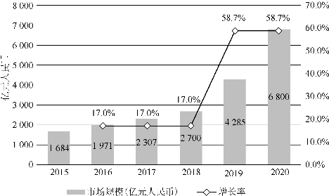

放眼全球，依据《2018 全球与中国 AI 产业市场规模预测》数据显示：2015 年全球 AI 市场规模已突破 1684 亿元人民币大关；2015 至 2018 年间，复合年均增速保持在 17%，至 2018 年规模迅猛扩张至 2700 亿元。预估 2019 年将达 4285 亿元，增速飙升至 58.7%；2020 年更将冲破 6800 亿元大关，增速维持高位。对比 2018 年前的平稳增长，2018-2019 年呈现出跨越式爆发，发展势头极其凶猛。

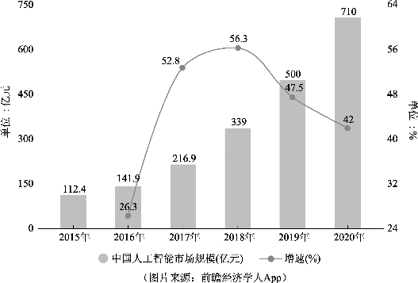

转向国内，前瞻产业研究院发布的《中国 AI 产业市场前景与投资战略规划分析报告》揭示：2015 年中国 AI 市场规模超 100 亿元；2016 年增至 141.9 亿元，同比增长 26.3%；2017 年进一步攀升至 216.9 亿元，增幅扩大至 52.8%；2018 年达 339 亿元，同比激增 56.3%，远超全球 17% 的平均增速。预测 2019、2020 年将分别突破 500 亿元与 710 亿元。2015-2020 年复合年均增长率高达 44.5%，市场前景广阔，AI “新蓝海”待全面开发。

无论全球还是本土，AI 产业整体规模正逆势飞扬、急剧膨胀。这宏观反映出：AI 技术嵌入社会肌理的广度与影响力的深度，早已超越大众原有认知。教育关乎人类发展与民族未来，亦是对技术变革最为敏锐的领域。在科技狂飙的智能纪元，深度探讨 AI 已引发及将引发的教育革命，意义非凡。未来已来，且为当下的延续。今日若能精准洞察 AI 对教育的颠覆与重构，主动拥抱未来智能教育新范式，其价值不可估量。

# 2. 赋能教育：AI 如何催生教育革命

革命，本质是事物的质变与深度重塑，是量变积累经催化剂作用引发的质变飞跃。古今中外，“革命”常挂钩政治，实则科技、工业、农业、商业、智能、学习等领域皆有发生，形态万千。归根结底，革命的爆发是多重合力作用的结果，离不开经济基础、矛盾冲突、技术创新、领军力量这四大核心要素。

任何领域，受“内外”合力驱动，皆会发生深浅不一的变革。表层形态的更迭常见，而本质层面的不可逆重塑，方可冠以“革命”之名。随人类步入智能时代深处，被裹挟其中的程度愈深，对 AI 技术的依赖愈重，渗透至“衣食住行用”全维度。换言之，AI 对人类的革命性冲击是全方位、近乎无死角的，覆盖几乎所有人类生活领域，本书聚焦的教育领域亦不例外——教育革命与教育未来，深度绑定于 AI。

回溯历史，教育界公认发生过四次革命。英国教育家埃里克·阿什比首提“四大教育革命”：一是教育职能从家庭转移至教堂/犹太会堂；二是文字成为教学工具；三是印刷术发明；四是微电子技术应用。对照前述四要素，在经济持续发展的社会脉络下解读：首次革命得益于专业教师群体的诞生；二次赖文字出现；三次赖书籍普及；四次赖信息技术兴起。

# 3. 拷问初心：智能时代教育革命的真正目的

# 4. 本书指南：教育革命的目的、内容与架构

---

**参考文献**

[1] 详见原书注释。
[2] 《2018 全球与中国 AI 产业市场规模预测》。
[3] 《中国 AI 产业市场前景与投资战略规划分析报告》。
[4] 埃里克·阿什比，《四大教育革命》。

# 3. 拷问初心：智能时代教育革命的真正目的

马克思曾言：“人类为之奋斗的一切，都同他们的利益有关。”智能时代，人类对教育事业变革创新的执着，必然关乎核心利益。从 AI 赋能教育的视角审视，外界极易陷入误区：以为教育变革追逐的仅是**效率、成本与质量**的三角平衡。这严重曲解了初心——将教育服务的对象异化为**“商品”**。

必须郑重强调：AI 赋能教育，仅作用于教育事业的**运行与管理层面**。其核心服务对象是教学一线的教师，旨在为学生提供优质教学供给，推动学生健康成长与全面发展——**这才是智能时代教育变革的初心与终局**。这一目标的达成，AI 教育创造的价值，将深刻关乎学子未来与整个社会的走向。

# 4. 教育革命：本书的写作缘起、核心内涵与架构安排

魏源在《海国图志序》中阐述著书初衷：“何以作此书？曰：以夷攻夷，以夷制夷，以夷之长技制夷。”借用此意，本书创作同样基于三重考量：紧跟时代潮流，前瞻智能教育演进；回应国家战略，服务教育强国建设；揭示变革本质，推动教育回归育人初心。

在国家战略引领下，教育领域智能化转型正酣。AI与教育融合的理论探讨备受学界瞩目，双方并行发展催生了“AI教育”新形态。经历政策推手与市场拉动的双重驱动，实践应用倒逼概念重构。当前，界定AI教育的讨论主要聚焦三个维度：

**应用场景层面**，徐鹏归纳其核心落地于智能教学系统、智能体、智能问答及决策支持系统等^[[2]]；梁颖莉则聚焦智能辅导、自动评测、教育游戏与教育机器人等领域^[[3]]。

**教学环节层面**，百度百科视其为利用计算机技术辅助教学设计与产品开发全流程^[4]；科技部《智能教育创新应用发展报告》指出，新一代信息技术构建了以学习者为中心的智能环境，贯穿“备教练考评管”全链条，重塑多元化、精准化、个性化育人新范式^[5]。

**体系结构层面**，钟小柳等主张基于新一代信技建设泛在感知、融合智能的教育新生态^[6]；徐莉芳则强调教学过程智能化及对教育工作者的思想启迪^[7]。

---

**首要任务，推动“学生主体地位回归”。** 发展教育事业的根本旨趣，在于让学生在学习中真正成为主角，将培养社会主义建设者和接班人确立为师生共同的奋斗目标。智能时代，技术赋能教师高效开发课程、精准响应需求，助力学生夯实专业根基。归根结底，一切教育意图都应环绕“促进学生全面发展”展开。遵循马克思全面发展理论，大力践行“五育并举”（德智体美劳），培育堪当民族复兴重任的时代新人，是当代教育的神圣使命。

**核心支撑，彰显教师使命与价值。** 教育要笃信：每个学生皆有独特天赋，每位教师都是“灵魂工程师”。唯有“建立在生命对生命的感召、塑造、引领之上”，教育才能重塑被教育者的人生底色。如此，国家荣誉感、民族复兴使命感、强国担当感方能深入学生心田、浸润灵魂髓质。教育改革应搭建起实现社会价值与个人价值的桥梁，服务国家转型、社会进步与个体成长。

**根本归宿，实现个人价值与社会价值的统一。** 社会由个体构成，人人肩负使命与荣光。我们皆应做自立自强的奋斗者、国家复兴的贡献者——“人人都是追梦人”。教育的属性逼问我们直面“为谁培养人、培养什么人、怎样培养人”三大根本命题。教育的伟大意义不在于教育本身，而在于能否真正兑现“立德树人、铸魂育人”的功能与效用。

**最终落脚，办人民满意的教育。** 百年大计，教育为本。办好人民满意的教育，必须坚持教育优先发展战略。国家需坚定不移走教育创新之路；各级部门要深入开展创新实践，恪守“从实践中来，到实践中去”的路径。改革征程上，始终坚持党的领导，深化思想认知，沉入一线、贴近师生，扎实推进改革入脑入心、向学而生、面向未来。

智能时代教育革命的旨归，在于凸显教育在“推动人的全面发展”进程中的核心价值与战略意义。汲取AI赋能教育的智慧红利，将智能因子熔铸入育人全链条，赋予教育具象化的智慧与能力，驱动教育革命发生。届时，教育生态与结构的优化重组、革命目标的达成，其价值显而易见：有利于学生主体回归、个人社会价值实现、教师使命彰显，整体推动教育事业健康加速发展。简而言之，AI技术与教育的深度跨界融合，助力国家办好人民满意的教育。

# 2. 智能新纪元的教育图景：个性与人性的双重奏

经过对应用层面、教学环节及教育架构三个智能化维度的深度剖析，AI教育的内涵已愈发清晰。它由**“教育智能化”与“智能化教育”**两大支柱构成。前者聚焦于教学流程与环节的智能升级，体现为多元的应用形态与执行细节，旨在优化教师、媒介、学习者的生存状态，属于**“自下而上”**的实践变革，涵盖智能导师、教务管理、评价体系、教育咨询等具体落地场景；后者则源于**“自上而下”**的 umanistic 关怀与制度边界的突围，从精神层面唤醒教育本真，推动整个人类教育系统走向生态化与智慧化。

简而言之，AI教育是基于AI技术，在智能技术空间中实现教育智能化与智能化教育社会普及的进程。从技术融合视角看，它是实体教育与虚拟教育的复合体，是以**“育人对象”**为核心的全新教育架构。在此架构下，教育全流程、全结构将与智能技术实现立体融合，凸显教育的真谛与价值，彰显新时代教育的独特魅力。

## 1. 智能化：贯穿始终的底色

智能化是AI教育的普适特征。其核心在于：在智能技术支撑下，主动适配并满足师生多元化需求。数据、算法、算力构成“三驾马车”，无论是智能教师系统、专家决策系统，还是个性化推荐引擎，皆建立在海量教育大数据的智能建模之上，并在模型泛化迭代中持续进化。

AI教育本质上是一个高速挖掘海量数据潜在价值的功能系统。借助AI技术“试错低成本、迭代快”的优势，它能在不干扰常规学习的前提下，持续优化育人环境、提升资源质量，为校园教学注入丰富的情感体验。

## 2. 个性化：落地实效的核心引擎

### 个性化

个性化是AI教育最关键的特质，直接彰显其在实战环节的育人价值。步入AI时代，数据挖掘、分析分类、知识图谱构建、学习画像勾勒、AI教学助手、虚拟校园、隐性课程开发，均为AI技术的“拿手好戏”。AI教育平台能全链路采集学习者数据——涵盖习惯、思维、偏好、知识结构、情感倾向、家庭经况等（如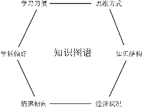所示），覆盖备学、学习、评学三大阶段，并串联横向时间轴的全历程数据。在智能可视化技术加持下，个体学情实现“透明化、可视化”，推动个人学习知识图谱生成与持续迭代。


图 2-1 学习者数据知识图谱

这一特质多维赋能：激发学习者内驱力与主动性；助力教师实施精准教学与精细化设计；为管理者提供精准决策依据。AI教育的个性化属性，更关乎个体终身学习体系的构建。

## 3. 人性化：回归教育初心的温情

智能时代，教育的人文属性非但未弱化，反而更加凸显。育人本质是塑造鲜活生命的目的性活动，育人对象是有温度的个体，故教育从未、也不可能脱离人文发展。相较而言，AI时代让这份人文光芒更耀眼。

AI技术将教师从繁复重复的知识传授中解放出来，智育类教学可交由系统承接。教师由此腾出时空，深耕“情商教学”——强化情感共鸣，重塑师生关系，让理解、尊重、支持、真诚、共情、个性化等育人理念真正落地。

摆脱琐务束缚，教育更聚焦“情感投入”，以情动人，让学习空间化作有温度的“家”，形成“爱家、兴家”的家庭式共同体。在这样氛围中，学生更易接纳引导。同时，AI时代教育趋向参与式、社会化，促进生生互动、情感流动与价值碰撞，共育健全人格。

## 4. 协同：打破壁垒的“大教育”生态

受限于信息壁垒、数据鸿沟、利益博弈与权责纠葛，传统教育常陷入“烟囱式”孤岛发展，部门联动困难，严重掣肘发展。AI教育的诞生，精准破解了这一顽疾。基于AI技术，它将实体与虚拟教育有机融合为**“大教育”**系统。管理者、实施者、受教育者在其中灵活流转、高效联动，构建起高度协同的教育新生态。

### AI教育的协同进化：从三位一体到人机共生

AI教育的协同之道，体现为“教育管理、决策、教学”三位一体的联动升级；体现为“个人、家庭、学校、社会”四方合力的立体连接；更体现为“政、产、学、研、用”五位一体的智慧创新平台构建。归根结底，AI教育的协同本质是**人机协同**，这正是其最鲜明的核心特质。

## 5. 无界性：打破围墙，教育无处不在

AI教育是一种多空间泛在的教育形态，天然兼具包容性与开放性。在智能教育环境下，教育边界早已冲破校园围墙，迈向“社会即学校、生活即教育”的开放时空。得益于智能空间技术演进，信息空间渐次转化为课程与教学空间，物理空间则成为活动与实践的主场。教育教学全流程摆脱了时空枷锁，呈现出超越时空的无界状态——教育，随时随地，无处不在。

# III. AI教育价值链：一个螺旋上升的增值闭环

AI教育是人工智能在技术、思维、结构三个维度赋能教育的结晶。从整体属性看，智能化、个性化、人性化、协同性、无界性五大特征鲜明；从价值属性看，其蕴含的社会价值与个人价值如硬币两面，共同指向AI教育适应社会发展与个体成长的大方向。

探讨AI教育价值，首要的是明确其内涵。所谓AI教育价值，是指以人或社会为标尺，衡量其存在功能与意义，即AI教育满足人类需求的受益关系。人们追求AI教育价值，实则是追求自我价值的实现，而AI教育的全过程，本质上是一个**不断增值**的过程。这种“增值”，正是AI教育价值链逐步闭环、螺旋上升的轨迹。

AI教育价值链（见下图）涵盖了总价值与部分价值两大层面。总价值即宏观价值，站在全社会视角审视AI教育价值，不局限于特定区域，而是面向全体教育服务对象的总体考量——它既关乎教育环节赋能与质量跃升，也关乎教育公平推进与国民素质整体提升。部分价值即微观价值，按特定序列可细分为学生价值、教师价值、学校价值。

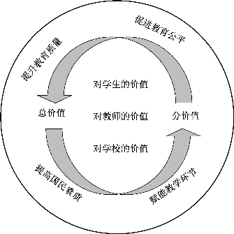

**图 2-2  AI教育价值闭环**

AI教育价值从微观走向宏观、由部分汇聚成总，是AI整体技术优势向教育细分领域渗透迁移，引发价值深化与社会延伸的必然结果。因此，对AI教育价值的探寻与溯源，必经由微入宏、层层递进的过程。

## (一) 微观价值：聚焦个体，精准滴灌

AI教育的微观价值，聚焦于学生、教师、家庭、学校四大核心主体。

### 1. 赋能学生：从“被动灌输”到“主动生长”

AI教育对学生的价值，孕育于其**个性化**特质之中。个性化的关键，在于对学生个体的专业数据画像与知识图谱可视化呈现。基于数据的AI教育建模，依托对学生动态数据的实时分析与动态监测，能精准、及时、快速地感知并反馈个性化需求——无论是知识诉求、情感诉求还是能力诉求。系统据此推荐定制化学习任务、培育专属学习方法、生成个性成长规划，内容有机覆盖德智体美劳五育并举，统筹培育学生的操作技能与智能素养。

在知识爆炸的智能时代，个体学生最缺的不是信息获取渠道，而是**主动建构知识**与**创造性学习**的能力。AI教育的出现，大幅卸下了学生死记硬背知识的重担，腾出更多自由时空用于自我发展，助力学生成长为适应未来智能社会需求的复合型人才。

### 2. 解放教师：从“繁杂事务”回归“育人初心”

随着AI技术迭代，强大的“技术基因”在教育领域全面开花结果。AI教育对教师的价值，集中体现在AI技术优势的**基因传承**上，深度重塑了教师角色、权威与工作内容。尤其在工作层面，传统教育中教师深陷繁杂琐事，耗尽精力却不得不为；而AI时代的教育变革彻底改写了这一剧本。备课、授课、批改、学情分析、方案定制、资源挖掘……这些高耗时环节，如今均可交由AI系统“一点式”高效搞定。教师由此获得宝贵时间与精力，得以回归**价值判断、情感引导、思想领航**的育人核心。

对教师而言，AI教育不仅是解放，更是赋权——它在教学视野与方法上留出弹性空间，让教师核心价值充分释放。智能时代虽让AI接管了传统教育中大量知识传授性工作，但这绝非完全替代，而是**将教师从繁重的“教书”事务中剥离**。百年来教师兼任“教书”与“育人”，却因精力有限，在应试指标与分数考核的挤压下，绝大多数时间被“教书”吞噬，“育人”真值难施，往往只能惠及极少数学生。AI的介入，正是为了扭转这一困局。

## AI教育重塑育人版图：教师回归本位，家校共育升级

人工智能浪潮的涌入，并未冲垮教师的职业根基，反而倒逼教育回归“育人”初心。智能技术的介入，看似对传统教学构成冲击，实则是在以全新姿态提醒世人：教育必须摆脱旧有模式，将“立德树人”置于核心位置。教育的本质从来不是灌输，而是培育适应社会与个性发展的人。在AI时代，掌握话语权的重新回到教师手中，不再依赖外部惩戒体系作为终极手段。

### 教师价值：从“教书”到“育人”的范式跃迁

新时代教师的评价标尺已悄然更替——以引导学生实现生命价值为准则，以促进成长、绽放个性为主旋律。借助智能工具，教师得以精准画像学习者特质，实施因材施教，助力学挖掘潜能、释放天性，真正达成“学以致用、学以成人”的理想境界。

育人观的转型，直接重塑了教育内容。传统的“知识搬运”让位于核心素养培育：结构化思维、创新批判、协作共创、审美感知、知行合一。这一系列能力的构建，旨在锻造学习者在复杂情境下独立思考、快速获知、情感感知、认知重构与迁移应用的综合实力，最终成就德智体美劳全面发展的“完整人”。

就技术成熟度而言，当前AI尚难独当“教书”重任，更多扮演“智能助教”角色。其核心价值在于赋能精准教学：通过学情大数据与个性化画像分析，助力教师实现“千人千面”的教学决策。同时，大数据积累催生教育实证研究新范式，推动定量与定性研究深度融合。如今，善用AI、精通AI已成优秀教师选拔的关键指标。

### 家庭价值：以“陪伴”之名，化解育儿焦虑

家庭视角下，AI教育最大的温情在于填补“陪伴缺位”。后90s时代生活节奏加速，亲子共处时间被极度压缩，孩子渴望陪伴却屡屡落空，家庭教育功能由此弱化。AI技术的介入，为这一困局提供了破解之道，主要通过“陪伴型机器人”与“家校共育终端”两大路径落地。

**智能陪伴机器人：贴心的成长伙伴。** 基于发育阶段定制交互，提供智能对话、趣味互动、协作游戏、同传翻译等服务，让最怕孤独的孩子随时获得温情陪伴与优质启蒙。更重要的是，它将家长从繁重的辅导作业中解放出来，腾出精力聚焦孩子身心健康，实现高质量陪伴的“双赢”。

**家校共育终端：打通亲子情感的“最后一公里”。** 校园围墙常阻隔亲子情感流动，AI终端以数据可视化打破壁垒。家长可实时掌握学业动态、心理倾向、行为习惯，促成高效沟通。以科大讯飞“小学家长端”为例，强大的数据统计与可视化呈现，激活家长对校园生活的主动关注，倒逼家庭教育重视度提升，精准捕捉孩子真实成长诉求。

### 学校价值：以“数智治理”，驱动管理现代化

学校引入AI进行系统级重构，核心红利在于推动管理科学化。管理的本质是精准决策，而决策的精准度取决于数据的“结构化合理性”。教育信息化2.0行动计划的落地，夯实了数据结构、共享机制、保密协议与知识产权保护基座，为智慧校园建设扫清障碍。

目前，各级学校正加速向“智慧校园”演进，感知能力指数级跃升。未来，当AI渗透至校园每个毛细血管，教学管理、安防管控、学籍服务、学情分析将全面实现智能管控，最终抵达教育治理现代化的彼岸。

## (二) AI教育的宏观图景价值

站在宏观视野下审视，AI教育的价值维度极为宽广：它既关乎教学环节的智能化赋能与教育质量的跃升，也承载着推动教育公平、提升国民整体素养的时代使命。

### 1. 赋能教学全链路，让“教”与“学”更智能

AI教育彰显整体智能特质的最直观领域，莫过于对教学核心环节的深度赋能。将教学视角聚焦，教育流程本质上可归纳为备课、授课、作业布改、课外辅导、考核反馈这五大基础板块。AI技术的介入，实质上是推动这“五环”实现全链路智能化升级。

以备课环节为例，教案设计、教学进度规划、课件制作等繁重工作，均可借助智能挖掘技术，从海量网络资源与专业数据库中精准调取共享素材。这极大地压缩了素材�集成本，反哺出宝贵时间供教师打磨教学内容，让备课质量稳步跃升。再看作业环节，不论主观题还是客观题，智能批改早已落地；定理证明、智能学习游戏、微积分求解、行为示范、智能速记、机器翻译、语音合成、智能写作等前沿能力，亦悉数纳入技术工具箱，为师生减负增效。

### 2. 重塑质量评价体系，驱动教育“高质量发展”

教育质量是检验育人成效的核心标尺，是各类教育要素作用于受教者后产生的效能总和，而受教者的知识储备则是质量高低的集中体现。教学环节、方法、管理、制度、内容、环境等皆为影响变量。AI技术的注入，将推动这些利于提升学习效能的因子完成智能化转型。

其核心优势在于：AI能精准识别制约质量提升的“卡脖子”因素，并对其施行智能化管控与动态调节。在显著提升教育运行效率的基石上，推动教育事业从“量的扩张”转向“质的跃迁”，全面迈入高质量发展轨道。

### 3. 打破时空与资源壁垒，让优质教育“触手可及”

2019年，习近平总书记在世界人工智能与教育大会贺信中明确指出：中国高度重视AI对教育的深远影响，致力于推动深度融合，发挥技术优势，加快建设“伴随终身、面向全民、因材施教、开放灵活”的教育体系，并愿同各国共探前沿、凝聚共识、深化合作、扩大共享，共同推动构建人类命运共同体^([\[10\]](#txt002.html#footnote_content_txt002_10))。

这充分揭示了AI赋能教育在促进公平方面的战略高度。其内核在于“将一切有价值的知识，教给一切渴望学习的人”。AI时代的公平实践已然启程：从“单师独授”进阶至“双师课堂”，再突围至“多师协同”，名师名课跨越山海，惠泽全国学子。国家“三通两平台”工程的落地，便是AI技术推动优质教育资源公平辐射、实现价值兑现的标杆案例。

### 4. 筑牢学习型社会基石，成就国民“全面发展”

国民素质是一个系统工程，涵盖“三类八项”维度：即自然、心理、社会三大范畴，细分为政治、思想、道德、专业、审美、劳动、体魄、心理八项具体素养^([\[11\]](#txt002.html#footnote_content_txt002_11))，统摄个体与群体两个层面。教育是国民素质形成的根本途径。

随着AI教育实践日臻成熟，其在赋能环节、提振质量、促进公平三大维度的叠加效应持续放大。宏观来看，AI将重塑教育为一个开放包容的超级生态系统：构建学习型社会、确立终身教育体系、教育内容全域覆盖国民素质教育版图、铸就健全人格、让受教者“全面发展”从愿景变为可期现实。与此同时，爱国主义、集体主义、道德伦理教育亦将深度融入其中。终极而言，AI教育与国民素质的内在结构将走向和谐共生，从整体上实现个体素养与集体素养的有机统一，大幅跃升国民整体素质高度。

***

# Chapter 3 The Unspeakable Predicament: The Narrative of Traditional Education

## References

[8] Ding Yanjie. "Human-Oriented" Humanistic Education [J]. Forum on Industry and Technology, 2009, 8(05): 179-180.

[9] Jiuyu Xiang. Values of Ideological and Political Education and People [J]. Teaching and Research, 2002(12): 55-59.

[10] Xinhuanet. Xi Jinping Special Reports. Xi Jinping Sends Congratulatory Letter to International Conference on Artificial Intelligence and Education. http://www.xinhuanet.com/politics/leaders/2019-05/16/c_1124502111.htm.

[11] Baidu Baike. National Quality [OL]. (2019-9-26) [2019-10-9] https://baike.baidu.com/item/%E5%9B%BD%E6%B0%91%E7%B4%A0%E8%B4%A8/8589150?fr=aladdin.

## 教育资源匮乏：教育公平痛点的深层逻辑

**“因材施教”：悬浮在纸面上的教育理想**

**“以师为本”：导致“满堂灌、空堂听”教育异化的推手**

**知识迭代加速：教育供给与社会需求的“脱节”时刻**

**“李约瑟难题”与“钱学森之问”：倒逼我们重审教育本质**

有问题才有需求，问题本质上是未被满足的需求。当下，以应试教育为代表的传统模式，在素质教育的呐喊声中陷入“舆论劣势”，却并未因此直接转型或退出历史舞台，反而在现实中固化出“素质教育挂招牌、应试教育跑干流”的双重结构。不容置疑，传统教育的惯性依然主导着全社会的育人导向，并未因素质教育的推进而停滞；但同样不可否认的是，随着素质教育探索深入，传统模式的顽疾正以前所未有的清晰度浮出水面。

### 1. 教育资源匮乏：教育公平痛点的深层逻辑

所谓教育资源短缺，是指受限于教育主客体的资源禀赋，导致受教育者在资源获取与权利享有上供给不足，或因供需对比产生的心理落差。而教育公平问题，则是指受教育者在公平享有机会时，遭遇社会、家庭、政策等阻力，引发“静态”与“动态”领域资源配置失衡，涵盖机会、过程、结果三个维度。

资源短缺与公平缺失看似两码事，实则因果相随。当资源短缺上升为区域性难题，公平危机便随之而来。区域差异演变的终点，必然落脚到个体间的资源占有不均。归根结底，教育公平的核心矛盾，是受教育者自身贫富悬殊导致的资源分配失衡，最直观的表现便是入学机会的不平等。

改革开放以来，城镇化浪潮推动城乡急速扩张，但城乡鸿沟也随之成为社会焦点。长期以来，举国工业化的宏大叙事曾以牺牲农村与生态为代价，换取城市工业的繁荣。这一过程虽造就城市经济腾飞，却为社会发展埋下“后遗症”——教育城乡差距便是其中典型。城乡教育本应走向融合共进，却因资源、政策、文化等多重掣肘，剪刀差越拉越大。

我国城乡教育差距呈现“多层次失衡”特征：发达大中城市资源富集，与郊区差距巨大；欠发达西部地区城乡差距相对较小；但若横向对比东部沿海城市与西部山区农村，鸿沟深不见底。

当下，西部贫困山区教育仍聚焦“扫盲识字”，文化传承是核心底色；东部沿海城市则转向“全人发展”，在智力开发外重塑“德智体美劳”综合素养。这种起跑线的代差，正是寒门学子在清北复交等顶尖高校录取名单中比例极低的现实注脚 [1]。

城乡教育鸿沟值得更深层的省思。在二元结构的生长环境下，一系列教育困境从家庭延伸至学校、社会。家庭层面，城乡育儿观念差异显著，即便重视程度相当，农村家庭受限于文化资源稀缺、父辈学历低（知识代际传递断层）、社交半径窄，难以与城市家庭抗衡。更关键的是，农村学生最易陷入“学用脱节”困境——主流文化在城镇，生活场域与学习场域的异化，极易引发社会适应障碍。城市内部家庭差异虽存，但相对鸿沟远小。

学校与社会层面，硬件设施的城乡之别触目惊心。东部沿海城市凭借产业升级与信息化红利，在经济技术托底、市场机制驱动下，教育基建迅速对标国家现代化水平。反观农村与偏远西部，信息技术课仍需多人共机，实验教学停留在书本推演，支撑实操的平台缺位。

教育资源短缺的根源，是城乡二元结构留下的历史欠账。其负外部性催生教育不公：掌握“天时地利人和”群体优先瓜分稀缺资源，这种占有最终异化为不公平竞争，偏离了教育的初心与使命。

### 教育困局：资源短缺的症结与“因材施教”的落空

教育资源匮乏与不公平的成因虽繁杂，却可归结为核心矛盾：区域经济发展的失衡。偏向性的资源配置、财政投入的不足、政策设计的缺陷，不过是次级推手。尽管社会各界倾力尝试——推行义务教育、组织支教、募集善款、兴建校舍，但至今资源稀缺的顽疾依旧未解。

这迫使所有关心教育的人必须重审困境：是否存在一条新路径，哪怕仅能推进一小步，也能惠及全国？

#### “因材施教”：悬置于理论的美好愿景

“因材施教”乃教学核心准则，意指依学习者个体差异施策。世间无同叶，亦无同人。每个学生皆是独特的个体，汇聚成绚烂多元的群体。即便同根同源、同胞共育，发展轨迹也大相径庭。教理学认为，遗传、环境、学校教育、主观能动这四大要素，以各异的组合与强度，塑造了学生在认知、情感、能力、性格、兴趣、品德、意志等维度的显著差异。

若以单一模式“流水线”式教学，无视个体禀赋差异，充其量算完成任务，实则未入学生心田，背离了教育初衷。故而，“因材施教”若能落地，对学子是莫大幸事，对教者是卓越功绩。

#### 孔子的先声：两千五百年前的实践样本

早在两千五百年前，孔子便洞察此理并付诸实践，穿越时空的穿透力令人震撼。教育被誉为“教书育人”的特殊行业：普遍性在于它像万千职业一样可为生计；特殊性在于其服务对象是“活生生的人”，教师无权放弃任何一个学生，而须对每一个学生实施“定制化”教学。

《论语·先进》记录了一则生动案例：子路、冉有同问“闻斯行诸”，孔子却对答如流、截然不同。子路性子急躁、冲动，孔子以“父兄在”抑制其锐气；冉有性格退缩、犹豫，孔子以“闻斯行”激发其进取。侍侧的公西华不解其故，孔子释疑：“冉有退，故进之；子路兼人，故退之。”

这一幕尽显智慧：唯有深谙弟子长短、性情底细，方能精准施策。若换旁人作答，恐难窥“因材施教”堂奥。这折射出落地之难：古今语境迥异，孔子“三千门徒、七十二贤人”，多为终身弟子，师生关系极稳定，便于洞悉个性；而今教育体系日趋定型——大班额、重分数、师生流动频繁，教师难以兼顾质量与效率，只能以分数论英雄，个性化关怀遂成奢望。

本质上，这是**学生成长的“流动性”与教育体制的“固定性”**深层博弈的结果。

### 3. 打破“以教师为中心”：从“座无虚席”到“心有所属”的教育回归

**因材施教为何落地这么难？**

说穿了，因材施教的理想与现实之间，横亘着三座大山：教师认知的天花板、应试指标的指挥棒、以及师生之间根深蒂固的不平等地位。教师往往凭借主观经验去界定学生的“材”，难免有失偏颇。一旦僵化地套用“因材施教”，学生极易被塑造成“教师期待的样子”，而非拥有创新精神、忠于自我内心的独立个体。这背后的逻辑暗示着一种权力关系：教师是“先觉者”、真理的垄断者，真理须自上而下灌输。真正的超越，在于承认生命的生长性——学生在长，教师也在长；教师并非真理的完全占有者，而是共同探索的伙伴。

**应试教育的“功”与“过”，与智能时代的新选择**

不可否认，班级授课制、分数论、跟班走这套组合拳，曾为中国经济腾飞输送了海量专业人才，功绩卓著，截至目前利大于弊。但站在智能时代的门槛上，若能借力技术手段，将“弊端”压至最低，让学校与教师得以触达真正的因材施教，这难道不值得我们提前布局、主动拥抱吗？

**因材施教的内核：知人善任，各尽其才**

透过历史长河，因材施教的形式虽演变为个性化教育、定制化教育、弹性教育等新名词，但内核从未变——“知人善教，让每个人才得其所用”。它强调教育因人而异，“对症下药”，核心在于引导学生走出去、走进心，在具体情境中邂逅那个不同的自己。惟有找回真我，方能与内心和解、与世界达成共识，在追寻中锻造批判与创新精神，奔赴更广阔的未来。

**“以教师为中心”的溯源与谢幕**

“以教师为中心”并非凭空而来，有其深厚的历史土壤。中国长期处于农业文明阶段，熟人社会依靠血缘地缘维系，教育内容多为农时节令、耕作经验。狭义教育稀缺，知识垄断在上层，底层百姓对知识敬畏有加，视“读书换命”为跨阶层唯一捷径。拜师学艺成刚需，“师者，传道受业解惑也”，教师凭借知识优势理所当然占据权威高地，形成“师道尊严”。在人才培养初期，这种模式确实高效发挥了作用。

然而，随着教育普及与认知升级，“以教师为中心”逐渐暴露出权威文化的弊端——教师权威、知识权威、教材权威层层叠加。其本质是源于对知识的敬畏而衍生出的知识垄断。如今，知识获取渠道爆炸式增长，知识变现难度加大，“读书无用论”甚嚣尘上，教师对知识的垄断地位动摇，教师权威自然随之被重审、被质疑。这倒逼教育必须完成一场根本性的转向：让学生真正回归课堂主场，确立“以学生为中心”的新范式。

### 4. 知识迭代加速：教育为何跟不上社会步伐？

以教师为核心的教学模式，深层弊端在于极易制造“人在心不在”的课堂虚假繁荣——这正是其遭诟病的根源。师道尊严固然重要，可一旦教师权威成为阻碍学生成长的高墙，让学习者对课堂产生厌倦，“身体到场，思维缺席”便成了常态。在这种氛围里，学生萌生的往往是“混日子、拿毕业证走人”的念头，主动探索新知、建构认知的动力彻底熄灭，这或许是教育活动中最大的悲剧。

随着教育认知的成熟，人们愈发清醒：教育的本质不在于灌输，而在于唤醒个体走向“自主教育”的内驱力。这一过程旨在培育具备独立人格、能够自我省察、持续生长的现代人。因此，与“教师中心”相对立的“学生中心”理念应运而生，备受瞩目。这倒逼教师完成角色蜕变，以规划者、设计者、引导者的新面貌站在学习者面前。当然，范式转型非一日之功，必经漫长磨合与适应。

纵观新时代，单一的“教师中心、教材中心”已被时代抛弃，学生被迫沦为知识的被动容器，早已激起社会强烈反感。“唯知识论”与“唯分数论”如同双重枷锁，进一步锁死了学生的创造力与批判性思维。在这种模式下，想培养出具备“独立精神与自由思想”的栋梁之才，缺乏最基本的科学支撑。

回溯历史，“学而优则仕”的选拔机制要求死记硬背僵化经典以博取仕途。而今，社会考量人才的标准早已变迁，聚焦于个体在具体情境中发现、分析、解决问题的综合能力。当下的教育变革，核心任务只有一个：归还学生的主体地位，校正失衡的师生关系，让学习者真正成为学习的主人，教师回归教学活动的幕后推手与领航员。

变革是方向，路径才是关键。智能时代浪潮下，如何推进教育改革以同频共振时代脉搏，仍是亟待破题的命题。

#### 知识半衰期缩短：学校教什么，社会可能已不用

我们身处一场前所未有的知识爆炸之中。知识更迭速度惊人，边界疯狂外扩，结构不断裂变重组，知识“半衰期”正以肉眼可见的速度缩水。

所谓知识半衰期，描述的是新知从诞生、实用走向过时、失效的周期，折射出知识价值随时间流逝而衰减的规律。“知识贬值定律”给出过惊心动魄的数据：若一年不学习，储备知识将贬值 80%。更有研究指出，每年必须以 6%-10% 的速度更新认知储备，才能匹配未来社会需求，这绝非危言耸听。

翻看人类史：19 世纪知识总量每 50 年翻倍；20 世纪初缩短至 10 年；80 年代末变成 3 年；进入 21 世纪，翻倍周期已压缩至 1 年甚至更短。知识经济时代，谁能跟上迭代节奏，谁就掌握了进化的主动权。过去几百年的知识积累，可能不及当下几个月甚至几周的增量。如今，人人既是知识的创造者，也是传播者与受益者。

《礼记·大学》有云：“苟日新，日日新，又日新。”古人尚知自我革新当日日精进，置于智能时代，我们岂能止步？

通常而言，知识更新速度是教育体系中最核心的变量。可现实残酷：我们的教育系统，能跟上这狂奔的节奏吗？这个问题直指教育质量与成效的命门，容不得半点回避。

社会端呈现的“快文化”——外卖、快递、网约车、咖啡因驱动的通勤——无不映射出“快节奏、快生活、快文化”的集体图景。这股加速洪流是全社会协力推动的结果。教育体系理应同频共振，但从社会各界的批判声浪来看，改革步伐显然跟不上时代心跳。

社会是超大规模复杂系统，其复杂性决定了人才培养必须多元化、系统化。单一的知识灌输早已失效。真正在全面发展上深耕的人，在竞争中必占先机：同等条件下，他们能在更短时间内创造更大的社会价值与个人价值。这，才是“快节奏”教育改革应直指的终极靶心。

#### 为何社会知识狂奔，教育却步履维艰？

社会侧知识迭代飞快，教育侧更新迟缓，二者脱节最终倒逼教育者直面灵魂拷问。从发展规律看，教育始终是社会的缩影，天然滞后于时代，受制于生产力水平与社会经济政治体制。深究其根，这本质上是“农业文明向工业文明、工业文明向智能文明跨越冲突”在教育场域的投射，牵扯着理论与实践的张力、人与自然的和谐、人与人的平等等深层结构性矛盾。

##### 学校教育的天然短板

# 学校教育为何难逃“象牙塔”困局？

学校教育始终带着“学校”的烙印。相较于广阔的社会，校园更像一座与世隔绝的保护伞。所谓“学、知、行”的理念，多半只适用于校园这一特定语境。当下的教育重知识传授、轻实践应用，实操课程极度匮乏，导致理论与实践严重“两张皮”。学生装满了知识，却不知如何在具体情境中调用，更谈不上融会贯通、触类旁通。眼下高校普遍面临的痛点，正是教学内容与企业、社会对人才的实际需求严重错位。那些只在理论堆里打转、缺乏社会历练的毕业生，踏入职场往往水土不服。

#### 课程体系的“缺角”困境

当前的教育课程体系尚不健全。传统教育挂着“以人为本”的招牌，实则聚焦于智商（IQ）的开发，对情商（EQ）的培育却鲜有建树。课程设置自然也就围绕着刷分、考试转。按理说，除了政史地理化生、语数英这些基础学科，课表里理应涵盖人格塑造、精神成长、生命意义、社交生存、家庭婚姻、人际伦理、财富观塑造等“求财有道、立德为本”的核心素养教育。可现实却令人唏嘘：现有体系并未把学生看作一个有血有肉、人格健全的“整体”，而是将他们视为待解剖、待重组的“标本”。

#### 师资与资源的“滞后”博弈

剖析“脱节”根源，绕不开教师专业度、教材筛选与学生学力三大变量。科技飞轮高速旋转，社会需求日新月异，学生的知识结构必须紧贴社会标准动态迭代，方能破局。可执行层面极其艰难。智能时代下，大批教师长期游离于社会主流之外，教学思维与内容易受校园环境“围猎”，被困在围墙里，自然难育出经得起市场检验的学生。邓小平同志早已点破关窍：“学校能否培养合格建设者，关键在教师。”良师出高徒，绝非虚言，这也是当下大力倡导“四有好师”（有理想、有道德、有学识、有仁爱）的根本缘由。

教学资源端同样棘手。单是教材编撰便是场持久战：编写、出版、修订、入选，漫长周期走下来，不少课程内容早已“过期作废”。逼得教师上课前还得花海量精力去纠偏、补新、查缺补漏。

#### 学习力的“被掏空”危机

学生自身的学习能力正遭受侵蚀，难以跟上时代步伐。海量知识堆砌下，信息良莠不齐、数据交织、认知碎片化、学科壁垒森严，加之智能产品的“负价值”干扰，极大地消解了学生的求知欲与主动性。以智能手机为例，其与学生学力的博弈值得深思。功能炫目、应用无穷的手机，深深俘获了学生注意力，严重挤占学习带宽。更关键是，一提“学生+手机”，大众联想的第一反应是“打游戏”而非“学习”。可见，智能元素入教虽带来便利，实则暗耗学习能量、削弱学力根基，亟待正确的价值观引领纠偏。

若有朝一日，教育知识的更新速度能追上时代的脚步，校园教育与社会教育不再割裂，那将是怎样一番图景？这样的未来充满诱惑力，召唤我们在智能新纪元共同探寻教育破局之路。

## 五、“李约瑟难题”与“钱学森之问”：直指教育痛点

上世纪三十年代，英国学者李约瑟在巨著《中国科学技术史》中抛出“李约瑟难题”，瞬间引爆全球学界讨论。2005年，温家宝总理探访钱学森，老科学家一句“为什么我们的学校总是培养不出杰出人才”，引发举国深思，被称为“钱学森之问”。

虽切入点不同，两个提问却殊途同归，直指近代以来中国科技、教育、人才培养的命门。它们引发强烈共鸣，既缘于两位大家的学术分量，更因精准踩中了国人最痛的神经。

透过现象看本质，两个难题的核心都指向“杰出人才稀缺”。溯源而上，最关键的变量仍在教育。百年大计，教育为本；无良教，不出才；国之硬实力、软实力皆受其制。人才是第一资源，国运、科技、经济社发展全靠人才，育才又靠教育。因此，“李约瑟难题”实质追问的是：**为何近代中国难诞生顶尖科技人才？**

对此，李约瑟在巨著中给出的解释大致可归纳为三点：一、农业社会底色导致过重经验实用、轻理论探索；二、缺乏利于科学生长的世界观支撑；三、科举制度扼杀了国人探究自然奥秘的强烈好奇心。

### 诺奖榜单揭示教育落差：零上榜背后的深思

钱学森之问虽未留下亲笔作答，却早已烙印在国人心头。无数人的追问与探索、学界的持续聚焦、教育者的多年沉思，终将汇聚成对这一命题独有的注脚。

当下相关研究成果丰硕，理论体系臻于完备，但放眼全局，众人多立足于理想高地，落实到实践层面，行动力度却显不足。唯有结合实践的批评，方显珍贵。

理想丰满，前程似锦，道阻且长。面对“李约瑟之问”与“钱学森之问”这两道世界级难题，我们期盼在未来教育中，它们能彻底翻篇，成为历史陈迹。

#### 第四章 跨越时空：教育形态的新范式

##### 一、 自主支配的学习时间：拓展学生自由发展的可能性

时间是人类生存的根本形式。马克思指出：“时间乃是人的现实性……它不只是生命的尺度，更是人的发展空间。”换言之，时间具备双重维度：既是生命的刻度，也是发展的疆域。人类过往、当下与未来，无一能逃离时间的管辖；一切活动皆与之紧密相连；工作、学习、生活在时光流转中留下痕迹，于历史积淀里塑造起立体的人格轮廓。

时间具有一维性与不可逆性。在传统认知里，流逝的时间是“朝朝暮暮”不可重来的轮回，无人能超脱其外。面对时间，人类唯有两途：与时间赛跑，或被时间“牵着鼻子走”。教育与学习同样受制于时间，离开了时间的存在，发展便无从谈起。

时间是学习活动的核心要素，学习时间的有效利用直接关乎成效。传统教育以课堂、教师、教材为“三大中心”，固定的上课、作息、作业时间，锁死了学生的自由度。校园万物皆彰显封闭模式的特质，学生沦为“定格”的一份子。可支配学习时间寥寥，多按部就班执行既定计划，时间利用被动化，导致虚度光阴、效率低下、管理失当、高效时段短促。而新智能时代的到来，正在打破并超越这些顽疾。

###### 学习时间尺度的延展性

```
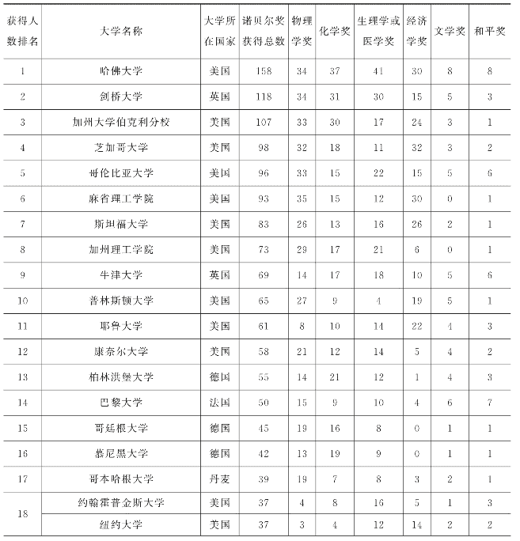
```

续表

```
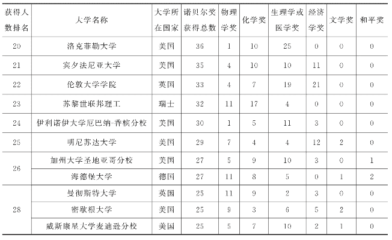
```

据全球诺贝尔奖得主数量前30名高校统计^[\[5\]](#txt003.html#footnote_content_txt003_5)，美国哈佛大学以158项荣膺榜首，英国剑桥大学118项稳居次席。第三至第五名分别为美国加州大学伯克利分校（107项）、芝加哥大学（98项）与哥伦比亚大学（96项）。前30强名单显示，美、英、德高校科研实力领跑全球（详见表3-1）。值得注意的是，据教育部2019年6月15日最新数据，全国高等学校达2956所，却无一校跻身榜单。

按学科分类统计的诺奖得主数量前五国数据^[\[6\]](#txt003.html#footnote_content_txt003_6)显示，美国以绝对优势领跑，其后依次为英国、德国、法国、俄罗斯、日本、以色列、瑞典、西班牙、瑞士、荷兰、挪威等国。中国未现身任何学科前五甲。

图3-1的数据从侧面印证：中外差距非毫厘之微，而是山海之远。按人口比例推演，中国理应跻身世界前列，自近代至今却呈现此般“异象”。“李约瑟之问”与“钱学森之问”诞生于中国，必与此“反常”深度关联。

站在全球视野审视中国教育，反思重构刻不容缓。智能时代呼唤中国教育扭转现局，让世界级创新人才、大科学家、大哲学家能在中国土壤生根发芽，在新时代教育生态中茁壮成长。

新智能时代，吾辈教育当勇担重任，奋力追赶。

【注释】

[\[1\]](#txt003.html#footnote_quote_txt003_1) “清北复交”：清华大学、北京大学、复旦大学、上海交通大学。

[\[2\]](#txt003.html#footnote_quote_txt003_2) 陆孝东. 超越因材施教[J]. 教育学术月刊, 2014(10): 3-17.

[\[3\]](#txt003.html#footnote_quote_txt003_3) 百度百科. 知识折旧定律[OL] [2019-08-03] https://baike.baidu.com/item/%E7%9F%A5%E8%AF%86%E6%8A%98%E6%97%A7%E5%AE%9A%E5%BE%8B/6870457?fr=aladdin.

[\[4\]](#txt003.html#footnote_quote_txt003_4) 邓小平. 邓小平文选（第2卷）[M]. 北京: 人民出版社, 1983: 236.

[\[5\]](#txt003.html#footnote_quote_txt003_5) 个人文库. 与之伟善与言. 全球诺贝尔奖得主最多的30所大学[OL]. http://www.360doc.com/content/19/0321/04/19446_823043081.shtml.

[\[6\]](#txt003.html#footnote_quote_txt003_6) 刘思涛. 金吉利. 2018年世界大学诺贝尔奖得主数量排名[OL]. (2018-10-16)[2019-9-13]. https://www.jjl.cn/article/142266.html.

# 智能时代教育的时间“留痕”与“聚合”：让学习时光真正属于学生

智能时代的教育，在学习时间维度上展现出了独特的**留痕性**与**聚合性**。这两大特征，正从根本上重塑“时间”在教育中的流转形态，打破传统时空的物理限制。

### 学习时间的“留痕性”：让逝去的时光变成可追溯的资产

何为留痕性？简单说，就是借助技术手段，将学习全过程“留痕”并“数据化”，填补传统教育中学习数据缺失的空白。

试想，学生在视频平台学习时，评论区的即时反馈、弹幕里的思维碰撞，这些原本零散、易逝的过程性数据，如今经由AI数据挖掘技术，得以历史性复原与可视化整合。这就好比给流动的学习时间按下了“封存键”，让过往不再虚度。

在深度学习领域，**“长短期记忆网络（LSTM）”**与**“深度递归网络”**技术，更精准地辅助模式识别，让不同尺度的数据信息在不同时间维度自由流动。这不仅助力学生事后复盘管理学习时间，更能直接映射出个人的学习模式与短板，从而辅助养成良好习惯，提升自主学习力。

### 学习时间的“聚合性”：打破空间壁垒，实现“1+1>N”的时间增值

聚合性，指的是将发生在多空间、同频率时间尺度上的学习活动进行汇聚。依托人工神经网络技术，泛在学习活动实现了有机连接，散落在多维时空中的学习成果得以整合，整体上节省了学生的学习时间。

从宏观视角看，人人拥有的学习时间总量一致。若将所有学习者的活动视为一张巨网，个体只是其中一个个时间节点。全人类学习空间里所有节点的集合，构成了人类共同的学习时间。过程中产生的成果，最终以智能共享的形式反哺每一个节点。于是，**时间的聚合，为思想共振与成果共享奠定了基础。**

从微观收益看，共享是前提。学生若想“省时”，就须在整条学习时间流中寻找资源连接技术。基于AI的在线学习系统应运而生：多人同步学习，平台聚合成果、建模知识图谱、共享数据、互通过程。群体优势赋能个体，让学生以更低成本获取更全资源，大幅压缩“找资源”的无效耗时。这正如马克思所言：“每个人的自由发展是一切人的自由发展的条件。”参与者越多，智能系统的红利越大。

---

## 双重机制并行：从“补全过去”到“赋能未来”

智能时代教育的这两大时间特质，底层逻辑各有侧重：

*   **留痕立足“存算”：** 依托智能技术的强大存储与算力，全维度记录师生互动、生机交互、生生协作等全链路过程。传统教育中“一去不复返”的过往时光，如今转化为教育大数据，补全了学生学习时间轴上缺失的“过去时”。
*   **聚合立足“效能”：** 依托智能技术对效率的赋能，将备课、授课、评价、学情分析、素材�集（教师端）；学、考、练、拓（学生端）；管校、育文化（管理端）深度融合。在技术优势持续迁移中，传统教育里的“必要琐碎时间”正被转化为“自由支配的学习时间”，为“以学生为中心”腾挪出更宽广的时空。

### 时间维度的三重融合：历史、当下与未来的有机统一

无论“教”还是“学”，都耗费时间。AI技术有效填补了教育活动时间轴上“过去时”的空白，推动**“历史教育、现实教育、未来教育”在时间维度上有机融合**。

AI对教育效率的赋能，本质上是对已发生教育现象的**时间掌控**。这是一个从“琐碎”走向“必要”、从“被动消耗”走向“主动选择”的智能化筛选过程。学生的主动学习状态，正在这种时间重构中孕育萌发，学习的主动性与积极性必将迎来质变。

### 何时能真切感知时间的存在？

当学生意识到学习时间的价值之时，便是真切感知时间存在之刻。

马克思在《经济学手稿（1857—1858）》中指出：“自由时间”指人可以“自由支配”的时间，是发展“各种本质力量”、实现“个人全面发展”的时间。如今，智能技术让资源触手可及、效率显著提升、规律清晰可见、短板无处遁形，正将学生从“遮蔽”的学习空间中解放出来，归还更多可用于“发展自身本质力量”的时间。

**时间的意义，往往在失去时才被觉察；时间的价值，唯在自由获得的瞬间才被体悟。**

---

## 结语：自由支配的时间，延展自由发展的可能

综上所述，AI时代催生了**自由支配的学习时间**，这为学生的自由发展延展了无限可能。对个体而言，这意义非凡——自由时间的获得，能有力推动学生全面发展，无论是能力拓展、精神生长，还是社会关系构建，都将获得前所未有的延展空间，最终通向自由而全面的发展。

## 二、 多维教育空间的共生：从“分离”走向“聚合”的空间嬗变

### 第五种人机关系：AI教师与人类教师

#### 智能赋能：教师角色的重塑
#### 直面未来：人类教师会被取代吗？
#### 人机协同教学：从对立走向融合

### 一、智能赋能：教师角色的重塑

步入21世纪以来，人工智能（AI）以磅礴之势持续搅动各个领域，不断重塑人们对“传统”的认知。在教育版图中，鲜有人预料到AI的降临会动摇人类教师的根基。然而现实表明，AI确实给人类教师带来了“惊喜”，亦或是“惊慌”。2018年8月，全球首位AI公民索菲亚受聘成为人类史上第一位AI教师，标志着AI正式踏入教育行业。AI教师的诞生引发了对人机冲突的深度反思——人类教师会被AI取代吗？在智能时代，人类教师该如何定位，又该如何与AI教师共存？这些都是新时代亟待深究的全新课题。

### 三、打破时空壁垒：无界教育的智能构建

纵观人类教育发展的漫漫长河，教育演进始终与社会需求的变迁紧密相扣。随着新一代AI技术的演进，置身新环境中的人们逐渐觉醒：传统教育将教学锁定在特定的时空坐标里——固定的场景、场地、环境、师资、手段与理念，竟在学生心中筑起了一道厚重的“墙”，严重阻滞了社会适应力的生成，导致学生难以契合社会发展的需求。因此，社会发展持续倒逼人们从时空维度内部探寻教育发展的新疆域。对“无界”的向往、对教育边界的打破与超越，对拓展学生的“心理边界”与“认知边界”具有深远价值。

AI赋能教育，让教育时间从“被迫的碎片时间”转变为“自主支配的学习时间”，让教育空间从“单一维度”跨越至“多维教育空间共存”，为教育发展开辟了全新的时空机遇。可以断言，以学生拥有自主可支配的学习时间为前提，极易促成个体与多维教育空间的深度融合，从而超越传统时空对学生发展的桎梏，打破教育的现实边界，开启无界教育的大门。

1998年，澳大利亚学者斯图亚特·坎宁安在专著《新媒体与无界教育》中，首次将“无界教育”作为学术术语引入研究者视野。随着教育持续演进，教育的空间与边界日益模糊。教育主体的多元参与、多种教育形态的并存共生，持续瓦解着传统教育凝固的“壁垒”。

无界教育指代教育活动与现象的无边界发生，具体涵盖：教育时间无界、教育空间无界、教学内容无界、教学形式无界、教育对象无界、学科交叉融合无界、教学课堂无界等。无界教育的诞生，为整个教育系统的变革勾勒出革命性路线图。它以传统封闭教育空间为“强劲对手”，在精神层面打破传统教育边界，在实践层面颠覆传统教育的“正统权威”。因此，无界教育概念在发展过程中备受教育界与商界青睐，催生出一批无界教育学术成果、咨询机构、科技公司与培训机构，推动了无界教育的社会化进程。

在智能时代，无界教育是家庭教育、学校教育、社会教育边界消融的产物，与民众生活息息相关。在无界教育图景中，教育无处不在。在智能支撑技术的加持下，无界教育发展呈现三大显著特质：智能化、全覆盖、沉浸式。教育与生活相互渗透，正如古语所云：“教育即生活，生活即教育。”无论身处实体空间还是虚拟空间，无界教育都是人在社会化情境中“真实自我”的回归。在新的“无界”架构下，传统教育深层矛盾逐渐被识别与化解，传统教育与现代教育在历史演进中持续走向融合。进一步推动无界教育的理性社会化发展，智能化构建“有联无界”的大教育生态，是实现无界教育落地的关键举措。

### 无界的教育对象

# 智能时代教育新范式：打破边界，让学习真正「在场」

智能时代的教育，本质上是物联网、大数据、图像识别、自然语言处理及语音识别等技术深度融合的智能教育。构建无边界教育生态，首要任务是洞察教育的“无边界”本质。我们需要理清不同教育主体与智能系统的连接逻辑，实现学习者个性化需求与系统个性化供给的精准对接。教育对象的无边界性，核心在于主体的多元化。要达成这一目标，必须构建覆盖幼童、青少年、中年及老年全生命周期的教育对象体系，在技术层面落实“家校社”一体化育人新格局。

### 无边界教育资源：让数据流动起来

打破资源壁垒，要从“共享”切入。在智能安全技术护航下，推动跨域教育资源数据流通；建立利益协调机制，化解数据主权争端，为“多源异构”资源共享扫清现实障碍。夯实基础资源库建设是关键——教学资源库不仅是共享机制的物质基石，更是无边界资源的有机构成。库建设应顺应课程资源的流动属性，借助专家库等信息化手段实现人力资源自由流动，这对成就无边界教育至关重要。

### 无边界教育场所：让“想学”即“能学”

对学习者而言，无边界教育最大的红利，是“求学之心”能随时随地获得“在场之身”。技术赋能下，首先要大力普及无边界场所理念，重塑学习者对空间的认知，确保需求萌发瞬间就能极速匹配到位；其次，依托“智能学习场所”精准连接理念，结合个性化推送技术，实现场所状态与学习者状态的实时动态匹配，支持学习者按需选择适配的学习系统；最后，必须推进制度变革。传统场所壁垒犹存，需以“制度革新”驱动“空间转向”，打破文化习俗与社会规范设限，推动无边界场所的制度化落地。

时空枷锁的粉碎与无边界教育的智能构建，引发了一场深刻的“教育时空革命”。它将无边界教育推向极致，也将人的心理边界拓展至极限。在此语境下，教育回归本真，学习自由与权利获彰显，“教育在场”让位于“学习在场”，无边界学习降临——“欲学”终实“在场”。

## IV. 无边界学习：“欲学”实现“在场”

智能时代，多维技术赋能下，教育的“全时空泛在”属性显著增强，边界日趋模糊并被击穿。传统教育面临范式重构——教育对象、资源、场所、形态、内容等领域，正上演“有界”与“无界”的博弈。无边界学习随之孕育而生，随着体系、组织、管理机制成熟，逐步走入大众视野。

大数据、物联网、数字孪生、边缘计算等智能技术矩阵，催生了独立于无边界教育之外的无边界学习形态。该概念源自英国教育界，意指利用一切平台，为学习者提供任意地点、任意时间、利用触手可及机会开展学习的环境。其内涵涵盖无边界学习内容、方式、领域、资源等多维度。

随着内涵外延持续拓展，范式已从“班班有课”跃迁至“人人皆学”。焦点从施教者转移至学习者，核心主张“任何人、任何内容、任何形式、任何时间、任何地点”学习，让面向个体的个性化定制教育成为可能。

无边界学习是无边界教育从学习者视角的社会化延伸，是施教者实施因材施教的契机，更是学习者争取学习主动权的“全民胜利”。摆脱时、地、容、法限制，学习活动呈现“泛在”与“无处不在”态势，具备超时空、人机融合、个性化三大核心特质。

### 无边界学习的超时空特性

# 智能时代下的无境学习：重塑时空、人机与个性的教育新图景

智能技术的卓越性能与重塑价值，正携手推动学习形态向“自由学习”进化——打破时空桎梏，让学习随时随地发生。借助智能终端、可穿戴设备（AR/VR）及智慧平台，学习者得以跨越不同时空维度，高效触达资源，以全新身份完成知识建构与内化。智能设备的介入，更实现了“历史—现实—未来”的三位一体跨界融合。既然时空是学习活动的现实载体，超越时空便意味着学习者“边缘地位”的回归，泛在化的多时空学习形态，深刻彰显了无境学习“无边界”的核心属性。

### 无境学习的人机融合特质

智能时代是技术赋能“万物”的时代，万物智能化倒逼学习载体智能化。在无境学习社会到来前，载体（智能学习机）与学习者分离，人机壁垒阻碍了资源获取的效率与渠道。如今，无境学习理念落地，学习过程本质上变为人与智能设备的深度互动。从学习者视角看，智能设备已成学习活动的关键组成部分。载体的无边界、价值的无边界与学习过程的无边界三者合一，确立了无境学习人机融合的本质特征。

### 无境学习的个性化特质

无境学习的源头，在于人们对差异化学习需求的个性化呼唤。智能时代下，依托数据挖掘、特征提取、推荐算法、模式识别等成熟技术，智能无境学习生态在无境教育体系构建中逐渐成型。该体系将紧扣学生个性化发展诉求，以学习者为中心，充分展现智能时代“定制化学习”的独特魅力。

### 无处不在的学习新常态

智能技术消解了教育时空边界，催生了无境教育与学习的极致形态——教育无处不在，课堂无处不在，学习无处不在。在“泛在”环境中，学习的客观条件已臻完备：资源极致丰富、时间极致自由、场域随处可见。

### 时代变迁下的素养重构与主体觉醒

从宏观社会史观察，随着技术渗透深化，社会分工由“精细化”转向“融合化”，人才需求从“熟练工”跃迁为“复合型人才”。数据、信息、AI素养成为标配。身处其中，个体须保持终身进取的学习姿态。智能时代满足了学习的客观条件，主观意愿在社会文化熏陶下，应聚焦自我发展，而非沦为技术的奴仆。

智能时代重塑了学习者主体地位，扭转了被动局面。权利回归的同时，责任亦在肩：在剧变中为未来负责，主动担起“知己、育己、化己”的使命。主客观统一让“欲学便能学”成为现实——只要学习者开始真诚自省，学习的“在场”便已发生；只要渴望成长，学习的在场便触手可及。

## 智能时代教师角色的演进与重构

教师角色是社会对教师能力与地位的期许集中体现。鉴于教师劳动的复杂性、创造性、长期性与示范性，角色履行具有多重属性。卓越的教师角色，关乎学生成长根基。

---

## 参考文献

[1] 中央编译局. 马克思恩格斯全集 (第47卷) [M]. 北京: 人民出版社, 1979: 532.

[2] 中央编译局. 马克思恩格斯选集 (第1卷) [M]. 北京: 人民出版社, 1995: 294.

[3] 中央编译局. 马克思恩格斯全集 (第46卷) (上) [M]. 北京: 人民出版社, 1980: 221-226.

[4] 中国空间技术研究院. 习近平推动空间科学、空间技术、空间应用全面发展 [OL]. [2016-06-01] http://www.cast.cn/Item/Show.asp?m=1&d=4472.

[5] 上海观察. AI赋能未来空间：智能空间产业化想象力有多大？[OL]. [2018-11-07] https://www.jfdaily.com/news/detail?id=115061.

[6] 吴廷林. 边界消融与多方合作：高职教育资源配置路径选择 [J]. 江苏高教, 2018(01): 104-107.

[7] 长春教育在线. 伊诗燕银河无境教育：为孩子未来创造无限可能！[OL]. (2018-11-25) http://www.sohu.com/a/277700567_700972.

[8] 龚乐, 陈硕. 无境教育视域下高校教育资源共享机制构建 [J]. 中国成人教育, 2017(17): 23-25.

[9] 简书. 跨学科？STEAM？或许你需要先了解无境学习 [EB/OL]. [2018-10-27]. https://www.jianshu.com/p/94417eab2fec.

[10] 寻源. 高等教育国际化愿景：从无境教育到无境学习 [J]. 电化教育研究, 2019, 40(05): 32-39.

# 教师角色演变：时代烙印与智能新生

教师角色的嬗变历程，深深烙印着时代的印记。透过现象看本质，教师身份本质上是社会授予的，是社会期待与要求在职业身份上的再投射。因此，合格的教师角色必然是融入教育生态整体、与学发展轨迹紧密咬合的角色。也正因如此，评判教师角色优劣，必须置于特定历史坐标系中，单纯用“传统”与“现代”二元对立来切割，已无太大意义。然而，历史是有机整体，将其强行切割为具体时空段落，难免存在局限。教师角色在时空维度的演进——那些“历史遗存”与“脱节当下”的现实，引发了我们对“传统”的深切关注。

随着智能时代纵深推进，传统教师角色的时代错位感日益强烈。在智能语境下，教育发展呈现出智能化与无界化双重特质。无论是教育资源、教学方法、育人内容，还是评价体系，均将全面迈入智能化、无界化轨道，这对人类教育系统构成颠覆性冲击。适应传统教学范式的教师角色，自然面临严峻挑战。传统教师角色给人的初印象，往往是“传道授业解惑”，这一内核至今仍具价值。

大众对“传道”中“道”的理解，折射出传统教师角色的缩影。过往认知中，“道”指代道理与知识，教师职责被定格为讲授知识、灌输道理，并监管学习任务的机械完成。教学过程中，学生被视作“待教者”或“待完成者”，概念上确立了师生地位的不对等，教师沦为课堂控制者而非参与者。这不仅让学生沦为知识被动接收的容器，更将其异化为灌输客体，阻滞了个性化生长，扼杀了批判与创新思维的萌芽。

教育的本质是育人，应聚焦于培养学生发现、提出、解决问题的能力。然而在传统角色演绎中，“教师出题、学生解题”成了师生互动的主旋律。AI时代社会问题繁杂，学生问题意识觉醒，若仅习得解答教师预设问题的技巧，难以孕育独立思维，尤其是自主质疑与求真的能力。由此观之，AI时代课堂不应只是教师抛出题目供学生破解的场域，而需转型为教师引导学生自主提问、进而破解的空间——因为“提出问题比解决问题更重要”^([\[1\]](#txt005.html#footnote_content_txt005_1))。

置身智能新纪元，传统教师角色的弊端全面显露。此时，“园丁”、“工程师”、“蜡烛”等隐喻形象逐渐退场，教师角色开启新式回归——回归“常人”本位。AI时代教师角色演进，在传承优秀传统基因的同时，回应社会新期待，应时而变，完成关键跃迁。

智能技术赋能教育，将教师与管理者从布置批改作业、命题组卷、学期评价等�杂事务中解放出来。在智能技术托底下，这些环节效率跃升，为教师腾挪出宝贵时空，投身探索性教学。当下智能社会语境里，“共学伙伴”、“资源整合者”、“授渔者”、“个性化教学设计师”，正成为教师角色的新注脚。

### 共学伙伴

AI时代，教师角色从“圣人”回归“常人”，奠定了师生平等关系的基石。保罗曾言：“技术革命最惊人之处，在于其对专家权威的挑战，因其能打破一切人为设限。”^([\[2\]](#txt005.html#footnote_content_txt005_2)) 即，AI引发的第五次教育革命，直击传统教师权威核心。教师作为“知识”与“道理”垄断者的控制者地位松动，师生开启合作共学新范式，教师以共学者身份现身教学场域，化身向导与互动者。传统“单向灌输”模式下，知识爆炸与教学任务流动性增强，间接加剧了“一对多”模式下的教师负担。不容置疑，面对新知探索，单个教师之力难及学生群体的集体学习智慧。因此，AI时代为最大化达成育人目标，教师须沉浸群体，与生同频共振，洞察需求、把脉特质、习得社交语言，陪伴学生共建新知。

### 资源整合者

AI教育语境下，智能平台搭建起资源获取的便捷通道。传统教学中，教材垄断主渠道地位，辅助资料按大纲采购，教师整合资源角色感知微弱。然而智能时代，教育大数据融合催生资源“4V”特征（海量、高速、多样、高价值），大量传统教材内容显性滞后，叠加时代对人才的新要求，教师必须妥善处理教材与新课程资源的张力，善用智能技术挖掘多元资源，对接社会与学生真需。面对爆发式增长的资源大数据，教师迫切需修炼整合能力，从“鱼龙混杂”中精准淘金，筛选利于学生成长的优质资源。于是，智能时代教师“资源整合者”角色应运而生。

### 授渔者

# 智能时代，教师如何做学生的“渔夫”？

智能社会加速演进，学科壁垒尽毁，人文与自然科学深度渗透。知识迭代以周、甚至天为单位，海量信息涌入教育场域。古语云：“授人以鱼不如授人以渔。”与其让学生死记硬背即将过时的书本理论，不如传授科学的学习方法。唯有掌握适合自己的“渔具”，学子才能在浪潮中持续进化，从容应变。因此，当“学生学习速度”与“知识爆炸速度”产生矛盾时，教师必须“跑在前面”，完成从“灌输者”向“领路人”的转身——指引方法、提升能力，而非陪着学生在无尽的“新知堆”里硬啃硬吞。在智能时代，教师的核心身份已悄然重构：我们是教会学生**“如何学习”**的真正“渔夫”。

## 个性化教学设计师：让“因材施教”落地生根

“因材施教”虽被奉为圭臬千年，却因师生比、精力限等客观条件，长期停留在理想蓝图中。如今，物联网、大数据、人工智能等新一代技术成熟落地，智能教学平台应运而生。

**数据可视化，打破“黑箱”困局。**  
学生的学习轨迹、认知规律、发展模式不再模糊，而是化作一张张清晰的数据画像。教师只需打开移动端，即可实时洞悉每个个体的真实学情。

**双轨并行，重塑教案逻辑。**  
教学设计由此告别“单一大课”，转向**“公共教学方案 + 个性化定制方案”**的双轨制：  
- **公共版：** 面向全体，夯实共性底座；  
- **定制版：** 依托智能平台，精准对接个体差异与薄弱点。

随着教育理念迭代，“面向全体”的泛化角色逐渐退场，“面向个体”的精准角色正登上历史舞台中央，成为教师职业身份的主旋律。

## 角色聚合：AI赋能下的“超级教师”

AI不取代人，而成就人。  
**共学者、资源整合者、渔法传授者、个性化设计师……** 这些新兴角色在人类教师身上深度聚合，让教师职业内涵迎来前所未有的丰满与拔高。

随角色外延拓展，人们对“传道受业解惑”的理解触达核心——韩愈《师说》云：“受业于人……是非不求其可否之谓传道解惑也。”智能时代的教师演绎，绝非传统意义上单纯讲授“知识”、灌输“道理”，而是在智能技术托举下，对教育规律的全息洞察与把控，最终回归对**“道”**的坚守与传承。

## 权威重塑：从“外在压制”到“内在感召”

教师角色的进化，深刻重塑了师生权力版图，推动三大核心变革：

1.  **确立真权威：** 亚斯贝尔斯区分“内在权威”（人格精神力量）与“外在权威”（职位强制力）。智能教育推动教师权威从“外授”向“内生”跃迁——教师凭专业素养赢得敬畏，而非靠信息垄断维持威严。
2.  **实现真平等：** 权威在“转化”中完成移交：教师的权威最终内化为学生的**学科素养与自主发展力**。信息不对称被打破，学生不再依附，师生关系在权威的“消解”中实质性平等。
3.  **促真发展：** 角色转型是时代发展的必然，更是“以生为本”教育哲学的胜利。立德树人是根本任务，促进学生全面发展是首要目标。师生“融为一体”，教师以身作则、示范引领，为学生健康成长立标杆、做榜样。

> **权威转化 → 师生平等 → 融合共生 → 学子全面发展**  
> 这是一条清晰的价值实现链条。

### 2. 居安思危：AI教师会取代人类教师吗？

互联网、大数据、AI三驾马车狂飙，技术融合体系日臻成熟，**“AI教师”从科幻走进现实**。过往难以想象的“机器人执教”，甚至“抢走教师饭碗”，正从“想都不敢想”变为触手可及的现实考题。

**溯源：专家系统是鼻祖。**  
AI教师的雏形，始于“专家系统”的诞生。它本质上是**知识与经验的超级存储库**——汇聚领域专家级知识储备与解题策略，访客查询即得精准解法。专家系统的演进，不仅标志着AI理论“落地生根”，更折射出教师职业“无人化、智能化”的早期图景。

**深因：人类先天局限与“工具惰性”。**  
AI教师诞生的根源动力，源于人类自身的短板。在制造与使用工具的进程中，人类受“惰性”支配，天然倾向于依赖工具、外包认知。教育领域引入AI，同样逃不开这条逻辑主线：我们渴望用算法填补精力不足、经验盲区、情绪波动等人类固有缺口。

**AI教师诞生记：技术成熟与人类“惰性”共舞，人类教师真会被取代？**

AI教师的横空出世，一方面得益于智能技术的成熟奠定了坚实基础，另一方面则源于人类与生俱来的“惰性”与局限。正是这种内在短板，成为推动AI教师诞生的历史根源与强劲动力，倒逼人类不断赋予智能机器专业的教学素养与能力。

时间回溯至2018年8月，拥有“人类公民身份”的全球首个AI机器人索菲亚，正式受聘于在线教育巨头iTutorGroup，成为人类史上第一位AI教师。这并非临时起意，早在同年2月的“新时代·新教育·创未来”上海大会上，双方便已达成战略合作。如今，索菲亚已能胜任在线教学主力，处理复杂教学难题：凭借超强记忆库实现精准个性化教学，整体水平媲美人类助教；以拟人形态出现，更强师生互动陪伴，在学生成长路上扮演关键角色。

“机器人公民”入职教师岗，瞬间引爆舆论场。欢呼声中，焦虑感亦随之蔓延：人类教师将何去何从？AI会彻底取代人类教师吗？面对时代危机，人类教师该如何破局？AI对职业版图的颠覆力早已渗透各行各业，替代焦虑绝非教育界独有。

2017年10月，BBC依托剑桥大学Michael Osborne与Carl Frey的研究数据，测算全球365个职业未来被淘汰概率（详见表5-1）。榜单前五位高危职业分别为：电话推销员（99%）、打字员（98.5%）、会计师（97.6%）、保险代理（97%）、银行职员（96.8%），紧随其后的是公务员、话务员、前台、客服、HR、房产中介、厨师等。数据揭示：AI替代浪潮将无死角覆盖人类生活。以色列历史学家尤瓦尔·赫拉里更警告：未来分工极致细化下，将诞生史上从未有过的“无用阶级”——对经济与军事双无价值。回归教育领域，人类教师真会沦为“无用阶级”，被AI教师彻底取代吗？

答案藏在BBC数据里——**人类教师被AI取代的概率仅0.4%**。但警钟长鸣：AI时代，若教师不会运用AI技术，被替代概率将大幅飙升。

1996年，联合国教科文组织《关于教师地位的建议书》明确将教学定性为“专业”。意指教师须具专业教学能力与人格魅力，精准洞察服务对象特征，掌握系统教育理论方法。换言之，教师专业素养源自专业培养体系，其核心专业价值难以被轻易替代。

探讨“AI是否取代人类教师”前，必先厘清AI擅长与不擅长何事——这是人类教师立足未来的关键。BBC数据显示，易被AI淘汰的职业有共性：以教育客服为例，凡为学习者提供便利服务的岗位均属此类，核心价值指向“便利服务”，为何替代率高达91%？

答案不言自明。智能教育客服基于语义识别与深度学习，长期服务中能主动建模问题、生成场景化对策。恰似淘宝购物咨询：用户刚敲出问题，系统已预判模块相关疑问并给出标准答复，同步推送精准学习产品链接。细察发现，同一问题在人机界面仅得同一答案——本质是真实问题域的大数据汇总，虽答法多样但内容高度一致。这种“套路化”特质，让AI客服拥有不眠不休、7×24小时在线、化解各类“刁钻提问”的碾压级优势。教育客服被替代，值得深省。同理，打字员岗位已被智能语音输入、图文识别、视觉识别等技术覆盖，微信、QQ等社交软件的语音转文字功能，让人人皆可轻松录入文本。

综上，无论客服、打字员、会计还是银行柜员，这些工作本质皆为简单重复劳动，从业者无需深度思考，仅需熟练掌握业务技能即可。

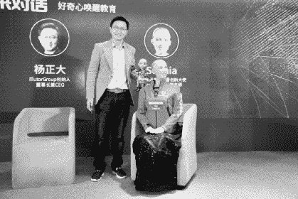

**图5-1 iTutorGroup创始人、董事长兼CEO杨正大与全球首位AI教师索菲亚合影**^([\[6\]](#txt005.html#footnote_content_txt005_6))

**表5-1 未来各职业被淘汰概率统计①**

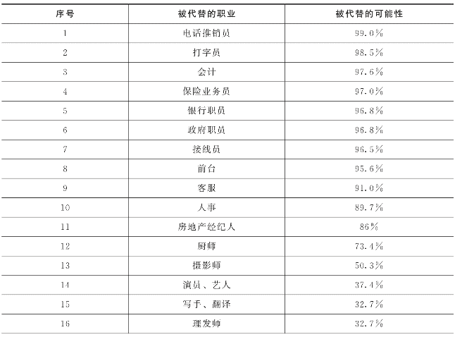

**表5-1 续表**

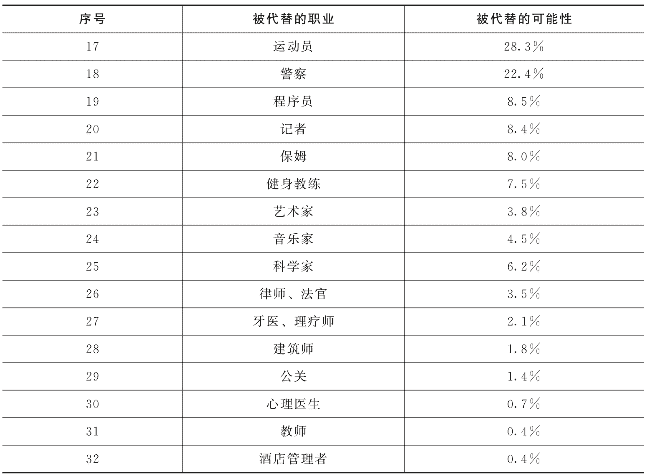

# AI 时代，教师为何难被替代？核心在于“育人”而非“教书”

## AI 难以跨越的“2%”门槛：智慧与温度的缺位

你是否好奇，为何建筑师、公关专家、心理咨询师、酒店经理等职业，面临 AI 取代的概率均不足 2%？深度对比研究揭示了底层逻辑：这些领域的核心竞争力，高度依赖情感共鸣与智慧判断。它们深陷复杂的人际网络之中，承载着人文关怀与对生命的深度理解，其职业运作模式考验的是“智慧大脑”，而非固化的“业务流程”。

## 知情意行：机器缺失的“生命属性”

放眼全局，AI 引发特定职业“集体焦虑”的根源，在于它在**操作技能层面**拥有降维打击般的优势；但一旦触及**智慧技能层面**，短板便暴露无遗。  
“知、情、意、行”构成了人类教师的四大基石能力。AI 教师本质是机器实体，缺失“生命属性”，致使其在情感体验与意志驱动上存在先天性缺陷。教育不仅需要娴熟的业务操作，更仰赖专业的智慧技艺。AI 教师在智慧技能上的缺位，正是人类教师极难被替代的内在原因——它们僵硬、无情、缺乏创新灵魂。

## 非生命体的“执行者”困境

AI 教师是基于 AI 技术的智能系统，活跃于虚实融合的教学场景，本质上属于**非生命实体**。受限于智能技术自身的发展瓶颈，当下的 AI 教师（包括索菲亚机器人在内）只能“按部就班”完成“授课式”任务。因缺乏独立意识，它们注定只是人类教育标准的**绝对执行者**与精准复刻者。

## 批改作文的“翻车”现场：标准无法衡量灵性

以批改作业为例：  
面对**客观题**，判断标准唯一，AI 拥有巨大的“发挥空间”，效率与质量双双碾压人类；  
但遭遇**主观题**，没有唯一标尺，AI 便瞬间“失语”。即便通过技术手段植入评判标准，由“标准”构建的判断系统，依然无法真切感知考生的情感态度与价值取向。结果往往是：原本闪光的佳作，反倒死在了 AI 的评判逻辑里。

---

## AI 教师的“专家系统基因”：会解题，不会育人

AI 教师的存在，代表着标准的**绝对执行**。纵观发展历程，它们始终摆脱不了“专家系统”的“基因烙印”。这决定了双重面貌：解题能力惊人，却在**“立德树人”**的育人核心上寸步难行。  
学生向 AI 求助，得到的是现成答案，而非从更高维度的智慧引导下，构建自主解题的策略。久而久之，学生陷入“依赖症”，这种“捆绑式”成长模式扼杀了批判性与创造性思维，极端情况下甚至毁掉学生前程，沦为 AI 教学语境下的“祭品”。

## 人类教师的破局：拥抱技术，而非对抗技术

AI 的短板，反证了人类教师不可替代的价值高地——**人类的优势，正在于 AI 无力补齐、无法复制之处**。  
但警钟长鸣：若人类教师无法掌握 AI 掌握不了的技艺，极大概率会被掌握技术的同行淘汰。正如雷·克利福德所言：**“技术不会取代教师，但会用技术的教师将取代不用技术的教师。”** 居安思危，未雨绸缪，是当下人类教师的紧迫课题。

2017 年《关于全面深化新时代教师队伍建设改革的意见》明确：到 2035 年基本实现教师治理体系现代化。教师须主动拥抱信息化、智能化变革。在 AI 时代，“专业智能化”与“智能专业化”交替演进，人类教师的智能化发展与 AI 教师的专业化发展并行不悖。当 AI 教师专业度提升，人类教师的智能化转型必须加速，主动适应智能社会的深度重构。

**人类教师的智能化进阶，是避免被淘汰的“头号工程”，更是走向“人机融合”的必由之路。** 在任何技术变革浪潮中，逆势而为无异于自杀；唯有站在浪尖，披上前沿铠甲，方能见得更远、走得更稳。智能时代的教师若想不被出局，别无选择，唯有投身智能化浪潮，顺势而为，走好“人机融合”之路。

---

### 三、人机协同教学：从“对立”走向“共生”

从教育整体发展视角审视，AI 教师与人类教师的“非此即彼”之争，无论胜负，皆损教育高质量发展——**辩证融合、协同共生，才是最优解**。  
1983 年国庆，邓小平同志为北京景山学校题词：“教育要面向现代化、面向世界、面向未来。”  
2019 年 2 月，中办、国办印发《加快推进教育现代化实施方案（2018—2022 年）》，明确要求推进教育治理现代化，稳步提升教育质量。  
因此，AI 时代的教育发展，应汇聚多方合力，形成教育合力；在化解人机矛盾中，重塑更理性的教育整体结构。

# 人机协同教学：重塑未来教师的“必答题”

人机协同教学，简而言之，就是人类教师与AI教师同台施教。二者并非非此即彼的替代关系，而是对立统一、互补共生、共同进化的伙伴。“百年大计，教育为本；教育大计，教师为本。”无论是碳基还是硅基教师，共同扛起的是育人的千钧重担。合作双赢，分道扬镳则两败俱伤。显而易见，人机协同是当下两类教师破局发展的最优解，也是人类教师规避“被替代”焦虑的最佳护城河。如图5-2所示，“教师智能化”与“智能化教师”这双引擎，正是化解人机张力、实现辩证统一的宏大架构。

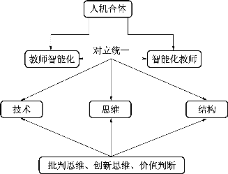

**图5-2 人机融合**

前文已提到，AI教师的教学活动多为标准化、流程化的重复劳动，但在具体场景下，其极致的执行力与精准落地标准的能力，是人类教师难以企及的短板。然而，不可忽视的是，人类教师在批判性思维、创新思维与价值判断等维度，拥有不可替代的超越性价值。要跳出“你死我活”的零和博弈，迈向人机深度融合的新生态，必须从技术、思维、结构三个维度发起变革，重塑未来教师的“非传统属性”。

**技术融合是底座，思维融合是罗盘，结构融合是关键。**
技术层面的融合，核心在于填平鸿沟：补齐人类教师的“技术盲区”，修正AI教师的“价值盲区”；思维层面，是AI的机械算法思维与人类辩证思维的深度对接；结构层面，则是两类教师素质结构的精准咬合与重组。

透过图5-2的人机融合结构图可以预见，贯穿融合全程的，将是技术与价值有机统一的“未来教师”形态。在人机协同的智能化大潮中，未来教师将进化为全能型教育家：以人躯为载体，以技术知能为护身符，以仁爱之心与人文精神为灵魂。这将彻底颠覆大众对“教师”这一职业的固有认知。

**立足当下，行动即刻启动。**
我们要清醒认知：知识传授是AI的强项。因此，人类教师必须果断转型——从“面向知识体系的灌输者”，转向“核心素养的培育者”。人文底蕴、社会责任、国家认同、跨文化交往，以及学生的创造力、审美力、协作力、情境化知识运用能力，这些才是人类教师应当聚焦的核心战场。唯有如此，才能在分工协作中走向人机合一。

AI时代，培育未来师资队列任重道远，其中全能型教师教学能力的养成是最大难点。但无论路途多么崎岖，走人机协同下的未来教师之路，是历史的必然选项，也是人类教师真正避免被AI淘汰的制胜法宝。未来教师的诞生，呼唤着新教育方法、新制度、新资源、新结构的全方位托举。若渴望尽早释放未来教师的红利，当下便须推开陈旧的门窗，拥抱新世界的鲜氧，打破传统教育的藩篱，全力提速教育治理体系与治理能力的现代化进程。

---

### 注释

[[1]] 邓银珍. 谁动了我的讲台——人工智能时代教师角色的转型[J]. 中小学信息技术教育, 2018(06): 86-89.

[[2]] 张青. 网络教育中教师权威角色的变化及其社会学原因[J]. 湖南师范大学学报(教育科学版), 2010, 9(05): 63-65.

[[3]] 任敏, 李迎春. 半部论语成良师: 《论语》对教师的启示[M]. 北京: 中国轻工业出版社, 2014: 195.

[[4]] 搜狐网. 得林社: 365行, 未来最不容易被AI取代的职业竟然是...[OL]. [2017-10-17].

[[5]] 王德林, 李成斌. 教师会不会沦为"无用阶级"?——从人工智能视角审视[J]. 教育研究, 2018, 32(10): 60-65+125.

[[6]] 图片来源: 中国娱乐资讯. 跟着索菲亚学习, VIP Jr开启智能教育新时代[OL]. [2019-3-6].

[[7]] 于胜泉. 人机协同: 人工智能时代教师角色与思维的转型[J]. 中小学数字化教学, 2018(03): 24-26.

[[8]] 于胜泉. 人机协同: 人工智能时代教师角色与思维的转型[J]. 中小学数字化教学, 2018(03): 24-26.

---

# 第六章 教育之基：智能时代的师生关系与教师素养

## “移民”与“原住民”：智能时代的师生代沟

### 社会化与逆社会化：智能时代教师向学生学习

### 智能素养：提升智能时代教师的新素养

“00后”群体区别于前代，在于他们是名副其实的**“智能原住民”**——生于智能时代，长于智能时代，他们的衣食住行、思维认知无不与智能深度绑定。他们的诞生，既是时代发展的投影，也是时代烙印在个体身上的深刻塑造。

### One, "Migrants" and "Locals": The Generational Gap Between Educators and Learners in the AI Age

In this emerging intelligent epoch, AI-driven machines not only automate human labor but also forge convenient conditions that actively reshape humanity. This shift grants people greater bandwidth to contemplate future challenges while establishing human-machine collaboration as a standard lifestyle.

Historically, during periods of profound transformation, the first to adapt are rarely the veterans entrenched in specialized, rigid domains; rather, it is the rising youth. The AI wave follows this pattern: the surging tide of intelligence permeates production, daily life, and cognition at "lightning speed." Disparities in cognitive grasp, adaptability, and practical application of smart tech split the population into two distinct technical identities—**"Intelligent Natives"** and **"Intelligent Immigrants."**

Across different eras, varying technical thresholds have produced similar identity dichotomies. The Internet age birthed "Netizens" (Net Natives) and "Net Immigrants"; evolving web tech eventually bridged technical gaps, mending the atomized social fabric. The Information Age gave us "Digital Natives" and "Digital Immigrants," whose divergent worldviews and methodologies highlighted a deep cultural rift. Now, the Big Data and AI era spawns **"Intelligent Natives"** and **"Intelligent Immigrants"**—two identities that crystallize the contrasting cultural phenomena and identity attributes defining contemporary human society.

**"Intelligent Natives"** are the indigenous citizens of the AI epoch. "Born in intelligence, raised in intelligence," this cohort matured immersed in AI tech and smart cultural environments, wielding remarkable social adaptability. Put simply, they seem to master smartphones from infancy; most gadgets are "self-taught" after a few glances. In smart gaming realms, they navigate freely—were it not for identity checks, one would never guess a skilled opponent is a toddler.

Their education diverges sharply from "other groups." For these indigenous citizens, robot programming is a core curriculum, spawning a boom in specialized institutions. A simple browser search for "children's programming education" yields hundreds of categorized results, testament to its popularity. What daunts "Intelligent Immigrants" is routine for Natives; they find "fun" in learning, unleashing unbounded imagination. Currently, Intelligent Natives exhibit three defining traits.

1.  **Youthful Demographic (Low-Age)**. The emergence of Intelligent Natives aligns roughly with AI's "Third Resurgence." Consequently, today's cohort is predominantly young.

2.  **Intelligent Living**. This is the most salient trait—and the widest chasm separating Natives from "Immigrants." Intelligent living stems from smart tech ubiquitously reshaping existence. Young children born into this milieu, blessed with high developmental plasticity, swiftly assimilate into and embody this intelligent lifestyle.

3.  **Life Intelligentization**. A higher-order attribute. It distinguishes Natives from "Immigrants" *and* calibrates the degree of intelligentization *within* the Native group. Versus Immigrants, it signals a new creed: "No intelligence, no life." Internally, the higher the Life Intelligentization, the stronger the adaptation to the intelligent society, translating to greater competitive edge in the future.

**"Intelligent Immigrants"** are the passive adapters of the AI age. Deprived of smart products and intelligent culture during their formative years, they harbor a profound sense of alienation toward this era—psychologically and socio-culturally, "everything is new." Based on their stance, they further fracture into **Intelligent Bystanders** and **Intelligent Refugees** (avoidance mode), and **Intelligent Adapters** (proactively embracing the new epoch).

The "Immigrant" label confirms they "migrated" from prior eras. As environments shifted drastically, their once-dominant "Native" advantages yielded to the new generation of "Natives." On them, anachronisms surface easily: disdain for smart tech, anxiety over intelligent robots, fierce dissatisfaction with Natives' Life Intelligentization—all era-specific imprints etched onto their being.

Encouragingly, a subset of Immigrants has awakened. They pursue transformation, actively mastering AI adaptation to become **"Intelligent Adapters."** Among these Adapters, some co-create miracles with Natives; some morph into mentors, steering Natives from the perilous fringes back to the era's center; others dedicate years to AI and intelligent philosophy, willingly serving as educators devoted to the intelligent society.

### AI时代的代际裂痕：当“原住民”遇上“移民”，教育该何去何从？

在智能浪潮席卷而来的今天，“智能原住民”与“智能移民”这对概念早已不是新鲜事，围绕两者的争论也从未停歇。政治、经济、文化等多重力量交织，让这道隐形鸿沟在时代深处扎根，演变成横亘在两代人之间的“智能代际鸿沟”，成为制约发展的关键变量。换个角度看，两者关系绝非单一维度，冲突、共生与竞争交织成网。若抛开绝对的时空界限，我们能更清晰地溯源这层关系的来龙去脉。归根结底，鸿沟的根源在于两代社会成员角色的错位，想要重塑角色，双向奔赴是唯一出路。

在大众认知里，这种代际张力深刻影响着时代进程，波及诸多领域，核心阵地莫过于聚焦“育人”与“塑人”的教育战场。当下，以“00后”为分水岭，他们及之后的世代，将成为智能原住民的主力军。看看身边不足十岁的孩子，手机游戏玩得溜，高清动漫搜得快，在各类智能应用间穿梭自如。面对这样的他们，身为教师，你能精准捕捉他们的真实诉求吗？能读懂他们行为背后的逻辑吗？这个问题的答案，或许正是当下原住民与移民冲突、和解与博弈的最真实写照。

放眼义务教育阶段，师生关系恰似一面镜子，精准映照出移民与原住民的对应图景——教师是跨界而来的“移民”，学生是土生土长的“原住民”。代际鸿沟，客观存在，不容忽视。

深究之下，师生间的代际裂痕，实则是传统教育范式与现代智能教育深度碰撞的投影。回望教师的成长纪事，那份悠然自得的童年——称得上“闲适‘自’在”，令今时今日的孩子羡慕不已。而“00后”孩子截然不同，绝大把时间献给了学业，智能文化全渗透的环境里，智能早已融入血液、成为骨肉——这是“闲适‘智’在”。

归纳起来，师生鸿沟的核心锚点，在于**“感知世界的路径截然不同”**。

教师靠“五感”直触实体，由此拼凑出对世界的整体认知。学生则借由智能终端“隔空取物”，构建起一种间接的、被中介化的世界图景（用原住民的话说）。他们习惯万事借道终端，仿佛智能就是他们延伸出的新感官。古语云：“何等世界观，何等方法论。”感知入口不同，切入问题的角度、解决问题的路数自然天差地别。

显而易见，这道鸿沟直接关乎教学效能的高低，破局之钥握在教师手中。AI时代呼唤教师角色重塑、素养重铸。教师须站在时代最前沿，以开阔视野面向学生，主动向学生取经，投身自我进化的洪流，方能“破茧成蝶”，化身学生成长的智慧领航员。

---

### 二、 社会化与逆社会化：智能时代，教师要学会“向学生拜师”

AI时代，原住民与移民的张力落脚教育场域，化作师生代际鸿沟，折射出传统教学与智能教育的水火不容。鸿沟成因复杂：除世界观差异外，还夹杂着师生接纳新事物能力的代差、智能技术的指数级狂飙、国家教育政策的导向重塑，以及民主、平等、法治等时代强音的共振。

传统教育里，学生的社会经验单向流动，源自长辈、教师、权威。老一辈是教育的独家执行者，社会化是自上而下的单行道。可在智能时代，孩子、学生、年轻群体不再只是被动接受者，他们反客为主，也成了社会化的推手。长辈、教师、权威反而常需接受晚辈、学生、下级的教导与引领。于是，人类社会化完成了从“单向”到“双向”的历史性跨越，**“逆社会化”** 概念应运而生。

逆社会化，亦称**“文化反哺”**。指年轻一代向年长一代输送文化知识，或传统受教者反向施影响于教育者，传递社会变迁的新知。在封闭保守的农耕文明里，获取经验渠道单一，孩子成长全仰仗长辈传授。

逆社会化是现代工业社会、特别是信息社会与智能社会的特有产物。美国人类学家玛格丽特·米德在《文化与承诺》中指出，当代代际矛盾的核心，不在阶层政治差异，不在生物属性分野，而在**文化传递模式的变革**。她将人类文化演进划为三种基本形态：**前设文化、共设文化、后设文化**。

> “前设文化指年轻一代主要向年长一代学习；共设文化指新老一代皆在同辈群体中学习；而后设文化指年长一代反向向年轻一代学习^[1]。”

后设文化语境下，原本处于受教地位的年轻一代能“翻身做主”，担起教育者重任。米德笔下的现象，在AI时代放大得淋漓尽致。现实中随处可见：教师向学生请教电脑操作、课件制作、PS修图、智能检索、电子书下载、网购支付、微信进阶用法……这正是后设文化在当下的具象投影。

#### （1）逆社会化的成因

# AI浪潮下的代际逆袭：逆社会化成因与教育变革的三重逻辑

梅德指出，在后图式文化语境下，原本处于受教地位的年轻一代之所以能反哺长辈、化身“教育者”，根源在于人类史无前例地经历了剧烈且高速的变革，他们独具慧眼，能够“理解、体验并吸收眼前发生的急剧社会变迁”。置身智能时代，逆社会化兴起主要源于三大动因：

## (I) 逆社会化的成因

**1. 师生接受新事物能力的代际鸿沟**  
教师常受年龄阅历与历史坐标制约，对新生事物、概念与思想的接纳度有限，认知易陷入滞后。反观少年学子，天生对未知怀揣好奇，擅长拥抱新知、新理念。于是在师生互动中，主导权悄然易位——不再是单向灌输，而是教师向学生取经，逆社会化由此自然生成。

**2. 科技浪潮的冲击重塑**  
步入智能社会，以人工智能为旗帜的新一代技术井喷式发展，给社会结构带来史无前例的震荡。技术不仅重塑生活方式，更让社交呈现瞬息万变、多元共生、层出不穷的新图景。面对AI冲击，老一辈深受过往思维定势束缚，难以快速适配；而年轻一代心智未被固化，凭借超强的接纳力与适应力，在动荡中自由抉择，并以实践经验反向影响长辈，完成“反馈”闭环。

**3. 民主、平等、法治的时代底色**  
现代社会以民主、平等、法治为主旋律。此背景下，学生的自主意识与平等观念觉醒，创新精神与进取锐气勃发。他们在传承传统文化时敢于破局重构，为教师陈旧的知识版图注入鲜活养分，助力教师跨越认知鸿沟，更从容地拥抱社会新变迁。

## (II) 逆社会化的意义

尽管教师聚焦学生社会化进程、视学发展为重中之重，但逆社会化的价值不容小觑。上世纪60年代末70年代初，伴随社会信息化进程，逆社会化文化雏形初现；随着技术渗透加深，其意义愈发凸显——它为社会变革注入源头活水，化解师生代际张力，推动双向奔赴、共同成长。

**首当其冲，逆社会化激活社会变革新动能。** 俗言“长江后浪推前浪”。阿科夫在《颠倒教育：21世纪学习革命》中直言：“无论受过何种训练，大多数教师都无法在课堂上媲美学生从自选渠道自主汲取的知识^([\[2\]](#txt006.html#footnote_content_txt006_2))。”其核心意涵在于：教师认知终有边界，难及学生群体智慧的汪洋大海。智能新纪元，学子发展无疆，岂能甘于被动接受？唯有持续创新、奋楫争先，方能强力托举社会进步。当学生将新价值观、新生活方式、新思维模式回馈社会，逆社会化便成为变革的最强引擎。

---

# 人工智能时代的教育改革与文科探索

## I. 教育发展必须跟上时代节拍

### 教育须与社会经济发展同频共振
智能时代，智慧经济崛起，经济体系、结构、市场机制、生产制造、销售服务等全链条深度融合时代因子，经济领域全面向智能化跃迁。教育变革势必顺应经济发展诉求，加速转型升级。时代更迭意味着财富创造逻辑重写、劳动力素质结构重塑，这是关乎劳动者“饭碗”的必答题。教育必须服务大局、紧跟经济脉搏，坚定走上智能化赛道。

### 教育须与科学技术发展同步进化
教育形态随技术演进而迭代，智能教育技术便是这场演化在教育场域的投影。传统课堂中，“粉笔与黑板”曾是知识呈现的唯一媒介，但智能技术的介入正加速这一媒介退场，催生全新呈现范式。新媒体课件、投影设备、大数据AI平台、公众号矩阵等，不仅契合学生生存场域，更在技术层面实现学习全过程的数据留痕与可视化洞察。科技重构了学生获知路径、媒介与审美体验，教育发展理当主动拥抱这由新技术塑造的社会新形态。

### 教育须与社会文化发展同向共生
当下，AI技术正深度重塑社会文化的生产、传播与价值兑现链路，智能因子在文化生态中的权重与日俱增。教育本身即是文化生产、传播与筛选的关键工具，旨在通过创新范式，在宏大文化框架内捍卫每个社会成员的自由表达。个体生命意义的发掘，深植于所处文化土壤^([\[3\]](#txt007.html#footnote_content_txt007_3))。既身处智能文化空间，教育便当为这一方天地输送人才、铺设传播渠道、提供创新方法论，在社会文化结构系统中精准寻找耦合收敛点。

### 社会发展对教育提出新课题

社会发展的浪潮倒逼经济、科技与文化迭代升级，同时也向教育领域抛出了全新的课题。由此引发的核心追问是：在智能时代的语境下，教育究竟应重塑为何种形态，方能精准回应社会发展的深层诉求？这值得我们投入深度的思考。

## 开放包容的教育新生态

为契合社会发展的多元需求，教育体系本身必须进化为一个**开放包容的教育生态**（如图 7-1 所示）。这一体系涵盖了网络课堂、职业教育、基础教育、高等教育、社会职业培训、学前教育、家庭教育、校园教育、社会教育、融合教育等多元形态，最终汇聚成一个形式丰富、结构多元、维度立体的宏大 AI 教育矩阵，旨在从教育全维度出发，整体性地回应社会需求。与此同时，为落实“面向未来生活的教育”理念，当下的教育实践应聚焦**“通识教育”**领域，主动驾驭 AI 技术，在智能时代开展“新文科”与“新工科”建设，立足现实土壤，提前布局未来人才版图。

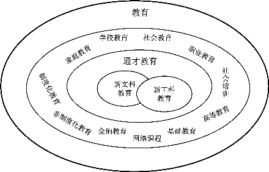

**图 7-1 开放包容的教育体系架构**

开放包容的教育体系内蕴含着教育者对传统学科制、专业制教学模式的深度反思；它非要全盘否定现有学科教育，而是在此基础上进行超越。这种反思的成果极具价值——因为在通识教育真正到来之前，对文理分科弊端的剖析，必将为构建通识教育体系提供现实的镜鉴与支撑。

## 二、 体制反思：文理分科教育的天花板

文理分科，指的是学生升入高二时，将“语数英政史地物化生”这十门综合学科，系统性地拆分为文科组（语数英政史地）与理科组（语数英物化生），学生依据根基与兴趣二选一深耕。对学子而言，高中文理分科仿佛人生的分水岭；不同选择通向截然不同的知识图谱与思维范式，深刻塑造着个体的认知边界与职业轨迹。这种二元割裂的模式，在人才匮乏的背景下逐渐暴露出从教育体系中剥离的趋势；而为新兴产业储备复合型新人，则成为新工科教育区别于传统工科的关键特质。

### 课程体系的创新重构

新工科教育的“新”，核心体现在课程体系的重构上。它在传承传统工科优势基因的同时，推出了适配社会发展的新一代课程谱系。2018 年，教育部办公厅发布《关于公布首批“新工科”研究与实践项目的通知》（教高厅函〔2018〕17 号），吹响了加速形成可复制推广改革成果的号角，在新兴工科课程体系、新形态教材内容、慕课资源、师资队伍及实践基地五大维度寻求突破^([\[7\]](#txt007.html#footnote_content_txt007_7))；该通知同步公布了全国高校 612 个新工科研究项目。涉及改革的具体课程范畴详见表 7-1。改革重点高度聚焦于大数据与 AI 技术领域，催生了一批独立专业课程，如数据科学与大数据技术、物联网工程、机器人工程、智能科学与技术、智能电网信息工程、光电信息科学与工程、大数据与人工智能、软件工程、人工智能等核心专业课。

**表 7-1 新工科课程改革体系覆盖范围**

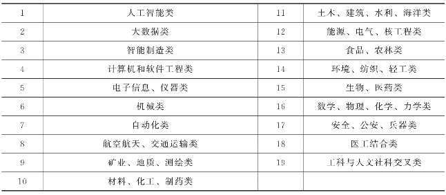

呼应教育部新工科改革部署，地方高校课程体系纷纷向新赛道进军；大数据、人工智能、虚拟现实、云计算等前沿专业加速入驻高校。截至目前，全国已有超 40 所高校设立人工智能学院。仅 2019 年上半年，北京大学、中国人民大学、西安交通大学、东南大学等名校便相继组建 AI 学院。预计至 2025 年前后，大数据与 AI 学院、专业的设立将呈爆发式增长，全面覆盖各层级各类型院校，受惠学生群体将实现全覆盖。

2019 年 10 月底，全球首所 AI 大学——穆罕默德·本·扎耶德人工智能大学（MBZUAI）在阿联酋阿布扎比正式宣告成立，矢志“为 AI 领域引入全新的学术与科研范式，为师生配备全球顶尖 AI 系统，释放 AI 推动经社发展的无限潜能”。从 AI 学院、AI 研究院到 AI 大学，关于 AI 的课程建设已基本实现了全链路覆盖。

### 教学范式的智能化转型

新工科教育的“新”，还将深刻体现在教学方法的革新上。在大数据与 AI 时代，新工科教育与智能技术将深度融合、形影不离；智能化、人性化、协同化、多元化、个性化将成为新工科教育的底层基因。

大数据 AI 技术将渗透新工科教育的全流程；在算法模型赋能下，新工科核心课程将凸显个性化教育价值。基于数据化 AI 教育算法模型的构建，教学对象的知识掌握度、行为模式、情感状态均可实现个性化精准画像。随着师生校三方数据的透明化与数据化，教学范式将告别传统“灌输式”模式，转向个性化、启发式、参与式教学，最终在方法论层面完成新工科领域人文教育方法论的重大转型，实现新工科价值与人文价值的方法论统一。

“AI+”应用已步入社会常态化阶段，倒逼传统工科教育蜕变；一系列工科教育新特质应运而生，新工科教育站在了教育进化的最前沿。AI 技术穿透力之强、赋能工科教育价值之高，引发了学界对 AI 教育在新工科领域应用与解决方案的深度探索，进一步推动智能因子与新工科教育的深度耦合。

# AI 重塑高等教育版图：新工科与新文科的双轨突围

2016 年，教育部正式启动新工科建设；次年被业界公认为“AI 应用元年”。新工科建设与 AI 技术落地同频共振，二者融合并非简单叠加，而是遵循“应用即适配”的内在逻辑——AI 技术主动对接社会发展需求，将算力与模型能力开放给各垂直领域。在新工科教育中，这种融合体现为将 AI 渗透至育人全链路，驱动教育现代化转型。

#### 学习“定制化”：AI 重塑学生成长路径

AI 技术接入新工科教学，核心在于依托智能平台构建个性化学习体系。平台依据新工科育人特点与规律，采集学生学习过程数据，为每位学习者生成专属认知模型。借助智能算法，系统能精准定位知识盲区、实时纠正误解、敏锐捕捉情绪波动，并以此为基础输出个性化学习方案、精准推送资源包。这种“千人千面”模式，助力学生打破学科壁垒，在启发式、参与式环境中跨界汲取知识，最终锻造具备“12 种思维能力”^([\[8\]](#txt007.html#footnote_content_txt007_8)) 的复合型新工科人才。

#### 教学“精准化”：数据驱动教师决策升级

精准教学的前提是精准“画像”。随着语音识别、计算机视觉、自然语言处理及深度学习等 AI 能力在教学场景的深度渗透，智能教学系统可实时扫描学情，完成学习状态的智能化研判。系统以海量学习数据为底座，快速刻画学生的特质、习法、成效、兴趣与成绩，生成动态学情模型。在模型泛化过程中，系统能穿透表象直击痛点——例如工业设计、增材制造、虚拟现实等前沿模块的知识缺口，均会被量化为可视化数据报告，倒逼教师优化教案、革新教法，并为特殊需求学生提供定制化干预。

#### 管理“科学化”：打破壁垒激活校园生态

科学治校是 AI 在新工科领域的高阶应用，直接关乎治理效能与服务质量的跃迁。通过 AI 识别技术深度挖掘校园管理大数据，将管理实体的物理属性可视化、透明化，确立“数据说话、数字决策、数据管理、数据创新”治理新范式，推动校园安全、教学运行、资源配置、考核评价等核心板块实现科学化、体系化、规范化。这一过程打破了传统部门利益固化格局，促进跨部门资源共享与优化配置；考核机制摒弃单一维度，鼓励教师跨专业协作、探索未知技术；管理机制革新催生跨部门、跨校协同发展生态，最终落地跨专业选课与个性化培养方案^([\[9\]](#txt007.html#footnote_content_txt007_9))。

## IV. 新文科觉醒：AI 赋能人文社科新生态

文科教育涵盖人文与社科，长期以来与自然科学教育存在显著鸿沟。相较于工科，文科在高校教育版图中处于相对弱势地位；“重文轻武”的“文科黄金时代”已成往昔，“理工科走遍天下”成为科工学子的普世共识，侧面折射出文科的式微与边缘化。

### 为何文科边缘化？多重困境叠加

文科边缘化是当前校园教育的特有现象，由就业导向、人才市场需求、学科内在难度共同塑造。传统工科遵循“一技在身”路径，毕业生凭专业硬技能易获稳定岗位，就业面宽；在传统产业与新兴技术交替迭代的社会背景下，人才需求天然向工科倾斜；加之工科更强调逻辑抽象思维，导致倾向形象思维的学生被动分流至文科。学术影响力层面，全球顶刊几乎被工科期刊（如 *PNAS*、*Cell*、*Nature*、*Science* 等）垄断，文科世界级刊物凤毛麟角，这客观上压缩了文科学生的科研话语权与成果辐射力。

### 文科不可或缺：从“阶段性失语”走向融合新生

然而，文科不可缺位——人文社科的衰退意味着工科教育的不完整。武汉大学资深人文社科教授马飞成指出：“学科虽高度分化，但整体科学共同体始终在走向融合。” 工科与文科虽早期路径迥异，但分化越深，发展层级越高，双轨并行实则指向更广阔维度的教育大融合。因此，文科滞后仅是教育演进中的“阶段性异常”，破局之道在于新文科建设的全面启动。

### 新文科破局：从“文科无用论”到AI赋能的跨界新生

**源起与转折：一场跨洋而来的教育变革**

2017年10月，美国希拉姆学院率先抛出“新文科”概念，学界将其定义为相对传统文科的学科重组与文理交融——即将前沿技术植入哲学、文学、语言等经典课程，为学子构建全方位的跨学科学习场域。这一理念漂洋过海，恰逢国内全面振兴本科教育的战略背景，迅速被纳入国家顶层设计，成为文科未来发展的关键增量。

**政策东风：“六卓越一拔尖”2.0吹响集结号**

2018年4月29日，教育部会同科技部、工信部、财政部等13部委在天津联合启动“六卓越一拔尖”计划2.0。会议明确要求，以新工科、新医科、新农科、新文科“四新”建设为抓手，在全国高校掀起“质量革命”，打造覆盖高等教育全领域的“质量中国”品牌，誓夺本科教育全面振兴的攻坚战胜利^([\[11\]](#txt007.html#footnote_content_txt007_11))。

**破茧成蝶：新文科战略布局下的“强音”**

政策落地瞬间，长期笼罩文科上空的“无用论”不攻自破，相关研究迎来高光时刻。中国人民大学、郑州大学、西安交通大学、华东师范大学等高校纷纷开辟文科发展新赛道。连素以“中国第一工科高校”著称的清华大学，也全力推进新文科建设，誓要将其推向新高度。这标志着国内文科教育在沉寂数十年后强势回归。

“新”的内核，在于“通识跨科学习”的全面落地，宣告了传统学科壁垒森严、各自为政的“孤岛式”教学模式正式终结。

**痛点直面：跨学科融合下的“成长烦恼”**

然而，高度综合与交叉的特质，也让新文科建设陷入多重困境：专业师资队伍从何而来？特色教学资源如何开发？科学评价体系谁来确立？这些现实拦路虎，迫切呼唤新工具、新手段破解新难题。鉴于新文科固有的综合性与交叉性，其建设注定伴随“复杂性”与“海量复杂性”的深度博弈。

**破局良机：AI时代的“降维打击”**

人工智能时代，智能教育系统凭借极速算力与“化繁为简”的模型优势，叠加文科教育积淀百年的海量多源异构数据，恰好精准对接“复杂”与“海量复杂”两大核心痛点。政策层面，教育部2018年印发的《高等学校人工智能创新行动计划》明确要求，强化AI与计算机、控制、量子、神经认知、数学、心理、经济、法学、社会学等多学科交叉融合^([\[12\]](#txt007.html#footnote_content_txt007_12))。技术与政策的双重红利，为新文科发展瓶颈提供了破解之钥。

**核心引擎：AI重塑新文科师资“造血”体系**

“文科能不能搞好，关键在老师。”陕西师范大学国学院院长曹胜高院长的一语道破天机：师资队伍建设是新文科成败的命门。智能时代的新文科教育，天然以智能教育为中轴——从智能教学装备应用、教师数字素养养成、教学理念智能化转型，到通识文科教学素养重塑与教师智能创新素养锻造，每一环都离不开AI技术的深度赋能，旨在培育具备新文科综合背景的跨界复合型人才，打造一流师资梯队。

为此，高校需从四大维度发力重构生态：

1.  **教材先行，筑牢根基。** 主动改革师资培养教材体系，填补上游学科教学导致的师资质量断层，聚焦新文科基础理论教学，充实教育实践课程，锻造新型文科人才。
2.  **政策激励，激活存量。** 完善激励机制，鼓励骨干教师回炉重造、进修深造，提供经费资助，提升专业水位与综合素养，以高水平师资托举高质量人才培养^([\[13\]](#txt007.html#footnote_content_txt007_13))。
3.  **引才聚智，补齐短板。** 面对交叉学科师资稀缺、校内培养周期长的现状，高校应精准引进AI交叉复合型人才，立足校情培育本土化新文科教育人才梯队。
4.  **平台赋能，规模化输出。** 建设专属新文科教育平台，专人推进、制度护航、奖励驱动，强化理论与实战联动，推动平台化发展，实现师资队伍的批次化、规模化成果产出。

新文科的春天，不在等待中到来，而在AI与教育深度融合的主动变革中绽放。

### 深度挖掘：AI赋能新文科教学资源与评价体系重构

置身大数据与人工智能浪潮中，海量、多元的教学资源为新文科建设筑牢了底座。随着媒体时政素材、网络公开课、在线题库、资源数据库及各高校共享资源的汇聚，师生获取资料的门槛大幅降低，但随之而来的“数据过载”导致筛选难度剧增。

破解这一困局的关键，在于AI的核心支撑技术——**数据挖掘**。该技术能从庞大数据仓库中提取隐性预测信息，帮助师生穿透数据迷雾，精准定位高价值知识。引入这一手段，可有效化解资源筛选痛点，显著提升新文科教学的效能与质量。

### 智能评价：构建新文科教学诊断新范式

新文科教学评价旨在依据培养目标，对教育过程与结果进行价值判断与决策指导。其评价维度覆盖学生、教师、环境、方法、内容及管理等全要素。鉴于评价对象具备动态演变特征，传统静态评价难以胜任，必须借力AI技术深度挖掘教育大数据，构建基于数据建模的专业化智能评价平台。

体系建设上，应涵盖全方位评价内容与对象，确立标准化指标体系，充分释放深度学习、智能感知与智能干预的技术红利。方法层面，要推动过程性、诊断性与终结性评价深度融合，聚焦过程评价与教学动态特性的契合，实现新文科教学评价在价值导向与科学严谨性上的统一。

## 五、 科学融合：智能时代高校育人范式的核心路径

现代科学呈现“高度分化与高度融合”并存的辩证态势：分科日益精细、专业度持续攀升的同时，交叉学科、边缘学科、综合性学科层出不穷，融合速度加快。分化本质上是融合的另一种表现形式，融合已成科学发展的主导趋势，具体体现在四大维度：

### 趋势一：学科交叉渗透向多维纵深推进
打破过往学科壁垒与割裂状态，在高度分化基础上实现广泛“杂交”、相互渗透与支撑，衍生出数以千计的交叉领域，知识横向联系日益紧密。诺贝尔基金会主席苏内·伯格斯特龙曾敏锐指出：物理与化学的界限已在多个维度被打破，形成无清晰边界的连续地带，生物学与医学亦呈现同一态势。

### 趋势二：超学科体系崛起奠基智能理论
电子计算机、通信、生物、物理、数学等学科交叉催生了系统科学——二战后形成的系统论、信息论、控制论，以及六十年代兴起的耗散结构论、协同学、灾变论、超循环论、混沌理论等。这批新兴超学科凭借系统方法与复杂性探索，深刻揭示了自然层级间的联系与规律，构筑了现代人工智能的基石理论。

### 趋势三：综合性学科应运而生破解复杂难题
科技普及加速社会发展，也使社会经济系统愈发复杂，环境、生态、能源等全球性议题及国家战略、社会治理难题接踵而至。解决这些问题，要求自然科学、社会科学、人文科学打破“条块分割、互不相通”的旧框架，转向多学科融合的综合体系。环境科学、管理科学、认知科学等，正是三大科学版图汇聚的典范。

### 趋势四：科学数学化进程全面加速
数学早已突破服务部分自然科学的局限，渗透至全科研领域。生物、心理、经济、社会学科广泛引入数学语言、模型与量化方法。系统科学兴起与计算机普及更推波助澜。至上世纪八十年代，经济、社会、心理模型相继建立，数学方法成为社科论证、预测决策的利器，数据分析成现代经管研究的标配特征。

### 对高校人才培养的五重启示

现代科学融合趋势为高校育人指明方向：须敏锐捕捉这一特质，强化“通才”教育，锻造高素质创新人才。

**首要任务：引导构建理性知识图谱**
翔实掌握知识技能是大学生在校期间的核心使命。

# 智能时代，大学生该如何构建核心知识竞争力？

培根早已断言“知识就是力量”，放在智能经济浪潮中，这句箴言的分量愈发沉重——知识是催生创新思维的基石。值得注意的是，随着时代演进，“知识”的内涵与外延正在经历深度重构。

经济合作与发展组织（OECD）在《知识经济报告》中，援引上世纪六十年代西方“4W”理论，将人类知识体系拆解为四大维度：**`know-what`**（事实知识：知其然）、**`know-why`**（原理知识：知所以然）、**`know-how`**（技能知识：会操作）、**`know-who`**（人脉知识：懂资源）。国内学者吴基松教授在《知识经济》著作中进一步补全了三维：**`know-when`**（时间知识：懂节点）、**`know-where`**（空间知识：识方位）、**`know-quantity`**（量化知识：会度量）。

这种知识形态的多元化，给新时代高校教学抛出了核心课题：如何引导学生在有限学业周期内，最大化知识储备？建议重点把握四个维度：

1.  **立身之本——专业硬核：** 紧扣专业前沿，吃透必修核心知识及最新动态；
2.  **底色修养——跨界通识：** 打破文理壁垒，理工科学生补足人文社科，文科生强化科技认知；
3.  **生存技能——社会适配：** 面向毕业竞争，主动补齐财经、法务、管理等实战知识；
4.  **底层工具——思维杠杆：** 攻克哲学逻辑（思维工具）、数学/AI（量化工具）、双语表达（语言工具），尤其要重视数学与外语，以适应科研数理化与国际化交流需求。

扎实推进上述积累，学生方能构建起理性的“知识结构”，精准对接现代科技与智能经济对人才的真实诉求。

---

## 第二节 破解“专精”与“博杂”的辩证法

“通才”与“专才”的张力，是当代大学教育必须直面的难题。

数据极具冲击力：19世纪人类科学知识每50年翻番，20世纪中叶缩短至10年，当下仅需5-6年，预测本世纪中叶将加速至1-2年。知识增长已从几何级数跃升为立体交叉的指数级爆炸。

这倒逼大学生必须双线并行：筑牢宽厚根基，又能在有限精力下深耕专攻，追踪学科前沿。操作层面需把握四个关键：

1.  **以“博”支撑“专”：** 广泛涉猎非盲目撒网，而是为深度钻研铺设地基；
2.  **辩证看待“博”：** 拒绝无目的、无选择的贪多嚼不烂，遵循“由近及远、由浅入深”原则，善用多元渠道沉淀内化；
3.  **主次分明，非主修反哺主修：** 专业课求“精深前沿”，非专业课求“广博实用”，以博杂服务专精。遭遇专业瓶颈时，反向排查是否因基础薄弱、视野狭窄；
4.  **织就理性知识网：** 学习如老渔撒网——初期大张广撒，中后期逐步收敛聚焦。引导学生让知识经历“序列化、精细化、进化论”三重重塑，最终定型为高阶知识结构。

---

## 第三节 打通学科壁垒，激活知识“横向迁移”

化学浓度计算借力数学建模破局，生物光合呼吸机制借化学方程式呈现，地理公转速率借物理开普勒定律量化……此类跨学科破题案例比比皆是。

诺奖得主普朗克直指本质：“科学本是有机整体，学科分割源于人类认知的局限，而非事物本身。”物理、化学、生物、人类学、社会科学实为一条不可切割的认知链条。

教学实践中，必须有意识设计“跨学科迁移”场景。这不仅能以旧知锚定新知、降低认知负荷，更能重塑记忆编码，锻炼分析问题、解决问题与辩证思维的复合能力。长此以往，学生将自主生成知识网络，建立立体思维结构，这对毕业后的再学习、知识复用及终身学习观的养成，具有决定性意义。

---

## 第四节 方法论移植：比知识迁移更高阶的核武

所谓“移植”，即将一学科的概念、范式、研究方法迁移应用至他域。在诸多移植路径中，**方法论的移植价值最高**——它赋予学生跨越领域边界、解决复杂问题的通用钥匙。

### 教学实践中，既要重知识的“横向迁移”，也要重方法的“互植共生”

教学不应仅局限于知识点的横向串联，更需引导学生关注方法层面的相互移植。为此，应助力学习者涉猎系统论、信息论、控制论等跨学科基础理论。这些理论从不同维度揭示了客观物质世界的本质联系与运动规律，为现代科技发展注入全新思维范式；继相对论与量子力学之后，它们再度重塑了世界科学图景与科学家的认知模式。

这些理论提供的工具箱——系统法、信息法、功能模拟法等——具备极强的普适性，使得方法间的“跨界移植”成为切实可行的操作路径。

同时，自然科学研究方法与社会科学研究方法的双向奔赴同样关键。虽二者探究对象遵循律各异，但方法论层面却互通有无。数理逻辑、观察实验、模拟类比等自然科学经典范式，自20世纪初起大规模植入社会科学研究，硕果累累；而价值分析、伦理规范、目的假说、历史主义、直觉外推、模糊思维等成熟的社会科学方法，自20世纪中叶起亦反向渗透进自然科学领域。

前者显著提升了对社会现象认知的精度与说服力，后者则强化了自然科学研究的应用价值，助力研究者明确价值坐标。

---

### 第五、引领学子勇闯科学“处女地”

学科各有疆域，而学科边界间的“空白地带”，往往是从未被涉足的认知盲区。随着科学认知的不断深入，这些盲区逐渐转化为科研攻关的新靶心，更易结出丰硕成果。

美国科学家维纳曾敏锐指出：“科学发展中收获最大的领域，是各既有部门间被忽视的‘无人区’……对科学地图上的这些空白地带进行勘探，非由一批跨界专家不可——他们各精其业，又能深谙彼此领域。”他将这些“被遗忘的无人区”比作待垦的“科学处女地”。

事实证明，控制论、信息论、电子计算机等后起之秀，皆绽放于这些“未垦处女地”。大量实证表明，学科交叉渗透的边缘地带最易出成果。教师当培育学生的创新自觉与探索锐气，鼓励他们深入学科边界的“空白地带”开疆拓土。

---

### 参考文献

[1] 中央编译局. 马克思恩格斯选集 (第1卷)[M]. 北京: 人民出版社, 1995: 56.
[2] 新华网客户端. 中国社会未来发展趋势如何？| 思想者问答[OL]. [2018-12-21].
[3] Ackoff, Greenberg. 逆向学习：21世纪学习革命[M]. 杨彩霞译. 北京: 中国人民大学出版社, 2014: 137.
[4] 吴振勇. 加强理工科大学生人文素质教育[J]. 天津大学学报(社会科学版), 2001: 268-270.
[5] 陈建华. “分科教学”：基础教育价值取向的异化[J]. 南京社会科学, 2009(04): 97-101.
[6] 光明日报. “新工科”究竟“新”在何处？[OL]. [2017-04-03].
[7] 教育部. 关于首批“新工科”研究与实践项目的通知[OL]. [2018-03-21].
[8] 2017年8月，麻省理工学院（MIT）启动“新工程教育转型”（NEET）计划，提出新工科人才应具备的12种思维：学会学习、动手实践、发现探索、人际交往、个人素养、创造性思维、系统思维、批判与元认知思维、分析思维、计算思维、实验思维、人文思维。
[9] 董兆伟, 王素珍, 孙杰莉. 基于新工科理念的经管类大数据人才培养研究[J]. 河北经贸大学学报(综合版), 2018, 18(02): 76-80.
[10] 360百科. 新文科[OL].
[11] 教育部. “六卓越一拔尖”计划2.0启动会召开：发起高等教育质量革命 助力建设质量中国[OL]. [2019-04-29].
[12] 教育部. 高等学校人工智能创新行动计划[OL]. [2018-04-11].
[13] 苏晓光, 于丽丽. 浅谈人工智能与新工科人才培养[J]. 中国管理信息化, 2018, 21(16): 195-196.
[14] 杨烨. 网络教学资源挖掘与自动文本分类系统[J]. 广东工业大学学报, 2005(02): 79-82.

---

# 第八章 智慧校园：智能化教学与管理

- 溯源与概念：智慧校园的历史与未来
- 应用与服务：智慧校园的全场景智能
- 未来课堂：智慧教室的愿景图景
- 从离散到系统：智慧校园建设策略

自20世纪70年代起，智慧校园建设历经工业时代、信息时代，步入人工智能时代。不同历史阶段，新兴技术的塑造力量各异，催生了形态迥异的智慧校园。校园是社会的缩影，智慧校园则是智慧社会的微观投射。在AI时代，智能技术不会完全取代校园管理工作，但相较于不应用AI的学校，将AI技术深度融入教学管理活动的学校，必将在未来人才培养体系中贡献更大力量。

## 1. 溯源与概念：智慧校园的历史与未来

# 智慧校园演进史：从“电子化”雏形到“全场景智能”新生态

回溯至上世纪70年代，美国麻省理工学院（MIT）结合时代脉搏，率先推出“电子校园”规划，为后来的“智慧校园”奠定了雏形。80年代，这一理念跨海传入中国，拉开了校园信息化建序幕。1990年，美国克莱蒙特大学Kenneth教授正式抛出“数字校园”概念，瞬间引发全球共鸣，成为各国校园升级转型的核心指引。纵观至今，校园技术迭代大致历经了**电子化起步、数字化深化、智能化跃升**三大关键阶段。

进入中国语境，政策与实践双轮驱动步伐加快。2010年，浙江大学在“十二五”规划中高调倡导打造“令人振奋”的智慧校园；2017年，《国家教育事业发展第十三个五年规划》明确部署，要全面推广大数据、人工智能、虚拟现实等前沿技术，探索未来教育新范式；2018年，国家标准《智慧校园总体框架》落地，为中国智慧校园建设立下了规范化的“施工图”与政策标尺。

**何为智慧校园？** 简而言之，就是将局域网、移动互联、物联网、大数据、云计算、人工智能等新一代技术深度融合，实现对校园教学、管理全流程的**智能感知、协同联动、精准决策、智慧服务**。它重塑了行政办公与教学基座，让校园整体运行呈现出**柔性灵活、精准高效**的全新特质。

智慧校园是传统校园的延伸与进化。肉眼可见的物理空间、硬件设施，两者高度相似；但分水岭在于**软件设施的软实力较量**。软件才是激活校园“智慧基因”的核心引擎——它在原有物理空间中接替甚至超越了人工经验，以极致的运行效能与服务品质，倒逼各级各类学校向“以智为本、以慧为向”纵深转型。

为何全社会掀起智慧校园建设热潮？根源在于**传统教育模式对人才成长的桎梏**与**智慧校园自身价值的双重召唤**。校园形态从非固定，随历史演进而迭代：

*   **Campus 1.0 时代**：最原始的教育形态，“口传心授”为主，无固定时空界限，甚至称不上现代意义上的“校园”。
*   **Campus 2.0 时代**：工业文明催生海量专业人才需求，传统模式难以为继。大规模集中式办学应运而生，班级授课制成为标配，虽高效输出了工业干部，却也将学生铸造成同质化“标准件”，**创新精神与批判性思维**在流水线式培养中缺位。
*   **AI 时代的叩问**：创新是民族灵魂、国家兴盛的不竭动力。青年学子作为栋梁之材，2.0模式已无法回应创新型人才培养的呼唤。一个扼杀创新与批判的校园，本质上是不合理的。

在此背景下，智能要素深度渗透、结构性嵌入，**Campus 3.0 时代强势登场**。此间，**学生重归中心**，软硬件设施全面向“个性化需求”对齐，智慧化转型由此成为**必答题、硬任务**。

智慧校园建设，源于社会发展的“时令”召唤，也源于学生个性成长的“内生”渴望。传统校园难以同时回应这**“双重需求”**，方才逼出智慧校园这一破局之解，引燃了智能时代的建设狂潮。

在需求牵引与政策推手的双重加持下，智慧校园建设已进入**大规模应用、多元精细、泛在普及**的成熟期。发展路径实现从“点状突破”到“线状串联”再到“面状覆盖”的跨越式转变。当下，应用服务基本实现**全域覆盖**，校园安防、教学管理、图书馆流通、成绩评价等核心场景悉数“上线”上网。

站在AI时代的新起点，未来建设须**谋定而后动、标准先行**：
1.  **统筹布局**：标准化与个性化同频共振，科学管理与精准服务双轮驱动；
2.  **价值定位**：精准把握工具属性与育人价值的辩证统一；
3.  **终极愿景**：以智能技术赋能“校园之慧”，将校园打造成**激发学子智慧、成就人格完善、助力人生出彩的“成长乐园”**。

---

## 2. 应用与服务：让智能无处不在、服务触手可及

智慧校园的“全场景应用”与“全场景服务”，本质上是将校园内真实存在的组织架构与业务活动，**在数字空间完成“镜像映射”**。遵循**“统一领导、集中管理”**的总纲，推动所有真实教学管理场景“搬上平台、汇聚成数”。最直观的成果是：**校园物理世界里的每一个活动主体，在智慧校园系统中都能找到对应的“数字分身”与“专属空间”**。

# 智慧校园全景图：安全管理如何借力AI破局？

智慧校园的全场景落地，早已渗透至校园安防、图书流通、教学科研、师资队伍、社团活动、照明管控及一卡通服务等方方面面。当前，各类智慧应用实现了校园“全域覆盖”，基础配套服务深度融合新兴技术，在“智能化”维度展现出强劲张力。以下聚焦典型场景，深度拆解其建设逻辑。

### 一、 AI赋能校园安防：从“事后查证”到“事前预警”

社会公共安全关乎国计民生，其重要性不言而喻。2019年5月，习近平总书记在全国公安工作会议上强调，要锻造“四个铁一般”的公安铁军，坚持严管厚爱，确保队伍绝对忠诚、绝对纯洁、绝对可靠。这一战略部署，从国家层面凸显了公共安全问题的紧迫性与突发性——涵盖食品、公共卫生、生产、经济、心理及治安等多维领域，国家时刻处于应急备战状态。

校园安全作为公共安全的关键拼图，直接连接着千家万户的安宁。据《中国安全小康指数》连续两年（2018、2019）调查显示，校园安全问题高居“公众最担忧的十大安全问题”榜单第5位、第7位，公众焦虑并非空穴来风。

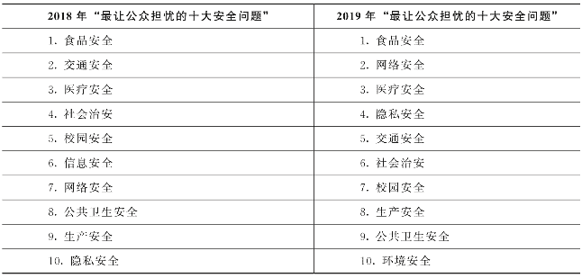

**痛点直击：隐形的暴力与失控的风险**
近两年校园负面频发：部分“问题学生”甚至社会闲散人员煽动破坏公共设施；更有不法分子盯上弱势群体实施恶性伤害，酿成校园暴力悲剧。霸凌现象同样触目惊心——2019年某中学女生遭围殴施暴、旁观者哄笑的40秒视频引爆舆论，暴露出校园霸凌的隐蔽性与残酷性。除暴力霸凌外，交通隐患、食品卫生、火灾隐患、设施老化等问题交织，共同构成伤害师生身心的“组合拳”。若缺乏及时干预，孤立事件极易演变为群体性对抗，后果不堪设想。

**重新定义：安全是智慧校园的“地基”**
真正的校园安全，意味着师生在校期间免受环境与人为威胁，亦不成为加害者，维持动态平衡的安全态。因此，智慧校园建设必须确立“安全第一”原则，将安防建设置于首位，通过全域治理筑牢师生生存发展的底线，让恐慌感无处遁形。

**技术破局：让“监控”进化为“智控”**
如何用大数据、AI等新一代技术重塑安防体系？视频识别作为AI技术集成的典型应用，成为破局关键。在智慧校园语境下，全域部署摄像头绝非为了“监视”，而是为了“照亮阴暗面”——将校园每个角落转化为可视化的视频数据资产，让隐患无处遁形。电梯口、出入口、卫生间、楼顶、人员密集通道……全覆盖布局的背后，是对安全盲区的零容忍。

**从“存录像”到“懂视频”的跨越**
传统安防网虽已铺设，但仅止于“存海量数据”，高度依赖人工肉眼筛查，缺乏智能识别、预警推送、视频摘要等核心能力。升级势在必行：引入智能视频监控云平台，在原有视频流基础上叠加车牌识别、人脸比对、异常行为分析等算法模型，并将结构化摘要上云检索。这意味着，校园内的异常行为数据可在**第一时间触达预警、实现管控**。

**核心优势：效率与精度的双重飞跃**
依托AI机器自动化辨析机制，智能视频系统较传统模式实现质变：视频内容审核效率指数级提升，有害音视频信息发现速度大幅缩短。校园智能视频监控云系统的落地，标志着智慧校园安防体系迈入“可感知、会分析、能预警、快处置”的新阶段，为师生筑起一道坚实的数字化护盾。

### (2) 人工智能与图书馆管理

在当今大学校园里，图书馆早已成为“学习圣地”的代名词。无论是借阅书籍、检索论文资料，还是小组讨论选题，都构成了大学生日常生活中不可或缺的一环。新时代背景下，智慧图书馆的科技化管理，为师生营造了极佳的研习氛围，无论纸质典藏还是电子资源，检索获取都变得前所未有的便捷，相较于传统模式，优势显而易见。

回首传统图书馆运营，痛点颇多：馆藏以纸质版为主，体量大、占地广，开馆时的上架、搬运、整理极其耗费人力；读者进出需人工核身，借阅登记靠手工录入，服务体验极易受工作人员情绪波动影响；更令师生头疼的是，资源检索困难、获取速度慢，常挫伤学习积极性。

要扭转这一局面，智慧校园建设中必须重塑图书馆形态。如何引入前沿技术提升服务质量、优化师生体验，已成为核心课题。

2018年3月中下旬，第29届北京教育装备展示会在京召开。会上通过专家论坛、企业与校园案例分享，新生代教育展示的“智慧图书馆解决方案”备受瞩目，其提出的 **RFID图书馆方案** 蕴含着智慧图书馆建设的深层智慧。该技术实现了书架、标签、图书与馆藏位置的精准绑定，全面覆盖编目、检索、统计、阅览、流通等全链路智能化管理。从智能书架、盘点车、馆员工作站、自助借还机、移动还书柜、智能发卡机、安检门、OPAC检索机、高频架标、智能导航、RFID图书标签到监控设备，软硬件协同覆盖全场景，为馆务运营注入高效管理、便捷服务、数据可视及个性化荐书等核心价值。

智慧图书馆是传统图书馆的延伸与进化，它从根本上打破了时空限制，重新定义了图书馆的内涵，并依托智能技术拓展至共享领域。近年来，“共享文化”在社会层面空前火热——共享单车、汽车、充电宝、平台、数据等层出不穷，“共享”二字更成功入选“2017年度中国媒体十大流行语”。这股浪潮横向延伸至图书馆领域，催生了共享图书馆。2018年6月，长沙首家共享图书馆诞生，旨在倡导“图书共享、全民阅读、共同参与”的文化风尚，将其打造为集阅读、培训、展览、论坛于一体的综合性空间。市民可免费阅读休憩，企事业单位也能举办公益培训、展览等活动。

配套服务上，“微信小程序+IC借书证+指纹/人脸识别开柜借书+消毒系统+捐书系统”等功能助力智能共享书柜落地。以罗唐科技研发的智能书柜为例，其本质是无人值守的共享书柜，实现了借还全流程自助化。读者不仅能现场借还，还能通过微信预约，体验极致便捷 ^([\[5\]](#txt008.html#footnote_content_txt008_5))。

# AI赋能智慧图书馆：重塑阅读新生态

人工智能技术正以前所未有的速度渗透进图书馆体系，催生出形态各异的创新应用。从智慧图书馆实体馆、智能共享书柜、智能共享馆到智慧档案馆，新业态层出不穷；在技术融合层面，智能书架、智能导航、智能标签等硬核设备广泛落地。AI与传统图书馆的深度耦合，推动着馆藏资源在批判性传承中加速向信息化、现代化跨越。

**智慧图书馆的核心内涵逐渐清晰。** 它借助互联网、物联网、大数据及人工智能等新一代信息技术，对馆务管理、规划建设全流程进行重塑，打造出一个集高度智能化管控与服务于一体的书籍资源汇聚高地。打破时空壁垒是其显著特征：依托智能技术赋能，大量“7×24小时”图书馆常态化运营，用户随时随地可入馆检索、下载数据，真正实现了服务“零距离”、开放“不打烊”。

**智慧图书馆的建设价值主要聚焦三大维度：**
*   **资源循环利用最大化：** 打破信息孤岛，有效化解因信息阻隔导致的馆藏浪费难题。
*   **降本增效显著：** 大幅压缩人工管服成本与建维投入，同时提升整体服务水准，优化用户体验。
*   **空间效能跃升：** 藏书丰富且集约，物理体量小，腾挪出更多宝贵空间用于打造多元化学习场景。

---

## 智慧校园：技术落地与场景革新

### (III) AI点亮校园：智慧照明系统的进化论

人工智能与校园照明体系的融合，孕育出了校园智慧照明系统。该系统引入大数据、云计算、AI等前沿技术，贯穿校园照明的管理、服务、运维全链路，构建起集数据采集、存储、分析、优化、精准决策及资源预测于一体的智能化管控平台，全面跃升照明资源利用率与系统掌控力。

**告别传统照明“两大顽疾”。** 过去，校园照明非定时熄灯，即全夜长明，资源利用率低下，严重浪费；且常出现“人走灯亮、人来灯灭”的反向操作，师生照明需求屡屡落空。针对这些痛点，AI支撑的无人化、智能化照明理念，迅速成为智慧校园建设的聚焦点。

**智能化重构照明网络。** 接入AI后，校园灯网“长”出了大脑：智能终端实现“一键多控”，省去人工巡检倒闸的人力成本；基于算法模型，单灯亮度可随环境光自适应动态调节，兼顾整体照度与重点区域舒适度；融合智能感知与边缘计算，白天自动熄灯，楼层夹层等弱光区常亮，人过灯亮、人走灯灭，真正落地“按需照明”。该系统在**节能、环保、舒适**三大维度展现出卓越价值。

**管理延伸至“最后一米”。** 系统还集成远程抄表、智能故障诊断、电网隐患定位、违规用电预警、电流管控等功能。以往依赖人工的抄表核算，现由后台处理器自动完成——依托算法核算各宿舍实耗电量，通过平台与短信推送账单，师生线上即可缴费。这不仅便捷了师生生活，更大幅释放后勤人力，整体压降照明系统运营成本。

**双重价值赋能校园生活。** 一面营造智能光感环境：在节能环保技术加持下，系统最大化利用自然光，优化师生工作学习微环境，助力效能提升；另一面实现管理范式跃迁：从“靠人”转向“靠智”，落地先进管理理念，大幅削减运维开支，为校园整体节支增效。

### (IV) 智慧教务管理系统：数据驱动教学新范式

智慧教务管理系统旨在借助新型管理手段，强化师生教学“在场感”。系统以多源异构教学大数据为底座，融合教务算法模型、5G高速传输、云存储与超算算力，为重新审视传统教务管理模式的优劣、探索变革路径提供了坚实的技术支撑与数据底气。

### 破局校园管理困境：智慧教学系统的三维重构与价值跃迁

在传统的校园教学管理中，受限于监管机制不健全、人手短缺以及软硬件技术瓶颈，管理工作始终难以破局。管理的高明在于决策的科学，决策的科学又建立在数据的全面掌握之上。唯有充分调动客观、完整的教学大数据，管理者才能避开“拍脑袋”决策的误区。尽管教学管理涵盖规划、组织、协调、控制等经典环节，但传统模式下管理者获取信息碎片化、单一化，再精妙的策略也难落地生根。

过去，管理决策往往基于局部数据，师生沦为被管控与被支配的对象，管理活动难以映照真实意愿。这导致教学管理成了管理层的“独角戏”，师生的参与权、知情权被剥离，“双向反馈”机制形同虚设，学生主体地位受损，教师丧失教学设计主动权，沦为执行者。可见，传统管理实质上是少数人的事务，而非全员共治，这严重阻碍了管理科学化进程，也扼杀了批判性与创新性思维的生长土壤。

为破解上述顽疾，引入新技术拓宽“双向反馈”渠道，成为教学管理走向智能化、智慧化的关键一环。智慧教学管理体系的构建，确立了三大核心维度：面向学生的**学习管理系统**、面向教师的**教师管理系统**、面向管理者的**教务管理系统**。前两者深度联动：教师端可高效调取学习数据并通过算法干预学习界面；学习端实时回传数据；教师端直连教务端，打通数据闭环。

#### 一、 学习管理系统：赋能学生自主成长的“数字基座”

该系统集成学生档案、在线学习、成绩管理、学情分析、进度追踪、课程资源、互动平台、反馈通道等模块。其最大亮点在于**双向畅通**：教师能快速调阅数据洞察学情，学生亦可自由穿梭其中——查成绩、看进度、选资源、下课件。这不仅为学生铺就了便捷的学习高速路，更为教师深度了解学习者提供了强有力的技术支撑。

#### 二、 教师管理系统：激活教师教学效能的“智能中枢”

模块覆盖教师档案、绩效考核、进度把控、作业批改、命题库、反馈平台、学情对接口等。教师经身份认证登录即可全权操作：一键掌握班级学科进度，精准画像学生表现，开展学前学后测评，据此动态优化教学节奏与策略。这让教育教学真正实现了“以学定教”，精准适配个性化学习进程。

#### 三、 教务管理系统：服务决策科学化的“中枢大脑”

管理者借此系统可全景式洞察：师生教学学习态势、教学成效、师德师风、生评教反馈、师生满意度等核心指标。从系统论视角看，**学生学习系统是核心心脏**，教师与教务系统皆为其服务。整个建设理念锚定“以学生为中心，专业服务学生，成就学生未来”，将“立德树人”落为可视、可感、可量的工程实践。

管理学视域下，该系统在“虚拟场域”实现了师生校三方连接，填补了时空阻隔造成的“认知鸿沟”，在智慧校园中构建起虚实共生、互映生辉的智慧生态管理体系，无疑实现了管理效能与管理质量的“双重跃升”。

智慧教学管理系统确立了“以学生为中心”的智能管理范式，其终极价值自然彰显于学生学习成效的质变之中：

**第一，重塑学习方式，奠基终身成长。** 系统提供多媒体课件、海量资源库，支持学生按需选学、自主规划。这极大地培育了自主学习与终身学习的良好习惯。同时，系统提供成果存储与心得记录空间，自动形成成长档案，为教师实施过程性评价提供了丰厚素材。

**第二，提质增效，释放发展红利。** 智能化工具大幅压缩了学生检索资源、拟定计划、梳理盲区的时间成本。在减负的同时，腾挪出宝贵时空供学生自由发展、个性张扬。

**第三，技术赋能人文关怀，让关爱可视可感。** 学习过程中，学生既能感受教师个性化的情感关怀，又能获得系统智能推送的精准学习建议。这双重保障彰显了学生人格价值与教师人文关怀。教师的爱不再停留于口号，认知行为主义视角下，奖惩有据、规则透明，让行为塑造更科学、更有温度。

### (V) 从“一卡通”进阶“刷脸通”：身份认证的智能跃迁

智慧教学管理系统的效能远不止于此，它还能有效减轻教师负担，为校领导搭建移动办公平台，集中彰显了“智慧校园3.0”时代的智慧内涵。置身智能时代，虽说人工智能无法完全取代人工处理校园教学管理，但若学校教学管理活动缺席AI技术应用，势必在教育竞争格局中陷入被动。因此，智慧校园教学管理系统升级迫在眉睫，必须以新一代信息技术与人工智能技术为基石，全方位提升教学管理质量，进而推动学校整体办学水平跃升。

**一卡通的前世今生：从“多卡并存”到“一卡走遍”**

时间拨回1999年，福州银达公司率先推出银校合作“一卡通”系统，拉开了校园一卡通的序列。凭借成熟的支付功能，它迅速铺开至全国校园，极大便利了校务管理与服务。此后，众多企业涌入赛道，持续打磨技术架构、拓宽服务边界，如今国内校园一卡通已基本实现全覆盖。

校园一卡通依托互联网、物联网、计算机等技术，集身份认证、消费支付、教学考勤、校医就诊、活动签到于一体，是“智慧校园3.0”时代师生必备的“电子通行证”。它打破了传统“一人多卡”的碎片化困局，实现了“一卡通吃、通行、通管”的目标。从本质看，其核心特征在于多卡融合、数字化身份标识与人机交互凭证三位一体。

按服务对象划分，一卡通分为面向学生的学生卡、面向教职工的教工卡、面向短期人员的临时卡。三类卡均采用实名认证发行，作为校园活动的独立凭证。但卡片一旦过期或造假，持卡人在校活动即受限——这正是一卡通存在的根本意义：以技术手段管控“开放复杂”的校园系统。

**身份认证的进化史：纸牌 → 磁条 → 人脸**

回望校园卡演变，从早期“纸质挂牌”年代的“一人多卡”，到“数字机读”时期的磁条/芯片卡，学生身份认证方式的每一次迭代，都映射着校园发展史，亦折射出宏观社会环境的变迁。站在人工智能门槛上，智慧校园建设呼唤新形态——校园一卡通将以何种“面孔”亮相？

**“一张脸”时代开启：北师大、北大、佛山石门中学的标杆实践**

2018年6月27日，北京师大官微宣布全宿舍楼部署人脸识别门禁，标志着这所顶尖师范大学率先跨入全域“刷脸”纪元，也拉开了“校园一卡通”向“校园一张脸”转型的大幕。

紧接着7月27日，北京大学西南门上线“刷脸通行”，攻克传统1:1比对瓶颈，引入1:N实时识别技术，百万级底库支撑下，师生入校秒级精准通行。

同年12月3日，广东佛山石门中学全面启动人脸智能系统，校门与宿舍门双重“刷脸”验证，同步记录请销假、迟到等考勤数据。佛山校园由此步入“刷脸”新常态，师生彻底告别“卡片丢失、遗忘、磨损、补办、被盗”等高频痛点。

**“一张脸”生态图谱：软硬结合的智能应用矩阵**

随着智能人脸识别技术日臻成熟，“校园一张脸”应用加速普及，成为学界关注焦点。它是“校园一卡通”基于物联网、大数据、云计算、AI等新一代信息技术的进阶版——一个智能化应用体系。其覆盖场景极广：

*   **安防准入类**：人脸门禁、宿舍管理、安防监控
*   **生活服务类**：食堂/超市支付、图书馆借阅
*   **教务管理类**：教师考勤、学生考勤、班级管理、校园登记注册

“刷脸”应用的落地，让师生从体感层面真切触达智慧校园的真实温度。

**核心优势：极速响应、全天候在线、数据驱动决策**

AI识别的毫秒级响应，重塑了智慧校园建设质量与办公效能：

1.  **安防升级：从“人防”到“技防”的质变**。传统门禁依赖人工值守，疲劳作业易疏漏；“一张脸”系统7×24小时在线，陌生人闯入即时预警登记，校园安全防线显著筑牢。
2.  **精准画像：用行为数据还原真实学情**。教务部门无需人工抽查，即可随时调取学生轨迹：食堂就餐规律性、图书馆到访频次、宿舍归寝打卡情况……这些离散数据拼合成行为画像，侧写学习状态与生活习惯。
3.  **干预闭环：成绩波动背后的深度诊断**。将行为数据与学业成绩交叉分析，可精准定位成绩异动根因——是作息紊乱、社交异常，还是心理波动？由此制定针对性干预策略，实现从“事后补救”到“过程干预”的范式转换。

“校园一张脸”不只是证件形态的更迭，更是校园治理从“经验驱动”向“数据驱动”、从“粗放管理”向“精准服务”的深度进化。

# 刷脸校园：便利背后的隐忧与破局之道

从价值维度审视，智能“刷脸校园”虽在安防升级、学情精准画像、考勤便捷化等方面成效显著，却也是一把双刃剑。系统运转的前提，是海量师生人脸数据的采集、入库与比对——这意味着校园必须构建覆盖全员的生物特征数据池。随之而来的隐私保护，俨然成为学校的“心头大患”。一旦数据库遭恶意攻击，或因内部管控疏漏导致泄露，将直接威胁师生人身财产安全。此外，人脸识别技术尚存短板：发型变化、妆容遮挡、表情差异等非结构化因素，极易引发误判，反而阻碍了正常教学秩序。

针对隐私风险与识别误差双重挑战，破局需三管齐下：
**第一，重塑外协共治机制。** 深化与服务商的协同，落实问题追责制，提前排查高危漏洞，预置技术兜底预案；
**第二，筑牢数据“护城河”。** 采用高强度加密存储，引入攻防演练思维封堵入侵路径，植入智能预警模块实现“发现即报警、报警即熔断”，守住校园大数据底线；
**第三，锻造复合型人才梯队。** 重点培育懂教育、懂技术、懂安全的复合型人才，为“刷脸校园”可持续进化注入核心动力。

## Three, 未来课堂：智慧教室的畅想与重构

### (I) 课堂与班级：从模糊共生到本质区分

提及传统教育，脑海中浮现的往往是：黑板上粉笔飞舞，讲台前教师声嘶力竭，课桌前学生奋笔疾书。正如歌谣《童年》所吟唱的那般，教师、教材、班级构成了教学的“三大中心”，课堂与班级在时空上高度重合，甚至被视为同义词——那个老师讲、学生听、作业堆积如山的物理空间。

然而，随着教育形态演进，这种“等同论”遭遇挑战。人们逐渐觉醒：班级的存在并不局限于四面墙内，凡有教学活动发生处，皆为班级。人工智能时代，新技术冲击下，二者的辩证关系愈发清晰：**本质上，两者皆是教学活动的载体。** 过去因班级活动几乎全在课堂内，才难以拆解二者边界。

放眼智能时代，定义已悄然重写：
*   **班级**外延拓宽，不再局限于物理课堂的师生互动，涵盖线上线下、师生互动、生生协作等全场景教学活动，是虚实融合的“有机体”；
*   **课堂**回归本位，特指承载教学活动的物理空间，是具象的“容器”。
二者唯在“班级授课制”教学发生的瞬间，才紧密咬合。

溯源而言，班级早于课堂而生——专设书院、学校教育出现后，课堂才应运而生。放眼当下，班级具备“无处不在”的属性：只要学习发生，任何时间、地点、场景皆可成班级；课堂则是肉眼可见的实体阵地。智能技术成熟催生的教育变革，倒逼智慧校园建设渗透至每个毛细血管。教师教学范式、软硬件基座、学生学习认知，均需完成迭代。作为教学主阵地的课堂智能化转型，势在必行。

### (II) 智慧教室的建设与应用

## 第四章 从点到面：智慧校园建设的系统化推进策略

依托物联网、大数据、云计算及人工智能等前沿技术，智慧校园建设推动了教学活动场所的智能化升级，智慧教室应运而生。所谓智慧教室，就是借助新兴技术手段，促使教学空间与教育渠道向智能化、智慧化迈进的过程。其具体形态如何，仍需在落地应用中探寻答案。以山东平度市推进同步课堂（智慧教室）项目为例，该项目依托校园软硬件基座，重点从教室软硬件配置、课程录制、远程互动三个维度切入，明确要求兼顾真实数据记录与师生互动通道的畅通无阻。在智慧校园整体架构中，智慧教室作为核心承载空间，集中体现了上述三大建设维度，其实体空间形态如图 8-2 所示。

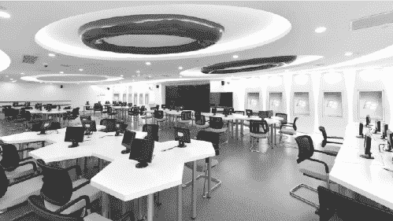

图 8-2 智慧教室实体空间[⁸]

[⁷]: 参考文献 [7]

[⁸]: 参考文献 [8]

无论是智慧教室、安防管理、智慧教务、一卡通系统、智慧图书馆，还是校园照明系统，智慧校园的各个子系统本质上都是借力新一代信息技术与AI技术，实现服务模式转型与管理层级跃升的应用实践。

在人工智能时代，智慧校园各子系统的迭代升级，最终指向同一个核心使命：促进教育公平、提升教育质量、培养创新人才。这一全面更新的进程，基本沿着技术、理念、应用三条主线展开，并始终坚守“以学生为中心”的管理范式，实现教学效能与质量的双重飞跃。因此，智慧校园建设的终极形态，意味着校园管理理念将完成从“重管控”到“重服务”，再到“重成效”的蜕变；教学模式将从“以教为主”转向“以学为中心”，最终确立学校作为个性化教育核心阵地的地位。

伴随物联网、大数据、云计算、边缘计算、5G及AI技术的持续演进，万物智联趋势愈发显著，智能产业蓬勃，社会整体智能化水平跃升，全社会正步入深度智能新阶段。智慧教育发展顺势而为，必将同步迈入深度智能期。作为教育“三大场域”之一，智慧校园的深度智能化进程，理应与教育发展大势“同频共振”，推进建设刻不容缓。

放眼当下，智慧校园建设已取得阶段性成果，校园各管理服务领域基本实现智能化，并向融合化发展迈进。但总体来看，在“系统智慧”层面仍有短板：亟待打破各自为政的“排他性”孤岛系统，从技术供给与实际需求双端发力，优化人机交互的舒适度与便捷度，提升师生等参与主体的智能感知体验。

着眼长远，智慧校园建设应在四大维度持续发力：

**一、 强化顶层设计，绘就科学蓝图**
在指导思想与政策层面引领建设走向规范化、体系化、深度智能化；同时下放充分自主权，鼓励建设主体融入地域特色，彰显创新活力与人文底蕴。

**二、 完善监管机制，防止“异化”偏航**
构建覆盖运营、管理、资金全链条的监督体系，确保新时代教育理念、社会主义核心价值观及以人为本理念深度融入智慧校园肌理。在高效透明的监管护航下，让智慧校园真正成为“立德树人”的沃土，而非“逐利舞弊”的温床。

**三、 深化理论研究，夯实学理支撑**
理论是实践的先导，科学理论能转化为物质力量并指引方向。当前智慧校园建设仍处发展期，理论研究相对滞后，需专题研讨，构建建设理论与哲学观。这包含双重意蕴：一是探寻指导设计建设的通用理论；二是探索建设实践能否催生新理论。作为新生事物，智慧校园为理论创新提供了契机，应在比较分析多元理论基础上，建构专属的设计建设理论体系^([\[10\]](#txt008.html#footnote_content_txt008_10))。

**四、 筑牢资源保障，厚植发展根基**
国家层面加大财政投入；校方统筹校内外资源，保障运维经费；大力引育复合型智慧校园人才，为发展提供坚实智力支撑。

新时代智慧校园建设的根本在于：善用新一代信息技术与AI技术，为培育新时代创新人才与领军人物提供坚实支撑。这要求国家层面强化顶层设计与政策引领，社会层面给予经费与物资保障，学校层面紧跟时代步伐，深化理论研究，整合校内外资源，全方位提升校园智慧水平。

## 注释

- [[1]](#txt008.html#footnote_quote_txt008_1) Baidu Baike. Smart Campus [EB/OL]. `https：//baike.baidu.com/item/%E6%99%BA%E6%85%A7%E6%A0%A1%E5%9B%AD/9845341?fr=aladdin.`

- [[2]](#txt008.html#footnote_quote_txt008_2) The State Council. Notice on Issuing the "13th Five-Year Plan" for the Development of National Education [EB/OL]. `http：//www.gov.cn/zhengce/content/2017-01/19/content_5161341.htm.`

- [[3]](#txt008.html#footnote_quote_txt008_3) China National Radio (CNR). Xi Jinping's Important Speech at the National Public Security Work Conference Arouses Enthusiastic Response [OL]. [2019-05-10]. `http：//china.cnr.cn/news/20190510/t20190510_524607295.shtml?uc_biz_str=S：custom.`

- [[4]](#txt008.html#footnote_quote_txt008_4) Luo Shaoke, Lu Yangkui. Application Research of Video Recognition Technology in University Campus Traffic Safety Management [J]. China Educational Informatization, 2017(05): 48-50.

- [[5]](#txt008.html#footnote_quote_txt008_5) Luotang Technology. Luotang Smart Book Cabinet [OL]. `https：//www.lotaai.com/books.`

- [[6]](#txt008.html#footnote_quote_txt008_6) Image source: China Industry Information. China's Library RFID Market Size Approx. 937 Million Yuan in 2018, "Public Library Law of the PRC" Expected to Become Important Driving Force for Industry Growth [OL]. `http：//www.chyxx.com/industry/201908/772630.html.`

- [[7]](#txt008.html#footnote_quote_txt008_7) Huang Xianzheng. Intelligent Teaching Management System of Chengdu University Normal College [D]. Chengdu: University of Electronic Science and Technology of China, 2011.

- [[8]](#txt008.html#footnote_quote_txt008_8) Image source: Sohu. Smart Campus, Where is the "Wisdom"? [OL]. `http：//www.sohu.com/a/270084973_100145035.`

- [[9]](#txt008.html#footnote_quote_txt008_9) Image source: Baidu. Baidu Smart Classroom [OL]. `https：//study.baidu.com.`

- [[10]](#txt008.html#footnote_quote_txt008_10) Yu Changhong, Wang Yunwu, Ma Wu. Current Situation, Problems and Countermeasures of Smart Campus Construction [J]. Teaching and Management, 2015(06): 48-51.

# Chapter 9 三创教育：激活智能时代的创新思维引擎

- 困境剖析：智能时代创新的“拦路虎”
- 创新教育：点燃全民创新的星星之火
- 创客教育：智能时代造物者的成长阶梯
- 创业教育：孵化大众创业的沃土
- 协同合力：共筑智能时代创新思维的高地

近年来，“三创教育”（即创新教育、创客教育、创业教育）已成为教育界与社会各界聚焦的热点。这既源于其自身的育人价值，更因它是应对智能时代技术飞跃、推动科技转化为现实生产力的关键举措。随着国家与社会大力倡导三创文化，长期受工业文明桎梏、积压在人们心底的创造激情被瞬间点燃。这从根本上倒逼人们重审当下教育——尤其是三创教育的本质、目的、实践与应用，以及如何在新智能时代真正培养学生的创新思维能力。

## I. 困境剖析：智能时代创新的“拦路虎”

何为创新思维？简单说，就是打破常规与定势，跳出原有思维边界去思考、解决问题、创造新事物的思维方式，其本质就是创造与革新。它还是一种与时俱进、敢于攻坚、开拓进取的科学思维^([\[1\]](#txt009.html#footnote_content_txt009_1))。

创新思维自带鲜明的时代烙印。农业与工业时代，它围绕农耕与制造；大数据时代，它以数字化、数据化视角切入；而到了人工智能时代，核心则转向“智能化”——跨学科思维、融合思维、关联思维成为主流。这种思维模式的萌发与演进，得益于大数据与AI技术发展延伸出的社会文化，在润物无声中构建起时代的创新文化，进而催生了创新教育，推动了创新思维研究的深入。

步入AI时代，整体与局部呈现有机统一的和谐关系；视角从“碎片化”走向“整合化”；行为模式从“单一维度”拓展为“多元智能”；技术领域也从孤立的“技术孤岛”汇聚成“技术复合体”。这种“整体化、多元化、融合化”的趋势已成定局。人们发明智能机器，不仅是要替代人类重复性劳动，更期盼其在思维层面分担人类负担。因此，制造融合“思考、行为、情感”的复杂机器成了必答题。客观上，唯有具备创新思维与创新能力的人，才能更好适应时代发展的需求。

2019年1月，习近平总书记在省部级主要领导干部坚持底线思维防范化解重大风险专题研讨会开班式上强调，要增强战略思维、历史思维、辩证思维、创新思维、法治思维、底线思维等“七种思维”能力，特别突出了创新思维的重要性。总书记指出：“创新是民族进步的灵魂，是国家兴旺发达的不竭动力，是中华民族最深沉的民族禀赋。”在总书记眼中，“激烈的国际竞争中，只有创新者才能前进、才能强大、才能胜出。”放眼当下，抓住创新就是抓住了牵动经济社会发展全局的“牛鼻子”。实践反复证明，无论大国、小国，还是局部地区、企业，“创新都是引领发展的第一动力”。因此，总书记始终要求“把创新摆在国家发展全局的核心位置，把科技创新摆在更加重要的位置”^([\[2\]](#txt009.html#footnote_content_txt009_2))。可见，创新思维与创新能力，关乎党和国家前途命运，关乎企业未来与个人长远发展，确实是“抓创新就是抓发展，谋创新就是谋未来”。

创新思维是创新能力的基石。缺乏创新思维，无论采用何种手段，都难以从根本上拥有创新智慧。创新思维的核心在于发散思维、联想思维与融合思维。若不能掌握其核心精髓，便难以释放创新思维的魅力。由此可见，创新思维实质上是一系列全新解决问题思维方式的集合。

## 创新思维、创新教育与创客教育在智能时代的演进

## 一、 创新思维的“紧箍咒”在哪里？

创新的天性，往往难以挣脱传统框架与固化路径的束缚。

### 1. 传统观念与文化的深层桎梏

传统观念文化对创新思维的抑制作用，根基深厚。这类文化大致可分为两派：一派是先进文化，另一派则是落后文化。以洋务运动为例，其体现的保守思想认为“祖宗之法不可变”，子孙后代只能“遵循”，最终导致运动以失败告终。再如晚清时期，为不破坏皇陵风水，朝廷竟下令用马匹拉动铁轨上的火车，沦为国际笑柄。显而易见，传统文化对新生事物持排斥态度，而创新思维的内核正是求新、求变，二者背道而驰。因此，现存的传统文化与观念，必然会制约人们的创造活动与创新思维。

### 2. 工业文化“后遗症”的思维惯性

工业文化的后遗症，指的是工业革命以来社会形成的商业化、标准化、理性化文化氛围。从经济视角看，这是一种功利文化，源于社会对经济规模与利润的过度追逐，让“速度”与“规模”成为核心指标。教育领域同样深受其害：在工业大环境下，教育目标锁定为培养传统工业人才——即为特定领域输送专门型人才。既然岗位只需“专才”，个人精通单一技能即可获厚禄，这客观上助推了人才的专门化发展。然而，传统工业模式已难适配智能时代，工业文化与智能文化的冲突在社会思维层面激烈碰撞。特别是当前中国工业化与智能化并行的背景下，旧模式塑造的工业人才，已无法满足智能时代的发展诉求。

## 二、 创新教育：智能时代的“全民练兵”

创新教育，旨在培育受教育者的创新思维、能力、精神与人格。其核心在于重塑思维模式，以新思维引领能力生成，在实践中锤炼精神，终成“愿创新、敢创新、善创新”的创新人格。

智能时代是技术大融合的时代，技术融合与跨界成为传统技术革新的主路径；技术应用呈数据化、智能化趋势，各技术领域不再各自为战，而是在全技术空间协同演进。因此，智能时代的创新教育必须紧扣信息化、数据化、智慧化、智能化，方具时代价值与实战指导意义。

### （一） 为何必须推行创新教育？

社会各界的竞争，终局是创新人才的争夺。“得创新人才者得天下”，此话虽侧面，却精准道出了创新的分量。推行创新教育，关乎国家、社会、企业与个人的前途命运。

**对国家而言**，创新教育一方面有助于锻造创新文化，营造全社会创新氛围，激发大众创新活力，提升国民创新素养；另一方面支撑创新型国家建设。2016年6月，中共中央、国务院印发《国家创新驱动发展战略纲要》明确指出：“创新驱动发展是国家的命脉……创新强则国家强，创新弱则国家弱。近代中国所以落后挨打，重要原因是错失了历次技术革命……实现中华民族伟大复兴的中国梦，必须真正用好科技这个第一革命力量、最高杠杆作用的强大力量。”这表明，创新教育承载着民族科技创新的重托，是建设创新型国家的关键之举。

**创新教育是企业生存的基石**。“人无我有，人有我优，人优我特”，这句通俗的商战箴言，道尽了创新生存法则。对企业而言，通过创新开发市场空白产品，是抢占市场的最优解；面对红海存量产品，唯有在性能、结构、颜值上持续创新，打造高附加值产品，方能赢得市场青睐。因此，企业内部开展创新教育至关重要——它是培育留住创新人才的关键，直接决定市场份额与未来前景。一个固步自封、不思革新的企业，永无立足之地。

### 创新教育：智能时代的生存必修课

教育的本质是培育人，关乎受教育者的生存与发展。放眼当下，创新已成国家、企业、个体角力的核心变量：国家发展呼唤创新型人才，企业转型渴望创新驱动，而个人若想在激烈的社会竞争中站稳脚跟，更离不开创新思维的加持。因此，无论是家庭、学校还是社会教育，都应引导学习者树立创新理念、塑造创新人格，习惯用全新视角审视与解决问题。从技术演进看，人类史实质是生存与淘汰史。智能时代来临，技术与人文冲突加剧，“人替人、机替人”的双重淘汰叠加效应凸显——缺乏创新思维与能力者，不仅面临被同行超越的风险，更可能被机器取代。故而，创新教育必须上升为当前教育的核心内容，各层级、各类型教育均应以此为轴心，切实提升受教育者的创新素养与水平。

### (II) 智能时代创新教育的新视野

智能时代的创新教育，关乎国家、社会、企业、个体等多元主体的创新实践，是国家与地方教育机构协同、以人才培养为基、以基建与顶层设计为支撑的系统工程。

**创新教育是智能时代人才培养的关键突破口。** 据新华社报道，截至2019年10月，全国高校专职从事创新创业教育的教师达2.8万，兼职教师9.3万，合计超11万，显示出中国创新教育已具备一定师资底座。创新教育不仅能造就创新型人才，更能倒逼教育者自身在创新路上蜕变；师生间的良性互动，将成为创新实践中最具活力的因子。但放眼全局，师资缺口依然巨大，这折射出当前教育领域供需矛盾的客观现实：东西部师资分布极不均衡，发达地区人才聚集、欠发达地区人才流失，全国创新型人才总量仍显不足。为此，必须加大投入，打造一支过硬的创新教育“铁军”，让其成为领跑时代的先锋队。

**育才是创新教育的首要使命。** 失去创新人才梯队支撑，创新教育便成无源之水。既已着手师资建设，便应向纵深推进，探索创新教育的社会化实践与应用，为可持续发展铺路。智能时代各领域深度智能化转型，为创新教育实践指明了方向——当前创新教育多与互联网、大数据、AI技术深度绑定。以“天津AI创新教育试点”为例，其首创区域“校企合作”模式：2019年5月，“河东区创新教育实验室”落户天津七中，为探索AI创新教育积累了宝贵经验。该模式通过创新内容、优化环境、重塑课程，以AI技术为主攻方向，精准回应学生对前沿科技的探索渴望。

对当下中小学生而言，AI技术仿佛“高悬云端”，却激发了极高的关注度与敏感度。这源于社会热潮赋予AI的神秘光环与普及化趋势。80后、90后虽对AI推崇备至，但学习路径陡峭，因他们只是“智能移民”而非“智能原住民”。相比之下，当代学生正处好奇心最盛、认知可塑性最强的阶段，内心更藏着超越前人、成为时代弄潮儿的强烈渴望，对AI技术的探索需求自然强烈。

在此背景下，中小学AI创新教育破土萌芽。2019年3月，“首届国际中学生人工智能交流展示会”在北京举办，聚焦中学AI基础教育，以交流展示之形式向社会传递创新热度，共商落地路径。会议跨越计算机、信息科学、工程、数学与AI等多学科，涵盖人脸识别、异常行为检测、自动驾驶、环境监测等前沿技术。这不仅为中学生搭建了展示创新成果的舞台，汇聚专家学者现场把脉指导，更在肯定成果、激发成就感与价值感上具有深远现实意义。

## III. 创客教育：智能时代万众创客的成长史

伴随创新创业教育而生，创客教育同样是新时代必须高度聚焦的议题。提及创客教育，绕不开20世纪的朋克文化与反消费主义文化，以及与之紧密相连的`DIY文化`。

### （一） 创客教育诞生的文化土壤

中小学生是未来创新教育的领航员；作为“智能原住民”，他们以智能思维为解题基石，这势必大幅提升学生的社会适应力与综合创新力。从构想到落地，从信息时代跨越至智能时代，中学AI创新教育正蓬勃开展，这是智能时代的必然选择。2018年6月，`华东师范大学`、`商汤科技`联手名师打造的`AI教材《人工智能基础（高中版）》`正式出版，引发不小反响。随着教材影响力持续发酵，越来越多中小学将其纳入课程体系。截至目前，全国已有40余所中学成为该教材实验基地，充分印证了智能创新教育的实践吸引力，也向社会宣示：当下的智能创新教育已成专业教育形态，绝非空谈。

综上，学校创新教育不应仅着眼于人的创新品质培育，更要引导学生认知前沿技术、夯实创新理论根基，助力学子手握新时代科技利器、重塑世界认知，从而整体跃升创新能力。

不同领域的创新教育实践模式各异，置于社会层面，其实践形态更显新颖，焕然一新。

2019年全国“两会”期间，习近平总书记在福建代表团审议时强调：“要营造有利于创新创业创造的良好发展环境。要从改革开放中汲取动力，最大程度释放全社会创新创业创造活力，不断增强我国在世界百年大变局中的影响力和竞争力。” 为激活社会创新活力，企业首当其冲投身创新教育实践。

2019年7月，`阿里巴巴GET数字经济创新创业大赛总决赛`在`贵州大学`启幕；决赛围绕项目优势值、市场前景、商业模式、融资规划等维度考量，强化了企业主导的校园创新教育实践导向，凸显了创新教育实践的社会辐射力。企业创新教育落地形式多元，`掌门教育`为创新教育落地开辟新局。作为由“清北复交浙”联合创办的国内头部辅导机构，`掌门教育`于2019年9月受邀成为中国唯一入驻首个“`5G全球创新港`”的“`5G+教育`”在线企业，与`华为`、`中国移动`等巨头并肩。据悉，该创新港坐落上海，面向全球推出新时代`5G创新产品`。`掌门教育`入驻必将推动创新教育与新兴`5G技术`深度融合，开启创新教育的`5G时代`。

“`5G+创新教育`”标志着创新教育步入技术深度融合的新纪元。随着`5G技术`演进及`AR`、`VR`、`MR`等商用成熟，由`平安科技`引领的创新教育让`5G技术`与`AR技术`同获聚焦，“`5G+AR+创新教育`”模式应运而生。AI时代下，创新教育主要依托`MOOC`、`在线公开课`、`面对面视频互动`等形式；传统`4G网络`传输慢、延迟高、质量差等短板严重制约了高质量发展，大幅拉低教育品质。而`5G技术`精准补齐`4G`阶段的创新教育短板，为发展注入鲜活动力。

总体而言，“`5G+AR+创新教育`”模式聚焦教育对象数据获取的效率与质量，融合`AR体验技术`，呈现超高清、极致的教育体验，保障基于智能传播的创新教育视频共享普及，从而催生沉浸式创新教育体验。`平安科技`试点的该模式，最终与`中央电化教育馆资源开发部`紧密合作落地——`中央电化教育馆教育教学综合应用系统虚拟现实平台——平安科技K12 VR教育云`，全面优化了师生互动、多人在线教学及课程呈现模式，深度化解传统创新教育痛点，深受教育对象青睐。因此，`平安科技`的“`5G+AR+创新教育`”模式正渗透进校园与家庭创新教育场域。

`校企合作`模式与“`5G+AR+创新教育`”模式，仅是AI时代创新教育的典型切片；关于创新教育与新技术的结合，仍有无限可能待发掘。智能时代，人机矛盾渐显，人类唯在情感、思维、精神领域求新求异，方能与机器和谐共生。故而，AI时代的创新教育不会停滞，必将持续向前、势不可挡。因此，需对创新教育未来发展统筹规划：既要规范新技术在创新教育领域的应用，也要审视其时代价值与意义。创新教育切不可沦为“为创新而创新”的乌托邦实验，而应在党的创新教育思想指引下，借力科学规划，引导完善终身学习机制、筑牢根基、深化基础改革、提升全民创新水准。

### (II) 创客教育：核心内涵与独特优势

回溯七十年代，美国乐坛掀起了一股朋克风暴。这股浪潮以解构传统音乐、追逐前卫潮流为旗帜，实则映射了彼时社会发展的真实切面，是大众对主流文化赤裸裸的冲击与挑衅，更是民众对现实困境积压已久的不满宣泄。尽管如此，朋克文化的兴起在文化层面缓和了美国内外部的社会张力，推动了国家与社会的新一轮蜕变。

近乎同期，诞生于上世纪二三十年代的消费主义文化席卷全球，与朋克文化交融共生。随着全球工业进程提速，人类告别物质匮乏，步入丰盈纪元；以物质消费与享乐为核心的消费主义跃升为文明主流，却也随之衍生出诸多社会痼疾。专家们开始反思其弊端，倡导理性消费，由此催生出与消费主义并存的“反消费主义”文化——主张消费回归工具属性，摒弃购物带来的身心虚幻快感。九十年代，加拿大《Adbusters》杂志发起的“国际不买日”（每年11月最后一个周五/周六），成为这一文化的重要标志，向世界传递适度消费的价值理念。

本质上，无论是朋克文化还是反消费主义文化，在彼时语境下均属“新文化”。之所以被贴上“亚文化”或“非主流”标签，缘于它们与正统工业文明存在尖锐张力与对抗。正是正统工业文化带来的社会阵痛，迫使人们以“丧失自我”“异化为单向度”为代价，换来集体性的觉醒；大众开始渴望一种以个体生命价值与尊严为主导的新文化，希冀在其中寻得自由自主的生存空间。于是，朋克精神与反消费主义理念深度融合，锻造出了如今盛行的美国“DIY文化”。

DIY即“DO IT YOURSELF”，意指“自己动手，丰衣足食”。这种文化倡导以自我解决问题为荣：“我来搞定”、“无需相助”、“我能行”，成为其生动注脚。DIY文化是自力更生文化的现代映射，鼓励人们以双手与大脑掌控生存发展命题。正因契合时代诉求，在竞争白热化的当下，人们更应主动寻变，而非寄望于人。这种变革在不同历史坐标下，主打表现为创新文化与创造文化，要求大众以全新视野、思维模式与解题范式应对复杂环境。故而，DIY文化终演进为创客文化——浸润其中的人们热爱技术、痴迷实践，笃信美好生活源于实践。

步入大数据与AI时代，创客文化愈发成熟，由局部走向全球。结合当下智能技术语境，通俗而言，创客教育即是“创客文化+教育”的化学反应。

---

#### 创客教育的内涵与价值

当前大众对创客教育仍存“似懂非懂”之感，探讨创新教育实践前，有必要先拆解其概念与特质。学界对创客教育定义莫衷一是，仁者见仁，智者见智。

赵晓生教授指出，创客教育实质是信息时代创新教育的新载体、新形态，为优化创新人才培养体系提供了可行的“操作系统”^([\[5\]](#txt009.html#footnote_content_txt009_5))。杨宪民等学者认为，它是融合信息技术、秉持“开放创新、探究体验”理念、以“在创造中学习”为主径、旨在培育多元创新人才的新型教育模式^([\[6\]](#txt009.html#footnote_content_txt009_6))。张茂聪教授则强调，创客教育确立人的主体地位与价值，致力将学生从“知识的奴隶”转化为“知识的主人”，聚焦“全人”培养（知情意行），通过知识应用实现深度内化，更重知识的再创造^([\[7\]](#txt009.html#footnote_content_txt009_7))。

置于人工智能时代背景下重审创客教育。朱志廷教授主张，AI时代的创客教育瞄准培养投身AI研发与创新的创客群体，要求其具备扎实技术硬功、敏锐技术前瞻，更需兼备懂协作、善沟通、韧性强的创客精神。AI开放平台、智能机器人、物联网等新兴技术手段，为创客教育搭建了开放新颖的体验与创造实践平台^([\[8\]](#txt009.html#footnote_content_txt009_8))。综上可见，创客教育本质上是创新教育的载体，借力新技术落地创新教育使命，核心旨归在于涵养创客能力与创客精神。

智能创客教育在AI时代广受社会拥戴。2009年11月，时任美国总统奥巴马在“以教育促创新”活动中首倡：美国学生应成为知识的创新者、社会的创造者。这标志着美国政府率先全球启动“国家创新战略”，并全面推行创客教育^([\[9\]](#txt009.html#footnote_content_txt009_9))。随之，美国将“国家创新战略”上升为国家意志，引发国际知名高校与企业竞相布局创客教育，极大拓展了其全球辐射力。创客实验室、创客空间、创客学校、创客机构、创客孵化基地等应运而生，遍地开花。

### 智造未来：创客教育如何借力平台化破局？

创客教育之所以能赢得政策红利与企业、科研机构的联合推力，根基在于其蕴含的巨大潜能。它不仅能培育符合时代需求的创新人才，更能激发大众创业活力，提升全民素养，精准对接国家战略导向。承德知向机器人创客中心便敏锐捕捉这一趋势，融合创客文化与智能科技，搭建起专业化智能创客平台，跻身国际AI创客教育先行者行列。

自平台成立以来，其课程版图持续拓展，已构建起涵盖3D打印、激光雕刻、无人机航模、仿真模型竞速、Scratch少儿编程、中英双语Scratch编程（全球首创融合国学英语、编程、AI、编程英语、艺术创作于一体的复合课程）、无线电通信、Arduino智能制造、美版VEX机器人等在内的多元体系。尤以自主研发的“AI+乐高+创客”双语创新素养课程最受市场追捧。目前，平台已与承德多所中小学达成合作，实现从企业自研走向校园，逐步迈向标准化、规范化、制度化的成熟阶段。

随着平台日臻完善，师资队伍快速扩充，高阶课程陆续引入，如创新创作亲子课、仿真模型、单片机、Python编程、Arduino开源硬件等。成效斐然：2017至2019短短三年，知向培育的学员屡斩全国青少年创客大赛总决赛冠军、世界机器人大赛季军等桂冠。

智能创客教育平台以AI课程为核心，对智力开发、思维训练及实践能力养成极具价值。其核心逻辑直指未来——为智能时代储备创新种子，强化“数字原住民”的智能底蕴。未来国力竞争本质上是AI创新人才的博弈，推动智能创客教育普及刻不容缓。

---

#### 标杆复盘：海尔创客教育平台的进化论

海平台植根于“双创”文化，旨在通过自有学习与加速平台，助力每位员工成为自己的CEO，以“成就用户”为核心，打造“全员创客”生态。依托大学、加速器、众包平台、实验室、夏令营、创业周末、青年计划、未来新动能等矩阵，海尔构建了覆盖面广、类型丰富的创客版图。

深耕多年，海尔创客平台已突破集团内部循环，主动向校园、社会延伸。针对高校端，海尔·海碧大学生创业众包平台上线，基于O2O模式整合社交、生活、投融资对接服务，引入智能系统重塑校园消费场景。借助大数据技术成熟契机，平台实现“一对多”服务跨越，打通了孤立创客岛屿。

智能化转型彰显了海尔“创业不守业”的魄力。全集团技术路线转向、体系重构伴随巨大风险，但实践证明其顺应了时代潮流。近期，“海尔前沿创新中心”联合新智元发起创客公开课，聚焦AI、VR/AR、智能场景与未来奇点，助力创客深度掌握前沿技术，共绘智能新蓝图。展望未来，海尔创客教育将在文化指引下，持续奔赴更舒适、便携、智能的远方。

---

#### 双轨同驱：平台化实践的共同归宿

纵观承德知向与海尔两大典范，虽起点不同、路径各异，却同归于**平台化赋能**这一关键杠杆。两者皆借平台之势，打通教育资源与受众的“最后一公里”，将创客教育从概念推向具象实践。

最终指向高度一致：契合智能时代背景，顺应社会新风尚与人才市场新需求，高效孵化适应未来的创新创业人才。这不仅是平台的荣誉勋章，更是创客教育落地生根的最佳注脚。

当前的创客教育已将重心转向智能技术相关课程，核心目标是打造一支智能创新型人才梯队。随着创客教育体系日趋成熟，其引发的社会关注度持续攀升。以山东省为例，2017年3月省教育厅印发指导意见，明确加速创客空间建设，倡导创新投入机制、整合创新资源、强力扶持空间落地。此后，广东、河南、陕西（西安）、山西等地相继出台扶持文件，为创客群体带来实质性红利。

AI技术的植入，标志着创客教育迎来全新智能模式、趋势与理念，传统教学范式正经历深度解构与重组。在创客群体、家庭、学校、企业及政府的多方合力下，AI时代的创客教育正驶入广阔的“新蓝海”。纵观当下，多数AI创客教育实践仍聚焦于基础智能启蒙；展望未来，在物联网、大数据与AI技术的协同支撑下，教育重心将上移至高端领域，不再局限于知识结构搭建，更将延伸至AI情感教育与认知教育维度。

## 智能时代的创业教育：孵化大众创新新引擎

作为新兴技术赛道，AI发展赋予世界“智能”红利，倒逼全球生产、生活、学习模式发生范式级迁移。以AI为思维前提的问题分析与解决路径，以及由此衍生的批判性与实践性理论，正有序围绕技术核心展开。与此同时，挑战随之而来：新兴领域理论与应用研究，亟需极具前瞻性的思维在前沿破局。

这意味着智能时代面临的皆是“新课题”，迫使人们必须以全新思维应对现实、创造未来。尽管AI基础理论研究已入深水区，但“AI+垂直场景”的融合应用（如医疗、教育）仍处探索期。在此背景下，AI应用热潮必然催生AI创业热潮。

2014年夏季达沃斯论坛上，李克强总理发出“大众创业、万众创新”最强音，动员全民投身创新创业实践。

响应号召，国内各领域掀起创业新浪潮，与之紧密相关的AI创业教育随之加速演进。通俗而言，AI创业教育即“AI+创业+教育”：一方面深耕AI教育领域开展创业教学，另一方面环绕AI技术在多元场景中探寻创业新径。

教育部大学生创业智库首席专家李晓明博士指出：中国创新技术教育亟待强化，理论建设需借力AI确立本土创新教育体系。创新创业教育渴望工具赋能，引入AI等新技术可营造“人人可创新、随时可创新、随地可创新”的生态——教师先行掌握技术，带动学生精通创新技能，进而激发创新潜能，持续提升国家创新力，迈向创新型国家行列。因此，高校开展围绕AI教育的“双创”教学已成必然趋势。

2017年5月，中科大率先设立人工智能技术学院，随后众多高校纷纷跟进。AI专业进驻校园，为未来智能社会储备创业种子选手，无论在理论体系还是实战技能上，均赋予毕业生投身AI创业的先天优势。2019年高考志愿填报中，AI专业迅速跻身热门之列。

AI教育在输送创业所需人才、铺垫创新路径方面功不可没。社会发展呼唤一线创业者主动拥抱AI创新，引领创业赛道转型升级，抢占智能创业制高点。

早在2017年7月，谷歌官网发布“Developers Launchpad Studio”项目，周期半年、投入巨资扶持项目。据谷歌研究总监Peter Norvig透露，核心使命是孵化全球AI与机器学习初创企业。

聚焦智能创业教育赛道，头部企业普遍采用“创业教育+产业孵化”双轮驱动模式。腾讯“云+创业计划”稳步推进，蚂蚁金服共享学习平台更凭借硬核技术、雄厚资金与完备课程体系，在智能创业教育数据治理领域脱颖而出，斩获2019中国AI峰会“紫金产品创新奖”，成为国内标杆性样本。对于基于AI的创业教育而言，数据、算法、算力三大核心要素缺一不可。

#### 案例深度：蚂蚁金服共享学习平台的实践样本

# 智能时代：多方协同育创新思维

蚂蚁金服凭借专业优势，精准破解智能创业企业的数据困局。数据作为智能化的基石，其隐私保护、标准治理、流通共享及孤岛消除等难题，长期制约着企业发展。针对这些痛点，蚂蚁金服构建了专业的共享学习平台，致力于助力各类创业主体化解数据难题。平台依托技术实力、政策法规与伦理规范开展数据治理教育，筑牢安全防线，实现多方授权协作与数据流通，从而产出更精准高效的模型与决策框架，充分释放数据价值。

由此可见，高校AI学院为社会输送智能人才，蚂蚁共享学习平台则以教育之名暗助智能企业崛起。无论形态如何演变，创业教育的内核始终紧扣AI技术。总的来看，基于AI的创业教育应整合校园、企业、教育机构三大平台资源，主动布局国内国际“两个市场”，纵深推进AI技术应用，从而实现教育与时代发展的深度契合，回应社会与人的多元成长需求。

## 创新思维的特质画像

“三创教育”（创新、创客、创业）的核心在于激发学生的创造性思维，这要求我们精准把脉其特质，推动育人落地。创造性思维是对既有知识经验的重组与超越，能提出新方案、开辟新路径，是人类思维高度发展的标志，具有以下鲜明特质。

### 打破常规，超越传统

首当其冲的是思维的“破界性”。创造性思维常以非逻辑、非常规面貌示人，敢于质疑权威、大胆假设。这正是它区别于常规思维的关键。王尔德曾言：“首个将女性比作花朵者是天才，第二者是平庸，第三者便是蠢才。”数学家高斯幼年解“1加到100”之和，摒弃机械累加，创用“101×50”巧解，便是打破常规、独辟蹊径的典范。

### 积极进取，敢于攀登

其次是“进取性”。创造者心态常处主动向上状态，极致调动主观能动性。正是这股韧劲，支撑他们跨越重重阻碍。英国医生詹纳潜心三十载钻研牛痘接种，甚至冒险在自家孩子身上试验，终证牛痘可防天花。可见，主动探索、敢闯敢试，既是创造思维的显著特征，也是创新成果诞生的必要条件。

### 标新立异，独树一帜

再次是“独特性”。创造思维自带新颖基因，往往具有开创性，甚至曾一度孤立无援。魏格纳提出大陆漂移说时，举世哗然，质疑嘲讽将其推入孤立境地；直到数十年后身后，理论才获公认。掌握此思维的学习者，能同化新知、重塑旧识，解题不拘泥公式，善于融会贯通、灵活变通，化繁为简。

### 立体思维，敏锐洞察

然后是“多维性”。常规思维单线推进，易陷死胡同；创造思维则是多向发散，能从点面结合、多路并行中构建立体认知。解题时，有人只知一法，有人多法齐下甚至创新法，后者视角更广、思维成分更丰富。他们收获的不止知识，更是思维方法论的升级。

### 灵感乍现，厚积薄发

最后是“顿悟性”。创造性思维常以灵光一闪的形式降临，但这绝非“天外飞仙”，而是长期聚焦思考与经验沉淀的必然爆发。牛顿悟万有引力、凯库勒梦见苯环结构，皆是厚积薄发的经典注脚。

## 创新思维的培育路径

创新思维非天赋独有。过往应试教育重分数、轻素质，忽视“三创”培育，致使学生创新力欠佳。新智能时代推进“三创”教育、造就“三创”人才，必须对症下药，重点把握以下环节。

### 树立创新意识

# 点燃创新引擎：八大核心路径重塑思维生态

**核心提示**：创新并非天赋专属，而是可被系统性训练与唤醒的能力。从建立初心到突破定势，从左右脑协同到美育浸润，这份进阶指南为你拆解培育创新人才的完整逻辑链条。

---

### 一、 筑牢根基：确立创新意识的“四步走”

创新的种子，首先播撒在“想创新”的渴望里。
1.  **唤醒内驱力**：没有主动求变的渴望，就无法捕捉灵感闪现的瞬间，更难主动追踪创新思维的演进轨迹与最终成果。
2.  **立足思想高地**：将创新意识内化为思维底色，这是孕育创造力的思想基石。
3.  **掌握构建路径**：创新意识与创新思维并非对立，而是相辅相成、互为表里的共生关系。精通前者的养成法门，自能助力后者的自然生长。
4.  **嵌入素质教育全链条**：在推进素质教育的实战中，引导学子确立创新意识——特别是要守护好奇心、求知欲与质疑精神，捍卫思维的独立性与独创性。

---

### 二、 破除内耗：清理阻碍创新的“思维垃圾”

培育创新思维，必须动刀切除那些让思维生锈的负面模式：思维懒惰、一知半解、僵化单一、眼高手低、“我不行”心态、盲目从众……这些隐形杀手，正悄悄扼杀着创新的可能性。

---

### 三、 练就内功：把好习惯变成创新的“复利”

好习惯是创造力的催化剂，也是通往成功的阶梯；坏习惯则是通往失败的敞开大门。重点培养六大核心学习习惯：**勤奋钻研、善于发问、敏锐观察、批判思考、坚持记录、知行合一**。让这些微小的动作，积累成思维进化的惊人动能。

---

### 四、 破局定势：警惕“思维定势”的双刃剑

在条件不变时，定势思维是提效的捷径；可一旦情境变迁，它就化作僵化的枷锁，誓领思维入歧途。
**破解之道**：引导学生透过现象看本质，细致研判问题的全维度要求，杜绝“见题套路、不假思索”的惯性反应，强迫大脑跳出舒适区重新审视。

---

### 五、 打开维度：点燃“发散思维”的火种

一题多解、多维破局——这就是发散思维的精髓。它拒绝平庸，逼迫思维向更高维度、更新方向延伸，让问题被更透彻、更完美地解决。
**现实痛点**：当下不少学生思维狭窄、运转迟缓，只会机械套用范例、复刻标准答案。条件稍变便束手无策，知识跨学科迁移乏力，思维缺乏弹性与张力。究其根源，发散思维训练的缺失是关键短板。

---

### 六、 侧向生长：掌握“横向思维”的破局术

垂直思维像凿井，在单一线索上纵深挖掘；横向思维则像拓荒，从“侧面”切入，让思维从“线”拓展为“面”甚至“体”。
**实操锦囊**：培养学生在解题时有意识地“搁置”主导思路，主动去挖掘那些被忽视、被低估的备选路径，从侧翼寻找突破口与灵感源泉。

---

### 七、 激活右脑：开发被遗忘的“创造力引擎”

大脑分工明确：左脑擅长逻辑分析，右脑主管形象直觉，两者协作缺一不可。然而现行教育严重偏重左脑开发，右脑这块创新核心区却长期处于休眠状态。**唤醒右脑，已刻不容缓。**

---

### 八、 美育赋能：用艺术教育构建“双脑共振”新生态

艺术教育不是花架子，它是开发右脑潜能、促进左右脑平衡发展的核心杠杆。
*   **激发生成力**：直觉、想象与灵感的涌现，是创新活动的源头活水。
*   **强化方法论**：为创新提供独特的方法论支撑。
*   **战略价值**：强化美育，乃是培育创新人才、提升国家科技创新硬实力的战略必答题。

---

### 附录：参考文献

[¹] 中新网. 习近平为何始终重视“创新思维”[OL].
[²] 中新网. 习近平为何始终重视“创新思维”[OL].
[³] 百度百科. 思维定势[OL].
[⁴] “清北复交浙”指清华大学、北京大学、复旦大学、上海交通大学、浙江大学。
[⁵] 赵晓生, 司晓红. 创客教育：信息时代催化创新的新教育形态[J]. 电化教育研究, 2016.
[⁶] 杨显民, 李霁虹. 创客教育的价值潜能与争议[J]. 现代远程教育研究, 2015.
[⁷] 张茂聪, 刘新扬, 张晨颖, 等. 创客教育：内涵、功能与现实省思[J. 现代教育技术, 2016.
[⁸] 朱旭庭, 单俊豪, 严寒冰. 面向人工智能的创客教育国际考察与发展策略[J]. 开放教育研究, 2019.
[⁹] 经世书院. 美国蓬勃发展的“创客教育”[OL].
[¹⁰] 转引自: 谭思勤. 创业教育视角下人工智能课程建设及其发展方向研究[J]. 创新创业理论研究与实践, 2018.
[¹¹] 浙江新浪. 创新创业教育：拥抱新智能 探索新路径[OL].

---

## 第十章 美育：培育创新人才不可或缺的关键一环

**本质定义**：润格净魂的情感教育  
**核心价值**：塑造身心健全、和谐发展的完整人格  
**美育功能**：激发人类想像力与创造力的源泉  
**现实困境**：桎梏人类审美感知与创造潜能的枷锁  
**破局路径**：家校社协同发力，构建育人合力

# 美育：新时代培育创新人才的关键一环

推动人的全面发展，始终是教育的初心与终极归宿。然而在现实操作中，受应试教育长期主导的影响，在“德智体美劳”五育并举的版图里，除智育课程外，其余领域的关注度普遍偏低。尤以中小学美育——音乐、美术、舞蹈等课程——最为典型，往往全然让位于关联中考、高考的核心学科。人工智能时代本质上是创新的时代，而美育与创新能力培养有着天然的深度绑定。可以说，美育是智能新时代培养创新型人才不可或缺的关键拼图，亟需家庭、学校、社会三方高度重视、协同发力。

## 一、 本质定位：涵养气质、净化心灵的情感教育

美育的本质是情感教育，其鲜明特质体现为形象感性、方式自由、潜移默化、重在实践。深刻把握美育的本质属性与基本特征，对于扭转教育观念、落实美育实践具有决定性意义。

### （一） 美育的本质

从学科渊源看，美育理论属美学，实践属教育。作为美学与教育的融合体，美育在特定审美与教育思想指引下，以美的事物为载体工具，通过审美活动激发并强化人的情感体验，最终塑造全面和谐发展的新人。

关于美育本质的界定，中外学界历来众说纷纭，主要集中在四大流派：一曰审美理论教育，二曰艺术技能教育，三曰美的价值教育，四曰情感教育。在这四种视角中，将美育定性为“情感教育”最为精准贴切。

理由主要基于以下四个维度：

**1. 从实现途径考察：** 区别于德育的规范说教与智育的逻辑推理，美育不依赖抽象理论或强制规范，而是借助直观、具体的形象载体，在对象化活动中展开。情感活动始终贯穿其中作为中介，打通主客体壁垒，借由情感的体验、甄别与抉择达成育人目标。此过程学习者处于愉悦之中，无外在强制亦无内在压抑，完全基于内心自由选择，在润物无声中完成教育闭环。

**2. 从审美感受本质剖析：** 审美活动是人在与现实的审美关系中展开的精神情感历程。黑格尔指出：“审美具有解放的性质，它让对象保持其自由与无限性，不占有它、不将其作为满足有限需要和意图的工具。因此，美的对象既不显得被我们人类压抑和强迫，也不显得被其他外在事物侵犯和征服。” 实则上，审美感受是多种心理机能综合交织、协同运作的产物，审美历程的终极落脚点是审美情感。人的审美情感非天生固有，亦非全然自发，而需经由有意识的训练与熏陶——即美育之路方能臻至。美育提升感性审美力，将单纯感官升华为“懂音乐之耳”、“识形式美之目”，其间灵魂得以锤炼铸型，使情感理性化、个性社会化、感性历史化，拓展自由直观与自由感受的境界。故而，美育实质是情感的理性化历程，其终极旨归在于建立“新感受力”，塑造完美审美心理结构，培育全面发展的人。

**3. 从教育体系定位审视：** 参照图10-1所示框架即可清晰洞见：客观世界呈真、善、美三维；人类心理对应认知、情感、意志三元；知识体系分科技、伦理、美学三支；教育实践相对应为智育、德育、美育三翼。智育借科学把握“真”、发展智力；德育借伦理把握“善”、强化意志；美育借美学把握“美”、陶冶性情。另有体育夯实身体基础，支撑四育并进。虽智、德、体皆含情感因子，然非主导；唯美育以培育审美情感为核心使命。因此，美育本质是“以美动人、以情化人”，其在情感教育版图中的地位不可替代。

**4. 从思想演进史佐证：** 溯源中西美育思想史，柏拉图、亚里士多德、席勒等大师均视美育为陶冶性情、净化灵魂的情感教育。我国美育先驱蔡元佩明确主张：“美育者，以美学之理论应用于教育，目的在陶养性情。” 当代美学家朱光钧亦断言：“美育即一种情感教育”，“美育之功能，在于陶养性情，培植性灵。”

### （二） 美育的特征

基于上述本质属性，美育呈现出以下核心特质：
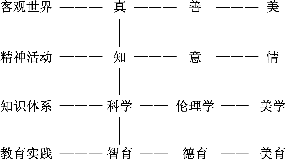

# 审美教育：以感性形象、自由方式、潜移默化与实践为本质的育人之道

## 一、 审美教育的四重本质特征

### 1. 以感性形象为媒介的教育
区别于以概念、判断、推理传递科学知识的智育，也不同于用伦理概念进行理性说教的德育，审美教育的核心手段是**感性形象**。它借助美的事物那具体可感、形象直观的外在形式，触动并感染受教者的情感世界，从而达成育人目标。正如dob罗柳波夫所言：“我们的感情总是被生动的形象所唤醒，而不是被一般的概念。”以形动人、以情感人，正是审美教育最鲜明的标识，也正是这一特质，使其能跨越年龄、阶层与文化门槛，适配普遍大众。

### 2. 以自由方式呈现的教育
审美教育旨在拓展人的自由度，这一目标倒逼其方法必须是自由的。它摒弃了理性的说服动员，更不屑于强制与命令，而是凭借美本身的魅力吸引人，以轻松愉悦的姿态呈现美的客体。受教者在完全自觉自愿的心理状态下，依循内心需求与兴趣去向往、追求美，精神始终处于“自由王国”之中。正是在这全身心投入的欣赏与悦纳中，审美教育润物无声地完成了。

### 3. 以潜移默化生效的教育
审美教育是一种细微隐蔽、不露痕迹的熏陶，其影响深远且持久，贯穿人生始终。梁启超曾论及小说统驭人道的四大力量——“熏、浸、刺、提”。他说：“熏，如入烟云之中，为之烘烤……浸，即与之俱入俱化。”并以《红楼梦》《水浒传》为例：“读《红楼梦》者，必有缠绵悱恻不自已之意；读《水浒传》者，必有激昂慷慨不自已之意。何也？浸之力也。”实则，不仅小说，一切文学艺术借助美的形象施教，皆是“随风潜入夜，润物细无声”的渐渍过程。情感在“无自觉输入”中渗入潜意识，构建起稳固完善的心理结构与价值取向，对个体精神生命产生根本而深远的塑造。

### 4. 以实践活动为载体的教育
人在实践中创造美、鉴赏美、获得审美愉悦，也在实践中接受审美教育。美、审美、审美教育实为同一实践过程的三个侧面，均具实践属性。离开审美实践，审美教育便成无源之水；每一次审美教育活动本身就是一次实践。马克思指出：“在我劳动中，我的个性得到了客观化……我不仅在劳动中享受到我生命的个性表现，而且在观察劳动成果时……感到个性的快乐。”又云：“人正是在改造客观世界中，才真正证明自己是类存在物。”因此，推进审美教育，必须理论引领与实操并重，在审美实践中感受体验、领悟提升、创造追求美。

## 二、 价值发掘：塑造身心健全、和谐发展的新时代创新人才

创新是智能时代人才的首位素质，审美教育对培养新时代创新人才具有不可替代的战略价值。它不仅对塑造身心健康、精神富足、人格高尚、全面发展的现代人意义深远，更是孕育智能时代创新型人才的关键基石。

### （一） 创新：智能经济时代人才的首位素质

人类社会发展史，既是生产力与经济演进史，也是人类不断自我完善、素质跃升的历史。因经济社会环境迥异，各时代对人才首位素质的诉求各异（见表10-1）。

**表10-1 不同经济时代人才首位素质对照表**

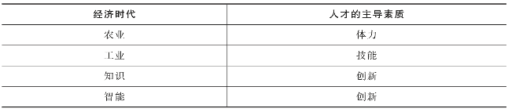

由表可见，人类社会脱离原始状态后，历经农业经济时代、工业经济时代，正迈向智能经济时代。农业经济时代，生产靠体力与脑力的简单结合，生产力主要依赖体力消耗，对人才文化素质要求不高，**体质**成为首位素质。现代科技兴起与工业革命爆发，推动社会跨入工业经济时代。从纺织机、蒸汽机到电气化、自动化，机器替代了部分人力，生产力对劳动者要求由“重体力”转向“重技能”，社会急需大批具备实操能力的应用型人才，**技能素质**遂成首位素质。

### 智能时代的创新密码：为何审美教育不可或缺

随着现代科技与社会经济的飞速跃迁，传统工业经济正让位于智能经济，后者必将主导新世纪的发展格局。智能经济以数据、算法、算力的生产、分配与应用为基石，依托创造性人才与智能高技术产业支撑。在这一新阶段，知识、信息、数据取代资本与能源，成为推动社会经济运行的根本动能；数据生产力跃升为决定社会生产力水平、国家综合竞争力及经济成就的关键变量。科技作为第一生产力，其作用机制已从工业时代的“乘数效应”进阶为智能时代的“指数级放大器”。因此，创新不仅是智能时代的灵魂，创新素养更成为了核心人才的首位特质。

毋庸置疑，21世纪是人类创新的世纪，亦是急需并持续孕育创新型人才的世纪。一国创新水平的高低与创新能力的强弱，将在激烈的全球经贸科技博弈中占据决定性地位。人类的创新潜能受智力与非智力因素双重制约，这倒逼教育必须跳出“唯分数论”的恶性循环，全面落实素质教育与创新教育。在此背景下，推行审美教育、涵养审美素养、提升审美能力、进而激发创新活力，构成了素质教育与创新教育的关键一环。

### (2) 审美教育：创新型人才成长的“隐形引擎”

**科学巨匠的共同注脚：艺术滋养科学灵魂**
纵览科学发展史，成就卓越的科学家往往深受艺术熏陶。哥白尼不仅奠定现代科学基石的《天体运行论》确立了新世界体系，本人更是杰出画家；其“日心说”以简洁和谐的数学之美重塑了宇宙图景，堪称科学史中数学审美观的伟大胜利。爱因斯坦在创立相对论、重塑时空观的同时，亦是技艺精湛的小提琴家。他深信世界“既可由音符构成，亦可由数学公式构成”，音乐演奏带来的松弛感更能助力科学思考。这些案例有力佐证：具备艺术修养的科研工作者更易在探索中实现突破，也侧面印证了以艺术为主要载体的审美教育在培育创新人才上的独特价值。

**从审美教育目的看：自由人格是创新的底色**
席勒曾言：审美是“无为的作为”“自由的欣赏”；在审美王国里，人挣脱一切关系的枷锁，摆脱物理或道德的强制。“以自由赋予自由，这是审美王国的根本法则。”审美教育旨在助人获得更多自由、成就完善、全面、自由的人。而这种完善自由的人格，恰是智能时代急需的创新型人才画像。

**从创新心理过程看：右脑潜能的唤醒与双脑协同**
创造历程通常历经准备、酝酿、顿悟、验证四阶段。其中酝酿与顿悟——即新观点、新构想、新方法涌现的黄金期——主要由右脑主导，是创造性思维最关键的窗口期。换个角度看，创新本质是将大脑中看似无关的信息片段重组、强制关联。这依赖海量信息储备（右脑优势）、形象思维、直觉思维与灵感迸发（均为右脑主管功能）。然而，受传统教育惯性影响，校园教学长期偏重逻辑思维训练——严谨规范、循序渐进，虽有益处，却导致左脑“过度开发”，右脑相关课程缺位、功能受抑。创新实战需要右脑主导、左右脑协同，思维模式需兼具分析与直觉、收敛与发散、抽象与具体。

故而，智能时代培育创新人才，刻不容缓地要开发受教育者右脑潜能，推动双脑和谐发展。审美心理学揭示：知觉、理解、想像、情感交织的审美过程，本质是以意象为对象特征的认知过程，生理基础主要在于右半球。审美教育以意象教育、情感教育为特质，在开发右脑、促进双脑平衡上大有可为。它能锐化感知敏锐度，强化意象记忆，拓展想像与形象思维边界，培育直觉洞察力，激发创造灵感，从而全方位助推人的创造力发展。

### 从科学方法论视角看审美育人

### 审美追求：点燃科学探索的内驱力

对美的向往，能直接激发智力研究的动力。动机是驱动个体行动的根源，科学活动同其他人类实践一样，其选题方向与研究进程深受动机支配。科学家那股惊人的创造热情与钻研动力，很大程度上源自内心的审美情趣。美国著名科学哲学家库恩曾指出：当新范式取代旧范式时，“新理论被认为比旧理论更美、更恰当、或更简洁”；审美考量在建立新理论时，有时甚至能起决定性作用^([\[9\]](#txt010.html#footnote_content_txt010_9))。与此同时，对称、简洁、和谐等美学原则，也为科研提供了方法论指引。爱因斯坦早已主张，甄别科学理论的标准应包含“外部经验验证”与“内在完美性”双重维度。

### 身心健康视角：美育塑造完整人格

健康与美紧密相连，因人不仅是自然存在，更是社会存在。教育层面，唯有将美育与体育融合，方能培育形体美、精神美与技能美，赋予人自然外在之美与社会内在之美，实现和谐发展。此外，美育能以美怡情、调节心境、疏导情绪、维持心理平衡，进而促进身心健康——无论是感知、理解、欣赏还是创造美，皆带来精神愉悦，让人心旷神怡。

中国古代思想家荀子云：“乐盛则意清，礼修则行成，耳目聪明，血气和平，移风易俗，天下皆宁，美善同乐”^([\[10\]](#txt010.html#footnote_content_txt010_10))。亚里士多德亦言：“音乐不仅能给人以快乐，而且能消除疲劳”^([\[11\]](#txt010.html#footnote_content_txt010_11))。最新研究显示，聆听莫扎特乐曲后，人脑活力显著提升，思维更敏捷，行动更高效，仿佛给生锈的大脑上了油；甚至能缓解癫痫等神经疾病患者的病情，这就是所谓的“莫扎特效应”^([\[12\]](#txt010.html#footnote_content_txt010_12))。事实上，不仅是音乐，所有艺术与美育形式均具同类功效，这是单纯体育锻炼无法企及的。美育塑造的身心健康、全面发展之人，正是智能时代急需的创新型人才。

## 三、艺术教育：激活想象与创造的源泉

艺术教育能开发右脑潜能，推动左右脑均衡发展，助力创新孵化与灵感迸发，点燃创新动力，提供方法论支撑，培育直觉与想象，激发创造灵感，在创新活动与人才培养中扮演关键角色。当下，我们亟需破除重专门教育、轻通识教育的偏见，强化艺术教育，培育创新人才，提升国家科技创新实力。

美国洛杉矶生物化学家罗伯特·鲁特-伯恩斯坦长期探究科学与艺术的“神秘联系”。他梳理古今中外150位著名科学家与艺术家传记后发现：爱因斯坦与毕加索、巴斯德与巴赫之间，存在惊人的“共性”。达芬奇既是传世名作《蒙娜丽莎》的画师，又在物理、地理、医学、军事等领域建树卓著；爱因斯坦作为现代物理学奠基人、相对论与“质能方程”提出者，同时也是热爱艺术的杰出小提琴家。乔布斯曾感言：“苹果为何如此成功？因我们刻意招募音乐家、艺术家、诗人，他们恰巧也是计算机科学家；正是这群人改变了世界。”这表明，具备艺术素养的科学家与发明家，更易在科技领域实现重大突破，亦印证了艺术教育对科技创新人才培养的重要价值。

### 一方面：艺术教育与右脑开发

现代脑科学通过裂脑患者与正常人研究证实，大脑两半球功能不对称。对大多数人而言，左半球掌管语言、数理与分析思维，右半球则主导空间关系、图式关系、音乐与艺术欣赏^([\[13\]](#txt010.html#footnote_content_txt010_13))。人类高度创新能力的形成，源于左右半球功能均衡发展与活动中紧密协作。长期被教育忽视的右脑功能，于此凸显关键。艺术教育以形象思维与情感教育为特质，在开发右脑、促进双半球和谐发展上作用独特。通过艺术教育，形象思维与抽象思维（逻辑思维）有机融合，充分调动“非优势半球”活力，补偿“优势半球”功能，使双半球达成平衡协调，形成机制：艺术教育 → 促进形象思维 → 开发右脑 → 强化创新思维 → 智力与创造力发展。哈佛大学艾斯纳博士的研究进一步佐证此结论，他证实艺术教育能提升八大创造力核心因素：事物关系感知力、细微差别洞察力、多元解题策略意识、打破固势转换目标能力、无章法中决策能力、受限环境操作能力、想象与创造力、以及以审美视野洞察世界的能力^([\[14\]](#txt010.html#footnote_content_txt010_14))。

### 另一方面：艺术教育与思维模式

# 科学认知中的直觉与艺术教育的创新价值

科学认知是一项极其繁复的系统工程，涉及变量众多。然而，科学发现的内核机制，实质上是**理性逻辑与以直觉、灵感为主导的创造性思维相互交织**的产物。二者构成了“互补方法论”^([\[15\]](#txt010.html#footnote_content_txt010_15))。直觉与灵感具备直观性、突发性、非逻辑性、整体性及独创性等鲜明特质。在现代科技条件下，这种思维模式对科研与技术发明的方法论价值日益凸显，这由现代科学的研究对象与本质所决定。

现代科学在高度分化的基础上实现高度综合，正以两极分化之势飞速推进，致力于揭示自然界更深层、更广阔、更古远、更复杂的运动规律，以及各类极端状态下的奥秘；其探究对象直指宇宙的根本“大道”。在此语境下，建立在观察、实验、逻辑、数学及分析还原论思维之上的实证科学，逐渐暴露出局限性：过分强调统一、永恒、简单，却忽视甚至排斥多样、暂时、复杂，导致科学内部积聚了矛盾与危机。20世纪相对论、量子力学、基本粒子理论及系统科学的兴起，标志着实证科学时代盛行的实证主义思维模式已难以适应时代需求。爱因斯坦等科学巨匠均主张以新思维取代实证主义。他深信：**通往科学发现的捷径首先是直觉，而非逻辑**。“物理学家的最高任务，是从那些普遍的基本定律中推导出宇宙……通往这些定律没有逻辑之路，只有建立在对经验深切理解基础上的直觉才能到达。”因此他明确宣示：在科学研究中，“我信仰直觉和灵感”^([\[16\]](#txt010.html#footnote_content_txt010_16))。

艺术教育能磨砺直觉、激发灵感，从而推动创造力发展。除直觉、灵感外，科技创新亦离不开想象力。创新非仅堆砌枯燥数据与逻辑规则，更要求洞察未知事物内外部的因果联系。

列宁曾极高评价幻想（想象）在科学发展中的作用：“幻想是极其宝贵的品质。”“有人以为只有诗人需要幻想，这是毫无根据的，是愚蠢的偏见！即使在数学里也需要幻想；没有幻想，就发明不出微积分来。^([\[17\]](#txt010.html#footnote_content_txt010_17))”鉴于想象力在科技创新中的关键地位，郭沫若殷切嘱托：“科学是实践的，科学是诚实的学问，不容许丝毫虚假，需要艰苦的劳动。同时，科学需要创造，需要幻想；只有幻想，才能打破传统的桎梏，发展科学。科学工作者同志们，请不要让诗人独占幻想。^([\[18\]](#txt010.html#footnote_content_txt010_18))”培育想象力的重要途径之一，便是接受艺术熏陶。艺术教育所培育的审美感、节奏感与和谐感，将极大拓展人的想象力与创造力。

综上所述，艺术教育在创新活动与创新人才培养中扮演核心角色。教育部颁布的《全国学校艺术教育工作总体规划》明确指出：艺术教育是学校实施美育的主要内容与途径，亦是加强社会主义精神文明建设、润德育人、陶冶情操、促进智力与身心全面发展的有力抓手。中共中央、国务院《关于深化教育改革全面推进素质教育的决定》要求：迅速扭转学校美育薄弱局面，将美育渗透至学校工作全过程。教育部进一步决定：尽快颁布《学校艺术教育工作条例》，配套制定实施细则与文件，推动学校艺术教育走上科学化、规范化、制度化轨道，持续提升育人质量^([\[19\]](#txt010.html#footnote_content_txt010_19))。因此，在大力推进素质教育与创新教育的当下，亟需集中力量破解该领域现存难题，以培育更多具备创新素养与能力的人才，提升国家科技创新实力。

## 四、 现存短板：制约审美与创造力的枷锁

当下已步入智能时代，数据筑基，创新铸魂。创新能力水平不仅受智力因素制约，更深受非智力因素影响。审视传统美育，存在以下短板，严重桎梏了人的审美与创造能力。

### 一、 家庭美育中的父母教育缺位

国外家庭教育理念已逐渐演进为“父母教育”。所谓父母教育，是指导父母如何理解并满足子女身心发展需求、履行职责、助力子女高效成长与适应的学科。它被视为家庭教育的内核与本质、内在基石，与传统家庭教育存在显著差异，详见表 10-2。

**表 10-2 父母教育与家庭教育的差异对照**

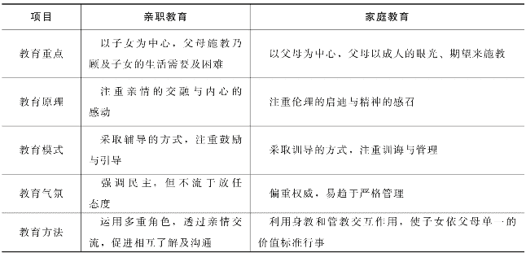

(来源：史欣欣. 《父母教育ABC》[M]. 北京: 中国纺织出版社, 1999: 6.)

上表清晰揭示：二者在教育关注点、原则、模式、氛围及手段上均有本质区别。父母教育为现代家庭美育提供至少三大关键启示：

**首先，在家庭美育的主客体关系中，父母处于矛盾的主要方面，起决定性作用；美育成败的关键变量在于父母的文化底蕴与审美修养。** 故而，家庭美育首要任务是父母的“自育”，继而才是对子女的美育。智能时代下，父母应持续更新认知、充实知识、强化审美修养。

### 家庭美育：以情动心，以身作则

家庭美育的核心，在于亲情与心灵的共振。它不同于传统家训那般侧重规训与告诫，而应彰显美育“润物无声”的感性特质，走进孩子内心，以鼓励引导代替说教管束，采取疏导式的陪伴方式。

“身教重于言教”绝非空谈。模仿是孩子的天性，而父母是他们接触世界的第一面镜子。父母的一举一动——穿衣打扮的品味、待人接物的措辞、阅读思考的神态——皆为孩子效仿的教材。孩子敏锐地捕捉着语气的微妙起伏，父母思维的每一次转向，都通过无形的渠道潜移默化地传递给下一代。在智能时代，父母欲尽好责，须夯实价值观的科学性，践行健康生活方式，营造文明向上的家庭微环境。这不仅是美育成败的基石，更关乎所有教育的成败。

### 学校美育中的艺术教育：核心引擎

艺术教育是学校美育的关键一环。音乐、美术、舞蹈等艺术课程，在美育落地中占据核心地位。作为人类审美活动的最高形态，艺术作品能将生活寻常景致经艺术加工、浓缩升华，其感染力与震撼力远超其他审美形象，拥有无可比拟的吸引力。

### 社会美育的人文环境建设：大舞台上的深度工程

相较于家庭与学校，社会美育拥有更辽阔的舞台。人因社会化而从自然人成长为社会人，社会性是人的本质属性。推进社会美育，既要修饰自然环境，更要聚焦社会环境的优化，特别是营造高质量的人文生态。

---

## 五、 路径超越：家校社协同，构建全程美育生态

放眼智能时代，美育应被视为贯穿终身的社会系统工程，需多渠道发力、协同增效。家庭、学校、社会三大美育版图相互嵌入、互为支撑，我们要充分释放各自优势，实现优势互补、联动运行，合成合力，成就高质量美育成果。

### 家庭美育：人生的起点与摇篮

家庭是社会的基本细胞，是个体社会化的始发站，也是贯穿一生的活动基地，更是美育启蒙的源头与摇篮。一个人的审美能力、观念与品位，与家庭底色紧密相连，家庭美育的重要性不言而喻。实施路径上，可善用家庭环境、氛围营造、日常生活熏陶、文艺熏陶及自然体验等资源。父母应主动调动这些要素，精心雕琢孩子的审美力与品味，护佑其健全和谐成长。

### 学校美育：专业化的主阵地

若家庭是美育的地基，学校便是专业化的主阵地。相较家庭，学校具备目的性明确、规划科学、体系完备、集中高效等鲜明特质。学校美育的落脚点在于学科教学渗透。教学活动是学校教育的中枢，美育不可脱离以智育为核心的学科教学而独立存在。各学科课程在表达形式上——概念模型、图形公式、推演过程等——蕴含着对称、平衡、和谐、多元统一的形式美，更构成了美育的深层理性内核，对提升学生审美感知力至关重要。

艺术教育更是美育的重要阵地。音乐、美术、舞蹈等课程在美育实施中地位不可撼动。然而现实中，受“应试教育”牵制、片面追逐“升学率”、过度偏重专业教育影响，部分学校压减甚至取消艺术课，这严重阻碍全面创新型人才的培养。爱因斯坦曾严正警示：仅授专门知识不足以育人，那只能造就有用的机器，而非和谐发展的人。引导学生理解价值、怀揣热情、锐敏于美与善的辨识，若缺失此项，专门知识再丰，也不过如训练有素的犬，而非和谐之人。

### 社会美育：无处不在的大学堂

相较前二者，社会美育是更宏大的课堂。人无法抽离社会而存在，故而时刻浸润于社会美育之中。美育活动理应渗透社会生活的全时空。实施可借力自然山水、公共设施、人文景观、多元活动等载体，尤要重视文化艺术的育人功能。梁启超曾言：“感情教育最有力的武器是艺术：音乐、美术、文学，这三把魔剑，握着‘感情秘诀’的钥匙。”社会美育当善用文艺浸润心灵、启迪智慧、涵养德行、满足审美心理需求。同时，文艺工作者须知责任之重大：“功过之间，毫发不容……最要紧的工作是修养自己的感情，向高尚处、真挚处去体会、去体验；自己胸中的美感情充养得极好了，然后用极好的技巧表现出来，方不负艺术的价值”，以此创作出大众共享的艺术精品。

# 第十一章 教育变革：在变与不变中奔赴未来

## 参考文献

[10] 北京大学哲学系美学教研室. 中国美学史资料选编：第1卷[M]. 北京：中华书局, 1980: 54.

[11] 亚里士多德. 政治学[M]. 北京：商务印书馆, 1965: 419.

[12] 听莫扎特音乐可使智商提高一半[N]. 广州日报, 2001-01-06(A5): 5.

[13] K.W. Walsh. 神经心理学[M]. 科学出版社, 1984: 296-297.

[14] E.W. Eisner. Educating for Tomorrow's Jobs and Life Skills[OL]. http://www.artsednet.edu.

[15] 刘大椿. 互补方法论[M]. 世界知识出版社, 1994: 86.

[16] 阿尔伯特·爱因斯坦. 爱因斯坦文集（第1卷）[M]. 北京：商务印书馆, 1979: 102+284.

[17] 中共中央马克思恩格斯列宁斯大林著作编译局. 列宁全集（第33卷）[M]. 北京：人民出版社, 1988: 282.

[18] 戴佑福. 著名科学家演讲赏析[M]. 济南：山东人民出版社, 1995: 156.

[19] 陈至立. 面向21世纪教育振兴行动计划学习参考资料[M]. 北京：北京师范大学出版社, 1999: 65.

[20] 阿尔伯特·爱因斯坦. 爱因斯坦文集（第3卷）[M]. 北京：商务印书馆, 1979: 310.

[21] 梁启超. 梁启超文选：第2卷[M]. 北京：中国广播电视出版社, 1992: 23.

## 智能教育：于变局与恒量中解析本质

站在当下眺望未来，人工智能时代的图景与未来教育的愿景早已紧密相连。二者的深度融合，催生了“智能教育”这一全新形态。教育的内核由“教”与“育”双轮驱动：“教”侧重知识技能的传授，“育”则聚焦立德树人、涵养品格。纵观史册，教育发展从未像今天这样，能同时兼顾“教”与“育”双重维度，亦能同步回应教师与学习者的双向需求。这标志着AI时代的教育迎来了真正的“回归”——回归对人的最本真的关怀：人的价值、尊严与全面发展。

未来教育必将迈入智能技术深度渗透的新纪元，智能教师与人类教师并肩同行。智能教师将专攻知识与技能教学，助力学习者深度掌握操作性知识，并辅助培育智慧型知识技能。而人类教师的核心使命将发生根本性转移：从传统的知识技能灌输，转向情感与道德教育的主阵地，专注涵养学习者“立德树人、学会做人、生而为人”的核心素养，切实兑现人类教师“育人”的独特价值。

回溯21世纪前二十年，AI与教育的融合尚处起步期。彼时AI技术主要充当“教学助手”角色，表现为专业教师借助智能系统完成教学管理、备课设计、流程优化、评价改革等常规事务。整体而言，智能教育的理论体系、方法论与实践范式仍待系统梳理，教育细分微观领域与智能技术的深度融合仍在路上。因此，未来教育须遵循“在探索中前行”的发展范式：实践路径由宏观向中观、微观层层渗透；理论构建则从具象实践中生发，建构起系统开放的教育理论大厦。

在未来的教育图景里，人机共存将成常态。智能机器人将以“教师”身份正式登台亮相，人类教师的角色也将随之重塑。人类教师将从繁重的知识技能传授中解放出来，将更多精力投入学生的品德与情感培育，致力培养德才兼备、科学精神与人文素养双翼齐飞的新人。

---

### 社会美育的三重路径与协同共振

**以和谐人际环境润泽心田**
社会美育的首要任务，是主动借力和谐的人际环境。和谐乃美之至高境界。我们应致力于提升全社会的道德修养与心理健康水平，竭力营造充满关怀与温情的和谐人际氛围。让社会成员在情感上受到触动，在潜移默化中接受熏陶，从而重塑内心世界，携手共创美好生活。

**借人文景观彰显美育功能**
自然山水之外，建筑、园林、文物古迹等人文景观，同样是社会美育的上佳教材。在开发、保护、修缮与重建这些景观的进程中，应充分挖掘并释放其美育价值，使大众在游览体验中获得更多审美滋养与精神愉悦。

**藉文化艺术完成教化使命**
文化艺术拥有感动人心、改变气质、完善人格的力量，是美育的核心手段。必须高度重视并用好这一载体，让艺术之光照亮心灵。

**协同育人：家校社各司其职**
综上所述，美育版图需家校社三方合力：
- **家庭美育**倡导言传身教，重在亲情融融与心灵共振；
- **学校美育**要深挖学科渗透价值，强化艺术课程主阵地作用；
- **社会美育**则要贯穿社会生活的全时空，着力发挥文化艺术的教化功能。
文艺工作者更应自觉担起社会责任，创作出无愧于时代、为大众所喜爱的艺术精品。

## 注释

[\[1\]](#txt010.html#footnote_quote_txt010_1) 黑格尔. 美学：第1卷[M]. 北京：商务印书馆, 1997: 147.

[\[2\]](#txt010.html#footnote_quote_txt010_2) 蔡元培. 蔡元培美学文选[M]. 北京：北京大学出版社, 1983: 174.

[\[3\]](#txt010.html#footnote_quote_txt010_3) 朱光潜. 朱光潜美学文集（第2卷）[M]. 上海：上海文艺出版社, 1982: 505-506.

[\[4\]](#txt010.html#footnote_quote_txt010_4) 杜布罗夫列夫, 科尔佐夫. 外国理论家和作家论形象思维[M]. 北京：中国社会科学出版社, 1979: 89.

[\[5\]](#txt010.html#footnote_quote_txt010_5) 梁启超. 梁启超文选：下册[M]. 北京：中国广播电视出版社, 1992: 4.

[\[6\]](#txt010.html#footnote_quote_txt010_6) 中央编译局. 马克思恩格斯文集（第42卷）[M]. 北京：人民出版社, 1979: 37.

[\[7\]](#txt010.html#footnote_quote_txt010_7) 爱因斯坦. 爱因斯坦文集. 第1卷[M]. 北京：商务印书馆, 1979: 2.

[\[8\]](#txt010.html#footnote_quote_txt010_8) 席勒. 美育书简[M]. 北京：中国文联出版公司, 1984: 145.

[\[9\]](#txt010.html#footnote_quote_txt010_9) 库恩. 科学革命的结构[M]. 上海：上海科学技术出版社, 1980: 129.

# AI时代下的教育本质：工具迭代，初心不改

在未来的教育图景中，AI系统将依托学习进度、强度、效率、薄弱环节、专注度、注意力广度乃至兴趣偏好等多维数据，实现真正的“因材施教”。教育的对象观将彻底完成嬗变：不再视学习者为需被强制塑造的客体，而是转向基于学习者自身成长诉求与社会发展需要的主体。

上述AI教育的演进路径，正是其变革的核心方向，也是AI赋能教育效能最显著的领域。然而，这些表层现象的更迭，本质上仅折射出AI赋能带给教育形态的变革。透过变化的迷雾，那些隐藏在深处、恒久不变的内核——如教育的根本目的——才更待我们深挖。

2018年11月，新东方创始人俞敏洪在乌镇接受《澎湃新闻》专访时直言：“任何技术变革不过是工具层面的更迭，动摇不了教育的本质。没有任何技术进步，能比拟‘立人’的核心价值。”他进一步指出，教育的核心要素在于培育身心健全、保持旺盛好奇心与探索精神的完整的人，“这些内核永不褪色”。

俞敏洪的洞见揭示了一个关键事实：AI在教育中始终扮演工具角色。基于工具的“以人为本”属性，教育活动中最基础的连接方式——“人教人”的范式未曾改变，育人的根本宗旨也从未动摇。换言之，**教育的本质，穿越周期而恒常。**

置身AI纪元，教育的智能化进程加速，形态、工具、模式皆在流变，且将随技术迭代持续创新。但在这场变革洪流中，立德树人、培育完人——兼具德才、拥有创新思维与能力、富有想象力与悲悯情怀的人——这一育人初心，始终是定海神针。

不变的内核蕴藏着深远价值。未来教育将淋漓尽致地彰显其经济、政治与文化价值，尤其在文化传承、知识创造、智力人才培育上举足轻重，对提升国民素质与生活品质具有决定性意义。

---

## 终身教育：从思想萌芽到落地生根的跨越

19世纪中叶，以美国为首的资本主义国家掀起第二次工业革命浪潮，电力驱动的生产方式让社会生产力跃升，人类正式步入“电气时代”。飞速旋转的电机以惊人的能量重塑世界，生产方式、生活习惯、思维模式悉数被重写。工业革命的技术伟力，以前所未有的速度颠覆了传统社会，政治版图、经济形态、社会结构随之演变，世界从分散走向融合。

万物皆在流变中。面对社会加速度带来的生存焦虑，人们开始追问：如何应对变局？如何在动荡中站稳脚跟、实现自我价值与尊严？**终身教育**，便是在这一宏大历史背景下应运而生的破局之道。

1965年，联合国教科文组织成人教育研究所所长保罗·朗格朗正式提出“终身教育”概念。他强调，这非单一实践或特定学段，而是一种教育思想的总称——涵盖人一生所受的一切教育类型与年龄阶段。自诞生起，它便成为各国制定教育方针政策的重要思想基石，备受全球推崇。

溯源其诞生初衷，终身教育旨在助人在变局中保持“清醒”，认清终身学习对生存发展的关键性。它是一座适应变革社会的思想熔炉，遵循其原则者，必能在动荡中行稳致远。

然而，受限于工业时代与信息时代的技术瓶颈及时空桎梏，这一宏大思想长期难以大规模落地，仅停留在小范围试点。核心痛点在于：个体发展彼此独立，时空边界阻隔了教育的连续性。原始的数据壁垒、信息孤岛、学段割裂，让“终身”难成闭环。以当代大学生为例，虽可规划未来，却难追溯幼儿园至高中的完整过程数据——过往早成“只见结果、不见过程”的碎片记忆。在此状态下，终身教育概念何以落地？

**转机降临于大数据与人工智能时代。**

终身教育迎来了从“概念确立”走向“实践落地”的黄金窗口期。在大数据与AI加持下，教育者的施教影响与学习者的主动学习全过程，将以教育大数据形式永久留存。通过国家层面的顶层设计，各类教育数据跨界共享、关联汇聚，形成个体与群体的教育大数据集群。数据一旦贯通，基于AI的终身教育系统便生成了：学习者的个体教育轨迹全息映射于平台，个体与群体的教育规律随之“揭幕”。

# AI重塑教育版图：终身学习成核心生存技能

比尔·盖茨在《未来之路》中早有预言：教育的终极指向将发生根本逆转，不再以获取文凭为终点，而是转向贯穿始终的终身教育。人的一生，每一个参与的领域都与教育紧密相连，而教育的每一次投入，都会反哺个体当下的生存质量与发展潜能。当前，终身教育平台、智能开放大学、公共服务体系正加速落地，推动终身教育从理念走向现实。未来的教育，将更直指人的生存与发展，成就人的价值、尊严与全面发展。

### 推广终身学习政策

2019年8月2日，联合国教科文组织“终身学习政策国际磋商会”在成都落幕（见下图）。会议聚焦两大核心成果的发布前磋商与论证：《终身学习准则与关键政策解读联合报告》及《终身学习手册：政策与实践》。前者通过案例复盘与跨国政策比对，深度剖析“终身学习”的政策内涵，为决策者梳理出基于国家经验、人权框架及发展视角的核心知识库与行动准则；后者则从国家、地方、机构三个层面，拆解推动终身学习的实操路径。作为终身教育的核心引擎，终身学习政策的推广，必将倒逼终身教育体系的完善与跃升。

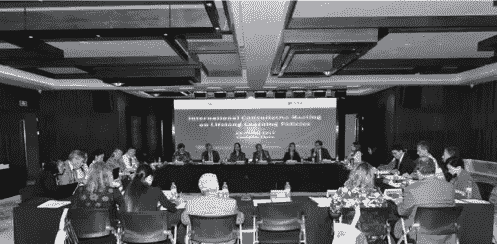

**图示：联合国教科文组织“终身学习政策国际磋商会”现场**

### 筑牢终身教育平台底座

在AI时代，终身教育平台是打通学习者全生命周期教育数据与学习数据的关键枢纽。建设必须紧贴学习者真实生存场景，推进平台的“全覆盖、深应用”，实现全学段、全人群的统筹接入。借力大数据与AI，构建起融合“家、校、社”的立体教育生态。早在2012年，面向全国的国家开放大学便已挂牌成立。依托“线上自学+远程支持+面授辅导”的混合式范式，开放大学为不同年龄、职业群体提供多元课程资源，极大释放了全民终身学习的活力，推动实践落地。

### 重构终身教育新体系

联合国教科文组织发布的《人工智能与教育北京共识》明确指出：AI时代须以系统化融合创新教学范式，利用AI加速建设开放灵活的教育系统，保障人人享有公平、优质、个性化的终身学习机会。核心在于引入AI平台、学习分析等关键技术，构建“人人皆学、处处能学、时时可学”的全域终身学习体系，从而倒逼终身教育系统的结构性成型。教育边界正被彻底打破，学习者不再受限于固定时空，随时随地皆可构建知识。展望未来，深度学习、自然语言处理、机器模式识别等前沿技术，将催生具备“集智共享、人机协同、跨域关联、融合创新”特质的终身教育新体系，赋能实践与创新发展。

人类社会正步入“后人类社会”门槛。以智能技术为代表的新兴力量，正冲击着传统的人类中心主义世界观、人生观与价值观。“被挤压”成为当代人共同的生存焦虑。因此，AI教育的使命，是引领后人类社会打破后工业时代的“智能枷锁”，主动拥抱AI终身教育体系。未来不属于被AI裹挟的人，唯有那些拒绝终身学习、固步自封的“后人类”，才会吞食AI时代的苦果。

## 面向未来：教育为学习者的未来“预装”核心竞争力

教育的形在变，魂不变。形式万千，但育人初心始终如一。教育的本质属性由社会本质决定，体现为相对独立性，源于人的生产劳动实践，故而核心使命恒久不渝。值得注意的是，本质虽恒，内涵却随时代外延：育人内容持续拓展，目标任务与时俱进。技术赋能下，教育的质的规定性愈发凸显，“培养什么人、怎样培养人”成为焦点。但最有资格回答此问的，从来不是教育者，而是学习者自己。他们最清楚“我想成为什么样的人”，而非“教育者要我成为什么样的人”。

换言之，教育本质的内涵已延伸至学习者领域，包含双重意蕴：一是教育者的期许，折射社会发展需求，为迷茫者指引方向；二是学习者的迫切诉求，驱动其持续奔赴未来，拒绝阶段性停滞。学习者心知肚明理想中的未来自我，因此当下即启程思考与行动——坚信顺应内心、永不停止思考，终将抵达渴望的彼岸，生活也将重塑为心仪模样。这大概就是传说中的“皮格马利翁效应”在教育场域的最生动注脚。

## 回归初心：教育的终极使命，是成就人的全面发展

### 打破“短视”陷阱：教育不应止步于当下的考场

传统教育往往盯着眼前的“短期红利”发力：要么为中考分流博一张重点高中的入场券，要么为高考独木桥拼一所名校的录取通知书。可当尘埃落定、目标达成后，迎接许多学子的却不是坦途，而是漫长的迷茫与困惑——大学四年，便在这样的空虚中度过。

学习者是一个有机的整体。教育者若强行将其拆解成碎片化的知识点、技能点再行拼装，短期内成绩或许好看，但拼接处留下的裂痕，终将成为学习者一生难以弥补的遗憾。而借力更先进的AI技术，未来教育必将彻底摆脱这种“碎片化拼装”模式，锚定“面向未来”的长期主义，这将成为未来教育的共同底色。简而言之，**未来教育，是在为学生的“未来”做准备**。它不抹杀过去，不逃避当下，而是立足于过往的教育大数据与学习大数据，为学生解锁无限的未来可能。

### 穿越历史周期： “为未来而教”始终是最高级的共识

“教育是为未来生活做准备”，这并非新论。纵观人类教育史，关于“教育与生命”的关系，众说纷纭：有人主张为宗教生活而教，有人认定教育即生活，亦有人主张为闲暇生活而教……但历经时间检验、备受推崇的，依然是“为未来生活而教育”这一思想。早在19世纪末，英国教育思想家赫伯特·斯宾塞便直指人心：教育的目的，是“为完全的未来生活做准备”。在物质富足、思想解放的今天，这一主张更显战略远见——**学生的学习，本质上就是面向未来的学习**。

### 智者的警示：拒绝功利，方得教育的长期价值

翻开《几何原本》，曾有弟子问欧几里得：“学几何有什么用处？”这种急功近利的心态，当场被大师驳回。欧几里得对随从说：“给他三个钱，既然他要从学习中捞好处。”古今中外，教育智慧惊人地殊途同归——**真正的教育，看重的从来不是眼前的“性价比”，而是面向未来的长期价值**。

### 标杆实践：PISA如何定义“面向未来”的核心素养

“为学生未来负责”不只是教育家的理想，更是国际顶尖评价体系的行动指南。国际学生评估项目（PISA）便是典型代表。它通过开发评价工具、发布结果报告、剖析影响因素、统筹质量与公平，致力于提升教育质量与学生综合能力。

PISA明确指出：**教育发展的靶心，应是“知识建构能力”，而非“记忆能力”**。记忆能力背后，支撑的是一整套应试体系——死记硬背、灌输填鸭，让无数学生丧失思考与创新，陷入无限循环的“被动内卷”。相对应的，知识建构能力，是引导学生“创造知识”的能力。在评价中，PISA还纳入了“素养”维度，但这素养非彼素养：它强调学生经由校园与生活的双重熏陶，能主动将所学知识技能迁移应用至真实情境，提升生活品质与综合素养，从而适应变幻莫测的未来，具备在不同情境下解读并解决问题的本领。

---

### 核心论断：AI时代，教育的核心使命是促进人的全面发展

#### 1. 智能的源头与归宿：人是AI发展的基石
人类智能是人工智能的基石；人的智力发展水平，决定了AI发展的上限。在弱人工智能阶段，AI本质上是对人类智能的**模仿、延伸与增强**。这种本质锁定了其“从属”地位，也折射出其被动属性。唯有人类智能高度发达的时代，AI才能攀登新高峰。AI历史上“三起两伏”（三次繁荣、两次寒冬）的周期律，正是这一铁律的注脚。

#### 2. 从“拼凑模仿”到“系统复现”：技术融合催生相对独立性
AI的发展源于多技术的深度融�合，使其能在立体层面（而非单一维度）系统性复现人类智能。但当模仿、延伸、增强的任务完成，AI便从人类智能的“母体”中剥离，进化为拥有相对独立性的智能实体。

#### 3. “镜像”唤醒“本体”：人机冲突下的破局之道
AI分派别模仿人类：联结主义模仿神经传递，符号主义模仿逻辑语言，行为主义模仿行为模式。虽路径不同，指向却同——皆在以不同方式复刻人类复杂的形态与生命本质。

模仿范式从简单走向复杂、从单一走向系统。模仿只是入门，延伸与增强才是AI宣告独立的起点。此时，**人机冲突（人机矛盾）不可避免**。面对冲突，人类曾尝试三种解法：一是“无政府主义”听之任之；二是“技术恐怖主义”严管死堵；三是“科学控制论”趋利避害。显而易见，第三条路暗含妥协与包容，揭示了**人机互补、命运共同体**的本质。

#### 4. 共生时代的生存法则：唯有“全面发展”，方能破局
人机互补，意味着“休戚与共”。当下，AI在行为模仿上已臻成熟，整体模仿、延伸、增强水平极高。AlphaGo的震撼、“机器换人”引发的技术性失业焦虑，无不在宣示：**AI机器已开始反向倒逼人类进化，并为智能发展划定了严苛的秩序——唯有全面发展，人类才能在未来的人机共生社会中，从容应对生存、生活与发展的多重课题。**

因此，AI的高度发达，直接或间接地强制推动着人的发展。严格说，**它是在推动人的“全面发展”**。因为在“无脑、无情”的机械重复领域，AI已碾压人类，且受限于生物学边界，人类永无超越可能。所以，**“人的全面发展”已成AI时代人类发展的主航道，也是AI教育的核心宗旨。**

人类全面发展的新坐标：从“重智育”到“五育并举”的范式迁徙

“全面发展”不再是一句口号，而是指向德、智、体、美、劳“五育”融合的完整图景。放眼工业与信息时代，教育重心长期倾斜于智力开发；而步入AI纪元，这架天平被彻底拨动——核心任务转向五育并举、同步推进。这一历史性转向，源于人机博弈中人类主体意识的深度觉醒。回溯历史，从古典本体论到现代认识论，再到当代存在主义，这条主线清晰勾勒出人类自我意识持续苏醒、个体主体性不断壮大的轨迹。

站在新的历史节点，我们重温2015年《青岛宣言》确立的愿景：善用ICT推进可持续发展目标4（SDG 4），强化体系、拓宽机会、提质增效、促进公平。如今，生成式AI浪潮席卷而至，那份承诺亟待确认与升级。

我们深度研判了AI演进的前沿动态，及其对社会经济、劳动力市场、教育与终身学习体系的重塑之力；剖析了其重塑工作未来、技能图谱及教育教学根基的潜能。同时也清醒认识到：技术迭代飞轮般加速，定义众说纷纭、边界模糊，应用场景多元复杂，伦理困境层出不穷。

正是在此背景下，人类智能的独特性显得愈发珍贵。秉持《世界人权宣言》精神，我们坚守教科文组织的人本主义立场：技术必须受人类掌控、以人为本；部署旨在服务人、增强人；设计遵循伦理、拒绝歧视、公平透明、可审计查；影响评估贯穿全价值链全生命周期。

治理层面，我们主张打破壁垒：统筹跨学科力量，让AI教育政策与公共政策有机耦合；采取“全政府、跨部门、多方参与”协同机制；立足本地SDG 4挑战设定战略优先级，以终身学习视野统筹系统级战略规划。

资源保障上，精准把脉投入优先序，拓宽国际国内、公私兼顾、创新融资等多元渠道；善用AI融合多源数据，赋能决策提质增效。数据治理方面，推进EMIS（教育管理信息系统）智能化升级，强化采集处理能力，推动管理供给向公平、包容、开放、个性化跃迁。

场景创新层面，鼓励各类学习空间引入AI赋能的新范式，服务学生、教师、家长及社区多元主体。核心原则不动摇：师生互动协作是教育的灵魂，教师不可替代，权益与待遇必须坚守。

师资建设迈入动态调整期：在政策框架内动态界定角色胜任力，强化师范院校功能，定制培训方案，助力教师从容驾驭AI浓度极高的教学环境。课程与评价同步变革：依据AI辅助学习评价的趋势调整课标，推进深度融合；在收益显著大于风险的领域，审慎引入或开发工具，支撑学科任务与跨学科核心素养培育。倡导全校域试点，以点带面，复制推广循证最佳实践。技术工具层面，重点攻坚自适应学习、多维素养评价、大规模远程测评三大应用高地。

### 重塑生存技能与价值观：AI时代的教育新使命

面对AI重塑劳动力市场的系统性深层冲击（含性别平等维度的动态演变），我们必须建立前瞻性技能雷达，动态捕捉当前与未来需求，倒逼课程体系与经济社会同频共振。AI相关技能将系统性嵌入基础教育、职教与高等教育资格框架，伦理人文渗透其中，不可或缺。

人机高效协作要求全民具备分层分级的AI素养，但读写算等基石技能绝不能缺位。我们将推动制度化行动，全方位提升全社会基础AI素养。

着眼长远，制定中长期规划，集中力量攻关高等教育与科研院所的前沿课程与研究项目，储备本土化高端AI人才梯队，锻造能够驾驭系统设计、编程开发的核心专业力量，为自主创新筑牢人才基石。

### 共识行动指南：让AI真正惠及全民终身学习

**20. 重申终身学习是落实SDG 4的核心引擎，涵盖正规、非正规与非正式各类形态。** 我们主张引入AI平台、学习分析等关键技术，构建一套“全时、全空、全民”覆盖的终身学习体系，核心在于尊重学习者的主体地位。同时，要深度挖掘AI潜力，打通灵活学习路径，实现学习成果的积累、认证、认可与流转。

**21. 正视政策层面对老年群体——尤其是老年女性——的特殊关怀需求。** 重点是助其掌握智能时代生存所需的价值观与技能，扫除数字生活障碍。应规划并落实经费充足的项目，赋能高龄劳动者获取技能与选择权，支持他们按意愿维持经济活力与社会融入。

**22. 再次确认：包容与公平是教育2030议程的基石，终身学习机会必须人人共享。** AI教育技术的突破，应被视作改善弱势群体受教机会的历史契机，而非风险源。

**23. 坚守底线：AI必须为所有人提供优质教育，不分性别、残疾、阶层、财富、种族、文化或地域。** AI在教育中的开发应用，绝不能加剧数字鸿沟，更不能对任何少数或弱势群体产生算法偏见。

**24. 保障AI教学工具真正做到“零门槛”包容**，有效覆盖有学习障碍或障碍的学生，以及非母语学习环境下的学生群体。

---

### 性别公平的AI：以技术推动性别平等

**25. 指出数字技能性别差距是女性从事AI职业比例偏低的关键成因**，这进一步加剧了现有的性别不平等局面。

**26. 郑重承诺：开发无性别偏见的教育AI应用，确保训练数据具备性别敏感性。** 同时，AI应用本身应成为推动性别平等的助推器。

---

### 第27-44条：治理、伦理与国际合作行动纲领

**27. 全链条推进性别平等：** 从AI工具研发端、女童女性技能赋能、到AI劳动力市场与雇主端，全方位落实性别公正。

**28. 直面偏见与困境：** 承认AI偏见源于训练数据、算法构建及应用流程；正视数据开放与隐私保护的张力；重视数据所有权、隐私及公共利益可用性带来的法律伦理风险；坚持“设计即伦理、设计即隐私、设计即安全”原则。

**29. 筑牢数据安全防线：** 严格测试新兴AI工具，守护师生数据隐私与安全。支持长期深度伦理研究，确保AI向善、防范滥用。建立全面数据保护法规与监管框架，保证学习者数据使用合乎伦理、非歧视、公平、透明、可审计。

**30. 升级监管生态：** 修订旧规或立新规，护航教育AI负责任发展。推动公众就AI伦理、数据安全、人权与性别负面影响展开广泛研讨。

**31. 补齐研究短板：** 针对AI教育影响缺乏系统研究的现状，支持跨学科研究，聚焦学习实践、成效及新形态涌现与验证；鼓励跨国比较研究与合作。

**32. 建立监测评估机制：** 量化AI对教育教学学习的实证影响，为决策提供坚实证据支撑。

**33. 全球视野监测鸿沟：** 基于国家自愿提交数据，监测评估各国AI能力差距与失衡，警惕“能开发、会使用、可获取AI”的国家与不能者两极分化风险。优先关注非洲、最不发达国家、小岛屿发展中国家及冲突灾难影响国。

**34. 协同联动促公平：** 在全球及区域“教育2030”架构下，通过技术共享、能力建设、资源互济，协同推进教育AI公平应用，尊重人权与性别平等。

**35. 前瞻布局促创新：** 支持前沿议题研究，探索AI赋能教育创新的有效策略与实践模型，凝聚“AI与教育”国际共同愿景共同体。

**36. 合作对接强自主：** 确保国际合作精准对接各国发展教育AI的实际需求与跨界合作诉求，强化AI专业人才技术自主权。深化信息共享、优秀案例互换及国家间协同互补。

**37. 搭建对话平台：** 依托联合教科文组织移动学习周等机制，在联合国机构协助下，提供政策法规、规范文本、监管路径交流平台，赋能南南合作与北南合作，共促SDG 4落地。

**38. 多方联动聚资源：** 建立多利益相关方伙伴关系，动员资源缩小AI鸿沟，加大教育AI领域投入。

**39. 打造“AI赋能教育”全球枢纽：** 汇聚开源课程、工具、政策案例、监管框架与最佳实践，服务SDG 4，支撑未来教育对话，让开源资源触手可及。

**40. 供给指南赋能决策：** 基于成员国磋商产出指南资源，助力各国制定促进教育AI高效公平应用的政策策略；强化教育决策者相关能力建设。

**41. 强化联合国教科文组织引领：** 通过强化内部部门单元、调动研究所与网络资源，巩固其在教育AI领域的核心领导地位。

**42. 融入教师胜任力框架：** 支持将AI技能纳入教师ICT能力标准，助力各国培训教师适应AI浸润型教学环境。

**43. 拓展合作版图：** 深化教科文组织与联合国相关机构、多边伙伴、区域开发银行、私营部门在教育AI领域的合作广度与深度。

**44. 会后行动承接增效：** 会后协同活跃发展伙伴，开展区域与国际层面的后续行动，巩固并扩大本共识成果影响力。

---

## 二、 教育变革：探索大数据与个性化教育新境界

### 摘要

依托大数据记录学习行为洞察个性需求、精准推送资源、解析教学行为并优化评价体系，可有力推动个性化教育落地，引发教育领域的变革性重塑。然而，技术赋能的同时也带来了算力资源瓶颈、复合型人才短缺、算法歧视风险、教学实效不足、理念滞后及数据隐私安全等多重挑战。破局大数据时代的个性化教育新路径，需坚守理性认知、革新育人理念、攻关核心技术、深化人才培养、构建多方协同生态、筑牢数据安全防线。

### 关键词

教育；个性化教育；大数据

教育关乎国家长远大计，是民族振兴与社会进步的基石，更是人全面发展的根本途径。不同时代赋予教育迥异的内涵与形态：从农耕时代的私塾传授，到工业时代的流水线班级制，再到如今由新一代信息技术与AI催化、数据驱动的科学化、智能化、个性化新范式，教育的外延持续拓展、形态不断迭代。更符合人性、顺应全面发展规律的个性化教育，经历“否定之否定”后强势回归，步入更高阶段。当前，大数据掀起教育变革浪潮，极大催化了个性化教育繁荣。但红利与挑战并存，大数据热潮在推动发展的同时，也衍生出一系列新课题。因此，深度剖析大数据时代教育新趋势与新挑战，探寻个性化教育发展新径，让大数据真正赋能教育改革深度发展，刻不容缓。

### (一) 大数据驱动个性化教育发展

国家于2010年颁布的《国家中长期教育改革和发展规划纲要（2010—2020年）》明确指出：“关注学生的不同特点和个体差异，开发每个学生的潜能和优势”“关爱每一位学生，促进每一位学生主动、活泼、生动发展，遵循教育规律和学生身心发展规律，给每个学生提供适合的教育”。可见，国家战略层面高度重视并强力推行个性化教育。实则，新时代教育演进的主航道即是个性化教育，这也是教育顺应AI时代科技进步与大数据演进的必然大势。个性化教育遵循学差、成长规律与教育规律，供给丰富课程与实践，培育自主学习力与适应时代能力，挖掘生命潜能，引导学生向全面、个性、自由、健康方向发展——这与教育大数据的开发利用方向高度契合。引入大数据技术，可实现学习行为留痕、个性需求洞察、精准内容分发、教学行为解析及评价机制优化，从而全链路推动个性化教育发展。

#### 1. 记录学生行为数据

“全记录、全分析”的大数据时代到来，为个性化教育落地提供了技术可能与现实支撑。学生在线学习过程会自然留下串串“数字足迹”，涵盖过程行为数据、结果评价数据及社交网络关系数据。在大数据场景下，每位学习者的入学测评、讨论发帖、博客记录、协作编辑等动作均可即时入库^([\[3\]](#txt012.html#footnote_content_txt012_3))。通过采集网页点击量、检索轨迹、资源偏好、视频观看时长、复看频次、暂停跳转次数、点击时间节点等过程数据，以及作业完成度、测验成绩、问答质量等结果评价数据，双向赋能：一端精准画像资源质效以优化供给，另端助力学习者复盘自省、定制专属策略、持续迭代学习行为。

伴随新一代信息技术与AI深度渗透教育场景，大数据对学习行为的全周期采集、挖掘与分析，推动教育视野从宏观群体下沉至微观个体，借先进技术追踪每位学习者的行为轨迹，为实现个性化教育奠定坚实技术底座。

#### 2. 洞察学生个性化需求

基于行为数据的记录、分析与挖掘，可精准洞察学生的个性化需求。霍华德·加德纳的多元智能理论认为，个体由语言、逻辑数学、音乐、身体动觉、空间、人际、自我、自然观察八大智能以不同权重组合而成，差异化组合造就个体差异^([\[4\]](#txt012.html#footnote_content_txt012_4))。现实中，个体差异不仅体现在生理层面，更延伸至性格特质、认知风格、学习经历、偏好模式、需求能力及社会背景等多维度。群体间差异显著，同一个体不同发展阶段亦呈动态变化。学习过程中，这些差异直接或间接影响身心健康发展。故而，教育者须正视差异、尊重独特、读懂需求，依据兴趣、志向、天赋、特长等特质因材施教。

### 3. 精准推送个性化学习资源

英国大数据权威维克托·梅耶-舍恩伯格指出，大数据与教育的深度融合将超越过往那些“微不足道的创新”，催生真正的变革。他提炼出大数据优化教育的三大核心要素：反馈机制、个性化适配与概率预测^([\[5\]](#txt012.html#footnote_content_txt012_5))。在大数据时代，充分释放这三大功能，将学习行为数据转化为高价值信息，依据学习者禀赋与需求定制专属内容与路径，为每位学生匹配最适配的教材，支持其自主选课、规划进度、灵活安排时空，从而达成自主、主动、个性化的学习目标。

大数据技术还能从海量群体学习轨迹中反推特定人才画像所需的知识版图。当学生持续研习数门课程时，系统可自动采集、建模其需求图谱，智能推荐后续进阶课程，最终由学习者自主拍板。互联网时代知识迭代加速，海量碎片化资源导致“信息过载”，学生难以独力筛选最优资源，更无法全知某一领域人才所需的完整知识树，这极大考验其认知与处理能力，易引发挫败感与低效。大数据技术恰能破解此困局：基于采集分析动态调整学习内容，实现知识传递的个性化加工，助力学习者高效落地目标，成就个性化发展。

依托大数据应用，翻转课堂、MOOCs 等在线教育形态，通过即时、全维、高效、精细地记录学习全过程数据，深度洞察兴趣特质、认知风格与学习效能，结合不同群体的禀赋需求，打造贴合实况的教育产品与系统，赋能学生自主与个性化学习。

### 4. 深度洞察与重塑教师教学行为

大数据时代不仅聚焦学端，更将视野延伸至教端。通过对教育大数据的挖掘研判，教师教学行为得以被透视与优化。

传统校本教育沿袭普鲁士模式，实行分龄分级大班授课，教学按预设大纲推进，教师受限于课时与精力，难以兼顾每位学生的个性成长。且师生角色固化，学生长期处于被动接受、机械记忆的位置，久而久之滋生惰性与依赖，丧失自主规划与创新思维能力。

大数据分析技术能从多维学情数据中发掘隐性价值，经学习分析系统加工后输出极具预测力的决策信息^([\[6\]](#txt012.html#footnote_content_txt012_6))，其显著的前瞻性让教学干预极具靶向性。大数据的分析、统计与反馈闭环，助力教师全景式掌握学情（行为、能力、习惯、需求），同时复盘自身教学行为与成效，识别最高效的教学策略，据此动态调整教案，打破固化教学序列，让知识传递实现柔性与个性化适配。

教师角色随之发生质变：不再单一扮演知识搬运工，转而聚焦思维培育、理解应用、信息甄别等高阶能力建设，激发创造性思维。师生关系重塑为“亦师亦友”，更懂、更尊重学生个性，推动个性化发展。此外，大数据还能构建教师全周期评价体系，追踪教学过程、诊断教学效果，支持教师及时迭代教法，持续提升教学质量。

### 5. 推动教育评价向全面客观迈进

教育评价本质上是基于特定价值坐标，运用科学技术手段，通过系统性信息采集与分析，对教育活动契合主体需求程度作出的价值判断^([\[7\]](#txt012.html#footnote_content_txt012_7))。大数据背景下的教育评价，扎根于教育过程原生数据分析；要构建科学、客观、全面的评价体系，关键在于“唤醒数据发声”，确立数据作为评价核心依据的地位。

## 大数据重塑教育评价：从“唯分数论”走向全维度成长

大数据技术的引入，让教育评价告别了单一纬度，构建起全方位、多层次、多领域、多角度的立体考核体系。这一变革主要体现在三个核心维度：

**一、 考核指标体系的根本性拓展**
应试教育时代，分数与排名曾是衡量学生的唯一标尺，这种“唯结果论”不仅忽视了身心健康，更扼杀了学习的主动性与创造力。大数据推动评价体系重构，将单一的结果导向转向**过程性评价、成长性评价、综合性评价**。系统聚焦于学习全程轨迹、体验感受、实际成效、素养提升及师生互动，让“如何学”比“考多少”更重要。

**二、 评价主客体与维度的全面泛化**
评价对象不再局限于学生，而是延伸至课程、教师、学校乃至区域教育发展，形成“学、教、管、研、服”五位一体的全覆盖模式。传统“德智体美劳”框架难以适应新时代素质教育与个性化培养需求，现代评价体系将创新能力置于核心，将学生综合素质考量拓展至思想品德、知识技能、人际协作、创新思维、实践能力及身心素质六大板块。

**三、 评价职能的价值回归与功能重塑**
评价的初衷不再是筛选优劣、制造焦虑，而是通过数据采集与深度分析，精准画像学生能力图谱，输出建设性反馈与个性化指导，助力潜能最大化释放。借助云服务与互联网技术，学校可建立全员全程数字化综合素质档案，实现“一人一档、一生一策”。这种多角度、全方位、多层次的客观机制，既是大数据“4V特征”（量大、多源、快速、真实）的必然要求，也是AI时代个性化教育的终极追求。

---

## 大数据驱动个性化教育：三大现实困境亟待破局

大数据赋能个性化教育是一项牵涉技术、经济、社会、教育等多维度的复杂系统工程，当前在推进过程中主要面临三大核心挑战：

### 1. 技术资源短板：地基未稳，难支高楼
*   **技术支撑力不足**：教育过程周期长、链条复杂，受限于现实算力与算法，海量教育数据（教学、管理、科研、服务）的实时采集、清洗、分析仍难普及。尤其对视频、音频、教案等非结构化数据的处理能力，尚显薄弱。
*   **标准统一缺失**：垂直领域建设形成严重的“数据孤岛”与“数据烟囱”，跨部门、跨层级甚至同业内部数据标准不一、重复采集现象普遍，数据互联互通阻力极大。
*   **数据鸿沟扩大**：受经济、技术、认知多重因素制约，区域、校际、行业间基础设施建设极不均衡。部分机构观念封闭、数据不愿共享，进一步加剧了资源分配的马太效应。

### 2. 复合型人才匮乏：巧妇难为无米之炊
推进个性化教育急需“懂教育、会技术、善管理”的复合型领军人才及高水平研究队伍。尽管教育部增设“大数据科学与技术”专业，高校纷纷设立研究院、开设课程，但人才培养体系仍处于摸索期：课程体系支撑不足、培养模式未成熟，短期内难以批量输出高素质教育大数据实战派人才，供需缺口巨大。

### 3. 教育歧视风险隐现：数据崇拜下的“潜在偏见”
大数据热潮催生“唯数据论”倾向，数据沦为教育决策的唯一依据。**“大数据崇拜”让“潜在歧视”悄然渗透进个性化教学全链条**，显著放大了教育者误判与歧视的风险，威胁学生身心健康发展。

#### 刻板印象的“数据固化”与算法偏见
《哈佛商业评论》曾指出，大数据将文化断言与刻板印象数字化、数据集化，使其披上“实证验证”的外衣。统计算法虽强化了数据库关联度，但基于数据分析对个体性格、行为的推断极易产生误导——**大数据正以“好坏参半”的方式统治着我们**。

#### 自我实现预言的“标签陷阱”

### 大数据的阴影：当技术成为成长的枷锁

大数据并非纯粹的利好，其“过目不忘”的特性正悄然构建起一道无形的围墙。数字足迹、身份画像与标签体系，原本是洞察的工具，却反客为主，化作束缚学生进步与蜕变的紧箍咒。学子在求索自我、突破边界的路上，不知不觉陷入算法预设的轨道。若教育者沉溺于海量数据的表象，迷失于标签的迷雾，必然导致评价失真、僵化与偏颇，最终损害学生身心的健康发育。

### 4. 个性化教学为何“水土不服”？

随着因材施教呼声高涨，信息技术与AI赋能下，教育数据呈井喷式增长。然而，当下的个性化在线平台却短板明显，非但未能助力，反因种种局限拖累了学习认知，教学效果大打折扣。

**首先，旧瓶装新酒，互动缺位。** 传统课堂互动不足，学习差异导致进度两极分化。若线上平台仅将线下“满堂灌”搬运至云端，缺乏实时反馈与个性适配，本质仍是“填鸭式”教学。个性化内容落地无门，高流失率便成了必然结局。

**其次，碎片化信息轰炸，认知超载成常态。** 爆炸式增长的碎片资源吞噬了学生有限的精力。碎片化学习切割专注力，海量信息引发脑力透支，认知超载直接瓦解学习自信与动力。尼古拉斯·卡尔在《浅薄》中警示：将记忆外包给数据库，跳过大脑内部的巩固过程，我们正冒着掏空脑力宝库、稀释个体与文化深度的风险^([\[11\]](#txt012.html#footnote_content_txt012_11))。

**再次，监管缺位，自控力弱者迷途。** 尤其对中小学生，自控力薄弱是硬伤。缺乏师长有效管控，社交软件、短视频、网络游戏的诱惑触手可及，注意力极易被劫持，学习效果自然难以保障。

### 5. 陈旧教育观：工业流水线上的“数字移民”

面对差异鲜明的个体，教育体系内部仍弥漫着流水线作业、填鸭灌输的陈规陋习，思维模式僵化，教学安排刻板，批量复制出的却是无法适应大数据与AI时代人才需求的“同质化”群体。

**一、迷信相关性，忽视因果性。** 梅耶-舍恩伯格指出，大数据时代核心变迁在于“相关性取代因果性”^([\[12\]](#txt012.html#footnote_content_txt012_12))。无需追溯缘由，只需从无关数据中挖掘关联。但教育立德树人，岂能只“知其然”不“知其所以然”？过度依赖相关分析，治标不治本，唯有洞察教育问题的本质病灶，方能对症下药。

**二、神化技术，忽略育人合力。** 部分专家高估大数据对人才培养的决定力。数据虽为个性化提供利器与路径，但“因材施教”绝非学校独角戏。家庭与社会同样是育人主阵地，个体成长是家校社多维力量共振的结果，单兵突进必然乏力。

**三、语言不通：数字移民教数字原住民。** 知识裂变时代重塑了获知体系。教育衰退的深层病灶，在于教师常无视学生认知范式的嬗变——一群“数字移民”教师，试图用前数字时代的陈旧语法，去教导一群说全新语言的“数字原住民”^([\[13\]](#txt012.html#footnote_content_txt012_13))，鸡同鸭讲，事倍功半。

**四、管理孤岛，研究脱地。** 封闭的教育管理模式扼杀了个性化发展的土壤。研究往往局限于国际机构或象牙塔，缺乏国家层面的统筹与跨学科协同，导致个性化教育沦为形式主义口号，落地无门。

### 6. 隐私裂痕：数据红利背后的达摩克利斯之剑

大数据开放共享赋能个性化教育的同时，也将教育推向数据泄露的噩梦深渊，引发伦理拷问。隐私、安全、所有权三重挑战，悬顶于个性化教育之上。

巴黎一商学院拟引入“情绪识别系统”，监测课堂与网络学习专注度，初衷虽为提效，却引发师生强烈质疑与抗议，直指数据处理的黑箱^([\[14\]](#txt012.html#footnote_content_txt012_14))。便利性往往让人忽视风险。美国InBloom公司耗资亿万、运营仅15月即倒闭，教训惨痛：隐私防护疏漏导致海量敏感数据——兴趣、障碍、成绩、作业、甚至社安号、地址——流向售卖教学产品的商业机构，数百万儿童隐私裸奔，最终在2014年项目崩塌^([\[15\]](#txt012.html#footnote_content_txt012_15))。由此可见，教育大数据是珍贵资产，失守防线，必酿安全与社会双重危机。

## (III) 破局：大数据赋能个性化教育的新路径

剖析大数据冲击个性化教育的利弊得失，旨在助我们冷静审视、科学驾驭新一代信息技术与AI，抓住历史机遇，推动个性化教育行稳致远，培育新时代所需的全面发展人才。

### 1. 坚守理性思维

大数据个性化教育的热潮持续升温，但我们必须保持清醒头脑，警惕技术依赖与数据崇拜。置身大数据时代，保持理性的关键在于：寻觅适配自我的学习路径，掌握全新的学习范式。苏加塔·米特拉指出，未来时代青年仅需磨砺三项核心素养：阅读、检索、辨伪^([\[16\]](#txt012.html#footnote_content_txt012_16))。换言之，知识吸收与获取能力、价值观塑造、批判性思维养成，比以往任何时候都更关键。

首要任务是养成持久的阅读习惯。屏阅时代来临，我们要培育优良的读书习惯与方法，让纸质阅读与数字阅读相得益彰，拓展阅读的广度与深度。其次是强化信息检索与决策判断力。为防止便捷的数据链接导致个人探索关联资源的能力退化，须主动锻炼检索技巧与逻辑决策力，让新技术成为释放个体潜能的工具，在数据汪洋中学会搜寻、甄别，按需吸纳。最后，充分发挥信息技术的便利，主动适应大数据时代的学习特质，掌握移动学习、娱乐化学习、社交化学习等新范式。

### 2. 重塑教育思维

面对新一代信息技术与人工智能的井喷式发展，大数据赋能个性化教育的核心，在于思维的转型。教育者当按需求求变、持续求变，聚焦终身学习以缩小与“数字原住生”的代沟，拥抱大数据与智能机器，真正实现教育理念的革新。

#### 首要原则：坚守“以生为本”，尊重主体地位

尊重学生主体性、践行以学生为中心，绝不意味着弱化教师的引领作用；反而要求教师洞察当下学生思维模式的嬗变，在相关思维、主客观思维、过程思维、经验思维的指引下，聚焦大数据的掌控、融合、处理、挖掘与应用，契合新教育语境，立足学生发展根基，最大限度激发学潜能。

#### 核心导向：厚植创新精神，促进全人格发展

学生是最具活力与知识密度的群体。大数据环境深刻重塑了他们的认知、思维与行为范式。我们亟需确立面向创新人才培养的个性化教育观，持续迭代教育模式。充分尊重个体差异，精准洞察学生性格特质，施以科学合理的教学策略，培育发散思维与横向思维，打破思维定势。

#### 长远视野：确立终身学习观

大数据与AI时代全面到来，计算机、网络、通信技术实现全覆盖，海量数据涌现。若拒绝新知、新视野、新技术，极易掉队、被时代抛弃。因此，必须转型学习与教育思维，提升数据素养，主动拥抱大数据、智能机器等新工具。如何在信息环境中更好地推进个性化教育，需要我们持续学习、更新认知、深化探索与实践。

### 3. 夯实大数据技术底座

大数据浪潮下，探索个性化教育路径，首要前提是技术攻关。

#### 战略先行：遵循顶层设计，完善标准规范

须依托顶层谋划，建立健全教育大数据行业标准与规范，保障数据采集、存储、应用、共享的规范化运作；统一各教育数据管理平台的指标体系，打通平台间数据壁垒，实现多源数据融合共享，为后续深度挖掘分析筑牢地基。

#### 价值挖掘：聚焦“用数”，赋能决策

大数据时代的真正革命，在于数据的“用”。必须大幅提升教育数据集成能力，强化挖掘数据背后价值、支撑数据驱动决策的本领。借鉴国际教育大数据应用经验，推动国内应用深度发展；提炼推广高价值应用模型与案例，指导各级行政部门、学校、培训机构科学用数；透过大数据剖析，精准定位教育发展短板与现实诉求，科学制定政策策略。

#### 平台赋能：建设个性化教育服务平台

推进个性化教育服务平台建设，利用大数据搭建契合师生资源需求的平台，打造专属数字资源，实现数字资源与个性化教学资源的有机融合；设计高检索性的工具平台，保障学生高效获知，达成自主与个性化学习。

### 4. 强化人才队伍建设

大数据时代的教育变革与个性化教育推进，不仅仰仗前沿技术，更离不开大数据研究者与实践者的敏锐洞察与专业能力。ゆえに，人才培养当列为头号工程。

**一、 锻造专业化、信息化师资队伍，是落地个性化教育的基石**

这要求教育者对标时代需求，强化信息技术技能修炼，革新教学理念与手段，借力大数据技术精准画像学生学情与需求，为每位学子量身定制成长方案，助力全面发展。

**二、 培育懂业务、会技术、善挖掘的复合型大数据人才**

推动大数据技术应用深化，急需一批通晓大数据、具备采集分析处理硬核技能、擅长研究挖掘、能将数据挖掘、学习分析、可视化分析等前沿技术与教育痛点深度耦合的专业力量。因此，应组建跨学科专家团队协同攻关教育数据挖掘、学习分析、可视化分析研究；高校应开设跨学科研究生项目，定向培养该领域的数据科学家^([\[17\]](#txt012.html#footnote_content_txt012_17))。

### 构建多学科协同的研究高地

应汇聚教育学、管理学、计算机科学、统计学等多领域专家，组建专业的教育大数据研究机构。通过整合优势资源，攻克大数据在教育应用中的痛点难题，并同步开展结合教育发展的战略性研究，将其打造成为国家教育大数据事业的核心智库与思想宝库。

### 5. 深化多方协同，共育个性化生态

教育界亟需更新理念，将传统教育数据挖掘与新型学习分析相融合，高度重视多元主体的协同联动，共同推动个性化教育生态圈的构建。

**首要任务：注入人文关怀。** 在大数据技术赋能个性化教育的进程中，必须大幅增加对学生情感价值与认知发展的投入。教育的对象是学生的完整一生，不仅涵盖知识技能的习得，更包含价值观塑造、人格养成与公民参与。应让每一个人真正参与教育、终身受益。将人文温度融入大数据建设，妥善处理人与数据、人与智能机器、价值理性与工具理性的关系，让冰冷的数据焕发温度。

**关键举措：强化“家校”协同机制。** 个体成长成才是家庭、学校、社会多重因素共同作用的结果，个性化教育的落地同样离不开家校社的协同参与。一要拓宽沟通渠道，善用线上平台提升交流效能，实现高效双向互通，精准掌握学生真实状态；二要扭转家长“重分数轻素养”的偏见，引导其更多关注学生心理健康、体魄强健、兴趣特长与创新潜能，推动应试教育向素质教育、创新教育转型；三要增强家长对学校育人举措的了解与信任，形成教育合力，提升家校共育实效。

### 6. 筑牢数据隐私防线，护航长远发展

隐私泄露已成为制约大数据驱动个性化教育发展的关键拦路虎。因此，教育工作者与数据开发者须审慎对待学生数据，高度重视数据隐私在大数据及个性化教育长远发展中的核心地位。

**一、 强化个人数据隐私安全意识**

*   **开展隐私保护主题活动。** 早在2009年，美国图书馆协会知识产权自由办公室便发起了“选择隐私周”（CPW）活动，旨在激发公众对话，唤醒大数据时代日益凸显的隐私危机意识^([\[18\]](#txt012.html#footnote_content_txt012_18))。
*   **树立责任意识，涵养数据道德素养。** 人人都是社会建设的参与者；在享受数据开放共享红利的同时，必须自觉担起数据保护责任，提升自我数据道德修养，尊重并守护他人数据。坚持在道德规范约束下应用大数据技术，提高数据安全性与可靠性，确保技术造福人类。

**二、 以技术手段筑牢隐私护盾。** 步入大数据时代，传统的“通知同意”、“混淆处理”、“匿名化”三大主流隐私保护策略均面临失效困境^([\[19\]](#txt012.html#footnote_content_txt012_19))。由此，强化隐私保护技术研发显得尤为迫切。

*   **高校应主攻防护软件研发。** 高等院校应致力于数据恢复、防火墙、加密算法、反病毒等安全软件的创制，从源头降低大数据丢失、篡改与泄露风险。
*   **推行双向监控机制。** 即从数据采集到应用全流程实行“双向知情同意”；不仅使用者受监管，数据采集者甚至“窥视者”这一特殊使用群体，亦须纳入同等监管视野^([\[20\]](#txt012.html#footnote_content_txt012_20))。强化全链路数据监管，筑牢信息安全堤坝。

**三、 完善法律法规体系。** 为从根本上保障数据隐私安全，美国通过《家庭教育权利与隐私法案》守护学生教育数据安危；英国颁布《数据保护法》强化个人数据权益。我国虽有《网络安全法》《电子商务法》《全国人大常委会关于加强网络信息保护的决定》等法规支撑，但与西方发达国家相比，个人数据隐私保护立法仍显薄弱，存在法律规范模糊、惩戒体系不全、条款缺乏细化操作性等短板，且针对教育领域隐私保护的专门研究极为匮乏。相关部门必须清醒认识到教育大数据应用面临伦理与信任的双重考验，亟需出台专项法规，严惩非法应用数据、侵犯用户隐私及危害国家安全的单位与个人，切实保障个人、机构与国家层面的教育数据安全。

## 附注

[\[1\]](#txt012.html#footnote_quote_txt012_1) 中华人民共和国教育部. 联合国教科文组织正式发布《人工智能与教育北京共识》[OL]. http://www.moe.gov.cn/jyb_xwfb/gzdt_gzdt/s5987/201908/t20190828_396185.html [2019-08-28].

[\[2\]](#txt012.html#footnote_quote_txt012_2) 国家中长期教育改革和发展规划纲要（2010—2020年）[OL]. [2018-07-15]. http://www.gov.cn/jrzg/2010-07/29/content_1667143.htm.

[\[3\]](#txt012.html#footnote_quote_txt012_3) PICCIANO A. The evolution of big data and learning analytics in American higher education [J]. Journal of asynchronous learning networks, 2012, 16(4): 9-20.

[\[4\]](#txt012.html#footnote_quote_txt012_4) GARDNER H. Frames of mind: the theory of multiple intelligences [M]. New York: Basic Books, 1983: 386.

[\[5\]](#txt012.html#footnote_quote_txt012_5) Viktor Mayer-Schönberger. Learning with Big Data: The Future of Education [M]. 赵中鉴, 张亚男 译. 上海: 华东师范大学出版社, 2015: 16.

[\[6\]](#txt012.html#footnote_quote_txt012_6) 马德建. 大数据支持下的个性化教育实现 [J]. 软件导刊(教育技术), 2016, 15(2): 52-53.

[\[7\]](#txt012.html#footnote_quote_txt012_7) 张亚男, 赵中鉴. 大数据时代思维模式对教育的启示 [J]. 教育发展研究, 2013, 33(21): 1-5.

[\[8\]](#txt012.html#footnote_quote_txt012_8) 张亚男, 赵中鉴. 大数据时代思维模式对教育的启示 [J]. 教育发展研究, 2013, 33(21): 1-5.

[\[9\]](#txt012.html#footnote_quote_txt012_9) CASSEL C, SAUNDERS R. President's Council of Advisors on Science and Technology [J]. Jama journal of the American Medical Association, 2014, 312(8): 787-788.

## 主要参考文献

10. TOOR A. French school deploys facial recognition to detect student inattention [EB/OL]. The Verge, 2017-05-26. https://www.theverge.com/2017/5/26/15679806/ai-education-facial-recognition-nestor-france (Accessed: 2018-07-20).

11. 尼古拉斯·卡尔. 浅薄：互联网如何重塑我们的大脑 [M]. 刘纯 译. 北京: 中信出版集团, 2010: 209页.

12. 杨现民, 汤思思, 李继红. 教育大数据开发：内涵、价值与挑战 [J]. 《现代远程教育研究》, 2016年第1期, 第50-61页.

13. PRENSKY M. 数字原住民，数字移民 [J]. 《远程教育期刊》, 2009年, 第292卷第5期, 第1-6页.

14. TOOR A. 法国校园引入面部识别技术监测学生专注度 [EB/OL]. The Verge, 2017-05-26. http://www.theverge.com/2017/5/26/15679806/ai-education-facial-recognition-nestor-france (Accessed: 2018-07-20).

15. DANA C, CHRISTINE L. 大数据环境下的隐私保护：基于课程整合的分层策略 [J]. 《信息系统教育期刊》, 2016年, 第14卷第3期, 第45页.

16. 魏忠. 大数据时代背景下的教育革命 [N]. 《江苏教育报》, 2014年8月6日, 第04版.

17. MEANS B, ANDERSON K. 拓展数字化世界学习证据的研究途径 [R]. 华盛顿: 美国教育部教育技术办公室, 2013: 第51-63页.

18. ADAMS H. 选择隐私周：指导学生及自我认知隐私权益 [J]. 《知识追寻》, 2016年, 第44卷第4期, 第30-34页.

19. 黄欣荣. 大数据：网络时代的科学“读心术” [N]. 《中国社会科学报》, 2015年1月12日, 第A07版.

20. 吴军. 智能时代：大数据与智能革命重塑未来 [M]. 北京: 中信出版集团, 2016: 第268页.