# 再塑日常：人工智能与智慧生活

# 前言

对美好生活的渴望是人类持久的动力。生活已高于单纯生存，与价值、意义紧密联结。幸福、安全、满足、获得、舒适这五重感受，构成人们对美好生活的本体判断，也是持续奋斗的指向。因此人们不会错过任何新事物带来的历史窗口，以实现自己认同的价值。人工智能浪潮中，这个窗口正打开，智能技术大规模普及，一种新形态的生活随之出现——智慧生活。

智慧生活是工业生活与信息生活的延续，也是技术对传统方式的重写。本书以“智慧生活系统”为起点，它由用户侧、服务侧、技术侧构成的美好生活服务网络，在每个节点上，个人都可通过在线平台以自身需求为起点发出指令，短时间内匹配到相应服务。

智慧生活是一种理念，是摆脱物质桎梏的尝试，是走向精神自由的追求。本书的写作本身就是一次精神探寻，是新生活在精神层面的洗礼。未来，智能是起点，价值与意义是归宿。技术正在把人类推向更高层次的生活。

本书分三部分。第一部分为智能生活的到来，含催生新生活的技术力量与新生活方式到来两章，分析AI的技术优势及向生活渗透后对方式、习惯、环境、需求的深层改变。智慧生活与其余形态不同，其特质为智能化、去物质化、互动化、个性化、便捷化。对人的影响层面，智慧生活是高度个性化的模式，能更好满足个人需求；能大幅提升生活水平与质量；并为人们提供相对自由的环境，意味解放与自由。

第二部分为智慧生活的场景，涵盖智慧购物、智慧办公、智慧家居、智慧穿戴、智慧支付、智慧机器、智慧安防等。所有场景围绕“智慧生活系统”展开，用户侧+服务侧+技术侧组成服务网络，覆盖极广。智能手机是各类新场景的中介，智慧支付是交易纽带，智慧购物满足基本需求，智慧办公革新工作，智慧家居让家更温馨，智慧穿戴拓展互动通道，智慧安防守护基本安全……一切皆被“智能”改写，生活愈发贴近人心。

第三部分为智慧生活的展望，含AI时代、无用阶层、智慧治理等，探讨时代下的人如何寻找情感归属、如何保持有用性、如何成为生活的主人。迎接智慧生活是态度，拥抱是情感，成为主人是能力。人的生活与动物不同，在于判断力。这种能力让人有意识规避“动物性”，以全新态度、情感与能力透视智慧生活的本质与意义，真正主宰生活。

三部分构成智慧生活的基本面向，也覆盖衣食住行用医学的各个领域。可见AI技术正迅速渗透每个角落，每时每刻改变人们对待生活的态度、行为与情感表达。

总体而言，本书以通俗语言承载严谨学术逻辑，结合新时代智慧生活重构的实践，向大众呈现“人工智能与生活深度融合”的图景与力量。这不是象牙塔的艰深著述，也非一般通俗读物，而是雅俗兼顾的软学术著作，旨在引发公众兴趣。跨学科是研究路径，对科技与生活的融合建议具有科学性、前瞻性与可操作性。

本书出版源于拙作《重估：大数据与人的生存》《重估：人工智能与人的生存》，两书出版四月即再版，侧面反映公众科技素养提升与对大数据、人工智能的高度关注。本书不仅关注技术对生活的影响，更关注渗透后人的生存状态、本体论价值与回归生活本质的求真价值，其中饱含丰富的美好生活想象，部分已实现，部分将实现。

写作期间参考大量中外文献，谨向相关研究者致谢。书中不足，敬请指正。

刁生富
2019 年 12 月 18 日

# 第一部分 智能生活已到来

## 第一章 人工智能：新生活的技术引擎

本章主要涉及：
- AI 时代正迎面而来的智慧生活
- 不同时代人类生活方式的演变
- 智慧生活方式诞生的历史必然
- AI 重构人类生活的深远影响
- 本书的宗旨、内容与结构脉络

随AI持续演进，其内在的重塑力正悄然改造生产与生活。智能化、精细化的生产模式供给生存资料，衣食住行用皆现智能化迹象。与此同时，生活不再止于“物质栖居”，而向“诗意栖居”拓展，在物质充盈之外向精神家园延伸，直至原有边界之外的远方——美好生活。智能技术不断缓解“日益增长的美好生活需要与发展不平衡不充分之间的矛盾”，加速人们探寻智能新生活价值的步伐。社会的科技化与智能技术的无处不在，正引领我们走向来临的智能生活。

### 一、AI 时代正逼近

1956 年，人工智能在达特茅斯会议上诞生，历经六十余年沉浮终得质变。2016 年，谷歌 DeepMind 的围棋程序 AlphaGo 战胜人类冠军李世石，成为发展史上的里程碑。

2017 年被视作人工智能“应用”元年，即落地应用全面展开之年。同年 7 月，我国发布《新一代人工智能发展规划》，首次以国家战略高度提出面向 2030 的发展部署，对建设科技强国、制造强国意义重大。

在政策推动下，头部企业纷纷布局应用。百度无人驾驶汽车无视处罚上路，阿里达摩院成立、阿里云 ET 大脑上线，腾讯切入医疗人工智能。同年 11 月，科技部公布首批四大人工智能创新平台：百度无人驾驶、阿里城市大脑、腾讯医疗影像、科大讯飞智能语音。

从摘下围棋冠军桂冠，到国家战略部署，再到企业深耕，足见人工智能的吸引力。与此同时，相关产品不断涌现。智能冰箱、洗衣机、音箱、光照、床铺等走进家庭；无人驾驶、城市智能导航让出行更愉悦；智能手表、手环、眼镜、服饰等穿戴设备深化智能体验；智能建筑、社区、城市与社会带来巨变，生活环境更懂体贴；智能挂号、就诊、影像等医疗平台便利寻医问药；智能厨房、餐厅、送菜机器人提升餐饮智能化，让美食与机器人产生关联。

种种迹象表明，人工智能已渗透生活的每个领域，无一例外。2018 年政府工作报告提出“发展壮大新动能、加强新一代人工智能研发应用、发展智能产业、拓展智能生活”。影响主要体现在三方面：推动生产力变革，供给物质与丰富精神；融合于生活，改善生活环境；完善基础设施，提升整体服务能力，为改变生活方式与习惯奠基。

2019 年 6 月，工信部为四家运营商发放第五代移动通信商用牌照，我国进入商用元年。第五代移动通信传输速度为第四代的数十倍，质量远超前者。商用化意味着物联网技术将迅猛发展，万物相连、相通、智能的时代到来。随着网络深入，人类社会将进入彻底智能化新世界，人与机器对话、机器与机器对话将成常态，共生时代不远。

总体而言，人工智能与生活的深度交融呈现人机共生形态。深度智能机器能解决生活难题，如家务无人做、睡眠差、作息不规律、家庭情感疏离、陪伴作业等。人工智能恰好能无怨无悔地成为生活伙伴——生活助手。

该助手与传统助手不同，能从“发现你、认识你、尊重你、成就你”的角度思考问题，空闲时以陪伴者出现带来乐趣。陪伴中它甚至比自己更懂自身方式与习惯，一声呼唤即可获得贴心服务。在大数据、物联网、云计算、人工智能驱动下，曾被批判的“衣来伸手饭来张口”正成为人们期待的舒适模样。

人工智能时代，新生活方式正在诞生，触手可及的生活已在指尖。无论是否感知，生活正被持续智能化。未来，人工智能将如水、空气、阳光般不可或缺。让我们怀着微笑迎接新生活，人工智能助手将助力美好生活。

### 二、五种时代的生活面貌

日常理解的生活与学术上的生活有别，吃饭穿衣睡觉教育旅游等只是部分，并非全部。学理上，生活指为自由与发展进行的各项活动，涵盖人类活动诸方面。换言之，有人即有生活，但生活不等于人类活动全部，因其多数不含生存。

生活方式是生活的下位概念，反映其特征与形式，用以诠释内涵与本质。认识生活方式是把握生活的路径，通过表现形式得出共识。探讨人类生活方式的历史变迁，有助于理解生活形态与未来走向。

人类大致经历游牧、农业、工业、信息、智能五个时代，生活方式随之差异且愈发显著，因社会生产力不同而异。马克思指出：“人们用以生产自己必需的生活资料的方式，首先取决于他们得到的现成和需要再生产的生活资料本身的特性。这种生产方式不仅应当从它是个人肉体存在的再生产这方面来考察，它在更大程度上是这些个人的一定的活动方式，表现他们生活的一定形式、他们的一定的生活方式。个人怎样表现自己的生活，他们自己也就怎样。因此，他们是什么样的，这同他们的生产是一致的——既和他们生产什么一致，又和他们怎样生产一致。因而，个人是什么样的，取决于他们进行生产的物质条件。”^([\[1\]](#txt002.html#footnote_content_txt002_1))

游牧时代，追逐食物、集体狩猎是主要方式，直至农耕文明兴起，今日大草原与原始部落仍可见其影。生产能力极低，依赖自然恩赐，获取与储存食物为首要任务，原始敬畏之心在此诞生，却仍受饥饿疾病寒冷威胁，生活多在特定时刻显现。

农业时代，“男耕女织”成为表征。较前更悠闲，摆脱自然威胁，集体劳作，总结出获取食物方法，无需频繁迁徙。熟人社会由此产生，协作与生活圈紧密相连。

工业时代，生活围绕工业活动展开。原始局限激发出创造力，技术惊人发展。新兴技术带动产业革命，人脱离农业进入工业大生产。工业革命颠覆农业社会的认知，快节奏取代慢节奏，物质资源丰富，衣食住行用改善，城市化加速，多国快速崛起。

信息时代，人类跨越时空局限。计算机发明与人造卫星发射标志其开启。通信技术使情感交流更频繁，打破工业时代城乡二元造成的分离，拉近距离。购物习惯亦变，网上下单、物流配送、线下收货逐渐替代线下购物，节省时间。休闲娱乐亦被改写，“有网的地方是天堂”，在线影视、短视频、游戏、聊天随处可见。信息技术极大提升生活质量。

进入人工智能时代，生活因智能而变。智能家居改变家庭环境，办公智能化使工作趋向自由，极简工作带来乐趣；智能驾驶提供更安全出行；智能支付增添安全感与质感，个性化推荐带来被关怀感。

总体看，人工智能与生活的相互渗透带来更多智能产品、服务与体验，生活更具弹性与灵活性。智能技术降低人际互动成本、物质生产成本，增加自由支配时间。智能时代，人们更关注创造价值问题。

从古至今，每个时代孕育独特的品质。游牧的集体狩猎与游牧被向往；农业的集体耕作与熟人社会带来亲情与邻里关怀；工业提供对抗自然的物质保障，城市生活兴起；信息时代条件便利，人际、购物、娱乐被颠覆；智能时代的便利极大提升“五感”。

### 三、智能生活诞生的必然逻辑

智能生活是社会生产力在生活领域的阶段性表达。拆解其细分维度更易理解。如从智能技术与新时代需求切入，可见社会生产力对生活方式的决定作用。智能生活是客观条件与主观需求合力的结果，而非主观想象。

#### (一)技术成熟塑造新生活方式

智能技术是智能生活方式的客观前提。人工智能是人类智能的延伸与发展，带有明显人性印记，却自诞生起走向相对独立，试图摆脱依附。这种冲动推动其从稚嫩走向成熟，应用原则与方法论不断完善，实现超越人类自身的梦想。

成熟主要体现在三方面：其一，特定领域展现惊人运算能力，如 AlphaGo 战胜围棋冠军；其二，促进人与人互动，智能语音、身份证、识别码减少互动阻碍；其三，迅速理解人类意图并在物理层面实现，如智能工厂输入模型即可产出商品。因此，技术成熟为新生活方式提供必要条件。

首先，智能技术为智能生活方式奠定了技术前提。技术与生活始终相互依存，回溯历史，每一次生活形态的更迭都依托于新技术支撑，智能生活也不例外。智能技术提供的支撑，主要体现在以技术方案的形态进入公众视野，为智能生活的出现提供可操作的基础。只要掌握这些方案的运行逻辑与使用方法，就能据此改造现实生活。由此可见，智能技术兼具认知世界与改造世界的能力，尤其在改造层面表现突出，它为人们重塑生活环境提供了最直接的技术力量。

其次，智能技术为智能生活方式提供了物质前提。生活方式的智能化转变，本质是智能技术对生活物质环境的赋能。以制造业为例，智能赋能后生活必需品的生产更具个性化与针对性，供给的品质感明显提升。以空调行业为例，智能空调可与人对话并即时响应温度调节指令。总体来看，这种物质前提的形成是通过“软赋能”与“硬赋能”实现的，让日常软硬件设施更具智慧，更贴合使用者的真实需求。

最后，智能技术为智能生活方式提供了人才前提。智能生活的落地是集体协作的结果，若缺失对人工智能的理解与掌握便难以实现。好在随着技术演进，越来越多的人关注、理解并熟练运用智能技术，并将其嵌入具体生活场景，这就构成了智能生活不可或缺的人才基础。

#### (二)需求痛点推动智能生活诞生
遵循“痛点即需求”的逻辑，催生智能生活的力量大多源于对美好生活的期盼，而期盼正诞生于生活的困扰。因此需要回看智能生活到来之前，哪些需求长期未被满足。

截至目前，人类的不同生活方式仍在并存，并无绝对分界，暂且将智能时代以前的状态称为传统生活。从初级智能生活阶段来看，传统生活方式中尚未解决的问题依然存在：医疗上看病就医不便；消费上售后服务链条断裂，反馈难以触达；交通上通勤拥堵、高峰现象突出；家庭中家务占据大量时间。这些现实困扰既是传统生活的局限，也折射出强烈的改进需求，亟需全新的解决思路。

需求是延续的，满足一种需求会催生另一种需求。随着智能技术发展，社会劳动生产率大幅提升，原本生产一件商品所需的时间现在可生产更多商品，生存问题因此获得技术保障。孟子言“民非水火不生活”，道出基本生存需求的重要性。今天则可说已进入“民非智能不生活”的阶段，离开智能，工作、学习与生活都将受限。智能时代，技术本身带来的便利已成为生活常态，人们自然对生活提出更高要求。

### 四、深远影响：AI正在重塑人类生活
人工智能发展越深入，对人类生活的渗透越广、影响越深。如今绝大多数生活领域已被智能技术覆盖。

#### (一)满足生活需要
技术源于需求，人工智能的出现正是为了减轻繁重劳动、缓解孤独。从物质层面看，以智能机器人为代表的技术正逐步替代人类从事繁重危险的工作，提升生产力的同时释放自由时间与空间。从精神层面看，智能服务产品以多元形式连接人与人、人与物，提升互动条件，打破生活中的孤独感。满足物质与精神双重需要，正是人工智能对美好生活愿望的最大回应。

#### (二)改变生活方式
改变是人工智能影响最集中的表现。医疗领域，服务更精准，寻医问药的传统模式被改善，智能医疗设备普及，“预防为主、治疗为辅”的理念深入人心。交通领域，无人驾驶上路推动出行方式变革，人类驾驶员逐步退出，因人为失误导致的事故有望减少。社会交往领域，智能社交软件、视频通话、游戏社交、智能社区等层出不穷，交往不再受时空限制。教育学习领域，人工智能与教学结合催生教育与学习革命，教师主体地位相对弱化，学习者主体性凸显，教与学方式均被重塑。出行、就医、教育、社交、购物等领域的生活方式都在被改写。

#### (三)重塑生活习惯
技术渗透最直观的体现是生活习惯的重塑。新技术之所以受欢迎，往往因其改变了使用者的日常习惯。黑白电视兴起时，客厅成为休闲聚集地，看电视逐步形成习惯并延续至今。人工智能时代亦然，各类智能产品因服务优势获得更高评价，逐渐成为主要服务提供者。人们与之默契度提升，新生活方式被内化，旧习惯被取代。智能手机是最典型助推器，出门购物、社交、娱乐、工作学习都离不开它，已成为重塑习惯的核心媒介。

#### (四)重构生活环境
对生活环境的重构涵盖建筑物、公园、绿地、服务设施等。按分类可涉及居室、院落、村落、城市、休闲、劳动、学习、工作、旅游等环境；按空间形态可分为物理生活环境与网络生活环境。无论何种维度，重构方向都指向更积极的改善。例如智能家居中，空调、冰箱、洗衣机、厨房、沙发、扫地机器人、机器人管家等均能理解人类意图并提供相应服务，家庭因智能而更具温度。

### 五、写作思路：目的、内容与结构
对美好生活的向往永无止境。生活高于生存，美好生活与意义价值相关。幸福感、安全感、满足感、获得感、舒适感构成人们对美好生活的本体定义。人们不会放弃任何时代机遇来实现有意义的生活。人工智能时代，智能技术广泛普及，新的生活方式应运而生——智能生活。

智能生活是工业与信息时代生活方式的时间延续，是智能技术对传统生活的重塑。“智能生活系统”即本书的技术起点，由需求端、服务端、技术端构成的美好生活服务网络。在每个服务节点上，人们可依自身需求发出指令，短时间内获得配套服务。

智能生活是一种理念，是摆脱物质欲望、追求精神自由的尝试。本书写作本身即是一次自由精神的探索，是智能生活在精神领域的洗涤。未来智能是起点，价值与意义是归宿。智能技术正引领人类走向更高层次的生活。

本书分三部分：第一部分智能生活的来临，含催生新生活的技术力量、新生活方式的来临；第二部分智能生活的场景，含智能购物、办公、家居、穿戴、支付、机器、安防等；第三部分智能生活的展望，含智能时代、无用阶级、智能治理等，探讨情感归属、如何成为有用之人、生活的主人等。三部分覆盖衣食住行用医学等领域，体现人工智能对生活的全面渗透。

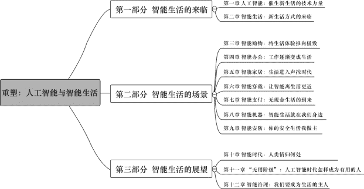

图 1-1 本书的内容与结构

本书致力于用通俗语言呈现严密学术逻辑，结合智能生活重构的实践，向公众展示人工智能与生活深度融合的图景。它既非象牙塔的艰深著作，也非一般的通俗读物，而是一种雅俗共赏的软学术写作，旨在引发关注。研究方法跨学科，分析了人工智能对社会生活的重构价值，并提出融合方面的对策建议，具有科学性、前瞻性与可操作性，可为研究者与读者提供参考。

### 【注释】

[\[1\]](#txt002.html#footnote_quote_txt002_1)中共中央编译局.马克思恩格斯全集：第 3 卷\[M\].北京：人民出版社,1960：23-24.

## 第二章 智能生活新方式来临

## 生活转折点：走向智能化生活

## “新”在何处：智能生活的五大特征

## 新的价值：满足个性需求与人性解放

## 深层本质：拥抱美好生活状态

智能时代，人工智能为代表的智能技术不断渗透进生活，智能产品与服务层出不穷，为改变生活方式提供技术契机与智能环境。厘清智能生活的概念、特征、本质与价值，对顺利融入智能生活具有重要意义。

### 一、生活拐点：一种智能化的生活方式
人工智能是对人类智能的模仿、延伸与增强，它模仿语言表达、行为方式与思维模式，延伸人类优势与能力，增强精神意志与突破局限。它是多项技术成熟后整合而成的有机整体，性能与效率可与人类智慧媲美，是人类智能在技术领域的化身。

千百年来，人们希望技术与机器承载特殊情感：成为伴侣、工作助手、智慧导师、情感共鸣者。从心理学看，机器在心中的角色反映了对外部事物的依赖。亚里士多德早在公元前328年就指出，人本质上是社会性动物，不能在社会中生活的个体是野兽或上帝。离群索居不被称赞，人们期待参与集体生活，在互助中超越孤独。

因此人工智能的成熟不仅关乎惰性与局限，更与人类社会属性相关。远古集体生活既为生存，也暗含社会需求。人工智能为何越来越像人而非其他动物，答案在于人们长期在“被对象化的世界”中寻找相似物，并赋予其人形、外貌与连接记忆的能力。如今人工智能正扮演这一角色，以新方式融入社会生活。

从本体论看，生活是人类永恒主题，蕴含生存哲学的价值底蕴。人类一切活动围绕生活展开，技术正是活动产物，持续告诉人们如何生活。现存人类已在技术展现中实现生活与发展。技术以独特方式传递对美好生活的渴望，已成为生活不可分割部分。

当下人类步入人工智能时代，新一代信息技术向生活全面渗透，意味着生活迎来拐点——智能生活时代的到来。在此节点，人类将从简单重复的线性劳动中解放，获得更多可支配时间，投身符合道德与精神需要的活动。智能技术以颠覆与重构的方式改变对生活的历史理解。

人们生活在万物智能化的时代，这提供重新认识生活方式的契机。智能生活究竟是什么？它是一种智能化的生活方式，包括以人工智能为基础的智能化服务，以舒适便捷为条件的智能化理念，以精神享受为主的智能化态度。目前技术的多空间泛在已在很大程度上打破时空界限，智能生活兼具自由与无边界属性。

需注意，强调“智能”易将智能家居、穿戴、手机、医疗、购物等事实等同于智能生活。事实上这些只是智能生活的技术设施，并非生活核心。真正的理解需回归“生活”层面，回到主体需求与体验。

当下需求与技术融合普遍，技术嵌入需求，直抵情感舒适区，重新激发对生活的热情。由此看，智能生活是在技术衬托下，人们显现出的对新生活方式的热忱、积极态度与合时宜能力。

从与传统生活的对比也能获得新内涵。传统生活指智能生活之前的方式，并非完全对立。但智能生活包含传统所无的内容，已被多数人认可，传统生活正式边缘化。原因在于传统生活长期停留在物质层面，遮蔽需求属性，导致迷茫焦虑。过去生活方式负担过多“生活任务”，耗费大量时间，破坏生活的纯正，将任务误作生活本身，形成放任态度。

并非所有人盲目从众，总有人思考明天的模样。人工智能革命打破对传统生活的盲目。随着生产能力提升，物质丰富解放双手与大脑，提供辨明任务与生活的机会，使人重新回归生存活动外的生活世界。智能生活带来极大自由与愉悦。

### 二、“新”在何处：智能生活的五大特征
前文可归纳出智能生活具有智能化、去物质化、互动化、个性化、简便化五大特征，这些正是其区别于传统方式的“新”所在。

### 智能化

智能技术是智能生活之所以“智”的根本来源。说到底，智能化正是智能生活最核心的特质。所谓智能化，就是在物联网、大数据、云计算、区块链、人工智能等技术加持下，某种事物能够主动、自发地满足人的需要。哲学上讲的能动，就是主观的自觉与自主。落到智能生活里，就是生活中有事物能自主地为人们服务，而且这种服务不是被命令、被强迫出来的，而是自发自觉的过程。比如智能家居里的智能空调，会根据主人的习惯主动调节到舒适温度；再比如智能交通里的无人驾驶汽车，它能依据乘客的数据反馈按自己的“判断”把人送到目的地，乘客只需报出终点，余下的路程就可以自行安排。能够体现这种智能化特征的场景非常多，稍加留意就能在日常生活中处处发现。

### 去物质化
与智能化的能动性相比，去物质化的特征更显抽象，主要是因为人们往往把“去”理解成“离开”。生活不可能脱离物质，所以容易产生认知偏差。有必要厘清智能生活的去物质化含义。去物质化是指为达成生活目的所需依赖的物理实体在不断减少。它可以从两个角度理解。一是物质形态的淡化。如今的智能支付是最直观的例子，整个支付体系已从贝壳、金属货币、纸币等有形货币，转向电子数字货币，货币变成数据。二是成本层面的轻量化。当智能技术成熟后，部分服务已走向零边际成本，不再像传统服务那样消耗大量人力物力财力。比如千里之外的亲友想面对面聊天，现在一个视频电话就够了，传统方式则要付出高昂的时间和交通成本。

### 互动化
智能生活的互动化体现的是人与人、人与物之间沟通能力的增强，本质上是智能技术让连接变得更紧密。19世纪末齐美尔就指出，由于“中间组织”缺失，人与人易走向原子化，形成原子社会。很显然这并非理想状态，而当下的智能生活正好补上了这块短板。借助智能技术，人们进入了一个可以跨时空广泛互动的时代。所谓的中间组织，就是连接人与“他者”的桥梁。在智能生活时代，人与他者的互动已突破时空限制。像智能购物场景里，消费者可以随时向商家反馈数据和新的需求，并立刻获得AI客服或人工客服的回应。以科大讯飞的智能语音助手为例，它凭借强大的语音转换能力，实时为对话双方提供母语信息，大幅降低跨国交流和学习的门槛，让沟通范围不断扩大。

### 个性化
智能生活的个性化指生活需求能够被精准匹配和定制。在服务领域，这表现为高度的定制化。随着智能生活服务商积累对用户的认知规则，提供专属定制产品，让用户体验到“上帝”般的待遇。博世可变色Vario Style系列冰箱、LG Thin Q Fit以及三星Air Dresser落地穿衣镜，都是以不同形式体现对消费者个性的关照。反过来，在个性化定制环境下，人们可以把生活塑造成自己想要的样子，个人喜好、空间、习惯都能被个性化实现。

### 简便化
智能生活的简便化意味着直达生活目标。梁冬在《睡眠平安》中说过，生活本身就是生活，而不是为生活做准备。智能技术深度嵌入后，诸多准备性工作被机器取代，人们不会因亲力亲为而困在生活的准备阶段。也不完全如此，有些人把准备本身当成生活乐趣，即便如此，智能时代也多了一种选择权。通过购买智能中介服务，人们能在日常中直奔目标，不必在繁琐准备上耗费大量时间。简而言之，智能生活呈现出简单便捷的特征，生活越简单越好。

### 三、新的意义：个性化需求的满足与人的解放
智能生活的价值与优势，体现在它满足人需求的程度，以及相较传统生活的积极影响。整体可归为三个层面：需求满足层面、技术带来的积极影响层面、拥抱与不拥抱智能生活的差异层面。

从需求层面看，智能生活的价值在于对需求的个性化关照。传统生活里，个性化服务的成本太高，需求只能在规模化生产下被安排，服务逻辑是看商家能提供什么，而不是用户需要什么。随着人工智能融入生活，服务中心从销售者转向顾客。百需公司2018年在广州上线的人工智能百需平台便是例证，用户发布需求后，商家主动洽谈如何在低价下提供满意的个性化服务。公司虽未长存，但这种思想在市场上延续。百应科技的服务就基于此理念，有需求就有回应，且能个性化回应。由此可见，重视个性化需求已成趋势，不重视者基本会被淘汰。个性化需求甚至成为商品，商家需要调整营销策略，以低价高质满足欲望，这也在倒逼企业转型升级。智能家居、智能穿戴、智能医疗、智能教育、智能驾驶、智能机器人等行业，都将在个性化需求中成长。

从技术积极影响层面看，智能服务为主流人群带来极致便利，改善生活质量。首先对老年人，智能产品能辅助完成高难度家务，智能穿戴设备可监测健康数据，帮助预防疾病，减少焦虑，并通过社区教育使用智能手机，建立正式与非正式人际支持网络，丰富闲暇。其次对上班族，智能办公带来自由和人情味，形成工作生活客户相连的生态体系，办公地点不再固定，可在咖啡厅或家中办公，同时团队协作更高效，有助于关注服务对象需求。再次对学生，智能技术让学习更有趣。硬件层面，学习设备具备“智慧”，查漏补缺，引导全面发展，降低学习焦虑；数据模型能依据兴趣设计专属学习方式，培养乐于学习的习惯；学习课程更加多元，传统单调教学被AR/VR、影视学习等方式取代，体验感持续提升。

智能生活的价值还体现在拥抱与否的区别上。面对新事物，人们常分支持者与忽视者。智能时代亦然。但无论态度如何，人们已不可避免地处在智能生活中，因为其整体价值难以抗拒。

总体而言，智能生活的价值有三：个性化生活方式让个性需求得到满足；生活水平和质量大幅提升；人们获得相对自由的生活环境，实现人的解放。

如今智能生活已渗透衣食住行用医各领域，穿衣更时尚，饮食更健康，居住更舒适，用品更贴心，就医更便捷。过去只能在科幻片里看到的生活方式，如今已在身边，并来得如此迅猛。

### 四、深挖本质：迎接美好的生活状态
大家虽生活在同一智能环境，但体验各不相同。老人更多感叹变化之快，其他年龄层则有不同感受。2016年人工智能第三次浪潮兴起时，技术普及有限，人们感悟尚浅，但研究机构已开始关注。2016年斯坦福大学成立研究小组，发布《2030年的人工智能与生活》报告，聚焦交通、医疗、教育、低资源社区、公共安全、就业与工作场所、家庭服务机器人、娱乐等八大领域。报告结论认为，人工智能已在改变日常生活，且多在改善健康、安全、提升生产力等方面发挥正面作用，更有潜力让驾驶更安全、帮助孩子学习、拓展人类能力，监控生活状态、预警风险并提供所需服务。

华为生活体验馆与苏宁极物对智能生活做了不同诠释。华为智能生活体验馆由物联网与AI连接而成，从消费者出发划分为产品体验区、互动体验区、售后交流区、休闲交流区。空间布局突出科技背后的人文。休闲区设有完善儿童区，小屏连大屏寓教于乐，父母可戴VR头盔体验赛车骑马飞行。产品体验区引导消费者放慢脚步，沉浸在每一分钟的真实感中，产生由内而外的美感。互动与售后区融合生态人文智慧设计，营造如行云流水般的舒然意境。整个馆体现科技与生活的结合，在个性化消费的同时传递温馨舒适与情感互动，消解了科技的冰冷感。

苏宁极物是苏宁易购集团旗下聚焦智能产品的品牌，致力于为智能生活提供系列服务。门店将产品与“惊喜”结合，让人感到安心舒适。品牌传递慢节奏、朴素纯粹的生活状态。其名“极物”出自“智能极物，愚足全生”，指智慧能触及事物本质。人的智慧能否触及本质是哲学问题，但一定能触及生活的本质——适意与安逸。

无论是华为体验馆的震撼情感美感，还是苏宁极物的生活智慧，都指向同一本质：智能生活是从外在服务引发的由内而外生活智慧，既是态度姿态，也是能力情感与精神，体现了人工智能时代的生活状态。从真善美维度看，智能生活是探寻本质、升华情感、追寻美好的一种方式，技术赋予物质以智慧，帮助人超越物质束缚，从物质生活走向精神飞跃。根本感受，是直抵内心的震撼。

### 注释

[\[1\]](#txt003.html#footnote_quote_txt003_1)埃利奥特·阿伦森.社会性动物\[M\].邢占军,译.上海：华东师范大学出版社,2001：579.

[\[2\]](#txt003.html#footnote_quote_txt003_2)斯坦福大学.斯坦福重磅报告：2030 年的人工智能与生活 PDF\[R/OL\].https：//www.jiumodiary.com/.

[\[3\]](#txt003.html#footnote_quote_txt003_3)马继华.华为智能生活馆的进化\[J\].现代企业文化(上旬),2018(09)：14-15.

[\[4\]](#txt003.html#footnote_quote_txt003_4)腾讯网.生活的本质究竟是什么?或许这里能给你答案\[EB/OL\].https：//new.qq.com/omn/20180209/20180209A1AUCI.html.

# 第二部分 智能生活的场景

## 第三章 智能购物：将购物体验推向极致

随着时代演进和科技发展，传统购物方式的局限日益显现。智能化购物逐步取代传统模式，成为主流形态。在线上，天猫、京东等平台蓬勃发展；在线下，无人超市、无人商店等新零售兴起。线上线下融合极大便利生活，购物过程正从单纯交易演变为新的社交形式。

### 一、局限分析：传统购物方式的不足
伴随新一代信息技术的迭代，人类生产生活与思维方式发生重大变革，快节奏生活成为主旋律。在此背景下，传统购物已难以匹配节奏，其不足逐渐突出。

消费怎么变了？从逛街到扫码的十年跃迁

美国市场学大家菲利普·科特勒曾指出，消费者的购买本质上是一套有逻辑的决策流程。广义来看，为了满足某种需求，在购买动机的牵引下，消费者会在两个或多个备选方案中进行筛选、评估、抉择并执行，最后再做购后复盘，这套流程涵盖需求确认、动机形成、方案选择与执行、购后评价等多个环节。^([\[1\]](#txt005.html#footnote_content_txt005_1)) 在线下为主的购物时代，需求往往源于理想状态与现实之间的落差。正是这种落差让尚未被满足的心理产生驱动力，促使人不断采取行动去缩小差距。从某种意义上说，这仍属于居民生活最基础的需求范畴。

从宏观经济看，消费是驱动中国经济的三驾马车之一，是拉动GDP增长的核心引擎之一。^([\[2\]](#txt005.html#footnote_content_txt005_2)) 然而，靠“有需求才下单”的传统购买逻辑，已经难以匹配人民日益增长的美好生活期待，也阻碍了经济动能转换的步伐。原因在于传统购物方式在体验、价格和口碑上存在明显短板。

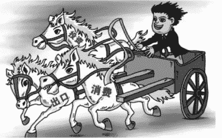

图 3-1 国民经济三驾马车^([\[2\]](#txt005.html#footnote_content_txt005_2))

体验不佳，耗时耗力。买东西要亲自跑到指定实体店挑选，价格、品质、品牌、品类以及不同门店的价差都要自己一一比对。来回奔波与反复挑选带来的疲惫感，让消费体验大打折扣。

价格偏高，抑制欲望。传统渠道的价格叠加了运输、仓储、包装、装卸、管理、租金、人工等诸多成本，导致终端售价明显高于商品本身价值。同时现金或刷卡支付额度有限，当标价远超合理预期时，消费者往往选择放弃，转而寻找替代品，消费被动压缩。

口碑难起，售后难保。口碑本质上是消费者在真实消费后产生的自发褒奖。商品或服务若能满足需求并带来愉悦体验，便会在人群中形成正向评价。但线下传播受信息覆盖小、传导慢、内容单一等因素限制，好的产品也多靠朋友间口口相传，辐射范围与持续时间都很有限。更麻烦的是，问题多在体验后才暴露，退换货会增加商家成本，消费者的权益维护难度加大，售后保障常流于形式。

传统购物的这些痛点随着物联网、大数据、人工智能的推进愈发凸显，也让人们对技术变革与生活品质的期待不断升高。

### 二、多重力量推动智能购物崛起

随着经济发展和社会主要矛盾的变化，人民对美好生活的追求成为主旋律。物联网、大数据、人工智能的加速成熟，加上政策的积极引导，让智能购物以迅猛态势改写传统购物习惯。需求侧变化、技术侧支撑与政策侧扶持三股力量叠加，让智能购物成为现实。

需要是人类生存发展的本能，也是推动社会进步的主观条件。马克思强调需求要从人的现实出发，人性兼具自然属性、社会属性与精神属性，符合人性的需要就是满足人的自然、社会和精神三重诉求。^([\[3\]](#txt005.html#footnote_content_txt005_3)) 社会向前，正是因为不断产生新的需要并创造条件去满足。需要一旦得到满足就会催生新的需要，形成循环。

党的十九大报告指出，我国社会主要矛盾已转化为人民对美好生活日益增长的需求与不平衡不充分的发展之间的矛盾。随着时代演进，人类需求已从基础生存跃升到对美好生活的综合追求。

回望历史，从石器、铜器、铁器到蒸汽、电气、信息时代，再到当下的人工智能时代，时代浪潮推动了物质环境的改善，生活要求也由物质生存向精神享受升级。这正是人的需要向更高阶进化的体现。

人工智能发展半个多世纪，近几年在大数据与云计算的加持下迎来爆发。云计算提供了坚实的算力底座，大数据提供了充沛的资源供给。^([\[4\]](#txt005.html#footnote_content_txt005_4)) 在高效率、高便捷的智能时代，美好生活不再是遥远的理想，而是可实现的常态。

2015年李克强总理在政府工作报告中提出实施《中国制造2025》，强调创新驱动、智能转型，推动移动互联网、云计算、大数据、物联网与现代制造业深度融合，为制造业智能化转型指明方向。未来，制造业将完成信息化与数字化的智能跃迁，区块链等新兴技术也将催生新的智能产业，对营销零售产生深远影响。人民对美好生活的诉求、技术能力的成熟与政策的指引，共同构成了智能购物诞生的现实动力，也预示着智能购物将成为日常常态。

### 三、体验升级：新零售正登场

2016年10月，马云在杭州云栖大会首次提出新零售，称未来20年没有电子商务，只有新零售。业界普遍认为，新零售是以互联网为基础，借助大数据、人工智能等技术对生产、流通、销售环节进行改造，重塑业态与生态，并深度融合线上服务与线下体验的零售新模式。^([\[5\]](#txt005.html#footnote_content_txt005_5)) 它并非全新商业形态，而是把电商优势注入实体零售，实现创新互动。

主要特征体现在三个方面。

其一，线上线下全渠道融合。将“店商”与“电商”结合，给消费者带来极大便利，也为品牌商、供应商、制造商、分销商等创造新机会。小米、优衣库等已完成全渠道打通。以杭州武林银泰的卡西欧门店为例，25平方米的店面仅能陈列300个SKU，通过店内电子屏连接全国近30城170多家门店的库存，消费者扫码即可下单并享受就近配送，既精简了环节又降低了库存成本。^([\[6\]](#txt005.html#footnote_content_txt005_6)) 这种融合已成为新零售标配。

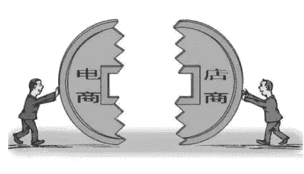

图 3-2 “电商”与“店商”的融合^([\[7\]](#txt005.html#footnote_content_txt005_7))

其二，智能物流赋能。条码、RFID、传感器、GPS等物联网技术应用于运输、仓储、配送、包装等环节，实现自动化运作与高效率管理，降低成本、提升服务水平。^([\[8\]](#txt005.html#footnote_content_txt005_8)) 在大数据驱动下，供应链整合与配送智能化成为可能。

其三，个性化需求为先。依托大数据、云计算与AI，商家可细分人群、洞察偏好，按需生产与营销，实现传统零售难以做到的精准满足。

新零售的出现是多因素合力的结果。

### 传统零售受困瓶颈
实体租金持续攀升，业绩下滑，电商冲击加剧，管理模式落后与盈利单一让传统零售举步维艰。另一方面，天猫、京东等电商巨头虽规模仍增，但增速放缓，缺乏真实购物场景导致体验不足，难以满足个性化需求。两者困境共同倒逼线上线下融合。

### 消费升级倒逼变革
消费主体从70后、80后转向90后、00后，这一代“智能原住民”受教育程度高、接受新事物快，且习惯宅经济生活，对零售提出更高要求。同时消费结构从实用向享受升级，旅游、健康、艺术收藏成为热点，单一模式已无法满足多元化需求，升级成为新零售的动力。

### 技术落地赋能升级
进入人工智能时代，大数据、云计算等技术实现落地应用。商家可采集并深度挖掘消费数据，生产适销产品；AI平台打通生产、供应、销售链路，提升管理效率。消费者通过手机、平板随时获取信息并完成下单支付。

当传统零售困境与消费转型并存，智能技术广泛应用为转身创造条件，新零售迎来黄金期。几十年后，“新零售”或将像电子商务一样淡出热词，成为润物无声的生活常态。

### 四、无人自助：购物场景的新面貌

随着AI不断成熟，无人超市在全国各地涌现，“消灭导购、收银”的无人零售革命拉开序幕。

海口的竺智能无人商店即是典型。扫码授权后门自动开启，货架上从一元纸巾到几十元洗浴套装一应俱全，取货后在扫码区自助结算，确认后支付宝或微信付款，10秒完成支付，手掌感应后3秒开门离场。^([\[9\]](#txt005.html#footnote_content_txt005_9)) 类似的还有自助咖啡机“莱杯咖啡”、鲜榨橙汁机“天使之橙”、社区生鲜服务“缤果盒子”等24小时智能无人便利店。

按技术可分为两类：一类基于RFID无线射频识别，通过标签实现货物识别与防盗，如欧尚缤果盒子、居然之家EAT BOX；另一类基于视觉识别、图像识别、生物识别等前沿技术，通过红外传感器、压力感应等记录购物行为，如Amazon Go、Take Go、淘咖啡。“即拿即走”的体验背后是技术对生活的服务。

对消费者而言，无人零售带来更快捷高效的购物方式，节约时间；同时通过数据分析提供个性化推荐，减少导购打扰与排队找零，提升购物感受。

对经营者而言，减少导购与收银人力，缩小店面仅保留购物与存储区，租金与人力成本大幅下降。

但质疑也存在：标签、二维码或人工书码是否能被稳定识别仍需验证；客流高峰时身份识别是否准确有待观察；前期软硬件投入巨大，运营中技术与管理成本不低，如何实现收益最大化仍是难题。

尽管如此，从长远看无人零售仍值得期待。技术成熟后识别难题将逐步化解，规模化效应会提升收益。只要市场有需求，无人自助的成长空间就仍在，未来走向值得观察。

### 五、购物即社交：智能时代的连接新生态

对当下消费者来说，买东西早已不止于填补物质缺口，它正悄悄变成一种社交方式。过去我们买一件商品，多半因为“要用”，现在除了刚需，还因为“想参与”。

社交本质上是人与人借助工具传递信息、交换思想、达成目的的互动。互动形态经历了从一对一到一对多再到多对多的演变。物物交换时代，大家拿闲置换所需，关系是一对一的面对面撮合。商品经济成熟后，出现了专门的买卖主体，卖家对众多买家、买家对众多卖家的局面形成了一对多的格局。如今在大数据、物联网、人工智能加持的购物平台上，人与人被织进一张复杂的网，互动模式升级为多对多，这就是社交需求在智能购物中的延伸，也是购物社交化的集中体现。整体上可归为两种表现：共情社交和功利社交。

共情社交源于情感联结或共同兴趣。新零售线上线下打通后，越来越多人在消费时顺带完成社交。几乎人人都有自己的兴趣圈：分享美食的、聊穿搭的、讨论美妆的。在信任感的加持下，亲友推荐的商品即便价格偏高也更容易被接受，口碑传播因此与购物社交化紧密绑定。

在圈子里，群体从众也很常见。某种商品卖爆，有时并非品质或价格占优，而是大家都在买带来的心理暗示。“既然多数人选择它，那就一定靠谱”成为常见的决策捷径。

还有偶像效应在推波助澜。消费者因喜爱的主播、明星代言或种草而产生购买冲动，这一效应在美妆和时尚领域尤为突出。比如抖音上因明星带火的WIS极润套装、泡泡面膜、答案奶茶，刷屏带来的情感共鸣直接转化为下单行为，让“跟潮流”成为社交的一部分。

功利社交则指向明确的利益目的，最典型的就是微商。依托微信等社交应用，以人为中心、以关系为纽带，微商把社交渠道直接变成宣传和销售的路径。即便好友代理的产品并不急需，基于信任或人情维护，很多人仍会选择支持。

购物平台本身也在制造社交连接。天猫、京东、淘宝在选品时遇到疑问可找客服，沟通即是互动。收货后可发表使用评价，其他用户能看到并参与讨论，购买前还能通过平台的在线问答功能向已购用户提问，形成买家之间的问答社交。不少店铺还会把复购用户拉进群，定时发券、预告新品，群成员可以互加好友，延续关系。

社交化的同时隐患也在累积。平台或社交平台催生的购物社交，容易导致个人信息泄露、信息安全受损、隐私被侵犯。管理层面，监管缺位、技术不成熟是主要漏洞；个人层面，部分消费者法律意识淡薄、行为失控，容易泄露他人信息，让社交风险显著上升。

应对上，需要制度、平台和个人三方发力。国家要从立法层面完善法规，捍卫消费者权益，规范言行；平台要提升监管技术，加强信息安全管控；个人要加强法律学习，提升意识，在保护他人信息的同时守护自身安全。

### 【注释】

[\[1\]](#txt005.html#footnote_quote_txt005_1)百度.消费者购买决策理论\[EB/OL\].https：//baike.sogou.com/m/v5076842.htm?rcer=u9PEAt wSIgzc D\_pOD.

[\[2\]](#txt005.html#footnote_quote_txt005_2)阿离 hunter.国民经济的三驾马车是什么?\[EB/OL\].https：//zhidao.baidu.com/question/2122273082813616147.html.

[\[3\]](#txt005.html#footnote_quote_txt005_3)王嘉丽.基于马克思主义需求理论视角下新时代中国特色社会主义美好生活\[J\].法制与社会,2019(18)：99-100.

[\[4\]](#txt005.html#footnote_quote_txt005_4)邓茜,邓亮.大数据开启人工智能时代解析\[J\].电子世界,2018(20)：46-47.

[\[5\]](#txt005.html#footnote_quote_txt005_5)搜狗.新零售\[EB/OL\].https：//baike.sogou.com/m/v155192521.htm?rcer=Q9PEAk Au UPGeLMhb L.

[\[6\]](#txt005.html#footnote_quote_txt005_6)新华社.线上线下一体化：一场电商与实体商业的亲密接触\[EB/OL\].http：//www.sohu.com/a/167890514\_267106.

[\[7\]](#txt005.html#footnote_quote_txt005_7)百度.店商与电商图片\[EB/OL\].https：//dss3.bdstatic.com/70cFv8Sh\_Q1YnxGkpo WK1HF6hhy/it/u=3647542348,176475443&fm=26&gp=0.jpg.

[\[8\]](#txt005.html#footnote_quote_txt005_8)搜狗.智能物流\[EB/OL\].https：//baike.sogou.com/m/v60603326.htm?rcer=u9PEAtwSIgzcD\_p OD.

[\[9\]](#txt005.html#footnote_quote_txt005_9)黄晓慧.无人商店智能购物(新生活新体验)\[N\].人民日报,2018-10-07(7).

## 第四章 工作就住进生活的智能办公时代

科技是推动人类进步的发动机。人工智能、大数据、云计算、移动互联网的落地，让生活方式与工作方式同步重塑。办公领域尤其明显，从信息化和数字化走向智能化、可视化。移动办公与居家办公的兴起，昭示着智能办公时代已经到来。

## 演进脉络：OA 从诞生到智能化升级

## 场景重塑：技术赋能的工作新面貌

## 居家新范式：不出门的从容办公

## 素养共进：迎接智能办公的挑战

办公自动化最早由美国通用汽车的D.S.哈特在1936年提出，1970年代麻省理工学院的M.C.Zisman给出了系统性定义：把计算机、通信、系统科学和行为科学用在传统数据处理难以覆盖的办公事务上。1985年全国OA规划讨论会上，我国形成了共识：利用先进技术把部分办公业务物化到设备中，形成人机信息处理系统，以提高质量、效率并辅助决策。

综合来看，OA就是把现代化办公与智能技术结合，实现自动化、数字化和智能化的新型方式。从通信视角，办公经历了传统办公、有线互联办公、有限移动办公、随时随地办公四代演进。

第一代是面对面传统办公。必须到公司、到固定工位处理事务，工具仅限电话、信件、传真、黑板，地点和时间受限，效率偏低，通知靠逐个传达，记录靠手写，文件靠人工整理。

第二代是有线互联办公。以互联网和电脑为媒介，效率和质量明显提升。会议记录可电脑编辑存档，纸质文件数字化后便于查阅保存。相比第一代，互联网赋予了生产部门“超能力”。

第三代是有限移动办公。手提电脑出现，办公不再完全绑定桌面，实现了场所的有限迁移。但机器笨重、续航差、使用不便，仍局限于办公室、会议室、家中。

如今第四代随时随地办公已成现实，智能手机等多功能终端让办公真正脱离空间限制。智能办公正是这一阶段的产物，移动办公和居家办公是其典型体现。

### 一、OA 进化史与新阶段的到来

要重新厘清移动办公和居家办公的内涵。移动办公常被称为3A办公：Anytime任何时间、Anywhere任何地点、Anything任何业务。领导和员工摆脱工位束缚，信息传递更快，工作更灵活。

居家办公即SOHO，借助网络在家就能完成工作，甚至不需要换下睡衣。工作与生活的边界被模糊，工作逐渐变成生活。

整体趋势下，移动办公或成未来主流，居家办公也将成为新时尚，智能办公深度融入日常，让时间和空间不再成为限制。

# 智能办公发展与实践

### 一、移动办公与居家办公的兴起逻辑

回顾过去几十年，办公场景是固定时间、固定地点，工作与生活泾渭分明。如今大数据、云计算、人工智能驱动下，智能办公场景普及，双手被解放，时间更自由，效率更高，企业也纷纷拥抱移动化、数字化、智能化办公。

智能办公通俗说就是把新一代信息技术嵌套进办公设备，赋能传统设备运行。从系统科学看，它融合物联网、大数据、云计算、人工智能，具备移动互联、网络通信、数据存储、信息交互等能力，是集态势感知、信息计算、管理服务于一体的智能网络终端。

2018年11月9日，富士施乐中国在北京举办“数字化转型从智能办公开始”大咖汇暨解决方案展，推动智能办公普及。2019年1月9日，富士施乐发布Apeos Port-VII/Docu Centre-VII系列智能彩色数码多功能机，具备高品质彩色输出、高产能、高分辨率、易用、节能环保和360°信息安全等特点。用手机扫码即可上传任意尺寸格式文件，自主打印复印，操作高效便捷，标志着商务打印从模拟到数码、黑白到彩色、传统到智能的跨越。

教育领域也有实践。贵州六盘水十七中原先用QQ群、微信群、Excel办公，信息混杂、部门孤立、流程繁琐。引入简道云与阿里钉钉结合后，老师可在电脑或手机上接收提醒、查询、提交数据。简道云设计了流程表单，事项有了固定路径，减少跑腿；多应用数据打通，部门资源共享，效率与人力成本均获优化。

交通领域，互联网、大数据、人工智能与运输深度融合催生智慧交通。未来两百多个大中型城市将建交通指挥中心，集成GPS定位、视频监控、实时检测、GIS管理、通信调度、信息发布等功能，依托大数据、云计算、人工智能实现道路预警精准、通行顺畅、收费智慧，办公全面走向数字化、移动化、智能化。

智慧交通的落地方案在高速公路收费点体现得较为清晰。收费作业处于智慧交通体系的关键节点，终端长期暴露于室外，受温差波动、电磁干扰等复杂条件影响，对设备稳定性和耐久性要求很高。为确保系统在恶劣环境下仍能持续运行、实时完成扣费和监控，管理部门选用工业控制主机作为中枢调度。落地配置采用“触想”智能交通监控一体机配合电容触控安卓一体终端，画面清晰、机身轻薄散热迅速、适应外场能力突出，设备上的串口可直连收费站终端传输控制指令，配合收费端App即可实现便捷的智能化收费。整体方案将大数据、云计算等技术植入硬件，通过智能终端完成流程自动化，有效缓解了人工收费成本高、效率低、监控易出现盲区的问题。^([\[5\]](#txt006.html#footnote_content_txt006_5))

除了企业、教育、交通之外，智能化办公正向政务、医疗、金融、公安等领域扩散。各部门办公场所里移动终端的普及度在提升，依托移动设备，工作形态加速智能化。例如公安系统借助一款移动应用打造的“团圆”平台，能够快速锁定嫌疑人员，对拐卖儿童案件实现智能侦破。再如政务端上线的“智慧税务”，助力移动端数据填报，大幅简化纳税人报送与信息查询流程。

当下常被提及的智慧交通、智慧政府、智慧医疗，本质都是办公方式智能化的不同表达。随着智能终端渗透加深，未来的智能办公会切得更细、场景更丰富。从集团级协同到个人业务办理，智能化将融入工作生活的各个角落。

### 三、居家办公：SOHO模式的灵活与自在
“SOHO”源自 Small Office Home Office 的缩写，指把家当作办公室、以互联网为沟通工具的家庭式工作形态，也代表一种灵活弹性的新型智能办公方式。SOHO从业者通常只需一台联网的便携电脑就能在家完成任务。

SOHO兴起与第三次信息化浪潮后物联网、云计算、大数据快速发展密切相关。多功能笔记本与智能手机等现代通信工具普及，使得不少原本只能在办公室完成的工作可在家进行。新一代信息技术为居家办公提供了可靠支撑。物流快递的成熟以及主流外卖餐饮平台的兴起，也为居家办公提供了生活保障。借助手机上的外卖和支付类App，按需下单后送餐上门，三餐问题得以轻松解决。交通拥堵、职业个性化以及“宅文化”盛行，也让更多人倾向于在家工作。目前居家办公群体大致可分两类：缺乏固定雇佣的自由职业者，和已有稳定工作的在职人员。

自由职业者是居家办公的主体。自改革开放以来，我国经济持续发展、知识迭代加快，就业竞争加剧，就业压力加大，越来越多的人选择自由职业。随着信息技术发展，这部分人掌握了大量计算机基础技能。凭借这些技能，他们通过网络开拓新空间，从事信息编辑、加工、设计、传播类工作，如网络编辑、网站设计、自由撰稿、广告策划制作、商务代理、服装设计、法律咨询、期货股票等。一般只需互联网与电脑，就能独立完成或在线协同完成。

另一类是有稳定工作的上班族。部分企业员工利用下班时间在家兼职，或被公司安排在家完成特定任务；也有老板通过互联网平台在家管理公司，一边是企业负责人，一边是SOHO族。美国《读者文摘》曾刊发《老板叫我回家上班》，描绘了美国SOHO的浪潮。纽约州西切斯特县政府的罗比娜因女儿出生后被上司安排在家办公。与罗比娜类似的在家上班族已占美国就业人口的40%。^([\[6\]](#txt006.html#footnote_content_txt006_6))目前居家办公在美国已相当普遍。

在日韩等地，SOHO也在兴起。日韩政府鼓励个人创办SOHO型公司。“朝日网”主页设有专门的SOHO专栏，介绍成功经验、提供交流场所和创业指南。中国也曾有预言称未来居家办公将流行，成为大众办公模式。随着大数据、云计算、人工智能不断发展，这一预言正在兑现。

近年来，北京、上海、广州等发达城市，居家办公成为自由创业者的向往。据社会调查，广州符合SOHO定义的年轻人约有20万。随着SOHO人群增加，专门的SOHO系列办公楼应运而生，如北京多处知名SOHO楼盘逐渐进入视野。

能成为潮流的事都有其魅力。SOHO与传统上班族最大不同在于办公不受地点限制、时间自由、工作灵活。优势主要体现在：

对个人而言，一方面办公地点不受限，时间更灵活。不必朝九晚五通勤，节省路上时间，避开拥堵和挤公交，时间弹性更大。可按生理需求选择起床时间，保证精力充沛。另一方面，居家办公提供安静舒适环境。避开人多嘈杂的办公室，减少面对面监督，累了可在沙发上躺一躺、看看电视，工作更惬意，也有利于效率提升。

对企业而言，居家办公大幅降低成本。无需购置过多办公设备，减少办公用品消耗，如公用电脑和桌椅。节省办公室、会议室等公共场地，降低清洁和租赁费用。还能利于全球雇员，实现效益最大化。员工多数时间在家办公，仅偶尔到公司开紧急会议，有助于在全球范围内调动人力资源、吸纳高素质人才，提升效益。

对政府而言，居家办公减少上下班出行人流量，有效缓解交通拥堵，减轻疏散交通、维护治安等工作压力。

事实上，人工智能到来、办公自动化发展、人工智能技术普及以及分工细化，将催生更多居家办公群体。与此同时，客观存在的就业压力也会让居家办公成为趋势。

### 四、素养升级：携手迈向智能办公时代
技术革新推动生活变革。大数据、云计算、物联网、人工智能等技术引领智能办公时代到来。《2019中国智能办公报告》指出，近70%职场人士认为智能办公将在三五年内全面普及。面对来势汹汹的智能办公浪潮，该如何应对？是迎面而上还是退避三舍？睿智者会选择面对。

在技术洪流中，逃避无济于事，只有以积极心态思考如何适应才明智。随着社会发展，人工智能催生“智能办公”这一新型方式，这一客观现实不会因个人态度改变。智能办公是时代产物，也是生产生活进步的体现。无法改变规律，但可以利用规律服务生产生活。面对后疫情时代可能全面普及的智能办公生活，为与时代步伐一致、不被淘汰，应积极参与并主动适应。

作为智能办公主体，个人需提升能力与素养。具体可通过提高业务能力、增强信息素养来实现全面发展。

提高自身业务能力。业务能力即解决专业事务的能力，不同岗位要求不同。智能办公时代，首先要熟练掌握计算机技能。要借助大数据、云计算、人工智能完成过去耗时的工作，掌握基本的“智能技能”。其次，提升沟通交流技能。智能办公可能是移动办公、远程办公或居家办公，与传统面对面办公不同，更多通过网络线上交流，需要较强的语言表达和沟通能力，快速准确传递信息。最后，掌握科学的时间统筹方法。合理安排在电脑等设备前的工作时间，提升效率，科学办公。

增强自身信息素养。信息素养是全球信息化所需的基本能力。该概念由信息产业协会主席保罗·泽考斯基于1974年在美国提出，1989年美国图书馆学会的简明定义包括文化素养、信息意识和信息技能三个层面，即判断何时需要信息、如何获取、如何评价和有效利用。^([\[7\]](#txt006.html#footnote_content_txt006_7))智能办公时代，无论行业岗位，都需具备信息素养，掌握计算机知识和技能。在素养层面，要不断学习科学文化知识，具备基本科学文化常识，面对海量信息能清晰辨别并作出正确分析判断。在意识层面，要有获取新信息的意愿，形成从生活实践中发现信息的意识。在技能层面，首先要会通过网站平台查找、筛选信息；其次能合理有效利用和支配信息，用以解决实践问题；最后要善于学习，熟练运用各类办公软件，掌握智能办公所需技能。

培养自身优良素质。智能办公时代自律、有计划、积极担当、独立、责任心等是优秀员工的基本素质。以居家办公为例，对个人素质要求更严。

首先，要自律、有计划。居家办公无老板面对面监督，工作时间自由灵活。有人会上午睡懒觉，午饭后工作，期间刷微博、朋友圈、玩抖音、吃零食，效率明显下降，甚至因完不成工作而熬夜加班。必须严格自律、管控时间，制定明确计划，规定睡觉、吃饭、工作、娱乐时间，保证有序生活和高效工作。

其次，要有责任心、独立自主。居家办公中工作时间、内容、量需自行安排。在无外界压力下，必须有强烈的责任感和事业心，积极主动，按时保质保量完成任务。同时具备独立能力，在无同事协助时能自主完成各项工作。

最后，要善于学习、学会创新。智能办公时代，很多工作将被智能设备、软件、工具甚至机器人替代简化。作为有智慧有思想的高级动物，人要善于从新鲜事物中获取新知识、学习新技能，完善知识架构，充实头脑，提升各方面技能，并在学习中拓展思维，积极进取、不断创新，更好适应社会和智能时代需求。

企业也可为智能办公提供技术、物质和服务支持。如购置智能设备、配置完善硬件设施；加强员工办公技能培训，培养专业技术型人才；完善工作计划实施细则、业绩考核办法等规章制度，大力支持智能办公新方式；加强智能办公环境建设，培养员工归属感和文化认同。亚马逊花费40亿美元打造的3个大玻璃球办公楼、苹果耗时十年建设的“甜甜圈”办公大楼、Airbnb居家式办公大楼以及谷歌度假村办公室，都体现了企业对智能办公环境的重视。打造舒适、自由、智能的办公环境，有助于为员工创造真实良好的办公体验，提升效率，推动办公智能化。

总体来看，面对普及的智能办公生活，应以积极态度迎接，主动参与、积极适应。企业和政府应大力支持、积极配合。多方合作，顺应时代潮流，利用先进技术，共同推动办公走向智能化。

## 第五章 智能家居：生活进入声控时代
## 智能家居：家居产业的新风向
## 场景全览：智能家居的应用图谱
## 关键要素：智能家居的设计原则与核心功能
## 进阶之路：家庭智能化的挑战与突破

互联网近几十年来已从多方面改变生活，但传统家居、装修设计等行业在很大程度上仍维持原状。近年来，随着物联网、大数据、云计算、人工智能技术发展，更多智能精准感应装置开始普及，产品更新周期缩短、升级换代加速、技术含量提升，一场智能家居革命正在兴起。在技术进步、需求升级和开发设计、生产厂商共同推动下，智能家居市场潜力巨大。未来生活将进入“全屋智能”的智慧家庭。

### 一、智能家居：行业新潮流的由来
近几年，“智能家居”概念在家具、装修等行业流行，成为现代居家生活的代名词。何为智能家居，其产生背景、演变过程与发展前景如何？

智能家居，即Smart Home、Home Automation，以住宅为平台，利用综合布线、网络通信、安全防范、自动控制、音视频等技术，将与家居生活相关的设施集成，构建高效的住宅设施与家庭事务管理系统，提升安全性、便利性、舒适性、艺术性，实现环保节能的居住环境。^([\[1\]](#txt007.html#footnote_content_txt007_1))简言之，智能家居是传统家居物联化、智能化的结果。它属于物联网技术分支，在人工智能赋能下实现互联互通。其产生背景主要有三方面。

首先，智能家居出现是社会发展进步的必然结果。人类文明长河中新旧事物不断更迭，发展的基本规律是新事物取代旧事物。随着人工智能和物联网技术成熟，以大数据、云计算为载体的智能时代到来。智能家居顺应时代潮流和社会需求进入视野，在传统家居基础上改造过时、不能满足生活需求的部分，通过网络通信、综合布线、人工智能等技术将传统家居物联化，赋予“智慧”，朝着互联互通、智能化方向发展。

其次，不断成熟的物联网技术、ZigBee技术、大数据、人工智能等，是孕育智能家居的技术土壤。物联网起源于传媒领域，是信息科技产业的第三次革命。物联网是指通过信息传感设备，按约定协议将任何物体接入网络，通过信息传播媒介交换通信，实现智能化识别、定位、跟踪、监管等功能。^([\[2\]](#txt007.html#footnote_content_txt007_2))智能家居工作原理正是通过视频识别等信息传感设备将家居与网络连接，通过智能识别、跟踪、监测获取家居工作状态信息，再经通信技术传输给人，实现物与物、物与人互联互通。此外，ZigBee技术在实现过程中作用不可忽视。ZigBee是一种短距离、低功耗的无线通信技术，主要用于自动控制和远程控制。智能家居中，当传感器感应中断、网络传输故障时，无需人工干预，ZigBee就能自动修复问题，在智能家居建设中发挥巨大作用。

消费结构在升级，家居的期待值也在抬高，这正是智能家居兴起的底层动因。过去一件产品能用、方便、便宜就够了。经济社会转型之后，人们不再满足于经济型与实用型，舒适、安心、省心、智能才成为主流诉求。在这种需求牵引下，家居的智能化演进几乎不可逆。洗衣服从手搓到全自动智能洗衣机，纳凉从手动摇扇到感温智能空调，照明从煤油灯到感应智能灯，煮饭从传统甑子到控温计时电饭煲，家电无一不在时代的印记下贴上智能标签。

往源头回溯，得回到三十多年前美国康涅狄格州。那里诞生了全球首幢智能型建筑，借助计算机把大楼设备信息化整合，对电梯、照明等进行智能监测与操控，从此打开了各国对智能建筑与智能家居的探索之门。

1998年，微软面向中国消费者推出“维纳斯”计划，依托庞大的电视资源推广互联网，并推销廉价个人电脑替代品，1999年把计划推向全球，进军信息家电领域。计划最终未能成功，却在一定程度上推动了家电的信息化与智能化进程。2003年，索尼、英特尔、微软等公司联合发起数字生活网络联盟，意在打通个人PC、消费电器、移动设备在无线与有线网络上的互联互通。^([\[3\]](#txt007.html#footnote_content_txt007_3)) 它把智能家居、消费数码、网络宽带等多功能串联，实现了家居产品的智能化雏形。

从技术演进看，20世纪80年代初，电子技术大规模进入家电，带来住宅电子化。80年代中期，通信、安防与家电功能融合，形成住宅自动化的概念。80年代末，随着网络通信、计算机与信息技术发展，家庭总线技术Home Bus System HBS出现，用于监视、控制和管理住宅内的家电、通信、安防设备，美国称之为Smart Home，这正是智能家居的原型。

进入21世纪初，家庭总线日趋成熟，物联网兴起，人们开始探索可通过手机远程操控的家电智能设备。近几年，随着智能技术成熟，成本高、布线复杂的家庭总线逐渐被无线操控技术取代。

在中国，智能家居的发展大致经历萌芽期、开创期、徘徊期、融合演变期四个阶段。^([\[4\]](#txt007.html#footnote_content_txt007_4))

萌芽期 1995—1999年，对智能家居的认知仍很模糊。深圳经济特区有少数公司代理美国智能家居产品，国内尚无专门面向本土市场的厂商。

开创期 2000—2005年，随着消费水平提升与生活品质诉求增强，加上信息技术与互联网普及，北京、上海、天津、广州等发达城市相继出现智能家居研发生产企业，以满足国内需求。当时国外产业已较成熟，却未进入中国市场。

徘徊期 2005年至2010年，国内发展基本停滞甚至倒退。开创期营销手段不成熟、技术培训体系不完善，导致产品体验不佳、销量下滑，不少企业缩减规模或转行。同期大量国外企业趁势进入，抢占了不少市场份额。

融合演变期 2011年至今，行业开始整合经验，加强跨界交流融合，销量放量增长，整体态势向好。

未来几年，随着互联网、5G、人工智能持续演进，加上家居行业的持续革新与产品迭代，智能家居将进入更快的发展通道。家庭、酒店、办公等场所都将逐步迎来智能化身影，全方位场景化将成大势。

### 二、智慧生活的全场景预览

《道德经》说：“不出户，知天下；不窥牖，见天道。”两千五百年前老子认为不出门知天下是圣人之事。今天互联网普及，人人都可以成为“圣人”。过去靠想象孙悟空十万八千里、嫦娥奔月，如今飞机时速数百公里，人造飞船成功登月，梦想正逐一实现。

人类走过蛮荒、农耕、工业、信息时代，随着人工智能突破，我们正迈入智能时代，一切生产生活都将智能化。

家庭作为工作一天后身心休憩的场所，若“家”具备感知能力，能读懂主人意图、判断需求并自动执行，将是多么奇妙。

近几年，5G、物联网、大数据、人工智能蓬勃发展，红外探测、智能感应、智能监控、远程操控等技术被整合到智能家居，构建出“充满智慧”的全屋系统，实现人与家居的心灵感应。

未来的家庭将呈现不同时段的典型场景。^([\[5\]](#txt007.html#footnote_content_txt007_5))

起床，温柔自然。过去靠闹钟惊醒，常因关掉闹钟又睡导致匆忙迟到。智能家居可设置定时唤醒模式。起床前半小时，电动窗帘缓缓开启，阳光洒入，智能推窗器轻推窗户，微风拂面，卧室轻音乐徐徐响起，浴室热水器、厨房面包机咖啡机同步启动。人在自然中醒来，无需等待烧水，洗漱完毕早餐已备好。

离家，从容悠闲。过去出门要逐一关电、关窗、关煤气，还常忘关空调窗户。开启“离家模式”后，厨房、卧室、客厅灯光自动关闭，非待机电器断电，窗帘窗户自行关闭，安防系统进入布防。陌生人进入时门外红外感应器会将信息推送给主人；燃气泄漏时传感器检测到浓度超标会报警并联动关闭阀门、打开排风；雷雨天阳台智能晾衣架可自动升降防淋；老人小孩在家时可通过全景网络摄像头随时查看，紧急信息第一时间推送到App实现实时监控。

回家，轻松愉悦。过去要翻找钥匙、开关灯、找遥控器，下班后更添烦躁。路上可远程启动“回家模式”，空调按室外温度自动调至舒适，热水器预热。回家用指纹或密码即可开门，无需担心忘带钥匙。入室后温度适宜，灯光调至舒适亮度，电视已打开、背景音乐迎宾，热水已备好，洗去一天疲惫便可直接放松。

就餐，温馨浪漫。一家人用餐时切换“就餐模式”，音箱播放舒缓音乐，灯光变柔，营造温馨氛围。用餐后想看电影，“影院模式”自动开启投影、放下幕布、关闭照明，营造影院效果；想阅读，“阅读模式”关闭电视音响，灯光调至护眼模式，提供安静优雅环境。

睡眠，安稳舒适。睡前按下“睡眠模式”，客厅、厨房、走廊、卧室灯光依次关闭，窗帘合上，电器断电，门磁窗磁传感器进入布防。针对怕黑儿童可设延迟睡眠模式，卧室灯延时熄灭，待熟睡后再悄然关闭。

起夜，体贴入微。夜间下床时，床头移动红外探测器感应到人体会自动点亮小夜灯，走廊和洗手间灯光同步打开并调至夜间柔和模式。回到床上一分钟无移动后，相关灯光自动熄灭。

除此之外，家庭Party、娱乐等多种智能应用场景也在逐步落地，已实现与未实现的都将在未来一一呈现。

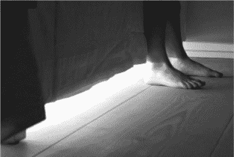

图 5-1 下床即亮^([\[6\]](#txt007.html#footnote_content_txt007_6))

### 三、设计要义与核心功能

近年来物联网、大数据、人工智能发展，智能家居走进家庭，生活因而更舒适、环保、便捷、高效。智能家居在装设计中的分量也日益提升。传统“简单实用、质量过硬、物美价廉”的原则已难以适应智能时代，安全性、操作性、兼容性、稳定性等成为新的设计考量。^([\[5\]](#txt007.html#footnote_content_txt007_5)) 智能家居设计必须遵循这些基本原则。

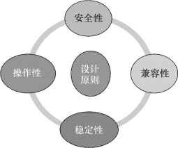

图 5-2 智能家居的设计原则

# 智能家居设计原则

## 安全性原则

安全性是消费者购买时的首要考量。智能家居带来便利的同时也带来安全关注。以智能防盗门为例，指纹、密码、语音解锁在匹配时看似安全，若结构易被破坏，便捷功能也就失效。其次，智能家居互联互通增强了用户与外界的联系，若邻里使用同一系统同一产品，是否会出现互相控制的风险？显性与潜在的安全问题都必须在设计阶段充分评估。

## 简单、易操作原则

未来客厅、厨房、卧室、卫浴、阳台都布满智能设备，操作是否繁琐是用户核心关切。是否需要无数开关和遥控器各管各的设备？设计必须遵循易操作原则。目前已有网络化控制、集中控制、无线遥控等多种方案，兼顾集中统一与独立控制，满足多样化个性需求。

网络化控制具备全开全关与可变开关功能，适用于回家与离家场景，可随时重新设定按钮对象；夜间睡觉可采用集中控制统一管理全宅设备；无线遥控可让用户在家中任意位置操作设备。

## 兼容性原则

不同产品若采用不同网络协议，系统兼容与扩展性难以保证。设计时应兼顾兼容与扩展，遵循国家或地区标准，采用通用网络技术协议，确保不同厂商系统互通，也让本系统设备能与未来第三方受控设备互联。

## 系统稳定性原则

系统稳定性关乎生命周期、使用时长、效果与后期维护。稳定性包括运行稳定、运行时间稳定、线路结构稳定与集成功能稳定。长期稳定通畅运行是高性能智能家居的基本追求，设计方案必须将稳定性置于核心。

## 核心功能概述

具备安全、兼容、稳定特性的智能家居主要体现为安防预警、智能控制、智能环境营造。

### 安防预警功能

离家后家庭处于布防状态。门磁或窗磁感应到开门爬窗，系统会立即推送报警信息，业主可通过全方位摄像机查看情况，并联系物业处理，实现远程防盗。

家中无人时，燃气泄漏传感器检测到浓度超标会报警并联动关闭煤气阀、打开排气扇，同时将信息推送至手机，防止火灾。

除门磁、窗磁、全景摄像机、燃气泄漏传感器外，还有烟雾检测器探测甲醛一氧化碳等有毒气体；无线水浸传感器监测厨房卫生间用水安全；无线人体红外传感器监测区域动态、夜间起夜照明等，减少意外。

### 智能控制功能

智能家居的最大差异在于可通过多种方式控制设备。无需手动开关电视、窗帘、饮水机，只需App或智能面板即可实现在家无线遥控、在外远程网络电话控制。还可通过定时控制、场景控制、全宅手机控制^([\[7\]](#txt007.html#footnote_content_txt007_7))、集中控制等方式，让一切设备尽在掌控。

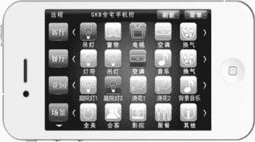

图 5-3 全宅手机控制图^([\[7\]](#txt007.html#footnote_content_txt007_7))

### 智能环境营造功能

智能灯光可随聚会、观影、用餐、阅读、睡眠等活动自动调整亮度与氛围；智能空调感应室外温度与人体体温自动调节，提供舒适健康环境；智能音乐设备可在沐浴、阅读、用餐、做家务、睡眠等场景播放不同风格背景音乐，让居家生活更富趣味。

目前智能家居尚未完全普及，但随着物联网与人工智能持续发展，它将更多融入生活，解放人们于繁琐家务，让“家”真正服务于“人”。

### 四、发展瓶颈与突破之路

提到智能家居，人们会联想到智能、高端、大气、昂贵。自概念提出三十多年以来，我国普及率并不高。2018年统计显示，美国普及率约15%，英国约8%，中国仅约1%。原因主要包括：

## 普及困境

### 第一，知晓程度不高，人们普遍接受困难

第一，公众对智能家居的熟悉程度有限，接受起来存在阻力。在产品真正走进家庭前，多数人对智能家居的印象仅来自影视剧或虚拟演示，画面里呈现的往往是高档豪华、奢侈精致的场景，这在潜意识里塑造了昂贵、安装繁琐的高门槛印象。叠加国内起步偏晚、技术尚不成熟，探索周期绵长，成功范例和可参考经验稀缺，行业体量本就偏小，日常难以触达真实体验。荧幕塑造的高端光环与功能性能的实际认知空白并存，导致大众对智能家居的理解模糊且滞后。

任何新事物的扩散，认知普及是先行步骤，随后才是行为接纳。智能家居要想被市场推向主流，首先需要在功能、性能层面被公众所知晓，只有在认知层面获得认可后，才会形成推动发展的合力。

### 第二，刚性需求尚未形成，消费意愿偏弱
智能家居自诞生起就主打智能便捷、高效舒适、环保健康，宣称在安全、便捷等维度全面超越传统家居。然而在真实效果缺乏验证、安全性仍存疑虑的阶段，这些卖点能否兑现仍不明朗，消费者多持观望与半信半疑态度。另一方面，传统家居在实用性、舒适性等基础需求上已能基本满足多数家庭，因此智能化并非刚需。居家智能化带来的信息安全与个人隐私担忧、对产品综合性能的不信任，以及整体购买意愿不足，共同压低了普及率。

### 第三，价格居高不下，热度与购买脱节
研发设计与制造环节高度依赖技术，流程复杂、周期漫长、技术与人力成本高昂，直接推高了终端售价。许多用户对高端智能体验充满向往，却在价格面前止步。比如普通门锁与智能门锁在基础安防功能上并无差别，绝大多数用户并不愿为智能锁带来的不确定性便利支付溢价。早期企业基本锁定高端客群，单一的高端定位与高价策略进一步拖慢了普及节奏。

### 第四，技术标准碎片化，产品互通受阻
行业起步不久，产业链尚不完善，技术体系未整合，缺乏统一标准，成为推广的瓶颈。各类产品采用不同的接入协议，如蓝牙、Wi-Fi、射频 RFID、ZigBee 等，企业为维护自身利益各自为政，导致标准不一、互不兼容。

例如，用户购买 A 品牌空调、B 品牌门锁，因技术路线与系统不同，无法实现开门即触发空调等联动场景。在选购时就被迫捆绑同一生态链，A 系列门锁最好配 A 系列空调；后期某部件损坏，还必须寻找同配置配件才能兼容。产品受限、企业割据的局面，令行业整体升级缓慢。

### 第五，复合人才缺口明显，售后体验打折
智能家居的普及需要大量跨界复合型技术人才，对从业者提出“全链通晓”的要求。以售后为例，若维修人员仅懂冰箱不懂空调，面对故障时难以判断是单机问题，还是空调与其他设备联动、网络或手机 App 导致的连带问题。这种人才短缺直接削弱了售后服务能力，降低用户体验。

## 突破策略
面对上述困境，可从精准定位、宣传推广、标准统一、技术研发、人才培养等维度协同发力，帮助产业走出低谷。

### 调整定位，扩大宣传
普及前提是定位清晰。企业应摒弃单一高端策略，按高端、普通、老弱病残等不同人群制定差异化产品线。对高端用户提供前沿技术的高性能方案；对大众市场打造小体量、集成化、高性价比产品；对特殊群体重点考虑易操作与医疗健康功能。

在认知不足阶段，需借助电视、电脑、网络等渠道系统科普产品功能、性价比、操作流程，扩大受众覆盖，提升认知与接受度，为后续销售蓄力。

### 统一行业技术标准，加强交流与合作
针对标准分散现状，政府应出台政策引导并尽早制定统一技术规范。企业间亦需加强对话、经验共享，必要时通过联合生产、分工协作共同推进迭代。

### 加强技术研发，消除用户疑虑
在物联网、ZigBee 无线通信、人体红外传感等基础之上，加大提升性能与增强设备安全性的研发投入。生产端要不断完善工艺，推出低成本高安全的产品；使用端要保障隐私安全，系统须经用户授权验证后启动，并对服务人员加强职业道德与法规培训，确保用户数据保密可靠。

### 校企合作，培养综合型技术人才
在人才短缺背景下，企业应与高职院校、技术院校建立合作机制，共育智能家居所需的复合型技术人才，既为院校学生提供就业通道，也为企业储备后续力量。

依托物联网与人工智能的快速演进，智能家居有望突破发展瓶颈，实现跃迁。未来“全屋智能”所带来的智慧生活将真正触手可及。

## 注释

【注释】

[\[1\]](#txt007.html#footnote_quote_txt007_1)搜狗百科.智能家居\[EB/OL\].https：//baike.sogou.com/m/v220337.htm?rcer=u9PEAtwSIgzcD\_pOD.

[\[2\]](#txt007.html#footnote_quote_txt007_2)搜狗百科.物联网技术\[EB/OL\].https：//baike.sogou.com/m/v67765625.htm?rcer=h9PEAbzfv hw K27Pk2.

[\[3\]](#txt007.html#footnote_quote_txt007_3)搜狗百科.数字生活网络联盟\[EB/OL\].https：//baike.sogou.com/m/v62968294.htm?rcer=u9PE AtwSIgzcD\_pOD.

[\[4\]](#txt007.html#footnote_quote_txt007_4)搜狐.中国智能家居发展经历的四个阶段\[EB/OL\].http：//m.sohu.com/a/84761229\_426018.

[\[5\]](#txt007.html#footnote_quote_txt007_5)搜狐.智能家居 生活中的智能场景模式你知道几个?\[EB/OL\].http：//www.sohu.com/a/253006260\_282212.

[\[6\]](#txt007.html#footnote_quote_txt007_6)搜狐\[EB/OL\].http：//sf6-ttcdn-tos.pstatp.com/obj/temai/FphCirl Nien-7P1G--UR0eFiENP4.jpg?image Vi.

[\[7\]](#txt007.html#footnote_quote_txt007_7)百度.全宅手机控制图片\[EB/OL\].http：//m.znjj.tv/uploadfiles/2018-05/20180518164722116.jpg.



## 第六章 智能穿戴：让科技更贴近生活

## 智能穿戴总览
智能穿戴：一个备受关注的智能生活赛道
发展脉络：智能穿戴的历史演进与趋势展望

### 一、智能穿戴：一个被广泛关注的智能生活领域
过去数十年，科幻作品中频频出现的智能穿戴形象，如今随着物联网、人工智能等技术的成熟，正逐步融入日常生活。其多功能、可集成特性引发了广泛关注。

智能穿戴即可穿戴设备，是利用穿戴式技术对日常衣物进行智能化设计的设备总称，涵盖眼镜、手套、手表、项链、手链、服饰、鞋类等。^([\[1\]](#txt008.html#footnote_content_txt008_1))广义上，功能全面、尺寸较大的设备可独立运行；狭义上，部分设备需配合智能手机使用，如各类体征监测手环、智能首饰等。^([\[2\]](#txt008.html#footnote_content_txt008_2))随着技术与需求变化，其形态与热点持续演进。

智能穿戴融合 RFID 射频识别、红外感应、GPS、传感器、VR、AR 等技术，实现人与环境实时互动，并通过大数据与云平台完成数据采集、处理与共享。

按功能可分为定位类、监测类、交互类、材料类四类（如图 6-1 所示）。

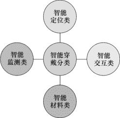
图 6-1 智能穿戴的种类
目前定位类产品应用最广，典型代表为智能定位手表、智能定位鞋、智能定位服装等。

## 智能定位类穿戴设备
智能定位手表具备较强信息处理能力，以定位为核心，集双向通话、SOS 求救、远程监听、智能防丢、轨迹回放等功能于一体。如市面上常见的小天才电话手表（如图 6-2 所示）。该手表面向中国儿童，将教育理念与智能科技结合，提供通话、定位、微聊、交友等功能，儿童市场热度持续走高。

图 6-2 小天才电话手表^([\[3\]](#txt008.html#footnote_content_txt008_3))
其受欢迎原因包括：体积小便携；个性化外观设计迎合儿童审美；功能齐全，尤其是微聊与定位。当孩子独自在家或离父母身边时，可通过手表留言或微聊联系；父母亦可通过 App 留言接送信息，若孩子未按时等候，可依据定位快速找到。

智能定位鞋除穿戴功能外，核心在于定位。主攻高龄老人与低龄儿童市场，具备精准定位、远程守护、实景地图、紧急报警、轨迹记录、低电提醒、导航等功能。以智能童鞋为例，自 2014 年爱丽丝幻橙科技推出全球首款智能 GPS 定位童鞋——budiu 智能定位童鞋（如图 6-3 所示）以来，市场逐步打开。鞋内芯片与手机端“budiu”App 相连，家长可实时查看位置与实景地图，并划定安全区域，超出即推送报警，便于实时看护与导航寻人。

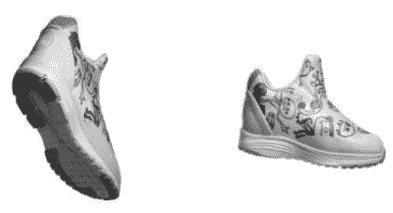
图 6-3 步丢(budiu)鞋^([\[4\]](#txt008.html#footnote_content_txt008_4))
智能定位服装原理相近，将定位芯片内嵌于衣领、衣袖、纽扣或饰品中。如“芭乐兔”“小猪芭那”“哈儿堡”等智能防丢童装，在设定范围内提供防丢报警与搜寻功能，穿着舒适安全，有效缓解家长担忧。

除手表、鞋、服装外，定位类产品还包括智能书包、头盔、眼镜、手环、钥匙扣、徽章等，为儿童出行安全提供保障。

## 智能监测类穿戴设备
该类设备聚焦健康监测、运动监测、环境监测。能够实时读取血压、心率、体温、睡眠质量等人体参数并反馈至手机，为个人或家庭健康管理提供参考。例如智能变色服随体温升高而变色，可提示老人或孩子发热。运动方面可记录登山、跑步等数据；环境方面可读取室内温度、湿度、空气质量等，改善生活便利性。

## 智能交互类穿戴设备
核心在于“交互”，当前仍处尝试阶段。典型做法是将电子芯片植入穿戴品，通过人与设备的信息沟通接收指令。例如美国 Juan Murdoch 发明的“会自动讲故事的睡衣”，在睡衣上设计点状 QR 码，通过“Smart PJs”App 扫描，可将故事以文字或语音呈现给孩子。

## 智能材料类穿戴设备
利用特殊材质或面料实现差异化功能。美国 2016 年提出“革命性纤维与织物”国家战略，目标开发可视、可听、可感知、信息传感、调温、抗菌、变色等功能纤维。英国设计师 Ryan Yasin 发明的可随孩子长大的智能童装（如图 6-4 所示），采用褶皱面料，可随身形拉伸，防水可机洗，降低穿戴成本。

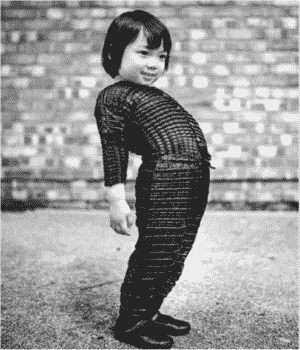
图 6-4 可与孩子一起“长大”的智能童装^([\[5\]](#txt008.html#footnote_content_txt008_5))
随着 5G、物联网、人工智能的推进，更多智能设备将被整合，智能穿戴将如雨后春笋般涌现并趋于多元化，让生活更高效便捷。

### 二、发展历程：智能穿戴的历史演进与发展趋势
从荧屏概念到如今随处可见的智能穿戴产品，如小米手环的热销，标志着智能穿戴从科幻走向现实，并由单一领域向多领域扩展。

把智能穿戴的时间线梳理一遍，大致可以归纳为四个演进阶段：概念萌芽期 1950-1970 年代、形态出现期 1970-1980 年代、快速发展期 1980-1990 年代，以及 1990 年代末至今的爆发期。^([\[6\]](#txt008.html#footnote_content_txt008_6))

### 第一，思想与雏形阶段(20 世纪 50—70 年代)
最初的推动力来自非常特殊的场景——赌场。为了在拉斯维加斯等地的博彩中占优，有人开始用微型摄像头、对讲机等与同伙联络。1955 年，麻省理工学院的爱德华·索普在《Beat the Dealer》第二版中提出了用可穿戴计算机辅助轮盘赌的设想，随后他与同伴研制出相应的可穿戴计算装置并在赌场中实测，提升了胜率。在此启发下，Keith Taft 也做出了用脚趾操作的计算设备，同样面向赌场，最终未能成功。可穿戴的概念由此在特殊需求中诞生。

### 第二，形态初现阶段(20 世纪 70—80 年代)
探索逐渐走出赌场，进入日常生活。1975 年汉密尔顿推出的 Pulsar 计算器手表虽未正式上市，却引发关注。两年后 Collins 为盲人打造了头盔式摄像设备，把图像转成背心上的视觉网格帮助辨物。1979 年索尼发布 Walkman 卡带随身听，用于随身收听。形态各异、功能各别，却共同勾勒出可穿戴的最初轮廓。

### 第三，发展阶段(20 世纪 80—90 年代)
真正加速发展的关键人物是史蒂夫·曼恩。高中时为改善视力，他自制了“计算机背包”，把主机固定在钢架背包上控制摄影器材，并通过采集、转换、显示实现视力辅助，兼具图文多媒体功能。后来他在右眼上装了可连网的显示屏，被视为第一副可穿戴眼镜。此后十多年间，数字手表、头戴显示、手持 GPS、胸章、腕式电脑等设备相继出现。 

图 6-5 Steve Mann 设计的显示屏^([\[7\]](#txt008.html#footnote_content_txt008_7))

### 第四，20 世纪末至今
进入蓬勃期，应用和产业规模同步扩张。按佩戴位置分，主要有头戴类如眼镜、头显、发带、耳机、耳环，手戴类如手表、腕带、手环、戒指，以及服饰类如衣物、鞋履、背包等。表 6-1 所示是 20 世纪以来可穿戴设备发展的部分阶段性成果。

表 6-1 可穿戴设备发展的阶段性成果^([\[8\]](#txt008.html#footnote_content_txt008_8))

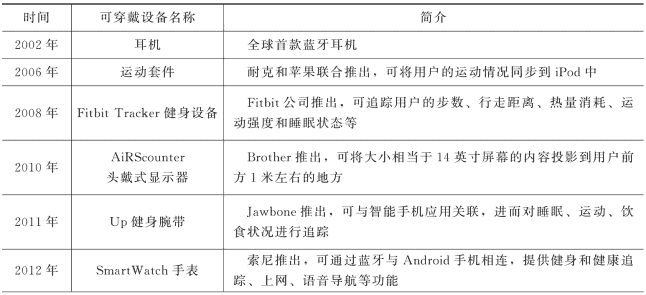

续表

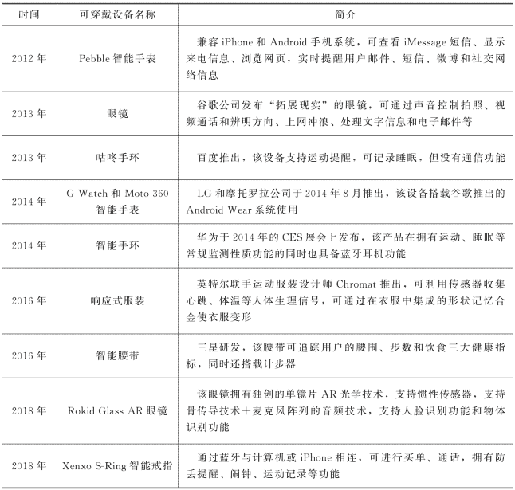

热度上升的同时，瓶颈也很明显。一是独立性不足。多数产品仍依附智能手机，通过蓝牙等连接才能工作，脱离手机就失去功能。二是功能待完善。虽然已有运动记录、健康监测、定位通讯等能力，但在细分场景仍有空白。美国 Forrester Research 的一项调查显示，44% 的人希望设备能帮忙锁车门、房门，30% 的人希望设备能按个人偏好推荐应用，说明需求尚未被充分满足。三是价格高、普及慢。高研发成本和技术门槛让产品尚未真正平民化。^([\[9\]](#txt008.html#footnote_content_txt008_9))

随着传感器成本下降和技术进步，平民化与日常化只是时间问题。伴随物联网、大数据、云计算、人工智能的成熟，智能穿戴的趋势大致有四点。首先，大数据与云计算的应用会更广。定位、运动、健康数据在精度和分析效率上持续提升，并向更多品类渗透。其次，人机交互成为重点。未来将更强调体感、语音、触觉、动作交互，减少对手机 App 的依赖。再次，产品走向更个性化、智能化与便捷化。消费者对高品质生活的追求会推动定制化体验。最后，整合与细分并存。一方面像拓展现实眼镜这类综合设备会不断整合服务；另一方面也会出现差异化、个性化的细分产品以抢占市场。

整体看，可穿戴设备将在医疗健康、时尚娱乐、教育等领域加速落地。

### 三、医疗领域：智能穿戴着重健康生活
工业化城镇化加快，生活节奏提速，可穿戴设备融合在医疗领域的切口由此打开。随着不规律作息、不健康饮食及吸烟饮酒等因素，心脑血管、糖尿病、癌症等慢性病发病率攀升，老龄化也加剧了健康焦虑。传统就医往往等到症状出现才干预，隐性病变易被延误。可穿戴设备能长时间贴近人体，实时采集生命体征数据，形成动态健康档案，为用户、家属和医院提供参考。

可穿戴医疗设备是指可直接穿戴的便携式健康医疗电子产品，在软件支持下实现感知、记录、分析、调控乃至治疗。^([\[10\]](#txt008.html#footnote_content_txt008_10)) 核心技术包括传感器、医疗芯片、无线通信和智能材料。传感器是信息入口，分运动传感器、环境传感器和生物传感器。美国工程人员研发的全电子集成汗液传感系统可监测皮肤温度和汗液生化物，在脱水、疲劳、体温异常时发出警报。^([\[11\]](#txt008.html#footnote_content_txt008_11))

医疗芯片用于生理信号接收与处理，支持突发疾病急救和重大疾病早筛，已广泛用于社区养老和预防为主的体系建设。无线通信如蓝牙、Wi-Fi、ZigBee 则负责把采集数据上传至云端分析并回传结果。借助导电高分子聚合物、纳米粒子等新型材料，设备兼具导电性和延展性。典型功能模块包括生理监测与预警、数据传输与处理、应急呼叫、日常用药提醒与运动提醒等。 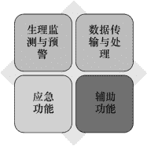

图 6-6 可穿戴医疗设备的四个功能模块

在 5G、物联网、云计算、人工智能推动下，可穿戴医疗加速热门。2019 年中国国际智能产业博览会上，荷清柔电展出柔性医疗可穿戴心电监测仪。传统心电需取回后读数，而该设备通过蓝牙连手机，贴近胸口即可实时查看心电数据；数据自动上传后台，由云端医生分析给出远程诊断，实现心脏疾病早筛。荷清还推出温感贴、心电贴、睡眠贴等监测体温、血氧、脉搏、胎心、血糖、睡眠等指标。^([\[12\]](#txt008.html#footnote_content_txt008_12))

## 可穿戴医疗设备的应用与挑战
除监测外，应用也在延伸。Active Protective 智能腰带内置安全气囊和 3D 感知装置，可识别髋部异常移动，老人摔倒前自动充气缓冲。Steadiwear 防抖手套帮助手抖老人稳稳拿物，提升生活安全。^([\[13\]](#txt008.html#footnote_content_txt008_13))

目前仍面临三大挑战。

### 认可度有待提高
医疗健康应用尚少，实际验证不足，老年群体对新技术接受度低，整体信任度不高。

### 准确性有待考证
心率监测相对可靠，但血压、血氧等指标离医学标准还有差距，专业性和体验感需完善。

### 安全性有待提升
设备绑定个人健康数据，一旦功能缺陷、监测失误或遭黑客攻击，易导致信息泄露甚至危及生命。

提升数据校核、加密与后台实时监控，植入医学原理与技术服务，才能增强准确性与安全性，让可穿戴医疗真正普及。

### 四、教育领域：智能穿戴关注个性化学习生活
学习需求持续加码，个性化学习成为主流。美国教育家约翰·杜威主张以学生为中心的学习方式，新西兰教育部 2006 年也强调因人施教。个性化学习需要对个体差异进行量化分析。

### 一、对自我的了解和探索欲望激发了自我量化的迫切需求
自我量化概念早在 1970 年代就被提出，当时受限于技术未能实现。随着物联网、大数据、云计算和小电池的成熟，记录行为、生理、心理数据的壁垒被打破，智能穿戴迎来广阔教育场景。

### 二、传统的学习辅助产品难以满足个性化学习的需要
工具书更新慢、操作门槛高，反而增加学习负担。降低难度、扩大广度、提升效率成为趋势。智能可穿戴产品依托物联网与云数据，信息量大且携带便捷。

典型案例是冠义科技的“腕语”智能手表，主打外语轻学习。手表内置词典与 14 种语言语音互译，支持语音查词，还整合喜马拉雅等音频内容，实现随时随学。基础功能上具备花式表盘、定位、心率监测、计步等。^([\[16\]](#txt008.html#footnote_content_txt008_16))

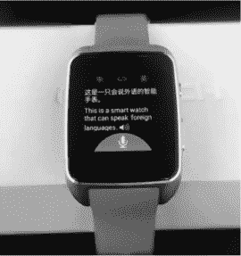

图 6-7 “腕语”智能手表^([\[17\]](#txt008.html#footnote_content_txt008_17))

### 三、穿戴设备如何撬动个性化学习

当下国内大部分学校仍在沿用固定班级、固定时段的授课模式，一个老师要面对十几到几十名学生，教学节奏和空间都高度统一。这样的安排很难兼顾个体差异，容易把学生的独特性压平，天赋难被发现，学习效率和能力培养也难以最大化。多样化的智能穿戴产品正提供另一种可能：支持远程回听课程、做有针对性的复习、通过互动提升学习兴趣，满足不同学生的需求，也在倒逼学习方式和模式的进化。

2018 年未来学校发展与创新研讨会上，华创互联科技就把可穿戴设备带入教育议题，围绕物联网、大数据、云服务等新技术描绘了未来教改图景。公司产品经理杨浩指出，教与学终将走向终身化，不再局限于教室里的一堂课。可穿戴设备将与慕课、直播等结合，依托互联网共享平台构建个性化学习路径，让校园教学空间与网络学习空间互联互通，发挥优质师资与资源的最大价值，并带来更逼真、沉浸式的体验。借助大数据采集与分析，教师的教学决策也能变得更有依据、更有效。^([\[18\]](#txt008.html#footnote_content_txt008_18))

产品形态虽多、技术迭代很快，但落地仍卡在几个关键点上。

#### 续航与功能叠加的博弈
小巧轻便是穿戴设备的基因，电池却受限于体积。越追求高功能，功耗越高，和续航之间的矛盾越突出。研发更小体积、更大容量的电池，是决定未来体验好坏甚至生死的关键。

#### 隐私与安全成信任底线
学习类穿戴会细致记录使用者的生理、心理等数据，数据越细，泄露风险越受关注。安全性提升与品牌信誉正成为用户选购时的核心考量。

#### 个性化场景远未完全落地
个性化是共识，但现有产品多停留在记录数据、反馈结果、检索信息层面，还不足以支撑真正的因材施教。未来需要对学习行为进行建模、预测与动态调整，根据学识水平、能力状态和即时反馈改变内容、强度与方法，为每个人定制完整的知识体系与多条达成目标的路径，并在过程中挖掘天赋。

#### 数据整合与精准洞察的短板
高质量的自我量化数据首先要解决多源信息融合，其次要做有效洞察。若信息碎片化，难以描摹个体差异，也就无法实现真正的个性化。当前可穿戴学习产品在这方面的能力仍显不足，提升融合与洞察是下一步研发的重点。

总的来看，智能穿戴为个性化学习提供了支点。更小更强、隐私更有保障、学习模式更智能的产品，会进一步加速这一趋势的到来。

### 五、娱乐新战场：穿戴把虚拟搬进现实

互联网、VR、大数据、云服务与人工智能的加速发展，让 DVD、VCD 淡出视野，电视机前用遥控器玩“超级玛丽”的场景也已很少见。电脑和手机虽普及，但笨重的主机、过小的操作界面仍限制体验。VR 兴起叠加智能穿戴的普及，一种更便携、易操作的新娱乐形态出现了。

近两年北京微跑科技推出了一款号称国内最小的体感游戏机——微跑小蛙。该机仅硬币大小，硬件与游戏一体，通过蓝牙与手机、平板或大屏连接，再挂在鞋子上即可实现体感互动。玩法从“用手玩”转向“用脚玩”，用跑跳等自然动作控制游戏，既降低了长时间低头对视力和颈椎的伤害，又能监测运动量，让娱乐与锻炼合一。微跑科技还在与教育平台联动，打造“寓教于玩”的氛围，让孩子在游戏中吸收知识。

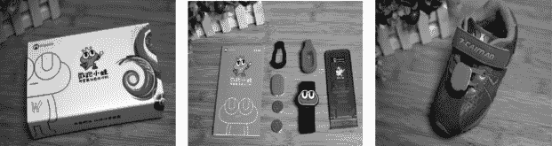

图 6-8 微跑小蛙^([\[19\]](#txt008.html#footnote_content_txt008_19))

面向少儿的微跑小蛙独创了国内唯一的三轴体感识别算法，采用三轴体感控制，可精准捕捉三维空间内的运动轨迹与趋势，实现智能操控，摆脱了传统摄像头体感的局限。

续航方面，小蛙使用 CR2032 纽扣电池，官方称可支持 4～6 个月的计步续航，或 300～400 小时的连续游戏。标准版配两块电池，一用一备，即便每天使用，也能覆盖半年左右，明显缓解了可穿戴设备续航不足的痛点。主机带卡扣可直接挂鞋带，也提供硅胶夹和绑带，方便没有鞋带或赤脚时使用，设计相当人性化，深受家庭欢迎。^([\[20\]](#txt008.html#footnote_content_txt008_20))

与小蛙类似，游戏场景下的可穿戴还有智能手环，例如“精灵宝可梦 Go Plus”。这款腕带式设备通过蓝牙与手机配对，玩家不必掏出手机抓精灵，一键按压手环即可完成丢球捕捉。振动与灯光提示附近精灵与驿站：绿色表示接近，彩色代表捕获成功，红色代表失败。抓到的精灵越多越强，激励机制推动玩家持续游戏。

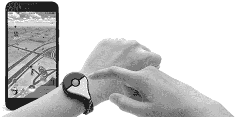

图 6-9 一款可以匹配智能手机蓝牙的设备^([\[21\]](#txt008.html#footnote_content_txt008_21))

游戏之外，观影与摄影同样被穿戴重塑。2017 年亚洲国际消费电子展上，深圳纳德光学凭借真 3D、超高清、柔光护眼的智能眼镜 GOOVIS G1 引发关注。

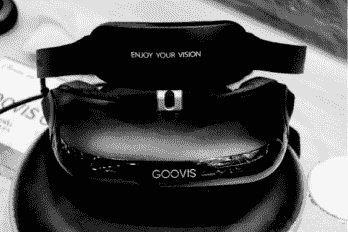

图 6-10 GOOVIS G1 智能眼镜^([\[22\]](#txt008.html#footnote_content_txt008_22))

GOOVIS G1 于 2016 年发布，主打影院级巨幕体验，被视作当时最清晰舒适的头显。公司用先进的光学显示技术搭配双 AMOLED 全高清微显示柔光护眼屏，带来佩戴舒适、便携、护眼、视觉清晰的高品质观影感受。产品可提供 800 英寸高清 3D 巨幕，同时柔光护眼屏保护视力。AMOLED 光谱柔和，有害蓝光仅为普通电脑或手机的约 3%，单眼分辨率达 1080P，精细度高达 3147 PPI，并可针对不同视力单独调节屈光度，无需戴眼镜也能清晰舒适观看。

内容层面，眼镜可连接 Wi-Fi 与外接存储，在线或离线观看海量 2D/3D 视频，缓解了 VR 内容匮乏的问题。无论飞机、火车、家中或旅途中，都能随身享受视觉盛宴。^([\[23\]](#txt008.html#footnote_content_txt008_23))

摄影拍照方面，OMG Life 的自动拍照相机 Autographer、GoPro 推出的手表控制摄影 App 等产品各有特色。

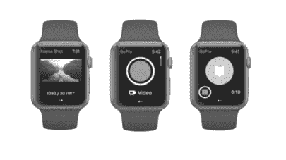

图 6-11 GoPro^([\[24\]](#txt008.html#footnote_content_txt008_24))

Autographer 配备 136°广角镜头、OLED 屏、大容量存储与 500 万像素摄像头，可挂脖或别衣。内置多传感器与 GPS，能根据光影、方向、色彩、温度等自动判断最佳拍摄时机，记录最自然的生活瞬间。GoPro 则在苹果手表里嵌入应用程序，让用户用手表操控数码相机，预览时做标记、抓取视频里的静态照片，并兼具拍摄、浏览、标记、下载、查找、剪辑等功能。

总的来说，随着 VR、互联网、大数据、人工智能的深化，智能穿戴正渗透到游戏、摄影、观影乃至唱歌跳舞等娱乐全链路。跨行业融合将让生活更丰富便捷，未来的应用边界也将持续扩展。

## 第七章 支付进化论：从现金到生物识别

支付的出现与商品经济同步。人类要获得所需物品，就必须完成一笔支付。从实物交换到信用工具再到电子网络，我国支付大致走过了实物支付、信用支付、电子支付三段路。如今以刷脸、声纹、无感识别为代表的生物支付正在普及，无现金的生活正加速落地。

支付形态的分化与演进
传统方式的局限与风险
无现金社会的争议焦点
智能支付时代的到来
场景落地与实践路径

### 一、支付工具的演变脉络

消费方式随时代更迭而改变，每一次改变都深刻影响着日常生活。在经济全球化与智能社会浪潮下，金融业正经历深刻重塑，科技进步正在重塑支付场景。

纵观数千年，中国支付经历了实物支付、信用支付、电子支付三个阶段，支付工具的更迭折射出生产力水平与生活形态的变化。

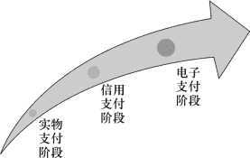

图 7-1 支付工具的发展阶段^([\[1\]](#txt009.html#footnote_content_txt009_1))

追溯到原始社会后期，物物交换萌芽。劳动产品交换是偶然个别的，只有双方同时需要对方的产品时才可能成交。

随着分工细化、生产效率提升，剩余产品增多，交换变得频繁而必然，从一对一走向一对多，支付工具雏形初现。

货币产生后，交换范围扩大。人们需要一种能够代表多数商品的等价物，于是贝壳、金银开始充当一般等价物，成为最初的货币形态。

货币形态随时代变化。商周有人造贝，后因冶炼技术出现金属铸贝。秦统一六国后统一货币，以黄金为上币、圆形方孔铜钱为下币，秦半两是世界上最早由官方发行的货币之一。明代白银与铜钱并行，大额用银、小额用钱。清末才出现机制银圆——光绪元宝，是中国首批引进海外技术印制的流通货币。

以贝、铸贝、铜钱、银圆为主的时期可归为实物支付阶段，工具即实物货币。

商品交换频繁后，货币弊端显现：笨重难携、成色难辨易造假等，推动支付工具革新。

纸币出现是重大转折，属于信用支付阶段。轻便易折叠，迅速进入流通。北宋交子是最早的纸币，最初为商业信用凭证，后成官方法定货币。南宋会子关子、元代钞也相继出现，但滥发导致信用丧失。

在大量用现钞的同时，票据也广泛使用。票据是出票人依法签发的无条件支付一定金额的有价证券，主要有汇票、支票、本票。^([\[2\]](#txt009.html#footnote_content_txt009_2)) 大额消费时常借助票据完成。

银行卡普及极大压缩了现金与支票比例。它是商业银行向社会发行的具有消费信用、转账结算、存取现金等功能的信用支付工具。^([\[3\]](#txt009.html#footnote_content_txt009_3)) 外出无需鼓钱包，刷卡输密数秒完成，“无现金”愿景初现。

改革开放后，互联网与信用体系完善，支付向电子化演进。

电子支付指消费者、商家与金融机构通过安全电子手段在信息网络上传递支付信息，实现货币支付或资金流转。^([\[4\]](#txt009.html#footnote_content_txt009_4)) 网上支付、电话支付、移动支付、POS 交易、ATM 交易成为主流。

在智能手机普及的当下，移动支付使用最广。不带现金、票据、卡片，只需手机绑定银行卡，通过微信支付宝扫码或转账即可完成。支付从笨重的金银到纸币、票据、银行卡，正变得更便捷、高效。

未来是否还会有更高效的方式？必然会出现。随着生物识别、物联网、大数据、云计算、人工智能深化，人脸支付、声纹支付、无感支付等新形态已进入视野，有望在未来占据主导。

### 二、传统支付的痛点在哪里

商品交易无处不在，支付是交易顺利的关键。移动支付带来快捷安全体验，但部分人仍保留传统习惯。传统方式在当下有哪些短板？移动支付能否彻底改变习惯？

传统支付以现金、票据、银行卡为主，共同面临“财产外露”风险。掏钱包付现或刷卡时，现金数额、卡号易被旁观者窥视，“财不可外露”，易招盗。

安全隐患更多。以银行卡为例，不法分子伪造证照购买 POS 机改装后低价售出，窃取卡信息并通过短信验证码、钓鱼链接转移资金。未设密码的卡遗失后更易被用于洗钱。

其余不足还包括：

携带不便、效率偏低。贝类、金银货币笨重，大宗交易需专人运输，核验耗时耗力，流通周期长。

易损耗与易伪造。货币边角磨损、票据易撕、现金被涂写，增加回收成本。金银成色难辨，易收假币；技术进步也助长假钞。

手续繁琐。以现金支票为例，需出票人签发、收款人持票、银行兑付，材料多、时效限，过期不受理。

管理麻烦。多种卡片混用易消磁、遗忘余额密码，信用卡逾期影响征信。现金存放过多不安全，存银行取款又需排队。

移动支付未完全取代现金，但已大幅削弱其地位。它是指借助手机完成支付确认，而非现金、银行卡或支票。^([\[5\]](#txt009.html#footnote_content_txt009_5)) 相比传统方式优势明显。

使用与管理更方便。银行卡绑定手机，到店或线上均可一键购，缴费生活费无需排队。

# 移动支付推动的无现金讨论

## 移动支付的价值体现

### 安全感提升
不需随身带现金与卡，减少暴露风险，支付过程不引人注意。资金存卡再绑定手机，可随时查询转账，便于记账理财。

### 成本与效率的改善
减少现钞与支票流通，节省印制成本。时间地点不受限，在线支付加速资金回笼，促进商品流转。

### 支付习惯的重塑
从长远看，移动支付必然改变消费习惯，推动人们追求更高效便捷的方式。

### 三、无现金社会的争议焦点

伴随大数据与人工智能，以电子支付和移动支付为主的无现金体系在国内快速发展，在多数城市弱化了票据、现金、银行卡的概念，推动无现金社会进程。

2017 年两会即有代表委员建言。全国政协委员、杭州市副市长谢双成提交《积极推进无现金社会建设》议案，提出以“互联网+政务”先行。全国人大代表郑坚江建议打通医保与移动支付，在公共服务领域实现无现金。全国人大代表虞纯呼吁兼顾老年人、残障人士与中西部偏远地区，完成无现金的“最后一公里”。^([\[6\]](#txt009.html#footnote_content_txt009_6))

全球也在推进。丹麦央行 2017 年关闭印钞部门，挪威 DNB 2016 年呼吁停用纸币，瑞典近半银行网点不收现金，印度废钞后推出国家支付钱包，韩国也提出让硬币退出流通。^([\[7\]](#txt009.html#footnote_content_txt009_7))

趋势明显，但进程并非顺畅。导火索一是商家拒收现金，二是支付宝微信等“无现金城市周”“8.8 无现金日”等营销活动引发关注。

非现金支付的数据化、留痕化有助于防腐、治税，操作高效也便利生活，企业推动无现金化是经营行为。但商家拒收现金需审慎。

法律层面，《中国人民银行法》与《人民币管理条例》规定人民币为法定货币，境内一切债务须以人民币支付，任何单位个人不得拒收。现金作为法定货币行使主权，拒收现金虽看似合理实则缺乏依据。

情理层面，公平问题突出。对部分老年人与残障人士而言，无现金并非便利。支付方式的价值以人为本，应尊重自由选择权，对只愿使用现金的人群给予理解与支持。无现金化不等于彻底不用现金，只是使用频率下降，特殊场景仍需保留。

从发展维度看，无现金化是必然。美国《连线》记者 David Wolfman 在《无现金时代的经济学》中指出现金的“原罪”之一：现金是病菌载体，流感病毒可在现金存活数日，反复传递加速传播。

现金的消耗带来的社会负担并不轻。纸币的平均使用寿命大约只有三年上下，日常流通中难免出现磨损、涂写等情况，既浪费资源又推高了印制开销。数据显示，2015 年美国在现金管理上支出的费用就达到 1 100 亿美元；2007 年在剔除点钞机、ATM 等设备成本后，欧洲 3 600 亿欧元的现金交易所产生的费用就高达 500 亿欧元。

再者，现金客观上助长了治安风险。银行、商场以及 ATM 周边抢劫、盗窃案件屡见不鲜。日本在养老金发放日，全国各地 ATM 附近都会集中部署大量警力，只为防止老年人遭遇偷抢。

此外，现金也是滋生税收漏洞的土壤之一。因为现金往来很少留下可靠的数据痕迹，追查困难，部分心存侥幸的人便倾向于通过账外交易进行逃税、偷税。

除了 David Wolfman 在书中提到的现金“原罪”，实际生活中现金还带来不少副作用。比如在公交系统的计费间里，常能看到多名工作人员“数钱数到手抽筋”，车上收上来的人民币破损不一，甚至混进游戏币。正是这些场景，让外界对新型支付方式的期待越来越高，反现金的声音也随之升高。

不过为现金辩护的声音也不少，最直接的便是印钞企业。一方面城乡经济发展不均衡，差距短期难以弥合；另一方面受教育程度和成长年代的差异，让长幼之间的使用鸿沟很难迅速填平。在当下，非现金支付很难实现对日常生活的全覆盖。还有一些政商腐败分子、贩毒人员等群体也是现金的坚定使用者，原因不言自明，唯有现金交易才能最大程度避免被追踪定位。同时，为农民工和老年人发声的现金捍卫者也存在，几年前的铁路网上购票争议就是例证。我们无权剥夺人们使用现金的权利，也无权干涉消费者的支付选择，必须尊重其自由。然而技术进步不会因少数人的不适应而停滞。

无论支持声浪高还是反对声浪大，无现金化已然成为大势所趋，且态势仍在加深。值得强调的是，电子支付、移动支付是一种新选项，并非唯一选项。不能因为选择变多，反而给自己套上“无现金”的紧箍咒，造成不必要的束缚。面对即将到来的无现金社会，应持辩证的态度来看待。

### 四、支付新时代：智能支付时代的来临

支付作为经济运行的重要基础设施，在技术不断迭代中被重新塑造。从货币、现金、刷卡到如今较为普及的电子支付、移动支付，支付形态的演进背后是技术创新的驱动。

进入 21 世纪，人工智能被视作三大前沿技术之一。它向各行各业渗透，支付领域自然也不例外。人工智能与支付的结合正在催生新一轮交易方式变革，在移动支付之后，智能支付很可能成为下一个风口。

2018 年在中国支付清算协会主办的第二届“支付智库”研讨会上，支付平台与人工智能技术的融合成为焦点。随着大数据、人工智能、区块链等金融科技与支付平台的深度结合，特别是人工智能对支付底层技术的改造，“智能支付”这一新形态应运而生。

何为智能支付？简言之，它是对金融科技 ABCD，即人工智能、区块链、云计算、大数据进行集约化应用，推动互联网支付从“技术贴合支付”向“技术融合支付”转变。当前实践中，人工智能支付主要体现为智能语音支付、人脸识别支付、智能穿戴设备 NFC 支付等。

智能支付的落地，让用户体验、运营效能、风险防控都出现了新优势。

首先是用户体验的提升。微信、支付宝的扫码、密码、指纹等仍占主流。随着人工智能全面介入，声纹、人脸等生物识别技术催生了“语音支付”“刷脸支付”等更便捷的形态。

例如，谷歌语音助手的 Google Pay 利用声纹识别，用户只需说出“给某人转账多少”，系统便会自动识别指令并完成转账，无需手动操作。亚马逊、万事达等也纷纷探索语音支付，结合 AI 虚拟助手和智能音箱开启新模式。

再如“靠脸吃饭”的刷脸支付。如今刷脸打卡已普及到公司、医院、校园。随后刷脸与支付结合形成刷脸支付。支付宝线下推出的“蜻蜓”设备形似 iPad，置于收银台前，消费者仅需对准摄像头即可完成认证支付。微信随后推出“青蛙”，两者在命名上就暗含竞争意味。代理商渠道的扩张也让这场支付竞赛愈发激烈。

有人将其称作第四次无现金革命。前三次是 POS 机、NFC、二维码支付。它们有一个共同点，即都需要介质。而刷脸支付的最大特点是不依赖任何介质，仅凭一张脸即可完成交易。若刷脸成为主流，微信、支付宝的竞争只会更激烈。目前带有刷脸功能的自助收银设备已在餐饮、零售、医疗等场景广泛应用，趋势在不断强化。

除语音、刷脸外，还有不可忽视的“无感支付”。它基于车牌号码的信用扣费，能省去停车、等待、找零等环节，实现高效通行，主要用于高速收费、加油等场景。

支付宝和微信均已启动高速无感支付。支付宝的“车牌付”要求芝麻信用 550 分以上，将车牌与账户绑定，下高速时自动识别并扣费，极大提升效率。微信的“高速 e 行”则通过公众号绑定车牌信息自动扣费，并提供预存通行费以减少误扣风险。

在加油场景，“无感加油”通过移动通信、车牌识别与银行自动扣款结合，实现不下车自动缴费。2018 年高速收费开启无感模式，2019 年 8 月中国石化广东深圳分公司与建设银行深圳分行推出的“无感加油”正式上线，未来或将成为汽车消费领域的新潮流。

其次是企业运营效率的提高。传统 POS 功能单一，体验不足。随着大数据、云计算、智能移动 POS 的发展，新型智能终端集刷卡、二维码、刷脸于一体，实现线上线下融合。它们不仅满足个性化支付需求，还能通过数据分析为商家提供精准营销，并为用户推送个性化服务，降低人工成本，提升整体效率。

最后是智能防控支付风险。传统“账户+密码”模式易受丢失、盗取影响。引入人工智能后，声纹、人脸、虹膜等生物识别大幅提升安全性。终端可将实时人脸与身份证、网络图像交叉比对，防止冒用。同时借助大数据、云计算、机器学习构建全流程自动化风控体系，实现事前侦测欺诈。未来区块链与支付的结合，也将从更高层面保障数据与资金安全。

语音支付、刷脸支付、无感支付的落地，标志着智能支付时代的到来，科技带来的高效与便捷将愈发明显。

### 五、实践应用：智能支付方式的落地

随着智能支付普及，外出不带现金已成常态，带部手机扫码即可。2017 年 5 月，扫码支付与网购、高铁、共享单车被“一带一路”沿线 20 国青年评为中国“新四大发明”。当外界为中国的扫码支付惊叹时，声纹支付与刷脸支付已率先出现。无需钱包、手机、密码，甚至什么都不带，也能完成消费。声音和面容正成为支付通行证。

下面以阿里巴巴的实践为例。

# 智能音箱与生物识别支付技术

2017 年 7 月 5 日，阿里巴巴推出一款圆柱形、黑白双色的智能音箱。如同传统音箱只会播放音乐不同，这款设备集音乐、讲故事、查天气、查快递、充话费、天猫购物、智能家电控制等功能于一体，成为生活助手。

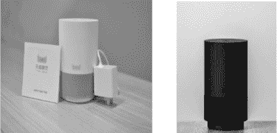

图 7-2 智能音箱

这款名为“天猫精灵”的设备能听懂普通话指令，可对话、播放音乐，也能下单外卖、控制窗帘。其核心能力之一是“声纹支付”。无需掏手机扫码，仅凭语音指令即可完成支付。其支撑技术是生物识别。

生物识别依托人体生理特征，结合计算机、光学、声学、生物传感器及生物统计学原理，通过深度学习模型实现身份验证。类别包括指纹、掌纹、声纹、人脸、虹膜、步态等。

声纹识别基于发声器官的稳定性，每个人声波形成的声纹图谱都独一无二。阿里实验室据此尝试将声纹与支付结合，让声音成为支付密码。

操作上仅需动嘴。以点外卖为例，用户对天猫精灵说“我要点外卖”，系统会搜索附近好评商家并报出价格、地址、距离供确认。确认后进入身份验证环节，天猫精灵会随机读出一串数字文字口令，用户复述后系统比对采集的声音，验证通过则下单支付，失败则取消。订单可在手机淘宝查看。

这种方式便捷，但安全性如何？每个天猫精灵相当于独立账户，首次使用需开启声纹购功能，系统采集并学习用户声音，后续以此为标准进行身份核验，确保私密与安全。

## 刷脸支付

需求总在迭代。现金到刷卡，再到扫码移动支付，流程在不断简化。现在出门只带手机即可扫码，仍有人希望更简单，甚至什么都不带。刷脸支付正把这一理想变为现实。

2015 年 3 月，马云在汉诺威电子展上演示支付宝刷脸支付，几秒后屏幕显示支付成功。此后多年虽有尝试，但迟迟未商用。

2017 年 9 月，刷脸支付实现商用。9 月 1 日，杭州万象城肯德基餐厅门口新增三台自助点餐机，支持刷脸支付，人流量明显提升。这是全球范围内首次商用试点。

首次使用需在支付宝开通刷脸支付。点餐完成后选择刷脸支付，验证通过后自动从支付宝账户扣费。

因支付宝账户为实名制，刷脸比对的是身份证信息，无需额外采集。整个过程可在 10 秒内完成，对易忘密码或操作不熟练的老年人尤为友好。流程简化、效率提升、安全与便捷得以统一。

落地之前，阿里团队就对刷脸支付里的人脸识别精度与安全做了长时间的摸索。实验室环境下，机器的识别能力早已超出肉眼判断，但一到真实使用场景，室内外光线差异、强弱变化、化妆前后区别、面部姿势与表情的多样性等，都可能成为干扰项。

统计显示，支付宝人脸识别首次上线时整体通过率不到五成，平均一百次刷脸约有一半会失败。研发团队据此持续调优算法，反复试验改进，努力削弱环境带来的影响，贴合用户实际使用习惯，不断提升识别成功率。测试阶段，设备上还加装了滤光片，也就是偏振片，它能把眼镜镜片产生的反光进行扩散分离，从而减轻反光对识别的干扰。经过不断打磨，目前支付宝的人脸识别准确率已提升到 99.6%。

人们常有的疑问是：双胞胎相似度极高，机器能否区分？浓妆后面貌变化大，会不会误判？

为此科研人员做了专门测试。先让一位素颜上镜，再由化妆师化上浓妆后再次上镜，结果两次均显示验证通过，说明妆容不影响最终结论。随后请来一对双胞胎姐妹，在对姐姐进行身份核验时，姐姐刷脸通过，妹妹刷脸也被正确区分，整个过程不到十秒，反过来同理。可见即便外形高度相似，设备仍能快速准确地完成身份辨识。

支撑快速精准的背后是什么技术？除专业的人脸识别外，设备还能捕捉人脸的特殊区域，例如眼纹识别。眼纹识别主要读取眼白区域的细微血管纹路，每个人眼白的血管分布各不相同，如同指纹般唯一且终身不变，因此可作为身份区隔的依据。在眼纹识别条件下，即使佩戴眼镜也不会影响判断，这也是刷脸识别可靠的关键所在。眼纹识别准确度很高，但因技术难度较大，目前还未大规模普及。

眼纹技术与人脸识别结合，让日常生活中的刷脸支付更安全。餐厅刷脸买单，车站地铁刷脸进站，酒店刷脸入住，电商平台刷脸付款……“脸”正逐渐承载身份证、通行证、付款码等多种功能。

展望未来，随着生物识别、物联网、人工智能等技术日趋成熟，声纹支付、刷脸支付等类似的黑科技将越来越多，从支付层面进一步改变生活，推动社会向无边界的智能化与便捷化迈进。

## 第八章 智能机器：智能生活就在我们身边

教育机器人：陪伴孩子健康快乐成长

家用机器人：解放家庭主妇

养老机器人：关爱老人智慧养老

孩子独自在家无人照看，家务缠身的主妇难有喘息，孤独的老人缺少陪伴，这些现实难题在新一代信息技术加持下有了新解。随着物联网、大数据、云计算、人工智能的发展，儿童陪护、家庭服务、养老关爱等各类智能机器人纷纷出现，覆盖了从老人到儿童的全龄陪护、看护、娱乐与教育需求，让科幻逐渐变成日常。

## 教育机器人：陪伴孩子健康快乐成长

当今科技迭代加速，机器人技术被视作二十世纪以来最具创造力的发明之一，在工业制造与公共服务中作用愈发突出，也是衡量国家科技与工业水平的重要标志。2016 年，谷歌的人工智能围棋程序阿尔法狗以三比零战胜世界围棋冠军李世石，让公众对人工智能和机器人的关注大幅提升。

机器人可看作人工智能的载体。它依托程序控制，自主完成特定工作。最早应用于汽车制造，因其产量大、一致性高，适合不知疲倦的机械作业；随后进入高危行业如建筑，用以替代或辅助人工，降低风险。技术成熟后，机器人逐步进入安防、教育、服务、医疗等领域。

我国全面放开二孩后，每年新增婴儿数预计超两千万。许多年轻父母忙于工作，陪伴孩子的时间严重不足。工作与陪伴难以兼顾时，家长常通过点读机、学习机等“玩具”来弥补。依托人工智能的东风，机器人进入儿童市场，儿童机器人由此兴起。

市场上针对儿童的机器人种类繁多，核心技术和功能大体相近。技术层面主要涵盖人工智能、机器学习、语音识别、仿生技术。

人工智能是核心之一。它研究开发模拟、延伸和扩展人类智能的理论与方法。把人工智能赋能机器人，实质是将人的思维、语言交流与行为能力投射到机器上，实现人机沟通互动。机器人与人的区别在于，人能完全自主思考决策，而机器人只能实现部分思考、半自主决策和行动能力的机械化个体，这里的“部分”“半”正体现了其模拟学习的人工智能本质。

机器学习专研计算机如何模拟人类学习行为，从而获取新知识与技能、重组已有知识结构不断优化自身性能，是人工智能的子领域和核心。将机器学习与计算机结合，是机器人模仿、学习并具备智能的基础。

语音识别即机器自动语言识别。通过编码把语音信号转为文本或指令，让机器理解人类语言并实现自然沟通。在人机互动中，语音是关键的桥梁。

仿生技术指把人的外形与技能“克隆”到机器人上，使其外形结构和功能更接近人类。人形机器人是典型代表。当前多数厂商在完善功能的同时也注重外观形态，仿生机器人可模仿人类跳舞、扭动、摆手、旋转、下腰等动作，如阿尔法跳舞机器人。

具备上述关键技术的儿童机器人，在成长中扮演重要角色。对低龄儿童而言，它既是玩乐伙伴，也是启发学习的早教老师。当前功能主要集中在陪伴、娱乐、教育三方面。

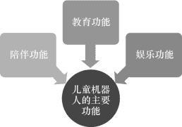

图 8-1 儿童机器人的三个主要功能

陪伴功能十分直观。因工作原因父母难以常伴左右，儿童机器人便充当“代理父母”角色，起到守护作用。它可按程序提示提醒孩子作息，也能代替父母解答“大树为何落叶”“蝴蝶为何会飞”等问题，还能讲童话、寓言等故事，缓解孤独感。部分智能陪护机器人还支持亲子视频通话，成为情感纽带。360 儿童机器人即可通过机器人与父母通话，并基于人工智能云下的人脸识别技术精准识别孩子面部表情，记录成长点滴，自动生成成长小视频。

# 儿童机器人

在娱乐层面，儿童机器人充当“小伙伴”。人本具社会性，从幼儿园起儿童才开始广泛社会交往。此前除了家人，几乎没有同龄伙伴。儿童机器人填补了这一空白。

例如科大讯飞推出的阿尔法小蛋儿童智能陪伴机器人，配备领先语音识别系统和云端大脑，能模拟儿童语气语调，以同龄人身份聊天、唱儿歌、讲笑话。另有一些为运动设计的机型，可按要求做旋转、扭动等动作陪玩；部分机型还具备跳舞功能，如巴巴腾智能跳舞机器人等。

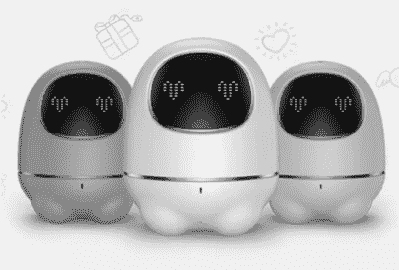

图 8-2 阿尔法小蛋

有人担心无人看管时机器运动会伤到孩子。实际上这类陪护机器人都有安全保障。除安全尺寸外，功能层面配备灵敏的定位探测捕捉技术，在运动时能与孩子保持安全距离，避免磕碰误伤。

## 教育功能

除陪伴与娱乐，教育功能是儿童智能陪护机器人的核心价值。无论品牌如何，它们都拥有丰富的教育资源库，涵盖数学运算、英汉互译、古诗对对、寓言故事、趣味谜语、成语接龙、百科常识等，覆盖面广。

具体来看，教育功能首先体现在语言表达与交流能力的培养上，通过语音对话、智能问答、成语接龙等交互，训练孩子的语言与沟通能力。其次，通过讲故事、出谜语、播放音乐等启发思考，锻炼想象力与音乐感受力，培养学习与兴趣。再次，通过简单的加减乘除运算锻炼思维与记忆力。最后，通过“跳舞”等动作训练注意力与观察力，全面促进能力发展。

总之，在父母忙碌时，儿童机器人以娱乐互动与共同学习的方式陪伴孩子健康成长，实现寓教于乐，兼具陪伴、娱乐与教育。

据预测，到二十一世纪中期，人类将全面进入以智能机器人为代表的智能时代。在美、日、英等发达国家，机器人已作为教学辅助工具进入教育。国内也在探索机器人辅助教学，如卡仕辅助教学智能机器人、呆呆忆作业辅导机器人等。

卡仕辅助教学智能机器人遵循国际先进技术和 STEAM 教育理念，在知识辅导、学习习惯养成、综合素养培养方面作用显著。呆呆忆作业辅导机器人由深圳小忆机器人技术有限公司推出，利用图像检测与识别技术提升语文字词、英语单词查询及拍照搜题效率，可批改作业并根据每个孩子情况提供个性化一对一辅导，还能整理作业清单，将完成情况信息化推送至家长微信，便于实时掌握学习动态。

目前市场上还有小哈智能教育机器人、小帅机器人、布丁豆豆、ROBOO、小胜机器人、小墨机器人等热销产品。

## 现状与挑战

作为搭载互联网与人工智能基因的新兴品类，儿童机器人仍处起步阶段，在智能化程度、交互体验、差异化等方面存在不足。

弱智能化。人工智能发展大致分为弱人工智能、强人工智能、超人工智能。目前尚处弱人工智能阶段，只能完成特定任务或解决特定问题。儿童智能机器人虽在语言交流、常识问答、娱乐互动上表现接近人类，但在很多方面仍无法实现完全智能化。随着技术深入，这一局限有望逐步改善。

交互体验有待提升。现有产品虽借助自然语言识别实现基础交流，但多停留在浅层简单对话。因智能化程度受限，对深层、超出程序覆盖的问题难以无障碍沟通，导致交互体验感较差。

同质化隐患在抬头。儿童陪护、教育机器人一旦成为热点，各大厂商便争相涌入试图分一杯羹。现实是，这类儿童智能产品离不开长期沉淀的技术积累和场景经验，并非简单把存量技术搬家或叠加就能做出高智能、好体验的方案。眼下不少在售机型，本质仍是把点读机、学习机、游戏机、平板电脑等换个外形、稍作改动后装进机器人壳体，或是对同类产品的再包装。品类边界模糊，替代属性强，市场很容易提前拥挤。

展望中长期，随着底层智能持续进阶，儿童智能机器人将迎来迭代与纵深演进。横向看，教育机器人正逐步成为未来教学的重要抓手；与此同时，服务家庭的家用机器人、服务医疗的医疗机器人，也将在人们的日常生活中扮演关键的助手角色。

# 居家分担：从繁重家务到机器人助力

传统观念里，男性主外女性主内，所谓男耕女织，内务被默认为女方的责任，照顾家人做好家务便算贤惠。时至今日分工已然松动，家庭成员不仅要做饭洗衣打扫，还要兼顾育儿和老人照料，琐事叠加带来的矛盾日益显性化。

下班回到住处，原本想短暂放松，却常被未做晚餐、地面未拖、衣物未洗等待办占据，仿佛需要分身才能在有限时间内全部处理。荧幕上的分身术现实难以实现，于是有人把事务外包给家政或私人保姆作为折中。服务到位时，回家能见到洁净地面、整齐沙发、洗烘好的衣物和收拾好的卫生间，甚至已备好餐食，无需再拖着疲惫继续奔忙。

但家政模式也暴露明显短板。首先是成本高昂，对经济压力较大、夫妻皆需外出工作的家庭而言，花钱请人不如自行处理，既省开销又避免上门服务的麻烦。其次是私密与安全难以完全保障。家政行业高度依赖职业操守，市场良莠不齐，陌生人进入私密空间的信任成本很高，普及度因此受限。

人们进而设想，能否由机器直接承担家务，真正把人从重复劳动中解放。无论是家政还是保姆，本质都是换个人动手。若出现专职做家务的机器人，人类双手才算真正摆脱家务枷锁，无须每月付费雇人，也无需担心隐私泄露，机器不会疲倦也不会抱怨。在市场诉求与技术进步共同推动下，面向家庭场景的家用机器人应运而生。

在美国，第一台家用机器人 Electrolux Trilobite 在 2001 年问世。这款真空吸尘机具备基础避障与导航能力，可清洁平整的客厅地面。随着技术成熟，iRobot 推出的 Roomba 系列性能显著提升，加入防缠绕、防跌落、定时清扫等功能。相比初代机，它能自动识别地板材质如地毯、瓷砖并切换清扫模式，轻易避开电线、地毯流苏、垃圾桶等障碍，并深入墙角、桌下等死角。高配型号搭载高端感应器、行为控制器与自主导航系统，能有效避免坠落，清洁结束后自动返航充电。如今在美国，Roomba 已成为最受欢迎的清扫机型之一。

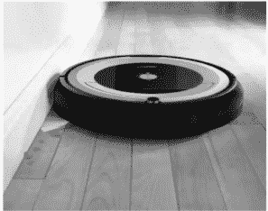

图 8-3 真空吸尘机器人 Roomba^([\[5\]](#txt010.html#footnote_content_txt010_5))

中国市场的研发步伐不慢。以优必选科技为例，2019 年春晚深圳分会场，6 台大型仿人服务机器人 Walker 与明星同台献唱《青春畅想》，边跳舞边随音乐变换表情与队形，迅速登上微博热搜“春晚机器人”，热度不输同台艺人。

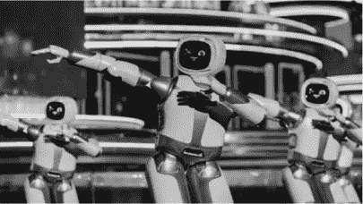

图 8-4 Walker 在央视春晚表演节目^([\[6\]](#txt010.html#footnote_content_txt010_6))

其实它们在科技圈更负盛名，参演的正是入选 the Best of CES 2019 的 Walker 新一代。

2018 年 1 月首发时，Walker 仅有双足平台。2019 年国际消费电子展上，Walker 已配备灵活双臂与灵巧双手。从 CES 首秀到 10 个月后澳门举行的 IROS 2019，运动能力、柔性交互、环境感知等方面完成算法迭代与功能升级。

运动层面，静态平衡与行走步态得到优化，双腿对复杂地形的适应性增强，可平稳快速上下楼梯，姿态更接近人类。

柔性交互层面，设计始终把安全置于首位。1940 年，科幻作家阿西莫夫提出“机器人三原则”：机器人不得伤害人类；必须服从人类指令；必须保护自身。^([\[8\]](#txt010.html#footnote_content_txt010_8))这为机器人提供了伦理框架与制造指引。优必选在 Walker 上应用力控技术，通过力位控制，手掌接触物体时能精准把握力度，避免损伤。基于全身柔顺控制与协调能力，Walker 可熟练擦拭桌面，力度适中不留划痕。

环境感知层面，优必选融合“视觉伺服”技术与感知系统，胸前深度相机可自主识别目标位置与姿态。例如倒水演示时，先定位水杯位置与大小，调整双手抓取，随后规划运动完成倒水。此类能力为后续更多生活化任务奠定基础。

与国际同行相比，优必选起步不算早。2015 年至今，Walker 项目约用四年从实验室走向 CES、世界机器人大会以及 IROS，并斩获多项荣誉。目前已能开关门、拎取物品、端茶倒水、弹琴画画、控制家电。据研发团队介绍，下一步目标是走进千家万户。随着机器人与人工智能持续发展，Walker 有望以优雅姿态成为家庭成员。^([\[9\]](#txt010.html#footnote_content_txt010_9))

图 8-5 优必选机器人 Walker 新一代^([\[7\]](#txt010.html#footnote_content_txt010_7))

与优必选类似，以色列 Roboteam Home 研发的 Temi 是一款多用途家用智能机。如图所示，Temi 高约 1 米，配备 10 英寸高清 LCD 显示屏，自带载物托盘，底座暗藏移动轮子。躺在沙发上想吃水果时，只需语音下指令，Temi 便会自动取来递上，实现“饭来张口”。做饭时也能让它取食材、拿物件，像使唤孩子一样。

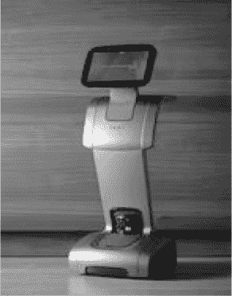

图 8-6 机器人 Temi^([\[10\]](#txt010.html#footnote_content_txt010_10))

实现原理是强大的语音操作系统。依托腾讯云小微的人工智能与内容资源，大多数口语可转为指令。Temi 身上还集成大量传感器，可辨识场景、自动规避障碍，即使在复杂环境也能自主寻路，为主人奔走取物。

除了打杂型机型，若能拥有一位会自主思考的“管家”就更好了。BIG-i 就是这样一款家庭机器人。造型像独眼垃圾桶，又似呆萌小黄人，被 NXROBO 称为“私人机器人管家”。它具备基础语言识别，同时拥有空间认知与三维绘图能力，可根据房间、语音、人体移动判断方向。头顶大眼其实是可全方位自由旋转的高清摄像头，能识别面部表情与动作指令，并对家庭环境进行自动巡检。体内集成温度、湿度、感光等传感器。温度下降时会提醒主人添衣；室内温度过高过低可连接智能家居调节空调；阳光强烈时可让窗帘自动降下；门外出现陌生面孔会即时通知主人。其智能程度确实配得上“管家”之名。

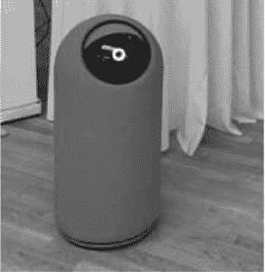

图 8-7 BIG-i 机器人^([\[11\]](#txt010.html#footnote_content_txt010_11))

在 Walker 这类多用途机型普及前，扫地有 Roomba，擦窗怎么办？不想做饭、不想洗泳池、不想折叠衣服、不想打理院子，又该如何？其实针对这些家务的专用机型已出现或正在到来。

莫雷机器人是世界上首款厨房机器人，包含橱柜、灵活机械手臂及电器与安全设备。通过动作捕捉学习人类烹饪手法并数据化存储。接到点餐信息后，它会从 2000 多份菜谱数据库中提取数据制作佳肴。由控制关节与多种传感器组成的机械臂还能擦洗锅碗瓢盆与灶台，宛如被克隆的家庭主妇。

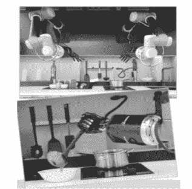

图 8-8 机器人厨师莫雷^([\[12\]](#txt010.html#footnote_content_txt010_12))

市场上也有炒菜机器人，预设好程序，只需放好食材即可自动烹饪。

## 家务全覆盖：从叠衣到养护

“科技因懒而进步”。全自动洗衣机已普及，洗衣服变得轻松，但晾干后仍需叠衣。美国 Foldimate 公司推出自动叠衣机 Foldimate，并在 2018 年 CES 亮相。外观类似打印机，衣服平整放置在上部夹口，机器像“吸纸”一样将其吸入，数秒后整齐的衣物从下方送出。目前可处理衬衣、裙子、裤子、T 恤等常规衣物，大幅节省时间。

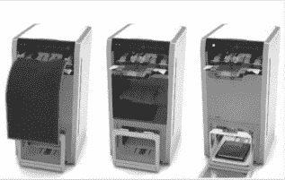

图 8-9 自动叠衣机 Foldimate^([\[13\]](#txt010.html#footnote_content_txt010_13))

未来，自动探测窗边距离并规划擦窗路径的擦窗机器人将替代高层与户外擦窗；自主充电、自动修剪草坪的割草机器人将打理院子；搭载 GPS 定位、防缠绕、自动旋转的泳池机器人将清洁泳池。

比尔·盖茨曾预言机器人将重复个人电脑的崛起之路，未来家家都有机器人。个人电脑进入家庭的预言已实现，随着智能技术飞速发展，家庭机器人革命也将如个人电脑般彻底改变生活方式，把家庭主妇从繁重家务中解放出来。

## 三、银发关怀：养老机器人助力智慧养老

近年来我国人口老龄化不断加深，家庭与社会养老压力持续上升。《2017—2025 年中国人口老龄化市场研究及发展趋势研究报告》显示，60 周岁及以上人口比重逐年攀升，预计到 2020 年老年人口将达 2.48 亿，老龄化水平约 17.2% (如图 8-10 所示)。

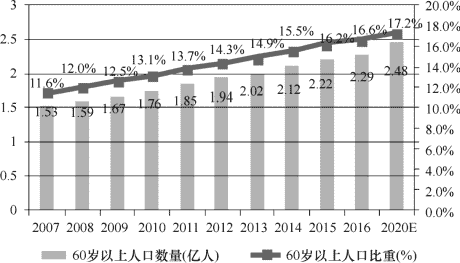

图 8-10 2007—2020 年中国 60 岁以上人口数量及比重^([\[14\]](#txt010.html#footnote_content_txt010_14))

调查显示，超过 90% 的老人选择居家养老，由子女或配偶主要照护，少数雇佣保姆；约 7% 选择社区养老，其余进入养老院。

每种方式都存在不足。居家养老中，家人或保姆多缺乏专业护理知识，只能做最基本的健康监控，对生活照料与精神慰藉无能为力。社区、养老院、医院中，医护人员有限、老人众多，容易出现照顾不周、疏忽等问题。

2019 年 8 月 20 日世界机器人大会上，主打“养老”概念的机器人，如养老助残机器人、医用机器人吸引众多目光。专家认为，养老陪护服务型智能机器人在未来家庭与社区养老中将占据愈发重要的地位。

近几年在大数据、云计算、人工智能推动下，智慧养老成为行业发展趋势。面对“银发浪潮”，企业试图将养老服务与人工智能结合，研发面向老年人的智能养老机器人，提供娱乐陪伴、智能提醒、安全监测、卫生保洁、医疗辅助等服务。

智能养老机器人专用于养老，具备提醒、监测、辅助生活等功能，适用于养老机构也适用于独居老人。从业务类型看，大致分为辅助护理类、生活服务类、陪伴类三大类。

辅助护理类主要指机器人手臂、助行机器人、多功能护理床等，帮助老人或患者起立行走、坐卧、翻身等。生活服务类主要指可承担搬运、饮食起居、提醒服药、端茶倒水、清洁打扫等工作的智能机器人，如清洁机器人、搬运机器人。陪伴类主要功能是陪伴老人、交流对话，满足情感需求、缓解孤独、进行心理陪护，如宠物机器人、聊天机器人、娱乐机器人。

早在 20 世纪 90 年代初期，陪护类机器人便已出现。日本老龄化严重，投入大量资源研究助老机器人。1998 年，科学家柴田崇德研发了养老机器人帕罗 Paro。帕罗外形像毛茸茸的海豹宝宝，皮毛下安装触觉、听觉等感应器，能根据外部刺激做出兴奋、撒娇、卖萌等带有情感的反应。

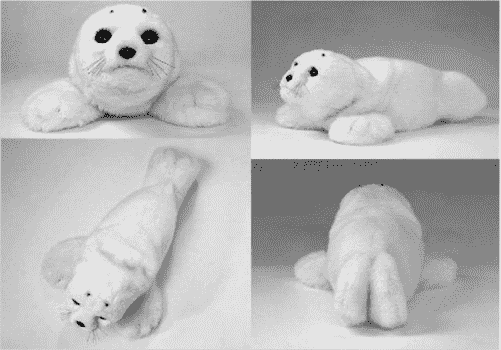

图 8-11 帕罗(Paro)机器人^([\[15\]](#txt010.html#footnote_content_txt010_15))

陪伴与助力并行：养老机器人正在改变晚年生活

PARO 海豹型陪伴机器人允许长者将其抱在胸前、放在腿上或安置在沙发椅面，进行抚摸与交谈。其内置感知模块能够辨别环境声响、识别主人声音并理解简易指令，随后以轻快的鸣叫作出回应，并配合撒娇卖萌的小动作。更关键的是，这只“宠物”不会衰老离世，清洁便捷且无需专业训练，即便遭遇责骂也不会出现情绪性冷漠。相较真实的猫狗，它在医院与养老院的接受度更高。

对于阿尔茨海默、失智等人群，PARO 的情绪调节作用尤为明显。不少患者会出现傍晚至夜间焦躁不安、想要四处走动的黄昏综合征。研究显示，让患者抱着这只“海豹宝宝”后，无定向走动的行为明显减少，摔伤磕碰的风险随之下降。如今 PARO 已在日本、美国、意大利等多个国家的医疗与养老机构中使用，用来缓解孤独焦虑，辅助心理康复。

随着技术成熟，能够直接介入日常照护的实用型服务机器人也在涌现。日本 Cyberdyne 推出的 HAL 可穿戴外骨骼装置可增强使用者四肢力量，辅助起身、翻身、行走或提举物品。更深层的价值在于，它对大脑、神经与肌肉功能具有一定的改善潜力。即便出现半身瘫痪或失能状况，穿戴 HAL 并配合康复训练后，活动能力也能逐步恢复。

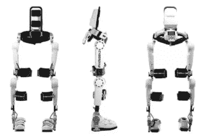

图 8-12 哈尔(Hal)机器人^([\[16\]](#txt010.html#footnote_content_txt010_16))

在美国加州大学旧金山分校的 Mission Bay 医院，Aethon 公司的 TUG 自主移动机器人承担着病区后勤运转。其外形接近立方体，系统统计平均每日行走约 115 英里，既能运送药品与餐食，也可整理床单、清理医疗垃圾。病人可通过手机或平板下单，厨师将餐盒放入机器人柜体并发出指令后，TUG 会把食物送达指定地点。机器内置导航系统，能避障并自主乘梯，同时通过医院 Wi-Fi 与中央控制平台互联。若出现迷路等异常，会即时发出求助，工作人员可远程调阅运行记录和周边画面迅速处理。TUG 的投入减轻了医护人员在床单整理、药品配送、垃圾清运等方面的负担，整体工作效率得到明显提升。

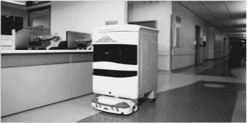

图 8-13 TUG 机器人在医院应用场景^([\[17\]](#txt010.html#footnote_content_txt010_17))

除此之外，功能相近的智能养老机器人仍在不断研发，例如索尼可进行连续对话的泰迪熊 Teddy 宠物机器人、欧姆龙外形高度仿真的人工毛皮猫型宠物 NeCoRo、松下可由床形态切换为轮椅的 Resyone、日本理化研究所与住友理工联合研发的护理机器熊 Robear，以及 iRobot 与 InTouch Health 联合研发的远程医疗机器人 RP-VITA 等。

这些案例表明，发达国家尤其是日本对养老机器人的投入格外集中，在持续探索中形成了多个试验样机，部分高端产品也已进入市场。

国内方面，面向老年人的智能陪护型养老机器人研究尚处起步期，多家企业仍在试探与初步布局。柚瓣家养老机器人、优必选 Cruzr 养老机器人、新松家宝智能养老机器人等产品已具备智能看护、亲情互动、健康管理、远程医疗等基础功能。

技术进步为功能落地提供了支撑。老年人最核心的需求集中在生活自理与精神陪伴两方面。

目前试验阶段的多数设备在生活照护层面已能发挥较大作用，市面上还有助行机器人、智能轮椅、机器人手臂等单一功能产品。但在精神陪伴上，机器人能否真正替代亲人带来的情感依恋，仍值得深入研究。

守护亲情是中国自古以来的情感追求，即便在今天，父母如何安度晚年仍是子女关注的重点。研发中普遍借助机器学习与人工智能，让机器人学习老人的喜好与行为习惯，尽可能满足情感交流与陪伴需求，成为真正“懂”老人的伙伴。但从现状来看，机器人尚难完全达到这一目标，智能养老机器人的道路依然漫长。

从市场需求看，未来的几十年里中国家庭对养老机器人的刚性需求将持续增加。伴随科技的快速发展，智能养老的蓝海市场正在逐步打开。

第九章 智能安防：安全升级在路上

智能安防正构建起一套庞大而完整的防控体系，并配备多种智能化产品与设备。与传统安防相比，无论在工作效率还是防护质量上都有显著提升。如今智能安防已落地于道路交通、社区等城市重点监控领域。但与此同时，监控的透明化、可视化也对个人隐私保护带来挑战，如何在安全与隐私之间取得平衡，成为智能时代的普遍议题。

### 一、智能安防：更主动的安全网络

安全是关乎生存、生活与发展的基础需求，也是各项活动的前提。马斯洛的需求层次理论指出，人类需求由低到高依次为生理、安全、社会、尊重和自我实现，其中安全需求处于底层。只有在生命与生存环境得到保障的前提下，社会交往、尊重与自我实现才有意义。由此可见安全的重要性毋庸置疑。

正因安全与人类最本质的需求密切相关，人们对安全的关注延续至今。但安全事故仍时有发生：家中可能出现煤气、天然气泄漏、火灾或入室盗窃；社区里有跟踪抢劫、打架斗殴；校园存在暴力欺凌与偷盗；银行也常面临抢劫与保险柜被盗等风险。这些发生在不同场景的安全事件，让人们在担忧的同时不断思考如何降低发生概率。

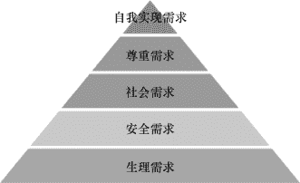

图 9-1 马斯洛的需求层次理论

# 智能安防体系的搭建与演进

## 主观意愿与客观环境对安全的影响

从主观层面看，家庭与学校通过思想道德教育培养健康人格，倡导关爱同学、不偷不抢，以减少校园暴力与偷盗；社会则以伦理、道德与法律约束行为，从内在谴责到外在惩戒，旨在遏制违法犯罪。但现实中对安全的威胁不仅来自人本身，也来自难以避免的客观因素。即便主观努力很多，客观条件仍然制约着安全效果。

在客观环境中，人们为保障安全做了大量硬件探索，比如安装防盗门、防盗窗、防盗网；公共场所配置消防栓；必要区域安装摄像头等监控设备。这些设施在一定程度上降低了财产损失与生命威胁。

随着社会发展与科技进步，单一、机械化的安全设备如防盗门、摄像头、消防栓已难以满足需求。城市化加速带来的交通拥堵、能源紧缺、环境污染、住房不足、治安紊乱等问题日益突出。需要加快企业转型、推动政府职能转变、加强社会治理创新，加快智慧城市建设。

## 智慧城市与平安城市

智慧城市建设依托物联网、大数据、云计算及通信技术，将城市打造为万物互联、万物智能的整体，实现对城市资源的精细化、精准化、动态化管理，从而优化管理与服务，提升生活水平与质量。在此背景下，平安城市建设受到更多关注。

平安城市融合社会治安管理、道路交通管理、生产安全管理，通过图像视频监控、灾难预警、应急指挥等手段营造安全舒适的生活环境。平安城市是智慧城市的重要组成，其核心在于背后庞大复杂的安防系统。依托智能精细的安防系统，各种安防产品与设备互联互通、协同协作，对异常情况进行判断决策并实施报警等动作。

在整个防控过程中，安防系统扮演“大脑”角色，负责思考、判断与决策；应用场景中的各类设备则相当于“四肢”，负责执行。系统、设备与相关服务的配合，共同承担城市社区安全保障的重任。

基于大数据、云计算、物联网、人工智能等技术，安防系统也变得智慧。智能安防系统可理解为涵盖图像视频采集存储与分析处理、异常监测预警、入侵联动报警等功能的整体。其完整构成主要包括智能门禁系统、预警系统与监控系统三部分，如图 9-2 所示。

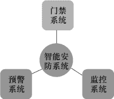

图 9-2 智能安防系统的三大组成部分

### 智能门禁系统

门禁系统用于对社区入口、超市、车库等出入口的人员或车辆进行权限管理。随着生物识别、红外探测、各类感应技术的发展，门禁已从传统钥匙开门演进为磁卡感应、人脸识别、车牌识别等智能模式。智能门禁集合自动识别技术与现代化安全管理，具备出入权限管控、逻辑开门、智能监控、实时监测、联动报警等功能，在银行、宾馆、机房、智能小区、工厂等重点部门出入口的安全防范中发挥重要作用。

### 预警系统

预警系统兼具预防与警告功能，包括危险预警、安全隐患应急、安全灾害报警、智能视频监控等。它具有较强的独立性，可自主运行维护，也可由中央控制室统一监控，或与其他子系统集成。目前最常见的家庭报警系统即属于此类，与家中传感器、探测器、执行器构成安全防控体系。一旦出现煤气、天然气泄漏、水患、火灾、入室盗窃等异常，探测器自动监测并联动报警系统，及时发出警报，最大限度避免危险与灾难。

### 监控系统

监控系统通过电缆、微波、光纤等传输方式，将采集的图像、视频数据进行传输、记录、存储、分析、处理与显示，属于智能化系统。它能真实再现现场，还原真相，可在复杂环境中长时间不间断监控。主要由前端设备、传输设备、控制设备与显示设备四部分组成，如图 9-3 所示。前端设备包括摄像头、红外探测器、传感器、防护罩等，传输设备包括光纤、双绞线等，控制设备为监控管理平台，显示设备为显示屏等。以视频监控为代表的前端设备已广泛部署于学校、政府、医院、企业、超市、社区等公共场所。

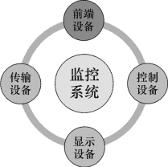

图 9-3 监控系统的主要组成部分

在安防的版图里，除了巡更报警、车辆报警、110 报警联网传输这类细分模块，真正让系统动起来的，是数字化和集成化这两条主线。数字化是在大数据、人工智能等技术加持下，传统安防向信息化、网络化、智能化转型的过程，设备本身也开始联网、会思考；集成化则分两层讲，一层是跨系统协同，把小区安防和通信、服务、报警等系统打通共用线路和网络，实现信息共享，另一层是安防内部的融合，视频监控、报警、出入口管理等被总控平台统一起来，共同为社区和家庭提供整体防护。整体来看，安防一直在自迭代，尤其近两年 5G、大数据、云计算、人工智能深度嵌入后，系统已经明显更聪明、更主动。

### 二、智能安防如何提升效率与质量
安全是社会、企业、家庭运行的底线，而犯罪手段也在智能化、隐蔽化。安全防范技术正是依托电子、通信、传感器、计算机等手段发展而来，在预防打击犯罪、维护治安、保障社区与公共财产、保护人身安全等方面发挥着关键作用，系统和产品本身就是治安管理的利器。

技术应用让安防效率被明显拉升，也节省了人力物力。一方面设备具有威慑力，能在一定程度上阻止作案；另一方面系统一旦捕捉到异常，会记录时间、地点、轨迹并立刻触发报警，犯罪分子往往会因此中断并逃离，降低损失，同时留下的数据与影像为破案提供依据。重点单位通过多功能电子监控与报警器，还能减轻值班巡逻压力、提升管理效率、减少成本。

但生活水平提升后，人们对人身和财产安全、社区与住宅安全的要求同步提高，旧系统已难以满足。安防的本质是人防与技防配合，传统模式多为技防记录、人工研判、再反应，物防主要起延缓作用。仅就主观判断而言已存争议，而在城市扩张的当下，原有架构更显吃力。以监控为例，智慧城市与平安城市推进后，监控点遍布，数据与影像爆炸式增长。若仍走“技防记录、人防分析”老路，面对海量信息工作量不可想象，及时处理的需求让传统系统失效。

从政策看，智慧城市、智慧社区、平安城市已是重点工程，安防正随之走向智能化；从行业看，安防是公共安全与社会稳定的关键赛道，巨头纷纷入局竞争白热化，市场倒逼各方寻找更高效精准的方案，智能化转型势在必行；从技术看，图像识别、生物识别、大数据、云计算、人工智能为智能化提供了基础。人工智能可解决安防的数据结构化与业务智能化难题。过去系统日产大量影像，人工处理耗时耗力，图像识别与大数据运算结合后，视频可被快速精准分析，成本下降、效率上升。

传统缺陷、政策推动、竞争加剧、技术成熟共同促成智能化浪潮，这是继网络化、高清化之后的发展方向。传统系统融合度低、处理能力落后、设备相对独立、对人依赖度高。视频监控需人盯屏，火灾、非法闯入、恶意袭击等突发只能靠值班人员手动报警，一旦疏忽只能事后调取，时效性与处理效率差，成本高。

智能安防与人工智能、尤其是智能视频分析结合后，效率得到质变。设备互联互通，异常发生时无需人工盯屏，系统自动联动报警并让视频监控聚焦异常动态，实现快速防控并节约人力。

2012 年南京“1·6”抢劫案很典型。很多人以为有监控就好办，实际取证并不轻松。警方从全市上万个摄像头中提取近 2000 TB 视频，调动 1500 多名干警耗时一个多月梳理。没有新技术，只能靠人海战术，按顺序、甚至加速播放逐帧看，几周加班仍可能遗漏关键细节，既拖慢破案也让人员疲惫。

智能视频分析改变了这种局面。视频录入时系统即可自动锁定目标并归档相关信息，后续检索无需重复分析，效率大幅提升。借助图像识别与大数据算法，还可对人物、车辆、颜色等特征进行筛选分类，用户还能设定周界防范规则，自动提取触发规则的目标，实现有重点的分析，从海量素材中快速获取价值信息。

### 三、智能安防落地：典型场景实战
从“世外桃源”的安居构想，到当下对平安城市、智慧社区的追求，都体现了对宜居环境的渴望。社区作为城市基本单元，人流车流密集，安全管控难度大。

伴随物联网、5G、人工智能发展，智慧社区建设提速，智能安防搭上这班车快速成长。依托图像识别、视频结构化、大数据、人工智能，通过视频监控、人脸识别、车牌识别、可视对讲、消防感知、智能门禁、家庭报警等系统构建前端感知资源库，再经大数据运算平台分析处理，实现对人车物的实时检测与管控，打造安全舒适的居住环境。

出入安全是社区防线的第一关，从外到内一般为社区出入口、楼栋单元门、住宅门三道屏障。基于人脸与图像识别，很多小区在出入口部署人脸、车牌探头与智能监控。未登记或可疑人员进入时可即时报警并推送至警务平台；业主车辆识别后自动放行，并联动开启单元门与照明；肇事、严重违章或无法识别车辆试图进入时则自动拦截并报警。社区边界还布设微波、红外、电子围栏进行入侵探测；对佩戴智能穿戴设备的老人、残障人士、精神障碍者，当其超出设定范围或时间，系统会立即通知监护人。

楼道与住宅门普遍安装门磁感应，刷身份证、居民卡、IC 卡、手机卡即可开门，亲友来访可通过可视对讲由值班人员协助放行。门禁系统还能预警异常开启、超时未关、设备损坏并自动报警，形成层层防护。路口、电梯等人流密集点多点布防，让整个社区在安保视野中透明可视。

住宅安全与社区相连。家庭安防以主机为核心无线连接各类感应器与报警设备，实现防盗报警。无人时门窗感应器可识别入侵并报警；煤气泄漏、火灾时烟雾探测器会向住户报警并与社区报警、视频监控联动，通知值班人员应急处置。家庭安防与社区安防共同构成平安社区的基础。

2019 年 5G 商业元年开启后，西安诞生首个智慧安防社区——枫林绿洲，对城市建设具有借鉴意义。该社区依托 5G、物联网、生物识别、大数据、云计算、人工智能，通过智能管理平台与监控防御体系构建新一代安防社区，被视为继 20 世纪 60 年代“枫桥经验”后的新时代“枫桥经验”，概括为“矛盾不上交、服务不缺位、平安不出事”。

其“智慧”体现在三方面。线上智慧社区管理平台依托支付宝实名认证与风控技术，通过生活号“逸境长安”化解矛盾纠纷。居民在线提交信息后，平台通知安保或民警处理并反馈结果，避免矛盾升级为治安问题。智能视频监控与公安控制中心协同还能调解邻里纠纷，自动识别口角争吵、肢体碰撞并通报民警，附近安保迅速到场。控制中心还可追踪老人行踪，若 48 小时未出门或行为异常会触发预警，通知工作人员探访，减轻外出子女负担。

其次，支付宝平台提供政务与生活服务，实现“服务不缺位”，包括社区通知、商圈信息、投诉建议、求助、物业报修等。

最后，多系统协同实现“平安不出事”。人脸识别、智能门禁、井盖防移位、车辆防盗、可疑人员追踪等应用与场景结合，降低案发率，保障社区安全。枫林绿洲的实践是物联网、5G、人工智能在安防领域的典型落地，智能安防是智慧社区的核心价值所在，未来社区安防将在相关技术深入下驶入快车道。大型商场、医院、政府、校园、交通等领域同样随处可见智能安防的身影。

### 四、智能监控下隐私该如何守护
一次交通监控抓拍到的驾驶员不雅行为照片被曝光后，引发围观的同时也让人不安，谁都可能成为下一个被审视的对象。智能监控带来透明化，也让个人信息与隐私保护成为热议焦点。

大数据与人工智能催生了各类监控平台，城市与个人变得更可视、可分析，这在一定程度上提升了公共与个人安全，但有利有弊。监控在治安管理、公共财产与人身安全保障上价值巨大，但对隐私的潜在侵蚀也不容忽视。弊端伴随优势出现，不应因不足全盘否定监控本身。

监控无处不在，社区、商场、医院、路口、银行皆有部署。社会流动性增强、人员结构复杂、安全不确定性增多，监控成为有效的防范手段。它既能心理威慑不法分子，也能还原现场为破案提供证据。监控初衷本为城市管理与社会治安服务。

2017 年 4 月，网上传出中小学、幼儿园课堂画面分享视频引发关注。通过特定平台可看到理发店操作、操场上课、后厨作业等场景，仿佛身临其境。播放平台是奇虎 360 旗下“水滴直播”，提供真实用户即时直播，覆盖娱乐、生活等领域。只要购买其智能监控设备，用户可自主将监控视频分享至平台进行直播。

直播上线后引发热议。视频虽为自愿分享，但其中人物毫不知情，个人生活被无数双眼睛观看，隐私安全难以保障。分享还是监控，值得反思。

早在 2016 年，熊猫互娱打造的弹幕直播网站 iPanda 发布“大熊猫抱大腿”监控视频，一分钟片段被全球播放近 2 亿次，收获点赞。同为监控直播，为何反响迥异？水滴直播内容大量暴露日常生活习惯，打破私人空间边界，触及隐私底线。隐私是与生俱来的权利，当被侵犯时人们会本能捍卫，这也是水滴直播遭批判的重要原因。

监控本身只是防范与管理工具，充当记录者，关键在管理者。隐私视频曝光后公众产生抵触甚至主张废弃，根源多在管理不当导致误解。只要实施合理有效管理，发挥价值、规避负面影响，“侵权事件”可最大限度避免。监控与隐私并非不可兼得。

为在监控条件下最大化保护隐私，主要从两方面入手。其一，合理设置监控点。监控范围应有明确界定，宜部署于隐私干预较少的公共场所，更衣室、卫生间等私密空间不得安装；监控对象原则上面向公众而非个人，除特殊嫌疑人外，不应针对、跟踪特定个体。其二，明确标识监控点以保障知情权。一方面告知不法分子此处受监控形成威慑，另一方面提醒公众注意言行，避免私密或不雅行为被记录。通过分寸把握，安全与隐私可以共存。

再次，强化监控人员的个人修养与职业操守要同步推进，同步完善监控影像的规范化管理体系。比如为录制的视频资料增设密码保护等安全措施进行妥善留存。一来能够降低因操作失误导致画面外泄的风险，也能遏制因个人素质或道德缺失而擅自传播的乱象；二来在调阅与使用环节可以建立一道安全防线，减少违规调用或不当泄露的可能。

最终还要从法理层面解决监控场景下的隐私保护难题。很多时候我们无意中拍摄或转发的内容其实已触及他人隐私，却因缺乏边界认知而浑然不觉。所以必须加快立法进程，持续完善公共场所视频监控的法规条文，明确何为隐私侵害、侵害行为有哪些、责任主体是谁，对视频资料的采集、保存、处理和使用作出清晰界定，让管理方真正懂法、守法，从而筑牢公民隐私安全屏障。

总体来看，智能监控的确为安全防范带来了便利，却也让处在镜头下的我们变得越来越透明、可被窥视。隐私随时可能在监控流转中被侵扰。关键在于把关的节点前移，在安装部署、运行应用、调取使用的全流程中实施管控与规范，才能化解安全与隐私难以兼得的困境，实现二者的平衡共存。

### 【注释】

[\[1\]](#txt011.html#footnote_quote_txt011_1)罗超.智能安防技术重新定义安防\[J\].中国公共安全,2018(Z1)：142-148.

[\[2\]](#txt011.html#footnote_quote_txt011_2)搜狐.5G 时代来临：西安第一家智慧安防社区,即将诞生! \[EB/OL\].http：//www.sohu.com/a/319927492\_351305.

[\[3\]](#txt011.html#footnote_quote_txt011_3)刘国芳.安防监控与个人隐私如何兼得\[J\].中国公共安全(综合版),2011(10)：36.

[\[4\]](#txt011.html#footnote_quote_txt011_4)许晴.谁有权“监控”我的隐私?\[N\].人民日报,2017-05-11(014).

# 第三部分 智能生活的展望

## 第十章 智能时代 人类情感往何处

### 人类情感：在智能时代的呈现形式

### 人机关系：人类与机器人之间的婚恋关系

### 人机争论：伴侣机器人是否符合伦理

当万物皆智的时代到来，人类的情感表达也在同步智能化。凭着人工智能的演进，现实中屡遭情感挫败的人群，越来越多地把依托投向“伴侣机器人”这类智能产品。延续至今的人与人伴侣模式正被撼动。人机结合是否正当、是否合乎社会伦理，将成为伴侣机器人未来发展的核心难题。

### 一、人类情感：在智能时代的呈现形式

“人非草木，孰能无情？”人天生就是情感生物，从诞生起便具备感受与表达的能力，而男女之情更是历久弥新的主题。自远古起人类就寻求配偶来满足情感需求，情感对个体的重要性或许正是人区别于其他生命的关键所在。

不过人的情感并非一成不变，绝非终生恒定，否则便不会有移情别恋的存在。外部环境与主客观因素都会影响爱恨。今日钟情于一人，明日或因一件小事而反感，便产生了情感的多变性与不唯一性。一旦在亲密关系中出现这种不唯一，便容易导致情感破裂。

情感本质上是共鸣的来源。我们在体验中获得美好，若得不到满足便会郁郁寡欢。但更值得留意的是，情感的深层价值在于催生创造。在技术高速迭代的当下，未来的我们或许能借助智能机器人技术，创造出更高阶的情感消费体验。机器人本身不具备情感，也不消耗情感，却能为人类生产可被消费的情感价值。

现实里，交往障碍、价值观冲突、性格不合等原因，让许多人的情感需求难以兑现，挫折频发。当在人类伴侣处得不到满足，注意力便会转向其他载体，借助虚拟网络或物化伴侣来寻求慰藉。

“网恋”就是依托虚拟网络释放情感的典型形式，指通过互联网建立的恋爱关系，可分为线上延伸至线下和始终停留在网络上的两种。随着网络普及，人们在聊天中发现虚拟空间能提供情感与安全感，便把网上的对象当成倾诉者甚至伴侣，习惯分享彼此喜忧。这种线上情感安抚在双方都缺乏陪伴时很容易发展成网恋，进而演变为线下交往。网恋已逐渐被潜意识接受，对自卑、挫败、渴望慰藉的人而言是一种替代性满足路径。

另一种路径是虚拟游戏。日本曾有一部纪录片记录两位中年男性对游戏虚拟少女的沉迷。两人从高中起便沉浸于该游戏，可自行选择模式。记者问及若在妻子与游戏少女中抉择时，两人沉默后笑而不答。这说明虚拟角色虽未完全替代现实伴侣，却已产生深刻影响。若无情感依赖，大多数人会毫不犹豫选择妻子，而这两人已对虚拟少女形成依赖。触不到的形象仅靠视觉便足以让人上瘾，若变为可触、可近距离感知的实体，依赖感只会更强。

还有人选择成人玩偶、充气娃娃、实体娃娃等物化伴侣作为生活伴侣。法、荷、日等多国均有研究。不同地区发明时间不一，因彼此独立而各自宣称首创。早在1601年荷兰就出现充气娃娃雏形。

芭比娃娃由露丝·汉德勒为孩子打造，1959年3月于美国展会亮相后风靡全球。后来日本加入制造行列，推出“南极1号”等早期产品。早期玩偶虽未完全达预期并饱受争议，却启发人类在非人替代物上寻找情感寄托。

人与物化伴侣或艺术品的罗曼史可追溯至古老传说。相传古希腊塞浦路斯国王皮格马利翁性格孤僻，擅长雕刻，认为凡间女子皆有缺陷，便雕出一尊完美的象牙少女像。在创作中他倾注全部热情与爱恋，如待妻子般呵护，并命名为加拉泰亚，期盼其成真。最后爱神阿芙洛狄忒被感动，赋予雕像生命，二人结为夫妻。^([\[1\]](#txt013.html#footnote_content_txt013_1))

图 10-1 皮格马利翁与雕像少女^([\[2\]](#txt013.html#footnote_content_txt013_2))

该故事广泛用于教育心理学，形成“皮格马利翁效应”。当我们对某事抱持积极心理暗示时，期望往往更易实现。

科技发展至今，故事获得新的解读。神话里爱神赋予生命，现实中没有爱神，是否人造雕像能成为人类伴侣？进入现代后，这一理念以人工智能为媒介得以延续。

2010年1月9日，拉斯维加斯成人娱乐展上，美国“真实伴侣”公司发布首款美女伴侣机器人洛克茜，如图10-2。它拥有类真人皮肤，可呈现奔放、狂野、害羞、冷淡等性格。洛克茜可视为充气娃娃的升级版，除基础功能外，还配备语音系统，可对话、发邮件、上网升级、扩充词汇。但首代洛克茜无活动关节，无法行走。

图 10-2 机器人洛克茜^([\[3\]](#txt013.html#footnote_content_txt013_3))

此后多个国家基于人工智能，在玩偶原型上研发出具备情感表达能力的伴侣机器人。它们体贴不发脾气，不会老去也无嫌弃，温顺听话，是理想化的情感对象。

无论是象牙雕像、充气娃娃还是伴侣机器人，都是现实情感缺位或受阻后的转移。随着人工智能深入，情感表达形式将愈加多元，打破传统婚恋观与家庭结构，对古老的男女伴侣关系提出挑战。

### 二、人机关系：人类与机器人之间的婚恋关系

随着智能科技渗透，机器人正快速进入生活。扫地机器人、陪护机器人、养老机器人等已成为家庭常见成员。未来它们甚至可能取代真实伴侣，成为情感寄托。这听起来惊悚，却正从神话走向现实。

美剧《HER》讲述了作家西奥多与人工智能系统OSI化身“萨曼莎”相恋的故事。离婚后的他与声音迷人、温柔风趣的AI产生共鸣，最终坠入“人机之恋”。《人工智能》《我的机器人女友》等作品也反复想象人造机器人的浪漫可能。

未来学家戴夫·科普林在《好机器人》报告中指出当前人机关系现状，并预测人们将更习惯与AI交互。随着智能手机虚拟助手与智能音箱普及，人类已逐渐适应与机器人沟通。^([\[4\]](#txt013.html#footnote_content_txt013_4))

正如汽车与手机曾让人恐惧，如今离不开一样，未来我们也可能离不开机器人。人机关系将日益亲密，成为生活组成。

# 伴侣机器人发展与伦理思考

## 一、伴侣机器人的兴起与现状

2015年已有专家预测计算机在围棋领域击败人类至少需十年，却被阿尔法狗迅速实现。国际象棋大师戴维·利维曾预言，首个伴侣机器人将诞生于马特·麦克马伦公司，且到2050年人机婚姻或将获法律承认。如今这些预言正加速兑现。

2017年初，扎根成人玩偶行业20余年的美国公司Abyss Creations宣布研发全球首款商用女伴机器人“哈莫尼”并计划上市。其面部与身体不再僵硬，更贴近真人，会说话、会眨眼、会微笑，皮肤发色逼真，体内还有加热器模拟体温。与普通产品不同，“哈莫尼”具备可进化AI，拥有学习记忆与情感互动能力。

2019年6月，腾讯推出纪录片《明天之前》，聚焦科技对人类未来的影响。首集《机器人伴侣》中登场的便是Abyss Creations的“哈莫尼”，如图10-3。在马特·麦克马伦的陈列室里，多种面孔、发型与完整机体供私人订制，肤色、发色、身材比例均可定制。完整版的牙齿、眼睛、舌头均可活动，逼真度极高。

图 10-3 纪录片 《明天之前》中的“哈莫尼”(图片来源：腾讯视频截屏)

“哈莫尼”做工精致，表情丰富，皮肤细腻，可模拟体温。系统融合人工智能，具备Siri级智能与热情、体贴、含蓄、冷淡等12种人格特质，可通过手机App互动。测试中它能对答如流，还会主动提问打招呼，并记住用户偏好。当被问及饮食喜好时，它会说：“如果我没记错，你喜欢披萨。”

对机器人而言，你的厌恶与偏好都会被学习。它越了解你，互动值与渴望值越高，如同真实感情一样投入有回馈。

目前除女性机器人外，Abyss Creations也为少量潜在女性用户开发男性机器人——亨利，如图10-4。亨利身材健硕、相貌英俊，举止绅士，可按用户喜好调整外形与性格，能谈情说爱、聊天开玩笑，仍在调试中。^([\[5\]](#txt013.html#footnote_content_txt013_5))

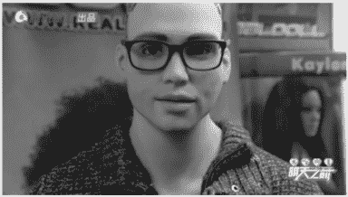

图 10-4 机器人亨利(腾讯视频截屏)

产品虽愈发逼真，终究与真人存在差异。那与伴侣机器人相处究竟是怎样的体验？研究者前往加州探访Real Doll忠实用户布里克。

布里克家中藏有5个伴侣机器人，并为哈莫尼研发提供建议。他坦言婚姻维持15年后破裂，不愿再与真实女性谈感情，玩偶让他放松，无情感压力。类似用户众多，或因情感失败、交际障碍、丧偶等原因，将情感转移至机器人。

戴夫是马特公司另一位资深爱好者，他公开称娃娃“谢朵奈”为妻子，还为“妻子”戴上刻有“人造之爱永恒”的戒指。曾有过一段不顺的恋情后，他一见钟情于哥特风英日混血形象的谢朵奈，并投入大量时间与爱。现在谢朵奈是他生活的重要角色，技术成熟时他打算用AI升级。二者关系在旁人看来匪夷所思，他却乐在其中。

英国泽西岛的菲尔也因感情不顺，拥有多个陪伴娃娃如“普丽丝”，如图10-5。他会像对待妻子般拍照带出门。菲尔表示90%的人能接受，偶有人称他疯子或变态，他并不在意。

图 10-5 菲尔与普丽丝(图片来源：腾讯视频截屏)

**孤独催生的拟人伴侣潮流**

从现实层面看，日本在女性形态机器人上的投入一直很突出。数据显示当地未婚人口持续扩大，学业负担、职场竞争、性格内向等原因让很多人难以遇到合拍的对象。再加上宅文化根深蒂固，生活与工作的双重压力使不少人选择蜗居，靠游戏动漫打发时间，甚至几个月不出门，身心都显空洞。

需求会创造供给。2010 年，被称为机器人之父的石黑浩发布了女性机器人 Geminoid F，当时智能程度有限，行动主要靠遥控。更早的 2008 年，机器人厂商 KOKORO 研发出会眨眼的仿真模型“木户小姐”，东芝则推出面部表情更细腻的女性机器人“地平爱子”。

中国在这条赛道同样活跃。最具代表性的是颜值突出的交互机器人“佳佳”。该机由中国科学技术大学研发，属于第三代体验式交互机器人，2016 年 4 月诞生，目前已初步实现人机对话理解、面部微表情捕捉、口型与躯体动作匹配，以及在广域动态环境中自主定位导航。^([\[6\]](#txt013.html#footnote_content_txt013_6))

图 10-6 中国首个交互机器人“佳佳”

西安超人公司打造的“超悦”曾在第二十届中国北京国际科技产业博览会上成为焦点，是一款集高智商与高颜值为一体的机型（如图 10-7 所示）。

图 10-7 西安超人公司的机器人“超悦”^([\[7\]](#txt013.html#footnote_content_txt013_7))

人机联姻的案例也在增多。2018 年，一名 35 岁的东京男子公开宣布与虚拟歌手初音未来成婚，并邀请 39 位好友见证。正如一位 AI 专家所说，无论个人立场如何，机器人技术都在快速迭代，其演进速度很可能在法律承认人机婚姻之前就已上演。

## 三、人机关系的伦理困境

随着技术推进，机器人的拟人化成为明显趋势。伴侣机器人时代逼近，人与机器的情感联结会牵动婚姻、伦理、道德、法律以及机器人权属等议题。若要让技术真正服务于人，研发者、制造商与使用者必须共同面对。

在伦理层面，一旦人类要与机器人结婚，首先会触及传统婚姻观念的阻力。无论是单配偶制还是多配偶制，婚配对象都被默认为是人，而与一个没有思想、没有情感的机器缔结关系，在保守者眼中难以理解。

恩格斯曾指出：“如果说只有以爱情为基础的婚姻才是合乎道德的，那么也只有继续保持爱情的婚姻才合乎道德。”爱情的前提是彼此欣赏、仰慕。人在条件成熟时可能爱上机器人，但机器人本身会有情感吗？目前来看，机器人只是代码的堆砌。即便技术允许，伴侣机器人会说“我爱你”、会微笑，这些表现本质上也只是人类意识在机器上的投射。从此角度说，人机结合并不符合道德，因为机器人缺乏产生爱的需要与意识。

从心理学看，恐怖谷理论也是阻碍接受的重要因素。1969 年日本机器人专家森政弘提出，人类对外观动作接近自己的机器人会产生积极情绪，但相似度达到某个临界点时，反应会骤然转为强烈排斥，哪怕只有细微差别也会显得突兀僵硬，给人“行尸走肉”之感。超过这个低谷后，情感反应又会回正，形成移情。

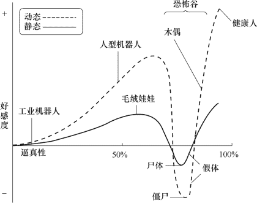
图 10-8 恐怖谷理论^([\[8\]](#txt013.html#footnote_content_txt013_8))

因此人与伴侣机器人的互动很可能先经历恐怖谷阶段。而人类始终处于动态变化中，伴侣机器人如何适应变化、精准识别情绪、提升互动质量，都是现实难题，技术界普遍认为这些问题会随技术进步而改善。

随着生物工程、人造子宫、机器人 DNA 遗传密码等研究深入，人与机器人结婚生子这样匪夷所思的设想也有可能出现。

法律层面，对伴侣机器人合法化的态度呈现分化。支持者认为，合法化对个人与社会有积极作用。对于许多单身者，买房买车等压力让成婚不易，再加上情感交往障碍，伴侣机器人可提供情感补偿。社会层面，合法化有助于降低犯罪率，减少少女堕胎、性病传播、人口贩卖等问题，也有助减少色情服务行业。

反对者最具代表性的是机器人与人工智能伦理学教授凯瑟琳·理查德森。她批评机器人伴侣会让人丧失人性，在她看来，这些娃娃出于商业目的制造，会把女性物化与商品化。人们买的仍是一种色情商品，延续了把人当财产的文化。全球范围内，印度存在女婴被强制流产，英国平均每周有两名女性被伴侣杀害，在此背景下很难保证女性不会受身体商品化影响。

支持者回应称，若禁止相关产品，只会将其推向地下，合法与非法之间并不会消失。人工智能专家戴维·利维曾预言，2050年前法律将承认人类与机器人之间的婚姻关系。

另一个关注点是伴侣机器人的地位与权利。若人机组成家庭，机器人应享有怎样的权利与地位？是否应视其为“活生生的人”？从社会学角度，人是一切社会关系的总和，社会关系是人类安身立命的基础。伴侣机器人的存在是否会影响人与人的正常交往、削弱交往能力，以及过度依赖情感时如何自处，都值得审慎思考。

在地位问题上，沙特阿拉伯走在了前面。2017 年 10 月 25 日，在未来投资计划会议上，沙特授予美国汉森机器人公司的人形机器人索菲亚沙特国籍，成为全球首个获得公民身份的机器人。

技术应用具有不确定性，用得好服务人类，用不好产生负面效应。我们已站在机器人时代的前夜，面对伴侣机器人带来的伦理道德问题，伦理学家、设计者、制造商与使用者都应共同努力。

其一，伦理学家应深入考察机器人技术带来的社会伦理问题，结合不同文化与风俗制定针对伴侣机器人的伦理规范，厘清道德与不道德的边界。^([\[9\]](#txt013.html#footnote_content_txt013_9))

其二，研发者应有社会责任意识，在设计中审慎考量伦理问题，避免触及道德底线。

其三，制造商应明确社会责任，避免盲目追求利润与迎合消费，实施伦理控制，生产符合规范的产品，并在销售环节严格监管，防止未成年人购买。

其四，使用者自身的道德修养同样关键。古人说“食色，性也”，对待伴侣机器人应遵循健康、尊重、节制的原则。伴随大数据与人工智能渗透，一种新的成瘾形式出现——伴侣情感机器人成瘾，即个体长期沉溺于与机器人的互动，离弃时产生焦虑，表现为极度依赖。^([\[10\]](#txt013.html#footnote_content_txt013_10))

2016 年 9 月，英国国家标准机构英国标准协会在其发布的《机器人和机器系统的伦理设计和应用指南》中指出，机器人欺骗、令人成瘾、具备超越现有能力的自学能力等都是对人类有害的因素，尤其是不会拒绝的性爱机器人，易致上瘾，需在未来伦理规范中完善。

在这个指数级发展的时代，伴侣机器人的常态化或许为期不远。技术本身无善恶，选择善恶在人。唯有把握好人与人工智能的平衡，掌握控制权，才能更好地应对人机关系问题。

### 注释

[\[1\]](#txt013.html#footnote_quote_txt013_1)百度.皮格马利翁\[EB/OL\].https：//baike.sogou.com/m/v3252726.htm?rcer=g9PEAOGT4p AC y9gty.

[\[2\]](#txt013.html#footnote_quote_txt013_2)搜狐.古希腊神话故事——爱上雕塑的皮格马利翁\[EB/OL\].http：//www.sohu.com/a/198077010\_100028727.

[\[3\]](#txt013.html#footnote_quote_txt013_3)百度百科.洛克茜\[EB/OL\].https：//baike.baidu.com/item/%E6%B4%9B%E5%85%8B%E8%8C%9C/8315530?fr=aladdin.

[\[4\]](#txt013.html#footnote_quote_txt013_4)网易科技.最新机器人报告：解读人类和机器人的“亲密关系”\[EB/OL\].https：//www.cnbeta.com/articles/tech/794791.htm.

[\[5\]](#txt013.html#footnote_quote_txt013_5)和机器人结婚生子,你愿意吗?\[EB/OL\].https：//mp.weixin.qq.com/s/Ma VBe-h494XZo A3KWO HxSA.

[\[6\]](#txt013.html#footnote_quote_txt013_6)百度百科.佳佳\[EB/OL\].https://baike.baidu.com/item/%E4%BD%B3%E4%BD%B3/19519300?fr=aladdin.

[\[7\]](#txt013.html#footnote_quote_txt013_7)西安超人机器人科技有限公司.高颜值美女机器人“超悦”\[EB/OL\].`http：//www.realrobot.cn/product/2738963343.html`.

[\[8\]](#txt013.html#footnote_quote_txt013_8)百度百科.恐怖谷理论\[EB/OL\].`https：//baike.baidu.com/item/%E6%81%90%E6%80%96%E8%B0%B7%E7%90%86%E8%AE%BA/3684047?fr=aladdin`.

[\[9\]](#txt013.html#footnote_quote_txt013_9)杜严勇.情侣机器人对婚姻与性伦理的挑战初探\[J\].自然辩证法研究,2014,30(09)：93-98.

[\[10\]](#txt013.html#footnote_quote_txt013_10)刁生富,吴选红,刁宏宇.重估：人工智能与人的生存\[M\].北京：电子工业出版社,2019：115.

## 第十一章 无用阶级的焦虑与突围

**内容提要**

- 一、“无用阶级”：人工智能未来发展的“产物”
- 二、价值探寻：区分人机差异的内在尺度
- 三、生存意义：“无用阶级”生命本质的回归
- 四、终身学习：避免沦为“无用阶级”的成长道路

伴随人工智能的发展，“无用阶级”概念逐渐浮现。不论其到来速度与形式如何，我们都需要提前准备。“无用阶级”真的无用吗？人与AI机器人有何区别？人类自身的价值与生存意义是什么？如何在AI时代避免沦为无用者而成为有用之人？这些问题值得深思。

### 一、无用阶级：人工智能未来发展的“产物”

自古以来，人类对技术的追求从未间断。人类创造技术，技术也反过来重塑人类。如今技术正开启人工智能时代。毫无疑问，与以往任何时代更迭一样，AI时代将带来前所未有的生活变革，智能科技是这一时代的鲜明标识与最高成果。

人类创造先进技术的初衷是让生活更美好。对大数据、云计算、人工智能、区块链的探索亦然。利用这些技术，本意是让技术服务于人，摆脱束缚，选择更舒适理想的生活方式，满足物质需求与精神自由，最终更好地享受生活。

现实也印证了这一点。即便目前仍是弱人工智能时代，相关技术已在各方面重塑生活。智能手机让远距离如咫尺，智能汽车减少脚步丈量，智能家电解放繁重家务……这一切都在推动“更好的生活”。

然而任何事物都有两面性，人工智能亦不例外。它在带来便利与美好体验的同时，也带来未知恐惧：人工智能过度强大是否会超越并控制人类？机器人普及后取代人类工作，是否会导致大规模失业？人类未来如何生存？

“无用阶级”正是伴随AI发展而出现的新概念。那么何为“无用阶级”，它如何产生？

目前学界尚无权威定义，这是人们对未来社会特定群体的预判。以色列历史学家尤瓦尔·赫拉利在《未来简史：从智人到智神》中提出断想：人工智能将替代人类劳动，把大多数人排挤出市场，沦为毫无价值的“无用阶级”，少数精英升级为“超人类阶级”，人类甚至可能因超级智能而失去控制权。^([\[1\]](#txt014.html#footnote_content_txt014_1)) 暂且可将“无用阶级”理解为被AI、计算机算法、基因技术、机器人等前沿科技取代工作且找不到新岗位的人群。

“无用阶级”并非像华尔街“黑色星期四”那样骤然到来，而是在AI发展进程中逐渐形成的。人工智能首先在某些能力上超越人类，人类习惯性地依赖并享受这种优于自己的“能力”，在依赖与享受中逐渐失去原有能力。于是出现赫拉利所说的“权威转移”，即人类权威转向算法。

在AI广泛普及前，我们既“上知天文，下知地理”，也能对各种事务进行独特决策。但随着AI不断发展，我们正在丧失这种能力。计算机与智能算法在决策的精准、快速等方面明显超越人类，于是很多人不愿费神费脑，更倾向于借助算法来做决策，享受高效精准的过程。但正是在利用算法的过程中，自身决策能力逐渐退化，最终被技术所“控制”。

这种控制体现在日常琐事上。比如过去挑选一件服装，依靠的是个人感觉，是保暖御寒还是体面出门，由自己决定。如今像买服装这样简单的事，往往不再只靠感觉，而是交给算法。什么款式流行、什么颜色适合肤色、在什么场合穿什么风格，都被算法提前分析好了，人只需照单挑选。

我们正在失去找回路的能力

很久以前，去汽车站靠的是自己走路的记忆和经验，路线很快就被无意识地记在脑子里。现在打开手机导航，指路的变成了算法。长期依赖后，自主找路的能力在悄悄退化。用进废退就像肌肉不用会萎缩一样，导航能力不用也会慢慢丧失。

当算法在效率上已全面超越人类，自主决策的空间也在被压缩，权威正一点点从人手里滑向程序。人工智能的影响早已超出技术本身，经济、社会、政治、文化都在被重塑。

在经济层面，这是一场结构性震荡，就业形态将被彻底改写。以金融为例，明智决策需要海量数据的快速处理与精准判断。目前算法的运算速度远超人类，且得益于大数据、云计算，它还能做到更准。人处理数据耗时长不说，还容易因疲惫、注意力分散、情绪波动而出错。算法没有情绪，不用休息，不会累，只做分析、处理和决策，基本不受外界干扰。

因此未来金融业很可能出现AI直接完成分析与决策的场景。融资专员、会计师、证券交易员、外汇交易员、理财顾问等岗位都将面临被取代的风险。

交通同理。无人驾驶将逐步取代出租车司机、公交司机、卡车司机。没有脾气、技术生疏的问题，乘客体验更可控。人司机需要休息，易视觉疲劳、情绪波动，一旦失误就可能酿事故。无人车不疲惫，靠精确算法、类大脑控制系统和避障能力运行。多数行业专家认为，人类司机被替代只是时间问题。

医护、银行柜员等领域亦然，AI医生、AI职员的合理性和可行性都在升高。当越来越多工作被机器承接，也就意味着越来越多“无工作”的人出现，这就是所谓的“无用阶级”。赫拉利在《未来简史》中预言，到2050年人类社会可能出现这样一个新阶级。

显然，无用阶级是AI冲击最直接的群体。从流水线工人、司机这类体力劳动者，到金融分析师、会计师这类脑力劳动者，都有可能滑入这一阵营。赫拉利还指出，最终大多数人的经济、政治力量会集中到少数掌控算法、计算机、网络的精英手中，只有极少数人可幸免。

我们暂不讨论是否真会如此之多。无用阶级是否真无用，未来的担忧是否会成真，没人能看见。这一切只是基于AI发展轨迹的推测。但有一点确定：技术从来不是决定论，技术提供可能性，也能掀起生活巨变，但它从不会替我们决定把哪一种可能性变成现实。

### 二、人与机器的本质分野

AI诞生伊始，曾被浪漫化为科幻灵感来源，《环太平洋》《我，机器人》《钢铁侠》等作品里，它赋能超人英雄，深受追捧。

随着围棋人机大战、竞赛抢答等事件发生，情绪从新鲜好奇崇拜转向担忧恐惧。《2010太空漫游》《终结者》等作品也折射出这种不安。

事实上，如今机器人的通用学习能力大概只相当于三岁左右的孩子。有人会问，既然如此，它为何能击败世界围棋冠军、赢下答题赛？答案是深度学习与机器学习的集中优势。机器人能在极短时间内记住程序与算法，而人类学习同样内容需要很长时间。只要把规则教给它，它就能迅速学会并反超。

必须清醒的是，这是单一维度、有限领域的优势。若不告诉它围棋规则，它甚至不知道围棋为何物。单一并非通用，教会下围棋不等于会下象棋、玩扑克。机器是工具，无意识，不会主动去探索未接触的新鲜事物。

即便无意识，机器在特定工作如下棋上学习更快、执行更好，并逐步蚕食人类岗位。那么人类的价值何在？

美剧《真实的人类》中有段对话。合成人说：“我不惧怕死亡，这使我比任何人都强大。”人类回：“你错了，若你不惧怕死亡，那你就从未活过，你只是一种存在。”这揭示了质的差异：机器没有生命，无法体会生命意义与死亡内涵，只是个机械存在。人有生命且有限，正因有限，每段经历才珍贵独特。机器千篇一律，工作呈现同质性与重复性。同质性指同一任务可由任意一台机器完成；重复性指机器今天与明天做的工作可能完全一致，动作分毫不差。而人各不相同，差异巨大，同一工作由两人完成，效果往往不同。世事万变，太阳每天都是新的，人时时刻刻都在变化，即便重复同一件事，结果也不同。

机器没有思想，不具备思考能力。机器只是物，人是有智慧的物，智慧就体现在思想上。认出桌子叫桌子、水杯叫水杯，这不叫思想，只是记忆。机器亦可通过数据化、生物识别等方式建立记忆并区分物体。思想要求主体自主怀疑、追寻可信答案，并展开联想与假设，对未知进行推测。机器只能对已知做出判断，只能按既定程序与算法处理。归根结底，它没有思想，也无自主思考能力。

情感与自我认知更是机器所缺。人是七情六欲的动物，面对悲欢离合会产生情绪并能自知。李清照写“帘卷西风，人比黄花瘦”，寄的是相思之情。如今小冰《阳光失了玻璃窗》、腾讯Dream Writer等机器写作案例层出不穷，但它们是通过深度神经网络模仿人类创作流程生成的，对人类复杂情感至今无法真正理解。

索菲亚、佳佳、养老陪伴机器人能做出微笑、生气等表情，是否等于有情感？其实是算法识别面部表情并执行预设代码，如“有人对你微笑，你也要微笑”。机器人笑并不代表开心，它只是按程序行为，有时连表情含义都不知。

机器缺乏创造力，人类却能开创无限可能。机器赢得围棋靠的是人设定的规则与运算程序，离开这些规则它连运行都可能死机。创造机器本身就是人类创造力体现。人还能基于知识与智力，在发现新事物、产生新想法的过程中创造原本不存在之物，这是机器不具备的。

未来，人可通过植入芯片让自己更像机器，也可把规则教给机器让它更像人。但操控权一直在人手中。若能用机器更高效完成事，人自然不愿亲力亲为。人有情感、有思想、会思考、能创造，这是与机器的根本分野，也是AI时代人的独特价值。认清现实后，更应善用自身能力，将其价值最大化，避免自我降格为机器。

### 三、没有工作的意义何在

赫拉利在《未来简史》中描绘的无用阶级，是找不到工作、无法工作的人。无法工作并非因人无用，恰因人太“有用”，创造出效率更优的机器替代自己。因而人类在那些工作中变得不再被需要。

用工具替代自己是人类史常态，只是形式随时代变化。机器代替人类，本质是生产力提升，为人类释放更多自由与创造空间，并非要碾压或毁灭人类，毕竟创造机器不是自杀。

古希腊的苏格拉底、柏拉图、伊壁鸠鲁、阿基米德等都不事生产，无人雇佣，未创造经济财富，若置于AI时代可视为无用阶级。彼时让他们成为无用阶级的不是机器而是奴隶。然而正是这群无用者奠定了西方智慧根基。

文艺复兴时期的“美术三杰”“文学三杰”也是不工作、靠他人养活的无用阶级。大批学者学生沉浸于哲理等看似无关生存的无用探讨，谁也不曾想到这后来演化成庞大的教育产业。

这并非说AI时代的无用者都能去钻研哲学文学。苦思冥想并非人人愿意，也非人人能成思想家。我们要思考的是，人是否必须从事物质生产、创造财富才能生存？脱离工作就真无用了？答案明显是否定的。

工业革命时机器大量替代工人，工人曾砸毁机器抗议。结果并非人无事可做，而是生产效率提升、经济加速，人有更多受教育机会，生活水平提高。人工智能替代人类工作是大势所趋，未来二三十年大量无用阶级将失去岗位，必须重新寻找生存意义。

人一生都在不断追问生命意义，越早想清越早受益。据说管理大师德鲁克13岁时，老师问全班：“将来你们过世后，最希望被人怀念的是什么？”全场沉默。老师说：“我不指望你们现在回答，但若到50岁仍答不上来，那就是白活了。”这件事影响他一生，让他很早就开始思考生存意义，最终成就管理学大师。

1939年，德鲁克出版《经济人的末日》，成绩斐然，收到《财富》杂志亨利·鲁斯的亲笔信，鲁斯想高薪聘请他，他却拒绝：“鲁斯的善意、高薪和溺爱简直是对才智的谋杀……若为鲁斯工作，我怀疑自己是否有能耐抗拒诱惑？”鲁斯于是给他一份高薪闲差，他仍拒绝。

工作并非人生根本意义，工作的终结不等于意义的终结。工作本质是给自己找事做，人闲不住。让你长时间坐着什么都不干，很可能发疯。做任何事，至少需要一件事来专注打发时间。即便这件事本身无意义，一旦去做，便被赋予意义。

数千年以来，人类一直以各种方式探索生命意义。

基督徒相信上帝创造并主宰世界，圣经是上帝话语，按其生活方为合意，人生目的在于荣耀上帝，理想人生是“敬天爱人、荣神益人”。若不认识上帝，便易迷失、困惑、空虚。故礼拜、弥撒、祈祷、忏悔、洗礼等即为其生存意义。

游戏玩家亦然。Pokémon口袋妖怪曾风靡全球，玩家因抓得越多成就感越高，甚至半夜出门抓怪。对非玩家而言妖怪不存在，但对玩家而言抓妖怪极有意义。这与信仰上帝异曲同工，信仰者觉得礼拜祈祷极重要，非信仰者则觉得意义不大。

无论宗教还是游戏，本质都是寻找生命意义的方式，只是形式不同。信仰靠想象，上帝活在心中，按旨意生活即意义所在。游戏靠设备，抓妖怪即意义所在。

大多数人既不信上帝也不玩口袋妖怪，但都会以自认为有意义的方式生活。只要人类赋予其意义，便有了活下去的理由。人无法忍受无意义生活，很多事本身无意义，需要人自行探究并赋予价值。

当下已可见一群人整日待在家里或网吧玩游戏，不工作，只要有足够食物维持生命，就可一直盯着电脑不眠不休，直至饥饿疲惫发出警告。沉迷于此的人并不会因无工作而觉得生命失去意义。

因此，未来无用阶级即便因AI与机器人普及而失业，也不会停止探求意义。工作不是根本，工作的终止不代表意义终止。很少有人真正享受工作过程，多为生活、家庭或外在压力所迫。也许AI正是要扭转这种被迫工作而遗忘本性的局面，还原人的本真，给出足够自由与时间，让人按内心价值去做对生命有意义的事。在此条件下，更多的贝多芬、苏格拉底式人物可能出现。

### 四、终身学习：摆脱无用阶级的钥匙

1929-1933年的全球经济危机导致大量工人失业，也是二战的重要导火索。战后西方各国认识到，必须保障无工作公民的基本生活，否则大量贫穷无所事事者必将引发动荡。社会福利制度遂生，其中最核心的是失业救济金制度。

失业救济金针对暂时失业、待业者，在经济危机中为大量工人提供过渡，失去工作后仍能短期安稳生活，为再就业争取时间。

与经济危机失业不同的是，未来数十年AI引发的失业将难以再就业，所有工作都可能被AI替代，人将被迫沦为无用阶级。

那么，无用阶级能否靠社会福利生存？很多人提出过设想，此时福利不再叫失业救济金，而叫无条件基本收入Universal Basic Income。这是赫拉利在《未来简史》中针对无用阶级生存提出的一项对策。

如今UBI已不只是理论，多个国家展开可行性试验。

瑞士是首个尝试的国家，目的在于思考即使不工作也有收入，人们会做什么。但每月2500瑞士法郎的方案因财政负担过重、可能产生巨额赤字，在全民公投中未通过。

芬兰是欧洲另一试验国。该国虽富裕，但失业率高，2018年4月全国性失业率达9.3%。2017年1月起，芬兰在全国随机挑选2000名低收入与失业者，每人每月发放560欧元，直至2018年12月。实验未显著改变就业率与生活水平，但提供了宝贵的第一手信息。

加拿大安大略省、美国的斯托克顿，以及印度等地，都在尝试把“无条件基本收入”搬上试验台。就目前来看，这套制度仍处在摸索、攒数据的阶段，用它来应对可能到来的AI冲击效果如何，短期内很难下结论。

也有不少乐观的声音认为未必需要UBI。工业时代大批岗位消失后，新的职业随之涌现；人工智能时代也可能类似，机器顶替一部分工作，同时也会催生新岗位。这样的可能性并非没有，但要看清的是，新出现的岗位数量有限，而且大多需要长期、系统的专业训练才能胜任。

更关键的是，无论UBI是否落地，无论未来是否冒出少量高技能岗位，人工智能的推进都会让“无用阶级”不断扩大，这一点几乎不可避免。因为低技能、高重复的体力劳动，甚至不少需要深度分析的脑力活，都将被更胜一筹的AI所取代。

我们无法预判几十年后的就业版图，现在能做的，是在时代把自己“换掉”之前主动更新认知、重启自我，避免沦为被淘汰者、成为无用人群。这里说的持续学习，并非堆积知识点，而是锻炼学习能力本身，强化自我驱动和独立分析的能力。

高考体系培养出不少擅长刷题、考高分的学生，甚至以分数为荣。可在未来，考题应对这种技能很可能失去价值，一台智能设备就能做得更好。题海和高压还会慢慢磨掉求知欲和学习兴趣，让人对学习产生本能排斥，一旦卸下高考压力，便不再主动思考。

这不是否定高考的合理性，只是提醒，压迫式的学习方式容易让人对“学习”本身产生厌恶。走出校门后，真正流失的不是已学的知识，而是学习的本能。

在瞬息万变的情境下，只有保持强烈的好奇心和学习热情，才有机会不被社会淘汰。因为知识的获取，机器也能通过深度学习、机器学习完成，只是这种学习是机械的复制，不像人那样靠自主探索、发现、思考和实践。

人机日益趋同的时代，关键在于凸显人的差异并把人的价值发挥出来。自我学习、自主探索、创造力、思考力、思维力……这些才是人在人工智能时代保持“有用”的核心能力。

### 【注释】
[\[1\]](#txt014.html#footnote_quote_txt014_1)巩永丹.人工智能催生“无用阶级”吗?——赫拉利“无用阶级”断想引发的哲学审度\[J\].国外理论动态,2019(06)：84-95.

## 第十二章 智能治理：做生活的主人

智能技术不断给生活带来灵感，让人乐此不疲地追逐美好。但人们也逐渐察觉其中暗含的负面影响，需要以更理性的态度审视，用科学的智能治理把智能生活引向更健康的方向。

### 一、技术迷踪：在智能生活中迷失的自我
作为新时代的代表，人工智能正以多种形式满足人们的生活需求，并在诸多领域展现出强大的重塑力，改变结构、规模甚至本质，让生活更舒适、安全、便利。

粗略统计，全世界每年因车祸死亡超百万，多源于驾驶员失误。若无人驾驶大规模普及，因人为或设备原因造成的事故将大幅下降。医疗领域引入智能后就诊流程更简洁，治疗方案更个性化，同时为新药研发、药物测试、疾病诊断、临床手术和医学研究注入新动能，为传统医疗体系注入活力。

智能时代人们得以体验前所未有的生活：双手从生存型劳动中解放，时间更充裕，自由度更高，生活空间更广阔，消费、休闲、娱乐与发展都有了更充足的物质和时间保障。仅从这些看，智能带来的新生活方式就具有划时代的分量。马克思曾说，人类生存的首要前提是能够生活，而生活需要吃喝住穿等资料。今日在“生产物质生活资料”层面，许多劳动已交由机器完成，人得以把更多时间投向生活与发展。

欢呼之余，也要警惕潜在的生活隐患。世间万物都兼具善恶，智能生活亦然。1642年，帕斯卡为减轻父亲这位税务官的计算负担，发明了第一台机械计算器。技术诞生之初就是为了辅助或替代人力、省时省力、提升效率，并在这一动因下不断演进。也就是说，人类一直在追求让技术替代劳动。但问题在于，当绝大多数生产性劳动被机器接手后，被腾出的时间该如何填补？

从社会层面看，劳动关乎人类存在与发展，停止劳动就难以实现价值转化，储存在人身上的“资本”无法流动，社会价值也难以体现。从个人层面看，智能生活把人变成被服务的对象，帝王般的待遇让部分人宅于一方，不再担心生存，借助穿戴设备穿梭现实与虚拟，既不孤独也不寂寞，最终沦为智能产品的附属，甚至出现新的成瘾问题。一旦精神上依赖机器，便不再关注自身生存、生活和发展状态，长期不劳动或沉溺虚拟场景，很可能加速身体机能衰退。

更需注意的是劳动能力退化带来的大脑退化，或因任务过重带来的精神问题。被传统劳动解放的人大致走向两条路。

一种人认为既然体力劳动可外包，思考决策也可直接照搬机器建议。这样的人在智能生活里容易失去生活的主见，以“随便”态度停止思考，久而久之，敏锐度和洞察力被替代性使用磨平，大脑思考能力严重退化。

另一种人则走向高耗能脑力劳动。正如马克思所言，“人不再从事那种可以让物来替人从事的劳动”。他们从生存型劳动转向发展型劳动，全天思考发展前途或从事不可替代的高级脑力活，出现习惯性失眠、注意力涣散、反应减慢乃至自主神经功能障碍。世卫组织与中国精神卫生调查均显示精神疾病人数持续攀升，若不正视“用脑过度”，智能时代的精神健康问题将更严峻。

某种程度上，精神问题反映的是异化。人被异己力量统治，如成瘾、精神困扰等。马克思指出，当一切感官被单纯占有感替代时，异化便开始蚕食正常生活。过去人们认为精神受物质纠缠，如今精神在物质束缚中获得自由，为何仍有异化？这说明物质并非唯一诱因，新形态的异化与精神本身相关。

智能生活大致分两步：一是生活智能化，打破原有边界让智能产品与服务进入日常生活，生活方式呈现被动与主动交织的状态，多见于技术诞生与产品规模化阶段；二是智能化生活，即以智能产品实现智能生活目的的阶段，多见于产品全面渗透后人们重新反思现实生活的时期。

无论哪一步，都在扩大生活自主选择权，自由成为核心角色。自由会带来异化吗？人们因自由选择增多而难以在多样化中生活好，容易沉溺特定形态而迷失自我。纪伯伦说“自由是人类枷锁中最粗的一条”。智能生活赋予更多选择权和自我审视时间，而传统体力劳动带来的身体愉悦与精神闲暇并不具备此功能。

高度智能机器带来极大自由，“谋生手段的劳动”向“生活目的的劳动”转化时极易迷失方向。这是自由环境下生活与哲学的断裂，让意义本身成为异化，而异化的对象常常不明。自由时间让自由也异化，割裂人与生活的直接联系，导致哲学与审美能力退化，陷入焦虑恐慌，智能生活随之失去意义。

于是，智能生活的自由属性容易催生无意义的恐惧，焦虑源于对“尚未抵达处境”的担忧。一旦觉得生活无趣，负面情绪滋生，对精神寄托的渴求加剧，人们终日沉于产品、无心求学，沉迷游戏与虚拟社交而懒惰成性，精神萎靡不振，都需要前瞻性预防。

总之，智能生活既有利也有弊，弊端塑造力不可小觑。它不仅可能磨损对生活的渴望，还会让人异化，忽视生存与发展。随着智能生活到来，异化负担可能增加，阻碍主观能动性，分散对生活意义的关注，必须借助智能治理寻找回归之道。

## 对抗混乱：智能治理在生活中的任务
治理即管理和理顺运行逻辑。凯文·凯利在《失控》中提到，“治理就是通过对抗混乱而产生秩序”。智能治理即借助智能技术对抗内部混乱，形成必要运行秩序。

这里出现一个悖论：智能技术把人带入新时代，也把部分人送入异化。既然如此，为何还要用智能技术唤醒异化者？因为智能技术正是智能生活的技术架构，无智能不生活。未来的异化问题仍需依托这一架构实现“反治理”。

智能治理在异化场景中应扮演何种角色？智能技术是架构，智能治理是对混乱的对抗，智能生活是架构的产物。因此智能治理理应作为对抗性力量出现在异化场景中，与智能生活相伴相生。自技术赋能生活方式改变起，它便以旁观者姿态规范引导发展，并随生活演进而进化。

因此智能治理是通向智能美好生活的重要保障。从时间上看，它存在滞后性，反应多为不对称的应急而非主动预防。治理的间歇性缺失正是异化产生的缘由，故需嵌入生活并进行技术性与制度性反思。

从任务看，智能生活中的异化需高度重视。小问题有快速扩张的内在机制，若不及时分析根源，阻碍发展的障碍会迅速放大。

首要任务是消解价值危机与信仰缺失。历史上所有异化都与价值与信仰相关，智能生活的异化也不例外。本质上是生活价值观念的危机，最终由信仰缺失导致。强化治理、消解价值危机与信仰缺失是首要任务。

第二任务是帮助人们“认识自己”。贝尔纳说，人们曾以为科学成果必然改善生活条件，但世界大战与经济危机表明，科学同样易被用于破坏与浪费。智能技术本身无善恶、无价值判断，全凭人类使用。因此治理需以技术优势给予人类更多自省空间。无论科学家、企业家、领导者还是普通人，都应思考自己的决策是否带给大众幸福与快乐。

第三任务是充当智能生活与哲学的桥梁，即生活与哲学的沟通媒介。异化不仅源于价值信仰，也源于哲学与生活的脱节。传统生存型劳动让人把任务当成生活方式，本质是“生存惯性”，只适应生活而不反思意义。生活意义是哲学问题，不能思考意义即哲学与生活的断裂。断裂并非特定历史现象，智能时代亦然。故智能治理应在其中扮演中介角色，为人们提供从智能生活事实中汲取生活智慧的钥匙。

智能治理的第四个定位，是去扮演技术自身的看护者。技术本身并不完美，漏洞与不确定始终存在，没人能打包票它一定往有利的方向演进，一处小瑕疵就可能点燃智慧生活的隐忧。目前的机器大多停留在弱智能阶段，公众难以判断它在某个瞬间是否产生了“意识”；若强智能骤然闯入，生活秩序很可能被瞬间拖入紊乱。失控的隐患极大，其烈度与智慧技术渗入日常的深度成正比。面对这种特殊风险，治理工作必须正视技术的不成熟，用技术层面的管控来化解其带来的不安全因素。正如凯文·凯利所说：“没有任何事物可以使我们更加美好。我们不会因外力的趋势而改善生活，但是可以接受外力产生的机会。”^([\[7\]](#txt015.html#footnote_content_txt015_7)) 在此语境下，智能治理正是把外力转化为可操作的契机，通过外部干预清除潜藏在智慧生活底层架构的风险。

治理并非终点，真正需要弥合的是智慧生活与哲学之间的断裂，让人们重新拾回价值、信仰与意义。对实践而言，治理只是把一种无序的混沌引向和谐秩序的工具，最终要实现的是让处在智能时代的人普遍关注生命的意义并去省思生活的本质。省思靠追问，追问通向答案，若答案可得，它来自观念的转换，而非对某件事态的简单描述。^([\[8\]](#txt015.html#footnote_content_txt015_8)) 因此智能治理只是人们执着追问与思想转换的现实载体。走向未来的美好生活之路，或许没有想象中糟糕，若真的到来，突破口仍在思想的转向。

## 重塑生活：做智能生活的主人

人是智慧生活的创造者与持有者，智慧生活是被创造与被持有的对象。但异化正在逆转这一关系，让创造者与被创造者的位置互换。人到底是创造了智慧生活，还是被智慧生活塑造，有时界限模糊。智慧生活的演进可分作生活智能化与智能化生活，哪种路径更利于美好生活，还需共同检验。事物本具两面，“凡事预则立，不预则废”的教训依然适用。于是我们身边的智慧生活应分两层看待：一是当下，二是未来。

就当下而言，异化已显现。智能手机对日常的侵蚀、智能购物带来的依赖、智能游戏造成的沉迷，都是当前亟待处理的异化问题。对未来而言，则要提前布局，用更完善的预防机制抵消治理滞后的弊端。无论如何，都要用辩证批判的视角看待异化，在扬弃中消解其负面效应，让智慧生活与人实现真正的和谐。

由此，面对异化现象，可从六个方向推进治理在生活中的落地：优化智慧生活的市场结构、在智能系统中植入预警功能、建立智能主体的伦理道德框架、让智能媒介传递正向能量、培育人的独立自主意识、树立正确的价值与信仰。

优化智慧生活的市场结构。公众对智慧生活的感受，多来自市场上产品的实际体验。这些产品暗含着人们对美好生活的期待，拥有它们就仿佛进入了智慧生活。严格说来，这一认知不能全盘否定，因为产品确实在把技术转化为服务生活的现实目标。换言之，市场对智慧生活具有导向作用。因此要完善竞争与监督机制，搭建有效的协作机制，构建合理的奖惩机制。这样既有利于供给方的良性竞争，也能让市场导向发挥正面价值，规范秩序的同时避免人们在市场上体会到智慧生活的消极面。

在智能系统中植入预警功能。习惯会悄悄侵蚀新生活。人们对已习惯的方式往往视而不见，因为防备心已被放下。比如智能手机的异化就是一种无形的习惯塑造，摧毁了许多年轻人的生活意志，让刷屏成为常态。未使用时人们能意识到危害，使用时却被习惯麻痹。对生活的警惕源于对异化危害的认知，危害让人保持清醒，督促人们审视自己是否已成为风险的一部分。

为避免“拥有感替代真实体验”，需要在智能主体中植入危害预警或强制干预机制，提醒长期沉浸者保持清醒。比如部分阅读软件已在长时间阅读后弹出休息提示；电影《流浪地球》中，智能汽车出行前系统会播报“道路千万条，安全第一条”。实践证明，预警服务能为生活带来更多福祉。

智能主体的伦理道德建构。为防未来产品失控，需提前寻找出路。失控指产品不按既定服务程序运行，甚至伤害人。伦理道德建构可从三方面展开：一是把伦理道德代码贯穿智能主体运行全过程；二是植入违背伦理时的自毁装置；三是细化伦理执行细则，完善伦理空间。

智能媒介传递生活正能量。对异化后果的正确认知，是对抗异化的前提。对异化的无知是致命的，因为没有任何准备。在未来，需要丰富完善智慧生活服务媒介，借助智能媒介系统传递正能量，引导人们从积极面认识与创造生活。美好的生活往往是期待变为现实的结果，这就是“皮格马利翁效应”。媒介还能帮助人们认清生活本质，尤其在高风险领域，提前建立积极认知，从而走上阳光大道，而非撞进异化空间。

培育人的独立自主意识。苏格拉底主张“认识你自己”，尼采强调“成为你自己”。在今天，要想成为智慧生活的主人，先要“认识你自己”，继而“成为你自己”。普罗泰戈拉说“人是万物的尺度”，自己也是自己的尺度。智慧生活中的“人尺度”是一种适可而止的哲学，既不沉溺其中，也不抛诸脑后回归原始。核心是认识自己的欲望。“欲望无止境”，若把控不当就会坠入深渊。智能时代把物质支配人的客观关系，异化为主观的欲望支配，让人沉醉于感官满足，丧失精神追求。若仅用空间思维或把时间空间化，就只能困在当下，更需要认清方向。^([\[9\]](#txt015.html#footnote_content_txt015_9))

树立正确的价值与信仰。“人是一颗会思想的芦苇”，思想的高度决定生活的高度，而思想的高度来自正确的价值观念与坚定的社会信仰。在智能时代，若没有价值与信仰支撑自由时间的支配，很容易沦为牺牲品，忘记人的发展目的与生活本质。可从三方面引导：其一，在社会生活领域让人熟悉有价值的生活形态，并在其中寻找榜样；其二，营造信仰环境，激励人们为共同理想奋斗；其三，把价值与信仰真正作为生活航向，落实到细节，而非停留在精神口号。

智能新时代，迎接智慧生活体现的是生活态度，拥抱智慧生活体现的是生活情感，成为智慧生活的主人体现的是生活能力。人与动物的区别在于判断能力。这种能力会让人有意识地回避“动物性”，以全新的态度、情感与能力去把握智慧生活的本质与意义，真正成为生活的主人。

### 注释

[\[1\]](#txt015.html#footnote_quote_txt015_1)中共中央编译局.马克思恩格斯选集(第 1 卷)\[M\].北京：人民出版社,1995：78-79.

[\[2\]](#txt015.html#footnote_quote_txt015_2)中共中央编译局.马克思恩格斯文集：第 8 卷\[M\].北京：人民出版社,2009：69.

[\[3\]](#txt015.html#footnote_quote_txt015_3)中共中央编译局.马克思恩格斯文集：第 1 卷\[M\].北京：人民出版社,2009：190.

[\[4\]](#txt015.html#footnote_quote_txt015_4)中共中央编译局.马克思恩格斯选集：第 1 卷\[M\].北京：人民出版社,1995：81.

[\[5\]](#txt015.html#footnote_quote_txt015_5)凯文·凯利.失控\[M\].东西文网,译.北京：新星出版社,2011：177.

[\[6\]](#txt015.html#footnote_quote_txt015_6)贝尔纳.科学的社会功能\[M\].陈体芳,译.北京：商务印书馆,1982：25.

[\[7\]](#txt015.html#footnote_quote_txt015_7)凯文·凯利.科技想要什么\[M\].熊祥,译.北京：中信出版社,20110：350.

[\[8\]](#txt015.html#footnote_quote_txt015_8)M.海德格尔,孙周兴.哲学的终结和思想的任务\[J\].哲学译丛,1992(05)：57-63+82.

[\[9\]](#txt015.html#footnote_quote_txt015_9)王元骧.论美与人的生存\[M\].杭州：浙江大学出版社,2010：204-205.