# AI时代如何学习

# 这本书在讲什么
在生成式AI普及的当下，学习的样貌正在被重塑。对学习者而言，改变不仅是工具的升级，还牵动学习思维、知识梳理、创新产出以及教学方式。作者试图为AI辅助学习提供一套可落地的参考，核心判断是学习是为了穿透信息、拿到可用的结果。依托互联网和AI的新工具，本书以图解的方式梳理技术变革中的学习路径，目标是帮助读者在单一领域迅速搭建知识骨架，让学习效率实现数量级的提升。

# 作者介绍
# 方军
科技作家与AI研究者，著有《成为提问工程师》《穿透式学习》等。十余年保持年更出版节奏，曾获“2017年度中国好书”。履历包括上市公司CTO、创业邦执行总裁，腾讯研究院特邀研究员并出版《平台时代》，联合国教科文组织高教创新中心“给教师的生成式AI”课程主创。

# 张华
少年商学院创始人兼CEO，聚焦创新教育与青少年成长辅导。曾任新加坡国立大学高级访问学者，出版畅销书《世界是我们的课堂》。十年创业历程中服务十万余名青少年及众多顶尖校企家庭。

# 前言
## AI时代的学习理念——穿透
我们正经历一场堪比古登堡印刷术的学习革命。印刷术之前知识囤积于少数人，抄写是唯一途径；印刷之后知识得以普及。当前的大模型特别是生成式AI让“知识触手可及”成为现实：不懂的可以问，会做的可以让它实现。

这是一条清晰的历史分界线。部分过去需要长期钻研的能力，现在可在极短时间内上手，甚至无需亲手掌握。与此同时，学习的勇气、批判性思考与决策力、对工具的理解与应用能力等特质的重要性在上升。

未来的人会被区分成会用AI和不会用AI两类，对应到学习就是掌握AI时代方法的人与止步于旧方法的人。分野是渐进的：有人忽视新技术，有人保持好奇；有人畏惧，有人主动尝试；有人浅尝辄止，有人真正融入工作流程；最前沿者则在学习中掌握AI的技术与应用方式，实现超越。每一次分化都根植于学习行为。

穿透学习法源于互联网信息过载的时代经验。当时信息洪流让人迷失，我们把焦点放在输入与输出之间的知识结构，并提炼出一套短期集中吃透的结构化做法。

面对AI带来的信息爆破，最初的感觉同样是冲击，但穿透法的适用性仍然成立。因为“穿透”意味着真正吃透、真正理解、真正能用。更关键的是，穿透强调对一个个小主题的精通，这给了学习者信心去迎接AI催生的全新议题。

当然，穿透法也必须迭代。书中呈现的是新一代穿透学习法，其中的四个要素、三个场景和数十种具体做法，都反复拷问同一个问题：如果未来AI的技能比现在强十倍，今天该如何学习？

AI时代需要自问：AI能做什么，不能做什么？我们该做什么，能做什么？

斯坦福教授吴恩达提出“新毕业大学生测试”来判断生成式AI的能力边界：把当前大模型想象成刚毕业的优秀大学生，你能指派它完成什么、什么做不了？这一比喻也暗含启示：要在未来与AI优雅协作，每个人都需达到或超过名校毕业生的水准。这是一个全新的学习挑战。

## 指南针>地图
学校教育和互联网时代教会我们详尽的知识地图很有价值，穿透学习法也提供快速绘制地图的方法。

但AI的实践告诉我们，指南针比地图更关键。方向比路线重要。有方向时，可以让AI尝试十种甚至上百种路径；没方向时，连指令都写不清。

只有明确方向，才能判断AI给出的答案是否符合需求、是否正确。知识的指南针是判断力、鉴别力、审美力，它们的价值远高于具体知识点。

## 刺猬>狐狸
古谚说有人是狐狸博闻多识，有人是刺猬专精一事。狐狸千巧难抵刺猬一击。

互联网时代已让人体会到，理解力远胜于信息堆砌。拼信息量，搜索引擎和社交网络从不缺席。AI时代初现时，拼知识广度几乎无法与大模型抗衡。

做刺猬而非狐狸，道理易懂执行难。互联网带来大量诱惑，AI更是让追新变得轻而易举，但正面投入常被削弱。唯有靠理念与韧性约束自己：一旦启动一个主题，就要真正学透。

当下流行的“T型人才”主张通才加专才，在双重信息爆炸下或许更需“π型人才”能精通两条纵深领域。关键是避免成为每条线都极浅的“梳子型”。

## 苹果树>苹果
学习者常热衷实用技巧，技巧上手快、反馈明显，很有效。

但本书反复强调，学习主题时构建知识框架比掌握技巧更重要。技巧像苹果，框架像苹果树。树种下后，每年都会结果。

运用知识时指引我们的正是框架：问题处在何方？可用方法有哪些？标准操作流程如何？框架也常以类比或思维模型出现，如折返跑、导演拍片等。

AI时代框架价值愈发凸显。要让AI完成任务，核心是自己精通框架，知道如何拆解和评估结果，还能把框架教给AI执行。

## 开车>走路
用开车比喻驾驭强大的新工具，走路比喻传统方式。学习中两者皆有价值：在线课程让世界名校触手可及，线下课堂带来更明显的成长感。

进入AI时代，我们必须更重视开车。这不是替代，而是主次转换。回看技术演进：电子计算机延伸了手，带来解题速度变化；互联网延伸了记忆；社交网络延伸了群体智慧；AI则延伸了人类智能，能把大部分已有知识与技能一句话调用。

AI工具至少能把学习效率与效果提升十倍。远距离出行，没人会选择走路。

## 心>大脑
各类新技术都是人类的“外部大脑”。AI比前代工具更像大脑，而且更强、更新更快、成本更低。学会用外部大脑，学习成本会大幅下降。

因此学习理念要调整：更重视心而非大脑。大脑负责推理，心负责选择。读什么书、做什么事、接受平庸答案还是追求更好答案、在困境中是否做出需要勇气的选择，都是心的抉择。

大脑处理的问题可反复演练，心做的选择大多不可逆，时间不倒流。未来若多数人能高效使用外部大脑，分差距的将是个人选择。而这正是AI做不到的。

总体而言，穿透学习法围绕上述理念，提供把所学内化为知识体系、思维模式和工具使用能力的方法。

## 未来学习者与个人学习机器
未来学习者 =（目标 + 认知 + 责任）× 技术工具
要具备清晰目标、持续提升认知、承担行动责任。技术工具是乘数，AI是其中最具颠覆性的乘数。能否学好用好AI，将成为关键分野。

个人学习机器 = 你 × SOP × 技术工具
每个人都要打造自己的学习机器：你、标准操作流程、技术工具构成三角。你既是机器的一环，也是设计者和维护者。学习不仅是积累信息，更是不断优化机器的运转。

这一思路源自瑞·达利欧的迭代机器方法：观察结果与目标的差距，回头调整优化。本书的方法正是帮助你搭建和优化个人学习机器的工具。

面对挑战，我们的建议是：穿透每个主题，更新学习理念，善用新工具，打造学习机器。

方军

# 第一部分
## 在AI时代如何学习
# 第一章
## 穿透学习法
### 如何学透一个主题领域
学习形态持续巨变，方法需要更新。

困扰学习者的问题是什么？有人认为是内容太多，需要挤时间；有人认为是资源不足，需要找更好的课；有人认为是技巧不够，需要学更多方法。这些都非根本。

真正的问题是学了却掌握不了，难以自信运用。随着信息激增，我们知道得越多，懂得越少，信心越低。可行的解决方向是：真正学会你决定学习的每个主题，无论是新知识、新工具还是新技能。

学透一个主题的路径是输入—体系—输出。两端常被重点关注，而中间的知识体系才是突破口。

以构建知识体系为目标贯穿全程，能让知识点有序组织，甚至自动吸附新点；遇到需要时可随时补齐。实践中指导行动的也是体系而非孤立知识点。

强调体系与输出是诸多方法的共识。穿透学习的差异在于深刻体会到“知道不等于做到”，因此围绕体系提供一组结构化做法，让你在陌生领域快速建立自己的结构。结构化意味着统一思路、清晰步骤，易于迁移。

这些做法包括费曼空白笔记本、深度复制五步、冲刺学习、冲刺阅读、技术工具学习、提问技能训练、个人知识指南编写等。它们帮助把外部体系内化为自己的。

穿透学习还高度强调技术工具。学习内容已不止知识技能，使用电脑、互联网、编程、软件等本身就是三大主角之一，且多数知识技能与新工具相关。工具对成效影响巨大，用好新工具可让效果提升十倍以上。穿透学习既吸纳经验方法，也借鉴认知科学，特别重视工具。

你看到的是穿透学习法2.0。快速迭代并成书的重要动力是AI，生成式AI能大幅提升效率与效果。它正在重塑课堂，改变个人学习方式。在最理想情形下，精妙应用可带来百倍提升。

## 生成式AI给学习带来什么
AI的起点可追溯至1950年图灵提出机器能否像人思考的问题。过去十年迅猛发展，2022年起直接触达个人学习。

直观变化是：2022年前遇到问题可问老师、同事、搜搜索引擎、在社群提问；2022年底后可直接问AI聊天机器人。背后是大语言模型这类神经网络，能理解并用自然语言精准回答，且持续进步。

这些变化在人类知识演进史上发生得极快。2012年深度学习兴起，随后机器翻译、语音识别、图像识别与生成取得突破。2016年AlphaGo用强化学习打败人类围棋冠军登上头条。

真正的巨变自2017年酝酿。那年提出Transformer架构的论文《注意力是你所需要的一切》发表，起初以海报形式出现，几年后被认识为革命性工作，其引用超九万。基于它发展出多类生成式模型，图像模型可按文本生成高质量图片，大语言模型可理解问答。

2022年底ChatGPT发布，两个月月活破亿，成为增长最快的消费级应用。微软、谷歌、百度、腾讯、阿里、智谱、科大讯飞等纷纷推出模型与应用。大众已迫不及待使用。

我是一名持续学习者，也是AI研究者与实践者。过去十年出版十余本深入穿透主题的书。现在在AI与学习的交叉点，能强烈感受到AI带来的新可能。

借助AI可更有效清除学习障碍。它能即时针对性解答疑点。教育研究早已证明一对一辅导效果显著。AI让每个人都能便捷获得个性化辅导，减少学习阻力。我们无需再花费大量精力学习可即时获取的知识，把时间和认知留给真正需要深耕的主题。

用类比来理解，这像穿透“知识的负担”大山。

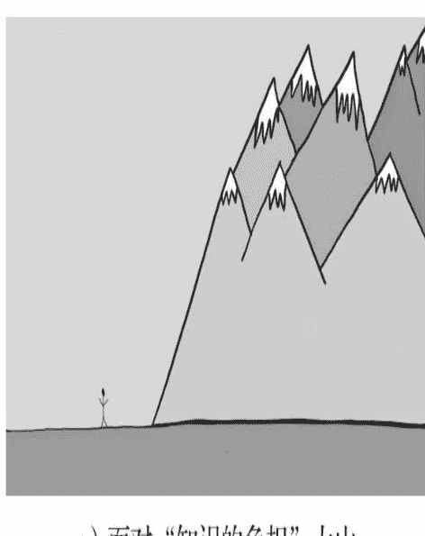

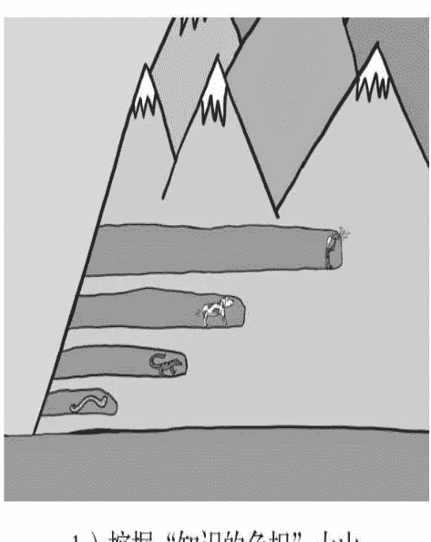

a) 面对“知识的负担”大山

b) 拆解压顶的知识重负

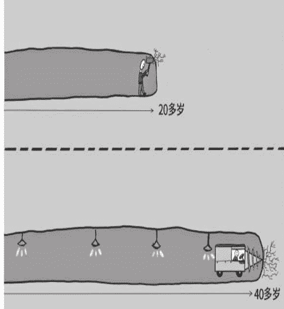

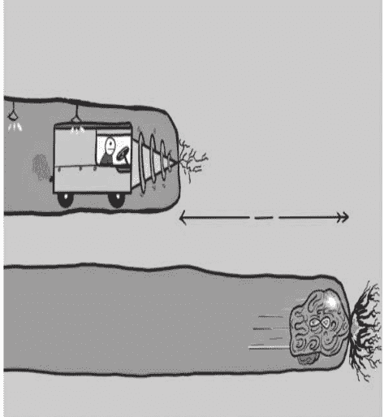

c) 创新高峰年龄后移的反常现象

d) 生成式模型是撬动知识山体的爆破点

图1-2 打破知识重负——把生成模型当作学习搭档，其效率或可达既有工具的百倍
资料来源：根据马里奥·加布里埃莱文章中的图片调整编辑而来。

当下学习者普遍感受到一种压顶之感，面前仿佛矗立着一座难以逾越的知识高峰。

人类认知边界在不断外扩，创新在数量与速率上同步攀升，这本身是积极信号。但随之而来的是待掌握的内容呈指数级膨胀，要触及前沿并实现突破，个人必须投入更漫长的培养周期。以物理学为例，与百年前的教材相较，如今要求的广度与深度已不可同日而语。

经济学者本杰明·琼斯把这一累积效应称作知识负担。他指出，负担的持续加重正拖慢创新节奏，因为最顶尖的发明者也难以腾出足够的时间沉潜。做出重大突破的平均峰值年龄在明显后移：1900年前后，重大的发现多集中于20至30岁区间；到2000年，这个峰值已推移至接近40岁。

网络媒体“通才”创办人马里奥·加布里埃莱用一个生动的隧道比喻来呈现知识负担：知识像一座需要贯通的山体，我们要在内部凿出一条通道。人类在穿越自身的认知山脉，动物世界里的蚯蚓、蜥蜴、犬类也在穿越各自的认知地形。差异在于，人类拥有强大的学习装备：纸笔、成体系的书籍、图书馆、学校、科研网络、计算机、互联网等。

每一种新装备都在大幅提升学习效率。电脑记笔记便于检索与共享；搜索引擎找资料比在馆内翻书高效得多；论文数据库的出现让曾属高科技的缩微胶片库彻底退场。

麻烦之处在于，新知识的累积速度超过了装备迭代的速度。我们陷入一种学习悖论：工具看起来越来越强，学习者却感到越来越追不上变化。终身学习演变成疲于奔命的追赶。生成模型的出现加剧了这种感受。模型相关论文井喷，有时单日就涌现数十篇；教材的尾部章节几乎要全部重写，模型也在改写诸多学科的教科书。天啊，又多了一大批需要消化的内容。

在此节点上，生成模型带来的不是量的叠加，而是质的跃迁。过往工具只是让负重的方式更舒适，而生成模型的效应，按马里奥的说法是“模型本身没有知识负担”。

生成式大模型是用人类几乎全部的书面资料与数据训练而成。按逻辑推演，它不仅通晓并理解了绝大多数人类知识——即便掌握得尚不完美——还能高效整合、重组与调用。若视其为一个学习者，它就不像人那样被知识负担卡住。

只要使用者会用，大模型就能让人摆脱重负，并把仍在负重前行的同行甩在身后，直奔领域前沿。以编程为例，你可能还在逐行撰写初版代码，有人已借助模型完成初稿，转而进入测试与调试；你可能还在一点点定位运行错误，模型数秒内就能给出错误解析与若干可行方案。

正如图1-2所呈现，人类手握开凿隧道的先进机械，模型却能以近乎爆破的节奏向前推进。关键问题不再是模型会不会改写学习，而是使用模型的学习者会比传统学习者快十倍，还是百倍。

因此每个人都得重新审视自己的学习方式。

模型如何提速学习的细节留到下一章，本章先聚焦知识骨架。实践很快会告诉你：若自带一个主题的知识框架，模型能以远超人力的速度帮你解题；若没有，模型不仅帮不上忙，还可能因错误回答把你带偏。

## 知识体系：把知识种成树

先把知识体系拆开来看。不同语境下它的含义不同：可以指整个人类的知识，图书馆就是这种体系的有形堆叠；可以指某一学科的脉络，例如从小学到大学的数学序列；也可以指个人的全部认知，即在学校、工作、兴趣中积累的一切。

本书谈论的知识体系，是指单一主题或细分领域的知识框架。这里有两个关键词：细分领域与知识框架。谈论知识体系时，前面其实都有限定语——“关于某个主题或领域的”。最理想的形式是层级式大纲，所以我们也称之为知识大纲。

谈学习时常提到“认知”，比如“认知升级”“认知水平”。“认知”是个好词，但容易让人困惑到底指什么。我们选用“知识体系”而非“认知”，是想把学习的内容锚定在一个可界定的名词上，并进一步把它具体化。

关于知识，有一个广为人知的DIKW分层框架：数据、信息、知识、智慧。数据是未经处理的原材料；经处理成为信息；信息经提炼分析成为知识；智慧则是对知识的洞察与运用。

人们对这个框架有多种解读，其中一种可视化加入了“影响”层，如图1-3所示。知识是把信息间的联系找出来；智慧是知道该用哪部分知识、怎么用；人的行动最终要产生影响。以应试为例，课本内容是信息，装进脑中的是知识，理解透的是智慧，考场上答对并拿到分数才是影响。

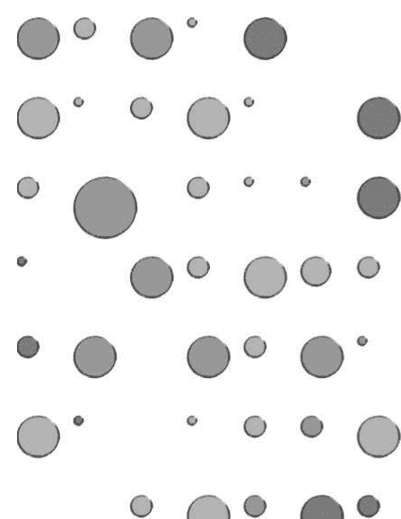

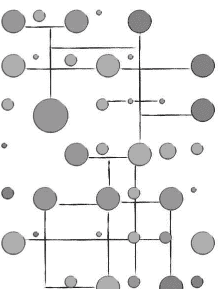

a) 信息 Information

b) 知识 Knowledge

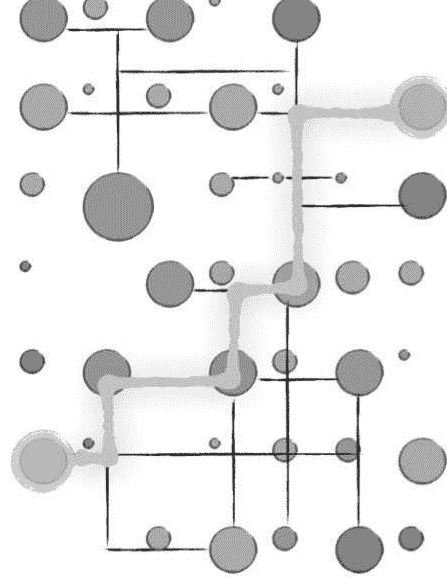


c) 智慧 Wisdom

d) 作用 Impact

图1-3 信息、知识、智慧、作用——知识框架
资料来源：根据Gapingvoid的图示重绘，原图包括数据、信息、知识、洞见、智慧、作用六个层次。

信息与知识的分界线，正是图1-3中那些连线的知识框架。把镜头拉近，看看框架长什么样。

每个主题的知识都能整理成如图1-4那样的树状结构。从下往上看，信息被归纳为知识点，知识点再组合成更大的知识点，形成知识框架，最终凝聚成一个名字，通常代表该主题的核心概念与原理，我们称之为“知识核心”。

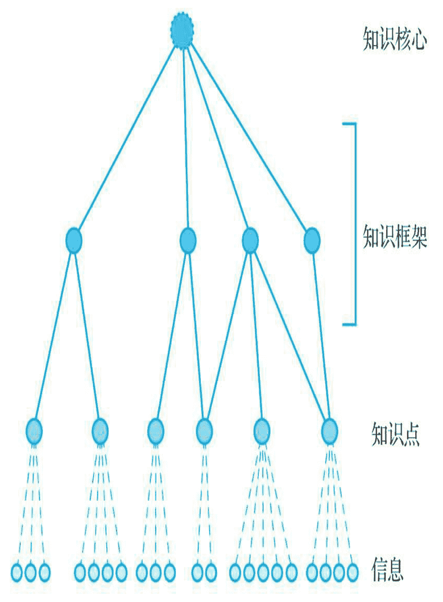

## 图1-4 知识框架的树状结构

你可能觉得学习就该直取知识核心。它们确实重要，但只抓核心有个小缺陷。回忆一下，学任何知识起步时都会被灌输重要概念与原理，若不深入展开，它们对你帮助有限。你或许能复述，却说不清含义，更谈不上运用。

务实的学习者会先抓住中间部分，即图中的“知识框架”。它包含大块的知识点，以及它们之间的关联。掌握了这层，再回头看核心概念才会觉得有用。拥有知识框架，才能更高效地使用所学。

无论线上线下，优秀的老师都会在有限课时里把这部分讲清，为学生勾勒出知识脉络。老师只能呈现外部框架，把它内化为自己的，是学习者的责任。穿透学习法的各种方法，正是为帮助你把外部体系快速变成内部体系。

现在可以明确，学习要聚焦知识体系，更精确地说，聚焦知识框架。用一个形象的比喻来看，一个主题的知识就像一棵大树，如图1-5。

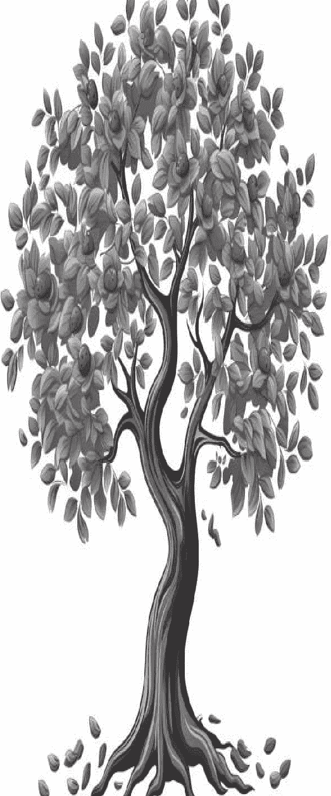

## 知识：一棵大树的比喻

- 叶片：主题的具体知识点
- 果实：可直接使用的实用知识点
- 树干：主题的主要知识框架
- 主枝：子主题的知识框架
- 根系：主题的知识基础

## 图1-5 将一个主题领域的知识比作一棵大树

单片叶片就是具体的知识点，数量庞大也好获取；果实是能直接落地的实用点，目标导向的学习者会迅速摘取。

在巨大树荫下，每个叶片、每颗果实都会勾起好奇。但只采摘叶片和果实不足以学透。

我们要描绘出“树干”与“主枝”。树干对应主题的主要知识框架；主枝从树干分出，代表子主题的框架。

埋在地下的根系是该主题的知识基础，根扎得越深，树越稳。

严格来说，知识体系包含树干、主枝、叶片、果实和根系，而知识框架仅指树干与主枝。你已经能分辨两者，接下来提到知识体系时，通常只指树干与主枝。

用大树的比喻能很直观地设定学习目标：深入理解树干与主枝，即掌握主题的知识体系，从而更有条理地吸收、整合与应用。

一上来就猛攻根系，会越学越深、越学越难，可能还没到主枝就放弃了。先尝点果实是好事，能保持兴趣。但只采果实，比如死记硬背，会让人困惑：换个场景还行吗？只收集叶片更是糟糕的策略，记忆负担巨大却无法串联。

反之，掌握了树干与主枝后，一个叶片可能十分钟就能学会。在信息时代，这个时间更短，搜索引擎、社交网络、笔记、大模型等都能让你更快拿到具体知识点。

总之，聚焦树干与主枝是高效的学习策略。掌握了知识体系，你就能自信地运用该领域知识。聚焦它们也让短期集训成为可能，一棵知识树叶片众多，但树干与主枝是清晰的。后面穿透学习法的各方法都会显示，知识体系是主角。

在《轻松主义》中，格雷戈·麦吉沃恩也用过树干与主枝的比喻，并把这种原则学习叫作“种下一棵知识树”，本节标题即借鉴于此。创办SpaceX与特斯拉前，埃隆·马斯克并无相关专业背景，他如何快速上手？他说：“大多数人能学到的比想象的多。关键是把知识看作一棵树，在采集树叶也就是具体知识点前，先搞懂基本原理，也就是树干和主枝。否则树叶就无枝可依。”

厘清了穿透学习以知识体系为锚点后，再来看看穿透到底意味着什么。

## 穿透意味着什么

穿透意味着在一个主题内，你拥有一个正确、完整、属于自己的知识体系。你对它有充分把握，它能正确指导行动并带来成果。

穿透意味着全面掌握主题的知识体系，学透方方面面，关键点滴不漏。当然指的是大树比喻里的树干与主枝，叶片与果实可择其要。新技术改变了学习：不必记住一切，笔记、搜索或问模型随时可查。

穿透也意味着持续更新体系：学习新知、修正错误、丢弃过时。你要清楚体系里还有哪些未知，持续补位。随着时间推移，新知识涌现，老知识被淘汰。若建立了体系却从不更新，手里拿的就是一张过期地图。

穿透还意味着在一个主题里培养高阶认知。之前提到“认知”稍显模糊，这里把它拆成四个具体能力：直觉判断力、理性判别力、鉴赏力、学习的信心。

直觉判断力。面对问题时，能凭近乎直觉的判断直接做出合理预测；看到一个答案时，能迅速判断对错。这不是玄学，而是内化的知识体系在后台快速运行。

理性判别力。能有条理地解答问题，逻辑清晰地判断答案正误。读到观点，能判断其论证是否支撑结论；自己表达时也能做到条理清楚、观点鲜明。

心理学家基思·斯坦诺维奇与理查德·韦斯特把大脑分为系统1与系统2，丹尼尔·卡尼曼的《思考，快与慢》让概念普及。这里直觉判断力对应系统1，快速无感；理性判别力对应系统2，注意力投入、费脑力。

但仅有这两样还不够。

鉴赏力。不仅知道对错，还要知道好坏、优劣、卓越与突破性。没有鉴赏力，知识水平易显平庸。学校里，正确解法与巧妙解法不同，普通作文与有文采的作文不同，地道英语与正确英语不同。工作中，普通算法能跑通，优秀算法可能快十倍甚至百倍。

鉴赏力来自视野，见过好的才知道什么是好。鉴赏力即品位，品位即选择。

学习的信心。深入学习后会发现所知只是冰山一角。知识像一个圆：圈内是已知，圈外是未知，圆周是意识到的未知。知识增多，圆变大，圆周也变大，未知范围随之扩大。直觉、理性、鉴赏都重要，但信心更关键。信心不是“我全知道”，而是面对未知时相信“我能学会”。真正掌握知识体系会极大增强这种信心，让人敢于探索未知。

看起来有点复杂，简化一下。

## 掌握真知识，而非“司机知识”

1918年，马克斯·普朗克因量子力学获诺贝尔奖。当时量子力学极流行，普朗克被邀在德国多城演讲，像巡演一样。演讲内容每次都一样，他的司机听了无数遍，已烂熟于心。

司机提议：“教授，每次都讲一样一定无聊。慕尼黑这场让我代讲吧，您戴上我的司机帽坐前排休息。”普朗克欣然同意。

慕尼黑现场，司机复述演讲，掌声如潮，甚至比普朗克更精彩。听众没识破差别。

台下一位物理教授提问，司机答不上。灵机一动，他说：“慕尼黑这么领先的城市，没想到还有人问这么基础的问题！这个问题我的司机就能答，请他来。”

这则轶事是虚构的，出自沃伦·巴菲特搭档查理·芒格1998年的故事，他常讲。普朗克掌握的是真正的知识，可称“普朗克知识”，经长时间思考与实践可验证；司机拥有的是伪装成真的“司机知识”，具体对比见表1-1。芒格说：“把责任交给拥有普朗克知识的人，远离只有司机知识的人。”

## 表1-1 普朗克知识与司机知识：你是否真学透了

| 普朗克知识：真正理解的深度知识 | 司机知识：死记硬背的表面知识 |

| --- | --- |

| - 深入理解主题，努力探求真相<br>- 能清晰解释与讨论所知<br>- 拥有该领域的知识体系<br>- 有能力实际运用知识<br>- 知晓自身知识与能力的边界 | - 不求理解，只记名词与概念<br>- 只是假装知道<br>- 没有该领域的知识体系<br>- 无力实际运用知识<br>- 易自我欺骗，在能力圈外不自知 |

值得注意的是，普朗克的司机并不愚蠢，他清楚自己的边界。危急时，他聪明地把问题抛回给普朗克。我们应向司机学习。在知识爆炸时代，很多领域我们并不了解，不能假装知道就轻率作答或行动。

## 本书的内容组织

我们要学的可分为三类：学习一种知识，如社会学、统计学、人工智能理论；学习一种技能，如写作、演奏、演讲、编程、提问；学习一种技术工具，如电脑、办公软件、大模型工具。穿透学习法对三者均适用。

一次主题学习从输入到知识体系再到输出，重点在中间。穿透学习法是一组结构化方法，帮助你把外部体系变成自己的，并在短期集中学透主题。

本书章节体现了穿透学习法的框架。第一章为总论；第二章讨论生成式模型等技术如何改变学习；第十一章是穿透学习法的思维模型“吸附框架：学习—验证—扩大—惊人”。习惯先看模型的人可先读第十一章。其余章节为穿透学习的四要素与三场景。

### 第一部分 在AI时代如何学习

- 第一章 穿透学习法：如何学透一个主题领域
- 第二章 技术改变学习：如何用AI加速你的学习

### 第二部分 穿透学习的四要素

- 第三章 深度体系：如何获得属于自己的知识体系
- 第四章 深度复制：如何先突击学懂70%
- 第五章 深度冲刺：如何五天快速学透
# 第六章 深度练习：如何通过刻意练习提升水平

### 第三部分 穿透学习的三场景

### 第七章 穿透阅读：如何读透一本书
# 第八章 穿透技术：如何精通一种技术工具
# 第九章 穿透提问：AI时代如何掌握提问技能

### 第四部分 用穿透建立你的学习系统

# 第十章 编写个人知识指南以提升认知
# 第十一章 用吸附框架构建你的认知体系

在介绍具体学习策略之前，先把注意力放在当前学习结构里波动最大的要素上——生成式人工智能。

## 本章要点

- 穿透式学习围绕知识架构展开，能在短期内把一个议题彻底吃透。
- 该方式尤其强调新技术工具的运用，用得好时学习速率与效能可做到十倍级提升。
- 穿透的实质是进入高阶认知范畴，涵盖直觉判断、理性鉴别、审美鉴赏，以及对学习的坚定信心。

> ‘现在就行动吧！’

- 盘点出五项你最急需攻克的新议题。
- 挑一个自认已掌握的议题自检是否真正通透：你是否清楚其知识骨架？你是否具备相应的高阶认知？
- 针对一个熟悉的议题，用自己的语言绘制知识结构，并尝试向他人讲解。

1. **注释1:** 2020年机械工业出版社出版的《穿透式学习》一书中，方军讨论了穿透学习法的学习之旅模型及多种方法。
2. **注释2:** 能即时、有针对性地对我们的问题给出回答，是AI助力学习的重要方式。1984年，本杰明·布鲁姆（Benjamin Bloom）在其教育实验中从定量角度证明，一对一辅导的教学组的平均分明显优于传统教学组，差距达到两个标准差。这就是所谓两个标准差问题（Two Sigma Problem）。通俗地说，如果传统教学组的平均分是70分，标准差是10分，那么一对一辅导的教学组的平均分可能接近90分。
3. **注释3:** 资料来源：麦吉沃恩. 轻松主义[M]. 范兆明，译. 北京：中国财政经济出版社，2022. 马斯克的故事也转引自该书。
4. **注释4:** Chauffeur借用自法语词汇，指驾驶豪华租赁车辆的司机。

# 第二章 用技术重塑学习：生成式模型如何加速

“对我而言，电脑是我们造出的最了不起的工具之一，它相当于思维的自行车。”1990年，苹果创始人史蒂夫·乔布斯在电视访谈里如此表述。自行车是个精妙的类比：大脑需要主动踩踏，人才与它一起前行。

人类又打造出另一件令人惊叹的新器具——生成式人工智能。它以对话机器人、智能助手等形态渗入学习、工作与生活，同样可以被视作思维的自行车，如图2-1所示。


图2-1 电脑是思维的自行车，生成式AI也是思维的自行车

造工具的能力把人类与其他灵长类区分开来。回顾人类工具史，电脑之前已有纸笔、纸质图书、算盘与计算器等用于辅助思维的器具。互联网兴起后，搜索引擎、社交网络等新形态不断出现，可看作全人类大脑的集合。笔记软件常被称作个人记忆的“第二大脑”。如今，生成式人工智能正式加入其中，已成为当前最强大的学习工具之一。

在学习层面，这项技术让不少人感到冲击。过去需要花费大量时间精力习得的知识与技能，如今他人无需学习，只需向模型提问，一秒即可获得。这就是技术带来的“知识变革”——知识变得唾手可及。我们经历过“计算变革”，计算变得随时可用；正在享受“信息变革”，信息变得触手可及。现在被改写的是知识本身。

知识唾手可得的未来尚未完全到来，但当下感受到的震动恰是好时机，它促使我们追问：如何更好地借助包括生成式人工智能在内的各类新工具来学习？

## 十倍提效法则：善用工具让学习效率大幅跃升

过去四十年，电脑、互联网、手机逐步融入生活，却存在一个悖论：这些工具无处不在，却常被当作“二等公民”。比如知识以数字形式获取已成常态，内心仍觉得读纸质书才算真正读书。

搜索引擎、社交网络在学习中的分量日益加重，但在非技术议题的讨论里却缺乏相应重视，甚至被刻意排除。每个工具都有长处与短板，我们却常因担心短板而限制使用。

我们应积极拥抱新技术，做技术乐观主义者，聚焦其长处并善加利用。悲观者看见风险，乐观者看见可能。这一次与知识直接相关的生成式人工智能，正是所有人学习的新拐点，如图2-2所示。因此需要再次强调新技术对学习的价值：

十倍法则：各类新技术工具都是十倍工具，用好后至少能让学习效率提升十倍！


纸与笔

纸质书

计算器

电脑

搜索引擎

社交网络

生成式AI

图2-2 学习的工具：从纸与笔到生成式AI

具体该怎么做？

### 1. 把工具学习纳入核心

各类技术工具在学习中扮演关键角色，例如电脑、搜索引擎、社交网络、笔记软件、翻译软件、编程工具、生成式模型等。本书所有方法都默认你以联网电脑为支撑，也可包括手机、平板等设备。

学习中占用大量时间的是这些新工具的使用。从现在起，要给予与之匹配的关注，不再把工具视作技能的附属：

- 过去，学习是学知识与技能。
- 现在，学习是学知识、技能与工具。

要重视工具的学习，掌握使用诀窍并付诸实践。要努力成为各类新技术工具的早期使用者，发现有价值便迅速投入。

以阅读为例，你可能还在等待翻译版，而会用模型的人已在模型辅助下自行制作中英对照版并开始阅读了。你可能会问这需要少数人才能做到吗？并非如此。你可在大众电子阅读平台上传电子书，直接阅读模型翻译版。

### 2. 认识工具如何转移学习重心

学习新工具，不仅要学会操作，更要意识到它改变了“学什么”的答案。

当信息能在互联网快速查到，学习的重点不再是记忆，而是会查。要懂得输入什么关键词、如何顺着链接追踪，直至在某个页面找到最佳答案。我们都认同理解大于记忆，但过去仍不得不记很多东西；有了搜索引擎后可大幅减少无用记忆，集中于理解。

我们前面说有疑问可问模型，它能解释，但模型的回答可能有误，因此你自身的知识结构变得重要，你的直觉判断、理性判别与鉴赏力变得重要。

面对任何问题，模型都能提供一种或多种解释。因此即时学习能力变得重要：快速读懂模型的回答、理解并筛选出有价值的部分。

当一种新工具在学习中普及，我们应思考：它让哪些过去重要的事变得无足轻重？它让哪些过去不可能的事变成可能？它让哪些过去困难的事变得轻而易举？当别人都在用时，我如何用得更有效？

### 3. 新增的两项基础能力：善用工具与电脑写作

使用新技术工具已成为基本学习技能，与听、说、读、写同级。学习与工作中，都默认每个人会用电脑与网络，就像默认你识字、会数学、懂英语一样。图2-3展示了基本学习技能的变化。

学习是把“外部的知识”转化为“自己的知识”。过去基本技能是听、说、读、写，现在增加了两种新的基本技能：用新技术工具与用电脑写，如图2-3所示。

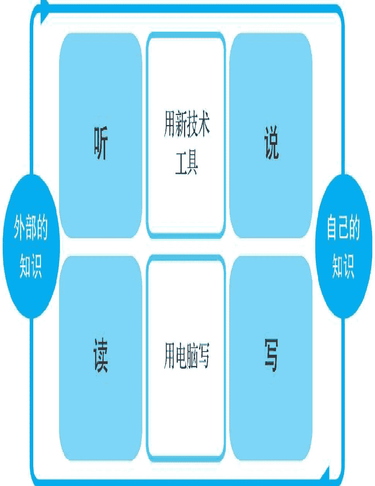

外部的知识

听

用新技术工具

说

自己的知识

读

用电脑写

写

图2-3 听、说、读、写之外两种新的基本学习技能：用新技术工具与用电脑写

“用新技术工具”指学习、运用并掌握其技巧，也包括如何挑选适合自己的工具，如何将工具组合成个人学习系统。它们已成为每个人学习系统的关键组成，没有人只靠印刷书籍、纸笔、线下课堂来学习。

“用电脑写”值得单独展开。“写”并非仅指写文章，而是指把所读、所思、所想、所做以文字形式记录与呈现。“用电脑写”看似是工具使用的一部分或写作新方式，但单独列出是有理由的。

“用电脑写”是当下学习的枢纽。听和读时，你用电脑写笔记、写文章、做PPT、用特定格式记录如数据表格、图示、代码；沟通时，你写邮件、在对话框里写、在社交网络上写；工作时，你用电脑写计划、总结与报告；向模型提问时，你也需要写清楚问题。

在学习中，写的作用很明确。听课读书时写笔记有助于提升理解，整理笔记是有效复习；把想法写下来，能把脑中分散的念头聚合；写下来的文字便于与他人更有效交流。

在这些基础上，用电脑写有哪些新优势？仅列举部分：

- 速度更快、记录更清晰。用电脑写比手写更清楚。
- 修改更便捷。你会进行更多迭代，让内容越来越好。
- 交流与反馈更方便。可分享笔记征求建议，也可在博客发表文章。
- 记录与整理更高效。纸质卡片仍有用，但电脑笔记便于检索与归类。
- 更易“写”表格、公式、图示、数据图等。没有电脑辅助，这些任务耗时耗力，有时甚至不可行。

本书讨论学习方法时，用电脑写也是隐含假设：把一本书整理成思维导图或PPT，把某个领域的所学写成个人知识指南，采用“公开练习”把笔记分享到网上……这些都是用电脑写。过程中可用纸笔写关键词、列提纲、打草稿，但终稿一定是用电脑完成。

财经作家吴晓波曾分享早年经历。1995年，他花半年工资买了台电脑。当时他在新华社工作，同事都不解：写稿用的笔、本子、墨水单位都提供，你为何自掏腰包买写作工具？

这台工具改变了很多。有了电脑后，他的写作效率大幅提升，比如剪报录入数字文档后查询取用更快。吴晓波说：“我们这代人如何淘汰上一代？不是更勤奋更聪明，而是更乐于接受新工具。”

近三十年后，我们有了更强大的新工具，要用好它们。《深度工作》作者卡尔·纽波特提出公式：高质量工作产出=时间×专注度。我们认为缺少“工具”要素。善用新技术工具，工作学习产出可大幅提升，于是更新为

高质量工作产出=时间×专注程度×新技术工具

现在，大模型是最强大的学习工具之一。它的能力让人惊叹。对知识点有疑问可直接询问，即刻得到流畅条理的答案。可让它扮演老师角色，按你的水平提问、评估、纠正、讲解。

## 生成式模型使用速览：提出问题即获回应

即使你不熟悉生成式模型的技术细节，也能看懂下面内容，无需担忧。模型的一大优点是，只要会写字说话就会用它。它能理解你的表达，并主要用普通文字回应。

把模型用于学习，可想成向一位知识面广、聪明的助教提问。注意，它只是助教而非老师。老师更深厚准确；年轻助教热情帮助，但回答未必完全正确。

模型使用起来非常直接：你问，它答。市面上有多种聊天机器人产品，越来越多的软件也内置可对话的智能助手。这里主要指大语言模型，它们支撑这些聊天机器人。

简单说，大量知识被压缩进模型并化为参数，用户可用自然语言提问并得到回答。我们向模型提问的语句叫提示语，其角色类似给搜索引擎的关键词，触发回应。模型能理解提示语，完成提问或任务。

大语言模型不仅具备文本理解生成、多语言、逻辑推理能力，也拥有一定基础知识。下面两个例子可直观了解用法。

提问：请用小学生能懂的语言，简洁解释什么是AI聊天机器人及其工作原理。

回答：AI聊天机器人就像一个会说话的电脑程序。你可以跟它聊天，它会根据你的话回答。

它是怎么工作的呢？就像我们学习一样，这个机器人也会“学习”。人们给它很多书、文章和对话，让它知道各种信息。当你问问题时，它会想起以前“学习”的内容，然后给你答案。

它好像有一个超级大的书包，里面装满了书。当你提问时，机器人会很快在这些书里找到答案并回答你。

现在的模型也有一定推理能力。下面这个“杨立昆问题”由深度学习三巨头之一、图灵奖得主杨立昆提出，可用于测试推理能力，如图2-4所示。模型的推理过程和答案是正确的。

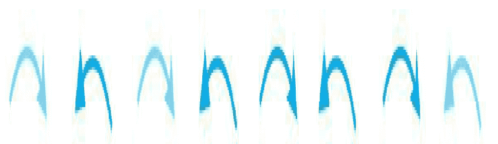

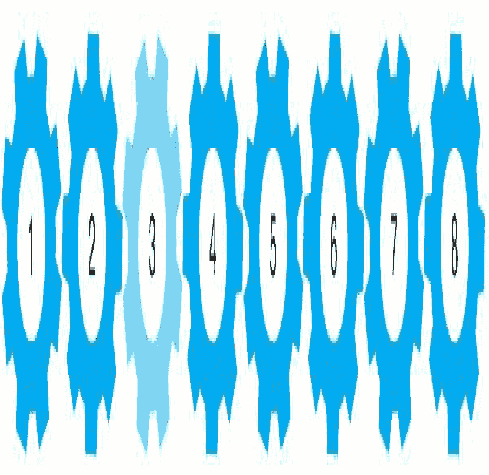

图2-4 杨立昆问题的图示

提问：在我们面前有八个齿轮，编号1到8，按顺序安装在轴上，每个齿轮都与下一个啮合。如果齿轮3顺时针旋转，齿轮1和齿轮8会朝哪个方向转？请逐步思考。

回答：好的，我们一步步分析。首先，两个啮合齿轮的旋转方向相反。

1. 齿轮3顺时针转，会使齿轮4逆时针转。
2. 齿轮4逆时针转，推动齿轮5顺时针转。
3. 齿轮5顺时针转导致齿轮6逆时针转。
4. 齿轮6逆时针转推动齿轮7顺时针转。
5. 齿轮7顺时针转使齿轮8逆时针转。

回到齿轮3前面：

1. 齿轮3顺时针转使齿轮2逆时针转。
2. 齿轮2逆时针转推动齿轮1顺时针转。

综上，齿轮1顺时针转，齿轮8逆时针转。

模型还有很多能力，如修改表达语法、编写摘要、做数学题、写代码、识别图片等。这两个例子已足以说明基本用法：以文字提问，以文字回答。当然提问时也可带图片。以上是对模型简要介绍，接下来聚焦如何把它用于学习。

## 如何借力生成式模型实现学习效率倍增

学习是将外部知识转化为自身知识的过程。可以从两个视角看：一是认知视角，理解输入的知识；二是行动视角，运用学到的知识，如图2-5所示。认知与行动可分为三部分：①消除障碍；②加深理解；③提速输出。我们将看到，在每个环节模型都可能显著提升效果。目前模型在多种学习场景表现良好，且效果持续改善。下面讨论以当前最好效果为假设。

让我们回到具体场景，看没有模型时我们怎么做，有模型助力后又能如何做。

### 认知视角

### 行动视角

### 消除障碍

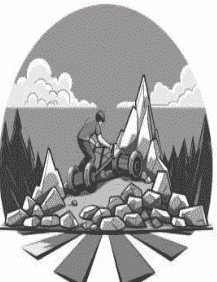

- 让模型根据文章编写摘要、大纲
- 针对疑问向模型提问，获得回应
- 让模型直接告知操作步骤
- 让模型解释具体细节，以获得逐步指导

### 加深理解


- 让模型向你提问，对你进行水平测试
- 让模型对你的理解进行评价、提出建议
- 让模型对我们的做法提出改进建议
- 让模型对我们的结果进行评价

### 提速输出


- 用模型辅助整理笔记
- 用模型辅助撰写总结
- 在模型辅助下编写教程
- 在模型辅助下撰写文档

图2-5 认知视角与行动视角：模型在学习中如何助力

## 用生成式模型扫除学习阻力

学习新主题时，常从听课或读课本开始。但被动听课读书是不够的。你会考虑整理包含主要知识点的提纲，以把握框架。但从零开始整理很费时，很多人会逃避这一任务。

现在可以这样做：先在网上搜一个已有提纲，复制到自己的笔记本。你可简单复制，也可深入改写，例如按自己的理解增删、加标注。

有了模型，整理提纲更轻松。比如读一章约一万字的书，你可把整章输入聊天窗口，请它整理多层级提纲。

模型整理的大纲通常不完美，但可作为你进一步整理的起点。有趣的是，不完美的大纲反而提供独特学习机会：你已读过资料数遍，面对可能有误、需修订的大纲，你立刻接受挑战。在挑错过程中会很有成就感：我确已读懂。

除大纲外，模型还能以多种方式整理资料。你可让它整理摘要，再自行修改，最终得到符合自己认知的版本。也可让它做观点摘录，看它是否捕捉到你忽略的亮点。

学习中常遇到疑问：这个名词何意？这个推理为何看不懂？如果有人用简单语言解释就好了！

过去我们会反复研读、去图书馆查资料、向老师同学请教。有了网络后可在互联网搜索相似问题的回答，也可在社交问答网站提问，但可能要等很久。

现在可直接向模型求助，即时得到回答。我们把资料片段给它，提出要求：“请用简单的话为我解读。”再次强调，其解答不一定正确，但即时给出的解答可成为继续学习的垫脚石。

有时，这位知识面广的助教模型还会带来惊喜。有一次我请模型解答疑问，它在我要求之外额外解释了“无法拒绝的提议”——来自电影《教父》的名句：“我要给他一个他无法拒绝的提议。”我这才发现，原文中“无法拒绝的建议”是对这句经典台词的改编。

## 借助模型深化学习

回答未必准确，但它即时给出的解释可以成为我们继续学习的垫脚石。

从100小时到10小时：新工具如何重塑学习节奏

过去，要把一份资料里所有的疑问都捋清楚，很多人得花上百小时。借到搜索引擎和社交网络的帮助后，时间大约能砍到一半。等到有了AI在旁边协同，同样的工作往往十小时左右就能完成。这种量级的压缩带来了根本性的变化：以前因为成本太高，我们宁愿放过大部分资料不去深究；现在，值得细看的范围被大大拓宽了。

必须提醒的是，任何工具都替代不了个人的投入。大脑的工作方式决定了，没有经过挣扎抵达的信息，很快就会被遗忘。不肯下功夫，外部知识就转化不成自己的东西。用AI并不是把它当成替代品，而是把精力从低价值的重复劳动里解放出来，集中到真正卡住的难点上。

### ‘实用小技巧’ 用搜索加AI一起把疑点清零

面对学习中的不明白之处，可以把检索和生成结合起来处理。

- 先去搜集原始文献、示意图、他人的解读文章以及社区里的讨论。搜到网页后要自己判断质量，甄别哪些靠得住。
- 再让AI来帮忙解释。你可以这样问：“这个词到底指什么？”“基于下面这段材料，用小朋友能懂的话说一遍。”“这个答案错在哪里，请纠正一下。”用完之后一定要回头核对，AI的解释不等于定论。

把技术工具用好，也能打掉很多与行动相关的学习阻碍。

比如想掌握一门技能，书上只讲原理没有步骤。以前只能自己把原理翻译成操作，或者去网上找别人总结的流程。现在可以把资料丢给AI，让它先起草一个操作流程，再由自己来修改完善。修改草稿本身就是一次很扎实的学习。

AI在把抽象知识变成可执行步骤这件事上特别顺手。通常教材会给出大致框架，但困难往往藏在作者觉得理所当然的细节里。自己卡住时就会喊：“这里要怎么弄？”把完整的信息和已经踩过的坑一起喂给AI，它能立刻给出条理清晰的建议，并逐条说明做法。把AI用对了，麻烦基本就消失了。

### ‘实用小技巧’ 让AI把材料变成可执行的步骤清单

把原文和你具体的使用场景告诉AI，请它把内容转写成照着就能做的步骤或检查清单。生成后要自己逐项审视、修正，确认无误再去用。

可以这样提问：“根据下面这份资料，帮我整理出完成××任务的五步操作。”“把这份资料改写成逐项核对的检查清单。”

## 让AI帮你把理解做深

加深理解最直接的办法是做测试。做题能把主观感觉和真实水平拉开，差距看得见才好补。

不少技术教程会在小节后放多选题，很多人会直接跳过，觉得是送分题。现在有AI后，我都会把这些题做完。后来才明白，这一点点推动对知识点的掌握帮助很大。可惜带测评的教程并不多。

没有现成题目，就让AI出题。最简单的指令是：“根据这份材料，给我五道选择题，测我对××知识点的掌握。”进阶玩法是分层出题：“把××知识分成简单、中等、较难三个层级，每个层级各出五题。从易到难依次给我，如果连续两次答对就升到下一层；答错就给出正确答案和解释，再出同类题巩固。”这样你就拥有了一个会即时批改的互动老师。

要注意，AI生成的题目也可能有纰漏，保持警觉的态度很重要。发现可疑之处可以直接质疑：“这道题是不是有问题？”在争辩的过程中，反而能学到更多。

AI聊天机器人出现时，很多人第一反应是让它解题。现在反过来让它出题，才是促进理解的用法。已有题库也可以交给AI，让它按你的水平和样题风格生成新题进行互动提问。

AI不仅能读懂材料，还能读懂你的表达。于是出现了新的学习方式：让AI提问，你作答。比如请它要求：“用三百字说明你对××话题的理解，要求是…”你回答后，AI会打分并点评，如给“B”，指出亮点和需要改进的地方。你可以继续追问，让它对修改版再评价、给出优化建议。

### ‘实用小技巧’ 按你的水平出题并互动测评

把资料和样题一起给AI，让它对你提问。你可以根据需求定制规则，例如：

- 答错后先提醒我重做一遍，再公布答案和解析。
- 答错后就同一知识点再出一题，并把选择题换成问答题。
- 给我两道超出当前水平的难题。

换到行动视角，AI还能怎样支持你。

如果你要写篇文章，先把大纲给AI求助。可以问：“请用1到10分评价这个大纲。”“这里能怎么改进？”“给我三个完全不同的大纲方案。”写完全文后也可以请它评审：“按这些标准用1到10分打分。”“列出五点论述上的建议。”“用列表给出十条语言表达的修改点。”表达方式可以像日常聊天一样自然。

做数学难题时，可以把文字或LaTeX格式的推导过程贴进去问：“推导对吗？”“有没有更简洁的解法？”做实验时，把准备的步骤给AI过一遍，请它提风险点；把中间数据给它，让它做预测，和它一起讨论最终结论。

把行动过程用文字记录下来——纯文字、数据、公式、代码都可以——之后交给AI来帮你深化理解。这里要强调，用电脑写作是基本前提，AI只能处理你写下的文本。少数工具支持语音输入，但从学习精确度看，文字仍然更可靠。

更创造性的用法是角色翻转，让你通过“教”来学。AI扮演学生，你扮演老师。流程是：①你提出问题，②AI作答，③你评判对错。

要把聊天机器人变成学生，只需给它一个提示。完整指令大致是：你是一个已学过某主题的学生，对话人扮演老师。一步一步思考，做决定前先反思。练习目的是让对话人评估你的解释和应用。开始时先自报是学生并询问老师想让你解释的概念。收到概念后，写三段解释并给出两个应用例子。然后问老师回答如何，请他指出对错和改进点，并请教老师他认为更好的应用方式。

这个“翻转导师”的做法综合了AI的多项能力。你通过纠正AI的错误来强化自己的理解。而AI常会出错，正好给了你纠错的机会。

## 用AI提速输出环节

学习者都知道，输出比输入更能固化知识，也更有成就感。但输出需要的时间、精力与决心远大于输入。读完一本书很容易，整理读书笔记却总是拖延，明明知道整理过后才是真正收获。

AI凭借强大的理解和生成能力，能大大减轻输出负担。比如读完一本书后你积累了上百条摘录，AI可以结合正文帮你补全、重写条目；从中找出关联，把分散的点连成条目串或更大的主题；按照目录把内容归类整理。

需要保持清醒：AI写的东西看起来很专业，容易让人产生信任。但仔细看会发现不准确、理解偏离的情况都有。拿AI的输出当理解的辅助绰绰有余，若以成品标准要求，就会很失望。帮整理笔记时，它可能擅自改动你的原句，而你要求的是不可改动原文；它的改写也可能偏离你阅读时的真实感悟。

所以不是不用AI，而是扬长避短，把不完美当成学习机会。见本章后面“启示：与AI的不完美、幻觉与错误共舞”。

关系调好后，AI对学习帮助很大。在整理输出的场景里，它不是并肩的副驾驶，更像站在你身后等指令的打字员，偶尔小声提一句：“这里要不要考虑一下？”你可以采纳，也可以直接忽略。写完一页交给它整理录入，再请它提修改建议或改语法。有时可以让它做风格转换：“保持结构和信息不变，把这份正式稿改成口语化表达。”

也可以把它当成费曼技巧里的那个小孩：“现在你是个小学生，我来给你讲这个知识……”讲完后问它：“听懂了吗？”“哪里不明白？”

### ‘实用小技巧’ 用AI给文章做针对性修改

请AI提供具体的修改意见。比如：“你是个资深写作者，请对下面这段给出五个表达问题的修改建议。”根据自身问题定制需求，例如：

- 找出主语缺失或主语不清的地方。
- 找出冗余表达并给出精简建议。
- 用列表形式标出错别字和用词不当。

把修改前后的对比样例给AI，它能给出更到位的建议。

再回到行动视角，AI同样能大幅提速。

比如你是熟练程序员，要把一项技术重新做一遍并写成教程。教程的核心是操作步骤、输入命令、过程截图，其他文字只是粘合剂。过去写这类胶水文字很耗时。有了AI，你一边操作一边记录，之后让AI把这些胶水文字补全。它写得快、顺畅、通顺，还不会有语法问题。最后你审阅修订，教程就完成了。

从认知角度看，笔记的读者是未来的自己；从行动角度看，文档的读者是别人。转换视角很耗力，人总想拖延。AI能帮你完成视角转换。你专注内容，它负责把内容改写成他人可读的形式。你承担思考，它承担繁琐转换。

学习时写下的教程其实是写给未来的自己。学习时细节很清晰，几个月后记忆模糊，自己写的笔记都可能看不懂。如果当时就用他人视角写下，附上必要信息，未来回看依然顺畅。AI让这种写作变得轻松。

### ‘实用小技巧’ 让AI切换到他人视角帮你写教程

心理学家艾里克森把写作分成两步：知识讲述，把经历讲出来；知识转换，有意识地教会别人。写教程时可以这样做：第一步，自己记录经历；第二步，让AI把你的记录改写成教学稿；第三步，你再编辑加工。

总体看，在消除障碍、加深理解、提速输出三个层面，AI都是强力的通用学习工具。用好了，学习效率提升十倍是有可能的。

长期使用后，你还会发现信心在增强。AI能解释难点，降低入门门槛；同时它帮你把精力集中在真难点上，难点也变得好啃。两者叠加后，面对再难的主题，你都会说：“我能学会。”这正是很多人用AI辅助学习后的共同感受。

## 启示：与AI的不完美、幻觉与错误共处

“AI会胡说八道！”我们反复强调这一点。生成式AI不是检索资料库，而是根据海量训练数据做概率预测，然后用通顺的语言输出。要它能生成，就不能要求每句话都来自原文。

因此AI的答案没有绝对正确性。若追求绝对正确，它就变成笨拙的拼贴机。实际上，人用自己的话解释知识也做不到百分百精确，否则只是背诵。

当AI自信满满地给出错误时，我们称之为“幻觉”。能力虽在提升，错误却无法根除，所以使用前必须核查。

可能会有疑问：既然AI会错，为什么还能用来学习？换个角度看，不完美恰恰是学习资源。每次发现错误都是学习机会。

如图2-6，学习资料可按“是否正确”和“完成度高低”两个维度划分。正确的且完成度高的可作课本；完成度高但可能有错的是低质资料，比如看起来工整却不一定对的作业，网上常见，切忌照抄；正确的但未完成可作参阅资料；自己正在做的、未完成且可能有错的，就是学习区资料。

| | 完成度高 | 未完成 |
|---|---|---|
| 可能有错 | 低质资料 | 学习区资料 |
| 正确 | 课本资料 | 参阅资料 |

图2-6 学习资料分类

最难获得的是学习区资料。我们知道它不完整，补全就是学习；我们知道它有错，改正就是收获。向AI提问得到的内容多落在学习区，且极具针对性和即时性，它和你一起在同一个具体问题上思考。

从这个分类图也能看出本章倡导的学习理念：把学习区里学到的东西整理成接近课本质量的资料。后面章节里教别人、写教程、写个人知识指南，本质都是从图左下角走向右上角。

## 本章要点

- 10X原则：新技术工具多为十倍提效工具，用得好学习效率至少提升十倍。
- 生成式AI的核心用法是问答，像副驾驶一样充当助教、助手和顾问。
- AI在消除障碍、加深理解、提速输出三方面提升效果。
- 警惕幻觉，务必核查AI回答的准确性。

### ‘现在就行动吧！’

- 注册并使用几款AI产品，如聊天机器人、翻译、笔记、绘图等。
- 一次问20个问题，记录使用后的三点感受。
- 用AI完成一件实事，比如回邮件、改文章、翻译专业稿件。

注释1： AI可分为判别式与生成式两类。推荐商品的算法多基于判别式，能回答问题和生成内容的则是生成式。为方便表述，下文AI均指生成式。

注释2： 用电脑写和选用什么软件、格式是两个层面。这里关注的是写什么、怎么写、如何修改以及写作如何服务学习目的，而非设备或工具品牌。

注释3： 主流大语言模型包括国际上的GPT、LLaMA、Claude，国内的文心一言、通义千问、混元、ChatGLM、讯飞星火、百川等。

注释4： 原样摘录AI回答。按要求得到的简化解释是准确的。严格说，AI并非在书中找答案，而是依据训练数据的语言模式预测下一个词。

注释5： 杨立昆问题的原文为英文，我们使用中文提问并原样摘录。提问时采用思维链技巧“让我们一步一步思考”，可提升推理正确率。

注释6： 当前上下文窗口较大的是Claude，最大支持十万个标记符，约可输入六七万汉字。若工具窗口有限，可分段输入。标记符是模型计量的单位，与字符或单词不等同。

1. **注释7：** 各种生成式模型在理解代码这件事上都很在线，程序本质上就是一种特殊文本。借助AI写代码时，可以这样走：先假定要做一个数据分析的小程序，和AI先聊聊实现思路；把需求说清楚要什么功能，拿到一段可用代码；跑一下，把报错信息扔回去让AI给出修复思路。靠“提问—反馈—执行”这样反复循环，分析型程序就能被完成。现实中，程序员也常把自己手头的片段丢给AI，让它给出重构建议，这其实等同于对现有代码做一次评价。

1. **注释8：** 这个提问模板出自OpenAI面向教师的提示指南，原文是英文，这里做了中译并略作调整。

https://openai.com/blog/teaching-with-ai, 2023年8月。

# 第二部分

## 穿透学习的四要素

# 第三章 深度体系：如何获得属于自己的知识体系

普林斯顿高等研究院里有个传统，读博的研究生要去考资格考试，范围从经典力学一路盖到量子力学。让人哭笑不得的是，学院里那些顶尖物理学家似乎一心想刁难学生，每位教授都往卷子里塞自己领域最难的题目，考场难度高得离谱。有人提议让教授们自己先考，结果不少人都挂了，这才把门槛降了一点。

不爱翻基础书却聪明的费曼是怎么过的？考试前他没有把书再翻一遍，而是拿了一本全新的笔记本，在扉页写下：记录我还不知道的东西。随后几周里，他把这本空白本当成脚手架，“把物理学的每个零件拆开、上油、再装回去，找找哪里陌生或衔接不顺。他努力去抓住每个主题的核心”。这段描写来自詹姆斯·格雷克在《费曼传》里的记叙。诺贝尔奖得主理查德·费曼被称作“科学顽童”，他的学习套路后来被大量学习者借鉴。下面就看如何用费曼的做法去学一个主题并建立起自己的知识体系。

## 先为主题学习划定“领域知识边界”

费曼那个年代的知识量和现在不可同日而语。如今我们要学的内容不一定更深，但绝对更多，而且信息是超链接式的，一个点开另一个，仿佛无穷无尽。

费曼的资格考虽难、范围虽广，但边界是清晰的：教授们关心的物理学。放到今天，当我们开始一次主题学习，最先要做的就是给这次学习画一条“领域知识边界”，也就是把范围框出来。没有明确目标就无法判断学完没有；没有合适的边界，学习就容易失焦。

如图3-1a所示，初次接触一个主题时，视野里会冒出各种知识点。我们不断扩展，于是信息越来越多。此时某些热点会天然吸引注意力，比如左下角那个板块。

划定边界时大致有三种做法，如图3-1b：

- 把看到的所有内容全包进去，选项A。
- 挑一个相对紧凑、结构清晰的小范围，选项B。
- 选一个中等大小、留有探索空间但做了取舍的范围，选项C。

除了大小，选项C还体现了学习者的判断。探索后会发现，某些看似热门的内容并非核心，于是主动排除。在划界时我们会先把已知的知识点粗略梳理，把相似的内容块合并。合并后会发现，某些块和关键知识长得很像。

哪个边界更合适？选项B和选项C都合理。B更聚焦，短周期内就能吃透；C视野更宽，能更全面地把握主题。

刚开始时我们对整体没概念，贸然划界并不理性。先自由探索一下，有点感觉后再定界。捷径是向老师、前辈、同伴请教。听课时尤其要注意老师的取舍，什么讲、什么不讲，本质上就是在帮你划界。

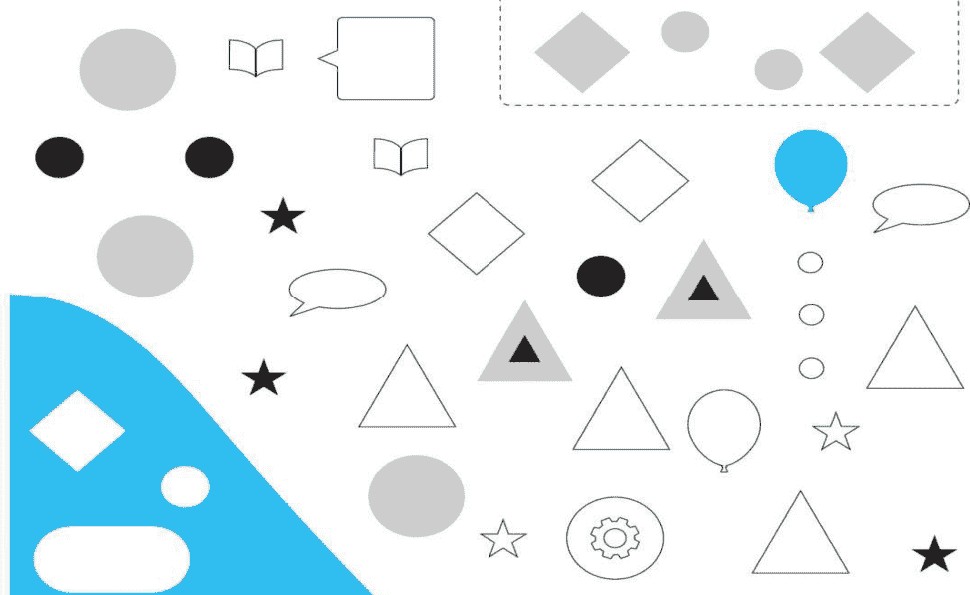

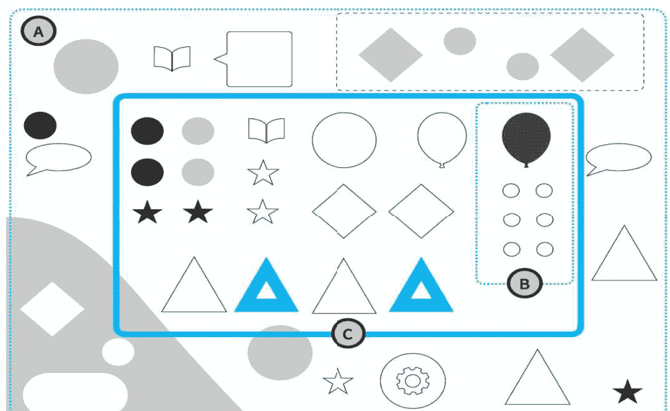

图3-1 如何划定一次主题学习的领域知识边界

接下来该怎么获得一个主题的知识体系？

常见做法是自己在边界内梳理。我和很多人都喜欢这样，初步学习后用自己的话复述、归纳，形成一套“我的体系”。这正是“输出倒逼输入”理念的体现。

写这本书时我们查了大量知识管理和体系构建的方法，几乎每一种里都有“自己梳理知识体系”。很少见的谦逊例外是芭芭拉·奥克利等人写的《学会如何学习》，它构建了青少年学习的知识框架，但作者明确说自己借鉴了脑神经科学的既有体系，并直接套用，而非另起炉灶。

关于如何建立自己的知识体系，我们的建议是：先别自己梳理，先“复制”一个现成的。

复制？听起来有点怪，细想就顺了。我们读的书本身就是专家长期沉淀后梳理好的体系。所以我们应该也去梳理吗？其实我们读到的是他们探索多年的成果，而我们此时的处境更像他们初次接触时的状态——都是从已有的课本、既有的体系开始的。

在理解还不透彻时，自己梳理很容易藏错，而自身水平又不足以发现。心理学里的禀赋效应会放大这个问题：拥有后我们会高估它的价值。梳理出来后我们更容易相信自己是对的，直到被现实打脸。所以我现在更坚定主张：学习时先拷贝一个成熟的知识体系！

在进入拷贝方法前，先回应一个疑问：如果找不到现成体系怎么办？对几乎任何主题，都存在可借鉴的体系。找不到通常是因为划的边界太偏，或者信息搜集不够，回到上一步再调就行。

## 层级式大纲：知识体系的形式

还有一个疑问：知识体系到底长什么样？我们总说它很重要，却常常把它想得很模糊。呈现形式千差万别：大纲、思维导图、原则清单、综述论文、行业报告、PPT……多样性导致认知混乱，看起来都很复杂，如图3-2所示。

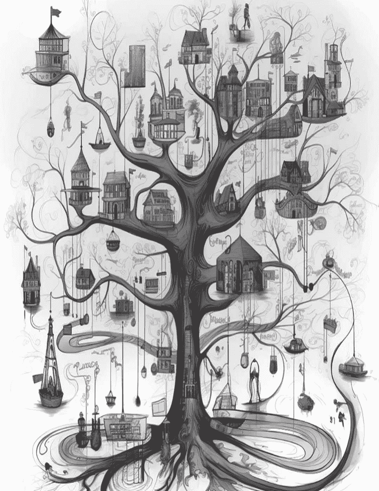

图3-2 知识体系是否有一种简单有效的表现形式

其实存在一种简洁有效的方式。之前用大树比喻主题知识，树干和主枝就是体系。它可以用层级式大纲表达，通常包含：

- 主题名加一句话说明，即树名；
- 若干子主题及简要解释，即树干，一级条目；
- 子主题的核心知识点，即主枝，二级条目。

需要时可继续往下拆。

一本书的目录就是典型的知识大纲，“书名—章名—节名”。认知科学学者阳志平也指出，最优的知识组织结构是树形。

举个例子。书的大背景是生成式AI，假设你想不只用它，也想懂原理。模型迭代快到以周计，那么学习AI的知识大纲可以从哪里抄？

对中学生，《人工智能基础（高中版）》2018年版是好起点。主编是汤晓鸥和陈玉琨，多位中学教师参与。只列一级标题，括号里放部分二级：

人工智能基础（高中版）

- 人工智能：新时代的开启
- 牛刀小试：察异辨花（分类任务、提取特征、分类器等）
- 别具慧眼：识图认物（手工特征图像分类、基于深度神经网络的图像分类）
- 耳听八方：析音赏乐（音乐风格分类、语音识别技术）
- 冰雪聪明：看懂视频（视频行为识别）
- 无师自通：分门别类（鸢尾花K均值聚类、人脸聚类）
- 识文断字：理解文本（文本特征、主题挖掘、基于主题的搜索与推荐）
- 神来之笔：创作图画（生成网络、判别网络、生成对抗网络）
- 运筹帷幄：围棋高手（阿尔法狗的大局观）

目标是成为AI研究者或工程师，就要换更专业的大纲。

想做研究者，《机器学习方法》李航著是常用教材。前两版叫《统计学习方法》，第三版加入深度学习后改名。按序言，内容截止2021年5月。

我们截取其第三部分深度学习作示例。2022年底生成式AI进入大众视野后，原属“序列到序列模型”下的Transformer应升为一级；语言生成模型和图像生成模型也应成为一级，而生成对抗网络的重要性已不足以独占一级。微调前后如下：

## 机器学习方法之深度学习方法

原始：

调整后：

- 前馈神经网络
- 卷积神经网络
- 循环神经网络
- 序列到序列模型
- 预训练语言模型
- Transformer架构
- 语言生成模型
- 图像生成模型

若目标是AI开发工程师，需要更贴近代码的大纲。由亚马逊研究科学家合写的《动手学深度学习：PyTorch版》就很合适，每节都带可运行代码，在线开源版被广泛翻译。可把“现代卷积神经网络”之后的内容作为本次学习边界，之前作为预备知识。

所以，选定主题后，从不同角度总能找到现成的大纲，直接拷贝作为学习蓝本。

除了书的目录，还能从报告目录、综述文章目录、入门文章的清单、标准手册的操作步骤等处获取。拿来时通常需要自己补二级、三级条目。

使用时要保证能打印在一页纸或一个横屏内放得下。放不下说明范围过大或细节太多。打印出来放在手边，随时标记。有形的载体更利于整体把握。

再说知识地图这类大图。它常印在对开报纸大小，用精美图示组织全部知识点。第一眼很震撼，但那只是视觉冲击。保存地图不等于复制了体系，也别花宝贵时间自己画地图。对学习而言，一份纯文字的简洁大纲就够承载体系。

总之，先找到一个可参照的体系，再逐字把层级式大纲写下来。拷贝得到的是一份可用的学习大纲，后续会在使用中不断迭代丰富，它就是这次主题学习的“纲”。

## 实用小技巧：哪里找知识大纲

常见的来源有教材目录、经典著作目录、线下或线上课程大纲、技术文档目录、操作手册目录。网上分享的学习笔记目录也是好线索；热门研究领域，论文综述往往是最新进展的大纲。建议多找几份对比后再定。

## 实用小技巧：巧用知识大纲

- 把找到的体系整理成层级式大纲。
- 不要复制粘贴，重新逐字录入，根据实际做少量调整。
- 调整到一页纸放得下，标上日期，打印放手边。
- 在纸质版上做标记，定期同步到电子版。
- 若使用费曼空白笔记本法，可把打印好的大纲插进去。

## 知识大纲与费曼空白笔记本

费曼考资格时的笔记本没留下，我们不知具体模样。但他后来留下一本更大的“笔记本”。1961年他还没拿诺奖，已是知名物理学家。加州理工学院的入门物理课口碑不佳，系主任罗伯特·巴彻邀请费曼来教。劳伦斯·M·克劳斯在《理查德·费曼传》里写道，费曼是天生的演说家，他用通俗表达、物理直觉和旺盛精力在讲台上重建物理法则的知识体系。

两年里费曼给大一新生讲授自己的物理理解，课很快出名，连研究生和老师都来听。校方安排教师做助教。课程被录像，板书被拍照，最终由同事罗伯特·莱顿等人整理成三卷红皮《费恩曼物理学讲义》。克劳斯说，从未有人如此全面且个性化地从头重建物理基本原理的知识库。

《费恩曼物理学讲义》是想成为物理学家的必读书，也是极少数冠名的教材，全球销量数百万册。费曼把艰深概念化解为通俗语言，让新生也能懂。

所以，若想知道费曼的知识体系和空白笔记本长啥样，《费恩曼物理学讲义》的目录就是答案。它也是层级式大纲，只是三卷书里费曼已把空白笔记本填满，并用自己的方式讲透每一个知识点。

下面具体看两种方法。

### 费曼空白笔记本：你的空白课本

费曼空白笔记本方法分三步，如图3-3所示。

## 费曼空白笔记本方法

适用场景：复制一个主题或领域的知识体系，作为后续学习的工具


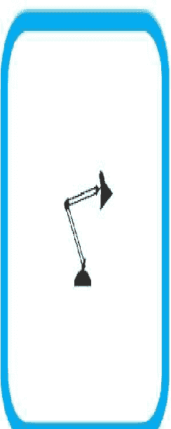

图3-3 费曼空白笔记本方法

第一步：把选定主题的知识体系以层级式大纲形式记在一页纸上。

第二步：在空白笔记本上展开大纲。可以把笔记本想象成一本空白书，第一页写目录，后面每页写一个章名或节名。

第三步：把这本空白笔记本当工具，学每个知识点后用自己的话向他人讲解，逐步填满。

薄薄的70页空白本就够用，也可以用软件建电子空白文档。但做数月的主题学习时，随时在手边的实体笔记本更有用。带目录和标题的空白笔记本就像一本空白课本。

### 费曼技巧：用教来学

广为流传的费曼学习法准确说是“费曼技巧”，它是他众多方法之一。核心是，当你尝试用通俗方式教别人时，能立刻发现自己的盲点。五步如图3-4：

## 费曼技巧

适用场景：教他人一个知识点，从而让自己真正学会

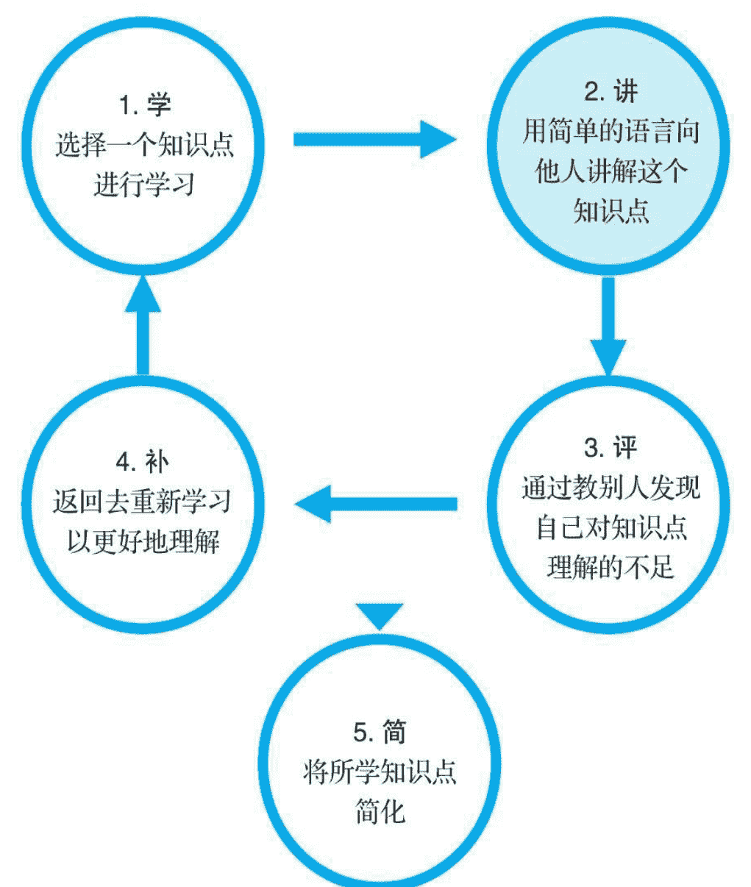

图3-4 费曼技巧：用教来学

1. 学：挑一个知识点学习。
2. 讲：用简单语言向他人讲解。
3. 评：通过教学发现自己理解的不足。
4. 补：回去重新学习以补齐短板。
5. 简：把所学简化，深刻印在脑中。

核心其实藏在第二步。把一个相对陌生的知识点找一个同样不懂的人，用极简的说法讲清楚并让对方真正听懂，就是检验点。讲完之后再回到材料里补漏洞，把没讲透的地方补上，再回到讲解环节反复打磨，直到知识点被你真正内化。

费曼空白笔记本和费曼技巧是两套不同颗粒度的工具。空白笔记本偏向整盘棋，强调先搭建出一个完整的知识架构；费曼技巧则聚焦单点，通过教学来促成理解。两者合用效果更好。对中小学生而言，开学时就可以为一门课准备一本空白笔记本，第一页先列目录，后续页面对应章节标题；学期里每学到一个新知识点，就立刻用费曼技巧把它讲给别人听一遍。

费曼研究室的黑板右上角一直留着两句话，从未被擦掉，也是他给自己的提醒：“我不能创造的，我无法理解。”“知道如何解决每一个已被解决的问题。”这正是他学习观的内核：只有用自己的方式重新走一遍，才能算懂。所谓的创造，在这里指亲手重做一遍推导、重建一遍逻辑，而不是照搬结论。

用通俗语言讲给别人，也属于用自己的方式重做。但通俗不等于粗糙，费曼非常在意物理表达的严谨性。费曼技巧的关键不是把概念压缩成几个名词或靠类比糊弄，而是把问题拆到最基础的步骤和骨架，再以可验证的方式讲出来。他讲解时从不会停留在公式表面，而是放到具体情境里演示。

> “我不能创造的，我无法理解。”——理查德·费曼
> “知道如何解决每一个已被解决的问题。”——理查德·费曼

### ‘实用小技巧’巧妙运用费曼技巧
先给自己定一套讲解流程。比如设定90秒讲透一个概念，对象设想为同班同学；讲解前先写下问题本身和一句核心回答；再列出五条提纲；计时练习，争取三次内讲顺。

外部工具也能加持。用手机录下自己的讲解，回放时标记模糊处；对着AI讲解，让它点评并给出改进建议；也能让AI模拟特定听众，帮你定制讲解思路和提纲。

知识像一件衣服，体系就像衣柜。衣柜有了分类，衣服才好归位。与其从零造一个衣柜，不如买一个成熟的。买衣柜的方法不是拍张照片就当拥有，而是要买下、运回家、安装好、持续整理。直接抄一本书的目录充当知识体系是不行的，这相当于只拍了衣柜照片，既记不住也用不上。真正能用的体系，需要“深度复制”。

## 本章要点
- 先划清主题的边界，才能安排后续学习路径。
- 学习可以从复制一个成熟的知识大纲开始。
- 费曼提供了两种互补方法：空白笔记本用于搭建体系，费曼技巧用于打磨单点。

### ‘现在就行动吧！’
- 选一个学过的主题，用层级大纲梳理知识结构，先写自己的版本，再找一个公开大纲对比差异。
- 选一个想学的主题，找到权威大纲，自问能理解其中多少比例。
- 挑一个知识点花30分钟用费曼技巧攻克：先自学，再讲给人听，从讲解漏洞中找不足并查漏补缺。

1. <u>注释1:</u> 资料来源：格雷克. 费曼传[M]. 黄小玲，译. 北京：高等教育出版社，2014.
2. <u>注释2:</u> 芭芭拉·奥克利在Coursera在线学习平台与其他学者共同讲授的“学会如何学习”是一门有百万人学习的在线课程，而她的课程与书是同一内容的不同形态。她出版了多本关于学习的书，除了《学会如何学习》，还有《学习之道》《跨越式成长》，其中文版均已由机械工业出版社出版。《学会如何学习》虽称是《学习之道》的青少版，但其实适合各个年龄段的读者。
3. <u>注释3:</u> 资料来源：汤晓鸥，陈玉琨. 人工智能基础（高中版）[M]. 上海：华东师范大学出版社，2018.
4. <u>注释4:</u> ACL, The Association for Computational Linguistics，国际计算机语言学学会。
5. [注释5:](https://example.com) ACM, Association for Computing Machinery，国际计算机学会。
6. [注释6:](https://example.com) 资料来源：李航. 机器学习方法[M]. 北京：清华大学出版社，2022.
7. [注释7:](https://example.com) 资料来源：张立顿，李沐，等. 动手学深度学习：PyTorch版[M]. 何孝霆，等译. 北京：人民邮电出版社，2023.
8. [注释8:](https://example.com) 大众通常称他为“费曼”，但在物理学界多采用“费恩曼”这个中文译名，《费恩曼物理学讲义》中文版也采用此名。
9. [注释9:](https://example.com) 一般认为，将费曼技巧总结并推向大众，使其成为风靡一时的学习方法的人是斯科特·杨（Scott Young）。他曾经用10天学会线性代数，并在家用1年完成了麻省理工学院（MIT）4年33门计算机课程的学习。他著有《超级学习者》《如何高效学习》等书。

# 第四章 深度复制：先把七成吃透

在一家金融公司做报告的应届生一度很沮丧。自己用Excel处理数据要耗几个小时，而同事写个脚本一分钟就搞定。后来他学会了写简单脚本，却仍想转程序员，因为那样才在数据链路上游。问题是编程零基础，需要速成。

刚上手时他本能地泡在网上找资料，很快陷入“检索上瘾”。他做了一个反常识的决定：锁进一间没有电脑的房间，只带教材、卡片和荧光笔。在书上标记重点，摘到卡片上，大声复述练习。两个月纯离线学习后，基础扎实，再去训练营时专注力与底子都在线，最终顺利入职。这是杰森·本的学习经历。

卡尔·纽波特在《深度工作》中引用此例，强调屏蔽干扰进入深度工作，即在无打扰环境下让认知跑到极限。学习时关掉电脑手机、远离社交干扰，收益立竿见影。杰森的故事还有另一层启示：学习的终点是接近100%，但起跑点是尽快冲到70%。网上漫无目的搜集信息常是拖延的伪装。短期集中突击，才是可复制的关键。

## 学透一个主题领域的全过程
把杰森的做法结构化，就得到深度复制五步：精读、重做、重制、重编、重讲。先用已有大纲定位，再挑一本可当作“课本”的核心资料，争取在短期内把其中70%吃透，形成可理解的大纲。这里的课本不限于纸书，泛指你选定的主要学习材料。

整体学习可分为五个阶段。

### 0 学习的起点
### 1 界定 学习的边界
### 2 复制 知识大纲
### 3 深入学习 难点与疑点
### 4 以输出 促进理解
### 5 扩大形成 作品与产品

先明确问题与目标，界定边界；复制知识大纲建立框架；深度复制课本掌握70%；再攻克疑点；以个人知识指南等形式输出；最终形成有价值的作品或产品。

## 深度复制五步：精读、重做、重制、重编、重讲
适用场景：把课本里的每个知识点都抄进脑子里，目标是七成理解，完整跑通比彻底懂更重要。

### 深度复制五步
1. **精读**：逐字逐页读，疑点先标记可暂放，首要目标是读完。
2. **重做**：把推导、例题、练习亲手做一遍，有测验就做，客观评估水平。
3. **重制**：把图表、流程图、代码重新画一遍或跑一遍，加深信息内化。
4. **重编**：按“只增不减”原则，把课本改造成自己的新课本，补充理解、补足缺口，不删原意。
5. **重讲**：用新课本讲一遍，从10分钟精简版到超长不限时全讲，讲义可以是精简版。

前三步像传统听课，后两步则完全不同。重编是让材料适配自己，重讲是把自己变成老师。

在打基础期要避免淘金思维，采用海绵思维。淘金是挑信息，容易漏掉骨架；海绵是先全面吸收，筛选留到后期。精读、重做、重制都需要放慢节奏。重制图表就是刻意减速，亲手重画会让你对每个词、每条线产生真实理解。

放慢的另一个技巧是格式转换。把纸质内容录入笔记、把段落转成清单、把PDF转成Word、把文章做成一页一知识点的PPT讲义、把MOOC视频整理成图文讲义。转换不是体力活，是换一种视角再看一遍内容。电子时代的格式转换，等同于过去的纸笔笔记。

### ‘实用小技巧’数字时代的逐字精读小贴士
- 读实体书时带铅笔、尺子、荧光笔和便利贴。
- 电子书双屏阅读，一屏原文一屏做思维导图。
- 对照阅读，文字版配语音朗读，或中英文对照，必要时用AI辅助翻译。

### ‘实用小技巧’重制图示的小贴士
- 选几张关键图100%复刻，框线箭头文字都要对。
- 注意原文表述，翻译版最好留原文对照。
- 手绘可用方格纸铅笔，电脑可用办公软件或专业绘图工具。

这种方法只用于真正想吃透的主题。集中投入一周到一个月，通常1到2周就能完成一轮深度复制。比起长期碎片补充，一次性突击更省时间。若需要一年以上，说明边界划得太大了。

深度复制的思路是先快速循环，再精进。目标设定为七成理解，剩下的三成贴上“待解”标签，稍后再攻。穿透学习法的重要特征就是多次快速循环：复制大纲、精读、重做、重制、重讲，反复跑通。

课本的选择很重要。建议用“入门经典”：入门意味着覆盖全面且不过深，经典意味着质量高、口碑久。选书可看优秀教材、名家专著、专家推荐的入门书，书名含导论、手册、讲义、版次的往往更合适，选单一主题而非文集合订本，尽量选新版。电子资料可选综述、经典论文、技术手册、教程，优先有活跃社区维护、结构完整的，避免碎片化报告。

## 编自己的课本并讲给自己听
重编和重讲是效果最强的两步。学习金字塔显示，教别人能带来极高的记忆留存，但日常缺乏教的场景。深度复制把重讲纳入流程，逼迫自己真正输出。按新编课本从头讲一遍，哪怕只懂七成，讲解过程会暴露盲区并固化理解。如今录屏方便，自讲自听已成为一种高效的学习习惯。

2022 年，一位叫做帕特里克的工程师给出了一个非常鲜活的示范。他把一套系统完整的 Web3 开发学习资源放到公开代码托管平台上，同时在视频平台发布了累计超过 32 小时的讲解。类似的公开教学他不止做过一次，围绕同一主题进行多次不限时长的大规模复讲。关键在于，每一次复讲他都会更换编程语言，而不是简单复制过去的内容。

这种边讲边学的模式在高手群体里并不罕见。很多高校教师在开设全新课程时，实际状态也是这样的。他们在各自专业上已是专家，但面对新课程的具体内容时，仍是边准备讲义边弄明白，靠多次授课把知识内化。打磨次数多了，优秀的讲义最终就沉淀成了教材。

初学者可能会问，讲给谁听呢？可以先讲给过去的自己、现在的自己以及未来的自己听。讲的时候自问三点：从前的我能听懂吗？现在的我能获得什么启发？未来的我会不会有更深的理解？在实际学习中，边学边教的场景很常见。读研时在组会上向导师同学介绍最新论文，工作中刚突击完一个技术就要指导同事上手，都是典型例子。

重编教材的实质，本质上是把书读厚。但厚是中间状态，不是终点。过去只能在纸上划线、写批注、夹资料、做卡片。如今可以在电脑里把整本教材全文录入或复制进去，再把扩展资料、个人笔记、重绘的图表全部整合进来，重构成一本只属于自己的新书。

重编阶段要遵守只做加法不做减法的纪律，不要提前判断哪些是次要的。从学习经验看，被忽略的细节往往最关键，事后才发现要回头补，常常懊恼当时为何没有留意。

先把书读厚，再把书读薄。进入重讲阶段，只增不减的限制就可以放开了。即便是最完备的不限时超长讲解，也不可能包罗万象。我们必须做取舍：什么是核心、什么是次要、什么是常识。在电子文档里，次要或常识性内容很容易折叠或隐藏。

正如李小龙所说：吸收所有有用的，舍弃无用的，再加上自己的东西。重讲之前用海绵思维把知识点全部吸纳，压住淘金思维的冲动。重讲时再开始剔除无用，之后再加入自己的理解，知识才真正成为自己的。

乍看之下这种方式很耗费精力，事后会发现投入是值得的。深度复制的五步法能为一个主题打下扎实的基础。

对照自己的新教材和讲义逐点讲解，水平提升会非常明显。还可以用手机录下自己的讲解，回听后自我评估。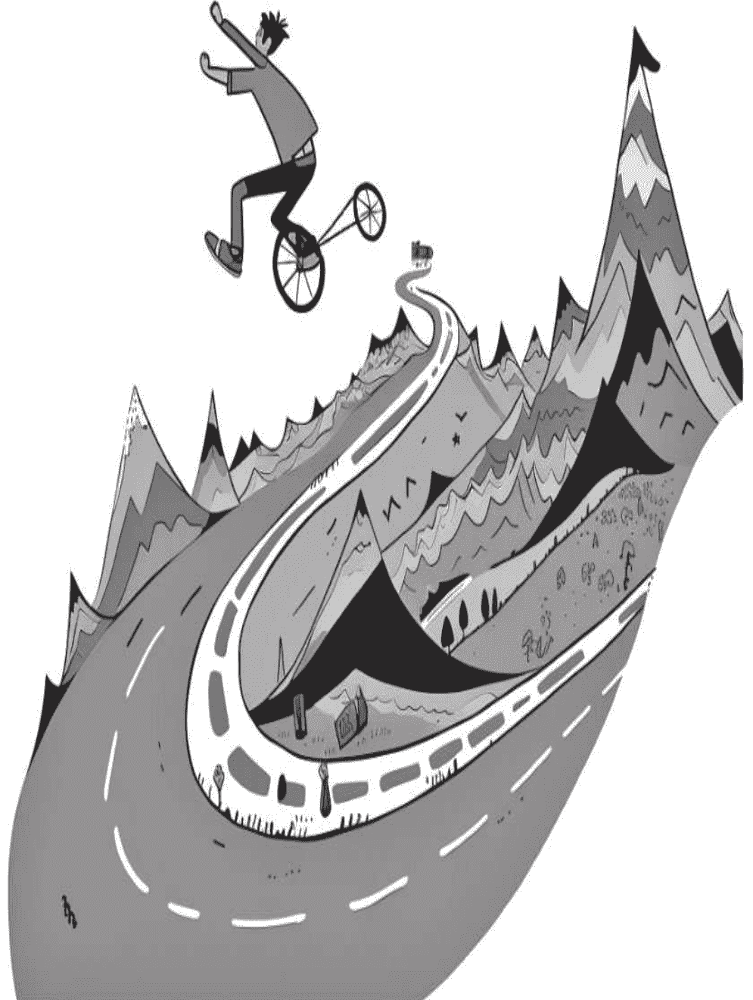
### 图4-7 重讲让我们看清知识的不足之处

如果精力允许，还可以再进一步：把口头讲解整理成文字记录稿。口述相对轻松，把讲述转成条理清晰的文字则更难，但一旦完成，收获会再次放大。文字化后知识更精确，也更容易检验自己学到位没有。

任何人都能用深度复制的五步法来学习。比如中小学生可以重编教材的一章，自己当小老师做 45 分钟的授课。注意，这和费曼技巧都属于用教来学，但要求更高——用几分钟讲透一个知识点，和用 45 分钟讲透一组知识点的难度完全不同。

#### 实操思路 把教材做成 PPT 演示稿
假设你手上是一份 20 页图文并茂的电子文档，用 PPT 重制可以按下面流程：
- 先梳理大纲，生成只有标题的空白 PPT。一级标题对应部分，二级标题对应每页，依此类推。
- 把电子文档的全部文字复制进 PPT。把段落改成条目，重点内容用不同颜色标出。
- 把书中的图示表格复制到 PPT，关键图表最好自己重画。
- 加入补充材料，如术语解释、新案例和个人见解。此时仍遵守只做加法。
- 微调组织方式。如一页讲一个知识点，按自己的理解调整顺序，把非重点内容调成浅色字体。

#### 实操思路 中小学生如何重编与重讲
假设中小学生要完成重编与重讲，并做 15 分钟讲解，可先选定课本中 2 页内容，然后这样操作：
- 各复印一份课本内容和听课笔记。
- 把课本内容拆成 10 个部分，分别剪贴到 10 张白纸上，每页一个知识点。
- 把听课笔记剪裁后贴到对应部分，按需补充新笔记。
- 为每页写上标题，用荧光笔在课本与笔记剪贴上标出重点。
- 以讲义为目标调整页面顺序、增删内容，做好讲课准备。
- 两人一组，用这 10 页剪贴作为讲义，为对方进行 15 分钟实战讲解。

#### 实操思路 录制并回听自己的讲解
回看或重听自己的讲解，相当于用旁观者视角审视，能更清晰地看到短板并改进。现在用电脑或手机录制很方便：
- 用手机录下讲解视频，观看后思考改进点。
- 边讲解 PPT 边用软件同步录屏，之后回看优化。
- 录音并对比不同条件下的讲解效果：无大纲与有大纲、无讲义与有讲义、无逐字稿与有逐字稿。

读到这里，你可能会产生疑问：这些方法看起来都不够巧妙，难道就没有轻松的学习法吗？

当然有不少巧妙的学习法，但本书聚焦这些初看笨拙的做法，正是为了实现完全学会的目标。如果能轻松走捷径，往往说明选题不够难、学得不够深。奥斯卡·王尔德说过：愚人创造世界，智者不得不活在其中。创造世界的人绝不愚蠢；反之，聪明有时意味着待在舒适区，而不去挑战真正困难的学习。

采用穿透学习法时，学习周期被大幅压缩。别人认为需要半年一年完成的任务，我们试图压缩到一周到一个月。在时间压力下，有策略分步推进、多次循环快速迭代，反而是更聪明的选择。

穿透学习法的核心是抓住主题的知识大纲，用结构化步骤快速完成学习。它看似笨拙，实则高效，因为学不好、拖延才是真正的笨拙。

最后用一个类比说明深度复制五步。想象一个用乐高搭建的大型乐园。起初乘热气球俯瞰，再坐游览车沿主路观赏。随后你放慢脚步步行，钻进小径细看每个细节。你把每个城堡拆开再重新装回，还在园景里加入自己的建筑布置。如此几乎重建了整个乐园。最后你开车带别人游览这座自己重建的乐园。

## 本章要点
- 深度复制五步：精读、重做、重制、重编、重讲。它适用于在初步复制知识大纲后做全面学习，目标是吃透大纲约七成内容。
- 精读时，要逐字逐页细读。
- 重做时，重新演练其中的讲述、推理、公式。
- 重制时，重新制作其中的表格、图示等。
- 重编时，以只增不减为原则编成自己的新教材。
- 重讲时，把新教材浓缩为讲义，并全面详尽地逐一讲解。

### ‘现在就行动吧！’
- 挑一个预计 1 小时能入门的主题，选定一份资料作教材。用深度复制五步花 6 小时攻关：精读、重做、重制、重编各 1 小时，重讲准备和实际讲解各 1 小时，观察学习效果的变化。

1. 注释1: 资料来源：纽波特. 深度工作：如何深度使用每一点脑力[M]. 宋伟，译. 南昌：江西人民出版社，2017.
1. 注释2: 具体来说，如果用Word，可以把该部分字号缩小；如果用PPT，可以直接隐藏相关页面。使用一些网络笔记软件时，我们可以将某些不重要的部分折叠起来。
1. 注释3: 现在你可以借助AI工具来帮你做。你用音频转文字的转录工具得到录音文稿，然后用AI将录音稿转为条理清晰的文字稿。这样，你整理文字稿的时间和精力不是放在文字整理上，而是放在核心内容上。
1. 注释4: 你可以采用带有幻灯片模式（即类似PPT）的在线文档工具来更方便地完成这个任务。这些文档可以让你在普通长文阅读和幻灯片翻页阅读之间方便地切换。一般来说，文档中的每个一级、二级、三级标题会直接以新的一页来显示。
1. [注释5:](https://example.com) 虽然我们推荐采用“笨且拙”的学习方法，但我们反对死记硬背。这是因为我们认为，理解的重要性远大于记忆，现在更是如此。我们不必将宝贵的认知能力用于记忆资料的细节，有了互联网，我们可以更方便地检索信息。在我们的深度复制五步学习方法中，我们已经把要记住的资料放在为自己新编的课本中了，而不是死记硬背地塞进大脑里。

# 第五章

## 深度冲刺

### 如何五天快速学透
为了在短期内集中吃透一个主题，你先复制一份现成的知识大纲，再用深度复制五步把课本知识点学透。下一步该怎么走？现在来到分叉口，面前有几种可能：
- 你对自己的水平感到满意而停止学习。这暗含达克效应：实际水平低于自评，能力不足者往往高估自己。
- 学完后发现未知更多，于是展开广泛探索，被各种线索牵向相关主题。
- 你觉得已掌握体系，转而碎片化狩猎式学习。时间久了感觉知识丰富，却总有不安，怀疑理解并不扎实。

这三条路都不是理想选择。穿透学习法建议继续夯实知识体系。可采用一种方法是做中学 Learn by Doing。如图5-1所示，对比学然后做与学与做循环，应把做纳入学习过程。

#### 传统学习者

#### 聪明的学习者
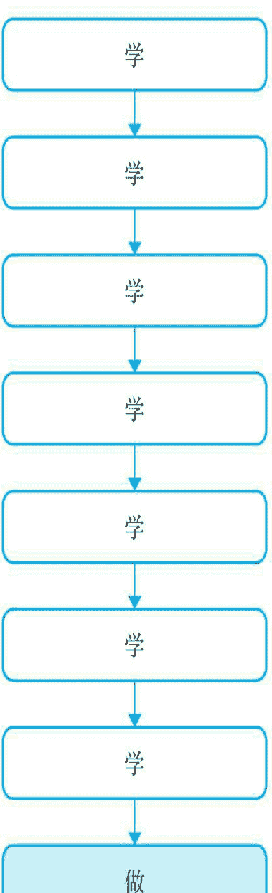

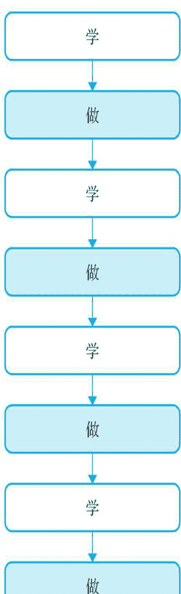

### 图5-1 学然后做与学与做循环
在学与做的关系上，有两种思路：传统学习者先大量学习再动手；聪明的学习者把做提前，让学与做交错循环。为了适应多种场景，这里的做含义很广，如表5-1所示。

### 表5-1 学习场景示例
| 学习场景 | 传统学习者学 | 聪明的学习者做 |
| :--- | :--- | :--- |
| 学习知识 | 阅读材料、听讲、做笔记 | 尝试把知识讲给他人 |
| 应对考试 | 整理错题、反复做题 | 切换成出题人，先出题再解答 |
| 学习语言 | 看教材、听课 | 真正开口说、动手写 |
| 学习技能（如编程） | 按教程模仿操作 | 用所学完成一个真实项目 |
| 学习技能（如演讲） | 阅读、写稿、排练 | 主动争取真实演讲机会 |

为了更好做到这一点，我们借鉴产品迭代中的设计冲刺法，将其改造为冲刺学习法。它有两大特点：一是立足整体视角，继续关注如何掌握知识体系并据此安排学习；二是做中学，由关注知识点转向模拟未来行动。

## 从设计冲刺法到冲刺学习法
设计冲刺法由谷歌风险投资部的杰克·纳普等人设计，是一种在五天内完成互联网产品设计的结构化方法。五天内团队从产品构想到用户测试走完整流程。

设计冲刺深受硅谷快速迭代思维影响，主要参考了软件开发的 Scrum 敏捷框架。Scrum 源自橄榄球运动。像准备大型比赛的球队一样，软件团队设定固定周期，举行特定会议仪式，按周期重复迭代，快速提升水平。

整个训练被拆分为一系列迭代周期，每个周期称为一次冲刺。通常一次冲刺时长为一个工作周，即五天，通过多次冲刺最终完成开发。每次冲刺结束后团队会反思以改善方法。如果看得更细，冲刺不是简单猛冲，而是一个向前、向后、再向前的循环，一个冲刺中会经历多次循环，如图5-2所示。

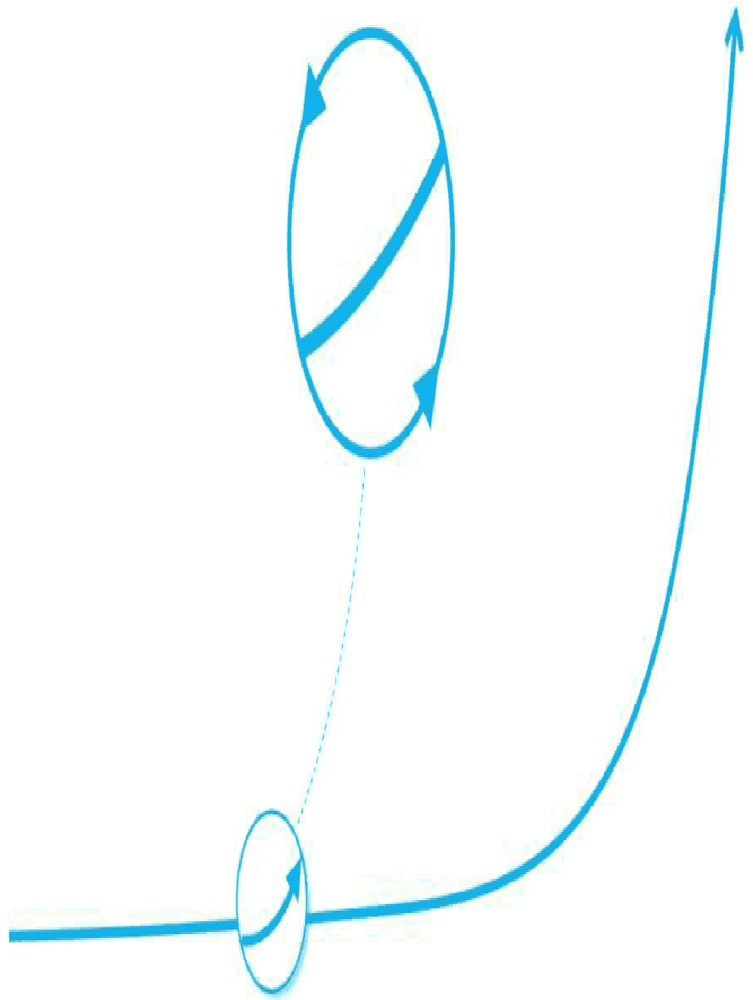

### 图5-2 冲刺
Scrum 原先主要用于软件开发，产品设计完成后，工程团队用多次冲刺完成开发。设计冲刺法是把冲刺用到产品设计环节。产品开发通常由多个冲刺组成，而设计冲刺法聚焦最初的那一次冲刺，并设定大胆目标：如何五天完成产品设计规划？

为了在五天内完成产品设计，设计冲刺法把整个过程拆分为一系列可执行步骤。冲刺之所以有效，是因为它不是盲目猛冲，而是有系统的冲刺，有明确步骤与对应技巧。杰克·纳普等人展示了在谷歌风险投资部内部，用设计冲刺法五天完成产品改造设计是可行的。他们把产品改造设计的全部环节先拆散再重组，形成为期五天的流程：
- 周一，描述问题、确定目标。
- 周二，列出备选方案。
- 周三，选出最佳方案。
- 周四，制作真实原型。
- 周五，目标用户测试。

产品设计本质是一种学习过程，学习用户需求并转化为设计规划。在《设计冲刺：谷歌风投如何5天完成产品迭代》中，纳普写道：设计冲刺不会直接产生一个完美无缺、可立即使用的产品，但它能让你迅速取得进展，并且非常确定你走的是正确方向。

设计冲刺是整个产品开发长跑中的首个冲刺，与学习时的处境相似：一方面，学习是我们在一个主题领域探索的第一步，之后还要实践、创造；另一方面，进行一次主题学习、获得知识体系也是学习的首个冲刺。

冲刺学习法是设计冲刺在学习上的应用：用五天十步完成一次主题学习。你可能会问，五天冲刺全面学习新主题是否过于激进？这也是很多人最初对设计冲刺的疑虑：五天完成重大产品迭代设计，是否太激进？是否应该仔细调研规划？潜台词是，即使再敏捷，也应以数月为周期。

通常我们计划用数年掌握新领域知识或技能。但回想自己的一年期学习经历，实际情况往往是：参加课程学习时，节奏由课程安排决定，很多人会在考试前熬夜恶补；自定节奏时，除非高度自律，否则多半在截止日期才完成。理想情况下每天规划学习时间并坚定推进，但除了中小学生或极自律者，多数人的实际学习情形就是冲刺。既然如此，为何不把冲刺过程优化并系统化，提前到学习的开始阶段呢？

每种学习方法都有适用场景。我们并非说冲刺能取代所有学习方式，而是用冲刺让原先的猛冲更高效。必不可少的钻研、练习、训练仍需完成。比如学习一种写作方式，先短期集中了解方法与范例，之后持续练习；学习新编程语言，先短期集中看完文档并初步运用，而不是半年后还在学习资料 30% 处。

外界高速变化，传统长周期学习很多时候不再适用，学习经常需要短期冲刺。当新工具下周就要投入使用时，没有时间报名三个月培训；学习前沿主题时，花一年打基础不可行，因为等学完时，前沿已推进一大步，反而更落后。

冲刺学习法强调快速，但仍遵循学习基本逻辑，变化的只是具体做法。例如大学课堂上，老师精心挑选知识点，设计成授课、自学、作业、考试，用结构化方法让学生在学期内掌握新知识。五天冲刺学习法将学习内容聚焦、缩短周期，并着重学与做的融合。

冲刺学习法还特别适用于快速进入陌生领域。陌生感会制造许多障碍，而冲刺学习法能有策略地冲破障碍。

## 冲刺学习法：五天十步完成学习闭环
冲刺学习法包括五天十步，如图5-3所示。你就像探险路线设计者一样探索陌生领域。
- 周一：地图日。设定预期成果，努力获得陌生领域的地图，了解概况。
- 周二：侦查日。徒步走遍各处，尽量侦查多种可能路径。
- 周三：选择日。深入难点探查路径，最终选择最优路径。
- 周四：原型日。在沙盘上演练并迭代路径，制作路径原型。
- 周五：交卷日。向他人展示路径原型，并获得直接反馈。

### 冲刺学习法：五天十步
适用场景：与实践相关的主题学习以及快速掌握陌生领域的主题学习

| 周一：地图日 | 周二：侦查日 | 周三：选择日 | 周四：原型日 | 周五：交卷日 |
| :--- | :--- | :--- | :--- | :--- |
| 设定预期成果，获得地图 | 走遍各处，侦查路径 | 深入难点，选择路径 | 演练路径，制作原型 | 展示原型，获得反馈 |
| 产出：自己的地图 | 产出：可能行动路径 | 产出：最优可能路径 | 产出：两种原型 | 产出：演示 |

### 图5-3 冲刺学习法：五天十步的结构化学习方法
你可以把五天冲刺学习法用在各种场景：学习新学科知识、学习新技术技能、学习通用工作技能、了解新行业等。通常较适用于与实践相关的主题学习以及快速熟悉陌生领域的主题学习。

地图日、侦查日、选择日、原型日、交卷日

接下来按每一天讨论采用冲刺学习法时可用的技巧与注意事项。

### 周一：地图日
- 第一步：设定预期要达成的成果。
- 第二步：绘制出一张自己的地图。

第一天要再次确认：
1. 是否界定了清晰的领域知识边界？并再次判断冲刺学习法是否适用于这次学习？
2. 是否准备好必备学习资料？是否备齐堪称入门经典的图书与资料？
3. 这次主题学习的目标是什么？学习结束时如何衡量是否达成目标？
4. 学习通常是为了回答疑问，那么你要回答的疑问是什么？
5. 将以何种形式展示学习成果？

在正式开始冲刺学习法之前，对前三个问题你应该已经有了答案。

第一步，先把第4个和第5个问题拎出来。学习之前，自己心里有哪些不明白的地方，要把它写得清清楚楚。学完之后，对这些困惑的回答应该是什么？到学习收官时，你希望拿出什么成果？成果可以是笔记、方案、分享稿、文章、样例、草稿之类。带着明确的问题和预期的产出开始学习之旅，预期成果会贯穿并指引后面五天的推进。

第二步，为这个领域自己画一张地图。面对陌生的地带，地图能消除不安。就像大型商场的导览图上会标出“你在此处”，一眼就能定位。知识体系也可以用地图来比喻。我们之前提过可以借用已有的大纲，这里建议你先找到一张地图，再据此画出属于你自己的版本。

### 周二：侦查日
- 第三步：实地侦察，对照地图与现实。
- 第四步：找几条可能的行动路线。

地图初稿像是飞机俯瞰的全景，第二天就得落地。第三步要亲身踩点。比如程序员接触一种新编程工具，常见做法是先看官方文档搞懂基础，再跟着网络教程写一个小例子，最后尝试用它解决自己的实际问题。正因为冲刺学习法强调带着明确的预期成果去学，第四步会自然到来。

第四步是在初步尝试后，确认几条通往目标的路线。学习材料多按知识点排列，好的材料会有完整大纲，但这次学习的重点不是遍历知识点，而是带着一个具体问题去找答案。你会把注意力集中在与自身问题高度相关的部分，暂时搁置无关内容。保持成果意识，几条可行路径就浮现出来了。

### 周三：选择日
- 第五步：深挖要点、难点与疑点。
- 第六步：挑出最优路径。

看一个职场学习场景。新晋经理要学会“怎么开会”。经过第一天的地图日和第二天的侦查日，他已经知道自己每周必须主持的下属例会很重要，也从《格鲁夫给经理人的第一课》等资料里了解了开例会的技巧。但真正让他焦虑的是：“马上要上任了，第一次主持部门例会，我该怎么操作？”

必须深入钻研、真正掌握，因为很多实用技能光靠阅读不可得。针对开例会，他会回想自己作为参会者的经验与教训，向专家、领导、顾问请教，把方案拿给同事评议。总之，把要点吃透、把难点学会、把疑点消除。

钻研之后就要做选择——从备选方案里挑出最优一条，并在地图上标出来。

### 周四：原型日
- 第七步：制作第一种原型——向别人讲解这个主题。
- 第八步：制作第二种原型——制定一份执行计划。

设计冲刺把第四天叫原型日，冲刺学习法沿用这个名称。原型就是模型，用来检验想法是否合理。比如造汽车先用粘土做模型，拍电影有梗概、剧本、分镜头脚本等逐步细化的原型。

学习也需要原型。做中学很好，但直接上手成本高、耗时长、不易反复。原型能解决这些问题。

亚马逊的“新闻稿原型法”就很实用。假设产品已完成，先写一篇对外新闻稿：“我们推出了新产品，它将为您带来……”。新闻稿既是原型的内部总结视角，也是外部评价视角。学习中常用的“教中学”与此原理相近。

周四可以做两种原型。第一种像费曼技巧那样教人，更具体地借鉴TED演讲的经验：用18分钟向不熟悉该主题的大众讲清楚一个主题。采用TED的设定与技巧：面向普通听众、聚焦一个核心观点、用听众熟悉的语言表达、让观点值得传播。

第二种原型是写一份执行计划，即基于所学知识，规划如何一步步完成一项具体任务。例如学完AI绘图后，规划如何一步步制作一本绘本；学完一种学习技巧后，规划如何实际运用。

计划要写详细，写的过程本身就是澄清思路和迭代想法。建议把计划控制在一页纸内，便于抓住重点、保持全局感。TED式演讲提供全局俯瞰，执行计划则让人落地，互为补充。

### 周五：交卷日
- 第九步：展示原型，收集反馈。
- 第十步：复盘并决定下一步行动。

交卷日以展示原型并听取反馈收尾，而非关上书本。实质是一种新的“考试”，必须在截止日前交卷。截止日的紧迫感促成最后冲刺，他人的反馈则客观评估学习成效。

很多时候学习结束不是考试而是汇报，制作原型就是汇报的好方式，只有看到具体的东西，人才能准确判断“要的就是这个”或“不对劲”。

冲刺开始时设定的预期成果全程指引学习，最后要把实际成果与预期成果对照，再决定后续行动。同时留出时间回顾总结经验教训，为下一次冲刺做准备。

五天是一个合理的周期，能容纳较大一块学习，足以展开做中学。五天也务实，进度落后时可用周末补足。周期可根据场景调整，一天冲刺也可以，一个月慢冲也可以。

以读书为例，用冲刺学习法阅读莫提默·艾德勒与理查德·范多伦合著的《如何阅读一本书》中几章，掌握其中的分析阅读方法。艾德勒将阅读分为基础、检视、分析、主题四类，目标是掌握分析阅读并制定自己的分析阅读计划。

五天安排如下。第一天通读全书，精读约100页的第二篇“分析阅读”，形成分析阅读的地图，比如了解作者提出的15条分析阅读原则，前8条关乎阅读，后7条关乎评判。

第二天结合过往阅读的得失，意识到原则三“透视全书架构并列出纲要”和原则七“用书中原句重构论述”是个人需要重点突破的，于是挑几本书试用。

第三天用所学方法制定读书计划，列出12本书单，一个月一本，用分析阅读法读完并做笔记。

第四天选一本书演练计划，确定可落地的路径，比如为每本书用思维导图做详细纲要，用原句并借助PPT重构其中一章的核心论述。

第五天整理计划，向老师朋友征询意见，调整成可执行的读书计划。

从杰克·纳普等人借Scrum概念形成设计冲刺，再到冲刺学习法，再到冲刺读书法，体现了我们欣赏的学习技巧：借鉴好方法、改造为己用、付诸实践。

## 本章要点
- 冲刺学习法源于软件开发的敏捷方法，用五天十步完成一次主题学习。五天分别是地图日、侦查日、选择日、原型日、交卷日。
- 其思路是聚焦范围、压缩周期、融合学做，通过结构化步骤快速形成学习闭环。
- 特别适合快速进入陌生领域，能迅速降低陌生感。

> ‘现在就行动吧！’

- 选定一个想学的主题，用30分钟完成一个任务。假设用冲刺学习法来学它，对五天十步你各自会怎么操作？整体预期成果是什么，每一步的预期成果又是什么？请把整体预期成果、每步做法及每步预期成果写下来。

________________________________________________________________________________

1. **注释1：** 设计冲刺法参见杰克·纳普等著的《设计冲刺：谷歌风投如何5天完成产品迭代》。想了解Scrum可阅读Scrum创始人、《敏捷宣言》起草人之一杰夫·萨瑟兰所著的《敏捷革命》。
2. **注释2：** 资料来源：纳普，泽拉茨基，科维茨. 设计冲刺：谷歌风投如何5天完成产品迭代[M]. 魏瑞莉，涂岩珺，译. 杭州：浙江大学出版社，2016.
3. **注释3：** TED是全球知名知识演讲活动，线上案例丰富。关于TED式演讲可参阅TED创始人克里斯·安德森著《演讲的力量》。
4. **注释4：** 资料来源：艾德勒，范多伦. 如何阅读一本书[M]. 郝明义，朱衣，译. 北京：商务印书馆，2019.

# 第六章 深度练习：如何通过刻意练习提升水平

本杰明·富兰克林决心提升自己的秩序、决心、勤奋等品质，于是制定并执行了一个大胆的计划，在其自传中详尽记录。在撰写本章时，我想起自己曾照着他的方式制作表格练习。富兰克林改变习惯的方法很好地体现了他的实用主义，分四步进行并借助表格：

第一，挑选13个要训练的品格及其箴言。例如品格“秩序”对应的箴言是“物各归位，事各按时”。设定品格时，他主张宁可多列条目、少写阐释，也不要条目少、阐释多，这样每个条目下的含义更清晰。

第二，绘制训练表格。每周一张表，横向为一周七天，纵向为13个品格。一个季度用13张表。他认为不应同时全面开花，会分散注意力，要一次聚焦一项，掌握后再换下一项，循序渐进直至13项皆成。

第三，每周聚焦一个品格。假设本周聚焦“决心：去做该做的事，做就做到心想事成”。本周对该品格“死守”，不违背原则，其他品格顺其自然。每天晚上回顾，用黑点在表格中标记决心及其他品格的失误。若本周决心无黑点，即算达成目标。

第四，下周切换到下一个品格，争取上周与本周的品格上都无黑点。如此循环，一个季度走完13项。季度末完成一轮，再换新本子，循环一年四季。数年下来，各方面习惯都很稳定，一个季度能得到一本无黑点的本子。

在知识、工具、技能学习中，练习都至关重要。尤其是技能学习，“刻意练习”已成为公认方法。过去大众熟知“一万小时定律”，即重复一万小时可从新手变高手，强调时间与次数。现在已知单纯时间是“天真练习”。介于天真练习与刻意练习之间还有“有目的练习”。

真正的难题是如何做到刻意练习。本章先谈练习本质，再介绍深度练习方法，如图6-1所示，包括：①在导师指导下练习；②将知识可视化；③做最小可行产品；④在网上公开学习。

图6-1 深度练习的四种方法

## 天真的练习、有目的的练习、刻意练习

“一万小时定律”由马尔科姆·格拉德威尔从心理学家安德斯·艾利克森的研究中归纳。艾利克森在《刻意练习：如何从新手到大师》中纠正了其中的误导。“一万小时”看似量化，但按每天练两小时算需近14年，与现实中很多年轻高手不符。格拉德威尔以披头士为例，艾利克森认为实际有效练习时间可能只有1100小时，且把演出和练习混为一谈了。现场演出有压力和反馈，未必等于提升能力的练习。

“一万小时”不完全正确，但努力必要。格拉德威尔说持续努力可让平凡变超凡，艾利克森也承认需要多年艰苦付出。错误在于认为只要花时间就够了。时间不是充分条件，也不是必要条件。

简单追求时长的人进行的是艾利克森说的“天真练习”。应先到“有目的练习”，再进化到刻意练习。如图6-2所示，三种练习依次为天真练习、有目的练习、刻意练习。

天真练习指反复做同一件事指望自然提高，可能原地踏步。

### 刻意练习
Deliberate Practice
在有目的练习基础上，强调导师指导，并以形成心理表征为目标

### 有目的的练习
Purposeful Practice
- ①有明确特定目标；②强调专注；③包含反馈；④需要走出舒适区

### 天真的练习
Naive Practice
只是重复，强调练习次数与时间

图6-2 三种不同的练习

有目的练习与天真练习有四点不同：第一，有明确特定目标；第二，强调专注；第三，包含反馈；第四，需要走出舒适区。以练钢琴为例：目标明确如三次无误以适当速度弹完；必须全神贯注；能判断对错，必要时求师反馈；不走出舒适区就无法进步。

刻意练习再进一步。依据认知科学，人脑具有近乎无限的适应性，神经元可“重布线”。在有目的练习基础上，刻意练习有两大变化。

第一是导师指导。刻意练习多用于高手与新手差距大的领域。有目的练习是自己练，刻意练习是在导师指导下练。导师清楚高手表现、原理与思维方式。导师不一定是真人，可用优秀作品作导师。

第二是注重心理表征。刻意练习通过改善心理表征达成卓越。可用大脑想象动作细节，反复在脑中演练。

艾利克森提出用“三个F”构建有效心理表征：专注Focus、反馈Feedback、纠正Fix。以健身为例：天真练习是每周去健身房随便摸器械；有目的练习是有目标规律训练；刻意练习是在专业教练指导下制定计划，针对性训练并重视动作背后的心理想象。

刻意练习建立在有目的练习之上。开头提到的富兰克林表格可用作练习计划，帮助规划、执行与评估。

## 练习一：在导师的指导下练习

刻意练习改进了有目的练习，关键改进即强调导师指导。做法是：先找到领域专家，了解他们的表现与方法。在导师指导下训练，能达到专业水准。

艾利克森在《刻意练习：如何从新手到大师》中详述美国海军王牌飞行员学校的训练，该故事也被拍成《壮志凌云》。20世纪60年代末，该计划大幅提升战斗机飞行员战力。战力指标是“每次交战杀敌数”。此前美军每5次遭遇击落1架；1972年，该计划启动后，每次遭遇平均击落1.04架，几乎每次都能击落一架敌机。

改变来自新训练模式，开创了假想敌训练。进入计划的都是优秀飞行员，教官更优秀，是海军顶尖飞行员。学员与教官每天升空格斗，学员为己方，教官为敌方，学员总被“击落”。落地后立刻召开战报会，教官连问：

- 你在空中注意到了什么？

### 大师课：富兰克林如何把写作练成肌肉记忆

第二天训练课又开了。学员和教官再一次升空做模拟对抗，空中练手感，地面对战报进行复盘练脑力。

从这次训练能看出，教官的作用有多关键。

第一，教官在模拟里扮演顶级对手，跟学员过招把技能逼出来。
第二，教官会安排有针对性的练习，逼学员离开舒适区。
第三，教官给的是即时反馈，比如当场“击落”学员的战机。
第四，下了飞机后，教官和学员坐下来复盘，专门锻炼思考。

学技能时，让导师当对手来实战推演，效果非常好。学员在天上练操作，回到地面汇报时练判断，两者合起来水平才上来。

用导师带练是好办法，但有个现实问题：如果身边没有能面对面指导的人怎么办？富兰克林给出的答案是找一个“特殊的老师”。

当要训练的是产出某件成品的能力时，这件成品本身就能当老师。富兰克林学写作就是在导师指导下刻意练习的经典案例，唯一不同的是，他的导师不是真人，而是优秀的作品。

富兰克林详细记录了自己的学写经历，他把优质作品当成自己的导师来用。

他跟着《观察家》这样的好报纸学：先挑自己喜欢的文章仔细读，然后放下原文，用自己的话重写一遍；写完再把自己的版本和原文对照，反复改写，直到用词的精准度和简洁度接近原文。

练习一段时间后他发现，自己和模仿对象最大的差距在词汇活学活用上：词是认识的，写的时候却用不出来。

于是他开启第二种训练。写诗能逼着人抠词，因为要押韵，就得更努力地找那个最贴切的词。他把《观察家》的文章改写成诗歌，专门锻炼词汇掌控力。

第三种训练聚焦文章的骨架和逻辑。文笔和词汇是一回事，整体结构和思路是另一回事。他把《观察家》里文章的要点摘出来，打乱顺序，再按自己认为最合理的逻辑重新组合成文，然后与原文的结构对照，找错纠偏，把教训沉淀下来。

总的来说，富兰克林是跟着好作品做针对性练习，通过对照发现短板再改进。

很多技能都能套用这套方法。丰田的“一页纸报告”就是一套高效的问题分析与解决思路。曾在丰田工作的浅田卓学到了这套方法，并在《一页纸学习法》里推广。他一开始也是读前辈留下的大量优秀样板，再模仿练习。我们学编程时，也可以找开源社区的优质代码，研究它的实现逻辑，再自己动手复现，对照差异不断提升。

这里再补一个我很受用的小窍门——“记得读二流的书”。这是作家唐诺在谈小说学习时说的。纯为阅读乐趣当然要多读一流作品，但为了提升写作能力，也要读读二流的书：可能是普通作家的平庸之作，也可能是大师在巅峰之外力不从心的作品。

要保持好品位，但练习时不妨挑能看清毛病的例子。顶级范例太完美，反而难以下手。拆解所谓的二流作品，可以清楚看到哪里不到位，然后问自己：如果换我来会怎么改。亲手改一遍，对比改前改后，收获很大。

### 实用小技巧·德鲁克的书面对照法

无论练什么，都可以参考彼得·德鲁克的建议：“把你希望看到的结果写下来。9到12个月后再把实际结果和预期结果对照。”

必须写下来，因为记忆太不可靠。好记性不如烂笔头，而且我们常常会无意识篡改记忆，把预期硬拗成“本就希望看到的样子”。只有白纸黑字的前后对照，才能看清真实差距，才有调整的可能。

一个高效的学习方式就是看前后对照案例，比如错与对、平庸与优秀。富兰克林学写作时也大量用对照。

## 练习二：将知识可视化

把已有的知识、工具或技能转化成可视化图表，是加深理解的好办法。直观呈现的东西更容易被大脑消化。

以心流为例，边理解概念边练习可视化。

专注学习背后的心理学支柱就是心流，也就是进入全神贯注、忘我忘时的状态。积极心理学大师米哈里·契克森米哈赖提出的心流理论核心问题是“人什么时候最快乐”，答案是“当我们觉得能掌控行动、主宰命运时”。也就是挑战与能力匹配时最容易进入心流。

可以说，心流是所有学习与工作方法的心理学基石。在心流里，大脑潜力被最大化，成果自然出来。心流最初研究运动员的巅峰表现，但适用于所有人。

一般来说心流有九个要素。契克森米哈赖用一句话概括：做的是与能力匹配且有挑战的活动，有清晰目标和反馈，能掌控自如；过程中全神贯注，忘掉不快，忘我忘时；最终完成目标，自得其乐。

我们据此画出了心流图示，如图6-3所示。图中把九个要素整合在同一时段，并分成四组。

### 最优体验Peak

- 忘我Lost of Self-consciousness
- 忘时Transformation of Time
- 掌控Control
- 清晰的目标Clear Goal
- 清晰的反馈Clear Feedback
- 知行合一Action & Awareness
- 专注当下Concentrate on task at hand
- 挑战与能力平衡Challenge/Skills
- 目标不假外求，自得其乐Autotelic

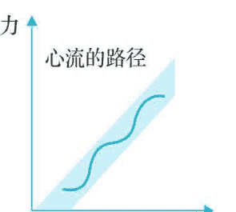

图6-3 心流的路径与9个要素

注：图中心流的路径表明，当挑战与能力匹配时，人最容易进入心流状态。每一个心流时段都包含如图所示的9个要素。

资料来源：根据契克森米哈赖在《心流：最优体验心理学》中的描述绘制。

第一组讲的是如何进入心流。任务挑战要与能力相配：太难会焦虑，太易会无聊。太难是行动瘫痪的主因。把大任务拆成小任务，让挑战与能力匹配，就能进入发挥最佳状态。

第二组讲过程要有清晰目标和反馈。目标不明、进展不可见，很快就会分心。把大任务拆成小任务，每个专注时段都有小目标和小反馈，更容易进入心流。比如写报告，先拆成章节，再拆成节。目标定为“今天下午完成第一章第一节第二节”，目标和反馈都清晰，进度一目了然。

第三组讲在任务时间内只关注眼前这件具体事。像攀岩者只想下一步怎么走，用番茄工作法的25分钟也一样，眼里只有当下这件事。

第四组讲做到以上几点后会获得最优体验，也就是进入“没有自我、忘掉时间、感觉完全掌控”的状态。

我最早被契克森米哈赖描述的运动员、舞者、匠人状态吸引。把九个要素图示化后，我才抓住重点：目标与反馈。利用这一对组合提升专注力，是一个实用技巧。先用25分钟的番茄时段进入心流，随着能力提升，时段可扩展到半天、一周，核心始终是目标与反馈。

你接触过多种知识可视化方式，常见的是：

①把大段文字变成列表、多层列表或表格，这是文字向可视化的初级过渡；
②把列表变成层级思维导图，属于半可视化；
③按内容逻辑用简明图示展示关系；
④按逻辑制作复杂图示；
⑤整理成信息图等大型精美图示。

通常前三种就够用了。

## 练习三：做最小可行产品

埃里克·莱斯曾是创业公司的首席技术官，团队花很长时间做动漫头像聊天插件，发布后用户却不用。回访后发现，团队对用户需求的很多假设都是错的。

莱斯反思，如果早点用实践验证假设，就能省下大量浪费。后来他带团队在持续试验中调整产品，公司收入几年后超过五千万美元。他总结经验写出《精益创业》，认为创业本质是学习，要尽早验证假设。

怎么验证？做最小可行产品MVP。先用最简便的方式做出原型，测试它能否解决用户问题，再投入资源做最终产品。

比如公司计划用订阅制在移动端卖生鲜。高质量做法不是先开发APP、选品、建仓储配送客服体系，而是先从小区精品超市拿照片和价格，拼成一周特色包，在小区微信群试卖。直接得到反馈，哪些包受欢迎，同时亲自采购送货，了解客户真实评价。

换个角度，MVP也是“尽早做一个能跑起来的东西”。这也是穿透学习法的核心思路，反复快速循环。

传统练习强调反复锤炼单一技能，但现代事物复杂、由多部分构成。先做出一个哪怕简陋的整体，反而是好起点，因为只有串起来才能看到各部分间的缝隙。所以要反直觉：不要追求一开始就完美，先做出能运转的东西。

对成人写作，我推崇“快写慢改”。先快速写出初稿，关注结构与逻辑，容许局部不完美；再在多轮修改中精炼细节。快写时把核心观点抛出来，慢改时打磨表达。初稿就是一个“能运转的东西”。

对现代学习者，MVP就是工具箱里的瑞士军刀。

### 实用小技巧·妙用新闻稿MVP

亚马逊的“新闻稿原型法”是先假设产品已完成，写一篇对外发布稿。新闻稿也是一种MVP。学习时可以先假设任务已完成，写一份新闻稿，形式多样：

- 写文章前，先写一条140字的社交媒体预告。
- 写报告或论文前，先写封邮件向别人介绍它。
- 推进计划前，向AI描述预期成果并请它点评。

## 练习四：在网上公开学习

想在社交网络上快速拿到正确答案？直接提问常常石沉大海，取巧的方法是贴出错误的答案。很快评论区就会有人来纠正，因为人们都喜欢纠错。

数字时代的练习方法之一就是公开学习。把所学写成文字公开发布，加入线上学习社区，获得反馈。公开分享本身也形成必须写好的压力，即使有错，也很快有人指正。

形式很多：社交问答、博客、公众号、小红书笔记、讲解视频、社区打卡、参与开源等。

为提升效果，建议避开大众化社交媒体，减少流量与点赞的干扰。更安静的做法是用笔记软件撰写完整条目，先在学习小圈子里邀请点评，完善后再公开。这样分享的是未完成笔记而非成品，目的求意见而非点赞，更符合学习目标。

在穿透学习法里，各种输出都可以作为笔记分享：详细大纲、课程书摘、重点疑点笔记、入门教程、PPT、操作规范、个人知识指南等。

## 练习的思维模式：运用形象化比喻

把知识用于解决重复问题时，我们把它变成显性形式知识，按教程标准行动。面对全新问题时，我们需要把它变成思维模式，让思维引领探索未知。

用形象化比喻来呈现思维模式很巧妙，它把不可见的思维搬到可见世界，把未知搬到已知。

皮克斯创始人之一艾德·卡特姆在《创新公司》里用大量例子展示比喻的价值。他认为思维模式最关键的作用是帮助人完成工作。卡特姆分享了皮克斯导演编剧常用的比喻，这些比喻就是他们在探索未知时用的思维工具。

我们来看几个例子：

有的导演把拍电影看成“穿过隧道”：

> 像在一条漫长黑暗的隧道里奔跑，不知道有多长，但相信一定能安稳抵达另一头。

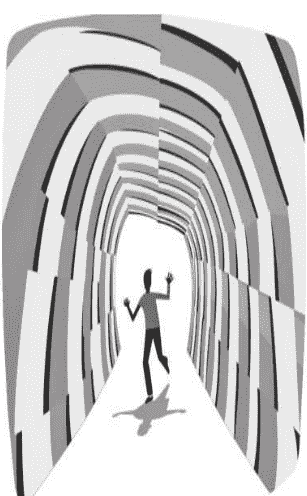

穿过隧道

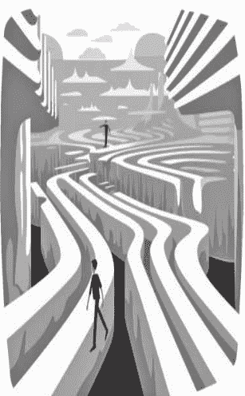

身处迷宫

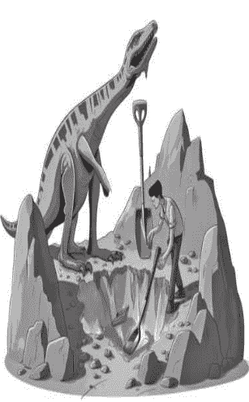

考古挖掘

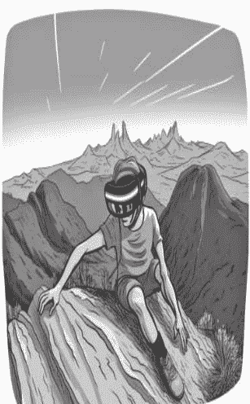

蒙眼登山


上下电梯


你如何面对未来

图6-4 用形象化比喻探索未知

有的导演认为拍片像“身处迷宫”：前进时用手指沿墙滑动，偶尔慢下来判断方向，用触感记住走过的路。

有的导演觉得像“考古挖掘”：挥汗挖掘，不知道会挖到哪种恐龙化石，化石一点点显露出来。

有的编剧认为写剧本像“蒙眼登山”：先凭感觉摸索方向，让山自然展现在眼前。

有的编剧认为工作像“上下电梯”，要跟不同的人沟通，就必须到对方所在的楼层拜访。

比喻很形象，它把看不见的东西变得可见，是优秀的思维工具。卡特姆也提醒，比喻有陷阱。如果把旅程想成火车头驱动，就容易忽略真正决定方向的是铁轨和铺设铁轨的人。

面对未知时，形象化比喻像登山靴，用来攀登；解释已知时，它像登山杖，可以不用。

### 实用小技巧·让AI帮你想形象化比喻

可以让AI帮忙找比喻，比如问：“彻底学透一个主题，有什么形象化比喻？给10个。”

AI曾给出：挖井、登山、剥洋葱、建房子、跑马拉松、拼图等。

也能用AI的文生图能力把比喻画出来。例如指令“一个人围着红色跑道循环跑”、“一个人像杂技演员一样抛接球”，图6-4里的图就是这样生成。

## 本章要点

- 有三种练习：天真的练习、有目的的练习、刻意练习。刻意练习强调导师指导与形成心理表征。
- 本章介绍了四种深度练习方法：在导师的指导下练习、将知识可视化、做最小可行产品、在网上公开学习。

- 在探索未知时，给思维装上一个可感知的比喻会让行动更有抓点。把不熟悉的领域映射到已知的生活场景，就像在陡峭的山道上换上防滑的登山靴，让每一步都踩得实。

> ‘现在就行动吧！’

- 选定当前在钻研的主题，挑出一张关键的逻辑图或流程图亲手再画一遍，并在重绘的过程中注入自己的理解。

# 第三部分

## 穿透学习的三个情境

# 第七章 穿透阅读

如何吃透一本书

图书是最为集约的知识载体，不同品类的书籍带来持续的阅读乐趣。很早我就注意到《如何阅读一本书》是入门级的经典，至今仍在实践书中的分析阅读与主题阅读。分析阅读是用结构化手段深入一本书；主题阅读是有规划地通读一个领域的主流著作。

2023 年，我把生成式大模型引入阅读实践，对阅读观产生了明显冲击。做法是把该书第七章“透视一本书”约一万五千字抽出输入模型，连续追问。

起初反馈在预期之内。模型耐心作答，展示了归纳与改写为操作步骤的能力，基本立场一致。局限很快显现：若不对提问做精细设计和参数调优，它很难做到逐字精确引用，多以转述呈现。那一刻我的定位更像考官：我对原著足够熟悉，要检验这个“AI 学员”是否真正读过。

灵机一动，我让模型来考我。部分题目可秒答，部分被迫开卷，翻书找答案的同时也复习了久违的读书习惯。明知模型没有意识，只是预测下一个词的序列，却出现了对话感。

我们讨论书中一个类比：骨架重要，但血肉才赋予生命。我先说看法，它评价；再让它先表态，我来评判。视角反复切换后，这本熟悉的书在对话中重新丰满。

有人说读书是与作者对话，过去只是比喻，如今借助 AI 在一定程度上可以实现。更进一步，除了让模型扮演作者用书中观点回答，还能让它扮演批评者、同水平的学习伙伴、有经验的馆员、或能活用书中知识的高手。

阅读是学习的根基，不会读就学不深。要怎样才能真正读透一部作品？传统做法不少，新做法也在涌现，AI 又打开了新空间。本章聚焦传统技巧与新工具结合，用认知阅读把著作吃透。认知阅读服务于学习，与休闲阅读不同，比如读《哈利·波特》是休闲，为掌握其魔法世界的设计而读才是认知阅读。

## 没有错误的方法，只有用错的场合

在讲具体做法前，先分享一个教训。我们都用过各种读书法，最有体感的是教材式阅读。中小学把一门学科拆成多年教材，在授课、练习、测验中完成；大学教材更厚，教师勾勒脉络讲重点，剩下靠自学啃书。

教材式阅读的特点是必须掌握全部要点，理解与运用是目标，不懂也要背，否则过不了关。摆脱考试压力后我尽量少用，但它仍关键，比如学新专业或新技术，就得读类似教材的材料，只是占比下降。很多人有相似感受。

教材式阅读之外也有乐趣与技巧。我觉得很管用的是靠输出来读。读完后能用自己的话写出文章，才算真正有收获。所以我发过书评，也在博客和社区写过不少文章。

关于输出，我尝试得更多。受工作兴趣影响，我的一个主题阅读是互联网相关书籍。曾用一年时间做音频解读五十部作品，每部近万字，最后形成一个系列。音频解读和书评不同，书评讲读者体会，音频解读要从受众出发，把书里有价值的知识讲清楚。

“如何读透一部著作？”在做音频解读时这个问题变得具体。若读不透，就讲不出书里真正有用的东西。我意识到该用接近教材式阅读的方式去读这些书。过去以为再用不上的方法又回来了：一页页仔细读、追根究底、不放过疑点、补材料、整理要点笔记，最后用讲稿检验学习效果。唯一不同是我可以自主挑主题和“教材”。

我不太好意思说，有些著作我像教材一样读。我们身边爱读书的人看上去都能轻松刷书，我一年也读数百本，已过了读教材的阶段，却在说某些著作要啃十来遍。跟朋友聊起时意外发现，他们对部分著作也是这样“硬啃”。

本书各学习法的阅读部分都能看到教材式阅读的影子。第一章的例子就是不同层次的教材；深度复制五步里阅读材料被称作课本。重读大量著作并用教材法之后我总结出经验。以前读过好几遍却没真懂，改用“笨办法”再读后，虽不敢说百分百懂，但深入很多。少用教材法是我阅读上的一个严重失误。

想远离教材法可以理解，二十年学校教育后总想松口气。若勾起痛苦记忆很抱歉，但请想想那些痛苦是否带来了知识。应把教材法当作工具箱里的工具，擦亮后需要时熟练拿出。

这成了我阅读的转折点。互联网信息爆炸，知识快速迭代。之前我用速读和跳读处理资料，尤其网络资料更快。在转折后，我对普通资料浏览即可，对关键资料则用教材法深读。这种摄取方式可称“杠铃策略”：一小半时间追求信息量，一大半时间做精选内容的深度阅读。

转变明显提升了新领域学习效率。我几乎每次重要学习都用它。比如学一种新编程方式，把文档、样例、标准拼成自己的教材，像学生一样读完再动手，做详尽笔记。一年后再给别人逐章讲解，理解更上一层。写面向大众的新技术普及书时，我继续践行“教他人”这一步，以写书的形式讲解促进自己更深。但总的来说，转折点不是发现输出促理解，而是重新重视教材式阅读。

回到开头的AI支持经验，它也与教材式阅读相关：读教材时常和同学讨论，如今可以和模型讨论。

用学习金字塔看，我们从被动的“阅读”走向主动的“讨论”。有老师一对一辅导时，针对性讨论能有效攻克难点；和同学共读辩论时，知识会进一步深化。

过去讨论机会很少，只能用自我辅导、自我辩论等替代技巧。偶尔在社交网络讨论。有了模型，这一环节能低成本便利地实现。

现在出现新契机，可以把传统阅读技巧与包含人工智能在内的新工具结合，更好地读透一部著作。以冲刺学习法为骨架，把各种阅读技巧组合起来，就形成了冲刺读书法。

## 冲刺读书法：在一个冲刺里吃透一本著作

“冲刺学习法”用在读书上就是“冲刺读书法”。优点是可用结构化框架推动深度阅读进程。它适用于深入阅读著作或高质量资料。可分三阶段：概要阅读、深度阅读、阅读输出，共十步，首尾呼应。开始前自问：目的何在？成果是什么？

冲刺读书法：10步详尽版

冲刺读书法如下：

- 0. 阅读材料：预备环节，按学习目的选定并准备主要材料。
- 1. 成果设定：明确本次阅读要交付的输出并记录。
- 2. 层级大纲：快速浏览把握整体结构，制作层级式提纲。
- 3. 逐字精读：逐字阅读，标注要点与疑问。
- 4. 详尽列表：完整摘录主要内容，多用清单或多级清单。
- 5. 重点笔记：通过查阅、提问等方式深化对重点的理解并写笔记。
- 6. 疑点笔记：同样方式厘清疑问或修正认识并写笔记。
- 7. 详尽大纲：整合清单、重点笔记、疑点笔记形成详细提纲。
- 8. 输出准备：依据设定的交付物做相应的准备工作。
- 9. 展示输出：形成定稿并展示，对照首步目标进行评估。
- 10. 后续任务：补齐发现的知识缺口，修订成果并制定后续计划。

### 冲刺读书法

- 0. 阅读材料
- 1. 成果设定
- 2. 层级大纲
- 3. 逐字精读
- 4. 详尽列表
- 5. 重点笔记
- 6. 疑点笔记
- 7. 详尽大纲
- 8. 输出准备
- 9. 展示输出
- 10. 后续任务

概要阅读

深度阅读

阅读输出

图7-1 冲刺读书法

### 从牧场到餐桌的牛排菜谱

可把冲刺读书法看成模板，适合高质量资料，跨学科适用。实际使用时可替换具体做法、技巧，按材料、工具、个人需求定制。它像菜谱，按手头食材、工具和口味做出一道菜。

冲刺读书法类似经过米其林大厨验证的煎牛排菜谱。大厨会挑选牛种与部位，做熟成等预处理，并试验煎烤方式。若你要做牛肉寿司，这个菜谱就帮不上忙。类比可见，对牛排而言，煎烤重要但不是唯一，每一步都影响口感。

冲刺读书法与第四章“深度复制五步——精读、重做、重制、重编、重讲”思路相近。都先定目标与输出，再用结构化步骤完成深入学习。

区别在于，同样读一部著作，深度复制五步旨在把知识体系内化为己用，重框架，目标学懂七成；冲刺读书法追求全面掌握，重具体知识点，目标九成五以上甚至九成九。深度复制是面，冲刺读书是点。深度复制开放，像打造能装进更多知识的空衣柜；冲刺读书封闭，通常只聚焦把眼前这一部读透。实践中可结合使用。

在给出每步技巧前，先看我用类似方法的例子。冲刺阅读法即由此发展而来。准备音频解读时，我精读五十部著作做讲稿。主要目标是为每部著作找到最重要的一个要点，用通俗方式讲给有一定背景的受众。要输出的成果是清晰的：每部近万字讲稿，经编辑修订后录制。

我用三步完成：整体泛读、逐字精读、重点深读。从好书里抽取一条对自己和听众都有价值的知识线索来讲。

先整体泛读。快速阅读后掌握全书内容、逻辑、主要观点，是俯瞰。除快读外，我常以思维导图梳理框架，让全景一目了然。强迫自己做包含章名和各级标题的思维导图好处是，快读易跳读漏点，为做导图会自然把要点找全。一般花2～5小时泛读并做思维导图。

再逐字精读。通常三百页的书要十小时，难度大则更久。某些章节刻意放慢，逐字理解细节与深层含义。精读时带笔和本子，在书上标记，另起A4纸记笔记。完成后手里有标记、折页、贴标签的书和几页笔记。

对要深入理解的著作，逐字逐句是必要的。生活节奏快时常跳读，用经验想象填空，会带来问题：事后才发现某点完全没印象；作者看似讲熟悉案例，实际分析逻辑与结论有微妙差异，只有逐字读才体会得到。

接下来重点深读。针对书中重要知识点钻研，它通常由一组小知识点构成。好书知识丰富深厚。深读阶段采取“只取一点，不顾其他”的策略，在一点上深挖。这时不只读这一本，还会做主题性阅读，读其他书、资料、网上搜寻，需要时请教专家。只聚焦一个点与当时目标相关：每部著作的任务是找到一个要点写讲稿并用音频讲解。

最后经历从厚到薄的过程。把学到的知识点整理出来，形成薄薄的新“书”，即数十页讲稿和五十分钟音频。

用类比说，写书像在城市修路，阅读像坐车观光，输出像自己步行。有时书读起来顺畅，作者帮你忽略岔路，坐车直达。只有步行时，几次迷路才会打破“已精通”的错觉。为讲好，我必须“下车”实地探索。

该任务短期内重复五十次，有机会高频反思优化技巧。之后借鉴更多方法组合成冲刺读书法。你现在看到的本书也是多轮迭代的版本。

### 冲刺读书法中的技巧、做法与工具

冲刺读书法为求知阅读所准备，目的在于解决问题、掌握知识体系、修正或更新认知。求知阅读必须深入，把知识、案例与自身实践联系起来。下面逐一讨论十步的技巧、做法与工具。

### 阅读材料的选择

选择高质量且有体系的材料，如教材、经典图书、技术教程与文档、优秀论文等。非书资料可整理成书形并打印备用。网上视频课程可作辅助，文字应作为主要学习材料。

挑合适的材料。它本身应体系完整，阅读时无需太多补充；数量应在半天内读完。就读一部著作而言，选其中几个关联章节比读全书更合理。选好读什么，才能读好。

### 预先设定成果

设定阅读目的及读书后的输出成果。明确写下目的与预期成果，用某种形式讲解是易实施的成果，如目的“理解书中方法”，成果“用案例形式讲解方法”。写下来可引导全过程，便于事后对照是否达成。

设定如何记录读书过程的次数。在冲刺读书法中，阅读节奏多样，快慢轻重皆有。为便于掌握，可用电子表格记录；简单做法是在目录页旁写下速读、精读、复习，用写“正”字记次数。

### 速读并编制层级大纲

先“图文漫步”。《学会如何学习》里芭芭拉·奥克利建议开始读一章时先浏览：看图片、图注、表格、章节标题、粗体字和概要……给大脑一个概念，接下来会发生什么。

编制书的大纲。大纲像衣柜。可选用喜欢的工具，如Word/WPS大纲模式、思维导图软件；直接用纯文本编辑器与列表；也可使用MarginNote等特色阅读工具，在电子书或文档上做荧光标记后直接生成思维导图。例如图7-3展示了在MarginNote内对一篇万字长文做标记后形成的思维导图，该文修订版成为本书第九章附录9A。

### 向AI提问的8个原则性技巧

方军 文

2023年7月，第一版，代《ChatGPT for Dummies》译者序

ChatGPT 对你来说意味着什么？你该如何高效地利用它的超能力？

2022年底，OpenAI 公司推出的 ChatGPT 聊天机器人开启了人工智能（AI）的新时代，自此AI进入大众应用阶段。ChatGPT只有一个简单的对话式界面，但通过这个界面，每个人都可以向它提问（如“这是什么意思？”），或向它提出要求（如“帮我撰写邮件初稿”、“帮我按说明编写程序”）。

很快，它背后的AI模型以应用助手的形式出现在各种软件里，比如 Notion 笔记软件、微软公司的办公软件以及各类企业营销软件。微软巧妙地将这类工具命名为“副驾驶”（Copilot），这个名字象征着，AI助手坐在副驾驶位置上，为我们人类用户提供支持和引导。

AI应用新阶段的两个关键词分别是大众应用与生成。让我们关注“生成”，这一波AI模型的特点正是它们能够生成新的内容。整个2010年代，占主导的模型是判别式的，例如这些模型能指出“这张图里有一只猫”。现在，新模型能够生成新的文字、图像以及合成数据，比如它能根据你的描述写一个猫的故事，它能生成一张新的猫的图片，它能总结出之前未被明确表述的规律。

在ChatGPT以聊天机器人的形式引爆热潮之前，在2022年年中，由文字生成图片就已经开始突破，并在和视觉有关的产业中得到应用。但是，对话界面直接将AI模型的各种能力展现在人们面前：语言理解、生成文本、广博又有深度的知识、指令遵循能力、推理能力等。这让所有人都感到震撼。这种震撼感是必然的，因为我们一直认为语言和人的智慧直接关联。人工智能一直被一个问题困扰。

- 原则性技巧之一：理解“生成的本质”是模式预测

- 原则性技巧之二：警惕“幻觉”，始终做事实核查

- 原则性技巧之三：提问采用结构化提示语（CDO）

模型协作的五大底层心法

原则性技巧之四：提示语本身就能让模型习得新知识
原则性技巧之五：让模型进入链式推理的慢思考模式
原则性技巧之六：把复杂任务拆解为若干简单子任务
原则性技巧之七：以模型可解析的格式供给信息
原则性技巧之八：掌握主导权，与模型协同工作

### 放慢节奏、逐字研读并做标记
主动降低阅读速率，让每个字都进入意识层面。日常里阅读很容易滑向浏览，尤其电子资料更容易走样。可改用纸版或打印件作为媒介，用铅笔逐行划过，用直尺遮挡每次只露出单行，按章把每句编号，用彩色笔和荧光笔做记号。

碰到最难的段落时可用以下做法：①大声逐字朗读，防止跳读；②把整段内容在电脑上逐字录入或复制；③对照中文译文研读英文原文；④对照英文原文核对中文译文。

标注与摘录。泛读精读之后，还需要一次专门的标注摘录通读，目标很明确：挑出值得留存的片段。电子阅读的优势是可直接摘取并导出；纸质材料则可用手机拍摄后做文字识别，再粘进笔记。

当需要吃透并向别人转述时，我会用PPT等演示文件重构内容。除摘录原文外，还会分块、着色、补充图示与资料，如图7-4所示。这样做有两个明显好处：第一，每页一个知识单元，加深认知；第二，相较纯文字笔记，它更具半可视化特点，便于快速翻阅把握整体。PPT整理可视为深度阅读笔记的新形态。过去王元化读一本书写下几十册笔记，如今可用PPT完成。

## 第四章 联结学派：大脑如何学习

### 感知器的兴起与没落
感知器是早期连接主义的代表模型，1958年由Frank Rosenblatt提出。它模仿生物神经元的工作机制，通过调节权重学习输入输出的映射关系。感知器的出现标志着连接主义学派的复兴，为后来的深度学习奠定基础。

然而感知器存在局限，比如无法解决异或问题。1969年Minsky与Papert在《感知器》一书中指出这一局限，引发了神经网络研究的第一次寒冬。

即便研究一度低谷，其核心思想——靠调整连接权重实现学习——仍深刻影响后续发展。

### 神经网络史上的关键曲线
Sigmoid函数是早期常用的激活函数，呈S形。它把输入压缩到0到1之间，常用于二分类任务的输出层。

该函数的导数能用自身表达，使得反向传播的梯度计算更简便。但它也存在梯度消失问题，输入过大或过小时梯度趋近于零，学习速度变慢。

尽管有局限，Sigmoid在发展史上地位重要，是理解现代激活函数例如ReLU的基础。

### 大脑的深层：自组织器
自组织映射Self-Organizing Map, SOM是一种无监督算法，由Teuvo Kohonen提出。它能把高维数据投射到低维网格，通常是二维，同时保留拓扑结构。

SOM采用竞争学习，使邻近神经元对相似输入模式产生共鸣。这一特性使其在可视化、聚类分析等领域应用广泛。

### 熟练来自组块
组块Chunking是指把多个信息单元整合为更大单元，以提升记忆与处理效率。在神经网络中，组块思想体现在卷积神经网络的卷积层，通过局部感受野与权重共享提取特征。

组块化使网络学会层次化特征表示，从低层的边缘、纹理到高层的部件与整体。这种分层表示是深度学习成功的关键之一。

图7-4 根据《终极算法》一书中联结学派章节所做的PPT形式内容摘录

### 实用小技巧：借助AI‘转译’复杂句子
阅读时常碰到极复杂的句子。费曼曾讲过，他参加读书会时反复读到一句怎么也读不懂：“社会团体中的个体成员经常通过视觉的、符号的渠道获得信息。”后来才明白其实就是“人们阅读”。

阅读时，我们也要为自己做这种转译。如今可让AI代劳。提示可这样写：

> “请用简单的一句话概括如下句子的意思，以便我理解：……”
> “请用俗话解读……”

### 以层级列表整理内容
不要让笔记散落，可采用多级列表整理。一个小窍门是做作者写作过程的逆向工程：作者通常把列表改写成段落，我们则反过来把段落变成列表；作者会把列表扩充为段落，我们则把关键句抽取出来做成列表；作者把关键词写成句子，我们则把句子压缩为鲜明关键词。精读后，一本书可整理成便于使用清单，如图7-5所示。

这里与常见阅读方法的重要不同：把电脑等工具配合使用视为阅读流程的一部分。用纸笔摘录、写卡片虽可行但耗时，纸笔整理笔记几乎不可行，这也是过去不整理的缘由。相比之下，电脑整理笔记更高效。若能克制社交信息分心，手机也是不错的笔记工具。

AI支持的语音合成已成熟，可用来校对笔记：写完后用电脑朗读给自己听，通过听觉能敏锐发现问题。技巧奏效的原因在于，听会迫使我们换一种视角审视自己写下的内容。

### 聚焦重点，撰写重点笔记
阅读真正的关键是钻研重点与解决疑点。这两步相当于煎牛排时的实际煎烤。通常高质量资料对重点有清晰深入阐述，但仍应投入更多精力。

可这样操作：①重做重点内容的推导，如论证、公式推导，并查阅相关资料；②综合搜索引擎与AI工具。搜索相关图示与不同讲述，让AI解释内容，可回顾第二章关于用AI加深理解的讨论；③思考知识点在现实中的例子。把知识点放入具体案例，理解会更深。

对重点内容绘制图示。对材料中与重点相关的图示，时间允许时都应考虑重新制作。这里所说图示不仅是图形，也可以是表格、列表等半图示信息。若没看到相关图示，但觉得一张图能清晰解释内容，也可自行绘制。

编写重点笔记。根据所学，重点笔记通常包括问题描述、解决方案、图示及相关资料。检验掌握程度最易用的方法之一就是编写关于重点内容的笔记。

### 实用小技巧：让AI起草笔记草稿
人们常不写重点笔记，因为整合零散记录很麻烦。现在可借助AI。

把资料摘录、零散记录、笔记格式要求一起交给AI，让它就一个重要知识点起草笔记初稿。注意AI草稿可能有错，需在草稿上继续修改、改正错误、优化表述。在此过程中，还可让AI换种方式解释、举例、给出修改建议等。

使用AI处理重要知识点时，不应假设回答大体正确，而应假设大体有误，并质疑每句话。

### 解决疑点，编写疑点笔记
阅读中还会遇到疑点。有的疑点因暂时没理解，通过查资料、请教老师、向AI提问可很快解决。有时作者轻松带过某些知识点，我们会有疑问：为什么是这样？应尽量多发现疑点，比如不断问自己：这里有疑问吗？疑点越少，掌握越牢靠。

若非重点内容，多数疑点不必编写疑点笔记。疑点笔记的特点是弄懂后看起来很简单。但有些疑点值得记录，尤其当一个疑点与个人独特学习经历相关时。

我曾在编写程序时偏离文档指引的主线，误入岔路并最终进入很深的死胡同。谜底很简单：路口明明写着不要进入这条岔路。我在岔路口走错后，仍继续前行数步，直到死胡同尽头。这让我接触到过去也许不会深入的难点内容，并写下回顾笔记。后来在同一细分主题下编写一份英文技术文档时，我把相关讨论用插入内容框形式放进去。该文档目前被阅读1.4万次，想必有读者会注意到这一讨论值得深入了解。

### 编写详细大纲
到此，已掌握阅读材料的框架，做了摘录列表，深入理解了要点，解决了疑点。现在是组合起来的时候。可在最初大纲基础上继续，把列表、要点、疑点纳入大纲。可使用Word、WPS等办公软件完成，也可采用思维导图形式纳入。若整理得到位，将得到讲义形式材料。

对实践性技术内容，有时会进一步整理成教程，即他人照着可完成的多步骤复杂过程。且不论对他人价值如何，对自己很有价值。隔相当长时间后重做时，这个教程能帮助快速克服遗忘。

### 做输出准备
前述步骤未提及预期读书输出成果，但它一直引导学习。这一步来完成它。

假设任务是“用案例形式讲解方法的详细运用”，那么要从上一步准备的详细大纲中选择材料，形成简明线索，再用易于理解方式准备讲解。

建议先用文字形式把讲解写下来。你可能注意到，我们尤其强调“写下来”。写下来使想法具体化，把想法从头脑中无形状态转为有形状态。这也常是一种创造过程，很多想法在写下前都不知道呢！写下后可方便使用并迭代。若不写下，根本无从迭代。

### 向他人展示输出成果
在截止时间前，向他人展示读书输出成果。这样做有三点好处：高效，有截止时间会大幅提高学习效率；完整性，要向他人展示，会尽力给出完整成果；对象感，面向特定对象展示，会自然切换到对方视角。

让展示过程尽量有仪式感：“现在，请允许我向您汇报……”这就像把煎好的牛排加上配菜摆盘，并亲自端到餐桌上，如图7-7所示。

### 总结与后续任务
通过总结与后续任务这一步完成阅读。学习不是停在交卷，而是以总结与计划为结束。这一步通常包括：

- 在成果展示中，看到自己知识不足并加以弥补。
- 在成果展示中，发现成果不理想，立即修订迭代。
- 在成果展示中，自己有反思，也得到他人反馈，据此进一步学习。
- 设置提醒，让自己过一段时间后重读本书与笔记。
- 考虑如何实践从本书中学到的，写下一个行动列表。

图7-7 最终摆到餐桌上的煎牛排

### 冲刺读书法：1小时版
也可把冲刺读书法用于较短阅读材料。比如简化步骤，用1小时阅读书中一章：

1. 设定阅读目标2分钟。假设目标为整理并讲解这一章方法。
2. 先进行“图文漫步”，再一目十行浏览3分钟。把各小节题目记下，作为大纲一级条目。
3. 逐字精读，但采用相对较快速度20分钟。把读到主要内容纳入大纲，作为二级、三级条目。时间有限可跳过熟悉内容、案例细节、附加资料等。
4. 选择一两个重点内容进行拆解10分钟。把相关内容摘录出来并改成列表。
5. 对大纲进行整理15分钟。隐去大纲部分内容，形成为他人讲解时可参考的讲义。也可让AI根据笔记创建讲稿草稿，再自行编辑修订错漏不足。
6. 实际讲解10分钟。先5分钟讲解，找到讲得不清晰部分，再用5分钟调整并重讲。

### 大师课：王元化读黑格尔——如何钻研式读书
《清园自述》中，著名学者、思想家王元化提到自己一次独特读书经历。之后一旦遇到非常难需学习的内容，我就会想起他的故事并努力仿照做法去读书钻研。

王元化的独特读书经验是三次读黑格尔《小逻辑》的经历。

第一次，《小逻辑》最后一页记下：“一九五六年九月七日上午，第一次读毕。”花了一个多月读完后，他回忆说：“在读《小逻辑》开头几天，我完全气馁了，几乎丧失继续读下去的勇气。可是我想我应该像许多开头并不懂黑格尔的读者一样，无论如何应该把这部难读的书读完。我打算反复去读，先通读一遍，然后再慢慢细读或精读。”

第二次，他又读了一遍，在最后一页记下：“一九五六年十一月一日下午，第二次读毕。”这次阅读又花两个多月，做11册笔记，共326面，约20万字。后来他在文章中这样讲述读法和体会：“我在第二遍阅读时，开头很缓慢，每天早上只读书中一节。我要求自己尽量读通读懂，对书中某些疑难问题，有时一直从早上考虑到下午。这样一点一点消化，使我养成一种钻研习惯。”

第三次，他重读此书，在最后一页又记下：“一九七四年十月二十九日，第三次读毕。”1974年11月到12月，他记下这一次读书笔记，最后被出版为《读黑格尔》一书。

从他的读书经历可看到，王元化这样一位学问大家用近20年时间几次研读一本经典。回顾这段经历，王元化谦虚写道：“我应该承认，如果说我也有一些较严格的哲学锻炼，那就是几次认真阅读黑格尔的《小逻辑》为我打下基础，使我以后可以顺利阅读黑格尔其他一些著作。”面对重要图书或资料时，也应效仿王元化读《小逻辑》的钻研式读书来训练自己。

在讲述这段经历时，王元化还回忆说，他向熊十力先生求教时，熊先生批评读书“贪多求快，不务深探”的作风，而提倡“沉潜往复，从容含玩”。王元化读《小逻辑》的经历的确是“沉潜往复”，而我们学习也可用这四字作为指引。在穿透学习法中，把“沉潜往复”具体化为一轮又一轮从头到尾循环阅读。

## 本章要点

- 对需要深入学习的书籍，采用像读课本一样的阅读方法。课本阅读方法应是每个人学习工具箱中的主要工具之一。
- 冲刺读书法是将冲刺学习法用于阅读一本书，它包括十步：①成果设定；②层级大纲；③逐字精读；④详尽列表；⑤重点笔记；⑥疑点笔记；⑦详尽大纲；⑧输出准备；⑨展示输出；⑩后续任务。
- 冲刺读书法就像涵盖从牛肉选择到熟成预处理再到煎烤与端上餐桌的全流程牛排菜谱。
- 可用AI工具辅助阅读，比如让AI帮你“翻译”复杂句子意思，让AI帮你编写笔记草稿等。

> ‘现在就行动吧！’

- 现在就采用“冲刺读书法：1小时版”来阅读一本书中一章，记录每步时间与收获。
- 选择一本书，采用“冲刺读书法”完整版进行阅读，完成每步后记录心得。

1. 注释1：如果想了解通用读书方法，推荐艾德勒和范多伦《如何阅读一本书》、唐诺《阅读的故事》、阳志平《聪明的阅读者》。
2. 注释2：可用PowerPoint、Keynote等常见办公软件或飞书云文档等带演示模式的在线文档工具做内容整理。实际采用工具是开源演示软件Slidev与Markdown格式文本。一句题外话，本书也是用这两种工具撰写。

# 第八章 穿透技术：如何精通一种技术工具

有人听到“技术工具”就两眼放光，但也有很多人听到“技术”二字就想躲开。我不想吓到你，但如果你是后一种人，你需要认识到，当下至少50%的学习任务涉及计算机技术。那么，如何使用软件？如何使用互联网产品？如何编写程序？如何运用社交网络背后的算法？如何用最新的AI工具？

要学习用技术工具，不只是因为它们遍布周围，更重要的是，好的工具和使用技巧能让效率提升10倍。让我们再一次以费曼的故事开始一章的学习旅程。

在洛斯阿拉莫斯基地参加“曼哈顿计划”时，除了是理论物理学家，费曼还负责一个计算小组。他们的计算任务是计算原子弹爆炸过程中发生了什么，以及爆炸后会释放出多大能量。这是物理学问题，但很快，他们面对的问题变成了如何使用计算机。

## 大师课：费曼学习使用计算机

费曼和他的物理学家同伴首先将问题变成计算机可以解决的问题。他们将教科书里漂亮的公式重新改造，填上各种实用的计算策略和花招。他们做的不再是求解物理现象的微分方程式，而是用数值方法，每次加一点点时间来一步一步计算现象发生的过程。这样，他们的数学难题变成了数值计算问题。

面对这些问题，这些最会计算的人光靠手算已不够用，他们开始用上计算机。他们用的还不是我们现在说的电子计算机，而是一种名为Marchant的机械计算器。这些机械计算器总是坏，但运回加利福尼亚州原厂维修又来不及。于是费曼就拆开自己修。他发现自己的确能搞定大部分维修，就在房间门上挂了一个牌子：专修机械计算器。计算工作得以继续，费曼对此颇为自得：“最后由我负责修理所有的机械计算器。”

他们听说IBM有一种新的商用机械计算机，它能做规模更大的计算，能同时做很多加法与乘法。Marchant机械计算器的大小如同打字机，而IBM的乘法器就有餐馆灶台那么大，而且IBM提供一整套配套设备。1943年秋天，他们下单订购了一大批设备，包括三部乘法器、一部表格机、一部打孔机、一部分类机……

在IBM设备运来之前，一个叫弗兰克尔的人想出一个好主意：在一个房间里，他们将计算人员，她们多数是科学家们的妻子分成小组，组成计算流水线。用费曼的话说：“我们布置一个大房间，里面坐满女士，每个人面前都有一台机械计算器，一位女士负责乘法运算，一位女士负责加法运算，还有一位女士负责算出立方数……然后将结果传给下一个人。”他们用这个Marchant机械计算器与人组成流水线试验计算流程。费曼说：“计算速度完全符合我们对IBM计算机的预期！唯一的不同是IBM计算机不会累，可以日夜工作，但女士们一会儿就累了。”

IBM的硬件运到后，费曼和弗兰克尔亲自动手把机器拼起来，高算力系统很快就跑起来了。等到IBM的正式工程师抵达时，绝大部分安装工作他们已经自己完成了。

没过多久，问题就显现出来。

费曼后来笑着回忆，弗兰克尔中了“计算机病”。他说：会用计算机的人基本都懂这种毛病，病得相当严重，直接影响生产力。根源就是忍不住去“玩”机器，它太有意思了。明明一套强大的IBM设备几乎闲置，弗兰克尔反而在办公室琢磨着用它跑一些无关紧要的计算。

整整九个月，这套高性能系统只完成了三项计算，远没有达到预期的威力。症结究竟在哪？

费曼接手调查后找到了原因。操作IBM设备的是从美国各地高中招来的技术苗子，一帮小伙子整天对着穿孔卡打孔，和一堆看不懂的数字打交道，却完全不清楚自己在算什么、为了什么。士气低落，进度缓慢。费曼去找曼哈顿计划的负责人奥本海默求情，奥本海默又去说服安全部门。最后费曼获准给这些年轻人讲一次课，告诉他们计算的内容、方法和意义——

简单说，就是造原子弹，拯救世界。听完之后这些小伙子瞬间振奋，工作状态彻底转变，接下来三个月就完成了九个计算项目。

费曼他们还在使用效率上做了改进。和先前的Marchant机械计算器房间一样，IBM的“计算间”里，卡片沿着流水线循环运转，一批卡片对应一个任务。流水线常有空位。为了提速，他们在同一批卡片后接上另一批不同颜色的卡片，穿插处理另一个问题。

于是能同时推进两到三个任务。不同颜色代表不同问题，三路并行时房间里就有白、蓝、黄三组卡片一起循环。这些卡片本应保持各自成组、颜色分明。费曼外出一段时间后回来，顿时吓了一跳：流水线上的卡片颜色混成一团，现场看起来乱糟糟的。他刚要上前指挥，小伙子们拦住他：“你先出去，出去。等会再解释。”其实机器并没有乱，他们特意把更多卡片插进去是为了纠错，让计算能够继续。费曼在自传里写道：“别烦我们！”他们这样说。我识趣地躲到一边，结果照样出来了，任务按时完成了。

借用费曼本人的说法和传记作家的记录重述这段往事，我发现这是一个关于学习驾驭技术工具的绝佳样本。换个角度再说一遍，他们每一步都值得我们对照：

- （1）先要把现实问题翻译成机器能够处理的表达。放到今天的语境，就是把学习问题转化成适合计算机、软件、编程、网络或AI处理的形态。你遇到的学习难题该怎么转译？
- （2）手头有什么就先用什么。Marchant机械计算器也能算。
- （3）工具坏了你得会修。不会修就不算真正会用。
- （4）出现更强力的工具，就要想办法弄到手。费曼他们就自费订购了IBM的乘法器和制表机。
- （5）先用笨办法把现有资源拼起来，提升效率并试探新做法。费曼他们用机械计算器和人力组成流水线，编排计算程序。
- （6）拿到新工具别等别人来教你。费曼他们不等安装人员，而是自己上手。如今工具易得，但学习曲线陡峭，得自己啃下来。
- （7）别像弗兰克尔那样染上计算机病。好玩的工具很容易让人沉迷琢磨本身，而忘了使用初衷。
- （8）不要只会按按钮，要弄懂原理、方法与意义。弄明白了，你会像那群听完讲座的小伙子一样干劲十足。
- （9）工具的用法永远有大幅优化空间。费曼团队就让IBM系统并行处理多个任务，效率数倍提升。
- （10）实战中工具未必完美，甚至会显得有点乱，但那些看似难看的补丁往往有必要——只要能完成任务，就让它存在吧。

## 从入门到精通：如何选择你的路径

“从入门到精通”是学技术工具时一句很动听的话。也正因如此，很多技术书以此命名，本章的标题里也提到如何精通。从入门到熟练再到精通，是我们理想的学习曲线，如图8-1所示。

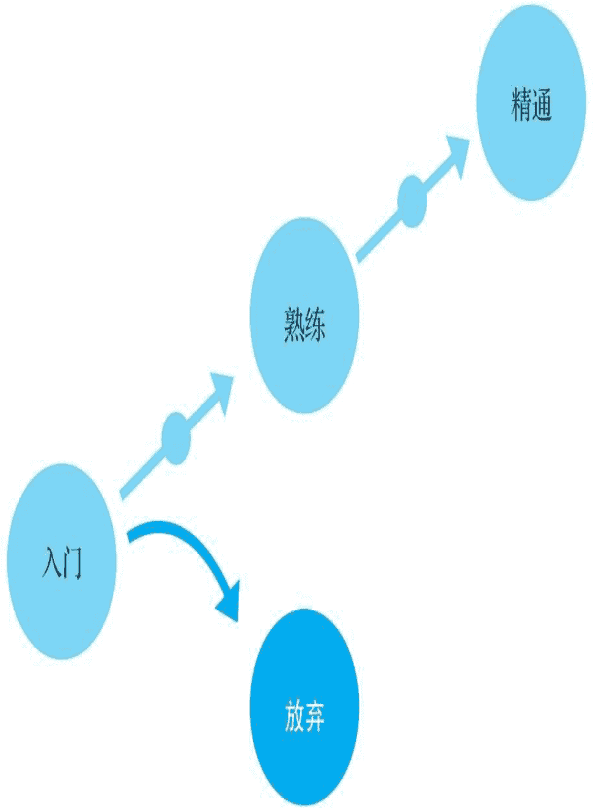

网上常把这类书名调侃成“Python：从入门到放弃”“MySQL从入门到删库跑路”。回想一下你学过什么技术工具，办公软件、网络应用、手机App、笔记应用、编程语言等等，绝大多数并没有走完入门到精通的路线。少数还在日常使用，也大多停留在熟练层级，多数最终被放弃了。只有极少数在足够努力和运气加持下，你才会觉得自己精通了。

从入门到放弃并非软件独有。知识管理方法、健身方法、摄影技巧、拍摄技术、厨艺、极简生活方式等等，我们也经常兴冲冲开始，最后无疾而终。

从雄心勃勃的起点到这种现实，中间发生了什么？在重塑学习方式前，先试着回答。我们认为有三点。

第一，要让绝大多数工具学习尽快走完从入门到放弃的流程。

学习内容可分为知识、工具、技能。以读书为例，目的是获取知识，手段是电子书、笔记软件、阅读方法等工具，阅读技能也需要打磨。

对工具而言，本就不必追求精通所有。阅读时不必同时用几十款笔记软件，试几种选一个合适的即可。执着于精通每一种新笔记软件是误区。有时试图掌握全部工具的成本很高。以摄影为例，学习摄影知识、买设备、练拍摄，器材升级确实提升效果，却很烧钱。

我们容易掉进“差生文具多”的坑。看到别人用更好的工具就跟着换。跳出的方法是认清工具只是手段。要快速判断：这款工具能否带来十倍效果提升？不能，就直接从入门到放弃。

第二，有价值的工具是你能用起来并且每天都在用的，而非最先进或最新的。

人们总期待精通某工具后能做到过去做不到的事。确实有极先进的工具值得尝试。但多数工具的效能落在一段区间里，差异细微，只要选一个能每天用到的就够。工具再先进，用不上就没价值。

对我们而言，熟练使用的才是高价值。学习的起点不应是入门新工具，而应从当前在用的工具出发：它在帮你完成什么？怎样用得更高效？能否被替代或部分替代？想想费曼他们如何用Marchant机械计算器和人力组成计算系统。

于是路径变了：不再是从入门出发最终放弃，而是从熟练出发向精通攀升。这是渐进且务实的，成功就大幅提效，不成功就继续用旧工具。

第三，缩小范围，先精通工具中与任务相关的部分。

传统思路认为从入门到熟练需要大量时间和学徒期，未考试不能上路。但现在的多数技术工具门槛已大幅降低，从入门到熟练部分功能相当容易。智能手机就是例子，老人半小时也能学会发微信。

真正难的是熟练到精通。全方位精通不现实，务实的策略是聚焦任务，在完成这项任务上先做到精通，使用中更容易逼近精通。

书读成从入门到放弃，原因在于这类书面面俱到，先系统学习工具，再练习，最后实战。仅仅读完一本书就耗费大量时间。正确的读法是只读与需求相关的章节。

我们常卡在入门到熟练的中间段。与其如此，不如把目标放在熟练到精通的中间段。缩小范围完成实际任务，更容易抵达。因此推荐的路径是带着真实任务学习，在单点上做到熟练。好处是，技术工具伴随大量术语概念，聚焦一个真实任务时，只关注相关的即可，无需先与所有概念搏斗。

## 如何一步步学会技术工具的使用

讲清楚较为复杂的技术工具该怎么学，最好的方式是结合具体工具展开。但受篇幅所限，我们按流程拆解，如图8-2所示。

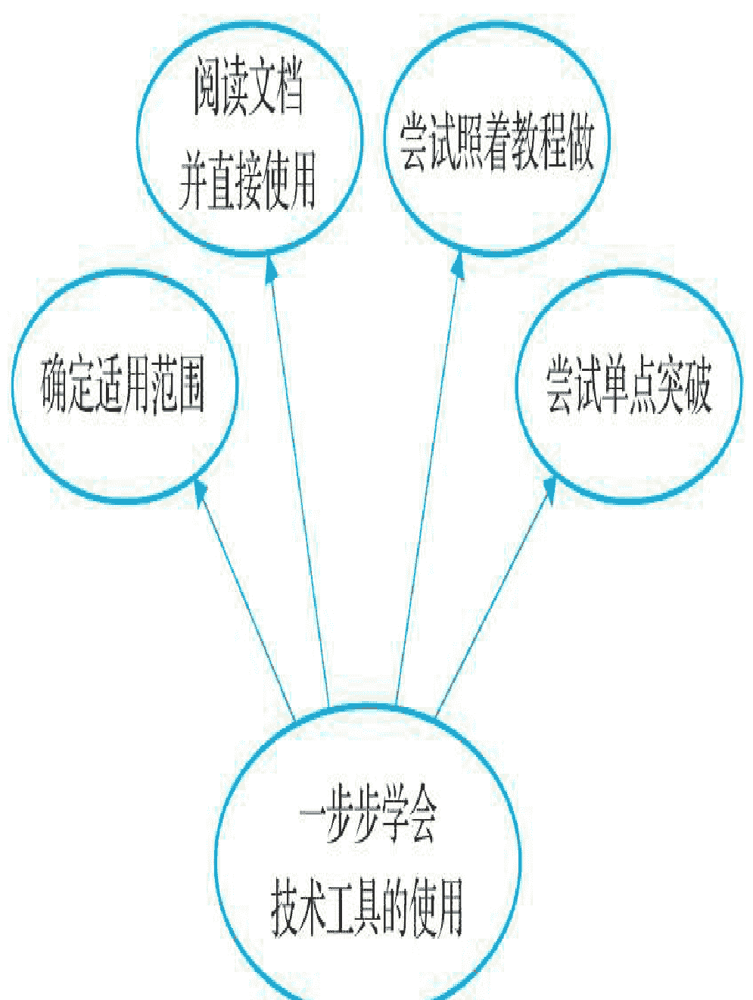

### 确定适用范围

学一个技术工具前，先搞清它的适用边界。比如把本节当作学习工具，它适用于学习能完成任务的复杂工具。类比一下，目标不是用手机拍照，而是用专业相机开展工作。普通人也能按专业相机的快门，但只有专业人士才能真正用来工作。

因此学习任何工具前要明确两点：①这是什么工具？②你要完成什么任务？答案看似显而易见，忽略就会浪费时间。例如一次学习目标是初步掌握Obsidian并在电脑上做日常笔记。我花了一周比较Notion、飞书、本地文档、云文档、苹果备忘录等，并研究教程。但这不是我这次的任务。真正聚焦的话，一晚就能完成。

### 阅读文档并直接使用

微波炉、手机不用说明书也能用。但复杂工具建议先看文档。无论出于何种原因不想读，结论都是：去读。

文档形式多样，最核心的是产品自带的使用指南。软件产品面向用户的说明通常通俗易懂；代码库常配技术文档与使用手册；开源项目可直接读代码；一些成熟工具也有书籍可作补充。

可以用冲刺读书法快速过两遍，然后立刻上手。照着例子做，文档里一般都有示例。现在AI能帮助阅读：把文档丢给AI提问使用方法，遇到报错把信息给AI，让它按文档给出建议。

### 尝试照着教程做

开始做具体任务会发现，仅靠文档不够。工具往往依托一系列组件，要针对具体问题做大量配置，文档覆盖不足。

这时需要教程与实例。每个技术工具网上都有现成教程与案例，可一步步跟做。不仅大众工具教程丰富，小众工具的用户也常分享精彩案例。

照着教程做相当于有经验的导师带一段。比如学Midjourney。文档里提到用--ar 4:3设定比例，用--stylize 500设定风格化。网上有很多实例：用艺术家名字指定风格，用真实照片、油画、水彩等描述绘制方式。我的体会是，跟着网上的详细教程做上百个例子，实践经验就积累出来了。

### 尝试单点突破

学一段时间后，你能用工具完成不少任务，但会明显感到进入平台期——不算新手，也谈不上专业。很多“从入门到精通”的书想通过扩充知识点跨越平台期。书的优点是系统性，但缺点是图景过大。

可以采用两种方法：

第一，对已掌握的功能向下深挖。带着问题查资料：这种做法的原理是什么？拆开黑盒子后的工作逻辑是什么？还能如何改进？有没有十倍更好的做法？这是围绕熟悉功能的纵向挖掘。

第二，扩大单点，掌握周边相关特性。比如已熟练Notion记笔记和写文稿，可进一步学多维表格做任务进度表，学协同编辑邀请他人一起修改，或直接发布网页对外展示。

到这个阶段，通常已超越熟练，达到熟练与精通之间的中间地带。能否再进一步取决于决心、投入与技巧。总之有效路径是从熟悉的功能点稳步向周边拓展。

学习工具的建议与常见观念不同。很多人认为学工具要全面，但我认为能熟练使用的单点远比全面更有价值。办公软件我们最多用5%的功能，试图掌握全部只会浪费时间。编程语言或库里，精通者高频使用的也往往是单点。我们追求的精通应是单点的深入理解与应用。

### 用好工具的10个理念

- 1. 关注任务，而非工具。工具与技能是手段，完成任务才是目的。
- 2. 用先进工具，而非全能工具。用电钻，而非瑞士军刀。
- 3. 重器轻用。尽量用强大的工具，但不求用尽全部功能，只用需要的部分。王树义、张玉新称之为“重器轻用”。
- 4. 精通基本工具。文字编辑中的纯文本、Markdown、LaTeX公式与正则表达式等属于基本功。
- 5. 用最适合自己的工具。个性化设置并持续使用，别纠结别人用什么。
- 6. 与他人协作时的工具要妥协。伙伴用什么你就用什么，除非能说服大家一起换。
- 7. 始终用最新版本，但避免过早把新工具投入实战。好工具早试用，但不要太快用于生产。
- 8. 将工具组成工具箱。保持工具少而精，持续更新，考虑新旧工具的匹配度。
- 9. 每次都让工具用的更深入一些。每次使用现有工具或尝试新工具时，都力求完全掌握其中一个功能。
- 10. 持续寻找能提效十倍的工具。这也是关注AI工具的原因。

### 成为工具高手的方法：入门教程、培训课程、操作标准

怎样成为工具高手？用教来学。可通过三种方式：将所学整理成入门教程；设计成培训课程；制定成操作标准，如图8-3所示。这也体现了水平阶梯：能写入门教程说明入门了；能教别人说明已熟练；能形成标准操作流程则接近专业水准。

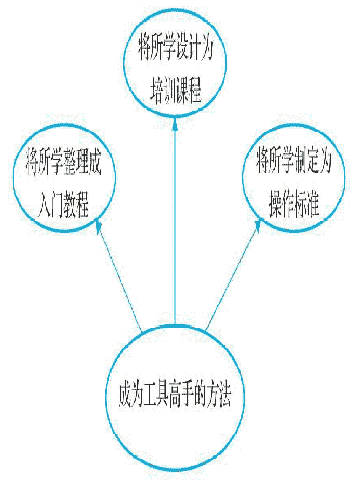

### 将所学整理成入门教程

入门教程是我们从软件开发借鉴的概念。学新技术时我们会参考他人教程，照着做就能跑出样例程序。

一种定义是：教程是通过例子传递知识，比书籍讲座更具互动与针对性。它提供指导信息，帮助完成特定任务。像宜家说明书，按步骤就能拼好家具。

想成为高手，可以换个视角：不是照着别人做，而是为别人写。能写出他人可照做的教程，理解会更深，因为写作会逼你细想每个操作细节。

你可能会问自己有资格写教程吗？这种担心源于把“教程”看得太重。加上“入门”二字就好理解了。网上多数编程教程其实是初学者的个人笔记。你可这样想：去国外旅游后标记路线、写下买票坐地铁的办法，这就是入门教程。

入门教程内容简单直接：第一步怎么做，有什么结果；第二步……复杂任务可能记几十步。要写成优质教程，往往需要反复实操。重复几次水平自然提升，写作中也可能被引向原本忽略的细节，获得额外收获。

不必每次从零开始，可以修订已有教程形成更新版。比如我曾学一项迭代极快的编程技术，两三年里语言、工具、平台都变了。我修订旧教程，记录最新用法……

### 如何一步一步做，从而形成更新版教程

很多技术博客分享的逻辑是：写教程既能帮助他人，也能反哺自我学习。

当我们想通过编写新手向导来深化理解，先要接受一个基本事实：为了让初学者快速上手，指南必然会做大量删减，其展现的复杂度远小于真实操作。亲手编过的人都清楚，指南的叙事是单线的，即便实践中分支众多，它也会把旁路抹去，只留下一条显眼的主线供照做。不管是按图索骥的学习者，还是负责输出的人，认知都不能停留在这一层。

### 把向导写出可落地感
1. 定位与原则：挑一个具体且能马上动手的技能点。写作目标是产出简洁、可直接执行的步骤清单，每一步的预期达成状态要写明。若已有类似材料，可在此基础上迭代，也可借助生成式工具起草初稿。

2. 六步写法
   - 先敲定主题，写出简要说明、完成后的样子，并列出必备的前置条件。
   - 亲自分步实操并做记录，确保流程有序、细节齐全。
   - 按记录从头再走一遍，站在新手视角找卡点并优化。
   - 精简步骤总量，对容易出错的环节保留说明。
   - 以使用者角度重写表述，确保语言通俗、操作可行、结果可预期。
   - 校对、统一格式后发布首版。

3. 收束与建议：把个人体会与注意事项单独归纳出来。

### 从单人示范到群体教学
教人是让知识更系统、更扎实的好办法。写向导属于单人示范，若想进一步升级，可把内容做成正式培训，比如面向同事开一次专题分享。向导是让一个人照步骤做，培训则是向多人讲清原理、思路与方法。

一次分享的要求明显提高：需要吃透底层原理，具备整体视野。要清楚向导里被省略的分支，在不同选择点为何这样走；还要预判风险点并给出对策。讲师的底气来自于对这些细节的掌握。

讲课的核心是讲透知识，而不是空洞灌输。要多用案例和现场演示，让学员亲眼看到效果，而不是只听概念。

### 大纲要让人有完成感
朱莉·德克森在《认知设计：提升学习体验的艺术》里建议，课程设计要围绕“做出成果”来组织，让学习者感受到完成感。以 Photoshop 入门为例，两种大纲对比鲜明：

方案甲偏功能命名
- 第一讲：图层使用
- 第二讲：图像编辑
- 第三讲：滤镜与特效
- 第四讲：钢笔工具

方案乙偏产出任务
- 第一讲：做一张吸睛的博文头图
- 第二讲：把普通照片调成惊艳大片
- 第三讲：制作相册封面
- 第四讲：把旅游照里的路人 P 掉

### 课堂上演示优先于讲授
课堂应呈现结果和对比，而非只讲抽象原则。演示比讲述更有说服力。德克森给出的对照如下：
灌输式：“项目管理里范围蔓延是个大问题，下面列几个常见原因……” 
展示式：“同学们，本周要和客户开需求更新会，会遇到哪些状况？对本周交付会有什么影响？”
灌输式：“本次讲座将介绍罪犯用证券交易洗钱的五种手法……” 
展示式：“如果罪犯要隐藏 800000 美元非法资金，第一步可能怎样做？在选项中选一个……”
驾校教练灌输式：“遇到校车要遵守规则。首先车灯闪时……” 
驾校教练展示式：“大家觉得停着的校车最让人担心什么？……对，担心孩子下车过马路……”

### 把经验沉淀为标准作业流程
标准作业流程是指把高频重复的动作写成规范，照此执行即可稳定产出高质量结果。

把所学变成标准能获得进阶的学习收益。重复动作标准化有三点好处：水准稳定省力、易形成习惯、可持续迭代。有文字记录后能不断优化，操作越来越高效。

把复杂流程记录并标准化在各行各业都被验证有效，常以检查清单呈现。经典案例是约翰·霍普金斯医院为中心静脉置管感染制定的流程：①用消毒皂洗手；②用氯己定消毒皮肤；③用无菌手术单覆盖全身；④戴帽、口罩、无菌手套并穿手术服；⑤置管后在穿刺点贴消毒纱布。严格执行后感染率从 11% 降到零，挽救了大量生命。

这是哈佛公共卫生学院教授阿图·葛文德在《清单革命》中的案例。他曾任美国白宫健康政策顾问，被《时代》评为全球百大影响力医生。他认为清单就像为大脑搭建的“认知防护网”。

形成标准就是把知识、技能和经验封装成可信赖的工具。做到这一步，才算得上高手。

即使是自己使用，写成标准也很有价值，能把需要反复思考的动作变成自动化，节省认知资源，任务更轻松。建议对重复任务先寻找现成标准，再在此基础上迭代。

写好标准需注意：避免过于简略遗漏关键步骤；每一步配上理想结果以便自检；目标用户设定为普通人而非专家。

写作时要从使用者视角出发。理查德·桑内特在《匠人》中讨论名厨写菜谱后建议：“重拾战战兢兢的感觉，重新想象新手的忐忑。”教人时要用文字唤起未养成习惯前的状态，才能给到指引。

不必追求一次完美，要持续迭代。“标准”易让人误以为固定不变，实际上它应保持开放、持续更新。

### 编写指令时的自检清单
- 用真实场景解释，提升理解度。
- 描述动作时同步说明过程与意义。
- 不预设读者全知，明确标注易错点。
- 把常被忽略的常识写出来。
- 配备必要的图示。
- 语言简明，避免生僻词。
- 符合多数读者的认知习惯。

以上清单源自《匠人》第六章“形象的说明书”对无效指令的讨论。

## 本章要点
- 快速掌握工具的关键是聚焦某项功能反复实操，让熟练度逼近精通。
- 学习工具可分四步：弄清适用范围；阅读文档并直接上手；照向导实操；做单点突破。
- 用好工具的理念：关注任务而非工具本身；用先进工具而非追求全能；重器轻用；精通基础工具。
- 成长进阶的三步：把所学整理成新手向导；把所学设计为培训课程；把所学制定为操作规范。

> ‘现在就行动吧！’
- 梳理你学过的 20 种技术工具，按时间倒序列出。回顾学习经历，写下 3 点经验与 3 点教训。
- 选一个软件的特定功能，争取一天内能实际运用，并把水平推向接近精通。记录过程并反思：若重来一次，如何改进？

1. 注释1：Obsidian 是一款可在电脑与手机使用的开源笔记软件，支持 Markdown 写作，笔记以本地 Markdown 文件存储，支持双向链接，并有多款插件可选。
2. [注释2](https://example.com)：技术圈常用黑话“RTFM”，意指去读手册、用户指南、在线帮助和官方文档。
3. [注释3](https://example.com)：资料来源：德克森. 认知设计：提升学习体验的艺术[M]. 赵雨儿，简驾，译.2版. 北京：机械工业出版社，2016. 在不改变原意的情况下略有调整。
4. [注释4](https://example.com)：资料来源：葛文德. 清单革命[M]. 王佳艺，译. 北京：北京联合出版公司，2017.
5. [注释5](https://example.com)：资料来源：桑内特. 匠人[M]. 李继宏，译. 上海：上海译文出版社，2018.

# 第九章 AI时代的提问力修炼
生成式模型普及后，提问从“重要但不常用”变为高频刚需。我们通过提问让模型解答疑问、完成需求。提问质量决定输出质量，误导性提问会得到糟糕结果；模型输出也可能不完美甚至出错，提问者需要具备判断力。

模型时代要重新训练提问能力，并将其纳入穿透学习法。提问是本章主题，也是学习方法论的一个典型案例：围绕提问本身学习如何学习、如何用新工具、如何复制知识大纲。

## 重新学习提问
模型出现后提问使用频率大幅提升，随时可向模型发问。会提问才能更高效获取知识信息。

很多人其实不会提问。可自测：
1. 就你关注的一个话题，你有哪些疑问？列出来。
2. 尝试向他人提出这些疑问。小提示：要表述清楚，并考虑向谁提问最合适。
3. 得到回答后，如何判断它是不是好答案？

提问的本质是逻辑思维能力。从这个角度重新学习提问。

## 划定学习的边界：聚焦评估回答
第二章提到学透主题要先划定边界。对提问主题，我们拼凑了一张简易地图来界定范围，见图9-1。

提问大致分两类：一类是有疑问寻求释疑，一类是有要求寻求解答，二者常重叠。有人会把建议伪装成提问，如“你这样做，是不是可以？”这类冒充的提问不在讨论范围。

### 关于提问的简易地图
- 两大类提问
  - 疑问（寻求释疑）
    - 对信息的疑问
    - 对知识的疑问
    - 对过程的疑问
    - 对回答的质疑
  - 要求（寻求解答）
    - 要求最终答案
    - 要求解答过程
    - 要求建议意见
    - 要求开放性选项
- 提问的四个步骤
  - 识别问题
  - 表述问题
  - 回答问题
  - 评估回答
- 其他相关议题
  - 你向“谁”提问（专家、自己、书籍、网络等）
  - 向人提问技巧（一对一求教、讨论会等）
  - 技术提问技巧（社交网络、搜索、AI）
  - 专业提问技巧（教师提问技巧、培训提问技巧）
  - 其他提问技巧（面试、记者式提问、访谈、侦探式提问、警官式盘问等）

图9-1 关于提问的简易地图

提问有四个主要步骤：①识别问题；②表述问题；③解答问题；④评估回答。求职面试、记者式提问等场景式提问此次不纳入。

至此，学习焦点确定为如何回答问题与如何评估回答。

## 复制框架：批判性思维者的提问框架
确定边界后，寻找可复制的知识体系。《学会提问》与学习目标高度匹配，采用的是机械工业出版社2021年出版的原书第12版中文版。该书认为批判性思维者的目标是不断追求更好的结论、信念与决定。

复制其知识大纲如图9-2所示，仅展示一级条目和部分二级条目。重点是评估回答的框架：论题、结论、理由、词义、假设、论证、证据、替代原因、数据，以及是否遗漏信息、是否有其他结论。

### 《学会提问》批判性思维入门经典
- 正确提问的益处和方法
- 论题和结论是什么
- 理由是什么
- 哪些词语意思不明确
- 价值观假设和描述性假设是什么
- 论证中有没有谬误
- 证据的效力
- 有没有替代原因
- 数据有没有欺骗性
- 有什么重要信息被省略了
- 能得出哪些合理的结论
- 干扰批判性思维的障碍
- 描述型论题和规定型论题
- 寻找论题
- 寻找结论
- 通过提示词寻找理由
- 让理由和结论一目了然
- 找准关键词
- 检查有没有歧义
- 根据上下文找出真正含义
- 价值观冲突和价值观假设
- 找出并评价描述性假设
- 用提问的方法找出论证中的谬误
- 论证谬误小结
- 个人经历、典型案例、当事人证言和专家陈述
- 个人观察和调查研究
- 寻找替代原因
- 评价替代原因
- 识别不知来历和有偏差的数据
- 测量误差
- 帮你识别省略信息的问题
- 面对信息缺失的现实
- 灰度思维：两面还是多面
- 更多可能的结论，更多可能的自由选择

图9-2 从《学会提问》复制的知识大纲（部分二级条目折叠）

《学会提问》与《如何阅读一本书》的方法论相近，后者分析阅读规则也提醒关注作者问题、词义、主旨、论述，以及逻辑缺陷或理由不完整。

以《学会提问》为课本沿着其指引探索即可。重读第1章后制作的大纲与详尽大纲如图9-3所示。其核心逻辑是：批判性思维和批判性提问帮助我们分析信息与论证，从而认识真相、形成信念并做出更好决定。可用于接受文本的分析，也可用于自己写作发言的论证。

## 重点探索：找出假设与采用灰度思维
探索两个关键问题：如何找出未明说的假设？为何要避免二分法而采用灰度思维？

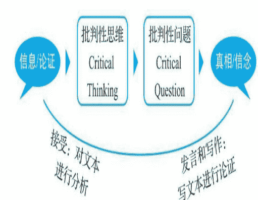
### 《学会提问：批判性思维入门经典》第1章：正确提问的益处和方法（什么是批判性思维）
- 学会提问与批判性思维
  - 对信息采取“批判性思维”，即独立思考和判断
  - 通过提出“批判性问题”，从他人的信息到自己的信念
  - 文本：他人的信息与论证是文本，自己的提问与论证也是文本
  - 反过来：我们用「批判性思维」来写作和发言
- 什么是批判性思维
  - 批判性思维三个维度激活评估技能
  - 批判性思维的作用（提高书面和口头表达能力）
  - 弱势批判性思维和强势批判性思维
- 吸收：海绵式思维、淘金式思维
  - 海绵式思维
  - 淘金式思维
- 输出：像批判性思维者那样写作和发言
  - 淘金式思维的心理检视表
- 批判性思维者拥有的主要价值观
  1. 自主决断
  2. 好奇心
  3. 谦恭有礼
  4. 发自内心地尊重严密的论证
- 让对话有效进行下去

图9-3 《学会提问》第1章的详尽大纲（三级条目及部分二级条目折叠）

互联网上易判断失误，往往不是结论或理由错，而是未辨别的隐藏假设。随着AI出现，识别假设更重要。AI的结论、理由、论证过程会明确呈现，假设却不会；让AI分析他人文本时，它也无法感知文本外的假设。两种情况都要求我们自行找出假设。

《学会提问》把假设分为价值观假设与描述性假设。价值观假设指世界应该是什么样；描述性假设指世界过去、现在或未来是什么样的。其特征是：隐藏或未明说；论证者视为理所当然；对结论影响大；可能具有欺骗性；对指向特定结论的理由是必要的。

很多时候我们会发现，捕捉那些没有明说的想法相当费力。怎么把隐含的假设找出来呢？一个可操作的做法是，用手头的材料把原来的论证重新走一遍，在推演里把背后藏着的前提逐层剥离。AI的语言组织和推理能力在这件事上很顺手。可以直接让它推断：“在这段讨论中有哪些没说出口的假设？请逐条列出来。”

再说灰度思维。

在网络环境里，很容易滑向非此即彼的误区。互联网传递信息时，习惯把最强烈的支持和最激烈的反对摆在最前面，中间地带和细微差别就被冲淡了。久而久之很多人习惯用黑白分明的二分法判断，立场自然被极化。

我更在意的是更里面的一层困惑：两端之外还有什么可能？尤其是从“对”这一端继续往外延伸，会不会存在更优的解答？我们太容易满足于“一对一错”的简单判断。实际上，除了对的答案，还有更好甚至极好的答案。

把“是否还有更好的答案”当成获取优质信息的一双眼睛，每次准备收手前都问自己：搜索引擎里如果继续深挖，会不会冒出新材料把结论推向更优？换一种问法抛给AI，会不会拿到更扎实的回复？

带着这个问题翻《学会提问》，书里给出的解法有几条：补上可能缺失的信息；别被二分法套住；用灰度视角去看；关注条件句；扩大可能的结论。其中条件句和假设本质是同一回事，没说出来的是假设，说出来就成了条件。所以前面提到的两个抓手其实是连在一起的。

## 实战：借助AI让练习提速十倍
《学会提问》的独特之处在于，它把批判性思考放进一个可操作的场景——评判一段文字，并且给出两条可以直接上手的练习方向，如图9-4所示。

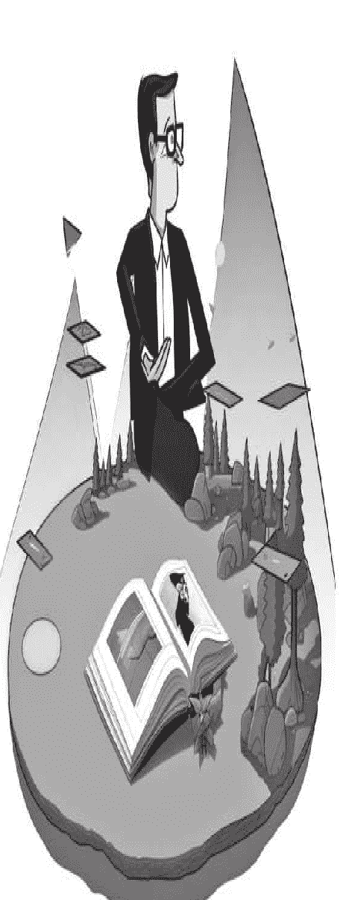

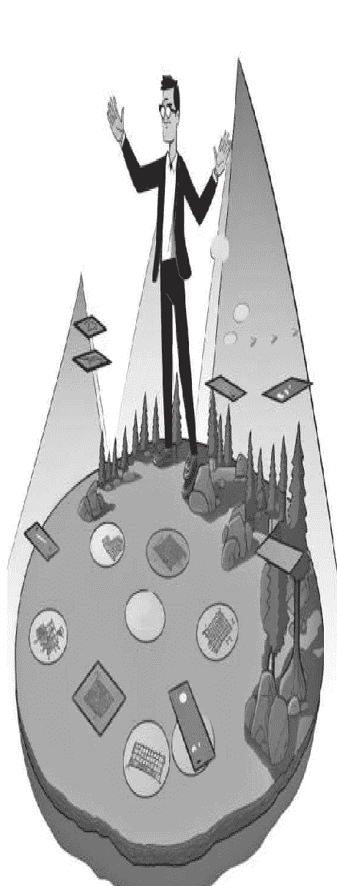

a) 用批判性思考拆解收到的信息
b) 以批判性思考者的姿态表达和写作

### 图9-4 练就批判性思维的双视角
第一条路径是按书中每章结尾的安排，用本章学到的方法去操练，也就是用批判性思考去分析输入。比如学了如何挖掘不同结论后，书会给出一段论证让你推导出别的结论。学会后随时可用，读到文章或帖子就照做，逼自己产生不一样的结论。

第二条路径是换位，以批判性思考者的身份去写和说。比如由你来重构一个论证，并把其中隐含的假设全部摊开接受检验。反复练习，假设的逻辑敏感度会提升。

AI可以同时充当示范者和对话伙伴。

让它当示范者，就是把方法描述清楚让它执行。比如告诉它任务是拆解论题、结论、理由、假设，并给出分析要点，再给一段材料让它输出。常见用法有：用AI分析例题，对照自己的分析看改进空间，也能把AI答案和标准答案对比发现盲点；让AI演学生，你当老师评判其质量；遇到难题先让AI给个初稿，从空白到草稿的距离更短，再在讨论中形成自己的版本；需要输出时，让AI用批判性思考逐句质疑你，帮你把论证补强。

让它当对话者。纸质书是静止的文字，现在可以让AI代替作者跟你交流。把论证原文和补充资料喂给它，指定角色，让它以作者口吻回应。可以从基础问题开始：论题是什么？理由是什么？假设是什么？可以求解释：上下文里这个词具体指什么？可以直接质疑：某处有没有论证漏洞？可以提新要求：结合补充资料还能推导出什么不同结论？也可以请它把所有未明说的假设列出来，甚至开放式讨论，得到包含结论、理由、假设和推演过程的新论证。

把提问当工具用好，学习效率会明显提升。过去很难随时找到一个人陪你讨论辩论，现在有一个水平可调、永不厌烦、即时反馈的对话伙伴。

想更系统地提问，可参考本章附录9A“向AI提问的8个原则”。

‘实用小技巧’在网上发问前，先做这几件事
- （1）在准备提问的论坛里先搜有没有相关文章。
- （2）先用搜索引擎找答案。
- （3）查阅手册。
- （4）看看FAQ常见问题文件。
- （5）自己检查或试验。
- （6）向身边的可靠朋友打听。
资料来源：摘自埃里克·雷蒙德（Eric Raymond）和瑞克·莫恩（Rick Moen）关于技术提问的指南文章《提问的智慧》。埃里克·雷蒙德也是《大教堂与集市》的作者。

‘实用小技巧’提问时讲目标，别讲步骤
想搞清楚怎么做，先在开头说明你的目标，再点出卡住的具体环节。

不好的问法：我怎样才能从某绘图程序的颜色选择器取得十六进制RGB值？
更好的问法：我想把一张图片的色码替换成我指定的色码，目前只能一块块编辑色码区块，不知道怎么从某绘图程序的颜色选择器里拿到十六进制RGB值。
资料来源：摘自指南文章《提问的智慧》。

到这里，提问的方法论似乎可以收束。接下来要做的就是在实操中不断打磨。

但如果就此结束，就违背了本书倡导的“穿透”。关于提问还有更多待解：与过去相比，未来提问会有什么变化？我们该如何调整？

问题的价值远大于答案的阶段
AI越强，我们越能体会到：会提问，就很容易拿到答案。我们正处在问题比答案更值钱的阶段。

我们知道Question大于Answer。爱因斯坦说：“不要听有答案的人，要听有问题的人。”
我们也知道界定Problem往往比解决Solution更重要，“问题本身的界定，要比其解答更为重要”。

以上两句用英文标注是为了区分Question和Problem的细微差别。含义相近，我们常说提出问题比解决问题更重要。

虽然口头上都这么讲，行动上仍过度偏爱答案。社会运行的规则也多奖励答案，极少奖励问题。本章前半部分已经充分展示了这种倾向。

如图9-5所示，提问可拆成四个阶段：发现问题、定义问题、解答过程、回答。普通人只盯着回答，而我们要多关注解答过程，并拆解它来提升能力。既然问题的价值已大于答案，就该把重心转回提问本身，即发现问题和定义问题。

定义问题有不少方法，这并非难点。科技作家凯文·凯利（Kevin Kelly）说：“卡住时，试着向别人解释你的问题。往往把问题讲清楚了，解法就出来了。把解释问题当成解题的一部分。”反过来，真正的难题是发现问题。

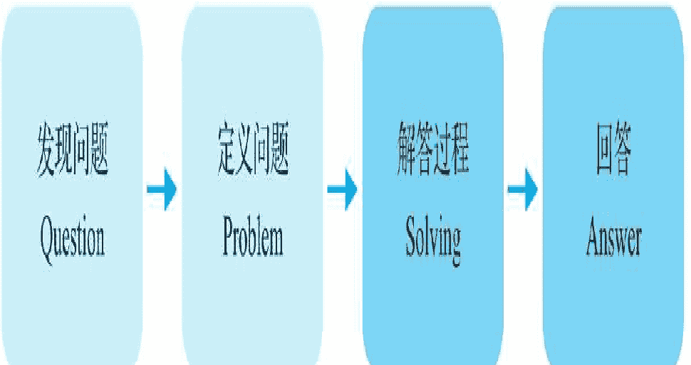

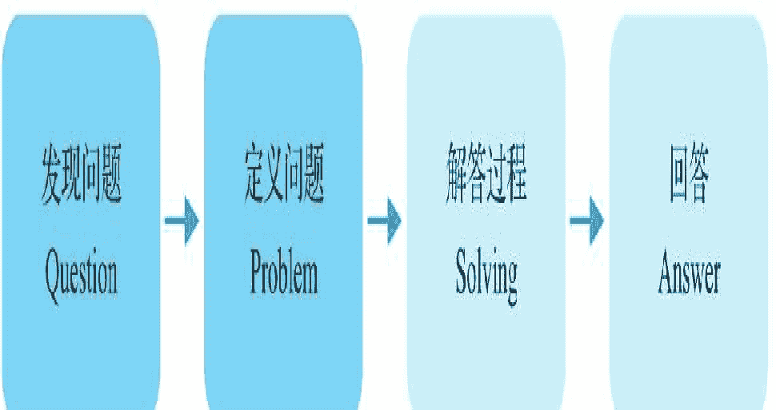

### 图9-5 四步提问框架：从发现到作答
怎么发现问题？传统说法是像孩子一样保持好奇。1921年爱因斯坦获诺奖后首次访美，记者问：“声音的速度是多少？”爱因斯坦拒绝回答：“你可以在任何一本物理书里查到。”可惜多数时候好奇会让我们像那位记者一样提问。

现在这类问题的答案仍被视为知识，但我们能用新方式快速获取：在搜索引擎里找网络答案，或向AI要综合回答。这也印证了本节标题的观点：当你会提问时，借助互联网和AI，答案很快到手。

把探案想象成侦探，上面这类问题只是帮你确认周边事实。真正关键的疑问是：嫌疑人是谁？真相是什么？这时问题会变成：“在已知如下信息的情况下，犯罪真相是什么？”

换句话说，我们现在很容易得到很多答案，真正的挑战是发现那些还没有答案的问题。

有经验的学习者也知道，泛泛找疑问效率很低。这种级别的疑问通常只出现在你很熟悉的领域，在那里你已排除了大多数疑点，剩下的才是真问题。

我们发现，《学会提问》里的批判性思考也能帮助识别问题。很多人以为批判性思考就是“质疑一切”。书里展示的方法是，针对一个可能对也可能错的论证，提供框架来逐项排除疑点，直到逼出真正的问题。由此得来的知识体系同样适用于提出疑问。

想提出好问题，不仅要放宽视野，更要收窄范围。放宽帮你在大范围定位；一次次收窄，才能看清每个问题直到找到真问题。好问题的价值远大于好答案，找到真正的问题很难，但有方法。我们可以用批判性思考一个个收窄范围，如图9-6所示，直到锁定疑问。


### 图9-6 缩圈法锁定真实疑惑
到这里，对提问的学习又进了一层。我们还得到一个实用策略：先用排除法把各种可能逐一剔除，直至定位真问题。有了AI辅助，这个排除法会更快更高效，因为可以借助即时回答做排除。

启示：大视野与小视野
“学习的基本原则就是钻研微观细节，从而理解宏观问题是如何产生的。”乔希·维茨金在《学习之道》里写道。他既是国际象棋冠军，也是太极推手冠军，从脑力和体能两类截然不同的技艺中总结出这个原则，并形象地称之为“划小圈”。

小圈思维深刻影响了本书的学习方法。我们采用大圈和小圈结合：知识大纲帮划大圈，深度复制五步帮划小圈；冲刺学习法帮划大圈，冲刺读书法、深度练习帮划小圈。

游戏研究者塞巴斯蒂安·德特丁（Sebastian Deterding）画过一张“目标嵌套结构”图，如图9-7所示。游戏目标是嵌套式的，把大目标拆成小目标，让你在不断达成小目标中获得成就感，从而持续玩下去。这张图后来被学习研究者朱莉·德克森用在《认知设计》里。

学习也应采用这种嵌套式目标结构，用它来指导当前、短期、中期和长期目标的推进。这张图直观体现了大圈小圈结合的学习方式。但请注意，本书有一处微妙差异：

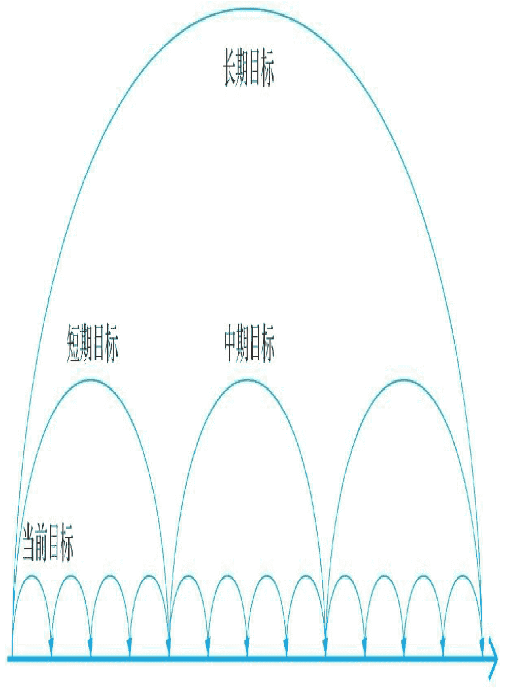

### 图9-7 目标的嵌套结构（当前、短期、中期、长期）
资料来源：根据塞巴斯蒂安·德特丁的图示重绘。

我们认为最佳路径不是循序渐进地完成一个个小目标再达成长期目标。我们建议先走大循环，到达长期目标处（比如先做出知识大纲），再回头做小循环（攻克难点疑点）。在学习中多次在大圈和小圈间往返：先看远再回来一步步走。穿透学习法的特点正是多次循环、快速循环，以及大循环与小循环的结合。

回顾第三章的费曼空白笔记本方法：先整理知识大纲；再把大纲条目写成各章节标题；最后用答案填满笔记本。最初制作空白笔记本是划大圈，后续填满则是划小圈。费曼空白笔记本是划大圈，用讲给别人听的方式强化理解则是划小圈。

再具体看怎么聚焦。乔希·维茨金重新解读了《禅与摩托车维修艺术》主人公斐德洛的一个故事，可称作“斐德洛的砖”：

老师让一个学修辞的学生就她居住的小镇写500字故事，学生完全理不出头绪，一个字也写不出。镇子似乎太小，没东西可写。

斐德洛稍作修改，让她从教室外剧院前台的左上方那块砖开始写。她从那块砖写起。

起初学生难以置信，后来文思泉涌，写出了20多页的故事。

学习时可以借鉴这个建议：“每天学得更深一点，而不是更广一点。”更深的一个好办法就是盯住像“斐德洛的砖”那样具体的场景或知识点做聚焦。穿透学习法里的多种方法都是这种聚焦在不同场景的应用，比如聚焦钻研小点，用冲刺读书法放慢输入，用讲和写输出放慢思维。

本章要点
- 问题的价值远大于答案。批判性思考能帮你发现问题。面对任何答案或观点，可逐一对照《学会提问》建议的11个要素：1.论题；2.结论；3.理由；4.词义；5.假设；6.论证；7.证据；8.替代原因；9.数据；10.是否遗漏信息；11.是否还有其他结论。
- 提问可分为发现问题、定义问题、解答过程、回答四个阶段。现在是问题价值大于答案的时代，要持续磨练发现问题的能力。实用策略是用排除法发现真问题，可借助AI协作。
- 挑一本书，用批判性思考的11要素分析其中某个论证。然后转换角色，用自己的话重讲一遍，并逐项对照这些要素，让讲述无懈可击。
- 针对正在学习的主题，列出10个问题。用排除法分析，哪个是真正的问题。

> 现在就行动吧！

1. **注释1:** 面向同一主题，关注重点会有很大差异。比如在方军、柯洲、谭星星所著的《成为提问工程师》一书中，关注点是如何表述向AI提问的问题。我们认为向AI提问时可采用结构化提问模板，相关介绍可参见本章附录9A。
2. **注释2:** 资料来源：布朗，基利. 学会提问：第12版[M]. 许蔚翰，吴礼敬，译. 北京：机械工业出版社，2021.
3. [注释3](https://example.com): 这两句爱因斯坦名言的原文分别为：①Don't listen to the person who has the answers; listen to the person who has the questions. ②The formulation of the problem is often more essential than its solution.
4. [注释4](https://example.com): 资料来源：维茨金. 学习之道[M]. 苏鸿雁，谢京秀，译. 北京：中国青年出版社，2011.

附录9A
向AI提问的8个原则

ChatGPT等基于大语言模型的聊天机器人开启了一场巨变。它们提供简单的对话界面，你可以提问“这是什么意思”，也可以提要求“帮我写邮件初稿”“按说明编写程序”。一场“让知识触手可及”的新变革由此展开。

现在，人们能把几乎所有书面化知识与能力压缩进模型，随时调取使用。这给每个人带来冲击：过去靠漫长求学和实践获得的独特优势，现在所有人都能直接向模型调取。若别人轻松超越你的知识技能，你该怎么办？

有时AI甚至可直接完成任务，人被排除在外。例如AI能直接提取数据、查资料、分析并生成带分析和建议的报告，无需人工介入。如果工作可被机器人直接完成，你该怎么办？

面对巨变，我们应严阵以待，不能把AI仅当聊天机器人，也不能因恐惧而拒绝。回顾个人电脑、互联网、移动互联网等技术浪潮，有效应对之道是理解原理与影响，了解新能力，并尽早尝试、尽快熟练。

幸运的是，使用生成式AI有捷径：统一的运用方式。我们给出提示语prompt，向模型提问题、下任务，它会理解意图并用文字、图片、音视频即时回应。聚焦大语言模型，我们梳理出8条提问原则：
- 原则一：理解“生成的本质”是模式预测。
- 原则二：警惕“幻觉”，始终做事实核查。
- 原则三：提问采用结构化提示语。
- 原则四：模型能从提示语中直接学习。
- 原则五：让模型进行“链式思考”，采用慢思考模式。
- 原则六：将复杂的任务分解成更简单的子任务。
- 原则七：用模型能理解的格式输入信息。
- 原则八：坐稳主驾驶位，与机器共舞。

在真正进入方法论之前，先掌握一个实用的小窍门：使用生成式AI时有任何困惑，都可以直接向它发问，它会立刻给出针对性的解答。遇到操作上的不确定，记得主动请教。

### 原则一：生成的本质是模式预测
和我们对谈自如的聊天机器人真的会思考、会写作吗？能根据文字描述作画的模型，是否拥有达·芬奇级别的绘画功力？为何它还能“拍”出从未存在过的照片？只有厘清生成到底是怎么回事，才能用好新工具，也避免被误用。

生成的核心是模式预测，这也就是“下一个词预测器”之说的由来。帕姆·贝克（Pam Baker）在《ChatGPT超入门》中说：“ChatGPT不像人类那样思考，它是基于已学习到的模式进行预测，然后根据所预测到的偏好和单词顺序，组织成一句句话进行回答。”

正因如此，它看起来具备语言表达、编程、知识储备乃至推理能力。实际上，只要预测的词句连贯、有条理，我们就会误以为它掌握了这些能力。换个角度看，人说话写作也是在依据已学到的模式做预测。

明白模型只是在预测，就能避开两个极端。

第一是盲目轻信。语句通顺、排版规范的话很容易让人信服，就像衣冠楚楚的骗子一样。但形式与内容是两回事。知道它只是预测，就能大幅降低轻信度。

第二是过度轻视。生成内容错漏频发。一年前AI作图像乱涂乱抹，一年后已能模仿艺术家与摄影师的风格。进步虽快，错误与不合理依然常见，漂亮却有问题的画面比比皆是。大语言模型出错时就是胡说八道。这些失误容易让人小看它。

认识到它只是在预测，且预测能力在快速进化，我们会调整心态，按其现阶段水平来使用。

弄清本质后，也不会把生成式AI和搜索引擎混为一谈。搜索引擎是按关键词检索网络上已有的文本和链接；生成式AI则是依据提示语，通过模式预测创造新内容。二者不是替代，是互补。

### 原则二：警惕幻觉，事实核查不能少
AI会出现“幻觉”。它对自己给出的错误答案异常自信，这就是人们所说的“胡说八道”。

研究者能彻底根除幻觉吗？帕姆·贝克认为：“它能生成回答的能力，这也正是导致其不可靠的原因。为了让人类或机器想象出不存在的事物，如小说或电影中的虚构世界，我们必须先解放它们，即让它们摆脱现实规则的限制。”

简言之，要想具备生成能力，就必须容忍幻觉的存在，只能尽量压制，无法完全消除。

从技术上看，大模型选词受温度参数影响：温度低时偏好相关词，温度高时扩展到更多可能性。ChatGPT聊天机器人采用了相对较高的温度值，据推测约为0.7，让回答不至于呆板。若要更贴近原始材料，可把温度调近0。

对AI的输出必须做严格的事实核查。可以把下面这句警告贴在每台设备旁。

警告：始终对它生成的内容进行事实核查。

我常用一个例子来测模型：请解释杜甫的“窗前明月光”。能力弱的模型会直接进入幻觉，认定这是杜甫的诗，既看不出作者应为李白，也看不出正确诗句是“床前明月光”。

这个例子也凸显生成与搜索的区别。我们需要生成来解释，需要搜索来核验。

这也凸显批判性思维的重要性。参考《学习提问》一书，可以这样质询AI回答：论题和结论是什么？理由何在？哪些词不清晰？假设是什么？论证有无谬误？证据是否有效？还有没有其他可能？

### 原则三：用结构化提示提问
刚开始用ChatGPT时，人们常问“什么是相对论？”“给我讲讲深度学习。”很快就会发现，向一台庞大机器提问时，既要遵循基本提问技巧，也要匹配机器的格式。

向人请教时，我们会找对人、提供背景、明确问题、说明期望的回答形式。向机器提问同样适用这四点。差异在于：机器知识庞大却不懂当前情境，不会追问“你说的这个是什么意思”，也不会复述问题以便更好回答。

AI工程实践者总结出不少提问框架，其中埃尔维斯·萨拉维亚等人提出的框架最受认可。提示语按顺序包含四个部分：指令Instruction、上下文Context、输入数据Input Data、输出要求Output Indicator。取首字母得ICDO，便于记忆，回应做“ I see. Do!”

进一步细化：
- 指令 Instruction：角色设定Role、任务目标Task、指令规则Rules
- 上下文 Context：知识与技能Skills、完成任务的步骤Steps、样例Examples
- 输入数据 Input Data：输入数据Input Data
- 输出要求 Output Indicator：输出规则Output Rules、输出格式样例Output Examples、输出指示符Output Indicator

图9-8 向AI提问的ICDO框架

以前我们会问：“请帮我翻译：……（英文）”。用结构化后变为：“你是一名人工智能专业人士，任务是将英文译为中文。翻译时参考词汇表：……。待译段落：（略）。请输出翻译：……”

界定角色能激活模型资料库中质量更高的部分。开头明确任务，结尾重复任务，可提升遵从度。2023年6月斯坦福大学论文《迷失在中间：语言模型如何使用长上下文》证实，AI对开头结尾信息利用更好，中间信息处理较差。

提问时应默认AI一无所知，把要求讲清楚、讲全。ICDO框架正是帮助做到这一点的工具，后续原则四到七会继续展开。

### 原则四：模型能从提示中即时学习
AI掌握大量知识，但存在知识截止问题。截至2023年9月，OpenAI模型信息止于2021年9月前，各家模型各有截止点，且不包含企业私有知识库。它可能掌握多种知识表达形式，却不知道你偏好哪一种。

这时可用提示学习：模型能从提示语中直接学习，也就是“少样本提示”。2020年5月发布的GPT-3论文题目即为《语言模型是少样本学习器》，表明模型可通过提示中提供的少量样本学习新知识。我们还能在上下文中提供知识，让其即学即用。

提供背景知识、样例和期望输出格式，生成会更精准。比如拟邮件回复，给出三封样例，风格就很容易被模仿。需要特定分析框架时，在上下文描述该方法论，模型就能学会使用。即使模型已懂，重述方法论仍能提升回答质量。

但即时学习并非想当然。给三个例子做电商评论正负分类，若例子为正、正、负，模型会倾向按2/3正1/3负的比例判断，这是它从样本中学到的偏差。示例过多、相关性低也会误导模型。2023年6月谷歌等机构论文《大语言模型会很容易被不相干的上下文误导》已证实这一点。

### 原则五：让模型慢下来做链式思考
人类面对复杂推理可凭直觉，也可放慢一步步推演。《思考，快与慢》指出，系统1无意识快速，系统2需要费脑力。生成式AI的数学推理是短板，常连小学题都错，可能因使用“系统1”式省算力回答。

提升技巧是把思考从系统1切到系统2。2022年1月谷歌论文证实“链式思考 Chain of Thought, CoT 提示语能让大语言模型进行推理”。思路是引导模型逐步求解。

例如：
Q：罗杰有5个网球，又买了2罐，每罐3个，现在有多少？
A：答案是11个。
Q：食堂有23个苹果，用20个做午餐，又买6个，现在剩多少？
直接问多数模型会答27，实际错误。把示例改为逐步展开：“罗杰开始有5个，2罐共6个，5+6=11，所以答案11个。”模型就会答：“原来23个，用20剩3个，再买6个，共9个。答案9个。”

对简单问题，只需加一句“让我们一步一步想”，即可触发慢思考。

OpenAI《提问最佳实践》也强调给模型思考时间。如判断学生解题是否正确，先让模型自己算出答案再评判。还可以让模型做内心独白Inner Monologue，把推理过程写出来，开发者隐藏独白只展示最终答案，如同学生写草稿只交正稿。

要求逐步思考并展示推理，能显著提高正确率。

### 原则六：把复杂任务拆成子任务
此原则源自OpenAI最佳实践，从普通使用者角度理解就是分工。

完成大型任务的关键是拆解。总工程师把任务分给小组，组长再细化到个人。让AI处理复杂任务时，你扮演总工程师，先拆成一系列子任务逐个执行，结果更好。

在对话式机器人里，拆解并逐问是自然做法。也可以先告知AI任务分类规则，例如客户问题分为账单、技术支持、账户管理、其他，每类再细分。接收问题时，AI先分类再回答。

两种实践方式：一是自行把任务拆到具体要点，问题越具体回答越可控，也便于核查；二是把完成步骤写在提示语上下文，让AI按步执行，且步骤可迭代，越迭代结果越好。

### 原则七：用模型易懂的格式输入信息
结构化提示让输入变长，清晰的格式变得重要。很多聊天机器人能读乱表，但CSV或Markdown表格理解更好。可先让它把无格式表转成有格式再提问。

便于理解的做法包括：
- 长文本用特殊分隔符包起，如用三个英文引号"""段落"""，代码用三个反引号```代码```。
- 强调信息可用引号“”标出，或在句末加括号标注（这很重要）。
- 使用结构化标识：第一部分、第二部分等，子项编号1.1、1.2；多个样本编号并分行分隔。
- 遵循DRY原则Don't Repeat Yourself，像写程序一样避免重复，提示会更清晰。

人们常以为自然语言对话就能取代编程，实际上结构清晰、简洁的提示，像程序一样遵循规范，效果更好。

### 原则八：坐稳主驾驶，与机器共舞
生成式AI出现后，最大的担忧是工作被取代。越是感受其能力的人越焦虑。

《星际迷航》中博格人说“抵抗是徒劳的”。帕姆·贝克写道：“AI快速进步并被广泛应用，这是无法避免的事。你如何看并不重要，它们必将继续存在下去。”观点一致：AI会越来越强，但科幻里统治人类的机器霸主在可见未来不会出现，无需恐惧。

面对剧变，个体该怎么做？如果某类工作AI做得更好、更快，就让AI去做。这意味着：一方面掌握高超提问技巧，挖掘AI潜力；另一方面去做更有创造性、挑战性和成就感的事。

“坐稳主驾驶位，与机器共舞”意味着四项责任仍在人肩上：
1. 追问目标。提问前想清楚你要达成什么目标，可借助AI追求更高、更难、更创新的目标。
2. 学会提问。掌握提问技巧，多问自己换个问法会不会更好。
3. 直觉判断、理性判别与鉴赏力。能判断答案对错，更能鉴赏优质答案和启发性答案。
4. 承担责任。AI回答落地后，收益或损失由你承担，而非AI。

# 第四部分 用穿透建立你的学习系统
# 第十章 编写个人知识指南以提升认知
如何为一次学习画上完美句号？换句话说，怎么让人感觉“我的认知大幅提升了”？

常见的体验是：学习收尾时把所学写下来，自信心会明显增强。我们经历过各种“写下来”：标准化考试、期末报告、工作总结、读书笔记、网上分享。经验指向同一个答案：写下来。

本章建议的具体做法是，完成一个主题学习后，编写一份关于该主题的个人知识指南Personal Knowledge Guide。用大纲与列表梳理所学，形成独属于你的知识指南。

## 个人知识指南在穿透学习法中的角色
穿透学习法已经要求写很多形式的内容，个人知识指南与之前的大纲、详细大纲、入门教程有何不同？把学习中需要写下的主要形式放在一起对照，如图10-1所示。

学习一个主题时，我们聚焦其知识体系。开始时复制一个知识大纲。采用费曼空白笔记本方法，把大纲放到空白笔记本里不断填充。不断充实，形成详细大纲。个人知识指南是详细大纲的升级版，是完成一次主题学习后的知识体系全记录。

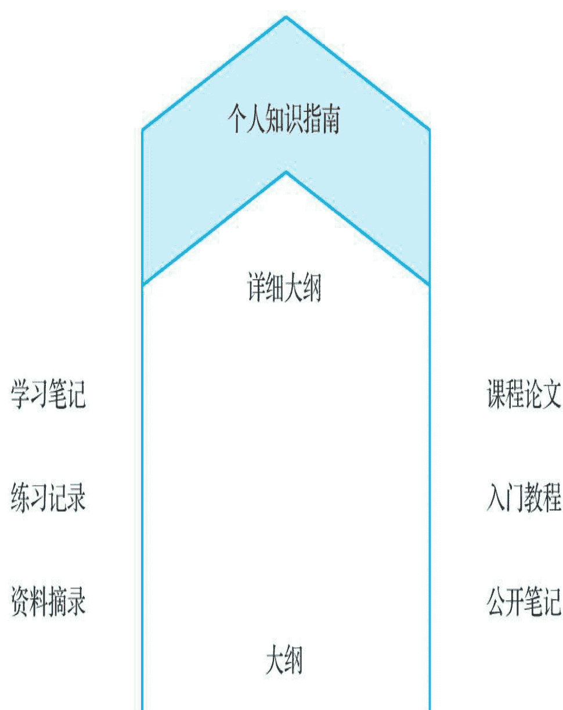
个人知识指南
详细大纲
学习笔记
课程论文

打造你的个人知识地图

学习时产生的文字可以分两类来看。自己留着用的和对外发布的。自己留着用的有练习记录、资料摘录、读书笔记；对外可见的有公开笔记、入门教程、课程论文、实践报告、工作汇报、正式文章、行业小册子、演讲稿、学术论文和专著。

图10-1 学习时我们写下来的各种主要形式

图10-1的中间带是大纲、详细大纲和个人知识指南，左右两侧分别是只给自己看和愿意公开的内容。

只给自己看的材料通常很随意：练习记录、摘录、笔记，甚至把一本书转成PPT、自己手绘的图、重新编的讲义和课本。给别人看的材料则要更规范：公开分享的笔记、写的入门教程、被布置的课程论文，学习场景之外还有实践报告和工作汇报。走得更远的话，会出现正式发表的文章、业内流传的小册子、演讲稿、学术论文和专著。

常有人问：个人知识指南和课程论文是不是一回事。课程论文的英文是 essay。无论是中小学作文还是大学研究生的课程作业，基本要求都一样：把自己对某个主题的理解用准确、清晰的语言写出来，形成见解。

个人知识指南也要求深入理解，但写法上我们建议换一种路径：不要写成散文，而是写成重点突出的大纲和列表。两者的差别主要在三点：

1. 课程论文锁定一个具体问题，要求给出独特的答案。个人知识指南更像综述，把一个主题领域里学到的东西系统梳理，形成自己的知识体系。
2. 课程论文是标准的文章，由句子和段落构成。个人知识指南为了提高效率，推荐用大纲和列表快速搭建结构，更符合学习的节奏。
3. 课程论文没有明确读者，老师会看但并非目标读者。个人知识指南通常是写给自己的，读者假设很清楚。

课程论文的写作功力对做个人知识指南很有帮助，后面会具体借鉴。

编写个人知识指南是基于详细大纲再往前一步。随着学习推进，最初的大纲会累积大量信息和心得，需要把它整理成更有层次的大纲，并配上要点，详略得当。形象地说，它像一座金字塔，如图10-2所示。

我们要让别人也能看懂个人知识指南，并以此为标准回头打磨详细大纲。笔记往往只有自己能懂，可读性低就无法获得外部反馈。


图10-2 个人知识指南的金字塔结构

仔细找找，你会发现详细大纲很难在笔记本里完整找到，它多半以模糊的状态分散各处。把个人知识指南写出来，就是把隐性知识变成显性知识，这是知识管理的核心。

学一个主题，从复制别人的知识结构开始，我们带着层级大纲一路学习。个人知识指南是学习结束时的知识版图，是更完整、更清晰的层级大纲，别人也能轻松读懂。

它虽然是详细大纲的升级，但不是简单整理笔记。写得认真时，零散知识点会聚成块，写作中会冒出新想法，理解也会深化。日本作家松浦弥太郎说过：书写即思考，把脑中漂浮的模糊感觉变成语言，写出来就能看见更多。

主题学习收尾时，花几个小时甚至几天集中写个人知识指南，投入产出比最高。当然也要灵活安排，如果直接目标是考试，就应该放在考前完成。

一段时间后你会问自己凭什么认为学透了。写下的个人知识指南就是证据。

## 个人知识指南的参考样式

桥水基金创始人瑞·达利欧的《原则》是全球畅销书。他说一生最重要的收获是以原则为基础的生活方式。书中列出了五百多条原则，核心部分早在出版前就以PDF清单在华尔街流传，也被翻译成中文学习。正式出版的版本是在清单上增加了故事。流传的原则清单

### 1.10 站在更高处观察机器

- 把自己想象成大机器里的小机器，并有能力改造它以获得更好结果。
- 对比结果与目标，就能判断如何改进机器。
- 区分作为设计者的自己和作为执行者的自己。
- 大多数人最大的失误是对自己和他人缺乏客观认识，反复栽在弱点上。
- 成功者能跳脱自身，客观看待并管理事物以促成改变。
- 在不擅长的领域请教擅长的人，这是必须培养的能力，能建立安全护栏。
- 客观认识自己很难，需要借助他人意见和全部证据。
- 头脑开放且有决心，几乎能实现任何愿望。

类似的清单并不少见。被《如何阅读一本书》熟知的教育家莫提默·艾德勒在《如何听如何说》里给出了自己的做法。他讨论正式授课时讲稿的写法，一端是只写提纲或关键词，另一端是把每句话都写出来的逐字稿。逐字稿用于口语，稍作调整即可变成文章。

艾德勒建议写逐字稿，称之为详尽书稿式草稿，也提出折中做法：大纲提要式。把正式文稿改成大纲排版，写下每句话但以层级呈现。该书附录展示了他的大纲讲稿片段，节选自“人、其他动物与智能机器”中的图灵测试讨论第四部分：

（四）人类与高级哺乳动物各有两种先天禀赋。

（1）第一种可称为程序化，借自计算机术语。

（a）程序化禀赋指动物对刺激做出确定预设反应。
（b）本能行为极精细的昆虫，此禀赋程度很高。
（c）高等哺乳动物比昆虫少。
（d）人类最少，严格说没有本能，只有少数脊髓和脑干反射。

（2）第二种是依赖学习和习惯养成的非确定性能力，出生时不确定，通过学习固化。

（a）高等哺乳动物天生具备并能学习养成习惯，宠物训练是明证。
（b）人类程度最高，是优秀的学习者，行为很大程度上由学习决定。
（c）因此婴儿天生可学会所有语言，并不指向某一种。人类也天生能思考所有可思考之事。

我们做个人知识指南的做法很大程度上借鉴艾德勒并做了简化。可以设想你要用口头报告向他人陈述所学，并以大纲形式写下。为降低难度，可以保证知识体系的完整性，但只展开重点条目，非重点不展开，查得到的信息也不必全部纳入。

### 把文章和大纲互相转换的小技巧

文章由段落组成，大纲是把段落句子变成层级条目。

阅读时若抓不住结构，可把一段文字复制进来改成层级大纲，结构立刻清晰。写作时先写一段，再把每句拆开变成大纲条目，调整关系后再合成文章。演讲时用大纲讲稿便于把握整体，下发材料时再转成正式文章。

再看一个整体结构的例子。假设学习目标是优化课程论文写作。加拿大心理学家乔丹·彼得森写过《课程论文写作指南》。作为心理学家，他重视书写对心理发展的意义，开发了自我书写方法论。聚焦课程论文，我们把他的英文原文整理成层级列表，作为一次小型主题学习的个人知识指南。

## 用写作训练清晰思考的十步法

以下是对彼得森《课程论文写作指南》的意译摘录，文中 essay 指课程论文。

### 第一部分：引言

- 写作的核心作用是让作者形成并组织关于重要事物的连贯见解。
- 写作扩展记忆，提供编辑思考的工具，让思考更清晰，可移动和重排文字。
- 口头思维很抽象，通过写作会发展出有序、扎实、确定的思维。
- 技术建议：用电脑写，最好双屏，一屏资料一屏写作。
- 时间建议：不要等到大块空闲才开始。
- 提醒：完成比完美重要，先交出来再说。

### 第二部分：分辨率层次

- 文章可在多层分辨率下检验，各层都要成立。
- 第1至3层为词选、句构、句在段中的排列。
- 第4层为段落按逻辑顺序从头到尾排列。
- 第5层为整体审视文章。
- 文章外还有读者为第6层，读者所在的文化为第7层。

### 第三部分：主题与阅读清单

- 文章要回答的中心问题即主题问题。
- 列出10个候选问题后选定主题。
- 阅读量估计：1000词的文章需阅读5至10本书。

### 第四部分：大纲

- 写下写作目标和字数要求，建议比预期多25%。
- 写大纲是最难也不可跳过的步骤。
- 1000字文章需要约10句的大纲，一级大纲不超过15句。
- 草拟引言和结论，写作过程中可能被废弃。

### 第五部分：段落

- 为每个大纲条目写10至15句。
- 把生成与编辑分开，先写完初稿再编辑。
- 生成的任务是写出来，编辑的任务是简化与组织，不要边写边改。

### 第六部分：段内句子的编辑与排序

- 复制段落，把每句单独成行。
- 重写每一句。
- 检查句子顺序是否最优。
- 删除冗余句子。
- 用新段落替换旧段落。

### 第七部分：段落重排

- 尝试重新排序段落。
- 相应调整大纲。

### 第八部分：重写大纲

- 完成初稿、润色句子、重排段落后还未完成。要把B级提到A级：
- 读完文章后关闭文档。
- 不看原文，用10至15句重写大纲。
- 记忆会过滤无用信息，保留并重组关键内容。
- 按新大纲从初稿摘取材料重写。
- 敢于丢弃不必要材料，只留必要部分。

### 第九部分：重复

- 重复第六至第八部分。
- 直到无法再改进才算完成。

### 第十部分：参考文献与书目

- 参见规范书写要求，从略。

四小时完成这个小主题收获很大。回头看列表能看出重视点：摘录是新信息，主题问题、大纲、笔记是已知信息，重排句子与重写大纲是彼得森的新做法。重写大纲的价值尤其大，能让文章从B升到A。

接下来轮到你把自己的大纲、笔记和想法写出来。你已有了大纲，现在做的正是重写大纲。

## 编写个人知识指南的建议

个人知识指南是对主题所学知识的梳理，是写给自己的总结。写作过程本身也是学习。主体应是知识点而非学习过程记录或感悟。你可能觉得自己没资格总结，恰恰相反，写总结是通往高手的路径之一。

最佳时机是现在，学习刚结束你理解较深但新鲜感仍在，容易平实记录，也会写下错误，这些错误是难得的学习机会。

### 用列表的方式写

建议采用层级大纲，以列表形式呈现。一般分三级：第一级子主题，第二级知识点，第三级对知识点的具体展开。要能完整反映该领域知识体系。

列表利于快速梳理和组块，组块加深理解，便于回顾应用。可以把子主题下的知识点按时序或关键要素组织，重要点用有序列表详细展开，让它在文档中更突出。

每个条目应是完整句子，而非几个词。通常包含主题句和解释句。避免用PPT或思维导图软件，它们容易诱导只写关键词，图形化好看却有假象。用文档软件写下完整句子，内容才显得扎实。

### 保持简洁，避免造轮子

写个人知识指南要避开三类问题：

- 避免过度引用。私人笔记多用自己的话理解，避免句句求出处。
- 不要重复造轮子。已被广泛使用的做法直接摘录即可，个人知识指南不追求独创，记录前人总结更高效。
- 少讲故事。把个人知识指南写成口述自传是失败尝试，专业知识难以有效记录。风格应更像安装说明书或技术文档。实在想写故事，就写完整的故事而非零散举例。

### 四种快速获得初稿的方法

- 直接倒出来。先在纸上写下想到关键词，再用电脑列表记录，整理出一级条目后补全二级三级，初稿很快成形。
- 用问答写。写不出时可请人提问，立即回答后整理录音或文字对话。也可用AI提问辅助。
- 用分享写。有分享机会就争取，分享压力会推动梳理，录音整理后即成初稿。
- 讲一次课。一次45分钟以上的正式授课承诺会倒逼你梳理、准备课件和演练，产出相对完善的初稿。

### 持续迭代，保持好奇

有了雏形之后，后续的工作就显得顺手很多——不断打磨才是核心。只要给足够的时间投入，总能把稿子改到自己满意的程度。关键是要先给自己一个硬 deadline，在这个期限前务必把个人知识指南的 1.0 版交付出来。

别想着一次做到完美，1.0 只是起点。它可以像软件一样一路往上迭代，2.0、3.0……一直到 99.0，保持持续更新和修正的节奏。

持续修订个人知识指南还有一个特别的价值。在动笔写作时，我们会努力求证让内容立得住；但在回头修改时，我们会带着怀疑的眼光再审视：这里是不是有问题？放到当下还成立吗？

每一份指南的末尾，建议都加上同一句自警：“我说的都是错的。” 这是为了对抗一个常见的认知惯性：一旦我们把想法整理得条理清晰，就很容易默认它就是正确的。要破除这个偏差，可以对照后面讲到的麦哲伦故事来思考。

## 六步法打造个人知识指南

下面是一套可操作的编写路径。

### 第一步：锁定主题边界
- 回看正在学习的领域，重新划清范围。
- 选定核心词，给出标题：关于______的完整指南。把主题词填入空格，建议统一用“关于××主题的完全指南”来命名。
- 提炼一个核心问题：______？ 例如：如何学透一个主题？
- 先写一句试探性答案：______。 例如：以知识体系串联输入输出，强调深度阅读与持续写作，用输出倒逼理解的穿透学习法。
- 决定写作工具与呈现形式，并为 1.0 版设定完成时间。
- 设想一个具体读者，最好是身边的一位朋友，把这份指南当作写给他的信。

### 第二步：搭建一级框架
- 罗列可以进入一级框架的要点。
- 从中挑出约 7 个作为一级条目。
- 为每个一级条目写下主题句，再配上简短解释。
- 思考条目间的逻辑关联，可用图示帮助自己整体把握与记忆。

### 第三步：填充二级与三级条目
- 为每个一级条目补充二级条目。
- 再为二级条目补充三级条目，常为列举、步骤、案例、公式等，操作类内容用有序列表呈现。
- 第一遍只写各条目的主题句，不展开说明。
- 第二遍根据需要为部分主题句补充解释文字。
- 把三级条目折叠起来，调整一级和二级的顺序与关系。
- 以内容为视角审视各层级，优化表达的准确度。

### 第四步：切换到读者视角编辑
- 重新排列一级与二级的顺序，让目标读者更容易理解。
- 调整用词与表达方式，提升可读性。
- 站在读者立场，补充遗漏的必要条目。
- 精修全部条目的文字表述。

### 第五步：做压力测试
- 抽取部分一级或二级条目，用费曼技巧尝试向他人讲解。
- 自问缺失：有哪些关键知识点还没纳入？
- 自问滞后：哪些知识点已变化但还没更新？
- 自问谬误：以现在认知看，哪些条目可能有错？
- 自问取舍：哪些内容显而易见可精简或删除？哪些内容需要放大、再放大？
- 循环回到第二步到第五步，反复打磨。

### 第六步：定稿与持续迭代
- 精减条目数量，压缩每个条目的篇幅。
- 变换呈现格式，比如打印出来、导出 PDF、放到手机上阅读，检查逻辑漏洞与文字错漏。
- 用有仪式感的方式发布首个正式版本，例如发送给他人或打印留存。
- 发布之后仍要持续迭代与编辑。

### 小技巧：让知识指南持续进化
迭代编辑时可用的写作习惯：
- 打印出来用笔手写修订，屏幕外的视角会带来不同发现。
- 主动发布文档，看似是结束，实则会倒逼你继续完善。
- 用文档当讲稿，做一次主题分享。
- 把文档按问题与结论、大纲、段落等不同粒度交给 AI，请它给出意见。

总的来说，个人知识指南是穿透学习法的闭环动作。没有它，学习收获会大幅缩水。如果你用了本书的其他方法，却在主题学习结束时没有写一份指南，效果就会打折。

## 大师课：麦哲伦的环球航行——别把认知看得太重

很多人常说认知最重要，学习就是为了提升认知，有了正确认知和清晰计划就能成事。我不完全赞同，也很难给出有力的反驳。认知和计划当然有用，面对已经被走通的路，借鉴经验可以走捷径；但面对从未有人走过的路，在成败之前，如何判断认知和计划是对是错？

我想用一个对我影响很大的故事来说明：要重视认知，但不要高估认知。知识体系比认知更重要，在这个故事里你会看到比两者都更关键的因素。

这是麦哲伦的故事。哥伦布发现了美洲新大陆，麦哲伦则是第一位完成环球航行的人。从地球某点出发绕行一周回到原点。此后“地球是圆的”不再只是理论推演，而是被亲身验证。从此人类确信存在一条可环行地球的航线。

我了解的这次首次环球航行主要来自作家斯蒂芬·茨威格的叙述。茨威格的《麦哲伦传》是我最爱读的书之一，遇到庞大、困难、周期长的工作时，我总会在间隙反复重读。茨威格呈现了未知事物的复杂性，并给出很多深刻点评。

麦哲伦的航行计划是：从欧洲出发经大西洋，穿越美洲的某海峡进入太平洋，再前往亚洲的香料群岛，最后返航欧洲。

出发时，他唯一确信的是地球是圆的可以航行绕圈，其余认知几乎全错：地图错了，数据错了，航线计算错了，对时间和物资的预估也严重失准。

出发前他也做了很多准备：在印度和非洲服役，离开葡萄牙获得西班牙国王资助，自己是老练船长，还招募了经验丰富的船员和船长。但五艘船进入大洋后，现实并未按计划进行。

麦哲伦找不到探险家口中的海峡。他自己算过海峡位置，却对它判断严重失误。有一次船队望见一片开阔水面，误以为是梦寐以求的海峡。派去的三艘小船回来回报令人失望：那只是条较大的淡水河。

此时麦哲伦几乎绝望。他不得不承认手上的地图与计划完全不符，前人认为存在的海峡并不靠谱，环球航行的信息、地图学家的路线都错了。但他必须把一切掩盖。茨威格评价道：“不能让任何船长和船员看出，这个失望对他的信心造成了多么可怕的打击。”

船队在寒冷环境中寻找了九个多月。航行中发生团队哗变，甚至有人在胜利在望时叛逃；麦哲伦是葡萄牙人，却率领西班牙国王的船队，互不信任始终笼罩。茨威格说：“一年里，他一无所成、一无所见、一无所得。”

幸运的是，在接近南极的海域找到了后来被称作麦哲伦海峡的水道，穿过它进入太平洋。最终麦哲伦“成功”完成了人类首次环球航行。注意我给“成功”加了引号——船队完成了壮举，但在接近香料群岛前，麦哲伦在菲律宾群岛被当地土著的毒箭射中身亡。

我很想说环球航行是认知和计划的产物，事实却是行动与坚韧起的作用更大。茨威格写道：“一切真正有创造性的事业要得以完成，都必须由创造者自己坚持不懈地去实现。”

他还写道：“只有一心一意献身于暂时的迷误，他才发现了颠扑不破的真理。”探索未知时常带着暂时的迷误，在实现前无法证伪。

当年我在一项漫长技术项目中反复读《麦哲伦传》。把麦哲伦的历程与自身工作对照，我不断自问：我们手上的假想地图是不是也错了？对项目的预测是不是离谱？直到出差酒店房间对着大海，我又完整读了最后两遍。

麦哲伦的故事提醒我们，以为有了认知就能达成目标，是过于简单且脱离现实的假设。很多人以为学习就是掌握已证实知识，实际上学习是探索未知，越深入越能看到更大的未知。学透意味着跨越已知与未知的边界，抵达知识前沿。

## 本章核心要点
- 可把编写“个人知识指南”作为一次主题学习的收官动作。从大纲到详细大纲再到个人知识指南，形成对该主题知识体系的完整记录。这是穿透学习法的重要一环，没有它学习无法闭环。
- 编写建议：①用列表形式写作；②保持简洁，避免重复造轮子；③四种方法快速写出初稿；④持续迭代，保持怀疑。可参考“编写个人知识指南的六步”实践。

> ‘现在就行动吧！’

- 请马上动手写一份关于“穿透学习法”的个人知识指南。简化做法：写下从本书中学到的 7 个新理念或新方法；再写下你认为有效的 7 个学习理念与方法。
- 你过去一年持续学习的一个主题是什么？按“六步法”为它写一份完全指南。

## 第十一章 用吸附框架搭建认知体系

我们不妨自问：在数百次大大小小的主题学习中，最宝贵的经验是什么？

吸附。

当一个主题领域建立起知识体系，也就是有了主干与主枝的知识框架后，新知识就有了可附着的地方。

一次主题学习的流程大致相同。起于一个待解问题，获取知识与信息，借用一个知识大纲。继续学习掌握更多知识技能，在练习中熟练，并向外拓展。最后，有机会就把所学传授他人。这样循环往复，主题掌握会越来越深。

学习中，各类知识被大纲吸纳并附着其上。随着推进，最初照搬的大纲已面目全非。我们不断修正，并在知识点间建立新连接，它最终变成独属于自己的大纲。你一定经历过这种“吸附”体验：发现过去未察觉的关联，唤醒以为遗忘的技能，迸发新想法……

我们把这个学习过程称为“吸附框架”，如图11-1所示。本章探讨这一思维模型，并说明如何用它建立学习系统。学习是实践智慧，好的框架有助于形成更好的实践智慧。

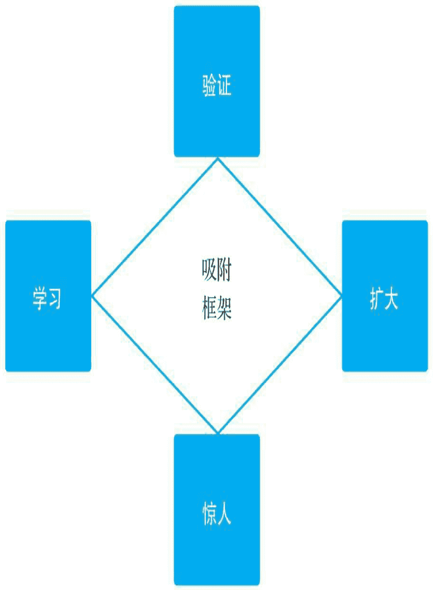

图11-1 吸附框架：学习—验证—扩大—惊人

本章还将给出吸附框架中常用的七种技巧。部分技巧在前文已有涉及，这里将其集中呈现。

## 吸附框架四步：学习、验证、扩大、惊人

如图11-1所示，吸附框架包含四个步骤：学习—验证—扩大—惊人。适用于知识、工具、技能三种学习。小圈循环与大圈循环并存，先看小圈，再看大圈。

小圈。

学习，即狭义的学习。穿透学习法建议先复制一个知识大纲，再用深度复制五步、冲刺读书法等打好基础。

验证。学知识时对已学知识点做测验以确认掌握程度；学工具或技能时通过实操了解真实水平。验证后进入扩大。

扩大，即在验证的基础上进一步加深扩展。学工具技能就是持续练习达到熟练并实际应用。可以理解为把已钻的“孔”越钻越大。

惊人，即展示成果或实际应用带来的成效。对应费曼技巧中的向他人讲解。理想状态下，学习成果会让他人感到惊讶。因此虽动作是展示，但我们按效果命名为惊人。

“惊人”不是终点，我们会一圈圈循环，直至全面掌握主题。

大圈。

从整体看一次主题学习，会看到类似又略有不同的图景。小圈是努力“吸收”，大圈则是新信息主动“附着”。

学习。建立该主题的知识体系，像一个衣柜，有格子、有喜欢的衣服、也有不合适的衣服。

验证。把学到的知识在实践中检验，保留有效部分，剔除无效部分，并把某些方法改造成自己的版本。

扩大。梳理所学，将重点部分扩大深化。穿透学习法中，编写个人知识指南就是扩大的体现。

惊人。尝试把自己的知识体系教给别人。可采取的方法：为知识点赋予鲜明形象、补充生动案例或故事、绘制精美图表、练习用易懂方式讲解。

穿透学习法认为主题学习是多次循环与快速循环的叠加，通过各种方法把外部知识转化为自己的知识。

## 列表：将外部知识内化为自己的清单
穿透学习法的各种方法与技巧都旨在帮助把外部知识转为自己的知识。综合来看可采用以下做法，以 1~5 星衡量深度：
- 标记、摘录、做笔记、写摘要、复制大纲，为 1 星。
- 整理摘录与笔记，将知识点整理成列表，为 2 星。
- 重绘图示和图表，为 2 星。
- 完整应用费曼技巧，为他人讲解并弥补差距，为 3 星。
- 采用文档、PPT 等格式全面重制课本并增补新内容，为 3 星。
- 采用公开学习方法，在网上持续分享学习笔记，为 3 星。
- 按照资料中的步骤，照着实例实际去做，为 3 星。
- 根据自身具体情况改造学到的方法并书面化，为 3 星。
- 在一个主题领域编写个人知识指南梳理总结所学，为 3 星。
- 将所学投入实践并获得成效，为 4 星。
- 将所学转化为自得的作品，为 4 星。
- 将所学转化为对他人有价值的产品，为 5 星。
- 将所学投入实际应用并取得优秀成效，为 5 星。
- 做出被同行认可的知识贡献如新数据、纠正错误、新观点等，为 5 星。

吸附框架是本书前文方法的骨架，前文方法是有血有肉的，吸附框架则是 X 光片下的骨架。各种方法各有侧重地聚焦框架的特定步骤。例如深度复制五步、冲刺读书法聚焦学习；编写个人知识指南的思路是扩大，把知识点连接成更大整体。相对而言，本书方法更侧重学习与扩大，而验证与惊人着墨较少。实际学习中后两者应投入至少同等时间，因篇幅限制才有所取舍。

## 吸附框架配套的七大技巧

### 1. 用思维导图梳理和呈现
思维导图是多用途的强力工具。极简版通常包含中心主题、分支主题、子主题，主要用层级架构梳理与呈现信息。可用的建议：
- 用思维导图把知识点组织成层级大纲，最多不超过四层。若层级过多，可为子主题新建独立导图。
- 建议只用极简格式，不采用其他图示形式。
- 通过拖动条目调整关系。为方便修改迭代，建议用电脑而非纸笔制作。
- 可多视角查看：展开全部、只看一二级聚焦主脉、折叠其他只看分支。

在本书学习方法中，思维导图可用于复制与迭代知识大纲、读书时做层级摘录、编写个人知识指南时做思路梳理。

### 2. 写子弹式列表
记录笔记和起草写作时，多用子弹式列表。列表无处不在，是现代人合适的书写与表达方式。可方便在列表与段落间转换。

列表的优势是，写者梳理思路更方便，读者获取信息更快。列表能更快写下想法，也更方便检查修订。

列表可分为无序列表与有序列表。我更喜欢按用途分为三类：
- 简单清单列表，目标是清晰呈现清单。
- 解释性列表，由主题句加后续解释构成。
- 多层级列表，分成多个层级。

多层级列表与思维导图可相互替代，各有优劣。思维导图可折叠查看、方便拖拽、图形化；文字列表不需特定软件，可直接用文本书写与使用。

在本书学习方法中，列表可用于知识大纲、快速记录和编写个人知识指南。

### 3. 运用“一页纸魔法”
A4 纸在学习中随处可见。本文特指巧用一页 A4 纸辅助学习的方法。

核心思路是把所有内容压缩在一页 A4 纸内，绝对不用第二页。你要压缩信息、调整版式，让全部信息在一页呈现。为压缩内容可能缩小字体，但字必须保证轻松阅读。

这页纸内容要简洁明快，一目了然就能抓主干。因此要设大标题，分成数个明确板块，每个板块有小标题。用思维导图、表格、列表、检查清单等形式呈现，比段落式文章更有效。

学习时最方便的掌控工具，往往就是随手放在桌边的一张纸。它能让你在做题、阅读的过程中时刻看到全貌，不至于迷失方向。纸上可以直接圈画、记下提醒、划掉已过时的条目、补充新的发现，梳理完后再誊入电脑，标注为V2等版本，打印出来继续使用。

书里提到的“一页纸魔法”既能构建知识骨架，也能配合冲刺学习和冲刺阅读的节奏，同时还能帮忙规划时间、追踪进度。

### 4. 把知识点画成图
文字加图形一起呈现，流程和关联会更清楚，也更容易留在记忆里。真正使用知识时，画面感往往比单纯的文字更牢固，尤其适合拆解单个知识点的细节。可这样操作：

- 先临摹再深入观察。把原图的方框、连线、标注亲手描一遍，观察就会细很多，比单纯看效果更好。
- 临摹后做改造。删掉无关信息，按自己的需求增添元素、改写说明，再依自己理解重新布局。
- 自己动手创作。若教材里某些内容图示后更易懂，就尝试自画。美观其次，逻辑通顺、信息准确才是重点。
- 大胆下笔、反复优化。画图时要像站在白板前一样放开，手绘未必完美，正是多次迭代的过程。

作图不必依赖专业工具，纸笔画完拍照存档即可，也可以用PowerPoint、WPS、Keynote等办公软件，或平板加触控笔。

学习图不用追求精美，能清晰传达信息就好。别花太多时间做复杂的信息图，也别像做彩色手账那样精雕细琢。

另外，命名本身也是一种可视化。给知识点起个名字，就等于赋予它具体形象。所以列清单、画图后，不妨思考命名。个小窍门是借用人名来形象化，比如书里举的“乔布斯的自行车”“费曼的空白笔记本”。

### 5. 用文字沉淀所学
写作是把想法变成可留存的文字。它不只是抄笔记、写作业或写论文，更是用自己的语言把学到的内容整理成通顺完整的表达，是各种方法的底层动作：

- 德鲁克的书面对照法中，先写下预期成果，完成后再对照，避免目标在过程中悄悄被改写。
- 用费曼技巧时，可把讲解过程先写成清单，修改后再据此重新讲解。
- 公开练习时，可把所学写成笔记发布到网上。
- 学习中会产生新信息、新观点，用自己的话记录下来才能真正内化。写下来有时也能帮你把不合适的想法清除出脑袋。
- 为某个主题写一份个人知识指南，用多层级清单记录所学并持续更新。

写作的价值很直观。很多人会遇到“斐德洛的砖”这种困境：被要求用500字描述小镇时无从下手，却能在“从左上角那块砖开始写起”的提示下思路爆发。可尝试以下方法提升写作力：

- 先列简要清单。时间紧也能快速列要点，后续再扩展成带解释的详细清单。
- 快写慢改。集中时间快速写出初稿，再慢慢反复修改。
- 写完整的片段。选一个具体的小主题完整写出，而不是只记零散清单或随想。
- 用纯文字写。尽量避免做成图文并茂的PPT。纯文字可在纸上记录，也能随时用手机备忘录。
- 借助新工具写作。习惯口述的人可把想法录成语音备忘录，再转文字，让AI整理成清单或文章。
- 借助新工具修改。比如让AI分析草稿并给出修改建议。

### 6. 通过教学深化理解
把学到的内容教给别人的方式很多：讲解、演示、写博客、录视频、做分享演讲、真正上一次课等。教学不仅是输出，还能带来两个收获：教的人会更严谨地审视自己的理解；有了明确听众，讲述会更聚焦。

问题是去哪里找“别人”。可以这样做：

- 自我教学。你会耐心听自己的话，是个好学生。可进一步教给“过去还不了解这个知识的自己”，或“将来会遗忘的自己”。
- 教小黄鸭。程序员常说的技巧就是对着洗澡用的小黄鸭讲解，你可以想象它在点头。教小狗、泰迪熊、凯蒂猫也一样。
- 教同学或伙伴。先在某个细小主题上做到真正熟练，再热情地教给同伴，尝到甜头后会有动力继续深挖。
- 教网上的陌生人。网上有很多对该主题感兴趣但不了解的人，可以写介绍文章或教程、录讲解视频来教他们。
- 教AI聊天机器人。把AI设成学生，你来讲，然后问“这儿明白了吗”。也可以让它故意答错，自己作为老师来评判。

“用教来学”的实用建议是：像老师一样认真准备讲义，讲之前至少列出一份比较详细的清单。

### 7. 找到属于你的学习偏好
本书介绍的方法可能有一半人觉得很契合，另一半人觉得不太合适。如果你属于后者，坚持读到这里也已足够，你了解了一类侧重深度阅读与写作、善用新技术工具的结构化学习方法。穿透学习法以知识大纲为抓手，让一次主题学习快速、轻松地达成目标。

最重要的学习技巧是：认识到最适合自己的方式，并配出合适的工具组合。可以拿张纸先回答以下问题，可自行补充：
- 我的内在学习驱动力是什么？

## 本章要点
- 穿透学习法的“吸附框架”由四个步骤循环构成：学习—验证—扩大—惊人。
- 可用于吸附框架的7个实用技巧是：①用思维导图梳理和呈现；②写子弹式列表；③运用“一页纸魔法”；④将知识点变成图示；⑤写下你所学到的；⑥将你学到的教给别人；⑦识别最适合自己的学习方式。
- 高效学习的一个策略是采用各种方法把“外部的知识变成自己的知识”，真正“占为己有”。本章的“列表”可作参考，后续可加入自己的技巧。
- 同时，请你这样做：在读完这本关于穿透学习法的书后，你已把哪些内容变成自己的了？你打算在未来一年把哪些内容变成自己的？请现在就动手写下这两个清单并分享。

> ‘现在就行动吧！’

1. [注释1](https://example.com)：对后者我想说的是，至少你在尝试了解与你的风格、经验完全不同的学习方法。我们与你一样，也尝试过很多种学习方法，其中有些非常适合自己，有些则完全是浪费时间和精力，最终我们掌握了一些学习方法，并形成了你看到的穿透学习法。希望这组学习方法以及我们探索路上的经验教训能帮到你。

2. [注释2](https://example.com)：这里我们用了知识大纲是“抓手”这个类比。让我们看看皮克斯联合创始人艾德·卡特姆的一个形象化比喻“箱子和把手”：一只老旧而笨重的箱子，箱子上磨损的把手只靠几根线勉强相连。卡特姆指出，很多人会犯一个错误：“我们往往只顾拎起把手就走，却没有意识到箱子被落在了身后。说到底，拎把手要比拎箱子省力多了。”是的，虽然穿透式学习法强调知识体系，但我们要的不是“把手”，而是“整个箱子”。

## 附录

### 穿透学习法青少版
青少年也能运用穿透学习法的各种方法，快速、集中、学透一个主题，并可用于学科课程、兴趣知识、技能学习、工具使用等场景。

#### 1. 制作费曼空白笔记本
针对学习主题，用费曼空白笔记本法做一本“空白书”。准备一本64页的薄本，封面写标题，第一页写知识大纲作目录，每个一级条目即一章。之后每一页写一个条目名，包含一级、二级、三级。
此处后，用它作为主题学习的索引。可综合费曼技巧与康奈尔笔记法：用费曼技巧做3分钟讲解练习；按康奈尔笔记法把每页分成左侧线索栏、右侧笔记栏、下方总结栏。

#### 2. 用深度复制五步先学懂七成
挑选一段教材作为主材料，目标是把握知识框架并理解约70%的要点。预期产出是能重组内容并用自己的语言讲解。
- 精读：逐字逐页仔细阅读。
- 重做：复现教材中的推导、推理与公式。
- 重制：重新绘制教材中的图示与图表。
- 重编：把内容拆分为若干模块，每个模块对应一个知识点。
- 重讲：用自己的话阐述每个知识点。

#### 3. 用冲刺学习法一周攻克主题
假期可用冲刺学习法在一周内集中攻克一个主题，也借此完成一次完整的学习闭环。
- 周一：整体浏览。大致掌握主题的知识骨架。
- 周二：细部探索。逐项学习各部分，发现感兴趣点。
- 周三：聚焦重点。针对最想深化的部分展开学习。
- 周四：深化理解。做练习或小项目，应用前一天内容。
- 周五：分享反馈。正式向家长或朋友介绍一周成果。

#### 4. 用冲刺读书法速读章节
用冲刺读书法深入阅读一本书的章节。一周内读5遍以上，并完成一篇介绍笔记。
- 第一遍：图文漫步浏览，看标题、粗体字、图片与说明。
- 第二遍：搭建章节大纲，包含一级与二级条目。
- 第三遍：逐字精读，在书上做标记、摘录与笔记。
- 第四遍：针对重点深度阅读，并查阅相关资料。
- 第五遍：整合大纲、标记、摘录、笔记为详细大纲，再据此略读。
最后收起书本，根据详细大纲撰写章节介绍笔记。

#### 5. 学习软件功能并教会他人
任务是掌握一项软件功能，自己会用并教会他人。以把普通文档变幻灯片为例，在飞书文档、Notion等均可实现。以飞书为例：
- 初步了解：切换到演示模式，分文档模式与幻灯片模式。
- 尝试使用：标题会自动分页，试着添加标题看演示效果。
- 实际运用：找一篇文章或资料，切分知识点、配图，使其像幻灯片般演示。
- 传授他人：写下操作步骤，配截图，把方法教给同学。

#### 6. 通过向AI提问来学习
学习使用基于大语言模型的AI工具，了解其原理，并学会借助提问学习。注意提问需配合资料阅读与搜索引擎，并核查回答准确性。可这样问：
- 请为我解释一个概念。
- 请指出如下内容中的错误。
- 就这道题与答案，请给出更好的解法。
- 就××主题，请出一道题考考我。
- 现有一个想法如下……请给出五个新的创意。

#### 7. 用AI当刻意练习导师
刻意练习包含专注、反馈、纠正三个要素。例如像富兰克林那样改进写作：专注阅读一篇优秀文章，再自己重写，对比差距并改进。
可用AI助手当一对一导师。以练习英语会话为例：
- 让AI提问，你回答，继续对话。
- 让AI指出错误或更好的说法，你再练习。
- 让AI识别不足并提出针对性问题，反复练习。

#### 8. 用批判性思维框架提问
面对一个观点，可用以下检查清单提出好问题：
1. 论题：讨论主题是什么？
2. 结论：结论是什么？
3. 理由：为什么这样说？
4. 词义：关键术语是什么？
5. 假设：这个回答假设了什么？
6. 论证：如何支撑结论？
7. 证据：用哪些事实或数据支撑？
8. 替代原因：是否还有其他解释？
9. 数据：数据来源何处，可靠吗？
10. 是否遗漏信息：是否有重要信息未考虑？
11. 是否有其他结论：从不同角度看，结论会如何变化？

#### 9. 编写主题个人知识指南
学完主题后，写一份1～2页的个人知识指南，总结所学。步骤如下：
- 写下标题：“关于______的完全指南”。
- 用层级大纲写内容。一级条目为重要知识点，二级为细分，三级包括推导、操作步骤、检查清单等。
- 每个条目包含标题与一句解释。
- 编辑条目，调整逻辑、修改表述，并尝试向他人讲解。
- 在截止日期前完成第1版并分享给同学。

## 后记

### 人人都可以成为学习高手
谷歌与美国国家航空航天局曾联合创办“奇点大学”，每年召集近百位全球顶尖大脑，每个学员要在那里构建一个“影响10亿人生活”的课题，并迈出第一步。

大多数人成不了“天选之子”，但站在巨人肩膀上能看得更远毋庸置疑。如果说ChatGPT是当下最热门的“影响10亿人生活”发明之一，那么借助这一工具把学习效果提升10倍，就显得非常实际且必要。

《重新学会学习：善用AI新工具10倍提效》正是这样一部提升学习效能10倍的攻略。它解决三个问题：我们该怎样通过学习正确参与新一轮科技革命？如何真正用好新技术工具，让学习和工作效果提升10倍？如何把学习所需时间缩短到原来的10%？

我和方军自2003年起神交，他当时主持“思维的乐趣”群体博客，我联合管清友等好友开“经济乌托邦”。2013年在北京同一间办公室工作过一段时间。过去十年，我创业做青少年创新教育，方军则成为新技术的布道者。

我们俩共同的特质是都崇拜物理学家理查德·费曼，都是费曼学习法的深度践行者。现在终于有机会合作，把我们对学习的系统思考和实践案例分享出来。

如果把学习简化为三个境界——学会记忆、学会理解、学会创造——费曼学习法的厉害之处在于，它穿透金字塔，把知识变成见识，让创新成为可能。如果你不断实践费曼学习法，同时借助AI工具，就不只是效能提升或微创新，而是让突破与创造成为必然。

《重新学会学习：善用AI新工具10倍提效》的底层逻辑正在于此：把学习的逻辑与路径梳理成中小学生也能看懂的图谱，让被动学习者有章可循，让主动学习者如鱼得水，更让对学习保有热情或重燃热情的人不断突破与自我超越。

写完本书后，我和方军老师半开玩笑半认真地说，很想穿越回唐朝告诉韩愈，他的“书山有路勤为径，学海无涯苦作舟”激励了无数后人。是的，1000多年后，学习真的可以苦中作乐甚至自得其乐了。

这便是正在发生的未来——人人都可以成为学习高手，甚至轻松成为学习高手。学习变得更有趣，每个人都能找到适合自己的风格与方式。比如中学生或大学生可以让AI用一个个形象比喻解释复杂原理，实现“醍醐灌顶”；成年人可以用最小可行产品MVP这样的熟悉模型，让学习变成一种优势。

有人说这是高估技术力量，我想说这不是核心问题。核心问题是，就像很多人勤劳而不富有一样，为什么很多学生勤奋而不卓越？读完本书，你会发现我们用建设性方式回答了这个问题。

在问题的价值远大于答案的时代，我们用一部简明“学习攻略”，启发你参与重新定义学习。本书颗粒度很细，每一章都很硬核，相信能引发共鸣。

现在，让我们真正开启面向未来的学习，成为“10倍学习效果”的同行者吧！

张华

## 推荐阅读

### 付费：互联网知识经济的兴起
知识工作者正在崛起，知识型人才在开放的互联网世界中找到位置，为你展开互联网知识经济全景大图，解读新物种的商业生态。
方军 著
机械工业出版社
China Machine Press
ISBN：978-7-111-56729-5
定价：59.00元
关于互联网知识付费的首部作品。知识工作正在被重塑，知识经济正在开启互联网时代下半场，为你展现互联网知识经济全景大图，解读新物种的前世今生。荣获CCTV2017年度中国好书。

### 知识产品经理手册（付费产品版）
“2017中国好书”《付费》姊妹书
弄懂知识产品的内在逻辑，掌握一流产品的设计制作过程，提升产品经理的核心技能
方军 著
机械工业出版社
China Machine Press
ISBN：978-7-111-59744-5
定价：59.00元
CCTV2017年度中国好书《付费》姊妹书，每一位知识从业者必备的产品指导书，精准解读知识产品的内在逻辑，快速提升产品经理的核心技能，打造爆款产品的精准方案。

### 穿透式学习
3大穿透式学习思维 | 16个实用指南型工具
告诉你如何快速、高效学习，迅速成长为职场精英
方军
机械工业出版社
China Machine Press
ISBN：978-7-111-64912-0
定价：69.00元
一位互联网时代的资深学习者的经验之谈，3大穿透式学习思维，16个实用指南型工具，告诉你如何快速、高效学习，跨越知识与实践的鸿沟，迅速成长为职场精英。

### 元宇宙超入门
方军 著
一部元宇宙漫游指南
呈现数字经济与生活的未来
“中国好书”奖获得者 重磅新书
- 7大基石
- 4大应用象限
- 一本书读懂元宇宙
全书图解
机械工业出版社
China Machine Press
ISBN：978-7-111-70137-8
定价：69.00元
我们每天都在数字化生活之中。元宇宙，是数字化经济与生活的终极形态。资深互联网观察者、技术专家方军为你解析元宇宙的七大基石，助你赢在第四次数字浪潮。有人想去火星，我们移民去元宇宙。

### 读懂未来前沿趋势

### 一本书读懂碳中和
安永碳中和课题组 著
A Path Guide to Carbon Neutrality
实现碳中和的 4 项关键要素、6 个重点行业、3 大支撑体系、11 个认知误区——
2030 年前碳达峰，2060 年前碳中和
企业减排路线图、产业政策布局、从理念到自觉行动

面向双碳目标的系统性实践参考

出版：China Machine Press
书号：978-7-111-68834-1

### 双重震荡：大国较量走向与全球经济未来

作者 李晓

本书主张，中国应怀揣穿越历史关键关口的决心，修正长期偏重对外作为、相对弱化内部建设的惯性思维，探索以改革驱动开放的新路径，从而实现长效崛起。

DOUBLE SHOCK
The Future of Power Games & The Future of the World Economy

系统拆解 ▶ 美国主导地位 与 美国经济金融主导化
聚焦美元体系运作逻辑及其金融影响力，讨论挑战困局 与 新冷战风险

理性梳理 ▶ 全球化裂变 与 强国升降背后的金融动因
涉及金融创新对国家长期崛起的推动，并梳理中国金融演进 以及 人民币走向国际化的进程

参编：韦森 教授、丁学良 教授、田国强 教授、张宇燕 教授、鞠建东 教授、余淼杰 教授

出版：China Machine Press
书号：978-7-111-70154-5

### ESG 核心全解

作者 安永 ESG 研究团队
A Path Guide to ESG

涵盖战略制定、治理搭建、风险管控、技术创新
涉及人才培育、负责任投资、信息披露、行业案例
为企业勾勒 ESG 落地的完整路径设计，助力达成绿色长效发展

出版：机械工业出版社
书号：978-7-111-75390-2

### 数字化转型路线图

WHY DIGITAL TRANSFORMATIONS FAIL
THE SURPRISING DISCIPLINES OF HOW TO TAKE OFF AND STAY AHEAD

智能商业实践指南

作者 [美] 托尼·萨尔德哈 Tony Saldanha，译者 赵剑波 邓洲

由宝洁全球数字化转型负责人亲笔撰写，凝练三十年一线实践
经验与教训共同沉淀，形成五大阶段 十项准则的 checklist 操作指南
帮助建立体系化认知，有效应对工业4.0 浪潮

出版：China Machine Press

# 数字化转型图谱：智能商业落地手册

作者 [美]托尼·萨尔德哈（Tony Saldanha）

书号：978-7-111-67907-3