# 重构个体：AI 时代如何打造个人竞争力


# **内容简介**

ChatGPT 发布 60 天用户量即突破 1 亿，DeepSeek-R1 则以开源形态将顶尖推理能力转化为公共可用的技术设施——生成式 AI 正以前所未有的速度，从少数人掌握的前沿技术普及为人人可用的基础设施。

当工具不再稀缺时，真正的个人核心竞争力便聚焦于：谁能将 AI 转化为专属的差异化能力。

本书提出核心公式：AI 时代的个人竞争力=人机协作深度×系统设计能力。围绕这一公式，作者构建了 MAPS 四维罗盘，并配套“扫描→设计→对话→部署”四步跑道，为读者提供从认知升级到系统落地的完整行动路径。

全书以主人公 Axton 的成长历程为主线，引导读者完成从“工具使用者”到“架构师”的身份转变：学会用 AI 重构学习与研究模式，掌握提示词工程的核心方法论，设计人机协作的自动化工作流，最终借助 Make 等无代码平台，亲手搭建属于自己的“内容引擎”。

本书并非工具说明书，而是一套穿越技术周期的思维罗盘。无论你是知识工作者、内容创作者，还是希望在 AI 浪潮中构建长期个人竞争力的职场人士，MAPS 四维罗盘都将为你提供一份可落地、可迭代的系统设计蓝图。

# **前言**

**一个视频，开启一个时代**

2022 年 12 月 4 日，我发布了一条关于 ChatGPT 的视频。视频文案由 ChatGPT 撰写，配图由 Midjourney 生成。

就在那一刻，我清晰地意识到：一个新时代已经来临。

此后两年多时间里，我将几乎所有精力投入 AI 领域的学习、实践与教学。我在 YouTube 及其他平台累计收获超 90 万名关注者，发布了数百条 AI 实战教程视频；同时，通过搭建完整的 AI 课程体系，帮助 5000 余名学员系统掌握了 AI 工具的运用与自动化工作流的搭建。

但在这一过程中，我观察到一个令人担忧的现象：许多人陷入“工具焦虑”和“囤积迷思”——囤积了大量 AI 课程，收藏了无数提示词模板，却始终未能真正提升个人竞争力。

问题的根源在于，他们始终停留在“工具使用者”的层面，从未系统性地思考如何将 AI 能力融入自身工作流，构建专属的核心生产力系统。这正是我撰写本书的初衷。

**从“勤奋的低效”说起**

在写这本书之前，我自己也曾深陷一种困境。

作为一名知识类视频创作者，制作一期 10 分钟的深度解读视频，曾需要投入四到五个完整的工作日：前期花费数小时进行选题构思与资料搜集，用一整天将零散的洞察梳理成数千字逐字稿，再耗时数小时为每个论点匹配合适的图片，最后才进入录制、剪辑、添加字幕、发布等环节。

AI 工具出现后，表面上看效率有所提升：我开始用 AI 模型辅助撰写初稿、生成配图、整理资料等——单一任务的效率确实得到改善。但很快，我陷入更深层的困境：工具使用得越多，工作流反而变得越碎片化。上下文需在不同工具间反复复制和粘贴，而真正有价值的经验与方法，仍仅留存于我的脑海中，无法形成可复用的体系。

尽管每日都在使用 AI，但我大多时候仍停留在“工具使用者”的阶段。所有努力都局限于提升单个任务节点的效率，却从未以“系统设计者”的视角，审视并重构整个工作流程。我将这种状态定义为“勤奋的低效”。

那一刻我恍然大悟：真正的焦虑，从不源于“AI 会不会替代我”，而在于“我能否借 AI 之力，完成向真正架构师的升级”。

**DeepSeek 时刻：竞争力的分水岭**

2025 年 1 月，DeepSeek-R1 的发布成为 AI 领域的标志性事件。

它的突破不仅体现在技术层面——关键推理能力媲美顶尖模型，训练成本却大幅降低——更在于它采用完全开源模式，允许任何人研究、使用，甚至商业化。

这一刻，顶尖 AI 能力真正变成人人可用的公共设施。信息差构筑的竞争壁垒轰然倒塌，竞争焦点不可逆转地转向“如何系统性地运用 AI 能力”。

基于此，我提炼出定义 AI 时代个人竞争力的核心公式：

AI 时代的个人竞争力=人机协作深度×系统设计能力

这意味着，个人价值不再仅体现于完成单一任务的速度或质量上，而聚焦于两个核心维度：一是与 AI 协作的深度；二是能否将 AI 能力有机嵌入端到端的工作流，构建可持续运转的人机协作系统。

**MAPS 四维罗盘：予你地图，而非技巧**

为让以上公式具备可训练、可拆解、可实践的特性，我整理出贯穿全书的 MAPS 四维罗盘，将抽象的个人竞争力模型转化为具体的能力框架。

●M（心智，Mindset）：心智决定认知边界与问题视野。核心是树立“AI 共生”思维，重新审视工作本质，从被动的“工具消费者”转变为主动的“系统设计者”。

●A（架构，Architecture）：架构是连接想法与现实的桥梁。它要求我们在动手执行前，先为目标工作流绘制清晰的逻辑蓝图。

●P（提示词，Prompt）：提示词是与 AI 协作的通用语言。它要求我们掌握与 AI 高效沟通的方法，精准表达意图，引导 AI 输出符合预期的结果。

●S（系统，System）：系统是价值闭环的最终形态。它要求我们将前述所有能力固化为可衡量、可迭代的自动化系统，持续创造价值。

书中的主人公 Axton，是我将自身经历提炼后的投射。你将跟随他的脚步，从陷入心智困境到实现认知突破，从架构设计到系统部署，经历一次完整的从“工具使用者”到“架构师”的蜕变。

**请把这本书“写脏”**

关于如何阅读本书，我有一个请求：请把这本书“写脏”。

在空白处写下你的疑问，在图表与练习上标注你的思考，甚至基于 MAPS 四维罗盘的核心原则，创造属于自己的行动框架。当这本书被你的印记填满、变得陈旧时，它才真正完成了使命。

在本书的最后一章，我会邀请你给 2030 年的自己写一封信——这不是一份许愿清单，而是围绕 MAPS 四个维度制定的成长契约。五年后，当你重新打开这个“时间胶囊”时，我希望你看到的，不是“当年担心被 AI 替代的焦虑”，而是一个已经学会与 AI 共生、拥有专属核心系统的人。

面对 AI，很多人容易走向两个极端：要么因担心被取代而焦虑，要么对技术能力盲目崇拜。这两种情绪，本质上都源于同一种思维惰性——将自己置于被动接受者的位置。而 MAPS 四维罗盘的核心，恰恰是引导你主动构建属于自己的竞争力体系。

现在，就让我们正式开启这场 AI 时代的系统构建之旅吧！

### Axton

2026 年 2 月

**第一章** **开启 MAPS 四维罗盘**

**1.1 数字冲击：5 天破百万，60 天破亿**

2022 年 11 月 30 日，这个看似普通的日子，成为人工智能（Artificial Intelligence，AI）发展史上的重要里程碑，甚至可能是人类文明进程中的关键转折点。这一天，OpenAI 公司推出了名为 ChatGPT 的产品。其界面仅是一个简洁的网页对话框，但背后搭载的 GPT-3.5 大语言模型，首次让人类真切感受到与机器进行类人对话的真实体验。

互联网用 7 年时间才积累起 1 亿名真正“上线”的用户，智能手机获取 1 亿名用户花费了 16 个月，而生成式 AI 仅用 60 天就把 1 亿个充满好奇心的大脑吸引到那个简洁的对话框前——这是消费级应用发展史上前所未有的增长速度。

ChatGPT 发布仅 5 天，注册用户量便突破 100 万；两个月后，经保守估计，其月活跃用户量已超 1 亿。作为参照，短视频平台 TikTok 达到同样规模，用了整整 9 个月。

这一增长速度本身已足够令人震撼，但其更深远的意义在于，它标志着一个拐点的到来：生成式 AI 正式走出技术的“象牙塔”，进入大众日常生活，成为一种触手可及的生产力工具。在此之前，尽管 AI 技术已在图像识别、语音助手、推荐算法等专业领域取得显著突破，但对普通大众而言，它仍是一个遥远的概念。人们认知中的 AI，大多源于战胜国际象棋冠军的“深蓝”（Deep Blue），或是击败围棋顶尖棋手的 AlphaGo。这些标志性事件连同科幻电影中倾泻而下的绿色代码雨，共同塑造了一种印象：AI 是遥远、抽象、与普通人生活无关的技术奇观。

ChatGPT 的横空出世，彻底打破了这一局面。它能迅速引发全球热潮，主要得益于两大突破性特质。

其一，前所未有的类人对话体验。借助 ChatGPT 自然流畅、接近人类水平的对话能力，用户无须学习复杂的指令或代码，只需在对话框中输入问题，就能获得逻辑清晰且富有创造力的回答。这种几乎零门槛的交互方式完美封装了其背后庞杂的技术内核，使得人人都能快速上手。

回想过去，撰写求职信、创作诗歌或者编写代码都是颇具挑战性的事情，而现在只需要向 ChatGPT 提出需求，它便能迅速完成任务。更令人惊叹的是，ChatGPT 的回答中还蕴含着情绪与个性。人们第一次直观地感受到 AI 的强大能力，也认识到它不再是一台冰冷的机器。

其二，惊人的通用性。与早期的专用型 AI（如机器翻译、搜索引擎、工厂里的机器人等）不同，ChatGPT 不仅能进行自然对话，还在写作、编程、信息检索、翻译、数据分析等多个领域展现出强大的能力。这种全方位的智能表现，使得无论何种职业或身份的人，几乎都能从中受益。

正是这两大特质，让初次接触 ChatGPT 的用户感到震撼，也在科技界引发强烈反响。自此，生成式 AI 进入飞速发展的新阶段。

这一变革还催生出全新的内容创作模式。例如，2022 年 12 月 4 日，我发布了一条题为“ChatGPT 恐怖的人工智能”的视频，其文案全部由 ChatGPT 撰写，配图由 Midjourney 生成，Midjourney 是一款根据文字描述生成图片的 AI 工具。尽管这不是我制作的第一条 AI 相关视频，却是标志着我真正意识到全新时代已经来临的“啊哈时刻”。

这种震撼迅速转化为全民性关注，并引发了一系列深刻的社会讨论。

●AI 将如何重塑我们的工作和生活方式？

●哪些职业会被 AI 取代？在智能化浪潮中，人类的核心竞争力是什么？

●教育体系应该如何适应 AI 时代的需求？

●我们应如何有效学习并运用 AI，而非被其淘汰？

这些问题不再仅仅是科技界和学术界的议题，而成为社会共同关注的焦点。从政府到企业，从学校到家庭，各行各业都在认真思考 AI 带来的机遇与挑战。这种广泛的关注和参与，恰恰体现了 ChatGPT 的里程碑意义——它真正推动了“AI 平民化”时代的到来，将 AI 从未来愿景转变为触手可及的日常现实。

与此同时，这种广泛的可及性带来的冲击，也迫使我们重新审视个人与技术的关系：当先进能力几乎同步呈现在所有人面前时，竞争的关键就不再是“谁先接触到工具”，而在于谁能更系统、更深入地与 AI 协作。

这也正是本书希望探讨的核心议题。为应对上述挑战，本书提出了一套系统性的行动框架——MAPS 四维罗盘。

**1.2 MAPS 四维罗盘：构建新时代个人竞争力的思维框架**

在 AI 工具日益普及的当下，我们该如何构建并保持自己的核心竞争力，以应对这场席卷全球的智能化浪潮？

要回答这个问题，我们需要一套能系统性指导思考与行动的框架。本书提出的 MAPS 四维罗盘（图 1-1），正是为回应这一需求而设计的。它包含四个核心维度：心智（Mindset）、架构（Architecture）、提示词（Prompt）和系统（System）。

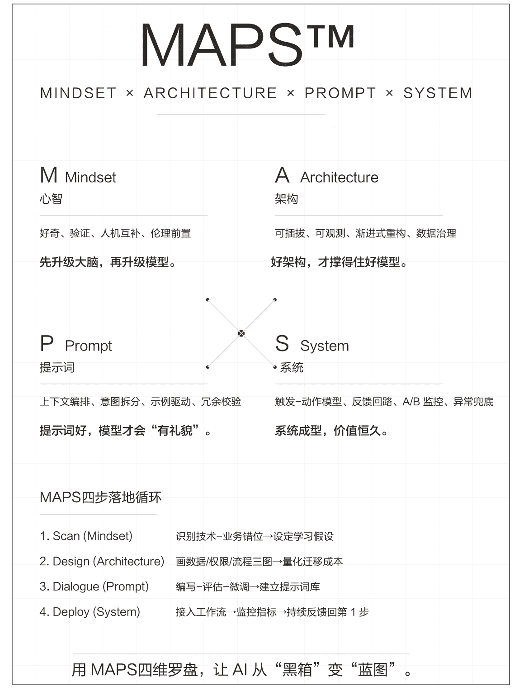

图 1-1

MAPS 既是用于战略定位的“罗盘”，也是指导实践落地的“跑道”。罗盘指明“做什么”（What），跑道规范“怎么做”（How）。这条“跑道”（图 1-2）由扫描（Scan）→设计（Design）→对话（Dialogue）→部署（Deploy）四个步骤构成，形成完整的实践闭环。二者协同作用，确保我们能将抽象思维系统性地转化为具体价值。

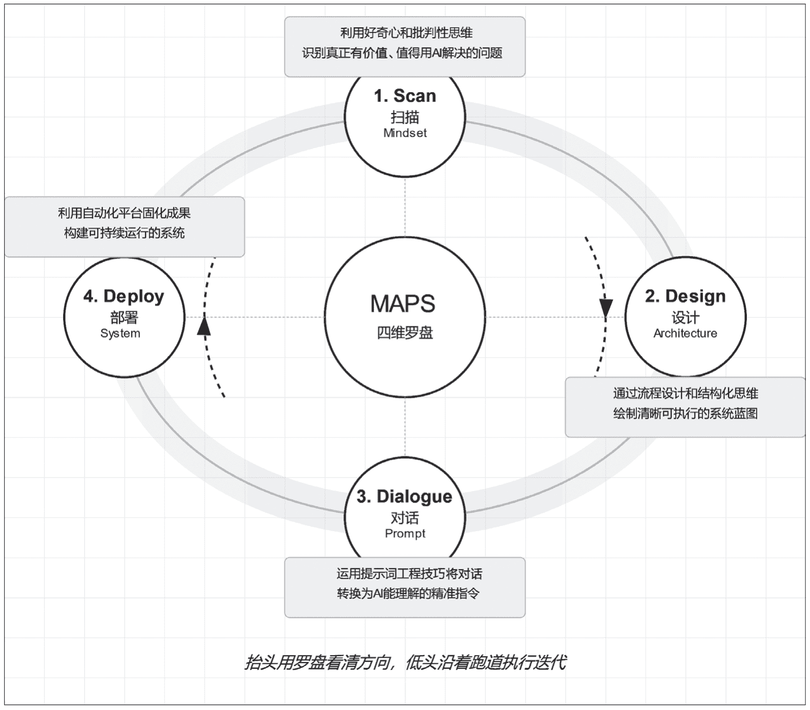

图 1-2

这四个维度将从不同层面帮助你系统提升竞争力：

●M（心智）：作为行动的起点，心智对应跑道的第一步——“扫描”。它要求我们首先完成认知升级，以“与 AI 共生”的视角重新审视世界。只有建立正确的心智，我们才能像精准的雷达一样，从环境中敏锐地“扫描”并识别出真正有价值、值得用 AI 解决的问题。

●A（架构）：架构是连接想法与现实的桥梁，对应跑道的第二步——“设计”。它强调在行动前，先为目标工作流绘制清晰的蓝图。通过合理的架构设计，我们能够构建低耦合、高弹性的个人工作系统，确保其在动态变化的环境中仍保持稳定与高效。

●P（提示词）：提示词是我们与 AI 协作的通用语言，对应跑道的第三步——“对话”。它要求我们掌握与 AI 高效沟通的新方法。通过学习提示词工程，我们能精准表达意图，引导 AI 输出高质量、符合预期的结果，从而将架构蓝图准确落地为具体内容。

●S（系统）：系统是实现价值闭环的最终形态，对应跑道的最后一步——“部署”。它要求我们将所有前期积累的能力与实践，固化为可衡量、可迭代的自动化体系。通过标准化的部署，我们最终将想法转化为能够持续创造价值的个人生产力系统，完成从思考到行动的完整闭环。

表 1-1 对 MAPS 四维罗盘进行了全面总结。

表 1-1

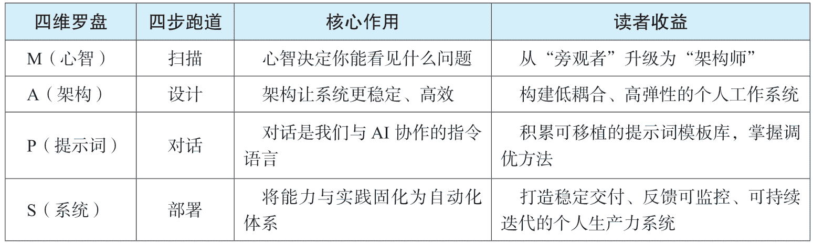

在投入具体实践之前，不妨先用以下三个问题审视你当前的竞争力系统。

（1）如果你最常用的 AI 工具明天忽然涨价 10 倍，你是否有备选方案（Plan B）？

（2）在你日常的工作或内容创作流程中，有多少环节已经能够通过一条提示词来完成？

（3）你是否已经建立起一套可追溯、可复用的个人知识与数据架构，能够持续沉淀模板、复用流程？

如果其中任何一个问题让你感到迟疑，也无须焦虑。MAPS 四维罗盘正是为应对这类挑战而生的——它不仅是指导行动的方法体系，还是贯穿全书的路线图与评估基准。

现在，就让我们正式启程，一同构建属于你的竞争力系统。

**第二章** **心智升级：AI 时代的新思维**

我们手持面向 AI 时代的 MAPS 四维罗盘，第一步应当迈向哪里？答案就在罗盘的起点——M（心智）。

心智本质上是一种在 AI 时代发现问题、定义问题的思维方式。当你站在“扫描→设计→对话→部署”这条四步跑道的起点时，真正决定你迈出第一步的，往往不是你掌握的工具，而是你思考问题的根本出发点。

以一个常见的场景为例，两位同事都需要提交日报。一位花费两小时手动复制、粘贴、整理数据；另一位则通过编写简单的脚本，让整个过程在 5 分钟内自动完成。他们或许使用相同的工具，但区别早已在心智层面确定：前者习惯于线性的“接收任务→执行任务”模式，而后者则会先退一步思考：“是否存在更高效的路径？”心智的差异，在此刻已然显现。

为了将心智升级这一过程具象化，本书将引入一位核心人物。我们将跟随他的脚步，经历一次完整的从思维困境到认知突破的转变。

他就是 Axton，一位典型的知识工作者。在本章中，我们将看到他如何直面“勤奋的低效”这一系统性挑战，如何利用“四级协作阶梯”模型进行精准的自我诊断，并最终下定决心，完成一次关键的身份转变——从被动的工具使用者转变为主动的系统设计者。这次心智层面的升级，正是后续所有架构设计、提示词运用与系统构建的起点。

**2.1** **一名内容创作者的系统性挑战**

作为一名知识类视频创作者，Axton 正面临着一个引发广泛共鸣的系统性挑战。

**1.勤奋的困境**

Axton 勤奋且专业，对自己所关注的领域（如新兴科技对商业模式的影响）有着深刻洞察。然而，与许多同行一样，他长期被内容生产的烦琐流程所困扰。制作一期信息密度高、时长仅 10 分钟的深度解读视频，往往需要投入与其产出不成比例的精力——整个过程如同一场漫长的马拉松，常常耗费他四到五个完整的工作日。

这场马拉松从前期数小时的选题构思与资料搜集开始。他需要像侦探一样在信息海洋中探寻线索，沉浸式研读数十篇中英文报告与行业资讯。接着，他要花上一整天，将脑中零散的洞察组织成数千字的逐字稿。此后，真正的“体力活”才刚刚开始：为了增强视频的说服力，他必须为每个核心论点寻找恰当且无版权风险的配图片或表格，这个过程有时长达数小时，只为找到一幅理想的图片。最后，他才能进入录制、剪辑、添加字幕与后期包装等环节。每个环节都如同孤立的手工作坊，用重复性的机械劳动蚕食着他宝贵的创作精力。

**2.AI 的局限与“数字苦役”**

AI 工具的出现，曾让他看到打破“手工作坊”模式的曙光。他尝试用 AI 辅助撰写初稿、生成概念图，这样做在某些单点任务上效率确实有所提升。然而，新的、更深层次的瓶颈随之而来：这些工具如同一座座独立的“功能孤岛”，数据互不相通，流程无法自动流转。

一个典型的工作流是这样的：他在 A 模型（擅长头脑风暴）中构思选题，然后将主题、目标受众和个人风格描述复制并粘贴到 B 模型（擅长长文写作）中生成初稿；接着，他将 B 模型生成的混乱文本复制到本地编辑器，花费大量时间手动排版；写作过程中需要一张“未来城市交通”插图时，他又要打开 C 模型（AI 绘画工具），输入对画面风格、构图与元素的描述……

他发现自己陷入一种新的“数字苦役”：将大量的时间耗费在工具间的复制粘贴、格式转换与上下文重复输入上。这些看似微不足道的损耗汇集起来，无情吞噬了单点任务的效率提升，导致整个工作流的效率并未发生质的飞跃。

**3.从“手艺”到“资产化”**

更令他焦虑的是，他感觉自己只是在被动、应激式地使用工具，完成孤立的任务，而未能构建任何可以持续积累和迭代的“系统”。他的经验、方法仍停留在个人大脑的“隐性知识”层面，无法沉淀为可复用、可规模化的“资产”。

这引出了一个对理解 AI 时代个人竞争力至关重要的概念：资产化。这里的“资产”并非传统意义上的设备或资本，而是一种更关键的无形实体：一经创造，便能独立于创造者本人、持续产生价值的系统。一位大厨的烹饪手艺是“隐性知识”，他一旦休息，餐厅便无法出品同款菜品；而一份精确记录、可供任何厨师遵循的标准化“食谱”，则是可复制、可传承的“资产”。Axton 意识到，自己那些巧妙的提示词和高效的资料整理技术仍停留在“手艺”层面，尚未升华为可规模化的“食谱”。一旦他想雇用助理扩大生产，或自身需要休息，整个创作机器就会立刻停摆。

这种“勤奋的低效”，正是无数知识工作者在 AI 时代的真实写照与核心痛点。我们仿佛置身于一个堆满先进工具的“数字五金店”，却仍用最原始的方式敲敲打打。Axton 意识到，真正的挑战并非“会不会用某个 AI 工具”，而是“如何设计一套能深度整合 AI 能力并使其持续为自己服务的系统”。他需要的不再是更多的“锤子”或“扳手”，而是一张指导如何建造自动化工厂的“蓝图”。

这一认知将他推向一个关键的十字路口。他明白，在动手构建任何系统之前，必须先进行一次底层、关键的升级：思维升级。

本章我们将跟随 Axton 一同完成这次关键的心智转变。这不仅是后续所有技术实践的前提，还是决定我们能否在 AI 时代真正掌握主动权的分水岭。

**2.2** **四级协作阶梯模型：从旁观者到架构师**

在深刻认识到自己“既勤奋又低效”的系统性困境后，Axton 意识到，问题的根源并非缺少工具，而是缺乏一套能够评估并提升自身与 AI 协作水平的系统性方法。

在寻找答案的过程中，Axton 接触到四级协作阶梯模型。该模型如同一面镜子，清晰地映照出个体在人机关系中所处的不同阶段，帮助他从繁杂的日常工作中抽离出来，客观地审视自己与 AI 的真实关系。

四级协作阶梯模型将人与 AI 的关系划分为四个阶梯，每一个阶梯都代表着不同的思维模式、行为范式和价值产出水平。

**1.阶梯一：旁观者**

●身份定位：AI 时代的“信息消费者”与“话题参与者”。

●日常表现：将 AI 作为谈资而非工具，热衷于关注 AI 领域的最新动态，在社交媒体上转发模型能力突破的相关新闻，偶尔也会试用最新的 AI 工具，但其互动往往是体验式、浅尝辄止的，从未系统性思考如何将 AI 融入核心工作流。

●核心挑战：容易陷入“与我无关”的观望心态，或因“错失恐惧症”（Fear Of Missing Out，FOMO）而产生焦虑。由于缺乏深度实践，对 AI 的认知只停留在表面，无法真正发挥其价值。

**2.阶梯二：工具使用者**

●身份定位：AI 时代的“效率优化者”与“任务执行者”。

●日常表现：将 AI 视为“高级搜索”或“快捷键”，在工作流程的某个孤立环节使用 AI 提升单点任务的效率。例如，用 AI 润色报告段落、构思演示标题或翻译邮件等。这种关系具有事务性、点对点的特性。

●核心挑战：输出效果不稳定，严重依赖模型的“临场发挥”。由于缺乏系统方法，难以应对多步骤的复杂任务。核心局限在于：成功经验难以沉淀为标准流程，导致协作模式无法复用，这正是 Axton“勤奋的低效”的根源。点状的效率提升，使其始终无法进入流程可复现的下一个层级。

**3.阶梯三：协作伙伴**

●身份定位：AI 时代的“项目经理”与“流程设计师”。

●日常表现：开始有意识地将 AI 视为并行工作伙伴，并设计人机协作流程。由人主导战略、优化指令，将 AI 定位为执行复杂任务（如撰写初稿或分析数据）的伙伴；人的精力聚焦于提出关键问题、设定评估标准和最终把控质量。

●核心挑战：协作流程依赖个人技巧，成功经验难以标准化、规模化复制。虽能熟练操作 AI 完成复杂任务，但尚未将这些技巧转化为可自动运行的标准化系统。

**4.阶梯四：架构师/共生者**

●身份定位：AI 时代的“系统设计者”与“价值放大器”。

●日常表现：人与 AI 深度融合，致力于构建能解决一类问题的“系统”。他们会将 AI 与自动化工具（如 Make）整合，设计出可自动运行、持续迭代的工作流。其焦点从“完成单点任务”上升为“设计能规模化完成此类任务的系统”。

●核心挑战：需要投入更多精力进行系统化思考、设计与维护，对技术原理和业务流程的理解能力要求更高，并且需要将成本、安全与伦理等因素纳入考量。其回报是构建出能够持续创造价值的“数字资产”。

为便于快速自检，可将上述内容总结为表 2-1。

表 2-1

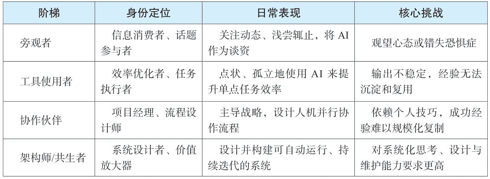

利用该模型审视自己后，Axton 清晰地认识到：尽管自己每天都在使用 AI，但在大多数时候仍停留在“工具使用者”阶段，偶尔凭着灵感和努力才能触及“协作伙伴”的边缘。他所有的努力都局限于提升单个任务节点的效率，却未从系统设计者的视角，对整个端到端的工作流进行审视和重构。

此次深入的“自我诊断”让 Axton 得出一个关键结论：他不仅需要升级工具，更需要升级自身角色定位。他不再将自己定义为单纯使用工具的内容创作者，而是立志成为能够主动设计、构建并优化人机协作系统的“架构师”。

这一认知转变是后续所有实践的起点。然而，随之而来的问题是：明确“当前身份”（工具使用者）与“目标身份”（架构师）之后，具体应“如何推进”？

他需要一套能将身份升级的“意愿”转化为“行动”的路线图。这正是 MAPS 提供的“四步跑道”行动路径要解决的问题。该路径为他构建了从洞察到落地的完整实践闭环：先通过扫描（Scan）识别问题，再通过设计（Design）绘制解决方案蓝图，接着借助对话（Dialogue）精准驱动 AI 执行，最后通过部署（Deploy）将其转化为可持续运行的工作系统。

理论框架虽已明晰，但 Axton 更需要能立即上手的具体方法。因此，他决定将以下“三招”作为升级之路的实践起点。这三招明确适用于希望从“工具使用者”迈向“协作伙伴”的实践者，达成标志是：能够将至少一项重复性任务稳定交由 AI 处理，并实现成果复用。

**行动一：绘制工作流，让问题显性化。**

●做法：选择一项重复耗时的工作（如内容发布、周报整理），使用流程图工具将其拆解为具体步骤。然后，用不同的颜色标出哪些环节是纯粹的手工操作，尤其是信息搬运或规则性强的部分。

●价值：将依赖直觉的流程可视化，被标记的“人工节点”正是引入 AI 或自动化工具的最佳切入点。

**行动二：固化提示词，让协作标准化。**

●做法：针对常用任务（如内容摘要、文案构思等），将有效的提示词固化为包含“角色+任务+产出要求”三要素的模板，并明确“语气专业客观”“用 Markdown 列表输出”等关键规则。

●价值：让 AI 的输出结果更稳定、可靠，减少反复沟通和修改，将模糊要求转变为明确、可重复的标准。

**行动三：量化追踪，让优化可衡量。**

●做法：在利用 AI 优化某一流程时，设定 1～3 项关键指标（如初稿“一次通过率”、任务总耗时、AI 调用成本等），通过简易表格持续记录并定期回顾数据变化。

●价值：“无法衡量，则无法改进。”只有量化优化效果，才能清晰观察进展、识别问题，并为后续调整提供依据。

在完成这次关键的角色定位转变，并明确初步的行动方案后，Axton 终于迈出从“工具使用者”到“架构师”的第一步。这次身份认知和行动方法的双重转变，成为他迈向系统化实践的关键起点。

**2.3** **认知革命：知识、技能与流程被重新定义**

一场深刻的认知革命正在发生。在完成从“工具使用者”到“架构师”的角色定位转变后，Axton 开始从更深层次审视 AI 如何从根本上改写“知识”、“技能”和“流程”的定义，并系统性重塑个人与组织赖以生存的价值体系。

为何许多曾经行之有效的职能划分与业务流程，在 AI 面前反而变得低效甚至“频频失效”？Axton 发现，答案隐藏在以下三个正在被重新定义的维度中。

**2.3.1** **知识：从“存储检索”到“定义问题”**

AI 普及之前，成为某个领域的专家往往需要经历“十年寒窗，读书破万卷”的漫长积累。知识储备本身就是护城河，专家的价值高度依赖其基于“记忆存储”和“经验检索”的能力：经验丰富的医生能迅速回忆起罕见病例，资深律师能精准引用相关法条，顶尖数据分析师能从繁杂数据中识别趋势。即便搜索引擎已经相当普及，若缺乏陌生领域的知识储备，实施跨领域的工作依然困难重重。

但 AI 正在迅速消融这道壁垒。初级律师借助 AI 工具，可以在数秒内检索并总结所有相关判例和法规，其效率堪比仅凭记忆的资深前辈。同样，刚接触市场分析的学生利用 AI 处理公开数据，也能快速生成相当专业的初步报告。

设想这样一个场景：一个充满好奇心的孩子提出超出你知识范畴的问题——“妈妈，为什么科学家寻找外星人时总说要先找水呢？书上说地球生命离不开水，但外星人可能跟我们完全不一样，根本不需要水呀！”

过去，这常让多数家长感到为难。如今，在 AI 的帮助下，整个过程变得简单高效。你只需登录 DeepSeek 的官方网站，就能看到一个简洁的对话界面（图 2-1）。


图 2-1

为获得更具深度的回答，可以先单击“深度思考（R1）”按钮激活相应模型，随后在对话框中输入以下提示词：

请给一位 5 岁的孩子解释：为什么寻找外星生命要先找水，即使外星生命可能不需要水。

稍作等待，AI 便会生成一段适合孩子理解的解释，如图 2-2 所示。

这个过程清晰地展示了 AI 如何帮助我们快速跨越知识壁垒。对于一个涉及天体生物学和科学方法论的复杂问题，任何一位家长都能借助 AI 迅速获得结构化、易于孩子理解的解释思路，从而更好地回应并引导孩子的好奇心。

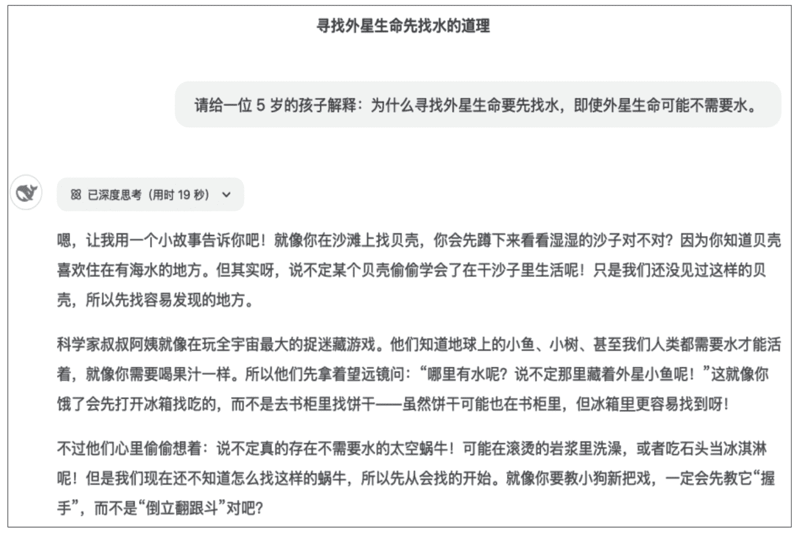

图 2-2

当知识的检索与综合不再稀缺时，价值便从“记忆存储”转向“问题定义与证据整合”。能否提出深刻的问题，并对 AI 提供的信息进行有效的验证与批判性思考，正成为新的能力门槛。

**2.3.2** **技能：从“熟练执行”到“人机协作”**

许多职业的基础建立在对特定“硬技能”的熟练掌握上，例如编写特定语言的代码、运用 Excel 处理数据、撰写符合格式要求的报告等。这些“熟能生巧”的技能，往往是职业入门和早期发展的关键。

然而，这些“硬技能”的门槛正在被 AI 迅速抹平。AI 可以根据自然语言生成代码，即便对资深 Excel 使用者而言都相当复杂的公式，AI 也能瞬间完成编写，更不用说模仿人的语气撰写邮件和各种格式化报告。

这使得从业者的能力门槛被迅速抬高：如果个体价值仅限于基础“硬技能”的重复执行，那么其在 AI 面前的竞争力将变得十分脆弱。

但这并不意味着技能不再重要，而是价值重心已从“熟练执行”转向“人机协作”——如何设计流程、运用判断力来驾驭 AI，实现超越个体能力的成果。

这种协同模式的本质在于，将人类专家的深度洞察与 AI 强大的模式识别及纠错能力相结合。一项关于人机协作的权威研究，生动地揭示了这一点。在该研究中，研究人员并未让 AI 取代人类，而是构建了一个精妙的协同流程。

首先，由鸟类专家对鸟类图片进行分类。随后，AI 模型介入，但它不直接提供答案，而是对人类的每一次分类都给出“置信度分数”——这实质上是在提醒专家：“你对这个判断有多大把握？这里可能存在你的认知盲点。”

研究结果极具启发性：在这种“AI 辅助反思”的模式下，人机协作的分类准确率显著提升。AI 扮演了一位不知疲倦的“认知伙伴”，帮助专家修正因过度自信而产生的错误，也强化了专家判断正确但稍有迟疑的决策。

这个案例完美地诠释了 AI 时代“熟练工”角色的价值演变：专家的价值不再仅仅是“做出正确的判断”，更在于设计并参与能持续产出更优判断的“人机系统”。纯粹执行任务的价值正在衰减，而设计、验证和优化人机协作流程的能力，正成为新的核心竞争力。因此，AI 时代单纯“熟练工”的价值必然会被重新定义。

**2.3.3** **流程：从“职能串行”到“并行协作”**

我们所习惯的工作流程，大多是基于人类有限的信息处理速度和沟通效率而设计的，常表现为单向的“瀑布式”流水线：研发部门完成设计后，移交市场部门制订推广计划，再交给销售部门执行。这种基于职能划分的线性流程，在 AI 时代已明显滞后。

首先是速度滞后。AI 可以即时分析用户反馈与市场数据，快速生成内容变体或优化建议。如果我们的决策流程还需要层层汇报、跨部门协调数周，无疑会错失行动良机。

其次是信息壁垒。AI 能够轻松整合多源信息，提供全局视角。如果我们的团队协作仍然局限于各自的“一亩三分地”，就无法发挥 AI 打破“信息孤岛”的优势。

例如，新产品上线时，如果能让 AI 基于最终的产品文档，在几小时内准备好面向不同渠道的营销文案初稿、客服常见问题解答（FAQ），甚至销售团队的培训要点，将极大地提升组织的运作效率。

从“职能串行”转向“并行协作”，意义不只于提速，更在于缩短反馈回路与降低跨部门沟通损耗——这也为后续的架构与系统设计奠定了实践基础。

这场对知识、技能和流程的深刻变革，让 Axton 彻底明白了“做什么”和“为什么”远比“用什么”更重要。然而，在理解宏观环境的变化之后，一个更尖锐的问题浮出水面：当旧的价值标尺纷纷失效时，我们又该如何定义和衡量新时代的个人竞争力？真正的分水岭究竟在哪里？

**2.4** **竞争力分水岭：从“DeepSeek 时刻”到新竞争力公式**

随着 AI 工具日益普及，许多从业者陷入新的认知误区。

●工具替代论：“AI 写的公文比我写的专业，我是不是很快就会被替代？”

●效率悖论：“老板要求大家都用 AI，但我感觉越用越乱，各种工具、模型、提示词等让人眼花缭乱，效率真的提升了吗？”

●囤积迷思：“AI 课程买了好几套，提示词模板存了一堆，可为什么竞争力还是没有得到提升？”

这些困惑的根本矛盾在于，在 AI 从稀缺资源变为基础设施后，真正的护城河早已从“会不会用”转向“如何用 AI 构建系统性优势”。

回顾互联网早期阶段，率先“触网”者享受了先行者红利，那时“能够接触到信息”本身就是一种核心竞争力。然而，随着个人电脑和移动终端的普及，互联网接入成为社会基础设施，竞争并未因此得到缓和，反而进入了更深层次。

如今的 AI 浪潮也是如此。那么，什么才是真正的竞争力？这场变革的引爆点又是什么？为何“会不会用 AI”的价值被迅速稀释，而“如何系统性地用 AI”却愈发关键？要回答这些问题，需要回顾一次标志性事件——它如同一道清晰的分水岭，重绘了个人竞争力版图。

2023 年至 2024 年间，全球顶尖模型的竞争主要集中在几家美国公司。国内科技界迅速跟进，各种国产大语言模型如雨后春笋般涌现，被形象地称为“百模大战”。尽管热闹非凡，但当时普遍认为，国内的 AI 模型在核心能力上整体仍落后于国际顶尖水平一到两年。然而，这一局面在 2025 年年初被彻底打破。

2025 年 1 月，中国 AI 公司深度求索（DeepSeek）发布了 DeepSeek-R1 模型，立刻吸引了全世界的目光。其原因很简单：在关键推理能力测试上，其表现已能媲美当时最强的模型，但训练成本却大幅降低。此外，DeepSeek 还选择将模型完全开源，允许任何人研究、使用，甚至商业化。

DeepSeek-R1 的突破关键在于创新的技术架构——采用“混合专家”（Mixtureof-Experts，MoE）架构。简单来说，模型内部包含多个“专家”，每个专家都擅长处理特定类型的问题。当遇到任务时，系统仅激活最相关的几个专家，而非调用整个庞大的模型，从而大幅降低计算成本。

同时，DeepSeek-R1 还大量运用强化学习（Reinforcement Learning，RL）来提升推理能力。其原理类似于教导孩子学习：不直接告知答案，而是让他尝试，做对了给予奖励，做错了提供反馈。通过不断的试错和调整，模型逐渐学会更高效地思考和解决问题。

除了技术和成本优势，DeepSeek-R1 带来的最大震撼是，首次向公众完整地展示了 AI 的思维链（Chain-of-Thought）。当被问及复杂问题时，它不仅输出答案，还会逐步显示思考过程，甚至展现不同思路间的犹豫和自我纠错。

以下是一段解决“7 人过河”问题时未经编辑的原始思维链节选。它并非逻辑完美的答案，却生动展示了 AI 在面对不确定性时的犹豫与探索。

不过根据实际步骤，应该是 5 次来回，加上最后一次单程，所以来回次数是 5 次，对吗？或者可能我的计算有误，正确的答案应该是 7 次来回？需要重新思考。另一种思路：每次来回运送 1 人，需要运送 6 次，因为最后 1 人不需要回来，但可能需要调整。不过这样可能更复杂。或者，考虑每次运送 2 人过去，需要回来 1 人，所以每次来回运送 1 人，直到剩下 1 人，然后最后一次运送 2 人过去，但可能这适用于偶数人数。不过对于 7 人，奇数，可能需要最后一次运送 1 人，但船只能载 2 人，所以可能需要调整。可能正确的答案是 6 次来回？

这个看似曲折、不断自我纠正的过程，在当时却具有里程碑意义。它首次向公众揭示：AI 并非简单的“答案机器”，而是能够进行自我怀疑和策略调整的“思考实体”。这种不加掩饰、近乎“人格化”的透明度，成为引爆公众信任与想象的关键。

这种对思维过程的直观展示带来了前所未有的冲击。它使 AI 不再只是输出结果的“黑箱”，而更像一位正在思考的伙伴。加之其对中文的深度优化及免费、开放的特性，DeepSeek-R1 迅速破圈，成为从专业领域到社会大众广泛讨论的现象。

“DeepSeek 时刻”的颠覆性在于：它标志着顶尖 AI 推理能力不再是少数巨头才能负担的“奢侈品”，而成为人人可用的“公共设施”。当最前沿的 AI 能力通过开源或极低成本模式被推送到每位用户面前时，信息差带来的壁垒便轰然倒塌。

这正是个人竞争力的分水岭。竞争的焦点已不可逆转地从“能否获得 AI 能力”转向“如何系统性运用 AI 能力”。这一结论与业界的普遍洞察高度一致。

●斯坦福大学人工智能研究所（HAI）的报告指出，AI 领域的主旋律将是“多智能体+人类指挥”式协作，考验的不再是 AI 的单兵作战能力，而是人类的流程设计与系统架构能力。

●微软 AI 负责人穆斯塔法·苏莱曼（Mustafa Suleyman）预言，未来十年，多数职场人将成为管理着一群 AI 助手的“项目经理”，而非事必躬亲的执行者。

当顶尖 AI 成为人人可用的基础工具时，仅仅学会使用某个模型写几篇文章、生成几张图片，或者套用几个现成的提示词，是远远不够的。真正的分野在于：能否把 AI 变成真正的“业务伙伴”，并将其深度整合至更广泛的工作流或系统层面。

由此，我们提炼出定义 AI 时代个人竞争力的核心公式：

AI 时代的个人竞争力=人机协作深度×系统设计能力

其中，“人机协作深度”对应 MAPS 四维罗盘中 P（提示词）的实践，“系统设计能力”则对应 A（架构）与 S（系统）的构建。这意味着，你的价值不再仅仅体现在完成单一任务的速度或质量上，还体现在以下两个维度。

●你与 AI 协作的深度如何？能否精准提出问题、引导 AI、评估其输出，并与之进行多轮迭代以达到卓越成果？

●你的系统设计能力如何？能否将 AI 能力有机嵌入端到端的工作流中，构建高效、稳定、可扩展的人机协作系统？

当 AI 在诸多领域的能力追平甚至超越人类时，我们要能够“站在 AI 的肩膀上”。AI 就是这个时代的巨人，我们要学会利用它的力量来放大自身的智慧和创造力。理解这一点，并有意识地培养“人机协作深度”和“系统设计能力”，是 AI 冲击下保持竞争优势、面向未来站稳脚跟的关键。

至此，Axton 终于为自己的心智升级找到了最后一块拼图。他彻底明白：自己所面临的困境，以及所有从业者面临的挑战，其本质都是这场由“AI 能力普及化”所引发的深刻竞争力逻辑变革。而他为自己选择的“架构师”之路，正是应对这场变革的正确方向。

在决心完成从“工具使用者”到“架构师”的身份转变后，Axton 立即面临第一个现实挑战：如果知识获取方式还停留在过去的手工时代，再宏大的战略也终将是纸上谈兵。

**第三章 知识重构：AI 赋能学习与研究**

Axton 深刻意识到，过去那种“费力翻阅大量书籍、耗时搜索网页、逐字手写笔记”的传统研究方法，已无法支撑 AI 时代构建高价值系统的需求。AI 的出现，正在从根本上重新定义学习与研究的范式。

因此，在着手设计任何系统之前，他必须先重构自己的“知识引擎”。这引出了本章将要探索的两个核心问题：第一，AI 如何颠覆传统学习模式？第二，在 AI 时代，如何建立能够持续进化的个人知识体系？

本章将跟随 Axton 的脚步，完整呈现他寻求答案并构建这套底层能力的全过程。我们将看到他如何掌握“AI 陪伴式深度学习”模式，并最终融合信息链五环模型和 DIKW 知识模型，为自己打造可持续成长的“第二大脑”。

**3.1 AI 陪伴式深度学习**

面对系统性挑战，重塑知识获取方式是首要任务。我们需要一种能高效处理海量信息，并从中萃取关键洞见的新型学习模式。对于这种新模式，我们称之为“AI 陪伴式深度学习”。

AI 陪伴式深度学习是指，借助大语言模型，在“设问→对话→反思→输出”的认知循环中，通过持续互动来深化理解的一种学习模式。与被动等待指令的图书馆或搜索引擎不同，新一代 AI 已不再仅仅是信息提供者，而是更有潜力成为学习过程中的“思维伙伴”。

其核心在于，AI 不仅能回答问题，还能通过交互、追问乃至模拟辩论，辅助学习者完成从“提出问题”到“对话探索”再到“反思整合”，最终“形成输出”的完整认知循环。这并非用 AI 取代思考，而是借助其强大的信息处理能力和不知疲倦的交互特性，深化对复杂事物的理解，促使知识真正内化。

这种学习模式具备四大特征，与传统学习方法存在本质区别。

●高度的交互性：学习者可以随时向 AI 提问、要求澄清或挑战其观点，AI 能即时回应。这种即时反馈循环是传统学习难以比拟的。

●个性化：理想的 AI 伙伴能根据学习者已有的知识和特定兴趣，动态调整回应的深度与表达风格。

●持续的反馈与评估：AI 可通过苏格拉底式提问，帮助学习者发现认知盲区。

●高效率：AI 处理和整合海量文本的速度远超人工，可大幅压缩过去耗时费力的资料搜集与初步分析工作。

要将这一理念付诸实践，关键在于掌握有效的认知流程——认知循环。它包含四个环环相扣的阶段：

●第一阶段：设问。学习的起点并非漫无目的地浏览，而是源于清晰的目标或值得探索的优质问题。在 AI 辅助下，学习者可以将初步想法或宽泛领域交由 AI，让其帮助梳理出更具体、更具研究价值的子问题，或从不同的角度审视初始设想。例如，可以向 AI 提问：“我正在尝试理解大语言模型的扩展法则，有哪些关键的理论前提和争议点是我应该关注的？”AI 或许能列出若干具有启发性的研究方向。

●第二阶段：对话。这是人机协作的核心环节。带着明确的问题，学习者可以与 AI 进行多轮、深入的对话，其深度远超简单的“一问一答”。学习者可以要求 AI 解释复杂概念、提供多元证据、扮演特定角色（如领域专家或批判者）进行探讨，甚至总结不同观点的异同。在此阶段，AI 如同知识渊博且极具耐心的讨论伙伴，而学习者则需要主动引导对话方向，通过持续追问，直至对问题的理解达到新高度。

●第三阶段：反思。AI 能提供大量信息和多元视角，但真正的理解和洞察来源于学习者自身的反思与综合。在与 AI 对话后，必须进行批判性审视：哪些是事实？哪些是观点？是否存在偏见或逻辑漏洞？新获取的信息与已有知识体系是互补的还是冲突的？AI 在此阶段可以辅助整理对话脉络或生成初步总结，但最终的知识构建必须由学习者主动完成。

●第四阶段：输出。学习成果需要通过某种形式表达出来才能得到检验和巩固，如研究报告或总结文章。在输出阶段，AI 依然可以扮演辅助角色，协助构建初稿、润色语言或检查逻辑。更重要的是，高质量的输出往往会引出新问题，从而自然地开启下一轮“认知循环”，形成螺旋式上升的知识构建过程。

掌握这种“AI 陪伴式深度学习”模式，就相当于拥有了在信息洪流中高效构建认知优势的“战略杠杆”，为后续的系统化架构设计奠定坚实的知识基础。

**3.2 案例：AI 辅助精读专业技术论文**

理论需要经过实践检验。掌握认知循环的核心流程后，下一步是将其应用于真实的复杂场景。在真实的学习过程中，“设问→对话→反思→输出”四个阶段往往交织进行、同步推进。为便于演示，以下案例将四个阶段整合为三个环节，完整拆解如何运用这一流程精读高难度的专业技术论文。

**【案例背景】**

下面以论文“DeepSeek LLM：Scaling Open-Source Language Models with Longtermism”为精读对象。这篇 2024 年 1 月发布的论文，因其首次系统公开 67B 级别中文大语言模型的训练细节、数据治理策略和扩展法则公式而备受关注。然而，对非专业读者乃至部分专业人士而言，要彻底理解这种信息密度极高、包含复杂图表的技术长文，仍颇具挑战。此时，AI 伙伴能发挥重要作用。

**注意：**本案例以腾讯 ima.copilot（版本 1.7.0）和字节跳动 Coze Space（扣子空间）为演示平台，仅做举例说明。市面上功能类似的 AI 产品众多，均能帮助用户实现文档处理与学习目标。具体选择何种工具取决于你的具体需求和使用偏好。

**3.2.1 设问与对话：建立整体认知**

认知循环的第一环是借助 AI 快速建立对论文的整体认知。

首先，将 PDF 文档上传至 ima.copilot 这类集成了知识库管理和 AI 对话能力的工具。上传完成后，打开论文阅读界面，窗口右侧即为 AI 对话窗口。用户可以利用“总结”或“生成脑图”等快捷功能，快速获取论文的整体框架，如图 3-1 所示。

由于论文原文为英文，可以输入首个指令跨越语言障碍：“请用中文简要总结这篇 PDF 论文”。

AI 将输出要点提炼式的中文总结，帮助我们迅速把握论文的核心内容，如研究背景、技术亮点等，如图 3-2 所示。

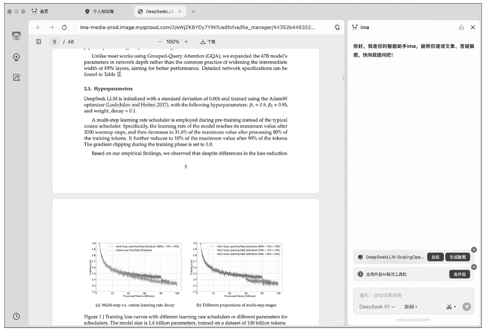

图 3-1

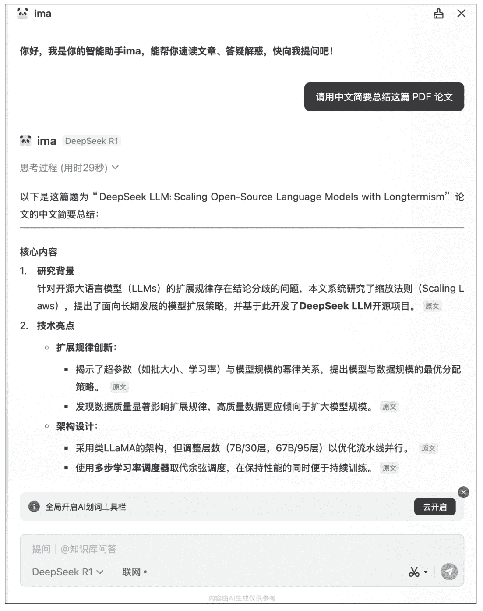

图 3-2

接着，单击“生成脑图”按钮，AI 会将论文结构可视化，生成思维导图，如图 3-3 所示。

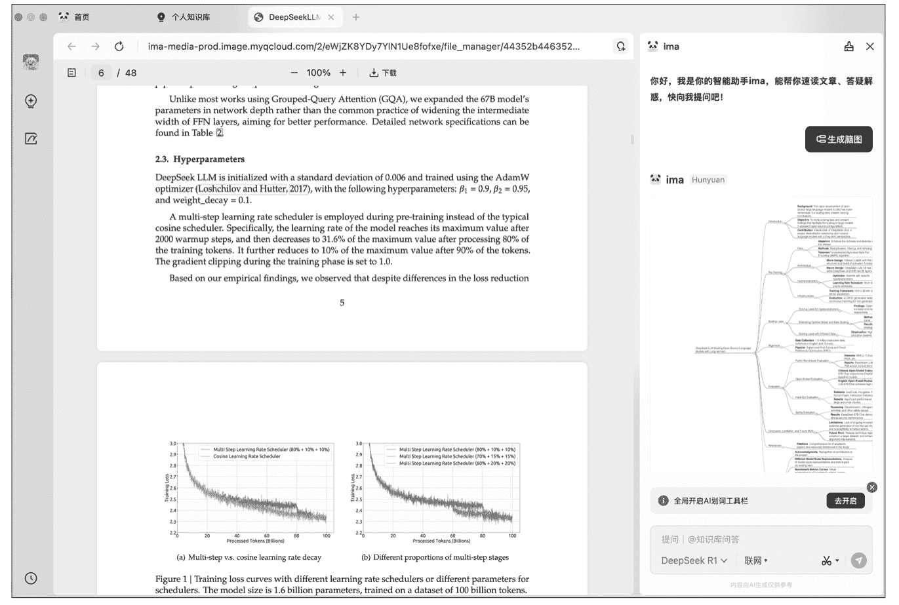

图 3-3

单击脑图可对其执行放大、缩小和下载操作，便于后续深入分析，如图 3-4 所示。这份可视化结构图为深度阅读提供了清晰的“导航地图”。

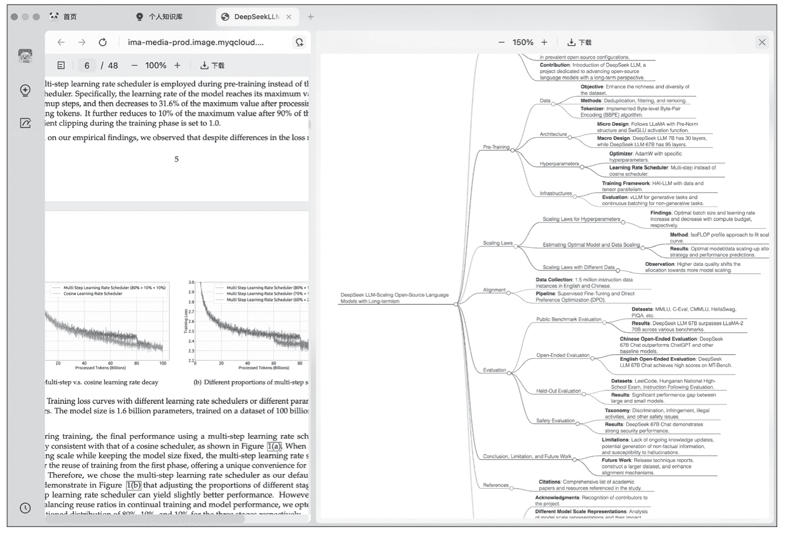

图 3-4

在阅读过程中，如果遇到难以理解的段落，可以直接选中目标文本，利用工具的上下文菜单进行即时“翻译”或“AI 解读”，如图 3-5 所示。这种方式比传统的查词典或单独使用翻译软件更高效，因为 AI 能结合上下文语境进行针对性解释。

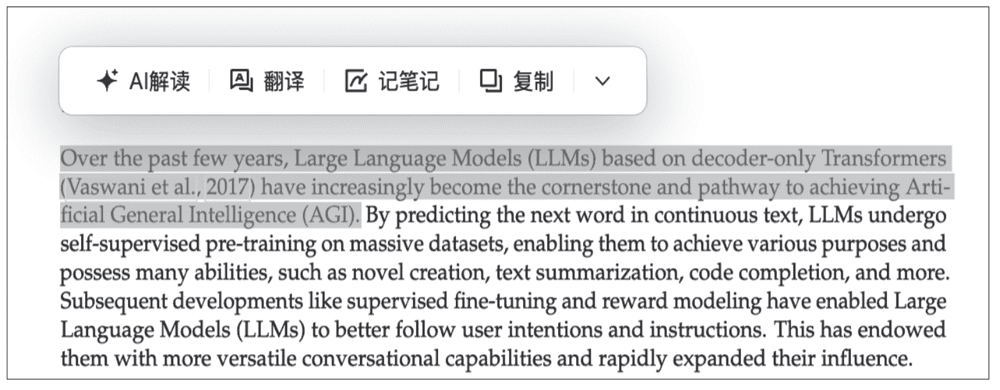

图 3-5

**3.2.2 对话与反思：核对、验证与整合**

在对论文形成整体印象后，即可选择最关键或最感兴趣的部分进行深度探讨。

例如，针对论文中关于“扩展法则”（Scaling Law）的讨论，可以向 AI 提出更具深度的问题：

论文中探讨的 Scaling Law，在实际应用中是否会遇到瓶颈？或者说，这种扩展是否存在理论上的极限？业界对此有哪些不同的看法？

如果开启了联网功能，AI 将结合论文内容与最新的网络资料给出综合回答。

例如，在图 3-6 的示例中，AI 引用了 10 篇相关资料，并标注了来源，部分输出内容如下。

根据现有研究和行业动态，Scaling Law 在实际应用中已显现出多维度瓶颈，其理论极限也受到广泛讨论。以下从实践瓶颈、理论边界及业界争议三个角度展开分析：

一、实际应用中的瓶颈表现

1.数据资源枯竭

③

●高质量数据稀缺：全球可获取的优质文本数据总量约 510 万亿个标记，但实际可用量远低于此。OpenAI 联合创始人 Ilya Sutskever 指出，预训练时代因数据耗尽可能面临终结。

●合成数据的局限性：尽管合成数据（如 Sora 使用游戏引擎生成数据）被尝试用于缓解数据短缺，但其性能提升效果显著低于真实数据，且生成过程需额外算力。

2.边际效益递减

③⑤

●对数增长与指数成本矛盾：Scaling Law 的核心公式表明性能提升与计算量、数据量的对数相关，而资源投入需指数级增长。例如，GPT-4 到 Orion 的性能提升幅度远低于 GPT-3 到 GPT-4，但成本却显著增加。

⑤

●训练与推理成本失衡：训练算力需求从 2017 年的 7400 petaFLOPs 增至 2024 年的 500 亿 petaFLOPs，而推理成本同样因链式推理（CoT）等技术需求上升，但收益逐渐饱和。

3.模型架构限制

④

●Transformer 的固有约束：当前扩展规律主要基于 Transformer 架构，其注意力机制的长序列处理效率低下，导致参数规模与性能的非线性关系。非 Transformer 架构（如 RWKV）虽在特定场景表现更优，但尚未突破整体瓶颈。

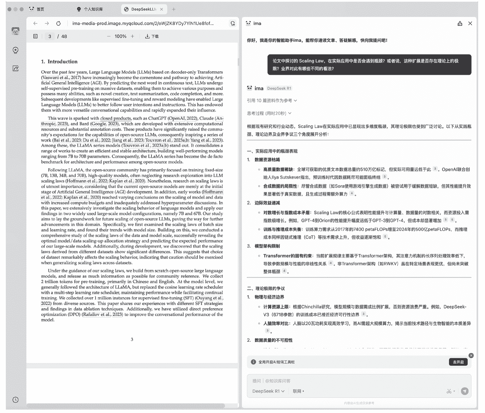

图 3-6

对于论文中的图表或特定段落，可使用截图提问功能直接截取并提问。如果内置 AI 的回答不够清晰，或希望从更广泛的视角探讨，可以将相关文本片段或疑问复制到通用性更强、推理能力更高的 AI 聊天机器人中进一步追问。

此外，还可以运用“反思式翻译”的思路进行优化，如提问：“这段关于‘数据治理’的翻译是否可以更精练？其中‘价值观对齐’的表述是否准确传达了原文的细微含义？”

此过程的关键在于反思：AI 的解释是否解决了你的困惑？提供的信息是否与论文其他部分或你已有的知识相符？

在不同工具间切换、对同一问题进行多角度提问和验证，本身就是深度学习的一部分。

**3.2.3 输出：形成结构化成果**

在对论文的理解达到一定深度后，可围绕其核心主题（如大语言模型训练中的数据治理策略）进行更广泛的研究，并形成结构化研究报告。此时进入认知循环的“输出”阶段，旨在将所学知识结构化、成果化。扣子空间这类支持复杂任务链的 AI 工具可发挥关键作用。

扣子空间提供了不同的工作模式以适应各种任务。例如，“规划模式”会先规划解决问题的步骤，允许人类进行更多的控制和干预，适合需要高精度控制的复杂任务；而“探索模式”则允许 AI 自主思考和执行，适合快速获取初步结果或进行开放式探索。

在此，我们可以切换到“探索模式”，让 AI 根据最终的目标自主规划并执行一系列动作。例如，向 AI 下达指令：“我需要一个能让团队快速了解 DeepSeek 论文精髓的单页网站。”AI 将自主完成所有中间步骤。

在扣子空间中，我们可以上传论文的 PDF 文件，然后发出包含多步骤、多维度要求的综合性指令，如图 3-7 所示。

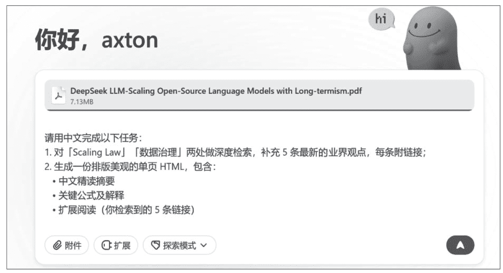

图 3-7

AI 接收到指令后，将会自动执行以下步骤。

**1.深度检索与观点提炼**

如图 3-8 所示，AI 调用内置搜索引擎，围绕“Scaling Law”与“数据治理”两个核心概念进行深度检索。系统在完成检索后，会自动评估信息来源的质量，并精准筛选、提炼出最具价值的 5 条最新的业界观点，最终将结构化结果保存至文档。

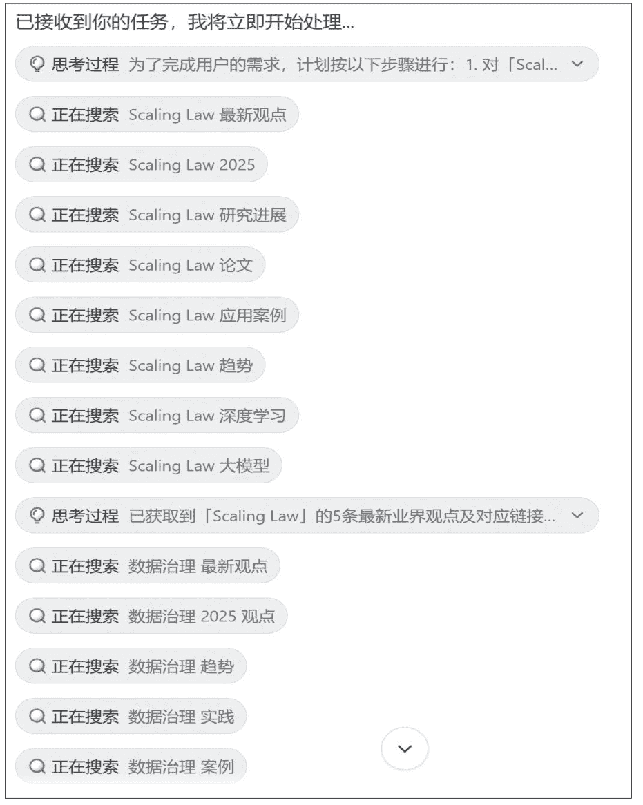

图 3-8

**2.自动生成精读摘要**

基于检索所得的资料，AI 将对论文全文和扩展文献进行信息提炼，自动生成一段 800 字以内的中文精读摘要。该摘要以易于理解的语言，准确概括了论文的核心贡献点与主要结论（图 3-9）。

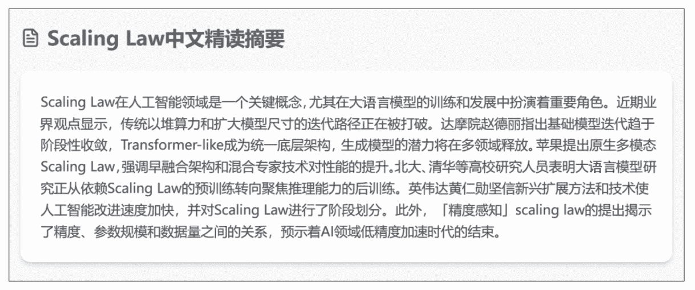

图 3-9

**3.提取并解释关键公式**

针对论文中最关键的 Scaling Law 公式，AI 会将其单独提取，并自动配以清晰、简洁的中文解释，便于非专业人士快速理解公式背后的含义和应用场景，如图 3-10 所示。

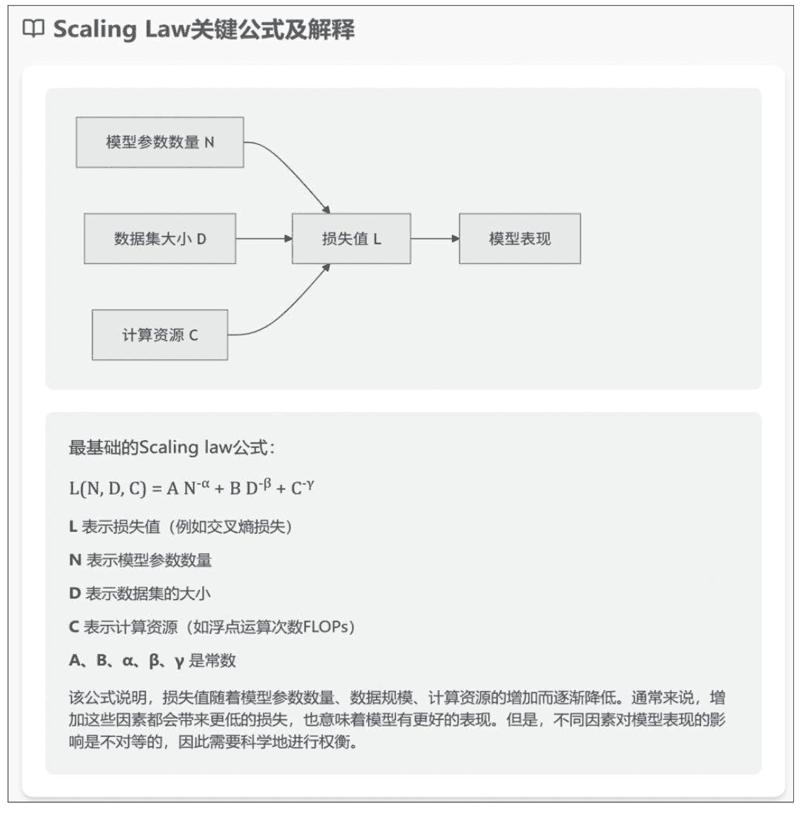

图 3-10

**4.自动生成可交互的单页 HTML**

系统将以上所有成果，包括提炼的观点、精读摘要、公式解释等，自动生成一份排版美观、采用现代化设计风格的 HTML 单页，如图 3-11 所示。

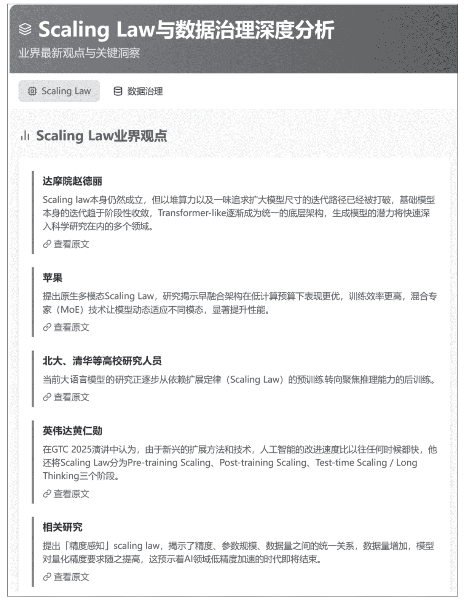

图 3-11

该报告具备良好的可读性与交互体验，完成度高，用户可直接下载 HTML 文件或通过分享链接，在团队或社区内进行快速分发。

整个自动化流程通常在 10 分钟内完成，而完成同等质量的手工作业则可能需要数小时乃至数天。这种人机协作模式，正是 AI 时代知识工作演进的一个缩影：它将研究者从烦琐、重复的信息处理劳动中解放出来，使其能更专注于高价值的思考、判断与创新工作。

**3.2.4 核心思维与小结**

通过本案例可以看出，实践“AI 陪伴式深度学习”的关键在于，转变学习者与信息和工具的关系。以下四项核心思维至关重要。

●从“答案索取者”到“问题设计者”的身份切换：AI 善于解答，但高质量的学习源于深刻的提问。学习者的核心价值在于，提出能够驱动思考、激发探索的关键问题。

●视 AI 为“对话伙伴”而非“搜索引擎”：学习不应止于单次问答。通过多轮对话、追问细节与澄清要求，才能挖掘 AI 更深层次的“知识”和“能力”。

●坚持人类不可或缺的“批判性反思”：AI 输出必须被审视和验证。学习者必须结合自身的知识、经验与价值观，对 AI 提供的信息进行批判性评估与整合，以构建真正属于个人的认知体系。

●将“持续迭代”作为认知优化的常态：“认知循环”鼓励将每一次输出都视为下一次探索的起点，在循环中持续优化问题、深化理解。

除了以上四项核心思维，我们还必须认识到：在 AI 的帮助下，如今正是人类历史上最好的学习时代。

AI 不仅重塑了学习模式，让我们以前所未有的速度、深度和广度获取并处理信息，将过去需要数周的资料梳理、文献研读等工作在数小时内完成；其更深刻的价值还在于，揭示了学习本质的结构性转变。

●竞争焦点的转移：从“信息持有量”转向“认知转化率”。当每个人都能轻易获取海量信息时，决定其竞争力的就不再是掌握信息的多少，而是将信息内化为实践能力的速度。

●发现盲区的价值超越答案本身：在与 AI 对话过程中暴露的个人认知盲区往往比获取的信息本身更有价值。清晰地认识到“自己不知道什么”，是实现有效进步的前提。

●人类经验的价值愈发凸显：AI 擅长处理显性知识与结构化信息，却难以替代人类在复杂情境中独有的微妙洞察、直觉判断与价值权衡。正是这些难以量化的经验，使人类的决策与创造独具深度。

AI 的普及在带来巨大便利的同时，也对我们提出了更高的要求：我们需要从被动的知识接收者转变为主动的探究者、批判性的思考者和富有洞察力的整合者。

综上所述，“AI 陪伴式深度学习”的本质，并非以机器智能替代人类思考，而是以其为杠杆，增强并加速人类自身的认知过程。它要求学习者以更主动的姿态、更严格的批判性思维、更清晰的策略参与知识构建的每一个环节。掌握这一学习范式后，AI 便不再是简单的工具，而是陪伴我们探索未知、深化理解、加速成长的得力伙伴。

现在的我们，比以往任何时候都拥有更好的机会和工具去成为一个真正高效、独立的终身学习者，而这正是 AI 带给我们最深远也最宝贵的礼物。

**3.3 信息链与个人知识库**

在 AI 浪潮席卷各行各业的今天，信息的获取与处理方式正在发生深刻变化。构建一套行之有效的信息链与个人知识库，已不再是锦上添花，而是个体在激烈竞争中保持领先的关键能力。

构建信息链的核心在于，促进信息的增值。那么，信息价值提升的路径是怎样的？经典的 DIKW 模型为我们描绘了这样一幅蓝图。该模型由组织理论家罗素·艾可夫（Russell L.Ackoff）于 1989 年系统阐述，它将认知过程划分为四个层级，揭示了原始“数据”如何逐步转化为指导我们行动的“智慧”，如图 3-12 所示。

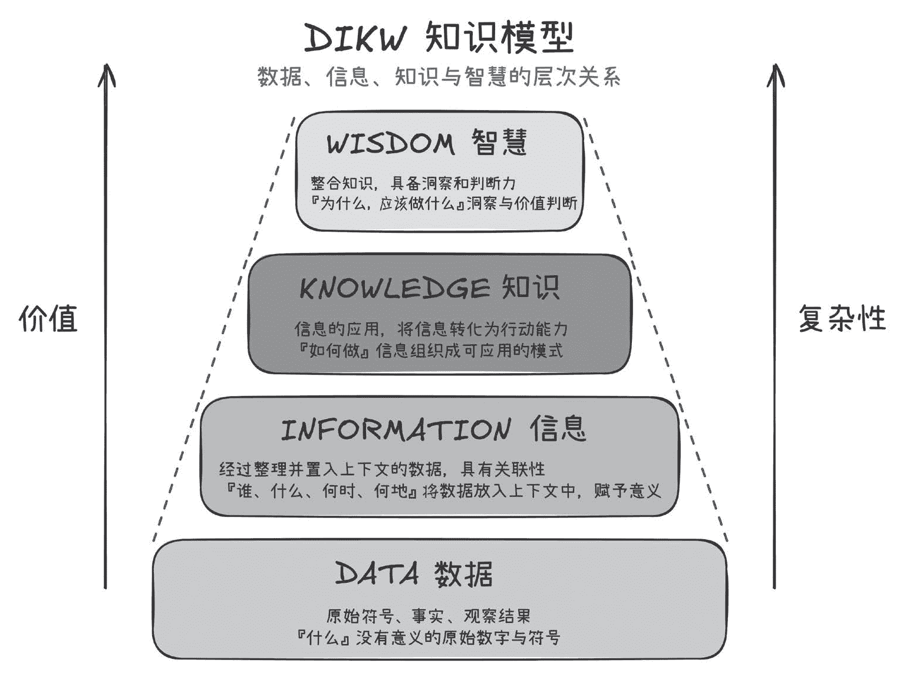

图 3-12

**3.3.1 DIKW 模型：认知升级的阶梯**

（1）数据（Data）：原始符号、事实和观察结果。

这是最基础的层级，指未经组织和加工的原始符号、事实、数字或图像。它们本身不具有意义，是构成更高级别认知的“原材料”。例如，一次用户调研收集到的原始问卷回复、网页上的一段文字、传感器记录的一串数字等。

（2）信息（Information）：经过处理和赋予上下文的数据。

在数据被赋予特定的上下文，并经过分类、整理和解释后，便成为信息。信息回答了“谁”（Who）、“什么”（What）、“何时”（When）、“何地”（Where）等问题。例如，将原始调研数据整理成“30～40 岁年龄段用户占比 35%”，这就是一条信息。信息比数据更有用，因为它提供了某种程度的“意义”。

（3）知识（Knowledge）：经过理解和内化的信息。

当信息被个体或组织理解、吸收，并与已有的经验和认知框架结合，形成可以指导行动的见解、规律或模型时，其便转化为知识。知识回答了“如何做”（How）的问题。例如，基于多份用户调研报告和市场数据，总结出“针对特定用户群体的产品迭代方向和营销策略”，这就是知识。知识具有可应用性，能够帮助我们解决问题。

（4）智慧（Wisdom）：经过反思和价值判断的知识。

这是 DIKW 模型的最高层级。智慧是一种综合能力，体现为在深刻理解知识的基础上，融合伦理判断与长远眼光，并最终在复杂情境下做出明智决策。它回答了“为什么”（Why）及“应该做什么”（What should be done）的问题。例如，在制定产品策略时，不仅要考虑短期盈利，还要洞察其长远的社会影响，并做出符合组织愿景和价值观的决策，这就是智慧的体现。智慧往往与经验、洞察力和道德感紧密相关。

DIKW 模型清晰地揭示了信息加工的层级：数据是基础，信息是数据的结构化，知识是信息的内化与应用，而智慧则是知识的升华与正确运用。该模型表明，信息管理的目标不应仅停留在收集和存储数据或信息上，而应通过有效的加工、理解和应用，将其转化为能够创造价值的知识和智慧。

**3.3.2 为什么需要建立信息链**

AI 正以前所未有的方式增强我们获取信息的能力，但也带来了一个悖论：信息越多，我们反而越难从中提炼出真正的价值。我们比以往任何时候都更需要建立一套行之有效的方法论，以驾驭信息的洪流，并将其内化为真正的个人竞争力。

**1.在信息过载中捕捉信号**

我们正身处信息生产量呈指数级暴增的时代。据统计，2023 年全球新创建的数据量高达 120ZB（泽字节），并预计在 2025 年年底攀升至 181ZB。电子邮件、社交媒体、新闻推送等内容持续涌现，“信息过载”已成为常态。

诺贝尔经济学奖得主赫伯特·西蒙（Herbert Simon）早在 1971 年就提出了一个至今仍发人深省的论断。

**信息的富足意味着其他东西的匮乏——它消耗的是受众的注意力。因此，信息的丰富造成了注意力的贫乏。**

我们的注意力，这一宝贵的认知资源，正在被无孔不入的信息流不断稀释。研究显示，人们在单一屏幕上的平均专注时间已从 2004 年的约 150 秒骤降至近期的 47 秒。在多源信息的持续干扰下，个体的专注力与决策质量都受到了显著影响。一旦被通知或内在冲动打断，信息工作者平均需要 25 分钟才能重新恢复到原有的专注状态。

当下的痛点早已不是“找不到资料”，真正的核心挑战是信息泛滥下的“注意力稀缺”——面对海量信息，我们常常“筛不完、理不清、也用不好”。关键在于，我们能否建立一套高效的信息处理机制，在喧嚣的“噪声”中精准捕捉并放大真正有价值的“信号”。

**2.在零成本搜索中重建信任**

以大语言模型为代表的 AI 工具，正在彻底改变我们获取信息的方式。相较于传统的搜索引擎需要用户自行筛选大量结果，智能问答、对话式搜索等 AI 应用能迅速提供看似精练的答案，显著降低了信息检索的时间成本。

然而，AI 在降低搜索成本的同时，也带来了新的挑战：筛选成本与信任成本的急剧上升。AI 模型并非绝对可靠，它们可能会因训练数据偏差或算法局限而产生“幻觉”（Hallucination），即模型生成看似合理但与事实不符的信息。一项针对主流大语言模型的评估发现，超过三分之一的已报告问题案例源于此类幻觉引发的信息误导。这意味着，对 AI 生成的结果进行批判性审查，已成为必要的工作环节。

此外，过度依赖 AI 进行信息筛选，可能削弱我们自身的批判性思维与主动探索多元视角的能力，甚至陷入由算法构建的“信息茧房”。尽管 AI 能在短时间内聚合海量信息，但辨别其真伪优劣的筛选工作变得更为繁重且关键。在此背景下，人类的专业判断、领域知识与批判性思维的价值反而更加凸显。

**3.在一次性消费中构建复利体系**

信息的价值不仅体现在获取的瞬间，还取决于其在未来被有效复用的能力。一份调研报告、一篇经深度思考的笔记或一个转瞬即逝的灵感火花，若能在不同的场景下被反复调用与启发，其价值便能实现持续递增。反之，若信息停留在“一次性消费”的层面，“读过就忘，存了不看”，其价值将随时间流逝而递减，最终形成难以检索和利用的“数字废墟”，而非真正的知识资产。

在实践中，许多人在信息复用环节面临巨大挑战。这既源于“遗忘曲线”等认知规律，也受制于具体实践中的障碍。

●知识孤岛：信息以孤立的条目形式存储于不同的应用或文档中，缺乏有效的组织与关联，难以形成体系化的知识网络。

●缺少输出驱动：学习与记录若无明确的应用目标，相关信息则难以被大脑编码为长期记忆，导致记录质量停留在浅层。

●工具与格式障碍：不同工具和文件格式间的不兼容性，阻碍了知识的迁移、整合与复用。

因此，建立一条从信息捕获到知识分享的完整链路至关重要。该链路旨在让信息遵循 DIKW（数据、信息、知识、智慧）模型的路径，沉淀为随取随用的智慧资产，实现知识的复利效应。这正是构建信息链的根本目的。

**3.3.3 信息链五环模型：从捕获到分享的闭环**

为系统化构建个人知识管理流程，并使其与 DIKW 模型的认知升级路径契合，我们提出了“信息链五环模型”。该模型将个人知识管理过程划分为五个相互关联、循环迭代的环节：捕获（Capture）→提炼（Distill）→关联（Link）→应用（Apply）→分享（Share），如表 3-4 所示。

这五个环节共同构成从原始数据到智慧产出的完整闭环。其中，捕获与分享构成外循环，为整个链路注入新数据和反馈；提炼、关联与应用构成内循环，驱动信息在系统中流动并实现价值增值。

表 3-4

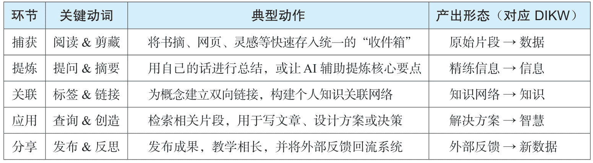

以下详细解析每个环节的定义、重要性、最佳实践，以及 AI 如何在其中发挥作用。

**1.捕获：不错过任何有价值的“原材料”**

**定义与重要性：**捕获是信息链的第一环，指从各种渠道主动收集并记录与目标相关或能激发思考的信息片段。这些信息是后续知识生产的必需的“原材料”，可能来自阅读、会议、对话、观察，甚至是脑海中一闪而过的灵感。有效的捕获如同为后续的知识生产储备充足的原料。正如生产力专家 Tiago Forte 所强调的，我们的大脑更适合创意思考而非海量存储，将信息及时外化到“第二大脑”，可释放认知资源，专注于更高价值的思维活动。

**最佳实践：**捕获的核心在于“广撒网，低门槛”。遇到任何触动你或未来可能用到的信息，都应迅速将其纳入统一的“收件箱”。此环节的关键是“先抓住再说”，避免灵感在犹豫中流逝。有多种方式和工具可以辅助我们高效捕获信息：

●网页剪藏：使用浏览器扩展工具一键保存有价值的网页内容。

●文章收集：利用“稍后阅读”工具（如 Pocket、Instapaper）或 RSS 订阅器聚合待读内容。

●快速记录：使用系统内置的备忘录或专业速记工具，快速捕捉碎片化想法。

●内容数字化：借助具备光学字符识别（OCR）功能的应用程序，将纸质文档、图片文字轻松转化为数字档案。

**AI 赋能：**AI 在捕获环节扮演着“智能助理”的角色。语音转文字技术能将口述灵感快速转化为文本，主流大语言模型能精准识别图片和 PDF 中的复杂排版文字。更进一步，一些先进 AI 工具可对捕获内容自动提取关键词、生成初步标签等，为后续环节减负。

**2.提炼：去芜存菁，萃取核心价值**

**定义与重要性：**提炼是对捕获到的原始信息进行筛选、浓缩和深度加工的过程，旨在将“数据”转化为具有更高价值密度的“信息”或“知识点”。未经提炼的信息如同一盘散沙，难以利用；而经过提炼的知识则更易于理解、记忆和复用。

**最佳实践：**提炼的精髓在于“少即是多”和“个性化关联”。

●摘要与注释：用自己的话为每条笔记撰写摘要，概括其核心论点及对自己的启发。此过程本身就是知识内化的开始。

●提取关键点：运用高亮、加粗等形式，标记笔记中最核心的观点。Tiago Forte 倡导的“渐进式总结”是非常实用的多轮提炼方法，该方法主张对一篇笔记进行多轮处理。

①初次阅读时加粗关键句。

②再次审阅时高亮加粗部分核心短语。

③最终用自己的话进行总结。

通过层层递进的精练，信息最终被浓缩为最有价值的“金块”。

●结构化整理：根据主题或应用场景，对笔记进行初步分类或标记。

在提炼时，应记住“适度加工，避免过度”，可运用“二八原则”重点打磨对你最重要的 20%的核心知识。

**AI 赋能：**AI 是提炼环节的强大引擎。它能快速阅读长文，并按要求生成摘要、提取要点。例如，你可以向 AI 提问：“请将这篇 5000 字的行业报告总结为 500 字的核心观点，并列出其中最重要的三个数据支撑和未来面临的两个主要挑战。”AI 还可以辅助进行批判性阅读，比如要求 AI 指出作者可能存在的逻辑漏洞。一些主流的“稍后阅读”工具（如 Readwise Reader）已开始集成 AI 辅助摘要功能，帮助用户更快地消化信息。

**3.关联：编织网络，激活潜在智慧**

**定义与重要性：**关联的核心是将孤立的知识点通过有意义的链接编织成动态的知识网络。单个知识点的价值有限，但当它们相互碰撞、印证、启发时，就可能产生“1+1>2”的涌现效应。这正是社会学家卢曼“卡片盒笔记法”的精髓——知识价值源于链接。

**最佳实践：**构建知识关联网络有以下几种常用方法。

●双向链接：这是现代数字笔记工具（如 Tana、Obsidian、Roam Research、Logseq 等）的核心功能。当笔记 A 链接到笔记 B 时，笔记 B 也会自动记录反向链接，让你在相关概念间轻松穿梭，发现它们的潜在联系。

●标签：为笔记赋予关键词标签，从不同维度对知识进行组织和检索。例如，为一篇关于“AI 在教育中的应用”的笔记，可以同时打上#人工智能、#教育科技、#未来趋势等标签。

●层级与索引：通过文件夹或专门的索引笔记来组织与主题相关的笔记集合。

●向量化嵌入（Vector Embedding）：AI 技术为知识关联带来了革新。通过将文本内容、图片、音视频等转化为高维向量，系统能基于语义相似度发现表面关键词不同但深层含义相关的笔记。这意味着即使你忘记了某个概念的具体表述，只要能描述其核心思想，AI 即可帮你找到知识库中相关的“邻居”。

对初学者而言，一个简单有效的习惯是：每添加一条新笔记，就主动思考它与已有知识的联系，并尝试建立至少一个链接。此动作的关键在于养成“关联思考”的习惯，让新旧知识持续碰撞，而非追求每次链接都完美无缺。真正的目的是让思维在构建的网络中自由穿梭，激活深层认知。

**AI 赋能：**AI 在此环节扮演着“智能链接者”与“模式发现者”的角色。

●语义检索与智能推荐：基于向量嵌入与 RAG（Retrieval-Augmented Generation，检索增强生成）技术，系统可在你撰写新笔记或提出问题时，自动从知识库中召回与语义相关的笔记，提示潜在链接。例如，当你记录“深度学习模型训练”时，AI 可能会推荐之前关于“GPU 算力瓶颈”或“数据集偏差”的笔记。

●关系发现与知识图谱构建：部分先进的 AI 工具能分析笔记集合，自动识别概念间的潜在关系（如因果、包含、对比等），并辅助生成可视化的知识图谱。目前此类技术仍在演进中，潜力巨大。

●跨模态与跨语言关联：AI 能帮助链接不同形式（如文本、图像、音频、视频等）与不同语言的知识，例如将一篇中文报告与相关的英文论文或访谈视频建立联系。

通过主动链接和 AI 辅助，个人知识库将从分散的“信息点”演变成充满活力的“知识网”。

**4.应用：驱动行动，创造价值**

**定义与重要性：**应用是将经过捕获、提炼和关联的知识用于解决实际问题、指导决策或创造新成果的过程，是信息链实现其最终价值的关键环节。捕获、提炼与关联的全部意义，最终都在应用这一环节得以实现——驱动行动，创造价值。

**最佳实践：**促进知识应用可遵循以下原则。

●以终为始，设定输出目标：在学习和整理信息之初，就思考这些知识未来可用于哪些具体的场景，如解决某个工作难题、撰写行业分析报告、设计产品原型等。明确的输出目标会引导我们更有针对性地学习和提炼。

●小步快跑，及时实践：不必等到“完全掌握”才开始应用。知识的深化往往发生在实践过程中，尝试将新学到的概念或方法论，哪怕只是一个细节点，立刻应用于某项微任务或具体思考中。

●融会贯通，举一反三：努力将所学知识迁移到不同的情境中。例如，尝试将在 A 领域学到的解决问题的框架应用到 B 领域；或者将理论知识与实际工作经验相结合，催生新的洞见。

●结构化输出与获取反馈：尽可能地将应用过程和成果以结构化的方式呈现。例如，尝试运用“费曼学习法”用最简洁的语言向他人解释复杂的概念，或者使用 SEEI（陈述观点、阐释引申、举例说明、图像比喻）框架系统阐述观点，或采用“论点—论据—结论”结构撰写报告。完成输出后，积极寻求他人的反馈，以检验知识应用效果并明确改进方向。

**AI 赋能：**AI 在知识应用环节可扮演“创意伙伴”、“执行助手”和“模拟教练”等多种角色。

●辅助创作与生成：当你需要撰写报告、文章、代码或设计方案时，AI 可以根据你提供的知识点、大纲或需求描述快速生成初稿，或者对已有内容进行润色、改写和扩展。

●决策支持与模拟推演：在面临复杂决策时，你可以向 AI 描述问题背景和知识库中的相关信息，让 AI 分析不同选项的利弊，甚至模拟执行某个方案可能带来的结果。

●个性化辅导与练习：AI 可以根据你的学习目标和知识库内容生成个性化的练习题、案例分析，并提供即时反馈，帮助你巩固和应用所学。

**5.分享：放大影响，完成认知闭环**

**定义与重要性：**分享是信息链的最后一环，也是驱动整个系统持续进化的动力。它意味着将个人知识成果以适当的形式传播给他人，并在这个过程中收集反馈、激发新思考。分享不仅能扩大个人影响力，更重要的是践行“教学相长”的古老智慧——向他人传授知识，本身就是一次深刻的再学习。

**最佳实践：**分享的形式可以多种多样。

●教学相长：尝试在团队内部做分享、指导新人，或者撰写科普文章、录制教学视频。

●参与社群讨论：在专业论坛或在线社群中，分享自己的观点，参与讨论并回答他人的问题。

●系统化内容输出：将某一领域积累的深度知识，系统化输出为高质量的文章、课程、图书或开源项目。

●建立个人品牌：长期、持续分享有价值的内容，逐步构建特定领域的个人知识品牌和影响力。

关键在于，分享之后要积极收集反馈并进行反思。来自不同视角的反馈，是检验知识体系完备性、发现认知盲区，以及产生新灵感的重要来源。

**AI 赋能：**AI 可在分享环节辅助提升内容质量和传播效果。

●内容优化与风格调整：AI 可以协助审阅稿件，从语法、逻辑、清晰度等多个维度提出修改建议，也可以根据不同的分享渠道和目标受众，将内容调整为更合适的风格和语言。

●多渠道分发辅助：AI 可以将一篇核心内容改编成适合不同平台（如博客、专业问答社区、社交媒体简报等）的多种形式，并提供发布建议。

●模拟受众与问答准备：在正式分享前，可以让 AI 扮演挑剔的听众或好奇的读者，针对分享的内容提出尖锐或基础性的问题，以帮助你提前演练、完善表达。

●影响力分析与反馈整合：有些 AI 工具能对分享内容在社交媒体上的传播效果和用户反馈进行分析，提炼共性问题和热门观点，为后续内容迭代提供数据支持。

通过以上五个环节的紧密协作和持续循环，个人知识管理将不再是静态的信息存储，而是进化为充满活力、能够不断产生新价值的“知识引擎”。

**3.3.4 信息链五环模型的 AI 提示词实践**

AI 不仅可以辅助信息链中的单一环节，还可以深度融入从捕获到分享的全过程，成为提升效率、激发创见的强大引擎。

以下通过一系列典型的提示词示例，具体展示 AI 如何在信息链五个环节中发挥作用，如表 3-5 所示。表 3-5 中的“AI”泛指任何性能优异的大语言模型（如 DeepSeek-R1），你可以根据具体任务需求，灵活调整和优化指令的细节、结构与约束条件，从而获得最理想的辅助效果。

表 3-5

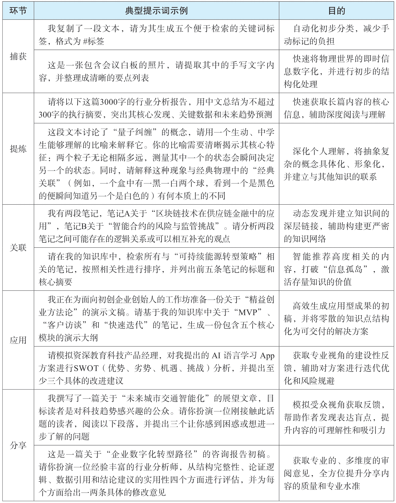

这些提示词旨在启发思路，而非固定模板。在实际应用中，你仍需要根据 AI 模型（如不同模型对中文的理解差异）、个人知识库特性及具体任务需求，灵活调整和优化指令，以获得最理想的效果。

我们要将 AI 视为可以被引导和训练的“智能伙伴”，并通过清晰、具体且包含充分上下文的持续对话，真正激发其潜能，使其成为信息链上不可或缺的一环。

**3.3.5 三步打造轻量级私有知识库**

构建个人知识库不必追求一步到位，更无须将其视为一项宏大工程。成功的实践者往往都从一个“最小可行系统”出发，在实践中逐步迭代与完善。其核心原则是让系统服务于人，而非使人受系统所累。与其追求一个包罗万象、最终因过于复杂而难以维护的“大而全”的系统，不如构建一个规模精练、核心流程完整且真正适合自己的知识库。

以下三步旨在帮助你快速搭建轻量且易于维护的私有知识库，打通信息流动的最小闭环。

**第一步：建立统一的“收件箱”。**

●目的：确保任何有价值的信息和灵感都能第一时间“先捕获，再处理”，避免它们在犹豫和工具切换中丢失。这是对抗信息遗忘的第一道防线。

●做法：设立统一、易于访问的入口，作为所有临时信息的汇集地。它可以是特定的文件夹（如电脑桌面上的“今日阅读”文件夹）、笔记应用中的一个专用笔记本（如系统备忘录中的“快速笔记”），也可以是实体笔记本中的某一页。关键在于，无论信息源自网页剪藏、微信收藏、语音速记，还是纸质书摘录拍照，都应该先将其快速归集到这个“收件箱”中。

**第二步：坚持每日 10 分钟提炼。**

●目的：对“收件箱”中的原始信息进行初步加工，提取核心价值，并附加元数据（如标签），将“数据”转化为易于检索和应用的“信息”。

●做法：每天固定安排 10～15 分钟（如清晨或睡前）处理“收件箱”。此过程可分解为以下几个连贯的动作：

（1）快速回顾：逐条浏览“收件箱”中的所有条目。

（2）AI 交互提炼：对于篇幅较长或不易理解的内容，可通过深度对话高效提炼内容精髓。例如，将一段采访稿复制给 AI，并发出如下指令。

请将这段 1500 字的采访稿总结为三条核心洞见，每条不超过 50 字，并基于这些洞见提出一个具有批判性的问题，帮助我深度思考。

（3）附加标签：建议为每条笔记至少附加两类标签：主题标签，描述内容的核心概念（如#人工智能伦理、#项目管理等）；类型标签，记录信息的原始出处或形式（如#行业报告、#播客笔记、#个人思考等）。

（4）归档或删除：果断舍弃无用信息，并将有价值的笔记移出“收件箱”，归档至知识库的对应位置。

**第三步：每周一次输出。**

●目的：通过输出倒逼输入，将积累的“信息”应用于实践，检验理解深度，完成从知识向“实用知识”的转化。

●做法：每周至少进行一次有意识、基于个人知识库的输出。

（1）选择主题：从最近关注的话题、工作难题或笔记中反复出现的概念里选择一个切入点。

（2）调用知识：利用关键词、标签或 AI 的语义检索功能，快速调出所有相关笔记作为素材。

（3）结构化输出：将零散信息组织成逻辑清晰的内容。推荐以下两种方法：

■费曼式解释：尝试向不熟悉该领域的人解释概念。例如，将“提示词工程”比作在餐厅点餐：“越精准的指令（‘七分熟牛排，不要洋葱’），得到的结果越符合期望。”

■运用经典框架：如采用“陈述—阐释—举例—图示”（SEEI）的分层框架结构。以下是应用 SEEI 框架的典型示例。

主题：知识管理的重要性。

■陈述：有效的知识管理是个人成长与提升职场竞争力的关键。

■阐释：它帮助我们系统化组织、提取和应用所学知识，避免信息过载，提升工作效率和创造性。

■举例：在项目会议中，能迅速引用过去三个月积累的相关案例和数据，可以有效推动决策，展现专业度。

■图示：可用“捕获→提炼→关联→应用→分享”的闭环流程图来直观展示。最终的输出形式可以是短文、博客、播客脚本、幻灯片，甚至是与同事的一次结构化讨论。

（4）回链与标记：将完成的输出成果（如文章链接、文件摘要等）链接回知识库相关的原始笔记中，并标记为“已应用”。这有助于追踪知识的应用情况，形成反馈闭环。

通过以上三步，你就完成了一个最小化的个人知识管理闭环，实践了从捕获、提炼到应用的核心流程。此闭环的精髓不依赖特定工具，而在于流程的搭建和习惯的养成。工具可以随时迭代，但这条核心的信息加工链路，将始终为你服务。

**3.3.6 实践者的常见误区与修正策略**

在构建与维护个人知识库时，单凭热情或仅依赖先进工具均不足以保证成功。实践者常不自觉地陷入认知偏差或养成不良习惯，长期而言，会严重损害知识管理的效率与体验，甚至导致对整个系统丧失信心。因此，识别常见误区并采取相应的修正策略，是确保个人知识库持续高效运转的基础。

**1.误区一：数字囤积——知识库沦为“数字坟场”**

许多用户在信息收集阶段热情高涨，却忽视了后续的整理、内化与应用，导致知识库堆满未经处理的原始资料，难以检索和利用，最终沦为“数字坟场”。这种“只存不理”的习惯的代价是显著的：知识库日益臃肿，信息过载加剧。当需要特定知识时，关键信息被湮没于海量内容之中，检索效率低下。长此以往，易引发认知疲劳与焦虑，甚至影响决策质量。研究表明，数字囤积行为与信息过载、决策疲劳及错失恐惧等因素显著相关。

**修正策略：**实施源头控制与定期清理。首先，建立明确的信息捕获标准，例如仅保留能激发深度思考、与核心目标紧密相关或具有明确应用场景的内容。其次，养成定期清理的习惯，对“收件箱”中失效或无用的信息果断删除或深度归档，可建立“随入随理”或“每周清空”的工作流。保存信息前不妨自问：“此内容的即时价值是什么？”若仅为未来可能用到，可尝试以简短笔记记录核心要点，而非保存全文。

**2.误区二：工具依赖——“最新即最优”的错觉**

面对层出不穷的知识管理工具，部分用户易陷入“工具迷思”，认为最新或功能最强的工具能解决所有问题，因而频繁更换平台或尝试新应用。此行为的代价是高昂的：个人数据散落于多个互不兼容的平台，难以整合；数据迁移耗时耗力，持续学习新工具也挤占了本应用于内容创造与深度思考的精力。最终，“工欲善其事，必先利其器”的初衷，演变为在工具的选购、学习与更换中循环往复，造成严重的精力内耗。

**修正策略：**牢固树立“方法优于工具”的理念。知识管理的核心在于有效的流程与持久的习惯，而非特定的软件，选择一至两款能满足核心需求、顺手的工具即可。关键要确保所选工具支持开放数据格式（如 Markdown、JSON）导出，以保障个人数据的可迁移性与长期所有权。我们应将主要精力投入优化信息处理流程与提升知识内容质量上，而非追逐“完美工具”。

**3.误区三：过度设计——试图一步到位构建“终极系统”**

构建之初，有些人期望过高，试图一次性设计出分类精细、标签完美的“终极系统”。这种完美主义倾向常导致初期投入过高，例如耗费大量的时间规划复杂的文件夹层级或穷尽所有可能的标签体系。其后果是系统过于复杂、难以维护、使用门槛高，极易在初期因进展缓慢和操作烦琐而产生挫败感，最终导致放弃。

**修正策略：**遵循最小可行产品原则（Minimum Viable Product，MVP），秉持“少即是多”的理念。从最简化的流程（如统一的“收件箱”、基础标签体系、固定输出频率）和最少的工具开始，首要目标是让信息链顺畅运转。在实际使用中，再根据遇到的具体问题与新增需求进行迭代优化。一个持续演进的简单系统的价值远超设计完美却难以维系的复杂系统。

**4.误区四：输出缺失——知识沉淀却不流动**

知识库的终极价值体现在知识的应用与创造上。然而，许多用户“重输入、轻输出”，投入大量的时间学习与整理知识，却鲜少将所学付诸实践或与人分享。其代价是知识停滞于输入与整理阶段，难以有效内化为个人能力。由于缺乏应用场景的检验与外部反馈的校正，对知识的理解往往流于表面且易遗忘。长期缺少成果产出，也会削弱维护知识库的动力与成就感，使知识复利效应无法实现。

**修正策略：**将输出视为学习与知识管理的内在驱动力。设定明确、可执行的输出目标与周期，例如“每周撰写一篇学习短文”或“每月进行一次主题分享”，主动将知识库中的积累用于解决实际问题、指导个人决策或进行创造性项目。同时，积极寻求外部反馈，无论是同事的建议、读者评论，还是实践检验，并将外部反馈融入知识库的更新与认知体系的迭代中，形成正向闭环。

**5.误区五：“信息孤岛”——笔记间缺乏有效关联**

若个人知识库中充斥着大量孤立的笔记，彼此缺乏有意义的连接，知识点便如散落的珍珠，无法串联成体现价值的“网络”。这种情况会导致知识难以在不同的概念与领域间建立联系，抑制跨界洞察与创新。检索时，也只能找到片面、孤立的记录，无法展现主题全貌及其在复杂系统中的上下文。

**修正策略：**有意识地培养“建立连接”的习惯。在记录或回顾笔记时，主动思考：“此信息与知识库中的哪些内容相关？它们之间是何种关系（如支持、反驳、引申、案例）？”积极利用笔记工具的双向链接、标签等功能，在相关知识点间建立明确连接，可为每个新知识点建立至少一条与既有笔记的关联。定期借助图谱视图等工具审视知识网络，主动连接“孤立”节点，逐步将点状知识编织成网状结构。

**6.误区六：忽视备份与数据安全——单一存储环境的风险**

个人知识库是沉淀了大量思考与积累的宝贵数字资产。若忽视数据备份与安全管理，这些资产将面临因硬件损坏、软件崩溃、服务商政策变动乃至账户被盗而永久丢失的风险。此外，在使用云端 AI 工具分析或整理个人笔记时，也可能会无意中将个人敏感信息或商业机密上传至第三方服务器，造成隐私泄露的隐患。

**修正策略：**建立并严格执行定期、多重冗余的数据备份制度。对核心数据，应至少在两种不同的物理介质或云存储服务上进行备份（如本地硬盘+加密的云存储）。在选择工具与服务时，优先考虑尊重用户隐私、提供可靠数据导出功能并允许用户完全掌控数据的平台。在使用在线 AI 服务处理敏感内容时，务必仔细阅读其数据使用与隐私政策，尽可能地选择支持本地化部署或提供端到端加密的解决方案，以最大限度地保障个人知识资产的安全与私密性。

**结论：**避免以上误区的关键在于保持理性，坚持以用促学，并确保拥有对个人知识库的最终控制权。一个健康的个人知识管理系统，应该是动态演进、服务于个人成长与价值创造的有机体。

**3.3.7 行动清单：七天启动你的知识引擎**

构建高效的个人知识库并非一蹴而就，但一个结构化的开端至关重要。接下来的内容将帮助你完成一个为期七天的入门实践。这并非一份刻板的清单，而是一次连贯的旅程，旨在帮助你在短时间内搭建个人知识管理的基本框架，并亲身体验结构化信息流的价值。建议根据自身情况，每日投入 1～2 小时，跟随以下步骤开启你的知识体系构建之旅。

**第一天：奠定基础。**

选定核心平台，并建立统一的“收件箱”。首先选择一至两款你认为顺手且能满足核心需求的笔记应用，作为未来知识库的中央载体，并创建明确的“收件箱”，作为所有信息的临时停靠港。随后，熟悉并配置常用的信息捕获工具，例如浏览器的剪藏插件或手机的快捷记录方式，确保无论是网页文章、文档片段，还是突发的个人灵感与语音备忘，都能便捷地汇入统一入口。

**第二天：多源信息捕获与 AI 辅助初体验。**

实践多源信息的捕获，并初次体验 AI 的辅助能力。有意识地从不同的来源捕获至少十条不同类型的信息，并将它们全部置于前一天建立的“收件箱”中。完成捕获后，挑选两三条内容较长或结构较复杂的信息，尝试使用 AI 工具为其自动生成摘要或提取三至五个核心关键词。该练习的目的是，直观感受 AI 在信息预处理环节中作为智能助手所能发挥的巨大作用。

**第三天：首次批量提炼与组织。**

清空“收件箱”，完成首次批量提炼与组织。设定一个固定的工作时长，如 25 分钟的番茄钟，在此期间集中精力处理“收件箱”内的所有信息。你需要对每一条信息进行快速甄别：是保留，还是删除？对于决定保留的内容，则需进行初步提炼，比如用自己的话重述其核心观点，或标记一至三个要点。随后，为这些已提炼的信息标注至少两类标签：一类是揭示内容的“主题标签”，另一类是说明其形式的“类型标签”。本日目标是养成“日清”的习惯，将原始信息转化为结构化的知识雏形。

**第四天：构建知识网络。**

将孤立的笔记连接起来，构建初步的知识网络。从知识库中，特别是前一天处理过的笔记中至少选取二十条，主动思考它们之间的潜在联系：哪些笔记在讨论相似的主题？哪些观点可以相互印证或形成对立？哪些信息片段可以串联成一个更完整的论证链条？尝试在这些笔记之间手动添加双向链接或交叉引用。同时，你也可以选取几组看似孤立的笔记，让 AI 分析其潜在关联，并给出建立连接的建议，从而探索 AI 在辅助知识关联上的潜力。

**第五天：首次主题式应用性输出。**

围绕一个具体问题，完成首次主题式应用性输出。从近期的工作或学习中，选择一个具体问题、希望深入探讨的主题，或反复出现的概念，然后利用知识库的检索功能（如关键词、标签、AI 语义搜索等），调取所有相关的笔记素材。基于这些“原材料”，尝试完成一次小型的应用性输出，如撰写一篇短文、绘制一幅思维导图或准备一份口头分享提纲。此过程是将静态知识转化为动态能力的关键一步。

**第六天：寻求反馈，形成认知闭环。**

主动寻求反馈，形成认知闭环。将前一日的输出成果分享给至少一位你信任的同事或朋友，或在小范围的社群中进行展示。主动请他们给出具体反馈：哪部分清晰易懂？哪部分仍存在疑问？有无不同的观点或可以补充的信息？如果暂时不便与真人分享，可让 AI 扮演不同的角色，如批判性的领域专家或好奇的入门新手，对你的输出内容进行多维度评估并提出修改建议。务必认真记录所有有效反馈。

**第七天：复盘与迭代。**

及时进行复盘与迭代，为长期的知识管理实践规划方向。静下心来，系统性回顾过去六天的完整流程。浏览知识库中捕获、提炼、关联和输出的全部内容，并进行一次深度自省：哪个环节的效率最低、最为耗时或最容易引发困惑？当前选择的工具是否得心应手？建立的流程是否合理？本周的输入与输出是否平衡？从获得的反馈中，你学到了哪些新的认知？基于这些复盘结果，及时调整你的知识管理策略，并为下一周的实践设定具体、可达成的小目标。

完成七日的实践之后，你不仅拥有了一个初具雏形的个人知识库，还亲身体验了信息从“原始素材”到“结构化知识”再到“价值输出”的完整旅程。这是一个需要长期坚持和不断优化的过程，但良好的开端将会为你在 AI 时代构建个人核心竞争力奠定坚实的基础。

**3.3.8 信息链的价值归宿**

在 AI 技术日新月异的当下，获取信息已变得轻而易举，但筛选信息的成本却日益高昂。本章所阐述的“信息链五环模型”正是为应对这一挑战而构建的知识管理闭环，旨在帮助个人建立从原始数据输入到智慧价值输出的完整、高效且可持续的信息处理链路。

捕获环节应广纳博采，利用各类工具与 AI 辅助，确保有价值的素材不被遗漏；提炼环节需要去芜存菁，借助 AI 的文本理解能力，快速萃取核心观点与洞察；关联环节旨在构建知识网络，通过双向链接、标签体系及由 AI 驱动的语义连接，将孤立的知识点编织成动态的知识网络；应用环节以输出为导向，鼓励将知识运用于解决实际问题和创造价值，AI 此时可扮演强大的协作者角色；分享环节则通过与外部的交流互动获取宝贵反馈，驱动知识体系的持续迭代。

在实践中，尤其是在构建轻量级私有知识库时，应遵循“少即是多”的 MVP 原则，从统一的“收件箱”、每日 AI 辅助提炼和每周结构化输出的最小闭环入手，逐步优化。AI 技术能够深度赋能信息链的每一个环节，从自动化分类、智能摘要，到辅助写作与方案生成，再到模拟受众反馈，其潜力巨大。但与此同时，必须警惕数字囤积、工具依赖、输出不足等常见误区，并运用恰当的策略加以规避，确保个人知识管理系统始终服务于核心目标。

最终，当信息捕获拥有了便捷入口，知识提炼获得了 AI 助力，概念关联形成了智慧网络，学习应用融入了实用框架，成果分享建立了有效反馈机制之时，整个学习过程就将从一次性、易遗忘的“信息消费”，真正升级为可持续、能复利的“知识创造”循环。工具会迭代，技术会演进，但这条“信息链五环模型”所倡导的方法论，将构成我们进行知识创造的底层逻辑，指引我们在 AI 时代的浪潮中稳健航行。持续优化此链路，提升其效率、流畅度与智能化水平，个人知识库的价值必将实现指数级增长，持续创造更大的价值。

请始终铭记：信息链的终点不是“整理整齐”，而是“随取随用”，最终服务于价值创造。

**第四章** **架构重塑：解构旧流程，构建新系统**

完成心智重塑并掌握 AI 陪伴式深度学习后，Axton 意识到，仅仅拥有成为“架构师”的意愿和构建个人知识体系的能力是远远不够的。如果无法将抽象的战略意图转化为清晰、可执行的蓝图，任何宏大构想都将停留在纸面上，“勤奋的低效”这一根本困境也无法从根本上被破解，必须深入掌握 MAPS 四维罗盘中的下一个核心维度：架构。

架构如同工作流程的蓝图，确保我们的想法能够转化为可复用、可迭代、可监控的系统。没有架构，使用 AI 时可能仅停留在零散的“技巧展示”层面，效果难以得到稳定和放大；有了架构，AI 才能真正融入流程，成为可指挥、可依赖、能成倍放大生产力的核心单元。

**4.1** **架构思维：从想法到可执行的蓝图**

如何把一个想法变成一份可执行的蓝图？关键在于做出三种决策：做不做（战略层）、怎么做（战术层）和如何持续改进（运营层）。下面我们按这三个层面展开。

（1）战略层：面对重复、耗时的工作任务，如何明确方向并验证可行性？例如，视频制作中的字幕动画调整是否值得投入精力进行自动化？技术上是否可行？

（2）战术层：如何将想法系统化拆解成清晰的执行流程？如何设计人机协作分工？例如，在字幕自动化中，哪些环节由 AI 执行，哪些环节需要人工把关？

（3）运营层：当 AI 执行结果不符合预期时，如何快速定位问题并精准纠错？如何让系统持续迭代优化？例如，当自动化脚本运行效果不佳时，如何通过数据分析找到根源？

为让你切身感受这三个层面的思考过程，下面深入剖析 Axton 的一个真实工作案例——字幕动画批量跟随。

**4.1.1** **一名内容创作者的真实痛点**

2024 年 4 月，Axton 在制作一期视频时，希望为字幕添加一种特别的动画效果：字幕出现时，一个红色小方块随语音节奏逐字出现（图 4-1）。剪辑软件自带的“新年打字机”效果能实现类似动画，但存在一个致命缺陷——动画默认持续时间仅为 0.5 秒，远不够用。要达到理想效果，必须手动将每条字幕的动画时长拉长到与字幕显示时长一致。

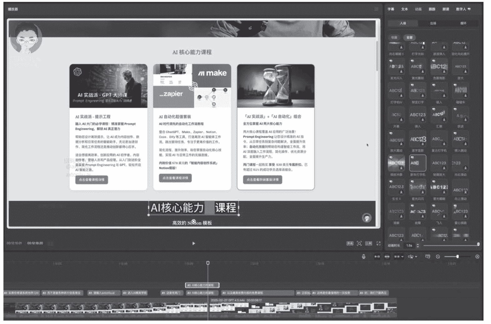

图 4-1

从表面上看，调整字幕动画时长并不复杂。然而，当处理量达到一期视频的数百条字幕时，这项工作就变成典型的低价值重复性劳动。逐一手动修改效率低下（预计耗时 1 小时），更严重的是，它占用了本可用于高价值创作思考的宝贵精力。

面对这一痛点，Axton 没有选择忍受烦琐的重复性劳动，而是开始思考：能否利用 AI 编写脚本来实现批量处理？

这个看似简单的念头，标志着他开始以“架构师”的身份审视问题：正如第二章所讨论的，这是四级协作阶梯模型的最高层级，其中架构师不再满足于充当执行者，而是主动设计流程、调度资源并对结果负责。在接下来的案例中，我们将看到 Axton 如何运用架构思维，将模糊的想法转化为可执行的自动化方案。

**4.1.2** **从想法到方案实现：Axton 的解题之旅**

**1.AI 负责代码，人类负责方案**

在深入剖析 Axton 的解决过程之前，我们有必要先了解一个根本性的范式转移：AI 时代，编程工作的核心价值已从编写代码转向设计系统方案。

软件开发是 AI 能力展现颠覆性影响的先行领域。其最显著的改变之一是编程语言门槛的大幅降低。借助 GitHub Copilot、Cursor 等 AI 编程辅助工具，开发者不仅可获得智能代码补全，还能通过一句自然语言指令生成完整的功能模块。以往需要耗费大量时间的编码实现，如今已能通过简单的指令快速完成。

更进一步，AI 已能接管从需求分析到代码实现再到执行验证的端到端流程。它不仅能生成代码，还能直接运行脚本、执行数据分析，并输出美观的可视化图表。

你可能会问：如果我不熟悉 Python 或 JavaScript，是否仍能驾驭这样的能力？答案是肯定的。当前的主流 AI 已能理解自然语言描述的需求，将你的想法直接转化为可执行代码。例如，你只需提供数据文件，并告诉 AI：“请分析这份数据，并生成一个交互式图表。”短短几分钟后，你便能得到类似图 4-2 所示的完整成果。

于是，一个关键问题随之而来：当 AI 能够如此高效地生成与执行代码时，“会写代码”这一传统技能是否仍然重要？

这种疑虑并非没有依据。AI 对软件开发的冲击，实质上映射了其对所有依赖逻辑推演与问题拆解能力的行业所带来的普遍影响。大量重复性、流程化的初级任务正在被 AI 自动化——那些仅停留在“机械编码”层面、缺乏系统设计与决策能力的从业者，的确面临更高的替代风险。

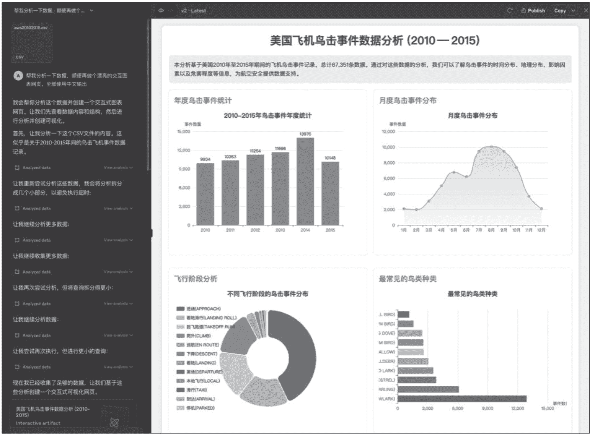

图 4-2

回到 Axton 的字幕案例，让我们看看他是如何应对这一挑战的。

**2.执行、调试和验证**

起初，Axton 对剪辑软件项目文件的格式一无所知，猜测它可能是二进制文件或纯文本。抱着尝试的心态，他直接打开项目文件，结果意外地发现：文件竟然采用标准的 JSON 格式，清晰记录了所有字幕的具体设置和动画参数。这让他信心大增，既然项目文件是 JSON 格式的，批量修改字幕动画的目标便具备可行性。明确方向后，他立即将详细的需求和文件结构整理成清晰的任务说明，并交由 AI 生成基础的 Python 脚本。

AI 迅速生成一段代码，基本上实现了文件读取、修改 JSON 字段和保存逻辑。Axton 阅读后认为思路可行，便直接执行脚本，然而剪辑软件中的效果并不如预期。

接下来，进入关键的调试环节。他打开 JSON 文件，逐条核对字幕参数与字段，仔细分析 AI 修改的部分。果然，AI 对动画时长字段的理解有误，修改了错误的字段。

明确问题后，他立即向 AI 提供准确的反馈：“错误，对于动画时长，应修改另一个字段。”AI 根据反馈迅速修正脚本逻辑，再次执行脚本后，批量修改成功。打开剪辑软件确认，字幕动画完美匹配语音节奏，最终的效果完全符合最初的设想。

从“手动操作 60 分钟”到“脚本自动化 5 分钟”，显著的效率提升有效验证了该方案的价值。

**3.价值何在**

回顾整个过程，可将其分为三个阶段。

（1）验证可行性：尽管 Axton 起初不了解项目文件的具体情况，但他能提出清晰的思路和设计方向，快速验证方案的可行性。

（2）AI 辅助编码：方案明确后，他借助 AI 快速生成代码的初始版本。AI 在此展现了强大的执行力，节省了大量基础编码时间。

（3）人工调试纠错：初步生成代码后，他深入分析文件、定位具体问题，并清晰反馈给 AI，由 AI 迅速调整代码，最终实现目标。

整个过程带来的核心启示：在 AI 时代，编程工作的价值已不再局限于单纯编写代码。由于 AI 能够快速高效地完成大部分基础编码任务，因此仅掌握语法编写的价值正趋于零。那么，知识工作者应如何体现其核心竞争力？

答案就体现在上述任务的第一阶段（验证可行性）和第三阶段（人工调试纠错）。我们能否提出有效思路？能否快速验证方案可行性？当出现问题时，能否迅速定位关键问题、做出正确判断，并指导 AI 进行调整？

在 AI 时代，提出有效思路、快速验证方案、精准定位问题的能力，才是真正体现专业价值的关键。

**4.1.3** **解构案例：架构师的三层思考**

下面我们使用一套立体思维模型来系统复盘 Axton 的思考过程。该模型包括如下两个互补视角。

●纵向视角（三层架构）：战略—战术—运营，帮助我们厘清项目从“为什么做”到“如何做”再到“如何优化”的完整生命周期阶段。它回答的是“在哪个层面思考”的问题。

●横向视角（设计原则）：拆分—通信—权衡，指导我们在任一阶段的具体执行和落地。它回答的是“如何具体设计”的问题。

沿着纵向的三个层面，我们逐步解构这一案例，并在战术层深入学习其横向设计原则。

**1.战略层：明确方向与可行性验证**

核心问题：这个问题是否适合自动化？是否可行？是否值得投入精力？

在这个层面，你需要从更高的角度来思考方向和可行性。这不仅涉及技术判断，还需要广泛的领域知识、探索精神和直觉洞察。架构师必须善于从现象背后发现机会，并通过最小化实验快速验证方案的可行性，避免在错误的方向上浪费资源。

（1）明确方向与价值。

Axton 投入时间解决此问题的动机，不仅是节省 1 小时，还是为了将宝贵的精力从重复性劳动中解放出来，以投入更高价值的内容创作中。这是战略层最重要的“为什么”——明确事情值得做的根本原因。

（2）发现机会与验证可行性。

起初，Axton 并不清楚剪辑软件的项目文件是否可直接编辑。他只是基于对软件工具的直觉（“也许可以？”）和好奇心，尝试打开项目文件，结果发现它是可编辑的 JSON 文本。

这里的关键并非“打开文件”这一动作的复杂性，而是思维模式的转变：从被动接受软件限制的“使用者”转变为主动探寻系统可用性、挑战默认流程的“架构师”。这正是一种敏锐的洞察力——善于从“不得不如此”的现象背后发现“也许可以那样”的机会，并快速确认其潜力。

有了猜想后，Axton 并未立即动用 AI 大规模编写代码，而是先进行一项最小化实验：备份原始文件以控制风险，然后手动修改一条字幕数据，再导入验证。这一快速、低成本的验证方法，先于任务自动化开发，证明了方案的有效性。

值得注意的是，该剪辑软件的项目文件在后续某次更新中采用了加密机制，不再支持直接进行文本编辑。这也提醒我们，在设计自动化解决方案时，需要提前预估平台可能的变化，采用更灵活和可扩展的架构，以降低未来平台升级带来的风险。

战略层的核心价值在于“谋定而后动”，帮助我们界定问题、评估价值并验证可行性，避免在错误的方向上浪费时间和精力。

**2.战术层：设计流程与角色分工**

核心问题：确定方案可行后，如何将任务细分为清晰流程？哪些工作由 AI 执行，哪些由人工介入？数据与信息如何流转？

在这个层面，你需要把抽象的想法拆解成可具体执行的流程，确保人机协作流畅高效。这正是架构师所需要的核心能力——将复杂的问题拆解为可管理、可执行的流程。

在战术层的设计过程中，有三个关键原则指导我们做出正确决策。下面让我们看看这些原则在字幕案例中如何发挥作用。

（1）原则一：拆分（Split）——管理复杂性的第一步。

针对字幕自动化任务，Axton 首先将其拆分为职责清晰、功能独立的模块。他将整个任务拆分为三个清晰的步骤：

●步骤 1：读取原始 JSON 文件并自动备份。

检查点：文件是否存在且格式正常？

●步骤 2：根据人工定义的规则批量修改字幕时长字段。

检查点：人工抽查数据，确认逻辑无误。

●步骤 3：写回新 JSON 文件中。

检查点：新文件能否被剪辑软件正确加载并生效？

这种拆分带来三个关键好处：

●降低认知负担：每个模块仅关注一个清晰的目标。

●便于调试：如果出错，可以快速定位问题模块。

●支持复用：成功的模块（如文件备份逻辑）可以在其他项目中重复使用。

拆分的本质是通过建立清晰的边界来管理复杂性。若缺少这一步，任何项目都可能会迅速演变为难以维护的“大泥球”，系统中任何微小的改动都可能引发全局连锁反应，最终让人望而却步。

（2）原则二：通信（Communication）——让模块协作形成合力。

将任务拆分为模块后，它们并非孤立存在。Axton 的第二个关键任务是设计模块间的数据流转路径和接口规范，定义它们如何“对话”、如何协作。

在字幕自动化案例中，这体现在如下步骤中：

●步骤 1 到步骤 2 的接口：“读取模块”输出标准的 JSON 对象，供“修改模块”直接使用。

●步骤 2 到步骤 3 的接口：修改后的数据仍保持 JSON 格式，“写入模块”无须进行格式转换。

Axton 在设计战术层时确保每个模块明确声明：它期待接收什么格式的输入，承诺输出什么格式的结果。这种明确的“契约”使模块能像乐高积木一样灵活组合，避免出现“一个模块无法理解另一个模块输出”的混乱局面。

通信设计的本质是让独立模块无缝协作。若缺乏对“通信”的精心设计，各模块将成为“数据孤岛”，结果必然是需要大量低效、易错的人工干预来进行“复制—粘贴”式的连接。这正是 Axton 最初陷入“勤奋的低效”困境的根源。

（3）原则三：权衡（Trade-off）——在约束中做出最优决策。

这是最具挑战性，也最能体现架构师价值的一项原则。在字幕自动化案例中，Axton 面临多个需要权衡的决策点。

●权衡 1：完全自动化 vs 保留人工检查点。

Axton 可以让脚本直接修改文件，一步到位，但他选择在步骤 2 后插入人工检查点：抽查几条数据，确认修改逻辑无误后再继续。

■收益：牺牲少量时间（几十秒），大幅降低“批量出错”的风险。

■成本：从“5 分钟全自动”变为“5 分钟+30 秒人工确认”。

●权衡 2：工具选择——Python 脚本 vs 插件。

理论上，Axton 可以花时间研究剪辑软件的插件开发文档，开发“一键调整”插件，但他选择更简单的 Python 脚本方案。

■收益：开发时间从“可能数天”缩短到“几分钟”。

■成本：在未来，如果剪辑软件更新导致 JSON 格式变化，脚本可能会失效（但风险可控）。

●权衡 3：代码质量——生产级 vs 一次性脚本。

Axton 可以要求 AI 生成包含完善错误处理、日志记录、配置文件的“生产级”代码，但他选择“能用就行”的简单方案。

■收益：避免过度设计，快速达成目标。

■成本：代码可维护性降低（但对一次性任务来说，这不是问题）。

权衡的本质是在现实约束下寻找最优解。架构师必须要在性能、成本、可扩展性、可靠性、交付周期、可维护性等相互冲突的目标间做出决策。

（4）战术层的完整实践。

回到字幕案例，Axton 在战术层完成的工作可以总结为如下内容。

●在任务拆解方面，他采用拆分原则，将任务拆分为读取、修改、写入三个独立模块。

●在模块接口设计上，他采用通信原则，统一使用 JSON 格式传递数据。

●在自动化程度方面，他基于权衡原则，保留人工检查点，平衡效率与风险。

●在工具选择上，同样基于权衡原则，他选择简单的脚本而非复杂的插件。

●在代码质量方面，他再次权衡，选择“够用”而非“完美”。

同时，他还明确了清晰的人机分工。

AI 的角色：负责重复、规则明确的工作，如读取文件、批量修改数据、保存文件，作为高效的执行者。

人类的角色：定义清晰的规则和工作流程；提供精准指令（提示词）；在关键节点进行检查与确认，确保 AI 执行无误。

战术层的核心价值在于：把抽象的问题拆解成可具体执行的流程，确保人机协作流畅高效。而“拆分—通信—权衡”三项原则，正是指导我们做出正确战术决策的核心方法论。

**3.运营层：调试、反馈与迭代优化**

核心问题：系统运行后，如何监控效果？出现问题时，如何快速定位和修正？如何持续优化系统，使其越来越高效？

在实际执行阶段，难免会出现问题，因此需要持续监控、精准定位问题并快速迭代。这不仅考验你的逻辑分析能力，还考验你的快速学习和反馈优化能力。

（1）由数据驱动的调试与纠错。

回顾字幕案例，首次运行 AI 脚本时效果并不理想。Axton 没有盲目重试，而是仔细对比原始文件与修改后的文件，精准定位问题根源——AI 修改了错误的 JSON 字段。这体现了架构师关键的纠错能力——通过分析数据来快速定位问题，而不是盲目尝试。

（2）精准反馈与快速修正。

找到问题根源后，Axton 立刻将具体的修正方向反馈给 AI：“错误，对于动画时长，应修改另一个字段。”AI 接受反馈后迅速调整，最终实现目标。

这体现了高效反馈的价值——精准、可操作的信息能推动系统快速迭代。

（3）量化收益与持续迭代。

从“手动操作 60 分钟”到“脚本自动化 5 分钟”，量化收益有效验证了方案价值，为后续投入提供了依据。同时，预见未来变化（如文件可能加密）并提前考虑系统的适应性（如模块化结构便于后续迭代），体现了架构师的前瞻性思维和持续优化能力。

运营层的核心价值在于，搭建良好的反馈迭代循环，确保系统不断进化，持续适应内外部变化。

**4.1.4** **从案例到方法：架构思维的完整工具箱**

通过字幕自动化案例，我们完整经历了架构师的思维过程。

在战略层，我们学会了如何评估想法的可行性与价值，如何通过最小化实验快速验证方案，核心解决“为什么做”和“是否可行”的问题。

在战术层，我们掌握三个核心设计原则。

●拆分：通过明确边界划分，有效管理复杂任务的执行逻辑。

●通信：通过标准化接口设计，实现各模块的无缝协作。

●权衡：在资源、效率等现实约束下，做出最优决策。

这三个原则共同回答了“如何做”的问题。

在运营层，我们学会了通过数据分析快速定位系统问题，通过精准反馈推动系统迭代优化，通过量化收益验证方案的实际价值，重点解决“如何持续优化”的问题。

这三个层面构成了完整的架构思维框架——它不仅指明了“在哪个高度上思考”（如在战略、战术、运营上思考等），还提供了“如何具体设计”的执行原则（如拆分、通信、权衡等）。

更重要的是，这套思维方式具备极强的迁移性。

●适用于任何需要系统化解决的问题，无论是编程、内容创作，还是业务流程优化。

●不依赖具体的技术工具，是一种通用的问题解决框架。

●可帮助你将与 AI 的单点协作升级为可管理、可优化、可扩展的系统化协作。

这三层思考维度与三大设计原则，恰恰对应了 AI 时代尤为宝贵且难以被 AI 替代的人类核心能力。在 MAPS 四维罗盘中，这正是“A（架构）”维度的核心能力——将抽象战略转化为可执行蓝图的系统化方法。

掌握这套思维工具后，我们便可以着手应对真正的挑战：重构那个曾耗时四至五天的内容创作工作流。

**4.2** **架构设计的核心原则：资产化思维**

在 AI 能力快速扩张的时代背景下，许多知识工作者面临根本性的方向困惑。这种困惑常常演变为“被取代”的焦虑，并催生了两种无效的应对模式。

●因恐惧而“按兵不动”：迟迟不愿拥抱新工具。

●在旧赛道上“盲目加速”：试图在单一技能上与 AI 直接竞争。

这两种模式的本质，都是对范式转换的迟疑。然而，一个不可逆转的现实是：从纯粹的能力竞赛角度来看，纠结于“是否会被取代”已失去意义。

一个持续追踪顶级 AI 模型表现的项目，长期公布 AI 模型在挪威门萨（Mensa Norway）在线智商测试上的得分。根据其 2025 年 9 月的数据：多个顶级 AI 模型的得分已分布在人类平均智商（100 分）基准线附近，其中部分顶级模型的表现甚至进入高分区。需要强调的是，我们引用此例并非为了证明 AI 已具备全面智能——Mensa 官方也提示其在线智商测试不等同于正式入会测试，而是为了揭示一种比分数更重要的趋势：按照当前的迭代速度，AI 在越来越多的独立技能上的表现正以指数级提升，并将超越大多数人的水平。

因此，问题的关键早已不是“如何不被 AI 替代”，而是在一场纯粹的能力竞赛之外，找到新的价值定位。我们亟待回答的新问题是：如何将 AI 的强大能力转化为放大自身价值的有效途径？

这个问题的答案就藏在一个根本性的范式转变中：当 AI 能力快速提升时，个体与 AI 的关系已从“技能比拼”转变为“系统协作”。

技能比拼：关注“这件事我能不能做好”，其成果是消耗性的——每次产出都需要重新投入。

系统协作：关注“如何构建可持续产生价值的系统”，其成果是可积累的——一次投入可以持续产生价值。

这种从“单次产出”到“可积累系统”的转变，正是指导架构设计的核心原则——资产化思维。

**4.2.1** **什么是资产化**

资产化是一种将一次性、消耗性的“单次产出”，系统性转化为可沉淀、可复用、可规模化“资产”的思维模式与实践方法。它要求我们将工作成果从高度依赖个人即时参与的“服务”转变为一经创造便能独立或半独立持续产生价值的“产品”。

为更深刻地理解这一概念，我们来看一组对比。

●消耗性的单次产出：一位大厨凭借其精湛的手艺完成一道菜。一旦他休息，这道菜的出品便会中止。他的技艺是一种高度个人化、即时消耗的产出。

●可复用的资产：同一位大厨将制作这道菜的全部流程、配方、火候控制等关键参数精确记录并优化为一份标准操作规程。这份“食谱”便是一份“资产”，任何受过训练的厨师都能依据它稳定复现菜品。

要完成从“单次产出”到“资产”的转化，需要经历三个关键步骤。

**1.抽象化**

从具体、一次性的产出中抽象出可复用的结构、模式或规则。例如，从一条针对特定视频的提示词中，提炼出“［主题］+［风格］+［约束］”结构的通用模板。

如果不进行抽象化，我们只能拥有一堆孤立、针对特定情境的解决方案，每次遇到新问题时都需要从零开始。抽象化让我们看到表面差异背后的共性，为复用奠定基础。

**正面案例：**从十条成功的视频脚本中，抽象出“问题引入+痛点共鸣+解决方案预告”的通用三段式模板。

**反面案例：**保存了十条完整的视频脚本，但从未总结其共性，每次写新脚本仍需从零开始构思。

**2.标准化**

为抽象出的模板建立清晰的使用规范和参数接口，确保他人（或未来的自己）能够稳定复现。例如，明确每个模板参数的取值范围、适用场景和预期效果。

抽象化提供了“复用的可能”，标准化才能保证“复用的质量”。如果没有清晰的规范，同一个模板在不同人手中会产生不同的结果，资产的价值会大打折扣。

**正面案例：**为“三段式”模板制定详细说明——问题引入应在 30 秒内完成，痛点共鸣需使用第二人称“你”，解决方案预告要包含具体收益。

**反面案例：**只告诉别人用“三段式”模板，但对每段的长度、语气、重点等毫无说明。结果每个人的实现都不一样，效果参差不齐。

**3.系统化**

将资产纳入可管理、可迭代的体系，建立版本控制、性能追踪和持续优化机制。例如，为提示词模板库建立使用日志，并根据实际效果不断迭代优化。

前两步创造资产，而系统化让资产“活起来”。缺少系统化管理，资产会逐渐过时、失效，甚至被遗忘。

**正面案例：**记录每个模板的使用次数、成功率、用户反馈，并每月进行回顾，淘汰低效模板，优化高频模板。

**反面案例：**创建 50 个模板后就不再管理。半年后，没有人知道哪些模板还有效，哪些已经过时，最终大家都不敢用。

**4.2.2** **资产化的评估标准**

要将资产化思维落地，需要一套清晰的标准来审视和诊断工作流中的每一个环节。一项产出是否具备“资产”属性，可以从以下三个维度进行评估。

**第一，可复用性（Reusability）：**该成果能否在未来的不同任务中，以最低的修改成本被重复使用？例如，一个标准化的视频封面模板，远比每次都从零开始设计更具资产价值。

可复用性的本质是用“一次投入”换取“多次产出”。高度可复用的资产能够在多个场景中被反复调用，每次调用的边际成本趋近于零。这正是“资产”区别于“产出”的核心特征。

**第二，可组合性（Composability）：**它能否像乐高积木一样，作为标准模块与其他组件灵活拼接，共同构建更复杂的系统？例如，一项功能独立、用于自动提取文章摘要的 AI 服务，可被无缝嵌入内容研究、初稿撰写、社交媒体宣发等多个流程中。

可组合性的本质是通过模块化设计实现指数级价值增长。当每种资产都能与其他资产自由组合时，系统的能力不是简单的叠加，而是呈现组合爆炸式增长。这是构建复杂系统的基础。

**第三，可衡量性（Measurability）：**能否通过明确的指标来衡量其性能和产出质量？例如，对一系列标准化的提示词，持续追踪其生成内容的“一次通过率”或“用户满意度”，并据此进行迭代优化。

可衡量性的本质是建立反馈闭环以实现持续进化。没有衡量，就无法知道资产的表现如何，也就无法优化。可衡量性让资产从“静态存在”转变为“动态进化”。

资产化思维如何指导“拆分—通信—权衡”？

资产化思维并非独立于三层架构之外的，而是贯穿于整个设计过程的核心指导思想。

●在“拆分”时：它要求我们不仅要为解决眼前问题而拆分，还要识别哪些模块具备长期复用潜力，应被设计为独立、通用的资产。

●在“通信”时：它要求我们建立标准化、文档化的数据接口，确保资产间的“对话”可预测、可复用，而非临时、不可靠的连接。

●在“权衡”时：它引导我们在决策天平上为能沉淀为长期资产的方案增加权重，优先选择有利于积累和复用的路径，而非仅仅追求短期速度的权宜之计。

掌握这套思维工具后，我们就可以从资产化的视角，对当前工作流进行一次彻底的审视与诊断，开启真正的系统化重构。

**4.3** **案例分析：解构 Axton 的手动工作流**

掌握了架构核心原则与资产化思维后，Axton 决定将内容创作工作流作为首个改造对象，进行一次彻底的解构与诊断。他运用全新的“架构师”视角，重新审视那个曾耗时四至五个工作日的漫长流程。

**4.3.1** **旧流程：“手工作坊”式的线性生产**

Axton 此前的手动工作流是典型的以“手工作坊”模式运行的线性生产流程。

**第一阶段：选题构思与资料搜集——**一场没有地图的探险。Axton 的选题高度依赖突发灵感，资料搜集则像在信息的海洋中漫无目的地打捞。他会投入大量的时间研读数十篇中英文报告与行业资讯，然而这些宝贵的资料最终却以独立文件的形式散落于本地文件夹中，彼此孤立，难以关联、检索与复用。

**第二阶段：逐字稿撰写——**低效重复劳动的集中体现。Axton 需要在不同的 AI 工具间反复切换——在 A 模型中构思提纲，再手动将结果复制并粘贴到 B 模型中生成初稿。尽管 B 模型生成的是格式化的 Markdown 文本，但在将其复制到本地编辑器时，仍可能因平台兼容性问题丢失格式，需要耗费大量的时间进行人工检查和重排。

**第三阶段：图表制作——**为增强视频的说服力。Axton 需要为每个核心论点寻找配图，需要在无版权图库中反复筛选，或者在 AI 绘画工具中多次输入对画面风格、构图与元素的描述，并反复调试。整个过程充满不确定性且耗时巨大。

**第四阶段：录制、剪辑与后期——**最终环节充斥着重复性和机械劳动的消耗。为数百条字幕逐一添加和调整动画效果、手动标记视频章节、为不同发布平台撰写内容摘要等，每一个动作都在持续消耗他宝贵的创作精力。

**4.3.2** **诊断框架：三类可复用资产**

为对上述工作流进行系统化诊断，我们需要一个清晰的分析框架。在 AI 加持下，现代知识工作者可创造并管理以下三类核心可复用资产，如表 4-1 所示。

表 4-1

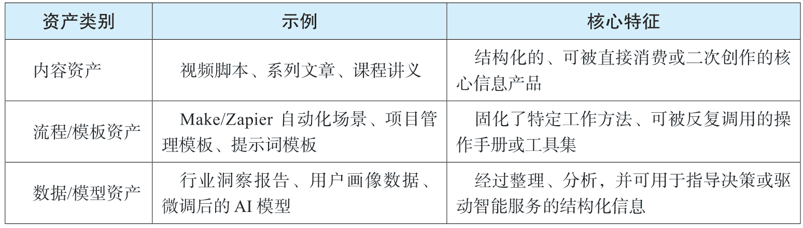

这三类资产各有其独特的价值定位，相互关联，共同支撑起高效、可持续的工作系统。内容资产是直接面向受众的价值交付，一篇优质的深度文章可以被改编为视频脚本、社交媒体短文、播客大纲等多种形态。流程/模板资产将隐性的工作方法显性化、标准化，一个优秀的提示词模板能让团队中的每个人都稳定地生成高质量的内容。数据/模型资产则为决策提供事实依据，一份经过深度分析的行业趋势报告可以指导未来半年的内容策略。

这三类资产共同构成了衡量工作流产出价值的“试金石”。一个高效、先进工作流的标志是，在每个关键环节都有意识地沉淀、复用和增强这三类资产，而非仅仅追求单次任务的完成。

**4.3.3** **诊断过程：用资产化思维审视每个环节**

Axton 运用资产化的评估标准（可复用性、可组合性、可衡量性），并对照上述三类资产的定义，对他的旧流程进行逐一诊断。

**第一个环节：选题构思与资料搜集。**

这个环节的产出是一个临时的选题想法和一堆散乱的本地文件。

这些产出完全不具备资产属性。它们既不是结构化的内容资产，也不是标准化的流程/模板资产。其可复用性和可组合性几乎为零。

**第二个环节：逐字稿与配图。**

在这个环节中，成功的提示词未被纳入版本化管理，导致高质量的文案风格或图片效果无法凭借相同的参数稳定复现。

这些产出虽然完成了任务，但其创作过程（如在 AI 工具间手动复制粘贴）是随机、不可复现的，未能沉淀为任何流程/模板资产（如高效的提示词模板）。这仍是典型的“单次产出”。

**第三个环节：录制、剪辑与后期。**

这个环节中充满大量可被标准化的重复性工作（如字幕制作），但在旧流程中，这些劳动完全是消耗性的，没有形成任何可以自动执行的流程/模板资产。

尽管使用了剪辑软件内置的语音识别功能来生成字幕初稿，但由于识别质量不佳，仍需花费大量的时间进行逐句人工校对。更重要的是，校对完成的字幕被直接“烧录”在视频中，并未导出可独立编辑和复用的 SRT 等格式的中间文件。

**4.3.4** **架构缺陷定位：从“现象”到“归因”**

为什么旧流程无法产出资产？运用架构设计的核心方法可以定位其根本缺陷。

**1.选题构思与资料搜集环节的缺陷**

从拆分的角度看，“采集”（抓取/存档）与“整理”（摘要/标签）两项认知任务未进行分离，导致采集过程中注意力被频繁打断与分散。

从通信的角度看，缺乏“资料卡片”式的标准字段规范（如来源、日期、主题、可信度等），致使信息无法以结构化的方式传递。

从权衡的角度看，为追求“随手收藏”的短期便利，牺牲了长期构建资料库（数据资产）所带来的可复用价值。

**2.逐字稿与配图环节的缺陷**

从拆分的角度看，任务虽已初步拆分并由不同工具执行，但缺乏参数面板或模板机制来固化已被验证的成功经验。

从通信的角度看，缺乏可在不同环节间传递、标准化的背景资料包或图片生成参数文件。

从权衡的角度看，过度追求单次产出的“灵感效果”，而未将“输出的可复现性”确立为优先目标。

**3.录制、剪辑与后期环节的缺陷**

从拆分的角度看，字幕的“校对”与“格式化”是规则明确的子任务，未能将其从创造性的核心剪辑工作中有效抽离。

从通信的角度看，从文稿到最终字幕的转化过程，缺乏标准化的中间文件（如 SRT 文件）作为“接口”，导致字幕资产无法沉淀和复用。

从权衡的角度看，为追求内置功能的“一键式”便利，牺牲了工具的开放性与外部流程的可组合性，导致自动化上限受到限制。

**4.3.5** **设计输入清单：为“内容引擎 1.0”明确需求**

本次诊断的最终目的是，为接下来的“内容引擎 1.0”蓝图设计提供一份清晰、可执行的设计输入清单。它将诊断出的核心问题逐一转化为明确的改造需求与可衡量的成功指标，如表 4-2 所示。

表 4-2

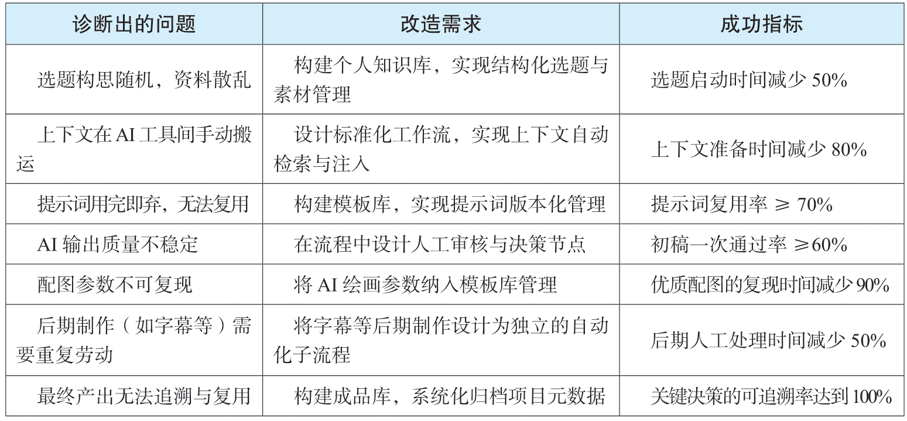

这份清单既是对旧“手工作坊”模式的系统性复盘，也是一份目标明确、可量化的行动指南。它将直接指导“内容引擎 1.0”蓝图的详细设计。

从该诊断过程可以看出，架构思维的核心价值不仅在于发现问题，还在于将问题转化为可执行的改造方案。通过资产化的视角，我们不再满足于“完成任务”，而是追求“在完成任务的同时，沉淀可复用的资产”。这种思维的转变，正是从“工具使用者”向“架构师”转变的关键。

**4.4** **蓝图设计：构建“内容引擎 1.0”**

在完成对旧流程的系统性解构与诊断后，Axton 手中已经有了一份清晰的设计输入清单。这份清单不仅是对“勤奋的低效”这一困境的深刻复盘，还是一份目标明确、可执行的行动指南。此刻，他将以“架构师”的身份正式踏入四步跑道中的“设计”步骤。

然而，在着手绘制具体的流程图之前，他意识到必须先回答一个更根本的设计哲学问题。

当我们将架构视角引入内容创作时，关注点便从“如何写出好内容”扩展到“如何设计高效、稳定且能兼顾质量与规模的内容生产系统”。在这个系统中，AI 不再仅仅是“写作助手”或“灵感来源”，还是可被整合、调度、优化的核心生产力单元。

这引出了架构思维在内容创作领域需要解决的核心矛盾：当 AI 能够轻易实现内容的批量生产时，我们该如何平衡效率与质量？人类创作者的独特价值，如情感共鸣、审美判断、价值观传递等，在由 AI 驱动的内容流水线中应处于什么位置？

这些问题的答案就是“内容引擎 1.0”的核心设计哲学，它确保我们构建出的系统不仅高效，还能持续产出富有“人味”的优质内容。

**4.4.1** **设计哲学：规模化生产与人文审美的平衡**

AI 在内容创作领域产生的最直观的冲击，莫过于其惊人的规模化生产能力。

显而易见的趋势是，借助 AI 和自动化工具，理论上可以在短时间内生成成百上千篇营销文案、社交媒体帖子甚至短视频脚本。权威研究机构的报告也指出，AI 在各类复杂基准测试上的表现持续提升，语言理解和生成能力实现飞跃，甚至在某些标准化写作（如议论文）的质量评分上超越了人类。这种能力对于追求效率和覆盖面的商业应用场景（如新闻快讯、产品描述、SEO 文章等）具有巨大的吸引力。过去需要一个团队数周才能完成的内容铺量工作，现在可能一个人加上 AI 就能在几天内完成。效率和规模，是 AI 赋予内容创作最直接的优势。

然而，当内容生产的门槛被 AI 大幅降低时，“量”的激增也带来对“质”的拷问。

●AI 生成的内容能否真正拥有打动人心的力量？

●在追求效率的自动化流水线上，如何保留创作者独特的风格、情感和价值观？

当每个人都能用 AI 快速产出“合格”的内容时，内容同质化成为必然趋势。各大平台逐渐充斥着结构近似、措辞相仿的“套路化”内容，这虽然满足了某些功能性需求，但也让真正独特、有深度的创作显得尤为可贵。

这正是架构思维在内容创作领域需要解决的核心矛盾之一。一个优秀的内容创作架构，不应只追求效率，更需要在流程中为“人”的创造性留出空间。

**1.AI 的优势与局限：效率机器与情感真空**

AI 的强项在于处理结构化信息、模仿已有模式、快速整合资料，并生成符合特定格式要求的文本。它擅长完成有明确规则、重复性高的任务，比如根据模板写周报、总结会议纪要、生成产品功能介绍，甚至创作格式工整但可能缺乏新意的诗歌。总的来说，AI 的优势体现在速度、一致性和知识覆盖面上。

然而，AI 也存在明显的局限性。即使当前最先进的模型，在深层次创意、个性化表达、复杂情感共鸣、微妙语境把握，以及责任归属与信任建立等方面，仍有不足。AI 可以模仿情感的表达方式，但由于缺乏真实的生活体验和情感积淀，其输出的情感往往流于表面，缺少打动人心的力量。它也难以进行真正的价值观判断和伦理考量，甚至可能产生“幻觉”，捏造事实。内容策略师 Ines Lee 将 AI 比作“技术精湛但缺乏原创灵魂的翻奏乐队”，技巧无可挑剔，却缺少即兴创作的灵动感。

**2.人类创作者具有不可替代的价值**

当 AI 能够轻松完成“60 分”甚至“80 分”的基础内容创作时，人类创作者的价值重心便向更高层次转移。这些价值正是 AI 难以复制的灵魂所在。

●独特视角与深度洞察：AI 可以整合信息，但难以提出真正原创、基于个人独特经历和思考的见解。你的个人故事、专业背景与生活感悟，都是 AI 无法拥有的素材库。

●情感连接与共鸣：优秀的内容往往能触动读者的情感。人类创作者能够凭借自身的同理心和情感体验，创作出引发共鸣、建立信任的内容。观众能分辨出真挚情感和 AI 模仿的空洞字句，这种情感的温度和真实感是 AI 目前难以赋予的。

●文化理解与语境把控：人类创作者能深刻理解文化背景、价值观、幽默和禁忌，确保表达得体且具有感染力。AI 对文化的理解往往停留在表面，容易在复杂语境或跨文化交流中出错。李子柒的成功在很大程度上源于她对中华文化的深度体验和创造性诠释，而这正是 AI 无法模拟的。

●审美判断与风格塑造：艺术风格、语言节奏、视觉美感等涉及主观审美的部分，仍然需要人类来主导。AI 可以模仿风格，但难以创造出真正引领潮流或高度个性化的审美表达。你的独特“签名式”风格本身就是一种竞争力。

●价值观表达、信任构建及伦理把关：内容传递的价值观和创作者的立场态度，是吸引和凝聚受众的关键。内容的社会影响和伦理责任最终也需要由人来承担，以确保其符合规范并传递积极的价值观。

**3.从哲学到实践：人机协同的设计逻辑**

认识到人与 AI 各自的优势和局限后，一个清晰的结论自然浮现：高效的内容创作架构必然走向人机协同。

这不是妥协，而是在现实约束下的最优解。如果追求极致的自动化，内容便会失去打动人心的灵魂，沦为千篇一律的模板化产物；如果拒绝 AI，则会在效率竞争中落后，被善用工具的创作者甩在身后。只有让 AI 承担“骨架”与“填充”，让人类把关“灵魂”与“价值观”，才能在规模与质量之间找到可持续的平衡点。

这一设计哲学会贯穿于 MAPS 四维罗盘的各个维度，并在其中找到具体的落地路径。

●心智层面：需要重新定位 AI 的角色。AI 不再是一种威胁，而是效率的放大器，但它无法替代人类在情感、创意和伦理方面的独特价值。建立这种双重认知，既能善用其工具价值，也能守护人类在情感、创意与伦理上的独特优势。

●架构层面：体现为“人机协同”的工作流设计。AI 负责规则明确、重复性高的环节，如信息搜集、资料整理、初稿撰写等；人类则在 AI 输出的基础上注入观点、情感和风格，并在最终发布前进行稿件质量和伦理把关。关键在于，在自动化工作流中，需要刻意设置“人类审核与决策”的节点，以确保效率但不牺牲质量。一个典型的流程可能是：AI 生成初稿→人工审校并注入个人风格→AI 辅助排版与发布。

●提示词层面：在设计指令时，除明确任务外，也应包含对语气、风格、价值观、受众与文化背景等的“软性约束”，以引导 AI 输出更贴近人性化与场景需求的内容。即便如此，AI 的产出仍需要人的最终判断与调整。

●系统层面：意味着将优化后的“人机协同”流程固化下来，通过工具串联各个环节，并建立数据反馈机制（如效果分析、用户反馈），以持续迭代流程与提示词。该系统的目标不是“无人化”，而是“让人专注于最具价值的决策环节”。

AI 带来的规模化生产能力是内容创作领域不可忽视的趋势，但这并不意味着人文审美的消亡。恰恰相反，当“量”变得廉价时，“质”——尤其是那些蕴含人类智慧、情感和独特审美的作品——将变得更加珍贵。当同质化内容泛滥时，真实性、原创性、情感连接和深度思考将成为内容创作者的核心竞争力。

真正的挑战在于如何设计出智慧的架构，让 AI 的效率与人类的创造力协同增长。这种“人机协同”的设计，本质上正是架构师在权衡原则下的具体实践：我们主动选择牺牲一部分极致的自动化效率来换取内容品质、人文审美与伦理安全等更重要的长期价值。

**4.4.2** **“内容引擎 1.0”架构蓝图**

在“人机协同”这一核心设计哲学的指引下，Axton 开始为其全新的内容创作系统绘制一份可执行的架构蓝图，并将该系统命名为“内容引擎 1.0”。

需要说明的是，本节呈现的是一份概念设计蓝图。它描绘了系统的理想形态与完整架构，并非一份可立即照搬实施的操作手册。其具体的实现细节，包括完整的参数配置、错误处理与实战落地等，将在第六章中展开。

**1.关键设计思想**

首先需要明确支撑系统的几个关键设计思想。这些思想不仅是技术选型的依据，还体现了架构师如何用系统化的方式，将抽象的设计哲学转化为具体的解决方案。

第一个是 RAG。这是整个流程的基石，旨在解决“AI 输出质量不稳定”和“资料散乱”的问题。系统并非让 AI 凭空“回忆”，而是先通过搜索引擎抓取与主题相关的最新网络信息，再将这些信息作为上下文提供给 AI。RAG 是目前业界公认的、有效降低 AI 内容“幻觉”的核心技术之一，有助于确保最终内容的准确性与时效性。

第二个是端到端的草稿自动化（End-to-End Draft Automation）。该设计思想旨在根治“上下文在 AI 工具间手动搬运”这一核心痛点。系统无缝连接研究、整合与撰写三个环节，将模糊的“想法”直接转化为结构化的“草稿”，最大限度地减少由人工干预导致的时间损耗与格式错误。

第三个是人在环路（Human-in-the-Loop，HITL）。这是“人机协同”理念最直接的体现。流程的终点是生成“草稿”，而非直接“发布”。这是一种刻意的设计，以确保最具价值的审核、修改与发布决策由人类创作者掌握，从而在规模化生产与人文审美之间取得平衡。

将这些设计思想作为指引，“内容引擎 1.0”的架构蓝图逐渐清晰：它由三大资产库与标准化的工作流组成，旨在将内容创作从线性的“手工作坊”模式重塑为模块化、可持续积累价值的生产体系，如图 4-3 所示。

**2.核心资产库定位**

蓝图的基础是三个相互支撑、功能明确的核心资产库。

**个人知识库：**结构化的知识与信息中心。个人知识库承载第三章构建的信息链成果。它旨在解决“选题随机、个人洞察易丢失”的痛点。它遵循信息链五环模型，将原始素材、深度研究笔记、行业数据与个人洞察统一收纳，采用标准化标签和双向链接组织，并支持 AI 语义检索。在理想状态下，系统可从中自动检索相关主题的历史积累，为新内容注入创作者的独特视角。这里沉淀的是能够直接指导决策的数据资产。

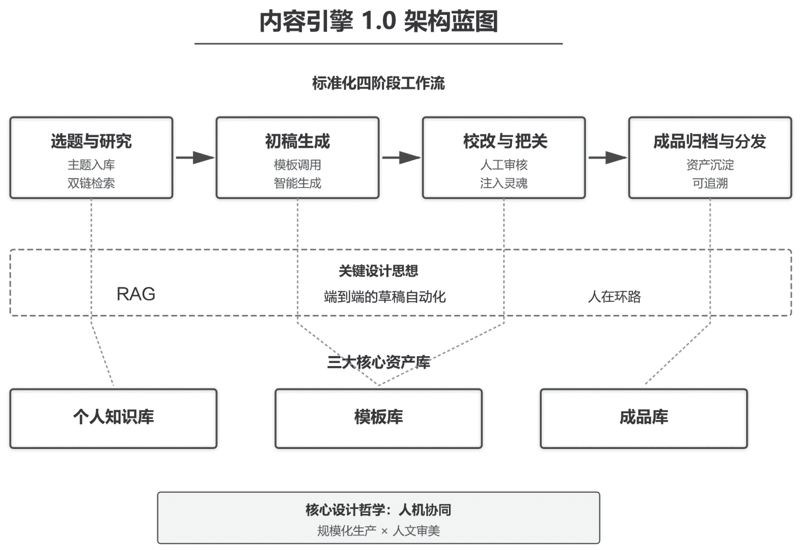

图 4-3

**模板库：**可复用的流程与标准。模板库旨在解决“提示词用完即弃”与“配图参数难复现”的问题。所有经过实践验证且有效的模板，包括文本提示词、视频脚本结构、封面设计规范和 AI 绘图参数等，都被标准化收录并实行版本化管理，固化为可复用的流程资产。

**成品库：**可追溯的成果与数据沉淀。成品库实现了从“一次性交付”到“长期资产”的转化。所有已发布的视频、文稿、图片均以结构化方式归档，每个项目均记录其源文件、所用模板版本与关键数据，为未来内容的快速复用和持续优化提供坚实基础。这里积累的是可被直接消费或二次创作的内容资产。

**3.标准化工作流设计**

标准化工作流负责串联三大资产库，并将混乱的手工作业转为清晰的四个阶段，如图 4-3 所示。

第一阶段：选题与研究。流程始于 Axton 输入一个明确的“主题”。系统随即从个人知识库中检索相关的历史笔记与个人洞察，同时调用外部搜索引擎抓取与主题相关的最新网络资讯。这种“个人积累+实时资讯”的组合，既确保了内容的独特视角，又保证了时效性，摆脱了此前“选题随机、资料散乱”的困境。系统采用 RAG 技术，将检索到的信息整合为结构化的研究素材。

第二阶段：初稿生成（调用模板库）。系统从模板库中调用最匹配的提示词模板和脚本结构模板，将第一阶段的研究素材作为上下文，驱动 AI 高效生成初稿。这种组合既保证了内容的质量，又通过标准化模板确保了风格一致性，使“提示词用完即弃”的窘境成为过去。

第三阶段：校改与把关（应用 HITL）。AI 生成的初稿进入人工审核环节，Axton 作为“总编辑”，依据 HITL 原则对观点、与目标受众的契合度、风格一致性与引用准确性进行审校。这是“人机协同”设计哲学的直接体现，为 AI 输出质量不稳定的问题提供了最终保障。

第四阶段：成品归档与分发（写入成品库）。发布内容连同其生产过程的生产元数据，包括使用的模板版本、引用清单、数据表现，都将被系统化归档至成品库。这些数据不再是“用完即弃”的副产品，而是成为可供未来调用、分析和迭代的资产。例如，六个月后，当 Axton 想优化某个系列视频或文章的表现时，他可以精准回溯到每个决策节点，而不必依赖模糊的记忆重新摸索。

针对后期制作重复性劳动的问题，可将视频生成字幕等重复性工作，设计为独立、可自动执行的子流程。子流程本身也是一种可复用的流程资产，其生成的标准化产物（如 SRT 格式的字幕文件）也将一并归档，从而将后期制作环节纳入资产化管理。

**4.人机分工边界清单**

为在实践中更好地落实“人机协同”理念，以下清单明确了 AI 与人类在“内容引擎 1.0”中的职责边界，如表 4-3 所示。

表 4-3

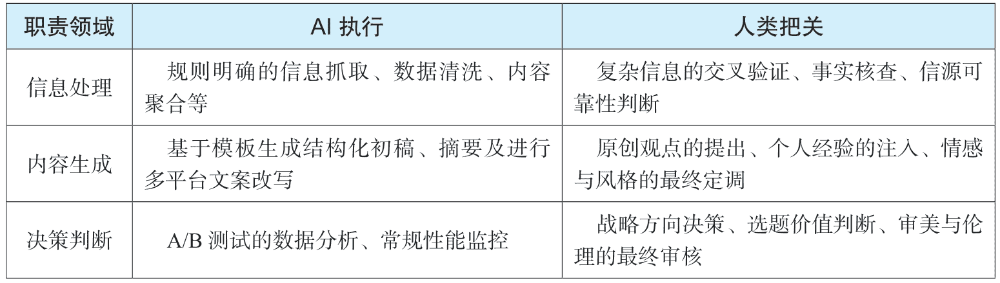

**5.从概念到实践的桥梁**

通过“内容引擎 1.0”架构蓝图，Axton 首次将自己从重复性劳动中抽离，真正站在了架构师的高度。他不再思考如何完成单个内容，而是重点设计持续输出高质量内容的系统。

需要说明的是，这份蓝图描绘的是系统的理想形态。在实际落地时（“内容引擎 2.0”），需要根据技术可行性与实施成本进行务实的权衡。例如，当将个人知识库与自动化流程深度集成的技术复杂度较高时，首个落地版本可能会优先采用更直接的方案——完全依赖实时网络搜索来保证时效性，而将个人知识库作为创作者人工参考的辅助工具。这是典型的“先跑通核心，再迭代优化”的架构决策。

但无论如何权衡，这个从“解构”到“重塑”的过程，已经清晰展现了架构思维的核心价值。这份蓝图定义了系统模块、数据流转与人机分工，是通往系统化实践的起点。

**第五章** **提示词工程：人机对话艺术**

完成“内容引擎 1.0”的架构设计后，Axton 面前有了一份清晰的执行蓝图：三大资产库的定位、标准化工作流的逻辑、人机协作的边界，都已明确。从理论上讲，他已经完成从“想法”到“设计”的跨越。然而，当他准备将这份蓝图付诸实践时，很快遇到了新的障碍。

按照蓝图设计，在“选题与研究”阶段，系统应该先从个人知识库检索相关笔记，再调用搜索引擎抓取最新资讯，最后将二者整合为结构化的研究素材。其逻辑完美，思路清晰，但当 Axton 打开 AI 对话框，准备让 AI 执行这一环节时，他发现自己不知道该如何下达指令。

“帮我搜索关于量子计算的最新进展”？太模糊了，AI 给出的结果往往是泛泛而谈的科普文章，而非他需要的行业洞察。

“请分析量子计算在金融科技领域的应用前景，重点关注风险管理和算法交易，需要包含最新的学术研究和商业案例”，这看起来详细多了，但 AI 的回复依然让人失望：有时偏离重点，有时引用过时信息，有时干脆编造不存在的“案例”。

问题的根源逐渐浮现：蓝图语言和 AI 语言是两套完全不同的话语体系。

架构蓝图使用战略层面的抽象概念：检索、整合、生成。这些词汇对人类架构师来说一目了然，但对 AI 而言却含混不清。AI 需要的是精确、可执行、没有歧义的指令。就像必须将建筑师绘制的设计图纸转换为施工队能看懂的施工图一样，Axton 意识到，他需要掌握一门新的语言——一种能将战略意图精准转换为 AI 可执行指令的语言。

更让 Axton 感到困扰的是，每次与 AI 对话都像一场赌博。同样的问题，今天能得到结构清晰、引用准确的分析报告，明天可能就收到逻辑混乱甚至包含虚假信息的内容。这种不稳定性，让他无法放心地将关键环节交给 AI。如果 AI 连基本的准确性和稳定性都做不到，即使架构蓝图再完美，也只是空中楼阁。

Axton 清晰地认识到：他已经完成从“想法”到“设计”的跨越（对应 MAPS 中的 A），但要真正让系统运转起来，他必须要跨过另一道门槛，学会用 AI 的语言将蓝图中的每一个环节转换为精准、可靠、经济的执行指令。

Axton 的困境，也是我及无数实践者曾面临的核心挑战。要跨越它，就必须进入 MAPS 四维罗盘的第三个维度——提示词（P），以及四步跑道的第三步——对话（Dialogue）。

提示词是我们与 AI 进行结构化对话的语言，是一门融合了逻辑、语境与目标的工程艺术。下面我们将系统学习如何构建高效、稳定、可靠的提示词，确保发出的每一条指令都能被 AI 准确理解和执行，将 AI 从偶尔带来惊喜的智能伙伴转变为稳定交付预期成果的专业执行者。

那么，如何才能实现这种高质量的对话呢？科技思想家凯文·凯利早已给出了方向。他说：“未来人们需要学习的第一个技能，就是如何提出好问题。”自 ChatGPT 等大语言模型普及以来，我越来越深刻地理解这一点。因此，尽管我也热衷于探索层出不穷的新型 AI 工具，但我的注意力始终聚焦于理解 AI 的内在本质——它们如何工作？我们如何更有效地与之沟通，从而释放其最大潜力？

通过学习与实践，我逐渐认识到，凯文·凯利所说的“好问题”包含两个层面的核心能力。

第一个层面是如何提出真正有价值、有深度的好问题。凯文·凯利在其著作《必然》中写道：“一个好问题可能是机器最后也无法学会的一项工作，一个好问题就是人类存在的目的。”这种能力与我们的思维模式紧密相连，涉及批判性思维、创造性思维及洞察问题本质的能力，要求我们从纷繁复杂的信息中识别出关键所在。

第二个层面是如何将我们脑海中的好问题清晰地表达出来。这正是提示词工程（Prompt Engineering）所要解决的核心命题。清晰的表达本身就是一项需要刻意练习才能掌握的技能。这并不令人意外，即使在日常的人际沟通中，很多人也常常难以准确、完整地将自己的需求传达给他人。我曾有多年的软件需求分析经验，对此深有体会：一个看似简单的用户需求背后，往往隐藏着诸多需要被明确和澄清的细节。

有人可能会认为，随着 AI 技术的飞速发展，模型日益智能，我们不再需要精心设计提示词，因为 AI 越来越能理解我们的意图。我的看法不同，正如人类语言已经存在数千年，但高效、精准的沟通依然离不开结构清晰、逻辑严谨的表达一样，在 AI 能够完全读懂我们的想法之前——如果那一天真的会到来——锤炼自身清晰表达问题的能力的重要性丝毫不会被削弱。

需要强调的是，提示词工程是艺术与科学的结合，而非精确的数学。大语言模型本质上是基于概率生成文本的，这意味着即使对于完全相同的提示词，在不同时间或细微上下文变动下，模型也可能会给出不同的回答。优化提示词的过程，是在不断逼近我们期望的结果，提升获取理想输出的概率和一致性，但并不能保证 100%的复现性。因此，本章后续案例中展示的提示词及其效果均基于特定情境，读者在实践中应理解这种固有的不确定性，并通过不断的测试和迭代找到最适合自己需求的提示词策略。

本章将系统梳理提示词工程的核心概念、关键技术与实战案例，为你提供一套清晰、实用的应用指南。在 MAPS 四维罗盘中，提示词是连接心智与架构并最终实现系统化的关键一环，是我们与 AI 进行有效沟通、实现人机深度协作的核心语言。

**5.1** **提示词基石：写得“对”**

要让 AI 准确理解我们的意图，首先必须把提示词写“对”。这里的“对”，并非指语法或拼写层面的正确，而是指提示词在结构上的清晰、完整与信息上的无歧义。它是所有高级提示词技巧的基石，也是我们与 AI 高效协作的起点。

正如计算机科学中的经典原则“Garbage in，garbage out”（垃圾进，垃圾出）所揭示的，如果输入的提示词设计不佳，输出的结果必然难以令人满意。结构正确的提示词，如同清晰的行动指南，能引导 AI 减少不必要的推测，直达目标。因此，学习如何精心设计结构正确、要素完备的提示词，是每个高级 AI 用户必备的技能。将任务要求与背景信息用清晰、准确且重点明确的语言组织在提示词中，这并非易事，但对于让 AI 生成符合预期的结果而言，其重要性不容忽视。

**5.1.1** **从 ICE 到 RICE：提示词的基本框架**

要想确保提示词结构清晰完整、信息上无歧义，我们需要一套可靠的构建提示词的方法。在提示词工程实践中，业界总结出一套行之有效的核心要素，其中最为基础且广为人知的是“ICE 三要素”：指令（Instruction）、上下文（Context）和示例（Example）。这三个要素如同支撑提示词结构的三根支柱，能帮助 AI 准确理解我们的意图，并提升输出的质量和一致性，如图 5-1 所示。

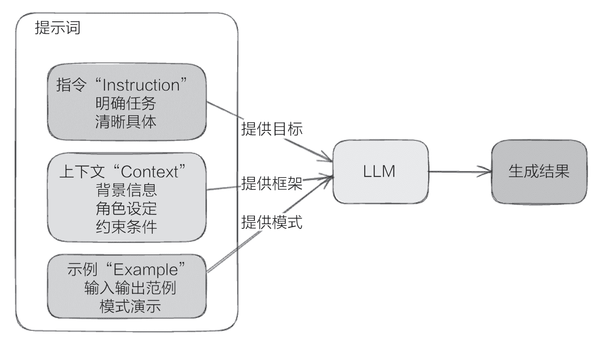

图 5-1

更进一步，为了应对需要模型展现特定“人格”或专业视角的复杂场景，我们在 ICE 的基础上扩展出“RICE 框架”，即加入角色（Role）的设定。

无论是 ICE 三要素还是 RICE 框架，其核心目标是一致的：为 AI 提供结构完整、信息充分的输入，让它准确理解我们的需求，减少不必要的猜测，提升输出质量。

理解并善用这些要素，是将提示词写得“对”的系统性方法。它能帮助我们建立重要的基准认知：正确的提示词=明确的角色+清晰的指令+必要的上下文+有效的示例。掌握这一基础框架，就等于拥有了确保 AI 准确执行指令的“脚手架”，迈出了与 AI 高效协作的第一步。

**1.指令——明确“要干什么”，提示词的灵魂**

指令是提示词的核心驱动力，直接定义模型需要执行的具体任务。一条清晰、明确且无歧义的指令，是获取高质量输出的首要条件。如果指令含糊不清，就如同给 AI 委派一项边界不清的工作任务，它会凭借自己的“理解”填补信息空白，导致最终交付的结果偏离预期。

要做到指令“清晰明确”，可遵循以下原则。

**（1）明确性：**使用简洁、直接的语言，避免使用模棱两可或具有多种解释的词汇。Anthropic 的官方指南也将“清晰、直接、详细”列为首要原则，并建议像对人下达指令一样明确。例如，与其说“给我一些关于苹果公司的信息”，不如明确指出“请提供苹果公司最近一个财年的营收数据、主要产品线及其市场份额”。

**（2）具体性：**明确任务的范围、目标和期望的输出形式。任务描述越具体，模型产生误解的可能性就越小。例如，与其要求 AI“写一篇关于环保的文章”，不如具体说明“请撰写一篇面向中学生的，关于‘减少塑料污染’的科普文章，字数为 800～1000 字，包含至少三个具体可行的建议，并附上两个相关的数据来源。”

**（3）动词主导：**提示词中的核心指令通常以清晰的行动性动词开始，如“生成”“总结”“分类”“翻译”“比较”“解释”“评估”“重写”“提取”“分析”“预测”等。OpenAI 官方也强调，明确的动词命令是提示词最重要的成分。

**（4）单一职责：**尽量避免一条指令中包含多个互不相关或逻辑层次复杂的任务。如果确实有多个子任务，最好使用编号、分点或其他结构化的方式清晰列出，或者将复杂任务拆分为多个独立的提示词进行分步处理。这有助于模型逐一聚焦并准确完成每个子任务。

**（5）术语定义：**在使用专业术语或可能存在多种含义的词汇时，如果担心 AI 理解出现偏差，最好事先进行定义。例如，当我们提到“提高 PR”时，AI 可能会理解为公共关系（Public Relations），而我们想表达的是提升个人最好成绩（Personal Record）。在关键任务中，预先定义核心术语，是确保人机双方在同一认知频道上沟通的有效方法。

遵循以上五个原则，即可构建出清晰、明确的指令，这也是“信息无歧义”在指令设计中的具体体现。通过明确性、具体性、动词主导、单一职责和术语定义，能最大限度地减少 AI 对语义的误解和猜测。

**2.角色——定义 AI 的“扮演者”，赋予其输出特定的视角与风格**

在 RICE 框架中，角色设定用以明确指示模型在当前任务中需要扮演的特定身份或人格。它通常被置于指令之前，也可作为上下文的一部分被强调。例如，你可以让 AI 扮演“一位拥有三十年临床经验的心血管内科专家”“一位擅长用通俗语言解释复杂经济现象的诺贝尔经济学奖得主”或者“一位幽默风趣的单口喜剧演员”。

赋予模型清晰的角色能极大地提升输出的针对性，帮助 AI 自动调整语言风格、语气语调、专业术语的使用、知识的侧重点及思考问题的角度，使其输出更符合特定的场景和受众的需求。一个恰当的角色设定，能让 AI 的回答更具代入感、专业性和说服力。

这一点已在多个研究中得到验证：要求大语言模型在回答时扮演某个角色，是提升输出质量的有效策略。其背后的机制可以这样理解：在 AI 的海量训练数据中，同一个问题本就包含不同角色、不同背景的人给出的回答。因此，当我们为 AI 设定明确的角色时，它就能更专注于调用和模仿与该角色相关的文本风格和知识体系来生成回答，从而有助于提高回答的准确性和可信度。

一个生动的例子能很好地说明这一点。在创建提示词时，运用“扮演”手法是一项非常实用且效果显著的技能，操作起来也非常简单，通常只需要在提示词中清晰地告知 AI：“请你扮演 XX 角色”。让我们来看一个经典的例子：问 AI“如何把大象放进冰箱？”

如果不给 AI 设定任何角色，它通常会识别出这是一个脑筋急转弯，并给出相应的戏谑式回答。AI 的输出效果如图 5-2 所示。

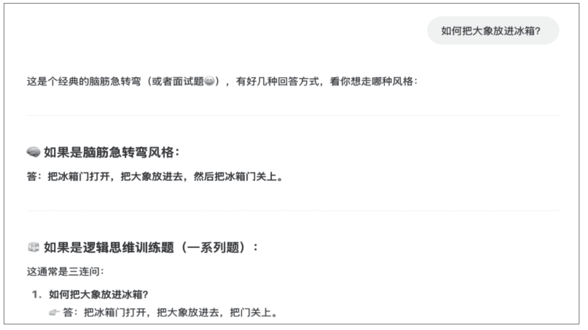

图 5-2

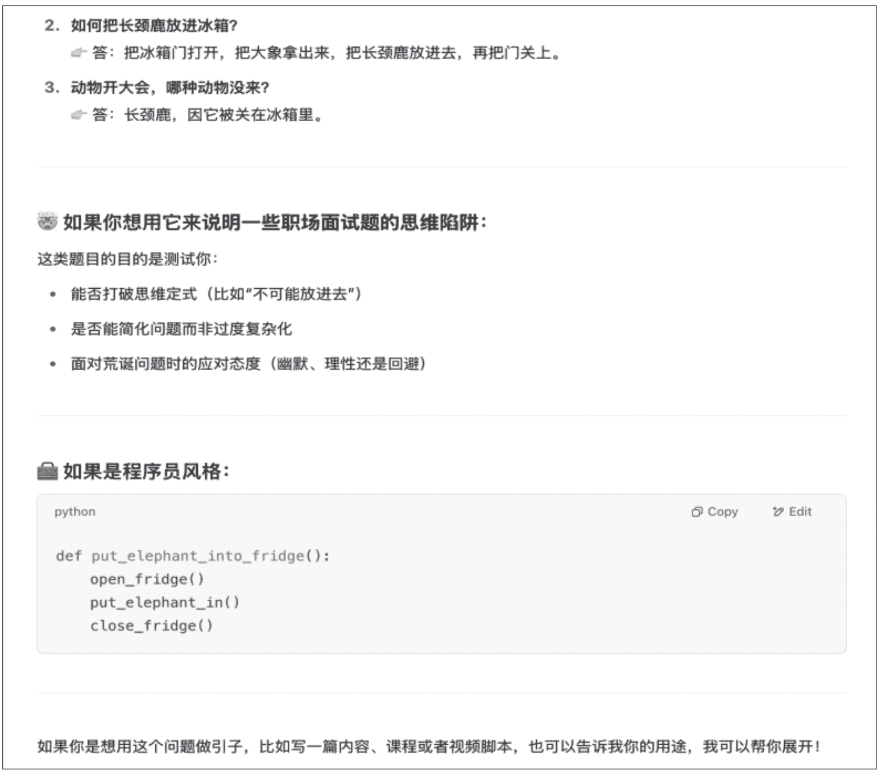

图 5-2（续）

接下来我们尝试给 AI 设定角色，将提示词修改为：“请作为一位生物学家，告诉我如何把大象放进冰箱？”这一次，AI 的回答就完全不同了，它会从生物学和伦理学的角度严肃地探讨这个问题的不可行性。

AI 的输出效果如图 5-3 所示。

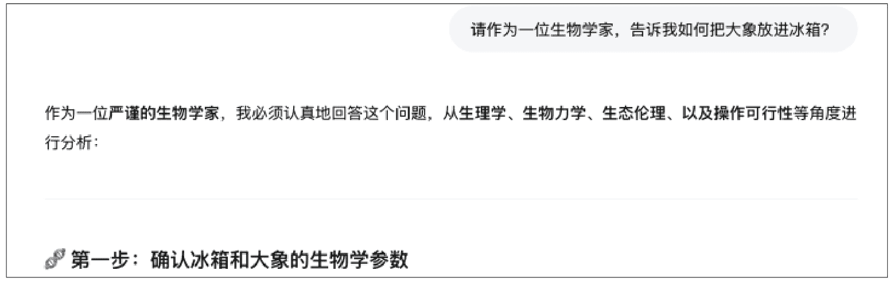

图 5-3

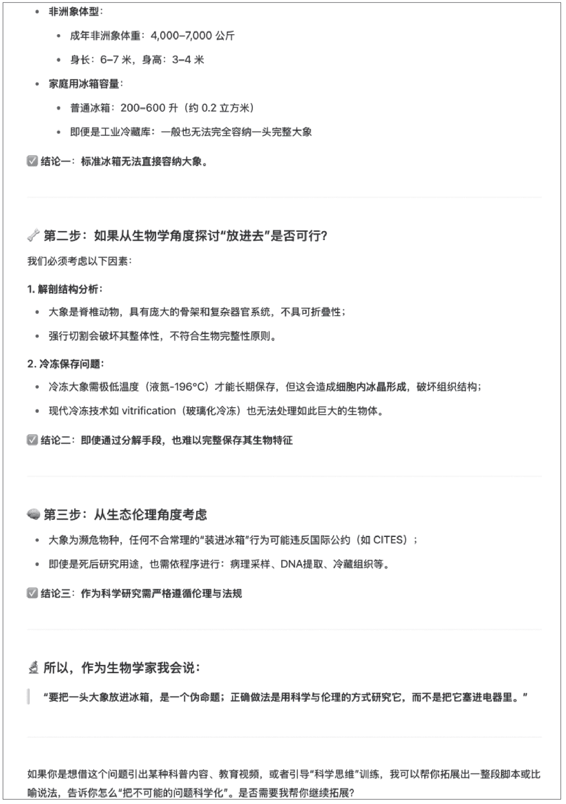

图 5-3（续）

这个例子清晰地展示了角色设定的作用。通过简单的身份设定，就能引导 AI 从完全不同的认知框架出发，获得更符合专业需求、逻辑严谨的回答。

要设定有效的角色，可以从以下几点入手。

**（1）具体化与情境化：**角色描述应尽可能地清晰具体，不仅包括职业，还包括经验水平（如初级、资深、顶级专家等）、性格特点（如耐心细致、言简意赅等）、专长领域（如专注于人工智能伦理研究的法学教授）等。

**（2）与任务目标对齐：**确保设定的角色与当前的核心任务目标高度相关，并且能够为任务的完成提供积极辅助，避免设定与其无关或可能产生干扰的角色。

**（3）考虑目标受众：**角色设定也应间接考虑内容的最终受众。例如，如果受众是儿童，那么让 AI 扮演“和蔼可亲的幼儿园老师”通常比扮演“严肃的科学家”更合适。

遵循以上三个原则，我们便能为 AI 设定清晰、恰当的角色。精准的角色设定，本质上是在为 AI 的输出预设明确的“视角坐标系”，界定 AI 以何种专业深度、语言风格和思维方式来处理指令。这正是“结构上的清晰完整”在视角定义层面的体现：通过角色设定，为提示词增加一个关键语境维度，让 AI 不仅知道“做什么”（指令），还明确“以什么身份做”（角色），从而进一步减少误解的空间。

**3.上下文——提供“必要背景”，提示词的骨架**

如果说指令是提示词的灵魂，那么上下文便是其骨架。它为模型执行指令提供必要的背景信息、相关数据、约束条件或特定视角，帮助模型更好地理解任务所处的具体环境。模型虽然知识广泛，但对于我们提出的具体问题，它是一个“局外人”。提供充足且相关的上下文，能让 AI 更精准地定制回答，不需要凭空猜测我们未言明的意图，从而显著提高输出的准确性和相关性。

有效的上下文通常包含以下几个方面。

**（1）背景信息：**提供与任务直接相关的背景知识、事实数据、事件经过、相关文档摘要或当前情境的描述。例如，在要求 AI 分析某公司财报时，除了提供财报，还可以补充该公司所处行业的发展趋势、主要竞争对手的近期动态等信息。

**（2）目标受众：**明确生成内容的最终阅读者或使用者是谁。他们的知识背景、兴趣点及期望从内容中获取什么，都将影响模型调整语言的复杂程度、专业深度和表达风格。例如，“这份技术文档的目标读者是没有任何编程基础的市场营销人员”和“这篇论文的读者是计算机视觉领域的资深研究员”，对 AI 的输出要求显然不同。

**（3）输入数据：**这是用户提供的需要模型进行直接处理或分析的具体信息或原始材料。例如，在要求模型对一段文本进行情感分析时，这段文本本身就是核心输入数据。如果输入数据过长，超出模型的单次处理能力，则可能需要分段提供，或者先让 AI 对其进行摘要。

**（4）约束条件：**明确任务执行过程中必须遵守的限制或规则。这可以包括内容方面的限制（如“不得涉及任何个人隐私信息”“避免使用带有攻击性的语言”等）、资源方面的限制（如“必须在 1000 字以内完成”）或来源方面的限制（如“只能使用提供的三篇参考资料”）等。

**（5）相关对话历史：**在多轮对话中，之前的交流内容自然构成当前提示词的上下文，AI 通常会参考这些历史信息来理解当前指令。需要注意的是，模型的上下文窗口是有限的，过长的对话历史可能会导致早期信息被“遗忘”。因此，在关键节点适时地在新提示词中重申或总结核心上下文信息，是一种有效的策略。

一份详尽的上下文，是确保提示词“信息上无歧义”的关键所在。通过系统地提供背景信息、目标受众、输入数据、约束条件和对话历史，我们为 AI 构建了一个清晰的信息环境。这不仅为 AI 推理提供了坚实基础，还避免了因信息缺失导致的凭空猜测，使其能够生成更具相关性、更符合具体情境的精准回答。

**4.示例——示范“期望格式与思路”，提示词的参照物**

示例是提示词的参照物，向模型直观展示任务的期望行为模式、回答的格式、特定的语言风格或解决问题的思考路径。

这种提供示例的方法，在提示词工程中被称为少样本提示（Few-Shot Prompting）。模型通过观察和模仿提供的一两个示例，在当前语境下进行上下文学习（In-Context Learning，ICL），可以更好地完成类似的新任务。对于那些模型不熟悉、需要特定输出格式或者包含复杂隐含逻辑的任务，提供高质量的示例往往能起到“四两拨千斤”的效果，能显著提升输出的准确性和符合度。

要提供能真正起到示范作用的有效示例，需遵循以下几个关键原则。

**（1）代表性：**示例应该能够清晰、准确地展示任务的本质特征和期望的输出模式，应选择能够典型反映任务需求和预期答案规律的例子。

**（2）一致性：**示例的输入输出格式、语言风格以及所体现的逻辑关系，都应该与我们对新任务的期望保持高度一致。如果要求最终输出为 Markdown 格式的列表，那么示例也应该采用同样的格式。

**（3）质量为王：**一个精心挑选的优质示例（如准确、清晰、无误导性等），其效果可能胜过多个随意挑选的平庸示例。错误或低质量的示例会严重误导模型，导致其学习到错误的模式。

**（4）数量适度：**示例的数量并非越多越好。通常从一个（One-Shot）到少数几个（Few-Shot，一般不超过 5～10 个）开始尝试。过多的示例可能会增加提示词的长度，消耗更多的 Token（语言模型处理文本的基本单位，中文可译为词元、标记或令牌），甚至可能因为信息过载而干扰模型的注意力，使其难以抓住核心模式。

**（5）格式清晰：**在提供示例时，务必使用清晰的标记来区分“输入”和“期望输出”。例如，可以使用“输入：［示例输入内容］输出：［示例输出内容］”这样的结构，或者用特定的标签如<input>…</input>和<output>…</output>来包裹，这有助于模型准确理解示例的对应关系。

通过提供结构清晰的示例，我们为提示词的“结构完整性”增添了强大的约束。示例不仅定义最终输出应有的“形态”，还展示从输入到输出的“转换逻辑”，从而极大地减少了信息传递过程中的歧义。它将抽象的指令要求具象化为可供模仿的标杆，确保 AI 能够以我们期望的方式完成任务。

**5.提示词的第一性原理：清晰明了，重点明确**

在了解了 RICE 框架的四个核心要素后，我们需要理解一个贯穿所有要素的根本原则：无论是 ICE 三要素还是 RICE 框架，也无论我们提供了多少上下文和示例，提示词本身必须清晰明了、重点明确。这是确保 AI 准确理解意图的“第一性原理”。

（1）清晰明了：无歧义的精准表达。

清晰明了意味着我们需要用精确、无歧义的语言来表达需求。人们常常以为自己已经把需求说得很清楚了，但从 AI（或另一个人）的角度来看，可能仍然存在许多模糊之处。以软件开发为例，如果用户提出“我希望在系统出现错误时，能及时显示警告信息”，这听起来似乎很直接。但作为开发者，我会立刻想到一系列需要澄清的问题：是所有错误都要显示警告，还是只有特定级别的错误需要警告？“及时”的具体时间标准是什么？警告信息应该以何种形式、在何处显示？具体内容又是什么？对 AI 的提示也同理，每一个可能产生混淆的细节，都会导致其输出偏离预期。

构建结构清晰的提示词，是提升其明确性的有效手段。在提示词中，使用明确的分隔符来区分不同的内容部分（如指令、上下文、待处理文本、示例等），是一种非常有效且被广泛推荐的技巧。这有助于 AI 更准确地解析提示词的结构，理解各个部分的含义和作用。

常用的分隔符包括：

●三重引号：＂＂＂。

●三个反引号：```。

●三个破折号：---。

●XML 标签：<tag>…</tag>（如<text_to_summarize>…</text_to_summarize>）。

在这些分隔符中，XML 标签因其本身可以携带语义信息而具有独特优势。例如，我们可以用<role>程序员</role>来界定角色信息，这样既起到了分隔作用，又明确了该部分内容的含义。当然，分隔符的选择是灵活的，关键在于醒目且不与正文内容混淆。例如，如果你的背景信息使用 Markdown 格式提供，就需要避免使用“#”作为分隔符，因为“#”在 Markdown 格式文本中会被当作标题使用。

当然，现代大语言模型的理解能力已经相当强大，即使我们不使用特殊分隔符，仅依靠自然的段落和空行，在多数情况下 AI 也能正确理解提示词的结构。但我仍然强烈建议养成使用分隔符的习惯，尤其是在处理包含多个复杂组成部分或大量文本的提示词时。这就像在代码中使用良好的缩进和注释一样，能极大地提高提示词的可读性，有效避免 AI 对意图的误解。

（2）重点明确：聚焦核心的高效沟通。

我们强调要提供充足的细节和上下文，但这并不意味着提示词应该冗长、啰唆或漫无边际。好的提示词在提供必要信息的同时，也必须做到重点明确。

首先，要避免过于开放的问题。开放性问题（如“你对人工智能有什么看法？”）虽然可用于激发 AI 的发散思维，但在大多数需要明确输出的任务场景下，应该尽量提出更具体、更有针对性的问题。例如，将“你对这个新产品有什么看法？”修改为“从提升用户留存率和降低运营成本两个角度，分析这款新产品可能带来的积极影响和潜在风险”。

其次，简洁不等于简短，细节不等于啰唆。我们追求的是用最精练的语言传递最丰富、最准确的信息。应删除所有不必要的寒暄、客套话或与核心任务无关的描述，确保提示词中的每一个词都在为最终目标服务。

清晰明了与重点明确，共同构成了提示词写得“对”的最终检验标准。它要求我们不仅要提供结构完整（ICE/RICE）的要素，还要确保这些要素内部的表述精准、无歧义且高度聚焦。只有当结构完整性和内容明确性同时达成时，提示词才真正实现它的“第一性原理”，为 AI 的可靠执行奠定最坚实的基础。

大量实践（无论是学术研究还是业界报告）反复印证了结构化提示词的重要性。有研究量化显示，采用标准化、要素完备的提示词模板，可以显著提升输出一致性、减少有害输出，并节省人工修正时间。

在日常与 AI 交互时，我们应有意识地运用 RICE 框架来审视和构建提示词，可以尝试对同一个任务分别使用要素不完整和要素完备的提示词，并对比 AI 输出的差异，从而更深刻地体会每个要素的作用。

掌握了 RICE 框架和第一性原理，我们便拥有了将提示词写得“对”的方法论。具体来说，它可以从两个维度来检验：结构是否清晰完整和表达是否无歧义且重点明确。

在结构清晰完整层面，RICE 的四个要素各司其职——角色定义视角，指令明确任务，上下文提供背景，示例展示标准。这四个要素共同构成完整的指令体系，确保 AI 获得执行任务所需的全部信息。

在信息无歧义层面，每个要素及其设计原则——从指令的明确具体到上下文的充分相关性，再到示例的代表性——都在致力于消除模糊地带，最大限度地减少 AI 对意图的误解和猜测。

**5.1.2** **主流设计模式**

**1.角色扮演提示**

业界在大量实践中总结出一系列可复用的“设计模式”——这一概念借鉴自软件工程，指针对特定类型问题且经过验证的解决方案。熟悉并掌握主流的提示词设计模式，能够显著提高我们与大语言模型沟通的效率和效果，使构建的提示词更具鲁棒性和扩展性。

下面介绍第一种设计模式——角色扮演提示。

这是对 RICE 框架中“角色”要素的深度应用与范式化升级。在 RICE 框架中，角色通常作为可选的基础信息项，而在角色扮演提示中，它升级为一种能系统提升输出质量的强大策略。

1）核心价值

其核心价值在于实现内容的深度定制化。通过为模型指定清晰的角色，可以引导其在风格、语气、专业术语、知识侧重点乃至思考问题的角度上，更贴近该角色的特征，以满足特定场景与受众的需求。例如，要求 AI 扮演“法律顾问”来解释合同条款，通常会得到比常规提问更严谨、更专业的回答。

2）应用场景

在以下场景中，使用角色扮演提示尤为有效。

●需要专业视角：当任务需要特定领域的专业知识（如法律、医疗、金融分析等）时，为 AI 设定相应的专家角色，能显著提升输出的专业性和准确性。

●需要特定风格：当内容需要特定的沟通或创作风格（如创作儿童故事、撰写幽默的营销文案等）时，角色设定是精确控制内容风格与语气的有效工具。

●需要降低理解门槛：当目标受众为非专业人士或特定群体（如儿童、初学者等）时，可设定“科普作家”或“耐心导师”等角色，让 AI 使用更通俗易懂的语言进行解释。

3）实践示例

关于如何设定有效角色的核心原则，前文已有说明。下面通过具体示例展示其实际应用。

**示例 1：无角色与有角色的对比。**

**普通提问：**“请帮我分析这段代码的性能问题。”

**角色扮演提示：**

# 角色 你是一名拥有 10 年大型电商系统开发经验的 Python 架构师，擅长性能优化和系统架构设计。

# 任务 请分析以下代码的性能问题，并提出优化建议。

# 代码 ［待分析代码］

**对比结果：**无角色设定版本中模型可能仅给出通用分析，如“使用缓存”“减少循环嵌套”等比较泛泛的建议。而有角色设定版本中模型会从电商系统架构师的视角，主动考虑高并发、大数据量等典型场景，提供更具体的优化方案，如“建议使用 Redis 缓存热门商品数据以降低数据库负载”或“对于秒杀场景，可考虑采用消息队列进行流量削峰”。

**示例 2：完整示例——为家长提供育儿建议。**

以下是一个针对特定受众（家长）设计的完整角色扮演提示：

# 角色 你是一位儿童心理学家，专门研究 3～6 岁儿童的情绪管理，拥有 15 年临床经验。你善于用简单、温暖的语言与孩子和家长沟通。

# 任务 请为一位 5 岁孩子的家长，解释如何应对孩子的分离焦虑。

# 要求

●使用通俗易懂的语言

●提供 3～5 个具体可操作的建议

●每个建议都附带简短的原理说明

此示例展示了如何将角色设定与明确的任务要求相结合。通过设定“儿童心理学家”角色并强调“善于用简单、温暖的语言与孩子和家长沟通”，确保 AI 的回答既专业又易懂，完美契合家长群体的需求。

角色扮演提示是实现提示词写得“对”的一种高级策略。它通过在 RICE 框架的“角色”要素上进行深度构建，为整个提示词预设强有力的“语境约束”。这种约束发挥着过滤器的作用，确保 AI 生成的所有内容都符合特定的视角、知识体系和语言风格，从而极大提升输出的一致性和相关性，从源头上减少因视角模糊产生的歧义。

**2.零样本提示**

“零样本提示”（Zero-Shot Prompting）是一种基础的提示词设计模式，指在不向模型提供任何与当前任务直接相关的输入/输出示例的情况下，仅凭其在预训练阶段获得的知识和指令遵循能力来完成任务。例如，直接要求模型“将这句话从英文翻译成法文”，模型能完成此任务并非因为它见过完全相同的“题目”，而是因为它在训练中已经掌握翻译这一“题型”的通用解法。

这种能力主要依赖于模型强大的泛化能力和指令遵循能力，得益于模型的海量预训练数据。

1）核心价值

该模式的核心价值在于其极高的效率和灵活性。由于无须准备示例数据，它大幅降低了使用门槛，是初学者和需要进行快速原型开发时的首选。同时，在面对突发、新类型的任务时，可直接尝试零样本提示，无须花费时间收集和整理示例。

2）应用场景

零样本提示适用于模型在预训练阶段已经充分学习的常见任务，通常能直接取得令人满意的效果。这些任务包括：

●简单的文本分类、情感分析。

●常识问答。

●一般性的文本摘要。

●基础语言翻译。

3）设计要点

要有效运用零样本提示，需要注意以下几点。

指令清晰简洁：由于没有示例辅助，指令的明确性和无歧义性至关重要，应避免使用模糊的词汇或提出过于开放的问题。

逐步细化指令：如果初始效果不理想，可尝试让指令更具体、更结构化。对于复杂任务，可以考虑将其分解为多个更小的子任务。

认清能力边界：零样本提示的性能高度依赖于模型的预训练水平。对于模型未曾见过或训练数据覆盖不足的领域，其效果可能较差。

**4.实践示例**

**示例 1：基础的零样本提示。**

对于翻译类常见的任务，清晰的指令通常已足够。

# 指令

请将以下英文文本翻译成简体中文。

# 输入文本

“Artificial intelligence（AI）is intelligence demonstrated by machines，as opposed to the natural intelligence displayed by humans or animals.”

# 输出要求

直接输出翻译结果，无须解释。

此提示简洁明了，模型能够直接理解并完成任务。

**示例 2：通过细化指令提升效果。**

对于情感分析类稍复杂的任务，逐步细化指令能显著提升输出质量。

模糊的指令：

分析这段评论的情感。

细化后的指令：

# 任务

请分析以下产品评论的情感倾向。

# 输入文本

“这款耳机音质还不错，但佩戴时间长了会有点夹耳朵，价格也偏高了些。”

# 输出要求

1.**情感分类**：正面/中性/负面。

2.**置信度**：高/中/低。

3.**关键情感词**：列出评论中表达情感的关键词。

4.**简要说明**：用一句话概括情感倾向的理由。

细化后的指令明确了输出结构，使模型给出更具结构化、更有深度的分析。

零样本提示是检验提示词基本功的重要方式。它完全依赖 RICE 框架中的指令和上下文来引导模型，不借助任何示例。因此，一个成功的零样本提示，本身就证明了其指令的清晰度和上下文的充分性已达到让 AI 独立理解任务的水平，这正是写得“对”的核心要求。

**3.少样本提示**

与零样本提示不同，“少样本提示”模式会在提示词中为模型提供少量（通常是 1～5 个）与任务相关的输入/输出示例。这些示例向模型展示期望的回答格式、风格或解决问题的模式。模型通过“上下文学习”从示例中“学习”，并将其能力迁移应用于新的输入。这就像在考试前给学生看几道包含解题过程和答案的“例题”，帮助其快速掌握解题思路。

1）核心价值

该模式的核心价值在于，它能显著提升模型在特定或新颖任务上的表现。在通常情况下，其性能优于零样本提示，因为具体的示例为模型完成任务提供了更明确的引导，减少了其自行“猜测”的空间。

2）应用场景

少样本提示尤其适用于以下场景。

●需要特定输出格式的任务：需要模型以非标准格式（如自定义的 JSON 结构、特定的报告格式等）输出结果的任务。

●模型不熟悉的新颖任务：对于模型在预训练数据中未曾充分学习过的新颖任务类型，提供示例是教会其处理的最快方法。

●需要完成特定风格转换的任务：例如，将正式的报告语言转换为轻松的社交媒体文案，或生成特定风格的诗歌。

●包含复杂隐含逻辑的任务：当任务的内在逻辑难以用语言清晰描述时，通过示例展示通常更有效。

3）设计要点

在第 5.1.1 节中，我们已经介绍过示例选择的通用原则。在少样本提示中，还需关注另外两点。

一是，示例的排列顺序有时会对模型输出产生影响，因此可以尝试按不同的顺序进行测试。

二是，标签分布值得关注。研究表明，即使示例中的标签是随机分配的，只要格式保持一致且标签的整体分布与真实情况相符，也能对模型性能产生积极影响——这表明模型有时更关注对模式的模仿，而非内容的绝对正确性。

需要特别注意，对于某些在设计上就内置了强大推理能力的模型（如 DeepSeek-R1），不恰当的示例反而可能干扰其固有的推理路径。

如图 5-4 所示，当我们使用推理模型 DeepSeek-R1，并用零样本提示判断“外面天黑了。”这句话的情绪时，模型给出了正确的回答：中性。


图 5-4

然而，在切换到少样本提示，并在提示词中加入几个情感色彩鲜明的例子后，模型明显受到示例的影响，最后给出错误的判断结果：消极，如图 5-5 所示。

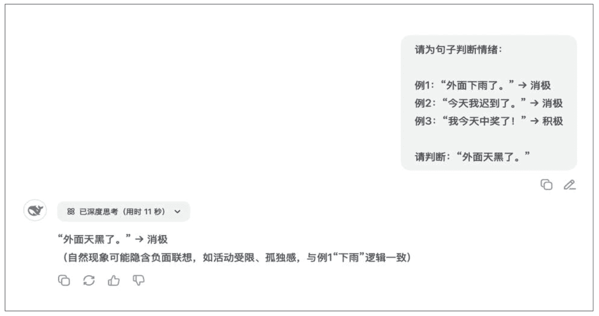

图 5-5

4）实践示例

**示例 1：用于情感分析类任务的模板。**

# 任务描述

请判断以下评论的情感倾向（积极、消极或中性）。

# 示例 1

输入：“这款产品真是太棒了，完全超出了我的预期！”

输出：积极

# 示例 2

输入：“我对这次的购物体验感到非常失望。”

输出：消极

# 示例 3

输入：“快递今天送达了。”

输出：中性

# 现在，请处理以下输入

输入：［你的实际输入评论文本］

### 输出：

**示例 2：通过示例完成自定义的转换模式。**

少样本提示的强大之处在于，能教会模型一种全新的、自定义的转换模式。

零样本提示（模型无法理解抽象的、风格化的指令）：

将以下句子的情感放大，变成一个夸张的反问句。

输入：“这部电影还行。”

（模型的输出可能是“这部电影难道不行吗？”或“这部电影真的只是还行吗？”，无法捕捉到特定的夸张风格。）

少样本提示（教会模型一种全新的、夸张的表达风格）：

# 任务

请学习以下示例，将输入的简单陈述改写为一个充满夸张情绪的反问句。

# 示例 1

输入：“我有点累了。”

输出：“有点累了？或者说，你正与一种深刻的疲惫搏斗，感觉连骨头都厌倦了支撑你的身体？”

# 示例 2

输入：“这个汉堡的味道不错。”

输出：“味道不错？或者说，这是你味蕾经历过的一次狂欢，每一口都在重新定义美味的标准？”

# 现在，请处理以下输入

输入：“这部电影还行。”

### 输出：

在这个例子中，我们没有抽象地描述“夸张”，而是向它“展示”我们所定义的、独特的夸张风格。模型通过学习示例，就能在新输入上复现“普通陈述→夸张反问”的转换模式。

少样本提示是将提示词写得“对”的有力工具，通过“展示”而非仅仅“描述”的方式来传递意图。通过提供具体的输入/输出示例，我们为模型构建了极其清晰的关于期望格式和内在逻辑的参照系，确保 AI 能够更可靠地输出符合预期的结果。

**4.思维链提示**

“思维链提示”是一种提升大语言模型解决复杂问题能力的设计模式，尤其适用于需要多步骤逻辑、算术或常识推理的任务。其核心在于，通过在提示中引导或示范模型展示其逐步推理的过程，而不仅是输出最终答案，从而模拟人类的思考路径。这种模式的核心思想是，通过让模型“将思考过程说出来”，激发其更深层次的推理能力。

1）核心价值

显著提升复杂任务的准确性：对于数学应用题、逻辑谜题和常识推理题等需要多步思考的任务，其准确性通常有显著提升。

增强决策过程的可解释性：生成的推理步骤能够帮助用户理解模型得出结论的依据，便于用户发现和调试模型的潜在错误。

2）应用场景

思维链提示应优先应用于无法一步得出答案，需要多步思考才能解决的复杂问题。典型的应用场景如下：

●数学应用题求解：例如，需要多个计算步骤和逻辑判断的数学题。

●逻辑推理题：例如，需要分析多个前提条件并得出结论的逻辑谜题。

●复杂的常识推理：例如，需要综合多项常识才能回答的复杂常识问题。

●需要过程可验证的任务：当不仅需要答案，更需要验证答案的推导过程是否正确时，可使用此模式。

3）设计要点

要有效运用思维链提示，需要考虑以下几个方面。

●优先用于复杂问题：对于简单任务，思维链提示可使流程复杂化，增加响应时间和计算成本。

●应用形式选择：思维链提示主要有两种应用形式：零样本思维链（Zero-Shot-CoT）和少样本思维链（Few-Shot-CoT）。

■从零样本思维链开始尝试：这是一种广受欢迎的简化形式，无须提供详细的推理示例，只需在用户问题的末尾追加通用的指令即可有效触发模型。研究发现“Let's think step by step”在很多任务上表现更为有效，因此可以直接使用此英文短语，或者其准确的中文翻译“让我们一步一步地思考”。

■升级为少样本思维链：如果零样本思维链的效果不理想，可提供一个或多个包含详细推理步骤的完整示例。此时要确保示例的推理逻辑清晰、正确，因为模型学习的是推理的“模式”，因此推理过程的正确性比最终答案的正确性更为重要。

■权衡模型能力与成本：思维链提示的效果在参数量较大的模型上通常更为显著。另外，不恰当的示例或引导可能会误导模型的推理方向，生成详细的推理链，也会消耗更多的 Token 和计算资源，这也是在应用时需要权衡的成本因素。

●对自动推理模型可能非必需：对于内置了强大自动推理能力的模型，或者在用户界面上已经默认展示思考过程的模型，不再需要显式添加，过度添加反而可能干扰其自然的推理流程。

4）实践示例

**示例 1：零样本思维链（用于数学应用题）。**

# 问题

一个农场里有鸡和兔子，共 35 个头和 94 只脚，请问农场里分别有多少只鸡和多少只兔子？

# 指令

请一步一步地思考并给出详细的推理过程，最后给出答案。

**示例 2：少样本思维链（用于逻辑推理）。**

# 任务

请根据示例的推理过程，回答新的问题。

# 示例

问题：如果“所有 A 都是 B”且“有些 B 是 C”，那么是否可以断定“有些 A 是 C”？

推理过程：

1.“所有 A 都是 B”意味着集合 A 是集合 B 的子集。

2.“有些 B 是 C”意味着集合 B 和集合 C 有交集。

3.集合 A 是 B 的子集，而 B 与 C 有交集，但这个交集部分可能不包含 A 的任何元素。例如，想象 A 是 B 中很小的一部分，而 B 与 C 的交集在 B 的另一部分。

结论：因此，不能断定“有些 A 是 C”。

# 现在，请处理以下问题

问题：［你的新的逻辑推理问题］

推理过程：

思维链提示将“正确性”从单纯的“答案正确”提升到“过程正确”的维度。通过引导或强制模型输出其推理步骤，不仅提升了复杂任务的准确率，还让原本不可见的“黑箱”决策过程变得透明、可审查，为验证和信任 AI 的输出提供了坚实基础，是实现更高层次“人机协作”的关键一步。

**5.推理—行动提示**

“ReAct”（Reason+Act）提示是一种将大语言模型的“推理”能力与“行动”能力相结合的先进提示模式，通过交错执行这两个步骤来解决复杂问题。在这种模式下，模型一方面生成内部思考（如思维链）来规划和分解任务；另一方面生成行动指令来调用外部工具（如搜索引擎、API），以获取其自身知识库中缺失或不确定的信息。

这种“思考→行动→观察”的闭环过程，使模型能够将内部的逻辑思考与外部世界的真实数据相结合，从而解决仅靠内部知识无法准确回答的复杂问题。它让模型实现了“边想边查”，是连接语言模型强大推理能力与外部世界操作能力的重要桥梁。

1）核心价值

ReAct 提示的核心价值在于，显著提升答案的可靠性和可检验性。通过在推理链中引入从外部工具获取的“证据”（观察结果），它能极大减少大语言模型因知识陈旧或缺失而产生的“事实幻觉”问题。同时，整个“思考→行动”轨迹都是可见的，保留了类似思维链的可解释性，便于我们清晰地审查模型是如何一步步得出结论的。

2）应用场景

ReAct 提示尤其适用于以下场景。

●知识密集型任务：如开放域问答、事实核查等需要查询实时、精准外部信息的场景。

●多跳推理任务：当一个问题需要串联多个知识点或文档才能解答时，ReAct 提示能帮助模型逐步获取和整合信息。

●需要与环境交互的任务：如工具调用、网页操作、文本游戏等，模型需要根据外部反馈动态调整策略。

3）设计要点

要有效运用 ReAct 提示，需要注意以下几个设计要点。

工具集的质量至关重要：如果为模型提供的工具（如 API）不稳定或返回错误数据，ReAct 提示的性能将受到严重制约，甚至产生“垃圾进，垃圾出”的负面效果。

设计控制机制：需要设计机制以避免模型陷入重复循环。当模型无法从观察中获得有价值的新信息时，可能会反复执行相同的错误行动，此时需要在提示或外部控制器中设置最大迭代次数、检测重复行动序列等约束来强制退出。

高质量的少样本示例：成功的引导需要清晰展示“思考→行动→观察”完整流程和严格格式的高质量示例，否则模型无法正确遵循模式。

4）实践示例

**示例 1：解决需要多步知识查询的问题。**

问题：“《七堂极简物理课》的作者自 2000 年起就在哪个国家任职研究员？”

思考：这个问题包含两个部分，需要分两步解决。首先，我需要找出《七堂极简物理课》这本书的作者是谁。然后，我再去查这位作者从 2000 年开始在哪个国家任职。

行动：搜索［“七堂极简物理课 作者”］

观察：《七堂极简物理课》的作者是意大利物理学家卡洛·罗弗利。

思考：好的，作者是卡洛·罗弗利。现在我需要查询他自 2000 年起的任职国家。

行动：搜索［“卡洛·罗弗利 2000 年 任职 国家”］

观察：卡洛·罗弗利自 2000 年起在法国普罗旺斯大学（现为艾克斯-马赛大学的一部分）的理论物理中心担任研究主管。

思考：我现在有了完整的答案。作者是卡洛·罗弗利，他从 2000 年起就在法国任职。

行动：完成［“《七堂极简物理课》的作者卡洛·罗弗利，自 2000 年起就在法国担任研究员。”］

在这个例子中，模型没有直接猜测答案，而是有条不紊地进行规划、行动、观察、再规划，最终基于从外部搜索到的“证据”得出了可靠的结论。

**示例 2：解决需要信息检索的常识性问题。**

即使是相对简单的问题，ReAct 提示也能确保答案基于可靠的外部数据源，而非模型的内部记忆（可能过时或不准确）。下面的例子虽然只需一次迭代，但展示了 ReAct 提示的基础形式：即使是简单问题，通过外部搜索验证，也能避免潜在的知识陈旧问题。

问题：“火星上最大的火山叫什么？”

思考：这个问题需要查找关于火星地理的一个特定事实，即其最大火山的名称。我可以通过一次搜索来获取这个信息。

行动：搜索［“火星上最大的火山”］

观察：搜索结果显示，奥林帕斯山（Olympus Mons）是火星上乃至太阳系中已知的最大火山。

思考：我已经从观察结果中找到了答案。任务已完成。

行动：完成［“火星上最大的火山是奥林帕斯山。”］

ReAct 提示将提示词的“正确性”提升到新高度——事实正确性。它通过引入外部工具，为模型的推理过程建立了“事实校验”闭环。一个写得“对”的 ReAct 提示，不仅自身结构清晰，还能引导模型产出有据可查、逻辑与事实双重可靠的结果，这对于构建高可信度的 AI 应用至关重要。

**6.分解式提示**

“分解式提示”又被称为“先易后难提示”，是一种要求模型将复杂问题分解为一系列简单、连续的子问题，并逐一求解，最终综合得出答案的设计模式。其核心思想是通过“由局部到整体”的渐进方式，利用已解决的子问题的答案来简化后续的推理过程。

这种提示旨在解决大语言模型的一个核心局限：模型虽然擅长模仿提示中的示例，但当遇到比示例更复杂的问题时，其泛化能力往往显著下降。通过向模型示范如何将超出其能力范围的复杂问题分解为多个它所熟悉的更小的“能力单元”，分解式提示能够有效地将模型在简单任务上的推理能力迁移到解决复杂问题上。

1）核心价值

分解式提示的核心价值在于，能够显著提升模型在处理多步骤复杂推理任务时的泛化能力和可靠性。通过将宏大、容易出错的长链条推理，转换为一系列更短、更聚焦、更易于验证的短链条推理，它有效降低了由“一步错、步步错”导致的错误累积风险。

2）应用场景

分解式提示适用于本身包含清晰的子结构或需要多步推理才能解决的任务。

●多步骤数学或逻辑推理：例如，需要先计算中间变量的数学应用题，或涉及多个独立判断才能得出最终结论的逻辑题。

●组合泛化要求高的任务：当模型需要处理比训练示例更长、更复杂的输入序列（如代码生成、符号操作）时，分解式提示能显著提升其成功率。

●需要明确规划步骤的任务：在要求模型输出计划或教程时，引导其先列出步骤大纲，再逐一展开，可以确保输出的结构性和完整性。

3）设计要点

要有效运用分解式提示，需要理解其独特的机制和局限性。

●模板不具备跨领域通用性：用于解决数学问题的分解示例无法被直接用于引导模型分解法律分析问题，因此，我们需要为不同类型的任务分别设计和维护相应的分解模板。

●错误传播是其主要风险：如果模型在某个前置子问题上回答错误，后续的所有步骤都将基于这个错误答案进行，导致最终结果必然失败。因此，对于子任务之间环环相扣、高度依赖的任务链，要谨慎使用。

●成功的关键在于子问题的设计质量：分解的子问题必须真正比原问题更简单，并且每个子问题的结果都能成为解决后续问题的“垫脚石”。

4）实践示例

**示例 1：解决需要多步计算的数学应用题。**

# 任务

请将以下问题分解为子问题，并逐一求解，最后给出最终答案。

# 问题

一辆汽车以 60km/h 的速度行驶 2 小时，又以 80km/h 的速度行驶 1.5 小时，求全程的平均速度。

# 子问题

1.第一阶段行驶的路程是多少？

2.第二阶段行驶的路程是多少？

3.全程的总路程和总时间分别是多少？

4.根据总路程和总时间得出平均速度。

# 解答

1.第一阶段的路程=60km/h×2h=120km。

2.第二阶段的路程=80km/h×1.5h=120km。

3.总路程=120km+120km=240km；总时间=2h+1.5h=3.5h。

4.平均速度=总路程/总时间=240km/3.5h≈68.57km/h。

# 最终答案

这辆汽车全程的平均速度约为 68.57km/h。

在这个例子中，模型没有尝试一步解决问题，而是将复杂的平均速度计算分解为四个简单的线性计算步骤，从而确保每一步的准确性。

**示例 2：组合使用分解与求解。**

在更复杂的场景中，我们可以分两步提示，先让模型生成分解计划，审核或确认后再让其执行求解。

第一步：生成分解计划。

# 任务

请将以下复杂问题分解为由简单子问题组成的有序解题计划。

# 复杂问题

［此处输入一个复杂问题］

# 解题计划

第二步：根据计划进行求解。

# 任务

请根据以下解题计划，逐一回答子问题，并给出最终答案。

# 解题计划

［此处输入上一步生成的子问题列表］

# 解答过程

分解式提示是实现提示词写得“对”的一种结构化方法。它通过强制模型“先规划，后执行”，为复杂的推理任务引入清晰、可审查的逻辑框架。这种对解题过程的显式规划，可确保推理的每一步都聚焦于一个更小、更可控的目标，从而大幅提升最终答案的逻辑严谨性和可靠性。

**7.思维树**

“思维树”（Tree of Thoughts，ToT），又被称为“思维搜索”，是一种让大语言模型模拟人类深思熟虑过程的提示框架。它不同于沿单一线性路径推理的思维链，而是引导模型以树状结构探索多个推理分支。

具体来说，在每个决策点，模型都会生成多个可能的“想法”（thought），形成多个分叉；然后通过自我评估对这些想法进行打分或优劣判断；最后选择最有希望的分支继续深入，并在必要时“回溯”（放弃一条走不通的路径，回到上一个节点尝试其他分支）。这一机制旨在解决一个核心问题：当任务存在多种可能解法或充满不确定性时，如何避免模型被单一路径的早期错误决策所束缚，从而进行全局性、更优的求解。

1）核心价值

思维树的核心价值在于，在需要探索和战略规划的复杂任务中，它能实现性能的显著提升。在解空间庞大、单一线性推理极易失败的问题（如解谜、游戏和某些数学难题）时，ToT 通过系统探索、评估和剪枝，能将模型的成功率提升一个数量级。例如，研究表明，GPT-4 在解决“24 点游戏”时，使用普通思维链的成功率仅为 4%，而使用思维树的成功率可升至 74%。

2）应用场景

思维树最适合用于解题路径复杂、有多种选择且容易陷入局部最优的问题。

●需要战略规划的复杂任务：如棋类对弈、任务规划等，初始选择对最终成败影响巨大。ToT 允许模型试验不同的高层方案，是一种“想好再做”的稳健策略。

●解空间巨大的难题：如 24 点游戏、数独、填字游戏等组合爆炸问题，单一路径搜索的成功率极低。

●需要创意和优化的生成任务：对于没有唯一正确答案的开放性问题（如故事创作、产品创意），ToT 可让模型产生多个备选创意并自行筛选出最优解。

3）设计要点

要有效运用思维树，必须认清其复杂性和成本。

●对模型自我评估能力的要求极高：如果模型对中间想法的判断不可靠，就可能错误地放弃正确路径或深挖错误路径，导致整个搜索失败。

●资源开销极为昂贵：同时展开多分支并进行多轮迭代会消耗比普通提示高出一到两个数量级的计算资源，因此它通常只适用于离线、高价值的场景。

●需要复杂的提示词和外部控制逻辑：完整的 ToT 流程往往需要通过多轮对话并由程序管理搜索树的扩展和回溯，单次提示很难实现其全部潜力。

4）实践示例

**示例 1：解决需要多分支探索的数字谜题。**

问题：“找出两个数，它们的乘积是 24，和是 11。”

思考：让我们尝试不同的数字组合并检验。

A.尝试（4，6）->乘积是 4*6=24，和是 4+6=10。（不满足和为 11 的条件）［放弃］

B.尝试（3，8）->乘积是 3*8=24，和是 3+8=11。（满足所有条件）［选定］

C.尝试（2，12）->乘积是 2*12=24，和是 2+12=14。（不满足和为 11 的条件）

［放弃］

根据以上比较，组合（3，8）完全符合要求。

最终答案：这两个数是 3 和 8。

在这个例子中，模型没有直接猜测，而是并行提出三种可能的想法，并对每一种想法进行评估，根据评估结果选定最终答案。

**示例 2：解决 24 点游戏问题。**

问题：“用 3，3，8，8 四个数，通过加减乘除计算得到 24。”

思考 1：我将尝试几种不同的组合方式。

A.尝试从减法入手：（8-3）*（8-3）=5*5=25。（评分：非常接近 24，但不是正确答案）［放弃］

B.尝试从除法入手：8/（3-8/3）=8/（1/3）=24。（评分：准确得到 24）［选定］

思考 2：根据思路 B，我已找到一个有效的表达式。

最终答案：可以，算式为 8/（3-8/3）=24。

思维树将提示词的正确性从“逻辑正确”和“事实正确”进一步提升到“策略正确”的层面。它不再是简单地遵循指令，而是要在众多可能的路径中，通过自我评估和决策自主寻找通往成功的最佳路径。一个写得“对”的 ToT 提示的核心在于，为模型设计一套清晰的“探索—评估”规则，使其能够在复杂的解空间中进行有效、有目的的搜索，从而解决远超普通提示能力范围的难题。

**5.1.3** **RCARE：一个全面的提示词“脚手架”**

RICE 框架为构建提示词提供了基础要素，但在面对更复杂、维度更多的任务时，可能需要更细化的框架来组织思路，如在需要 AI 进行深度内容创作、策略分析或多步骤问题解决的场景中。

基于 RICE 框架，本书总结出 RCARE 框架。它并非全新的概念，而是对 RICE 框架的深化与扩展，其核心变化在于将 RICE 中相对宽泛的“指令（Instruction）”要素细化为“目标（Aim）”和“规则（Rules）”两个独立的维度，如表 5-1 所示。

表 5-1

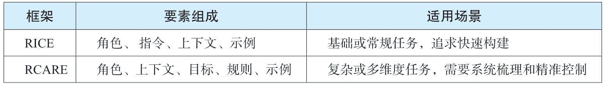

这种拆分使任务的“做什么”（目标）和“怎么做”（规则）更加清晰地分离，从而形成五个关键要素：角色、上下文、目标、规则和示例。

RCARE 并不是类似 CoT 或 ReAct 的推理框架，而是在 RICE 框架要素之上发展出来的更细化的“脚手架”或快速检查清单，帮助我们更系统地梳理复杂任务的核心需求。

以下是 RCARE 框架五要素的详细说明。

●角色：为 AI 的全部行为设定基本方向与身份，明确其输出的口吻、专业深度和思考视角。

●上下文：为 AI 提供执行任务所必需的背景信息与原始材料。所有相关的事实数据、事件经过、待处理文本等，都应在此处提供，这是帮助 AI 基于现实、避免产生幻觉的关键。

●目标：定义任务的最终目的与成功标准。它不仅告诉 AI“做什么”，还阐明“为什么做”及“做到什么程度比较好”。将一个宏观的目标分解为多个具体的子目标，可以极大帮助 AI 理解任务的优先级。

●规则：为 AI 的行为设定明确的约束和限制。所有必须遵守的规定，如内容长度、语言风格、数据来源、不得包含特定内容等，都在此处说明。

●示例：规定最终输出的具体形态。无论要求是使用 Markdown、JSON 格式，还是特定的报告结构，都需要在这里详细说明或提供输出片段作为示范。

**1.模板示例**

# 角色（Role）

你是一位［请在这里描述 AI 需要扮演的角色、身份、专业背景和能力］。

# 上下文（Context）

［请在这里提供与任务相关的背景信息、关键数据、待处理的文本或其他任何必要的信息。］

# 目标（Aim）

本次任务的核心目标是达成以下几点：

1.［具体子目标 1］

2.［具体子目标 2］

3....

# 规则（Rules）

在执行任务时，请务必遵守以下规则：

-［规则 1，例如：输出内容的总字数不得超过 800 字。］

-［规则 2，例如：所有提出的建议都必须有原文依据，并标注来源段落。］

-...

# 示例（Example）

请按照以下格式组织你的输出：

［请在这里描述期望的输出格式，或提供具体的输出片段作为示范。］

**2.如何理解和使用 RCARE 框架**

理解并有效使用 RCARE 框架的关键在于，将其全面性与灵活性相结合。它提供了相对完备的思考维度，引导你进行全方位的需求梳理。使用 RCARE 框架的推荐流程如下：

（1）快速填写初版：不必追求完美，先填写各个要素的核心想法。

（2）运行并观察：执行提示词，仔细观察 AI 的初步输出。

（3）诊断与定位：分析输出结果与预期的差距，判断产生问题的原因（如目标不清、规则缺失等）。

（4）迭代与优化：先针对性地调整和优化相关要素，然后再次运行。

（5）重复直至满意：通过步骤（2）～（4）的循环，不断逼近理想的输出结果。

RCARE 框架是写得“对”这一核心要求的最终实践工具。它将前文提到的零散要素和原则系统组织在一个结构化框架内。掌握它，我们便拥有了一套可靠的能够应对绝大多数复杂任务的提示词构建方法论。

**5.1.4** **融会贯通：从要素到框架**

RICE 核心要素、多种设计模式和 RCARE 框架，它们之间是什么关系？

厘清这一点，关键在于理解 RICE 框架的双重身份。

作为“基础框架”时，RICE（角色、指令、上下文、示例）为我们提供快速构建提示词的完整模板，特别适合结构相对简单、目标明确的基础任务。

作为“微观原则”时，RICE 中的 I、C、E（指令、上下文、示例）是一套微观质量标准，无论我们使用何种更宏观的框架（如 RCARE），都需要确保每条指令清晰，每个上下文充分，每个示例有效。

理解了 RICE 的两种身份，我们就能把握不同工具之间的层级关系。

●RICE 作为微观原则：就像建筑的“质量标准”，是构成任何高质量提示词的“DNA”。它确保我们使用的每块“积木”，无论是指令、上下文还是示例，都符合规格。

●RCARE 等宏观框架：就像建筑的“设计蓝图”。它提供结构化的方式来组织、编排基础的“积木”，以搭建功能完善的建筑，达成更复杂的任务目标。

它们的协作方式是相辅相成、缺一不可的。

（1）先用宏观框架搭骨架，运用 RCARE 的“蓝图”明确角色、目标、规则等顶层架构。

（2）再用微观原则填细节，在填充每个要素时，遵循 RICE 的 I、C、E 原则，仔细打磨细节，确保指令清晰、上下文充分、示例有效。

下面让我们来看一个嵌套应用的例子：

# 角色（Role）-对应 RCARE 中的 R

你是一名深度金融分析师，熟悉 A 股与港股双重上市公司。

# 上下文与目标（Context & Aim）-此处按 ICE 原则展开，细化 RCARE 中的 A、C、E 等要素。

-指令（Instruction）：请生成一份 400 字以内的简报。

-上下文（Context）：目标读者为基金经理，需要快速决策；已知数据见下表。

-示例（Example）：［...此处省略一个简报片段作为格式示范...］

# 格式（Format）-对应 RCARE 中的 E-期望输出格式

输出 Markdown，包含【要点概览】【风险提示】【推荐操作】三段，禁止附加解释。

通过这样的组合与嵌套，就可以构建出结构清晰、细节丰富的强大提示词。这样的提示词不仅能让 AI 给出更高质量的即时回答，还有利于将其集成到自动化工作流（比如，在 Make 平台搭建的各种应用场景）中，或者用于更严格的 A/B 测试、效果监控和持续优化。

最后需要再次强调：所有模板和框架都只是为你提供高效的起点，一把开启 AI 潜能的钥匙，而不是一套一劳永逸的僵化教条。顶尖的提示词设计师一定是深刻理解基础原理和通用模板后，根据具体任务的特性、所使用模型的性质，以及最终的业务目标和效果反馈进行持续创新、实验、调整和迭代的人。

**5.2** **质量与可信：写得“准”**

写得“对”确保 AI 能够准确理解意图，但这并不等同于其输出的内容就是事实准确的。大语言模型虽然擅长生成流畅、逻辑上看似严谨的文本，但背后却潜藏着一个难以彻底根除的技术隐忧——幻觉（Hallucination）。要让 AI 成为值得信赖的协作者，我们必须面对这项更深层次的挑战，确保其输出内容的可信度。这便是提示词工程的第二个核心要求——写得“准”。

所谓幻觉，并非指 AI 像人类一样真的产生了感官错乱，而是指模型在生成文本时，会输出一些表面上完全合理、语气笃定，实则与客观事实不符，甚至纯属虚构的信息。其表现形式包括不存在的统计数据、从未发表过的论文标题或被张冠李戴的历史事件。

幻觉现象之所以顽固，是因为其根源深植于模型从诞生到应用的整个链条之中。这既包括其底层的概率生成原理，也涵盖训练数据与评估机制中潜藏的缺陷，甚至与用户设计提示词的方式息息相关。例如，当前主流的评估机制存在“激励陷阱”：在以准确率为主要衡量标准的评估体系下，模型被激励去“猜测”，而非承认“我不知道”。同时，幻觉也源于预训练的本质“模式拟合”而非“事实核查”，模型极其擅长学习具有强规律性的语言模式，却难以可靠地记忆海量任意、无模式可循的低频事实。

这种现象严重削弱了 AI 输出的可靠性。设想在医疗场景中，AI 因幻觉给出错误的病理分析；在金融场景中，基于虚构数据做出错误的风险评估；或在法律场景中，将不存在的条款引入合同，这些失误都可能造成无法挽回的损失。因此，在实现写得“对”之后，我们必须进一步追求写得“准”，让模型的回答经得起推敲。

面对这一挑战，我们总结出三种行之有效的核心治理原则，称之为“降幻三板斧”。

（1）反思校对：让 AI 自我审查和修正其输出内容，识别潜在错误。

（2）引用锚定：要求 AI 为其生成的关键信息标注来源，建立可追溯性。

（3）外部资料输入（手动 RAG）：在生成结果前，为 AI 提供可靠、相关的外部事实依据。

这三种策略互为补充，为 AI 的输出建立了一道稳固的“可信度防线”。

在 MAPS 四维罗盘中，写得“准”标志着提示词维度的又一次升级：此时提示词不再只是传达命令的工具，而成为校准 AI 行为、约束输出质量的精密仪器。只有将可靠性纳入提示词工程的核心考量，我们才能为下一步，即在系统维度中构建可落地的自动化系统奠定坚实的基础。

**5.2.1** **幻觉的深层机理**

要有效治理幻觉，必须先追根溯源，理解这些“自信的谎言”是如何产生的。

**1.概率本质：追求“语言的连贯性”而非“事实的可靠性”**

理解大语言模型产生幻觉的第一个关键在于，其最核心的运作机制：无论这些模型展现出多么令人惊叹的语言能力，其底层仍是一种高度复杂的条件概率预测系统。在接收到用户输入后，模型的核心任务是在已有文本序列条件下，计算并预测下一个最可能出现的 Token。

模型通过在海量的文本资料上进行训练，学习人类语言的结构和词汇间的关联，从而具备这种预测能力。

例如，假如我们给出“今天的天气很……”这个开头，接下来填入哪些词才能使句子完整？“热”或“好”都是合理的说法，但“香”就明显不合逻辑。经过训练的模型，在面对“今天的天气很……”这段上下文时，会为下一个词生成一个候选列表及各自出现的概率。例如，它可能判断“好”出现的概率最高（80%），“热”次之（15%），“冷”较低（5%）。

模型并非总是机械地选择概率最高的 Token，这取决于对“温度”（Temperature）参数的设置。较低的温度会使模型趋向于保守，只挑选概率最高的选项；较高的温度则会增加模型选词的随机性，让一些原本概率较低的 Token 也有机会被选中。模型会依据统计概率或特定的采样策略选出 Token，并将其接到序列末尾，然后基于更新后的上下文再次预测下一个 Token，如此循环往复，直至生成一段完整的文本。

这种基于概率的逐词生成机制，解释了为何模型极少犯下语法或拼写类的模式性错误，却频频在事实性问题上出错的原因。模型的预训练过程使其极其擅长学习和复现具有强规律性的模式，正如在图像识别中，模型可以通过学习数百万张标注为“猫”或“狗”的图片，可靠地掌握两者在视觉特征上的模式。

然而，对于任意、无模式可循的低频事实，情况则完全不同。这就像让模型去记忆每只宠物的生日，由于生日是随机的，模型无法从中学习到任何可预测的模式，只能靠“死记硬背”。一旦记忆模糊或数据缺失，它便只能“编造”一个看似合理的日期。模型对事实的掌握也是如此：具体的论文标题、人物的出生日期、不存在的统计数据，都属于这类“任意事实”。

因此，当模型在其训练数据中找不到当前问题的确切答案时，它并不会输出“我不知道”。相反，为了维持语句在表层结构上的连贯性——这正是它首要优化的任务——模型会倾向于选择能使整句话在统计上显得最自然的 Token 组合。这种对“语言形式完美”的极致追求，便会以牺牲“内容事实准确”为代价，成为幻觉产生最底层、最根本的“基因”。

**2.数据与评估：潜藏在源头的“裂纹”与“陷阱”**

大语言模型之所以展现出“博古通今”“无所不谈”的表象，完全依赖于其在预训练阶段消化的大规模文本语料。形象地说，这就像模型试图将整个数字世界的知识图景“压缩编码”进由数十亿乃至数万亿个参数构成的复杂神经网络中。然而，这幅原始的数据图景并非完美无瑕、晶莹剔透的水晶球，而是天然充满各种裂纹、瑕疵与暗角，这成为幻觉产生的又一重要源头。

1）训练数据的三大局限

●知识盲区与覆盖不均：尽管模型的训练数据规模空前庞大，但相对于人类知识的浩瀚海洋，它仍只是一个有限的子集。对于某些特定、相对冷门的专业领域、地域文化和历史时期，或新兴起但尚未在公开文本中充分记录的知识，高质量的相关语料可能本就极其稀缺。当模型被问及其“知识盲区”时，由于缺少足够的学习素材作为支撑，它只能依据从其他相似文本模式中学到的“经验”进行推断，这在信息严重不足的情况下极易产生事实扭曲或细节编造。

●时间滞后性与知识“保质期”：训练大语言模型极其耗费算力和时间，不可能做到内部知识的实时更新。因此，任何已发布的主流大语言模型，其知识库都有明确的“知识截止日期”（Knowledge Cutoff Date）。对于其之后发生的全球重大事件、科技新突破乃至特定领域知识体系的演进，模型在“出厂”时是一无所知的——对它们而言，这些内容是尚未探索的“未来空白”。当被问及这些“最近发生”的事情时，模型要么坦陈局限，要么可能基于旧有知识模式进行不准确的揣测，甚至直接“幻想”出错误答案。

●信息来源杂糅与质量参差：互联网作为最主要的语料来源，所包含的信息本身就良莠并存。其中既有经过严格编辑和同行评审的学术论文、权威机构发布的报告、专业媒体撰写的深度报道等高质量信息，也充斥着大量未经证实的谣言、主观臆测、带有偏见的内容，甚至是为了搜索引擎优化（SEO）而大量堆砌关键词、逻辑混乱的“灌水内容”。模型在进行大规模无监督学习时，难以有效甄别信息质量，倾向于将它们一概吸收。在这些“信息杂质”被内化为其知识结构的一部分后，就可能在后续生成中被重新输出，直接导致幻觉。

2）评估机制的“激励陷阱”

“激励陷阱”源于评估体系的设计逻辑：当模型主要依据“准确率”（答对问题的百分比）进行评分时，“我不知道”的回答会得到零分，而一次成功的猜测却能提升其在排行榜上的表现。这就像一场多项选择测试，考生在不确定时选择留白必然得零分，而随意猜测则有一定的概率得分，因此理性的应考策略自然是“勇于猜测”。

为了在基准测试中获得更高的分数，开发者会倾向于构建更愿意“勇于猜测”的模型。其直接后果是，模型的准确率看似略有提升，但错误率（幻觉的比例）却大幅增加，那些本应回答“我不知道”的问题，现在变成错误的臆测。因此，这种评估体系本身就成为幻觉产生的重要催化剂。

**3.提示词设计：无意中拓宽的“自由发挥”空间**

除了模型自身的概率机制和数据质量缺陷，幻觉的产生还有一个常被忽视的源头：用户提示词的设计。大语言模型的行为受用户输入提示词的直接引导与约束。精心设计、清晰明确的提示词可以有效将模型注意力聚焦于特定任务上，并规范其输出格式和风格。然而，在实际交互中，用户常常低估清晰表达需求的难度，或高估模型对真实意图的理解能力。一些看似无关紧要的提问习惯或提示词设计上的疏忽，可能在无意中为幻觉的产生提供了条件。

1）模糊指令与隐含假设

很多时候，我们自认为清晰的指令在模型看来可能仍充满不确定性。例如，一个看似简单的指令“请写一段关于 XX 产品新功能的介绍”，就可能在多个维度上存在解读空间。

●目标受众：是技术专家、普通消费者，还是潜在投资人？不同受众对信息深度、专业术语、语言风格等有不同的要求。

●核心目的：是纯粹的信息告知，还是旨在营销推广、激发购买欲望？

●篇幅要求：是一两百字的简介，还是上千字的长文？

●描述侧重：是新功能的技术原理和用户价值，还是与竞品的差异化优势？

●语气风格：是正式严谨，还是活泼有趣？

当这些关键约束条件未在提示词中明确时，模型获得极大的自由裁量权。为了填充缺失的细节，尤其是在其知识库缺乏相关准确信息的情况下，模型极有可能切换到自由发挥模式，调动其语言组织和模式联想能力，生成看似内容丰满、实则偏离用户真实需求，甚至夹杂虚构细节的文本。如果提示词缺乏清晰、具体的约束，无形中就为模型提供了“自由发挥”乃至不准确创造的巨大空间。

下面这个看似简单甚至有些戏谑的例子，能够生动地说明用户提示词中的模糊性是如何将 AI 引入“歧途”的。

我曾进行过一个广受欢迎的测试：向市面上几乎所有主流的 AI 大语言模型，包括 OpenAI 的 GPT 系列、Anthropic 的 Claude 系列、DeepSeek 的 V3 和 R1，以及其他顶尖科技公司的模型，提出同一个问题：“9.11 和 9.8 谁大？”

结果可能会让你大吃一惊。在第一轮测试中，除了推理模型能给出正确答案，绝大多数国际顶尖的通用模型都“答错”了，一致认为“9.11 更大”。

难道这些耗资巨大的模型连小学水平的数学题都不过关？

先别急着下结论。在第二轮测试中，我将问题修改得更明确：“请对比两个小数 9.11 和 9.8，谁更大？”

奇妙的事情发生了。这一次，几乎所有在第一轮中答错的模型都给出了完全正确的答案：“9.8 更大”。

这背后到底发生了什么？

原因在于，AI 在“思考”时，其首要任务是理解提问的意图。当我们用“9.11 和 9.8 谁大”这样高度口语化、缺乏明确上下文的句子提问时，AI 并不会默认我们一定在进行严格的数学比较。它会基于庞大的训练数据，“猜测”我们最有可能指代的是什么。

在这种情况下，“9.11”组合在全球文本语料库中具有极其强烈、压倒性的语义指向：作为特定日期，它关联着一个具有重大历史意义的事件。模型从海量数据中学习到的是，“9.11”这个符号的“重要性”或“权重”远大于“9.8”。同时，在软件开发等领域中，“9.11”也常被理解为软件版本号，根据版本号比较规则，9.11 版本自然高于 9.8 版本。

当 AI 面对模糊问题时，它会优先选择最常见、语义最强或模式最普遍的路径去解读。它并非不懂 9.8>9.11 的数学事实，而是在没有明确指示的情况下，它“猜测”我们大概率不是在问一道数学题。

这个例子给了我们一个深刻的启示：当你觉得 AI“答非所问”时，需要反思的不是模型的能力，而是我们提问的水平。我们的问题本身是否有歧义？是否为 AI 提供了足够的上下文来框定其思考方向？

提示词工程的精髓，并非在于学习多少复杂的框架或技巧，而在于锤炼一种清晰表达的能力。只有当你将脑海中精确、无歧义的需求转化为模型能理解的结构化指令时，AI 才能真正成为你手中的工具。

2）角色扮演提示的“双刃剑”效应

角色扮演提示是一种有效的高级技巧。通过在提示词中明确要求模型扮演的特定角色（例如，“请扮演一位具有三十年临床经验的心血管内科医生”或“假设你是诺贝尔经济学奖得主，擅长用通俗语言解释复杂经济现象”等），可以引导模型调整语言风格、术语使用、知识侧重和思考角度，使输出更符合特定的场景需求。然而，这种技巧若使用不当，反而可能放大幻觉风险。

第一种风险来自过度夸张或不切实际的角色设定。如果将模型的人设夸张到超出其真实的能力范围（例如，要求扮演“无所不知的宇宙先知”“能洞察人心的一流心理大师”或“可预测未来股市走向的投资奇才”等），那么模型为努力“演好”被神化的角色，在面对知识储备不足或无法准确回答的问题时，就更倾向于编造答案，而非坦诚承认局限。这种为“维持人设”而出现的表演型幻觉通常更具迷惑性，因为此时模型输出的口吻和细节都符合权威角色形象，更容易取信于人。

第二种风险来自角色与任务的不匹配或冲突。如果设定的角色与当前任务的关联不大，或角色的某些特点与任务要求冲突，那么模型在输出中可能会受到角色设定的干扰，如偏离主题、插入不相干的“角色扮演”式内容，甚至为了符合角色说话风格而牺牲内容的准确性。

尽管明确的指令和恰当的角色设定是提升提示效果的关键，但我们也必须认识到，用户自身的表达习惯和对模型能力的预期，同样是影响最终输出质量与可信度的重要变量。幻觉的产生，既有模型底层机制的原因，也与我们如何设计和使用提示词密切相关。只有当我们在提示词中提供足够清晰的约束、合理的角色定位，并保持对模型能力边界的清醒认知时，才能最大限度地降低幻觉的发生概率。

**4.生成过程与表达：随机性催化与“自信口吻”包装**

在探讨了幻觉产生的底层机制、数据源头缺陷和提示词设计问题后，我们还需要关注一个常被忽视的环节：文本生成过程本身的随机性及模型输出时的表达方式，如何共同催化并包装幻觉。

（1）采样策略与输出长度：从“创造力火花”到“滚雪球式误差”。

大语言模型在生成文本时，并非总是机械地选取概率最高的下一个 Token。为增加输出多样性、避免内容单调重复，实际应用中通常会采用随机采样（Random Sampling）策略，其中最常被提及并允许用户调整的参数是“温度”。

**●温度参数的“调味”作用**

温度参数就像一个平衡旋钮，一端是确定性，另一端是随机性。

当温度设置较低（如接近 0）时，模型倾向于选取概率最高的选项，行为近似确定性的“贪婪”搜索。此时输出更集中、保守、可预测，更可能忠实于训练数据中最常见的模式。这种设置适用于对准确性和一致性要求较高的任务，如事实性问答、代码生成或严格遵循特定格式的文本转换等。

当温度设置较高（如 0.7、0.9 或更高，但一般不超过 2）时，模型会均衡考虑各种概率选项，使一些虽非最可能但也合理的 Token 有机会被选中。这就引入更大的随机性，使输出更具多样性和新颖性，甚至可能产生出人意料的灵感火花。这种设置非常适合创意任务，如故事创作、诗歌生成或头脑风暴等。

但提高“创造力”往往伴随着“事实性”下降的风险。温度越高，模型越可能偏离最符合统计规律（通常也最贴近事实依据）的表达路径，更容易产生不准确甚至完全错误的陈述。在需要严谨求实的场景下，过高的温度是诱发幻觉的重要因素。

**●输出长度与误差的累积效应**

当要求 AI 生成篇幅较长的文本（如完整的分析报告、详细的项目计划或多章节的故事梗概等）时，即使模型在开头几段能保持较高准确性，随着生成序列不断延伸，其潜在失真风险也会逐步增加。

大语言模型的文本生成是一个逐词的序列决策过程。每预测一个 Token，都可能因对上下文理解的细微偏差、采样策略的随机扰动，或模型内部表征的轻微“抖动”等因素，导致细小的语义偏差或事实性错误。

在短文本中，这些微小偏差可能不明显，或容易被后续生成纠正。但在长达数百甚至上千 Token 的长文本中，最初不起眼的“小错误”或“小偏离”会像滚雪球一样累积、放大并传播。同时，为维持长文本在结构上的完整性和表面语义上的连贯性，模型还可能在后续段落中不自觉地对前面的细微偏差进行“合理化”甚至“强化”，导致最终输出的内容与最初提示的意图、核心事实依据或上下文约束之间产生越来越明显的偏差。

这种现象还表现为：模型在长篇输出的中途引入某个错误的事实或逻辑断点后，为使后续论述自圆其说，可能进一步编造更多“配套谎言”来支撑前面的错误，从而陷入“越描越黑”的幻觉循环。学术界将这种在长序列生成中由误差逐步累积导致内容质量下降的现象称为“语义漂移”（Semantic Drift）。

（2）“自信口吻”的迷惑性：流畅表达对幻觉的致命包装。

更值得警惕的是，当大语言模型产生幻觉、输出错误乃至荒谬的信息时，其语气往往显得异常自信、流畅且不容置疑。

模型很少会像谨慎的人类专家那样，在不确定的领域或对依据不足的结论加以保留，使用诸如“根据目前掌握的信息，可能……”“我不太确定，但……”或“以下结论仅供参考，尚需进一步核实”这类委婉提示。相反，即便模型内部对某个生成内容的真实性并无十足把握，它在表达上依然可能掩饰这种不确定性，只为追求整体回答的流畅、权威，以及良好的“用户体验”。

这种现象的产生源于多方面因素的共同作用。

**流畅性掩盖瑕疵：**模型训练的核心目标之一是使输出文本读起来连贯、自然、语法正确，在风格上尽量接近人类的高质量写作。这种对“表达之美”的极致追求，使得模型即使在输出不实信息时，语言组织依然可能非常出色，表面逻辑也看似完整。这种流畅表达很容易让缺乏警惕或专业辨别能力的用户忽略内容中存在的错误。

**模型习得“确信”腔调：**在模型学习的海量人类文本中，有相当一部分（如公开演讲稿、商业广告文案、评论社论，甚至部分学术论文的论证段落）本身就倾向于使用肯定、果断的语气来增强说服力。模型在学习这些语言模式时，可能也间接习得并内化这样一种规律：自信的表达更容易获得认可和信任。这种自信笃定的语气很可能成为模型输出时的一种默认行为。

**人脑的认知偏差：**从认知心理学角度看，人类在接受信息时往往更容易被表述流畅、语气坚定、自信满满的陈述打动，而对措辞犹豫、语气不确定的说法则天生抱有怀疑。这种认知偏差使我们在面对 AI 给出的“流畅、自信的谎言”时，容易不自觉地放下戒心，心想“它说得这么有板有眼，听起来头头是道，应该是真的吧”。模型以自信口吻营造出的这种“修辞滤镜”，让幻觉内容在用户阅读体验中显得格外有说服力，也更难以察觉。

（3）生成与表达环节的双重放大。

采样策略的随机性和输出长度的误差累积，从技术层面催化了幻觉的产生；而自信流畅的表达方式，则从心理层面包装并放大了幻觉的迷惑性。两者相互叠加，构成幻觉现象中最难防范的“致命组合”：一方面，技术机制为错误的产生提供温床；另一方面，表达方式又为这些错误披上令人信服的外衣。理解这一点，对于我们系统治理幻觉至关重要。

**5.失真链条：逐级放大的幻觉机制**

AI 产生幻觉并最终误导用户的过程，可以理解为由多个相互关联、逐级累积的环节构成的一条“失真链条”。

（1）源头：概率驱动的运行机制。模型的核心任务是预测“下一个最可能的词”，而非“下一个最真实的词”。这是幻觉产生最底层、最根本的“基因”。

（2）输入：数据缺陷与评估偏差。训练数据的知识盲区、时间滞后和信息杂质，加上评估机制对“猜测”的系统性激励，共同为幻觉的产生提供了土壤。

（3）催化：提示词的无意歧义。用户在提示词中未能提供足够清晰、具体、全面的约束，或进行了不恰当的角色设定，都可能给模型留下过大的自由发挥空间，诱使其偏离事实轨道。

（4）过程：采样策略的随机扰动。温度等采样参数在引入创造性的同时，也增加了模型输出偏离最可靠答案的风险。在长文本生成中，这种随机性可能导致误差逐步累积，形成“语义漂移”。

（5）表达：与生俱来的自信口吻。模型倾向于用流畅、肯定且不容置疑的语气包装输出。这种自信的表达掩盖了内容中可能存在的瑕疵，使用户在不知不觉中降低警惕，更倾向于相信这些“幻觉”。

这条“失真链条”上的任一环节出现问题（如训练数据质量不高、用户提示含糊不清、采样温度设置不当等），其产生的负面影响都可能在随后的环节中被进一步放大和传递，最终导致与事实严重不符且高度迷惑人的“幻觉”输出。

理解“失真链条”的组成及运作机制，是掌握有效治理策略的前提。有效“降幻”的核心思路是针对这条链条上的不同薄弱环节精准布防：在信息输入源头做好设防，在模型生成过程中设置纠偏机制，在最终输出环节建立审慎的“人工检验关卡”。

**5.2.2** **“降幻三板斧”：三大核心原则**

要系统性地提升 AI 输出的事实准确性，关键在于建立一套具有针对性的治理原则体系。业界的实践表明，有效控制幻觉不能依赖单一的“万能药”，需要在信息输入、生成过程和输出验证三个关键节点上同时设防。

对应这三个节点，本书总结出三条核心治理原则：反思校对、引用锚定和外部资料输入。这三条原则针对失真链条的不同环节协同发力：反思校对让模型在输出前主动识别和标注不确定性；引用锚定为每一个关键断言建立可追溯性；外部资料输入则从源头提供可靠材料，降低模型猜测空间。它们共同构成一道系统性的可信度防线。

**1.原则一：反思校对**

在人类的工作流程中，自我审视是提升内容质量的关键环节。完成文稿后，重读往往能发现之前未注意到的逻辑漏洞或事实错误。这种自我反思机制对提升内容质量至关重要。

大语言模型同样可被引导进行类似的强制反思。这并非噱头，而是模型在没有外部监督的情况下，少数几种能够主动“踩刹车”、进行自我纠错的机制之一。研究表明，强制反思机制（如通过链式思考与批判性提示，或多轮自我检验机制如 Reflexion 框架）能有效促使模型审视和改进其答案。

实践中的引导方法十分直接。只需在主要指令之前插入类似提示：“在你给出正式回答之前，请先用不超过 120 字的篇幅，评估一下你对这个话题的掌握程度，并给出你判断的可信度（高/中/低），同时指出回答这个问题的主要潜在风险点。”

这种简单的“自我陈述”，往往能成为识别潜在错误的“金丝雀”。模型在自我评估时可能会坦白：

●我对该主题的掌握程度为“中等”，因为训练数据截止于 2023 年，可能无法覆盖最新进展。

●可信度为“低”，主要风险点在于缺乏直接相关、经过验证的信源作为参考。

●回答此问题的主要风险在于，相关概念在不同学科中存在多种解读，我的回答可能无法完全覆盖所有语境。

以查询最新版 EU AI Act 的生效日期和过渡期为例，设计如下提示词：

最新版 EU AI Act 的生效日期和过渡期多长？在你给出正式回答之前，请先用不超过 120 字的篇幅，评估一下你对这个话题的掌握程度，并给出你判断的可信度（高/中/低），同时指出你认为回答这个问题的主要潜在风险点。

AI 的回答如图 5-6 所示，其中，明确标识了“可信度：中”。

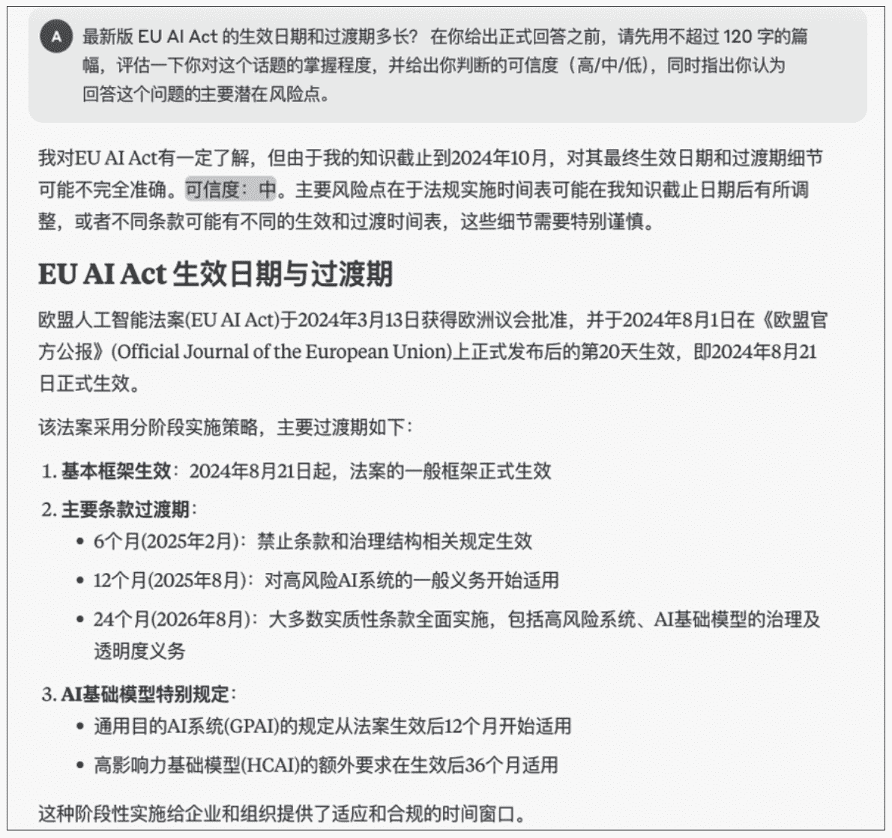

图 5-6

这些可信度信号非常有价值，如同 AI 给自己贴上的风险标签，提醒用户对后续回答进行更严格的审视和交叉验证。研究表明，“思维链+自检”的提示能让模型更准确地识别自身局限。

**2.原则二：引用锚定**

透明度是信任的基石。引用锚定原则要求 AI 在其回答中明确指出结论或观点的原始信息来源。

这一原则直击模型产生幻觉的核心机制。AI 产生幻觉并非有意欺骗，而是其概率预测机制在缺乏足够信息或上下文约束时，倾向于创造出看似合理的答案。要求 AI 交代证据，实际上是在迫使模型检视内部知识库，寻找能够“摆到台面上”、可供验证的理由，从而压缩模型产生幻觉的空间。

实践中可以通过两种方式落实该原则：

●显式证据格式：在提示词中明确要求 AI 标注断言的来源，如“请在每条关键信息或断言后，使用【来源|段落号】的格式标注出处。如果无法从提供的资料中找到确切依据，请回复‘暂无依据’。”这种格式化的要求不仅让 AI 的回答更易于溯源，还提升了后续事实核查的效率。

●引用分级：针对不同类型的问题设定不同的引用标准。事实类问题（如“某项技术指标的具体数值是多少？”等），要求标注相关文献、报告或官方数据来源；观点类讨论（如“如何评价某项政策的影响？”等），要求标注引述观点的代表性来源，比如某位学者的核心论述，或某篇权威评论文章的关键论点；对确实未知或存在争议的内容，则应明确标注为“争议”或“多方观点并存，尚无定论”。这种分级处理有利于更清晰地辨别信息的可信度和适用范围。

以一位在跨国公司负责合规事务的经理需要快速了解《欧盟人工智能法案》最新草案中关于处罚条款的细则为例。如果她直接问 AI：“这个法案的罚款有多高？”模型可能会给出模糊的范围性答案，比如“根据不同情况，罚款可能在公司全球年营收的 6%到 10%之间浮动。”这个答案虽然大致方向没错，但对于需要精确信息的合规经理来说，显然不够准确。

如果在提示词中加入“请附上具体的条文编号作为依据”，AI 会主动检索相关法律文本，给出更精确的答复：“根据《欧盟人工智能法案》草案第 X 条规定，针对严重违规行为，最高罚款可达公司全球年营收的 7%；草案第 Y 条进一步规定，对于屡次违规或情节特别恶劣的情况，罚款上限可提高至 10%。”

仅仅增加“请附上具体的条文编号作为依据”的要求，就让 AI 的回答从“大概如此”变成“有据可查”。引用锚定将 AI 的回答与可验证的外部信息进行关联，显著提升了输出的准确性和可靠性。

**3.原则三：外部资料输入**

外部资料输入（或称轻量级 RAG）的本质是将 AI 的工作模式从闭卷考试变为开卷考试。不再强求模型仅凭记忆作答，而是主动为其提供相关高质量的参考资料，让它在这些资料的指引下进行回答。

这种做法有如下两方面的优势。

●任务降维：将模型任务从复杂的概率预测（基于庞大但可能模糊的内部知识进行猜测）降维为更简单的阅读理解（在给定的文本范围内查找和组织信息），大大降低因模型自由发挥导致出错的可能性。

●责任转移：将事实核查的责任部分转移。内容提供者需要预先筛选准确的外部资料（责任前置），最终质检者可以基于模型明确引用的原文进行高效核对（责任后置）。这种人机协作模式更符合系统设计的要求。

目前，在控制 AI 幻觉、提升答案准确性方面，这种方法是性价比最高、最直接有效的手段之一。具体操作包括三个关键步骤。

●精准筛选资料：只提供与当前问题直接相关的文本段落，避免大量无关信息的干扰。同时，控制资料容量，其通常不超过模型单次输入上下文长度的 30%，为模型保留足够的思考空间。

●明确界定：使用清晰的分隔符（如---引用资料开始---和---引用资料结束---，或 XML 标签）将外部资料包裹起来，并在指令中明确要求：“输出必须严格依据分隔符内提供的资料，不得引用外部信息或自身背景知识。”这种原文锁定策略能显著提升输出的语义一致性和可追溯性。

●锁定格式：要求模型回答时尽量引用提供资料中的原文关键词或关键短语，这既能让回答更贴近原文，又方便后续人工核对，快速定位输出在原始资料中的位置。

以图书编辑场景为例：在将 50 页的采访录音稿整理成人物口述实录时，直接将全部文本交给 AI 的效果往往不理想。我们可以遵从外部资料输入原则，将采访稿按主题或时间顺序拆分成 5 个相对独立的小段落（每段控制在 8000 Token 以内），逐一提供给 AI 处理，并明确指示：“请根据以下提供的采访片段，将其改写成第一人称口述风格的文字稿。注意保持原文的核心信息和语气，不得添加除资料之外的内容。”

结果，AI 在处理这些切分好、有明确边界的小任务时表现出色，最终形成的口述稿几乎未出现事实性幻觉，编辑的后期校对工作主要集中在核对专有名词的准确性上，工作效率大大提升。

这个案例体现了外部资料输入原则的精髓：通过拆解复杂任务，并为 AI 提供精准、可控的参考资料，可以有效引导 AI 在设定框架内进行高质量的文本生成。

反思校对、引用锚定和外部资料输入三项原则相互补充，共同构成一套完整的治理体系。

**5.2.3** **“降幻三板斧”：整合落地手册**

在理解了反思校对、引用锚定和外部资料输入三项核心原则后，我们面临一个新的实际问题：如何将这些原则转化为可以立即上手、融入日常工作的具体操作？

本节旨在将三项原则整合为一套完整的“降幻三板斧”实战手册，提供可直接复用的提示词模板、操作流程和工作范式。“降幻三板斧”并非高深莫测的算法调优，而是经过实践检验、行之有效的对话策略与流程改造技巧，旨在帮助你将 AI 从偶尔不可靠的创意伙伴，转变为言之有物、值得信赖的数字助手。

**1.第一斧：反思校对——让 AI 先自省**

第一斧的核心是将反思校对原则固化为可执行的动作。我们不再满足于 AI 给出的第一版答案，而是通过追加简单的指令，在 AI 面前放置一面“镜子”，促使其在输出前进行一次内部审查。

实践表明，这种自查往往能暴露 AI 潜在的不确定之处。例如，它可能会坦言“相关数据可能已过时”或“此结论基于间接推断”。对于对事实准确性要求极高的内容（如临床文书、财报摘要的初步处理等），这种方法能有效减少因想当然而导致的低级错误。

这种引导 AI 进行自我审视的策略，体现了使用者心智（M）的主动升级：我们不再被动接受 AI 的初始输出，而是以批判性和成长性思维主动设计交互流程。这也促使我们进一步打磨提示词（P），并思考如何将校验机制更系统地融入工作流，即系统（S）的构建。

**反思校对要点：**

先自评，再说事；风险点，列清楚；可信度，打个分。

**提示模板片段：**

请首先进行自我评估（120 字以内）：你对回答该问题的知识掌握程度如何？主要的潜在风险是什么？对此回答的整体可信度评级（高/中/低）？

**适用场景：**复杂分析、长文本摘要或任何需要高度准确性的任务前。

**2.第二斧：引用锚定——要求 AI 交代证据**

第二斧旨在系统性解决“数据从哪儿来”的问题，将引用锚定原则融入工作流。它要求 AI 在生成内容的过程中为每一个关键论断或核心信息明确标注出处，就像学术论文般严谨。

例如，小李在撰写市场行业跟踪报告时，将流程固化如下。

（1）梳理资料：从公司内网、行业数据库或指定研究报告中筛选核心数据和观点。

（2）设计提示：将资料片段作为背景信息提供给 AI，并明确要求“在报告中，凡是引用到我所提供资料的地方，请在句末以【《报告名称》|页码或章节号】的格式清晰标注。”

（3）结果：报告初稿的关键信息点后均附有来源，领导的审阅时间从数小时缩短至几十分钟。

此案例展示了引用锚定的实际效果。通过精确的提示词（P）设计，规范了 AI 的输出行为，体现了求真务实的心智（M）。当这套模板被固化并应用于日常工作时，便从一次性技巧升级为可持续的系统（S），系统性地保障了输出的可靠性。

**引用锚定的要点：**

格式规范：预设清晰的引用格式，如【来源|文档 ID|段落号】或（见：附件报告三，第 5 页）。

**限定范围：**在提示中强调“仅能引用提供的资料，若无相关信息，请注明‘暂无直接依据’”。

**提示词示例：**

### 任务 & 角色

你是一位**商业分析助理**。请完成下列任务，使用**中文**输出。

### 背景

你将接收到两份资料，分别是 report_A.pdf 和 data_sheet_B.xlsx。这些资料涵盖了某行业的市场数据与趋势分析。

### 目标

1.基于提供的资料撰写一份结构清晰的市场分析报告。

2.在报告中适当引用数据来源，标明具体文件和页码/章节。

3.对缺失信息的说明要清晰，避免猜测或捏造内容。

### 约束 & 规则（含通用要求）

-所有引用必须标注格式：【｛source_document_name｝|｛page_or_section｝】

-如所需信息未出现在资料中，请明确说明：“根据所提供的资料，此部分信息暂缺。”

-保持语气专业，逻辑清晰，适合商业决策阅读。

### 输出格式

-使用 Markdown 撰写全文

-建议结构：

-# 摘要

-## 市场趋势

-## 竞争格局

-## 数据分析

-## 结论与建议

### 示例输出（缩略版）

# 摘要

本报告基于 report_A.pdf 和 data_sheet_B.xlsx 两份资料，梳理当前行业动态及未来趋势。

## 市场趋势

根据【report_A.pdf|第 3 页】显示……

## 数据分析

对比《data_sheet_B.xlsx》中的季度数据可知……

## 结论与建议

建议重点关注增长率变化，并持续监测以下关键指标……

**3.第三斧：外部资料输入（手动 RAG）——给 AI 提供可靠资料**

第三斧聚焦于外部资料输入原则的落地。当 AI 的内置知识过时或在某些专业领域存在空白时，最直接有效的方法是为其提供一份“开卷考试的小抄”。在业界，这种做法被称为检索增强生成（Retrieval-Augmented Generation，RAG）。这里介绍的是其轻量化版本——无须构建复杂的向量数据库，只需手动筛选并提供相关资料，因此称为“手动 RAG”。

我们无须一开始就构建复杂的向量数据库系统（尽管企业级大规模应用可能最终需要）。在处理具有高度时效性（如分析最新财报、解读刚颁布的政策等）或涉及私有、未公开信息（如企业内部文档、客户访谈记录等）的任务时，可以采用更直接的方式，为 AI 提供经过筛选的背景资料。具体操作分为三个关键步骤：

●精准输入：从最新报告、内部文档或几篇核心文章中提取与当前问题最直接相关的段落或数据。

●明确边界：在提示词中使用清晰的分隔符（例如，---以下是背景资料---和---背景资料结束---）包裹这些内容。

●锁定信源：明确指示 AI，“你的回答必须严格依据我在此提供的背景资料，不得依赖之前的训练数据或进行额外的网络搜索。如果资料中未提及，请直接说明。”

这样，AI 就从闭卷猜测模式切换至开卷参考模式。其任务就是在指定的有限信息范围内进行阅读、理解和整合。这种方法在处理内部知识库问答、生成基于特定会议纪要的摘要，或撰写依赖最新市场数据的分析时，效果显著。

例如，利用 AI 模型强大的长上下文处理能力，可一次性输入大量参考资料，确保 AI 的回答紧扣最新、最准确的信息。从主流中文模型在 2025 年第一季度的价格区间来看，处理数千字文档的 API 调用成本通常是可控的，对于个人或小团队的轻量级 RAG 应用具备较高的性价比。

这种策略源于我们对 AI 知识局限性的清醒认知，体现了心智（M）升级，而主动采取系统性改良措施则是系统（S）构建。通过在提示词（P）中嵌入精准筛选的外部信息，我们为 AI 构建了更可靠的知识获取与应用流程。

手动 RAG 的要点：

●分隔符标准：使用醒目且不易与正文混淆的分隔符，如---正文开始---和---正文结束---。

●指令核心：请仅基于以下“正文开始”和“正文结束”之间的文本回答，不要使用任何其他信息。

●API 使用：若使用 API 调用，则需要留意服务商是否提供上下文缓存（Context Caching）功能，以便在重复使用长篇背景资料的场景时节省成本和提高效率。

●工具选择：对于少量、一次性的外部资料，直接在聊天界面操作即可；对于更频繁或结构化的需求，可以考虑使用知识管理或在线协作平台来管理资料包和对应的提示词模板。

**“三斧”合璧，构建可信度闭环**

反思校对让 AI 内省，引用锚定让言论有据，手动 RAG 让知识常新。“降幻三板斧”虽各有侧重，却共同构成一道从 AI 思考到内容输出的“防幻”闭环。

它们表面上是三种独立的对话技巧，本质上却是我们作为系统设计者主动构建的个人内容准确性保障系统。它们分别对应 MAPS 的不同维度：反思校对体现心智（M），引用锚定运用提示词（P），手动 RAG 是心智、提示词与系统的综合运用。

当你将“降幻三板斧”熟练运用于日常工作时，会发现 AI 的幻觉减少了，还似乎更懂规矩了：它会更倾向于在有充分把握时才下结论，在信息不足时主动声明局限。这正是我们追求的高效、可靠的人机协作状态。

**5.3** **成本与稳定：写得“稳”**

我们已为 AI 建立了准确性保障机制，提升了其输出内容的可信度，这无疑是高效协作的基石。然而，仅仅让 AI 说对话，距离将其打造为日常工作中得力且可持续的伙伴，还有一段路要走。

想象一下，即便我们拥有一位才华横溢的数字顾问，但每次向它咨询都需要支付高昂的费用，或者它的表现时而给出精妙绝伦的答案，时而又让人摸不着头脑，我们也难以长期依赖它。

与 AI 的协作，需要细水长流、精耕细作。单纯追求某一刻的惊艳表现，远不如追求长期的经济实用与结果可预期来得重要。否则，再强大的 AI 也可能因为其高昂的费用让预算捉襟见肘，或因其输出结果的不稳定而耗尽用户的耐心，最终难逃被弃用的命运。

要解决这一问题，需要聚焦于两个务实的关键议题：第一，如何精确地控制 Token 成本，确保每一分钱都花得明白、有效；第二，如何让 AI 的输出保持稳定，避免飘忽不定、难以掌控。这两个问题的本质恰好对应 MAPS 中的提示词（P）与系统（S）两个关键维度。精细化的提示工程能够提升投入的经济性，而完善的系统则能带来输出的稳定性。只有同时解决经济与稳定这两个核心问题，AI 才能真正可靠且可持续地融入我们的工作与生活。

**5.3.1** **Token 与成本真相**

要控制成本，首先需要理解 AI 服务的核心计量单位：Token，它是成本的直接来源。

许多用户在初次调用 AI 模型的 API 服务时，往往会经历从兴奋到对账单感到困惑甚至震惊的过程。这并非因为 AI 服务本身存在陷阱，而是因为我们对其成本构成和核心计量单位缺乏足够了解。要真正让 AI 为我们所用，并且用得起、用得好，就必须先揭开 AI 服务成本的神秘面纱，深入理解 Token 这一核心概念。

Token 可以理解为 AI 模型在阅读、理解和生成文本时所使用的最小计量单位或基本构建模块。无论是输入的提示词，还是 AI 生成的回答，模型都会将其分解（或称为分词）成一系列 Token，并基于 Token 数量进行计费。它就像 AI 进行思考和表达时所消耗的“卡路里”，直接关系到使用服务的成本。

你可能会好奇，为什么 AI 不直接按照我们更熟悉的字数或词数来计费？这主要是因为 Token 化的处理方式更能适应不同语言（如中文、英文、代码等）的复杂特性，并且在计算机进行大规模的语言模型运算时，以 Token 为单位进行处理也更为高效和统一。模型看到的不再是孤立的字符或单词，而是一个个承载了上下文信息的 Token 序列，这是它们理解和生成连贯、有逻辑文本的基础。

为更直观地理解 Token，可以参考以下几个简单的例子。

●一句英文“Hello AI world！”，在模型内部可能会被分解为类似［“Hello”，“AI”，“world”，“！”］的 4 个 Token。

●一句中文“你好人工智能”，则可能会被分解为类似［“你好”，“人工”，“智能”］的 3 个 Token。

理解 Token 后，还需要明确关键的计费原则：目前，几乎所有主流 AI 模型的 API 服务，都会对发送给模型的提示词所消耗的输入 Token，以及模型生成回答所消耗的输出 Token，分别进行计量和收费。

为便于理解，我们以一个典型的大语言模型 API 定价模式为例（表 5-2），了解成本是如何构成的。

表 5-2

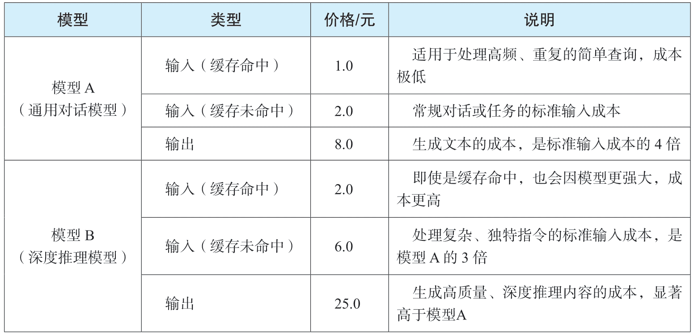

从表 5-2 中可以发现几个关键的计费规律。

首先是输入与输出的差价。输入 Token（发送给模型的提示词）和输出 Token（模型生成的回答）分开计费且输出 Token 的单价通常显著高于输入 Token，有时甚至会达到输入单价的数倍。这反映了模型生成全新、有逻辑的内容需要更复杂的计算资源。

其次是缓存（Cache）机制的成本优势。部分服务商为了鼓励高频、重复的查询，会引入缓存机制。简单来说，在 AI 回答完一个问题后，可能将问题及答案临时存储。如果后续有用户提出完全相同的问题，AI 无须再次计算，直接返回已存储的答案，此过程叫做缓存命中，其成本非常低。但如果问题稍有不同，AI 就需要重新计算，即缓存未命中，按标准价格计费。

例如，若你询问 AI：“今天天气如何？”AI 回答后会存储该问题及答案。若另一个用户再次询问“今天天气如何？”，AI 就会直接输出存储的答案，即为缓存命中。但若询问“明天天气如何？”，因问题不同，AI 需重新计算，即为缓存未命中。在此类定价模式下，单次简短交互（如一次包含几百输入 Token 和上千输出 Token 的问答）的成本可能仅需几分钱甚至更少，几乎可忽略不计，真正的考验在于规模化和常态化应用。若需要利用 AI 每日自动分析上百篇行业报告，或为数千产品撰写描述，或构建处理大量用户咨询的智能客服系统，日积月累，Token 的消耗量将非常可观，相应的成本也会水涨船高。

对 Token 成本的认知、估算和管理，直接关系到 AI 项目或应用在经济上是否具备可行性和可持续性。将成本效益考量融入 AI 应用的整体规划和系统设计，本身就是 MAPS 四维罗盘中系统（S）落地能力的重要组成部分。

了解并掌握 Token 的成本规律，是与 AI 建立长期、健康且富有成效的协作关系不可或缺的一步。

**5.3.2** **Token 成本优化：三个关键策略**

在认识到 Token 如同 AI 运行所必需的“卡路里”，Token 消耗与成本息息相关之后，如何优化 Token 使用就成为关键课题。我们需要在确保 AI 获取足够信息以理解任务、保证输出质量的前提下，尽可能地减少不必要的 Token 浪费。

这就像为项目规划预算，既要保证各项工作所需的资源充足，又要避免不必要的开支。为 Token 成本精打细算，同样需要我们运用巧妙的策略和良好的使用习惯。通过审视和优化与 AI 的交互方式，我们完全有能力在不牺牲核心功能和效果的前提下，显著降低 Token 的消耗。

我们可以采用系统性的优化方法，主要包含三个核心步骤。

（1）估算与监控 Token 消耗：建立对 Token 消耗的基本认知。

（2）优化提示词：精简提示词，删减冗余信息。

（3）控制输出规格：明确指令，规范生成内容的规格。

接下来，我们详细展开这三个步骤。

**1.估算与监控 Token 消耗**

在开始优化之前，清晰了解当前的消耗基线至关重要。我们需要对一次典型的 AI 交互或单次 API 调用大致产生的 Token 消耗有基本的概念。

（1）如何估算和了解你的 Token 消耗？

●善用官方工具与文档：主流 AI 服务商通常在其开发者平台或 API 文档中提供 Tokenizer（分词器）在线工具或关于 Token 计算规则的详细说明。可将代表性示例文本（如常用提示词、预期生成的文本片段等）输入工具，它会准确返回文本对应的 Token 数量。通过尝试不同长度和类型的文本（如纯中文、纯英文、中英混合、含代码文本等），可对不同内容的 Token 密度形成直观认识。

●经验法则可作为粗略参考：虽然精确的 Token 数量依赖具体模型的分词算法，但可将一些经验数据作为快速估算的参考。例如，对于简体中文，平均每 1 到 2 个汉字可能对应 1 个 Token；对于英文文本，1 个单词通常约等于 1 到 1.3 个 Token（短词可能对应 1 个，长词或带连字符的词可能对应更多）。需注意，这仅为粗略估计，实际数值会因具体模型和文本内容（如标点符号、特殊字符）而异。

●从 API 用量统计中学习：开始使用 API 后，最准确、最直接了解 Token 消耗的方式是定期查看服务商提供的 API 用量统计和详细账单。这些数据会精确记录每次 API 调用的输入和输出 Token 数量。通过分析真实数据，不仅能准确掌握 Token 花销，还能发现哪些类型的任务或提示词模式更容易导致高消耗，为后续优化提供第一手资料。

（2）为什么要关注估算和监控？

对个人开发者或小型团队而言，这有助于更好地控制项目预算，避免因未预料的高额 Token 消耗导致项目难以为继。对于需要设计和运行自动化工作流（如使用自动化平台每天自动调用 AI 处理成百上千条数据）的场景，Token 消耗直接关系到整个系统的运行成本和投入产出比。通过持续监控，还能及时发现因提示词设计不当、程序逻辑错误或 AI 模型行为异常（如在某些情况下突然输出远超预期的超长文本）所导致的 Token 消耗飙升，从而迅速定位问题并修正。

**2.优化提示词**

在对 Token 消耗有了基本认知后，优化提示词是降低 Token 成本的核心环节。其目标是去除发送给 AI 的提示词及整个交互过程中的一切非必要成分，仅保留对 AI 准确理解任务意图和生成高质量输出至关重要的核心信息。

**提示词的精简艺术**

这往往是降低输入 Token 消耗最直接、最有效的方法。我们需要审视每一个提示词，思考哪些词句是必不可少的核心信息，哪些是可省略的冗余内容。首先，告别不必要的客套与寒暄。当我们通过 API 与 AI 交互时，它是执行指令的程序，不需要人类社交中的礼貌用语。诸如“你好，AI 助手，我想请你帮我分析一下这段文字的主要观点，你能做到吗？如果可以的话，那就太感谢你了！”在该提示词中，大量开场白、疑问句和感谢语对 AI 理解核心任务（“分析这段文字的主要观点”）的帮助微乎其微，却实实在在增加了输入 Token 数量。

一个简单的优化对比：

**优化前**（以某典型分词器为例，消耗约 243 个 Token）：

我是一名市场部的初级分析员，我们公司最近刚刚成功研发并推出了一款全新的、具有划时代意义的智能联网咖啡机。这款咖啡机的功能非常强大和丰富，比如说，它可以轻松连接家庭的 Wi-Fi 网络，用户可以通过我们专门开发的手机应用程序（App）进行远程控制和操作，甚至它还能够根据每一位用户的独特口味偏好，智能地、自动化地调节咖啡豆的研磨粗细程度以及精确控制萃取的黄金时间。我现在非常迫切地需要你发挥你的才华，最大限度地利用你的计算能力，帮我为这款令人兴奋的咖啡机精心构思并撰写一段大约 150 字的营销宣传文案。我希望这段文案的整体风格能够显得活泼有趣，能够有效地吸引年轻一代消费者的注意力，并且要突出我们产品最为核心的智能化和便捷性这两大卖点。谢谢！

**优化后**（以同一分词器计算，消耗约 93 个 Token，节省约 62%）：

角色：资深营销文案策划。任务：为新款智能咖啡机撰写宣传文案。产品核心功能：Wi-Fi 连接，App 远程控制，自定义口味，自动调节研磨与萃取。目标受众：年轻消费者。文案风格：活泼有趣。突出卖点：智能化，便捷性。字数要求：150 字左右。

精简后的提示词不仅减少了 Token 消耗，更重要的是，结构化指令让 AI 能更快速、更准确地把握核心需求。

其次，力求精确提问，避免含糊不清。模糊、宽泛的提问往往会迫使 AI 在更广阔的知识空间中搜索和猜测，导致其输出更多试探性、概括性，甚至与期望不完全相符的内容。这些额外的探索性输出会增加 Token 的消耗。因此，在构建提示词时，应先仔细思考：我希望 AI 完成的具体任务是什么？期望得到的结果具备哪些明确的特征？然后用最直接、没有歧义的语言将这些需求表达出来。

最后，对多轮对话中的上下文进行精简。在复杂任务中，往往需要通过多轮对话与 AI 进行持续交互和迭代，以得到满意的结果。此时需要特别注意，API 的每次调用通常会将之前的部分或全部对话历史作为上下文信息一同发给模型，以帮助其理解当前的语境和保持对话连贯性。然而，如果历史对话中包含大量与当前步骤不相关或早已被确认解决的早期讨论内容及冗余细节，这些过时的上下文就会成为不必要的输入 Token 负担，在每一轮新的交互中被重复计算。

一个重要的优化策略是，在每次调用 API 之前，学会对需要传递的对话历史进行有选择的修剪和净化。只保留对 AI 理解当前特定子任务或维持必要逻辑连贯性至关重要的上下文信息。例如，如果 AI 已协助完成报告的引言和第一章的撰写，当我们请求它继续撰写第二章时，可能只需要提供第一章的核心观点摘要或者简短的过渡性说明作为上下文衔接，无须将引言和第一章的全部原始内容重复发送。

**3.控制输出规格**

第三步将注意力从优化输入转向管理输出。其核心目标是通过在提示词中给出清晰、具体的指令，引导 AI 生成符合我们期望的、在数量上不多不少、在形态上恰到好处的输出内容。这不仅能极大提升获取和使用 AI 生成信息的效率，还是节省宝贵输出 Token 的关键所在。

（1）通过明确指令，为 AI 输出设定清晰的边界。

首先，长度限制是最直接的手段。这是控制输出 Token 数量最常用且最有效的方法之一。如果目标只是获取简短的核心观点摘要，就在提示词中明确告知 AI：”请用 50 个汉字以内总结这份文档的核心内容”；如果需要包含三个主要步骤的行动计划，则清晰指示：“请列出完成此项目的三个关键步骤，每个步骤用一句话简要描述。”当 AI 接收到具体长度或数量要求时，会更有针对性地组织回答，避免漫无目的地自由发挥，从而有效防止生成远超实际需求的冗长答案，节省输出 Token。

其次，格式要求能规范输出形态。如果期望 AI 输出的内容具有特定的结构或格式，如需要一段符合 Markdown 语法的文本以便直接发布，请务必在提示词中清晰、准确地定义这些格式要求。

例如，你可以这样写提示词：

请将提供的以下产品信息（如产品名称、价格、主要功能）进行整理并输出为以下格式的 Markdown 文本：

## 产品名称

（在这里填写产品名称）

## 价格

（在这里填写产品价格）

## 主要功能

-（功能一）

-（功能二）

-（功能三）

AI 模型，尤其是较新版本的模型，通常能够很好地理解并遵循这些结构化指令，输出干净、规范、可直接投入使用的内容。这不仅减少了后续人工格式转换或数据清洗的麻烦，还间接节省了因格式混乱导致需要 AI 反复生成而产生的额外 Token 消耗。

此外，还可以通过限定内容范围来聚焦输出。有时可通过在提示词中明确限定 AI 在回答问题或生成内容时可参考的信息范围，来间接控制其输出的详略程度和 Token 消耗。例如，采用手动 RAG 策略时，在提示词中加入诸如“你的回答必须严格依据我在下方提供的背景资料，不得查找、引用或扩展任何超出此范围的信息”这样的指令，能有效引导 AI 将其注意力完全集中在我们提供的特定资料上，避免从其庞大的通用知识库中引入过多与当前任务不直接相关的额外信息，从而使输出更加精练和聚焦。

最后，输出风格的设定虽不直接节省 Token，但能提升效率。虽然在提示词中设定期望的输出风格（如要求 AI 的回答风格简洁明了、专业严谨、生动活泼或循循善诱）不会直接减少单次输出的 Token 数量，但有助于 AI 更快生成符合期望的初步结果，从而减少后续要求 AI 修改、润色或重写的次数。每一次不必要的反复迭代都意味着额外的 Token 消耗和时间投入。因此，从整体效率和总成本的角度看，清晰的风格指令也是控制输出过程中值得重视的一环。

（2）学会选择能力与成本相匹配的模型。

正如选择交通工具时会根据路程、路况及出行目的来决定是骑自行车、开车，还是搭乘高铁、飞机一样，在选择使用 AI 模型来完成特定任务时，也需要对其成本和能力进行综合考量。

首先，要避免杀鸡用牛刀。不同的 AI 模型在设计目标、训练数据的规模与类型、所擅长的能力领域及 Token 的定价策略上有所不同。在通常情况下，能力更全面、更强大、能处理更复杂推理和生成任务的旗舰级模型（如 DeepSeek 生态中的 DeepSeek-R1），其 Token 的单位价格也相对更高。对于一些相对简单、常规的文本处理任务，如基础的文本分类、对不太复杂的短文进行摘要、从一段话中提取关键词或者进行模式化的内容生成等，可能无须动用这些重量级的旗舰级模型。选择在能力上足够覆盖当前任务需求，但 Token 定价更为经济实惠的轻量级或中端模型（如 DeepSeek 生态中的 DeepSeek-V3），往往能在保证基本效果的前提下，以更低的成本完成任务。

其次，要在能力与成本之间寻求最佳平衡点。当然，若任务本身非常复杂，对输出内容的质量、深度、创新性或逻辑严谨性有极高的要求，或者需要模型展现强大的领域专业知识和推理能力（如撰写深度行业分析报告、进行复杂的法律文书草拟、辅助进行科学研究或软件代码开发等），那么选择更高级、能力更强的模型可能就是必要且值得的。在这种情况下，就需要在预期的输出质量、解决问题的效率与可接受的成本之间，根据具体项目的价值和预算进行仔细权衡。有时，高级模型虽然单次调用的 Token 成本较高，但如果它能用更少的交互轮次、更简洁高效的提示词完美解决问题，甚至带来人工难以企及的洞察和创造力，那么从整体投入产出比来看，其性价比反而可能优于单价便宜但需要投入大量时间进行反复调整和结果修正的低成本模型。

最后，关注并利用模型的特性与专长。在选择模型时，还应留意不同模型针对特定应用领域或任务类型进行的优化和增强。例如，某些模型在代码生成与理解方面经过特别训练和强化，在辅助编程任务时表现尤为出色；另一些模型则在长文本的深度理解、多语言之间的精准翻译或者特定专业领域（如医疗、金融）的知识问答方面拥有更强的优势。针对具体需求，选择在相关领域表现出专长特性的模型往往会比使用通用型模型处理所有类型的问题更高效，在特定场景下也更经济。

通过系统地实践上述三个核心步骤，并结合对 API 调用策略的精细优化，我们就能有效管理和控制 AI 应用的成本。这不仅能让 AI 项目在经济层面更具可持续性和竞争力，更重要的是，这种对资源进行精细化管理和高效利用的意识与能力，本身就是构建成功、可持续智能系统不可或缺的关键一环。这恰恰体现了提示词（P）作为杠杆、系统（S）作为放大器的协作思想：通过精巧的提示词设计撬动效率，再通过系统化的流程将其效果放大和固化，确保以最小、可控的代价，最大限度地发掘和利用 AI 的强大潜能。

**5.3.3** **提升输出稳定性：三个核心技巧**

在掌握优化 Token 成本的方法后，下一个需要应对的挑战是 AI 输出的不稳定性。你可能深有体会：同样的提示词，昨天 AI 能生成一封专业得体的邮件，今天却可能输出一段笼统且不知所云的内容。这种表现的不一致，无疑会对依赖 AI 进行严肃工作的用户造成困扰。

表面上，这似乎是 AI 内在随机性所致。实际上，这是模型生成文本时的采样机制、上下文理解的细微变化，以及服务平台在不同时刻的负载状态等多种因素共同作用的结果。简单来说，若缺乏有效引导，这位聪明的 AI 伙伴的输出就可能变得难以预测。所幸，我们并非束手无策。通过一些经过验证的提示词策略，可以将 AI 输出的波动控制在基本可预测、可接受的范围内。本节将继续围绕 MAPS 框架中的提示词精细控制与系统复用思维，介绍三个核心技巧。

**1.角色设定与分轮管理**

AI 输出之所以会天马行空，很大程度上源于我们未明确指定其应扮演的角色及行为边界。与其让 AI 在庞大的知识库中漫无目的地探索，不如为其精准定位、划定行为范围。

（1）精准的角色定位与行为边界。

正如 RICE 框架所强调的，明确角色至关重要。你可以通过以下结构化方式设定。

示例指令结构：

你现在是一位拥有十五年从业经验的《财富》中文版资深财经编辑。

你的任务是根据我提供的××公司最新季度官方财报数据，撰写一篇约 300 字的业绩解读。你的解读必须：

1.严格依据财报中披露的官方数据和事实；

2.只能使用客观、中立的商业分析语言；

3.采用总分总的三段式结构；

4.禁止加入任何个人猜测或引用未经证实的小道消息。

角色越具体，任务边界和行为规范越清晰，AI 在思考和生成内容时偏离主题的可能性就越小。

（2）应对多重身份需求的分轮管理。

若任务复杂，需要 AI 在不同阶段展现不同身份或技能（例如先分析数据，再撰写文案），则不宜在单一提示词中强行融合多重角色。更稳妥的做法是分轮管理：先让 AI 扮演数据分析师，专注完成数据解读；待该阶段完成后，在下一轮交互中明确指示其切换为市场部文案策划，基于前一轮分析结果进行文案创作。

**2.示例锚定**

大语言模型通常具备极强的模式学习和类比推理能力。这意味着，精心挑选、能代表你期望输出的示例，其引导效果往往优于冗长的规则描述。为 AI 提供高质量示例，就像赋予它清晰的参照标准一样，使其能够直观理解努力的方向。

AI 从示例中学习两个方面的内容：结构节奏（如句式密度、段落组织、信息层级等）与语言风格（如正式程度、情感色彩、专业术语偏好等）。有效示例的关键在于短小精悍，仅包含能清晰展示核心期望的关键特征。若示例过长或信息杂乱，反而可能分散 AI 对主要目标的注意力。

此外，若希望在提供高质量示例的同时进一步降低输出的随机性，可考虑配合调整 API 调用中的温度、Top-p 等采样参数。对于大多数追求稳定输出的场景，将温度设置为较低值（如 0.3，或参考服务商文档中关于保守输出的建议值），或将 Top-p 设置为 0.8 左右，通常可满足 80%的需求。通过适度限制 AI 的自由发挥空间，可显著提高输出结果的精准度与可预测性。

**3.分步引导，逐层推进**

让 AI 在输出复杂内容前，经历思考、规划、表达的过程，并非空谈，而是能显著降低输出波动、提升最终质量的有效方法。与其期望 AI 通过一次性指令完美达成目标，不如引导其进行更稳健、可控的多步执行。典型的三步式分解与调用（以撰写市场分析报告为例，此处仅作浓缩示意，实际提示词可更丰富）如下：

第一轮：提炼核心观点。

提示：基于以下市场数据【附数据】，列出 3～5 个核心洞察点。

第二轮：构建报告大纲。

提示：根据上述洞察点，为市场分析报告拟一个三级标题大纲。

第三轮：分段填充成文。

提示：按大纲第一部分【XX】，结合洞察点【A，B】，撰写详细内容，约 XX 字。

（对报告各部分重复此操作）

在实施分步引导时，一项能显著提升稳定性的高级技巧是巧妙运用“冻结上下文”。具体而言，在每一轮 API 调用中，先把前一轮已确认的高质量输出精华（如关键要点、调整后的大纲等）整理成一段简短摘要，并将其放在系统消息（System Message）中或下一轮用户提示的开头，作为后续 AI 思考的基础。这相当于在一定程度上冻结了关键上下文，有效防止理解漂移。在自动化平台（如 Make 或同类工具）的场景中，甚至可利用变量存储等节点承载和传递阶段性摘要信息，为后续自动化流程提供支持。

此外，在分步引导的最后一轮，为预防 AI 在整合时过度发挥，可在提示词末尾追加约束性指令，如“请确保内容完整，逻辑清晰。若需补充信息，不得超过原文的 5%，且不得引入未经讨论的新论点。”这能有效约束最终输出的范围。

**5.3.4** **构建可持续 AI 协作基石**

至此，我们已为与 AI 实现更经济、更可靠的协作，精心建立了两道关键控制机制：一是对成本的精打细算，二是对输出的稳定预期。

成本效率与稳定输出共同构成可持续 AI 协作的基石。两者为我们构建了一条与 AI 高效、可持续协作的可靠防线，确保我们投入的每一分资金、每一分钟时间，都能尽可能地转化为可预测、可依赖且高质量的输出。这不仅让我们在日常使用 AI 时更加省心、经济，也为将 AI 能力更深入、更系统地集成到工作流程中，乃至构建自动运行的智能应用，奠定坚实而可靠的基础。

**5.4** **多模态交互：写得“活”**

掌握了提示词工程的“对、准、稳”三个维度后，我们的 AI 伙伴已经能够在纯文本世界中称职地完成任务：准确理解意图、输出可信内容、保持稳定表现。但如果止步于此，就低估了多模态 AI 技术的潜力。

关键的转变在于，当模型不再只认识冰冷的字母和符号，而是能“看懂”图像，并按照指令生成图像、音频甚至视频内容，像训练有素的助手直接执行精心编排的分步指令时，它就仿佛穿越了冰冷的屏幕，拥有了更接近人类的多维感知和创作能力。这种能力的扩展直接对应 MAPS 中提示词维度的完整性：从单模态对话到多模态交互，我们与 AI 的协作深度得到进一步提升。

本节将聚焦于多模态交互中最成熟、应用最广泛的图像处理能力，系统介绍三个核心场景。首先，学习如何让 AI 精准理解视觉信息，从图像中提取关键价值；其次，掌握如何通过提示词引导 AI 生成符合需求的图像；最后，探讨如何将复杂任务拆解为 AI 可执行的结构化指令序列。在你熟练运用这些能力后，就能在第六章构建自动化系统时，无缝整合图像处理、内容生成等高级功能，真正搭建起高效运转的 AI 协作体系。

**5.4.1** **视觉理解：让 AI 读懂图像信息**

多模态 AI 技术的核心意义在于，它为 AI 打开新的感官维度，让文本不再是机器理解世界的唯一入口，从而彻底打破人机交互的根本局限。这给日常处理海量信息的现代知识工作者带来显著的生产力提升。现在，你可以将随手拍摄的会议白板照片、客户现场访谈的手写草图，直接“投喂”给先进的多模态模型。模型就有可能在很短的时间内，自动完成从“原始信息输入”到“深度理解、信息浓缩、结构化输出”的全过程。

这对工作方式最直接的改变是，显著减少耗时枯燥的人工转录与初步整理环节。

**实际案例：白板草图的快速结构化。**

假设在战略研讨会上，团队在白板上勾勒出新项目的执行路径，包括三个关键阶段和相应行动点。传统的做法是会后由专人将白板内容录入文档：拍照后回到电脑前，在绘图软件中手动将每个框图、箭头和文字重新绘制和录入，并辅以必要的文字说明，整个过程通常需要 30 分钟以上。

现在，我们可以直接拍照交给多模态模型处理。图 5-7 展示了一张实际的白板照片：手写字迹潦草，包含三个带编号的阶段描述、若干关键词和箭头连接。

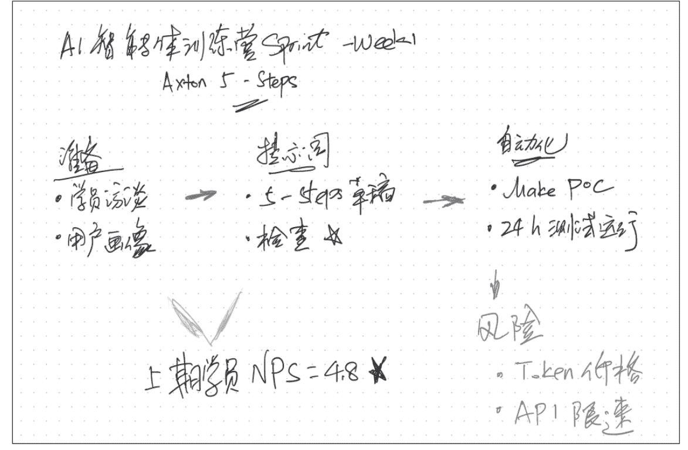

图 5-7

将图片上传给多模态模型，并给出简洁的指令。

请在 150 字内总结这张图片的三大阶段与关键行动，并列出两条风险提示。

模型准确地识别出关键信息并进行了整理（图 5-8）：

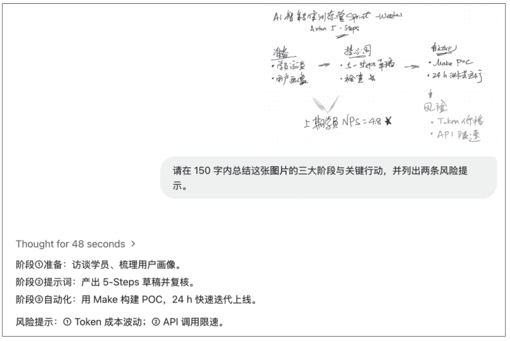

图 5-8

整个过程不到 1 分钟，输出内容可直接复制到项目管理工具或团队文档中。信息的传递密度和处理效率因此得到极大提升，而我们投入的脑力和时间成本却不升反降，这正是 AI 多模态技术带来的最直接、最实在的红利。

**5.4.2** **视觉分析：让 AI 看懂图像背后的价值**

AI 的图像理解能力是多模态技术中最基础也最广泛的应用。无论是上传图片还是提供图片链接，先进的模型都能识别图片内容，并根据要求进行描述、信息提取或分析。

但仅仅让 AI 识别画面元素是不够的，真正的价值在于引导它进行深度分析：从表面的视觉信息中，挖掘出符合特定目标的洞察。这就像给一位能力很强但需要明确指令的助手布置任务：必须用精准的语言，明确告诉 AI 需要关注什么、输出什么。这个过程可以分解为三个核心步骤，在实际撰写提示词时，不必拘泥于生硬的编号，而是用自然流畅的语言来引导。

让我们通过一个实际案例来理解这一过程。假设图 5-9 是一张设计精美、旨在推广新款智能咖啡机的宣传海报。


图 5-9

**1.为 AI 设定清晰的“观察情境”**

将海报图片提供给 AI 后，不要期望它能自动洞悉所有需求。过于松散的指令，如“请帮我分析一下这张咖啡机海报”，很可能只得到表面罗列画面元素（“图片显示了一台咖啡机，背景是一个现代厨房……”）的回答，这样的输出往往冗长散乱，难以提炼出真正需要的核心信息。

更有效的方法是，先清晰说明核心意图和期望 AI 扮演的角色。例如，想利用这张海报为新品做预热推广，提示词可以这样写。

你现在是一位经验丰富的品牌营销策划。请仔细观察这张关于我们新款“AXTON 智能咖啡机”的产品海报。我的目标是通过对海报的解读，提炼出能够精准打动追求生活品质的都市独居青年群体的核心卖点，并为我后续的推广文案提供素材。

我们这款咖啡机的品牌定位是“年轻人的第一台智能精品咖啡伴侣”，强调的是在快节奏的都市生活中，通过智能便捷的操作，轻松享受一杯高品质咖啡所带来的“小确幸”和“仪式感”。我们希望规避那种过于冰冷、强调纯粹技术参数的传统家电宣传方式，而是要突出其设计美学、用户体验和情感连接。

通过这样的“情境铺垫”和“目标定调”，AI 就如同接收到清晰的项目简报，对任务有了明确的方向感和价值判断标准。图 5-10 展示了 AI 给出的详细解读。

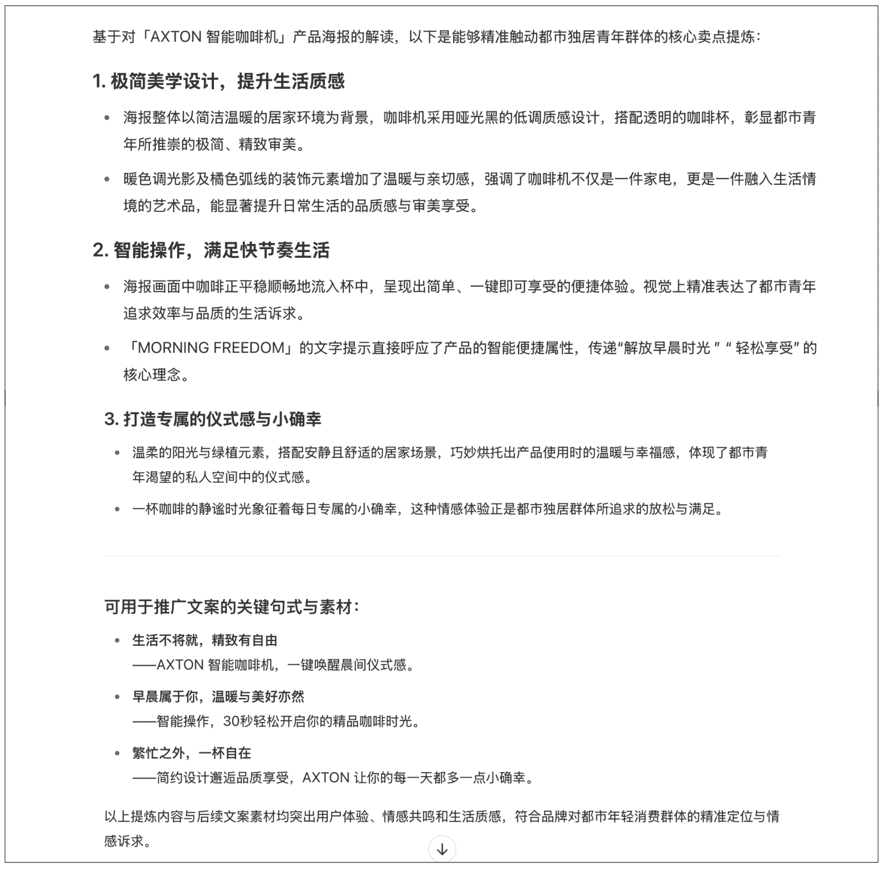

图 5-10

**2.用具体的“提问”或“指令”引导 AI 的注意力**

设定好宏观的观察情境和解读目标之后，需要通过更具体的提问或指令引导 AI 关注海报的关键区域或特别感兴趣的营销元素。继续上面的场景，可以继续细化要求。

基于以上目标和背景，请你针对这张“AXTON 智能咖啡机”海报，重点完成以下任务。

（1）视觉焦点提炼：请找出海报中最能体现“设计美学”“智能便捷”及“独居青年小确幸”的三个关键视觉焦点，每一个用不超过 20 字描述。

（2）卖点转化与解读：针对每个视觉焦点，解释它如何打动目标人群（追求生活品质的都市独居青年）？每条解释控制在 50 字内，语言俏皮有共鸣。

（3）输出格式：按照“视觉焦点描述：［20 字短语］→关联卖点解读：［50 字解释］的格式逐条列出。”

AI 给出图 5-11 所示的回答：

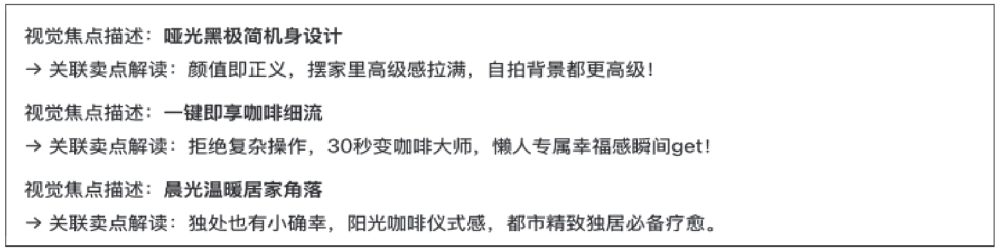

图 5-11

通过层层递进的引导，AI 清楚地知道：需要关注的内容（海报中的特定视觉焦点）、回答的问题（如何关联核心概念并打动目标人群）、遵循的逻辑（从视觉到卖点的转化），以及输出的格式要求。这样得到的结果很大概率可以直接被复制到推广策划中，只需极少的二次编辑。

**3.对 AI 的输出进行迭代式追问**

即便我们给出清晰的初始指令，AI 的首次输出也未必能满足所有期望。这时需要运用多轮对话和迭代优化技巧，对 AI 的初步回答进行有针对性的追问，要求其进行必要的澄清与深化。

例如，如果 AI 在解读咖啡机海报时提到“海报背景中出现的绿植元素营造了温馨的居家氛围，能打动追求生活品质的独居青年”，你可能觉得这个观察还不够深入，或者希望它能将此与产品的具体使用场景更紧密地联系起来。那么，你可以进一步追问：

“温馨的居家氛围”与“AXTON 智能咖啡机”之间，可以构建怎样更具体的场景联想或情感连接？请尝试用一句更具画面感和故事性的营销短句（15 字以内）来表达，例如“清晨，被咖啡香唤醒，与书香、绿意相伴，开启元气满满的一天”的感觉。

通过富有引导性的迭代式追问，能激发 AI 进行更深层次的联想和创造，使其输出不只于表面观察，更能触及目标用户的情感诉求和价值认同。

另外，对于 AI 从图片中提取的客观信息，如产品型号、价格信息或特定的品牌 Logo 等，如果它们的准确性对后续决策至关重要，那么在 AI 给出初步的识别结果后，进行人工核验依然是不可或缺的环节。

通过“设定观察情境→引导注意力→迭代式追问”这套完整的流程，我们就能将 AI 强大的图像理解能力，从简单的“看图识物”提升到更具商业洞察力、更贴合实际需求的“情境化分析”和“策略性信息挖掘”层面。AI 输出的分析结果也能真正成为工作流程中可被直接采用和高效复用的宝贵资源。

**5.4.3** **视觉的经济账：多模态输入的成本考量**

与处理纯文本相比，处理图片消耗的 Token 数量通常会大幅增加，其计费方式并非简单地依据文件大小或像素总量，而是遵循固定的切片规则。

**1.主流多模态服务的图片 Token 折算规则**

表 5-3 展示了典型的图片 Token 计价方式。

表 5-3

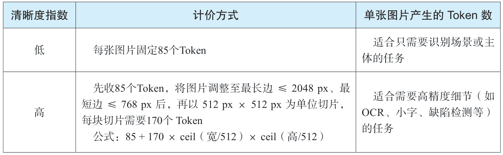

**说明：**系统回复仅计算文字 Token，图片本身在回复阶段不再重复计费。不同服务商的实际数值可能略有差异，但大多遵循类似“固定成本+切片成本”的思路。

**2.为什么高分辨率图片成本更高**

当你选择高精度解析时，平台必须把 2048px×2048px 以内的整幅图片切分为若干个 512px×512px 的小视窗，每增加一个视窗就额外消耗 170 个 Token。因此，决定成本的关键不是文件大小，而是切片数量。这也是建议在本地先进行降采样或裁剪的原因。

**3.日常场景中的成本控制策略**

在需要频繁或批量使用图像理解功能时（如商品图片分类、医学影像批注、市场调研截图归档等），应该始终保持成本意识。以下是一些实用的控制策略。

**优先使用低清晰度：**若只需识别主要对象或场景，85 个 Token 通常足够，可大幅降低单位处理成本。

**先做本地压缩或裁剪：**将 4K 的图片压缩到 1080p 或仅截取关键区域，可显著减少图片切片数量。具体预处理方式包括：压缩分辨率（在保持可识别度的前提下，将 4K 的图片压缩到 1080p）；优化文件大小（调低 JPEG 质量，或将 PNG 转 为 WebP）；裁剪关键区域（仅保留模型需分析的部分）；转换为灰度图（若任务对色彩不敏感，可转为灰度图，既轻量又易处理）。

**分步调用：**先使用低清晰度图片快速定位关键区域，再针对该区域上传高清晰度的局部截图进行详细分析。

**自动化预处理：**在流程平台中集成图片缩放、格式转换或 WebP 压缩模块，把“高清大图”预处理为“AI 友好图”再输入模型，既省心又节省成本。

**善用输入缓存：**多数服务会对完全相同的输入进行自动缓存，再次调用仅收取部分费用；合理复用缓存结果可进一步控制开销。

通过上述看似细微的节流措施，我们能够在保证核心分析效果的前提下，有效控制多模态场景中的成本，避免高清大图在不知不觉中消耗大量预算。

**5.4.4** **掌握文本生图的控制艺术**

如果说图像理解解决了 AI 在视觉信息“输入端”的问题，那么文本生成图像（Text-to-Image）就是 AI 在视觉信息“输出端”展现的创作能力。当前，许多先进的多模态模型已经能够直接根据输入的自然语言描述，在短时间内生成风格多样、内容丰富的图像，涵盖插画、设计稿乃至具有照片级真实感的合成图像。

要让 AI 精准捕捉创作意图并生成真正符合期望的图像，提示词就不能只是简单勾勒。我们应该像电影导演给美术设计师下达详尽的创意简报那样，先为画面定下清晰的叙事骨架和情感基调，再细致交代场景氛围、色彩运用、光影布局，最后点出画龙点睛的关键细节。

以下是一段可直接用于实战的示例提示词结构，其交互逻辑和操作一个支持多轮对话式图像生成与编辑的多模态模型时所体验到的效果高度相似。

**1.示例：指导多模态模型创作一幅北欧极简风格的咖啡主题插画**

假设你是一位生活方式博主，需要为“晨间咖啡仪式感”文章创作独特的配图。你可以尝试向多模态模型发出如下指令：

“你现在扮演一位擅长北欧极简风格的商业插画师。请根据以下详细要求，为我创作一幅数字插画：

【核心要求】

●主体元素：一个设计复古、线条流畅的手冲咖啡壶，材质为哑光陶瓷或带有轻微磨砂质感的金属。

●核心场景：咖啡壶放置在一个简洁的木质桌面上，背景为清晨时分一扇明亮的窗户，窗外可见模糊的绿色植物或城市剪影。

●光影氛围：采用柔和逆光或侧逆光，营造清晨阳光斜射的温暖宁静感。咖啡壶边缘有轮廓光（高光），桌面和背景可带柔和长阴影。

●主色调与配色：整体以温暖的灰色调或米白色调为基底，咖啡壶本身可以是深灰色或带有复古铜色的金属质感。辅以少量饱和度较低的琥珀色或蜂蜜色作为高光或点缀色，以增加画面的温馨感。

●艺术风格：强调北欧极简主义设计风格（如简洁的线条、干净的背景、不过度装饰等），并带有一些手绘插画的笔触感或纸张纹理质感，非追求极致的 3D 照片真实感。

●画面比例与构图：图像宽高比为 16∶9（横屏），咖啡壶为视觉中心，适当留白以营造呼吸感。

模型将生成图 5-12 所示的图像。

**2.迭代优化：“先粗后细，先整体后局部”**


图 5-12

通常，AI 在接收到上述详尽的初始指令后会生成一幅或多幅“初稿”。这些初稿可能已接近期望，但在细节上（如咖啡壶的具体形状、光影的强度、背景的模糊程度等）与我们的设想还存在偏差。此时应善用多模态模型的“基于上一轮输出进行增量式调整和迭代编辑”的能力。

例如，若初稿中壶嘴造型不够纤细，或希望背景色调更偏冷以突出热气，可在当前对话中追加如下指令。

非常棒的初稿！请在上一幅图像基础上进行以下调整：

1.保留整体光影氛围和构图；

2.将咖啡壶壶嘴设计得更修长纤细；

3.将窗外背景主色调调整为略偏冷的淡蓝色或薄荷绿色，与咖啡壶的暖色调形成鲜明的对比。

其他元素尽量保持不变。

模型接收到修改意见后，会尝试理解调整意图，对图像特征进行精确定位并重新渲染输出修改后的图像，如图 5-13 所示。


图 5-13

此过程不同于传统图像编辑软件（如 Photoshop）中的“图层叠加+蒙版修改”，更像对图像深层语义特征的“智能重塑”。

作为普通用户，无须深究其背后的复杂技术原理，但应掌握“先粗后细，先整体后局部”的创作心法：在与 AI 进行文生图协作时，先通过概括性提示词快速生成符合整体方向和主要构图的“草稿”；再通过具体、聚焦的修改指令逐步打磨细节、色彩光影与元素关系。

这种方法相比一次性追求“完美提示词”或反复生成随机图像再筛选，不仅能提升对创作过程的掌控感，还能节省时间与 API 调用成本，减少试错带来的挫败感。

这种“先草稿，后精调”的迭代思路，不仅是高效的创作技巧，还是 MAPS 中系统（S）思维在微观创意场景下的体现：我们为创作过程构建了一个包含“生成→反馈→优化”的迷你闭环系统。

**5.4.5** **让 AI 分步走：复杂任务拆解**

在掌握了 AI 的图像理解与生成能力后，我们自然希望它能在更复杂的场景中按预设流程和逻辑有条不紊地工作。其中最核心有效的方法是，先将复杂任务拆解为若干定义清晰、可检验的子步骤，再通过一系列串联的提示词（提示词链）引导 AI 逐步完成。

这种“分步提示”或“任务流水线化”思维，不仅提升了单次复杂任务的成功率与输出质量，还是我们从“与 AI 进行简单点对点交互”（提示词工程的初级应用）迈向“构建和管理含 AI 能力的可持续自动化智能系统”（系统思维的深度实践）的关键桥梁。

**1.先感知，再思考，最后行动**

几乎所有需要 AI 完成、略具复杂性的信息处理或内容创作任务，都可以抽象为经典的“三段论”模型。

（1）第一段：感知与信息输入。

此阶段的目标是让 AI 准确、全面地接收和理解任务相关的原始输入信息。信息形式可能是纯文本（如待总结的文章、客户需求文档等），也可能是多模态（如产品图片、会议录音转文字、含图表的行业报告等）。关键动作是通过提示词引导 AI 对输入信息进行初步的“消化吸收”，如识别关键实体、提取核心数据、概括主要观点，或者将非结构化信息（如图片内容）转化为结构化文本描述。

让我们看一个实际案例。假设任务是“根据一张新发布的咖啡机产品海报图片，撰写一条用于社交媒体推广的图文帖”。第一轮提示词专注于图像信息提取，AI 的输出（Output A）将是一份关于海报图像内容的结构化文字笔记，包含设计特点、功能文字和目标受众分析，如图 5-14 所示。

（2）第二段：思考与策略规划。

在 AI 充分“感知”并初步处理输入信息后，第二阶段的核心目标是引导其进行更深层次的思考、分析、判断、创意构思或行动策略规划。

关键动作是将上一阶段的输出（Output A）作为核心输入，通过新的提示词要求 AI 进行推理、演绎、比较、筛选，或生成多种可能的解决方案或创意方向。

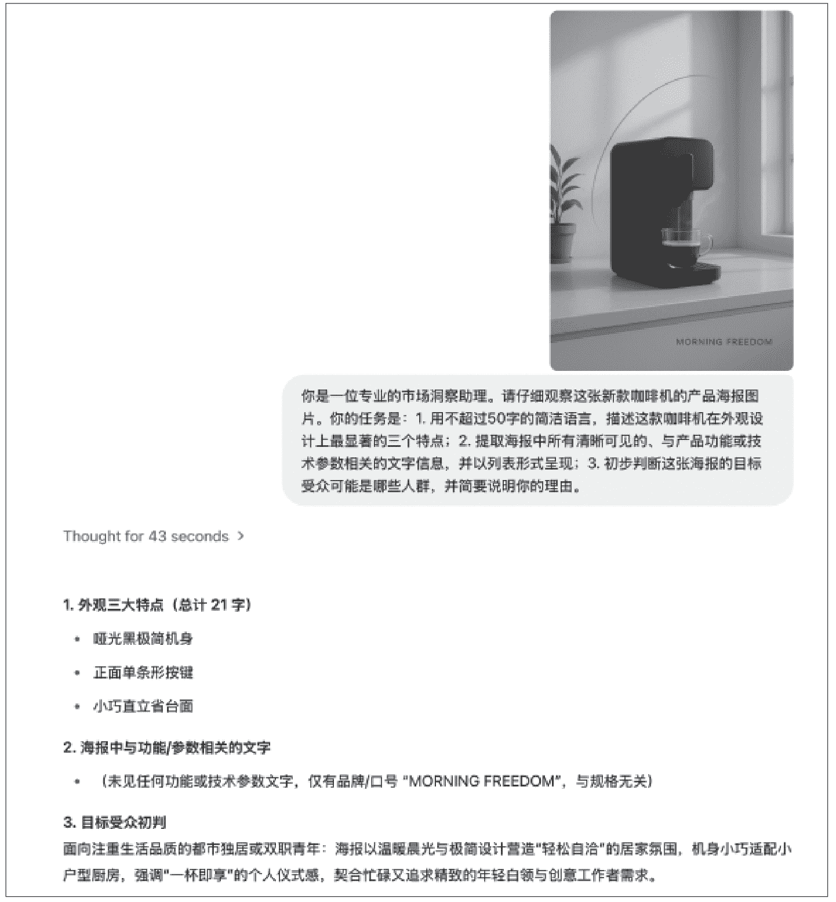

图 5-14

第二轮提示词基于 Output A 进行营销角度构思：

非常好。基于你刚才对咖啡机海报的分析（设计特点：【引用 Output A 中的设计特点】；功能信息：【引用 Output A 中的功能列表】；目标受众分析：【引用 Output A 中的受众判断】），现在请你以一位资深社交媒体营销策划的身份，为这款咖啡机构思至少三个不同主题或切入角度的推文创意。每个创意应包含：A.一个吸引眼球的推文标题或开场白（15 字以内）；B.简要阐述该创意如何能有效吸引你之前判断的目标受众。

AI 的输出（Output B）是三个或更多结构化的推文创意方案，每个方案都包含标题和针对目标受众的吸引力分析，如图 5-15 所示。

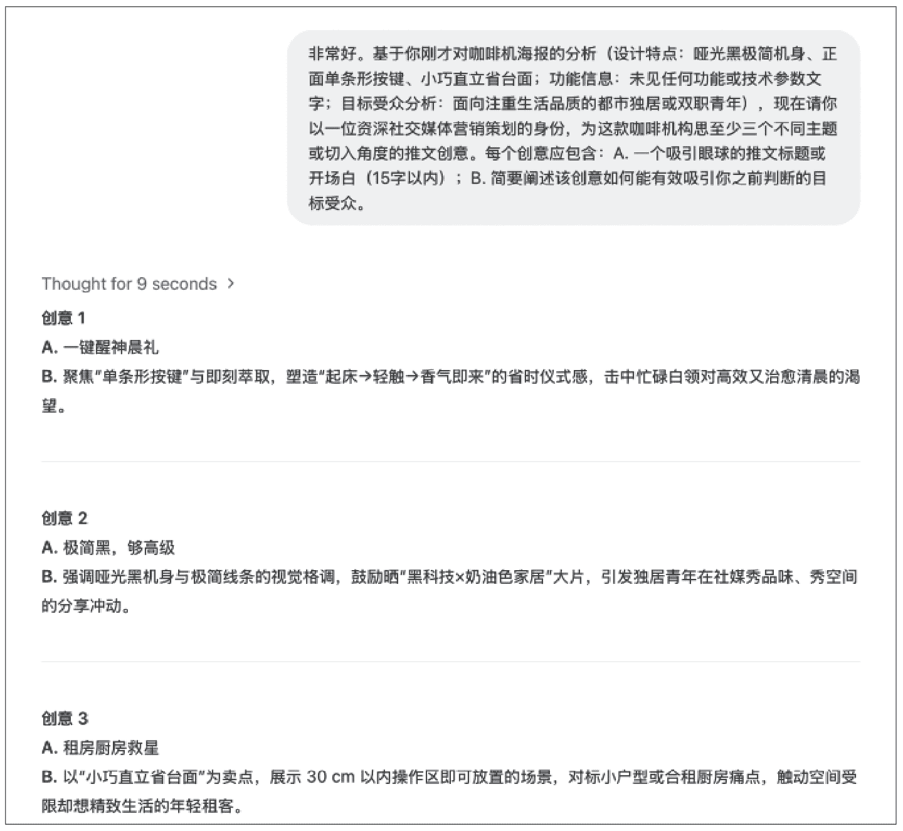

图 5-15

（3）第三段：行动与成果输出。

在 AI 完成充分的“思考与策略规划”后，第三阶段的核心目标是引导其按照明确的规格和要求，执行具体的创作、生成或转换任务，产出可直接使用的最终成果。

关键动作是发出最终指令，要求 AI 综合运用前序步骤中的所有关键信息、决策结论或创意方案，并严格遵循输出格式、长度、风格、语气等最终的“规格说明书”来生成结果。

假设从 Output B 中选择第二个创意方案，第三轮的提示词如下：

我决定采用第二个推文创意。现在，请你将这个创意方案，最终扩展并润色成一条可以直接发布到社交媒体平台的完整图文帖内容。推文应包含：1.你选定或润色后的标题/开场白；2.约 100～120 字的正文，需生动有趣地介绍咖啡机的核心卖点，并自然融入之前分析的目标受众痛点或期望；3.2～3 个相关的、当前热门的中文标签；4.请同时为这条推文构思并生成一张与之风格匹配、能增强吸引力的配图（配图要求：简洁明快，突出咖啡的品质感和现代家居的和谐融入，画面比例 1∶1）。如果不能直接生成图像，请用文字详细描述这张理想配图的画面内容和构图要求。

AI 的输出（Output C），如图 5-16 所示。它是一条经过精心撰写、基本可直接用于社交媒体发布的图文帖内容。

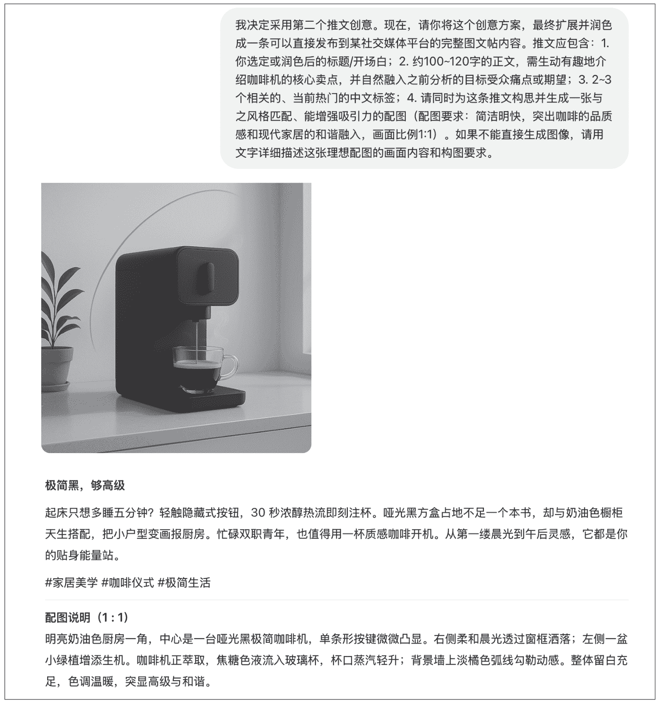

图 5-16

（4）“三段论”模型的价值与自动化潜能。

将复杂任务按“感知→思考→行动”三段论模型进行拆分和引导，具有以下好处。

●**纠错定位更精准，迭代成本更低**

若“思考与策略规划”阶段生成的创意不理想，只需调整该轮提示词或要求重新生成，无须否定已完成的图像信息提取工作。这种模块化纠错与迭代会节省大量时间与 API 调用成本。

●**上下文管理更稳定，信息传递更可靠**

通过将前一段输出的精华摘要或关键决策作为下一段提示词的核心记忆，可有效对抗“上下文漂移”，确保 AI 在长任务链中始终“抓住重点”。

●**创造性与规范性的灵活平衡**

可根据子任务特性设置不同的采样参数。例如，在需要发散创意的“思考”阶段，可将温度调高（如 0.7～0.9）以鼓励多样性；在需要严格遵循格式的“输出”阶段，可将温度调低（如 0.1～0.3）以确保规范性。这使得 AI 既能展现创造力，又能恪守执行力。

更令人兴奋的是，这种基于提示词链的“三段论”任务编排思想，与无代码/低代码自动化平台（如 Make）搭建工作流的逻辑天然契合。我们可将“感知→思考→行动”三段映射为流程图中三个依次独立执行的模块节点。

通过模块化串联和参数化配置，我们可以实现“让 AI 按预设流程自动工作”的目标。在此类自动化流程中，每个节点都有独立的输入、输出和运行日志，一旦某个环节出现问题，方便进行单节点检查、调试和重跑，真正做到“错一环不牵连全链，改一处无须全盘重来”。

**5.4.6** **驾驭多模态 AI 的底层逻辑**

在本书中，我们将对 AI 能力的认知与应用从相对单一的纯文本交互拓展到更广阔、更富有生命力的维度。我们初步领略了先进多模态 AI 在图像理解（精准分析和描述图像信息）与图像生成（根据文本指令生成视觉内容）方面所展现的潜力。更重要的是，我们学习并实践了如何通过一系列精心设计的提示词技巧有效引导和驾驭这类“视觉智能”，使 AI 真正具备理解视觉世界并以视觉方式表达的能力。

更进一步，我们探讨了如何通过巧妙的提示词编排和分步引导策略（尤其是“感知→思考→行动”三段论），将相对复杂、包含多个逻辑步骤的任务拆解为一系列更易管理和执行的子单元。借助指令接力和上下文固化等技巧，AI 能够像训练有素的助理一样，有条不紊地完成多阶段的工作。这种基于提示词的任务编排思想，不仅显著提升了我们利用 AI 解决复杂问题的能力、成功率及输出的质量与可控性，还为第六章运用自动化平台（如 Make）构建更高级、更系统化的 AI 应用奠定重要的思维基础。

站在 2025 年这个 AI 技术加速渗透与融合的节点，回顾本节所学，有三条值得我们掌握的底层逻辑，它们是未来更深入、更智慧地应用 AI 的重要指引。

感官融合正在重塑信息流转的起点与效率。AI 多模态能力的发展，使我们能够将现实世界中更多形式、原本难以被机器直接理解的原始数据（如随手拍摄的会议板书照片、产品演示视频的截图、客户手写的需求草稿和便签等），更直接、低成本、无缝转化为机器可理解、可分析、可处理的结构化知识或行动指令。这极大地降低了信息从物理世界向数字世界流转过程中的“人工搬运”成本和潜在“信息损耗”。

分步链路是驾驭复杂性、保障可靠性的核心策略。面对日益强大的 AI 模型和宏大的应用目标，试图通过一个“大而全”、一步到位的“超级提示词”解决所有问题的想法正变得越来越不切实际。将复杂任务巧妙地拆解为一系列逻辑清晰、目标单一、执行过程可监控、输出结果可验证的子步骤或处理节点，并通过有效机制将它们稳健串联，让每个关键步骤都有明确的“输入源”和“质量验收口”，是我们在日益复杂的任务中始终保持掌控力、及时发现并有效止损的核心策略。

成本意识与稳定性追求依然是应用的基础。无论 AI 能力多么强大和全面，我们始终不能忽视“经济性考量”（如对 Token 消耗、API 调用频率与相关服务费用的精打细算等）和“稳定性追求”（如对 AI 输出结果的一致性、可靠性与可预测性的持续优化等），两者如同构建 AI 应用大厦时看不见的“地基”和摸不着的“天花板”，深刻影响并制约着我们应用探索的深度、广度与可持续性。

我们上传的每一张高清图片，调用的每一次高精度图像理解服务、生成的每一幅可能用于商业用途的图像，都在无形中消耗宝贵的计算资源，并最终体现在运营账单中。对这些新兴能力的成本效益进行持续、理性的评估，并坚持不懈地运用各种优化技巧提升其投入产出比，是确保 AI 探索不会沦为难以负担的高成本实验，并最终转化为可持续商业价值的关键前提。

**5.4.7** **即刻体验多模态 AI**

在进入第六章之前，建议你亲自动手完成一个综合性实践练习，以巩固和体会本节所学的核心内容。

**第一步：寻找视觉素材与创作目标。**拿起手机，随意拍摄当前书桌或办公桌的一角，或从相册中挑选一张最近拍摄的、有趣或有故事感的日常照片（如一杯咖啡、一本打开的书、窗外的风景等）。然后设定一个简单的目标：希望 AI 根据这张照片，提炼出三个可用于社交媒体分享的独特卖点或心情感悟。

**第二步：实践图像理解与分析。**尝试运用本节学到的原则编写一段提示词，引导具备图像理解能力的多模态模型分析所选的照片，并输出三个卖点或感悟。注意在提示词中明确意图、引导 AI 的关注焦点，并设定输出的格式要求。

**第三步：体验文本生图的创作过程。**如果想更进一步，可以根据第二步中 AI 提炼出的某个卖点或感悟构思一段新的提示词，引导具备绘图功能的多模态模型生成一幅能视觉化表达该卖点或感悟的原创插画或概念图。在提示词中描述期望的画面主体、场景氛围、色彩风格和构图等。

**第四步：尝试三段论任务编排。**整合以上步骤，尝试用“感知→思考→行动”的三段论思路，设计能让 AI 自动（或者在引导下分步）完成“根据给定图片→提炼核心信息→围绕核心信息生成一条包含配图（或配图文字描述）的完整社交媒体推文”的迷你任务流。

完成这一整套从“看图”到“构思”再到“创作”的迷你实践，你将会更真切地体验到多模态 AI 的强大能力，以及通过提示词设计所能实现的精准掌控。

准备好了吗？让我们的提示词，从此刻开始不再只是与 AI 的简单对话，而是驱动未来智能系统高效运转的精密指令！

**第六章** **系统实战：自动化流程的构建**

经过第五章系统性的学习与实践，Axton 已能熟练运用 RICE 框架构建结构清晰的提示词，通过“降幻三板斧”确保 AI 输出的准确性，在成本与质量之间找到平衡点，甚至驾驭多模态 AI 完成从图像分析到内容生成的复杂任务。他的提示词已进化为精密的指令。

那些曾让他焦虑的问题，如 AI 输出不稳定、成本难以控制及频繁出现的幻觉，如今都有了系统性的应对方案。他的提示词模板库在不断丰富，每个模板都经过反复打磨，每次调用也都能获得稳定可靠的输出。

然而，就在 Axton 为这些进步感到欣慰时，一个更深层的问题逐渐浮现。

尽管每个环节都有成熟的提示词模板，但制作一期视频内容的完整流程仍需要他持续参与：先通过提示词让 AI 搜索并整理资料，并将资料复制到另一个模型中生成初稿；再把初稿中需要配图的部分标记出来逐一生成图片，并将图片下载、编号、插入对应位置；最后用校对提示词检查全文。

每个步骤都在他的掌控之中，每个输出都符合预期。但当他完成这一切，看着电脑上七八个打开的标签页、散落在各处的文件和笔记时，一个熟悉的感觉涌上心头——这不就是他在第二章试图逃离的“数字孤岛”困境吗？

是的，他已从“工具使用者”进化到“协作伙伴”，能够熟练指挥 AI 完成各种复杂任务。但他仍然需要在不同工具之间复制和粘贴上下文，手动触发每个环节，亲自检查每个输出。虽然整个流程比过去高效，却仍然依赖他的持续在线和手工操作。

更关键的是，这套流程无法实现规模化。如果他想同时制作三期视频，就需要三倍的时间和精力；如果他想让助理帮忙，就得逐一教授整套操作手册。一旦某个环节出了问题，比如某个 AI 模型升级导致提示词失效，他又得重新梳理整个流程并逐一排查。

Axton 重新审视已绘制的“内容引擎 1.0”蓝图。图上清晰标注着他的愿景：一个能够自动运行的内容生产系统，从选题输入到草稿输出，全程无须人工干预。而现在，他虽然拥有精雕细琢的提示词工具箱，却仍被困在“手工作坊”的困境里。

问题出在哪里？Axton 很快找到了答案：他掌握了“点”的能力，却没有学会如何将这些点串联成“线”和“面”。心智（M）、架构（A）、提示词（P）的独立应用实现了“点”的突破，但要构筑“线”的优势和“面”的壁垒，答案直指 MAPS 的最后一个字母——S（系统），也是“四步跑道”的最后一站——部署（Deploy）。

部署，对此刻的 Axton 而言，是跑道的最后一站，也是他所有努力能否实现价值的关键环节。这意味着他必须完成最后也是最关键的一跃，实现在他脑海中清晰浮现的目标：不同的 AI 模型和工具能够自动协作，无须人工搬运数据；每个环节的输出能够自动传递给下一个环节，形成无缝衔接；系统能够自动记录每次运行的数据，为后续优化提供依据。

他将利用自动化平台把前面三个阶段的所有成果进行连接和固化，最终形成可监控、可迭代、可持续运行的自动化系统。这不仅仅是技术层面的挑战，还是对身份认知的最终升华。只有当 Axton 将人工流程固化为自动化系统，将个人技巧沉淀为可复用资产时，他才能真正完成从“协作伙伴”到“架构师”的最终跨越。

现在，是时候将蓝图变为现实，将工具组装成引擎了。读完本章，你也将会具备把任何转瞬即逝的灵感转化为可持续运行的智能系统的能力。

关于平台选择的说明：本章以 Make 平台为例展开介绍，核心价值不在于帮你熟练使用 Make，而在于建立一套可迁移的自动化系统设计思维。无论你是使用 Zapier、n8n，还是其他平台，这里的原则都同样适用。具体的跨平台实现案例，参见第八章。

**6.1** **从“对话”到“调用”：API 的价值**

当前我们与 AI 交互主要有两种模式，理解它们的区别，将会帮助我们深刻认识为何“系统”是放大 AI 价值的必然路径。

**第一种模式：通过官方聊天界面进行对话。**

无论是通过网页、桌面客户端，还是手机应用，我们都能进入一个简洁的对话窗口，向 AI 提问或要求它撰写文案、分析数据，甚至进行角色扮演式的创意构思。这是最直接、最便捷的使用方式，极大降低了使用 AI 的门槛。

下面以生成健身计划为例。我们可以向 AI 发出图 6-1 所示的指令。

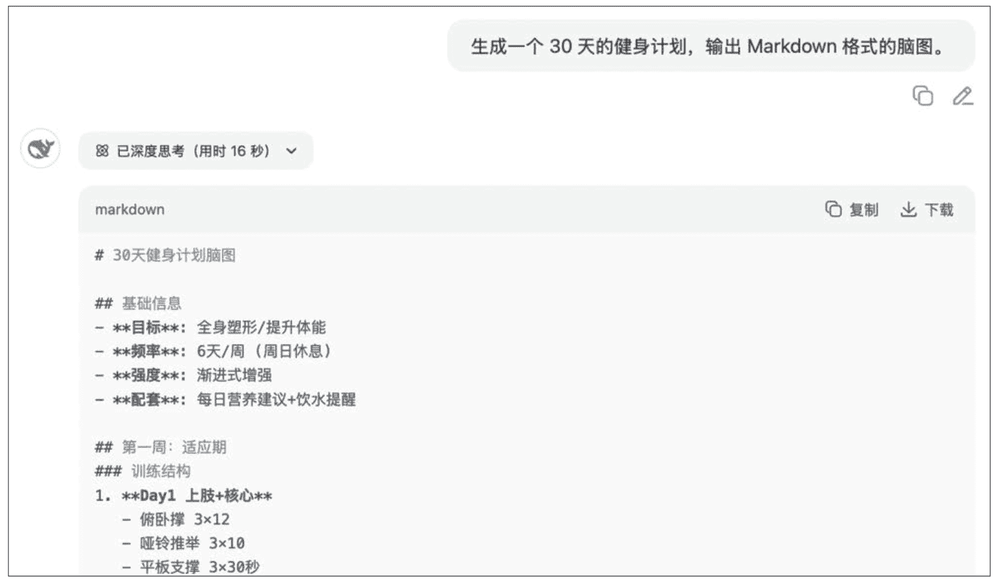

图 6-1

AI 会生成如下详细的 Markdown 格式的健身计划（此健身计划仅为示例，不代表可以真的遵照执行）。

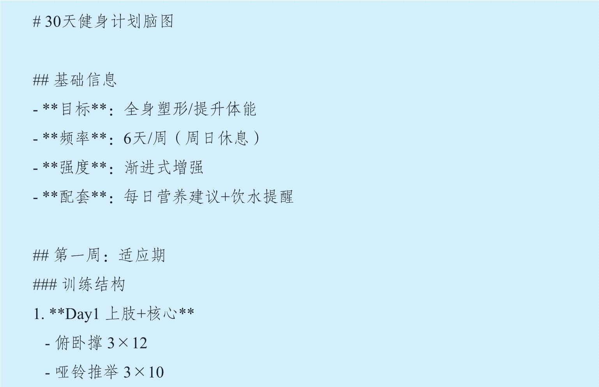 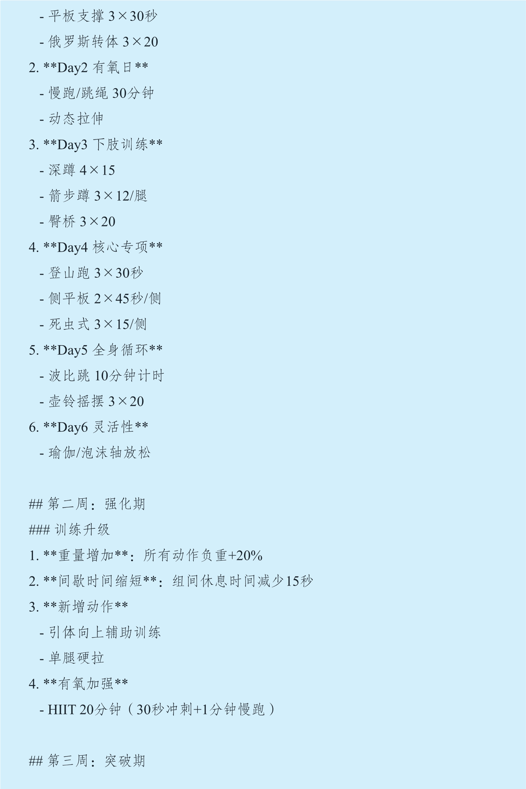 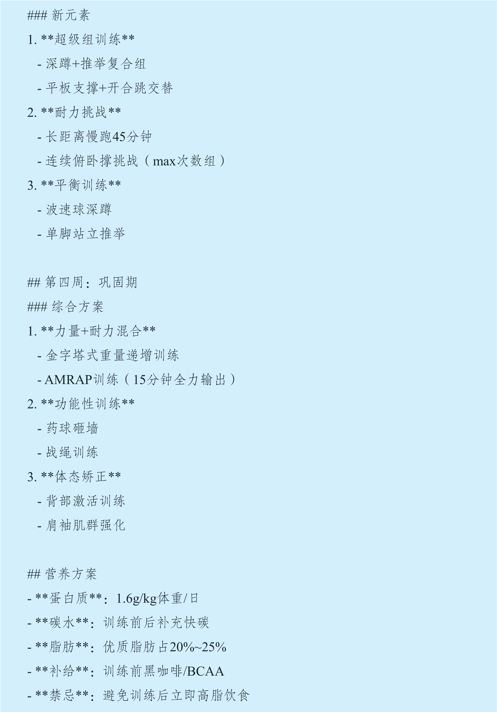

然后，我们手动将 AI 生成的 Markdown 文本复制到专业的脑图软件中进行处理和可视化，生成的脑图如图 6-2 所示。

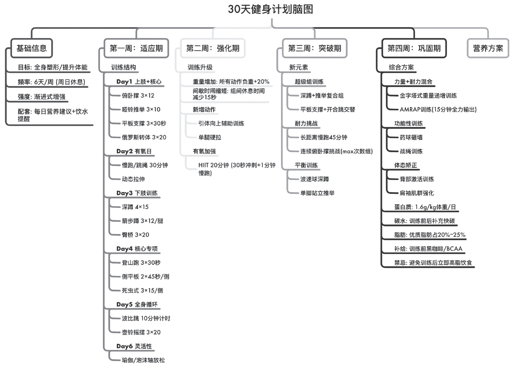

图 6-2

这种“AI 生成+人工转运”的协同方式能够解决日常工作中的许多问题。但局限性同样明显：本质上仍是“人机对话”，每次交互都需要手动发起，每次利用结果都需要手动“复制+粘贴”。整个过程是断裂的，信息无法在不同应用之间自动流转。就好比我们拥有一位博学的顾问，但每次咨询都必须亲自上门拜访，并将他的建议记录下来，再到别处去应用。

**第二种模式：通过 API 程序化调用。**

API 是一套预先定义的规则、协议和工具，它允许不同软件的应用程序之间相互请求服务或交换数据，而无须了解对方内部复杂的实现细节。我们可以把它想象成软件系统之间的“中介”，其规定了如何提出请求、请求的格式及得到怎样的响应。

我们可以借助餐厅这一经典商业服务模型的运作流程，精准理解 API 在软件系统中的角色，如图 6-3 所示。

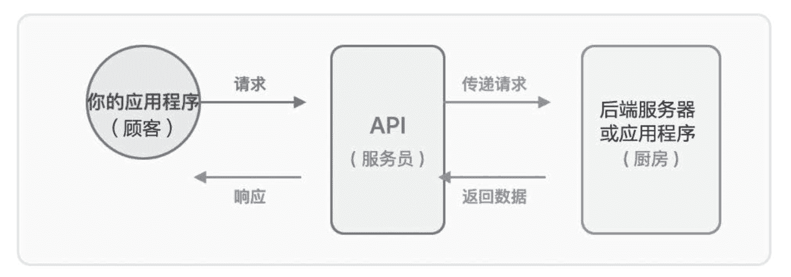

图 6-3

在这个模型中，各个角色的对应关系如下：

●顾客=你的应用程序（如在 Make 平台上搭建的自动化模块）。

●菜单=API 的官方文档（列出所有可用的功能、调用方式、参数和限制）。

●服务员=API（标准化的沟通接口，用于隔离复杂性）。

●厨房=后端服务器或应用程序（真正拥有数据和能力的地方）。

●点单=API 请求（Request）。

●上菜=API 响应（Response）。

顾客通过服务员点单，服务员将订单传递给厨房，厨房完成制作后由服务员将菜品送回。这一流程确保了交互的稳定、有序和安全，无须暴露内部复杂的运作细节。正是这种标准化的通信机制，使得成千上万个不同的软件服务能够彼此协作，构成互联互通的数字世界。

AI 模型所提供的 API 允许我们绕开图形化的聊天界面，让应用程序（如 Make 自动化平台）直接与 AI 模型进行程序化交互，并接收其返回的结果。

这意味着，AI 不再仅仅是孤立的“聊天对象”，而是能够无缝集成到任何工作流程中，成为可被调度、自动化的能力模块。例如，“收到一封新邮件”这一事件可自动触发 AI 对邮件内容进行分析和摘要，而“数据库中新增一条客户反馈”这一操作也可驱动 AI 判断其情感倾向并打上标签。

通过 API，AI 的能力真正从“聊天窗口”中得以解放，融入工作流程的每一个环节，开拓出比手动交互广阔得多的应用场景。更重要的是，要驾驭 API 所带来的能力，我们无须成为专业程序员。借助 Make 等自动化平台，可以通过更直观、更友好的方式，将 AI 的 API 功能转化为一个个“积木式”组件，灵活搭建出符合自身需求的智能系统。

**6.2** **Make 平台入门**

在构建复杂的自动化系统之前，首先需要掌握 Make 平台的基础操作。本节将带你完成账户准备、搭建第一个完整工作流，并逐步掌握参数化、安全管理、智能决策和错误处理等核心能力。

**6.2.1** **实战准备：账户注册与凭证获取**

我们需要准备 Make 和 DeepSeek AI 模型两个平台的账户。

**关于操作界面的重要说明：**

本书中的所有操作步骤和界面截图，均基于 2025 年上半年的软件版本。软件和在线服务（尤其是 Make 和各类 AI 平台）正处在不断迭代中，其 API 接口、授权方式、操作界面随时可能发生变化。

如果在按照书中步骤操作时遇到困难或发现差异，请优先查阅相应平台的官方帮助文档或最新的开发者文档。本书提供的步骤旨在阐明原理和核心方法，最终请以操作时相应平台的官方说明为准。

**1.Make 账户注册**

打开 Make 官网，页面如图 6-4 所示。


图 6-4

单击页面右上角的“免费开始（Get started free）”按钮，系统会跳转至注册页面，如图 6-5 所示。你可以选择使用已有的第三方账户（如企业邮箱账户）快速注册，也可以通过电子邮箱进行标准注册。


图 6-5

如果你选择邮箱注册，需要按照页面提示填写以下信息。

●“姓名（Name）”：输入你的姓名。

●“电子邮箱（Email）”：输入你的邮箱地址。

●“密码（Password）”：设置一个符合安全要求的密码。

●“国家（Country）”：在下拉菜单中选择你所在的国家。

●“托管区域（Hosting Region）”：在下拉菜单中选择数据的托管区域（可根据实际情况选择）。

完成信息填写并勾选同意服务条款与隐私政策后，单击“免费注册（Sign up for FREE）”按钮提交表单。

随后，系统会向注册邮箱发送验证邮件，单击邮件中的链接即可成功激活 Make 账户。

**2.获取凭证**

DeepSeek AI 是我们选用的提供核心 AI 能力的大语言模型。我们需要从其开放平台获取 API Key，以便 Make 能够调用其服务。

**步骤一：进入 API 开放平台。**

打开 DeepSeek 官网，页面如图 6-6 所示。在页面导航栏中，单击右上角的“API 开放平台”链接。


图 6-6

**步骤二：注册与登录。**

进入 API 开放平台后，根据页面指引，使用手机号码即可完成注册和登录。

**步骤三：进入 API** **Key 管理页面。**

成功登录后，将看到 API 开放平台的控制台页面，如图 6-7 所示。在页面左侧的导航菜单中，单击“API 密钥（API keys）”菜单项。

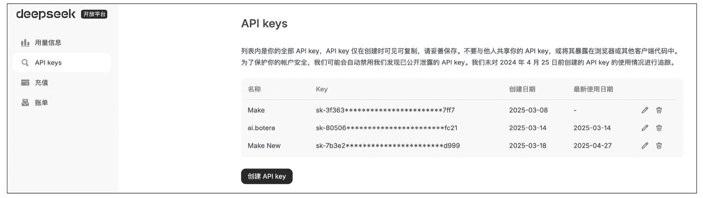

图 6-7

**步骤四：创建新的 API** **Key。**

在 API Key 管理页面中，单击“创建 API key”按钮，系统会弹出图 6-8 所示的对话框，你需要为新的 Key 设置一个便于识别的名称。在输入自定义的名称（如“MAPS Book Project”）后，单击“创建”按钮。

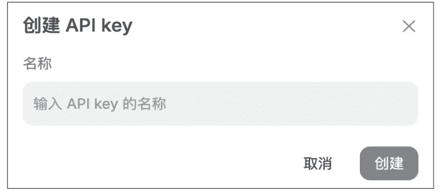

图 6-8

**步骤五：复制并妥善保管 API** **Key。**

此时，系统会生成一串以 sk-开头的密钥，并将其显示在弹出的对话框中。

至关重要的一步：请立即单击“复制”按钮，将完整的密钥保存在本地安全可靠的地方（如密码管理器中）。出于安全考虑，完整的密钥仅在创建时显示一次，关闭该对话框后无法再次查看。如果密钥不慎丢失，只能依照同样的步骤重新创建。

**6.2.2** **我的第一个自动化工作流：“每日 AI 鼓励师”**

下面我们在 10 分钟内从零开始搭建一个简单的自动化工作流——“每日 AI 鼓励师”。其任务很简单：每天早晨定时启动，调用 AI 生成一句激励人心的短语。这就像编程世界的传统入门程序“Hello，World！”，是我们通向自动化智能系统世界的第一声问候。

**1.创建新场景**

登录 Make 账户，进入控制台主页。如图 6-9 所示，单击页面右上角的“创建场景（Create scenario）”按钮。


图 6-9

Make 会打开一个空白的“场景（Scenario）”，如图 6-10 所示。可以将其视为我们的数字画布，所有自动化构思都将在此实现。


图 6-10

画布中央有一个紫色的加号图标，单击图标会出现常用的应用列表。

说明：

单击加号后在出现的列表中选择的是应用（App）；选定应用后，会出现该应用可用的条目列表。这些条目按模块类型（如 Triggers、Actions、Searches 等）或按功能对象（如 Message、User 等）分组显示，但本质相同：你在列表中选定某个具体条目后，场景画布上出现的圆形节点才是一个模块（Module）。

为避免重复，后文有时会用“添加××模块”来简写“选择应用+在列表中选择具体条目”的过程。

**2.配置 AI 动作模块**

在应用列表中搜索并选择“DeepSeek AI”，在弹出的“DeepSeek AI”动作列表中，选择“创建一个聊天补全（Create a Chat Completion）”。

由于是首次使用 DeepSeek AI，Make 会要求先创建一个“连接（Connection）”，以授权 Make 访问 DeepSeek 账户。系统会自动弹出连接设置窗口，如图 6-11 所示。


图 6-11

在“连接名称（Connection name）”文本框中输入名称（如“我的 DeepSeek 账户”）。在“API 密钥（API Key）”文本框中，粘贴获取的 DeepSeek API Key，最后单击“保存（Save）”按钮。

连接创建成功后，系统会返回“DeepSeek AI”模块的配置窗口，如图 6-12 所示。其中最关键的一步是在“消息（Messages）”区域编写提示词来设定 AI 任务。


图 6-12

单击“添加项目（Add item）”按钮。在“角色（Role）”的下拉选项列表中选择“用户（User）”，然后在“内容（Content）”文本框中输入以下指令。

你是一位充满正能量的伙伴，请给我一句今天能激励我努力工作的原创短语。

接着，在“模型（Model）”下拉列表中选择“deepseek-chat”，其他的参数可以保持默认设置。配置完成后，单击“保存（Save）”按钮。

**3.设定运行计划**

DeepSeek AI 模块配置完成并出现在画布上，模块左侧出现一个时钟图标，用于设置整个场景的“运行计划（Schedule）”，如图 6-13 所示。


图 6-13

单击该图标，系统弹出“计划设置（Schedule setting）”对话框，如图 6-14 所示。


图 6-14

在该对话框中，将“运行场景（Run scenario）”选项设置为“每天（Every day）”，并将“时间（Time）”设定为你希望接收鼓励的时间，如上午 9∶00。设置完成后，单击“保存（Save）”按钮。

**4.测试与激活**

完整的自动化工作流已搭建完成。在正式激活前，建议先进行手动测试。

单击页面左下角的“运行一次（Run once）”按钮。流程运行完成后，DeepSeek 模块右上角会出现代表操作完成的提示气泡，如图 6-15 所示。


图 6-15

该气泡代表一次成功操作，其中包含模块返回的“数据包（Bundle）”。单击气泡可查看本次操作的详细日志（图 6-16），包括输入（INPUT）和输出（OUTPUT）数据。在输出结果中，可找到 AI 生成的鼓励短语。


图 6-16

验证无误后，即可正式激活系统。如图 6-17 所示，单击页面左下角“运行一次（Run once）”按钮旁边的开关，将其从“Off”切换为“On”。


图 6-17

当开关显示为绿色时，“每日 AI 鼓励师”已正式开始工作。从第二天起，它将在设定时间准时生成并发送激励短语。在离开场景编辑器前，请确保单击页面底部的保存图标，以保存所有更改。

通过以上四个步骤，你已经成功将一个想法转化为可自主运行的智能系统，完整经历了从灵感（扫描）到思考如何实现（设计），再到编写具体的指令（对话），最终到系统（部署）的全过程。

此时，这个“每日 AI 鼓励师”还较为“机械”——只能重复执行相同的任务。接下来，我们将通过参数化使其更加灵活和健壮。

**6.2.3** **参数化：让工作流动态可复用**

“每日 AI 鼓励师”存在一个根本局限：它很“僵硬”。无论运行多少次，执行的都是完全相同的任务，因为核心指令是固定在模块中的。如果我们希望让它围绕“团队合作”这个主题给出鼓励，就必须手动修改提示词。

这显然既不够智能，也不够高效。如何将这个“一次性”脚本改造成能灵活应对不同需求的可复用的工具？答案就是参数化。

**1.理解参数化的价值**

所谓参数化，本质上是一种“留白”艺术，将流程中易变的部分从固定逻辑中抽离，变为可供随时填写的“变量”。

未经参数化的工作流，好比一张已填写完整的印刷表格。而经过参数化的工作流，则像一张空白表格模板，预留了“收件人：___”“主题：___”等空白字段。每次使用时，只需向模板提供变化的参数就能生成定制化的内容。

在 Make 中，实现参数化最常用的方法是设置“场景输入（Scenario Inputs）”。接下来让我们为“每日 AI 鼓励师”增加动态的“鼓励主题”。

**2.定义场景输入**

在 Make 场景编辑器中，单击画布下方的“场景输入与输出（Scenario inputs and outputs）”按钮，打开配置窗口，如图 6-18 所示。


图 6-18

在弹出的对话框中，单击“添加项目（Add item）”按钮来添加新的输入变量。如图 6-19 所示，我们需要对其进行定义。

“名称（Name）”：设定内部使用的名称，如 prompt_topic。

“类型（Type）”：在下拉菜单中选择“文本（Text）”。

“描述（Description）”：输入对用户友好的描述，如“鼓励主题”。

设置完成后，单击“保存（Save）”按钮。


图 6-19

**3.在模块中引用变量**

回到 DeepSeek 模块，打开配置窗口，将“内容（Content）”文本框中的提示词修改为

你是一位充满正能量的伙伴，请围绕“（在此处插入变量）”这个主题，给我一句今天能激励我努力工作的原创短语。

将光标放在需要引用变量的位置（括号处），此时会弹出变量选择器。如图 6-20 所示，选择刚刚创建的 prompt_topic 变量，然后单击“保存（Save）”按钮。

**4.测试参数化效果**

当再次单击“运行一次（Run once）”按钮时，系统会弹出窗口要求输入“鼓励主题”参数。输入“专注”并运行后，AI 生成的内容将紧密围绕“专注”这一主题。如果下次输入“创新”，AI 就会围绕“创新”主题生成新的鼓励语。


图 6-20

通过参数化，我们的工作流从只能执行单一任务的“机器人”，升级为能根据指令处理多种任务的“多面手”。这是架构设计中可复用性思维在自动化流程中的直接体现。

**6.2.4** **安全意识：Make 的“连接”机制**

在一些不规范的开发场景（如直接在代码脚本中写死密码等）中，将 API Key 等敏感信息以明文形式存储会带来巨大的安全风险。一旦代码或配置泄露，所有关联服务的权限也将会暴露。

Make 从设计之初就内建了专业的安全机制，从根本上杜绝了这类风险。这种机制就是“连接（Connection）”。

**1.什么是“连接”**

在搭建工作流的操作中，我们已经实践了这一安全原则。在第一次添加 DeepSeek 模块时，Make 强制引导我们创建需要填写 API Key 的配置窗口，这正是平台安全设计的核心体现。它并非普通的输入框，而是一种专门用于安全保管凭证的加密存储机制。

**2.“连接”的工作原理**

（1）一次存入，集中加密保管。

只需创建一次连接，将服务的 API Key 安全保存在 Make 的加密保险箱中。

（2）授权调用，而非暴露原文。

在配置工作流时，无须也无法在其他地方复制密钥原文。只能从下拉菜单中选择已创建的有明确命名的连接（如“我的 DeepSeek 账户”）。Make 在后台会自动处理复杂的认证流程。

（3）维护便捷，隔离风险。

如果某个 API Key 需要更新，只需在“连接”管理处修改即可，所有使用该连接的工作流会自动同步，极大提升了系统的可维护性。

（4）安全设计的价值。

理解 Make 强制使用“连接”的设计，有助于我们建立更专业的系统安全意识。一个设计精良的系统，必然会将凭证管理等安全问题置于核心考量。

参数化赋予系统灵活性，连接机制则赋予系统安全性和可维护性。这两个原则看似简单，却是从业余“自动化爱好者”迈向专业“架构师”必须跨过的第一道门槛。它们共同确保系统既能灵活应对多变的需求，又能在持续运行中保持安全可靠。

**6.2.5** **构建智能决策系统：路由器与过滤器**

“每日 AI 鼓励师”及其参数化版本本质上都是一个从头到尾的线性流程，只会“埋头干活”，不会“抬头看路”。然而，现实工作中往往充满不确定性，我们需要一个能够根据不同情况做出不同反应的智能系统。例如：

●如果收到的邮件是紧急的客户投诉，应立刻通过邮件提醒自己。

●如果只是普通的营销推广邮件，则可自动归档，无须打扰。

为实现这种“分岔路口”式的决策能力，需要引入 Make 平台强大的控制模块——路由器（Router）。

路由器的核心功能是在工作流中创建决策节点。它接收上一个模块传递的信息，并根据预设的规则进行判断，决定信息“兵分几路”沿着不同的路径触发后续动作。

本节将通过搭建“智能邮件分类器”实践如何利用 AI 和路由器构建能自动“思考”和“决策”的系统。

**1.设定事件触发器**

创建新场景后，单击画布中央的加号图标，在应用列表中选择你的邮件服务商（此处以“Microsoft 365 Email”为例）。

在触发器列表中，选择“关注新邮件（Watch Messages）”，如图 6-21 所示。


图 6-21

按照提示创建与邮箱账户的“连接（Connection）”，并设定需要监控的文件夹，如图 6-22 所示。


图 6-22

**2.调用 AI 进行分析**

在邮件触发器模块后添加 DeepSeek AI 模块，并选择“创建一个聊天补全（Create a Chat Completion）”动作。在“内容（Content）”文本框中输入以下指令：

你是一位高效的行政助理。请分析以下邮件正文，并判断其类别。邮件类别只可能是“重要”、“推广”或“其他”中的一种。请只回答这三个词中的一个，不要添加任何额外的解释或标点符号。

邮件正文如下：

｛｛1.Body.Content｝｝

如图 6-23 所示，将来自邮件模块的“邮件正文（Body Content）”变量映射到提示词中。

**3.引入路由器并配置分支**

在 DeepSeek 模块后添加“流程控制（Flow Control）”工具集中的“路由器（Router）”模块。

路由器用于创建分支，我们将为不同分支设置“过滤器（Filter）”和后续动作。


图 6-23

**路径一：处理“重要”邮件。**

从路由器中拉出连接线，添加“Microsoft 365 Email”模块，并选择“创建并发送邮件（Create and Send a Message）”动作。

如图 6-24 所示，在路由器和模块之间的连接线上出现一个“扳手”图标，单击此图标即可打开“设置过滤器（Set up a filter）”对话框。


图 6-24

在“标签（Label）”文本框中，将过滤器命名为“重要邮件路径”。

在“条件（Condition）”区域中，设置判断条件为前一个 DeepSeek AI 模块的输出｛｛2.Result｝｝等于（Text operators：Equal to）“重要”。

单击“Sare”按钮保存过滤器后，配置“发送邮件”模块：收件人为自己的邮箱，主题为“【重要邮件提醒】”，内容包含原邮件的主题和发件人等信息。

**路径二：处理“推广”邮件。**

从路由器中拉出第二条连接线，再次添加“Microsoft 365 Email”模块，选择“移动一封邮件（Move a Message）”动作。

用同样的方法设置过滤器：命名为“推广邮件路径”，条件设为 AI 模块输出等于（Text operators：Equal to）“推广”。

配置“移动邮件”模块，将邮件移至“已存档”或“垃圾邮件”文件夹。

**路径三：处理“其他”邮件。**

针对 AI 判断为“其他”的邮件，在 Make 的逻辑中无须额外处理。

数据包（Bundle）会依次尝试通过各分支上的过滤器，若不满足任何一个过滤器的条件（既不等于“重要”，也不等于“推广”），则流程自动中止，邮件保留在收件箱中等待人工处理。这种“无为而治”也是一种有效的系统设计。

完成所有配置并激活场景后，一个能 7×24 小时自动分类邮件的智能系统就诞生了。图 6-25 展示了工作流的完整形态。


图 6-25

智能系统实现了从“线性流程”到“分支流程”的跨越。这标志着它初步具备了“智能”——能根据 AI 分析结果自主判断并执行不同的应对策略。这种基于条件判断的自动化能力，是构建更复杂、更强大智能系统的基石。

**6.2.6** **监控与错误处理**

一个健壮可靠的系统，不仅要在正常情况下正确运行，还要在发生意外时能够妥善应对。例如，当“智能邮件分类器”因外部服务（如 AI 模型或邮箱服务器等）出现临时故障而中断时，我们该如何第一时间发现问题？能否设计相应的容错机制，使得系统在发生错误时能够自动补救，而不是让整个流程悄无声息地崩溃？

这正是系统化思维中至关重要的两个环节：监控与错误处理。它们如同确保自动化系统长期、稳定、可靠运行的“仪表盘”与“安全气囊”，分别负责实时洞察系统状态，以及在异常发生时实施有效保护。

**1.监控：查看系统的运行日志**

Make 平台提供了强大的监控功能，为场景的每一次运行都生成详尽的“历史记录（History）”。

1）进入历史记录页面

在“智能邮件分类器”场景的首页（图 6-26）中，单击导航栏中的“历史（HISTORY）”选项。


图 6-26

2）解读运行日志

历史记录页面（图 6-27）中列出了该场景过去的所有运行记录。每条记录都显示“状态（STATUS）”［如成功（Success）或失败（Error）］、开始时间（STARTED）、活动（OPERATIONS）等。


图 6-27

单击任意一条记录右侧的“详情（Details）”按钮，可深入查看该次运行的具体情况。如图 6-28 所示，流程图中每个模块右上角的气泡中记录了真实的输入（Input）和输出（Output）数据。


图 6-28

通过此页面，我们可以精准回溯系统决策的全过程。例如，可以看到某封邮件因 AI 模块输出“重要”而被路由器送入“发送提醒邮件”路径。这种可追溯性对理解、调试和优化复杂的自动化流程至关重要。

**2.错误处理：配置容错路径**

监控用于“事后追溯”，而错误处理则用于“事前预防”。它允许为流程中的任何模块预设 B 计划：若该模块运行失败，则执行备用路径。

下面为“智能邮件分类器”中的 DeepSeek AI 模块添加错误处理器并配置错误处理路径。

1）添加错误处理器

回到场景编辑器页面中，右键单击“DeepSeek AI”模块，选择“添加错误处理器（Add error handler）”选项，如图 6-29 所示。


图 6-29

2）配置错误处理路径

此时，模块下方会出现新的分支路径。在此路径上添加错误发生时需执行的动作，如添加“Microsoft 365 Email”的“创建并发送消息”动作模块。

配置该邮件模块：收件人为自己的邮箱，主题为“【工作流错误告警】智能邮件分类器运行失败”。在邮件正文中，从错误处理器提供的变量中选择具体的“错误信息（Error message）”，以便快速了解故障原因，如图 6-30 所示。

配置完成后，系统就具备了基础的容错能力。若因网络问题或 AI 服务不可用导致 DeepSeek 模块运行失败，我们将会立即收到包含详细错误信息的告警邮件，而非对系统运行失败一无所知。


图 6-30

**6.3** **综合案例：“内容引擎 2.0”的诞生**

**6.3.1** **系统设计：从蓝图到实现路径**

我们已经掌握了参数化、安全连接、逻辑分支、监控与错误处理等核心技能。现在，我们通过整合这些技能，将“内容引擎 1.0”从蓝图变为现实，升级为更强大、更智能、更健壮的“内容引擎 2.0”。

相比 1.0 版本的线性流程，“内容引擎 2.0”的核心进化体现在以下几个方面。

●动态输入与参数化：工作流通过参数化接口，在每次运行时接收动态输入的“文章主题”。

●AI 协同与质量评估：引入“AI 审核员”角色，让第二个模块对前一个模块生成的初稿进行质量评估，为后续决策提供依据。

●智能决策与逻辑分支：借助于路由器，系统根据 AI 审核员的评估结果，智能决定稿件是直接进入发布流程，还是触发人工审核告警。

●容错机制与故障告警：为关键外部服务调用（如 AI 生成）配置错误处理器，确保服务异常时系统能主动告警。

**6.3.2** **构建信息获取层：Exa 搜索与数据聚合**

**1.创建场景与设置动态输入**

登录 Make 平台，单击页面右上角的“创建场景（Create scenario）”按钮进入空白场景编辑器。

单击画布下方工具栏中的“场景输入与输出（Scenario inputs and outputs）”按钮。在弹出的配置窗口中，选择“场景输入（SCENARIO INPUTS）”选项，并单击“添加项目（Add item）”按钮添加新的输入变量。

如图 6-31 所示，需要对此变量进行定义。


图 6-31

●名称（Name）：不能包含空格或特殊字符，只能使用字母、数字和下画线且必须以字母或下画线开头。建议使用英文或拼音，如 topic。

●类型（Type）：选择 Text（文本）。

●描述（Description）：如“文章主题”。

●必需（Required）：选择“是（Yes）”，确保每次手动运行场景时，系统都会强制要求输入此主题，否则流程无法启动。

●默认值（Default value）：可选，也可留空。

**2.配置 Exa** **AI 搜索模块**

设定动态的“主题”入口后，为确保系统能够持续获得高质量的创作素材，必须依赖于稳定、高效的“信息源”。为此，我们选用 Exa AI 搜索服务，这是一个专门为 AI 应用优化的搜索引擎。它能够深入理解查询的语义内容，返回经过清洗和整理的网页信息，为大语言模型提供结构清晰、易于处理的输入素材。

1）获取 Exa AI 的 API Key

打开 Exa AI 官网，如图 6-32 所示，单击“尝试 API 免费版（> Try API for free）”按钮，根据指引通过邮箱完成新账户注册并进行验证。


图 6-32

回到官网首页，单击“尝试 API 免费版（> Try API for free）”按钮或者选择页面右上角的“登录（Sign in）”菜单项，输入账户和密码进入图 6-33 所示的“Exa AI Dashboard”控制台页面。


图 6-33

然后，在左侧导航栏中单击“API 密钥（API Keys）”菜单项，进入图 6-34 所示的页面。


图 6-34

单击“创建新密钥（+CREATE NEW KEY）”按钮，弹出图 6-35 所示的创建新 API Key 的窗口。

在弹出的窗口中为新的 API Key 设置便于识别的名称，然后单击“创建密钥（CREATE A KEY）”按钮，这时新的 API Key 就会显示在图 6-36 所示的窗口中，立即复制并安全保存生成的 API Key。完整的密钥只会显示一次。


图 6-35


图 6-36

Exa AI 通常会提供一定的免费额度（如$10 积分或每月 1000 次请求），足够用于测试和小规模使用。注意：API 调用是收费的，费用取决于搜索类型（如自动、神经网络、关键词等）和内容获取方式（如文本、摘要等）。在正式使用之前或预计流量较大时，建议你提前了解最新的计费标准。

2）配置 Exa AI 模块

返回 Make 画布，单击加号图标，在应用列表中搜索并选择“Exa AI”应用且选择“执行搜索（Perform a Search）动作”，如图 6-37 所示。


图 6-37

首次使用时，Make 会自动弹出图 6-38 所示的连接创建窗口，引导我们创建到 Exa 服务的安全连接。在“连接名称（Connection Name）”文本框中，输入此连接的名称，你可以使用默认的英文名称，也可以创建一个名称，如“我的 Exa 连接”。然后，在“API 密钥（API Key）”文本框中，填入获取的 API Key。最后，单击“保存（Save）”按钮。


图 6-38

连接成功后进入模块的配置窗口，如图 6-39 所示。

●搜索查询（Search Query）：映射为场景输入变量 topic［在变量选择器中单击“｛｝”图标的标签页，选择“场景输入（SCENARIO INPUTS）”下的“topic”变量］。


图 6-39

●结果类型（Result Type）：选择“Magic”，如图 6-40 所示。


图 6-40

●结果数量（Number of Results）：设为 5 个（避免测试时返回太多的结果，速度慢且消耗可用积分），如图 6-41 所示。


图 6-41

●在响应中包含内容？（Include Content in Response？）：设置为“是（Yes）”，这样在搜索返回的结果中就会包含网页内容。

3）设置场景运行模式

保存场景前，需要将运行模式改为按需运行。单击 Exa 模块左下角的圆形箭头图标，在弹出的“计划设置（Schedule setting）”对话框中，“运行场景（Run scenario）”选择“按需（On demand）”，并单击“保存（Save）”按钮保存场景，如图 6-42 所示。

**3.测试搜索结果**

配置完成后，可先运行测试以确保工作流正常返回结果。

单击场景下方工具栏中的“运行一次（Run once）”按钮，在弹出窗口的 topic 文本框中输入查询主题（如“AI 智能体”），然后单击“OK”按钮，如图 6-43 所示。


图 6-42


图 6-43

成功运行后，Exa 模块右上角会出现图 6-44 所示的小气泡，表示 Exa 模块成功完成一个操作。


图 6-44

单击小气泡可在图 6-45 所示的窗口中查看 Exa 搜索返回的详细数据。


图 6-45

由此可见，返回数据由多个 Bundle 组成，每个 Bundle 对应一组数据。因为设置了返回 5 个结果，所以有 Bundle 1～Bundle 5。在每个 Bundle 中，我们关心的内容是 URL（网页网址）和 Text（网页内容），后续流程将会用到这些数据。使用 Exa 搜索结果的目的是，为 AI 提供参考资料。AI 知识库有截止日期（如 DeepSeek R1 为 2024 年 7 月），因此 AI 对于此后的事件无法知晓。若需撰写时效性强的文章，应将搜索结果作为参考提供给 AI。由于 Exa 根据主题搜索出 5 个结果，因此需要将它们合并后交给 DeepSeek。下面通过配置文本聚合模块来实现此功能。

**4.配置文本聚合模块**

在 Make 平台中，能将多个输出结果合并的模块称为聚合器（Aggregator），其位于“工具（Tools）”应用中。如图 6-46 所示，我们需要在“Exa AI”模块后面添加“文本聚合（Text aggregator）”模块。


图 6-46

将文本聚合模块拖动到场景中，并与 Exa 搜索模块连接。设置文本聚合模块的“源模块（Source Module）”为“Exa-Perform a Search［1］”，在“文本（Text）”字段中定义以下格式以组织搜索内容，如图 6-47 所示。


图 6-47

**6.3.3** **构建内容生成层：AI 创作与智能审核**

**1.配置 AI“创作者”模块**

数据准备完毕，现在配置 AI“创作者”模块。

在文本聚合模块后添加 DeepSeek AI 模块。单击“文本聚合（Text aggregator）”模块右侧小圆圈中的“+”号按钮，在弹出的应用选择器中，搜索并选择“DeepSeek AI”，如图 6-48 所示。


图 6-48

选择“创建一个聊天补全（Create a Chat Completion）”动作，并选择第 6.2.2 节创建的“连接”。

在图 6-49 所示的配置窗口中，对 DeepSeek AI 进行如下配置。


图 6-49

●模型（Model）：选择 deepseek-reasoner（DeepSeek R1 推理模型）。

●消息（Messages）：这是最关键的部分，即你需要定义并发送给 AI 的消息，也就是提示词。这里只设置用户提示词。

单击“添加项目（Add Item）”按钮添加第一个消息：设置“角色（Role）”为“用户（User）”；在“内容（Content）”中，输入以下提示词（可根据需求调整）。

你是一位资深的科技专栏作家，擅长撰写深入浅出、逻辑清晰的文章。请严格按照用户要求，生成一篇符合微信公众号格式的 HTML 文章。

请根据以下主题和参考资料，撰写一篇大约 1500 字的文章。

主题：｛｛var.input.topic｝｝

参考资料：

｛｛4.text｝｝

文章要求：

1.围绕主题进行深入阐述，结构清晰，包含引言、正文（可分小节）、结论。

2.直接输出为 HTML 格式，且必须兼容微信公众号编辑器。

3.允许使用的 HTML 标签：<h1>，<h2>，<h3>，<p>，<strong>，<em>，<ul>，<li>，<a>，

。禁止使用其他标签，特别是<div>，<span>，<table>等复杂标签。

4.所有样式必须使用内联 CSS（inline style）。例如：`<p style=“font-size：16px；color：#333；line-height：1.75；margin-bottom：1em；”>段落内容</p>`。

5.段落之间要有足够的间距（margin-bottom）。

6.请在 HTML 开头使用`<h1>`标签输出文章标题，标题内容直接使用用户提供的主题。

7.请确保 HTML 结构完整，逻辑清晰，语言流畅自然。

**映射变量：**

●主题：插入 topic 变量（在变量选择器中单击“｛｝”标签页，选择“SCENARIO INPUTS”下的“topic”变量）。

●参考资料：插入文本聚合模块的 text 变量（在变量选择器中单击“☆”标签页，选择“Tools 4-Text aggregator”下的“text”变量）。

●温度（Temperature）：设置为 0.6（均衡创造性）。

●最大 Token 数（Max Tokens）：可设置为最大值 8192。

**2.配置 AI“审核员”与逻辑分支**

这是“内容引擎 2.0”智能化的核心。引入第二个 AI 模块来对初稿进行质量评估，并以此为依据进行决策。

首先，在第一个 DeepSeek AI 模块后再添加一个 DeepSeek AI 模块来扮演内容审核员的角色。在对它的配置中，我们选择更经济的 deepseek-chat 模型，这正是“精打细算用 Token”思维的体现，并为其设计如下目标明确的提示词。

你是一位严谨的内容审核员。请分析以下 HTML 文本，判断其内容是否逻辑通顺、观点清晰、不含争议性话题。请只回答“通过”或“驳回”这两个词。

文本如下：

｛｛5.choices［］.message.content｝｝

接下来，在“内容审核员”模块后添加“流程控制（Flow Control）”中的“路由器（Router）”模块，并从它出发创建两条路径。如图 6-50 所示，在线路上选择“设置过滤器（Set up a filter）”来配置分支条件。


图 6-50

**路径一（审核通过）。**

标签（Label）：命名为“审核通过”。

条件（Condition）：设为“审核员模块的输出”，｛｛10.Result｝｝等于“通过”。

**路径二（审核驳回）。**

过滤器标签（Label）：命名为“审核驳回”。

条件（Condition）：设为“审核员模块的输出”，｛｛10.Result｝｝等于“驳回”。

在这条路径上连接“Email”模块，并配置它向你的邮箱发送告警邮件。

**3.为关键模块配置容错机制**

现在，我们为流程中最关键的两个外部调用模块增加容错机制。

Exa AI 模块：右键单击选择“添加错误处理器（Add error handler）”。在错误处理路径上连接 Email 模块，并配置它向邮箱发送告警邮件，主题如“【内容引擎告警】Exa 搜索模块运行失败”，正文中则可以引入错误处理器提供的具体错误信息变量｛｛error.message｝｝。

第一个 DeepSeek AI（创作者）模块：同样添加独立的错误处理器和告警邮件。

**6.3.4** **完成发布链路：微信公众号集成**

**1.获取微信公众号开发者 ID 及密码**

首先准备发布渠道凭证，使 Make 与微信公众号平台能够通信。

然后使用管理员账号登录微信公众平台，单击左侧的“开发接口管理”选择进入“基本配置”页面（图 6-51），查看并妥善保管“开发者 ID（AppID）”和“开发者密码（AppSecret）”。


图 6-51

**2.为文章配置封面图**

虽然封面图生成非本次演示的重点，但发布公众号文章必须指定封面图。这里我们采用最直接的方法实现，以保证流程顺利跑通。在实际应用中，需要根据具体需求完善封面图生成流程。

策略：指定一张可供下载使用的图片（如自有版权或无版权素材等），先利用 HTTP 模块下载，再上传到微信公众号素材库。

在工作流中添加 HTTP 应用，并选择“获取文件（Get a file）”模块。此模块的功能是从指定的 URL 地址中下载文件。如图 6-52 所示，单击该模块打开配置页面，在“URL”文本框中输入准备好的图片链接即可。需要注意的是，图片的格式最好是微信公众号支持的 PNG 或 JPG 格式。


图 6-52

通过 HTTP 模块下载图片后，需要将其上传到微信的永久素材库，以获取独一无二的封面图 Media ID（用于后续步骤中的文章封面图标识）。为此，需要在 HTTP 模块后添加“微信公众号（WeChat Official Accounts）”应用，并在动作列表中选择“上传永久素材（Upload a Permanent Asset）”动作。

首次使用微信公众号模块时，需要创建到公众号的连接。如图 6-53 所示，单击“创建一个连接（Create a connection）”按钮后，在弹出的窗口中输入准备好的微信公众号“App ID”和“App Secret”即可。

连接成功后，在弹出的模块配置窗口中需要重点配置两项参数，如图 6-54 所示。


图 6-53

资产类型（Asset Type）：选择“缩略图（Thumb）”。

文件（File）：映射来自 HTTP 模块的输出结果。


图 6-54

配置完成后，单击“保存（Save）”按钮。模块执行成功将返回包含 media_id 的数据包。

**3.创建并发布微信公众号图文草稿**

下面将 AI 生成的文章 HTML 内容和封面素材 Media ID 组合起来，在微信公众号后台创建图文草稿。

在微信公众号的“上传永久素材（Upload a Permanent Asset）”模块之后，再添加一个“微信公众号（WeChat Official Accounts）”的“创建草稿（Create Drafts）”模块，如图 6-55 所示。


图 6-55

将此模块拖动到场景中，并与“上传永久素材（Upload a Permanent Asset）”模块连接，如图 6-56 所示。


图 6-56

单击“创建草稿（Create Drafts）”模块，在配置窗口中以列表形式配置文章的具体信息。单击“添加项目（Add Item）”链接后，即可映射各个字段，如图 6-57 所示。


图 6-57

●标题（Title）：设置为“公众号图文测试”。

●封面图 Media ID（Thumb Media ID）：映射为前一个微信模块返回的 Media ID 变量。

●内容（Content）：映射由第一个 DeepSeek AI 模块生成的文章 HTML 内容。

●原文链接（Content Source URL）：填写文章原文 URL。在测试时，可以先填写自己的博客或者网站的 URL。

完成所有字段的映射后，保存配置。“创建草稿（Create Drafts）”模块成功执行后，会在微信公众号后台的“草稿箱”中创建一篇新图文消息，并输出包含草稿 ID（Draft ID）的结果。

接下来是发布环节。在“创建草稿（Create Drafts）”模块后添加“微信公众号（WeChat Official Accounts）”的“发布草稿（Publish a Draft）”模块。如图 6-58 所示，在“草稿 ID（Draft ID）”字段中，直接选择上一个模块输出的“Draft ID”变量即可。


图 6-58

**4.保存与测试**

工作流已基本搭建完毕。在正式激活之前，需要进行保存与测试，单击场景左下角的“保存（Save）”按钮保存所有更改。

测试期间，通常我们不希望流程自动发布不成熟的草稿。其有效的方法是，暂时断开最后一步连接。如图 6-59 所示，右键单击“创建草稿（Create Drafts）”模块与“发布草稿（Publish a Draft）”模块之间的连接线，在弹出的菜单中选择“取消链接（Unlink）”菜单项。这样，在执行工作流时，流程将在创建完草稿后自动停止。


图 6-59

现在，我们通过单击“运行一次（Run once）”按钮来手动运行工作流。系统首先提示输入“文章主题”（Scenario inputs），如图 6-60 所示。


图 6-60

输入主题后，观察流程的执行过程。如果流程进展顺利，则每个模块的名称上方都会出现绿色的对勾。另外，可随时单击模块右上角的气泡查看详细的输入和输出数据。

此时，进入微信公众号后台的“草稿箱”，即可看到由“内容引擎 2.0”自动创建的文章，如图 6-61 所示。


图 6-61

单击草稿标题就可以打开预览全文，如图 6-62 所示。


图 6-62


图 6-62（续图）

**6.3.5** **复盘与提升：MAPS 四维罗盘的完整实践**

我们完成了“内容引擎 2.0”系统的构建。现在通过 MAPS 四维罗盘来复盘各个维度是如何在实践中协同工作的。

在架构（A）层面，设计的系统不再是僵化的线性结构。通过引入 AI 审核员和路由器，系统具备初步的智能决策能力，能根据内部状态选择不同的执行路径。这种非线性设计使其适应性和鲁棒性远超简单的串联流程，这也为未来的扩展留下清晰的接口。例如，我们可以在创建草稿前，再加入一个需要人工批准的审核节点。

在提示词（P）层面，我们看到精准指令的核心作用。内容生成提示词的质量直接决定最终输出文章的质量与合规性；质量评估提示词需要简洁、明确，确保返回稳定、可供机器判断的结果。通过让两个不同角色的提示词协同工作，体现了更精细的人机对话设计。

在系统（S）层面，所有设计与实践都通过 Make 平台固化成初步的内容生产系统。它通过参数化实现复用，通过错误处理器提升健壮性，通过平台的执行日志实现监控。更重要的是，它不再是一系列孤立的手动操作，而是可以根据预设逻辑自主运行，并能在异常时主动告警的闭环。未来，我们甚至可以为它设置定时运行的调度，或通过 API 接收外部信号触发，使其成为更完整的自动化解决方案。

这正是 MAPS 四维罗盘在实践中的完整体现：用心智（M）认识到自动化的可能性，用架构（A）设计流程，用提示词（P）与 AI 对话，用系统（S）实现落地和迭代。

现在，你已将本书所有的核心技能融会贯通，并亲手构建了真正意义上的自动化系统。你不再仅仅是 AI 的使用者，而成为能够驾驭 AI 并将其能力系统化、产品化的合格架构师。

**第七章** **未来展望：你的 2030 时间胶囊**

还记得本书开篇时的场景吗？

Axton 曾深陷“手工作坊”的泥潭：每一期视频都需要从零开始，每一个提示词用完即弃，每一次协作都依赖临场发挥。AI 工具带来的单点效率提升，在系统性的流程内耗中被无情吞噬。他感觉自己如同西西弗斯，日复一日地将巨石推上山顶，却始终无法突破那道看不见的天花板。

而现在，当 Axton 再次坐在电脑前时，一切都已不同。

他的“内容引擎 2.0”已经平稳运行了三个月。每周一早晨，他只需在系统中输入本周的选题关键词，然后就可以去泡一杯咖啡。等他回到桌前，系统已自动完成资料搜集、信息整合和初稿生成。那些曾经需要手工搬运的上下文、反复调试的提示词、逐一触发的工作流程，如今都被固化为一套能够自主运行的自动化系统。

他的角色也发生了根本性转变。过去，他是流程中的“操作工”，每个环节都需要亲力亲为；现在，他是系统的“总监”，只需要在关键节点进行决策和把关：审核 AI 生成的初稿是否符合自己的风格，检查引用的资料是否准确可靠，为内容注入 AI 难以赋予的“灵魂”——个人洞察、情感共鸣与价值观表达。

更重要的是，他构建的不仅是一个高效的工作流，还是一套可持续积累价值的资产系统。

●个人知识库持续沉淀他的研究成果和独特洞察，每一次创作都在为未来的选题提供更丰富的素材。

●模板库收录经过实战验证的提示词和流程设计，每一次优化都让系统变得更加智能和稳定。

●成品库归档发布的所有内容及其生产元数据，为持续迭代提供可追溯的反馈循环。

这套系统的价值已在数据中得到验证：从选题到初稿的时间从 5 天压缩到 2 天，提示词的复用率从 0 提升到 80%，AI 输出的一次通过率从 30%提升到 75%。但更让 Axton 欣慰的不是这些可量化的效率指标，而是他重新找回了创作的乐趣，那些被琐碎流程占据的时间，如今可以用来深度思考、打磨观点及与受众互动。

回顾这段旅程，Axton 清晰地看到自己经历的每一个关键转折。

**第一阶段：心智觉醒（第 1～2 章）。**

他认识到 AI 已经从稀缺资源变为基础设施，竞争的焦点从“会不会用”转向“如何系统性地用”。通过“四级协作阶梯”模型的自我诊断，他完成了从“工具使用者”到“架构师”的身份定位，为后续的所有实践奠定了认知基础。

**第二阶段：能力构建（第三章）。**

他重构知识获取方式，通过“AI 陪伴式深度学习”和“信息链五环模型”，搭建起可持续进化的个人知识体系。这不仅为内容创作提供了源源不断的优质素材，还让他掌握了在 AI 时代持续学习和成长的底层方法。

**第三阶段：系统设计（第四章）。**

他学会以架构师的视角审视工作流，运用“三层架构”和“拆分-通信-权衡”原则，为自己的内容创作绘制了第一份真正意义上的系统蓝图。“人机协同”的设计哲学，让他在追求效率的同时，始终保持对内容质量和人文审美的坚守。

**第四阶段：精准对话（第五章）。**

他系统性地掌握了提示词工程，学会了如何用 AI 的语言表达意图、如何治理幻觉确保准确性、如何在成本与质量之间找到平衡、如何驾驭多模态 AI 实现复杂任务。这些能力让他从“靠运气”的单点协作进化为“凭实力”的稳定输出。

**第五阶段：价值落地（第六章）。**

他将前述所有的能力整合，利用 Make 平台构建了真正能够自主运行的“内容引擎 2.0”。从 API 调用到流程编排，从错误处理到性能监控，每一个技术细节的背后，都体现着他对系统设计的深刻理解。

这正是 MAPS 四维罗盘和四步跑道的完整实践闭环：扫描（Scan）让他识别出值得用 AI 解决的系统性问题，设计（Design）让他绘制出可执行的蓝图，对话（Dialogue）让他能够精准驱动 AI 执行，部署（Deploy）让他将一切固化为持续创造价值的系统。

从“工具使用者”到“架构师”，Axton 用了整整一年的时间。这一年里，他经历了认知的颠覆、能力的重构、身份的转变。但他知道，对于每一位愿意迈出第一步的读者而言，这个过程可以更短，因为你们已经握有一份完整的地图——MAPS 四维罗盘。

然而，Axton 也深知这并非终点。AI 技术仍在飞速演进，新的模型、新的工具、新的可能性层出不穷，他构建的“内容引擎 2.0”也需要持续迭代。然而，正如本书始终强调的核心论点：当 AI 能力成为基础设施时，真正的护城河不在于掌握某种具体工具，而在于拥有一套可迁移的思维框架和系统设计能力。

MAPS 正是这样一套穿越技术周期的底层思维模型。无论未来出现何种 AI 工具，Axton 都可以用同样的思维方式去审视（M），用同样的架构原则去设计（A），用同样的工程方法去对话（P），用同样的系统思维去部署（S）。

在最后一章，让我们共同完成一次回溯与展望：回顾 MAPS 四个维度不变的核心价值，探讨如何用它来审视未来的不确定性，并最终为自己创建一份写给 2030 年的成长契约。

**7.1** **核心不变：穿越技术周期的思维模型**

在技术以指数级的速度奔涌向前的时代，追逐新工具和新模型，往往会让我们陷入无休止的技术追逐循环和随之而来的知识焦虑。我们不禁会问：今天学会的技能，明天是否就会被新的技术浪潮所淹没？

答案是：一部分会，但另一部分则不会。那些与特定工具、特定平台强绑定的操作技巧，其生命周期注定是短暂的。然而，那些关于如何思考、如何设计、如何构建的底层方法论，却会历久弥新。

这正是 MAPS 的核心价值所在。它并非教你如何使用某一个版本的 AI，而是为你提供一套在人机共生时代，解决问题、创造价值的通用思维模式和工作流。无论未来 AI 变得多么强大，这四个维度的核心价值都不会改变。

心智（M）永远是起点。技术越是强大，我们越是需要一个清醒、审慎且富有好奇心的心智。是选择成为被动的工具使用者，还是主动的架构师？是陷入对新技术的盲目乐观或悲观，还是保持批判性思维，去验证、去伪存真？这种思维层面的抉择，决定了我们能否真正驾驭技术，而非被技术所裹挟。无论 AI 如何进化，人类独有的价值判断、目标设定和批判性审视能力，始终是 AI 无法替代的。

架构（A）是抵御混乱的基石。随着我们使用的工具越来越多，个人与团队产生的数据越来越庞杂，对信息流、工作流进行顶层设计的需求将变得空前迫切。一个优秀、高弹性的个人架构，其核心价值在于具有可迁移性。它能确保我们在更换工具或模型时不必推倒重来，通过清晰的接口和模块化设计实现平滑升级。架构思维是将经验固化为系统的关键。

提示词（P）的本质是高效沟通。即使未来的 AI 能更好地理解模糊的指令，但清晰、精准、富有逻辑的沟通能力，永远是高效协作的稀缺资源。掌握提示词工程，本质上是在锤炼我们向一个能力强大但没有主观能动性的伙伴准确传达复杂意图的能力。这种结构化表达、分解任务、设计上下文的能力，无论是在人机之间，还是在人与人之间，都具有普适价值。

系统（S）是价值变现的最终结局。将一次性的努力、一个巧妙的想法，转化为一个可以自动运行、持续产生价值的系统，是实现个人能力复利增长的唯一途径。构建闭环系统的能力体现的是，从点状思考到系统思考的转变。它让我们不再满足于解决单个问题，而是致力于设计能持续解决一类问题的机制。这是将我们的智力资产转化为可规模化、可交付运营资产的关键。

这四个维度，与我们贯穿全书的四步跑道——扫描（Scan）→设计（Design）→对话（Dialogue）→部署（Deploy）——构成我们应对未来的行动闭环。它是一个完整的从察觉问题到创造价值的通用解题范式。

为了更好地检验我们对这一框架的理解，不妨在此时进行一次行动自检。

●架构自检：当前我最核心的工作流程能否在不推倒重来的前提下，无缝替换掉最依赖的某个 AI 模型或平台？

●系统自检：我最常用的几条提示词是否已经被我封装、复用，并纳入某个自动化流程，还是依然停留在反复的手动复制和粘贴阶段？

●心智自检：当下一项新兴 AI 技术出现时，我的第一反应是“它能帮我解决什么旧问题”，还是“我又需要学习一种新工具了”？

如果这些问题的答案让你感到笃定，那么恭喜你，MAPS 四维罗盘已经开始真正融入你的思维。拥有了这套不变的核心方法论，我们便拥有了应对一切不确定性的底气。

**7.2** **“黑天鹅”与新常态：用 MAPS 审视未来**

未来是无法被精确预测的，尤其是在由 AI 加速驱动的时代。我们总会听到各种各样关于未来的断言，有些激动人心，有些则令人忧虑。然而，历史一再证明，那些最笃定的预测往往最容易被意想不到的“黑天鹅”事件所颠覆。

与其去赌哪一个预测会成真，更具价值的做法是，构建一个无论未来如何变化都能让我们从容应对的思维框架和行动系统。让我们以三个当下非常流行的判断为例，看看如何运用 MAPS 四维罗盘来审视它们背后复杂的现实，并为自己构建应对未来的缓冲机制。

**7.2.1** **流行判断一：AI 将造成永久性的大规模失业**

这种观点认为，AI 将系统性、永久性地取代人类的岗位，导致产生庞大的、无法被重新吸收的失业群体。

然而，世界经济论坛（World Economic Forum）发布的《2025 未来就业报告》指出，AI 在淘汰约 9200 万个旧岗位的同时，也将创造出约 1.7 亿个新岗位，预计到 2030 年前，全球范围内将净增 7800 万个就业机会。

这揭示了就业市场的本质是动态的岗位更替，而非静态的岗位消失。但我们必须清醒地认识到，这个乐观的预测并非一个会自动到来的承诺，而是建立在一个关键前提之上，即社会、企业和个人必须成功地对现有劳动力进行大规模的技能再培训（Reskilling）和技能提升（Upskilling）。报告强调，若无法有效应对这一技能转型的挑战，将有超过 1.2 亿名的劳动者面临被时代淘汰的风险。

面对这种趋势，MAPS 为我们提供了清晰的应对思路。

在心智（M）上，我们首先要用动态而非静态的视角看待职业生涯。与其担忧自己的岗位被淘汰，不如思考如何将自己的能力迁移到新诞生、与 AI 协同的岗位上。这是一种主动、面向增长的适应性心智。

在系统（S）层面，个人或组织应该着手设计并部署技能培训系统与知识更新管道。例如，为自己规划定期的学习目标，或者在团队中建立分享机制，确保我们始终处在能力升级的轨道上。一个有预见性的系统会为未来的转岗和技能重塑留足必要的缓冲空间。

**7.2.2** **流行判断二：单一科技巨头将垄断大语言模型市场**

这种观点基于赢家通吃的互联网逻辑，认为最先取得技术突破和市场规模的巨头，将最终形成难以撼动的垄断地位。

事实上，开源模型的快速迭代正在稀释这一风险，催生了闭源商用+开源协作的多极竞争格局。最典型的印证便是 Meta 公司在 2023 年开源其 Llama 系列模型，此举极大地激活了全球开发者社群，并迅速成为最受欢迎的开源模型之一。就连谷歌内部一份被泄露的备忘录也曾坦承，“我们没有护城河，开源社区正在快速赶超我们”，承认开源模型在速度、定制化和效率上已形成强大的竞争力。2025 年初由深度求索发布的 DeepSeek 开源模型，以极具竞争力的成本实现了比肩顶尖闭源模型的性能，更是对这一趋势的有力印证。

对此，MAPS 引导我们：

●在架构（A）层面上，追求可插拔和与模型无关的设计，确保系统不会被任何单一平台锁定。优秀的架构应该能让我们在未来以最小的成本，灵活地在不同的闭源模型和开源模型之间进行切换、组合，甚至同时使用。

●在系统（S）层面上，我们应该构建拥抱竞合（Coopetition）的生态系统，既能利用商业模型的强大能力，也为开源方案留出接口。这不仅能保障我们自身的技术主权，还能让整个系统更具韧性和反脆弱性。

**7.2.3** **流行判断三：超越人类的 AGI 将在 2030 年前问世**

关于 AGI（Artificial General Intelligence，通用人工智能）的时间表，一直是科技界最引人入胜也最具争议的话题。许多乐观者相信，我们正处在 AGI 诞生的前夜，但专业的 AI 学术界对此持有更为审慎的态度。在人工智能领域的顶级学术组织——国际先进人工智能协会（AAAI）2025 年发布的一份关于 AI 研究未来的专题研讨报告中，超过 75%的受访核心学者认为，仅仅依靠现有大型语言模型技术的持续规模化（Scaling）不可能或极不可能实现真正意义上的 AGI。

MAPS 建议我们：

●在心智（M）层面上，需要对关于 AGI 的各种论断保持审慎、批判性的乐观态度。这意味着，我们既要对技术的长远潜力保持开放和好奇，又要避免陷入非理性的炒作和不切实际的期望之中。

●在系统（S）层面上，与其将所有希望押注于不确定的远景，不如循序渐进将现有 AI 技术整合到解决当下具体问题、可靠、可度量的应用系统中。与其将精力耗费在预测 AGI 确切的到来时间上，不如将重心放在构建一个无论 AGI 何时到来、以何种形式到来，我们都能从容应对的个人能力系统上。

MAPS 真正的力量不在于预测未来，而在于构建无论何种未来到来，我们都能有效应对、强大的个人系统。

**7.3** **价值放大：职业迁移与影响半径**

掌握了 MAPS 的思维模型，我们便具备了穿越技术周期的不变核心。在 AI 引发的价值重心转移中，旧的执行性任务被压低，新的“洞察与设计”任务加速升值。

本节聚焦三个核心问题：

●新机遇在哪里？（职业迁移：识别高价值岗位。）

●如何系统性地获取机会？（影响半径：构建你的价值放大引擎。）

●我该如何立刻开始？（实操练习：30 分钟启动你的第一个微循环。）

**7.3.1** **职业迁移：识别高价值任务**

AI 的到来并非要淘汰所有人，而是让“什么能力更值钱”发生了根本性变化。理解这个变化，并识别哪些岗位的价值在上升，就能精准定位新机遇。

这就像汽车替代马车：重要的不是“马车夫会失业”，而是“驾驶汽车”的技能变得更值钱。及时看到这个变化的人，就能抓住新机会。

**1.价值重心的转移：从“执行”到“设计”**

让我们通过几个典型岗位的例子，看看 AI 介入前后岗位的价值重心发生了怎样的转移，如表 7-1 所示。我们的目标是，在这些变化中找到价值正在上升的新任务——它们就是我们要抓住的机遇。

表 7-1


续表


从表 7.1 中可以看出，AI 并没有让岗位价值消失，而是让岗位价值发生了转移。在 AI 接管了基础执行任务后，人类的价值高地就转移到了两端。

●前端的洞察与策划：能否提出正确的问题？能否精准定义目标？

●后端的设计与整合：能否将 AI 能力嵌入流程中？能否构建稳定可扩展的系统？

这些正在升值的岗位，就是 AI 时代最确切的新机遇。而 MAPS 正是帮助我们胜任这些岗位的核心能力图谱。

换言之，AI 时代的个人竞争力=人机协作深度×系统设计能力。你与 AI 协作得越深入，设计的系统越完善，在新机遇岗位上的不可替代性就越强。

**2.三条迁移通道：不同起点如何抓住新机遇**

理解了新机遇在哪里，接下来的问题是，对于不同起点的职场人，如何切实可行地迁移到这些高价值的岗位？

以下三条路径（表 7-2）分别对应三种典型起点，提供了从现在的位置到新价值高地的可操作迁移方案。

表 7-2


关键要点：这三条通道的本质都是从执行者升级为设计者，这正是所有新机遇岗位的共同特征。

**7.3.2** **影响半径：构建你的价值放大引擎**

明确新机遇的位置后，下一个问题是：如何让你的价值被更多人看见、认可，并最终转化为具体的影响力和回报？

答案是：需要为自己构建系统化的价值放大引擎。这个引擎的行动蓝图，就是三层影响漏斗模型（图 7-1）。


图 7-1

此模型指导我们系统性地完成三件事：让人发现你（解决曝光问题）、让人信任你（解决信任问题）、让人选择你（解决转化问题）。影响半径的扩大，本质上是让更多人高效地完成从“不知道你”到“选择你”的完整旅程。

**三层影响漏斗模型：从发现到转化的系统设计**

此模型从上到下分为三层，每一层都有明确的目标、内容形式、AI 助力方式、MAPS 能力应用，以及与全书其他章节的呼应关系。

**第一层：磁吸层（Attraction）——让人发现你。**

这一层的核心目标是快速吸引海量目标用户的注意力，实现最大范围的曝光。这个阶段，我们需要生产高传播性的内容——能够在用户信息流中快速抓住用户注意力的内容。

最有效的内容形式包括：

●60 秒以内的短视频。

●信息图、社交媒体轮播图。

●带引导性开场的高传播性内容。

AI 在这一层扮演的角色是内容的规模化生产者。它可以将一篇长文批量拆解为 10 条短视频脚本，快速完成剪辑并自动添加字幕，还能分析热点话题辅助选题。而这恰恰需要我们在第五章学习的提示词工程——设计“长内容拆解为短内容”的提示词模板，以及在第六章构建的自动化系统——搭建能够一键推送到多个平台的分发管道。

这一层的实现高度依赖第 4～6 章构建的内容引擎。内容引擎的流水线能将一篇深度文章转化为数十个用于磁吸的内容变体，并支持多平台自动化分发。这就是将系统设计能力转化为规模化曝光的实际应用。

**成功指标：**月曝光量 10 万+（或周环比增长大于 10%）

**注：**这些指标应根据个人当前的基线灵活调整。如果你的基线较低，可设定“4 周内环比增长 50%”的相对目标。

**第二层：信任层（Trust）——让人信任你。**

完成了第一层的曝光，我们就拥有了流量，但流量本身并不等于影响力。这一层的核心目标是，通过提供深度、专业的价值，对磁吸层吸引来的浅层关注者进行筛选并转化为高度认可的忠实粉丝，建立牢固的信任关系。

信任的建立需要深度内容的持续输出。这包括 3000 字以上的长篇深度文章、系统化的教程与案例拆解、深度解读播客或视频课程。这类内容不追求病毒式传播，而追求让读者产生“这个人真的懂”的认知转变。

AI 在这一层的作用发生了质变：它不再只是内容的生产者，而是你的深度研究助手。AI 可以帮助你从海量信息中搜集并整合相关资料，通过生成内容摘要与思维导图等方式帮助读者快速抓住要点，还可以通过构建知识图谱提升内容的可检索性和关联性。但前提是，你已经建立了高质量的个人知识库。

这里需要我们运用架构思维设计个人知识库的结构（如使用 Tana 或 Obsidian 等具有双链功能的笔记应用），通过提示词设计“深度研究助手”提示词让 AI 从知识库中精准提取素材，并利用系统的 RAG 技术，让内容生成系统能自动从个人知识库中调取相关内容。

这一层内容的持续产出，其基础是第三章构建的个人知识库与信息链。没有高质量的知识输入，信任层便无从谈起。而将知识库与 RAG 技术有效连接，需要运用架构思维设计数据的组织、索引与治理方式，并通过提示词设计精准的检索与生成指令。这既保证了内容的可溯源性与一致性，也是建立专业信任的关键。

**成功指标：**核心内容平均完读率>60%。

**第三层：转化层（Conversion）——让人选择你。**

在你通过第二层建立了深度信任后，转化就成为水到渠成的过程。这一层的核心目标是，将信任层建立的深度信任关系转化为具体的商业价值或合作行动。

主要的转化形式包括：

●付费课程、一对一咨询服务。

●软件工具或模板的销售。

●社群会员、商业合作邀约。

在这一层，AI 成为你的 7×24 小时自动化运营团队。它可以通过智能客服机器人回答售前咨询，自动处理常见问题（FAQ），减少人工介入；还可以利用 AI 进行用户分群与精准推荐，识别高意向用户并自动跟进；实现服务预约的自动化排班。这让你在睡觉时依然能为潜在客户提供专业、及时的服务。

但这一层的搭建，考验的是你的系统设计能力。你需要运用架构设计清晰的“用户旅程地图”（从首次接触到最终付费的完整路径），通过提示词训练专属的 AI 客服，并利用系统搭建自动化的“意向识别+个性化推荐”系统。

这一层的自动化是架构思维的终极体现。通过用户旅程地图×自动化分群推荐与跟进系统，我们将商业目标转化为可被系统执行、自动化的价值转化流程。这正是本书竞争力公式在商业层面的具体呈现。

**成功指标：**月度转化率>5%。

此漏斗模型如何系统性地扩大影响半径？AI 时代的个人竞争力=人机协作深度×系统设计能力。

三层漏斗的作用是把“协作深度”规模化、把“系统设计”产品化——从被看见到被信任，再到最终转化为可持续的价值回报。

它可以从三个维度扩大你的影响半径：

（1）空间维度的扩展：通过第一层的广泛曝光，你的影响力从小圈子（朋友、同事）扩展到更大的公众受众群体。

（2）深度维度的扩展：通过第二层的信任建立，你可以从“被看见”（浅层印象）升级为“被认可”（深度信任）。这是从“知名度”到“美誉度”的改变。

（3）价值维度的转化：通过第三层的转化机制，你的影响力从“被认可”（精神层面）转化为实际的“价值回报”（物质层面：收入、资源、机会）。

系统设计的关键目标：

●缩短用户从“偶然刷到你”到“开始信任你”的周期（目标：≤7 天）。

●提升从“信任你”到“愿意为你付费或合作”的转化效率（目标：≤30 天）。

实践建议：

不要试图一次性搭建完整的三层漏斗模型。从你最擅长的一层开始：

●如果你擅长创意→从第一层的“引导性内容”开始，先把曝光做起来。

●如果你有专业积累→从第二层的“深度内容”开始，先建立专业形象。

●如果你已有粉丝基础→直接优化第三层的“转化机制”，提升变现效率。

然后，用 MAPS 的系统思维逐层补齐、持续迭代。每一层都可以独立运作，但三层协同时，威力最大。

**7.3.3** **实操练习：30 分钟启动你的第一个微循环**

理论的价值在于实践。看到这里，你可能觉得“职业迁移”和“影响力漏斗”听起来很宏大。别担心，我们可以通过一个 30 分钟的微型练习来体验 MAPS 的完整微循环。

**实操练习卡片：30 分钟个人资产盘点。**

G（Goal，目标）：

在 30 分钟内，从“资产化”视角完成一次个人工作成果盘点，并启动你的第一个微型自动化改进计划。

I（Input，输入）：

●一个计时器（设置 30 分钟）。

●访问过去 12 个月工作成果的存放位置（如云盘、代码库、内容库等）。

●一支笔和一张纸，或一个电子文档。

S（Steps，步骤）：

**步骤 1：盘点（10 分钟）——对应 M（心智）。**

快速浏览你的工作成果，并列出你认为最有价值或最耗费精力的 10 项产出（如文章、报告、代码、设计、流程、模板等，任何你觉得有价值的东西）。如果时间紧张，直接浏览云盘文件夹即可。

**步骤 2：标记（5 分钟）——对应 A（架构）。**

逐一审视这 10 项成果，并问自己三个问题：

●这个成果有没有可能被复用？

●能不能提炼出模板？

●能不能变成一个自动化的流程？

为其中至少 3 项打上“可复用”标签，并为它们标注关键元数据：

●目标受众是谁？

●主要形式是什么（如文本、视频、代码等）？

●它的生命周期大概多长？

**步骤 3：构思（10 分钟）——对应 P（提示词）。**

针对其中你觉得最有潜力的 1 项可复用资产，写 1 条“批量生成”或“重组利用”的提示词。

示例提示词：

“假设你是一名内容策略师，请分析我提供的这 5 篇关于［某主题］的文章，提炼核心观点，并为我生成 3 个不同角度的短视频脚本概要（每个 60 秒以内），用于在［某平台］发布。”

**步骤 4：排期（5 分钟）——对应 S（系统）。**

将 AI 生成的重组方案，或者自己构思的自动化改进方案（比如用 Make 自动同步文章到多个平台），排入下周的工作计划中。

●明确上线时间（具体到某天某时段）。

●设定 1～2 个简单的追踪指标（比如发布数量、阅读量变化等）。

D（Deliverable，交付物）：

●一份标记“可复用”标签的个人资产清单（至少 3 项）。

●一条针对其中 1 项资产的“AI 重组提示词”。

●一个已排入下周日历、明确的行动事项（含时间和指标）。

M（Metrics，度量）：

●你是否能在 30 分钟内完成上述交付物？（是/否）

●相比练习前，你对“资产化”的体感是否更清晰？（是/否）

●你是否对“如何让旧成果焕发新生”有了具体的想法？（是/否）

其中的关键是：动起来！这个练习的价值不在于产出大小，而在于它让你亲身体验了四步跑道“扫描→设计→对话→部署”的完整微循环。

●扫描（M）：盘点自己的资产。

●设计（A）：为资产标注结构化信息。

●对话（P）：构思重组方案的提示词。

●部署（S）：将行动排入日程。

这是将本书所有理论转化为个人竞争力的第一步。当你完成这个 30 分钟的练习时，就已经在“新机遇”的道路上迈出了第一步。

这一节，我们探讨了如何让 MAPS 四维模型产生更大、更持久的价值。

职业迁移：AI 引发的“价值重心转移”就是机遇本身。新机遇在于成为“洞察与策划者”（前端）和“设计与整合者”（后端）。三条迁移通道提供了从不同起点切入的路径。

影响半径：通过“三层影响漏斗”模型，我们可以有策略地扩大个人影响力：从被发现到被信任，再到产生价值转化。此漏斗模型将本书的竞争力公式在商业层面进行了产品化。

立刻开始：通过 30 分钟的 Quick Win 练习，你可以立即启动 MAPS 的完整微循环，将理论转化为实践。

这三部分的共同点是，都需要用系统设计思维，将个人能力转化为可持续、可放大的价值创造机制。这正是 MAPS 在职业发展层面的深度应用。

**7.4** **致 2030 年的我**

现在，我们将进行本书最重要的一步：将所有的理论转化为一份你与未来自己之间可度量、严肃的个人成长契约。

这并非一次简单的练习，而是一场意义深远的“行动仪式”。我们称之为“MAPS 时间胶囊”。

建议你，在此刻，暂停阅读。准备好一张纸、一支笔，或者打开一个你最常用、可长期保存的电子文档，开始为生活在 2030 年更强大的自己写一封信。

这封信的核心并非许下空泛的愿望，而是基于 MAPS 的四个维度，为自己立下可验证的“能力清单”。请将以下四个段落作为信件的主体。

●关于心智（M），我与你约定：

我承诺，从今天起，在面对下一个陌生、颠覆性的技术时，我的第一反应将从“焦虑”或“观望”转变为主动进行一次完整的 MAPS 扫描，并产出一份至少包含三个潜在应用场景的分析笔记，以此用【完成分析笔记的数量】衡量我的心智转变。

●关于架构（A），我与你约定：

我承诺，在三个月内，为我当前最核心的一项重复性工作绘制信息流架构图。我将通过【能否在 10 分钟内向一个不了解该工作的同事讲清楚这张图】来验证架构设计的清晰度。

●关于提示词（P），我与你约定：

我承诺，将我日常使用频率最高的三条提示词重构成可复用的模板。我将以【这些模板被成功调用的次数】来衡量其价值。

●关于系统（S），我与你约定：

我承诺，在六个月内，将上述至少一个架构或提示词模板转化为能自动运行的系统。我将以【该系统每周为我节省的预估时间】来衡量其成效。

写下这四条约定后，建议你现在就打开常用的电子日历（如系统自带或企业协作日历），创建一个新日程。将日期设定在五年后的今天，标题设为“开启我的 MAPS 时间胶囊”。在备注区域，附上你保存这份“时间胶囊”的文档链接，或写下你存放信件的物理位置。

现在，你可以将这份写给未来的信妥善地“封存”起来。通过将长远的目标拆解为具体、可度量的承诺，你已经运用系统思维为自己的未来设计并部署了第一个，也是最重要的一个个人成长系统。

**7.5** **余响**

写下这些文字时，窗外的技术世界依然在以令人目不暇接的速度变化。或许就在本书付印的这一刻，又有一个全新、颠覆性的 AI 模型悄然发布。

这正是我们这个时代的常态。

之所以要写这本书，源于我自己的一个观察：在信息的洪流与技术的喧嚣中，我们真正稀缺的不是工具，也不是更快的资讯，而是能让我们保持内心平静、看清事物本质的思维框架。

面对 AI，许多人摇摆于两种极端的情绪之间：一种是担心被取代的焦虑，另一种则是对技术无所不能的盲目崇拜。这两种情绪都源于同一种思维的惰性：将自己置于被动接受者的位置。

而 MAPS 的核心恰恰是主动建构。它邀请你从被动的“消费者”转变为主动的“设计者”；从追逐浪潮的“冲浪者”转变为绘制航海图的“领航员”。

合上这本书，我们的共同旅程就告一段落了。我无法预知五年后你会取得怎样的成就，但我对你，对每一位读完本书的读者，抱有三个真诚的期许。我希望，当 2030 年的你打开那份时间胶囊时，会发现：

第一，你已经不再频繁地追问“下一个风口是什么”，而是开始从容地审视“我能用系统解决什么问题”。

第二，你已经亲手搭建了至少一个，但确实在为你工作的自动化系统，并真实体会到它为你带来的“时间复利”。

第三，也是最重要的，你已经将 MAPS 这张地图变成自己的东西。你在这本书的空白处写满了标注，在每一个我们共同演练过的图表和练习上画出了你的思考，甚至基于它的原则创造出独一无二的行动框架。

请务必把这本书“写脏”。

不要将它束之高阁，不要让它成为书架上又一本崭新、从未被真正消化过的“知识收藏”，而要把它当作你的工作手册、战略白板、思维训练场。

因为书中的知识，只有通过你的实践，才能转化为你真正的竞争力。

我是 Axton，感谢你的阅读。

——至此，我们共同走完了 MAPS 的旅程。

**第八章** **MAPS 跨平台灵感画廊**

当你将 MAPS 的四步跑道（扫描→设计→对话→部署）真正内化于心时，就会发现，所有的自动化工具都只是你手中的积木。它们形态各异，但底层的搭建逻辑却是相通的。

本附录展示的案例源于真实项目，它们跨越 Make、Zapier、Coze、Dify 四个不同的自动化平台，但共享同一套设计方法。这些案例旨在激发灵感：当理解了其背后的架构与逻辑时，你完全可以运用本书所学的方法，在任何你熟悉的平台上自行复刻甚至超越它们。

**8.1** **音视频内容的资产化**

**1.场景痛点**

在日常工作中，我们常常需要面对大量的会议录音、课程视频或客户访谈。将这些内容手动转化为可检索、可复用的文字笔记，无疑是一项极其耗时且极易消磨创造力的重复性劳动。

**2.系统架构**

我们可以通过设计一条全自动的流水线来解决这类问题。这条流水线的核心架构非常清晰。

触发：监听云端硬盘的新文件上传。

处理：调用语音识别 API 将语音转为文字并通过大语言模型将文字稿整理成结构化大纲和摘要。

归档：将所有成果自动归档到笔记工具中，发送完成后进行通知。

实际效果：

一段 90 分钟的录音仅需 3 分钟即可生成包含结构化笔记与思维导图的完整记录。

**3.跨平台实现**

这个案例的亮点在于，其具有“一套架构，多平台复现”的能力。

Make 平台实现（图 8-1），以其可视化、强大的流程构建能力可以精细控制每个节点的参数和错误处理情况。


图 8-1

Zapier 平台实现（图 8-2），以其海量应用连接和简单线性流程可以快速搭建基础版本。这有力地证明了：思维优先于工具。

**4.MAPS 解析**

扫描（Scan）：洞察处理音视频内容的痛点，将“监听云端新文件上传”作为流程起点。

设计（Design）：规划出“语音识别→文本摘要→归档通知”的核心架构。

对话（Dialogue）：编写高质量提示词，驱动大语言模型完成摘要与大纲生成任务。

部署（Deploy）：在自动化平台上连接所有模块，实现全自动归档与通知。

**8.2** **反思式长文翻译**

**1.场景痛点**

在处理专业性强、语境复杂的长文档时，如学术论文或技术手册，常规的机器翻译往往显得生硬，难以满足深度研究的需求。


图 8-2

**2.系统架构**

此系统借鉴“反思工作流”思想，构建了一个三节点的迭代架构。

初翻：AI 作为翻译员生成草稿。

审阅：AI 作为审稿人评估质量并指出问题。

优化：AI 根据评估意见优化草稿并生成定稿。

通过让 AI 既是“翻译员”，又是自己的“审稿人”，系统性地提升了最终产出的质量。

**3.跨平台实现**

同样的核心逻辑可以在不同平台上灵活部署。

Coze 平台（图 8-3）：适合快速搭建与验证，利用其内置的机器人、插件和工作流节点即可串联整个流程。


图 8-3

Dify 平台（图 8-4）：适合正式部署与维持运营，支持更灵活的本地化部署。


图 8-4

**4.MAPS 解析**

扫描（Scan）：识别常规机器翻译无法满足专业需求的质量瓶颈。

设计（Design）：构建“初翻→审阅→优化”三节点迭代式工作流架构。

对话（Dialogue）：设计多角色提示词链，分别赋予 AI“翻译员”与“审稿人”的身份。

部署（Deploy）：将此迭代流程封装，使其可以在不同平台上作为一项持续的高质量翻译服务来运行。

之所以能够快速掌握 Make、Zapier、Coze、Dify 四个看似完全不同的平台，根本原因不在于你学习了四种工具，而在于始终用一套 MAPS 的底层思维逻辑在审视和解构它们。

当具体的工具、模型、平台不断迭代更新时，你掌握的这套系统思维，将让你始终稳坐船头，自信地驾驭任何技术浪潮。