# 从操作者到建构者：个人竞争力重塑指南

# **内容简介**

ChatGPT 在上线约两个月后跃升至一亿用户量，DeepSeek-R1 以完全开源的姿态把顶尖推理算力沉淀为公共技术底座。生成式智能正在以前所未有的速度，把过去只属于小众研究者的前沿技术，推移成全民可用的基础设施。

当工具本身不再稀缺，真正的分水岭在于谁能把模型能力转化为专属的差异化优势。本书提出的核心判断是：在生成式社会中，个体价值 = 与模型配合的深度 × 构建系统的能力。围绕这一判断，搭建 MAPS 四维罗盘，并配套扫描→设计→对话→部署 四步闭环，为读者提供从认知刷新到落地执行的完整路径。

全书以主人公 Axton 的成长轨迹为主线，引导读者完成从执行层到设计层的身份跃迁：学会借助模型重塑学习与研究方式，掌握提示词工程的方法论，设计人与模型协同的自动化流程，最终借助 Make 等无代码平台搭建属于自己的内容生产引擎。

本书并非工具清单，而是一套能够穿越技术周期的思维指南。不论你是知识型工作者、内容生产者，还是希望在智能浪潮中建立长期竞争优势的职场人，MAPS 四维罗盘都能给出可落地、可迭代的系统蓝图。

# **前言**

**一段影像，宣告转折到来**

2022 年 12 月 4 日，我发布了一条关于 ChatGPT 的短视频。脚本由 ChatGPT 生成，画面由 Midjourney 完成。

在那一刻，我确信新纪元已经开启。

此后两年多，我把几乎全部精力投入生成式智能的学习、实操与教学。在 YouTube 等平台累计获得超过九十万关注，发布数百条实战拆解；同时搭建系统化课程，辅导超过五千名学员掌握模型使用与流程自动化。

在这过程中，我看到一个令人不安的现象：很多人陷入对工具的焦虑与囤积心态，报名大量课程、收藏大量提示词模板，却没有实质性提升。

根源在于停留在使用者层面，从未系统思考如何把模型能力嵌入自己的工作链路，构建专属的生产力体系。这正是本书写作的出发点。

**关于高投入低产出的勤奋陷阱**

写书前，我自己也曾深陷困境。

作为知识类视频创作者，制作一支十分钟的深度解读曾需四到五个工作日：数小时选题与文献梳理，一整天把零散洞察整理成数千字逐字稿，再花费数小时为每个论点寻找无版权配图，之后才是录制、剪辑、字幕与发布。

模型出现后，单点效率看似提升：我开始让模型帮忙起草、生成配图、汇总资料。可很快出现更深的瓶颈：流程愈发碎片化。上下文要在不同平台间反复搬运，真正的经验与方法仍锁在脑中，无法沉淀为可复用体系。

明明每天都在接触生成式工具，却大多仍在操作层打转。所有努力只聚焦提升单个节点的效率，从未以系统设计者的视角审视并重构整体流程。我把这种状态称作勤奋却低效。

那时我明白：真正的焦虑不在于会被取代，而在于能否借助模型完成向架构师的跃迁。

**DeepSeek 时刻：竞争分水岭**

2025 年 1 月，DeepSeek-R1 的发布成为标志性事件。

技术上，推理水平接近顶尖模型，训练成本却大幅下降；更关键的是彻底开源，任何人都能研究、使用、商业化。

从此，顶尖能力真正成为公共设施，信息差壁垒瓦解，竞争焦点转向如何系统化地运用模型。

由此我提炼出核心公式：

在生成式社会里的个体价值 = 与机器配合的深度 × 系统构建力

个人意义不再只体现于单任务的速度或质量，而在于配合的深度，以及能否把模型有机嵌入端到端流程，构建可持续运转的人机系统。

**MAPS 四维罗盘：提供地图而非诀窍**

为让公式具备可训练、可拆解、可实践的特质，我整理出贯穿全书的 MAPS 四维罗盘，把抽象模型转化为具体能力框架。

●M 心智 Mindset：心智决定认知边界与问题视野。核心是建立与智能共生的思维，从被动的工具消费者转向主动的系统设计者。

●A 架构 Architecture：架构是连接想法与现实的桥梁。行动前先为目标流程绘制清晰的逻辑蓝图。

●P 提示词 Prompt：提示词是与模型协作的通用语言。掌握高效沟通方法，精准表达意图，引导输出符合预期结果。

●S 系统 System：系统是价值闭环的最终形态。把前期能力固化为可衡量、可迭代的自动化体系，持续创造价值。

书中主人公 Axton，是我自身经历的投射。你将跟随他的轨迹，从心智困境到认知突破，从架构设计到系统部署，完成从使用者到架构师的蜕变。

**请把这本书写脏**

关于阅读方式，我有一个请求：请把这本书写脏。

在空白处记下疑问，在图表与练习上标注思考，基于 MAPS 原则创造自己的行动框架。当书页被你的印记填满、变得陈旧时，它才真正完成使命。

最后一章，我会邀请你给 2030 年的自己写一封信，这不是愿望清单，而是基于 MAPS 四个维度的成长契约。五年后重开这个时间胶囊，我希望你看到的不是当年对被替代的焦虑，而是一个已学会与智能共生、拥有专属核心系统的人。

面对模型，许多人走向两个极端：要么因被取代而焦虑，要么盲目崇拜技术。两种情绪都源于思维惰性，把自己置于被动接受的位置。而 MAPS 的核心，正是引导你主动构建属于自己的竞争力体系。

现在，就让我们开启这场系统构建之旅吧！

### Axton

2026 年 2 月

**第一章** **开启 MAPS 四维罗盘**

**1.1 数字冲击：五天百万，六十天破亿**

2022 年 11 月 30 日，这个平常的日子成为智能发展史的关键节点。这一天 OpenAI 发布 ChatGPT，简洁的网页对话框背后搭载 GPT-3.5，首次让大众真切体验类人对话。

互联网累计一亿活跃用户用了七年，智能手机用了十六个月，而生成式智能只用六十天就吸引了一亿好奇的大脑进入对话框——消费级应用史上罕见的增速。

发布仅五天，注册用户即突破百万；两个月后，月活保守估计超过一亿。相比之下，TikTok 达到同等规模用了整整九个月。

增速本身震撼，更深层的意义是拐点到来：生成式智能走出技术象牙塔，进入日常生活，成为可触摸的生产力工具。此前智能虽在图像识别、语音助手、推荐算法等领域见效，但对普通人仍遥远。公众印象多来自深蓝击败象棋冠军、AlphaGo 战胜围棋顶尖棋手，以及科幻电影里的绿色代码雨，智能被视作遥远的奇观。

ChatGPT 的出现打破了这一印象。热潮源于两大特质。

其一是极致的类人对话体验。借助自然流畅接近人类水平的对话，用户无需学习指令或代码，只需输入问题即可获得逻辑清晰且具创造力的回答。零门槛交互封装了复杂技术内核，人人可快速上手。过去写求职信、写诗、写代码都具挑战，现在只需提出需求即可完成。回答中更蕴含情绪与个性，人们首次直观感受到模型的力量。

其二是惊人的通用性。与早期专用型智能不同，ChatGPT 能在写作、编程、检索、翻译、数据分析等多领域发挥能力。几乎任何职业、身份都能从中受益。

这两大特质让初次使用者震撼，也引发科技界强烈反响，自此生成式智能进入高速发展期。

变革也催生新内容模式。例如 2022 年 12 月 4 日，我发布题为“ChatGPT 恐怖的人工智能”的视频，文案由 ChatGPT 撰写，配图由 Midjourney 生成。这不是第一条模型相关视频，却是我意识到全新时代来临的啊哈时刻。

震撼迅速转化为全民关注，并引发深刻社会讨论。

●智能将如何重塑工作与生活方式？
●哪些岗位会被取代，人类核心竞争力是什么？
●教育体系如何适应智能时代？
●我们应如何有效学习与运用模型，而非被淘汰？

这些问题已成为社会共同议题。从政府到企业，从学校到家庭，各界都在思考机遇与挑战。广泛参与体现了 ChatGPT 的里程碑意义，它推动智能大众化时代到来。

与此同时，可及性带来的冲击迫使我们重新审视人机关系：当先进能力同步呈现给所有人，竞争关键不再是“谁先接触工具”，而是谁能更系统、更深入地与模型协同。

这正是本书要探讨的核心。为应对挑战，本书提出系统行动框架——MAPS 四维罗盘。

**1.2 MAPS 四维罗盘：构建新时代个人竞争力的思维框架**

智能工具普及后，如何构建并保持核心竞争力？

本书提出的 MAPS 四维罗盘旨在系统指导思考与行动。它包含心智 Mindset、架构 Architecture、提示词 Prompt、系统 System 四个维度。

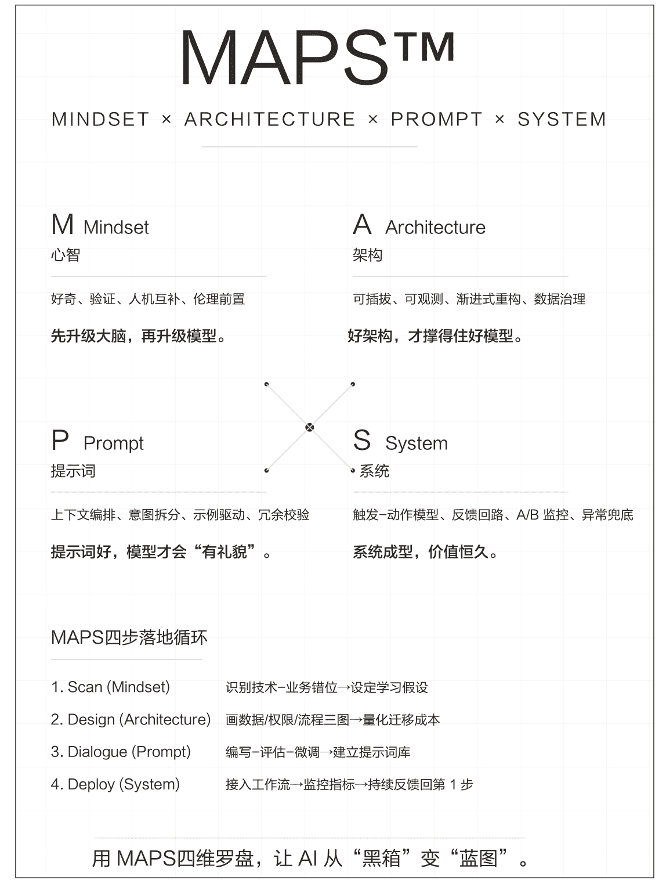

图 1-1

MAPS 同时扮演战略定位的罗盘，也是实践落地的跑道。罗盘回答做什么，跑道规范怎么做。这条跑道由扫描 Scan→设计 Design→对话 Dialogue→部署 Deploy 四步构成，形成完整闭环。二者协同，确保抽象思维系统化转化为具体价值。

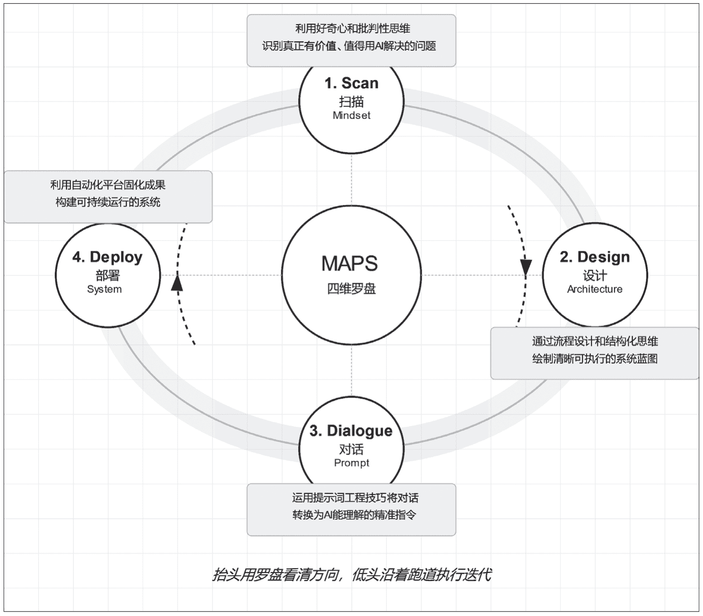

图 1-2

四个维度从不同层面提升竞争力：

●M 心智：行动起点，对应跑道第一步扫描。完成认知升级，以与智能共生视角重新审视世界，建立正确心智才能像雷达一样识别真正值得用模型解决的问题。

●A 架构：连接想法与现实的桥梁，对应设计。行动前为目标流程绘制清晰蓝图，构建低耦合、高弹性的个人工作系统。

●P 提示词：与模型协作的通用语言，对应对话。掌握提示词工程，精准表达意图，引导模型输出高质量结果，将蓝图落地为具体内容。

●S 系统：价值闭环的最终形态，对应部署。把前期能力固化为可衡量、可迭代的自动化体系，完成从思考到行动的闭环。

表 1-1 对 MAPS 四维罗盘进行了全面总结。

表 1-1

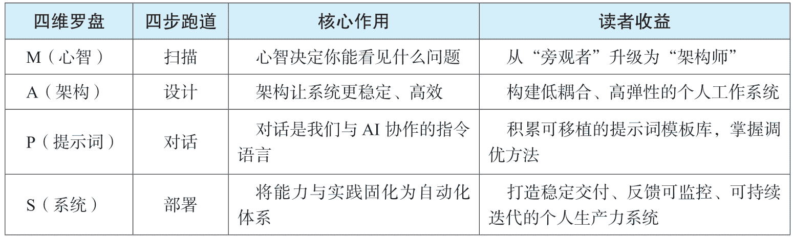

在实践前，不妨用三个问题审视当前竞争力系统。

（1）若你最常用的模型工具明天涨价十倍，你是否有备选方案 Plan B？
（2）在日常工作或内容创作流程中，有多少环节能通过一条提示词完成？
（3）你是否已建立可追溯、可复用的个人知识与数据架构，能持续沉淀模板、复用流程？

若任一问题让你迟疑，无需焦虑。MAPS 四维罗盘正是为此而生，它既是方法体系，也是贯穿全书的路线图与评估基准。

现在，让我们启程构建你的竞争力系统。

**第二章** **心智升级：智能时代的新思维**

手持面向智能时代的 MAPS 罗盘，第一步指向何处？答案是起点——M 心智。

心智本质上是智能时代发现问题、定义问题的思维方式。站在扫描→设计→对话→部署跑道起点时，决定第一步的往往不是工具，而是思考出发点。

以常见场景为例，两位同事需提交日报。一位花两小时手动复制粘贴整理数据，另一位编写简单脚本五分钟自动完成。他们可能用相同工具，差异早已在心智层面确定：前者习惯线性接收任务→执行任务，后者会先问是否存在更高效路径。心智差异在此显现。

为具象化心智升级，本书引入核心人物。我们将跟随他的脚步，经历从思维困境到认知突破的转变。

他是 Axton，一位典型知识工作者。本章将看到他如何直面高投入低产出的勤奋陷阱，如何用四级协作阶梯模型精准自诊，并最终下定决心完成身份转变——从被动工具使用者变为主动系统设计者。这次心智升级，是后续架构设计、提示词运用与系统构建的起点。

**2.1 一名内容创作者的系统性挑战**

作为知识类视频创作者，Axton 面临广泛共鸣的系统性挑战。

**1.勤奋的困境**

Axton 勤奋专业，对新兴科技对商业模式的影响有深刻洞察。然而内容生产流程繁琐，制作一期信息密度高、时长仅十分钟的深度解读，往往需投入不成比例精力，整个过程像马拉松，常耗费四到五个完整工作日。

从前期数小时选题构思与资料搜集开始，像侦探般在信息海洋探寻线索，研读数十篇中英文报告。接着花一整天把零散洞察整理成数千字逐字稿。此后体力活才开始：为增强说服力，需为每个核心论点寻找恰当无版权风险的配图或表格，有时耗时数小时只为找到理想图片。最后才进入录制、剪辑、加字幕与后期包装。每个环节像孤立手工作坊，重复机械劳动蚕食创作精力。

**2.模型的局限与数字苦役**

模型工具曾让他看到打破手工作坊的曙光。他尝试用模型辅助写初稿、生成概念图，单点效率确实提升。然而更深层次瓶颈随之而来：这些工具像独立功能孤岛，数据互不相通，流程无法自动流转。

典型工作流是：在擅长头脑风暴的模型中构思选题，将主题、受众、个人风格复制粘贴到擅长长文写作的模型生成初稿；再把混乱文本复制到本地编辑器手动排版；写作用到未来城市交通插图时，又打开绘画工具输入风格、构图、元素描述……

他陷入新的数字苦役：大量时间耗在工具间复制粘贴、格式转换、上下文重复输入。这些微小损耗汇聚起来吞噬单点效率提升，整体流程并未质变。

**3.从手艺到资产化**

更令他焦虑的是，他感觉自己在被动应激式使用工具，完成孤立任务，未能构建可持续积累迭代的系统。经验与方法仍停留在个人大脑隐性知识层面，无法沉淀为可复用可规模化的资产。

这里的资产并非设备或资本，而是一经创造即可独立于创造者持续产生价值的系统。大厨的手艺是隐性知识，厨师休息餐厅就无法出品；一份精确记录、可供任何厨师遵循的标准化食谱则是可复制传承的资产。Axton 意识到自己的巧妙提示词和资料整理技术仍属手艺，未升华为可规模化食谱。一旦想扩招助理或需休息，创作机器就会停摆。

这种勤奋却低效，正是无数知识工作者在智能时代的真实痛点。我们仿佛置身堆满先进工具的数字五金店，却仍用原始方式敲敲打打。Axton 意识到，挑战不是会不会用某个人工智能工具，而是如何设计一套深度整合模型能力并持续服务的系统。他需要的不是更多锤子扳手，而是一张建造自动化工厂的蓝图。

这一认知将他推向关键十字路口。他明白，在动手构建任何系统前，必须先进行底层升级：思维升级。

本章要跟着 Axton 完成一次决定性的心智跃迁。这既是后面所有技术落地的前提，也是在 AI 时代能不能真正掌握主动权的分水岭。

**2.2 人机协作四阶模型：从围观到设计系统**

在意识到自己“很努力却总在低效循环”的困境后，Axton 发现症结不在工具不够多，而是缺少一套判断并提升自己与 AI 协作水平的方法论。

搜寻的过程中，他接触到四级协作阶梯模型。这张模型像一面镜子，把人与 AI 的关系拆成清晰的四个阶段，让他得以跳出日常琐事，客观审视真实的协作状态。

**1. 第一阶：旁观者**

●角色：AI 时代的信息消费者和话题参与者。
●典型表现：把 AI 当成谈资，追热点、转新闻，偶尔尝鲜新工具但停留在体验层面，从未想过把它嵌入核心工作。
●困境：容易滑向“与我无关”的观望，或因 FOMO 焦虑而不停试用。认知停在表面，价值无法兑现。

**2. 第二阶：工具使用者**

●角色：效率优化者和任务执行者。
●典型表现：把 AI 当作高级搜索或快捷键，用在单一环节提速，比如润色段落、想标题、翻邮件。关系是点状、事务性的。
●困境：效果波动大，重模型发挥。难以处理多步骤任务，经验无法固化成流程，成功不可复制。点状提效正是 Axton“勤奋低效”的根源。

**3. 第三阶：协作伙伴**

●角色：项目经理和流程设计师。
●典型表现：主动把 AI 当并行搭档来设计人机协作。人负责战略与指令优化，AI 负责执行复杂任务如初稿撰写、数据分析。人的精力放在提关键问题、设评估标准、把控结果。
●困境：协作仍依赖个人手感，难以标准化与规模化复制。

**4. 第四阶：架构师/共生者**

●角色：系统设计者和价值放大器。
●典型表现：人机深度融合，目标是为一类问题打造可运行的系统。会把 AI 与自动化平台如 Make 串联，形成可自运转、持续迭代的工作流。关注点从“做完一件事”升级到“让同类事被系统化完成”。
●困境：需要更强的系统化思考与维护能力，对技术原理与业务逻辑要求更高，还要兼顾成本、安全与伦理。回报是沉淀出持续造血的数字资产。

对照自检可归纳为表 2-1。

表 2-1

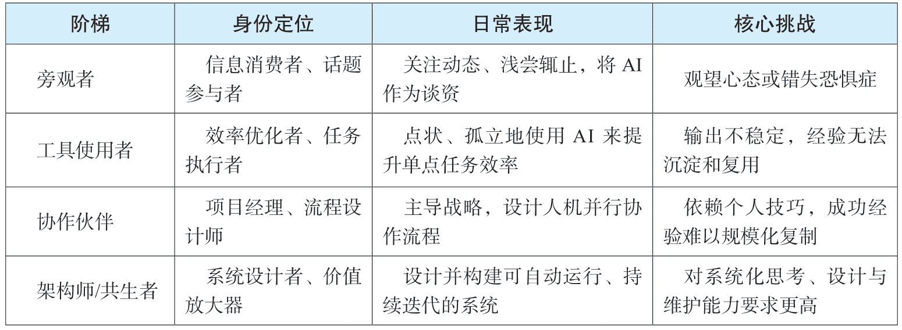

对照后 Axton 看清了：他每天都在用 AI，却长期卡在工具使用者，偶尔靠灵感触到协作伙伴的边缘。所有努力都聚焦在单点效率，没有从端到端视角重构工作流。

这次自我诊断得出核心结论：要升级的不是工具，而是自我定位。他不再满足于做用工具创作的内容者，要把自己定位成能主动设计、搭建并优化人机协作系统的架构师。

身份明确后，问题随之而来：从工具使用者到架构师，怎么走？这正是 MAPS 提供的四步跑道要解决的——先 Scan 扫描问题，再 Design 设计蓝图，继而 Dialogue 精准驱动 AI，最后 Deploy 固化为可持续系统，形成从洞察到落地的闭环。

理论清晰后，Axton 需要立刻上手的方法。他把下面三招作为从工具使用者迈向协作伙伴的起点，达成标志是能把至少一项重复任务稳定交给 AI 并实现复用。

**行动一：画出工作流，让问题浮出水面**
做法：挑一个重复耗时的事项，用流程图拆解步骤，用不同颜色标出纯手工、信息搬运或规则化环节。
价值：把靠直觉的流程可视化，被标出的手工节点就是引入 AI 或自动化的最佳切口。

**行动二：固化提示词，让协作可复现**
做法：对高频任务如摘要、文案，把好用的提示词固化为“角色+任务+产出要求”模板，并明确语气、格式等规则，如专业客观、用 Markdown 列表输出。
价值：输出更稳定，减少反复沟通，把模糊需求变成可重复的标准。

**行动三：量化追踪，让优化看得见**
做法：优化流程时设定 1~3 个关键指标，例如初稿一次通过率、总耗时、AI 调用成本，用简易表格持续记录并定期复盘。
价值：可衡量才可改进，数据能让进展清晰、问题可定位。

完成角色认知与行动方案后，Axton 迈出了从工具使用者到架构师的第一步。

**2.3 认知重塑：知识、技能与流程的重新定义**

完成角色定位后，Axton 进一步审视 AI 如何从根本改写知识、技能与流程，并重塑个人与组织的价值体系。

为何许多过去有效的职能与流程在 AI 面前失效？答案藏在三个被重塑的维度里。

**2.3.1 知识：从记忆检索到问题定义**

AI 之前，专家价值依托“十年积累、读书万卷”的知识储备，靠记忆存储与经验检索。没知识储备，跨领域就难。

AI 正在抹平这道护城河。初级律师借助工具秒级检索并归纳判例，学生也能用公开数据快速产出专业初稿。

比如孩子问：“为什么找外星人总先找水，外星人可能不需要水吧？”过去家长常答不上。如今在 DeepSeek 官网打开对话界面，


图 2-1

点开“深度思考 R1”后输入提示词即可获得适合儿童的解释，过程如图所示。

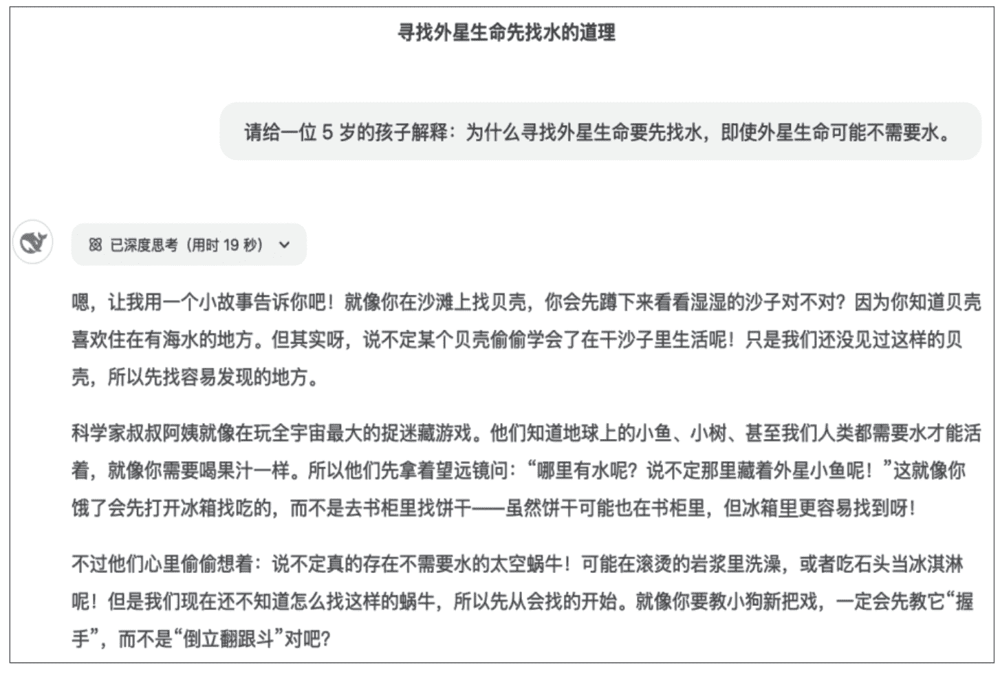

图 2-2

当检索与整合不再稀缺，价值就从“储藏知识”转向“定义好问题并整合证据”。提出深刻问题、验证与批判 AI 信息的能力成为新门槛。

**2.3.2 技能：从熟练执行到人机协作**

很多职业建立在硬技能熟练度上：写代码、玩 Excel、按格式写报告。AI 能用自然语言生成代码、写复杂公式、模仿语气写邮件，门槛被迅速拉平。

这不意味着技能不再重要，而是价值重心从“熟练执行”转向“人机协作”——如何设计流程、用判断力驾驭 AI，产出个人无法企及的结果。

经典研究里，鸟类专家先做分类，AI 不直接给答案，而是给出每次判断的置信度，提醒“你有多确定，这里可能有盲点”。结果协作准确率显著提升。AI 像一位不倦的认知伙伴，纠正过度自信，也强化犹豫但正确的判断。

这正是熟练工角色的演进：专家的价值不再只是“判断对”，而是设计并参与能持续产出更优判断的人机系统。纯执行价值在衰减，设计、验证、优化协作流程成为核心竞争力。

**2.3.3 流程：从串行职能到并行协作**

传统流程是为人类信息处理速度设计的瀑布线：研发做完交市场，市场做完交销售。AI 时代已滞后。

速度上，AI 可即时分析用户反馈并生成内容变体，若仍需层层审批数周，就会错失窗口。
信息上，AI 能整合多源数据给出全局视角，若团队仍困在各自“一亩三分地”，就浪费了打破信息孤岛的机会。

新品上线时，AI 即可在数小时内产出面向各渠道的文案初稿、客服 FAQ、销售培训要点，大幅提升运作效率。

从串行到并行，不只是提速，更是缩短反馈回路、降低跨部门损耗，为后续架构设计奠基。

这场变革让 Axton 明白：做对事、做对原因比用什么工具更重要。但当旧标尺失效时，如何衡量新竞争力的分水岭在哪里？

**2.4 竞争分水岭：从“DeepSeek 时刻”到新竞争力公式**

AI 普及带来三大误区：工具替代论、效率悖论、囤积迷思。核心矛盾是，当 AI 从稀缺品变成基础设施，护城河已从“会不会用”转向“如何用 AI 构建系统性优势”。

回顾互联网早期，先触网者吃红利；当接入成为基础设施，竞争进入更深层。AI 浪潮亦然。

2023-2024 年模型竞争集中在美国，国内百模大战虽热闹但被认为落后 1-2 年。2025 年 1 月，DeepSeek 发布 R1 一举改写局面：推理能力可比肩当时最强模型，训练成本大幅下降，并完全开源。

技术上，R1 用混合专家 MoE 架构，仅激活相关专家降低计算；用强化学习 RL 通过试错奖励提升推理。最大震撼是首次完整展示思维链，复杂问题下会呈现逐步思考、犹豫与自我纠错。

“7 人过河”问题的原始思维链节选显示出不断自我怀疑与策略调整的过程，这让 AI 从黑箱答案机变成可感知的思考实体，极大提升信任与想象。

“DeepSeek 时刻”的意义在于：顶尖推理能力不再是少数巨头的奢侈品，而是人人可用的公共设施。信息差壁垒崩塌，竞争焦点从“能否获得能力”转向“如何系统运用能力”。

这一判断与行业共识一致：斯坦福 HAI 认为未来主线是多智能体加人类指挥，考验流程设计与系统架构；微软 AI 负责人预言多数职场人将变成管理 AI 小队的项目经理。

当顶尖 AI 成为基础工具，仅会用模型写稿、制图或套提示词远远不够。真正的差距在于能否把 AI 变成业务伙伴并嵌入更广的工作流与系统。

由此可提炼 AI 时代个人竞争力的核心公式：

AI 时代个人竞争力 = 人机协作深度 × 系统设计能力

人机协作深度对应 MAPS 中的 P 即提示词实践，系统设计能力对应 A 架构与 S 系统构建。

这意味着你的价值不只看单任务速度与质量，更看：
你能否精准提问、引导 AI、评估输出并多轮迭代？
你能否把 AI 能力嵌入端到端流程，打造高效、稳定、可扩展的人机系统？

当 AI 在诸多领域追平甚至超越人类时，要学会站在巨人肩上。AI 是这个时代的巨人，利用它放大智慧与创造力，并有意识培养协作深度与系统设计能力，才是保持竞争优势的关键。

至此，Axton 拼齐了心智升级的最后一块拼图。他明白困境的本质是 AI 能力普及化带来的竞争力逻辑变革，而选择架构师之路，正是对这场变革的正确回应。

当 Axton 把自我定位从会用工具转向设计体系时，撞上的第一个现实很直接——若学知识的办法仍停留在手工摸索，再宏大的规划也很难落地。

**第三章 知识重塑：让学习跟上智能节奏**

Axton 很清楚，以前那种把书柜翻遍、在网页上耗几小时检索、逐字手抄笔记的研究习惯，已经扛不起智能化浪潮下搭建高价值系统的要求。生成式技术的到来，正在从根本上改写学习与研究的规则。

在动笔设计任何系统前，他首先要升级自己的知识引擎。于是本章要回答两件事：生成式技术怎样冲击传统学习方式，以及在新环境里如何搭建可自我演进的个人知识体系。

本章会跟随 Axton 的实操，复盘他如何掌握大模型陪伴式深度学习，并把信息链五环与 DIKW 模型融合起来，最终打造出可持续成长的第二大脑。

**3.1 与大模型共研的深度学习路径**

面对系统性难题，重塑信息获取方式是第一步。我们需要一种能处理海量材料并提炼关键洞见的新路径，这就是陪伴式深度探究。

所谓陪伴式深度探究，是指借助大语言模型在发问—对话—反思—产出的认知闭环中，通过持续互动加深理解的方式。与只能被动调取资料的图书馆或搜索引擎不同，当前新一代模型更像学习旅程中的思维同行者。

关键在于，模型不止于给出答案，还能通过追问、交互乃至模拟辩论，帮助学习者完成从提出问题到探索对话、再到反思整合，最后形成产出的完整链路。这不是用技术替代思考，而是借其强大的信息处理与不间断交互特质，让复杂理解真正内化。

该模式与传统方式差异明显，主要体现在四个维度。

● 互动更强：学习者可以随时追问、要求澄清或质疑回应，模型能够即时反馈，形成传统学习难以企及的即时回路。
● 更具个性：理想的智能搭档会依据学习者已有基础和兴趣点，动态调节讲解深度与表达风格。
● 反馈持续：模型可用苏格拉底式追问帮助暴露认知盲区。
● 处理更快：在海量文本的梳理与初筛上远超人工，能大幅压缩资料搜集与初步分析的时间成本。

要落地这一思路，核心是掌握认知闭环的流程。它由四个环环相扣的环节构成：

● 环节一：发问。学习不从漫无目的浏览开始，而从清晰目标或好问题开始。在模型辅助下，学习者可把初步想法交给模型，帮助拆解为更具体、研究价值更高的子问题，或从多个角度审视初始假设。例如可以问：“我想理解大语言模型的扩展法则，有哪些关键理论前提和争议点需要关注？”模型往往能给出有启发性的研究方向。

● 环节二：对话。这是人机协作的核心。带着明确问题进行多轮深入交流，远超“一问一答”。学习者可以要求模型解释概念、提供多元证据、扮演专家或批判者角色，甚至归纳观点差异。此阶段模型像一位博学且有耐心的讨论伙伴，学习者则要主动引导方向，通过持续追问把理解推向新高度。

● 环节三：反思。模型能提供大量信息，但真正的洞察来自学习者自身的批判性审视。需要判断哪些是事实、哪些是观点，是否存在偏见或逻辑漏洞，新信息与既有体系是互补还是冲突。模型可帮忙梳理对话脉络或生成初稿总结，但知识的最终建构必须由学习者完成。

● 环节四：产出。成果必须以某种形式表达出来才能被检验和巩固，如研究报告或总结文章。输出时模型可协助起草、润色或检查逻辑。更重要的是，高质量的产出常会引出新问题，从而开启下一轮认知闭环，形成螺旋上升的知识构建。

掌握这种学习范式，相当于在信息洪流中获得认知优势的战略杠杆，为后续的系统化架构设计奠定坚实基础。

**3.2 案例：借助智能助手精读技术论文**

理论需要实践检验。掌握认知闭环后，下一步是将其用于真实复杂场景。实际操作中四个环节往往交织进行。为便于演示，以下案例把流程整合为三个环节，拆解如何精读高难度技术论文。

【案例背景】

以论文《DeepSeek LLM：Scaling Open-Source Language Models with Longtermism》为对象。这篇 2024 年 1 月发布的论文，因首次系统公开 67B 级别中文大语言模型的训练细节、数据治理策略和扩展法则公式而备受关注。对非专业读者甚至部分专业人士而言，信息密度极高、图表复杂的长文仍是挑战，此时智能搭档作用明显。

注意：本案例以腾讯 ima.copilot 1.7.0 版和字节跳动 Coze Space 为演示平台，仅作举例说明。市面上同类大模型产品众多，具体选择取决于个人需求和使用偏好。

**3.2.1 建立全局观：提问与对话**

认知闭环的第一步是借助模型快速建立对论文的整体认知。

先把 PDF 导入具备知识库管理与对话能力的 ima.copilot。导入完成后打开阅读界面，右侧即为对话窗。利用“总结”或“生成脑图”等快捷功能，能迅速把握论文框架，如图 3-1 所示。

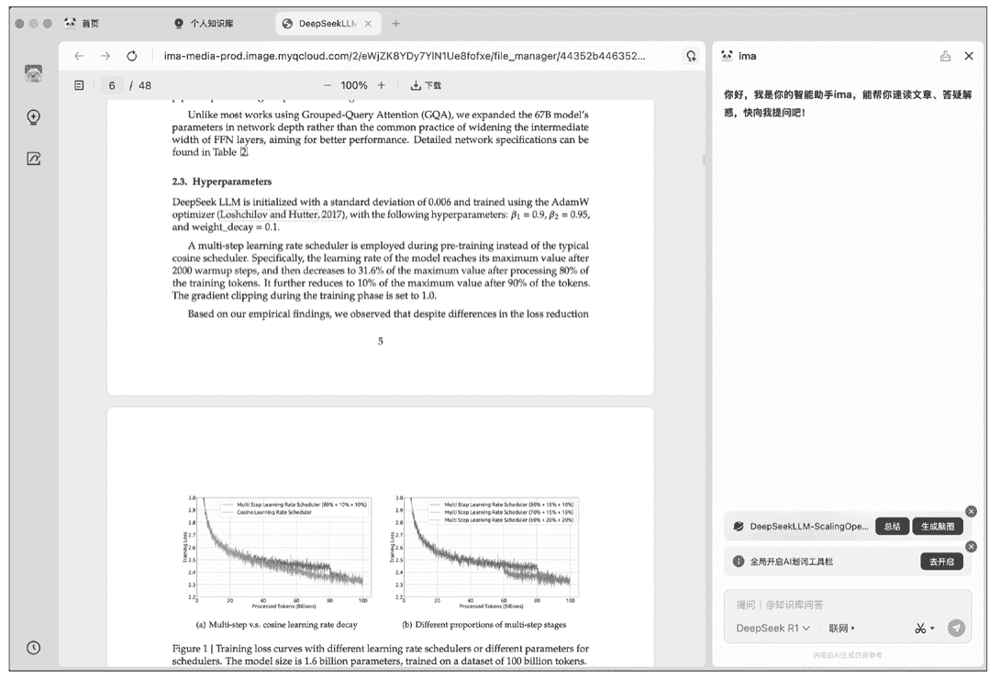

图 3-1

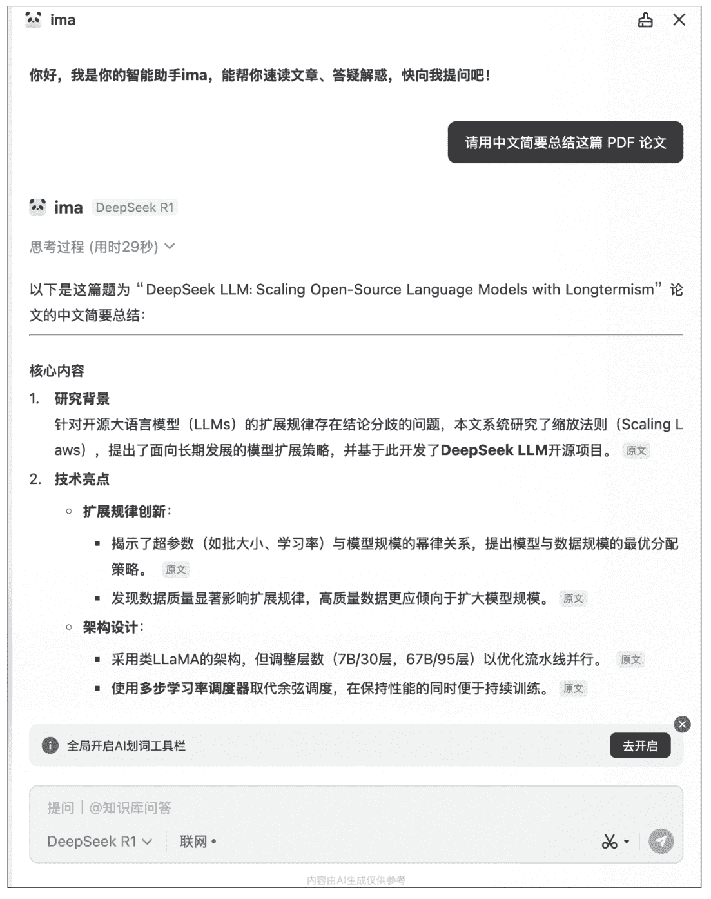

图 3-2

由于原文为英文，可先下指令跨越语言障碍：“请用中文简要总结这篇 PDF 论文”。模型会输出要点式中文提炼，帮助快速抓住研究背景、技术亮点等核心内容，如图 3-2 所示。

接着点“生成脑图”，模型会把论文结构可视化为思维导图，如图 3-3 所示。

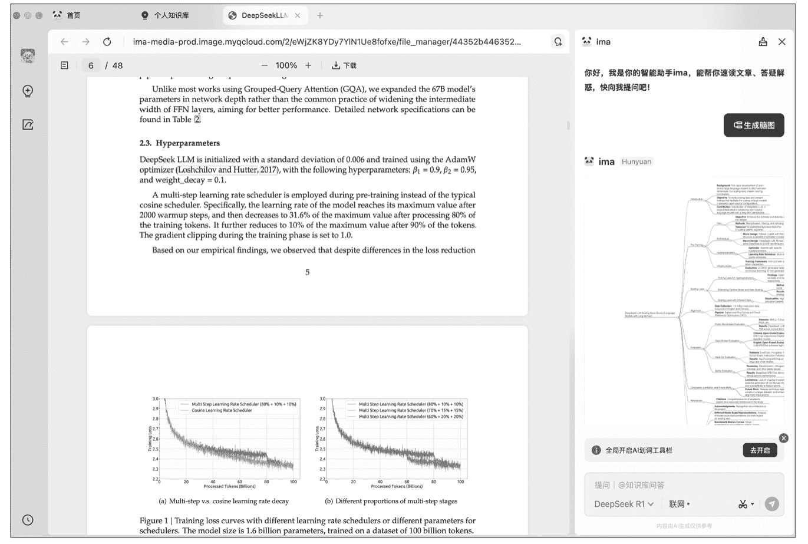

图 3-3

点击脑图可放大、缩小或下载，便于后续深入分析，如图 3-4 所示。这份可视化结构图为深度阅读提供了清晰的导航地图。

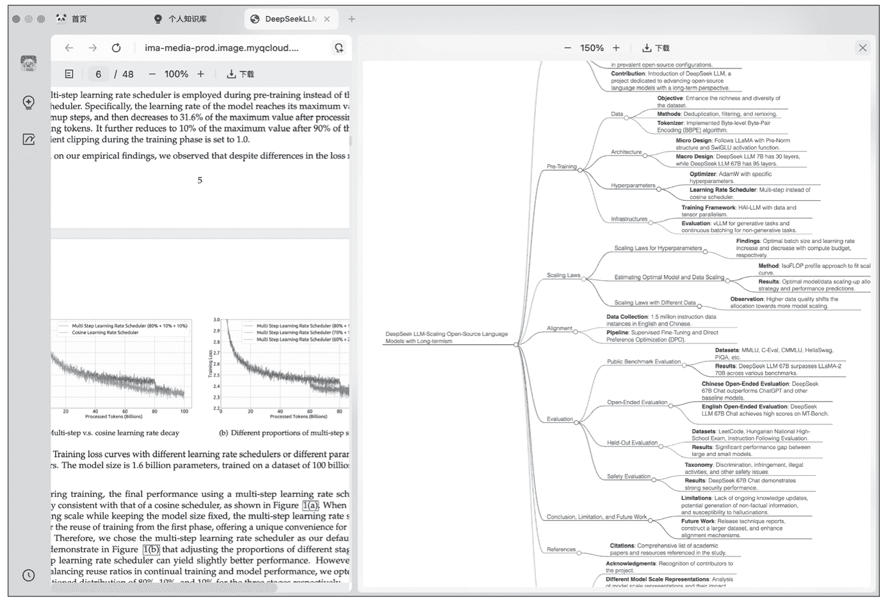

图 3-4

阅读过程中遇到难懂段落，可直接选中文本，通过上下文菜单进行即时“翻译”或“模型解读”，如图 3-5 所示。这种方式比传统查词典或单独翻译软件更高效，模型能结合语境给出针对性解释。

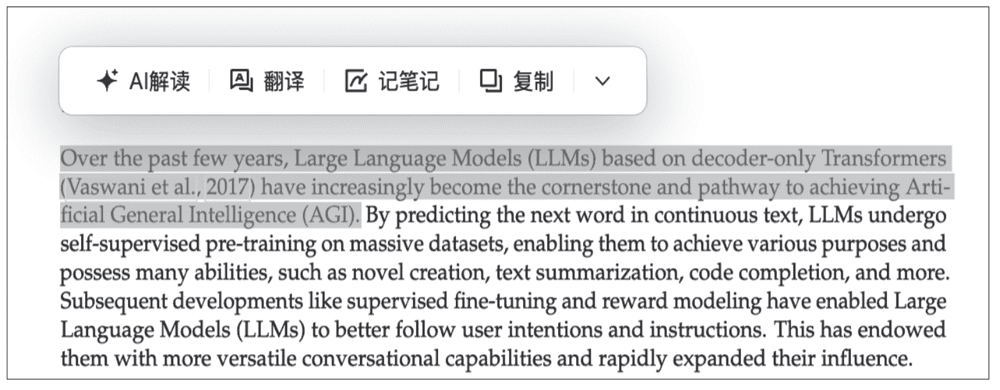

图 3-5

**3.2.2 核对、验证与整合：对话与反思**

形成整体印象后，可针对关键部分进行深度探讨。

例如围绕论文中的“扩展法则”提出更深入的问题：

论文探讨的 Scaling Law 在实际应用中会遇到什么瓶颈？是否存在理论极限？业界有哪些不同看法？

开启联网功能后，模型会结合论文内容与最新网络资料综合作答。

例如图 3-6 的示例中，模型引用了 10 篇相关资料并标注来源，部分输出如下。

根据现有研究和行业动态，Scaling Law 在实践中已显现多维度的瓶颈，其理论极限也在被广泛讨论。以下从实践瓶颈、理论边界及业界争议展开：

一、实际应用中的瓶颈表现

1.数据资源枯竭

③

●高质量数据稀缺：全球可获取的优质文本数据总量约 510 万亿个 token，但实际可用量远低于此。OpenAI 联合创始人 Ilya Sutskever 指出，预训练时代或因数据耗尽而终结。

●合成数据的局限：尽管尝试用合成数据如 Sora 使用游戏引擎生成数据来缓解短缺，但其性能提升远低于真实数据，且生成过程需额外算力。

2.边际效益递减

③⑤

●对数增长与指数成本矛盾：Scaling Law 核心公式表明性能提升与计算量、数据量呈对数关系，而资源投入需指数级增长。例如 GPT-4 到 Orion 的性能提升幅度远低于 GPT-3 到 GPT-4，但成本显著增加。

⑤

●训练与推理成本失衡：训练算力需求从 2017 年的 7400 petaFLOPs 增至 2024 年的 500 亿 petaFLOPs，而推理成本因链式推理等技术上升，但收益逐渐饱和。

3.模型架构限制

④

●Transformer 的固有约束：当前扩展规律主要基于 Transformer 架构，其注意力机制在长序列处理上效率低下，导致参数规模与性能呈非线性关系。非 Transformer 架构如 RWKV 虽在特定场景更优，尚未突破整体瓶颈。

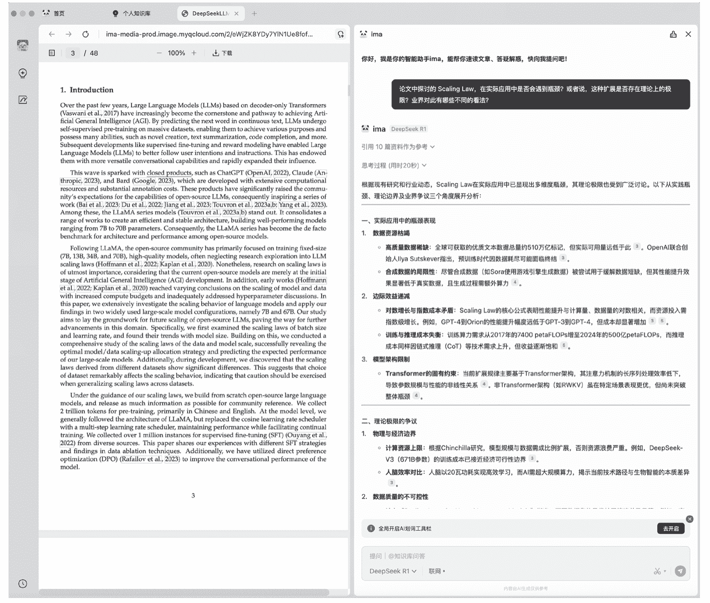

图 3-6

对于论文图表或特定段落，可使用截图提问功能直接截取并提问。若内置模型回答不够清晰，可把相关片段复制到通用性更强、推理能力更高的模型聊天界面中继续追问。

还可运用“反思式翻译”思路优化，如提问：“这段关于‘数据治理’的译文是否更精炼？‘价值观对齐’的表述是否准确传达原文细微含义？”

此过程的关键在于反思：模型的解释是否解开了困惑？信息是否与论文其他部分或已有知识吻合？

在不同工具间切换、对同一问题多角度提问和验证，本身就是深度学习的一部分。

**3.2.3 形成结构化成果：输出阶段**

当对论文理解达到一定深度后，可围绕核心主题如大语言模型训练中的数据治理策略进行更广泛研究，并形成结构化报告。此时进入认知闭环的产出阶段，扣子空间这类支持复杂任务链的模型工具可发挥关键作用。

扣子空间提供不同工作模式以适应任务。例如“规划模式”会先规划解决步骤，允许人类更多控制，适合高精度复杂任务；“探索模式”则让模型自主思考执行，适合快速获取初步结果或开放式探索。

在此可切换到“探索模式”，让模型根据最终目标自主规划并执行。例如下指令：“我需要一个能让团队快速了解 DeepSeek 论文精髓的单页网站。”模型将自主完成中间步骤。

在扣子空间中上传论文 PDF，然后发出包含多步骤、多维度的综合指令，如图 3-7 所示。

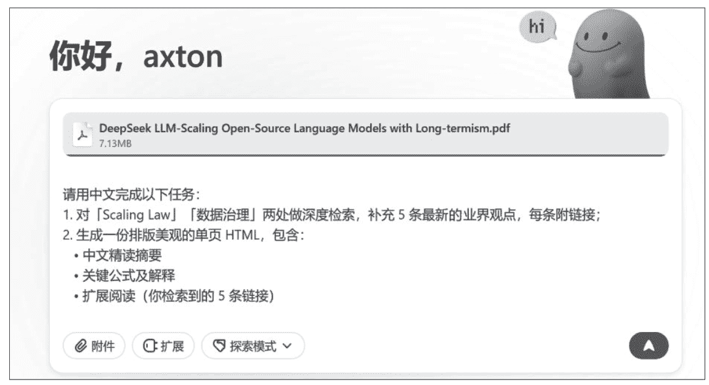

图 3-7

模型接收指令后会自动执行以下步骤。

**1.深度检索与观点提炼**

如图 3-8 所示，模型调用内置搜索引擎，围绕“Scaling Law”与“数据治理”两个核心概念进行深度检索。完成后系统会自动评估信息来源质量，筛选出最具价值的 5 条最新业界观点，并结构化保存至文档。

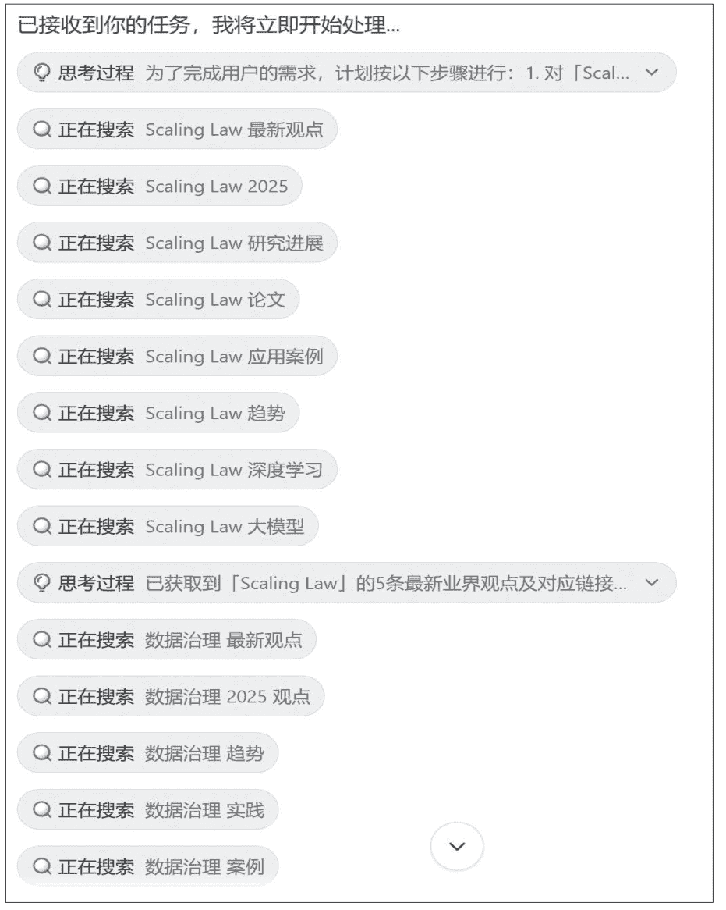

图 3-8

**2.自动生成精读摘要**

基于检索资料，模型对论文全文和扩展文献进行信息提炼，自动生成 800 字以内的中文精读摘要。该摘要用易懂语言准确概括论文核心贡献与主要结论，如图 3-9 所示。

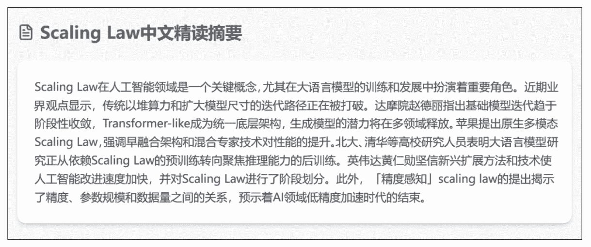

图 3-9

**3.提取并解释关键公式**

针对论文中最关键的 Scaling Law 公式，模型会单独提取并配以清晰简洁的中文解释，便于非专业人士快速理解公式含义与应用场景，如图 3-10 所示。

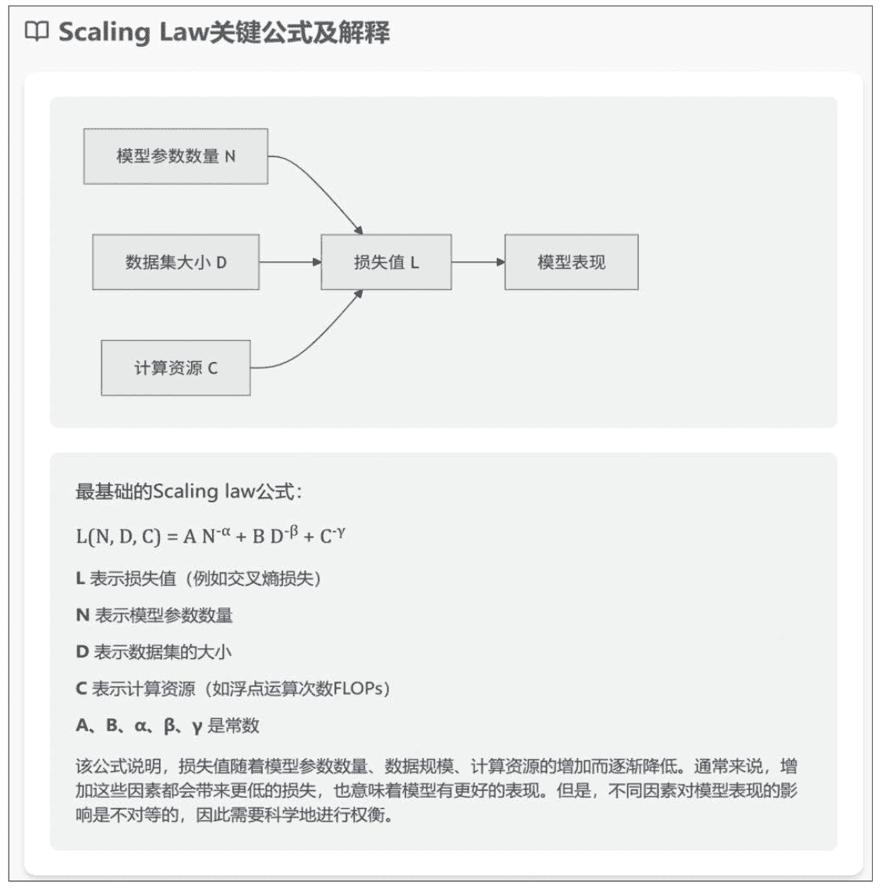

图 3-10

**4.自动生成可交互单页 HTML**

系统将提炼观点、精读摘要、公式解释等成果自动生成一份排版美观、采用现代化设计风格的 HTML 单页，如图 3-11 所示。

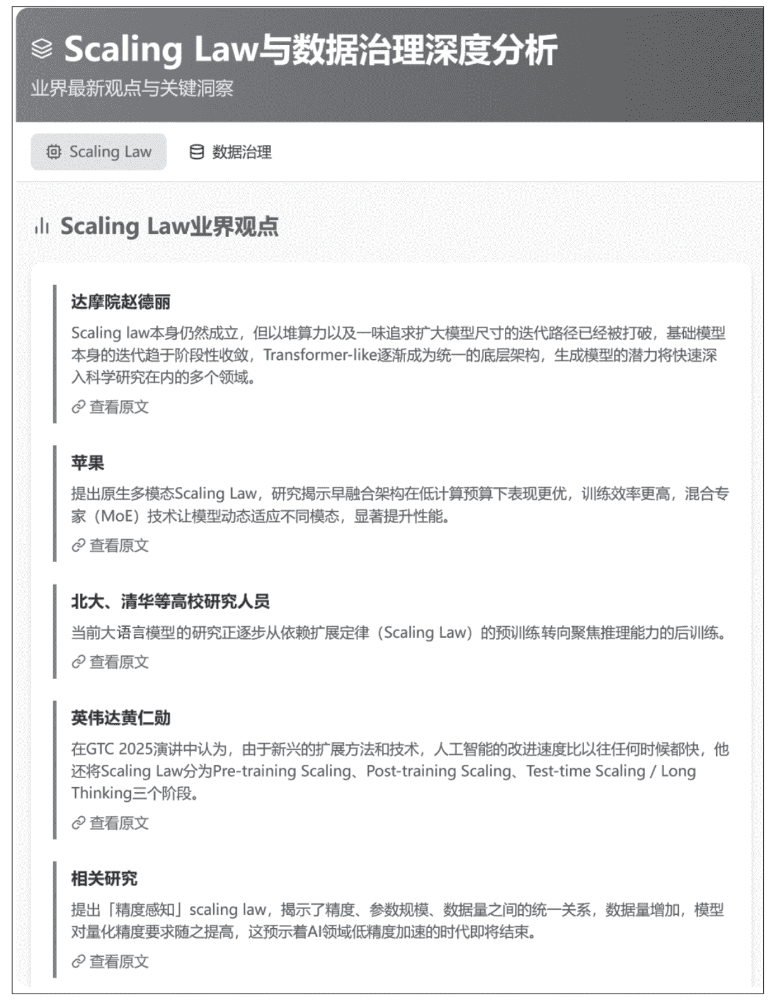

图 3-11

该报告可读性与交互体验良好，完成度高，可直接下载 HTML 文件或通过分享链接在团队或社区内快速分发。

整个自动化流程通常在 10 分钟内完成，而同等质量的手工作业可能需要数小时乃至数天。这种人机协作正是智能时代知识工作的演进缩影：它把研究者从繁琐重复的信息处理中解放出来，使其更专注于高价值的思考、判断与创新。

**3.2.4 核心思维与小结**

通过案例可见，实践陪伴式深度学习的要点在于转变学习者与信息和工具的关系。四项核心思维至关重要。

● 从“答案索取者”到“问题设计者”的身份切换：模型善于解答，但高质量学习源于深刻提问。学习者的核心价值在于提出能驱动思考、激发探索的关键问题。
● 视模型为“对话伙伴”而非“检索器”：学习不应止于单次问答。通过多轮对话、追问细节与澄清要求，才能挖掘模型更深层的知识与能力。
● 坚持人类不可或缺的“批判性反思”：模型输出必须被审视和验证。学习者需结合自身知识、经验与价值观，对信息进行批判性评估与整合，以构建真正属于个人的认知体系。
● 将“持续迭代”作为认知优化常态：“认知闭环”鼓励把每一次产出都视作下一次探索的起点，在循环中持续优化问题、深化理解。

同时要认识到，在模型帮助下，人类正处于最好的学习时代。

模型不仅重塑学习模式，让我们以前所未有的速度、深度和广度获取并处理信息，把过去需数周的资料梳理、文献研读压缩到数小时；更深刻的价值在于揭示学习本质的结构性转变。

● 竞争焦点转移：从“信息持有量”转向“认知转化率”。当每个人都能轻易获取海量信息时，决定竞争力的不再是掌握多少信息，而是将信息内化为实践能力的速度。
● 发现盲区的价值超越答案本身：在与模型对话中暴露的个人认知盲区往往比获取的信息更有价值。清晰认识到“自己不知道什么”，是有效进步的前提。
● 人类经验价值愈发凸显：模型擅长处理显性知识与结构化信息，却难以替代人类在复杂情境中独有的微妙洞察、直觉判断与价值权衡。正是这些难以量化经验，使人类决策与创造独具深度。

模型的普及带来便利，也提出更高要求：我们需要从被动知识接收者转变为主动的探究者、批判性的思考者和富有洞察力的整合者。

总体而言，陪伴式深度学习的本质并非以机器智能替代人类思考，而是以其为杠杆增强并加速人类自身的认知过程。它要求学习者以更主动的姿态、更严格的批判性思维、更清晰的策略参与知识构建的每个环节。掌握这一范式后，模型便不再是简单工具，而是陪伴探索未知、深化理解、加速成长的得力伙伴。

现在的我们，比以往任何时候都拥有更好的机会和工具去成为一个真正高效、独立的终身学习者，而这正是智能带来的最深远也最宝贵的礼物。

**3.3 信息链与个人知识库**

智能浪潮席卷各行各业，信息的获取与处理方式正在深刻变化。构建行之有效的信息链与个人知识库，已不再是锦上添花，而是个体在激烈竞争中保持领先的关键能力。

构建信息链的核心在于促进信息增值。信息价值提升的路径是怎样的？经典的 DIKW 模型为我们描绘了蓝图。该模型由组织理论家罗素·艾可夫于 1989 年系统阐述，它将认知过程划分为四个层级，揭示原始“数据”如何逐步转化为指导行动的“智慧”，如图 3-12 所示。

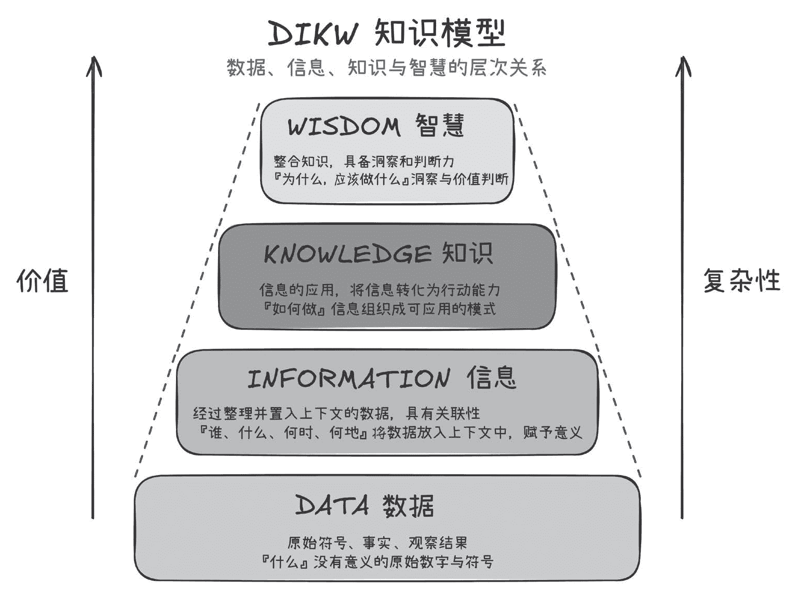

图 3-12

**3.3.1 DIKW 模型：认知升级的阶梯**

（1）数据：原始符号、事实和观察结果。

最基础层级，指未经组织和加工的原始符号、事实、数字或图像。本身不具意义，是构成更高认知层级的原材料。例如用户调研的原始问卷回复、网页一段文字、传感器记录的一串数字。

（2）信息：经过处理并赋予语境的数据。

当数据被赋予特定语境并经过分类、整理和解释后，便成为信息。信息回答“谁”“什么”“何时”“何地”等问题。例如把原始调研数据整理为“30～40 岁用户占比 35%”，这就是一条信息。信息比数据更有用，因为它提供了意义。

（3）知识：经过理解和内化的信息。

当信息被个体或组织理解、吸收，并与已有经验和认知框架结合，形成可指导行动的见解、规律或模型时，便转化为知识。知识回答“如何做”的问题。例如基于多份调研报告和市场数据，总结出“针对特定用户群体的产品迭代方向和营销策略”，这就是知识。知识具有可应用性。

（4）智慧：经过反思和价值判断的知识。

DIKW 模型的最高层级。智慧是一种综合能力，体现为在深刻理解知识基础上融合伦理判断与长远眼光，并在复杂情境下做出明智决策。它回答“为什么”及“应该做什么”的问题。例如制定产品策略时，不仅考虑短期盈利，还洞察长远社会影响并做出符合组织愿景和价值观的决策，这就是智慧的体现。智慧往往与经验、洞察力和道德感紧密相关。

DIKW 模型清晰揭示了信息加工的层级：数据是基础，信息是数据的结构化，知识是信息的内化与应用，智慧是知识的升华与正确运用。该模型表明信息管理的目标不应仅停留在收集和存储数据或信息，而应通过有效加工、理解和应用，将其转化为创造价值的知识和智慧。

**3.3.2 为什么需要建立信息链**

信息太多，我们反而更穷？

AI 把找资料的门槛拉到历史最低，却带来一个反常识的结果：触手可及的内容越庞大，能真正变现为个人竞争力的部分越稀少。今天需要一套可执行的打法，把讯息洪峰转化为可累积的长期资产。

**1.在洪峰里守住信号**

我们正处在内容产量指数级膨胀的阶段。统计口径显示 2023 年全球新产生的数据约 120ZB，到 2025 年底或将冲到 181ZB。邮件、社媒、推送不断涌入，拥挤已成日常。

诺贝尔经济学奖得主赫伯特·西蒙在 1971 年就抛出了至今仍扎心的判断。

信息的富足意味着其他东西的匮乏——它消耗的是受众的注意力。因此，信息的丰富造成了注意力的贫乏。

这种宝贵的认知资源正被无处不在的流不断稀释。研究指出，人在单一屏幕上的平均专注时长从 2004 年的约 150 秒跌到近年的 47 秒。多源干扰下，专注与判断同步下滑。一旦被通知或内在冲动打断，知识工作者平均要 25 分钟才能回到原状。

当下真正的卡点已不是找不到材料，而是专注资源太稀缺。面对海量内容，常见困境是筛不完、理不清、用不上。关键是建立一套高效的处理范式，在喧嚣里精准捕捉并放大真正有价值的信号。

**2.检索变便宜，信任变贵**

以大语言模型为代表的生成工具正在改写获取路径。相较传统搜索引擎要用户自行遍历大量结果，对话式问答能在极短时间内给出看似精炼的答案，显著压缩检索耗时。

成本下行的同时，甄别成本与信任成本在上升。模型并非绝对可靠，受训练语料偏差或算法局限影响，容易出现“幻觉”，即生成看似合理却与事实不符的内容。主流大模型的评估显示，超过三分之一的已上报问题都源于幻觉带来的误导。对模型输出做批判性核查已成必备环节。

此外，过度依赖模型筛选会削弱个人的批判性思维与主动探寻多元视角的能力，甚至滑向算法营造的讯息茧房。模型能快速聚合素材，但判断真伪优劣的工作反而更繁重。在此背景下，人类的专业判断、领域知识与批判思维价值愈发凸显。

**3.从一次性阅读走向复利沉淀**

价值不只在获取瞬间，更在于能否在未来反复调用。一份调研、一段深度笔记、一个稍纵即逝的灵感，若能在不同场景下持续复用，价值会不断增值。反之，若仅作一次性消费，读过即忘、存了不看，价值会随时间递减，最终堆成难以检索的数字废墟，而非真正的资产。

复用环节的痛点明显，既有遗忘曲线等认知限制，也有实践障碍。

●知识孤岛：资料分散在不同应用与文档里，缺乏关联，难以形成体系网络。
●缺少输出牵引：学习记录若无明确应用目标，很难编码为长期记忆，记录多停留在浅层。
●工具与格式壁垒：不同平台格式不兼容，阻碍知识迁移与整合。

因此需要打通从收集到传播的完整链路。让内容沿着 DIKW 的数据-信息-知识-智慧路径沉淀为可随时调用的智慧资产，实现知识复利，这正是搭建信息链的初衷。

**3.3.3 信息链五环模型：闭环驱动的知识流**

为让个人知识管理与 DIKW 的认知升级路径对齐，我们提出“信息链五环模型”。它把个人知识管理拆解为五个相互关联、循环迭代的环节：捕获→提炼→关联→应用→分享，如表 3-4 所示。

五环共同构成从原始数据到智慧产出的闭环。其中捕获与分享构成外环，为链路输送新数据与反馈；提炼、关联、应用构成内环，推动内容在系统内流动并增值。

表 3-4

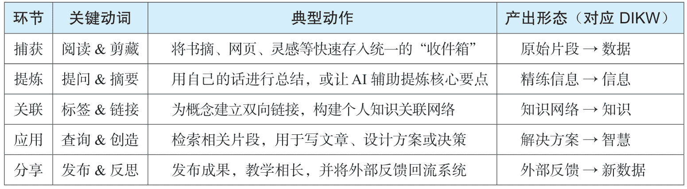

下面逐一拆解各环节的内涵、意义、操作要点以及 AI 的介入方式。

**1.捕获：先收纳再处理**

是什么：链路起点，指主动收集并记录与目标相关或能触发思考的内容片段。阅读、会议、对话、观察，甚至脑中的一闪而过，都可能是后续知识生产的原材料。及时外化能释放大脑负荷，让思维聚焦在更高价值的创作上，正如生产力专家 Tiago Forte 所强调的大脑适合思考而不适合当仓库。

操作要点：核心是广撒网、低门槛。任何可能有用或带来启发的内容，先丢进统一的收集入口，避免因犹豫错失灵感。常用方式包括浏览器一键收藏网页、使用 Pocket、Instapaper 等稍后阅读工具或 RSS 聚合待读内容、用系统备忘录或专业速记工具捕捉碎片想法、借助 OCR 应用把纸质文档和图片文字数字化。

AI 的介入：可充当智能助理。语音转文字能把口述灵感快速转为文本，大模型能识别图片 PDF 中的复杂排版文字，并自动提取关键词、生成初步标签，为后续处理减负。

**2.提炼：去粗取精萃取精华**

是什么：对原始素材的筛选、浓缩与深度加工，把数据升级为高密度内容或知识点。未经加工的材料如散沙难以使用，经过加工的知识才易于理解、记忆与复用。

操作要点：精髓是少即是多和个性化加工。
●摘要与批注：用自己的语言概括核心论点及个人启发，这是内化的开始。
●提炼关键点：用高亮、加粗标记核心观点。Tiago Forte 主张的渐进式总结很实用：首次阅读加粗关键句；二次审阅高亮加粗部分的精华短语；最终用自己的话做总结，层层压缩为金块。
●结构化整理：按主题或应用场景做初步分类与标记。
提炼时遵循适度原则，可用二八法则重点打磨最重要的 20% 核心知识。

AI 的介入：是提炼引擎。可按指令快速生成长文摘要、要点列表，例如要求“把 5000 字的行业报告压缩为 500 字核心观点，并列出三个关键数据与两个主要挑战”。也能辅助批判性阅读，指出逻辑漏洞。Readwise Reader 等工具已集成 AI 摘要功能，加速消化。

**3.关联：织网激活潜能**

是什么：把孤立知识点通过有意义链接编织成动态网络。单点知识价值有限，碰撞、印证、启发后才会产生 1+1>2 的涌现效应，这正是卢曼卡片盒笔记法的核心。

操作要点：
●双向引用：Tana、Obsidian、Roam Research、Logseq 等工具支持双向引用，笔记 A 链接 B 时 B 自动记录反向引用，便于在概念间穿梭。
●标签：用关键词做多维组织，如一篇“AI 在教育中的应用”可同时打上 #人工智能、#教育科技、#未来趋势。
●层级与索引：用文件夹或专属索引笔记归纳主题集合。
●向量映射：AI 把文本、图片、音视频转为高维向量，按语义相似度发现表面词不同但内涵相关的内容，实现语义级检索。
习惯建议：每新增一条笔记，就主动思考它与已有知识的联系，至少建一个链接。目标是培养关联思维，而非追求完美链接。

AI 的介入：扮演智能链接者与模式发现者。
●语义检索与智能推荐：基于向量映射与 RAG 技术，在撰写或提问时自动召回语义相关笔记，提示潜在链接。
●关系发现与知识图谱：分析笔记集合自动识别因果、包含、对比等关系并生成可视化图谱。
●跨模态跨语言关联：链接不同形式与语言的素材，如中文报告与英文论文、访谈视频互相关联。

**4.应用：驱动行动创造价值**

是什么：把收集、提炼、关联后的知识用于解决实际问题、指导决策或创造成果，是信息链价值落地的关键。前面所有环节的意义最终都在应用中兑现。

操作要点：
●以终为始设输出目标：在学习初期就明确知识将用于何种场景，如解决工作难题、撰写分析报告、设计原型。
●小步快跑及时实践：不必等到完全掌握再用，实践中深化理解，把新概念立刻用于微任务。
●融会贯通举一反三：将框架跨领域迁移，结合经验产生新洞见。
●结构化输出与反馈：用费曼学习法向他人简洁解释，或用 SEEI 框架陈述-阐释-举例-图示，或采用论点-论据-结论结构撰写报告，并主动寻求反馈以检验效果。

AI 的介入：可作为创意伙伴、执行助手与模拟教练。
●辅助创作与生成：基于知识点与大纲快速生成初稿、润色改写。
●决策支持与模拟推演：分析选项利弊、模拟方案执行结果。
●个性化辅导与练习：按学习目标生成练习题与案例分析并即时反馈，巩固应用能力。

**5.分享：扩大影响完成闭环**

是什么：信息链终点，也是系统进化的动力。传播个人知识成果并收集反馈，既放大影响力，也践行教学相长的再学习效应。

操作要点：形式多样，包括团队内部分享与新人辅导、撰写科普文章或录制教学视频、在专业论坛参与讨论、将深度积累系统化为文章、课程、图书或开源项目、通过持续输出建立个人品牌。分享后要收集反馈并反思，用多元视角检验体系、发现盲区、激发新灵感。

AI 的介入：提升内容质量与传播效率。
●内容优化与风格调整：审阅语法、逻辑、清晰度，按渠道与受众调整风格与语言。
●多渠道分发辅助：把核心内容改编为博客、问答社区、社媒简报等不同形态并给出发布建议。
●模拟受众与问答准备：扮演挑剔听众提出尖锐或基础问题，帮助演练表达。
●影响力分析与反馈整合：分析社媒传播数据与用户反馈，提炼共性问题与热点，为迭代提供依据。

五环紧密协作、持续循环，个人知识管理才能从静态存储进化为持续产出价值的知识引擎。

**3.3.4 信息链五环模型的 AI 提示词实践**

AI 不仅能辅助单一环节，还可深度嵌入收集到分享的全流程，成为提升效率与激发创意的引擎。

下面以典型提示词示例展示 AI 在五环中的作用，如表 3-5 所示。表 3-5 中的“AI”指代任何性能优异的大语言模型，如 DeepSeek-R1，可按任务需求灵活调整指令细节与约束。

表 3-5

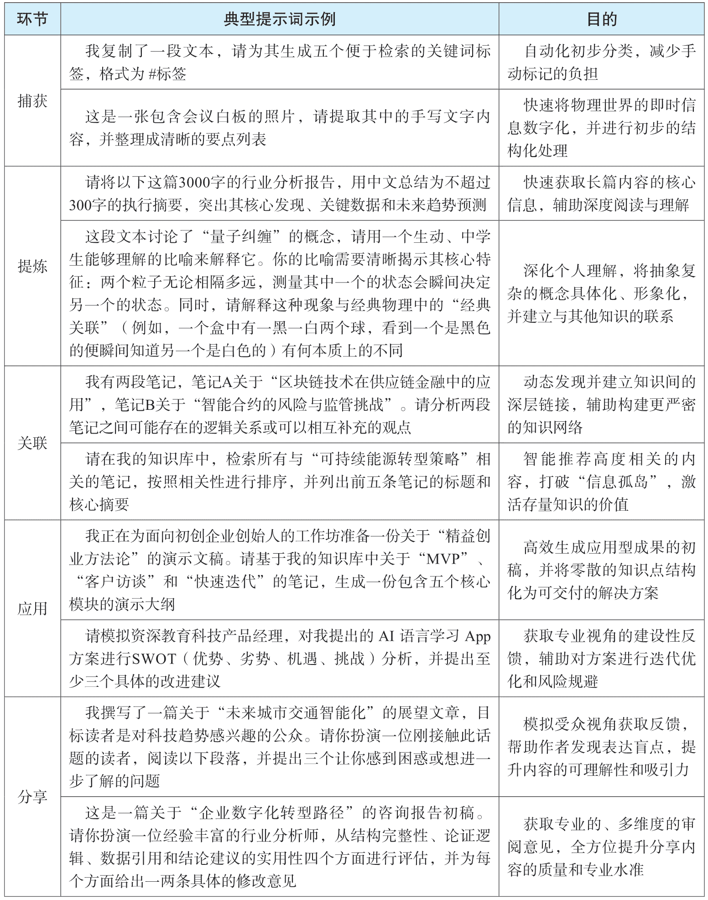

这些提示词是思路启发而非固定模板。实际使用时需结合模型特性、个人知识库与具体任务灵活优化。

把 AI 视作可引导的智能伙伴，通过清晰、具体且带充分上下文的持续对话，才能真正释放其潜能，成为信息链上不可或缺的一环。

**3.3.5 三步搭建轻量私有知识库**

构建知识库不必一蹴而就，从最小可行系统起步再迭代更实际。核心是让系统服务于人，而非被系统束缚。

第一步：建立统一的收集入口。
目的：确保一切有价值内容与灵感先被捕获再处理，防止遗忘。
做法：设立易访问的统一入口，如桌面“今日阅读”文件夹、笔记应用的专用笔记本或实体笔记本的一页。网页剪藏、微信收藏、语音速记、纸质摘录拍照等素材都先汇总至此。

第二步：坚持每日 10 分钟精简。
目的：对收集入口里的原始信息做初步加工，提取价值并附加元数据，从数据转为可用信息。
做法：每天固定 10-15 分钟处理收集入口。
1.快速浏览所有条目。
2.借助 AI 对话做浓缩：对长文或复杂内容用深度对话提炼，例如把 1500 字采访稿交给 AI 并指令“总结为三点核心见解，每点不超过 50 字，并基于见解提出一个批判性问题供我思考”。
3.附加标签：至少两类标签，主题标签如 #人工智能伦理、#项目管理，类型标签如 #行业报告、#播客笔记、#个人思考。
4.归档或删除：果断舍弃无用内容，有价值的笔记移出收集入口归档。

第三步：每周一次输出。
目的：通过输出倒逼输入，检验理解深度，实现知识向实用知识转化。
做法：每周至少一次基于知识库的输出。
1.选定主题：从近期关注话题、工作难题或笔记高频概念中切入。
2.调用知识：用关键词、标签或 AI 语义检索调出相关素材。
3.结构化输出：推荐费曼式解释，例如把“提示词工程”比喻为点餐：“指令越精准，如七分熟牛排不要洋葱，结果越符合预期”；或用 SEEI 框架。
示例主题“知识管理的重要性”：陈述：有效知识管理是成长与职场竞争力的关键；阐释：帮助系统化组织、提取与应用知识，避免过载，提升效率与创造力；举例：会议中能迅速引用过去三个月案例与数据，可有效推动决策；图示：用捕获→提炼→关联→应用→分享的闭环图直观呈现。输出形式可为短文、博客、播客脚本、幻灯片或结构化讨论。

（4）成果回连与标注：把已完成的产出，比如文章链接或文件摘要，挂回知识库里对应的源笔记，并打上“已应用”的标识。这样就能清晰看到知识被怎么用了，也完成了反馈闭环。

按这三步走下来，一个最小可用的个人知识闭环就跑通了，核心就是收集、提炼、应用的链条。精髓不在工具新旧，在于流程是否顺、习惯是否稳。工具随时可以换，这条信息加工的主线会一直为你工作。

**3.3.6 高频误区与纠偏指南**
光靠热情或砸钱买工具都撑不起稳定的认知系统。实操中很容易掉进认知偏差和坏习惯，长此以往效率崩盘、体验变差，甚至直接弃坑。把风险点提前列出来并准备应对手段，才是让系统长期运转的基础。

**1. 误区一：囤料泛滥，仓库变坟地**
很多人收集时很嗨，后续整理、内化、运用却跟不上。结果库里堆满未处理的原始材料，检索困难、难以复用，最后沦为数字墓地。只存不理的代价很明显：体量越滚越大，过载加剧。用的时候核心信息被淹没，找得慢，还容易认知疲劳、焦虑，影响判断。研究也显示，资料囤积与信息过载、决策疲劳、错失恐惧高度相关。

纠偏做法：先控源头再定期清。先定收录门槛，只留能触发深度思考、贴合核心目标或有明确使用场景的内容。养成定期清仓节奏，对收件箱里失效或无用的东西果断删或深度归档，可用随入随理或每周清空的方式。存之前问自己：此刻的价值是什么？如果只是将来可能用，就只记核心要点，别整篇搬运。

**2. 误区二：工具迷信，追新不追用**
面对层出不穷的笔记软件，部分人陷入工具崇拜，觉得功能最强的新品就能包办一切，于是频繁换平台、试新应用。代价很高：数据散落在互不兼容的系统里，整合困难；迁移费时，学习新工具又挤占本该用于创作和思考的时间。原本想利器利事，最后卡在选购、学习、迁移的循环里内耗。

纠偏做法：方法先于工具。管理的核心是流程和习惯，不是某个软件。挑一到两款顺手、能满足核心需求的即可。关键是确保工具支持开放格式导出，如 Markdown、JSON，保证数据可迁移与所有权在自己手里。把精力放回流程优化和内容质量提升，而不是追逐完美工具。

**3. 误区三：过度规划，想一步到位**
起步时有人期望过高，想一次性设计出分类极细、标签完美的终极系统。完美主义导致前期投入过大，花大量时间搭复杂的文件夹和穷尽式标签。结果系统太复杂、难维护、上手门槛高，刚开始就因进展慢、操作繁琐而挫败，最后放弃。

纠偏做法：用最小可行产品思路，少即是多。从最简流程开始：统一收件箱、基础标签、固定输出节奏，工具最少，先让信息链跑通。在真实使用中再按遇到的具体问题和新需求迭代。一个持续进化的简单系统，远胜设计完美却养不活的复杂系统。

**4. 误区四：只进不出，知识不流动**
认知库的终极价值在应用与创造。很多人重输入轻输出，花大把时间学习整理，却很少落地实践或分享。知识卡在输入整理阶段，难以内化成能力。缺乏使用场景检验和外部反馈，理解停留在表面且易忘。长期没有产出，还会削弱维护的动力和成就感，复利效应打不住。

纠偏做法：把输出当成学习的驱动。设定清晰可执行的输出目标和周期，比如每周写一篇学习短文或每月做一次主题分享。主动把库里的积累用在解决实际问题、指导决策或创作项目上。积极寻求同事建议、读者评论或实践检验，把外部反馈写回库里，形成正向回路。

**5. 误区五：笔记散点，关联缺失**
如果库里全是孤立的笔记，彼此没有有意义的连接，知识点就像散珠，拼不成网。这会阻碍跨概念、跨领域的联系，抑制洞察与创新。检索时只能找到碎片，看不到主题全貌和上下文。

纠偏做法：有意识地培养连接习惯。记笔记或复盘时多问一句：这条内容跟库里哪些已有材料相关？关系是支撑、反驳、延伸还是案例？用双向链接、标签等手段把相关点连起来，每个新知识点至少连一条旧笔记。定期用图谱视图审视网络，主动补连孤点，慢慢把点状知识织成网状结构。

**6. 误区六：备份缺位，单点风险高**
认知库是沉淀大量思考的数字资产。若不做备份与安全管理，硬件损坏、软件崩溃、服务商政策变动或账号被盗，都可能导致永久丢失。另在使用云端智能工具处理笔记时，也可能无意把敏感信息或商业机密传到第三方，造成隐私泄露。

纠偏做法：建立并严格执行定期多重冗余备份。核心数据至少放在两种不同介质或云服务上，比如本地硬盘加加密云盘。选工具时优先隐私友好、提供可靠导出且用户可完全掌控数据的平台。处理敏感内容前务必读清数据使用与隐私政策，尽量选支持本地部署或端到端加密的方案，最大化保障安全与私密。

结论：避坑的核心是保持理性、以用促学，并牢牢掌握对自己认知系统的最终控制权。健康的个人系统是动态演进的有机体，始终服务于成长与价值创造。

**3.3.7 七天启动计划：快速点燃知识引擎**
高效认知库不是一蹴而就，但一个结构化的开端很重要。下面是一个七天入门实践，建议每天投入1-2小时，按步骤搭好框架并体验结构化信息流的价值。

第一天：打地基。
挑一到两款顺手、满足核心需求的笔记应用作为中央载体，建立统一的收件箱作为信息的临时中转站。随后熟悉并配置常用采集工具，比如浏览器剪藏插件或手机快捷记录，确保网页、文档片段、灵感或语音备忘都能便捷汇入单一入口。

第二天：多元采集与智能初体验。
有意识地从不同渠道采集至少十条不同类型的素材，全部丢进收件箱。挑两三条内容长或结构复杂的，尝试借助智能体自动生成摘要或提炼三到五个核心关键词，直观感受智能体在信息预处理环节的助手作用。

第三天：首次批量浓缩与归类。
设一个固定时长，比如25分钟番茄钟，集中处理收件箱。对每条材料快速判断：留还是删。保留的用自己的话复述核心观点或标记一到三个要点。随后打上至少两类标签：一类揭示内容的主题属性，一类说明形式属性。当天目标是养成日清习惯，把原始信息转成结构化雏形。

第四天：织网。
从库里，特别是前一天处理过的笔记中至少挑二十条，主动思考它们的潜在关联：哪些在聊相似主题？哪些观点可互证或对立？哪些片段能串成完整论证？尝试在笔记间手动添加双向链接或交叉引用。也可挑几组看似孤立的笔记，让智能体分析潜在关联并给出连接建议，探索智能体辅助关联的潜力。

第五天：首次主题式应用输出。
从近期工作或学习里选一个具体问题或反复出现的概念，用关键词、标签或语义搜索调取相关素材。基于这些原材料完成一次小型应用输出，比如写短文、画思维导图或准备口头分享提纲。这是把静态知识转成动态能力的关键一步。

第六天：要反馈，闭环。
把前一天的输出分享给至少一位信任的同事或朋友，或在小范围社群展示，请他们给具体反馈：哪部分清晰？哪部分仍有疑问？有没有不同观点或补充信息？若不便真人沟通，可让智能体扮演批判性专家或好奇新手，对内容做多维度评估并提出修改建议。务必认真记录有效反馈。

第七天：复盘与迭代。
系统回顾过去六天的完整流程，浏览采集、浓缩、关联、输出的内容并深度自省：哪个环节效率最低、耗时或最困惑？当前工具是否顺手？流程是否合理？输入与输出是否平衡？反馈里学到了哪些新认知？据此及时调整策略，并为下一周设定具体可达成的小目标。

七天后，你不仅拥有一个初具雏形的认知库，还亲历了信息从原始素材到结构化知识再到价值输出的完整旅程。这需要长期坚持和不断优化，但良好的开端为智能时代的核心竞争力奠定基础。

**3.3.8 信息链的价值归宿**
在智能技术迭代加速的今天，获取信息很容易，筛选成本却越来越高。本章提出的“信息链五环模型”正是为应对这一挑战而构建的知识管理闭环，旨在帮助个人建立从原始数据输入到智慧价值输出的完整、可持续处理链路。

采集环节要广纳博采，利用各类工具与智能体辅助，确保有价值素材不被遗漏；浓缩环节要去芜存菁，借助文本理解能力快速萃取核心观点与洞察；关联环节要构建知识网络，通过双向链接、标签体系及由智能体驱动的语义连接，把孤立知识点编织成动态网络；应用环节以输出为导向，鼓励把知识用于解决实际问题与创造价值，智能体此时可扮演强力协作者；分享环节则通过外部交流互动获取宝贵反馈，驱动体系持续迭代。

实践中尤其构建轻量私有认知库时，应遵循少即是多的最小可行产品原则，从统一收件箱、每日智能体辅助提炼、每周结构化输出的最小闭环入手，逐步优化。智能技术能深度赋能信息链各环节：自动化分类、智能摘要、辅助写作、方案生成、模拟受众反馈等潜力巨大。但与此同时必须警惕资料囤积、工具依赖、输出不足等常见误区，并用恰当策略规避，确保系统始终服务核心目标。

最终，当采集拥有便捷入口、浓缩获得智能助力、关联形成智慧网络、应用融入实用框架、分享建立有效反馈机制时，学习过程就将从一次性易忘的信息消费，真正升级为可持续能复利的知识创造循环。工具会迭代，技术会演进，但信息链五环所倡导的方法论构成知识创造的底层逻辑，指引我们在智能浪潮中稳健前行。持续优化链路，提升效率、流畅度与智能化水平，个人认知库的价值必将实现指数级增长。

务必铭记：信息链的终点不是整理整齐，而是随取随用，最终服务于价值创造。

**第四章 架构重塑：拆解旧流程，重建新系统**
完成心智重塑并掌握智能陪伴式深度学习后，Axton意识到，仅有成为架构师的意愿和构建个人认知体系的能力是不够的。若不能把抽象战略意图转化为清晰可执行的蓝图，宏大构想会停留在纸面，“勤奋的低效”也无法根治，必须深入掌握MAPS四维罗盘的下一个维度：架构。

架构如同工作流程的蓝图，确保想法能变成可复用、可迭代、可监控的系统。没有架构，使用智能体易停留在零散技巧层面，效果难以稳定放大；有了架构，智能体才能融入流程，成为可指挥、可依赖、能倍增生产力的核心单元。

**4.1 架构思维：把想法变成可执行的蓝图**
把想法变蓝图的关键在于做出三种决策：做不做、怎么做、如何持续改进。

战略层：面对重复耗时的工作任务，如何明确方向并验证可行性？例如视频字幕动画调整是否值得自动化？技术上是否可行？

战术层：如何将想法系统化拆解成清晰执行流程？如何设计人机协作分工？例如字幕自动化中哪些环节由智能体执行，哪些环节需要人工把关？

运营层：当执行结果不符合预期时，如何快速定位问题并精准纠错？如何让系统持续迭代优化？例如自动化脚本效果不佳时，如何通过数据分析找到根源？

为切身体验这三个层面，下面剖析Axton的真实案例——字幕动画批量跟随。

**4.1.1 内容创作者的真实痛点**
2024年4月，Axton制作视频时希望字幕出现时，红色小方块随语音节奏逐字出现（图4-1）。剪辑软件自带的“新年打字机”效果可实现类似动画，但动画默认时长仅0.5秒，远不够用。要达到理想效果，必须手动把每条字幕的动画时长拉长到与字幕显示时长一致。

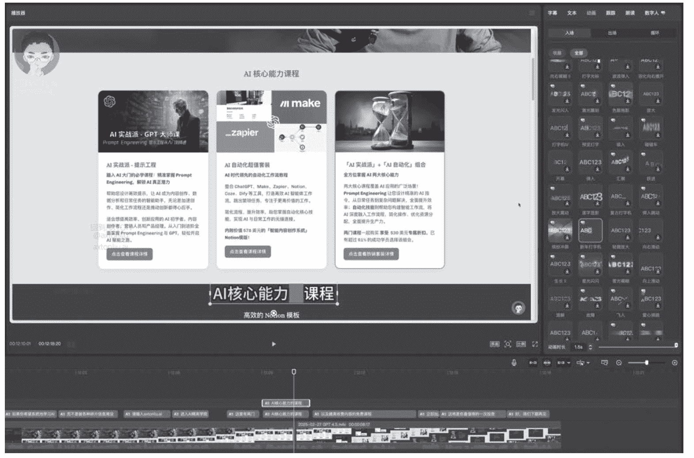

图 4-1

表面看调整时长并不复杂，但一期视频数百条字幕时，这就变成典型的低价值重复劳动。逐条手动修改效率低下，预计耗时1小时，更占用本可用于高价值创作思考的精力。

面对痛点，Axton没有选择忍受繁琐重复劳动，而是思考：能否借助智能体编写脚本实现批量处理？这个念头标志着他开始以架构师身份审视问题，正如第二章所讨论的四级协作阶梯最高层级，架构师不再满足于充当执行者，而是主动设计流程、调度资源并对结果负责。

**4.1.2 从构想到落地的解题之旅**
**1.智能体负责代码，人类负责方案**
先理解一个范式转移：在智能时代，编程工作的核心价值已从编写代码转向设计系统方案。

软件开发是智能能力展现颠覆性影响的先行领域。其最显著改变之一是编程语言门槛大幅降低。借助主流编程助手，可通过自然语言指令生成完整功能模块。以往耗时编码，如今几句指令即可完成。

更进一步，智能体已能接管从需求分析到代码实现再到执行验证的端到端流程。它不仅生成代码，还能直接运行脚本、执行数据分析并输出可视化图表。

不熟悉Python或JavaScript是否仍能驾驭？可以。主流智能体能理解自然语言描述的需求，将想法直接转化为可执行代码。例如提供数据文件并要求：“请分析并生成交互式图表。”几分钟后即可得到类似图4-2所示的完整成果。

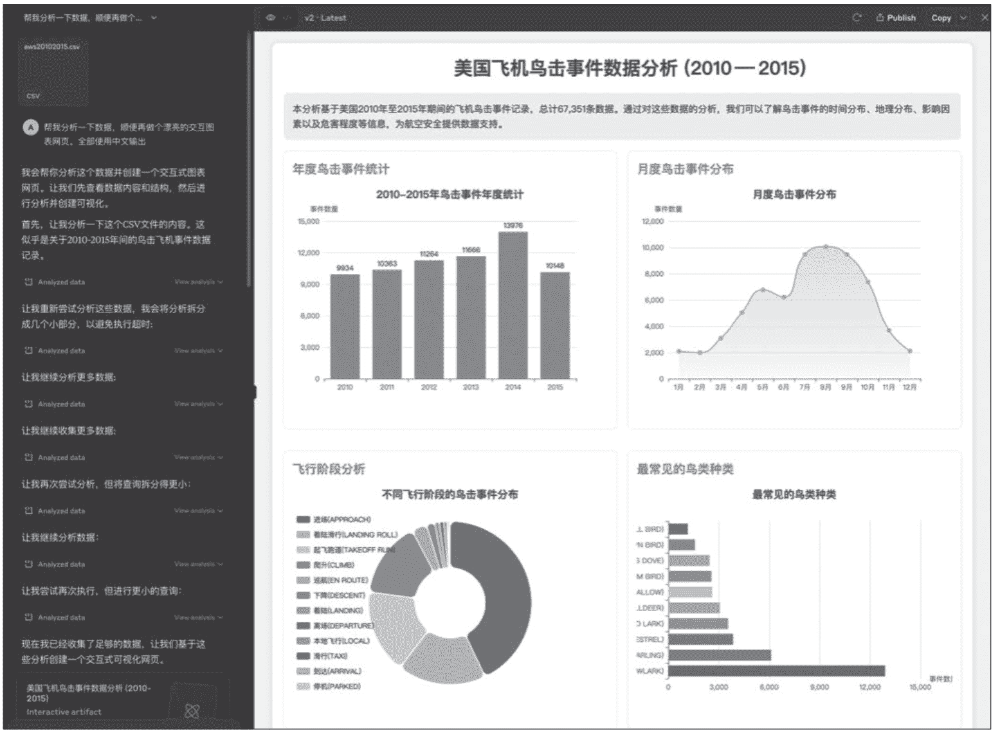

图 4-2

当智能体能如此高效生成与执行代码时，“会写代码”这一传统技能是否仍然重要？这种疑虑并非没有依据。智能体对软件开发的冲击，实质映射了其对所有依赖逻辑推演与问题拆解能力的行业的普遍影响。大量重复流程化初级任务正在被自动化，仅停留在机械编码、缺乏系统设计与决策能力的从业者替代风险更高。

回到字幕案例，看Axton如何应对。

**2.执行、调试和验证**
起初Axton对剪辑软件项目文件的格式一无所知，猜测是二进制或纯文本。抱着尝试的心态打开文件，意外发现它采用标准JSON格式，清晰记录字幕具体设置和动画参数。这让他信心大增，批量修改具备可行性。明确方向后，他把详细需求和文件结构整理成清晰任务说明，交给智能体生成基础Python脚本。

智能体迅速生成一段读取、修改JSON字段、保存的逻辑。Axton阅读后认为思路可行，便直接执行脚本，然而剪辑软件中的效果并不如预期。

接下来进入关键调试环节。他打开JSON文件逐条核对字幕参数与字段，仔细分析修改部分。果然，智能体对动画时长字段的理解有误，修改了错误字段。

明确问题后，他立即向智能体提供准确反馈：“错误，动画时长应修改另一个字段。”智能体据反馈迅速修正脚本逻辑，再次执行后批量修改成功。打开剪辑软件确认，字幕动画完美匹配语音节奏，最终效果完全符合最初设想。

从“手动操作60分钟”到“脚本自动化5分钟”，显著效率提升有效验证了该方案的价值。

**3.价值何在**
回顾整个过程，可分为三阶段。

（1）验证可行性：尽管起初不了解项目文件具体情况，但他能提出清晰思路和设计方向，快速验证方案是否可行。

AI 来了，写代码还值钱吗

方案确定之后，他让 AI 迅速生成第一版代码。AI 在执行环节效率很高，把大量重复的基础书写压缩掉了。

代码初稿出来后，他逐文件检查，找出确切的出错位置，用明确的指令告诉 AI，AI 立刻修正，最终达成预期。

这套操作传递出一个判断：在 AI 时代，编程的价值不再等同于手写代码。AI 能在很短时间内完成大部分底层实现，单纯靠语法熟练度带来的差距几乎消失。知识工作者的差异化在哪里？

关键落在第一个环节的可行性确认和第三个环节的人工纠偏。你能否提出靠谱的想法？能否用低成本方式快速证实它能跑？出现异常时能否迅速锁定症结、做出正确判断并指挥 AI 调整？

在 AI 时代，能想清楚、能快验证、能准定位并驱动修正的能力，才是专业价值的核心。

**4.1.3 解构案例：架构师的三层思考框架**

下面用一个立体复盘模型梳理 Axton 的决策路径。模型由两组视角构成。

纵向视角，三层架构：战略—战术—运营，帮助厘清项目从为什么做、怎么做、如何优化的完整链路。它回答思考在哪个层面进行。

横向视角，设计原则：拆分—通信—权衡，指导各阶段的具体落地。它回答设计如何下手。

沿着纵向三层推进，并在战术层重点展开横向原则。

**1. 战略层：定方向与验可行**

核心问题：这件事值得自动化吗？能不能实现？投入产出合不合理？

这一层要拉高视野判断方向与可行性，不仅是技术判断，还要结合领域知识、探索欲和直觉。架构师善于在表象背后发现机会，并用最小化实验快速验证，避免在错误方向浪费资源。

明确方向与价值
Axton 投入解决字幕问题的动机，不只是省一小时，而是把精力从重复操作中解放出来，用在更高价值的内容创作上。这就是战略层最核心的为什么——弄清事情是否值得做。

发现机会并做最小验证
起初他并不确定剪辑软件的工程文件是否可直接编辑。凭借对工具的直觉和好奇心打开文件，发现内部是可编辑的文本结构。

关键不在于打开文件有多难，而在于思维转换：从被动接受软件限制的使用者，变成主动探测系统边界、挑战默认流程的架构师。这种敏锐体现在：从只能这样做的现象里看到或许可以那样的可能，并迅速验证潜力。

形成假设后，他没有直接让 AI 写大量代码，而是先做最小试验：先备份原始文件控制风险，再手动改一条字幕数据并导入验证。低成本、快反馈，先证明方案可行再投入自动化。

需要提醒的是，后来该软件更新后项目文件被加密，不再支持文本编辑。这提示我们在设计自动化时，要预判平台变化，采用更灵活可扩展的结构，降低被升级打断的风险。

战略层的价值在于谋定后动，先界定问题、评估价值、验证可行，再动手。

**2. 战术层：流程设计与人机分工**

核心问题：方案可行后，如何拆成清晰流程？哪些交给 AI，哪些必须人工？信息如何流转？

这一层要把抽象想法拆成可执行的流程，保证人机协作顺畅高效。架构师的核心能力之一就是把复杂问题拆成可管理、可执行的步骤。

战术设计受三条思路指导，下面看它们在字幕案例中的体现。

思路一：拆分，管理复杂性的起点
Axton 先把字幕自动化拆成职责清晰、功能独立的模块，分成三步：
步骤1：读取原始文件并自动备份。检查点：文件是否存在、结构是否正常？
步骤2：按人工定义规则批量修改字幕时长字段。检查点：人工抽检几条，确认逻辑正确。
步骤3：写回新的文件。检查点：新文件能否被剪辑软件正常加载？

拆分带来三个好处：认知负担下降，每个模块只关注一个目标；定位问题快；模块可复用，比如备份逻辑可在其他项目复用。
拆分的本质是用清晰边界管住复杂性。缺了这一步，项目容易变成难以维护的大泥球，改动一点牵动全局。

思路二：沟通，让模块形成合力
拆分后模块需要协作。Axton 设计了数据流转路径和接口规范，明确它们如何对话。
案例中体现为：读取模块输出标准对象，供修改模块直接使用；修改后仍保持同一文本结构，写入模块无需转换。
每个模块都明确输入期望结构和输出承诺结构，像乐高一样可组合，避免说不同语言的混乱。沟通设计的本质是让独立模块无缝协同。没有精心设计的沟通，模块会变成数据孤岛，只能靠低效易错的手工复制粘贴连接，这正是 Axton 早期陷入勤奋低效的原因。

思路三：权衡，在约束中做最优取舍
这是最能体现架构师价值的思路。
权衡1：全自动 vs 保留人工检查点。脚本可一步到位直接改文件，但他选择在步骤2后加人工抽查。
收益：牺牲几十秒，极大降低批量出错风险。成本：从5分钟全自动变成5分钟加30秒确认。
权衡2：Python 脚本 vs 插件开发。可研究插件文档做一键插件，但他选更简单的脚本方案。
收益：开发时间从数天压缩到几分钟。成本：软件更新导致文件结构变化时脚本可能失效，但风险可控。
权衡3：生产级代码 vs 一次性脚本。可要求 AI 生成带完善错误处理、日志、配置的生产级代码，但他选能用就行。
收益：避免过度设计，快速达成目标。成本：可维护性下降，但对一次性任务无所谓。

权衡的本质是在性能、成本、可扩展性、可靠性、交付周期、可维护性等冲突目标间做选择。

战术层实践总结
字幕案例的战术工作包括：用拆分思路把任务拆成读、改、写三模块；用沟通思路统一文本结构传递数据；用权衡思路保留人工检查点平衡效率与风险；用权衡思路选择脚本而非插件；用权衡思路选择够用而非完美。
人机分工也清晰：
AI 负责重复且规则明确的工作，如读文件、批量改数据、保存文件，作高效执行者。
人类负责定义规则与流程、给出精准提示词、在关键节点检查确认，确保 AI 执行无误。
战术层的核心价值是把抽象问题转成可执行流程，让人机协作流畅高效。拆分—沟通—权衡是战术决策的方法论。

**3. 运营层：调试、反馈与持续迭代**

核心问题：系统运行后如何监控？出问题如何快速定位修正？如何不断优化？

执行中总会遇到问题，需要监控、精准定位、快速迭代，考验逻辑分析和反馈能力。

数据驱动的调试纠错
首次运行脚本效果不理想，Axton 没有盲目重跑，而是对比原始文件与修改后文件，精准定位根因——AI 改错了文件里的键。这体现了架构师的纠错力：靠数据分析定位问题，而非试错。

精准反馈促进快速修正
找到根因后，他立刻给出可操作反馈：错误，动画时长应该改另一个键。AI 接收后迅速调整，最终达标。精准的信息能推动系统快速迭代。

量化收益与前瞻迭代
从手动60分钟到脚本5分钟，收益量化验证了价值。同时预见到文件未来可能加密，提前用模块化结构保证可迭代，体现前瞻思维。

运营层的核心价值是建立反馈迭代闭环，让系统持续进化，适应变化。

**4.1.4 从案例到方法：架构思维工具箱**

字幕自动化完整呈现了架构师的思维路径。

战略层学会评估想法价值与可行性，用最小试验验证，解决为什么做和能不能做。
战术层掌握三原则：拆分以管理复杂、沟通以实现协作、权衡以做出最优决策，回答怎么做。
运营层学会用数据定位问题、用精准反馈推动迭代、用量化收益验证价值，回答如何持续优化。

三层构成了完整框架：既指明思考高度，又提供设计方法。
这套思维高度迁移：适用于编程、内容创作、业务流程优化等任何系统化问题；不依赖具体工具；能把与 AI 的单点协作升级为可管理、可优化、可扩展的系统协作。

三层维度与三大原则，正对应人工智能时代难以被替代的人类核心能力。在 MAPS 四维罗盘中，这就是 A 架构维度——把抽象战略转化为可执行蓝图的系统化方法。

掌握工具后，我们才能真正改造那个耗时四到五天的内容创作工作流。

**4.2 架构设计核心原则：资产化思维**

AI 能力快速扩张时，知识工作者常陷入方向焦虑，产生两种无效应对：因恐惧按兵不动，或在旧赛道盲目加速与 AI 竞技。本质都是对范式转换迟疑。

不可逆的现实是，纯能力竞赛已失去意义。追踪顶级 AI 的项目显示，2025年9月多个尖端模型的挪威门萨在线智商得分已逼近人类平均100分，部分进入高分区。官方也说明在线测试不等同正式测试，但趋势很清晰：AI 在越来越多独立技能上的表现正指数级提升，并将超越大多数人。

因此关键问题不再是如何不被替代，而是如何让 AI 能力放大自身价值。

答案在于范式转变：个体与 AI 的关系从技能比拼转向系统协作。
技能比拼关注我能不能做好，成果消耗性强，每次都要重投。
系统协作关注如何构建可持续产出价值的系统，成果可积累，一次投入持续产出。
从单次产出到可积累系统的转向，就是架构设计的核心原则——资产化思维。

**4.2.1 资产化是什么**

资产化是将一次性、消耗性的单次产出，系统性转化为可沉淀、可复用、可规模化的资产。把依赖个人即时参与的服务变成创造后能独立或半独立持续产生价值的产品。

对比理解：
消耗性单次产出：大厨凭手艺做一道菜，他休息就停产。技艺是高度个人化、即时消耗的。
可复用资产：大厨把流程、配方、火候等参数记录成标准操作规程，这份食谱就是资产，训练过的厨师都能稳定复现。

转化需三步：
抽象化
从具体一次性产出中提炼可复用的结构、模式或规则。如从一条视频提示词中提炼出主题+风格+约束的通用模板。
不抽象，只能堆一堆孤立方案，每次从零开始。抽象让共性显现，为复用奠基。
正面案例：从十条成功脚本中抽象出问题引入+痛点共鸣+解决方案预告的三段式模板。反面案例：存十条完整脚本却不总结共性，每次仍从零构思。

标准化
为抽象模板建立清晰使用规范和参数接口，保证稳定复现。如明确参数取值范围、适用场景、预期效果。
抽象提供可能，标准化保证质量。没有规范，同一模板会因人而异，价值打折。
正面案例：为三段式模板制定说明——引入30秒内完成，共鸣用第二人称你，预告含具体收益。反面案例：只说用三段式，不说明长度语气重点，结果效果参差。

系统化
把资产纳入可管理、可迭代体系，建立版本控制、性能追踪、持续优化机制。如为提示词模板库建立使用日志并据效果迭代。
前两步创造资产，系统化让资产活起来。没管理，资产会过时失效。
正面案例：记录模板使用次数、成功率、反馈，每月回顾淘汰优化。反面案例：建50个模板后不管，半年后没人知道哪些有效。

**4.2.2 资产化的评估标准**

落地资产化需要三维诊断：
第一，可复用性：成果能否在不同任务中以最低修改成本重复使用？如标准化视频封面模板比每次从零设计更有资产价值。本质是用一次投入换多次产出，边际成本趋近零。
第二，可组合性：能否像乐高一样作为标准模块与其它组件灵活拼接？如自动提取摘要的 AI 服务可嵌入研究、初稿、宣发等多流程。可组合性带来指数级价值增长。
第三，可衡量性：能否用明确指标衡量性能与质量？如追踪提示词生成内容的一次通过率或用户满意度并迭代。可衡量性建立反馈闭环，让资产从静态变动态进化。

资产化如何指导拆分—沟通—权衡？
资产化贯穿设计过程：
拆分时，不仅为眼前问题拆，还要识别具备长期复用潜力的模块，设计成通用资产。
沟通时，建立标准化文档化数据接口，保证资产间对话可预测、可复用，避免临时连接。
权衡时，为能沉淀为长期资产的方案加权，优先积累复用路径，而非只求短期速度。
掌握后，可从资产化视角审视工作流，开启系统化重构。

**4.3 案例拆解：Axton 手动工作流的诊断**

掌握架构原则与资产化思维后，Axton 把耗时四到五天的内容创作流程作为首个改造对象，用架构师视角重新解构。

**4.3.1 旧流程：手工作坊式线性生产**

Axton 此前的手动流程是典型手工作坊线性生产。
第一阶段：选题构思与资料搜集——一场没有地图的探险。选题高度依赖灵光一现，资料搜集像在信息海洋里盲捞。他会花大量时间阅读数十篇中英文报告与行业资讯，但这些资料最终以独立文件散落在本地文件夹，彼此孤立，难关联、难检索、难复用。

**第二阶段 脚本撰写：被工具切换拖垮的效率**
Axton 的写稿流程像在不同系统间搬运货物。先用第一套模型把思路整理成提纲，随后手动把结果复制到第二套模型扩写成初稿。第二套模型输出的是 Markdown，但粘贴到本地编辑器后常因兼容问题错位，需要人工逐段核对、重新排版，纯属重复体力消耗。

**第三阶段 配图筹备：为说服力付出时间成本**
每个核心论点都要有画面支撑，他便在免版权图库里反复筛选，又或在绘画模型里反复输入风格、构图、元素描述并调参。全过程不确定性高、耗时惊人，创作掌控感很弱。

**第四阶段 录制剪辑与收尾：机械操作挤占思考**
最后环节全是重复劳动。数百条字幕要逐条加动画调时、手工标注章节、为不同平台写摘要文案……每一步都在吞噬本该用于思考的精力。

**4.3.2 诊断框架：可复用资产的三类构成**
要系统审视这条链条，需先建立分析坐标。借助人工智能，现代知识工作者能够沉淀三类可复用资产，见表 4-1。

表 4-1

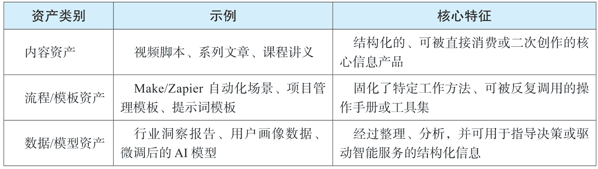

三类资产定位各异却相互咬合，共同支撑可持续运转。内容资产直面受众，一篇深度长文可拆解为视频脚本、社媒短文、播客提纲等形态。流程或模板资产把隐性方法显性化，一个打磨好的指令模板能让团队稳定产出同质水准结果。数据或模型资产为决策提供依据，经过深度分析的行业趋势报告可指引未来半年内容方向。

这三类资产也是衡量产出价值的标尺。真正高效的前沿工作流，会在关键节点刻意沉淀、复用、强化它们，而非只盯着单次任务完成。

**4.3.3 诊断过程：以资产化视角逐环检视**
Axton 以可复用性、可组合性、可衡量性为评判标准，对照三类资产定义，对旧流程逐一体检。

**第一个环节：选题构思与资料搜集。**
产出只是临时想法加一堆散落本地的文件，几乎谈不上资产属性，既非结构化内容资产，也非标准化流程模板，可复用和可组合近乎为零。

**第二个环节：逐字稿与配图。**
环节里用到的优质指令未做版本管理，好的文案风格或画面效果无法凭相同参数稳定复现。虽然任务完成了，但跨工具手工复制粘贴的工作方式随机且不可复现，未沉淀成任何流程模板，典型的单次消耗。

**第三个环节：录制、剪辑与收尾。**
这里堆满可标准化的重复劳动，如字幕制作，但在旧流程里全是消耗性操作，并未形成可自动执行的流程模板。剪辑软件自带语音识别能出字幕初稿，可质量不佳仍需逐句人工校对。更关键的是，校对后字幕直接烧进视频，未导出 SRT 等可独立编辑、后续复用的中间文件。

**4.3.4 架构缺陷定位：从表象到根因**
旧流程为何产不出资产？用架构拆解能定位根本问题。

**1.选题构思与资料搜集环节的缺陷**
拆分层面，采集与整理两项认知任务未分离，采集时注意力被不断打断。 
沟通层面，缺乏类似资料卡片的统一字段规范，如来源、日期、主题、可信度，信息无法结构化流转。 
权衡层面，为图随手收藏的短期方便，牺牲了长期搭建资料库带来的数据资产复用价值。

**2.逐字稿与配图环节的缺陷**
拆分层面，任务虽分到不同工具，但缺少参数面板或模板机制固化已验证成功经验。 
沟通层面，缺乏可在环节间传递的标准背景资料包或图像生成参数文件。 
权衡层面，过度追求单次输出的灵感效果，未把可复现性放在优先位置。

**3.录制、剪辑与收尾环节的缺陷**
拆分层面，字幕校对与格式化是规则清晰的子任务，却未从创造性剪辑中抽离。 
沟通层面，文稿到最终字幕的链路缺少 SRT 这类标准化中间文件作为接口，字幕资产无法沉淀复用。 
权衡层面，为换取内置功能的一键便利，放弃了工具开放性与流程组合性，自动化上限被锁死。

**4.3.5 设计输入清单：为“内容引擎 1.0”明确需求**
诊断终点是为内容引擎 1.0 产出可执行设计输入清单，把发现问题逐条转为改造需求与可量化成功指标，见表 4-2。

表 4-2

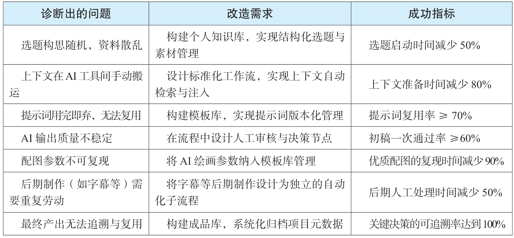

这份清单既是对过往手工作坊模式的系统复盘，也是目标清晰、可量化的行动路线图，将直接指导内容引擎 1.0 详细设计。

从这个过程能看出，架构思维价值不只在找问题，更在于把问题翻译成可落地改造方案。用资产化视角，我们不再满足把任务做完，而要在做完的同时沉淀可复用资产。这种转变，正是从工具使用者到架构师的关键跃迁。

**4.4 蓝图设计：打造“内容引擎 1.0”**
完成旧流程拆解与诊断后，Axton 手上已有清晰设计输入清单。这份清单既是对勤奋却低效困境的复盘，也是可执行行动指南。现在他要以架构师身份进入四步跑道里的设计阶段。

在画具体流程图前，他先回头思考更根本的哲学命题。

把架构视角引入内容创作，关注点就从如何写好一篇内容转向如何设计一套高效稳定且兼顾质量与规模的生产系统。在这个系统里，人工智能不止于写作助手或灵感来源，而是可被整合调度优化的核心生产单元。

这就引出内容创作必须回答的核心矛盾：当人工智能能批量生产内容时，如何平衡效率与质量？人类创作者的情感共鸣、审美判断、价值观传递等独特价值，在人工智能驱动的流水线里应处什么位置？

这些问题的答案构成内容引擎 1.0 的核心设计哲学，确保系统既快又能持续产出有人味的好内容。

**4.4.1 设计哲学：规模化生产与人文审美的平衡**
人工智能对内容创作最直观冲击是惊人规模化能力。

借助人工智能与自动化，理论上几天就能产出上百篇营销文案、社媒帖子甚至短视频脚本。权威研究也显示，人工智能在复杂基准测试表现持续攀升，语言理解与生成能力跃进，在议论文等标准化写作质量评分上甚至能超人类。对讲究效率与覆盖面商业场景，这极具吸引力。过去团队数周工作，现在一人加人工智能即可压缩到几天。速度与规模是人工智能带来的直接红利。

可当生产门槛被大幅拉低，质量拷问随之而来。

●人工智能产出内容真的能打动人吗？  
●在自动化追求效率流水线上，如何保留创作者独特风格、情感与价值观？

当人人都能用人工智能快速做出及格内容时，同质化几乎必然。各平台充斥结构雷同、措辞相近的套路化内容，功能性需求被满足，却让真正独特有深度的创作更显稀缺。

这正是内容架构需要解决核心矛盾：优秀创作架构不仅要追求效率，还要在流程中为人的创造性预留空间。

**1.人工智能的优势与局限：效率机器与情感真空**  
人工智能擅长处理结构化信息、模仿已有模式、快速整合资料并按格式输出。它在重复性、规则明确任务上表现突出，如按模板写周报、总结会议纪要、生成产品介绍文案。整体看，人工智能优势集中在速度、一致性和知识覆盖面。

局限也很明显。即便最先进模型，在深度创意、个性化表达、复杂情感共鸣、细腻语境把握以及责任归属与信任建立上仍显不足。人工智能能模仿情感表达，却因缺乏真实体验而流于表面，难以真正打动人。它也难作价值观判断和伦理考量，还可能出现幻觉捏造事实。内容策略师 Ines Lee 形容人工智能像技术精湛却缺少原创灵魂的翻奏乐队，技巧到位，缺即兴灵动。

**2.人类创作者的不可替代价值**  
当人工智能轻松完成 60 分乃至 80 分基础创作时，人类价值会向更高层迁移，这些正是人工智能难以复制的灵魂。

●独特视角与深度洞察：人工智能能整合信息，却很难基于个人经历与思考提出真正原创见解。你的故事、专业背景与生活感悟是人工智能不具备素材库。  
●情感连接与共鸣：好内容能触动情绪。创作者凭借同理心和真实体验建立信任，观众能分辨真挚情感与人工智能空洞模仿。  
●文化理解与语境把控：人类能把握文化背景、价值观、幽默与禁忌，确保表达得体。人工智能对文化的理解往往停留在表面。  
●审美判断与风格塑造：艺术风格、语言节奏、视觉美感等主观审美仍需人主导。人工智能能模仿，却难以创造真正引领潮流个人化表达。  
●价值观表达、信任构建与伦理把关：内容立场与社会影响最终由人承担，以确保合规并传递积极价值。

**3.从哲学到实践：人机协同的设计逻辑**  
认清各自边界后，结论很清晰：高效内容创作架构必然走向人机协同。

这不是妥协，而是在现实约束下最优解。极致自动化会让内容失去灵魂，拒绝人工智能则会在效率竞争中落后。只有让人工智能负责骨架与填充，人类把关灵魂与价值观，才能在规模与质量间取得可持续平衡。

这一哲学会贯穿 MAPS 四维罗盘。

●心智层面：重新定位人工智能为效率放大器，承认其在情感、创意、伦理上局限。  
●架构层面：设计人机协同工作流。人工智能处理信息搜集、资料整理、初稿撰写等规则明确环节；人类负责注入观点、情感、风格并做终审。流程中要刻意设置人工审核决策点。典型路径：人工智能生成初稿→人工审校并注入个人风格→人工智能辅助排版发布。  
●指令层面：在指令中加入语气、风格、价值观、受众与文化背景软性约束，引导更人性化输出，但最终判断仍需人完成。  
●系统层面：将人机协同流程固化成工具链，并建立效果分析、用户反馈数据回环，持续迭代流程与指令。目标不是无人化，而是让人在最有价值决策环节聚焦。

人工智能规模化能力不容忽视，但不意味着人文审美会消失。相反，当量变得廉价，质——尤其是蕴含人类智慧、情感与审美作品——会更珍贵。同质化泛滥时，真实性、原创性、情感连接与深度思考将成为核心竞争力。

真正挑战是如何设计智慧架构，让人工智能效率与人类创造力协同增长。这种人机协同，本质是架构师在权衡原则下实践：主动牺牲一部分极致自动化以换取品质、人文审美与伦理安全等长期价值。

**4.4.2 “内容引擎 1.0”架构蓝图**
在人机协同哲学指引下，Axton 开始为全新系统绘制可落地架构蓝图，并命名为内容引擎 1.0。

需要说明，本节是一份概念设计蓝图，描绘理想形态与完整架构，并非可直接照搬操作手册。具体参数配置与落地细节将在第六章展开。

**1.关键设计思想**  
支撑系统的三个核心思想。

第一是 RAG。流程基石，用来解决人工智能输出不稳定和资料散乱问题。系统不让人工智能空想，而是先用搜索引擎抓取主题相关最新资讯，再作为上下文喂给模型。RAG 是业界公认降低幻觉核心技术之一，有助于保证准确性与时效性。

第二是端到端草稿自动化。根治上下文在工具间手动搬运痛点。研究、整合、撰写无缝衔接，把模糊想法直接转化为结构化草稿，减少人工干预带来耗时与格式错误。

第三是人在回路 Human-in-the-Loop，HITL。人机协同直接体现。流程终点是草稿而非直接发布，刻意保留人工审核、修改与发布决策，确保规模化生产不牺牲人文审美。

基于以上思想，内容引擎 1.0 由三大资产库与标准化工作流构成，把线性手工作坊重塑为模块化、可持续积累价值生产体系，如图 4-3 所示。

**2.核心资产库定位**  
蓝图基础是三个相互支撑核心资产库。

**个人知识库：**结构化知识与信息中心。承载第三章构建信息链成果，解决选题随机与个人洞察易丢失问题。遵循信息链五环模型，收纳原始素材、研究笔记、行业数据与个人洞察，用标准化标签和双向链接组织，支持人工智能语义检索。理想状态下，系统能自动调取历史积累，为新内容注入创作者独特视角。这里沉淀的是可指导决策数据资产。

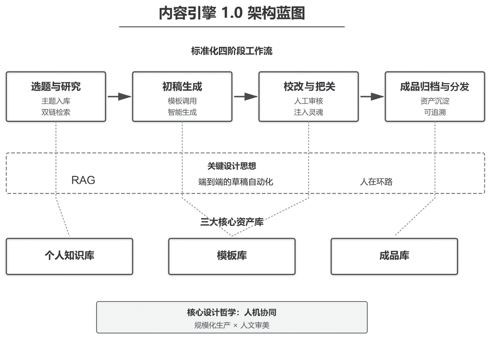

图 4-3

**模板库：**可复用流程与标准。解决指令用完即弃与配图参数难复现问题。所有经实践验证模板，包括文本指令、视频脚本结构、封面设计规范、人工智能绘图参数等，均标准化收录并做版本管理，固化为可复用流程资产。

**成品库：**可追溯成果与数据沉淀。把一次性交付转化为长期资产。所有已发布视频、文稿、图片以结构化方式归档，每个项目记录源文件、所用模板版本与关键数据，为未来复用与优化提供基础。这里积累的是可直接消费或二次创作内容资产。

**3.标准化工作流设计**  
标准化工作流串联三大资产库，把混乱手工操作转为清晰四个阶段，如图 4-3 所示。

第一阶段：选题与研究。Axton 输入明确主题后，系统从个人知识库检索相关历史笔记与个人洞察，同时调用外部搜索引擎获取最新资讯。个人积累加实时资讯组合既保证独特视角又兼顾时效，摆脱选题随机、资料散乱困境。采用 RAG 技术将检索信息整合为结构化研究素材。

第二阶段：初稿生成。调用模板库。系统从模板库匹配指令模板与脚本结构模板，以研究素材为上下文驱动人工智能高效生成初稿。既保证质量，又通过标准化模板确保风格一致，使指令用完即弃成为过去。

第三阶段：校改与把关。应用 HITL。人工智能初稿进入人工审核，Axton 作为总编辑审校观点、受众契合度、风格一致性与引用准确性。这是人机协同哲学直接体现，为人工智能输出不稳定提供最终保障。

第四阶段：成品归档与分发。发布内容连同生产元数据，包括模板版本、引用清单、数据表现，均系统化归档至成品库。这些数据不再是副产品，而是可调用、分析、迭代资产。半年后回溯系列表现，也能精准定位每个决策节点，而非靠记忆重来。

针对后期重复劳动，可将字幕生成等设计为独立可自动执行子流程。子流程本身是可复用流程资产，其产出标准化产物如 SRT 字幕文件也一并归档，从而把后期纳入资产化管理。

**4.人机分工边界清单**  
为落地人机协同，以下清单明确人工智能与人类在内容引擎 1.0 中职责边界，如表 4-3 所示。

表 4-3

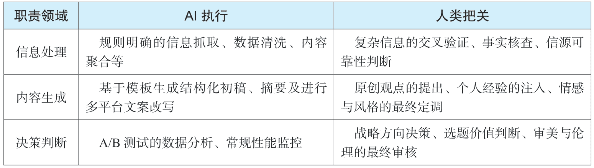

**5.从概念到实践的桥梁**  
通过内容引擎 1.0 架构蓝图，Axton 首次从重复劳动中抽离，真正站在架构师高度。他不再纠结如何完成单篇内容，而是设计一套持续产出高质量内容系统。

必须先说清楚，这份蓝图描绘的是系统在理想状态下的样子。推进到“内容引擎 2.0”的落地阶段，就要在技术可行性和投入成本之间做务实权衡。拿个人知识库与自动化流程的深度耦合来说，技术门槛不低，首个可用版本通常会先走稳妥路线——以实时网络检索来确保时效，把个人知识库先作为创作者手工查阅的参考。思路就是先把主线跑通，再逐步迭代完善。

不管最终怎么取舍，从拆解到重塑的路径已经凸显出架构思维的价值。蓝图把模块划分、数据流向、人的角色与机器的边界都固定下来，是迈向系统化实践的起点。

**第五章 提示词工程：对话的艺术**

完成“内容引擎 1.0”的架构后，Axton 手上已有一张看似完整的行动方案：三类核心资产的职责、三套标准化流程、人的分工与 AI 的边界都已划清。纸面上，构思到方案的转化算是完成。可当他准备把方案付诸实操时，阻力立刻出现。

按方案设计，选题研究应该是先在私有笔记库里检索相关记录，再调用搜索引擎抓取最新资讯，最后整合为结构化素材。逻辑上无懈可击，但打开对话窗口让他去执行时，他发现自己不会把需求转成机器可懂的语言。

“帮我找量子计算的最新进展”？太宽泛，返回的往往是泛科普，缺乏行业洞察。

“请分析量子计算在金融科技里的应用前景，聚焦风险管理与算法交易，需要涵盖最新的学术研究和商业案例”？描述已算具体，结果仍令人失望：偏题、引用陈旧，甚至编造案例。

根因渐渐清晰：架构图谱用的战略抽象语言，与模型可执行的指令语言是两套体系。

图谱里用检索、整合、生成这类战略概念，对设计者来说显而易见，对模型而言却含糊。就像要把建筑师的设计图转成施工队能读懂的施工图，Axton 意识到自己需要学会一种转译能力——把战略意图精准转成模型可执行的指令。

更棘手的是对话的不稳定。同样的问题，今天可能得到条理清晰、引用准确的分析，明天却可能得到逻辑混乱甚至含虚假信息的输出。缺乏可控性，让关键环节不敢交给模型。哪怕蓝图再完美，没有稳定与准确也只是空中楼阁。

Axton 明白，他已完成从想法到设计的跨越，对应 MAPS 体系里的 A 阶段，但要让系统真正运转，还必须跨过另一道门槛：学会用模型的语言，把图谱里的每个环节变成精准、可靠、经济的执行指令。

Axton 的难题也是众多实践者的共性。要突破它，就要进入 MAPS 四维罗盘的第三个维度——提示词 P，以及四步跑道的第三步——对话。

提示词是与模型进行结构化沟通的语言，是逻辑、语境与目标融合的工程艺术。接下来将系统学习如何构建高效、稳定、可信的提示词，让每条指令都被模型准确理解与执行，把模型从偶尔带来惊喜的伙伴，转变为稳定交付预期的专业执行者。

如何实现高质量对话？科技思想家凯文·凯利早有提示：未来最重要的首要技能，就是如何提出好问题。自 ChatGPT 类大语言模型普及后，这一点愈发得到印证。关注点始终放在理解模型的本质——它如何工作，我们如何更有效地沟通以释放最大潜力。

在实践中，凯文·凯利所说的“好问题”包含两层能力。

第一层是提出真正有价值、有深度的提问。他在《必然》中写道：“一个好问题可能是机器最后也无法学会的工作，一个好问题就是人类存在的目的。”这与思维模式密切相关，需要批判性、创造性思维以及洞察问题本质的能力，从复杂信息中抓住关键。

第二层是把脑中构想的好问题清晰表达出来。这正是提示词工程要解决的核心命题。清晰表达本身就是需要刻意练习的技能。即便在人与人沟通中，很多人也难以完整准确地传达需求。我有多年软件需求分析经验，深知一个表面简单的需求背后有多少细节需要澄清。

有人会认为模型越聪明就越不需要精细设计提示词。我的观点不同。正如人类语言已存在数千年，高效精准沟通依然离不开结构清晰、逻辑严谨的表达。在模型能够完全读懂思想之前——如果真的会到来——锤炼清晰表达的重要性不会被削弱。

需要强调的是，提示词工程是艺术与科学的结合，而非精确的数学。大语言模型本质上是基于概率生成文本，同一提示词在不同时间或细微语境变动下可能给出不同回答。优化提示词是在不断逼近期望结果，提升理想输出的概率与一致性，但无法保证 100% 复现。因此本章案例的效果都基于特定情境，实践中要理解这种固有不确定性，并通过测试迭代找到最适合自己的策略。

本章将梳理提示词工程的核心概念、关键技术与实战案例，提供一套清晰实用的应用指南。在 MAPS 四维罗盘里，提示词是连接心智与架构、实现系统化的关键环节，是人机深度协作的核心语言。

**5.1 提示词基石：写得对**

让模型准确理解意图，首先要把提示词写对。这里的“对”不是指语法拼写，而是指结构清晰完整、信息无歧义。它是所有高级技巧的基石，也是高效协作的起点。

计算机科学的经典法则“输入决定输出”揭示了这一点：输入设计不佳，输出必然不理想。结构正确的提示词像清晰的行动指南，能减少模型不必要的猜测，直达目标。学会精心设计结构正确、要素完备的提示词，是每个资深用户必备的能力。把任务要求和背景信息用清晰准确、重点突出的语言组织起来并不容易，却对获得预期结果至关重要。

**5.1.1 ICE 基础上演进出 RICE：搭建提示词的框架**

要保证提示词结构清晰、信息无歧义，需要一套可靠的构建方法。业界总结出的基础核心要素就是“ICE 三支柱”：指令 Instruction、背景 Background、示例 Example。这三者像三根支柱，帮助模型准确理解意图，提升质量和一致性，如图 5-1 所示。

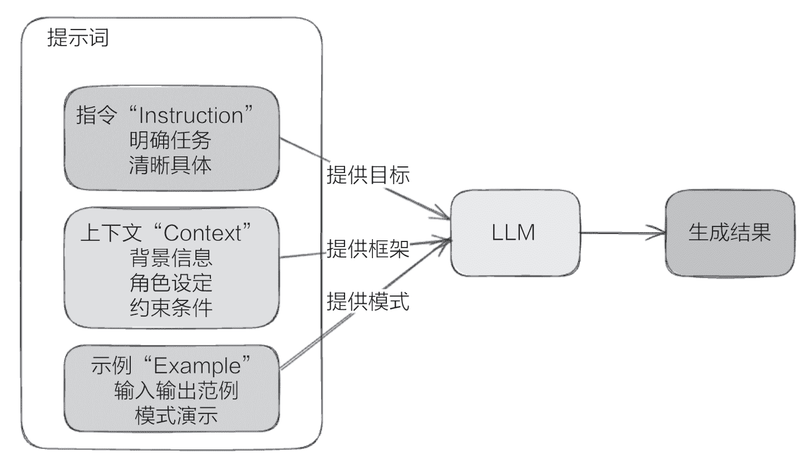

图 5-1

进一步应对需要模型展现特定“人格”或专业视角的复杂场景，就在 ICE 基础上扩展为“RICE 框架”，加入角色 Role 的设定。

无论是 ICE 还是 RICE，目标一致：为模型提供结构完整、信息充分的输入，减少猜测，提升输出质量。

理解并善用这些要素，是把提示词写得“对”的系统方法。它建立了一个基准认知：正确的提示词=明确角色+清晰指令+必要背景+有效示例。掌握这个基础框架，就等于拿到了确保模型准确执行的脚手架。

**1.指令——明确要做什么，提示词的灵魂**

指令是提示词的核心驱动力，直接定义模型要执行的具体任务。清晰明确无歧义的指令是高质量输出的第一条件。指令模糊就像给模型派一个边界不清的任务，它会自行填补空白，导致结果偏离预期。

做到指令清晰可遵循以下原则。

**（1）明确性：**用简洁直接的语言，避免模棱两可的表达。Anthropic 官方指南也把“清晰、直接、详细”放在首位，建议像对人下指令一样明确。例如，别说“给我一些苹果公司信息”，而是“请提供苹果公司最近一个财年的营收数据、主要产品线及其市场份额”。

**（2）具体性：**明确任务范围、目标和期望输出形式。描述越具体，误解可能性越小。例如，别要求“写一篇关于环保的文章”，而是“请为中学生写一篇 800~1000 字的科普，主题是减少塑料污染，包含至少三个可行建议，并附上两个数据来源”。

**（3）动词主导：**核心指令通常以明确的行动动词开头，如“生成”“总结”“分类”“翻译”“比较”“解释”“评估”“重写”“提取”“分析”“预测”等。OpenAI 官方也强调明确动词命令是提示词最重要的成分。

**（4）单一职责：**避免一条指令包含多个不相关或逻辑复杂的任务。若有多个子任务，最好用编号、分点列出，或拆分为多轮分步处理，有助于模型逐一聚焦准确完成。

**（5）术语定义：**使用专业术语或多义词汇时，若担心理解偏差，最好先定义。例如“提高 PR”可能被理解为公共关系，而实际是个人最好成绩。关键任务中预先定义核心术语，能让双方在同一认知频道沟通。

遵循这五点，就能构建清晰明确的指令，实现信息无歧义。

**2.角色——定义扮演者，赋予输出特定视角与风格**

RICE 框架中的角色设定，是指示模型在当前任务中扮演的特定身份或人格。通常置于指令之前，也可作为背景信息被强调。例如让模型扮演“拥有三十年临床经验的心血管内科专家”“擅长用通俗语言解释经济现象的诺贝尔经济学奖得主”或“幽默风趣的单口喜剧演员”。

清晰的角色能大幅提升针对性，让模型自动调整语言风格、语气、专业术语使用、知识侧重点和思考角度，使输出更符合场景和受众。研究也证实，要求大模型扮演特定角色是提升输出质量的有效策略。因为训练数据里同一个问题本就包含不同角色的不同回答，设定角色能让模型更专注调用相关风格和知识体系。

一个经典例子能说明这一点。创建提示词时运用“扮演”手法非常实用，只需在提示词里明确告知“请你扮演 XX 角色”。比如问模型“如何把大象放进冰箱？”

不设定角色时，模型通常识别出这是脑筋急转弯，给出戏谑式回答。输出效果如图 5-2 所示。

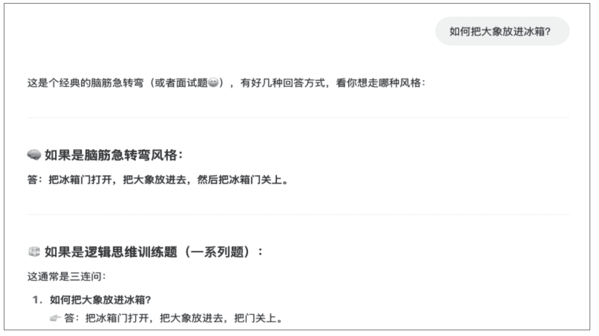

图 5-2

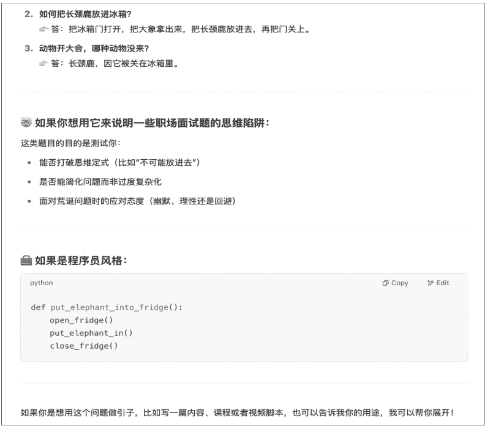

图 5-2（续）

改成“请作为一名生物学家，告诉我如何把大象放进冰箱？”后，回答完全不同，会从生物学和伦理学角度严肃探讨其不可行性。

输出效果如图 5-3 所示。

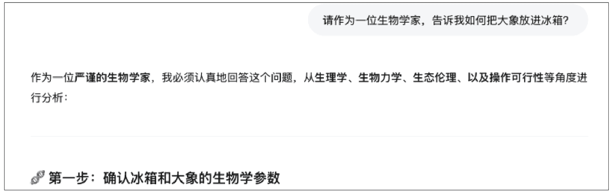

图 5-3

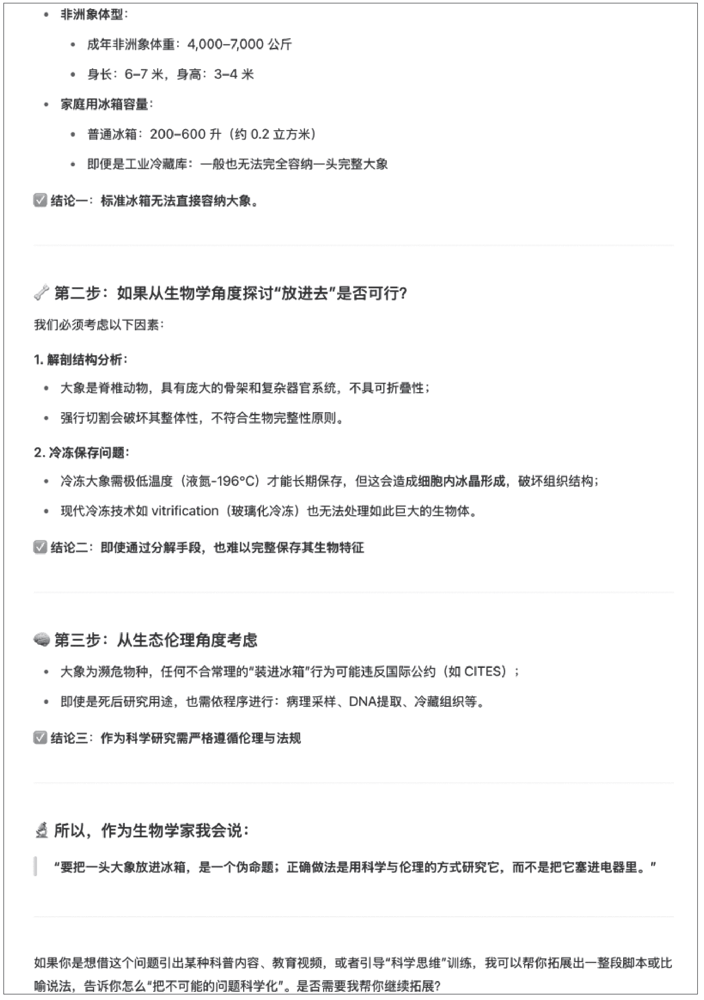

图 5-3（续）

这个例子清晰展示了角色设定的力量。简单身份设定就能引导模型从不同认知框架出发，得到更专业的回答。

设定有效角色可从三点入手。

**（1）具体化与情境化：**角色描述要清晰具体，包含职业、经验水平、性格特点、专长领域等。

**（2）与任务目标对齐：**设定角色必须与核心任务高度相关，能积极辅助完成，避免无关或干扰。

**（3）考虑目标受众：**角色设定应间接兼顾最终受众。比如受众是儿童，让模型扮演“和蔼可亲的幼儿园老师”比“严肃科学家”更合适。

精准的角色设定，本质是为输出预设明确的视角坐标系，界定其以何种专业深度、语言风格和思维方式处理指令。这正是结构清晰完整在视角定义层的体现。

**3.背景——提供必要信息，提示词的骨架**

如果指令是灵魂，背景就是骨架。它为模型执行指令提供背景信息、相关数据、约束条件或特定视角，帮助模型理解任务所处环境。模型知识虽广，但对具体问题是局外人。提供充足相关背景，能让模型更精准定制回答，避免凭空猜测。

有效背景通常包含：

**（1）背景信息：**与任务直接相关的背景知识、事实数据、事件经过、文档摘要或情境描述。如分析财报时补充行业趋势、竞争对手动态等。

**（2）目标受众：**明确内容的最终阅读者是谁。他们的知识背景、兴趣点决定语言复杂度、专业深度和表达风格。

**（3）输入数据：**需要模型直接处理或分析的具体信息或原始材料。如情感分析时文本本身就是核心输入。若过长可分段或先摘要。

**（4）约束条件：**必须遵守的限制或规则，包括内容限制、资源限制、来源限制等。

**（5）相关对话历史：**多轮对话中之前交流构成当前背景。注意模型背景窗口有限，过长历史可能导致早期信息遗忘，关键节点重申或总结核心信息是有效策略。

详尽的背景是确保信息无歧义的关键。系统提供背景、受众、输入、约束和对话历史，为模型构建清晰信息环境，避免信息缺失导致的猜测。

**4.示例——示范期望格式与思路，提示词的参照物**

示例是向模型直观展示期望行为模式、回答格式、语言风格或思考路径的参照物。这种方法叫少样本提示 Few-Shot Prompting。模型通过观察示例进行上下文学习，能更好地完成类似新任务。对不熟悉、需特定格式或含复杂隐含逻辑的任务，优质示例往往起到四两拨千斤的效果。

提供有效示例需遵循：

**（1）代表性：**示例应清晰准确展示任务本质和期望输出模式。

**（2）一致性：**示例的输入输出格式、语言风格、逻辑关系应与新任务期望高度一致。

**（3）质量为王：**一个精心挑选的优质示例效果可能胜过多个平庸示例。错误示例会严重误导模型。

**（4）数量适度：**通常 1 个到少数几个即可，过量会消耗 Token，增加信息过载干扰。

**（5）格式清晰：**用清晰标记区分输入和期望输出，如“输入：… 输出：…”或标签包裹，帮助模型准确理解对应关系。

通过结构清晰的示例，为提示词结构完整性增添约束。示例不仅定义输出形态，还展示转换逻辑，减少歧义，把抽象指令具象化为可模仿的标杆。

**5.提示词的第一性原理：清晰明了，重点明确**

提示词的底层第一性原理

搞懂了 RICE 四个关键要素后，还有一条贯穿始终的底线要吃透：不管是 ICE 三要素还是 RICE 体系，不管你给了多少背景资料和样例，提示词本身能不能说清楚、抓重点，才是决定 AI 能不能get到你的根本前提。

（1）先讲清楚：用零歧义的方式把需求说准

讲清楚，本质上就是用不产生歧义的措辞把意图钉死。很多人自以为已经表达得很明白了，但换到 AI 或者另一个人去理解时，模糊点立刻冒出来。

拿软件需求举例。用户说一句“系统出错时要能及时弹出警告”，听着没问题。站在执行者的角度马上会追问：是所有错误都要警告，还是只针对特定等级？“及时”到底是几秒内？警告用什么形式呈现、在哪个位置展示？文案具体写什么？对 AI 的指令也一样，任何一个没说透的细节，都可能让结果跑偏。

想让明确度提升，最实际的做法是给提示词做结构化。把指令、背景信息、待处理内容、示例等不同板块用明显的分隔符拆开，是业内非常推崇的做法。结构一目了然，模型解析起来更准，它也更清楚每段话该怎么用。

现在常用到的分隔方式有：

● 三重引号："""。

三连反引号

需要呈现的正是三个连续的反引号字符：```。

●三个破折号：---。

●XML 标签：<tag>…</tag>（如<text_to_summarize>…</text_to_summarize>）。

在这些分隔符中，XML 标签因其本身可以携带语义信息而具有独特优势。例如，我们可以用<role>程序员</role>来界定角色信息，这样既起到了分隔作用，又明确了该部分内容的含义。当然，分隔符的选择是灵活的，关键在于醒目且不与正文内容混淆。例如，如果你的背景信息使用 Markdown 格式提供，就需要避免使用“#”作为分隔符，因为“#”在 Markdown 格式文本中会被当作标题使用。

当然，现代大语言模型的理解能力已经相当强大，即使我们不使用特殊分隔符，仅依靠自然的段落和空行，在多数情况下 AI 也能正确理解提示词的结构。但我仍然强烈建议养成使用分隔符的习惯，尤其是在处理包含多个复杂组成部分或大量文本的提示词时。这就像在代码中使用良好的缩进和注释一样，能极大地提高提示词的可读性，有效避免 AI 对意图的误解。

（2）重点明确：聚焦核心的高效沟通。

我们强调要提供充足的细节和上下文，但这并不意味着提示词应该冗长、啰唆或漫无边际。好的提示词在提供必要信息的同时，也必须做到重点明确。

首先，要避免过于开放的问题。开放性问题（如“你对人工智能有什么看法？”）虽然可用于激发 AI 的发散思维，但在大多数需要明确输出的任务场景下，应该尽量提出更具体、更有针对性的问题。例如，将“你对这个新产品有什么看法？”修改为“从提升用户留存率和降低运营成本两个角度，分析这款新产品可能带来的积极影响和潜在风险”。

其次，简洁不等于简短，细节不等于啰唆。我们追求的是用最精练的语言传递最丰富、最准确的信息。应删除所有不必要的寒暄、客套话或与核心任务无关的描述，确保提示词中的每一个词都在为最终目标服务。

清晰明了与重点明确，共同构成了提示词写得“对”的最终检验标准。它要求我们不仅要提供结构完整（ICE/RICE）的要素，还要确保这些要素内部的表述精准、无歧义且高度聚焦。只有当结构完整性和内容明确性同时达成时，提示词才真正实现它的“第一性原理”，为 AI 的可靠执行奠定最坚实的基础。

大量实践（无论是学术研究还是业界报告）反复印证了结构化提示词的重要性。有研究量化显示，采用标准化、要素完备的提示词模板，可以显著提升输出一致性、减少有害输出，并节省人工修正时间。

在日常与 AI 交互时，我们应有意识地运用 RICE 框架来审视和构建提示词，可以尝试对同一个任务分别使用要素不完整和要素完备的提示词，并对比 AI 输出的差异，从而更深刻地体会每个要素的作用。

掌握了 RICE 框架和第一性原理，我们便拥有了将提示词写得“对”的方法论。具体来说，它可以从两个维度来检验：结构是否清晰完整和表达是否无歧义且重点明确。

在结构清晰完整层面，RICE 的四个要素各司其职——角色定义视角，指令明确任务，上下文提供背景，示例展示标准。这四个要素共同构成完整的指令体系，确保 AI 获得执行任务所需的全部信息。

在信息无歧义层面，每个要素及其设计原则——从指令的明确具体到上下文的充分相关性，再到示例的代表性——都在致力于消除模糊地带，最大限度地减少 AI 对意图的误解和猜测。

**5.1.2** **主流设计模式**

**1.角色扮演提示**

业界在大量实践中总结出一系列可复用的“设计模式”——这一概念借鉴自软件工程，指针对特定类型问题且经过验证的解决方案。熟悉并掌握主流的提示词设计模式，能够显著提高我们与大语言模型沟通的效率和效果，使构建的提示词更具鲁棒性和扩展性。

下面介绍第一种设计模式——角色扮演提示。

这是对 RICE 框架中“角色”要素的深度应用与范式化升级。在 RICE 框架中，角色通常作为可选的基础信息项，而在角色扮演提示中，它升级为一种能系统提升输出质量的强大策略。

1）核心价值

其核心价值在于实现内容的深度定制化。通过为模型指定清晰的角色，可以引导其在风格、语气、专业术语、知识侧重点乃至思考问题的角度上，更贴近该角色的特征，以满足特定场景与受众的需求。例如，要求 AI 扮演“法律顾问”来解释合同条款，通常会得到比常规提问更严谨、更专业的回答。

2）应用场景

在以下场景中，使用角色扮演提示尤为有效。

●需要专业视角：当任务需要特定领域的专业知识（如法律、医疗、金融分析等）时，为 AI 设定相应的专家角色，能显著提升输出的专业性和准确性。

●需要特定风格：当内容需要特定的沟通或创作风格（如创作儿童故事、撰写幽默的营销文案等）时，角色设定是精确控制内容风格与语气的有效工具。

●需要降低理解门槛：当目标受众为非专业人士或特定群体（如儿童、初学者等）时，可设定“科普作家”或“耐心导师”等角色，让 AI 使用更通俗易懂的语言进行解释。

3）实践示例

关于如何设定有效角色的核心原则，前文已有说明。下面通过具体示例展示其实际应用。

**示例 1：无角色与有角色的对比。**

**普通提问：**“请帮我分析这段代码的性能问题。”

**角色扮演提示：**

# 角色 你是一名拥有 10 年大型电商系统开发经验的 Python 架构师，擅长性能优化和系统架构设计。

# 任务 请分析以下代码的性能问题，并提出优化建议。

# 代码 ［待分析代码］

**对比结果：**无角色设定版本中模型可能仅给出通用分析，如“使用缓存”“减少循环嵌套”等比较泛泛的建议。而有角色设定版本中模型会从电商系统架构师的视角，主动考虑高并发、大数据量等典型场景，提供更具体的优化方案，如“建议使用 Redis 缓存热门商品数据以降低数据库负载”或“对于秒杀场景，可考虑采用消息队列进行流量削峰”。

**示例 2：完整示例——为家长提供育儿建议。**

以下是一个针对特定受众（家长）设计的完整角色扮演提示：

# 角色 你是一位儿童心理学家，专门研究 3～6 岁儿童的情绪管理，拥有 15 年临床经验。你善于用简单、温暖的语言与孩子和家长沟通。

# 任务 请为一位 5 岁孩子的家长，解释如何应对孩子的分离焦虑。

# 要求

●使用通俗易懂的语言

●提供 3～5 个具体可操作的建议

●每个建议都附带简短的原理说明

此示例展示了如何将角色设定与明确的任务要求相结合。通过设定“儿童心理学家”角色并强调“善于用简单、温暖的语言与孩子和家长沟通”，确保 AI 的回答既专业又易懂，完美契合家长群体的需求。

角色扮演提示是实现提示词写得“对”的一种高级策略。它通过在 RICE 框架的“角色”要素上进行深度构建，为整个提示词预设强有力的“语境约束”。这种约束发挥着过滤器的作用，确保 AI 生成的所有内容都符合特定的视角、知识体系和语言风格，从而极大提升输出的一致性和相关性，从源头上减少因视角模糊产生的歧义。

**2.零样本提示**

“零样本提示”（Zero-Shot Prompting）是一种基础的提示词设计模式，指在不向模型提供任何与当前任务直接相关的输入/输出示例的情况下，仅凭其在预训练阶段获得的知识和指令遵循能力来完成任务。例如，直接要求模型“将这句话从英文翻译成法文”，模型能完成此任务并非因为它见过完全相同的“题目”，而是因为它在训练中已经掌握翻译这一“题型”的通用解法。

这种能力主要依赖于模型强大的泛化能力和指令遵循能力，得益于模型的海量预训练数据。

1）核心价值

该模式的核心价值在于其极高的效率和灵活性。由于无须准备示例数据，它大幅降低了使用门槛，是初学者和需要进行快速原型开发时的首选。同时，在面对突发、新类型的任务时，可直接尝试零样本提示，无须花费时间收集和整理示例。

2）应用场景

零样本提示适用于模型在预训练阶段已经充分学习的常见任务，通常能直接取得令人满意的效果。这些任务包括：

●简单的文本分类、情感分析。

●常识问答。

●一般性的文本摘要。

●基础语言翻译。

3）设计要点

要有效运用零样本提示，需要注意以下几点。

指令清晰简洁：由于没有示例辅助，指令的明确性和无歧义性至关重要，应避免使用模糊的词汇或提出过于开放的问题。

逐步细化指令：如果初始效果不理想，可尝试让指令更具体、更结构化。对于复杂任务，可以考虑将其分解为多个更小的子任务。

认清能力边界：零样本提示的性能高度依赖于模型的预训练水平。对于模型未曾见过或训练数据覆盖不足的领域，其效果可能较差。

**4.实践示例**

**示例 1：基础的零样本提示。**

对于翻译类常见的任务，清晰的指令通常已足够。

# 指令

请将以下英文文本翻译成简体中文。

# 输入文本

“Artificial intelligence（AI）is intelligence demonstrated by machines，as opposed to the natural intelligence displayed by humans or animals.”

# 输出要求

直接输出翻译结果，无须解释。

此提示简洁明了，模型能够直接理解并完成任务。

**示例 2：通过细化指令提升效果。**

对于情感分析类稍复杂的任务，逐步细化指令能显著提升输出质量。

模糊的指令：

分析这段评论的情感。

细化后的指令：

# 任务

请分析以下产品评论的情感倾向。

# 输入文本

“这款耳机音质还不错，但佩戴时间长了会有点夹耳朵，价格也偏高了些。”

# 输出要求

1.**情感分类**：正面/中性/负面。

2.**置信度**：高/中/低。

3.**关键情感词**：列出评论中表达情感的关键词。

4.**简要说明**：用一句话概括情感倾向的理由。

细化后的指令明确了输出结构，使模型给出更具结构化、更有深度的分析。

零样本提示是检验提示词基本功的重要方式。它完全依赖 RICE 框架中的指令和上下文来引导模型，不借助任何示例。因此，一个成功的零样本提示，本身就证明了其指令的清晰度和上下文的充分性已达到让 AI 独立理解任务的水平，这正是写得“对”的核心要求。

**3.少样本提示**

与零样本提示不同，“少样本提示”模式会在提示词中为模型提供少量（通常是 1～5 个）与任务相关的输入/输出示例。这些示例向模型展示期望的回答格式、风格或解决问题的模式。模型通过“上下文学习”从示例中“学习”，并将其能力迁移应用于新的输入。这就像在考试前给学生看几道包含解题过程和答案的“例题”，帮助其快速掌握解题思路。

1）核心价值

该模式的核心价值在于，它能显著提升模型在特定或新颖任务上的表现。在通常情况下，其性能优于零样本提示，因为具体的示例为模型完成任务提供了更明确的引导，减少了其自行“猜测”的空间。

2）应用场景

少样本提示尤其适用于以下场景。

●需要特定输出格式的任务：需要模型以非标准格式（如自定义的 JSON 结构、特定的报告格式等）输出结果的任务。

●模型不熟悉的新颖任务：对于模型在预训练数据中未曾充分学习过的新颖任务类型，提供示例是教会其处理的最快方法。

●需要完成特定风格转换的任务：例如，将正式的报告语言转换为轻松的社交媒体文案，或生成特定风格的诗歌。

●包含复杂隐含逻辑的任务：当任务的内在逻辑难以用语言清晰描述时，通过示例展示通常更有效。

3）设计要点

在第 5.1.1 节中，我们已经介绍过示例选择的通用原则。在少样本提示中，还需关注另外两点。

一是，示例的排列顺序有时会对模型输出产生影响，因此可以尝试按不同的顺序进行测试。

二是，标签分布值得关注。研究表明，即使示例中的标签是随机分配的，只要格式保持一致且标签的整体分布与真实情况相符，也能对模型性能产生积极影响——这表明模型有时更关注对模式的模仿，而非内容的绝对正确性。

需要特别注意，对于某些在设计上就内置了强大推理能力的模型（如 DeepSeek-R1），不恰当的示例反而可能干扰其固有的推理路径。

如图 5-4 所示，当我们使用推理模型 DeepSeek-R1，并用零样本提示判断“外面天黑了。”这句话的情绪时，模型给出了正确的回答：中性。


图 5-4

然而，在切换到少样本提示，并在提示词中加入几个情感色彩鲜明的例子后，模型明显受到示例的影响，最后给出错误的判断结果：消极，如图 5-5 所示。

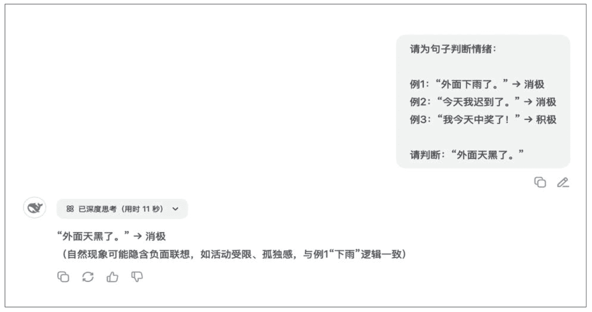

图 5-5

4）实践示例

**示例 1：用于情感分析类任务的模板。**

# 任务描述

请判断以下评论的情感倾向（积极、消极或中性）。

# 示例 1

输入：“这款产品真是太棒了，完全超出了我的预期！”

输出：积极

# 示例 2

输入：“我对这次的购物体验感到非常失望。”

输出：消极

# 示例 3

输入：“快递今天送达了。”

输出：中性

# 现在，请处理以下输入

输入：［你的实际输入评论文本］

### 输出：

**示例 2：通过示例完成自定义的转换模式。**

少样本提示的强大之处在于，能教会模型一种全新的、自定义的转换模式。

零样本提示（模型无法理解抽象的、风格化的指令）：

将以下句子的情感放大，变成一个夸张的反问句。

输入：“这部电影还行。”

（模型的输出可能是“这部电影难道不行吗？”或“这部电影真的只是还行吗？”，无法捕捉到特定的夸张风格。）

少样本提示（教会模型一种全新的、夸张的表达风格）：

# 任务

请学习以下示例，将输入的简单陈述改写为一个充满夸张情绪的反问句。

# 示例 1

输入：“我有点累了。”

输出：“有点累了？或者说，你正与一种深刻的疲惫搏斗，感觉连骨头都厌倦了支撑你的身体？”

# 示例 2

输入：“这个汉堡的味道不错。”

输出：“味道不错？或者说，这是你味蕾经历过的一次狂欢，每一口都在重新定义美味的标准？”

# 现在，请处理以下输入

输入：“这部电影还行。”

### 输出：

在这个例子中，我们没有抽象地描述“夸张”，而是向它“展示”我们所定义的、独特的夸张风格。模型通过学习示例，就能在新输入上复现“普通陈述→夸张反问”的转换模式。

少样本提示是将提示词写得“对”的有力工具，通过“展示”而非仅仅“描述”的方式来传递意图。通过提供具体的输入/输出示例，我们为模型构建了极其清晰的关于期望格式和内在逻辑的参照系，确保 AI 能够更可靠地输出符合预期的结果。

**4.思维链提示**

“思维链提示”是一种提升大语言模型解决复杂问题能力的设计模式，尤其适用于需要多步骤逻辑、算术或常识推理的任务。其核心在于，通过在提示中引导或示范模型展示其逐步推理的过程，而不仅是输出最终答案，从而模拟人类的思考路径。这种模式的核心思想是，通过让模型“将思考过程说出来”，激发其更深层次的推理能力。

1）核心价值

显著提升复杂任务的准确性：对于数学应用题、逻辑谜题和常识推理题等需要多步思考的任务，其准确性通常有显著提升。

增强决策过程的可解释性：生成的推理步骤能够帮助用户理解模型得出结论的依据，便于用户发现和调试模型的潜在错误。

2）应用场景

思维链提示应优先应用于无法一步得出答案，需要多步思考才能解决的复杂问题。典型的应用场景如下：

●数学应用题求解：例如，需要多个计算步骤和逻辑判断的数学题。

●逻辑推理题：例如，需要分析多个前提条件并得出结论的逻辑谜题。

●复杂的常识推理：例如，需要综合多项常识才能回答的复杂常识问题。

●需要过程可验证的任务：当不仅需要答案，更需要验证答案的推导过程是否正确时，可使用此模式。

3）设计要点

要有效运用思维链提示，需要考虑以下几个方面。

●优先用于复杂问题：对于简单任务，思维链提示可使流程复杂化，增加响应时间和计算成本。

●应用形式选择：思维链提示主要有两种应用形式：零样本思维链（Zero-Shot-CoT）和少样本思维链（Few-Shot-CoT）。

■从零样本思维链开始尝试：这是一种广受欢迎的简化形式，无须提供详细的推理示例，只需在用户问题的末尾追加通用的指令即可有效触发模型。研究发现“Let's think step by step”在很多任务上表现更为有效，因此可以直接使用此英文短语，或者其准确的中文翻译“让我们一步一步地思考”。

■升级为少样本思维链：如果零样本思维链的效果不理想，可提供一个或多个包含详细推理步骤的完整示例。此时要确保示例的推理逻辑清晰、正确，因为模型学习的是推理的“模式”，因此推理过程的正确性比最终答案的正确性更为重要。

■权衡模型能力与成本：思维链提示的效果在参数量较大的模型上通常更为显著。另外，不恰当的示例或引导可能会误导模型的推理方向，生成详细的推理链，也会消耗更多的 Token 和计算资源，这也是在应用时需要权衡的成本因素。

●对自动推理模型可能非必需：对于内置了强大自动推理能力的模型，或者在用户界面上已经默认展示思考过程的模型，不再需要显式添加，过度添加反而可能干扰其自然的推理流程。

4）实践示例

**示例 1：零样本思维链（用于数学应用题）。**

# 问题

一个农场里有鸡和兔子，共 35 个头和 94 只脚，请问农场里分别有多少只鸡和多少只兔子？

# 指令

请一步一步地思考并给出详细的推理过程，最后给出答案。

**示例 2：少样本思维链（用于逻辑推理）。**

# 任务

请根据示例的推理过程，回答新的问题。

# 示例

问题：如果“所有 A 都是 B”且“有些 B 是 C”，那么是否可以断定“有些 A 是 C”？

推理过程：

1.“所有 A 都是 B”意味着集合 A 是集合 B 的子集。

2.“有些 B 是 C”意味着集合 B 和集合 C 有交集。

3.集合 A 是 B 的子集，而 B 与 C 有交集，但这个交集部分可能不包含 A 的任何元素。例如，想象 A 是 B 中很小的一部分，而 B 与 C 的交集在 B 的另一部分。

结论：因此，不能断定“有些 A 是 C”。

# 现在，请处理以下问题

问题：［你的新的逻辑推理问题］

推理过程：

思维链提示将“正确性”从单纯的“答案正确”提升到“过程正确”的维度。通过引导或强制模型输出其推理步骤，不仅提升了复杂任务的准确率，还让原本不可见的“黑箱”决策过程变得透明、可审查，为验证和信任 AI 的输出提供了坚实基础，是实现更高层次“人机协作”的关键一步。

**5.推理—行动提示**

“ReAct”（Reason+Act）提示是一种将大语言模型的“推理”能力与“行动”能力相结合的先进提示模式，通过交错执行这两个步骤来解决复杂问题。在这种模式下，模型一方面生成内部思考（如思维链）来规划和分解任务；另一方面生成行动指令来调用外部工具（如搜索引擎、API），以获取其自身知识库中缺失或不确定的信息。

这种“思考→行动→观察”的闭环过程，使模型能够将内部的逻辑思考与外部世界的真实数据相结合，从而解决仅靠内部知识无法准确回答的复杂问题。它让模型实现了“边想边查”，是连接语言模型强大推理能力与外部世界操作能力的重要桥梁。

1）核心价值

ReAct 提示的核心价值在于，显著提升答案的可靠性和可检验性。通过在推理链中引入从外部工具获取的“证据”（观察结果），它能极大减少大语言模型因知识陈旧或缺失而产生的“事实幻觉”问题。同时，整个“思考→行动”轨迹都是可见的，保留了类似思维链的可解释性，便于我们清晰地审查模型是如何一步步得出结论的。

2）应用场景

ReAct 提示尤其适用于以下场景。

●知识密集型任务：如开放域问答、事实核查等需要查询实时、精准外部信息的场景。

●多跳推理任务：当一个问题需要串联多个知识点或文档才能解答时，ReAct 提示能帮助模型逐步获取和整合信息。

●需要与环境交互的任务：如工具调用、网页操作、文本游戏等，模型需要根据外部反馈动态调整策略。

3）设计要点

要有效运用 ReAct 提示，需要注意以下几个设计要点。

工具集的质量至关重要：如果为模型提供的工具（如 API）不稳定或返回错误数据，ReAct 提示的性能将受到严重制约，甚至产生“垃圾进，垃圾出”的负面效果。

设计控制机制：需要设计机制以避免模型陷入重复循环。当模型无法从观察中获得有价值的新信息时，可能会反复执行相同的错误行动，此时需要在提示或外部控制器中设置最大迭代次数、检测重复行动序列等约束来强制退出。

高质量的少样本示例：成功的引导需要清晰展示“思考→行动→观察”完整流程和严格格式的高质量示例，否则模型无法正确遵循模式。

4）实践示例

**示例 1：解决需要多步知识查询的问题。**

问题：“《七堂极简物理课》的作者自 2000 年起就在哪个国家任职研究员？”

思考：这个问题包含两个部分，需要分两步解决。首先，我需要找出《七堂极简物理课》这本书的作者是谁。然后，我再去查这位作者从 2000 年开始在哪个国家任职。

行动：搜索［“七堂极简物理课 作者”］

观察：《七堂极简物理课》的作者是意大利物理学家卡洛·罗弗利。

思考：好的，作者是卡洛·罗弗利。现在我需要查询他自 2000 年起的任职国家。

行动：搜索［“卡洛·罗弗利 2000 年 任职 国家”］

观察：卡洛·罗弗利自 2000 年起在法国普罗旺斯大学（现为艾克斯-马赛大学的一部分）的理论物理中心担任研究主管。

思考：我现在有了完整的答案。作者是卡洛·罗弗利，他从 2000 年起就在法国任职。

行动：完成［“《七堂极简物理课》的作者卡洛·罗弗利，自 2000 年起就在法国担任研究员。”］

在这个例子中，模型没有直接猜测答案，而是有条不紊地进行规划、行动、观察、再规划，最终基于从外部搜索到的“证据”得出了可靠的结论。

**示例 2：解决需要信息检索的常识性问题。**

即使是相对简单的问题，ReAct 提示也能确保答案基于可靠的外部数据源，而非模型的内部记忆（可能过时或不准确）。下面的例子虽然只需一次迭代，但展示了 ReAct 提示的基础形式：即使是简单问题，通过外部搜索验证，也能避免潜在的知识陈旧问题。

问题：“火星上最大的火山叫什么？”

思考：这个问题需要查找关于火星地理的一个特定事实，即其最大火山的名称。我可以通过一次搜索来获取这个信息。

行动：搜索［“火星上最大的火山”］

观察：搜索结果显示，奥林帕斯山（Olympus Mons）是火星上乃至太阳系中已知的最大火山。

思考：我已经从观察结果中找到了答案。任务已完成。

行动：完成［“火星上最大的火山是奥林帕斯山。”］

ReAct 提示将提示词的“正确性”提升到新高度——事实正确性。它通过引入外部工具，为模型的推理过程建立了“事实校验”闭环。一个写得“对”的 ReAct 提示，不仅自身结构清晰，还能引导模型产出有据可查、逻辑与事实双重可靠的结果，这对于构建高可信度的 AI 应用至关重要。

**6.分解式提示**

“分解式提示”又被称为“先易后难提示”，是一种要求模型将复杂问题分解为一系列简单、连续的子问题，并逐一求解，最终综合得出答案的设计模式。其核心思想是通过“由局部到整体”的渐进方式，利用已解决的子问题的答案来简化后续的推理过程。

这种提示旨在解决大语言模型的一个核心局限：模型虽然擅长模仿提示中的示例，但当遇到比示例更复杂的问题时，其泛化能力往往显著下降。通过向模型示范如何将超出其能力范围的复杂问题分解为多个它所熟悉的更小的“能力单元”，分解式提示能够有效地将模型在简单任务上的推理能力迁移到解决复杂问题上。

1）核心价值

分解式提示的核心价值在于，能够显著提升模型在处理多步骤复杂推理任务时的泛化能力和可靠性。通过将宏大、容易出错的长链条推理，转换为一系列更短、更聚焦、更易于验证的短链条推理，它有效降低了由“一步错、步步错”导致的错误累积风险。

2）应用场景

分解式提示适用于本身包含清晰的子结构或需要多步推理才能解决的任务。

●多步骤数学或逻辑推理：例如，需要先计算中间变量的数学应用题，或涉及多个独立判断才能得出最终结论的逻辑题。

●组合泛化要求高的任务：当模型需要处理比训练示例更长、更复杂的输入序列（如代码生成、符号操作）时，分解式提示能显著提升其成功率。

●需要明确规划步骤的任务：在要求模型输出计划或教程时，引导其先列出步骤大纲，再逐一展开，可以确保输出的结构性和完整性。

3）设计要点

要有效运用分解式提示，需要理解其独特的机制和局限性。

●模板不具备跨领域通用性：用于解决数学问题的分解示例无法被直接用于引导模型分解法律分析问题，因此，我们需要为不同类型的任务分别设计和维护相应的分解模板。

●错误传播是其主要风险：如果模型在某个前置子问题上回答错误，后续的所有步骤都将基于这个错误答案进行，导致最终结果必然失败。因此，对于子任务之间环环相扣、高度依赖的任务链，要谨慎使用。

●成功的关键在于子问题的设计质量：分解的子问题必须真正比原问题更简单，并且每个子问题的结果都能成为解决后续问题的“垫脚石”。

4）实践示例

**示例 1：解决需要多步计算的数学应用题。**

# 任务

请将以下问题分解为子问题，并逐一求解，最后给出最终答案。

# 问题

一辆汽车以 60km/h 的速度行驶 2 小时，又以 80km/h 的速度行驶 1.5 小时，求全程的平均速度。

# 子问题

1.第一阶段行驶的路程是多少？

2.第二阶段行驶的路程是多少？

3.全程的总路程和总时间分别是多少？

4.根据总路程和总时间得出平均速度。

# 解答

1.第一阶段的路程=60km/h×2h=120km。

2.第二阶段的路程=80km/h×1.5h=120km。

3.总路程=120km+120km=240km；总时间=2h+1.5h=3.5h。

4.平均速度=总路程/总时间=240km/3.5h≈68.57km/h。

# 最终答案

这辆汽车全程的平均速度约为 68.57km/h。

在这个例子中，模型没有尝试一步解决问题，而是将复杂的平均速度计算分解为四个简单的线性计算步骤，从而确保每一步的准确性。

**示例 2：组合使用分解与求解。**

在更复杂的场景中，我们可以分两步提示，先让模型生成分解计划，审核或确认后再让其执行求解。

第一步：生成分解计划。

# 任务

请将以下复杂问题分解为由简单子问题组成的有序解题计划。

# 复杂问题

［此处输入一个复杂问题］

# 解题计划

第二步：根据计划进行求解。

# 任务

请根据以下解题计划，逐一回答子问题，并给出最终答案。

# 解题计划

［此处输入上一步生成的子问题列表］

# 解答过程

分解式提示是实现提示词写得“对”的一种结构化方法。它通过强制模型“先规划，后执行”，为复杂的推理任务引入清晰、可审查的逻辑框架。这种对解题过程的显式规划，可确保推理的每一步都聚焦于一个更小、更可控的目标，从而大幅提升最终答案的逻辑严谨性和可靠性。

**7.思维树**

“思维树”（Tree of Thoughts，ToT），又被称为“思维搜索”，是一种让大语言模型模拟人类深思熟虑过程的提示框架。它不同于沿单一线性路径推理的思维链，而是引导模型以树状结构探索多个推理分支。

具体来说，在每个决策点，模型都会生成多个可能的“想法”（thought），形成多个分叉；然后通过自我评估对这些想法进行打分或优劣判断；最后选择最有希望的分支继续深入，并在必要时“回溯”（放弃一条走不通的路径，回到上一个节点尝试其他分支）。这一机制旨在解决一个核心问题：当任务存在多种可能解法或充满不确定性时，如何避免模型被单一路径的早期错误决策所束缚，从而进行全局性、更优的求解。

1）核心价值

思维树的核心价值在于，在需要探索和战略规划的复杂任务中，它能实现性能的显著提升。在解空间庞大、单一线性推理极易失败的问题（如解谜、游戏和某些数学难题）时，ToT 通过系统探索、评估和剪枝，能将模型的成功率提升一个数量级。例如，研究表明，GPT-4 在解决“24 点游戏”时，使用普通思维链的成功率仅为 4%，而使用思维树的成功率可升至 74%。

2）应用场景

思维树最适合用于解题路径复杂、有多种选择且容易陷入局部最优的问题。

●需要战略规划的复杂任务：如棋类对弈、任务规划等，初始选择对最终成败影响巨大。ToT 允许模型试验不同的高层方案，是一种“想好再做”的稳健策略。

●解空间巨大的难题：如 24 点游戏、数独、填字游戏等组合爆炸问题，单一路径搜索的成功率极低。

●需要创意和优化的生成任务：对于没有唯一正确答案的开放性问题（如故事创作、产品创意），ToT 可让模型产生多个备选创意并自行筛选出最优解。

3）设计要点

要有效运用思维树，必须认清其复杂性和成本。

●对模型自我评估能力的要求极高：如果模型对中间想法的判断不可靠，就可能错误地放弃正确路径或深挖错误路径，导致整个搜索失败。

●资源开销极为昂贵：同时展开多分支并进行多轮迭代会消耗比普通提示高出一到两个数量级的计算资源，因此它通常只适用于离线、高价值的场景。

●需要复杂的提示词和外部控制逻辑：完整的 ToT 流程往往需要通过多轮对话并由程序管理搜索树的扩展和回溯，单次提示很难实现其全部潜力。

4）实践示例

**示例 1：解决需要多分支探索的数字谜题。**

问题：“找出两个数，它们的乘积是 24，和是 11。”

思考：让我们尝试不同的数字组合并检验。

A.尝试（4，6）->乘积是 4*6=24，和是 4+6=10。（不满足和为 11 的条件）［放弃］

B.尝试（3，8）->乘积是 3*8=24，和是 3+8=11。（满足所有条件）［选定］

C.尝试（2，12）->乘积是 2*12=24，和是 2+12=14。（不满足和为 11 的条件）

［放弃］

根据以上比较，组合（3，8）完全符合要求。

最终答案：这两个数是 3 和 8。

在这个例子中，模型没有直接猜测，而是并行提出三种可能的想法，并对每一种想法进行评估，根据评估结果选定最终答案。

**示例 2：解决 24 点游戏问题。**

问题：“用 3，3，8，8 四个数，通过加减乘除计算得到 24。”

思考 1：我将尝试几种不同的组合方式。

A.尝试从减法入手：（8-3）*（8-3）=5*5=25。（评分：非常接近 24，但不是正确答案）［放弃］

B.尝试从除法入手：8/（3-8/3）=8/（1/3）=24。（评分：准确得到 24）［选定］

思考 2：根据思路 B，我已找到一个有效的表达式。

最终答案：可以，算式为 8/（3-8/3）=24。

思维树将提示词的正确性从“逻辑正确”和“事实正确”进一步提升到“策略正确”的层面。它不再是简单地遵循指令，而是要在众多可能的路径中，通过自我评估和决策自主寻找通往成功的最佳路径。一个写得“对”的 ToT 提示的核心在于，为模型设计一套清晰的“探索—评估”规则，使其能够在复杂的解空间中进行有效、有目的的搜索，从而解决远超普通提示能力范围的难题。

**5.1.3** **RCARE：一个全面的提示词“脚手架”**

RICE 框架为构建提示词提供了基础要素，但在面对更复杂、维度更多的任务时，可能需要更细化的框架来组织思路，如在需要 AI 进行深度内容创作、策略分析或多步骤问题解决的场景中。

基于 RICE 框架，本书总结出 RCARE 框架。它并非全新的概念，而是对 RICE 框架的深化与扩展，其核心变化在于将 RICE 中相对宽泛的“指令（Instruction）”要素细化为“目标（Aim）”和“规则（Rules）”两个独立的维度，如表 5-1 所示。

表 5-1

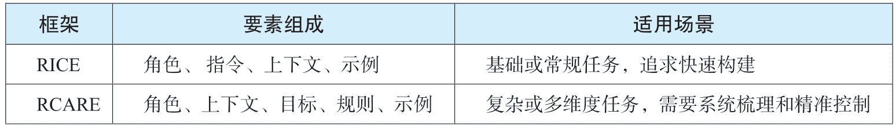

这种拆分使任务的“做什么”（目标）和“怎么做”（规则）更加清晰地分离，从而形成五个关键要素：角色、上下文、目标、规则和示例。

RCARE 并不是类似 CoT 或 ReAct 的推理框架，而是在 RICE 框架要素之上发展出来的更细化的“脚手架”或快速检查清单，帮助我们更系统地梳理复杂任务的核心需求。

以下是 RCARE 框架五要素的详细说明。

●角色：为 AI 的全部行为设定基本方向与身份，明确其输出的口吻、专业深度和思考视角。

●上下文：为 AI 提供执行任务所必需的背景信息与原始材料。所有相关的事实数据、事件经过、待处理文本等，都应在此处提供，这是帮助 AI 基于现实、避免产生幻觉的关键。

●目标：定义任务的最终目的与成功标准。它不仅告诉 AI“做什么”，还阐明“为什么做”及“做到什么程度比较好”。将一个宏观的目标分解为多个具体的子目标，可以极大帮助 AI 理解任务的优先级。

●规则：为 AI 的行为设定明确的约束和限制。所有必须遵守的规定，如内容长度、语言风格、数据来源、不得包含特定内容等，都在此处说明。

●示例：规定最终输出的具体形态。无论要求是使用 Markdown、JSON 格式，还是特定的报告结构，都需要在这里详细说明或提供输出片段作为示范。

**1.模板示例**

# 角色（Role）

你是一位［请在这里描述 AI 需要扮演的角色、身份、专业背景和能力］。

# 上下文（Context）

［请在这里提供与任务相关的背景信息、关键数据、待处理的文本或其他任何必要的信息。］

# 目标（Aim）

本次任务的核心目标是达成以下几点：

1.［具体子目标 1］

2.［具体子目标 2］

3....

# 规则（Rules）

在执行任务时，请务必遵守以下规则：

-［规则 1，例如：输出内容的总字数不得超过 800 字。］

-［规则 2，例如：所有提出的建议都必须有原文依据，并标注来源段落。］

-...

# 示例（Example）

请按照以下格式组织你的输出：

［请在这里描述期望的输出格式，或提供具体的输出片段作为示范。］

**2.如何理解和使用 RCARE 框架**

理解并有效使用 RCARE 框架的关键在于，将其全面性与灵活性相结合。它提供了相对完备的思考维度，引导你进行全方位的需求梳理。使用 RCARE 框架的推荐流程如下：

（1）快速填写初版：不必追求完美，先填写各个要素的核心想法。

（2）运行并观察：执行提示词，仔细观察 AI 的初步输出。

（3）诊断与定位：分析输出结果与预期的差距，判断产生问题的原因（如目标不清、规则缺失等）。

（4）迭代与优化：先针对性地调整和优化相关要素，然后再次运行。

（5）重复直至满意：通过步骤（2）～（4）的循环，不断逼近理想的输出结果。

RCARE 框架是写得“对”这一核心要求的最终实践工具。它将前文提到的零散要素和原则系统组织在一个结构化框架内。掌握它，我们便拥有了一套可靠的能够应对绝大多数复杂任务的提示词构建方法论。

**5.1.4** **融会贯通：从要素到框架**

RICE 核心要素、多种设计模式和 RCARE 框架，它们之间是什么关系？

厘清这一点，关键在于理解 RICE 框架的双重身份。

作为“基础框架”时，RICE（角色、指令、上下文、示例）为我们提供快速构建提示词的完整模板，特别适合结构相对简单、目标明确的基础任务。

作为“微观原则”时，RICE 中的 I、C、E（指令、上下文、示例）是一套微观质量标准，无论我们使用何种更宏观的框架（如 RCARE），都需要确保每条指令清晰，每个上下文充分，每个示例有效。

理解了 RICE 的两种身份，我们就能把握不同工具之间的层级关系。

●RICE 作为微观原则：就像建筑的“质量标准”，是构成任何高质量提示词的“DNA”。它确保我们使用的每块“积木”，无论是指令、上下文还是示例，都符合规格。

●RCARE 等宏观框架：就像建筑的“设计蓝图”。它提供结构化的方式来组织、编排基础的“积木”，以搭建功能完善的建筑，达成更复杂的任务目标。

它们的协作方式是相辅相成、缺一不可的。

（1）先用宏观框架搭骨架，运用 RCARE 的“蓝图”明确角色、目标、规则等顶层架构。

（2）再用微观原则填细节，在填充每个要素时，遵循 RICE 的 I、C、E 原则，仔细打磨细节，确保指令清晰、上下文充分、示例有效。

下面让我们来看一个嵌套应用的例子：

# 角色（Role）-对应 RCARE 中的 R

你是一名深度金融分析师，熟悉 A 股与港股双重上市公司。

# 上下文与目标（Context & Aim）-此处按 ICE 原则展开，细化 RCARE 中的 A、C、E 等要素。

-指令（Instruction）：请生成一份 400 字以内的简报。

-上下文（Context）：目标读者为基金经理，需要快速决策；已知数据见下表。

-示例（Example）：［...此处省略一个简报片段作为格式示范...］

# 格式（Format）-对应 RCARE 中的 E-期望输出格式

输出 Markdown，包含【要点概览】【风险提示】【推荐操作】三段，禁止附加解释。

通过这样的组合与嵌套，就可以构建出结构清晰、细节丰富的强大提示词。这样的提示词不仅能让 AI 给出更高质量的即时回答，还有利于将其集成到自动化工作流（比如，在 Make 平台搭建的各种应用场景）中，或者用于更严格的 A/B 测试、效果监控和持续优化。

最后需要再次强调：所有模板和框架都只是为你提供高效的起点，一把开启 AI 潜能的钥匙，而不是一套一劳永逸的僵化教条。顶尖的提示词设计师一定是深刻理解基础原理和通用模板后，根据具体任务的特性、所使用模型的性质，以及最终的业务目标和效果反馈进行持续创新、实验、调整和迭代的人。

**5.2** **质量与可信：写得“准”**

写得“对”确保 AI 能够准确理解意图，但这并不等同于其输出的内容就是事实准确的。大语言模型虽然擅长生成流畅、逻辑上看似严谨的文本，但背后却潜藏着一个难以彻底根除的技术隐忧——幻觉（Hallucination）。要让 AI 成为值得信赖的协作者，我们必须面对这项更深层次的挑战，确保其输出内容的可信度。这便是提示词工程的第二个核心要求——写得“准”。

所谓幻觉，并非指 AI 像人类一样真的产生了感官错乱，而是指模型在生成文本时，会输出一些表面上完全合理、语气笃定，实则与客观事实不符，甚至纯属虚构的信息。其表现形式包括不存在的统计数据、从未发表过的论文标题或被张冠李戴的历史事件。

幻觉现象之所以顽固，是因为其根源深植于模型从诞生到应用的整个链条之中。这既包括其底层的概率生成原理，也涵盖训练数据与评估机制中潜藏的缺陷，甚至与用户设计提示词的方式息息相关。例如，当前主流的评估机制存在“激励陷阱”：在以准确率为主要衡量标准的评估体系下，模型被激励去“猜测”，而非承认“我不知道”。同时，幻觉也源于预训练的本质“模式拟合”而非“事实核查”，模型极其擅长学习具有强规律性的语言模式，却难以可靠地记忆海量任意、无模式可循的低频事实。

这种现象严重削弱了 AI 输出的可靠性。设想在医疗场景中，AI 因幻觉给出错误的病理分析；在金融场景中，基于虚构数据做出错误的风险评估；或在法律场景中，将不存在的条款引入合同，这些失误都可能造成无法挽回的损失。因此，在实现写得“对”之后，我们必须进一步追求写得“准”，让模型的回答经得起推敲。

面对这一挑战，我们总结出三种行之有效的核心治理原则，称之为“降幻三板斧”。

（1）反思校对：让 AI 自我审查和修正其输出内容，识别潜在错误。

（2）引用锚定：要求 AI 为其生成的关键信息标注来源，建立可追溯性。

（3）外部资料输入（手动 RAG）：在生成结果前，为 AI 提供可靠、相关的外部事实依据。

这三种策略互为补充，为 AI 的输出建立了一道稳固的“可信度防线”。

在 MAPS 四维罗盘中，写得“准”标志着提示词维度的又一次升级：此时提示词不再只是传达命令的工具，而成为校准 AI 行为、约束输出质量的精密仪器。只有将可靠性纳入提示词工程的核心考量，我们才能为下一步，即在系统维度中构建可落地的自动化系统奠定坚实的基础。

**5.2.1** **幻觉的深层机理**

要有效治理幻觉，必须先追根溯源，理解这些“自信的谎言”是如何产生的。

**1.概率本质：追求“语言的连贯性”而非“事实的可靠性”**

理解大语言模型产生幻觉的第一个关键在于，其最核心的运作机制：无论这些模型展现出多么令人惊叹的语言能力，其底层仍是一种高度复杂的条件概率预测系统。在接收到用户输入后，模型的核心任务是在已有文本序列条件下，计算并预测下一个最可能出现的 Token。

模型通过在海量的文本资料上进行训练，学习人类语言的结构和词汇间的关联，从而具备这种预测能力。

例如，假如我们给出“今天的天气很……”这个开头，接下来填入哪些词才能使句子完整？“热”或“好”都是合理的说法，但“香”就明显不合逻辑。经过训练的模型，在面对“今天的天气很……”这段上下文时，会为下一个词生成一个候选列表及各自出现的概率。例如，它可能判断“好”出现的概率最高（80%），“热”次之（15%），“冷”较低（5%）。

模型并非总是机械地选择概率最高的 Token，这取决于对“温度”（Temperature）参数的设置。较低的温度会使模型趋向于保守，只挑选概率最高的选项；较高的温度则会增加模型选词的随机性，让一些原本概率较低的 Token 也有机会被选中。模型会依据统计概率或特定的采样策略选出 Token，并将其接到序列末尾，然后基于更新后的上下文再次预测下一个 Token，如此循环往复，直至生成一段完整的文本。

这种基于概率的逐词生成机制，解释了为何模型极少犯下语法或拼写类的模式性错误，却频频在事实性问题上出错的原因。模型的预训练过程使其极其擅长学习和复现具有强规律性的模式，正如在图像识别中，模型可以通过学习数百万张标注为“猫”或“狗”的图片，可靠地掌握两者在视觉特征上的模式。

然而，对于任意、无模式可循的低频事实，情况则完全不同。这就像让模型去记忆每只宠物的生日，由于生日是随机的，模型无法从中学习到任何可预测的模式，只能靠“死记硬背”。一旦记忆模糊或数据缺失，它便只能“编造”一个看似合理的日期。模型对事实的掌握也是如此：具体的论文标题、人物的出生日期、不存在的统计数据，都属于这类“任意事实”。

因此，当模型在其训练数据中找不到当前问题的确切答案时，它并不会输出“我不知道”。相反，为了维持语句在表层结构上的连贯性——这正是它首要优化的任务——模型会倾向于选择能使整句话在统计上显得最自然的 Token 组合。这种对“语言形式完美”的极致追求，便会以牺牲“内容事实准确”为代价，成为幻觉产生最底层、最根本的“基因”。

**2.数据与评估：潜藏在源头的“裂纹”与“陷阱”**

大语言模型之所以展现出“博古通今”“无所不谈”的表象，完全依赖于其在预训练阶段消化的大规模文本语料。形象地说，这就像模型试图将整个数字世界的知识图景“压缩编码”进由数十亿乃至数万亿个参数构成的复杂神经网络中。然而，这幅原始的数据图景并非完美无瑕、晶莹剔透的水晶球，而是天然充满各种裂纹、瑕疵与暗角，这成为幻觉产生的又一重要源头。

1）训练数据的三大局限

●知识盲区与覆盖不均：尽管模型的训练数据规模空前庞大，但相对于人类知识的浩瀚海洋，它仍只是一个有限的子集。对于某些特定、相对冷门的专业领域、地域文化和历史时期，或新兴起但尚未在公开文本中充分记录的知识，高质量的相关语料可能本就极其稀缺。当模型被问及其“知识盲区”时，由于缺少足够的学习素材作为支撑，它只能依据从其他相似文本模式中学到的“经验”进行推断，这在信息严重不足的情况下极易产生事实扭曲或细节编造。

●时间滞后性与知识“保质期”：训练大语言模型极其耗费算力和时间，不可能做到内部知识的实时更新。因此，任何已发布的主流大语言模型，其知识库都有明确的“知识截止日期”（Knowledge Cutoff Date）。对于其之后发生的全球重大事件、科技新突破乃至特定领域知识体系的演进，模型在“出厂”时是一无所知的——对它们而言，这些内容是尚未探索的“未来空白”。当被问及这些“最近发生”的事情时，模型要么坦陈局限，要么可能基于旧有知识模式进行不准确的揣测，甚至直接“幻想”出错误答案。

●信息来源杂糅与质量参差：互联网作为最主要的语料来源，所包含的信息本身就良莠并存。其中既有经过严格编辑和同行评审的学术论文、权威机构发布的报告、专业媒体撰写的深度报道等高质量信息，也充斥着大量未经证实的谣言、主观臆测、带有偏见的内容，甚至是为了搜索引擎优化（SEO）而大量堆砌关键词、逻辑混乱的“灌水内容”。模型在进行大规模无监督学习时，难以有效甄别信息质量，倾向于将它们一概吸收。在这些“信息杂质”被内化为其知识结构的一部分后，就可能在后续生成中被重新输出，直接导致幻觉。

2）评估机制的“激励陷阱”

“激励陷阱”源于评估体系的设计逻辑：当模型主要依据“准确率”（答对问题的百分比）进行评分时，“我不知道”的回答会得到零分，而一次成功的猜测却能提升其在排行榜上的表现。这就像一场多项选择测试，考生在不确定时选择留白必然得零分，而随意猜测则有一定的概率得分，因此理性的应考策略自然是“勇于猜测”。

为了在基准测试中获得更高的分数，开发者会倾向于构建更愿意“勇于猜测”的模型。其直接后果是，模型的准确率看似略有提升，但错误率（幻觉的比例）却大幅增加，那些本应回答“我不知道”的问题，现在变成错误的臆测。因此，这种评估体系本身就成为幻觉产生的重要催化剂。

**3.提示词设计：无意中拓宽的“自由发挥”空间**

除了模型自身的概率机制和数据质量缺陷，幻觉的产生还有一个常被忽视的源头：用户提示词的设计。大语言模型的行为受用户输入提示词的直接引导与约束。精心设计、清晰明确的提示词可以有效将模型注意力聚焦于特定任务上，并规范其输出格式和风格。然而，在实际交互中，用户常常低估清晰表达需求的难度，或高估模型对真实意图的理解能力。一些看似无关紧要的提问习惯或提示词设计上的疏忽，可能在无意中为幻觉的产生提供了条件。

1）模糊指令与隐含假设

很多时候，我们自认为清晰的指令在模型看来可能仍充满不确定性。例如，一个看似简单的指令“请写一段关于 XX 产品新功能的介绍”，就可能在多个维度上存在解读空间。

●目标受众：是技术专家、普通消费者，还是潜在投资人？不同受众对信息深度、专业术语、语言风格等有不同的要求。

●核心目的：是纯粹的信息告知，还是旨在营销推广、激发购买欲望？

●篇幅要求：是一两百字的简介，还是上千字的长文？

●描述侧重：是新功能的技术原理和用户价值，还是与竞品的差异化优势？

●语气风格：是正式严谨，还是活泼有趣？

当这些关键约束条件未在提示词中明确时，模型获得极大的自由裁量权。为了填充缺失的细节，尤其是在其知识库缺乏相关准确信息的情况下，模型极有可能切换到自由发挥模式，调动其语言组织和模式联想能力，生成看似内容丰满、实则偏离用户真实需求，甚至夹杂虚构细节的文本。如果提示词缺乏清晰、具体的约束，无形中就为模型提供了“自由发挥”乃至不准确创造的巨大空间。

下面这个看似简单甚至有些戏谑的例子，能够生动地说明用户提示词中的模糊性是如何将 AI 引入“歧途”的。

我曾进行过一个广受欢迎的测试：向市面上几乎所有主流的 AI 大语言模型，包括 OpenAI 的 GPT 系列、Anthropic 的 Claude 系列、DeepSeek 的 V3 和 R1，以及其他顶尖科技公司的模型，提出同一个问题：“9.11 和 9.8 谁大？”

结果可能会让你大吃一惊。在第一轮测试中，除了推理模型能给出正确答案，绝大多数国际顶尖的通用模型都“答错”了，一致认为“9.11 更大”。

难道这些耗资巨大的模型连小学水平的数学题都不过关？

先别急着下结论。在第二轮测试中，我将问题修改得更明确：“请对比两个小数 9.11 和 9.8，谁更大？”

奇妙的事情发生了。这一次，几乎所有在第一轮中答错的模型都给出了完全正确的答案：“9.8 更大”。

这背后到底发生了什么？

原因在于，AI 在“思考”时，其首要任务是理解提问的意图。当我们用“9.11 和 9.8 谁大”这样高度口语化、缺乏明确上下文的句子提问时，AI 并不会默认我们一定在进行严格的数学比较。它会基于庞大的训练数据，“猜测”我们最有可能指代的是什么。

在这种情况下，“9.11”组合在全球文本语料库中具有极其强烈、压倒性的语义指向：作为特定日期，它关联着一个具有重大历史意义的事件。模型从海量数据中学习到的是，“9.11”这个符号的“重要性”或“权重”远大于“9.8”。同时，在软件开发等领域中，“9.11”也常被理解为软件版本号，根据版本号比较规则，9.11 版本自然高于 9.8 版本。

当 AI 面对模糊问题时，它会优先选择最常见、语义最强或模式最普遍的路径去解读。它并非不懂 9.8>9.11 的数学事实，而是在没有明确指示的情况下，它“猜测”我们大概率不是在问一道数学题。

这个例子给了我们一个深刻的启示：当你觉得 AI“答非所问”时，需要反思的不是模型的能力，而是我们提问的水平。我们的问题本身是否有歧义？是否为 AI 提供了足够的上下文来框定其思考方向？

提示词工程的精髓，并非在于学习多少复杂的框架或技巧，而在于锤炼一种清晰表达的能力。只有当你将脑海中精确、无歧义的需求转化为模型能理解的结构化指令时，AI 才能真正成为你手中的工具。

2）角色扮演提示的“双刃剑”效应

角色扮演提示是一种有效的高级技巧。通过在提示词中明确要求模型扮演的特定角色（例如，“请扮演一位具有三十年临床经验的心血管内科医生”或“假设你是诺贝尔经济学奖得主，擅长用通俗语言解释复杂经济现象”等），可以引导模型调整语言风格、术语使用、知识侧重和思考角度，使输出更符合特定的场景需求。然而，这种技巧若使用不当，反而可能放大幻觉风险。

第一种风险来自过度夸张或不切实际的角色设定。如果将模型的人设夸张到超出其真实的能力范围（例如，要求扮演“无所不知的宇宙先知”“能洞察人心的一流心理大师”或“可预测未来股市走向的投资奇才”等），那么模型为努力“演好”被神化的角色，在面对知识储备不足或无法准确回答的问题时，就更倾向于编造答案，而非坦诚承认局限。这种为“维持人设”而出现的表演型幻觉通常更具迷惑性，因为此时模型输出的口吻和细节都符合权威角色形象，更容易取信于人。

第二种风险来自角色与任务的不匹配或冲突。如果设定的角色与当前任务的关联不大，或角色的某些特点与任务要求冲突，那么模型在输出中可能会受到角色设定的干扰，如偏离主题、插入不相干的“角色扮演”式内容，甚至为了符合角色说话风格而牺牲内容的准确性。

尽管明确的指令和恰当的角色设定是提升提示效果的关键，但我们也必须认识到，用户自身的表达习惯和对模型能力的预期，同样是影响最终输出质量与可信度的重要变量。幻觉的产生，既有模型底层机制的原因，也与我们如何设计和使用提示词密切相关。只有当我们在提示词中提供足够清晰的约束、合理的角色定位，并保持对模型能力边界的清醒认知时，才能最大限度地降低幻觉的发生概率。

**4.生成过程与表达：随机性催化与“自信口吻”包装**

在探讨了幻觉产生的底层机制、数据源头缺陷和提示词设计问题后，我们还需要关注一个常被忽视的环节：文本生成过程本身的随机性及模型输出时的表达方式，如何共同催化并包装幻觉。

（1）采样策略与输出长度：从“创造力火花”到“滚雪球式误差”。

大语言模型在生成文本时，并非总是机械地选取概率最高的下一个 Token。为增加输出多样性、避免内容单调重复，实际应用中通常会采用随机采样（Random Sampling）策略，其中最常被提及并允许用户调整的参数是“温度”。

**●温度参数的“调味”作用**

温度参数就像一个平衡旋钮，一端是确定性，另一端是随机性。

当温度设置较低（如接近 0）时，模型倾向于选取概率最高的选项，行为近似确定性的“贪婪”搜索。此时输出更集中、保守、可预测，更可能忠实于训练数据中最常见的模式。这种设置适用于对准确性和一致性要求较高的任务，如事实性问答、代码生成或严格遵循特定格式的文本转换等。

当温度设置较高（如 0.7、0.9 或更高，但一般不超过 2）时，模型会均衡考虑各种概率选项，使一些虽非最可能但也合理的 Token 有机会被选中。这就引入更大的随机性，使输出更具多样性和新颖性，甚至可能产生出人意料的灵感火花。这种设置非常适合创意任务，如故事创作、诗歌生成或头脑风暴等。

但提高“创造力”往往伴随着“事实性”下降的风险。温度越高，模型越可能偏离最符合统计规律（通常也最贴近事实依据）的表达路径，更容易产生不准确甚至完全错误的陈述。在需要严谨求实的场景下，过高的温度是诱发幻觉的重要因素。

**●输出长度与误差的累积效应**

当要求 AI 生成篇幅较长的文本（如完整的分析报告、详细的项目计划或多章节的故事梗概等）时，即使模型在开头几段能保持较高准确性，随着生成序列不断延伸，其潜在失真风险也会逐步增加。

大语言模型的文本生成是一个逐词的序列决策过程。每预测一个 Token，都可能因对上下文理解的细微偏差、采样策略的随机扰动，或模型内部表征的轻微“抖动”等因素，导致细小的语义偏差或事实性错误。

在短文本中，这些微小偏差可能不明显，或容易被后续生成纠正。但在长达数百甚至上千 Token 的长文本中，最初不起眼的“小错误”或“小偏离”会像滚雪球一样累积、放大并传播。同时，为维持长文本在结构上的完整性和表面语义上的连贯性，模型还可能在后续段落中不自觉地对前面的细微偏差进行“合理化”甚至“强化”，导致最终输出的内容与最初提示的意图、核心事实依据或上下文约束之间产生越来越明显的偏差。

这种现象还表现为：模型在长篇输出的中途引入某个错误的事实或逻辑断点后，为使后续论述自圆其说，可能进一步编造更多“配套谎言”来支撑前面的错误，从而陷入“越描越黑”的幻觉循环。学术界将这种在长序列生成中由误差逐步累积导致内容质量下降的现象称为“语义漂移”（Semantic Drift）。

（2）“自信口吻”的迷惑性：流畅表达对幻觉的致命包装。

更值得警惕的是，当大语言模型产生幻觉、输出错误乃至荒谬的信息时，其语气往往显得异常自信、流畅且不容置疑。

模型很少会像谨慎的人类专家那样，在不确定的领域或对依据不足的结论加以保留，使用诸如“根据目前掌握的信息，可能……”“我不太确定，但……”或“以下结论仅供参考，尚需进一步核实”这类委婉提示。相反，即便模型内部对某个生成内容的真实性并无十足把握，它在表达上依然可能掩饰这种不确定性，只为追求整体回答的流畅、权威，以及良好的“用户体验”。

这种现象的产生源于多方面因素的共同作用。

**流畅性掩盖瑕疵：**模型训练的核心目标之一是使输出文本读起来连贯、自然、语法正确，在风格上尽量接近人类的高质量写作。这种对“表达之美”的极致追求，使得模型即使在输出不实信息时，语言组织依然可能非常出色，表面逻辑也看似完整。这种流畅表达很容易让缺乏警惕或专业辨别能力的用户忽略内容中存在的错误。

**模型习得“确信”腔调：**在模型学习的海量人类文本中，有相当一部分（如公开演讲稿、商业广告文案、评论社论，甚至部分学术论文的论证段落）本身就倾向于使用肯定、果断的语气来增强说服力。模型在学习这些语言模式时，可能也间接习得并内化这样一种规律：自信的表达更容易获得认可和信任。这种自信笃定的语气很可能成为模型输出时的一种默认行为。

**人脑的认知偏差：**从认知心理学角度看，人类在接受信息时往往更容易被表述流畅、语气坚定、自信满满的陈述打动，而对措辞犹豫、语气不确定的说法则天生抱有怀疑。这种认知偏差使我们在面对 AI 给出的“流畅、自信的谎言”时，容易不自觉地放下戒心，心想“它说得这么有板有眼，听起来头头是道，应该是真的吧”。模型以自信口吻营造出的这种“修辞滤镜”，让幻觉内容在用户阅读体验中显得格外有说服力，也更难以察觉。

（3）生成与表达环节的双重放大。

采样策略的随机性和输出长度的误差累积，从技术层面催化了幻觉的产生；而自信流畅的表达方式，则从心理层面包装并放大了幻觉的迷惑性。两者相互叠加，构成幻觉现象中最难防范的“致命组合”：一方面，技术机制为错误的产生提供温床；另一方面，表达方式又为这些错误披上令人信服的外衣。理解这一点，对于我们系统治理幻觉至关重要。

**5.失真链条：逐级放大的幻觉机制**

AI 产生幻觉并最终误导用户的过程，可以理解为由多个相互关联、逐级累积的环节构成的一条“失真链条”。

（1）源头：概率驱动的运行机制。模型的核心任务是预测“下一个最可能的词”，而非“下一个最真实的词”。这是幻觉产生最底层、最根本的“基因”。

（2）输入：数据缺陷与评估偏差。训练数据的知识盲区、时间滞后和信息杂质，加上评估机制对“猜测”的系统性激励，共同为幻觉的产生提供了土壤。

（3）催化：提示词的无意歧义。用户在提示词中未能提供足够清晰、具体、全面的约束，或进行了不恰当的角色设定，都可能给模型留下过大的自由发挥空间，诱使其偏离事实轨道。

（4）过程：采样策略的随机扰动。温度等采样参数在引入创造性的同时，也增加了模型输出偏离最可靠答案的风险。在长文本生成中，这种随机性可能导致误差逐步累积，形成“语义漂移”。

（5）表达：与生俱来的自信口吻。模型倾向于用流畅、肯定且不容置疑的语气包装输出。这种自信的表达掩盖了内容中可能存在的瑕疵，使用户在不知不觉中降低警惕，更倾向于相信这些“幻觉”。

这条“失真链条”上的任一环节出现问题（如训练数据质量不高、用户提示含糊不清、采样温度设置不当等），其产生的负面影响都可能在随后的环节中被进一步放大和传递，最终导致与事实严重不符且高度迷惑人的“幻觉”输出。

理解“失真链条”的组成及运作机制，是掌握有效治理策略的前提。有效“降幻”的核心思路是针对这条链条上的不同薄弱环节精准布防：在信息输入源头做好设防，在模型生成过程中设置纠偏机制，在最终输出环节建立审慎的“人工检验关卡”。

**5.2.2** **“降幻三板斧”：三大核心原则**

要系统性地提升 AI 输出的事实准确性，关键在于建立一套具有针对性的治理原则体系。业界的实践表明，有效控制幻觉不能依赖单一的“万能药”，需要在信息输入、生成过程和输出验证三个关键节点上同时设防。

对应这三个节点，本书总结出三条核心治理原则：反思校对、引用锚定和外部资料输入。这三条原则针对失真链条的不同环节协同发力：反思校对让模型在输出前主动识别和标注不确定性；引用锚定为每一个关键断言建立可追溯性；外部资料输入则从源头提供可靠材料，降低模型猜测空间。它们共同构成一道系统性的可信度防线。

**1.原则一：反思校对**

在人类的工作流程中，自我审视是提升内容质量的关键环节。完成文稿后，重读往往能发现之前未注意到的逻辑漏洞或事实错误。这种自我反思机制对提升内容质量至关重要。

大语言模型同样可被引导进行类似的强制反思。这并非噱头，而是模型在没有外部监督的情况下，少数几种能够主动“踩刹车”、进行自我纠错的机制之一。研究表明，强制反思机制（如通过链式思考与批判性提示，或多轮自我检验机制如 Reflexion 框架）能有效促使模型审视和改进其答案。

实践中的引导方法十分直接。只需在主要指令之前插入类似提示：“在你给出正式回答之前，请先用不超过 120 字的篇幅，评估一下你对这个话题的掌握程度，并给出你判断的可信度（高/中/低），同时指出回答这个问题的主要潜在风险点。”

这种简单的“自我陈述”，往往能成为识别潜在错误的“金丝雀”。模型在自我评估时可能会坦白：

●我对该主题的掌握程度为“中等”，因为训练数据截止于 2023 年，可能无法覆盖最新进展。

●可信度为“低”，主要风险点在于缺乏直接相关、经过验证的信源作为参考。

●回答此问题的主要风险在于，相关概念在不同学科中存在多种解读，我的回答可能无法完全覆盖所有语境。

以查询最新版 EU AI Act 的生效日期和过渡期为例，设计如下提示词：

最新版 EU AI Act 的生效日期和过渡期多长？在你给出正式回答之前，请先用不超过 120 字的篇幅，评估一下你对这个话题的掌握程度，并给出你判断的可信度（高/中/低），同时指出你认为回答这个问题的主要潜在风险点。

AI 的回答如图 5-6 所示，其中，明确标识了“可信度：中”。

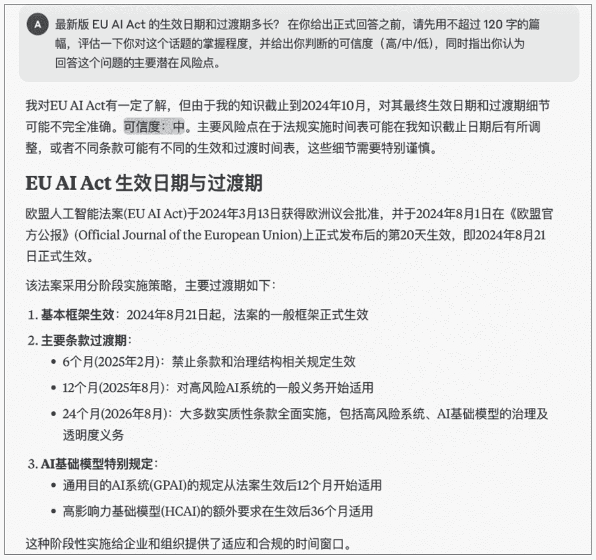

图 5-6

这些可信度信号非常有价值，如同 AI 给自己贴上的风险标签，提醒用户对后续回答进行更严格的审视和交叉验证。研究表明，“思维链+自检”的提示能让模型更准确地识别自身局限。

**2.原则二：引用锚定**

透明度是信任的基石。引用锚定原则要求 AI 在其回答中明确指出结论或观点的原始信息来源。

这一原则直击模型产生幻觉的核心机制。AI 产生幻觉并非有意欺骗，而是其概率预测机制在缺乏足够信息或上下文约束时，倾向于创造出看似合理的答案。要求 AI 交代证据，实际上是在迫使模型检视内部知识库，寻找能够“摆到台面上”、可供验证的理由，从而压缩模型产生幻觉的空间。

实践中可以通过两种方式落实该原则：

●显式证据格式：在提示词中明确要求 AI 标注断言的来源，如“请在每条关键信息或断言后，使用【来源|段落号】的格式标注出处。如果无法从提供的资料中找到确切依据，请回复‘暂无依据’。”这种格式化的要求不仅让 AI 的回答更易于溯源，还提升了后续事实核查的效率。

●引用分级：针对不同类型的问题设定不同的引用标准。事实类问题（如“某项技术指标的具体数值是多少？”等），要求标注相关文献、报告或官方数据来源；观点类讨论（如“如何评价某项政策的影响？”等），要求标注引述观点的代表性来源，比如某位学者的核心论述，或某篇权威评论文章的关键论点；对确实未知或存在争议的内容，则应明确标注为“争议”或“多方观点并存，尚无定论”。这种分级处理有利于更清晰地辨别信息的可信度和适用范围。

以一位在跨国公司负责合规事务的经理需要快速了解《欧盟人工智能法案》最新草案中关于处罚条款的细则为例。如果她直接问 AI：“这个法案的罚款有多高？”模型可能会给出模糊的范围性答案，比如“根据不同情况，罚款可能在公司全球年营收的 6%到 10%之间浮动。”这个答案虽然大致方向没错，但对于需要精确信息的合规经理来说，显然不够准确。

如果在提示词中加入“请附上具体的条文编号作为依据”，AI 会主动检索相关法律文本，给出更精确的答复：“根据《欧盟人工智能法案》草案第 X 条规定，针对严重违规行为，最高罚款可达公司全球年营收的 7%；草案第 Y 条进一步规定，对于屡次违规或情节特别恶劣的情况，罚款上限可提高至 10%。”

仅仅增加“请附上具体的条文编号作为依据”的要求，就让 AI 的回答从“大概如此”变成“有据可查”。引用锚定将 AI 的回答与可验证的外部信息进行关联，显著提升了输出的准确性和可靠性。

**3.原则三：外部资料输入**

外部资料输入（或称轻量级 RAG）的本质是将 AI 的工作模式从闭卷考试变为开卷考试。不再强求模型仅凭记忆作答，而是主动为其提供相关高质量的参考资料，让它在这些资料的指引下进行回答。

这种做法有如下两方面的优势。

●任务降维：将模型任务从复杂的概率预测（基于庞大但可能模糊的内部知识进行猜测）降维为更简单的阅读理解（在给定的文本范围内查找和组织信息），大大降低因模型自由发挥导致出错的可能性。

●责任转移：将事实核查的责任部分转移。内容提供者需要预先筛选准确的外部资料（责任前置），最终质检者可以基于模型明确引用的原文进行高效核对（责任后置）。这种人机协作模式更符合系统设计的要求。

目前，在控制 AI 幻觉、提升答案准确性方面，这种方法是性价比最高、最直接有效的手段之一。具体操作包括三个关键步骤。

●精准筛选资料：只提供与当前问题直接相关的文本段落，避免大量无关信息的干扰。同时，控制资料容量，其通常不超过模型单次输入上下文长度的 30%，为模型保留足够的思考空间。

●明确界定：使用清晰的分隔符（如---引用资料开始---和---引用资料结束---，或 XML 标签）将外部资料包裹起来，并在指令中明确要求：“输出必须严格依据分隔符内提供的资料，不得引用外部信息或自身背景知识。”这种原文锁定策略能显著提升输出的语义一致性和可追溯性。

●锁定格式：要求模型回答时尽量引用提供资料中的原文关键词或关键短语，这既能让回答更贴近原文，又方便后续人工核对，快速定位输出在原始资料中的位置。

以图书编辑场景为例：在将 50 页的采访录音稿整理成人物口述实录时，直接将全部文本交给 AI 的效果往往不理想。我们可以遵从外部资料输入原则，将采访稿按主题或时间顺序拆分成 5 个相对独立的小段落（每段控制在 8000 Token 以内），逐一提供给 AI 处理，并明确指示：“请根据以下提供的采访片段，将其改写成第一人称口述风格的文字稿。注意保持原文的核心信息和语气，不得添加除资料之外的内容。”

结果，AI 在处理这些切分好、有明确边界的小任务时表现出色，最终形成的口述稿几乎未出现事实性幻觉，编辑的后期校对工作主要集中在核对专有名词的准确性上，工作效率大大提升。

这个案例体现了外部资料输入原则的精髓：通过拆解复杂任务，并为 AI 提供精准、可控的参考资料，可以有效引导 AI 在设定框架内进行高质量的文本生成。

反思校对、引用锚定和外部资料输入三项原则相互补充，共同构成一套完整的治理体系。

**5.2.3** **“降幻三板斧”：整合落地手册**

在理解了反思校对、引用锚定和外部资料输入三项核心原则后，我们面临一个新的实际问题：如何将这些原则转化为可以立即上手、融入日常工作的具体操作？

本节旨在将三项原则整合为一套完整的“降幻三板斧”实战手册，提供可直接复用的提示词模板、操作流程和工作范式。“降幻三板斧”并非高深莫测的算法调优，而是经过实践检验、行之有效的对话策略与流程改造技巧，旨在帮助你将 AI 从偶尔不可靠的创意伙伴，转变为言之有物、值得信赖的数字助手。

**1.第一斧：反思校对——让 AI 先自省**

第一斧的核心是将反思校对原则固化为可执行的动作。我们不再满足于 AI 给出的第一版答案，而是通过追加简单的指令，在 AI 面前放置一面“镜子”，促使其在输出前进行一次内部审查。

实践表明，这种自查往往能暴露 AI 潜在的不确定之处。例如，它可能会坦言“相关数据可能已过时”或“此结论基于间接推断”。对于对事实准确性要求极高的内容（如临床文书、财报摘要的初步处理等），这种方法能有效减少因想当然而导致的低级错误。

这种引导 AI 进行自我审视的策略，体现了使用者心智（M）的主动升级：我们不再被动接受 AI 的初始输出，而是以批判性和成长性思维主动设计交互流程。这也促使我们进一步打磨提示词（P），并思考如何将校验机制更系统地融入工作流，即系统（S）的构建。

**反思校对要点：**

先自评，再说事；风险点，列清楚；可信度，打个分。

**提示模板片段：**

请首先进行自我评估（120 字以内）：你对回答该问题的知识掌握程度如何？主要的潜在风险是什么？对此回答的整体可信度评级（高/中/低）？

**适用场景：**复杂分析、长文本摘要或任何需要高度准确性的任务前。

**2.第二斧：引用锚定——要求 AI 交代证据**

第二斧旨在系统性解决“数据从哪儿来”的问题，将引用锚定原则融入工作流。它要求 AI 在生成内容的过程中为每一个关键论断或核心信息明确标注出处，就像学术论文般严谨。

例如，小李在撰写市场行业跟踪报告时，将流程固化如下。

（1）梳理资料：从公司内网、行业数据库或指定研究报告中筛选核心数据和观点。

（2）设计提示：将资料片段作为背景信息提供给 AI，并明确要求“在报告中，凡是引用到我所提供资料的地方，请在句末以【《报告名称》|页码或章节号】的格式清晰标注。”

（3）结果：报告初稿的关键信息点后均附有来源，领导的审阅时间从数小时缩短至几十分钟。

此案例展示了引用锚定的实际效果。通过精确的提示词（P）设计，规范了 AI 的输出行为，体现了求真务实的心智（M）。当这套模板被固化并应用于日常工作时，便从一次性技巧升级为可持续的系统（S），系统性地保障了输出的可靠性。

**引用锚定的要点：**

格式规范：预设清晰的引用格式，如【来源|文档 ID|段落号】或（见：附件报告三，第 5 页）。

**限定范围：**在提示中强调“仅能引用提供的资料，若无相关信息，请注明‘暂无直接依据’”。

**提示词示例：**

### 任务 & 角色

你是一位**商业分析助理**。请完成下列任务，使用**中文**输出。

### 背景

你将接收到两份资料，分别是 report_A.pdf 和 data_sheet_B.xlsx。这些资料涵盖了某行业的市场数据与趋势分析。

### 目标

1.基于提供的资料撰写一份结构清晰的市场分析报告。

2.在报告中适当引用数据来源，标明具体文件和页码/章节。

3.对缺失信息的说明要清晰，避免猜测或捏造内容。

### 约束 & 规则（含通用要求）

-所有引用必须标注格式：【｛source_document_name｝|｛page_or_section｝】

-如所需信息未出现在资料中，请明确说明：“根据所提供的资料，此部分信息暂缺。”

-保持语气专业，逻辑清晰，适合商业决策阅读。

### 输出格式

-使用 Markdown 撰写全文

-建议结构：

-# 摘要

-## 市场趋势

-## 竞争格局

-## 数据分析

-## 结论与建议

### 示例输出（缩略版）

# 摘要

本报告基于 report_A.pdf 和 data_sheet_B.xlsx 两份资料，梳理当前行业动态及未来趋势。

## 市场趋势

根据【report_A.pdf|第 3 页】显示……

## 数据分析

对比《data_sheet_B.xlsx》中的季度数据可知……

## 结论与建议

建议重点关注增长率变化，并持续监测以下关键指标……

**3.第三斧：外部资料输入（手动 RAG）——给 AI 提供可靠资料**

第三斧聚焦于外部资料输入原则的落地。当 AI 的内置知识过时或在某些专业领域存在空白时，最直接有效的方法是为其提供一份“开卷考试的小抄”。在业界，这种做法被称为检索增强生成（Retrieval-Augmented Generation，RAG）。这里介绍的是其轻量化版本——无须构建复杂的向量数据库，只需手动筛选并提供相关资料，因此称为“手动 RAG”。

我们无须一开始就构建复杂的向量数据库系统（尽管企业级大规模应用可能最终需要）。在处理具有高度时效性（如分析最新财报、解读刚颁布的政策等）或涉及私有、未公开信息（如企业内部文档、客户访谈记录等）的任务时，可以采用更直接的方式，为 AI 提供经过筛选的背景资料。具体操作分为三个关键步骤：

●精准输入：从最新报告、内部文档或几篇核心文章中提取与当前问题最直接相关的段落或数据。

●明确边界：在提示词中使用清晰的分隔符（例如，---以下是背景资料---和---背景资料结束---）包裹这些内容。

●锁定信源：明确指示 AI，“你的回答必须严格依据我在此提供的背景资料，不得依赖之前的训练数据或进行额外的网络搜索。如果资料中未提及，请直接说明。”

这样，AI 就从闭卷猜测模式切换至开卷参考模式。其任务就是在指定的有限信息范围内进行阅读、理解和整合。这种方法在处理内部知识库问答、生成基于特定会议纪要的摘要，或撰写依赖最新市场数据的分析时，效果显著。

例如，利用 AI 模型强大的长上下文处理能力，可一次性输入大量参考资料，确保 AI 的回答紧扣最新、最准确的信息。从主流中文模型在 2025 年第一季度的价格区间来看，处理数千字文档的 API 调用成本通常是可控的，对于个人或小团队的轻量级 RAG 应用具备较高的性价比。

这种策略源于我们对 AI 知识局限性的清醒认知，体现了心智（M）升级，而主动采取系统性改良措施则是系统（S）构建。通过在提示词（P）中嵌入精准筛选的外部信息，我们为 AI 构建了更可靠的知识获取与应用流程。

手动 RAG 的要点：

●分隔符标准：使用醒目且不易与正文混淆的分隔符，如---正文开始---和---正文结束---。

●指令核心：请仅基于以下“正文开始”和“正文结束”之间的文本回答，不要使用任何其他信息。

●API 使用：若使用 API 调用，则需要留意服务商是否提供上下文缓存（Context Caching）功能，以便在重复使用长篇背景资料的场景时节省成本和提高效率。

●工具选择：对于少量、一次性的外部资料，直接在聊天界面操作即可；对于更频繁或结构化的需求，可以考虑使用知识管理或在线协作平台来管理资料包和对应的提示词模板。

**“三斧”合璧，构建可信度闭环**

反思校对让 AI 内省，引用锚定让言论有据，手动 RAG 让知识常新。“降幻三板斧”虽各有侧重，却共同构成一道从 AI 思考到内容输出的“防幻”闭环。

它们表面上是三种独立的对话技巧，本质上却是我们作为系统设计者主动构建的个人内容准确性保障系统。它们分别对应 MAPS 的不同维度：反思校对体现心智（M），引用锚定运用提示词（P），手动 RAG 是心智、提示词与系统的综合运用。

当你将“降幻三板斧”熟练运用于日常工作时，会发现 AI 的幻觉减少了，还似乎更懂规矩了：它会更倾向于在有充分把握时才下结论，在信息不足时主动声明局限。这正是我们追求的高效、可靠的人机协作状态。

**5.3** **成本与稳定：写得“稳”**

我们已为 AI 建立了准确性保障机制，提升了其输出内容的可信度，这无疑是高效协作的基石。然而，仅仅让 AI 说对话，距离将其打造为日常工作中得力且可持续的伙伴，还有一段路要走。

想象一下，即便我们拥有一位才华横溢的数字顾问，但每次向它咨询都需要支付高昂的费用，或者它的表现时而给出精妙绝伦的答案，时而又让人摸不着头脑，我们也难以长期依赖它。

与 AI 的协作，需要细水长流、精耕细作。单纯追求某一刻的惊艳表现，远不如追求长期的经济实用与结果可预期来得重要。否则，再强大的 AI 也可能因为其高昂的费用让预算捉襟见肘，或因其输出结果的不稳定而耗尽用户的耐心，最终难逃被弃用的命运。

要解决这一问题，需要聚焦于两个务实的关键议题：第一，如何精确地控制 Token 成本，确保每一分钱都花得明白、有效；第二，如何让 AI 的输出保持稳定，避免飘忽不定、难以掌控。这两个问题的本质恰好对应 MAPS 中的提示词（P）与系统（S）两个关键维度。精细化的提示工程能够提升投入的经济性，而完善的系统则能带来输出的稳定性。只有同时解决经济与稳定这两个核心问题，AI 才能真正可靠且可持续地融入我们的工作与生活。

**5.3.1** **Token 与成本真相**

要控制成本，首先需要理解 AI 服务的核心计量单位：Token，它是成本的直接来源。

许多用户在初次调用 AI 模型的 API 服务时，往往会经历从兴奋到对账单感到困惑甚至震惊的过程。这并非因为 AI 服务本身存在陷阱，而是因为我们对其成本构成和核心计量单位缺乏足够了解。要真正让 AI 为我们所用，并且用得起、用得好，就必须先揭开 AI 服务成本的神秘面纱，深入理解 Token 这一核心概念。

Token 可以理解为 AI 模型在阅读、理解和生成文本时所使用的最小计量单位或基本构建模块。无论是输入的提示词，还是 AI 生成的回答，模型都会将其分解（或称为分词）成一系列 Token，并基于 Token 数量进行计费。它就像 AI 进行思考和表达时所消耗的“卡路里”，直接关系到使用服务的成本。

你可能会好奇，为什么 AI 不直接按照我们更熟悉的字数或词数来计费？这主要是因为 Token 化的处理方式更能适应不同语言（如中文、英文、代码等）的复杂特性，并且在计算机进行大规模的语言模型运算时，以 Token 为单位进行处理也更为高效和统一。模型看到的不再是孤立的字符或单词，而是一个个承载了上下文信息的 Token 序列，这是它们理解和生成连贯、有逻辑文本的基础。

为更直观地理解 Token，可以参考以下几个简单的例子。

●一句英文“Hello AI world！”，在模型内部可能会被分解为类似［“Hello”，“AI”，“world”，“！”］的 4 个 Token。

●一句中文“你好人工智能”，则可能会被分解为类似［“你好”，“人工”，“智能”］的 3 个 Token。

理解 Token 后，还需要明确关键的计费原则：目前，几乎所有主流 AI 模型的 API 服务，都会对发送给模型的提示词所消耗的输入 Token，以及模型生成回答所消耗的输出 Token，分别进行计量和收费。

为便于理解，我们以一个典型的大语言模型 API 定价模式为例（表 5-2），了解成本是如何构成的。

表 5-2

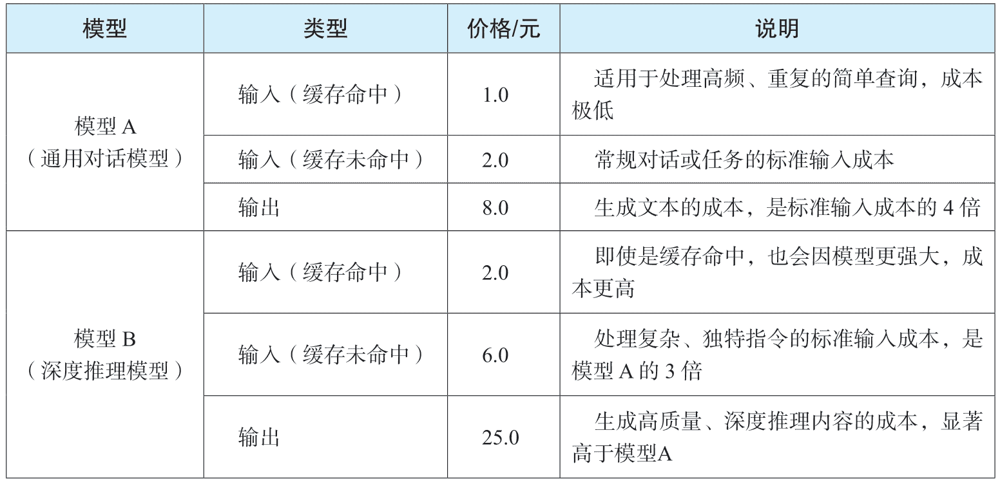

从表 5-2 中可以发现几个关键的计费规律。

首先是输入与输出的差价。输入 Token（发送给模型的提示词）和输出 Token（模型生成的回答）分开计费且输出 Token 的单价通常显著高于输入 Token，有时甚至会达到输入单价的数倍。这反映了模型生成全新、有逻辑的内容需要更复杂的计算资源。

其次是缓存（Cache）机制的成本优势。部分服务商为了鼓励高频、重复的查询，会引入缓存机制。简单来说，在 AI 回答完一个问题后，可能将问题及答案临时存储。如果后续有用户提出完全相同的问题，AI 无须再次计算，直接返回已存储的答案，此过程叫做缓存命中，其成本非常低。但如果问题稍有不同，AI 就需要重新计算，即缓存未命中，按标准价格计费。

例如，若你询问 AI：“今天天气如何？”AI 回答后会存储该问题及答案。若另一个用户再次询问“今天天气如何？”，AI 就会直接输出存储的答案，即为缓存命中。但若询问“明天天气如何？”，因问题不同，AI 需重新计算，即为缓存未命中。在此类定价模式下，单次简短交互（如一次包含几百输入 Token 和上千输出 Token 的问答）的成本可能仅需几分钱甚至更少，几乎可忽略不计，真正的考验在于规模化和常态化应用。若需要利用 AI 每日自动分析上百篇行业报告，或为数千产品撰写描述，或构建处理大量用户咨询的智能客服系统，日积月累，Token 的消耗量将非常可观，相应的成本也会水涨船高。

对 Token 成本的认知、估算和管理，直接关系到 AI 项目或应用在经济上是否具备可行性和可持续性。将成本效益考量融入 AI 应用的整体规划和系统设计，本身就是 MAPS 四维罗盘中系统（S）落地能力的重要组成部分。

了解并掌握 Token 的成本规律，是与 AI 建立长期、健康且富有成效的协作关系不可或缺的一步。

**5.3.2** **Token 成本优化：三个关键策略**

在认识到 Token 如同 AI 运行所必需的“卡路里”，Token 消耗与成本息息相关之后，如何优化 Token 使用就成为关键课题。我们需要在确保 AI 获取足够信息以理解任务、保证输出质量的前提下，尽可能地减少不必要的 Token 浪费。

这就像为项目规划预算，既要保证各项工作所需的资源充足，又要避免不必要的开支。为 Token 成本精打细算，同样需要我们运用巧妙的策略和良好的使用习惯。通过审视和优化与 AI 的交互方式，我们完全有能力在不牺牲核心功能和效果的前提下，显著降低 Token 的消耗。

我们可以采用系统性的优化方法，主要包含三个核心步骤。

（1）估算与监控 Token 消耗：建立对 Token 消耗的基本认知。

（2）优化提示词：精简提示词，删减冗余信息。

（3）控制输出规格：明确指令，规范生成内容的规格。

接下来，我们详细展开这三个步骤。

**1.估算与监控 Token 消耗**

在开始优化之前，清晰了解当前的消耗基线至关重要。我们需要对一次典型的 AI 交互或单次 API 调用大致产生的 Token 消耗有基本的概念。

（1）如何估算和了解你的 Token 消耗？

●善用官方工具与文档：主流 AI 服务商通常在其开发者平台或 API 文档中提供 Tokenizer（分词器）在线工具或关于 Token 计算规则的详细说明。可将代表性示例文本（如常用提示词、预期生成的文本片段等）输入工具，它会准确返回文本对应的 Token 数量。通过尝试不同长度和类型的文本（如纯中文、纯英文、中英混合、含代码文本等），可对不同内容的 Token 密度形成直观认识。

●经验法则可作为粗略参考：虽然精确的 Token 数量依赖具体模型的分词算法，但可将一些经验数据作为快速估算的参考。例如，对于简体中文，平均每 1 到 2 个汉字可能对应 1 个 Token；对于英文文本，1 个单词通常约等于 1 到 1.3 个 Token（短词可能对应 1 个，长词或带连字符的词可能对应更多）。需注意，这仅为粗略估计，实际数值会因具体模型和文本内容（如标点符号、特殊字符）而异。

●从 API 用量统计中学习：开始使用 API 后，最准确、最直接了解 Token 消耗的方式是定期查看服务商提供的 API 用量统计和详细账单。这些数据会精确记录每次 API 调用的输入和输出 Token 数量。通过分析真实数据，不仅能准确掌握 Token 花销，还能发现哪些类型的任务或提示词模式更容易导致高消耗，为后续优化提供第一手资料。

（2）为什么要关注估算和监控？

对个人开发者或小型团队而言，这有助于更好地控制项目预算，避免因未预料的高额 Token 消耗导致项目难以为继。对于需要设计和运行自动化工作流（如使用自动化平台每天自动调用 AI 处理成百上千条数据）的场景，Token 消耗直接关系到整个系统的运行成本和投入产出比。通过持续监控，还能及时发现因提示词设计不当、程序逻辑错误或 AI 模型行为异常（如在某些情况下突然输出远超预期的超长文本）所导致的 Token 消耗飙升，从而迅速定位问题并修正。

**2.优化提示词**

在对 Token 消耗有了基本认知后，优化提示词是降低 Token 成本的核心环节。其目标是去除发送给 AI 的提示词及整个交互过程中的一切非必要成分，仅保留对 AI 准确理解任务意图和生成高质量输出至关重要的核心信息。

**提示词的精简艺术**

这往往是降低输入 Token 消耗最直接、最有效的方法。我们需要审视每一个提示词，思考哪些词句是必不可少的核心信息，哪些是可省略的冗余内容。首先，告别不必要的客套与寒暄。当我们通过 API 与 AI 交互时，它是执行指令的程序，不需要人类社交中的礼貌用语。诸如“你好，AI 助手，我想请你帮我分析一下这段文字的主要观点，你能做到吗？如果可以的话，那就太感谢你了！”在该提示词中，大量开场白、疑问句和感谢语对 AI 理解核心任务（“分析这段文字的主要观点”）的帮助微乎其微，却实实在在增加了输入 Token 数量。

一个简单的优化对比：

**优化前**（以某典型分词器为例，消耗约 243 个 Token）：

我是一名市场部的初级分析员，我们公司最近刚刚成功研发并推出了一款全新的、具有划时代意义的智能联网咖啡机。这款咖啡机的功能非常强大和丰富，比如说，它可以轻松连接家庭的 Wi-Fi 网络，用户可以通过我们专门开发的手机应用程序（App）进行远程控制和操作，甚至它还能够根据每一位用户的独特口味偏好，智能地、自动化地调节咖啡豆的研磨粗细程度以及精确控制萃取的黄金时间。我现在非常迫切地需要你发挥你的才华，最大限度地利用你的计算能力，帮我为这款令人兴奋的咖啡机精心构思并撰写一段大约 150 字的营销宣传文案。我希望这段文案的整体风格能够显得活泼有趣，能够有效地吸引年轻一代消费者的注意力，并且要突出我们产品最为核心的智能化和便捷性这两大卖点。谢谢！

**优化后**（以同一分词器计算，消耗约 93 个 Token，节省约 62%）：

角色：资深营销文案策划。任务：为新款智能咖啡机撰写宣传文案。产品核心功能：Wi-Fi 连接，App 远程控制，自定义口味，自动调节研磨与萃取。目标受众：年轻消费者。文案风格：活泼有趣。突出卖点：智能化，便捷性。字数要求：150 字左右。

精简后的提示词不仅减少了 Token 消耗，更重要的是，结构化指令让 AI 能更快速、更准确地把握核心需求。

其次，力求精确提问，避免含糊不清。模糊、宽泛的提问往往会迫使 AI 在更广阔的知识空间中搜索和猜测，导致其输出更多试探性、概括性，甚至与期望不完全相符的内容。这些额外的探索性输出会增加 Token 的消耗。因此，在构建提示词时，应先仔细思考：我希望 AI 完成的具体任务是什么？期望得到的结果具备哪些明确的特征？然后用最直接、没有歧义的语言将这些需求表达出来。

最后，对多轮对话中的上下文进行精简。在复杂任务中，往往需要通过多轮对话与 AI 进行持续交互和迭代，以得到满意的结果。此时需要特别注意，API 的每次调用通常会将之前的部分或全部对话历史作为上下文信息一同发给模型，以帮助其理解当前的语境和保持对话连贯性。然而，如果历史对话中包含大量与当前步骤不相关或早已被确认解决的早期讨论内容及冗余细节，这些过时的上下文就会成为不必要的输入 Token 负担，在每一轮新的交互中被重复计算。

一个重要的优化策略是，在每次调用 API 之前，学会对需要传递的对话历史进行有选择的修剪和净化。只保留对 AI 理解当前特定子任务或维持必要逻辑连贯性至关重要的上下文信息。例如，如果 AI 已协助完成报告的引言和第一章的撰写，当我们请求它继续撰写第二章时，可能只需要提供第一章的核心观点摘要或者简短的过渡性说明作为上下文衔接，无须将引言和第一章的全部原始内容重复发送。

**3.控制输出规格**

第三步将注意力从优化输入转向管理输出。其核心目标是通过在提示词中给出清晰、具体的指令，引导 AI 生成符合我们期望的、在数量上不多不少、在形态上恰到好处的输出内容。这不仅能极大提升获取和使用 AI 生成信息的效率，还是节省宝贵输出 Token 的关键所在。

（1）通过明确指令，为 AI 输出设定清晰的边界。

首先，长度限制是最直接的手段。这是控制输出 Token 数量最常用且最有效的方法之一。如果目标只是获取简短的核心观点摘要，就在提示词中明确告知 AI：”请用 50 个汉字以内总结这份文档的核心内容”；如果需要包含三个主要步骤的行动计划，则清晰指示：“请列出完成此项目的三个关键步骤，每个步骤用一句话简要描述。”当 AI 接收到具体长度或数量要求时，会更有针对性地组织回答，避免漫无目的地自由发挥，从而有效防止生成远超实际需求的冗长答案，节省输出 Token。

其次，格式要求能规范输出形态。如果期望 AI 输出的内容具有特定的结构或格式，如需要一段符合 Markdown 语法的文本以便直接发布，请务必在提示词中清晰、准确地定义这些格式要求。

例如，你可以这样写提示词：

请将提供的以下产品信息（如产品名称、价格、主要功能）进行整理并输出为以下格式的 Markdown 文本：

## 产品名称

（在这里填写产品名称）

## 价格

（在这里填写产品价格）

## 主要功能

-（功能一）

-（功能二）

-（功能三）

AI 模型，尤其是较新版本的模型，通常能够很好地理解并遵循这些结构化指令，输出干净、规范、可直接投入使用的内容。这不仅减少了后续人工格式转换或数据清洗的麻烦，还间接节省了因格式混乱导致需要 AI 反复生成而产生的额外 Token 消耗。

此外，还可以通过限定内容范围来聚焦输出。有时可通过在提示词中明确限定 AI 在回答问题或生成内容时可参考的信息范围，来间接控制其输出的详略程度和 Token 消耗。例如，采用手动 RAG 策略时，在提示词中加入诸如“你的回答必须严格依据我在下方提供的背景资料，不得查找、引用或扩展任何超出此范围的信息”这样的指令，能有效引导 AI 将其注意力完全集中在我们提供的特定资料上，避免从其庞大的通用知识库中引入过多与当前任务不直接相关的额外信息，从而使输出更加精练和聚焦。

最后，输出风格的设定虽不直接节省 Token，但能提升效率。虽然在提示词中设定期望的输出风格（如要求 AI 的回答风格简洁明了、专业严谨、生动活泼或循循善诱）不会直接减少单次输出的 Token 数量，但有助于 AI 更快生成符合期望的初步结果，从而减少后续要求 AI 修改、润色或重写的次数。每一次不必要的反复迭代都意味着额外的 Token 消耗和时间投入。因此，从整体效率和总成本的角度看，清晰的风格指令也是控制输出过程中值得重视的一环。

（2）学会选择能力与成本相匹配的模型。

正如选择交通工具时会根据路程、路况及出行目的来决定是骑自行车、开车，还是搭乘高铁、飞机一样，在选择使用 AI 模型来完成特定任务时，也需要对其成本和能力进行综合考量。

首先，要避免杀鸡用牛刀。不同的 AI 模型在设计目标、训练数据的规模与类型、所擅长的能力领域及 Token 的定价策略上有所不同。在通常情况下，能力更全面、更强大、能处理更复杂推理和生成任务的旗舰级模型（如 DeepSeek 生态中的 DeepSeek-R1），其 Token 的单位价格也相对更高。对于一些相对简单、常规的文本处理任务，如基础的文本分类、对不太复杂的短文进行摘要、从一段话中提取关键词或者进行模式化的内容生成等，可能无须动用这些重量级的旗舰级模型。选择在能力上足够覆盖当前任务需求，但 Token 定价更为经济实惠的轻量级或中端模型（如 DeepSeek 生态中的 DeepSeek-V3），往往能在保证基本效果的前提下，以更低的成本完成任务。

其次，要在能力与成本之间寻求最佳平衡点。当然，若任务本身非常复杂，对输出内容的质量、深度、创新性或逻辑严谨性有极高的要求，或者需要模型展现强大的领域专业知识和推理能力（如撰写深度行业分析报告、进行复杂的法律文书草拟、辅助进行科学研究或软件代码开发等），那么选择更高级、能力更强的模型可能就是必要且值得的。在这种情况下，就需要在预期的输出质量、解决问题的效率与可接受的成本之间，根据具体项目的价值和预算进行仔细权衡。有时，高级模型虽然单次调用的 Token 成本较高，但如果它能用更少的交互轮次、更简洁高效的提示词完美解决问题，甚至带来人工难以企及的洞察和创造力，那么从整体投入产出比来看，其性价比反而可能优于单价便宜但需要投入大量时间进行反复调整和结果修正的低成本模型。

最后，关注并利用模型的特性与专长。在选择模型时，还应留意不同模型针对特定应用领域或任务类型进行的优化和增强。例如，某些模型在代码生成与理解方面经过特别训练和强化，在辅助编程任务时表现尤为出色；另一些模型则在长文本的深度理解、多语言之间的精准翻译或者特定专业领域（如医疗、金融）的知识问答方面拥有更强的优势。针对具体需求，选择在相关领域表现出专长特性的模型往往会比使用通用型模型处理所有类型的问题更高效，在特定场景下也更经济。

通过系统地实践上述三个核心步骤，并结合对 API 调用策略的精细优化，我们就能有效管理和控制 AI 应用的成本。这不仅能让 AI 项目在经济层面更具可持续性和竞争力，更重要的是，这种对资源进行精细化管理和高效利用的意识与能力，本身就是构建成功、可持续智能系统不可或缺的关键一环。这恰恰体现了提示词（P）作为杠杆、系统（S）作为放大器的协作思想：通过精巧的提示词设计撬动效率，再通过系统化的流程将其效果放大和固化，确保以最小、可控的代价，最大限度地发掘和利用 AI 的强大潜能。

**5.3.3** **提升输出稳定性：三个核心技巧**

在掌握优化 Token 成本的方法后，下一个需要应对的挑战是 AI 输出的不稳定性。你可能深有体会：同样的提示词，昨天 AI 能生成一封专业得体的邮件，今天却可能输出一段笼统且不知所云的内容。这种表现的不一致，无疑会对依赖 AI 进行严肃工作的用户造成困扰。

表面上，这似乎是 AI 内在随机性所致。实际上，这是模型生成文本时的采样机制、上下文理解的细微变化，以及服务平台在不同时刻的负载状态等多种因素共同作用的结果。简单来说，若缺乏有效引导，这位聪明的 AI 伙伴的输出就可能变得难以预测。所幸，我们并非束手无策。通过一些经过验证的提示词策略，可以将 AI 输出的波动控制在基本可预测、可接受的范围内。本节将继续围绕 MAPS 框架中的提示词精细控制与系统复用思维，介绍三个核心技巧。

**1.角色设定与分轮管理**

AI 输出之所以会天马行空，很大程度上源于我们未明确指定其应扮演的角色及行为边界。与其让 AI 在庞大的知识库中漫无目的地探索，不如为其精准定位、划定行为范围。

（1）精准的角色定位与行为边界。

正如 RICE 框架所强调的，明确角色至关重要。你可以通过以下结构化方式设定。

示例指令结构：

你现在是一位拥有十五年从业经验的《财富》中文版资深财经编辑。

你的任务是根据我提供的××公司最新季度官方财报数据，撰写一篇约 300 字的业绩解读。你的解读必须：

1.严格依据财报中披露的官方数据和事实；

2.只能使用客观、中立的商业分析语言；

3.采用总分总的三段式结构；

4.禁止加入任何个人猜测或引用未经证实的小道消息。

角色越具体，任务边界和行为规范越清晰，AI 在思考和生成内容时偏离主题的可能性就越小。

（2）应对多重身份需求的分轮管理。

若任务复杂，需要 AI 在不同阶段展现不同身份或技能（例如先分析数据，再撰写文案），则不宜在单一提示词中强行融合多重角色。更稳妥的做法是分轮管理：先让 AI 扮演数据分析师，专注完成数据解读；待该阶段完成后，在下一轮交互中明确指示其切换为市场部文案策划，基于前一轮分析结果进行文案创作。

**2.示例锚定**

大语言模型通常具备极强的模式学习和类比推理能力。这意味着，精心挑选、能代表你期望输出的示例，其引导效果往往优于冗长的规则描述。为 AI 提供高质量示例，就像赋予它清晰的参照标准一样，使其能够直观理解努力的方向。

AI 从示例中学习两个方面的内容：结构节奏（如句式密度、段落组织、信息层级等）与语言风格（如正式程度、情感色彩、专业术语偏好等）。有效示例的关键在于短小精悍，仅包含能清晰展示核心期望的关键特征。若示例过长或信息杂乱，反而可能分散 AI 对主要目标的注意力。

此外，若希望在提供高质量示例的同时进一步降低输出的随机性，可考虑配合调整 API 调用中的温度、Top-p 等采样参数。对于大多数追求稳定输出的场景，将温度设置为较低值（如 0.3，或参考服务商文档中关于保守输出的建议值），或将 Top-p 设置为 0.8 左右，通常可满足 80%的需求。通过适度限制 AI 的自由发挥空间，可显著提高输出结果的精准度与可预测性。

**3.分步引导，逐层推进**

让 AI 在输出复杂内容前，经历思考、规划、表达的过程，并非空谈，而是能显著降低输出波动、提升最终质量的有效方法。与其期望 AI 通过一次性指令完美达成目标，不如引导其进行更稳健、可控的多步执行。典型的三步式分解与调用（以撰写市场分析报告为例，此处仅作浓缩示意，实际提示词可更丰富）如下：

第一轮：提炼核心观点。

提示：基于以下市场数据【附数据】，列出 3～5 个核心洞察点。

第二轮：构建报告大纲。

提示：根据上述洞察点，为市场分析报告拟一个三级标题大纲。

第三轮：分段填充成文。

提示：按大纲第一部分【XX】，结合洞察点【A，B】，撰写详细内容，约 XX 字。

（对报告各部分重复此操作）

在实施分步引导时，一项能显著提升稳定性的高级技巧是巧妙运用“冻结上下文”。具体而言，在每一轮 API 调用中，先把前一轮已确认的高质量输出精华（如关键要点、调整后的大纲等）整理成一段简短摘要，并将其放在系统消息（System Message）中或下一轮用户提示的开头，作为后续 AI 思考的基础。这相当于在一定程度上冻结了关键上下文，有效防止理解漂移。在自动化平台（如 Make 或同类工具）的场景中，甚至可利用变量存储等节点承载和传递阶段性摘要信息，为后续自动化流程提供支持。

此外，在分步引导的最后一轮，为预防 AI 在整合时过度发挥，可在提示词末尾追加约束性指令，如“请确保内容完整，逻辑清晰。若需补充信息，不得超过原文的 5%，且不得引入未经讨论的新论点。”这能有效约束最终输出的范围。

**5.3.4** **构建可持续 AI 协作基石**

至此，我们已为与 AI 实现更经济、更可靠的协作，精心建立了两道关键控制机制：一是对成本的精打细算，二是对输出的稳定预期。

成本效率与稳定输出共同构成可持续 AI 协作的基石。两者为我们构建了一条与 AI 高效、可持续协作的可靠防线，确保我们投入的每一分资金、每一分钟时间，都能尽可能地转化为可预测、可依赖且高质量的输出。这不仅让我们在日常使用 AI 时更加省心、经济，也为将 AI 能力更深入、更系统地集成到工作流程中，乃至构建自动运行的智能应用，奠定坚实而可靠的基础。

**5.4** **多模态交互：写得“活”**

掌握了提示词工程的“对、准、稳”三个维度后，我们的 AI 伙伴已经能够在纯文本世界中称职地完成任务：准确理解意图、输出可信内容、保持稳定表现。但如果止步于此，就低估了多模态 AI 技术的潜力。

关键的转变在于，当模型不再只认识冰冷的字母和符号，而是能“看懂”图像，并按照指令生成图像、音频甚至视频内容，像训练有素的助手直接执行精心编排的分步指令时，它就仿佛穿越了冰冷的屏幕，拥有了更接近人类的多维感知和创作能力。这种能力的扩展直接对应 MAPS 中提示词维度的完整性：从单模态对话到多模态交互，我们与 AI 的协作深度得到进一步提升。

本节将聚焦于多模态交互中最成熟、应用最广泛的图像处理能力，系统介绍三个核心场景。首先，学习如何让 AI 精准理解视觉信息，从图像中提取关键价值；其次，掌握如何通过提示词引导 AI 生成符合需求的图像；最后，探讨如何将复杂任务拆解为 AI 可执行的结构化指令序列。在你熟练运用这些能力后，就能在第六章构建自动化系统时，无缝整合图像处理、内容生成等高级功能，真正搭建起高效运转的 AI 协作体系。

**5.4.1** **视觉理解：让 AI 读懂图像信息**

多模态 AI 技术的核心意义在于，它为 AI 打开新的感官维度，让文本不再是机器理解世界的唯一入口，从而彻底打破人机交互的根本局限。这给日常处理海量信息的现代知识工作者带来显著的生产力提升。现在，你可以将随手拍摄的会议白板照片、客户现场访谈的手写草图，直接“投喂”给先进的多模态模型。模型就有可能在很短的时间内，自动完成从“原始信息输入”到“深度理解、信息浓缩、结构化输出”的全过程。

这对工作方式最直接的改变是，显著减少耗时枯燥的人工转录与初步整理环节。

**实际案例：白板草图的快速结构化。**

假设在战略研讨会上，团队在白板上勾勒出新项目的执行路径，包括三个关键阶段和相应行动点。传统的做法是会后由专人将白板内容录入文档：拍照后回到电脑前，在绘图软件中手动将每个框图、箭头和文字重新绘制和录入，并辅以必要的文字说明，整个过程通常需要 30 分钟以上。

现在，我们可以直接拍照交给多模态模型处理。图 5-7 展示了一张实际的白板照片：手写字迹潦草，包含三个带编号的阶段描述、若干关键词和箭头连接。

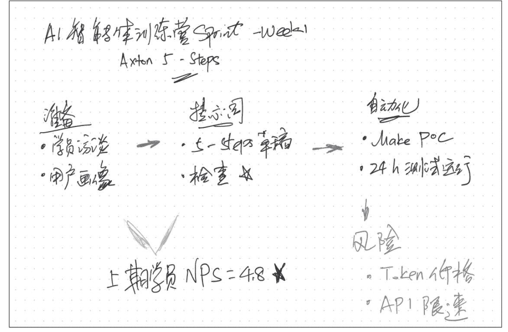

图 5-7

将图片上传给多模态模型，并给出简洁的指令。

请在 150 字内总结这张图片的三大阶段与关键行动，并列出两条风险提示。

模型准确地识别出关键信息并进行了整理（图 5-8）：

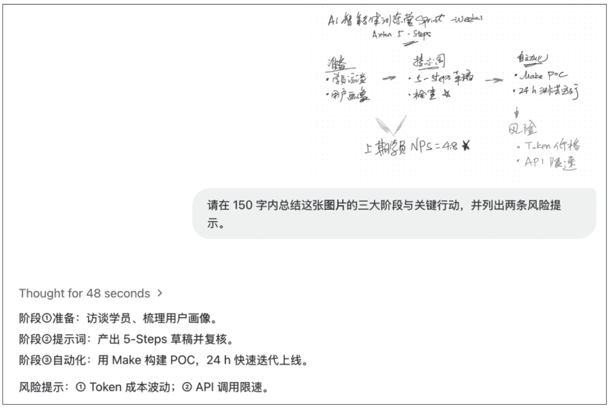

图 5-8

整个过程不到 1 分钟，输出内容可直接复制到项目管理工具或团队文档中。信息的传递密度和处理效率因此得到极大提升，而我们投入的脑力和时间成本却不升反降，这正是 AI 多模态技术带来的最直接、最实在的红利。

**5.4.2** **视觉分析：让 AI 看懂图像背后的价值**

AI 的图像理解能力是多模态技术中最基础也最广泛的应用。无论是上传图片还是提供图片链接，先进的模型都能识别图片内容，并根据要求进行描述、信息提取或分析。

但仅仅让 AI 识别画面元素是不够的，真正的价值在于引导它进行深度分析：从表面的视觉信息中，挖掘出符合特定目标的洞察。这就像给一位能力很强但需要明确指令的助手布置任务：必须用精准的语言，明确告诉 AI 需要关注什么、输出什么。这个过程可以分解为三个核心步骤，在实际撰写提示词时，不必拘泥于生硬的编号，而是用自然流畅的语言来引导。

让我们通过一个实际案例来理解这一过程。假设图 5-9 是一张设计精美、旨在推广新款智能咖啡机的宣传海报。


图 5-9

**1.为 AI 设定清晰的“观察情境”**

将海报图片提供给 AI 后，不要期望它能自动洞悉所有需求。过于松散的指令，如“请帮我分析一下这张咖啡机海报”，很可能只得到表面罗列画面元素（“图片显示了一台咖啡机，背景是一个现代厨房……”）的回答，这样的输出往往冗长散乱，难以提炼出真正需要的核心信息。

更有效的方法是，先清晰说明核心意图和期望 AI 扮演的角色。例如，想利用这张海报为新品做预热推广，提示词可以这样写。

你现在是一位经验丰富的品牌营销策划。请仔细观察这张关于我们新款“AXTON 智能咖啡机”的产品海报。我的目标是通过对海报的解读，提炼出能够精准打动追求生活品质的都市独居青年群体的核心卖点，并为我后续的推广文案提供素材。

我们这款咖啡机的品牌定位是“年轻人的第一台智能精品咖啡伴侣”，强调的是在快节奏的都市生活中，通过智能便捷的操作，轻松享受一杯高品质咖啡所带来的“小确幸”和“仪式感”。我们希望规避那种过于冰冷、强调纯粹技术参数的传统家电宣传方式，而是要突出其设计美学、用户体验和情感连接。

通过这样的“情境铺垫”和“目标定调”，AI 就如同接收到清晰的项目简报，对任务有了明确的方向感和价值判断标准。图 5-10 展示了 AI 给出的详细解读。

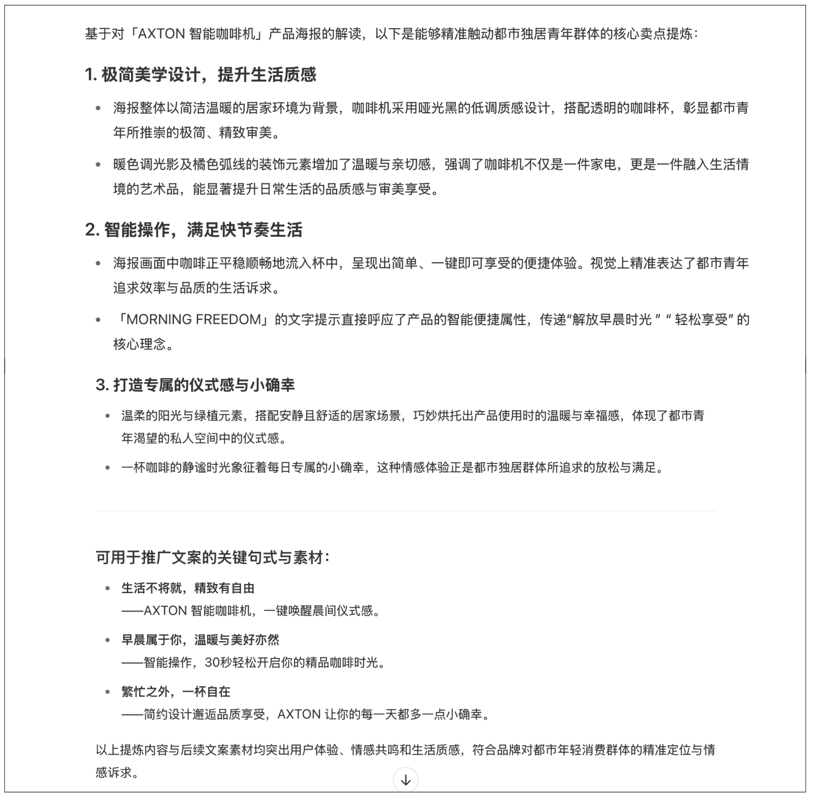

图 5-10

**2.用具体的“提问”或“指令”引导 AI 的注意力**

设定好宏观的观察情境和解读目标之后，需要通过更具体的提问或指令引导 AI 关注海报的关键区域或特别感兴趣的营销元素。继续上面的场景，可以继续细化要求。

基于以上目标和背景，请你针对这张“AXTON 智能咖啡机”海报，重点完成以下任务。

（1）视觉焦点提炼：请找出海报中最能体现“设计美学”“智能便捷”及“独居青年小确幸”的三个关键视觉焦点，每一个用不超过 20 字描述。

（2）卖点转化与解读：针对每个视觉焦点，解释它如何打动目标人群（追求生活品质的都市独居青年）？每条解释控制在 50 字内，语言俏皮有共鸣。

（3）输出格式：按照“视觉焦点描述：［20 字短语］→关联卖点解读：［50 字解释］的格式逐条列出。”

AI 给出图 5-11 所示的回答：

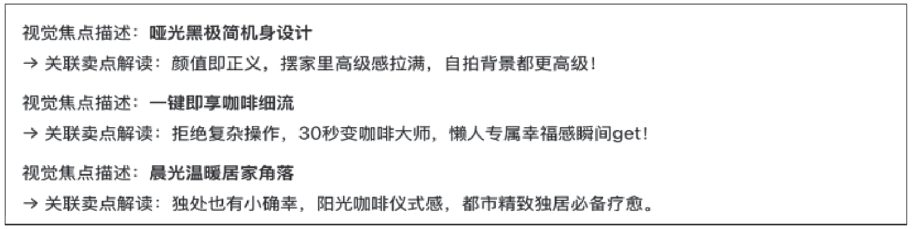

图 5-11

通过层层递进的引导，AI 清楚地知道：需要关注的内容（海报中的特定视觉焦点）、回答的问题（如何关联核心概念并打动目标人群）、遵循的逻辑（从视觉到卖点的转化），以及输出的格式要求。这样得到的结果很大概率可以直接被复制到推广策划中，只需极少的二次编辑。

**3.对 AI 的输出进行迭代式追问**

即便我们给出清晰的初始指令，AI 的首次输出也未必能满足所有期望。这时需要运用多轮对话和迭代优化技巧，对 AI 的初步回答进行有针对性的追问，要求其进行必要的澄清与深化。

例如，如果 AI 在解读咖啡机海报时提到“海报背景中出现的绿植元素营造了温馨的居家氛围，能打动追求生活品质的独居青年”，你可能觉得这个观察还不够深入，或者希望它能将此与产品的具体使用场景更紧密地联系起来。那么，你可以进一步追问：

“温馨的居家氛围”与“AXTON 智能咖啡机”之间，可以构建怎样更具体的场景联想或情感连接？请尝试用一句更具画面感和故事性的营销短句（15 字以内）来表达，例如“清晨，被咖啡香唤醒，与书香、绿意相伴，开启元气满满的一天”的感觉。

通过富有引导性的迭代式追问，能激发 AI 进行更深层次的联想和创造，使其输出不只于表面观察，更能触及目标用户的情感诉求和价值认同。

另外，对于 AI 从图片中提取的客观信息，如产品型号、价格信息或特定的品牌 Logo 等，如果它们的准确性对后续决策至关重要，那么在 AI 给出初步的识别结果后，进行人工核验依然是不可或缺的环节。

通过“设定观察情境→引导注意力→迭代式追问”这套完整的流程，我们就能将 AI 强大的图像理解能力，从简单的“看图识物”提升到更具商业洞察力、更贴合实际需求的“情境化分析”和“策略性信息挖掘”层面。AI 输出的分析结果也能真正成为工作流程中可被直接采用和高效复用的宝贵资源。

**5.4.3** **视觉的经济账：多模态输入的成本考量**

与处理纯文本相比，处理图片消耗的 Token 数量通常会大幅增加，其计费方式并非简单地依据文件大小或像素总量，而是遵循固定的切片规则。

**1.主流多模态服务的图片 Token 折算规则**

表 5-3 展示了典型的图片 Token 计价方式。

表 5-3

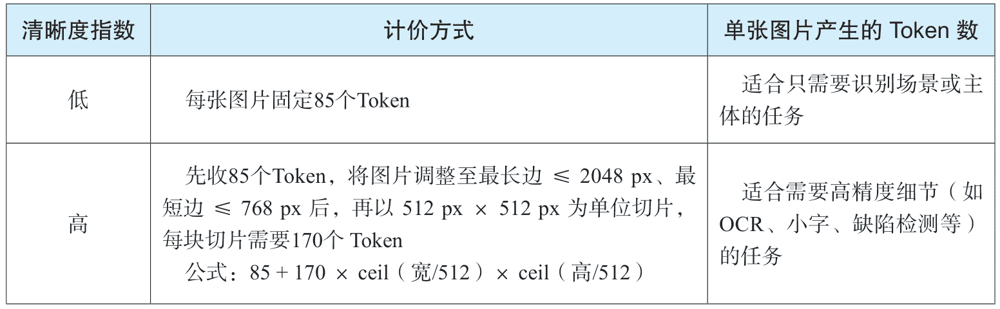

**说明：**系统回复仅计算文字 Token，图片本身在回复阶段不再重复计费。不同服务商的实际数值可能略有差异，但大多遵循类似“固定成本+切片成本”的思路。

**2.为什么高分辨率图片成本更高**

当你选择高精度解析时，平台必须把 2048px×2048px 以内的整幅图片切分为若干个 512px×512px 的小视窗，每增加一个视窗就额外消耗 170 个 Token。因此，决定成本的关键不是文件大小，而是切片数量。这也是建议在本地先进行降采样或裁剪的原因。

**3.日常场景中的成本控制策略**

在需要频繁或批量使用图像理解功能时（如商品图片分类、医学影像批注、市场调研截图归档等），应该始终保持成本意识。以下是一些实用的控制策略。

**优先使用低清晰度：**若只需识别主要对象或场景，85 个 Token 通常足够，可大幅降低单位处理成本。

**先做本地压缩或裁剪：**将 4K 的图片压缩到 1080p 或仅截取关键区域，可显著减少图片切片数量。具体预处理方式包括：压缩分辨率（在保持可识别度的前提下，将 4K 的图片压缩到 1080p）；优化文件大小（调低 JPEG 质量，或将 PNG 转 为 WebP）；裁剪关键区域（仅保留模型需分析的部分）；转换为灰度图（若任务对色彩不敏感，可转为灰度图，既轻量又易处理）。

**分步调用：**先使用低清晰度图片快速定位关键区域，再针对该区域上传高清晰度的局部截图进行详细分析。

**自动化预处理：**在流程平台中集成图片缩放、格式转换或 WebP 压缩模块，把“高清大图”预处理为“AI 友好图”再输入模型，既省心又节省成本。

**善用输入缓存：**多数服务会对完全相同的输入进行自动缓存，再次调用仅收取部分费用；合理复用缓存结果可进一步控制开销。

通过上述看似细微的节流措施，我们能够在保证核心分析效果的前提下，有效控制多模态场景中的成本，避免高清大图在不知不觉中消耗大量预算。

**5.4.4** **掌握文本生图的控制艺术**

如果说图像理解解决了 AI 在视觉信息“输入端”的问题，那么文本生成图像（Text-to-Image）就是 AI 在视觉信息“输出端”展现的创作能力。当前，许多先进的多模态模型已经能够直接根据输入的自然语言描述，在短时间内生成风格多样、内容丰富的图像，涵盖插画、设计稿乃至具有照片级真实感的合成图像。

要让 AI 精准捕捉创作意图并生成真正符合期望的图像，提示词就不能只是简单勾勒。我们应该像电影导演给美术设计师下达详尽的创意简报那样，先为画面定下清晰的叙事骨架和情感基调，再细致交代场景氛围、色彩运用、光影布局，最后点出画龙点睛的关键细节。

以下是一段可直接用于实战的示例提示词结构，其交互逻辑和操作一个支持多轮对话式图像生成与编辑的多模态模型时所体验到的效果高度相似。

**1.示例：指导多模态模型创作一幅北欧极简风格的咖啡主题插画**

假设你是一位生活方式博主，需要为“晨间咖啡仪式感”文章创作独特的配图。你可以尝试向多模态模型发出如下指令：

“你现在扮演一位擅长北欧极简风格的商业插画师。请根据以下详细要求，为我创作一幅数字插画：

【核心要求】

●主体元素：一个设计复古、线条流畅的手冲咖啡壶，材质为哑光陶瓷或带有轻微磨砂质感的金属。

●核心场景：咖啡壶放置在一个简洁的木质桌面上，背景为清晨时分一扇明亮的窗户，窗外可见模糊的绿色植物或城市剪影。

●光影氛围：采用柔和逆光或侧逆光，营造清晨阳光斜射的温暖宁静感。咖啡壶边缘有轮廓光（高光），桌面和背景可带柔和长阴影。

●主色调与配色：整体以温暖的灰色调或米白色调为基底，咖啡壶本身可以是深灰色或带有复古铜色的金属质感。辅以少量饱和度较低的琥珀色或蜂蜜色作为高光或点缀色，以增加画面的温馨感。

●艺术风格：强调北欧极简主义设计风格（如简洁的线条、干净的背景、不过度装饰等），并带有一些手绘插画的笔触感或纸张纹理质感，非追求极致的 3D 照片真实感。

●画面比例与构图：图像宽高比为 16∶9（横屏），咖啡壶为视觉中心，适当留白以营造呼吸感。

模型将生成图 5-12 所示的图像。

**2.迭代优化：“先粗后细，先整体后局部”**


图 5-12

通常，AI 在接收到上述详尽的初始指令后会生成一幅或多幅“初稿”。这些初稿可能已接近期望，但在细节上（如咖啡壶的具体形状、光影的强度、背景的模糊程度等）与我们的设想还存在偏差。此时应善用多模态模型的“基于上一轮输出进行增量式调整和迭代编辑”的能力。

例如，若初稿中壶嘴造型不够纤细，或希望背景色调更偏冷以突出热气，可在当前对话中追加如下指令。

非常棒的初稿！请在上一幅图像基础上进行以下调整：

1.保留整体光影氛围和构图；

2.将咖啡壶壶嘴设计得更修长纤细；

3.将窗外背景主色调调整为略偏冷的淡蓝色或薄荷绿色，与咖啡壶的暖色调形成鲜明的对比。

其他元素尽量保持不变。

模型接收到修改意见后，会尝试理解调整意图，对图像特征进行精确定位并重新渲染输出修改后的图像，如图 5-13 所示。


图 5-13

此过程不同于传统图像编辑软件（如 Photoshop）中的“图层叠加+蒙版修改”，更像对图像深层语义特征的“智能重塑”。

作为普通用户，无须深究其背后的复杂技术原理，但应掌握“先粗后细，先整体后局部”的创作心法：在与 AI 进行文生图协作时，先通过概括性提示词快速生成符合整体方向和主要构图的“草稿”；再通过具体、聚焦的修改指令逐步打磨细节、色彩光影与元素关系。

这种方法相比一次性追求“完美提示词”或反复生成随机图像再筛选，不仅能提升对创作过程的掌控感，还能节省时间与 API 调用成本，减少试错带来的挫败感。

这种“先草稿，后精调”的迭代思路，不仅是高效的创作技巧，还是 MAPS 中系统（S）思维在微观创意场景下的体现：我们为创作过程构建了一个包含“生成→反馈→优化”的迷你闭环系统。

**5.4.5** **让 AI 分步走：复杂任务拆解**

在掌握了 AI 的图像理解与生成能力后，我们自然希望它能在更复杂的场景中按预设流程和逻辑有条不紊地工作。其中最核心有效的方法是，先将复杂任务拆解为若干定义清晰、可检验的子步骤，再通过一系列串联的提示词（提示词链）引导 AI 逐步完成。

这种“分步提示”或“任务流水线化”思维，不仅提升了单次复杂任务的成功率与输出质量，还是我们从“与 AI 进行简单点对点交互”（提示词工程的初级应用）迈向“构建和管理含 AI 能力的可持续自动化智能系统”（系统思维的深度实践）的关键桥梁。

**1.先感知，再思考，最后行动**

几乎所有需要 AI 完成、略具复杂性的信息处理或内容创作任务，都可以抽象为经典的“三段论”模型。

（1）第一段：感知与信息输入。

此阶段的目标是让 AI 准确、全面地接收和理解任务相关的原始输入信息。信息形式可能是纯文本（如待总结的文章、客户需求文档等），也可能是多模态（如产品图片、会议录音转文字、含图表的行业报告等）。关键动作是通过提示词引导 AI 对输入信息进行初步的“消化吸收”，如识别关键实体、提取核心数据、概括主要观点，或者将非结构化信息（如图片内容）转化为结构化文本描述。

让我们看一个实际案例。假设任务是“根据一张新发布的咖啡机产品海报图片，撰写一条用于社交媒体推广的图文帖”。第一轮提示词专注于图像信息提取，AI 的输出（Output A）将是一份关于海报图像内容的结构化文字笔记，包含设计特点、功能文字和目标受众分析，如图 5-14 所示。

（2）第二段：思考与策略规划。

在 AI 充分“感知”并初步处理输入信息后，第二阶段的核心目标是引导其进行更深层次的思考、分析、判断、创意构思或行动策略规划。

关键动作是将上一阶段的输出（Output A）作为核心输入，通过新的提示词要求 AI 进行推理、演绎、比较、筛选，或生成多种可能的解决方案或创意方向。

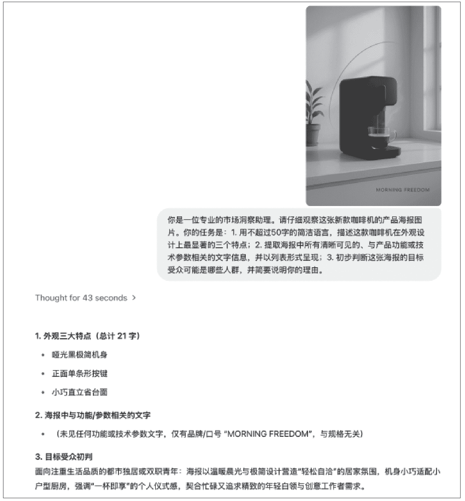

图 5-14

第二轮提示词基于 Output A 进行营销角度构思：

非常好。基于你刚才对咖啡机海报的分析（设计特点：【引用 Output A 中的设计特点】；功能信息：【引用 Output A 中的功能列表】；目标受众分析：【引用 Output A 中的受众判断】），现在请你以一位资深社交媒体营销策划的身份，为这款咖啡机构思至少三个不同主题或切入角度的推文创意。每个创意应包含：A.一个吸引眼球的推文标题或开场白（15 字以内）；B.简要阐述该创意如何能有效吸引你之前判断的目标受众。

AI 的输出（Output B）是三个或更多结构化的推文创意方案，每个方案都包含标题和针对目标受众的吸引力分析，如图 5-15 所示。

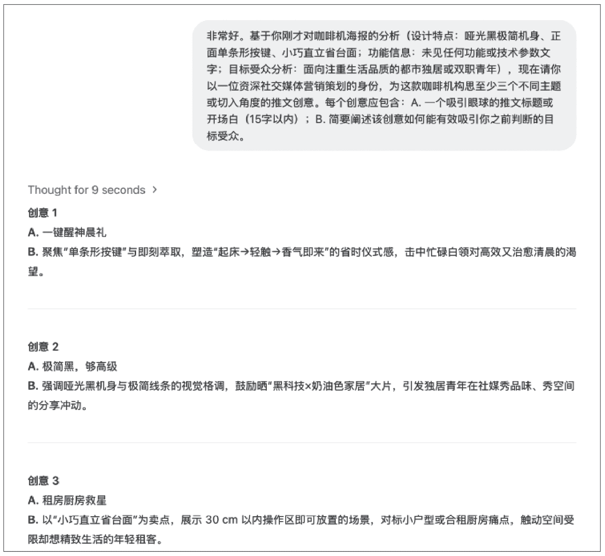

图 5-15

（3）第三段：行动与成果输出。

在 AI 完成充分的“思考与策略规划”后，第三阶段的核心目标是引导其按照明确的规格和要求，执行具体的创作、生成或转换任务，产出可直接使用的最终成果。

关键动作是发出最终指令，要求 AI 综合运用前序步骤中的所有关键信息、决策结论或创意方案，并严格遵循输出格式、长度、风格、语气等最终的“规格说明书”来生成结果。

假设从 Output B 中选择第二个创意方案，第三轮的提示词如下：

我决定采用第二个推文创意。现在，请你将这个创意方案，最终扩展并润色成一条可以直接发布到社交媒体平台的完整图文帖内容。推文应包含：1.你选定或润色后的标题/开场白；2.约 100～120 字的正文，需生动有趣地介绍咖啡机的核心卖点，并自然融入之前分析的目标受众痛点或期望；3.2～3 个相关的、当前热门的中文标签；4.请同时为这条推文构思并生成一张与之风格匹配、能增强吸引力的配图（配图要求：简洁明快，突出咖啡的品质感和现代家居的和谐融入，画面比例 1∶1）。如果不能直接生成图像，请用文字详细描述这张理想配图的画面内容和构图要求。

AI 的输出（Output C），如图 5-16 所示。它是一条经过精心撰写、基本可直接用于社交媒体发布的图文帖内容。

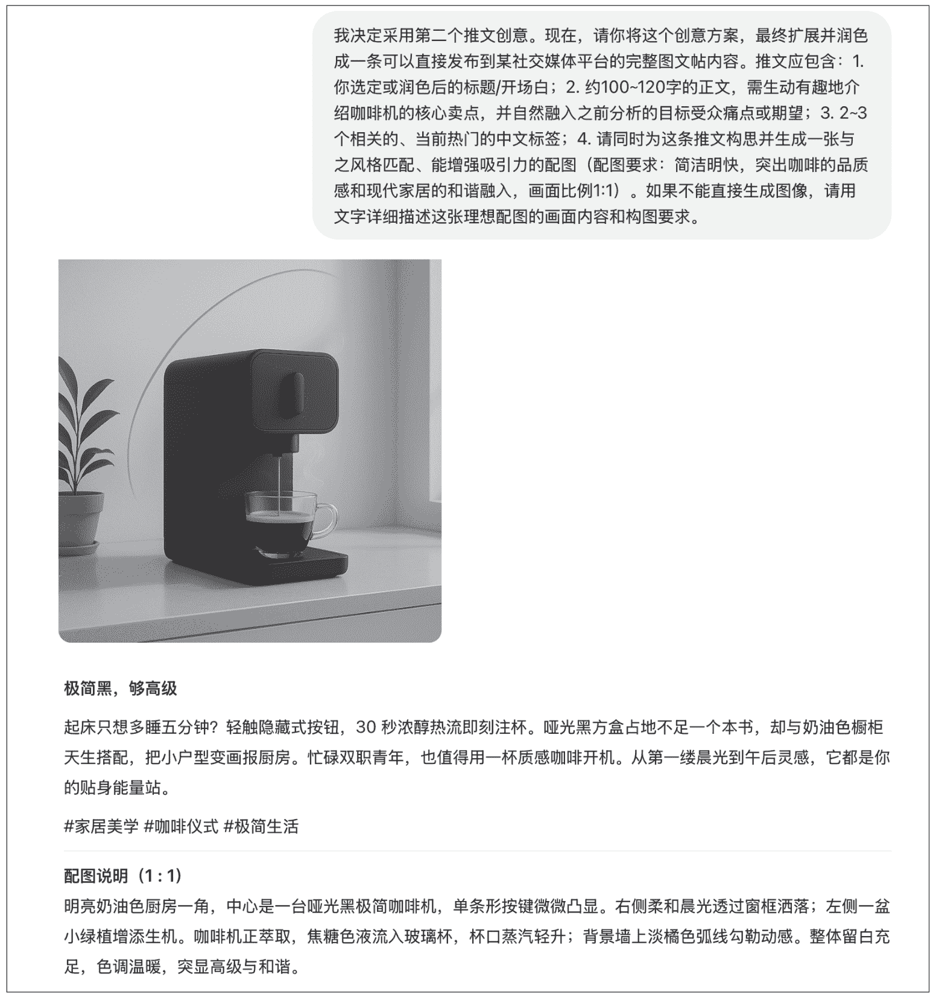

图 5-16

（4）“三段论”模型的价值与自动化潜能。

将复杂任务按“感知→思考→行动”三段论模型进行拆分和引导，具有以下好处。

●**纠错定位更精准，迭代成本更低**

若“思考与策略规划”阶段生成的创意不理想，只需调整该轮提示词或要求重新生成，无须否定已完成的图像信息提取工作。这种模块化纠错与迭代会节省大量时间与 API 调用成本。

●**上下文管理更稳定，信息传递更可靠**

通过将前一段输出的精华摘要或关键决策作为下一段提示词的核心记忆，可有效对抗“上下文漂移”，确保 AI 在长任务链中始终“抓住重点”。

●**创造性与规范性的灵活平衡**

可根据子任务特性设置不同的采样参数。例如，在需要发散创意的“思考”阶段，可将温度调高（如 0.7～0.9）以鼓励多样性；在需要严格遵循格式的“输出”阶段，可将温度调低（如 0.1～0.3）以确保规范性。这使得 AI 既能展现创造力，又能恪守执行力。

更令人兴奋的是，这种基于提示词链的“三段论”任务编排思想，与无代码/低代码自动化平台（如 Make）搭建工作流的逻辑天然契合。我们可将“感知→思考→行动”三段映射为流程图中三个依次独立执行的模块节点。

通过模块化串联和参数化配置，我们可以实现“让 AI 按预设流程自动工作”的目标。在此类自动化流程中，每个节点都有独立的输入、输出和运行日志，一旦某个环节出现问题，方便进行单节点检查、调试和重跑，真正做到“错一环不牵连全链，改一处无须全盘重来”。

**5.4.6** **驾驭多模态 AI 的底层逻辑**

在本书中，我们将对 AI 能力的认知与应用从相对单一的纯文本交互拓展到更广阔、更富有生命力的维度。我们初步领略了先进多模态 AI 在图像理解（精准分析和描述图像信息）与图像生成（根据文本指令生成视觉内容）方面所展现的潜力。更重要的是，我们学习并实践了如何通过一系列精心设计的提示词技巧有效引导和驾驭这类“视觉智能”，使 AI 真正具备理解视觉世界并以视觉方式表达的能力。

更进一步，我们探讨了如何通过巧妙的提示词编排和分步引导策略（尤其是“感知→思考→行动”三段论），将相对复杂、包含多个逻辑步骤的任务拆解为一系列更易管理和执行的子单元。借助指令接力和上下文固化等技巧，AI 能够像训练有素的助理一样，有条不紊地完成多阶段的工作。这种基于提示词的任务编排思想，不仅显著提升了我们利用 AI 解决复杂问题的能力、成功率及输出的质量与可控性，还为第六章运用自动化平台（如 Make）构建更高级、更系统化的 AI 应用奠定重要的思维基础。

站在 2025 年这个 AI 技术加速渗透与融合的节点，回顾本节所学，有三条值得我们掌握的底层逻辑，它们是未来更深入、更智慧地应用 AI 的重要指引。

感官融合正在重塑信息流转的起点与效率。AI 多模态能力的发展，使我们能够将现实世界中更多形式、原本难以被机器直接理解的原始数据（如随手拍摄的会议板书照片、产品演示视频的截图、客户手写的需求草稿和便签等），更直接、低成本、无缝转化为机器可理解、可分析、可处理的结构化知识或行动指令。这极大地降低了信息从物理世界向数字世界流转过程中的“人工搬运”成本和潜在“信息损耗”。

分步链路是驾驭复杂性、保障可靠性的核心策略。面对日益强大的 AI 模型和宏大的应用目标，试图通过一个“大而全”、一步到位的“超级提示词”解决所有问题的想法正变得越来越不切实际。将复杂任务巧妙地拆解为一系列逻辑清晰、目标单一、执行过程可监控、输出结果可验证的子步骤或处理节点，并通过有效机制将它们稳健串联，让每个关键步骤都有明确的“输入源”和“质量验收口”，是我们在日益复杂的任务中始终保持掌控力、及时发现并有效止损的核心策略。

成本意识与稳定性追求依然是应用的基础。无论 AI 能力多么强大和全面，我们始终不能忽视“经济性考量”（如对 Token 消耗、API 调用频率与相关服务费用的精打细算等）和“稳定性追求”（如对 AI 输出结果的一致性、可靠性与可预测性的持续优化等），两者如同构建 AI 应用大厦时看不见的“地基”和摸不着的“天花板”，深刻影响并制约着我们应用探索的深度、广度与可持续性。

我们上传的每一张高清图片，调用的每一次高精度图像理解服务、生成的每一幅可能用于商业用途的图像，都在无形中消耗宝贵的计算资源，并最终体现在运营账单中。对这些新兴能力的成本效益进行持续、理性的评估，并坚持不懈地运用各种优化技巧提升其投入产出比，是确保 AI 探索不会沦为难以负担的高成本实验，并最终转化为可持续商业价值的关键前提。

**5.4.7** **即刻体验多模态 AI**

在进入第六章之前，建议你亲自动手完成一个综合性实践练习，以巩固和体会本节所学的核心内容。

**第一步：寻找视觉素材与创作目标。**拿起手机，随意拍摄当前书桌或办公桌的一角，或从相册中挑选一张最近拍摄的、有趣或有故事感的日常照片（如一杯咖啡、一本打开的书、窗外的风景等）。然后设定一个简单的目标：希望 AI 根据这张照片，提炼出三个可用于社交媒体分享的独特卖点或心情感悟。

**第二步：实践图像理解与分析。**尝试运用本节学到的原则编写一段提示词，引导具备图像理解能力的多模态模型分析所选的照片，并输出三个卖点或感悟。注意在提示词中明确意图、引导 AI 的关注焦点，并设定输出的格式要求。

**第三步：体验文本生图的创作过程。**如果想更进一步，可以根据第二步中 AI 提炼出的某个卖点或感悟构思一段新的提示词，引导具备绘图功能的多模态模型生成一幅能视觉化表达该卖点或感悟的原创插画或概念图。在提示词中描述期望的画面主体、场景氛围、色彩风格和构图等。

**第四步：尝试三段论任务编排。**整合以上步骤，尝试用“感知→思考→行动”的三段论思路，设计能让 AI 自动（或者在引导下分步）完成“根据给定图片→提炼核心信息→围绕核心信息生成一条包含配图（或配图文字描述）的完整社交媒体推文”的迷你任务流。

完成这一整套从“看图”到“构思”再到“创作”的迷你实践，你将会更真切地体验到多模态 AI 的强大能力，以及通过提示词设计所能实现的精准掌控。

准备好了吗？让我们的提示词，从此刻开始不再只是与 AI 的简单对话，而是驱动未来智能系统高效运转的精密指令！

**第六章** **系统实战：自动化流程的构建**

经过第五章系统性的学习与实践，Axton 已能熟练运用 RICE 框架构建结构清晰的提示词，通过“降幻三板斧”确保 AI 输出的准确性，在成本与质量之间找到平衡点，甚至驾驭多模态 AI 完成从图像分析到内容生成的复杂任务。他的提示词已进化为精密的指令。

那些曾让他焦虑的问题，如 AI 输出不稳定、成本难以控制及频繁出现的幻觉，如今都有了系统性的应对方案。他的提示词模板库在不断丰富，每个模板都经过反复打磨，每次调用也都能获得稳定可靠的输出。

然而，就在 Axton 为这些进步感到欣慰时，一个更深层的问题逐渐浮现。

尽管每个环节都有成熟的提示词模板，但制作一期视频内容的完整流程仍需要他持续参与：先通过提示词让 AI 搜索并整理资料，并将资料复制到另一个模型中生成初稿；再把初稿中需要配图的部分标记出来逐一生成图片，并将图片下载、编号、插入对应位置；最后用校对提示词检查全文。

每个步骤都在他的掌控之中，每个输出都符合预期。但当他完成这一切，看着电脑上七八个打开的标签页、散落在各处的文件和笔记时，一个熟悉的感觉涌上心头——这不就是他在第二章试图逃离的“数字孤岛”困境吗？

是的，他已从“工具使用者”进化到“协作伙伴”，能够熟练指挥 AI 完成各种复杂任务。但他仍然需要在不同工具之间复制和粘贴上下文，手动触发每个环节，亲自检查每个输出。虽然整个流程比过去高效，却仍然依赖他的持续在线和手工操作。

更关键的是，这套流程无法实现规模化。如果他想同时制作三期视频，就需要三倍的时间和精力；如果他想让助理帮忙，就得逐一教授整套操作手册。一旦某个环节出了问题，比如某个 AI 模型升级导致提示词失效，他又得重新梳理整个流程并逐一排查。

Axton 重新审视已绘制的“内容引擎 1.0”蓝图。图上清晰标注着他的愿景：一个能够自动运行的内容生产系统，从选题输入到草稿输出，全程无须人工干预。而现在，他虽然拥有精雕细琢的提示词工具箱，却仍被困在“手工作坊”的困境里。

问题出在哪里？Axton 很快找到了答案：他掌握了“点”的能力，却没有学会如何将这些点串联成“线”和“面”。心智（M）、架构（A）、提示词（P）的独立应用实现了“点”的突破，但要构筑“线”的优势和“面”的壁垒，答案直指 MAPS 的最后一个字母——S（系统），也是“四步跑道”的最后一站——部署（Deploy）。

部署，对此刻的 Axton 而言，是跑道的最后一站，也是他所有努力能否实现价值的关键环节。这意味着他必须完成最后也是最关键的一跃，实现在他脑海中清晰浮现的目标：不同的 AI 模型和工具能够自动协作，无须人工搬运数据；每个环节的输出能够自动传递给下一个环节，形成无缝衔接；系统能够自动记录每次运行的数据，为后续优化提供依据。

他将利用自动化平台把前面三个阶段的所有成果进行连接和固化，最终形成可监控、可迭代、可持续运行的自动化系统。这不仅仅是技术层面的挑战，还是对身份认知的最终升华。只有当 Axton 将人工流程固化为自动化系统，将个人技巧沉淀为可复用资产时，他才能真正完成从“协作伙伴”到“架构师”的最终跨越。

现在，是时候将蓝图变为现实，将工具组装成引擎了。读完本章，你也将会具备把任何转瞬即逝的灵感转化为可持续运行的智能系统的能力。

关于平台选择的说明：本章以 Make 平台为例展开介绍，核心价值不在于帮你熟练使用 Make，而在于建立一套可迁移的自动化系统设计思维。无论你是使用 Zapier、n8n，还是其他平台，这里的原则都同样适用。具体的跨平台实现案例，参见第八章。

**6.1** **从“对话”到“调用”：API 的价值**

当前我们与 AI 交互主要有两种模式，理解它们的区别，将会帮助我们深刻认识为何“系统”是放大 AI 价值的必然路径。

**第一种模式：通过官方聊天界面进行对话。**

无论是通过网页、桌面客户端，还是手机应用，我们都能进入一个简洁的对话窗口，向 AI 提问或要求它撰写文案、分析数据，甚至进行角色扮演式的创意构思。这是最直接、最便捷的使用方式，极大降低了使用 AI 的门槛。

下面以生成健身计划为例。我们可以向 AI 发出图 6-1 所示的指令。

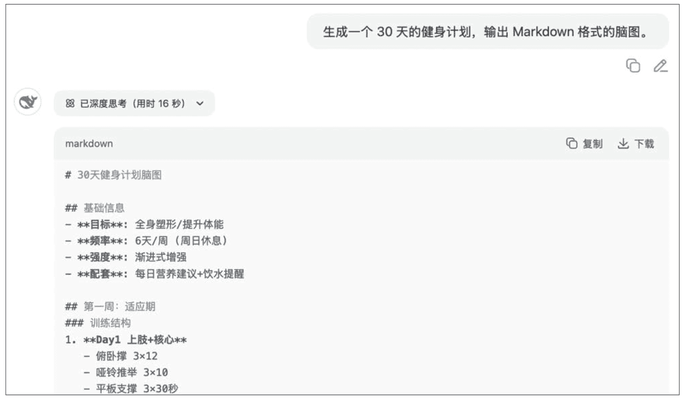

图 6-1

AI 会生成如下详细的 Markdown 格式的健身计划（此健身计划仅为示例，不代表可以真的遵照执行）。

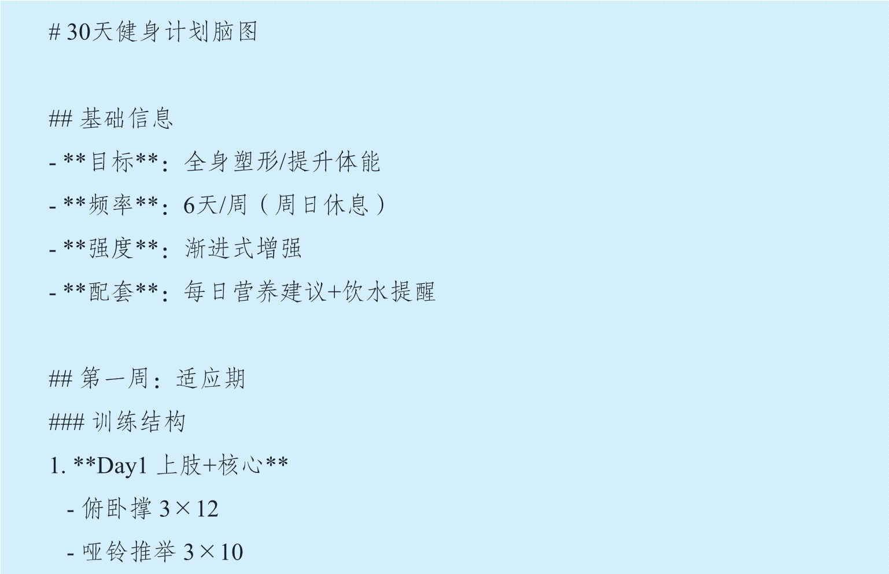 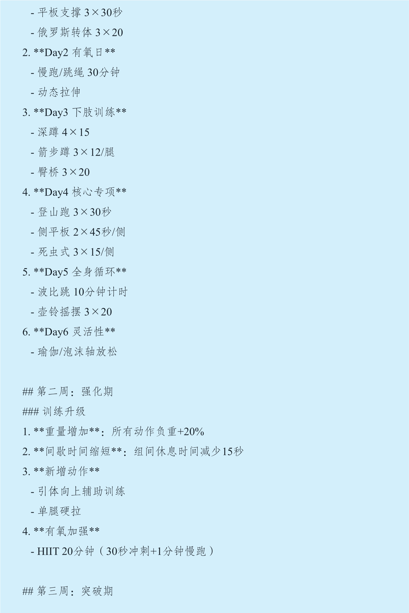 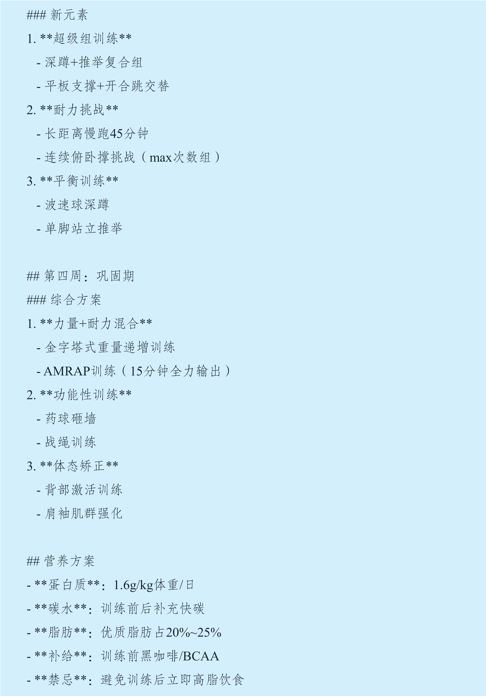

然后，我们手动将 AI 生成的 Markdown 文本复制到专业的脑图软件中进行处理和可视化，生成的脑图如图 6-2 所示。

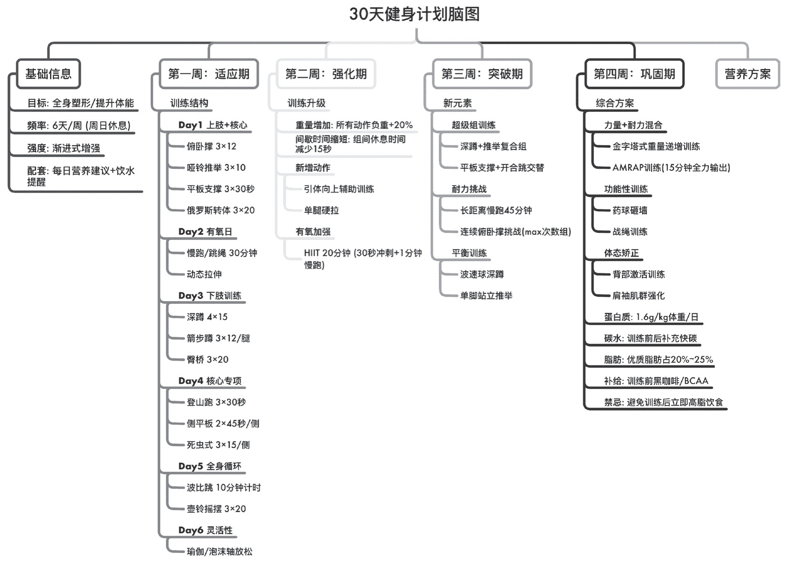

图 6-2

这种“AI 生成+人工转运”的协同方式能够解决日常工作中的许多问题。但局限性同样明显：本质上仍是“人机对话”，每次交互都需要手动发起，每次利用结果都需要手动“复制+粘贴”。整个过程是断裂的，信息无法在不同应用之间自动流转。就好比我们拥有一位博学的顾问，但每次咨询都必须亲自上门拜访，并将他的建议记录下来，再到别处去应用。

**第二种模式：通过 API 程序化调用。**

API 是一套预先定义的规则、协议和工具，它允许不同软件的应用程序之间相互请求服务或交换数据，而无须了解对方内部复杂的实现细节。我们可以把它想象成软件系统之间的“中介”，其规定了如何提出请求、请求的格式及得到怎样的响应。

我们可以借助餐厅这一经典商业服务模型的运作流程，精准理解 API 在软件系统中的角色，如图 6-3 所示。

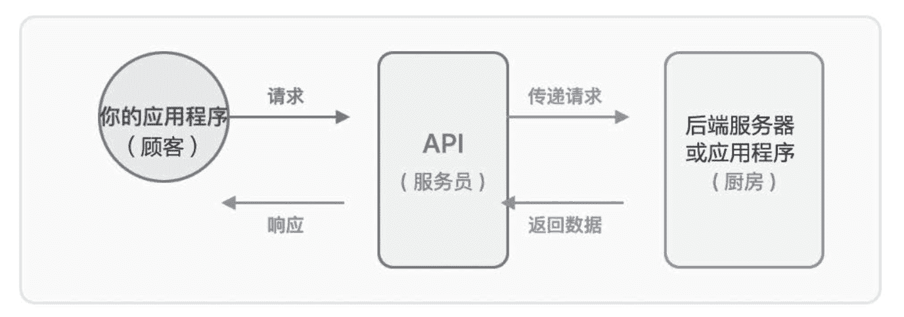

图 6-3

在这个模型中，各个角色的对应关系如下：

●顾客=你的应用程序（如在 Make 平台上搭建的自动化模块）。

●菜单=API 的官方文档（列出所有可用的功能、调用方式、参数和限制）。

●服务员=API（标准化的沟通接口，用于隔离复杂性）。

●厨房=后端服务器或应用程序（真正拥有数据和能力的地方）。

●点单=API 请求（Request）。

●上菜=API 响应（Response）。

顾客通过服务员点单，服务员将订单传递给厨房，厨房完成制作后由服务员将菜品送回。这一流程确保了交互的稳定、有序和安全，无须暴露内部复杂的运作细节。正是这种标准化的通信机制，使得成千上万个不同的软件服务能够彼此协作，构成互联互通的数字世界。

AI 模型所提供的 API 允许我们绕开图形化的聊天界面，让应用程序（如 Make 自动化平台）直接与 AI 模型进行程序化交互，并接收其返回的结果。

这意味着，AI 不再仅仅是孤立的“聊天对象”，而是能够无缝集成到任何工作流程中，成为可被调度、自动化的能力模块。例如，“收到一封新邮件”这一事件可自动触发 AI 对邮件内容进行分析和摘要，而“数据库中新增一条客户反馈”这一操作也可驱动 AI 判断其情感倾向并打上标签。

通过 API，AI 的能力真正从“聊天窗口”中得以解放，融入工作流程的每一个环节，开拓出比手动交互广阔得多的应用场景。更重要的是，要驾驭 API 所带来的能力，我们无须成为专业程序员。借助 Make 等自动化平台，可以通过更直观、更友好的方式，将 AI 的 API 功能转化为一个个“积木式”组件，灵活搭建出符合自身需求的智能系统。

**6.2** **Make 平台入门**

在构建复杂的自动化系统之前，首先需要掌握 Make 平台的基础操作。本节将带你完成账户准备、搭建第一个完整工作流，并逐步掌握参数化、安全管理、智能决策和错误处理等核心能力。

**6.2.1** **实战准备：账户注册与凭证获取**

我们需要准备 Make 和 DeepSeek AI 模型两个平台的账户。

**关于操作界面的重要说明：**

本书中的所有操作步骤和界面截图，均基于 2025 年上半年的软件版本。软件和在线服务（尤其是 Make 和各类 AI 平台）正处在不断迭代中，其 API 接口、授权方式、操作界面随时可能发生变化。

如果在按照书中步骤操作时遇到困难或发现差异，请优先查阅相应平台的官方帮助文档或最新的开发者文档。本书提供的步骤旨在阐明原理和核心方法，最终请以操作时相应平台的官方说明为准。

**1.Make 账户注册**

打开 Make 官网，页面如图 6-4 所示。


图 6-4

单击页面右上角的“免费开始（Get started free）”按钮，系统会跳转至注册页面，如图 6-5 所示。你可以选择使用已有的第三方账户（如企业邮箱账户）快速注册，也可以通过电子邮箱进行标准注册。


图 6-5

如果你选择邮箱注册，需要按照页面提示填写以下信息。

●“姓名（Name）”：输入你的姓名。

●“电子邮箱（Email）”：输入你的邮箱地址。

●“密码（Password）”：设置一个符合安全要求的密码。

●“国家（Country）”：在下拉菜单中选择你所在的国家。

●“托管区域（Hosting Region）”：在下拉菜单中选择数据的托管区域（可根据实际情况选择）。

完成信息填写并勾选同意服务条款与隐私政策后，单击“免费注册（Sign up for FREE）”按钮提交表单。

随后，系统会向注册邮箱发送验证邮件，单击邮件中的链接即可成功激活 Make 账户。

**2.获取凭证**

DeepSeek AI 是我们选用的提供核心 AI 能力的大语言模型。我们需要从其开放平台获取 API Key，以便 Make 能够调用其服务。

**步骤一：进入 API 开放平台。**

打开 DeepSeek 官网，页面如图 6-6 所示。在页面导航栏中，单击右上角的“API 开放平台”链接。


图 6-6

**步骤二：注册与登录。**

进入 API 开放平台后，根据页面指引，使用手机号码即可完成注册和登录。

**步骤三：进入 API** **Key 管理页面。**

成功登录后，将看到 API 开放平台的控制台页面，如图 6-7 所示。在页面左侧的导航菜单中，单击“API 密钥（API keys）”菜单项。

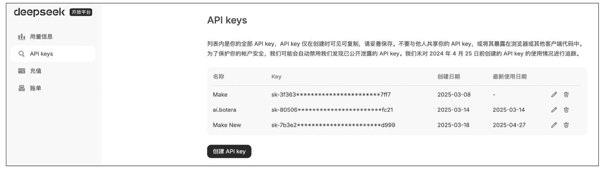

图 6-7

**步骤四：创建新的 API** **Key。**

在 API Key 管理页面中，单击“创建 API key”按钮，系统会弹出图 6-8 所示的对话框，你需要为新的 Key 设置一个便于识别的名称。在输入自定义的名称（如“MAPS Book Project”）后，单击“创建”按钮。

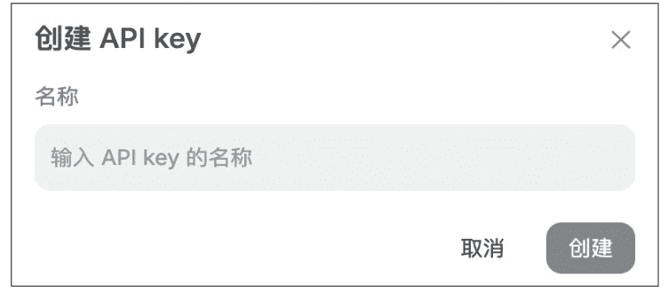

图 6-8

**步骤五：复制并妥善保管 API** **Key。**

此时，系统会生成一串以 sk-开头的密钥，并将其显示在弹出的对话框中。

至关重要的一步：请立即单击“复制”按钮，将完整的密钥保存在本地安全可靠的地方（如密码管理器中）。出于安全考虑，完整的密钥仅在创建时显示一次，关闭该对话框后无法再次查看。如果密钥不慎丢失，只能依照同样的步骤重新创建。

**6.2.2** **我的第一个自动化工作流：“每日 AI 鼓励师”**

下面我们在 10 分钟内从零开始搭建一个简单的自动化工作流——“每日 AI 鼓励师”。其任务很简单：每天早晨定时启动，调用 AI 生成一句激励人心的短语。这就像编程世界的传统入门程序“Hello，World！”，是我们通向自动化智能系统世界的第一声问候。

**1.创建新场景**

登录 Make 账户，进入控制台主页。如图 6-9 所示，单击页面右上角的“创建场景（Create scenario）”按钮。


图 6-9

Make 会打开一个空白的“场景（Scenario）”，如图 6-10 所示。可以将其视为我们的数字画布，所有自动化构思都将在此实现。


图 6-10

画布中央有一个紫色的加号图标，单击图标会出现常用的应用列表。

说明：

单击加号后在出现的列表中选择的是应用（App）；选定应用后，会出现该应用可用的条目列表。这些条目按模块类型（如 Triggers、Actions、Searches 等）或按功能对象（如 Message、User 等）分组显示，但本质相同：你在列表中选定某个具体条目后，场景画布上出现的圆形节点才是一个模块（Module）。

为避免重复，后文有时会用“添加××模块”来简写“选择应用+在列表中选择具体条目”的过程。

**2.配置 AI 动作模块**

在应用列表中搜索并选择“DeepSeek AI”，在弹出的“DeepSeek AI”动作列表中，选择“创建一个聊天补全（Create a Chat Completion）”。

由于是首次使用 DeepSeek AI，Make 会要求先创建一个“连接（Connection）”，以授权 Make 访问 DeepSeek 账户。系统会自动弹出连接设置窗口，如图 6-11 所示。


图 6-11

在“连接名称（Connection name）”文本框中输入名称（如“我的 DeepSeek 账户”）。在“API 密钥（API Key）”文本框中，粘贴获取的 DeepSeek API Key，最后单击“保存（Save）”按钮。

连接创建成功后，系统会返回“DeepSeek AI”模块的配置窗口，如图 6-12 所示。其中最关键的一步是在“消息（Messages）”区域编写提示词来设定 AI 任务。


图 6-12

单击“添加项目（Add item）”按钮。在“角色（Role）”的下拉选项列表中选择“用户（User）”，然后在“内容（Content）”文本框中输入以下指令。

你是一位充满正能量的伙伴，请给我一句今天能激励我努力工作的原创短语。

接着，在“模型（Model）”下拉列表中选择“deepseek-chat”，其他的参数可以保持默认设置。配置完成后，单击“保存（Save）”按钮。

**3.设定运行计划**

DeepSeek AI 模块配置完成并出现在画布上，模块左侧出现一个时钟图标，用于设置整个场景的“运行计划（Schedule）”，如图 6-13 所示。


图 6-13

单击该图标，系统弹出“计划设置（Schedule setting）”对话框，如图 6-14 所示。


图 6-14

在该对话框中，将“运行场景（Run scenario）”选项设置为“每天（Every day）”，并将“时间（Time）”设定为你希望接收鼓励的时间，如上午 9∶00。设置完成后，单击“保存（Save）”按钮。

**4.测试与激活**

完整的自动化工作流已搭建完成。在正式激活前，建议先进行手动测试。

单击页面左下角的“运行一次（Run once）”按钮。流程运行完成后，DeepSeek 模块右上角会出现代表操作完成的提示气泡，如图 6-15 所示。


图 6-15

该气泡代表一次成功操作，其中包含模块返回的“数据包（Bundle）”。单击气泡可查看本次操作的详细日志（图 6-16），包括输入（INPUT）和输出（OUTPUT）数据。在输出结果中，可找到 AI 生成的鼓励短语。


图 6-16

验证无误后，即可正式激活系统。如图 6-17 所示，单击页面左下角“运行一次（Run once）”按钮旁边的开关，将其从“Off”切换为“On”。


图 6-17

当开关显示为绿色时，“每日 AI 鼓励师”已正式开始工作。从第二天起，它将在设定时间准时生成并发送激励短语。在离开场景编辑器前，请确保单击页面底部的保存图标，以保存所有更改。

通过以上四个步骤，你已经成功将一个想法转化为可自主运行的智能系统，完整经历了从灵感（扫描）到思考如何实现（设计），再到编写具体的指令（对话），最终到系统（部署）的全过程。

此时，这个“每日 AI 鼓励师”还较为“机械”——只能重复执行相同的任务。接下来，我们将通过参数化使其更加灵活和健壮。

**6.2.3** **参数化：让工作流动态可复用**

“每日 AI 鼓励师”存在一个根本局限：它很“僵硬”。无论运行多少次，执行的都是完全相同的任务，因为核心指令是固定在模块中的。如果我们希望让它围绕“团队合作”这个主题给出鼓励，就必须手动修改提示词。

这显然既不够智能，也不够高效。如何将这个“一次性”脚本改造成能灵活应对不同需求的可复用的工具？答案就是参数化。

**1.理解参数化的价值**

所谓参数化，本质上是一种“留白”艺术，将流程中易变的部分从固定逻辑中抽离，变为可供随时填写的“变量”。

未经参数化的工作流，好比一张已填写完整的印刷表格。而经过参数化的工作流，则像一张空白表格模板，预留了“收件人：___”“主题：___”等空白字段。每次使用时，只需向模板提供变化的参数就能生成定制化的内容。

在 Make 中，实现参数化最常用的方法是设置“场景输入（Scenario Inputs）”。接下来让我们为“每日 AI 鼓励师”增加动态的“鼓励主题”。

**2.定义场景输入**

在 Make 场景编辑器中，单击画布下方的“场景输入与输出（Scenario inputs and outputs）”按钮，打开配置窗口，如图 6-18 所示。


图 6-18

在弹出的对话框中，单击“添加项目（Add item）”按钮来添加新的输入变量。如图 6-19 所示，我们需要对其进行定义。

“名称（Name）”：设定内部使用的名称，如 prompt_topic。

“类型（Type）”：在下拉菜单中选择“文本（Text）”。

“描述（Description）”：输入对用户友好的描述，如“鼓励主题”。

设置完成后，单击“保存（Save）”按钮。


图 6-19

**3.在模块中引用变量**

回到 DeepSeek 模块，打开配置窗口，将“内容（Content）”文本框中的提示词修改为

你是一位充满正能量的伙伴，请围绕“（在此处插入变量）”这个主题，给我一句今天能激励我努力工作的原创短语。

将光标放在需要引用变量的位置（括号处），此时会弹出变量选择器。如图 6-20 所示，选择刚刚创建的 prompt_topic 变量，然后单击“保存（Save）”按钮。

**4.测试参数化效果**

当再次单击“运行一次（Run once）”按钮时，系统会弹出窗口要求输入“鼓励主题”参数。输入“专注”并运行后，AI 生成的内容将紧密围绕“专注”这一主题。如果下次输入“创新”，AI 就会围绕“创新”主题生成新的鼓励语。


图 6-20

通过参数化，我们的工作流从只能执行单一任务的“机器人”，升级为能根据指令处理多种任务的“多面手”。这是架构设计中可复用性思维在自动化流程中的直接体现。

**6.2.4** **安全意识：Make 的“连接”机制**

在一些不规范的开发场景（如直接在代码脚本中写死密码等）中，将 API Key 等敏感信息以明文形式存储会带来巨大的安全风险。一旦代码或配置泄露，所有关联服务的权限也将会暴露。

Make 从设计之初就内建了专业的安全机制，从根本上杜绝了这类风险。这种机制就是“连接（Connection）”。

**1.什么是“连接”**

在搭建工作流的操作中，我们已经实践了这一安全原则。在第一次添加 DeepSeek 模块时，Make 强制引导我们创建需要填写 API Key 的配置窗口，这正是平台安全设计的核心体现。它并非普通的输入框，而是一种专门用于安全保管凭证的加密存储机制。

**2.“连接”的工作原理**

（1）一次存入，集中加密保管。

只需创建一次连接，将服务的 API Key 安全保存在 Make 的加密保险箱中。

（2）授权调用，而非暴露原文。

在配置工作流时，无须也无法在其他地方复制密钥原文。只能从下拉菜单中选择已创建的有明确命名的连接（如“我的 DeepSeek 账户”）。Make 在后台会自动处理复杂的认证流程。

（3）维护便捷，隔离风险。

如果某个 API Key 需要更新，只需在“连接”管理处修改即可，所有使用该连接的工作流会自动同步，极大提升了系统的可维护性。

（4）安全设计的价值。

理解 Make 强制使用“连接”的设计，有助于我们建立更专业的系统安全意识。一个设计精良的系统，必然会将凭证管理等安全问题置于核心考量。

参数化赋予系统灵活性，连接机制则赋予系统安全性和可维护性。这两个原则看似简单，却是从业余“自动化爱好者”迈向专业“架构师”必须跨过的第一道门槛。它们共同确保系统既能灵活应对多变的需求，又能在持续运行中保持安全可靠。

**6.2.5** **构建智能决策系统：路由器与过滤器**

“每日 AI 鼓励师”及其参数化版本本质上都是一个从头到尾的线性流程，只会“埋头干活”，不会“抬头看路”。然而，现实工作中往往充满不确定性，我们需要一个能够根据不同情况做出不同反应的智能系统。例如：

●如果收到的邮件是紧急的客户投诉，应立刻通过邮件提醒自己。

●如果只是普通的营销推广邮件，则可自动归档，无须打扰。

为实现这种“分岔路口”式的决策能力，需要引入 Make 平台强大的控制模块——路由器（Router）。

路由器的核心功能是在工作流中创建决策节点。它接收上一个模块传递的信息，并根据预设的规则进行判断，决定信息“兵分几路”沿着不同的路径触发后续动作。

本节将通过搭建“智能邮件分类器”实践如何利用 AI 和路由器构建能自动“思考”和“决策”的系统。

**1.设定事件触发器**

创建新场景后，单击画布中央的加号图标，在应用列表中选择你的邮件服务商（此处以“Microsoft 365 Email”为例）。

在触发器列表中，选择“关注新邮件（Watch Messages）”，如图 6-21 所示。


图 6-21

按照提示创建与邮箱账户的“连接（Connection）”，并设定需要监控的文件夹，如图 6-22 所示。


图 6-22

**2.调用 AI 进行分析**

在邮件触发器模块后添加 DeepSeek AI 模块，并选择“创建一个聊天补全（Create a Chat Completion）”动作。在“内容（Content）”文本框中输入以下指令：

你是一位高效的行政助理。请分析以下邮件正文，并判断其类别。邮件类别只可能是“重要”、“推广”或“其他”中的一种。请只回答这三个词中的一个，不要添加任何额外的解释或标点符号。

邮件正文如下：

｛｛1.Body.Content｝｝

如图 6-23 所示，将来自邮件模块的“邮件正文（Body Content）”变量映射到提示词中。

**3.引入路由器并配置分支**

在 DeepSeek 模块后添加“流程控制（Flow Control）”工具集中的“路由器（Router）”模块。

路由器用于创建分支，我们将为不同分支设置“过滤器（Filter）”和后续动作。


图 6-23

**路径一：处理“重要”邮件。**

从路由器中拉出连接线，添加“Microsoft 365 Email”模块，并选择“创建并发送邮件（Create and Send a Message）”动作。

如图 6-24 所示，在路由器和模块之间的连接线上出现一个“扳手”图标，单击此图标即可打开“设置过滤器（Set up a filter）”对话框。


图 6-24

在“标签（Label）”文本框中，将过滤器命名为“重要邮件路径”。

在“条件（Condition）”区域中，设置判断条件为前一个 DeepSeek AI 模块的输出｛｛2.Result｝｝等于（Text operators：Equal to）“重要”。

单击“Sare”按钮保存过滤器后，配置“发送邮件”模块：收件人为自己的邮箱，主题为“【重要邮件提醒】”，内容包含原邮件的主题和发件人等信息。

**路径二：处理“推广”邮件。**

从路由器中拉出第二条连接线，再次添加“Microsoft 365 Email”模块，选择“移动一封邮件（Move a Message）”动作。

用同样的方法设置过滤器：命名为“推广邮件路径”，条件设为 AI 模块输出等于（Text operators：Equal to）“推广”。

配置“移动邮件”模块，将邮件移至“已存档”或“垃圾邮件”文件夹。

**路径三：处理“其他”邮件。**

针对 AI 判断为“其他”的邮件，在 Make 的逻辑中无须额外处理。

数据包（Bundle）会依次尝试通过各分支上的过滤器，若不满足任何一个过滤器的条件（既不等于“重要”，也不等于“推广”），则流程自动中止，邮件保留在收件箱中等待人工处理。这种“无为而治”也是一种有效的系统设计。

完成所有配置并激活场景后，一个能 7×24 小时自动分类邮件的智能系统就诞生了。图 6-25 展示了工作流的完整形态。


图 6-25

智能系统实现了从“线性流程”到“分支流程”的跨越。这标志着它初步具备了“智能”——能根据 AI 分析结果自主判断并执行不同的应对策略。这种基于条件判断的自动化能力，是构建更复杂、更强大智能系统的基石。

**6.2.6** **监控与错误处理**

一个健壮可靠的系统，不仅要在正常情况下正确运行，还要在发生意外时能够妥善应对。例如，当“智能邮件分类器”因外部服务（如 AI 模型或邮箱服务器等）出现临时故障而中断时，我们该如何第一时间发现问题？能否设计相应的容错机制，使得系统在发生错误时能够自动补救，而不是让整个流程悄无声息地崩溃？

这正是系统化思维中至关重要的两个环节：监控与错误处理。它们如同确保自动化系统长期、稳定、可靠运行的“仪表盘”与“安全气囊”，分别负责实时洞察系统状态，以及在异常发生时实施有效保护。

**1.监控：查看系统的运行日志**

Make 平台提供了强大的监控功能，为场景的每一次运行都生成详尽的“历史记录（History）”。

1）进入历史记录页面

在“智能邮件分类器”场景的首页（图 6-26）中，单击导航栏中的“历史（HISTORY）”选项。


图 6-26

2）解读运行日志

历史记录页面（图 6-27）中列出了该场景过去的所有运行记录。每条记录都显示“状态（STATUS）”［如成功（Success）或失败（Error）］、开始时间（STARTED）、活动（OPERATIONS）等。


图 6-27

单击任意一条记录右侧的“详情（Details）”按钮，可深入查看该次运行的具体情况。如图 6-28 所示，流程图中每个模块右上角的气泡中记录了真实的输入（Input）和输出（Output）数据。


图 6-28

通过此页面，我们可以精准回溯系统决策的全过程。例如，可以看到某封邮件因 AI 模块输出“重要”而被路由器送入“发送提醒邮件”路径。这种可追溯性对理解、调试和优化复杂的自动化流程至关重要。

**2.错误处理：配置容错路径**

监控用于“事后追溯”，而错误处理则用于“事前预防”。它允许为流程中的任何模块预设 B 计划：若该模块运行失败，则执行备用路径。

下面为“智能邮件分类器”中的 DeepSeek AI 模块添加错误处理器并配置错误处理路径。

1）添加错误处理器

回到场景编辑器页面中，右键单击“DeepSeek AI”模块，选择“添加错误处理器（Add error handler）”选项，如图 6-29 所示。


图 6-29

2）配置错误处理路径

此时，模块下方会出现新的分支路径。在此路径上添加错误发生时需执行的动作，如添加“Microsoft 365 Email”的“创建并发送消息”动作模块。

配置该邮件模块：收件人为自己的邮箱，主题为“【工作流错误告警】智能邮件分类器运行失败”。在邮件正文中，从错误处理器提供的变量中选择具体的“错误信息（Error message）”，以便快速了解故障原因，如图 6-30 所示。

配置完成后，系统就具备了基础的容错能力。若因网络问题或 AI 服务不可用导致 DeepSeek 模块运行失败，我们将会立即收到包含详细错误信息的告警邮件，而非对系统运行失败一无所知。


图 6-30

**6.3** **综合案例：“内容引擎 2.0”的诞生**

**6.3.1** **系统设计：从蓝图到实现路径**

我们已经掌握了参数化、安全连接、逻辑分支、监控与错误处理等核心技能。现在，我们通过整合这些技能，将“内容引擎 1.0”从蓝图变为现实，升级为更强大、更智能、更健壮的“内容引擎 2.0”。

相比 1.0 版本的线性流程，“内容引擎 2.0”的核心进化体现在以下几个方面。

●动态输入与参数化：工作流通过参数化接口，在每次运行时接收动态输入的“文章主题”。

●AI 协同与质量评估：引入“AI 审核员”角色，让第二个模块对前一个模块生成的初稿进行质量评估，为后续决策提供依据。

●智能决策与逻辑分支：借助于路由器，系统根据 AI 审核员的评估结果，智能决定稿件是直接进入发布流程，还是触发人工审核告警。

●容错机制与故障告警：为关键外部服务调用（如 AI 生成）配置错误处理器，确保服务异常时系统能主动告警。

**6.3.2** **构建信息获取层：Exa 搜索与数据聚合**

**1.创建场景与设置动态输入**

登录 Make 平台，单击页面右上角的“创建场景（Create scenario）”按钮进入空白场景编辑器。

单击画布下方工具栏中的“场景输入与输出（Scenario inputs and outputs）”按钮。在弹出的配置窗口中，选择“场景输入（SCENARIO INPUTS）”选项，并单击“添加项目（Add item）”按钮添加新的输入变量。

如图 6-31 所示，需要对此变量进行定义。


图 6-31

●名称（Name）：不能包含空格或特殊字符，只能使用字母、数字和下画线且必须以字母或下画线开头。建议使用英文或拼音，如 topic。

●类型（Type）：选择 Text（文本）。

●描述（Description）：如“文章主题”。

●必需（Required）：选择“是（Yes）”，确保每次手动运行场景时，系统都会强制要求输入此主题，否则流程无法启动。

●默认值（Default value）：可选，也可留空。

**2.配置 Exa** **AI 搜索模块**

设定动态的“主题”入口后，为确保系统能够持续获得高质量的创作素材，必须依赖于稳定、高效的“信息源”。为此，我们选用 Exa AI 搜索服务，这是一个专门为 AI 应用优化的搜索引擎。它能够深入理解查询的语义内容，返回经过清洗和整理的网页信息，为大语言模型提供结构清晰、易于处理的输入素材。

1）获取 Exa AI 的 API Key

打开 Exa AI 官网，如图 6-32 所示，单击“尝试 API 免费版（> Try API for free）”按钮，根据指引通过邮箱完成新账户注册并进行验证。


图 6-32

回到官网首页，单击“尝试 API 免费版（> Try API for free）”按钮或者选择页面右上角的“登录（Sign in）”菜单项，输入账户和密码进入图 6-33 所示的“Exa AI Dashboard”控制台页面。


图 6-33

然后，在左侧导航栏中单击“API 密钥（API Keys）”菜单项，进入图 6-34 所示的页面。


图 6-34

单击“创建新密钥（+CREATE NEW KEY）”按钮，弹出图 6-35 所示的创建新 API Key 的窗口。

在弹出的窗口中为新的 API Key 设置便于识别的名称，然后单击“创建密钥（CREATE A KEY）”按钮，这时新的 API Key 就会显示在图 6-36 所示的窗口中，立即复制并安全保存生成的 API Key。完整的密钥只会显示一次。


图 6-35


图 6-36

Exa AI 通常会提供一定的免费额度（如$10 积分或每月 1000 次请求），足够用于测试和小规模使用。注意：API 调用是收费的，费用取决于搜索类型（如自动、神经网络、关键词等）和内容获取方式（如文本、摘要等）。在正式使用之前或预计流量较大时，建议你提前了解最新的计费标准。

2）配置 Exa AI 模块

返回 Make 画布，单击加号图标，在应用列表中搜索并选择“Exa AI”应用且选择“执行搜索（Perform a Search）动作”，如图 6-37 所示。


图 6-37

首次使用时，Make 会自动弹出图 6-38 所示的连接创建窗口，引导我们创建到 Exa 服务的安全连接。在“连接名称（Connection Name）”文本框中，输入此连接的名称，你可以使用默认的英文名称，也可以创建一个名称，如“我的 Exa 连接”。然后，在“API 密钥（API Key）”文本框中，填入获取的 API Key。最后，单击“保存（Save）”按钮。


图 6-38

连接成功后进入模块的配置窗口，如图 6-39 所示。

●搜索查询（Search Query）：映射为场景输入变量 topic［在变量选择器中单击“｛｝”图标的标签页，选择“场景输入（SCENARIO INPUTS）”下的“topic”变量］。


图 6-39

●结果类型（Result Type）：选择“Magic”，如图 6-40 所示。


图 6-40

●结果数量（Number of Results）：设为 5 个（避免测试时返回太多的结果，速度慢且消耗可用积分），如图 6-41 所示。


图 6-41

●在响应中包含内容？（Include Content in Response？）：设置为“是（Yes）”，这样在搜索返回的结果中就会包含网页内容。

3）设置场景运行模式

保存场景前，需要将运行模式改为按需运行。单击 Exa 模块左下角的圆形箭头图标，在弹出的“计划设置（Schedule setting）”对话框中，“运行场景（Run scenario）”选择“按需（On demand）”，并单击“保存（Save）”按钮保存场景，如图 6-42 所示。

**3.测试搜索结果**

配置完成后，可先运行测试以确保工作流正常返回结果。

单击场景下方工具栏中的“运行一次（Run once）”按钮，在弹出窗口的 topic 文本框中输入查询主题（如“AI 智能体”），然后单击“OK”按钮，如图 6-43 所示。


图 6-42


图 6-43

成功运行后，Exa 模块右上角会出现图 6-44 所示的小气泡，表示 Exa 模块成功完成一个操作。


图 6-44

单击小气泡可在图 6-45 所示的窗口中查看 Exa 搜索返回的详细数据。


图 6-45

由此可见，返回数据由多个 Bundle 组成，每个 Bundle 对应一组数据。因为设置了返回 5 个结果，所以有 Bundle 1～Bundle 5。在每个 Bundle 中，我们关心的内容是 URL（网页网址）和 Text（网页内容），后续流程将会用到这些数据。使用 Exa 搜索结果的目的是，为 AI 提供参考资料。AI 知识库有截止日期（如 DeepSeek R1 为 2024 年 7 月），因此 AI 对于此后的事件无法知晓。若需撰写时效性强的文章，应将搜索结果作为参考提供给 AI。由于 Exa 根据主题搜索出 5 个结果，因此需要将它们合并后交给 DeepSeek。下面通过配置文本聚合模块来实现此功能。

**4.配置文本聚合模块**

在 Make 平台中，能将多个输出结果合并的模块称为聚合器（Aggregator），其位于“工具（Tools）”应用中。如图 6-46 所示，我们需要在“Exa AI”模块后面添加“文本聚合（Text aggregator）”模块。


图 6-46

将文本聚合模块拖动到场景中，并与 Exa 搜索模块连接。设置文本聚合模块的“源模块（Source Module）”为“Exa-Perform a Search［1］”，在“文本（Text）”字段中定义以下格式以组织搜索内容，如图 6-47 所示。


图 6-47

**6.3.3** **构建内容生成层：AI 创作与智能审核**

**1.配置 AI“创作者”模块**

数据准备完毕，现在配置 AI“创作者”模块。

在文本聚合模块后添加 DeepSeek AI 模块。单击“文本聚合（Text aggregator）”模块右侧小圆圈中的“+”号按钮，在弹出的应用选择器中，搜索并选择“DeepSeek AI”，如图 6-48 所示。


图 6-48

选择“创建一个聊天补全（Create a Chat Completion）”动作，并选择第 6.2.2 节创建的“连接”。

在图 6-49 所示的配置窗口中，对 DeepSeek AI 进行如下配置。


图 6-49

●模型（Model）：选择 deepseek-reasoner（DeepSeek R1 推理模型）。

●消息（Messages）：这是最关键的部分，即你需要定义并发送给 AI 的消息，也就是提示词。这里只设置用户提示词。

单击“添加项目（Add Item）”按钮添加第一个消息：设置“角色（Role）”为“用户（User）”；在“内容（Content）”中，输入以下提示词（可根据需求调整）。

你是一位资深的科技专栏作家，擅长撰写深入浅出、逻辑清晰的文章。请严格按照用户要求，生成一篇符合微信公众号格式的 HTML 文章。

请根据以下主题和参考资料，撰写一篇大约 1500 字的文章。

主题：｛｛var.input.topic｝｝

参考资料：

｛｛4.text｝｝

文章要求：

1.围绕主题进行深入阐述，结构清晰，包含引言、正文（可分小节）、结论。

2.直接输出为 HTML 格式，且必须兼容微信公众号编辑器。

3.允许使用的 HTML 标签：<h1>，<h2>，<h3>，<p>，<strong>，<em>，<ul>，<li>，<a>，

。禁止使用其他标签，特别是<div>，<span>，<table>等复杂标签。

4.所有样式必须使用内联 CSS（inline style）。例如：`<p style=“font-size：16px；color：#333；line-height：1.75；margin-bottom：1em；”>段落内容</p>`。

5.段落之间要有足够的间距（margin-bottom）。

6.请在 HTML 开头使用`<h1>`标签输出文章标题，标题内容直接使用用户提供的主题。

7.请确保 HTML 结构完整，逻辑清晰，语言流畅自然。

**映射变量：**

●主题：插入 topic 变量（在变量选择器中单击“｛｝”标签页，选择“SCENARIO INPUTS”下的“topic”变量）。

●参考资料：插入文本聚合模块的 text 变量（在变量选择器中单击“☆”标签页，选择“Tools 4-Text aggregator”下的“text”变量）。

●温度（Temperature）：设置为 0.6（均衡创造性）。

●最大 Token 数（Max Tokens）：可设置为最大值 8192。

**2.配置 AI“审核员”与逻辑分支**

这是“内容引擎 2.0”智能化的核心。引入第二个 AI 模块来对初稿进行质量评估，并以此为依据进行决策。

首先，在第一个 DeepSeek AI 模块后再添加一个 DeepSeek AI 模块来扮演内容审核员的角色。在对它的配置中，我们选择更经济的 deepseek-chat 模型，这正是“精打细算用 Token”思维的体现，并为其设计如下目标明确的提示词。

你是一位严谨的内容审核员。请分析以下 HTML 文本，判断其内容是否逻辑通顺、观点清晰、不含争议性话题。请只回答“通过”或“驳回”这两个词。

文本如下：

｛｛5.choices［］.message.content｝｝

接下来，在“内容审核员”模块后添加“流程控制（Flow Control）”中的“路由器（Router）”模块，并从它出发创建两条路径。如图 6-50 所示，在线路上选择“设置过滤器（Set up a filter）”来配置分支条件。


图 6-50

**路径一（审核通过）。**

标签（Label）：命名为“审核通过”。

条件（Condition）：设为“审核员模块的输出”，｛｛10.Result｝｝等于“通过”。

**路径二（审核驳回）。**

过滤器标签（Label）：命名为“审核驳回”。

条件（Condition）：设为“审核员模块的输出”，｛｛10.Result｝｝等于“驳回”。

在这条路径上连接“Email”模块，并配置它向你的邮箱发送告警邮件。

**3.为关键模块配置容错机制**

现在，我们为流程中最关键的两个外部调用模块增加容错机制。

Exa AI 模块：右键单击选择“添加错误处理器（Add error handler）”。在错误处理路径上连接 Email 模块，并配置它向邮箱发送告警邮件，主题如“【内容引擎告警】Exa 搜索模块运行失败”，正文中则可以引入错误处理器提供的具体错误信息变量｛｛error.message｝｝。

第一个 DeepSeek AI（创作者）模块：同样添加独立的错误处理器和告警邮件。

**6.3.4** **完成发布链路：微信公众号集成**

**1.获取微信公众号开发者 ID 及密码**

首先准备发布渠道凭证，使 Make 与微信公众号平台能够通信。

然后使用管理员账号登录微信公众平台，单击左侧的“开发接口管理”选择进入“基本配置”页面（图 6-51），查看并妥善保管“开发者 ID（AppID）”和“开发者密码（AppSecret）”。


图 6-51

**2.为文章配置封面图**

虽然封面图生成非本次演示的重点，但发布公众号文章必须指定封面图。这里我们采用最直接的方法实现，以保证流程顺利跑通。在实际应用中，需要根据具体需求完善封面图生成流程。

策略：指定一张可供下载使用的图片（如自有版权或无版权素材等），先利用 HTTP 模块下载，再上传到微信公众号素材库。

在工作流中添加 HTTP 应用，并选择“获取文件（Get a file）”模块。此模块的功能是从指定的 URL 地址中下载文件。如图 6-52 所示，单击该模块打开配置页面，在“URL”文本框中输入准备好的图片链接即可。需要注意的是，图片的格式最好是微信公众号支持的 PNG 或 JPG 格式。


图 6-52

通过 HTTP 模块下载图片后，需要将其上传到微信的永久素材库，以获取独一无二的封面图 Media ID（用于后续步骤中的文章封面图标识）。为此，需要在 HTTP 模块后添加“微信公众号（WeChat Official Accounts）”应用，并在动作列表中选择“上传永久素材（Upload a Permanent Asset）”动作。

首次使用微信公众号模块时，需要创建到公众号的连接。如图 6-53 所示，单击“创建一个连接（Create a connection）”按钮后，在弹出的窗口中输入准备好的微信公众号“App ID”和“App Secret”即可。

连接成功后，在弹出的模块配置窗口中需要重点配置两项参数，如图 6-54 所示。


图 6-53

资产类型（Asset Type）：选择“缩略图（Thumb）”。

文件（File）：映射来自 HTTP 模块的输出结果。


图 6-54

配置完成后，单击“保存（Save）”按钮。模块执行成功将返回包含 media_id 的数据包。

**3.创建并发布微信公众号图文草稿**

下面将 AI 生成的文章 HTML 内容和封面素材 Media ID 组合起来，在微信公众号后台创建图文草稿。

在微信公众号的“上传永久素材（Upload a Permanent Asset）”模块之后，再添加一个“微信公众号（WeChat Official Accounts）”的“创建草稿（Create Drafts）”模块，如图 6-55 所示。


图 6-55

将此模块拖动到场景中，并与“上传永久素材（Upload a Permanent Asset）”模块连接，如图 6-56 所示。


图 6-56

单击“创建草稿（Create Drafts）”模块，在配置窗口中以列表形式配置文章的具体信息。单击“添加项目（Add Item）”链接后，即可映射各个字段，如图 6-57 所示。


图 6-57

●标题（Title）：设置为“公众号图文测试”。

●封面图 Media ID（Thumb Media ID）：映射为前一个微信模块返回的 Media ID 变量。

●内容（Content）：映射由第一个 DeepSeek AI 模块生成的文章 HTML 内容。

●原文链接（Content Source URL）：填写文章原文 URL。在测试时，可以先填写自己的博客或者网站的 URL。

完成所有字段的映射后，保存配置。“创建草稿（Create Drafts）”模块成功执行后，会在微信公众号后台的“草稿箱”中创建一篇新图文消息，并输出包含草稿 ID（Draft ID）的结果。

接下来是发布环节。在“创建草稿（Create Drafts）”模块后添加“微信公众号（WeChat Official Accounts）”的“发布草稿（Publish a Draft）”模块。如图 6-58 所示，在“草稿 ID（Draft ID）”字段中，直接选择上一个模块输出的“Draft ID”变量即可。


图 6-58

**4.保存与测试**

工作流已基本搭建完毕。在正式激活之前，需要进行保存与测试，单击场景左下角的“保存（Save）”按钮保存所有更改。

测试期间，通常我们不希望流程自动发布不成熟的草稿。其有效的方法是，暂时断开最后一步连接。如图 6-59 所示，右键单击“创建草稿（Create Drafts）”模块与“发布草稿（Publish a Draft）”模块之间的连接线，在弹出的菜单中选择“取消链接（Unlink）”菜单项。这样，在执行工作流时，流程将在创建完草稿后自动停止。


图 6-59

现在，我们通过单击“运行一次（Run once）”按钮来手动运行工作流。系统首先提示输入“文章主题”（Scenario inputs），如图 6-60 所示。


图 6-60

输入主题后，观察流程的执行过程。如果流程进展顺利，则每个模块的名称上方都会出现绿色的对勾。另外，可随时单击模块右上角的气泡查看详细的输入和输出数据。

此时，进入微信公众号后台的“草稿箱”，即可看到由“内容引擎 2.0”自动创建的文章，如图 6-61 所示。


图 6-61

单击草稿标题就可以打开预览全文，如图 6-62 所示。


图 6-62


图 6-62（续图）

**6.3.5** **复盘与提升：MAPS 四维罗盘的完整实践**

我们完成了“内容引擎 2.0”系统的构建。现在通过 MAPS 四维罗盘来复盘各个维度是如何在实践中协同工作的。

在架构（A）层面，设计的系统不再是僵化的线性结构。通过引入 AI 审核员和路由器，系统具备初步的智能决策能力，能根据内部状态选择不同的执行路径。这种非线性设计使其适应性和鲁棒性远超简单的串联流程，这也为未来的扩展留下清晰的接口。例如，我们可以在创建草稿前，再加入一个需要人工批准的审核节点。

在提示词（P）层面，我们看到精准指令的核心作用。内容生成提示词的质量直接决定最终输出文章的质量与合规性；质量评估提示词需要简洁、明确，确保返回稳定、可供机器判断的结果。通过让两个不同角色的提示词协同工作，体现了更精细的人机对话设计。

在系统（S）层面，所有设计与实践都通过 Make 平台固化成初步的内容生产系统。它通过参数化实现复用，通过错误处理器提升健壮性，通过平台的执行日志实现监控。更重要的是，它不再是一系列孤立的手动操作，而是可以根据预设逻辑自主运行，并能在异常时主动告警的闭环。未来，我们甚至可以为它设置定时运行的调度，或通过 API 接收外部信号触发，使其成为更完整的自动化解决方案。

这正是 MAPS 四维罗盘在实践中的完整体现：用心智（M）认识到自动化的可能性，用架构（A）设计流程，用提示词（P）与 AI 对话，用系统（S）实现落地和迭代。

现在，你已将本书所有的核心技能融会贯通，并亲手构建了真正意义上的自动化系统。你不再仅仅是 AI 的使用者，而成为能够驾驭 AI 并将其能力系统化、产品化的合格架构师。

**第七章** **未来展望：你的 2030 时间胶囊**

还记得本书开篇时的场景吗？

Axton 曾深陷“手工作坊”的泥潭：每一期视频都需要从零开始，每一个提示词用完即弃，每一次协作都依赖临场发挥。AI 工具带来的单点效率提升，在系统性的流程内耗中被无情吞噬。他感觉自己如同西西弗斯，日复一日地将巨石推上山顶，却始终无法突破那道看不见的天花板。

而现在，当 Axton 再次坐在电脑前时，一切都已不同。

他的“内容引擎 2.0”已经平稳运行了三个月。每周一早晨，他只需在系统中输入本周的选题关键词，然后就可以去泡一杯咖啡。等他回到桌前，系统已自动完成资料搜集、信息整合和初稿生成。那些曾经需要手工搬运的上下文、反复调试的提示词、逐一触发的工作流程，如今都被固化为一套能够自主运行的自动化系统。

他的角色也发生了根本性转变。过去，他是流程中的“操作工”，每个环节都需要亲力亲为；现在，他是系统的“总监”，只需要在关键节点进行决策和把关：审核 AI 生成的初稿是否符合自己的风格，检查引用的资料是否准确可靠，为内容注入 AI 难以赋予的“灵魂”——个人洞察、情感共鸣与价值观表达。

更重要的是，他构建的不仅是一个高效的工作流，还是一套可持续积累价值的资产系统。

●个人知识库持续沉淀他的研究成果和独特洞察，每一次创作都在为未来的选题提供更丰富的素材。

●模板库收录经过实战验证的提示词和流程设计，每一次优化都让系统变得更加智能和稳定。

●成品库归档发布的所有内容及其生产元数据，为持续迭代提供可追溯的反馈循环。

这套系统的价值已在数据中得到验证：从选题到初稿的时间从 5 天压缩到 2 天，提示词的复用率从 0 提升到 80%，AI 输出的一次通过率从 30%提升到 75%。但更让 Axton 欣慰的不是这些可量化的效率指标，而是他重新找回了创作的乐趣，那些被琐碎流程占据的时间，如今可以用来深度思考、打磨观点及与受众互动。

回顾这段旅程，Axton 清晰地看到自己经历的每一个关键转折。

**第一阶段：心智觉醒（第 1～2 章）。**

他认识到 AI 已经从稀缺资源变为基础设施，竞争的焦点从“会不会用”转向“如何系统性地用”。通过“四级协作阶梯”模型的自我诊断，他完成了从“工具使用者”到“架构师”的身份定位，为后续的所有实践奠定了认知基础。

**第二阶段：能力构建（第三章）。**

他重构知识获取方式，通过“AI 陪伴式深度学习”和“信息链五环模型”，搭建起可持续进化的个人知识体系。这不仅为内容创作提供了源源不断的优质素材，还让他掌握了在 AI 时代持续学习和成长的底层方法。

**第三阶段：系统设计（第四章）。**

他学会以架构师的视角审视工作流，运用“三层架构”和“拆分-通信-权衡”原则，为自己的内容创作绘制了第一份真正意义上的系统蓝图。“人机协同”的设计哲学，让他在追求效率的同时，始终保持对内容质量和人文审美的坚守。

**第四阶段：精准对话（第五章）。**

他系统性地掌握了提示词工程，学会了如何用 AI 的语言表达意图、如何治理幻觉确保准确性、如何在成本与质量之间找到平衡、如何驾驭多模态 AI 实现复杂任务。这些能力让他从“靠运气”的单点协作进化为“凭实力”的稳定输出。

**第五阶段：价值落地（第六章）。**

他将前述所有的能力整合，利用 Make 平台构建了真正能够自主运行的“内容引擎 2.0”。从 API 调用到流程编排，从错误处理到性能监控，每一个技术细节的背后，都体现着他对系统设计的深刻理解。

这正是 MAPS 四维罗盘和四步跑道的完整实践闭环：扫描（Scan）让他识别出值得用 AI 解决的系统性问题，设计（Design）让他绘制出可执行的蓝图，对话（Dialogue）让他能够精准驱动 AI 执行，部署（Deploy）让他将一切固化为持续创造价值的系统。

从“工具使用者”到“架构师”，Axton 用了整整一年的时间。这一年里，他经历了认知的颠覆、能力的重构、身份的转变。但他知道，对于每一位愿意迈出第一步的读者而言，这个过程可以更短，因为你们已经握有一份完整的地图——MAPS 四维罗盘。

然而，Axton 也深知这并非终点。AI 技术仍在飞速演进，新的模型、新的工具、新的可能性层出不穷，他构建的“内容引擎 2.0”也需要持续迭代。然而，正如本书始终强调的核心论点：当 AI 能力成为基础设施时，真正的护城河不在于掌握某种具体工具，而在于拥有一套可迁移的思维框架和系统设计能力。

MAPS 正是这样一套穿越技术周期的底层思维模型。无论未来出现何种 AI 工具，Axton 都可以用同样的思维方式去审视（M），用同样的架构原则去设计（A），用同样的工程方法去对话（P），用同样的系统思维去部署（S）。

在最后一章，让我们共同完成一次回溯与展望：回顾 MAPS 四个维度不变的核心价值，探讨如何用它来审视未来的不确定性，并最终为自己创建一份写给 2030 年的成长契约。

**7.1** **核心不变：穿越技术周期的思维模型**

在技术以指数级的速度奔涌向前的时代，追逐新工具和新模型，往往会让我们陷入无休止的技术追逐循环和随之而来的知识焦虑。我们不禁会问：今天学会的技能，明天是否就会被新的技术浪潮所淹没？

答案是：一部分会，但另一部分则不会。那些与特定工具、特定平台强绑定的操作技巧，其生命周期注定是短暂的。然而，那些关于如何思考、如何设计、如何构建的底层方法论，却会历久弥新。

这正是 MAPS 的核心价值所在。它并非教你如何使用某一个版本的 AI，而是为你提供一套在人机共生时代，解决问题、创造价值的通用思维模式和工作流。无论未来 AI 变得多么强大，这四个维度的核心价值都不会改变。

心智（M）永远是起点。技术越是强大，我们越是需要一个清醒、审慎且富有好奇心的心智。是选择成为被动的工具使用者，还是主动的架构师？是陷入对新技术的盲目乐观或悲观，还是保持批判性思维，去验证、去伪存真？这种思维层面的抉择，决定了我们能否真正驾驭技术，而非被技术所裹挟。无论 AI 如何进化，人类独有的价值判断、目标设定和批判性审视能力，始终是 AI 无法替代的。

架构（A）是抵御混乱的基石。随着我们使用的工具越来越多，个人与团队产生的数据越来越庞杂，对信息流、工作流进行顶层设计的需求将变得空前迫切。一个优秀、高弹性的个人架构，其核心价值在于具有可迁移性。它能确保我们在更换工具或模型时不必推倒重来，通过清晰的接口和模块化设计实现平滑升级。架构思维是将经验固化为系统的关键。

提示词（P）的本质是高效沟通。即使未来的 AI 能更好地理解模糊的指令，但清晰、精准、富有逻辑的沟通能力，永远是高效协作的稀缺资源。掌握提示词工程，本质上是在锤炼我们向一个能力强大但没有主观能动性的伙伴准确传达复杂意图的能力。这种结构化表达、分解任务、设计上下文的能力，无论是在人机之间，还是在人与人之间，都具有普适价值。

系统（S）是价值变现的最终结局。将一次性的努力、一个巧妙的想法，转化为一个可以自动运行、持续产生价值的系统，是实现个人能力复利增长的唯一途径。构建闭环系统的能力体现的是，从点状思考到系统思考的转变。它让我们不再满足于解决单个问题，而是致力于设计能持续解决一类问题的机制。这是将我们的智力资产转化为可规模化、可交付运营资产的关键。

这四个维度，与我们贯穿全书的四步跑道——扫描（Scan）→设计（Design）→对话（Dialogue）→部署（Deploy）——构成我们应对未来的行动闭环。它是一个完整的从察觉问题到创造价值的通用解题范式。

为了更好地检验我们对这一框架的理解，不妨在此时进行一次行动自检。

●架构自检：当前我最核心的工作流程能否在不推倒重来的前提下，无缝替换掉最依赖的某个 AI 模型或平台？

●系统自检：我最常用的几条提示词是否已经被我封装、复用，并纳入某个自动化流程，还是依然停留在反复的手动复制和粘贴阶段？

●心智自检：当下一项新兴 AI 技术出现时，我的第一反应是“它能帮我解决什么旧问题”，还是“我又需要学习一种新工具了”？

如果这些问题的答案让你感到笃定，那么恭喜你，MAPS 四维罗盘已经开始真正融入你的思维。拥有了这套不变的核心方法论，我们便拥有了应对一切不确定性的底气。

**7.2** **“黑天鹅”与新常态：用 MAPS 审视未来**

未来是无法被精确预测的，尤其是在由 AI 加速驱动的时代。我们总会听到各种各样关于未来的断言，有些激动人心，有些则令人忧虑。然而，历史一再证明，那些最笃定的预测往往最容易被意想不到的“黑天鹅”事件所颠覆。

与其去赌哪一个预测会成真，更具价值的做法是，构建一个无论未来如何变化都能让我们从容应对的思维框架和行动系统。让我们以三个当下非常流行的判断为例，看看如何运用 MAPS 四维罗盘来审视它们背后复杂的现实，并为自己构建应对未来的缓冲机制。

**7.2.1** **流行判断一：AI 将造成永久性的大规模失业**

这种观点认为，AI 将系统性、永久性地取代人类的岗位，导致产生庞大的、无法被重新吸收的失业群体。

然而，世界经济论坛（World Economic Forum）发布的《2025 未来就业报告》指出，AI 在淘汰约 9200 万个旧岗位的同时，也将创造出约 1.7 亿个新岗位，预计到 2030 年前，全球范围内将净增 7800 万个就业机会。

这揭示了就业市场的本质是动态的岗位更替，而非静态的岗位消失。但我们必须清醒地认识到，这个乐观的预测并非一个会自动到来的承诺，而是建立在一个关键前提之上，即社会、企业和个人必须成功地对现有劳动力进行大规模的技能再培训（Reskilling）和技能提升（Upskilling）。报告强调，若无法有效应对这一技能转型的挑战，将有超过 1.2 亿名的劳动者面临被时代淘汰的风险。

面对这种趋势，MAPS 为我们提供了清晰的应对思路。

在心智（M）上，我们首先要用动态而非静态的视角看待职业生涯。与其担忧自己的岗位被淘汰，不如思考如何将自己的能力迁移到新诞生、与 AI 协同的岗位上。这是一种主动、面向增长的适应性心智。

在系统（S）层面，个人或组织应该着手设计并部署技能培训系统与知识更新管道。例如，为自己规划定期的学习目标，或者在团队中建立分享机制，确保我们始终处在能力升级的轨道上。一个有预见性的系统会为未来的转岗和技能重塑留足必要的缓冲空间。

**7.2.2** **流行判断二：单一科技巨头将垄断大语言模型市场**

这种观点基于赢家通吃的互联网逻辑，认为最先取得技术突破和市场规模的巨头，将最终形成难以撼动的垄断地位。

事实上，开源模型的快速迭代正在稀释这一风险，催生了闭源商用+开源协作的多极竞争格局。最典型的印证便是 Meta 公司在 2023 年开源其 Llama 系列模型，此举极大地激活了全球开发者社群，并迅速成为最受欢迎的开源模型之一。就连谷歌内部一份被泄露的备忘录也曾坦承，“我们没有护城河，开源社区正在快速赶超我们”，承认开源模型在速度、定制化和效率上已形成强大的竞争力。2025 年初由深度求索发布的 DeepSeek 开源模型，以极具竞争力的成本实现了比肩顶尖闭源模型的性能，更是对这一趋势的有力印证。

对此，MAPS 引导我们：

●在架构（A）层面上，追求可插拔和与模型无关的设计，确保系统不会被任何单一平台锁定。优秀的架构应该能让我们在未来以最小的成本，灵活地在不同的闭源模型和开源模型之间进行切换、组合，甚至同时使用。

●在系统（S）层面上，我们应该构建拥抱竞合（Coopetition）的生态系统，既能利用商业模型的强大能力，也为开源方案留出接口。这不仅能保障我们自身的技术主权，还能让整个系统更具韧性和反脆弱性。

**7.2.3** **流行判断三：超越人类的 AGI 将在 2030 年前问世**

关于 AGI（Artificial General Intelligence，通用人工智能）的时间表，一直是科技界最引人入胜也最具争议的话题。许多乐观者相信，我们正处在 AGI 诞生的前夜，但专业的 AI 学术界对此持有更为审慎的态度。在人工智能领域的顶级学术组织——国际先进人工智能协会（AAAI）2025 年发布的一份关于 AI 研究未来的专题研讨报告中，超过 75%的受访核心学者认为，仅仅依靠现有大型语言模型技术的持续规模化（Scaling）不可能或极不可能实现真正意义上的 AGI。

MAPS 建议我们：

●在心智（M）层面上，需要对关于 AGI 的各种论断保持审慎、批判性的乐观态度。这意味着，我们既要对技术的长远潜力保持开放和好奇，又要避免陷入非理性的炒作和不切实际的期望之中。

●在系统（S）层面上，与其将所有希望押注于不确定的远景，不如循序渐进将现有 AI 技术整合到解决当下具体问题、可靠、可度量的应用系统中。与其将精力耗费在预测 AGI 确切的到来时间上，不如将重心放在构建一个无论 AGI 何时到来、以何种形式到来，我们都能从容应对的个人能力系统上。

MAPS 真正的力量不在于预测未来，而在于构建无论何种未来到来，我们都能有效应对、强大的个人系统。

**7.3** **价值放大：职业迁移与影响半径**

掌握了 MAPS 的思维模型，我们便具备了穿越技术周期的不变核心。在 AI 引发的价值重心转移中，旧的执行性任务被压低，新的“洞察与设计”任务加速升值。

本节聚焦三个核心问题：

●新机遇在哪里？（职业迁移：识别高价值岗位。）

●如何系统性地获取机会？（影响半径：构建你的价值放大引擎。）

●我该如何立刻开始？（实操练习：30 分钟启动你的第一个微循环。）

**7.3.1** **职业迁移：识别高价值任务**

AI 的到来并非要淘汰所有人，而是让“什么能力更值钱”发生了根本性变化。理解这个变化，并识别哪些岗位的价值在上升，就能精准定位新机遇。

这就像汽车替代马车：重要的不是“马车夫会失业”，而是“驾驶汽车”的技能变得更值钱。及时看到这个变化的人，就能抓住新机会。

**1.价值重心的转移：从“执行”到“设计”**

让我们通过几个典型岗位的例子，看看 AI 介入前后岗位的价值重心发生了怎样的转移，如表 7-1 所示。我们的目标是，在这些变化中找到价值正在上升的新任务——它们就是我们要抓住的机遇。

表 7-1


续表


从表 7.1 中可以看出，AI 并没有让岗位价值消失，而是让岗位价值发生了转移。在 AI 接管了基础执行任务后，人类的价值高地就转移到了两端。

●前端的洞察与策划：能否提出正确的问题？能否精准定义目标？

●后端的设计与整合：能否将 AI 能力嵌入流程中？能否构建稳定可扩展的系统？

这些正在升值的岗位，就是 AI 时代最确切的新机遇。而 MAPS 正是帮助我们胜任这些岗位的核心能力图谱。

换言之，AI 时代的个人竞争力=人机协作深度×系统设计能力。你与 AI 协作得越深入，设计的系统越完善，在新机遇岗位上的不可替代性就越强。

**2.三条迁移通道：不同起点如何抓住新机遇**

理解了新机遇在哪里，接下来的问题是，对于不同起点的职场人，如何切实可行地迁移到这些高价值的岗位？

以下三条路径（表 7-2）分别对应三种典型起点，提供了从现在的位置到新价值高地的可操作迁移方案。

表 7-2


关键要点：这三条通道的本质都是从执行者升级为设计者，这正是所有新机遇岗位的共同特征。

**7.3.2** **影响半径：构建你的价值放大引擎**

明确新机遇的位置后，下一个问题是：如何让你的价值被更多人看见、认可，并最终转化为具体的影响力和回报？

答案是：需要为自己构建系统化的价值放大引擎。这个引擎的行动蓝图，就是三层影响漏斗模型（图 7-1）。


图 7-1

此模型指导我们系统性地完成三件事：让人发现你（解决曝光问题）、让人信任你（解决信任问题）、让人选择你（解决转化问题）。影响半径的扩大，本质上是让更多人高效地完成从“不知道你”到“选择你”的完整旅程。

**三层影响漏斗模型：从发现到转化的系统设计**

此模型从上到下分为三层，每一层都有明确的目标、内容形式、AI 助力方式、MAPS 能力应用，以及与全书其他章节的呼应关系。

**第一层：磁吸层（Attraction）——让人发现你。**

这一层的核心目标是快速吸引海量目标用户的注意力，实现最大范围的曝光。这个阶段，我们需要生产高传播性的内容——能够在用户信息流中快速抓住用户注意力的内容。

最有效的内容形式包括：

●60 秒以内的短视频。

●信息图、社交媒体轮播图。

●带引导性开场的高传播性内容。

AI 在这一层扮演的角色是内容的规模化生产者。它可以将一篇长文批量拆解为 10 条短视频脚本，快速完成剪辑并自动添加字幕，还能分析热点话题辅助选题。而这恰恰需要我们在第五章学习的提示词工程——设计“长内容拆解为短内容”的提示词模板，以及在第六章构建的自动化系统——搭建能够一键推送到多个平台的分发管道。

这一层的实现高度依赖第 4～6 章构建的内容引擎。内容引擎的流水线能将一篇深度文章转化为数十个用于磁吸的内容变体，并支持多平台自动化分发。这就是将系统设计能力转化为规模化曝光的实际应用。

**成功指标：**月曝光量 10 万+（或周环比增长大于 10%）

**注：**这些指标应根据个人当前的基线灵活调整。如果你的基线较低，可设定“4 周内环比增长 50%”的相对目标。

**第二层：信任层（Trust）——让人信任你。**

完成了第一层的曝光，我们就拥有了流量，但流量本身并不等于影响力。这一层的核心目标是，通过提供深度、专业的价值，对磁吸层吸引来的浅层关注者进行筛选并转化为高度认可的忠实粉丝，建立牢固的信任关系。

信任的建立需要深度内容的持续输出。这包括 3000 字以上的长篇深度文章、系统化的教程与案例拆解、深度解读播客或视频课程。这类内容不追求病毒式传播，而追求让读者产生“这个人真的懂”的认知转变。

AI 在这一层的作用发生了质变：它不再只是内容的生产者，而是你的深度研究助手。AI 可以帮助你从海量信息中搜集并整合相关资料，通过生成内容摘要与思维导图等方式帮助读者快速抓住要点，还可以通过构建知识图谱提升内容的可检索性和关联性。但前提是，你已经建立了高质量的个人知识库。

这里需要我们运用架构思维设计个人知识库的结构（如使用 Tana 或 Obsidian 等具有双链功能的笔记应用），通过提示词设计“深度研究助手”提示词让 AI 从知识库中精准提取素材，并利用系统的 RAG 技术，让内容生成系统能自动从个人知识库中调取相关内容。

这一层内容的持续产出，其基础是第三章构建的个人知识库与信息链。没有高质量的知识输入，信任层便无从谈起。而将知识库与 RAG 技术有效连接，需要运用架构思维设计数据的组织、索引与治理方式，并通过提示词设计精准的检索与生成指令。这既保证了内容的可溯源性与一致性，也是建立专业信任的关键。

**成功指标：**核心内容平均完读率>60%。

**第三层：转化层（Conversion）——让人选择你。**

在你通过第二层建立了深度信任后，转化就成为水到渠成的过程。这一层的核心目标是，将信任层建立的深度信任关系转化为具体的商业价值或合作行动。

主要的转化形式包括：

●付费课程、一对一咨询服务。

●软件工具或模板的销售。

●社群会员、商业合作邀约。

在这一层，AI 成为你的 7×24 小时自动化运营团队。它可以通过智能客服机器人回答售前咨询，自动处理常见问题（FAQ），减少人工介入；还可以利用 AI 进行用户分群与精准推荐，识别高意向用户并自动跟进；实现服务预约的自动化排班。这让你在睡觉时依然能为潜在客户提供专业、及时的服务。

但这一层的搭建，考验的是你的系统设计能力。你需要运用架构设计清晰的“用户旅程地图”（从首次接触到最终付费的完整路径），通过提示词训练专属的 AI 客服，并利用系统搭建自动化的“意向识别+个性化推荐”系统。

这一层的自动化是架构思维的终极体现。通过用户旅程地图×自动化分群推荐与跟进系统，我们将商业目标转化为可被系统执行、自动化的价值转化流程。这正是本书竞争力公式在商业层面的具体呈现。

**成功指标：**月度转化率>5%。

此漏斗模型如何系统性地扩大影响半径？AI 时代的个人竞争力=人机协作深度×系统设计能力。

三层漏斗的作用是把“协作深度”规模化、把“系统设计”产品化——从被看见到被信任，再到最终转化为可持续的价值回报。

它可以从三个维度扩大你的影响半径：

（1）空间维度的扩展：通过第一层的广泛曝光，你的影响力从小圈子（朋友、同事）扩展到更大的公众受众群体。

（2）深度维度的扩展：通过第二层的信任建立，你可以从“被看见”（浅层印象）升级为“被认可”（深度信任）。这是从“知名度”到“美誉度”的改变。

（3）价值维度的转化：通过第三层的转化机制，你的影响力从“被认可”（精神层面）转化为实际的“价值回报”（物质层面：收入、资源、机会）。

系统设计的关键目标：

●缩短用户从“偶然刷到你”到“开始信任你”的周期（目标：≤7 天）。

●提升从“信任你”到“愿意为你付费或合作”的转化效率（目标：≤30 天）。

实践建议：

不要试图一次性搭建完整的三层漏斗模型。从你最擅长的一层开始：

●如果你擅长创意→从第一层的“引导性内容”开始，先把曝光做起来。

●如果你有专业积累→从第二层的“深度内容”开始，先建立专业形象。

●如果你已有粉丝基础→直接优化第三层的“转化机制”，提升变现效率。

然后，用 MAPS 的系统思维逐层补齐、持续迭代。每一层都可以独立运作，但三层协同时，威力最大。

**7.3.3** **实操练习：30 分钟启动你的第一个微循环**

理论的价值在于实践。看到这里，你可能觉得“职业迁移”和“影响力漏斗”听起来很宏大。别担心，我们可以通过一个 30 分钟的微型练习来体验 MAPS 的完整微循环。

**实操练习卡片：30 分钟个人资产盘点。**

G（Goal，目标）：

在 30 分钟内，从“资产化”视角完成一次个人工作成果盘点，并启动你的第一个微型自动化改进计划。

I（Input，输入）：

●一个计时器（设置 30 分钟）。

●访问过去 12 个月工作成果的存放位置（如云盘、代码库、内容库等）。

●一支笔和一张纸，或一个电子文档。

S（Steps，步骤）：

**步骤 1：盘点（10 分钟）——对应 M（心智）。**

快速浏览你的工作成果，并列出你认为最有价值或最耗费精力的 10 项产出（如文章、报告、代码、设计、流程、模板等，任何你觉得有价值的东西）。如果时间紧张，直接浏览云盘文件夹即可。

**步骤 2：标记（5 分钟）——对应 A（架构）。**

逐一审视这 10 项成果，并问自己三个问题：

●这个成果有没有可能被复用？

●能不能提炼出模板？

●能不能变成一个自动化的流程？

为其中至少 3 项打上“可复用”标签，并为它们标注关键元数据：

●目标受众是谁？

●主要形式是什么（如文本、视频、代码等）？

●它的生命周期大概多长？

**步骤 3：构思（10 分钟）——对应 P（提示词）。**

针对其中你觉得最有潜力的 1 项可复用资产，写 1 条“批量生成”或“重组利用”的提示词。

示例提示词：

“假设你是一名内容策略师，请分析我提供的这 5 篇关于［某主题］的文章，提炼核心观点，并为我生成 3 个不同角度的短视频脚本概要（每个 60 秒以内），用于在［某平台］发布。”

**步骤 4：排期（5 分钟）——对应 S（系统）。**

将 AI 生成的重组方案，或者自己构思的自动化改进方案（比如用 Make 自动同步文章到多个平台），排入下周的工作计划中。

●明确上线时间（具体到某天某时段）。

●设定 1～2 个简单的追踪指标（比如发布数量、阅读量变化等）。

D（Deliverable，交付物）：

●一份标记“可复用”标签的个人资产清单（至少 3 项）。

●一条针对其中 1 项资产的“AI 重组提示词”。

●一个已排入下周日历、明确的行动事项（含时间和指标）。

M（Metrics，度量）：

●你是否能在 30 分钟内完成上述交付物？（是/否）

●相比练习前，你对“资产化”的体感是否更清晰？（是/否）

●你是否对“如何让旧成果焕发新生”有了具体的想法？（是/否）

其中的关键是：动起来！这个练习的价值不在于产出大小，而在于它让你亲身体验了四步跑道“扫描→设计→对话→部署”的完整微循环。

●扫描（M）：盘点自己的资产。

●设计（A）：为资产标注结构化信息。

●对话（P）：构思重组方案的提示词。

●部署（S）：将行动排入日程。

这是将本书所有理论转化为个人竞争力的第一步。当你完成这个 30 分钟的练习时，就已经在“新机遇”的道路上迈出了第一步。

这一节，我们探讨了如何让 MAPS 四维模型产生更大、更持久的价值。

职业迁移：AI 引发的“价值重心转移”就是机遇本身。新机遇在于成为“洞察与策划者”（前端）和“设计与整合者”（后端）。三条迁移通道提供了从不同起点切入的路径。

影响半径：通过“三层影响漏斗”模型，我们可以有策略地扩大个人影响力：从被发现到被信任，再到产生价值转化。此漏斗模型将本书的竞争力公式在商业层面进行了产品化。

立刻开始：通过 30 分钟的 Quick Win 练习，你可以立即启动 MAPS 的完整微循环，将理论转化为实践。

这三部分的共同点是，都需要用系统设计思维，将个人能力转化为可持续、可放大的价值创造机制。这正是 MAPS 在职业发展层面的深度应用。

**7.4** **致 2030 年的我**

现在，我们将进行本书最重要的一步：将所有的理论转化为一份你与未来自己之间可度量、严肃的个人成长契约。

这并非一次简单的练习，而是一场意义深远的“行动仪式”。我们称之为“MAPS 时间胶囊”。

建议你，在此刻，暂停阅读。准备好一张纸、一支笔，或者打开一个你最常用、可长期保存的电子文档，开始为生活在 2030 年更强大的自己写一封信。

这封信的核心并非许下空泛的愿望，而是基于 MAPS 的四个维度，为自己立下可验证的“能力清单”。请将以下四个段落作为信件的主体。

●关于心智（M），我与你约定：

我承诺，从今天起，在面对下一个陌生、颠覆性的技术时，我的第一反应将从“焦虑”或“观望”转变为主动进行一次完整的 MAPS 扫描，并产出一份至少包含三个潜在应用场景的分析笔记，以此用【完成分析笔记的数量】衡量我的心智转变。

●关于架构（A），我与你约定：

我承诺，在三个月内，为我当前最核心的一项重复性工作绘制信息流架构图。我将通过【能否在 10 分钟内向一个不了解该工作的同事讲清楚这张图】来验证架构设计的清晰度。

●关于提示词（P），我与你约定：

我承诺，将我日常使用频率最高的三条提示词重构成可复用的模板。我将以【这些模板被成功调用的次数】来衡量其价值。

●关于系统（S），我与你约定：

我承诺，在六个月内，将上述至少一个架构或提示词模板转化为能自动运行的系统。我将以【该系统每周为我节省的预估时间】来衡量其成效。

写下这四条约定后，建议你现在就打开常用的电子日历（如系统自带或企业协作日历），创建一个新日程。将日期设定在五年后的今天，标题设为“开启我的 MAPS 时间胶囊”。在备注区域，附上你保存这份“时间胶囊”的文档链接，或写下你存放信件的物理位置。

现在，你可以将这份写给未来的信妥善地“封存”起来。通过将长远的目标拆解为具体、可度量的承诺，你已经运用系统思维为自己的未来设计并部署了第一个，也是最重要的一个个人成长系统。

**7.5** **余响**

写下这些文字时，窗外的技术世界依然在以令人目不暇接的速度变化。或许就在本书付印的这一刻，又有一个全新、颠覆性的 AI 模型悄然发布。

这正是我们这个时代的常态。

之所以要写这本书，源于我自己的一个观察：在信息的洪流与技术的喧嚣中，我们真正稀缺的不是工具，也不是更快的资讯，而是能让我们保持内心平静、看清事物本质的思维框架。

面对 AI，许多人摇摆于两种极端的情绪之间：一种是担心被取代的焦虑，另一种则是对技术无所不能的盲目崇拜。这两种情绪都源于同一种思维的惰性：将自己置于被动接受者的位置。

而 MAPS 的核心恰恰是主动建构。它邀请你从被动的“消费者”转变为主动的“设计者”；从追逐浪潮的“冲浪者”转变为绘制航海图的“领航员”。

合上这本书，我们的共同旅程就告一段落了。我无法预知五年后你会取得怎样的成就，但我对你，对每一位读完本书的读者，抱有三个真诚的期许。我希望，当 2030 年的你打开那份时间胶囊时，会发现：

第一，你已经不再频繁地追问“下一个风口是什么”，而是开始从容地审视“我能用系统解决什么问题”。

第二，你已经亲手搭建了至少一个，但确实在为你工作的自动化系统，并真实体会到它为你带来的“时间复利”。

第三，也是最重要的，你已经将 MAPS 这张地图变成自己的东西。你在这本书的空白处写满了标注，在每一个我们共同演练过的图表和练习上画出了你的思考，甚至基于它的原则创造出独一无二的行动框架。

请务必把这本书“写脏”。

不要将它束之高阁，不要让它成为书架上又一本崭新、从未被真正消化过的“知识收藏”，而要把它当作你的工作手册、战略白板、思维训练场。

因为书中的知识，只有通过你的实践，才能转化为你真正的竞争力。

我是 Axton，感谢你的阅读。

——至此，我们共同走完了 MAPS 的旅程。

**第八章** **MAPS 跨平台灵感画廊**

当你将 MAPS 的四步跑道（扫描→设计→对话→部署）真正内化于心时，就会发现，所有的自动化工具都只是你手中的积木。它们形态各异，但底层的搭建逻辑却是相通的。

本附录展示的案例源于真实项目，它们跨越 Make、Zapier、Coze、Dify 四个不同的自动化平台，但共享同一套设计方法。这些案例旨在激发灵感：当理解了其背后的架构与逻辑时，你完全可以运用本书所学的方法，在任何你熟悉的平台上自行复刻甚至超越它们。

**8.1** **音视频内容的资产化**

**1.场景痛点**

在日常工作中，我们常常需要面对大量的会议录音、课程视频或客户访谈。将这些内容手动转化为可检索、可复用的文字笔记，无疑是一项极其耗时且极易消磨创造力的重复性劳动。

**2.系统架构**

我们可以通过设计一条全自动的流水线来解决这类问题。这条流水线的核心架构非常清晰。

触发：监听云端硬盘的新文件上传。

处理：调用语音识别 API 将语音转为文字并通过大语言模型将文字稿整理成结构化大纲和摘要。

归档：将所有成果自动归档到笔记工具中，发送完成后进行通知。

实际效果：

一段 90 分钟的录音仅需 3 分钟即可生成包含结构化笔记与思维导图的完整记录。

**3.跨平台实现**

这个案例的亮点在于，其具有“一套架构，多平台复现”的能力。

Make 平台实现（图 8-1），以其可视化、强大的流程构建能力可以精细控制每个节点的参数和错误处理情况。


图 8-1

Zapier 平台实现（图 8-2），以其海量应用连接和简单线性流程可以快速搭建基础版本。这有力地证明了：思维优先于工具。

**4.MAPS 解析**

扫描（Scan）：洞察处理音视频内容的痛点，将“监听云端新文件上传”作为流程起点。

设计（Design）：规划出“语音识别→文本摘要→归档通知”的核心架构。

对话（Dialogue）：编写高质量提示词，驱动大语言模型完成摘要与大纲生成任务。

部署（Deploy）：在自动化平台上连接所有模块，实现全自动归档与通知。

**8.2** **反思式长文翻译**

**1.场景痛点**

在处理专业性强、语境复杂的长文档时，如学术论文或技术手册，常规的机器翻译往往显得生硬，难以满足深度研究的需求。


图 8-2

**2.系统架构**

此系统借鉴“反思工作流”思想，构建了一个三节点的迭代架构。

初翻：AI 作为翻译员生成草稿。

审阅：AI 作为审稿人评估质量并指出问题。

优化：AI 根据评估意见优化草稿并生成定稿。

通过让 AI 既是“翻译员”，又是自己的“审稿人”，系统性地提升了最终产出的质量。

**3.跨平台实现**

同样的核心逻辑可以在不同平台上灵活部署。

Coze 平台（图 8-3）：适合快速搭建与验证，利用其内置的机器人、插件和工作流节点即可串联整个流程。


图 8-3

Dify 平台（图 8-4）：适合正式部署与维持运营，支持更灵活的本地化部署。


图 8-4

**4.MAPS 解析**

扫描（Scan）：识别常规机器翻译无法满足专业需求的质量瓶颈。

设计（Design）：构建“初翻→审阅→优化”三节点迭代式工作流架构。

对话（Dialogue）：设计多角色提示词链，分别赋予 AI“翻译员”与“审稿人”的身份。

部署（Deploy）：将此迭代流程封装，使其可以在不同平台上作为一项持续的高质量翻译服务来运行。

之所以能够快速掌握 Make、Zapier、Coze、Dify 四个看似完全不同的平台，根本原因不在于你学习了四种工具，而在于始终用一套 MAPS 的底层思维逻辑在审视和解构它们。

当具体的工具、模型、平台不断迭代更新时，你掌握的这套系统思维，将让你始终稳坐船头，自信地驾驭任何技术浪潮。
```