# 金融AI算法

# 人工智能在金融领域的前沿应用指南

# ARTIFICIAL INTELLIGENCE IN FINANCIAL MARKETS

# Cutting Edge Applications for Risk Management, Portfolio Optimization and Economics


[德] 克里斯蒂安·L. 迪尼（Christian L. Dunis）

[英] 彼得·W. 米德尔顿（Peter W. Middleton）

[希] 康斯坦丁诺斯·西奥菲拉托斯（Konstantinos Theofilatos）

[黎] 安德里亚斯·卡拉索普洛斯（Andreas Karathanasopoulos）

武鑫 张帅 张笑 ◎ 译

# 汇集人工智能和金融领域意见领袖和专家的实战经验和真知灼见

# 颠覆金融领域的传统模式和技术

# 全面透析人工智能在金融市场、资产管理和其他金融领域的前沿应用和未来发展趋势

中国人民大学出版社

# 金融 AI 算法：人工智能在金融领域的前沿应用指南

[德] 克里斯蒂安·L.迪尼（Christian L. Dunis）

[英] 彼得·W.米德尔顿（Peter W. Middleton）

[希] 康斯坦丁诺斯·西奥菲拉托斯（Konstantinos Theofilatos）

[黎] 安德里亚斯·卡拉萨普洛斯（Andreas Karathanasopoulos）

武 鑫 张 帅 张 笑 译

Jinrong Al Suanfa: Rengong Zhineng Zai Jinrong Lingyu de Qianyan Yingyong Zhinan

出版发行 中国人民大学出版社

印 刷 北京联兴盛业印刷股份有限公司

规 格 170mm×230mm 16 开本 版 次 2021 年 7 月第 1 版

印 张 20.75 插页 2 印 次 2021 年 7 月第 1 次印刷

字 数 310 000 定 价 89.00 元

# 清华五道口互联网金融丛书序

廖理教授
清华大学五道口金融学院常务副院长

从20世纪末开始，以互联网为代表的信息技术呈现快速发展的势头，也给人们的生产和生活方式带来巨大的改变。在金融领域，互联网技术和金融业务的结合产生了我们称之为“互联网金融”的产品和业务模式。从目前的发展来看，“互联网金融”大致可以划分如下四类：

- 传统金融业务的互联网化。这一模式包括互联网银行，也叫直营银行（Direct Banking）；互联网券商，也叫在线折扣券商（Online Discount Brokerage）；互联网保险。直营银行的主要特点是没有物理营业网点，依靠互联网、电话和ATM机等手段提供服务。直营银行发源于欧美，是利率市场化和互联网技术发展的直接结果，目前在美国最为发达。如果从独立法人资格、基本没有营业网点以及在美国联邦存款保险公司投保的标准来看，美国总共有16家直营银行。虽然直营银行发展迅速，但是美国的直营银行无论是存款总额还是资产总额在美国银行业的占比均不到5%，总体上还没有对传统银行业造成很大的影响。但是经过20多年的摸索，应该说直营银行开始显现出清晰的商业模式和迅猛的发展势头。以在纳斯达克上市的直营银行BOFI为例。BOFI于2005年上市，股价在2010年前几乎没有太大变化。而从2010年至今，在业绩的带动下，其股价翻了8倍，已拥有100多家机构投资者，这也从另一方面说明直营银行的商业模式开始得到认可。

在线折扣券商的发展也是以美国为代表，是在20世纪70年代美国证券交易佣金自由化与互联网技术发展相结合的背景下产生的。在线折扣券商以极低的佣金吸引客户，并在此基础上向客户提供财富管理服务，在混业经营的背景下，美国的不少折扣券商也开展直营银行业务。例如，嘉信理财集团（Charles Schwab）和E*Trade都有银行牌照并提供直营银行业务，但是嘉信理财集团本身也有实体营业网点，而E*Trade则是相对纯粹的互联网折扣券商。以美国20多家在线折扣券商的情况来看，虽然各自在佣金费率、交易工具、研究支持和客户服务等方面都不相同，但是总体的特点是佣金费率低而且收入呈现多元化趋势，主要体现在佣金收入下降、资产管理收入和直营银行收人上升等。

互联网保险在初期主要是指直营保险（Direct Insurance），即基于互联网销售车险和财险产品的业务模式，在欧美各国均有不同程度的发展。在美国，直营保险的代表为Progressive和后来被Allstate收购的Esurance。从全球各国的发展情况来看，目前比较突出的互联网保险的创新模式有检测驾驶习惯的传感器结合里程数的互联网车险创新，有基于移动端应用健康数据的互联网健康险创新，以及基于社交网络的互联网保险营销创新。总体上看，互联网保险的商业模式似乎仍在探索之中。

目前在我国，这类互联网金融模式的发展主要还体现为网上银行、证券网上交易以及保险产品的网络和电话销售，众安保险作为第一家互联网保险公司以及前海微众银行作为第一家互联网民营银行开始了积极探索。

- 基于互联网平台开展金融业务。这里的互联网平台包括但不限于电子商务平台和互联网第三方支付。这类互联网金融模式主要表现为在网络平台上销售金融产品，以及基于平台上的客户信息和大数据面向网上商户开展的小额贷款和面向个人开展的消费金融业务。前者的典型代表包括早期的Paypal货币市场基金和近期发展迅猛的余额宝，也包括众多金融机构在淘宝上开设的网店以及专门销售基金等金融产品的第三方网站和手机应用。后者的典型代表包括阿里小贷和京东白条，以及美国的Kabbage和Zestfinance。需要指出的是：阿里小贷和京东都是基于自己平台的客户开展业务，而Kabbage则是完全基于第三方平台的客户信息和全网络数据对网商进行放贷，Zestfinance更是利用大数据开展金融业务的典范。该公司采用机器学习的方法和复杂的统计手段对大数据进行分析，专门面向美国不能享受银行服务的人群提供贷款业务。应该说，大数据的发展以及其在信用风险模型上的应用，使银行和非银行的贷款业务进入了一个“技术含量较高”的阶段。难怪著名的问答网站Quora上有句著名的评论：“未来的银行只是有银行牌照的技术公司！”

从目前的发展情况来看，上述两类互联网金融模式只是现有金融业务的补充，说颠覆还为时尚早。互联网银行规模尚小，互联网券商仅仅是提高了获客和交易的效率。阿里小贷和Kabbage主要面向小微企业，Zestfinance主要面向传统金融没有覆盖的个人等，做的也都是传统银行不做的业务，还不至于很快动摇传统金融的根基。

- 全新的互联网金融模式，主要是指P2P网络贷款和众筹融资。在美国，P2P网络贷款的先锋是分别于2006年和2007年成立的Prosper和LendingClub。这两个网络贷款平台开启了基于互联网的、个人对个人的金融交易时代。这种去中心化的小额借贷平台一推出就受到了普通民众的广泛欢迎。在跟美国证交会进行了深入的沟通之后，用来作为交易载体的本票最终被认定为证券，因此确定了美国证交会作为P2P主要监管机构的地位。这样一来，P2P平台就必须在证交会注册并必须如同发行股票一样进行严格的信息披露。可以说，注册和信息披露构成了美国P2P行业的进人壁垒。这个进入壁垒连同完善的个人信用体系，以及完备的证券、借贷和消费者保护方面的法律，构成了保障P2P健康发展的三驾马车。

Prosper和LendingClub目前都发展顺利，其中LendingClub的累积交易总额已经超过了60亿美元并成功上市。

在美国，既有LendingClub和Prosper这样的综合型P2P平台，也有Sofi这样专门服务于高校学生而投资人限定于合格投资者的所谓垂直型的P2P平台。当然我们也看到综合型平台也开始在借款端引入中小企业，而在投资端引人越来越多

# 前言
PREFACE

本书以人工智能（Artificial Intelligence, AI）为关注点，提供了大量AI应用于金融领域的案例。由于人工智能在金融领域的广泛应用和迅速发展，本书作为‘量化交易与投资的新发展’系列丛书的第一本由帕尔格雷夫·麦克米兰出版社出版。这一系列丛书的目标受众广泛，包括学者和专业金融分析师等。本书的目标读者是对预测、建模、交易、风险管理、经济学、信用风险和投资组合管理感兴趣的人。我们希望通过提供AI在不同金融领域的实证应用，帮助那些正在寻找最新、最前沿AI技术的学者和从业者。本书旨在为不同的市场和资产类别提供多种应用。此外，我们查找了大量的文献后发现，介绍将人工智能应用于不同的金融领域或广泛的市场和产品的文献很少。

本书分为四个部分，每个部分都汇集了AI领域的专家们的智慧，这些都是最新的原创和未公开发表的内容。由于作者都是世界各地的老师和教授，所以文学硕士、理学硕士和工商管理硕士都可以从这些内容中找到可以借鉴的东西。此外，对于专业的金融预测专家而言，本书中关于AI的全面、可操作和最新的洞察也是无可匹敌的。为了让读者有机会亲自应用这些技术，本书还摘录了一些编程代码。

本书作者至少在三个方面超越了现有的文献：第一，我们加入了AI在时间序列模型、经济学、信用和投资组合管理这四个不同金融领域中的实证应用；第二，我们运用的技术和方法非常广泛，涵盖了AI的所有领域；第三，在每一章中，我们不仅调查了来自不同市场和资产类别的不同数据，而且调查了不同频次的数据，包括每天的、每月的数据以及宏观经济变量，甚至不同来源的文本数据。我们认为，本书介绍的内容非常翔实和实用，同时也挑战了现有金融机构和其他行业仍在使用的传统模式和技术。要特别强调的是，后者非常重要，因为本书介绍的所

# 本书的主要内容

# 第一部分

在引言之后，第一部分重点介绍了各种时间序列，包括商品价差、股票和交易所交易基金。这一部分主要关注的是AI方法在建模、预测和交易多种金融工具方面的应用。AI方法包括人工神经网络（artificial neural networks，ANN）、启发式优化算法（heuristic optimization algorithms）和混合技术。这部分内容提供了金融时间序列分析应用于预测和交易的最新进展。我们通过对文献的回顾发现，现有的方法要么过时了，要么范围有限，因为它们每次只关注一个特定的资产类别。而且，大多数文献都只关注对外汇和股票的预测。例如，王（Wang）等人对应用基于小波去噪（wavelet denoising）方法的反向传播神经网络（back propagation neural network，BPNN）预测上海证券综合指数进行了研究和分析。这种神经网络的性能是以传统的反向传播神经网络为基准的。目前，由于AI领域的迅速发展，其他研究大多数都被认为是多余的。例如，齐里利（Zirilli）曾经对神经网络在金融市场预测中的实际应用进行了研究，然而当预测金融变量时，他使用的技术就不再有效了。这是因为数据越来越容易获得，输入数据集也越来越丰富，这就使捕捉输入数据集和目标变量之间的关系的方法变得更准确。因此，对于最新的研究和技术革新而言，这种方法已过时了。

尽管很多期刊都刊登了关于将AI应用于各类资产的论文，但我们并没有发现关注AI，特别是其在金融工具和市场中的实证应用的书籍。因此，我们认为用整个章节专门介绍时间序列建模、预测和交易是完全合理的。

# 前言
PREFACE

# 第二部分

第二部分侧重于将经济学作为一门更广泛的学科，包括经济变量的预测和行为经济学，其中还提供了宏观和微观经济分析。本部分的目的是为读者展示 AI 在经济建模领域的应用及其作为一种提高企业和政府层面决策能力的方法的案例。现有的各种研究都侧重于基于主体的模拟，例如，莱特纳（Leitner）和沃尔（Wall）使用基于主体的模拟来研究经济和社会体系，泰廖（Teglio）等人也关注于依赖计算机模拟的社会和经济模型，以对复杂的经济和社会现象进行建模和研究。奥新加（Osinga）等人最近发表的另一篇论文也利用基于主体的建模来捕获经济变量之间的复杂关系。尽管这个部分只提供了一个实证应用，但是我们认为，要证明 AI 的优势，尤其是“商业智能”，还有很长的路要走。

由于我们在经济建模领域进行了广泛研究，很显然，第二部分也应专门讨论这方面的内容。事实上，鉴于这是近期的热点，我们预计本书的第二部分会引起很多人的注意。

# 第三部分

第三部分重点分析了信用和公司结构建模。这可以帮助读者了解在需要做出投资决策时，AI 在评估基础数据和金融报表方面的作用。我们在初步调查后发现，目前很少有专门介绍运用 AI 方法进行信用分析和企业金融分析的书籍。不过，我们发现有一些期刊论文提供了破产预测领域信用分析的观点。例如，劳克瑞斯（Loukeris）和马萨特思尼斯（Matsatsinis）尝试使用 AI 模型预测破产来研究企业金融。从这些期刊论文的研究结果来看，我们认为企业金融能够从第三部分给出的实证结果中获益。

阿尔特曼（Altman）等人在信用分析领域开展了早期研究，他们研究了网络层的使用及其如何导致了现有破产预测模型的重分类率的提高。在这种情况下，人们发现 AI 有助于识别资本结构和企业绩效之间的关系。

在企业金融领域的最新论文中，作者都会将 AI 方法应用于各种信用案例研究。

# 金融AI算法
# ARTIFICIAL INTELLIGENCE IN FINANCIAL MARKETS

我们怀疑他们是受到了2008年全球信贷危机的启发，因为大多数论文都发表于2008年信贷紧缩之后。例如，哈耶克（Hajek）利用神经网络分类和遗传程序对城市信用评级建模来确定他的输入数据集，他的模型旨在根据美国各城市的风险水平来划分它们的信用等级。该模型包括数据处理、输入变量的选择过程和各种神经网络分类结构的设计。每个解释变量都提取自金融报表和统计报表。这些变量代表了神经网络的输入数据，而穆迪（Moody's）评级机构的评级等级则是输出数据。研究结果表明，即使使用有限的输入变量的子集，神经网络分类为债券发行人给出的评级等级也非常准确。哈耶克进行的进一步研究提出了一种使用基于模糊规则系统进行的信用评级分析。基于模糊规则的前馈神经网络系统可以将美国公司（分为金融、制造业、采矿业、零售业、服务业和交通运输业）和各个城市划分为评级机构提供的信用评级等级。遗传算法再次被当作搜索方法使用，而且也应用了过滤规则。实证结果证实，大部分现有研究对债券发行人的信用评级的分类都非常准确。对所选模糊规则分类器的比较表明，对不同行业使用不同的分类器可以提高分类性能。

莱昂 - 索里亚诺（León-Soriano）和姆诺斯 - 托雷斯（Muñoz-Torres）使用三层前馈神经网络对两个主要机构的主权信用评级进行了建模。即使在使用了一组经过简化的、公开的经济数据的情况下，他们得到的结果也十分准确。钟（Zhong）等人通过分析四种不同的学习算法的有效性为企业信用评级建模。这四种算法分别是反向传播、极限学习机、增量极限学习机和支持向量机（support vector machine，SVM）。结果表明，支持向量机比其他算法更准确。

在破产预测和企业 / 主权信用评级领域进行的研究正日益广泛。我们相信，读者将从第三部分对信用和企业融资进行的研究中获益。事实上，我们在第1章介绍了AI的一种应用，它可以发现哪些领域的信用最受欢迎。AI正逐渐出现在对信用分析和企业融资的研究中，以挑战那些现有的方法。然而这些方法也有不完善之处，而且无法消除2008年“信贷危机”的负面影响。

# 第四部分

本书的最后一部分侧重于通过证券选择、投资组合构建和资产配置优化的案例来分析投资组合理论。这无疑是投资组合经理非常感兴趣的内容，因为他们寻求从他们的资产组合中获得最优回报。投资组合优化和证券选择是 AI 应用的重要研究领域之一。然而，我们发现只有少数期刊论文和书籍关注了这一特殊领域。此外，由于 AI 方法不断地更新和改进，这一领域的研究很快就会过时。

现有的期刊论文挑战了马科维茨（Markowitz）的均值 - 方差法。例如，苏布（Subbu）等人引入了一种强大的混合多目标优化方法，该方法将进化计算与线性规划相结合，以同时实现回报最大化、风险最小化和识别满足所有限制条件的投资组合的有效边界。他们得出的结论是，他们的帕累托分类进化算法（pareto sorting evolutionary algorithm, PSEA）能够稳定地识别帕累托前沿（pareto front）在收益和风险空间上定义的最优投资组合。他们还认为这种算法比二维的且被广泛被接受的马科维茨方法更有效。

由特里皮（Trippi）和李（Lee）合著的一本书主要介绍了资产配置、时间决策、模式识别和风险评估。他们检验了马科维茨的投资组合优化理论，并通过将其整合到一个基于知识的系统中而对其进行了调整。总的来说，这本书很有趣，但它已经是 20 多年前出版的了。我们认为，更新的应用 / 方法可能对投资组合经理和机构投资者更有益。

# 主编介绍

本书的四位主编都具备 AI 领域的学术和专业经验。

首席主编克里斯蒂安·L. 迪尼教授在学术界和量化投资领域拥有超过 35 年的丰富经验，发表了 75 篇论文。他在金融市场建模和分析方面拥有丰富的专业知识，尤其是在神经网络和高级统计分析方面拥有丰富的经验。

彼得·W. 米德尔顿博士最近获得了利物浦大学（University of Liverpool）金融建模和商品价差交易的博士学位，已经发表了五篇论文。他是特许金融分析师（CFA）协会的成员，正在努力通过 CFA 认证（已经通过一级）。目前，他在金融行业从事资产管理工作。

康斯坦丁诺斯·西奥菲拉托斯博士拥有技术和计算方面的专业知识，以及进化编程、神经网络、专家系统和人工智能等学科的学术背景。他在计算机科学领域发表了多篇文章，也是《用于交易和投资的计算智能技术》（Computational Intelligence Techniques for Trading and Investment）一书的主编。

安德里亚斯·卡拉萨普洛斯博士目前是贝鲁特美国大学（American University of Beirut）的副教授，已经在学术界工作了六年。他在国际期刊上发表了多篇关于利用神经网络、支持向量机和遗传编程进行金融预测的文章。另外，他还是《用于交易和投资的计算智能技术》一书的主编。

# 致谢

特别感谢那些为本书提供了原创的最新研究成果的作者。感谢那些在本书编写过程中发挥了重要作用的编辑们。感谢出版商帮助我们将本书呈现给读者阅读。

# 结束语

我们希望这本书的出版将能够促进 AI 在金融界的广泛应用。本书中所展示的模型和方法尚未被更多的受众注意到，部分原因是这些研究成果分散在各种期刊和论文集中。我们希望这本书能够帮助新一代的定量分析师和研究人员更好、更准确地理解和解决复杂的问题。

# 目录
CONTENTS

# 01 人工智能简介

# 第1章 人工智能在金融领域的应用概述

+   003 引言

+   011 专家系统在金融领域中的应用

+   020 混合智能在金融中的应用

+   023 总结

+   028 附录

# 02 金融预测和交易

# 第2章 交易富时100指数：“自适应”
建模和优化技术

+   039 引言

+   041 文献综述

+   043 相关金融数据

+   045 提出的方法

+   048 实证分析

+   056 结论和未来的工作

# 金融AI算法
# ARTIFICIAL INTELLIGENCE IN FINANCIAL MARKETS

# 第 3 章 裂解价差的建模、预测和交易：一种用于训练神经网络的滑动窗口方法

+   057 引言

+   062 文献综述

+   064 描述性统计

+   072 方法

+   076 实证结果

+   083 结束语和研究的局限性

+   084 附录

# 第 4 章 GEPTrader: 一种用基因表达式编程构建交易策略的新工具

+   100 引言

+   101 文献综述

+   103 数据集

+   103 GEPTrader

+   107 实验结果

+   110 结论

# 第 5 章 商业智能助力经济决策

+   115 引言

+   117 文献综述

+   122 创建商业自动化数据经济模型的方法

+   132 模型的实证结果

+   148 结论

# 04 信用风险与分析

# 第6章 信用风险评估中基于数据挖掘应用的自动化文献分析

153 引言

155 材料和方法

162 结论和分析

167 结论

# 第7章 智能信用风险决策支持：架构和实施

169 引言

170 文献综述

176 信用风险领域的决策支持与专家系统

192 结论

# 第8章 人工智能在伊斯兰债券评级预测中的应用

194 引言

196 文献综述

202 数据与研究方法

206 结果与分析

216 结论

216 附录1

218 附录2

218 附录3

# 05 投资组合管理、分析与优化

# 第9章 不确定性下的多周期投资组合选择：一种基于交互的方法

223 引言

226 模型

235 模拟结果

245 选择的一致性

251 讨论

260 结论

261 附录：部分伪码

# 第10章 运用多目标遗传算法应对投资组合选择中的模型风险

263 引言

264 投资组合优化与现代投资组合理论

265 模型风险的概念

267 用于组合优化的MOGA

272 投资组合的夏普比率误差

275 股票预测模型

276 实验

278 实证结果与分析

285 结论

# 第11章 线性回归与模糊线性回归：在共同基金经理绩效评估中有何区别

287 引言

289 方法论

295 数据集描述

296 实证应用

310 结论与未来展望

# 金融AI算法

# ARTIFICIAL INTELLIGENCE IN FINANCIAL MARKETS

混合智能系统是一种整合了 AI 方法与技术（如模糊专家系统、神经模糊系统和遗传模糊系统等）的软件系统。整合各种学习技术是为了克服单个系统的局限性。由于具备整合技术的能力，该系统能够有效地应用于金融管理。

对于金融市场而言，我们认为投资组合管理、股票市场预测和风险管理是三个最重要的 AI 应用领域。由于投资是金融管理的一个重要方面，因此我们研究了这三个方面。在研究中，我们基于过去 20 年来金融领域研究人员的贡献，研究和比较了人工神经网络、专家系统和混合智能系统的应用与传统方法的异同。

我们在本章附录中列出了常用的数据挖掘工具，其中包括在金融管理中使用 MATLAB 的神经网络技术的一些样本编码。用于实现典型统计功能的代码摘录，包括回归分析、朴素贝叶斯分类（naïve Bayes classification）和从不同的公开的可靠来源提取的模糊 c- 均值聚类也在附录中给出。

# 人工神经网络在金融领域的应用

人工神经网络是一种计算工具。在不同学科中，它被用于对真实世界中的复杂问题建模。人工神经网络类似于生物神经元，它为涵盖广泛应用领域的各种技术提供了灵感来源。通常，人工神经网络被称为使用收益和泛化能力的信息处理系统，这在本质上是自适应的。由于其适应性，人工神经网络可以为预测、决策和信息处理等问题提供解决方案。近年来，人工智能已经在预测、平移和决策等方面被证明是应对动态金融市场的有力工具。

在此基础上，研究人员进行了各种研究，以便对人工神经网络在金融领域中的应用进行分类和回顾。其中，对人工神经网络在金融领域的能力的研究已经获得了多种结果。研究人员发现，随着人工神经网络在金融领域中的应用，金融评估、投资组合管理、信用评估和预测等均已得到了显著改善。我们进一步探讨了人工神经网络在金融领域（包括投资组合管理、股票市场预测和风险管理）的应用。这些应用的细节如前所述。

# 第1章 人工智能在金融领域的应用概述

# 投资组合管理

确定适合金融机构在特定时间段内、以可接受的风险承受能力进行投资的资产（如共同基金、债券、股票）的最佳配置是一项关键任务。现在，投资者更喜欢包含多种证券的多元化投资组合。

莫提瓦拉（Motiwalla）等人应用人工神经网络和回归分析研究了美国股票收益的预测偏差，得出了人工神经网络模型优于回归模型的结论。山本（Yamamoto）等人设计了一个多层反向传播神经网络，借助相关学习算法对抵押贷款的提前还款率进行预测。劳威（Lowe）等人开发了一个模拟神经网络，用于在特定约束条件下构建投资组合。他们还开发了一个前馈神经网络，用于对非线性多通道时间序列预测中的短期股票进行预测。阿德德吉（Adedeji）等人将人工神经网络应用于风险经济项目的分析。潜在投资收益的预测也可以使用神经网络模型。根据从神经网络中获得的结果，金融经理可以通过与传统模型的结果进行比较来选择金融项目。本文对投资组合管理进行调查所得出结论的是，人工神经网络在准确性方面表现更好。将传统的模拟实验与神经网络相结合，无需任何耗时且昂贵的模拟实验就可以获得较高的精确度。

对投资组合管理进行调查的研究论文表明，与其他传统方法相比，人工神经网络的表现更出色，尤其是其中的反向传播神经网络。齐默尔曼（Zimmermann）等人借助于纠错神经网络演示了Back/Litterman组合优化算法的应用。投资组合优化包括满足投资者约束的配置和投资组合中可控的风险。这种方法在G7国家的21个金融市场的国际多元化投资组合中进行了检验。他们表示，他们的方法超越了传统的投资组合预测，如马科维茨的均值 - 方差框架。埃利斯（Ellis）等人通过比较反向传播神经网络与随机选择的投资组合方法和一般属性的方法进行了投资组合分析，结论是人工神经网络的表现更好。

# 股票市场预测

近年来，在在线交易的帮助下，股票市场成为个人投资者赚取可观利润的途径之一。因此，准确地预测股票市场行为是非常有必要的。有了这种预测，投资者就可以决定投资的时点和时机。由于金融市场具有波动性，建立预测模型是一项具有挑战性的任务。

人工神经网络是一种广泛用于股票市场预测的软计算方法。怀特（White）将人工神经网络应用于对 IBM 股票每日收益的研究，他得出的结论是神经网络表现优于其他方法。木本（Kimoto）等人研究了东京证券交易所价格指数预测系统中的模块化神经网络（modular neural networks，MNN）学习算法和预测方法的有效性。一宏（Kazuhiro）等人研究了先验知识和神经网络在提高预测能力方面的应用。每日股票价格的预测被视为一个现实问题。他们考虑了一些非数字特征（如政治和国际事件）以及一些难以融入网络结构的各种先验知识（包括股票价格和报纸上刊登的关于国内外事件的信息）。结果表明，在显著性水平为 5% 的情况下，事件知识与神经网络相结合的预测效果更好。帕伊（Pai）等人指出，整合移动平均自回归模型（autoregressive integrated moving average model，ARIMA model）和支持向量机可以结合使用来处理非线性数据，利用二者的独特优势可以对股票价格进行更可靠的预测。塔瓦翁（Thawornwong）等人证明，使用基于前馈和概率网络的神经网络模型对股票进行预测能够实现低风险的高收益。中山（Nakayama）等人提出了一种模糊神经网络（fuzzy neural network，FNN），它包含一个用于实现模糊推理系统的特定结构。每个隶属函数由一个或两个用于推理规则的 sigmoid 函数组成。他们的结论是，模糊神经网络表现得更好。杜克（Duke）等人使用反向传播网络对德国政府债券的表现进行了预测。

# 风险管理

金融风险管理是利用金融工具管理企业的经济价值来管理风险敞口，尤其是市场风险和信用风险的过程，也是识别与投资相关的风险并可能减轻风险的过程。金融风险管理既可以是定性的，也可以是定量的。它侧重于如何以及何时在金融工具的帮助下进行对冲，以管理风险敞口。

特里希（Treacy）等人指出，银行对信用风险评估的传统方法是生成一个内部评级，其考虑因素主要是主观和定性因素（如收入、杠杆和声誉等）。张（Zhang）等人对制造企业数据库中的逻辑回归、神经网络和五重交叉验证程序进行了比较。他们采用阿尔特曼的五个财务比率和流动资产/流动负债比率作为神经网络的输入。他们的结论是神经网络的准确率高达88.2%。塔姆（Tam）等人引入了一种神经网络方法来完成商业研究中的判别分析。基于银行数据，他们对线性分类和神经方法进行了比较。实证结果表明，在评估银行情况时，神经模型在适应性、鲁棒性和预测准确性方面有更好的应用前景。黄（Huang）等人引入了支持向量机来构建具有较好解释能力的模型。他们以反向传播神经网络为基准，对中国台湾市场和美国市场进行了预测，结论是支持向量机和反向传播神经网络的预测准确性均在80%左右。

# 专家系统在金融领域中的应用

专家系统是一个由组织良好的知识体系组成的计算机系统，它可以在有限的专业领域中模拟专家解决问题的能力。马萨特思尼斯等人提出了一种获取知识和表述知识的方法，用于开发适用于金融分析的专家系统。他们讨论了FINEVA①的开发及其应用。对于特定域，可以由人类专家提供一组推理规则。知识库是相关事实、数据、结果和判断的集合。专家系统的组成部分包括知识库、用户界面和推理引擎。知识是通过谓词逻辑、框架和语义网等技术来表示的，但最流行和应用最广泛的技术是IF-THEN 规则（也称生产规则）。

廖（Liao）等人对1995年至2004年间专家系统在各种领域（包括金融领域）的使用情况进行了回顾。他们发现，专家系统具有灵活性，并为解决各种问题提供了一种强大的方法，这种方法可以在需要时使用。以下是专家系统在金融领域的应用实例。

① FINEVA 是 financial evaluation 的缩写。它是一个多标准知识库决策支持软件，可用于评估企业的生存能力和绩效。

# 表1-1

| 评价指标 | 分类 | 预测 | 性能测量 | 投资组合选择和优化 |
| --- | --- | --- | --- | --- |
| 对标方法 | 统计方法 | 均值–方差理论 | 随机选择 | 启发式算法 |
| 使用方法 | 人工神经网络 | 人工神经网络 | 反向传播神经网络 | 人工神经网络、遗传算法和SA |
| 预处理 | 15个财务比率, 如营运资本/固 定资产、税后利 润和每年的资产净值 | 从所有数据库提 取每个月的数据 | 未提及 | 来自数据集的每周价格 |
| 数据集 | 398家公司组成的数据库, 其中A类公司172家,B类公司172家,C类公司54家 | G7国家的金融市场 | 澳大利亚地产股 | 香港恒生指数、德国DAX指数、英国富时100指数(FTSE)、美国标普尔100指数(S&P 100)、日本日经225指数(Nikkei 225) |
| 目的 | 为投资组合管理开发一个神经网络辅助模型 | 投资组合优化 | 选择投资组合 | 投资组合选择和投资组合管理 |
| 作者 | 斯德平格莉娅(Stoppiglia H.)、伊登(Idan Y.)、德雷福斯(Dreyfus G.) | 汉斯·季默(Hans Georg Zimmer), 拉夫·纽内尔(Ralph Neuneie), 拉夫·格罗斯曼(Ralph Grothmann), 西门子(Siemens AG) | 埃利斯、威尔逊(Will-son P.) | 费尔南德斯(Fernandez A.), 戈麦斯(Gomez S) |

# 表 1-1 续前表

| 评价指标 | 预测 | 投资组合优化 | 资产净值预测 | 投资回报率 | 精准度 | 精准度 |
| --- | --- | --- | --- | --- | --- | --- |
| 对标方法 | 均值方差模型 | 传统的人工神经网络模型 | 回归模型 | 随机游走模型和参数高斯混合模型（gaussian mixed model, GMM） | 简单的基准测试函数 | 自适应指数平滑法 |
| 使用方法 | 反向传播神经网络 | 人工神经网络 | 反向传播神经网络 | 概率神经网络（probabilistic neural network, PNN） | 反向传播神经网络 | 反向传播神经网络 |
| 预处理 | 选择52只长时间序列股票训练神经网络 | 未提及 | 确定了15个经济变量 | 数据是根据投资的期限提取的 | 道琼斯工业指数的每日开盘价和收盘价 | 未提及 |
| 数据集 | 巴西基准股指 IBOVESPA | 中国台湾证券交易所 | 美国的共同基金 | 中国台湾证券交易所 | 纽约证券交易所和纳斯达克（NAS-DAQ） | 巴西股市 |
| 目的 | 投资组合管理和投资组合优化 | 投资组合选择和投资组合优化 | 资产预测 | 股指预测 | 股市走势预测 | 股市走势预测 |
| 作者 | 弗雷塔斯 (Freitas FD)、德索萨 (De Souza AF)、德阿尔梅达 (De Almeida AR) | 高博昌 (Po-Chang Ko)、林晨萍 (Ping-Chen Lin) | 蒋 (Chiang W-C)、乌尔万 (Urban TL)、鲍德里奇 (Baldridge GW) | 陈 (Chen A-S)、梁 (Leung MT)、达乌克 (Daouk H) | 奥·康纳 (O’Connor N), 马登 (Madden MG) |

# 表 1-1 续前表

| 评价指标 | 预测 | 精准度 | 性能评价 | 预测 |
| --- | --- | --- | --- | --- |
| 对标方法 | 布朗运动 | 时延神经网络 ( time-delay neural network, TDNN ) | 自适应时延神经网络 ( adap-tive time-delay neural network, ATNN ) | 整合移动平均自回归模型 |
| 使用方法 | 反向传播随机时问有效神经网络 | 自适应时延神经网络 ( adap-tive time-delay neural network, ATNN ) | 人工神经网络、广义模糊神经网络 ( Gen-eralized Fuzzy Neural Network, GFCC ) | 人工神经网络、遗传算法、马尔科夫模型 ( hidden markov model, HMM ) |
| 预处理 | 数据标准化和调整，以消除噪音 | 提取每日股票数据 | 未提及 | 提取每日数据 |
| 数据集 | 标准普尔 500 指数、SAI、SBI、DJ、HIS 和纳斯达克综合指数 | 韩国 KOSPI200 指数 ( Korean Stock Price Index 200 ) | 中国台湾股市 | www.finance.ya-hoo.com |
| 目的 | 股指预测 | 发现股市的模式 | 股市预测 | 股市预测 |
| 作者 | 廖 ( Liao A )、王 ( Wang J ) | 金贤正 ( Hyun-jung Kim ), 沈京植 ( Kyung-shik Shin ) | 郭 ( Kuo RJ ), 陈 ( Chen CH ), 黄 ( Hwang YC ) | 拉斐尔·哈桑 ( Md. Raff-ul Hassan )、贝肯思·纳特 ( Baikunth Nath )、迈克尔·柯里 ( Micheal Kirley ) |

# 表 1-1 续前表

|评价指标 对标方法 | 评价指标 精准度 | 类别 | 精准度 | 预测 | 效率 |
| --- | --- | --- | --- | --- | --- |
| 神经网络、遗传规划 | 划和决策树分类器 | 经典的前馈神经网络 和专用的前馈结构 | （adaptive logic net-work，ALN） 网络架构（general-ized adaptive neural network architec-tures，GANNA）与 自适应逻辑网络 | 已调查和未调查的形式 | 统计方法 |
| 支持向量机分类器 | 选择24个变量类器 | 人工神经网络 | 人工神经网络 | 人工神经网络 | 人工神经网络 |
| 为每个应用程序 | 示例组分为两组，如债券和违约 | 未提及 | 未提及 | 未提及 | 未提及 |
| 澳大利亚和德国的信用数据集 | 意大利银行业 | 管理数据库 | AAER | FFS |
| 信用风险评估 | 信用风险评估 | 使用神经网络建立一个模型，来探查管理舞弊 | 测试选定的红旗对调查目标的预测能力 | 开发一个用于探查管理舞弊的模型 | |
| 蔡（Chye KH）、谭（Tan WC）、葛（Goh GP） | 埃利安娜·安杰利尼（Eli-ana Angelini）、贾科莫·托洛（Giacomo di Tollo）、德烈·罗利（Andrea Roli） | 范宁（Fanning）、科杰·什里瓦斯塔瓦（Cogger Shri-vastava） | 费罗兹（Feroz EH）、泰克（Taek MK）、帕斯泰纳（Pas-tena VS）、帕克（Park K） | 科特·范宁（Kurt Fanning）、肯尼斯·考格尔（Kenneth Cogger O） | |

# 金融AI算法

# ARTIFICIAL INTELLIGENCE IN FINANCIAL MARKETS

| 评价指标 | 预测 | 预测 | 预测 | 预测 | 分类 |
| --- | --- | --- | --- | --- | --- |
| 对标方法 | 传统系统 | 传统系统 | 逻辑回归、神经网络和分类树 | Logit 模型、广义的差距法则（gener- alized delta rule） | 多元判别分析、ID3 算法 |
| 使用方法 | 人工神经网络 | 人工神经网络 | 人工神经网络 | 基于多元判别分析（MDA）的人工神经网络 | 人工神经网络 |
| 预处理 | 每笔交易提取38个字段 | 每月盈余 | 数据分配、小未提及 | 组散射（group dispersion）、定向方案 | 样本来源：(1) 在管制行业经营的公司；(2) 在美国上市的外资公司；(3) 之前已经破产的公司 |
| 数据集 | GZS | 制造业企业 | 中国台湾《经济周刊》资料库和中国台湾证券交易所 | 国际证券交易所官方年鉴 | Compustat 数据库 |
| 目的 | 检测信用卡欺诈 | 探讨各种预处理模型（用于研究神经网络在金融审计方面的预测能力）的影响 | 发现错误的金融报告 | 比较用于预测破产的统计方法和人工神经网络方法 | 破产预测 |
| 作者 | 布劳塞（Brause R.）、多夫（Langsdorf T.）、赫普（Hepp M） | 科斯基瓦拉（Koskivaara） | 刘芬美（Fen-May Liou） | 楚（Chu）、荣格（Jung） | 杨（Yang）等人 |

# 第1章
人工智能在金融领域的应用概述

| 评价指标 | 预测准确性和适配性 | 预测、风险优化 | 准确度 | 预测 |
| --- | --- | --- | --- | --- |
| 对标方法 | 线性分类器、逻辑回归、近邻算法、ID3算法 | 神经计算的多种模型 | 朴素贝叶斯分类 | 股票价格之间的关系 |
| 使用方法 | 神经网络 | 神经网络、Q学习算法 | 分类和集群 | 修正后的反向传播 |
| 预处理 | 未提及 | 未提及 | 人工将新闻报道分为五类 | 未提及 |
| 数据集 | 银行预设数据 | 交易数据 | 新闻报道 | 上海证券综合指数和深圳证券交易所成份股价指数 |
| 目的 | 在商业研究中进行判别分析 | 投资组合管理 | 投资组合管理 | 股市预测 |
| 作者 | 塔姆（Tam KY）、基昂（Ki-ang MY） | (Patricia Xufre Casqueiro)、安东尼奥·罗德里格斯（António JL Rodrigues） | 徐永胡（Young-Woo Seo）、约瑟夫（Joseph）、基阿姆·西卡帕（Giampapa Katia Sycara） | 王卓文（Wang, Zhuowen） |

# 续前表

# 金融AI算法

# ARTIFICIAL INTELLIGENCE IN FINANCIAL MARKETS

# 投资组合管理

根据基金经理的要求和目标来寻找和分析投资组合是一项艰巨而耗时的任务。埃利斯等人研究了基于规则的专家系统在房地产市场中的应用以及在市场中随机构建的投资组合。他们发现，基于规则的专家系统的表现优于随机的投资组合或基于风险调整回报的市场。

伯汉尼克（Bohanec）等人开发了一个基于知识的投资组合分析工具，用于项目评估。这个专家系统是为斯洛文尼亚共和国开发的。该模型以树状结构进行演示，并辅以 IF-THEN 规则。萨尼娅·沃尼斯（Sanja Vraneš）等人开发了基于平台的专家系统工具包（Blackboard-based Expert Systems Toolkit, BEST），用于结合不同来源的知识，使用不同的知识获取方法。就投资决策而言，来自资深经济学家的关键投资排名的信息可能与从运筹学方法中获得的知识相结合。当基于多种来源的信息做出决策时，就有可能减少冗余，并获得更可信的结果。瓦尼斯（Varnes）等人建议使用投资咨询专家系统（investment advisory expert system, INVEX）进行投资管理，该系统能够帮助投资者和项目分析师选择投资项目。莫格哈里班（Mogharreban）等人开发了投资组合选择（PORTfolio SElection, PROSEL）系统。该系统使用一组规则进行选股，由信息中心、模糊股票选择器和投资组合构造器三部分构成。它有一个用户友好型的界面，可以在运行时更改规则。他们证明该系统表现良好。

# 股票市场预测

专家系统的另一个有前景的领域是股票市场预测。很多投资顾问都使用这类系统来改善金融和交易活动。伦敦的米德兰银行（Midland Bank）使用专家系统进行利率互换、投资组合和货币管理。

格罗森（Grosan）等人应用多表达式编程（multi-expression programming, MEP）这一遗传编程技术对纳斯达克股票市场的纳斯达克指数和 NIFTY 股票指数进行预测。他们将多表达式编程的性能与支持向量机、Levenberg-Marquardt 算法和 Takagi-Sugenoneuro 模糊推理系统的性能进行了比较，得出的结论是多表达式编程的表现更出色。奎克（Quek）将神经模糊网络和自适应神经模糊系统（adaptive network-based fuzzy inference system，ANFIS）投资者措施预测应用于美国证券交易所，证明其最适合预测股价。特林克莱（Trinkle）使用 ANFIS 和神经网络来预测三家公司的年度超额收益。他将 ANFIS 和神经网络的预测能力与自回归移动平均（autoregressive moving average model，ARMA）模型进行了比较。结果表明，ANFIS 和神经网络能够更好地进行预测。阿夫拉比（Afolabi）等人使用神经模糊网络、模糊逻辑和科霍宁（Kohonen）的自组织计划进行股票价格预测。他们的结论是，与其他技术相比，科霍宁的自组织计划的偏差更小。尤诺思（Yunos）等人在 ANFIS 的帮助下建立了一个混合神经模糊模型来预测吉隆坡综合指数（KLCI）的日常走势。为了进行数据分析，他们选择了四个技术指标。结论表明，ANFIS 表现较好。阿特萨拉基斯（Atsalakis）等人开发了一种神经模糊自适应控制系统，用于预测纽约证券交易所和希腊雅典 ASE 指数第二天的股票价格趋势。实验分析表明，该系统运行良好。

# 风险管理

在金融风险预测和管理中应用专家系统具有巨大的潜力。马萨特思尼斯等人提出了一种知识获取和表示方法，以促进专家系统更好地发展。FINEVA 是一种基于知识的多标准专家系统，使用 M4 专家系统外壳评估可行性和表现。界面采用了前向和后向链接法。他们得出的结论是，被分析公司的排名取决于其自身的风险类别。

舒尔（Shue）等人为企业的金融评级建立了一个专家系统。这个专家系统是通过整合两个知识库，即 Portege（一个领域知识库）和 JES（一个运营知识库）来开发的。该模型通过输入中国台湾各上市公司的金融报表数据得到了测试和验证。卢克（Luck）等人提出了一个专家系统，即信用评估和解释专家系统（credit evaluation and explanation expert system，CEEES）来决定是否允许信用额度进入已确定的公司。CEEES 在决策过程中使用的是基于规则的语言。他们的结论是，CEEES 将建议是否考虑或拒绝信贷申请。

表 1-2 展示了关于将专家系统应用于投资组合管理、股票市场预测和风险管理的文献的详细信息。

# 混合智能在金融中的应用

混合智能系统是一个结合了人工智能方法和技术的软件系统，如模糊专家系统、神经模糊系统和遗传模糊系统等。它是一种有效的学习系统，结合了学习范式的积极特征，并克服了该范式在处理能力和表现形式方面的弱点。它被用于解决不同领域的问题。莱特普兰桑迪（Lertpalangsunti）提出了创建混合智能系统的三个原因：（1）技术增强；（2）应用任务的多样性和（3）实现多功能。模块之间的集成度可能出现从松散耦合的独立模块到完全耦合的不同。混合智能系统在金融领域的应用如下。

# 投资组合管理

投资组合管理是一项涉及关键决策过程的复杂活动，是很多金融机构和组织的一项重要活动。在过去几年中，混合智能系统已被广泛应用于投资组合选择。

小坂（Kosaka）等人将神经网络和模糊逻辑应用于股票投资组合的选择。他们得出的结论是，提出的模型确定价格调整点的准确率为 65%。陈等人开发了一个投资组合选择模型。在这个模型中，三角模糊数用于表示共同基金的未来收益率和风险。奎克等人在通用自组织模糊神经网络（generic self-organizing fuzzy neural networks, GenSoFNN）的帮助下开发了一个用于投资组合平衡的模糊神经系统。他们在网络中应用监督学习方法来检测股票价格周期中的拐点。余（Yu）等人在径向基函数（radial basis function, RBF）和拉格朗日乘数优化理论的基础上为投资组合开发了一个依赖神经网络的组合均值 - 方差偏度模型。李（Li）等人提出了一种混合智能算法，该算法能够通过同化神经网络、模拟退火算法（imulated annealing algorithm）和模糊模拟技术来解决投资组合选择问题。在该模型中，

# 第1章

# 人工智能在金融领域的应用概述

|评价指标|决策规则、分类|规则生成|规则生成|预测|预测|分类|聚类|
|---|---|---|---|---|---|---|---|
|对标方法|传统方法|专家意见|传统方法|案例推理技术（case-|反向传播神|遗传算法|朴素贝叶斯、逻辑回|统计方法|
|使用方法|MARBLE|专家系统外壳：DEX|专家系统|经网络|模糊灰色预测|人工神经网|模糊逻辑和专家推理|
|预处理|未提及|投资组合属性选择和评估|未提及|未提及|每五分钟记录的数据|未提及|未提及|
|数据集|商业银行数据|斯洛文尼亚科技部|澳大利亚证券交易所、伦敦证券交易所|股指预测|中国台湾证券市场|Computat数|未提及|
|目的|管理商业贷款投资组合|投资组合选择和管理|为房地产投资组合开发一个专家系统|股价预测|股价预测|破产预测|开发一个模糊逻辑模型，用于发展集群，以代表检测欺诈的红旗型，代表检测欺诈的红旗|
|作者|肖（Shaw M）、金特里（Gen-try J）|伯汉尼克、拉杰科威（Rajkov-ic V）、塞莫利（Semolić B）、帕加尼科（Pogačnik A）|埃利斯（Ellis C）、威尔逊（Wilson P）|金姆（Kim SH）、纯（Chun SH）|王（Wang Y-F）|昆塔纳（Quintana D）等人|莱纳德（Lenard MJ）、阿拉姆（Alam P）|

专家系统在投资组合管理、股票市场预测和风险管理中的应用

# 金融AI算法

# ARTIFICIAL INTELLIGENCE IN FINANCIAL MARKETS

神经网络用于逼近模糊收益的期望值和方差。模糊模拟为神经网络生成训练数据。他们将该模型与遗传算法进行了比较。奎阿（Quah）等人比较了ANFIS、多层感知器神经网络（MLP-NN）和广义生长 - 剪枝径向基函数神经网络（generalized growing and pruning radial basis function, GGAP-RBF）的表现。他们还提出了利用相对操作特性（relative operating characteristics, ROC）曲线来选择股票的方法。

# 股票市场预测

股票市场的波动性需要多种计算技术。与其他领域相比，混合AI系统由于能够将不同系统的功能与其独特的能力结合起来而被广泛用于金融预测。

郭（Kuo）等人开发了一个股票市场预测系统，提出的模型可以同时处理定性和定量因素。该系统采用模糊Delphi模型和神经网络分别进行定性和定量分析。该系统对中国台湾股票市场数据库进行了测试，结果表明，该系统具有较好的性能。广间（Romahi）等人提出了一个基于规则的专家系统，用于金融预测。他们将规则归纳和模糊逻辑进行结合，发现他们的系统表现更好。凯莱斯（Keles）等人开发了一个预测国内债务的模型。他们将ANFIS应用于土耳其经济的一些微观经济变量。他们观察到，该模型在预测方面表现更好。黄等人将用于预测的平均自回归外生（average autoregressive exogenous, ARX）模型与灰色系统理论相结合和粗略集相结合，对中国台湾证券交易所的股票市场进行自动预测。他们采用GM（1, N）模型进行数据缩减。在数据缩减之后，通过使用K-均值算法形成聚类，并提供给粗略集分类模块，通过应用一些决策规则来选择一组合适的股票。然后，将结果与GM（1, 1）进行比较。他们发现，混合方法对所选股票具有更强的预测能力。

# 风险管理

风险管理是一项涉及社会、政治、工程和经济因素的决策活动。风险可能以欺诈、破产等形式出现。埃尔默（Elmer）等人提出了一种用于信用风险管理的混合模糊逻辑和神经网络算法。混合模糊逻辑 – 神经网络（hybrid fuzzy logic-neural network, HFNN）模型被用于信用风险评估。达迪奥斯（Dadios）和索利斯（So-lis）的结论是，HFNN模型是稳定、准确和可靠的。利恩（Lean）等人提出了使用粗糙集和支持向量机进行信用风险评估和分析的混合智能系统。支持向量机用于特征提取和噪声过滤。粗糙集充当支持向量机的预处理器。他们得出的结论是，提出的模型表现更好。

玄澈（Hyunchul）等人重点研究了企业破产预测这一重要问题。他们应用统计和AI技术，采用各种数据驱动方法来提高预测表现。基于案例的推理（Case based reasoning, CBR）是应用最广泛的数据驱动方法。该模型的建立是基于将CBR与遗传算法相结合。结果表明，该模型的计算结果准确，解释合理。佐庞尼迪斯（Zopounidis）等人介绍了知识库决策支持系统（knowledge base decision support system, KBDSS）在金融和管理中的应用。KBDSS是通过结合专家系统和DSS在很多领域中的特征而开发出来的，如金融分析、破产风险评估和金融规划。他们描述了KBDSS在投资组合管理、金融分析和信贷获取问题等方面的应用。他们发现，KBDSS是通过解释系统的运作及其产生的结果来临时决定决策过程的。华（Hua）等人将支持向量机应用于破产预测，并证明了它与神经网络、逻辑回归和线性多重判别分析相比更具竞争力。他们开发了一个用于金融困境预测的综合二元判别规则（integrated binary discriminant rule, IBDR）。实验结果证明，与传统支持向量机相比，IDBR的表现更好。

表1-3 展示了关于将混合智能系统应用于投资组合管理、股票市场预测和风险管理的文献的详细信息。

# 总 结

在本章中，我们对 AI 在金融管理中的应用进行了简要的回顾。回顾主要是根据技术类型、应用领域、目标和评估指标等来组织的。回顾表明，传统方法不足以处理和分析大量金融数据。因此，我们需要应用现代方法。

# 金融AI算法

# ARTIFICIAL INTELLIGENCE IN FINANCIAL MARKETS

| HIS在投资组合管理、股票市场预测与风险管理中的应用 | 评价指标 | 稳定性和有效性 | 遗传算法和传统的基于国民生产总值的规则 | 传统时间域模型 | 遗传算法 | 人工神经网络、对数逻辑回归、逻辑回归 |
| --- | --- | --- | --- | --- | --- | --- |
| 对标方法 | 遗传算法 | 遗传算法 | B&H方法、生产总值的规则 | 模型 | 遗传算法 | 逻辑回归、人工神经网络 |
| 使用方法 | 人工神经网络、遗传算法和模糊模拟 | 控制节点的国民生产总值、技术分析 | 规则 | 混合模型 | 模糊灰色预测 | 信用风险 |
|

# 第1章 人工智能在金融领域的应用概述

AI技术是当代研究的一个重要领域。从这项研究中得出的一个重要结论是，研究人员需要采用各种AI技术，以有效地解决与金融管理相关的问题。比较研究表明，人工神经网络在金融预测方面取得了成功。然而，确定一个神经网络的结构和大小来解决给定的问题是非常困难的。人工神经网络的主要困难在于它们使用过去的数据进行训练，这可能不会被重复。另一种方法可能是专家系统，因为它们可以生成预测。而专家系统的问题在于，它们不会从经验中学习，而且无法处理非线性数据。为了克服这些问题，我们可以借助能够处理线性和非线性数据的混合智能系统。这种系统可以结合各种系统的能力，来克服单个技术的局限性。我们发现，介绍专家系统和混合智能系统在金融领域的应用的文献有限。

计算金融是计算能力和机器学习技术的结合，用以处理金融领域中的实际利益问题。这是一项以应用为导向的研究，能够提出解决金融领域问题的创新技术。虽然我们专注于与投资组合管理、股市预测和风险管理相关的问题，但实际上，所有类型的金融问题都可以通过计算机技术，特别是AI技术来解决。AI技术也可以用于建立金融市场模型。研究领域的新方法可以融合不同的技术。例如，很多不同的研究机构的研究人员都正在这个领域工作，如华盛顿大学、伊利诺伊理工大学（Illinois Institute of Technology）和埃塞克斯大学（University of Essex）的机构和学生。

本章的目的是介绍计算金融领域和AI技术如何被用于处理金融领域的实际利益问题，以及投资组合管理、股票市场预测和风险管理领域存在的一些困难，包括在缺乏主要信息的情况下进行资源平衡和决策。这些问题可以通过初步和详细调查、源容量分析、整合投资组合管理等方法来解决。此外，我们希望详细说明研究人员如何探索某些AI技术的优势，以克服仅仅依靠统计技术而无法解决的问题。我们认为这部分内容对研究各种AI技术有一定的指导作用，并希望研究人员能够尝试某些技术的缺陷，利用不同技术的优势和互补特点，尝试开发出具有影响力的集成系统。

# 金融AI算法

# ARTIFICIAL INTELLIGENCE IN FINANCIAL MARKETS

# 附 录

常用的数据挖掘工具如下。

Weka 是一组用于数据挖掘技术的机器学习算法，这些算法可以直接或间接地应用于数据集。Weka 包括用于预处理数据、回归、分类、关联规则、聚类和可视化工具。它是开源软件。

Scilab 是一种可以有效地用于科学和工程应用的开源软件。Scilab 包含很多数学函数、优化、2D 和 3D 可视化和统计等。Scilab 可用于 MacOS、GNU/Linux-Windownsvista/XP/7/8 等平台。

R 是用于图形和统计计算的免费软件。它可以在 Windows、Unix 和 MacOS 等各种平台上运行。

SPMF 是一个用 Java 开发的模式挖掘专用开源软件。SPMF 实现了顺序规则挖掘、关联规则挖掘、序列预测、项集挖掘和聚类等 109 种数据挖掘算法。

以下是一些数据挖掘技术的示例代码。

# 回归分析

回归是将模型拟合到可用数据的过程。以下是一个使用 MATLAB 的线性回归模型的例子。

```
% init params
N = 1000; % sample size
muX = 12; % params explanatory variable
sigmaX = 2.3;
coeff = 0.8; % regression coefficient
intcept = 4.3; % regression intercept
% simulate explanatory variable
X = normrnd(muX,sigmaX,N,1);
% simulate standard normally distributed innovations
epsilon = randn(N,1);
% calculate Y according to linear model
Y = intcept + coeff*X + epsilon; % do not use for loop
```

# 第1章
人工智能在金融领域的应用概述

```
Parameters are estimated on the basis of values simulated.
% because of intercept, expand matrix of explanatory variables
X = [ones(N,1) X];
% OLS estimation, naive way
paramsHat = inv(X'*X)*X'*Y; % usual estimation formula
% avoiding single matrix inversion as mlint warning suggests
paramsHat2 = (X'*X)\(X'*Y); % faster way
paramsHat3 = X\Y; % best way
% calculate regression line
xLimits = [floor(min(X(:,2))) ceil(max(X(:,2)))]; % use nearest
% neighbouring integer numbers
grid = xLimits(1):0.1:xLimits(2);
vals = paramsHat(1)+paramsHat(2)*grid;
% plotting data
close
scatter(X(:,2),Y,'.'); % used for visualizing points cloud
% include regression line
hold on; % plot in same figure
plot(grid,vals,'LineWidth',2,'Color','r') % larger line width
set(gca,'xLim',xLimits)
xlabel('regressor variable')
ylabel('dependent variable')
title(['Linear model: estimated beta is ' num2str(paramsHat(2))])
```

# 分类

可以在朴素贝叶斯分类器、判别分析和决策树的帮助下完成分类。数据集包括观察以及各种变量的测量，其也可以称为预测变量及其预定的类别标记。可以在获得的新观察的帮助下识别预测者的类别，并可以借助以下技术进行分类。

+   ● 费舍尔的虹膜数据（Fisher’s Iris Data ）

费舍尔的虹膜数据的示例代码：

```
load fisheriris
gscatter(meas(:,1), meas(:,2), species,'rgb','osd');
xlabel('Sepal length');
ylabel('Sepal width');
N = size(meas,1);
```

# 金融AI算法

# ARTIFICIAL INTELLIGENCE IN FINANCIAL MARKETS

+   • 线性和二次判别分析

线性和二次判别分析的示例代码：

```
lda = fitcdiscr(meas(:,1:2),species);
 ldaClass = resubPredict(lda);
 ldaResubErr = resubLoss(lda)
```

+   • 朴素贝叶斯分类器

朴素贝叶斯分类器的示例代码：

```
nbGau = fitcnb(meas(:,1:2), species);
 nbGauResubErr = resubLoss(nbGau)
 nbGauCV = crossval(nbGau, 'CVPartition',cp);
 nbGauCVErr = kfoldLoss(nbGauCV)
 labels = predict(nbGau, [x y]);
 gscatter(x,y,labels,'grb','sod')
```

+   • 决策树

决策树的示例代码：

```
t = fitctree(meas(:,1:2), species,'PredictorNames',{'SL' 'SW'});
 [grpname,node] = predict(t, [x y]);
 gscatter(x,y,grpname,'grb','sod')
```

# 聚类

Cluster Creation

```
close all, clear all, clc, format compact
 % number of samples of each class
 K = 100;
 % define 4 clusters of input data
 q = .6; % offset of classes
 A = [rand(1,K)-q; rand(1,K)+q];
 B = [rand(1,K)+q; rand(1,K)+q];
 C = [rand(1,K)+q; rand(1,K)-q];
 D = [rand(1,K)-q; rand(1,K)-q];
 % plot clusters
 figure(1)
 plot(A(1,:),A(2,:),'k+');
 hold on
 grid on
 plot(B(1,:),B(2,:),'bd')
```

# 第1章
人工智能在金融领域的应用概述

```
plot(C(1,),C(2,),'k+')
plot(D(1:,D(2:),'bd')
% text labels for clusters
text(.5-q,.5+2*q,'Class A')
text(.5+q,.5+2*q,'Class B')
text(.5+q,.5-2*q,'Class A')
text(.5-q,.5-2*q,'Class B')
```

# 模糊 c- 均值聚类

```
data = load('fcmdata.dat'); % load some sample data
n_clusters = 3;		% number of clusters
[center,U,obj_fcn] = fcm(data, n_clusters);
```

# MATLAB 中的反向传播算法代码

% BACKPROPAGATION ALGORITHM: ONLY FOR SINGLE HIDDEN LAYER

```
pattern=[0.1 0.1 0.1
0.1 .95 .95
.95 0.1 .95
.95 .95 0.1];
```

```
eta = 1.0;		% Learning rate
alpha = 0.7;		% Momentum
tol = 0.001;	% Error tolerance
Q = 4;		% Total no. of the patterns to be input
n = 2; q = 2; p = 1;	% Architecture
Wih = 2 * rand(n+1,q) - 1;	% Input-hidden weight matrix
Whj = 2 * rand(q+1,p) - 1;	% Hidden-output weight matrix
DeltaWih = zeros(n+1,q);	% Weight change matrices
DeltaWhj = zeros(q+1,p);
DeltaWihOld = zeros(n+1,q);
DeltaWhjOld = zeros(q+1,p);
Si = [ones(Q,1) pattern(:,1:2)];	% Input signals
D = pattern(:,3);	% Desired values
Sh = [1 zeros(1,q)];	% Hidden neuron signals
Sy = zeros(1,p);	% Output neuron signals
deltaO = zeros(1,p);	% Error-slope product at output
deltaH = zeros(1,q+1);	% Error-slope product at hidden
sumerror = 2*tol;	% To get in to the loop
```

# 金融AI算法

# ARTIFICIAL INTELLIGENCE IN FINANCIAL MARKETS

```
while (sumerror > tol) % Iterate
sumerror = 0;
for k = 1:Q
Zh = Si(k,:) * Wh; % Hidden activations
Sh = [1 1./(1 + exp(-Zh))]; % Hidden signals
Yj = Sh * Whj;	% Output activations
Sy = 1./(1 + exp(-Yj));	% Output signals
Ek = D(k) - Sy;	% Error vector
deltaO = Ek .* Sy .* (1 - Sy); % Delta output
for h = 1:q+1
DeltaWhj(h,:) = deltaO * Sh(h); % Delta W: hidden-output
end
for h = 2:q+1	% Delta hidden
deltaH(h) = (deltaO * Whj(h,:)' ) * Sh(h) * (1 - Sh(h));
end
for i = 1:n+1	% Delta W: input-hidden
DeltaWih(i,:) = deltaH(2:q+1) * Si(k,i);
end
Wh = Wh + eta * DeltaWih + alpha * DeltaWihOld;
Whj = Whj + eta * DeltaWhj + alpha * DeltaWhjOld;
DeltaWihOld = DeltaWih;	% Store changes
DeltaWhjOld = DeltaWhj;
sumerror = sumerror + sum(Ek.^2); % Compute error
end
sumerror % Print epoch error
end
```

# 用 MATLAB 进行金融管理的神经网络示例代码

# 所需函数

+   - hist_stock_data
  - processData
  - LPPL
  - LPPLfit
  - constrFunc
  - LPPInteractively

# 下载历史 DAX 价格

以下代码是一个使用 hist_stock_data 函数的一个例子。该函数将雅虎财经用于

# 第1章
人工智能在金融领域的应用概述

下载股票价格的历史数据。

```
% specify ticker symbol as string variable
tickSym = '^GDAXI'; % specify stock data of interest
% specify beginning and ending as string variables
dateBeg = '01011990'; % day, month, year: ddmm/yyyy
Dynamic date selection is also possible with the hep of MATLAB com-
mand "today"
% display date of today
fprintf(['\nToday is ' num2str(today) '.\n'])
% Note: fprintf is able to display a string to the command
% window, without having to assign it to a variable or
% MATLAB's placeholder for answer "ans" first. In order to
% get the input string, in this case we first have to
% concatenate smaller strings into one large string.
```

# 金融 AI 算法

# ARTIFICIAL INTELLIGENCE IN FINANCIAL MARKETS

# 资本资产定价模型

资本资产定价模型（capital asset pricing model, CAPM）描述的是资产价格。它基于的是假设。为了找到股票在市场中的位置，我们可以使用每日收益进行线性回归。

```
betas = zeros(1,29);
for ii=1:29
    betas(ii) = regress(DAX_stocks.disRet(:,end),...
    DAX_stocks.disRet(:,ii)); % no intercept involved
end
% plot betas with expected returns
close
scatter(betas,expRets(1:end-1),'.')
% estimate regression coefficients with intercept
betaHat = [ones(numel(betas),1) betas']\expRets(1:end-1)';
% include regression line
xLimits = get(gca,'XLim');
grid = linspace(xLimits(1),xLimits(end),200);
yVals = [ones(numel(grid),1) grid']*betaHat;
hold on;
plot(grid,yVals,'r')
xlabel('estimated beta coefficients')
ylabel('estimated mean returns')
title('CAPM')
```

# 基于曲线拟合（Curve Fitting）的股价预测

以下是股票价格预测的示例代码：

```
% get log prices
DAX.logPrices = log(DAX.prices);
% specify subperiod as strings
begT = '01-Jun-1993';
endT = '29-Jul-1998';
% find indices associated with considered period
indS = find(DAX.dates>datenum(begT,'dd-mmm-yyyy'),1);
indE = find(DAX.dates>datenum(endT,'dd-mmm-yyyy'),1);
% create figure window
close
figure('Position',[50 50 1200 600])
% plot DAX prices with subperiod highlighted ax(1) = subplot(2,1,1);
```

# 人工智能在金融领域的应用概述

```
plot(DAX.dates,DAX.prices,'Color',[1 0.8 0.8]);
hold on;
plot(DAX.dates(indS:indE),DAX.prices(indS:indE));
datetick 'x'
title('linear scale')
% plot log DAX prices with subperiod highlighted
ax(2) = subplot(2,1,2);
plot(DAX.dates,DAX.logPrices,'Color',[1 0.8 0.8]);
hold on;
plot(DAX.dates(indS:indE),DAX.logPrices(indS:indE)); shg
datetick 'x'
title('logarithmic scale')
% connect axes of both graphs: zooming in applies to both plots
linkaxes([ax(1) ax(2)],'x');
```

# 第二部分

# ARTIFICIAL INTELLIGENCE IN FINANCIAL MARKETS

Cutting Edge Applications for Risk Management, Portfolio Optimization and Economics

# 金融预测和交易

# 第2章

# 交易富时100指数：“自适应”建模和优化技术

彼得·W.米德尔顿
康斯坦丁诺斯·西奥菲拉托斯
安德里亚斯·卡拉萨索普洛斯

# 引言

对市场参与者而言，建模和交易金融指数是一项具有挑战性和高要求的任务。预测金融时间序列可能非常困难，因为它们会受到大量变量的影响。大部分分析数据都显示出不稳定的行为周期，因此数据系列中会出现急剧的下降和峰值。现有的线性方法局限于只关注一个时间序列。由于架构过于僵化，一些较老的机器学习模型难以产生准确的盈利预测。在本章中，我们提出的模型改善了这些低效，使模型更具动态性，更类似于它们预测的时间序列。这在危机时期显得尤其重要，因为不同资产类别和时间序列之间的相关性增强了。学术界已经对这些不足之处进行了深入研究，并提出了很多方法来克服以前模型的缺点。

现有的非线性金融预测和交易方法的主要缺点是，大多数方法都在寻找全局最优估计。这种方法的问题在于，由于金融时间序列的动态性，大多数时候，全局估计量并不存在。此外，用于对金融时间序列建模的算法有很多参数需要调整，如果在没有仔细考虑的情况下执行该过程，提取的预测模型的准确性就将受到影响，而且在某些情况下还将导致数据窥探效应。在现有模型中，预测模型的训练

# 金融AI算法

# ARTIFICIAL INTELLIGENCE IN FINANCIAL MARKETS

通常也与交易信号的生成分开执行，人们发现这会降低整体性能。例如，大多数为预测金融时间序列设计的机器学习算法仅对其训练阶段的优化步骤部署统计指标，而不应用优化步骤来改善其交易性能。在这里，多目标算法被用于优化统计特性和交易性能。

本章旨在提出一种能够克服上述局限性的新方法。这种方法基于滑动窗口法，对富时100指数单日收益率进行预测。为了在每个时间步骤提供预测，该模型使用解释变量的滑动窗口来训练机器学习模型。因此，该方法可以搜索每天的最优预测值。使用的机器学习模型是粒子群优化（particle swarm optimization, PSO）算法的自适应版本的混合组合。现有的很多论文都利用粒子群优化径向基函数（particle swarm optimization radial basis function, PSO RBF）神经网络对金融时间序列进行建模，然而其中很多模型在应用上都受到限制，因为它们既没有优化隐藏神经元的数量，也没有输入序列的选择标准。应用的自适应PSO（aPSO）算法被丁（Ding）等人所采用。他们使用自适应PSO算法选择最优特征子集和优化RBF神经网络的结构。此外，多目标方法被用来计算统计和交易业绩。特别是，两个适应度函数被组合在一起，以最小化误差并最大化年化收益。这种方法首先成功应用于外汇汇率的建模和交易。现有的建模和交易金融时间序列的方法有另一个重要限制，那就是只有一小部分自回归输人和技术指标被用作解释变量。这个调查评估了包括50个输入的富时100特定超集。

该方法的新颖之处在于将滑动窗口机器学习方法应用于富时100指数的预测和交易，以及这种机器学习技术的优越性。据我们所知，这是第一次将自适应PSO算法与RBF神经网络结合起来使用对股票指数进行建模和预测。我们提出的机器学习方法也应用于PSO算法，以便在每个时间步骤选择更相关的输入。这与现有的很多非线性模型不同，因为大多数神经网络在训练过程中以加权计算所有输入的形式提供一种预测。因此，我们提出的模型具有定位最优特征子集的能力，而该最优特征子集应该用作输入。这使得从业者能够引入更广泛的输入，而无须担心训练时间明显缩短或功能冗余。此外，特征选择是一个动态过程，而不是在不同时间步长中选择不同的特征子集的静态过程。在回溯测试旧数据时，这也有助于消除生存偏差的风险，因为所有主要股票都可以作为输入。在回溯测试期间，对于交易，算法记录输人被选择的次数，这表明在测试时间段内哪些变量比其他变量更有影响力。

我们对该方法的性能和大量线性和自适应方法进行了比较。为了公平，我们对比较分析中包括的所有非线性方法都使用相同的滑动窗口方法进行了训练。此外，部署的PSO算法也被用于优化ARMA模型中的自回归（AR）项和移动平均项。

本章的其余部分安排如下：第2节回顾了有关预测方法，特别是神经网络和富时100指数的文献；第3节介绍了用于实验和描述性统计的数据集；第4节描述了提出的PSO RBF方法；第5节介绍了实证结果，概述了基准模型；最后一节是结束语以及未来的目标和要进行的研究。

# 文献综述

很多研究传统的统计和机器学习等方法的人士都对富时100指数进行了建模和预测。最早的一些研究是由魏格纳（Weigend）、劳威（Lowe）、塔米兹（Tam-iz）和奥姆兰（Omran）等人进行的。这些早期论文确立了神经网络在预测富时100每日收盘价的变化等方面的价值。他们得出的结论是，神经网络具有很强的预测能力，因为它们优于线性方法。值得注意的是，对于所有上述研究而言，只有富时100的滞后收盘价的AR回报被用于输入数据集来训练网络。

李（Lee）和高（Ko）最近进行的研究主要关注RBF神经网络。他们提出了一种非线性时变演化粒子群优化（non-linear time-varying evolution particle swarm optimization, NTVE-PSO）方法，该方法比较现有的PSO方法，在中国台湾电力系统（台电）实际负载类型进行预测时，分别采用前一天和五天进行预测。严（Yan）等人利用实际数据集进行实验，为RBF神经网络的应用做出了贡献。实验结果表明，RBF神经网络的预测性能明显优于传统的反向传播神经网络模型。

马尔塞克（Marcek）等人估计并应用自回归条件异方差 - 广义自回归条件异方差（autoregressive conditional heteroscedasticity - generalized autoregressive conditional heteroscedasticity, ARCH-GARCH）模型来预测斯洛伐克通用信贷银行（Všeobecná úverová banka, VUB）提供的债券价格序列。根据这些模型的估计，他们使用 RBF 神经网络来预测债券的价格。卡奥（Cao）和泰一（Tay）比较了支持向量机模型、RBF 模型和通用反向传播神经网络模型。他们使用自己的方法分析了在芝加哥商品交易所（Chicago Mercantile Exchange, CME）交易的五个期货合约。分析结果表明，RBF 神经网络优于反向传播神经网络，其产生的结果与 SVR 神经网络的结果相似。总的来说，与上述任何基准模型相比，RBF 的预测能力明显更强，而且在某些情况下，其性能几乎是其他同类型号的两倍。

随着新技术的出现和处理能力越来越强，金融在 AI 领域已经取得了很多进步。因此，这些模型的准确性和实用性使 AI 被应用于不同的资产类别和交易策略。恩克（Enke）和塔瓦翁认为，与买入并持有策略相比，机器学习方法可以提供更高的回报。德弗雷塔斯（De Freitas）等人提出了一种使用序贯蒙特卡罗（Monte Carlo, MC）算法和一种新的混合梯度下降 / 采样重要性重采样（hybrid gradient descent/sampling importance resampling algorithm, HySIR）算法来训练神经网络的新策略。在应用于预测富时 100 的收盘价之后，该模型的有效性得到了验证。HySIR 模型在交易表现方面优于所有其他基准。他们的新技术是通过权重值来固定的，这些权重产生了一个有 200 个输入和输出的数据测试，输入的测试数据（使用的是第 200 个时间步长估计的权重）用于训练模型。希腾科普（Schittenkop）等人、帝诺（Tino）等人、萨兰斯（Sallans）等人、杰斯克（Jasic）和伍德（Wood）、本奈尔（Bennel）和萨特克里夫（Sutcliffe）得出的结论是，对于所有市场而言，非线性模型预测的改善显著且准确率高。此外，埃尔德曼（Eldeman）提出了混合卡尔曼滤波 RBF 模型，用于前一天预测富时 100 和爱尔兰综合指数（ISEQ）。这项研究使用前几天的滞后回报作为输入。埃尔德曼得出的结果有利于 RBF 模型，因为它优于买入并持有策略、移动平均模型，甚至传统的递归神经网络（recurrent neural network, RNN）。唐凌兵（Lingbing Tang）等人在过去几年继续对 AI 进行了研究，他们分析了小波支持向量机在波动率预测中的应用和有效性。对股票数据进行的计算机模拟和实验结果表明，支持向量机的核函数无法准确预测波动率的聚类特征。米亚辛斯卡亚（Miazhynskaia）等人尝试用多种模型来预测波动性。他们的结论表明，统计模型解释了非正态性和条件分布中的大多数肥尾效应。因此，他们认为不太需要复杂的非线性模型。在实证分析中，他们研究了道琼斯工业平均指数、富时100指数和日经225指数在16年间的收益序列。每个市场的结果都各不相同。

最近，迪尼等人用AI模型预测了富时100指数的波动性。在他们的分析中，高阶神经网络（higher order neural networks，HONN）优于其他神经网络。此外，耐尔（Nair）等人提出了一种混合遗传辅助神经网络。当与基准模型相比时，这种神经网络表现出卓越的准确性和整体性能。他们在前一天进行预测，并使用富时100指数、印度孟买指数（BSE Sensex）、日经225指数、印度Nifty50指数（NSE-NIFTY）和道琼斯工业平均指数（DJIA）的收盘价作为其模型的输入。最后，卡拉萨普洛斯等人使用滑动窗口方法，结合自适应差分进化法和支持向量回归来预测和交易富时100指数。

# 相关金融数据

我们进行了一项稳健的回溯测试，将市值最大的股票纳入神经网络训练，作为富时100指数在所考察时间段内权重最大的股票的代表。在五年的回溯测试中，虽然权重略有变化，但整体情况相当一致。然而，有两个著名的“拖后腿者”，那就是巴克莱银行（Barclays Bank）和苏格兰皇家银行（Royal Bank of Scotland）。因此，金融机构和银行股从27.64%①跌至19.16%②。

富时100指数是根据市值进行加权的。目前，该指数由在伦敦证券交易所上市

# 金融AI算法

# ARTIFICIAL INTELLIGENCE IN FINANCIAL MARKETS

的101只大盘股组成。为了进行交易模拟，iShares FTSE100（ISIN: IE0005042456）交易所交易基金以捕捉富时100指数的每日走势为目的。交易信号基于每个模型产生的预测生成。当模型预测负回报时，假设在每天结束时做空头寸（卖出）；当模型预测正回报时，假设执行多头头寸（买入）。盈利 / 亏损由每日的头寸决定，在预测到连续出现负或正回报变化的情况下，持有头寸作为第二天的交易决定。

算术回报用于计算每日收益，使用等式（2.1）估算。鉴于价格水平为P1, P2, …, Pt，所以在t时刻的算术回报如下：

> R_t = \frac{P_t - P_{t-1}}{P_{t-1}} (2.1)

表2-1列出了检查过的数据集。

表2-1
数据集总量
| 时期名称 | 交易天数 | 开始 | 结束 |
| --- | --- | --- | --- |
| 所有的数据集 | 1629 | 2007年1月1日 | 2013年3月28日 |
| 样本数据集 | 1119 | 2001年1月1日 | 2011年4月14日 |
| 样本集外 | 510 | 2011年4月15日 | 2013年3月28日 |

作为算法的输入，算数回报、移动平均数、固定收益回报、商品回报、股权回报、股票指数回报和波动率时间序列的组合都被包括在内。然而，选择可靠输入的方法没有被优化，但应用了一个逻辑元素。对于个别股票时间序列，只选择那些市值最大的股票，因为这些股票在富时100指数中权重更大。选定股票在富时100指数中所占权重之和超过了富时100指数的50%。稍后介绍的实证结果显示了样本期内各输入项的重要性。

根据公式（2.1），每个输入都被使用其收盘价转换为一个回报系列。

最终，解释变量集都在[-1, 1]的区间内归一化，以避免过高估计绝对值较高的输入。

# 提出的方法

该算法采用了自适应PSO方法来定位RBF神经网络的参数Ci，同时并行定位网络隐藏层的最佳数量。该方法被扩展到所提出的算法中，允许其应用于滑动窗口方法，以优化特征子集。然后，使用自适应PSO方法将所选择的候选对象作为模型的输入，并通过使用标准的简单神经网络拓扑来降低算法的复杂度。该拓扑能够提高模型的泛化特性。

由埃伯哈特（Eberhart）和肯尼迪（Kennedy）提出的PSO算法是一种基于种群的启发式搜索算法，该算法基于对种群中鸟类的社会行为的模拟。在PSO算法中，被称为粒子的个体最初被随机地放置在超维搜索空间中。粒子在搜索空间中的位置变化是基于个体模仿其他个体成功的社会心理倾向。对这种社会行为建模的结果是，搜索过程使粒子随机地返回到搜索空间中先前成功的区域。

RBF神经网络的性能在很大程度上取决于其结构和RBF函数的中心Ci、宽度σ和网络权重的有效计算。如果正确地估算了RBF的中心，那么它们的宽度和网络权重就可以使用如下所述的、现有的启发式和分析方法准确地计算。在这种方法中，PSO算法仅搜索参数Ci的最佳值和应当用作输的最优特征子集。这时可以使用滑动窗口方法，可以使基于每日重新优化的模型的参数和输入数据集的预测成为可能。对于隐藏神经元的数量（RBF神经网络结构），我们没有进行进一步的优化，而是选择了简单的10节点架构。这种简单的拓扑使我们能够降低优化过程的计算成本，并保持派生模型的简单性，以实现更好的泛化性能。

每个粒子i被随机初始化为10个隐藏神经元（在从输入数量开始到100的预定义间隔内，100是我们应用的最大隐藏层大小），并且如等式（2.2）所示：
C^i_1,1 C^i_1,2 … C^i_1,d 
C^i = . . . . .. 输入1 输入2 … 输入d . . . . .
C^i_10,1 C^i_10,2 … C^i_10,d （2.2）

# 金融AI算法

# ARTIFICIAL INTELLIGENCE IN FINANCIAL MARKETS

其中，N是一个很大的数值，表示它不代表RBF中心。变量Input1到Input d取从-1到1的值，值大于0表示该特征应被用作输入。

在我们的PSO算法变体中，最初，我们创建了一个随机粒子群，候选解如等式（2.2）所示，每个候选解都有一个初始随机速度矩阵在搜索空间内移动。正是这个速度矩阵驱动了优化过程，并反映了粒子的经验知识和来自粒子邻域的社会交换信息。每个粒子的速度矩阵形式可以用等式（2.3）描述。根据等式（2.2）中描述的粒子中心，我们使用Moody-Darken方法，使用等式（2.3）计算RBF宽度：

σ^i_j = \| c^i_j - c^i_k \| \(2.3\)

其中，c^i_k为中心c^i_j的最近邻。我们采用欧式距离（euclidean distance）来估算最近邻，该距离是针对每对中心计算的。

此时，我们计算出了RBF神经网络的中心和宽度。我们可以通过求解等式（2.4）来计算其最优权重：

w^i = \( H^T_i \cdot H_i \)^{-1} \cdot H^T_i \cdot Y \(2.4\)

其中，

H_i = \begin{bmatrix} \phi^i_1(x_1) & \phi^i_2(x_1) & ... & \phi^i_{10}(x_1) \\ \phi^i_1(x_2) & \phi^i_2(x_2) & ... & \phi^i_{10}(x_2) \\ . & . & . & . \\ \phi^i_1(x_{n1}) & \phi^i_2(x_{n1}) & ... & \phi^i_{10} x_{n1} \end{bmatrix}

其中，n1是训练样本数。

当H_i的行高度独立时，（H^T_i \cdot H_i）^(-1)的计算是计算密集型的。为了解决这个问题，我们对样本内的数据集进行过滤，当两个训练样本的平均绝对距离小于10^-3（距离其输入值的平均值）时，随机选择其中一个包含在最终的训练集中。结果，算法在保持了准确性的同时提高了速度。这种用于估算RBF神经网络权重的分析

# 第2章
交易富时100指数：“自适应”建模和优化技术

方法优于元启发式方法（如PSO算法、遗传算法和群鱼算法），因为它消除了陷入局部最优的风险，并且保证了最终的解对于训练集的一个子集是最优的。

该算法是一种解决两个主要元素的多目标算法：一是误差最小化算法，如等式（2.5）所示；二是用于优化和提高交易业绩。等式（2.6）优化了森普尼斯（Sermpinis）等人首次提出的年化收益：

```
E(C,σ,w_t)=\frac{1}{T}\sum_{t=1}^{T}(y_t-\tilde{y}_t(w_t,C,σ))^2
(2.5)
```

其中，y_t是目标价值；T是交易天数。

```
R^A-MSE-(n*10^{-2})
(2.6)
```

其中，R^A为年化收益；MSE为均方误差；n为输入数量。

通过加入每个粒子的速度矢量迭代地改变其位置，并且使用等式（2.7）来改变每个粒子的速度矩阵：

```
V^{i+1}=w*V^i+cl*r1*(C^i_{pbest}-C^i)+c2*r2*(C^i_{gbest}-C^i)
(2.7)
```

其中，w是一个正值参数，显示了每个粒子保持自身速度的能力；C^i_{pbest}是到目前为止为该特定粒子找到的最佳解，C^i_{gbest}是到目前为止为所有粒子找到的最佳解；C1和C2用于平衡为一个特定粒子到目前为止找到的最佳解和为所有粒子到目前为止以一个粒子的速度找到的最佳解的影响；r1、r2是从均匀分布中采样的[0，1]范围内的随机值。

理想情况下，PSO算法应该在第一次迭代中彻底探索搜索空间，因此变量w和cl的值应保持较高。在最后的迭代中，群体应该收敛到一个最优解，并且应该彻底探索最佳解周围的区域。因此，c2应该以相对较高的值来估算，而w、cl的值应该较低。为了达成PSO算法而实现所描述的行为，并避免在算法的早期阶段陷入局部最优状态，我们开发了一个使用参数w、cl和c2的自适应值的PSO算法实现。等式（2.8）、等式（2.9）和等式（2.10）从数学上描述了如何通过PSO

# 金融AI算法

# ARTIFICIAL INTELLIGENCE IN FINANCIAL MARKETS

算法的迭代来改变这些参数的值，这有助于我们在我们的方法中赋予所需的行为：

```
$w(t)=(0.4/n^2)*(t-n)^2 + 0.4$ (2.8)
```

```
$c1(t)=-2*t/n+2.5$ (2.9)
```

```
$c2(t)=2*t/n+0.5$ (2.10)
```

其中，t 为当前迭代；n 为迭代总次数。

对于初始粒子群，我们可以使用30个粒子的小值（回溯实验发现的文章数量），并结合收敛准则使用迭代次数200。使用该终止标准，当粒子群被认为收敛时，算法停止。当当前粒子群的平均适应度与当前粒子群的最佳适应度的差距小于5%时，粒子群被认为是收敛的。具体地说，当当前种群的平均适合度与种群的最佳适合度之间的差距小于5%时，种群的多样性会非常低，如果再进化几代，就不可能产生比现有或者前几代被算法检验过的更多、更好的个体。

+   总之，该算法的新颖之处在于以下几点：(1) 特征选择优化步骤允许使用大量候选输入，并使最终模型仅使用最重要的变量，以便基于富时100指数建模和交易；(2) 滑动窗口方法允许动态时间序列的近似，就像在实时交易条件下一样；(3) 通过单次运行对模型参数进行自适应估算，有助于交易者避免过度拟合和数据窥探效应；(4) 问题特定的适应度函数允许提取具有高统计和交易性能的模型。

# 实证分析

# 基准模型

我们可以使用三个线性基准模型和五个非线性模型来评估所提出的PSO RBF模型的有效性。一个朴素的交易策略、移动平均收敛差异（moving average convergence divergence，MACD）策略和买入并持有策略都被用于产生第二天的交易信号。五个非线性模型包括通用MLP模型、“自适应”ARMA模型、PSO ARMA模型、GA MLP模型和PSO RBF模型。后者与提出的PSO RBF具有相同的方法，

# 第2章
交易富时100指数：“自适应”建模和优化技术

但只使用AR作为解释变量。

当采用买入并持有策略时，从业者只需在样本期开始时买入指数，并在样本期结束时卖出，然后记录交易统计数据和业绩即可。然而，朴素的策略是一种基于前一天的回报产生交易的策略。因此，对Rₙ₊₁的预测是通过使用R产生的。MACD策略基于长期和短期移动平均线。当这两条移动平均线相交时就会产生交易信号。当短期移动平均线从下方与长期移动平均线相交时会触发多头头寸，而当短线移动平均线从上方与长期移动平均线相交时会触发空头头寸。

这些非线性模型的参数每天都是使用“x”天的移动窗口重新估计的。例如，ARMA模型中的AR和MA项是基于“x”天的窗口重新估计的；PSO ARMA模型通过PSO算法进行优化，以找到AR和MA的最佳组合；MLP模型在预测第二天收益时，采用传统的反向传播算法来调整权重；GA MLP模型使用遗传算法来优化权重，同时还在每个时间步骤施加输入选择标准；PSO RBF神经网络使用PSO算法从一组富时100指数的AR返回中选择最佳输人。

在文献中，神经网络有多种形式。最流行的架构是MLP。它们最主要的问题是需要一个特征选择步骤，且参数很难优化。根据西奥菲拉托斯等人给出的原因，遗传算法被用于选择合适的输入。在训练过程中，Levenberg-Marquardt反向传播算法用于调整学习速率参数。

在第二个基准机器学习模型中，提出者提出了混合遗传算法模型，因为它旨在克服人工神经网络的一些局限性。更具体地说，在这种方法中，遗传算法用于优化MLP参数，并且并行地找到最优特征子集。此外，该方法使用了针对特定问题的适应度函数，这被认为可以产生更有利可图的预测模型。

# 交易表现

所有模型的统计和交易业绩如表2-2、表2-3和表2-4所示。所有模型的交易策略都是根据每个模型产生的预测进行交易。如果模型预测收益为正，那么交易者就买人iShares富时100ETF；如果模型预测为负，那么交易者就卖出iShares富

# 金融 AI 算法

# ARTIFICIAL INTELLIGENCE IN FINANCIAL MARKETS

| 统计结果 | 异同平均线 | 朴素 | 自适应自回归 滑动平均 | 自适应自回归 PSO 自回归 滑动平均 | PSO RBF 自回归输入 | PSO RBF 混合输入 | GA MLP | MLP | PSO RBF |
| --- | --- | --- | --- | --- | --- | --- | --- | --- | --- |
| 交易表现 | 平均绝对误差 | 0.0106 | 0.0155 | 0.0108 | 0.0141 | 0.0177 | 0.0153 | 0.0177 | 0.0103 |
| 平均绝对百分比误差 (MAPE) | 178.37% | 464.88% | 175.93% | 432.66% | 720.34% | 531.21% | 378.37% | 242.46% |  |
| 均方根误差 | 0.0155 | 0.0218 | 0.0156 | 0.0201 | 0.0240 | 0.0218 | 0.0218 | 0.0146 | 0.0146 |
| 赛尔不等式系数 | 0.8406 | 0.7212 | 0.7857 | 0.6664 | 0.6788 | 0.6701 | 0.6581 | 0.7319 |  |
| 正确方向的变化 | 48.79% | 48.03% | 47.96% | 51.88% | 51.54% | 52.78% | 52.71% | 56.39% |  |

# 第2章
交易富时100指数：“自适应”建模和优化技术

| 朴素 | 固定 | -11.68% | 20.97% | -77.81% | -40.88% | 1353 | 560 | -0.15 | -0.56 | -0.06 | 137 | 1329 | 6.85% | -18.53% | 8 |
| --- | --- | --- | --- | --- | --- | --- | --- | --- | --- | --- | --- | --- | --- | --- | --- |
|  |  | -3.70% | 21.30% | -60.97% | -27.74% | 1160 | 417 | -0.06 | -0.17 | -0.24 | 32 | 1329 | 1.60% | -5.30% | 6 |
| 异同平均线 | 固定 | -5.19% | 21.30% | -64.47% | -31.15% | 1227 | 462 | -0.08 | -0.24 | 140 | 1329 | 7.00% | -12.19% | 7 |
| 自适应性自回归 PSO 自回归 滑动平均 |  |2 | 25.81% | 21.27% | -31.99% | -6.02% | 261 | 64 | 0.81 | 1.21 | 131 | 1329 | 6.55% | 19.26% | 3 |
| PSO 自回归输入 MLP |  |2 | 23.11% | 22.38% | -25.58% | -6.27% | 369 | 79 | 0.90 | 1.03 | 124 | 1329 | 6.20% | 16.91% | 4 |
| PSO RBF 混合输入 GA MLP |  |2 | 34.82% | 22.38% | -23.39% | -5.46% | 327 | 65 | 1.49 | 1.56 | 109 | 1329 | 5.45% | 29.37% | 2 |
| PSO RBF |  |2 | 51.02% | 22.38% | -16.71% | -2.86% | 136 | 21 | 3.05 | 2.28 | 131 | 1329 | 6.55% | 44.47% | 1 |
| 交易结果（未筛选） |  |2 | 15.25% | 22.38% | -42.52% | -14.01% | 596 | 174 | 0.36 | 0.68 | 97 | 1329 | 4.85% | 10.40% | 5 |

# 金融 AI 算法

# ARTIFICIAL INTELLIGENCE IN FINANCIAL MARKETS

| 交易表现   | 滑动训练窗口 | 阈值交易过滤（基点） | 生产总值年回报率 | 年化波动 | 最大累计回撤 | 平均最大回撤 | 最大回撤持续期（天） | 平均回撤持续期（天） | 回撤比率 | 信息比率 | #事务（年化） | 交易总天数 | 事务成本 | 年化收益（包括成本） | 排名 |
| --- | --- | --- | --- | --- | --- | --- | --- | --- | --- | --- | --- | --- | --- | --- | --- |
| 朴素       | 固定     | 90 bps | -9.59% | 16.25% | -53.48% | -23.42% | 1353 | 560 | -0.18 | -0.59 | 201 | 1329 | 10.05% | -19.64% | 8 |
| 异同平均线 | 固定     | 15 bps | 0.20% | 18.25% | -46.35% | -18.19% | 1160 | 415 | 0.00 | 0.01 | 48 | 1329

# 金融 AI 算法

# ARTIFICIAL INTELLIGENCE IN FINANCIAL MARKETS

fone Plc）、阿斯利康公司（AstraZeneca Plc）、英镑［芝加哥商品交易所（CME）]连续交易以及标准普尔 500 指数回报作为变量，这些变量最能解释富时 100 指数的每日变化。然而，PSO 算法在所检查的滑动窗口上突出了一些更多的解释变量，其中包括 SNP500、必和必拓公司（BHP Billiton PLC）、阿斯利康公司、摩根士丹利世界指数（the MSCI World Index）、摩根士丹利资本国际全球指数（the MSCI All Country World index）和芝加哥期权交易所 VIX 指数。

| 解释变量 | 滞差 | 回测期间百分比选择 GA MLP | 回测期间百分比选择 PSO RBF |
| --- | --- | --- | --- |
| 自回归收益 | 1 | 55.12 | 50.54 |
| 自回归收益 | 2 | 54.76 | 46.71 |
| 自回归收益 | 3 | 57.45 | 45.55 |
| 自回归收益 | 4 | 56.27 | 48.39 |
| 自回归收益 | 5 | 56.59 | 44.97 |
| 自回归收益 | 6 | 57.40 | 45.68 |
| 汇丰控股 | 1 | 55.38 | 47.04 |
| 沃达丰公司 | 1 | 57.10 | 48.40 |
| 英国石油公司 | 1 | 55.89 | 50.57 |
| 荷兰皇家壳牌 A 级 | 1 | 54.02 | 47.41 |
| 葛兰素史克公司 | 1 | 55.18 | 49.81 |
| 英美烟草公司 | 1 | 56.23 | 47.30 |
| 荷兰皇家壳牌 B 级 | 1 | 54.88 | 48.72 |
| 英国天然气集团 | 1 | 56.26 | 44.45 |
| 帝亚吉欧公司 | 1 | 55.73 | 47.54 |
| 必和必拓公司 | 1 | 56.63 | 53.22 |
| 力拓矿业集团 | 1 | 54.85 | 49.93 |
| 阿斯利康公司 | 1 | 57.01 | 53.35 |
| 黄金（NYM$/ 盎司）连续 | 1 | 55.14 | 51.13 |

# 第2章

# 交易富时100指数：“自适应”建模和优化技术

# 续前表

| 解释变量 | 滞差 | 回测期间百分比选择 GA MLP | 回测期间百分比选择 PSO RBF |
| --- | --- | --- | --- |
| 银（NYM$/盎司）连续 | 1 | 55.81 | 48.79 |
| 英镑（CME）连续 | 1 | 57.19 | 49.09 |
| 英镑兑欧元 | 1 | 53.82 | 48.43 |
| 欧元兑英镑 | 1 | 53.40 | 48.65 |
| 英镑兑瑞士法郎 | 1 | 53.50 | 49.13 |
| 瑞士法郎兑英镑 | 1 | 55.60 | 49.58 |
| 日元兑英镑 | 1 | 53.73 | 50.00 |
| 英镑兑日元 | 1 | 54.60 | 49.63 |
| 美元兑英镑 | 1 | 55.38 | 48.15 |
| 英镑兑美元 | 1 | 55.04 | 48.77 |
| 欧洲斯托克50指数 | 1 | 56.30 | 50.40 |
| 标准普尔500 | 1 | 57.07 | 71.01 |
| 摩根士丹利欧澳远东指数 | 1 | 55.40 | 50.23 |
| 摩根士丹利世界指数 | 1 | 55.48 | 56.92 |
| 摩根士丹利全球指数 | 1 | 56.10 | 55.98 |
| 芝加哥期权交易所市场波动指数 | 1 | 56.78 | 54.10 |
| 原油（NYM$/桶）连续 | 1 | 56.29 | 46.89 |
| 布伦特原油（ICE$/桶）连续 | 1 | 55.21 | 37.93 |
| 美国基准债券—6个月 | 1 | 55.02 | 48.53 |
| 美国基准债券—5年 | 1 | 55.76 | 48.62 |
| 美国基准债券—30年 | 1 | 55.35 | 50.40 |
| 美国基准债券—3个月 | 1 | 53.85 | 48.70 |
| 美国基准债券—2年 | 1 | 56.42 | 43.14 |
| 美国基准债券—10年 | 1 | 53.76 | 47.03 |
| 美国基准债券—1个月 | 1 | 54.05 | 47.70 |
| 21天移动平均 | 21 | 54.04 | 43.90 |

# 金融 AI 算法

# ARTIFICIAL INTELLIGENCE IN FINANCIAL MARKETS

# 续前表

| 解释变量       | 滞差 | 回测期间百分比选择 GA MLP | 回测期间百分比选择 PSO RBF |
|----------------|------|--------------------------|-------------------------------|
| 50 天移动平均  | 50   | 49.93                    | 41.36                         |
| 100 天移动平均 | 100  | 49.61                    | 50.19                         |
| 150 天移动平均 | 150  | 48.46                    | 49.03                         |
| 200 天移动平均 | 200  | 49.36                    | 50.40                         |
| 250 天移动平均 | 250  | 48.17                    | 51.23                         |

# 结论和未来的工作

本章介绍了一种在建模和交易富时 100 指数时获取有利且准确的交易结果的新方法。所提出的 PSO RBF 方法是自适应 PSO 与 RBF 神经网络的滑动窗口组合。它不仅解决了现有非线性模型的局限性，而且展示了使用自适应混合方法来应用两种算法的好处。此外，这项研究还通过在训练每个神经网络之前将输入选择标准作为预选系统，填补了目前金融预测和交易文献的空白。此外，遗传算法和 PSO 算法的任务都是优化输人，基于大量的文献回顾，这是前所未有的。将 PSO 算法应用于传统 ARMA 模型中也是一种创新。最后，森普尼斯等人首次将优化统计和交易业绩的多目标方法应用于股票指数。

实验结果证明，提出的技术在信息比率和净年化收益率方面明显优于线性机器学习技术。当应用于预测主要股票指数时，这种技术已被证明是一种有效的技术。未来的应用将重点关注其他股票指数，以测试 PSO RBF 模型和其他资产类别的稳健性。此外，输入的滞后结构将在关注未来的应用中更加突出，因为交易者也可以受益于这些参数的“优化”。解释变量的范围可以得到进一步丰富，以包括更多技术时间序列，如成交量加权平均价（volume weighted average price, VWAP）、高价、低价和开盘价。其他模型输出也可以包括在输入数据集中，以受益于现有的传统模型和其他非线性方法的信息内容。

# 第3章

# 裂解价差的建模、预测和交易：
一种用于训练神经网络的滑动窗口方法

克里斯蒂安·L.迪尼

彼得·W.米德尔顿

康斯坦丁诺斯·西奥菲拉托斯

安德里亚斯·卡拉萨索普洛斯

# 引言

炼油企业在炼油的过程中都面临着价格波动的风险，这可能会降低利润率。
它们的主要风险在于投入（原材料）价格上涨，而氧化混调型精制汽油（reformulated gasoline blendstock for oxygen blending, RBOB）和燃油等产出价格保持不变或同时下降。这将导致价差缩小，而且随着原油价格变得高于产出价格之和，可能暂时导致负价差。为了对冲这种风险，交易裂解差价是为了维持利润率。将原油转化为“精炼”产品［包括石油气、汽油、煤油、柴油、工业燃料油（燃油）、润滑油、石蜡和沥青］的过程被称为“裂解”。原油被裂解，产生了各种副产品。炼油行业广泛使用两种裂解率，因为每家炼油企业的对冲交易会因产能和操作性能等变量的不同而不同。此外，投入（原油等级）和产出因地区而异，这取决于交付要求和成品需求。此外，在纽约商品交易所交易的RBOB无铅汽油合约相对较新，因为2005年汽油等级发生了变化，将乙醇纳入其中。

第一种对冲基于3 : 2 : 1的比率，这意味着裂解两桶汽油和一桶馏分燃料油需

# 金融AI算法

# ARTIFICIAL INTELLIGENCE IN FINANCIAL MARKETS

要三桶原油。炼油企业交易的另一个比率称为5:3:2比率。在这种情况下，五桶原油被裂解为三桶汽油和两桶燃料油。那些汽油产量低于馏分油的炼油企业更可能使用两种组合中的后者进行交易。

当副产品的总和大于采购原油的成本时，价差是正的，因此这时是有利可图的。由于对冲是基于价差的产出方执行的，炼油企业通常会买入原油期货，以对冲原油价格上涨，同时出售汽油和燃料油期货以对冲产出价格的下降。这将被视为“做空”或卖出价差。此外，这些对冲头寸允许市场参与者“锁定”预定的保证金。就本次调查的目的而言，原油、汽油和燃料油之间的价差是通过交易三份原油期货合约、两种RBOB无铅汽油期货合约和一份燃料油期货合约形成的。这种价差最接近于WTI Cushing/NYH RBOB 3:2:1裂缝，如图3-1所示。

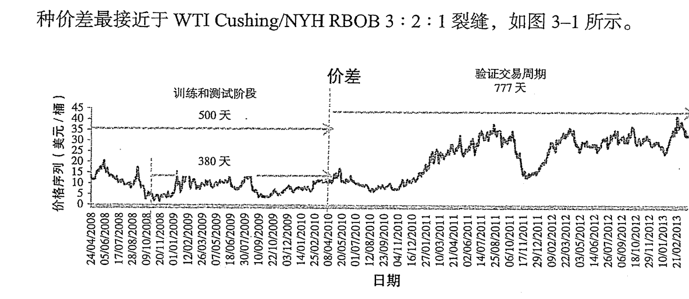

图3-1 3:2:1裂解价差全样本价格序列

这项研究的动机源于迪尼等人进行的初步分析。他们对纽约商品交易所西得克萨斯中间基原油（WTI）与纽约商品交易所无铅汽油（GAS）之间的裂解价差进行了建模。结论表明，神经网络提供了有趣的结果，其目的是通过扩展解释变量的范围，使用PSO算法和传统的方向传播算法在不同的滑动窗口上训练网络，更深人地了解使用非线性建模的好处。而且，每个模型都使用阈值确认过滤器进行过滤，以提高性能。此外，此处研究的价差还包括作为输出的燃料油，而以前的研究并没有包括燃料油。因此，由于燃料油直到2008年才开始交易，裂解价差使用三个变量计算，而不仅仅是迪尼等人交易的石油和汽油。在这里，我们研究了神经网络更深人的应用，以更准确地预测裂解价差的每日变化。

裂解价差使用三个变量计算。输入变量为原油（CL），以每桶美元计价；输出变量为汽油（RBOB）和燃料油（HO），两者均以每加仑美分计价。为了创建价差，需要转换单位。由于原油合约的数量为每份合约1000桶，而汽油和燃料油的数量均为每份合约42000加仑，那么后两者乘以0.42。这是基于每桶42加仑石油计算得出的。使用这种单位换算，输出可以换算成每桶美元，如等式（3.1）所示。

3:2:1裂解价差 St=\frac{(2×RBOB×0.42)+(1×HO×0.42)-(3×CL)}{3} (3.1)

在整个研究中，为了计算裂解价差的回报率，可以采用如等式（3.2）所示的方法。这种方法是由巴特沃斯（Butterworth）和霍姆斯（Holmes）和迪尼等人提供的：

\Delta S_t=\left[\left(\frac{P_{RBOB(t)}-P_{RBOB(t-1)}}{P_{RBOB(t-1)}}+\frac{P_{HO(t)}-P_{HO(t-1)}}{P_{HO(t-1)}}\right)-\left(\frac{P_{CL(t)}-P_{CL(t-1)}}{P_{CL(t-1)}}\right)\right] (3.2)

其中，\Delta S_t 为裂解价差在 t 时刻的收益变化百分比；P_RBOB(t) 为 t 时刻 RBOB 的价格（美元/桶）；P_RBOB(t-1) 为 t−1 时刻 RBOB 的价格（美元/桶）；P_HO(t) 为 t 时刻燃料油的价格（美元/桶）；P_HO(t-1) 为 t−1 时刻燃料油的价格（美元/桶）；P_CL(t) 为 t 时刻原油的价格（美元/桶）；P_CL(t-1) 为 t−1 时刻原油的价格（美元/桶）。

规模较大的炼油企业包括埃克森美孚公司（Exxon Mobil Corp.）、道达尔公司（Total S.A.）、荷兰皇家壳牌公司（Royal Dutch Shell Plc.）、雪佛龙公司（Chevron Corp.）、康菲国际石油公司（ConocoPhillips）和美国石油公司（BP Plc.），如图 3−2 所示。另一方面，图 3−3 主要关注中小型炼油企业，如西方炼油公司（Western Refining Inc.）、美国阿隆能源公司（Alon USA Energy Inc.）、赫斯公司（Hess Corp.）、美国特索罗石油公司（Tesoro Corp.）和瓦莱罗能源公司（Valero Energy Corp.）。图 3−2 和图 3−3 显示了与 2010 年 4 月 9 日至 2013 年 3 月 28 日期间交易

# 金融 AI

# 金融AI算法

# ARTIFICIAL INTELLIGENCE IN FINANCIAL MARKETS

他们运行了四个不同的滑动窗口，然后取这四个训练集的平均值来生成预测。张（Chang）等人发现，当使用集成和混合技术（如结合可变滑动窗口的多个预测）时，神经网络的性能得到了提高。塔瓦翁和恩克利用滑动窗口训练技术，使用从24年的数据中获得的31个输入值来预测标准普尔500指数的每月的时间序列。特别是他们使用了四个不同的滑动窗口来捕捉不同的趋势，同时还在每个窗口中记录了输入的重要性。他们发现，在四个训练阶段中，有六个输入始终被选择，其中包括所有城市消费者的消费者物价指数、货币供应量、三个月期国库债券费率、一个月期存款利率、BAA和AAA信用评级之间的违约价差、BAA和T120之间的违约价差，以及BAA和T3之间的违约价差。因此，假设这些变量作为预测每月S&P500时间序列的解释变量有“合理的”意义。

在人工神经网络和遗传进化算法的比较分析中，科特斯（Cortez）等人讨论了选择滑动窗口持续时间时可能出现的影响。例如，大的滑动窗口可能会增加神经网络的复杂性，从而最终降低模型的学习能力。另一方面，较小的窗口可能无法包含足够多的信息，使神经网络无法训练数据，并做出意义重大的预测。

# 描述性统计

所有数据均来自彭博社（Bloomberg）2008年4月24日至2013年3月28日期间的WTI原油、RBOB无铅汽油和燃油油期货合约。RBOB无铅汽油合约对交易所来说是相当新的，因为它取代了旧的无铅汽油合约，因为甲基叔丁基醚（methyl tert-butyl ether, MTBE）在2005年被淘汰了。① 数据集的分类如表3-1所示。

如表3-1所示，PSO RBF和MLP神经网络的建模和交易基于两个滑动训练窗口，其中最短周期使用380天的数据点，而较长周期使用500天的数据点。第一个代表的是一年半的工作日，第二个代表的是两个整年的工作日。任何少于380天的测试结果都不令人满意，因此可以假设训练期间没有足够的数据点来准确捕获数据中的模式。

表 3-1
数据集
| 时期 | 样本训练 / 测试天数 | 交易时间 | 开始 | 结束 |
| --- | --- | --- | --- | --- |
| 全部数据集 | 510a 390b | 777 | 24/04/2008 | 10/10/2008 | 28/03/2013 |
| 380 天训练（初始窗口） | 380 | 380 | 10/10/2008 | 08/04/2010 |
| 500 天训练（初始窗口） | 500 | 500 | 24/04/2008 | 08/04/2010 |
| 验证集（样本外） | 0 | 777 | 09/04/2010 | 28/03/2013 |
a. 除自回归输入外，所有输入均为 500 天；滞后 10 个回归时间的自回归输入为 10 天。
b. 除自回归输入外，所有输入均为 300 天；滞后 10 个回归时间的自回归输入为 10 天。

对于提出的 PSO RBF 和 MLP 模型，处理过度拟合可以采用双管齐下的方法。首先，将每个滑动窗口分成训练数据集和测试数据集。训练集占滑动窗口的 66.66%，其余的 33.33% 用于测试。在样本内回测期间测试第二个控件，并在验证期间完成，它在隐藏层中使用固定且恒定数量的神经元。例如，对于 PSO RBF 模型，在样本内回检时，共有 10 个神经元可以产生足够的结果，同时避免过度拟合。在没有“特征选择方法”的情况下，所有输入都是在 MLP 模型的训练过程中选择的。网络的复杂度是根据等式（3.3）中显示的输人数量计算的 ① ：

h=(n+1)/2 （3.3）
其中，h 为隐藏的神经元数量；n 为输人数。

PSO 算法可以用于计算 RBF 神经网络的隐藏神经元的数量。该算法被编程，以适应、搜索和识别“最优”数量的神经元。这些实验的结果在隐藏层中会产生 25~30 个神经元。在这种情况下，一个神经元数量达到 30 个的网络复杂性会“过度拟合”数据集。因此，可以使用更少的（如 10 个）神经元，以减少与不那

——

> ① 在 MLP 训练过程中，总共使用了 30 个隐藏神经元。

[PAGE 83]

# 第3章
裂解价差的建模、预测和交易：一种用于训练神经网络的滑动窗口方法

# 续前表

# 按照训练窗口 A% 选择

# 380 天 PSO RBF 滑动窗口

# 500 天 PSO RBF 滑动窗口

# 一天预测

| 神经输入 = 总数 59 | 滞后 | 380 天 PSO RBF 滑动窗口 | 500 天 PSO RBF 滑动窗口 | 一天预测 |
| --- | --- | --- | --- | --- |
| 自回归收益 | 10 | 46.69 | 39.74 |
| 埃克森美孚公司股票价格回报 | 1 | 43.70 | 43.91 |
| 全部 S.A. 股价回报 | 1 | 47.65 | 51.50 |
| 荷兰皇家壳牌股价回报 | 1 | 52.35 | 50.85 |
| 雪佛龙公司股价回报 | 1 | 46.15 | 52.03 |
| 康菲石油的股价回报 | 1 | 51.39 | 44.44 |
| 英国石油公司股价回报 | 1 | 52.46 | 52.78 |
| 美国阿隆能源公司股票价格收益 | 1 | 48.61 | 54.28 |
| 赫斯公司股票价格回报 | 1 | 53.10 | 52.89 |
| 美国特索罗石油公司股价回报 | 1 | 50.43 | 51.28 |
| 瓦莱罗能源公司的股票价格的回报 | 1 | 49.57 | 45.94 |
| 原油（NYM$/桶）回报 | 1 | 50.43 | 55.02 |
| 布伦特原油（ICES/桶）回报 | 1 | 34.08 | 26.71 |
| 纽约 Harb RBOB（NYM $/ 加仑）回报 | 1 | 47.97 | 49.25 |
| 燃料油（NYM$/加仑）回报 | 1 | 47.12 | 45.41 |
| 天然气（NYM$/英热）回报 | 1 | 48.82 | 51.28 |
| 芝加哥期权交易所市场波动率收益系列 | 1 | 48.18 | 51.71 |
| 黄金（NYM$/盎司）回报系列 | 1 | 47.76 | 47.54 |
| 银（NYM$/盎司）回报系列 | 1 | 48.51 | 52.67 |
| 英镑回报系列 | 1 | 46.15 | 46.90 |
| 美元兑欧元回报系列 | 1 | 48.18 | 45.09 |
| 美元兑日元回报系列 | 1 | 48.83 | 46.15 |
| 美元兑瑞士法郎回报系列 | 1 | 47.65 | 47.33 |
| 美元兑加元回报系列 | 1 | 47.86 | 46.90 |

[PAGE 84]

# 第3章
裂解价差的建模、预测和交易：一种用于训练神经网络的滑动窗口方法

# 续前表

| 神经输入 = 总数 59 | 滞后 | 380天 PSO RBF 滑动窗口 | 500天 PSO RBF 滑动窗口 |
|----------------------|------|------------------------|------------------------|
| 美元兑澳元回报系列   | 1    | 46.69                  | 46.15                  |
| 美元兑英镑回报系列   | 1    | 50.00                  | 47.22                  |
| 欧元斯托克 500 回报系列 | 1    | 50.75                  | 48.08                  |
| 标准普尔 500 回报系列 | 1    | 48.29                  | 50.64                  |
| FTSI100 指数回报系列 | 1    | 49.79                  | 47.44                  |
| 摩根士丹利欧澳远东回报系列 | 1    | 48.83                  | 49.47                  |
| 摩根士丹利世界指数回报系列 | 1    | 49.36                  | 49.47                  |
| 摩根士丹利全球指数回报系列 | 1    | 50.54                  | 50.43                  |
| 2 年美国国债回报系列 | 1    | 51.39                  | 48.93                  |
| 5 年美国国债回报系列 | 1    | 51.82                  | 51.07                  |
| 10 年美国国债回报系列 | 1    | 54.81                  | 49.89                  |
| 30 年美国国债回报系列 | 1    | 53.31                  | 48.18                  |
| 21 天移动平均回报系列 | 21   | 53.74                  | 49.57                  |
| 50 天移动平均回报系列 | 50   | 51.39                  | 48.72                  |
| 100 天移动平均回报系列 | 100  | 53.95                  | 48.61                  |
| 150 天移动平均回报系列 | 150  | 50.32                  | 47.65                  |
| 200 天移动平均回报系列 | 200  | 50.11                  | 51.49                  |
| 250 天移动平均回报系列 | 250  | 54.38                  | 54.06                  |
| ARMA1 回报           | (10,10) | 43.80                  | 48.29                  |
| ARMA2 回报           | (8,8)  | 45.62                  | 44.55                  |
| ARMA3 回报           | (13,13) | 55.99                  | 63.57                  |
| ARMA4 回报           | (4,4)  | 47.65                  | 47.76                  |
| ARMA5 回报           | (12,12) | 55.63                  | 52.99                  |
| GARCH1 回报         | (16,16) | 59.61                  | 59.40                  |
| GARCH2 回报         | (15,15) | 59.08                  | 68.27                  |

[PAGE 85]

# 金融AI算法

# ARTIFICIAL INTELLIGENCE IN FINANCIAL MARKETS

# 续前表

每个输入在所有训练期间被选择的时间百分比是基于等式（3.4）估算的：

输人选择百分比 = N / R* *with R = (S - X) / St+n （3.4）

其中，N为重复选择一个输入的滑动窗口的次数；R为重复选择数；S为全部数据集；X为滑动窗口天数；St+n 为价差预测期。

表3-3 总结了最重要的PSO RBF神经输入。尤其是，ARMA和GARCH 输入被证明是最有价值的解释变量之一。

| 解释变量 | 滞后（天数） | 380天滑动窗口（%） | 500天滑动窗口（%） |
| :--- | :--- | :--- | :--- |
| 分散回报系列 | 2 | 68.06 | 65.92 |
| 英国石油公司股回报 | 1 | 52.46 | 52.78 |
| 西方炼油企业股回报 | 1 | 48.61 | 54.28 |
| 美国阿隆能源公司股回报 | 1 | 53.10 | 52.89 |
| 瓦莱罗能源公司的股票价格的回报 | 1 | 50.43 | 55.02 |
| 10年美国国债回报 | 1 | 54.81 | 49.89 |
| 30年美国国债回报 | 1 | 53.31 | 48.18 |
| 250天移动平均回报系列 | 250 | 54.38 | 54.06 |
| ARMA（13，13） | 13 | 55.99 | 63.57 |
| ARMA（12，12） | 12 | 55.63 | 52.99 |
| GARCH（16，16） | 16 | 59.61 | 59.40 |
| GARCH（15，15） | 15 | 59.08 | 68.27 |

通过纳入ARMA和GARCH时间序列，模型的交易表现和统计准确度得到了显著提高。此外，裂解价差的建模中还包括了价差收益的自回归时间序列。来自滞后1~10天的滞后价差收益的最重要的输入是两天的滞后，在380天的滑动窗口期内，这一点有68.06%的时间被选择；在500天的滑动窗口期内，65.92%的时间被选择。其他影响更大的输入包括一些炼油企业股价的每日变化，如相对于其

[PAGE 86]

# 第3章
裂解价差的建模、预测和交易：一种用于训练神经网络的滑动窗口方法

他炼油企业，英国石油公司、瓦莱罗能源公司、美国阿隆能源公司和西方炼油公司均被视为更重要。每一项输入都滞后一天。此外，在美国国债利率的每日变化中，10年和30年的利率分别被选择了54.81% 和 53.31%。有趣的是，布伦特原油商品指数是最少被选择的投入，因为它只有26.71% 的时间使用500天滑动窗口。

图3-4显示了整个样本期内价差收益序列的柱状图。图中显示出一个具有正高峰度的尖峰分布。然而，当观察收益序列的正态分布时，这是很常见的，因为数据点往往高度集中在均值周围。此外，所有价差均被确认为非正态（经Jarque-Bera检验统计，在99%的置信水平得到确认）。

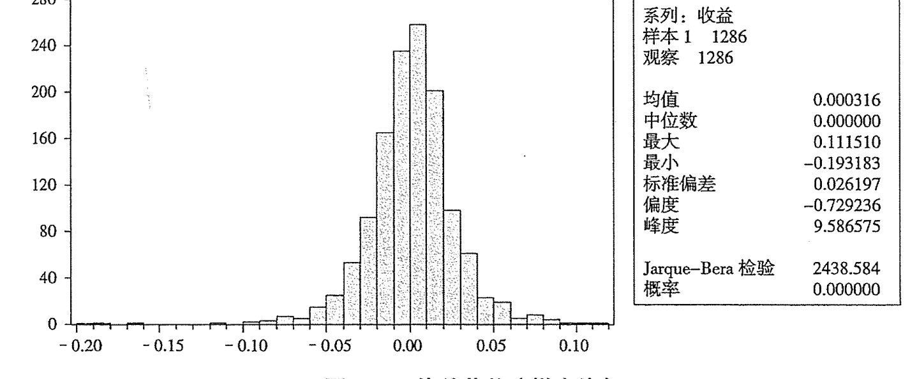

本文后的附录展示了ARMA模型和GARCH模型的等式和估计输出。所有ARMA模型在95%置信水平上都具有显著性，因为它们的p值对于每个估计的（p，q）项都小于0.05。GARCH模型被认为是稳定的，而且两种模型的各项在95%置信水平上也是显著的。平方残差检验被用于对残差进行序列相关性检验，该检验揭示了两个模型中都不存在序列相关性。因此，估计的模型被认为是足够的，并作为神经网络的训练滑动窗口过程中包含的两个解释变量，用于估计价差的变化。

[PAGE 87]

# 金融AI算法

# ARTIFICIAL INTELLIGENCE IN FINANCIAL MARKETS

# 方法

# MLP模型

多层感知器（MLP）允许用户选择一组激活函数（包括恒等式、逻辑、双曲正切、负指数和正弦）来进行探索。¹ 这些激活函数可用于隐藏神经元和输出神经元。MLP还使用各种算法训练网络，如梯度下降、共轭梯度法和BFGS算法（broyden-fletcher-goldfarb-shanno algorithm）。此处使用了逻辑激活函数和梯度下降算法。

传统MLP网络的网络架构如图3–5所示。

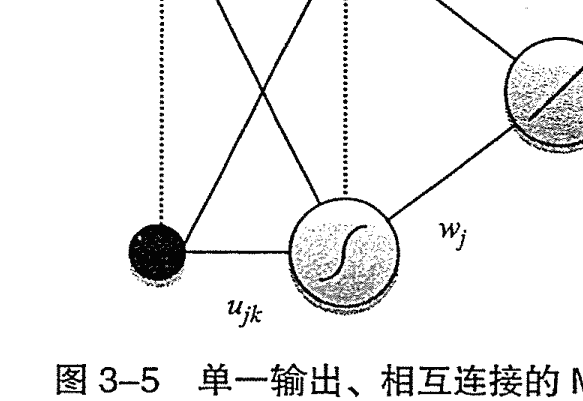

# 图3–5 单一输出、相互连接的MLP模型

其中，x_t^[n] (n = 1, 2, … , k + 1) 为在t时刻的模型输入（包括输入偏置节点）；h_t^[m] (m = 1, 2, … , j + 1) 为隐藏节点输出（包括隐藏偏置节点）；ŷ_t 为MLP模型的输出；u_jk 和w_j 为网络权重。

◯为非线性传递函数：

```
S(x)=\frac{1}{1+e^{-x}}
```

> (3.5)

>

# 金融AI算法

# ARTIFICIAL INTELLIGENCE IN FINANCIAL MARKETS

学者都已经研究过标准的RBF神经网络，但是PSO算法和神经网络的结合在时间序列分析中是相对较新的。正如陈（Chen）和钱（Qian）所解释的那样，PSO算法优化了传统的RBF中的参数，尤其是这种优化有助于克服与标准反向传播算法相关的低效率。

正如康斯坦丁诺斯等人所详细讨论的那样，RBF神经网络通过非正交的径向对称函数的叠加来逼近期望函数。其网络架构如图3–6所示。

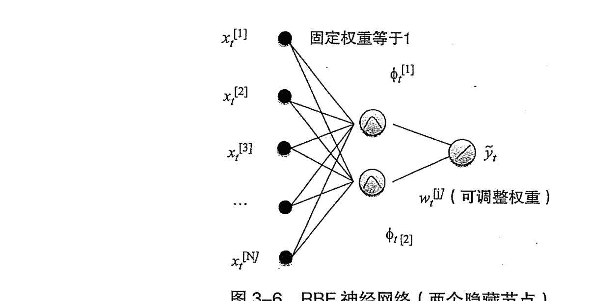

此处，隐藏层使用的是高斯径向基函数，如等式（3.8）所示，它是现有金融时间序列文献中最常见的一种函数。

其中，x_t(n = 1, 2, … , N + 1)为输入值（包括输入偏置节点）；ŷ_t为RBF模型的输出；x_t^[N](j = 1, 2)为可调整权重；⊕为是高斯函数：

φ^i_t(x) = e ^{-|x - c_i|^2 / (2σ_i^2)} （3.8）

在该函数中，C_i表示高斯函数中心的向量；σ_i表示其宽度的值。C_i、σ_i和权重W_i是在训练RBF神经网络的学习阶段由PSO算法优化的参数。

⊗是线性输出函数：U(x)=∑_i x_i （3.9）

# 第3章
裂解价差的建模、预测和交易：一种用于训练神经网络的滑动窗口方法

最小误差函数为：

$$E(C,\sigma,w_t)=\frac{1}{T}\sum_{t=1}^{T}[y_t-\tilde{y}_t(w_t,C,\sigma)]^2 \tag{3.10}$$

其中，y_t是目标值；T是交易天数。

为了使年化收益最大化，可以采用额外的适应度函数，如等式（3.11）所示。
这种方法最早由森普尼斯等人提出。

最大化的年化收益函数是：

$$R^A - MSE-(n*10^{-2}) \tag{3.11}$$

其中，R^A是年化收益；MSE为等式（3.10）中定义的均方误差①；n为输入值的数量。

R^A项在-0.4 ~ 0.5之间，而实验结果表明，MSE项的最大值为0.01。建立这些参数使该算法可以主要搜索盈利预测，而统计性能成为次要因素。

最初，PSO与RBF神经网络组合的相结合的混合方法是受到了李（Li）和希奥斯（Xios）的启发，同时也是森普尼斯等人提出的PSORBF方法学的拓展。
PSO算法用于定位RBF神经网络的参数C_i，同时定位作为RBF网络输入的最优特征子集。

应用PSO算法来优化训练过程降低了传统神经网络的复杂性。康斯坦丁诺斯等人提出，PSO算法将网络权重值编码为粒子分量，每个粒子基于最小化等式（3.10）中的误差函数来评估输入。PSO参数也是“自适应的”，如等式（3.12）、等式（3.13）和等式（3.14）所示。这被证明对更广泛的用户有利。因此，最初由肯尼迪和艾伯哈特描述的“速度”适用于保留输入（粒子）在群体（群）中最佳位置的算法。

> ① 隐藏神经元的数量乘以10⁻²是因为与其他两个目标（年化收益最大化和最小化均方误差）相比，导出的神经网络的简单性是次要的。

# 金融AI算法

# ARTIFICIAL INTELLIGENCE IN FINANCIAL MARKETS

W_{(T)}=(0.4/N^2)*(T-N)^2+0.4 \ (3.12)

c1_{(T)}=(-2)*T / N+2.5 \ (3.13)

c2_{(t)}=(2)*T / N+0.5 \ (3.14)

其中，T为当前的迭代；N为迭代总数。

使用PSO算法，传统的神经网络权重矩阵可以被重组为随机初始化粒子的阵列，从而开始优化过程。在搜索过程中，PSO算法评估的是“全局”变量和“局部”变量。局部变量是单个粒子迄今为止获得的最佳解，而全局变量是在整个粒子群中获得的最佳解。此外，穆哈格吉（Mohaghegi）等人指出，粒子有重复它们过去的行为（认知）和遵循那些被认为“适合”（社会化）的行为的倾向。这种行为的最终结果是粒子群聚集在一起，从而产生一个最优解。在完成迭代后，粒子返回其最佳位置，这个位置在搜索/训练过程中被识别出来。PSO算法的预定义参数参见附录中的表3-12和表3-13。更详细的解释请参阅埃伯哈特和康斯坦丁诺斯等人的论文。

在训练阶段，权重值从1.0减少至0.4，以寻找提出的问题的解决方案。在选择合适的训练集时，PSO算法的终止准则为10⁻³。最终，当迭代次数达到100次或者年化收益的利润达到最大值时，训练就会停止。

# 实证结果

一般的交易规则是在有正面预测时做多价差，在有负面预测时做空价差。当产生连续的正信号或负信号时，则头寸将保持在前一个信号时。当WTI原油被卖出，同时买入燃料油和RBOB汽油时，就会出现做多价差或买入价差。当购入WTI原油，同时卖出燃料油和RBOB汽油时，就会出现做空价差或卖出价差。

# 统计的准确性

统计数据是通过取10次执行的平均值来计算的，以减少每次预测的方差。由于神经网络本质上是随机的，因此使用从众多模型中得到的平均值对从业者来说是最有利的。由于预测都是由大量的计算机完成的，所以计算并不太耗时。如表3–4所示。

# 表 3–4 样本外交易统计

| 统计性能       | PSO RBF 模型       | MLP 模型       |
|----------------|--------------------|----------------|
| 滑动训练窗口   | 380               | 500            |
| 预测          | 5 天前            | 5 天前         |
| 平均绝对误差   | 0.0147            | 0.0205         |
| 平均绝对百分比误差 | 166.87%      | 420.05%        |
| 根均方误差     | 0.0194            | 0.0263         |
| 泰尔 U         | 0.8369            | 0.6877         |
| 正确的方向变化（CDC） | 52.38%      | 50.32%         |

从统计的角度来看，在预测r+5回报时，经过超过380天训练的PSO RBF模型是最准确的，尤其是正确的方向变化（CDC）统计超过50%。与PSO RBF模型相比，两种MLP滑动窗口模型的精确度都较低。对于所有其他统计数据，它们越低，模型就越准确。正如迪尼等人所解释的那样，均方根误差（root mean squared error, RMSE）和平滑绝对误差（mean absolute error, MAE）统计数据是“尺度相关”的度量。这些数据为建人员提供了统计数据，以便将每个模型与实际的裂解价差数据进行比较。泰尔U统计量是介于0到1之间的一个统计量，产生0的模型被认为是“完美的”模型。尽管统计的准确性很重要，但最终的测试是模型在可接受的风险水平下产生利润。因此，很多交易者会对模型如何交易更感兴趣。

# 交易表现

在训练过程中，每个PSO RBF模型的最佳权重都会被记录下来，这些数据可以在本章附录中找到（如表3–14和表3–15所示）。由于每个模型都是基于五个基础模型的平均值，所以总共有10组最佳权重。

# 金融AI算法

# ARTIFICIAL INTELLIGENCE IN FINANCIAL MARKETS

大量的滑动窗口会进行回溯测试，然后进行交易，以预测裂解价差。如前所述，任何观察时间少于380天的窗户都会产生令人不满意的结果。

表3-5显示了380天和500天滑动训练窗口的未过滤结果。该表显示，使用380天滑动窗口训练的PSO RBF实现了最高的年化收益和最佳的风险收益平衡。这一点受到了经过超过500天训练的PSO RBF模型的严峻挑战。也经过380天和500天训练的MLP模型连续排名第三和第四。另一个有趣的观察结果是，使用380天滑动窗口训练的PSO RBF和MLP模型与各自的500天模型相比，具有更差的最大回撤。然而，为了使最大回撤最小化，我们使用在训练期间被优化的阈值滤波器来过滤每个模型。

# 表3-5 样本外未过滤的交易表现

| 交易表现       | PSO RBF模型       | MLP模型       |
|-----------------|-------------------|----------------|
| 滑动训练窗口    | 380               | 500           |
| 预测范围        | 5天前             | 5天前         |
| 年化总收益      | 32.99%            | 22.02%        |
| 年波幅          | 23.92%            | 23.94%        |
| 最大累计回撤率   | -44.90%           | -46.31%       |
| 平均日回撤率     | -6.13%            | -7.07%        |
| 最大回撤持续期（天）| 248              | 234           |
| 平均回撤持续期（天）| 29               | 50            |
| 卡玛比率        | 0.73              | 0.48          |
| 信息比率        | 1.38              | 0.92          |
| #交易量（年化）  | 109               | 104           |
| 总交易天数      | 777               | 777           |
| 交易成本（年化）  | 10.83%            | 10.38%        |
| 净年化收益      | 22.16%            | 11.64%        |
| 排名           | 1                 | 3             |
(注：使用盈透证券提供的10个基点（bps）往返交易成本。)

# 第3章
裂解价差的建模、预测和交易：一种用于训练神经网络的滑动窗口方法

表3-6列出了经过过滤的交易模拟结果。利用该阈值过滤器，模型仅在PSO RBF和MLP神经网络模型产生大于x或小于x的预测时进行交易。这些x参数在样本期内被优化，作为每个模型交易的阈值。①当比较每个预测的收益序列时，很明显，MLP模型更不稳定，因为它们不包括等式（3.11）中定义的可以使年化收益最大化的额外适应度函数。使用这个过滤器，只有更大、更重要的预测被交易，而价差中较小、不太重要的变化都被过滤掉了。这可以最大限度地减少资金投入，降低波动性，同时增加年化收益。PSO RBF模型的模型排名保持不变，该模型经过了超过380天的滑动窗口训练，产生了最高的年化收益和最佳风险/收益均衡。

# 表3-6 样本外过滤的交易表现

| 交易表现       | PSO RBF模型     | MLP模型      |
|------------------|------------------|--------------|
| 滑动训练窗口     | 380              | 380          |
|                  | 500              | 500          |
| 预测范围         | 5天前            | 5天前        |
| 年化总收益       | 33.26%           | 19.84%       |
| 年波幅           | 18.19%           | 13.28%       |
| 最大累计回撤率    | -19.70%          | -16.68%      |
| 平均日回撤率      | -2.75%           | 2.63%        |
| 最大回撤持续期（天）| 102              | 194          |
| 平均回撤持续期（天）| 19               | 32           |
| 卡玛比率         | 1.69             | 1.19         |
| 信息比率         | 1.83             | 1.49         |
| #交易量（年化）   | 90               | 55           |
| 总交易天数       | 777              | 777          |
| 交易成本（年化）   | 8.98%            | 5.48%        |
| 净年化收益（包括成本）| 24.28%         | 14.36%       |
| 年化收益过滤效果   | 2.12%            | 2.72%        |
|------------------|------------------|--------------|

> ① 对于RBF 380天和500天模型，x参数=0.20%。对于MLP 380天模型，x参数=1.90%。对于MLP 500天模型，x参数=1.45%。

# 金融 AI 算法

# ARTIFICIAL INTELLIGENCE IN FINANCIAL MARKETS

# 续前表

| 交易表现       | PSO RBF 模型       | MLP 模型       |
|------------------|--------------------|----------------|
| 滑动训练窗口      | 380               | 500            |
| 预测范围         | 5 天前            | 5 天前         |
| 波幅降低         | 5.73%             | 6.17%          |
| 回撤率降低        | 25.20%            | 9.75%          |
| 排名             | 1                 | 2              |
|                  |                   |                |

注：使用透盈证券提供的 10 个基点（bps）循环交易成本。

在交易期货合约时，交易者必须指导利润率。目前，每份合约的利润率都是 9% 左右，但大多数经纪人都是在总体水平上计算利润率的，在这种情况下，利润率将根据 WTI 原油、RBOB 汽油和燃料油的价差表现来计算。考虑到这一点，交易者可以将卡玛比率（Calmar Ratio ））作为一个指标，用以衡量一个模型在一个单位的压降中产生多少回报，以此作为他们选择合适模型的标准之一。因此，与信息比率类似，产生一个以上的比率的模型将被视为“好”模型。用于计算卡玛比率的公式见附录。在这种情况下，交易者将使用 380 天交易过滤的 PSO RBF 模型来训练网络，以便预测未来五天。卡玛比率提供了风险调整性能的指示，对于提出的 PSO RBF 过滤（380 天滑动窗口）模型而言，它的值为 1.69。因此可以假设，一个单位的回撤将产生 1.69 个单位的收益。这是未经过滤的性能的两倍多，而未经过滤的性能的卡玛比率仅为 0.73，因为过滤器的最大回撤率明显更高。在波动性方面，PSO RBF 模型（380 天滑动窗口）也产生了最具吸引力的风险 / 收益情况，因为它以 1.83 的信息比率进行交易。模型的交易频率经常因为过滤器较低，从而降低了交易成本的影响。高交易成本是迪尼等人强调的主要缺点之一，交易成本的年平均值为 17.03%，MLP、循环神经网络和高阶神经网络模型每年触发

# 金融AI算法

# ARTIFICIAL INTELLIGENCE IN FINANCIAL MARKETS

阈值确认过滤器只在每个预测大于x%或小于-x%时产生交易信号。这样，每个模型仅在预测表明价差有更明显的变动时才会进行交易。结果，信息比率和卡玛比率明显提高。经过380天滑动窗口训练的RBF模型现在的信息比率为1.83，卡玛比率为1.69。另一个使用500天滑动窗口训练的RBF模型产生的信息比为1.61，卡玛比率为1.48。380天和500天MLP滑动窗口模型的过滤收益率也分别提高了14.36%和14.05%。与RBF模型类似，信息比率和卡玛比率也显著提高。总之，每种模拟的风险收益比和最大回撤收益比都得到了改善。所有模型对于每一个风险单位（年化波动率）都回报超过一个单位的回报（年化收益率）。由于期货合约的价差交易通常要求市场参与者满足追加保证金的要求，交易者必须注意价差的不利变化。考虑到这一点，交易者的目标是选择一个相对于回撤能够产生最高收益的模型。在这种情况下，交易者会选择PSO RBF 380天滑动窗口模型，因为该模型在交易时的卡玛比率高达1.69。

本研究中存在一些局限性。例如，只有少数滑动窗口被分析和交易，其中两个最合适的时期显示在实证结果中。从组合滑动窗口获得的结果可以提高性能，并将在未来的应用中得到研究。还可以进行进一步的研究，以便根据梅滕海姆和布莱特纳提出的多个模型的集合来生成预测。最后，提出的PSO RBF模型也可以应用于其他资产类别，如股票、外汇、衍生品和固定收益，以测试其稳健性。

# 附 录

# 性能测量

如表3-7所示。

# 补充信息

如表3-8所示。

# 第3章

# 裂解价差的建模、预测和交易：一种用于训练神经网络的滑动窗口方法

统计和交易业绩指标

| 根均方误差 (RMSE) | 平均绝对误差 (MAE) | 平均绝对百分比误差 (MAPE) | THEIL 不等式系数 U | 正确的方向变化 (CDC) | 年化收益 | 累计收益 | 年波幅 | 信息比率 |
| --- | --- | --- | --- | --- | --- | --- | --- | --- |
| ... | ... | ... | ... | ... | ... | ... | ... | ... |

# 金融 AI 算法

# ARTIFICIAL INTELLIGENCE IN FINANCIAL MARKETS

Maximum negative value of ∑(Rᵢ) over the period\nMax DD = Min[Rᵢ − Max(∑Rᵢ)]\nCR = Rᴬ / |MaxDD|

续前表

| 最大回撤率 | 卡玛比率 |
| --- | --- |
| ... | ... |

# 表 3-8
炼油企业的市值

| 炼油企业 | 市值（单位：百万美元） | As at: | Source |
| --- | --- | --- | --- |
| 埃克森美孚公司 | 384 819 | 2013-03-05 | FactSet (2013) |
| 雪佛龙石油公司 | 222 559 | 2013-03-05 | FactSet (2013) |
| 荷兰皇家壳牌集团 | 134 994 | 2013-03-05 | FactSet (2013) |
| 英国石油公司 | 84 283 | 2013-03-05 | FactSet (2013) |
| 道达尔公司 | 83 399 | 2013-03-05 | FactSet (2013) |
| 康菲国际石油公司 | 69 458 | 2013-03-05 | FactSet (2013) |
| 赫斯公司 | 22 959 | 2013-03-05 | FactSet (2013) |
| 瓦莱罗能源公司 | 21 190 | 2013-03-05 | FactSet (2013) |
| 美国特索罗石油公司 | 6737 | 2013-03-05 | FactSet (2013) |
| 西部炼油公司 | 2629 | 2013-03-05 | FactSet (2013) |
| 美国阿隆能源公司 | 1056 | 2013-03-05 | FactSet (2013) |

# ARMA 等式与预测

ARMA 模型假设时间序列的未来值由其历史值（自回归分量）与之前的残值（移动平均分量）决定。典型的 ARMA 模型采用等式（3.15）的形式：

Y_t = φ₀ + φ₁Y_{t−1} + φ₂Y_{t−2} +…+ φ_p Y_{t−p} + ε_t − w₁ε_{t−1} − w₂ε_{t−2} −…− w_qε_{t−q}		( 3.15 )

其中，Y_t 为时间 t 的因变量；Y_{t−1}、Y_{t−2}、Y_{t−p} 为滞后因变量；φ₀、φ₁、φ₂ 和 φ_p 为回归系数；ε_t 为残差；ε_{t−1}、ε_{t−2}、ε_{t−p} 为残差的先前值；w₁、w₂、w_q 为权重。

使用相关图作为训练和测试子周期的指引，选择以下受限的 ARMA 模型来交易每个价差。所有系数在 95% 的置信区间内都具有显著性。因此，如表 3-9 所示，在 95% 置信区间，所有系数（除常数外）与零无显著差异的零假设被驳回。

# 金融AI算法

# ARTIFICIAL INTELLIGENCE IN FINANCIAL MARKETS

| ARMA模型       | 等式                                                                                     |
|---------------|----------------------------------------------------------------------------------------|
| (10,10)       | Yᵗ=5.22*10⁻⁴−0.583Yᵗ₋₁+0.458Yᵗ₋₆−0.481Yᵗ₋₉−0.568Yᵗ₋₁₀ −0.575εᵗ₋₁+0.450εᵗ₋₆−0.516εᵗ₋₉−0.595εᵗ₋₁₀ (3.16) |
| (8,8)         | Yᵗ=4.79.10⁻⁴−1.161Yᵗ₋₁−0.208Yᵗ₋₄+0.122Yᵗ₋₈−1.067εᵗ₋₁ −0.257εᵗ₋₄+0.159εᵗ₋₈ (3.17)           |
| (13,13)       | Yᵗ=3.91.10⁻⁴−0.605Yᵗ₋₁+0.503Yᵗ₋₅+0.220Yᵗ₋₁₃−0.603εᵗ₋₁ +0.551εᵗ₋₅+0.222εᵗ₋₁₃ (3.18)         |
| (4,4)         | Yᵗ=4.33.10⁻⁴−0.510Yᵗ₋₁+0.109Yᵗ₋₂−0.558Yᵗ₋₃−0.891Yᵗ₋₄ −0.519εᵗ₋₁+0.113εᵗ₋₂−0.569εᵗ₋₃−0.953εᵗ₋₄ (3.19) |
| (12,12)       | Yᵗ=4.80.10⁻⁴+0.551Yᵗ₋₁−0.699Yᵗ₋₃−0.345Yᵗ₋₇−0.177Yᵗ₋₁₂ +0.554εᵗ₋₁−0.709εᵗ₋₃−0.283εᵗ₋₇−0.171εᵗ₋₁₂ (3.20) |

# GARCH 等式与预测

每个 GARCH 模型（16，16）和（15，15）在 95% 的置信水平都被认为是稳定和显著的。在对有效项进行初步预测之后，可以通过平方残差检验、Jarque-Bera 检验和 Arch 检验来检验残差的可靠性。为了简洁起见，我们没有给出这些测试的输出。这些数据可以从相应作者那里获取。这两个模型都不存在自相关，因此在训练所提出的 PSO RBF 神经网络时，每个模型的收益都被用作输入，如表 3–10 所示。

# 表 3–10 GARCH 模型 1

| GARCH 模型 #1（16,16）                |
|----------------------------------------|
| 因变量：收益                             |
| 方法：ML-ARCH                           |
| 样本（调整后）：4/22/2008 3/29/2012       |
| 包括观察结果：1028 调整后                 |
| 变量     系数       标准误      Z 统计量  概率   |
| C       0.001335  0.000660  2.023991  0.0430 |
| AR(1)   -0.114106  0.016479  -6.924442  0.0000 |
| AR(2)   -0.069719    0.013631     -5.114936  0.0000 |
| AR(10)     -0.019143    0.007719     -2.480175  0.0131 |
| AR(16)     -0.879046    0.013540     -64.92089  0.0000 |
| MA(1)      0.120446     0.016908     7.123546  0.0000 |
| MA(2)      0.065817     0.012455     5.284208  0.0000 |
| MA(10)     -0.018657    0.008031     -2.323231  0.0202 |
| MA(16)     0.897817     0.012306     72.95477  0.0000 |
| C          | 1.42E-05     4.07E-06     3.478155  0.0005 |
| RESID(-1)^2| 0.083038     0.012924     6.425038  0.0000 |
| GARCH(-1)  | 0.896013     0.014846     60.35321  0.0000 |
| r²         | 0.046906     因变量均值   | 0.000433 |
| 调整后r²    | 0.039424     因变量标准差 | 0.027925 |
| 回归标准误  | 0.027369     赤池信息准则 | -4.622048 |
| 残差平方和  | 0.763277     施瓦兹准则  | -4.564436 |
| 对数似然函数值| 2387.733   | 汉南－奎因准则| -4.600181 |
| Durbin-Watson统计量| 1.987245 |           |           |


# 第3章
裂解价差的建模、预测和交易：一种用于训练神经网络的滑动窗口方法

# 续前表

| 变量       | 系数         | 标准误       | Z统计

# 金融AI算法

# ARTIFICIAL INTELLIGENCE IN FINANCIAL MARKETS

| 续前表 | 模型 1 神经元权重 输入权重 (10) (59) | 模型 2 神经元权重 输入权重 (10) (59) | 模型 3 神经元权重 输入权重 (10) (59) | 模型 4 神经元权重 输入权重 (10) (59) | 模型 5 神经元权重 输入权重 (10) (59) |
| --- | --- | --- | --- | --- | --- |
| 输入权重 | 1.0300 1.3445 1.2052 1.5575 1.5098 0.5978 0.6767 1.3888 0.9817 0.8911 1.2582 1.2932 0.2583 1.0916 2.0000 1.3646 0.5081 | 0.4051 0.4431 0.5780 0.4983 0.6500 1.2786 1.5096 0.8247 1.3836 0.4707 1.0670 1.3856 0.7562 0.5513 1.3917 1.0909 1.2711 | 0.3318 0.4533 0.8925 0.8876 1.4789 0.5971 1.5781 0.8714 0.9597 1.4192 1.3436 0.6297 0.6838 0.8909 0.2423 1.1447 0.6872 | 1.7501 0.9295 1.3986 1.2384 1.0788 0.7477 1.1139 1.3540 1.8071 0.4874 0.5496 1.1938 1.5778 1.0532 1.2421 0.9372 1.2271 | 0.5996 0.9293 0.9627 0.5914 0.3870 1.0267 1.0592 0.9540 0.9369 1.1501 1.1824 1.1921 1.1152 0.9206 0.5978 0.9002 0.7934 |
| 神经元权重 | #N/A #N/A #N/A #N/A #N/A #N/A #N/A #N/A #N/A #N/A #N/A #N/A #N/A #N/A #N/A #N/A #N/A | #N/A #N/A #N/A #N/A #N/A #N/A #N/A #N/A #N/A #N/A #N/A #N/A #N/A #N/A #N/A #N/A | #N/A #N/A #N/A #N/A #N/A #N/A #N/A #N/A #N/A #N/A #N/A #N/A #N/A #N/A #N/A #N/A #N/A | #N/A #N/A #N/A #N/A #N/A #N/A #N/A #N/A #N/A #N/A #N/A #N/A #N/A #N/A #N/A #N/A #N/A | #N/A #N/A #N/A #N/A #N/A #N/A #N/A #N/A #N/A #N/A #N/A #N/A #N/A #N/A #N/A #N/A #N/A |

# 第3章

# 裂解价差的建模、预测和交易：一种用于训练神经网络的滑动窗口方法

| 续前表 | 模型1 神经元权重 输入权重 (59) (10) 神经元权重 输入权重 (59) (10) 神经元权重 输入权重 (59) (10) 神经元权重 输入权重 (59) (10) 神经元权重 神经元权重 输入权重 (10) (59) ... (#N/A等数据按行列出，因图片中含大量数值和#N/A，此处简化表示核心结构) |

# 金融AI算法

# ARTIFICIAL INTELLIGENCE IN FINANCIAL MARKETS

## 表3-15

| 从500天训练窗口获得的最佳权重 | 模型 1 神经元权重 输入权重 输入权重 (59) (10) | 模型 2 神经元权重 输入权重 输入权重 (59) (10) | 模型 3 神经元权重 输入权重 输入权重 (59) (10) | 模型 4 神经元权重 输入权重 输入权重 (59) (10) | 模型 5 神经元权重 输入权重 输入权重 (59) (10) |
| --- | --- | --- | --- | --- | --- |
| 神经元权重 输入权重 输入权重 (59) (10) | 数据行内容 | 数据行内容 | 数据行内容 | 数据行内容 | 数据行内容 |
| （后续数据行，因图片细节省略为示例格式） | （对应模型1数据） | （对应模型2数据） | （对应模型3数据） | （对应模型4数据） | （对应模型5数据） |

# 第3章

# 裂解价差的建模、预测和交易：一种用于训练神经网络的滑动窗口方法

| 续前表 | 模型 1 | 模型 2 | 模型 3 | 模型 4 | 模型 5 |
| --- | --- | --- | --- | --- | --- |
| 输入权重 (59) | 0.8604 | 1.6899 | 0.8604 | 0.9526 | 1.2341 |
| 输入权重 (10) | #N/A | #N/A | #N/A | #N/A | #N/A |
| 神经元权重 输入权重 (59) | 1.3104 | 0.8265 | 1.3104 | 0.9526 | 1.4329 |
| 神经元权重 神经元权重 (10) | #N/A | #N/A | #N/A | #N/A | #N/A |
| ... （后续行按表格结构延续，因图片中有多行数据，需完整呈现表格内容）

## 续前表

## 金融AI算讲

# ARTIFICIAL INTELLIGENCE IN FINANCIAL MARKETS

模型 1

模型 2

模型 3

模型 4

模型 5

续前表

神经元权重 输入权重 (10) (59)

# 第3章

# 裂解价差的建模、预测和交易：一种用于训练神经网络的滑动窗口方法

| 续前表 | 模型 1 | 模型 2 | 模型 3 | 模型 4 | 模型 5 |
| --- | --- | --- | --- | --- | --- |
| 输入权重 (59) | 1.4776 | 1.4199 | 1.4776 | 1.4651 | 1.2946 |
| 输入权重 (10) | #N/A | #N/A | #N/A | #N/A | #N/A |
| 神经元权重 输入权重 (59) | 0.3409 | 1.0153 | 0.3409 | 1.1771 | 1.2813 |
| 神经元权重 神经元权重 (10) | #N/A | #N/A | #N/A | #N/A | #N/A |
| 神经元权重 神经元权重 输入权重 (59) | 1.1485 | 1.2068 | 1.1485 | 0.3835 | 1.5403 |
| 神经元权重 神经元权重 神经元权重 (10) | #N/A | #N/A | #N/A | #N/A | #N/A |
| 神经元权重 神经元权重 神经元权重 输入权重 (59) | 0.9180 | 0.3319 | 0.9180 | 0.5203 | 0.8887 |
| 神经元权重 神经元权重 神经元权重 神经元权重 (10) | #N/A | #N/A | #N/A | #N/A | #N/A |
| 神经元权重 神经元权重 神经元权重 神经元权重 输入权重 (59) | 1.2806 | 0.6448 | 1.2806 | 0.8930 | 0.5769 |
| 神经元权重 神经元权重 神经元权重 神经元权重 神经元权重 (10) | #N/A | #N/A | #N/A | #N/A | #N/A |
| 神经元权重 神经元权重 神经元权重 神经元权重 神经元权重 输入权重 (59) | 0.8480 | 1.5232 | 0.8480 | 0.6923 | 1.4762 |
| 神经元权重 神经元权重 神经元权重 神经元权重 神经元权重 神经元权重 (10) | #N/A | #N/A | #N/A | #N/A | #N/A |
| 神经元权重 神经元权重 神经元权重 神经元权重 神经元权重 神经元权重 输入权重 (59) |

# 金融 AI 算法

# ARTIFICIAL INTELLIGENCE IN FINANCIAL MARKETS

否满足终止标准，如果不满足，则返回第二步。我们使用了 GEP 期间没有运行的最大代数作为终止标准。结果给出了在进化过程中找到的最佳个体。

# GEPTrader 图形用户界面

GEPTrader 是一个使用 Java 编程语言实现的独立工具，旨在通过用户友好界面（如图 4–1 所示）向分析师和预测人员提供建议的 GEP 变体。历史数据可以使用逗号分隔的文件导入 GEPTrader 的图形用户界面，并且可以进一步调整 GEP 变量的参数。此外，GEPTrader 支持多线程并行执行，用户可以选择将在训练阶段使用的线程数量。当训练完成时，用户可以获得有关数学输入输出等式以及它们的性能指标和一些实际值与估计值的图形表示。


图 4–1 GEPTrader 图形用户界面

# 第 4 章

# GEPTrader: 一种用基因表达式编程构建交易策略的新工具

# 实验结果

# 基准模型

RW 模型和 MACD 模型是 GEP 算法的线性基准。三个神经网络模型和一个 GP 算法是非线性基准，所有使用的模型在文献中都有详细记载。神经网络通常由三层或更多层组成。第一层称为输入层（其节点数对应于独立变量的数量）。在本研究中，输入数据是从预测序列的前 12 个自回归滞后中选择的。对每组输入数据的具体选择主要基于样本内周期的灵敏度分析。最后一层称为输出层（其节点数对应于响应变量的数量）。节点的中间层（即隐藏层）将输入层和输出层分开。它的节点数量决定了模型能够拟合的复杂程度。每个节点通常将一层连接到下一层的所有其他节点。网络的训练（通过组织网络图将训练数据的输入值映射到相应的输出值的方式调整其权重）从随机选择权重开始，通过使用被称为误差反向传播的学习算法来进行。通过最小化样本内数据集子集（每次样本内周期的最后一年）中的均方误差来优化迭代长度。最流行的神经网络模型结构是 MLP。递归神经网络具有体现短期记忆和过去错误的能力，而高阶神经网络能够捕获数据集内更高阶的相关性（高至三阶或四阶）。

遗传编程是进化代数表达式的算法，可以分析 / 优化 “树状结构” 的结果。科扎对遗传编程进行了更完整的描述。

# 统计性能

在表 4 - 2 中，所有样本外周期模型的统计性能都显示为均方根误差、平均绝对误差和泰尔 U 统计量。我们对结果的解释是，输出越低，相关模型的预测准确度越高。佩萨兰（Pesaran）和蒂默曼（Timmermann）进行的测试（即 PT 测试）检验了实际值和预测值的方向轨迹是否一致。此外，它还检验了预测值的上升和下降与时间序列的实际上升和下降之间的关系。零假设是这样的，即所研究的模型在预测 ETF 收益序列时 “没有预测能力”。迪博尔德（Diebold）和马里亚诺（Mariano）统计量（即 DM 测试）对预测准确度相等的零假设进行了测试。DM

# 金融AI算法

# ARTIFICIAL INTELLIGENCE IN FINANCIAL MARKETS

测试和PT测试均遵循标准正态分布。

| DIA       | 根均方误差 | 随机游走 | 移动平均收敛差异 | 遗传算法 | MLP  | 递归神经网络 | 高阶神经网络 | GEP |
|-----------|------------|-----------|-----------|------------------|----------|-------|-------------|------------|
|           | 平均绝对误差 | 0.833     | 0.162     | 0.059            | 0.097    | 0.077 | 0.054      | 0.046      |
|           | 泰尔U       | 0.989     | 0.756     | 0.634            | 0.673    | 0.641 | 0.620      | 0.601      |
|           | PT测试      | 0.02      | 0.35      | 5.89             | 5.02     | 5.68  | 6.44       | 6.99       |
|           | DM测试      | -14.85    | -10.47    | -4.62            | -5.91    | -5.73 | -4.45      | -          |
| SPY       | 根均方误差  | 1.021     | 0.287     | 0.068            | 0.143    | 0.072 | 0.064      | 0.053      |
|           | 平均绝对误差 | 0.831     | 0.195     | 0.055            | 0.103    | 0.061 | 0.052      | 0.042      |
|           | 泰尔U       | 0.977     | 0.792     | 0.621            | 0.686    | 0.672 | 0.613      | 0.597      |
|           | PT测试      | 0.05      | 0.30      | 6.48             | 4.85     | 5.79  | 6.52       | 7.11       |
|           | DM测试      | -14.56    | -11.41    | -5.59            | -6.65    | -5.97 | -5.08      | -          |
| QQQ       | 根均方误差  | 1.022     | 0.295     | 0.069            | 0.127    | 0.071 | 0.067      | 0.055      |
|           | 平均绝对误差 | 0.834     | 0.204     | 0.058            | 0.088    | 0.059 | 0.055      | 0.044      |
|           | 泰尔U       | 0.987     | 0.799     | 0.632            | 0.658    | 0.644 | 0.616      | 0.599      |
|           | PT测试      | 0.08      | 0.25      | 6.14             | 5.19     | 5.73  | 6.50       | 7.08       |
|           | DM测试      | -15.31    | -12.04    | -5.42            | -5.81    | 5.70  | -4.77      | -          |

我们从表4-2中注意到，GEP的性能优于所有保留的统计测量的所有基准。高阶神经网络模型排名第二，而遗传编程算法的统计预测准确率排第三。PT统计数据表明，研究的所有非线性模型都能够准确预测三个ETF收益序列的方向轨迹，而DM统计数据则证实了GEP预测的统计学优势。另一方面，这两项统计基准似乎都无法为所研究的序列和周期提供统计上准确的预测。

# 交易表现

我们的模型在样本外周期的交易表现如表4-3所示。

# 第4章
GEPTrader: 一种用基因表达式编程构建交易策略的新工具

# 表4-3 样本外的交易表现

|                | 年化收益（含成本） | 移动平均收敛差异 | 遗传算法 | MLP | 递归神经网络 | 高阶神经网络 | GEP |
| :-------------- | :------------------ | :---------------- | :-------- | :--- | :------------- | :------------ | :-- |
| DJIA            | -0.17               | 0.76              | 0.63      | 0.67 | 0.79           | 0.94          | 
| 最大回撤率       | 2.16%               | 15.22%            | 10.01%    | 12.94% | 15.92%         | 23.55%        | 
| 信息比率        | -23.24%             | -22.04%           | -20.91%   | -19.95% | -21.42%        | -17.87%       | 
| S&P 500         | -0.24               | 0.85              | 0.51      | 0.74  | 0.92           | 1.28          | 
| 最大回撤率       | -2.12%              | 19.57%            | 7.65%     | 16.79% | 19.67%         | 26.68%        | 
| 信息比率        | -36.16%             | -30.12%           | -35.92%   | -34.16% | -32.54%        | -26.56%       | 
| NASDAQ 100      | -0.38               | 0.78              | 0.70      | 0.76  | 0.86           | 1.21          | 
| 最大回撤率       | -3.65%              | 17.57%            | 14.51%    | 16.42% | 19.54%         | 24.02%        | 
| 信息比率        | -32.85%             | -28.19%           | -30.81%   | -31.91% | -27.91%        | -24.41%       |

通过观察表4-3，我们注意到我们的GEP变化显然优于其基准。我们将在下一节中介绍两种交易策略，以提高GEp的交易表现。

为了进一步改善我们模型的交易表现，我们引入了一个基于前一天波动率预测的杠杆。该策略的初衷是利用波动率的变化。作为第一步，我们在测试和验证子周期时使用了GARCH、GJR模型、风险矩阵（RiskMetrics）和EGARCH模型预测了前一天的汇率波动。每个周期又被分为六个被称为“区域”的子周期，囊括了极低波动率的区域到极高波动率的区域。具有不同波动率水平的周期按以下方式分类：首先计算第t天的实际波动率与第t+1天的预测波动率之间的平均（μ）差及其“波动率”[以标准差（σ）衡量]；那些在μ+σ之间的周期被划分为“较低高波动率期”。类似地，“中高波动率期”（在μ+σ和 μ+2σ 之间）和“极高波动率期”（在μ+2σ周期之上）。具有低波动率的周期也遵循相同的方法定义，但带有一个负号。对于每个子周期而言，波动性极高的时期，杠杆率从0开始分配；波动性极低的时期，杠杆率为2.5。

# 金融AI算法

# ARTIFICIAL INTELLIGENCE IN FINANCIAL MARKETS

第二个交易策略基于我们预测的绝对值。GEP 算法预测的是这三个指数的前一天收益。使用这种策略时，定向决策是基于预测的强度进行的。只有更具说服力的预测才会被用于做交易决策。此外，这些交易是针对该指数持有的，直到预测的信号发生变化，这可能意味着假设相同的头寸持续若干天会限制交易的数量。

在表4-4 中，我们汇报了我们的交易策略的表现。

| GEP-DJIA 和时变杠杆的交易策略 | GEP-S&P500 和时变杠杆教育策略 | GEP-NASDAQ100 和时变杠杆交易策略 | GEP-最强信号交易策略 |
| :---: | :---: | :---: | :---: |
| 信息比率 | 1.03 | 1.32 | 1.29 | 1.96 |
| 年化收益（含成本） | 26.85% | 28.14% | 26.98% | 34.54% |
| 最大回撤率 | -18.95% | -28.95% | -22.95% | -25.81% |

我们发现，所有的交易策略都是成功的，但采用置信水平方法的组合交易策略明显更有利可图。

# 结 论

在这项研究中，GEP 变异被应用于预测和交易道琼斯工业平均指数、标准普尔500指数和纳斯达克100指数。它以几种非线性模型为基准。在年化收益率和信息比率方面，GEP 预测的表现优于其基准。

虽然与神经网络和遗传编程相比，实证研究在使用 GEP 预测时间序列方面受到限制，但我们发现它其实更优越。遗传编程将其个体划分为由不同形状和大小（树状结构）组成的非线性个体。另一方面，GEP 还将个体分类为固定大小的符号串（即染色体）。此外，它还清地区分了一个群体中个体的基因型和表现型之间的差异。费雷拉认为，GEP 不仅以染色体的形式代表着个体的基因型，而且还以树状表达结构的表型来建立适合度。与神经网络相比，GEP 不会陷入局部最优

# 第4章 GEPTrader: 一种用基因表达式编程构建交易策略的新工具

的风险，并且能够更快地找到最佳解决方案。本章的研究结果支持这些论点，因为结果表明，改进的GEP算法在交易效率方面优于所有其他模型。

通过引入两种新的交易策略，这种交易表现得到了进一步的提高。目前的研究表明，即使是更复杂的建模技术，也可以成为投资者的盈利工具，因为它可以使预测者捕捉到非线性关系，而这些非线性关系常被传统方法所忽略。此外，GEP模型的预测尤其可以用于推导其他的交易规则，以从输出中提取更多的价值。

最终，这种实证应用应该进一步证明随机模型（如本文提出的GEP模型）对投资过程是有益的。此外，这些模型开始被越来越多的量化基金经理和学者使用，它们使用户能够超越传统统计和神经网络模型的界限进行实验。

目前，这种方法的主要局限性是它和工具没有考虑到金融时间序列的动态特性。具体而言，该方法假设每个时间序列的所有历史数据都存在一个良好性能的单一模型。然而，事实并非如此，如果将滑动窗口方法合并到GEPT trader 工具中，交易结果可能就会得到显著改善。而且，即使GEP算法本质上是对特征进行选择，如果结合其他特征选择机制，其性能也会进一步改善。

最后，我们坚信这些新引入的算法应该以图形用户界面的形式作为工具提供，以覆盖更广泛的受众。这将有助于消除存在于人工智能领域，尤其是进化算法领域的障碍和知识鸿沟。

# 第三部分

# ARTIFICIAL INTELLIGENCE
IN FINANCIAL MARKETS

Cutting Edge Applications for Risk
Management, Portfolio
Optimization and Economics

# 经济

# 商业智能助力经济决策

博迪斯拉夫·杜米特鲁 – 亚历山德鲁（Bodislav Dumitru-Alexandru）

# 引言

经济增长的真正意义是在2007年至2008年的金融危机中被定义的。特别是，由于发达国家和新兴经济体都缺乏增长的动力，经济增长成了一个备受关注的话题。

如何才能创建一个透明的经济模型，它既能模拟一个经济体，又能在未来呈现出可持续性？21世纪经历了信息大爆炸和技术的快速发展，目前正处于一个可以应用信息和技术处理大数据以便做出决策的阶段。在很多经济体中，这些发展甚至为经济增长做出了重要贡献。在大数据分析的支持下，通过创建由商业智能战略驱动的混合信息和技术模型来发展的经济体可能会彻底改变全球经济。这场革命的基础可能是开发可拓展的模型，从而预测危机、创建增长模型，并振兴金融市场的疲弱领域（如衍生品基金的发展等）。

在过去30年中，全球很多经济体的经济增长都是通过现代资本主义实现的，而现代资本主义是以被视为金本位的布雷顿森林协议的部分废除为基础的。在这种体系中，个人和企业努力创造财富的同时，也提高了后代的生活水平。目前，传统的社会结构较少受到挑战，因为这种社会压力对“体制”内的人产生了“为了更美好的未来而改变”的影响。因此，现代资本主义制度允许各个阶层的个人利用机会创造财富，并且提高他们的生活水平。为了让这个体系有效运作，公共

# 金融AI算法

# ARTIFICIAL INTELLIGENCE IN FINANCIAL MARKETS

和私营部门通过重新定义资本主义体系来合作和分享战略和政治发展是非常重要的。

本研究是对类似领域现有研究的补充。奥巴马政府强调，过滤由实际经济体系产生的大量数据（大数据）的自动机制有巨大的潜力。从长远来看，它的实现代表了积极措施 reliability 得到了提高。在这个问题上还存在着不同的观点，有些人鼓励使用数据来定义个人或经济实体的模式和行为，从而在需求出现之前了解需求；有些人则使用数据及其处理来绘制大脑逻辑图。数据运用、处理和商业智能对数据进行了二次开发（如创建全球 DNA 数据库），并对社会、经济或政治方面的发展进行了合理预测。尽管现在还需在全球范围内限制相关的问题，但通过商业智能和大数据的使用，这些问题是可以预见的。这可能导致对人类的控制，因为后代的需求可以在出生前就确定。这会对道德和安全产生影响。

需要做出的决策的复杂性为自动化决策提供了支持，这取决于所分析的工作类型。报告、警报、可视化、业务分析、模拟工具、协作工具和知识管理需要被整合起来，以创建一个可以为决策制定提供自动化工具的超级工具。如果决策制定在技术上是可以实现的，那么在这个过程中就需要传感器、执行器、数据架构、数据挖掘、规则引擎、网络服务、

# 第5章
商业智能助力经济决策

将从观察最终结果的最终用户的角度来评估分析，并且关注模型的部门进化。结论为未来的研究打开了大门，并对当前信息时代所创造的技术进化和宏观经济重组进行了思考。

# 文献综述

当我们将重点关注“社会不平等”这一概念时，我们可以对现代资本主义提出很多问题。例如，一家公司的CEO的收入预计是新员工的500倍左右。很多人认为这种差距造成了不道德的情况，突出了社会差异。除了这个问题之外，我们还面临着低效的税收收入再分配，即税收没有分配给那些为了创造更好的社会福利而进行的投资，而是分配给建立学校和改善医疗保健系统，以支付预算赤字。

所有与现代资本主义相关的问题都是建立在网络经济①发展的基础上的。我们需要的是这样一种经济模式，即在全球化的影响下，帮助资本主义体系进行自我改革，并保持长期关注。这要从医疗、教育和养老金/社会保障体系开始。对此，我们需要鼓励合作，在公共部门（可执行性）和私营部门（可实施性）之间建立双边伙伴关系，并共同发展这种伙伴关系。

与此同时，创建企业和社会资本主义模式（企业、治理和国家一体化）已成为大势所趋。该模式基于小规模开发的解决方案，而且是为国家、区域、联盟和全球实施而制定的。在这种情况下，我们必须考虑实施的范围。从公共部门的角度看，在发达国家，人们认为经济愿景这一概念的寿命很短，类似于私营部门进行的投机性投资。这种具有不同事件视野的体系是基于政治周期所创造的逻辑转换。这种转换引入了这样一种观点，即政客在其国家所花费的资金取决于他们短暂的掌权时间。

新兴经济体的可持续发展可以被定义为企业模式，这里引人了约瑟夫·熊彼特（Joseph Schumpeter）强调利益的理念。熊彼特的企业模式通过降低政府行为干预经济的必要性，为国家、地区或州联盟提供了更好的保护。然而，这种模式强调维护市场需求和私营部门的联系的重要性。这一点尤其重要，因为市场是需求满足供给的地方，而且如果私营部门可以与市场直接对接，那么市场就能更好地满足构成需求的消费者需求。这种熊彼特式逻辑的结果是需求的线性循环，这样，生产要素的技术利用率低的概率及其对经济的影响就会降低。我们还需要考虑企业福利和整个国家的社会福利，并在不损害整体社会福利的前提下进行。

如果私营部门使用的决策路径与公共行政部门的决策路径出现了逻辑转换，那么国家和企业之间就会产生联系。它们的资本主义结构定义的联系所导致的经济增长必须保持在可持续的水平，以防止经济过热。①我们还应该考虑熊彼特的另一个观点，即“健康的”经济增长率应该是每年 2%（根据 1890—1940 年间进行的分析，其中包括大萧条前，即 1890—1929 年间，不可持续的每年 3.8% 的增长率 ②）。

资本主义不可能没有民主，所以我们需要对理想条件下政治民主的功能理论进行讨论。该理论认为理想的民主类似于特定市场中的自由企业制度，强调了民主和资本主义在意识形态上的趋同。这一愿景的设计理念是，确保经济部门的功能性（公司治理）的效率高于国家通过政府行动或政党通过其理论观点提供的效率。这个例子指的是一个部门，而不是整个经济体，因为根据民主竞争的方法，我们可以在一个经济体及其部门之间的联系，与一家企业及其创建的部门的联系之间找到相似之处。这样，划分的目的为在专业化治理的基础上获得产出创造了

> ① 经济过热导致生产速度加快。这将导致资源消耗的增加，以维持微观经济水平上的生产周期。在宏观经济水平上，失业率下降，经济的整体水平提高。影响因素可能包括一个经济体的总产出和失业率下降到低于自然失业率的水平。因此，政府的税收收入以类似于奥肯定律（Okun's law）的演变方式增加。此外，如果经济产出高于经济的潜在产出，那么经济就将进入一个繁荣周期，从长远来看，这增加了“崩溃”或向正常水平严重调整/修正的可能性。

> ② 熊彼特创建的样本是通过观察西欧和中欧国家提供的数据而发展起来的。这些国家的经济受到了第一次和第二次世界大战的影响，但在战前，它们的经济处于蓬勃发展的状态。

# 金融 AI 算法

# ARTIFICIAL INTELLIGENCE IN FINANCIAL MARKETS

夫·熊彼特（Joseph Schumpeter）强调利益的理念。熊彼特的企业模式通过降低政府行为干预经济的必要性，为国家、地区或州联盟提供了更好的保护。然而，这种模式强调维护市场需求和私营部门的联系的重要性。这一点尤其重要，因为市场是需求满足供给的地方，而且如果私营部门可以与市场直接对接，那么市场就能更好地满足构成需求的消费者需求。这种熊彼特式逻辑的结果是需求的线性循环，这样，生产要素的技术利用率低的概率及其对经济的影响就会降低。我们还需要考虑企业福利和整个国家的社会福利，并在不损害整体社会福利的前提下进行。

如果私营部门使用的决策路径与公共行政部门的决策路径出现了逻辑转换，那么国家和企业之间就会产生联系。它们的资本主义结构定义的联系所导致的经济增长必须保持在可持续的水平，以防止经济过热。①我们还应该考虑熊彼特的另一个观点，即“健康的”经济增长率应该是每年 2%（根据 1890—1940 年间进行的分析，其中包括大萧条前，即 1890—1929 年间，不可持续的每年 3.8% 的增长率 ②）。

资本主义不可能没有民主，所以我们需要对理想条件下政治民主的功能理论进行讨论。该理论认为理想的民主类似于特定市场中的自由企业制度，强调了民主和资本主义在意识形态上的趋同。这一愿景的设计理念是，确保经济部门的功能性（公司治理）的效率高于国家通过政府行动或政党通过其理论观点提供的效率。这个例子指的是一个部门，而不是整个经济体，因为根据民主竞争的方法，我们可以在一个经济体及其部门之间的联系，与一家企业及其创建的部门的联系之间找到相似之处。这样，划分的目的为在专业化治理的基础上获得产出创造了

> ① 经济过热导致生产速度加快。这将导致资源消耗的增加，以维持微观经济水平上的生产周期。在宏观经济水平上，失业率下降，经济的整体水平提高。影响因素可能包括一个经济体的总产出和失业率下降到低于自然失业率的水平。因此，政府的税收收入以类似于奥肯定律（Okun's law）的演变方式增加。此外，如果经济产出高于经济的潜在产出，那么经济就将进入一个繁荣周期，从长远来看，这增加了“崩溃”或向正常水平严重调整/修正的可能性。

> ② 熊彼特创建的样本是通过观察西欧和中欧国家提供的数据而发展起来的。这些国家的经济受到了第一次和第二次世界大战的影响，但在战前，它们的经济处于蓬勃发展的状态。

# 第5章
商业智能助力经济决策

一种更好的方式，这是由企业的个人（部门主管、部门经理）和经济部门的个人或工作组（部委和国务秘书）完成的。

这种观点可以被视为阿尔伯特·赫希曼（Albert Hirschmann）的论文《反动的修辞》（Revtoric of Reaction）中提出的一种创新，他在这篇论文中阐述了20世纪的财富创造问题：悖论命题——想要进行的政治、社会和经济活动产生了一种与预期相反的反作用；无效命题——社会转型没有任何结果（通过政治和经济实施）；危险命题——提出的解决方案可能会抵消其他结果，那么最终成本对于解决方案的实施而言就太大了。我们之所以考虑这些问题，是因为可交付成果必须是一个现实的解决方案，该方案既可行又有能力在短期内实施，但要有长远的眼光。创新是经济活力的核心，它通过创造新产品和革命性的服务推动经济增长、创造就业机会、建立医疗保健体系、为员工提供目标、重塑组织和巩固消费者的生命周期。

回到经济增长的概念及其与投资的关系上，我们可以看到一些普遍和抽象的观点。抽象观与微观经济学观点相联系，并根据一般观点或宏观经济观点进行调整。如果我们将微观经济和宏观经济的观点结合起来，就会看到企业在经济增长领域、在创造或吸收创新以及创造收入的能力上与国家的竞争。例如，2012年，瑞士与苹果公司竞争全球第19大经济体的地位。当时，瑞士的GDP为5450亿美元，而苹果公司的平均市值为5600亿美元。截至2015年2月底，苹果公司是全球最大的企业金融实体，市值超过7550亿美元（来自彭博社的数据）。这种快速的扩张和增长使其与沙特阿拉伯的GDP不相伯仲，约为7780亿美元。发达国家和技术发达领先国家的工资水平和物价正处于加速增长的阶段。结果是，在全球范围内，就业机会从发达国家向新兴市场转移。类似的情况也出现在发达国家的去工业化和新兴经济体的工业化方面。新兴经济体可以通过贸易顺差创造优势，然而，在它们满足所有的宏观经济部门（生产者、出口商和消费者）之前，它们无法成为真正的全球化参与者。这个双向问题给发达国家，尤其是经济合作与发展组织（Organization for Economic Co-operation and Development，OECD）成员国的去工业化进程施加了压力。

# 金融AI算法

# ARTIFICIAL INTELLIGENCE IN FINANCIAL MARKETS

约翰·梅纳德·凯恩斯（John Maynard Keynes）为宏观经济产出了著名的公式，这一公式通常被称为GDP。

# 宏观经济产出的一般公式

Y = C + I + G + X (5.1)

X = Exp - Imp (5.2)

C + Imp + S = I + Exp + C ⇔ C + S-I = Exp - Im (5.3)

其中，Y为国内生产总值；C为消费；G为政府支出；X为净出口（Exp为出口，Imp为进口）；S为储蓄；I为投资。

当发达国家从新兴国家进口时，国家盈余（S-I）必须等于净出口，而当Exp-Imp为负时，就会出现贸易逆差。由于发达国家有更高的储蓄率，新兴市场的投资平衡了这种货物进口，这使得投资可以在原产国以外进行。S-I为正是因为S-I的数为正，净出口为负，而且我们知道这两个宏观变量是相等的。尽管减少逆差似乎是限制进口的一种方式，但人口的总需求在利用逆差作为稀释投资的措施时起到了反作用。在分析了宏观经济技术框架①后，我们发现经济增长代表着生产商品和服务的能力从一个时期到下一时期的增长。技术和信息技术是加速增长的一个宏观因素，我们将这一加速器用于本章稍后介绍的模型的原理中。

企业或部门所创造的社会价值可能会导致人们拒绝商业智能解决方案，从而废除政府在宏观经济部门的任何举措。宏观经济政策被视为在商业智能监管和帮助下实施的项目，并通过融合多种因素而获得成功。其中最重要的因素是人员、技术战略和技术。

商业智能软件所创造的优势偏向于战略和执行，这种优势是以为处于不断变化的经济环境中的企业提供附加价值为基础的。

为企业或政府机构创建完全定制的商业智能软件可能需要数年乃至一个政治

# 金融AI算法

# ARTIFICIAL INTELLIGENCE IN FINANCIAL MARKETS

周期或经济周期，同时还必须考虑技术的发展。商业智能软件的主要驱动力是对海量数据进行分析，以获得高效、直接的解决方案，这些解决方案消耗最少的资源、精力和时间。这种努力在时间是线性的，也是提高实施商业智能成功率的因素。

像IBM Cognos这样偏重变量预测的商业智能软件不仅基于定量结果，而且基于通过在社区中实现定性结果。通过这些联系才能实现企业目标乃至全国范围内 的目标，并且开发一个全新的复杂的商业智能系统，该系统也能在其领域内保持卓越。

此外，在形成自动化的理念时，应该将卓越作为一个标准加以讨论，从长远来看，该标准可以发展成为一种强调响应自动化的宏观愿景。从系统中得到的反馈来自技术与个人之间的关系，这些关系是通过公共和私营部门的制度实践进行过滤的。

自动化作为一个拟提出的解决方案代表了自动化公司治理的开始，因为它基于报告、分析、集成工作流、可视化和衡量指标（记分卡）的原则。这些原则基于绩效管理的标准化流程（财务分析、计划、预算和预测）、高级分析的标准化流程（预测分析和数据挖掘）和信息管理的标准化流程（数据概要分析、数据质量测试、数据仓库和数据集成）。

随着技术的发展，自动化转型过程不仅可以改变系统的进化，而且可以改变系统结构的内聚性，这需要制定一种多维策略。

自动化代表了一种新的“社会”进程（在这里，“社会”被理解为国家为其居民创造社会福利和提高生活水平的过程），这减少了为国家创造回报的机会。它可以被视为一种将利润降至最低、回馈社会、提高其成员长期生活水平的功能。自

# 金融AI算法

# ARTIFICIAL INTELLIGENCE IN FINANCIAL MARKETS

动化还可用于主动危机管理，在这个过程中，可以通过商业智能软件过滤一系列业务模型的结果。

连续的衰退导致资本逐渐取代了劳动力，但这个问题来自这样一个事实：经济增长每次都被重新点燃，经济产出又会恢复正常的趋势。然而，工作流或劳动力数量减少，因此某些工作将变得多余。

从熊彼特开始，经济学家一直遵循了创造可持续经济增长的科学目标，这种经济增长也适用于新兴市场。此外，罗伯特·索洛（Robert Solow）遵循了这一观点，并提出了长期增长理论，该理论在20世纪80年代初期获得了广泛支持。¹ 但他的理论很快被金融增长理论所取代，这种理论提出我们的经济可以通过遵循经济的无形方面来发展，如金融衍生品或服务方面的需求。无形的进化组成成分代表了传统经济学与现代经济学之间的区别。同时，它也代表着加速走向未来，基于驾驭创新浪潮的需要，将人类定位在进化的开明一面。进化的这一方面降低了损失，并减少州、地区或联盟层面开发路径的数量（如基础设施、重建比较优势和创造竞争极）。

# 创建商业自动化数据经济模型的方法

商业自动化数据经济模型（BDM）旨在通过开发一种使用美国股票市场数据的算法来提高封闭式基金的效率。第二个目的是使用与模型相同的算法，该模型被拓展至适合解决政府层面的自动化决策问题。所有这些解决方案都从软件算法的商业智能角度进行过滤的，类似于IBM Cognos 等解决方案中的算法。

我们提出的模型有助于获取大量数据，以便为决策提供可行的解决方案，特别是在模拟整个国家的经济时。它代表了对经济增长的传统观点以及发展一种模拟国家运行方式的虚拟经济的新观点。为了实现这一点，很多获取数据和代表广泛经济的企业被纳人进来。根据GICS部门分类方法，这些企业在很多不同的部门运作 ¹，特别是用来创建 BDM 的企业都已经在纳斯达克 OMX² 上市。

BDM 是通过分析经济体如何运行（包括形成它的实体、通过其商业流程形成的部门，从而形成一国经济）而建立起来的。那些形成了 BDM 的企业还强调了利润与福利之间的区别（企业的目的与政府或国家的目的）。在实践中，企业效率代表了模型的核心，验证了本研究。

要使一个国家成功、有效地发展，就必须超越通常形成一个国家所需的统一过程、国家意识和历史依赖，以及超越事件视野。宏观经济表现以一种相对的方式显示了一个国家的经济是如何发展起来的。然而，质量和生活水平也是发展道路上需要重视的细节。

在开发我们提出的经济模型时，我们首先评估了那些最适合使用该经济模型分析的企业，这些企业不但最具影响力，而且能代表现代经济的发展模式。为此，我们需要使用一个透明和开放的市场，而且这个市场还有最低的交易成本，纳斯达克 OMX 就能很好地满足这两项要求。³ 我们充分利用了纳斯达克 OMX（作为操作平台）和彭博专业服务（提供与我们的研究相关的分析数据的服务，帮助我们检索数据，以构建我们的模型）的优势。而在使用所有这些方法之前，我们需要确定构成功能经济的主要部门。这必须与 21 世纪的最新趋势相一致，因此我们将主要的宏观经济部门划分为 10 个。以 GICS 分类为基础，我们相应地修改了一些部门，以更好地适应我们的模型，因为我们需要达到现代经济的实际波动状态。⁴ 例如，金融部门被分为两个部门：金融产品部门及其衍生品部门。我们将非

# 金融AI算法

# ARTIFICIAL INTELLIGENCE IN FINANCIAL MARKETS

必需消费品部门更名为周期性消费部门，因为消费速度更快，即构成这一部门的商品和服务的替代率高。必需消费品部门也被修改为非周期性消费部门，因为这类商品和服务的消费率较低。修改后的部门包括：材料、衍生品、电信服务、周期性消费、非周期性消费、能源、工业、金融、信息技术和公用事业。金融和衍生品构成了第三种产业，它们被视为一个经济体的资金来源。总需求是基于电信服务、周期性消费、非周期性消费、信息技术、能源和公用事业部门的发展。这些部门向消费者提供终端产品和服务。此外，当它们进入提供中间产品或服务的生产过程时，它们也会创造出总供给，如材料和工业部门。形成该模型所分析的企业在纳斯达克OMX上交易，并通过使用扎克斯投资管理公司（Zacks Investment Management）提供的投资服务（即价值投资者和内幕交易解决方案）进行选择，从而模拟所有投资公司为企业客户提供服务。形成经济模型的58家企业具有代表性，可以模仿和模拟全国经济及其部门，但并不能代表包括3000多家企业的纳斯达克OMX平台。我们通过与前面提到的行业进行匹配，分析其增长潜力，并且回顾了公开金融业绩的数据①，从而选出了这58家公司。

该模型最重要的一个特点是

# 金融 AI 算法

# ARTIFICIAL INTELLIGENCE IN FINANCIAL MARKETS

构成 BDM 的企业

彭博股票代码

企业名称

序号

| 简介 | 高级纸张 | 稀有金属矿业 | 稀有金属矿业 | 银矿业 | ETF 基金 | 电信 | 递送服务 | 线上存储 | 互联网搜索及 SAAS | 交流技术 | 健身 | 鞋类 | 折扣商店 | 时尚零售商 | 男士服装 | 时尚 & 零售 | 科技时尚 | 医药 |
| :---- | :------- | :-------- | :----------- | :----------- | :------ | :------- | :----- | :--------- | :-------------- | :---------- | :----- | :------ | :---------- | :----------- | :-------- | :---------- | :---------- | :------ |
| 彭博股票代码 | SWM      | PZG       | GG          | AG          | GLD    | TEF     | STMP   | OPEN      | GOOG           | WSO         | CLUB   | SHOO    | ROST        | JWN         | MW        | MFB        | LULU     | WPI     |
| 企业名称     | 施伟策 - 摩迪国际公司（Schweitzer-Mauduit International, Inc） | 派拉蒙金银业公司（Paramount Gold and Silver Corp.） | 加拿大黄金公司（Goldcorp Inc） | First Majestic Silver 公司 | SPDR 黄金信托 | 西班牙电信公司（Telefonica SA）* | 斯坦普斯网站（Stamps.com） | OpenTable 公司 | 谷歌公司 | 华斯科公司（Watsco Inc.） | 汤姆运动国际控股公司（Town Sports International Holdings Inc.） | 史蒂夫·马登（Steven Madden）公司 | 罗斯百货（Ross Stores） | 诺德斯特龙（Nordstrom）公司 | Men’s Wearhouse 公司 | Maidenform Brands 公司 | 露露柠檬（LuLulemonAthletica） | 华生制药有限公司（Watson Pharmaceuticals Inc.） |

# 第5章

# 商业智能助力经济决策

# 续前表

| 简介 | 交流技术 | 建筑工地 | 激光和光电解决方案 | 机场 | 科技与金融服务 | 航空360 | 运输业 | 民机载系统开发 | 航空防务系统 | 科技公司 | 共同基金 | 创新 | 3D 打印 | 信息技术 | 云计算 | 商务智能 & 科技创新 | 微处理器和芯片组 | 企业信息技术 |
| ---- | ---- | ---- | ---- | ---- | ---- | ---- | ---- | ---- | ---- | ---- | ---- | ---- | ---- | ---- | ---- | ---- | ---- | ---- |
| 彭博股票代码 | WAB | MTZ | GSIG | ASR | GE | ERJ | CFX | BA | BAESY | MMM | GSBX | UTEK | SSYS | MSFT | JCOM | IBM | INTC | CACI |
| 企业名称 | 西屋空气制动技术公司（Westinghouse Air Brake Technologies Corporation） | 马斯科技大型工程公司（MasTec, Inc） | GSI 集团 | 墨西哥坎昆国际机场（GrupoAeroportuario del Sureste） | 美国通用电气公司 | 巴西航空工业公司（Embraer-EmpresaBrasileira de Aeronautica SA） | 科尔法克斯公司（Colfax Corporation） | 波音公司（Boeing Company） | 英国宇航系统公司（Bae Systems Plc。） | 3M 公司 | Goldman Sachs Income Builder 基金 | UltraTech 国际公司 | Stratasys 公司 | 微软公司 | j2 全球公司 | IBM 公司 | 英特尔公司 | CACI 国际公司 |
| 序号 | 37 | 38 | 39 | 40 | 41 | 42 | 43 | 44 | 45 | 46 | 47 | 48 | 49 | 50 | 51 | 52 | 53 | 54 |

# 第5章
商业智能助力经济决策

| 续前表 |
| :--- | :--- | :--- | :--- | :--- |
| 序号 | 企业名称 | 彭博股票代码 | 简介 | 个人电脑和多媒体设备 |
| 55 | 苹果公司 | AAPL | ACI Worldwide 公司 | 电子支付 |
| 56 | ACI 系统公司 | ACIW | 3D 打印 | 公用事业 – 水务 |
| 57 | 3D 系统公司 | DDD | AWK | 美国水业公司（American Water Works） |
| 58 | 美国水业公司（American Water Works） | AWK |  |  |
|     |       |       |       |       |

+   1. 突出显示的企业 / 基金最初是在股市上市的，但它们被收购后退市，成为私有公司【如 OpenTable 公司、Maidenform Brands 公司、华生制药有限公司和 Cross (A.T.) 公司】。Goldman Sachs Income Builder 基金也是该模型的一部分，但在该封闭式基金到期后被移除，随后被高盛公司

+   2. 大多数公司主要在纳斯达克上市，拉丁美洲的两个例外是墨西哥坎昆国际机场和巴西航空工业公司。然而，它们在纳斯

+   3. 其他主要不在纳斯达克上市的公司包括西班牙电信公司和英国宇航系统公司。这两家欧洲公司分别位于马德里和英国伦敦。它们被选为模型的一部分是为了代替它们的美国同行，即美国电话电报公司（American Telephone and Telegraph, AT&T）、威瑞森电信（Verizon）公司和T-Mobile公司。虽然这两家公司不是以美国为中心的，但它们被认为与美国的经济发展紧密相联。类似的情形也出现在选择英国宇航系统公司与全球50多个国家签订合同时。马丁公司（Lockheed Martin Corp.）或哈里伯顿公司（Halliburton Co.）时。英国宇航系统公司与全球50多个国家签订了合同。

+   4. 关于伯克希尔·哈撒韦尔公司，我们将其股票价值解释为其价值的1%，因为我们将其价值解释为该公司股票的方向倾斜。

+   5. 在该模型的声明周期内，苹果公司通过收购操作（2015年4月和5月）减少了股票数量，因此股票的实际价值被稀释了七倍。

# 金融AI算法

# ARTIFICIAL INTELLIGENCE IN FINANCIAL MARKETS

于股票市场，且没有受到经济危机的直接影响。

为了验证该模型的性能，而不是将其视为“黑天鹅”事件，该模型被连续使用了三年半，因此它包括了全球范围内降低的预期。当我们得出了经济增长趋于零的结论时，这向所有发达经济体传递了一个令人不安的信号。2013年，美国债务达到上限，并在一段不确定的时间内取消了债务上限，这让世界经济进入了一个不切实际的繁荣期。美联储（The Federal Reserve System）通过其量化宽松政策和操作互换计划，并在欧洲央行的支持下，通过量化宽松计划注入廉价货币，刺激了发达经济体的消费。为了观察量化宽松计划的效率，我们可以观察表5–2和表5–3中显示的全球一些主要股票市场的演变以及发达经济体和新兴经济体产出的演变。

表5–2
2011—2015年全球战略股票市场的演变
| 序号 | 股票市场       | 第 1 期的收益（%） | 第 2 期的收益（%） | 第 3 期的收益（%） | 第 4 期的收益（%） |
| ---- | -------------- | ------------------ | ------------------ | ------------------ | ------------------ |
| 1    | 纳斯达克       | 10.31              | 28.10              | 56.63              | 109.22             |
| 2    | 标普 500       | 6.21               | 22.03              | 42.97              | 88.04              |
| 3    | 道琼斯         | 5.73               | 17.38              | 31.75              | 66.71              |
| 4    | 富时 100       | 6.00               | 6.15               | 17.63              | 38.20              |
| 5    | 法国 CAC40      | 19.60              | 22.03              | 48.62              | 73.37              |
| 6    | 日经 225       | 23.31              | 36.29              | 119.81             | 126.00             |
| 7    | 德国 DAX        | 30.14              | 38.68              | 63.81              | 122.58             |
| 8    | BE500          | 19.36              | 27.18              | 45.19              | 74.32              |
| 9    | 恒生指数        | 9.59               | 9.97               | 21.00              | 55.54              |
| 10   | 欧洲斯托克 50   | 19.60              | 27.31              | 49.06              | 73.75              |
| 11   | 沪深 300       | 68.29              | 71.22              | 77.78              | 61.31              |
| 12   | 巴西 BOVESPA    | -0.74              | 0.04               | -10.30             | 4.59               |
| 13   | 墨西哥 BOLSA    | -0.12              | 7.03               | 7.29               | 34.09              |
| 14   | 韩国 KOSPI      | 2.68               | 1.48               | 1.66               | 18.92              |

# 第5章
商业智能助力经济决策

# 续前表

| 序号 | 股票市场       | 第 1 期的收益（%） | 第 2 期的收益（%） | 第 3 期的收益（%） | 第 4 期的收益（%） |
| ---- | -------------- | ------------------ | ------------------ | ------------------ | ------------------ |
| 15   | Bucharest SE   | -1.76              | 17.78              | 48.94              | 67.48              |

注：计算强调了实际情况的演变（2011 年 10 月 3 日至 2015 年 4 月 2 日）。

# 金融AI算法

# ARTIFICIAL INTELLIGENCE IN FINANCIAL MARKETS

# 续前表

| 国家或地区（GDP等级） | 2011年 | 2012年 | 2013年 | 2014年 | 2011—2014年 | 2010—2014年 |
|------------------------|--------|--------|--------|--------|--------------|--------------|
| 印尼                  | 6.50   | 6.30   | 5.80   | 5.70   | 18.88        | 26.60        |
| 土耳其                | 8.80   | 2.10   | 4.00   | 2.80   | 9.16         | 18.76        |
| 罗马尼亚              | 2.50   | 0.60   | 3.50   | 2.50   | 6.72         | 9.39         |

来源：世界银行数据库和国际货币基金组织数据库，2015年6月。

除了那些直接关系到全球经济变化，并且经济增长不稳定的国家，我们还考虑了其他一些主要经济体的经济增长的演变，如金砖国家（BRICS，包括巴西、俄罗斯、印度、中国和南非）和其他一些新兴经济体（如墨西哥、土耳其和罗马尼亚）。由于全球化，每个大国所经历的社会影响都可能会影响到其他相距遥远的国家，这种现象可以用蝴蝶效应来解释。

我们从表5-3可以看出，2011年至2013年，全球产出的增速从3.90%的同比增长率下降至3.00%，2014年增长至3.70%，经济合作与发展组织、欧盟28国和美国也出现了类似的增速。2015年，美联储启动的量化宽松计划使经济增长的引擎被重新点燃。美联储通过创造货币并将其注入经济，刺激对商品、服务和股票的需求来人为地促进经济增长，从而创造了更多的就业机会。这会带来一个长期的成本：通货膨胀加剧、房地产市场繁荣，以及全球股票交易所交易量的增加。

# 模型的实证结果

在这里，我们展示了选择了每家企业 在四个特定时期的表现。

测试BDM所总结的原则也构成了用于模仿照模拟全国经济的基本算法（特别是对于新兴经济体）。通过运用商业智能分析和公司治理实践，我们得出了以下了结论。

+   1. 金融偏差的结果。如果你使用已开发的模型来开发一只封闭式投资基金，

# 第5章
商业智能助力经济决策

你就将拥有一只被标准普尔或穆迪评为投资级的基金，因为构成该模型的公司在美国证券交易所已经成熟，并且在纳斯达克 OMX 公开交易。普华永道、毕马威（KPMG）、德勤（Deloitte）或安永（Ernst & Young）等公司也对它们进行了分析，之前提到的评级机构也对它们进行了评估。它们被认为是安全的，因此被列入投资级。模型中的公司组合在该模型中获得了丰厚回报，因此通过这种方式，它们获得的回报与那些高风险投资基金（每年的回报率超过20%）的回报相似。高风险投资基金需要客户承担很高的风险，且极有可能造成亏损。

# 2. 宏观经济偏差的结果。

我们在之前的研究中发现，这个创建的模型与政府为实现其目标而采取的下一个步骤之间存在相关性。模拟一个国家的经济，正如这个模型的概念及其发展一样，表明政府的绩效在三到五年的时间里有了一定的改善。

表5-4 展示了构成该模型的企业以及该模型在三年半的时间框架内的演变。

表5-4 显示，BDM 作为算术回报率的结果为81.44%，优于表5-5 所列样本股票市场的平均回报率。这一结果与消费者对2012年的预期有更好的相关性，也与经济低效超过经济逻辑的时刻相一致（2013年出台了很多非常规经济措施）。2013年，与全球股市56.21%的收益率相比，该模型的表现高于平均水平，而2014年，该模型的增长势头有所放缓，全球经济改变了方向。部分原因是希腊与欧洲债权人的债务谈判，以及在当地选举期间出现的政治不稳定。2014年欧盟举行选举时也出现了政治分歧。该模型不包括在纳斯达克 OMX 交易的费用，也不包括主要在伦敦证交所上市的股票的印花税（如英国宇航系统公司也在纳斯达克上市）。这些费用没有被包括在内，因为该模型的主要目的是模拟一种经济，而且我们应用了交易成本理论，这有助于我们从分析的角度忽略可扩展模型的费用。

我们在相同的区间内分析了代表主要发达经济体和新兴经济体的全球股市指数，结果如表5-5 所示。

# 金融AI算法

# ARTIFICIAL INTELLIGENCE IN FINANCIAL MARKETS

| 收益率 0.1 (% ) | 66.01 | -35.48 | -58.44 | -63.15 | -28.38 | -20.46 | 241.12 | 0.00 | 7.78 | 144.07 | -1.75 | 34.70 | 35.99 | 76.24 | 110.64 | 0.00 | 41.41 | 0.00 |
| 起始值 | 27.57 | 2.17 |

# 第5章

# 商业智能助力经济决策

| 收益率 0.1 (%) | 50.90 | 473.19 | 352.10 | 0.00 | 292.54 | 40.97 | 22.36 | 18.48 | 205.12 | -26.53 | 44.97 | -25.81 | 28.62 | 16.05 | 86.94 | 106.78 |
| 起始值       | 65.29 | 6.75 | 37.35 | 0.00 | 11.80 | 29.46 | 15.83 | 71.15 | 5.47 | 14.06 | 24.73 | 35.65 | 33.75 | 8.91 | 49.70 | 1047.01 |
| 收益率 0.2 (%) | 34.26 | 93.93 | 187.37 | 0.00 | 74.27 | -15.24 | 22.59 | -8.09 | 19.64 | -33.57 | 11.96 | -45.63 | 1.09 | -13.62 | 62.69 | 62.50 |
| 中间值 0.1    | 73.38 | 19.95 | 58.76 | 0.00 | 26.58 | 49.00 | 15.80 | 91.72 | 13.95 | 15.55 | 32.02 | 48.65 | 42.94 | 11.97 | 57.11 | 1332.27 |
| 收益率 0.3 (%) | 22.28 | 17.21 | 87.04 | 0.00 | 51.87 | -37.51 | -13.49 | -2.07 | 62.67 | -30.16 | 8.37 | -52.58 | -8.51 | -30.70 | 25.60 | 26.24 |
| 中间值 0.2    | 80.57 | 33.01 | 90.28 | 0.00 | 30.50 | 66.46 | 22.39 | 86.08 | 10.26 | 14.79 | 33.08 | 55.78 | 47.45 | 14.92 | 73.97 | 1715.00 |
| 收益率 0.4 (%) | 5.21  | 45.56 | 9.26  | 0.00 | 10.18 | -13.26 | -36.01 | -9.65 | 15.18 | -16.63 | 8.80  | -15.06 | 11.19 | -12.00 | 15.53 | 4.97  |
| 中间值 0.3    | 93.64 | 26.58 | 154.55 | 0.00 | 42.04 | 47.88 | 30.27 | 93.30 | 14.49 | 12.39 | 32.95 | 31.14 | 39.04 | 11.75 | 80.42 | 2062.50 |
| 结束值       | 98.52 | 38.69 | 168.86 | 0.00 | 46.32 | 41.53 | 19.37 | 84.30 | 16.69 | 10.33 | 35.85 | 26.45 | 43.41 | 10.34 | 92.91 | 2165.00 |
| 代码         | TECH  | ASGN  | JAZZ  | ATX   | WNR   | SXL   | PTEN  | XOM   | ALJ   | TRF   | SKT   | RYN   | PCL   | TAXI  | CME   | BRK/A  |
| 公司名称      | Techne 公司 | 益塞公司 | 爵士制药公司 | Cross (A.T.)公司 | Western Refining 公司 | Sunoco Logistics Part-ners LP 公司 | Patterson-UTI Energy 公司 | 埃克森美孚公司 | 阿龙美国能源公司 | 邓普顿俄罗斯基金 | 坦格尔工厂直销中心 | Rayonier 公司 | 梅溪木材公司 | Medallion 金融公司 | 芝加哥商品交易所集团 | 伯克希尔·哈撒韦公司 | 
| 序号         | 19   | 20   | 21   | 22   | 23   | 24   | 25   | 26   | 27   | 28   | 29   | 30   | 31   | 32   | 33   | 34   |

# 金融 AI 算法

# ARTIFICIAL INTELLIGENCE IN FINANCIAL MARKETS

| 收益率 0.1 (%) | 181.01 | 19.94 | 88.02 | 15.12 | 84.73 | 188.33 | 69.78 | 26.83 | 154.22 | 156.27 | 97.02 | 129.52 | 0.00 | 6.33 | 193.83 | 64.25 | 163.53 |
| 起始值 | 5.53 | 36.15 | 50.15 | 16.93 | 7.27 | 48.94 | 14.69 | 24.67 | 19.07 | 58.25 | 15.78 | 70.93 | 0.00 | 16.12 | 18.00 | 24.53 | 25.50 |
| 收益率 0.2 (%) | 74.02 | -0.30 | 15.86 | -5.16 | 52.79 | 56.96 | 9.43 | 19.34 | 34.22 | 114.70 | 43.94 | 74.04 | 0.00 | -46.42 | -6.47 | 35.84 | 105.00 |
| 中间值 0.1 | 8.93 | 43.49 | 81.38 | 20.55 | 8.79 | 89.90 | 22.79 | 26.22 | 36.12 | 69.53 | 21.60 | 93.54 | 0.00 | 31.99 | 56.55 | 29.66 | 32.78 |
| 收益率 0.3 (%) | 10.53 | 26.38 | 48.65 | -36.18 | 41.82 | 22.25 | 2.51 | -7.23 | -15.92 | 26.68 | 6.73 | 36.58 | 0.00 | -42.81 | -48.90 | 18.78 | 33.73 |
| 中间值 0.2 | 14.06 | 34.31 | 63.43 | 30.54 | 9.47 | 115.43 | 24.33 | 33.73 | 57.66 | 117.84 | 29.13 | 119.20 | 0.00 | 29.97 | 103.50 | 33.92 | 50.25 |
| 收益率 0.4 (%) | -7.94 | 19.48 | 21.02 | -34.16 | 15.78 | 12.70 | -0.72 | -17.55 | -15.10 | 20.22 | 5.50 | 17.40 | 0.00 | -24.82 | -54.03 | -11.95 | 33.92 |
| 中间值 0.3 | 16.88 | 36.29 | 77.91 | 29.60 | 11.60 | 125.21 | 25.12 | 37.95 | 57.10 | 124.17 | 29.47 | 138.67 | 0.00 | 22.80 | 115.05 | 45.76 | 50.18 |
| 结束值 | 15.54 | 43.36 | 94.29 | 19.49 | 13.43 | 141.11 | 24.94 | 31.29 | 48.48 | 149.28 | 31.09 | 162.80 | 0.00 | 17.14 | 52.89 | 40.29 | 67.20 |
| 代码 | BAC | ACC | WAB | MTZ | GSIG | ASR | GE | ERJ | CFX | BA | BAESY | MMM | GSBX | UTEK | SSYS | MSFT | JCOM |
| 公司名称 | 美国银行 | 美国校园社区公司 | 西屋空气制动技术公司 | 马斯科技大型工程公司 | GSI 集团 | 墨西哥坎昆国际机场 | 美国通用电气公司 | 巴西航空工业公司 | 科尔法克斯公司 | 波音公司 | 英国宇航系统公司 | 3M 公司 | Goldman Sachs Income Builder 基金 | UltraTech 公司 | Stratasys 公司 | 微软公司 | j2 全球公司 |
| 序号 | 35 | 36 | 37 | 38 | 39 | 40 | 41 | 42 | 43 | 44 | 45 | 46 | 47 | 48 | 49 | 50 | 51 |

# 第5章

# 商业智能助力经济决策

| 收益率 (％) | -7.41 | 49.42 | 88.70 | 134.20 | -14.96 | 103.33 | 87.53 | 75.05 | 81.44 |
| 起始值   | 173.29 | 20.62 | 46.81 | 374.57 | 25.26 | 13.50 | 29.27 | 3616.89 |
| 收益率 (％) | -23.54 | 34.89 | 68.86 | 32.66 | -49.10 | -19.76 | 49.08 | 25.17 | 22.26 |
| 中间值   | 209.84 | 22.84 | 52.31 | 661.29 | 42.20 | 34.21 | 36.82 | 5058.23 |
| 收益率 (％) | -13.25 | 34.63 | 28.20 | 79.77 | -61.08 | -50.29 | 32.17 | 10.79 | 4.45 |
| 中间值   | 184.96 | 22.89 | 68.90 | 487.97 | 55.19 | 55.22 | 41.53 | 5714.67 |
| 收益率 (％) | -14.16 | -8.08 | 24.62 | 25.45 | 14.32 | -37.20 | 14.33 | 5.81 | 4.86 |
| 中间值   | 186.91 | 33.52 | 70.88 | 699.30 | 18.79 | 43.71 | 48.01 | 5983.79 |
| 结束值   | 160.45 | 30.81 | 88.33 | 877.24 | 21.48 | 27.45 | 54.89 | 6331.48 |
| 代码     | IBM    | INTC  | CACI  | AAPL  | ACIW  | DDD   | AWK   | （空？） | （空？） |
| 公司名称 | IBM公司 | 英特尔公司 | CACI国际公司 | 苹果公司 | ACI Worldwide公司 | 3D系统公司 | 美国水业公司 | （空？） | （空？） |

这些时间段与上表中突出显示的时间段一致，为分析该模型在股票市场层面与主要先进指标和新兴指标的演变提供了支持。

起始值日期为2015年10月3日，结束值日期为2015年4月2日。

中间值为：
1. 2012年10月2日；2. 2013年10月2日；3. 2014年10月2日；4. 2015年10月2日。

回报率分成以下四个阶段：
R.4——第四阶段：2014年10月2日 - 2015年4月2日
R.3——第三阶段：2013年10月2日 - 2015年4月2日
R.2——第二阶段：2012年10月2日 - 2015年4月2日
R.1——第一阶段：2011年10月2日 - 2015年4月2日
加权平均数和正态平均数代表整个模型的收益率，并与每家企业的收益率R.1、R.2、R.3和R.4一致。

# 金融AI算法

# ARTIFICIAL INTELLIGENCE IN FINANCIAL MARKETS

## 表5–5 发达市场和新兴市场的主要股市指标

| 序号 | 股票市场   | 代码   | 结束值     | 中间值 .3 | 中间值 .2 | 中间值 .1 | 起始值    |
| ---- | ---------- | ------ | ---------- | ---------- | ---------- | ---------- | ---------- |
| 1    | 纳斯达克   | CCMP   | 4886.937  | 4430.19    | 3815.02    | 3120.04    | 2335.83    |
| 2    | 标普500    | SPX    | 2066.96   | 1946.17    | 1693.87    | 1445.75    | 1099.23    |
| 3    | 道琼斯     | INDU   | 17763.24  | 16801.05   | 15133.14   | 13482.36   | 10655.3    |
| 4    | 富时100    | UKX    | 6833.46   | 6446.39    | 6437.5     | 5809.45    | 4944.44    |
| 5    | 法国CAC40  | CAC    | 5074.14   | 4242.67    | 4158.16

# 金融 AI 算法
ARTIFICIAL INTELLIGENCE IN FINANCIAL MARKETS

图 5-5 BDM 按照表现进行年度分配（截至 2012 年 10 月 2 日）

图 5-6 BDM 按照表现进行年度分配（截至 2013 年 10 月 2 日）

表 5-6 展示了模型的绝对值的演变，表 5-7 中的收益率更好地说明了这一点。
表 5-7 中强调了模型成熟度和验证模型性能的周期性演变。

# 第5章
商业智能助力经济决策

# 表5-6
BDM行业的价值分布

| 序号 | 部门       | 结束值（2015年2月4日） | 中间值（2014年2月10日） | 中间值（2013年2月10日） | 中间值（2012年2月10日） | 起始值（2011年3月10日） |
| ---- | ---------- | -------------- | ------------------------ | ------------------------ | ------------------------ | ------------------------ | ------------------------ |
| 1    | 原材料     | 71.51         | 72.46                    | 97.82                    | 103.52                   | 90.00                    |
| 2    | 衍生品     | 125.61        | 129.13                   | 141.85                   | 187.65                   | 175.02                   |
| 3    | 电信服务   | 614.72        | 617.29                   | 949.85                   | 793.38                   | 533.26                   |
| 4    | 周期性消费 | 418.13        | 359.48                   | 381.97                   | 366.25                   | 239.93                   |
| 5    | 非周期性消费 | 306.07      | 274.77                   | 203.86                   | 152.09                   | 109.39                   |
| 6    | 能源       | 208.21        | 227.98                   | 215.69                   | 197.05                   | 133.71                   |
| 7    | 工业       | 716.20        | 656.80                   | 600.76                   | 470.42                   | 326.68                   |
| 8    | 金融       | 2432.86       | 2310.97                  | 1988.57                  | 1577.38                  | 1241.43                  |
| 9    | 信息技术   | 1383.28       | 1286.90                  | 1092.77                  | 1173.67                  | 738.20                   |
| 10   | 公用事业   | 54.89         | 48.01                    | 41.53                    | 36.82                    | 29.27                    |
| 总和  |            | 6331.48       | 5983.79                  | 5714.67                  | 5058.23                  | 3616.89                  |

注：在每列所示的时段之间，价值以千美元计算。
来源：作者，根据BDM数据。

# 表5-7
构成一个新兴经济体的部门的演变

| 序号 | 部门       | 第4阶段收益 | 第3阶段收益 | 第2阶段收益 | 第1阶段收益 |
| ---- | ---------- | ---------- | ---------- | ---------- | ---------- |
| 1    | 原材料     | -1.31      | -26.90     | -30.92     | -20.54     |
| 2    | 衍生品     | -2.73      | -11.45     | -33.06     | -28.23     |
| 3    | 电信服务   | -0.42      | -35.28     | -22.52     | 15.28      |
| 4    | 周期性消费 | 16.32      | 9.47       | 14.17      | 74.27      |
| 5    | 非周期性消费 | 11.39     | 50.14      | 101.24     | 179.80     |
| 6    | 能源       | -8.67      | -3.47      | 5.66       | 55.72      |
| 7    | 工业       | 9.04       | 19.22      | 52.25      | 119.24     |
| 8    | 金融       | 5.27       | 22.34      | 54.23      | 95.97      |
| 9    | 信息技术   | 7.49       | 26.59      | 17.86      | 87.39      |

# 金融AI算法
# ARTIFICIAL INTELLIGENCE IN FINANCIAL MARKETS

# 续前表

| 序号 | 部门       | 第4阶段收益 | 第3阶段收益 | 第2阶段收益 | 第1阶段收益 |
|------|------------|-------------|-------------|-------------|-------------|
| 10   | 公用事业   | 14.33       | 32.17       | 49.08       | 87.53       |
|      | 总和       | 5.81        | 10.79       | 25.17       | 75.05       |

注：
回报率分成四个阶段。
R.4——第四阶段：2014年10月2日 - 2015年4月2日
R.3——第三阶段：2013年10月2日 - 2015年4月2日
R.2——第二阶段：2012年10月2日 - 2015年4月2日
R.1——第一阶段：2011年10月2日 - 2015年4月2日
这些值以百分比（%）的形式在每列中表示的时段之间进行计算。
来源：作者，根据BDM数据。

表5-7显示在样本期开始，有些部门的值为负值。这突显了这样一个事实：2011年至2014年间，全球对基础设施和房地产建设或维修的总需求疲软，特别是对材料部门的需求疲软（从2012年的 -20.54% 到2013年的 -30.92% 和2014年的 -26.90%，直到2015年初才有所恢复）。整个表格提供了对经济更好的概述和乐观的预期，因为在模型的最后阶段（2014年10月2日—2015年4月2日），所有负回报率都有所降低（衍生品部门从 -28.23%、最高 -33.06% 降至2015年4月的 -2.73%）。但我们发现了一个问题，即所有看似蓬勃发展的部门¹（非周期性消费部门从2012年的179.80% 到2015年4月的11.39%；工业部门从2012年的119.24% 到2015年4月的11.39%）都明显地放缓了增长的态势，这意味着总供给并没有受到经济的刺激，因为预期不足以满足总需求的预期产出。

图5-3展示了所有部门的演变。该图显示一些部门（材料、衍生品和电信服务）仍处于负面预测环境中，而其他部门（金融、工业和非周期性消费）则从繁荣期缩水至正常值。

开发成模型的初始框架具有以下分布。

> 

> ① 在计算一个经济体或其中一个部门的增长时，没有任何理论或数学模型，强调某个值上面标识一个蓬勃发展的时期，然而这是承认当某个部门或整个经济运行速度远高于平均一年以上或趋势就可以被认为是蓬勃发展。

# 第5章
商业智能助力经济决策

我们从图5-4可以看出，价值分布偏向于金融业。该模型需要强调信息技术部门，将其作为经济发展的主要支撑力量。

图5-5显示，第一年（2011年10月2日—2012年10月2日）之后，模型运行得非常平稳，只有技术部门的发展速度更快。

图5-6显示，第二年（2012年10月2日—2013年10月2日）之后，模型运行得非常平稳，只有金融部门的发展速度较快，而信息技术部门的增长速度有所放缓。

图5-7显示，模型中各部门的发展趋势与该模型的趋势相似，在保持BDM的产出呈积极趋势的同时；其发展进程表现出一定的协同性（该模型旨在保持均衡，没有哪个部门能独占鳌头）。

图 5-7 BDM按业绩进行的年度分布（截至2014年10月2日）

图5-8显示了各个部门绩效的分布结构。我们可以看出，增长在整个BDM中是协调的，并不偏向于行业繁荣，这个因素是投机模型中一个常见的因素。在样本期内（2011年10月3日—2015年4月2日），材料和衍生品部门受到了不确定性的冲击，投资者对其进行长期投资的兴趣不大。在模型的部署过程中，材料和

# 金融 AI 算法
# ARTIFICIAL INTELLIGENCE IN FINANCIAL MARKETS

衍生部门的产出为负。同时，非周期性消费和工业等部门在42个月（三年半）的时间里增长了119%至180%。这一事实表明，房地产开发和基础设施是全球经济的发展引擎，可能会为那些已经在这些领域发挥重要作用的企业带来更高的收入。

图 5-8 BDM 到期状态（2011年—2015年）（数据以2015年4月2日模型的终值日期为权重）

图5-9突出显示了行业的增长情况以及与非周期消费和工业部门的超速增长相关的异常情况。此外，我们从图5-6和前面提出的更详细的数据中可以看到，在三年半的时间里，功能发达的经济体（国家）的发展比世界上所有经济体都要好（几乎翻了一番）。在部门的演变过程中，当涉及内生发展时，该模型处于稳定状态。

图 5-9 BDM中经济部门增长的协调分布

一个问题，信息技术部门增长了40%（从20%到28%），而与此同时，经济总量翻了一番。从技术上讲，这一事实意味着在短短三年时间里，它实际上是该部门的初始价值的2.8倍。信息技术部门的增长速度是一种异常现象，因为所有其他行业的交易量在三年内都增长了10%左右（金融价值的2.1倍），而这只是一个正常的增长速度。另一个异常现象是电信服务部门的加权价值下降，其总业务量从15%下降到9%。虽然电信服务部门的规模增长了20%，但与整个模型相比却有所下降，因为模型的规模较初始值增长了一倍。

通过回顾一个国家经济模型的结果，我们可以发现，用公司治理代替国家治理会使经济实现增长，几乎是100%的增长。通过这种方式，BDM验证了两个新概念。

1. 从国家治理的角度看，如果公共机构通过公司治理处于一种不断优化和重

# 第5章
商业智能助力经济决策

塑的状态，那么公共部门与私营部门的关系就是协同效应。此外，公共机构必须做出透明的决策，制定更准确的预测过程，因为这还涉及私营部门和公共部门。

2. 从公司治理的角度看，我们有以下愿景：公共部门与私营部门的关系代表着一个起点，通过使用大数定律对其进行过滤就会产生协同效应。这将加速使绩效达到最佳水平，这是大型企业应该有的效率。

如果能将这些想法转化到经济环境中，就将有助于寻找真正的方向，并对发达经济体和新兴经济体的经济运行进行线性预测。在这个过程中可能会遇到减少总需求和总供给之间类似跷跷板的演变的微观经济的约束。其结果是，生产设施可能面临不可持续的过度收费，超过最高生产水平可能导致技术收益率低、低利润，而且市场均衡可能转向生产者和消费者双双亏损的局面。

# 结 论

建立模型并强调其随着时间推移的可行性的过程为投资银行领域提供了一种新的分析方法，也为勾勒出与创造可持续经济增长的政策制定相关的国家治理的更广泛的形象提供了一种新的分析方法。数字时代的信息经济理念是从类似消费者（基于传统经验，当涉及通过特定空间的供给来满足需求时，可以是商店或银行，它们通常被称为市场）转向数据过滤的消费者（他们对在虚拟市场、线上和增强或虚拟现实中创建的解决方案感到满意）。数字化的进步和对数字化的偏爱是消费者的主要特征：降低生产成本意味着类似于丰田公司在20世纪70年代创建的“准时制”库存管理政策；从长远看，这意味着高档产品的降价。因此，丰田产品的需求目标是供需完美全匹配，并根据消费者的需求进行估计，相关方和生产者的供应会及时做出反馈，这样产品的库存就会非常接近于零。从宏观上看，所有这些结果形成了一个巨大的竞争优势：消费者预期的最优化。在微观经济层面上，我们有人个人客户，如大企业之间的业务关系；在宏观经济层面上，我们与那些像超级企业一样运作的国家打交道。这些必须吸引新的投资者，如其他公司等。这种吸引力是由一个优化的劳动力群体创造的，其中包括那些接受别人不接

# 金融AI算法
# ARTIFICIAL INTELLIGENCE IN FINANCIAL MARKETS

受的工作机会的人。例如，发达经济体的工作 / 职业对其居民没有吸引力。在农业方面，很多欧洲国家的工作（如摘橘子）的工资不高，所以他们会雇用东欧人来做这些工作。同样的情况也发生在美国的公用事业部门，园艺和清洁服务、污水处理和其他低技能工作都是廉价劳动力在做。当有些国家可以外包或出口这类低技能劳动力时，这就意味着它们的发展水平使其具有现代竞争优势（如墨西哥、罗马尼亚和保加利亚都是新兴市场）。尽管西班牙、意大利和希腊由于国家债务和失业率正在经历极端的经济状况，但它们仍将工作外包给较贫穷的国家。企业也在走这条路，外包一些低技能工作。

BDM 强调了一些不规则事件或黑天鹅事件，特别是当涉及其在部门层面的绩效进行评估时。从微观经济层面看，金融和信息技术部门过热造成的不规律导致其发展周期加快，生产周期需要消耗更多的资源。从宏观经济层面看，经济产出以高于其潜力的速度增长，从长远来看，它可能由于商品和服务生产过剩的积累而适得其反。这一过程改变了总需求，而量化宽松计划和短期债务与长期债务的互换操作所创造的印钞也推动了总需求的增长。从长期看，金融和信息技术部门的过热导致了它们的失败，以至于量化宽松等宏观经济融资计划不再推动需求。另一个过热的行业是公用事业部门，不是因为它们更贵，而是因为社会不平等、全球变暖和信息不对称不利于公用事业的 demand。公用事业部门的过热是基于社会阶层和国家的不平衡发展而造成的全球经济失灵。这个问题导致欠发达经济体中那些需要公用事业的人需要支付溢价。所有这些问题都是一种增加生活成本的负外部性，特别是因为这些成本主要是由用于满足基本需求的商品和服务的价格形成的。

结果表明，该模型（BDM）根据初始假设做出反应和进行迭代，从而提供了将微观经济解决方案移动至宏观经济环境的可能性。这类似于将公司治理实践转变为公共管理和政策制定。

在研究中，我们还观察到一些非技术性的问题，这些问题可以在商业智能因子的帮助下被过滤掉。该研究还提供了一个解决方案，以超越既定政治周期所产生的结果。在这个过程中可能出现以下一些问题：

+   * 缺乏长期策略；

+   * 用于衡量宏观经济层面的既定政策是否成功的指标还没有被明确定义；

+   * 政治阶层和文化都在干预制定可持续的执行愿景；

+   * SAAS（软件即服务）或商业智能技术的属性之间不存在直接实现和功能连接；

+   * 在宏观经济层面使用的解决方案不是相互联系的，而且覆盖面小，成本极高，因此无法确定实施的解决方案的效率。

数字信息经济使预期的需求与供应保持一致，而供应是由小型、中型或大型企业或被视为公司的国家创造的。商业战略与经济或国家战略的结合能够有效地执行所提出的目标。通过测试不同的模型，我们发现所有的假设都得到了证明，所获得的结果都趋向于决策自动化的理念（不能理解为通过预先确定的算法以自动化方式做出决策，而是通过激发只访问一些路径的理念遵循，并在运作过程中不断地迭代）。

决策自动化代表了从数字革命中获得的知识流回路中的一个正常步骤，它不是将信息当作最终产品，而是将信息当作一种可能有多种结局的中间流。所有这些都与用户的需求和 / 或愿望相关。

# 第四部分
# ARTIFICIAL INTELLIGENCE IN FINANCIAL MARKETS

Cutting Edge Applications for Risk Management, Portfolio Optimization and Economics

# 信用风险与分析

# 第6章 信用风险评估中基于数据挖掘应用的自动化文献分析

# 引言

金融危机是一种催化剂，促进了针对开发创新技术的研究的增长，这些创新技术旨在尝试预测金融危机。这使得市场参与者能够采取预防措施，并从过去吸取教训。因此，对金融信用风险的研究已成为近年来最突出和最多产的课题之一。事实上，2008年全球金融危机的发生是因为人们没能对银行在金融体系中以各种方式转移信用风险进行有效的评估。危机随后蔓延至全球，突显出全球系统性风险。

一些研究表明，2009年以后，与信用风险相关的出版物大量增加。导致这种情况出现的原因有很多。金融危机敲响了警钟，引发了两个领域的研究，即破产检测（预测违约的影响）以及监管报告（对金融机构更严格的控制）。一些可能受益于先进机器学习技术的大型监管项目正好适用于危机后的金融市场，如欧洲的内部评级法（internal ratings-based approach，IRB）。对银行更严格的控制有助于发现一些严重的欺诈情况，这些机构受到了信用丧失的影响。其他与信用风险相关的领域包括信用评分和研究，特别是针对信用卡。虽然这些问题在危机前就已被广泛研究，但危机还是促使人们增加了对这些问题的研究。这也导致信贷机构要求对个人贷款进行更严格的控制。

数据挖掘是一个概念，它包含了从原始数据中揭示知识模式的技术和方法。典型的数据挖掘项目包括数据理解和准备，然后应用机器学习算法来发现数据之间的相互关系，从而将其转化为有价值的知识。上述步骤可能涉及数据采样和特征选择（这取决于数据），还可能涉及数据质量的操作，以便在数据用于后续步骤的输入之前提高其价值。后续步骤可能包括若干被广泛研究的算法中的一种，如决策树、人工神经网络和支持向量机，甚至是几种不同算法的集合。

现实世界中的问题通常以收集到的数据为基础，从这些数据中可以获得发展业务的新洞察。这些问题可以通过数据驱动方法（包括数据挖掘）来解决。信用风险领域通常涉及对过去历史的分析，以了解哪些变量会影响信贷持有人的行为，使其成为数据挖掘技术应用的优秀课题。作为一个非常有趣的应用研究领域，最近发表了一些关于数据挖掘在信用风险中的应用的文献分析和综述。马奎斯（Marques）等人对2002—2012年发表的56篇关于进化计算在信用评分中的应用的论文进行了文献综述。他们的方法包括手动分析，将进化计算技术应用中的子问题分为分类、变量选择、参数优化和其他杂项问题。结论表明，变量选择在进化技术方面最受关注。格雷罗·巴埃纳（Guerrero Baena）等人对1980年—2012年间多标准决策技术在企业财务问题中的应用的文献进行了综述。他们总共使用了来自Scopus数据库的347篇文章，所使用的方法是对每篇文章进行手工分类，并对该分类进行描述性统计分析。研究结果显示，对破产预测和信用风险评估的关注度分别为4.6%和3.7%。尽管如此，针对企业金融和资本预算方面的文章得到的关注度高达64%，但仍有大量关于数据挖掘应用的文章涉及个人信用风险和欺诈。

文献分析可以通过自动化的方法来进行，这种方法能够解析每篇文章的相关术语，然后建立起文章的逻辑集群，从而提供一个有意义的结构，人们从中可以获得新的见解。最近被广泛使用的一种方法是文本挖掘，德伦（Delen）和克罗斯兰（Crossland）的研究证实了这一点。此外，LDA（latent dirichlet allocation）文档主题生成模型算法可用于组织文章。应当指出的是，这种程序尚未应用于信用风险评估。而了解从这个程序中获得的见解能否确定潜在的研究领域将是一件很有意思的事情。

本研究对一组重点关注将数据挖掘应用于信用风险评估的重要文章进行了自动化文献分析。其主要亮点是：

- 根据谷歌学术搜索（Google Scholar）的相关标准，使用数据挖掘收集100篇与信用风险最相关的文章;
- 利用文章的关键词建立相关术语的词汇词典，然后应用文本挖掘来了解最值得关注的主题;
- 应用LDA文档主题生成模型算法构建文章的逻辑分类，通过描述每个主题特征的术语来识别。

我们将在下文介绍实验所用的材料和方法，分析所取得的结果，以得出最终的结论。

# 材料和方法

# 搜索条件

目前，科学界熟知的学术搜索引擎有若干个，如谷歌学术搜索、Web of Science（WOS）和 Scopus 数据库。谷歌学术搜索是一项免费服务，它使用网络爬虫技术从互联网上的多个资源中检索学术出版物，而 WOS 和 Scopus 数据库是针对特定选定资源的索引系统。关于这一主题的最新文章表明，谷歌学术搜索正在逐步改进并处于成熟阶段，这就使其能够与更传统的文献封闭式索引服务竞争。此外，谷歌学术搜索的网站显示，其默认提供的是按相关性排序的搜索结果，不仅可以通过被引用的次数来衡量，而且可以考虑每个来源的全文、作者和出版社。一些相关综述已经使用了通过谷歌学术搜索排名获得的一定数量的最相关的文章，如霍尔（Hall）和塔文卡（Tabuence）等人的综述。因此，在目前的分析中，谷歌学术搜索被选定为搜索引擎，用于搜索将数据挖掘应用于信用风险评估最相关的文章。

该搜索查询包括2010年—2014年间所有包含“信用风险”和“数据挖掘”两项内容的文章，没有勾选“包括专利”和“包括引用”，并保留了“按相关性排序”的默认选项，以便将相关性最高的内容显示在首页。此外，应该强调的是，只有英语期刊才被纳入搜索范围，因为英语是主要的研究传播语言，尽管这会使研究遗漏大量文章。此外，考虑到需要将每一篇文章都翻译成同一种语言，而且大多数人类语言有一种内在的主观性，所以我们提出的自动化方法是不可行的；而直接的逐字翻译通常不包含这种主观性。该搜索于2015年5月16日执行，共获得了2970个搜索结果。然后，我们从首页顶部开始收集文章，这得益于谷歌学术搜索的相关性排序。应该指出的是，搜索范围只包括期刊和会议文章，并不包括书籍、书籍章节、演示文稿和其他类型的材料。我们从2015年5月16日至18日发表的文章中逐一收集，并对每一篇文章进行评估，以验证其是否与分析中的主题匹配，因为只有匹配的文章才会被纳入。当研究所需的有效文章达到100篇时，我们停止了搜索。为了实现这个目标，我们一共搜索了116篇文章，搜索结果列表后几页的16篇文章中的大多数与本分析无关，被排除在外。因此，如果文章超过一定数量，找到相关文章的可能性就会降低。所以，根据谷歌学术搜索的说法，这篇文献分析的后续步骤是以将数据挖掘应用于信用风险的100篇最相关的文章为基础进行的。

# 文本挖掘

文本挖掘允许从非结构化数据中提取知识，如文集。因此，它可以在分析大量文献的过程中发挥作用，提供一种自动总结文章内容的方法。以往的研究采用了两种截然不同的方法：提取所有词汇，只排除代词等较为常见的词；或使用由研究对象的专家定义的一个或多个单词组成的特定词典。目前的工作采用后一种方法，并进行显著的改进：不再邀请专家来帮助定义一个非指导性词典，而是收集了100篇文章的所有关键词，从而形成了一个包含466个单词的列表。然后，删除所有重复的单词，并将不同格式的类似单词（即单数和复数）简化为一个单词。此外，“银行”或“数据挖掘”等常见或过于通用的术语也被删除了。该文献分析关注的是应用于信用风险子问题的特定数据挖掘方法和技术，因此这些词语被认为过于笼统。最后，如表6-1所示，用其余111个术语编制了等效术语词典（为了简化起见，没有显示不同格式的类似术语，如单数和复数）。表6-1分为两部分：第一部分是具体的数据挖掘方法；第二部分是信用风险中的子问题。此外，由于缩略语在英语中没有意义（为了避免不匹配）及其经常在文章中使用，所以缩略语也被包括在内。需要强调的是，使用文章关键词的过程不太容易受到人类专家对相关术语定义的主观性的影响。

| 表 6-1 |
| :--- |
| 术语 | 对等语 |
| 数据挖掘方法和技术 | ANFIS、基于网络的自适应模糊推理系统、Bagging、自助聚集、基于贝叶斯案例的推理论、CBR（基于贝叶斯案例的推理论）、集群、自组织域、K 最近邻、数据质量、信息质量、决策支持系统、决策支持系统、专家系统、决策树、随机树、旋转森林、chaid 算法、判别分析、CPDA、LPDA、集合、功能选择、过滤、选择变量、遗传算法、遗传算法、混合物、贝叶斯集成混合粒子群信用卡、逻辑回归、LR、多个条件、MCDM 多条件数据挖掘、神经网络、神经网络、人工神经网络、多层感应器、粒子群、粗集法、集合理论、模糊集、抽样、样本选择、随机子空间、支持向量机、支持向量机 |
| 信用风险子问题 | 破产、资不抵债、违约检测、早期预警、金融困境、信用卡、欺诈、洗钱、监管、违约损失率、违约概率、内部评级法、巴塞尔协议、评级、信用风险分类、评级 |

在实验中，之所以采用R统计环境，是因为它有一个大型社区支持的开源优势，该社区在广泛的应用程序中提供了大量的软件包。此外，文本挖掘函数选择了“文本挖掘”包，“词云”包用于生成视觉上吸引人的词云，还有一些支持辅助功能的包。

使用词典和R包时，所采用的程序总结如下：

1. 创建文档（如文章）的语料库;
2. 删除多余的空格，并将所有单词转换为小写，以简化术语匹配;
3. 应用转换，将词典中的每个等价术语转换为唯一的术语;
4. 建立文档术语矩阵。

文档术语矩阵是一个二维矩阵，它计算每个术语（列中）在每个文档（行中）中出现的频率。这种结构对文本挖掘而言是至关重要的，因为它是构建易于解释的结构（如频率表和词云）的基本输入。

# 文章主题

一个简单的文本挖掘包括字数统计和显示文档内容的摘要信息，它本身可能很有趣，因为它可以提供一些见解。然而，使用聚类数据挖掘技术构建一个知识体系，以揭示以前未知的趋势，从而丰富对给定主题的理解，这将提供更多的信息。主要目标是将文章分组到逻辑集群中，这些逻辑集群可能具有一些共同的特征。在完成这项任务的过程中，考虑到有大量文章，LDA 文档主题生成模型算法因其既简单易用又有效而被采用。我们应用这项技术得到了有趣的结果。

LDA 文档主题生成模型是最流行的主题分析方法之一，其应用范围非常广泛。它根据整个文档的属性为集合中的每个文档生成一个加权主题列表。主题的数量是 LDA 文档主题生成模型所需的输入。按照类似的方法，这个值被设置为所考虑术语的一半。这样，每个单词 wj 都有一个匹配等式（6.1）中给定主题 zi 的概率：

β_ij = p (w_j = l|z_i = l); （1—β distribution）

# 图6-1 使用的方法

我们将收集的一组文章作为输入，只保留每篇文章的标题、摘要、关键字和正文，删除图片和参考文献部分，参考文献中应避免包括仅出现在每个参考文献标题中的术语。这些文章构成了文本挖掘程序所使用的文档的语料库。然后，通过准备和分析每个文档的内容，在语料库中运行数据挖掘程序。以下代码摘录演示了这些步骤。

```
articles <- Corpus(DirSource(path), readerControl = list(language = `en`))
```

```
articles <- tm_map(articles, content_transformer(stripWhitespace)) # remove extra space
```

```
articles <- tm_map(articles, content_transformer(tolower)) # lower case
```

```
equivTerms <- stemFromFileLoad(`equivalent.txt`)
```

```
reducedDictionary <- as.vector(intersect(unique(equivTerms[[1]]), dictionary))
```

```
articles <- tm_map(articles, content_transformer(function(x) stemFromFile(doc=x, equivTerms=equivTerms)))
```

```
phraseTokenizer <- function(x) RWeka::NGramTokenizer(x, Weka_control(min = 1, max = 6))
dtm <- DocumentTermMatrix(articles, control = list(
tokenize = phraseTokenizer,
dictionary = reducedDictionary))
dtmMatrix <- as.matrix(dtm)
v <- sort(colSums(dtmMatrix),decreasing = TRUE)
d <- data.frame(word = names(v), freq = v) # term frequency list
wordcloud(d$word,d$freq) # generate the word cloud
```

首先，从文件系统中读取文档的语料库，然后删除额外的空格，并将所有内容转换者为小写，以便进行直接比较。接下来，查找所有相关关键字（如表6-1中的右列所示），并将它们转换为相应的简化项（如表6-1中的左列所示），以取代它们的等价项，从而进行词干分析。文档术语矩阵是在对文档进行分析的基础上建立的，并保留了精简词典中已有的文档。此外，需要注意的是，考虑到每个术语可能由一至六个单词构成（如“自适应神经模糊推理系统”），可以使用标记解析器来查找相关术语。最后，除了作为LDA文档主题生成模型输入的文档术语矩阵之外，其他两个直接输出是词频列表和词云。

使用“主题模型”包执行LDA文档主题生成模型非常简单，只需简单调用LDA文档主题生成模型函数和两个参数中要建模的文档术语矩阵和主题数。然后收集与每个术语的关系，以及每篇文章最初拟合的最相关的主题（参见下面的代码）。

```
lda <- LDA(dtm, 13)
terms <- terms(lda, length(reducedDictionary))
topics <- topics(lda,1)
```

由此产生的方法是相对简单的，这允许它被应用于其他很多涉及文本分析（如分析在线新闻）的上下文中。

# 结论和分析

# 文章

在本节中，我们将选择的文章分为三类：文章名称（见表6-2）、文章类型（见表6-3）和发布者（见表6-4）。对于表6-2和表6-4，出于优化页面空间的目的，没有显示只提供一篇文章的发布者名称/发布者。值得注意的是，荷兰爱思唯尔（Elsevier）出版集团的《专家系统与应用》（Expert Systems with Applications）发表了33篇文章，帮助巩固了爱思唯尔62篇文章的优势地位。事实上，从发表超过一篇文章的出版物中来看（见表6-2），只有《国际神经系统》（International Journal of Neural Systems）不是爱思唯尔旗下的。还应当指出，从表6-2中可以看出，除了《国际预测》（International Journal of Forecasting）和《欧洲运筹学》（European Journal of Operational Research）与管理学更相关外，大多数期刊都与技术密切相关，尽管它们都鼓励从技术方法中获益。最后，表6-2只包含期刊，强调了表6-3的结果。表6-3显示，100篇文章中有92篇发表在期刊上。因此，谷歌学术搜索的相关性排序似乎更有利于期刊。

| 表 6-2 |
| :--- |
| 期刊名称 | 文章数量 |
| 《专家系统与应用》 | 33 |
| 《已应用的软计算》（Applied Soft Computing） | 6 |
| 《决策支持系统》（Decision Support Systems） | 4 |
| 《欧洲运筹学》 | 3 |
| 《基于知识的系统》（Knowledge-Based Systems） | 2 |
| 《计算机科学（会议）》）（Procedia Computer Science） | 2 |
| 《国际神经系统》（International Journal of Neural Systems） | 2 |
| 《国际预测》 | 2 |
| 《信息科学》（Information Sciences） | 2 |

| 表 6-3 |
| :--- |
| 文章类型 | 数量 |
| 期刊 | 92 |
| 会议 | 8 |

| 表 6-4 |
| :--- |
| 发布者 | 数量 |
| 爱思唯尔 | 62 |
| 其他 | 38 |

## 第6章
信用风险评估中基于数据挖掘应用的自动化文献分析

# 表6-3
文章发布类型

| 出版物类型 | 文章数量 |
--- | ---|
期刊 | 92 |
会刊 | 8 |

# 表6-4
文章的发布者名称

| 发布者名称 | 文章数量 |
--- | ---|
爱思唯尔出版集团 | 62 |
电气与电子工程师协会（Institute of Electrical and Electronics Engineers，IEEE） | 7 |
施普林格（Springer） | 5 |
威利（Wiley） | 3 |
AIRC 出版集团 | 2 |
世界科技出版公司（World Scientific） | 2 |

# 文本挖掘

在使用文本挖掘对文章内容进行实验后，词典中定义的相关术语的频率如表6-5和表6-6所示。左侧给出了信用风险问题的结果。研究表明，在选取的100篇最相关的文章中，“信用评分”占用数据挖掘方法解决的信用风险问题的一半以上。下一个是“破产”，由于金融危机的影响，这个主题一直备受争议。“信用卡”仍然受到很多的关注，尽管这个主题在金融危机爆发前就被广泛研究过。包括数据挖掘在内的监管项目得到了近10%的关注，成为危机推动的主题之一。最后，在所有分析对象中，对欺诈的研究最少，只占3.5%。尽管如此，我们依然可以认为，信用评分评估的改善有利于减少欺诈。

# 表6-5
信用风险术语出现的频率

| 术语 | 出现次数 | 频率 |
--- | ---| ---|
信用评分 | 2082 | 57.0% |
破产 | 710 | 19.4% |

# 表6-6 数据挖掘术语出现的频率

| 术语       | 出现次数 | 频率     |
|------------|----------|----------|
| 神经网络   | 1834     | 18.7%    |
| 支持向量机  | 1397     | 14.2%    |
| 决策树     | 1182     | 12.1%    |
| 集合       | 920      | 9.4%     |
| 逻辑回归   | 675      | 6.9%     |
| 混合物     | 616      | 6.3%     |
| 集群       | 604      | 6.2%     |
| 抽样       | 522      | 5.3%     |
| 遗传算法   | 385      | 3.9%     |
| 特征选择   | 371      | 3.8%     |
| 自助聚集   | 302      | 3.1%     |
| 判别分析   | 252      | 2.6%     |
| 多个条件   | 206      | 2.1%     |
| 粗集法     | 130      | 1.3%     |
| 贝叶斯     | 108      | 1.1%     |
| ANFIS     | 80       | 0.8%     |
| 决策支持系统 | 76       | 0.8%     |
| 数据质量   | 72       | 0.7%     |
| 案例为本的推理 | 55      | 0.6%     |
| 粒子群     | 17       | 0.2%     |
| 总计       | 9804     | 100.0%   |

注：所有显示的值均已四舍五入到第一位小数。

## 第6章

# 信用风险评估中基于数据挖掘应用的自动化文献分析

表6-6 显示了数据挖掘术语出现的频率。神经网络是一种先进的机器学习技术，它试图利用人工神经元模拟人脑活动，以理解输入变量之间的非线性关系。文献对这种技术进行了大量研究，且有很好的建模结果，因此，它是增强信用风险问题解决方案一个很好的候选，出现在我们的列表的顶部，几乎占总出现率的19%。支持向量机是第二常用的数据挖掘方法。这种建模技术出现在20世纪90年代，并成为机器学习领域中最复杂和最成功的建模技术之一。在2010—2014年间，传统的决策树经受住了时间的考验，排名第三。第四种方法是集成建模，它结合了几种不同的技术，以获得比单独使用一种方法更好的结果。列表中还包括了其他一些建模技术。同时，我们还研究了选择适当记录的方法（如抽样和特征选择），以改进信用风险评估。令人惊讶的是，数据质量这一大型数据挖掘项目的关键问题与信用风险的关联仍然很弱，尤其是在监管领域。这是研究人员需要填补的一个有趣的空白。图6-2 对表6-5 和表6-6 进行了补充，直观地显示了词典中术语的差异，增强了对它们的理解。

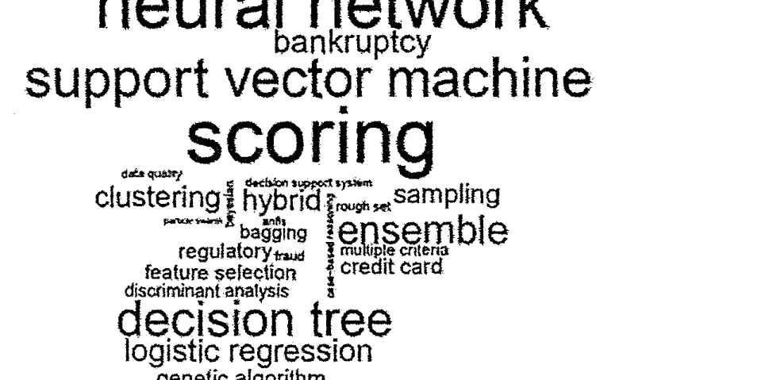

# 文章的主题

如前所述，LDA 文档主题生成模型的结果是根据词典中每个术语的出现频率对文章进行逻辑分组的一组主题。表6-7 总结了13 个主题下的研究结果，显示了文章数量以及每个主题中最相关的信用风险领域和数据挖掘方法。同样出于举例

# 金融AI算法

# ARTIFICIAL INTELLIGENCE IN FINANCIAL MARKETS

的目的，我们从每个主题中选择了一篇文章。

|出现次数|术语|β|术语|β|示例|
|---|---|---|---|---|---|
|19|评级|0.23|逻辑回归|2.25|Yap 等人|
|12|评分|4.64|神经网络|0.23|卡什曼（Khashman）|
|7|评分|5.44|决策树|0.08|曼达拉（Mandala）等人|
|6|评分|3.75|混合法|0.59|Tsai 和 Chen|
|6|评分|2.77|特征选择|0.59|Marinaki 等人|
|3|评分|4.55|抽样|0.42|Zhou 等人|
|53|评分文章总和||| | |
|10|破产|5.81|集合|0.18|Verikas 等人|
|5|破产|0.28|集群|2.19|De Andrés 等人|
|4|破产|4.88|遗传算法|0.30|Oreski 和 Oreski|
|19|破产文章总和|||

我们从表6–7可以很容易看出，评分最受关注，有超过一半的文章（100篇中的53篇）和六个主题。然而，根据β值，β值大于4的有三个主题（共22篇文章），虽然评分与信用风险问题更密切相关，但这种关系依然很弱。这些研究结果表明，这三个主题与数据挖掘技术探索的关系比与信用风险评分的关系更密切。事实上，其中两个主题所选择的例子都证实了这一假设：卡什曼的研究关注的是不同的神经模型和学习方案，而周（Zhou）等人使用最新的子空间方法（一种基于训练样本选择的技术）来改进分类。这两篇论文都与技术高度相关。例外的情

## 第6章

# 信用风险评估中基于数据挖掘应用的自动化文献分析

况是曼达拉等人所选择的例子，他们试图通过决策树来提高当时背景下的信用风险评分。在分析评分主题的同时，我们发现有趣的是，包含大多数文章（19篇）的主题与逻辑回归相关，而逻辑回归是最基本的技术之一。或许这是另一个指标，表明在先进的数据挖掘技术方面仍有研究空间，这种技术可以转化为对信贷评级的直接改善。

破产是第二多被提及的信用风险问题（19篇文章和3个主题）。同样，与对评分的观察结果相同的是，主要与高级数据挖掘方法相关的两个主题的集成建模（结合一些技术来独立技术的结果）和遗传算法，而它们几乎与破产无关，β值分别为5.81和4.88。这一发现加剧了这样一种怀疑，即数据挖掘研究仍然未能像评分那样明确地关注破产的好处。另一方面，破产与另外5篇文章有很强的相关性，这为企业破产风险的分组提供了一种方法。

欺诈也得到了一些关注（17篇文章），与支持向量机（与欺诈的关系非常弱）相比，欺诈与破产有同样的原因，它们都与集群更相关。这一结果与表6-5形成了对比，可能是由于较少的文章集中关注了较多的信用欺诈问题。其余两个主题显示了两种中间关系：信用卡和神经网络的关系；以及监管问题和数据质量的关系。前一个主题通过其示例显示了一种更成熟的研究趋势，即将先进的神经网络应用于解决真实的信用风险问题。如前所述，这种趋势在金融危机发生之前就已经得到了广泛研究。后一个主题强调了一个真正的问题，特别是在金融危机之后，由于政府对金融资产和负债进行审计的压力，金融机构面临着一个巨大的问题，即重组管理信息系统以提高数据质量，以应对越来越多的监管报告。事实上，对高度详细的报告的需求强调了金融机构日益增长的压力，并证明了数据质量与监管问题之间存在显著关系（β值分别为2.22和0.26）。

## 结 论

信用风险提出了几个有趣的问题，这些问题的解决方案可以受益于数据挖掘方法。被广泛研究的问题包括信用评分、破产、信用欺诈、信用卡和监管问题。

# 第7章

# 智能信用风险决策支持：架构和实施

保利乌斯·达内纳斯（Paulius Danenas）

金陶塔斯·加斯瓦（Gintautas Garsva）

# 引言

贷款组合的拓展和为客户提供新金融产品的潜力是金融机构的主要目标之一。精确的定量分析和评分是它们实现这些目标所采取的一些方法。特别是，为了使损失最小化，它们必须确保信用评分的准确性，同时还要通过量化不同贷款和工具的风险来优化贷款组合的表现。为了实现这些目标，金融机构已经进行了大量研究，以开发新技术和不断提高现有技术，同时重点关注分类和预测，以作为统计学学习的一部分。金融行业对人工智能，尤其是机器学习领域的新技术的最新发展和应用特别感兴趣。人工智能的各种应用提供了它们优于传统统计和数学方法的例子。在很大程度上，人工智能克服了这些更老、更严格的方法的诸多限制，同时给分析师带来了新的挑战。最近的研究还表明，人工智能有能力驱动最复杂和对计算要求很高的决策过程。这导致了大量的信用风险评估模型的发展，也引起了学术研究者和国金融机构金融分析师的广泛关注。

本章其余的内容旨在对人工智能及其在信用风险领域的应用进行分析。

+   - 介绍信用风险评估中应用于决策支持的主要人工智能技术。由于存在大量的现有技术，本文仅介绍了我们认为最新和最相关的三种核心技术。

+   - 介绍与信用风险相关的决策支持系统（decision support systems，DSS）应用的

# 金融AI算法
ARTIFICIAL INTELLIGENCE IN FINANCIAL MARKETS

最新发展。决策支持系统可以在不同层级上提供了高度复杂的、自动化的和统一的决策，从而简化和改进了管理任务，并降低了提供现有服务的成本。我们将从架构层和决策支持层两方面分析决策支持系统结构的分类标准，识别它们的未来趋势和组件，只有充分开发这些组件才能支持它们的功能。同时，我们也非常关注这些系统的开发要求。

+   - 介绍一种最新的用于开发新型决策支持系统的框架，该框架基于人工智能技术和金融数据交换标准，支持实时开发和信用风险模型的更新。

# 文献综述

我们将介绍三种常用于开发信用风险评估模型的人工智能技术（尤其是机器学习技术），即人工神经网络、支持向量机和决策树，我们重点关注的是分类。首先我们将从总体上介绍这些技术和机器学习技术的核心概念，然后再结合相关研究实例来介绍应用这些技术可以解决的信用风险问题。

# 机器学习技术

机器学习范式是人工智能领域中的子范式之一，旨在通过计算模仿人类的推理和行为。计算智能原理也可以用来解释和模拟不同物种或其群体的行为，应用它们的基本原理来产生最优解。一般来说，它可以被描述为一个过程，其目标是从示例中学习并获得最普遍化的结构，使用各种算子为任何给定的生成器的输出产生最佳预测结果。这是通过使用概率分布函数f(x)，将输入向量x映射到输出向量y，并使损失函数最小化来实现的。数据挖掘（通常也称为知识发现或在知识发现的环境下使用）可以被视为一个单独的领域，它用机器学习算法和方法来补充统计学习，以促进它们的发展和应用。其主要关注点之一就是数据采集，即其预处理、填补、分析和存储；跨行业标准数据挖掘流程（cross industry standard process for data mining，CRISP-DM）方法为在实际数据上应用数据挖掘技术提供了指导。

# 第7章
智能信用风险决策支持：架构和实施

模式识别（被监视实例与k个类别之一的连接的标识）和类别（未知输入向量类的预测）是在信用风险中最受欢迎和最被广泛应用的两种技术，它们可以通过机器学习解决。后者通常被称为监督学习，因为它使用的是给定的确定的观察结果。本章仅介绍信用风险中的分类问题，这些问题是由使用这些技术解决的问题的数量所驱动的。我们将使用类似于邓纳姆（Dunham）给出的正式的分类定义：给定一个数据库D = {t₁, t₂, …, tn} 和一个类集合 C = {C₁, C₂, …, Cn}，分类问题是映射f: D → C，其中，每个ti被分配给集合C中的一个类。Cj = {tij|f(ti)=Cj, 1 ≤ i ≤ n, ti ∈ D} 中，即类Cj仅包含那些分配给它的项。类通常代表标称值。另一种类型的学习是集成学习，它使用多种策略组合（如多数投票）来自多个分类器的输出。很多研究人员已经证明，当集合分类器应用于与信用风险相关的问题时，可能会产生比单一分类器更准确的结果。

分类技术可用于解决任务，可以提供多维特征输入，通常以数字或标称（分类）特征向量，通常返回抗噪音能力强的解决方案。训练时间可能因在训练阶段选择的技术、实施方法、优化算法及其配置而有所不同。与其他机器学习技术（如决策树或规则分类器）相比，基于人工神经网络和支持向量机的模型的训练对计算有更高的要求。然而，应用训练过的模型来预测新实例的类通常会非常快。与单决策树等其他技术相比，人工神经网络和支持向量机往往会在准确性方面表现出更好的结果。随着人工神经网络和支持向量机等技术产生所谓的“黑箱”模型，生成模型的可解释性水平也可能有所不同。尽管规则提取技术有助于消除这个问题而产生一组逻辑规则，但这些规则仍然很难解释和说明。迪德里希（Diederich）对这些应用于支持向量机分类器的技术进行了全面的介绍。

# 分类技术

本小节简要介绍了信用风险相关研究所使用的三种相关分类技术。有关其他技术的全面介绍以及本章介绍的相关技术的更多信息，你可参考相关的机器学习文献，以及相关的关注智能技术在信用风险领域应用的调查。

人工神经网络技术是最广为人知的机器学习技术，它提供了很大的灵活性来

# 第7章
智能信用风险决策支持：架构和实施

最小化 \( \frac{1}{2} \| w \|^2 + C \sum_{i=1}^n \zeta^k_i \)

使得 \( y_i [w^T \phi(x_i) + b] \geq 1 - \zeta_i, \zeta_i \geq 0, i=1,..,n \) (7.1)

其中，C 是一个正则化参数，用于确定最大间隔和最小分类误差之间的平衡，该误差来自留在决策边界“错误”一侧的数据（所谓软间隔中的数据，即考虑到错误分类的程度容许样本被错分的间隔，取决于变量 ζ）。C 也被称为一个惩罚参数，它决定了模型的训练误差和 Vapnik-Chervonenkis 维数①之间的权衡。当 k=1 或 k=2 时通常可被求解，而且该软间隔支持向量机被称为 L1-SVM 和 L2-SVM。

支持向量机的决策函数为：

\( \langle \phi(x) \cdot w \rangle + b = 0 \) (7.2)

研究者已经开发出了几种支持向量机实现技术，如 LibSVM，包括标准 C-SVM 实现和 ν-SVM、最小二乘支持向量机或 LS-SVM，有效地将支持向量机问题简化为一组线性等式、SVMLight、线性支持向量机实现 LIBLINEAR 的解。这些技术经常被用作研究和开发新算法的基础。

决策树是最古老且应用最广泛的机器学习技术之一。它们形成了一个由一组 if-then 规则组成的集合。分类是借助属性值测试，在度量（如信息增益②）的基础上，将从上次迭代中获得的源集合中的每个子集进行递归式划分来实现的，从而确定最适合分割这个子集的变量。如果分区不再影响可预测性，则终止搜索。当属性为标称值或数值时，该算法适用，而且当数据集包含缺失或错误值时，该算法也可以执行得很好。然而，由于决策树容易受到噪声冗余属性的影响，它可能会受到过度训练和泛化效果不理想的影响，从而导致决策树的性能相对较差。

最广泛使用的决策树扩展技术是随机森林算法。该算法使用随机生成的树集合和多数表决来执行分类。它通过组合几个不太稳定（“弱”）的分类器，来开发一个稳定且性能良好的分类器。这种技术还包含一些有用的特征（如根据变量的重要性对其进行排序的能力），很多从业人员和研究人员都在使用这种技术。

① Vapnik-Chervonenkis 维或 VC 维测量的是分类算法的灵活性。

② 信息论领域中一种基于熵的度量方法。

# 金融AI算法

# ARTIFICIAL INTELLIGENCE IN FINANCIAL MARKETS

运用人工智能解决信用风险问题

如前所述，信用风险问题通常被表述为分类技术。例如，主要目标是开发映射 F: X→Y，其中，y∈Y 表示特定问题从属的类（是否破产、贷款类别等）；x∈X 则表示一组属性，表示在某个特定时刻影响 y 的特定公司的财务状况。根据问题和数据可用性的不同，可以使用不同的属性来构成 X，因为财务和管理属性是最常用的数据类型，尽管也会使用其他类型的数据。王（Wang）等人的研究也证实了评分体系中可能涉及其他类型的数据，这取决于信用的类型。由于他们的研究工作是基于对绿色贷款（即为太阳能、农业或其他项目提供资金）的分析，因此他们建议将反映环境和能源因素（如环境质量状况、排放量、项目绿色水平）的投入以及财务和管理质量因素。贝罗瓦里（Bellovary）等人调查了 1930 年至 2007年间的 150多个模型，并确定了752 个独特的金融、经济、社会和其他变量，尽管其中的674 个变量仅用于一两个研究。结果表明，代表盈利能力、财务杠杆、债务状况、流动性和资本结构的财务比率的这类研究中占主导地位。另一个有趣的发现是，大量的因素并不一定会导致模型的准确率和预测能力的提高。我们通过对该领域相关专利的分析，展示了智能技术在金融风险评估实际的应用现状，也证实了除了金融数据之外，其他数据也可能用于现实世界的系统，如公共数据、宏观数据和 / 或抵押贷款数据。

最流行的信用风险问题之一是使用信用评分技术来解决的，该问题涉及客户在处理未来债务时的适用性。将客户分为“好”和“坏”两类的目的是对候选客户进行区分，以确定其是否适合贷款或现有贷款是否会被延期。这使金融机构（如银行）能够确定合适的候选人，从而避免和 / 或减少损失。这类问题是大多数信用风险相关研究的主要研究对象之一。大多数研究人员选择将重点放在二元分类上，但他们也会使用与现实应用更相关的多元分类来生成解决方案。

混合分类技术可以解决的其他类型的问题包括财务困境和破产预测。给定一组描述公司财务状况的特定属性，主要目标是计算出该公司破产或面临财务困境的可能性。根据研究数据的可用性，大多数研究人员使用的数据集包括来自不同部门的数据。另外，我们也可以找到差异化研究的例子，如银行、建筑公司、制造业、保险公司、网络公司、餐饮业和社交借贷。国家因素是另一个有趣的维度，因为智能技术已应用了来自韩国、比利时、荷兰、中国、克罗地亚、葡萄牙、立陶宛、土耳其、爱尔兰和其他国家的实际数据。我们还可以使用一些技术来研究金融数据，这些技术允许将各种属性映射到另一个空间，以便提取重要的特征，这些特征可以在之后用于可视化或进一步的建模步骤中，如回归分析。自组织映射通常被称为科霍宁（Kohonen）映射，它最初由科霍宁提出，是用于故障预测和可视化最灵活的聚类技术之一。

金融风险领域相关的另一类问题是行为评分或绩效评分，用于在发放贷款后监测债务人的财务状况。其主要目标是对给定时间段内（如1个月和3个月）的违约概率进行评估。该数据集的形成调用了历史还贷数据和描述债务人可信度的因素。这些因素可以从贷款申请数据（贷款金额、贷款期限、付款频率和客户信息）以及行为数据（贷款余额和还款因素）中得出。肯尼迪（Kennedy）等人的研究使用了申请数据和行为数据，以及拖欠还款信息。他们的实验分别使用了3个月、6个月、12个月、18个月和24个月的结果窗口，结果显示12个月的结果窗口在准确性方面是最优的。然而，绩效评分面临着与信用评分相同的挑战，也与数据挖掘相关，如分割对齐、最优特征选择和不平衡学习。

特征选择问题几乎与所有建模问题都相关，因为适当选择的建模属性数量的减少可能会影响最终模型的质量，并会减少该模型在实际应用中所需的信息量。在这里，我们介绍两种特征选择技术：一种基于过滤器的技术（使用特定的度量方法并根据其值选择属性，如相关性、信息增益、相似性度量）；另一种是基于包装器的技术（根据分类器性能迭代地进行选择）。属性排序可被视为一种基于过滤的特征选择表单。目前还有几种具体的技术，如林（Lin）等人提出了一种新的基于专家知识的财务困境预测技术，根据他们的研究，这种技术优于一般技术。不同特征选择技术的总体效果也在其他文献中得到了深入研究。

评级分析是另一种可以受益于分类方法的信用风险问题，也可以参考风险评级逆向工程。这些方法可以通过质疑和强化评级的有效性，以及提供提取的模式来区分按照财务能力和破产概率评级的公司和金融机构，从而提高评级。预测财务评级的变化是另一个可以运用人工智能技术的相关问题。琼斯（Jones）等人利用 1983 年至 2013 年间国际企业信用评级变化的数据，对不同的二元分类器（尤其是人工神经网络、逻辑回归、随机森林和支持向量机）进行了实证研究。该数据集包括 5053 次评级变化（2660 次评级下调和 2393 次评级上调），其中 2891 次与标准普尔评级的 BBB- 或以上（投资级）有关，2162 个评级变化为 BB+ 或以下（投机级）。基于金融、企业政府、市场、专家知识和宏观经济的变量以及反映以往评级变化的属性都被用作他们开发的模型的输入。他们的研究表明，除了获得相关模型的目标以外，像 AdaBoost 算法或随机森林这样的集成分类器是最成功的选择，这也使异常值和缺失值具有一定的鲁棒性。

叶（Ye）等人对供应链中断进行了研究，而供应链中断是财务困境的一个更具体的子问题。虽然这与信贷决策没有直接关系，但经济损失可能会对特定公司的客户产生巨大影响，导致财务损失甚至有可能破产。而向这些公司发放信贷的金融机构也将遭受严重损失。多类支持向量机分类可用于建模，该类别可以标记中断的原因（需求中断、供应中断、产品中断或外部中断）。样本数据来自 2007 年至 2011 年间 200 家公司的 926 份公告（财务报表和经济效益），并按照行业（制造业、农业或金融业）划分。结果表明，支持向量机在供应链中断识别问题上具有较高的性能。

# 信用风险领域的决策支持与专家系统

决策支持系统和专家系统在解决各种金融和商业问题方面发挥着关键作用，其中用于获取新信息的、产生可能的解决方案或备选方案的数据处理是相关计算的重要部分。以下我们将简要介绍决策支持系统和专家系统，讨论它们的目标及其与标准信息系统的主要区别；回顾决策支持系统的主要类型和分类标准，并将它们与金融风险导向问题联系起来；讨论决策支持系统在与信用风险相关的金融问题上的最新发展，并对专门用于银行决策的现代决策支持系统提出了许多要求；讨论基于人工智能技术的新型决策支持系统的发展，描述基于现代金融可扩展标记语言（XML）的标准；介绍了已开发的框架，并讨论与其实施相关的主要主题。

# 决策支持系统的定义、目标和前提

决策支持和专家系统的进化和结构在很多文献中都有描述。尽管这些系统可能具有相似的体系结构模式和目标，但是它们也有一些不同之处。虽然决策支持系统的定义可能与现代决策支持和自动化更相关，但从专家系统开始介绍也是合理的，因为它开创了基于人工智能分析的决策支持的先河。

专家系统可以定义为一种人工智能驱动的计算系统，它使用人类专业知识的知识库来帮助解决问题。专家系统可以划分为多种类型，如廖（Liao）在其研究中就根据专家系统开发中使用的技术（如基于规则的系统、基于知识的系统、神经网络、基于案例的推理、智能主体和基于建模的技术）区分出了几种类型的专家系统。根据不同或各种来源，专家系统的特征有以下几点：

+   1. 它应用了人类的知识和技术，并以不同的形式（非结构化信息、规则、公式、模型、限制或约束）收集在知识库中；
2. 它可以使用不同的启发式方法进行自主推理，以获得最优的解决方案或可以存储在知识库中的项目；
3. 它的目标是在试图消除或最小化人为错误的同时，至少以与人类专家相同的准确性和有效性给出答案；
4. 它至少包含一个知识库、一个推理引擎和一组构成专家系统基础的模型（规则等）。

从技术的角度来看，专家系统应用了某种形式的推理（主要是基于规则和过时的推理）来概括整个决策支持。

专家系统的最初使用表明，它具有良好的自动推理能力。然而，在实践中，我们却发现它是不灵活的，缺乏洞察力、决策支持和解释解决方案的逻辑以及对解决方案如何发挥作用的验证。成千上万规则的实现也导致了设计、实施、内部通信和支持的复杂性的增加。这些问题可以应用机器学习技术（如神经网络）完全或部分解决，因为机器学习技术使我们能够从历史数据中发现的趋势中学习，后面我们还将介绍一些新技术（如网络服务、支持分布式专家系统开发的集成工具和环境）。

不同文献对决策支持系统均有定义。例如，雷纳（Raynor）将决策支持系统定义为“数据建模和报告系统，该系统已被结构化，以回答特定的可持续的业务问题或其他问题”。支持实时决策的实时分析和交互分析是区分决策支持系统和传统信息系统的关键因素。这样的定义也扩展了专家系统的定义，该系统主要处理解决问题的能力，不包括对技术或计算实现方面的限制。

决策支持和专家系统都有一个相似的组件（知识库、推理引擎和用户界面）、相似角色（专家、知识工程师和用户）和工件（文档化的知识）的子集。比默（Beemer）和格雷格（Gregg）认为，决策支持系统通常包括一个监控主体，以帮助识别需要处理的非结构化决策，并识别提供给推理引擎的域变量。公共过程在用户交互的复杂程度上也可能有所不同，用户交互的复杂程度可以引导整个决策过程，并完成知识的获取、形式化和整理。除了体系结构存在差异之外，标准专家系统和智能咨询决策支持系统之间的差异在于整体决策结构，而整体决策结构在专家系统、人工智能方法论（专家系统中基于规则的方法、与决策支持系统中基于实例的机器学习和混合算法）及它们在决策过程中的作用中更加结构化。专家系统经常可以执行决策并自动执行预定义的操作，而决策支持系统则通过人工交互做出最终决策来支持人类决策。与专家系统不同，智能决策支持系统能够解决结构化或半结构化的问题，并为这些问题建模各种替代方案或策略。此外，它们在获取结果时更快、主观程度更低，而且使用的是集中或派生的信息，可以为图形分析提供复杂的工具。

# 决策支持系统的主要类型

根据决策支持系统的性质和主要目标，不同文献给出了不同的分类标准。阿尔特（Alter）提出的早期分类包括基于可能动作的结果分析的系统（运用特定的金融或数学模型或模拟）、优化分析（根据与所提供的约束条件一致的最优解来给出动作建议）以及意见和建议（为特定的结构化任务推断出一个决策）。阿尔特证明，在20世纪80年代，决策支持系统已经被视为一种比典型的信息系统工具更智能的指导工具。霍尔萨普尔（Holsapple）和威斯顿（Whinston）根据决策支持系统所基于的知识管理技术，确定了五种决策支持系统类型，即面向文本的决策支持系统、面向数据库的决策支持系统、面向电子表格的决策支持系统、面向求解程序的决策支持系统和面向规则的决策支持系统。对用于信用风险评估和管理的智能结构的分析以及对最新商业解决方案的分析表明，现代银行业决策支持系统可能刚好属于这些类型中的一种，也可能包括这些类型中的两种或以上的特征（所谓的“集成决策支持系统”）。例如，一个这样的系统可能通过基于文本的分析来获得信息或属性，而这些信息或属性可用于优化驱动的任务或优化基于规则的系统。面向文本的风险评估系统通过使用先进的文本挖掘技术，从文档或语料库中提取特定实体的相关信息（如项目、模式或特征），并执行其他步骤，如训练模型、开发概要文件或执行聚类/比较操作。因此，这类系统可能涉及高级存储、搜索和处理组件。面向数据库的决策支持系统（也称为数据驱动的决策支持系统）可以应用更多的结构化信息来做出决策。数据驱动系统可以实现内部和外部历史数据的检索和操作，如数据管理、时间序列和实时数据，使用数据仓库设施和高级工具（如在线分析处理、数据立方体和数据挖掘）来存储和检索数据。基于电子表格的决策支持系统可以将电子表格技术应用于知识管理，使知识库中的知识能够得到更多访问和修改，并在电子表格中给出处理指令。基于微软Excel的计分卡就是这类系统的一个很好的例子。基于求解器的决策支持系统通常应用最先进的技术（求解器），并根据不同领域（金融、经济、投资或破产分析）或问题类型（优化、预测、规划或统计分析）来为不同问题提供解决方案。这类决策支持系统通常采用较先进和新颖的技术，如数学优化、数据驱动分析、人工智能和/或机器学习。这类问题的结构以及决策支持系统的结构可能会相当具体。求解器通过链接生成解，这些解可以用作另一个求解器的输入。混合技术可以很好地说明这种决策模式。

最后一种类型的决策支持系统（在霍尔萨普尔和威斯顿提出的分类中有定义）是面向规则的决策支持系统，它可以处理一组

# 金融AI算法

# ARTIFICIAL INTELLIGENCE IN FINANCIAL MARKETS

统，该系统使用来自期刊、参考文献和书籍、银行报告和文章、研究报告、工作报告和银行研究的数据开发，这些数据由各行业专家定期更新。它的工具知识库由五个主要部分组成，每个部分分别代表了各自的目的（经济可行性研究、金融可行性研究、市场可行性研究、技术可行性和抵押）。蔡（Tsaih）等人提出了将内部信用评级模型转换为XML文档的N层架构。中间层包括web服务器、管理应用服务器、带案例处理应用服务器的贷款处理子系统、带XML解析器和模型引擎子模块的评估模块以及由模型定义应用服务器和模型记录模块组成的模型安装子系统。寇特思安提斯（Kotsiantis）等人开发了一个分布式信用评估系统，使用决策树（尤其是C4.5）算法进行评分，该算法使用了与本体相关的数据源以及由语义web技术支持的数据交换和推理机。虽然他们参考了可扩展商业报告语言（eXtensible business reporting language, XBRL）并将其作为选项之一，但是他们选择了自己开发的本体来表示财务报表。

因此，前面介绍过的系统架构都没有为自动数据收集、处理和更新模型的功能定义模块。虽然这一课题将在股票交易系统（尤其是高频交易）中进行进一步探讨，但信用评分系统也可能受益于这种方法，通过使用新的数据不断更新知识库中的模型，获得新的模式或生成用于不同维度分析的模型。为了产生更准确且更有见地的决策，它会自动集成和发现其他属性。最后，开放数据和促进数据在线共享的类似举措也激励了此类系统的开发，这导致了可用于支持和改进决策支持系统性能和功能，以及提供新的见解或改进现有系统的数据大量增加。

# 信用风险决策支持系统的要求

国际上很多不同的著名法律和规章【如《巴塞尔协议》《萨班斯-奥克斯利法案》(Sarbanes-Oxley Act)、《国际财务报告准则》(International Financial Reporting Standards, IFRS)、《美国公认会计准则》(United States Generally Accepted Accounting Principles, US GAAP) 等】都为全球银行和金融体系提供了一致性、限制和指导。《巴塞尔协议Ⅲ》是一个国际公认的银行业风险管理和治理框架，为支持金融稳定、透明度和整合更好的风险管理实践提供了指导方针。该标准的核心主要由三大支柱构成：支柱一定义了资本、风险管理和财务杠杆的要求；支柱二侧重于风险管理和监管；支柱三公布了市场纪律的要求。为了满足这些规定，智能决策支持和决策制定的集成方法就显得尤为重要，包括集中式信息架构、数据仓库、高级分析和报告工具的设计和开发。内部财务报告系统的不一致和差异使其调整和分析任务（如合并、整合和报告）变得更加复杂。还必须确保与共存的法规和框架保持一致，同时尽量减少对流程、系统和数据的更改。因此，银行业采纳了金融标准化框架和倡议，如可扩展商业报告语言（尽管不那么容易采用），因为它们提供了灵活性，改善了一般报告过程，并确保了标准化的金融信息流。

银行业决策支持的核心组成部分之一是评级系统。巴尔萨扎（Balthazar）的研究为它们的发展需求提供了广泛的参考。以下，我们列出了最重要的几个要求。

- 主要风险指标的计算，如违约概率（probability of default, PD）和违约损失率（loss given default, LGD）。违约概率是对债务人不履行其义务的可能性的定量估计，而违约损失率则是根据这种可能性来衡量可能损失的金额。
- 未违约公司至少有七个评级等级（违约公司至少有一个评级等级）。这是惠誉国际（Fitch）、标准普尔和穆迪等评级机构的惯例。
- 跨子公司、地点和业务的一致性。
- 对审计人员和外部各方的透明度（通用参考和元数据词汇表、风险描述和分类）。
- 通过适当的手动和自动化记录设备，证明和记录所用评分模型及其本身的准确性、有效性、监督、审核和适当应用。
- 整合所有可用数据，包括外部评级信息。样本库结构如图7-1所示。
- 在不利的经济条件下整合债务人的偿付能力。
- 定期对模型开发进行验证和性能测试。
- 记录并证明评分模型覆盖的合理性（适用于人类决策优于评分模型输出的情况）。
- 持续记录用于评级和默认历史记录的数据。

符合《巴塞尔协议Ⅲ》的决策支持系统必须满足以下要求。

- 支持采用综合方法来评估、管理和报告市场、信贷和流动性风险，包括风险加权资产、监管和经济资本。

- 整合所有可用信息（库的样本结构如图7-1所示）以支持上述风险的评估和管理。

- 兼具数据驱动和模型驱动。它可以根据实现情况结合其他类型决策支持系统（如基于规则、基于求解器或基于电子表格的决策支持系统）的功能。

- 满足系统完整性、灵活性、可扩展性、监控访问和可用性的功能性和非功能性需求。

- 计算各种风险因素，如违约概率、违约损失率，对不同的压力测试场景（如保证金要求、现金流生成或回测）进行what-if分析和压力测试。

- 评估信用风险的市场价值或交易对手估值调整（counterparty valuation adjustments，CVA）。

- 包括监管和多层日志记录功能。

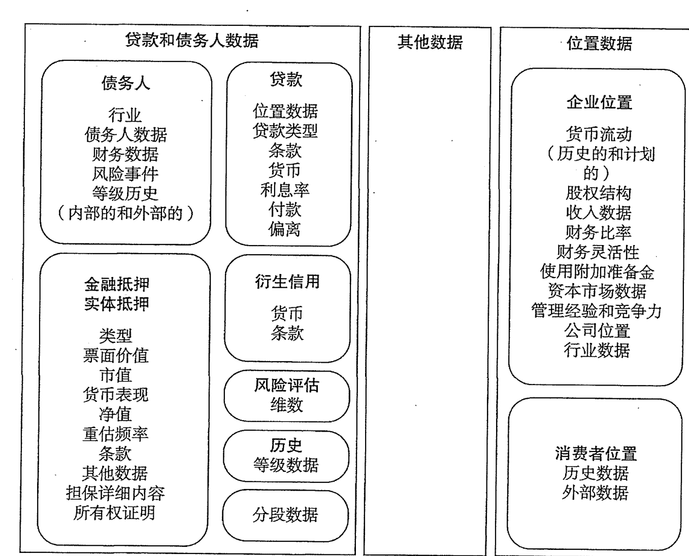

# 图 7-1 用于信用风险决策支持系统的样本库

# 基于金融标准的决策支持

在面向模型的决策支持系统中，如果没有模型开发所需的数据，数据驱动的决策支持就无法成功实现。此外，模型在开发初期可以使用样本数据进行训练，而更新模型以反映当前的情况则面临进一步的挑战，因为模型的更新需要在相同结构中增加数据。这对智能学习驱动的任务的影响尤为明显，因为在这种任务中，模型必须通过不断学习一个因变量和一组自变量之间的关系来生成。为了支持数据交换，可以使用不同的格式，如 XML，它是系统间数据交换的核心标准之一，也是 web 服务技术的核心标准。通过定义相关的内部表示法，并将它们组合成表示不同域中概念及其关系的描述，XML 定义了其他域特定的格式或语言。此外，像可扩展样式语言（XSL）、XQuery 和 XPath 等技术支持对 XML 文档进行高级转换和查询操作。开发这种描述通常需要在特定领域具有高水平的专业知识。不过，这些方法已经有了大量的相关标准，包括那些与金融部门有关的标准。我们之前对这些标准进行了调查，其中包括 XBRL 以及统计数据和元数据交换（statistical data and metadata exchange，SDMX）。本小节将重点介绍 XBRL 标准，除了可以改进报告流程和准确性之外，该标准还提供了一些可用于为金融风险分析开发集成决策支持系统的高级特性，这些特征已经足够成熟，可以应用于实践。

XBRL 由分类法和实例两个主要概念定义。分类法定义了特定实体使用的所有金融概念以及它们的内部关系和内部或外部资源。实例的定义是在分类法中定义了结构的事实列表。XBRL 分类法由 XBRL 模式组成，该模式存储着关于分类法元素的信息，如元素的非结构化列表和可链接到指定外部资源的链接库文件参考。XBRL 规范中定义了五种类型的链接库：展示链接库、计算链接库、定义链接库、标签链接库和参考链接库。

一些补充模块也被定义为扩展，如 XBRL 维度 1.0、XBRL 公式 1.0、XBRL 透视技术规范和 XBRL 版本，如图 7-2 所示。XBRL 维度用附加维度补充了 XBRL 文档，支持多维处理。我们之所以对 XBRL 公式特别感兴趣，是因为它使用完整性和推导规则（根据会计和金融假设创建）提供高级校验和事实推导。它运用了公式、变量、完备性、准确度断言、过滤器和前提条件等概念。使用这个

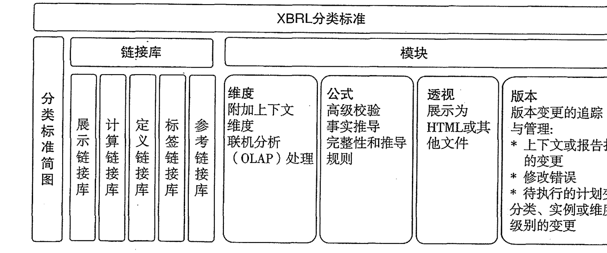

# 图7-2 XBRL分类标准的结构

关于XBRL及其可能与决策支持系统集成以应对信用风险的更多技术信息请参考加斯瓦（Garsva）和达内纳斯（Danenas）的研究。本文介绍了一种将XBRL集成到信用风险评估智能决策支持模型中的映射模型。该研究中使用的数据集通常被定义为一个由n个具有m个属性的数据实例组成的二维m×n数列，或者一种更适合分类问题的形式，或者一个具有n个向量的集合 {x₁, x₂, …, xm, y}。如果在建模过程中只使用来自单个分类法的实例，那么这个过程就是非常简单的，因为金融属性集是有限的。然而，如果使用的是多个开放的XBRL分类法（如美国证券交易委员会XBRL分类法），那么完整的XBRL知识库的应用就没那么简单了。很明显，只有那些在所有使用过的分类法中被定义的财务比率才能用于形成机器学习任务的数据集。请注意，为了比较使用不同系统的公司（如美国公司和欧洲公司）的财务比率，我们应当考虑不同的调整。但这个框架还没有明确地解决这个问题；目前，只根据实际汇率进行转换，以使用单一货币表示金融属性。更正式的表述是，给定一组分类集合 T = {Ti | 0 ≤ i ≤ |T|}，其中，|T| 表示的是集合T中分类法的数量，它可能有 {F_n^k | N_min ≤ k ≤ N_max} 个金融属性，这些属性为每个

# XBRL集成化决策支持系统架构的开发

我们运用之前介绍的XBRL集成原理和机器学习技术设计了一种信用风险评估决策支持系统。这里只介绍了基本概念，想要进一步了解的读者请参阅作者描述该系统的原始研究。

# 金融 AI 算法
ARTIFICIAL INTELLIGENCE IN FINANCIAL MARKETS

该系统支持数据驱动模型开发的全生命周期，其框架如图 7–3 所示。模型开发过程本身是一项综合性任务，包括数据预处理、特征选择、训练和参数选择等子任务，应用了人工选择或基于软计算技术的启发式方法。该系统还支持使用统计、财务分析和可视化分析的分析任务。信用风险分析被视为这三种分析的结合。该系统架构表现为一个模块化的多层系统，它整合了以下域的功能：机器学习，实现相关的统计和机器学习功能；数据和元数据管理，包括 XBRL 元数据和模型存储库以及这些模型的元数据，如执行日志和评估结果；信用风险评估。信用风险评估层定义了整个分析、建模、预测和评估功能。财务分析、建模和预测模块是专门为信用风险评估层定义的，因为它们可以提供特定领域的分析、模拟和预测。请注意，数据管理层的功能同时涉及人工智能 / 机器学习（模型存储库）和金融 / 信用风险域（XBRL 元数据、相关业务规则）。各种支持服务的功能被嵌入附加数据源交互层、信息处理层和表示层中。

该架构拓展了霍尔萨普尔提出的面向数据库和求解器的组合概念决策支持系统模型。该框架被广泛应用于开发能够进行财务预测、分析和优化任务的决策支持系统。目前很多大型组织经常使用基于此框架并将数据仓库工具与分析【如联机分析处理（online analytical processing, OLAP ）】或数据挖掘解决方案相结合的决策支持系统。

虽然最初的架构包括知识和问题处理子系统，但为了支持自动数据导入和机器学习驱动的模型更新功能，同时还添加了元数据（分类数据、映射）和附加数据管理以及模型处理系统，如图7-4 所示。更进一步的扩展是元数据管理（分类数据、映射），它是在问题处理系统中被定义的。

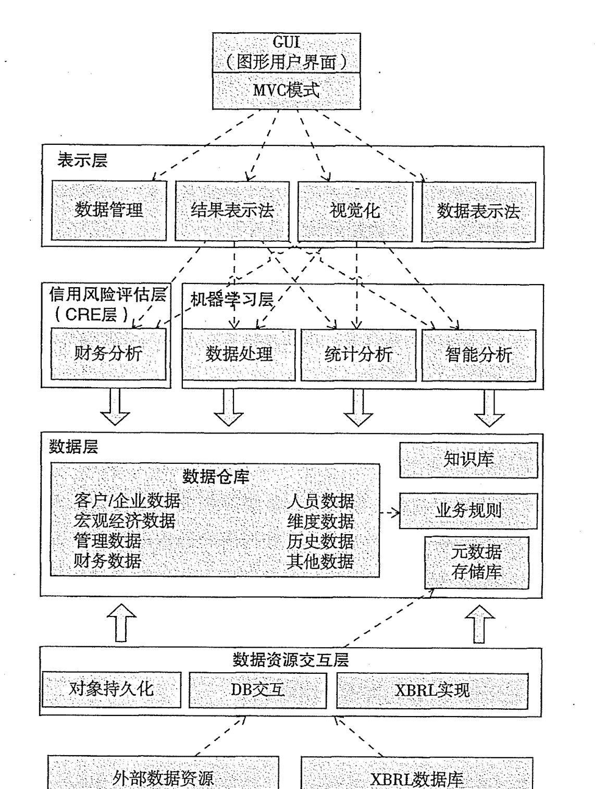

# 图 7–3 决策支持系统概念结构

# 第7章 智能信用风险决策支持：架构和实施

该架构拓展了霍尔萨普尔提出的面向数据库和求解器的组合概念决策支持系统模型。该框架被广泛应用于开发能够进行财务预测、分析和优化任务的决策支持系统。目前很多大型组织经常使用基于此框架并将数据仓库工具与分析【如联机分析处理（online analytical processing, OLAP ）】或数据挖掘解决方案相结合的决策支持系统。

虽然最初的架构包括知识和问题处理子系统，但为了支持自动数据导入和机器学习驱动的模型更新功能，同时还添加了元数据（分类数据、映射）和附加数据管理以及模型处理系统，如图7-4 所示。更进一步的扩展是元数据管理（分类数据、映射），它是在问题处理系统中被定义的。

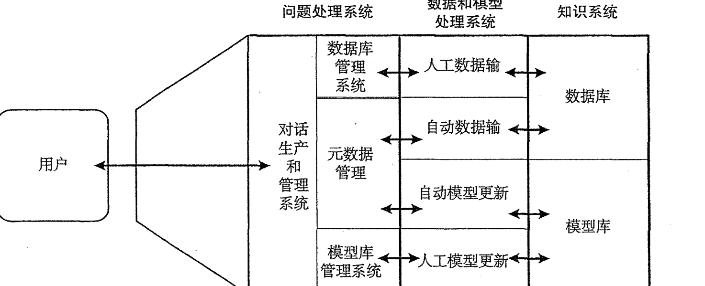

图7-4 使用数据和模型处理层扩展霍尔萨普尔的合并数据库和求
解器驱动的决策支持系统架构

# 金融AI算法

# ARTIFICIAL INTELLIGENCE IN FINANCIAL MARKETS

为了说明具有自动自学习功能的交换，该系统被建模为一组具有特定目标的主体。该模型如图7-5所示，不同主体（通知）之间的消息和数据流分别使用“信息流”和“数据流”进行建模。这些主体的模型如下。

- 监控主体。分为两种专用主体，即XBRL监控主体和外部资源处理主体。这些主体的作用相似，它们的主要目标是监视数据源，以发现新的XBRL文档实例或现有实例中的更改。
- 处理主体。分为两个子类，但与监控主体相反，它们的目标略有不同。XBRL处理主体使用存储在数据存储设备中的分类信息来处理XBRL实例。如果该实例带有一个实例中未标识的分类法，它也会被处理并归入映射信息数据库中。外部数据源处理主体使用在其适配器中实现的规则来处理可用数据。每个处理主体都包含这个适配器，实现数据访问接口，从而实现数据处理所需的特定功能和规则。请注意，它可以有多个外部XBRL或其他外部数据源，并分配一个主体来监视每个数据源，因此，一对多被用来定义此类任务。
- 处理管理主体。充当处理主体的管理者和协调者的角色。由于可以有多个处理主体，该主体可以获得新数据可用性通知以及准备发送到数据仓库的新数据通知。当成功地将数据发送到数据存储设备后，该主体将向建模管理主体发出通知，并发送新实例的元数据，这些元数据标记了需要更新的模型。
- 建模管理主体。也充当协调者的角色，通过通知数据存储中可用新数据相应的预处理主体来触发模型更新过程。这些任务必须通过至少一个预处理和至少一个相应的模型主体来执行。请注意，在这个扩展中，预处理和相应主体之间的基数被建模为一对一，但它也可以被扩展为一对多，只是需要使用不局限于分类法的集合技术，每个主体在该集合中被作为一个单独的主体。
- 预处理主体。对检索到的数据执行数据预处理任务，如数据清理、输入和转换。这些数据之后将被传递给建模范主体（在集成学习的情况下被传递给多个主体），以执行建模任务，如模型（重新）训练、测试和/或验证，并更新存储库中的模型。如果开发了一个新模型，那么该模型及其元数据也会被添加到存储库中。

这种决策支持系统的扩展可以被视为一个自组织和学习系统，能够根据其配置来获得的历史知识采纳其决策和建议。此外，它还可以通过web服务提供决策，

# 第7章 智能信用风险决策支持：架构和实施

# 图7-5 作为一组主体的决策支持系统架构

# 金融 AI 算法

# ARTIFICIAL INTELLIGENCE IN FINANCIAL MARKETS

将其转换为分析即服务（analysis-as-a-service, AaaS）。在执行过程中，我们需要处理以下几个问题。

- 数据的兼容性。客户端可能没有决策支持系统中特定模型所需的所有数据。因此，可能需要使用可用数据的不同子集来生成多个模型，以满足不同的需求。

- 变量的兼容性。客户端和决策支持系统可以使用不同类型的变量来描述同一个对象（如变量“工作年限”可以定义为“8 年”的名义变量和值为整数值“8”的数值变量）。

- 由特征选择定义的已开发模型的动态性质。这将导致模型的永久性更改，这也需要动态生成界面，以便为客户端输入用于预测的数据。因此，它要求模型元数据必须被发送到客户端，客户端将在每次使用评估服务时保留格式正确的用于评估的数据。它可能还需要额外的模型开发策略（如一些模型可能只使用最典型的且所有金融机构都可以获得的变量，而另一些模型可能包含更多属性，但可能只有拥有相关数据的机构的子集才能使用）。

# 结 论

自银行业开始向其客户发放贷款以来，信用风险评估已成为该行业面临的核心问题之一。现代人工智能的最新发展关注的是模仿人类学习和行为，这为现代复杂决策支持在该领域的应用提出了很多新的挑战。最近的研究表明，机器学习技术（如人工神经网络、支持向量机或随机森林等）往往优于典型的统计技术，并在实际应用中呈现出较好的结果。它们与其他技术（如进化计算、集成学习、群体智能或模糊逻辑等）的结合往往优于这些技术的独立应用。因此，对该领域的研究仍然十分活跃。大量被研究出的技术、多数相关技术的‘黑箱’性质、技术

# 第7章 智能信用风险决策支持：架构和实施

准确、重新使用和利用它们的优势来保证数据的完整性或执行模型的更新也是合理的。这在金融领域是尤其有利的，因为不同的金融系统包含大量以业务规则形式存在的约束。我们尝试通过使用来自基于XBRL分类法的金融元数据的附加组件来补充基于机器学习的信用风险决策支持系统功能来为这种系统设计一个框架。这种方法可用于加强数据管理中的特定约束，提高查询质量，加速数据集的形成，以进行连续的模型再训练。最后，自动化水平的提高可能会导致自学习智能决策支持，这可能会减少模型存储库更新的负担，并将这个过程中的“人为错误”因素最小化。

目前出现了几个未来的研究方向。我们开发的框架包含了一个单一的金融信息交换标准（即XBRL），而它也可能受益于其他开放的金融交换标准，如金融信息交换（financial information exchange，FIX）、统计数据和元数据交换（SDMX），这些标准将为最终数据集提供额外的变量。在信用风险问题的背景下研究这些变量及其整合的必要性是另一个需要讨论的话题，因为很多文献也描述了宏观经济变量、统计变量或市场变量对信用风险的意义。然而，虽然大多数研究引用的是财务报表中的比率，有些研究还在其模型中纳入了其他种类的变量，但对变量的使用尚未达成共识。该框架没有涉及的另一个具有挑战性的领域是自动管理不同规定（如《国际财务报告准则》和《美国公认会计准则》）之间会计原则的差异，以及调整来自不同财务报表中的数据以用于比较。然而，我们可以使用一些技术来将这一任务完全或部分自动化。最后，这种系统还将受益于机器算法的新改进及其对环境变化的适应性，从而提高决策过程自动化和系统自治水平。

# 第8章 人工智能在伊斯兰债券评级预测中的应用

# 引言

信用评级已成为现代金融服务业的一个重要指标。它通常根据证券发行者的借贷和还款历史、标的资产、未清偿债务和整体经营业绩来评估证券及其发行者的信用价值，在资本市场中发挥着重要的信息传递功能，特别是在提高风险管理和市场流动性方面。信用评级可以减少市场参与者之间的信息不对称问题。对公司而言，拥有一个好的评级有益于提高市场对其的信任。另外，很多投资者和银行依靠评级来做出投资和融资决策。

上述种种好处促进了包括伊斯兰资本市场在内的资本市场的发展。伊斯兰金融和资本市场是国际金融市场中发展最快的领域之一。最近，伊斯兰金融和资本市场的创新已经改变了金融业的格局，其中之一就是伊斯兰债券。过去几年，伊斯兰债券作为现有传统债券的替代品越来越受到市场欢迎。国际伊斯兰金融市场（International Islamic Financial Market, IIFM）提供的2013年的数据显示，从2001年到2013年1月，全球伊斯兰债券发行总额相当可观，达到了4726.8亿美元。这一显著增长表现在伊斯兰债券的发行量自2001年以来大幅增长了100多倍，从11.72亿美元增至2012年的1370亿美元。政府可以通过发行主权伊斯兰债券来筹集资金，而企业可以通过发行公司伊斯兰债券来筹集资金。

伊斯兰债券市场的发展对伊斯兰债券的评级问题提出了更高要求。该评级不仅可以反映风险和预期业绩，而且有益于投资者，特别是投资于特定证券的银行，可以帮助银行衡量投资的资本费用。与传统银行类似，伊斯兰银行也必须满足资本充足率的要求。该比率是通过将伊斯兰银行的合格资本与其风险加权资产（Risk Weighted Asset, RWA）进行分割来衡量的。风险加权资产的计算方法如下：

RWA = \sum_{i=1}^n w_i a_i (8.1)

其中，w_i 为资产类别 i 的风险权重；a 为资产 i 的数量；n 为资产类别的数量。对于伊斯兰债券而言，风险加权资产是通过计算伊斯兰银行在伊斯兰债券上的风险敞口来衡量的，其中伊斯兰债券本身的风险权重和伊斯兰债券的风险权重都是根据伊斯兰债券的信用评级而变化的。尽管如此，并非所有的伊斯兰债券都被评级。这种情况导致银行必须将 ...

# 金融 AI 算法

# ARTIFICIAL INTELLIGENCE IN FINANCIAL MARKETS

测进行了一些研究。然而，伊斯兰债券是最近才在金融界出现的新事物。目前，对伊斯兰债券的研究和分析非常有限，尤其是对伊斯兰债券评级的研究和分析更是有限。埃伦迪纳和莫哈末·奥马尔研究了马来西亚企业伊斯兰债券评级决定因素。

本研究将借鉴以往伊斯兰债券评级预测研究中的若干理论变量，引入如债券结构、担保状况、产业部门和宏观经济变量等附加变量，以扩展之前的研究。本研究将伊斯兰债券的结构变量作为其特定变量，旨在观察债券评级的决定变量是否能够预测伊斯兰债券的评级。

# 文献综述

# 什么是伊斯兰债券

伊斯兰债券与传统债券有一些相似之处，如固定期限、息券，它们都在二级市场上交易。塔里克（Tariq）提到伊斯兰债券有一项与传统债券类似的功能，它能使公司根据伊斯兰债券的原则筹集资金，同时扩大投资者基础，为新企业提供投资机会。理论上，传统债券和伊斯兰债券的评级方法在某种程度上应该有所不同，因为这两种工具在本质上是不同的。传统债券是一种合同债务，根据合同，发行人有义务在特定日期向债券持有人支付利息和本金。另一方面，伊斯兰金融机构会计和审计组织（Accounting and Auditing Organization for Islamic Financial Institutions, AAOIFI）17号标准规定，伊斯兰债券是一种等价凭证，代表在特定项目或特殊投资活动的标的资产、使用收益权和服务或资产的所有权上的不可分割权益。如果发行人拖欠付款，伊斯兰债券持有人对标的资产也有索赔权，就像普通常规债券一样。因此，伊斯兰债券持有人有权分享伊斯兰债券资产产生的收入和资产变现的收益。伊斯兰债券的独特之处在于，投资者成了资产持有人，因此应该承担其标的资产的风险。伊斯兰债券持有人承担着这些独特的风险。表8-1简单地比较了传统债券和伊斯兰债券。

# 第8章
人工智能在伊斯兰债券评级预测中的应用

# 表8-1
传统债券和伊斯兰债券的比较

| 定义 | 传统债券 | 伊斯兰债券 |
| :--- | :--- | :--- |
| 预计现金流 | 利息支付 | 利润分享 |
| 概念 | • 债务证明 |
| • 预先确定以预先设定的金额定期偿还现金流量 |
| • 零息债券 |
| • 带息票债券 |
| • 可转换债券等 | • 所有权证明 |
| • 基于原始合同承诺的从资产/服务/投资获得的收入 |
| • 损益分摊 |
| • 租赁 | |
| 结构和原则 | | |
来源：www.bpam.com.my

伊斯兰债券和传统债券的另一个主要区别在于投资风险。伊斯兰债券与一种被称为伊斯兰教法合规风险的风险有关，这在基于现有伊斯兰金融合同的构建阶段是至关重要的。不过，伊斯兰债券与传统债券也有一些相似之处，因为它们都是由能够产生收益的实物资产构成的。这些资产的基本收入是伊斯兰债券利润的收益来源。根据伊斯兰金融机构会计和审计组织的规定，伊斯兰债券基于各种交易合同发行。这些伊斯兰债券包括Ijara、Murabaha、Salam、Istisna、Mudaraba和Musharaka、Muzara’a、Muqasa和Mugharasa。然而，后三种类型的伊斯兰债券在市场上很少使用。本章的附录1总结了每种结构的描述、与伊斯兰债券持有人的关系以及预期收益。这些结构将影响息票的支付方式和风险特征。传统债券和伊斯兰债券在信用风险敞口方面的性质不同，这导致需要对它们进行不同的评级评估。

此外，伊斯兰债券与传统债券具有相似的风险，即信用风险（违约风险）、流动性风险、经营风险、市场风险、利率风险（收益率风险）、外汇风险、股价风险和大宗商品风险。由于所有这些风险通常与企业伊斯兰债券有关，因此这些风险都反映在评级机构提供的具体评级中。与企业债券评级类似，评级越高，企业伊斯兰债券的质量越好，因此持有它的风险就越低。

# 金融 AI 算法

# ARTIFICIAL INTELLIGENCE IN FINANCIAL MARKETS

# 基于标的资产追索权的伊斯兰债券评级方法

然而，与伊斯兰债券评级相关的评级机构只会给出与这些债券相关的信用方面的意见。由于评级机构认为伊斯兰债券从信用角度来看是中性的，因此对伊斯兰兰债券的评级并不意味着对伊斯兰教法合规性和马来西亚评级公司（Malaysian Rating Corporation，MARC ）①¹ 的任何确认。大多数由评级机构评级的伊斯兰债券都是由伊斯兰教法委员会批准的。委员会对交易结构进行评估，并在发行伊斯兰债券之前确定其遵守伊斯兰教法的情况。评级机构只处理交易的信用方面，因此既不审查伊斯兰教法委员会的角色或组成，也不对委员会的建议和决定的实效性发表评论。

除标的合约外，由于标的资产的追索权，伊斯兰债券还可以分为两种模式：资产担保的伊斯兰债券和基于资产的伊斯兰债券。这两种伊斯兰债券在语义上有相似的描述，但在信用风险方面存在明显差异。

资产担保伊斯兰债券代表了真正的资产出售，因为标的资产已被合法转移到特殊目的载体（special purpose vehicle，SPV）。因此，在违约的情况下，标的资产将完全独立于发行人。伊斯兰债券持有人或投资者对伊斯兰债券的标的资产有追索权，也就是说，投资者对标的资产拥有完全的索赔权，而不存在任何随后被当地法院或伊斯兰教法法院推翻的出售风险。惠誉国际、标准普尔公司、穆迪公司、RAM Ratings 和 MARC 认为标的资产如何产生现金以履行其合同义务决定了资产担保伊斯兰债券的评级评估。

而基于资产的伊斯兰债券的结构是这样的，即投资者只拥有标的资产的一部分权益，因此其信用风险反映的是发行人的信用风险，而不是标的资产的信用风险。这是因为投资者并非标的资产的合法所有人，因此在违约情况下，投资者对标的资产没有任何追索权。在破产的情况下，在基于资产的伊斯兰债券中，投资者拥有无担保债权，因为伊斯兰债券的债权将与其他无担保债权人处于同一级别。在优先无担保债务的情况下，与其他债权人相比，伊斯兰债券投资者对伊斯兰债券资产没有优先权，其评级将与它们相当。否则，在次级伊斯兰债券中，评级就会下调。在这种情况下，评级机构会采用基本评级方法或企业信用评级来对伊斯兰债券进行评级。

由于大多数伊斯兰债券的发行都是基于企业资产的模式，这意味着评级机构采用了更常见的传统评级方法。因此，本研究采用债券评级预测研究来确定基于资产的伊斯兰债券评级的预测因子。

# 评级预测的前期研究

研究者们为研究评级预测开展了大量的工作。最早的一些关于债券评级预测的研究分别是在1966年和1970年由霍里根（Horri gan）和韦斯特（West）进行的。霍里根和韦斯特使用最小二乘法（ordinary least squares, OLS）回归来预测穆迪公司和标准普尔的债券评级。平奇斯（Pinches）和明戈（Mingo）应用多元判别分析来提高统计拟合度，以建立准确的模型。在这项研究之后，贝克奥伊（Belkaoui）采用了同样的方法，利用来自财务报表和宏观经济变量的信息来预测债券评级。该模型使用多元判别分析，正确预测了实验样本中62.5%的评级和验证样本中65%的债券评级。

自20世纪90年代末以来，研究人员使用人工智能模型来预测债券评级。人工智能神经网络是杜塔（Dutta）和谢卡尔（Shekhar）首次提出的。他们使用非统计方法，以神经网络的形式来预测企业债券的评级。他们的研究受到了缺乏债券评级理论和方法启发：神经网络不需要预先指定一个功能域模型。他们试图从训练输入-输出示例中学习基础域模型。杜塔和谢卡尔基于霍里根、平奇斯和明戈的研究结果，使用六个金融指标比较了神经网络和基于回归的技术。该研究发

# 金融AI算法

# ARTIFICIAL INTELLIGENCE IN FINANCIAL MARKETS

现，神经网络在债券评级预测方面优于回归技术。

辛格尔顿（Singleton）和瑟肯（Surkan）应用反向传播神经网络对1982年从美国电话电报公司剥离出来的18家贝尔电话公司的债券进行了分类，并比较了神经网络模型和MDA模型。该研究表明，与判别分析相比，神经网络在预测债券评级方向方面取得了更好的效果。

权（Kwon）等人比较了传统的神经网络方法和一种新的神经网络训练方法，即按序成对划分（ordinal pairwise partitioning, OPP）。在同一时期，夏弗苏克（Chaveesuk）等人比较了径向基函数、学习向量量化（learning vector quantization, LVQ）和反向传播这三种人工智能神经网络方法在三种不同的逻辑回归模型（一阶逻辑、二阶逻辑和逐步逻辑回归法）中的预测率和准确性。实验结果表明，该方法的预测性能优于传统的神经网络和多元判别分析。

随后，黄（Huang）等人提出了一种新的机器学习技术，即支持向量机。本章将反向传播神经网络作为基准与最新的进化技术进行比较。这两种方法分别于1991—2000年和1998—2002年在美国和中国台湾市场的债券评级数据集中获得了80%左右的收益。

李（Lee）还应用支持向量机对1997年至2002年间被评级的3017家韩国公司的债券评级进行了预测。李等人的论文将支持向量机与反向传播神经网络、多元判别分析和案例推理（case base reasoning, CBR）进行了比较。支持向量机在训练数据和验证数据上均显示了其在债券评级预测准确度方面的优越性。预测债券评级的第二好的模型是反向传播神经网络模型，其次是多元判别分析模型。

最近，哈耶克和奥列利用核函数的方法以及支持向量机的设计来预测企业和市政信用评级分类。结果表明，该模型对二级和七级企业信用评级的预测率分别为87%和91%。科尔斯（Kors）等人试图预测标普500家上市公司2008年、2009年和2010年的债券评级。为了估算最优模型，他们的研究采用了多元判别分析、有序logit模型和有序probit模型。有序logit模型的准确率为63.9%，优于其他两个模型。这一结果略高于有序probit模型，该模型的准确率为61.7%。多元判别分析的预测能力最低，分类准确率仅为57.9%。

迪亚内里（Dianelli）、琼塔（Giunta）和奇波利尼（Cipollini）使用《巴塞尔协议Ⅲ》方法来确定中小企业的信用价值。他们研究了意大利中小企业的信用历史和财务比率，建立了187家意大利中小企业的失效预测logit模型。穆谢托拉和那卡拉多还试图用逻辑回归方法预测2007—2010年间意大利北部5000家中小企业的信用风险。鲍尔（Bauer）和阿加瓦尔（Agarwal）比较了英国的z分数模型、基于或有权要求的模型和风险模型来预测破产，他们发现z分数的结果好于其他方法的结果。最近，加利尔（Galil）和谢尔（Sher）进行了一项研究，他们利用信用违约交换价差和财务比率，探讨了与企业相关的财务困境的不同特征。尤其是该研究使用逻辑回归解释了5542家上市公司退市、1495家公司破产、1503家公司从金融机构借款和1098家公司发生违约案例的违约模型概率。然而，该研究发现，正如之前研究所建议的，从logit模型转换到风险模型并没有提高准确率。

唯一可预测伊斯兰债券评级的研究是埃伦迪纳和奥马尔进行的。本研究采用有序逻辑回归和多项逻辑回归，根据托雷（Touray）的理论变量，建立了一个伊斯兰债券评级模型。结果表明，有序逻辑回归模型的预测准确度为70%，而使用多项逻辑回归模型的预测准确度为78.3%。由于样本数量有限，该研究无法使用验证样本来验证模型。该研究的另一个局限性是，它没有考虑到理论上具有不同信用风险的不同的伊斯兰债券结构。因此，该研究试图拓展了先前对伊斯兰债券评级预测的研究，并结合了不同的伊斯兰债券结构和行业类别。

# 变量选择

该研究采用阿尔特曼的方法来选择以往研究中用于伊斯兰债券评级预测的最常见变量。我们通过对变量进行和汇总（见本章的附录1）发现，规模变量是以往研究中使用最频繁的变量。此外，表A1显示，流动性、盈利能力和杠杆比率也经常被使用，并被视为预测债券评级的重要指标。一些研究将定性变量作为公司的附加信息，如从属关系、担保状态

# 金融AI算法

# ARTIFICIAL INTELLIGENCE IN FINANCIAL MARKETS

生一个分类函数，该函数根据自变量（输入变量）的值确定一个因变量的值。由于因变量和目标类的信息是给定的，因此这克服了一个被称为监督分类的问题。罗卡赫（Rokach）和迈蒙（Maimon）以及诺沃特纳指出决策树是一个预测模型，既可以用于决策问题，又可以用于分类问题。分类树可用于将对象（如公司）分类为一组预定义的类或评级组。首先根据最相关的变量对公司进行分类，然后根据其他变量将企业分成若干类或组。为了构建分类树，这需要几个阶段/步骤。首先是选择要放置在根节点上的属性。这个根节点有外部边缘，没有传入边缘。分支节点有一个传入边缘，而叶节点或决策节点是没有外部节点的节点。图8-1是决策树图表的简单说明。

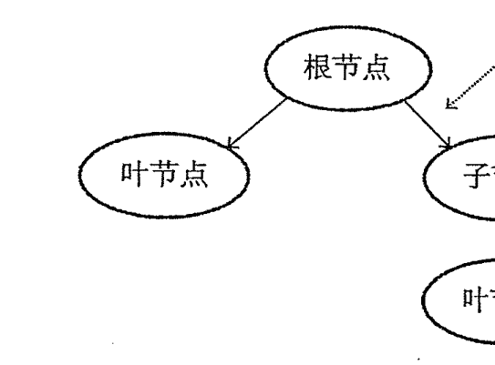

在决策树中，每个内部节点将输入集分割为几个子集，每个子集对应属性的每个值。然后对每个分支递归地重复此过程。最后，最后一个节点被分配给一个表示最合适的目标值（叶）的类。根据路径上测试的结果，将样本（实例）从根导航到叶，从而对它们进行分类。

# 人工智能神经网络

人工神经系统能够模仿人类的学习过程。相互连接的节点 / 神经元通过重复采样输入 / 输出信息集来学习输入和输出之间的关系。当数据嘈杂或不完整时，神经网络与专家系统相比，具有一个独特的优势。神经网络具有三个结构特征：输入单元、连接权值和隐藏单元。

神经网络方法被进行训练来学习分类模式。多层感知器是一种前馈神经网络。

# 第8章 人工智能在伊斯兰债券评级预测中的应用

模型，它将输入数据集映射为输出数据集。该模型调整层间的连接权重，直到预测误差最小化并达到稳定状态。为了建立模型，神经网络形成三个节点（输入节点、隐藏单元和输出节点）。输入节点有线性激活函数，无阈值（临界值）。除权重之外，每个隐藏的单元节点和每个输出节点都有与它们相关的阈值（临界值）。

图8-2概括展示了神经网络训练过程的工作原理。输入代表系统接收到的数据（如公司的财务比率）。每条信息都被分配了一个权重（w1, 1；w2, 1；…；wn, 1），这个权重指定了它对每个隐藏单元的相对重要性。这些权重是通过网络在“训练”过程中使用一系列训练算法来“学习”的。然而，反向传播算法是应用最广泛的算法，每个隐藏单元计算所有输入的加权和，并将结果传输给其他隐藏单元。与此同时，其他隐藏单元对它们的输入进行加权，以便将它们的信号传输给其他连接的隐藏单元。从其他隐藏单元接收到的信号进一步转换每个节点的输出，系统继续迭代，直到所有信息都被合并。

这个模型整合了隐藏单元之间复杂的相关性，以提高模型的拟合度，减少Ⅰ型误差和Ⅱ型误差。海尔（Hair）等人指出，Ⅰ型误差是错误地拒绝零假设的概率。在大多数情况下，它意味着存在差异或相关性，但实际上并不存在时，它也被称为α。在这种情况下，当预测器的评级高于实际评级时就会发生Ⅰ型误差。

Ⅱ型误差是指错误地拒绝零假设的概率，它被称为 β（1-α）。Ⅱ型误差与 I 型误差成反比。对评级而言，当预测评级低于实际评级时，就会出现Ⅱ型误差。

# 结果与分析

# 数据筛选

海尔以及霍斯默和莱梅肖认为，逻辑回归之所以受欢迎，部分原因是它能使研究人员克服最小二乘法回归的很多限制性假设，如线性、正态性和异方差。一般来说，在进行多元分析之前，筛选数据有三个初始步骤：第一步是处理丢失的数据；第二步是评估用于分析的极端值（即异常值）的影响；第三步是评估数据与假设之间的拟合充分性（即统计检验，如均方误差、平均绝对误差、平均绝对百分比误差）。

由于数据不完整和有影响的异常值，样本从 340 个初始数据减少到 314 个。逻辑回归方法不能处理多重共线性问题。这个问题的严重程度将导致难以发现变量之间的重要关系。因此，梅纳德建议进行采用共线性诊断试验来评估指标之间的相互关系。通过这种试验发现，规模变量之间的共线性问题比较严重。因此，我们纳入了一个可以代表规模并且排除了其他变量的变量。在这种情况下，模型中只使用总资产。总资产是从其他规模变量中选择，因为这种变量主要用来表示公司的规模。

# 多项逻辑结果

对自变量与因变量定义的组之间的整体关系的检验结果如表 8-3 所示。模型的似然比（likelihood ratio）被用于检验所有预测因子的回归系数是否同时为拟最小二乘法来计算 R2 值。

|模型|功能|影响|似然比|测试|Wald 检验|P (A)p (BBB)|P (AA)p (BBB)|p (AAA)p (BBB)|
|---|---|---|---|---|---|---|---|---|
|0|Entered|Intercept|||1278.891|1261.436|1270.37|
|1|Entered|LPX_LAST|0.000***|(-6.777)*|-0.73|(10.849)**|
|2|Entered|structure|0.000***|||-16.247|-18.09|-26.92
[structure=BBA]|14.106|44.655|47.617
[structure=Ijarah]|8.442|11.011|48.398
[structure=Murabahah]|17.713|19.256|-7.3
[structure=Musharakah]|0c|0c|0c
3|Entered|Industrial Sector|0.000***|[construction and engineer-ing]|-5.365|-3.161|-18.45
[consumer product]|0.062|-14.295|10.494
[diversified holdings]|-7.122|14.489|-9.668
[industrial product]|-3.661|-3.547|3.953
[infrastucture and utilities]|-24.139|-17.742|-7.122
[mining and petroleum]|-52.349|-35.139|-84.9
[plantation and agriculture]|7.8|-3.403|-9.819
[property]|-16.753|-19.227|4.3
[trading/service transportation]|0c|0c|0c
4|Entered|guar_status|0.000***|[guar_status=.00]|-8.314|-15.06|-35.221
[guar_status=1.00]|0c|0c|0c|

# 续前表

| 模型 | 功能       | 影响                  | 似然比
|------|------------|-----------------------|--------------------
|      |            |                      | 测试               |
|      |            |                      | Wald 检验          |
|      |            |                      | Sig                |
|      |            |                      | P (A)
|      |            |                      | p (BBB)            |
|      |            |                      | P (AA)
|      |            |                      | p (BBB)            |
|      |            |                      | p (AAA)
|      |            |                      | p (BBB)            |
| 5    | Entered    | RETURN ON ASSET       | 0.001***           | (2.182)*         | (2.32)*         | 1.685        |
| 6    | Entered    | LLGDP                | 0.003***           | (-231.359)*      | (-227.882)*     | (-227.237)*  |
| 7    | Entered    | LT DEBT TO TOT ASSET | 0.000***           | (1.813)*         | (1.747)*        | 0.946        |
| 8    | Entered    | subordinate           | 0.000***           |                  |                |              |
|      |            | [subordinate=.00]     |                    | 12.586           | -7.896          | -53.269      |
|      |            | [subordinate=1.00]    |                    | Oc               | Oc             | Oc           |
| 9    | Entered    | TOT DEBT TO TOT ASSET| 0.000***           | (-1.701)**       | (-1.654)*       | -1.182       |
| 10   | Entered    | CASH_RATIO           | 0.007***           | (15.049)*        | (15.51)**       | (17.284)**   |

注：*、**、*** 表示10%、5%、1%的显著水平。

# 决策树和人工智能神经网络结果

金（Kim）等人指出，人工神经网络和决策树是人工智能和数据挖掘应用中最常用的方法。与神经网络相比，决策树更有优势，因为它能够容忍学习阶段（训练数据集）的小规模目标变量数据，从而在多变量数据中获得诱导规则。

决策树是一种机器学习工具，用于从训练数据集构建树形结构。决策树生成的模型如图 8-3 所示。该决策树共有 65 个叶节点，将 314 个样本分为四类评级。它显示，在 26 个输入变量中，只有 15 个变量用于构建树结构。这些变量包括担保状况、从属关系、总资产、长期负债与总资本之比、总负债与总资产之比、现金比率、速动比率、ROA 和 ROE 之比、总市值、股价、营运利润率、GDP、利率、伊斯兰债券结构和工业部门。

值得注意的是，神经网络有一些缺点，包括计算强度和无法解释的结论及其推导方式，因此被归类为“黑箱”方法①。

> ① “黑箱” 方法也称黑箱系统辨识法。——译者注

神经网络仅显示预测结果，而不显示与输入和输出相关的潜在过程的特征。预处理和输入变量的选择将决定神经网络模型的性能及其结果的鲁棒性。因此，本研究利用从决策树中选定的变量来建立神经网络模型，并预测伊斯兰债券评级。

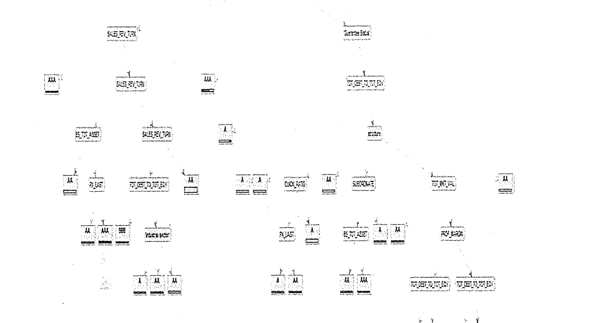

图8-3 决策树可视化

为了预测这两种分类器模型的性能，本研究使用了两组数据：通用训练数据和验证数据。通用训练数据用于构建一组分类器的模型。验证数据用于优化这些分类器的参数。试验分为以下几个阶段。

# 第一阶段：通用训练

决策树和多层感知器神经网络模型训练样本的平均命中率如表8-5所示。列显示的是预测值，行显示的是实际值或观察值。

# 金融 AI 算法

# ARTIFICIAL INTELLIGENCE IN FINANCIAL MARKETS

# 表 8-5
决策树与神经网络分类的准确度

| 观察值 | AAA | AA | A | BBB | 准确率 |
|--------|-----|----|---|----|------|
| AAA    | 33  | 1  | 1 | 0  | 94.29%
| AA     | 2   | 114| 2 | 2  | 95.00%
| A      | 2   | 0  | 148| 0  | 98.67%
| BBB    | 0   | 0  | 1 | 8  | 88.89%
| 无预测 / 总样本 | 11.78% | 36.62% | 48.41% | 3.18% | 96.50% |
| 观察值 | AAA | AA | A | BBB | 准确率 |
| AAA    | 34  | 1  | 0 | 0  | 97.14%
| AA     | 1   | 119| 0 | 0  | 99.17%
| A      | 0   | 1  | 149| 0  | 99.33%
| BBB    | 0   | 1 | 2 | 6  | 66.67%
| 无预测 / 总样本 | 11.15% | 38.85% | 48.09% | 1.91% | 98.09% |

所有 314 个伊斯兰债券样本都被用于构建模型。分类模型由训练样本生成。这些样本被确定为训练组，以便决策树和神经网络机器学习数据，并对数据模式进行分类。接下来，输出被分为四个类别：AAA、AA、A 和 BBB。分类器预测每个实例的类别，并生成显示模型性能的分类准确度。

从表 8-5 中可以看出，决策树模型的分类准确率为 96.5%（314 例样本中有 303 例准确）；而多层感知器神经网络模型的分类准确率为 98.09%（314 例样本中有 308 例准确）。神经网络结果中的 A 评级分类的预测率最高，单项评级的分类准确率为 99.33%（150 个 A 评级样本中有 149 个准确），而神经网络 BBB 评级分类的预测率最低，仅能将 9 个单项评级样本中的 6 个进行准确分类。

# 第二阶段：验证测试

验证测试是根据分类器对一定比例的数据的预测程度来评估分类器，这些数据是为了测试而保留的。所有伊斯兰债券样本被随机分为两组，即训练组和验证组。在伊斯兰债券案例中，80% 的实例（251 个实例）被用作训练数据，以构建模型；其余 63 个实例用于验证模型。

表 8-6 展示了这些方法的正确率统计表。决策树模型能够预测两种验证实例 77.78%（63 个验证案例中的 49 个）的验证测试。结果表明，A 评级类别的准确率最高，为 82.76%；其次为 AA 评级类别，准确率为 80.77%。然而，随机样本验证测试的准确率较低，这可能是由于样本量较小或模型复杂度不足导致的。

# 表 8-6
决策树与神经网络验证测试的正确率

| 分类器 | AAA | AA | A | BBB | 准确率 |
|--------|-----|----|---|----|------|
| 决策树  | 49  | 50 | 49 | 49  | 77.78% |
| 神经网络 | 49  | 50 | 49 | 49  | 77.78% |

# 第8章 人工智能在伊斯兰债券评级预测中的应用

试对BBB评级分类的测试结果并不好。验证测试没有预测到该分类中的两个实例。

# 表8-6 决策树和神经网络验证测试

| 观察值 | AAA | AA | A | BBB | 准确率 |
| --- | --- | --- | --- | --- | --- |
| AAA | 4 | 1 | 1 | 0 | 66.67% |
| AA | 2 | 21 | 2 | 1 | 80.77% |
| A | 0 | 4 | 24 | 1 | 82.76% |
| BBB | 0 | 1 | 1 | 0 | 0.00% |
| 无预测/总样本 | 9.52% | 42.86% | 44.44% | 3.17% | 77.78% |
| 观察值 | AAA | AA | A | BBB | 准确率 |
| --- | --- | --- | --- | --- | --- |
| AAA | 5 | 1 | 0 | 0 | 83.33% |
| AA | 0 | 20 | 4 | 2 | 76.92% |
| A | 0 | 5 | 23 | 1 | 79.31% |
| BBB | 0 | 0 | 0 | 2 | 100.00% |
| 无预测/总样本 | 7.94% | 41.27% | 42.86% | 7.94% | 79.37% |

对神经网络的验证测试的结果较好，整体准确率达到了79.37%，63个验证数据中有50个被正确预测。此外，在验证测试中，该模型对20.63%的伊斯兰债券（63个验证数据中的13个）进行了错误分类。BBB评级分类得到了100%的准确率，这与决策树模型的结果有巨大差距。神经网络模型中的AAA评级的准确度取代了该类别的决策树模型。而对于AA评级和A评级分类，决策树方法的预测准确度高于神经网络。

# 结果比较

现在，我们来讨论使用多项逻辑、决策树和神经网络方法对变量选择和预测准确度的比较。运用以往大量与债券预测和金融危机相关的研究方法，我们选取了24个自变量开发了一个模型，用以预测马来西亚市场的伊斯兰债券评级。在所有变量中，我们发现一些变量可以基于多项逻辑和决策树方法来决定伊斯兰债券评级。表8-7 展示了两组重要变量的比较。

如表8-7所示，两种方法得到的重要变量基本相似，但数据挖掘的列表变量比逻辑变量更广泛。需要强调的是，这两个结果都表明，股价、伊斯兰债券结构、工业部门和担保状况是决定伊斯兰债券评级的关键因素。

# 金融 AI 算法

# ARTIFICIAL INTELLIGENCE IN FINANCIAL MARKETS

# 表 8-7 重要变量的比较

| 多项逻辑 | 决策树 / 神经网络 |
| --- | --- |
| 股价 | 股价 |
| 伊斯兰债券结构 | 担保状况 |
| 工业部门 | 工业部门 |
| 担保状况 | 伊斯兰债券结构 |
| 资产收益率 | 长期负债占总资本之比 |
| GDP | 总资产 |
| 长期负债与总资本之比 | 吉隆坡银行同业拆息率（Klibor） |
| 从属关系 | 总市值 |
| 总债务与总资产之比 | GDP |
| 现金比率 | 营运利润率 |
|  | 速动比率 |
|  | 每股账面价值 |
|  | 销售额 |
|  | 从属关系 |
|  | 长期债务与总资产之比 |
|  | 现金比率 |

至于股价，标准普尔公司认为，股价提供的信息不仅超出了公司的基本状况，而且反映了公司的现状。因此，股价变动会对其信用评级产生影响。与财务比率不同，伊斯兰债券结构和工业部门对评级有不同的影响。两者都对信用风险有间接影响，但它们在评级评估中却非常重要。由于每种特定结构所蕴含的信用风险性质不同，所以伊斯兰债券结构会影响伊斯兰债券的评级。工业部门显示了公司的经营风险，它反映了行业的竞争水平和市场集中度。然而，担保状态在信用评级中也起着重要作用，因为它在公司无力支付的情况下为其提供了强有力的保护。此外，这两种方法显示，盈利能力比率、杠杆率、流动性比率、宏观经济变量等也与伊斯兰债券评级显著相关。

表8-8 显示，神经网络模型对通用训练数据的分类准确率最高，达到了98.09%。另一方面，决策树准确地将96.5%的有效案例分类到其原始的评级类别中；而多项逻辑在这三种方法中准确率最低，仅为84.5%。

| 观测值       | 多项Logit   | 决策树     | 神经网络   |
| --------------|-------------|------------|------------|
| AAA           | 88.57%      | 94.29%     | 97.14%     |
| AA            | 91.67%      | 95.00%     | 99.17%     |
| A             | 93.33%      | 98.67%     | 99.33%     |
| BBB           | 77.78%      | 88.89%     | 66.67%     |
| 正确率 %       | 91.72       | 96.5       | 98.09      |
| I类误差        | 20          | 5          | 5          |
| II类误差       | 6           | 6          | 1          |
| 观测值         | 决策树       | 神经网络    |
| AAA           | 66.67%      | 83.33%     |
| AA            | 80.77%      | 76.92%     |
| A             | 82.76%      | 79.31%     |
| BBB           | 0.00%       | 100.00%    |
| 正确率 %       | 77.78       | 79.37      |
| I类误差        | 8           | 5          | 
| II类误差       | 6           | 8          |

对于Ⅰ型和Ⅱ型误差的误分类代价，在我们的五种误分类例子中，通过神经网络和决策树方法获得了基线训练模型中的最小Ⅰ型误差。多项逻辑模型产生的Ⅰ型误差最高，有20个错误的预测案例。另一方面，对于Ⅱ型误差，神经网络只有一个；而决策树和多项逻辑模型各有6个Ⅱ型误差。

科赫（Koh）还补充说，Ⅰ型误差的误分类代价高于Ⅱ型误差。从这两种方法中可以看出，多项逻辑和决策树的结果比神经网络有更多的Ⅰ型和Ⅱ型误差。这使我们得出了一个结论，即神经网络方法将在准确度方面给出了更稳健的结果。

以往很多的债券评级预测研究表明，人工智能和数据挖掘方法比传统的统计方法有更好的预测结果，因为这些模型需要一些可能不适合债券评级的假设。例如，杜塔和谢卡尔、埃德林顿（Ederington）等人、金等人、权等人、马赫（Maher）和森（Sen）、夏弗苏克等人，以及胡（Hu）和安塞尔（Ansell）发现，神经网络比线性回归、多元判别分析和/或逻辑回归具有更好的预测能力。这一结论与本研究的实证结果一致，我们的研究发现，数据挖掘和人工智能方法在对马来西亚伊斯兰债券的评级预测中优于多元分析方法。

# 结 论

本研究通过比较多项逻辑模型、决策树模型和神经网络模型，来预测企业伊斯兰债券评级。从分类准确度看，我们可以得出的结论是，在使用非统计方法时，当使用马来西亚伊斯兰债券市场样本预测伊斯兰债券评级时，神经网络和决策树比多项逻辑统计方法更有效。这些发现有望丰富文献，并且具有实际意义。该模型将有助于评级机构进行初始评级的影子评级，也有助于发行公司和基金公司出于风险管理和交易目的进行信用分析。此外，该模型还有助于依赖评级系统的银行，使它们能够按照《巴塞尔协议Ⅲ》的要求改进风险评估技术、定价策略和拨备水平。

实证结果也有望为伊斯兰金融的发展贡献丰富的知识，同时鼓励分析师和学术研究人员开发与此相关的其他潜在研究。本研究有望为该领域的进一步研究提供帮助。关于数据收集问题，我们建议收集更多的观测数据。如果能将两种类型的伊斯兰债券结合起来，在讨论中比较资产担保伊斯兰债券和基于资产的伊斯兰债券（如本文所述），那么分析就将更加全面。对于因变量，研究人员可以尝试使用更具体的评级分类，而不是我们在本研究中使用的一般评级分类。一个有趣的问题是担保状况变量。伊斯兰债券结构显示，有多种不同类型的担保状况或有约束力的协议。考虑了模型中各种担保状况的研究能更好地了解研究伊斯兰债券的信用风险。

# 附录1

# 表 A1 债券和公司评级中使用的变量、概况和技术摘要汇总表

编号、作者 规模变量 流动性变量 盈利性变量 覆盖率变量 杠杆变量 市场变量 定性变量 方法
1. Belkaoui √ √  √  √  √  √ MDA
2. Ederington et al. √    √  √  √  √ MDA

# 续前表

| 编号、作者 | 规模变量 | 流动性变量 | 盈利性变量 | 覆盖率变量 | 杠杆变量 | 市场变量 | 定性变量 | 方法 |
|------------|----------|-----------|------------|------------|----------|----------|----------|------|
| 3. Dutta and Shekar |         | √         | √          |            | √        | √        | √        | AI ANN |
| 4. Singleton and Surkan V | √       | √         | √          | √          | √        |          |          | AI ANN MDA |
| 5. Kwon et al. | √       | √         | √          | √          | √        | √        | √        | OPP |
| 6. Chaveesuk et al. | √       | √         | √          | √          | √        |          |          | RBF、LVQ、BP、Logit |
| 7. Kamstra et al. | √       |          | √          | √          | √        |          | √        | COMBINED LOGIT |
| 8. Huang et al. | √       | √         | √          | √          | √        |          |          | SVM、BP |
| 9. Touray | √       | √         |          | √          | √        |          | √        | MDA-MLOGIT |
| 10. Kim | √       | √         | √          |            | √        | √        | √        | AI ANN |
| 11. Caoetal. | √       | √         | √          | √          | √        | √        |          | Logit、OPR、SVM |
| 12. Brabazon and Neill | √       | √         | √          | √          | √        | √        |          | Grammatical Evolution |
| 13. Lee | √       | √         | √          | √          | √        | √        |          | SVM、BP、MDA |
| 14. Hwang et al. | √       | √         | √          | √          | √        |          | √        | OLPM |
| 15. Hajek and Olej | √       | √         | √          |            | √        |          |          | SVM、ANN |
| 16. Kors et al. | √       | √         | √          | √          | √        | √        |          | MDA、Logit、Probit |
| 17. Mizen and Tsoukas | √       | √         | √          | √          | √        |          | √        | OPM |
| 18. Novotna | √       | √         | √          | √          | √        |          |          | MDA、M-logit、Decision Tree |
| 19. Hajek and Michalak | √       | √         | √          |            | √        | √        | √        | MLP、RBF、SVM、NB、RF、LDC、NMC |
| 20. Doumpos et al. | √       | √         | .√         | √          | √        |          | √        | MCDM |

# 金融 AI 算法

ARTIFICIAL INTELLIGENCE IN FINANCIAL MARKETS

# 附录 2

# 表 A2

# 模型拟合信息与伪 R2

# 模型

# 模型拟合准则

# 似然比检验

# -2 对数似然性

# 卡方检验

# Df

# 有效值

# 仅截获值

# 667.233

# 

# 535.342

# 60

# 0.000***

# 结果

# 131.891

# 535.342

# 60

# 0.000***

# 伪 R2

# Cox and Snell

# 0.818

# Nagelkerke

# 0.928

# McFadden

# 0.799

注：*** 指 1% 的检验水准。

# 附录 3

# 表 A3

# 自变量列表

# 变量

# 续前表

| 变量       | 缩写     | 公式                                                                 |
|------------|----------|----------------------------------------------------------------------|
| X10 QUICK_RATION | 速动比率 | 流动资产清单 / 流动负债                                               |
| X11 CASH_RATIO   | 现金比率 | 现金 + 有价证券 / 流动负债                                             |
| 覆盖范围变量    |          |                                                                      |
| X12 INTEREST_COVERAGE_RATIO | 利息偿付率 | 未计利息、税项、折旧及摊销前的利润 / 利息支出                             |
| 可配置变量     |          |                                                                      |
| X13 PROF_MARGIN   | 净利润率 | 净利润 / 销售额                                                       |
| X14 RETURN_ON_ASSET | 资产回报率 | 净利润 / 总资产                                                       |
| X15 RETURN_COM_EQY | 股本回报率 | 净利润 / 股票                                                         |
| X16 OPER_MARGIN   | 营业利润率 | 营业利润 / 销售额                                                      |
| 市场变量      |          |                                                                      |
| X17 BOOK_VAL_PER_SH | 每股账面价值 | 账面价值 / 最新的价格                                                   |
| X18 PX_LAST     | 股票价格  | 股票价格                                                            |
| X19 GDP        | 国内生产总值 | 国内生产总值                                                         |
| X20 INTEREST RATES | 三个月 Klibor | 三个月的同业拆息利率                                                   |
| X21 Industrial Sector | 行业 | 工业产品、房地产、种植园和农业、建筑和工程、贸易 / 服务运输、基础设施和公用事业、消费品、多元化控股、采矿和石油 |
| 信用增级变量    |          |                                                                      |
| X22 Guarantee Status | 担保状态 | 有 / 没有担保人                                                        |
| X23 Subordinate   | 从属行业 | 高级 / 初级状态                                                       |
| 其他特殊变量    |          |                                                                      |
| X24 Structure   | 伊斯兰债券结构 | Musharakah、Ijarah、Mudharaba、Murabahah、BBA                           |

# 第五部分

# ARTIFICIAL INTELLIGENCE IN FINANCIAL MARKETS

Cutting Edge Applications for Risk Management, Portfolio Optimization and Economics

# 投资组合管理、分析与优化

# 不确定性下的多周期投资组合选择：一种基于交互的方法

# 第9章

马加兹·史坦巴赫尔（Matjaz Steinbacher）

# 引言

本章内容基于一项模拟研究，用基于交互的方法来检验在不确定性下的多周期投资组合选择问题。从方法论上讲，它建立在个体行为人及其主观特征的基础上。我们的基本前提是，在主体投资组合选择中，局部互动和信息共享是必不可少的，而主体的选择是由个体层面的简单行为准则和社交网络上的局部互动产生的。

金融市场天生就充斥着涉及时间和不确定性的问题。不确定性的存在对投资组合选择至关重要，也是建立投资组合的主要原因。在一个充满确定性的世界里，投资者（我们称他们为主体）只会（或应该）拿一种资产追求最高回报，并以最优的方式实现他们的目标。在马科维茨的开创性工作和默顿随后的多周期扩展之后，对投资组合选择进行的研究开始朝着不同的方向发展。研究的一个分支主要关注的是解决动态选择问题的显式解。其他人则研究了不同参数对主体优化问题的影响。加拉皮埃（Garlappi）等人拓展的均值 - 方差模型明确地说明了预期收益的不确定性。刘（Liu）将多个风险资产和可预测回报纳入默顿模型。昂（Ang）和贝卡特（Bekaert）研究了制度变迁对投资组合选择的影响。本佐尼（Benzoni）等人研究了劳动收人和股息协整时的投资组合选择。贝纳茨（Benartzi）和泰勒

# 金融 AI 算法

# ARTIFICIAL INTELLIGENCE IN FINANCIAL MARKETS

(Thaler) 将行为因素纳人静态投资组合问题中。伯克拉尔（Berkelaar）等人推导出了在损失厌恶下的最优投资组合选择的闭式解。坎贝尔（Campbell）和维瑟拉（Viceira）提出了基于摄动法（perturbation methods）的投资组合选择问题的近似解。谢夫林（Shefrin）和斯塔特曼（Statman）提出了一个积极行为投资组合理论。这些均衡模型为我们提供了很多有益的见解，降低了模型对参数估计的敏感性，但也留下了很多未得到解答的经验事实，它们因此也受到了很多批评。

我们将微观结构引人了投资组合选择的过程，这是以前的模型所没有的。我们的主要目标是将投资组合选择与基于主体的方法相结合，并将行为视角纳入主体的选择功能。知识不是碎片化的，而是分散在不同的主体之间，并且随着时间的推移而不断进化的。我们假设每个主体只能跟踪他所持有的投资组合的回报，但对驱动回报的动态一无所知。然后，这些有限理性主体不断地与临近的主体进行局部互动，影响他人决策的同时也被他人的决策所影响。选择过程是一个永恒的活动，它包括四个阶段，从观察个人的投资组合的过往收益开始，通过主体选择和对两个投资组合进行比较，最后做出决策。① 选择的过程反映了一种强化学习，在这种学习中，主体倾向于采用在过去获得高回报的投资组合。我们通过引人主体的不完全选择来扩展这个概念，并将其表示为怀疑程度。如果一个主体完全不会采用回报率更高的投资组合，那么他就被视为可疑的。这种描述暗示着可疑主体很容易做出错误的决定，无论是故意的还是意外的。这种行为可以通过一些主体的特征来解释，这些特征体现在投资组合选择问题的行为方面。最后，一小部分主体从不改变它们的初始投资组合，它们被称为流动性主体。因此，投资组合选择的问题不仅是技术性的，而且是复杂的。

我们的模型根据实际数据进行了模拟。数据集涵盖了道琼斯工业指数五家上市公司的股票每日收益，主体可以据此制定投资组合。我们考虑三个不同的时间段：没有特定趋势的基准期、熊市和牛市。后两个时间段是卡尼曼（Kahneman）和特沃斯基（Tversky）的研究选定的，他们认为主体在亏损情况下的行为与在获

> —————————————— ① 信息通过口碑在网络上传播。经济学中基于传播的模型通常使用口碑传播作为思想传播的来源。

# 金融AI算法

# ARTIFICIAL INTELLIGENCE IN FINANCIAL MARKETS

# 第9章
不确定性下的多周期投资组合选择：一种基于交互的方法

益情况下的行为不同。此外，巴尔贝里斯（Barberis）等人认为，主体不愿意在熊市中承担风险，因为他们是最先开始认识到风险并评估风险的人。

我们将在有效边界理论的背景下分析所选择的投资组合。我们并不打算对这个理论本身提出质疑；相反，我们感兴趣的是相互作用的主体能否在一个不确定和动态的环境中获得均值－方差组合。经过一系列基于模拟的实验，我们证明了它们是可行的。即使主体不断地基于已实现的收益做出决策，我们也还是发现，风险是两组主体选择投资组合的决定性因素，它们非常偏好风险最低的均值－方差投资组合。此外，主体倾向于同步它们的选择，并区别胜利者和失败者。可疑主体的选择要比无疑主体的选择略为分散，而两组主体大多都是胜利者。这一结论在牛市和熊市中都得到了证实。然而我们发现，在熊市中，主体更容易受到风险的影响，而且在风险最小的投资组合中，它们选择极其同步。在牛市中，主体的选择与有效边界投资组合有轻微偏差，而同步水平则弱于熊市。此外，我们通过使用蒙特卡罗方法和变异系数来检验主体选择的一致性，发现主体在最期望或最不期望的选择上表现最一致。无疑主体的选择比可疑主体的更一致。两种主体选择的比较说明了投资组合选择对选择模式的敏感性，这可能是一个实质性的发现。

本章对经济学和金融学领域中基于主体的模型的增长领域做出了贡献。研究人员主要包括塞曼（Zeeman）、金和马尔科维茨、布罗克（Brock）和霍姆斯（Hommes）、勒克斯（Lux）、勒克斯和马基西（Marchesi）、博斯威基克（Boswijk）等人、利维（Levy）等人、康（Con）和博查德（Bouchaud）、伊洛里（Iori）、帕尔默（Palmer）等人、亚瑟（Arthur）和勒巴伦（Lebaron）等人。经济学中的一些早期尝试使用了网络，这是基于迈尔森（Myerson）和基尔曼（Kirman）的研究。

本章其余内容分别介绍了构建模型、结果描述以及投资组合选择的一致性，并在结尾给出了结论。

# 金融AI算法

# ARTIFICIAL INTELLIGENCE IN FINANCIAL MARKETS

# 模型

# 主体

该模型是一个离散时间和离散状态的模型。它由一组由节点表示的主体组成，并通过无向链接彼此连接到一个类似于瓦茨（Watts）和斯特盖斯（Strogaz）提出的网络中。¹ 这个网络被称为小世界网络，其中每个主体只与一小部分对等方连接，而且主体主要与最近的邻居连接，也与一些较远的邻居连接。因此，主体与局部的联系要比与整体的联系紧密得多。图9-1展示了一个拥有30个节点的小世界网络。

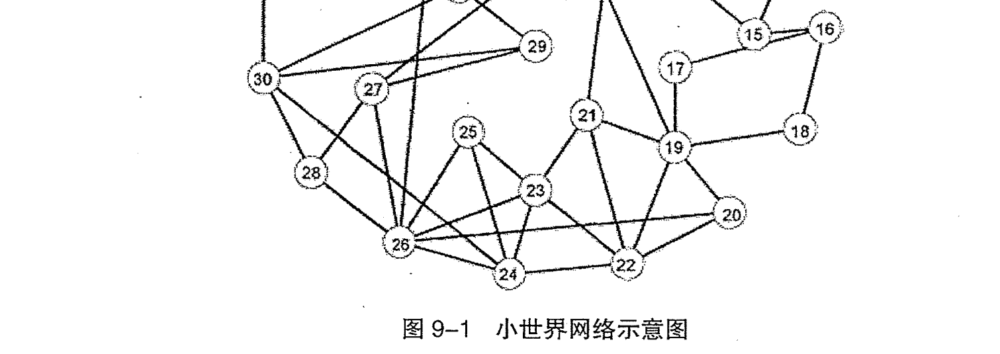

主体使用网络作为与相邻对等方通信的基础，它们和对等方交换与投资组合相关的信息。虽然只有连接的主体才可以互相通信，但连接链允许主体从那些没

> ① 根据定义，建立无向链接需要双方同意。因此，如果主体i与主体j连接，那么主体j也与主体i连接。但是在两个主体之一不知道链路的定向网络中，情况并非如此。

# 金融AI算法

# ARTIFICIAL INTELLIGENCE IN FINANCIAL MARKETS

有直接连接的主体处接收间接信息。例如，如图 9-1 所示，假设主体 1 与主体 29 通信并采用了其投资组合，主体 2 与主体 1 通信并采用了其投资组合，那么主体 2 实际上采用的是主体 29 的投资组合，尽管它们并没有直接连接。因此，每个主体的行为直接或间接地影响着其他主体。

目前的模型由 n = 5000 个主体组成。每个主体最初与 10 个最近的邻居（k = 10）相连，每个环状晶格每侧有 5 个主体。然后，每个连接被重新连接到任意选择的节点的概率 p 为 0.1，这可能会给主体一些远程连接。由此产生的网络仍是直径较小的局部连接。① 假设网络是静态的，因此，主体既不被允许随着时间的推移形成新的连接，也不被允许破坏现有连接。每次模拟都从一个独特的网络开始。

在每次模拟开始时，每个主体被随机分配一个初始投资组合，其数量为 W₀=1。每个主体的主要目标是随着时间的推移来积累财富。

```
W_{t+1}(A_i)=W_t(A_i)[1+R_t(\cdot)]
W_0(A_i)=1; q^i_t \geq 0
```

Wᵗ 和 Wₜ₊₁ 表示主体 i 在时间间隔 t 和 t + 1 中的财富，而 Rₜ(·) 表示主体在 t 内使用的替代(·) 的回报。我们假设投资组合的全部收益都转化为主体的财富并再投资。当 qᵗⁱ ≥ 0 时，不允许卖空或借款。主体也不被允许购买昂贵的信息信号。目标函数的简洁性说明了主体所面临的问题的简洁性，也就是说，在每个时间段内都可以按照如图 9-2 所示的四个阶段的程序选择投资组合。

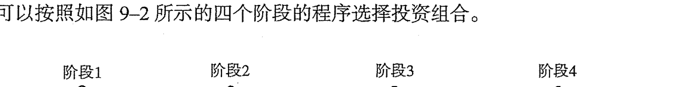

主体们按顺序见面，每个周期 t 从主体 1 开始，他观察其投资组合 t-1 期的值。每个主体只有他所持有的投资组合的信息。第 2 阶段，一个主体随机选择一个相

> ① 网络的直径是网络上任意两个节点之间的最大距离。

# 金融AI算法

ARTIFICIAL INTELLIGENCE IN FINANCIAL MARKETS

邻的主体。通过随机选择，我们假设没有人能够系统地跑赢市场，因此我们认为主体没有准确的预测方法。在选择了对等方之后，双方会比较各自的投资组合，尤其是在 t-1 期时的组合结构和相应的值。在最后一个阶段，两个主体中的每一个都需要决定是继续当前的投资组合，还是切换到对方的投资组合。与在很多其他基于主体的模型中可以找到的复杂决策规则相反，我们假设两个主体 i 和 j 的每一个都比较两种收益，并根据以下逻辑函数，即等式（9.2）做出决策：

\Phi = \frac{1}{1 + \exp\left[ \frac{W_{t-1}(A_i) - W_{t-1}(A_j)}{K} \right]} (9.2)

选择规则包含了主体倾向于采用过去表现良好的投资组合的想法。¹ 如等式（9.2）所示，主体的选择受到可疑参数 κ∈（0，1）的限制。² 该参数是一个外生因素，影响主体在比较两个投资组合时没有选择更好的一种可能性。为了执行选择，我们使用了一个随机数生成器，它的实现如下：如果 ran>Φ，主体就会保留其投资组合，否则他会采用相邻主体的投资组合。参数 ran ~ U（0，1）是一个均匀分布的独立同分布（independent and identically distributed，IID）随机数。选择收益较少的投资组合的概率与主体 i 与主体 j 的组合回报之差 W_{t-1}(A_i) - W_{t-1}(A_j) 负相关，并与参数 κ 正相关。κ 越低，主体采用收益率更高的投资组合的概率就越高，反之亦然。根据定义，完全不可疑的主体的 κ=0，完全可疑主体的 κ=1。³

在两个主体都更新了各自的投资组合之后，主体2都会重复该过程，以此类

__________

> ① 严格地说，强化学习不是我们所知道的学习，而是模仿。它已被广泛应用于社会学习的“廉价磋商”的交际游戏中，以描述经济主体对某些类型的“模拟”的结果。

> ② 包含可疑性参数的理由是多方面的。泽尔滕（Selten）认为，在决定采取某种行动和行动本身之间可能会出现错误。怀疑程度还可能与（不）信任、对数据的怀疑、暂时的情绪或某些代理的特定因素，甚至运气等有关。此外，可能不倾向于选择潜在收益较少的替代方案。如果存在交易成本，代理机构更有可能不愿意进行转换。主体也可能没有持久的偏好，而是在行动前使用启发式方法，这可能再次导致“错误”。塞勒等人认为，短期的评估期迫使投资者做出更糟糕的决策。这些因素的作用是非常不确定的，但也不能忽视。因此，这个变量包含了投资者可能与预期行为不同的所有因素。从技术角度来看，它也可以被视为一种噪音。

> ③ 为了使证明更易于处理，我们分别用 A_i 和 A_j 来表示主体的财富：W_t(A_i) 和 W_t(A_j)。

# 金融AI算法

# ARTIFICIAL INTELLIGENCE IN FINANCIAL MARKETS

## 命题2：无疑主体和可疑主体随机选择预期收益相同的投资组合。

证明：见前一证明的最后一部分。

## 命题3：一个完全可疑主体表现出对预期收益较高的投资组合的相对偏好。

证明：我们保留了命题1证明中的设置。根据定义，完全可疑主体的κ=1。

根据先前证明的映射f，一旦Φ＞0.5，持有A_i的可疑主体就会开始表现出对A_j的相对偏好，这反过来对所有A_i＜A_j的主体都成立。假设我们选取ε∈U，使得ε＜Φ，可疑主体转而选择两个备选方案中更好的一个的概率，即Pr(ε＞0.5)=∫₀^ε≤0 du = ε＞0.5 → ε∈(0.5, 1)，这对所有A_i＜A_j的主体都成立。主体仍保留A_i组合的概率是q=1 - Pr → q＜Pr，这显示出主体对两个备选更好的一个的相对偏好。

对于A_i＞A_j，当主体显示出一种相对偏好时，即当Φ＜0.5时，这反过来也使用与所有A_i＞A_j。假设我们选择δ∈U，使得δ＞Φ。可疑主体选择两个组合中更好的一个的概率是q(δ＞0.5)=∫₀^δ≥Φ du = δ＞0.5 → δ∈(0.5, 1)，这对所有A_i＜A_j都成立。然而，主体采用A_j的概率是Pr=1 - q → Pr＜q，这再次显示出主体相对偏好两个备选方案中更好的一个。在这两种情况下，主体对两个方案中更好的一个的相对偏好会随着两个方案的收益差呈指数增长，从不低于0.5，也从不达到统一。

图9-3 展示了在两个投资组合中选择更好的一个的概率，作为两个备选方案（价差）差和可疑程度的函数。价差以基点计算。

在基于交互的模拟中，主体之间共享信息会导致羊群效应。羊群效应是模拟不可避免的后果之一，也是金融市场中最被普遍认可的观察结果之一。它促进了同步，而同步的副作用可能是从样本集中剔除偶尔收益不佳的投资组合。请记住，只有一个或多个主体持有的投资组合才是可行的。巴拉（Bala）和戈亚尔（Goyal）的研究表明，当主体更喜欢较高的收益并从其邻居那里学习时，无论他们的初始状态如何，他们的选择都与概率1同步。那些完全重新平衡投资组合的无疑主体尤其容易同步。为了避免这种结果，我们引入了流动性主体。流动性主体是指

# 第9章
不确定性下的多周期投资组合选择：一种基于交互的方法

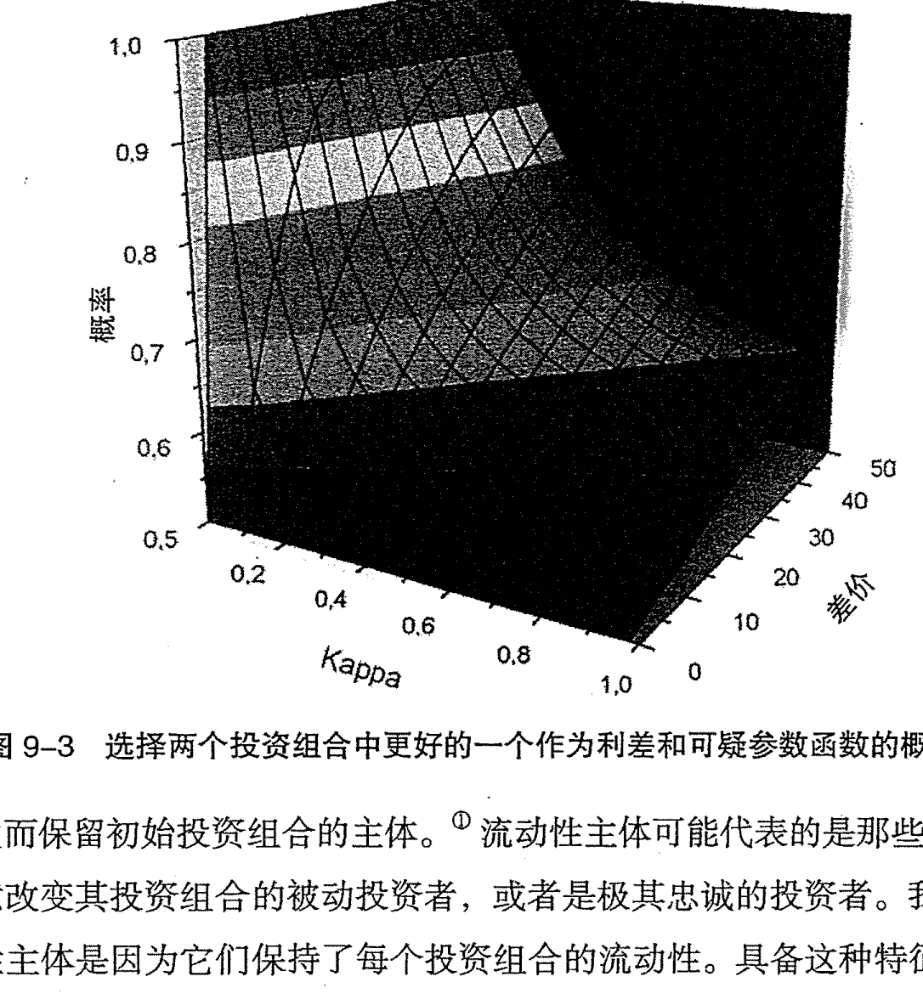

图 9-3 选择两个投资组合中更好的一个作为利差和可疑参数函数的概率

考虑收益而保留初始投资组合的主体。① 流动性主体可能代表的是那些参与市场，但不愿意改变其投资组合的被动投资者，或者是极其忠诚的投资者。我们称它们为流动性主体是因为它们保持了每个投资组合的流动性。具备这种特征使它们的选择过程得以顺利进行。流动性主体只占主体的一小部分，并被分为几个同质组，编号从 700 到 719，从 1000 到 1019，从 1200 到 1219，从 1500 到 1519，从 2500 到 2519，从 3500 到 3519，从 4800 到 4819。随着模拟的重复，流动性主体可能持有不同的投资组合，并与不同的主体相邻。

## 证券和投资组合

投资组合是一组投资。资产单位可能包括储蓄账户、股票、债券和其他证券、债务和贷款、期权和衍生品、ETF、货币、房地产和大宗商品。

如果 M = ( 1, 2, …, n ) 表示一组有限的资产单位集合，那么一个投资组合

> ① 初始投资组合被随机分配给每个流动性主体，分配方式与分配给其他所有流动性主体的方式相同。

# 金融AI算法

# ARTIFICIAL INTELLIGENCE IN FINANCIAL MARKETS

就是由这n个资产单位的持有量组成的。如果非零持股数量大于1，那么该投资组合就被称为多元化投资组合。我们排除了卖空，这意味着主体只能持有非负数量的不同资产，因此qᵢ≥0。多元化投资组合只能包含n个可用资产总数中相等比例的i个资产，这使得不同的投资组合数量最多为K(n)=∑(ⁿCʳ)=2ⁿ−1个。①

我们使用道琼斯工业指数中不同行业的五家公司的股票，即C、KFT、MSFT、AA和XOM。②因此，n=5，这是一个包含31个投资组合的样本集，如表9−1所示。

| S1       | AA     | S12      | MSFT-KFT | S23      | MSFT-XOM-KFT |
| S2       | MSFT   | S13      | XOM-C    | S24      | MSFT-C-KFT |
| S3       | XOM    | S14      | XOM-KFT  | S25      | XOM-C-KFT  |
| S4       | C      | S15      | C-KFT    | S26      | AA-MSFT-XOM|
| S5       | KFT    | S16      | AA-MSFT-XOM | S27      | AA-MSFT-XOM-KFT |
| S6       | AA-MSFT | S17      | AA-MSFT-C | S28      | AA-MSFT-C-KFT |
| S7       | AA-XOM  | S18      | AA-MSFT-KFT | S29      | AA-XOM-C-KFT |
| S8       | AA-C    | S19      | AA-XOM-C  | S30      | MSFT-XOM-C-KFT |
| S9       | AA-KFT  | S20      | AA-XOM-MSFT | S31      | AA-MSFT-XOM-C-KFT |
| S10      | MSFT-XOM | S21      | AA-XOM-KFT |         | 
| S11      | MSFT-C  | S22      | MSFT-XOM-C |         | 
|----------|---------|----------|-----------|----------|--------------|

主体是价格接受者。所有股票都具有无限小的可分割性和流动性，主体可以在不受价格影响的情况下快速买卖任何数量的股票。③如果没有这个假设，当那些在第一次迭代后持有表现最差的投资组合的主体想买入任何其他投资组合时，就需要投入新资金。由于这是无法实现的，因此我们将限制这些主体的选择活动。

① 这是一种简化。在现实中，主体可以将不同比例的资产放入其投资组合中，因此不同投资组合的数量接近无穷大。

② 自2009年6月8日起，花旗集团（NYSE: C）从该指数中退市，取而代之的是其姊妹保险公司Travelers（NYSE: TRV）。

③ 研究发现，流动性不足对股市产生显著影响。

# 第9章
不确定性下的多周期投资组合选择：一种基于交互的方法

当主体转换为相邻主体的投资组合时，一个隐含的假设是，他出售当前投资组合的所有股票，并购买相邻主体投资组合中的股票组合。为了简单起见，我们进一步假设投资组合转换不产生交易成本或任何其他与交易相关的成本，包括税收。①

# 数据

我们使用了股票收益的真实数据。每日收益按照连续两个交易日收盘价的相对差额计算。一个投资组合在 t 时刻的收益率由投资组合股票回报率的加权值求和得到，因此，Rᵗˢ = ∑ⱼ=1 qⱼₜ^j Rⱼₜ ，其中，∑ⱼ=1 qⱼₜ =1。

该模型在三个不同的时间跨度内运行。基准时间段覆盖2009年1月2日至2010年1月21日期间。熊市开始于2008年9月22日，结束于2009年3月13日。熊市之后，牛市从2009年3月16日开始，到2010年1月11日结束。期间有两个非交易日，即2009年3月14日和15日。基准时间段包括264个区间，熊市包括120个区间，牛市包括209个区间。

表9-2报告了每只股票在这两个子期间内的累积收益率。我们从表9-2可以看出，最糟糕的投资是在熊市开始时投资于C的每1美元在熊市结束时变成了8.90美分。在牛市中，投资于AA的每1美元的收益是85.13美分。XOM仅受到了熊市的轻微影响，但在牛市中也没有表现出任何明显的积极走势。它在熊市中的损失为14.81%，牛市时的收益率低于5%。

表9-2
熊市和牛市的累积收益率（百分比）
-----------------
| AA   | C     | KFT   | MSFT  | XOM   |
| 熊市 | -78.62| -91.10| -31.91| -34.45|
| 牛市 | 185.13| 55.79 | 25.93 | 86.28 |
|      |       |       |       | 4.79  |
-----------------

> ① 这种假设受到这些成本可能对交易政策产生的影响的限制。康斯坦丁尼德斯（Constantinides）和罗等人认为，主体通过降低交易频率和缩小交易规模来适应大额交易成本。此外，交易成本还决定了对无风险证券的选择，并决定了投资组合中证券的数量。

# 金融AI算法

# ARTIFICIAL INTELLIGENCE IN FINANCIAL MARKETS

接下来，我们将描述投资组合的风险。通常，投资组合β是衡量投资组合风险的一个指标。对于每个投资组合i而言，其β值是根据市场模型估算的：

R_{i,t}=α_i+β_iR_{M,t}+ε_{i,t}
同时, E(ε_{i,t})=0; Var(ε_{i,t})=σ_i^2 （9.3）

β系数反映了投资组合与市场风险之间的关系，而R²则衡量的是相对于市场投资组合的多样化程度。不同之处在于投资组合的特殊风险本来是可以分散的。在我们的案例中，投资组合S31代表的是一个市场投资组合，因为它包含了所有可用股票，并且代表了最高的可分散化程度。因此，S31的方差表示市场风险σ_M。表9-3报告了投资组合的β值和相应的R²值。

表9-3
投资组合的β系数和三个子期间对应的R²值
————————————————————————————————————————————————————————————————————————————————————————————————————————————————————————————————————————————————————————————————————————————————————————————————————————————————————————————————————————————————————————————————————————————————————————————————————————————————————————————————————————————————————————————————————————————————————————————————————————————————————————————————————————————————————————————————————————————————————————————————————————————————————————————————————————————————————————————————————————————————————————————————————————————————————————————————————————————————————————————————————————————————————————————————————————————————————————————————————————————————————————————————————————————————————————————————————————————————————————————————————————————————————————————————————————————————————————————————————————————————————————————————————————————————————————————————————————————————————————————————————————————————————————————————————————————————————————————————————————————————————————————————————————————————————————————————————————————————————————————————————————————————————————————————————————————————————————————————————————————————————————————————————————————————————————————————————————————————————————————————————————————————————————————————————————————————————————————————————————————————————————————————————————————————————————————————————————————————————————————————————————————————————————————————————————————————————————————————————————————————————————————————————————————————————————————————————————————————————————————————————————————————————————————————————————————————————————————————————————————————————————————————————————————————————————————————————————————————————————————————————————————————————————————————————————————————————————————————————————————————————————————————————————————————————————————————————————————————————————————————————————————————————————————————————————————————————————————————————————————————————————————————————————————————————————————————————————————————————————————————————————————————————————————————————————————————————————————————————————————————————————————————————————————————————————————————————————————————————————————————————————————————————————————————————————————————————————————————————————————————————————————————————————————————————————————————————————————————————————————————————————————————————————————————————————————————————————————————————————————————————————————————————————————————————————————————————————————————————————————————————————————————————————————————————————————————————————————————————————————————————————————————————————————————————————————————————————————————————————————————————————————————————————————————————————————————————————————————————————————————————————————————————————————————————————————————————————————————————————————————————————————————————————————————————————————————————————————————————————————————————————————————————————————————————————————————————————————————————————————————————————————————————————————————————————————————————————————————————————————————————————————————————————————————————————————————————————————————————————————————————————————————————————————————————————————————————————————————————————————————————————————————————————————————————————————————————————————————————————————————————————————————————————————————————————————————————————————————————————————————————————————————————————————————————————————————————————————————————————————————————————————————————————————————————————————————————————————————————————————————————————————————————————————————————————————————————————————————————————————————————————————————————————————————————————————————————————————————————————————————————————————————————————————————————————————————————————————————————————————————————————————————————————————————————————————————————————————————————————————————————————————————————————————————————————————————————————————————————————————————————————————————————————————————————————————————————————————————————————————————————————————————————————————————————————————————————————————————————————————————————————————————————————————————————————————————————————————————————————————————————————————————————————————————————————————————————————————————————————————————————————————————————————————————————————————————————————————————————————————————————————————————————————————————————————————————————————————————————————————————————————————————————————————————————————————————————————————————————————————————————————————————————————————————————————————————————————————————————————————————————————————————————————————————————————————————————————————————————————————————————————————————————————————————————————————————————————————————————————————————————————————————————————————————————————————————————————————————————————————————————————————————————————————————————————————————————————————————————————————————————————————————————————————————————————————————————————————————————————————————————————————————————————————————————————————————————————————————————————————————————————————————————————————————————————————————————————————————————————————————————————————————————————————————————————————————————————————————————————————————————————————————————————————————————————————————————————————————————————————————————————————————————————————————————————————————————————————————————————————————————————————————————————————————————————————————————————————————————————————————————————————————————————————————————————————————————————————————————————————————————————————————————————————————————————————————————————————————————————————————————————————————————————————————————————————————————————————————————————————————————————————————————————————————————————————————————————————————————————————————————————————————————————————————————————————————————————————————————————————————————————————————————————————————————————————————————————————————————————————————————————————————————————————————————————————————————————————————————————————————————————————————————————————————————————————————————————————————————————————————————————————————————————————————————————————————————————————————————————————————————————————————————————————————————————————————————————————————————————————————————————————————————————————————————————————————————————————————————————————————————————————————————————————————————————————————————————————————————————————————————————————————————————————————————————————————————————————————————————————————————————————————————————————————————————————————————————————————————————————————————————————————————————————————————————————————————————————————————————————————————————————————————————————————————————————————————————————————————————————————————————————————————————————————————————————————————————————————————————————————————————————————————————————————————————————————————————————————————————————————————————————————————————————————————————————————————————————————————————————————————————————————————————————————————————————————————————————————————————————————————————————————————————————————————————————————————————————————————————————————————————————————————————————————————————————————————————————————————————————————————————————————————————————————————————————————————————————————————————————————————————————————————————————————————————————————————————————————————————————————————————————————————————————————————————————————————————————————————————————————————————————————————————————————————————————————————————————————————————————————————————————————————————————————————————————————————————————————————————————————————————————————————————————————————————————————————————————————————————————————————————————————————————————————————————————————————————————————————————————————————————————————————————————————————————————————————————————————————————————————————————————————————————————————————————————————————————————————————————————————————————————————————————————————————————————————————————————————————————————————————————————————————————————————————————————————————————————————————————————————————————————————————————————————————————————————————————————————————————————————————————————————————————————————————————————————————————————————————————————————————————————————————————————————————————————————————————————————————————————————————————————————————————————————————————————————————————————————————————————————————————————————————————————————————————————————————————————————————————————————————————————————————————————————————————————————————————————————————————————————————————————————————————————————————————————————————————————————————————————————————————————————————————————————————————————————————————————————————————————————————————————————————————————————————————————————————————————————————————————————————————————————————————————————————————————————————————————————————————————————————————————————————————————————————————————————————————————————————————————————————————————————————————————————————————————————————————————————————————————————————————————————————————————————————————————————————————————————————————————————————————————————————————————————————————————————————————————————————————————————————————————————————————————————————————————————————————————————————————————————————————————————————————————————————————————————————————————————————————————————————————————————————————————————————————————————————————————————————————————————————————————————————————————————————————————————————————————————————————————————————————————————————————————————————————————————————————————————————————————————————————————————————————————————————————————————————————————————————————————————————————————————————————————————————————————————————————————————————————————————————————————————————————————————————————————————————————————————————————————————————————————————————————————————————————————————————————————————————————————————————————————————————————————————————————————————————————————————————————————————————————————————————————————————————————————————————————————————————————————————————————————————————————————————————————————————————————————————————————————————————————————————————————————————————————————————————————————————————————————————————————————————————————————————————————————————————————————————————————————————————————————————————————————————————————————————————————————————————————————————————————————————————————————————————————————————————————————————————————————————————————————————————————————————————————————————————————————————————————————————————————————————————————————————————————————————————————————————————————————————————————————————————————————————————————————————————————————————————————————————————————————————————————————————————————————————————————————————————————————————————————————————————————————————————————————————————————————————————————————————————————————————————————————————————————————————————————————————————————————————————————————————————————————————————————————————————————————————————————————————————————————————————————————————————————————————————————————————————————————————————————————————————————————————————————————————————————————————————————————————————————————————————————————————————————————————————————————————————————————————————————————————————————————————————————————————————————————————————————————————————————————————————————————————————————————————————————————————————————————————————————————————————————————————————————————————————————————————————————————————————————————————————————————————————————————————————————————————————————————————————————————————————————————————————————————————————————————————————————————————————————————————————————————————————————————————————————————————————————————————————————————————————————————————————————————————————————————————————————————————————————————————————————————————————————————————————————————————————————————————————————————————————————————————————————————————————————————————————————————————————————————————————————————————————————————————————————————————————————————————————————————————————————————————————————————————————————————————————————————————————————————————————————————————————————————————————————————————————————————————————————————————————————————————————————————————————————————————————————————————————————————————————————————————————————————————————————————————————————————————————————————————————————————————————————————————————————————————————————————————————————————————————————————————————————————————————————————————————————————————————————————————————————————————————————————————————————————————————————————————————————————————————————————————————————————————————————————————————————————————————————————————————————————————————————————————————————————————————————————————————————————————————————————————————————————————————————————————————————————————————————————————————————————————————————————————————————————————————————————————————————————————————————————————————————————————————————————————————————————————————————————————————————————————————————————————————————————————————————————————————————————————————————————————————————————————————————————————————————————————————————————————————————————————————————————————————————————————————————————————————————————————————————————————————————————————————————————————————————————————————————————————————————————————————————————————————————————————————————————————————————————————————————————————————————————————————————————————————————————————————————————————————————————————————————————————————————————————————————————————————————————————————————————————————————————————————————————————————————————————————————————————————————————————————————————————————————————————————————————————————————————————————————————————————————————————————————————————————————————————————————————————————————————————————————————————————————————————————————————————————————————————————————————————————————————————————————————————————————————————————————————————————————————————————————————————————————————————————————————————————————————————————————————————————————————————————————————————————————————————————————————————————————————————————————————————————————————————————————————————————————————————————————————————————————————————————————————————————————————————————————————————————————————————————————————————————————————————————————————————————————————————————————————————————————————————————————————————————————————————————————————————————————————————————————————————————————————————————————————————————————————————————————————————————————————————————————————————————————————————————————————————————————————————————————————————————————————————————————————————————————————————————————————————————————————————————————————————————————————————————————————————————————————————————————————————————————————————————————————————————————————————————————————————————————————————————————————————————————————————————————————————————————————————————————————————————————————————————————————————————————————————————————————————————————————————————————————————————————————————————————————————————————————————————————————————————————————————————————————————————————————————————————————————————————————————————————————————————————————————————————————————————————————————————————————————————————————————————————————————————————————————————————————————————————————————————————————————————————————————————————————————————————————————————————————————————————————————————————————————————————————————————————————————————————————————————————————————————————————————————————————————————————————————————————————————————————————————————————————————————————————————————————————————————————————————————————————————————————————————————————————————————————————————————————————————————————————————————————————————————————————————————————————————————————————————————————————————————————————————————————————————————————————————————————————————————————————————————————————————————————————————————————————————————————————————————————————————————————————————————————————————————————————————————————————————————————————————————————————————————————————————————————————————————————————————————————————————————————————————————————————————————————————————————————————————————————————————————————————————————————————————————————————————————————————————————————————————————————————————————————————————————————————————————————————————————————————————————————————————————————————————————————————————————————————————————————————————————————————————————————————————————————————————————————————————————————————————————————————————————————————————————————————————————————————————————————————————————————————————————————————————————————————————————————————————————————————————————————————————————————————————————————————————————————————————————————————————————————————————————————————————————————————————————————————————————————————————————————————————————————————————————————————————————————————————————————————————————————————————————————————————————————————————————————————————————————————————————————————————————————————————————————————————————————————————————————————————————————————————————————————————————————————————————————————————————————————————————————————————————————————————————————————————————————————————————————————————————————————————————————————————————————————————————————————————————————————————————————————————————————————————————————————————————————————————————————————————————————————————————————————————————————————————————————————————————————————————————————————————————————————————————————————————————————————————————————————————————————————————————————————————————————————————————————————————————————————————————————————————————————————————————————————————————————————————————————————————————————————————————————————————————————————————————————————————————————————————————————————————————————————————————————————————————————————————————————————————————————————————————————————————————————————————————————————————————————————————————————————————————————————————————————————————————————————————————————————————————————————————————————————————————————————————————————————————————————————————————————————————————————————————————————————————————————————————————————————————————————————————————————————————————————————————————————————————————————————————————————————————————————————————————————————————————————————————————————————————————————————————————————————————————————————————————————————————————————————————————————————————————————————————————————————————————————————————————————————————————————————————————————————————————————————————————————————————————————————————————————————————————————————————————————————————————————————————————————————————————————————————————————————————————————————————————————————————————————————————————————————————————————————————————————————————————————————————————————————————————————————————————————————————————————————————————————————————————————————————————————————————————————————————————————————————————————————————————————————————————————————————————————————————————————————————————————————————————————————————————————————————————————————————————————————————————————————————————————————————————————————————————————————————————————————————————————————————————————————————————————————————————————————————————————————————————————————————————————————————————————————————————————————————————————————————————————————————————————————————————————————————————————————————————————————————————————————————————————————————————————————————————————————————————————————————————————————————————————————————————————————————————————————————————————————————————————————————————————————————————————————————————————————————————————————————————————————————————————————————————————————————————————————————————————————————————————————————————————————————————————————————————————————————————————————————————————————————————————————————————————————————————————————————————————————————————————————————————————————————————————————————————————————————————————————————————————————————————————————————————————————————————————————————————————————————————————————————————————————————————————————————————————————————————————————————————————————————————————————————————————————————————————————————————————————————————————————————————————————————————————————————————————————————————————————————————————————————————————————————————————————————————————————————————————————————————————————————————————————————————————————————————————————————————————————————————————————————————————————————————————————————————————————————————————————————————————————————————————————————————————————————————————————————————————————————————————————————————————————————————————————————————————————————————————————————————————————————————————————————————————————————————————————————————————————————————————————————————————————————————————————————————————————————————————————————————————————————————————————————————————————————————————————————————————————————————————————————————————————————————————————————————————————————————————————————————————————————————————————————————————————————————————————————————————————————————————————————————————————————————————————————————————————————————————————————————————————————————————————————————————————————————————————————————————————————————————————————————————————————————————————————————————————————————————————————————————————————————————————————————————————————————————————————————————————————————————————————————————————————————————————————————————————————————————————————————————————————————————————————————————————————————————————————————————————————————————————————————————————————————————————————————————————————————————————————————————————————————————————————————————————————————————————————————————————————————————————————————————————————————————————————————————————————————————————————————————————————————————————————————————————————————————————————————————————————————————————————————————————————————————————————————————————————————————————————————————————————————————————————————————————————————————————————————————————————————————————————————————————————————————————————————————————————————————————————————————————————————————————————————————————————————————————————————————————————————————————————————————————————————————————————————————————————————————————————————————————————————————————————————————————————————————————————————————————————————————————————————————————————————————————————————————————————————————————————————————————————————————————————————————————————————————————————————————————————————————————————————————————————————————————————————————————————————————————————————————————————————————————————————————————————————————————————————————————————————————————————————————————————————————————————————————————————————————————————————————————————————————————————————————————————————————————————————————————————————————————————————————————————————————————————————————————————————————————————————————————————————————————————————————————————————————————————————————————————————————————————————————————————————————————————————————————————————————————————————————————————————————————————————————————————————————————————————————————————————————————————————————————————————————————————————————————————————————————————————————————————————————————————————————————————————————————————————————————————————————————————————————————————————————————————————————————————————————————————————————————————————————————————————————————————————————————————————————————————————————————————————————————————————————————————————————————————————————————————————————————————————————————————————————————————————————————————————————————————————————————————————————————————————————————————————————————————————————————————————————————————————————————————————————————————————————————————————————————————————————————————————————————————————————————————————————————————————————————————————————————————————————————————————————————————————————————————————————————————————————————————————————————————————————————————————————————————————————————————————————————————————————————————————————————————————————————————————————————————————————————————————————————————————————————————————————————————————————————————————————————————————————————————————————————————————————————————————————————————————————————————————————————————————————————————————————————————————————————————————————————————————————————————————————————————————————————————————————————————————————————————————————————————————————————————————————————————————————————————————————————————————————————————————————————————————————————————————————————————————————————————————————————————————————————————————————————————————————————————————————————————————————————————————————————————————————————————————————————————————————————————————————————————————————————————————————————————————————————————————————————————————————————————————————————————————————————————————————————————————————————————————————————————————————————————————————————————————————————————————————————————————————————————————————————————————————————————————————————————————————————————————————————————————————————————————————————————————————————————————————————————————————————————————————————————————————————————————————————————————————————————————————————————————————————————————————————————————————————————————————————————————————————————————————————————————————————————————————————————————————————————————————————————————————————————————————————————————————————————————————————————————————————————————————————————————————————————————————————————————————————————————————————————————————————————————————————————————————————————————————————————————————————————————————————————————————————————————————————————————————————————————————————————————————————————————————————————————————————————————————————————————————————————————————————————————————————————————————————————————————————————————————————————————————————————————————————————————————————————————————————————————————————————————————————————————————————————————————————————————————————————————————————————————————————————————————————————————————————————————————————————————————————————————————————————————————————————————————————————————————————————————————————————————————————————————————————————————————————————————————————————————————————————————————————————————————————————————————————————————————————————————————————————————————————————————————————————————————————————————————————————————————————————————————————————————————————————————————————————————————————————————————————————————————————————————————————————————————————————————————————————————————————————————————————————————————————————————————————————————————————————————————————————————————————————————————————————————————————————————————————————————————————————————————————————————————————————————————————————————————————————————————————————————————————————————————————————————————————————————————————————————————————————————————————————————————————————————————————————————————————————————————————————————————————————————————————————————————————————————————————————————————————————————————————————————————————————————————————————————————————————————————————————————————————————————————————————————————————————————————————————————————————————————————————————————————————————————————————————————————————————————————————————————————————————————————————————————————————————————————————————————————————————————————————————————————————————————————————————————————————————————————————————————————————————————————————————————————————————————————————————————————————————————————————————————————————————————————————————————————————————————————————————————————————————————————————————————————————————————————————————————————————————————————————————

# 第9章
不确定性下的多周期投资组合选择：一种基于交互的方法

# 续前表

|       |      β   |     R²   |      β   |     R²   |      β   |     R²   |
| :----- | :----- | :------- | :------- | :------- | :------- | :------- |
| S18    | 0.704  | 0.729    | 0.790    | 0.830    | 0.798    | 0.715    |
| S19    | 1.378  | 0.965    | 1.279    | 0.968    | 1.355    | 0.947    |
| S20    | 0.658  | 0.703    | 0.794    | 0.805    | 0.750    | 0.700    |
| S21    | 1.345  | 0.961    | 1.188    | 0.937    | 1.326    | 0.937    |
| S22    | 1.147  | 0.897    | 1.114    | 0.931    | 1.063    | 0.837    |
| S23    | 0.426  | 0.633    | 0.629    | 0.754    | 0.458    | 0.568    |
| S24    | 1.113  | 0.891    | 1.024    | 0.892    | 1.034    | 0.830    |
| S25    | 1.068  | 0.871    | 1.028    | 0.909    | 0.985    | 0.799    |
| S26    | 1.171  | 0.988    | 1.137    | 0.992    | 1.163    | 0.982    |
| S27    | 0.631  | 0.760    | 0.773    | 0.831    | 0.708    | 0.753    |
| S28    | 1.147  | 0.992    | 1.069    | 0.982    | 1.140    | 0.985    |
| S29    | 1.112  | 0.980    | 1.072    | 0.985    | 1.104    | 0.969    |
| S30    | 0.938  | 0.924    | 0.949    | 0.955    | 0.885    | 0.873    |
| S31    | 1.000  | 1.000    | 1.000    | 1.000    | 1.000    | 1.000    |

# 模拟结果

我们在两种不同的假设下模拟了博弈，首先使用无疑主体（κ= 0.01），然后使用可疑主体（κ= 0.1）。尽管我们称其为可疑主体，但它们并不会盲目猜测，仍具备从两个备选方案中选择一个更好的方案进行比较的能力，尤其当它们的距离足够远时更是如此。例如，当κ = 0.1时，两个投资组合的收益率之差为10个基点时，收益率较低的投资组合被选中的概率为26.9%；当收益率之差为25个基点时，相应的概率为7.6%。

每次模拟运行重复30次，并报告平均结果。我们给出了两种类型的结果。①

① 部分伪码见本章后附录。

# 金融AI算法

# ARTIFICIAL INTELLIGENCE IN FINANCIAL MARKETS

平均终局结果（以下简称“终局”）表示的是上一个时间段内每30个独立重复的投资组合中主体的平均比例。平均博弈结果（以下简称“平均博弈”）表示所有时间段和所有30次重复中每个投资组合中主体的平均比例。平均博弈结果提供了整个模拟过程中单个投资组合的可获得性的信息，而终局决策表明了单个投资组合的最终可获得性，因此呈现出收敛模式。需要强调的是，我们没有假定均衡，但也不排除这种情况。

# 基准框架

如图9-4所示，可疑主体的平均博弈决策高度集中在最小方差点附近。超过5%的主体选择的投资组合用灰色方块标记；图中的黑色三角形代表少于1.5%主体选择的投资组合；黑色圆圈代表超过1.5%但少于5%主体选择的投资组合；曲线代表虚构的有效边界。这是一张均值–标准差图。

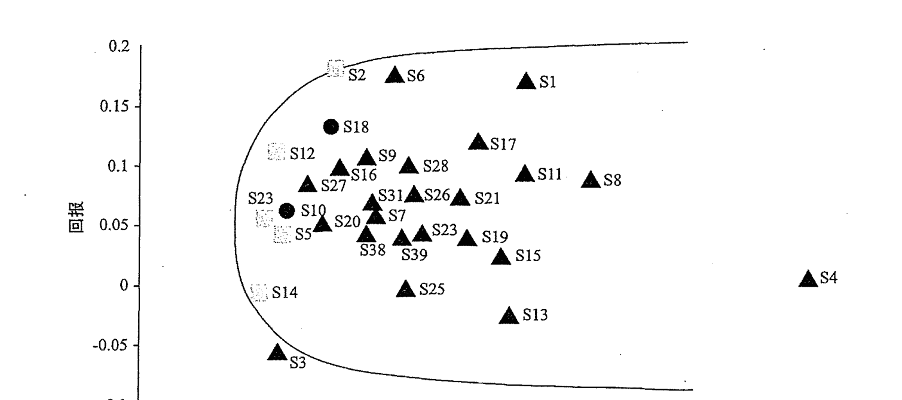

我们从图9-4中可以看出，主体选择的是聚集在最小方差点附近的有效低风险投资组合。最理想的投资组合是单一资产投资组合S5，有29.48%的无疑主体选择了该组合。其次是S12（27.18%）、S23（11.07%）、S2（8.78%）和S14

# 第9章
不确定性下的多周期投资组合选择：一种基于交互的方法

(8.24%)。最理想的投资组合是高度多元化的，有大量的特殊成分。S12是由两种最理想的单一股票，即S5和S2组成的双资产投资组合。有趣的是，S23是一个由S2、S5和S3组成的三资产组合；S3是回报率最低的资产，也是最不理想的选择之一。表9-4展示了一些进一步的结果。

表9-4
基准框架中，每个投资组合的无疑主体和可疑主体的比例
|                | 无疑主体   | 可疑主体   | 无疑主体   | 可疑主体   |
| -------------- | ---------- | ---------- | ---------- | ---------- |
| S1             | 0.18       | 1.39       | 0.28       | 2.28       |
| S2             | 8.78       | 9.87       | 14.49      | 15.07      |
| S3             | 1.07       | 3.58       | 0.32       | 0.92       |
| S4             | 0.17       | 0.25       | 0.08       | 0.17       |
| S5             | 29.48      | 6.40       | 22.02      | 3.19       |
| S6             | 0.46       | 4.15       | 0.81       | 7.36       |
| S7             | 0.19       | 2.09       | 0.18       | 2.07       |
| S8             | 0.15       | 0.49       | 0.11       | 0.46       |
| S9             | 0.53       | 3.78       | 0.59       | 4.91       |
| S10            | 3.60       | 5.73       | 3.33       | 4.11       |
| S11            | 0.23       | 1.37       | 0.11       | 1.51       |
| S12            | 27.18      | 7.94       | 36.64      | 7.68       |
| S13            | 0.18       | 0.82       | 0.10       | 0.59       |
| S14            | 8.24       | 5.14       | 3.33       | 2.06       |
| S15            | 0.33       | 0.97       | 0.10       | 0.68       |
| S16            | 0.49       | 4.15       | 0.64       | 4.96       |
| S17            | 0.20       | 1.14       | 0.21       | 1.68       |
| S18            | 1.61       | 4.80       | 2.24       | 6.53       |
| S19            | 0.15       | 1.38       | 0.11       | 1.48       |
| S20            | 0.75       | 3.41       | 0.66       | 2.94       |
| S21            | 0.19       | 1.51       | 0.13       | 1.68       |
| S22            | 0.24       | 2.19       | 0.12       | 1.97       |
| S23            | 11.07      | 6.47       | 9.91       | 4.64       |

# 金融 AI 算法

# ARTIFICIAL INTELLIGENCE IN FINANCIAL MARKETS

# 续前表

|       | 无疑主体 | 可疑主体 | 无疑主体 | 可疑主体 |
| :------ | :------- | :------- | :------- | :------- |
| 平均实验                              |         |          | 最终实验 |         |
| S24     | 0.59    | 2.85    | 0.30    | 2.98    |
| S25     | 0.39    | 1.73    | 0.13    | 1.09    |
| S26     | 0.20    | 1.93    | 0.18    | 2.29    |
| S27     | 1.42    | 4.73    | 1.58    | 4.60    |
| S28     | 0.28    | 2.23    | 0.22    | 2.83    |
| S29     | 0.24    | 1.66    | 0.14    | 1.38    |
| S30     | 1.08    | 2.84    | 0.69    | 2.35    |
| S31     | 0.33    | 3.00    | 0.23    | 3.53    |
| (注：表格边框及行列结构按原排版呈现)

S14 是最小方差投资组合，而 S2 是最高均值投资组合。S3 是最低均值的投资组合，S4 是风险最高的投资组合，而这两种投资组合在平均博弈设置中都是被严格避免的。56.66% 的无疑主体选择了两种最理想的投资组合，84.75% 的无疑主体选择了前五种。只有流动性主体选择了 S4。

可疑主体的平均博弈决策与无疑主体的平均博弈决策略有不同。在无疑主体中，如果从最理想的投资组合到最不理想的投资组合的转换几乎是离散的，那么它将在可疑主体的设置范围内通过相对理想的投资组合组间接转换，如图 9-5 中的虚线所示。可疑主体不会像无疑主体那样同步它们的选择，因此在这种情况下需要更多的投资组合，分布甚至在无疑主体的情况下更均匀。最理想的可疑主体投资组合是 S2（9.87%）、S12（7.94%）、S23（6.47%）、S5（6.40%）和 S10（5.73%），这些组合均为有效的前沿投资组合。尽管可疑主体愿意承担比无疑主体更高的风险，但它们会回避风险最高的投资组合。投资组合的可取性会随着风险水平的降低而降低，这与无疑主体的情况相同。

无疑主体的最终结果显示出同步模式。无疑主体主要以投资组合 S12（36.64%）和 S5（22.02%）结束，其次是 S2（14.49%）和 S23（9.91%）。S12 是一个由 S5 和 S2 组成的两种资产组合，S23 是一个由 S2、S5 和 S3 组成的三种

# 第9章
不确定性下的多周期投资组合选择：一种基于交互的方法

资产组合。这些是来自有效边界的低风险投资组合。有很多高风险和无利可图的投资组合被极力避免：S4（0.08%）、S13 和 S15（0.10%）以及 S8、S11 和 S19（0.11%）。除了 S4 和 S19（由 S1、S3 和 S4 组成的三种资产组合），其余的都是包括风险最高的股票 S4 的两种资产组合。由于 S4 的风险，增加一只股票并不能充分降低风险，使多元化投资组合更具吸引力。这两只主要股票是 S5 和 S2。86.4% 的无疑主体选择了排名前五的投资组合。如图 9–6 所示，在无疑主体的最终结果设定中，从最理想的投资组合到最不理想的投资组合的过渡非常直接，中间只有四个投资组合。这些是组合是 S10（3.33%）、S14（3.33%）、S18（2.24%）和 S27（1.58%）。

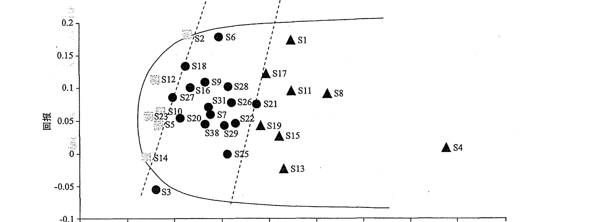


如图 9–7 所示，与可疑主体的对比结果显示，无疑主体也偏好风险较低的投资组合。同样，从最理想的投资组合到最不理想

# 第9章 不确定性下的多周期投资组合选择；一种基于交互的方法

有S2（2.47%）和S12（1.11%）不以流动性主体结束。对于可疑主体而言，情况并没有太大的不同，也存在同步模式。最理想的投资组合与无疑主体类似，即S3（37.74%）、S10（15.74%）、S14（14.75%）和S23（10.29%）。

在熊市中，主体的最终决策集中在低风险或高收益的投资组合上。

# 牛市中的投资组合选择

相比之下，牛市的特点是回报率的正向变动。S1和S2的平均回报率最高，分别为0.50%和0.30%；S3的平均回报率最低，为0.023%；S4的风险最高，标准差为8.65%；而S3和S5的风险最低，标准差为7.05%。

如表9-6所示，最理想的无疑主体的投资组合为S8（41.70%）、S17（13.70%）、S4（11.05%）、S21（7.37%）、S19（6.27%）和S1（3.36%）。其中，只有S1来自有效边界，而S17非常接近有效边界。S8显然处于有效边界之外，其风险高于S6。此外，S8是一个多股票投资组合。一般来说，主体在牛市中会选择风险较高的投资组合。无疑主体最希望做出的最终决策为S8（50.11%）、S17（17.37%）、S21（6.37%）、S1（5.66%）和S6（2.25%），占所有选择的84.83%。从这些数据来看，只有S1和S6位于有效边界上，而S17非常接近有效边界。

|                | 无疑主体   | 可疑主体   | 无疑主体   | 可疑主体   |
| :-------------- | :---------- | :--------- | :--------- | :--------- |
| S1              | 3.36        | 14.91      | 5.66       | 24.59      |
| S2              | 0.13        | 1.59       | 0.13       | 1.79       |
| S3              | 0.19        | 0.38       | 0.11       | 0.10       |
| S4              | 11.05       | 6.11       | 0.10       | 3.35       |
| S5              | 0.17        | 0.39       | 0.25       | 0.15       |
| S6              | 1.58        | 6.30       | 2.25       | 9.52       |
| S7              | 0.54        | 2.20       | 0.29       | 1.54       |
| S8              | 41.70       | 14.75      | 50.11      | 16.77      |

# 金融 AI 算法

# ARTIFICIAL INTELLIGENCE IN FINANCIAL MARKETS

# 续前表

|       | 无疑主体 | 可疑主体 |
| :---- | :------- | :------- |
| 平均实验                     |          |          |
|       | 无疑主体 | 可疑主体 |
| S9    | 0.43     | 3.29     |
| S10   | 0.13     | 0.75     |
| S11   | 2.83     | 3.60     |
| S12   | 0.14     | 0.70     |
| S13   | 0.89     | 1.51     |
| S14   | 0.17     | 0.38     |
| S15   | -        | 0.76     | 1.93     |
| S16   | 0.37     | 2.18     |
| S17   | 13.70    | 7.93     |
| S18   | 0.31     | 2.67     |
| S19   | 6.27     | 4.15     |
| S20   | 0.22     | 1.30     |
| S21   | 7.37     | 4.89     |
| S22   | 0.46     | 1.36     |
| S23   | 0.15     | 0.61     |
| S24   | 0.46     | 1.80     |
| S25   | 0.30     | 1.05     |
| S26   | 2.09     | 3.19     |
| S27   | 0.21     | 1.11     |
| S28   | 2.02     | 3.61     |
| S29   | 1.13     | 2.19     |
| S30   | 0.24     | 0.99     |
| S31   | 0.65     | 2.18     |
|       | 无疑主体 | 可疑主体 |
| 最终实验                     |          |          |

可疑主体也能够同步，尽管程度较低。然而，如果选择的五个最理想的投资组合几乎与无疑主体相同，那么每个组合的需求程度就可能存在差异。可疑主体最理想的五个最终实验投资组合是 S1（24.59%）、S8（16.77%）、S6（9.52%）S17（9.16%）和S21（4.36%），占所有选择的64.38%，远远低于无疑主体。例如，只有不到6%的无疑主体选择了可疑主体的最佳组合S1。

# 第9章

# 不确定性下的多周期投资组合选择：一种基于交互的方法

S17（9.16%）和S21（4.36%），占所有选择的64.38%，远远低于无疑主体。例如，只有不到6%的无疑主体选择了可疑主体的最佳组合S1。

# 选择的一致性

主体在其选择中的一致性还有待研究。有界理性基于随机交互的博弈的交互会产生路径依赖的结果。因此，尽管外部条件不变，过程重复还是并不一定会复制结果。一个一致选择的投资组合应该在每个时间段独立重复中表现出很小的可变性。我们应该承认，由于我们不收集整个过程中单个主体持有的特定投资组合的数据，因此，我们使用每个投资组合中的主体比例作为衡量标准。¹ 选择的一致性用两种不同方法来检验：变异系数和蒙特卡罗法。

# 变异系数

变异系数是指标准差和均值之比。我们用它来衡量投资组合在单一时间段内在程序重复中的可变性。为了估算系数，我们采用以下程序。首先，我们以30列（代表重复次数）和T行（代表周期）的矩阵形式显示给定周期内每个投资组合中主体的比例。然后，我们估计每个投资组合在每个重复周期中主体的平均比例和相应的标准差，从中得到单个周期的行变异系数。然后，对单个投资组合

考虑到每个投资组合中流动性主体的比例，并将其与投资组合的可获得性脱钩，我们将投资组合持有的底线设定为0.5%。因此，如果少于0.5%的主体在给定时间内拥有给定的投资组合，那么该值就被设置为0.5%，这样我们就避免了流动性主体比例潜在的高可变性，这可能是没有意义的。例如，如果一个投资组合

> ①可能出现的情况是，即使系列重复本身，不同的主体可能持有相同的投资组合。

# 金融 AI 算法

# ARTIFICIAL INTELLIGENCE IN FINANCIAL MARKETS

仅由流动性主体持有，其比例在第一次变现时设置为0.1%，在第二次变现时设置为0.2%，那么这就意味着投资组合持股具有100%的可变性，尽管这与投资组合的可获得性无关，但与流动性主体的比例有关。在这两种情况下，只能由流动性主体持有的投资组合始终被避免，其真正的可变性应为零。表9-7报告了所有三种设置下的无疑主体和可疑主体的结果。

表 9-7
可疑主体和无疑主体的变异系数
基准	无凝主体	可疑主体	熊市	无凝主体	可疑主体	牛市	无凝主体	可疑主体
S1	17.47	80.02	0.51	1.68	31.13	16.89
S2	35.11	34.92	44.51	28.60	0.24	58.40
S3	52.94	49.12	14.03	16.52	0.46	11.16
S4	7.06	37.13	8.27	9.48	20.78	29.79
S5	20.71	34.35	25.37	39.15	0.43	28.80
S6	37.44	61.10	0.99	22.86	40.88	27.20
S7	23.16	56.01	0.90	40.90	20.42	44.99
S8	9.11	59.13	1.28	5.47	6.61	19.53
S9	53.13	58.68	0.67	29.52	16.54	39.36
S10	38.82	42.94	24.56	19.29	0.53	44.87
S11	9.32	75.83	9.43	25.41	38.35	34.16
S12	24.51	31.05	57.89	40.67	0.51	40.95
S13	7.77	67.57	21.25	36.61	14.36	52.08
S14	30.46	39.03	31.61	22.37	0.45	16.41
S15	10.38	64.04	9.83	20.95	23.86	48.82
S16	66.47	45.48	3.04	40.57	12.89	49.96
S17	22.53	80.11	1.76	11.55	16.07	29.40
S18	57.17	46.22	1.23	45.87	14.20	45.36
S19	10.86	74.43	1.63	30.55	28.07	38.15
S20	58.92	50.82	1.96	43.76	2.13	56.16
S21	13.91	75.67	1.55	17.18	25.84	31.46

# 第9章

# 不确定性下的多周期投资组合选择：一种基于交互的方法

# 续前表

| S22 | 15.88 | 58.93 | 29.11 | 35.97 | 12.82 | 47.88 |
| S23 | 25.09 | 38.00 | 33.74 | 29.38 | 0.47 | 38.00 |
| S24 | 42.10 | 46.93 | 22.28 | 35.24 | 19.68 | 55.33 |
| S25 | 27.52 | 62.16 | 27.58 | 40.86 | 1.91 | 54.43 |
| S26 | 18.33 | 57.69 | 3.52 | 32.23 | 38.56 | 39.42 |
| S27 | 52.94 | 44.01 | 13.36 | 41.95 | 1.94 | 50.20 |
| S28 | 26.59 | 56.87 | 2.15 | 30.41 | 46.97 | 39.52 |
| S29 | 18.35 | 57.64 | 2.46 | 29.92 | 39.70 | 41.23 |
| S30 | 58.02 | 58.44 | 42.84 | 34.59 | 3.70 | 42.50 |
| S31 | 39.93 | 47.93 | 4.86 | 35.52 | 27.34 | 45.73 |

在基准设置内，最不受欢迎的无疑主体的投资组合（S

# 第9章
不确定性下的多周期投资组合选择：一种基于交互的方法

个例外。也就是说，在变异系数分析中，投资组合 S4 在有效边界投资组合之后，而非在本例中这样领先的有效边界投资组合。

其他投资组合的持续性水平随着它们与最一致选择的投资组合的距离而降低。最不一致的投资组合是 S3，它位于效率低下的边界。可疑主体对高回报和高风险投资组合 S6、S18 和 S9 表现出很大程度的一致性。然而，可疑主体的行为远不如无疑主体的行为一致。这意味着，在一般情况下，可疑主体对投资组选择的偏好要低得多。

在熊市中，无疑主体最一致选择的投资组合是 S3、S10、S8、S20、S1、S14 和 S9，而可疑主体最一致选择的投资组合是 S3、S14、S10、S23、S5 和 S27。其中，S3、S10 和 S14 是最理想的投资组合，而可疑主体选择的 S23 也是如此。最不一致的投资组合是那些随着时间推移，比例不稳定的投资组合（可疑主体的 S13、S11、S22、S24、S28、S31、S7，无疑主体的 S30），它们在平均实验和最终实验设置之间表现出巨大的差异。这些投资组合与最常被选择的投资组合相距最远，而且我们发现它们处于中间位置。在这两组主体中，可疑主体的选择不太一致，因为它们无法像无疑主体那样选择表现较好的投资组合。

在牛市中，无疑主体和可疑主体最常选择投资组合 S8，其次是投资组合 S1、S6 和 S17，这些投资组合仍然表现出很高的持续性。这三个投资组合是平均实验和最终实验设置中最理想的投资组合。投资组合 S22、S15、S10、S13、S14、S16 和 S5 的持续性最低。这些投资组合的平均回报率最低，方差最低，是最不理想的投资组合。我们再次观察到，其他投资组合的持续性水平随着它们与最常被选择的投资组合的距离而降低。和之前的结果一样，在牛市中，可疑主体的行为远不如无疑主体的行为一致。

# 讨论

表 9–9 总结了所有设置的结果。它报告了两组主体所有三个时间跨度的平均实验（AVG）和最终实验（END）结果。对于每个设置，我们首先报告拥有五个最理想投资组合的主体比例，然后报告拥有最后十分之一主体的投资组合数量（31 个），并报告持有投资组合的加权 β，以及五个最理想投资组合和十个最不理想投资组合的加权 β，最后报告了来自幂律分布的情况。

表 9-9
结果概述
无疑主体
可疑主体
基准
前 5%
后 10%
权重
前 5
后 10
λ
熊市
前 5%
后 10%
权重
前 5
后 10
λ
牛市
前 5 (%)
后 10%
权重
前 5
后 10
λ
（具体表格数据按行列呈现）

平均 β 与加权 β 值分别由等式 β̄ = 1/n Σβ_i 和 β_w = 1/n Σβ_i h_i 计算得到，其中，

h_i代表持有投资组合i的主体，且∑(从i=1到n) h_i =1。在子样本中，∑(从i=1到n) h_i ≠ ∑(从i=1到n) q_i，为了达到要求的条件∑(从i=1到n) h_i =1，一部分被选择的投资组合被重新计算。至于λ值，我们假定y=Ax^(-λ)形式的幂律分布，参数λ为致密参数。如果事件的频率随事件大小的增加而降低到某个指数级的倒数，则随机变量的分布就遵循幂律。在我们的例子中，参数度量主体选择中的同步级别。较高的λ值表示一种惊人的同步模式，这意味着少量的投资组合被大量主体持有，而剩余的绝大多数投资组合仅由少数主体持有。当λ>1时将发生同步现象。我们用最小二乘法回归估计相应的幂律指数。①

图9-8根据三个时间跨度的投资组合β系数绘制了无疑主体和可疑主体的平均实验和最终实验选择。图中的点根据其β值（X轴）和选择它们的主体的比例（Y轴）代表不同的投资组合。

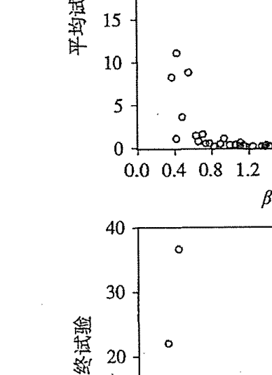

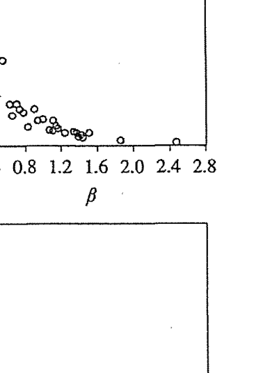

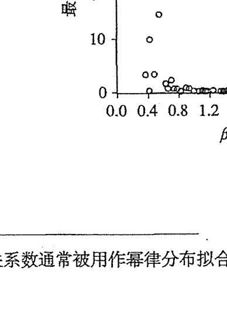

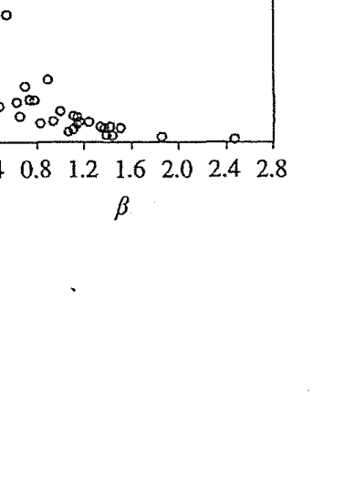

> 相关系数通常被用作幂律分布拟合优度的非正式度量。

[PAGE 272]

# 金融AI算法

# ARTIFICIAL INTELLIGENCE IN FINANCIAL MARKETS

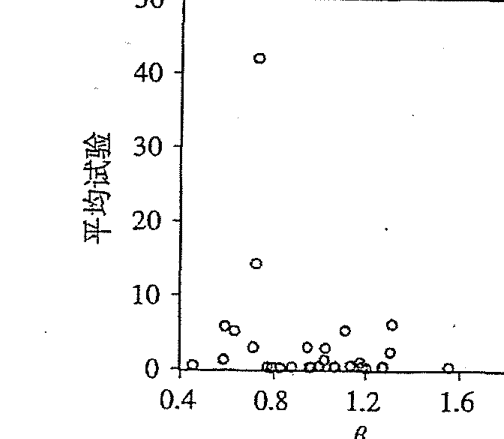

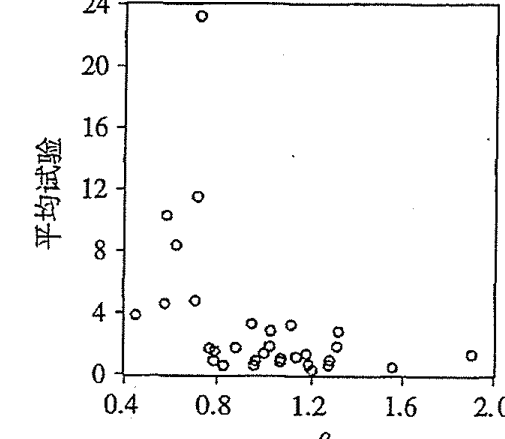

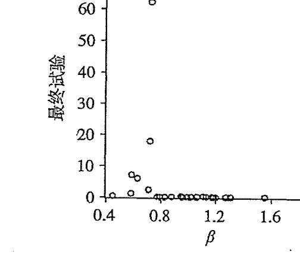

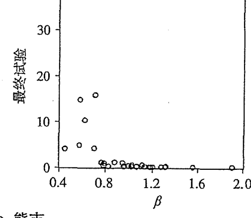

# b. 熊市

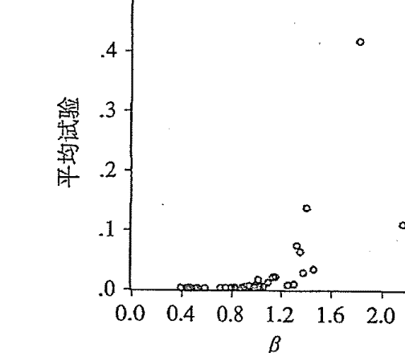

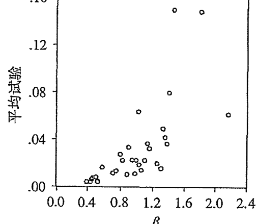

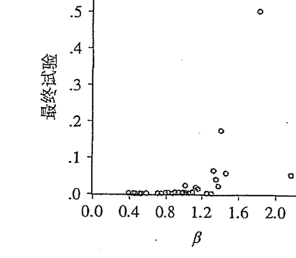

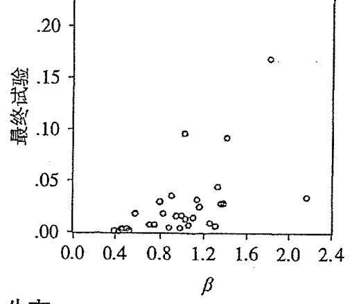

# c. 牛市

图9-8 基于投资组合β系数的无疑主体和可疑主体的平均实验和最终实验选择的散点图

[PAGE 273]

# 第9章
不确定性下的多周期投资组合选择：一种基于交互的方法

由于主体根据回报率来选择投资组合，我们预计投资组合的期望值会随着回报率的增加而增加，但事实并非如此。研究结果表明，投资组合的风险越大，就越有可能被投资者回避。因此，主体可以被视为风险规避者。这两组主体都是如此。然而，这两组主体选择的主要区别在于，无疑主体从最理想组合到最不理想组合的过渡非常离散，而可疑主体的这种过渡是通过一种中度理想的投资组合进行的。在这两种情况下，投资组合 S2 和 S3 都表明主体能够选择高收益投资组合，并避免低风险低均值投资组合。可疑主体选择的散点分布情况（如图 9-8 所示）表明，它们不太厌恶风险，尽管它们需要更高的回报来承担额外的风险。然而，主体并没有在基准框架（如 S1）内选择高均值、高风险投资组合。更陡的散点分布意味着平均实验决策更受方差的驱动，而较少受回报的驱动。一般的观察结果是，无疑主体更关注风险而不是回报，并试图将风险最小化。这很有启发性，而且很鼓舞人心，因为主体是根据回报而不是风险来选择投资组合的，而风险对于投资组合的选择至关重要。另一方面，尽管可疑主体更偏好风险，但是它们仍然会权衡回报和风险。此外，主体持有的投资组合非常多元化，这与一些经验事实是一致的。此外，多元化的投资组合是最不一致的选择。

在基准框架中，无疑主体选定的投资组合可以分为两组。第一组由来自有效边界的五个投资组合组成，每个投资组合都有超过 5% 的主体选择（S10 也可以被添加到该组中，因为它位于有效边界，有 3.6% 的主体选择）。第二组包括所有剩余的投资组合。S3 是风险最小的投资组合，但收益最低，而 S18 和 S27 非常接近有效边界，但风险略高。S1 和 S6 都是高回报和高风险的投资组合，无疑主体会避免持有这两个组合。因此，投资组合要么被持有，要么被回避。另一方面，可疑主体选定的投资组合可以分为三个组，如图 9-8 所示，即来自有效边界的六个投资组合，被超过 5% 的主体选择；四个最不理想的投资组合（S4、S8、S13 和 S15）有不到 1% 的主体选择；以及介于两组之间的其他投资组合。第二组中最不理想的投资组合是风险最高的投资组合，而回报率也最低。第三组的大多数投资组合的风险高于第一组，而低于第二组。在这种明显的线性风险规则中有三个异常值，即 S1、S11 和 S3。S1 和 S11 与第二组有相同的风险，但回报率更高；S3

[PAGE 274]

# 金融AI算法

# ARTIFICIAL INTELLIGENCE IN FINANCIAL MARKETS

是最安全的投资组合，但回报率最低。这三个都属于第三组投资组合。

可疑主体比无疑主体更倾向于风险更高的投资组合，这反映在它们的加权 β （0.731）远高于无疑主体（0.459）。尽管如此，这两个值都远低于市场风险；这表明这两个群体都会规避风险。最理想的无疑主体投资组合（S5）的 β 系数最小，只有 0.314，而第二理想的投资组合（S12）的 β 系数也很小（0.433）。五个最理想的无疑主体投资组合的平均 β 系数为 0.418，加权 β 系数为 0.396。五个最理想的可疑主体投资组合的平均 β 系数也较小（0.441），加权 β 系数为 0.451。这是一个合乎逻辑的结果，因为那些无疑主体有能力选择最优的组合，即那些 β 系数最低的投资组合。因此，最不理想的投资组合有更大的 β 值。更准确地说，10 个最不理想的无疑主体投资组合的平均 β 系数为 1.469，加权 β 系数为 1.450，而那些可疑主体投资组合的平均 β 系数为 1.519，加权 β 系数为 1.391。在这两种设置下，只有流动性主体选择了投资组合 S4，它是 β 值最大的投资组合，为 2.475。考虑到这些结果，有人可能会说高 β 系数的投资组合的损失太大，因此主体不会持有。

为了了解主体如何权衡风险与回报，有三种情况似乎特别有趣，因为替代方案表现出很多相似之处，但被主体持有的情况却有所不同。第一种情况涉及与 S6 和 S18 相关的 S2。S2 是均值最高、方差中等的投资组合，其风险与 S18 相似，但平均收益要高得多；其平均收益与 S6 非常相似，但风险要小得多。8.78% 的无疑主体和 9.87% 的可疑主体选择了 S2，这使它成了排名第四的最理想的投资组合。另一方面，只有 1.61% 的无疑主体和 4.80% 的可疑主体选择了 S18，0.46% 的无疑主体和 4.15% 的可疑主体选择了 S6。显然，无疑主体不愿意放弃 S2 额外的‘无风险’回报，而可疑主体也倾向于风险更高、利润更低的替代品。第二种情况涉及与 S14 相关的 S3。S3 的波动性略高于 S14，但平均回报率明显较低，是所有投资组合中最低的。然而，有 1.07% 的无疑主体和 3.58% 的可疑主体选择了 S3。另一方面，分别有 8.24% 的无疑主体和 5.14% 的可疑主体选择了 S14。最后一种情况涉及 S20 和 S23。这两个投资组合的平均收益相似，但方差明显不同。无疑主体大部分选择了

[PAGE 275]

# 第9章
不确定性下的多周期投资组合选择：一种基于交互的方法

相反，3.41% 的可疑主体选择了 S20，6.47% 的可疑主体选择了 S23，这意味着可疑主体更偏好较高的风险。基于这三种情况，我们认为，当主体选择投资组合时，它们首先会根据收益和风险制定一组令人满意的投资组合。这个投资组合的范围取决于主体的怀疑程度。与那些非常准确地选择具有较高回报的投资组合的无疑主体不同，可疑主体的决策分布在很多密切相关的投资组合中。因为当两个可疑主体比较它们的结果时，它们选择回报较低的投资组合的概率不同于零。当两个收益率接近时，这种情况更可能发生（见命题 3）。投资组合 S3 的可获得性表明，主体可能不希望选择风险最小、也无法产生令人满意的收益的投资组合。

主体的最终实验与平均实验有很多相似之处，主要结论是投资组合的期望值随风险的降低而降低。在这两种情况下，从最理想的投资组合到最不理想的投资组合的过渡都是渐进的。然而，斜线倾斜的幅度越小，意味着最终实验越受回报的影响，而不是受风险的影响。显然，从最理想的投资组合到最不理想的投资组合的过渡是从高均值且低风险的投资组合到低均值且高风险的投资组合的斜线。

无疑主体对应的最终实验加权 β 值为 0.467，远低于可疑主体（0.778）。五个最理想的无疑主体的最终投资组合的加权 β 值为 0.419，低于五个最理想的可疑主体

# 第9章
不确定性下的多周期投资组合选择：一种基于交互的方法

欢迎的投资组合是在最理想的投资组合中再增加一种股票的两种资产投资组合。增加的股票要么充分降低了占主导地位的股票的风险，要么提高了其盈利能力，要么两者兼而有之，从而使其更受欢迎。在熊市中，同步是极端的。尽管在熊市中，主体更倾向于规避风险，但该模型能够将反射效应作为一种异常现象单独指出，这一点已被记录在案。一致性测试表明，无疑主体在选择上比可疑主体更一致。此外，最一致选择的投资组合是最理想和最不理想的投资组合，后者可以被视为一贯避免的。同样，这一结论在牛市和熊市也得到了支持。更受欢迎的投资组合是多元化程度较低的投资组合，而市场投资组合往往留给流动性主体。此外，多元化投资组合是最不一致的选择之一。所有这些都表明，投资组合选择在某些方面可能对选择参数的变化高度敏感。

# 附录：部分伪码

```
// import the data and create the network
// distribute initial strategies and set the payoffs
for (x=0;x<L;x++) {
    pay[x]=1.0;
    strat[x]=randl(31);
    stratnew[x]=strat[x];
}
// define the strategies / portfolios / and their dynamics
for (x=0;x<L;x++) {
    if (strat[x]==0) {
        pay[x]+=pay[x]*rAA;
    } else if (strat[x]==1) {
        pay[x]+=pay[x]*rMSFT;
    } ...
    else {
        pay[x]+=pay[x]*(0.2*rAA+0.2*rMSFT+0.2*rXOM+0.2*rC+0.2*rKFT);
    }
}
// selection procedure
for (x=0;x<L;x++) {
    if (x==lA) {} // do nothing if an agent is a liquidity agent
}
else {
    center=x;
    k=randl(con[x]); // an adjacent agent is chosen at random
    neigh=vertex[center][k];
    prob=1.0/(1.0+exp(-(pay[neigh]-pay[center])/kapa));
    if (randd()<prob) {
        adopt=strat[neigh];
    } else {
    }
}
// calculate fractions of agents per portfolio
// export results
```

# 金融 AI 算法

# ARTIFICIAL INTELLIGENCE IN FINANCIAL MARKETS

```
else {
    center=x;
    k=randl(con[x]); // an adjacent agent is chosen at random
    neigh=vertex[center][k];
    prob=1.0/(1.0+exp(-(pay[neigh]-pay[center])/kapa));
    if (randd()<prob) {
        adopt=strat[neigh];
    } else {
    }
}
// calculate fractions of agents per portfolio
// export results
```

# 第10章

# 运用多目标遗传算法应对
投资组合选择中的模型风险

普里萨丹格·斯科尔帕登基（Prisadarng Skolpadungket）
克沙夫·达哈尔（Keshav Dahal）
纳帕·哈恩邦柴（Napat Harnpornchai）

# 引言

马科维茨模型又被称为均值–方差分析模型，它以这种方式命名是因为它以
所涉及的资产的平均回报率和这些回报率的方差作为模型输入。作为一个试图解释人类行为的模型，为了简单起见，它假设投资者有一个同质特征，即他们都是
厌恶风险和贪婪（喜欢更多的钱）的人。这种人试图找到一个能产生最大回报和
最小风险（即投资组合收益的最小方差）的资产集合（称为资产组合）。此外，该
模型还假设所有可投资资产的收益都是正态分布的。然而，如果这个假设是不成
立的，尤其是在短期内，资产回报的方式可能因时而异。因此，为了找到一个在短
期内最优的投资组合，我们需要基于一些数学或计算模型，利用它们以前的值和一
些以前的经济变量来预测这些预期收益和波动率。预测模型远非完美无缺，其不准
确性是模型风险的一个来源。在本章中，我们选择了一种近似的遗传算法来解决具
有一定现实约束的投资组合优化问题。新算法的提出考虑了模型风险因素。

本章的结构如下：

+   * 讨论

# 金融AI算法

# ARTIFICIAL INTELLIGENCE IN FINANCIAL MARKETS

+   - 简要介绍模型风险的概念；
+   - 介绍本研究选择的多目标遗传算法（multi-objective genetic algorithm, MOGA）；
+   - 介绍股票收益和波动预测模型；
+   - 介绍实验的参数和方法；
+   - 讨论实验结果及其分析；
+   - 总结研究结果，指出未来的研究方向。

# 投资组合优化与现代投资组合理论

马科维茨提出了现代投资组合理论。该理论基于一个经济假设，即经济主体是理性的存在。当他们做出投资决定时，他们会在预算的约束下最大化他们的预期效用。马科维茨均值–方差分析模型假设投资者在投资周期结束时会选择有望使其投资组合收益最大化的资产来做出投资组合构建决策。假设所有的投资者都是厌恶风险的，最简单的模型有很多不切实际的约束，即完美的无税市场、无交易成本和资产是无限可分的，那么马科维茨投资组合优化可以在数学上表示如下：

```
Min\_x_i \sigma^2_p \        "bbox": [0.469
```

```
( 10.1 )
```

使得

```
\sigma^2_p = \sum_\{i j\} x_i x_j \sigma_{ij}
```

```
r_p = r^*
```

```
r_p = \sum_\{i\} x_i r_i
```

```
\sum_\{i\} x_i = 1
```

```
x_i \geq 0
```

其中，\sigma_{ij} 为资产 i 和 j 的协方差（如果 i =j ）和资产 i 的方差（如果 i =j ）；\sigma^2_p
是资产组合的方差；r_i 是资产 i 的预期收益；r_p 是投资组合的预期收益。

马科维茨模型经过简化，可以得到闭式解 ① 。它的假设并不代表资本市场中存在的现实约束。除了强加一些不现实的约束和忽略一些现实的约束外，目标函数也被认为是不现实的。投资组合优化的目标是找到在给定的投资组合收益水平下风险最小的资产组合。给定预期收益的投资组合实现风险最小化来优化资产组合。这里有两个定义问题：第一，如何衡量‘风险’，因为风险的本意是主观的，取决于个人的风险偏好；第二，由于资产的所有收益都将在未来实现，那么应如何估计预期收益呢？这将最终使我们得出一个重要的假设，即未来的回报是确定性的还是随机的。我们将资产的预期收益视为理所当然，并在此基础上对模型进行优化，希望在未来能够实现对资产的预期。或者我们假设未来资产的收益是不确定的，但遵循某种随机规则。建模的另一个方面是，投资者是否只关心下一阶段，还是也关心未来的一系列结果。为了满足投资者的投资需求，需要对目标函数进行单周期优化或多周期优化。

除了上述理论问题之外，还有一些动机改变了组合优化问题的目标函数，以实现其他目的。为了方便求解，我们可以对目标函数进行修改，如降低计算的复杂度或者使其与一些已知的求解方法或算法兼容。

投资组合优化的一个关键问题是如何选择模型的输入。目前有两种输人可供选择，即风险表示和资产收益预估。这些输入必须表示‘尚未确定’的值，并预期在未来实现。用错误的输人估计来优化投资组合选择模型将产生错误的资产组合，最终导致投资组合效率低下。这是我们试图处理的模型风险。

# 模型风险的概念

对现有文献的回顾表明，模型风险有很多种定义。就我们而言，特别是为了本项研究的目的，我们从广义上定义了模型风险。模型风险是使用不准确模型
> ① 闭式解是可以用数学公式表示的解。

[PAGE 284]

# 金融AI算法

# ARTIFICIAL INTELLIGENCE IN FINANCIAL MARKETS

进行决策，以协助决策过程中的一种固有风险，做出这样的决策将导致经济损失或经历意想不到的风险，这是建模过程中涉及的主观性。加藤（Kato）和吉叶（Yoshiba）分别在定价模型和风险度量模型中定义了模型风险。在定价模型中，模型风险被定义为“由于使用了一个无法准确评估市场价格
的模型或不是市场主流的模型而产生的风险”。然而，在风险度量模型中，模型风险被定义为“未能准确估计未来损失概率的风险”。本文将定价模型中模型风险的来源描述为错误假设的设定、参数估计的误差、离散化所引起的误差和市场数据的误差。风险度量模型中模型风险的来源是模型的假设分布与实际分布之间的差异以及模型逻辑框架中的误差。

另一方面，德尔曼（Derman）将金融模型分为基础模型、现象学模型和统计模型三类。不同类别的模型容易产生不同的模型风险来源。对于基础模型（即基于一组假设的数学模型）而言，模型风险的来源是不正确的假设和错误识别的输入。现象学模型建立在对潜在行为观察的基础之上，风险的主要来源是试图在其有效性范围和情况之外应用它们。上述两个类别都体现了因果关系的某些要素，与它们不同的是，统计模型依赖于相关性，而不是因果关系。它们是建立在变量相关性的基础上的，假设这些相关性随着时间的推移是稳定的。这类模型的模型风险的主要来源是模型不规范，即用错误的变量或错误的关系函数和不稳定的相关性构建了模型。后者在样本中看起来可能是正确的，但在样本外区间可能是不可复制的。

在基于等式（10.1）的投资组合优化中，准确预测投资组合收益和标准差是至关重要的。投资组合预期收益是由所包括的所有股票的预期收益的加权平均计算得到的，投资组合标准差由股票过去收益的标准差及其相关性计算得到的，如等式（10.1）所示。需要注意的是，原始的马科维茨模型在假设所有资产收益都服从某种统计分布（即正态分布）的前提下，使用资产收益的均值和标准差作为对资产未来收益和波动的最佳预测。然而，随着时间的推移，它们的可预测性可能会受到相关性、不稳定性的影响。这种模型风险反过来又会导致投资组合优化的结果是次优的。因此，投资者将经历投资组合预期收益的短期下降和 / 或大于预

[PAGE 285]

# 第10章
运用多目标遗传算法应对投资组合选择中的模型风险

期的波动，从而降低风险 / 收益。

有很多措施可以帮助管理或减轻模型风险。这些措施是互补的，而不是相互替代的。第一，任何用于决策的模型都需要由独立的模型控制器进行评审，并向管理层或投资委员会报告。第二，使用模型的人需要意识到模型的局限性。第三，模型在投人使用之前需要彻底检查其有效性和局限性。第四，使用中的模型应定期接受审查。

我们提出了一种应对模型风险的方法，即在投资组合选择过程中，根据预测模型的准确性或有效性嵌入股票选择。预测模型大多是统计模型，往往存在不稳定性。如果我们将模型结合起来，并不断地评估它们的准确性，以便基于它们的准确性做出偏差选择，我们就能够降低模型风险。在我们的例子中，我们有很多可替代的资产（股票），它们有不同的预期收益、预期波动率和预期预测能力，可以作为模型风险的度量。当我们将模型风险最小化纳入投资组合选择过程中时，我们就有可能管理前面提到的很多模型风险。

# 用于组合优化的 MOGA

在这里，用于组合优化的 MOGA 是基于丰塞卡（Fonseca）和弗莱明（Flem-ing）于 1993 年初提出的算法。MOGA 依靠帕累托排名来为所有非支配个体分配最小的排名值。另一方面，对于那些占支配地位的个体而言，它们的排名是根据种群中有多少个体实际上支配它们。因此，个体的原始适应度是其帕累托排名的反函数。两目标遗传算法投资组合优化的任务是根据投资组合收益（最大化）和投资组合标准差（最小化）对种群中的个体进行排序。在数学上，这两个目标可以用等式（10.2）来表示：

```
Max : r_p = \sum_{i}^{N} x_i r_i \quad (10.2)
```

[PAGE 286]

# 金融AI算法

# ARTIFICIAL INTELLIGENCE IN FINANCIAL MARKETS

Min : \sigma_p = \sum_{i}^{N}\sum_{j}^{N}x_ix_j\rho_ij\sigma_i\sigma_j ( 10.3 )

其中，x_i 是资产 i 在资产组合中的比例；x_j 是资产 j 在资产组合中的比例；ρ_ij 是资产 i 和 j 的相关系数；σ_p 是资产组合的预期或预测标准差；σ_i 是资产 i 的预期或预测标准差；σ_j 是资产 j 的预期或预测标准差；r_p 是资产组合的预期收益；r_i 是资产 i 的预期或预测收益。

为了应对预测资产收益和标准差带来的模型风险，我们在原有的两目标遗传算法的基础上增加了第三个目标，并将模型重新命名为三目标遗传算法模型。第三个目标基于等式（10.2）和等式（10.3）可以表述为：

Min : SRE_p = \sum_{i}^{N}x_i\left( \frac{\partial ESR_p}{\partial x_i} \right)^2 ( 10.4 )

其中，SRE_p 是由于包含所有资产而导致的资产组合的近似夏普比率误差。

\frac{\partial ESR_p}{\partial x_i}是将资产 i 纳入投资组合对投资组合夏普比率误差的近似影响，该项被平方是为了消除符号。

为了使种群中的个体沿帕累托前沿均匀分布，可以通过共享距离之和来调整整体适应度函数。个体 i 和个体 j 之间的共享距离可以通过等式（10.5）计算：

SF_ij = 1-\frac{d(x_i,x_j)}{\sigma_{share}} , 如果 d(x_i,x_j)<\sigma_{share}

SF_ij = 0, 如果 d(x_i,x_j)\geq\sigma_{share} ( 10.5 )

其中，d(x_i, x_j) 是目标域中两个个体之间的度量距离；\sigma_{share} 是预先设定的共享距离。

而且，整体适合度由等式（10.6）定义：

[PAGE 287]

# 第10章 运用多目标遗传算法应对投资组合选择中的模型风险

$F_i = \frac{Fit(i)}{\sum_j SF_{ij}}$ （10.6）

其中，Fit（i）是帕累托排名（i）的倒数【在此设定下即1/排序（i）】。

在概率选择过程中使用个体的整体适应度，比较每个个体的整体适应度与具有最高整体适应度的个体的整体适应度。然后将每个个体的相对适应度值与一个随机数进行比较。如果超过随机数就将选择个体（轮盘赌选择

# 金融AI算法

# ARTIFICIAL INTELLIGENCE IN FINANCIAL MARKETS

符合约束条件。还有一些投资组合约束没有讨论（如道德约束或黑名单约束），可以通过将适当股票的权重设置为零来处理。

# 投资组合的夏普比率误差

夏普比率是一个用于衡量经风险调整的资产或投资组合的回报率的指标。风险是通过资产或投资组合收益的标准差来衡量的。夏普比率定义为：

\( SR_p = \frac{R_p - R_f}{\sigma_p} \) （10.11）

其中，SRₚ 是投资组合的夏普比率；Rₚ 是投资组合的回报；σₚ 是投资组合的标准差。

夏普比率本质上是一个标准化的超额收益率，高于每单位绝对风险的无风险利率，用标准差来衡量。在某种意义上，我们不能直接比较资产或投资组合的任何收益，因为它们可能具有不同的内在风险水平。然而，夏普比率调整了风险水平，因此它代表标准化的回报，使得我们能够比较不同的资产和投资组合。如果我们需要简单地比较两种资产或两种投资组合，夏普比率就是实现这一目标较好的指标之一。当比较两种投资组合时，夏普比率较大的投资组合是风险收益权衡最佳的投资组合。

我们的目标是找到一个能够有效处理模型风险的投资组合。我们提出的算法需要证明其可以提供更好的投资组合，即在更多时间内具有较大夏普比率的投资组合。投资组合优化是为了构建一个同时满足两个目标的投资组合，例如，最小化风险（根据投资组合的标准偏差来衡量）和最大化投资组合的回报。这意味着在给定回报水平或给定风险水平下实现夏普比率的最大化。考虑两个稍有不同的投资组合，它们持有同一只股票i的数量略有不同，此时，夏普比率的差异为：

# 第10章 运用多目标遗传算法应对投资组合选择中的模型风险

```
ESR_p =\left( \frac{R'_p - R_f}{\sigma'_p} \right) -\left( \frac{R_p - R_f}{\sigma_p} \right)
                     ( 10.12 )
```

```
\frac{\partial ESR_p}{\partial x_i} =\left( \frac{1}{\sigma'_p}\frac{\partial R'_p}{\partial x_i} -\frac{R'_p}{\sigma'^2_p}\frac{\partial \sigma'_p}{\partial x_i} +\frac{R_f}{\sigma'^2_p}\frac{\partial \sigma'_p}{\partial x_i} \right)
                           -\left( \frac{1}{\sigma_p}\frac{\partial R_p}{\partial x_i} -\frac{R_p}{\sigma^2_p}\frac{\partial \sigma_p}{\partial x_i} +\frac{R_f}{\sigma'^2_p}\frac{\partial \sigma_p}{\partial x_i} \right)
                     ( 10.13 )
```

为简便起见，假设Rf=0:

```
\frac{\partial ESR_p}{\partial x_i} =\left( \frac{1}{\sigma'_p}\frac{\partial R'_p}{\partial x_i} -\frac{R'_p}{\sigma'^2_p}\frac{\partial \sigma'_p}{\partial x_i} \right)-\left( \frac{1}{\sigma_p}\frac{\partial R_p}{\partial x_i} -\frac{R_p}{\sigma^2_p}\frac{\partial \sigma_p}{\partial x_i} \right)
                     ( 10.14 )
```

让我们考虑一下：

```
\frac{\partial R'_p}{\partial x_i} =\frac{\partial \sum x_i R'_i}{\partial x_i}=R'_i
                     ( 10.15 )
```

```
\frac{\partial R_p}{\partial x_i} =\frac{\partial \sum x_i R_i}{\partial x_i}=R_i
                     ( 10.16 )
```

```
\frac{\partial \sigma'_p}{\partial x_i} =\frac{\partial \sum_i \sum_j x_i x_j \rho_{ij} \sigma'_i \sigma'_j}{\partial x_j}=\frac{1}{2\sqrt{\sigma'_p}}\left( \sum_{j\neq i}x_j \rho_{ij} \sigma'_i \sigma'_j +2x_i \sigma'_i^2 \right)
                     ( 10.17 )
```

```
\frac{\partial \sigma_p}{\partial x_i} =\frac{\partial \sum_i \sum_j x_i x_j \rho_{ij} \sigma_i \sigma_j}{\partial x_j}=\frac{1}{2\sqrt{\sigma_p}}\left( \sum_{j\neq i}x_j \rho_{ij} \sigma_i \sigma_j +2x_i \sigma_i^2 \right)
                     ( 10.18 )
```

把等式（10.15）、等式（10.16）、等式（10.17）和等式（10.18）代入等式（10.14），即

# 金融AI算法

# ARTIFICIAL INTELLIGENCE IN FINANCIAL MARKETS


\frac{\partial ESR_p}{\partial x_i}=\left[ \frac{R'_i}{\sigma'_p}-\frac{R'_p}{2\sigma'^{5/2}_p}\left( \sum_{j\neq i}x_j\rho_{ij}\sigma'_i\sigma'_j+2x_i\sigma'^2_i \right) \right]-\left[ \frac{R_i}{\sigma_p}-\frac{R_p}{2\sigma^{5/2}_p}\left( \sum_{j\neq i}x_j\rho_{ij}\sigma_i\sigma_j+2x_i\sigma^2_i \right) \right]

通过重新排列项，我们得到：

\frac{\partial ESR_p}{\partial x_i}=\left( \frac{R'_i}{\sigma'_p}-\frac{R_i}{\sigma_p} \right)+\left( \frac{R_p}{\sigma_p^{5/2}}x_i\sigma^2_i-\frac{R'_p}{\sigma'^{5/2}_p}x_i\sigma'^2_i \right)+\left[ \frac{R_p}{2\sigma^{5/2}_p}\left( \sum_{j\neq i}x_j\rho_{ij}\sigma_i\sigma_j \right)-\frac{R'_p}{2\sigma'^{5/2}_p}\left( \sum_{j\neq i}x_j\rho_{ij}\sigma'_i\sigma'_j \right) \right]

( 10.20 )

让我们来看看等式（10.10），根据假设，原始投资组合是最优的，而第二个投资组合与原始投资组合相比只有无穷小的变化，因此我们可以将近似得到：

R'_p\approx R_p

( 10.21 )

和

\sigma'_p\approx\sigma_p

( 10.22 )

第三项（在 {} 大括号内）表示股票收益的相关性。由于我们假设两种情况下资产对之间的相关性是相同的，因此我们可以假设：

\sum_{j\neq i}x_j\rho_{ij}\sigma_i\sigma_j\approx\sum_{j\neq i}x_j\rho_{ij}\sigma'_i\sigma'_j

( 10.23 )

由等式（10.21）和等式（10.22）消去第三项，将两等式代入等式（10.20），得到：

\frac{\partial ESR_p}{\partial x_i}=\frac{R_p}{\sigma_p^{5/2}}x_i\sigma^2_i-\frac{R'_p}{\sigma'^{5/2}_p}x_i\sigma'^2_i

( 10.24 )

将等式（10.24）代入等式（10.4），用于MOGA的第三个目标。

# 股票预测模型

我们使用博克斯－詹金斯法（Box-Jenkins Method）来选择预测股票收益和标准差的模型。该方法以序列自相关函数和偏相关函数作为指导原则，以确定预测等式中应该包括的自相关和移动平均值的滞后量。为此，我们建立了模型，并进行了估计和统计测试。我们考察了自相关和移动平均值系数的显著性检验，最终确定了等式的滞后结构。如果我们不能找到一个ARMA等式，要么没有自相关函数和偏相关函数的迹象，要么没有任何滞后系数的统计学意义，那么我们就尝试GRACH结构。如果其他方法都不奏效，我们就将使用它的平均值作为估计值。

我们对1980年至1999年（240个月）股票收益和波动率的月时间序列进行了图表分析（仔细研究了自相关函数和偏相关函数）和统计分析（进行回归分析并审视其显著性检验）。股票系列最初是根据公司行为（如股息和股票分割）调整了收盘价。月收益率可以从每月最后一天的收盘价计算得出，而月波动率可以用该期间的标准差表示，标准差则由每日收盘价计算得出。如表10-1所示，股票包括17个股票系列，即美国铝业（AA）、波音公司（BA）、卡特彼勒公司（CAT）、杜邦公司（DD）、华特迪士尼公司（DIS）、通用电气公司（GE）、通用汽车公司（GM）、霍尼韦尔国际公司（HON）、惠普公司（HPQ）、IBM、强生公司（JNJ）、可口可乐公司（KO）、3M公司（MMM）、默克公司（MRK）、宝洁公司（PG）、联合技术公司（UTX）和埃克森美孚公司。我们之所以选择这些股票，是因为它们都是在纽约证券交易所有着悠久历史的美国公司。我们的实验需要足够的历史数据来估计预测模型。这些数据用于训练模型选择算法和评估投资组合优化模型。因此，我们的模型只考虑有26年历史数据的股票，而且对于这个实验而言，这是我们选择股票的唯一标准。不过，这个实验可以扩展到任何一组股票、整个市场或只是蓝筹股。因此，该算法可以适用于任意数量的股票和领域，前提是投资者和计算机能够处理如此复杂的问题。

# 表 10-1
股票收益和波动率的预测模型

|---|---|---|---|
|---|---|---|---|
| 序列名称 | 选择的模型 | 序列名称 | 选择的模型 |
| AA_RTN | GARCH-M(1,1) | AA_S | ARMA(3,3) |
| BA_RTN | Mean | BA_S | ARMA(3,3) |
| CAT_RTN | EGARCH-M(1,1) | CAT_S | ARMA(3,3) |
| DD_RTN | GARCH-M(1,1) | DD_S | ARMA(3,3) |
| DIS_RTN | ARMA(1,1) | DIS_S | ARMA(3,3) |
| GE_RTN | GARCH-M(1,1) | GE_S | ARMA(3,3) |
| GM_RTN | Mean | GM_S | ARMA(2,2) |
| HON_RTN | Mean | HON_S | ARMA(1,1) |
| HPQ_RTN | Mean | HPQ_S | ARMA(3,3) |
| IBM_RTN | Mean | IBM_S | ARMA(3,3) |
| JNJ_RTN | GARCH-M(1,1) | JNJ_S | ARMA(1,1) |
| KO_RTN | Mean | KO_S | ARMA(1,1) |
| MMM_RTN | Mean | MMM_S | ARMA(1,1) |
| MRK_RTN | Mean | MRK_S | ARMA(3,3) |
| PG_RTN | ARMA(1,1) | PG_S | ARMA(1,1) |
| UTX_RTN | ARMA(1,1) | UTX_S | AR(1) |
| XOM_RTN | ARMA(1,1) | XOM_S | ARMA(1,1) |
|---|---|---|---|

注：后缀 “RTN” 表示股票收益序列，后缀 “S” 表示股票收益波动率。

# 实 验

我们进行了一个实验，看看前文描述的将投资组合夏普比率误差优化作为第三个目标修正后的三目标遗传算法，是否在投资组合夏普比率方面改善了实际投资组合的结果。我们比较了三种情况下的实际投资组合：根据表 10-1 使用股票预测模型的两目标 MOGA（预测投资组合收益和预测投资组合标准差）；使用股票平均收益和标准差作为股票预测值的两目标 MOGA；我们提出的三目标（预测

# 第10章

# 运用多目标遗传算法应对投资组合选择中的模型风险

投资组合收益、预测投资组合标准差和估计投资组合夏普比率误差）MOGA 模型【如等式（10.24）所示】。Java 代码中的三目标帕累托排名如图10-2 所示。我们对2001 年（1 月）至2006 年（12月）的72 个时间段的结果进行了分析和评估，每个时间段10次。所有 MOGA 模型的人口规模为400人，有1000 代人。我们还使用了20年的月历史数据（240次观察）来估计股票预测模型，并计算样本股票收益及其标准差。我们使用等式（10.24）计算了第三个目标。它是12个样本外预测的投资组合夏普比率与实际投资组合夏普比率之差的平均值。例如，在2001年（第一年），我们使用了1980年到1999年的240个观测数据来估计预测模型（或训练模型）。然后，我们使用估计模型预测2000年接下来12个月的股票收益和偏差，然后用预测值与同期的实际值计算出股票投资组合夏普比率的估计误差【等式（10.14）数值结果的平方】。上述预估模型和预估投资组合夏普比率误差被用于2001年接下来12个月的投资组合选择。预测模型使用的是每月的实际观察数据，而预估股票投资组合夏普比率误差在所有12个月期间保持不变。在接下来的一年，观察窗口将移至1981—2000年，这样预测模型的估计移至2001年，以便估计投资组合的夏普比率误差，然后移至2002年，对投资组合进行选择和评估。观察窗口每年都在移动，直到2006年我们样本期的最后一年。

```
// compute Pareto Rank for each port
for(Portfolio ith: pop) { // for ith
int q = 1;
for(Portfolio jth: pop) { // for jth
if ( ith.getPortYield() <jth.getPortYield() ) && (ith.getPortStd() >jth.getPortStd()
&&(ith.getPortPSRError() >jth.getPortPSRError())||
(ith.getPortYield() <jth.getPortYield() ) && (ith.getPortStd() >jth.getPortStd() &&
(ith.getPortPSRError() >jth.getPortPSRError()))||
(ith.getPortYield() <jth.getPortYield() ) && (ith.getPortStd() == jth.getPortStd()
&&(ith.getPortPSRError() >jth.getPortPSRError())||
(ith.getPortYield() == jth.getPortYield() ) && (ith.getPortStd() >jth.getPortStd()
&&(ith.getPortPSRError() >jth.getPortPSRError())||
(ith.getPortYield() == jth.getPortYield() ) && (ith.getPortStd() == jth.getPortStd()
&&(ith.getPortPSRError() >jth.getPortPSRError())||
(ith.getPortYield() == jth.getPortYield() ) && (ith.getPortStd() >jth.getPortStd()
&&(ith.getPortPSRError() == jth.getPortPSRError())||
(ith.getPortYield() == jth.getPortYield() ) && (ith.getPortStd() == jth.getPortStd()
&&(ith.getPortPSRError() == jth.getPortPSRError())||
(ith.getPortYield() <jth.getPortYield() ) && (ith.getPortStd() == jth.getPortStd()
&&(ith.getPortPSRError() == jth.getPortPSRError())||
(ith.getPortYield() == jth.getPortYield() ) && (ith.getPortStd() == jth.getPortStd()
&&(ith.getPortPSRError() == jth.getPortPSRError())))
q++;
} // for jth
ith.setParetoRank(q);
ith.setFitness((1/(double)q));
```

# 图10-2 Java代码中的帕累托排名（三目标MOGA）

# 金融AI算法

# ARTIFICIAL INTELLIGENCE IN FINANCIAL MARKETS

注意，为了简单起见，我们将投资组合收益率设置为1980年至1999年标普500的平均收益率（代表市场收益率），并将投资组合标准差设置为1980年至1999年标普500收益率的标准差。相应的值为0.011874和0.043027，并将在以后的所有时期保持相同。同样，出于简单和估计的目的，由于每只股票在投资组合中的比例是不同的，我们假设最优投资组合由17只占相同比例的股票构成，因此对于每个xᵢ而言，xᵢ是1/17或0.0588。

# 实证结果与分析

表10-2显示了使用三种不同算法开发的选定投资组合夏普比率的平均值，即使用表10-1（MOGA）中的股票预测模型的两目标（投资组合收益和投资组合的标准差）MOGA、使用股票的平均值和标准差作为预测值的两目标MOGA（MOGA_MEAN）以及三目标MOGA（MOGA30），其中包括第三个目标，即估计的投资组合夏普比率误差。

图10-3以图形的形式展示了表10-1中的平均投资组合夏普比率。横轴是周期数（1-72），纵轴是投资组合夏普比率的值。我们可以看到，MOGA_MEAN列的值在这三种算法中是最低的。虽然MOGA30列和MOGA列的结果相似，但MOGA30列的值略高。当我们仅使用图10-5的面积图来比较MOGA30和MOGA时，很明显，在72个周期内，MOGA30要高于MOGA，因此较浅的阴影区域主要遮挡较深的阴影区域。我们发现，当投资组合夏普比率的结果较高时，即在牛市中，MOGA的表现可能优于MOGA30。由于MOGA坚持用单一的预测模型来预测每种股票的收益和波动，而这种预测模型对特定的股票表现最好，因此它们无法适应经济和市场环境的变化，因此，在720个样本中，MOGA实现的夏普比率只有175个高于MOGA30，如图10-2、图10-4和图10-5所示。

# 第 10 章

运用多目标遗传算法应对投资组合选择中的模型风险

Initialize generation counter: n = 0
Create a population, Pop.
Repeat while stopping criteria is not met (n=N).
Normalise Pop.
Evaluate Pop for all objective function values for all F(i).
Evaluate Pareto Rank for Pop.
Evaluate Sharing Distance for Pop.
Evaluate Sharing Fit for Pop.
Probabilistically Select Pop to half as ¼ Pop(1) and ¼ Pop(2).
Crossover Pop(1) and Pop(2) to Create CPop
Pop = Pop(1) + Pop(2) + CPop.
Probabilistically Mutate Pop.
Shuffle the individual sequence in Pop.
n = n + 1.
End Repeat
Evaluate Pop for all objective function values for all F(i).
Return (Pop, all F(i),...)

# 图10-3 MOGA代码

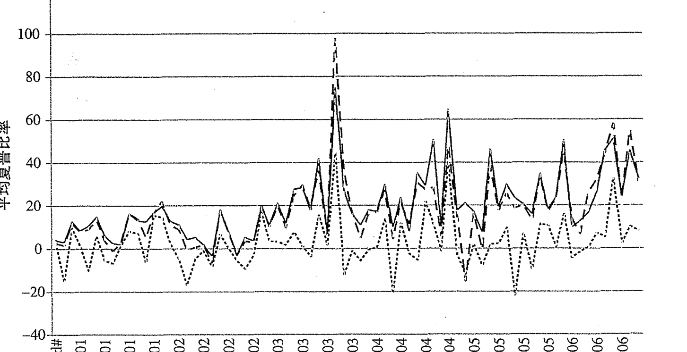

—— MOGA30 --- MOGA …… MOGA_MEAN

图10-4 不同算法的平均投资组合夏普比率（2001—2006年月度）

# 金融AI算法

# ARTIFICIAL INTELLIGENCE INFINANCIAL MARKETS

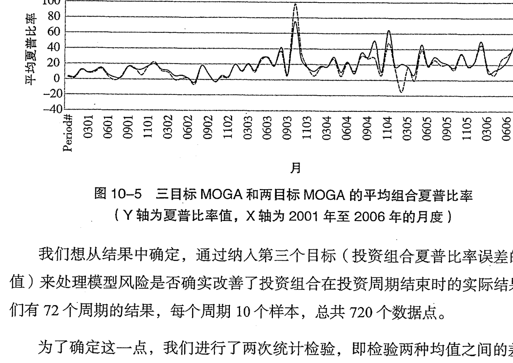

图10-5 三目标MOGA和两目标MOGA的平均组合夏普比率
（Y轴为夏普比率值，X轴为2001年至2006年的月度）

我们想从结果中确定，通过纳入第三个目标（投资组合夏普比率误差的近似值）来处理模型风险是否确实改善了投资组合在投资周期结束时的实际结果。我们有72个周期的结果，每个周期10个样本，总共720个数据点。

为了确定这一点，我们进行了两次统计检验，即检验两种均值之间的差异以及检验关于比例的假设。检验两个均值之间的差异是为了确定两个样本组（由两个不同的种群表示）的均值在给定的置信水平内是否相等或在统计上有显著的差异。我们需要测试MOGA30的夏普比率的均值是否大于MOGA和MOGA_MEAN的均值。显著性检验如下：

```
H₀ : μ₁ ≤ μ₂\nH₁ : μ₁ > μ₂\nt = \frac{\overline{x}_1 - \overline{x}_2}{\sqrt{\frac{s_1^2}{n_1} + \frac{s_2^2}{n_2}}}\n（10.25）
```

其中，t 是学生的统计性检验分数；\overline{x}_1 是第一个种群或样本的均值（在我们的例子中是三目标MOGA的均值）；\overline{x}_2 是第二个种群或样本的均值（在我们的例子中分别是MOGA和MOGA_MEAN）；S₁² 是种群或第一个种群样本的标准差；S₂² 是种群或第二个种群样本的标准差；n₁ 是第一个种群的数量；n₂ 是第二个种群的

# 第10章
运用多目标遗传算法应对投资组合选择中的模型风险

数量。

为了检验关于比例的假设，我们需要知道，在给定的置信水平下，MOGA30的结果是否能比MOGA和MOGA_MEAN更频繁地产生更好的结果。如果MOGA30的结果在大多数情况下都不是更好，那么MOGA30优于MOGA或MOGA_MEAN的样本比例将小于50:50或0.5左右，否则这个比例将明显大于0.5。这些测试不关注投资组合夏普比率值的均值，而是关注MOGA30的结果优于MOGA和MOGA_MEAN的周期数。显著性检验如下：

H₀ : p " p₀\nH₁ : p > p₀\nz = \frac{\overline{p} - p₀}{\sqrt{\frac{p₀(1-p₀)}{n}}} （10.26）

其中，z是统计检验的分数；\overline{p} 是种群比例的样本估计值（在我们的例子中是MOGA30的抽样估计）；P₀是要检测的假设值（在我们的例子中是0.5）；n是第二个种群的数量。

表10-3总结了根据等式（10.15）和等式（10.16）进行检验的重要统计数据。我们可以看到，MOGA30的结果相对好于MOGA和MOGA_MEAN的结果。MOGA30的夏普比率的平均值为19.7846981，MOGA和MOGA_MEAN的平均值分别为18.0573914和2.62723092。

| 算法       | n   | x          | s²         | > MOGA30     | > MOGA      | > MOGA_MEAN |
|------------|-----|------------|------------|-------------|--------------|-------------|
| MOGA30     | 720 | 19.7846981 | 258.202959 | 0 (0.0 %)  | 545 (75.69 %)| 717 (99.58 %)|
| MOGA       | 720 | 18.0573914 | 291.832071 | 175 (24.3 %)| 0 (0.0 %)   | 702 (97.50 %)|
| MOGA_MEAN  | 720 | 2.62723092 | 137.342731| 3 (0.42 %)  | 18 (2.50 %) | 0 (0.0 %)   |

表10-4总结了两个比较MOGA30和MOGA结果的等式（10.15）和等式

# 金融 AI 算法

# ARTIFICIAL INTELLIGENCE IN FINANCIAL MARKETS

(10.16) 的结果。对于第一行所述比例的假设检验，计算出的 z 分数为 13.7867。参考正态分布表，在 0.1% 的置信水平下，否定了关于 MOGA3O 的结果比例比 MOGA 结果更差或相等的零假设（我们错误地拒绝假设的概率小于 1/1000）。因此，我们可以有把握地得出结论，MOGA3O 的结果确实优于 MOGA。对于两个均值的差异检验，t 值为 1.97624。参考具有 719 个自由度（N-1）的 t 分数概率表，在 5% 的置信度水平下，否定了 MOGA3O 结果的夏普比率均值小于或等于 MOGA 结果的零假设。例如，我们可以在 100 次中有 5 次错误地否定零假设。因此，我们有信心认为，平均而言，MOGA3O 结果的夏普比率优于 MOGA。

| MOGA3O > MOGA       | t/z         | 自由度   | 单边概率       | 否定原假设（按照 %
|----------------------|-------------|------------|-----------|----------------|
| H₀: P ≤ P₀           | z = 13.7867 | N/A        | 1.53229E-43 | 是            |
| H₁: P > P₀           |             |            |           | (0.1 % 置信度水平) |
| H₀: μ₁ ≤ μ₂          | t = 1.97624 | 719        | 0.02425   | 是            |
| H₁: μ₁ > μ₂          |             |            |           | (5 % 置信度水平) |

表 10-5 显示了等式（10.15）和等式（10.16）的两次检验结果，并比较了 MOGA3O 和 MOGA_MEAN 的结果。对于第一行所述比例的检验假设，计算出 z 分数为 26.60903。参照正态分布表，在 0.1% 的置信度水平下，否定了 MOGA3O 结果比 MOGA_MEAN 差或相等的零假设。因此，我们可以有把握地得出结论，无论在牛市，还是在熊市，MOGA3O 的结果确实优于 MOGA_MEAN。在 MOGA_MEAN 的夏普比率优于 MOGA3O 的 720 个样本中，只有 3 个样本对两个均值的差异进行了检验，t 分数为 23.14841。参考自由度为 719（N-1）的 t 分数概率表，在 0.1% 的置信度水平下，否定了 MOGA3O 结果的夏普比率均值小于或等于 MOGA 的零假设，也就是说，我们可以在 1000 次中有一次错误地否定零假设。因此，我们可以说，在 1000 个例子中，有 999 个例子的 MOGA3O 结果的夏普比例优于 MOGA_MEAN 的。

# 第10章
运用多目标遗传算法应对投资组合选择中的模型风险

# 表10-5 两次检验MOGA3O是否优于MOGA_MEAN的实证结果

| MOGA3O >\GA_MEAN | t/z | 自由度 | 单边概率 | 否定原假设（按照%置信水平） |
| :------------------: | :---: | :----: | :------: | :-------: |
| H₀: P ≤ P₀           | z=26.60903       | N/A    | 2.6683E-156 | Yes        |
| H₁: P > P₀           |          |        |          | (0.1 % level) |
| H₀: μ₁ ≤ μ₂          | t=23.14841       | 719    | 2.55154E-89 | Yes        |
| H₁: μ₁ > μ₂          |          |        |          | (0.1 % level) |

# 表10-6 总结比较 MOGA 和 MOGA_MEAN 的两种检验的结果。对于第一行所述比例的检验假设，计算出的 z 分数为 25.4912。参照正态分布表，在 0.1% 的置信度水平下，否定了 MOGA 结果比例较差或等于 MOGA_MEAN 结果的比例的零假设。因此，我们可以有把握得出结论，MOGA 的结果确实优于 MOGA_MEAN。为了检验两种均值的差异，t 得分为 20.1982。参考自由度为 719（N-1）的 t 分数概率表，在 0.1% 的置信度水平下，否定了 MOGA 结果的夏普比率均值小于或等于 MOGA_MEAN 结果的夏普比率均值的零假设。因此，我们可以肯定地说，平均而言，MOGA 结果的夏普比率优于 MOGA_MEAN。

# 表10-6 两次检验 MOGA 是否优于 MOGA_MEAN 的实证结果

| MOGA3O > MOGA_MEAN | t/z | 自由度 | 单边概率 | 否定原假设（按照%置信水平） |
| :------------------: | :---: | :----: | :------: | :-------: |
| H₀: P ≤ P₀           | z=25.4912       | N/A    | 2.6683E-156 | Yes        |
| H₁: P > P₀           |          |        |          | (0.1 % level) |
| H₀: μ₁ ≤ μ₂          | t=20.1982       | 719    | 1.67465E-89 | Yes        |
| H₁: μ₁ > μ₂          |          |        |          | (0.1 % level) |

# 结 论

本章提出了一个改进的 MOGA 来处理现实约束下的投资组合优化问题中的模型风险。利用美国股市 72 个短期投资周期的真实数据，我们对该算法进行了

# 金融AI算法

# ARTIFICIAL INTELLIGENCE IN FINANCIAL MARKETS

实验和相关统计检验，并将该算法（即 MOGA3O ）的结果与 MOGA 和 MOGA_MEAN 的结果进行了比较。

实验结果表明，MOGA3O 对三种算法的效果都较好，统计检验也证实了这一结论。结合第三个目标，投资组合夏普比率误差的近似有助于降低预测过程中固有的模型风险。MOGA3O 通过倾向于选择那些在回报率和波动率相同的情况下预测更准确的股票，优化了投资组合的选择。第三个目标是捕捉预测模型的不确定性。当新信息出现时，它还具有动态和自适应的特征，从而降低了预测模型的模型风险。通过根据当前的经济、金融和市场环境改变集中预测模型的权重，我们能够更好地预测未来。然而，预测未来是极其困难的，因为它在很大程度上是不可预见的。在呈现未来事件时涉及很多因素和变量。预测未来往往会令人失望。此外，我们预测未来的方法是基于对特定预测模型误差的预测，它也有与预测模型相同的局限性，即需要根据过去的值预测未来的值，而过去的价值是基于相关性而不是因果关系。这些预测几乎是不准确的。任何输入不准确的模型的输出都是不准确的。第三个目标只是对预测模型的误差的测量。当且仅当误差显示出可学习并基于这些模式预测的模式时，误差才可以测量。如果错误没有表现出可理解的模式，它们就无法被预测，第三个目标也无助于改善投资组合选择。

虽然我们认为所提出的算法可以适用于任何一组可选股票，但我们的集合很小（18 只股票），这主要是因为我们的实验局限于有足够历史数据的股票，以及包含了更多数据而增加了计算的复杂性。在未来的工作中，这也可能对使用 MOGA 平台来探索其他优化目标有利，如分布的第三阶矩（偏度）、第四阶矩（峰度），甚至包括风险价值、条件风险价值和预期缺口等其他风险度量。将这里的结果与使用这些额外目标的算法的结果进行实证比较是有趣的，并将

# 第11章 线性回归与模糊线性回归：在共同基金经理绩效评估中有何区别

希腊共同基金的业绩，潘达拉基和斯潘诺达基斯（Spanoudakis）使用了基于论证的决策理论，亚历克萨基斯（Alexakis）和托拉斯（Tsolas）、巴巴洛斯等人和潘达拉基使用了数据包络分析。关于希腊基金经理的市场择时能力的文献非常少，且大多是传统模型。潘达拉基和佐庞尼迪斯的早期文章概述了共同基金绩效评估领域的文献。

目前的研究提出了两种不同的方法，即最小二乘法和模糊线性回归（fuzzy linear regression, FLR）来深入分析共同基金经理的业绩。我们论证了当我们使用模糊线性回归而不是最小二乘法时，如何修改与选股能力和市场择时能力相关的业绩结果。这两种方法都适用于 Treynor-Mazuy 模型和 Henriksson-Merton 模型。

使用模糊线性回归评估拟使用的共同基金评估测算方法，以及使用最小二乘法对获得的结果进行比较是一个值得研究的领域，据我们所知，文献中是缺少这部分内容的，而且也从未在共同基金行业中使用过。模糊逻辑架构已被应用于共同基金评估的其他领域，如共同基金投资组合选择、共同基金战略评估和共同基金管理公司核心竞争力评估。

接下来，我们将概述本文拟使用的方法论体系的主要特点，简要介绍使用的数据集，描述并讨论实证结果，总结本文的主要发现并提出未来的研究方向。

# 方法论

本文通过最小二乘法和模糊线性回归，使用了两种最常用的模型，即 Treynor-Mazuy 模型和 Henriksson-Merton 模型，并使用两个拟合测量度——均方根误差和平均绝对误差，研究了共同基金经理的业绩。

# Treynor-Mazuy 模型

大部分关于共同基金业绩的研究都使用了詹森（Jenson）提出的收益生成模型。他使用 α 系数来考察基金经理在给定所管理投资组合的风险水平下，通过成功预测证券价格来获得高于预期的回报能力。

1966年，特雷诺（Treynor）和玛佐（Mazuy）第一次对共同基金经理的市场择时和选股能力进行了考察。为了检验一位共同基金经理是否真的猜透了市场走势，特雷诺和马佐实际提出了这样一个问题：“有没有证据表明，在市场行情好的年份，基金的波动性要高于市场行情不好的年份？”

他们在詹森的公式中添加了一个二次项来检验市场择时能力，并指出投资组合收益率是市场收益率的非线性函数。Treyner-Mazuy模型为：

```
(Rpt - Rft)=αp + βp(RMt - Rft)+γp(RMt - Rft)²+εp （11.1）
```

其中，Rpt是t时刻基金投资组合的日收益率；Rf是短期国库券的日收益率（日无风险利率）；RMt是投资组合市场的日收益率；αp是截距项（预期选择性业绩参数）；βp是预期风险参数；γp是第二斜率系数（预期市场择时业绩参数）；εp是误差项[E(εp)=0的独立正态分布随机变量]。

对投资组合经理的业绩进行的评估使用的是αp和γp这两个预期参数。参数αp表示投资组合经理的择股能力，参数βp表示基金的系统性风险；参数γp表示投资组合经理的市场择时能力。这些参数的正值表示投资组合经理具备预测能力，负值表示他们缺乏预测能力。当这些参数的数值接近或等于0时，这意味着这些人根本不具备预测能力。

特雷诺和马佐从实证角度检验了1953—1962年间57只开放式共同基金的市场择时能力。结果显示，没有统计数据表明跟踪的这些基金经理成功地猜透了市场走势。

# Henriksson-Merton 模型

亨里克森根据他本人与默顿一起提出的以及默顿个人提出的参数与非参数技术，考察了共同基金经理的预测能力。参数检验需要利用资本资产定价模型或多因素收益结构的假设。在这种情况下，严格依据可观察到的回报率，参数测试允许识别市场择时能力和微观预测得到暗渡贡献。另一方面，非参数检验需要了解实际的预测或其他可替代的能力。

在非参数方法条件下，检验了市场时机预测与市场投资组合收益是否大于无风险证券收益之间的独立性。对这个零假设进行的非参数检验利用了正确预测的条件概率足以衡量预测能力的情况。如果基金经理的预测是可观察的，那么可以使用非参数检验，且无须进一步假设市场上证券收益的分布或证券价格估值的任何特定模型。

在某些条件下，仅从投资组合收益序列就可以得出基金经理的预测是什么；这样的结论通常会对预测结构产生干扰。假设基金经理的投资组合仓位受其对个别证券的预测影响，那么预测值将非常

# 第11章

# 线性回归与模糊线性回归：在共同基金经理绩效评估中有何区别

| 模糊线性回归 | 最小二乘法 | 变量 |
| --- | --- | --- |
| MAE | MAE | β   |
| RMSE | RMSE | γ   |
| m(Y) | R²  | α   |
| c   | p   | MF5t1 |
| r   | Coef. | -0.0179 |
| ... （省略部分表格内容，按相对布局） ... | ... | ... |


## 续前表

# 金融AI算法

# ARTIFICIAL INTELLIGENCE IN FINANCIAL MARKETS

|...（表格内数据及结构，以Markdown表格形式呈现）...

## 表 11 - 2

续前表

# 第11章

# 线性回归与模糊线性回归：在共同基金经理绩效评估中有何区别


续前表

301

# 金融 AI 算法

# ARTIFICIAL INTELLIGENCE IN FINANCIAL MARKETS

| 模糊线性回归 | 最小二乘法 | MF4t1 | MF4t2 | MF4t3 | MF5t1 | MF5t2 | MF5t3 |
| --- | --- | --- | --- | --- | --- | --- | --- |
| MAE | MAE | 0.2512 | 0.2727 | 0.2094 | 0.3648 | 0.3235 | 0.5603 |
| RMSE | RMSE | 0.3112 | 0.3431 | 0.2610 | 0.4495 | 0.3970 | 0.6824 |
| m(Y) | R² | 0.6377 | 0.7502 | 0.4664 | 0.8844 | 0.7958 | 1.2247 |
... （省略部分表格内容以符合简化原则） ...

# 第11章

# 线性回归与模糊线性回归：在共同基金经理绩效评估中有何区别

| 模糊线性回归 | MAE | RMSE | m(Y) | c | r | MAE | RMSE | R² | p | Coef. | 变量 |
| --- | --- | --- | --- | --- | --- | --- | --- | --- | --- | --- | --- |
|     | 0.2781 | 0.3309 | 0.6323 | 0.4826 | 1.5172 | 0.2709 | 0.3212 | 0.7046 | 0.9741 | -0.0066 | MF6t1 |
|     | 0.3246 | 0.4127 | 0.8116 | 0.0000 | 0.0000 | 0.3111 | 0.3916 | 0.5773 | 0.3446 | -0.3358 | MF6t2 |
|     | 0.2721 | 0.3334 | 0.6488 | 0.6487 | -0.1234 | 0.2144 | 0.2794 | 0.7486 | 0.6227 | 0.0246 | MF6t3 |
| 最小二乘法 | 0.0000 | 0.0000 | 0.0000 | 0.8111 | 0.0223 | 0.6666 | 0.0000 | 0.9631 | 0.0000 | -0.0088 | α |
|       | 0.0295 | 0.0000 | 0.6487 | 0.1945 | 0.8527 | 0.0000 | 0.7486 | 0.7713 | 0.0000 | 0.7713 | β |
|       | 0.0000 | 0.0560 | 0.0083 | 0.0560 | 0.0560 | 0.1282 | 0.3770 | 0.1282 | 0.3770 | 0.1282 | γ |

续前表

# 金融AI算法

# ARTIFICIAL INTELLIGENCE IN FINANCIAL MARKETS

Durbin-Watson 检验是以下假设为条件的：解释变量为非随机变量，误差项假设为正态分布，回归模型不包括回归的滞后值。该检验仅衡量一阶序列相关性。

共同基金2的第三个子周期、共同基金5的第二个和第三个子周期以及共同基金6的第一个子周期均存在自相关，均存在dL和dU的5%显著性点。

系数估计之后是最小二乘法的p值和模糊线性回归的R²（模糊数参数估计）、c（参数估计的宽度）和m（Y）（模糊度度量）。在 Treyner-Mazuy 和 Henriksson-Merton 模型中，常数项是α（估计的选择性业绩参数），第一个斜率是β（估计风险参数），γ是最小二乘法估值中的第二个斜率系数（估计的市场择时业绩参数），而 aᵢ 是模糊线性回归估计中 α = (rₐ₀, cₐ₀)、β = (rₐ₁, cₐ₁) 和 γ = (rₐ₂, cₐ₂) 的模糊三角数。

为了比较最小二乘法和模糊线性回归，我们使用了两种拟合方法，即均方根误差和平均绝对误差。如表11–1 和表11–2 所示，这些是最小二乘法和模糊线性回归的均方根误差和平均绝对误差。虽然这些拟合方法适用于整个模型，但估计系数可以作为该模型的复合物而得到明确的解释。此外，表11–3 和表11–4 分别给出了 Treyner-Mazuy 模型和 Henriksson-Merton 模型对最小二乘法估计的显著性汇总结果。

## 表 11–3 使用 OLS 的 Treynor–Mazuy 模型汇总结果

| 参数 | 正向 | 负向 | 统计上显著的 * | 统计上不显著的 |
| :--- | :---: | :---: | :---: | :---: | :---: |
|      |       |       | 正向   | 负向   | 正向   | 负向   |
| 选择性（α） | 15    | 3     | 3     | 0     | 12    | 3     |
| 市场择时（γ） | 7     | 11    | 0     | 3     | 7     | 8     |
| * 在5%的水平线。 |

## 表 11–4 使用 OLS 的 Henriksson–Merton 模型汇总结果

| 参数 | 正向 | 负向 | 统计上显著的 * | 统计上不显著的 |
| :--- | :---: | :---: | :---: | :---: | :---: |
|      |       |       | 正向   | 负向   | 正向   | 负向   |
| 选择性（α） | 14    | 4     | 4     | 0     | 10    | 4     |
| 市场择时（γ） | 6     | 12    | 0     | 3     | 6     | 9     |
| * 在5%的水平线。 |

# 第11章
线性回归与模糊线性回归：在共同基金经理绩效评估中有何区别

# 共同基金经理的业绩

根据表11-1 和 11-2 中的模型，最小二乘法对 β 系数的估计在任何情况下均具有统计学意义，即 p 值几乎为零。这一事实与模糊线性回归的估计是一致的，这导致了估计的模拂数没有宽度或宽度很小，但这并不意味着共同基金经理表现出任何显著的预测能力。

表 11-1 和表 11-3 的 Treynor-Mazuy 模型以及表 11-2 和表 11-4 的 Henriksson-Merton 模型的最小二乘法实证结果显示，15 位 Treynor-Mazuy 基金经理和 14 位 Henriksson-Merton 基金经理的选择性系数（α）为正，而在三个 Treynor-Mazuy 例子和四个 Henriksson-Merton 例子中，基金经理的选择性系数为负。在 15 个 Treynor-Mazuy 和 14 个 Henriksson-Merton 的正相关系数中，12 个 Treynor-Mazuy 和四个 Henriksson-Merton 在 5% 的水平上不显著，而负相关系数均不显著。就 Treynor-Mazuy 模型和 Henriksson-Merton 模型的市场时机系数（γ）而言，在七个 Treynor-Mazuy 模型和六个 Henriksson-Merton 模型的例子中，γ 均为正值，且无统计学意义，其余三个例子均为负值，有统计学意义。因此，对于这两种模型，只有在少数情况下，基金经理才有能力选择正确的证券，以获得较高的投资组合回报。这意味着，平均而言，被研究的基金经理比市场择时者更善于选股。更准确地说，平均选择性测量值为正和平均择时性测量值为负只在少数情况下具有统计学意义。这意味着，被审查的共同基金的市场择时和选择性表现普遍较差。

关于 Henriksson-Merton 模型，这一事实与模糊线性回归估计的市场择时系数（如表 11-2 所示）一致，其中，c 取大于零的值，这表明我们的估计值存在不确定性，

# 金融AI算法

# ARTIFICIAL INTELLIGENCE IN FINANCIAL MARKETS

# 结论与未来展望

利用股票型共同基金的数据，我们使用了最小二乘法的传统分析，并引入了模糊线性回归方法，以了解共同基金业绩衡量方法的相似之处和新颖之处。此外，将两种方法结合起来可以区分金融市场的不同风险水平，从而更清晰地反映出基金经理的实际行为。我们将我们的研究成果视为朝着这个方向迈出的一小步。我们研究的主要结论总结如下。

+   1. 最小二乘法模型和模糊线性回归模型显示出很大的相似性，这可以从分析数据的估计模型中看出。我们使用均方根误差和平均绝对误差这两种拟合方法证明了这一点。在被检验的模型中，这些方法在大多数情况下都得出了非常相似的值。然而，我们发现，所有最小二乘法模型均得到了较好（较低）的值。

+   2. 总体结果表明，希腊基金经理的特点是，他们的市场择时能力和选股能力都较差（至少在考察期内是这样）。

+   3. 对于模糊线性回归估计，被调查的基金经理的市场择时能力没有宽度。这一结果表明，这种方法比最小二乘法更具优势，但最小二乘法的系数不具有统计学意义。

+   4. 我们注意到，在有些情况下可以使用模糊线性回归估计：(1) 确定的，当模糊数范围包括最小二乘法统计计算的系数时；(2) 当没有最小二乘法统计计算的系数，并且模糊宽度明显时；(3) 当模糊线性回归和最小二乘法得出不同结论，需要进行额外的调查时。然而，还需要进一步的实证分析来支持这类信息的有效性。

+   5. 我们引入了m（Y）作为R²的模糊相关拟合。结果表明，R²与模糊度度量以同样的方式表现。当R²在最小二乘法模型中较高时，模糊度较低，反之亦然。

+   6. 模糊度的相似比是一种基于预测值的不确定性相似度的测量。这可能成为共同基金财务分析中的一种新方法，用于评估比较一只共同基金与另一只共同基金，以及某只共同基金在另一个周期与其自身的差异。

未来的研究应在这种模糊应用的基础上进一步优化这种方法和新的措施，以提供可供选择的评估方案。研究共同基金经理的业绩、比较最小二乘法和模糊线性回归在不同投资选择（如股票、债券和衍生品）上的表现，或通过纳入基金年龄、基金规模等更丰富的信息将是一项非常有意义的工作。

# Artificial Intelligence in Financial Markets: Cutting Edge Applications for Risk Management, Portfolio Optimization and Economics.

ISBN: 978-1-137-48879-4

Copyright © The Editor(s) (if applicable) and The Author(s) 2016.

First published in English by Palgrave Macmillan, a division of Macmillan Publishers Limited under the title Artificial Intelligence in Financial Markets by Christian L. Dunis, Peter Middleton, Konstantinos A. Theofilatos, and Andreas Karathanasopoulos. This edition has been translated and published under licence from Palgrave Macmillan. The authors have asserted their right to be identified as the authors of this Work.

Simplified Chinese translation copyright © 2021 by China Renmin University Press Co., Ltd.

All Rights Reserved.

本书中文简体字版由帕尔格雷夫·麦克米伦出版社授权中国人民大学出版社在中国大陆地区独家出版发行。未经出版者书面许可，不得以任何方式抄袭、复制或节录本书的任何部分。

版权所有，侵权必究。

# 《Fintech: 全球金融科技权威指南》

+   - 科技正在颠覆与重塑金融业，Fintech 或将成为互联网商业的下一个风口。
- 汇集全球86位金融科技前沿实践者的前沿洞见与实战经验之大成，全面透视金融技术风暴、深刻解析金融科技行业颠覆、创新与机遇的专业权威著作。

# 《InsurTech: 保险科技权威指南》

+   - 汇集全球保险科技行业75位领袖和观察家的前瞻性预测与真知灼见，为保险行业面临的困境、未来的转型机遇和发展路径进行全方位的答疑解惑。
- 为保险行业创业者、创新者、保险人、投资者、分析师和投资顾问提供关于保险生态圈的重要认识、批判性思维和敏锐的洞察力。

# 《财富科技: 财富管理数字化转型权威指南》

+   - 汇集全球83位财富管理和数字领域思想领袖和先行者的前沿洞见和实践经验。
- 全面透视颠覆财富管理行业的核心问题、创新机遇和未来发展趋势，帮助财富管理从业者融入金融服务行业数字化转型的滚滚洪流，全面了解新的竞争范式。

# 《实体店逆袭：零售业的AI转型之道》

+   后疫情时代，实体店如何逆袭电子商务必读之作。

+   日本多位商界奇才首次披露如何实现实体店如何结合AI技术，发挥自身优势，实现AI变现，提升整体销量与效率，在与电商大佬的市场争夺战中成功逆袭。

+   着眼于零售业、生产制造业、批发业等诸多环节面临的实际困境，帮助企业应用AI技术解决运营中的各种问题。

# 《AI应用落地之道》

+   从AI核心技术、样本数据提取到业务流程构建、人才培养机制，MIT人工智能研究所客座研究员、日本人工智能专家全流程指导，帮助企业实现AI技术的落实应用，指导个人从知识劳动人才向智能劳动人才转变。

+   只有立足于AI供应商和用户企业双方的立场，才能使企业通过运用AI获得较高的投资回报率，提升生产效率，从而解放人类工作者，进一步提升社会整体的幸福感。

# 《成为变革领导者》

+   帮助企业管理者提升重要能力，实现从变革管理者到变革领导者的成功转型，以拥抱技术快速迭代、充满不确定性和变数的未来。

+   只有当企业中的每个人都成为变革的推动者，不断提升企业领导者的变革领导力，并根据不同世代员工的特点，激发他们自身变革的意愿，从而自下而上、自发地推动变革，才能实现企业的成功转型。

# 《逆势而动：安东尼·波顿成功投资法》

+   叱咤投资界28年，总投资回报超140倍，曾被《泰晤士报》评选为史上十大投资大师之一的“欧洲股神”教你以逆向进取的方法寻求资本成长的机会。

+   彼得·林奇倾情作序推荐。

# 《至关重要的投资战略：专业投资一站式指南》

投资战略决定投资成败。制定投资战略、确立正确投资方向与目标的必读书。

优良的投资战略不仅能够切中市场的本质规律和人性的本质，还能在不同的市场、不同的时期长期有效，帮助投资者有效避险。

只有意识到制定最佳战略的重要性，对新想法持开放态度，不受狭隘的监管的阻碍，并且拥有最高效的沟通和最快的决策过程的投资者，才能在投资领域立于不败之地。

# 《大产品思维：从产品布局到营销创新的指数级增长之道》

国内第一本专门针对实体经济企业如何使用互联网思维进行产品战略级创新的实战手册。

构建企业产品与营销新形态，打破价值创造的认知误区，帮助企业快速掌握产品创新的实战方法，完成产品驱动下的企业升维创新，实现企业价值的指数级增长。

# 《灯火之下：写给青少年抑郁症患者及家长的自救书》

12 个情绪自查小测试，帮助青少年正确识别自身的情绪状态，评估自身的抑郁程度，及时规避来自生活事件中的抑郁陷阱，从而调节心情状态，回归正常生活。

25 个缓解自助小练习，帮助青少年摆脱消极情绪、建立社交信心、找回做事的动力并养成健康的生活习惯，从而有效缓解自身可能具有的抑郁情绪、抑郁症状，最终达到回归正常生活的目的。

# 《消失的父亲、焦虑的母亲和失控的孩子：家庭功能失调与家庭治疗（第 2 版）》

结构派家庭治疗开山鼻祖和系统家庭理论奠基人的真传弟子、家庭治疗领域权威专家的经典著作。

清华大学心理发展指导中心副主任、德中心理治疗研究院副主席刘丹，华中师范大学心理学院教授任志洪，壹心理创始人黄伟强，实用心理学主编吴冕联袂推荐。