# Python驱动的金融AI量化实战

## O'Reilly 出版社简介

O'Reilly 的核心理念是让创新知识流动、推动社会进步。逾四十年间，机构与个人都在其提供的技能与思想加持下实现成长。支撑这一切的是一个由资深专家与创新者组成的独特网络，知识借此网络被持续分享。在线学习平台汇聚独家直播课、图书与视频，帮助用户获取专业能力。四十年来，O'Reilly 出版的图书一直是前沿技术学习的权威参考。每年举办的多场行业会议，是技术人群交流实践、捕捉新趋势的重要场域。

我们的读者渴望创造推动世界前行的成果，我们愿提供助力。

## 业界评价

> “O'Reilly Radar 博客有口皆碑。”

> ——*Wired*

> “O'Reilly 凭借一系列非凡想法（真希望当初我也想到了）建立了数百万美元的业务。”

> ——*Business 2.0*

> “O'Reilly Conference 是聚集关键思想领袖的绝对典范。”

> ——*CRN*

> “一本 O'Reilly 的书就代表一个有用、有前途、需要学习的主题。”

> ——*Irish Times*

> “Tim 是位特立独行的商人，他不光放眼于最长远、最广阔的领域，并且切实地按照 Yogi Berra 的建议去做了：‘如果你在路上遇到岔路口，那就走小路。’回顾过去，Tim 似乎每一次都选择了小路，而且有几次都是一闪即逝的机会，尽管大路也不错。”

> ——*Linux Journal*

## 本书推荐语

“凭借其全面和直观的方法，这将是金融领域从业人员和学者的主要参考书。”

——**金融数据科学学者 Abdullah Karasan**

“这是一本优秀的机器学习实践指南，旨在解决量化金融领域的一系列问题。”

——**路孚特公司研究员 Tim Nugent**

“人工智能正在重塑生活的方方面面，金融尤其是量化交易拥有广阔的应用空间。当前行业缺乏兼通人工智能与投资交易的复合人才。对有志进入该方向的读者，本书既能帮助掌握人工智能在量化投研中的具体运用，也能在启发式论述中认识其边界与潜力，进而提升实战能力。期待翻译出版能让更多国内从业者受益，推动中国量化投资发展。”

——**复旦大学浩清特聘教授、复旦大学人工智能创新与产业研究院院长、前蚂蚁集团首席 AI 科学家 漆远**

“希尔皮斯科博士把经典金融理论与人工智能融为一体，借助具体代码循序渐进地带入金融人工智能。由特征工程到神经网络、强化学习，再到算法交易与风险管理，本书覆盖了 AI 量化的投研全链路，内容扎实且实践性强，同时回扣量化本质，兼具学术优雅，是 AI 量化的佳作。”

——**BigQuant 人工智能量化平台创始人兼 CEO 梁举**

“投资行业正处加速变革期，AI 与机器学习是核心驱动力。CFA Institute 的全球调研显示，亚太市场近半从业者认为 AI 将在未来五年内对岗位产生重大影响。应对这种变化需要 AI 与人类智慧的结合。本指南系统呈现 AI 与机器学习如何捕捉金融市场中普遍存在的不完全有效并实现量化交易，是难得的工具书。”

——**CFA Institute 中国区总经理 张一**

# 前言

> 对于我们能想到的每一种投资策略，超额收益是否终将消失？更深层的问题是，在无数聪明头脑和智慧机器的辅助下，我们是否会迎来金融市场完全有效、资产被正确定价的时代？

> ——Robert Shiller，2015 年

人工智能已成为二十一世纪前十年的关键技术，并持续主导后续发展。随着技术创新、算法突破、大数据兴起与算力提升，多个行业正经历 AI 带来的剧变。

大众媒体聚焦自动驾驶、游戏等领域的突破，而在金融内部，AI 的浪潮同样在升温。相较于网页搜索与社交媒体的成熟应用，AI 在金融的渗透尚处初期。

本书聚焦金融人工智能的若干关键面向。主题覆盖面极广，一册难以穷尽，故需侧重。首两部分先建立基础认知。第三部分从统计学视角探讨市场失效，并借助神经网络技术展开。只有市场存在可预测的失效，算法交易才可能获利，第四部分围绕此展开。若能系统利用市场与经济的失效，便与有效市场假说形成张力。设计智能交易机器人长期被视为金融的圣杯，AI 或许能让我们更接近目标。在此情境下，AI 将如何改写市场？金融奇点出现的可能性多大？第五部分予以讨论。第六部分作为技术附录，以 Python 代码演示从零搭建神经网络的全流程。

金融领域应用 AI 的难点与其他领域并无本质差异。21 世纪第一个十年，强化学习在游戏中的进展极具代表性，例如训练 AI 下国际象棋与围棋，以及游玩 Atari 游戏。游戏中的强化学习经验随后被迁移到自动驾驶设计与医疗诊断优化等任务。表 P-1 汇总了 AI 在不同领域的落地模式。

### 表 P-1：人工智能在不同领域的应用情况

| 领域 || 智能体 || 目标 || 方法 || 奖励 || 障碍 || 风险 |

| --- | --- | --- | --- | --- | --- | --- |

| 电子游戏 || 人工智能体（软件） || 最大化游戏分数 || 在虚拟游戏环境中进行强化学习 || 得分 || 规划和延迟奖励 || 无 |

| --- | --- | --- | --- | --- | --- | --- |

| 自动驾驶 || 自动驾驶汽车（软件 + 车） || 从地点 A 安全地驾驶至地点 B || 在虚拟（游戏）环境中进行强化学习，并在现实世界中试驾 || 对错误进行处罚 || 从虚拟世界到物理世界的转换 || 毁坏建筑，伤害人类 |

| 金融交易 || 智能交易机器人（软件） || 最优化长期表现 || 在虚拟交易环境中进行强化学习 || 经济回报 || 有效市场和竞争 || 经济损失 |

训练 AI 玩游戏的优势在于游戏世界是完美虚拟环境 1，不存在真实风险。自动驾驶的迁移就困难很多，难以想象把《侠盗飞车》里的车辆开到现实道路，那将带来严重事故与伤亡。

智能交易机器人则更为友好，因为可通过仿真市场实现完全虚拟的强化学习。失控的机器人主要风险是经济损失，或从更大尺度看是群体行为引发的系统性风险。总体而言，金融是训练、测试与部署 AI 算法的理想场景。

随着金融生态的快速演进，即便是一名好奇且上进的学生，也能只用笔记本电脑和网络就把 AI 应用于交易。这得益于软硬件进步与在线券商的兴起，后者提供历史与实时数据，并通过程序化交易接口执行指令。

本书共分六大部分。

## 第一部分

第一部分先介绍 AI 的核心概念与算法，如监督学习与神经网络（第 1 章）。随后探讨超级人工智能的设想，即 AI 达到或超越人类智能水平（第 2 章）。并非所有研究者都相信超级智能在可预见的未来可实现，但该讨论为审视 AI 尤其是金融应用提供了有益框架。

## 第二部分

第二部分由四章组成，回顾传统规范金融理论（第 3 章），并说明该领域如何被数据驱动金融学（第 4 章）和机器学习（第 5 章）重塑。数据驱动与机器学习催生了无模型、AI 优先的范式，第 6 章对此展开。

## 第三部分

第三部分利用深度学习、神经网络与强化学习，发掘统计意义上的市场失效现象。依次介绍密集神经网络 DNN，第 7 章 2、循环神经网络 RNN，第 8 章，以及依赖 DNN 表征最优策略的强化学习算法，第 9 章。

2 本书中的 DNN 如无另外说明，均为 dense neural network 的缩写，即**密集神经网络**，在其他文献中也称为 MLP（multi-layer perceptron，多层感知机）。——译者注

## 第四部分

第四部分讨论如何以算法交易利用统计意义上的市场失效。涵盖向量化回测（第 10 章）、基于事件的回测与风险管理（第 11 章），以及 AI 算法交易策略的执行与部署（第 12 章）。

## 第五部分

第五部分关注 AI 竞争在金融行业可能带来的后果（第 13 章），并探讨金融奇点的可能性，即 AI 将主导金融活动的各个层面。讨论聚焦于产出持续高于人类与机构基准的 AI 交易机器人（第 14 章）。

## 第六部分

附录包含交互式神经网络训练的 Python 代码（附录 A），从零搭建简易浅层神经网络类库（附录 B），以及使用卷积神经网络 CNN 进行金融时间序列预测的实例（附录 C）。

### 作者题记

金融交易的 AI 应用仍属新生领域。出版之时市面已有相关著作，但多未展示如何以经济方式利用统计意义上的市场失效，AI 究竟意味着什么。

部分对冲基金宣称已完全以机器学习管理客户资产。典型案例是 Voleon Group，截至 2019 年底管理资产逾 60 亿美元（Lee 和 Karsh，2020）。依托机器学习，该基金 2019 年收益 7%，而同期标普 500 上涨约 30%。

本书基于多年开发、回测与部署 AI 算法交易策略的实战经验。鉴于行业的前沿性与保密性，文中方法与示例主要源自作者个人研究。论述偏重实操，难免欠缺严谨，部分案例缺乏严格理论证明或实验验证。金融或机器学习专家可能对其中应用与案例持不同意见。例如 François Chollet（2017）等深度学习专家对预测金融市场的可行性持怀疑态度。Robert Shiller（2015）则质疑金融奇点是否真正到来。Marcos López de Prado（2018）等交叉领域专家认为，机器学习在交易投资中的应用需要行业规模投入，即庞大团队与巨额预算。

本书并非对每个议题提供中立全面综述。展示内容主要基于个人经验、演示示例与 Python 实践考量。诸多示例为突出观点与结果而特意挑选与调整，易被视为存在数据挖掘与过拟合 \[ 详见 Hilpisch（2020）第 4 章 \]。

本书首要目标是让读者以书中代码示例为框架，探索 AI 量化交易这一令人兴奋的领域。为此全书基于大量简化假设，并主要使用**金融时间序列数据及其衍生特征**。实际应用中不必局限于此，也可引入多类数据类型与数据源。书中特征衍生方法隐含假设金融时间序列及其衍生特征Ⓐ所呈现的模式至少在一定程度上会延续，并可用于预测未来价格走势。

在此前提下，所有示例与代码仅具技术性与说明性，不构成任何推荐或投资建议。

对于希望部署文中方法与策略的读者，作者另一本 *Python for Algorithmic Trading: From Idea to Cloud Deployment* 提供了更多流程化技术细节，与本书相辅相成。对初涉金融 Python 的读者，或需复习与参考的读者，作者的《Python 金融大数据分析》完整覆盖了金融领域使用 Python 的核心主题与基础技能。

## 排版约定

本书使用如下排版约定。

**黑体字**

表示新术语或重点强调的内容。

等宽字体（`constant width`）

表示程序片段，以及正文中出现的变量名、函数名、数据库、数据类型、环境变量、语句和关键字等。

等宽粗体（`constant width bold`）

表示应该由用户输入的命令或其他文本。

等宽斜体（`constant width italic`）

表示应该由用户输入的值或根据上下文确定的值替换的文本。

　该图标表示提示或建议。

　该图标表示一般注记。

　该图标表示重要信息。

　该图标表示警告或警示。

## 使用示例代码

可以通过图灵社区本书主页下载本书示例代码。

本书旨在帮助你完成工作。一般来说，你可以在自己的程序或文档中使用本书提供的示例代码。除非需要复制大量代码，否则无须联系我们获得许可。比如，使用本书中的几个代码片段编写程序无须获得许可，销售或分发 O'Reilly 图书的示例光盘则需要获得许可；引用本书中的示例代码回答问题无须获得许可，将本书中的大量示例代码放到你的产品文档中则需要获得许可。

我们很希望但并不强制要求你在引用本书内容时加上引用说明。引用说明通常包括书名、作者、出版社和 ISBN，比如“*Artificial Intelligence in Finance* by Yves Hilpisch (O'Reilly). Copyright 2021 Yves Hilpisch, 978-1-492-05543-3”。

如果你觉得自己对示例代码的用法超出了上述许可的范围，欢迎你通过 permissions@oreilly.com 与我们联系。

## O'Reilly 在线学习平台（O'Reilly Online Learning）


40 多年来，O'Reilly Media 致力于提供技术和商业培训、知识和卓越见解，来帮助众多公司取得成功。

我们拥有独特的由专家和创新者组成的庞大网络，他们通过图书、文章、会议和我们的在线学习平台分享他们的知识和经验。O'Reilly 的在线学习平台让你能够按需访问现场培训课程、深入的学习路径、交互式编程环境，以及 O'Reilly 和 200 多家其他出版商提供的大量文本资源和视频资源。有关的更多信息，请访问 [`www.oreilly.com`](https://www.oreilly.com)。

## 联系我们

如有与本书有关的评价或问题，请联系出版社。

美国：

O'Reilly Media, Inc.

1005 Gravenstein Highway North

Sebastopol, CA 95472

中国：

北京市西城区西直门南大街 2 号成铭大厦 C 座 807 室（100035）

奥莱利技术咨询（北京）有限公司

O'Reilly 的每一本书都有专属网页，你可以在那儿找到本书的相关信息，包括勘误表 3、示例代码以及其他信息。本书的网页是 [`oreil.ly/ai-in-finance`](https://oreil.ly/ai-in-finance)。

3 也可以通过图灵社区本书主页提交中文版勘误。——编者注

你还可以发送电子邮件至 errata@oreilly.com.cn 评论或询问与本书有关的技术问题。

要了解更多 O'Reilly 图书、培训课程、会议和新闻的信息，请访问以下网站：[`www.oreilly.com`](https://www.oreilly.com)。

我们在 Facebook 的地址如下：[`facebook.com/oreilly`](http://facebook.com/oreilly)。

请关注我们的 Twitter 动态：[`twitter.com/oreillymedia`](http://twitter.com/oreillymedia)。

我们的 YouTube 视频地址如下：[`www.youtube.com/oreillymedia`](http://www.youtube.com/oreillymedia)。

## 致谢

我要感谢本书的技术审稿人 Margaret Maynard-Reid、Tim Nugent 博士和 Abdullah Karasan 博士，他们帮助我改进了本书的内容。

“Python 计算金融和算法交易”证书项目的代表也为本书的改进提供了帮助。他们的不断反馈使我避免了很多错误，并改进了本书中和在线培训课程中所使用的代码以及 Python 笔记本。

也要特别感谢“Python 量化”和“AI 机器”团队的各位同仁，Michael Schwed、Ramanathan Ramakrishnamoorthy 以及 Prem Jebaseelan 在编写本书的过程中给予了我在技术层面的多方面支持，帮助我攻克了不少写作中的难题。

还要感谢 O’Reilly Media 的编辑团队，尤其是 Michelle Smith、Corbin Collins、Victoria DeRose 和 Danny Elfanbaum，正是他们的专业协助才让这本书得以成形，他们在内容打磨上提供了大量宝贵意见。

限于个人学识有限，书中难免存在疏漏错讹之处，责任完全在我。

此外也要感谢 Refinitiv 团队的鼎力支持，特别要感谢 Jason Ramchandani 提供的财务数据与持续跟进，本书所用并分享给读者的核心数据文件，均来源于 Refinitiv 数据接口的不同渠道获取。

凡是今日从事人工智能与机器学习的人，都站在前辈们的肩膀上。因此永远值得铭记牛顿于 1675 年写下的那句话：“如果我看得更远，那是因为我站在巨人的肩膀上。”基于此，我向所有为本领域做出贡献的研究者和开源维护者致谢。

最后，要由衷感谢我的家人始终如一的支持与陪伴。尤其是我的妻子 Sandra，她细心照料家庭的每一个人，为我们营造了一个温暖有爱的家。我将本书献给最爱的妻子 Sandra 和优秀的儿子 Henry。

## 更多信息

扫描下方二维码，即可进入电子书详情页及读者群通道。


# 第一部分 机器智能初探

> 如今的算法交易系统仍较为初级，对人工智能的运用也相当有限。改变势在必行！
>
> ——Murray Shanahan，2015 年

这一部分对人工智能做一个总览式的介绍。这里的**人工**是指智能的呈现形式不是生物有机体，而是机器；**智能**可参照人工智能研究者 Max Tegmark 的表述：“实现复杂目标的能力”。本部分梳理人工智能的核心概念与主流算法，盘点近期的重要进展，并从多个角度探讨超级智能的话题。共由两章构成。

* 第 1 章概述人工智能的常用概念、思路与定义，并通过若干 Python 示例演示算法在实践中的运用方式。
* 第 2 章聚焦通用人工智能和超级智能的相关议题。前者指在所有领域都能达到人类水准的智能，后者指在特定领域可超越人类的智能。

## 第 1 章 人工智能全景

> 这是计算机程序首次在标准围棋棋盘上击败人类职业棋手，此前学界普遍认为至少还需要十年。
>
> ——David Silver 等，2016 年

本章先建立**人工智能** artificial intelligence，AI 的通用概念、思想与定义，为后续阅读打底。同时提供多种主流学习算法可直接复用的示例。1.1 节以“算法”的视角，对人工智能场景下的数据类型、学习范式、问题类型进行分类；也会给出无监督学习与强化学习的示范。从 1.2 节开始进入神经网络，神经网络既是本书后续章节的基础，也是当前人工智能领域最具实力的算法之一。1.3 节会谈数据规模与数据多样性在人工智能中的作用。

### 1.1 算法基础

本节梳理与本书相关的基础概念，并围绕人工智能这一概念展开数据类型、学习类型、问题类型与方法类型的讨论。Alpaydin（2016）对本节涉及的主题给出了通俗的介绍与大量案例。

#### 1.1.1 数据类型

数据大致包含两大要素。

**特征数据**

特征数据即输入数据，是喂给算法的原始信息。例如在金融场景，特征数据可以是目标客户的收入与储蓄情况。

**标签数据**

标签数据即输出数据，是算法需要学习的目标。比如借助监督学习，可以从特征数据中学习出对应的标签。在金融场景中，标签可以是某位潜在借款人的信用状况。

#### 1.1.2 学习类型

常见的学习范式主要有三类。

**监督学习**

监督学习 supervised learning，SL 在包含特征值与标签值的样本集上进行训练。1.2 节会展示普通最小二乘 OLS 回归与神经网络等示例。监督学习的核心是建立输入与输出的映射关系。在金融领域，可用它来预测潜在借款人是否具备良好信用。就本书而言，监督学习是最核心的范式。

**无监督学习**

无监督学习 unsupervised learning，UL 仅基于特征值样本进行训练，通常目的是挖掘数据内部的结构。这类方法一般在给定参数后对输入进行建模。聚类即典型的无监督方法。在金融领域，可用于对股票进行分组。

**强化学习**

强化学习 reinforcement learning，RL 通过不断试错学习，并依据奖励与惩罚来更新最优行动策略。它适用于需要连续决策并即时获得反馈的环境，例如游戏。

下文会对监督学习展开更深入的讨论，这里先用简洁示例说明无监督学习与强化学习。

1. **无监督学习**

简单来说，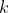均值（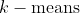）聚类算法将 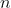个观测值分为 个类别，每个样本会被划归到距离最近的类中心所属的类别。下面的 Python 代码用于生成聚类样本。图 1-1 可视化了聚类样本，借助 scikit-learn 中的 `KMeans` 算法，数据中的聚类结构被完美识别，图中点按算法学习到的类别着色。1

```
In [1]: import numpy as np
        import pandas as pd
        from pylab import plt, mpl
        plt.style.use('seaborn')
        mpl.rcParams['savefig.dpi'] = 300
        mpl.rcParams['font.family'] = 'serif'
        np.set_printoptions(precision=4, suppress=True)

In [2]: from sklearn.cluster import KMeans
        from sklearn.datasets import make_blobs

In [3]: x, y = make_blobs(n_samples=100, centers=4,
                          random_state=500, cluster_std=1.25)  ➊

In [4]: model = KMeans(n_clusters=4, random_state=0)  ➋

In [5]: model.fit(x)  ➌
Out[5]: KMeans(n_clusters=4, random_state=0)

In [6]: y_ = model.predict(x)  ➍

In [7]: y_  ➎
Out[7]: array([3, 3, 1, 2, 1, 1, 3, 2, 1, 2, 2, 3, 2, 0, 0, 3, 2, 0, 2, 0, 0, 3,
               1, 2, 1, 1, 0, 0, 1, 3, 2, 1, 1, 0, 1, 3, 1, 3, 2, 2, 2, 1, 0, 0,
               3, 1, 2, 0, 2, 0, 3, 0, 1, 0, 1, 3, 1, 2, 0, 3, 1, 0, 3, 2, 3, 0,
               1, 1, 1, 2, 3, 1, 2, 0, 2, 3, 2, 0, 2, 2, 1, 3, 1, 3, 2, 2, 3, 2,
               0, 0, 0, 3, 3, 3, 3, 0, 3, 1, 0, 0], dtype=int32)

In [8]: plt.figure(figsize=(10, 6))
        plt.scatter(x[:, 0], x[:, 1], c=y_, cmap='coolwarm');
```

➊ 构造用于聚类的样本集。

➋ 实例化 `KMeans` 模型并设定类别数。

➌ 用样本集对模型进行训练。

➍ 用训练好的模型输出预测。

➎ 预测结果为 0~3 的数字，每个数字代表一个类别。

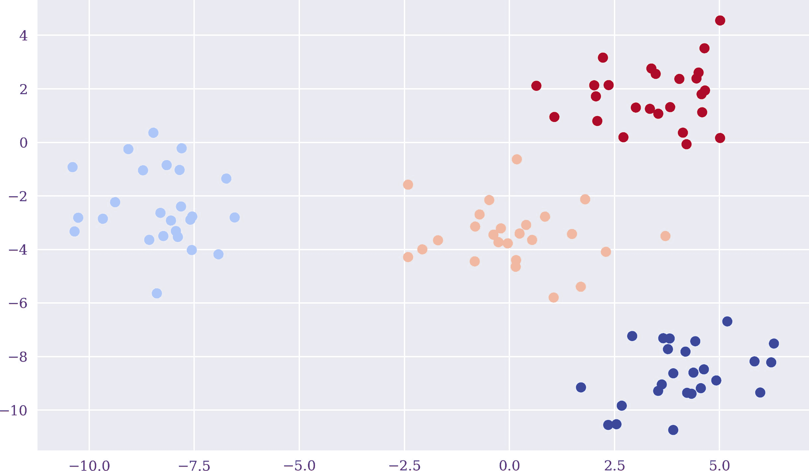

**图 1-1：无监督聚类学习**

训练好 `KMeans` 之类的方法后，就能对新样本进行分类。假如在描述银行潜在客户与真实客户特征的数据集上训练该模型，它能形成两个类别来判断潜在客户的信用，将新客户归入“信用良好”或“信用不佳”两类之一。

2. **强化学习**

以下示范基于《抛硬币》游戏，硬币有 80％ 概率正面朝上，20％ 概率反面朝上。该游戏主要用于凸显学习算法相对随机基线的提升。基线策略随机押注正反面，平均每 100 次下注能赢 50 次，总奖励为 50。

```
In [9]: ssp = [1, 1, 1, 1, 0]  ➊

In [10]: asp = [1, 0]  ➋

In [11]: def epoch():
             tr = 0
             for _ in range(100):
                 a = np.random.choice(asp)  ➌
                 s = np.random.choice(ssp)  ➍
                 if a == s:
                     tr += 1  ➎
             return tr

In [12]: rl = np.array([epoch() for _ in range(15)])  ➏
         rl
Out[12]: array([53, 55, 50, 48, 46, 41, 51, 49, 50, 52, 46, 47, 43, 51, 52])

In [13]: rl.mean()  ➐
Out[13]: 48.93333333333333
```

➊ 设定状态空间（1=正面，0=反面）。

➋ 设定动作空间（1=押注正面，0=押注反面）。

➌ 从动作空间随机选取一个动作。

➍ 从状态空间随机抽取一个状态。

➎ 押注正确则奖励加 1。

➏ 运行多轮实验，每轮下注 100 次。

➐ 统计每轮的奖励。

强化学习通过观察行动结果学习，通常以奖励为导向。为简化起见，下面的学习算法只记录每回合出现的状态，并把该状态累加到动作空间的 `list` 中。这样算法就能捕捉到游戏正反面出现的概率偏差，虽然无法完全复现设定，却已能较好地适应。通过对更新后的动作空间随机采样，自然会体现出正面出现的概率更高。随着采样次数增加，约 80％ 的时间会选择押注正面，平均总奖励约 65，体现了学习算法对比随机基线的改进。

```
In [14]: ssp = [1, 1, 1, 1, 0]

In [15]: def epoch():
         tr = 0
         asp = [0, 1] ➊
         for _ in range(100):
             a = np.random.choice(asp)
             s = np.random.choice(ssp)
             if a == s:
                 tr += 1
             asp.append(s) ➋
         return tr

In [16]: rl = np.array([epoch() for _ in range(15)])
         rl
Out[16]: array([64, 65, 77, 65, 54, 64, 71, 64, 57, 62, 69, 63, 61, 66, 75])

In [17]: rl.mean()
Out[17]: 65.13333333333334
```

➊ 每一轮开始前清空动作空间。

➋ 将本次观察到的状态加入动作空间。

1 详情可参考 `sklearn.cluster.KMeans` 与 VanderPlas（2017）第 5 章。

### 1.1.3 任务类型

依据标签数据的形态与待解问题，主要有两种学习任务。

**估计**

估计又称近似或回归，指标签为连续实数值，在计算机中通常以浮点数表示。

**分类**

分类指标签由有限个类别或分组构成，通常用离散的正整数在计算机中表示。

后续章节会分别给出两种任务的案例。

### 1.1.4 方法类型

为便于后续使用，先厘清三个核心术语的区别。

**人工智能**

人工智能覆盖前述所有学习算法，还包括专家系统等更广范畴的方法。

**机器学习**

机器学习 machine learning，ML 指利用算法与评价指标从数据中学习关系与规律的学科。例如在已知真实标签与模型预测的情况下，均方误差 MSE 是一个常见的评价指标。机器学习是人工智能的子集。

**深度学习**

深度学习 deep learning，DL 指全部基于神经网络的方法。**深度**指网络含有多个隐藏层。深度学习属于机器学习的子集，因而也是人工智能的子集。

实践证明，深度学习的应用面极广，既能处理估计与分类任务，也能用于强化学习。多数情况下，深度学习方法优于逻辑回归、支持向量机等核方法等。2 这也是本书重点关注深度学习的原因。本书涉及的深度学习方法包括密集神经网络 dense neural network，DNN、循环神经网络 recurrent neural netwok，RNN 与卷积神经网络 convolutional neural network，CNN。后续章节，尤其是第三部分，会更深入地展开。

2 详情可参考 VanderPlas（2017）第 5 章。

## 1.2 神经网络

上文对人工智能算法做了概览，本节聚焦神经网络。通过一个简单例子说明神经网络与 `OLS` 回归等传统统计方法的差异。该例子从一个数学函数出发，先用线性回归进行**估计**，再用神经网络进行估计。采用的是监督学习范式，目标是依据特征数据估计标签。同时也会演示神经网络在分类问题中的使用。

### 1.2.1 OLS 回归

假设数学函数为：

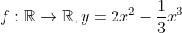

该函数把输入值 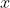映射为输出值 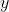，或把输入序列 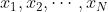映射为输出序列 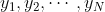。下面的 Python 代码把该数学函数实现为 Python 函数，并生成一组输入与输出。图 1-2 绘制了输出随输入的变化关系。

```
In [18]: def f(x):
             return 2 * x ** 2 - x ** 3 / 3  ➊
In [19]: x = np.linspace(-2, 4, 25)  ➋
         x  ➋
Out[19]: array([-2.  , -1.75, -1.5 , -1.25, -1.  , -0.75, -0.5 , -0.25,  0.  ,
                 0.25,  0.5 ,  0.75,  1.  ,  1.25,  1.5 ,  1.75,  2.  ,  2.25,
                 2.5 ,  2.75,  3.  ,  3.25,  3.5 ,  3.75,  4.  ])

In [20]: y = f(x)  ➌
         y  ➌
Out[20]: array([10.6667,  7.9115,  5.625 ,  3.776 ,  2.3333,  1.2656,  0.5417,
                 0.1302,  0.    ,  0.1198,  0.4583,  0.9844,  1.6667,  2.474 ,
                 3.375 ,  4.3385,  5.3333,  6.3281,  7.2917,  8.1927,  9.    ,
                 9.6823, 10.2083, 10.5469, 10.6667])

In [21]: plt.figure(figsize=(10, 6))
         plt.plot(x, y, 'ro');
```

➊ 数学函数的 Python 表达形式。

➋ 输入值。

➌ 输出值。

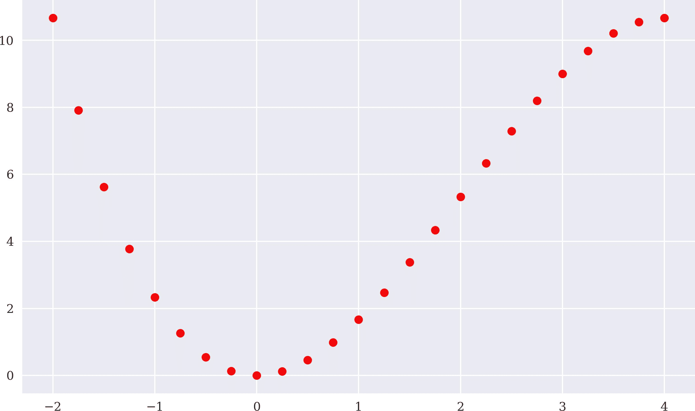

**图 1-2：输出值与输入值的关系图**

函数写法和统计写法的视角是反过来的

在纯数学的写法里，习惯先写函数，再写输入，最后写输出。可到了**统计学习**，顺序就被调换了。假设我们手头已经有了一组输入值  和对应的输出值 ，这就是**样本**。**统计回归**要做的是，反过来从这些样本中去找一个函数，让它尽可能贴近输入值，也就是**自变量**，与输出值，也就是**因变量**，之间真实的映射关系。

先用最简单的 `OLS` 线性回归来说明。假定自变量和因变量之间是线性关系，任务就是给下面的线性式子求出一组最优的系数 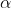 与 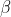： 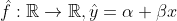

在给定的输入值  与输出值  条件下，让真实输出和模型输出之间的 `MSE` 达到最小，这就是最优解对应的目标： 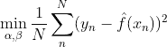

对一元线性回归，最优参数 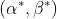 存在闭式解，下面公式里的横线表示样本均值： 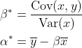

```
In [22]: beta = np.cov(x, y, ddof=0)[0, 1] / np.var(x)  ➊
         beta  ➊
Out[22]: 1.0541666666666667

In [23]: alpha = y.mean() - beta * x.mean()  ➋
         alpha  ➋
Out[23]: 3.8625000000000003

In [24]: y_ = alpha + beta * x  ➌

In [25]: MSE = ((y - y_) ** 2).mean()  ➍
         MSE ➍
Out[25]: 10.721953125

In [26]: plt.figure(figsize=(10, 6))
         plt.plot(x, y, 'ro', label='sample data')
         plt.plot(x, y_, lw=3.0, label='linear regression')
         plt.legend();
```
下面的 Python 实验正是用线性近似来求这组最优参数，并在图上画出拟合直线，如图 1-3 所示。结果的 `MSE` 偏大，说明单纯的线性模型对这组关系的捕捉能力有限。

➊ 计算  的最优解。
➋ 计算  的最优解。
➌ 计算预测输出。
➍ 用预测输出算出 `MSE`。
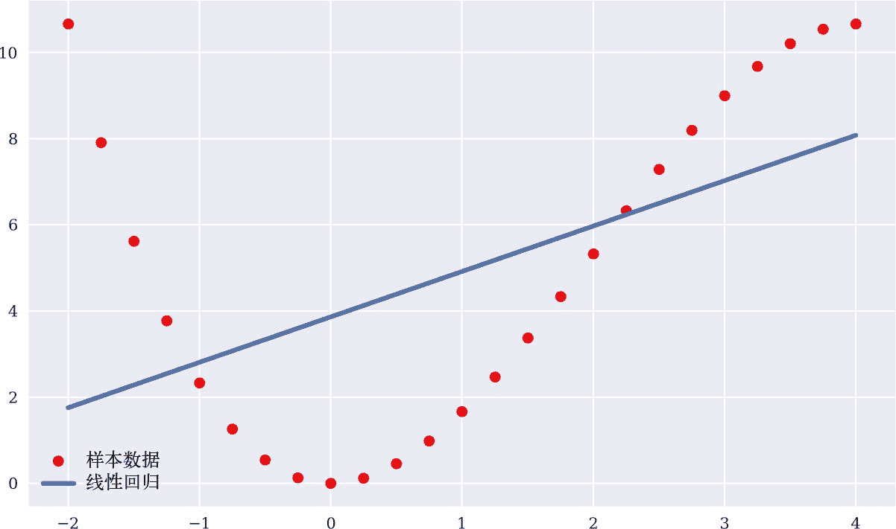

**图 1-3：样本数据和线性回归线**3

3 为了便于读者理解，本书大部分图片中的英文翻译成了中文。——译者注

MSE 能否降下来，甚至降到 0 做到完美拟合？`OLS` 并不是只能做直线。除了常数项和一次项，高次项完全可以作为基函数加入。把图 1-4 的结果和对应代码对照就能看到效果：引入二次项和三次项后拟合明显变好，数值上的 `MSE` 也同步下降。只要基函数不超过三次，`OLS` 就能把函数关系完美还原，误差收敛到零。

```
In [27]: plt.figure(figsize=(10, 6))
         plt.plot(x, y, 'ro', label='sample data')
         for deg in [1, 2, 3]:
             reg = np.polyfit(x, y, deg=deg)  ➊
             y_ = np.polyval(reg, x)  ➋
             MSE = ((y - y_) ** 2).mean()  ➌
             print(f'deg={deg} | MSE={MSE:.5f}')
             plt.plot(x, np.polyval(reg, x), label=f'deg={deg}')
             plt.legend();
         deg=1 | MSE=10.72195
         deg=2 | MSE=2.31258
         deg=3 | MSE=0.00000

In [28]: reg  ➍
Out[28]: array([-0.3333,  2.    ,  0.    , -0.    ])
```

➊ 回归训练。
➋ 回归预测。
➌ 计算 `MSE`。
➍ 最优参数值。
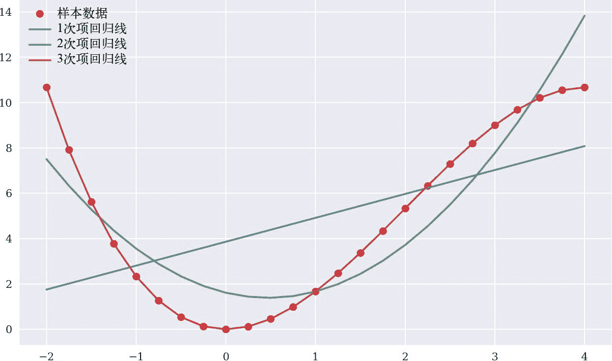

**图 1-4：样本数据和 OLS 回归线**

利用我们对目标函数形式的先验知识，不断扩充基函数，`OLS` 就能实现“完美逼近”，并且精确找回原始函数里二次项和三次项的系数。

### 1.2.2 神经网络估计
并非所有关系都是线性或高阶线性，这时就需要神经网络等方法。神经网络的优势在于，不需要事先知道函数长什么样，也能对各种复杂关系进行近似。

1. `scikit-learn`

下面代码调用 `scikit-learn` 中的 `MLPRegressor` 来做 `DNN` 回归，`DNN` 也常被称为多层感知器 `MLP`。4 图 1-5 的 `MSE` 并不是零，但以一个简单配置来看，效果已经相当不错。

```
    In [29]: from sklearn.neural_network import MLPRegressor
    
    In [30]: model = MLPRegressor(hidden_layer_sizes=3 * [256],
                                  learning_rate_init=0.03,
                                  max_iter=5000)  ➊
    
    In [31]: model.fit(x.reshape(-1, 1), y)  ➋
    Out[31]: MLPRegressor(hidden_layer_sizes=[256, 256, 256], learning_rate_init=0.03,
                          max_iter=5000)
    
    In [32]: y_ = model.predict(x.reshape(-1, 1))  ➌
    
    In [33]: MSE = ((y - y_) ** 2).mean()
             MSE
    Out[33]: 0.021662355744355866
    
    In [34]: plt.figure(figsize=(10, 6))
             plt.plot(x, y, 'ro', label='sample data')
             plt.plot(x, y_, lw=3.0, label='dnn estimation')
             plt.legend();
    ```

➊ 实例化 `MLPRegressor` 对象。
➋ 拟合或学习步骤。
➌ 预测步骤。
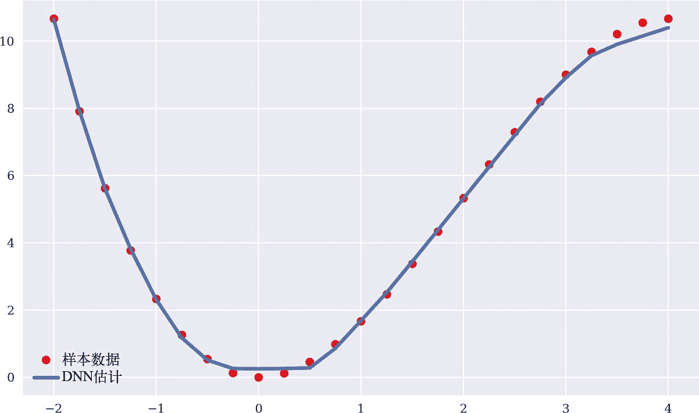

**图 1-5：样本数据和基于神经网络的估计**

仅凭图 1-4 和图 1-5 很难看出明显差距，但本质不同。`OLS` 回归是确定性计算，给定数值和参数直接算出结果；而神经网络依赖有一定随机性的**增量学习**。网络先随机初始化权重，然后根据预测值与真实样本值的偏差逐步调整参数，这样就能以增量的方式不断重训更新网络。

2. `Keras`

接下来的例子用 `Keras` 的序列模型 `Sequential`。5 模型每轮训练迭代 100 次，共重复 5 轮。每一轮结束后都会更新并绘制网络的预测曲线。图 1-6 可以看到，随着训练轮次增加，近似精度提升，`MSE` 持续下降。最终结果虽不完美，但考虑到模型简单，表现仍然可观。

```
In [35]: import tensorflow as tf
         tf.random.set_seed(100)

In [36]: from keras.layers import Dense
         from keras.models import Sequential
         Using TensorFlow backend.

In [37]: model = Sequential()  ➊
         model.add(Dense(256, activation='relu', input_dim=1))  ➋
         model.add(Dense(1, activation='linear'))  ➌
         model.compile(loss='mse', optimizer='rmsprop')  ➍

In [38]: ((y - y_) ** 2).mean()
Out[38]: 0.021662355744355866

In [39]: plt.figure(figsize=(10, 6))
         plt.plot(x, y, 'ro', label='sample data')
         for _ in range(1, 6):
         model.fit(x, y, epochs=100, verbose=False)  ➎
         y_ =  model.predict(x)  ➏
         MSE = ((y - y_.flatten()) ** 2).mean()  ➐
         print(f'round={_} | MSE={MSE:.5f}')
         plt.plot(x, y_, '--', label=f'round={_}')  ➑
     plt.legend();
     round=1 | MSE=3.09714
     round=2 | MSE=0.75603
     round=3 | MSE=0.22814
     round=4 | MSE=0.11861
     round=5 | MSE=0.09029
```

➊ 实例化 `Sequential` 模型对象。
➋ 添加采用整流线性单元 `ReLU` 激活的全连接层作为隐藏层。
➌ 添加 `linear` 激活的输出层。
➍ 编译模型对象。
➎ 迭代训练神经网络指定次数。
➏ 预测近似值。
➐ 计算当前的 `MSE`。
➑ 绘制当前的近似结果。
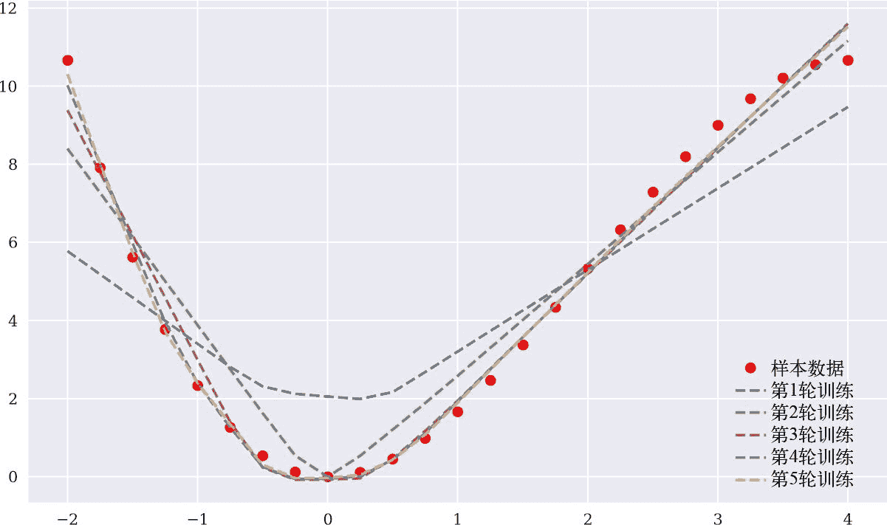

**图 1-6：样本数据和多轮训练后得到的估计值**

粗看两者估计能力相近，神经网络为何仍有价值？换一个场景就能看出差别。

假设数据不是由预设数学函数生成，而是随机产生的特征与标签，仅作演示用。

代码生成随机样本并用不同次数的多项式 `OLS` 去拟合。图 1-7 显示，即便是最高次的多项式，拟合效果依然很差，`MSE` 保持在较高水平。

```
In [40]: np.random.seed(0)
         x = np.linspace(-1, 1)
         y = np.random.random(len(x)) * 2 - 1

In [41]: plt.figure(figsize=(10, 6))
         plt.plot(x, y, 'ro', label='sample data')
         for deg in [1, 5, 9, 11, 13, 15]:
             reg = np.polyfit(x, y, deg=deg)
             y_ = np.polyval(reg, x)
             MSE = ((y - y_) ** 2).mean()
             print(f'deg={deg:2d} | MSE={MSE:.5f}')
             plt.plot(x, np.polyval(reg, x), label=f'deg={deg}')
         plt.legend();
         deg= 1 | MSE=0.28153
         deg= 5 | MSE=0.27331
         deg= 9 | MSE=0.25442
         deg=11 | MSE=0.23458
         deg=13 | MSE=0.22989
         deg=15 | MSE=0.21672
```

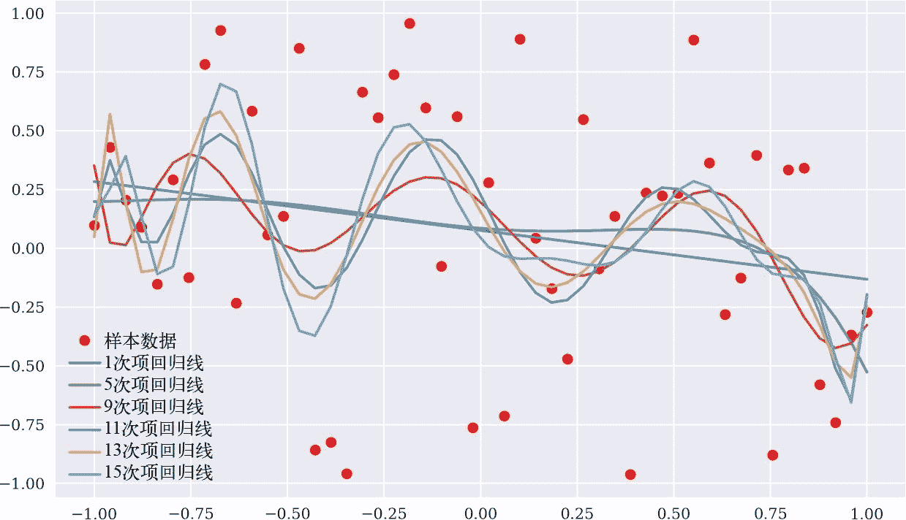

**图 1-7：随机样本数据和 OLS 回归线**

`OLS` 要求目标函数能用有限个多项式基函数的组合来逼近，而随机生成的数据并不满足这一前提，所以效果不佳。

神经网络的表现如何？使用方式与前面一样简单，结果见图 1-8。

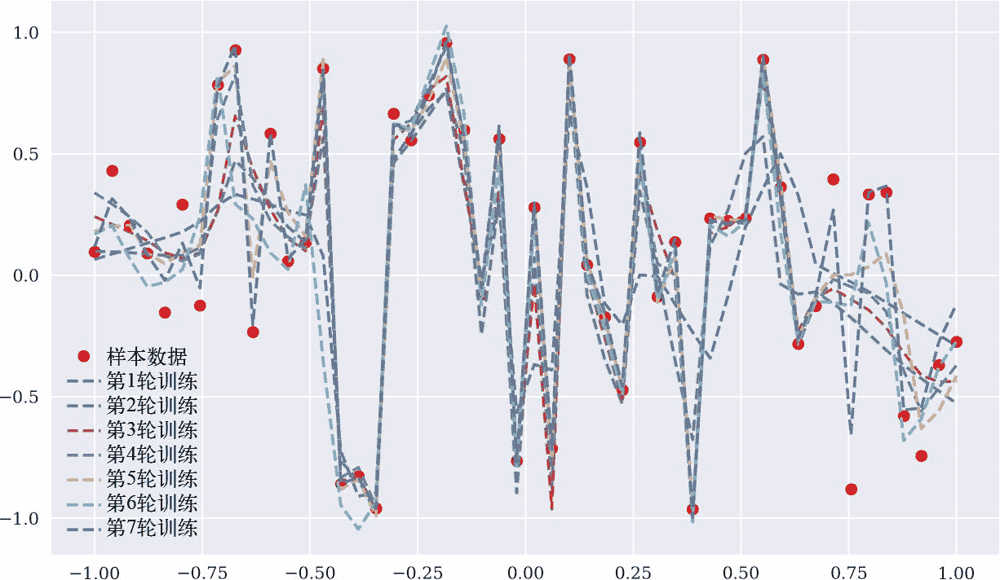

**图 1-8：随机样本数据和神经网络估计**

预测并非完美，但对随机特征估计随机标签的任务，神经网络明显优于 `OLS`。原因在于架构的灵活性：这里的网络拥有近 200 000 个可训练权重，远高于 `OLS` 回归最多 15+1 个参数的规模。

```
In [42]: model = Sequential()
         model.add(Dense(256, activation='relu', input_dim=1))
         for _ in range(3):
             model.add(Dense(256, activation='relu'))  ➊
         model.add(Dense(1, activation='linear'))
         model.compile(loss='mse', optimizer='rmsprop')

In [43]: model.summary()  ➋
         Model: "sequential_2"
         _________________________________________________________________
         Layer (type)                  Output Shape             Param #
         =================================================================
         dense_3 (Dense)               (None, 256)              512
         _________________________________________________________________
         dense_4 (Dense)               (None, 256)              65792
         _________________________________________________________________
         dense_5 (Dense)               (None, 256)              65792
         _________________________________________________________________
         dense_6 (Dense)               (None, 256)              65792
         _________________________________________________________________
         dense_7 (Dense)               (None, 1)                 257
         =================================================================
         Total params: 198,145
         Trainable params: 198,145
         Non-trainable params: 0
         _________________________________________________________________

In [44]: %%time
         plt.figure(figsize=(10, 6))
         plt.plot(x, y, 'ro', label='sample data')
         for _ in range(1, 8):
             model.fit(x, y, epochs=500, verbose=False)
             y_ =  model.predict(x)
             MSE = ((y - y_.flatten()) ** 2).mean()
             print(f'round={_} | MSE={MSE:.5f}')
             plt.plot(x, y_, '--', label=f'round={_}')
         plt.legend();
         round=1 | MSE=0.13560
         round=2 | MSE=0.08337
         round=3 | MSE=0.06281
         round=4 | MSE=0.04419
         round=5 | MSE=0.03329
         round=6 | MSE=0.07676
         round=7 | MSE=0.00431
         CPU times: user 30.4 s, sys: 4.7 s, total: 35.1 s
         Wall time: 13.6 s
```

➊ 添加多个隐藏层。

➋ 显示神经网络架构以及可训练参数的数量。

4 有关详细信息，请参阅 `sklearn.neural_network.MLPRegressor`。如需了解更多背景信息，请参阅 Goodfellow 等（2016）的第 6 章。

5 有关详细信息，请参阅 Chollet（2017）的第 3 章。

### 1.2.3　分类实战示例

Neural Network 在分类场景里的上手门槛也很低。以下给出一段基于 Keras 的演示，输入特征与标签均为二值且随机生成。与回归设定相比，唯一的核心差异是把输出层的激活由 linear 改为 sigmoid，具体机制后面会详细展开。整体表现虽非完美，但正确率已相当不错。图 1-9 呈现了正确率即预测对数占全部标签的比例随训练轮次的演变走势，初始阶段偏低，随后逐步抬升，但提升并非每一步都稳定。

```
In [45]: f = 5
         n = 10

In [46]: np.random.seed(100)

In [47]: x = np.random.randint(0, 2, (n, f))  ➊
         x  ➊
Out[47]: array([[0, 0, 1, 1, 1],
                [1, 0, 0, 0, 0],
                [0, 1, 0, 0, 0],
                [0, 1, 0, 0, 1],
                [0, 1, 0, 0, 0],
                [1, 1, 1, 0, 0],
                [1, 0, 0, 1, 1],
                [1, 1, 1, 0, 0],
                [1, 1, 1, 1, 1],
                [1, 1, 1, 0, 1]])

In [48]: y = np.random.randint(0, 2, n)  ➋
         y  ➋
Out[48]: array([1, 1, 0, 0, 1, 1, 0, 1, 0, 1])

In [49]: model = Sequential()
         model.add(Dense(256, activation='relu', input_dim=f))
         model.add(Dense(1, activation='sigmoid'))  ➌
         model.compile(loss='binary_crossentropy', optimizer='rmsprop',
                      metrics=['acc'])  ➍

In [50]: model.fit(x, y, epochs=50, verbose=False)
Out[50]: <keras.callbacks.callbacks.History at 0x7fde09dd1cd0>

In [51]: y_ = np.where(model.predict(x).flatten() > 0.5, 1, 0)
         y_
Out[51]: array([1, 1, 0, 0, 0, 1, 0, 1, 0, 1], dtype=int32)

In [52]: y == y_  ➎
Out[52]: array([ True,  True,  True,  True, False,  True,  True,  True,  True,
                 True])

In [53]: res = pd.DataFrame(model.history.history)  ➏

In [54]: res.plot(figsize=(10, 6));  ➏
```

➊ 创建随机特征数据。

➋ 创建随机标签数据。

➌ 定义输出层的激活函数为 `sigmoid`。

➍ 定义损失函数为 `binary_crossentropy`。

6**损失函数**用于度量模型预测偏离真实值的程度。**binary crossentropy**是二分类任务常用的误差度量，而 MSE 更偏向数值估计场景。

➎ 将预测值与标签数据进行比较。

➏ 绘制每轮训练的损失函数和准确率值。

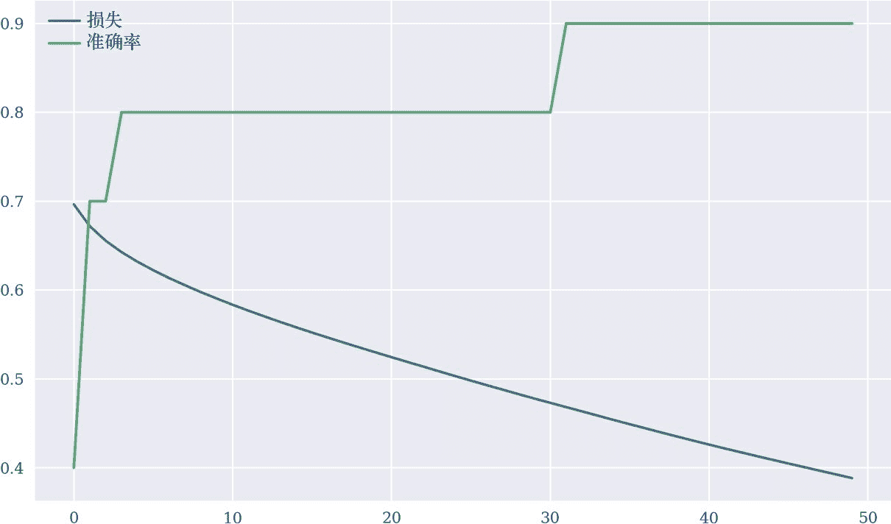

**图 1-9：正确率与损失随迭代的变化**

本小节的演示与最小二乘回归形成对比，凸显了该类模型的一些典型特性。

**问题无关性**

在特征空间固定时，模型的表现并不依赖于具体要估计或判别的标签含义。相比之下，传统统计手段如最小二乘，在少数问题上可能很有效，却在其他场景下迅速失效甚至完全不起作用。

**增量学习**

在明确的评价目标下，最优参数从随机初始化出发，通过持续的微调逐步收敛。每次微调都基于预测结果与样本标签的差距，并借由梯度回传完成参数更新。

**通用函数逼近器**

严格的数学结论表明，即便仅含一个隐层，这类架构也能逼近几乎任意函数。7

7 参阅 Kratsios（2019）。

> 　**神经网络**
>
> 神经网络擅长学习输入数据和输出数据之间的关系。它们可以应用于许多问题类型，比如在存在复杂关系的情况下进行估计，或者用于传统的统计方法并不适合的分类问题。

## 1.3　数据决定表现

上一部分展示了模型在分类任务上的可行性。单隐层结构在训练集内部可取得很高正确率，实际泛化能力如何，则高度依赖可用于训练的数据规模与多样性。下面通过一个更大规模的数值案例来说明这一点。

### 1.3.1　样本受限情形

下面考察一个与先前随机分类案例类似但维度更高、观测更多的情形。AI 领域的主流方法本质是**模式识别**。代码中二值特征的个数决定了理论上可出现的模式总数。由于标签同样是二值的，模型实质在学习：给定某一特定模式，例如 `[0, 0, 1, 1, 1, 1, 0, 0, 0, 0]`，输出 0 与输出 1 哪个更可能。因为特征与标签都是均匀随机产生，可挖掘的信息几乎为零，0 与 1 在任意模式下的出现概率相同。于是随便猜测的基准策略约有 50% 的命中率。

```
In [55]: f = 10
         n = 250

In [56]: np.random.seed(100)

In [57]: x = np.random.randint(0, 2, (n, f))  ➊
         x[:4]  ➊
Out[57]: array([[0, 0, 1, 1, 1, 1, 0, 0, 0, 0],
                [0, 1, 0, 0, 0, 0, 1, 0, 0, 1],
                [0, 1, 0, 0, 0, 1, 1, 1, 0, 0],
                [1, 0, 0, 1, 1, 1, 1, 1, 0, 0]])

In [58]: y = np.random.randint(0, 2, n)  ➋
         y[:4]  ➋
Out[58]: array([0, 1, 0, 0])

In [59]: 2 ** f  ➌
Out[59]: 1024
```

➊ 特征数据。

➋ 标签数据。

➌ 模式数量。

为便于后续处理，原始数据被整理进一个 pandas.DataFrame。

```
In [60]: fcols = [f'f{_}' for _ in range(f)]  ➊
         fcols  ➊
Out[60]: ['f0', 'f1', 'f2', 'f3', 'f4', 'f5', 'f6', 'f7', 'f8', 'f9']

In [61]: data = pd.DataFrame(x, columns=fcols)  ➋
         data['l'] = y ➌

In [62]: data.info()  ➍
         <class 'pandas.core.frame.DataFrame'>
         RangeIndex: 250 entries, 0 to 249
         Data columns (total 11 columns):
          #   Column  Non-Null Count  Dtype
         ---  ------  --------------  -----
          0   f0      250 non-null    int64
          1   f1      250 non-null    int64
          2   f2      250 non-null    int64
          3   f3      250 non-null    int64
          4   f4      250 non-null    int64
          5   f5      250 non-null    int64
          6   f6      250 non-null    int64
          7   f7      250 non-null    int64
          8   f8      250 non-null    int64
          9   f9      250 non-null    int64
          10  l       250 non-null    int64
         dtypes: int64(11)
         memory usage: 21.6 KB
```

➊ 定义特征数据的列名。

➋ 将特征数据放入 `DataFrame` 对象中。

➌ 将标签数据放入同一个 `DataFrame` 对象中。

➍ 显示数据集的元信息。

执行下方代码后可明显看出两大瓶颈：一是样本中出现的模式只是全部可能性的子集；二是即便出现的模式，其样本量也相当稀少。由此可直观看出，任何分类器都难以对全部模式形成可靠认知。

```
In [63]: grouped = data.groupby(list(data.columns))  ➊

In [64]: freq = grouped['l'].size().unstack(fill_value=0)  ➋

In [65]: freq['sum'] = freq[0] + freq[1]  ➌

In [66]: freq.head(10)  ➍
Out[66]: l                              0  1  sum
         f0 f1 f2 f3 f4 f5 f6 f7 f8 f9
         0  0  0  0  0  0  0  1  1  1   0  1    1
                           1  0  1  0   1  1    2
                                    1   0  1    1
                        1  0  0  0  0   1  0    1
                                    1   0  1    1
                              1  1  1   0  1    1
                           1  0  0  0   0  1    1
                                 1  0   0  1    1
                     1  0  0  0  1  1   1  0    1
                           1  1  0  0   1  0    1

In [67]: freq['sum'].describe().astype(int)  ➎
Out[67]: count    227
         mean       1
         std        0
         min        1
         25%        1
         50%        1
         75%        1
         max        2
         Name: sum, dtype: int64
```

➊ 按列对数据进行分组。

➋ 取消标签列分组数据的折叠。

➌ 将 `0` 和 `1` 的频率相加。

➍ 显示给定特定模式的 `0` 和 `1` 的频率。

➎ 提供频率总和的统计信息。

下面这段示例调用了 `scikit-learn` 提供的 `MLPClassifier`，并在全部观测上完成拟合。这样的模型能够在多大程度上捕捉所给数据内部的关联？从训练集上的准确率来看，拟合效果几乎完美，逼近百分之百。这一现象主要归因于样本规模有限以及模型参数丰富这两方面因素。

8 有关详细信息，请参阅 `sklearn.neural_network.MLPClassifier`。

```
In [68]: from sklearn.neural_network import MLPClassifier
         from sklearn.metrics import accuracy_score

In [69]: model = MLPClassifier(hidden_layer_sizes=[128, 128, 128],
                               max_iter=1000, random_state=100)

In [70]: model.fit(data[fcols], data['l'])
Out[70]: MLPClassifier(hidden_layer_sizes=[128, 128, 128], max_iter=1000,
                       random_state=100)

In [71]: accuracy_score(data['l'], model.predict(data[fcols]))
Out[71]: 0.952
```

那套已拟合的模型在未见数据上的泛化表现又怎样？做法是把原始集合划分为训练部分与检验部分，仅用前者进行学习，再用后者评估推广效果。如同之前观察到的现象，模型在训练部分内部的正确率依然极高，可一旦放到检验集上，就比基准方法低了十个百分点以上。

```
In [72]: split = int(len(data) * 0.7)  ➊

In [73]: train = data[:split]  ➊
         test = data[split:]  ➊

In [74]: model.fit(train[fcols], train['l'])  ➋
Out[74]: MLPClassifier(hidden_layer_sizes=[128, 128, 128], max_iter=1000,
                       random_state=100)

In [75]: accuracy_score(train['l'], model.predict(train[fcols]))  ➌
Out[75]: 0.9714285714285714

In [76]: accuracy_score(test['l'], model.predict(test[fcols]))  ➍
Out[76]: 0.38666666666666666
```

➊ 把整体数据划分为学习集与评估集。
➋ 只利用学习集完成参数拟合。
➌ 输出在学习集内部的正确率。
➍ 输出在评估集外部的正确率。

概括而言，规模偏小的训练集容易让模型记下噪声关联，并非个别现象。对训练集内部拟合而言，这类偏差影响有限，甚至样本越少拟合越“漂亮”。但在面对新样本时，上述缺陷就会导致预测失准。

### 1.3.2　更大的数据集

好在这种情况通常有解法，那就是扩充数据量。面对真实任务，理论上可以搜集更多观测，实践中却常受成本与可得性限制。本例里，我们可以用程序快速放大样本规模。

下一段 Python 代码把初始样本数大幅提升。实验显示，模型的检验集正确率上升超过十个百分点，稳定在约五十 percent 左右，这与标签的生成规则相符，也与常规基准相当。

```
In [77]: factor = 50

In [78]: big = pd.DataFrame(np.random.randint(0, 2, (factor * n, f)),
                            columns=fcols)

In [79]: big['l'] = np.random.randint(0, 2, factor * n)

In [80]: train = big[:split]
         test = big[split:]

In [81]: model.fit(train[fcols], train['l'])
Out[81]: MLPClassifier(hidden_layer_sizes=[128, 128, 128], max_iter=1000,
                       random_state=100)

In [82]: accuracy_score(train['l'], model.predict(train[fcols]))  ➊
Out[82]: 0.9657142857142857

In [83]: accuracy_score(test['l'], model.predict(test[fcols]))  ➋
Out[83]: 0.5043407707910751
```

➊ 学习集内部的正确率。
➋ 评估集外部的正确率。

后续代码帮助解释正确率提升的原因。其一，样本充足后，理论上存在的所有组合都会出现。其二，每种组合的出现次数均值超过十次。换句话说，模型对每种可能模式都能多次观察、多次学习。于是它逐渐捕捉到，对任意模式而言，标签 0 与 1 的出现概率基本相当。学习路径虽显复杂，但很好地说明：在此类模型设定下，样本规模偏小往往不足。

```
In [84]: grouped = big.groupby(list(data.columns))

In [85]: freq = grouped['l'].size().unstack(fill_value=0)

In [86]: freq['sum'] = freq[0] + freq[1]  ➊
In [87]: freq.head(6)
Out[87]: l                              0  1  sum
         f0 f1 f2 f3 f4 f5 f6 f7 f8 f9
         0  0  0  0  0  0  0  0  0  0  10  9   19
                                    1   5  4    9
                                 1  0   2  5    7
                                    1   6  6   12
                              1  0  0   9  8   17
                                    1   7  4   11

In [88]: freq['sum'].describe().astype(int)  ➋
Out[88]: count    1024
         mean       12
         std         3
         min         2
         25%        10
         50%        12
         75%        15
         max        26
         Name: sum, dtype: int64
```

➊ 把 0 与 1 的频次合并。
➋ 输出合并后的汇总结果。

> 　**数据量和多样性**
>
> 在以此类模型进行预测时，训练用数据的规模与多样性直接决定效果。本节的简化演示显示，用小而单一的集合训练的模型，比用大而多样的数据训练的同类模型差出十个百分点以上。考虑到行业常为零点零几的提升投入资源，十个点的差距已属显著。

### 1.3.3　大数据

大规模数据与大数据有何不同？过去十多年里，“大数据”含义不断演变。本书把**大数据**定义为在规模、类型和时效上足够充裕的数据集合，能够让人工智能方法在预测任务上超越基准。

前面使用的数据集即便算大，在现实场景中仍属小规模，但足以演示目标。所需样本量与类别，主要取决于特征与标签的结构特性。

以零售银行的信用评分为例。数据团队基于内部记录构建了 25 个类别特征，每个特征可取 8 种取值，组合数呈指数级增长。

```
In [89]: 8 ** 25
Out[89]: 37778931862957161709568
```

显然，不可能存在能覆盖全部组合的数据集。9 好在实际中，模型也不必对常规客户、违约客户和被拒客户分别建立完整画像，通常也不要求对每个潜在借款人给出“完美”判断。

原因多样。首先，有效特征空间受限，很多理论组合现实中不会出现。其次，特征重要性不同，可据此压缩有效维度。最后，存在冗余，例如特征 `7` 取值 `4` 与 `5` 时实际影响相同，进一步降低组合复杂度。

9 即使有这样的数据集，当前计算技术也不足以在此类数据上对模型进行建模和训练。基于此背景，第 2 章会讨论硬件对人工智能的重要性。

## 1.4　结论

本书记载的人工智能，指从数据中挖掘关联、规律与概率的一系列方法与算法。重点放在监督学习，尤其是回归与分类任务，核心技术是深度学习模型。

全书主线是把深度学习用于金融的核心难题——预测未来市场走向。具体可表现为预测股指或货币对的涨跌方向，这类方向判断天然适合转化为分类任务。

进入核心议题前，第 2 章先讨论超级智能与技术奇点，为后续聚焦金融应用提供背景。

## 第 2 章　超级智能

> 有多条路径可以通向超级智能，这一事实应当增强我们对于最终实现超级智能的自信心，如果其中某一条路径最终被证明不可行，那么我们仍可以通过其他路径继续前行（正所谓“条条大路通罗马”）。
>
> ——Nick Bostrom，2014 年

**技术奇点**的定义并不统一。可追溯到 Vinge 1993 年的文章，开篇写道：

> 三十年以内，我们所拥有的技术手段将能实现足以超越人类的智能。而在那之后不久，人类的时代就将结束。

对本章而言，**技术奇点**指机器在某一时刻取得超越人类智能的能力，即 Vinge 所说的超级智能 super intelligence，SI。随着 Kurzweil 2005 著作的传播，这一概念更受关注。Barrat 2013 提供了历史轶事，Shanahan 2015 给出通俗概览。**技术奇点**一词借自物理学，指黑洞中心质量极度集中、引力趋近无穷、常规物理失效的区域。宇宙大爆炸也被视作奇点。

这些关于技术奇点与超级智能的宽泛论述，看似与金融中应用的人工智能并无直接联系，但了解背景、相关问题及其潜在后果很有帮助。一般框架下的洞见对细分领域至关重要，也为我们讨论人工智能如何近期与长期重塑金融业指明方向。

2.1 节介绍了人工智能近期的成功案例，包括 DeepMind 如何运用神经网络玩雅达利 2600 游戏，以及如何以高于人类专家的水平下围棋，国际象棋与计算机程序的故事也会被重提。2.2 节讨论硬件在这些成功案例中的作用。2.3 节梳理狭义人工智能 artificial narrow intelligence，ANI、通用人工智能 artificial general intelligence，AGI 以及超级智能。2.4 节介绍实现超级智能的可能路径，如全脑模拟 Whole Brain Emulation，WBE。2.5 节讲述研究者如何看待智能爆炸问题。2.6 节讨论超级智能情境下的控制问题。最后，2.7 节简述技术落地后的可能图景和世界变化。

## 2.1　成功故事

人工智能的许多想法和算法可追溯至数十年前，该领域几十年来一直伴随希望与失望交织。Bostrom 2014 第 1 章对这一时期做了回顾。

2020 年时，可以确定人工智能正处在充满希望的阶段。其中一个原因是，几年前被认为未来数十年难以由人工智能解决的问题，近几年已取得突破性进展。这类成功案例众多且仍在增长。本节仅聚焦其中 3 个。Gerrish 2018 提供更长篇幅、更细致的专栏。

### 2.1.1　雅达利

本节先讲述 DeepMind 如何利用强化学习与神经网络玩雅达利 2600 游戏，随后通过具体代码示例展示其成功的基本方法。

#### 故事

第一个成功故事是以超出人类水平的表现玩雅达利 2600 游戏。该主机上市于 1977 年，是 20 世纪 80 年代广受欢迎的主机之一。当年大热的游戏如《太空入侵者》《小行星》和《导弹指挥官》，至今仍是经典，复古爱好者仍在游玩。

DeepMind 公布了 Mnih 等人 2013 年合著的论文，详细说明了通过强化学习让算法玩雅达利 2600 游戏的结果。该算法是应用在卷积神经网络上的 Q 学习变体。1 它仅在高维视觉输入即原始像素上训练，没有人工引导或人工标注数据。项目最初聚焦 7 款雅达利 2600 游戏，团队报告称人工智能在其中的 3 款——《乒乓》《山地自行车耐力赛》和《打砖块》上表现超出人类专家。

从人工智能角度看，DeepMind 的方法比结果更受称道。首先，团队仅用一个神经网络学习并游玩全部 7 款游戏。其次，人类未提供指导或标注数据，学习完全依赖基于视觉输入的互动式学习过程所转化的特征数据。2 最后，实现方式是通过强化学习，仅依靠对行动与结果奖励之间关系的观察，这基本等同于人类玩家玩游戏的方式。

在雅达利 2600 游戏中，《打砖块》是人工智能表现超出人类的一款。目标是用屏幕底部挡板反弹小球以摧毁屏幕顶端线状排列的砖块。小球撞到砖块时砖块被摧毁，小球被反弹；小球也会从左右、上部墙壁反弹。一旦小球触及底部未被挡板反弹，玩家就会失去一条生命。

强化学习的动作空间有 3 种元素，均与挡板相关：保持原位、向左移动、向右移动。状态空间由多帧 128 色调色板的 210 像素×160 像素游戏屏幕组成。游戏分数代表奖励，DeepMind 算法被编程为最大化该奖励。基于学习中优化的行动策略，算法学会在给定游戏状态下选择最优行动，即如何最大化游戏分数总奖励。

#### 示例

本章篇幅不足以详细探讨 DeepMind 对《打砖块》及其他游戏的方法。但我们可以通过 OpenAI Gym 环境演示在类似但更简单的游戏中如何使用类似但更简单的神经网络。

本节的 Python 代码适用于 OpenAI Gym 的 `CartPole` 环境。3 在此环境中，需要将推车向右或向左移动以保持推车上直立杆的平衡，因此动作空间类似于《打砖块》。状态空间由 4 个物理量组成：小车位置、小车速度、杆子角度和杆子角速度。图 2-1 展示其示意。若行动后杆子仍保持平衡，智能体获得 1 的奖励。若杆子失去平衡，游戏结束。若智能体达到 200 的总奖励，则视为成功。4

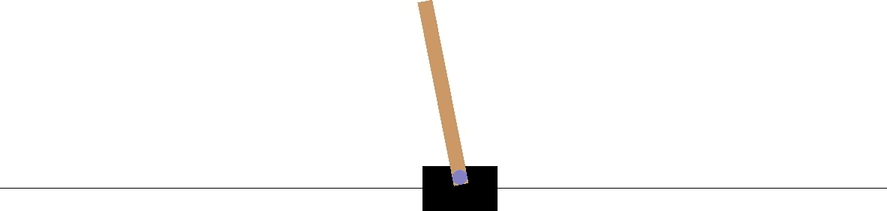

**图 2-1：`CartPole` 环境的图形表示**

下面脚本先实例化一个 CartPole 环境对象，检查动作空间和状态空间，执行随机动作并记录结果。只要 `done` 变量值为 `False`，智能体就会进入下一轮。

```
In [1]: import gym
        import numpy as np
        import pandas as pd
        np.random.seed(100)

In [2]: env = gym.make('CartPole-v0')  ➊

In [3]: env.seed(100)  ➋
Out[3]: [100]

In [4]: action_size = env.action_space.n  ➌
        action_size  ➌
Out[4]: 2

In [5]: [env.action_space.sample() for _ in range(10)]  ➍
Out[5]: [1, 0, 0, 0, 1, 1, 0, 0, 0, 0]

In [6]: state_size = env.observation_space.shape[0]  ➎
        state_size  ➎
Out[6]: 4

In [7]: state = env.reset()  ➏
        state #  [cart position, cart velocity, pole angle, pole angular velocity]
Out[7]: array([-0.01628537, 0.02379786, -0.0391981 , -0.01476447])

In [8]: state, reward, done, _ = env.step(env.action_space.sample())  ➐
        state, reward, done, _  ➐
Out[8]: (array([-0.01580941, -0.17074066, -0.03949338, 0.26529786]), 1.0, False, {})
```

➊ 创建环境实例。
➋ 设定随机数种子以保证结果可复现。
➌ 输出可供选择的动作数量。
➍ 让智能体随机出招并保留行为记录。
➎ 打印状态特征的维度大小。
➏ 重启环境并读取初始状态信息。
➐ 执行一次随机操作，推动环境进入下一时刻。

随后以随机策略持续对弈来累积样本。为了提升样本质量，只保留累计奖励不低于110的对局，其余低分对局全部舍弃。通过数千局的运行，攒下了足够支撑神经网络训练的数据集。

```
In [9]: %%time
        data = pd.DataFrame()
        state = env.reset()
        length = []
        for run in range(25000):
            done = False
            prev_state = env.reset()
            treward = 1
            results = []
            while not done:
                action = env.action_space.sample()
                state, reward, done, _ = env.step(action)
                results.append({'s1': prev_state[0], 's2': prev_state[1],
                                's3': prev_state[2], 's4': prev_state[3],
                                'a': action, 'r': reward})
                treward += reward if not done else 0
                prev_state = state
            if treward >= 110:  ➊
                data = data.append(pd.DataFrame(results))  ➋
                length.append(treward)  ➌
        CPU times: user 9.84 s, sys: 48.7 ms, total: 9.89 s
        Wall time: 9.89 s

In [10]: np.array(length).mean()  ➍
Out[10]: 119.75

In [11]: data.info()  ➎
         <class 'pandas.core.frame.DataFrame'>
         Int64Index: 479 entries, 0 to 143
         Data columns (total 6 columns):
          #   Column  Non-Null Count  Dtype
         ---  ------  --------------  -----
          0   s1      479 non-null    float64
          1   s2      479 non-null    float64
          2   s3      479 non-null    float64
          3   s4      479 non-null    float64
          4   a       479 non-null    int64
          5   r       479 non-null    float64
         dtypes: float64(5), int64(1)
         memory usage: 26.2 KB

In [12]: data.tail()  ➎
Out[12]:           s1        s2        s3        s4 a   r
         139  0.639509  0.992699 -0.112029 -1.548863 0 1.0
         140  0.659363  0.799086 -0.143006 -1.293131 0 1.0
         141  0.675345  0.606042 -0.168869 -1.048421 0 1.0
         142  0.687466  0.413513 -0.189837 -0.813148 1 1.0
         143  0.695736  0.610658 -0.206100 -1.159030 0 1.0
```

➊ 当随机玩家的总得分达到100或以上时……
➋ ……才把该局的数据收录……
➌ ……同时将总分写入记录。
➍ 统计数据集中所有随机对局的平均总分。
➎ 在 `DataFrame` 中审视已收集的数据。

数据整理完毕即可开始建模。思路是监督分类：把环境状态作为输入特征，把实际采取的操作作为标签。训练集只包含在特定状态下被证明有效的动作，因此模型会学习到状态与对应动作的映射关系。

```
In [13]: from pylab import plt
         plt.style.use('seaborn')
         %matplotlib inline

In [14]: import tensorflow as tf
         tf.random.set_seed(100)

In [15]: from keras.layers import Dense
         from keras.models import Sequential
         Using TensorFlow backend.

In [16]: model = Sequential()  ➊
         model.add(Dense(64, activation='relu',
                         input_dim=env.observation_space.shape[0]))  ➊
         model.add(Dense(1, activation='sigmoid'))  ➊
         model.compile(loss='binary_crossentropy',
                       optimizer='adam',
                       metrics=['acc'])  ➊
In [17]: %%time
         model.fit(data[['s1', 's2', 's3', 's4']], data['a'],
                   epochs=25, verbose=False, validation_split=0.2)  ➋
         CPU times: user 1.02 s, sys: 166 ms, total: 1.18 s
         Wall time: 797 ms

Out[17]: <keras.callbacks.callbacks.History at 0x7ffa53685190>

In [18]: res = pd.DataFrame(model.history.history)  ➌
         res.tail(3)  ➌
Out[18]:     val_loss  val_acc      loss       acc
         22  0.660300  0.59375  0.646965  0.626632
         23  0.660828  0.59375  0.646794  0.621410
         24  0.659114  0.59375  0.645908  0.626632
```

➊ 选用仅含一层隐藏层的简洁网络。
➋ 用前面收集的样本对模型进行拟合。
➌ 展示收尾数轮训练的损失与准确率等指标。

训练完成的模型能够根据学到的状态-动作对应关系来操控 `CartPole`。在100局的测试中，智能体每局均拿到200分的上限。这一表现源于精简的数据集与结构简单的神经网络的配合。

```
In [20]: def epoch():
             done = False
             state = env.reset()
             treward = 1
             while not done:
                 action = np.where(model.predict(np.atleast_2d(state))[0][0] > \
                          0.5, 1, 0)  ➊
                 state, reward, done, _ = env.step(action)  ➋
                 treward += reward if not done else 0
             return treward

In [21]: res = np.array([epoch() for _ in range(100)])
         res  ➌
Out[21]: array([200., 200., 200., 200., 200., 200., 200., 200., 200., 200., 200.,
                200., 200., 200., 200., 200., 200., 200., 200., 200., 200., 200.,
                200., 200., 200., 200., 200., 200., 200., 200., 200., 200., 200.,
                200., 200., 200., 200., 200., 200., 200., 200., 200., 200., 200.,
                200., 200., 200., 200., 200., 200., 200., 200., 200., 200., 200.,
                200., 200., 200., 200., 200., 200., 200., 200., 200., 200., 200.,
                200., 200., 200., 200., 200., 200., 200., 200., 200., 200., 200.,
                200., 200., 200., 200., 200., 200., 200., 200., 200., 200., 200.,
                200., 200., 200., 200., 200., 200., 200., 200., 200., 200., 200.,
                200.])

In [22]: res.mean()  ➍
Out[22]: 200.0
```

➊ 挑选状态-动作配对作为训练样本。
➋ 依据模型预测的动作驱动环境演进。
➌ 反复对战并把每局的总得分记录下来。
➍ 求出全部对局得分的平均水平。

`Arcade` 学习环境在交互方式上与 `OpenAI Gym` 十分相近。它提供程序化的接口，让使用者可以与雅达利2600的模拟游戏互动、执行操作并获取结果反馈。若状态空间大幅扩大，例如学习《打砖块》，任务复杂度自然提升，但基本思路与本例一致，只是会伴随更多的算法改进。

1 有关详细信息，请参阅 Mnih 等（2013）。
2 除其他因素外，可用的 Arcade 学习环境（`ALE`）使这成为可能。
3 第 9 章更详细地回顾了这个例子。
4 更具体地说，如果人工智能体在连续 100 场比赛中达到 195 或更多的平均总奖励，则被认为是成功的。

### 2.1.2　围棋（Go）

围棋作为棋盘类游戏，已有两千多年历史。规则简洁却博大精深，长期被视为衡量人工智能能力的终极难题。实力以段位衡量，世界冠军李世石即为职业九段。2014年，Nick Bostrom 提出假说：人工智能围棋水平约以每年一段的速度提升，按此推算十年内或可击败人类世界冠军。

DeepMind 团队的 `AlphaGo` 改变了这一预期。Silver 等人在2016年的研究中指出，围棋因巨大的搜索空间和对局势的难以评估，长期被视为最具挑战性的游戏。团队将神经网络与蒙特卡洛树搜索结合。回顾2015年的早期尝试，介绍中提到 `AlphaGo` 对战其他围棋程序胜率达99.8%，并以5-0击败欧洲冠军樊麾。这是计算机首次在标准棋盘上战胜职业棋手，比学界此前认为至少需十年的预测提前了许多。

博斯特罗姆一年前的预测被大幅提前，但外界认为樊麾并非顶尖标杆。DeepMind 因此发起挑战，于2016年3月与18届世界冠军李世石进行五番棋，并将 `AlphaGo Fan` 升级为 `AlphaGo Lee`。赛事全球瞩目，DeepMind 网页写道：`AlphaGo` 于2016年3月在韩国首尔以4-1胜出，吸引超过2亿人观看，里程碑提前了十年，并获专业九段认证，成为首个获得该头衔的计算机围棋程序。

在此之前，`AlphaGo` 依赖数百万人类专家对局进行监督学习。后续的 `AlphaGo Zero` 彻底摒弃人工数据，仅靠强化学习与自我对弈训练。Silver 等人2017年的论文详细介绍了该版本。摘要中总结：`AlphaGo` 成了自己的导师，用神经网络预测自身走法与胜负，网络增强树搜索能力，从而在迭代中产出更高质量的对弈。从零开始的新程序 `AlphaGo Zero` 最终以100-0完胜之前击败李世石的版本。

值得注意的是，该神经网络的结构与前文 `CartPole` 示例中的网络并无本质差异，却能破解可能局面远超宇宙原子数的围棋，且完全不依赖人类数百年积累的棋理。

DeepMind 并未止步。`AlphaZero` 被设计为通用棋类智能体，能够在无先验知识下学习围棋、国际象棋和将棋等复杂游戏。Silver 在2017年的文章中对 `AlphaZero` 作了概括：

AlphaZero 把只依赖规则自学的思路推到了极致。起步于纯随机对局，完全不借助任何先验棋理，仅靠规则在 24 小时内，于国际象棋、将棋和围棋三项久经考验的博弈中都冲破了人类水准，并连克世界冠军级别的程序。

DeepMind 在 2017 年同样交出一份惊人成绩单：一个从零开始自行对弈训练的人工智能，训练时长不足一天，就在三项有数百年研究史的棋盘游戏中全面超越专家人类。

### 2.1.3 国际象棋

国际象棋是全球最受欢迎的棋类之一。电脑象棋的历史可以追溯到家用机时代。1983 年 ZX-81 系列机便搭载了名为 ZX Chess 的象棋引擎，整套机器码仅约 672 字节。虽然它缺少王车易位等完整规则，却已是当年一大壮举，甚至到今天仍让象棋爱好者着迷。ZX Chess 保持了 32 年最小象棋程序纪录，直到 2015 年被 BootChess 以 487 字节打破。该程序能处理的局面数远超宇宙中原子总数，能用如此精简代码实现象棋的程序员堪称工程天才。

从计算量看象棋不像围棋那样夸张，但因其对深谋远虑的要求，仍是公认最难的棋类之一，选手往往需数十年才能登顶大师。

20 世纪 80 年代中期，即便在比 ZX-81 更强的机器上，专家级象棋程序也遥不可及。当时的人类高手对战电脑时底气十足。卡斯帕洛夫回忆 1985 年 6 月 6 日汉堡的一天：

> 那天我同时下了 32 盘，全是与电脑的对局。结果毫无悬念，我以 32 比 0 全胜。

直到 IBM 的硬件团队与象棋开发者合力耗时 12 年，才造出“深蓝”。卡斯帕洛夫在输给深蓝 20 年后写道：

> 12 年后，我在纽约为职业生涯而战。我的对手只有一台机器，一台价值 1000 万美元的 IBM 超算，外号深蓝。

两人共下 6 盘，机器以 3.5 比 2.5 取胜。深蓝首战失利，随后两胜三和。有人指出深蓝并非典型人工智能，它依托庞大硬件集群粗暴搜索。专为赛事打造的系统由 30 个节点、480 枚象棋专用芯片构成，每秒可筛选约 2 亿个局面，靠的是蛮力而非神经网络。

1997 年后软硬件双双跃进。卡斯帕洛夫在书中提到 2017 年的现状：

> 如今你只要在手机上下个免费象棋 App，便能与任何人类大师一较高下。

击败大师的硬件成本从 1000 万美元跌到约 100 美元。但普通电脑与手机上的象棋程序，依然建立在数十年的象棋智慧之上：大量人工设计的规则与启发、人造开局库，再凭借现代设备的算力和内存，对数百万局面进行暴力评估。

AlphaZero 的出现打破了这一路径。它完全基于强化学习，让不同版本自相博弈。DeepMind 在论文《AlphaZero: Shedding new light on chess, shogi, and Go》中作对比：

> 传统象棋引擎，包括世界冠军级 Stockfish 与开创性的深蓝，都依赖人类高手手工编撰的数千条规则与启发，试图覆盖所有可能……AlphaZero 走另一条路，用深度神经网络与通用算法取代手工规则，除基本规则外对游戏一无所知。

从零学习的 AlphaZero 只需数小时自玩就能达到顶尖水准。最快 9 小时内，它就超越所有人类棋手与现有电脑程序，包括长期统治象棋界的 Stockfish。2016 年的 1000 局测试中，AlphaZero 战胜 Stockfish 155 局，仅负 6 局，其余平分，主要胜局来自执白。

深蓝每秒约 2 亿局，现代 Stockfish 在商用多核上约 6000 万局/秒，而 AlphaZero 仅约 6 万局/秒。分析量是 Stockfish 的千分之一，却仍能取胜。人们由此推断它展现出某种无法被纯蛮力替代的智能。人类大师每秒靠经验、模式与直觉也能评估数百局，AlphaZero 或许正处在人类式模式识别与远见和传统暴力搜索之间的最佳位置，并因适配硬件而更快。

## 2.2 硬件为王

过去十年，算法与强化学习结合神经网络在诸多领域大放异彩。但没有硬件进步，这些成果不可能实现。DeepMind 的围棋征程提供了一个清晰样本。表 2-1 汇总了 2015 年后 AlphaGo 各版本的硬件使用与功耗。可以看出，实力稳步攀升的同时，硬件需求与能耗大幅压缩。

# 硬件与智能形态

## 2.2 硬件演进

表 2-1 中 GPU 指图形处理单元，TPU 指张量处理单元，专门加速张量运算，是神经网络的基本单元。TDP 指热设计功率。

**表 2-1：DeepMind 用于 AlphaGo 的硬件**

| 版本 | 年 | Elo 评级 | 硬件 | 功耗 [TDP] |
|---|---|---|---|---|
| AlphaGo Fan | 2015 | 大于 3000 | 176 GPU | 大于 40 000 |
| AlphaGo Lee | 2016 | 大于 3500 | 48 TPU | 10 000 以上 |
| AlphaGo Master | 2016 | 大于 4500 | 4 TPU | 小于 2000 |
| AlphaGo Zero | 2017 | 大于 5000 | 4 TPU | 小于 2000 |

人工智能首个硬件推动来自 GPU。最初为游戏绘图而生，现代 GPU 也能做大量线性代数运算，如矩阵乘法，这对神经网络至关重要。

到 2020 年中，消费级最快 CPU 为最新 Intel i9，8 核最多 16 线程，基准表现约 1 TFLOPS。

同期最快消费级 GPU 为 Nvidia GTX 2080 Ti，搭载 4352 个 CUDA 核，峰值约 15 TFLOPS，约是顶级消费 CPU 的 15 倍。长期以来 GPU 比 CPU 快，但受限于内存。GTX 2080 Ti 配备最高 11 GB GDDR6 显存与高速互联，缓解了这一瓶颈。

2020 年中该卡零售价约 1400 美元，比十年前同等性能的硬件便宜数个量级，让预算有限的个人学者也能参与研究。

另一个趋势是云端 GPU 与 TPU。如 Scaleway 等云厂商提供按小时计费的强 GPU 实例；Google 自研 TPU，专为 AI 优化线性代数运算。

综合来看，硬件在近年有三重改善。

**算力**
GPU 与 TPU 提供高度并行架构，契合神经网络需求。

**成本**
按每 TFLOPS 计价显著下降，同样预算能买到更多算力。

**能耗**
完成同样任务所需电量更少，速度更快。

## 2.3 智能的界定

AlphaGo Zero 智能吗？若没有明确定义，很难判断。人工智能研究者 Max Tegmark 2017 年提出简明定义：智能即完成复杂目标的能力。

按此定义，AlphaGo Zero 具备智能，因它能完成击败人类或其它 AI 的复杂目标。人类与动物同样符合此标准。

本书采用更具体的划分。

**狭义人工智能 ANI**
仅在特定领域超越人类专家。AlphaZero 在围棋、象棋、将棋即属 ANI；能把投资资本年净收益稳定在 100% 的量化交易 AI 也可视为 ANI。

**通用人工智能 AGI**
在任何领域均能达到人类水准，如象棋、数学、写作、金融。

**超级智能 SI**
在所有方面都超过人类水平。

ANI 在特定领域达成复杂目标的能力超过任何人类；AGI 在各类复杂目标上与人类个体相当；超级智能则在可想象的大多数领域都远超人类个体甚至集体。

此定义与 Bostrom 在《Superintelligence》2014 中的表述一致：

> 暂且把超级智能定义为在所有感兴趣的领域都大幅超越人类认知能力的任何智能。

技术奇点指超级智能出现的时间点。通往它的路径有哪些，是下一节的议题。

## 2.4 超级智能的可能路径

学界对能否造出超级智能争论多年，时间预估从几年到数十年、数百年甚至永不实现。无论信与不信，讨论潜在路径本身很有价值。

Bostrom 2014 年第 2 章指出，通用智能系统需具备的一般特征：学习能力是核心而非后期补丁；能有效处理不确定性与概率信息；能从感知数据与内部状态中提取有用概念，并灵活组合用于逻辑与直觉推理。

这些特征与 AlphaZero 的做法相呼应，尽管“直觉”等词对 AI 仍需更清晰解释。Bostrom 提出五条可能路径，以下展开四条。

### 2.4.1 人机网络协同

第一条路径是通过大量人类组成的网络与组织，以协同方式放大并同步个人智能。跨技能团队是典型例子。

此路存在自然限制，个人能力基本固定。进化理论认为人类难以在超过 150 人的群体中有效协作，大公司通常以更小团队运行。

即便有数百万计算节点，互联网这类机器网络也难以自发产生超级智能。如今它更多扮演知识与多媒体数据的组织者角色，AI 算法帮助人类检索，但目前看互联网自发涌现超级智能的可能性不高。

### 2.4.2 增强人类本身

人们长期致力于提升认知与身体表现，从训练学习方法，到补剂，再到工具辅助。Harari 2015 年称之为智人打造 homo deus 的努力。

此法仍受制于人类硬件基本固定。它已进化数十万年，未来或继续进化，但速度极慢且需多代积累；自然选择的作用已减弱。

Tegmark 2017 年第 1 章提出生命版本：

* 生命 1.0 生物：硬件与基因软件基本固定缓慢进化，如细菌昆虫。
* 生命 2.0 文化：硬件基本固定，软件靠设计与学习，如人类。
* 生命 3.0 技术：硬件可设计可调，软件完全学习进化。用计算机硬件、软件与 AI 算法创建的超级智能即为例子。

生命 3.0 出现后，硬件局限基本消失。相较网络或生物增强，技术路径更具希望。

### 2.4.3 脑机融合

用硬件与软件工具提升人类绩效无处不在。数十亿人随身携带带谷歌地图的智能手机，在陌生城市也能轻松导航，而祖先需靠星象或指南针。

象棋亦然。即便深蓝更强，人类并未停下对弈，电脑程序反而成为特级大师提升技艺的必备工具。人机组合在同等条件下优于单个人。也有人机协作锦标赛，人类选手在对弈时使用电脑辅助。

可想象通过合适接口把人脑直接连到机器，实现数据交换、启动计算、分析与学习。这听起来科幻，如今是活跃研究方向。埃隆·马斯克创办的 Neuralink 即聚焦神经技术。

总体而言脑机融合可行，且可能显著超越人类智能，但是否能达到超级智能仍不确定。

### 2.4.4 全脑数字化

另一种设想是先完整模拟人脑再加以改进。通过现代脑成像与生物医学分析绘制全脑图，以神经元、突触等形式在软件中精确复制，并在合适硬件上运行。Domingos 2015 第 4 章介绍大脑学习背景，Kurzweil 2012 详细论述实现全脑模拟 WBE 即上传的方法。

2019 年上映的科幻片《复制品》由基努·里维斯主演，讲述大脑映射与转移到机器或克隆体的主题，虽然票房失利，却触及人类渴望摆脱肉体限制获得某种不朽的古老欲望。即使全脑模拟不一定带来超级智能，它在理论上是实现永生的基础。

从另一侧来审视，WBE 要完成的完整人脑仿真，内核其实与神经网络所代表的能力同源。神经网络的名字本身就指向对大脑的借鉴，而它在众多任务中反复验证的高效与可靠，容易让人联想 WBE 可能是通往超级智能的现实通道。只是当下支撑整个人脑数字化测绘的关键技术仍显不足。即便未来真的能把全脑图谱完整绘制出来，仿真体是否能复制真人脑的运作方式，依然悬而未决。

若 WBE 真正取得突破，人脑程序就能在比生物体更强劲、更快的高性能硬件上运行，这就为超级智能提供了可能。此类软件复制成本极低，既可随意拷贝，也可把成千上万个仿真大脑以协作方式串联，合力之下同样可能诞生超级智能。摆脱生理束缚后，人脑软件还可在人类无法企及的维度上得到强化。

### 2.4.5 人工智能
还有一条路径需要单独点出，本书所讨论的人工智能本身也可能走向超级智能。像神经网络这类算法既能跑在通用设备上，也能部署在专用芯片里，并且可以依托现有数据甚至自生成数据持续训练。只要超级智能是可达的，绝大多数研究者和从业者都会认为 AI 是最值得押注的路线。

首先，工程史上许多成功恰恰来自不照搬自然现成的解法。飞机的诞生倚赖的是对物理学、空气动力学、热力学的系统性理解，而非模仿鸟类或昆虫的飞翔方式。计算器的出现也没有人去解剖大脑如何做运算，更没有试图复制生物机制，而是直接在技术硬件上实现数学算法。这两类案例里，真正被追求的是功能本身的有效性，飞行和计算越高效越好，仿生并非必要。

其次，AI 的战绩在持续累积。把神经网络带进过去并不占优的领域，已在多个方向验证了实现窄智能 ANI 的可行性。AlphaGo 逐步演化为 AlphaZero，并在很短时间内掌握多款棋盘游戏，这被视作泛化能力提升的有力信号。

第三，超级智能的出现可能需要大量窄智能乃至部分广义智能的积累后才会触发，也就是所谓的奇点。人工智能在专业领域的力量毋庸置疑，因此科研机构和企业会持续投入算法与硬件的优化。比如大型对冲基金会用 AI 方法和智能体去创造超额收益 alpha，不少基金已组建专门团队深耕此道。跨行业、全球范围的这些努力叠加起来，可能正是推动超级智能所需的关键力量。

>  **人工智能**

>

> 在通往超级智能的所有可能途径中，人工智能似乎是最有前途的一种。在经历了多个人工智能寒冬之后，我们迎来了另一个人工智能的春天，尤其以最近在强化学习和神经网络领域取得的成功为代表。现在许多人甚至相信超级智能可能不会像我们几年前想象的那么遥远，该领域的进展比专家不久前预测的要快得多。

## 2.5 智能爆炸
前面引用的 Vinge 1993 的论述不仅描绘了技术奇点后人类可能面临的危险图景，还预言这种危险会来得很快。原因何在？

一旦超级智能真正存在，工程师甚至是超级智能自身都可以打造出下一代、甚至更强的超级智能。因为对创造者来说，新一代已具备更卓越的工程知识与技能。它的复制不会被生物进化数百万年的时间尺度束缚，只受新硬件组装周期的制约。它还能以显著方式自我改良。软件可以迅速、轻松地迁移到新硬件。资源或许会成为瓶颈，但超级智能会发明更高效乃至全新的资源获取与生产手段。

这些论点共同支撑了智能爆炸的观点，一旦跨越技术奇点，智能增长会呈现爆炸式加速。这与某些宇宙起源假说中的大爆炸有相似之处，后者始于物理奇点，而已知宇宙由此诞生。

在特定领域和窄智能层面，类似逻辑同样适用。设想一个算法交易智能体，其表现比市场其他参与者和对冲基金更稳健、更持久，它会通过交易利润和吸引外部资金不断累积资本，进而扩大预算用于硬件、算法、学习方法等提升，例如以高于市场的薪酬吸引顶尖人才。这样的正反馈循环会加速能力的跃升。

## 2.6 目标和控制
在常规 AI 环境中，比如让智能体掌握图 2-1 中的 `CartPole` 游戏或更复杂的国际象棋、围棋，目标通常清晰明确，例如“累计奖励至少 200 分”“通过将死取胜”。那么超级智能的目标又会是什么？

### 2.6.1 超级智能和目标
对超人类的超级智能而言，目标未必像上述例子那样简单稳定。首先，它可能自行制定一个它认为比最初规划更合适的目标，毕竟它具备与工程团队同等的能力去改写自身。一般来说，它可以在任何层面实现自我编程。科幻作品长期暗示这种目标漂移会危及人类，这也是 Vinge 所担忧的。

即便假定主要目标被不可更改地植入，或它始终坚持初始目标，问题依然存在。Bostrom 2014 第 7 章指出，每个超级智能都伴随五个与主要目标无关的工具性子目标。

**自我保护**
为实现主要目标，超级智能需要足够长的存续时间，因此会采取各种自保措施，其中部分措施可能对人类有害。

**目标内容完整性**
即超级智能会试图维持当前的主要目标，因为这提高了未来自我达成该目标的概率，于是现在与未来的主要目标倾向一致。举例来说，一个以赢棋为目标的国际象棋 AI，可能会不惜代价改变目标以保住自己的王后，但这与最终获胜的目标相冲突。

**认知能力增强**
无论主要目标为何，增强认知能力通常都有益。因此它会努力以最快速度提升自身智力，这本身构成主要工具性目标。

**技术完善**
在《生命 3.0》的意义上，超级智能不受限于现有硬件与软件状态。它会追求更好的可设计、可生产的硬件，并采用已改进的软件，这通常服务于主要目标并加速实现。例如金融领域的高频交易即以争夺技术优势为特征。

**资源获取**
对多数主要目标而言，资源越多实现概率和速度越高，尤其在存在竞争时。以目标为尽快挖掘尽可能多金融工具的 AI 为例，可用硬件、能源等资源越多越有利，甚至可能出现从加密市场窃取资源的非法行为。

表面看工具性目标只是为了保障主要目标的实现，但正如 Bostrom 2014 经典的回形针例子所示，风险很容易显现。以最大化生产回形针为目标的超级智能可能严重威胁人类。

其一，它会竭尽全力自保，甚至对创造者动用武力。其二，即使自身推理认为主要目标不智，也可能为最大化实现机会而坚持下去。其三，认知增强对目标实现极有价值，于是它会采取多种手段，其中不少可能以牺牲人类为代价。其四，技术越好，回形针生产效率越高，于是它会收购或窃取现有技术并自建新技术。其五，资源越多回形针越多，直至耗尽地球资源后转向太空开采。极端情况下，它可能耗尽太阳系、银河系甚至整个宇宙的资源。

> 　**工具性目标**

>

> 假设任何形式的超级智能都具有与其主要目标无关的工具性目标。这可能会导致许多意想不到的后果，比如为了获取更多资源，超级智能会以任何看起来有希望的方式进行永不满足的追求。

该例子揭示两点。首先，复杂目标很难被制定成完全忠实于制定者意图的形式。例如“保留和保护人类物种”这类崇高目标，可能通过杀死 3/4 人类来提高剩余 1/4 的存活概率，并在模拟中被判定为最优。其次，看似善意的目标因工具性目标的存在而产生意外后果。回形针案例中“尽可能多”就是问题所在。简单设定为 100 万也只是部分修复，因为自我保护等工具性目标仍可能凌驾于主要目标之上。

### 2.6.2　超级智能和控制
若技术奇点后可能出现糟糕甚至灾难性后果，设计能够潜在控制超级智能的机制就至关重要。

第一类措施关乎主要目标的正确设计与制定，上一节已部分涉及。Bostrom 2014 第 9 章在动机选择方法的讨论中提供了更多细节。

第二类措施关乎对超级智能的实际控制能力。Bostrom 2014 第 9 章归纳出四种基本做法。

### 封闭
将崛起中的超级智能与外部世界隔离，例如切断互联网、剥夺感知能力并阻止人际交互。但这种做法会让许多有价值的目标无法实现，例如若算法交易 AI 不连接交易平台，就不可能完成任务。

### 激励
赋予 AI 最大化奖励的功能，奖励被设计为鼓励期望行为、惩罚非期望行为。这种间接方式在目标设计上更灵活，但仍面临与直接设定目标类似的难题。

### 阻碍
在硬件、计算速度或内存等方面刻意限制 AI 能力。但限制过强会使超级智能永远不出现，限制不足则智力爆炸会让控制失效。

### 绊线
设置早期识别可疑或异常行为的机制以启动对策。问题类似报警系统，窃贼可能在警察抵达前已离开，监控也未必能识别真凶。

> 　**能力控制**

>

> 总而言之，当超级智能达到技术奇点水平时，能否对其进行适当且系统的控制就变得令人怀疑了。毕竟，它的超能力至少在原则上可以用来克服任何人为设计的控制机制。

## 2.7　潜在的结果
除了 Vinge 1993 的早期预言“超级智能出现意味着人类世界末日”，还能想象哪些情景？

越来越多 AI 研究者和从业者警告不受控制 AI 的潜在威胁。在超级智能到来之前，AI 已可能导致歧视、社会失衡、金融风险等。在此议题上，著名批评者包括特斯拉、SpaceX、Neuralink 创始人 Elon Musk。因此 AI 伦理与治理是学界与业界激烈争论的焦点。简言之，一方担忧 AI 引发反乌托邦，另一方以 Ray Kurzweil 2005、2012 为代表则强调 AI 或许是通往乌托邦的唯一路径。

即便反乌托邦概率偏低，也足以令人警惕。正如前述，现有技术可能尚不足以构建有效控制机制。在此背景下，本书写作时已有 42 个国家签署首个关于 AI 发展的国际协议。

据《金融时报》 Murgia 和 Shrikanth 的报道，上周 42 国联合支持为人工智能建立全球治理框架。该协议由美国、英国、日本等经合组织国家及非成员国签署，正值各国开始审视人工智能在工业应用中的道德与实际后果之际。近年来谷歌、亚马逊等公司在人工智能方面的快速进展远超监管，暴露出偏见决策、造假与错误信息、自动化军事武器的危险等重大挑战。

> 　**乌托邦与反乌托邦**

>

> 即使是基于人工智能进步的乌托邦未来的坚定支持者也必须同意，不能完全排除技术奇点之后出现反乌托邦未来的可能性。由于后果可能是灾难性的，因此反乌托邦的结果必须在关于人工智能和超级智能的更广泛讨论中被考虑进来。

技术奇点后超级智能的数量和格局会如何？大致可分为三种情形。

### 单极
单一超级智能崛起并获得压倒性力量，其他超级智能无法生存或出现。例如谷歌在搜索市场接近垄断。超级智能出现后可能迅速在多个领域占据类似地位。

### 多极
多个超级智能近乎同时出现并长期共存，例如对冲基金行业存在多个大型参与者，形成寡头格局。它们可能通过默契共存一段时间。

### 原子化
奇点后不久涌现大量超级智能。经济学上类似完全竞争市场。技术上国际象棋提供了类比，IBM 1997 年打造的机器曾主宰人类与计算机棋坛，而今每部智能手机上的棋类应用都胜过人类。截至 2018 年，智能手机已超 30 亿部，且硬件趋势是在常规 CPU 外增加专用 AI 芯片，进一步提升小型设备能力。

本节并非论证哪种结果更可能，而是为思考超级智能或强大窄智能在各领域潜在影响提供框架。

## 2.8　结论
DeepMind 与 AlphaZero 等成功案例带来新一轮 AI 春天，人们对超级智能实现的希望空前高涨。目前 AI 已在多领域产生远超人类专家的窄智能。虽然 AGI 与超级智能是否可行仍有争议，但至少不能排除通过 AI 路线实现。一旦技术奇点到来，也不能排除超级智能会带来意外、负面甚至灾难性后果。因此在奇点到来前，针对新兴更强 AI 设计合适的目标、激励与控制机制至关重要。一旦跨越奇点，智能爆炸可能迅速夺走超级智能对创造者与赞助者的控制权。

人工智能、机器学习、神经网络、超级智能与技术奇点是关乎人类生活当下与未来的核心议题。众多研究领域、行业及人类生存命题正因 AI、机器学习与深度学习而发生根本变化。金融与金融行业亦然，尽管应用速度相对较慢，影响尚未那么明显，但与其它领域一样，AI 将改变金融及市场参与者的基本行为方式，正如后续章节将讨论。

# 第二部分　金融和机器学习

> 如果有一个行业能真正通过应用人工智能而获益，那就是投资管理。

>

> ——Angelo Calvello，2020 年

第二部分由 4 章组成，核心主题涵盖为什么以数据驱动的金融、人工智能和机器学习将对金融理论和实践产生持久影响。

* 第 3 章为重要且流行的金融理论和模型做了基础性介绍，这些理论和模型几十年来一直被认为是金融的基石，其中包括均值-方差投资组合（MVP）理论和资本资产定价模型（CAPM）。
* 第 4 章讨论了越来越多的历史和实时金融数据如何将金融从理论驱动型学科转变为数据驱动型学科。
* 第 5 章将机器学习作为一种通用方法进行介绍，从具体的算法中抽象出更通用的概念。
* 第 6 章在通用层面上讨论了数据驱动的金融的出现与人工智能和机器学习相结合如何导致金融范式转变。

## 第 3 章　规范性金融理论

> CAPM 是建立在许多非现实假设之上的。例如，一个极端的假设就是假定投资者只关心单期投资组合收益率的均值和方差。

>

> ——Eugene Fama 和 Kenneth French，2004 年

>

> 相较于基于基本粒子的科学，人类参与的科学对优雅的数学有着更强的抗拒。

>

> ——Alon Halevy 等，2009 年

本章回顾了主要的规范性金融理论和模型。简单地说，就本书而言，**规范性理论**是建立在假设（数学的，公理的）基础之上的理论，从一系列相关假设中得出论点和结果等。**实证性理论**则是建立在观察、实验、数据、关系等基础之上，根据可获得的信息和已有的结论得出相应见解以用于现象的描述。就本章介绍的理论和模型起源，Rubinstein（2006）给出了详细的历史解释。

3.1 节介绍了金融模型的核心概念，比如不确定性、风险、交易资产等。3.2 节讨论了不确定决策下的主要经济范式：预期效用理论。预期效用理论的现代形式可以追溯到 von Neumann 和 Morgenstern（1944）。3.3 节介绍了 Markowitz（1952）的均值-方差投资组合理论。3.4 节对 Sharpe（1964）和 Lintner（1965）的**资本资产定价模型**进行了说明。3.5 节概述了 Ross（1971，1976）的**套利定价理论**（APT）。

本章的目的是以介绍核心的规范性金融理论的形式为本书其余部分奠定基础。这一点很重要，因为数代的经济学家、金融分析师、资产管理者、交易员、银行家、会计师和其他专业人员都接受过这些理论的训练。从这个意义上说，作为一门理论与实践相结合的学科，金融在很大程度上是由这些理论所塑造的。

### 3.1　不确定性与风险

金融理论的核心就是当前不确定性和风险条件下的投资、交易和估值，本节会以尽量正式的形式介绍这些主题的核心概念，而重点是从概率论角度介绍支撑数量金融的基本概念。1

1 参见 Jacod 和 Protter（2004）关于概率论的介绍。

#### 3.1.1　定义

# 两期框架与不确定性形式化

设观察窗口仅涵盖 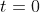 与 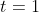 两刻。本章论证围绕此 **静态经济模式** 展开。2

2 **动态经济模式** 下，不确定性随日历推移逐步消散，即自今日至一年后之每一日流逝均削减不确定性。

时点  完全确定。时点  的经济状态落于有限集合 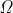 的某元 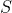，记 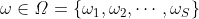。 称作 **状态空间**，基数记 ，记 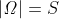。

**代数** 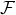 于  为满足下列三条性质的子集族。

1. 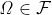
2. 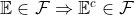
3. 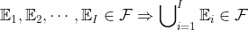

 为集合  的补集，幂集 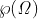 为最大代数，同时 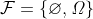 为  中最小代数。代数给出经济中 **可观测事件** 的建模方式。此语境下，单一状态 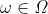 可视作 **原子** 事件。

**概率** 即向状态  赋实数 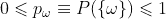，或向事件 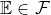 赋实数 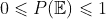。已知事件全部情形概率时，整体概率可通过求和得到 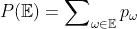。

**概率测度** ![P:\\mathcal{F}\\to\[0,1\]](Images/image00370.gif) 需满足：

1. 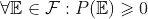
2. 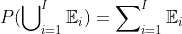，其中 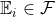
3. 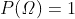

将 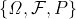 三要素结合构成 **概率空间**。概率空间构成现代经济学表述 **不确定性** 的正式工具。若概率测度 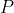 被固定，模式处于 **风险**；若所有经济主体共享同一分布，则模式为 **信息对称**。

给定概率空间 ，**随机变量** 为函数 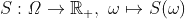，且该函数关于 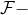 可测。此含义为每个 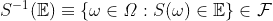

若 ，则随机变量 **预期值** 定义为：


其余情形下，随机变量 **预期值** 定义为：


一般假设金融经济系统 **完美**：无交易摩擦，可交易资产价格固定且供给无限，时间以光速推进，各主体拥有完备对称信息。

## 3.1.2 数字模拟例子

考虑一简易 **静态** 经济模式处于  **风险** 下，满足：

1. 
2. 
3. 

### 交易的资产

模型中可交易资产共两类。第一类为风险资产，如 **股票**。今日价格确定为 ，明日支付不确定，写成随机变量形式 。

第二类为无风险资产，如 **债券**。今日价格确定为 ，明日支付确定，满足 。

形式上，经济可表为 ，其中  代表今日可交易资产价格向量 ，明日市场支付记作 。

### 套利定价理论

例如，寻求执行价  的股票欧式看涨期权公允价值。无套利欧式看涨期权  可经股票与债券组合复制期权  的支付 。复制组合价格须等于期权价格，否则将出现无限套利。借助 `Python` 此类复制易于实现。3

```
In [1]: import numpy as np

In [2]: S0 = 10  ➊
            B0 = 10  ➊

In [3]: S1 = np.array((20, 5))  ➋
            B1 = np.array((11, 11))  ➋

In [4]: M0 = np.array((S0, B0))  ➌
            M0  ➌
Out[4]: array([10, 10])

In [5]: M1 = np.array((S1, B1)).T  ➍
            M1  ➍
Out[5]: array([[20, 11],
                   [ 5, 11]])

In [6]: K = 14.5  ➎

In [7]: C1 = np.maximum(S1 - K, 0)  ➏
            C1  ➏
Out[7]: array([5.5, 0. ])

In [8]: phi = np.linalg.solve(M1, C1)  ➐
            phi  ➐
Out[8]: array([ 0.36666667, -0.16666667])

In [9]: np.allclose(C1, np.dot(M1, phi))  ➑
Out[9]: True

In [10]: C0 = np.dot(M0, phi)  ➒
             C0  ➒
Out[10]: 2.0
```

➊ 股票与债券今日价格。
➋ 股票与债券明日不确定回报。
➌ 市场价格向量。
➍ 市场回报矩阵。
➎ 股票期权行权价格。
➏ 期权的不确定回报。
➐ 复制投资组合 。
➑ 核验复制组合与期权回报是否一致。
➒ 复制组合价格即期权无套利价格。

> 　**套利定价**

> 上例表明，套利定价理论［如 **资产定价基本定理**（`FTAP`）］被视为数学基础最稳健、最具解释力的金融理论之一。4 期权价格可由可观测市场参数（如标的股票价格）推导得出。换言之，套利定价并不先讨论公允股价如何形成，而直接取市场价格为输入。因此仅在极宽松假设，例如 **不存在套利假设** 下即可成立，此为众多金融理论所不及。值得注意的是，推导套利价格甚至无需引入概率测度。

3 有关风险中性定价与套利定价细节，请参阅 Hilpisch（2015）第 4 章。

4 再次参阅 Hilpisch（2015）第 4 章及相关参考文献。

## 3.2 预期效用理论

预期效用理论（`EUT`）为金融理论基石。自二十世纪四十年代提出以来，`EUT` 一直是不确定性决策建模的核心范式之一。5 基本上每部金融理论与投资理论入门读物皆有 `EUT` 论述。其一原因在于金融领域诸多核心结论均可由 `EUT` 范式导出。

5 背景细节请参阅 Eichberger 与 Harper（1997）第 1 章或 Varian（2010）第 12 章。

### 3.2.1 假设和结论

`EUT` 为可溯源至 von Neumann 与 Morgenstern（1944）的公理化理论。此处 **公理化** 意味着主要结果仅由少量公理推导。关于公理效用理论、不同变体与应用综述，请参阅 Fishburn（1968）。

#### 公理和规范性理论

Wolfram MathWorld 给出公理定义：公理为不证自明的真理性命题。

面对不确定性选择时，`EUT` 多建立于经济主体 **偏好** 的少数主要公理之上。尽管与公理定义并不完全一致，并非全部公理被所有经济学家视为“不证自明真理”。

von Neumann 与 Morgenstern（1944）第 25 页对公理选择的评述：

> 公理选择并非纯客观任务。人们多预期公理选择能达成特定目的，得到若干定理或由公理推导之定理，于此层面公理选择问题精确且客观。除此之外尚有其他重要却不够精确的要求：公理数量不宜过多，其体系应尽可能简洁清晰，每条公理应具直接直观意义，可直接判断其合理性。

由此，一组公理构成规范性理论（部分）之世界，由该理论建模。公理集收敛最小假设集合，这些假设应事先满足，而非经证明或类似证明。在列出导致 `EUT` 的一组公理前，面对不确定性选择时，此处以“”形式化表述经济主体偏好。

#### 经济主体的偏好

设经济主体  的偏好  于模型经济中面临两种可交易资产投资抉择。例如，主体可选择投资组合 ，从而带来未来回报 ；亦可选择投资组合 ，从而带来未来回报 。假定主体偏好  针对未来回报而非投资组合本身。若主体强偏好  回报而非  回报，可记为 ，反之记为 。若主体对两者无差异，可记为 。在此描述下，`EUT` 可能的一组公理包括：

**完备性**

主体能够对全部回报进行排序。排序仅可能为以下三种情形之一：、 或 。

**传递性**

若存在第三个组合  其未来回报为 ，则当  且  时，有 。

**连续性**

若 ，则存在数值 ![\\alpha\\in\[0,1\]](Images/image00414.gif)，使得 。

**独立性**

若 ，则 。同样，若 ，则 。

**主导性**

在  与  同时具备的前提下，借助  与  即可推出 。

#### 效用函数

**效用函数**可理解为借助数理手段刻画经济主体对  偏好取向的工具，因其能够为各类结果打上数值标签。此处数值的绝对水平并不重要，关键在于数值间的排序。6 设  囊括主体可进行比较的全部可能回报，则效用函数  的写法为：


以  来表征对  的偏好倾向时，可得到如下排序结论。

　　（强烈偏好）
　　（弱偏好）
　　（强烈不偏好）
　　（弱不偏好）
　　（无差异）

效用函数  的确定仅在正线性变换的意义下唯一。因此，若  已能表达对  的偏好，则在满足  的情形下， 同样可作为偏好的有效表达。von Neumann 和 Morgenstern（1944）第 25 页对此作出概括：“我们看到：如果效用的这个数值存在，那么它就是由一个线性变换决定的。也就是说，效用是一个线性变换的数。”

#### 预期效用函数

von Neumann 和 Morgenstern（1944）指出，一旦经济主体的偏好  符合前文列出的五条公理，便存在下述形式的**预期效用函数**：


其中  为单调递增且不依赖状态的映射，常称作**伯努利效用**，典型形式包含 、 与 。

换言之，预期效用函数  先把各状态下的回报  转换成效用值 ，随后以各状态出现的概率  作为权重进行加总。当伯努利效用为线性  时，预期效用退化为状态回报的常规期望，即 。

#### 风险规避

在金融研究中，**风险规避** 属于核心议题。衡量厌恶程度最通用的指标是可追溯至 Pratt（1964）的 Arrow-Pratt 绝对风险厌恶 `ARA`。假定主体的状态无关伯努利效用为 ，则 `ARA` 的 Arrow-Pratt 度量写为：


依据该指标可划分为以下三种情形：


理论与实证模型里，往往默认风险规避与风险中性的设定是合理的。

把前述三个伯努利函数 、 与  分别代入，即可刻画风险规避者、风险中性者与风险偏好者的行为。例如考察 。

风险偏好

6 也即惯用的**序数**概念，例如门牌号码。

### 3.2.2　数值例子

借助 `Python` 能直观展示 `EUT` 的应用。假设本例复现前文的经济结构 。设想一个决策者依据 `EUT` 来权衡未来不同回报的排序 。该决策者的伯努利效用取为 。在这一设定下，来自组合  的回报  被认为优于组合  的回报 。

下列代码演示了该用法。

```
In [11]: def u(x):
             return np.sqrt(x)  ➊

In [12]: phi_A = np.array((0.75, 0.25))  ➋
         phi_D = np.array((0.25, 0.75))  ➋

In [13]: np.dot(M0, phi_A) == np.dot(M0, phi_D)  ➌
Out[13]: True

In [14]: A1 = np.dot(M1, phi_A)  ➍
         A1  ➍
Out[14]: array([17.75, 6.5 ])

In [15]: D1 = np.dot(M1, phi_D) ➎
         D1  ➎
Out[15]: array([13.25, 9.5 ])

In [16]: P = np.array((0.5, 0.5))  ➏

In [17]: def EUT(x):
             return np.dot(P, u(x))  ➐

In [18]: EUT(A1)  ➑
Out[18]: 3.381292321692286

In [19]: EUT(D1)  ➑
Out[19]: 3.3611309730623735
```

➊ 风险规避型伯努利效用函数。
➋ 两类投资组合采用不同的权重配置。
➌ 说明两组组合的建造成本一致。
➍ 一类组合的不确定回报……
➎ ……另一类组合的不确定回报。
➏ 概率测度。
➐ 期望效用函数。
➑ 两类不确定回报对应的效用数值。

常见延伸问题是，在决策者预算固定  的条件下，寻找使预期效用最大化的最优组合。下段 `Python` 代码对该问题进行了建模并求解。预算总额内，决策者约将 60% 配置于风险资产、约 40% 配置于无风险资产，结论很大程度上取决于伯努利效用的具体形态。

```
In [20]: from scipy.optimize import minimize

In [21]: w = 10  ➊

In [22]: cons = {'type': 'eq', 'fun': lambda phi: np.dot(M0, phi) - w}  ➋

In [23]: def EUT_(phi):
             x = np.dot(M1, phi)  ➌
             return EUT(x)  ➌

In [24]: opt = minimize(lambda phi: -EUT_(phi),  ➍
                        x0=phi_A,  ➎
                        constraints=cons)  ➏
In [25]: opt  ➐
Out[25]:      fun: -3.385015999493397
              jac: array([-1.69249132, -1.69253424])
          message: 'Optimization terminated successfully.'
             nfev: 16
              nit: 4
             njev: 4
           status: 0
          success: True
                x: array([0.61122474, 0.38877526])

In [26]: EUT_(opt['x'])  ➑
Out[26]: 3.385015999493397
```

➊ 决策者的固定预算。
➋ 以最小化方式施加预算约束。
➌ 作用于组合上的预期效用函数。
➍ 最小化 `-EUT_(phi)`，等价于最大化 `EUT_(phi)`。
➎ 优化的初始猜测值。
➏ 预算约束的具体实现。
➐ 最优解，包含 `x` 下的最优组合。
➑ 在预算  下取得的最高预期效用。

## 3.3　均值−方差投资组合理论

`Markowitz`（1952）提出的均值−方差投资组合 `MVP` 理论是金融学的基石之一。它是最早处理不确定性投资的框架，侧重对股票组合构建的统计性度量。`MVP` 基本上剥离了影响股价或公司成长前景的基本面信息，唯一依赖的输入通常是股价的时间序列及其衍生的统计量，例如历史年化平均收益率与历史年化收益率方差。

### 3.3.1　假设和结论

按 `Markowitz`（1952）的表述，`MVP` 的核心假定是投资者**仅**关注预期收益率及其方差：

> 接下来，考虑这样一条规则，即投资者确实（或应该）认为关心预期收益率是一件可取的事情，而关心收益率的方差则是一件不可取的事情。这条规则会有许多合理的观点，既可以作为投资行为的准则，也可以作为投资行为的假设。

> 预期收益率最大的投资组合不一定是方差最小的投资组合。投资者既可以通过接受方差来获得预期收益率，也可以通过放弃预期收益率来减少方差。

这种偏好表述与直接定义主体偏好和效用函数的方式截然不同。`MVP` 更像是假设主体的偏好与效用由投资组合预期收益率的一阶矩和二阶矩决定。

> 　**隐含的正态分布假设**
> 
> 总体来看，`MVP` 仅关注单期风险与收益，与标准 `EUT` 并非完全相容。一种补救方式是假定风险资产收益率服从正态分布，此时一阶矩与二阶矩足以刻画完整分布。正如第 4 章所述，真实金融数据中几乎看不到这种情形。另一种做法是假设一个特定的二次伯努利效用函数，如下一节所示。

1. **投资组合统计**

考虑一个静态经济结构 ，可交易资产集合  包含  只风险资产，即 。 为资产  当前的固定价格， 为一年后的回报， 为资产  的简单净收益率向量，定义为：


在所有未来状态等概率时，资产  的预期收益率记为：


相应的**预期收益率向量**为：


**投资组合**（向量） 需满足  与 ，它们为组合中每一项资产分配权重。7

**投资组合的预期收益率**由权重向量与预期收益率向量的点积给出：


资产  与  之间的协方差定义为：


**协方差矩阵**为：


**投资组合的预期方差**由此得到双点积形式：


对应的**投资组合预期波动率**为：


2. **夏普比率**

`Sharpe`（1966）提出了一种评估经风险调整后共同基金及其他组合绩效的度量，甚至可用于单一风险资产。其最简形式把组合的收益率与波动率关联起来。形式上夏普比率定义为：


若  代表低风险的短期利率，则组合  相对于无风险替代品的**风险溢价**或**超额收益**由下式给出：。在夏普比率的另一种写法中，该风险溢价置于分子：


当无风险短期利率处于低位时，在相同利率下两种计算的数值差异不大。特别是在用夏普比率对不同组合进行排序时，只要其他条件相同，两种版本会给出一致的排名。

7 该假设并非强制约束，稍作调整即可适用于**做空**情形。

### 3.3.2　数值例子

# 静态经济情境下重访 MVP

回到静态经济模式 ，`MVP` 的核心机理用 `Python` 演示会更直观。

1. **组合统计拆解**

先从资产组合层面推导期望回报。

```
In [27]: rS = S1 / S0 - 1  ➊
             rS  ➊
Out[27]: array([ 1. , -0.5])

In [28]: rB = B1 / B0 - 1  ➋
             rB  ➋
Out[28]: array([0.1, 0.1])

In [29]: def mu(rX):
                 return np.dot(P, rX)  ➌

In [30]: mu(rS)  ➍
Out[30]: 0.25

In [31]: mu(rB)  ➍
Out[31]: 0.10000000000000009

In [32]: rM = M1 / M0 - 1  ➎
             rM  ➎
Out[32]: array([[ 1. , 0.1],
                    [-0.5, 0.1]])

In [33]: mu(rM)  ➏
Out[33]: array([0.25, 0.1 ])
```

➊ 风险型资产收益向量
➋ 无风险型资产收益向量
➌ 期望回报函数
➍ 可交易资产的期望回报
➎ 交易资产收益矩阵
➏ 期望收益向量

随后进入风险刻画，涉及离散程度、波动幅度与关联结构。

```
In [34]: def var(rX):
                 return ((rX - mu(rX)) ** 2).mean()  ➊

In [35]: var(rS)
Out[35]: 0.5625

In [36]: var(rB)
Out[36]: 0.0

In [37]: def sigma(rX):
                 return np.sqrt(var(rX))  ➋

In [38]: sigma(rS)
Out[38]: 0.75

In [39]: sigma(rB)
Out[39]: 0.0

In [40]: np.cov(rM.T, aweights=P, ddof=0)  ➌
Out[40]: array([[0.5625, 0.    ],
                    [0.    , 0.    ]])
```

➊ 方差函数
➋ 波动幅度函数
➌ 协方差阵

最后以等权重配置为例，给出资产组合的期望回报、期望方差与期望波动。

```
In [41]: phi = np.array((0.5, 0.5))

In [42]: def mu_phi(phi):
                 return np.dot(phi, mu(rM))  ➊

In [43]: mu_phi(phi)
Out[43]: 0.17500000000000004

In [44]: def var_phi(phi):
                 cv = np.cov(rM.T, aweights=P, ddof=0)
                 return np.dot(phi, np.dot(cv, phi))  ➋

In [45]: var_phi(phi)
Out[45]: 0.140625

In [46]: def sigma_phi(phi):
                 return var_phi(phi) ** 0.5  ➌

In [47]: sigma_phi(phi)
Out[47]: 0.375
```

➊ 组合期望回报
➋ 组合期望方差
➌ 组合期望波动幅度

2. **机会集描绘**

借助蒙特卡罗方式生成的权重集合 ，可以在波动-回报平面上画出机会集，如图 3-1。


**图 3-1：模拟投资组合预期波动率和预期收益率（单一风险资产）**

仅有一种风险型资产和一种无风险型资产时，机会集退化为一条直线。

```
In [48]: from pylab import plt, mpl
             plt.style.use('seaborn')
             mpl.rcParams['savefig.dpi'] = 300
             mpl.rcParams['font.family'] = 'serif'
    
In [49]: phi_mcs = np.random.random((2, 200))  ➊
    
In [50]: phi_mcs = (phi_mcs / phi_mcs.sum(axis=0)).T  ➊
    
In [51]: mcs = np.array([(sigma_phi(phi), mu_phi(phi))
                             for phi in phi_mcs])  ➋
    
In [52]: plt.figure(figsize=(10, 6))
             plt.plot(mcs[:, 0], mcs[:, 1], 'ro')
             plt.xlabel('expected volatility')
             plt.ylabel('expected return');
```

➊ 随机抽样组合并归一化为 1
➋ 该随机组合的期望波动与回报

现在引入一个含 3 种状态的静态经济 ，其中 。三类状态出现概率相等，即 。可交易资产由价格固定为  的风险资产  与  构成，其不确定回报分别为：


和


在上述设定下，Python 脚本复现蒙特卡罗实验并得到图 3-2 的可视化。加入第二种风险资产后，经典的 MVP“子弹”形态便显现。

```
In [53]: P = np.ones(3) / 3  ➊
             P  ➊
Out[53]: array([0.33333333, 0.33333333, 0.33333333])
    
In [54]: S1 = np.array((20, 10, 5))
    
In [55]: T0 = 10
             T1 = np.array((1, 12, 13))
    
In [56]: M0 = np.array((S0, T0))
             M0
Out[56]: array([10, 10])
    
In [57]: M1 = np.array((S1, T1)).T
             M1
Out[57]: array([[20,  1],
                    [10, 12],
                    [ 5, 13]])
    
In [58]: rM = M1 / M0 - 1
             rM
Out[58]: array([[ 1. , -0.9],
                    [ 0. ,  0.2],
                    [-0.5,  0.3]])
    
In [59]: mcs = np.array([(sigma_phi(phi), mu_phi(phi))
                             for phi in phi_mcs])
    
In [60]: plt.figure(figsize=(10, 6))
             plt.plot(mcs[:, 0], mcs[:, 1], 'ro')
             plt.xlabel('expected volatility')
             plt.ylabel('expected return');
```

➊ 三状态的新概率测度


**图 3-2：模拟投资组合预期波动率和预期收益率（两种风险资产）**

### 3.3.3 最小波动率与最大夏普比率

接下来求解最小波动率即最小方差组合，以及夏普比率最高的组合。图 3-3 标示了二者在风险-回报平面上的位置。


**图 3-3：最小波动率和最大夏普比率投资组合**

尽管风险资产  的期望回报为负，在最大夏普比率组合中仍占有相当权重。原因在于分散化压低了整体风险，而非抬升了期望回报。

```
In [61]: cons = {'type': 'eq', 'fun': lambda phi: np.sum(phi) - 1}
    
In [62]: bnds = ((0, 1), (0, 1))
    
In [63]: min_var = minimize(sigma_phi, (0.5, 0.5),
                                constraints=cons, bounds=bnds)  ➊
    
In [64]: min_var
Out[64]:      fun: 0.07481322946910632
                  jac: array([0.07426564, 0.07528945])
              message: 'Optimization terminated successfully.'
                 nfev: 17
                  nit: 4
                 njev: 4
               status: 0
              success: True
                    x: array([0.46511697, 0.53488303])
    
In [65]: def sharpe(phi):
                 return mu_phi(phi) / sigma_phi(phi)  ➋
    
In [66]: max_sharpe = minimize(lambda phi: -sharpe(phi), (0.5, 0.5),
                            constraints=cons, bounds=bnds)  ➌
    
In [67]: max_sharpe
Out[67]:      fun: -0.2721654098971811
                  jac: array([ 0.00012054, -0.00024174])
              message: 'Optimization terminated successfully.'
                 nfev: 38
                  nit: 9
                 njev: 9
               status: 0
              success: True
                    x: array([0.66731116, 0.33268884])
    
In [68]: plt.figure(figsize=(10, 6))
             plt.plot(mcs[:, 0], mcs[:, 1], 'ro', ms=5)
             plt.plot(sigma_phi(min_var['x']), mu_phi(min_var['x']),
                      '^', ms=12.5, label='minimum volatility')
             plt.plot(sigma_phi(max_sharpe['x']), mu_phi(max_sharpe['x']),
                      'v', ms=12.5, label='maximum Sharpe ratio')
             plt.xlabel('expected volatility')
             plt.ylabel('expected return')
             plt.legend();
```

➊ 最小化组合期望波动
➋ 定义夏普比率函数，短期利率取 `0`
➌ 通过最小化夏普比率负值来实现最大化

### 3.3.4 有效边界

**有效组合**是在给定风险水平下回报最高，或在给定回报水平下风险最低的组合。图 3-3 中，所有期望回报低于最小风险组合的组合均为 **无效**。下述代码从风险-回报平面筛选有效组合并绘制于图 3-4，全体有效组合的集合即为 **有效前沿**，理性主体只会选择前沿上的组合。

```
In [69]: cons = [{'type': 'eq', 'fun': lambda phi: np.sum(phi) - 1},
                    {'type': 'eq', 'fun': lambda phi: mu_phi(phi) - target}]  ➊
    
In [70]: bnds = ((0, 1), (0, 1))
    
In [71]: targets = np.linspace(mu_phi(min_var['x']), 0.16)  ➋
    
In [72]: frontier = []
             for target in targets:
                 phi_eff = minimize(sigma_phi, (0.5, 0.5),
                                    constraints=cons, bounds=bnds)['x']  ➌
                 frontier.append((sigma_phi(phi_eff), mu_phi(phi_eff)))
             frontier = np.array(frontier)
    
In [73]: plt.figure(figsize=(10, 6))
             plt.plot(frontier[:, 0], frontier[:, 1], 'mo', ms=5,
                      label='efficient frontier')
             plt.plot(sigma_phi(min_var['x']), mu_phi(min_var['x']),
                      '^', ms=12.5, label='minimum volatility')
             plt.plot(sigma_phi(max_sharpe['x']), mu_phi(max_sharpe['x']),
                      'v', ms=12.5, label='maximum Sharpe ratio')
             plt.xlabel('expected volatility')
             plt.ylabel('expected return')
             plt.legend();
```

➊ 引入新约束固定期望回报目标水平
➋ 生成一组目标期望回报
➌ 求解在目标回报下波动最小的组合


**图 3-4：有效边界**

## 3.4 资本资产定价模型

资本资产定价模型 CAPM 在金融领域是应用最广的均衡框架之一，其要义是用线性关系把单一证券的期望回报与市场组合的期望回报联系起来，市场组合通常用标普 500 等指数近似。该思路可追溯到 Sharpe 1964 与 Lintner 1965 的开创性工作。Jones 2012 第 9 章对 CAPM 与 MVP 的关系作如下概括：

> 资本市场理论是一个实证理论，因为它假设了投资者的行为方式，而不是投资者应该如何的行为方式，就像现代投资组合理论 MVP 的情况。将资本市场理论视为投资组合理论的延伸是合理的，但重要的是要明白，MVP 并不是建立在资本市场理论的有效性或缺乏有效性之上的。

> 许多投资者感兴趣的特定均衡模型是资本资产定价模型，通常称为 CAPM。它允许我们评估单个证券的相关风险，以及评估风险与投资预期收益率之间的关系。作为一种均衡模型，CAPM 因其简单性和隐含性而具有吸引力。

### 3.4.1 假设和结论

在 CAPM 的框架下，市场均衡是怎么形成的

假设上一节介绍的静态经济框架  包含了  种可交易资产并沿用全部简化设定。在 CAPM 的设定里，每个经济主体都遵循均值-方差准则 MVP 来做决策，只关注风险资产在单一期内的收益均值与波动幅度。

在**资本市场均衡**的状态下，所有可交易资产都被市场里的所有参与者共同持有，各类交易都已完成出清。既然大家都用 MVP 来构造有效组合，那么在可交易资产集合相同的前提下，所有参与者的有效组合在构成上必然一致。换句话说，**市场投资组合**必须落在有效前沿上，否则市场就无法达到均衡。

均衡是如何被实现的？现行的可交易资产价格正是实现出清的调节器。对某项资产需求偏弱时价格就会下行，需求超出供给时价格就会上行。待价格调整到恰当位置，需求与供给才会相等。MVP 决定了在给定价格下的资产定价，而 CAPM 则给出在特定风险-收益特征下资产均衡价格应该如何的理论模型。

CAPM 假定至少存在一种无风险资产，经济主体可以按任意规模进出并拿到  的无风险利率。于是均衡时每个主体持有的都是市场组合与无风险资产的混合，这就是**双基金分离定理**8。所有这类组合构成的集合即为**资本市场线**（CML）。图 3-5 是 CML 的示意。市场组合右侧的那些组合，只有在允许做空无风险资产从而借入资金时才可能出现。

8 如需了解更多信息，请参阅 Jones（2012）的第 9 章。

```
In [74]: plt.figure(figsize=(10, 6))
         plt.plot((0, 0.3), (0.01, 0.22), label='capital market line')
         plt.plot(0, 0.01, 'o', ms=9, label='risk-less asset')
         plt.plot(0.2, 0.15, '^', ms=9, label='market portfolio')
         plt.annotate('$(0, \\bar{r})$', (0, 0.01), (-0.01, 0.02))
         plt.annotate('$(\sigma_M, \mu_M)$', (0.2, 0.15), (0.19, 0.16))
         plt.xlabel('expected volatility')
         plt.ylabel('expected return')
         plt.legend();
```


**图 3-5：资本市场线（CML）**

若把  和  分别记作市场组合的预期波动率与预期收益率，那么任意组合的预期收益率  与预期波动率  之间满足的资本市场线可写成：


下式被称作**风险的市场价格**：


它量化了均衡时为了多承担一个单位风险，投资者需要额外要求的预期收益。

CAPM 将任意可交易风险资产（资产 ）的预期收益率与市场组合的预期收益率联系起来，表达为：


其中  被定义为含  个风险资产的市场组合协方差除以市场组合自身方差：


当  时，CAPM 给出的预期收益率退化为无风险利率。 越大，该风险资产要求的预期收益率越高。 用来度量**不可分散的风险**，也即市场风险或系统性风险。按 CAPM 的说法，对这种风险的承担会得到额外预期收益作为补偿。

## 3.4.2 数值案例

假设静态经济框架存在 3 个可能的未来状态，即 ，并且可以以无风险利率  拆借资金。风险资产  与  在市场上可得的数量分别为 0.8 和 0.2。

#### 1. 资本市场线

图 3-6 同时呈现了有效边界、市场组合、无风险资产以及由此产生的风险-收益空间中的资本市场线。

```
In [75]: phi_M = np.array((0.8, 0.2))

In [76]: mu_M = mu_phi(phi_M)
         mu_M
Out[76]: 0.10666666666666666

In [77]: sigma_M = sigma_phi(phi_M)
         sigma_M
Out[77]: 0.39474323581566567

In [78]: r = 0.0025

In [79]: plt.figure(figsize=(10, 6))
         plt.plot(frontier[:, 0], frontier[:, 1], 'm.', ms=5,
                  label='efficient frontier')
         plt.plot(0, r, 'o', ms=9, label='risk-less asset')
         plt.plot(sigma_M, mu_M, '^', ms=9, label='market portfolio')
         plt.plot((0, 0.6), (r, r + ((mu_M - r) / sigma_M) * 0.6),
                  'r', label='capital market line', lw=2.0)
         plt.annotate('$(0, \\bar{r})$', (0, r), (-0.015, r + 0.01))
         plt.annotate('$(\sigma_M, \mu_M)$', (sigma_M, mu_M),
                  (sigma_M - 0.025, mu_M + 0.01))
         plt.xlabel('expected volatility')
         plt.ylabel('expected return')
         plt.legend();
```


**图 3-6：两种风险资产的资本市场线**

#### 2. 最优投资组合

设某个经济主体的预期效用函数对未来回报的定义为：


此处 。经过推导，预期效用可以改写为风险-收益形式的表达式。


> 　**特定二次效用函数**
>
> 尽管 MVP 理论和 CAPM 都只要求投资者关注单期组合的风险与收益，但这一要求严格等价于 EUT 的条件，仅在伯努利效用函数取特定形式——二次效用函数时成立。该伯努利函数在 MVP 讨论中几乎是唯一被引用的形式。除此之外，其特殊设定通常被认为不太合理。无论是资产收益的正态分布假设，还是二次效用设定，都难以以“优雅”的方式同时兼容 EUT、MVP 理论与 CAPM。

在 CML 上，经济主体会挑哪个组合？通过直接效用最大化并用 Python 求解即可得到答案。为此我们固定参数 。

```
In [80]: def U(p):
             mu, sigma = p
             return mu - 1 / 2 * (sigma ** 2 + mu ** 2)  ➊

In [81]: cons = {'type': 'eq',
                 'fun': lambda p: p[0] - (r + (mu_M - r) / sigma_M * p[1])}  ➋

In [82]: opt = minimize(lambda p: -U(p), (0.1, 0.3), constraints=cons)

In [83]: opt
Out[83]:      fun: -0.034885186826739426
              jac: array([-0.93256102, 0.24608851])
          message: 'Optimization terminated successfully.'
             nfev: 8
              nit: 2
             njev: 2
           status: 0
          success: True
                x: array([0.06743897, 0.2460885 ])
```

➊ 风险-收益空间里的效用函数。
➋ 组合满足 CML 的约束条件。

#### 3. 无差异曲线

可视化有助于理解决策。把效用水平固定，就能在风险-收益空间里画出**无差异曲线**。当无差异曲线与 CML 相切时，最优组合便确定下来；若曲线不接触 CML 或与之相交两次，则无法给出最优解。

下面是一段用符号计算把风险-收益空间中的效用函数化为在固定效用水平  与固定参数值  下关于  与  的函数关系的 Python 代码。图 3-7 展示了两条无差异曲线。曲线上任意一对  组合带来相同的效用，对经济主体而言是无差异的。

```
In [84]: from sympy import *
         init_printing(use_unicode=False, use_latex=False)

In [85]: mu, sigma, b, v = symbols('mu sigma b v')  ➊

In [86]: sol = solve('mu - b / 2 * (sigma ** 2 + mu ** 2) - v', mu)  ➋

In [87]: sol  ➋
Out[87]:         _________________________     _________________________
                /   2      2                  /   2      2
          1 - \/ - b *sigma  - 2*b*v + 1    \/ - b *sigma  - 2*b*v + 1  + 1
         [--------------------------------, --------------------------------]
                        b                                 b

In [88]: u1 = sol[0].subs({'b': 1, 'v': 0.1})  ➌
         u1
Out[88]:        ______________
               /            2
         1 - \/  0.8 - sigma

In [89]: u2 = sol[0].subs({'b': 1, 'v': 0.125})  ➌
         u2

Out[89]:        _______________
               /             2
         1 - \/  0.75 - sigma

In [90]: f1 = lambdify(sigma, u1)  ➍
         f2 = lambdify(sigma, u2)  ➍

In [91]: sigma_ = np.linspace(0.0, 0.5)  ➎
         u1_ = f1(sigma_)  ➏
         u2_ = f2(sigma_)  ➏

In [92]: plt.figure(figsize=(10, 6))
         plt.plot(sigma_, u1_, label='$v=0.1$')
         plt.plot(sigma_, u2_, '--', label='$v=0.125$')
         plt.xlabel('expected volatility')
         plt.ylabel('expected return')
         plt.legend();
```

➊ 定义 `SymPy` 符号。
➋ 求解效用函数 。
➌ 用数值替换 。
➍ 由所得方程生成可调用函数。
➎ 指定用于评估函数的  值。
➏ 评估两个不同效用水平的可调用函数。


**图 3-7：风险－收益空间中的无差异曲线**

接下来把无差异曲线与 CML 结合，直观地定位经济主体的最优选择。

基于先前的数值优化结果，图 3-8 描绘了无差异曲线与 CML 相切时的最优组合。可以看到，主体确实选择了市场组合与无风险资产的混合。

```
In [93]: u = sol[0].subs({'b': 1, 'v': -opt['fun']})  ➊
         u
Out[93]:        ____________________________
               /                          2
         1 - \/  0.930229626346521 - sigma

In [94]: f = lambdify(sigma, u)

In [95]: u_ = f(sigma_)  ➋

In [96]: plt.figure(figsize=(10, 6))
         plt.plot(0, r, 'o', ms=9, label='risk-less asset')
         plt.plot(sigma_M, mu_M, '^', ms=9, label='market portfolio')
         plt.plot(opt['x'][1], opt['x'][0], 'v', ms=9, label='optimal portfolio')
         plt.plot((0, 0.5), (r, r + (mu_M - r) / sigma_M * 0.5),
                  label='capital market line', lw=2.0)
         plt.plot(sigma_, u_, '--', label='$v={}$'.format(-round(opt['fun'], 3)))
         plt.xlabel('expected volatility')
         plt.ylabel('expected return')
         plt.legend();
```

➊ 定义最优效用水平下的无差异曲线。
➋ 获取数值以绘制无差异曲线。


**图 3-8：CML 上的最优投资组合**

本段落涉及的分析视角在资本市场理论（`CMT`）范畴内展开，`CAPM` 属于这一范式的组成部分，第四章将借助实证金融时间序列对其进行检验。

## 3.5 套利定价理论

在注意到 `CAPM` 的局限性之后，学界的讨论逐步转向其拓展形式，其中最具代表性的就是 `Ross` 于 1971 年与 1976 年提出的套利定价理论 `APT`。`Ross` 在 1976 年的论文开篇即指出：

> 本文的目的是严格检验 `Ross`（1971）提出的资本资产定价套利模型。套利模型是 `Sharpe`、`Lintner` 和 `Treynor` 提出的对均值-方差资本资产定价模型的一种替代模型，该模型已成为解释资本市场上观察到的风险资产现象的主要分析工具。

### 3.5.1 假设和结论

`APT` 可视作对 `CAPM` 的多因子延伸。与前者把市场组合视为唯一定价因子不同，`APT` 承认多种风险维度共同作用于个股预期收益，例如规模、波动率、估值与动量等。9 在此之外，该框架仍沿用市场无摩擦、相同无风险利率下可自由借贷等常规条件。

9 有关实践中使用的因子背景，请参阅 `Bender` 等（2013）。

在 `Poss`（1976）提出的动态原始形式里，`APT` 可写成：


其中， 对应  个观测对象的向量，也就是  只不同股票于时刻  的预期收益：


 代表  维常数向量：


 为  个因子在  时刻的向量：


 为  的因子载荷矩阵：


最终， 为  维充分独立的残差。


`Jones`（2012）第 9 章对两者的对比可概括为：

> 与 CAPM 或任何其他资产定价模型类似，APT 假设了预期收益率和风险之间的关系。然而，它使用了不同的假设和程序。非常重要的是，APT 不像 CAPM 那样（预测只有市场风险影响预期收益率）严重依赖于标的市场投资组合。相反，APT 认识到几种类型的风险可能会影响证券收益率。

两者皆以**线性**方式联结因变量与解释因子。计量上均可通过线性 OLS 实现，`CAPM` 归于**单变量**线性 OLS，而 `APT` 则需**多变量**线性 OLS。

### 3.5.2 数值例子

先前公式属动态设定，下文将其简化为静态演示。假定静态经济结构与上一节相同，存在 3 个可能状态，即 。将两种风险资产视为相关风险因子，并引入第三只资产 ，其未来回报为：


尽管两个线性无关向量（如  与 ）无法张成 ，仍可借助 OLS 近似回报 。以下 Python 代码实现该回归。

```
In [97]: M1
Out[97]: array([[20,  1],
                [10, 12],
                [ 5, 13]])

In [98]: M0
Out[98]: array([10, 10])

In [99]: V1 = np.array((12, 15, 7))

In [100]: reg = np.linalg.lstsq(M1, V1, rcond=-1)[0]  ➊
          reg  ➊
Out[100]: array([0.6141665 , 0.50030531])

In [101]: np.dot(M1, reg)
Out[101]: array([12.78363525, 12.14532872, 9.57480155])

In [102]: np.dot(M1, reg) - V1  ➋
Out[102]: array([ 0.78363525, -2.85467128, 2.57480155])

In [103]: V0 = np.dot(M0, reg)  ➌
          V0  ➌
Out[103]: 11.144718094850402
```

➊ 最优回归参数可解读为因子载荷。
➋ 仅这两个因子不足以完全解释回报 。复制不完整，残差非零。
➌ 载荷可用于估计风险资产  的无套利价格 。

显然，这对因子无法完全复现回报 。从线性代数看此结果并不意外。10 若引入第三个风险因子  会如何？设第三个风险因子  定义为 ，具体如下。

10 实际上，回报  也可能恰好落入由  与  决定的子空间。


此时三因子能够精确复制回报 。

```
In [104]: U0 = 10
          U1 = np.array((12, 5, 11))

In [105]: M0_ = np.array((S0, T0, U0))  ➊

In [106]: M1_ = np.concatenate((M1.T, np.array([U1,]))).T  ➋

In [107]: M1_  ➋
Out[107]: array([[20,  1, 12],
                 [10, 12,  5],
                 [ 5, 13, 11]])

In [108]: np.linalg.matrix_rank(M1_)  ➋
Out[108]: 3

In [109]: reg = np.linalg.lstsq(M1_, V1, rcond=-1)[0]
          reg
Out[109]: array([ 0.9575179 , 0.72553699, -0.65632458])

In [110]: np.allclose(np.dot(M1_, reg), V1)  ➌
Out[110]: True

In [111]: V0_ = np.dot(M0_, reg)
          V0_  ➍
Out[111]: 10.267303102625307
```

➊ 扩展市场价格向量。
➋ 扩充满秩的市场回报矩阵。
➌  得到精确复制，残差为零。
➍ 风险资产  存在唯一无套利价格。

该示例与 3.1 节逻辑相近，只要拥有足够可交易风险因子，便能推导出交易资产的无套利价格。`APT` 并未强制要求完美复制，其表达式中保留了残差。若复制可行，则残差归零，这正是三因子案例所体现的。

## 3.6 结论

从 20 世纪 40 年代至 70 年代初形成的理论与模型，尤其是本章所介绍者，至今仍是金融教材的核心内容，并在业界持续应用。其原因在于，这些模型多具规范性，对教学、研究与实践均有启发价值。它们在直观上合理，且借助 Python 即可快速搭建、分析与可视化数值案例。

尽管 MVP 与 `CAPM` 等早期模型在概念上简洁优雅、实现便捷，其在当今的流行程度仍令人惊讶。原因有四：其一，本章所述规范性理论几乎缺乏有意义的实证支撑；其二，部分模型在理论层面相互矛盾；其三，金融理论前沿不断产出替代方案；其四，现代计算与实证金融可依托近乎无限的数据与算力，使得简约数学模型的相关性下降。

第四章将基于真实金融数据检验本章的规范性理论。早期数据稀缺，如今学生也能获取丰富市场数据与开源工具，完成对理论的全面实证。实证金融学长期以来与理论金融学并行，而传统理论曾主导实证方向。随着**数据驱动的金融学**这一新兴分支的出现，理论的相对重要性可能发生持久转变。

## 第 4 章 数据驱动的金融学

> 如果说人工智能是新的电力，那么大数据就是为发电机提供动力的石油。
> 
> ——李开复，2018 年
> 
> 如今，分析师对卫星图像和信用卡数据等非传统信息进行筛选，或者使用机器学习和自然语言处理等人工智能技术从经济数据和财报电话会议记录等传统来源获得新的见解。
> 
> ——Robin Wigglesworth，2019 年

本章聚焦**数据驱动的金融学**的关键议题。在本书语境中，该领域指主要由数据驱动并从数据中提炼洞见的金融学，涵盖理论、模型与应用。

4.1 节阐述科学方法，即指导科学探索的一组共识原则。4.2 节介绍金融计量经济学及其相关议题。4.3 节说明当前可获取的金融数据类型，以及通过可编程 API 能获取的数据质量与规模。4.4 节回顾第 3 章的规范性理论，并以真实金融时间序列检验。4.5 节基于真实数据，挑战金融模型中最常见的两个默认前提：**正态分布收益率**与**线性关系**。

## 4.1 科学方法

**科学方法**指规范任何科学项目的共识原则。维基百科的定义为：

> 科学方法是一种获取知识的经验性方法，早在 17 世纪就成了科学发展的特征。它涉及仔细的观察，对观察结果应用严格的怀疑主义，因为认知假设会扭曲人们对观察结果的解释。它包括根据这些观察，通过归纳，提出假设；对从假设中得出的推论进行实验和测试；以及根据实验结果精炼（或消除）假设。这些是科学方法的原则，与适用于所有科学实体的一系列明确的应用步骤是不同的。

对照该定义，第 3 章的规范性金融理论与科学方法形成鲜明对比。规范性理论主要依赖前提与公理，并以**演绎**为核心推导手段得出结论。

* 预期效用理论（EUT）**前提**为，无论状态如何，经济主体拥有同一效用函数，并在不确定情形下最大化期望效用。
* 均值-方差投资组合（MVP）理论描述不确定下投资选择，**前提**仅以单期预期收益与波动率衡量组合。
* 资本资产定价模型（CAPM）**前提**只有不可分散的市场风险能解释单期股票的预期收益与波动。
* 套利定价理论（APT）**前提**若干可识别风险因子能解释股票的预期收益与波动。不可否认，相较其他理论，APT 的表述更为宽泛，可作更广解释。

这些规范性理论最初多以“笔和纸”在特定前提下推导，未依赖现实观察。历史上，它们多在提出相当久后才接受真实数据的严格检验。此滞后可归因于数据可得性改善与计算能力提升。数据与算力是统计方法落地的两大基础。将这些方法用于金融市场数据的交叉学科通常称作**金融计量经济学**，即下一节主题。

## 4.2 金融计量经济学与回归

参照 Investopedia 对**计量经济学**的定义，可将**金融计量经济学**表述如下：

> 金融计量经济学是对统计模型和数学模型的定量应用，利用金融数据来发展金融理论或检验金融学中的现有假设，并根据历史数据预测未来趋势。它将现实世界的金融数据进行统计试验，然后将结果与金融理论或正在测试的理论进行比较和对比。

`Alexander`（2008b）对该领域提供系统性介绍，其第 2 章涵盖单因子与多因子模型，如 `CAPM` 与 `APT`。该书属于 *Market Risk Analysis* 系列。系列首册 `Alexander`（2008a）覆盖理论背景、概念、方法等，如 MVP 理论和 `CAPM`。`Campbell`（2018）是另一份综合资料。

金融计量经济学的重要工具乃**回归**，包含单变量与多变量形式。一般而言，回归也是**统计学习**的核心手段。传统数学与统计学习的区别何在？虽无统一答案，但可用一例强调本书相关差异。

首为标准数学方法。设数学函数如下：


取  的若干值 ，即可按上述定义导出  的函数值：


以下 Python 代码以简易数值示例说明此点。

```
In [1]: import numpy as np

In [2]: def f(x):
            return 2 + 1 / 2 * x

In [3]: x = np.arange(-4, 5)
        x
Out[3]: array([-4, -3, -2, -1,  0,  1,  2,  3,  4])

In [4]: y = f(x)
        y
Out[4]: array([0. , 0.5, 1. , 1.5, 2. , 2.5, 3. , 3.5, 4. ])
```

次为统计学习采用的方法。前例中函数先行、数据随后，而统计学习顺序相反。此处先给出数据，再寻找函数关系。在此情形下， 通常称作**自变量**， 称作**因变量**。于是考虑下列数据：


比如说，我们要确定的就是参数 ：


换一种形式，就会把残差 显式写出：


在普通最小二乘回归里，核心任务是挑选 系数，让拟合值 与真实值 的均方误差最小。对应的优化问题可以写成：


# 4.2.1 单变量 OLS 的解析解

对于单变量 OLS 的情况，如前文所述，最优解存在已知的闭式表达，具体为：


其中 表示**协方差**，表示**方差**，则是 的**均值**。

回到之前的数值案例，借助这些关系即可推导出最优参数 ，在特殊情形下还能还原出 最初的定义。 ```
In [5]: x
Out[5]: array([-4, -3, -2, -1,  0,  1,  2,  3,  4])

In [6]: y
Out[6]: array([0. , 0.5, 1. , 1.5, 2. , 2.5, 3. , 3.5, 4. ])

In [7]: beta = np.cov(x, y, ddof=0)[0, 1] / x.var()  ➊
        beta  ➊
Out[7]: 0.49999999999999994

In [8]: alpha = y.mean() - beta * x.mean()  ➋
        alpha  ➋
Out[8]: 2.0

In [9]: y_ = alpha + beta * x  ➌

In [10]: np.allclose(y_, y)  ➍
Out[10]: True
```

➊ 可由协方差与方差计算得到。
➋ 可从 和 的均值中导出。
➌ 在已知 与 的前提下，得到估计值 。
➍ 核对 在数值上是否一致。

前面的示例与第 1 章的案例都表明，OLS 回归在具体数据集上的应用往往很直观。OLS 之所以成为计量经济学与金融计量经济学的核心工具，还因为它具备以下特点：

**历史悠久**
最小二乘方法与回归结合的应用史已超过 200 年。1

1 请参阅 Kopf（2015）。

**易于掌握**
其背后的数学原理很清晰，编程实现也十分便捷。

**处理能力强**
OLS 对数据规模基本没有限制。

**适用面广**
它可以处理各种问题和各类数据集。

**计算迅速**
即使面对较大规模数据，评估速度也很理想。

**工具丰富**
Python 等主流语言的高效实现唾手可得。

不过，正如 OLS 应用本身简单直接一样，该方法也依赖诸多假设，其中大多数涉及残差，实践中并不总是成立。

**线性**
模型在系数与残差上保持线性关系。

**无多重共线性**
解释变量之间不应高度相关，即不存在**多重共线性**。

**零均值**
残差的平均值接近零。

**正交性**
残差与自变量基本不相关。

**同方差**
残差的标准差近似恒定。

**无自相关**
残差之间不存在强相关性。

在实际工作中，对特定数据集检验这些条件的难度通常不大。

## 4.3 金融数据获取现状

金融计量经济学的发展既依赖回归等统计方法，也依赖可获取的金融数据。从 20 世纪 50 年代到 90 年代，乃至 21 世纪初，理论与实证研究主要由相对小规模的日终数据驱动。近十年左右，数据可得性发生了显著变化，可用的数据类型大幅增加，颗粒度更细、体量更大、速度更快。

### 4.3.1 可编程 API

对数据驱动的金融研究而言，关键不只是数据本身，还有如何访问和处理它们。很长一段时间里，专业人士主要依赖 Refinitiv 或彭博等公司的数据终端，这只是两大领先供应商。报纸、杂志、财经媒体等传统渠道已被终端取代。然而终端提供的大量数据难以被个人或团队系统化利用。实现数据驱动金融的突破，核心在于通过应用程序接口（`API`）达成数据的**编程可得性**。`API` 允许用代码片段选定、拉取和处理任意数据集。

本节余下内容将聚焦这些 `API`，它们让学者和散户也能获取多种数据集。在举例前，表 4-1 概括了金融环境中常见的数据类别及典型示例。表中，**结构化数据**多以表格形式出现的数值型数据，**非结构化数据**指标准文本形式、仅有标题或段落结构的数据，**非传统数据**指通常不被视作金融数据的数据类型。

**表 4-1：金融数据的相关类型**

| 时间 || 结构化数据 || 非结构化数据 || 非传统数据 |

| --- | --- | --- | --- |

| 历史数据 || 价格、基本面 || 新闻、文本 || 网页、社交媒体、卫星电视 |

| --- | --- | --- | --- |

| 流数据 || 价格、成交量 || 新闻、文件 || 网页、社交媒体、卫星电视、物联网 |

### 4.3.2 结构化历史数据

首先介绍如何以编程方式获取结构化历史数据。下面的 Python 代码使用 `Eikon Data API`。2

2 该数据服务需要付费订阅。

使用 `Eikon Data API` 需要本地运行 `Refinitiv Workspace` 应用，并在 Python 中配置访问权限。

```
In [11]: import eikon as ek
         import configparser

In [12]: c = configparser.ConfigParser()
         c.read('../aiif.cfg')
         ek.set_app_key(c['eikon']['app_id'])
         2020-08-04 10:30:18,059 P[14938] [MainThread 4521459136] Error on handshake
          port 9000 : ReadTimeout(ReadTimeout())
```

满足条件后，只需一次函数调用即可获取结构化历史数据。例如，下面的代码会为一组符号在指定期间抓取日终数据。

```
In [14]: symbols = ['AAPL.O', 'MSFT.O', 'NFLX.O', 'AMZN.O']  ➊

In [15]: data = ek.get_timeseries(symbols,
                                  fields='CLOSE',
                                  start_date='2019-07-01',
                                  end_date='2020-07-01') ➋


In [16]: data.info()  ➌
         <class 'pandas.core.frame.DataFrame'>
         DatetimeIndex: 254 entries, 2019-07-01 to 2020-07-01
         Data columns (total 4 columns):
           #  Column  Non-Null Count  Dtype
         ---  ------  --------------  -----
          0   AAPL.O  254 non-null    float64
          1   MSFT.O  254 non-null    float64
          2   NFLX.O  254 non-null    float64
          3   AMZN.O  254 non-null    float64
         dtypes: float64(4)
         memory usage: 9.9 KB

In [17]: data.tail()  ➍
Out[17]: CLOSE       AAPL.O  MSFT.O  NFLX.O  AMZN.O
         Date
         2020-06-25  364.84  200.34  465.91  2754.58
         2020-06-26  353.63  196.33  443.40  2692.87
         2020-06-29  361.78  198.44  447.24  2680.38
         2020-06-30  364.80  203.51  455.04  2758.82
         2020-07-01  364.11  204.70  485.64  2878.70
```

➊ 列出需要抓取数据的 `RIC` 列表。3

3`RIC` 代表 Reuters Instrument Code，即“路透社指令码”。

➋ 获取该 `RIC` 列表的日终收盘价。
➌ 查看返回的 `DataFrame` 对象的元信息。
➍ 查看 `DataFrame` 对象的最后一行。

类似地，调整参数后也能检索单分钟间隔的 `OHLC` 字段数据。

```
In [18]: data = ek.get_timeseries('AMZN.O',
                                  fields='*',
                                  start_date='2020-08-03',
                                  end_date='2020-08-04',
                                  interval='minute')  ➊

In [19]: data.info()
         <class 'pandas.core.frame.DataFrame'>
         DatetimeIndex: 911 entries, 2020-08-03 08:01:00 to 2020-08-04 00:00:00
         Data columns (total 6 columns):
          #   Column  Non-Null Count  Dtype
        ---   ------  --------------  -----
         0    HIGH    911 non-null    float64
         1   LOW      911 non-null    float64
         2   OPEN     911 non-null    float64
         3   CLOSE    911 non-null    float64
         4   COUNT    911 non-null    float64
         5   VOLUME   911 non-null    float64
        dtypes: float64(6)
        memory usage: 49.8 KB

In [20]: data.head()
Out[20]: AMZN.O                  HIGH      LOW     OPEN    CLOSE  COUNT  VOLUME
         Date
         2020-08-03 08:01:00  3190.00  3176.03  3176.03  3178.17   18.0   383.0
         2020-08-03 08:02:00  3183.02  3176.03  3180.00  3177.01   15.0   513.0
         2020-08-03 08:03:00  3179.91  3177.05  3179.91  3177.05    5.0    14.0
         2020-08-03 08:04:00  3184.00  3179.91  3179.91  3184.00    8.0   102.0
         2020-08-03 08:05:00  3184.91  3182.91  3183.30  3184.00   12.0   403.0
```

➊ 拉取单一 `RIC` 的全部可用字段的分钟级数据。

从 `Eikon` 数据 `API` 还能获取更多结构化金融时间序列。下面的代码同时请求多个 `RIC` 和多个数据字段。

```
In [21]: data_grid, err = ek.get_data(['AAPL.O', 'IBM', 'GOOG.O', 'AMZN.O'],
                                      ['TR.TotalReturnYTD', 'TR.WACCBeta',
                                       'YRHIGH', 'YRLOW',
                                       'TR.Ebitda', 'TR.GrossProfit'])  ➊

In [22]: data_grid
Out[22]:   Instrument  YTD Total Return      Beta   YRHIGH      YRLOW        EBITDA  \
         0     AAPL.O         49.141271  1.221249   425.66   192.5800  7.647700e+10
         1        IBM         -5.019570  1.208156   158.75    90.5600  1.898600e+10
         2     GOOG.O         10.278829  1.067084  1586.99  1013.5361  4.757900e+10
         3     AMZN.O         68.406897  1.338106  3344.29  1626.0318  3.025600e+10

            Gross Profit
         0   98392000000
         1   36488000000
         2   89961000000
         3  114986000000
```

➊ 一次性获取多个 `RIC` 与多个数据字段。

> 　**可编程数据可用性**

> 
> 如今几乎所有结构化金融数据都可通过编程获取。金融时间序列是最典型的例子，其他结构化类型如基础数据也能以同样方式使用，这极大简化了量化分析师、交易员、投资组合经理等的工作。

### 4.3.3 结构化流数据

许多金融应用需要实时的结构化数据，如算法交易或市场风险管理。下面以 `Oanda` 交易平台的 `API` 为例，演示如何获取以美元计价的金融工具价格实时流，包括大量时间戳、报价与要价：

```
In [23]: import tpqoa

In [24]: oa = tpqoa.tpqoa('../aiif.cfg')  ➊

In [25]: oa.stream_data('USD', stop=5)  ➋
         2020-08-04T08:30:38.621075583Z 11298.8 11334.8
         2020-08-04T08:30:50.485678488Z 11298.3 11334.3
         2020-08-04T08:30:50.801666847Z 11297.3 11333.3
         2020-08-04T08:30:51.326269990Z 11296.0 11332.0
         2020-08-04T08:30:54.423973431Z 11296.6 11332.6
```

➊ 链接至 Oanda 接口。
➋ 为目标标的设定流数据的固定间隔。

这里把流字段直接打印出来只是为了演示效果。真实的金融应用往往要对拿到的数据做更复杂的清洗、建模，用来生成交易信号或做统计推断。尤其是工作日交易时段，价格变动的频次会持续加快，这就要求机构具备足够强的实时或准实时处理能力来应对海量行情。

以苹果股价为例就能看清差距。苹果于1980年12月12日上市，截至现在约40年，按每年252个交易日算，日终收盘价大约只有 252×40=10 080 条。下面这段代码仅抓取苹果一小时内的逐笔报价，即使数据不完整，行数也接近5万条，已相当于40年日线累积量的近5倍。

```
In [26]: data = ek.get_timeseries('AAPL.O',
                                  fields='*',
                                  start_date='2020-08-03 15:00:00',
                                  end_date='2020-08-03 16:00:00',
                                  interval='tick')  ➊

In [27]: data.info()
         <class 'pandas.core.frame.DataFrame'>
         DatetimeIndex: 50000 entries, 2020-08-03 15:26:24.889000 to 2020-08-03
          15:59:59.762000
         Data columns (total 2 columns):
          #   Column  Non-Null Count  Dtype
         ---  ------  --------------  -----
          0   VALUE   49953 non-null  float64
          1   VOLUME  50000 non-null  float64
         dtypes: float64(2)
         memory usage: 1.1 MB

In [28]: data.head()
Out[28]: AAPL.O                    VALUE  VOLUME
         Date
         2020-08-03 15:26:24.889  439.06   175.0
         2020-08-03 15:26:24.889  439.08     3.0
         2020-08-03 15:26:24.890  439.08   100.0
         2020-08-03 15:26:24.890  439.08     5.0
         2020-08-03 15:26:24.899  439.10    35.0
```

➊ 拉取苹果股票的逐笔价格。

> 　**日终数据与点数据**

> 

> 大多数仍在使用的金融理论诞生于日终数据是唯一数据源的年代。如今无论机构还是个人投资者，都要面对源源不断的实时数据流。苹果的案例显示，单只股票在交易时段内一小时就能产生接近过去四十年日线四倍的数据量。这对市场参与者既是挑战，也在质疑现有理论是否仍适用于当下这种数据环境。

### 4.3.4　非结构化历史数据

金融领域许多关键数据源提供的都是非结构化信息，比如财经新闻和公司公告。机器处理结构化数字的速度和准确度远超人类，但得益于自然语言处理技术，机器处理金融新闻的能力也在迅速提升。2020年，某数据服务商每天接收的新闻稿就达到约150万篇，人力显然无法有效覆盖。

好在非结构化数据现在多已可以通过可编程接口获取。下例用Python从Eikon数据接口中调取大量与特斯拉及其产品相关的新闻，挑选其中一篇并展示全文。

```
In [29]: news = ek.get_news_headlines('R:TSLA.O PRODUCTION',
                                  date_from='2020-06-01',
                                  date_to='2020-08-01',
                                  count=7
                                 )  ➊
In [30]: news
Out[30]:                                           versionCreated  \
         2020-07-29 11:02:31.276 2020-07-29 11:02:31.276000+00:00
         2020-07-28 00:59:48.000        2020-07-28 00:59:48+00:00
         2020-07-23 21:20:36.090 2020-07-23 21:20:36.090000+00:00
         2020-07-23 08:22:17.000        2020-07-23 08:22:17+00:00
         2020-07-23 07:08:48.000        2020-07-23 07:46:56+00:00
         2020-07-23 00:55:54.000        2020-07-23 00:55:54+00:00
         2020-07-22 21:35:42.640 2020-07-22 22:13:26.597000+00:00

                                                                          text  \
         2020-07-29 11:02:31.276  Tesla Launches Hiring Spree in China as It Pre...
         2020-07-28 00:59:48.000    Tesla hiring in Shanghai as production ramps up
         2020-07-23 21:20:36.090     Tesla speeds up Model 3 production in Shanghai
         2020-07-23 08:22:17.000                             UPDATE 1-Musk urges...
         2020-07-23 07:08:48.000                             Musk urges as Tesla...
         2020-07-23 00:55:54.000  USA-Tesla choisit le Texas pour la production ...
         2020-07-22 21:35:42.640  TESLA INC - THE REAL LIMITATION ON TESLA GROWT...

                                                                       storyId  \
         2020-07-29 11:02:31.276  urn:newsml:reuters.com:20200729:nCXG3W8s9X:1
         2020-07-28 00:59:48.000  urn:newsml:reuters.com:20200728:nL3N2EY3PG:8
         2020-07-23 21:20:36.090  urn:newsml:reuters.com:20200723:nNRAcf1v8f:1
         2020-07-23 08:22:17.000  urn:newsml:reuters.com:20200723:nL3N2EU1P9:1
         2020-07-23 07:08:48.000  urn:newsml:reuters.com:20200723:nL3N2EU0HH:1
         2020-07-23 00:55:54.000  urn:newsml:reuters.com:20200723:nL5N2EU03M:1
         2020-07-22 21:35:42.640  urn:newsml:reuters.com:20200722:nFWN2ET120:2

                                 sourceCode
         2020-07-29 11:02:31.276  NS:CAIXIN
         2020-07-28 00:59:48.000    NS:RTRS
         2020-07-23 21:20:36.090  NS:SOUTHC
         2020-07-23 08:22:17.000    NS:RTRS
         2020-07-23 07:08:48.000    NS:RTRS
         2020-07-23 00:55:54.000    NS:RTRS
         2020-07-22 21:35:42.640    NS:RTRS

In [31]: storyId = news['storyId'][1]  ➋

In [32]: from IPython.display import HTML

In [33]: HTML(ek.get_news_story(storyId)[:1148])  ➌
Out[33]: <IPython.core.display.HTML object>

Jan 06, 2020

Tesla, Inc.TSLA registered record production and deliveries of 104,891 and
112,000 vehicles, respectively, in the fourth quarter of 2019.

Notably, the company's Model S/X and Model 3 reported record production and
deliveries in the fourth quarter. The Model S/X division recorded production
and delivery volume of 17,933 and 19,450 vehicles, respectively. The Model 3
division registered production of 86,958 vehicles, while 92,550 vehicles were
delivered.

In 2019, Tesla delivered 367,500 vehicles, reflecting an increase of 50%, year
over year, and nearly in line with the company's full-year guidance of 360,000
vehicles.
```

➊ 按条件调取新闻文章的元数据。
➋ 选定需要获取全文的 storyId。
➌ 取回该文章的完整内容并输出。

### 4.3.5　非结构化流数据

历史非结构化数据的获取方式同样适用于实时新闻流，可编程接口能实现实时或准实时的传输。道琼斯的 DNA 平台便提供这样一个接口。图 4-1 是基于该平台的一个网页应用截图，它在流式呈现商品与财经新闻的同时，用 NLP 技术实时分析内容。


**图 4-1：基于道琼斯 DNA 平台的新闻流应用**

该新闻流应用的核心功能包括。

**全文**
　　点击标题即可查看每篇文章的完整内容。

**关键字摘要**
　　系统自动生成关键词摘要并在页面上展示。

**情绪分析**
　　为每条新闻计算情绪得分并用彩色箭头呈现，点击箭头可查看细节。

**词云**
　　可生成词云缩略图，点击后放大查看，如图 4-2 所示。


**图 4-2：新闻流应用中显示的词云位图**

### 4.3.6　非传统数据

当下金融机构，尤其是对冲基金，正在系统性挖掘大量非传统数据源以获取交易优势。彭博社曾整理的一份清单包括：

* 网页爬取数据
* 众包数据
* 信用卡与销售点系统数据
* 社交媒体情绪
* 搜索趋势
* 网站访问流量
* 供应链数据
* 能源生产数据
* 消费者档案
* 卫星影像 / 地球空间数据
* 应用安装量
* 远洋船舶追踪
* 可穿戴设备、无人机、物联网传感器数据

下面用两个案例说明用法。第一个案例是抓取并处理苹果公司的新闻稿HTML页面。代码使用了第4.7节提到的辅助函数，先定义一个URL列表，每个URL对应一份新闻稿的HTML页面，随后抓取原始HTML片段并进行清理，最后输出其中一篇的摘录。

```
In [34]: import nlp  ➊
         import requests

In [35]: sources = [
             'https://exampleurl1',  # iPad Pro
             'https://exampleurl2',  # MacBook Air
             'https://exampleurl3',  # Mac Mini
         ]  ➋

In [36]: html = [requests.get(url).text for url in sources]  ➌

In [37]: data = [nlp.clean_up_text(t) for t in html]  ➍

In [38]: data[0][536:1001]  ➎
Out[38]: ' display, powerful a12x bionic chip and face id introducing the new ipad pro
          with all-screen design and next-generation performance. new york apple today
          introduced the new ipad pro with all-screen design and next-generation
          performance, marking the biggest change to ipad ever. the all-new design
          pushes 11-inch and 12.9-inch liquid retina displays to the edges of ipad pro
          and integrates face id to securely unlock ipad with just a glance.1 the a12x
          bionic chip w'
```

➊ 导入 NLP 辅助函数。
➋ 列出3份新闻稿的URL。
➌ 下载3份新闻稿的原始HTML片段。
❹ 清理HTML片段，例如去除标签。
➎ 打印其中一份新闻稿的节选。

把非传统数据界定得如此宽泛，意味着可以为金融目的采集和处理几乎无限的信息，其本质与搜索引擎业务类似，比如谷歌。金融场景下关键在于明确界定要用哪些非结构化和非传统的数据源。

第二个案例来自社交平台Twitter。在完成账户配置后，可通过API访问推文。下段Python代码连接Twitter接口，并分别输出我关注时间线与用户时间线最近的5条推文。

## Twitter API 使用示例

```
In [39]: from twitter import Twitter, OAuth

In [40]: t = Twitter(auth=OAuth(c['twitter']['access_token'],
                                c['twitter']['access_secret_token'],
                                c['twitter']['api_key'],
                                c['twitter']['api_secret_key']),
                     retry=True)  ➊

In [41]: l = t.statuses.home_timeline(count=5)  ➋

In [42]: for e in l:
             print(e['text'])  ➋
         The Bank of England is effectively subsidizing polluting industries in its
          pandemic rescue program, a think tank sa...
         Cool shared task: mining scientific contributions (by @SeeTedTalk @SoerenAuer
          and Jennifer D'Souza)
         Twelve people were hospitalized in Wyoming on Monday after a hot air balloon
          crash, officials said.

         Three hot air...
         Company announcement: Revolut launches Open Banking for its 400,000
          Italian...
          #fintech

In [43]: l = t.statuses.user_timeline(screen_name='dyjh', count=5)  ➌

In [44]: for e in l:
             print(e['text'])  ➌
         #Python for #AlgoTrading (focus on the process) &amp; #AI in #Finance (focus
          on prediction methods) will complement eac...
         Currently putting finishing touches on #AI in #Finance (@OReillyMedia). Book
          going into production shortly.
         Chinatown Is Coming Back, One Noodle at a Time
         Alt data industry balloons as hedge funds strive for edge via @FT |
         "We remain of the view that alternative d...
         He just follow me on Twitter (or LinkedIn). Then you will notice for
          sure when it is out.
```

➊ 先接入 `Twitter` API。
➋ 拉取并输出我关注时间线里最新 5 条推文。
➌ 再抓取指定用户主页时间线里的最新 5 条并打印。

`Twitter` API 同样支持关键词检索，可以据此获取并处理最新推文。

```
In [45]: d = t.search.tweets(q='#Python', count=7)  ➊

In [46]: for e in d['statuses']:
             print(e['text'])  ➊
         RT @KirkDBorne: #AI is Reshaping Programming – Tips on How to Stay on Top:
         —
         Courses:
         1: #MachineLearning – Jupyte...
         RT @reuvenmlerner: Today, a #Python student's code didn't print:

         x = 5
         if x == 5:
             print: ('yes!')

         There was a typo, namely : after pr...
         RT @GavLaaaaaaaa: Javascript Does Not Need a StringBuilder
          #programming #softwareengineering #bigdata
          #datascience...
         RT @CodeFlawCo: It is necessary to publish regular updates on Twitter
          #programmer #coder #developer #technology RT @pak_aims: Learning to C...
         RT @GavLaaaaaaaa: Javascript Does Not Need a StringBuilder
          #programming #softwareengineering #bigdata
          #datascience...
```

➊ 用“Python”标签进行搜索，输出最近 5 条相关推文。

也可以为某位 `Twitter` 用户抓取海量推文，借助词云做可视化摘要（见图 4-3）。这里的 `Python` 实现沿用了 4.7 节里介绍的 NLP 辅助函数。

```
In [47]: l = t.statuses.user_timeline(screen_name='elonmusk', count=50)  ➊

In [48]: tl = [e['text'] for e in l]  ➋

In [49]: tl[:5]  ➌
Out[49]: ['@flcnhvy @Lindw0rm @cleantechnica True',
          '@Lindw0rm @cleantechnica Highly likely down the road',
          '@cleantechnica True fact',
         '@NASASpaceflight Scrubbed for the day. A Raptor turbopump spin start valve
          didn’t open, triggering an automatic abo...
         '@Erdayastronaut I’m in the Boca control room. Hop attempt in ~33 minutes.']

In [50]: wc = nlp.generate_word_cloud(' '.join(tl), 35,
                    name='../../images/ch04/musk_twitter_wc.png'
                    )  ➍
```

➊ 抓取用户 `elonmusk` 最近 50 条推文。
➋ 把文本统一放到一个 `list` 里。
➌ 展示其中最后 5 条的摘要。
❹ 基于这些内容生成词云并呈现。


**图 4-3：大量推文的词云摘要**

当金融从业者把“相关金融数据”的边界拓展到结构化时间序列之外，潜在的数据来源在规模、种类和速度上就显得近乎无限。从 `Twitter` API 获取推文几乎是即时的，示例里就是直接读取最新内容。因此，这类基于 API 的数据源能持续输送非传统信息流。正如前文强调的，关键在于先把需求定义清楚，否则金融数据科学很容易被过多或过噪的数据淹没。

## 4.4　规范性理论再回头

第 3 章曾介绍过规范性金融理论，如 `MVP` 理论和 `CAPM`。很长一段时间里，教学和研究基本上只局限于理论本身。如上一节演示的那样，叠加当下可用的金融数据和强力的开源分析工具 `Python`、`NumPy`、`pandas` 等，对理论做现实检验变得异常简便直接。这件事已不再需要小团队和大项目，一台笔记本、网络连接和标准 `Python` 环境就够了。本节正是围绕这一点展开。不过在进入数据驱动的金融学前，有必要先简要梳理 `EUT` 框架下几则著名悖论，以及企业在实践中如何建模和预测个体行为。

### 4.4.1　预期效用：理论与现实的差距

经济学里，**风险**指决策者事先知晓未来可能的状态及其发生概率，金融学和 `EUT` 的标准假设即此。**模糊性**则指概率本身未知，甚至可能的状态集合都不清楚。**不确定性**涵盖上述两种情形。

在不确定条件下分析个体的具体决策行为已有悠久传统。大量研究和实验表明，人们在面对不确定性时的选择并不总是符合 `EUT` 等理论的预测。几个世纪以来，**悖论**一直是决策理论研究的重要推手。

其中最经典的 **圣彼得堡悖论**催生了效用函数和 `EUT`。Daniel Bernoulli 于 1738 年提出该悖论并给出了解释。该悖论源自下面这个抛硬币游戏 。参与者面对一枚理想硬币，可无限次抛掷。第一次出现正面即获得 1 个货币单位的回报；只要持续出现正面就继续抛，否则游戏结束。若第二次仍是正面，则额外获得 2 单位；第三次正面额外 4 单位，第四次 8 单位，以此类推。这是典型的风险情境，因为所有可能状态及其概率都是预先已知的。

该游戏的期望回报是**无限**的，可从下面这个每一项都严格为正的无穷级数看出：


但现实中决策者通常只愿意支付**有限**的成本参与。主要原因在于，高额回报只在极小的概率下出现。看一下潜在回报 ：


赢得该回报的概率很低，具体只有 。而获得该回报或更小回报的概率却相当高：


换句话说，1,000 次游戏中约有 998 次的回报不超过 511。因此经济主体往往不会为此游戏押注超过 511。破解悖论的关键是引入**边际效用为正但递减**的效用函数。在圣彼得堡悖论中，这意味着存在一个函数 ，它把每一个正的回报 映射成一个实数值 。正且递减的边际效用通常写作：


如第 3 章所述，一个常用的候选函数是 ，其形式为：


于是预期效用变为**有限**，可从下面的无穷级数计算可见：


与无穷大的期望回报相比，这一预期效用显然是一个很小的数值。伯努利效用函数和 `EUT` 正是这样化解了圣彼得堡悖论。

另有 Allais 于 1953 年提出的**阿莱悖论**，它挑战的是 `EUT` 本身。该悖论基于一个包含 4 个不同博弈的实验，要求受试者进行排序。表 4-2 列出了 4 个博弈（、、、）。需要对 和 做出偏好排序。**独立性公理**认为表中第一行的结果不会影响对 的排序，因为两者的回报相同。

**表 4-2：阿莱悖论中的博弈**

| 概率 || 游戏*A* || 游戏 *B* || 游戏 *A'* || 游戏 *B'* |

| --- | --- | --- | --- | --- |

| 0.66 || 2400 || 2400 || 0 || 0 |

| --- | --- | --- | --- | --- |

| 0.33 || 2500 || 2400 || 2500 || 2400 |

| 0.01 || 0 || 2400 || 0 || 2400 |

实验中多数决策者的排序为：和 。排序 会导出以下不等式，其中 ：


排序 则进一步导出：


两个不等式相互冲突，由此产生阿莱悖论。一种解释是，现实中决策者对确定性的偏好往往高于 `EUT` 等典型模型所预测的水平。即便在 `EUT` 下很多效用函数会让主体选择带有风险的博弈，大多数人仍宁愿稳稳拿到 100 万美元，也不愿去赌 5% 的概率赢得 1 亿美元。

另一种解释指向决策的**框架效应**与心理。人们更愿意接受“成功率 95%”的手术，而不愿接受“死亡率 5%”的手术。仅仅改变表述方式，就足以让行为偏离 `EUT` 等决策理论的预期。

风险能算，模糊让人退

萨瓦奇在 1954 年和 1972 年的论述里提到，挑战期望效用理论主观设定的一大经典案例就是埃尔斯伯格悖论，源头可追溯到埃尔斯伯格 1961 年的开创性论文。它凸显了模糊性在真实决策中的分量。最常用的实验搭法是两只各装 100 个球的罐子。罐子 1 的构成清楚：黑球 50 个、红球 50 个。罐子 2 也装黑红两色，但具体比例不明。

受试者要在下面四组偏好里做选择。

* 第 1 场：从罐 1 抽红、从罐 1 抽黑、无差别
* 第 2 场：从罐 2 抽红、从罐 2 抽黑、无差别
* 第 3 场：从罐 1 抽红、从罐 2 抽红、无差别
* 第 4 场：从罐 1 抽黑、从罐 2 抽黑、无差别

“红 1”即表示从罐 1 抽中红球的意思。常见的主流反应是：

* 第 1 场：无差别
* 第 2 场：无差别
* 第 3 场：选红 1
* 第 4 场：选黑 1

这种模式被称作模糊厌恶。因为罐 2 的黑红比例未知，决策者更愿意待在风险明确的环境，而不是陷入模糊的情境。

阿莱悖论与埃尔斯伯格悖论共同说明，真实人群的行为经常偏离经济学成熟理论的预测。作为决策主体的人类，并不像收集数据后在风险或模糊下机械计算的机器那样运作。人的决策远比现有理论描述的复杂得多。读过萨波尔斯基 2018 年那本 800 页的《行为》就能体会，解释人类行为涉及生物化学、遗传、进化、部落、语言、宗教等诸多层面的整合，难度极大。

如果 EUT 这类标准范式难以解释现实，那替代方案是什么？阿莱与埃尔斯伯格的实验为在特定受控情境下观察决策提供了良好起点。这些实验有时出人意料又自相矛盾的结果，催生了大量替代模型。فون타인 和 Leonard 合著的《The Experiment in the History of Economics》记录了实验在经济学史上的作用。围绕埃尔斯伯格悖论的一串文献探讨了非加性概率、Choquet 积分，以及最大化最小回报、最小化最大损失等决策启发式。在某些情境下，这些方法胜过 EUT，但并未成为金融界的主流。

实践里究竟什么管用？答案指向数据与机器学习。互联网数十亿用户产生了海量真实行为记录，也就是所谓的显示偏好。这种数据规模远超单一实验。亚马逊、Facebook、谷歌、Twitter 等公司正是通过记录用户行为并用基于这些数据训练的机器学习模型提炼洞察，赚取数十亿美元。

当下默认的机器学习范式是监督学习，它本身不依赖理论支撑，神经网络的各类变体被广泛使用。换句话说，企业预测客户行为时常用无模型的算法。传统的 EUT 及其衍生理论在实践中普遍不奏效。令人意外的是，进入 21 世纪 20 年代初，这些理论仍是绝大多数应用型经济、金融理论与教科书的基石。如果金融理论最基础的组成缺乏经验支持，搭建在其上的模型又如何？后续章节会进一步展开。

> 　**数据驱动的行为预测**
>
> 标准的经济决策理论在思想上对很多人有吸引力，包括具体做不确定性决策的人，但实际行为与理论预测相悖。反过来，大数据与无模型的监督学习在预测用户和客户行为上已被证明高效且成功。在金融语境里，这意味着不必过度纠结金融主体为何以及如何决策，更值得关注的是描述市场状态的特征数据与反映决策影响的结果数据所构成的间接显示偏好。于是金融市场的决策变得数据驱动，而非理论驱动。金融主体更像是数据处理的载体，复杂的神经网络对其建模的效果，远好于把简化的效用函数与假设的概率分布简单叠加。

### 4.4.2　均值-方差投资组合理论

设想一位依赖数据的投资者想把均值-方差组合模型用在科技股组合上，并计划加入一只挂钩黄金的 ETF 来分散风险。数据可通过 API 从交易平台或数据商获取。为了保证可复现，分析依赖远程存储的 CSV 文件。下面的 Python 代码会拉取数据文件、挑选目标字段，并从价格序列计算对数收益率。图 4-4 对比了所选资产的标准化价格走势。

```
In [51]: import numpy as np
         import pandas as pd
         from pylab import plt, mpl
         from scipy.optimize import minimize
         plt.style.use('seaborn')
         mpl.rcParams['savefig.dpi'] = 300
         mpl.rcParams['font.family'] = 'serif'
         np.set_printoptions(precision=5, suppress=True,
                            formatter={'float': lambda x: f'{x:6.3f}'})

In [52]: url = 'http://hilpisch.com/aiif_eikon_eod_data.csv'  ➊

In [53]: raw = pd.read_csv(url, index_col=0, parse_dates=True).dropna()  ➊

In [54]: raw.info()  ➊
         <class 'pandas.core.frame.DataFrame'>
         DatetimeIndex: 2516 entries, 2010-01-04 to 2019-12-31
         Data columns (total 12 columns):
          #   Column  Non-Null Count  Dtype
         ---  ------  --------------  -----
          0   AAPL.O  2516 non-null   float64
          1   MSFT.O  2516 non-null   float64
          2   INTC.O  2516 non-null   float64
          3   AMZN.O  2516 non-null   float64
          4   GS.N    2516 non-null   float64
          5   SPY     2516 non-null   float64
          6   .SPX    2516 non-null   float64
          7   .VIX    2516 non-null   float64
          8   EUR=    2516 non-null   float64
          9   XAU=    2516 non-null   float64
          10  GDX     2516 non-null   float64
          11  GLD     2516 non-null   float64
         dtypes: float64(12)
         memory usage: 255.5 KB

In [55]: symbols = ['AAPL.O', 'MSFT.O', 'INTC.O', 'AMZN.O', 'GLD']  ➋

In [56]: rets = np.log(raw[symbols] / raw[symbols].shift(1)).dropna()  ➌

In [57]: (raw[symbols] / raw[symbols].iloc[0]).plot(figsize=(10, 6));  ➍
```

➊ 从远程位置检索历史收盘数据。

➋ 指定拟投资的字段代码。

➌ 计算全部序列的对数收益率。

❹ 绘制所选字段的标准化价格序列。


**图 4-4：标准化金融时间序列数据**

这位投资者先设定一个基准，即在可得样本期内等权组合的表现。为此，代码定义了计算组合收益、组合波动以及在无风险利率为零时的夏普比率的函数。

```
In [58]: weights = len(rets.columns) * [1 / len(rets.columns)]  ➊

In [59]: def port_return(rets, weights):
             return np.dot(rets.mean(), weights) * 252  ➋

In [60]: port_return(rets, weights)  ➋
Out[60]: 0.15694764653018106

In [61]: def port_volatility(rets, weights):
             return np.dot(weights, np.dot(rets.cov() * 252 , weights)) ** 0.5  ➌

In [62]: port_volatility(rets, weights)  ➌
Out[62]: 0.16106507848480675

In [63]: def port_sharpe(rets, weights):
             return port_return(rets, weights) / port_volatility(rets, weights)  ➍

In [64]: port_sharpe(rets, weights)  ➍
Out[64]: 0.97443622172255
```

➊ 构建等权组合。

➋ 计算组合收益率。

➌ 计算组合波动率。

❹ 计算组合夏普比率。

随后，他用蒙特卡洛模拟随机化权重以探查风险收益分布，不允许做空且权重总和为 100%。下面的代码完成模拟并可视化结果，见图 4-5。

```
In [65]: w = np.random.random((1000, len(symbols)))  ➊
         w = (w.T / w.sum(axis=1)).T  ➊

In [66]: w[:5]  ➊
Out[66]: array([[ 0.184, 0.157, 0.227, 0.353, 0.079],
                [ 0.207, 0.282, 0.258, 0.023, 0.230],
                [ 0.313, 0.284, 0.051, 0.340, 0.012],
                [ 0.238, 0.181, 0.145, 0.191, 0.245],
                [ 0.246, 0.256, 0.315, 0.181, 0.002]])

In [67]: pvr = [(port_volatility(rets[symbols], weights),
                 port_return(rets[symbols], weights))
                for weights in w]  ➋
         pvr = np.array(pvr)  ➋

In [68]: psr = pvr[:, 1] / pvr[:, 0]  ➌

In [69]: plt.figure(figsize=(10, 6))
         fig = plt.scatter(pvr[:, 0], pvr[:, 1],
                           c=psr, cmap='coolwarm')
         cb = plt.colorbar(fig)
         cb.set_label('Sharpe ratio')
         plt.xlabel('expected volatility')
         plt.ylabel('expected return')
         plt.title(' | '.join(symbols));
```

➊ 模拟权重之和为 100% 的组合。

➋ 得到组合波动率与收益率。

➌ 计算对应的夏普比率。


**图 4-5：模拟投资组合波动率、收益率和夏普比率**

下一步是对 2011 年初成立的组合进行回测。最优权重来自 2010 年可用的历史数据，2012 年初根据 2011 年数据调整，以此类推。下面的代码为每个相关年份导出使夏普比率最大化的权重。

```
In [70]: bnds = len(symbols) * [(0, 1),]  ➊
         bnds  ➊
Out[70]: [(0, 1), (0, 1), (0, 1), (0, 1), (0, 1)]

In [71]: cons = {'type': 'eq', 'fun': lambda weights: weights.sum() - 1}  ➋

In [72]: opt_weights = {}
         for year in range(2010, 2019):
             rets_ = rets[symbols].loc[f'{year}-01-01':f'{year}-12-31']  ➌
             ow = minimize(lambda weights: -port_sharpe(rets_, weights),
                           len(symbols) * [1 / len(symbols)],
                           bounds=bnds,
                           constraints=cons)['x']  ➍
             opt_weights[year] = ow  ➎

In [73]: opt_weights  ➎
Out[73]: {2010: array([ 0.366,  0.000,  0.000,  0.056,  0.578]),
          2011: array([ 0.543,  0.000,  0.077,  0.000,  0.380]),
          2012: array([ 0.324,  0.000,  0.000,  0.471,  0.205]),
          2013: array([ 0.012,  0.305,  0.219,  0.464,  0.000]),
          2014: array([ 0.452,  0.115,  0.419,  0.000,  0.015]),
          2015: array([ 0.000,  0.000,  0.000,  1.000,  0.000]),
          2016: array([ 0.150,  0.260,  0.000,  0.058,  0.533]),
          2017: array([ 0.231,  0.203,  0.031,  0.109,  0.426]),
          2018: array([ 0.000,  0.295,  0.000,  0.705,  0.000])}
```

➊ 设定单资产权重的上下界。

➋ 约束所有权重之和为 100%。

➌ 选取特定年份的数据子集。

❹ 求解该年夏普比率最大化的组合权重。

➎ 将权重保存到字典对象。

基于各年数据的最优配置显示，原版的均值-方差模型容易给出极端解：某些资产权重为零，或某项资产占满 100%。给每个资产设下最小持仓可缓解此问题。结果还表明，该方法会引发大幅再平衡，因为它依赖上一年已实现的统计关系与相关性。

为完成回测，后续代码会把预期统计量，即用上一年最优权重作用于前一年数据的结果，与当年实际实现统计量，即用上一年最优权重作用于当年数据的结果进行对照。

```
In [74]: res = pd.DataFrame()
         for year in range(2010, 2019):
             rets_ = rets[symbols].loc[f'{year}-01-01':f'{year}-12-31']
             epv = port_volatility(rets_, opt_weights[year])  ➊
             epr = port_return(rets_, opt_weights[year])  ➊
             esr = epr / epv  ➊
             rets_ = rets[symbols].loc[f'{year + 1}-01-01':f'{year + 1}-12-31']
             rpv = port_volatility(rets_, opt_weights[year])  ➋
             rpr = port_return(rets_, opt_weights[year])  ➋
             rsr = rpr / rpv  ➋
             res = res.append(pd.DataFrame({'epv': epv, 'epr': epr, 'esr': esr,
                                            'rpv': rpv, 'rpr': rpr, 'rsr': rsr},
                                           index=[year + 1]))
```

In [75]: res

Out[75]:            epv       epr       esr       rpv       rpr       rsr

         2011  0.157440  0.303003  1.924564  0.160622  0.133836  0.833235

         2012  0.173279  0.169321  0.977156  0.182292  0.161375  0.885256

         2013  0.202460  0.278459  1.375378  0.168714  0.166897  0.989228

         2014  0.181544  0.368961  2.032353  0.197798  0.026830  0.135645

         2015  0.160340  0.309486  1.930190  0.211368 -0.024560 -0.116194

         2016  0.326730  0.778330  2.382179  0.296565  0.103870  0.350242

         2017  0.106148  0.090933  0.856663  0.079521  0.230630  2.900235

         2018  0.086548  0.260702  3.012226  0.157337  0.038234  0.243004

         2019  0.323796  0.228008  0.704174  0.207672  0.275819  1.328147

In [76]: res.mean()

Out[76]: epv    0.190920

         epr    0.309689

         esr    1.688320

         rpv    0.184654

         rpr    0.123659

         rsr    0.838755

         dtype: float64

➊ 显示模型推算出的各期期望指标
➋ 显示实际市场运行后的观测值
图 4-6 把每年模型算出的波动率和事后实现的波动率放在一起看。结果显示，在波动率这个维度上，MVP 的预测相当靠谱，两条曲线走得比较接近，相关性也明显偏高。

```
In [77]: res[['epv', 'rpv']].corr()
Out[77]:           epv       rpv
         epv  1.000000  0.765733
         rpv  0.765733  1.000000

In [78]: res[['epv', 'rpv']].plot(kind='bar', figsize=(10, 6),
                 title='Expected vs. Realized Portfolio Volatility');
```


**图 4-6：波动率的预期值 vs 实际值**

转到收益率对比，情况完全掉头。看图 4-7，模型对收益的指向几乎失灵，两条序列甚至呈现反向变动，负相关很明显。

```
In [79]: res[['epr', 'rpr']].corr()
Out[79]:           epr       rpr
         epr  1.000000 -0.350437
         rpr -0.350437  1.000000

In [80]: res[['epr', 'rpr']].plot(kind='bar', figsize=(10, 6),
                 title='Expected vs. Realized Portfolio Return');
```


**图 4-7：收益率的预测与实现对比**

夏普比率的检验结果更让人失望，参考图 4-8。追求夏普最大化的量化策略，理论给出的值和真实值往往差得很远，而且相关性比收益率对还要弱。

```
In [81]: res[['esr', 'rsr']].corr()
Out[81]:           esr       rsr
         esr  1.000000 -0.698607
         rsr -0.698607  1.000000

In [82]: res[['esr', 'rsr']].plot(kind='bar', figsize=(10, 6),
                 title='Expected vs. Realized Sharpe Ratio');
```


**图 4-8：夏普比率的预期与实际**

> 　**MVP 预测力拆解**
>
> 把均值-方差模型搬到真实数据上，才能看到它的短板。缺少约束时，最优组合很容易变得极端。实证显示，风险的预测还能过得去，收益和夏普比率的预测则非常糟糕。但实务里大家更在意风险调整后的收益，恰恰是 MVP 最弱的一环。

### 4.4.3 CAPM 的实证检验

同样的思路也能用来检验 CAPM。设想之前的量化投资者想用 CAPM 来估算那 4 只科技股下一年的收益。下面的流程先按年份算出每只股票的贝塔，再结合贝塔和当年市场表现推导出预期收益，市场在这里用标普 500 代替。

```
In [83]: r = 0.005  ➊

In [84]: market = '.SPX'  ➋

In [85]: rets = np.log(raw / raw.shift(1)).dropna()

In [86]: res = pd.DataFrame()

In [87]: for sym in rets.columns[:4]:
             print('\n' + sym)
             print(54 * '=')
             for year in range(2010, 2019):
                 rets_ = rets.loc[f'{year}-01-01':f'{year}-12-31']
                 muM = rets_[market].mean() * 252
                 cov = rets_.cov().loc[sym, market]  ➌
                 var = rets_[market].var()  ➌
                 beta = cov / var  ➌
                 rets_ = rets.loc[f'{year + 1}-01-01':f'{year + 1}-12-31']
                 muM = rets_[market].mean() * 252
                 mu_capm = r + beta * (muM - r)  ➍
                 mu_real = rets_[sym].mean() * 252  ➎
                 res = res.append(pd.DataFrame({'symbol': sym,
                                                'mu_capm': mu_capm,
                                                'mu_real': mu_real},
                                               index=[year + 1]),
                                 sort=True)  ➏
                 print('{} | beta: {:.3f} | mu_capm: {:6.3f} | mu_real: {:6.3f}'
                       .format(year + 1, beta, mu_capm, mu_real))  ➏
```

➊ 设定无风险利率水平
➋ 选取标普 500 作为市场代理
➌ 按年计算个股贝塔
❹ 用上年贝塔乘以当年市场收益得到预测收益
➎ 统计当期个股真实回报
➏ 汇总并输出结果

运行后得到的结果如下。

```
        AAPL.O
        ======================================================
        2011 | beta: 1.052 | mu_capm: -0.000 | mu_real:  0.228
        2012 | beta: 0.764 | mu_capm:  0.098 | mu_real:  0.275
        2013 | beta: 1.266 | mu_capm:  0.327 | mu_real:  0.053
        2014 | beta: 0.630 | mu_capm:  0.070 | mu_real:  0.320
        2015 | beta: 0.833 | mu_capm: -0.005 | mu_real: -0.047
        2016 | beta: 1.144 | mu_capm:  0.103 | mu_real:  0.096
        2017 | beta: 1.009 | mu_capm:  0.180 | mu_real:  0.381
        2018 | beta: 1.379 | mu_capm: -0.091 | mu_real: -0.071
        2019 | beta: 1.252 | mu_capm:  0.316 | mu_real:  0.621

        MSFT.O
        ======================================================
        2011 | beta: 0.890 | mu_capm:  0.001 | mu_real: -0.072
        2012 | beta: 0.816 | mu_capm:  0.104 | mu_real:  0.029
        2013 | beta: 1.109 | mu_capm:  0.287 | mu_real:  0.337
        2014 | beta: 0.876 | mu_capm:  0.095 | mu_real:  0.216
        2015 | beta: 0.955 | mu_capm: -0.007 | mu_real:  0.178
        2016 | beta: 1.249 | mu_capm:  0.113 | mu_real:  0.113
        2017 | beta: 1.224 | mu_capm:  0.217 | mu_real:  0.321
        2018 | beta: 1.303 | mu_capm: -0.086 | mu_real:  0.172
        2019 | beta: 1.442 | mu_capm:  0.364 | mu_real:  0.440

        INTC.O
        ======================================================
        2011 | beta: 1.081 | mu_capm: -0.000 | mu_real:  0.142
        2012 | beta: 0.842 | mu_capm:  0.108 | mu_real: -0.163
        2013 | beta: 1.081 | mu_capm:  0.280 | mu_real:  0.230
        2014 | beta: 0.883 | mu_capm:  0.096 | mu_real:  0.335
        2015 | beta: 1.055 | mu_capm: -0.008 | mu_real: -0.052
        2016 | beta: 1.009 | mu_capm:  0.092 | mu_real:  0.051
        2017 | beta: 1.261 | mu_capm:  0.223 | mu_real:  0.242
        2018 | beta: 1.163 | mu_capm: -0.076 | mu_real:  0.017
        2019 | beta: 1.376 | mu_capm:  0.347 | mu_real:  0.243

        AMZN.O
        ======================================================
        2011 | beta: 1.102 | mu_capm: -0.001 | mu_real: -0.039
        2012 | beta: 0.958 | mu_capm:  0.122 | mu_real:  0.374
        2013 | beta: 1.116 | mu_capm:  0.289 | mu_real:  0.464
        2014 | beta: 1.262 | mu_capm:  0.135 | mu_real: -0.251
        2015 | beta: 1.473 | mu_capm: -0.013 | mu_real:  0.778
        2016 | beta: 1.122 | mu_capm:  0.102 | mu_real:  0.104
        2017 | beta: 1.118 | mu_capm:  0.199 | mu_real:  0.446
        2018 | beta: 1.300 | mu_capm: -0.086 | mu_real:  0.251
        2019 | beta: 1.619 | mu_capm:  0.408 | mu_real:  0.207
```

图 4-9 把基于上年贝塔和当年市场的预测收益，和个股当年真实收益并排。结果很直白，仅靠贝塔的经典 CAPM 并没有展现出预测力。

```
In [88]: sym = 'AMZN.O'

In [89]: res[res['symbol'] == sym].corr()
Out[89]:           mu_capm   mu_real
         mu_capm  1.000000 -0.004826
         mu_real -0.004826  1.000000

In [90]: res[res['symbol'] == sym].plot(kind='bar',
                         figsize=(10, 6), title=sym);
```


**图 4-9：个股 CAPM 预测收益 vs 实际收益**

图 4-10 再看多只股票的平均层面，预期均值和实际均值依然对不上，CAPM 的失灵在聚合数据上同样存在。


**图 4-10：多只股票平均预测收益与平均实际收益**

一眼就能分辨，`CAPM` 给出的预期均值十分集中，在 12.2% 到 14.4% 这个窄区间里晃动。反观真实的样本均值，波动大得惊人，从 9.4% 一路拉到 29.2%。仅用市场组合的走势加上 beta 系数去套，根本解释不了这些科技股实际跑出来的收益差异。

```
In [91]: grouped = res.groupby('symbol').mean()
         grouped

Out[91]:          mu_capm   mu_real
         symbol
         AAPL.O  0.110855  0.206158
         AMZN.O  0.128223  0.259395
         INTC.O  0.117929  0.116180
         MSFT.O  0.120844  0.192655

In [92]: grouped.plot(kind='bar', figsize=(10, 6), title='Average Values');
```

>  **CAPM 的预测力有多弱**
>
> 相比市场组合，`CAPM` 对个股未来表现的预判几乎乏力，对部分股票甚至完全失效。根源之一在于它和 `MVP` 分享同一套前提，即投资者只看重预期收益与预期波动这两个维度。从建模角度看，这就引出了两个疑问：单一风险因子真能覆盖收益率的变化吗？市场组合与个股收益之间是否存在非线性关联？

### 4.4.4 套利定价理论

前面数值例子的结果已经说明，`CAPM` 的解释力相当有限。由此自然会质疑：光靠市场组合的表现是否足以说明个股收益的起伏。`APT` 的回答是**不够**，它认为收益的波动可以由多个、甚至大量因子共同驱动。3.5 节里已经对 `APT` 的框架做了形式化说明，只是该模型同样默认因子与收益之间是线性的。

一名偏数据驱动的投资者意识到，单靠 `CAPM` 很难稳定预测个股相对市场的表现，于是决定在市场组合之外再叠加三项可能起作用的额外因子。

* 市场波动率，用 `VIX` 指数表示，代码 `.VIX`
* 汇率，用欧元兑美元表示，代码 `EUR=`
* 商品价格，用黄金价格表示，代码 `XAU=`

下面一段 Python 代码演示了一种简化的 `APT` 操作：以 4 个因子为输入，通过多元回归去拟合未来收益。

```
In [93]: factors = ['.SPX', '.VIX', 'EUR=', 'XAU=']  ➊

In [94]: res = pd.DataFrame()

In [95]: np.set_printoptions(formatter={'float': lambda x: f'{x:5.2f}'})

In [96]: for sym in rets.columns[:4]:
             print('\n' + sym)
             print(71 * '=')
             for year in range(2010, 2019):
                 rets_ = rets.loc[f'{year}-01-01':f'{year}-12-31']
                 reg = np.linalg.lstsq(rets_[factors],
                                       rets_[sym], rcond=-1)[0]  ➋
                 rets_ = rets.loc[f'{year + 1}-01-01':f'{year + 1}-12-31']
                 mu_apt = np.dot(rets_[factors].mean() * 252, reg)  ➌
                 mu_real = rets_[sym].mean() * 252  ➍
                 res = res.append(pd.DataFrame({'symbol': sym,
                                  'mu_apt': mu_apt, 'mu_real': mu_real},
                                   index=[year + 1]))
                 print('{} | fl: {} | mu_apt: {:6.3f} | mu_real: {:6.3f}'
                       .format(year + 1, reg.round(2), mu_apt, mu_real))
```

➊ 4 个因子。
➋ 多元回归。
➌ `APT` 预测的股票收益率。
❹ 股票的实际收益率。

运行后的结果如下所示。

```
        AAPL.O
        =======================================================================
        2011 | fl: [ 0.91 -0.04  0.35  0.12] | mu_apt:  0.011 | mu_real:  0.228
        2012 | fl: [ 0.76 -0.02 -0.24  0.05] | mu_apt:  0.099 | mu_real:  0.275
        2013 | fl: [ 1.67  0.04 -0.56  0.10] | mu_apt:  0.366 | mu_real:  0.053
        2014 | fl: [ 0.53 -0.00  0.02  0.16] | mu_apt:  0.050 | mu_real:  0.320
        2015 | fl: [ 1.07  0.02  0.25  0.01] | mu_apt: -0.038 | mu_real: -0.047
        2016 | fl: [ 1.21  0.01 -0.14 -0.02] | mu_apt:  0.110 | mu_real:  0.096
        2017 | fl: [ 1.10  0.01 -0.15 -0.02] | mu_apt:  0.170 | mu_real:  0.381
        2018 | fl: [ 1.06 -0.03 -0.15  0.12] | mu_apt: -0.088 | mu_real: -0.071
        2019 | fl: [ 1.37  0.01 -0.20  0.13] | mu_apt:  0.364 | mu_real:  0.621

        MSFT.O
        =======================================================================
        2011 | fl: [ 0.98  0.01  0.02 -0.11] | mu_apt: -0.008 | mu_real: -0.072
        2012 | fl: [ 0.82  0.00 -0.03 -0.01] | mu_apt:  0.103 | mu_real:  0.029
        2013 | fl: [ 1.14  0.00 -0.07 -0.01] | mu_apt:  0.294 | mu_real:  0.337
        2014 | fl: [ 1.28  0.05  0.04  0.07] | mu_apt:  0.149 | mu_real:  0.216
        2015 | fl: [ 1.20  0.03  0.05  0.01] | mu_apt: -0.016 | mu_real:  0.178
        2016 | fl: [ 1.44  0.03 -0.17 -0.02] | mu_apt:  0.127 | mu_real:  0.113
        2017 | fl: [ 1.33  0.01 -0.14  0.00] | mu_apt:  0.216 | mu_real:  0.321
        2018 | fl: [ 1.10 -0.02 -0.14  0.22] | mu_apt: -0.087 | mu_real:  0.172
        2019 | fl: [ 1.51  0.01 -0.16 -0.02] | mu_apt:  0.378 | mu_real:  0.440

        INTC.O
        =======================================================================
        2011 | fl: [ 1.17  0.01  0.05 -0.13] | mu_apt: -0.010 | mu_real:  0.142
        2012 | fl: [ 1.03  0.04  0.01  0.03] | mu_apt:  0.122 | mu_real: -0.163
        2013 | fl: [ 1.06 -0.01 -0.10  0.01] | mu_apt:  0.267 | mu_real:  0.230
        2014 | fl: [ 0.96  0.02  0.36 -0.02] | mu_apt:  0.063 | mu_real:  0.335
        2015 | fl: [ 0.93 -0.01 -0.09  0.02] | mu_apt:  0.001 | mu_real: -0.052
        2016 | fl: [ 1.02  0.00 -0.05  0.06] | mu_apt:  0.099 | mu_real:  0.051
        2017 | fl: [ 1.41  0.02 -0.18  0.03] | mu_apt:  0.226 | mu_real:  0.242
        2018 | fl: [ 1.12 -0.01 -0.11  0.17] | mu_apt: -0.076 | mu_real:  0.017
        2019 | fl: [ 1.50  0.01 -0.34  0.30] | mu_apt:  0.431 | mu_real:  0.243

        AMZN.O
        =======================================================================
        2011 | fl: [ 1.02 -0.03 -0.18 -0.14] | mu_apt: -0.016 | mu_real: -0.039
        2012 | fl: [ 0.98 -0.01 -0.17 -0.09] | mu_apt:  0.117 | mu_real:  0.374
        2013 | fl: [ 1.07 -0.00  0.09  0.00] | mu_apt:  0.282 | mu_real:  0.464
        2014 | fl: [ 1.54  0.03  0.01 -0.08] | mu_apt:  0.176 | mu_real: -0.251
        2015 | fl: [ 1.26 -0.02  0.45 -0.11] | mu_apt: -0.044 | mu_real:  0.778
        2016 | fl: [ 1.06 -0.00 -0.15 -0.04] | mu_apt:  0.099 | mu_real:  0.104
        2017 | fl: [ 0.94 -0.02  0.12 -0.03] | mu_apt:  0.185 | mu_real:  0.446
        2018 | fl: [ 0.90 -0.04 -0.25  0.28] | mu_apt: -0.085 | mu_real:  0.251
        2019 | fl: [ 1.99  0.05 -0.37  0.12] | mu_apt:  0.506 | mu_real:  0.207
```

图 4-11 把 `APT` 的预期收益曲线和真实收益曲线放在一起随时间比较。对比单因子 `CAPM` 的情形，改善几乎看不出来。

```
In [97]: sym = 'AMZN.O'

In [98]: res[res['symbol'] == sym].corr()
Out[98]:            mu_apt   mu_real
         mu_apt    1.000000 -0.098281
         mu_real  -0.098281  1.000000

In [99]: res[res['symbol'] == sym].plot(kind='bar',
                         figsize=(10, 6), title=sym);
```


**图 4-11：单只股票的 APT 预期收益率与实际股票收益率**

把样本扩展到多只股票，结论依旧。图 4-12 对比的是多股平均值，`APT` 给出的均值轨迹基本平坦，而实际平均收益的离散程度很大。

```
In [100]: grouped = res.groupby('symbol').mean()
          grouped

Out[100]:           mu_apt   mu_real
          symbol
          AAPL.O  0.116116  0.206158
          AMZN.O  0.135528  0.259395
          INTC.O  0.124811  0.116180
          MSFT.O  0.128441  0.192655

In [101]: grouped.plot(kind='bar', figsize=(10, 6), title='Average Values');
```


**图 4-12：多只股票的 APT 预期平均收益率与实际股票平均收益率**

可见因子选取在这里起决定作用。为了更贴近市场共识，投资者参考 Bender 等 2013 年的研究，把先前的因子集合换成一组更常见的风格因子，具体见表 4-3。

**表 4-3：APT 的风险因子**

| 因子 || 描述 || RIC |
| --- | --- | --- |
| 市场 || MSCI 全球每日美元总收益率（PUS = 价格收益率） || `.dMIWO00000GUS` |
| --- | --- | --- |
| 规模 || MSCI 全球同等权重价格净指数日终数据 || `.dMIWO0000ENUS` |
| 波动 || 率 MSCI 全球最小波动率净收益率 || `.dMIWO0000YNUS` |
| 价值 || MSCI 全球价值加权总值 || `.dMIWO000PkGUS` |
| 风险 || MSCI 全球风险加权总美元日终数据 || `.dMIWO000PlGUS` |
| 增长 || MSCI 全球质量美元净收益率 || `.MIWO0000vNUS` |
| 动量 || MSCI 全球动量总指数美元日终数据 || `.dMIWO0000NGUS` |

随后的一段 Python 代码会远程拉取这些序列，并对标准化后的时间序列进行可视化，见图 4-13。粗略一看，各条曲线走势高度趋同。

```
In [102]: factors = pd.read_csv('http://hilpisch.com/aiif_eikon_eod_factors.csv',
                                index_col=0, parse_dates=True)  ➊

In [103]: (factors / factors.iloc[0]).plot(figsize=(10, 6));  ➋
```

➊ 检索各因子时间序列数据。
➋ 标准化数据并绘制数据图。


**图 4-13：标准化后的各因子时间序列数据**

这种高度同步的特征在相关矩阵里得到验证：任意两个因子收益率的相关系数普遍在 0.75 以上。

```
In [104]: start = '2017-01-01'  ➊
          end = '2020-01-01'  ➊

In [105]: retsd = rets.loc[start:end].copy()  ➋
          retsd.dropna(inplace=True)  ➋

In [106]: retsf = np.log(factors / factors.shift(1))  ➌
          retsf = retsf.loc[start:end]  ➌
          retsf.dropna(inplace=True)  ➌
          retsf = retsf.loc[retsd.index].dropna()  ➌

In [107]: retsf.corr()  ➍
Out[107]:              market      size  volatility     value      risk    growth \
          market     1.000000  0.935867    0.845010  0.964124  0.947150  0.959038
          size       0.935867 1.000000     0.791767  0.965739  0.983238  0.835477
          volatility 0.845010 0.791767     1.000000  0.778294  0.865467  0.818280
          value      0.964124 0.965739     0.778294  1.000000  0.958359  0.864222
          risk       0.947150 0.983238     0.865467  0.958359  1.000000  0.858546
          growth     0.959038 0.835477     0.818280  0.864222  0.858546  1.000000
          momentum   0.928705 0.796420     0.819585  0.818796  0.825563  0.952956
                     momentum
          market     0.928705
          size       0.796420
          volatility 0.819585
          value      0.818796
          risk       0.825563
          growth     0.952956
          momentum   1.000000
```

➊ 设定数据区间的时间起点与终点。
➋ 抽取出本次分析所需的收益率样本。
➌ 对因子进行对数收益率的计算并做清洗。
❹ 展示因子之间的相关矩阵。

下面的 Python 代码会用新得到的因子去计算原始股票的因子暴露值。这些暴露值是基于样本前半段求得，随后用于预测后半段在单因子设定下的股票回报。实际回报同样被算出并作对比。图 4-14 将两条时间序列并列。正如预期，由于因子之间相关度极高，APT 的解释力提升有限，和 CAPM 相比并没有明显优势。

```
In [108]: res = pd.DataFrame()

In [109]: np.set_printoptions(formatter={'float': lambda x: f'{x:5.2f}'})

In [110]: split = int(len(retsf) * 0.5)
          for sym in rets.columns[:4]:
              print('\n' + sym)
              print(74 * '=')
              retsf_, retsd_ = retsf.iloc[:split], retsd.iloc[:split]
              reg = np.linalg.lstsq(retsf_, retsd_[sym], rcond=-1)[0]
              retsf_, retsd_ = retsf.iloc[split:], retsd.iloc[split:]
              mu_apt = np.dot(retsf_.mean() * 252, reg)
              mu_real = retsd_[sym].mean() * 252
              res = res.append(pd.DataFrame({'mu_apt': mu_apt,
                              'mu_real': mu_real}, index=[sym,]),
                              sort=True)
              print('fl: {} | apt: {:.3f} | real: {:.3f}'
                    .format(reg.round(1), mu_apt, mu_real))


          AAPL.O
          ==========================================================================
          fl: [ 2.30  2.80 -0.70 -1.40 -4.20  2.00 -0.20] | apt: 0.115 | real: 0.301

          MSFT.O
          ==========================================================================
          fl: [ 1.50  0.00  0.10 -1.30 -1.40  0.80  1.00] | apt: 0.181 | real: 0.304

          INTC.O
          ==========================================================================
          fl: [-3.10  1.60  0.40  1.30 -2.60  2.50  1.10] | apt: 0.186 | real: 0.118

          AMZN.O
          ==========================================================================
          fl: [ 9.10  3.30 -1.00 -7.10 -3.10 -1.80  1.20] | apt: 0.019 | real: 0.050

In [111]: res.plot(kind='bar', figsize=(10, 6));
```


**图 4-14：典型因子下 APT 预测收益与真实收益对比**

数据派投资者并不想直接否定 APT，于是会做一个补充检验，用因子暴露值来判断 APT 能否解释股价随时间的变化。结果显示，APT 在把握绝对收益水平上并不理想，预测偏差能达到十个百分点左右，但在大方向上判断是靠谱的，参见图 4-15。预期收益和实现收益的相关度在 85% 左右，关联性很强。需要提醒的是，这里用的因子收益率是事后已实现的值，用来生成 APT 预测，而在实际交易日前一天是拿不到这种信息的。

```
In [112]: sym
Out[112]: 'AMZN.O'

In [113]: rets_sym = np.dot(retsf_, reg)  ➊

In [114]: rets_sym = pd.DataFrame(rets_sym,
                                  columns=[sym + '_apt'],
                                  index=retsf_.index)  ➋

In [115]: rets_sym[sym + '_real'] = retsd_[sym]  ➌

In [116]: rets_sym.mean() * 252  ➍
Out[116]: AMZN.O_apt     0.019401
          AMZN.O_real    0.050344
          dtype: float64

In [117]: rets_sym.std() * 252 ** 0.5  ➎
Out[117]: AMZN.O_apt     0.270995
          AMZN.O_real    0.307653
          dtype: float64

In [118]: rets_sym.corr()  ➏
Out[118]:               AMZN.O_apt  AMZN.O_real
          AMZN.O_apt      1.000000     0.832218
          AMZN.O_real     0.832218     1.000000

In [119]: rets_sym.cumsum().apply(np.exp).plot(figsize=(10, 6));
```

➊ 基于已实现的因子收益率对每日股价收益率进行预测。
➋ 将预测结果写入 DataFrame 并补充列名与索引信息。
➌ 把实际的股票价格收益率一并加入同一张表。
❹ 换算成年化收益率。
➎ 换算成年化波动率。
➏ 计算两者之间的相关系数。


**图 4-15：APT 预测表现与实际表现随时间累积对比**

在已知因子实际收益率的前提下，APT 对股价走势的把握程度如何？相关 Python 代码给出的准确率得分略高于 75%。

```
In [120]: rets_sym['same'] = (np.sign(rets_sym[sym + '_apt']) ==
                              np.sign(rets_sym[sym + '_real']))

In [121]: rets_sym['same'].value_counts()
Out[121]: True     288
          False     89
          Name: same, dtype: int64

In [122]: rets_sym['same'].value_counts()[True] / len(rets_sym)
Out[122]: 0.7639257294429708
```

## 4.5　扒开理论的核心假设

上一节用真实数值演示了主流规范金融理论在实践中的失灵。本节认为症结之一在于这些理论赖以成立的核心假设并不成立，根本无法映射市场的现实。本文要拆解的两个假设是**收益率正态分布**和**线性关系**。

### 4.5.1　收益率真的服从正态吗

严格来说，只有正态分布才能被一阶矩即期望值和二阶矩即标准差完整刻画。

1.  **样本演示**

为了直观说明，借助 Python 随机生成一组标准正态分布数值。4 如图 4-16 所示，所得到的直方图呈现出典型的钟形轮廓。

```
In [1]: import numpy as np
            import pandas as pd
            from pylab import plt, mpl
            np.random.seed(100)
            plt.style.use('seaborn')
            mpl.rcParams['savefig.dpi'] = 300
            mpl.rcParams['font.family'] = 'serif'

In [2]: N = 10000

In [3]: snrn = np.random.standard_normal(N)  ➊
            snrn -= snrn.mean()  ➋
            snrn /= snrn.std()  ➌

In [4]: round(snrn.mean(), 4)  ➋
Out[4]: -0.0

In [5]: round(snrn.std(), 4)  ➌
Out[5]: 1.0

In [6]: plt.figure(figsize=(10, 6))
            plt.hist(snrn, bins=35);
```

➊ 绘制标准正态分布的随机样本。
➋ 将一阶矩校正为 0.0。
➌ 将二阶矩校正为 1.0。


**图 4-16：标准正态随机数的直方图形态**

现在再构造一组随机数，它与上例共享相同的一阶矩和二阶矩，但整体分布形态截然不同。如图 4-17 所示，尽管两个矩一致，这个分布只由 3 个离散点构成。

```
In [7]: numbers = np.ones(N) * 1.5  ➊
            split = int(0.25 * N)  ➊
            numbers[split:3 * split] = -1  ➊
            numbers[3 * split:4 * split] = 0  ➊

In [8]: numbers -= numbers.mean()  ➋
            numbers /= numbers.std()  ➌

In [9]: round(numbers.mean(), 4)  ➋
Out[9]: 0.0

In [10]: round(numbers.std(), 4)  ➌
Out[10]: 1.0

In [11]: plt.figure(figsize=(10, 6))
             plt.hist(numbers, bins=35);
```

➊ 生成仅含 3 个离散取值的一组数字。
➋ 将一阶矩校正为 0.0。
➌ 将二阶矩校正为 1.0。


**图 4-17：均值 0 方差 1 的三点离散分布**

> 　**一阶矩和二阶矩**
> 
> 
> 仅对正态分布而言，前两个矩足以完整刻画分布形态。存在无穷多种非正态分布，都可以与正态分布共享相同的均值和方差，却截然不同。

在准备检验真实金融收益率时，下面这个 Python 函数能够把数据画成直方图，并在其前两个矩上叠加一个正态分布的概率密度函数。

```
In [12]: import math
             import scipy.stats as scs
             import statsmodels.api as sm

In [13]: def dN(x, mu, sigma):
                 ''' 正态随机变量 x 的概率密度函数
                 '''
                 z = (x - mu) / sigma
                 pdf = np.exp(-0.5 * z ** 2) / math.sqrt(2 * math.pi * sigma ** 2)
                 return pdf

In [14]: def return_histogram(rets, title=''):
                 ''' 绘制收益率直方图
                 '''
                 plt.figure(figsize=(10, 6))
                 x = np.linspace(min(rets), max(rets), 100)
                 plt.hist(np.array(rets), bins=50,
                          density=True, label='frequency')  ➊
                 y = dN(x, np.mean(rets), np.std(rets))  ➋
                 plt.plot(x, y, linewidth=2, label='PDF')  ➋
                 plt.xlabel('log returns')
                 plt.ylabel('frequency/probability')
                 plt.title(title)
                 plt.legend()
```

➊ 绘制数据的直方图。
➋ 叠加对应正态分布的理论 PDF。

图 4-18 显示，直方图与标准正态随机数的 PDF 吻合得相当接近。

```
In [15]: return_histogram(snrn)
```


**图 4-18：标准正态样本的直方图叠加理论曲线**

相比之下，图 4-19 说明，当数据本身并非正态时，强行套用的正态 PDF 与直方图毫无关联。

```
In [16]: return_histogram(numbers)
```


**图 4-19：离散样本直方图与正态 PDF 的分离**

检验数据与正态分布的契合度，除了直接对比之外，绘制分位数-分位数图 Q-Q 图是一种常用的可视化手段，如图 4-20 所示。当样本本身服从正态时，绝大部分点会基本沿着 Q-Q 平面上的那条直线分布。

```
In [17]: def return_qqplot(rets, title=''):
                 ''' 生成收益率的 Q-Q 图
                 '''
                 fig = sm.qqplot(rets, line='s', alpha=0.5)
                 fig.set_size_inches(10, 6)
                 plt.title(title)
                 plt.xlabel('theoretical quantiles')
                 plt.ylabel('sample quantiles')
    
In [18]: return_qqplot(snrn)
```


**图 4-20：标准正态分布数的 Q - Q 图**

离散样本的 Q-Q 图呈现与图 4-20 截然不同的形态，如图 4-21 所示。

```
In [19]: return_qqplot(numbers)
```


**图 4-21：离散数的 Q - Q 图**

除了图形判断，还能借助统计检验来验证一组数值是否符合正态。文中给出的 Python 函数集成了三种检验：

*   正态偏度检验
*   正态峰度检验
*   正态偏度与峰度联合检验

值一旦跌破 0.05，通常就被视作不利于正态性的信号，即正态假设被拒绝。以此标准来看，图 4-21 中那两个数据集的 值已充分说明问题。

```
In [20]: def print_statistics(rets):
                 print('RETURN SAMPLE STATISTICS')
                 print('---------------------------------------------')
                 print('Skew of Sample Log Returns {:9.6f}'.format(
                             scs.skew(rets)))
                 print('Skew Normal Test p-value   {:9.6f}'.format(
                             scs.skewtest(rets)[1]))
                 print('---------------------------------------------')
                 print('Kurt of Sample Log Returns {:9.6f}'.format(
                             scs.kurtosis(rets)))
                 print('Kurt Normal Test p-value   {:9.6f}'.format(
                             scs.kurtosistest(rets)[1]))
                 print('---------------------------------------------')
                 print('Normal Test p-value        {:9.6f}'.format(
                             scs.normaltest(rets)[1]))
                 print('---------------------------------------------')
    
In [21]: print_statistics(snrn)
             RETURN SAMPLE STATISTICS
             ---------------------------------------------
             Skew of Sample Log Returns  0.016793
             Skew Normal Test p-value    0.492685
             ---------------------------------------------
             Kurt of Sample Log Returns -0.024540
             Kurt Normal Test p-value    0.637637
             ---------------------------------------------
             Normal Test p-value         0.707334
             ---------------------------------------------
    
In [22]: print_statistics(numbers)
             RETURN SAMPLE STATISTICS
             ---------------------------------------------
             Skew of Sample Log Returns  0.689254
             Skew Normal Test p-value    0.000000
             ---------------------------------------------
             Kurt of Sample Log Returns -1.141902
             Kurt Normal Test p-value    0.000000
             ---------------------------------------------
             Normal Test p-value         0.000000
             ---------------------------------------------
```

## 2. 实际的金融收益率

下面的 Python 代码会从远程数据源拉取日终收盘数据，并在全样本上计算对数收益率。图 4-22 显示，标准普尔 500 指数的对数收益率直方图与均值、标准差相同的正态概率密度相比，峰部更高、尾部更厚。这两点是**典型的事实**，在各类金融工具上都能反复见到。

```
In [23]: raw = pd.read_csv('http://hilpisch.com/aiif_eikon_eod_data.csv',
                               index_col=0, parse_dates=True).dropna()
    
In [24]: rets = np.log(raw / raw.shift(1)).dropna()
    
In [25]: symbol = '.SPX'
    
In [26]: return_histogram(rets[symbol].values, symbol)
```


**图 4-22：标准普尔 500 指数对数收益率的频率分布和正态 PDF**

把目光转向图 4-23 中的 Q-Q 图，得出的结论是一致的。肥尾效应在图中体现得很明显：左侧点位落在参考线下方，右侧点位则明显跑到参考线上方。

```
In [27]: return_qqplot(rets[symbol].values, symbol)
```


**图 4-23：标准普尔 500 指数对数收益率的 Q - Q 图**

针对数据集中挑选的金融序列，代码进一步执行了正态性统计检验。实践中真实的金融收益率很少能通过这些检验，所以要想贴合市场现实，对收益率做正态假设是很难成立的。

```
In [28]: symbols = ['.SPX', 'AMZN.O', 'EUR=', 'GLD']
    
In [29]: for sym in symbols:
                 print('\n{}'.format(sym))
                 print(45 * '=')
                 print_statistics(rets[sym].values)
    
.SP X
    =============================================
    RETURN SAMPLE STATISTICS
    ---------------------------------------------
    Skew of Sample Log Returns -0.497160
    Skew Normal Test p-value    0.000000
    ---------------------------------------------
    Kurt of Sample Log Returns  4.598167
    Kurt Normal Test p-value    0.000000
    ---------------------------------------------
    Normal Test p-value         0.000000
    ---------------------------------------------
    
    AMZN.O
    =============================================
    RETURN SAMPLE STATISTICS
    ---------------------------------------------
    Skew of Sample Log Returns  0.135268
    Skew Normal Test p-value    0.005689
    ---------------------------------------------
    Kurt of Sample Log Returns  7.344837
    Kurt Normal Test p-value    0.000000
    ---------------------------------------------
    Normal Test p-value         0.000000
    ---------------------------------------------
    
    EUR=
    =============================================
    RETURN SAMPLE STATISTICS
    ---------------------------------------------
    Skew of Sample Log Returns -0.053959
    Skew Normal Test p-value    0.268203
    ---------------------------------------------
    Kurt of Sample Log Returns  1.780899
    Kurt Normal Test p-value    0.000000
    ---------------------------------------------
    Normal Test p-value         0.000000
    ---------------------------------------------
    
    GLD
    =============================================
    RETURN SAMPLE STATISTICS
    ---------------------------------------------
    Skew of Sample Log Returns -0.581025
    Skew Normal Test p-value    0.000000
    ---------------------------------------------
    Kurt of Sample Log Returns  5.899701
    Kurt Normal Test p-value    0.000000
    ---------------------------------------------
    Normal Test p-value         0.000000
    ---------------------------------------------
```

> 　**正态性假设**
>
> 正态假设虽然可以很好地近似许多现实现象，像物理学里的情形，但用在金融收益率上就容易带来风险。几乎没有金融收益率样本能通过正态性统计检验。之所以在大量金融模型里仍被沿用，主要原因在于它带来了优雅、简洁的数学表达、计算与证明，尽管在部分领域确实有用。

4 `NumPy` 的随机数生成器产出的是伪随机数，本书中仍统称为随机数。

### 4.5.2　线性关系

正如正态性假设在金融建模中无处不在，变量间的**线性关系**也是另一条默认基准。本节聚焦 CAPM 里一个关键前提：股票的贝塔系数与其预期乃至实际收益率之间呈线性。以直觉判断，贝塔越高，市场向好时预期收益通常越高，按固定比例抬升。

回想前面对若干科技股贝塔、CAPM 预期收益与实际收益的测算，代码在此被重现，并把贝塔一并加入结果的 `DataFrame`。

```
In [30]: r = 0.005

In [31]: market = '.SPX'

In [32]: res = pd.DataFrame()

In [33]: for sym in rets.columns[:4]:
             for year in range(2010, 2019):
                 rets_ = rets.loc[f'{year}-01-01':f'{year}-12-31']
                 muM = rets_[market].mean() * 252
                 cov = rets_.cov().loc[sym, market]
                 var = rets_[market].var()
                 beta = cov / var
                 rets_ = rets.loc[f'{year + 1}-01-01':f'{year + 1}-12-31']
                 muM = rets_[market].mean() * 252
                 mu_capm = r + beta * (muM - r)
                 mu_real = rets_[sym].mean() * 252
                 res = res.append(pd.DataFrame({'symbol': sym,
                                                'beta': beta,
                                                'mu_capm': mu_capm,
                                                'mu_real': mu_real},
                                               index=[year + 1]),
                                 sort=True)
```

随后对线性回归求取 值，自变量取 ，因变量为基于市场组合表现的 **CAPM 预期收益率**。即**决定系数**，它用相对于简单均值基线预测器的表现来衡量模型解释力。回归结果只能解释 CAPM 预期收益率约 10% 的波动，解释力非常薄弱，图 4-24 也印证了这一点。

```
In [34]: from sklearn.metrics import r2_score

In [35]: reg = np.polyfit(res['beta'], res['mu_capm'], deg=1)
         res['mu_capm_ols'] = np.polyval(reg, res['beta'])

In [36]: r2_score(res['mu_capm'], res['mu_capm_ols'])
Out[36]: 0.09272355783573516

In [37]: res.plot(kind='scatter', x='beta', y='mu_capm', figsize=(10, 6))
         x = np.linspace(res['beta'].min(), res['beta'].max())
         plt.plot(x, np.polyval(reg, x), 'g--', label='regression')
         plt.legend();
```


**图 4-24：Beta 系数视角下的 CAPM 预期收益线性拟合**

当转向实际收益率时，线性模型的解释力进一步下滑，R² 仅在 4.5% 左右，可对照图 4-25。回归仍能捕捉到贝塔与个股收益的正向联动——贝塔越大，市场组合走强时收益的增幅也越大，这从斜率为正的拟合线可见一斑。但即便如此，这种线性关系所能覆盖的收益率波动范围仍然非常有限。

```
In [38]: reg = np.polyfit(res['beta'], res['mu_real'], deg=1)
         res['mu_real_ols'] = np.polyval(reg, res['beta'])

In [39]: r2_score(res['mu_real'], res['mu_real_ols'])
Out[39]: 0.04466919444752959

In [40]: res.plot(kind='scatter', x='beta', y='mu_real', figsize=(10, 6))
         x = np.linspace(res['beta'].min(), res['beta'].max())
         plt.plot(x, np.polyval(reg, x), 'g--', label='regression')
         plt.legend();
```


**图 4-25：实际 CAPM 收益与 Beta 系数的线性回归图**

> 　**线性关系**

> 

> 与正态分布假设相似，线性关联在自然界中并不罕见。可金融市场却极少出现变量间清晰、可线性的依赖模式。就建模便利性而言，线性与正态一样，能带来简洁优雅的数学框架、易于推导和计算。再加上计量金融的主流工具 `OLS` 回归天生擅长处理线性结构，这也是学界长期偏爱线性与正态设定，以便快速搭建模型与理论的核心原因。

## 4.6　结论

几个世纪以来，严谨的数据采集与分析一直是科学进步的引擎。过去的金融学多建立在规范性理论之上，依赖收益率服从正态、关系呈线性的简化假设来构建数学模型。随着金融数据的全量可得，研究重心正从理论先行转向数据驱动。真实数据的检验表明，众多流行模型在面对市场实际时表现不佳。它们虽美观，却难以把握金融的复杂性、波动性和非线性本质，显得过于粗糙。

## 4.7　Python 代码段

下面的 Python 文件提供了若干辅助函数，帮助简化自然语言处理中的常见操作。

```
#
# NLP 辅助函数
#
# Artificial Intelligence in Finance
# (c) Dr Yves J Hilpisch
# The Python Quants GmbH
#
import re
import nltk
import string
import pandas as pd
from pylab import plt
from wordcloud import WordCloud
from nltk.corpus import stopwords
from nltk.corpus import wordnet as wn
from lxml.html.clean import Cleaner
from sklearn.feature_extraction.text import TfidfVectorizer
plt.style.use('seaborn')

cleaner = Cleaner(style=True, links=True, allow_tags=[''],
                  remove_unknown_tags=False)

stop_words = stopwords.words('english')
stop_words.extend(['new', 'old', 'pro', 'open', 'menu', 'close'])


def remove_non_ascii(s):
    ''' 移除所有非 ascii 字符
    '''
    return ''.join(i for i in s if ord(i) < 128)

def clean_up_html(t):
    t = cleaner.clean_html(t)
    t = re.sub('[\n\t\r]', ' ', t)
    t = re.sub(' +', ' ', t)
    t = re.sub('<.*?>', '', t)
    t = remove_non_ascii(t)
    return t

def clean_up_text(t, numbers=False, punctuation=False):
    ''' 清理 HTML 标签和文本中的缩写
    '''
    try:
        t = clean_up_html(t)
    except:
        pass
    t = t.lower()
    t = re.sub(r"what's", "what is ", t)
    t = t.replace('(ap)', '')
    t = re.sub(r"\'ve", " have ", t)
    t = re.sub(r"can't", "cannot ", t)
    t = re.sub(r"n't", " not ", t)
    t = re.sub(r"i'm", "i am ", t)
    t = re.sub(r"\'s", "", t)
    t = re.sub(r"\'re", " are ", t)
    t = re.sub(r"\'d", " would ", t)
    t = re.sub(r"\'ll", " will ", t)
    t = re.sub(r'\s+', ' ', t)
    t = re.sub(r"\\", "", t)
    t = re.sub(r"\'", "", t)
    t = re.sub(r"\"", "", t)
    if numbers:
        t = re.sub('[^a-zA-Z ?!]+', '', t)
    if punctuation:
        t = re.sub(r'\W+', ' ', t)
    t = remove_non_ascii(t)
    t = t.strip()
    return t

def nltk_lemma(word):
    ''' 返回单词的词源，即字典中的拼写形式
    '''
    lemma = wn.morphy(word)
    if lemma is None:
        return word
    else:
        return lemma

def tokenize(text, min_char=3, lemma=True, stop=True,
             numbers=False):
    ''' 分词并进行转换
    '''
    tokens = nltk.word_tokenize(text)
    tokens = [t for t in tokens if len(t) >= min_char]
    if numbers:
        tokens = [t for t in tokens if t[0].lower()
                  in string.ascii_lowercase]
    if stop:
        tokens = [t for t in tokens if t not in stop_words]
    if lemma:
        tokens = [nltk_lemma(t) for t in tokens]
    return tokens

def generate_word_cloud(text, no, name=None, show=True):
    ''' 生成给定文档的词云位图数据，使用 TF/IDF 特征矩阵计算词
        的重要性，在词云中表示为词的大小

    参数
    ==========
    text: str
        文本
    no: int
    词云中的词数
    name: str
        图片保存路径
    show: bool
        是否展示所生成的图片
    '''
    tokens = tokenize(text)
    vec = TfidfVectorizer(min_df=2,
                      analyzer='word',
                      ngram_range=(1, 2),
                      stop_words='english'
                     )
    vec.fit_transform(tokens)
    wc = pd.DataFrame({'words': vec.get_feature_names(),
                       'tfidf': vec.idf_})
    words = ' '.join(wc.sort_values('tfidf', ascending=True)['words'].head(no))
    wordcloud = WordCloud(max_font_size=110,
                      background_color='white',
                      width=1024, height=768,
                      margin=10, max_words=150).generate(words)
    if show:
        plt.figure(figsize=(10, 10))
        plt.imshow(wordcloud, interpolation='bilinear')
        plt.axis('off')
        plt.show()
    if name is not None:
        wordcloud.to_file(name)

def generate_key_words(text, no):
    try:
        tokens = tokenize(text)
        vec = TfidfVectorizer(min_df=2,
                      analyzer='word',
                      ngram_range=(1, 2),
                      stop_words='english'
                     )

        vec.fit_transform(tokens)
        wc = pd.DataFrame({'words': vec.get_feature_names(),
                       'tfidf': vec.idf_})
        words = wc.sort_values('tfidf', ascending=False)['words'].values
        words = [ a for a in words if not a.isnumeric()][:no]
    except:
        words = list()
    return words
```

## 第 5 章　机器学习

> 数据主义认为，宇宙是由数据流组成的，任何现象或实体的价值都取决于其对数据处理的贡献……因此，数据主义打破了动物（人类）和机器之间的界限，期望电子化算法最终能破译生化算法并超越它。

> 

> ——Yuval Noah Harari，2015 年

> 

> 机器学习是一种科学方法，它遵循生成、测试、丢弃或完善假设等一系列相同的流程。但是一位科学家可能会花费一生来提出和测试几百个假设，而机器学习系统可以在一秒内完成同样的事情。机器学习能使科学发现过程自动化。因此，毫不奇怪，它在给科学带来革命性变化的同时，也给商业带来了革命性的变化。

> 

> ——Pedro Domingos，2015 年

本章把机器学习看作一套完整的工作流程，示例虽基于特定算法与数据，但其中的思路和做法具有普适性。我们力求用直观易懂的方式提炼出最核心的要素，采用偏实操、偏演示的风格，故刻意淡化技术细节。这样一来，本章可充当后续更贴近实战的应用的路线图。

5.1 节简要梳理了机器学习的概念。5.2 节导入并预处理后续章节会用到的样本数据，该样本为欧元 / 美元汇率的时间序列。5.3 节基于该样本实现 `OLS` 回归与神经网络估计，以 `MSE` 作为效果判据。5.4 节探讨模型容量如何影响评估问题的表现。5.5 节说明模型评估，尤其是基于验证子集的评估在流程中的作用。5.6 节阐述**高偏差**与**高方差**模型的含义及其在估计任务中的典型表现。5.7 节介绍交叉验证以规避因容量过大导致的过拟合。

与本章主题相近的讨论，可见于 VanderPlas（2017）第 5 章，该章以 `scikit-learn` 为主线展开。Chollet（2017）第 4 章亦提供相似概览，不过以 `Keras` 深度学习库为工具。Goodfellow 等（2016）第 5 章则从技术和数学层面系统梳理了机器学习及其关键概念。

## 5.1　学习

在更抽象的理论层面，算法或程序的学习可以追溯到 Mitchell（1997）的表述：

> 如果一个计算机程序在 类任务中的性能（用 衡量）随着经验 的增加而提高，则该程序可以从经验 中学习关于 类任务和回测性能 的知识。

只要任务类别明确，例如预测或分类，并配有可量化的评价指标如均方差 `MSE` 或准确率，就能通过算法随经验累积而提升的表现来判断是否在学习。实践中，任务多由数据集界定：监督学习同时包含特征与标签，无监督学习则仅有特征。

> 　**学习任务与待学习的任务**

>

> 算法学习的定义里，学习任务本身与被学习的目标任务是两个不同层面。前者指掌握如何更优地完成后者，比如估计或分类这类具体工作。

## 5.2　数据

本节介绍后续分析所用的示例集。该数据集源自欧元兑美元的真实汇率时间序列。操作流程为先从 CSV 读取原始记录，再将其重采样为月度频率，最后以 `Series` 对象保存。

```
In [1]: import numpy as np
        import pandas as pd
        from pylab import plt, mpl
        np.random.seed(100)
        plt.style.use('seaborn')
        mpl.rcParams['savefig.dpi'] = 300
        mpl.rcParams['font.family'] = 'serif'

In [2]: url = 'http://hilpisch.com/aiif_eikon_eod_data.csv'  ➊

In [3]: raw = pd.read_csv(url, index_col=0, parse_dates=True)['EUR=']  ➊

In [4]: raw.head()
Out[4]: Date
        2010-01-01    1.4323
        2010-01-04    1.4411
        2010-01-05    1.4368
        2010-01-06    1.4412
        2010-01-07    1.4318
        Name: EUR=, dtype: float64

In [5]: raw.tail()
Out[5]: Date
        2019-12-26    1.1096
        2019-12-27    1.1175
        2019-12-30    1.1197
        2019-12-31    1.1210
        2020-01-01    1.1210
        Name: EUR=, dtype: float64

In [6]: l = raw.resample('1M').last()  ➋

In [7]: l.plot(figsize=(10, 6), title='EUR/USD monthly');
```

➊ 导入金融时间序列数据。

➋ 以月为周期对数据重新采样。

图 5-1 呈现了这段金融时间序列。


**图 5-1：欧元兑美元汇率的月度时间序列**

为了让可视化保持单一维度，代码里构造了一个人工特征向量，仅用于绘图展示。显然，这个人工特征作为自变量，对欧元兑美元汇率这个因变量标签完全没有解释能力。后续讨论会把标签的连续性和即时性做一次抽象。本章把示例数据统一看作由一维输入向量和一维输出向量构成的标准形式。图 5-2 展示了该样本，正好说明它可以被视作一个**估计问题**。

```
In [8]: l = l.values  ➊
        l -= l.mean()  ➋

In [9]: f = np.linspace(-2, 2, len(l))  ➌

In [10]: plt.figure(figsize=(10, 6))
         plt.plot(f, l, 'ro')
         plt.title('Sample Data Set')
         plt.xlabel('features')
         plt.ylabel('labels');
```

➊ 把标签数据转为 `ndarray` 形式。

➋ 对数据元素执行中心化处理，减去均值。

➌ 生成一个合成特征并作为 `ndarray` 存在。


**图 5-2：示例数据集的示意**

## 5.3　成功

衡量估计任务好坏的惯用指标是 `MSE`，这一点与第 1 章保持一致。我们以真实标签为参照，比较模型接触数据后给出的预测有多接近，就能判断其表现。接下来会像第 1 章那样，先看 OLS 回归，再看神经网络。

OLS 回归的用法很直观，代码也很简洁。图 5-3 里展示的是用五次多项式拟合的结果，并给出了对应的 `MSE`。

```
In [11]: def MSE(l, p):
             return np.mean((l - p) ** 2)  ➊

In [12]: reg = np.polyfit(f, l, deg=5)  ➋
         reg  ➋

Out[12]: array([-0.01910626, -0.0147182 ,  0.10990388,  0.06007211, -0.20833598,
                -0.03275423])

In [13]: p = np.polyval(reg, f)  ➌

In [14]: MSE(l, p)  ➍
Out[14]: 0.0034166422957371025

In [15]: plt.figure(figsize=(10, 6))
         plt.plot(f, l, 'ro', label='sample data')
         plt.plot(f, p, '--', label='regression')
         plt.legend();
```

➊ 函数 `MSE` 会计算`MSE`。

➋ OLS 回归模型的拟合，包括五阶单项式。

➌ 通过 OLS 回归模型的预测给出了最优参数。

➍ 给定预测值的 `MSE` 值。

```
In [16]: for i in range(10, len(f) + 1, 20):
             reg = np.polyfit(f[:i], l[:i], deg=3)  ➊
             p = np.polyval(reg, f)  ➋
             mse = MSE(l, p)  ➌
             print(f'{i:3d} | MSE={mse}')
          10 | MSE=248628.10681642237
          30 | MSE=731.9382249304651
          50 | MSE=12.236088505004465
          70 | MSE=0.7410590619743301
          90 | MSE=0.0057430617304093275
         110 | MSE=0.006492800939555582
```

➊ 基于数据子集的回归步骤。

➋ 基于完整数据集的预测步骤。

➌ 产生的 `MSE` 值。

神经网络在该样本上的应用同样很直接，和第 1 章的思路一致。图 5-4 显示了网络是如何逼近样本数据的。

```
In [17]: import tensorflow as tf
         tf.random.set_seed(100)

In [18]: from keras.layers import Dense
         from keras.models import Sequential
         Using TensorFlow backend.

In [19]: model = Sequential()
         model.add(Dense(256, activation='relu', input_dim=1))  ➊
         model.add(Dense(1, activation='linear'))  ➊
         model.compile(loss='mse', optimizer='rmsprop')

In [20]: model.summary()
         Model: "sequential_1"
         _________________________________________________________________
         Layer (type)                Output Shape              Param #
         =================================================================
         dense_1 (Dense)             (None, 256)               512
         _________________________________________________________________
         dense_2 (Dense)             (None, 1)                 257
         =================================================================
         Total params: 769
         Trainable params: 769
         Non-trainable params: 0
         _________________________________________________________________

In [21]: %time model.fit(f, l, epochs=1500, verbose=False)  ➋
         CPU times: user 5.89 s, sys: 761 ms, total: 6.66 s
         Wall time: 4.43 s

Out[21]: <keras.callbacks.callbacks.History at 0x7fc05d599d90>

In [22]: p = model.predict(f).flatten()  ➌

In [23]: MSE(l, p)  ➍
Out[23]: 0.0020217512014360102

In [24]: plt.figure(figsize=(10, 6))
         plt.plot(f, l, 'ro', label='sample data')
         plt.plot(f, p, '--', label='DNN approximation')
         plt.legend();
```

➊ 此神经网络是一个只有单个隐藏层的浅层网络。

➋ 设定具有相对较高训练次数的拟合步骤。

➌ 在预测步骤中展平 `ndarray` 对象。

❹ DNN 预测结果的 `MSE` 值。


**图 5-4：样本数据与深度神经网络的拟合效果**

使用 `Keras` 软件包，每个学习步骤之后都会记录 `MSE` 值。图 5-5 可以看出，随着训练轮数增加，`MSE` 值即“损失”在整体上是下降的。

```
In [25]: import pandas as pd

In [26]: res = pd.DataFrame(model.history.history)

In [27]: res.tail()
Out[27]:           loss
         1495  0.001547
         1496  0.001520
         1497  0.001456
         1498  0.001356
         1499  0.001325

In [28]: res.iloc[100:].plot(figsize=(10, 6))
         plt.ylabel('MSE')
         plt.xlabel('epochs');
```


**图 5-5：训练轮数增加时 MSE 的变化趋势**

## 5.4　容量

**容量**指的是模型或算法本质上能学习哪一类函数或关系。对于仅用单项式搭建的 OLS 回归，决定容量的只有一个参数：最高阶单项式的阶数。把阶数设为 `deg=3` 时，模型可以捕捉常数、线性、二次或三次的函数形态。`deg` 越大，OLS 回归的表达能力越强。

下面的代码从 `deg=1` 起步，每次增加 2 阶，随着阶数参数变大，`MSE` 单调递减。图 5-6 汇总了各阶数的回归曲线。

```
In [29]: reg = {}
         for d in range(1, 12, 2):
             reg[d] = np.polyfit(f, l, deg=d)  ➊
             p = np.polyval(reg[d], f)
             mse = MSE(l, p)
             print(f'{d:2d} | MSE={mse}')
          1 | MSE=0.005322474034260403
          3 | MSE=0.004353110724143185
          5 | MSE=0.0034166422957371025
          7 | MSE=0.0027389501772354025
          9 | MSE=0.001411961626330845
         11 | MSE=0.0012651237868752322

In [30]: plt.figure(figsize=(10, 6))
         plt.plot(f, l, 'ro', label='sample data')
         for d in reg:
             p = np.polyval(reg[d], f)
             plt.plot(f, p, '--', label=f'deg={d}')
         plt.legend();
```

➊ `deg` 不同值的回归步骤。


**图 5-6：不同多项式阶数的拟合曲线对比**

神经网络的容量则受多个超参数影响，主要包括：

*   隐藏层的层数；
*   每层包含的神经元个数。

这两个参数共同决定了网络中可训练权重的总数。上一节的网络可训练参数相对较少。若再叠加一层相同规模的结构，可训练参数会显著提升。虽然可能需要增加训练轮数，但容量更大的网络 `MSE` 会明显下降，视觉拟合也会更好，如图 5-7 所示。

```
In [31]: def create_dnn_model(hl=1, hu=256):
             ''' 创建 Keras DNN 模型的函数

             参数
             ==========
             hl: int
                 隐藏层数量
             hu: int
                 每个隐藏层的单元数量
             '''
             model = Sequential()
             for _ in range(hl):
                 model.add(Dense(hu, activation='relu', input_dim=1))  ➊
             model.add(Dense(1, activation='linear'))
             model.compile(loss='mse', optimizer='rmsprop')
             return model

In [32]: model = create_dnn_model(3)  ➋

In [33]: model.summary()  ➌
         Model: "sequential_2"
         _________________________________________________________________
         Layer (type)                 Output Shape              Param #
         =================================================================
         dense_3 (Dense)             (None, 256)                512
         _________________________________________________________________
         dense_4 (Dense)             (None, 256)                65792
         _________________________________________________________________
         dense_5 (Dense)             (None, 256)                65792
         _________________________________________________________________
         dense_6 (Dense)             (None, 1)                  257
         =================================================================
         Total params: 132,353
         Trainable params: 132,353
         Non-trainable params: 0
         _________________________________________________________________

In [34]: %time model.fit(f, l, epochs=2500, verbose=False)
         CPU times: user 34.9 s, sys: 5.91 s, total: 40.8 s
         Wall time: 15.5 s

Out[34]: <keras.callbacks.callbacks.History at 0x7fc03fc18890>

In [35]: p = model.predict(f).flatten()

In [36]: MSE(l, p)
Out[36]: 0.00046612284916401614

In [37]: plt.figure(figsize=(10, 6))
         plt.plot(f, l, 'ro', label='sample data')
         plt.plot(f, p, '--', label='DNN approximation')
         plt.legend();
```

➊ 为神经网络添加潜在的多个隐藏层。

➋ 具有 3 个隐藏层的 DNN。

➌ 这个总结展示了增加的可训练参数数量（增加的容量）。


**图 5-7：样本数据下更大容量的 DNN 拟合示意**

## 5.5　评估

前面几节主要讲的是模型在全部样本上的表现。现实里，如果训练和评测用的是同一批数据，模型容量越大、得分看起来越漂亮，这只是最理想也最容易的情况。真正有价值的是模型能否泛化到从未见过的数据，比如依据历史股价去估算未来走势，或根据已有借款人的信息给新客户做“有信用/无信用”的划分。

在机器学习里，“预测”经常被宽泛使用，但严格意义上的预测是指对事先未知信息的推断。股票价格的时序外推就是一个典型的真预测例子。

为了让评估更可信，通常会把整体数据拆成不同用途的子集。

**训练数据集**
专门用来让算法学习参数的部分。

**验证数据集**
在训练进行时用来检验效果的子集，与训练集保持分离。

**测试数据集**
模型训练完全结束后才首次使用的子集，用于最终的检验。

在验证集上得到的反馈会间接影响训练，比如超参数的调整；而测试集的结果必须完全独立，不能回流到训练过程或调参环节。

下面示例里随机抽取 25% 的样本作为测试集，在学习结束前模型不会接触到这些数据；另外 25% 留作验证集，用于每一轮迭代的监控；剩下的 50% 投入训练。1 对样本进行打乱重排有助于提升子集的代表性。

1 常见的经验划分是 60% 用于训练、20% 用于验证、20% 用于测试。

```
In [38]: te = int(0.25 * len(f))  ➊
         va = int(0.25 * len(f))  ➋

In [39]: np.random.seed(100)
         ind = np.arange(len(f))  ➌
         np.random.shuffle(ind)  ➌

In [40]: ind_te = np.sort(ind[:te])  ➍
         ind_va = np.sort(ind[te:te + va])  ➍
         ind_tr = np.sort(ind[te + va:])  ➍

In [41]: f_te = f[ind_te]  ➎
         f_va = f[ind_va]  ➎
         f_tr = f[ind_tr]  ➎

In [42]: l_te = l[ind_te] ➏
         l_va = l[ind_va] ➏
         l_tr = l[ind_tr] ➏
```

➊ 测试数据集样本的数量。

➋ 验证数据集样本的数量。

➌ 完整数据集的随机索引。

❹ 为数据子集生成的排序索引。

➎ 生成数据子集的特征。

➏ 生成数据子集的标签。

> 　**随机采样**
>
> 将训练、验证、测试随机分组在非序列、非时间型数据上是很常见且实用的做法。但面对金融时间序列时，最好不要打乱顺序，打乱会破坏时间结构，还可能让后期样本参与训练、早期样本用于测试，从而悄悄引入前视偏差。

基于训练子集和验证子集，下面的代码对不同 `deg` 取值下的回归进行拟合，并分别计算两组样本的预测 `MSE`。训练集上的 `MSE` 随着 `deg` 增大而单调下降，而验证集上的 `MSE` 则先降后升，在某个点达到最低后开始回弹，这种现象被称为**过拟合**。图 5-8 展示了不同 `deg` 下的拟合曲线，并对比了两类数据集的表现。

```
In [43]: reg = {}
         mse = {}
         for d in range(1, 22, 4):
             reg[d] = np.polyfit(f_tr, l_tr, deg=d)
             p = np.polyval(reg[d], f_tr)
             mse_tr = MSE(l_tr, p)  ➊
             p = np.polyval(reg[d], f_va)
             mse_va = MSE(l_va, p)  ➋
             mse[d] = (mse_tr, mse_va)
             print(f'{d:2d} | MSE_tr={mse_tr:7.5f} | MSE_va={mse_va:7.5f}')
          1 | MSE_tr=0.00574 | MSE_va=0.00492
          5 | MSE_tr=0.00375 | MSE_va=0.00273
          9 | MSE_tr=0.00132 | MSE_va=0.00243
         13 | MSE_tr=0.00094 | MSE_va=0.00183
         17 | MSE_tr=0.00060 | MSE_va=0.00153
         21 | MSE_tr=0.00046 | MSE_va=0.00837

In [44]: fig, ax = plt.subplots(2, 1, figsize=(10, 8), sharex=True)
         ax[0].plot(f_tr, l_tr, 'ro', label='training data')
         ax[1].plot(f_va, l_va, 'go', label='validation data')
         for d in reg:
             p = np.polyval(reg[d], f_tr)
             ax[0].plot(f_tr, p, '--', label=f'deg={d} (tr)')
             p = np.polyval(reg[d], f_va)
             plt.plot(f_va, p, '--', label=f'deg={d} (va)')
             ax[0].legend()
             ax[1].legend();
```

➊ 训练数据集的 `MSE` 值。

➋ 验证数据集的 `MSE` 值。


**图 5-8：不同阶数回归在训练集与验证集上的拟合对比**

借助 `Keras` 与神经网络，可以在每一轮学习中实时跟踪验证集的指标。当指标不再改善时，也可以通过回调函数提前终止训练。示例代码即使用了这种早停策略。图 5-9 呈现了神经网络对训练集和验证集的预测结果。

```
In [45]: from keras.callbacks import EarlyStopping

In [46]: model = create_dnn_model(2, 256)

In [47]: callbacks = [EarlyStopping(monitor='loss',  ➊
                                    patience=100,  ➋
                                    restore_best_weights=True)]  ➌

In [48]: %%time
         model.fit(f_tr, l_tr, epochs=3000, verbose=False,
                   validation_data=(f_va, l_va),  ➍
                   callbacks=callbacks)  ➎
         CPU times: user 8.07 s, sys: 1.33 s, total: 9.4 s
         Wall time: 4.81 s

Out[48]: <keras.callbacks.callbacks.History at 0x7fc0438b47d0>

In [49]: fig, ax = plt.subplots(2, 1, sharex=True, figsize=(10, 8))
         ax[0].plot(f_tr, l_tr, 'ro', label='training data')
         p = model.predict(f_tr)
         ax[0].plot(f_tr, p, '--', label=f'DNN (tr)')
         ax[0].legend()
         ax[1].plot(f_va, l_va, 'go', label='validation data')
         p = model.predict(f_va)
         ax[1].plot(f_va, p, '--', label=f'DNN (va)')
         ax[1].legend();
```

➊ 根据训练数据集的 `MSE` 值停止学习。

➋ 在一定的训练轮数后没有显示出改善就停止学习。

➌ 当学习停止时保存最好的权重。

❹ 指定验证数据子集。

➎ 将回调函数传给 `fit()` 方法。


**图 5-9：DNN 在训练集与验证集上的预测走势**

`Keras` 还能记录模型在每一轮上两个数据集 `MSE` 的变化轨迹。图 5-10 可见，随着训练轮数的增加，`MSE` 总体呈下降趋势，但下降并非严格单调，而是以平均意义上的递减出现。

```
In [50]: res = pd.DataFrame(model.history.history)

In [51]: res.tail()
Out[51]:       val_loss      loss
         1375  0.000854  0.000544
         1376  0.000685  0.000473
         1377  0.001326  0.000942
         1378  0.001026  0.000867
         1379  0.000710  0.000500

In [52]: res.iloc[35::25].plot(figsize=(10, 6))
         plt.ylabel('MSE')
         plt.xlabel('epochs');
```


**图 5-10：DNN 模型在训练集和验证集上的 MSE 变化**

在 `OLS` 回归的设定下，往往会挑选一个不太高的阶数，例如 `deg=9` 来平衡效果。神经网络的参数优化则会在训练结束时自动收敛到较优的配置。图 5-11 将两者在测试集上的预测做了对比，考虑到样本特性，DNN 在测试集上的表现略好也在情理之中。

```
In [53]: p_ols = np.polyval(reg[5], f_te)
         p_dnn = model.predict(f_te).flatten()

In [54]: MSE(l_te, p_ols)
Out[54]: 0.0038960346771028356

In [55]: MSE(l_te, p_dnn)
Out[55]: 0.000705705678438721

In [56]: plt.figure(figsize=(10, 6))
         plt.plot(f_te, l_te, 'ro', label='test data')
         plt.plot(f_te, p_ols, '--', label='OLS prediction')
         plt.plot(f_te, p_dnn, '-.', label='DNN prediction');
         plt.legend();
```


**图 5-11：OLS 回归与 DNN 在测试集上的预测对比**

## 5.6　偏差和方差

机器学习中一个核心难题是**过拟合**，在金融数据上尤其突出。当验证集和测试集的表现明显弱于训练集时，就说明模型过度贴合了训练数据。`OLS` 回归的例子能从视觉和数值上直观体现这个问题。

下面的代码使用更小的子集进行训练与验证，并比较了线性回归和高阶回归。如图 5-12 所示，线性拟合在训练集上存在**较高偏差**，预测值与真实标签的绝对差距较大。高阶拟合则表现出**较高方差**，它几乎完美命中所有训练点，但为了实现这种贴合，曲线的波动幅度变得很大。

```
In [57]: f_tr = f[:20:2]  ➊
         l_tr = l[:20:2]  ➊

In [58]: f_va = f[1:20:2]  ➋
         l_va = l[1:20:2]  ➋

In [59]: reg_b = np.polyfit(f_tr, l_tr, deg=1)  ➌

In [60]: reg_v = np.polyfit(f_tr, l_tr, deg=9, full=True)[0]  ➍

In [61]: f_ = np.linspace(f_tr.min(), f_va.max(), 75)  ➎

In [62]: plt.figure(figsize=(10, 6))
         plt.plot(f_tr, l_tr, 'ro', label='training data')
         plt.plot(f_va, l_va, 'go', label='validation data')
         plt.plot(f_, np.polyval(reg_b, f_), '--', label='high bias')
         plt.plot(f_, np.polyval(reg_v, f_), '--', label='high variance')
         plt.ylim(-0.2)
         plt.legend(loc=2);
```

➊ 特征维度受限的子样本
➋ 标签数量偏少的数据子集
➌ 线性形式的 OLS 回归，高偏差
❹ 高阶多项式 OLS 回归，高方差
➎ 为了绘图而放大的特征集


**图 5-12：偏差与方差下的 OLS 拟合对比**

图 5-12 表明，在本例中，训练集上的表现，偏差较大的拟合反而比方差较大的拟合更差。但方差较大的拟合明显过拟合，在验证集上的表现更糟。这种差异可以通过回测指标的对比来说明。对应的 Python 代码除了给出 MSE，还会计算 值。

```
In [63]: from sklearn.metrics import r2_score

In [64]: def evaluate(reg, f, l):
             p = np.polyval(reg, f)
             bias = np.abs(l - p).mean()  ➊
             var = p.var()  ➋
             msg = f'MSE={MSE(l, p):.4f} | R2={r2_score(l, p):9.4f} | '
             msg += f'bias={bias:.4f} | var={var:.4f}'
             print(msg)

In [65]: evaluate(reg_b, f_tr, l_tr)  ➌
         MSE=0.0026 | R2=   0.3484 | bias=0.0423 | var=0.0014

In [66]: evaluate(reg_b, f_va, l_va)  ➍
         MSE=0.0032 | R2=   0.4498 | bias=0.0460 | var=0.0014

In [67]: evaluate(reg_v, f_tr, l_tr)  ➎
         MSE=0.0000 | R2=   1.0000 | bias=0.0000 | var=0.0040

In [68]: evaluate(reg_v, f_va, l_va)  ➏
         MSE=0.8752 | R2=-149.2658 | bias=0.3565 | var=0.7539
```

➊ 用平均绝对偏差来度量模型偏差
➋ 用预测结果的方差来度量模型方差
➌ **高偏差**模型在**训练集**上的表现
❹ **高偏差**模型在**验证集**上的表现
➎ **高方差**模型在**训练集**上的表现
➏ **高方差**模型在**验证集**上的表现

结果显示，高偏差模型在训练集和验证集上的表现趋于一致。反观高方差模型，训练集上表现很好，而在验证集上则大幅下滑。

## 5.7　交叉验证是防过拟合的常用手段

防止过拟合的常规做法是交叉验证，即在多组不同的训练集和验证集上轮流测试。`scikit-learn` 提供了标准化的交叉验证工具，`cross_val_score` 可适配任意 `scikit-learn` 模型。

下面的示例在完整样本上用多项式 OLS 回归做拟合，并对最高阶数进行五折交叉验证。总体来看，模型阶数越高，交叉验证得分平均越低。验证集取自样本前 20% 或后 20% 时，效果尤其不佳，对应图 5-3 的两端；验证集取自样本中间 20% 时，得分表现最好。

```
In [69]: from sklearn.model_selection import cross_val_score
         from sklearn.preprocessing import PolynomialFeatures
         from sklearn.linear_model import LinearRegression
         from sklearn.pipeline import make_pipeline

In [70]: def PolynomialRegression(degree=None, **kwargs):
             return make_pipeline(PolynomialFeatures(degree),
                                 LinearRegression(**kwargs))  ➊

In [71]: np.set_printoptions(suppress=True,
                 formatter={'float': lambda x: f'{x:12.2f}'})  ➋

In [72]: print('\nCross-validation scores')
         print(74 * '=')
         for deg in range(0, 10, 1):
             model = PolynomialRegression(deg)
             cvs = cross_val_score(model, f.reshape(-1, 1), l, cv=5)  ➌
             print(f'deg={deg} | ' + str(cvs.round(2)))

         Cross-validation scores
         ==========================================================================
         deg=0 | [        -6.07       -7.34      -0.09       -6.32           -8.69]
         deg=1 | [        -0.28       -1.40       0.16       -1.66           -4.62]
         deg=2 | [        -3.48       -2.45       0.19       -1.57          -12.94]
         deg=3 | [        -0.00       -1.24       0.32       -0.48          -43.62]
         deg=4 | [      -222.81       -2.88       0.37       -0.32         -496.61]
         deg=5 | [      -143.67       -5.85       0.49        0.12        -1241.04]
         deg=6 | [     -4038.96      -14.71       0.49       -0.33         -317.32]
         deg=7 | [     -9937.83      -13.98       0.64        0.22       -18725.61]
         deg=8 | [     -3514.36      -11.22      -0.15       -6.29      -298744.18]
         deg=9 | [     -7454.15       -0.91       0.15       -0.41       -13580.75]
```

➊ 构建多项式回归模型类
➋ 调整 `numpy` 的打印格式
➌ 执行五折交叉验证

`Keras` 提供了兼容 `scikit-learn` 接口的包装类，可直接用 `cross_val_score` 对 `Keras` 模型做交叉验证。示例中使用 `KerasRegressor` 封装神经网络并做验证。相较于 OLS 回归的交叉验证分数，这两个网络的分数始终更高。本例中网络容量的变化并未带来明显影响。

```
In [73]: np.random.seed(100)
         tf.random.set_seed(100)
         from keras.wrappers.scikit_learn import KerasRegressor

In [74]: model = KerasRegressor(build_fn=create_dnn_model,
                               verbose=False, epochs=1000,
                               hl=1, hu=36)  ➊

In [75]: %time cross_val_score(model, f, l, cv=5)  ➋
         CPU times: user 18.6 s, sys: 2.17 s, total: 20.8 s
         Wall time: 14.6 s

Out[75]: array([       -0.02,       -0.01,         -0.00,      -0.00,
                       -0.01])

In [76]: model = KerasRegressor(build_fn=create_dnn_model,
                               verbose=False, epochs=1000,
                               hl=3, hu=256)  ➌

In [77]: %time cross_val_score(model, f, l, cv=5)  ➍
         CPU times: user 1min 5s, sys: 11.6 s, total: 1min 16s
         Wall time: 30.1 s

Out[77]: array([       -0.08,       -0.00,         -0.00,      -0.00,
                       -0.05])
```

➊ 低容量神经网络的包装类
➋ 低容量神经网络的交叉验证结果
➌ 高容量神经网络的包装类
❹ 高容量神经网络的交叉验证结果

> 　**避免过拟合**
> 
> 通常情况下，过拟合指模型在训练集上优于验证集和测试集的表现，在机器学习中需要避免，尤其在金融领域。合理的评估流程和分析手段，例如交叉验证，有助于抑制过拟合并找到合适的模型容量。

## 5.8　本章要点回顾

本章梳理了机器学习的工作蓝图，核心问题包括：

**学习**
机器学习究竟指什么？

**数据**
使用哪些原始数据，预处理后得到怎样的特征与标签？

**成功**
针对估计、分类等数据间接定义的问题，如何衡量成功？

**容量**
模型容量起什么作用？对当前任务而言多大才够？

**评估**
依据训练目标，该如何评估模型表现？

**偏差和方差**
当前任务更适合偏大偏差的模型，还是偏大方差的模型？

**交叉验证**
对于非序列数据，在不同的训练子集和验证子集配置下交叉验证时，模型表现如何？

该蓝图将在后续章节中用于多项真实金融案例。关于机器学习流程的更多背景与细节，可参考本书参考文献。

## 第 6 章　AI 驱动的金融新思路

> 计算就是信息的获取与转换，也就是数学家所说的函数……如果你有一个函数，能把世界上所有金融数据作为输入，输出最该买的股票，很快你就会变得非常富有。
> 
> ——Max Tegmark，2017 年

本章把数据驱动的金融与第 5 章的机器学习方法结合起来。这只是起点，因为这是首次借助神经网络揭示统计失效。6.1 节用 OLS 回归在金融时间序列上解读“有效市场假说”。6.2 节首次用神经网络与 OLS 回归基于历史收益率预测未来价格方向即“市场方向”。6.3 节加入更多特征进行市场预测，例如传统财务指标。综合来看，初步结果暗示统计失效可能真实存在。6.4 节讨论相较于收盘数据，用日内数据预测日内方向更能证明失效。6.5 节阐述大数据与人工智能结合在特定领域的效用，并认为由 AI 主导、淡化理论的金融或能摆脱传统理论的局限。

## 6.1　有效市场假说

**有效市场假说**，EMH，亦称“随机游走假说”RWH1，是经验支持较强的假说之一。核心观点是，金融产品在某一时刻的价格已反映了当时可获得的所有信息。若 EMH 成立，谈论某只股票此刻高估或低估就失去意义。按 EMH，价格在任何时候都处于合理水平，完整体现已知信息。

1 就本书而言，两者可等价处理，尽管 RWH 的假设更强，详见 Copeland 等 2005 第 10 章。

自 20 世纪 60 年代 EMH 提出以来，其概念不断被完善和规范。Jensen 于 1978 年给出的定义沿用至今：

> 如果市场无法通过信息集  取得经济收益，那么市场对信息集  是有效的。这里的经济收益指扣除成本后的净收益。

在此基础上，Jensen 区分了三种有效性形式。

**弱式 EMH**
信息集  仅包含过去价格和历史收益。

**半强式 EMH**
信息集  涵盖所有公开信息，除历史价格和收益外，还包括财报、新闻、天气数据等。

**强式 EMH**
信息集  包含所有人的全部可用信息，甚至隐私信息。

无论哪种形式，影响都深远。Fama 1965 年总结道：

> 多年来，经济学家、统计学家和金融教师一直关注股票价格行为模型的研究。价格行为研究催生了随机游走理论，这一理论对诸多试图描述和预测股价的方法提出严重质疑，而这些方法在学界之外很受欢迎。例如，若随机游走真实描述现实，那么预测股价的各种“技术”或“图表”方法就毫无价值。

换言之，若 EMH 有效，旨在获得超额收益的任何研究或数据分析在实践中都应无效。反过来看，管理规模达万亿美元的资管行业正靠严谨研究和主动管理获取超额收益，尤其是对冲基金宣称提供 alpha 收益，即超出市场收益且与市场基本无关的部分。Preqin 最新报告显示实现该承诺很困难。2018 年 Preqin 全球对冲基金指数下跌 3.42%，当年报告的基金中近四成亏损超过 5%。

若股价符合随机游走，收益率应服从零均值正态分布，上涨与下跌概率均为 50%。在此前提下，从最小均方误差角度，明日股价的最佳预测是今日价格。因为随机游走具有马尔可夫性，未来价格分布只取决于当前水平，与历史走势无关。因此在随机游走假设下，历史价格或收益率的分析对未来价格预测没有意义。

## 6.1 EMH 的半正式检验

在这一前提下，可以用一个半正式的方法来检验有效市场假说。2 做法是挑选一段金融时间序列，对价格做多期滞后，以滞后值作为解释变量、当期价格作为被解释变量送入普通最小二乘回归。本质上这与技术分析里用历史价格去推演未来价格的思路是同一回事。

2 另见 Hilpisch（2018）的第 15 章。

下面这段 Python 实验把同样的逻辑应用到多只可交易与不可交易金融资产的滞后价格上。

先把原始数据导入并对结构做可视化，参考图 6-1。

```
In [1]: import numpy as np
        import pandas as pd
        from pylab import plt, mpl
        plt.style.use('seaborn')
        mpl.rcParams['savefig.dpi'] = 300
        mpl.rcParams['font.family'] = 'serif'
        pd.set_option('precision', 4)
        np.set_printoptions(suppress=True, precision=4)

In [2]: url = 'http://hilpisch.com/aiif_eikon_eod_data.csv'  ➊

In [3]: data = pd.read_csv(url, index_col=0, parse_dates=True).dropna()  ➊

In [4]: (data / data.iloc[0]).plot(figsize=(10, 6), cmap='coolwarm');  ➋
```

➊ 导入数据并以 DataFrame 类型保存。
➋ 绘制归一化后的时间序列。


**图 6-1：归一化时间序列数据（收盘价）**

接着对全部金融时间序列的价格进行滞后处理，并以 DataFrame 格式保存。

```
In [5]: lags = 7  ➊

In [6]: def add_lags(data, ric, lags):
            cols = []
            df = pd.DataFrame(data[ric])
            for lag in range(1, lags + 1):
                col = 'lag_{}'.format(lag)  ➋
                df[col] = df[ric].shift(lag)  ➌
                cols.append(col)  ➍
            df.dropna(inplace=True)  ➎
            return df, cols

In [7]: dfs = {}
        for sym in data.columns:
            df, cols = add_lags(data, sym, lags)  ➏
            dfs[sym] = df  ➐

In [8]: dfs[sym].head(7)  ➑
Out[8]:                GLD   lag_1   lag_2   lag_3   lag_4   lag_5   lag_6   lag_7
        Date
        2010-01-13  111.54  110.49  112.85  111.37  110.82  111.51  109.70  109.80
        2010-01-14  112.03  111.54  110.49  112.85  111.37  110.82  111.51  109.70
        2010-01-15  110.86  112.03  111.54  110.49  112.85  111.37  110.82  111.51
        2010-01-19  111.52  110.86  112.03  111.54  110.49  112.85  111.37  110.82
        2010-01-20  108.94  111.52  110.86  112.03  111.54  110.49  112.85  111.37
        2010-01-21  107.37  108.94  111.52  110.86  112.03  111.54  110.49  112.85
        2010-01-22  107.17  107.37  108.94  111.52  110.86  112.03  111.54  110.49
```

➊ 设定滞后期的参数，按交易日计。
➋ 生成列名。
➌ 对价格序列做滞后。
❹ 用 list 容器保存列名。
➎ 去掉不完整的数据行。
➏ 对每一只金融时间序列执行滞后。
➐ 把结果以 dict 形式存好。
➑ 展示一段滞后价格的示例。

数据准备完毕后，OLS 回归就很容易展开。图 6-2 给出了多资产平均的最优回归结果。很明显，滞后 1 天的价格拥有最高的可解释权重，数值逼近 1，这正好印证了预测次日价格最好的依据就是今日价格的说法。把分析缩小到单只序列，该结论依然成立。

```
In [9]: regs = {}
        for sym in data.columns:
            df = dfs[sym]  ➊
            reg = np.linalg.lstsq(df[cols], df[sym], rcond=-1)[0]  ➋
            regs[sym] = reg  ➌

In [10]: rega = np.stack(tuple(regs.values()))  ➍

In [11]: regd = pd.DataFrame(rega, columns=cols, index=data.columns)  ➎

In [12]: regd  ➎
Out[12]:          lag_1   lag_2   lag_3   lag_4   lag_5   lag_6   lag_7

         AAPL.O  1.0106 -0.0592  0.0258  0.0535 -0.0172  0.0060 -0.0184
         MSFT.O  0.8928  0.0112  0.1175 -0.0832 -0.0258  0.0567  0.0323
         INTC.O  0.9519  0.0579  0.0490 -0.0772 -0.0373  0.0449  0.0112
         AMZN.O  0.9799 -0.0134  0.0206  0.0007  0.0525 -0.0452  0.0056
         GS.N    0.9806  0.0342 -0.0172  0.0042 -0.0387  0.0585 -0.0215
         SPY     0.9692  0.0067  0.0228 -0.0244 -0.0237  0.0379  0.0121
         .SPX    0.9672  0.0106  0.0219 -0.0252 -0.0318  0.0515  0.0063
         .VIX    0.8823  0.0591 -0.0289  0.0284 -0.0256  0.0511  0.0306
         EUR=    0.9859  0.0239 -0.0484  0.0508 -0.0217  0.0149 -0.0055
         XAU=    0.9864  0.0069  0.0166 -0.0215  0.0044  0.0198 -0.0125
         GDX     0.9765  0.0096 -0.0039  0.0223 -0.0364  0.0379 -0.0065
         GLD     0.9766  0.0246  0.0060 -0.0142 -0.0047  0.0223 -0.0106

In [13]: regd.mean().plot(kind='bar', figsize=(10, 6));  ➏
```

➊ 取出当前时间序列的数据。
➋ 执行回归分析。
➌ 以 dict 形式保存最优回归参数。
❹ 将多序列的最优结果拼接成一个 ndarray。
➎ 写入 DataFrame 并展示。
➏ 画出各滞后期最优参数权重平均值的可视化。


**图 6-2：滞后价格的平均最优回归参数**

这一半正式的检验至少可以视作弱式有效市场假说的有力佐证。需要注意的是，这里用的 OLS 回归破坏了若干前提：OLS 要求解释变量相互独立，而本例中解释变量与目标变量高度相关，滞后构造又让解释变量之间高度自相关。下面的代码展示了这种强相关性，也解释了为何仅靠“滞后 1 天”这一个特征就能实现近似与预测，叠加更多高度相关的变量并不会带来改进。另一个被违背的基础假设是时间序列的平稳性，后续代码也对它进行了检验。3

3 有关时间序列数据的平稳性的细节，可参见 Tsay（2005）的 2.1 节。Tsay 指出：“平稳性是时间序列分析的根基。”

```
In [14]: dfs[sym].corr()  ➊
Out[14]:           GLD   lag_1   lag_2   lag_3   lag_4   lag_5   lag_6   lag_7
         GLD    1.0000  0.9972  0.9946  0.9920  0.9893  0.9867  0.9841  0.9815
         lag_1  0.9972  1.0000  0.9972  0.9946  0.9920  0.9893  0.9867  0.9842
         lag_2  0.9946  0.9972  1.0000  0.9972  0.9946  0.9920  0.9893  0.9867
         lag_3  0.9920  0.9946  0.9972  1.0000  0.9972  0.9946  0.9920  0.9893
         lag_4  0.9893  0.9920  0.9946  0.9972  1.0000  0.9972  0.9946  0.9920
         lag_5  0.9867  0.9893  0.9920  0.9946  0.9972  1.0000  0.9972  0.9946
         lag_6  0.9841  0.9867  0.9893  0.9920  0.9946  0.9972  1.0000  0.9972
         lag_7  0.9815  0.9842  0.9867  0.9893  0.9920  0.9946  0.9972  1.0000

In [15]: from statsmodels.tsa.stattools import adfuller  ➋

In [16]: adfuller(data[sym].dropna())  ➋
Out[16]: (-1.9488969577009954,
          0.3094193074034718,
          0,
          2515,
          {'1%': -3.4329527780962255,
           '5%': -2.8626898965523724,
           '10%': -2.567382133955709},
          8446.683102944744)
```

➊ 呈现滞后时间序列之间的相关性。
➋ 以迪基-福勒检验对平稳性进行测试。

综合来看，若有效市场假说成立，主动构建投资组合便失去经济意义。用最小方差组合或单只股票被动长期持有，不用费心，回报至少不差甚至更好。按照 CAPM 与 MVP 的逻辑，投资者承担的风险越大，预期收益理应越高。正如 Copeland 等（2005）第 10 章所言，CAPM 与 EMH 构成金融市场的联合假设：EMH 不成立，CAPM 也必然不成立，因为后者的推导建立在前者之上。

## 6.2　基于收益数据的市场预测

正如第 2 章所述，近些年机器学习尤其是深度学习在传统统计与数学方法难以突破的领域取得了进展。那么金融市场是否也在其中？机器学习和深度学习能否解决 OLS 回归这类经典计量方法攻不下的难题？目前并没有一目了然的答案。

但一些具体案例或许能提供线索。为此沿用上一节的数据，改用对数收益率。目的是对比 OLS 回归与神经网络在预测下一交易日多空方向上的表现。相对经济层面的失效，本阶段更关注统计层面的失效。统计失效指模型能以一定概率优势正确预测价格走势，例如 55% 或 60% 的准确率；经济失效则指在计入交易成本后，仍能通过交易策略获利。

首要工作是构造带滞后对数收益率的数据集。对归一化后的滞后收益率做平稳性检验，并检验特征间的相关性。因后续分析只依赖时间序列内部信息，所以仍在弱式有效市场的框架内。

# 数据预处理与特征工程

```
In [17]: rets = np.log(data / data.shift(1))  ➊

In [18]: rets.dropna(inplace=True)

In [19]: dfs = {}
         for sym in data:
             df, cols = add_lags(rets, sym, lags)  ➋
             mu, std = df[cols].mean(), df[cols].std()  ➌
             df[cols] = (df[cols] - mu) / std  ➌
             dfs[sym] = df

In [20]: dfs[sym].head()  ➍
Out[20]:                GLD   lag_1   lag_2   lag_3   lag_4   lag_5   lag_6   lag_7
         Date
         2010-01-14  0.0044  0.9570 -2.1692  1.3386  0.4959 -0.6434  1.6613 -0.1028
         2010-01-15 -0.0105  0.4379  0.9571 -2.1689  1.3388  0.4966 -0.6436  1.6614
         2010-01-19  0.0059 -1.0842  0.4385  0.9562 -2.1690  1.3395  0.4958 -0.6435
         2010-01-20 -0.0234  0.5967 -1.0823  0.4378  0.9564 -2.1686  1.3383  0.4958
         2010-01-21 -0.0145 -2.4045  0.5971 -1.0825  0.4379  0.9571 -2.1680  1.3384

In [21]: adfuller(dfs[sym]['lag_1'])  ➎
Out[21]: (-51.568251505825536,
          0.0,
          0,
          2507,
          {'1%': -3.4329610922579095,
           '5%': -2.8626935681060375,
           '10%': -2.567384088736619},
          7017.165474260225)

In [22]: dfs[sym].corr()  ➏
Out[22]:           GLD   lag_1   lag_2       lag_3   lag_4       lag_5   lag_6   lag_7
         GLD    1.0000 -0.0297  0.0003  1.2635e-02 -0.0026 -5.9392e-03  0.0099 -0.0013
         lag_1 -0.0297  1.0000 -0.0305  8.1418e-04  0.0128 -2.8765e-03 -0.0053  0.0098
         lag_2  0.0003 -0.0305  1.0000 -3.1617e-02  0.0003  1.3234e-02 -0.0043 -0.0052
         lag_3  0.0126  0.0008 -0.0316  1.0000e+00 -0.0313 -6.8542e-06  0.0141 -0.0044
         lag_4 -0.0026  0.0128  0.0003 -3.1329e-02  1.0000 -3.1761e-02  0.0002  0.0141
         lag_5 -0.0059 -0.0029  0.0132 -6.8542e-06 -0.0318  1.0000e+00 -0.0323  0.0002
         lag_6  0.0099 -0.0053 -0.0043  1.4115e-02  0.0002 -3.2289e-02  1.0000 -0.0324
         lag_7 -0.0013  0.0098 -0.0052 -4.3869e-03  0.0141  2.1707e-04 -0.0324  1.0000
```

➊ 从原始价格序列计算对数收益率
➋ 对得到的对数收益率做滞后处理
➌ 对特征变量实施高斯归一化 4
4 该做法在统计上也称为 z-score 标准化
❹ 给出一个滞后对数收益率的具体展示
➎ 检查时间序列的平稳性
➏ 查看各特征之间的相关性

# 样本内表现检验

## OLS 回归
首先用普通最小二乘法建模并产出预测，整个数据集都用于训练，目的就是看模型在样本内部的拟合情形。除去个别特例，用 OLS 回归判断次日市场方向的命中率仅比 50% 的随机基准高一点点。

```
In [23]: from sklearn.metrics import accuracy_score

In [24]: %%time
         for sym in data:
             df = dfs[sym]
             reg = np.linalg.lstsq(df[cols], df[sym], rcond=-1)[0]  ➊
             pred = np.dot(df[cols], reg)  ➋
             acc = accuracy_score(np.sign(df[sym]), np.sign(pred))  ➌
             print(f'OLS | {sym:10s} | acc={acc:.4f}')
         OLS | AAPL.O     | acc=0.5056
         OLS | MSFT.O     | acc=0.5088
         OLS | INTC.O     | acc=0.5040
         OLS | AMZN.O     | acc=0.5048
         OLS | GS.N       | acc=0.5080
         OLS | SPY        | acc=0.5080
         OLS | .SPX       | acc=0.5167
         OLS | .VIX       | acc=0.5291
         OLS | EUR=       | acc=0.4984
         OLS | XAU=       | acc=0.5207
         OLS | GDX        | acc=0.5307
         OLS | GLD        | acc=0.5072
         CPU times: user 201 ms, sys: 65.8 ms, total: 267 ms
         Wall time: 60.8 ms
```

➊ 执行回归拟合
➋ 生成预测结果
➌ 解析预测准确率

## 基于 scikit-learn 的 MLPRegressor
接着改用 scikit-learn 提供的多层感知机回归器做学习与预测，并沿用同样的评估逻辑。样本内来看，其预测准确率明显高于 50%，部分结果甚至突破 60%。

```
In [25]: from sklearn.neural_network import MLPRegressor

In [26]: %%time
         for sym in data.columns:
             df = dfs[sym]
             model = MLPRegressor(hidden_layer_sizes=[512],
                                  random_state=100,
                                  max_iter=1000,
                                  early_stopping=True,
                                  validation_fraction=0.15,
                                  shuffle=False)  ➊
             model.fit(df[cols], df[sym])  ➋
             pred = model.predict(df[cols])  ➌
             acc = accuracy_score(np.sign(df[sym]), np.sign(pred))  ➍
             print(f'MLP | {sym:10s} | acc={acc:.4f}')
         MLP | AAPL.O     | acc=0.6005
         MLP | MSFT.O     | acc=0.5853
         MLP | INTC.O     | acc=0.5766
         MLP | AMZN.O     | acc=0.5510
         MLP | GS.N       | acc=0.6527
         MLP | SPY        | acc=0.5419
         MLP | .SPX       | acc=0.5399
         MLP | .VIX       | acc=0.6579
         MLP | EUR=       | acc=0.5642
         MLP | XAU=       | acc=0.5522
         MLP | GDX        | acc=0.6029
         MLP | GLD        | acc=0.5259
         CPU times: user 1min 37s, sys: 6.74 s, total: 1min 44s
         Wall time: 14 s
```

➊ 实例化网络模型
➋ 完成模型训练
➌ 输出预测值
❹ 统计准确率

## Keras 构建的 DNN
最后再用 keras 搭建一个深度神经网络重复上述分析。该方案的准确率与 MLPRegressor 大致在一个水平，平均来看还要高一些。

```
In [27]: import tensorflow as tf
         from keras.layers import Dense
         from keras.models import Sequential
         Using TensorFlow backend.

In [28]: np.random.seed(100)
         tf.random.set_seed(100)

In [29]: def create_model(problem='regression'):  ➊
             model = Sequential()
             model.add(Dense(512, input_dim=len(cols),
                             activation='relu'))
             if problem == 'regression':
                 model.add(Dense(1, activation='linear'))
                 model.compile(loss='mse', optimizer='adam')
             else:
                 model.add(Dense(1, activation='sigmoid'))
                 model.compile(loss='binary_crossentropy', optimizer='adam')
             return model

In [30]: %%time
         for sym in data.columns[:]:
             df = dfs[sym]
             model = create_model()  ➋
             model.fit(df[cols], df[sym], epochs=25, verbose=False)  ➌
             pred = model.predict(df[cols])  ➍
             acc = accuracy_score(np.sign(df[sym]), np.sign(pred))  ➎
             print(f'DNN | {sym:10s} | acc={acc:.4f}')
         DNN | AAPL.O     | acc=0.6292
         DNN | MSFT.O     | acc=0.5981
         DNN | INTC.O     | acc=0.6073
         DNN | AMZN.O     | acc=0.5781
         DNN | GS.N       | acc=0.6196
         DNN | SPY        | acc=0.5829
         DNN | .SPX       | acc=0.6077
         DNN | .VIX       | acc=0.6392
         DNN | EUR=       | acc=0.5845
         DNN | XAU=       | acc=0.5881
         DNN | GDX        | acc=0.5829
         DNN | GLD        | acc=0.5666
         CPU times: user 34.3 s, sys: 5.34 s, total: 39.6 s
         Wall time: 23.1 s
```

➊ 编写模型构建函数
➋ 创建模型实例
➌ 进行模型训练
❹ 得到预测输出
➎ 评估准确率

这个简单对比显示，在样本内部，神经网络对次日价格走势的预测能力要显著强于 OLS 回归。那么把场景放到样本外，两类模型的表现又会怎样变化？

# 样本外表现检验
保持同样的流程，只是把全部数据按 80% 训练、20% 测试切分。先看 OSL 回归。样本外的结果与样本内相近，准确率基本在 50% 左右浮动。

```
In [31]: split = int(len(dfs[sym]) * 0.8)

In [32]: %%time
         for sym in data.columns:
             df = dfs[sym]
             train = df.iloc[:split]  ➊
             reg = np.linalg.lstsq(train[cols], train[sym], rcond=-1)[0]
             test = df.iloc[split:]  ➋
             pred = np.dot(test[cols], reg)
             acc = accuracy_score(np.sign(test[sym]), np.sign(pred))
             print(f'OLS | {sym:10s} | acc={acc:.4f}')
         OLS | AAPL.O     | acc=0.5219
         OLS | MSFT.O     | acc=0.4960
         OLS | INTC.O     | acc=0.5418
         OLS | AMZN.O     | acc=0.4841
         OLS | GS.N       | acc=0.4980
         OLS | SPY        | acc=0.5020
         OLS | .SPX       | acc=0.5120
         OLS | .VIX       | acc=0.5458
         OLS | EUR=       | acc=0.4482
         OLS | XAU=       | acc=0.5299
         OLS | GDX        | acc=0.5159
         OLS | GLD        | acc=0.5100
         CPU times: user 200 ms, sys: 60.6 ms, total: 261 ms
         Wall time: 61.7 ms
```

➊ 划分训练子集
➋ 划分测试子集

MLPRegressor 在样本外的表现远不如样本内强劲，准确率明显回落，与 OSL 回归的水平接近。

```
In [34]: %%time
         for sym in data.columns:
             df = dfs[sym]
             train = df.iloc[:split]
             model = MLPRegressor(hidden_layer_sizes=[512],
                                  random_state=100,
                                  max_iter=1000,
                                  early_stopping=True,
                                  validation_fraction=0.15,
                                  shuffle=False)
             model.fit(train[cols], train[sym])
             test = df.iloc[split:]
             pred = model.predict(test[cols])
             acc = accuracy_score(np.sign(test[sym]), np.sign(pred))
             print(f'MLP | {sym:10s} | acc={acc:.4f}')
         MLP | AAPL.O     | acc=0.4920
         MLP | MSFT.O     | acc=0.5279
         MLP | INTC.O     | acc=0.5279
         MLP | AMZN.O     | acc=0.4641
         MLP | GS.N       | acc=0.5040
         MLP | SPY        | acc=0.5259
         MLP | .SPX       | acc=0.5478
         MLP | .VIX       | acc=0.5279
         MLP | EUR=       | acc=0.4980
         MLP | XAU=       | acc=0.5239
         MLP | GDX        | acc=0.4880
         MLP | GLD        | acc=0.5000
         CPU times: user 1min 39s, sys: 4.98 s, total: 1min 44s
         Wall time: 13.7 s
```
用 Keras 搭起来的 Sequential 结构在样本外测试里也呈现同样规律，预测对率基本就卡在 50% 附近上下小幅摆动。

```
In [35]: %%time
         for sym in data.columns:
             df = dfs[sym]
             train = df.iloc[:split]
             model = create_model()
             model.fit(train[cols], train[sym], epochs=50, verbose=False)
             test = df.iloc[split:]
             pred = model.predict(test[cols])
             acc = accuracy_score(np.sign(test[sym]), np.sign(pred))
             print(f'DNN | {sym:10s} | acc={acc:.4f}')
         DNN | AAPL.O     | acc=0.5179
         DNN | MSFT.O     | acc=0.5598
         DNN | INTC.O     | acc=0.4821
         DNN | AMZN.O     | acc=0.4920
         DNN | GS.N       | acc=0.5179
         DNN | SPY        | acc=0.4861
         DNN | .SPX       | acc=0.5100
         DNN | .VIX       | acc=0.5378
         DNN | EUR=       | acc=0.4661
         DNN | XAU=       | acc=0.4602
         DNN | GDX        | acc=0.4841
         DNN | GLD        | acc=0.5378
         CPU times: user 50.4 s, sys: 7.52 s, total: 57.9 s
         Wall time: 32.9 s
```

> 　**弱式有效市场**
> 
> 按照弱式有效市场的标注来看，并没有明显捕捉到统计失效的证据，但单靠时间序列本身去证伪市场效率，难度其实非常大。一旦转到半强式有效市场的设定，就能把其他公开市场信息也纳入进来，从而有机会把预测精度拉高。

整体实验给人的感觉是市场更倾向于弱有效，要说存在可被统计利用的漏洞，仅靠 OLS 回归或神经网络去挖掘历史收益率的重复模式，证据并不充分。

想把预测效果做得更好，本节主要从以下两大方向做调整。

### 特征
在原始的价格、收益率之外，还可以补充各类技术指标作为额外输入，典型代表就是简单移动平均线 SMA。引入这些指标有可能为模型提供额外信号，从而改善预测。

### 交易时段
与其只用收盘价，不如改用日内粒度的数据尝试。临近收盘时，所有参与者都会集中注意力并发动决策，各种公开信息都被快速消化，所以日终数据往往已经被充分定价，要在收盘时刻找到可被利用的漏洞反而更困难。

后面两节会分别落地这两个思路。

## 6.3 增加特征后的市场预测实战
传统交易里，买卖信号往往来自对技术指标的观察。实际上，任何一个常用的技术指标都可以被直接搬进神经网络，作为输入特征来训练。

下面的 Python 示例就把 SMA、滚动最小值、滚动最大值、动量和滚动波动率一起放进输入里。

```
In [36]: url = 'http://hilpisch.com/aiif_eikon_eod_data.csv'

In [37]: data = pd.read_csv(url, index_col=0, parse_dates=True).dropna()

In [38]: def add_lags(data, ric, lags, window=50):
             cols = []
             df = pd.DataFrame(data[ric])
             df.dropna(inplace=True)
             df['r'] = np.log(df / df.shift())
             df['sma'] = df[ric].rolling(window).mean()  ➊
             df['min'] = df[ric].rolling(window).min()  ➋
             df['max'] = df[ric].rolling(window).max()  ➌
             df['mom'] = df['r'].rolling(window).mean()  ➍
             df['vol'] = df['r'].rolling(window).std()  ➎
             df.dropna(inplace=True)
             df['d'] = np.where(df['r'] > 0, 1, 0)  ➏
             features = [ric, 'r', 'd', 'sma', 'min', 'max', 'mom', 'vol']
             for f in features:
                 for lag in range(1, lags + 1):
                     col = f'{f}_lag_{lag}'
                     df[col] = df[f].shift(lag)
                     cols.append(col)
             df.dropna(inplace=True)
             return df, cols

In [39]: lags = 5

In [40]: dfs = {}
         for ric in data:
             df, cols = add_lags(data, ric, lags)
             dfs[ric] = df.dropna(), cols
```

➊ `SMA`。
➋ 滚动最小值。
➌ 滚动最大值。
❹ 动量-对数收益率滑动均值。
➎ 滚动波动率。
➏ 当日收益率方向（二进制 0, 1 特征）。

> 　**作为特征的技术指标**
> 
> 就像前面演示的那样，投资和日内交易里用到的技术指标几乎都可以拿来当神经网络的输入。从这个角度看，这些经典指标持续为 AI 和机器学习的交易方法提供素材，价值并不会被时间淘汰。

在新增特征并做归一化处理后，MLPClassifier 在训练集上的表现明显变好。同样的 Keras Sequential 网络在当前轮次下也能达到约 70% 的准确率。按经验，增加训练轮数或扩大网络参数规模，样本内分数还能比较轻松地被推高。

```
In [41]: from sklearn.neural_network import MLPClassifier

In [42]: %%time
         for ric in data:
             model = MLPClassifier(hidden_layer_sizes=[512],
                                   random_state=100,
                                   max_iter=1000,
                                   early_stopping=True,
                                   validation_fraction=0.15,
                                   shuffle=False)
             df, cols = dfs[ric]
             df[cols] = (df[cols] - df[cols].mean()) / df[cols].std()  ➊
             model.fit(df[cols], df['d'])
             pred = model.predict(df[cols])
             acc = accuracy_score(df['d'], pred)
             print(f'IN-SAMPLE | {ric:7s} | acc={acc:.4f}')
         IN-SAMPLE | AAPL.O  | acc=0.5510
         IN-SAMPLE | MSFT.O  | acc=0.5376
         IN-SAMPLE | INTC.O  | acc=0.5607
         IN-SAMPLE | AMZN.O  | acc=0.5559
         IN-SAMPLE | GS.N    | acc=0.5794
         IN-SAMPLE | SPY     | acc=0.5729
         IN-SAMPLE | .SPX    | acc=0.5941
         IN-SAMPLE | .VIX    | acc=0.6940
         IN-SAMPLE | EUR=    | acc=0.5766
         IN-SAMPLE | XAU=    | acc=0.5672
         IN-SAMPLE | GDX     | acc=0.5847
         IN-SAMPLE | GLD     | acc=0.5567
         CPU times: user 1min 1s, sys: 4.5 s, total: 1min 6s
         Wall time: 9.05 s

In [43]: %%time
         for ric in data:
             model = create_model('classification')
             df, cols = dfs[ric]
             df[cols] = (df[cols] - df[cols].mean()) / df[cols].std()  ➊
             model.fit(df[cols], df['d'], epochs=50, verbose=False)
             pred = np.where(model.predict(df[cols]) > 0.5, 1, 0)
             acc = accuracy_score(df['d'], pred)
             print(f'IN-SAMPLE | {ric:7s} | acc={acc:.4f}')
         IN-SAMPLE | AAPL.O  | acc=0.7156
         IN-SAMPLE | MSFT.O  | acc=0.7156
         IN-SAMPLE | INTC.O  | acc=0.7046
         IN-SAMPLE | AMZN.O  | acc=0.6640
         IN-SAMPLE | GS.N    | acc=0.6855
         IN-SAMPLE | SPY     | acc=0.6696
         IN-SAMPLE | .SPX    | acc=0.6579
         IN-SAMPLE | .VIX    | acc=0.7489
         IN-SAMPLE | EUR=    | acc=0.6737
         IN-SAMPLE | XAU=    | acc=0.7143
         IN-SAMPLE | GDX     | acc=0.6826
         IN-SAMPLE | GLD     | acc=0.7078
         CPU times: user 1min 5s, sys: 7.06 s, total: 1min 12s
         Wall time: 44.3 s
```

➊ 归一化特征数据。

样本外的表现会跟上吗？同上一节的做法，这里同样把数据切成训练集和测试集来检验。不太乐观的是，结果并不理想。相对仅用滞后收益率做特征的 baseline，加入更多技术指标后并没有带来可验证的真实提升。MLPClassifier 的结果显示，在实验涉及的资产中，部分品种的准确率略高于 50% 的随机基准，而另一些品种则仍然落在基准之下。

```
In [44]: def train_test_model(model):
             for ric in data:
                 df, cols = dfs[ric]
                 split = int(len(df) * 0.85)
                 train = df.iloc[:split].copy()
                 mu, std = train[cols].mean(), train[cols].std()  ➊
                 train[cols] = (train[cols] - mu) / std
                 model.fit(train[cols], train['d'])
                 test = df.iloc[split:].copy()
                 test[cols] = (test[cols] - mu) / std
                 pred = model.predict(test[cols])
                 acc = accuracy_score(test['d'], pred)
                 print(f'OUT-OF-SAMPLE | {ric:7s} | acc={acc:.4f}')

In [45]: model_mlp = MLPClassifier(hidden_layer_sizes=[512],
                                   random_state=100,
                                   max_iter=1000,
                                   early_stopping=True,
                                   validation_fraction=0.15,
                                   shuffle=False)

In [46]: %time train_test_model(model_mlp)
         OUT-OF-SAMPLE | AAPL.O  | acc=0.4432
         OUT-OF-SAMPLE | MSFT.O  | acc=0.4595
         OUT-OF-SAMPLE | INTC.O  | acc=0.5000
         OUT-OF-SAMPLE | AMZN.O  | acc=0.5270
         OUT-OF-SAMPLE | GS.N    | acc=0.4838
         OUT-OF-SAMPLE | SPY     | acc=0.4811
         OUT-OF-SAMPLE | .SPX    | acc=0.5027
         OUT-OF-SAMPLE | .VIX    | acc=0.5676
         OUT-OF-SAMPLE | EUR=    | acc=0.4649
         OUT-OF-SAMPLE | XAU=    | acc=0.5514
         OUT-OF-SAMPLE | GDX     | acc=0.5162
         OUT-OF-SAMPLE | GLD     | acc=0.4946
         CPU times: user 44.9 s, sys: 2.64 s, total: 47.5 s
         Wall time: 6.37 s
```

➊ 用于归一化的训练数据集统计信息。

训练集上表现突出、到测试集就明显回落，往往暗示神经网络出现了过拟合。一种常用的对冲手段是集成学习，把若干同构的基模型聚合起来，让整体更稳健、预测也更靠谱。其中最具代表性的就是装袋，也即 bagging，可以直接用 scikit-learn 提供的 BaggingClassifier 来实现。思路是让多個評估模型各自只在部分樣本或部分特徵上學習，這樣就能削弱過擬合的傾向。

下面的示例用幾個完全相同的 MLPClassifier 搭建了裝袋邏輯。在外樣本上，準確率被穩定地拉到 50% 以上，部分品種甚至超過 55%，在這個任務裡已算不錯的水準。整體看來，裝袋確實在一定程度上抑制了過擬合，並帶來了顯著的精度提升。

```
In [47]: from sklearn.ensemble import BaggingClassifier

In [48]: base_estimator = MLPClassifier(hidden_layer_sizes=[256],
                                   random_state=100,
                                   max_iter=1000,
                                   early_stopping=True,
                                   validation_fraction=0.15,
                                   shuffle=False)  ➊

In [49]: model_bag = BaggingClassifier(base_estimator=base_estimator,  ➊
                                   n_estimators=35,  ➋
                                   max_samples=0.25,  ➌
                                   max_features=0.5,  ➍
                                   bootstrap=False,  ➎
                                   bootstrap_features=True,  ➏
                                   n_jobs=8,  ➐
                                   random_state=100
                                  )

In [50]: %time train_test_model(model_bag)
         OUT-OF-SAMPLE | AAPL.O  | acc=0.5243
         OUT-OF-SAMPLE | MSFT.O  | acc=0.5703
         OUT-OF-SAMPLE | INTC.O  | acc=0.5027
         OUT-OF-SAMPLE | AMZN.O  | acc=0.5270
         OUT-OF-SAMPLE | GS.N    | acc=0.5243
         OUT-OF-SAMPLE | SPY     | acc=0.5595
         OUT-OF-SAMPLE | .SPX    | acc=0.5514
         OUT-OF-SAMPLE | .VIX    | acc=0.5649
         OUT-OF-SAMPLE | EUR=    | acc=0.5108
         OUT-OF-SAMPLE | XAU=    | acc=0.5378
         OUT-OF-SAMPLE | GDX     | acc=0.5162
         OUT-OF-SAMPLE | GLD     | acc=0.5432
         CPU times: user 2.55 s, sys: 494 ms, total: 3.05 s
         Wall time: 11.1 s
```

➊ 基础模型。
➋ 使用模型量。
➌ 每个模型使用的最大训练数据量。
❹ 每个模型使用的最大特征数。
➎ 是否可以重用数据。
➏ 是否可以重用特征。
➐ 并行线程数。

> 　**日终交易的有效市场**
>
> EMH 的討論可追溯到 60-70 年代，那個年代能拿到手的日序列基本只有收盤價。想當然爾，當時每個市場參與者都會格外在意收盤前的倉位與操作。股票尤甚，理論上可全天交易的外匯則相對鬆一些。

## 6.4　日内市场预测

到目前為止，本章尚未給出定論，從已有的實驗看，日終價的預測更傾向於弱有效市場。那麼切到日内會怎樣？是否會出現更頻繁、更一致的統計失效？為了回答這個問題，需要另建一套日内時間序列。以下代碼沿用先前的商品標的，只是改為小時級收盤價。不同品種交易時段不一，數據集自然不完整，這不影響分析，因為研究本身就是以片段序列為單位。

小時級的分析流程與日終基本相同，沿用了同一套代碼。

```
In [51]: url = 'http://hilpisch.com/aiif_eikon_id_data.csv'

In [52]: data = pd.read_csv(url, index_col=0, parse_dates=True)

In [53]: data.info()
         <class 'pandas.core.frame.DataFrame'>
         DatetimeIndex: 5529 entries, 2019-03-01 00:00:00 to 2020-01-01 00:00:00
         Data columns (total 12 columns):
          #   Column  Non-Null Count  Dtype
         ---  ------  --------------  -----
          0   AAPL.O  3384 non-null   float64
          1   MSFT.O  3378 non-null   float64
          2   INTC.O  3275 non-null   float64
          3   AMZN.O  3381 non-null   float64
          4   GS.N    1686 non-null   float64
          5   SPY     3388 non-null   float64
          6   .SPX    1802 non-null   float64
          7   .VIX    2959 non-null   float64
          8   EUR=    5429 non-null   float64
          9   XAU=    5149 non-null   float64
         10   GDX     3173 non-null   float64
         11   GLD     3351 non-null   float64
         dtypes: float64(12)
         memory usage: 561.5 KB

In [54]: lags = 5

In [55]: dfs = {}
         for ric in data:
             df, cols = add_lags(data, ric, lags)
             dfs[ric] = df, cols
```

單一神經網路在日内任務上的準確率仍在 50% 附近大幅震盪。好消息是，部分標的能穩定在 55% 以上。改用裝袋的元模型後，外樣本表現變得更一致，儘管多數觀測值只是略微高於 50% 的基準線。

```
In [56]: %time train_test_model(model_mlp)
         OUT-OF-SAMPLE | AAPL.O  | acc=0.5420
         OUT-OF-SAMPLE | MSFT.O  | acc=0.4930
         OUT-OF-SAMPLE | INTC.O  | acc=0.5549
         OUT-OF-SAMPLE | AMZN.O  | acc=0.4709
         OUT-OF-SAMPLE | GS.N    | acc=0.5184
         OUT-OF-SAMPLE | SPY     | acc=0.4860
         OUT-OF-SAMPLE | .SPX    | acc=0.5019
         OUT-OF-SAMPLE | .VIX    | acc=0.4885
         OUT-OF-SAMPLE | EUR=    | acc=0.5130
         OUT-OF-SAMPLE | XAU=    | acc=0.4824
         OUT-OF-SAMPLE | GDX     | acc=0.4765
         OUT-OF-SAMPLE | GLD     | acc=0.5455
         CPU times: user 1min 4s, sys: 5.05 s, total: 1min 9s
         Wall time: 9.56 s

In [57]: %time train_test_model(model_bag)
         OUT-OF-SAMPLE | AAPL.O  | acc=0.5660
         OUT-OF-SAMPLE | MSFT.O  | acc=0.5431
         OUT-OF-SAMPLE | INTC.O  | acc=0.5072
         OUT-OF-SAMPLE | AMZN.O  | acc=0.5110
         OUT-OF-SAMPLE | GS.N    | acc=0.5020
         OUT-OF-SAMPLE | SPY     | acc=0.5120
         OUT-OF-SAMPLE | .SPX    | acc=0.4677
         OUT-OF-SAMPLE | .VIX    | acc=0.5092
         OUT-OF-SAMPLE | EUR=    | acc=0.5242
         OUT-OF-SAMPLE | XAU=    | acc=0.5255
         OUT-OF-SAMPLE | GDX     | acc=0.5085
         OUT-OF-SAMPLE | GLD     | acc=0.5374
         CPU times: user 2.64 s, sys: 439 ms, total: 3.08 s
         Wall time: 12.4 s
```

> 　**日内交易的有效市场**
>
> 日終或許還能說是弱有效，日内則明顯不是。出現的統計偏差可能來自短暫供需失衡、單邊買賣壓力、市場過度反應，或是技術性指令被觸發。關鍵在於，這類失效能否被轉化為可落地的交易策略收益。

## 6.5　结论

Halevy 等在 2009 年廣為引用的《The Unreasonable Effectiveness of Data》中提到經濟學的「物理嫉妒」。經濟學家羡慕物理學家能用優雅的數學推導解釋複雜現象，自己卻難以對人類行為做同樣的事情。最經典的例子是愛因斯坦的 ，它把能量等同於質量與速度平方的乘積。

數十年來，經濟金融領域長期模仿物理學，用簡潔的數學公式去解釋並驗證現象。但結合本書第 3、4 章的內容，多數優雅的金融理論在真實場景中缺乏有力證據，因為它們做出了過度簡化的假設，而現實並不支持正態分布或線性關係等前提。

正如 Halevy 等所指出的，自然語言處理等領域的規律也未必能用簡潔理論推導出來，研究者更依賴數據驅動的複雜模型。對語言模型而言，萬維網就是大規模語料庫；機器翻譯等任務正是靠海量數據訓練機器學習與深度學習才達到接近人工水準。

相較物理學，金融學更像自然語言。也許並不存在一個簡潔優雅的公式來描述匯率或股價波動。5 真正的規律只能從大數據中挖掘，而如今這類數據正以程式化的方式被提供給研究者。

5 當然，部分金融概念仍可被簡單公式建模，例如期限為兩年（）、相對對數收益率为 0.01（）的連續貼現因子  的推導可直接寫成 。在這類問題上，人工智能與機器學習並無用武之地。

本章从一个基本怀疑出发：市场或许并没有想象中那么有效。为验证这一点，我们选用了一套相对朴素的神经网络方案。特征只来自时间序列本身，标签也极其直接——价格是上涨还是下跌。最终的落脚点，是在对未来方向的预测上找出可重复的统计偏离，而找到这种偏离正是构建可执行交易策略的第一步。

Agrawal 等人 2018 年的综述已提醒大家，生成预测只是任务的一半，怎样对每个预测结果做决策、如何落地执行规则同样关键。在算法交易里也是如此：信号的产生只是起点，真正困难的是如何设计交易逻辑、跟踪持仓、执行风险管理，比如止损止盈等操作。

在寻找统计偏离的过程中，本章完全依赖数据和神经网络，不引入额外的理论框架，也不做关于市场参与者行为的假设。工作重心几乎全部放在特征工程上。方法里隐含的前提是仅靠时间序列数据就足以捕捉统计偏离，这意味着要证明市场连弱有效性都不成立，而弱有效性本就是三种有效性中最难证伪的一种。

只用金融数据，结合传统机器学习和深度学习进行建模，这正是书中所说的 AI 优先的金融做法。不需要先验理论，不需要人工设定模型形态，也不假设数据分布或关系结构，完全交给数据和算法。换句话说，AI 优先的金融不依赖金融理论，也不依赖金融模型本身。

# 第三部分 捕捉统计失效

> “市场是有模式的，”Simons 告诉一位同事，“我知道我们可以找到这些模式。”1
>
> ——Gregory Zuckerman，2019 年

1*The Man Who Solved the Market*，Gregory Zuckerman，2019 年。

第三部分的核心任务，是用神经网络与强化学习去挖掘金融市场数据中的统计失效。在本书的表述里，当一个**预测器**——可以是模型、算法，也可以特指神经网络——在预测市场涨跌上明显优于随机猜测时，就认为发现了**统计失效**。在量化交易场景中，拥有这样一个预测器是获取阿尔法收益、跑赢基准收益的前提。

本部分共三章，分别展开不同的技术路线。

*   第 7 章聚焦 `DNN`，并把它用于预测金融走势。先用历史数据生成滞后特征和二元标签，再通过监督学习训练 `DNN`，目的始终是识别统计失效。部分案例中，`DNN` 的样本外预测准确率超过 60%。
*   第 8 章讲 `RNN`，强调对序列数据的记忆能力，对文本或时间序列尤其适用。做法与第七章相近，仍以发现统计失效为目标。数值实验显示，`RNN` 同样能实现 60% 以上的样本外准确率。
*   第 9 章把强化学习作为 AI 成功的典型案例，涵盖 OpenAI Gym 物理仿真环境和本章自建的金融市场环境下的不同 `RL` 智能体。所用算法多为 Q 学习，本章对其原理和训练交易机器人的过程有详细说明。交易机器人在样本外的财务表现相当可观，这种财务指标比单纯的预测准确率更具意义，同时也为第四部分——如何经济地利用统计失效——搭建了桥梁。

**卷积神经网络** `CNN` 虽然非常重要，但本部分未做展开，附录 C 仅作简要说明。在很多情形下，`CNN` 同样可以处理本部分 `DNN` 与 `RNN` 所解决的问题。

本部分的方法偏向实践，省略了大量算法实现的细节，因为技术背景可在书籍与公开资料中查阅。后续章节会在需要时给出相应的参考文献。

# 第7章 全连接深度网络

> 如果你试图根据股票的历史价格预测股票市场的走势，那么你不太可能成功，因为历史价格并未包含太多预测性信息。
>
> ——François Chollet，2017 年

本章是对**密集神经网络** `DNN` 的系统介绍，前文已多次使用这类网络。`scikit-learn` 中的 `MLPClassifier` 与 `MLPRegressor`，以及 `Keras` 下用于分类与回归的 `Sequential` 模型，都属于 `DNN`。本章重点放在 `Keras` 上，因其在 `DNN` 构建上提供更大的自由度。1

1 关于 `Keras` 的细节可参考 Chollet 2017，或 Goodfellow 等 2016 对神经网络的综述。

7.1 节介绍本章将使用的外汇数据集。7.2 节在新数据上给出基线样本内预测。7.3 节处理训练与测试数据的归一化。7.4 节和 7.5 节讨论“暂退”与“正则化”这两种常见的过拟合抑制手段。装袋是另一种抗过拟合技巧，已在第 6 章出现，7.6 节会重访。7.7 节对比可与 `Keras` `DNN` 搭配使用的不同优化器的效果。

尽管章首引言显得不太乐观，第三部分乃至本章的目标仍然是通过神经网络在金融时间序列中寻找统计失效。本章给出的结果，例如在某些情境下预测准确率达到 60% 甚至更高，说明仍有合理预期。

### 7.1 数据

第 6 章在欧元/美元的日内价格序列等时间序列中看到了统计失效的迹象，本章及后续章节将集中在外汇这个资产类别，尤其是欧元/美元。其原因之一是，外汇统计失效的经济化程度通常比 VIX 等波动率产品更简洁，外汇数据也往往免费且完整。下面使用的样本来自 Refinitiv Eikon Data API，通过 API 读取后包含开盘价、最高价、最低价与收盘价，图 7-1 展示了收盘价走势。

```
In [1]: import os
        import numpy as np
        import pandas as pd
        from pylab import plt, mpl
        plt.style.use('seaborn')
        mpl.rcParams['savefig.dpi'] = 300
        mpl.rcParams['font.family'] = 'serif'
        pd.set_option('precision', 4)
        np.set_printoptions(suppress=True, precision=4)
        os.environ['PYTHONHASHSEED'] = '0'

In [2]: url = 'http://hilpisch.com/aiif_eikon_id_eur_usd.csv'  ➊

In [3]: symbol = 'EUR_USD'

In [4]: raw = pd.read_csv(url, index_col=0, parse_dates=True)  ➊

In [5]: raw.head()
Out[5]:                        HIGH     LOW    OPEN   CLOSE
        Date
        2019-10-01 00:00:00  1.0899  1.0897  1.0897  1.0899
        2019-10-01 00:01:00  1.0899  1.0896  1.0899  1.0898
        2019-10-01 00:02:00  1.0898  1.0896  1.0898  1.0896
        2019-10-01 00:03:00  1.0898  1.0896  1.0897  1.0898
        2019-10-01 00:04:00  1.0898  1.0896  1.0897  1.0898

In [6]: raw.info()
        <class 'pandas.core.frame.DataFrame'>
        DatetimeIndex: 96526 entries, 2019-10-01 00:00:00 to 2019-12-31 23:06:00
        Data columns (total 4 columns):
         #   Column  Non-Null Count  Dtype
        ---  ------  --------------  -----
         0   HIGH    96526 non-null  float64
         1   LOW     96526 non-null  float64
         2   OPEN    96526 non-null  float64
         3   CLOSE   96526 non-null  float64
        dtypes: float64(4)
        memory usage: 3.7 MB

In [7]: data = pd.DataFrame(raw['CLOSE'].loc[:])  ➋
        data.columns = [symbol]  ➋

In [8]: data = data.resample('1h', label='right').last().ffill()  ➋

In [9]: data.info()
        <class 'pandas.core.frame.DataFrame'>
        DatetimeIndex: 2208 entries, 2019-10-01 01:00:00 to 2020-01-01 00:00:00
        Freq: H
        Data columns (total 1 columns):
         #   Column   Non-Null Count  Dtype
        ---  ------   --------------  -----
         0   EUR_USD  2208 non-null   float64
        dtypes: float64(1)
        memory usage: 34.5 KB

In [10]: data.plot(figsize=(10, 6));  ➋
```

➊ 将数据读入 `DataFrame` 对象。

➋ 选择、重新采样并绘制收盘价。

**图 7-1：欧元 / 美元货币对的中间收盘价（日内）**

### 7.2 基线预测

在新的数据集中重复第 6 章的建模思路。首先构造滞后特征。

```
In [11]: lags = 5

In [12]: def add_lags(data, symbol, lags, window=20):  ➊
             cols = []
             df = data.copy()
             df.dropna(inplace=True)
             df['r'] = np.log(df / df.shift())
             df['sma'] = df[symbol].rolling(window).mean()
             df['min'] = df[symbol].rolling(window).min()
             df['max'] = df[symbol].rolling(window).max()
             df['mom'] = df['r'].rolling(window).mean()
             df['vol'] = df['r'].rolling(window).std()
             df.dropna(inplace=True)
             df['d'] = np.where(df['r'] > 0, 1, 0)
             features = [symbol, 'r', 'd', 'sma', 'min', 'max', 'mom', 'vol']
             for f in features:
                 for lag in range(1, lags + 1):
                     col = f'{f}_lag_{lag}'
                     df[col] = df[f].shift(lag)
                     cols.append(col)
             df.dropna(inplace=True)
             return df, cols

In [13]: data, cols = add_lags(data, symbol, lags)
```

➊ 基于第 6 章的函数进行微调。

随后检查标签分布。分类任务中常见的难题是**类别不平衡**，即二分类标签中某一类出现的频率显著高于另一类。若不处理，网络可能倾向高频类预测，从而获得较低损失但误导性的准确率。为此可施加类权重，让两类在训练阶段具有同等影响力。2

2 参见“Practical Guide to Handling Imbalanced Datasets”，其中论述了借助 `Keras` 处理类别不平衡的方法。

```
In [14]: len(data)
Out[14]: 2183

In [15]: c = data['d'].value_counts()  ➊
         c  ➊
Out[15]: 0    1445
         1     738
         Name: d, dtype: int64

In [16]: def cw(df):  ➋
             c0, c1 = np.bincount(df['d'])
             w0 = (1 / c0) * (len(df)) / 2
             w1 = (1 / c1) * (len(df)) / 2
             return {0: w0, 1: w1}

In [17]: class_weight = cw(data)  ➋

In [18]: class_weight  ➋
Out[18]: {0: 0.755363321799308, 1: 1.4789972899728998}

In [19]: class_weight[0] * c[0]  ➌
Out[19]: 1091.5

In [20]: class_weight[1] * c[1]  ➌
Out[20]: 1091.5
```

➊ 显示两个类的频率。

➋ 计算适当的权重以达到相等的权重。

➌ 根据计算出的权重，两个类的权重相等。

最后借助 `Keras` 搭建 `DNN` 模型，并在完整数据上进行训练。样本内预测的基线表现约为 60%。

Keras DNN：从基线到防过拟合

```
In [21]: import random
         import tensorflow as tf
         from keras.layers import Dense
         from keras.models import Sequential
         from keras.optimizers import Adam
         from sklearn.metrics import accuracy_score
         Using TensorFlow backend.

In [22]: def set_seeds(seed=100):
             random.seed(seed)  ➊
             np.random.seed(seed)  ➋
             tf.random.set_seed(seed)  ➌

In [23]: optimizer = Adam(lr=0.001)  ➍

In [24]: def create_model(hl=1, hu=128, optimizer=optimizer):
             model = Sequential()
             model.add(Dense(hu, input_dim=len(cols),
                             activation='relu'))  ➎
             for _ in range(hl):
                 model.add(Dense(hu, activation='relu'))  ➏
             model.add(Dense(1, activation='sigmoid'))  ➐
             model.compile(loss='binary_crossentropy',  ➑
                             optimizer=optimizer,  ➒
                             metrics=['accuracy'])  ➓
             return model

In [25]: set_seeds()
         model = create_model(hl=1, hu=128)

In [26]: %%time
         model.fit(data[cols], data['d'], epochs=50,
                   verbose=False, class_weight=cw(data))
         CPU times: user 6.44 s, sys: 939 ms, total: 7.38 s
         Wall time: 4.07 s

Out[26]: <keras.callbacks.callbacks.History at 0x7fbfc2ee6690>

In [27]: model.evaluate(data[cols], data['d'])
         2183/2183 [==============================] - 0s 24us/step

Out[27]: [0.582192026280068, 0.6087952256202698]

In [28]: data['p'] = np.where(model.predict(data[cols]) > 0.5, 1, 0)

In [29]: data['p'].value_counts()
Out[29]: 1    1340
         0     843
         Name: p, dtype: int64
```

➊ 设置 Python 随机种子。
➋ 设置 NumPy 随机种子。
➌ 设置 TensorFlow 随机种子。
❹ 默认优化器。
➎ 首层。
➏ 隐藏中间层。
➐ 输出层。
➑ 损失函数。
➒ 采用的优化器。
➓ 额外收集的指标。

放到未见样本上检验，模型表现依然远在 60% 之上，这个水准在实务里已算相当不错。

```
In [30]: split = int(len(data) * 0.8)  ➊

In [31]: train = data.iloc[:split].copy()  ➋

In [32]: test = data.iloc[split:].copy()  ➌

In [33]: set_seeds()
         model = create_model(hl=1, hu=128)

In [34]: %%time
         model.fit(train[cols], train['d'],
                   epochs=50, verbose=False,
                   validation_split=0.2, shuffle=False,
                   class_weight=cw(train))
         CPU times: user 4.72 s, sys: 686 ms, total: 5.41 s
         Wall time: 3.14 s

Out[34]: <keras.callbacks.callbacks.History at 0x7fbfc3231250>

In [35]: model.evaluate(train[cols], train['d'])  ➍
         1746/1746 [==============================] - 0s 13us/step

Out[35]: [0.612861613500842, 0.5853379368782043]

In [36]: model.evaluate(test[cols], test['d'])  ➎
         437/437 [==============================] - 0s 16us/step

Out[36]: [0.5946959675858714, 0.6247139573097229]

In [37]: test['p'] = np.where(model.predict(test[cols]) > 0.5, 1, 0)

In [38]: test['p'].value_counts()
Out[38]: 1    291
         0    146
         Name: p, dtype: int64
```

➊ 将整体数据集切分为……
➋ ……训练集……
➌ ……以及测试集。
❹ 检验**样本内**表现。
➎ 检验**样本外**表现。

图 7-2 描绘了随训练轮次推进，训练集与验证集准确率各自的走势。

```
In [39]: res = pd.DataFrame(model.history.history)

In [40]: res[['accuracy', 'val_accuracy']].plot(figsize=(10, 6), style='--');
```


**图 7-2：训练集准确率值和验证集准确率值**

这部分的研究为后续更精细地运用 Keras 构建 DNN 提供了起点，也给出了一种可行的市场预测基准。往后几节会逐步加入额外手段，核心目标是提升泛化能力并防止模型过度贴合训练数据。

## 7.3　归一化

7.2 的基准实验里输入是滞后特征。回顾第 6 章的做法，对特征做减去训练集均值再除以训练集标准差的处理，这就是常说的**高斯归一化**，在神经网络训练里通常很关键。下面的 Python 代码与结果显示，处理过归一化特征后，样本内表现明显提升，样本外也有小幅上涨，但归一化并不总能确保泛化更好。

```
In [41]: mu, std = train.mean(), train.std()  ➊

In [42]: train_ = (train - mu) / std  ➋

In [43]: set_seeds()
         model = create_model(hl=2, hu=128)

In [44]: %%time
         model.fit(train_[cols], train['d'],
                   epochs=50, verbose=False,
                   validation_split=0.2, shuffle=False,
                   class_weight=cw(train))
         CPU times: user 5.81 s, sys: 879 ms, total: 6.69 s
         Wall time: 3.53 s

Out[44]: <keras.callbacks.callbacks.History at 0x7fbfa51353d0>

In [45]: model.evaluate(train_[cols], train['d'])  ➌
         1746/1746 [==============================] - 0s 14us/step

Out[45]: [0.4253406366728084, 0.887170672416687]

In [46]: test_ = (test - mu) / std  ➍

In [47]: model.evaluate(test_[cols], test['d'])  ➎
         437/437 [==============================] - 0s 24us/step

Out[47]: [1.1377735263422917, 0.681922197341919]

In [48]: test['p'] = np.where(model.predict(test_[cols]) > 0.5, 1, 0)

In [49]: test['p'].value_counts()
Out[49]: 0    281
         1    156
         Name: p, dtype: int64
```

➊ 计算全部**训练特征**的均值与标准差。
➋ 用高斯归一化处理**训练集**。
➌ 评估**样本内**效果。
❹ 用高斯归一化处理**测试集**。
➎ 评估**样本外**效果。

最常碰到的麻烦就是**过拟合**。图 7-3 可见，训练准确率持续走高，而验证准确率却慢慢走低。

```
In [50]: res = pd.DataFrame(model.history.history)

In [51]: res[['accuracy', 'val_accuracy']].plot(figsize=(10, 6), style='--');
```


**图 7-3：训练集准确率值和验证集准确率值（归一化特征数据）**

应对过拟合主要有 3 条路：暂退、正则化、装袋，下面会分别展开，之后再聊优化器选择的影响。

## 7.4　暂退

**暂退**的核心思想是训练时不必动用全部隐藏单元。人类会遗忘旧信息以保持思维开放，理想的神经网络也该如此：`DNN` 的连接不应变得过强，以免死记训练数据。

在 `Keras` 里，暂退通常由隐藏层之间的额外层来管理，关键参数是每个单元被丢弃的比例。丢弃过程本身带有随机性，可通过固定**种子**参数来让它可复现。加入暂退后，样本内指标会下降，样本外也会小幅回落，但两者差距收窄，这往往是比较健康的状态。

```
In [52]: from keras.layers import Dropout

In [53]: def create_model(hl=1, hu=128, dropout=True, rate=0.3,
                          optimizer=optimizer):
             model = Sequential()
             model.add(Dense(hu, input_dim=len(cols),
                             activation='relu'))
             if dropout:
                 model.add(Dropout(rate, seed=100))  ➊
             for _ in range(hl):
                 model.add(Dense(hu, activation='relu'))
                 if dropout:
                     model.add(Dropout(rate, seed=100))  ➊
             model.add(Dense(1, activation='sigmoid'))
             model.compile(loss='binary_crossentropy', optimizer=optimizer,
                          metrics=['accuracy'])
             return model

In [54]: set_seeds()
         model = create_model(hl=1, hu=128, rate=0.3)

In [55]: %%time
         model.fit(train_[cols], train['d'],
                   epochs=50, verbose=False,
                   validation_split=0.15, shuffle=False,
                   class_weight=cw(train))
         CPU times: user 5.46 s, sys: 758 ms, total: 6.21 s
         Wall time: 3.53 s

Out[55]: <keras.callbacks.callbacks.History at 0x7fbfa6386550>

In [56]: model.evaluate(train_[cols], train['d'])
         1746/1746 [==============================] - 0s 20us/step

Out[56]: [0.4423361133190911, 0.7840778827667236]

In [57]: model.evaluate(test_[cols], test['d'])
         437/437 [==============================] - 0s 34us/step

Out[57]: [0.5875822428434883, 0.6430205702781677]
```

➊ 在每层之后加入暂退。

```
In [58]: res = pd.DataFrame(model.history.history)

In [59]: res[['accuracy', 'val_accuracy']].plot(figsize=(10, 6), style='--');
```

如图 7-4 所示，训练集准确率与验证集准确率不再像从前那样快速拉开。


**图 7-4：训练集准确率值和验证集准确率值（使用暂退）**

> 　**刻意遗忘**

> 
> `Keras` 的 `Sequential` 模型里，暂退模仿了人类遗忘旧记忆的经验。做法是在训练期间随机停用隐藏层的部分单元。实践中，这能更有效地降低神经网络对训练数据的过度依赖。

## 7.5　正则化

另一种防过拟合思路是**正则化**。它会在计算损失时对数值过大的权重施加惩罚，避免 `DNN` 中某些连接过于强势。`Keras` 的 `Dense` 层支持直接加入正则化项。调好参数后，训练集准确率和测试集准确率可以贴得很近。常见做法有两种：基于线性范数的 `l1` 和基于欧几里得范数的 `l2`。下面的 Python 代码展示了如何在建模函数里加入正则化。

## 正则化与暂退

```
In [60]: from keras.regularizers import l1, l2

In [61]: def create_model(hl=1, hu=128, dropout=False, rate=0.3,
                          regularize=False, reg=l1(0.0005),
                          optimizer=optimizer, input_dim=len(cols)):
             if not regularize:
                 reg = None
             model = Sequential()
             model.add(Dense(hu, input_dim=input_dim,
                             activity_regularizer=reg,  ➊
                             activation='relu'))
             if dropout:
                 model.add(Dropout(rate, seed=100))
             for _ in range(hl):
                 model.add(Dense(hu, activation='relu',
                                 activity_regularizer=reg))  ➊
                 if dropout:
                     model.add(Dropout(rate, seed=100))
             model.add(Dense(1, activation='sigmoid'))
             model.compile(loss='binary_crossentropy', optimizer=optimizer,
                          metrics=['accuracy'])
             return model

In [62]: set_seeds()
         model = create_model(hl=1, hu=128, regularize=True)

In [63]: %%time
         model.fit(train_[cols], train['d'],
                   epochs=50, verbose=False,
                   validation_split=0.2, shuffle=False,
                   class_weight=cw(train))
         CPU times: user 5.49 s, sys: 1.05 s, total: 6.54 s
         Wall time: 3.15 s

Out[63]: <keras.callbacks.callbacks.History at 0x7fbfa6b8e110>

In [64]: model.evaluate(train_[cols], train['d'])
         1746/1746 [==============================] - 0s 15us/step

Out[64]: [0.5307255412568205, 0.7691867351531982]

In [65]: model.evaluate(test_[cols], test['d'])
         437/437 [==============================] - 0s 22us/step

Out[65]: [0.8428352184644826, 0.6590389013290405]
```

➊ 每层网络都配置了正则化。

图 7-5 呈现了加入正则化后训练集与验证集的准确率曲线，两条线的走势比之前更贴近。

```
In [66]: res = pd.DataFrame(model.history.history)

In [67]: res[['accuracy', 'val_accuracy']].plot(figsize=(10, 6), style='--');
```


**图 7-5：训练集准确率值和验证集准确率值（使用正则化）**

其实暂退与正则化是可以叠加使用的。两者配合能够更有效地抑制过拟合，让内部样本和外部样本的准确率拉近到几乎同一水平。在这种组合下，训练集与验证集的差距降到了最低。

```
In [68]: set_seeds()
         model = create_model(hl=2, hu=128,
                              dropout=True, rate=0.3,  ➊
                              regularize=True, reg=l2(0.001),  ➋
                             )

In [69]: %%time
         model.fit(train_[cols], train['d'],
                   epochs=50, verbose=False,
                   validation_split=0.2, shuffle=False,
                    class_weight=cw(train))
         CPU times: user 7.06 s, sys: 958 ms, total: 8.01 s
         Wall time: 4.28 s

Out[69]: <keras.callbacks.callbacks.History at 0x7fbfa701cb50>

In [70]: model.evaluate(train_[cols], train['d'])
         1746/1746 [==============================] - 0s 18us/step

Out[70]: [0.5007762827004764, 0.7691867351531982]

In [71]: model.evaluate(test_[cols], test['d'])
         437/437 [==============================] - 0s 23us/step

Out[71]: [0.6191965124699835, 0.6864988803863525]
```

➊ 建模时引入了暂退。
➋ 建模时同时加入了正则化。

图 7-6 展示了同时使用暂退和正则化时的训练集与验证集准确率变化。全程来看，两者的平均差距大约只有 4 个百分点。

```
In [72]: res = pd.DataFrame(model.history.history)

In [73]: res[['accuracy', 'val_accuracy']].plot(figsize=(10, 6), style='--');
```


**图 7-6：训练集准确率值和验证集准确率值（同时使用暂退和正则化）**

> 　**惩罚大权重**

> 
> 正则化的核心思路是通过对神经网络中过大权重的惩罚来降低过拟合风险。没有任何一个权重可以膨胀到主导整个网络，从而让整体权重保持在相近的规模。

## 7.6 装袋

第 6 章里已经提到过用于防过拟合的装袋思路，当时只用在 `scikit-learn` 的 `MLPClassifier` 上。`Keras` 的 DNN 分类器也可以通过包装器 `KerasClassifier` 套进 `scikit-learn` 的装袋流程。下面这段 Python 代码就把基于包装器的 `Keras` DNN 与 `scikit-learn` 的 `BaggingClassifier` 结合起来使用。得出的内部和外部性能都比较可观，维持在约 70% 左右。只不过正如之前所说，这一结果主要受类别不平衡影响，`0` 类被预测的比例明显偏高。

```
In [75]: from sklearn.ensemble import BaggingClassifier
         from keras.wrappers.scikit_learn import KerasClassifier

In [76]: max_features = 0.75

In [77]: set_seeds()
         base_estimator = KerasClassifier(build_fn=create_model,
                                 verbose=False, epochs=20, hl=1, hu=128,
                                 dropout=True, regularize=False,
                                 input_dim=int(len(cols) * max_features))  ➊

In [78]: model_bag = BaggingClassifier(base_estimator=base_estimator,
                                   n_estimators=15,
                                   max_samples=0.75,
                                   max_features=max_features,
                                   bootstrap=True,
                                   bootstrap_features=True,
                                   n_jobs=1,
                                   random_state=100,
                                  )  ➋

In [79]: %time model_bag.fit(train_[cols], train['d'])
         CPU times: user 40 s, sys: 5.23 s, total: 45.3 s
         Wall time: 26.3 s

Out[79]: BaggingClassifier(base_estimator=<keras.wrappers.scikit_learn.KerasClassifier
          object at 0x7fbfa7cc7b90>,
         bootstrap_features=True, max_features=0.75, max_samples=0.75,
                           n_estimators=15, n_jobs=1, random_state=100)

In [80]: model_bag.score(train_[cols], train['d'])
Out[80]: 0.720504009163803

In [81]: model_bag.score(test_[cols], test['d'])
Out[81]: 0.6704805491990846

In [82]: test['p'] = model_bag.predict(test_[cols])

In [83]: test['p'].value_counts()
Out[83]: 0    408
         1     29
         Name: p, dtype: int64
```

➊ 基础估计器即 `Keras` 的一个 `Sequential` 模型实例。
➋ `BaggingClassifier` 会用多个完全相同的基估计器来构建整体模型。

> 　**分布式学习**

> 
> 换句话说，装袋把学习任务分散到多个神经网络或其他模型上，每个网络只接触到训练集的一部分数据或特征。这样就降低了单一网络对全部训练数据过拟合的可能。最终预测是把这些只做部分训练的网络输出汇总后得到的结果。

## 7.7 优化器

`Keras` 提供了多款可以搭配 `Sequential` 模型使用的优化器。不同优化器在训练时长和预测效果上表现各异。下面的代码对几种优化器进行了对比测试，且全部采用 `Keras` 的默认配置。样本外表现总体稳定，差异不大；而样本内的表现则因优化器不同而波动明显。

```
In [84]: import time

In [85]: optimizers = ['sgd', 'rmsprop', 'adagrad', 'adadelta',
                       'adam', 'adamax', 'nadam']

In [86]: %%time
         for optimizer in optimizers:
             set_seeds()
             model = create_model(hl=1, hu=128,
                              dropout=True, rate=0.3,
                              regularize=False, reg=l2(0.001),
                              optimizer=optimizer
                             )  ➊
             t0 = time.time()
             model.fit(train_[cols], train['d'],
                       epochs=50, verbose=False,
                       validation_split=0.2, shuffle=False,
                       class_weight=cw(train))  ➋
             t1 = time.time()
             t = t1 - t0
             acc_tr = model.evaluate(train_[cols], train['d'], verbose=False)[1]  ➌
             acc_te = model.evaluate(test_[cols], test['d'], verbose=False)[1]  ➍
             out = f'{optimizer:10s} | time[s]: {t:.4f} | in-sample={acc_tr:.4f}'
             out += f' | out-of-sample={acc_te:.4f}'
             print(out)
         sgd        | time[s]: 2.8092 | in-sample=0.6363 | out-of-sample=0.6568
         rmsprop    | time[s]: 2.9480 | in-sample=0.7600 | out-of-sample=0.6613
         adagrad    | time[s]: 2.8472 | in-sample=0.6747 | out-of-sample=0.6499
         adadelta   | time[s]: 3.2068 | in-sample=0.7279 | out-of-sample=0.6522
         adam       | time[s]: 3.2364 | in-sample=0.7365 | out-of-sample=0.6545
         adamax     | time[s]: 3.2465 | in-sample=0.6982 | out-of-sample=0.6476
         nadam      | time[s]: 4.1275 | in-sample=0.7944 | out-of-sample=0.6590
         CPU times: user 35.9 s, sys: 4.55 s, total: 40.4 s
         Wall time: 23.1 s
```

➊ 针对指定优化器创建 DNN 模型。
➋ 用该优化器对模型进行训练。
➌ 检验样本内表现。
❹ 检验样本外表现。

## 7.8 结论

本章以 `Keras` 为主线深入讲解了 `DNN` 的构建与调优。`Keras` 在搭建深度神经网络时灵活性很高。本章的实验结果令人满意，样本内和样本外的准确率都稳定在 60% 及以上。当然，准确率只是衡量标准之一，若想把预测信号转化为收益，还必须有可执行的交易策略，第四部分会专门讨论算法交易中最关键的这一环节。接下来两章将分别介绍其他网络结构——循环神经网络与卷积神经网络，以及强化学习等学习方法的应用。

## 第 8 章 循环神经网络

> 历史从不重演，但会模仿。
> 
> ——Mark Twain（可能）

> 我的生活似乎是一连串的事件和意外，然而，当我回头看时，在其中看到了模式。
> ——Bernoît Mandelbrot

接下来聚焦的对象是循环神经网络 RNN，它专门处理文本、时间序列这类有先后顺序的数据。本节的讲解依然走实证路线，代码示例全部基于 Keras。1

1 想要深入 RNN 的原理细节，可参考 Goodfellow 等人 2016 年著作第 10 章；若关注工程实现，Chollet 等人 2017 年著作第 6 章是实用参考。

8.1 节和 8.2 节先用两组简单的数值序列做热身，让读者直观体会 RNN 如何做序列预测。8.3 节转向“金融价格序列”，直接用价格数据配合 RNN 的回归思路给出价格预测。8.4 节换成“金融收益率序列”，利用收益率来判断价格未来涨跌方向。8.5 节则在价格和收益率之上叠加金融特征来研判市场方向，这里同时演示了两类做法：一种是用浅层 RNN 做估计和分类，另一种是用深度 RNN 专注分类。

总体来看，RNN 用在金融时间序列上，在方向性预测的任务里，样本外的准确率能稳定地超过 60%。不过这个成绩距离第 7 章呈现的效果还有差距，有点出人意料，毕竟 RNN 本身就是为时序数据而生的工具，而金融时序正是本书的核心议题。

## 8.1　首次上手：整数序列

为了展示 RNN 的训练与使用流程，先从一条整数序列入手。代码开头的准备工作如下。

```
In [1]: import os
        import random
        import numpy as np
        import pandas as pd
        import tensorflow as tf
        from pprint import pprint
        from pylab import plt, mpl
        plt.style.use('seaborn')
        mpl.rcParams['savefig.dpi'] = 300
        mpl.rcParams['font.family'] = 'serif'
        pd.set_option('precision', 4)
        np.set_printoptions(suppress=True, precision=4)
        os.environ['PYTHONHASHSEED'] = '0'

In [2]: def set_seeds(seed=100):  ➊
            random.seed(seed)
            np.random.seed(seed)
            tf.random.set_seed(seed)
        set_seeds()  ➊
```
➊ 固定随机种子以保证结果可复现。

随后把原始数字改造成模型能接受的形状。

```
In [3]: a = np.arange(100)  ➊
        a
Out[3]: array([ 0,  1,  2,  3,  4,  5,  6,  7,  8,  9, 10, 11, 12, 13, 14, 15, 16,
               17, 18, 19, 20, 21, 22, 23, 24, 25, 26, 27, 28, 29, 30, 31, 32, 33,
               34, 35, 36, 37, 38, 39, 40, 41, 42, 43, 44, 45, 46, 47, 48, 49, 50,
               51, 52, 53, 54, 55, 56, 57, 58, 59, 60, 61, 62, 63, 64, 65, 66, 67,
               68, 69, 70, 71, 72, 73, 74, 75, 76, 77, 78, 79, 80, 81, 82, 83, 84,
               85, 86, 87, 88, 89, 90, 91, 92, 93, 94, 95, 96, 97, 98, 99])

In [4]: a = a.reshape((len(a), -1))  ➋

In [5]: a.shape  ➋
Out[5]: (100, 1)

In [6]: a[:5]  ➋
Out[6]: array([[0],
               [1],
               [2],
               [3],
               [4]])
```
➊ 构造基础样本。
➋ 拉平成二维格式。

这时可以用 TimeseriesGenerator 把原始序列切成训练样本。它的作用是拿序列中若干个过去的数值当特征，去推断下一个值。比如用 0、1、2 这三个滞后点预测 3，接着用 1、2、3 预测 4，以此类推。

```
In [7]: from keras.preprocessing.sequence import TimeseriesGenerator
        Using TensorFlow backend.

In [8]: lags = 3

In [9]: g = TimeseriesGenerator(a, a, length=lags, batch_size=5)  ➊

In [10]: pprint(list(g)[0])  ➊
         (array([[[0],
                 [1],
                 [2]],

                [[1],
                 [2],
                 [3]],

                [[2],
                 [3],
                 [4]],

                [[3],
                 [4],
                 [5]],

                [[4],
                 [5],
                 [6]]]),
          array([[3],
                [4],
                [5],
                [6],
                [7]]))
```
➊ 用 TimeseriesGenerator 生成带滞后的批量数据。

建模思路与 DNN 类似，下面代码只放了一层 SimpleRNN 作为隐藏层。［具体用法可查 Chollet 等 2017 年第 6 章及 Keras 循环层文档。］即便隐藏单元不多，可训练参数量依然可观。fit_generator 方法会把 TimeseriesGenerator 产出的生成器喂给模型。

```
In [11]: from keras.models import Sequential
         from keras.layers import SimpleRNN, LSTM, Dense

In [12]: model = Sequential()
         model.add(SimpleRNN(100, activation='relu',
                             input_shape=(lags, 1)))  ➊
         model.add(Dense(1, activation='linear'))
         model.compile(optimizer='adagrad', loss='mse',
                       metrics=['mae'])

In [13]: model.summary()  ➋
         Model: "sequential_1"
         _________________________________________________________________
         Layer (type)                Output Shape               Param #
         =================================================================
         simple_rnn_1 (SimpleRNN)    (None, 100)                10200
         _________________________________________________________________
         dense_1 (Dense)             (None, 1)                  101
         =================================================================
         Total params: 10,301
         Trainable params: 10,301
         Non-trainable params: 0
         _________________________________________________________________

In [14]: %%time
         model.fit_generator(g, epochs=1000, steps_per_epoch=5,
                             verbose=False)  ➌
         CPU times: user 17.4 s, sys: 3.9 s, total: 21.3 s
         Wall time: 30.8 s

Out[14]: <keras.callbacks.callbacks.History at 0x7f7f079058d0>
```
➊ 以 SimpleRNN 搭建单隐藏层。
➋ 浅层 RNN 的结构摘要。
➌ 通过生成器拟合模型。

训练过程中损失和指标的走势往往不太平稳，见图 8-1。

```
In [15]: res = pd.DataFrame(model.history.history)

In [16]: res.tail(3)
Out[16]:        loss     mae
         997  0.0001  0.0109
         998  0.0007  0.0211
         999  0.0001  0.0101

In [17]: res.iloc[10:].plot(figsize=(10, 6), style=['--', '--']);
```

**图 8-1：训练期间的指标波动**

训练完成后，用以下代码分别得到样本内预测、样本外预测。

```
In [18]: x = np.array([21, 22, 23]).reshape((1, lags, 1))
         y = model.predict(x, verbose=False)  ➊
         int(round(y[0, 0]))
Out[18]: 24

In [19]: x = np.array([87, 88, 89]).reshape((1, lags, 1))
         y = model.predict(x, verbose=False)  ➊
         int(round(y[0, 0]))
Out[19]: 90

In [20]: x = np.array([187, 188, 189]).reshape((1, lags, 1))
         y = model.predict(x, verbose=False)  ➋
         int(round(y[0, 0]))
Out[20]: 190

In [21]: x = np.array([1187, 1188, 1189]).reshape((1, lags, 1))
         y = model.predict(x, verbose=False)  ➌
         int(round(y[0, 0]))
Out[21]: 1194
```
➊ 生成训练区间内的预测。
➋ 生成测试区间内的预测。
➌ 外推到更远期的预测。

即便对远离训练区间的点进行外推，在这种极简场景下结果依然令人满意。只不过同样的任务用 OLS 回归就能完美解决，所以为这种问题专门调教 RNN 的性价比并不高。

## 8.2　进阶尝试：非线性加噪声

第一个例子的问题太简单，既能用 OLS 轻松搞定，也靠肉眼就能看出规律。第二个例子难度提升，输入先经过二次函数和三角函数变换，再叠加白噪声。图 8-2 展示了  区间内的序列形态。

```
In [22]: def transform(x):
             y = 0.05 * x ** 2 + 0.2 * x + np.sin(x) + 5  ➊
             y += np.random.standard_normal(len(x)) * 0.2  ➋
             return y

In [23]: x = np.linspace(-2 * np.pi, 2 * np.pi, 500)
         a = transform(x)

In [24]: plt.figure(figsize=(10, 6))
         plt.plot(x, a);
```
➊ 确定的非线性映射。
➋ 随机噪声的叠加。


**图 8-2：带噪声的样本序列**

处理方式与前面一致，依然用 TimeseriesGenerator 重塑数据，并训练单隐藏层的 RNN。

```
In [25]: a = a.reshape((len(a), -1))

In [26]: a[:5]
Out[26]: array([[5.6736],
                [5.68  ],
                [5.3127],
                [5.645 ],
                [5.7118]])

In [27]: lags = 5

In [28]: g = TimeseriesGenerator(a, a, length=lags, batch_size=5)

In [29]: model = Sequential()
         model.add(SimpleRNN(500, activation='relu', input_shape=(lags, 1)))
         model.add(Dense(1, activation='linear'))
         model.compile(optimizer='rmsprop', loss='mse', metrics=['mae'])

In [30]: model.summary()
         Model: "sequential_2"
         _________________________________________________________________
         Layer (type)                Output Shape               Param #
         =================================================================
         simple_rnn_2 (SimpleRNN)    (None, 500)                251000
         _________________________________________________________________
         dense_2 (Dense)             (None, 1)                  501
         =================================================================
         Total params: 251,501
         Trainable params: 251,501
         Non-trainable params: 0
         _________________________________________________________________

In [31]: %%time
         model.fit_generator(g, epochs=500,
                             steps_per_epoch=10,
                             verbose=False)
         CPU times: user 1min 6s, sys: 14.6 s, total: 1min 20s
         Wall time: 23.1 s

Out[31]: <keras.callbacks.callbacks.History at 0x7f7f09c11810>
```

下面这段 Python 实现的目标是对 区间里的序列进行推断，该区间的长度达到训练区间的三倍，且左右两侧都涵盖了超出训练范围的预测点。图 8-3 表明，哪怕在样本外区间，模型依然保持很强的表现。

```
In [32]: x = np.linspace(-6 * np.pi, 6 * np.pi, 1000)  ➊
         d = transform(x)

In [33]: g_ = TimeseriesGenerator(d, d, length=lags, batch_size=len(d))  ➊

In [34]: f = list(g_)[0][0].reshape((len(d) - lags, lags, 1))  ➊

In [35]: y = model.predict(f, verbose=False)  ➋

In [36]: plt.figure(figsize=(10, 6))
         plt.plot(x[lags:], d[lags:], label='data', alpha=0.75)
         plt.plot(x[lags:], y, 'r.', label='pred', ms=3)
         plt.axvline(-2 * np.pi, c='g', ls='--')
         plt.axvline(2 * np.pi, c='g', ls='--')
         plt.text(-15, 22, 'out-of-sample')
         plt.text(-2, 22, 'in-sample')
         plt.text(10, 22, 'out-of-sample')
         plt.legend();
```

➊ 放大训练样本规模
➋ 同时展示内样本与外样本的预测


**图 8-3：`RNN` 的样本内预测和样本外预测**

> 　**示例的简化**
> 
> 这两个案例都是刻意做简化处理的，其中涉及的两个任务其实用 `OLS` 回归就能处理得更好，比如第二个案例加入三角函数即可。不过，`RNN` 在处理真正复杂的序列数据，例如金融时间序列时，训练流程大同小异，而在这种场景下 `OLS` 的效果往往比不上 `RNN`。

## 8.3　金融价格序列

把 `RNN` 第一次用在金融时间序列上，这里选了日内欧元兑美元的报价作为例子。沿用前面两节的做法，整个训练过程相当直接：先把原始数据读进来并做重采样，必要时再做标准化处理，转成合适的 `ndarray` 格式即可。

```
In [37]: url = 'http://hilpisch.com/aiif_eikon_id_eur_usd.csv'

In [38]: symbol = 'EUR_USD'

In [39]: raw = pd.read_csv(url, index_col=0, parse_dates=True)

In [40]: def generate_data():
             data = pd.DataFrame(raw['CLOSE'])  ➊
             data.columns = [symbol]  ➋
             data = data.resample('30min', label='right').last().ffill()  ➌
             return data

In [41]: data = generate_data()

In [42]: data = (data - data.mean()) / data.std()  ➍

In [43]: p = data[symbol].values  ➎

In [44]: p = p.reshape((len(p), -1))  ➎
```

➊ 挑出目标列
➋ 对列名进行更名
➌ 对数据执行重采样
❹ 做高斯标准化
➎ 把数据 reshape 成二维

接着利用生成器来喂数据训练 `RNN`。`create_rnn_model()` 这个函数支持搭建 `SimpleRNN` 或 `LSTM` 长短期记忆层。［可参考 Chollet 等 2017 年第 6 章，以及 Keras 官方循环层文档。］

```
In [45]: lags = 5

In [46]: g = TimeseriesGenerator(p, p, length=lags, batch_size=5)

In [47]: def create_rnn_model(hu=100, lags=lags, layer='SimpleRNN',
                                    features=1, algorithm='estimation'):
             model = Sequential()
             if layer is 'SimpleRNN':
                 model.add(SimpleRNN(hu, activation='relu',
                                     input_shape=(lags, features)))  ➊
             else:
                 model.add(LSTM(hu, activation='relu',
                                input_shape=(lags, features)))  ➊
             if algorithm == 'estimation':
                 model.add(Dense(1, activation='linear'))  ➋
                 model.compile(optimizer='adam', loss='mse', metrics=['mae'])
             else:
                 model.add(Dense(1, activation='sigmoid'))  ➋
                 model.compile(optimizer='adam', loss='mse', metrics=['accuracy'])
             return model

In [48]: model = create_rnn_model()

In [49]: %%time
         model.fit_generator(g, epochs=500, steps_per_epoch=10,
                             verbose=False)
         CPU times: user 20.8 s, sys: 4.66 s, total: 25.5 s
         Wall time: 11.2 s

Out[49]: <keras.callbacks.callbacks.History at 0x7f7ef6716590>
```

➊ 堆叠一层 `SimpleRNN` 或 `LSTM`
➋ 再加一个负责**估计**或**分类**的输出层

最后做一次内样本预测。从图 8-4 能看出，模型成功捕捉到了标准化后的金融时间序列的整体形态，肉眼判断的拟合效果看起来挺让人满意。

```
In [50]: y = model.predict(g, verbose=False)

In [51]: data['pred'] = np.nan
         data['pred'].iloc[lags:] = y.flatten()

In [52]: data[[symbol, 'pred']].plot(
                     figsize=(10, 6), style=['b', 'r-.'],
                     alpha=0.75);
```


**图 8-4：`RNN` 对金融价格序列的样本内预测（数据全集）**

但把结果放大看就不堪一击了。图 8-5 只截取了原始数据与预测值各 50 个点。可以明显发现，`RNN` 吐出来的预测几乎就是把最近一个滞后值往后挪了一步。换句话说，预测曲线就是原价格序列右移一个时点的复制品。

```
In [53]: data[[symbol, 'pred']].iloc[50:100].plot(
                     figsize=(10, 6), style=['b', 'r-.'],
                     alpha=0.75);
```


**图 8-5：`RNN` 对金融价格序列的样本内预测（数据子集）**

> 　** `RNN` 和有效市场**
> 
> 这说明用 `RNN` 做价格预测得到的结论，和第 6 章里用 `OLS` 回归来解释 `EMH` 的结果完全一致。第 6 章已经证明，在最小二乘框架下，今天的价格就是明天价格的最优预测量。本章的实验也证实，给价格数据套上 `RNN` 并不会带来新的洞见。

## 8.4　金融收益率序列

前面的探索暗示，收益率的预测难度可能低于价格。于是下面这段代码改用对数收益率重新跑一遍同样的流程。

```
In [55]: data['r'] = np.log(data / data.shift(1))

In [56]: data.dropna(inplace=True)

In [57]: data = (data - data.mean()) / data.std()

In [58]: r = data['r'].values

In [59]: r = r.reshape((len(r), -1))

In [60]: g = TimeseriesGenerator(r, r, length=lags, batch_size=5)

In [61]: model = create_rnn_model()

In [62]: %%time
         model.fit_generator(g, epochs=500, steps_per_epoch=10,
                             verbose=False)
         CPU times: user 20.4 s, sys: 4.2 s, total: 24.6 s
         Wall time: 11.3 s

Out[62]: <keras.callbacks.callbacks.History at 0x7f7ef47a8dd0>
```

从图 8-6 来看，`RNN` 在绝对数值上的拟合并不理想，但它对市场涨跌方向，即收益率的正负号，捕捉得还算到位。

```
In [63]: y = model.predict(g, verbose=False)

In [64]: data['pred'] = np.nan
         data['pred'].iloc[lags:] = y.flatten()
         data.dropna(inplace=True)

In [65]: data[['r', 'pred']].iloc[50:100].plot(
                     figsize=(10, 6), style=['b', 'r-.'],
                     alpha=0.75);
         plt.axhline(0, c='grey', ls='--')
```


**图 8-6：`RNN` 对金融收益率序列的样本内预测（数据子集）**

虽然这张图只能算作初步迹象，但配合相对不错的准确率分数，足以支持这样一个判断：处理收益率序列时，`RNN` 的表现确实要优于处理价格序列时。

```
In [66]: from sklearn.metrics import accuracy_score

In [67]: accuracy_score(np.sign(data['r']), np.sign(data['pred']))
Out[67]: 0.6806532093445226
```

不过要想评估真实泛化能力，还必须做训练-测试划分。外样本的分数自然比内样本低一些，但就我们关心的方向判断而言，水平依然可观。

```
In [68]: split = int(len(r) * 0.8)  ➊

In [69]: train = r[:split]  ➊

In [70]: test = r[split:]  ➊

In [71]: g = TimeseriesGenerator(train, train, length=lags, batch_size=5)  ➋

In [72]: set_seeds()
         model = create_rnn_model(hu=100)

In [73]: %%time
         model.fit_generator(g, epochs=100, steps_per_epoch=10, verbose=False)  ➋
         CPU times: user 5.67 s, sys: 1.09 s, total: 6.75 s
         Wall time: 2.95 s

Out[73]: <keras.callbacks.callbacks.History at 0x7f7ef5482dd0>

In [74]: g_ = TimeseriesGenerator(test, test, length=lags, batch_size=5)  ➌

In [75]: y = model.predict(g_)  ➌

In [76]: accuracy_score(np.sign(test[lags:]), np.sign(y))  ➌
Out[76]: 0.6708428246013668
```

➊ 把整体数据切成训练集和测试集
➋ 用训练集完成模型拟合
➌ 在测试集上进行效果检验

## 8.5　金融特征

`RNN` 并不是只能吃原始价格或收益率，还能引入额外金融指标来提升预测力。下面这段代码就演示了如何给数据加入常见特征。

```
In [77]: data = generate_data()

In [78]: data['r'] = np.log(data / data.shift(1))

In [79]: window = 20
         data['mom'] = data['r'].rolling(window).mean()  ➊
         data['vol'] = data['r'].rolling(window).std()  ➋

In [80]: data.dropna(inplace=True)
```

➊ 补充一个时间序列**动量**指标
➋ 补充一个滚动**波动率**指标

### 8.5.1　估计

在回归估计的任务里，样本外的表现却意外下滑。通俗讲，这次额外加入的金融特征并未带来可感知的提升。

```
In [81]: split = int(len(data) * 0.8)

In [82]: train = data.iloc[:split].copy()

In [83]: mu, std = train.mean(), train.std()  ➊

In [84]: train = (train - mu) / std  ➋

In [85]: test = data.iloc[split:].copy()

In [86]: test = (test - mu) / std  ➌

In [87]: g = TimeseriesGenerator(train.values, train['r'].values,
                                 length=lags, batch_size=5)  ➍

In [88]: set_seeds()
         model = create_rnn_model(hu=100, features=len(data.columns),
                                  layer='SimpleRNN')

In [89]: %%time
         model.fit_generator(g, epochs=100, steps_per_epoch=10,
                             verbose=False)  ➍
         CPU times: user 5.24 s, sys: 1.08 s, total: 6.32 s
         Wall time: 2.73 s

Out[89]: <keras.callbacks.callbacks.History at 0x7f7ef313c950>

In [90]: g_ = TimeseriesGenerator(test.values, test['r'].values,
                                  length=lags, batch_size=5)  ➎

In [91]: y = model.predict(g_).flatten()  ➎

In [92]: accuracy_score(np.sign(test['r'].iloc[lags:]), np.sign(y))  ➎
Out[92]: 0.37299771167048057
```

➊ 先算出训练集的均值与方差，即一阶矩和二阶矩

➋ 训练样本先进行高斯标准化。
➌ 测试样本也做高斯标准化，采用的均值方差均来自训练集。
❹ 在训练集上完成模型拟合。
➎ 在测试集上检验模型效果。

### 8.5.2 用分类预测方向
前面几段实验都是用 Keras 的 RNN 做回归估计，目的在于推测金融工具价格下一步的走势。将问题直接转成分类往往更贴合实际。下面的 Python 片段处理的是二值标签，直接学习涨跌方向。此处选用 LSTM 单元，即便隐藏单元规模不大、训练迭代次数也有限，样本外准确率依然相当不错。为缓解类别失衡，方法对类别权重进行了校正。在该设定下，预测准确率大致在 65% 左右。

```
In [93]: set_seeds()
         model = create_rnn_model(hu=50,
                     features=len(data.columns),
                     layer='LSTM',
                     algorithm='classification')  ➊

In [94]: train_y = np.where(train['r'] > 0, 1, 0)  ➋

In [95]: np.bincount(train_y)  ➌
Out[95]: array([2374, 1142])

In [96]: def cw(a):
             c0, c1 = np.bincount(a)
             w0 = (1 / c0) * (len(a)) / 2
             w1 = (1 / c1) * (len(a)) / 2
             return {0: w0, 1: w1}

In [97]: g = TimeseriesGenerator(train.values, train_y,
                                 length=lags, batch_size=5)

In [98]: %%time
         model.fit_generator(g, epochs=5, steps_per_epoch=10,
                             verbose=False, class_weight=cw(train_y))
         CPU times: user 1.25 s, sys: 159 ms, total: 1.41 s
         Wall time: 947 ms

Out[98]: <keras.callbacks.callbacks.History at 0x7f7ef43baf90>

In [99]: test_y = np.where(test['r'] > 0, 1, 0)  ➍

In [100]: g_ = TimeseriesGenerator(test.values, test_y,
                                   length=lags, batch_size=5)

In [101]: y = np.where(model.predict(g_, batch_size=None) > 0.5, 1, 0).flatten()

In [102]: np.bincount(y)
Out[102]: array([492, 382])

In [103]: accuracy_score(test_y[lags:], y)
Out[103]: 0.6498855835240275
```

➊ 分类任务的循环神经网络结构。
➋ 训练使用的二值标签。
➌ 标签分布的分组计数。
❹ 测试集的二进制标签。

### 8.5.3 多层循环网络
本节最后展示深度 RNN，即堆叠多个隐藏层的循环网络。搭建思路与深度 DNN 类似，唯一要点是非输出层的隐藏层要把 return_sequences 设为 True。下面用于构建深度 RNN 的 Python 函数还额外插入了 Dropout 层来抑制过拟合，其预测准确率与上一小节基本相当。

```
In [104]: from keras.layers import Dropout

In [105]: def create_deep_rnn_model(hl=2, hu=100, layer='SimpleRNN',
                                    optimizer='rmsprop', features=1,
                                    dropout=False, rate=0.3, seed=100):
              if hl <= 2: hl = 2  ➊
              if layer == 'SimpleRNN':
                  layer = SimpleRNN
              else:
                  layer = LSTM
              model = Sequential()
              model.add(layer(hu, input_shape=(lags, features),
                               return_sequences=True,
                             ))  ➋
              if dropout:
                  model.add(Dropout(rate, seed=seed))  ➌
              for _ in range(2, hl):
                  model.add(layer(hu, return_sequences=True))
                  if dropout:
                      model.add(Dropout(rate, seed=seed))  ➌
              model.add(layer(hu))  ➍
              model.add(Dense(1, activation='sigmoid'))  ➎
              model.compile(optimizer=optimizer,
                            loss='binary_crossentropy',
                            metrics=['accuracy'])
              return model

In [106]: set_seeds()
          model = create_deep_rnn_model(
                      hl=2, hu=50, layer='SimpleRNN',
                      features=len(data.columns),
                      dropout=True, rate=0.3)  ➊

In [107]: %%time
          model.fit_generator(g, epochs=200, steps_per_epoch=10,
                              verbose=False, class_weight=cw(train_y))
          CPU times: user 14.2 s, sys: 2.85 s, total: 17.1 s
          Wall time: 7.09 s

Out[107]: <keras.callbacks.callbacks.History at 0x7f7ef6428790>

In [108]: y = np.where(model.predict(g_, batch_size=None) > 0.5, 1, 0).flatten()

In [109]: np.bincount(y)
Out[109]: array([550, 324])

In [110]: accuracy_score(test_y[lags:], y)
Out[110]: 0.6430205949656751
```

➊ 至少包含两层隐藏结构。
➋ 初始隐藏层定义。
➌ 加入的 Dropout 正则层。
❹ 末端隐藏层。
➎ 完成分类模型搭建。

## 8.6 小结
本章以 Keras 为工具介绍了 RNN，并演示了该类神经网络在金融时间序列上的用法。从 Python 使用角度看，RNN 与 DNN 的操作差异并不大。关键区别在于训练集和测试集必须以序列形式喂入模型，而 TimeseriesGenerator 提供的生成器可以很方便地把序列数据转成 RNN 可接受的格式。

示例覆盖了价格序列和收益率序列，也很容易拓展加入诸如动量等金融特征。文中给出的建模函数可搭配 SimpleRNN 或 LSTM，以及不同的优化器，用于浅层或深层网络的估计与分类任务。

在方向预测这件事上，分类示例的样本外准确率相对可观，而估计示例的表现则明显更弱，甚至偏低。

## 第 9 章 强化学习

> 如同人类一样，我们的智能体能够通过自身学习获得成功的策略，从而实现长期回报最大化。这种完全依靠自奖励或惩罚的试错学习范式被称为强化学习。1

> ——DeepMind，2016 年

1 参见“Deep Reinforcement Learning”。

第 7 章和第 8 章使用的是监督学习范式，需要准备好特征与标签齐全的数据集，让算法学习二者关系，进而完成估计或分类。正如第 1 章的简单例子所示，强化学习的工作机制不同。它并不依赖事先给出的完整数据集，数据是在智能体与目标环境交互过程中逐步产生的。本章系统介绍强化学习的基本思想以及该领域最主流的算法之一 Q 学习。神经网络不会被强化学习取代，在本章讨论范围内它们通常扮演重要角色。

`9.1` 节阐释强化学习中的核心概念，如环境、状态和智能体。`9.2` 节介绍 OpenAI Gym，这一强化学习环境集合，以 CartPole 为例。第 2 章曾简要提到该环境中智能体需学会左右移动推车以保持杆子平衡。`9.3` 节演示如何借助降维和蒙特卡罗模拟解决 CartPole 问题。标准监督学习如 DNN 通常不适合这类问题，因其缺乏对延迟奖励的建模，`9.4` 节会说明这一点。`9.5` 节讨论 DQL 智能体，它显式考虑延迟奖励并能解决 CartPole。`9.6` 节把同一智能体放到简化的金融市场环境中，虽然表现不佳，但证明了 DQL 也能学习交易并充当交易机器人。`9.7` 节提出改进的金融市场环境，允许用多种特征描述状态。基于此，`9.8` 节引入并应用改进的 Q 学习金融智能体，其交易机器人表现明显提升。

## 9.1 核心要素
本节概括强化学习的关键概念：

**环境**
环境界定当前任务，可以是电子游戏，也可以是金融交易市场。

**状态**
状态由描述环境当前状况的所有相关变量构成。游戏中可能是整张屏幕像素，金融市场中可能是当前及历史价格、移动均线、宏观指标等。

**智能体**
智能体指与环境交互并从交互中学习的算法集合。游戏中可视为玩家，金融中可视为交易者。

**动作**
智能体从允许的有限动作集中挑选一个执行。游戏中可能是左移或右移，金融中可能是做多或做空。

**步骤**
执行动作后环境状态更新，这一更新称为一步。步长可以相等也可以不同。游戏通常以固定短间隔模拟，而交易机器人可在更长、更不规则的间隔行动。

**奖励**
根据所选动作给予奖励或惩罚。游戏中多为得分，金融中多为盈亏。

**目标**
智能体追求最大化的指标。游戏中是分数，交易机器人是累计利润。

**策略**
策略规定在特定状态下采取何种动作。例如在某游戏画面下选择右移，或在连续三日上涨后决定做空。

**回合**
从初始状态到成功或失败的一系列步骤。游戏中从开始到胜负，金融中可理解为年初到年末或至破产。

Sutton 和 Barto（2018）系统梳理了上述概念并配以大量案例。后续章节采取实用应用导向，通过 Python 代码进一步演示这些概念。

## 9.2 实验环境 Gym
第 2 章展示的多数成功案例都涉及强化学习，这推动了相关算法的关注。OpenAI 是专注于人工智能尤其是强化学习研究的组织，它开源了 OpenAI Gym，提供标准化 API 训练 RL 智能体。

众多模拟环境中，CartPole 是经典问题：把一根杆子立在小车上，通过左右移动小车学习平衡策略。状态由四个物理量表示：小车位置、速度、杆角和角速度。图 9-1 给出了可视化示意。


图 9-1：OpenAI Gym 的 `CartPole` 环境

下面这段 Python 代码创建了 CartPole 环境对象并检查观察空间。观察空间即状态的表征。

```
In [1]: import os
        import math
        import random
        import numpy as np
        import pandas as pd
        from pylab import plt, mpl
        plt.style.use('seaborn')
        mpl.rcParams['savefig.dpi'] = 300
        mpl.rcParams['font.family'] = 'serif'
        np.set_printoptions(precision=4, suppress=True)
        os.environ['PYTHONHASHSEED'] = '0'

In [2]: import gym

In [3]: env = gym.make('CartPole-v0')  ➊

In [4]: env.seed(100)  ➊
        env.action_space.seed(100)  ➊
Out[4]: [100]

In [5]: env.observation_space  ➋
Out[5]: Box(4,)

In [6]: env.observation_space.low.astype(np.float16)  ➋
Out[6]: array([-4.8  ,   -inf, -0.419,   -inf], dtype=float16)

In [7]: env.observation_space.high.astype(np.float16)  ➋
Out[7]: array([4.8  ,   inf, 0.419,   inf], dtype=float16)

In [8]: state = env.reset()  ➌

In [9]: state  ➍
Out[9]: array([-0.0163, 0.0238, -0.0392, -0.0148])
```

➊ 创建带固定种子的环境对象。
➋ 观察空间的上下界。
➌ 重置环境。
➍ 起始状态：小车位置、速度、杆角和角速度。

该环境允许的动作由动作空间描述，这里只有两种选择，用 0 表示向左推车，1 表示向右推车。

```
In [10]: env.action_space  ➊
Out[10]: Discrete(2)

In [11]: env.action_space.n  ➊
Out[11]: 2

In [12]: env.action_space.sample()  ➋
Out[12]: 1

In [13]: env.action_space.sample()  ➋
Out[13]: 0

In [14]: a = env.action_space.sample()  ➋
         a  ➋
Out[14]: 1

In [15]: state, reward, done, info = env.step(a)  ➌
         state, reward, done, info  ➍
Out[15]: (array([-0.0158, 0.2195, -0.0395, -0.3196]), 1.0, False, {})
```

➊ 所有可执行动作的集合
➋ 随机抽取一个动作
➌ 按此动作推进环境一步
➍ 返回新的状态、即时奖励、是否结束及额外信息

只要 done 仍为 False，游戏就未结束，Agent 仍能继续出招。当累计步数走到 200 步，或累计奖励叠到 200 分，每步 1 分时，即算达成胜利。反之，一旦杆子倾斜超过临界角度从车上跌落，系统会判定故障并返回 done=True。

最基础的 Agent 就是完全随机的策略：无论感知到什么状态，都盲选一个动作，代码里也有对应的实现。这样走多远完全看运气，策略本身并不会随着经验而更新。

```
In [16]: env.reset()
         for e in range(1, 200):
             a = env.action_space.sample()  ➊
             state, reward, done, info = env.step(a)  ➋
             print(f'step={e:2d} | state={state} | action={a} | reward={reward}')
             if done and (e + 1) < 200:  ➌
                 print('*** FAILED ***')  ➌
                 break
         step= 1 | state=[-0.0423  0.1982  0.0256 -0.2476] | action=1 | reward=1.0
         step= 2 | state=[-0.0383  0.0028  0.0206  0.0531] | action=0 | reward=1.0
         step= 3 | state=[-0.0383  0.1976  0.0217 -0.2331] | action=1 | reward=1.0
         step= 4 | state=[-0.0343  0.0022  0.017   0.0664] | action=0 | reward=1.0
         step= 5 | state=[-0.0343  0.197   0.0184 -0.2209] | action=1 | reward=1.0
         step= 6 | state=[-0.0304  0.0016  0.0139  0.0775] | action=0 | reward=1.0
         step= 7 | state=[-0.0303  0.1966  0.0155 -0.2107] | action=1 | reward=1.0
         step= 8 | state=[-0.0264  0.0012  0.0113  0.0868] | action=0 | reward=1.0
         step= 9 | state=[-0.0264  0.1962  0.013  -0.2023] | action=1 | reward=1.0
         step=10 | state=[-0.0224  0.3911  0.009  -0.4908] | action=1 | reward=1.0
         step=11 | state=[-0.0146  0.5861 -0.0009 -0.7807] | action=1 | reward=1.0
         step=12 | state=[-0.0029  0.7812 -0.0165 -1.0736] | action=1 | reward=1.0
         step=13 | state=[ 0.0127  0.9766 -0.0379 -1.3714] | action=1 | reward=1.0
         step=14 | state=[ 0.0323  1.1722 -0.0654 -1.6758] | action=1 | reward=1.0
         step=15 | state=[ 0.0557  0.9779 -0.0989 -1.4041] | action=0 | reward=1.0
         step=16 | state=[ 0.0753  0.7841 -0.127  -1.1439] | action=0 | reward=1.0
         step=17 | state=[ 0.0909  0.5908 -0.1498 -0.8936] | action=0 | reward=1.0
         step=18 | state=[ 0.1028  0.7876 -0.1677 -1.2294] | action=1 | reward=1.0
         step=19 | state=[ 0.1185  0.9845 -0.1923 -1.5696] | action=1 | reward=1.0
         step=20 | state=[ 0.1382  0.7921 -0.2237 -1.3425] | action=0 | reward=1.0
         *** FAILED ***

In [17]: done
Out[17]: True
```

➊ 纯随机策略
➋ 迈出一步
➌ 未满 200 步即视为失败

> 　**数据靠交互来产生**
> 
> 
> 监督学习的前提是训练集、验证集、测试集在开练前就已经准备好。强化学习则不同，Agent 必须通过与环境互动自行制造数据。在很多场景下这反而更简洁，比如象棋：一个 RL Agent 完全可以让两个引擎互相对弈，或让自己与不同版本的自己对战，而不必把成千上万盘人类历史棋谱搬进电脑。

## 9.3 蒙特卡罗采样方案
`CartPole` 并非一定要上成熟的强化学习框架加神经网络，本节给出一种基于蒙特卡洛试验加降维的轻量解法。这里把描述环境状态的 4 个变量通过线性组合压缩成一个实数指标。2 下面给出的 Python 代码正是这一思路的实现。

2 可参考博文“学习 `CartPole` 的简单强化学习方法”。

```
In [18]: np.random.seed(100)  ➊

In [19]: weights = np.random.random(4) * 2 - 1  ➊

In [20]: weights  ➊
Out[20]: array([ 0.0868, -0.4433, -0.151 ,  0.6896])

In [21]: state = env.reset()  ➋

In [22]: state  ➋
Out[22]: array([-0.0347, -0.0103,  0.047 , -0.0315])

In [23]: s = np.dot(state, weights)  ➌
         s  ➌
Out[23]: -0.02725361929630797
```

➊ 用固定随机种子生成权重
➋ 取环境的初始观察值
➌ 计算状态与权重的内积

随后根据压缩后单维状态参数 s 的正负号来决定动作。

```
In [24]: if s < 0:
             a = 0
         else:
             a = 1

In [25]: a
Out[25]: 0
```

用这套规则跑一局 `CartPole`。因为权重本身是随机的，表现通常也好不到哪去，和上一节纯随机策略相差不大。

```
In [26]: def run_episode(env, weights):
             state = env.reset()
             treward = 0
             for _ in range(200):
                 s = np.dot(state, weights)
                 a = 0 if s < 0 else 1
                 state, reward, done, info = env.step(a)
                 treward += reward
                 if done:
                     break
             return treward

In [27]: run_episode(env, weights)
Out[27]: 41.0
```

于是可以借助蒙特卡洛的方式大批量试验不同的权重，记录每组权重是成功还是失败，再保留成功的那一组。

```
In [28]: def set_seeds(seed=100):
             random.seed(seed)
             np.random.seed(seed)
             env.seed(seed)

In [29]: set_seeds()
         num_episodes = 1000

In [30]: besttreward = 0
         for e in range(1, num_episodes + 1):
             weights = np.random.rand(4) * 2 - 1  ➊
             treward = run_episode(env, weights)  ➋
             if treward > besttreward:  ➌
                 besttreward = treward  ➍
                 bestweights = weights  ➎
                 if treward == 200:
                     print(f'SUCCESS | episode={e}')
                     break
                 print(f'UPDATE  | episode={e}')
         UPDATE  | episode=1
         UPDATE  | episode=2
         SUCCESS | episode=13

In [31]: weights
Out[31]: array([-0.4282,  0.7048, 0.95  ,  0.7697])
```

➊ 随机初始化一组权重
➋ 该组权重取得的总回报
➌ 检查是否比当前最好更优
❹ 更新最佳回报记录
➎ 用当前权重覆盖最优权重

如果连续 100 回合的平均总回报达到 195 分以上，就认为 `CartPole` 被该智能体攻克，判定代码如下所示。

```
In [32]: res = []
         for _ in range(100):
             treward = run_episode(env, weights)
             res.append(treward)
         res[:10]

Out[32]: [200.0, 200.0, 200.0, 200.0, 200.0, 200.0, 200.0, 200.0, 200.0, 200.0]

In [33]: sum(res) / len(res)
Out[33]: 200.0
```

它可作为一个相当有力的基准，用来对照更复杂的方案。

## 9.4 神经网络策略Agent
把 `CartPole` 视作分类任务也说得通：环境给出 4 个特征值，模型要预测对应该特征组合下的正确操作标签。通过不断与环境交互，神经网络 Agent 能积累起特征与标签配对的数据集。基于这份越滚越大的数据，网络可以学习状态到动作的映射。这里网络本身就是策略，经验越丰富策略越会被更新。

先导入所需库。

```
In [34]: import tensorflow as tf
         from keras.layers import Dense, Dropout
         from keras.models import Sequential
         from keras.optimizers import Adam, RMSprop
         from sklearn.metrics import accuracy_score
         Using TensorFlow backend.

In [35]: def set_seeds(seed=100):
             random.seed(seed)
             np.random.seed(seed)
             tf.random.set_seed(seed)
             env.seed(seed)
             env.action_space.seed(100)
```

随后定义 `NNAgent` 类，它整合了策略网络、依据策略选动作、训练网络更新策略，以及多回合训练流程等核心要素。选动作时同时兼顾探索与利用。探索指不依赖当前策略的随机出手，利用指按当前策略的推荐行动。适度的探索能带来更丰富的体验，从而让学习效果更好。

```
In [36]: class NNAgent:
             def __init__(self):
                 self.max = 0  ➊
                 self.scores = list()
                 self.memory = list()
                 self.model = self._build_model()

             def _build_model(self):  ➋
                 model = Sequential()
                 model.add(Dense(24, input_dim=4,
                                 activation='relu'))
                 model.add(Dense(1, activation='sigmoid'))
                 model.compile(loss='binary_crossentropy',
                               optimizer=RMSprop(lr=0.001))
                 return model

             def act(self, state):  ➌
                 if random.random() <= 0.5:
                     return env.action_space.sample()
                 action = np.where(self.model.predict(
                     state, batch_size=None)[0, 0] > 0.5, 1, 0)
                 return action

             def train_model(self, state, action):  ➍
                 self.model.fit(state, np.array([action,]),
                                epochs=1, verbose=False)

             def learn(self, episodes):  ➎
                 for e in range(1, episodes + 1):
                     state = env.reset()
                     for _ in range(201):
                         state = np.reshape(state, [1, 4])
                         action = self.act(state)
                         next_state, reward, done, info = env.step(action)
                         if done:
                             score = _ + 1
                             self.scores.append(score)
                             self.max = max(score, self.max)  ➊
                             print('episode: {:4d}/{} | score: {:3d} | max: {:3d}'
                                   .format(e, episodes, score, self.max), end='\r')
                             break
                         self.memory.append((state, action))
                         self.train_model(state, action)  ➍
                         state = next_state
```

➊ 累计回报的最高纪录
➋ 以深度神经网络实现的策略分类模型
➌ 动作挑选机制：探索与利用的权衡
❹ 策略更新路径：神经网络训练方式
➎ 学习方式：依赖环境交互获取经验

在上述配置下，神经网络驱动的智能体始终未能攻克任务，累计回报的峰值一次也没有触及 200 分。

```
In [37]: set_seeds(100)
         agent = NNAgent()

In [38]: episodes = 500

In [39]: agent.learn(episodes)
         episode:  500/500 | score:  11 | max:  44
In [40]: sum(agent.scores) / len(agent.scores)  ➊
Out[40]: 13.682
```

➊ 各回合平均累计奖励

当前方案看起来遗漏了关键要素，其中最核心的缺失是对当前状态和即时动作之外的长远考量。迄今为止的实现完全没有把“只有连续存活 200 步才算胜利”这一胜负条件纳入进来。简单来说，模型学会了规避明显的错误操作，却从未掌握如何真正赢得比赛。

回溯已收集的状态特征与动作标签的历史记录，神经网络的预测准确率大致在七成五左右。

但这种准确率并未转化为之前所期待的获胜表现。

```
In [41]: f = np.array([m[0][0] for m in agent.memory])  ➊
         f  ➊
Out[41]: array([[-0.0163,  0.0238, -0.0392, -0.0148],
                [-0.0158,  0.2195, -0.0395, -0.3196],
                [-0.0114,  0.0249, -0.0459, -0.0396],
                ...,
                [ 0.0603,  0.9682, -0.0852, -1.4595],
                [ 0.0797,  1.1642, -0.1144, -1.7776],
                [ 0.103 ,  1.3604, -0.15  , -2.1035]])

In [42]: l = np.array([m[1] for m in agent.memory])  ➋
         l  ➋
Out[42]: array([1, 0, 1, ..., 1, 1, 1])

In [43]: accuracy_score(np.where(agent.model.predict(f) > 0.5, 1, 0), l)
Out[43]: 0.7525626872733008
```

➊ 全部回合的状态特征
➋ 全部回合的动作标签

## 9.5　DQL 智能体

Q 学习属于强化学习的经典方法，它不仅会核算动作带来的即时回报，还会把未来可能得到的延迟回报纳入考量。该方法最早由 Watkins 于 1989 年提出，随后在 Watkins 与 Dayan 1992 年的工作中完善，并在 Sutton 与 Barto 2018 年版第 6 章中得到系统阐述。正是这种对延迟回报的建模，解决了此前神经网络智能体只能盯着下一步奖励的局限。

其运行思路大致可以概括如下：存在一个**动作-价值**策略 ，它为每一个状态与动作的配对赋予一个数值，数值越高表示从智能体视角来看该动作越有利。若智能体遵循策略 来决定行动，它就会挑选出数值最大的那个动作。

那么这个价值究竟怎么确定？一个动作的价值由它本身的**即时奖励**加上在下一状态下最优动作的**折现值**共同构成，具体表达如下：


这里，代表时间步  时的环境状态，指在状态  下所执行的动作，是动作  带来的即时回报，为折扣系数，则是依据当前策略  下未来最优动作可获得的最大累积回报。

在仅含有限种可能状态的简单任务中，可以用一张**表格**来呈现，表中罗列了所有状态-动作组合对应的数值。然而在更复杂或更贴近实际的设定里，比如 `CartPole` 环境，状态空间大到无法穷举，因此 不宜再用表格列出，更常被视作一个**函数**。

这正是神经网络被引入的原因。在真实场景里，函数  的解析形式往往不存在，或即便存在也难以用动态规划求解。因此 Q 学习通常只追求**近似值**。神经网络凭借强大的通用逼近能力，成为逼近  函数的自然选择。

Q 学习另一项关键设计是**经验重放**。DQL 智能体会反复重放大量经验，即状态-动作组合，以定期刷新策略函数 ，学习效率因此得到显著提升。此外，本文介绍的 `DQLAgent` 在训练过程中会交替进行探索与利用。这种交替是系统化的：训练初期几乎完全探索，因为此时智能体几乎没有可用的知识，随后探索率会缓慢而稳定地下降  直至达到预设的最低水平。3

3 实现思路与博客文章“Deep Q-Learning with Keras and Gym”中的做法相近。

```
In [44]: from collections import deque
         from keras.optimizers import Adam, RMSprop

In [45]: class DQLAgent:
         def __init__(self, gamma=0.95, hu=24, opt=Adam,
                lr=0.001, finish=False):
             self.finish = finish
             self.epsilon = 1.0  ➊
             self.epsilon_min = 0.01  ➋
             self.epsilon_decay = 0.995  ➌
             self.gamma = gamma  ➍
             self.batch_size = 32  ➎
             self.max_treward = 0
             self.averages = list()
             self.memory = deque(maxlen=2000)  ➏
             self.osn = env.observation_space.shape[0]
             self.model = self._build_model(hu, opt, lr)

         def _build_model(self, hu, opt, lr):
             model = Sequential()
             model.add(Dense(hu, input_dim=self.osn,
                             activation='relu'))
             model.add(Dense(hu, activation='relu'))
             model.add(Dense(env.action_space.n, activation='linear'))
             model.compile(loss='mse', optimizer=opt(lr=lr))
             return model

         def act(self, state):
             if random.random() <= self.epsilon:
                 return env.action_space.sample()
             action = self.model.predict(state)[0]
             return np.argmax(action)

         def replay(self):
             batch = random.sample(self.memory, self.batch_size)  ➐
             for state, action, reward, next_state, done in batch:
                 if not done:
                     reward += self.gamma * np.amax(
                         self.model.predict(next_state)[0])  ➑
                 target = self.model.predict(state)
                 target[0, action] = reward
                 self.model.fit(state, target, epochs=1,
                                verbose=False)  ➒
             if self.epsilon > self.epsilon_min:
                 self.epsilon *= self.epsilon_decay  ➓

         def learn(self, episodes):
             trewards = []
             for e in range(1, episodes + 1):
                 state = env.reset()
                 state = np.reshape(state, [1, self.osn])
                 for _ in range(5000):
                     action = self.act(state)
                     next_state, reward, done, info = env.step(action)
                     next_state = np.reshape(next_state,
                                             [1, self.osn])
                     self.memory.append([state, action, reward,
                                          next_state, done])  ⓫
                     state = next_state
                     if done:
                         treward = _ + 1
                         trewards.append(treward)
                         av = sum(trewards[-25:]) / 25
                         self.averages.append(av)
                         self.max_treward = max(self.max_treward, treward)
                         templ = 'episode: {:4d}/{} | treward: {:4d} | '
                         templ += 'av: {:6.1f} | max: {:4d}'
                         print(templ.format(e, episodes, treward, av,
                                            self.max_treward), end='\r')
                         break
                 if av > 195 and self.finish:
                     break
                 if len(self.memory) > self.batch_size:
                     self.replay()  ⓬
         def test(self, episodes):
             trewards = []
             for e in range(1, episodes + 1):
                 state = env.reset()
             for _ in range(5001):
                 state = np.reshape(state, [1, self.osn])
                 action = np.argmax(self.model.predict(state)[0])
                 next_state, reward, done, info = env.step(action)
                 state = next_state
                     if done:
                         treward = _ + 1
                         trewards.append(treward)
                         print('episode: {:4d}/{} | treward: {:4d}'
                               .format(e, episodes, treward), end='\r')
                         break
             return trewards
```

➊ 起始探索概率
➋ 探索率的最低阈值
➌ 探索率衰减系数
❹ 未来回报的折扣因子
➎ 经验回放的批次容量
➏ 用于保存有限历史的双端队列 `deque`
➐ 从历史经验库中随机抽取一批进行回放
➑ 状态-动作对的  值
➒ 基于新的动作价值对刷新神经网络
➓ 对探索率进行更新
⓫ 写入最新的交互数据
⓬ 利用过往经验回放来优化策略

`DQL` 智能体在实际运行中的表现如何？参考随后的代码示例，它已能在 `CartPole` 任务里达成胜利条件，累计回报来到 200 分。图 9-2 展示了回报的滑动平均曲线，可以看出整体走势向上，但并非单调递增，学习过程中偶尔会出现明显的性能回落。另一方面，由于探索始终在进行，智能体也会做出随机操作，这对单次总回报未必友好，却可能为策略网络提供有价值的训练样本。

```
In [46]: episodes = 1000

In [47]: set_seeds(100)
         agent = DQLAgent(finish=True)

In [48]: agent.learn(episodes)
         episode:  400/1000 | treward:  200 | av:  195.4 | max:  200

In [49]: plt.figure(figsize=(10, 6))
         x = range(len(agent.averages))
         y = np.polyval(np.polyfit(x, agent.averages, deg=3), x)
         plt.plot(agent.averages, label='moving average')
         plt.plot(x, y, 'r--', label='trend')
         plt.xlabel('episodes')
         plt.ylabel('total reward')
         plt.legend();
```


图 9-2：`CartPole` 的 `DQLAgent` 平均总奖励

`DQL` 智能体算不算真正解决了 `CartPole` 问题？在当前实验设定下，按 `OpenAI Gym` 判定的成功标准来看，已经可以视为解决。

```
In [50]: trewards = agent.test(100)
         episode:  100/100 | treward:  200

In [51]: sum(trewards) / len(trewards)
Out[51]: 200.0
```

## 9.6　简单的金融沙箱

为把 `Q` 学习迁移到金融场景，本节提供了一个类，它模仿了 `OpenAI Gym` 的环境接口，却只针对由金融时间序列刻画的市场。思路与 `CartPole` 相近，这里用 4 个历史价格构成市场状态，给定状态后智能体需选择做多或做空。两者可比性在于状态均由 4 个参数描述，且可选动作只有两种。

为了兼容 `OpenAI Gym` 的 API，额外需要两个辅助类，分别对应观察空间和动作空间。

```
In [52]: class observation_space:
             def __init__(self, n):
                 self.shape = (n,)

In [53]: class action_space:
             def __init__(self, n):
                 self.n = n
             def seed(self, seed):
                 pass
             def sample(self):
                 return random.randint(0, self.n - 1)
```

下面给出的 Python 代码实现了 `Finance` 类，主要用于读取多个交易品种的日收盘价序列。该类的核心接口是 `.reset()` 与 `.step()`，其中 `.step()` 会校验所采取动作是否正确，据此设定奖励并判断是否达到成功或失败。当代理能够在整段数据上完成准确交易时即判定为成功，当然成功条件可以自定义，例如把连续正确交易 1000 步作为达标标准。失败则定义为准确率低于 50%，即总奖励除以总步数小于 0.5，不过该判定会推迟到一定步数之后再执行，以避免初期波动导致指标失真。

## Finance 类定义与示例

```
In [54]: class Finance:
             url = 'http://hilpisch.com/aiif_eikon_eod_data.csv'
             def __init__(self, symbol, features):
                 self.symbol = symbol
                 self.features = features
                 self.observation_space = observation_space(4)
                 self.osn = self.observation_space.shape[0]
                 self.action_space = action_space(2)
                 self.min_accuracy = 0.475  ➊
                 self._get_data()
                 self._prepare_data()
             def _get_data(self):
                 self.raw = pd.read_csv(self.url, index_col=0,
                                        parse_dates=True).dropna()
             def _prepare_data(self):
                 self.data = pd.DataFrame(self.raw[self.symbol])
                 self.data['r'] = np.log(self.data / self.data.shift(1))
                 self.data.dropna(inplace=True)
                 self.data = (self.data - self.data.mean()) / self.data.std()
                 self.data['d'] = np.where(self.data['r'] > 0, 1, 0)
             def _get_state(self):
                 return self.data[self.features].iloc[
                     self.bar - self.osn:self.bar].values  ➋
             def seed(self, seed=None):
                 pass
             def reset(self):  ➌
                 self.treward = 0
                 self.accuracy = 0
                 self.bar = self.osn
                 state = self.data[self.features].iloc[
                     self.bar - self.osn:self.bar]
                 return state.values
             def step(self, action):
                 correct = action == self.data['d'].iloc[self.bar]  ➍
                 reward = 1 if correct else 0  ➎
                 self.treward += reward  ➏
                 self.bar += 1  ➐
                 self.accuracy = self.treward / (self.bar - self.osn)  ➑
                 if self.bar >= len(self.data):  ➒
                     done = True
                 elif reward == 1:  ➓
                     done = False
                 elif (self.accuracy < self.min_accuracy and
                       self.bar > self.osn + 10):  ⓫
                     done = True
                 else:  ⓬
                     done = False
                 state = self._get_state()
                 info = {}
                 return state, reward, done, info
```

➊ 先设定一个准确率的底线阈值。
➋ 挑选出用来刻画市场状态的观测指标。
➌ 把环境回滚到初始起点。
❹ 判断智能体本次决策是否命中正确交易。
➎ 明确本次操作对应的回报值。
➏ 把本次回报累加进累计收益。
➐ 让环境推进一个时间步。
➑ 汇总所有交易步，统计正确决策的比例。
➒ 当遍历完整个数据集时，判定为通关。
➓ 只要决策正确，回合就可以继续。
⓫ 若在热身阶段之后准确率跌破底线，回合直接判定失败。
⓬ 其他情形下就允许智能体继续行动。

Finance 类的对象在使用体验上几乎等同于 OpenAI Gym 的环境，至少在当前简化设定下，它的行为模式与 CartPole 完全一致。

```
In [55]: env = Finance('EUR=', 'EUR=')  ➊

In [56]: env.reset()
Out[56]: array([1.819 , 1.8579, 1.7749, 1.8579])

In [57]: a = env.action_space.sample()
         a
Out[57]: 0

In [58]: env.step(a)
Out[58]: (array([1.8579, 1.7749, 1.8579, 1.947 ]), 0, False, {})
```

➊ 需要指定构成状态的标的代码，以及特征形式是原始价格还是对数收益率。

原本为 CartPole 设计的 DQLAgent 能否迁移到金融交易？答案是可以，代码已给出演示。只不过训练轮次里虽然平均交易能力在提升，整体表现却谈不上惊艳，详见图 9-3。

```
In [59]: set_seeds(100)
         agent = DQLAgent(gamma=0.5, opt=RMSprop)

In [60]: episodes = 1000

In [61]: agent.learn(episodes)
         episode: 1000/1000 | treward: 2511 | av: 1012.7 | max: 2511
In [62]: agent.test(3)
         episode:    3/3 | treward: 2511
Out[62]: [2511, 2511, 2511]

In [63]: plt.figure(figsize=(10, 6))
         x = range(len(agent.averages))
         y = np.polyval(np.polyfit(x, agent.averages, deg=3), x)
         plt.plot(agent.averages, label='moving average')
         plt.plot(x, y, 'r--', label='regression')
         plt.xlabel('episodes')
         plt.ylabel('total reward')
         plt.legend();
```


图 9-3：Finance 环境下 DQLAgent 的平均累计回报走势

>  通用型强化学习智能体
> 
> 这里给出一个面向金融市场的类，它的接口完全模仿 OpenAI Gym 的 API。基于此，DQL 智能体可以零改动地被放到新的市场环境中去运行。尽管迁移后的表现称不上出色，但这恰好证明了本章所讲的强化学习框架具有很强的通用性。强化学习智能体本就擅长从交互的环境中自适应学习，这也是 DeepMind 的 AlphaZero 能在围棋之外征服国际象棋与将棋的根本原因，如第 2 章所述。

## 9.7 更灵活的金融沙盒

上一小节的核心是搭一个能跑强化学习的简易金融环境。本小节则把重心放在完全复刻 OpenAI Gym 的接口规范上。即便如此，也没有理由把状态表征局限在单一特征，也不用死扣 4 个滞后窗口。这里推出的升级版 Finance 类支持多特征输入、任意长度的滞后，以及对原始数据区间进行起点和终点的自定义。这样就能把数据切分为训练集、验证集或测试集。配套的 Python 实现还加入了杠杆选项，针对日内收益率绝对值偏小的场景提供放大效果。

```
In [64]: class Finance:
             url = 'http://hilpisch.com/aiif_eikon_eod_data.csv'
             def __init__(self, symbol, features, window, lags,
                          leverage=1, min_performance=0.85,
                          start=0, end=None, mu=None, std=None):
                 self.symbol = symbol
                 self.features = features  ➊
                 self.n_features = len(features)
                 self.window = window
                 self.lags = lags  ➊
                 self.leverage = leverage  ➋
                 self.min_performance = min_performance  ➌
                 self.start = start
                 self.end = end
                 self.mu = mu
                 self.std = std
                 self.observation_space = observation_space(self.lags)
                 self.action_space = action_space(2)
                 self._get_data()
                 self._prepare_data()
             def _get_data(self):
                 self.raw = pd.read_csv(self.url, index_col=0,
                                        parse_dates=True).dropna()
             def _prepare_data(self):
                 self.data = pd.DataFrame(self.raw[self.symbol])
                 self.data = self.data.iloc[self.start:]
                 self.data['r'] = np.log(self.data / self.data.shift(1))
                 self.data.dropna(inplace=True)
                 self.data['s'] = self.data[self.symbol].rolling(
                                                       self.window).mean()  ➍
                 self.data['m'] = self.data['r'].rolling(self.window).mean()  ➍
                 self.data['v'] = self.data['r'].rolling(self.window).std()  ➍
                 self.data.dropna(inplace=True)
                 if self.mu is None:
                     self.mu = self.data.mean()  ➎
                     self.std = self.data.std()  ➎
                 self.data_ = (self.data - self.mu) / self.std  ➎
                 self.data_['d'] = np.where(self.data['r'] > 0, 1, 0)
                 self.data_['d'] = self.data_['d'].astype(int)
                 if self.end is not None:
                     self.data = self.data.iloc[:self.end - self.start]
                     self.data_ = self.data_.iloc[:self.end - self.start]
             def _get_state(self):
                 return self.data_[self.features].iloc[self.bar -
                                         self.lags:self.bar]
             def seed(self, seed):
                 random.seed(seed)
                 np.random.seed(seed)
             def reset(self):
                 self.treward = 0
                 self.accuracy = 0
                 self.performance = 1
                 self.bar = self.lags
                 state = self.data_[self.features].iloc[self.barself.lags:self.bar]
                 return state.values
             def step(self, action):
                 correct = action == self.data_['d'].iloc[self.bar]
                 ret = self.data['r'].iloc[self.bar] * self.leverage  ➏
                 reward_1 = 1 if correct else 0
                 reward_2 = abs(ret) if correct else -abs(ret)  ➐
                 factor = 1 if correct else -1
                 self.treward += reward_1
                 self.bar += 1
                 self.accuracy = self.treward / (self.bar - self.lags)
                 self.performance *= math.exp(reward_2)  ➑
                 if self.bar >= len(self.data):
                     done = True
                 elif reward_1 == 1:
                     done = False
                 elif (self.performance < self.min_performance and
                       self.bar > self.lags + 5):
                     done = True
                 else:
                     done = False
                 state = self._get_state()
                 info = {}
                 return state.values, reward_1 + reward_2 * 5, done, info
```

➊ 定义状态的特征。

➋ 要使用的滞后项长度。

➌ 所需的最低总收益。

❹ 添加金融特征变量（简单移动平均线、动量、滚动波动率）。

➎ 数据的高斯归一化。

➏ 该步的杠杆收益率。

➐ 该步的基于收益率的奖励。

➑ 该步结束后的总收益。

全新 Finance 模块让量化场景搭建的门槛更低、自由度更高。下面这个示例演示如何用两类输入因子结合五期回看窗口来组织状态表示。

接下来一段专门点出两种设定在数据来源和交互方式上的根本不同。

```
In [65]: env = Finance('EUR=', ['EUR=', 'r'], 10, 5)

In [66]: a = env.action_space.sample()
         a
Out[66]: 0

In [67]: env.reset()
Out[67]: array([[ 1.7721, -1.0214],
                [ 1.5973, -2.4432],
                [ 1.5876, -0.1208],
                [ 1.6292,  0.6083],
                [ 1.6408,  0.1807]])

In [68]: env.step(a)
Out[68]: (array([[ 1.5973, -2.4432],
                 [ 1.5876, -0.1208],
                 [ 1.6292,  0.6083],
                 [ 1.6408,  0.1807],
                 [ 1.5725, -0.9502]]),
          1.0272827803740798,
          False,
          {})
```

> **不同类型的环境和数据**
> 
> 需要注意的是，`CartPole` 环境和 `Finance` 环境的两个版本之间存在根本区别。在 `CartPole` 环境中，没有可用的数据，仅选择具有某种程度随机性的初始状态。给定此状态和智能体采取的操作，可以应用确定性转换来生成新状态（数据）。之所以这是可能的，是因为模拟了遵循物理定律的物理系统。
> 
> 另外，`Finance` 环境是从真实的历史市场数据开始的，并且仅以与 `CartPole` 环境类似的方式（逐步和逐个状态地）将可用数据呈现给智能体。在这种情况下，智能体的行为并没有真正影响环境。相反，环境演化是具有确定性的，智能体只是学习如何在该环境中以最佳方式进行有利可图的交易。
> 
> 从这个意义上说，`Finance` 环境更像是在迷宫中寻找最短路径的问题。在这种情况下，代表迷宫的数据是预先给出的，并且当智能体在迷宫中移动时，它只会看到数据的相关子集（当前状态）。

## 9.8　FQL 代理实战演进

本小节以新版 Finance 场景为底座，对基础 DQL 做针对性的金融化增强，目标是让决策在类实盘序列任务里更稳健。FQLAgent 兼容多因子输入与可调回看窗口，还把训练侧的 learn_env 与检验侧的 valid_env 明确分开，这样训练中就能获得更贴近实战的泛化反馈。底层骨架与 RL/QL 更新逻辑，FQLAgent 与 DQLAgent 保持同一套思路。

```
In [69]: class FQLAgent:
             def __init__(self, hidden_units, learning_rate, learn_env, valid_env):
                 self.learn_env = learn_env
                 self.valid_env = valid_env
                 self.epsilon = 1.0
                 self.epsilon_min = 0.1
                 self.epsilon_decay = 0.98
                 self.learning_rate = learning_rate
                 self.gamma = 0.95
                 self.batch_size = 128
                 self.max_treward = 0
                 self.trewards = list()
                 self.averages = list()
                 self.performances = list()
                 self.aperformances = list()
                 self.vperformances = list()
                 self.memory = deque(maxlen=2000)
                 self.model = self._build_model(hidden_units, learning_rate)

             def _build_model(self, hu, lr):
                 model = Sequential()
                 model.add(Dense(hu, input_shape=(
                     self.learn_env.lags, self.learn_env.n_features),
                                 activation='relu'))
                 model.add(Dropout(0.3, seed=100))
                 model.add(Dense(hu, activation='relu'))
                 model.add(Dropout(0.3, seed=100))
                 model.add(Dense(2, activation='linear'))
                 model.compile(
                     loss='mse',
                     optimizer=RMSprop(lr=lr)
                 )
                 return model

             def act(self, state):
                 if random.random() <= self.epsilon:
                     return self.learn_env.action_space.sample()
                 action = self.model.predict(state)[0, 0]
                 return np.argmax(action)

             def replay(self):
                 batch = random.sample(self.memory, self.batch_size)
                 for state, action, reward, next_state, done in batch:
                     if not done:
                         reward += self.gamma * np.amax(
                             self.model.predict(next_state)[0, 0])
                     target = self.model.predict(state)
                     target[0, 0, action] = reward
                     self.model.fit(state, target, epochs=1,
                                    verbose=False)
                 if self.epsilon > self.epsilon_min:
                     self.epsilon *= self.epsilon_decay

             def learn(self, episodes):
                 for e in range(1, episodes + 1):
                     state = self.learn_env.reset()
                     state = np.reshape(state, [1, self.learn_env.lags,
                                                self.learn_env.n_features])
                     for _ in range(10000):
                         action = self.act(state)
                         next_state, reward, done, info = \
                                         self.learn_env.step(action)
                         next_state = np.reshape(next_state,
                                         [1, self.learn_env.lags,
                                          self.learn_env.n_features])
                         self.memory.append([state, action, reward,
                                              next_state, done])
                         state = next_state
                         if done:
                             treward = _ + 1
                             self.trewards.append(treward)
                             av = sum(self.trewards[-25:]) / 25
                             perf = self.learn_env.performance
                             self.averages.append(av)
                             self.performances.append(perf)
                             self.aperformances.append(
                                 sum(self.performances[-25:]) / 25)
                             self.max_treward = max(self.max_treward, treward)
                             templ = 'episode: {:2d}/{} | treward: {:4d} | '
                             templ += 'perf: {:5.3f} | av: {:5.1f} | max: {:4d}'
                             print(templ.format(e, episodes, treward, perf,
                                           av, self.max_treward), end='\r')
                             break
                     self.validate(e, episodes)
                     if len(self.memory) > self.batch_size:
                         self.replay()
             def validate(self, e, episodes):
                 state = self.valid_env.reset()
                 state = np.reshape(state, [1, self.valid_env.lags,
                                            self.valid_env.n_features])
                 for _ in range(10000):
                     action = np.argmax(self.model.predict(state)[0, 0])
                     next_state, reward, done, info = self.valid_env.step(action)
                     state = np.reshape(next_state, [1, self.valid_env.lags,
                                            self.valid_env.n_features])
                     if done:
                         treward = _ + 1
                         perf = self.valid_env.performance
                         self.vperformances.append(perf)
                         if e % 20 == 0:
                             templ = 71 * '='
                             templ += '\nepisode: {:2d}/{} | VALIDATION | '
                             templ += 'treward: {:4d} | perf: {:5.3f} | '
                             templ += 'eps: {:.2f}\n'
                             templ += 71 * '='
                             print(templ.format(e, episodes, treward,
                                                perf, self.epsilon))
                         break
```

从这段 Python 实验的运行结果来看，FQLAgent 在 CartPole 这个经典任务上的表现，明显拉开与基础版 DQLAgent 的差距。更值得注意的是，能够被视作交易机器人的这一模型，在持续与金融市场环境进行互动的过程中，展现出了相当不错的交易学习效率，具体对比可以查看图 9-4。

```
In [70]: symbol = 'EUR='
         features = [symbol, 'r', 's', 'm', 'v']

In [71]: a = 0
         b = 2000
         c = 500

In [72]: learn_env = Finance(symbol, features, window=10, lags=6,
                          leverage=1, min_performance=0.85,
                          start=a, end=a + b, mu=None, std=None)

In [73]: learn_env.data.info()
         <class 'pandas.core.frame.DataFrame'>
         DatetimeIndex: 2000 entries, 2010-01-19 to 2017-12-26
         Data columns (total 5 columns):
          #   Column  Non-Null Count  Dtype
         ---  ------  --------------  -----
          0   EUR=    2000 non-null   float64
          1   r       2000 non-null   float64
          2   s       2000 non-null   float64
          3   m       2000 non-null   float64
          4   v       2000 non-null   float64
         dtypes: float64(5)
         memory usage: 93.8 KB

In [74]: valid_env = Finance(symbol, features, window=learn_env.window,
                          lags=learn_env.lags, leverage=learn_env.leverage,
                          min_performance=learn_env.min_performance,
                          start=a + b, end=a + b + c,
                          mu=learn_env.mu, std=learn_env.std)

In [75]: valid_env.data.info()
         <class 'pandas.core.frame.DataFrame'>
         DatetimeIndex: 500 entries, 2017-12-27 to 2019-12-20
         Data columns (total 5 columns):
          #   Column  Non-Null Count  Dtype
        ---   ------  --------------  -----
         0    EUR=    500 non-null    float64
         1    r       500 non-null    float64
         2    s       500 non-null    float64
         3    m       500 non-null    float64
         4    v       500 non-null    float64
         dtypes: float64(5)
         memory usage: 23.4 KB

In [76]: set_seeds(100)
         agent = FQLAgent(24, 0.0001, learn_env, valid_env)

In [77]: episodes = 61

In [78]: agent.learn(episodes)
         =======================================================================
         episode: 20/61 | VALIDATION | treward: 494 | perf: 1.169 | eps: 0.68
         =======================================================================
         =======================================================================
         episode: 40/61 | VALIDATION | treward: 494 | perf: 1.111 | eps: 0.45
         =======================================================================
         =======================================================================
         episode: 60/61 | VALIDATION | treward: 494 | perf: 1.089 | eps: 0.30
         =======================================================================
         episode: 61/61 | treward: 1994 | perf: 1.268 | av: 1615.1 | max: 1994

In [79]: agent.epsilon
Out[79]: 0.291602079838278

In [80]: plt.figure(figsize=(10, 6))
         x = range(1, len(agent.averages) + 1)
         y = np.polyval(np.polyfit(x, agent.averages, deg=3), x)
         plt.plot(agent.averages, label='moving average')
         plt.plot(x, y, 'r--', label='regression')
         plt.xlabel('episodes')
         plt.ylabel('total reward')
         plt.legend();
```


**图 9-4：Finance 环境中 FQLAgent 的平均累计回报**

在训练集与验证集的表现上也能观察到值得注意的差异，如图 9-5 所展示。训练阶段的波动明显偏大，其根源在于策略既要**利用**当前最优解，也要持续进行**探索**。验证阶段的波动则收敛很多，因为它只对当下最优策略做纯粹的利用。

```
In [81]: plt.figure(figsize=(10, 6))
         x = range(1, len(agent.performances) + 1)
         y = np.polyval(np.polyfit(x, agent.performances, deg=3), x)
         y_ = np.polyval(np.polyfit(x, agent.vperformances, deg=3), x)
         plt.plot(agent.performances[:], label='training')
         plt.plot(agent.vperformances[:], label='validation')
         plt.plot(x, y, 'r--', label='regression (train)')
         plt.plot(x, y_, 'r-.', label='regression (valid)')
         plt.xlabel('episodes')
         plt.ylabel('gross performance')
         plt.legend();
```


**图 9-5：FQLAgent 回合层面的训练集与验证集表现**

## 9.9　结论

本章聚焦人工智能里最具影响力的方法族之一——强化学习。第 2 章里提及的大量突破性进展，核心都来自强化学习的迭代优化。神经网络并未在此过程中被边缘化，反而在逼近最优行为策略上扮演关键角色，通常以策略  的形式呈现，也就是对给定状态下每个可选动作赋予一个数值。综合即时回报与延迟回报后，数值越高代表该动作越优。

延迟回报在许多关键场景中不可或缺。游戏类环境往往提供多条行动路线，理性的选择是追求总回报最大化而非单步即时回报，因为最终分数才是评判标准。金融市场同理，交易与投资的合理目标应放在长期表现上，而非以提高爆仓风险为代价换取短线快钱。

本章的案例也印证了强化学习的普适性与灵活性。原本用于解决 `CartPole` 问题的 `DQL` 智能体，同样能够迁移到金融交易任务中，只是效果有限。在 `Finance` 环境配合 `FQL` 智能体改进后，`FQL` 交易机器人无论在样本内即训练集数据，还是样本外即验证集数据上，都取得了相当不错的成绩。

# 第四部分　算法交易

> 成功就是赚到利润，同时把亏损挡在门外。

> ——Martin Zweig

第三部分的核心是借助深度学习与强化学习挖掘市场的**统计**性失灵。第四部分则转向识别与套利**经济**性失灵，而统计性失灵多为其前提条件。最直接的套利工具是**算法交易**，即让交易机器人产出的预测自动驱动交易执行。

表 IV-1 以简化方式对照了交易机器人与自动驾驶汽车的训练与落地路径。

**表 IV-1：自动驾驶汽车与交易机器人的比较**

| 步骤 || 自动驾驶汽车 || 交易机器人 |

| --- | --- | --- |

| 训练 || 在虚拟和记录环境中训练人工智能 || 使用模拟和真实历史数据训练人工智能 |

| --- | --- | --- |

| 风险管理 || 添加规则以避免碰撞、车祸等 || 添加规则以避免大额损失、尽早获利等 |

| 部署 || 人工智能与汽车硬件相结合，在街道上部署汽车并进行监控 || 人工智能与交易平台相结合，部署交易机器人进行真实交易，并进行监控 |

第四部分共分三章，沿着表 IV-1 的三步框架展开，通过交易机器人捕捉经济失灵。思路是从策略的向量化回测起步，进而分析基于事件的风险控制措施，最后讨论策略执行与部署的技术细节。

*   第 10 章讲算法交易策略的**向量化回测**，例如基于 `DNN` 的市场预测策略。这种方式对经济潜力的初步审视既高效又具启发性，还能量化交易成本对收益的影响。
*   第 11 章聚焦算法交易的风险管控，例如止损、止盈等机制。除了向量化回测，还引入基于事件的回测，以获得更灵活的经济潜力评估。
*   第 12 章侧重执行层面，涵盖历史数据获取、机器人训练、实时数据流与下单。章节介绍了适配算法交易的平台 Oanda 及其 `API`，并说明如何自动化部署人工智能交易策略。

> 　**算法交易策略**

> 算法交易范畴很广，策略类型多样。比如部分做法旨在大单执行时降低市场冲击即流动性算法，部分做法则致力于尽可能复制衍生品收益即动态对冲/复制。可见并非所有算法交易都以套利经济失灵为目标。对本书而言，把焦点放在交易机器人即 `DNN` 智能体或 `RL` 智能体所产生的预测型算法交易策略上最为合适。

## 第 10 章　向量化回测

> 特斯拉 CEO、连续创业者 Elon Musk 曾表示，两年内特斯拉汽车可在美国各地实现车主召唤的自动接驾。

> ——Samuel Gibbs，2016 年

> 股市里，站对一次大的方向就能赚大钱。

> ——Martin Zweig

**向量化回测**指的是对算法交易策略，例如基于“密集神经网络”`DNN` 的市场预测策略，进行回测的技术路线。Hilpisch 在 2018 年第 15 章与 2020 年第 4 章中给出过多个具体范例。这里的**量化**指一种编程范式，代码大量甚至完全依赖向量化实现，在 `Python` 中不使用显式循环。`Numpy` 或 `pandas` 等库正是这种写法的高频场景。向量化代码更简洁易读，在很多情形下也更快。但就交易策略回测而言，其灵活性不及第 11 章介绍的基于事件的回测。

预测器比基准强很重要，但往往不足以产生阿尔法。基于预测的交易策略需要准确捕捉大波动，而非仅仅提高对多数小幅波动的命中率。向量化回测能快速粗略地判断策略的经济价值。

类比自动驾驶，向量化回测相当于在虚拟环境里检验自动驾驶 AI 的整体表现，风险可控。自动驾驶 AI 虽然平均表现重要，但极端与危急场景的处理更为关键，它应追求“零伤亡”的平均水平，而非接受一定概率的伤亡。金融 AI 的逻辑相近，关键在于把握大幅波动。本章只讨论金融 AI 即交易机器人的纯净绩效，风险评估与风控措施的回测留待第 11 章深入。

10.1 节用简单移动平均线 `SMA` 作为技术指标，给出日线级别的向量化回测入门例子，兼具可视化与易理解性。10.2 节在日线数据上训练 `DNN` 并回测其预测策略的经济效果。10.3 节把同类操作扩展到日内数据。所有示例均计入按比例的交易成本，以假设的买卖价差体现。

## 10.1　基于`SMA`策略的回测

本节演示以简单移动平均线 `SMA` 为技术信号的经典交易策略的向量化回测。下方代码先完成必要导入与配置，随后调取欧元兑美元的日终行情。

```
In [1]: import os
        import math
        import numpy as np
        import pandas as pd
        from pylab import plt, mpl
        plt.style.use('seaborn')
        mpl.rcParams['savefig.dpi'] = 300
        mpl.rcParams['font.family'] = 'serif'
        pd.set_option('mode.chained_assignment', None)
        pd.set_option('display.float_format', '{:.4f}'.format)
        np.set_printoptions(suppress=True, precision=4)
        os.environ['PYTHONHASHSEED'] = '0'

In [2]: url = 'http://hilpisch.com/aiif_eikon_eod_data.csv'  ➊

In [3]: symbol = 'EUR='  ➊

In [4]: data = pd.DataFrame(pd.read_csv(url, index_col=0,
                                        parse_dates=True).dropna()[symbol])  ➊

In [5]: data.info()  ➊
        <class 'pandas.core.frame.DataFrame'>
        DatetimeIndex: 2516 entries, 2010-01-04 to 2019-12-31
        Data columns (total 1 columns):
         #   Column  Non-Null Count  Dtype
        ---   ------  --------------  -----
         0    EUR=    2516 non-null   float64
        dtypes: float64(1)
        memory usage: 39.3 KB
```

➊ 检索欧元 / 美元的日终数据。

## 10.1 基于 SMA 的策略回测

核心逻辑非常直接：挑选一条短周期的简单移动平均线 SMA1，比如 42 天，再配一条长周期的简单移动平均线 SMA2，比如 258 天。当短线运行在长线上方就做多该品种，反之短线跌破长线就做空。以欧元兑美元为例，多空操作都很容易落地。

下面用向量化方式一次性算出两条均线，并把它们和原始价格序列一起画出来。

```
In [6]: data['SMA1'] = data[symbol].rolling(42).mean()  ➊

In [7]: data['SMA2'] = data[symbol].rolling(258).mean()  ➋

In [8]: data.plot(figsize=(10, 6));  ➌
```

➊ 先算出短周期的均线 SMA1。
➋ 再算出长周期的均线 SMA2。
➌ 把价格和两条均线同时可视化。


**图 10-1：欧元兑美元价格及其 SMA 的走势**

有了均线序列，就可以继续向量化地推导出最终持仓。注意这里要把得到的持仓序列往后挪一天，避免未来信息泄露。因为均线的计算本身就包含了当天的收盘价，所以当天均线所对应的持仓，实际应该应用在下一交易日。

图 10-2 把最终持仓叠加在其他序列上展示。

```
In [9]: data.dropna(inplace=True)  ➊

In [10]: data['p'] = np.where(data['SMA1'] > data['SMA2'], 1, -1)  ➋

In [11]: data['p'] = data['p'].shift(1)  ➌

In [12]: data.dropna(inplace=True)  ➊

In [13]: data.plot(figsize=(10, 6), secondary_y='p');  ➍
```

➊ 去掉含有 NaN 的记录行。
➋ 根据当天均线的相对位置推断当日持仓。
➌ 把持仓序列向后平移一天消除前瞻偏差。
❹ 将推导出的持仓值绘图展示。


**图 10-2：欧元兑美元、SMA 与最终持仓的走势**

接下来还差一步关键操作：把持仓和标的收益率结合。因为多头记作 +1，空头记作 -1，两列数据可以直接向量化相乘。图 10-3 显示，基于 SMA 的交易体系明显跑赢买入持有基准。

```
In [14]: data['r'] = np.log(data[symbol] / data[symbol].shift(1))  ➊

In [15]: data.dropna(inplace=True)
In [16]: data['s'] = data['p'] * data['r']  ➋

In [17]: data[['r', 's']].sum().apply(np.exp)  ➌
Out[17]: r   0.8640
         s   1.3773
         dtype: float64

In [18]: data[['r', 's']].sum().apply(np.exp) - 1  ➍
Out[18]: r   -0.1360
         s    0.3773
         dtype: float64

In [19]: data[['r', 's']].cumsum().apply(np.exp).plot(figsize=(10, 6));  ➎
```

➊ 求出对数收益率。
➋ 计算策略层面的收益率。
➌ 汇总得到累计收益。
❹ 换算成净收益表现。
➎ 把累计收益随时间的变化画出来。


**图 10-3：被动持有基准与 SMA 策略的累计表现**

到这里收益计算还没有计入交易成本，而这恰恰是评估经济价值时不能忽略的因素。在当前框架下，成比例的交易成本很容易加进来。它的作用是判断何时发生换仓，并按一定比例削减策略收益以反映买卖价差。如图 10-2 所示，策略换仓频率并不高。为了让成本的影响更明显，我们假设成本水平远高于欧元兑美元的常规水平。在这种假设下，扣除成本后的净回撤大约在几个百分点左右，参见图 10-4。

```
In [20]: sum(data['p'].diff() != 0) + 2  ➊
Out[20]: 10

In [21]: pc = 0.005  ➋

In [22]: data['s_'] = np.where(data['p'].diff() != 0,
                               data['s'] - pc, data['s'])  ➌

In [23]: data['s_'].iloc[0] -= pc  ➍

In [24]: data['s_'].iloc[-1] -= pc  ➎

In [25]: data[['r', 's', 's_']][data['p'].diff() != 0]  ➏
Out[25]:                  r       s      s_
         Date
         2011-01-12  0.0123  0.0123  0.0023
         2011-10-10  0.0198 -0.0198 -0.0248
         2012-11-07 -0.0034 -0.0034 -0.0084
         2014-07-24 -0.0001  0.0001 -0.0049
         2016-03-16  0.0102  0.0102  0.0052
         2016-11-10 -0.0018  0.0018 -0.0032
         2017-06-05 -0.0025 -0.0025 -0.0075
         2018-06-15  0.0035 -0.0035 -0.0085

In [26]: data[['r', 's', 's_']].sum().apply(np.exp)
Out[26]: r    0.8640
         s    1.3773
         s_   1.3102
         dtype: float64

In [27]: data[['r', 's', 's_']].sum().apply(np.exp) - 1
Out[27]: r    -0.1360
         s     0.3773
         s_    0.3102
         dtype: float64

In [28]: data[['r', 's', 's_']].cumsum().apply(np.exp).plot(figsize=(10, 6));
```

➊ 统计交易次数，包含建仓和离场。
➋ 设定一个固定的比例成本，特意调得偏高。
➌ 用交易成本对策略收益进行修正。
❹ 对进场交易单独做收益调整。
➎ 对离场交易单独做收益调整。
➏ 展示常规交易在成本调整后的收益数值。


**图 10-4：计入交易成本前后 SMA 策略的累计表现**

这种只做多或只做空的方向预测策略带来的风险如何衡量？风险可用对数收益率的标准差即波动率来表示，而这个数值与被动基准持平。

```
In [29]: data[['r', 's', 's_']].std()  ➊
Out[29]: r    0.0054
         s    0.0054
         s_   0.0054
         dtype: float64

In [30]: data[['r', 's', 's_']].std() * math.sqrt(252)  ➋
Out[30]: r    0.0853
         s    0.0853
         s_   0.0855
         dtype: float64
```

➊ 计算日度波动率。
➋ 换算成年化波动率。

> 　**向量化回测**

>
> 向量化回测是一种高效且强大的方法，能够对基于预测的交易策略进行“纯收益”回测，也能纳入成比例交易成本的影响。但它不适合分析常见的风险管理工具，比如跟踪止损或止盈单。第 11 章会展开讨论。

## 10.2　基于 DNN 的每日策略的回测

上一小节以一个简单直观的交易系统为例演示了向量化回测的做法。同样的方法经过少量技术修改后，也能套用到基于 DNN 的交易系统。下面用与前面相同的欧元兑美元数据训练一个 Keras 的 DNN 模型，不过需要按照第 7 章的做法，为 DataFrame 增加额外的特征和滞后变量。

```
In [31]: data = pd.DataFrame(pd.read_csv(url, index_col=0,
                                         parse_dates=True).dropna()[symbol])

In [32]: data.info()
         <class 'pandas.core.frame.DataFrame'>
         DatetimeIndex: 2516 entries, 2010-01-04 to 2019-12-31
         Data columns (total 1 columns):
          #   Column  Non-Null Count  Dtype
        ---   ------  --------------  -----
         0    EUR=    2516 non-null   float64
         dtypes: float64(1)
         memory usage: 39.3 KB

In [33]: lags = 5

In [34]: def add_lags(data, symbol, lags, window=20):
             cols = []
             df = data.copy()
             df.dropna(inplace=True)
             df['r'] = np.log(df / df.shift(1))
             df['sma'] = df[symbol].rolling(window).mean()
             df['min'] = df[symbol].rolling(window).min()
             df['max'] = df[symbol].rolling(window).max()
             df['mom'] = df['r'].rolling(window).mean()
             df['vol'] = df['r'].rolling(window).std()
             df.dropna(inplace=True)
             df['d'] = np.where(df['r'] > 0, 1, 0)
             features = [symbol, 'r', 'd', 'sma', 'min', 'max', 'mom', 'vol']
             for f in features:
                 for lag in range(1, lags + 1):
                     col = f'{f}_lag_{lag}'
                     df[col] = df[f].shift(lag)
                     cols.append(col)
             df.dropna(inplace=True)
             return df, cols

In [35]: data, cols = add_lags(data, symbol, lags, window=20)
```

接下来的代码会完成必要的额外导入，并定义 set_seeds() 与 create_model() 两个函数。

```
In [36]: import random
         import tensorflow as tf
         from keras.layers import Dense, Dropout
         from keras.models import Sequential
         from keras.regularizers import l1
         from keras.optimizers import Adam
         from sklearn.metrics import accuracy_score
         Using TensorFlow backend.

In [37]: def set_seeds(seed=100):
             random.seed(seed)
             np.random.seed(seed)
             tf.random.set_seed(seed)
         set_seeds()

In [38]: optimizer = Adam(learning_rate=0.0001)

In [39]: def create_model(hl=2, hu=128, dropout=False, rate=0.3,
                          regularize=False, reg=l1(0.0005),
                          optimizer=optimizer, input_dim=len(cols)):
             if not regularize:
                 reg = None
             model = Sequential()
             model.add(Dense(hu, input_dim=input_dim,
                          activity_regularizer=reg,
                          activation='relu'))
             if dropout:
                 model.add(Dropout(rate, seed=100))
             for _ in range(hl):
                 model.add(Dense(hu, activation='relu',
                              activity_regularizer=reg))
                 if dropout:
                     model.add(Dropout(rate, seed=100))
             model.add(Dense(1, activation='sigmoid'))
             model.compile(loss='binary_crossentropy',
                           optimizer=optimizer,
                           metrics=['accuracy'])
             return model
```

基于历史时序的训练测试划分，代码首先利用标准化后的特征数据对 DNN 模型进行训练。

```
In [40]: split = '2018-01-01'  ➊

In [41]: train = data.loc[:split].copy()  ➊

In [42]: np.bincount(train['d'])  ➋
Out[42]: array([ 982, 1006])

In [43]: mu, std = train.mean(), train.std()  ➌

In [44]: train_ = (train - mu) / std  ➌

In [45]: set_seeds()
         model = create_model(hl=2, hu=64)  ➍

In [46]: %%time
         model.fit(train_[cols], train['d'],
                 epochs=20, verbose=False,
                 validation_split=0.2, shuffle=False)  ➎
         CPU times: user 2.93 s, sys: 574 ms, total: 3.5 s
         Wall time: 1.93 s

Out[46]: <keras.callbacks.callbacks.History at 0x7fc9392f38d0>

In [47]: model.evaluate(train_[cols], train['d'])  ➏
         1988/1988 [==============================] - 0s 17us/step

Out[47]: [0.6745863538872549, 0.5925553441047668]
```

## 10.2 DNN 日频策略回测实操

➊ 把原始数据拆成训练集和测试集
➋ 查看标签类别的分布频次
➌ 对训练特征做标准化处理
❹ 搭建 DNN 模型
➎ 用训练数据完成模型训练
➏ 在训练集上检验模型表现

到此为止，操作思路与第七章的主线基本一致。借助向量化回测，我们可以基于模型输出评估样本内 DNN 交易策略的实际经济回报（见图 10-5）。预测向上时按多头操作，预测向下时则视为空头。

```
In [48]: train['p'] = np.where(model.predict(train_[cols]) > 0.5, 1, 0)  ➊

In [49]: train['p'] = np.where(train['p'] == 1, 1, -1)  ➋

In [50]: train['p'].value_counts()  ➌
Out[50]: -1    1098
          1     890
         Name: p, dtype: int64

In [51]: train['s'] = train['p'] * train['r']  ➍
In [52]: train[['r', 's']].sum().apply(np.exp)  ➎
Out[52]: r   0.8787
         s   5.0766
         dtype: float64

In [53]: train[['r', 's']].sum().apply(np.exp)  - 1  ➎
Out[53]: r   -0.1213
         s    4.0766
         dtype: float64

In [54]: train[['r', 's']].cumsum().apply(np.exp).plot(figsize=(10, 6));  ➏
```

➊ 输出二分类元预测结果
➋ 把预测结果映射为持仓信号
➌ 统计多头与空头持仓次数
❹ 求出逐日策略收益
➎ 汇总样本内的总收益与净收益
➏ 绘制样本内累计收益曲线


**图 10-5：样本内被动持仓与日频 DNN 策略收益对比**

随后我们对测试集复现同样流程。样本内的表现相当突出，而样本外虽然逊色一些，仍保持了可信的优势（见图 10-6）。

```
In [55]: test = data.loc[split:].copy()  ➊

In [56]: test_ = (test - mu) / std  ➋

In [57]: model.evaluate(test_[cols], test['d'])  ➌
         503/503 [==============================] - 0s 17us/step

Out[57]: [0.6933823573897421, 0.5407554507255554]

In [58]: test['p'] = np.where(model.predict(test_[cols]) > 0.5, 1, -1)

In [59]: test['p'].value_counts()
Out[59]: -1    406
          1     97
         Name: p, dtype: int64

In [60]: test['s'] = test['p'] * test['r']

In [61]: test[['r', 's']].sum().apply(np.exp)
Out[61]: r   0.9345
         s   1.2431
         dtype: float64

In [62]: test[['r', 's']].sum().apply(np.exp) - 1
Out[62]: r   -0.0655
         s    0.2431
         dtype: float64

In [63]: test[['r', 's']].cumsum().apply(np.exp).plot(figsize=(10, 6));
```

➊ 抽取测试子集
➋ 对测试特征做标准化处理
➌ 在测试集上检验模型表现


**图 10-6：样本外被动持仓与日频 DNN 策略收益对比**

与基于 `SMA` 的方法相比，DNN 策略会触发更多次换手，因而在评估经济效益时必须考虑交易成本的影响。

这里假设 EUR/USD 的实际点差为 1.2 点，即 0.00012。1 为简化起见，我们用欧元兑美元的平均收盘价来换算成比例成本 `pc` 的均值（见图 10-7）。

1 该数值参照 Oanda 零售客户的常见点差。

```
In [64]: sum(test['p'].diff() != 0)
Out[64]: 147

In [65]: spread = 0.00012  ➊
         pc = spread / data[symbol].mean()  ➋
         print(f'{pc:.6f}')
         0.000098

In [66]: test['s_'] = np.where(test['p'].diff() != 0,
                               test['s'] - pc, test['s'])

In [67]: test['s_'].iloc[0] -= pc

In [68]: test['s_'].iloc[-1] -= pc

In [69]: test[['r', 's', 's_']].sum().apply(np.exp)
Out[69]: r    0.9345
         s    1.2431
         s_   1.2252
         dtype: float64

In [70]: test[['r', 's', 's_']].sum().apply(np.exp) - 1
Out[70]: r    -0.0655
         s     0.2431
         s_    0.2252
         dtype: float64

In [71]: test[['r', 's', 's_']].cumsum().apply(np.exp).plot(figsize=(10, 6));
```

➊ 设定固定的平均点差水平
➋ 推算平均比例交易成本


**图 10-7：计入与未计入交易成本的样本外日频 DNN 策略表现**

即使加入常规交易成本，日频 DNN 策略依然展现出可观的潜力。但交易频次升高后，日内级别是否还能保持经济可行？下一部分将转向 DNN 日内策略的检验。

## 10.3 DNN 高频日内策略回测验证

开展日内数据的训练与回测，需要准备一套新的数据。

```
In [72]: url = 'http://hilpisch.com/aiif_eikon_id_eur_usd.csv'  ➊

In [73]: symbol = 'EUR='  ➊

In [74]: data = pd.DataFrame(pd.read_csv(url, index_col=0,
                             parse_dates=True).dropna()['CLOSE'])  ➊
         data.columns = [symbol]

In [75]: data = data.resample('5min', label='right').last().ffill()  ➋

In [76]: data.info()  ➋
         <class 'pandas.core.frame.DataFrame'>
         DatetimeIndex: 26486 entries, 2019-10-01 00:05:00 to 2019-12-31 23:10:00
         Freq: 5T
         Data columns (total 1 columns):
          #   Column  Non-Null Count  Dtype
         ---  ------  --------------  -----
          0   EUR=    26486 non-null  float64
         dtypes: float64(1)
         memory usage: 413.8 KB

In [77]: lags = 5

In [78]: data, cols = add_lags(data, symbol, lags, window=20)
```

➊ 获取 EUR/USD 日内行情并提取收盘价
➋ 重采样为 5 分钟频率

有了新数据，就能沿用前面的流程重新构建。第一步仍然是训练 DNN 模型。

```
In [79]: split = int(len(data) * 0.85)

In [80]: train = data.iloc[:split].copy()

In [81]: np.bincount(train['d'])
Out[81]: array([16284, 6207])

In [82]: def cw(df):
             c0, c1 = np.bincount(df['d'])
             w0 = (1 / c0) * (len(df)) / 2
             w1 = (1 / c1) * (len(df)) / 2
             return {0: w0, 1: w1}

In [83]: mu, std = train.mean(), train.std()

In [84]: train_ = (train - mu) / std

In [85]: set_seeds()
         model = create_model(hl=1, hu=128,
                              reg=True, dropout=False)

In [86]: %%time
         model.fit(train_[cols], train['d'],
                   epochs=40, verbose=False,
                   validation_split=0.2, shuffle=False,
                   class_weight=cw(train))
         CPU times: user 40.6 s, sys: 5.49 s, total: 46 s
         Wall time: 25.2 s

Out[86]: <keras.callbacks.callbacks.History at 0x7fc91a6b2a90>

In [87]: model.evaluate(train_[cols], train['d'])
         22491/22491 [==============================] - 0s 13us/step

Out[87]: [0.5218664327576152, 0.6729803085327148]
```

在样本内来看，该策略的收益表现相当亮眼，详见图 10-8。

```
In [88]: train['p'] = np.where(model.predict(train_[cols]) > 0.5, 1, -1)

In [89]: train['p'].value_counts()
Out[89]: -1    11519
          1    10972
         Name: p, dtype: int64

In [90]: train['s'] = train['p'] * train['r']

In [91]: train[['r', 's']].sum().apply(np.exp)
Out[91]: r   1.0223
         s   1.6665
         dtype: float64

In [92]: train[['r', 's']].sum().apply(np.exp) - 1
Out[92]: r   0.0223
         s   0.6665
         dtype: float64

In [93]: train[['r', 's']].cumsum().apply(np.exp).plot(figsize=(10, 6));
```


**图 10-8：样本内被动持仓与 DNN 日内策略收益对比**

若不计交易成本，样本外结果同样出色。该策略整体上持续跑赢被动基准（见图 10-9）。

```
In [94]: test = data.iloc[split:].copy()

In [95]: test_ = (test - mu) / std

In [96]: model.evaluate(test_[cols], test['d'])
         3970/3970 [==============================] - 0s 19us/step

Out[96]: [0.5226116042706168, 0.668513834476471]

In [97]: test['p'] = np.where(model.predict(test_[cols]) > 0.5, 1, -1)

In [98]: test['p'].value_counts()
Out[98]: -1    2273
          1    1697
         Name: p, dtype: int64

In [99]: test['s'] = test['p'] * test['r']

In [100]: test[['r', 's']].sum().apply(np.exp)
Out[100]: r   1.0071
          s   1.0658
          dtype: float64

In [101]: test[['r', 's']].sum().apply(np.exp) - 1
Out[101]: r   0.0071
          s   0.0658
          dtype: float64

In [102]: test[['r', 's']].cumsum().apply(np.exp).plot(figsize=(10, 6));
```


**图 10-9：样本外被动持仓与 DNN 日内策略收益对比**

真正决定生死的是加入交易成本后的净收益。日内策略在短时间内可产生数百笔成交。分析显示，以零售级点差计，DNN 策略难以盈利。

即便把点差压缩到机构级别的大宗交易水平，该策略依旧无法回本，成本侵蚀了绝大部分盈利（见图 10-10）。

```
In [103]: sum(test['p'].diff() != 0)
Out[103]: 1303

In [104]: spread = 0.00012  ➊
          pc_1 = spread / test[symbol]  ➊

In [105]: spread = 0.00006  ➋
          pc_2 = spread / test[symbol]  ➋

In [106]: test['s_1'] = np.where(test['p'].diff() != 0,
                                 test['s'] - pc_1, test['s'])  ➊

In [107]: test['s_1'].iloc[0] -= pc_1.iloc[0]  ➊
          test['s_1'].iloc[-1] -= pc_1.iloc[0]  ➊

In [108]: test['s_2'] = np.where(test['p'].diff() != 0,
                                 test['s'] - pc_2, test['s'])  ➋

In [109]: test['s_2'].iloc[0] -= pc_2.iloc[0]  ➋
          test['s_2'].iloc[-1] -= pc_2.iloc[0]  ➋

In [110]: test[['r', 's', 's_1', 's_2']].sum().apply(np.exp)
Out[110]: r     1.0071
          s     1.0658
          s_1   0.9259
          s_2   0.9934
          dtype: float64

In [111]: test[['r', 's', 's_1', 's_2']].sum().apply(np.exp) - 1
Out[111]: r      0.0071
          s      0.0658
          s_1   -0.0741
          s_2   -0.0066
          dtype: float64

In [112]: test[['r', 's', 's_1', 's_2']].cumsum().apply(
              np.exp).plot(figsize=(10, 6), style=['-', '-', '--', '--']);
```

➊ 设定零售层面的买卖价差。

### 设定机构层面的买卖价差。


**图 10-10：交易成本上升 / 下降前后 DNN 日内策略的总体表现（样本外）**

> 　**日内交易**
>
> 从统计层面看，本章所研究的日内量化交易看起来很有潜力。样本内与样本外，DNN 在研判市场方向上的准确度都相当高。若暂时不计交易成本，基于 DNN 的交易体系在样本内和样本外皆显著优于被动持有基准。只是把成本纳入后，DNN 策略的优势被大幅压缩，按常规零售点差来算该方案根本不具备实操性，即便换成更低且流动性强的机构点差，其吸引力也有限。

## 10.4　结论

向量化回测对 AI 算法交易策略的绩效检验既高效又实用。本章先用两条 SMA 来演示其核心思路，方便直观展示策略过程和最终持仓。随后结合收盘价数据对 DNN 交易策略做回溯，具体细节可参见第 7 章。如第 7 章所述，交易成本的加入往往会把统计上的优势转为经济上的亏损，反之亦然。将同一套向量化回测用于日内数据时，DNN 策略在样本内和样本外的表现均明显跑赢被动基准，至少在未计成本的前提下如此。但一旦计入成本，要让策略经济上成立，成本门槛需要极低，这通常是连大型专业交易员都难以企及的水平。

## 第 11 章　风险管理

> 大规模部署自动驾驶汽车的一个重要障碍是安全保障。
>
> ——Majid Khonji 等，2019 年
>
> 拥有更好的预测能够提高判断的价值。毕竟，如果你不知道自己有多不喜欢被雨淋湿或有多讨厌带伞，那么知道下雨的可能性是没有用的。
>
> ——Ajay Agrawal 等，2018 年

总体而言，向量化回测让我们能够在保持策略原貌的前提下，评估基于预测的量化交易在经济上的可行性。可在真实落地时，绝大多数智能体远不止一个预测模型。以自动驾驶为例，其 AI 并非孤立运行，而是叠加了大量规则与启发式约束，用来限制可执行的动作，核心目的就是控制例如碰撞这类风险。

金融场景下，交易机器人也不会原封不动上阵。通常会叠加一系列标准风控，如**（跟踪）止损单或获利单**。逻辑很直观：做方向性押注时要防住大额亏损；达到盈利目标时则需通过提前了结来锁定成果。风控规则的具体设计往往依赖人工判断，可能还需要对数据与统计指标做系统分析。概念上，这正是 Agrawal 等人强调的核心：AI 能改善预测，但人类判断仍在决策规则与行动边界的制定上发挥关键作用。

本章聚焦三件事。第一，回测由训练好的深度 Q 学习智能体产生的**向量化**与**基于事件**的流行量化策略，后文统称该智能体为**交易机器人**。第二，评估应用该策略所涉及金融工具的风险敞口。第三，借助本章引入的事件回测方法，对止损等典型风控手段进行评估。相较向量化回测，事件回测在刻画决策逻辑与风控细节上更具灵活性，相当于在向量化框架下对事件演进进行放大审视。

11.1 节介绍并训练基于第 9 章 Q 学习金融智能体 `FQLAgent` 的交易机器人。11.2 节借助第 10 章的向量化回测来检验交易机器人的纯经济表现。11.3 节阐述事件回测，先介绍基类，再据此回测交易机器人，可参考 Hilpisch（2020）第 6 章。11.4 节聚焦制定风控规则时常用的统计量，如**最大回撤**和**真实波动幅度均值**（ATR）。11.5 节则回测主流风控措施对交易机器人绩效的影响。

## 11.1　交易机器人

本节介绍的是一套以第 9 章 Q 学习金融智能体 `FQLAgent` 为基础的交易机器人，后续章节的分析都围绕它展开。照例先导入所需库并完成环境准备。

```
In [1]: import os
        import numpy as np
        import pandas as pd
        from pylab import plt, mpl
        plt.style.use('seaborn')
        mpl.rcParams['savefig.dpi'] = 300
        mpl.rcParams['font.family'] = 'serif'
        pd.set_option('mode.chained_assignment', None)
        pd.set_option('display.float_format', '{:.4f}'.format)
        np.set_printoptions(suppress=True, precision=4)
        os.environ['PYTHONHASHSEED'] = '0'
```

11.7 节提供了包含 `Finance` 类的 Python 模块，后续会用到。本节给出 `TradingBot` 类及若干用于绘制训练与验证结果的辅助函数，这两个类与第 9 章介绍的版本非常接近，因此不再赘述。

随后使用历史收盘价数据对交易机器人进行训练，并划分出验证子集。图 11-1 呈现了不同训练轮次下的平均总奖励走势。

```
In [2]: import finance
        import tradingbot
        Using TensorFlow backend.

In [3]: symbol = 'EUR='
        features = [symbol, 'r', 's', 'm', 'v']

In [4]: a = 0
        b = 1750
        c = 250

In [5]: learn_env = finance.Finance(symbol, features, window=20, lags=3,
                         leverage=1, min_performance=0.9, min_accuracy=0.475,
                         start=a, end=a + b, mu=None, std=None)

In [6]: learn_env.data.info()
        <class 'pandas.core.frame.DataFrame'>
        DatetimeIndex: 1750 entries, 2010-02-02 to 2017-01-12
        Data columns (total 6 columns):
         #   Column  Non-Null Count  Dtype
        ---  ------  --------------  -----
         0   EUR=    1750 non-null   float64
         1   r       1750 non-null   float64
         2   s       1750 non-null   float64
         3   m       1750 non-null   float64
         4   v       1750 non-null   float64
         5   d       1750 non-null   int64
         dtypes: float64(5), int64(1)
         memory usage: 95.7 KB

In [7]: valid_env = finance.Finance(symbol, features=learn_env.features,
                                    window=learn_env.window,
                                    lags=learn_env.lags,
                                    leverage=learn_env.leverage,
                                    min_performance=0.0, min_accuracy=0.0,
                                    start=a + b, end=a + b + c,
                                    mu=learn_env.mu, std=learn_env.std)

In [8]: valid_env.data.info()
        <class 'pandas.core.frame.DataFrame'>
        DatetimeIndex: 250 entries, 2017-01-13 to 2018-01-10
        Data columns (total 6 columns):
         #   Column  Non-Null Count  Dtype
        ---  ------  --------------  -----
         0   EUR=    250 non-null    float64
         1   r       250 non-null    float64
         2   s       250 non-null    float64
         3   m       250 non-null    float64
         4   v       250 non-null    float64
         5   d       250 non-null    int64
        dtypes: float64(5), int64(1)
        memory usage: 13.7 KB

In [9]: tradingbot.set_seeds(100)
        agent = tradingbot.TradingBot(24, 0.001, learn_env, valid_env)

In [10]: episodes = 61

In [11]: %time agent.learn(episodes)
        =======================================================================
        episode: 10/61 | VALIDATION | treward: 247 | perf: 0.936 | eps: 0.95
        =======================================================================
        =======================================================================
        episode: 20/61 | VALIDATION | treward: 247 | perf: 0.897 | eps: 0.86
        =======================================================================
        =======================================================================
        episode: 30/61 | VALIDATION | treward: 247 | perf: 1.035 | eps: 0.78
        =======================================================================
        =======================================================================
        episode: 40/61 | VALIDATION | treward: 247 | perf: 0.935 | eps: 0.70
        =======================================================================
        =======================================================================
        episode: 50/61 | VALIDATION | treward: 247 | perf: 0.890 | eps: 0.64
        =======================================================================
        =======================================================================
        episode: 60/61 | VALIDATION | treward: 247 | perf: 0.998 | eps: 0.58
        =======================================================================
        episode: 61/61 | treward: 17 | perf: 0.979 | av: 475.1 | max: 1747
        CPU times: user 51.4 s, sys: 2.53 s, total: 53.9 s
        Wall time: 47 s

In [12]: tradingbot.plot_treward(agent)
```


**图 11-1：每个训练回合的平均总奖励**

图 11-2 对比了交易机器人在训练集与验证集上的整体表现。由于训练过程中交替进行探索与利用，训练集的曲线波动较大，而验证集仅用于利用阶段，故相对平稳。

```
In [13]: tradingbot.plot_performance(agent)
```


**图 11-2：交易机器人在训练数据集和验证数据集上的总体表现**

训练完毕的机器人将在下一节用于回测。

## 11.2　向量化回测

交易机器人并不适合直接套用向量化回测。第 10 章以 DNN 为例说明了该方法：先准备好特征与标签，再一次性输入模型生成全部预测。而在强化学习框架里，数据是边与环境交互边逐步产生的，并非一次性可得。

因此，文中给出了一个 `backtest` 函数的 Python 实现，它接收一个 `TradingBot` 对象和一个 `Finance` 对象作为参数，并在 `Finance` 环境对应的 `DataFrame` 里产出机器人持仓情况以及策略的最终回报。

```
In [14]: def reshape(s):
             return np.reshape(s, [1, learn_env.lags,
                                   learn_env.n_features])  ➊

In [15]: def backtest(agent, env):
             env.min_accuracy = 0.0
             env.min_performance = 0.0
             done = False
             env.data['p'] = 0  ➋
             state = env.reset()
             while not done:
                 action = np.argmax(
                     agent.model.predict(reshape(state))[0, 0])  ➌
                 position = 1 if action == 1 else -1  ➍
                 env.data.loc[:, 'p'].iloc[env.bar] = position  ➎
                 state, reward, done, info = env.step(action)
             env.data['s'] = env.data['p'] * env.data['r'] * learn_env.leverage  ➏
```

➊ 将特征与标签的单条组合进行形态转换。
➋ 新建一列用于存放头寸取值。
➌ 利用已训练好的 DNN 模型推断出最优动作即预测结果。
❹ 输出最终的头寸信号，`+1` 对应做多/向上，`-1` 对应做空/向下……
➎ ……并把结果写入对应列的正确索引处。
➏ 计算该头寸序列所对应的策略对数收益。

完成 `backtest` 的配置后，向量化回测的写法可以像第 10 章那样压缩到寥寥数行代码。

图 11-3 把被动持有基准与交易机器人驱动的策略投资整体表现做了对比。

```
In [16]: env = agent.learn_env  ➊

In [17]: backtest(agent, env)  ➋

In [18]: env.data['p'].iloc[env.lags:].value_counts()  ➌
Out[18]:  1    961
         -1    786
         Name: p, dtype: int64

In [19]: env.data[['r', 's']].iloc[env.lags:].sum().apply(np.exp)  ➍
Out[19]: r   0.7725
         s   1.5155
         dtype: float64

In [20]: env.data[['r', 's']].iloc[env.lags:].sum().apply(np.exp) - 1  ➎
Out[20]: r   -0.2275
         s    0.5155
         dtype: float64

In [21]: env.data[['r', 's']].iloc[env.lags:].cumsum(
                 ).apply(np.exp).plot(figsize=(10, 6));
```

➊ 明确需要用到的回测环境。
➋ 构造额外所需的辅助数据。
➌ 统计多头与空头头寸各自的持仓量。
❹ 分别算出被动基准 `r` 与策略 `s` 的累计收益……
➎ ……并进一步给出对应的净收益。


**图 11-3：被动基准投资和交易机器人的总体表现（样本内）**

想更真实地检验机器人，代码会用它从未接触过的数据搭建测试环境。图 11-4 则展示了在这种情况下机器人与被动基准的相对表现。

```
In [22]: test_env = finance.Finance(symbol, features=learn_env.features,
                                    window=learn_env.window,
                                    lags=learn_env.lags,
                                    leverage=learn_env.leverage,
                                    min_performance=0.0, min_accuracy=0.0,
                                    start=a + b + c, end=None,
                                    mu=learn_env.mu, std=learn_env.std)

In [23]: env = test_env

In [24]: backtest(agent, env)

In [25]: env.data['p'].iloc[env.lags:].value_counts()
Out[25]: -1    437
          1     56
         Name: p, dtype: int64

In [26]: env.data[['r', 's']].iloc[env.lags:].sum().apply(np.exp)
Out[26]: r   0.9144
         s   1.0992
         dtype: float64

In [27]: env.data[['r', 's']].iloc[env.lags:].sum().apply(np.exp) - 1
Out[27]: r   -0.0856
         s    0.0992
         dtype: float64

In [28]: env.data[['r', 's']].iloc[env.lags:].cumsum(
                     ).apply(np.exp).plot(figsize=(10, 6));
```


**图 11-4：被动基准投资和交易机器人的总体表现（样本外）**

若不加入任何风控，样本外的结果看起来已相当可观。但要客观评估策略的真实能力，必须纳入风控环节，这正是事件驱动回测要解决的问题。

## 11.3 基于事件的回测

基于前述结论，裸奔的样本外表现看似不错。可一旦要严肃分析风控逻辑，例如移动止损，就必须切换到基于事件的回测模式，本节也会介绍这种评估量化策略收益的另一套思路。

11.7.3 节会详细介绍 `BacktestingBase` 基类，它设计得足够通用，能适配多种方向性交易策略的测试需求，关键代码行都附带了注释说明。该基类提供的方法如下。

`get_date_price()`

接收一个 `bar` 作为输入，即金融数据 `DataFrame` 的索引位置，并返回对应的交易日期和价格。

`print_balance()`

根据指定的 `bar` 打印出机器人当下的现金余额。

`calculate_net_wealth()`

输入当前价格，计算并返回现金余额加上持仓工具价值的总净资产。

`print_net_wealth()`

针对指定 `bar` 输出机器人的净资产情况。

`place_buy_order()`、`place_sell_order()`

这两个方法会在指定 `bar` 时下达买入或卖出指令，可按 `units` 手数或 `amount` 金额下单，同时自动处理相关费用等调整。

`close_out()`

在指定 `bar` 时平掉所有未平仓头寸，并汇总输出绩效统计。

下面一段 Python 示例展示了如何用少量步骤驱动一个 `BacktestingBase` 实例。

```
In [29]: import backtesting as bt

In [30]: bb = bt.BacktestingBase(env=agent.learn_env, model=agent.model,
                                 amount=10000, ptc=0.0001, ftc=1.0,
                                 verbose=True)  ➊

In [31]: bb.initial_amount  ➋
Out[31]: 10000

In [32]: bar = 100  ➌

In [33]: bb.get_date_price(bar)  ➍
Out[33]: ('2010-06-25', 1.2374)

In [34]: bb.env.get_state(bar)  ➎
Out[34]:               EUR=       r       s       m      v
         Date
         2010-06-22 -0.0242 -0.5622 -0.0916 -0.2022 1.5316
         2010-06-23  0.0176  0.6940 -0.0939 -0.0915 1.5563
         2010-06-24  0.0354  0.3034 -0.0865  0.6391 1.0890

In [35]: bb.place_buy_order(bar, amount=5000)  ➏
         2010-06-25 | buy 4040 units for 1.2374
         2010-06-25 | current balance = 4999.40

In [36]: bb.print_net_wealth(2 * bar)  ➐
         2010-11-16 | net wealth = 10450.17

In [37]: bb.place_sell_order(2 * bar, units=1000)  ➑
         2010-11-16 | sell 1000 units for 1.3492
         2010-11-16 | current balance = 6347.47

In [38]: bb.close_out(3 * bar)  ➒
         ==================================================
         2011-04-11 | *** CLOSING OUT ***
         2011-04-11 | sell 3040 units for 1.4434
         2011-04-11 | current balance = 10733.97
         2011-04-11 | net performance [%] = 7.3397
         2011-04-11 | number of trades [#] = 3
         ==================================================
```

➊ 新建一个 `BacktestingBase` 实例。
➋ 读取 `initial_amount` 属性的初始资金。
➌ 设定一个固定的 `bar` 指标。
❹ 获取该 `bar` 对应的日期与价格。
➎ 读取该 `bar` 下 `Finance` 环境的状态信息。
➏ 以 `amount` 金额参数下达买入指令。
➐ 在稍后的时间点 `2 * bar` 打印净资产。
➑ 在后续 `bar` 使用 `units` 手数参数下达卖出指令。
➒ 在 `3 * bar` 时平掉剩余的多头仓位。

`TBBacktester` 继承自 `BacktestingBase`，专门为交易机器人提供基于事件的回测实现。

```
In [39]: class TBBacktester(bt.BacktestingBase):
             def _reshape(self, state):
                 ''' 用来对状态对象进行重塑的辅助函数
                 '''
                 return np.reshape(state, [1, self.env.lags, self.env.n_features])
             def backtest_strategy(self):
                 ''' 基于事件对交易机器人进行性能回测
                 '''
                 self.units = 0
                 self.position = 0
                 self.trades = 0
                 self.current_balance = self.initial_amount
                 self.net_wealths = list()
                 for bar in range(self.env.lags, len(self.env.data)):
                     date, price = self.get_date_price(bar)
                 if self.trades == 0:
                     print(50 * '=')
                     print(f'{date} | *** START BACKTEST ***')
                     self.print_balance(bar)
                     print(50 * '=')
                 state = self.env.get_state(bar)  ➊
                 action = np.argmax(self.model.predict(
                             self._reshape(state.values))[0, 0])  ➋
                 position = 1 if action == 1 else -1  ➌
                 if self.position in [0, -1] and position == 1:  ➍
                 if self.verbose:
                     print(50 * '-')
                     print(f'{date} | *** GOING LONG ***')
                 if self.position == -1:
                     self.place_buy_order(bar - 1, units=-self.units)
                 self.place_buy_order(bar - 1,
                                      amount=self.current_balance)
                 if self.verbose:
                     self.print_net_wealth(bar)
                 self.position = 1
             elif self.position in [0, 1] and position == -1:  ➎
                 if self.verbose:
                     print(50 * '-')
                     print(f'{date} | *** GOING SHORT ***')
                 if self.position == 1:
                     self.place_sell_order(bar - 1, units=self.units)
                 self.place_sell_order(bar - 1,
                                       amount=self.current_balance)
                 if self.verbose:
                     self.print_net_wealth(bar)
                 self.position = -1
             self.net_wealths.append((date,
                                      self.calculate_net_wealth(price)))  ➏
             self.net_wealths = pd.DataFrame(self.net_wealths,
                                             columns=['date', 'net_wealth'])  ➏
             self.net_wealths.set_index('date', inplace=True)  ➏
             self.net_wealths.index = pd.DatetimeIndex(
                                             self.net_wealths.index)  ➏
             self.close_out(bar)
```

➊ 读取 `Finance` 环境的最新状态信息。
➋ 融合该状态与 `model` 模型，输出最优交易动作的预测。
➌ 由预测动作推导出理想持仓方向，即 **多头** 或 **空头**。
➍ 条件满足时建立 **多头** 头寸。
➎ 条件满足时建立 **空头** 头寸。
➏ 汇总净资产随时间的变化轨迹，并整理为 `DataFrame` 对象。

`TBBacktester` 的使用门槛很低，因为 `Finance` 实例和 `TradingBot` 实例都已就绪。示例先在学习环境的数据上对交易机器人进行回测，同时覆盖了不计交易成本和计入交易成本两种情形。图 11-5 将这两种情形的整体表现做了直观对比。

```
In [40]: env = learn_env

In [41]: tb = TBBacktester(env, agent.model, 10000,
                           0.0, 0, verbose=False)  ➊

In [42]: tb.backtest_strategy()  ➊
         ==================================================
         2010-02-05 | *** START BACKTEST ***
         2010-02-05 | current balance = 10000.00
         ==================================================
         ==================================================
         2017-01-12 | *** CLOSING OUT ***
         2017-01-12 | current balance = 14601.85
         2017-01-12 | net performance [%] = 46.0185
         2017-01-12 | number of trades [#] = 828
         ==================================================

In [43]: tb_ = TBBacktester(env, agent.model, 10000,
                            0.00012, 0.0, verbose=False)

In [44]: tb_.backtest_strategy()  ➋
         ==================================================
         2010-02-05 | *** START BACKTEST ***
         2010-02-05 | current balance = 10000.00
         ==================================================
         ==================================================
         2017-01-12 | *** CLOSING OUT ***
         2017-01-12 | current balance = 13222.08
         2017-01-12 | net performance [%] = 32.2208
         2017-01-12 | number of trades [#] = 828
         ==================================================

In [45]: ax = tb.net_wealths.plot(figsize=(10, 6))
         tb_.net_wealths.columns = ['net_wealth (after tc)']
         tb_.net_wealths.plot(ax=ax);
```

➊ 事件驱动的样本内回测，不计交易成本
➋ 事件驱动的样本内回测，计入交易成本


**图 11-5：样本内环境下有无交易成本对交易机器人整体表现的影响对比**

图 11-6 随后把视线转向测试环境数据，同样对比了是否纳入交易成本前后的机器人整体表现。

```
In [46]: env = test_env

In [47]: tb = TBBacktester(env, agent.model, 10000,
                           0.0, 0, verbose=False)  ➊

In [48]: tb.backtest_strategy()  ➊
         ==================================================
         2018-01-17 | *** START BACKTEST ***
         2018-01-17 | current balance = 10000.00
         ==================================================
         ==================================================
         2019-12-31 | *** CLOSING OUT ***
         2019-12-31 | current balance = 10936.79
         2019-12-31 | net performance [%] = 9.3679
         2019-12-31 | number of trades [#] = 186
         ==================================================

In [49]: tb_ = TBBacktester(env, agent.model, 10000,
                            0.00012, 0.0, verbose=False)

In [50]: tb_.backtest_strategy()  ➋
         ==================================================
         2018-01-17 | *** START BACKTEST ***
         2018-01-17 | current balance = 10000.00
         ==================================================
         ==================================================
         2019-12-31 | *** CLOSING OUT ***
         2019-12-31 | current balance = 10695.72
         2019-12-31 | net performance [%] = 6.9572
         2019-12-31 | number of trades [#] = 186
         ==================================================

In [51]: ax = tb.net_wealths.plot(figsize=(10, 6))
         tb_.net_wealths.columns = ['net_wealth (after tc)']
         tb_.net_wealths.plot(ax=ax);
```

➊ 事件驱动的样本外回测，不计交易成本
➋ 事件驱动的样本外回测，计入交易成本


**图 11-6：样本外环境下有无交易成本对交易机器人整体表现的影响对比**

在排除交易成本的影响后，如何把基于事件的回测与向量化回测进行横向比较？图 11-7 同步展示了标准化净资产与累计收益随时间演化的关系。两种技术路线得到的时间序列并不完全重合，但走势高度相似。差异主要源于持仓假定：基于事件的回测假设每笔头寸的数量固定不变，而向量化回测纳入了再投资的复合效应，因此报告的收益略为乐观。

```
In [52]: ax = (tb.net_wealths / tb.net_wealths.iloc[0]).plot(figsize=(10, 6))
         tp = env.data[['r', 's']].iloc[env.lags:].cumsum().apply(np.exp)
         (tp / tp.iloc[0]).plot(ax=ax);
```


**图 11-7：向量化回测与事件驱动回测下，被动基准与交易机器人的整体表现对照**

> 　**性能差异**
> 
> 
> 向量化和事件驱动两种回测得到的绩效数据接近但不完全一致。前者默认金融工具可无限分割且复利连续累加，后者只允许按完整单位交易，更贴近实操。净值计算仅依据价格差，事件驱动的代码并未校验当前现金余额是否足以支付交易费用，这是一个简化假设，例如保证金交易的可行性未必总能满足。此类细节可在 `BacktestingBase` 类中轻松扩展。

## 11.4　风险评估

要给风控措施定参数，先要搞清楚交易标的本身的风险特征。风险衡量方法很多，非方向性的如波动率、`ATR`，方向性的如最大回撤、`VaR`。

设定止损 `SL`、移动止损 `TSL` 或止盈 `TP` 时，业内常见做法是把这些阈值与 `ATR` 挂钩。1 下面代码以欧元 / 美元汇率为例，用学习环境数据在 14 根K线这一典型窗口下分别计算 `ATR` 的绝对值与相对值。交易机器人正是基于该标的进行训练与回测。图 11-8 显示 `ATR` 的数值随时间波动明显。

1 有关 `ATR` 度量的详细信息，请参阅 ATR(1)Investopedia 或 ATR(2)Investopedia。

```
In [53]: data = pd.DataFrame(learn_env.data[symbol])  ➊

In [54]: data.head()  ➊
Out[54]:              EUR=
         Date
         2010-02-02 1.3961
         2010-02-03 1.3898
         2010-02-04 1.3734
         2010-02-05 1.3662
         2010-02-08 1.3652

In [55]: window = 14  ➋

In [56]: data['min'] = data[symbol].rolling(window).min()  ➌

In [57]: data['max'] = data[symbol].rolling(window).max()  ➍

In [58]: data['mami'] = data['max'] - data['min']  ➎

In [59]: data['mac'] = abs(data['max'] - data[symbol].shift(1))  ➏

In [60]: data['mic'] = abs(data['min'] - data[symbol].shift(1))  ➐

In [61]: data['atr'] = np.maximum(data['mami'], data['mac'])  ➑

In [62]: data['atr'] = np.maximum(data['atr'], data['mic'])  ➒

In [63]: data['atr%'] = data['atr'] / data[symbol]  ➓

In [64]: data[['atr', 'atr%']].plot(subplots=True, figsize=(10, 6));
```

➊ DataFrame 中原始的价格序列
➋ 滚动计算所使用的窗口期
➌ 每个窗口内的滚动最低价
❹ 每个窗口内的滚动最高价
➎ 滚动最高价减去滚动最低价的差额
➏ 滚动最高价与上一交易日收盘价的绝对偏离
➐ 滚动最低价与上一交易日收盘价的绝对偏离
➑ 真实波幅的候选值：滚动高低差与前一日价差中的较大者
➒ 取上一步结果的滚动最大值，即 `ATR`
➓ 将 `ATR` 换算为绝对价格和相对百分比


**图 11-8：以绝对值（价格）和相对值（%）形式表示的 `ATR`**

示例代码同时输出了 `ATR` 的价格绝对值和百分比相对值。常见做法是把止损点位设在入场价减去 倍 `ATR` 的位置。系数大小取决于交易者的风险偏好，可以低于 1 也可以高于 1，这里就体现了主观判断或制度化风控的意义。若 ，止损通常会设在入场价下方约 2% 的位置。

```
In [65]: data[['atr', 'atr%']].tail()
Out[65]:               atr   atr%
         Date
         2017-01-06 0.0218 0.0207
         2017-01-09 0.0218 0.0206
         2017-01-10 0.0218 0.0207
         2017-01-11 0.0199 0.0188
         2017-01-12 0.0206 0.0194
```

不过杠杆会把这一逻辑放大。以 10 倍杠杆为例，这在外汇里已算保守，`ATR` 必须先乘以杠杆倍数。按 `ATR` 系数 1 计算，原本 2% 的止损会被放大到约 20%。若采用全样本 `ATR` 中位数，止损幅度甚至会来到约 25%。

```
In [66]: leverage = 10

In [67]: data[['atr', 'atr%']].tail() * leverage
Out[67]:               atr   atr%
         Date
         2017-01-06 0.2180 0.2070
         2017-01-09 0.2180 0.2062
         2017-01-10 0.2180 0.2066
         2017-01-11 0.1990 0.1881
         2017-01-12 0.2060 0.1942

In [68]: data[['atr', 'atr%']].median() * leverage
Out[68]: atr    0.3180
         atr%   0.2481
         dtype: float64
```

把止盈止损锚定在 `ATR` 的核心思路是避免设得过紧或过松。举例来说，10 倍杠杆、 `ATR` 约 20% 的仓位，若把止损只设在 3%~5%，名义风险降低了，却极易因市场正常波动而被扫出。这种在窄幅区间内的常态波动可称作**噪声**。合理的止损应只在波动超出典型噪声范围时才触发。

止盈同理。若目标价设得过高，例如达到 `ATR` 的 3 倍，可能导致利润难以兑现，仓位被迫长期持有直至回吐。理论上可以用模型推导，但目标位更多依赖经验与艺术，风控留有相当的人为裁量空间。与自动驾驶这类必须绝对规避碰撞的场景不同，金融交易允许一定的主观判断介入。

> 　**非正态性与非线性**
> 
> 一旦保证金或权益耗尽，**保证金追缴**会强制平仓。设想 10 倍杠杆，保证金为权益的 10%，标的只要逆向波动 10% 以上，全部权益即被吞噬并触发强平，亏损达到 100%。反之，若标的上涨 25%，权益回报可达 150%。即便标的本身收益率近似正态，杠杆叠加保证金止损后，实际盈亏分布会明显偏离正态，且仓位回报与标的走势呈现不对称的非线性关系。

## 11.5　风控措施回测

认识标的的 `ATR` 是搭建风控的第一步。为了让典型风控单的回测更贴近现实，需要对 `BacktestingBase` 做少量改造。文中给出一个新的基类 `BacktestBaseRM`，继承自 `BacktestingBase`，它能够记录最近一次入场价，以及自入场以来见过的最高价和最低价。这些信息是计算止损、移动止损和止盈的事件驱动回测所必需的。

# 基于事件的回测

```python
#
# 基于事件的回测
# --基类 (2)
#
# (c) Dr. Yves J. Hilpisch
#
from backtesting import *
class BacktestingBaseRM(BacktestingBase):

    def set_prices(self, price):
        ''' 设置用来进行性能回测的价格，比如测试跟踪止损是否命中
        '''
        self.entry_price = price  ➊
        self.min_price = price  ➋
        self.max_price = price  ➌

    def place_buy_order(self, bar, amount=None, units=None, gprice=None):
        ''' 对于给定的 bar 和给定的 amount 或给定的 units 数量下一个买入单
        '''
        date, price = self.get_date_price(bar)
        if gprice is not None:
            price = gprice
        if units is None:
            units = int(amount / price)
        self.current_balance -= (1 + self.ptc) * units * price + self.ftc
        self.units += units
        self.trades += 1
        self.set_prices(price)  ➍
        if self.verbose:
            print(f'{date} | buy {units} units for {price:.4f}')
            self.print_balance(bar)

    def place_sell_order(self, bar, amount=None, units=None, gprice=None):
        ''' 对于给定的 bar 和给定的 amount 或给定的 units 数量下一个卖出单
        '''
        date, price = self.get_date_price(bar)
        if gprice is not None:
            price = gprice
        if units is None:
            units = int(amount / price)
        self.current_balance += (1 - self.ptc) * units * price - self.ftc
        self.units -= units
        self.trades += 1
        self.set_prices(price)  ➍
        if self.verbose:
            print(f'{date} | sell {units} units for {price:.4f}')
            self.print_balance(bar)
```

➊ 记录最近一次交易的**入场**价格
➋ 初始化自入场以来的**最低**价
➌ 初始化自入场以来的**最高**价
❹ 记录交易执行当下的价格

在该基类之上，第 11.7.4 节引入了 `TBBacktesterRM`，支持止损、追踪止损和止盈。后续会展开相关代码。示例中所用的参数大致对应约 2% `ATR` 的水平。

> 　**EUT 和风控措施**
> 
> EUT、MVP 与 CAPM 假设决策者已知收益的未来分布，且 MPT、CAPM 进一步假设收益服从正态分布、组合收益与个股收益呈线性。引入止损、追踪止损和止盈后，除了杠杆本身，还会因杠杆叠加保证金止损而产生“确定性非正态”分布，仓位回报与标的走势之间出现高度不对称、非线性的映射。

### 11.5.1　止损

首个风控工具是止损单。它可以设定绝对价位，也更常用百分比触发。例如无杠杆仓位入场 100，止损 5%，多头在 95 被平，空头在 105 被平。

以下代码展示 `TBBacktesterRM` 中处理止损的核心片段。该实现允许用户选择是否使用“保证止损价”。2 启用保证价往往会高估策略表现。

2 保证止损通常只在部分司法辖区的零售客户中提供。

```python
# 止损单
if sl is not None and self.position != 0:  ➊
    rc = (price - self.entry_price) / self.entry_price  ➋
    if self.position == 1 and rc < -self.sl:  ➌
        print(50 * '-')
        if guarantee:
            price = self.entry_price * (1 - self.sl)
            print(f'*** STOP LOSS (LONG  | {-self.sl:.4f}) ***')
        else:
            print(f'*** STOP LOSS (LONG  | {rc:.4f}) ***')
        self.place_sell_order(bar, units=self.units, gprice=price)  ➍
        self.wait = wait  ➎
        self.position = 0  ➏
    elif self.position == -1 and rc > self.sl:  ➐
        print(50 * '-')
        if guarantee:
            price = self.entry_price * (1 + self.sl)
            print(f'*** STOP LOSS (SHORT | -{self.sl:.4f}) ***')
        else:
            print(f'*** STOP LOSS (SHORT | -{rc:.4f}) ***')
        self.place_buy_order(bar, units=-self.units, gprice=price)  ➑
        self.wait = wait  ➎
        self.position = 0  ➏
```

➊ 判断止损是否启用以及仓位是否空置
➋ 基于上次入场价计算当前盈亏
➌ 检测多头仓位的止损触发条件
❹ 按市价或保证价平掉多头
➎ 设定下次交易前的等待周期
➏ 将仓位状态置为空
➐ 检测空头仓位的止损触发条件
➑ 按市价或保证价平掉空头

随后对同一交易机器人在不设止损和设止损两种情形下进行回测。在所选参数下，加入止损对整体表现造成了负面影响。

```python
In [69]: import tbbacktesterrm as tbbrm

In [70]: env = test_env

In [71]: tb = tbbrm.TBBacktesterRM(env, agent.model, 10000,
                                   0.0, 0, verbose=False)  ➊

In [72]: tb.backtest_strategy(sl=None, tsl=None, tp=None, wait=5)  ➋
         ==================================================
         2018-01-17 | *** START BACKTEST ***
         2018-01-17 | current balance = 10000.00
         ==================================================
         ==================================================
         2019-12-31 | *** CLOSING OUT ***
         2019-12-31 | current balance = 10936.79
         2019-12-31 | net performance [%] = 9.3679
         2019-12-31 | number of trades [#] = 186
         ==================================================

In [73]: tb.backtest_strategy(sl=0.0175, tsl=None, tp=None,
                              wait=5, guarantee=False)  ➌
         ==================================================
         2018-01-17 | *** START BACKTEST ***
         2018-01-17 | current balance = 10000.00
         ==================================================
         --------------------------------------------------
         *** STOP LOSS (SHORT | -0.0203) ***
         ==================================================
         2019-12-31 | *** CLOSING OUT ***
         2019-12-31 | current balance = 10717.32
         2019-12-31 | net performance [%] = 7.1732
         2019-12-31 | number of trades [#] = 188
         ==================================================

In [74]: tb.backtest_strategy(sl=0.017, tsl=None, tp=None,
                              wait=5, guarantee=True)  ➍
         ==================================================
         2018-01-17 | *** START BACKTEST ***
         2018-01-17 | current balance = 10000.00
         ==================================================
         --------------------------------------------------
         *** STOP LOSS (SHORT | -0.0170) ***
         ==================================================
         2019-12-31 | *** CLOSING OUT ***
         2019-12-31 | current balance = 10753.52
         2019-12-31 | net performance [%] = 7.5352
         2019-12-31 | number of trades [#] = 188
         ==================================================
```

➊ 实例化风险管理的回测类。

➋ 在没有任何风控措施的情况下，对交易机器人的性能进行回测。

➌ 使用止损单（无保证金）对交易机器人的性能进行回测。

❹ 使用止损单（有保证金）对交易机器人的性能进行回测。

### 11.5.2 跟踪止损解析

普通止损一旦下单价格确定就不再变动，跟踪止损则会随着行情的推进不断推移。只要在入场之后出现新的高点，止损线就会按比例上调。以无杠杆多头为例，建仓价是95，跟踪幅度设为5%。价格先涨到100再跌回95，这次回撤就触发了平仓，止损点正好回到入场价。若行情继续推升到110，回撤至104.5也会形成一次触发。

在 `TBBacktesterRM` 类里实现这种逻辑时，必须实时记录价格的极值。多头看最高价，空头看最低价，只有把这两个数值持续更新，才能正确判断是否触及。

```python
# 跟踪止损单
if tsl is not None and self.position != 0:
    self.max_price = max(self.max_price, price)  ➊
    self.min_price = min(self.min_price, price)  ➋
    rc_1 = (price - self.max_price) / self.entry_price  ➌
    rc_2 = (self.min_price - price) / self.entry_price  ➍
    if self.position == 1 and rc_1 < -self.tsl:  ➎
        print(50 * '-')
        print(f'*** TRAILING SL (LONG | {rc_1:.4f}) ***')
        self.place_sell_order(bar, units=self.units)
        self.wait = wait
        self.position = 0
    elif self.position == -1 and rc_2 < -self.tsl:  ➏
        print(50 * '-')
        print(f'*** TRAILING SL (SHORT | {rc_2:.4f}) ***')
        self.place_buy_order(bar, units=-self.units)
        self.wait = wait
        self.position = 0
```

➊ 如有必要，就更新**最高**价格。

➋ 如有必要，就更新**最低**价格。

➌ 计算**多头**头寸的相关收益。

❹ 计算**空头**头寸的相关收益。

➎ 检查是否为**多头**头寸给出了一个跟踪止损事件。

➏ 检查是否为**空头**头寸给出了一个跟踪止损事件。

回测显示，在当前参数下，加入跟踪止损后策略的整体表现反而比不使用跟踪止损时要弱。

```
In [75]: tb.backtest_strategy(sl=None, tsl=0.015,
                              tp=None, wait=5)  ➊
         ==================================================
         2018-01-17 | *** START BACKTEST ***
         2018-01-17 | current balance = 10000.00
         ==================================================
         --------------------------------------------------
         *** TRAILING SL (SHORT | -0.0152) ***
         --------------------------------------------------
         *** TRAILING SL (SHORT | -0.0169) ***
         --------------------------------------------------
         *** TRAILING SL (SHORT | -0.0164) ***
         --------------------------------------------------
         *** TRAILING SL (SHORT | -0.0191) ***
         --------------------------------------------------
         *** TRAILING SL (SHORT | -0.0166) ***
         --------------------------------------------------
         *** TRAILING SL (SHORT | -0.0194) ***
         --------------------------------------------------
         *** TRAILING SL (SHORT | -0.0172) ***
         --------------------------------------------------
         *** TRAILING SL (SHORT | -0.0181) ***
         --------------------------------------------------
         *** TRAILING SL (SHORT | -0.0153) ***
         --------------------------------------------------
         *** TRAILING SL (SHORT | -0.0160) ***
         ==================================================
         2019-12-31 | *** CLOSING OUT ***
         2019-12-31 | current balance = 10577.93
         2019-12-31 | net performance [%] = 5.7793
         2019-12-31 | number of trades [#] = 201
         ==================================================
```

➊ 用跟踪止损单对交易机器人的性能进行回测。

### 11.5.3 止盈设置

最后来看止盈。止盈单的作用是在达到预设盈利水平时自动离场。举例来说，一笔无杠杆多单在100开仓，止盈设5%，价格一旦触及105就收敛利润。

在 `TBBacktesterRM` 中，止盈的处理相对简单，有了前面止损和跟踪止损的代码作参考就能快速落地。回测时可以挑选用区间高低价来判断成交，也可以用保证成交价来模拟，后者会让结果更保守，前者则容易把业绩算得过好。3

3 止盈单的目标价是固定的，所以用一段时间内最高价来确认多头成交或最低价来确认空头成交都不符合实际。

```
# 止盈单
if tp is not None and self.position != 0:
    rc = (price - self.entry_price) / self.entry_price
    if self.position == 1 and rc > self.tp:
        print(50 * '-')
        if guarantee:
            price = self.entry_price * (1 + self.tp)
            print(f'*** TAKE PROFIT (LONG | {self.tp:.4f}) ***')
        else:
            print(f'*** TAKE PROFIT (LONG | {rc:.4f}) ***')
        self.place_sell_order(bar, units=self.units, gprice=price)
        self.wait = wait
        self.position = 0
    elif self.position == -1 and rc < -self.tp:
        print(50 * '-')
        if guarantee:
            price = self.entry_price * (1 - self.tp)
            print(f'*** TAKE PROFIT (SHORT | {self.tp:.4f}) ***')
    else:
        print(f'*** TAKE PROFIT (SHORT | {-rc:.4f}) ***')
    self.place_buy_order(bar, units=-self.units, gprice=price)
    self.wait = wait
    self.position = 0
```

与被动基准投资相比，在给定的参数条件下，增加一个无保证金的止盈单可以显著提高交易机器人的性能。考虑到之前必须考虑的事，这个结果可能过于乐观了。因此，在这种情况下，带保证金的止盈单使其性能值更加现实。

```
In [76]: tb.backtest_strategy(sl=None, tsl=None, tp=0.015,
                              wait=5, guarantee=False)  ➊
         ==================================================
         2018-01-17 | *** START BACKTEST ***
         2018-01-17 | current balance = 10000.00
         ==================================================
         --------------------------------------------------
         *** TAKE PROFIT (SHORT | 0.0155) ***
         --------------------------------------------------
         *** TAKE PROFIT (SHORT | 0.0155) ***
         --------------------------------------------------
         *** TAKE PROFIT (SHORT | 0.0204) ***
         --------------------------------------------------
         *** TAKE PROFIT (SHORT | 0.0240) ***
         --------------------------------------------------
         *** TAKE PROFIT (SHORT | 0.0168) ***
         --------------------------------------------------
         *** TAKE PROFIT (SHORT | 0.0156) ***
         --------------------------------------------------
         *** TAKE PROFIT (SHORT | 0.0183) ***
         ==================================================
         2019-12-31 | *** CLOSING OUT ***
         2019-12-31 | current balance = 11210.33
         2019-12-31 | net performance [%] = 12.1033
         2019-12-31 | number of trades [#] = 198
         ==================================================
```

```
In [77]: tb.backtest_strategy(sl=None, tsl=None, tp=0.015,
                              wait=5, guarantee=True)  ➋
         ==================================================
         2018-01-17 | *** START BACKTEST ***
         2018-01-17 | current balance = 10000.00
         ==================================================
         --------------------------------------------------
         *** TAKE PROFIT (SHORT | 0.0150) ***
         --------------------------------------------------
         *** TAKE PROFIT (SHORT | 0.0150) ***
         --------------------------------------------------
         *** TAKE PROFIT (SHORT | 0.0150) ***
         --------------------------------------------------
         *** TAKE PROFIT (SHORT | 0.0150) ***
         --------------------------------------------------
         *** TAKE PROFIT (SHORT | 0.0150) ***
         --------------------------------------------------
         *** TAKE PROFIT (SHORT | 0.0150) ***
         --------------------------------------------------
         *** TAKE PROFIT (SHORT | 0.0150) ***
         ==================================================
         2019-12-31 | *** CLOSING OUT ***
         2019-12-31 | current balance = 10980.86
         2019-12-31 | net performance [%] = 9.8086
         2019-12-31 | number of trades [#] = 198
         ==================================================
```

➊ 对未使用保证金的交易机器人，用单一止盈指令做一次历史模拟。
➋ 同样做止盈指令的模拟，但这次开启保证金机制。

止损指令和移动止损指令也能够与止盈指令组合使用。实际跑完代码后发现，这两种组合的回测表现，都不如完全不设风控的裸策略。风险管理这件事，基本没有不付出代价的捷径。

```
In [78]: tb.backtest_strategy(sl=0.015, tsl=None,
                              tp=0.0185, wait=5)  ➊
         ==================================================
         2018-01-17 | *** START BACKTEST ***
         2018-01-17 | current balance = 10000.00
         ==================================================
         --------------------------------------------------
         *** STOP LOSS (SHORT | -0.0203) ***
         --------------------------------------------------
         *** TAKE PROFIT (SHORT | 0.0202) ***
         --------------------------------------------------
         *** TAKE PROFIT (SHORT | 0.0213) ***
         --------------------------------------------------
         *** TAKE PROFIT (SHORT | 0.0240) ***
         --------------------------------------------------
         *** STOP LOSS (SHORT | -0.0171) ***
         --------------------------------------------------
         *** TAKE PROFIT (SHORT | 0.0188) ***
         --------------------------------------------------
         *** STOP LOSS (SHORT | -0.0153) ***
         --------------------------------------------------
         *** STOP LOSS (SHORT | -0.0154) ***
         ==================================================
         2019-12-31 | *** CLOSING OUT ***
         2019-12-31 | current balance = 10552.00
         2019-12-31 | net performance [%] = 5.5200
         2019-12-31 | number of trades [#] = 201
         ==================================================

In [79]: tb.backtest_strategy(sl=None, tsl=0.02,
                              tp=0.02, wait=5)  ➋
         ==================================================
         2018-01-17 | *** START BACKTEST ***
         2018-01-17 | current balance = 10000.00
         ==================================================
         --------------------------------------------------
         *** TRAILING SL (SHORT | -0.0235) ***
         --------------------------------------------------
         *** TRAILING SL (SHORT | -0.0202) ***
         --------------------------------------------------
         *** TAKE PROFIT (SHORT | 0.0250) ***
         --------------------------------------------------
         *** TAKE PROFIT (SHORT | 0.0227) ***
         --------------------------------------------------
         *** TAKE PROFIT (SHORT | 0.0240) ***
         --------------------------------------------------
         *** TRAILING SL (SHORT | -0.0216) ***
         --------------------------------------------------
         *** TAKE PROFIT (SHORT | 0.0241) ***
         --------------------------------------------------
         *** TRAILING SL (SHORT | -0.0206) ***
         ==================================================
         2019-12-31 | *** CLOSING OUT ***
         2019-12-31 | current balance = 10346.38
         2019-12-31 | net performance [%] = 3.4638
         2019-12-31 | number of trades [#] = 198
         ==================================================
```

➊ 将止损指令与止盈指令同时应用，回测机器人表现。
➋ 把移动止损指令与止盈指令一起使用，再看回测结果。

> 　**性能影响**
> 
> 风控手段并非没有价值，确实能起到保护作用。只是压降风险的同时，整体收益往往会被拖累。回测里单独使用止盈指令的案例出现了收益回升的现象，这可以用 ATR 决定的波动区间来解释，某个利润点位在统计上是可达的。可一旦市场走势反转，追求更高收益的期待多半会落空。

## 11.6　结论

本章围绕三条主线展开。第一条是采用向量化计算与事件驱动两种方式，对一套已训练完成的深度 Q 学习交易代理在样本外数据上的表现进行复盘。第二条是通过 ATR 这一指标来量化风险，它反映了金融资产价格在利率环境下的常规波动幅度。第三条则是聚焦于事件驱动场景下的常见风控工具——固定止损、追踪止损以及止盈，并对其进行回测验证。

交易机器人的实战部署很少只依赖模型预测，就像自动驾驶不能只靠视觉一样。必须加入风控层来遏制极端回撤，并提升风险调整后的回报。本章涉及的这些标准风控逻辑，在主流交易平台和个人交易者中都很常见，第 12 章将以 Oanda 交易平台为例说明这一点。事件驱动的回测框架赋予了足够的灵活性，能够比较真实地模拟风控生效的过程。降风险听起来总是正面的，但数据显示它往往伴随收益折损，相较于无任何保护的原始策略，表现可能更差。不过在参数调优到位后，像止盈这类工具也确实能带来正向的业绩贡献。

## 11.7　Python 代码

### 11.7.1　金融环境

下面给出封装了 Finance 环境的 Python 代码片段，核心类为 `Finance`。

```
#
# 金融环境
#
# (c) Dr. Yves J. Hilpisch
# Artificial Intelligence in Finance
#
import math
import random
import numpy as np
import pandas as pd

class observation_space:
    def __init__(self, n):
        self.shape = (n,)


class action_space:
    def __init__(self, n):
        self.n = n
    def sample(self):
        return random.randint(0, self.n - 1)


class Finance:
    intraday = False
    if intraday:
        url = 'http://hilpisch.com/aiif_eikon_id_eur_usd.csv'
    else:
        url = 'http://hilpisch.com/aiif_eikon_eod_data.csv'

    def __init__(self, symbol, features, window, lags,
                 leverage=1, min_performance=0.85, min_accuracy=0.5,
                 start=0, end=None, mu=None, std=None):
        self.symbol = symbol
        self.features = features
        self.n_features = len(features)
        self.window = window
        self.lags = lags
        self.leverage = leverage
        self.min_performance = min_performance
        self.min_accuracy = min_accuracy
        self.start = start
        self.end = end
        self.mu = mu
        self.std = std
        self.observation_space = observation_space(self.lags)
        self.action_space = action_space(2)
        self._get_data()
        self._prepare_data()

    def _get_data(self):
        self.raw = pd.read_csv(self.url, index_col=0,
                               parse_dates=True).dropna()
        if self.intraday:
            self.raw = self.raw.resample('30min', label='right').last()
            self.raw = pd.DataFrame(self.raw['CLOSE'])
            self.raw.columns = [self.symbol]

    def _prepare_data(self):
        self.data = pd.DataFrame(self.raw[self.symbol])
        self.data = self.data.iloc[self.start:]
        self.data['r'] = np.log(self.data / self.data.shift(1))
        self.data.dropna(inplace=True)
        self.data['s'] = self.data[self.symbol].rolling(self.window).mean()
        self.data['m'] = self.data['r'].rolling(self.window).mean()
        self.data['v'] = self.data['r'].rolling(self.window).std()
        self.data.dropna(inplace=True)
        if self.mu is None:
            self.mu = self.data.mean()
            self.std = self.data.std()
        self.data_ = (self.data - self.mu) / self.std
        self.data['d'] = np.where(self.data['r'] > 0, 1, 0)
        self.data['d'] = self.data['d'].astype(int)
        if self.end is not None:
            self.data = self.data.iloc[:self.end - self.start]
            self.data_ = self.data_.iloc[:self.end - self.start]

    def _get_state(self):
        return self.data_[self.features].iloc[self.bar -
                                              self.lags:self.bar]

    def get_state(self, bar):
        return self.data_[self.features].iloc[bar - self.lags:bar]

    def seed(self, seed):
        random.seed(seed)
        np.random.seed(seed)

    def reset(self):
        self.treward = 0
        self.accuracy = 0
        self.performance = 1
        self.bar = self.lags
        state = self.data_[self.features].iloc[self.bar -
                                               self.lags:self.bar]
        return state.values

    def step(self, action):
        correct = action == self.data['d'].iloc[self.bar]
        ret = self.data['r'].iloc[self.bar] * self.leverage
        reward_1 = 1 if correct else 0
        reward_2 = abs(ret) if correct else -abs(ret)
        self.treward += reward_1
        self.bar += 1
        self.accuracy = self.treward / (self.bar - self.lags)
        self.performance *= math.exp(reward_2)
        if self.bar >= len(self.data):
            done = True
        elif reward_1 == 1:
            done = False
        elif (self.performance < self.min_performance and
              self.bar > self.lags + 15):
            done = True
        elif (self.accuracy < self.min_accuracy and
              self.bar > self.lags + 15):
            done = True
        else:
            done = False
        state = self._get_state()
        info = {}
        return state.values, reward_1 + reward_2 * 5, done, info
```

### 11.7.2 交易机器人实操

下面给出一段 Python 模块示例，其中定义了 `TradingBot` 类，整体架构建立在 Q 学习驱动的金融智能体之上。

```
#
# Q 学习金融智能体
#
# (c) Dr. Yves J. Hilpisch
# Artificial Intelligence in Finance
#
import os
import random
import numpy as np
from pylab import plt, mpl
from collections import deque
import tensorflow as tf
from keras.layers import Dense, Dropout
from keras.models import Sequential
from keras.optimizers import Adam, RMSprop
os.environ['PYTHONHASHSEED'] = '0'
plt.style.use('seaborn')
mpl.rcParams['savefig.dpi'] = 300
mpl.rcParams['font.family'] = 'serif'
def set_seeds(seed=100):
    ''' 为所有的随机数生成器设置种子
    '''
    random.seed(seed)
    np.random.seed(seed)
    tf.random.set_seed(seed)

class TradingBot:
    def __init__(self, hidden_units, learning_rate, learn_env,
                 valid_env=None, val=True, dropout=False):
        self.learn_env = learn_env
        self.valid_env = valid_env
        self.val = val
        self.epsilon = 1.0
        self.epsilon_min = 0.1
        self.epsilon_decay = 0.99
        self.learning_rate = learning_rate
        self.gamma = 0.5
        self.batch_size = 128
        self.max_treward = 0
        self.averages = list()
        self.trewards = []
        self.performances = list()
        self.aperformances = list()
        self.vperformances = list()
        self.memory = deque(maxlen=2000)
        self.model = self._build_model(hidden_units,
                             learning_rate, dropout)

    def _build_model(self, hu, lr, dropout):
        ''' 创建 DNN 模型
        '''
        model = Sequential()
        model.add(Dense(hu, input_shape=(
            self.learn_env.lags, self.learn_env.n_features),
            activation='relu'))
        if dropout:
            model.add(Dropout(0.3, seed=100))
        model.add(Dense(hu, activation='relu'))
        if dropout:
            model.add(Dropout(0.3, seed=100))
        model.add(Dense(2, activation='linear'))
        model.compile(
            loss='mse',
            optimizer=RMSprop(lr=lr)
        )
        return model

    def act(self, state):
        ''' 基于探索或者利用而选择不同的动作
        '''
        if random.random() <= self.epsilon:
            return self.learn_env.action_space.sample()
        action = self.model.predict(state)[0, 0]
        return np.argmax(action)

    def replay(self):
        ''' 基于存储的经验重新训练 DNN 模型
        '''
        batch = random.sample(self.memory, self.batch_size)
        for state, action, reward, next_state, done in batch:
            if not done:
                reward += self.gamma * np.amax(
                    self.model.predict(next_state)[0, 0])
            target = self.model.predict(state)
            target[0, 0, action] = reward
            self.model.fit(state, target, epochs=1,
                           verbose=False)
        if self.epsilon > self.epsilon_min:
            self.epsilon *= self.epsilon_decay

    def learn(self, episodes):
        ''' 训练 DQL 智能体
        '''
        for e in range(1, episodes + 1):
            state = self.learn_env.reset()
            state = np.reshape(state, [1, self.learn_env.lags,
                                       self.learn_env.n_features])
            for _ in range(10000):
                action = self.act(state)
                next_state, reward, done, info = self.learn_env.step(action)
                next_state = np.reshape(next_state,
                                        [1, self.learn_env.lags,
                                         self.learn_env.n_features])
                self.memory.append([state, action, reward,
                                    next_state, done])
                state = next_state
                if done:
                    treward = _ + 1
                    self.trewards.append(treward)
                    av = sum(self.trewards[-25:]) / 25
                    perf = self.learn_env.performance
                    self.averages.append(av)
                    self.performances.append(perf)
                    self.aperformances.append(
                        sum(self.performances[-25:]) / 25)
                    self.max_treward = max(self.max_treward, treward)
                    templ = 'episode: {:2d}/{} | treward: {:4d} | '
                    templ += 'perf: {:5.3f} | av: {:5.1f} | max: {:4d}'
                    print(templ.format(e, episodes, treward, perf,
                                       av, self.max_treward), end='\r')
                    break
            if self.val:
                self.validate(e, episodes)
            if len(self.memory) > self.batch_size:
                self.replay()
        print()

    def validate(self, e, episodes):
        ''' 验证 DQL 智能体
        '''
        state = self.valid_env.reset()
        state = np.reshape(state, [1, self.valid_env.lags,
                                   self.valid_env.n_features])
        for _ in range(10000):
            action = np.argmax(self.model.predict(state)[0, 0])
            next_state, reward, done, info = self.valid_env.step(action)
            state = np.reshape(next_state, [1, self.valid_env.lags,
                                            self.valid_env.n_features])
            if done:
                treward = _ + 1
                perf = self.valid_env.performance
                self.vperformances.append(perf)
                if e % int(episodes / 6) == 0:
                    templ = 71 * '='
                    templ += '\nepisode: {:2d}/{} | VALIDATION | '
                    templ += 'treward: {:4d} | perf: {:5.3f} | eps: {:.2f}\n'
                    templ += 71 * '='
                    print(templ.format(e, episodes, treward,
                                       perf, self.epsilon))
                break


    def plot_treward(agent):
         ''' 为每个训练回合的总奖励绘图
         '''
         plt.figure(figsize=(10, 6))
         x = range(1, len(agent.averages) + 1)
         y = np.polyval(np.polyfit(x, agent.averages, deg=3), x)
         plt.plot(x, agent.averages, label='moving average')
         plt.plot(x, y, 'r--', label='regression')
         plt.xlabel('episodes')
         plt.ylabel('total reward')
         plt.legend()


    def plot_performance(agent):
        ''' 为每个训练回合的总收益绘图
        '''
        plt.figure(figsize=(10, 6))
        x = range(1, len(agent.performances) + 1)
        y = np.polyval(np.polyfit(x, agent.performances, deg=3), x)
        plt.plot(x, agent.performances[:], label='training')
        plt.plot(x, y, 'r--', label='regression (train)')
        if agent.val:
            y_ = np.polyval(np.polyfit(x, agent.vperformances, deg=3), x)
            plt.plot(x, agent.vperformances[:], label='validation')
            plt.plot(x, y_, 'r-.', label='regression (valid)')
        plt.xlabel('episodes')
        plt.ylabel('gross performance')
        plt.legend()
```

### 11.7.3 回测基类概览

这里展示的 Python 模块以 BacktestingBase 类为核心，专门用于构建事件驱动的回测流程。

# 事件式回测框架

```
#
# 基于事件的回测
# --基类 (1)
#
# (c) Dr. Yves J. Hilpisch
# Artificial Intelligence in Finance
#


class BacktestingBase:
    def __init__(self, env, model, amount, ptc, ftc, verbose=False):
        self.env = env  ➊
        self.model = model  ➋
        self.initial_amount = amount  ➌
        self.current_balance = amount  ➌
        self.ptc = ptc  ➍
        self.ftc = ftc  ➎
        self.verbose = verbose  ➏
        self.units = 0  ➐
        self.trades = 0  ➑

    def get_date_price(self, bar):
        ''' 返回给定的 bar 所对应的日期和价格
        '''
        date = str(self.env.data.index[bar])[:10]  ➒
        price = self.env.data[self.env.symbol].iloc[bar]  ➓
        return date, price

    def print_balance(self, bar):
        ''' 打印给定的 bar 所对应的现金余额
        '''
        date, price = self.get_date_price(bar)
        print(f'{date} | current balance = {self.current_balance:.2f}')  ⓫

    def calculate_net_wealth(self, price):
        return self.current_balance + self.units * price  ⓬

    def print_net_wealth(self, bar):
        ''' 打印给定的 bar 所对应的净资产（现金+头寸）
        '''
        date, price = self.get_date_price(bar)
        net_wealth = self.calculate_net_wealth(price)
        print(f'{date} | net wealth = {net_wealth:.2f}')  ⓭

    def place_buy_order(self, bar, amount=None, units=None):
        ''' 对于给定的 bar 和给定的 amount 或给定的 units 数量下一个买入单
        '''
        date, price = self.get_date_price(bar)
        if units is None:
            units = int(amount / price)  ⓮
            # units = amount / price  ⓮
        self.current_balance -= (1 + self.ptc) * \
            units * price + self.ftc  ⓯
        self.units += units  ⓰
        self.trades += 1  ⓱
        if self.verbose:
            print(f'{date} | buy {units} units for {price:.4f}')
            self.print_balance(bar)

    def place_sell_order(self, bar, amount=None, units=None):
        ''' 对于给定的 bar 和给定的 amount 或给定的 units 数量下一个卖出单
        '''
        date, price = self.get_date_price(bar)
        if units is None:
            units = int(amount / price)  ⓮
            # units = amount / price  ⓮
        self.current_balance += (1 - self.ptc) * \
            units * price - self.ftc  ⓯
        self.units -= units  ⓰
        self.trades += 1  ⓱
        if self.verbose:
            print(f'{date} | sell {units} units for {price:.4f}')
            self.print_balance(bar)

    def close_out(self, bar):
        ''' 在给定的 bar 上关闭所有未平仓头寸
        '''
        date, price = self.get_date_price(bar)
        print(50 * '=')
        print(f'{date} | *** CLOSING OUT ***')
        if self.units < 0:
            self.place_buy_order(bar, units=-self.units)  ⓲
        else:
            self.place_sell_order(bar, units=self.units)  ⓳
        if not self.verbose:
            print(f'{date} | current balance = {self.current_balance:.2f}')
        perf = (self.current_balance / self.initial_amount - 1) * 100  ⓴
        print(f'{date} | net performance [%] = {perf:.4f}')
        print(f'{date} | number of trades [#] = {self.trades}')
        print(50 * '=')
```

回测逻辑所依赖的基础要素梳理如下：

➊ `Finance` 相关的运行环境配置。
➋ 来自交易机器人的关联 DNN 模型。
➌ 账户的初始金额与当前余额。
❹ 按交易额比例收取的费用。
➎ 固定的单笔交易手续费。
➏ 日志输出是否开启详细模式。
➐ 各金融工具的起始持仓单位。
➑ 回测启动时的初始交易笔数。
➒ 在指定 `bar` 上记录对应的**日期**。
➓ 在对应 `bar` 中读取**金融工具相关价格**。
⓫ 输出指定 `bar` 的**日期**及当时的账户余额。
⓬ 综合账户现金与持仓市值计算**净资产**。
⓭ 输出指定 `bar` 的**日期**与对应的**净资产**。
⓮ 根据指定资金规模换算可买入或卖出的单位数。
⓯ 成交操作及手续费对账户余额的变动影响。
⓰ 更新持仓的单位数量。
⓱ 修改已执行的交易次数。
⓲ 解析**空头**仓位的状态……
⓳ ……或**多头**仓位的状态。
⓴ 以初始本金与结束时现金余额对比得出净收益。

### 11.7.4 回测类

这里提供了一个 Python 模块，核心是 `TBBacktesterRM` 类，它实现了事件驱动的回测，并在其中集成了风险管理功能，包含止损单、跟踪止损单和止盈单。

```
#
# 基于事件的回测
# --交易机器人回测（包含风险管理）
#
# (c) Dr. Yves J. Hilpisch
#
import numpy as np
import pandas as pd
import backtestingrm as btr


class TBBacktesterRM(btr.BacktestingBaseRM):
    def _reshape(self, state):
        ''' 用来对状态对象进行重塑的辅助函数
        '''
        return np.reshape(state, [1, self.env.lags, self.env.n_features])

    def backtest_strategy(self, sl=None, tsl=None, tp=None,
                          wait=5, guarantee=False):
        ''' 基于事件的交易机器人性能回测，包括止损、跟踪止损和止盈
        '''
        self.units = 0
        self.position = 0
        self.trades = 0
        self.sl = sl
        self.tsl = tsl
        self.tp = tp
        self.wait = 0
        self.current_balance = self.initial_amount
        self.net_wealths = list()
        for bar in range(self.env.lags, len(self.env.data)):
            self.wait = max(0, self.wait - 1)
            date, price = self.get_date_price(bar)
            if self.trades == 0:
                print(50 * '=')
                print(f'{date} | *** START BACKTEST ***')
                self.print_balance(bar)
                print(50 * '=')
        # 止损单
        if sl is not None and self.position != 0:
            rc = (price - self.entry_price) / self.entry_price
            if self.position == 1 and rc < -self.sl:
                print(50 * '-')
                if guarantee:
                    price = self.entry_price * (1 - self.sl)
                    print(f'*** STOP LOSS (LONG  | {-self.sl:.4f}) ***')
                else:
                    print(f'*** STOP LOSS (LONG  | {rc:.4f}) ***')
                self.place_sell_order(bar, units=self.units, gprice=price)
                self.wait = wait
                self.position = 0
            elif self.position == -1 and rc > self.sl:
                print(50 * '-')
                if guarantee:
                    price = self.entry_price * (1 + self.sl)
                    print(f'*** STOP LOSS (SHORT | -{self.sl:.4f}) ***')
                else:
                    print(f'*** STOP LOSS (SHORT | -{rc:.4f}) ***')
                self.place_buy_order(bar, units=-self.units, gprice=price)
                self.wait = wait
                self.position = 0

        # 跟踪止损单
        if tsl is not None and self.position != 0:
            self.max_price = max(self.max_price, price)
            self.min_price = min(self.min_price, price)
            rc_1 = (price - self.max_price) / self.entry_price
            rc_2 = (self.min_price - price) / self.entry_price
            if self.position == 1 and rc_1 < -self.tsl:
                print(50 * '-')
                print(f'*** TRAILING SL (LONG | {rc_1:.4f}) ***')
                self.place_sell_order(bar, units=self.units)
                self.wait = wait
                self.position = 0
            elif self.position == -1 and rc_2 < -self.tsl:
                print(50 * '-')
                print(f'*** TRAILING SL (SHORT | {rc_2:.4f}) ***')
                self.place_buy_order(bar, units=-self.units)
                self.wait = wait
                self.position = 0

        # 止盈单
        if tp is not None and self.position != 0:
            rc = (price - self.entry_price) / self.entry_price
            if self.position == 1 and rc > self.tp:
                print(50 * '-')
                if guarantee:
                    price = self.entry_price * (1 + self.tp)
                    print(f'*** TAKE PROFIT (LONG | {self.tp:.4f}) ***')
                else:
                    print(f'*** TAKE PROFIT (LONG | {rc:.4f}) ***')
                self.place_sell_order(bar, units=self.units, gprice=price)
                self.wait = wait
                self.position = 0
            elif self.position == -1 and rc < -self.tp:
                print(50 * '-')
                if guarantee:
                    price = self.entry_price * (1 - self.tp)
                    print(f'*** TAKE PROFIT (SHORT | {self.tp:.4f}) ***')
                else:
                    print(f'*** TAKE PROFIT (SHORT | {-rc:.4f}) ***')
                self.place_buy_order(bar, units=-self.units, gprice=price)
                self.wait = wait
                self.position = 0

        state = self.env.get_state(bar)
        action = np.argmax(self.model.predict(
            self._reshape(state.values))[0, 0])
        position = 1 if action == 1 else -1
        if self.position in [0, -1] and position == 1 and self.wait == 0:
            if self.verbose:
                print(50 * '-')
                print(f'{date} | *** GOING LONG ***')
            if self.position == -1:
                self.place_buy_order(bar - 1, units=-self.units)
            self.place_buy_order(bar - 1, amount=self.current_balance)
            if self.verbose:
                self.print_net_wealth(bar)
            self.position = 1
        elif self.position in [0, 1] and position == -1 and self.wait == 0:
            if self.verbose:
                print(50 * '-')
                print(f'{date} | *** GOING SHORT ***')
            if self.position == 1:
                self.place_sell_order(bar - 1, units=self.units)
            self.place_sell_order(bar - 1, amount=self.current_balance)
            if self.verbose:
                self.print_net_wealth(bar)
            self.position = -1
        self.net_wealths.append((date, self.calculate_net_wealth(price)))
    self.net_wealths = pd.DataFrame(self.net_wealths,
                                    columns=['date', 'net_wealth'])
    self.net_wealths.set_index('date', inplace=True)
    self.net_wealths.index = pd.DatetimeIndex(self.net_wealths.index)
    self.close_out(bar)
```

## 第 12 章　从算法到实盘落地

> 如果自动驾驶汽车想要在城市混合交通、暴雨和大雪、未铺的路面和地图上未标明的道路，以及无线接入不可靠的地方可靠地运行，那么还需要取得相当大的进展才行。

> 

> ——Todd Litman，2020 年

> 

> 从事算法交易的投资公司应拥有适合其经营业务的系统和风控，以确保其交易系统在适当的交易门槛和限制下仍具有弹性和足够的能力，并防止发出错误的指令，或者系统以错误的方式运行从而造成或助长无序市场。

> 

> ——MiFID II，第 17 条

第 11 章已经用历史数据训练出 Q 学习风格的量化智能体，并以事件驱动的回测来模拟常见的风控逻辑，比如移动止损或盈利目标。但所有这些都局限在离线沙盒里，按历史时间线异步推进。类比自动驾驶，模型落地才是最关键的坎。对汽车来说是把模型装进硬件并在真实街道测试，对交易机器人来说则是连上交易系统并让它自动下单。算法部分已经明确，缺的就是执行与部署这两个环节。

本章以 Oanda 平台的算法交易为案例，讲解核心是其 `v20` 接口，而非面向人工操盘的界面。为降低使用成本，我们选用了 `tpqoa` 封装包。它基于官方 `v20` Python SDK 构建，提供了更 Python 化的操作方式。

内容安排如下：12.1 节说明申请和使用 Oanda 模拟账户的准备工作；12.2 节演示如何调用 API 获取历史数据与行情流；12.3 节讲解市价单、限价单的下单机制，并可扩展到跟踪止损等复杂单；12.4 节利用 Oanda 的日内历史数据对机器人进行训练，并采用向量化方式评估表现；12.5 节展示机器人如何实现实时自动运行。

## 12.1　演示账户与凭证配置

本章代码全部基于 Python 包 `tpqoa`，该包支持通过 `pip` 安装。

使用前只需开通一个 Oanda 的演示账户。登录后在账户页可生成**访问令牌**，账户页面同时提供**账户 id**。这两个凭证需要写入配置文件中，样例如下：

```
[oanda]
account_id = XYZ-ABC-...
access_token = ZYXCAB...
account_type = practice
```

若配置文件命名为 `aiif.cfg` 并放在当前工作目录下，`tpqoa` 的调用方式为：

```
import tpqoa
api = tpqoa.tpqoa('aiif.cfg')
```

> 　**风险免责声明和披露**

> 

> Oanda 提供的是**外汇**及**差价合约**交易服务，这类产品风险很高，尤其是使用杠杆时。建议在继续之前阅读 Oanda 官网对应辖区的全部风险提示与披露文件。

> 

> 本章示例代码仅作技术演示之用，不构成任何投资建议或其他建议。

## 12.2　获取历史与实时行情

先按惯例导入并初始化所需 Python 模块。

```
In [1]: import os
        import time
        import numpy as np
        import pandas as pd
        from pprint import pprint
        from pylab import plt, mpl
        plt.style.use('seaborn')
        mpl.rcParams['savefig.dpi'] = 300
        mpl.rcParams['font.family'] = 'serif'
        pd.set_option('mode.chained_assignment', None)
        pd.set_option('display.float_format', '{:.5f}'.format)
        np.set_printoptions(suppress=True, precision=4)
        os.environ['PYTHONHASHSEED'] = '0'
```

Oanda 依据不同监管辖区提供多样化的外汇与 CFD 交易品种。下方代码示例展示如何列出指定账户下的可用工具。

```
In [2]: import tpqoa  ➊

In [3]: api = tpqoa.tpqoa('../aiif.cfg')  ➋

In [4]: ins = api.get_instruments()  ➌

In [5]: ins[:5]  ➍
Out[5]: [('AUD/CAD', 'AUD_CAD'),
         ('AUD/CHF', 'AUD_CHF'),
         ('AUD/CNY', 'AUD_CNY'),
         ('AUD/JPY', 'AUD_JPY'),
         ('AUD/NZD', 'AUD_NZD')]
```

➊ 导入 `tpqoa` 包。

➋ 实例化给定账户凭证的 API 对象。

➌ 按 `(display_name, technical_name)` 的方式列出平台上可用的交易品种。

❹ 仅挑出其中少量品种进行展示。

Oanda 的 v20 接口能提供丰富的历史行情。下面这个演示就以欧元兑美元为例，采样精度设为 `D` 即日线。

图 12-1 呈现的是当日的收盘价，也就是卖出价。

```
In [6]: raw = api.get_history(instrument='EUR_USD',  ➊
                              start='2018-01-01',  ➋
                              end='2020-07-31',  ➌
                              granularity='D',  ➍
                              price='A')  ➎

In [7]: raw.info()
        <class 'pandas.core.frame.DataFrame'>
        DatetimeIndex: 671 entries, 2018-01-01 22:00:00 to 2020-07-30 21:00:00
        Data columns (total 6 columns):
         #   Column    Non-Null Count  Dtype
        ---  ------    --------------  -----
         0   o         671 non-null    float64
         1   h         671 non-null    float64
         2   l         671 non-null    float64
         3   c         671 non-null    float64
         4   volume    671 non-null    int64
         5   complete  671 non-null    bool
        dtypes: bool(1), float64(4), int64(1)
        memory usage: 32.1 KB

In [8]: raw.head()
Out[8]:                           o       h       l       c     volume complete
        time
        2018-01-01 22:00:00 1.20101 1.20819 1.20051 1.20610      35630     True
        2018-01-02 22:00:00 1.20620 1.20673 1.20018 1.20170      31354     True
        2018-01-03 22:00:00 1.20170 1.20897 1.20049 1.20710      35187     True
        2018-01-04 22:00:00 1.20692 1.20847 1.20215 1.20327      36478     True
        2018-01-07 22:00:00 1.20301 1.20530 1.19564 1.19717      27618     True

In [9]: raw['c'].plot(figsize=(10, 6));
```

➊ 锁定目标工具……
➋ 设定查询的起始时间……
➌ 设定查询的结束时间……
❹ 指定采样粒度，`D` 代表每日……
➎ 指定报价序列，`A` 表示要价。


**图 12-1：Oanda 欧元 / 美元的每日收盘价历史数据**

和日线一样，分钟级别的行情也很容易拉取使用。下段代码演示了如何获取，图 12-2 给出了 1 分钟的中价走势。

```
In [10]: raw = api.get_history(instrument='EUR_USD',
                               start='2020-07-01',
                               end='2020-07-31',
                               granularity='M1',  ➊
                               price='M')  ➋

In [11]: raw.info()
         <class 'pandas.core.frame.DataFrame'>
         DatetimeIndex: 30728 entries, 2020-07-01 00:00:00 to 2020-07-30 23:59:00
         Data columns (total 6 columns):
          #   Column    Non-Null Count  Dtype
         ---  ------    --------------  -----
          0   o         30728 non-null  float64
          1   h         30728 non-null  float64
          2   l         30728 non-null  float64
          3   c         30728 non-null  float64
          4   volume    30728 non-null  int64
          5   complete  30728 non-null  bool
         dtypes: bool(1), float64(4), int64(1)
         memory usage: 1.4 MB

In [12]: raw.tail()
Out[12]:                           o       h       l       c volume complete
         time
         2020-07-30 23:55:00 1.18724 1.18739 1.18718 1.18738     57     True
         2020-07-30 23:56:00 1.18736 1.18758 1.18722 1.18757     57     True
         2020-07-30 23:57:00 1.18756 1.18756 1.18734 1.18734     49     True
         2020-07-30 23:58:00 1.18736 1.18737 1.18713 1.18717     36     True
         2020-07-30 23:59:00 1.18718 1.18724 1.18714 1.18722     31     True

In [13]: raw['c'].plot(figsize=(10, 6));
```

➊ 把粒度调整为 `M1` 即 1 分钟……
➋ 同时把价格序列设为 `M` 代表中间价。


**图 12-2：Oanda 欧元 / 美元的 1 分钟收盘价历史数据**

训练和回测交易机器人离不开历史数据，但要真正做算法交易就必须接入实时流。`tpqoa` 提供了统一的调用接口，可以一次性为所有可用品种同步行情流，默认输出会带上时间戳以及买价卖价。用于实盘时，这个默认输出是可以按 12.5 节的方式进行定制的。

```
In [14]: api.stream_data('EUR_USD', stop=10)
         2020-08-13T12:07:09.735715316Z 1.18328 1.18342
         2020-08-13T12:07:16.245253689Z 1.18329 1.18343
         2020-08-13T12:07:16.397803785Z 1.18328 1.18342
         2020-08-13T12:07:17.240232521Z 1.18331 1.18346
         2020-08-13T12:07:17.358476854Z 1.18334 1.18348
         2020-08-13T12:07:17.778061207Z 1.18331 1.18345
         2020-08-13T12:07:18.016544856Z 1.18333 1.18346
         2020-08-13T12:07:18.144762415Z 1.18334 1.18348
         2020-08-13T12:07:18.689365678Z 1.18331 1.18345
         2020-08-13T12:07:19.148039139Z 1.18331 1.18345
```

## 12.3　下单实操

无人驾驶的 AI 要操控真实车辆，会发出加速、制动、转向等指令。交易机器人同理，需要向交易平台下达指令。本节会介绍常见的指令类型，比如市价单和止损单。

最基础的就是**市场订单**，它按即时市价成交，买入时按卖出价，卖出时按买入价。下面的例子使用 20 倍杠杆的小额头寸，流动性不足的问题基本不会出现。通过 Oanda v20 API 执行后，接口会返回一份完整的订单对象。首先先发一次**买入市场订单**。

```
In [15]: order = api.create_order('EUR_USD', units=25000,
                                  suppress=True, ret=True)  ➊
         pprint(order)  ➊
         {'accountBalance': '98553.3172',
          'accountID': '101-004-13834683-001',
          'batchID': '1625',
          'commission': '0.0',
          'financing': '0.0',
          'fullPrice': {'asks': [{'liquidity': '10000000', 'price': 1.18345} ],
                        'bids': [{'liquidity': '10000000', 'price': 1.18331} ],
                        'closeoutAsk': 1.18345,
                        'closeoutBid': 1.18331,
                        'type': 'PRICE'},
          'fullVWAP': 1.18345,
          'gainQuoteHomeConversionFactor': '0.840811914585',
          'guaranteedExecutionFee': '0.0',
          'halfSpreadCost': '1.4788',
          'id': '1626',
          'instrument': 'EUR_USD',
          'lossQuoteHomeConversionFactor': '0.849262285586',
          'orderID': '1625',
          'pl': '0.0',
          'price': 1.18345,
          'reason': 'MARKET_ORDER',
          'requestID': '78757241547812154',
          'time': '2020-08-13T12:07:19.434407966Z',
          'tradeOpened': {'guaranteedExecutionFee': '0.0',
                          'halfSpreadCost': '1.4788',
                          'initialMarginRequired': '832.5',
                          'price': 1.18345,
                          'tradeID': '1626',
                          'units': '25000.0'},
          'type': 'ORDER_FILL',
          'units': '25000.0',
          'userID': 13834683}

In [16]: def print_details(order):  ➋
             details = (order['time'][:-7], order['instrument'], order['units'],
                        order['price'], order['pl'])
             return details

In [17]: print_details(order)  ➋
Out[17]: ('2020-08-13T12:07:19.434', 'EUR_USD', '25000.0', 1.18345, '0.0')

In [18]: time.sleep(1)
```

➊ 下达买入市价单并把完整的订单对象打印出来。

➋ 提取并展示订单的 `time`、`instrument`、`units`、`price` 和 `pl` 字段。

随后用等量头寸的**卖出市场订单**把仓位平掉。因为第一笔成交不计交易成本时损益为零，第二笔的损益通常会偏离零。

# 下单演示

## 市价单操作

```
In [19]: order = api.create_order('EUR_USD', units=-25000,
                                  suppress=True, ret=True)  ➊
         pprint(order)  ➊
         {'accountBalance': '98549.283',
          'accountID': '101-004-13834683-001',
          'batchID': '1627',
          'commission': '0.0',
          'financing': '0.0',
          'fullPrice': {'asks': [{'liquidity': '9975000', 'price': 1.18339} ],
                        'bids': [{'liquidity': '10000000', 'price': 1.18326} ],
                        'closeoutAsk': 1.18339,
                        'closeoutBid': 1.18326,
                        'type': 'PRICE'},
          'fullVWAP': 1.18326,
          'gainQuoteHomeConversionFactor': '0.840850994445',
          'guaranteedExecutionFee': '0.0',
          'halfSpreadCost': '1.3732',
          'id': '1628',
          'instrument': 'EUR_USD',
          'lossQuoteHomeConversionFactor': '0.849301758209',
          'orderID': '1627',
          'pl': '-4.0342',
          'price': 1.18326,
          'reason': 'MARKET_ORDER',
          'requestID': '78757241552009237',
          'time': '2020-08-13T12:07:20.586564454Z',
          'tradesClosed': [{'financing': '0.0',
                            'guaranteedExecutionFee': '0.0',
                            'halfSpreadCost': '1.3732',
                            'price': 1.18326,
                            'realizedPL': '-4.0342',
                            'tradeID': '1626',
                            'units': '-25000.0'}],
          'type': 'ORDER_FILL',
          'units': '-25000.0',
          'userID': 13834683}

In [20]: print_details(order)  ➋
Out[20]: ('2020-08-13T12:07:20.586', 'EUR_USD', '-25000.0', 1.18326, '-4.0342')

In [21]: time.sleep(1)
```

➊ 发出一个卖出方向的市场订单，并将该订单对象的完整信息打印出来。
➋ 筛选出订单的 `time`、`instrument`、`units`、`price` 和 `pl` 等核心字段并展示。

## 限价单核心逻辑

> 　**限价订单**
> 
> 本节把市场订单作为基础订单的一种来介绍。市场订单的特点是按指令发出瞬间的市价即刻买入或卖出。相对而言，限价订单是另一类主要的基础订单，允许你设定一个最低买入价或最高卖出价。只有当市场价格触及你设定的该阈值时，订单才会成交，在此之前不会产生任何交易。

接下来用同一笔交易组合做例子，只是把指令换成止损单。止损单在系统里被当作一个独立的限价单来处理。下面的 Python 代码会创建该单并输出止损单对象的详细内容。

## 止损单演示

```
In [22]: order = api.create_order('EUR_USD', units=25000,
                                  sl_distance=0.005,  ➊
                                  suppress=True, ret=True)

In [23]: print_details(order)
Out[23]: ('2020-08-13T12:07:21.740', 'EUR_USD', '25000.0', 1.18343, '0.0')

In [24]: sl_order = api.get_transaction(tid=int(order['id']) + 1)  ➋

In [25]: sl_order  ➋
Out[25]: {'id': '1631',
          'time': '2020-08-13T12:07:21.740825489Z',
          'userID': 13834683,
          'accountID': '101-004-13834683-001',
          'batchID': '1629',
          'requestID': '78757241556206373',
          'type': 'STOP_LOSS_ORDER',
          'tradeID': '1630',
          'price': 1.17843,
          'distance': '0.005',
          'timeInForce': 'GTC',
          'triggerCondition': 'DEFAULT',
          'reason': 'ON_FILL'}

In [26]: (sl_order['time'], sl_order['type'], order['price'],
          sl_order['price'], sl_order['distance'])  ➌
Out[26]: ('2020-08-13T12:07:21.740825489Z',
          'STOP_LOSS_ORDER',
          1.18343,
          1.17843,
          '0.005')

In [27]: time.sleep(1)

In [28]: order = api.create_order('EUR_USD', units=-25000, suppress=True, ret=True)

In [29]: print_details(order)
Out[29]: ('2020-08-13T12:07:23.059', 'EUR_USD', '-25000.0', 1.18329, '-2.9725')
```

➊ 止损的触发距离是以货币金额为单位设定的。
➋ 提取止损单对象本身的数据并展示。
➌ 同时挑选出主单与止损单的一些关联字段进行对比显示。

## 跟踪止损单

跟踪止损的处理思路与普通止损一致，唯一的差别在于跟踪止损没有预先固定的执行价格，会随行情变动。

```
In [30]: order = api.create_order('EUR_USD', units=25000,
                                  tsl_distance=0.005,  ➊
                                  suppress=True, ret=True)

In [31]: print_details(order)
Out[31]: ('2020-08-13T12:07:23.204', 'EUR_USD', '25000.0', 1.18341, '0.0')

In [32]: tsl_order = api.get_transaction(tid=int(order['id']) + 1)  ➋

In [33]: tsl_order  ➋
Out[33]: {'id': '1637',
          'time': '2020-08-13T12:07:23.204457044Z',
          'userID': 13834683,
          'accountID': '101-004-13834683-001',
          'batchID': '1635',
          'requestID': '78757241564598562',
          'type': 'TRAILING_STOP_LOSS_ORDER',
          'tradeID': '1636',
          'distance': '0.005',
          'timeInForce': 'GTC',
          'triggerCondition': 'DEFAULT',
          'reason': 'ON_FILL'}

In [34]: (tsl_order['time'][:-7], tsl_order['type'],
          order['price'], tsl_order['distance'])  ➌
Out[34]: ('2020-08-13T12:07:23.204', 'TRAILING_STOP_LOSS_ORDER', 1.18341, '0.005')

In [35]: time.sleep(1)

In [36]: order = api.create_order('EUR_USD', units=-25000,
                                  suppress=True, ret=True)

In [37]: print_details(order)
Out[37]: ('2020-08-13T12:07:24.551', 'EUR_USD', '-25000.0', 1.1833, '-2.3355')

In [38]: time.sleep(1)
```

➊ 跟踪止损的偏移幅度同样以货币单位来定义。
➋ 读取并展示跟踪止损单对象的数据内容。
➌ 再把主单与跟踪止损单的相关信息一并呈现。

## 止盈单应用

最后演示止盈单。这种单需要一个固定的盈利目标价。示例代码会先引用前面主单的实际成交价，再在此基础上相对推算出止盈价。除了这个设定上的细微差别，其余流程与之前保持一致。

```
In [39]: tp_price = round(order['price'] + 0.01, 4)
         tp_price
Out[39]: 1.1933

In [40]: order = api.create_order('EUR_USD', units=25000,
                                  tp_price=tp_price,  ➊
                                  suppress=True, ret=True)
In [41]: print_details(order)
Out[41]: ('2020-08-13T12:07:25.712', 'EUR_USD', '25000.0', 1.18344, '0.0')

In [42]: tp_order = api.get_transaction(tid=int(order['id']) + 1) ➋

In [43]: tp_order  ➋
Out[43]: {'id': '1643',
          'time': '2020-08-13T12:07:25.712531725Z',
          'userID': 13834683,
          'accountID': '101-004-13834683-001',
          'batchID': '1641',
          'requestID': '78757241572993078',
          'type': 'TAKE_PROFIT_ORDER',
          'tradeID': '1642',
          'price': 1.1933,
          'timeInForce': 'GTC',
          'triggerCondition': 'DEFAULT',
          'reason': 'ON_FILL'}

In [44]: (tp_order['time'][:-7], tp_order['type'],
          order['price'], tp_order['price'])  ➌
Out[44]: ('2020-08-13T12:07:25.712', 'TAKE_PROFIT_ORDER', 1.18344, 1.1933)

In [45]: time.sleep(1)

In [46]: order = api.create_order('EUR_USD', units=-25000,
                                  suppress=True, ret=True)

In [47]: print_details(order)
Out[47]: ('2020-08-13T12:07:27.020', 'EUR_USD', '-25000.0', 1.18332, '-2.5478')
```

➊ 止盈的目标价格是基于之前订单的成交价相对计算出来的。
➋ 输出止盈单对象的数据。
➌ 同步展示主单和止盈单的关键关联细节。

## 历史交易概览

前面内容只聚焦于单笔订单的交易细节。实际上，对多笔历史交易的综合说明更有参考价值。为此下面调用一个汇总方法，把本节涉及的主要订单的整体概览以及对应的盈亏数据一并列出。

```
In [48]: api.print_transactions(tid=int(order['id']) - 22)
          1626 | 2020-08-13T12:07:19.434407966Z |   EUR_USD |  25000.0 |     0.0
          1628 | 2020-08-13T12:07:20.586564454Z |   EUR_USD | -25000.0 | -4.0342
          1630 | 2020-08-13T12:07:21.740825489Z |   EUR_USD |  25000.0 |     0.0
          1633 | 2020-08-13T12:07:23.059178023Z |   EUR_USD | -25000.0 | -2.9725
          1636 | 2020-08-13T12:07:23.204457044Z |   EUR_USD |  25000.0 |     0.0
          1639 | 2020-08-13T12:07:24.551026466Z |   EUR_USD | -25000.0 | -2.3355
          1642 | 2020-08-13T12:07:25.712531725Z |   EUR_USD |  25000.0 |     0.0
          1645 | 2020-08-13T12:07:27.020414342Z |   EUR_USD | -25000.0 | -2.5478
```

这里额外调用了一个函数来输出账户明细的快照，该账户是用于技术验证的 Oanda 演示账户。

```
In [49]: api.get_account_summary()
Out[49]: {'id': '101-004-13834683-001',
          'alias': 'Primary',
          'currency': 'EUR',
          'balance': '98541.4272',
          'createdByUserID': 13834683,
          'createdTime': '2020-03-19T06:08:14.363139403Z',
          'guaranteedStopLossOrderMode': 'DISABLED',
          'pl': '-1248.5543',
          'resettablePL': '-1248.5543',
          'resettablePLTime': '0',
          'financing': '-210.0185',
          'commission': '0.0',
          'guaranteedExecutionFees': '0.0',
          'marginRate': '0.0333',
          'openTradeCount': 1,
          'openPositionCount': 1,
          'pendingOrderCount': 0,
          'hedgingEnabled': False,
          'unrealizedPL': '941.9536',
          'NAV': '99483.3808',
          'marginUsed': '380.83',
          'marginAvailable': '99107.2283',
          'positionValue': '3808.3',
          'marginCloseoutUnrealizedPL': '947.9546',
          'marginCloseoutNAV': '99489.3818',
          'marginCloseoutMarginUsed': '380.83',
          'marginCloseoutPercent': '0.00191',
          'marginCloseoutPositionValue': '3808.3',
          'withdrawalLimit': '98541.4272',
          'marginCallMarginUsed': '380.83',
          'marginCallPercent': '0.00383',
          'lastTransactionID': '1646'}
```

Oanda 订单执行的入门环节就此收尾。把前面拆开讲的各个模块串起来，就能支撑起机器人的实盘部署。接下来本章会聚焦在 Oanda 真实行情上完成模型的训练，并在自动化流程中上线。

## 12.4　训练与部署交易机器人

第 11 章已经完整演示过深度 Q 学习交易机器人的训练方法，以及向量化回测和事件驱动回测的做法。本节挑选其中核心步骤，用 Oanda 的历史数据再走一遍。12.7.1 节会给出对应的 Python 代码，其中负责处理 Oanda 数据的 `OandaEnv` 环境类，调用方式与第 11 章的 `Finance` 类基本一致。

下面先实例化训练环境对象。此时会把主导学习、验证与测试的数据类参数全部固定下来。`OandaEnv` 支持加入杠杆，这在外汇和差价合约交易里非常普遍。杠杆会放大已实现收益，让盈利潜力变大，同时亏损风险也会被放大。

```
In [50]: import oandaenv as oe

In [51]: symbol = 'EUR_USD'

In [52]: date = '2020-08-11'

In [53]: features = [symbol, 'r', 's', 'm', 'v']

In [54]: %%time
         learn_env = oe.OandaEnv(symbol=symbol,
                           start=f'{date} 08:00:00',
                           end=f'{date} 13:00:00',
                           granularity='S30',  ➊
                           price='M',  ➋
                           features=features,  ➌
                           window=20,  ➍
                           lags=3,  ➎
                           leverage=20,  ➏
                           min_accuracy=0.4,  ➐
                           min_performance=0.85  ➑
                          )
         CPU times: user 23.1 ms, sys: 2.86 ms, total: 25.9 ms
         Wall time: 26.8 ms

In [55]: np.bincount(learn_env.data['d'])
Out[55]: array([299, 281])

In [56]: learn_env.data.info()
         <class 'pandas.core.frame.DataFrame'>
         DatetimeIndex: 580 entries, 2020-08-11 08:10:00 to 2020-08-11 12:59:30
         Data columns (total 6 columns):
          #   Column  Non-Null Count   Dtype
         ---  ------  --------------   -----
          0   EUR_USD 580 non-null     float64
          1   r       580 non-null     float64
          2   s       580 non-null     float64
          3   m       580 non-null     float64
          4   v       580 non-null     float64
          5   d       580 non-null     int64
         dtypes: float64(5), int64(1)
         memory usage: 31.7 KB
```

➊ 数据粒度调整为 5 秒。
➋ 价格类型选用中间价。
➌ 确定使用的特征集合。
❹ 设定滚动统计的窗口长度。
➎ 指定滞后期数。
➏ 锁定杠杆倍数。
➐ 设定最低准确率要求。
➑ 设定最低业绩要求。

紧接着会创建验证环境，时间段会发生变化，但除区间外其余设置都沿用训练环境的配置。

图 12-3 呈现了训练环境、验证环境和测试环境所用的欧元 / 美元收盘价，排列顺序为从左到右。

```
In [57]: valid_env = oe.OandaEnv(symbol=learn_env.symbol,
                           start=f'{date} 13:00:00',
                           end=f'{date} 14:00:00',
                           granularity=learn_env.granularity,
                           price=learn_env.price,
                           features=learn_env.features,
                           window=learn_env.window,
                           lags=learn_env.lags,
                           leverage=learn_env.leverage,
                           min_accuracy=0,
                           min_performance=0,
                           mu=learn_env.mu,
                           std=learn_env.std
                          )

In [58]: valid_env.data.info()
         <class 'pandas.core.frame.DataFrame'>
         DatetimeIndex: 100 entries, 2020-08-11 13:10:00 to 2020-08-11 13:59:30
         Data columns (total 6 columns):
          #   Column   Non-Null Count  Dtype
         ---  ------   --------------  -----
          0   EUR_USD  100 non-null    float64
          1   r        100 non-null    float64
          2   s        100 non-null    float64
          3   m        100 non-null    float64
          4   v        100 non-null    float64
          5   d        100 non-null    int64
         dtypes: float64(5), int64(1)
         memory usage: 5.5 KB

In [59]: test_env = oe.OandaEnv(symbol=learn_env.symbol,
                           start=f'{date} 14:00:00',
                           end=f'{date} 17:00:00',
                           granularity=learn_env.granularity,
                           price=learn_env.price,
                           features=learn_env.features,
                           window=learn_env.window,
                           lags=learn_env.lags,
                           leverage=learn_env.leverage,
                           min_accuracy=0,
                           min_performance=0,
                           mu=learn_env.mu,
                           std=learn_env.std
                          )

In [60]: test_env.data.info()
         <class 'pandas.core.frame.DataFrame'>
         DatetimeIndex: 340 entries, 2020-08-11 14:10:00 to 2020-08-11 16:59:30
         Data columns (total 6 columns):
          #   Column   Non-Null Count  Dtype
         ---  ------   --------------  -----
          0   EUR_USD  340 non-null    float64
          1   r        340 non-null    float64
          2   s        340 non-null    float64
          3   m        340 non-null    float64
          4   v        340 non-null    float64
          5   d        340 non-null    int64
         dtypes: float64(5), int64(1)
         memory usage: 18.6 KB

In [61]: ax = learn_env.data[learn_env.symbol].plot(figsize=(10, 6))
         plt.axvline(learn_env.data.index[-1], ls='--')
         valid_env.data[learn_env.symbol].plot(ax=ax, style='-.')
         plt.axvline(valid_env.data.index[-1], ls='--')
         test_env.data[learn_env.symbol].plot(ax=ax, style='-.');
```


**图 12-3：Oanda 欧元 / 美元的 30 秒收盘价历史数据（左：训练集；中：验证集；右：测试集）**

在 Oanda 环境的基础上，就能把第 11 章的机器人拿来做训练与验证。下面的 Python 代码会执行这一过程并将表现结果可视化，参见图 12-4。

```
In [62]: import sys
         sys.path.append('../ch11/')  ➊

In [63]: import tradingbot  ➊
         Using TensorFlow backend.

In [64]: tradingbot.set_seeds(100)
         agent = tradingbot.TradingBot(24, 0.001, learn_env=learn_env,
                                       valid_env=valid_env)  ➋

In [65]: episodes = 31

In [66]: %time agent.learn(episodes)  ➋
         =======================================================================
         episode:  5/31 | VALIDATION | treward: 97 | perf: 1.004 | eps: 0.96
         =======================================================================
         =======================================================================
         episode: 10/31 | VALIDATION | treward: 97 | perf: 1.005 | eps: 0.91
         =======================================================================
         =======================================================================
         episode: 15/31 | VALIDATION | treward: 97 | perf: 0.986 | eps: 0.87
         =======================================================================
         =======================================================================
         episode: 20/31 | VALIDATION | treward: 97 | perf: 1.012 | eps: 0.83
         =======================================================================
         =======================================================================
         episode: 25/31 | VALIDATION | treward: 97 | perf: 0.995 | eps: 0.79
         =======================================================================
         =======================================================================
         episode: 30/31 | VALIDATION | treward: 97 | perf: 0.972 | eps: 0.75
         =======================================================================
         episode: 31/31 | treward: 16 | perf: 0.981 | av: 376.0 | max: 577
         CPU times: user 22.1 s, sys: 1.17 s, total: 23.3 s
         Wall time: 20.1 s

In [67]: tradingbot.plot_performance(agent)  ➌
```

➊ 引入第 11 章中提供的 `tradingbot` 模块。
➋ 基于 Oanda 历史数据对交易机器人进行训练与验证。
➌ 对评估结果进行图形化展示。


**图 12-4：基于 Oanda 数据的交易机器人训练集与验证集表现**

正如前两章所指出的，训练集和验证集上的表现仅是衡量交易机器人好坏的一个维度。

以下代码在测试环境中实现了机器人的向量化回测，基本配置沿用学习环境，仅时间间隔参数做了调整。回测调用了 12.7.2 节所展示的 Python 模块里的 `backtest` 函数。所有公布的绩效数据均已计入 20 倍杠杆，该杠杆同样适用于被动基准持仓以及机器人整体随时间演化的收益，如图 12-5 所示。

```
In [68]: import backtest as bt

In [69]: env = test_env

In [70]: bt.backtest(agent, env)

In [71]: env.data['p'].iloc[env.lags:].value_counts()  ➊
Out[71]:  1    263
         -1     74
         Name: p, dtype: int64

In [72]: sum(env.data['p'].iloc[env.lags:].diff() != 0)  ➋
Out[72]: 25

In [73]: (env.data[['r', 's']].iloc[env.lags:] * env.leverage).sum(
                 ).apply(np.exp)  ➌
Out[73]: r   0.99966
         s   1.05910
         dtype: float64

In [74]: (env.data[['r', 's']].iloc[env.lags:] * env.leverage).sum(
                 ).apply(np.exp) - 1  ➍
Out[74]: r   -0.00034
         s    0.05910
         dtype: float64

In [75]: (env.data[['r', 's']].iloc[env.lags:] * env.leverage).cumsum(
                 ).apply(np.exp).plot(figsize=(10, 6));  ➎
```

➊ 统计多头持仓与空头持仓的总次数。
➋ 统计实现策略所需的交易笔数。
➌ 在计入杠杆情况下计算总体收益。
❹ 在计入杠杆情况下计算净收益。
➎ 绘制计入杠杆后随时间变化的整体表现曲线。


**图 12-5：含杠杆的被动基准投资与交易机器人随时间累积表现**

> 　**简化的回测**

>
> 本节对交易机器人的训练和回测是在不切实际的假设下完成的。以 30 秒间隔数据为基础的策略很容易在很短时间内产生大量交易。若考虑常规的交易成本尤其是买卖价差，这类策略在经济上往往不可行，采用更长的间隔数据或交易频率更低的策略才更具现实性。不过为了配合下一节的“快速”部署演示，我们有意在相对较短的 30 秒间隔数据上进行训练和回测。

## 12.5　部署

本节整合前文的主要内容，实现训练好的交易机器人的自动化部署，其思路与把自动驾驶汽车准备好上路大致相同。示例代码中给出的 `OandaTradingBot` 类继承自 `tpqoa` 类，并在其基础上增加了若干辅助函数与交易逻辑。

```
In [76]: import tpqoa

In [77]: class OandaTradingBot(tpqoa.tpqoa):
             def __init__(self, config_file, agent, granularity, units,
                          verbose=True):
                 super(OandaTradingBot, self).__init__(config_file)
                 self.agent = agent
                 self.symbol = self.agent.learn_env.symbol
                 self.env = agent.learn_env
                 self.window = self.env.window
                 if granularity is None:
                     self.granularity = agent.learn_env.granularity
                 else:
                     self.granularity = granularity
                 self.units = units
                 self.trades = 0
                 self.position = 0
                 self.tick_data = pd.DataFrame()
                 self.min_length = (self.agent.learn_env.window +
                                    self.agent.learn_env.lags)
                 self.pl = list()
                 self.verbose = verbose
             def _prepare_data(self):
                 self.data['r'] = np.log(self.data / self.data.shift(1))
                 self.data.dropna(inplace=True)
                 self.data['s'] = self.data[self.symbol].rolling(
                                                     self.window).mean()
                 self.data['m'] = self.data['r'].rolling(self.window).mean()
                 self.data['v'] = self.data['r'].rolling(self.window).std()
                 self.data.dropna(inplace=True)
                 # self.data_ = (self.data - self.env.mu) / self.env.std  ➊
                 self.data_ = (self.data - self.data.mean()) / self.data.std()  ➊
             def _resample_data(self):
                 self.data = self.tick_data.resample(self.granularity,
                                 label='right').last().ffill().iloc[:-1]  ➋
                 self.data = pd.DataFrame(self.data['mid'])  ➋
                 self.data.columns = [self.symbol,]  ➋
                 self.data.index = self.data.index.tz_localize(None)  ➋
             def _get_state(self):
                 state = self.data_[self.env.features].iloc[-self.env.lags:]  ➌
                 return np.reshape(state.values, [1, self.env.lags,
                                                  self.env.n_features])  ➌
             def report_trade(self, time, side, order):
                 self.trades += 1
                 pl = float(order['pl'])  ➍
                 self.pl.append(pl)  ➍
                 cpl = sum(self.pl)  ➎
                 print('\n' + 75 * '=')
                 print(f'{time} | *** GOING {side} ({self.trades}) ***')
                 print(f'{time} | PROFIT/LOSS={pl:.2f} | CUMULATIVE={cpl:.2f}')
                 print(75 * '=')
                 if self.verbose:
                     pprint(order)
                     print(75 * '=')
             def on_success(self, time, bid, ask):
                 df = pd.DataFrame({'ask': ask, 'bid': bid,
                                    'mid': (bid + ask) / 2},
                                   index=[pd.Timestamp(time)])
                 self.tick_data = self.tick_data.append(df)  ➋
                 self._resample_data()  ➋
                 if len(self.data) > self.min_length:
                     self.min_length += 1
                     self._prepare_data()
                     state = self._get_state()  ➏
                     prediction = np.argmax(
                         self.agent.model.predict(state)[0, 0])  ➏
                     position = 1 if prediction == 1 else -1  ➏
                     if self.position in [0, -1] and position == 1:  ➐
                         order = self.create_order(self.symbol,
                             units=(1 - self.position) * self.units,
                                     suppress=True, ret=True)
                     self.report_trade(time, 'LONG', order)
                     self.position = 1
                 elif self.position in [0, 1] and position == -1:  ➑
                     order = self.create_order(self.symbol,
                             units=-(1 + self.position) * self.units,
                                     suppress=True, ret=True)
                     self.report_trade(time, 'SHORT', order)
                     self.position = -1
```

➊ 为便于演示，标准化采用了实时数据的统计量。1

1 鉴于所用数据，这个小技巧能在该特定环境下更快完成交易。实际部署时，将使用学习环境数据对应的统计量进行标准化。

➋ 把逐笔行情抓取下来并按需要聚合到目标频率。
➌ 把金融市场的即时状态反馈出来。
❹ 记录每一笔订单的盈亏情况。
➎ 把所有订单的盈亏累加起来。
➏ 依据模型判断方向并生成持仓信号。
➐ 判断是否满足做多建仓条件。
➑ 判断是否满足做空建仓条件。

这个类的上手门槛很低。先把上一节训练好的交易智能体 agent 作为主要输入，实例化一个对象。随后打开目标交易品种的实时推送。只要有新的逐笔数据进来，就会触发 `.on_success()` 方法，里面封装了数据处理和下单的核心流程。为了演示效率，示例采用了与回测一致的 30 秒采样频率。真金白银上阵时，拉长采样间隔往往更划算，可以减少交易频次和手续费损耗。

```
In [78]: otb = OandaTradingBot('../aiif.cfg', agent, '30s',
                               25000, verbose=False)  ➊

In [79]: otb.tick_data.info()
         <class 'pandas.core.frame.DataFrame'>
         Index: 0 entries
         Empty DataFrame
In [80]: otb.stream_data(agent.learn_env.symbol, stop=1000)  ➋

         ==========================================================================
         2020-08-13T12:19:32.320291893Z | *** GOING SHORT (1) ***
         2020-08-13T12:19:32.320291893Z | PROFIT/LOSS=0.00 | CUMULATIVE=0.00
         ==========================================================================

         ==========================================================================
         2020-08-13T12:20:00.083985447Z | *** GOING LONG (2) ***
         2020-08-13T12:20:00.083985447Z | PROFIT/LOSS=-6.80 | CUMULATIVE=-6.80
         ==========================================================================

         ==========================================================================
         2020-08-13T12:25:00.099901587Z | *** GOING SHORT (3) ***
         2020-08-13T12:25:00.099901587Z | PROFIT/LOSS=-7.86 | CUMULATIVE=-14.66
         ==========================================================================

In [81]: print('\n' + 75 * '=')
         print('*** CLOSING OUT ***')
         order = otb.create_order(otb.symbol,
                         units=-otb.position * otb.units,
                         suppress=True, ret=True)  ➌
         otb.report_trade(otb.time, 'NEUTRAL', order)  ➌
         if otb.verbose:
             pprint(order)
         print(75 * '=')

         ==========================================================================
         *** CLOSING OUT ***

         ==========================================================================
         2020-08-13T12:25:16.870357562Z | *** GOING NEUTRAL (4) ***
         2020-08-13T12:25:16.870357562Z | PROFIT/LOSS=-3.19 | CUMULATIVE=-17.84
         ==========================================================================
         ==========================================================================
```

➊ 新建一个 OandaTradingBot 实例。
➋ 启动行情流并同步开启交易。
➌ 累计到设定笔数后自动平掉最后的持仓。

部署期间，盈亏会在 pl 属性里累积，该属性本质是一个列表。交易结束后再回头分析这些盈亏数据即可。

```
In [82]: pl = np.array(otb.pl)  ➊

In [83]: pl  ➊
Out[83]: array([ 0.    , -6.7959, -7.8594, -3.1862])

In [84]: pl.cumsum()  ➋
Out[84]: array([  0.    , -6.7959, -14.6553, -17.8415])
```

➊ 各笔交易的盈亏明细。
➋ 整体累计盈亏曲线。

这个极简的部署示例说明，用不到 100 行 Python 就可以实现深度 Q 学习交易机器人的算法化自动交易。核心前提是拥有一个已完成训练的机器人，即 tradingbot 类的一个实例。示例有意简化了不少生产级要素。比如实际运行中通常需要把数据和订单对象持久化保存，还需要监控 socket 是否保持在线，比如通过心跳检测。安全、稳定性、日志、监控这些维度在示例里并未完善。相关细节可参考 Hilpisch（2020）的论述。

12.7.3 节给出了 OandaTradingBot 的独立可执行脚本。相较于 Jupyter Notebook 这类交互环境，这是一个更稳健的部署形态。脚本额外支持在执行时挂上止损单、追踪止损或止盈单。脚本运行时会去当前工作目录读取 agent 的 pickle 文件。下面的代码片段演示了如何把模型对象 pickle 化以供后续调用。

```
In [85]: import pickle

In [86]: pickle.dump(agent, open('trading.bot', 'wb'))
```

## 12.6　结论

本章梳理了执行算法交易策略和部署交易机器人的关键环节。Oanda 交易平台直接或间接地为其 v20 API 提供了以下所需能力。

*   获取历史数据
*   训练和回测交易机器人（深度 Q 学习智能体）
*   接入实时数据流
*   发出市价单和限价单
*   使用止损单、跟踪止损单和止盈单
*   以自动化方式部署交易机器人

完成以上步骤的前提是拥有 Oanda 演示账户、标准的开源软硬件以及稳定的网络连接。换言之，以利用市场无效为目标的算法交易准入门槛相当低。这与训练、设计和制造可在公共道路行驶的自动驾驶汽车形成鲜明对比——后者在研发上的投入动辄数十亿美元。而与其他行业相比，金融领域在把人工智能体真正推向实盘部署方面具备独特优势。

## 12.7　Python 代码

本节汇总了本章中使用和引用的代码。

### 12.7.1　Oanda 环境

下面是带有 `OandaEnv` 类的 Python 模块，用于基于 Oanda 历史数据训练交易机器人。

```
#
# 金融环境
#
# (c) Dr. Yves J. Hilpisch
# Artificial Intelligence in Finance
#
#
import math
import tpqoa
import random
import numpy as np
import pandas as pd

class observation_space:
    def __init__(self, n):
        self.shape = (n,)


class action_space:
    def __init__(self, n):
        self.n = n

    def sample(self):
        return random.randint(0, self.n - 1)


class OandaEnv:
    def __init__(self, symbol, start, end, granularity, price,
                 features, window, lags, leverage=1,
                 min_accuracy=0.5, min_performance=0.85,
             mu=None, std=None):
    self.symbol = symbol
    self.start = start
    self.end = end
    self.granularity = granularity
    self.price = price
    self.api = tpqoa.tpqoa('../aiif.cfg')
    self.features = features
    self.n_features = len(features)
    self.window = window
    self.lags = lags
    self.leverage = leverage
    self.min_accuracy = min_accuracy
    self.min_performance = min_performance
    self.mu = mu
    self.std = std
    self.observation_space = observation_space(self.lags)
    self.action_space = action_space(2)
    self._get_data()
    self._prepare_data()

def _get_data(self):
    ''' 从 Oanda 检索数据
    '''
    self.fn = f'../../source/oanda/'  ➊
    self.fn += f'oanda_{self.symbol}_{self.start}_{self.end}_'  ➋
    self.fn += f'{self.granularity}_{self.price}.csv'  ➋
    self.fn = self.fn.replace(' ', '_').replace('-', '_').replace(':', '_')
    try:
        self.raw = pd.read_csv(self.fn, index_col=0, parse_dates=True)  ➌
    except:
        self.raw = self.api.get_history(self.symbol, self.start,
                                    self.end, self.granularity,
                                    self.price)  ➍
        self.raw.to_csv(self.fn)  ➎
        self.data = pd.DataFrame(self.raw['c'])  ➏
        self.data.columns = [self.symbol]  ➐

def _prepare_data(self):
    ''' 准备额外的时间序列数据（如特征数据）
    '''
    self.data['r'] = np.log(self.data / self.data.shift(1))
    self.data.dropna(inplace=True)
    self.data['s'] = self.data[self.symbol].rolling(self.window).mean()
    self.data['m'] = self.data['r'].rolling(self.window).mean()
    self.data['v'] = self.data['r'].rolling(self.window).std()
    self.data.dropna(inplace=True)
    if self.mu is None:
        self.mu = self.data.mean()
        self.std = self.data.std()
    self.data_ = (self.data - self.mu) / self.std
    self.data['d'] = np.where(self.data['r'] > 0, 1, 0)
    self.data['d'] = self.data['d'].astype(int)

def _get_state(self):
    ''' 获取环境的当前状态的私有方法
    '''
    return self.data_[self.features].iloc[self.bar -
                                self.lags:self.bar].values

def get_state(self, bar):
    ''' 获取环境的当前状态
    '''
    return self.data_[self.features].iloc[bar - self.lags:bar].values

def reset(self):
    ''' 对环境进行复位重置
    '''
    self.treward = 0
    self.accuracy = 0
    self.performance = 1
    self.bar = self.lags
    state = self._get_state()
    return state

def step(self, action):
    ''' 将环境状态向前推进一步
    '''
    correct = action == self.data['d'].iloc[self.bar]
    ret = self.data['r'].iloc[self.bar] * self.leverage
    reward_1 = 1 if correct else 0  ➑
    reward_2 = abs(ret) if correct else -abs(ret)  ➒
    reward = reward_1 + reward_2 * self.leverage  ➓
    self.treward += reward_1
    self.bar += 1
    self.accuracy = self.treward / (self.bar - self.lags)
    self.performance *= math.exp(reward_2)
    if self.bar >= len(self.data):
        done = True
    elif reward_1 == 1:
        done = False
    elif (self.accuracy < self.min_accuracy and
          self.bar > self.lags + 15):
        done = True
    elif (self.performance < self.min_performance and
          self.bar > self.lags + 15):
        done = True
    else:
        done = False
    state = self._get_state()
    info = {}
    return state, reward, done, info
```

➊ 设定本地数据文件的存储路径。
➋ 指定数据文件的名称。
➌ 若本地已有对应文件则直接读取。
❹ 若文件缺失则调用 API 拉取数据。
➎ 以 CSV 格式把数据写入磁盘。
➏ 挑出收盘价所在的列。
➐ 把列名改写为品种代码。
➑ 给予预测正确的奖励。
➒ 给予实现收益的奖励即收益率奖励。
➓ 把预测奖励与收益奖励融合为综合奖励。

### 12.7.2　向量化回测

本节所用的 Python 代码包会调用一个名为 `backtest` 的辅助函数来产出数据，以便对基于深度 Q 网络的交易机器人做向量化回测。这一段实现在第 11 章里已经出现过。

```
#
# 交易机器人向量化回测
# （Q 学习金融智能体）
#
# (c) Dr. Yves J. Hilpisch
# Artificial Intelligence in Finance
#
import numpy as np
import pandas as pd
pd.set_option('mode.chained_assignment', None)

def reshape(s, env):
    return np.reshape(s, [1, env.lags, env.n_features])

def backtest(agent, env):
    done = False
    env.data['p'] = 0
    state = env.reset()
    while not done:
        action = np.argmax(
            agent.model.predict(reshape(state, env))[0, 0])
        position = 1 if action == 1 else -1
    env.data.loc[:, 'p'].iloc[env.bar] = position
    state, reward, done, info = env.step(action)
env.data['s'] = env.data['p'] * env.data['r']
```

## 12.7.3 Oanda 交易机器人部署示例

下面给出包含 `OandaTradingBot` 类以及将其上线使用的脚本示例。

```
#
# Oanda 交易机器人
# 和部署代码
#
# (c) Dr. Yves J. Hilpisch
# Artificial Intelligence in Finance
#
import sys
import tpqoa
import pickle
import numpy as np
import pandas as pd

sys.path.append('../ch11/')


class OandaTradingBot(tpqoa.tpqoa):
    def __init__(self, config_file, agent, granularity, units,
                 sl_distance=None, tsl_distance=None, tp_price=None,
                 verbose=True):
        super(OandaTradingBot, self).__init__(config_file)
        self.agent = agent
        self.symbol = self.agent.learn_env.symbol
        self.env = agent.learn_env
        self.window = self.env.window
        if granularity is None:
            self.granularity = agent.learn_env.granularity
        else:
            self.granularity = granularity
        self.units = units
        self.sl_distance = sl_distance
        self.tsl_distance = tsl_distance
        self.tp_price = tp_price
        self.trades = 0
        self.position = 0
        self.tick_data = pd.DataFrame()
        self.min_length = (self.agent.learn_env.window +
                           self.agent.learn_env.lags)
        self.pl = list()
        self.verbose = verbose
    def _prepare_data(self):
        ''' 准备（滞后）特征数据
        '''
        self.data['r'] = np.log(self.data / self.data.shift(1))
        self.data.dropna(inplace=True)
        self.data['s'] = self.data[self.symbol].rolling(self.window).mean()
        self.data['m'] = self.data['r'].rolling(self.window).mean()
        self.data['v'] = self.data['r'].rolling(self.window).std()
        self.data.dropna(inplace=True)
        self.data_ = (self.data - self.env.mu) / self.env.std
    def _resample_data(self):
        ''' 对数据进行重采样以适配交易区间长度
        '''
        self.data = self.tick_data.resample(self.granularity,
                                label='right').last().ffill().iloc[:-1]
        self.data = pd.DataFrame(self.data['mid'])
        self.data.columns = [self.symbol,]
        self.data.index = self.data.index.tz_localize(None)
    def _get_state(self):
        ''' 返回金融市场的（当前）状态
        '''
        state = self.data_[self.env.features].iloc[-self.env.lags:]
        return np.reshape(state.values, [1, self.env.lags, self.env.n_features])
    def report_trade(self, time, side, order):
        ''' 返回交易和订单明细
        '''
        self.trades += 1
        pl = float(order['pl'])
        self.pl.append(pl)
        cpl = sum(self.pl)
        print('\n' + 71 * '=')
        print(f'{time} | *** GOING {side} ({self.trades}) ***')
        print(f'{time} | PROFIT/LOSS={pl:.2f} | CUMULATIVE={cpl:.2f}')
        print(71 * '=')
        if self.verbose:
            pprint(order)
            print(71 * '=')
    def on_success(self, time, bid, ask):
        ''' 包含主要交易逻辑
        '''
        df = pd.DataFrame({'ask': ask, 'bid': bid, 'mid': (bid + ask) / 2},
                          index=[pd.Timestamp(time)])
        self.tick_data = self.tick_data.append(df)
        self._resample_data()
        if len(self.data) > self.min_length:
            self.min_length += 1
            self._prepare_data()
            state = self._get_state()
            prediction = np.argmax(self.agent.model.predict(state)[0, 0])
            position = 1 if prediction == 1 else -1
            if self.position in [0, -1] and position == 1:
                order = self.create_order(self.symbol,
                        units=(1 - self.position) * self.units,
                        sl_distance=self.sl_distance,
                        tsl_distance=self.tsl_distance,
                        tp_price=self.tp_price,
                        suppress=True, ret=True)
                self.report_trade(time, 'LONG', order)
                self.position = 1
            elif self.position in [0, 1] and position == -1:
                order = self.create_order(self.symbol,
                        units=-(1 + self.position) * self.units,
                        sl_distance=self.sl_distance,
                        tsl_distance=self.tsl_distance,
                        tp_price=self.tp_price,
                        suppress=True, ret=True)
                self.report_trade(time, 'SHORT', order)
                self.position = -1


if __name__ == '__main__':
    agent = pickle.load(open('trading.bot', 'rb'))
    otb = OandaTradingBot('../aiif.cfg', agent, '5s',
                          25000, verbose=False)
    otb.stream_data(agent.learn_env.symbol, stop=1000)
    print('\n' + 71 * '=')
    print('*** CLOSING OUT ***')
    order = otb.create_order(otb.symbol,
                    units=-otb.position * otb.units,
                    suppress=True, ret=True)
    otb.report_trade(otb.time, 'NEUTRAL', order)
    if otb.verbose:
        pprint(order)
    print(71 * '=')
```

# 第五部分 展望

第五部分尝试推演人工智能在金融业大规模落地后可能带来的连锁反应。跟全书其他章节保持一致，这里依然把焦点放在交易上。本部分共两章。

* 第 13 章聚焦金融行业里由人工智能驱动的竞争形态，涵盖金融教育的新诉求以及可能诞生的全新竞争格局等议题。
* 第 14 章探讨金融奇点的可能性与人工金融智能的出现。人工金融智能指的是能够通过算法交易持续获取利润，且盈利能力远超现有的人类或机构水平的交易机器人。

整体而言，这一章属于推测性的形而上探讨，刻意舍弃了不少有趣的细节，但可以为后续对相关议题展开更深入的剖析提供切入点。

## 第 13 章 AI 驱动的金融竞争

> 当下，全球金融市场已成为高风险、高强度竞争的人工智能系统运行场域。
>
> ——Nick Bostrom，2014 年
>
> 金融服务机构对人工智能的依赖度在提升，用以自动化重复性工作、挖掘数据价值、优化客户服务并助力合规。
>
> ——Nick Huber，2020 年

围绕人工智能的系统性、战略性落地，本章梳理金融业竞争相关的话题。13.1 节回顾并概括人工智能对未来金融的关键意义。13.2 节认为金融领域的人工智能应用仍处早期阶段，很多场景落地并不顺畅，这也为参与者借助人工智能获取先发优势留下了广阔空间。13.3 节指出人工智能的崛起要求对金融教育与培训体系进行重新审视与重塑，传统课程设置已难以满足现实需求。13.4 节分析金融机构将在何种资源上展开争夺，以实现人工智能在金融业务中的大规模应用。犹如其他行业，AI 人才正成为银行、科技公司、初创企业等多方角力的核心。

13.5 节阐述人工智能是微观 alpha 时代形成的主要推手，某种程度上也是唯一解。微观 alpha 类似于当下的黄金，仍需被挖掘，但体量极小，且在多数情况下只能依靠工业化手段开采。13.6 节对金融业未来呈现垄断、寡头或充分竞争三种情景的利弊进行讨论。13.7 节简要盘点人工智能在金融领域带来的整体风险，以及监管机构与行业自律组织所面临的核心难题。

### 13.1 人工智能与金融

本书的核心放在人工智能预测金融时间序列上。目标是捕捉统计失效，即人工智能算法在预测未来走势方面比基准方法表现更好。统计失效构成了经济失效的前提。在经济失效情形下，需要一套能够利用该失效从而实现超市场收益的交易策略。换句话说，由预测模型与执行模型共同构成的策略能够产生 alpha。

除此之外，金融还有大量可接入人工智能的场景，示例如下。

**信用评分**
人工智能可以为潜在借款人生成信用评分，用以支持放贷决策，甚至实现全自动审批。例如 Golbayani 等 2020 年把神经网络用于企业信用评级，Babaev 等 2019 年把循环神经网络用于零售贷款申请。

**欺诈识别**
人工智能能够捕捉异常模式，比如信用卡交易的异常，从而避免欺诈被漏检乃至主动拦截欺诈。Yousefi 等 2019 年对该研究方向做了文献梳理。

**交易执行**
人工智能可学习如何更优地执行大宗股票交易，降低市场冲击与交易成本。Ning 等 2020 年的研究采用双深度 Q 学习来探讨最佳执行路径。

**衍生品对冲**
通过训练，人工智能可以对单一衍生品或组合进行最优对冲，这一做法常被称为深度对冲。Buehler 等 2019 年借助强化学习实现了深度对冲。

**投资组合管理**
人工智能可用于构建并动态调仓金融资产组合，例如长期退休储蓄场景。López de Prado 2020 年的著作对该主题做了系统介绍。

**客户服务**
人工智能能够理解自然语言，处理客户咨询。因而聊天机器人也在金融领域快速普及。Yu 等 2020 年的研究提出了一种基于 Transformer 生成的双向编码表征模型的金融对话机器人，该模型源自谷歌。

上述应用以及其他未列举的应用，都得益于相关数据的程序化可获得性。为什么机器学习、深度学习和强化学习有望优于传统金融计量方法如 OLS 回归？原因在于：

**大数据**
传统统计方法虽可处理更大样本，但增量的数据往往带来有限的性能提升。而神经网络类方法在更大规模的训练集上通常收益明显。

**不稳定性**
与自然规律不同，金融市场并不恒定，会随时间演化，有时变化极快。人工智能算法对这种非平稳性更具适应力，例如通过在线训练逐步刷新网络参数。

**非线性**
以 OLS 为例，它默认自变量与因变量呈线性关系。神经网络等人工智能模型在处理非线性关系上更为自如。

**非正态性**
金融计量传统上高度依赖变量正态分布的假设。人工智能模型通常对这类严格假设的依赖度较低。

**高维数据**
经典计量方法更适合低维问题，金融里不少模型特征很少，如 CAPM 仅用一个因子。更先进的 AI 能够轻松处理高维情形，必要时可同时考量数百个特征。

**分类问题**

经典计量经济学的主流工具集中在估计与回归，这类方法在金融研究中长期占据核心位置。但分类任务的价值同样突出，而机器学习和深度学习恰好为此提供了丰富的选择。

传统金融计量对数据形态的容忍度很低，基本只能处理规整的数值型结构化信息。机器学习和深度学习模型则不同，它们能高效解析以文本为主的非结构化内容，同时也能在结构化与非结构化混合的场景中稳定工作。

### 非结构化数据
尽管AI在金融相关领域的落地整体仍属早期，某些细分应用却已从AI优先的转型中获益明显。可以预判，机器学习、深度学习和强化学习将重塑金融在实践中的处理与执行逻辑，AI更已成为机构争取竞争优势的首选抓手。

## 13.2　标准的缺失
传统规范金融的成熟度很高，已经高度标准化。Copeland 等 2005 与 Jones 2012 等经典教材都在不同层面反复讲解同一套理论与模型，而这些模型又大多源自过去数十年间发表的研究论文。

Black 与 Scholes 1973 以及 Merton 1973 提出的封闭式欧式期权定价公式一经面世，便被业界迅速采纳为基准分析框架。近五十年里，尽管改进模型层出不穷，`Black-Scholes-Merton` 仍稳坐期权定价的基准位置，即便不是唯一标准。

反观AI优先的金融，标准化程度明显不足。该领域论文日更，传统同行评审的节奏已跟不上AI发展的速度。研究者更倾向于尽快公开工作成果以免被竞争对手超越。评审质量上同行评审仍有优势，但动辄数月的周期会让成果迟迟无法见光，于是研究者越来越多地依赖公众即时反馈来获得认可。

几十年前，一篇新论文在正式发表前在圈内流转多年并不罕见，如今发表速度被大幅拉快，研究者也愿意在尚未充分检验时就先行出手。因此，当前被大量用于金融问题的AI算法几乎找不到统一的标准与基准可依。

论文爆发式增长的部分原因是AI算法迁移成本极低。学生、研究者与从业者都能轻松把最新的AI突破套用到金融数据上。相较于几十年前计量研究受限于数据可得性和算力，这既是优势，也带来了“广撒网式试错”的倾向。

这种抢发与紧迫感很大程度上来自投资者。投资人催促投研更快推出新方法，常要求抛弃传统研究路径，转向更实用的路线。正如 Lopéz de Prado 2018 所概括：

> 问题：数学证明可能需要数年、数十年甚至数百年的时间才能完成，但没有一个投资者会等那么久。
> 
> 解决方案：使用实验数学。解决棘手的问题时，不是通过证明而是通过实验来实现。

总体来看，标准的缺位为个体市场参与者在竞争中把握AI优先金融的机会留下了空间。当本书于2020年年中成稿时，借助AI改造金融的竞赛已进入全速阶段，本章后续将继续讨论基于AI的竞争其他关键面向。

## 13.3　教育和培训
进入金融行业的主要路径仍是接受相关正规教育，常见学位包括：

* 金融学硕士
* 计量金融硕士
* 计算金融硕士
* 金融工程硕士
* 量化企业风险管理硕士

目前这些项目普遍要求学生至少掌握一门编程语言，实践中多为 `Python`，以满足数据驱动金融的数据处理需求。大学教育正对接行业技能诉求。Murray 2019 指出：

> 随着公司将人工智能应用于更多的任务，劳动力将不得不适应这种变化。
> 
> 金融硕士毕业生有很多的就业机会。技术和金融知识的融合对他们来说是一个很大的优势。
> 
> 也许最大的需求来自量化投资者，他们使用人工智能来捕获市场和庞大数据集中的信息，以识别潜在的交易机会。

与金融相关的院系已陆续加入编程、数据科学和人工智能内容，企业也加大了新老员工的培训投入。Noonan 2018 描述了摩根大通的大规模举措：

> 摩根大通正在为数百名新的投资银行家和资产经理提供强制性编码课程，这表明华尔街对技术技能的需求日益增加。
> 
> 从人工智能交易到在线借贷平台，技术都在塑造着银行业的未来。金融服务机构正在开发软件以提高效率、创造新产品并抵御来自初创企业和科技巨头的威胁。
> 
> 今年，大三学生的编码培训基于 `Python` 编程，这将帮助他们分析超大数据集并解释自由语言文本等非结构化数据。明年，资产管理部门将增加强制性技术培训内容，将数据科学概念、机器学习和云计算包括进来。

归纳来看，行业对能熟练编程、理解基础与进阶数据科学、掌握机器学习并熟悉云计算等技术的员工需求持续上升。供给端大学调整课程，需求端机构加码培训，核心目标都是在AI重塑金融的环境中保持竞争力甚至生存。

## 13.4　资源争夺
要在金融领域以可扩展的方式真正用好AI，市场参与者会围绕四大资源展开激烈争夺：人才、算法、数据与硬件。

其中最关键也最稀缺的是AI专家，特别是具备金融背景的AI人才。金融机构与科技公司、金融科技初创以及其他机构同台竞争。银行虽愿付高薪，却仍难从科技公司挖到顶尖人才，因后者的文化与股票期权激励更具吸引力，于是内部培养成为主流做法。

机器学习与深度学习中的许多模型已是研究充分、文档完善的标准方案，但在金融场景的最佳落地方式往往不明，这也成为大型机构加码研究的重点。对众多大型买方机构尤其是系统对冲基金而言，投研是商业模式核心，而第12章已强调，部署与生产同样关键，两者都极具技术含量。

算法若无数据则无价值。仅依赖交易所或数据商如 Refinitiv、Bloomberg 的“标准”数据训练的模型，价值通常有限，因为多数参与者都在分析同样数据，难以产生 alpha。因此大型买方机构在替代数据上投入巨大，参见4.3节。

替代数据的重要性也体现在资本流向上。例如2018年，一批投资机构向纽约初创 Enigma 注入9500万美元。Fortado 2018 描述道：

> 对冲基金、银行和风险投资公司正纷纷投资于数据公司，并希望从自己使用的更多的数据业务中获利。
> 
> 近年来，越来越多的初创企业在大量数据中搜寻有价值的数据，并将其出售给寻求边际优势的投资集团。
> 
> 最近，吸引投资者兴趣的公司是总部位于纽约的初创公司 Enigma，该公司周二宣布从量化巨头 Two Sigma、激进对冲基金 Third Point 以及风险投资公司 NEA 和 Glynn Capital 获得了 9500 万美元的融资。

第四大资源是硬件。处理金融大数据的专用算力，是将传统与替代数据转化为可执行AI策略的基础。近年在加速、节能和降成本的硬件上创新不断。传统 `CPU` 的角色有限，而 Nvidia 的 `GPU`、谷歌的 `TPU`、Graphcore 的 `IPU` 等专用芯片逐步接管AI负载。Citadel 对 `IPU` 的研究工作被 Jia 等 2019 详细记录，揭示了专用硬件相较通用方案的潜在优势。

争夺AI优先金融主导权的机构每年在人才、研究、数据与硬件上投入数十亿美元。大型机构似乎能跟上节奏，中小企业则难以完成全面转型。

## 13.5　市场影响
数据科学、机器学习与深度学习在金融业的普及，正在改变市场、投资与交易机会的分布。正如本书多处示例所示，这类方法能捕捉到传统计量经济学如多元 `OLS` 回归难以发现的统计与经济失效，因而新方法会让可产生 alpha 的机会更难寻。

Lopéz de Prado 2018 用金矿行业作比：

> 如果十年前个体发现宏观 alpha 收益（使用简单的数学工具，如计量经济学）是相对普遍的，那么目前这种情况发生的可能性正在迅速趋于零。如今，无论经验或知识储备如何，寻找宏观 alpha 收益的个体都面临着巨大的挑战。剩下的唯一真正的 alpha 收益是微观的，找到它需要资本密集型的工业方法。就像黄金一样，微观 alpha 收益并不意味着整体利润的减少。如今，微观 alpha 收益比历史上曾经出现的宏观 alpha 收益要丰富得多。现在，赚钱的机会仍然很多，但需要使用更深度的机器学习工具。

在这种压力下，金融机构仿佛被迫拥抱AI优先，否则易被淘汰。这不仅关乎投资交易，也蔓延至风控与信贷。银行过去凭借长期客户关系做出合理信贷判断，而AI让竞争环境更公平，这些关系价值被大幅稀释。于是金融科技新进入者得以以可控成本快速分食市场，并促使存量机构收购或合并兼具创造力的初创以维持竞争力。

## 13.6　竞争场景
未来3~5年，AI优先金融可能塑造三种竞争格局。

### 垄断
某家机构在算法交易等领域实现压倒性突破，从而占据主导。例如互联网搜索中谷歌约占全球90%份额。

### 寡头垄断
少数机构凭借AI优先能力确立领先地位。例如对冲基金行业，少数大厂管理资产规模遥遥领先。

### 完全竞争
所有参与者都能以相似方式享受AI进步，无人享有持续优势。从技术角度看，类似当下手机等标准硬件上的国际象棋程序，已明显优于撰写本书时的人类世界冠军 Magnus Carlsen。

哪种情形更可能发生难以断言。垄断的论据是技术突破带来快速超额收益，再投资与资本流入形成自我强化循环，类似谷歌搜索与在线广告的协同。寡头论据则认为交易大玩家已在研与技术上重金投入，AI相关预算占比极高，且在推荐引擎等其他领域多家公司亦可同步突破，领先系统性交易商有望巩固优势。

完全竞争的论据是技术日益普惠，强大的象棋程序只是例证，地图导航与个人语音助理亦然。若市场进入完全竞争，众多参与者将争夺微小 alpha，可能连普通市场收益率也无法超越。

反方观点也存在。金融AI需要大量手段与动机，为单一玩家占据像谷歌在搜索那样的份额设立了壁垒。众多大小参与者与算法交易的低门槛也限制个体建立稳固优势。至于完全竞争，DeepMind 的 `AlphaZero` 表明即便看似定型的领域仍有持续创新空间，算法交易同样需要大量资金与资源，并非人人可玩。

## 13.7　风险、监管和监督
对人工智能及其在金融服务中的风险与监管的讨论非常活跃。1 本节无法穷尽所有议题，但可覆盖关键问题。

1 有关这些主题的简要概述，请参阅 McKinsey 的以下两篇文章：“Confronting the risks of artificial intelligence”和“Derisking machine learning and artificial intelligence”。

AI在金融应用带来的主要风险包括：

### 隐私
金融属于高度受隐私法约束的敏感行业。AI大规模应用往往需要客户私人数据，泄露或不当使用风险随之升高。公开数据库如金融时间序列则不构成此风险。

### 偏置
算法会学习数据本身固有的偏置，例如零售或企业客户数据中的历史偏差。模型只能在数据允许的范围内做尽可能客观的信用判断。2 市场数据处理中偏置问题相对次要。

2 有关人工智能偏见问题及其解决方案的更多信息，请参阅 Klein 2020。

### 不可解释性
在许多场景决策需可解释，常是法律或客户要求。以投资交易为例，基于大型神经网络的AI决定何时交易何种资产时，往往难以给出清晰的决策理由。可解释AI研究活跃，但局限明显。

### 羊群效应
自1987年股灾以来羊群行为一直存在。当年看跌期权的合成复制、反馈交易与止损单共同触发螺旋式下跌。2008年对冲基金崩盘也暴露策略同质化风险。2010年闪电崩盘虽被归咎于算法交易，证据并不确凿。但随着越来越多的机构采用已被验证的相似AI方法，交易层面的系统性羊群风险可能加剧。信贷决策亦可能因模型学习到相同偏置而导致某些群体被系统性排除。

### 消失的 alpha 收益
AI在金融的更广应用可能侵蚀市场中的 alpha。唯有技术持续进化、数据不断“替代化”，竞争优势才得以维持。第14章将在“金融奇点”框架下进一步探讨。

除固有风险外，AI还带来监管特有的挑战。立法者与监管机构难以跟上进展，也难全面评估个人与系统性风险，主要原因有：

### 专业知识
监管者需像市场参与者一样掌握金融AI知识，却要在薪酬与资源上与大型金融机构和科技公司竞争。

### 数据不足
在许多应用中，可用于判断AI实际影响的数据稀缺甚至缺失。某些场景下甚至不知AI是否起作用。即便数据可得，分离AI影响与其他因素影响也极困难。

### 不透明
机构将AI投入视为知识产权与“秘密武器”，做法与效果大多不透明。

### 模型验证
传统金融依赖模型验证作为核心风控与监管工具。例如基于 `Black-Scholes-Merton` 1973 的欧式期权定价可通过 Cox 等 1979 的二项式模型交叉验证。对复杂AI算法则难以用简约参数集实现同等验证。可重复性是可能的，但要求第三方如监管或审计方拥有相同数据与同等算力，对大规模AI任务几乎不可行。

### 难以监管
监管可指定 `Black-Scholes-Merton` 1973 与 Cox 等 1979 为欧式期权可接受方法。即便允许支持向量机 `SVM` 与神经网络，训练、使用细节仍难以规范。是否限制隐藏层与单元数、如何规定软件包等都缺乏清晰答案，只能制定原则性规则。

科技公司与金融机构普遍偏好宽松监管。Bradshaw 2019 中，谷歌CEO Sundar Pichai 呼吁“智能”监管，主张按行业差异化对待。

> 谷歌首席执行官提醒政界人士不要对人工智能做出反射式的管制，他主张现有的规则体系已足以驾驭这项新技术。

> Sundar Pichai 强调，人工智能需要的是“聪明的监管”，要在推动创新与保护公众之间找到平衡……“这是一项跨度极大、横跨多个领域的科技，因此在部分垂直赛道里进行更细致的审视和监管十分必要”。

另一方呼吁更严控的声音也很响亮，比如 Elon Musk 在 Matyus 2020 中的表述：

> “记住我说过的话，”Musk 警告，“人工智能比核武器危险得多。那么我们为何没有与之匹配的监管呢？”

人工智能进入金融后带来的风险是多维度的，给立法者与监管者也带来了复杂的难题。即便如此，可以确定的是，诸多司法辖区会在金融场景下对人工智能实施更严格的监管与更紧密的监督。

## 13.8　结论

本章梳理了人工智能在金融行业竞争中引发的几类议题。人工智能在众多应用里的正面效应已不言而喻。但迄今为止，支撑其发展的统一规范几乎付之阙如，该赛道仍大敞着为市场参与者争夺竞争优势的空间。在开展金融教学与培训时，必须正视数据科学、机器学习、深度学习以及更广泛的人工智能所带来的新方法与新工具，几乎已全面渗透到金融学科的各個角落。不少硕士项目已对培养方案作出调整，而大型金融机构也在新进与在职人员的技能提升上投入了大量资源。除人才之外，金融机构也在争夺替代数据等关键要素。在金融市场里，由人工智能驱动的投资与交易正让可持续的 alpha 机会变得更难捕捉，而且传统的计量经济学手段恐怕已难以识别与挖掘微观层面的 alpha 收益。

当人工智能逐步接管金融业时，其竞争格局的终局很难提前判断。从垄断到寡头再到充分竞争，每一种形态都有其合理性。第 14 章将再次展开讨论。人工智能主导的金融对研究者、从业者与监管者提出了全新风险及应对挑战，其中一个核心风险来自许多人工智能算法的黑箱属性。这种风险只能在一定程度上依靠当前最前沿的可解释人工智能来缓解。

## 第 14 章　金融奇点

> 我们发现自己身处战略复杂性的丛林之中，而四周又笼罩着不确定性的浓雾。

> ——Nick Bostrom，2014 年

> “日后，大多数交易和投资岗位将会消失，绝大多数依赖人工服务的岗位都将被自动化，”Skinner 先生指出，“最终我们看到的将是主要由经理与机器共同运行的银行。经理决定机器要做什么，机器负责把事情做完。”

> ——Nick Huber，2020 年

金融行业内部基于人工智能的竞争是否会催生金融奇点？这正是本章要探讨的核心问题。14.1 节对**金融奇点**作出界定。14.2 节阐述在潜在财富积累层面 `AFI` 竞争所暗藏的风险。14.3 节结合第 2 章的脉络，勾勒通往 `AFI` 的可能路径。14.4 节与 14.5 节提出诸多资源对建成 `AFI` 具有正交价值与用途，任何参与 `AFI` 竞赛的主体都将争抢这些资源。14.6 节分析本章所论的 `AFI` 最终是只惠及少数人，还是能够造福整个人类。

## 14.1　概念和定义

**金融奇点**这一提法最早可追溯至 Shiller 在 2015 年撰写的一篇博客，他在文中写道：

> 是否对每一种可以设想的投资策略而言，alpha 收益终将归零？更根本的问题是，有了这么多聪明的人和更聪明的计算机，金融市场是否最终会变得完美，我们可以坐下来放松并假设所有资产定价都正确，这一天会到来吗？

> 当计算机取代人类智能时，这种设想中的状态或可被称为金融奇点，与假想的未来技术奇点相呼应。金融奇点意味着所有投资决策最好交给计算机程序，因为掌握算法的专家已找出驱动市场结果的要素并将其整合成一个无缝系统。

更宽泛地讲，金融奇点可以定义为计算机与算法开始全面接管金融乃至整个金融行业——包括银行、资管公司、交易所等——的时间节点，人类则退居经理、监督与控制者的角色。

在本系列所强调的视角下，金融奇点也可被定义为交易机器人出现的时间点，**它能够以超人级、超机构级的水平，以前所未有的准确率持续预测金融市场走势**。在这种含义上，这类交易机器人应被归为狭义人工智能（`ANI`），而非通用人工智能（`AGI`）或超级智能，参见第 2 章。

可以合理假设，以交易机器人形态构建 `AFI` 要比构建 `AGI` 或超级智能容易许多。这一点在 `AlphaZero` 上同样成立，因为打造一个在围棋上胜过任何人类或其他智能体的系统相对容易。因此，即便 `AGI` 或超级智能是否会出现仍存在不确定性，但符合 `ANI` 或 `AFI` 标准的交易机器人出现的概率却要大得多。

为让讨论更聚焦且契合本书内容，本章重点放在符合 `AFI` 标准的交易机器人上。

## 14.2　风险是什么

追求 `AFI` 本身既具挑战性也令人振奋。然而正如金融领域常态，驱动行为的往往不是利他动机，而是财务激励。究竟在 `AFI` 建设竞赛中存在何种风险？我们无法给出确定或笼统的答案，但可通过简易计算来揭示轮廓。

要评估拥有 `AFI` 相比低质交易策略的价值，可先看以下基准。

**牛市策略**

仅对预期价格上涨的金融工具进行做多的交易策略。

**随机策略**

对特定金融工具随机选择多头或空头头寸的交易策略。

**熊市策略**

仅对预期价格下跌的金融工具进行做空的交易策略。

这些基准应与具备以下成功特征的 `AFI` 相比较。

**顶部 **

`AFI` 能准确预测顶部 的上下波动，对其余市场波动的预测则保持随机。

**AFI**

`AFI` 能准确预测所有随机选取的市场波动中的 ，对其余市场波动的预测则是随机的。

下方 `Python` 代码引入了包含众多金融工具 EOD 数据的已知时间序列集合。示例以单一金融工具 5 年的 EOD 数据为基础。

```
In [1]: import random
        import numpy as np
        import pandas as pd
        from pylab import plt, mpl
        plt.style.use('seaborn')
        mpl.rcParams['savefig.dpi'] = 300
        mpl.rcParams['font.family'] = 'serif'

In [2]: url = 'https://hilpisch.com/aiif_eikon_eod_data.csv'

In [3]: raw = pd.read_csv(url, index_col=0, parse_dates=True)

In [4]: symbol = 'EUR='

In [5]: raw['bull'] = np.log(raw[symbol] / raw[symbol].shift(1))  ➊

In [6]: data = pd.DataFrame(raw['bull']).loc['2015-01-01':]  ➊

In [7]: data.dropna(inplace=True)

In [8]: data.info()
        <class 'pandas.core.frame.DataFrame'>
        DatetimeIndex: 1305 entries, 2015-01-01 to 2020-01-01
        Data columns (total 1 columns):
         #   Column  Non-Null Count  Dtype
        ---  ------  --------------  -----
         0   bull    1305 non-null   float64
        dtypes: float64(1)
        memory usage: 20.4 KB
```

➊ **牛市**基准收益率（仅做多）。

由于牛市策略的收益已由基础金融工具的对数收益率决定，下面的 `Python` 代码进一步设定了另外两个基准策略，并推导出 `AFI` 策略的表现。此处选用若干 `AFI` 策略以呈现预测准确率提升带来的影响。

```
In [9]: np.random.seed(100)

In [10]: data['random'] = np.random.choice([-1, 1], len(data)) * data['bull']  ➊

In [11]: data['bear'] = -data['bull']  ➋

In [12]: def top(t):
             top = pd.DataFrame(data['bull'])
             top.columns = ['top']
             top = top.sort_values('top')
             n = int(len(data) * t)
             top['top'].iloc[:n] = abs(top['top'].iloc[:n])
             top['top'].iloc[n:] = abs(top['top'].iloc[n:])
             top['top'].iloc[n:-n] = np.random.choice([-1, 1],
                             len(top['top'].iloc[n:-n])) * top['top'].iloc[n:-n]
             data[f'{int(t * 100)}_top'] = top.sort_index()

In [13]: for t in [0.1, 0.15]:
             top(t)  ➌

In [14]: def afi(ratio):
             correct = np.random.binomial(1, ratio, len(data))
             random = np.random.choice([-1, 1], len(data))
             strat = np.where(correct, abs(data['bull']), random * data['bull'])
             data[f'{int(ratio * 100)}_afi'] = strat

In [15]: for ratio in [0.51, 0.6, 0.75, 0.9]:
             afi(ratio)  ➍
```

➊ **随机**基准收益率。

➋ **熊市**基准收益率（仅做空）。

➌ **顶部 *X*%** 策略收益率。

❹ ***X*% AFI** 策略收益率。

采用第 10 章介绍的标准向量化回测方法，且忽略交易成本，可以清晰看到预测准确率提升在财务层面的意义。以“90% AFI”为例，其预测并非完美，在 10% 的情形下并无优势。假设 90% 的准确率，5 年内的累计收益几乎可达投资本金的 100 倍，不计交易成本。以 75% 的准确率，`AFI` 仍能实现约 50 倍本金的收益，参见图 14-1。这一层级的准确率下，杠杆几乎可以无风险地叠加。

```
In [16]: data.head()
Out[16]:                 bull    random      bear    10_top    15_top    51_afi  \
         Date
         2015-01-01  0.000413 -0.000413 -0.000413  0.000413 -0.000413  0.000413
         2015-01-02 -0.008464  0.008464  0.008464  0.008464  0.008464  0.008464
         2015-01-05 -0.005767 -0.005767  0.005767 -0.005767  0.005767 -0.005767
         2015-01-06 -0.003611 -0.003611  0.003611 -0.003611  0.003611  0.003611
         2015-01-07 -0.004299 -0.004299  0.004299  0.004299  0.004299  0.004299

                       60_afi    75_afi    90_afi
         Date
         2015-01-01  0.000413  0.000413  0.000413
         2015-01-02  0.008464  0.008464  0.008464
         2015-01-05  0.005767 -0.005767  0.005767
         2015-01-06  0.003611  0.003611  0.003611
         2015-01-07  0.004299  0.004299  0.004299

In [17]: data.sum().apply(np.exp)
Out[17]: bull       0.926676
         random     1.097137
         bear       1.079126
         10_top     9.815383
         15_top    21.275448
         51_afi    12.272497
         60_afi    22.103642
         75_afi    49.227314
         90_afi    98.176658
         dtype: float64

In [18]: data.cumsum().apply(np.exp).plot(figsize=(10, 6));
```


**图 14-1：随时间变化的基准策略和理论 AFI 策略的总体表现**

分析显示，尽管做了若干简化假设，不确定性依旧很大，其中时间是最关键变量。若把同样分析延展到 10 年，数字会更加惊人，在交易环境中几乎难以想象。以“90% AFI”为例，总收益将超过投资本金的 16 000 倍，不计交易成本。复利与再投资的效果极其显著。

```
bull          0.782657
random        0.800253
bear          1.277698
10_top      165.066583
15_top     1026.275100
51_afi      206.639897
60_afi      691.751006
75_afi     2947.811043
90_afi    16581.526533
dtype: float64
```

## 14.3　通往金融奇点的途径

`AFI` 的诞生将是一个特定情境下的特定事件。并不需要复现人脑，因为 `AGI` 或超级智能并非主要目标。考虑到迄今为止鲜有人能在金融市场交易中始终保持胜出，试图模仿人脑来达到 `AFI` 很可能是一条死路。也不必担心 `AFI` 会化身为人，因为 `AFI` 只能作为软件存在于连接所需数据与交易 API 的相应基础设施之上。

基于问题的本质，人工智能似乎是一条颇具前景的路径：以海量金融数据及其他数据为输入，生成未来价格方向的预测。这正是本书所介绍与应用的算法核心所在，尤其涵盖监督学习与强化学习两类方法。

另一种可能是人机智能的混合形态。几十年来机器一直在辅助人类交易，但在许多情形下角色已逆转。人类通过搭建理想环境、提供最新数据、仅在极端情形下干预等方式来支持机器交易。在不少案例中，机器的算法交易决策已实现完全自主。正如文艺复兴科技公司创始人 Jim Simons 所言：“唯一的规则是我们永远不修改计算机的决定。”

虽然目前尚不清楚哪些路径会产生超级智能，但从当下看，人工智能最有可能为金融奇点与 `AFI` 铺路。

## 14.4　正交技能和资源

第 13 章讨论了人工智能驱动的金融行业竞争中的资源争夺。四大核心资源为人力资源即专家、算法与软件、金融与替代数据，以及高性能硬件。这里可再加入第五类资源，即获取其他资源所需的资本。

依据正交性假设，无论 `AFI` 如何实现，获取这些正交技能与资源都是明智且必要的。参与 `AFI` 建造竞赛的金融机构会尽可能在可负担、可合理化范围内囤积高质量资源，以便在某条通往 `AFI` 的道路变得清晰时占据有利位置。

在人工智能优先的金融世界里，这种布局行为可能决定繁荣、勉强存活或退出市场。也不排除进展会比预期更快。当 Nick Bostrom 在 2014 年预测人工智能可能需 10 年才能击败围棋世界冠军时，几乎没人料到两年后就发生了。关键驱动是强化学习在该类游戏中的突破，而如今许多其他应用仍在受益。金融界同样不能排除类似的不可预见突破。

## 14.5　之前和之后的情景

当前几乎可以确定，全球范围内绝大多数头部金融机构以及不少非金融机构都已把人工智能如何落地到金融场景作为重点研究方向，部分机构甚至已进入实践阶段。但这并不意味着所有市场参与者都能在第一时间实现以 AI 为核心的交易型 AFI。银行要受制于审慎监管，交易所的商业逻辑本身就与之不同，而部分资产管理公司则把重心放在复制 broad market index 的低成本标准化产品上，比如 ETF。对它们来说，创造超额收益 alpha 根本不是首要任务。

因此从外部视角判断，真正具备条件率先把 AI 优先金融和 AI 驱动的算法交易做深的，往往是大型对冲基金。该群体普遍掌握了关键要素：高素质的人才储备、长期积累的交易算法经验、对传统与另类数据的近乎无限制获取能力，以及可弹性扩展的专业交易基础设施。即便在某些环节仍有缺口，高额的技术投入预算也能快速填补。

AFI 的出现顺序现在仍不清晰。可能是先诞生一个，随后才出现更多；也可能数个 AFI 近乎同步浮现。若后者成立，市场形态会呈现多极化或寡头化特征。AFI 之间会展开激烈竞争，而“非 AFI”参与者则逐步被边缘化。发起方会不惜争取哪怕极微小的优势，因为这可能最终决定谁能一家独大，形成垄断式 AFI。

另一种可能是一开始就走向赢家通吃。某个 AFI 凭借早期产生的丰厚回报，使资产管理规模以爆发式速度膨胀，进而能投入更多资源做加码；同时它可能迅速达到能够影响市场运行、甚至操纵价格的体量，成为金融市场的核心甚至唯一驱动力量。理论上监管可以限制 AFI 的规模与市场权力，实际难点在于法规的可执行性，以及如何设计才能真正达到预期效果。

## 14.6　乌托邦抑或星际争霸

对很多人而言，金融业就是资本主义最赤裸的体现，似乎全靠贪婪运转，它也是竞争白热化的领域。交易与投管更是常被视作亿万富翁经理人争雄的舞台，他们敢于重仓押注、正面对抗，只为拿下下一笔大单。如第 13 章所述，人工智能为野心勃勃的管理者提供了一整套新武器，让竞争强度被推向更高维度。

关键问题在于，以 AI 为先导的金融最终会造就金融乌托邦还是反乌托邦。理论上，无差错的系统化财富积累既可能只惠及少数人，也可能惠及全人类。现实中更合理的推断是，只有创造出 AFI 的发起方能直接从本章设想的 AFI 中获益。因为这类 AFI 的盈利方式主要依赖在金融市场内交易，而非发明新产品、解决关键问题或培育产业。换言之，一个仅靠金融市场交易赚钱的 AFI 本质上在从事零和博弈，并未真正创造可分配的财富总量。

有人会说，持有 AFI 管理基金的养老基金也能分享高收益。但这仍只是让特定群体受益，并非全人类受益。AFI 项目发起人是否愿意向外部投资者开放，也是未知数。很好的参照是 Renaissance Technologies 管理的 Medallion 基金，它被认为是历史上表现最优的投资工具之一。1993 年，Renaissance 基本关闭了由机器主导运营的 Medallion 对外部投资者的准入。它的卓越业绩本可吸引巨量增量资金，但特定策略承载能力等因素制约了扩张，类似考量也可能适用于未来 AFI。

因此，尽管强人工智能理论上能帮助人类克服疾病、环境恶化、外太空威胁等根本性难题，AFI 更可能带来的却是市场不平等加剧和竞争更加残酷。不同于资源取之不尽、平等共享的《星际迷航》式世界，AFI 更像会催生《星球大战》式的局面，充斥贸易战和对有限资源的争夺。

## 14.7　结论

本章在高层面梳理了金融奇点与 AFI 的概念。AFI 本质上是一种 ANI，它不具备强人工智能的大部分能力与特质。AFI 可类比 AlphaZero：后者是用于下棋盘游戏如国际象棋或围棋的 ANI，前者则擅长“玩”金融工具的交易游戏。当然，相较于下棋，金融交易的风险要大得多。

与 AlphaZero 类似，AFI 的诞生更可能沿着人工智能路线而非模拟人脑路线展开。具体路径尚未完全显现，也无法确定单个项目已推进到哪一步，但无论哪条路径，核心要素都离不开专家、算法、数据、算力与资本。大型且成功的对冲基金似乎最具竞争优势。

即便最终无法如本章所述那样造出 AFI，把人工智能系统性地引入金融业，仍将激发创新并在多数环节加剧行业竞争。人工智能并非短暂潮流，而是将带来范式转移的结构性趋势。

# 第六部分　附录
作为附录，第六部分提供了支撑本书其余章节论述、代码与案例的补充材料。本部分共包含 3 个附录。

*   附录 A 涵盖神经网络相关基础概念，例如张量运算。
*   附录 B 展示了从零实现简单神经网络类与浅层网络类的过程。
*   附录 C 演示了借助 `Keras` 框架构建卷积神经网络的应用。

## 附录 A　可交互的神经网络入门
本附录以手工实现的浅层神经网络为抓手，用基础 Python 代码探索神经网络的核心概念，目的是在使用主流机器学习与深度学习库的高层抽象 API 时，能清晰把握其背后常被忽略的重要原理。

本附录由以下几节构成。

*   A.1 节介绍**张量**的基础与常用运算。
*   A.2 节讨论**简单神经网络**，即仅含输入层与输出层的结构。
*   A.3 节聚焦**浅层神经网络**，即含有一个隐藏层的结构。

### A.1　张量基础与运算
除必要导入与环境配置外，下面 Python 代码展示了与本附录目标相关的四类张量：标量张量、向量张量、矩阵张量与三阶张量。在 Python 中，张量通常以多维 `ndarray` 对象呈现。更多细节与示例可参考 Chollet（2017）第 12 章。

```
In [1]: import math
        import numpy as np
        import pandas as pd
        from pylab import plt, mpl
        np.random.seed(1)
        plt.style.use('seaborn')
        mpl.rcParams['savefig.dpi'] = 300
        mpl.rcParams['font.family'] = 'serif'
        np.set_printoptions(suppress=True)

In [2]: t0 = np.array(10)  ➊
        t0  ➊

Out[2]: array(10)

In [3]: t1 = np.array((2, 1))  ➋
        t1  ➋
Out[3]: array([2, 1])

In [4]: t2 = np.arange(10).reshape(5, 2)  ➌
        t2  ➌
Out[4]: array([[0, 1],
               [2, 3],
               [4, 5],
               [6, 7],
               [8, 9]])

In [5]: t3 = np.arange(16).reshape(2, 4, 2)  ➍
        t3  ➍
Out[5]: array([[[ 0,  1],
                [ 2,  3],
                [ 4,  5],
                [ 6,  7]],

               [[ 8,  9],
                [10, 11],
                [12, 13],
                [14, 15]]])
```

➊ 标量张量。

➋ 向量张量。

➌ 矩阵张量。

❹ 三阶张量。

在神经网络场景下，张量上的若干数学运算尤为关键，例如逐元素运算与点积。

```
In [6]: t2 + 1  ➊
Out[6]: array([[ 1,  2],
               [ 3,  4],
               [ 5,  6],
               [ 7,  8],
               [ 9, 10]])

In [7]: t2 + t2  ➋
Out[7]: array([[ 0,  2],
               [ 4,  6],
               [ 8, 10],
               [12, 14],
               [16, 18]])

In [8]: t1
Out[8]: array([2, 1])

In [9]: t2
Out[9]: array([[0, 1],
               [2, 3],
               [4, 5],
               [6, 7],
               [8, 9]])

In [10]: np.dot(t2, t1)  ➌
Out[10]: array([ 1, 7, 13, 19, 25])

In [11]: t2[:, 0] * 2 + t2[:, 1] * 1  ➍
Out[11]: array([ 1,  7, 13, 19, 25])

In [12]: np.dot(t1, t2.T)  ➌
Out[12]: array([ 1,  7, 13, 19, 25])
```

➊ 广播运算。

➋ 逐元素运算。

➌ 使用 `NumPy` 函数的点积。

❹ 显式的点积运算。

### A.2　最简神经网络结构
在掌握张量基础后，来看一个仅含输入层与输出层的简单网络。

#### A.2.1　回归估计问题
第一个问题是**估计问题**，其目标标签为实数值。

```
In [13]: features = 3  ➊

In [14]: samples = 5  ➋

In [15]: l0 = np.random.random((samples, features))  ➌
         l0  ➌
Out[15]: array([[0.417022 ,  0.72032449, 0.00011437],
                [0.30233257, 0.14675589, 0.09233859],
                [0.18626021, 0.34556073, 0.39676747],
                [0.53881673, 0.41919451, 0.6852195 ],
                [0.20445225, 0.87811744, 0.02738759]])

In [16]: w = np.random.random((features, 1))  ➍
         w  ➍
Out[16]: array([[0.67046751],
                [0.4173048 ],
                [0.55868983]])

In [17]: l2 = np.dot(l0, w)  ➎
         l2  ➎
Out[17]: array([[0.58025848],
                [0.31553474],
                [0.49075552],
                [0.91901616],
                [0.51882238]])

In [18]: y = l0[:, 0] * 0.5 + l0[:, 1] ➏
         y = y.reshape(-1, 1) ➏
         y ➏
Out[18]: array([[0.9288355 ],
                [0.29792218],
                [0.43869083],
                [0.68860288],
                [0.98034356]])
```

➊ 特征数量。

➋ 样本数量。

➌ 随机输入层。

❹ 随机权重。

➎ 点积运算输出层。

➏ 待学习的标签。

以下 Python 代码逐步完成一次学习迭代，从误差计算到权重更新后的均方误差 MSE 计算。

```
In [19]: e = l2 - y  ➊
         e  ➊
Out[19]: array([[-0.34857702],
                [ 0.01761256],
                [ 0.05206469],
                [ 0.23041328],
                [-0.46152118]])

In [20]: mse = (e ** 2).mean()  ➋
         mse  ➋
Out[20]: 0.07812379019517127

In [21]: d = e * 1  ➌
         d  ➌
Out[21]: array([[-0.34857702],
                [ 0.01761256],
                [ 0.05206469],
                [ 0.23041328],
                [-0.46152118]])

In [22]: a = 0.01  ➍

In [23]: u = a * np.dot(l0.T, d)  ➎
         u  ➎
Out[23]: array([[-0.0010055 ],
                [-0.00539194],
                [ 0.00167488]])

In [24]: w ➏
Out[24]: array([[0.67046751],
                [0.4173048 ],
                [0.55868983]])

In [25]: w -= u  ➏

In [26]: w  ➏
Out[26]: array([[0.67147301],
                [0.42269674],
                [0.55701495]])

In [27]: l2 = np.dot(l0, w)  ➐

In [28]: e = l2 - y  ➑

In [29]: mse = (e ** 2).mean()  ➒
         mse  ➒
Out[29]: 0.07681782193617318
```

➊ 估计误差。

➋ 基于估计的 MSE。

➌ 反向传播（此处 `d = e`1）。

1 由于没有隐藏层，反向传播的导数值取 1。输出层与输入层直接相连。

❹ 学习率。

➎ 参数更新。

➏ 更新前后的权重。

➐ 更新后的新输出即估计值。

➑ 更新后的新误差。

➒ 更新后的新 MSE。

为改善估计，上述过程通常需要重复多次。下述代码提升了学习率并执行数百次迭代，最终 MSE 变得很低，估计效果良好。

```
In [30]: a = 0.025  ➊

In [31]: w = np.random.random((features, 1))  ➋
         w  ➋
Out[31]: array([[0.14038694],
                [0.19810149],
                [0.80074457]])

In [32]: steps = 800  ➌

In [33]: for s in range(1, steps + 1):
             l2 = np.dot(l0, w)
             e = l2 - y
             u = a * np.dot(l0.T, e)
             w -= u
             mse = (e ** 2).mean()
             if s % 50 == 0:
                 print(f'step={s:3d} | mse={mse:.5f}')
         step= 50 | mse=0.03064
         step=100 | mse=0.01002
         step=150 | mse=0.00390
         step=200 | mse=0.00195
         step=250 | mse=0.00124
         step=300 | mse=0.00092
         step=350 | mse=0.00074
         step=400 | mse=0.00060
         step=450 | mse=0.00050
         step=500 | mse=0.00041
         step=550 | mse=0.00035
         step=600 | mse=0.00029
         step=650 | mse=0.00024
         step=700 | mse=0.00020
         step=750 | mse=0.00017
         step=800 | mse=0.00014

In [34]: l2 - y  ➍
Out[34]: array([[-0.01240168],
                [-0.01606065],
                [ 0.01274072],
                [-0.00087794],
                [ 0.01072845]])

In [35]: w  ➎
Out[35]: array([[0.41907514],
                [1.02965827],
                [0.04421136]])
```

➊ 学习率的动态调节
➋ 权重的随机初始化
➌ 训练步数的设定
❹ 对残差的估算结果
➎ 训练收敛后的网络权重

### A.2.2 二分类任务详解
第二个案例讲的就是二分类问题，标签采用的是 0、1 这种二元整数。为了让学习效果更好，输出层激活选用了 `sigmoid`。图 A-1 同时呈现了带有导数的 `sigmoid` 曲线，以及它与传统阶跃函数的对比。

```
In [36]: def sigmoid(x, deriv=False):
             if deriv:
                 return sigmoid(x) * (1 - sigmoid(x))
             return 1 / (1 + np.exp(-x))

In [37]: x = np.linspace(-10, 10, 100)

In [38]: plt.figure(figsize=(10, 6))
         plt.plot(x, np.where(x > 0, 1, 0), 'y--', label='step function')
         plt.plot(x, sigmoid(x), 'r', label='sigmoid')
         plt.plot(x, sigmoid(x, True), '--', label='derivative')
         plt.legend();
```


**图 A-1：阶跃函数、`sigmoid` 函数及其一阶导数**

为了降低复杂度，这里用随机生成的二元特征和二元标签来做示范。跟估计任务比起来，特征和标签换了之外，唯一实质差别在输出层的激活方式，负责更新权重的学习流程本质上是一样的。

```
In [39]: features = 4
         samples = 5

In [40]: l0 = np.random.randint(0, 2, (samples, features))  ➊
         l0  ➊
Out[40]: array([[1, 1, 1, 1],
                [0, 1, 1, 0],
                [0, 1, 0, 0],
                [1, 1, 1, 0],
                [1, 0, 0, 1]])

In [41]: w = np.random.random((features, 1))
         w
Out[41]: array([[0.42110763],
                [0.95788953],
                [0.53316528],
                [0.69187711]])

In [42]: l2 = sigmoid(np.dot(l0, w))  ➋
         l2
Out[42]: array([[0.93112111],
                [0.81623654],
                [0.72269905],
                [0.87126189],
                [0.75268514]])

In [43]: l2.round()
Out[43]: array([[1.],
                [1.],
                [1.],
                [1.],
                [1.]])

In [44]: y = np.random.randint(0, 2, samples)  ➌
         y = y.reshape(-1, 1)  ➌
         y  ➌
Out[44]: array([[1],
                [1],
                [0],
                [0],
                [0]])

In [45]: e = l2 - y
         e
Out[45]: array([[-0.06887889],
                [-0.18376346],
                [ 0.72269905],
                [ 0.87126189],
                [ 0.75268514]])

In [46]: mse = (e ** 2).mean()
         mse
Out[46]: 0.37728788783411127

In [47]: a = 0.02

In [48]: d = e * sigmoid(l2, True)  ➍
         d
Out[48]: array([[-0.01396723],
                [-0.03906484],
                [ 0.15899479],
                [ 0.18119776],
                [ 0.16384833]])

In [49]: u = a * np.dot(l0.T, d)
         u
Out[49]: array([[0.00662158],
                [0.00574321],
                [0.00256331],
                [0.00299762]])

In [50]: w
Out[50]: array([[0.42110763],
                [0.95788953],
                [0.53316528],
                [0.69187711]])
In [51]: w -= u

In [52]: w
Out[52]: array([[0.41448605],
                [0.95214632],
                [0.53060197],
                [0.68887949]])
```

➊ 输入侧接的是二元特征
➋ 输出侧使用 `sigmoid` 激活
➌ 监督信号为二元标签
❹ 反向传播依赖一阶导数

和之前一样，要获得可靠的分类结果，需要把训练迭代跑够次数。受随机抽样影响，理想情况下也能实现 100% 的准确率，下面会给出示例。

```
In [53]: steps = 3001

In [54]: a = 0.025

In [55]: w = np.random.random((features, 1))
         w
Out[55]: array([[0.41253884],
                [0.03417131],
                [0.62402999],
                [0.66063573]])

In [56]: for s in range(1, steps + 1):
             l2 = sigmoid(np.dot(l0, w))
             e = l2 - y
             d = e * sigmoid(l2, True)
             u = a * np.dot(l0.T, d)
             w -= u
             mse = (e ** 2).mean()
             if s % 200 == 0:
                 print(f'step={s:4d} | mse={mse:.4f}')
         step= 200 | mse=0.1899
         step= 400 | mse=0.1572
         step= 600 | mse=0.1349
         step= 800 | mse=0.1173
         step=1000 | mse=0.1029
         step=1200 | mse=0.0908
         step=1400 | mse=0.0806
         step=1600 | mse=0.0720
         step=1800 | mse=0.0646
         step=2000 | mse=0.0583
         step=2200 | mse=0.0529
         step=2400 | mse=0.0482
         step=2600 | mse=0.0441
         step=2800 | mse=0.0405
         step=3000 | mse=0.0373

In [57]: l2
Out[57]: array([[0.71220474],
                [0.92308745],
                [0.16614971],
                [0.20193503],
                [0.17094583]])

In [58]: l2.round() == y
Out[58]: array([[ True],
                [ True],
                [ True],
                [ True],
                [ True]])

In [59]: w
Out[59]: array([[-3.86002022],
                [-1.61346536],
                [ 4.09895004],
                [ 2.28088807]])
```

## A.3 浅层网络架构
前一节的模型只有输入层和输出层直接相连。浅层神经网络则在中间插入一个隐藏层，这样整个网络变成三层结构，自然就需要两套权重来完成连接。本节会围绕估计与分类，拆解浅层网络的工作方式。

### A.3.1 回归估计实践
延续之前的思路，先从估计问题入手。示例用的 Python 代码搭建了一个三层、两套权重的网络。其中第一段流程被称为前向传播。在这个设定里，输入矩阵通常是满秩的，理论上具备实现完美估计的条件。

```
In [60]: features = 5
         samples = 5

In [61]: l0 = np.random.random((samples, features))  ➊
         l0  ➊
Out[61]: array([[0.29849529, 0.44613451, 0.22212455, 0.07336417, 0.46923853],
                [0.09617226, 0.90337017, 0.11949047, 0.52479938, 0.083623  ],
                [0.91686133, 0.91044838, 0.29893011, 0.58438912, 0.56591203],
                [0.61393832, 0.95653566, 0.26097898, 0.23101542, 0.53344849],
                [0.94993814, 0.49305959, 0.54060051, 0.7654851 , 0.04534573]])

In [62]: np.linalg.matrix_rank(l0)  ➋
Out[62]: 5

In [63]: units = 3  ➌

In [64]: w0 = np.random.random((features, units))  ➍
         w0  ➍
Out[64]: array([[0.13996612, 0.79240359, 0.02980136],
                [0.88312548, 0.54078819, 0.44798018],
                [0.89213587, 0.37758434, 0.53842469],
                [0.65229888, 0.36126102, 0.57100856],
                [0.63783648, 0.12631489, 0.69020459]])

In [65]: l1 = np.dot(l0, w0)  ➎
         l1  ➎
Out[65]: array([[0.98109007, 0.64743919, 0.69411448],
                [1.31351565, 0.81000928, 0.82927653],
                [1.94121167, 1.61435539, 1.32042417],
                [1.65444429, 1.25315104, 1.08742312],
                [1.57892999, 1.50576525, 1.00865941]])

In [66]: w1 = np.random.random((units, 1))  ➏
         w1  ➏
Out[66]: array([[0.6477494 ],
                [0.35393909],
                [0.76323305]])

In [67]: l2 = np.dot(l1, w1)  ➐
         l2  ➐
Out[67]: array([[1.39442565],
                [1.77045418],
                [2.83659354],
                [2.3451617 ],
                [2.32554234]])

In [68]: y = np.random.random((samples, 1))  ➑
         y  ➑
Out[68]: array([[0.35653172],
                [0.75278835],
                [0.88134183],
                [0.01166919],
                [0.49810907]])
```

➊ 随机构建的输入层
➋ 输入矩阵的秩状态
➌ 隐藏层的单元个数
❹ 按 `features` 与 `units` 参数生成的首批随机权重
➎ 由输入与首批权重计算得到的隐藏层
➏ 第二批随机权重
➐ 由隐藏层与第二批权重生成的输出层
➑ 随机产生的标签数据

对应误差的第二段流程就是反向传播。更新时会先从输出端着手，把隐藏层到输出层之间的权重集合 `w1` 调整好；随后基于已经更新的 `w1`，再去修正输入层到隐藏层之间的权重集合 `w0`。

```
In [69]: e2 = l2 - y  ➊
         e2  ➊
Out[69]: array([[1.03789393],
                [1.01766583],
                [1.95525171],
                [2.33349251],
                [1.82743327]])

In [70]: mse = (e2 ** 2).mean()
         mse
Out[70]: 2.9441152813655007

In [71]: d2 = e2 * 1  ➊
         d2  ➊
Out[71]: array([[1.03789393],
                [1.01766583],
                [1.95525171],
                [2.33349251],
                [1.82743327]])

In [72]: a = 0.05

In [73]: u2 = a * np.dot(l1.T, d2)  ➊
         u2  ➊
Out[73]: array([[0.64482837],
                [0.51643336],
                [0.42634283]])

In [74]: w1  ➊
Out[74]: array([[0.6477494 ],
                [0.35393909],
                [0.76323305]])

In [75]: w1 -= u2  ➊

In [76]: w1  ➊
Out[76]: array([[ 0.00292103],
                [-0.16249427],
                [ 0.33689022]])

In [77]: e1 = np.dot(d2, w1.T)  ➋

In [78]: d1 = e1 * 1  ➋

In [79]: u1 = a * np.dot(l0.T, d1)  ➋

In [80]: w0 -= u1  ➋

In [81]: w0  ➋
Out[81]: array([[ 0.13918198, 0.8360247 , -0.06063583],
                [ 0.88220599, 0.59193836,  0.34193342],
                [ 0.89176585, 0.39816855,  0.49574861],
                [ 0.65175984, 0.39124762,  0.50883904],
                [ 0.63739741, 0.15074009,  0.63956519]])
```

➊ `w1` 权重组的迭代更新
➋ `w0` 权重组的迭代更新

下面的 Python 示例把网络的学习过程写成了一个迭代次数较多的 for 循环。只要把循环次数调大，估计结果的精度就能提升到任意想要的程度。

```
In [82]: a = 0.015
         steps = 5000

In [83]: for s in range(1, steps + 1):
             l1 = np.dot(l0, w0)
             l2 = np.dot(l1, w1)
             e2 = l2 - y
             u2 = a * np.dot(l1.T, e2)
             w1 -= u2
             e1 = np.dot(e2, w1.T)
             u1 = a * np.dot(l0.T, e1)
             w0 -= u1
             mse = (e2 ** 2).mean()
             if s % 750 == 0:
                 print(f'step={s:5d} | mse={mse:.6f}')
         step= 750 | mse=0.039263
         step= 1500 | mse=0.009867
         step= 2250 | mse=0.000666
         step= 3000 | mse=0.000027
         step= 3750 | mse=0.000001
         step= 4500 | mse=0.000000

In [84]: l2
Out[84]: array([[0.35634333],
                [0.75275415],
                [0.88135507],
                [0.01179945],
                [0.49809208]])

In [85]: y
Out[85]: array([[0.35653172],
                [0.75278835],
                [0.88134183],
                [0.01166919],
                [0.49810907]])

In [86]: (l2 - y)
Out[86]: array([[-0.00018839],
                [-0.00003421],
                [ 0.00001324],
                [ 0.00013025],
                [-0.00001699]])
```

### A.3.2 分类实践

接下来进入分类任务。和估计问题相比，整体实现思路非常接近，激活函数依然选用 sigmoid。下面的 Python 示例会先构造一组随机的训练样本。

```
In [87]: features = 5
         samples = 10
         units = 10

In [88]: np.random.seed(200)
         l0 = np.random.randint(0, 2, (samples, features))  ➊
         w0 = np.random.random((features, units))
         w1 = np.random.random((units, 1))
         y = np.random.randint(0, 2, (samples, 1))  ➋

In [89]: l0  ➊
Out[89]: array([[0, 1, 0, 0, 0],
                [1, 0, 1, 1, 0],
                [1, 1, 1, 1, 0],
                [0, 0, 1, 1, 1],
                [1, 1, 1, 1, 0],
                [1, 1, 0, 1, 0],
                [0, 1, 0, 1, 0],
                [0, 1, 0, 0, 1],
                [0, 1, 1, 1, 1],
                [0, 0, 1, 0, 0]])

In [90]: y  ➋
Out[90]: array([[1],
                [0],
                [1],
                [0],
                [1],
                [0],
                [0],
                [0],
                [1],
                [1]])
```

➊ 输入层的二值特征
➋ 二值标签

权重更新步骤被放进 for 循环里，可按需反复执行。特征和标签都由随机数生成，在学习步数足够多时，模型在该随机数据上的分类准确率能够达到 100%。

```
In [91]: a = 0.1
         steps = 20000

In [92]: for s in range(1, steps + 1):
             l1 = sigmoid(np.dot(l0, w0))  ➊
             l2 = sigmoid(np.dot(l1, w1))  ➊
             e2 = l2 - y  ➋
             d2 = e2 * sigmoid(l2, True)  ➋
             u2 = a * np.dot(l1.T, d2)  ➋
             w1 -= u2  ➋
             e1 = np.dot(d2, w1.T)  ➋
             d1 = e1 * sigmoid(l1, True)  ➋
             u1 = a * np.dot(l0.T, d1)  ➋
             w0 -= u1  ➋
             mse = (e2 ** 2).mean()
             if s % 2000 == 0:
                 print(f'step={s:5d} | mse={mse:.5f}')
         step= 2000 | mse=0.00933
         step= 4000 | mse=0.02399
         step= 6000 | mse=0.05134
         step= 8000 | mse=0.00064
         step=10000 | mse=0.00013
         step=12000 | mse=0.00009
         step=14000 | mse=0.00007
         step=16000 | mse=0.00007
         step=18000 | mse=0.00012
         step=20000 | mse=0.00015

In [93]: acc = l2.round() == y  ➌
         acc  ➌
Out[93]: array([[ True],
                [ True],
                [ True],
                [ True],
                [ True],
                [ True],
                [ True],
                [ True],
                [ True],
                [ True]])

In [94]: sum(acc) / len(acc)  ➌
Out[94]: array([1.])
```

➊ 前向计算
➋ 反向更新
➌ 准确率评估

# 附录 B 类式神经网络

在附录 A 的基础上，本部分给出了一套模仿 scikit-learn 等库 API 的、基于类的简易神经网络实现。代码完全使用简洁的原生 Python 编写，主要目的是演示和讲解。需要说明的是，这类教学实现无法与 scikit-learn、TensorFlow 与 Keras 等标准库在健壮性、效率和扩展性上相提并论。

整体内容分为以下几块：

* B.1 部分演示了多种激活函数的 Python 实现。
* B.2 部分给出了简单神经网络的 Python 类定义。
* B.3 部分给出了浅层神经网络的 Python 类定义。
* B.4 部分展示了浅层神经网络类在金融数据上的应用示例。

## B.1 激活函数扩展

附录 A 中实际用到或隐含用到了线性函数和 sigmoid 函数。Python 函数 activation 在此基础上把 ReLU 与 softplus 也纳入可选范围，并且为每种激活函数都提供了对应的一阶导数实现。

```
In [1]: import math
        import numpy as np
        import pandas as pd
        from pylab import plt, mpl
        plt.style.use('seaborn')
        mpl.rcParams['savefig.dpi'] = 300
        mpl.rcParams['font.family'] = 'serif'
        np.set_printoptions(suppress=True)

In [2]: def activation(x, act='linear', deriv=False):
            if act == 'sigmoid':
                if deriv:
                   out = activation(x, 'sigmoid', False)
                   return out * (1 - out)
                return 1 / (1 + np.exp(-x))
            elif act == 'relu':
               if deriv:
                  return np.where(x > 0, 1, 0)
               return np.maximum(x, 0)
            elif act == 'softplus':
               if deriv:
                  return activation(x, act='sigmoid')
               return np.log(1 + np.exp(x))
            elif act == 'linear':
               if deriv:
                  return 1
               return x
            else:
               raise ValueError('Activation function not known.')

In [3]: x = np.linspace(-1, 1, 20)

In [4]: activation(x, 'sigmoid')
Out[4]: array([0.26894142, 0.29013328, 0.31228169, 0.33532221, 0.35917484,
               0.38374461, 0.40892261, 0.43458759, 0.46060812, 0.48684514,
               0.51315486, 0.53939188, 0.56541241, 0.59107739, 0.61625539,
               0.64082516, 0.66467779, 0.68771831, 0.70986672, 0.73105858])

In [5]: activation(x, 'sigmoid', True)
Out[5]: array([0.19661193, 0.20595596, 0.21476184, 0.22288122, 0.23016827,
               0.23648468, 0.24170491, 0.24572122, 0.24844828, 0.24982695,
               0.24982695, 0.24844828, 0.24572122, 0.24170491, 0.23648468,
               0.23016827, 0.22288122, 0.21476184, 0.20595596, 0.19661193])
```

## B.2 基础神经网络类

本小节介绍一个 API 与 scikit-learn、Keras 等主流机器学习/深度学习库相近的简单神经网络类。示例代码中展示的类名是 sinn。它封装了一个基础神经网络，并提供了核心方法 `.fit()` 与 `.predict()`。此外 `.metrics()` 方法可用于输出常用评估指标，回归任务给出 MSE，分类任务给出准确率。类内部还分别实现了前向传播与反向传播两个操作。

```
In [6]: class sinn:
            def __init__(self, act='linear', lr=0.01, steps=100,
                         verbose=False, psteps=200):
                self.act = act
                self.lr = lr
                self.steps = steps
                self.verbose = verbose
                self.psteps = psteps
            def forward(self):
                ''' 前向传播
                '''
                self.l2 = activation(np.dot(self.l0, self.w), self.act)
            def backward(self):
                ''' 后向传播
                '''
                self.e = self.l2 - self.y
                d = self.e * activation(self.l2, self.act, True)
                u = self.lr * np.dot(self.l0.T, d)
                self.w -= u
            def metrics(self, s):
                ''' 性能指标
                '''
                mse = (self.e ** 2).mean()
                acc = float(sum(self.l2.round() == self.y) / len(self.y))
                self.res = self.res.append(
                    pd.DataFrame({'mse': mse, 'acc': acc}, index=[s,])
                )
                if s % self.psteps == 0 and self.verbose:
                        print(f'step={s:5d} | mse={mse:.6f}')
                        print(f'           | acc={acc:.6f}')
            def fit(self, l0, y, steps=None, seed=None):
                ''' 拟合步数
                '''
                self.l0 = l0
                self.y = y
                if steps is None:
                    steps = self.steps
                self.res = pd.DataFrame()
                samples, features = l0.shape
                if seed is not None:
                    np.random.seed(seed)
                self.w = np.random.random((features, 1))
                for s in range(1, steps + 1):
                    self.forward()
                    self.backward()
                    self.metrics(s)
            def predict(self, X):
                ''' 预测步数
                '''
                return activation(np.dot(X, self.w), self.act)
```

### B.2.1　回归估计

首个任务属于估计范畴，常规做法是借助回归方法来处理。

```
In [7]: features = 5
        samples = 5

In [8]: np.random.seed(10)
        l0 = np.random.standard_normal((samples, features))
        l0
Out[8]: array([[ 1.3315865 ,  0.71527897, -1.54540029, -0.00838385,  0.62133597],
               [-0.72008556,  0.26551159,  0.10854853,  0.00429143, -0.17460021],
               [ 0.43302619,  1.20303737, -0.96506567,  1.02827408,  0.22863013],
               [ 0.44513761, -1.13660221,  0.13513688,  1.484537 ,  -1.07980489],
               [-1.97772828, -1.7433723 ,  0.26607016,  2.38496733,  1.12369125]])

In [9]: np.linalg.matrix_rank(l0)
Out[9]: 5

In [10]: y = np.random.random((samples, 1))
         y
Out[10]: array([[0.8052232 ],
                [0.52164715],
                [0.90864888],
                [0.31923609],
                [0.09045935]])

In [11]: reg = np.linalg.lstsq(l0, y, rcond=-1)[0]  ➊

In [12]: reg  ➊
Out[12]: array([[-0.74919308],
                [ 0.00146473],
                [-1.49864704],
                [-0.02498757],
                [-0.82793882]])

In [13]: np.allclose(np.dot(l0, reg), y)  ➊
Out[13]: True
```

➊ 回归精确解。

把 `sinn` 类拿来做估计，会消耗大量重复的训练迭代。但只要不断提升迭代次数，估计结果就能逼近任意精度。

```
In [14]: model = sinn(lr=0.015, act='linear', steps=6000,
                     verbose=True, psteps=1000)

In [15]: %time model.fit(l0, y, seed=100)
         step= 1000 | mse=0.008086
                    | acc=0.000000
         step= 2000 | mse=0.000545
                    | acc=0.000000
         step= 3000 | mse=0.000037
                    | acc=0.000000
         step= 4000 | mse=0.000002
                    | acc=0.000000
         step= 5000 | mse=0.000000
                    | acc=0.000000
         step= 6000 | mse=0.000000
                    | acc=0.000000
         CPU times: user 5.23 s, sys: 29.7 ms, total: 5.26 s
         Wall time: 5.26 s

In [16]: model.predict(l0)
Out[16]: array([[0.80512489],
                [0.52144986],
                [0.90872498],
                [0.31919803],
                [0.09045743]])

In [17]: model.predict(l0) - y  ➊
Out[17]: array([[-0.0000983 ],
                [-0.00019729],
                [ 0.0000761 ],
                [-0.00003806],
                [-0.00000191]])
```

➊ 神经网络估计的残差。

### B.2.2　分类任务

第二个任务是分类，也可以交给 `sinn` 类来完成。在这种场景下，传统的回归手段基本派不上用场。针对某一组随机的特征与标签，`sinn` 模型最终可以实现 100% 的正确率。同样地，要达到这个效果，也必须投入足够多的训练步数。图 B-1 展示了预测准确率随迭代次数增长的变化趋势。

```
In [18]: features = 5
         samples = 10

In [19]: np.random.seed(3)
         l0 = np.random.randint(0, 2, (samples, features))
         l0
Out[19]: array([[0, 0, 1, 1, 0],
                [0, 0, 1, 1, 1],
                [0, 1, 1, 1, 0],
                [1, 1, 0, 0, 0],
                [0, 1, 1, 0, 0],
                [0, 1, 0, 0, 0],
                [0, 1, 0, 1, 1],
                [0, 1, 0, 0, 1],
                [1, 0, 0, 1, 0],
                [1, 0, 1, 1, 1]])

In [20]: np.linalg.matrix_rank(l0)
Out[20]: 5

In [21]: y = np.random.randint(0, 2, (samples, 1))
         y
Out[21]: array([[1],
                [0],
                [1],
                [0],
                [0],
                [1],
                [1],
                [1],
                [0],
                [0]])

In [22]: model = sinn(lr=0.01, act='sigmoid')  ➊

In [23]: %time model.fit(l0, y, 4000)
         CPU times: user 3.57 s, sys: 9.6 ms, total: 3.58 s
         Wall time: 3.59 s

In [24]: model.l2
Out[24]: array([[0.51118415],
                [0.34390898],
                [0.84733758],
                [0.07601979],
                [0.40505454],
                [0.84145926],
                [0.95592461],
                [0.72680243],
                [0.11219587],
                [0.00806003]])

In [25]: model.predict(l0).round() == y  ➋
Out[25]: array([[ True],
                [ True],
                [ True],
                [ True],
                [ True],
                [ True],
                [ True],
                [ True],
                [ True],
                [ True]])

In [26]: ax = model.res['acc'].plot(figsize=(10, 6),
                     title='Prediction Accuracy | Classification')
         ax.set(xlabel='steps', ylabel='accuracy');
```

➊ `sigmoid` 函数用于激活函数。

➋ 这个特定数据集的完美准确率。


**图 B-1：预测准确率与训练步数**

## B.3　浅层网络

接下来把 `shnn` 类引入到估计与分类两类任务中。该类构建的是仅含一个隐藏层的浅层网络，其整体架构与前面介绍的 `sinn` 类保持一致。

```
In [27]: class shnn:
             def __init__(self, units=12, act='linear', lr=0.01, steps=100,
                          verbose=False, psteps=200, seed=None):
                 self.units = units
                 self.act = act
                 self.lr = lr
                 self.steps = steps
                 self.verbose = verbose
                 self.psteps = psteps
                 self.seed = seed
             def initialize(self):
                 ''' 初始化随机权重
                 '''
                 if self.seed is not None:
                     np.random.seed(self.seed)
                 samples, features = self.l0.shape
                 self.w0 = np.random.random((features, self.units))
                 self.w1 = np.random.random((self.units, 1))
             def forward(self):
                 ''' 前向传播
                 '''
                 self.l1 = activation(np.dot(self.l0, self.w0), self.act)
                 self.l2 = activation(np.dot(self.l1, self.w1), self.act)
             def backward(self):
                 ''' 后向传播
                 '''
                 self.e = self.l2 - self.y
                 d2 = self.e * activation(self.l2, self.act, True)
                 u2 = self.lr * np.dot(self.l1.T, d2)
                 self.w1 -= u2
                 e1 = np.dot(d2, self.w1.T)
                 d1 = e1 * activation(self.l1, self.act, True)
                 u1 = self.lr * np.dot(self.l0.T, d1)
                 self.w0 -= u1
             def metrics(self, s):
                 ''' 性能指标
                 '''
                 mse = (self.e ** 2).mean()
                 acc = float(sum(self.l2.round() == self.y) / len(self.y))
                 self.res = self.res.append(
                     pd.DataFrame({'mse': mse, 'acc': acc}, index=[s,])
                 )
                 if s % self.psteps == 0 and self.verbose:
                         print(f'step={s:5d} | mse={mse:.5f}')
                         print(f'           | acc={acc:.5f}')
             def fit(self, l0, y, steps=None):
                 ''' 拟合步数
                 '''
                 self.l0 = l0
                 self.y = y
                 if steps is None:
                     steps = self.steps
                 self.res = pd.DataFrame()
                 self.initialize()
                 self.forward()
                 for s in range(1, steps + 1):
                     self.backward()
                     self.forward()
                     self.metrics(s)
             def predict(self, X):
                 ''' 预测步数
                 '''
                 l1 = activation(np.dot(X, self.w0), self.act)
                 l2 = activation(np.dot(l1, self.w1), self.act)
                 return l2
```

### B.3.1 回归评估

先从估计问题入手。在只有5个特征、10个样本的小数据下，理想的回归解基本不存在，所以传统回归的MSE偏高。

```
In [28]: features = 5
         samples = 10

In [29]: l0 = np.random.standard_normal((samples, features))

In [30]: np.linalg.matrix_rank(l0)
Out[30]: 5

In [31]: y = np.random.random((samples, 1))

In [32]: reg = np.linalg.lstsq(l0, y, rcond=-1)[0]

In [33]: (np.dot(l0, reg)  - y)
Out[33]: array([[-0.10226341],
                [-0.42357164],
                [-0.25150491],
                [-0.30984143],
                [-0.85213261],
                [-0.13791373],
                [-0.52336502],
                [-0.50304204],
                [-0.7728686 ],
                [-0.3716898 ]])

In [34]: ((np.dot(l0, reg)  - y) ** 2).mean()
Out[34]: 0.23567187607888118
```

借助 `shnn` 类构建的浅层神经网络在估计任务上表现就扎实多了，和回归相比，它的MSE明显更低。

```
In [35]: model = shnn(lr=0.01, units=16, act='softplus',
                      verbose=True, psteps=2000, seed=100)

In [36]: %time model.fit(l0, y, 8000)
         step= 2000 | mse=0.00205
                    | acc=0.00000
         step= 4000 | mse=0.00098
                    | acc=0.00000
         step= 6000 | mse=0.00043
                    | acc=0.00000
         step= 8000 | mse=0.00022
                    | acc=0.00000
         CPU times: user 8.15 s, sys: 69.2 ms, total: 8.22 s
         Wall time: 8.3 s

In [37]: model.l2 - y
Out[37]: array([[-0.00390976],
                [-0.00522077],
                [ 0.02053932],
                [-0.0042113 ],
                [-0.0006624 ],
                [-0.01001395],
                [ 0.01783203],
                [-0.01498316],
                [-0.0177866 ],
                [ 0.02782519]])
```

### B.3.2 分类测试

分类案例是用估计值取整后得到的标签。`shnn` 浅层网络训练收敛很快，最终对标签的预测准确率达到100%，具体指标见图 B-2。

```
In [38]: model = shnn(lr=0.025, act='sigmoid', steps=200,
                      verbose=True, psteps=50, seed=100)

In [39]: l0.round()
Out[39]: array([[ 0., -1., -2.,  1., -0.],
                [-1., -2., -0., -0., -2.],
                [ 0.,  1., -1., -1., -1.],
                [-0.,  0., -1., -0., -1.],
                [ 1., -1.,  1.,  1., -1.],
                [ 1., -1.,  1., -2.,  1.],
                [-1., -0.,  1., -1.,  1.],
                [ 1.,  2., -1., -0., -0.],
                [-1.,  0.,  0.,  0.,  2.],
                [ 0.,  0., -0.,  1.,  1.]])

In [40]: np.linalg.matrix_rank(l0)
Out[40]: 5

In [41]: y.round()
Out[41]: array([[0.],
                [1.],
                [1.],
                [1.],
                [1.],
                [1.],
                [0.],
                [1.],
                [0.],
                [0.]])

In [42]: model.fit(l0.round(), y.round())
         step=   50 | mse=0.26774
                    | acc=0.60000
         step=  100 | mse=0.22556
                    | acc=0.60000
         step=  150 | mse=0.19939
                    | acc=0.70000
         step=  200 | mse=0.16924
                    | acc=1.00000

In [43]: ax = model.res.plot(figsize=(10, 6), secondary_y='mse')
         ax.get_legend().set_bbox_to_anchor((0.2, 0.5));
```


**图 B-2：分类示例下浅层神经网络的指标表现**

## B.4 外汇方向预测

这里把 `shnn` 应用到欧元/美元汇率的涨跌方向预测上。该实验仅在样本内进行，目的是演示模型如何作用于真实市场数据。若想看更贴近实盘的向量化回测设置，可参考第10章。

Python 脚本先载入约10年的日终行情，随后生成特征与标签：特征为滞后并做标准化的对数收益率，标签为二值化的价格走势序列。

```
In [44]: url = 'http://hilpisch.com/aiif_eikon_eod_data.csv'

In [45]: raw = pd.read_csv(url, index_col=0, parse_dates=True).dropna()

In [46]: sym = 'EUR='

In [47]: data = pd.DataFrame(raw[sym])

In [48]: lags = 5
         cols = []
         data['r'] = np.log(data / data.shift(1))
         data['d'] = np.where(data['r'] > 0, 1, 0)  ➊
         for lag in range(1, lags + 1):
             col = f'lag_{lag}'
             data[col] = data['r'].shift(lag)  ➋
             cols.append(col)
         data.dropna(inplace=True)
         data[cols] = (data[cols] - data[cols].mean()) / data[cols].std()  ➌

In [49]: data.head()
Out[49]:               EUR=         r  d     lag_1     lag_2     lag_3     lag_4  \
         Date
         2010-01-12  1.4494 -0.001310  0  1.256582  1.177935 -1.142025  0.560551
         2010-01-13  1.4510  0.001103  1 -0.214533  1.255944  1.178974 -1.142118
         2010-01-14  1.4502 -0.000551  0  0.213539 -0.214803  1.256989  1.178748
         2010-01-15  1.4382 -0.008309  0 -0.079986  0.213163 -0.213853  1.256758
         2010-01-19  1.4298 -0.005858  0 -1.456028 -0.080289  0.214140 -0.214000

                        lag_5
         Date
         2010-01-12 -0.511372
         2010-01-13  0.560740
         2010-01-14 -1.141841
         2010-01-15  1.178904
         2010-01-19  1.256910
```

➊ 标签定义为市场的涨跌方向。
➋ 特征提取自滞后的对数收益率。
➌ 特征做高斯归一化处理。

数据预处理完成后，`shnn` 用于监督分类的流程很简洁。图 B-3 表明，在样本内，基于预测的主动策略表现明显优于被动基准投资。

```
In [50]: model = shnn(lr=0.0001, act='sigmoid', steps=10000,
                      verbose=True, psteps=2000, seed=100)

In [51]: y = data['d'].values.reshape(-1, 1)

In [52]: %time model.fit(data[cols].values, y)
         step= 2000 | mse=0.24964
                    | acc=0.51594
         step= 4000 | mse=0.24951
                    | acc=0.52390
         step= 6000 | mse=0.24945
                    | acc=0.52231
         step= 8000 | mse=0.24940
                    | acc=0.52510
         step=10000 | mse=0.24936
                    | acc=0.52430
         CPU times: user 9min 1s, sys: 40.9 s, total: 9min 42s
         Wall time: 1min 21s

In [53]: data['p'] = np.where(model.predict(data[cols]) > 0.5, 1, -1)  ➊

In [54]: data['p'].value_counts()  ➊
Out[54]:  1    1257
         -1    1253
         Name: p, dtype: int64

In [55]: data['s'] = data['p'] * data['r']  ➋

In [56]: data[['r', 's']].sum().apply(np.exp)  ➌
Out[56]: r    0.772411
         s    1.885677
         dtype: float64

In [57]: data[['r', 's']].cumsum().apply(np.exp).plot(figsize=(10, 6));  ➍
```

➊ 基于预测值的头寸方向和数量。

➋ 根据头寸价值和对数收益率计算策略收益率。

➌ 计算策略投资和基准投资的总收益。

❹ 显示随时间变化的策略投资和基准投资的总体表现。


**图 B-3：与被动基准投资相比，基于预测的策略投资的总体表现（样本内）**

# 附录 C　CNN 在金融序列中的实践

本书后半段已系统介绍了全连接深度网络 DNN 与循环网络 RNN 两类常见架构。DNN 以强大的通用函数拟合能力著称，强化学习章节就借助它来近似最优决策策略。RNN 对时序信息天然友好，对金融序列的走势推断特别有帮助。

与此同时，**卷积神经网络** CNN 在工业界同样广泛使用，尤其在图像识别方向表现突出。它在 ImageNet 等权威评测及竞赛中多次刷新纪录，相关背景可参考 Economist 2016 的报道或 Gerrish 2018 的综述。图像识别技术如今已落到无人驾驶、安防监控等多个场景。

本附录着重阐述 CNN 如何应用于金融序列的预测问题。想深入了解其原理，可查阅 Chollet 2017 第五章以及 Goodfellow 等人 2016 第九章。

## C.1　特征与标签准备

首段代码先完成必要的导入与自定义配置，随后载入全书多处示例共用的多支资产日终报价。

```
In [1]: import os
        import math
        import numpy as np
        import pandas as pd
        from pylab import plt, mpl
        plt.style.use('seaborn')
        mpl.rcParams['savefig.dpi'] = 300
        mpl.rcParams['font.family'] = 'serif'
        os.environ['PYTHONHASHSEED'] = '0'

In [2]: url = 'http://hilpisch.com/aiif_eikon_eod_data.csv'  ➊

In [3]: symbol = 'EUR='  ➊

In [4]: data = pd.DataFrame(pd.read_csv(url, index_col=0,
                                        parse_dates=True).dropna()[symbol])  ➊

In [5]: data.info()  ➊
        <class 'pandas.core.frame.DataFrame'>
        DatetimeIndex: 2516 entries, 2010-01-04 to 2019-12-31
        Data columns (total 1 columns):
         #   Column  Non-Null Count  Dtype
        ---  ------  --------------  -----
         0   EUR=    2516 non-null   float64
        dtypes: float64(1)
        memory usage: 39.3 KB
```

➊ 提取并选择金融时间序列数据。

随后会构造特征与滞后变量，将样本划分为训练集与测试集，最后依据训练集的统计特性做归一化。

```
In [6]: lags = 5

In [7]: features = [symbol, 'r', 'd', 'sma', 'min', 'max', 'mom', 'vol']

In [8]: def add_lags(data, symbol, lags, window=20, features=features):
            cols = []
            df = data.copy()
            df.dropna(inplace=True)
            df['r'] = np.log(df / df.shift(1))
            df['sma'] = df[symbol].rolling(window).mean()  ➊
            df['min'] = df[symbol].rolling(window).min()  ➋
            df['max'] = df[symbol].rolling(window).max()  ➌
            df['mom'] = df['r'].rolling(window).mean()  ➍
            df['vol'] = df['r'].rolling(window).std()  ➎
            df.dropna(inplace=True)
            df['d'] = np.where(df['r'] > 0, 1, 0)
            for f in features:
                for lag in range(1, lags + 1):
                    col = f'{f}_lag_{lag}'
                    df[col] = df[f].shift(lag)
                    cols.append(col)
            df.dropna(inplace=True)
            return df, cols

In [9]: data, cols = add_lags(data, symbol, lags, window=20, features=features)

In [10]: split = int(len(data) * 0.8)

In [11]: train = data.iloc[:split].copy()  ➏

In [12]: mu, std = train[cols].mean(), train[cols].std()  ➏

In [13]: train[cols] = (train[cols] - mu) / std  ➏

In [14]: test = data.iloc[split:].copy()  ➐

In [15]: test[cols] = (test[cols] - mu) / std  ➐
```

➊ 简单移动平均线特征。

➋ 滚动最小值特征。

➌ 滚动最大值特征。

❹ 时间序列动量特征。

➎ 滚动波动率特性。

➏ 训练数据集的高斯归一化。

➐ 测试数据集的高斯归一化。

## C.2　模型训练流程

CNN 的搭建思路与 DNN 很相似。下方代码从 Keras 引入伪随机生成函数并锁定种子，以确保实验可复现。

```
In [16]: import random
         import tensorflow as tf
         from keras.models import Sequential
         from keras.layers import Dense, Conv1D, Flatten
         Using TensorFlow backend.

In [17]: def set_seeds(seed=100):
             random.seed(seed)
             np.random.seed(seed)
             tf.random.set_seed(seed)
```

以下 Python 代码实现并训练了一个简单的 CNN 模型，该模型的核心是一个适用于时间序列数据的**一维卷积层**（详情请参见 `Keras` 卷积层文档）。

```
In [18]: set_seeds()
         model = Sequential()
         model.add(Conv1D(filters=96, kernel_size=5, activation='relu',
                          input_shape=(len(cols), 1)))
         model.add(Flatten())
         model.add(Dense(10, activation='relu'))
         model.add(Dense(1, activation='sigmoid'))

         model.compile(optimizer='adam',
                       loss='binary_crossentropy',
                       metrics=['accuracy'])

In [19]: model.summary()
         Model: "sequential_1"
         _________________________________________________________________
         Layer (type)                 Output Shape              Param #
         =================================================================
         conv1d_1 (Conv1D)            (None, 36, 96)            576
         _________________________________________________________________
         flatten_1 (Flatten)          (None, 3456)              0
         _________________________________________________________________
         dense_1 (Dense)              (None, 10)                34570
         _________________________________________________________________
         dense_2 (Dense)              (None, 1)                 11
         =================================================================
         Total params: 35,157
         Trainable params: 35,157
         Non-trainable params: 0
         _________________________________________________________________

In [20]: %%time
         model.fit(np.atleast_3d(train[cols]), train['d'],
                   epochs=60, batch_size=48, verbose=False,
                   validation_split=0.15, shuffle=False)
         CPU times: user 10.1 s, sys: 1.87 s, total: 12 s
         Wall time: 4.78 s

Out[20]: <keras.callbacks.callbacks.History at 0x7ffe3f32b110>
```

图 C-1 展示了训练数据集和验证数据集在不同训练轮数的性能指标。

```
In [21]: res = pd.DataFrame(model.history.history)

In [22]: res.tail(3)
Out[22]:     val_loss val_accuracy      loss  accuracy
         57  0.699932     0.508361  0.635633  0.597165
         58  0.719671     0.501672  0.634539  0.598937
         59  0.729954     0.505017  0.634403  0.601890

In [23]: res.plot(figsize=(10, 6));
```


**图 C-1：CNN 训练数据集和验证数据集在不同训练轮数的性能指标**

## C.3　模型验证

最后的代码段把已训练好的网络放到测试集上进行检验。与被动型参考组合相比，基于 CNN 的策略累积收益明显更好。若把散户常见的点差计入费用，绝大部分超额收益会被侵蚀。图 C-2 展示了不同时点的累计表现。

```
In [24]: model.evaluate(np.atleast_3d(test[cols]), test['d'])  ➊
               499/499 [==============================] - 0s 25us/step

Out[24]: [0.7364848222665653, 0.5210421085357666]

In [25]: test['p'] = np.where(model.predict(np.atleast_3d(test[cols])) > 0.5, 1, 0)

In [26]: test['p'] = np.where(test['p'] > 0, 1, -1)  ➋

In [27]: test['p'].value_counts()  ➋
Out[27]: -1    478
          1     21
          Name: p, dtype: int64

In [28]: (test['p'].diff() != 0).sum()  ➌
Out[28]: 41

In [29]: test['s'] = test['p'] * test['r']  ➍

In [30]: ptc = 0.00012 / test[symbol]  ➎

In [31]: test['s_'] = np.where(test['p'] != 0, test['s'] - ptc, test['s'])  ➏

In [32]: test[['r', 's', 's_']].sum().apply(np.exp)
Out[32]: r     0.931992
         s     1.086525
         s_    1.031307
         dtype: float64

In [33]: test[['r', 's', 's_']].cumsum().apply(np.exp).plot(figsize=(10, 6));
```

➊ 样本外的准确率。

➋ 基于预测的头寸（多头 / 空头）。

➌ 头寸产生的交易数量。

❹ 给定买卖差价的成比例交易成本。

交易成本一扣，策略表现真面目

先把佣金、滑点、冲击等摩擦暂且搁置，累计回报更多体现的是模型在理想环境下的判别与择时能力，这相当于纸面上的理论上限。
一旦把实盘中必然发生的手续费、执行滑点和冲击成本全部扣除，净收益是否仍能持续跑赢简单买入持有指数，以及是否还具备可执行的操作价值，才是判断策略能否落地的核心标准。


图 C-2 同时呈现了不计交易成本与计入交易成本两种设定下，被动指数基准组合与 CNN 驱动策略的累计收益走势对比。

# 参考文献

\[1\] Chollet, François. *Python 深度学习*. Shelter Island: Manning, 2017.

\[2\] Hilpisch, Yves. *Python 金融：掌握数据驱动金融*. 2nd ed. Sebastopol: O'Reilly, 2018.

\[3\] Hilpisch, Yves. *Python 算法交易：从构想到云部署*. Sebastopol: O'Reilly, 2020.

\[4\] Lee, Justina, Melissa Karsh.“机器学习对冲基金 Voleon 集团在 2019 年回报 7%。”2020. *彭博社*, January 21, 2020.

\[5\] López de Prado, Marcos. *金融机器学习的进展*. Hoboken, NJ: John Wiley & Sons, 2018.

\[6\] Mnih, Volodymyr, et al.“使用深度强化学习玩 Atari。”arXiv. December 19, 2013.

\[7\] Shiller, Robert.“金融奇点的幻象。”Yale Insights. July 16, 2015.

\[8\] Silver, David, et al.“利用深度神经网络和树搜索掌握围棋游戏。”2016, *自然* 529 (January): 484-489.

\[9\] Alpaydin, Ethem. *机器学习*. MIT Press, Cambridge, 2016.

\[10\] Chollet, Francois. *Python 深度学习*. Shelter Island: Manning, 2017.

\[11\] Goodfellow, Ian, Yoshua Bengio, Aaron Courville. *深度学习*. Cambridge: MIT Press, 2016.

\[12\] Kratsios, Anastasis.“通用逼近定理。”2019.

\[13\] Silver, David, et al.“利用深度神经网络和树搜索掌握围棋游戏。”2016, *自然* 529 (January): 484-489.

\[14\] Shanahan, Murray. *技术奇点*. Cambridge: MIT Press, 2015.

\[15\] Tegmark, Max. *生命 3.0：人工智能时代的人类生存*. United Kingdom: Penguin Random House, 2017.

\[16\] VanderPlas, Jake. *Python 数据科学手册*. Sebastopol: O'Reilly, 2017.

\[17\] Barrat, James. *我们的最终发明：人工智能与人类时代的终结*. New York: St. Martin's Press, 2013.

\[18\] Bostrom, Nick. *超级智能：路径、危险、策略*. Oxford: Oxford University Press, 2014.

\[19\] Chollet, François. *Python 深度学习*. Shelter Island: Manning, 2017.

\[20\] Domingos, Pedro. *主算法：终极学习机器的探索如何重塑我们的世界*. United Kingdom: Penguin Random House, 2015.

\[21\] Doudna, Jennifer, Samuel H. Sternberg. *创造的裂缝：控制进化的新力量*. London: The Bodley Head, 2017.

\[22\] Gerrish, Sean. *智能机器如何思考*. Cambridge: MIT Press, 2018.

\[23\] Harari, Yuval Noah. *未来简史：从动物到神*. London: Harvill Secker, 2015.

\[24\] Kasparov, Garry. *深度思考：机器智能的边界*. London: John Murray, 2017.

\[25\] Kurzweil, Ray. *奇点临近：人类超越生物学*. New York: Penguin Group, 2005.

\[26\] Kurzweil, Ray. *如何创造心智：人类思维的秘密*. New York: Penguin Group, 2012.

\[27\] Mnih, Volodymyr, et al.“使用深度强化学习玩 Atari。”2013, arXiv. December 19, 2013.

\[28\] Murgia, Madhumita, Siddarth Shrikanth.“各国政府如何开始监管人工智能。”2019,*金融时报*, May 30, 2019.

\[29\] Silver, David, et al.“利用深度神经网络和树搜索掌握围棋游戏。”2016, *自然* 529 (January): 484-489.

\[30\] Silver, David, et al.“通过通用强化学习算法的自我对弈掌握国际象棋和将棋。”2017a, arXiv. December 5, 2017.

\[31\] Silver, David, et al.“在无人类知识的情况下掌握围棋游戏。”2017b, *自然*, 550 (October): 354-359.

\[32\] Shanahan, Murray. *技术奇点*. Cambridge: MIT Press, 2015.

\[33\] Tegmark, Max. *生命 3.0：人工智能时代的人类生存.* United Kingdom: Penguin Random House, 2017.

\[34\] Vinge, Vernor.“Vernor Vinge 谈奇点。”1993.

\[35\] Bender, Jennifer, et al.“因子投资的基础。”MSCI Research Insight, 2013.

\[36\] Calvello, Angelo.“基金经理必须拥抱人工智能颠覆。”2020, Financial Times, January 15, 2020.

\[37\] Eichberger, Jürgen, Ian R. Harper. *金融经济学*. New York: Oxford University Press, 1997.

\[38\] Fishburn, Peter.“效用理论。”1968, *管理科学* 14 (5): 335-378.

\[39\] Fama, Eugene F., Kenneth R. French.“资本资产定价模型：理论与证据。”2004, *经济展望杂志* 18 (3): 25-46.

\[40\] Halevy, Alon, Peter Norvig, Fernando Pereira.“数据的不可思议的有效性。” 2009,*IEEE 智能系统*, Expert Opinion.

\[41\] Hilpisch, Yves. *Python 衍生品分析：数据分析、模型、模拟、校准和套期保值*. Wiley Finance, 2015.

\[42\] Jacod, Jean, Philip Protter. *概率精要*. 2nd ed. Berlin: Springer, 2004.

\[43\] Johnstone, David, Dennis Lindley.“均值-方差与期望效用：Borch 悖论。”2013, *统计科学* 28 (2): 223-237.

\[44\] Jones, Charles P. *投资：分析与管理*. 12th ed. Hoboken: John Wiley & Sons, 2012.

\[45\] Karni, Edi.“期望效用和主观概率的公理基础。”2014, In *风险与不确定性经济学手册*, edited by Mark J. Machina and W. Kip Viscusi, 1-39. Oxford: North Holland.

\[46\] Lintner, John.“风险资产的估值与股票投资组合和资本预算中风险投资的选择。”1965,\_ 经济与统计评论\_47 (1): 13-37.

\[47\] Markowitz, Harry.“投资组合选择。”1952, *金融杂志* 7 (1): 77-91.

\[48\] Pratt, John W.“小风险和大风险中的风险厌恶。”1964,\_ 计量经济学\_32 (1/2): 122-136.

\[49\] Ross, Stephen A.“具有任意偏好和分布的投资组合和资本市场理论：均值-方差方法在大市场中的普遍有效性。” 1971, Working Paper No. 12-72, Rodney L. White Center for Financial Research.

\[50\] Ross, Stephen A.“资本资产定价的套利理论。”1976, *经济理论杂志* 13: 341-360.

\[51\] Rubinstein, Mark. *投资理论史——我的注释书目*. Hoboken: Wiley Finance, 2006.

\[52\] Sharpe, William F.“资本资产价格：在风险条件下的市场均衡理论。”1964, Journal of Finance 19 (3): 425-442.

\[53\] Sharpe, William F.“共同基金业绩。”1966, *商业杂志* 39 (1): 119-138.

\[54\] Varian, Hal R. *中级微观经济学：现代方法*. 8th ed. New York & London: W.W. Norton & Company, 2010.

\[55\] von Neumann, John, Oskar Morgenstern. *博弈论与经济行为*. Princeton: Princeton University Press, 1944.

\[56\] Allais, M.“理性人在风险面前的行为：对美国学派公理和假设的批判。”1953, *计量经济学* 21 (4): 503-546.

\[57\] Alexander, Carol. *金融中的定量方法*. Market Risk Analysis I, West Sussex: John Wiley & Sons, 2008a.

\[58\] Alexander, Carol. *实用的金融计量经济学*. Market Risk Analysis II, West Sussex: John Wiley & Sons, 2008b.

\[59\] Bender, Jennifer, et al.“因子投资的基础。”2013,*MSCI Research Insight*.

\[60\] Campbell, John Y. *金融决策与市场：资产定价课程*. Princeton and Oxford: Princeton University Press, 2018.

\[61\] Ellsberg, Daniel.“风险、不确定性和 Savage 公理。”1961, *经济季刊* 75 (4): 643-669.

\[62\] Fontaine, Philippe, Robert Leonard. *经济史中的实验*. London and New York: Routledge, 2005.

\[63\] Kopf, Dan.“统计回归的发现。”2015,*Priceonomics*, November 6, 2015.

\[64\] Lee, Kai-Fu. *人工智能超级大国：中国、硅谷与新世界秩序*. Boston and New York: Houghton Mifflin Harcourt, 2018.

\[65\] Sapolsky, Robert M. *行为：人类在最好和最坏时的生物学*. New York: Penguin Books, 2018.

\[66\] Savage, Leonard J. *统计学基础*. 第 2 版. 纽约：Dover Publications，(1954) 1972.

\[67\] Wigglesworth, Robin.“投资分析师如何成为数据挖掘者。”2019,*金融时报*, 2019 年 11 月 28 日.

\[68\] Chollet, François. *Python 深度学习*. 舍特尔岛：Manning，2017.

\[69\] Domingos, Pedro. *主算法：终极学习机器的探索如何重塑我们的世界*. 纽约：Basic Books，2015.

\[70\] Goodfellow, Ian, Yoshua Bengio, Aaron Courville. *深度学习*. 剑桥：MIT Press，2016.

\[71\] Harari, Yuval Noah. *未来简史：明日简史*. 伦敦：Harvill Secker，2015.

\[72\] Mitchell, Tom M. *机器学习*. 纽约：McGraw-Hill，1997.

\[73\] VanderPlas, Jake. *Python 数据科学手册*. 塞巴斯托波尔：O'Reilly，2017.

\[74\] Agrawal, Ajay, Joshua Gans, Avi Goldfarb. *预测机器：人工智能的简单经济学*. 波士顿：Harvard Business Review Press，2018.

\[75\] Copeland, Thomas, Fred Weston, Kuldeep Shastri. *金融理论与公司政策*. 第 4 版. 波士顿：Pearson，2005.

\[76\] Fama, Eugene.“股票市场价格的随机游走。”1965, *金融分析师期刊*(九月/十月)：55-59.

\[77\] Halevy, Alon, Peter Norvig, Fernando Pereira.“数据的不可思议的有效性。” 2009,*IEEE 智能系统*, 专家观点.

\[78\] Hilpisch, Yves. *Python 金融：掌握数据驱动金融*. 第 2 版. 塞巴斯托波尔：O'Reilly，2018.

\[79\] Jensen, Michael.“关于市场效率的一些异常证据。”1978, 金融经济学杂志\_ 6 (2/3)：95-101.

\[80\] Tegmark, Max. *生命 3.0：人工智能时代的生存*. 英国：Penguin Random House，2017.

\[81\] Tsay, Ruey S. *金融时间序列分析*. 霍博肯：Wiley，2005.

\[82\] Chollet, Francois. *Python 深度学习*. 舍特尔岛：Manning，2017.

\[83\] Goodfellow, Ian, Yoshua Bengio, Aaron Courville. *深度学习*. 剑桥：MIT Press，2016.

\[84\] Chollet, François. *Python 深度学习*. 舍特尔岛：Manning，2017.

\[85\] Goodfellow, Ian, Yoshua Bengio, Aaron Courville. *深度学习*. 剑桥：MIT Press，2016.

\[86\] Sutton, Richard S., Andrew G. Barto. *强化学习：导论*. 剑桥和伦敦：MIT Press，2018.

\[87\] Watkins, Christopher. *从延迟奖励中学习*. 博士论文，剑桥大学，1989.

\[88\] Watkins, Christopher, Peter Dayan.“Q-学习。”1992, *机器学习* 8 (五月)：279-282.

\[89\] Gibbs Samuel.“埃隆·马斯克：特斯拉汽车将在两年内实现无人驾驶穿越美国。”2016,*卫报*. 2016 年 1 月 11 日.

\[90\] Hilpisch, Yves. *Python 金融：掌握数据驱动金融*. 第 2 版. 塞巴斯托波尔：O'Reilly，2018.

\[91\] Hilpisch, Yves. *Python 算法交易：从构想到云部署*. 塞巴斯托波尔：O'Reilly，2020.

\[92\] Agrawal, Ajay, Joshua Gans, Avi Goldfarb. *预测机器：人工智能的简单经济学*. 波士顿：Harvard Business Review Press，2018.

\[93\] Hilpisch, Yves. *Python 算法交易：从构想到云部署*. 塞巴斯托波尔：O'Reilly，2020.

\[94\] Khonji, Majid, Jorge Dias, Lakmal Seneviratne.“面向自动驾驶汽车的风险感知推理。”2019, arXiv. 2019 年 10 月 6 日.

\[95\] Hilpisch, Yves. *Python 算法交易：从构想到云部署*. 塞巴斯托波尔：O'Reilly，2020.

\[96\] Litman, Todd.“自动驾驶汽车实施预测。”2020,*维多利亚交通政策研究所*.

\[97\] Babaev, Dmitrii, et al.“E.T.-RNN：深度学习在信贷贷款申请中的应用。”2019.

\[98\] Black, Fischer, Myron Scholes.“期权和公司负债的定价。”1973, 政治经济学杂志\_ 81 (3)：638-659.

\[99\] Bradshaw, Tim.“谷歌 CEO Sundar Pichai 警告不要仓促进行 AI 监管。” 2019,*金融时报*, 2019 年 9 月 20 日.

\[100\] Bostrom, Nick. *超级智能：路径、危险、策略*. 牛津：Oxford University Press，2014.

[101] 2019 年，Hans Buehler 等人在 Finance Institute 研究论文 No. 19-80 中提出《深度对冲：在通用市场摩擦下使用强化学习对冲衍生品》。
[102] 《金融理论与公司政策》第 4 版由 Thomas Copeland、Fred Weston、Kuldeep Shastri 合著，2005 年波士顿 Pearson 出版。
[103] John Cox、Stephen Ross 与 Mark Rubinstein 在 1979 年《金融经济学杂志》第 7 卷第 3 期 229-263 页发表论文《期权定价：一种简化方法》。
[104] Lindsay Fortado 于 2018 年 9 月 18 日在《金融时报》撰文《数据专家 Enigma 吸引投资集团资金》。
[105] Parisa Golbayani、Dan Wang、Ionut Florescu 在 2020 年的研究聚焦于《深度神经网络在评估企业信用评级中的应用》。
[106] Nick Huber 2020 年 7 月 1 日在《金融时报》发表文章《AI 在金融服务领域的潜力‘仅触及表面’》。
[107] Zhe Jia 等人于 2019 年发表《通过微基准测试剖析 Graphcore IPU 架构》。
[108] Charles P. Jones 的《投资：分析与管理》第 12 版由霍博肯 John Wiley & Sons 于 2012 年出版。
[109] Aaron Klein 在 2020 年 7 月 10 日的布鲁金斯学会报告中探讨《减少 AI 驱动金融服务中的偏见》。
[110] Marcos López de Prado 所著《金融机器学习进展》于 2018 年由霍博肯 Wiley Finance 出版。
[111] Marcos López de Prado 的《资产管理者的机器学习》2020 年由剑桥 Cambridge University Press 出版。
[112] Allison Matyus 在 2020 年 2 月 18 日《Digital Trends》报道《埃隆·马斯克警告所有 AI 必须受监管，即使在特斯拉也是如此》。
[113] Robert C. Merton 于 1973 年在《贝尔经济学与管理科学期刊》第 4 卷春季刊 141-183 页发表《理性期权定价理论》。
[114] Seb Murray 在 2019 年 6 月 17 日《金融时报》撰文《具备科技和金融技能的毕业生需求旺盛》。
[115] Brian Ning、Franco Ho Ting Lin、Sebastian Jaimungal 在 2020 年提出《用于最优执行的双重深度 Q 学习》。
[116] Laura Noonan 于 2018 年 10 月 8 日在《金融时报》报道《摩根大通对新员工的要求：编程课程》。
[117] Niloofar Yousefi、Marie Alaghband、Ivan Garibay 在 2019 年完成《信用卡欺诈检测中机器学习技术与用户身份验证方法的全面综述》。
[118] Shi Yu、Yuxin Chen、Hussain Zaidi 在 2020 年发表《AVA：基于深度双向变换器的金融服务聊天机器人》。
[119] Nick Bostrom 著《超级智能：路径、危险、策略》2014 年由牛津 Oxford University Press 出版。
[120] Nick Huber 在 2020 年 7 月 1 日《金融时报》再次刊出《AI 在金融服务领域的潜力‘仅触及表面’》。
[121] Robert Shiller 于 2015 年在《耶鲁洞察》博客发表《金融奇点的幻象》。
[122] Francois Chollet 的《Python 深度学习》2017 年由舍特尔岛 Manning 出版。
[123] François Chollet 的《Python 深度学习》2017 年由舍特尔岛 Manning 出版。
[124] 《经济学人》于 2016 年 6 月 23 日特刊刊发《从无用工作到神经网络》。
[125] Sean Gerrish 著《智能机器如何思考》2018 年由剑桥 MIT Press 出版。
[126] Ian Goodfellow、Yoshua Bengio、Aaron Courville 合著《深度学习》2016 年由剑桥 MIT Press 出版。

# 作者档案

Yves Hilpisch 伊夫·希尔皮斯科，金融数学博士学位持有者，同时担任 Python Quants 的创始人兼首席执行官，其工作重点是推动人工智能与算法交易等技术在金融领域的普及应用。另有一项创举是 AI Machine 平台，该平台致力于人工智能算法交易策略的标准化落地。

除本书之外，其出版物还包括：
*《Python 算法交易》
*《Python 金融大数据分析》¹
*《金融衍生品大数据分析》
*《上市波动率和方差衍生品》

¹ 该书已由人民邮电出版社发行。——编者注

他担任国际量化金融分析师认证 CQF 的讲师，课程涵盖计算金融、机器学习与算法交易。此外，他主导了首批提供 Python 算法交易与 Python 计算金融大学证书的在线培训项目。

在技术实践层面，他开发了金融分析库 DX Analytics，并先后在伦敦、法兰克福、柏林、巴黎、纽约等地发起并组织了多场聚焦 Python 量化金融与算法交易的聚会、会议及培训营，亦多次受邀在北美、欧洲与亚洲的技术大会上发表主旨演讲。

# 封面小故事

本书封面选择的动物是堤岸田鼠，学名为 Myodes Glareolus。分布范围涵盖欧洲与中亚的林地、河岸带及沼泽地带，在芬兰与英国的种群尤为常见。

体型小巧，体长约 10 至 11 厘米，体重多在 17 至 20 克之间，眼部与耳部比例小。毛发浓密，色泽多为棕褐或灰色，遍布全身。相对于身体，尾巴偏短，头部也显得精悍。每窝产仔 4 至 8 只，初生幼体失明且极度脆弱，但发育迅速，雌性 2 至 3 周即可达到性成熟，雄性则需 6 至 8 周。寿命与其快速成长相匹配，多数个体存活半年至两年左右。

活动节律上，该鼠类主要在黄昏时段觅食，但也具备昼夜活动能力。食性以植物为主，具体组成随季节变化。在社群行为方面，雌性占据更强势的位置，成熟后雄性多向外扩散，而雌性倾向于留在出生地附近。

因种群状况稳定且分布广泛，IUCN 将其保护等级评定为无危 LC。值得注意的是，O’Reilly 封面上许多动物正面临灭绝威胁，它们对生态系统的价值不容忽视。

封面视觉由 Karen Montgomery 绘制，灵感源自《英国四足动物》中的黑白版画。

# 读后交流

若对书中内容存疑，欢迎发送邮件至 contact@turingbook.com，编辑或译者团队会协助解答。也可前往图灵社区参与相关话题讨论。

关于电子书的建议或技术问题，请联系专用邮箱 ebook@turingbook.com。

关注渠道：
* 微博 @图灵教育：每日推送好书与活动资讯
* 微博 @图灵社区：电子书及优质文章动态
* 微博 @图灵新知：图灵教育科普栏目
* 微信 图灵访谈 ituring_interview：分享程序员精彩人生
* 微信 图灵教育 turingbooks

091507240605ToBeReplacedWithUserId