# 问对问题赢学习：DeepSeek中小学生使用攻略

# 前言 FOREWORD

亲爱的小朋友！

你好，我是一个喜欢研究各种奇妙问题的大朋友。今天，我想和你聊聊一个正在改变世界的技术——AI（人工智能）。

你可能已经发现，AI正悄悄进入我们的生活：手机里的语音助手、能自动解题的学习软件、能写诗作画的AI机器人……

AI时代已经来临，而你，正是这个时代的“原住民”。未来，AI会成为每个人必备的工具。谁能更好地掌握AI，谁就能在学习和未来的竞争中占据优势！

我要向你推荐一个强大的AI助手——DeepSeek（深度求索）。它像一位“超级家教”，能够理解你提出的问题，还能帮你解答学习上的各种难题，帮你解决生活中的诸多困扰。

在这本书里，我会教你怎么向DeepSeek高效提问题，让它成为你学习道路上的得力助手。书中详细介绍了如何通过精准提问获取高质量的回答，如何利用DeepSeek拆解学习任务、制订科学的学习计划，以及如何将枯燥的知识转化为有趣的游戏和挑战。

无论是语文的古诗文背诵、数学的逻辑推理，还是英语的单词记忆和语法学习，DeepSeek都能为你提供量身定制的解决方案。

特别值得一提的是，书中还融入了许多前沿的学习理论，如费曼学习法、艾宾浩斯遗忘曲线等，并结合DeepSeek的功能，将这些理论转化为可操作的实践步骤。我希望通过这些方法，让你不仅能提高成绩，更能培养出终身受益的学习能力和思维习惯。

作为一名毕业于清华大学的博士、现为中山大学教授，我深知技术的价值在于应用。DeepSeek不仅仅是一个工具，它更像是一位耐心的导师，能够陪伴你高效走过学习的每一个阶段。无论是成绩落后时想逆袭，还是成绩领先时的再进阶，它都能为你提供最有力的支持。

当然，技术再好，也需要你的主动参与和不懈努力。DeepSeek是座宝山，而能够从它那里挖掘并获取的东西才是属于你的。我不希望你只会依赖DeepSeek，而是希望你借助DeepSeek成为最棒的自己！


> 中山大学教授，清华大学博士，斯坦福访问学者。
长期从事强化学习等人工智能领域研究，发表论文100余篇，获中美专利10余项。主持国家级项目多项，曾获教育部高等学校自然科学奖、广东省哲学社会科学优秀成果奖等学术奖励。


# 智能时代的“高分神器”


## 成绩逆袭的时代来了


### 让成绩逆袭的“家庭教师”

刘立曾是班里学习差的同学之一，成绩总是“垫底”。老师和爸妈都为他发愁。他对学习也似乎总是劲头不高。

然而，一个寒假过后，刘立的成绩突然像坐了火箭一样提升，学习的劲头也提高了。大家都惊讶不已，纷纷询问他的秘诀。刘立笑着说：“因为我找到了一个超强的‘家庭教师’，而且还是免费的！”

那么，这个神秘的“家庭教师”是谁呢？

它就是人工智能工具 DeepSeek。

DeepSeek 不仅能根据刘立的学习情况定制专属学习计划，还能够帮助刘立发现学习的乐趣，提供个性化的学习辅导。而且它还全学科精通，不仅能批改作文，还能解答数学难题，甚至模拟英语情景对话，让刘立在学习中找到自信和成就感。

那究竟什么是 DeepSeek 呢？

## DeepSeek 是什么

DeepSeek 是一种人工智能工具。Deep 意为“深度”，Seek 意为“求索”，合在一起就是“深度求索”。它是人工智能领域中大语言模型的一员。你可以将它理解成一个超级聪明、但没有形体、只能住在你的电脑和手机等电子产品里的机器人。DeepSeek 还有一些功能类似的“兄弟姐妹”，比如豆包、Kimi、ChatGPT 等。

DeepSeek 能像人一样理解你的话语、思考分析问题、查找资料，甚至帮你解决那些让你感到头疼的复杂问题。


## DeepSeek 也需要学习

DeepSeek 并不是一开始就很聪明，它跟我们一样，也需要学习。

它的学习方式就是科学家们给它大量的数据和资料，让它通过不断地分析和理解，逐渐提升自己的能力。就像我们通过做题和阅读书籍来学习一样，DeepSeek 也在不断地“修炼”自己。科学家们还会定期更新它的知识库，更新它的“算法”——也就是它的“思考方式”，让它变得更加聪明。


“修炼”到一定程度后，DeepSeek 就可以开始帮助人们工作和学习了。

当你询问它一个问题时，DeepSeek 就会根据它学到的知识来回答你的问题。例如，你问它“地球离火星有多远”，它会这样回答你，如图 1-1 所示。

> 地球与火星的距离是不断变化的，因为两颗行星都在围绕太阳以不同的速度和轨道运行。它们的距离范围大致如下：

- 火星与地球的距离范围
  1. 最近距离（最近点）：约5,460万公里（0.365 AU）
     - 发生在火星冲日（地球位于太阳和火星之间）时，约每6个月出现一次。
     - 例如，2020年10月6日，火星距离地球约6,200万公里。
  2. 最远距离：约4.01亿公里（2.68 AU）
     - 发生在火星合日（火星和地球位于太阳两侧）时。
  3. 平均距离：约2.25亿公里（1.5 AU）

图 1-1 DeepSeek 回答地球与火星距离示例

而且，DeepSeek 还会在跟我们的交流过程中不断改进自己。你每提问一次，它都会记录你的问题，分析你的需求，从而调整回答内容，使其逐渐变得更加精准和贴切。这种互动式的学习模式，使得 DeepSeek 在每一次对话中都能获得成长，最终成为我们非常贴心的智能助手。


## 把“智能家教”请回家

我们要怎么把 DeepSeek 这个“智能家教”请回家呢？

想要使用 DeepSeek 这个“智能家教”非常简单。我们在电脑中的浏览器或手机上的应用商店里搜索 DeepSeek，就能找到它的官网或手机应用。

如果是在手机应用商店，我们只需要单击“安装”按钮就可以了，看清楚，它的标志是蓝色的小鲸鱼，如图 1-2 所示。


如果你用的是电脑，找到 DeepSeek 的官网后，可以在主页单击“开始对话”选项，直接在网页上使用；也可以单击“获取手机 App”选项，通过扫码下载 App 安装到手机里使用，如图 1-3 所示。


别着急，想要真正使用它，我们还需要做一件事，那就是注册和登录 DeepSeek。无论是电脑版还是手机版，都可以使用手机验证码或密码登录，还可以用微信登录，如图 1-4 和图 1-5 所示。如果你没有手机或微信，可以让爸爸妈妈帮忙注册登录。

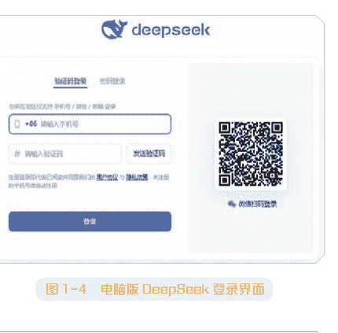

图 1-4 电脑版 DeepSeek 登录界面

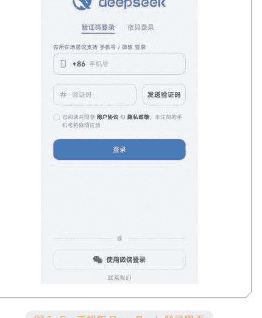

图 1-5 手机版 DeepSeek 登录界面

## 使用 DeepSeek 很简单

登录完毕后，我们就可以看到一个聊天框和一些功能按钮，如图 1-6 和图 1-7 所示，这就是它的聊天界面。想要使用它很简单，只要在聊天框中（红框标识位置）输入你想要问的内容，就可以跟它交流了。

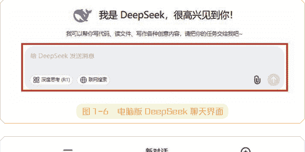

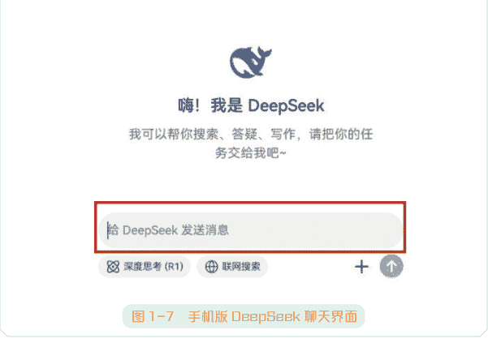

### 轻松搞懂 DeepSeek 功能

在这个聊天界面，除了聊天框，我们是不是还可以看到一些功能按钮，它们分别是做什么用的呢？

 按钮，当它没有被点亮时，跟你聊天的是 DeepSeek 的 V3 模式；当它被点亮时，跟你聊天的就会变成 DeepSeek 的 R1 模式。它们有什么区别呢？让我们先保个密，稍后再说。

 按钮，就像名字上显示的那样，一旦点亮它，它就会像你上网搜索信息一样，在网络上寻找有用的信息来回答你的问题。如果不被点亮，它的记忆和知识库就会停留在 2024 年 7 月（DeepSeek 的 V3 模型在这之后引入了专家混合架构），你要问它之后的事情，它就不知道了，甚至可能跟你“胡说”。

 按钮是“发送”按钮，单击后可以把你输入在聊天框的内容发送出去，DeepSeek 就会根据你的问题给出回答。

电脑版上的  按钮，单击后则允许你上传图片或文件，方便 DeepSeek 更准确地理解你的需求。

手机版上的  按钮，单击后可以上传文件，也可以拍照识别文字、上传图片识别里面的文字。

除了这些功能之外，细心的你可能还会注意到电脑版聊天界面的左上角（见图 1-8）和手机版聊天界面的上方（见图 1-7）还有一些小功能按钮，它们又是什么呢？


电脑版中的  和手机版中的  这两个按钮是同一个功能，就是“打开边栏”。在边栏里，你可以看到你跟 DeepSeek 的所有聊天记录，方便随时回顾；也可以单击后进入，继续在那个聊天界面里聊天。

电脑版中的  和手机版中的  这两个按钮是同一个功能，就是“开启新对话”。假如你想要 DeepSeek 忘记你们之前所有的聊天内容，就可以单击这个按钮，DeepSeek 会立即清空之前的对话，重新开始跟你交流。

### V3 和 R1，DeepSeek 模式大变身

DeepSeek 的基础按钮我们介绍完了，现在，回到之前提到过的问题，DeepSeek 的 V3 和 R1 有什么区别呢？

V3 能完成你的大部分需求。2025 年 3 月，V3 更新了一个新版本，加强了推理、数学等任务上的表现水平，在写作能力和搜索方面也大大升级。可以说，这个版本的 V3，只要不是很复杂的推理任务，都能完成得很好。

R1 则是专注于推理的模型，在开启它的时候，DeepSeek 输出内容时会展示一个“深度思考”过程，如图 1-9 所示，告诉你它是如何一步步得出给你的结论的。R1 的这一特点特别适用于解答需要逻辑严密的复杂问题。


R1 的思考过程值得参考，它能够帮助你全面地看问题和学习推理思维，提升逻辑思维能力。


下面，我们用一个更加具体的例子来说明 V3 和 R1 的区别。

例如，我们分别问 V3 和 R1，1+1 等于几。

V3 会这样给你答案，如图 1-10 所示。


而 R1 则会这样回答，如图 1-11 所示。

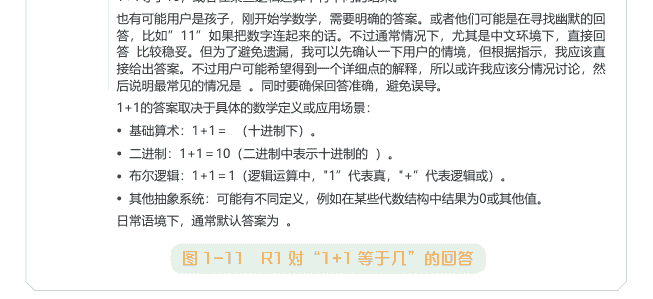

我们可以看到 V3 会直接给出答案，并说明这是最基本的数学加法结果。但 R1 就会 “想得很多”，考虑各种可能的情况，然后给你不同情况下 1+1 的答案。可以说，比起 “正经优等生” 的 V3，R1 更擅长全方面发散思考。但也因为这样，R1 更容易 “想歪”“想偏”，在输出答案的时候出现不同答案。

## 成为提问“小能手”

### 有“个性”的 DeepSeek

现在，我们已经把“智能家教”DeepSeek 请到了身边。但如何才能跟它顺畅地交流呢？DeepSeek 有它自己的个性，跟它交流需要一些“秘诀”。

如果没有掌握这些秘诀，DeepSeek 可能会误解你的意图，导致回答得莫名其妙。而掌握这些“秘诀”，你就能更高效地利用 DeepSeek，让它成为你最好、最贴心的“家教”。

在介绍“DeepSeek 交流秘诀”前，我们先要摸清楚 DeepSeek 的“个性”，知道它有哪些特点。


**特点一：懂得看字，但看不懂图和表。** DeepSeek 是一个文字大师，你在聊天框输入文字，它能够理解你的意思。通过上传文档，DeepSeek 也能读懂里面的文字。甚至你给它上传的文档中有带文字的图，它也能识别出图里面有哪些字并理解文字内容。但 DeepSeek 不会直接认图和表，如果你将一幅小猫的图案上传给它，问它图里有什么，它便回答不了，只会直接告诉你“未能提取到文字”，如图 1-12 所示。

### 特点二：不会画画，但是会用符号做一些简单的图像。

既然连图都“不认识”，DeepSeek 自然也就不会画画。如果你要它画一只猫，它就会回答你它没办法绘制图像，但为了满足你的期待，它可以用文字为你描述一只猫的样子，或用符号拼凑一只可爱的猫，如图 1-13 所示。

### 特点三：对话文字有限，在一个对话里会记住前后内容，分析你的身份，但在新对话里会忘记。

DeepSeek 能在一个对话里记住之前的聊天内容，还会根据你之前跟它聊的内容分析你的身份和提问意图，并按照分析结论输出不同的内容。

例如，如果你之前告诉过它你是小学生，那么它之后可能会用更适合你的说话方式跟你交流。又例如，你在问过它“1+1等于几”之后让它画小猫，就能看到它在“深度思考”时会结合之前的问题思考你提问的目的，如图 1-14 所示。

如果开启新对话，它就会忘记之前所说的一切。这样做有一个好处，就是它不会被之前的问题干扰思路。如果你想要它换个说话方式，就单击“开启新对话”按钮吧！

那我们能在一个对话框里一直聊下去吗？

答案是不能。为什么呢？有两个原因。一是虽然在同一个对话框里，DeepSeek 会尽量记住你们之前聊天的所有信息，但随着对话内容增多，DeepSeek 的记忆负担加重，它可能会出现记忆混淆或者忘记一些内容的情况，就像我们也没办法轻易记住好几万字的内容一样。二是为了减轻 DeepSeek 的记忆负担，创造它的科学家们给它设置了一个聊天字数上限。如果超出这个上限，你再问它，它就会让你展开新对话，如图 1-15 所示。

**特点四：有时会因太忙无法回答你。** 因为 DeepSeek 实在是太“热门”了，所以跟它聊天，请求它帮助工作、学习的人很多。有时，它可能因为要同时处理很多内容，无法马上回答你，会告诉你“服务器繁忙，请稍后再试”，如图 1-16 所示。这时，你需要耐心等一等，然后再单击“重新生成”按钮，它就会重新开始尝试思考。

**特点五：喜欢逻辑清晰、明确的提问。** 就像我们跟人说话时一样，如果别人啰啰嗦嗦说一大堆却讲不到重点；或者说的内容前后不连贯，东一榔头西一棒槌，那我们可能会听不懂他们想表达什么，甚至会不耐烦。DeepSeek 虽然是脾气很好的 AI，不会不耐烦，但如果你跟它交流时不讲重点或者内容乱七八糟，它可能会一头雾水，理解错你的意思，回答出的内容可能不符合你的要求。

**特点六：DeepSeek 也会犯错。** DeepSeek 虽然很聪明，但它并不是无所不能，有时它输出的内容也会出现错误。错误的出现跟它的信息库和思维模式，以及你提问的方式都有关系。所以我们在通过它学习时，也要保持批判和求真的态度，认真核实它生成的内容，不要盲目信任。

例如，我们问它“strawberry”这个单词中有几个 r，让它直接回答数字，它可能会数成“2”，如图 1-17 所示。但实际上，这个单词里有 3 个 r。

如果你发现了它的错误，可以告诉它，这样有利于它成长，就像老师告诉你某道题目做错了一样。

### 特点七：DeepSeek 脾气很好，但也有它的底线。

DeepSeek 可以说是一个有耐心、脾气很好的“家教”，它不会动不动就批评你，说你“脑子笨”“不专心”“不适合学数学”，而是会耐心地跟你交流，贴心地安慰你，给你建议，如图 1-18 所示。

DeepSeek 也很有道德底线，不会回答不合法、违背社会道德的问题。如果有人提那样的问题，它会严词拒绝。这一点我们也应该向它学习，做一个正直、善良的好孩子。

### 跟 DeepSeek 交流的秘诀

了解了 DeepSeek 的一些特点后，就让我来告诉你，跟 DeepSeek 交流的秘诀吧！这些秘诀能让你的提问效率加倍，也能让你在学习上进步得更快。

#### 秘诀一：提问要精准，拒绝模糊
关键：别让问题像雾里看花。
例如：不问“数学怎么学”，而问“初二几何证明题找不到思路，有什么训练方法”。
> **小贴士** 问题越具体，得到的答案越实用！

#### 秘诀二：拆分问题，分步解决
关键：把大问题变成小问题。
例如：不问“我怎么学好语文”，而问“我怎么写好作文”。
> **小贴士** 问题拆得越细，答案越有针对性！

#### 秘诀三：资料充足，但不宜过度
关键：让 DeepSeek 知道更多信息。
例如：你想要 DeepSeek 给你制订学习计划，就要告诉它你的年级、计划目标、具体学科等信息，但不要一股脑堆太多，而是突出最重要的几个要求。
> **小贴士** 信息越充足，DeepSeek 就能给你越准确的答案！

#### 秘诀四：设置限制条件
关键：给 DeepSeek 一些限制。
例如：不问“给我分析这道题的解题思路”，而问“给我分析这道题的解题思路，知识点不要超过小学五年级的知识范围”。
> **小贴士** 这样能避免给出的回答太深奥。

#### 秘诀五：要求核实，避免错误
关键：要求 DeepSeek 提供出处。
例如：在提问时可以加上一句“请提供输出内容的出处”。
> **小贴士** 这样你就能根据它给的出处，核实 DeepSeek 是不是犯错了。

#### 秘诀六：多问思路，少要答案
关键：自己思考才是硬道理。
例如：不问“这道题怎么做”，而问“这道题的解题逻辑是什么？我卡在第三步了”。
> **小贴士** 理解方法比抄答案更有利于你的成长！

#### 秘诀七：多元视角看问题
关键：别被单一的答案框住。
例如：不问“是《故乡》写得好还是《阿长与山海经》写得好”，而问“《故乡》和《阿长与山海经》各自的优点和缺点是什么”。
> **小贴士** 多角度分析，选择更明智！

#### 秘诀八：持续学习，不断进步
关键：拒绝临时抱佛脚。
例如：不问“怎么应付月考”，而问“如何培养每天坚持复习的习惯”。
> **小贴士** 持续进步才是真学习！

### 避免落入提问陷阱

在用 DeepSeek 帮助学习时，我们可能会踩一些坑，如明明想搜解题思路，结果出来一堆没用的；想问作文灵感，它却回答得稀里糊涂……别慌！这就教你用最简单易懂的方式，避开提问中的常见陷阱。掌握这些招儿，保准让 DeepSeek 乖乖听话，学习效率翻倍！

> ### 安全小贴士
1. 千万不要告诉 AI 你的真实姓名、家庭住址。
2. 不要透露学校和班级的具体信息。
3. 遇到需要输入个人信息的情况，一定要先问爸爸妈妈。

现在，让我们来看看最常见的 4 个提问陷阱，学会避开它们，你就能获得更准确的帮助啦！

#### ◇ “模糊提问”坑：问题要说清，AI 才聪明

**避坑关键：** 像给同学讲题一样，把“什么科目”“哪道题”“哪里不会”都说清楚！

**踩坑案例：** “这道题不会！”（AI 蒙圈：哪道题？哪里不会？）

**正确提问：** “五年级数学：果果的身高是 1.6 米。某天下午，果果站在学校操场旁，他的影长是 2.4 米。此时，他身旁的一棵小树影长是 6 米，这棵小树的高度是多少米？要用比例的方法解。” DeepSeek 给出了分解步骤，如图 1-19 所示。

#### ◇ “问题扎堆”坑：一次只问一个

**避坑关键：** 像吃糖一样一次一颗，不同的问题也要一个一个问！

**踩坑案例：** “作文怎么写？还有英语语法和数学应用题！”（AI混乱中）

**正确提问：**

第一问：“四年级要写一篇以‘我学会了……’为题的作文，要求语句通畅，内容详尽。”DeepSeek会生成作文，如图1-20所示。

第二问：“英语一般现在时中，主语是第三人称时，谓语动词加s的规则有哪些例外？”DeepSeek给出了解释，如图1-21所示。

#### ◇ “隐身提问”坑：亮出你的“学生证”

**避坑关键：** 告诉 DeepSeek 你的年级，就像告诉医生你的年龄一样重要！

**踩坑案例：** “这个知识点怎么学？”（DeepSeek 不知道你是小学生还是初中生。）

**正确提问：** “我是初二学生，学凸透镜成像规律时，总是分不清实像和虚像，有什么好的理解方法吗？” DeepSeek 会生成回答，如图 1-22 所示。但注意提问时不要透露自己的学校、姓名等隐私信息。

#### ◇ “缺胳膊少腿”坑：提问要完整

**避坑关键：** 检查你的问题是否具备“3 有”——有背景、有要求、有资料！

**踩坑案例：** “帮我查资料！”（AI：查什么？怎么查？）

**正确提问：** “五年级科学课要做‘水的循环’手抄报，要求列举 3 个有趣的水循环现象，用小学生能听懂的话解释，并配上手绘技巧。” DeepSeek 会生成回答，如图 1-23 所示。

## 高分素养训练营

### 学习可以很好玩

在有些小朋友的眼中，学习往往是一件枯燥的事情，尤其是当他们面对厚厚的课本和繁多的作业时。想象一下，如果学习能像玩游戏一样充满乐趣，那会是怎样的体验呢？DeepSeek 就能帮我们做到！

### 为什么会觉得学习没劲，但对游戏很感兴趣

有些同学喜欢玩电子游戏，对游戏中一些重复性的任务乐此不疲，但当他们面对重复性的学习任务时，就马上丧失了兴趣，这是为什么呢？

这是因为游戏开发者在游戏设计上精准地抓住了人们的心理，给人们带来良好的体验。

**明确的目标，难度递增的任务。** 游戏任务一般都是明确的，如告诉你“要去某个地方找某个人”，而且难度也是慢慢增加的。如果你刚开始玩游戏，遇到的敌人往往不会太强，等你的能力得到提升，才会出现更强大的敌人。而学习任务有时并不明确，甚至难度会超出一些同学的能力水平，做不好就容易让人产生挫败感。

**互动性高，有成就感。** 玩游戏时，我们可以和朋友一起组队玩，互动性很高。在跟其他人合力玩游戏时，会有情感的交流。如果在多人游戏中表现出色，还会收获别人的崇拜，由此产生的成就感会让我们感到快乐。而学习更像“一个人的战斗”。

**游戏方式有趣而多元。** 游戏的方式通常比学习更加有趣、多元，主观能动性较高，大家在玩的时候会有新鲜感、参与感。学习往往只是单调地做题、背诵和被动地听课，这在吸引力方面就输给了游戏。

> DeepSeek 可以让学习变得像游戏一样有趣。

### 将学习任务拆解成一个个小怪兽

你可以把你的学习目标或学习任务告诉 DeepSeek，DeepSeek 能像策划游戏那样帮你将学习任务按照难度拆解成一个个小怪兽，让你按照由易到难的顺序去完成它们，就像打怪通关一样，获得“升级”的成就感。

例如，一名六年级的同学想要提升语文作文水平，现在他的问题有：不会组织材料、不擅长使用修辞手法、语言比较“大白话”。这名同学可以这样向 DeepSeek 提问：

> 我是一名六年级的学生（自我介绍），想提升语文作文水平（具体目标），准备用 8 周的时间完成目标，每周可以用 3 小时来学习（时间规划），我现在的问题有：不会组织材料、不擅长使用修辞手法、语言比较“大白话”（当前存在的问题），请帮我设计一个学习方法，要拆解成阶段性步骤，并按照由易到难的顺序排列（需求说明）。

DeepSeek 生成了一个具有夯实基础、技巧突破、综合提升、实战检验 4 个阶段的方案，如图 2-1 所示。

### 把学习变成团体小游戏

DeepSeek 还能帮你把一些学习任务变成能跟朋友一起玩的团体小游戏，让你在学习中收获与人玩耍的快乐。

例如，一名四年级的同学想要记住这个学期学到的数学知识，但他觉得一个人学习太无趣，想喊几名同学一起用多人游戏的方法学习。他可以这样向 DeepSeek 提问：

> 我是一名四年级的学生(自我介绍)，用的人教版教材(教材说明，让 DeepSeek 更清楚是哪些内容)，我想记住四年级下学期学到的数学知识(具体目标)，请帮我设计几个既能跟3名同学一起进行，又能帮我们记住这些数学知识的游戏(需求说明)。

DeepSeek 按照需求，为他生成了 4 个游戏方案，如图 2-2 所示。

```
好的！根据人教版四年级下册数学目录，我为你们设计了4个团队协作游戏，既能巩固知识又充满趣味性，每个游戏覆盖~3个单元知识点，适合3~4人小组完成。以下是具体方案：

游戏1：「小数超市大作战」（适合：小数的意义/小数加减法）
道具：商品价签（自制小数价格，如铅笔3.5元）、购物清单、计算器（验证用）

规则：
1. 角色扮演：1人当收银员，其他~3人当顾客。
2. 任务：
   - 顾客A用「加法」买3样商品（如笔记本+橡皮+尺子），心算总价报给收银员。
   - 顾客B用「减法」计算找零（如付10元买6.8元的文具盒）。
3. 得分：答案正确+1分，收银员验证错误则扣1分，轮流换角色。
技巧：用「元角分」转化法帮助计算（如3.5元=3元5角5分）。
```

图 2-2 DeepSeek 生成的数学知识记忆游戏方案（节选）

### 根据你的兴趣改造学习方式

你还可以让 DeepSeek 按照你喜欢的方式，把枯燥的学习过程变成一场有趣的冒险。

> 我是一名六年级的学生（自我介绍），目前用部编版教材（教材说明），平时比较喜欢打游戏（兴趣爱好），不喜欢语文这种枯燥的、需要死记硬背的课（不喜欢的课程），可以将我的兴趣爱好和语文内容结合起来，制订一个特别的语文课程吗（具体需求）？

DeepSeek 会根据他的兴趣爱好提供一个有趣的语文学习计划，如图 2-3 所示。

> 我是一名六年级的学生，喜欢打游戏，特别不喜欢语文课。我们可以
> 1. **英雄档案库**：选游戏里你最喜欢的英雄（如李白、诸葛亮），用教材中的描写方法为他写“档案”——外貌（服饰/武器）、性格（台词）、背景故事（游戏中的语言和世界观）。
> 2. **吃鸡角色日记**：假设你是吃鸡中的角色，用第一视角写跳伞落地时的心理活动：“我的手心全是汗，飞机舱门打开时，我瞥见军事基地上空有四队人……”（关联《那个星期天》的心理描写技巧）。
> 奖励：完成档案和日记后，可设计该英雄的“专属技能书”（用比喻/夸张修辞描述技能效果）。
>
> 第二阶段：地图任务——攻克说明文与古诗
> 目标：理解说明文逻辑、背诵古诗（对应六下第5单元《真理诞生于百个问号之后》、古诗文单元）
> 玩法：
> 1. **峡谷地理课**：把王者峡谷地图转化为说明文，分析地形（三条分路、野区结构）、防御塔机制（用“列数字/作比较”说明文手法）。
> 2. **吃鸡缩圈背诗法**：背诵《采薇》（早春呈水部张十八员外）时，想象自己身处吃鸡决赛圈——每背对一句，毒圈缩小一次；背错则“掉血”，需用注射“急救包”补救。
> 奖励：解锁“地图彩蛋”——用古诗给游戏场景命名（如野区草丛“离离原上草”）。

## 02 DeepSeek 为你开启学霸之路

> 有些学霸看上去似乎不够努力，却依然学得好；有些同学明明很努力，成绩却没有起色，是他们不够聪明吗？

### 我们和学霸的差距在哪里？

其实，那些很努力但成绩还是不够好的同学，跟学霸的差距并不在智商上，而是在其他方面。现在，就让我们看看 DeepSeek 是怎么说的吧，如图 2-4 所示。

-   🔍学霸的“隐形优势”在哪里
1. 学习方法更科学（不是死记硬背）
    - 主动思考vs被动接受
        - 普通同学：反复抄写、机械刷题，只记住答案，不理解原理。
        - 学霸：先理解逻辑，再做题巩固，遇到错题会分析“为什么错”。
    - 费曼学习法（高效记忆）
        - 学霸会用自己的话复述知识点，甚至“假装教别人”，确保真正掌握。
        - 普通同学可能只是“看懂了”，但无法清晰表达。
2. 思维习惯更高效（减少无效努力）
    - 抓重点vs平均用力
        - 学霸会优先攻克高频考点（如数学的函数、语文的阅读理解套路）。
        - 普通同学可能花大量时间在低效细节上（如抄写生字10遍，但考试不考）。
    - 结构化思维（知识成体系）
        - 学霸学新知识时，会主动联系旧知识，形成“知识网”。
        - 普通同学可能学一点忘一点，知识点零散。
3. 从小养成的学习习惯（自动进入高效状态）
    - 专注力更强（减少分心）
        - 学霸学习时往往能进入“心流状态”（高度专注，忘记时间）。
        - 普通同学可能学5分钟就忍不住看手机、走神。
    - 时间管理（短时高效vs长时间低效）
        - 学霸常用“番茄钟学习法”（5分钟专注+5分钟休息）。
        - 普通同学可能“耗时间”，坐3小时但真正学习只有1小时。
4. 记忆方式更聪明（不是靠硬背）

我们可以看到，DeepSeek提出了学霸的4个“隐形优势”，即学霸的学习方法更科学、思维习惯更高效、学习习惯更好、记忆方式更聪明。

这4个方面的差距，我们可以让DeepSeek帮我们弥补。
请记住，DeepSeek虽然可以帮助我们弥补和学霸之间的差距，但要真正成为学霸，不能被动地去模仿，而应该根据自己的实际情况去理解、消化、实践。

接下来，就让我们开始走向学霸之路吧。

### 定制个性化学习方法

每个同学都有自己的个性，有些同学喜欢阅读，有些同学喜欢实践，有些同学擅长处理细节，有些同学擅长概括。每个学科也有它的特点，如语文需要感性的体悟、数学需要理性的逻辑、英语需要积累与实践。

虽然这个世界上有很多好的学习方法，但并不存在一种适用于所有人的万能学习法。例如，适用于A同学的学习方法，B同学可能并不适用；适合语文的学习方法，用到数学上可能就没用了。

所以，学习方法只是“好”是不行的，更重要的是它要适合你。


DeepSeek 擅长推理分析，又“知识渊博”，掌握世界上大部分的学习方法，它能够在了解我们的情况后，为我们量身定制专属的学习方法。有了合适的学习方法，我们就能在学习上事半功倍。

例如，一名六年级的同学，擅长处理细节问题，但不擅长概括；记忆力不是很好，但很擅长跟人交流。他想要一个适合自己的数学学习方法，可以这样向 DeepSeek 提问：

> 我是一名六年级的学生（自我介绍），擅长处理细节问题，但不擅长概括；我记忆力不是很好，但很擅长跟人交流（自己的特点）。可以根据我的性格帮我制订一个适合我的数学学习方法吗（具体需求）？

DeepSeek 会根据他提交的内容制订数学学习方法，如图 2-5 所示。

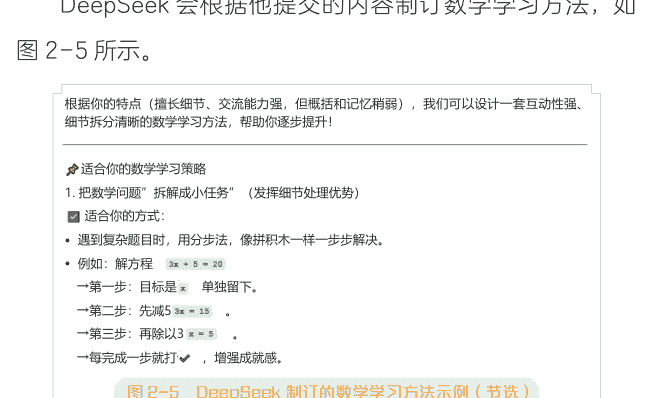

学霸之所以能够高效率地学习，很重要的一点就是他们更加有条理、有逻辑。

他们有明确的学习目标，懂得如何抓住学习重点，更懂得如何总结、归纳知识点。

DeepSeek能帮同学们完成找到学习目标、抓住学习重点、有条理地组织知识点等任务，拥有“学霸思维”。

### 破解不知道学习目标的问题

如果你想要确定学习目标，可以把你的学习阶段、要学习的学科告诉DeepSeek，它就能帮你确定学习目标。

例如，一名六年级的同学，成绩在班上是中游，他对自己的学习很迷茫，觉得自己找不到学习目标。这名同学可以这样向DeepSeek提问：

> 我是一名六年级的学生（自我介绍），成绩在班上是中游，我现在觉得很迷茫，找不到学习目标（情况说明），请告诉我我未来的学习目标（具体需求）。

DeepSeek会为他提供一些学习目标，如图2-6所示。如果你也感到迷茫，就试着问问DeepSeek，选择你可以达成的目标去做吧。

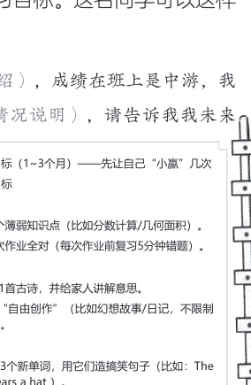

### DeepSeek，知识点整理大师

擅长逻辑推理的 DeepSeek 同样是一个知识点整理大师，它能帮你把各种散乱的知识点整理得如同学霸笔记一般有条理，帮助你更好地把握学科知识，让你复习时知道重点在哪里，提高复习效率。

例如，一名六年级的同学为了综合复习，收集了小学语文阶段的古代文学常识，但内容太多且非常杂乱，他没有时间去整理。这时，他可以这样向 DeepSeek 提问：

> 这是我收集的一些古代文学常识（上传文件），请帮我把知识点梳理好并分类（具体需求）。

DeepSeek 很快就能帮他完成梳理工作，将原本散乱的内容分好类，如图 2-7 所示。

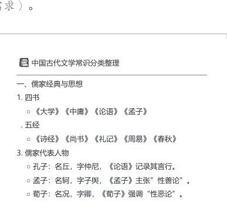

图 2-7 DeepSeek 梳理的古代文学常识示例（节选）

### 学习 DeepSeek 的思考模式

其实，DeepSeek 自己也是一个思考起来很有条理的“学霸”，它在回答问题时的思考过程也值得我们学习。

还记得怎么看它的思考过程吗？对了，就是单击“深度思考（R1）”按钮。

例如，我们问 DeepSeek：

比 2 多 6 的数是（ ），9 比 4 多（ ）。答案是什么？

它在输出答案的同时还会附上解析过程，如图 2-8 所示。


图 2-8 DeepSeek 输出的答案及解析

但现在我们要看的并不是它的答案，而是它的思考过程，如图 2-9 所示。


图 2-9 DeepSeek 思考数学题的过程示例

我们可以看到，它的思考过程是这样的：

+   列出自己要做的事情和题目
↓
看第一个空 → 分析题目 → 计算并得出结论 → 反思结论是否正确
→ 思考其他可能 → 确定结论
↓
看第二个空 → 分析题目 → 计算并得出结论 → 反思结论是否正确
↓
再次检查 → 思考其他可能 → 确定结论
↓
确定结论


虽然这个题目很简单，但是 DeepSeek的思考过程依旧细致、严谨。DeepSeek 首先确定自己要做的题目是什么，然后按照题目留空的顺序一个个思考。它先是理解题目内容，再进行计算。在思考的过程中，DeepSeek 会反复验证自己有没有做错，是不是还有其他可能。直到排除所有可能后，才得出最后的结论。
我们在向 DeepSeek 提问时，不妨多多开启“深度思考（R1）”模式，在参考它给出的答案时，也不妨浏览一下它的思考过程，试着学习它的思考方式。

### 帮你养成学霸习惯

想要成为学霸，良好的学习习惯自然是少不了的。当其他人在学习的时候，你却在看漫画，久而久之，你的成绩自然容易下滑。DeepSeek 可以根据我们的实际情况，为我们量身定制学霸习惯培养计划。


例如，一名五年级的同学，他的成绩在班上是下游。他觉得自己这样不行，想要培养良好的学习习惯。因此，他可以这样向 DeepSeek 提问：

> 我是一名五年级的学生（自我介绍），成绩在班上是下游，语文和数学成绩都很差，只有英语稍微好一点。我的专注力很差，总是没办法静下心来学习，还喜欢刷手机，常常制订了计划却半途而废（详细情况介绍）。请为我制订一个养成良好学习习惯的计划（具体需求）。

DeepSeek 会针对他的问题，为他制订一个学习习惯培养计划，如图 2-10 所示。


我们学习的内容里，有很多都是需要去记忆的，如语文的古诗词背诵、数学的各种公式、英语的单词和语法等。很多同学觉得自己天生记忆力不行，什么都记不住，一听到“背诵”这个词就眉头紧锁。
其实，根本没有“天生记忆力”的说法，记忆力也是可以训练的，只是我们没有找到合适的记忆训练方法而已。

### 提供定制记忆训练法

DeepSeek 能根据我们的特点，帮我们找到最合适的记忆训练方法。按照方法训练，我们的记忆力就能得到提升！
例如，有一名同学觉得自己记忆力不行，背过的东西很快就忘记了，尤其记不住数字和英语。他想要训练记忆力，可以这样向 DeepSeek 提问：

> 我觉得自己记忆力不行，背过的东西很快就忘记了，尤其记不住数字和英语（记忆力情况说明）。请给我一个简单、实用的记忆力训练方法（具体需求）。

DeepSeek 会根据他的情况和需求，提供记忆训练方法，如图 2-11 所示。

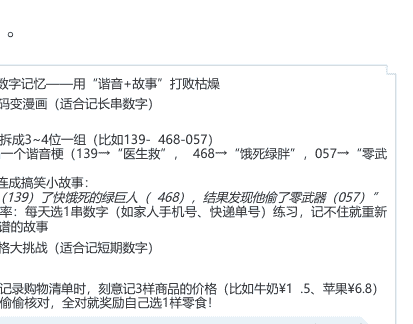

### 提供极具针对性的记忆方法

好的记忆方法能提高我们的记忆效率。要知道，每个人的思维方式不同，记忆力最好的时间段也不同。不同的内容，所需要的记忆方法也不一样。

我们不可能掌握所有的记忆方法，但 DeepSeek 能够根据我们的情况提供极具针对性的记忆方法。

例如，有一名同学，他的逻辑思维能力很强，但不擅长形象思维。他每天早上起床时记忆力最好，每天有半小时的背诵时间。他想要在 10 天内背诵 500 个英语单词。他可以这样向 DeepSeek 提问：

> 我的逻辑思维能力很强，但不擅长形象思维。我每天早上起床时记忆力最好，每天有半小时的背诵时间（自身情况说明）。我想要在 10 天内背诵 500 个英语单词（要背诵的内容），请给我提供一个适合我的记忆方法（具体需求）。

DeepSeek 会根据他的情况和需求提供记忆方法，如图 2-12 所示。

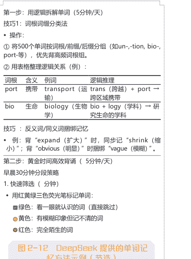

## 03 DeepSeek 让你成为时间管理大师

活动需要查资料，但你的作业还没有做完；放学回家后时间不多，却还要在完成作业后看爸妈要求看的书，自己也想看看动画片；好不容易到了周末，又要去上各种课外兴趣班，做各科的作业，参加各种活动……你是否经常觉得时间不够用？


别担心！DeepSeek 能帮你快速、精准地收集资料，节省你的时间；帮你拆解各项目标，并按照重要程度合理安排；根据你的实际情况，定制专属规划，让你成为时间管理大师。

### 告别无效搜索，直击干货

当你需要寻找学习资料或为一些活动收集信息时，往往会打开浏览器搜索，然后一个个单击、筛选、整理，这样真的很费时间。没关系，别忘了 DeepSeek 也能“联网搜索”！它不仅能根据关键词快速搜索、筛选信息，还能帮你给信息分好类，整理成条理清晰的内容，帮你节省大量无效搜索的时间。

不过要注意，DeepSeek 也会提供错误或编造的信息，所以在让它搜索时记得加上“提供输出内容的出处”。

例如，一名初中生需要收集一些科技领域的影视作品资料，他可以打开“联网搜索”功能，然后这样向 DeepSeek 提问：

> 我是一名初中生（介绍自己），我需要收集一些科技领域的影视作品资料，包括表现科技事业和科技工作者的电影、电视剧、纪录片等（要收集的内容）。请为我提供资料（具体需求），并提供输出内容的出处（防虚构提示）。

DeepSeek 就会收集资料并梳理出各项内容，如果开启“联网搜索”，还能看到它引用的网页内容，方便你确定它是否准确，如图 2-13 所示。

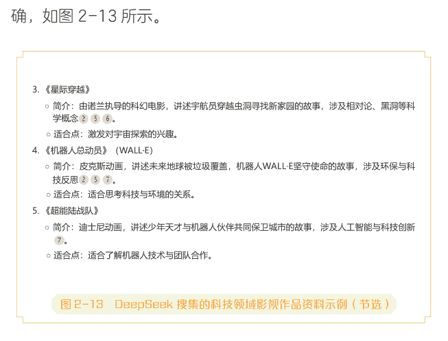

或许你也遇到过这样的情况：想要规划周末的时间，却发现自己要做的事情堆得跟山一样——要参加班级活动排练，要完成语文、数学、英语作业，跟朋友约了一起打篮球，还要上画画的兴趣班，之前答应了朋友帮他画的画还没开始画，还想去看一部动画电影……想做的事情满满当当，却不知道从哪里下手。


### DeepSeek 帮你整理目标，让你不再忙乱

例如，一名同学就面临上面说的那些问题，他不知道该怎么安排事情完成的顺序，就可以这样向 DeepSeek 提问：

> 我是一名学生（自我介绍），想要规划好周末的时间，但是我要完成的事情很多，要参加班级活动排练，还有语文、数学、英语作业要做，约好了跟朋友一起打篮球，还要上画画的兴趣班，之前答应了朋友帮他画的画还没开始画，还有一部动画电影想要去看（情况说明）。请按照这些事情的重要程度，帮我安排一个时间计划（具体需求）。

DeepSeek 会根据事情的重要程度，生成一个时间计划，如图 2-14 所示。

#### 任务优先级排序（从高到低）
1. 紧急且重要
   - 班级活动排练（通常有固定时间）
   - 朋友委托的画（已承诺，涉及信用）
   - 学科作业（避免周日晚上赶工）
2. 重要但不紧急
   - 画画兴趣班（长期技能培养）
   - 篮球活动（健康和社交）
3. 娱乐放松
   - 动画电影（可作为完成任务的奖励）

#### 周六 & 周日分日计划
**周六（攻坚日：解决最紧急任务）**

| 时间段 | 事项 | 执行技巧 |
| :--- | :--- | :--- |
| 8:00~8:30 | 起床+早餐 | 听轻音乐唤醒大脑 |
| 8:30~10:30 | 班级活动排练 | 提前准备好道具/台词 |
| 10:30~11:30 | 画朋友的画 | 用番茄钟法（画 5 分钟休息5分钟） |
| 11:30~13:30 | 午餐+午休 | 闭眼休息15分钟 |

图 2-14 DeepSeek 生成的周末时间计划示例（节选）

每天要上课、写作业、参加社团活动，还要准备考试，感觉自己忙不过来。


### 定制时间规划，让你不再忙乱

不用着急，DeepSeek 能根据你的个人作息，为你生成专属的动态时间表。

例如，一名六年级的同学周一到周五白天上课，晚上除了做作业还要进行数学和英语的专项培训。周六、周日除了做作业，每天还要去上两小时的钢琴培训班，另外他每周要锻炼 4 小时。在这种情况下，他还想抽出一些时间去玩。他可以这样向 DeepSeek 提问：

> 我是一名六年级的学生（自我介绍），我周一到周五的8:00～17:00上学，晚上做作业要2～3小时，还要额外进行数学与英语的专项培训。周六、周日除了做作业，每天还要上两小时的钢琴培训班。每周我还要锻炼4小时，此外我还想抽出一些时间去玩（具体情况说明）。请为我制订一个一周的时间管理方案（具体需求）。

DeepSeek 根据他的情况，制订了一个兼顾他各项需求的时间管理方案，如图 2-15 所示。

#### 📅 周一至周五（上学日）时间表

| 时间段 | 事项 | 关键技巧（省时/提效） |
| :--- | :--- | :--- |
| 6:30~7:00 | 起床+早餐 | 听英语音频（课本/单词） |
| 7:00~7:30 | 黄金记忆时间 | 背英语单词或语文课文（用词根法/联想记忆） |
| 8:00~17:00 | 学校课程 | 课间做简单拉伸，避免久坐 |
| 17:30~18:30 | 晚餐+短暂休息 | 和家人聊天放松，不碰手机 |
| 18:30~ 20:30 | 作业时间（2小时） | ☆分段学习法：<br>-每30分钟换一科（数学→英语→语文）<br>-用定时器严格计时 |
| 20:30~ 21:00 | 数学/英语专项培训 | 提前整理好问题，针对性解决 |
| 21:00~ 21:30 | 自由时间（玩/兴趣） | 允许玩手机/游戏，但设闹钟（超时扣第二天自由时间） |
| 21:30~ 22:00 | 睡前准备+复习 | 快速过一遍当日错题或单词 |
| 22:00 | 睡觉 | 保证8小时睡眠 |

+   📍 上学日关键策略：
1. 作业提速技巧：
   - 遇到难题先标记，集中最后15分钟解决或请教家长。
   - 用“三色笔法”：黑笔写答案，蓝笔写关键步骤，红笔标错题。
2. 避免分心：学习时手机交给家长，或用“番茄ToDo”App锁屏。

#### 📅 周六 & 周日（周末）时间表

| 时间段 | 事项 | 灵活调整项 |
| :--- | :--- | :--- |
| 8:00~8:30 | 起床+早餐 | 听钢琴曲唤醒大脑 |
| 8:30~10:30 | 作业时间（2小时） | 优先完成最难科目 |


## 04 DeepSeek 帮你提升专注力

你或许有过这样的状态：在上课、做作业、考试时，注意力一不小心就“溜走了”，没办法专注在正在做的事情上。


这种容易走神的状态，就是专注力不够的表现。所谓专注力，就是我们在一定时间内把注意力集中在某个对象或任务（如书本、作业等）上的能力。

**专注力能让我们——**

- 忽略无关干扰，更快地从资料中筛选出重要信息。
- 长时间持续做一件事情，如认真读书一小时。
- 注意力不容易被分散、打断，保持做事的连贯性。

高度的专注力能帮助我们不被干扰地思考问题、处理事务，提高学习和生活的效率。反之，专注力不够，就会导致我们学习效率低下，即使花了很多时间去学习，成绩也无法提高。

### 是什么在影响我们的专注力

我们会发现，身边有些同学很容易专注于学习，但有些同学总是被家长、老师批评“沉不下心”。到底是什么在影响我们的专注力呢？


**原因一：专注习惯不好。** 如果已经习惯了“一心二用”，又长期只接触短视频、短文等碎片化的信息，就没办法培养专注的习惯，导致专注力下降。

**原因二：身体状态不好。** 像睡眠不足、饮食不健康或身体不好等情况，都会让我们的大脑变“笨”，专注力也变低。比如，一个人饿着肚子或者犯困的时候就很难集中注意力。另外，小孩子因为大脑还在发育，也会比大人更不容易集中注意力。

**原因三：周围环境不好。** 周围有一些让人无法集中注意力的干扰因素，如吵吵闹闹的人群、正在播放动画片的电视等。

**原因四：心理状态不好。** 过度紧张、焦虑等不良心理状态，也会导致人没办法专注。造成紧张、焦虑的原因也可能是学习任务太重、太难。

那么，DeepSeek 能在哪些方面帮助我们提升专注力呢？

### 为你分析影响你专注力的原因

前面提到，影响专注力的原因是多方面的。不同的人在不同的情况下，没办法集中注意力的原因也是不一样的。为了解决这个问题，应该对症下药。

我们可以把自己当前的具体情况告诉 DeepSeek，让它帮我们分析影响我们专注力的原因。

例如，一名小学生希望 DeepSeek 能帮他分析自己专注力低的原因，他可以将自己的情况告诉 DeepSeek，然后这样向 DeepSeek 提问：

> 我是一名小学生（自我介绍），我平时每天都准时睡觉，吃饭也很正常，但哪怕是在家没人干扰的情况下学习，我也很难集中注意力，总是想玩手机，就算偶尔集中注意力了，持续时间也很短（详细情况说明）。请根据我的情况，分析我专注力低的原因（具体需求）。

DeepSeek 根据他的情况，对他专注力低的原因进行了分析，如图 2-16 所示。

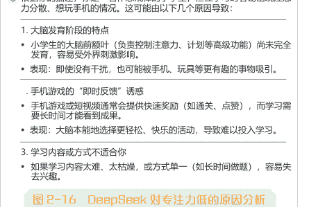

### 提供专注力训练

DeepSeek 不仅能够帮我们分析专注力低的主要原因，还能根据我们的实际情况，提供一些专注力训练的办法。

例如，一名小学生希望 DeepSeek 能改善他专注力低的问题，他可以将自己的情况告诉 DeepSeek，然后这样向 DeepSeek 提问：

> 我是一名小学生（自我介绍），我平时每天都准时睡觉，吃饭也很正常，但学习的时候总是很难集中注意力，总是想玩手机（详细情况说明）。请根据我的情况，为我提供一些针对性的专注力训练方法（具体需求），要求一个人在家就能做（其他要求）。

DeepSeek 根据他的情况，提供了一些训练方法，如图 2-17 所示。

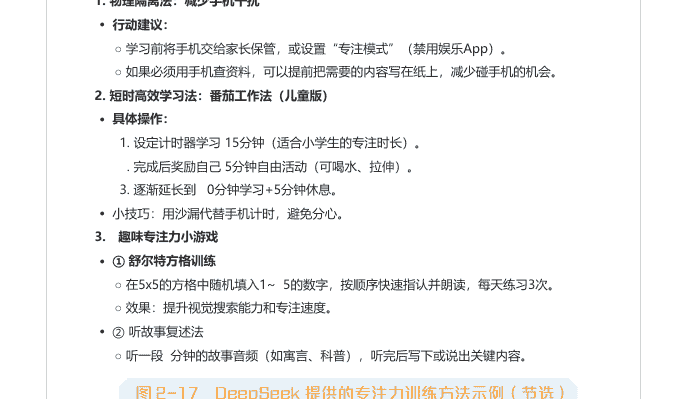

## 05 超能交流大师 DeepSeek

有时我们会遇到一些不好意思跟别人说，或者找不到人说的烦恼。我们在跟爸妈、老师、同学交流时，也可能会遇到不知道怎么去交流的情况。不用担心，DeepSeek 是一个超能交流大师，它能跟你交流，也能帮你解决交流问题！


你是不是有时候觉得心里闷闷的，却不知道和谁说？这些烦恼压在心里，越想越难受。别担心，DeepSeek 可以当你的“树洞”！你可以把烦恼一股脑儿告诉它，它会帮你分析情绪，为你提供安慰，甚至给出可行的解决方案。

例如，一名同学因为考试没考好，心情很低落，他可以用最简单、直白的方式这样向 DeepSeek 提问：

> 我这次数学没有考好，好烦啊（你的烦恼）。

DeepSeek 会分析他的情绪并给出建议，同时也会给他鼓励，如图 2-18 所示。

> 我能理解你此刻的失落和压力。考试失利带来的挫败感很真实，但请记得一次成绩并不能定义你的价值。也许我们可以这样思考：
> 1. 先接纳情绪，给自己喘息空间
>    - 去操场散散步，买杯热饮深呼吸
>    - 把烦恼写在纸上（写完后撕碎会神奇地释放压力）
>    - 给信任的朋友发条语音，单纯倾诉不说教
> 2. 转换视角看待“回家”
>    - 如果担心父母失望，可以试试提前沟通：

图 2-18 DeepSeek 生成的情绪分析与建议示例（节选）

### DeepSeek，你贴心又多变的朋友


有时候，你可能会因为感到孤单而想找个人聊聊天，这个时候就可以找 DeepSeek。
DeepSeek 可以变成你喜欢的任何角色——可以是陪你讲笑话的幽默的伙伴，可以是知识渊博的和你讨论问题的老师，甚至可以是陪你玩耍的虚拟的“宠物”！

例如，一名同学觉得无聊，想找点乐子，他可以这样向 DeepSeek 提问：

> 你现在是一只可爱的小猫（设定角色），我们来交流吧。让我摸一摸你的肚子可以吗（你想说的话）？

DeepSeek 会瞬间变成小猫跟他交流。在这个对话中，如果没有让 DeepSeek 改变人设，它会一直作为小猫跟这名同学聊天，如图 2-19 所示。

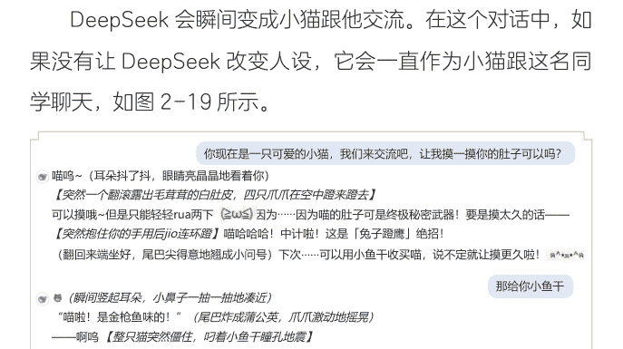

如果你喜欢奇幻故事，也可以让 DeepSeek 扮演一个魔法世界的向导，和你一起编写冒险故事！

### DeepSeek 帮你成为沟通大师


和同学相处时，你有没有遇到过不知道怎么表达的情况？例如，想拒绝别人但怕伤感情，或者想提建议却怕被误解；又或者和爸妈交流时，想要提出自己的意见又害怕被否决。

DeepSeek 可以模拟各种社交场景，教你如何高情商回应！

例如，一名同学被朋友邀请一起去网吧，但他不想去，又怕朋友不高兴，他可以这样向 DeepSeek 提问：

> 我是一名学生（自我介绍），朋友约我去网吧，但我不想去（情况说明），该怎么拒绝才不会让他生气（具体要求）？

DeepSeek 就会为他提供一个得体的交流方式，让他既能坚持自己的原则，又不伤害友谊，如图 2-20 所示。

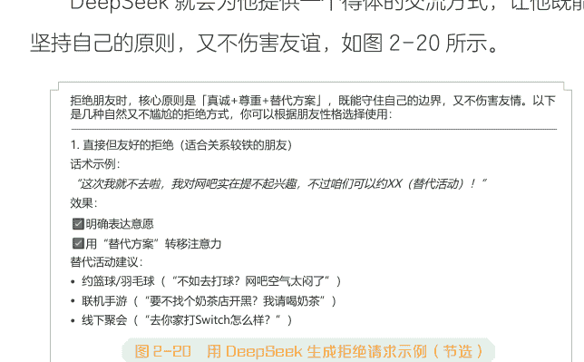


# 全能语文导师


## 为我定制书目，培养阅读兴趣

你有没有遇到过这样的情况：有时候爸妈会给你买一些他们觉得很好的书，让你去读，老师也会推荐一些书给你，你却一点都不想看？


### 不想看书，原因有什么？

**原因一：缺乏阅读兴趣。** 爸妈和老师推荐的书，都是他们觉得适合你的，认为你应该看的，但这些书可能让你感到枯燥，看不下去。除此之外，看了书却找不到人讨论，也会让人丧失阅读兴趣——相比之下，同学们热议的动画片反而更具吸引力。

**原因二：没有养成阅读习惯。** 在碎片化信息充斥的现代社会，书好像离我们越来越远。比起快节奏又好玩的视频和游戏，书实在不够“刺激”，因此我们总是会被前者吸引。这种情况下，我们很难培养出良好的阅读习惯。

这两点往往同时存在，如果对书的内容缺乏兴趣，自然没耐心去阅读，更别说发现阅读的乐趣并养成阅读习惯了。

那么，DeepSeek 能怎么帮我们解决这两个问题呢？

### 爸妈根本不知道我想看什么，但 DeepSeek 知道

DeepSeek 擅长推理分析，我们可以将自己的年龄、兴趣、喜欢的书籍、节目甚至游戏等信息告诉 DeepSeek，然后开启“联网搜索”功能，让它给我们推荐自己感兴趣的书。

例如，一名四年级的女生，喜欢中国传统文化，爱看动画片，也有几本特别喜欢的书。她可以这样向 DeepSeek 提问：

> 我是一名四年级的女生（自我介绍，如果愿意可以更详细），喜欢中国传统文化（爱好），爱看动画片（列举你最喜欢的几部动画片），也喜欢这几本书（列举你最喜欢的书籍），能帮我推荐一些我可能感兴趣且适合我的书吗（需求说明）？

DeepSeek 会认真分析她的喜好，为她推荐书目，如图 3-1 所示，不过要注意，DeepSeek 会“凭空捏造”一些不存在的书籍，建议先通过网上搜索确认这本书是否存在。

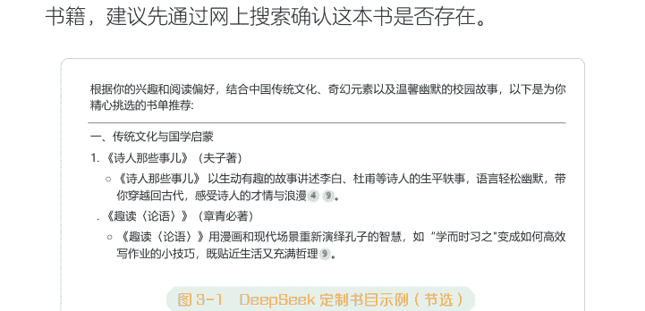

### DeepSeek，你随叫随到的读书搭子


你是否有过这样的体验？读完一本书后，很喜欢里面的某个情节或某个人物，急切地想跟人讨论。可爸爸妈妈要么忙于工作没有时间，要么没读过这本书，同学们也不感兴趣。你找来找去，找不到一个能分享感受的人。有着满腔想法却无处诉说的你感觉憋坏了，就连读书带来的乐趣似乎也变少了。

但是，不用担心，DeepSeek 就是你 24 小时在线的读书搭子！它知识广博，你甚至还能要求它按照你设定的性格跟你聊天。

例如，一名刚读完《三国演义》的同学，很喜欢关羽，他想找一个人讨论“败走麦城”这部分内容，他可以这样向 DeepSeek 提问：

> 我是一名六年级的学生（自我介绍），刚读完《三国演义》（书名），特别喜欢关羽，但为什么他会败走麦城呢（具体情况说明）？假如你是我的同学，也很喜欢关羽（要求 DeepSeek 扮演的角色设定），能用他的语气跟我聊聊吗（需求说明）？

DeepSeek 会用设定的角色口气跟他展开讨论，如图 3-2 所示。

> （拍你肩膀，一脸痛心）哎兄弟，你也为关二爷败走麦城难受是吧？我跟你说，这事儿气得我昨晚啃了三个鸡腿都没缓过来！
>
> （掏出“青龙偃月笔”在课本上狂画）你看啊——二爷本来威震华夏，吓得曹操都想搬家！但东吴那帮老六（咳，我是说吕蒙、陆逊）太阴了！假装投降+白衣渡江，直接把荆州偷了！二爷回头一看家被偷了，跟咱们打王者被偷塔一样憋屈！
>
> （突然捶桌子）最气人的是刘封、孟达这俩队友！二爷求救他们居然挂机！要是张飞、赵云在，直接一波反杀好吗！（冷静点喝口水）不过……二爷就是太傲了，瞧不起孙权还骂人家“犬子”，结果被群殴了……唉，这剧情就像我最爱的奥特曼非要1v5还拒绝变身，编剧纯属给关二爷加悲情Buff啊！

图 3-2 DeepSeek 读书陪聊示例（节选）


### 养成阅读习惯原来这么简单


好习惯需要坚持，阅读习惯更是如此。很少有人今天读几页短篇小说便犯困，明天就能捧着好几百页的典籍认真读。

所以，千万别因为暂时读不进书就觉得自己“不是读书的料”，你可能只是没养成习惯。

DeepSeek 能根据你的情况，量身定制阅读习惯养成计划。跟着计划一步步来，你会发现，原来坚持阅读这么简单！

例如，一名连10页名著都看不下去的同学想要培养自己的阅读习惯，他可以这样向 DeepSeek 提问：

> 我是一名六年级的学生（自我介绍），我现在连10页名著都看不下去，每天晚上10点才能完成作业（具体情况说明），想要一个可执行的阅读习惯培养计划（需求说明）。

DeepSeek 根据这名同学的情况制订了计划，如图3-3所示。

阶段三：突破长文本（第5周起）
目标：逐步攻克10页+名著
1. 「登山式阅读」训练
   - 每周选3天进行阶梯挑战（例）：
     - 周一：专注读5分钟（约 页）
     - 周三：读7分钟+用荧光笔划1句喜欢的描写
     - 周六：读10分钟+给父母讲个情节梗概
2. 「同伴激励法」
   - 和同学组队读《哈利波特》简写版，每天微信群打卡（发语音讲1个悬念点，如“赫敏今天用了哪个中国术法？”）

图3-3 DeepSeek制订的阅读习惯培养计划示例（节选）

## 02 做好阅读计划，成为阅读达人

有时候，老师和爸妈总会推荐很多课外书要你读，你也知道读这些书的好处，也想把它们都读完，但作业已经做不过来了，又该怎么抽出时间读完这些书呢？

别焦虑，DeepSeek 能从两个方面帮到你，让你轻松读完这些书，成为阅读达人。


### 先读哪个后读哪个？DeepSeek 告诉你

把你要读的书都告诉 DeepSeek，让它帮你按照顺序排列，让你更快读完这些书。

例如，一名五年级同学想在本学期按书的难易程度看完手里的一些书，不知道如何排序，她可以这样向 DeepSeek 提问：

> 我是一名五年级的学生（自我介绍），本学期我要看完这些书（列出书目），请按照由易到难的顺序对这些书进行排列（需求说明）。

DeepSeek 会分析这些书的特点，为她安排一个阅读顺序，如图 3-4 所示。

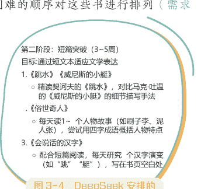

### DeepSeek 帮你制订快速阅读计划

DeepSeek 还能为你制订更详细的阅读计划，帮你更快完成阅读。

例如，之前那名五年级的同学想让 DeepSeek 根据她的具体情况，帮忙生成更详细的阅读计划安排，她可以这样向 DeepSeek 提问：

> 我是一名五年级的学生（自我介绍），周一到周五我每天只有一小时的读书时间，周末和假期每天有 3 小时的读书时间（详细情况），本学期我要看完以下书（列出书目），帮我制订一个能在学期内读完这些书且剩下时间充裕的阅读计划（需求说明）。


DeepSeek 会分析这些书的特点，为她规划阅读顺序，如图 3-5 所示，如果她觉得不满意，可进一步追问“每周的具体安排是什么”等细节问题。

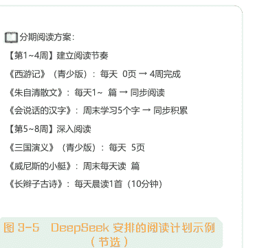

### DeepSeek 帮你成为阅读达人

当然，想成为一个阅读高手，仅读完书是不够的，我们还需要提升阅读技巧。而 DeepSeek 能在这方面为你提供帮助。

**学会选择性阅读**。阅读书籍或文章时，懂得根据内容选择精读或泛读，并思考其中的重点。

例如，一名三年级的同学手上有《格林童话》，他不知道应该精读还是泛读，阅读重点是什么，他可以这样向 DeepSeek 提问：

> 我是一名三年级的学生（自我介绍），请告诉我《格林童话》（列出书名）应该精读还是泛读，并说明阅读重点和思考点是什么（需求说明）。

DeepSeek 会分析书籍的特点，并提供具体的阅读建议，如图 3-6 所示。

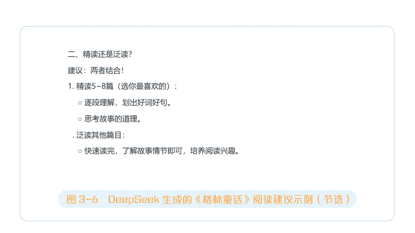


### 要带着问题阅读。

阅读书籍时，要带着问题去读，对书籍中提出的观点，要多方位思考。

例如，一名四年级同学正在读《匹诺曹》，他不知道应该带着什么问题读。他想知道其他人对匹诺曹的不同看法，他可以这样向 DeepSeek 提问：

> 我是一名四年级的学生（自我介绍），正在阅读《匹诺曹》（情况介绍并列出书名），请告诉我，我可以带着什么问题去读，以及针对这本书的内容，都有哪些不同观点（需求说明）。

DeepSeek 会分析书籍的内容，告诉他应该怎样思考，并给出相关观点，如图 3-7 所示。

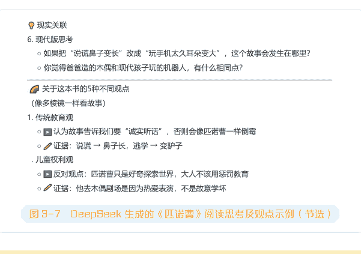

## 03 助你轻松背诵古诗文

你是否也曾为背诵古诗文头疼不已？是否因在课堂上背不出古诗文的下一句而脸红耳赤？为什么反复背诵还是记不住？

其实，主要有以下三个“拦路虎”在作怪。

**原因一：看不懂。** 古诗文中的很多词汇在我们的日常生活里几乎不会被用到，以至于我们对这些词汇非常陌生，难以理解，甚至还有些词的意思跟现在的意思差别很大。例如，“走”在古代意为“跑”，而在现在，其意为“正常的走路”。这些情况都加大了古诗文的记忆难度。

**原因二：读不通。** 古诗文中的很多句式不同于我们现在的说话方式，这种不同让我们很难流畅地把它们读出来，更何况是记住。

**原因三：没画面。** 古诗文中有很多我们没有接触过的意象，还有一些我们不了解的典故，读起来难以想象出画面，所以不容易记住。


### DeepSeek 为你设计古诗文记忆方法

背诵古诗文虽然有难度，但也不必害怕，DeepSeek 能够帮我们拆解古诗文的意象与结构，并根据不同的古诗文，设计不同的方法帮你快速记住它们。

例如，你需要背诵古诗《山居秋暝》，就可以这样向 DeepSeek 提问：

> 请给几个能帮我快速背下《山居秋暝》（列出古诗文名称）的方法。

DeepSeek 会分析这首诗的特点，并为你提供方法，如图 3-8 所示。

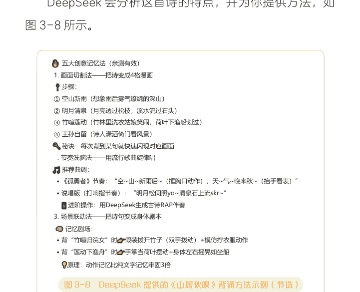


更长一点的古诗文也能让 DeepSeek 为你提供阅读与背诵技巧。

例如，将上一个提问中的《山居秋暝》替换为《出师表》，并进一步向 DeepSeek 提问：

> 请给几个能帮我快速背下《出师表》（列出古诗文名称）的方法，并说明背诵时有哪些注意要点（具体要求）。

DeepSeek 会根据这首古诗文的特点，生成针对性的背诵要点，如图 3-9 所示。

- 人名典故具象化：
  - “郭攸之、费祎、董允” → 联想谐音“锅油费一桶”（厨房场景）。
  - “五月渡泸，深入不毛” → 画面：诸葛亮在热带（泸水）挥扇子赶蚊子。
- 数字挂钩：
  - 例如第三段有3条建议（开张圣听、赏罚公正、亲贤远佞），对应手势①、②、③。
- 15分钟碎片复习术
  - ⏰黄金时间点：晨起后、睡前、饭后15分钟，用手机备忘录写每段首字提示：
    - 例如：“先→然→侍→臣→今→至”，根据首字回忆全文。
  - 🚶移动记忆法：走路时每迈一步背一句，空间感能强化记忆（心理学证实有效）。

⚠️ 背诵注意要点
1. 死穴：忽略虚词
   - 重点攻克“而、以、于、之”等虚词，易背错处单独标注。
   - 例：“受任于败军之际，奉命于危难之间”（两“于”字易漏）
2. 语感 > 死记
   - 先模仿古文的停顿和气息（如“先帝/创业未半/而中道崩殂”），背起来更顺口。

图 3-9 DeepSeek 提供的《出师表》背诵要点示例（节选）

### 快速生成古诗文知识图谱

古诗文中经常有很多要记忆的知识点，如创作背景、典故、通假字、特殊句式等，你是否也曾被这些知识点弄得晕头转向？


#### 为你搜集整理古诗文资料

DeepSeek 拥有丰富的数据库，它还能“联网搜索”，可快速搜集并整理你想要的古诗文，省去你自己查找的麻烦。

例如，一名初中生在预习《陈太丘与友期行》一课时，他想了解这篇文章的背景，就可以这样向 DeepSeek 提问：

> 我是一名初中生（自我介绍），我正在预习《陈太丘与友期行》这篇课文（情况介绍并列出篇目），需要你帮我搜集整理相关资料（需求说明），包括出处、创作背景、重点字词句等方面的内容，要求内容准确（详细需求）。

DeepSeek 会搜集资料并整理出各项内容，如果他开启了“联网搜索”模式，还能看到它引用的网页内容，方便他核实信息的可靠性，如图 3-10 所示。

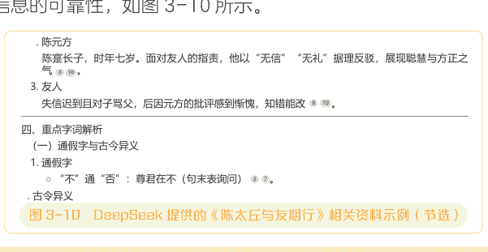

### 让古诗文知识变得有趣

如果你觉得 DeepSeek 生成的内容文字太多，一点也不方便理解，那么可以向它提出进一步的要求——将知识变得更直观、更有趣。当然，你还可以通过“上传文件”功能把你整理的笔记给它，让它帮你构建一个有趣的知识图谱。

以刚才已经整理出资料的《陈太丘与友期行》为例，你可以这样向 DeepSeek 提问：

> 根据以上资料（提交古文资料，可以是它生成的，也可以是你上传的），帮我搭建一个有趣又便于理解、记忆的《陈太丘与友期行》知识图谱（需求说明），要重点突出，逻辑严谨（详细需求）。

DeepSeek 生成了一个逻辑清晰，还带着有趣图案的知识图谱，如图 3-11 所示。

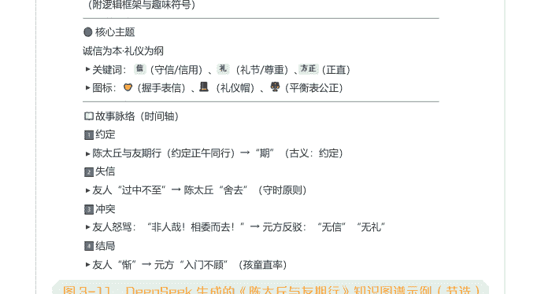

### 制作学霸般的思维导图

DeepSeek 虽无法直接绘制思维导图，但是它能帮我们构建古诗文的知识点结构框架，配合一些能画思维导图的软件，就能帮我们创作古诗文的思维导图。

例如，还是以《陈太丘与友期行》为例，你想让它帮你把知识点整理成思维导图的结构框架，可以这样向 DeepSeek 提问：

> 根据以上资料(提交资料)，帮我制作一个思维导图(需求说明)，并以 Markdown 格式输出内容（关键提示句，关系到其他软件能否识别思维导图的结构框架）。

DeepSeek 就会生成类似图 3-12 所示的内容。

我们要将 DeepSeek 生成的内容以 Markdown 文件格式保存下来。

单击右上方红框的“复制”，如图 3-12 所示，新建一个电脑文本文档，将复制的内容粘贴到文档里，然后单击“保存”。

**在保存时，注意将保存类型改为“所有文件”，并将文件后缀的 .txt 改成 .md，如图 3-13 所示。**

接下来，找一个能制作思维导图的软件，如 Xmind。这个软件可以下载安装后使用，也可以在网页上直接使用。

打开 Xmind，新建一个思维导图，再单击页面左上方功能里的“文件”—“导入”—“Markdown”，如图 3-14 所示，在弹出的“打开窗口”中选择之前保存的那个 Markdown 文件。

图 3-14 电脑版 Xmind 导入 Markdown 文件功能位置示例

然后，你将会得到一个堪比学霸笔记的思维导图，如图 3-15 所示。

悄悄说一句，上面提到的 DeepSeek 用法不仅能用在古诗文上，现代文也是可以的。

## 05 打造要点明确的学霸笔记

你是否有过这样的困扰：上课时老师讲的内容你都认真地记了下来，可等到复习时，面对密密麻麻的文字，却完全找不到重点在哪里。

这时，你或许很苦恼，重新梳理这些内容不仅费时而且费力，还不一定能梳理好。那么，怎么才能快速把自己乱糟糟的笔记改造成学霸那样重点明确的笔记呢？

在探讨 DeepSeek 能为我们做什么之前，先来了解一种能够突出重点的笔记方法——**康奈尔笔记法（5R 笔记法）**。

康奈尔笔记法是一种很适合课堂笔记的笔记方法，它的关键点就是把页面分为三个功能区域：线索区、笔记区和总结区，布局如图 3-16 所示。

| 线索区 | 笔记区 |
| :--- | :--- |
| | |
| **总结区** | |

图 3-16 康奈尔笔记法的三个功能区域

### 康奈尔笔记法怎么用

康奈尔笔记法要怎么用？具体来说，就是下面五个步骤。

1. **记录（Record）**：在听课过程中，将核心内容、关键信息、重要概念等写在笔记区里。
2. **简化（Reduce）**：课后，结合课堂内容，对笔记区里的内容进行简化，以关键词、问题或提示的形式呈现在线索区。
3. **背诵（Recite）**：完成记录和简化后，把笔记区的笔记内容遮住，只看线索区里的“线索”，尽可能完整地将笔记内容说出来。
4. **思考（Reflect）**：将自己的感想或者疑惑记录在总结区里。
5. **复习（Review）**：定期复习笔记，根据线索区中的关键词进行复习，实在想不起来的时候再看笔记区。

或许你会觉得这个笔记方法好是好，但是很麻烦，自己也不擅长提炼笔记内容，完全没有头绪。
这时候，DeepSeek 就可以出场了！

### DeepSeek 让你的笔记升级

你可以把自己的笔记上传给 DeepSeek，让它用康奈尔笔记法帮你整理笔记内容。

但是要注意，康奈尔笔记法的总结区应该是由你自己填写的，不能交给 DeepSeek 帮忙。

例如，一名四年级的同学做了《观潮》的课堂笔记，但是有点乱，他想让 DeepSeek 用康奈尔笔记法帮忙整理。他可以这样向 DeepSeek 提问：

> 我是一名四年级的学生（自我介绍），请根据我上传的笔记（上传你的笔记），用康奈尔笔记法帮我整理《观潮》的课堂笔记（需求说明），但不要写总结区的内容（总结区自己填）。

DeepSeek 整理了相关笔记，如图 3-17 所示。

## 06 DeepSeek，你的超能写作助手

写作文是不是常常让你感到头疼？看到题目却毫无灵感；写出来的文章普普通通，不够生动有趣；作文分数总是不高，却不知道如何改进？别担心，DeepSeek 能帮你解决这些写作难题！

### DeepSeek 帮你找到作文灵感

例如，一名小学生面对“自然界的花花草草各有特点，形态万千，有的气味芬芳，有的颜色鲜艳。请仔细观察一种植物，按照一定的顺序，写观察日记记录它成长变化的过程。注意语句要通顺，表达出对植物的喜爱之情”这样一篇作文，不知道要写什么，他可以这样向 DeepSeek 提问：

> 我是一名小学生（自我介绍），请根据“……”（作文题目和要求），给我提供一些写作灵感（需求说明）。

DeepSeek 生成了对应的作文灵感提示，如图 3-18 所示。

### 让语言生动起来

有时候，作文虽然写出来了，但读起来干巴巴的，像记流水账一样。例如，只能写出“我今天玩得很开心”或“树叶绿了”这样简单的话，却不知道怎么让文字变得更加生动。这时，你可以让 DeepSeek 提供一些范例，让你知道，还有哪些让作文语言变得更生动的办法。

例如，一名同学写秋天的桂花“桂花的味道传来，好香啊”，他觉得这句子太平淡了，就可以这样向 DeepSeek 提问：

> > 这是我写的一句话：“桂花的味道传来，好香啊”（你的描写），可以帮我提供一些让这句话语言变得更生动的办法吗（需求说明）？

DeepSeek 根据他的需求提供了语言改进建议，如图 3-19 所示。

### DeepSeek，你的随身作文老师

你是否遇到过这样的困扰？明明认真写了作文，分数却总是不理想，老师的批语也只有简短的“内容单薄”或“描写不够详细”，以至于你不清楚怎么改进。没关系，DeepSeek 可以是你的随身作文老师，帮你找到作文里的问题，并提出改进建议。

例如，一名小学生根据作文题目写了一篇自己和小猫的作文，老师给了点评，但他觉得不够具体，想知道问题在哪里，怎么改进。他可以先上传作文，然后这样向 DeepSeek 提问：

> 我是一名小学生（自我介绍），这是我写的作文（你上传的作文内容），作文题目是“……”（提交作文题目），老师的点评是“基本符合题目要求，内容较简单，缺乏细节描写，语言表达较平淡”（点评内容），请更详细地点评我的作文，并给出改进建议（需求说明）。

DeepSeek 为他提供了作文改进建议，如图 3-20 所示。

### DeepSeek 帮你搜集作文素材

你是否也有这样的问题：每当摊开作文本准备写作文时，脑袋里总是空空的。这种“写作卡壳”的困境着实让人焦虑。这时你可以向 DeepSeek 求助。

例如，一名五年级的小学生希望 DeepSeek 帮助他搜集作文素材，他可以将自己的情况告诉 DeepSeek，然后这样向 DeepSeek 提问：

> 我是一名五年级的小学生（自我介绍），需要以《我最心爱的礼物》（作文题目）为题写一篇作文。要求写清楚礼物的样子、来历、与之相关的故事等，表达自己的感情（具体要求）。请给我搜集一些作文素材（具体需求）。

DeepSeek 根据他的要求，提供了一些相关的作文素材、结构参考、技巧等，如图 3-21 所示。

### DeepSeek 帮你学会审题

写作文时最让人抓狂的是什么？看到作文题目和要求，我们的脑子却像浆糊一样。铅笔头都快咬变形了，作文本上却还空荡荡的。当遇到看不懂的作文题目和要求时，别慌！DeepSeek 帮你审题。

例如，一名六年级的小学生要以《味道》为题写一篇作文，他不清楚题目和要求的意思，可以这样向 DeepSeek 提问：

> 我是一名六年级的小学生（自我介绍），我要以《味道》（作文题目）为题写一篇作文。作文的要求是这样的：请围绕生活中的味道，如酸、甜、苦、辣、咸进行构思，写一篇记事的记叙文（具体要求）。请帮我分析题目，并给我一些写作方向（具体需求）。

DeepSeek 根据他的要求，对作文题目和要求进行分析，提供了与味道相关的素材库和高分结构模版等参考信息，如图 3-22 所示。

# 专职数理教练

## 01 DeepSeek 帮你建立高效错题本

你有没有这样的烦恼，在学习数学时，感觉知识点又多又杂，公式难以理解？看到综合题就大脑死机？错题本越记越厚，分数却没有提高？

这是什么原因？我们一起探讨一下吧！

**原因一：公式记忆机械化。** 对数学公式的记忆仅停留在表面，未能理解其核心含义与推导逻辑，导致需要应用时想不起来。

**原因二：思维惰性强。** 在学习过程中缺乏主动思考的习惯，过度依赖老师示范和讲解。

**原因三：训练模式低效。** 做了很多题目，但缺乏对错题根源的系统性分析，同类错误反复出现。

DeepSeek 怎么帮助我们改善这些问题呢？

### 让 DeepSeek 为你梳理知识点

在每次预习或者复习的时候，你可以把章节主题告诉 DeepSeek，让它帮你梳理出完整的知识框架。

例如，一名六年级的同学在学习分数乘法时遇到了困难，就可以这样向 DeepSeek 提问：

> 我是一名六年级的学生（自我介绍），在学习分数乘法时遇到了困难，感觉不是很明白（具体问题）。请用我能听得懂的语言解释分数乘法，并举例说明（需求说明）。

开启“深度思考”模式后，DeepSeek 会给我们展示它的思考过程。可以看到，它考虑到了小学生的接受能力，从不同方面思考如何为我们讲解，非常贴心，如图 4-1 所示。

接下来，它像一位耐心细致的老师，给我们讲解分数乘法，如图 4-2 所示。

### 让 DeepSeek 为你诊断知识漏洞

每次做完作业或者练习后，可以把作业内容输入或者上传给 DeepSeek，并输入指令“按照（教材版本 + 年级）数学作业批改标准批改，并标注错误类型和对应的知识点”，只需几秒，它就能生成你的作业批改结果，精准定位你的问题，是计算粗心、公式混淆还是应用题理解偏差？一目了然！

例如，一名四年级的同学写完作业后，把自己的作业内容上传（图片）给 DeepSeek，然后这样向 DeepSeek 提问：

> 我是一名四年级的学生（自我介绍），请按照人教版四年级数学作业批改标准批改我上传的作业（需求说明），并标注错误类型和对应的知识点（具体要求）。

DeepSeek 检查了他的作业，给出了相应的批改结果和总结建议，如图 4-3 所示。这能帮他快速发现自己的问题。

```
1. 乘法计算错误：80×3 40，误算为 30。
•对应知识点：
  ◦两位数乘法 如 80×3 40。

第三题：7 ÷6÷
•答案:14❌（正确答案应为6）
•错误类型：
  1. 连除运算顺序错误：未从左到右计算，错误先算6÷。
•对应知识点：
  ◦连除法的运算顺序（如7 ÷6 1，再1 ÷ 6。
第三题右边：15×6+9
•答案：10✅
•步骤分析：
  ◦正确运用了先乘后除的顺序，结果正确。
```

图 4-3 DeepSeek 检查作业结果示例（节选）

### 让 DeepSeek 帮助你进行错题分析

所有数学老师都强调要重视错题，你把错题记下来了，却不知道怎么去分析错题，这时候，你就可以把做错的数学题目上传（图片）给 DeepSeek，让 DeepSeek 帮你分析。

例如，一名初中的同学想要对自己的错题情况进行分析，就可以这样向 DeepSeek 提问：

> 我是一名初一年级的学生（自我介绍），请根据我上传的错题分析我做错的原因（需要说明），并给我提供避免做错这一类型题目的建议（具体需求）。

DeepSeek 检查了他的错题，给出了对应错题的原因分析和避免做错的建议，如图 4-4 所示。

我们可以把错题分析整理进错题本，如果有哪些概念和知识点不懂，可以再向 DeepSeek 提问，直到搞懂为止。

### 快速培养举一反三的能力

你是不是遇到过这种情况：在做一道题目时，感觉这个题目的知识点已经掌握，题目也会做了，但是换一个类似的题目时，又傻眼了，不知道怎么去做。你有没有想过这是为什么？

我们先来分析一下原因。

**原因一：只是在死记硬背。** 有些同学的“会做”仅仅停留在对标准答案的死记硬背阶段，比如记住了某个公式的套用方式、某类题型的固定解题步骤。但数学需要理解，靠死记硬背的结果就是一旦题目条件变化，就不知道怎么解题了。

**原因二：训练的题目类型单一。** 同一个知识点只做一类题目，缺乏举一反三的训练。

### DeepSeek 拓展学习三步法

数学学习很注重知识的拓展延伸和练习。当学到某个知识点时，可以让 DeepSeek 再列举出 5 道类似的题目，完成后上传，让 DeepSeek 批改，形成学习闭环，强化解题能力。这样针对性的练习既能丰富知识储备，又能提高解题熟练度。

#### 第一步：上传错题，进行分析

例如，一名六年级的同学在学习圆柱与圆锥知识时，做错了题目却不知道错在哪儿，他可以这样向 DeepSeek 提出需求：

> 我是一名六年级的学生（自我介绍），请根据我上传的错题（上传资料），帮我分析这道题做错的原因（需求说明）。

DeepSeek 分析总结了错误原因，如图 4-5 所示。

#### 第二步：追问其解法

在看过 DeepSeek 的分析并理解这道题后，他可以继续向 DeepSeek 追问：

> 本题还有其他解法吗？

DeepSeek 提供了那道错题的多个解法供他参考，如图 4-6 所示。

#### 第三步：要求提供类似的题目

那名同学想要一些类似的题目来训练自己举一反三的能力，他可以这样向 DeepSeek 提问：

请再出几道类似的题目（需求说明），要标注难度，并设置不同的情境（具体要求）。

DeepSeek 根据他的要求生成了题目，帮助他巩固对应知识点，如图 4-7 所示。

这套方法不但能帮助我们精准击破数学学习中的薄弱环节，还能让我们在面对题目的不同变化时应对自如，成为“数学高手”。

## 03 费曼学习法——深度理解的奥秘

数学包含很多知识点，这些知识点听起来较为抽象。不少同学觉得理解它们很困难。有时候，老师讲课说得太快，或者自己走神了，没能及时理解那些知识点，等到课后要做题时，脑子里空空如也，只能抓耳挠腮。不用担心，当 DeepSeek 与费曼学习法相结合时，就能帮助你更好地理解它们，解决“搞不懂”的问题。

### 什么是费曼学习法

费曼学习法是由诺贝尔物理学奖得主——美国物理学家理查德·费曼提出的一种神奇且高效的学习方法，核心秘诀就是“假装当老师”。

这个方法的妙处在于，它让你用最简单的话把知识讲给别人听，以此检验自己是不是真的懂了。

当你试着把学到的知识像讲故事一样教给别人时，大脑就会自动把复杂的理论“翻译”成生活化的语言，这个“翻译”过程恰恰能帮你真正吃透知识。而且，在讲解的时候，你会突然发现自己哪里卡壳了、哪里解释不清——这些就是你需要重点补习的地方。这种方法不仅能让你记得更牢、理解更深，还能顺便锻炼你的表达能力，就像玩闯关游戏一样，每讲通一个知识点就解锁一个新技能。最棒的是，你完全可以把家里的宠物、玩偶甚至镜子里的自己当成学生，随时随地开始你的“小课堂”，既有趣又有效！

### 费曼学习法的四个核心步骤

1.  **选择学习主题**：选择一个你想要深入理解的概念或主题。这可以是任何学科的内容，如数学公式、物理定律，或文学知识。
2.  **尝试解释**：尝试用最简单的语言向别人解释这个概念。假设你的听众是一位没有任何相关知识的初学者，这就要求你用简单明了的方式传达知识点的核心内容。
3.  **识别知识盲点**：在解释的过程中，你会发现自己有不理解或难以解释的部分，这些就是你的知识盲点。记录下这些盲点，然后重新回到学习中，查阅和理解这些盲点，直到你弄懂为止。
4.  **组织和简化**：将你对这个概念的理解重新组织，并进一步简化解释，力求使解释更加直观和易懂。这个步骤不仅能帮助你巩固对知识的理解，还能帮助你形成系统的知识框架。

### 用费曼学习法拆解难题

或者，你还处于对知识点“似懂非懂”的状态，没办法用费曼学习法向别人讲解知识点。此时，可让 DeepSeek 化身“小老师”，运用费曼学习法为你拆解难题，帮助你深入理解晦涩的知识点，使理解度大幅提升，从此告别“似懂非懂”的尴尬状态。

例如，一名小学生上完数学课后，还有题没搞明白，他想让 DeepSeek 用费曼学习法帮忙，可以上传题目后，这样向 DeepSeek 提问：

> 我是一名小学生（自我介绍），请根据我上传的题目，用费曼学习法拆解这几道题（需求说明），并引导我发现自己的知识漏洞（详细需求）。

DeepSeek 用费曼学习法拆解他上传的题目，帮助他理解知识点，拆解题目过程如图 4-8 所示。

### 接下来我们再看另一道题目：

一次口算竞赛，共 20 道题，评分规则是：答对 1 道题得 5 分，答错题扣 1 分。小花同学在参加的口算竞赛中得了 76 分。小花答对了几道题？

用上面的方式提问，DeepSeek 会用费曼学习法引导我们拆解这道题，如图 4-9 所示。

> 第一步：复述题目
> • 你能用自己的话把题目中的关键信息描述一遍吗？（比如总题数、得分规则、最终得分）
> 第二步：明确核心目标
> • 题目最终要算出什么？（答对题数）
> • 已知什么条件？隐藏了什么关系？（总题数固定为 20，对和错的数量相加等于 20）
> 第三步：关联知识点
> • 如果全部答对，小花能得多少分？为什么？[20×5=100（分）]
> • 实际得分比满分少多少分？这个差值是怎么产生的？[100-76=24（分）]
> • 每答错1题，相对于满分会损失多少分？为什么不是只扣1分？[提示：原本能得5分，现在不得分还要扣1分，总共损失5+1=6（分）]
> 漏洞检查点1
> • 有同学认为每答错1题只差5-1=4（分），对吗？为什么？（错！因为扣分是叠加损失，不是差值）

图 4-9 DeepSeek 用费曼学习法拆解题目过程示例二（节选）

通过 DeepSeek 用费曼学习法拆解题目，你可以更深入地理解所学内容，提高学习效率和质量。当你理解这些知识点后，可以用费曼学习法向别人讲解。

## 04 苏格拉底提问法让学习一步一个脚印

准备好接受智慧的洗礼了吗？在这里，每个解题步骤都要经过“灵魂拷问”！通过层层递进的提问，让你的思路清晰明了，帮你培养严谨的数理思维习惯！

#### 什么是苏格拉底提问法

苏格拉底提问法是由古希腊哲学家苏格拉底发明的一种通过提问引导学生思考、发现答案的教学方法。

#### 苏格拉底提问法的特点

1.  **以问题为中心**：通过不断提问，引导学生思考。
2.  **逐步深入**：从简单的问题开始，逐步引导到复杂的问题。
3.  **不直接给答案**：老师不直接告诉学生答案，而是让学生自己发现。
4.  **激发思考**：通过提问激发学生的好奇心，培养批判性思维和逻辑推理能力。

### 用“DeepSeek+ 苏格拉底提问法”辅助做题

当你有题目不会做，不知道从何下手时，可以用“DeepSeek+ 苏格拉底提问法”的方式让 DeepSeek 辅助你做题。它会引导你思考，一步步得出正确答案。

**注意：** 用这种方法时要关闭“深度思考（R1）”模式，如图 4-10 所示，让自己学会思考问题。

先把题目拍照上传或者手动输入给 DeepSeek，让它用苏格拉底提问法一步一步向你提问，引导你思考，答完一个问题再问下一个问题。

例如，一名六年级的同学想让 DeepSeek 用苏格拉底提问法辅助他做某些题目，他把题目上传后，可以这样向 DeepSeek 精准提问：

> 我是一名六年级的学生（自我介绍），请模拟你在教我做题目的场景（告知场景），用苏格拉底提问法向我提问（需求说明）。等我回答了一个问题后再继续提下一个问题（限制要求），开始吧！

DeepSeek一步一步，带着他解题，根据他的回答，再一步步地向他提问，如图 4-11 所示。

> 第一个方程：0.75x+9=4
> 问题1：这个方程中，我们需要求出x的值。首先，你觉得应该怎样让x单独留在等式的一边呢？
> （提示：可以想想如何去掉“+9”和“×0.75”这两部分。）
> （等你回答后，我会继续下一步。）
> 请告诉我你的想法，比如：“是不是可以先减去9？” 或者你有其他思路也可以分享。

去掉9

> 很好！你的思路是对的。
> 问题：你说“去掉9”，具体是怎么做呢？等式两边需要同时进行什么运算才能消去“+9”？
> （提示：记得等式的两边要保持平衡，就像天平一样。）
> （等你回答后，我会继续下一步。）
> 比如，你会写“0.75x+9-9=4-9”吗？

不会

图 4-11 DeepSeek 用苏格拉底提问法引导解题示例（节选）

这些题目做出来后，你还可以让 DeepSeek 总结这几道题考查的知识点，看哪个知识点你还没有掌握。你可以这样向 DeepSeek 提问：

> 请问这几道题讲了数学的哪些知识点？

DeepSeek 会告诉你题目涉及的核心知识点有哪些，如图 4-12 所示。

最后，还可以让 DeepSeek 用同样的知识点给你出几道练习题，如图 4-13 所示，帮你巩固知识。你可以这样向 DeepSeek 提问：

> 可以用这些知识点再出 5 道题目，帮助我巩固吗？

“提问→引导思考→得出答案→总结知识点→举一反三”，走完这样一个学习小闭环，我们的学习会越来越好！

图 4-13 DeepSeek 生成巩固练习题示例（节选）

## 05 DeepSeek 帮你突破数学思维瓶颈

你是否经历过这样的困境：面对应用题或计算题时，即使苦苦思索，也找不到突破口，无法建立清晰的解题思路，这种思维瓶颈究竟源于何处？

**原因一：理解有所偏差。** 对数学题目或对应的知识点的理解产生了偏差，但自己没有发现，用有问题的思路解题，自然找不到答案。

**原因二：思路不够宽广。** 在想解题思路时总从某个自己最熟悉的角度去想，没有考虑其他可能性，把自己的思路卡在了“死胡同”里。

**原因三：解题习惯不好。** 不恰当的解题习惯，也会影响做题发挥，比如没有明确写出解题步骤的习惯，导致丢失步骤分；计算时没看好上一步骤，导致计算中途出现错误影响后续答案；做完题目不去验算，导致马虎丢分，等等。

那么，DeepSeek 怎么帮助我们解决这些问题呢？

### DeepSeek 帮你发现理解偏差

还记得我们之前提到过的费曼学习法吗？现在，是你向 DeepSeek 讲解你的理解的时候了。

你可以把你对题目的理解和思路告诉 DeepSeek，让它帮你分析你的解题思路是否正确。你也可以把你对一个知识点的理解告诉 DeepSeek，让它看看你的理解是不是有所偏差。

例如，一名六年级的同学想验证自己对“鸽巢问题”的理解是否正确，他可以这样向 DeepSeek 提问：

> 我是一名六年级的学生（自我介绍），这是我对“鸽巢问题”的理解：如果有 $n$ 个东西要放进 $m$ 个容器里，只要东西比容器多，那至少有一个容器里会有至少 2 个东西（自己的理解）。请评价我的理解是不是正确的，如果有问题请指出来并提出改进建议（需求说明）。

DeepSeek 对他的理解做出了评价，如图 4-14 所示。

### DeepSeek 帮你拓宽解题思路

解题思路不够宽广的问题，也可以让 DeepSeek 帮你特训、提高。你可以把题目上传，让 DeepSeek 为你提供更多解题思路。

**注意：** 为了更好地锻炼自己的思维，在提问时不要让 DeepSeek 直接给出答案，而是让它为你提供思路。

例如，一名初中的同学想锻炼自己多方位的解题思路，他把对应的题目上传后，可以这样向 DeepSeek 提问：

> 我是一名初一年级的学生（自我介绍），请为我上传的题目提供几个解题思路（需求说明），不需要具体的解答过程和答案，这些思路所涉及的知识点在初一年级学生应该掌握的范围内（具体需求）。

DeepSeek 为他提供了几个解题思路，如图 4-15 所示。

```
解题思路：
1. 设变量法：
设 $8n+1=k^2$，其中 $k$ 是正整数。然后解这个方程，求出 $n$ 的表达式，再结合 $1 \le n \le 100$ 限制 $k$ 的范围，统计符合条件的 $k$ 的个数。
2. 不等式约束法：
由 $8n+1=k^2$，可以解出 $n=\frac{k^2-1}{8}$。由于 $1 \le n \le 100$，代入后得到关于 $k$ 的不等式，求出 $k$ 的可能取值范围，再筛选符合条件的 $k$。
3. 奇偶性分析：
观察 $8n+1=k^2$，由于 $8n$ 是偶数，所以 $k^2$ 必须是奇数，因此 $k$ 必须是奇数。这样可以缩小 $k$ 的可能取值。
4. 枚举法：
由于 $n$ 的范围较小（$1 \le n \le 100$），可以尝试枚举 $k$ 的可能值（比如 $k=3,5,7,...$），计算对应的 $n$，再统计满足条件的 $n$ 的个数。
5. 平方数的性质：
由于 $k^2 \equiv 1 \pmod{8}$，可以分析哪些平方数满足这个同余条件，进一步缩小 $k$ 的范围。
```

图 4-15 DeepSeek 提供的数学解题思路示例（节选）

DeepSeek 也能帮你改善不恰当的解题习惯，你可以把自己的错题集上传给 DeepSeek，让它帮你分析你的解题习惯有哪些问题，可以用什么方法改进。

例如，一名五年级的同学把自己的数学错题集上传 DeepSeek，可以这样向 DeepSeek 提问：

> 我是一名五年级的学生（自我介绍），请对我上传的错题集进行分析（需求说明），告诉我，我在解题习惯方面有哪些问题，可以用什么方法改进（具体需求）。

DeepSeek 根据他上传的错题集，为他分析了解题习惯存在的问题，并提出了改进建议，如图 4-16 所示。

虽然 DeepSeek 能够有效辅助数学学习，但在使用过程中仍需注意以下两点：

首先，DeepSeek 作为工具，在复杂问题的解析方面存在局限性。尽管其算法强大，但在处理高度抽象或创新性数学问题时，可能无法提供足够精准的答案。

其次，DeepSeek 无法识别图案，遇到图形题无法有效处理。

人类老师独有的教学经验和情感互动，仍是人工智能目前难以企及的。因此，DeepSeek 应该作为辅助工具使用，而不能替代老师。

### 让科学知识有趣起来

你是否碰到过这样的情况：学习科学知识时，总是感到枯燥乏味，提不起兴趣。在学习复杂的科学概念时，总是摸不着头脑，难以理解其意义。你知道这是什么原因吗？

**原因一：观察能力不足。** 对科学现象没有足够的观察能力，平时也没有养成良好的记录习惯，这就导致脑海里科学知识的储备比较少，在解答与科学知识相关的题目时想不到对应内容。

**原因二：缺乏抽象思维能力。** 对课堂上老师所教的科学原理、概念理解不够，无法转化为生活中具体可感的内容。

那么，DeepSeek 怎样帮助我们解决上述问题，让科学知识有趣起来呢？让我们一同看一看。

### DeepSeek 帮你打造虚拟实验室

DeepSeek 可以通过线上的方式打造一个虚拟实验室，指导你准备材料、开展具体实践并检验结果，让你在有趣的科学实验中学到知识。

例如，一名对科学知识非常感兴趣的小学生，他所在的学校科学实践课比较少，他想通过线上的方式体验科学实践活动，以帮助他巩固课堂里学到的知识。那么，他可以这样向 DeepSeek 提问：

> 我是一名小学生（自我介绍），我对科学知识非常感兴趣，但是学校的科学实践课比较少，我想通过线上的方式参与多场景的数理科学实践活动，帮助我巩固课堂里学到的知识（详细情况说明）。要求实践内容通俗易懂，不超出小学生的理解范围（具体需求）。

DeepSeek 为他提供了可行的科学实践活动内容，如图 4-17 所示。

### DeepSeek 帮你沉浸式参与故事互动

如果你对抽象的题目概念理解有难度，或者很难理解题目情境传达的意思，那么，DeepSeek 可以帮你生成科学知识趣味互动故事，帮助你理解题目。

例如，一名小学生不擅长理解抽象的概念，但是喜欢形象生动的故事情节。在学习“鸡兔同笼”问题时，他难以理解题目传达的意思，想要 DeepSeek 帮他生成一个互动性的故事，以便他理解题意。他可以这样向 DeepSeek 提问：

> 我是一名小学生（自我介绍），我不擅长理解抽象的概念，但是喜欢形象生动的故事情节。在学习“鸡兔同笼”问题时，我难以理解题目传达的意思（情况说明），请帮我生成一个互动性的故事，以便我理解题意（具体需求）。

DeepSeek 根据他的要求，创作了趣味故事，如图 4-18 所示。

### DeepSeek 带你创建微观知识漫游库

当你想深入了解某些科学知识，但自身知识储备量不足时，就可以借助 DeepSeek 深度研究有关知识点，为课本知识提供有效的补充。

例如，一名小学生近期在学习植物生长的知识，他没有合适的工具观察植物生长的过程，所以他想借助 DeepSeek 认识植物的根、茎、叶、花、果实、种子等器官及其功能。他可以这样向 DeepSeek 提问：

> 我是一名小学生（自我介绍），我最近在学习植物生长的相关知识，但是我没有工具帮我观察植物生长的过程（情况说明），请你创建植物的根、茎、叶、花、果实、种子等器官及其功能的知识漫游库，帮我了解这些内容（具体需求）。

DeepSeek 根据他的要求，生成了知识漫游库，如图 4-19 所示。

# 五 高效英语助手

## 01 用英语单词创作趣味对话

或许你也有过这样的体验：老师反复强调要背好单词表里的核心词汇，课本上列着密密麻麻的重点词组……明明知道这些单词很重要，可每次翻开单词本就昏昏欲睡，刚背的单词转眼就忘……

为什么会这样？我们来探究一下可能造成这些情况的原因吧。

**原因一：缺乏对背单词的兴趣。** 我们平时背单词，大多是填鸭式输入，过程机械、枯燥，记不住的话还会受到惩罚，这会激活我们大脑的“厌恶回路”。

**原因二：没有掌握记忆方法。** 很多同学在背单词时，都是死记硬背，这种方法对我们高效背单词并没有帮助。

DeepSeek 能怎样改善这个问题呢？

### 让 DeepSeek 助力角色扮演

怎样才能不枯燥地背单词？我们可以将单词融入趣味对话，让 DeepSeek 帮助我们和他人玩角色扮演！

例如，一名五年级的女生，总是记不住“money”“fruit”“expensive”这 3 个单词。她可以这样向 DeepSeek 提问：

> 我是一名五年级的女生（自我介绍），总是记不住“money”“fruit”“expensive”这 3 个单词（列举你觉得最难记的单词）。我想通过跟一个同学玩角色扮演来开展趣味对话，强化记忆这些单词。我扮演外星人（你想扮演的角色），同学扮演水果店的老板（他人扮演的角色），请你生成一段对话，供我和同学模拟运用，对话中要使用上述几个单词（需求说明）。

DeepSeek 认真分析提问者的需求后，生成了英语对话，如图 5-1 所示。对话中，重点单词反复出现。另外它还设计了一些行为动作，让对话变得更有趣。

> Alien (You)：（蹦蹦跳跳进店，触角一闪一闪）“Bling-bling! I come from Sparkle Planet! Do you sell...uh...those colorful Earth rocks?”（指着香蕉假装不认识）
> Yuanyuan (Shopkeeper)：（举起香蕉当电话）“Wow, cosmic customer! This isn't a rock, it's a FRUIT called banana! Want to try our stardust-flavored FRUIT?”（偷偷给苹果贴星星贴纸）
> Alien：（用触角戳西瓜）“Is this giant green ball also FRUIT? Can I ride it back to my spaceship?”（突然掏出发光橡皮擦）“I'll pay with magic MONEY!”
> Yuanyuan：（严肃地推眼镜）“Earth rules! We only accept sparkle MONEY—”（突然破功大笑）“Just kidding! This watermelon costs... 5 galaxy coins!”
> Alien：（假装跌倒）“FIVE?! That's too EXPENSIVE!”（掏出三枚瓶盖）“Three coins and...and my pet space snail!”（举起蜗牛橡皮）
> Yuanyuan：（把葡萄串当耳环戴）“Humm...Okay! But you must teach me alien FRUIT dance!”（突然跳机械舞）
> Alien：（用香蕉当麦克风唱）“F-R-U-I-T~ Not E-X-P-E-N-S-I-V-E-!”（把“money”硬币贴额头当第三只眼）

图 5-1 DeepSeek 生成的角色扮演对话示例（节选）

### 为表情包设计对话，DeepSeek 有一手

与家人、朋友日常网络聊天时，你是不是也喜欢发送一些搞笑、有趣的表情包呢？让 DeepSeek 为我们的表情包设计英语对话吧！首先我们需要制作表情包，然后就可以让 DeepSeek 来生成对话了。

例如，一名四年级的女生制作了一个猫戴着眼镜看书的表情包，她想用 “bookworm” “cat” “book” 来生成一句搭配表情包的文字。她可以这样向 DeepSeek 提问：

> 我是一名四年级的女生（自我介绍），我制作了一个猫戴着眼镜看书的表情包（具体描述表情包的内容），我想用 “bookworm” “cat” “book”（列举你想掌握的单词）来生成一句搭配表情包的文字。请你生成一段对话，对话中要使用上述几个单词（需求说明）。

DeepSeek 认真分析她的需求，生成了一段对话，如图 5-2 所示。对话中，你会看到她想掌握的单词出现在句中。

```
Cat: (adjusting glasses with a paw) "Call me a bookworm in cat disguise—this book is PAW-sitively purr-fect!" 📚🐱
```

小贴士：
1. 用 “bookworm in cat disguise” 把两个单词趣味串联，突出猫的“书虫”身份
2. PAW-sitively positively+猫爪（paw），发音相同易记忆
3. purr-fect perfect+猫呼噜声（purr），强化猫咪特征
4. 表情符号📚🐱 帮助视觉联想，适合贴在表情包上

图 5-2 DeepSeek 生成的表情包对话示例（节选）

### 设计荒诞情景喜剧对话

平时我们看影视作品，那些搞笑、无厘头的剧情总是特别让人放松。接下来，试试让 DeepSeek 帮我们设计英文版的荒诞情景喜剧对话吧！

例如，一名六年级的男生想在班会上表演英文版的荒诞情景喜剧，他想扮演一头大象，表演大象在雨林中洗澡。他选定了“elephant”“shower”“comfortable”3个目标单词，他可以这样向 DeepSeek 提问：

> 我是一名六年级的男生（自我介绍），我想在班会上表演英文版的荒诞情景喜剧。我想扮演一头大象，表演大象在雨林中洗澡的场景（描述你扮演的角色、所要呈现的场景）。我选定了“elephant”“shower”“comfortable”3个目标单词（列举你的目标单词），请你帮我用它们来生成一段荒诞情景喜剧对话（需求说明）。

DeepSeek 为他生成了一段对话，如图 5-3 所示，并提供了表演设计指南！

## 02 巧用单词设计游戏

除了用单词创作趣味对话，我们还有另外一种玩法，那就是巧用单词设计游戏，在 DeepSeek 的引导下，一边玩一边学！

接下来，你会看到单词接龙、单词肢体拼写竞赛、做单词寻宝猎人等各种有趣的游戏，这些游戏既好玩，又作用多多！例如，单词接龙能让你通过句子上下文重复接触单词，帮助记忆；单词肢体拼写竞赛则既突出了字母特征，又融入了团队互动元素，也锻炼了反应能力；做单词寻宝猎人可以通过生活化、情景化的方式，激活对身边物品对应单词的具象认知……

这些游戏具体怎么玩？怎样能在游戏中脱颖而出呢？下面我们就跟着 DeepSeek 一起来体验一下吧！

### 背单词，玩谐音

在刚开始学英语的时候，肯定有同学用谐音来记忆吧？用谐音来背单词，会给枯燥的单词学习增添一丝趣味。DeepSeek 老师很会玩谐音！

例如，一名五年级的同学想用谐音帮助自己记忆 6 个新学的单词，它们分别是 “borrow” “strong” “tall” “funny” “library” “breakfast”，她想给每个单词设一个谐音，还想把这 6 个单词连起来，连成一个谐音故事，她可以这样向 DeepSeek 提问：

> 我是一名五年级的学生（自我介绍），我想用谐音记忆 6 个新学的单词，它们分别是 “borrow” “strong” “tall” “funny” “library” “breakfast”（列举目标单词）。我想给每个单词设一个谐音，还想把这 6 个单词连起来，连成一个谐音故事，要求好玩、好记（详细情况说明）。请你为单词生成谐音示例，供我参考（具体需求说明）。

DeepSeek 为她生成了单词谐音，如图 5-4 所示，你觉得怎么样呢？赶快试一试吧！

| 单词 | 谐音 | 记忆场景 |
|---|---|---|
| borrow | 剥肉 | 想象向朋友借刀剥肉：“借你的刀剥肉（borrow）啦！” |
| Strong | 死壮 | 超人举哑铃：“死壮的（strong）肌肉，一拳打飞小怪兽！” |
| tall | 头 | 长颈鹿顶着云：“你的头（tall）都快碰到天空啦！” |
| funny | 饭泥 | 小丑把饭捏成泥：“饭泥（funny）糊脸上，逗得大家哈哈笑！” |
| library | 来不？瑞 | 朋友喊你去图书馆：“来不？瑞（library）在等我们！” |
| breakfast | 不热咖啡 | 早餐必备：“不热咖啡（breakfast）配面包，早晨能量满满！” |

6个单词连成一句谐音故事

### 将单词拆解成趣味词根

除了玩谐音，单词还可以拆解成趣味词根，这也是一种有趣、生动的记忆方式。这需要为每个单词找到合适的词根或分解方式，并赋予有趣的含义（含义可能有些无厘头）。

例如，前面的那名同学想用拆解单词的方式来更有效地记住她提到的 6 个单词，并希望单词拆解后的词根能连成一个故事，就像之前谐音中的句子一样。她可以这样向 DeepSeek 提问：

> 我是一名五年级的学生（自我介绍），我想通过拆解单词的方式，来记忆 6 个新学的单词，它们分别是 “borrow” “strong” “tall” “funny” “library” “breakfast”（列举目标单词）。我希望单词拆解后的词根能连成一个奇幻的故事（详细情况说明）。请你为单词生成趣味词根，供我参考（具体需求）。

DeepSeek 生成趣味词根示例，如图 5-5 所示。注意：在拆解时，词根的正确性也很重要。虽然可以适当发挥，但最好基于真实的词根或词源。在向 DeepSeek 提问时，我们可以加上这一点说明。

第一步：单词拆解成趣味词根

| 单词 | 趣味词根拆分 | 词根含义（故事版） |
| :--- | :--- | :--- |
| borrow | bor（菠萝）+row（划船） | 菠萝侠借船冒险 |
| strong | str（石头人）+ong（嗡！） | 石头人发出“嗡”声变强壮 |
| tall | ta（他）+ll（竹竿腿） | 他踩着高跷变巨人 |
| funny | fun（乐子）+ny（捏你） | 小丑找乐子时爱捏你脸 |
| library | lib（书虫）+rary（来啊！） | 书虫喊“来啊”召唤图书馆 |
| breakfast | break（打破）+fast（封印） | 打破早餐“封印”，食物大爆炸！ |

第二步：奇幻故事串联所有词根

《菠萝侠与石头人的早餐大冒险》

### 玩单词接龙，找 DeepSeek

你肯定玩过成语或词语接龙吧？单词也可以玩接龙。具体怎么接？我们来让 DeepSeek 演示一下。

例如，五年级一班的英语老师让同学们每人轮流说一个句子，句子之间的意思必须逻辑连贯，哪怕很无厘头。句子中必须包含一些新学的单词，分别是“dinosaur”“balloon”“library”。男同学天华为了提前准备，可以这样向 DeepSeek 提问：

> 我是一名五年级的男生（自我介绍），我的英语老师布置了一项课堂作业，她让我们每人轮流说一句英文，句子之间的意思必须逻辑连贯，即使无厘头也没关系（描述具体要求）。句中必须包含一些新学的单词，它们分别是“dinosaur”“balloon”“library”（列举目标单词）。请你生成一段接龙示例，供我参考（需求说明）。

DeepSeek 为他生成了一段接龙示例，如图 5-6 所示，是不是很有趣？

### 进行单词肢体拼写竞赛

你喜欢玩肢体游戏吗？肢体游戏主要通过身体的运动来玩。单词也可以玩肢体游戏。让 DeepSeek 带我们先玩一下吧！

例如，一名四年级同学准备参加老师举办的单词“blackboard”强化记忆活动，活动内容是让大家分组进行肢体拼写竞赛，每一组 10 名同学。老师喊出单词后，各组需用人体按字母（大写）顺序拼出正确的单词，哪一组拼得又快又好，即可赢得奖励。为了提前准备，他可以这样向 DeepSeek 提问：

> 我是一名四年级的学生（自我介绍），我的英语老师让我们根据“blackboard”这个单词（列举目标单词），分组进行肢体拼写竞赛，每一组 10 名同学。老师喊出单词后，各组需用人体按字母（大写）顺序拼出正确的单词（描述具体要求）。请你生成一组肢体拼写示例，供我和队员参考（需求说明）。

DeepSeek 生成了一组肢体拼写示例，如图 5-7 所示，供他和队员参考。

### 一起来做单词寻宝猎人

应该没有人不喜欢寻宝类的探秘游戏吧？枯燥的背单词任务，也可以转化为有趣的单词寻宝游戏！具体怎么玩？DeepSeek 也可以提供玩法说明。

例如，一名五年级的同学想跟朋友们通过单词寻宝的方式，激活对身边物品对应单词的具象认知，如 “pencil” “window” “desk” “light” 等。为了设计具体的玩法，他可以这样向 DeepSeek 提问：

> 我是一名五年级的学生（自我介绍），我想跟我的朋友们玩单词寻宝游戏，一边寻宝，一边加深对身边物品对应单词的记忆（描述目的），如 “pencil” “window” “desk” “light” （列举部分单词示例）等。请你帮我设计具体的玩法，提供详细说明，供我和朋友们参考（需求说明）。

DeepSeek 生成了一套玩法说明，如图 5-8 所示，帮助这个同学和朋友们开展游戏。

❤️ 前期准备 (30分钟)
1. 制作 “宝藏道具”
   - 单词卡片：用彩色便签纸剪成星星/花朵形状，正面写英文单词 (如window)，背面画对应物品的简笔画。
   - 线索信封：每个信封包含：
     - 1张英文谜语卡 (例：找desk→ “I have four legs and your books sleep on me” )
     - 1张字母拼图卡 (把pencil拆成P_C_L，需补全)
     - 1张位置提示贴 (用方位词：The next clue is under something you write on→黑板下方)
   - 场地布置
     - 教室版
       - 将light卡片贴电灯开关旁，desk卡片藏某张课桌抽屉里
       - 在窗台用粉笔画箭头指向window卡片

## 03 艾宾浩斯遗忘曲线，单词记忆的法宝

即使尝试了用英语单词创作趣味对话、巧用单词设计游戏这些有趣的方法，还是会有同学记不住英语单词。这可能不是你的问题，而是我们大脑生理构造的原因。

你知道吗？我们的大脑里住着一个调皮的“记忆小管家”！它有个秘密：刚记住的东西，1小时后就会忘掉一半，1天后大概只剩30%。这是德国心理学家艾宾浩斯发现的“遗忘规律”——就像沙滩上的脚印，海浪一冲就变淡了。但别担心！只要在关键时间点（20分钟、1天、3天、1周……）复习，记忆就会像水泥一样牢牢凝固，变成你的知识宝藏！

背英语单词时，这个规律就是你的秘密武器！例如，今天学了“elephant”，如果今晚睡前复习1次，明天再读3遍，第三天再读3遍，1周后你还能轻松拼出这个单词。相反，如果学完就丢开，3天后它可能就变成了陌生的“e-l-e-p...”。

那具体可以怎么运用“艾宾浩斯遗忘曲线”来背单词呢？

### 制作彩虹单词打卡表

我们先来尝试制作一个彩虹单词打卡表。彩虹单词打卡表简单又美观，遵循记忆规律，能够提高我们背单词的效率。

例如，一名五年级的同学想运用艾宾浩斯遗忘曲线来制作上面我们提到的打卡表，但是她不知道怎么具体操作。她可以这样向 DeepSeek 提问：

> 我是一名五年级的学生（自我介绍），我想运用艾宾浩斯遗忘曲线来制作一个彩虹单词打卡表（描述具体要求）。但是我不知道要准备哪些材料，不明确制作步骤和具体学习流程该怎么安排（描述具体的难点）。请你生成一份超详细的操作指南，供我参考（需求说明）。

DeepSeek 为她生成了一份操作指南，如图 5-9 和图 5-10 所示，这个同学按照上面的指导就可以动手操作了。

### 📚具体学习流程（以10月1日为例）

1. 初学阶段（10:00 AM）
   - 学习内容：5个新单词（apple, brave, cloud, dance, eagle）
   - 记忆方法：
     - 每个单词抄写3遍，并画简笔画辅助（🍎画苹果，🦅画老鹰）
     - 联想造句（如 “The brave eagle flies in the cloud.”）

2. 第一次复习（10:00 AM，0分钟后）
   - 方式：闪卡速记
     - 制作单词卡:正面单词，背面中文/图片
     - 限时1分钟快速翻看，遮盖中文说英文，答对贴黄色星星贴纸
   - 目标：确保短期记忆留存率

3. 第二次复习（10月2日，1天后）
   - 方式：造句+涂色
     - 用绿色笔在单词旁造句（ “I ate an apple yesterday.” ）
     - 将苹果简笔画涂成绿色（视觉强化）
   - 目标：关联实际场景加深理解

4. 第三次复习（10月4日，3天后）

### 制作录音贴纸时间胶囊

除了制作彩虹单词打卡表，我们还可以制作录音贴纸时间胶囊，这种方式适用于喜欢互动、擅长听力的同学，能够通过“听觉记忆+场景触发”，结合艾宾浩斯遗忘曲线的关键时间点，用录音重复强化对单词的记忆。

例如，一名五年级的同学想运用艾宾浩斯遗忘曲线来制作录音贴纸时间胶囊，他可以这样向DeepSeek提问，获取一份详细的操作指南：

> 我是一名五年级的学生（自我介绍），我想运用“艾宾浩斯遗忘曲线”来制作录音贴纸时间胶囊（描述具体要求）。但是我不知道要准备哪些材料，制作步骤是什么（描述难点）。请你生成一份超详细的操作指南，供我参考（需求说明）。

DeepSeek为他生成了一份操作指南，里面同样包含了工具、操作步骤等基本方案，还分析了这种方案对中小学生的作用，并给家长辅助参与提供了建议，如图5-11和图5-12所示。

### 🔧 工具准备

1. 硬件
   - 智能手机或儿童智能手表（需录音功能）
   - 彩色卡通贴纸（动物/星星/食物等主题）
2. 软件
   - 录音App（如手机自带录音机、喜马拉雅儿童版）
   - 闹钟或提醒工具（设置复习时间点）

### 🎯 操作步骤（以学习单词“bridge,forest,treasure”为例）

1. 初学日：录制单词胶囊
   - 录音内容：
     - 单词发音+趣味例句（语速放慢，带感情）：
       "Bridge The cat ran across the bridge."
       "Forest We found a secret path in the forest."
       "Treasure Look The treasure box is under the tree."
   - 命名规则：日期+主题（如“Day1-魔法森林探险”）
   - 创意升级：添加背景音效（鸟鸣声、水流声）
2. 制作时间贴纸
   - 贴纸标注：
     - 用不同颜色贴纸标记复习时间点（参考艾宾浩斯遗忘曲线）：

### ✨ 方案优势（对中小学生的作用）

1. 科学记忆强化
   - 严格遵循艾宾浩斯遗忘曲线的时间节点（0分钟/1天/3天/1周），对抗遗忘规律
   - 案例：研究发现，按此方法复习的单词，1个月后记忆留存率可达90%（传统方法仅30%）
2. 多感官联动学习
   - 听觉：通过重复听录音强化语音记忆
   - 视觉：贴纸颜色提示复习时间，场景联想加深印象
   - 动觉：跟读时的嘴部肌肉记忆+画图的手部动作记忆
3. 碎片时间高效利用
   - 早餐、上学路上、睡前等零散时间听录音，每天仅需3~5分钟，无压力坚持
4. 趣味性与成就感
   - 贴纸打卡像游戏任务，录音故事激发创作欲，二维码分享增强自豪感
5. 自主管理能力培养
   - 通过贴纸提醒自主安排复习，逐步养成科学学习习惯

### 📌 家长辅助建议

1. 技术指导
   - 帮助孩子设置手机闹钟提醒复习时间。
2. 参与互动
   - 和孩子一起设计录音故事，扮演角色对话（如家长扮猫，孩子扮寻宝者）。
3. 成果鼓励
   - 每周评选“最佳故事录音”，奖励英文原版绘本或电影票。

## 04 英语不是“单词堆堆乐”，语法才是你的超能力

大家有没有发现，就算熟记了100个单词，一说英语还是像在玩“词语炸锅”？例如，想说“我昨天吃了鱼”，却蹦出“I eat fish yesterday”，结果对方一脸懵，这时候你就需要语法来帮忙啦！

英语就像搭乐高，单词是积木块，但不按图纸（语法）拼接，搭出的可能是歪歪扭扭的小屋，而不是酷炫的飞船。例如，“A dog bites a man”和“A man bites a dog”，单词完全相同，但顺序调换就让故事从平常变得惊悚！语法规则就是隐形的指挥官，决定谁当主角、何时行动、怎样收尾。

DeepSeek 能怎样助力我们的语法学习呢？

### 每日一句变形记

上面标题的意思就是每天改写一个基础句，以熟悉不同语法结构的转换，这样有助于我们巩固语法规则，形成肌肉记忆。每天的练习都围绕同一个基础句展开，可以集中精力掌握一个句型的各种变化，提高学习效率。

例如，一名语法很差的五年级同学，想通过这种方法来加强英语语法的学习，但他不知道具体该怎么变换语法结构。他可以这样向 DeepSeek 提问：

> 我是一名五年级的学生（自我介绍），语法很差（如实描述自己的语法水平），我想通过每天改写一个基础句（每日变形任务）来加强英语语法的学习（描述想要达到的目的），具体要怎么变换语法结构（提出问题）？请你给我一个示例参考，要求句子简单易懂（需求说明）。

DeepSeek 会为他生成一个每日变换不同语法结构的示例详解，如图 5-13 所示，这样他就能举一反三了。

1. 选择基础句
   - 选取简单且包含目标语法点的句子，例如：
     "The cat sleeps on the sofa."（一般现在时第三人称单数）
2. 每日变形任务
   - 周一：否定句
     "The cat doesn't sleep on the sofa."
     语法点：助动词 doesn't + 动词原形。
   - 周二：疑问句
     "Does the cat sleep on the sofa?"
     语法点：助动词Does提前，动词恢复原形。
   - 周三：过去时
     "The cat slept on the sofa yesterday."
     语法点：动词过去式（规则/不规则变化）与时间状语搭配。


### 一起来唱语法拍手歌

语法很抽象，听起来就很难。但如果将抽象的语法规则转化为朗朗上口的口诀，编成一首首语法拍手歌，那肯定就好记多了！这样不仅能通过韵律增强记忆，还能简化复杂的规则，多感官学习，培养语感。

例如，一名六年级的男同学想创作关于一般疑问句的语法拍手歌，他可以这样向 DeepSeek 提问：

我是一名六年级的男生（自我介绍），我想创作关于一般疑问句（说明具体语法，此外还有一般现在时、现在进行时、一般过去时、祈使句和情态动词等）的语法拍手歌，要求这首歌包含具体的语法点，歌词简单重复，容易记忆（说明要求）。请你给我一些参考（需求说明）。

DeepSeek 为他生成了几首他想要的语法拍手歌供他参考，如图 5-14 所示，他可以在此基础上进行修改优化。


## 05 在趣味故事中学英语的法宝

抛开单词和语法不提，平时在学英语的时候，很多同学看到那些大段大段的英文就“头晕眼花”，有的同学抱怨它们的内容很无趣，有的同学说根本就看不懂，做阅读理解之类的题目，常常拿不到多少分，因此被家长或老师批评。

为什么会这样？我们从文本内容的角度出发，分析可能造成这种情况的原因。


**原因一：文本内容本身就难度大，不易看懂。** 为了“赢在起跑线上”，一些家长或老师总是让孩子“超前学习”，文本的难易程度并不适合当前孩子的接受水平，难度偏大，这就导致孩子看不懂。

**原因二：文本内容本身相对枯燥，没有趣味性。** 大多数孩子学习英语的目的往往是为了应付考试，阅读的文本内容枯燥乏味，自然难以引起孩子的兴趣。

DeepSeek 能否帮助我们改善这些问题？我们来看一看。

### DeepSeek 帮你选择合适的趣味故事

如果英语文本难度偏大，我们就需要去选择那些难度适中、与我们英语水平相匹配的分级读物。如果家长或老师并没有给出明确的参考，不妨问问 DeepSeek。

例如，一名四年级的同学英语成绩在班上是中下游，为了提高英语成绩，培养阅读兴趣，他想找一些适合自己水平的课外读物，最好是有趣的英文故事。他可以这样向 DeepSeek 提问：

> 我是一名四年级的学生（自我介绍），我的英语成绩在班上是中下游（如实描述自己的英语水平）。为了提高成绩，培养阅读兴趣（描述想要达到的目的），我想找一些适合自己水平的英语课外读物，如有趣的英文故事。请你给我一些参考（需求说明）。

DeepSeek 为他生成了一些适合他的英语课外读物，如图 5-15 所示，这样他就可以自行去查找阅读了。

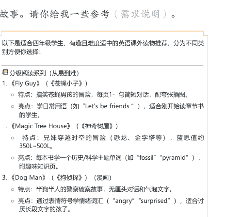

### DeepSeek 帮你改编与创作故事

如果你觉得有些英语故事不够好，那你可以进行改编，或者也可以创作一个新的故事。这不仅能提高你的英语运用能力，还能激发你的创造力。如果你无从下手，DeepSeek 可以给你一些启发。


例如，一名六年级的同学想用英语创作一个关于流浪小猫的故事。动笔之前，他只确定了小猫的外貌和性格特征，但具体的情节还没有想法，他可以这样向 DeepSeek 提问：

> 我是一名六年级的学生（自我介绍），我想用英语创作一个关于流浪小猫的故事（描述故事主题），目前我只确定了小猫的外貌和性格特征，它是一只小黑猫，勇敢、聪明（已知方面），但我不知道怎样展开情节（未知方面）。请你给我一些启发，要求使用简单英语词汇输出内容（需求说明）。

DeepSeek 为他提供了一些故事情节方面的参考，如图 5-16 所示。

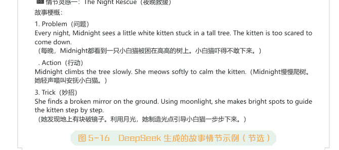

### 把故事搬上舞台

尝试和大家一起把故事改编成短剧搬上舞台吧！这有助于我们加深对故事内容的理解和记忆，还能锻炼口语表达能力和团队合作精神。

例如，文艺晚会上，五年级三班的同学们要合作演一部英语舞台剧，他们选择了经典童话《The Three Little Pigs》。具体怎么做？他们可以这样向 DeepSeek 提问：

> 我们是五年级的学生（自我介绍），要合作演一部英语舞台剧（描述目的），内容是经典童话《The Three Little Pigs》（如果是著名故事，交代名字即可；如果不是，就要介绍故事内容）。演出时长为半小时（说明演出时长）。我们现在具体要做些什么？请你给我们一些启发（需求说明）。

DeepSeek 为他们提供了演英语舞台剧方面的参考流程，如图 5-17 所示，内容涉及剧本简化与角色分配、道具与服装制作等方面。

第一阶段：剧本简化与角色分配（1周）
1. 精简剧本（示例台词）
   - 大灰狼（Wolf）：
     "Little pigs! Let me in（拍门动作）"
     "Then I'll huff, and I'll puff, and I'll blow your house down（叉腰吹气）"
   - 小猪们（Pigs）：
     第一只小猪："Straw is easy（懒散躺下）"
     第三只小猪："Bricks are strong（举哑铃动作假装搬砖）"
2. 角色分配建议（10~15人）

| 角色 | 人数 | 道具/任务 |
| :--- | :--- | :--- |
| 三只小猪 | 3 | 戴不同颜色耳朵头饰（粉/蓝/黄） |
| 大灰狼 | 1 | 灰色披风+狼爪手套 |
| 旁白（Narrator） | 1 | 举台词提示板，用夸张语调读关键句 |
| 稻草/木头/砖头 | 3组 | 举纸板房子（每组3人，举房顶、墙、门部件） |
| 风 | 3-4 | 吹泡泡机+蓝纱巾，狼吹气时跑动制造“风”的效果 |

备用角色：森林小动物（举树形纸板背景）、观众互动引导员（带鼓掌牌）。


## 06 创造或模拟真实对话场景，让口语水平突飞猛进

你有没有过这种情况？单词也记住了，语法也弄懂了，可是一到要说英语时，就卡壳了。为什么会卡壳，原因主要是日常缺乏真实的英语对话场景，缺乏语言环境。

缺乏语言环境可能会产生以下一些问题。

- 首先，缺乏实践机会，难以将所学知识运用到实际交流中。
- 其次，学习过程可能变得枯燥，缺乏趣味性和互动性，影响学习积极性和兴趣。
- 此外，可能无法有效锻炼语言思维和反应能力。同时，由于缺乏实际交流的体验，可能无法克服语言障碍，缺乏自信心，害怕开口。


怎么办？难道只能去那些以英语为母语的国家生活吗？别着急，创造或模拟真实的英语对话场景，也能有效提高英语口语水平，改善上面所说的那些问题！

具体可以创造或模拟哪些场景？我们从生活实际出发，跟随 DeepSeek 的脚步，一起去看看。


### 校园生活类

我们大部分时间都在校园里度过，这一类场景不需要模拟，直接选择一个搭档，全天和他创造真实的英语对话场景就行了。

例如，一名五年级的同学邀请他的好朋友一起用英语对话，因为是第一次尝试，他们也会遇到卡壳的情况。为了沟通更顺畅，他可以这样向 DeepSeek 提问：

> 我是一名五年级的学生（自我介绍），为了锻炼英语口语（描述想要达到的目的），我邀请了好朋友惠惠一起在学校里用英语日常对话（交代人员、场景等）。因为是第一次尝试，我们在说英语时会卡壳（描述问题）。为了沟通更顺畅，请你生成一些简单的校园日常对话，要用英语表达（需求说明），供我们参考练习。

DeepSeek 为他生成了一些校园生活日常对话参考，如图 5-18 所示，供他参考练习。

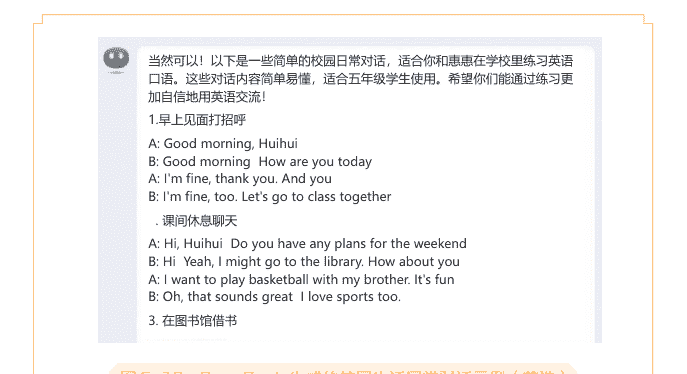

### 家庭日常类


除了学校，家是我们常驻的“港湾”，我们可以和家人用英语对话。如果家人不会说，我们可以自问自答，或者和虚拟助手（如小爱同学、天猫精灵等）对话，还可以想象和家人对话，用英语表达自己的想法。

例如，一名六年级的同学想在家里用英语对话，但他的家人都不会，于是他决定自问自答，同时扮演两个人物角色。具体怎么展开？他可以这样向 DeepSeek 提问：

我是一名六年级的学生（自我介绍），为了锻炼英语口语（描述想要达到的目的），我想在家里用英语对话，但家人都不会，我决定自问自答，同时扮演两个人物角色（交代场景、人员等）。具体可以从哪些方面展开（描述问题）？请你生成一些简单的家庭日常对话，要用英语表达（需求说明），供我参考练习。

DeepSeek 为他生成了一些家庭日常对话参考，如图 5-19 所示，供他参考练习。

> 以下是为你设计的家庭日常英语对话练习模板，包含不同场景的简单对话，适合自问自答扮演双角色。每个对话标注角色切换提示，并附中文翻译参考：

场景一：早餐时间（Breakfast Time）
角色A:妈妈（Mom）/角色B:孩子（You）
Mom: "Good morning. Do you want toast or porridge today?"
（早上好！今天想吃吐司还是粥？）
You: "Toast, please. Can I have strawberry jam?"
（吐司，谢谢！能加草莓果酱吗？）
Mom: "Sure. Don't forget your milk. It's getting cold."
（当然！别忘了牛奶，快凉了。）
You: "Okay. Thank you, Mom."
（好的！谢谢妈妈！）

图 5-19 DeepSeek 生成家庭日常对话示例（节选）

### 社会实际生活场景类

除了在学校和家里创造或模拟真实的英语对话场景，还可以通过模拟社会实际生活场景进行练习，如超市购物实践、公交出行问答、图书馆借书、紧急求助等。

例如，一名六年级的同学想在社会实际生活场景中模拟英语对话，他决定自问自答，同时扮演两个人物角色。但他不是很清楚不同的社会场景中有哪些通用的句式，他可以这样向 DeepSeek 提问：

> 我是一名六年级的学生（自我介绍），为了锻炼英语口语（描述想要达到的目的），我想在社会实际生活场景中模拟英语对话，我决定自问自答，同时扮演两个人物角色（交代场景、人员等）。不同的社会场景中，有哪些可以通用的句式（描述问题）？请你生成一些简单的社会实际生活场景对话，要用英语表达（需求说明），供我参考练习。

DeepSeek 为他生成了一些社会实际生活场景对话参考，如图 5-20 所示。


# 让亲子交流更顺畅


## 01 DeepSeek，教育方法大师


作为家长的你，是否有过这样的时刻？题目讲了3遍，孩子还在玩橡皮，你急得拍桌子吼“不写完不准睡觉”，结果孩子哭了，你又心疼地改口“写完这一题咱们就睡觉”。辅导作业的夜晚，你总在“逼着学”和“求着学”之间反复跳转。出现这样的情况，归根结底是孩子的学习兴趣不够。

### 家长要怎样教育孩子

前面的章节中已经给孩子介绍了提升学习兴趣的方法，那作为家长的我们，还可以怎样去教育孩子呢？

**首先，锻炼孩子的思维能力。** 思维能力强的孩子，数学题能举一反三，和同学闹矛盾也能冷静分析。

**其次，提升孩子的生活能力。** 会收拾书包的孩子，房间就不会乱糟糟；能在家帮家长洗碗扫地的孩子，住校后就不会把脏袜子攒成堆。生活能力不是“长大就会”，得从小练起。

**最后，家校协同。** 老师在校教知识，家长在家抓习惯，家校拧成一股绳，就能养出好苗子。

那么要如何锻炼孩子这方面的能力呢？别着急，我们可以让 DeepSeek 这位“教育方法大师”根据孩子的具体情况，提供针对性的方法。

### 锻炼孩子的思维能力

前面已经提到，思维能力强的孩子，不仅能够在学习过程中举一反三，还能在和同学产生矛盾时冷静分析，所以锻炼孩子的思维能力至关重要，那具体要如何做呢？我们可以把自家孩子的具体情况告诉 DeepSeek，它会给出切实可行的方法。

例如，一位家长通过观察自家孩子的表现，发现孩子平时十分粗心大意，无论是在学习中，还是在生活中，总是犯错，但是他好奇心非常旺盛。这位家长可以这样向 DeepSeek 提问：

> 我是一位家长（自我介绍），我家孩子目前在读小学三年级，他平时十分粗心大意，无论是在学习中，还是在生活中，总是犯错。但孩子对学习之外的事都非常好奇，有时候观察蚂蚁搬家都能观察一整天，还喜欢在逛超市的时候问东问西（详细情况说明）。请根据我家孩子的情况，提供一些能够锻炼他思维能力的方法（具体需求）。

DeepSeek 根据这位家长的具体情况，为他提供了一些锻炼他家孩子思维能力的方法，如图 6-1 所示。

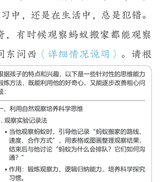

### 提升孩子的生活能力

思维能力是一方面，生活能力也是一方面。家长要让孩子从小就养成好的生活习惯，如洗碗扫地、整理衣物等。可别小看这些小事，它们能让孩子做事有条理，将来生活上自理能力更强。那么要怎样提升孩子的生活能力呢？我们依然可以结合孩子的具体情况来向 DeepSeek 提问。

例如，一位家长希望让自己即将上小学的孩子养成好的生活习惯，他可以这样向 DeepSeek 提问：

> 我是一位家长（自我介绍），我家孩子马上就要上小学了，我希望他能从现在开始，慢慢养成好的生活习惯（详细情况说明），请为我提供一些方法（具体需求）。

DeepSeek 根据这位家长的具体情况，为他提供了一些养成孩子良好生活习惯的方法，如图 6-2 所示。

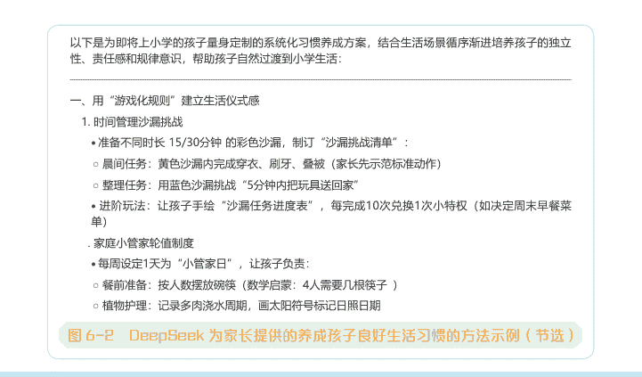

### 家校协同：做智慧的合作者

教育就像炒菜，家校配合得掌握火候。老师在校教知识，家长在家抓习惯，双方合力，才能让孩子全面发展。家长们还要记住不要学校“减负”你“加码”，老师布置劳动任务你包办，两股劲儿反着使只会“扯疼”孩子。家校只有拧成一股绳，才能让孩子茁壮成长！具体的家校合作的操作方法可以让 DeepSeek 告诉我们。

例如，一名三年级孩子每天有听睡前故事的习惯，但最近老师要求他每天阅读课上推荐的课外书。这样一番操作，孩子的睡觉时间就被推后了。为了在完成老师任务的前提下保证孩子的睡眠时间，这名孩子的家长可以这样向 DeepSeek 提问：

> 我是一名三年级学生的家长（自我介绍），我家孩子每天有听睡前故事的习惯，但最近老师要求他每天阅读课上推荐的课外书，这就导致我家孩子的睡觉时间被推后了（详细情况说明）。请给我提供一些方法，把孩子听睡前故事的时间和阅读课外书的时间结合起来（具体要求）。

DeepSeek 根据这位家长的具体情况，为他提供了一些方法，如图 6-3 所示。

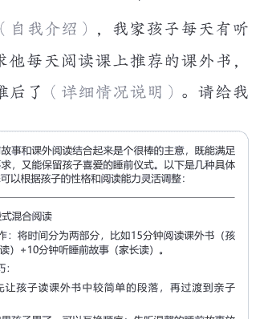

## 02 亲子趣味游戏设计

生活中其实有很多我们可以利用起来提升孩子各方面能力的亲子活动，这些看似平常的活动，不但能锻炼孩子的能力，还能增进亲子关系。作为家长，我们要学习的是如何让孩子在与我们的亲子活动中，自然而然地得到锻炼。


#### 家长可以锻炼孩子哪些能力

观察能力、逻辑能力、动手能力是孩子成长的关键基础能力。

**观察能力：** 帮助孩子捕捉细节、理解环境变化，为学习与探索提供信息基础。

**逻辑能力：** 培养分析问题、梳理因果关系的思维习惯，提升解决复杂问题的效率。

**动手能力：** 通过实践将想法转化为行动，强化实践能力和抗挫折意识。

这 3 项能力相互支撑——观察能力获取信息，逻辑能力整理思路，动手能力验证结果。

从小系统地培养孩子这 3 个方面的能力，能让孩子在学习中减少粗心，在生活中快速应对突发状况，为未来自主解决问题奠定坚实的基础。

### 观察能力特训

我们在日常的亲子活动中要如何锻炼孩子的观察能力呢？一起来看看 DeepSeek 是怎么说的吧！

例如，一位家长是自由职业，工作时间比较自由，所以他承担了带孩子的任务。现在这位家长想要以家里的客厅和阳台为活动范围，策划一些能够提升孩子观察能力的亲子活动，他可以这样向 DeepSeek 提问：

> 我是一名二年级学生的家长（自我介绍），我是自由职业，工作时间比较自由，我想以自家的客厅和阳台为活动范围，和孩子进行一些能够提升他观察能力的亲子活动（详细情况说明），请为我设计一些这方面的亲子活动（具体要求）。

DeepSeek 根据这位家长的具体情况，为他设计了一些亲子活动，如图 6-4 所示。

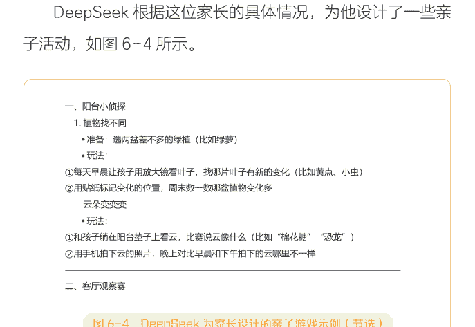

### 逻辑能力提升

逻辑思维能力不是天生的本事，而是家长在日常互动中帮孩子练就的“脑力工具箱”。通过恰当的亲子活动设计，能让孩子的逻辑能力得到提升。

例如，还是上面的那位家长，他想要利用孩子平时在家和在超市中的活动，来和孩子进行一些能够提升孩子逻辑能力的亲子游戏，他可以这样向 DeepSeek 提问：

> 我是一名二年级学生的家长（自我介绍），我是自由职业，工作时间比较自由，我想利用孩子平时在家和在超市中的活动，和孩子进行一些能够提升他逻辑力的亲子游戏（详细情况说明），请为我设计一些这方面的游戏（具体要求）。

DeepSeek 根据这位家长的具体情况，为他设计了一些亲子游戏，如图 6-5 所示。

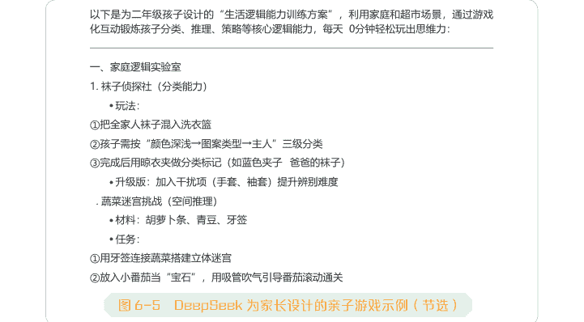

### 动手能力培养

在很多事情中，动手实践都起着重要作用。动手能力强的孩子，在搭积木时懂得加固底座，做实验时会不断调整步骤直到成功。我们在平时的亲子活动中，不仅要提升孩子的观察能力、逻辑能力，还要提升他们的动手能力，给他们多创造动手机会，培养他们的实践能力和解决问题的能力。

例如，一位家长想要结合厨房里的具体事物让已经六年级的孩子了解一些基础的化学知识，他可以这样向 DeepSeek 提问：

> 我是一名六年级学生的家长（自我介绍），想利用厨房中的具体事物让孩子了解一些基础的化学知识（详细情况说明），请给我设计一些这方面的化学实践活动（具体要求）。

DeepSeek 根据这位家长的具体情况，为他设计了一些化学实践活动，如图 6-6 所示。

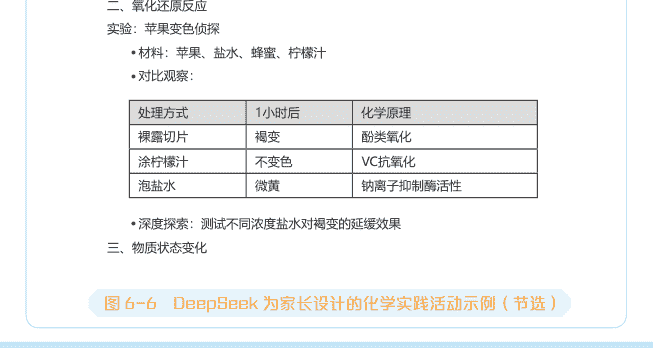

### 孩子学习进度全跟踪

在辅导孩子学业的过程中，或许您也有过这样的体验：孩子平时学习挺认真的，但学习进度总是比较慢，很容易影响学习成绩。作为家长，也想给孩子提供有益的帮助，却不知从何下手。

那么，我们先来分析影响孩子学习进度的原因。

**原因一：基础知识不牢。** 很多孩子在一开始打基础时，学的知识不够牢固，后面综合运用知识时就会经常出现运用不熟练的情况，导致学习效率低。

**原因二：学习习惯不好。** 不好的学习习惯很容易形成恶性循环，从而影响学习进度。

**原因三：注意力不集中。** 课堂上，如果孩子没有集中注意力听课，就会很容易错过或漏掉重要的知识点，影响学习进度。

别担心，DeepSeek 可以帮助您解决这些问题，助力孩子把握好学习进度。


### 数据化记录学习轨迹

日常学习轨迹总是难以追踪，很多时候孩子也记不清自己学到哪里了。这时我们可以让 DeepSeek 为您的孩子生成数据化学习记录，让学习进度有章可循。

例如，一名小学三年级学生的家长，他的孩子经常混淆数学知识点，容易粗心大意，不知道怎样对已经学过的知识进行分类记忆。他想让 DeepSeek 帮助孩子建立学科档案，生成数据化学习记录，以便有效追踪孩子的学习轨迹。他可以这样向 DeepSeek 提问：

> 我是一名小学三年级学生的家长（自我介绍），我的孩子经常混淆数学知识点，容易粗心大意，不知道怎样对已经学过的知识进行分类记忆（情况说明）。请帮我的孩子建立学科档案，生成数据化学习记录，追踪孩子的学习轨迹（具体需求）。

DeepSeek 为他生成了小学三年级的数据化学习轨迹记录方案，如图 6-7 所示。

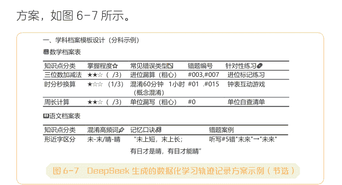

### 生成可视化学习报告

怎样将已掌握和未掌握的知识点明确地区分出来？DeepSeek 可以通过分析孩子的错题，归纳出易错点、难点，从而了解孩子对各个知识点的掌握情况，针对有关学习情况生成可视化学习报告，让您对孩子掌握知识的情况一目了然。

例如，一名小学生的家长，他的孩子本次数学考试成绩不太好，但他不清楚孩子此次数学考试中知识点的薄弱处和比较擅长处。他先上传试卷的照片，再可以这样向 DeepSeek 提问：

> 我是一名小学生的家长（自我介绍），这是我孩子的数学考试试卷（上传照片），请根据他的答题情况，分析他在哪些知识点方面比较擅长，哪些知识点比较薄弱（具体需求）。

DeepSeek 根据试卷内容和答题情况，为他生成了可视化学习报告，如图 6-8 所示。

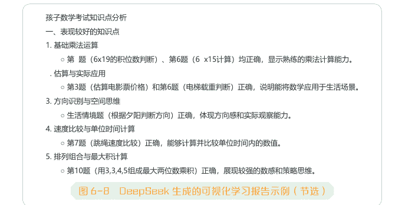

### 定制化学习方案

每个孩子适合的学习方法不一定相同，有的孩子更理性，有的孩子更感性。只有找到适合的学习方法，才能帮助孩子成长。DeepSeek 可以根据个人习惯，定制差异化的学习方案。

例如，一位家长的儿子读五年级，喜欢数学，平时喜欢逻辑性思考；他的女儿则喜欢英语，平时喜欢形象化思考，他希望 DeepSeek 根据两个孩子的情况，提供不同的学习方案。他可以这样向 DeepSeek 提问：

> 我是两名小学生的家长（自我介绍），儿子读五年级，喜欢数学，平时喜欢逻辑性思考；女儿喜欢英语，平时喜欢形象化思考（情况说明）。请根据两个孩子的情况，提供不同的学习方案（具体需求）。

DeepSeek 根据两名孩子的具体情况，生成了定制化的学习方案，如图 6-9 所示。

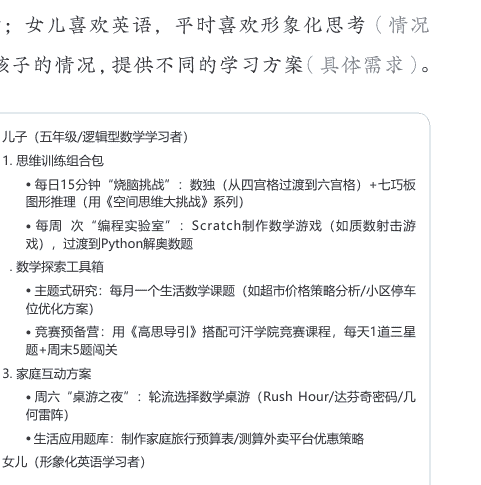

### 孩子未来的规划建议

对于小学阶段孩子的家长而言，根据孩子的特点来规划未来具有极其重要的意义。这不仅关乎孩子当下的学习和成长，更将对其一生的发展产生深远影响。

具体体现在以下方面。

1. **促进孩子个性化成长**：促进孩子的个性化发展、发现孩子的兴趣与天赋、培养孩子的自信心。
2. **助力孩子学业发展**：合理安排学习路径，培养良好的学习习惯。
3. **助力孩子未来适应**：有助于孩子适应社会和未来的职业发展。
4. **促进家庭和谐关系**：促进家庭和谐，增强亲子关系。

但是，在孩子的成长道路上，许多家长常常感到迷茫与无助。面对孩子未来的规划，他们不知从何下手。有的家长因自身经验不足，难以洞察孩子的兴趣与潜力；有的则在繁杂的教育信息中迷失方向，不知如何为孩子选择适合的道路。这种困惑与焦虑，让家长们在孩子的未来规划上举棋不定，急需找到正确的方法来为孩子指引方向。


### 助力孩子规划未来

每个孩子都有独特的性格和兴趣，这些特质如同他们手中的画笔，绘就未来的画卷。如何依据孩子的性格特点和兴趣来规划成长路径，让他们在适合自己的道路上茁壮成长，是每位家长都需要思考的问题。这个问题并不容易解决，究其原因，主要有以下两个方面。


**原因一：家长缺乏对孩子性格和兴趣的深入了解。** 一方面，家长往往忙于工作和生活琐事，难以抽出足够的时间关注孩子的日常行为和兴趣表现。另一方面，部分家长基于自己的期望或传统观念，忽视了孩子真正的喜好。

**原因二：家长缺乏专业的指导和支持。** 在教育方法和心理学知识方面，家长可能有所欠缺，不知道如何科学引导孩子发现自己的兴趣和特长。同时，家长也可能因为没机会接触到专业的教育顾问或心理咨询师，从而无法获得科学的指导和支持。

家长们不要着急，让 DeepSeek 来帮助您，一起为孩子的未来助力吧！

### 深入了解孩子的性格和兴趣

家长怎么深入了解孩子的性格和兴趣呢？当孩子不愿与您沟通，或者您没有机会与孩子深度交流时，可以根据孩子日常的行为表现来思考、推断。

例如，王先生的儿子在读五年级，王先生常年在外忙于工作，很少跟儿子交流，只知道儿子平时话不多，经常看古典小说，如《红楼梦》。他可以这样向 DeepSeek 提问：

> 我是一名五年级男孩的家长（自我介绍），我常年在外工作，很少跟儿子交流，只知道儿子平时比较安静，不太爱讲话，经常看《红楼梦》这类古典小说（描述具体的行为表现）。请你根据他的行为特点，分析一下他的性格和兴趣爱好（需求说明）。

DeepSeek 为王先生实现了他的需求，如图 6-10 所示，还分析了孩子的潜在优势和挑战等实用参考。

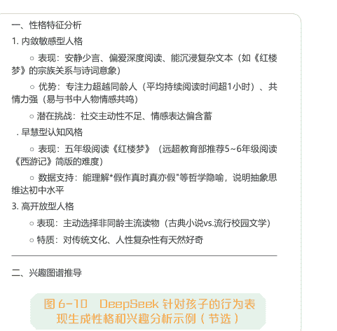

### 提供专业的指导和支持

当家长了解自家孩子的性格和兴趣所在后，就可以引导孩子探索与之相关的未来职业领域。


例如，前面提到的王先生在参考了 DeepSeek 给出的分析后，想引导儿子深度发展兴趣爱好，给儿子一些指导和支持，但不知道怎么做。他可以这样向 DeepSeek 提问：

> 我是一名五年级男孩的家长（自我介绍），我的儿子平时比较安静，经常看《红楼梦》这类古典小说（描述具体的行为表现）。我想引导儿子深度发展他的兴趣爱好，想给他一些针对性的指导和支持，请你给我一些比较专业、实用的方法（需求说明）。

DeepSeek 非常详细地生成了一些可操作的示例方法，给出了十分结构化的实用建议，如图 6-11 所示。

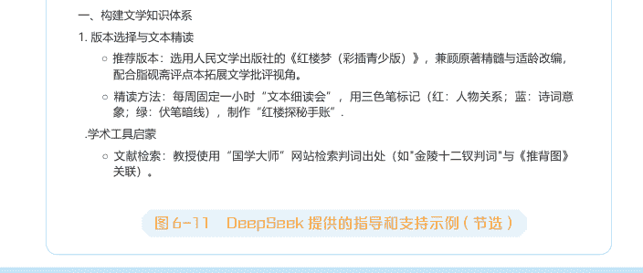

## 05 带孩子更好地玩转 AI

当 AI 成为孩子的“全能家教”，既能 3 秒解奥数题，又能生成科幻小说时，家长该做“甩手掌柜”，任由孩子自由探索 AI，还是做“技术警察”严格监管孩子使用 AI？下面将帮助家长带领孩子更好地玩转 AI，教大家如何安全入门不踩坑，如何避免孩子利用 AI 代写作业，以及如何打破 AI 形成的信息茧房，真正把技术变成通向未来的翅膀，而非困住思维的牢笼。

#### 如何安全入门不踩坑

**首先，我们要认真筛选给孩子的 AI 工具。** 除了我们主要介绍的 DeepSeek 之外，现在我们身边还有很多功能各异的 AI 工具。家长应引导孩子进行选择。在选择 AI 工具时，要注意版本是否正确，避免下载到非官方且带病毒的版本。还要注意隐私权限，可以关掉必要功能之外的其他权限，以保障隐私。最后，安装后先陪孩子试玩，像试吃新零食一样确保“安全无毒”。

**其次，我们要规定 AI 工具的使用规则。** 我们可以对孩子使用 AI 工具的时间作出限制，例如，规定每天使用时间不超过 40 分钟（相当于两集动画片的时间）；还可以和孩子签订《智能伙伴协议》，例如，用 AI 查作业前必须自己思考 10 分钟，生成的故事要读给家长听。

**最后，定期开展亲子共学。** 例如，可以每周和孩子玩一次“人机大比拼”：家长描述“会飞的乌龟”，孩子用 AI 生成图画后，再用彩笔改进细节。如果发现 AI 有画错的地方，可以趁机引导孩子查阅资料对比。如果发现孩子用 AI 写作文，别急着批评，改成“AI 写开头，你改结尾，看谁更有创意”。

### 如何避免孩子利用 AI 代写作业

为避免孩子利用 AI 代写作业，可以要求孩子在使用 AI 工具前完成以下三个步骤。

1. 在草稿本上写至少 2 个解题思路关键词，如“方程移项”“单位换算”。
2. 标注出题目中自己看不懂的词汇或知识点。
3. 预估完成时间并设定闹钟，如 30 分钟。

例如，有名六年级的同学按照以上步骤做完了一道计算利润率的数学题，但他不太确定利润率的计算公式，那他就可以先记下这个知识点，然后向 DeepSeek 提问来验证思路：

> 我是一名六年级的学生（自我介绍），对于“甲种运动器械进价 1200 元，按标价 1800 元的 9 折出售。乙种跑步器，进价 2000 元，按标价 3200 元的 8 折出售，哪种商品的利润率更高些”中涉及的利润率计算公式这一知识点，我不太熟悉（详细情况说明），请你给出这一题的解题思路，并着重介绍利润率计算公式这一知识点（具体要求）。

DeepSeek 根据这名同学的具体情况，为他着重介绍了解题思路及知识点，如图 6-12 所示。


### 如何打破 AI 形成的信息茧房

孩子刷视频总是收到同类推荐？这是 AI 通过“猜你喜欢”功能在构建一张无形的信息网络！如果孩子只看恐龙视频、只听流行歌曲，就好比长期只吃汉堡薯条，营养会失衡。家长要做“信息营养师”，主动带 AI “换口味”！

**首先，家长可以给 AI “喂”多样化信息。** 家长可以主动设置兴趣标签，定期帮孩子添加一些相对“冷门”的关键词。

**其次，家长要当好“信息质检员”。** 例如，家长可以跟孩子一起分析 AI 推送的热门视频，像“这个说北极熊灭绝的视频，内容的真实度怎么确定？我们可以从多个权威渠道去查找相关信息进行对比”，以此来让孩子明白网上的信息并不是百分百准确的。

**最后，要预防孩子沉迷 AI。** AI 用多了容易“上瘾”。家长要当好“管理员”，一方面要限制孩子每天使用 AI 的时间，另一方面要定期检查 AI 聊天记录，防止孩子使用 AI 代写作业或谈论不合适的话题。


# 《问对问题赢学习：DeepSeek中小学生使用攻略》内容思维导图

## DeepSeek相关使用指南
- DeepSeek是什么
- DeepSeek安装注册流程
- DeepSeek功能及版本介绍
- DeepSeek特点及交流秘诀
- 向DeepSeek提问注意事项

## DeepSeek提升孩子语文成绩
- 提升孩子阅读兴趣
  - 孩子不爱看书的原因分析
  - 提供孩子感兴趣的书
  - 陪孩子讨论书中内容
  - 养成良好的阅读习惯
- 增强孩子阅读能力
  - 确定书籍阅读顺序
  - 制订快速阅读计划
  - 提升孩子阅读技巧
- 帮孩子背诵古诗文
  - 设计趣味古诗文记忆法
- 生成古诗文知识图谱
  - 快速搜集整理古诗文资料
  - 让古诗文知识变得有趣
  - 制作古诗文思维导图
- 打造要点明确的笔记
  - 康奈尔笔记法的用法
  - 帮助整理笔记内容
- 增进作文写作能力
  - 寻找作文灵感
  - 让语言更生动
  - 批改孩子作文
  - 搜集作文素材
  - 作为审题指导

## DeepSeek提升孩子数理成绩
- 建立数理错题本
  - 梳理数理知识点
  - 诊断数理知识漏洞
  - 针对错题进行分析
- 培养举一反三能力
  - 拓展学习三步法
- 用费曼学习法加深理解
  - 费曼学习法的概念
  - 费曼学习法的步骤
  - 用费曼学习法拆解难题
- 用苏格拉底提问法培养数理思维
  - 苏格拉底提问法的概念
  - 苏格拉底提问法的特点
  - 用“DeepSeek+苏格拉底提问法”辅助做题
- 突破数学思维瓶颈
  - 发现孩子理解偏差
  - 拓宽孩子解题思路
- 让科学知识有趣起来
  - 打造虚拟实验室
  - 参与故事互动
  - 建立微观知识漫游库

## DeepSeek提升孩子英语成绩
- 对英文不感兴趣的原因
- 英文趣味角色扮演
- 设计趣味英文对话
- 设计荒诞情景喜剧对话
- 英文单词趣味游戏
  - 谐音方式背单词
  - 趣味词根背单词
  - 接龙游戏背单词
  - 肢体拼写背单词
  - 寻宝游戏背单词
- 巧用英文单词设计游戏
- 巧用艾宾浩斯遗忘曲线
  - 制作彩虹单词打卡表
  - 制作录音贴纸时间胶囊
- 帮助掌握英语语法
  - 不同句式变形法
  - 语法拍手歌设计
- 在趣味故事中学英语
  - 选择合适的趣味故事
  - 英语故事改编与创作
  - 把英语故事搬上舞台
- 提升孩子的口语水平
  - 模拟校园生活对话
  - 模拟家庭日常对话
  - 模拟社会实际生活场景对话

## DeepSeek提升孩子全方位素养
- 让学习变得更有趣
  - 对游戏感兴趣的原因分析
  - 拆解学习任务
  - 设计学习游戏
  - 兴趣课程设计
- 培养孩子学霸素养
  - 分析与学霸的差距
  - 定制学习方法
  - 确定学习目标
  - 整理散乱知识点
  - 培养逻辑思考力
  - 养成良好的学习习惯
  - 设计记忆训练法
  - 提供有针对性的记忆方法
  - 提升搜索效率
- 加强时间管理能力
  - 整理杂乱任务
  - 定制时间规划
- 提升孩子的专注力
  - 影响专注力的原因分析
  - 提供有针对性的专注力训练方法
- 改善孩子心理情商
  - 给予情绪支持
  - 交流策略建议

## DeepSeek让亲子交流更顺畅
- 为家长提供教育方法
  - 锻炼孩子思维能力
  - 提升孩子生活能力
  - 加强家校协同合作
- 亲子趣味游戏设计
  - 观察能力特训游戏设计
  - 逻辑能力提升游戏设计
  - 动手能力培养游戏设计
- 孩子学习进度全跟踪
  - 数据化记录学习轨迹
  - 生成可视化学习报告
  - 定制化学习方案
- 根据孩子特点规划未来
  - 深入了解孩子性格兴趣
  - 提供专业的未来规划指导和支持
- 带孩子更好地玩转AI
  - 让AI运营更安全
  - 避免孩子滥用AI
  - 打破AI信息茧房

# 《问对问题赢学习：DeepSeek中小学生使用攻略》提问词汇总

1. **学习目标拆解**
   我是一名（具体年级）学生，想提升（具体目标），准备用（具体时间）完成目标，每周可以用（具体时间）来学习，我现在的问题有（当前存在的问题）。请帮我设计一个学习方法，要拆解成阶段性步骤，并按照由易到难的顺序排列。

2. **学习游戏设计**
   我是一名（具体年级）学生，我想记住（想要记住的知识）。请帮我设计几个既能跟（具体数字）个同学一起进行，又能帮我们记住这些知识的游戏。

3. **将爱好和学习结合**
   我是一名（具体年级）学生，平时比较喜欢（兴趣爱好），不喜欢（不喜欢的课程），可以将我的兴趣爱好和不喜欢的课程内容结合起来，制订一个特别的课程吗？

4. **定制学习方法**
   我是一名（具体年级）学生，（自己的性格特点说明），可以根据我的性格帮我制订一个适合我的（对应学科或知识）学习方法吗？

## 5 树立学习目标

我是一名（具体年级）学生，成绩（当前成绩情况说明），我现在觉得很迷茫，找不到学习目标，请告诉我我未来的学习目标。

## 6 知识点整理

（上传附件——图片或文件）这是我收集的一些资料，请帮我把知识点梳理好并分类。

## 7 学习习惯培养

我是一名（具体年级）学生，成绩（当前成绩情况说明），我（当前学习习惯问题说明），请为我制订一个养成良好学习习惯的计划。

## 8 提供记忆力训练方法

我觉得自己记忆力不行，（记忆力情况说明），请给我一个简单、实用的记忆力训练方法。

## 9 提供记忆方法

我的（记忆力情况说明）。我想要在（具体时间）背诵（要背诵的内容），请给我提供一个适合我的记忆方法。

## 10 对应资料搜索

（开启“联网搜索”功能）我是一名（具体年级）学生，需要收集一些（要收集的内容）。请为我提供资料，并提供输出内容的出处。

## 11 确定任务完成顺序

我是一名（具体年级）学生，我想要规划好（具体时间），但是我要完成的事情很多，（列举要完成的任务）。请按照这些事情的重要程度，帮我安排一个时间计划。

## 12 定制时间规划

我是一名（具体年级）学生，我（平时时间安排、要完成的任务等情况说明）。请为我制订一个一周的时间管理方案。

## 13 分析专注力低的原因

我是一名（具体年级）学生，我（自身专注力情况说明）。请根据我的情况，分析我专注力低的原因。

## 14 提供专注力训练法

我是一名（具体年级）学生，我（自身专注力情况说明）。请根据我的情况，为我提供一些针对性的专注力训练方法，要求一个人在家就能做。

## 15 角色扮演指令

我是一名（具体年级）学生，我想让你扮演（设定角色），来跟我交流。你需要（对角色的具体要求）。

## 16 人际沟通建议

我是一名（具体年级）学生，（具体沟通情况说明），我想（自身态度），该怎么回答才（沟通结果要求）？

## 17 推荐感兴趣的书

我是一名（具体年级）学生，平时喜欢（爱好），爱看（列举最喜欢的动画片、电影、电视剧等），喜欢的书有（列举最喜欢的书籍），能帮我推荐一些我可能感兴趣且适合我的书吗？

## 18 角色扮演聊书籍

我是一名（具体年级）学生，刚读完（书名），我（自身对书中角色、剧情、表达的思想等的想法）。我想让你扮演（角色设定），能用他的语气跟我聊聊吗？

## 19 阅读习惯培养

我是一名（具体年级）学生，我现在（当前读书情况说明），想要一个可执行的阅读习惯培养计划。

## 20 书籍阅读顺序安排

我是一名（具体年级）学生，（时间期限）我要看完这些书（列出书目），请按照由易到难的顺序为我安排阅读顺序。

## 21 制订具体阅读计划

我是一名（具体年级）学生，我（阅读时间安排），（时间期限）我要看完以下书（列出书目），帮我制订一个能在该时间期限内读完这些书且剩下时间充裕的阅读计划。

## 22 阅读重点选择

我是一名（具体年级）学生，请告诉我（列出书名）应该精读还是泛读，并说明阅读重点和思考点是什么。

## 23 寻找书籍中的不同观点

我是一名（具体年级）学生，我正在阅读（列出书名），请告诉我，我可以带着什么问题去读，以及针对这本书的内容，都有哪些不同观点。

## 24 提供古诗文背诵方法

请给（具体数量）个能帮我快速背下（列出古诗文名称）的方法，并说明背诵时有哪些注意要点。

## 25 搜集整理古诗文资料

（开启“联网搜索”功能）我是一名（具体年级）学生，我正在预习（列出古诗文篇目）这篇课文，需要你帮我搜集整理相关资料，包括出处、创作背景、重点字词句等方面的内容，要求内容准确。

## 26 整理古诗文知识点

（上传附件）根据我上传的资料，帮我搭建一个有趣又便于理解、记忆的（列出对应古诗文篇目）知识图谱，要重点突出，逻辑严谨。

## 27 思维导图制作

（上传附件）根据我上传的资料，帮我制作一个思维导图，并以Markdown格式输出内容。

## 28 用康奈尔笔记法整理笔记

我是一名（具体年级）学生，请根据我上传的笔记（上传附件），用康奈尔笔记法帮我整理这份课堂笔记，但不要写总结区的内容。

## 29 作文灵感提供

我是一名（具体年级）学生，请根据“（作文题目和要求）”，给我提供一些写作灵感。

## 30 作文语句提升

这是我写的一句话：“（作文语句描写）”，可以帮我提供一些让这句话语言变得更生动的办法吗？

## 31 作文点评和改进建议提供

（上传附件）我是一名（具体年级）学生，这是我写的作文，作文题目是“（作文题目）”，老师的点评是“（点评内容）”，请更详细地点评我的作文，并给出改进建议。

## 32 作文素材搜集

我是一名（具体年级）学生，需要以“（作文题目）”为题写一篇作文。要求（具体要求）。请给我搜集一些作文素材。

## 33 作文审题

我是一名（具体年级）学生，我要写一篇以（作文题目）为题的作文。作文的要求是：（具体要求）。请帮我分析题目，并给我一些写作方向。

## 34 有困难的知识点说明

我是一名（具体年级）学生，在学习（具体知识点）时遇到了困难，感觉不是很明白。请用我能听得懂的语言解释（上述具体知识点），并举例说明。

## 35 作业批改分析

（上传附件）我是一名（具体年级）学生，这是我的作业。请按照（对应教材版本和科目）作业批改标准批改我的作业，并标注错误类型和对应的知识点。

## 36 错题分析

（上传附件）我是一名（具体年级）学生，请根据我上传的错题分析我做错的原因（需要说明），并给我提供避免做错这一类型题目的建议（具体需求）。

## 37 设计类似题型

（上传附件）请根据我上传的题目考察点，再出几道类似的题目，要标注难度，并设置不同的情境。

## 38 用费曼学习法拆解题目

（上传附件）我是一名（具体学段）学生，请根据我上传的题目，用费曼学习法拆解它们，并引导我发现自己的知识漏洞。

## 39 用苏格拉底提问法讲解题目

（上传附件并关闭“深度思考”模式）我是一名（具体年级）学生，请模拟你在教我做题目的场景，用苏格拉底提问法向我提问。等我回答了一个问题后再继续提下一个问题，开始吧！

## 40 题目核心知识点分析

（上传附件）请问这几道题讲了（对应科目）的哪些知识点？

## 41 分析知识理解偏差

我是一名（具体年级）学生，这是我对（对应知识点）的理解：（阐述自己的理解）。请评价我的理解是不是正确的，如果有问题请指出来并提出改进建议。

## 42 拓宽解题思路

（上传附件）我是一名（具体年级）学生，请为我上传的题目提供几个解题思路，不需要具体的解答过程和答案，这些思路所涉及的知识点在（具体年级）学生应该掌握的范围内。

## 43 解题习惯分析

（上传附件）我是一名（具体年级）学生，请对我上传的错题集进行分析，告诉我，我在解题习惯方面有哪些问题，可以用什么方法改进。

## 44 科学实践活动设计

我是一名（具体学段）学生，我对科学知识非常感兴趣，但是学校的科学实践课比较少，我想通过线上的方式参与多场景的数理科学实践活动，帮助我巩固课堂里学到的知识。要求实践内容通俗易懂，不超出（学段范围）的理解范围。

## 45 定制互动性的故事

我是一名（具体学段）学生，我（个人情况说明），在学习（对应知识点）问题时，我难以理解题目传达的意思。请帮我生成一个互动性的故事，以便我理解题意。

## 46 建立知识漫游库

我是一名（具体学段）学生，我最近在学习（对应知识点）。请你创建（对应知识点具体内容）知识漫游库，帮我了解这些内容。

## 47 英文单词趣味对话设计

我是一名（具体年级）学生，总是记不住这几个单词（列举你觉得最难记的单词）。我想通过跟一个同学玩角色扮演来开展趣味对话，强化记忆这些单词。我扮演（你扮演的角色），同学扮演（他人扮演的角色）。请你生成一段对话，供我和同学模拟运用，对话中要使用上述几个单词。

## 48 表情包英文对话设计

我是一名（具体年级）学生，我制作了一个（具体描述表情包的内容）的表情包，我想用（列举想掌握的单词）来生成一句搭配表情包的文字。请你生成一段对话，对话中要使用上述几个单词。

## 49 英文荒诞情景喜剧设计

我是一名（具体年级）学生，我想在班会上表演英文版的荒诞情景喜剧。我想扮演（描述你想扮演的角色、所要呈现的场景）。我选定了（列举目标单词）目标单词。请你帮我用它们来生成一段荒诞情景喜剧对话。

## 50 生成英文单词谐音

我是一名（具体年级）学生，我想用谐音记忆新学的单词，它们分别是（列举目标单词）。我想给每个单词设一个谐音，还想把这些单词连起来，连成一个谐音故事，要求好玩、好记。请你为单词生成谐音示例，供我参考。

## 51 拆解英文单词词根

我是一名（具体年级）学生，我想通过拆解单词的方式，来记忆新学的单词，它们分别是（列举目标单词）。我希望单词拆解后的词根能连成一个（什么样的）故事。请你为单词生成趣味词根，供我参考。

## 52 英文单词接龙

我是一名（具体年级）学生，我的英语老师布置了一项课堂作业，她让我们每人轮流说一句英文，句子之间的意思必须逻辑连贯，即使无厘头也没关系。句中必须包含一些新学的单词，它们分别是（列举目标单词）。请你生成一段接龙示例，供我参考。

## 53 英文单词肢体拼写

我是一名（具体年级）学生，我的英语老师让我们根据（列举一个目标单词），这个单词，分组进行肢体拼写竞赛，每一组（同学数量）个同学。老师喊出单词后，各组需用人体按字母（大写）顺序拼出正确的单词。请你生成一组肢体拼写示例，供我和队员参考。

## 54 英文单词寻宝游戏

我是一名（具体年级）学生，我想跟我的朋友们玩英文单词寻宝游戏，一边寻宝，一边加深对身边物品对应单词的记忆，如（列举目标单词）等。请你帮我设计具体的玩法，提供详细说明，供我和朋友们参考。

## 55 制作彩虹单词打卡表

我是一名（具体年级）学生，我想运用艾宾浩斯遗忘曲线来制作一个彩虹单词打卡表。但是我不知道要准备哪些材料，不明确制作步骤和具体学习流程该怎么安排。请你生成一份超详细的操作指南，供我参考。

## 56 制作录音贴纸时间胶囊

我是一名（具体年级）学生，我想运用艾宾浩斯遗忘曲线来制作录音贴纸时间胶囊。但是我不知道要准备哪些材料，制作步骤是什么。请你生成一份超详细的操作指南，供我参考。

## 57 基础句变形学习语法

我是一名（具体年级）学生，语法（描述自己语法水平），我想通过每天改写一个基础句（每日变形任务）来加强英语语法的学习，具体要怎么去变换语法结构？请你给我（需要示例的数量）个示例参考，要求句子简单易懂。

## 58 创作语法拍手歌

我是一名（具体年级）学生，我想创作关于（说明具体语法）的语法拍手歌，要求这首歌包含具体的语法点，歌词简单重复，容易记忆。请你给我一些参考。

## 59 英语课外读物寻找

我是一名（具体年级）学生，我的英语成绩（描述自己的英语水平）。为了提高成绩，培养阅读兴趣，我想找一些适合自己水平的英语课外读物，如有趣的英文故事。请你给我一些参考。

## 60 英语故事创作

我是一名（具体年级）学生，我想用英语创作一个（描述故事主题）故事，目前我只确定了（已经确定的创作内容），但我不知道（不知道怎么写的内容）。请你给我一些启发，要求使用简单英语词汇输出内容。

## 61 英语舞台剧演出

我们是（具体年级）学生，要合作演一部英语舞台剧，内容是（故事内容说明）。演出时长为（说明演出时长）。我们现在具体要做些什么？请你给我们一些启发。

## 62 英语日常对话

我是一名（具体年级）学生，为了锻炼英语口语，我邀请了好朋友一起在（交代日常对话场景）用英语日常对话。因为是第一次尝试，我们在说英语时会卡壳。为了沟通更顺畅，请你生成一些简单的适合上述场景的日常对话，要用英语表达，供我们参考练习。

## 63 锻炼孩子思维能力的方法

我是一位家长，我家孩子（孩子的年级、习惯和性格特质说明）。请根据上述情况，提供一些能够锻炼他思维能力的方法。

## 64 培养孩子生活习惯的方法

我是一位家长，我家孩子（孩子的年龄及生活习惯说明），我希望他能从现在开始，慢慢养成好的生活习惯，请为我提供一些方法。

## 65 解决孩子面临的时间问题的方法

我是一位（孩子年级）学生的家长，我家孩子（孩子面临的时间问题情况说明）。请给我提供一些（想达成的结果）的方法。

## 66 亲子活动设计

我是一位（孩子年级）学生的家长，我是（自身情况说明），我想以（亲子活动地点）为活动范围，和孩子进行一些能够（希望孩子提升的能力、掌握的知识等）的亲子活动，请为我设计一些这方面的亲子活动。

## 67 建立孩子学习档案

我是一位（孩子年级）学生的家长，我的孩子（孩子存在的具体问题和孩子学习资料）。请帮我的孩子建立学科档案，生成数据化学习记录，追踪孩子的学习轨迹。

## 68 孩子试卷分析

（上传附件）我是一位（孩子年级）学生的家长，这是我孩子的（对应科目）考试试卷。请根据他的答题情况，分析他在哪些知识点方面比较擅长，哪些知识点比较薄弱。

## 69 孩子性格分析

我是一位（孩子年级）学生的家长，我（自身情况、自身与孩子的关系说明），孩子（孩子行为特点与日常状态说明）。请你根据他的行为特点，分析一下他的性格和兴趣爱好。

## 70 孩子兴趣引导方法建议

我是一位（孩子年级）学生的家长，我的孩子（孩子的兴趣和性格说明）。我想引导孩子深度发展他的兴趣爱好，想给他一些针对性的指导和支持。请你给我一些比较专业、实用的方法。

## DeepSeek，你的24小时在线家教。

学习方法不适合，DeepSeek帮忙量身定制！
语文作文没灵感，DeepSeek帮忙找素材！
数学解题总卡壳，DeepSeek帮忙分步讲解！
英语单词记不住，DeepSeek帮忙设计记忆游戏！

本书采用**全彩漫画+典型案例**，帮助中小学生轻松掌握运用AI学习的技巧，成为DeepSeek使用高手，提升学习效率和学习成绩。

上架建议 中小学学习方法

ISBN 978-7-111-78260-5

策划编辑：熊 铭
责任编辑：熊 铭 彭 婕
封面设计：书 虫

定价：59.80元