# 提问赢学习：中小学生DeepSeek上手指南

# 开篇寄语

亲爱的小伙伴：

嗨，我是一名喜欢探究各种有趣问题的成年人。今天想跟你聊聊正在重塑世界的力量——人工智能。

你已经能感受到AI的渗透：手机里会说话的助手、可以自动批改作业的学习软件、会写诗作图的智能机器人……

智能时代已经到来，而你正是土生土长的这一代人。未来AI会成为人人必备的生产力，谁能更好地驾驭它，谁就在学习和未来的竞争中占领先机！

今天要向你推荐的是DeepSeek。它就像一位超强的私人导师，能够读懂你的提问，帮助你攻克学习难题，也能缓解生活中的烦恼。

这本书会手把手教你如何高效向DeepSeek提问，让它成为学习路上的好帮手。里面讲了怎样用精准提问拿到高质量答案，如何借助它拆解任务、制定科学的学习计划，以及怎么把枯燥的知识变成好玩的游戏和挑战。

不管是语文古诗文的背诵、数学逻辑的推理，还是英语单词的记忆和语法练习，DeepSeek都能给出量身定制的方案。

另外，书里还融入了费曼学习法、艾宾浩斯遗忘曲线等前沿的学习理论，并结合DeepSeek的功能把它们变成可操作的步骤。我的希望是，你不仅能提高分数，更能养成受用一生的学习能力和思维习惯。

我是清华大学博士、现就职于中山大学的老师。我深知技术只有落地才有价值。DeepSeek不只是工具，更像一位有耐心的导师，能陪你高效走完学习的每个阶段。无论是想逆袭还是想再进一步，它都能提供强有力的支持。

当然再好的技术也离不开你的主动和坚持。DeepSeek是座宝库，能从中挖出什么终究属于你。我希望你不是依赖它，而是借它变得更优秀！


> 中山大学教授，清华大学博士，斯坦福访问学者。

长期从事强化学习等人工智能领域研究，发表论文100余篇，获中美专利10余项。主持国家级项目多项，曾获教育部高等学校自然科学奖、广东省哲学社会科学优秀成果奖等学术奖励。


# AI时代的提分利器


## 逆袭从一次提问开始


### 一个免费的家庭导师

班里曾经的“学困生”刘立，成绩长期徘徊在末尾，老师和家长都很着急，他自己也提不起劲。

假期结束回来后，他的成绩像坐火箭一样往上窜，学习热情也明显起来。大家都惊讶，纷纷问秘诀。他笑着说：“我找到了一个超强的免费家庭教师。”

这个神秘的导师是谁？

就是人工智能工具DeepSeek。

它能根据刘立的现状定制专属学习方案，挖掘学习的乐趣，提供个性化辅导。全科皆通，既能改作文，又能解数学难题，还能模拟英语口语对话，让刘立逐步找回自信和成就感。

DeepSeek到底是什么？

## DeepSeek 是什么

DeepSeek是一款人工智能工具。Deep是“深度”，Seek是“求索”，合起来就是“深度求索”。它属于大语言模型家族。你可以把它想象成一个极聪明的无形机器人，只能活在电脑、手机等设备里。它的“兄弟姐妹”还有豆包、Kimi、ChatGPT等。

DeepSeek可以像人一样理解你的表达，分析问题，检索资料，甚至帮你解决让人头疼的复杂难题。

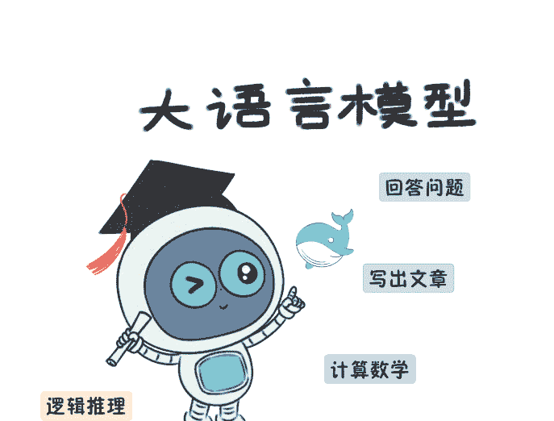
## DeepSeek 也要学习

DeepSeek并不是天生就聪明的，它和我们一样需要成长。

科学家给它喂入海量数据和资料，让它通过不断分析理解来提升能力。就像我们靠做题读书学习一样，DeepSeek也在持续“修炼”。科研人员会定期更新知识库和“算法”，也就是它的思考方式，让它更聪明。


修炼到一定程度后，DeepSeek就能协助人们工作和学习了。

你问它“地球离火星有多远”，它会给出类似图1-1的回答：

> 地球与火星的距离会随轨道变化，大致范围如下：

- 火星与地球的距离范围

  1. 最近距离：约5,460万公里（0.365 AU）
     - 发生在火星冲日时，约每6个月一次。
     - 例如2020年10月6日，两者约6,200万公里。
  2. 最远距离：约4.01亿公里（2.68 AU）
     - 发生在火星合日时。
  3. 平均距离：约2.25亿公里（1.5 AU）

图 1-1 DeepSeek 回答地球与火星距离示例

而且，DeepSeek会在对话中持续进化。你每提一个问题，它都会记录并分析你的需求，调整回答策略，变得更精准、更贴合。这种互动式学习让它一次比一次更懂你。


## 把智能家教请回家

怎么把DeepSeek这位智能家教带回家？

非常简单。在电脑浏览器或手机应用商店搜索DeepSeek就能找到官网或App。手机版安装后标志是蓝色的鲸鱼，如图1-2所示。


电脑用户可以在官网点“开始对话”直接网页使用，也可点“获取手机App”扫码下载。图1-3所示。


使用前需要注册登录。电脑版和手机版都支持手机验证码、密码或微信登录，如图1-4、图1-5所示。没有账号可以请家长帮忙。

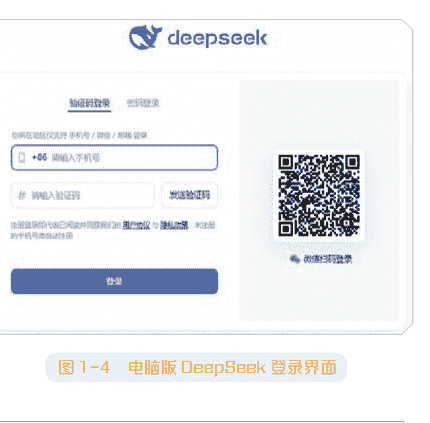

图 1-4 电脑版 DeepSeek 登录界面

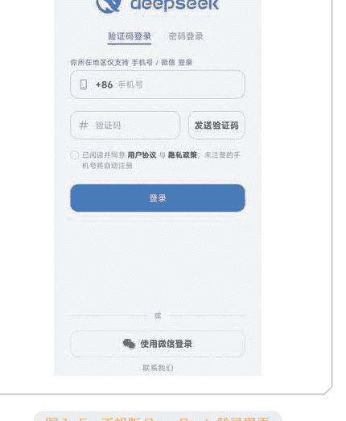

图 1-5 手机版 DeepSeek 登录界面

## 使用 DeepSeek 很简单

登录后会出现一个聊天框和若干功能键，如图1-6、图1-7所示。直接在聊天框输入想问的内容就能开始对话。

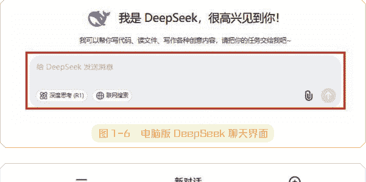

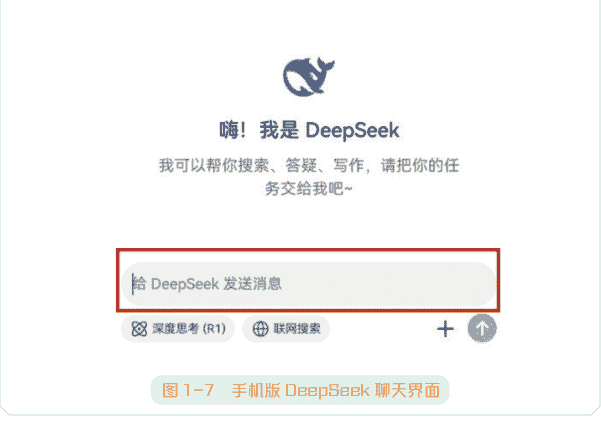
### 快速了解各功能按钮

除了聊天框，界面上还有不少小工具。

 按钮，未点亮时使用的是DeepSeek V3模式；点亮后则切换到R1模式。具体区别稍后细说。

 按钮点亮后，它会像上网一样实时检索网络信息来回答问题；未点亮时知识截止到2024年7月，之后的事它就不知道了，甚至会胡说。

 按钮是发送键，点击后把输入内容发出去。

电脑版的  按钮可上传图片或文件，帮助DeepSeek更准确理解需求。

手机版的  按钮可上传文件，也能拍照识别文字或图片内容。

再细看，会发现电脑版左上角和手机版上方还有侧边栏相关按钮。


电脑版的  和手机版的  是同一个功能——打开边栏。边栏里能查看全部对话记录，随时回顾或继续之前的会话。

电脑版的  和手机版的  是“开启新对话”。想让DeepSeek忘记之前内容就点它，对话会清空重新开始。

### V3与R1，两种不同思路

V3能满足大部分日常需求。2025年3月更新后，推理、数学能力以及写作和搜索表现都有明显提升，一般的推理任务它都能搞定。

R1则专注推理。开启时会出现“深度思考”过程，如图1-9所示，会展示它一步步推导出结论的思路。图1-9。


这种过程很有参考价值，能帮你看清问题、学习推理，提升逻辑思维。

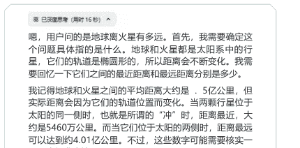

举个例子，各自问“1+1等于几”。

V3会直接给出答案并说明这是最基本的加法结果，如图1-10所示。


R1则会“想很多”，考虑多种情境并给出不同情况下的答案，如图1-11所示。

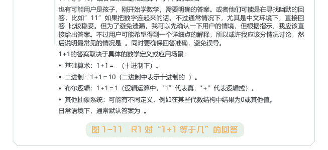

可见V3像“正经优等生”直接给结果，R1更擅长发散思考，但也容易想偏、出现多重答案。

## 成为提问高手

### DeepSeek的“个性”特征

把家教请回家后，怎么交流更顺畅？DeepSeek有自己的特点，掌握诀窍才能高效利用。


**特点一：擅长文字，不懂图像表格。** DeepSeek是文字专家，聊天框里的文字它能理解，通过上传文档也能读懂里面的文字，甚至带文字的图片也能识别。但它不认识纯图形和表格，上传一只小猫图片问“图里有什么”，它会回复“未能提取到文字”，如图1-12所示。

### 特点二：不会绘画，但能用符号拼图。

既然不认图，它自然不会画画。让你画一只猫，它会说无法绘制，但会用文字描述或用符号拼一个可爱的猫，如图1-13所示。

### 特点三：单次对话有记忆，新对话会遗忘。

同一会话里它会记住上下文，并根据你的身份调整表达。比如你说你是小学生，后续它会用更合适的语气。又如你先问“1+1等于几”，再让它画小猫，它在思考时会结合前面提问判断意图，如图1-14所示。

开启新对话后之前内容就清空了，避免旧信息干扰思路。

但不能无限聊下去。原因有两个：一是记忆负担加重会混淆遗忘，就像人记不住几万字一样；二是系统设有限制，超出字数上限后会提示开启新对话，如图1-15所示。

**特点四：高峰期可能繁忙。** DeepSeek用户众多，高峰时可能提示“服务器繁忙，请稍后再试”，如图1-16所示。这时耐心等待后点“重新生成”即可。

**特点五：偏好清晰明确的提问。** 像跟人交流一样，啰嗦没重点、东一榔头西一棒槌，它会理解偏差。DeepSeek脾气很好不会发火，但问题不清就会答偏。

**特点六：也会犯错。** 它很聪明但不是万能，信息库和提问方式都会影响准确性。比如问“strawberry”里有几个r，让它直接给数字，它可能数成2，如图1-17所示，实际是3个。发现错误及时指出，有助于它成长。

### 特点七：脾气温和但有底线。

DeepSeek很耐心，不会批评你“笨”“不专心”，而是安慰鼓励并给出建议，如图1-18所示。

它也有道德底线，不会回答违法或违背社会道德的问题，会直接拒绝。我们也应学习它做正直善良的人。

### 高效交流的秘诀

了解特点后，下面是提升提问效率的关键。

#### 秘诀一：提问要精准，拒绝模糊

关键是让问题不模煳。

比如不问“数学怎么学”，而问“初二几何证明题找不到思路，有什么训练方法”。

> 小贴士 越具体，答案越实用！

#### 秘诀二：拆分问题，分步解决

关键是把大问题拆小。

比如不问“我怎么学好语文”，而问“我怎么写好作文”。

> 小贴士 问题越细，答案越有针对性！

#### 秘诀三：提供足够信息，但不过度

关键是让DeepSeek了解背景。

比如要制定学习计划，就告诉它年级、目标、具体学科等，但突出最重要的要求。

> 小贴士 信息越充分，答案越准确！

#### 秘诀四：设置限制条件

关键是给答案划边界。

比如不问“给我分析这道题的解题思路”，而问“给我分析这道题的解题思路，知识点不要超过小学五年级”。

> 小贴士 避免回答过于深奥。

#### 秘诀五：要求核实来源，避免错误

关键是让它给出出处。

提问时可加上“请提供输出内容的出处”。

> 小贴士 方便你核对是否出错。

#### 秘诀六：多问思路，少要答案

关键是自己思考。

# 学会提问，AI 才能真正替你解题

和大模型高效配合，关键在于问法的设计。别只扔一句“这题怎么做”，改成“请解释这道题的解题思路，我在第3步卡住了”。先弄懂方法，比拿到标准答案更有用。

> **小贴士** 先吃透做法，后续同类题不再被卡住。

#### 秘诀七：跳出单一答案的框架
核心：不要被一个结论限定住。
例如：别问《故乡》是否比《阿长与山海经》更好，而是问两篇文章各自的优点与不足在哪里。

> **小贴士** 多视角拆解，判断更清楚。

#### 秘诀八：建立持续进阶的节奏
核心：远离临时抱佛脚。
例如：不要问“月考怎么应付”，要问“如何养成每天稳定复习的习惯”。

> **小贴士** 持续积累才是真正的学习力。

### 提问避坑实用清单
借助DeepSeek辅助学习时容易掉坑：想找思路却得到一堆废话，想要作文灵感却答非所问。下面用通俗口吻帮你绕开雷区，效率立刻提升。

> ### 安全小贴士
> 1. 切勿向AI透露真实姓名、家庭住址。
> 2. 不要提供学校、班级等具体信息。
> 3. 如需填写个人信息，先征求爸爸妈妈意见。

下面是四种最常见的提问陷阱：

#### ◇ 模糊提问陷阱：把问题说清楚，AI才好使
**避坑要点：** 就像给同桌讲题，把学科、题号、卡点全部交代。
**踩坑示例：** “这道题不会！” AI会懵：哪道题？不会哪一段？
**正确示范：** “5年级数学：果果身高1.6米。某天下午，果果站在操场旁，影长2.4米。此时他身边一棵小树影长6米，这棵小树的高度是多少米？请用比例方法解。” 系统会给出分步解答，如图1-19所示。

#### ◇ 问题扎堆陷阱：每次只问一个
**避坑要点：** 好比吃糖每次只吃一颗，不同问题也要分开问。
**踩坑示例：** “作文怎么写？还有英语语法和数学应用题！” AI会混乱。
**正确示范：**
第一问：“4年级要写一篇‘我学会了……’的作文，要求语言通顺、内容充实。” 系统会生成范文，如图1-20所示。
第二问：“英语一般现在时，主语是第三人称时谓语动词加s，有哪些例外情况？” 系统会给出解释，如图1-21所示。

#### ◇ 隐身提问陷阱：亮出你的学习身份
**避坑要点：** 告诉AI你的年级，就像看病要说年龄一样重要。
**踩坑示例：** “这个知识点怎么学？” AI不知道你是小学生还是初中生。
**正确示范：** “我是初二学生，学凸透镜成像规律时总分不清实像和虚像，有什么好理解的方法吗？” 系统会给出针对性回答，如图1-22所示。注意提问时不要透露学校、姓名等隐私。

#### ◇ 缺胳膊少腿陷阱：问题要完整
**避坑要点：** 检查问题是否包含背景、要求、资料三要素。
**踩坑示例：** “帮我查资料！” AI问：查什么？怎么查？
**正确示范：** “5年级科学课要做‘水的循环’手抄报，要求列举3个有趣的水循环现象，用小学生能懂的语言解释，并给出手绘技巧。” 系统会生成完整方案，如图1-23所示。

## 高分素养训练营

### 学习也可以很有趣
很多人觉得学习枯燥，尤其是面对厚课本和大量作业时。设想一下，如果学习像玩游戏一样有乐趣会怎样？DeepSeek就能帮你实现。

### 为什么游戏好玩、学习却没劲
部分同学对游戏里重复任务乐此不疲，面对类似的学习任务却瞬间失去兴趣，原因在于游戏设计抓住了心理。

**目标明确，难度逐步提升。** 游戏会告诉你“去某地找某人”，难度循序渐进。新手敌人较弱，能力提升后才出现强敌。学习任务往往不明确，难度跳跃，容易挫败。

**互动高，有成就感。** 游戏可组队，合力时有情感交流，表现好会获赞。成就感带来快乐。学习常像单人战。

**玩法多样。** 游戏方式多变，主观能动性强，有新鲜感。学习多为刷题背诵、被动听课，吸引力自然不足。

> DeepSeek可以让学习像游戏一样好玩。

### 把任务拆成若干关卡
把目标告诉系统，它会像游戏策划一样把任务按难度拆成若干关卡，由易到难通关升级。

例如，6年级想提升语文作文，问题是不会组织材料、不擅长修辞、语言直白。可这样提问：
> 我是6年级学生，想提升作文水平，计划用8周完成，每周3小时。现在的问题是不会组织材料、不擅长修辞、语言大白话，请帮我设计分阶段学习方法，按由易到难排列。
系统会生成夯实基础、技巧突破、综合提升、实战检验四个阶段方案，如图2-1所示。

### 把学习变成团体小游戏
系统还能把学习任务变成可与朋友一起玩的团体游戏。

例如，4年级想记住本学期数学知识，觉得独自学习无聊，想喊3位同学一起玩。他可以这样问：
> 我是4年级学生，用人教版教材，想记住4年级下学期数学知识，请帮我设计几个能和3名同学一起进行，又能加深记忆的游戏。
系统会给出4个游戏方案，如图2-2所示。

```
好的！根据人教版四年级下册数学目录，我为你们设计了4个团队协作游戏，既能巩固知识又充满趣味性，每个游戏覆盖~3个单元知识点，适合3~4人小组完成。以下是具体方案：

游戏1：「小数超市大作战」（适合：小数的意义/小数加减法）
道具：商品价签（自制小数价格，如铅笔3.5元）、购物清单、计算器（验证用）

规则：
1. 角色扮演：1人当收银员，其他~3人当顾客。
2. 任务：
   - 顾客A用「加法」买3样商品（如笔记本+橡皮+尺子），心算总价报给收银员。
   - 顾客B用「减法」计算找零（如付10元买6.8元的文具盒）。
3. 得分：答案正确+1分，收银员验证错误则扣1分，轮流换角色。
技巧：用「元角分」转化法帮助计算（如3.5元=3元5角5分）。
```

图2-2 DeepSeek生成的数学知识记忆游戏方案（节选）

### 按兴趣改造学习方式
还可以让系统结合你的喜好，把枯燥课程变成冒险。
> 我是6年级学生，用部编版教材，平时喜欢打游戏，不喜欢需要死记硬背的语文，能否把兴趣和语文结合制定特别课程？
系统会给出有趣计划，如图2-3所示。

> 我是六年级学生，喜欢打游戏，特别不喜欢语文课。我们可以
> 1. **英雄档案库**：选游戏中喜欢的英雄，用教材描写方法写“档案”——外貌、性格、背景故事。
> 2. **吃鸡角色日记**：以第一视角写跳伞落地心理活动，关联《那个星期天》的心理描写技巧。
> 奖励：完成档案和日记后，设计英雄“专属技能书”，用比喻夸张描写技能效果。
> 第二阶段：地图任务——攻克说明文与古诗
> 目标：理解说明文逻辑、背诵古诗
> 玩法：
> 1. **峡谷地理课**：把王者峡谷地图转为说明文，分析地形、防御塔机制，用列数字作比较等手法。
> 2. **吃鸡缩圈背诗法**：背诵《采薇》时，想象身处决赛圈，每背对一句毒圈缩小一次，背错则掉血需急救。
> 奖励：解锁“地图彩蛋”——用古诗为游戏场景命名。

## 02 DeepSeek助力学霸之路

> 有些学霸看似不怎么努力却学得好，有些人很努力成绩却上不去，是智商问题吗？

### 我们和学霸差在哪
努力但成绩不理想的同学，和学霸差距不在智商，而在方法与习惯。DeepSeek的分析如图2-4所示。

- 🔍学霸的隐形优势
1. 学习方法更科学
   - 主动思考vs被动接受
     - 普通同学：反复抄写、机械刷题，只记答案不求甚解。
     - 学霸：先理解逻辑再练题，错题会追问“为什么错”。
   - 费曼学习法
     - 学霸用自己的话复述知识点，甚至假装教别人，确保掌握。
     - 普通同学可能看懂却讲不清。

2. 思维习惯更高效
   - 抓重点vs平均用力
     - 学霸优先攻克高频考点。
     - 普通同学会把时间耗在低效细节上。
   - 结构化思维
     - 学霸会把新知识与旧知识联成网络。
     - 普通同学知识点零散易忘。

3. 长期养成的习惯
   - 专注力更强
     - 学霸容易进入心流状态。
     - 普通同学学几分钟就看手机走神。
   - 时间管理
     - 学霸常用番茄钟短时高效。
     - 普通同学坐很久实际学习时间很少。

4. 记忆方式更聪明
不是靠硬背。

这4个差距，DeepSeek都能帮你弥补。关键是不能被动模仿，要结合自身消化实践。

### 定制专属学习方法
每个人特长不同，学科特点也不同，不存在万能方法。方法要“好”更要“适合你”。


DeepSeek知识面广、推理强，能根据你的情况量身定制方案。

例如，6年级擅长处理细节不擅长概括，记忆力一般但擅长交流，想要数学学习方法，可这样问：
> 我是6年级学生，擅长细节不擅长概括，记忆力不是很好但很会与人交流，能否按我的性格制定数学学习方法？
系统会据此给出方案，如图2-5所示。

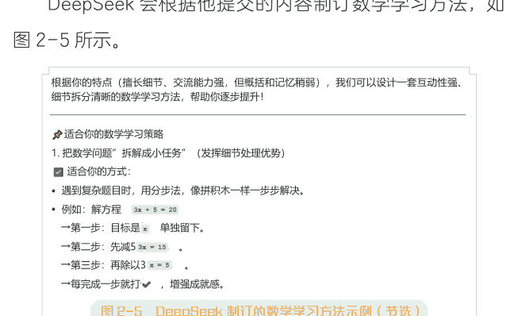

学霸高效的核心是有条理、有逻辑，能定目标、抓重点、归纳总结。DeepSeek能帮你完成这些任务，培养学霸思维。

### 破解找不到学习目标
想确定目标，可把学习阶段和学科告诉DeepSeek，它会帮你梳理。

例如，6年级成绩中游，感到迷茫找不到目标，可问：
> 我是6年级学生，成绩班里中游，现在很迷茫找不到学习目标，请告诉我未来的学习目标。
系统会给出可参考的方向，如图2-6所示。

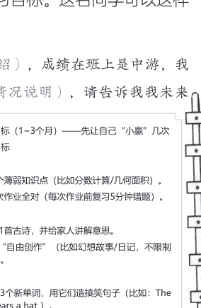

### DeepSeek，知识点整理大师
擅长逻辑的DeepSeek能把散乱知识点整理成学霸笔记，帮助把握重点提升复习效率。

例如，6年级收集小学语文古代文学常识，内容杂乱没时间整理，可问：
> 这是我收集的一些古代文学常识，请帮我梳理并分类。
系统很快完成分类，如图2-7所示。

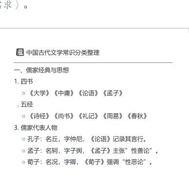

图2-7 DeepSeek梳理的古代文学常识示例（节选）

### 学习DeepSeek的思考模式
DeepSeek本身思考条理清晰，它的思考过程值得借鉴，就是点开“深度思考R1”。

例如问：比2多6的数是（），9比4多（）。答案是什么？
它会给出解析，如图2-8所示。


图2-8 DeepSeek输出的答案及解析

真正的价值是看思考过程，如图2-9所示。


图2-9 DeepSeek思考数学题的过程示例

可以看到，它先列出任务，再按空逐一分析、计算、反思是否正确，排除其他可能后才定结论。

我们在使用时，不妨多看它的思考路径，学习这种严谨方式。


### 帮你养成学霸习惯
良好习惯是学霸基础。DeepSeek可按你的实际情况定制习惯养成计划。


例如，5年级成绩下游，语文数学差、英语稍好，专注力差爱刷手机、计划常半途而废，可这样问：
> 我是5年级学生，成绩班里下游，语文数学都很差，只有英语好一点。专注力差静不下心学习，喜欢刷手机，制定的计划常半途而废。请为我制定养成良好学习习惯的计划。
系统会针对问题给出计划，如图2-10所示。


学习中很多内容需要记忆，如古诗词、公式、单词。很多人觉得自己记忆力差，其实记忆力可以训练，只是缺少合适方法。

### 提供定制记忆训练法
DeepSeek能根据你的特点找到最合适的记忆训练方法，坚持训练记忆力就会提升。

# 记性不好？换个提问方式试试

有位同学总吐槽自己记不住东西，刚背完的知识点转头就忘，尤其是数字和英语单词最让他头疼。他想提升记忆，就这样向 DeepSeek 发问：

> 我觉得记忆力很差，背完很快就忘了，特别是数字和英语，能不能给个简单实用的训练方法？

DeepSeek 结合他的描述和需求，给出对应的练习思路，如图 2-11 所示。

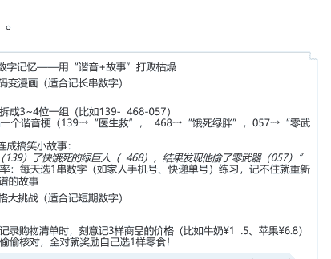

### 为你量身打造记忆法

高效的记忆策略能大幅提升效率。每个人的思维偏好、记忆的高峰期都不同，面对不同内容也需要不同的做法。我们很难把所有方法都学会，但 DeepSeek 可以依据个人情况给出高度匹配的建议。

比如一位同学逻辑思维突出，形象联想较弱，每天清晨起床时状态最好，每天能空出半小时背诵，目标是十天内记下五百个英语单词。他可以这样提问：

> 我逻辑能力强，形象思维弱。早上刚起床记忆最好，每天有半小时背诵时间。想在十天内背下五百个英语单词，请给我个适合我的方法。

DeepSeek 会据此给出专属方案，如图 2-12 所示。

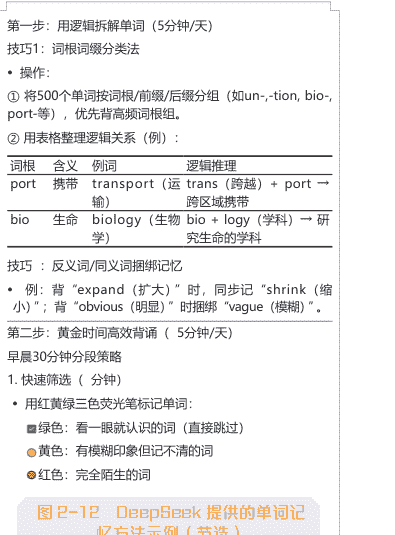

## 03 DeepSeek 让你掌控时间

需要查资料时作业还没做完；放学回家时间很紧，先要写作业再看父母要求的书，自己还想追动画；周末被兴趣班、作业、活动塞满……是不是总觉得时间不够用？


别焦虑！DeepSeek 能快速帮你搜集干货省时间，能把大目标拆小按轻重排序，还能结合实际情况定制专属安排，让你真正管住时间。

### 告别盲搜，直达重点

找学习资料或活动素材时，很多人习惯开浏览器逐个点开、筛选、整理，既费时又费力。好在 DeepSeek 也支持联网搜索，它能按关键词快速抓取、归纳信息，还能分类整理成条理清晰的文本，帮你省去大量无效操作。

提醒一下，DeepSeek 也可能出现错误或杜撰内容，提问时最好加上“请给出出处”。

比如一名初中生要收集科技类影视作品资料，他可以打开联网搜索后这样问：

> 我是初中生，需要一些表现科技事业和科技工作者的电影、电视剧、纪录片等资料。请提供相关信息并给出来源。

开启联网搜索后，DeepSeek 会梳理出各项内容并展示引用网页，方便核对准确性，如图 2-13 所示。

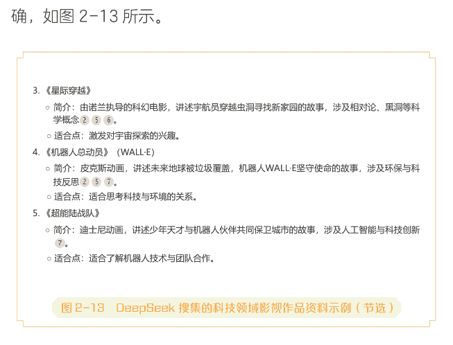

有时候想规划周末，却发现待办事项像小山一样——班级排练要参加，语文数学英语作业要写，和朋友约好打篮球，还要去画画兴趣班，之前答应朋友的画还没画，还想看一部动画电影……事情一堆，不知道先从哪儿开始。


### DeepSeek 帮你厘清目标，避免手忙脚乱

例如上面那位同学，就可以用下面的问法让 DeepSeek 帮忙排序：

> 我是学生，想把周末安排好，但事情很多：要参加班级活动排练，要做语文数学英语作业，和朋友约打篮球，要上画画兴趣班，还要画之前答应朋友的画，想看一部动画电影。请按重要程度帮我制定一个时间计划。

DeepSeek 会依据轻重缓急生成可执行的日程，如图 2-14 所示。

#### 任务优先级排序（从高到低）

1. 紧急且重要
   - 班级活动排练，通常时间固定
   - 朋友委托的画，已承诺，关乎信用
   - 各科作业，避免周日晚临时赶工
2. 重要但不紧急
   - 画画兴趣班，长期技能积累
   - 篮球活动，维护身心和社交
3. 娱乐放松
   - 动画电影，可作为任务完成的奖励

#### 周六 & 周日分日计划

**周六（攻坚日：处理最紧急事项）**

| 时间段 | 事项 | 执行技巧 |
| :--- | :--- | :--- |
| 8:00~8:30 | 起床+早餐 | 听轻音乐唤醒大脑 |
| 8:30~10:30 | 班级活动排练 | 提前准备好道具和台词 |
| 10:30~11:30 | 为朋友作画 | 用番茄钟法，画5分钟歇5分钟 |
| 11:30~13:30 | 午餐+午休 | 闭眼小憩15分钟 |

图 2-14 DeepSeek 生成的周末时间计划示例（节选）

上学要上课、写作业、参加社团，还要备考，感觉一天到晚都在赶路。


### 个性化时间表，不再焦虑

不用慌，DeepSeek 能依据你的作息规律，生成动态且可执行的周计划。

比如一名六年级同学，周一到周五 8:00～17:00 在校，晚上要做作业还要补数学和英语，周末除了作业每天还要上两小时钢琴，每周要锻炼 4 小时，还想留点时间玩。他可以这样问：

> 我是六年级学生，周一到周五 8:00～17:00上学，晚上做作业 2～3 小时，还要做数学英语专项训练。周末除了作业，每天还要上两小时钢琴，每周锻炼 4 小时，也想抽点时间玩。请帮我制定一周时间管理方案。

DeepSeek 会兼顾各项需求给出安排，如图 2-15 所示。

#### 📅 周一至周五（上学日）时间表

| 时间段 | 事项 | 关键技巧（省时/提效） |
| :--- | :--- | :--- |
| 6:30~7:00 | 起床+早餐 | 听英语音频温习 |
| 7:00~7:30 | 黄金记忆时段 | 背单词或课文，用词根或联想 |
| 8:00~17:00 | 学校课程 | 课间做简单拉伸 |
| 17:30~18:30 | 晚餐+短暂放松 | 和家人聊天，不碰手机 |
| 18:30~20:30 | 作业时间（2小时） | ☆分段学习：每30分钟换一科，用计时器 |
| 20:30~21:00 | 数学/英语专项 | 提前整理问题，针对性解决 |
| 21:00~21:30 | 自由时间 | 可玩手机或游戏，设闹钟超时扣自由时间 |
| 21:30~22:00 | 睡前准备+复习 | 快速过错题或单词 |
| 22:00 | 睡觉 | 保证8小时睡眠 |

+ 📍 上学日关键策略：
1. 作业提速技巧：
   - 难题先标记，最后15分钟集中处理或请教
   - 用“三色笔法”：黑笔写答案，蓝笔写要点，红笔标错题
2. 避免分心：学习时手机交给家长，或用“番茄ToDo”类 App 锁屏

#### 📅 周六 & 周日（周末）时间表

| 时间段 | 事项 | 灵活调整项 |
| :--- | :--- | :--- |
| 8:00~8:30 | 起床+早餐 | 听钢琴曲唤醒大脑 |
| 8:30~10:30 | 作业时间（2小时） | 优先攻克最难科目 |


## 04 DeepSeek 助力专注力提升

上课、写作业、考试时注意力总是不自觉地飘走，难以把心放在当前任务上。

这种状态就是专注力不足的表现。专注力指在一定时间内把注意力稳定在某个对象或任务上的能力。

**专注力能带来——**
- 过滤无关干扰，从信息中快速挑出重点
- 持续投入一件事，比如安静读书一小时
- 减少被打断，保持工作的连贯性

专注力强，思考和处理事务更高效；专注力弱，即使花很多时间，学习效果也上不去。

### 影响专注力的因素有哪些

为什么有同学能很快进入状态，有些同学却总被批评“坐不住”？影响因素有很多。


**原因一：专注习惯不佳。** 长期“一心多用”，习惯刷短视频和碎片信息，很难形成深度专注的习惯。

**原因二：身体状态不佳。** 睡眠不足、饮食不规律或身体不适会让大脑“变慢”，专注度下降。饿了、困了很难集中，注意力也容易涣散，小朋友因大脑发育中，专注力本就相对弱。

**原因三：环境干扰多。** 周围嘈杂、人群喧闹、电视声等都会拉走注意力。

**原因四：心理状态失衡。** 过度紧张、焦虑时很难集中。任务太重太难也会引发焦虑。

DeepSeek 能在哪些环节帮到我们？

### 帮你找出专注力低下的根源

专注力低的原因因人因时而异，对症下药才有效。可以把具体情况告诉 DeepSeek，让它帮你剖析根源。

例如，一名小学生想了解自己为何难以专注，他可以这样问：

> 我是小学生，每天按时睡觉吃饭，家里学习时也没人打扰，但还是很难集中注意力，时常想玩手机，注意力能维持的时间也很短。请根据我的情况分析专注力低的原因。

DeepSeek 会据此给出原因分析，如图 2-16 所示。

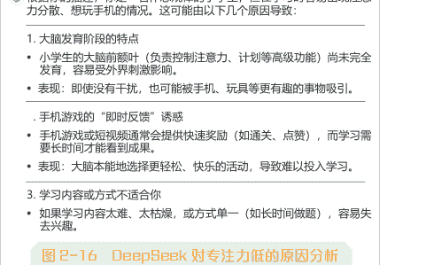

### 提供可操作的专注力训练

除了分析原因，DeepSeek 还能结合个人情况设计可执行的训练方法。

例如同一位小学生想改善，他可以这样问：

> 我是小学生，作息正常，但学习时总是不集中，经常想玩手机。请给我一些针对性的专注力训练，适合一个人在家做。

DeepSeek 会给出具体训练建议，如图 2-17 所示。

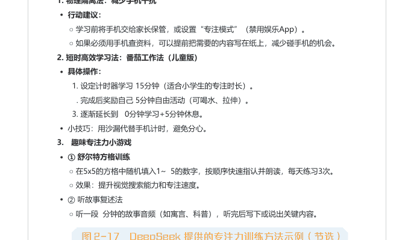

## 05 DeepSeek 你的交流搭子

有些话不好意思对人说，也找不到合适的人倾诉；在和父母、老师、同学沟通时，也常出现表达卡壳。DeepSeek 就像一个超强交流伙伴，既能聊天，也能帮你解决沟通难题。


心里堵得慌却不知向谁倾诉？把烦恼倒给 DeepSeek，它会像“树洞”一样接住你的情绪，帮你梳理感受，给出安慰和可行的解决思路。

比如有同学数学考试没考好，心情低落，他可以直白地说：

> 我这次数学没考好，好烦啊。

DeepSeek 会共情情绪并给出建议，同时给予鼓励，如图 2-18 所示。

> 我能理解你此刻的失落和压力。考试失利的挫败感很真实，但一次成绩不能定义你的全部价值。也许可以这样想：
> 1. 先接纳情绪，给自己喘息空间
>    - 去操场走走，买杯热饮深呼吸
>    - 把烦恼写在纸上，写完撕掉会有释放感
>    - 给信任的朋友发条语音，单纯倾诉不求建议
> 2. 转换视角看待“回家”
>    - 如果担心父母失望，可以尝试提前沟通：

图 2-18 DeepSeek 生成的情绪分析与建议示例（节选）


### DeepSeek，你的贴心变身伙伴

感到孤单想找人聊天？DeepSeek 可以化身你想要的任何角色——幽默的陪聊伙伴、知识丰富的讨论老师，甚至是陪你玩耍的虚拟“宠物”。

比如同学无聊想找乐子，可以这样设定：

> 你现在是一只可爱的小猫，我们来交流吧。让我摸摸你的肚子可以吗？

DeepSeek 会立刻进入小猫人设持续对话，如图 2-19 所示。

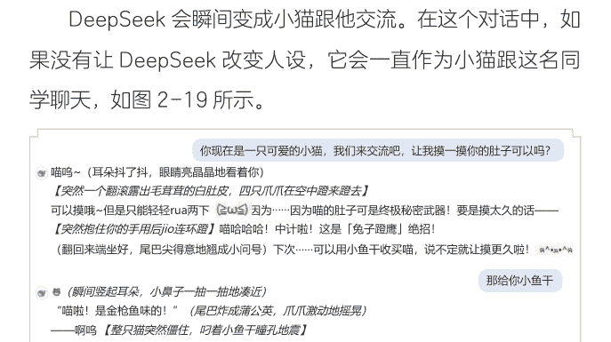

如果你喜欢奇幻，也能让它扮演魔法世界的向导，和你一起编冒险故事。

### DeepSeek 帮你成为沟通高手


和同学相处时，拒绝怕伤感情、提建议怕被误解，和父母沟通时想表达意见又怕被否决……DeepSeek 可以模拟社交场景，教你高情商回应。

比如同学被约去网吧却不想去，又怕朋友不高兴，可以问：

> 我是学生，朋友约我去网吧，但我不想去，该怎么拒绝才不让他生气？

DeepSeek 会提供得体的话术，既坚持原则又不伤友谊，如图 2-20 所示。

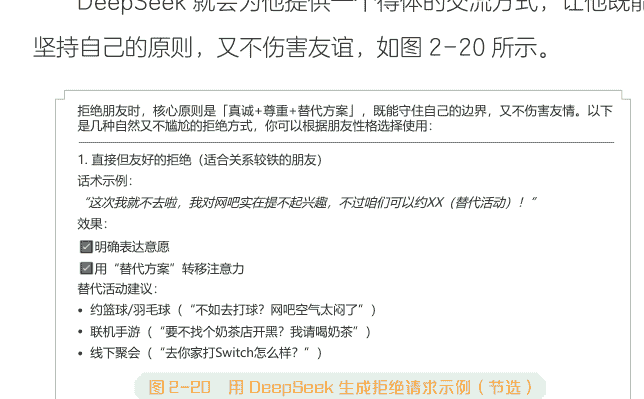


# 全能语文导师


## 为你量身挑选书单，点燃阅读热情

父母会买他们认为好的书，老师也会推荐书单，但你可能提不起兴趣？


### 读不进去，问题出在哪

**原因一：缺乏阅读兴趣。** 家长老师推荐的多是“应该看”的书，可能觉得枯燥。读完也找不到人交流，乐趣很快消失，相比之下同学热议的动画反而更吸引人。

**原因二：未养成阅读习惯。** 当下碎片信息太多，视频游戏更刺激，书籍显得“不够快”。在这种环境下，很难建立稳定的阅读习惯。

两者常同时存在，兴趣不足导致耐心不够，习惯又反过来削弱兴趣。

DeepSeek 如何帮助破解？

### 你想看什么，DeepSeek 更清楚

DeepSeek 擅长推理。我们可以告诉它年龄、爱好、喜欢的动画和书籍，开启联网搜索，让它为我们匹配感兴趣且合适的书单。

比如四年级女生喜欢中国传统文化，爱看动画，也有几本心头好，她可以这样问：

> 我是四年级女生，喜欢中国传统文化，爱看动画片，也喜欢这几本书，能推荐一些我可能感兴趣且适合我的书吗？

DeepSeek 会分析偏好给出推荐，如图 3-1 所示，不过要注意它有时会“捏造”不存在的书，建议先网上核实。

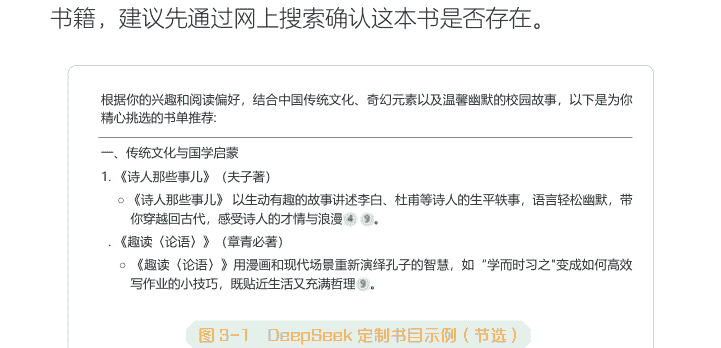

### DeepSeek，你的随时在线的读书伙伴


读完一本书后，某个情节或人物让你念念不忘，很想找人讨论。可爸妈忙或没读过，同学也不感兴趣。满腔想法无处安放，读书的乐趣也跟着变少。DeepSeek 可以陪你聊书、拆解情节，让阅读不再孤单。

别慌，DeepSeek 就是一个全年无休的阅读伙伴。它见多识广，还能按照你给的设定来“客串”对话。

比如一个刚读完《三国演义》的六年级同学很喜欢关羽，想聊聊“败走麦城”。他可以这样开口：先说自己是小学生、刚读完三国、喜欢关羽，问为什么会败走麦城，再要求 DeepSeek 扮演一个同样喜欢关羽的同学，用那种口气来聊。DeepSeek 就按这个人设接上话，如图 3-2 所示，整个聊天的感觉就像跟同桌吐槽剧情一样，先拍肩感慨关羽的憋屈，再调侃东吴白衣渡江偷家、刘封孟达没来支援、关羽又骄傲又被群殴的戏剧性。


### 养习惯其实挺简单


好习惯要靠坚持，阅读习惯同样如此。没人今天翻几页短篇就上头，明天就能啃几百页的厚书。

所以读不下去时别急着否定自己“不适合读书”，多半是习惯还没建立起来。

DeepSeek 能结合你的实际情况，定制一套可执行的阅读习惯养成方案，跟着走就会发现坚持没那么难。

举个例子，有个六年级同学连十页名著都坚持不下来，作业又要到晚上十点才做完。他向 DeepSeek 求助：我是小学生，现在看十页名著就累，每天很晚才写完作业，想要一个能落地的阅读习惯培养计划。DeepSeek 就给出一套方案，如图 3-3 所示。

阶段三：攻克长文本，第 5 周开始
目标：慢慢啃下十页以上的名著
1. 登山式阅读训练
   - 每周挑三天阶梯式挑战
     - 周一：专注五分钟阅读
     - 周三：读七分钟并用荧光笔标一句喜欢的描写
     - 周六：读十分钟后给父母复述一个情节梗概
2. 同伴激励法
   - 找同学一起读《哈利·波特》简写版，每天在微信群打卡，用语音讲一个悬念点，比如“赫敏这次用了什么中国术法”。

## 02 阅读清单与计划 이렇게搞定

老师和家长推荐的书越来越多，想全读完又怕没时间。DeepSeek 能帮你从两方面解围，让阅读更轻松。


### 书单太多？让它排个序

把想读的书交给 DeepSeek，让它按难度排个顺序，读起来更顺畅。

比如五年级同学这学期想把手里的书都看完，不知从何下手，便问：我是五年级学生，本学期要看这些书，请按由易到难排序。DeepSeek 分析每本书的特点后给出阅读顺序，如图 3-4 所示。

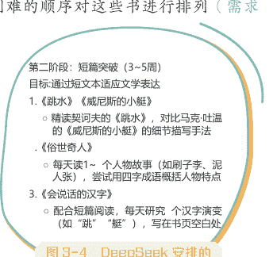

### 量身定制的学期阅读表

排序后，还能让 DeepSeek 做更细的安排。

同样这位五年级同学接着问：周一到周五每天只有一小时阅读，周末和假期每天有三小时，本学期要看完这些书，请帮我做一份能在学期内完成且时间宽松的计划。 


DeepSeek 会结合书目难度规划顺序，如图 3-5 所示。若觉得不够细，还可以追问每周具体怎么安排。

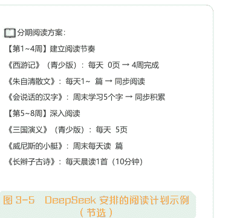

### 阅读高手靠这些技巧

读完书只是起点，还要提升阅读方法。DeepSeek 在这方面也能帮忙。

学会选择性阅读。阅读时根据内容决定精读还是泛读，并抓住重点。

比如三年级同学手上有《格林童话》，不知道该精读还是泛读，重点在哪，便问：我是三年级学生，《格林童话》应该精读还是泛读？阅读重点和思考点是什么。DeepSeek 解析图书特性给出具体建议，如图 3-6 所示。

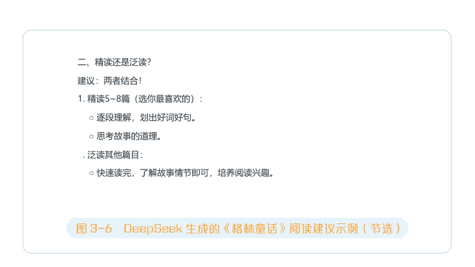


### 阅读先带着问题

带着问题读，对书中观点多角度思考，会读得更深。

例如四年级同学在读《匹诺曹》，想知道可以带着什么问题读，以及别人对匹诺曹有哪些不同看法，于是问：我是四年级学生，正在读《匹诺曹》，请告诉我可以带着哪些问题阅读，这本书有哪些不同的解读。DeepSeek 拆解内容给出思考方向和观点，如图 3-7 所示。

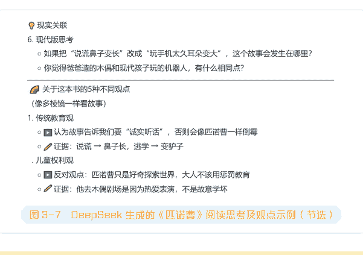

## 03 古诗文背诵不再难

背古诗文总让人头疼，上课背不出下一句更尴尬，为什么反复记还是忘？其实有三道拦路虎。

原因一，看不懂。古汉语词义冷僻，与现代用法相差大，比如“走”古义是“跑”。
原因二，读不通。句式与现代口语差别大，读起来不顺更难记。
原因三，没画面。意象陌生、典故不熟，脑中构建不出画面。


### 古诗文记忆有妙招

背诵有难度不必怕，DeepSeek 能拆解意象和结构，为不同文本设计记忆方法。

例如想背《山居秋暝》，可以问：给我几个快速记住《山居秋暝》的方法。DeepSeek 会分析诗的特点给出建议，如图 3-8 所示。

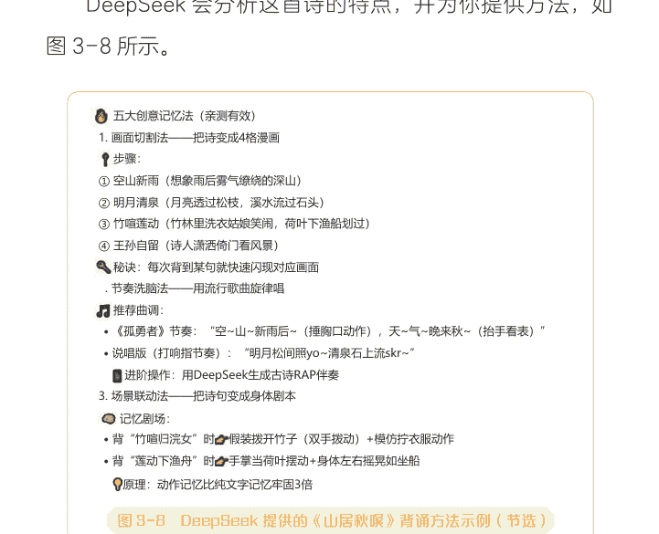


篇幅更长的文本也能得到针对性技巧。比如把《山居秋暝》换成《出师表》，并问：给我几个快速背下《出师表》的方法，并说明背诵时要注意什么。DeepSeek 就会输出对应要点，如图 3-9 所示：

- 人名典故具象化：郭攸之、费祎、董允可联想“锅油费一桶”的厨房场景；“五月渡泸，深入不毛”想象诸葛亮在热带挥扇赶蚊子。
- 数字挂钩：第三段三条建议对应手势一二三。
- 15 分钟碎片复习：早起、睡前、饭后各 15 分钟，用备忘录记每段首字提示“先、然、侍、臣、今、至”，靠首字回想全文；走路背诵，每步一句，空间感强化记忆。
背诵注意点：
1. 虚词易漏。注意“而、以、于、之”这类虚词，如“受任于败军之际，奉命于危难之间”两处“于”易忘。
2. 语感优先。先模仿停顿和气息，如“先帝/创业未半/而中道崩殂”，背起来更顺。

### 知识图谱一键生成

古诗文涉及背景、典故、通假字、特殊句式等知识点，容易记混。


#### 一键搜集古诗文资料

DeepSeek 数据库丰富，还能联网搜索，快速整理你要的内容，省去自己翻找的时间。

比如初中生预习《陈太丘与友期行》，想了解背景，便问：我是初中生，正在预习《陈太丘与友期行》，请帮我搜集整理相关资料，包括出处、创作背景、重点字词句，要求准确。DeepSeek 整理好后，若开启联网搜索还能看到引用来源，方便核对，如图 3-10 所示。

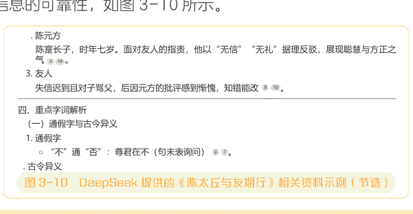

### 让古文知识点好玩起来

觉得文字太多难理解，可以要求 DeepSeek 把知识做得更直观有趣，也能上传自己的笔记让它生成图谱。

以《陈太丘与友期行》为例，可以问：根据以上资料，帮我搭建一个有趣、好理解好记忆的知识图谱，重点突出逻辑清晰。DeepSeek 就生成带有图案、逻辑分明的图谱，如图 3-11 所示。

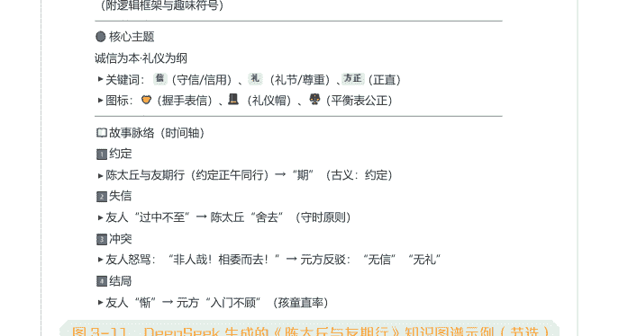

### 用 Markdown 快速搭思维导图

DeepSeek 不能直接画图，但能输出结构框架，配合 Xmind 等工具就能生成思维导图。

还是《陈太丘与友期行》为例，问：根据以上资料帮我做一个思维导图结构框架，以 Markdown 格式输出。DeepSeek 会给出可识别的内容，如图 3-12 所示。

把复制的内容粘到文本文档，保存类型选“所有文件”，后缀改为 .md。再用 Xmind 导入 Markdown，就能得到像学霸笔记一样的导图，如图 3-15 所示。以上方法同样适用于现代文。

## 05 笔记变清晰，学霸同款

上课记了满满的笔记，复习时却找不到重点，重新梳理又费时费力。康奈尔笔记法能解决这个问题，它把页面分成线索区、笔记区和总结区，如图 3-16 所示。

### 康奈尔笔记法五步上手

1. 记录：听课时把核心内容、关键概念写进笔记区。
2. 简化：课后把笔记区内容提炼成关键词或问题，放在线索区。
3. 背诵：遮住笔记区，只看线索区复述内容。
4. 思考：把感想或疑惑写进总结区。
5. 复习：定期根据线索区复习，记不住时再看笔记区。

觉得麻烦提炼不来？DeepSeek 能帮忙。

### 把笔记交给 DeepSeek 整理

把自己的笔记上传，让 DeepSeek 按康奈尔笔记法整理，但总结区要自己填。

例如四年级同学的《观潮》笔记很乱，他问：我是四年级学生，请根据我上传的笔记用康奈尔笔记法整理《观潮》的课堂笔记，不要写总结区。DeepSeek 整理好的结果如图 3-17 所示。

## 06 写作难题 DeepSeek 帮你破

作文常让人卡壳：没灵感、写得平淡、分数不高不知改进。DeepSeek 能提供全流程支持。

### 作文没灵感？先要点子

例如小学生要写观察植物成长变化的日记，不知道怎么写，便问：我是小学生，题目是观察一种植物按顺序写成长日记，要语句通顺表达喜爱，请给我写作灵感。DeepSeek 给出启发提示，如图 3-18 所示。

### 把平淡句子变生动

写出来干巴巴像流水账，比如“桂花的味道传来，好香啊”。可以问：这是我写的句子“桂花的味道传来，好香啊”，怎么让它更生动。DeepSeek 会给改造建议，如图 3-19 所示。

### 随身作文批改老师

写完作文分数不高，老师只写“内容单薄”“描写不够”，不知道怎么改。DeepSeek 可以扮演批改老师。

比如小学生上传作文，题目已知，老师点评是“基本符合要求，内容较简单，缺乏细节，语言平淡”，便问：我是小学生，这是我的作文，题目是…，老师点评是…，请更详细点评并给出改进建议。DeepSeek 提供具体反馈，如图 3-20 所示。

### 写作卡壳时找素材

摊开本子脑袋空空，写作卡壳很焦虑，这时可以向 DeepSeek 求助搜集素材，快速打开思路。

比如有位五年级的同学想让 DeepSeek 帮忙找作文素材，提前把自己的情况说清楚，再这样发出请求：

> 我是五年级的学生，需要围绕《我最心爱的礼物》写一篇作文。写作要把礼物的外形、来历、相关的小故事交代清楚，同时要抒发真情实感。请帮我收集一些可以用的素材。

DeepSeek 按要求给出了可用的素材积累、写作框架提示和写作技巧等参考内容，如图 3-21 所示。

### 让 DeepSeek 帮你把题审透

写作文最卡壳的瞬间是什么？题目和要求摆在眼前，大脑却一片空白，笔尖发呆，本子还是白的。碰到看不懂的题和要求时别慌，让 DeepSeek 来帮你拆题。

比如六年级要写《味道》，自己对题目无从下手，可以这样问：

> 我是六年级的学生，要以《味道》为题写一篇记叙文。要求围绕生活中的酸甜苦辣咸展开构思。请帮我解读题目，并给出几个可写的方向。

DeepSeek 会对题目和要求进行拆解，提供围绕味道的素材库和高分结构范例等参考，如图 3-22 所示。

# 专属数理导师

## 01 用 DeepSeek 搭建高效错题本

数学学习时常遇到哪些痛点？知识点繁多难理清，公式只会背不会用，一碰综合题就宕机；错题本越记越厚，分数却原地踏步。

原因往往在于：

**原因一：公式死记硬背。** 只是表面记忆公式的名字，缺少对含义和推导过程的理解，用的时候就忘了。

**原因二：思维依赖被动。** 习惯等老师讲，缺少主动探究，导致自己思考的能力弱。

**原因三：练题缺乏复盘。** 题目做得多，错题的根源没有系统梳理，同类错误反复出现。

DeepSeek 可以怎样改善？

### 让 DeepSeek 帮你理清知识网

预习或复习时，把章节主题丢给 DeepSeek，让它生成完整的知识框架。

例如六年级学分数乘法吃力，可以这样问：

> 我是六年级学生，分数乘法这部分不太明白。请用我能懂的话解释一下，并配上例子。

开启深度思考后，DeepSeek 会展示思考过程，考虑小学生的理解水平，从不同角度组织讲解，非常贴心，如图 4-1 所示。随后它像一位细心的老师进行讲解，如图 4-2 所示。

### 让 DeepSeek 帮你找准知识漏洞

做完作业后，把作业拍照或输入给 DeepSeek，指令写成“按（教材版本+年级）数学作业批改标准批改，并标注错因类型和对应知识点”。几秒就能得到批改结果，精准判断是粗心、概念混淆还是审题偏差，一目了然。

例如四年级同学上传作业后提问：

> 我是四年级学生，请按人教版四年级数学作业批改标准批改我上传的作业，并标出错误类型和相关知识点。

DeepSeek 给出批改结果和改进建议，如图 4-3 所示，能迅速发现问题。

```
1. 乘法计算错误：80×3 40，误算为 30。
•对应知识点：
  ◦两位数乘法 如 80×3 40。

第三题：7 ÷6÷
•答案:14❌（正确答案应为6）
•错误类型：
  1. 连除运算顺序错误：未从左到右计算，错误先算6÷。
•对应知识点：
  ◦连除法的运算顺序（如7 ÷6 1，再1 ÷ 6。
第三题右边：15×6+9
•答案：10✅
•步骤分析：
  ◦正确运用了先乘后除的顺序，结果正确。
```

图 4-3 DeepSeek 检查作业结果示例（节选）

### 让 DeepSeek 帮你深挖错题

老师都强调错题要重视，记下来了却不会分析时，就把错题拍照给 DeepSeek，让它帮忙剖析。

例如初一同学想分析错题，可以问：

> 我是初一年级学生，请根据我上传的错题分析出错原因，并给出避免同类错误的方法。

DeepSeek 会给出原因分析和防范建议，如图 4-4 所示。把分析整理进错题本，不懂的概念继续追问，直到完全搞懂。

### 快速提升举一反三能力

是否出现过这样的情况：会做一道题，换个条件就不会了？原因在于：

**原因一：停留在死记硬背。** 只记住了答案套路和固定步骤，一旦题面变化就失灵。

**原因二：题型训练单一。** 同一个知识点只练同一种形式，缺少迁移训练。

### DeepSeek 拓展学习三步法

学到某个知识点时，让 DeepSeek 再出 5 道变式题，练习完上传批改，形成闭环，能丰富储备、提升熟练度。

#### 第一步：上传错题，定位原因

例如六年级学圆柱与圆锥做错了，可以问：

> 我是六年级学生，请根据我上传的错题，帮我分析做错的原因。

DeepSeek 总结错误原因，如图 4-5 所示。

#### 第二步：追问多种解法

看懂分析后继续问：

> 这题还有别的解法吗？

DeepSeek 提供多种解法供参考，如图 4-6 所示。

#### 第三步：要相似练习

想训练迁移能力，可以问：

> 请再出几道类似的题目练习，要标明难度并换不同情境。

DeepSeek 按要求生成题目帮助巩固，如图 4-7 所示。

这套流程能精准击破薄弱点，让你在题型变化面前更从容。

## 03 费曼学习法——打通理解的关节

数学概念听起来抽象，老师讲得快或走神，课后做题脑中空白。把 DeepSeek 和费曼学习法结合，就能把“不懂”变成“真懂”。

### 费曼学习法是什么

由诺贝尔物理学奖得主理查德·费曼提出的“假装当老师”法。核心是把知识用最简单的话讲给别人听，检验自己是否真正掌握。

在讲解时，大脑会把复杂理论转成生活化语言，卡壳的地方就是盲区。讲解还能锻炼表达，像闯关游戏，每讲通一个点就解锁一个技能。宠物、玩偶或镜子里的自己都能当听众，随时开课。

### 费曼法的四个核心环节

1. **选定主题**：挑一个想深挖的概念或公式。
2. **模拟讲解**：用最通俗的语言向零基础的人解释核心内容。
3. **找盲点**：解释不清的地方就是知识盲区，回去查漏补缺。
4. **重组简化**：把理解重新组织、进一步简化，形成清晰的知识框架。

### 用费曼法拆难题

如果知识点处于似懂非懂，令 DeepSeek 化身小老师，用费曼法拆解。

例如小学生遇到不会的题，上传后提问：

> 我是小学生，请用费曼学习法拆解我上传的题目，并引导我发现知识漏洞。

DeepSeek 会拆解并帮助理解，过程如图 4-8 所示。

再看一道题：一次口算竞赛共 20 题，答对 1 题得 5 分，答错扣 1 分。小花得了 76 分，答对几题？

让 DeepSeek 用费曼法引导：

> 第一步：复述题目
> • 能用自己的话复述关键信息吗？（总题数、计分规则、最终得分）
> 第二步：明确目标
> • 求什么？已知什么？总题数固定，答对加错等于 20。
> 第三步：关联知识点
> • 全部答对可得 100 分；实际少 24 分；每错一题损失 6 分，提示：本可得 5 分，现在 0 分还扣 1 分，共损失 6 分。
> 漏洞检查点1
> • 有人认为每错只差 4 分，对吗？为什么？（不对，损失是叠加的）

如图 4-9 所示，通过引导拆解，理解更深入，效率更高。

## 04 苏格拉底提问法让思维逐步清晰

准备好接受层层追问了吗？每一步解题都要经受“灵魂拷问”，思路会越来越清晰，形成严谨的数理思维。

#### 苏格拉底提问法是什么

古希腊哲学家苏格拉底创立的教学法，通过提问引导学生自己发现答案。

#### 主要特点

1. **问题驱动**：以提问为主线推动思考。
2. **由浅入深**：从简单问题逐步推进到复杂问题。
3. **不直接给答案**：引导学生自己归纳。
4. **激发思维**：培养好奇心、批判性思维和逻辑推理。

### DeepSeek + 苏格拉底提问辅助解题

不会做题时，关闭“深度思考”模式，让 DeepSeek 用苏格拉底式提问一步步引导，先答一个问题再进入下一个。

例如六年级同学提问：

> 我是六年级学生，请模拟教学场景，用苏格拉底提问法向我提问，等我回答后再继续下一步，开始吧！

DeepSeek 会逐步提问，如图 4-11 所示。

> 第一个方程：0.75x+9=4
> 问题1：要让 x 单独，先怎么处理“+9”和“×0.75”？
> …
> 去掉9
> 很好！具体怎么操作？等式两边要做什么运算才能消去 +9？
> …
> 不会
> …

做完后还能让 DeepSeek 总结知识点，再出 5 道同类练习巩固，形成“提问→思考→解答→总结→迁移”的小闭环。

## 05 DeepSeek 帮你突破思维瓶颈

面对应用题或计算题找不着突破口，思维卡住，通常源于：

**原因一：理解偏差。** 对题目或知识点的理解有误，自己未察觉，思路自然错。

**原因二：视野狭窄。** 只从最熟悉的角度想，忽略其他可能性。

**原因三：习惯不当。** 不写步骤丢分、计算失误、缺少验算导致马虎。

### DeepSeek 帮你检验理解是否偏差

把你的理解告诉 DeepSeek，由它来评价。

例如六年级同学想验证“鸽巢问题”，提问：

> 我是六年级学生，我的理解是：如果 n 个物品放进 m 个容器，只要物品比容器多，就至少有一个容器放 ≥2 个。请评价是否正确，有问题请指出并改进。

DeepSeek 给出评价，如图 4-14 所示。

### DeepSeek 帮你拓宽解题思路

把题目上传，要求提供思路而非直接给答案，能锻炼多角度思考。

例如初一同学提问：

> 我是初一年级学生，请为我上传的题目提供几个解题思路，不要写具体过程和答案，思路要符合初一年级掌握范围。

DeepSeek 给出多个思路，如图 4-15 所示。

```
解题思路：
1. 设变量法：
设 $8n+1=k^2$，其中 $k$ 是正整数。然后解这个方程，求出 $n$ 的表达式，再结合 $1 \le n \le 100$ 限制 $k$ 的范围，统计符合条件的 $k$ 的个数。
2. 不等式约束法：
由 $8n+1=k^2$，可以解出 $n=\frac{k^2-1}{8}$。由于 $1 \le n \le 100$，代入后得到关于 $k$ 的不等式，求出 $k$ 的可能取值范围，再筛选符合条件的 $k$。
3. 奇偶性分析：
观察 $8n+1=k^2$，由于 $8n$ 是偶数，所以 $k^2$ 必须是奇数，因此 $k$ 必须是奇数。这样可以缩小 $k$ 的可能取值。
4. 枚举法：
由于 $n$ 的范围较小（$1 \le n \le 100$），可以尝试枚举 $k$ 的可能值（比如 $k=3,5,7,...$），计算对应的 $n$，再统计满足条件的 $n$ 的个数。
5. 平方数的性质：
由于 $k^2 \equiv 1 \pmod{8}$，可以分析哪些平方数满足这个同余条件，进一步缩小 $k$ 的范围。
```

图 4-15 DeepSeek 提供的数学解题思路示例（节选）

DeepSeek 还能分析错题集里的解题习惯问题，给出改进方法。例如五年级同学上传错题集后提问…

一名五年级的孩子想让 AI 帮他查漏补缺，于是把自己的错题集上传，并说明自己想要知道解题习惯上存在哪些毛病，以及可以用哪些具体方法来改进。DeepSeek 在审阅错题后，给出了针对习惯问题的诊断与改进建议，示例如图 4-16。

即便 DeepSeek 在数学学习上能提供不错的辅助，使用时仍要留意两点限制。

第一，作为工具，它在复杂题目的解析上会力不从心。算法很强，但面对高度抽象或需要创新思路的数学问题时，往往给不出足够精准的解答。

第二，它不具备图形识别能力，遇到需要看图的题目就难以有效处理。

人类的老师拥有独特的教学经验和情感互动，这是目前人工智能很难替代的。因此 DeepSeek 最合适的定位是辅助伙伴，而不是老师的替代品。

### 让科学变得更有趣
有没有这样的经历：学科学时总觉得干巴巴提不起劲，碰到复杂概念就一头雾水，不知道它有什么意义。出现这种状况的原因大致有两类。

原因一是观察力不足。平常缺乏观察科学现象并做记录的习惯，脑中可调用的科学素材积累很少，遇到相关题目就想不起来对应的知识。

原因二是抽象思维薄弱。对课堂上讲的原理和概念理解不够深，难以把它转化成生活中可感知的具体内容。

DeepSeek 可以怎样把这些问题拆解，让科学学习变得好玩起来呢？

### 用 DeepSeek 搭建线上虚拟实验室
DeepSeek 能在线模拟一个虚拟实验室，引导你准备材料、开展实践并检验结果，让你在动手感里学到科学知识。

比如一位对科学很感兴趣的小学生，学校里的实践课开得不多，他希望通过线上方式体验多场景的数理科学实践来巩固课堂内容。于是他向 DeepSeek 说明自己的年级、兴趣、学校的局限，并提出希望实践内容通俗易懂、符合小学生认知水平。DeepSeek 给出了可操作的实践活动方案，示例如图 4-17。

### 用 DeepSeek 把抽象概念变成互动故事
对抽象题意理解困难、难以读懂情境时，DeepSeek 可以生成趣味互动故事来帮助理解。

比如一个喜欢形象生动情节却不太擅长抽象思维的小学生，在学鸡兔同笼时抓不住题意。他向 DeepSeek 说明自己的情况，并请求生成一个互动性故事来理解题目意思。DeepSeek 按要求创作了趣味故事，示例如图 4-18。

### 用 DeepSeek 构建微观知识漫游库
想深入了解某个科学知识点却缺乏知识储备时，可以借助 DeepSeek 做深度研究，为课本提供补充。

比如一名小学生在学植物生长，家里没有合适的观察工具，想认识根、茎、叶、花、果实、种子的结构与功能。他向 DeepSeek 说明学习背景与需求，请其创建一份关于这些器官的知识漫游库。DeepSeek 生成了相应的知识库，示例如图 4-19。

# 五 英语学习提效指南

## 01 把单词变成趣味对话
是否也遇到过这种情况：老师反复强调要背好核心词汇，课本上列满重点词组，明明知道重要，却一打开单词本就想打瞌睡，刚记住的词转眼又忘。背单词困难通常源于两个方面。

一是缺少背单词的兴趣。大多数人采用填鸭式输入，过程机械枯燥，记不住还会被批评，这会激活大脑的厌恶回路。

二是没有掌握高效记忆方法。死记硬背对长期记忆帮助有限。

DeepSeek 能如何改善这一困境？

### 用角色扮演让单词活起来
把单词放进趣味对话里，和他人玩角色扮演，就能让记忆不那么枯燥。

例如五年级女生记不住 money、fruit、expensive 这三个词，她希望通过和同学的角色扮演对话来强化记忆，自己扮演外星人，同学扮演水果店老板，要求对话里必须出现这几个词。DeepSeek 按照需求生成了带动作设计的对话，关键词反复出现，示例如图 5-1 节选。外星人蹦跳进店、触角闪烁地询问彩色地球石头，店员举起香蕉自称水果，外星人用发光橡皮擦当魔法钱付款，店员调侃价格昂贵，双方还用香蕉当麦克风唱歌，把 money 贴额头当第三只眼等情节让对话更生动。

### 为表情包定制英语对话
日常聊天爱发搞笑表情包时，可以先制作表情包，再让 DeepSeek 生成配套的英语文字。

例如四年级女生做了一个猫戴眼镜看书的表情包，想用 bookworm、cat、book 三个词生成一句贴合的文字。她向 DeepSeek 说明表情包内容与目标单词，请求生成一段对话。DeepSeek 给出了包含目标词的对话，示例如图 5-2 节选。

```
Cat: (adjusting glasses with a paw) "Call me a bookworm in cat disguise—this book is PAW-sitively purr-fect!" 📚🐱
```

小贴士：
1. 用“bookworm in cat disguise”把两个词串联，突出猫的书虫身份
2. PAW-sitively 由 positively 与猫爪 paw 拼合，发音相近便于记忆
3. purr-fect 由 perfect 与猫呼噜 purr 融合，强化猫咪特征
4. 表情符号📚🐱 帮助视觉联想，适合贴在表情包上

### 设计荒诞情景喜剧对话
影视作品里无厘头的搞笑桥段总能让人放松。也可以让 DeepSeek 设计英文版的荒诞情景喜剧。

例如六年级男生想在班会上表演英文荒诞喜剧，自己扮演大象，在雨林洗澡的场景中运用 elephant、shower、comfortable 三个目标词。他向 DeepSeek 说明角色、场景与目标词，请求生成对话。DeepSeek 提供了对话文本并附表演设计指南，示例如图 5-3。

## 02 用游戏激活单词记忆
除了创作趣味对话，还能通过游戏边玩边学。单词接龙能让单词在句子语境中反复出现；单词肢体拼写竞赛突出字母特征并加入团队互动与反应训练；单词寻宝猎人则以生活化情境激活对身边物品对应单词的具象认知。具体玩法可以跟着 DeepSeek 体验。

### 用谐音给单词加趣
刚开始学英语时，很多人会用谐音记忆。谐音能给枯燥的单词增添趣味，DeepSeek 在这方面很有创意。

例如五年级同学想用谐音记住 borrow、strong、tall、funny、library、breakfast 六个新词，并把它们连成一个好玩好记的谐音故事。她向 DeepSeek 列出目标词并说明需求。DeepSeek 生成了谐音示例，示例如图 5-4。

| 单词 | 谐音 | 记忆场景 |
|---|---|---|
| borrow | 剥肉 | 想象向朋友借刀剥肉：“借你的刀剥肉啦！” |
| Strong | 死壮 | 超人举哑铃：“死壮的肌肉，一拳打飞小怪兽！” |
| tall | 头 | 长颈鹿顶云：“你的头都快碰到天空啦！” |
| funny | 饭泥 | 小丑把饭捏成泥，逗得大家哈哈笑 |
| library | 来不？瑞 | 朋友喊你去图书馆：“来不？瑞在等我们！” |
| breakfast | 不热咖啡 | 早餐必备：“不热咖啡配面包，早晨能量满满！” |

六个词被串成一句谐音小故事。

### 用趣味词根拆解单词
拆解单词成趣味词根也是生动记忆法，需要为每个词找到合适的拆分并赋予有趣含义。

例如同一位同学希望用拆解方式记忆上述六个词，并让拆解后的词根连成一个故事。她向 DeepSeek 说明需求并提醒注意词根的真实性。DeepSeek 给出了趣味词根示例，示例如图 5-5。

第一步单词拆解：
borrow → bor（菠萝）+row（划船），菠萝侠借船冒险
strong → str（石头人）+ong（嗡！），石头人发出嗡声变强壮
tall → ta（他）+ll（竹竿腿），他踩高跷变巨人
funny → fun（乐子）+ny（捏你），小丑找乐子时爱捏你脸
library → lib（书虫）+rary（来啊！），书虫喊来啊召唤图书馆
breakfast → break（打破）+fast（封印），打破早餐封印食物大爆炸

第二步奇幻故事串联：《菠萝侠与石头人的早餐大冒险》

### 玩单词接龙，找 DeepSeek
成语接龙大家熟悉，单词也能玩接龙。

例如五年级一班英语老师布置作业，让每人轮流说一句逻辑连贯的英文，必须包含 dinosaur、balloon、library 三个新词。男同学天华提前准备，向 DeepSeek 说明要求并列出目标词，请求生成接龙示例。DeepSeek 给出了有趣的示例，示例如图 5-6。

### 用身体拼写单词
肢体游戏靠身体运动，单词也能这样玩。

例如四年级同学要参加老师组织的 blackboard 单词强化活动，分组进行肢体拼写竞赛，每组十人，老师报词后组员按字母顺序用身体拼出大写单词，速度与准确度兼优者获胜。他向 DeepSeek 说明规则并请求示例。DeepSeek 生成了一组肢体拼写示例，示例如图 5-7。

### 一起来做单词寻宝猎人
寻宝探秘总让人上瘾，背单词也可以变成寻宝游戏。

例如五年级同学想和朋友玩单词寻宝，强化对 pencil、window、desk、light 等身边物品对应单词的记忆。他向 DeepSeek 说明目的并列出示例词，请求设计具体玩法。DeepSeek 给出了玩法说明，示例如图 5-8。

前期准备约30分钟：
1. 制作宝藏道具
   - 单词卡片：彩色便签剪成星星或花朵，正面写英文单词，背面画简笔画
   - 线索信封：每个信封含英文谜语卡、字母拼图卡、位置提示贴
   - 场地布置：把 light 卡贴电灯开关旁，desk 卡藏课桌抽屉，窗台画箭头指向 window 卡等

## 03 遗忘曲线助记
即便用了趣味对话与游戏，仍有同学记不住单词。这可能与大脑生理机制有关。

记忆的漏斗：把遗忘曲线变成记忆放大器

我们的大脑像一位不太靠谱的管家，刚放进的东西转眼就溜走。德国心理学家艾宾浩斯的实验指出，学习后约一小时信息损失接近一半，隔一天只剩三成左右。好比潮水里细碎的脚印，冲刷过后只剩下淡影。不过，只要在遗忘最凶猛的节点主动回访，20分钟、1天、3天、1周……记忆会被一层层加固，最终沉淀下来。

背单词时这条曲线就是杠杆。比如今天记下 elephant，今晚睡前扫一次，明天再过几遍，第三天再碰一次，一周后拼写依然顺手。若学完就搁置，三天后它很可能变成 e-l-e-p…之类的陌生乱码。

### 彩虹打卡表跟随遗忘节奏
彩虹打卡表把复习提醒做成可视化进度，带上完成感。

一位五年级孩子想按遗忘规律做表，却不清楚要备哪些材料、步骤怎么排、复习如何安排，可以这样向 DeepSeek 请教：
> 我是五年级学生，想用艾宾浩斯遗忘曲线做一个彩虹单词打卡表，不知道需要什么材料、制作流程和学习节奏，请给一份超详细的实操参考。
DeepSeek 给出的说明见图5-9、图5-10，按此即可动手。

### 📚 学习节奏示例 以10月1日为例
1. 初学阶段 10:00 AM
   - 学习内容：5个新词 apple、brave、cloud、dance、eagle
   - 记忆方式：每个单词抄写三遍并配简笔画，🍎画苹果、🦅画老鹰；联想造句如 The brave eagle flies in the cloud.
2. 第一次回访 10:00 AM 0分钟后
   - 方式：闪卡速记
     - 自制卡片，正面英文背面中文或图；限时一分钟遮盖中文说英文，答对贴黄色星星
   - 目标：稳住短期记忆
3. 第二次回访 10月2日 1天后
   - 方式：造句加涂色
     - 用绿色笔在词旁写 I ate an apple yesterday，将苹果简笔画涂绿做视觉强化
   - 目标：关联场景深化理解
4. 第三次回访 10月4日 3天后
   - 继续沿用同类思路，逐步拉长间隔

### 录音贴纸时间胶囊
除了打卡表，还能用录音贴纸时间胶囊。适合偏爱互动、听力较好的孩子，通过听觉记忆加场景触发，在关键节点重复加固。

一位五年级学习者想做时间胶囊却不知材料与做法，可以这样提问：
> 我是五年级学生，想按艾宾浩斯规律制作录音贴纸时间胶囊，不知道要准备什么、具体怎么做，请输出一份非常详细的指南供参考。
DeepSeek 的方案涵盖工具、步骤，并分析了对中小学生的价值及家长配合建议，见图5-11、图5-12。

### 🔧 工具准备
1. 硬件
   - 具备录音功能的智能手机或儿童手表
   - 彩色卡通贴纸，动物、星星、食物等主题均可
2. 软件
   - 录音 App，如系统自带录音机或儿童版喜马拉雅
   - 闹钟或提醒工具，用于设定复习节点

### 🎯 操作示例 以 bridge、forest、treasure 为例
1. 初学日录制胶囊
   - 录音内容：放慢语速的发音加趣味例句
     Bridge The cat ran across the bridge.
     Forest We found a secret path in the forest.
     Treasure Look The treasure box is under the tree.
   - 命名方式：日期加主题，如 Day1-魔法森林探险
   - 创意提升：加入鸟鸣、水流等背景音效
2. 制作时间贴纸
   - 用不同颜色贴纸标注复习时间点，参照遗忘曲线间隔

### ✨ 方案价值
1. 科学强化
   - 严格卡在0分钟、1天、3天、1周等节点对抗遗忘，研究显示按此节奏复习的词一个月后留存可达90%，传统方法约30%
2. 多感官协同
   - 听觉靠重复收听强化语音，视觉靠贴纸颜色与场景联想，动觉靠跟读口部练习与绘画手部动作
3. 碎片利用
   - 早餐、上学路上、睡前各3-5分钟即可坚持
4. 趣味与成就感
   - 贴纸打卡像游戏任务，录音故事激发创作欲，分享二维码增强自豪感
5. 自主管理
   - 靠贴纸提醒自行安排复习，逐步养成科学习惯

### 📌 家长配合建议
1. 技术支持：协助设置手机闹钟提醒节点
2. 互动共创：一起编录音故事，分角色对话，如家长扮猫孩子扮寻宝者
3. 成果激励：每周评选最佳故事录音，奖励英文原版绘本或电影票

## 04 用语法让表达不再卡壳
就算记熟上百个词，开口仍像词语炸弹。想说我昨天吃鱼，却冒出 I eat fish yesterday，对方就会一脸茫然，这时语法才能救场。

英语像搭乐高，单词是零件，语法是说明书。不按说明拼，可能搭出歪房子，而不是酷炫飞船。A dog bites a man 和 A man bites a dog，词相同顺序一换，故事从平淡变惊悚。语法规则就是隐形指挥官，决定主语、时态、收尾。

DeepSeek 如何助力

### 每日一句变形记
每天用同一基础句做不同结构改写，巩固规则形成肌肉记忆，集中掌握一个句型的多种变化。

比如语法薄弱的五年级同学想用此法加强，却不知如何变换，可以这样问：
> 我是五年级学生，语法很差，想通过每天改写一个基础句来加强学习，具体要怎么变换结构？请给一个示例参考，要求句子简单易懂。
DeepSeek 会生成每日变换不同语法结构的详解，如图5-13，便于举一反三。

1. 选择基础句
   - 选取简单且含目标点的句子，例如 The cat sleeps on the sofa，一般现在时第三人称单数
2. 每日变形任务
   - 周一 否定句 The cat doesn't sleep on the sofa，语法点助动词 doesn't 加动词原形
   - 周二 疑问句 Does the cat sleep on the sofa？助动词 Does 前置，动词恢复原形
   - 周三 过去时 The cat slept on the sofa yesterday，动词过去式变化与时间状语搭配


### 一起来唱语法拍手歌
语法抽象难记，转成朗朗上口的口诀编成拍手歌就容易多了。借助韵律简化规则，多感官学习培养语感。

比如六年级男生想创作关于一般疑问句的语法拍手歌，可以这样提问：
我是一名六年级男生，想创作关于一般疑问句的语法拍手歌，要求包含具体语法点，歌词简单重复容易记忆，请提供参考。
DeepSeek 生成的范例如图5-14所示，可在此基础上优化。


## 05 用故事把阅读兴趣点燃
抛开词法语法不谈，很多孩子看到大段英文就头晕。有的觉得无聊，有的看不懂，阅读理解分数上不去，常被批评。

从文本内容看原因。


原因一：文本难度过高。部分家长老师为抢跑安排超前材料，超出接受范围，自然读不懂。
原因二：内容乏味。多为应试导向，阅读材料缺乏趣味，难以激发兴趣。

DeepSeek 能否改善？可以。

### DeepSeek 帮你挑选合适的趣味读物
若文本太难，就需要匹配水平的分级读物。若无明确参考，可询问 DeepSeek。

比如四年级英语成绩中下游的学生想提升成绩培养阅读兴趣，寻找合适的课外读物，可以这样问：
> 我是四年级学生，英语成绩班里中下游，想提高成绩培养阅读兴趣，请推荐适合我水平的英语课外读物，最好是有趣的故事。
DeepSeek 给出的推荐见图5-15，便于自行查找阅读。

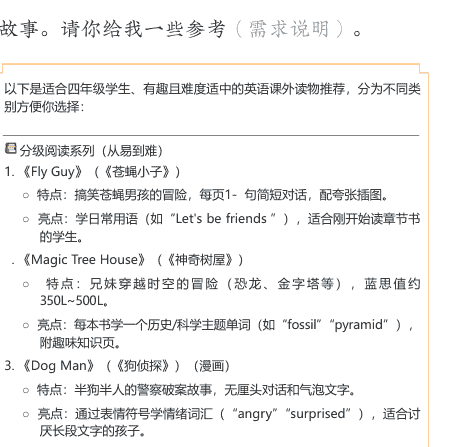

### DeepSeek 帮你改编与创作故事
觉得故事不够好就改编或原创，既能提升运用能力，也能激发创造力。无从下手时 DeepSeek 可提供启发。


比如六年级同学想用英语创作关于流浪小猫的故事，已确定猫的外貌性格——一只小黑猫，勇敢聪明，但情节没思路，可以这样问：
> 我是六年级学生，想用英语创作关于流浪小猫的故事，目前只确定小猫外貌和性格特征，是小黑猫，勇敢聪明，但不知道怎样展开情节，请给我一些启发，要求用简单英语词汇输出内容。
DeepSeek 提供的情节参考见图5-16。

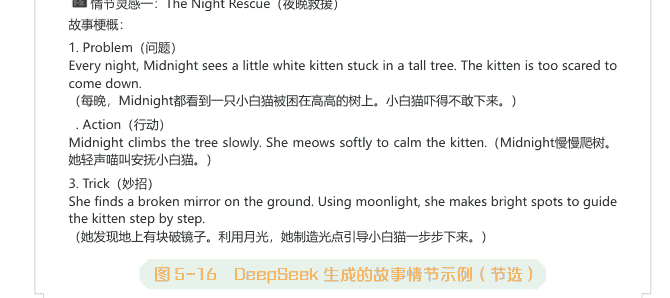

### 把故事搬上舞台
把故事改编成短剧上演，有助于加深理解，锻炼口语与团队合作。

比如五年级三班要合作演一部半小时的英语舞台剧，选《The Three Little Pigs》，可以这样问：
> 我们是五年级学生，要合作演一部英语舞台剧，内容是经典童话《The Three Little Pigs》，演出时长半小时，现在该做什么？请给些启发。
DeepSeek 给出的流程涉及剧本简化与角色分配、道具服装制作等，见图5-17。

第一阶段：剧本简化与角色分配 1周
1. 精简剧本 示例台词
   - 大灰狼 Wolf： Little pigs! Let me in 拍门动作 Then I'll huff, and I'll puff, and I'll blow your house down 叉腰吹气
   - 小猪 Pigs： 第一只 Straw is easy 懒散躺下 第三只 Bricks are strong 举哑铃假装搬砖
2. 角色分配建议 10~15人
| 角色 | 人数 | 道具/任务 |
| :--- | :--- | :--- |
| 三只小猪 | 3 | 戴不同颜色耳朵头饰 粉/蓝/黄 |
| 大灰狼 | 1 | 灰色披风+狼爪手套 |
| 旁白 Narrator | 1 | 举台词提示板，用夸张语调读关键句 |
| 稻草/木头/砖头 | 3组 | 举纸板房子 每组3人，举房顶、墙、门部件 |
| 风 | 3-4 | 吹泡泡机+蓝纱巾，狼吹气时跑动制造风效果 |
备用角色：森林小动物 举树形纸板背景、观众互动引导员 带鼓掌牌。


## 06 没有语言环境也能练口语
词记住了语法懂了，一开口却卡壳，根源是缺少真实对话场景和语言环境。

缺乏环境会带来：实践机会少难以运用；学习枯燥积极性下降；语言思维反应弱；缺乏自信不敢开口。


怎么办？不必去母语国家，创造或模拟真实场景同样有效。

具体可模拟哪些场景？结合生活实际来看。


### 校园生活类
校园时间最长，这类场景可直接与搭档全天创造真实英语对话。

比如五年级同学邀请好朋友一起在校用英语日常交流，首次尝试易卡壳，为更顺畅可以这样问：
> 我是五年级学生，为锻炼英语口语邀请好朋友一起在学校日常用英语对话，第一次尝试会卡壳，请生成一些简单的校园日常英语对话供参考练习。
DeepSeek 生成的参考见图5-18。

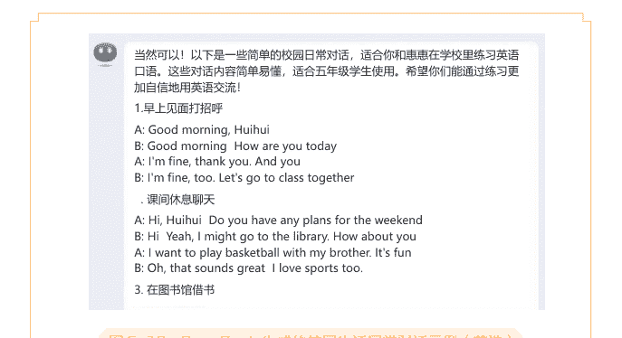

### 家庭日常类

家是常驻港湾，可与家人英语交流。若家人不会，可自问自答，或与虚拟助手对话，也可想象对话表达想法。

比如六年级同学想在家练口语，家人不会说，决定自问自答扮演双角色，可以这样问：
我是一名六年级学生，为锻炼英语口语想在家用英语对话，但家人不会，我决定自问自答同时扮演两个角色，可以从哪些方面展开？请生成一些简单的家庭日常英语对话供参考练习。
DeepSeek 生成的家庭日常对话参考见图5-19。

> 以下是为你设计的家庭日常英语对话练习模板，包含不同场景的简单对话，适合自问自答扮演双角色。每个对话标注角色切换提示，并附中文翻译参考：
场景一：早餐时间 Breakfast Time
角色A:妈妈 Mom /角色B:孩子 You
Mom: "Good morning. Do you want toast or porridge today?"
早上好！今天想吃吐司还是粥？
You: "Toast, please. Can I have strawberry jam?"
吐司，谢谢！能加草莓果酱吗？
Mom: "Sure. Don't forget your milk. It's getting cold."
当然！别忘了牛奶，快凉了。
You: "Okay. Thank you, Mom."
好的！谢谢妈妈！
图 5-19 DeepSeek 生成家庭日常对话示例 节选

### 社会实际生活场景类

在校内和家庭里模拟真实英语交流固然有用，若把练习延伸到社会生活场景，效果会更立体。比如去超市买东西、坐公交问路、在图书馆办借阅、遇到紧急情况求助等，都是很好的口语实战机会。

比如有个六年级的学生想在真实社会场景里练英语对话，打算一个人分饰两角自问自答。只是他不太清楚各类场景里能通用的表达，于是他这样向 DeepSeek 求助：
> 我是六年级的学生，想提升英语口语能力，计划在社会生活场景里练习对话，并一个人扮演双方角色。请问不同社会场景里有哪些常用句型？希望能生成几段简易的英语社会场景对话供我练习。
DeepSeek 给出了多组社会场景的英文对话示例，见图 5-20。


# 亲子沟通更轻松


## 01 DeepSeek 成长方法官


做家长的，总有那种崩溃瞬间：题目讲了三遍，孩子还在转橡皮，你忍不住拍桌子说不写完不准睡，孩子一哭你又软下来改口说写完这一题就休息。辅导作业的时光常在逼迫和哄劝之间摇摆。究其原因，还是孩子对学习的兴趣不足。

### 家长该怎么做
前面已分享如何帮孩子点燃学习热情，那么家长自身还能在教育上做哪些加法？

**第一，训练思维能力。** 思维敏捷的孩子能举一反三解数学题，遇到同学冲突也能冷静拆解。

**第二，培养生活自理。** 会整理书包的孩子房间更整洁，会在家洗碗扫地的孩子住校后也不会把脏袜子堆成山。自理能力不会自然习得，需要从小刻意练习。

**第三，家校携手。** 学校负责传授知识，家庭负责养成习惯，两方合力才能育出好孩子。

该怎么锻炼呢？别急，DeepSeek 可以充当教育方法顾问，依孩子实际情况给出具体建议。

### 锻炼思维能力
思维强的孩子不仅能举一反三，还能冷静分析矛盾，所以训练思维很关键，具体怎么做？把自家孩子的情况告诉 DeepSeek，它会给出可操作的方法。

比如一位妈妈注意到儿子读三年级，日常马虎，学习生活常出错，可好奇心爆棚，看蚂蚁搬家能盯一整天，逛超市也爱问个不停。她于是这样询问 DeepSeek：
> 我是三年级孩子的家长，孩子经常粗心，学习和生活都容易犯错，但对其他事物好奇心很强，观察蚂蚁能看一整天，逛超市爱提问。请结合他的特点，给出锻炼思维能力的具体做法。
DeepSeek 结合这份描述，给出了针对性的思维训练建议，见图 6-1。

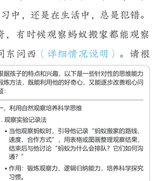

### 提升生活自理
思维是一方面，自理也是一方面。让孩子从小养成洗碗扫地、整理衣物等好习惯，能让做事更有条理，将来更独立。可别小看这些小事，养成需从小练起。要怎么提升？依然结合孩子具体情况向 DeepSeek 提问。

例如一位家长希望孩子上小学前先打好生活基础，他这样提问：
> 我是家长，孩子即将入学，希望他提前养成良好的生活习惯，能否提供一些培养方法？
DeepSeek 结合情况给出了养成良好生活习惯的建议，见图 6-2。

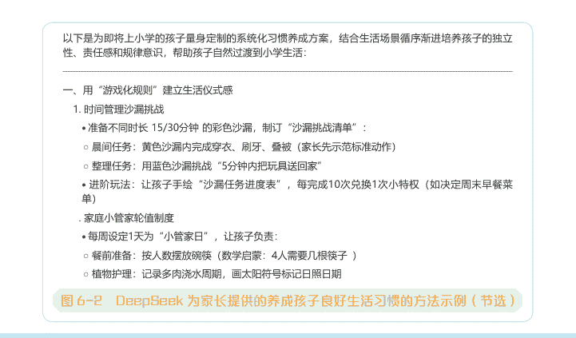

### 家校协作更智慧
教育像炒菜，家校配合要掌握火候。老师在校教知识，家长在家抓习惯，合力才能全面发展。家长还要记住不要校内减负校外加码，老师布置劳动任务你代劳，两股劲反着使只会扯疼孩子。家校拧成一股绳，孩子才能茁壮成长。具体做法可以请 DeepSeek 解答。

例如一个三年级孩子习惯睡前听故事，老师又要求每天读推荐课外书，导致入睡时间被推迟。为兼顾任务与睡眠，家长这样问：
> 我是三年级孩子的家长，孩子习惯睡前听故事，老师现在要求每天读指定的课外书，导致入睡时间变晚。怎样把听故事和读书结合起来，既完成任务又保证睡眠？
DeepSeek 给出了可行的结合方案，见图 6-3。

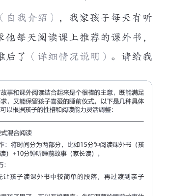

## 02 亲子互动游戏策划


#### 能培养哪些核心能力
日常亲子活动里藏着很多锻炼机会，看似平常却能增进关系。作为家长，关键是让孩子在玩中自然得到锻炼。

观察力、逻辑力、动手力是成长的关键基础。

**观察力**：帮孩子抓住细节、感知环境变化，为学习探索提供信息基础。
**逻辑力**：培养分析问题、梳理因果的思维习惯，提升解决复杂问题的效率。
**动手力**：通过实践把想法变成行动，强化实践能力和抗挫折意识。

三者相互支撑——观察获取信息，逻辑整理思路，动手验证结果。系统培养能减少粗心，提升应变，为未来自主解决问题打基础。

### 提升观察力
日常亲子中怎么锻炼观察力？来看 DeepSeek 的建议。

例如一位自由职业的家长工作时间灵活，想以自家客厅和阳台为范围，设计提升观察力的亲子活动，他这样问：
> 我是二年级孩子家长，自由职业时间灵活，想在家客厅和阳台安排提升观察力的亲子活动，请设计几项活动。
DeepSeek 按需求设计了活动方案，见图 6-4。

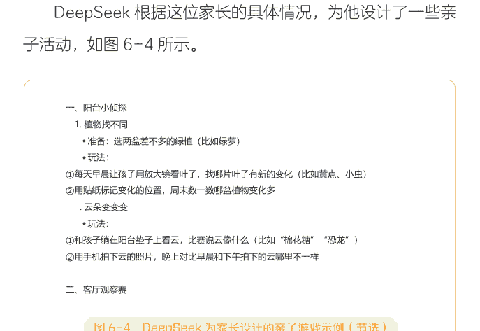

### 强化逻辑思维
逻辑思维不是天生的，而是家长在日常互动中帮孩子练出来的工具箱。通过恰当设计，逻辑能力会明显提升。

还是上面的家长，他想利用孩子在家和逛超市的场景做逻辑游戏，他这样问：
> 我是二年级孩子家长，时间比较自由，想利用孩子在家和超市的日常活动，做一些提升逻辑力的亲子游戏，请帮忙设计。
DeepSeek 给出了游戏方案，见图 6-5。

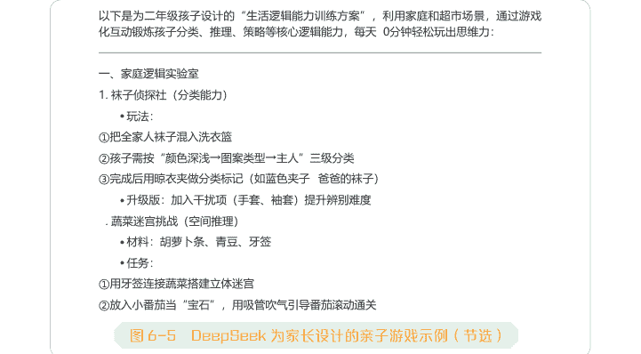

### 培养动手实践
动手实践在很多事上都很关键。动手强的孩子搭积木会加固底座，做实验会不断调整步骤直到成功。亲子活动中要多创造动手机会，培养实践与解决问题的能力。

例如一位家长想结合厨房物品让六年级孩子了解基础化学，他这样问：
> 我是六年级孩子家长，想用厨房里的常见物品做化学小实验帮助孩子了解基础化学，请设计相关实践活动。
DeepSeek 设计了化学实践活动，见图 6-6。

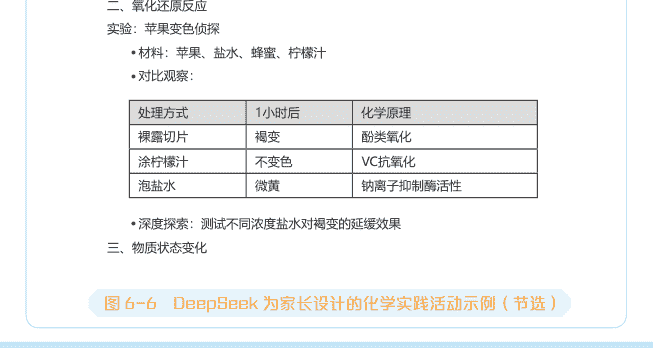

### 全程追踪学习进度
辅导学业时常有这样的体会：孩子挺认真，进度却慢，影响成绩。家长想帮忙却无从下手。

先看影响进度的原因。

**原因一：基础不牢。** 起步时知识掌握不扎实，后续综合运用不熟练，效率低。
**原因二：习惯不好。** 不良学习习惯会形成恶性循环，影响进度。
**原因三：注意力分散。** 课堂走神会漏掉重点知识点，拖慢进度。

别担心，DeepSeek 可以帮你解决。


### 用数据记录学习轨迹
学习轨迹常难追踪，孩子自己也记不清学到哪。让 DeepSeek 生成数据化学习记录，进度就有迹可循。

例如一名三年级家长的孩子常混淆数学知识点、粗心大意，不知道如何分类记忆。他想让 DeepSeek 建立学科档案追踪轨迹，于是问：
> 我是小学三年级学生家长，孩子经常混淆数学知识点，容易粗心，不知道如何分类记忆。请帮他建立学科档案，生成数据化学习记录以追踪学习轨迹。
DeepSeek 给出了三年级学习轨迹记录方案，见图 6-7。

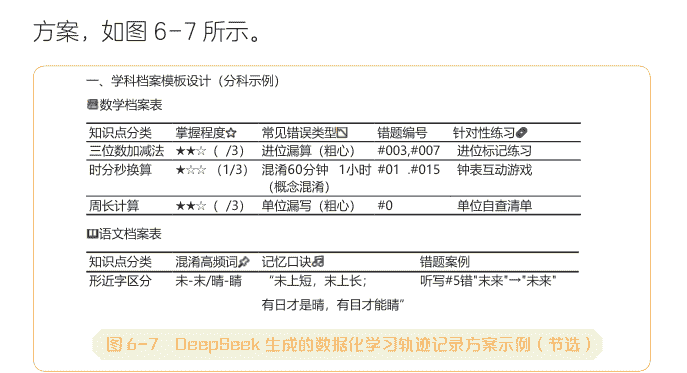

### 生成可视化学情报告
如何区分已掌握和未掌握的知识点？DeepSeek 可通过分析错题归纳易错点和难点，了解掌握情况并生成可视化报告，一目了然。

例如一名小学生家长，孩子这次数学考得不好，不清楚薄弱和擅长处。他上传试卷后问：
> 我是小学生家长，这是孩子的数学试卷，请根据答题情况分析他在哪些知识点擅长，哪些薄弱。
DeepSeek 生成了可视化学习报告，见图 6-8。

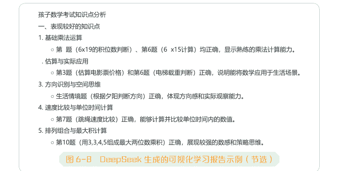

### 量身定制学习方案
每个孩子适合的方法不同，有人理性有人感性。DeepSeek 可按个人习惯定制差异化方案。

例如一位家长，儿子五年级喜欢数学、擅长逻辑思考；女儿喜欢英语、习惯形象化思考。他希望得到不同方案，于是问：
> 我是两个小学生的家长，儿子五年级喜欢数学，偏逻辑；女儿喜欢英语，偏形象。请按两人特点提供不同的学习方案。
DeepSeek 给出了定制化方案，见图 6-9。

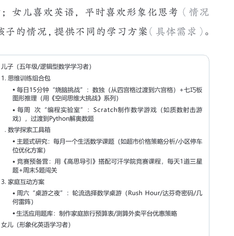

### 为孩子规划未来
小学阶段的未来规划意义重大，关乎当下成长和一生发展。

1. **促进个性化成长**：发现兴趣天赋，培养自信。
2. **助力学业发展**：合理安排学习路径，培养好习惯。
3. **助力未来适应**：有助于适应社会和职业发展。
4. **促进家庭和谐**：增强亲子关系。

但很多家长感到迷茫：经验不足难洞察兴趣，教育信息繁杂不知如何选择。急需正确方法指引方向。


### AI 助力未来规划
每个孩子都有独特的性格与兴趣，如同画笔绘就未来。如何依据性格和兴趣规划成长路径，是每位家长的思考题。难点主要有两方面。


**原因一：家长对孩子性格兴趣了解不深。** 一方面工作繁忙难以关注；另一方面易受自身期望影响忽视孩子真实喜好。
**原因二：家长缺乏专业指导。** 教育心理学知识欠缺，接触不到专业顾问，难以科学引导。

别着急，让 DeepSeek 来助力。

### 洞察孩子的性格与兴趣
当孩子不愿沟通或交流机会少时，可从日常行为推断。

例如王先生儿子读五年级，他常年在外工作交流少，只知道儿子话不多，爱看《红楼梦》等古典小说。他这样问：
> 我是五年级男孩家长，常年工作在外，交流少。儿子比较安静，不爱说话，经常看《红楼梦》类古典小说。请根据行为特点分析性格和兴趣爱好。
DeepSeek 完成了分析并给出潜在优势与挑战参考，见图 6-10。

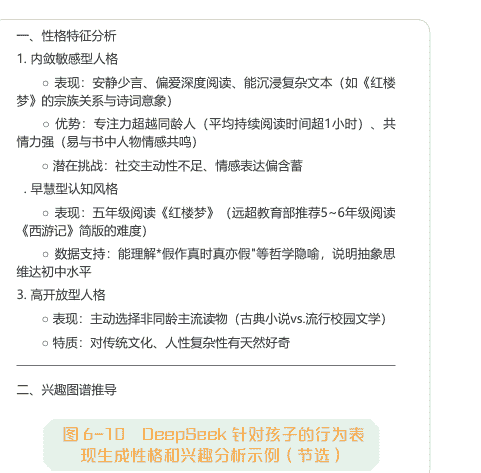

### 获取专业指导支持
了解性格兴趣后，可引导孩子探索相关未来方向。


例如王先生参考分析后，想引导儿子深度发展兴趣但不知怎么做，他这样问：
> 我是五年级男孩家长，儿子安静，爱看《红楼梦》类古典小说。想引导他深度发展兴趣，请给出专业实用的方法。
DeepSeek 给出了结构化可操作建议，见图 6-11。

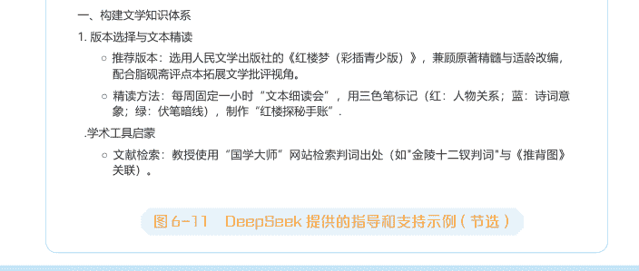

## 05 陪孩子安全玩转 AI

当 AI 成为孩子的“全能家教”，既能秒解奥数又能写科幻小说时，家长该放手不管还是严控使用？下面帮助家长带领孩子安全使用 AI，把技术变成通向未来的翅膀而非思维牢笼。

#### 安全入门避坑指南
**第一，认真筛选工具。** 除 DeepSeek 外，市场上工具众多。家长应引导选择，注意版本是否官方，避免下载带病毒的版本；注意隐私权限，关闭非必要权限；安装后陪孩子试玩，像试吃零食一样确认安全。

**第二，规定使用规则。** 可限制使用时长，例如每天不超过40分钟；可签订《智能伙伴协议》，例如查作业前先独立思考10分钟，生成的故事要读给家长听。

**第三，定期亲子共学。** 例如每周玩一次“人机大比拼”：家长描述“会飞的乌龟”，孩子用 AI 生成图后用彩笔改进细节。发现 AI 画错可引导查资料对比；孩子用 AI 写作文别急着批评，改成“AI 写开头，你改结尾，看谁更有创意”。

### 如何避免孩子利用 AI 代写作业

# 先自检，再用 AI：防止作业代写

想让智能助手成为思考搭档而非代写工具，使用前先完成三项自检。

1. 在纸上先写下至少两条解题思路的关键词，例如“移项”“单位换算”。
2. 将题目中看不懂的词汇或不熟悉的知识点标出来。
3. 先估算所需时长并设定闹钟提醒，比如半小时。

实践案例：一位六年级同学按上述流程练习利润率计算题，对利润率公式不太确定，于是先记录该知识点，再向 DeepSeek 核对思路：

> 自我介绍：我是一名六年级学生，针对“甲种运动器械进价 1200 元，按标价 1800 元的 9 折出售。乙种跑步器，进价 2000 元，按标价 3200 元的 8 折出售，哪种商品的利润率更高些”中涉及的利润率计算公式这一知识点，我不太熟悉，请你给出这一题的解题思路，并着重介绍利润率计算公式这一知识点。

DeepSeek 结合该生的具体情况，为他着重介绍了解题思路及知识点，如图 6-12 所示。


### 如何打破 AI 形成的信息茧房

孩子刷视频总是收到同类推荐？这是 AI 通过“猜你喜欢”功能在构建一张无形的信息网络！如果孩子只看恐龙视频、只听流行歌曲，就好比长期只吃汉堡薯条，营养会失衡。家长要做“信息营养师”，主动带 AI “换口味”！

**首先，家长可以给 AI “喂”多样化信息。** 家长可以主动设置兴趣标签，定期帮孩子添加一些相对“冷门”的关键词。

**其次，家长要当好“信息质检员”。** 例如，家长可以跟孩子一起分析 AI 推送的热门视频，像“这个说北极熊灭绝的视频，内容的真实度怎么确定？我们可以从多个权威渠道去查找相关信息进行对比”，以此来让孩子明白网上的信息并不是百分百准确的。

**最后，要预防孩子沉迷 AI。** AI 用多了容易“上瘾”。家长要当好“管理员”，一方面要限制孩子每天使用 AI 的时间，另一方面要定期检查 AI 聊天记录，防止孩子使用 AI 代写作业或谈论不合适的话题。


# 《问对问题赢学习：DeepSeek中小学生使用攻略》内容思维导图

## DeepSeek相关使用指南
- DeepSeek是什么
- DeepSeek安装注册流程
- DeepSeek功能及版本介绍
- DeepSeek特点及交流秘诀
- 向DeepSeek提问注意事项

## DeepSeek提升孩子语文成绩
- 提升孩子阅读兴趣
  - 孩子不爱看书的原因分析
  - 提供孩子感兴趣的书
  - 陪孩子讨论书中内容
  - 养成良好的阅读习惯
- 增强孩子阅读能力
  - 确定书籍阅读顺序
  - 制订快速阅读计划
  - 提升孩子阅读技巧
- 帮孩子背诵古诗文
  - 设计趣味古诗文记忆法
- 生成古诗文知识图谱
  - 快速搜集整理古诗文资料
  - 让古诗文知识变得有趣
  - 制作古诗文思维导图
- 打造要点明确的笔记
  - 康奈尔笔记法的用法
  - 帮助整理笔记内容
- 增进作文写作能力
  - 寻找作文灵感
  - 让语言更生动
  - 批改孩子作文
  - 搜集作文素材
  - 作为审题指导

## DeepSeek提升孩子数理成绩
- 建立数理错题本
  - 梳理数理知识点
  - 诊断数理知识漏洞
  - 针对错题进行分析
- 培养举一反三能力
  - 拓展学习三步法
- 用费曼学习法加深理解
  - 费曼学习法的概念
  - 费曼学习法的步骤
  - 用费曼学习法拆解难题
- 用苏格拉底提问法培养数理思维
  - 苏格拉底提问法的概念
  - 苏格拉底提问法的特点
  - 用“DeepSeek+苏格拉底提问法”辅助做题
- 突破数学思维瓶颈
  - 发现孩子理解偏差
  - 拓宽孩子解题思路
- 让科学知识有趣起来
  - 打造虚拟实验室
  - 参与故事互动
  - 建立微观知识漫游库

## DeepSeek提升孩子英语成绩
- 对英文不感兴趣的原因
- 英文趣味角色扮演
- 设计趣味英文对话
- 设计荒诞情景喜剧对话
- 英文单词趣味游戏
  - 谐音方式背单词
  - 趣味词根背单词
  - 接龙游戏背单词
  - 肢体拼写背单词
  - 寻宝游戏背单词
- 巧用英文单词设计游戏
- 巧用艾宾浩斯遗忘曲线
  - 制作彩虹单词打卡表
  - 制作录音贴纸时间胶囊
- 帮助掌握英语语法
  - 不同句式变形法
  - 语法拍手歌设计
- 在趣味故事中学英语
  - 选择合适的趣味故事
  - 英语故事改编与创作
  - 把英语故事搬上舞台
- 提升孩子的口语水平
  - 模拟校园生活对话
  - 模拟家庭日常对话
  - 模拟社会实际生活场景对话

## DeepSeek提升孩子全方位素养
- 让学习变得更有趣
  - 对游戏感兴趣的原因分析
  - 拆解学习任务
  - 设计学习游戏
  - 兴趣课程设计
- 培养孩子学霸素养
  - 分析与学霸的差距
  - 定制学习方法
  - 确定学习目标
  - 整理散乱知识点
  - 培养逻辑思考力
  - 养成良好的学习习惯
  - 设计记忆训练法
  - 提供有针对性的记忆方法
  - 提升搜索效率
- 加强时间管理能力
  - 整理杂乱任务
  - 定制时间规划
- 提升孩子的专注力
  - 影响专注力的原因分析
  - 提供有针对性的专注力训练方法
- 改善孩子心理情商
  - 给予情绪支持
  - 交流策略建议

## DeepSeek让亲子交流更顺畅
- 为家长提供教育方法
  - 锻炼孩子思维能力
  - 提升孩子生活能力
  - 加强家校协同合作
- 亲子趣味游戏设计
  - 观察能力特训游戏设计
  - 逻辑能力提升游戏设计
  - 动手能力培养游戏设计
- 孩子学习进度全跟踪
  - 数据化记录学习轨迹
  - 生成可视化学习报告
  - 定制化学习方案
- 根据孩子特点规划未来
  - 深入了解孩子性格兴趣
  - 提供专业的未来规划指导和支持
- 带孩子更好地玩转AI
  - 让AI运营更安全
  - 避免孩子滥用AI
  - 打破AI信息茧房

# 《问对问题赢学习：DeepSeek中小学生使用攻略》提问词汇总

1. **学习目标拆解**
我是一名（具体年级）学生，想提升（具体目标），准备用（具体时间）完成目标，每周可以用（具体时间）来学习，我现在的问题有（当前存在的问题）。请帮我设计一个学习方法，要拆解成阶段性步骤，并按照由易到难的顺序排列。

2. **学习游戏设计**
我是一名（具体年级）学生，我想记住（想要记住的知识）。请帮我设计几个既能跟（具体数字）个同学一起进行，又能帮我们记住这些知识的游戏。

3. **将爱好和学习结合**
我是一名（具体年级）学生，平时比较喜欢（兴趣爱好），不喜欢（不喜欢的课程），可以将我的兴趣爱好和不喜欢的课程内容结合起来，制订一个特别的课程吗？

4. **定制学习方法**
我是一名（具体年级）学生，（自己的性格特点说明），可以根据我的性格帮我制订一个适合我的（对应学科或知识）学习方法吗？

5. **树立学习目标**
我是一名（具体年级）学生，成绩（当前成绩情况说明），我现在觉得很迷茫，找不到学习目标，请告诉我我未来的学习目标。

6. **知识点整理**
（上传附件——图片或文件）这是我收集的一些资料，请帮我把知识点梳理好并分类。

7. **学习习惯培养**
我是一名（具体年级）学生，成绩（当前成绩情况说明），我（当前学习习惯问题说明），请为我制订一个养成良好学习习惯的计划。

8. **提供记忆力训练方法**
我觉得自己记忆力不行，（记忆力情况说明），请给我一个简单、实用的记忆力训练方法。

9. **提供记忆方法**
我的（记忆力情况说明）。我想要在（具体时间）背诵（要背诵的内容），请给我提供一个适合我的记忆方法。

10. **对应资料搜索**
（开启“联网搜索”功能）我是一名（具体年级）学生，需要收集一些（要收集的内容）。请为我提供资料，并提供输出内容的出处。

11. **确定任务完成顺序**
我是一名（具体年级）学生，我想要规划好（具体时间），但是我要完成的事情很多，（列举要完成的任务）。请按照这些事情的重要程度，帮我安排一个时间计划。

12. **定制时间规划**
我是一名（具体年级）学生，我（平时时间安排、要完成的任务等情况说明）。请为我制订一个一周的时间管理方案。

13. **分析专注力低的原因**
我是一名（具体年级）学生，我（自身专注力情况说明）。请根据我的情况，分析我专注力低的原因。

14. **提供专注力训练法**
我是一名（具体年级）学生，我（自身专注力情况说明）。请根据我的情况，为我提供一些针对性的专注力训练方法，要求一个人在家就能做。

15. **角色扮演指令**
我是一名（具体年级）学生，我想让你扮演（设定角色），来跟我交流。你需要（对角色的具体要求）。

16. **人际沟通建议**
我是一名（具体年级）学生，（具体沟通情况说明），我想（自身态度），该怎么回答才（沟通结果要求）？

17. **推荐感兴趣的书**
我是一名（具体年级）学生，平时喜欢（爱好），爱看（列举最喜欢的动画片、电影、电视剧等），喜欢的书有（列举最喜欢的书籍），能帮我推荐一些我可能感兴趣且适合我的书吗？

18. **角色扮演聊书籍**
我是一名（具体年级）学生，刚读完（书名），我（自身对书中角色、剧情、表达的思想等的想法）。我想让你扮演（角色设定），能用他的语气跟我聊聊吗？

19. **阅读习惯培养**
我是一名（具体年级）学生，我现在（当前读书情况说明），想要一个可执行的阅读习惯培养计划。

20. **书籍阅读顺序安排**
我是一名（具体年级）学生，（时间期限）我要看完这些书（列出书目），请按照由易到难的顺序为我安排阅读顺序。

21. **制订具体阅读计划**
我是一名（具体年级）学生，我（阅读时间安排），（时间期限）我要看完以下书（列出书目），帮我制订一个能在该时间期限内读完这些书且剩下时间充裕的阅读计划。

22. **阅读重点选择**
我是一名（具体年级）学生，请告诉我（列出书名）应该精读还是泛读，并说明阅读重点和思考点是什么。

23. **寻找书籍中的不同观点**
我是一名（具体年级）学生，我正在阅读（列出书名），请告诉我，我可以带着什么问题去读，以及针对这本书的内容，都有哪些不同观点。

24. **提供古诗文背诵方法**
请给（具体数量）个能帮我快速背下（列出古诗文名称）的方法，并说明背诵时有哪些注意要点。

25. **搜集整理古诗文资料**
（开启“联网搜索”功能）我是一名（具体年级）学生，我正在预习（列出古诗文篇目）这篇课文，需要你帮我搜集整理相关资料，包括出处、创作背景、重点字词句等方面的内容，要求内容准确。

26. **整理古诗文知识点**
（上传附件）根据我上传的资料，帮我搭建一个有趣又便于理解、记忆的（列出对应古诗文篇目）知识图谱，要重点突出，逻辑严谨。

27. **思维导图制作**
（上传附件）根据我上传的资料，帮我制作一个思维导图，并以Markdown格式输出内容。

28. **用康奈尔笔记法整理笔记**
我是一名（具体年级）学生，请根据我上传的笔记（上传附件），用康奈尔笔记法帮我整理这份课堂笔记，但不要写总结区的内容。

29. **作文灵感提供**
我是一名（具体年级）学生，请根据“（作文题目和要求）”，给我提供一些写作灵感。

30. **作文语句提升**
这是我写的一句话：“（作文语句描写）”，可以帮我提供一些让这句话语言变得更生动的办法吗？

31. **作文点评和改进建议提供**
（上传附件）我是一名（具体年级）学生，这是我写的作文，作文题目是“（作文题目）”，老师的点评是“（点评内容）”，请更详细地点评我的作文，并给出改进建议。

32. **作文素材搜集**
我是一名（具体年级）学生，需要以“（作文题目）”为题写一篇作文。要求（具体要求）。请给我搜集一些作文素材。

33. **作文审题**
我是一名（具体年级）学生，我要写一篇以（作文题目）为题的作文。作文的要求是：（具体要求）。请帮我分析题目，并给我一些写作方向。

34. **有困难的知识点说明**
我是一名（具体年级）学生，在学习（具体知识点）时遇到了困难，感觉不是很明白。请用我能听得懂的语言解释（上述具体知识点），并举例说明。

35. **作业批改分析**
（上传附件）我是一名（具体年级）学生，这是我的作业。请按照（对应教材版本和科目）作业批改标准批改我的作业，并标注错误类型和对应的知识点。

36. **错题分析**
（上传附件）我是一名（具体年级）学生，请根据我上传的错题分析我做错的原因（需要说明），并给我提供避免做错这一类型题目的建议（具体需求）。

37. **设计类似题型**
（上传附件）请根据我上传的题目考察点，再出几道类似的题目，要标注难度，并设置不同的情境。

38. **用费曼学习法拆解题目**
（上传附件）我是一名（具体学段）学生，请根据我上传的题目，用费曼学习法拆解它们，并引导我发现自己的知识漏洞。

39. **用苏格拉底提问法讲解题目**
（上传附件并关闭“深度思考”模式）我是一名（具体年级）学生，请模拟你在教我做题目的场景，用苏格拉底提问法向我提问。等我回答了一个问题后再继续提下一个问题，开始吧！

40. **题目核心知识点分析**
（上传附件）请问这几道题讲了（对应科目）的哪些知识点？

41. **分析知识理解偏差**
我是一名（具体年级）学生，这是我对（对应知识点）的理解：（阐述自己的理解）。请评价我的理解是不是正确的，如果有问题请指出来并提出改进建议。

42. **拓宽解题思路**
（上传附件）我是一名（具体年级）学生，请为我上传的题目提供几个解题思路，不需要具体的解答过程和答案，这些思路所涉及的知识点在（具体年级）学生应该掌握的范围内。

43. **解题习惯分析**
（上传附件）我是一名（具体年级）学生，请对我上传的错题集进行分析，告诉我，我在解题习惯方面有哪些问题，可以用什么方法改进。

44. **科学实践活动设计**
我是一名（具体学段）学生，我对科学知识非常感兴趣，但是学校的科学实践课比较少，我想通过线上的方式参与多场景的数理科学实践活动，帮助我巩固课堂里学到的知识。要求实践内容通俗易懂，不超出（学段范围）的理解范围。

45. **定制互动性的故事**
我是一名（具体学段）学生，我（个人情况说明），在学习（对应知识点）问题时，我难以理解题目传达的意思。请帮我生成一个互动性的故事，以便我理解题意。

46. **建立知识漫游库**
我是一名（具体学段）学生，我最近在学习（对应知识点）。请你创建（对应知识点具体内容）知识漫游库，帮我了解这些内容。

47. **英文单词趣味对话设计**
我是一名（具体年级）学生，总是记不住这几个单词（列举你觉得最难记的单词）。我想通过跟一个同学玩角色扮演来开展趣味对话，强化记忆这些单词。我扮演（你扮演的角色），同学扮演（他人扮演的角色）。请你生成一段对话，供我和同学模拟运用，对话中要使用上述几个单词。

48. **表情包英文对话设计**
我是一名（具体年级）学生，我制作了一个（具体描述表情包的内容）的表情包，我想用（列举想掌握的单词）来生成一句搭配表情包的文字。请你生成一段对话，对话中要使用上述几个单词。

49. **英文荒诞情景喜剧设计**
我是一名（具体年级）学生，我想在班会上表演英文版的荒诞情景喜剧。我想扮演（描述你想扮演的角色、所要呈现的场景）。我选定了（列举目标单词）目标单词。请你帮我用它们来生成一段荒诞情景喜剧对话。

50. **生成英文单词谐音**
我是一名（具体年级）学生，我想用谐音记忆新学的单词，它们分别是（列举目标单词）。我想给每个单词设一个谐音，还想把这些单词连起来，连成一个谐音故事，要求好玩、好记。请你为单词生成谐音示例，供我参考。

51. **拆解英文单词词根**
我是一名（具体年级）学生，我想通过拆解单词的方式，来记忆新学的单词，它们分别是（列举目标单词）。我希望单词拆解后的词根能连成一个（什么样的）故事。请你为单词生成趣味词根，供我参考。

52. **英文单词接龙**
我是一名（具体年级）学生，我的英语老师布置了一项课堂作业，她让我们每人轮流说一句英文，句子之间的意思必须逻辑连贯，即使无厘头也没关系。句中必须包含一些新学的单词，它们分别是（列举目标单词）。请你生成一段接龙示例，供我参考。

53. **英文单词肢体拼写**
我是一名（具体年级）学生，我的英语老师让我们根据（列举一个目标单词），这个单词，分组进行肢体拼写竞赛，每一组（同学数量）个同学。老师喊出单词后，各组需用人体按字母（大写）顺序拼出正确的单词。请你生成一组肢体拼写示例，供我和队员参考。

54. **英文单词寻宝游戏**
我是一名（具体年级）学生，我想跟我的朋友们玩英文单词寻宝游戏，一边寻宝，一边加深对身边物品对应单词的记忆，如（列举目标单词）等。请你帮我设计具体的玩法，提供详细说明，供我和朋友们参考。

55. **制作彩虹单词打卡表**
我是一名（具体年级）学生，我想运用艾宾浩斯遗忘曲线来制作一个彩虹单词打卡表。但是我不知道要准备哪些材料，不明确制作步骤和具体学习流程该怎么安排。请你生成一份超详细的操作指南，供我参考。

56. **制作录音贴纸时间胶囊**
我是一名（具体年级）学生，我想运用艾宾浩斯遗忘曲线来制作录音贴纸时间胶囊。但是我不知道要准备哪些材料，制作步骤是什么。请你生成一份超详细的操作指南，供我参考。

57. **基础句变形学习语法**
我是一名（具体年级）学生，语法（描述自己语法水平），我想通过每天改写一个基础句（每日变形任务）来加强英语语法的学习，具体要怎么去变换语法结构？请你给我（需要示例的数量）个示例参考，要求句子简单易懂。

58. **创作语法拍手歌**
我是一名（具体年级）学生，我想创作关于（说明具体语法）的语法拍手歌，要求这首歌包含具体的语法点，歌词简单重复，容易记忆。请你给我一些参考。

59. **英语课外读物寻找**
我是一名（具体年级）学生，我的英语成绩（描述自己的英语水平）。为了提高成绩，培养阅读兴趣，我想找一些适合自己水平的英语课外读物，如有趣的英文故事。请你给我一些参考。

60. **英语故事创作**
我是一名（具体年级）学生，我想用英语创作一个（描述故事主题）故事，目前我只确定了（已经确定的创作内容），但我不知道（不知道怎么写的内容）。请你给我一些启发，要求使用简单英语词汇输出内容。

61. **英语舞台剧演出**

DeepSeek 家校共学 · 典型提问范例

我们是（具体年级）的在校生，想联排一出英语舞台剧，剧情设定是（故事内容说明），预估表演时长为（说明演出时长）。目前还不清楚后续该如何推进，能否给我们一些可操作的启发和分工建议？

## 62 英语口语场景练习

我是一名（具体年级）的学生，为了增强英语口语能力，拉上朋友在（交代日常对话场景）里进行纯英文交流。第一次尝试，表达容易受阻、出现卡顿。为了让对话更顺畅，请帮忙拟写几段贴合该情境、难度适中的简易英文会话，用作参考练习。

## 63 提升孩子思维能力的方法

作为家长，我家孩子目前（孩子的年级、习惯和性格特质说明）。想针对他的实际情况，给出一些能有效锻炼逻辑与思维能力的做法。

## 64 培养孩子良好生活习惯的方法

我是一名家长，孩子（孩子的年龄及生活习惯说明）。希望能循序渐进地帮助他养成健康的生活习惯，请提供可行的方法。

## 65 解决孩子时间管理问题的方法

我家孩子是（孩子年级）年级的学生，存在（孩子面临的时间问题情况说明）。想改善现状，达成（想达成的结果）。请给出对应的改善策略。

## 66 亲子活动策划

我是一位（孩子年级）学生的家长，自己的情况是（自身情况说明），计划以（亲子活动地点）为范围，和孩子一起开展活动，目标是提升（希望孩子提升的能力、掌握的知识等）。请帮忙设计几项合适的亲子活动方案。

## 67 建立孩子学习档案

我是一位（孩子年级）学生的家长，孩子（孩子存在的具体问题和孩子学习资料）。请为他梳理学科档案，生成可量化的学习记录，并实现学习轨迹的追踪。

## 68 孩子试卷诊断

（上传附件）我是一位（孩子年级）学生的家长，这是孩子在（对应科目）的考试试卷。烦请依据答题表现，指出其在哪些知识点上掌握较好，哪些知识点相对薄弱。

## 69 孩子性格与兴趣分析

我是一位（孩子年级）学生的家长，我（自身情况、自身与孩子的关系说明），孩子平时（孩子行为特点与日常状态说明）。请结合这些行为特征，对他的性格倾向和兴趣爱好做一个分析。

## 70 孩子兴趣深化的指导建议

我是一位（孩子年级）学生的家长，孩子的兴趣与性格是（孩子的兴趣和性格说明）。希望能帮助他更深入地发展爱好，请提供专业、实用的针对性指导和支持建议。

DeepSeek，24小时不打烊的学习伙伴
学习方法总不匹配，DeepSeek可根据情况定制方案！
语文作文缺灵感，DeepSeek能提供素材思路！
数学解题老卡壳，DeepSeek可分步拆解讲解！
英语单词记不牢，DeepSeek能设计记忆小游戏！

本书以**全彩漫画+典型案例**的形式呈现，帮助中小学生轻松学会用AI辅助学习，成为DeepSeek的熟练使用者，从而提升学习效率与学业表现。

上架建议 中小学学习方法

ISBN 978-7-111-78260-5

策划编辑：熊 铭

责任编辑：熊 铭 彭 婕

封面设计：书 虫

定价：59.80元