# Cursor 零门槛上手 Vibe Coding

## 作者简介

薛志荣，同时从事交互设计、工程实现与写作工作，曾在百度、小鹏、华为担任交互设计岗位，长期聚焦人机交互与人工智能方向的探索，出版《AI改变设计》《前瞻交互》等五本作品。

池志炜，Mixlab 无界社区发起人、MixCopilot 知识引擎联合创建人，复旦大学国家发展与智能治理综合实验室技术顾问，comfyui-mixlab-nodes 贡献者，前蚂蚁集团高级前端专家。

## 内容简介

本册专为无编程背景的读者编写，从创意发想一直讲到代码交付，从日常工具使用到 Agent 构建与协作提供完整路径。开篇先谈 AI 编程带来的观念变化，拆解传统编码入门的痛点，并阐释 AI 编程如何拓展创造空间。后续覆盖产品规划、提示设计、需求沉淀、基础编码与开发工具的高效用法，并以 Chatbot、AI 产品经理、新闻摘要 Agent 等实战案例展开，另对多 Agent 联动、具备记忆能力的 AI 知识助手构建进行专题拆解。

适合从未写过代码的爱好者、希望完成技术转型的从业者，以及想借 AI 编程提升效率的开发者阅读。

## 前言

动笔之初，我能感受到自己正处在技术变革的临界点上。Vibe Coding 这个说法由 OpenAI 联合创始人 Andrej Karpathy 在 2025 年 2 月 3 日提出，被视作软件开发的新形态，其核心思想是弱化代码本身，强化想法落地。Karpathy 在社交媒体上描述：“我把这叫做氛围编程，你完全沉浸其中，享受指数级增长，甚至忘记代码的存在。这并非传统意义的编程——我只是看看、聊聊、跑一下，然后复制粘贴，大多数情况下都能跑通。”这种做法摆脱了对繁复语法与严密逻辑的依赖，让开发者可用自然语言或语音把需求交给大模型，由模型直接生成代码。

2025 年 5 月 6 日，英伟达 CEO 黄仁勋在米尔肯全球大会上表示：“过去四十年计算机技术的红利，大约只惠及 3000 万会写代码的人。”他同时强调：“AI 是弥合技术鸿沟的最大契机，每个人都能用 AI 编程。”这一转变意味着，过去依赖技能壁垒掌握话语权的方式，正被以表达力与问题界定力为核心的 AI 协作为主导。

OpenAI 首席产品官 Kevin Weil 在 2025 年 3 月的播客中预测，“到 2025 年底，AI 将在竞争性编码基准上超越人类程序员”。CEO Sam Altman 也在社媒分享判断：“2025 年 AI 代理开始工作；2026 年 AI 会发现新知识；2027 年 AI 进入物理世界创造价值。”竞争对手的观点同样印证趋势。Anthropic CEO Dario Amodei 指出：“在进展最快的编程领域，我们距离 AI 完成 90% 代码的局面只剩 3 到 6 个月，12 个月内可能进入 AI 基本完成全部代码的阶段。”事实上，Claude Code 已“自行编写约 80% 的自身代码”，并完成了 70% 以上的生产类代码提交。

这不仅是工具的迭代，更是思维的重塑。学习 Vibe Coding 的紧迫性在于，编程的重心正从“怎么写代码”转向“如何把意图讲清楚、把问题界定准确”。Replit CEO Amjad Masad 在 2025 年 5 月的播客里说：“AI 的下一步，不是告诉它怎么做，而是告诉它想要什么，由它自行决定怎么做。”在此背景下，传统编码技能正让位于更高阶的系统思维，他表示：“未来不再需要提示词工程师，而是需要系统工程师——你负责布置任务，而不是亲手执行。”

正如进化生物学家 Bret Weinstein 提醒：“你不是在和 AI 竞争，而是在和借助 AI 被放大的他人竞争。”这也道出了掌握 Vibe Coding 的必要性——不跟上新方法，就会在新竞争格局中处于劣势。这关乎技术，更关乎 AI 时代的定位与价值。

连续创业者 Daniel Priestley 提出关键问题：“你有没有在 AI 时代明确自己的角色？”当 AI 能编写大部分代码时，个人价值转向问题定义、系统设计与成果验证。正如他强调：“未来不是人与 AI 竞争，而是 AI 系统与 AI 系统竞争，关键不在于你多聪明，而在于你在其中扮演什么角色。”

学 Vibe Coding，本质是学会在新时代确立坐标，用表达力与系统思维驱动 AI 创造价值。要在 AI 编程时代胜出，需要三种新能力：场景定义力，准确描述问题；任务拆解力，把复杂问题拆成可处理单元；系统调度力，协调多个 AI 组件协同工作。正如 Anthropic CPO Mike Krieger 所言：“我们不是让模型更聪明，而是在让系统变得可控、可使用、可调度。”

本书围绕 Vibe Coding 这一新型范式展开，它不仅是技能，更是适应 AI 时代的思考方式。你将学会在更高层面与 AI 协作，如何清晰表达意图、设计与验证系统，并在 AI 驱动的世界里创造独特价值。

无论经验丰富的程序员，还是从未写过代码的初学者，Vibe Coding 都提供了平等起点。正如黄仁勋所言，AI 编程是缩小技术鸿沟的最大机会，每个人都能参与。在技术民主化的新阶段，掌握 Vibe Coding 既是适应的需要，也是把握未来机遇的关键。

为帮助你跟上最新进展，我们搭建了持续更新的知识平台。欢迎关注官网与公众号【搜索“AI编程-VibeCoding”】，我们会实时推送技术动态、实践案例与应用方法。


官方网站

让我们一起开启这段振奋人心的探索之旅，感受 AI 编程的无限可能。

作者

2025年5月

# 第1章 什么是AI编程？

## 1.1 为什么编程这么难学？

是否曾尝试入门编码，却被繁复的语法和缜密的逻辑卡住？这种挫败感很普遍。下面梳理传统编码门槛高的原因，以及 AI 如何改变学习体验。

剑桥词典里，编程的定义是 The instructions that tell a computer what to do，即告诉计算机该做什么的指令。在计算机还不能理解绝大多数自然语言时，人们只能借助编程语言把意图写成代码，这就是传统编程。归根结底，编程是人与计算机沟通的桥梁，通过特定语法和逻辑结构，让机器按人的意图执行任务。

在分析学习难度前，需要先认识到人类思维与编码逻辑之间存在天然张力，这种张力源自大脑工作方式与传统编程要求的根本差异。

### 1.1.1 认知模式的冲突

人类大脑擅长认知灵活性，能根据情境处理多种信息。在日常交流中，我们习惯使用“可能”“大概”“差不多”这类模糊表达，这种模糊性有助于应对不确定的社会情境。

比如和朋友约“下午三点左右见”，“左右”可指 2:50 到 3:10 的任何时间，大家都能接受。但在编程世界里，计算机并不理解“左右”，它需要一个精确的时间点。

转向传统编程时，我们必须切换到另一种认知模式——精确的逻辑推理。传统编程要求每个变量和条件都清晰界定，这种形式化思维在能力范围内，却需要初学者刻意训练才能熟练。

看一个简单示例。

```python
# 这是一个简单的时间约定程序
meeting_time = 15                # 15点，也就是下午3点
arrival_time = 14.9              # 14.9点，也就是2:54分
if arrival_time <= meeting_time:
    print("你准时到达了！")
else:
    print("你迟到了！")
# 输出结果：你准时到达了！
```

在此程序中，计算机不会接受“左右”或“差不多”的说法，它只会严格比较两个数值的大小。这种精确性正是编程思维的特征之一。

### 1.1.2 直觉与系统思维的矛盾

人类思维深受直觉和经验影响，习惯基于过往经验快速判断，而非系统地逐项分析。但传统编程要求我们把问题拆解为清晰的步骤和严格的逻辑关系，从而改变这种习惯。

举例来说，做菜时我们会凭经验随意加料、凭口感调火候。若要编写烹饪程序，则必须精确定义每一步骤。

```python
# 一个简化的烹饪程序
def cook_dish():
    # 1. 准备食材
    ingredients = ["鸡蛋", "西红柿", "盐", "油"]
    # 2. 检查食材是否齐全
    for item in ingredients:
        if not check_ingredient(item):
            print(f"缺少 {item}, 无法继续")
            return False
    # 3. 按步骤烹饪
    heat_oil()
    add_egg()
    stir_fry(time=30)  # 秒
    add_tomato()
    add_salt(amount=2)  # 克
    stir_fry(time=60)  # 秒
    return "菜肴准备完成"
# 这个函数需要明确定义每一个步骤和参数
```

这种系统化要求与日常依赖直觉的方式形成鲜明对比。

### 1.1.3 整体认知与细节要求的对立

人类大脑倾向于把握整体，擅长快速抓住大局，却容易忽略细节。而传统编程对细节的容错率极低——一个分号遗漏、一个空格错位都可能让程序失效。

看下面这个例子。

```python
# 正确的代码
name = "小明"
if name == "小明":
    print("你好，小明！")
# 错误的代码（多了一个空格）
name = "小明"
if name == "小明 ":  # 注意这里名字后面多了一个空格
    print("你好，小明！")  # 这行代码不会执行，因为条件不匹配
```

在该例中，仅因多了一个空格，程序行为就完全改变了。这种对微观细节的极致关注与人类的自然认知倾向相悖。

### 1.1.4 认知负荷的挑战

就认知负荷而言，传统编程对大脑提出很高要求。我们需要在不同抽象层级间切换——从具体代码实现到整体问题域，从细节方案到宏观架构。

研究显示，人类工作记忆通常只能同时处理 5±2 个信息单元，而传统编程过程需要关注的要素远超此限，语法规则、逻辑结构、错误处理等多维信息的叠加，给大脑带来巨大负担。

设想你在写一个简单的登录功能，代码如下。

```python
# 一个简单的登录验证程序
def verify_login(username, password):
    # 检查用户名是否为空
    if username == "":
        return "用户名不能为空"
    # 检查密码是否为空
    if password == "":
        return "密码不能为空"
    # 检查用户名长度
    if len(username) < 3:
        return "用户名长度不能小于3个字符"
    # 检查密码长度
    if len(password) < 6:
        return "密码长度不能小于6个字符"
    # 检查用户名和密码是否匹配数据库中的记录
    if check_database(username, password):
        return "登录成功"
    else:
        return "用户名或密码错误"
```

编写时你需要同时兼顾多个条件与可能的异常情况，这对工作记忆是显著考验。

### 1.1.5 错误处理的复杂性

错误处理本身就是一大难点。传统编程中的错误可能是语法错误、逻辑缺陷或架构问题并存。定位与修复这类问题需要较强的分析能力和经验，对新手尤其困难。

看下面一段带错误的示例。

```python
# 一个包含错误的计算函数
def calculate_average(numbers):
    total = 0
    count = 0

    for number in numbers:
        total += number
        count += 1

    # 这里有一个潜在的错误：如果 numbers 是空列表，count 将为 0
    average = total / count          # 可能导致除以零的错误

    return average

# 修正后的代码
def calculate_average_fixed(numbers):
    if not numbers:                  # 检查列表是否为空
        return 0                     # 或者返回一个适当的默认值

    total = sum(numbers)
    count = len(numbers)
    average = total / count

    return average
```

在第一个函数里，若传入空列表，程序会直接崩溃。识别并修复这类边界问题需要预见各种异常，对初学者并不直观。

### 1.1.6 学习曲线与反馈周期

学习过程同样充满挑战。在产出有意义程序前，需要积累大量基础知识，这段漫长的准备期容易打击积极性。更棘手的是，反馈周期很长——从掌握概念到在真实项目中应用往往间隔很久，这种延迟反馈容易让人产生挫败感。

### 1.1.7 抽象概念的理解难度

传统编程概念的抽象性也构成障碍。递归、指针等概念在现实生活中缺乏直观对应，对无相关背景的人尤其难以理解。

以递归为例。

```python
# 使用递归计算阶乘
def factorial(n):
    # 基本情况：0 的阶乘是 1
    if n == 0:
        return 1
    # 递归情况：n 的阶乘等于 n 乘以 (n-1) 的阶乘
    else:
        return n * factorial(n - 1)

# 计算 5 的阶乘
result = factorial(5)  # 结果是 120
```

理解这段代码需要在脑中模拟函数的多层自调用过程，对初学者而言是相当抽象的思维挑战。

### 1.1.8 思维方式的根本转变

最根本的挑战在于思维方式的转换。人类天生偏好发散思维，喜欢探索多种可能；而传统编程要求收敛思维，必须把所有可能性明确定义并处理。

我们需要从依赖经验与直觉转向纯粹逻辑推理，从容许小错误的交流模式转向要求绝对精确的执行模式。这种根本性的转换，是传统编程学习中最难跨越的部分。

### 1.1.9 专业背景带来的额外挑战

不同专业背景的学习者会感受到更突出的困难。尤其是习惯视觉思维和感性认知的人，他们在工作中依赖直观判断，处理具象元素，通过直觉决策。

在他们的领域里，模糊与不确定性常被允许，甚至是创意的来源。细微偏差可能带来意想不到的灵感，这种创造性与不确定性是某些专业的核心特质。

然而传统编程要求完全不同的思维。它需要严密的逻辑，每一步都必须精确定义，不能有任何模糊。这种对精确性的绝对要求，与部分专业人士习惯的思维模式形成强烈冲突。

### 1.1.10 心理障碍

心理层面的阻碍也不容忽视。很多人对编程存在先天恐惧，认为这是高度技术化的领域，需要强大的数学与逻辑能力。这种“数学不好”的阴影会严重削弱学习信心。

同时，他们担心投入编程学习会削弱自身专业性，产生身份认同的困惑。这种担忧往往导致在遇到技术困难时更容易放弃。

### 1.1.11 知识迁移的鸿沟

知识迁移的困难进一步加剧了学习难度。不同领域积累的经验难以直接迁移到传统编程中。编程里的许多概念在现实世界里缺乏直观对应，使其格外难以理解。

即使掌握基础语法，将其转化为解决实际问题的能力仍存在巨大鸿沟。研究表明，语法掌握与实际问题解决能力之间存在显著差距，说明仅会语法远远不够。

对许多学习者而言，从熟悉的思维方式到抽象逻辑的转换尤其困难，因为他们习惯通过直观元素理解问题，而传统编程要求在看不见的逻辑层面进行思考与构建。

## 1.2 AI编程的思维革命：人机交互的新篇章

### 1.2.1 重新定义编程的本质

还记得上一节提到的编程定义吗？告诉计算机做什么的指令。传统编程要求人们学习特定语言和语法规则来实现这一目标，这对大脑提出极高要求，正如 1.1 节所分析。

AI 编程为这一古老目标提供了全新路径：人们不再需要编写代码来指导计算机，而是可以用日常对话的方式直接表达意图与需求。这种根本性转变让编程回归最原始的定义——告诉计算机做什么，而非如何做。

### 1.2.2 什么是AI编程？

AI 编程的本质，是用日常对话的方式驱动电脑运行。就像你向一位极聪明的助手口述需求，它能听懂并把事情落地。在这种协作里，不必先去啃编程语言、记语法规则、套死逻辑框架，你用自然语言把目标讲清楚，AI 负责把描述转成可执行的代码。

### 1.2.3 认知方式的整体跃迁
AI 编程的价值不在于多了一个技术选项，而在于它重塑了人与机器的协作关系。好比从骑马跨到开汽车，不仅快了，整个出行逻辑和思考习惯都变了。这是一次范式的升级：关注点从实现细节滑向问题本身，从线性步骤转向系统规划，从死记知识转向真正理解，从被动使用工具转向主动创造工具。

#### 1. 从琐碎实现转向问题界定
过去写代码，大量精力耗在“怎么做”上：选什么数据结构、用哪套算法、怎么压性能。就像造桥前先去研究混凝土配比和钢筋力学。
AI 时代，人可以把注意力拉回更高层：到底要解决什么事？用户真正痛点在哪？系统需要哪些能力？可以直接说“我要一座能同时承载百人、连接两岸、风格现代简约的桥”，无需关心施工细节。
注意力上移后，效率自然提升，更关键的是让人回到设计思维的核心：把问题定义准，比急着找解法更重要。

#### 2. 从线性流程转向系统观
传统编程习惯按顺序拆解：输入→处理→输出，像照着菜谱一步步做菜，直观却难驾驭复杂系统。
AI 编程鼓励先看整体：各个模块如何配合，系统整体呈现什么行为和特质。就像描述一个生态系统，不必逐条写明每种生物怎么生存。
与模型协作时，人负责给出目标与部件，AI 辅助推演协同方式。这种系统级思考的训练，价值远超编程本身。

#### 3. 从记忆堆砌转向理解力
老派教学常把精力放在背语法、背库函数、背设计模式上，像要求写作者先背完整本词典。这些知识有用，却容易遮蔽更核心的能力——读懂问题并搭建解法。
AI 编程把人从繁琐记忆中解放出来，重点培养对问题本质、系统架构、用户真实需求的理解。这种理解力是创新的底座，也是技术快速迭代时最抗冲击的能力。

#### 4. 从被动使用者转向主动创造者
最深远的改变是人与技术的关系。旧模式下，多数人只是用现成软件，少数会写代码的人才能造工具，像大多数人只能用现成家具。
AI 编程打破了边界，每个人都能按需定制专属工具。相当于每个人身边都有个木工助手，按你的需求打家具，不必自己精通全套手艺。
从适应工具到定义工具，思维从“能用就行”变成“按需创造”，这种主动创造的习惯会迁移到各方面问题解决里。

### 1.2.4 编程思维的关键拐点
AI 带来的不仅是工具换代，更是思维习惯的重塑。几个典型的转向如下。

#### 1. 从“如何做”到“要做什么”
传统思维容易陷进实现细节：这个函数怎么写、这段算法怎么优化，就像只盯着握笔姿势和调墨，忘了画什么。
AI 让焦点回到目标层面：想实现什么功能？用户在求解什么问题？不被技术细节捆住，才能像艺术家一样先想内容再谈技法。

#### 2. 从逐步指令到整体描述
过去要像指挥机器人一样逐条下令：抬脚、移动、放下……认知负担很重。
AI 允许用更自然、整体的方式表达需求，就像对同事说“去对面那张桌子”。这种整体描述降低了从想法到实现的转换成本。

#### 3. 从语法正确到语义清晰
传统编程里，一个分号或缩进错误就会崩溃，像写信必须按格式，否则退回。
AI 编程把考核点从语法对错移到语义是否清晰：指令有没有说透、是否无歧义、是否完整。沟通更接近人际对话，减少因技术失误带来的挫败。

#### 4. 从封闭圈子到开放创新
老派编程知识常被锁在专业门槛里，资料多面向已有基础者，像一本没有导读的高级教材。
AI 营造了更开放的学习环境，普通人也能通过对话理解概念、获得个性化解释。知识的民主化让更多背景的人进入技术创造。

### 1.2.5 创意的加速器
AI 编程不仅是实现手段，更是点燃创新的催化剂。

#### 1. 降低试错成本
创新最大阻力是把点子变原型要花多久。若每次都要数周开发，试的次数自然少。
AI 让想法快速变成可跑的原型，便于评估可行性与价值。好比从手工模型换成3D打印，构思到实物的时间被压缩，失败成本下降，尝试意愿自然升高。

#### 2. 拓宽思考边界
技术限制会无形框住想象：人倾向只想自己能做到的事，像只会锤子的人把所有问题看成钉子。
AI 把实现难度降下来，思考范围随之放大。可以先问“这个点子值不值”，而不是“我能不能做”。

#### 3. 促进跨界融合
门槛降低让不同专业的人能把领域知识直接变成工具。医生可做医疗分析小工具，教师可做个性化教学助手，艺术家可做交互作品。跨学科碰撞成为创新的富矿。

#### 4. 强化反馈闭环
创意需要快速反馈来校准。AI 缩短了想法到初版的时间，让调整与迭代更即时。几小时内就能看到雏形，创造过程更流畅，成果质量也更高。

## 1.3 AI编程：重塑创造的边界
精确语法、严苛逻辑、沉重记忆长期把多数人挡在创意实现之外。很多人都想做个人项目，比如一个技术博客平台，却觉得全栈太难，前端和UI 更不在行。
AI 编程正从根本上改写现状：用自然语言表达意图，把焦点从“怎么写代码”转向“要实现什么”。这是工具的进步，也是创造方式的革命。
一位后端工程师说，前不久面试时，面试官惊讶于他的作品集完成度很高，最终 offer 薪资超出预期。面试官正在找能驾驭全栈的人，而 AI 正好补齐了短板。
接下来会看到 AI 如何重新定义个人、团队与社会的创造可能。

### 1.3.1 经验自动化：把个人方法固化为工具
AI 最个人化的用法，是把自己的经验和工作流变成自动化助手，既提升效率，也把隐性知识变成可传承的资产。
一位财务分析师分享，他把每月报表处理的清洗与校验步骤做成小工具，沉淀了七年摸索的经验，新同事直接用，不必重踩坑。
这种经验自动化可以是自动处理邮件的脚本、按个人习惯整理文件的插件、按研究方向推荐论文的工具、融合教学经验的练习生成器。关键在于提炼重复模式与独特方法，变成可复用的流程。

### 1.3.2 Home Cooked App：数字手作时代
在量产应用主导的市场上，个人自制应用正在兴起。就像家庭烹饪有不可替代的价值，这些量身定制的数字工具也成为新选择。
主流产品为了覆盖最广用户，采用最大公约数设计，功能臃肿又难以个性化。
“最让我安心的是，日记和灵感都存在本地，不会上传到未知服务器。”创作者点出自制应用的另一个优势：数据掌控权。
AI 让定制成为常态，你不需要是程序员，只要能清晰描述需求，就能做出贴合自身流程的生活工具，并且随需求演进而持续调整。

### 1.3.3 从个人到小众：需求共同体的生长
为自己造工具时，常会发现别人也有类似痛点。个人解决方案往往自然演化为服务小众群体的产品。
“我做了个适配我们家庭收入模式和消费习惯的财务规划工具，发到社交媒体后，几十个朋友要权限。” 
围绕共同需求形成的共享，正在催生新型数字社群：不是围着平台，而是围着需求与价值观。创造者与使用者边界模糊，共同演化工具。这种模式让软件更像社区共养的生态，而非大公司的标准化产品。

### 1.3.4 工作方式的革新：从沟通到共创
传统协作靠冗长文档和反复会议，误解与返工常有。
“以前后端总觉得需求文档说不清，能快速做个 Demo 验证，就能省很多返工。” 
AI 让“原型即沟通”成为可能，产品经理边讨论边生成可交互原型，直观传递愿景，降低沟通成本。
职业边界也在模糊：设计师可直接落地设计，产品经理能快速验证想法，程序员更聚焦架构与性能，非技术员工也能自建辅助工具。这种跨职能流动让产品更统一，创意到成品的损耗大幅减少。

### 1.3.5 新时代的四大核心能力
在 AI 赋能下，竞争由四种相互支撑的能力构成。

#### 1. 洞察力：发现真正价值需求
洞察力是穿透表面看清深层需求的能力。在标准化产品泛滥时，机会往往藏在被忽视的个性化痛点里。
“我观察到自己和同事都在重复数据处理，每个人方式却不同，这让我意识到需要的是能适应个人流程的灵活系统。” 
洞察力关乎识别自身与身边群体的重复性任务与隐性诉求。

#### 2. 想象力：描绘未来可能
当实现不再是瓶颈，价值转向“想什么”。想象力成为稀缺资源。
“做完第一个项目后，脑子里突然冒出十几个新点子，知道能实现，思维就打开了。” 
好的想象建立在现实理解上，是对可能性边界的探索与突破。

#### 3. 执行力：把可能变为现实
想得好不够，还要能落地。执行力体现在把复杂问题拆解、持续迭代、灵活调整。
“动手过程中会冒出更多创意，初始想法常在实现里被改进，价值反而更高。” 
在 AI 时代，执行力是保持方向与动力的关键。

#### 4. 创造力：赋予作品独特灵魂
创造力是独特视角、审美判断与人文关怀的融合，赋予作品不可复制的特质。
“市场上有很多类似应用，我的会随一天时段和使用者习惯做细微调整，这来自多年对人机交互的观察。” 
创造力让作品超越功能，成为人性投射。

#### 5. 四大能力的协同发展
洞察为想象提供素材，想象为执行指方向，执行在过程中激发创造，创造又深化洞察，形成良性闭环。这是 AI 时代最强的创新优势。

## 1.4 如何掌握AI编程
前面讲了认知壁垒与 AI 如何打破它，现在回到实践：怎么有效学会 AI 编程。这不仅是技术切换，更是思维方式的转变。

### 1.4.1 从畏惧到拥抱：心理上的第一步
传统编程常带来恐惧：概念抽象、精确性要求高、学习曲线陡。
AI 提供了一条绕开这些障碍的路径。核心不是去背语法和函数，而是培养软技能：产品设计、任务拆解、逻辑分析、提问与计算思维。
心理转变的关键是：把编程看作表达创意与解决问题的过程，而非记条目的技术活。AI 处理繁琐细节，你专注于表达目标。
传统学习是先陡后缓，AI 学习是先缓后陡：入门极快，几乎人人都能搭出简单应用，但项目越复杂，对系统思考的要求越高。体验到创造的掌控感后，人们会更主动地优化生活与工作方式。

### 1.4.2 提问的艺术：核心能力
在 AI 范式下，需求表述的质量决定结果质量。提问能力需要刻意训练。

#### 1. 具体而不是抽象
很多人只会说“我要做一个运动智能 App”，这几乎没有信息量。
有效描述要能“看见”成品：比如“需要一个按日期分类待办的应用，可设截止日和优先级，完成任务自动归档，并提供周进度统计”。
细节越具体，AI 越能准确理解，也倒逼自己把功能与体验想清楚。需求清晰度直接决定最终质量，而在 AI 编程里，这一环节比以往更重要。

#### 2. 先立骨架再逐步填充
复杂的需求不适合一次性倾倒。像手把手带新手一样，分阶段递进通常比把全部细节堆给模型更顺手。先让模型吃透整体架构，再分层补充细节与功能。
比如做电商站，先把商品展示页的界面和交互打通，等手感确认后再依次接入购物车、会员账户与支付流程。这种增量推进更容易控制风险，也能在早期发现偏差及时纠偏。

#### 3. 持续迭代，别在旧对话里死磕
同一个问题反复追问多次仍无解，就别继续消耗当前会话，直接开新窗口用全新思路再问。现阶段的模型不擅长拒绝，习惯顺着用户往下走，会话记录累积错误信息越多，输出质量越差。
模型驱动的编码本质是迭代。遇到某个方向持续受阻，不要原话复读，换个角度表述或另起炉灶更有效。产品打磨也一样，不必死守初始方案追求一次到位，先交付最小可用版本，再基于真实反馈逐步完善与扩张。

#### 4. 先求懂，再动手
实操上可以让模型为代码加上详尽注释，并明确告知自己是初学者需要通俗解释，然后请它讲清运行机理。通过这种讲解，往往能自行揪出问题所在，有了注释配合，模型也能更快定位协助。
别只让模型代劳执行，更要让它讲清过程与原理。这不仅解决当下卡点，也能加深对编码概念的理解，为后续学习打基础。

#### 5. 指代要精确，避免模糊代词
项目越复杂，对话历史的清晰度越关键。引用既往讨论时应使用准确术语与规范命名，避免“那个”“上面那个”等模糊指代和不完整描述。
例如不要说“上面那个函数有问题”，而应说“login.js 文件里的 validateUser 函数在处理空值时出现了异常”。这种精确指认能帮助模型更快定位、更准确修复。

### 1.4.3 工具选择：效率的关键
效率很大程度上由工具决定，以下是关键提示。

#### 1. 选靠谱的模型，别为省钱妥协
选优质的语言模型而非贪便宜的免费替代品至关重要。核心能力上省钱往往是误判，质量高的工具能省下大量时间精力。
Claude、GPT-4o、DeepSeek、Gemini 等高质量模型理解复杂指令更强，生成的代码更可靠，解释也更有洞见。虽然成本略高，但省下的时间和精力足以回本。尤其在构建复杂系统、处理冷门技术栈、调试疑难问题、学习新技术时，强模型的优势非常明显。

#### 2. 用专业的模型编程工作台
除模型本身，IDE 的选择同样关键。Cursor、Windsurf、Trae 之所以被推崇，在于提示系统和交互体验做得细，降低了新手门槛。
Lovable、V0、Bolt 等专为模型编程打造的环境提供更顺滑交互和高效流程，通常自带优化提示模板和历史管理，能明显提升效率。优秀的环境一般具备智能代码提示与自动补全、与多模型无缝接入、有效的历史管理、直观的编辑调试工具、便捷的版本控制集成。

#### 3. 起步选主流稳妥栈
起步时优先挑严谨主流的技术更稳妥。例如 TypeScript 比 JavaScript 类型检查更严格；Next.js 项目部署到 Vercel 会更顺手，因两者同属一个生态。
新手选择成熟稳定、资料丰富的栈，能降低遇到奇葩问题的概率，也更容易找到解法。优先考虑文档完善、社区活跃、部署流程成熟的技术。常见友好组合：前端 React 或 Next.js、Vue、Svelte；后端 Node.js、Python 的 FastAPI 或 Django；数据库 PostgreSQL、MongoDB；部署 Vercel、Netlify、Railway。

### 1.4.4 基础概念：协作的必要知识
模型大幅降低门槛，但若干基础概念仍需掌握，足够理解就能更有效地配合工具。

#### 1. 理解程序运行的基本规律
要明白程序如何运行：顺序执行、条件判断、循环结构是所有语言的共通基础，理解它们能让需求描述更清晰，也更容易发现潜在风险。即使不亲自书写，明白其工作原理也能帮助设计更合理的系统。例如知道循环可能带来性能问题，条件分支可能引入边界情况，这些认知对构建健壮系统很重要。

#### 2. 搞清数据类型与结构
了解基本数据类型如文本、数字、布尔值，以及列表、字典等简单数据结构，它们是组织和处理信息的核心。理解后就能更准确地描述数据处理需求。
在处理分析复杂数据时，这些基础尤其关键。模型可以实现逻辑，但你需要明确指定使用何种结构、如何组织和转换数据。

#### 3. 理解接口与模块化
理解 API 的概念与模块化设计的思想。优秀模块像一套精致积木，使用者只需知道每个积木的输入输出接口，就能组合起来，而不必关心内部实现。
模块化对复杂应用至关重要，即使靠模型实现。当你能把系统拆成边界清晰的组件并设计好接口时，生成代码的质量和可维护性会明显提升。

#### 4. 掌握基础排查思路
学会识别和描述错误，掌握基本的排查思路。虽然模型能解决很多问题，但你需要能清晰描述症状并理解排查逻辑。
基础调试能力包括：读懂错误信息里的关键点；把问题分离简化，制造最小复现场景；用逐步排除法定位根因；验证修复是否真正有效。

### 1.4.5 问题解决：实战能力
解决模型编程中的问题是一种特殊技能，以下技巧很实用。

#### 1. 先分辨环境类 Bug
小型项目早期，大部分 Bug 都来自开发环境：初始化失败、语言间兼容冲突、引入新库时的配置问题、依赖冲突、环境缺失或权限不足等。
环境问题是新手阶段最常见的拦路虎。要学会识别其特征——安装报错、版本冲突、权限问题——并用清晰的症状描述去提问。对这类问题，提供详细的报错信息和环境说明比抽象描述更有价值。处理策略：用 Docker 等容器化技术保证环境一致；严格按官方推荐流程初始化；用 nvm、pyenv 等工具管理多版本；完整记录控制台输出和日志。

#### 2. 拆解逻辑偏差
逻辑问题表现为程序行为与预期不符。关键是把复杂情况拆成小步骤，逐一验证。向模型描述时，明确说明预期行为与实际行为的差异，以及自己的猜测。
有效方法：把操作拆小步逐一核对；用打印或日志跟踪执行流程；造简化测试场景验证核心功能；和模型一起复盘关键代码逻辑是否符合设计意图。

#### 3. 让模型解释而非盲改
与其让模型盲目改代码，不如让它帮你理解代码怎么工作，这样你自己才能发现问题。让模型给代码加详细注释，说明每个部分的功能和目的。更高效，也能积累经验。
可以要求模型：给复杂函数加行内注释解释每一步目的；画出数据流图展示信息流动；解释算法原理和边界情况处理；列出可能的故障点及验证方法。

#### 4. 做最小复现，切除噪音
遇到复杂问题时，尝试建一个最小复现环境，剔除无关干扰。把简化后的问题抛给模型，通常能得到更精准的答案。
如果项目不需要联网或不需要高算力，就别折腾服务器。能砍掉的难度先砍掉，保持系统简单、聚焦核心功能，是项目成功的关键。

### 1.4.6 自主学习：模型作为导师与资源整合
学习模型编程时，自主学习能力很重要。模型是一个随时待命的导师，但仅靠它不够，需要多元资源整合。

#### 1. 先问模型，再求助他人
养成先问模型再求助同事或论坛的习惯。这样效率更高，也能培养独立思考和自学能力。绝大多数编程问题在对话中就能解决，尤其是提问技巧到位后。
把模型当首选导师的好处：即时，无需等待；个性化，按你的情况给出指导；有耐心，可反复解释；不评判，不会因为问题简单而嫌弃。同时，B 站、小红书上有大量贴近实战的模型编程视频和图文，定期浏览能拓宽视野。

#### 2. 追根溯源，别止于复制
模型给出方案后，不要直接复制粘贴，要追问背后的原理和逻辑。这种主动探究的态度能帮你真正理解，而不是只得到一次性解法。可要求模型分解概念、提供类比或图示，直到你完全明白。
深度学习策略：追问“为什么”而非只问“怎么做”；要求提供多种方案并比较优劣；预测方案可能的问题并讨论；请模型解释设计决策和最佳实践。

#### 3. 让模型为你定制学习路径
用模型制定个性化学习计划。不同于固定教程，模型能基于你的目标、背景和学习风格给出定制路径。告诉它你的目标和现有水平，就能得到合适的学习步骤。
个性化计划可包括：按项目需求确定优先技术；设计从易到难的渐进练习；推荐适合你风格的资源类型；定期回顾调整进度。

#### 4. 培养自我诊断能力
培养识别和描述问题的能力。代码不按预期工作时，先自己诊断，再请模型确认理解是否正确。自我诊断是形成编程思维的关键。
培养方向：学会读错误信息和堆栈；培养逻辑推理能力，推演程序执行路径；建立测试习惯验证关键组件；学会提出假设并设计实验验证。

#### 5. 整合多种学习资源
向模型求助只是策略之一。GitHub 上的开源项目是学习真实代码组织和最佳实践的宝库。浏览优质项目能学到实际工程结构和解题思路，尤其文档完善、结构清晰的项目价值更高。
高效搜索是学习技术的底层能力：用精准关键词描述问题、筛选结果质量、综合多源信息、适应不同领域的术语。搜索是连接全球知识的桥梁。
资源整合策略：维护个人知识库整理有价值的对话；建立主题化的资源收藏；参与在线社区汲取集体智慧；定期复习回顾，把碎片知识串成体系。

### 1.4.7 正确的学习态度：敬畏与拆解
模型降低了入门门槛，但不代表复杂项目没有挑战，态度决定上限。

#### 1. 保持必要的敬畏
新手常犯的误区是低估开发复杂度。靠模型快速实现几个功能后，容易产生“编程其实很简单”的错觉。实际上，构建完整、稳定、可维护的系统仍需系统性思考和设计。感觉什么都简单，最后往往什么都做不成。
保持对复杂性的敬畏不是制造恐惧，而是培养正确学习态度。模型能帮你快做功能，但真正的挑战在整体架构和系统设计，这不是堆代码能解决的。
敬畏心的体现：对关键决策谨慎，权衡长期影响；承认知识边界持续学习；尊重前人经验和最佳实践，不盲目创新；更看重质量和稳定性，而非仅功能实现。

#### 2. 把大问题拆小
面对复杂项目，最有效的是拆解——把大问题拆成可管理的子问题。模型编程的优势就在于让你专注高层设计，同时逐步落地各个组件。
拆解是一种思维方式：识别系统的自然边界，定义清晰的接口和交互，设计可独立实现和测试的模块，规划合理实现顺序。
有效拆解包括：功能拆分，模块化；层级拆分，前后端或按架构层次；阶段拆分，规划→核心→优化；复杂度拆分，先解决关键再逐步加码。拆解能力与提问能力相辅相成，需求拆得越清，协作越顺。

### 1.4.8 成长路径：从模仿到创造
掌握模型编程是一个渐进过程，从模仿到创造。

#### 1. 先模仿，再理解
初学者通常从复制和理解示例开始。本阶段目标是理解概念和流程，而非原创。尝试用模型重现喜欢的简单应用，观察需求如何变成代码。
有效做法：分析优秀项目的结构；复制基础功能理解原理；请模型解释每个部分的作用和设计考量；做小改动观察结果。

#### 2. 在模板上做个性化
基础掌握后，开始在模板上做调整和个性化：改界面、调细节、加小功能。本阶段重点是理解各部分如何协同，以及如何安全修改。
成长策略：逐步引入新技术元素；尝试不同设计方案做对比；在可控范围内挑战，避免过度扩展；逐渐形成个人风格。

#### 3. 开始原创实现
经验积累后，开始做原创项目，解决具体问题或满足个人需求。重点是如何把抽象想法转化为清晰需求，并引导模型实现。
关键能力：把想法转化为功能规划；设计合理的架构和数据结构；制定可行的开发计划和优先级；把复杂需求分解后与模型有效沟通。

#### 4. 关注效率与体验
具备创造能力后，开始关注效率、稳定和体验：性能优化、用户体验打磨、代码结构重组。本阶段人机协作更像同事配合。
深化方向：学习性能分析和优化；关注体验细节和流畅度；提升代码质量和系统稳定性；考虑扩展性和长期维护。

### 1.4.9 长期协作：人机一起进化
模型编程是动态发展的，学习也是与模型共同成长的过程。

#### 1. 沉淀自己的提示资产
用多了自然会发现哪些提示模式最有效。把这些优质提示整理成个人提示库，分类保存并持续优化，能大幅提升协作效率。
提示库可包含：项目初始化模板、常见功能实现指南、调试问题解决框架、代码审查检查表。

#### 2. 培养全局视野
项目越复杂，系统思维越重要：理解组件交互、预见边缘情况、规划可扩展架构。虽然模型能写代码，但整体设计仍需人的判断。
培养方法：学习常见设计模式和架构原则；分析优秀项目的架构；思考系统在不同条件下的行为；关注非功能需求如安全、可扩展、性能。

#### 3. 保持技术底座学习
模型减少了记忆负担，但技术基础仍重要。持续学习关键概念如 HTTP、数据库原理、前端渲染机制，能让你做出更明智的设计决策。
关键领域：网络通信原理、数据存储管理、认证与安全、界面设计与用户体验、性能优化基础。

#### 4. 用复盘驱动改进
有效协作需要持续改进。定期回顾项目和工作流，识别什么有效、什么需调整。反思应覆盖技术选型和交流方式。
反馈循环包括：项目完成后复盘总结；记录和分析常见问题及解法；比较不同提问方式的效果；尝试新的协作模式和工具。

最后，推荐大家扫描二维码，进行扩展学习，这是笔者正在构建的AI编程公开知识库，里面存放了大量教程和知识，可以帮助你更系统地学习AI编程的相关技能。同时，你也可以在这里加入我们正在构建的Mixlab AI编程社区，与其他学习者一起交流和成长。


## AI编程公开知识库

后续实践会以 Cursor 作为核心集成环境。鉴于 AI 工具更新迅速，建议直接访问 https://www.cursor.com/ 获取最新说明与更新信息。

# 第2章 产品构思与规划

## 2.1 单句驱动原型生成

第1章回顾了传统编码学习的痛点，并说明智能化如何重塑开发模式。我们注意到自然表达与机器指令之间存在天然差距，而新一代工具正扮演翻译者的角色，使人与机器的交流更接近日常对话。你或许已经用助手查过天气、听过故事，这类交互往往只需简短描述即可实现。现在把难度提升——仅凭一次描述，让完整原型成形。

### 2.1.1 概念到落地的压缩

传统研发从点子到可交付版本，要经历需求梳理、原型绘制、前后端实现、联调测试与发布等多个环节，每步都依赖专业技能，周期常以周或月计。进入生成式编程阶段，这整条链路可被压缩为一次自然的指令。

如同向朋友阐述构想那样自在，你只需声明目标功能，无需解释实现细节。这种表达习惯的迁移，正是前一章提到的认知升级。智能开发正在改写软件落地的形态，让创意与成品的距离大幅缩短。

目前已有不少服务支持单句驱动生成，典型包括 V0、Lovable、Bolt.new、Claude 与 Cursor 等。这些工具的普及意味着开发正从繁琐编码转向清晰表达，从技术壁垒转向创意释放。无论是有经验的工程师还是零基础用户，都能快速把灵感转为可体验原型。

下面以 Lovable 为演示平台，完整走一遍从描述到原型的流程。

### 2.1.2 Lovable 实操演示

先完成基础准备。

- 打开 https://lovable.dev
- 使用代码托管账号或邮箱服务完成注册并登录，主界面示意如图2-1。

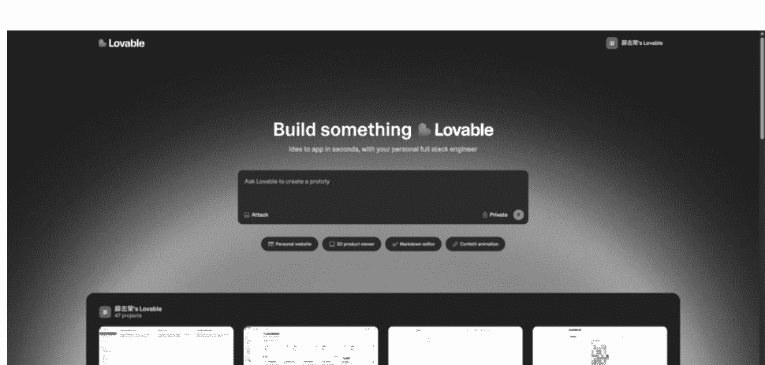

图2-1 Lovable界面

下面用两个游戏来验证效果。

1. 填写需求：“请帮我制作俄罗斯方块游戏。”
2. 点击生成，系统开始解析并产出代码，通常耗时2～5分钟。
3. 完成后会产出专属访问链接。
4. 直接在浏览器打开即可试玩。

令人意外的是，靠这句描述，几分钟内就能得到完整可玩的方块游戏，具备以下能力。

- 随机出现的方块；
- 旋转与移动操作；
- 行满消除机制；
- 完整的计分系统。

可扫码体验。


俄罗斯方块

再尝试制作超级玛丽横版，在 Lovable 中输入：“制作超级玛丽横版游戏。”同样能得到可玩版本，可扫码体验。


超级玛丽

对比两个结果会发现，方块游戏的实现更完整、更贴合预期，而玛丽版本虽具备基础玩法，却与经典形象有明显差距。同样是简短指令，为何效果差异如此之大？这正说明描述的精确度与信息量会直接影响生成质量。

若想提升结果，可以在描述里补充细节。比如制作待办清单，可以这样写：“做一个简洁美观的待办清单，支持新增任务、删除任务、标记完成，并按完成状态排序。”细节越明确，模型理解就越准。

### 2.1.3 预览与作品管理

Lovable 生成应用后，可以这样使用与维护。

#### 1. 预览功能

- 用 Preview 按钮直接在浏览器中查看；
- 支持实时交互与功能测试；
- 无需安装即可完整体验。

#### 2. 分享与部署

- 每个作品都拥有唯一长期可达的链接；
- 可直接分享给他人使用；
- 打开链接即可访问，无需安装。

#### 3. 项目管理

- 在个人主页查看全部项目；
- 支持设置标题和描述；
- 提供编辑、删除、复制等操作。

#### 4. 使用注意

- 免费档位限制作品数量；
- 目前不支持源码下载；
- 长期未访问的项目可能进入休眠；
- 建议保存重要项目的链接。

### 2.1.4 其他智能编程平台

除 Lovable 外，还有以下选择。

#### 1. V0 v0.dev

- 擅长生成网站与 Web 应用；
- 可尝试提示“一个简洁的个人作品集网站”。

#### 2. Claude claude.ai

- 擅长产出功能相对完整的应用；
- 可创建“一个记录每日心情的小应用”。

#### 3. 其他平台

- Bolt.new bolt.new；
- GitHub Copilot；
- Amazon Code Whisperer。

### 小白必记

- 智能开发要义：描述需求比写代码更关键
- 需求描述要点：清晰明确，突出重点
- 生成特征：迭代快，反馈即时
- 作品管理：善用标签，分类整理
- 分享部署：链接持久，即点即用
- 平台挑选：按需选择，各有优势

下一节将深入讲解如何构建更有效的提示，让模型更准确地实现创意。

## 2.2 理解提示工程的本质

上一节出现的差异很明显：同样是简短描述，方块游戏的质量明显高于玛丽游戏。原因何在？这正是提示工程要解决的问题。

提示工程不仅是技术手段，更是人与模型高效沟通的艺术。把模型想象成一位语言不通的朋友，提示工程就是帮助你与它交流的语言课。学好了这门语言，就能更准确表达意图，得到更理想的回应。

随着使用深入会发现，简短描述在复杂任务面前往往不够。比如只说“帮我做个网站”，模型可能只给一个极简页面，而非功能完善的博客系统。就像去餐厅只说“我要吃饭”，服务员无法判断你想吃什么、口味如何、有无忌口。

提示工程之所以关键，主要有三点。

1. 提升效率：好的提示能让模型一次到位，减少反复沟通，类似一份详细的工作说明。
2. 提高质量：精准的提示能引导模型产出更高质量的代码、文档或设计，类似给厨师一份详尽的菜谱。
3. 激发创新：掌握技巧后可引导模型探索更多可能性，像导演引导演员发挥最佳表现。

本节将从核心概念到实践方法，帮助你从“会用”迈向“善用”。

### 2.2.1 简易指令与系统化提示的差异

不同难度任务适合不同提示方式，简单任务一句话即可，复杂任务则需要系统化提示。

#### 1. 何时用简易提示

任务明确、无歧义时足够，例如。

- 直接查询：“现在几点？”“今天天气如何？”
- 简单创意：“讲个笑话”“写一句问候语”
- 基础知识：“Python 是什么语言？”

之前“给我做一个俄罗斯方块游戏”效果不错，是因为方块游戏规则大众共识度高，下落、旋转、消除行等机制几乎没有歧义。

#### 2. 何时用提示工程

任务复杂或需要特定格式时必不可少，例如。

- 复杂开发：“开发带用户管理的电商网站后台”
- 指定格式：“以表格形式分析近五年销售趋势”
- 多步骤问题：“分析这段代码的性能瓶颈并给出优化方案”

回到游戏例子，“给我做一个超级玛丽的横版游戏”看似简单，实则包含角色动作、敌人、关卡、道具等大量细节，简短描述难以覆盖，因而结果不理想。

#### 3. 两种方式的核心差异

表2-1 简单句提示与提示工程的具体差异

| 方面 | 简单句提示 | 提示工程 |
| :--- | :--- | :--- |
| 适用场景 | 日常查询、简单任务 | 复杂项目、专业工作 |
| 用户投入 | 低，即时性强 | 高，需规划思考 |
| 输出质量 | 基本满足，可能有偏差 | 高度定制，准确性高 |
| 迭代需求 | 可能需多次尝试 | 一次成功概率更高 |
| 示例 | “写一个冒泡排序” | “实现冒泡排序，含时间复杂度分析并处理边界情况” |

#### 4. 编程领域的对比

简易提示：

帮我写一个计算器程序

可能得到命令行基础计算器，仅支持加减乘除。

提示工程：

请用 JavaScript 开发一个网页计算器：

1. 支持四则运算和百分比
2. 包含历史记录
3. 支持科学计算模式
4. 响应式界面，适配移动端
5. 支持键盘快捷键
6. 代码遵循 ES6 并附详细注释

由此可得到功能完善、结构清晰的专业计算器。

#### 5. 细节的惊喜

即使是简单任务，加一点细节也能显著提升质量。

简易版：“给我一个俄罗斯方块游戏”

改进后：“给我一个俄罗斯方块游戏，含分数系统和难度递增”

微小调整即可让成品从基础版变成立即可用的体验。说明明确核心要素对结果影响很大。

### 2.2.2 高质量提示的构建原则

提示的质量决定输出的质量，像做菜需要食谱，写提示也需要遵循原则。

#### 1. 明确任务原则

点餐时只说“我想吃点东西”会让人困惑，说“我要一份红烧牛肉面，不要辣”就清晰多了。对模型也一样，必须明确告诉它要做什么。

反面：

帮我处理这些数据

正面：

请对这份销售数据分析，计算每月销售额增长率，并找出销售额最高的三个品类

明确任务是第一步，避免模糊表述。若回到游戏例子，可改进为。

反面：

给我做一个超级玛丽的横版游戏

正面：

请开发一个横版超级玛丽游戏，包含以下核心功能。

1. 角色可奔跑、跳跃、踩踏敌人
2. 包含问号砖块、金币收集、蘑菇道具
3. 至少一个完整关卡，有起点和终点旗杆
4. 具备基础音效和背景音乐

#### 2. 提供输入与上下文原则

医生需要症状和病史才能诊断，模型也需要足够信息才能给出好答案。

例如让模型写经济分析，可这样给上下文。

请基于以下信息分析中国当前经济形势。

- 过去两季度 GDP 增长率分别为5.3%和4.9%
- 失业率约5.2%
- 消费者信心指数从102降至98
- 房地产销售额同比下降15%
- 出口增长7.8%，进口增长5.2%

请从消费、投资、进出口三方面分析，并预测未来半年走势。

提供数据和背景后，分析才更有价值。

#### 3. 指定输出格式原则

设计海报时不说明尺寸和风格，结果往往不符预期。指定格式能让模型输出更规范。

示例：

请将以下会议内容整理成会议纪要，要求。

1. 用表格列出参会人员和缺席人员
2. 用项目符号列出主要议题，不超过5点
3. 每个议题的决议用粗体标注
4. 最后加入“下一步行动”，列出任务和截止日期
5. 总字数控制在500字内

会议记录文本如下。

明确格式后，输出更结构化易读。

#### 4. 结构化描述原则

复杂需求应分段说明，像写作文需要分段。

功能描述

开发学生信息管理系统的登录模块

技术要求

- 前端：React + TypeScript
- 后端：Node.js + Express
- 数据库：MongoDB

具体功能

1. 账号密码登录
2. 手机验证码登录
3. 记住登录状态

安全要求

- 密码加密存储
- 防止暴力破解
- 记录登录日志

结构化后需求清晰，模型更容易准确理解。

#### 5. 迭代优化原则

写提示像写文章，很少一次完美。迭代优化通过多次修改提升效果。

第一版：

帮我做个计算器

第二版：

用 Python 写一个可进行加减乘除的计算器程序

最终版：

请用 Python 开发计算器程序。

功能要求：

1. 支持四则运算
2. 支持小数点计算
3. 支持清除和退格

技术要求：

- Python 3.8+
- 图形界面，使用 tkinter
- 代码含详细注释

异常处理：

- 除零错误
- 非法字符输入
- 计算范围超限

从模糊到具体，质量逐步提升。

### 2.2.3 进阶提示技巧

掌握基础后，可尝试更进阶的方法。

#### 1. 角色扮演提示

让模型扮演特定角色，可获得更专业的视角。

请你扮演一名拥有10年经验的高级工程师，专精性能优化。请审查以下代码，指出性能瓶颈并给出具体优化建议。

```
[代码片段]
```

重点关注。

1. 时间复杂度
2. 内存使用效率
3. 并发处理方式
4. 算法选型合理性

角色设定后，回答更贴合专业水准。

#### 2. 思维链技术

引导模型展示推理过程，提升透明度和可靠性。

请逐步思考并解答。

小明有15个苹果，给小红3个，从小李得到5个。然后把剩下的平均分给4个朋友，自己留2个。每个朋友能得到几个？

请按步骤分析。

1. 计算小明最终苹果数
2. 计算可分配总数
3. 计算每人数量
4. 检查答案合理性

这样既有结果，也有过程。

#### 3. 批判性思维提示

鼓励模型评估自己的输出，减少偏见。

请分析人工智能在医疗领域的应用前景。

回答后，请评估你的分析可能存在的问题。

1. 是否过于乐观或悲观
2. 是否忽略重要风险
3. 是否考虑伦理和隐私
4. 是否有未经证实假设

再给出更平衡的分析版本。

这种方式能得到更客观全面的结论。

#### 4. 控制输出确定性

不同任务需要不同程度的创造性或准确性，可通过提示控制。

创意任务：“请发挥创造力，构思5个市场上尚未出现的独特有趣手机应用创意，不必考虑技术可行性。”

### 2.2.4 提示词的迭代打磨法

前面讲过如何搭建高质量指令。实际操作中与写作相似，很少有人能一次写到理想状态。下面介绍如何借助模型自身能力把指令越用越准。

把模型当作训练伙伴思路很直观。初学者写东西常会卡住，有教练点评后水平会迅速提升。打磨指令也一样，让模型给出反馈并反复迭代，既能更快掌握工程化要领，也能明显提速。从一段简短表述到一套完整方案，本质上都是迭代升级，理解这个路径，沟通效率就能系统化提升。

#### 1. 优化流程拆解
优化指令和调菜谱一样，都要按流程走。具体可以这样操作。

1) 草稿起步
先写一个基础版指令，像先搭出菜谱框架。重点不在完美，而在把核心诉求讲清楚。

2) 让模型做诊断
可以这样提问：
请评估下面这条指令的优劣：
[你的指令内容]
主要看：
1. 表达是否够清晰
2. 是否遗漏关键信息
3. 结构是否合理
4. 可改进之处有哪些

3) 融合建议改写
结合模型的反馈对指令进行修改完善，相当于按试吃意见调整口味。

4) 现场验证
把改完的指令实际跑一次，看模型产出是否符合预期。

5) 循环打磨
效果仍不理想就继续循环，直到满意为止。

#### 2. 实战案例：网站开发指令的演进
用一个真实例子看迭代效果。

第一版 过于简略：
制作一个博客站点。

第二版 补充了基础信息：
用 React 搭建博客站点，需要文章展示和评论功能。

第三版 更完整专业：
请构建一个博客站点。
##### 技术选型：
- 前端框架：React 18
- 样式方案：Tailwind CSS
- 数据管理：Redux
##### 功能清单：
1. 文章列表与详情页
2. 评论系统
3. 分类与标签
4. 响应式适配
##### 开发规范：
- 使用 TypeScript
- 遵循 React 最佳实践
- 包含完整的错误处理

从演变可见，指令正从模糊走向清晰、从简陋走向专业。每一次迭代都在让需求表达更准确。

回看开头的游戏例子，就能理解为什么“实现经典下落拼块游戏”比“实现知名平台跳跃游戏”更容易拿到可用结果。前者机制简单明确，即便描述简短模型也能抓住核心；而后者是复杂的横版闯关，元素繁多，没有细节很难把握。

#### 3. 如何判断优化是否成功
可以从以下维度自检：
- 模型的回复是否更贴合预期；
- 来回沟通的轮次是否减少；
- 输出内容质量有没有提升；
- 整体开发耗时是否缩短。

### 小白必记
- 轻量需求用简短指令，重度需求才上工程化方案
- 工程化本质是人与模型高效协作的艺术
- 核心在于目标明确、上下文充足、结构分明、持续打磨
- 进阶手段包括角色设定、思维链、批判性自检、确定性控制
- 优化闭环是：起草初稿、请求诊断、按反馈改写、实测效果、再迭代
- 评估看点：结果是否符合预期、沟通次数是否下降、质量是否提高、时间是否节省
- 复杂需求建议分类呈现，清晰度更高
- 设定角色能获得更专业的视角
- 思维链可让模型展示推理过程，提升可信度
- 鼓励模型自我质疑，答案会更平衡
- 从简到繁逐步完善是质量提升的关键
- 前期多花时间构建指令，后期修改成本会大幅下降

掌握这些原则和技巧，就能更好地引导模型产出符合预期的内容，清晰判断何时用简短指令、何时需要投入更多精力设计工程化方案，从而在效率与质量之间找到平衡。下一节将讨论如何用这些技巧构建更复杂完善的产品架构和文档。

### 2.3 从想法到代码：三种落地思路

在模型辅助开发时代，把想法落地成代码变得极其简单。本章介绍三种不同路径，从快速验证到完整规划，帮助你挑选最合适的方式。无论是想先验证灵感，还是要做完整系统，这些方法都能提升开发效率。

### 2.3.1 极速验证：单句启动开发
有时候灵感来得很快，想立刻看到代码。传统流程要先写文档、画原型，现在可以直接用一句描述告诉模型，它就能生成可运行的原型。

#### 1. 单句需求的构成
就像跟朋友描述一个 App 的想法，对模型也要简洁直接。一条好单句应包含两个要素：产品形态和要解决的痛点。

例如：
> 请生成一个学习计划管理工具，可以让用户创建学习目标、记录学习时长，并生成学习报告。

这句话说明了：
(1) 产品形态：学习计划管理工具；
(2) 解决的痛点：帮助用户管理学习目标和进度。

输入后，模型会立刻给出基础代码框架，像是资深程序员听完想法后迅速搭出一个能跑的版本。

#### 2. 单句效果与模型平台能力的关联
上一节的例子显示，同样是单句，“给我做一个经典拼块游戏”和“给我做一个知名平台跳跃游戏”结果差异很大。差异不仅来自需求复杂度，还取决于所用大语言模型和平台的能力。

1) 模型差异带来的影响
不同模型处理简短提示的能力不同。
- 高阶模型 如Claude 3.7、DeepSeek r1、GPT-o3等：能从简短提示推断更多上下文，补全隐含需求。
- 中阶模型：需要更明确的指引，对模糊提示理解有限。
- 基础模型：难以理解模糊的单句需求，容易跑偏。

2) 智能体扩展的关键作用
像 Lovable、V0、Cursor 等现代平台配备了强大的智能体，能自动把单句需求扩展成完整提示，大幅提升输出质量。

用户输入："给我做一个经典拼块游戏。"
智能体内部可能的处理如下。
1. 判断类型：游戏开发——下落拼块
2. 提取要素：方块下落、旋转、消除、计分
3. 构建完整提示。
> "请开发一个下落拼块游戏，包含以下功能。
> - 方块随机生成和下落
> - 方块旋转和移动控制
> - 行消除机制和计分系统
> - 游戏结束判定
> - 基础UI界面和操作指南
> 请使用HTML/CSS/JavaScript实现，确保代码结构清晰……"
这就是为什么同样是一句话，在有强智能体支持的平台上效果更好。拼块游戏之所以成功，部分原因是智能体自动把简单需求补全成了详细提示。

3）如何挑选平台
- 有强大智能体的平台：适合用单句需求，省时；
- 智能体弱或没有的平台：需要自己写更详细的提示。

#### 3. 从单句到代码原型
以学习计划管理工具为例，在高阶模型或强智能体平台上，单句需求可能生成如下结构。
```javascript
/**
 * 学习目标类
 * 用于表示单个学习目标及其进度信息
 */
class LearningGoal {
    /**
     * 创建一个新的学习目标
     * @param {string} title - 学习目标的标题
     * @param {number} targetHours - 目标学习时间（小时）
     */
    constructor(title, targetHours) {
        this.title = title;                     // 目标标题
        this.targetHours = targetHours;         // 计划学习总时长（小时）
        this.completedHours = 0;                // 已完成学习时长（小时）
        this.isCompleted = false;               // 是否完成目标
        this.createdAt = new Date();            // 创建时间
        this.lastStudyDate = null;              // 最后一次学习的时间
    }
}

/**
 * 学习计划管理类
 * 负责管理多个学习目标，提供添加目标和记录学习时间的功能
 */
class LearningPlanManager {
    /**
     * 创建一个新的学习计划管理器
     */
    constructor() {
        this.goals = [];                       // 存储所有学习目标的数组
    }

    /**
     * 添加新的学习目标
     * @param {string} title - 学习目标的标题
     * @param {number} targetHours - 目标学习时间（小时）
     * @returns {LearningGoal} - 返回创建的学习目标对象
     */
    addGoal(title, targetHours) {
        const goal = new LearningGoal(title, targetHours);
        this.goals.push(goal);
        return goal;
    }

    /**
     * 记录特定学习目标的学习时间
     * @param {number} goalIndex - 目标在 goals 数组中的索引
     * @param {number} hours - 要记录的学习时间（小时）
     * @throws {Error} - 如果目标不存在则抛出错误
     */
    recordStudyTime(goalIndex, hours) {
        const goal = this.goals[goalIndex];
        if (!goal) {
            throw new Error('学习目标不存在');
        }

        goal.completedHours += hours;          // 累加学习时间
        goal.lastStudyDate = new Date();       // 更新最后学习时间

        // 检查是否已完成目标
        if (goal.completedHours >= goal.targetHours) {
            goal.isCompleted = true;
        }
    }
}
```

#### 4. 实操建议
1）评估模型和平台
- 先测平台的智能体能力；
- 高阶平台可尝试简短提示；
- 基础平台需准备更详尽的提示。

2）需求描述要具体
- 明确功能的输入输出；
- 点出核心业务流程；
- 提供必要的业务规则。

3）保持简洁直接
- 一次只描述一个主要功能；
- 避免堆砌条件限制；
- 用日常语言表达。

### 小白必记
- 单句要说清产品形态和核心痛点
- 高阶模型或强智能体平台更适合单句需求
- 用生活化语言描述专业需求更易理解
- 先做核心功能，避免过度设计
- 代码要清晰易懂，方便后续扩展
- 预留扩展空间，便于迭代开发
- 若单句效果不佳，及时转向更详细的工程化指令

### 2.3.2 边想边做持续迭代
学会用单句快速出原型后，会发现想法往往在开发中不断变化。就像画画时随着创作调整构图，这时就需要更灵活的方式——边想边做。

在编程里这叫敏捷开发，像一个会进化的生命体，能随时根据新想法调整。下面看怎么用模型实现。

#### 1. 与模型对话式开发
想象你和一个经验丰富的程序员搭档，随时交流、快速调整。用模型也一样，通过持续对话完善程序。

仍以学习计划管理工具为例。
1）第一轮对话：实现基础功能
请帮我实现一个最基础的学习计划管理功能，需要能添加学习目标和记录学习时间。
2）第二轮对话：增加新特性
现在想加上数据统计功能，能够展示每周的学习时间分布。
3）第三轮对话：优化体验
可以加一个提醒功能吗？当用户连续3天没有学习时发出提醒。

好处在于：
- 能立刻看到实际效果；
- 开发方向可随时调整；
- 功能逐步完善；
- 问题能及时发现解决。

#### 2. 敏捷开发的具体步骤
1）确定最小可用版本
先实现最核心的功能，像盖房子先搭骨架。学习计划管理器的核心就是“添加学习目标”和“记录学习时间”。
2）快速迭代优化
有了基础后像滚雪球一样逐步添加功能，每次加一个小功能并验证可用后再继续。
3）持续收集反馈
开发中要频繁测试使用，像给在建房子做质检，发现问题就调整，确保每个功能好用。

#### 3. 实际案例：学习计划管理器的迭代开发
第一轮迭代：基础功能。
```javascript
/**
 * 学习计划类
 * 用于管理用户的学习目标和记录学习情况
 */
class LearningPlan {
    /**
     * 创建一个新的学习计划
     */
    constructor() {
        this.goals = [];            // 存储学习目标的数组
    }

    /**
     * 添加新的学习目标
     * @param {string} title - 学习目标的标题
     * @param {number} targetHours - 目标学习时间（小时）
     */
    addGoal(title, targetHours) {
        this.goals.push({
            title,                  // 目标标题
            targetHours,            // 计划总时长
            completedHours: 0,      // 已完成时长
            lastStudyTime: null     // 最后学习时间
        });
    }

    /**
     * 记录特定目标的学习时间
     * @param {number} goalIndex - 目标在 goals 数组中的索引
     * @param {number} hours - 要记录的学习时间（小时）
     */
    recordStudy(goalIndex, hours) {
        if (this.goals[goalIndex]) {
            this.goals[goalIndex].completedHours += hours;    // 累加学习时间
            this.goals[goalIndex].lastStudyTime = new Date(); // 更新最后学习时间
        }
    }
}
```
第二轮迭代：添加统计功能。
```javascript
/**
 * 学习计划类（增强版）
 * 添加了数据统计和报告功能
 */
class LearningPlan {
    // ... 原有代码 ...

    /**
     * 生成每周学习报告
     * 统计所有学习目标的总时长和各目标的完成进度
     * @returns {Object} 包含总学习时间和每个目标进度的报告对象
     */
    getWeeklyReport() {
        const report = {
            totalHours: 0,          // 总学习时长
            goalProgress: []        // 各目标的进度数组
        };

        // 遍历所有学习目标，计算总时间和进度
        this.goals.forEach(goal => {
            // 累加总学习时间
            report.totalHours += goal.completedHours;

            // 计算并记录每个目标的完成百分比
            report.goalProgress.push({
                title: goal.title,
                progress: (goal.completedHours / goal.targetHours) * 100
            });
        });

        return report;             // 返回完整的报告对象
    }
}
```

#### 4. 注意事项
1) 保持代码整洁
每次加新功能都要维持结构清晰。东西越多越要像整理房间一样保持整洁。
2) 做好版本管理

留痕与复盘，让迭代更可控

用 Git 这类代码版本系统把每次改动都存下来，就像给开发过程按快照，任何时间点都能迅速拉回历史状态。

3）趁热把文档写出来

把关键的决策点和能力说明及时记下来，好比给房子画施工图，后续查看、交接和维护都会顺畅很多。

### 小白必记

- 迭代心法：快节奏推进，边做边进化
- 迭代思路：先搭起核心能力，再逐步填补细节
- 代码归档要求：改动即刻提交，每次变更都留痕
- 验证准则：开发与校验同步进行，别堆到最后
- 文案更新原则：随手记录，保持说明通透易懂
- 反馈闭环：快速响应，敏捷修正
- 版本标记技巧：按阶段给关键节点打标签

## 2.3.3 系统规划：完整需求文档开发

项目复杂度上去后，一句话的需求就显得捉襟见肘。跟盖房子必须有详细蓝图一样，规模较大的软件也需要一份完整的需求说明。实践中常把项目的 README.md 作为需求文档的载体来管理。

### 1. README.md的标准结构

一份清晰的 README 通常由以下几大板块构成。

# 项目名称

## 项目简介

[用一两句话说明这个项目要做什么、解决什么痛点]

##### 目标用户

- 这套产品面向谁？
- 他们当前有哪些困扰？
- 典型使用场景是什么？

## 功能规格

- 核心能力：必须具备的关键点
- 差异化亮点：跟竞品的区隔
- 技术架构：采用的技术栈

## 开发规划

- 预期周期：整体需要的时间
- 里程碑：各阶段要交付的内容
- 技术选型：使用的语言与工具

## 项目资源

- 设计资料：界面与交互稿
- API 说明：接口定义和使用方式
- 测试用例：功能校验的标准

下面以学习计划管理应用为例，演示如何把上述框架落地成实际文档。

```
# 学习计划管理器

## 项目简介
这是一个帮助学习者制订计划、记录进度、生成报告的学习管理工具。
##### 目标用户
- 想要系统学习但缺乏规划的学生
- 需要追踪学习时间的自学者
- 希望提高学习效率的职场人士

## 功能规格
- 核心功能
    1. 创建和管理学习目标
    2. 记录每日学习时间
    3. 生成学习进度报告

- 创新特性
    1. AI 学习建议
    2. 智能时间规划
    3. 数据可视化报告

## 开发规划
第一阶段（2 周）：基础功能开发
第二阶段（2 周）：AI 功能集成
第三阶段（1 周）：测试和优化
```

### 2. 使用LLM生成完整的产品架构

在 AI 辅助开发的阶段，既可以手工撰写需求，也可以借助大模型快速产出专业水准的架构方案，能把创意到落地的周期压得很短。

#### 1) 生成完整架构图的重要性

让大模型输出软件架构时，完整性比零散产出更关键。

（1）整张蓝图一次输出：架构图要一次成型，不要拆成多张生成。碎片化产出很难形成全局观，也不利于后续开发推进。

（2）分块产生的风险。

- 风格打架：不同片段可能遵循不同设计思路；
- 关联模糊：单元间关系不清甚至冲突；
- 重复覆盖或关键空缺：出现功能重叠或重要点遗漏。

（3）保证完整的做法：

- 选用能力更强的生成模型，例如 Claude 3.7、GPT-o3 等；
- 若产出残缺或被拆分，要求模型重新整合为一张完整版本；
- 适度调整指令，以确保输出的完整度。

#### 2）选择合适的LLM模型

实测来看，不同模型的架构设计能力差距明显。

- 顶级模型如 Claude 3.7、GPT-o3 生成的方案最全面专业；
- 中端模型在复杂产品上容易产出不完整的图表；
- 通常官方付费渠道的模型表现更稳定。

#### 3）高效的Prompt模板

下面是一份经过优化的指令模板，可用来驱动大模型生成完整的软件产品架构设计。

现在你是产品架构师，我要设计一个 { 产品类型 }。请基于最小可行产品和最小开发成本原则，给出能力单元方案。

**重点提示：**

- 先呈现整体框架和核心业务逻辑，技术实现细节暂不展开
- 首页与主流程是设计重点，引导用户快速体验核心价值
- 遵循 “先体验后注册” 原则，让用户无需注册即可体验核心能力，降低门槛，尽量在最短时间传递价值，减少流失
- 从用户核心需求出发，而非技术实现出发

**重要度分级规则：**

- 5 分：不可或缺的能力，缺失则基础体验不成立，必须在最小可行产品中实现
- 4 分：关键能力，大幅提升产品价值，应尽早实现
- 3 分：有价值能力，能改善体验，可在最小可行产品后期加入
- 2 分：次要能力，等用户基础形成后再考虑
- 1 分：锦上添花能力，产品成熟后再添加

**能力单元设计要求：**

1. 明确划分：
    - 交互面：用户可见的交互界面
    - 部件层：可复用的 UI/功能单元
    - 业务流程层：核心业务逻辑
    - 数据层：关键数据结构与存储
2. 列出所有关键页面
3. 详细说明每个页面包含的能力单元和部件
4. 遵循 MECE 原则，相互独立且完全覆盖
5. 指出哪些单元可作为通用部件在多页面复用

**每个单元需详述：**

1. 单元名称与简要说明
2. 所属类型
3. 主要用途与典型场景
4. 与其他单元的关系与依赖
5. 重要度评分及理由
6. 输入与输出
7. 所在页面及复用情况
8. 确保 MECE 完整，并用 Mermaid 流程图展示单元关系

**Mermaid 图要求：**

1. 使用 flowchart 与 subgraph 表达复杂关系
2. 只包含重要度 4 分及以上的核心单元
3. 用嵌套 subgraph 清晰展示页面内具体单元
4. 展示用户业务流程与核心价值路径
5. 标注数据流向与操作路径，突出首页起点的核心旅程
6. 标注可复用部件在各页面的出现
7. 术语简洁明了

**页面与部件表示：**

- 每个主要页面单独建一个 subgraph
- 页面内用嵌套 subgraph 容纳其下部件与功能

**补充说明：**

请结合 { 产品类型 } 的特殊考量，如用户交互模式的特殊性、特定平台的限制与优势等。

**输出格式：**

1. 开头使用 markdown 原始字符串包裹
2. 代码片段用 ``` 包裹输出原始字符串
3. 流程图用 mermaid 包裹输出原始字符串
4. 使用中文及对应标点
5. 不输出无关信息

该模板兼顾角色设定、最小可行产品原则、重要度分级、分层架构与 MECE 原则，通用性强。

（1）网页应用：电商、内容管理系统等
（2）移动应用：社交、生产力工具等
（3）VR/AR 体验：游戏、教育培训等
（4）智能硬件界面：智能家居控制、工业监控等
（5）桌面软件：设计工具、开发环境等

模板强调交互面、部件层、业务流程层与数据层的分离，适用于各类产品。以下是在 Claude 3.5 上使用该模板生成的智能语音音箱最小可行产品架构示例。

# 智能语音音箱产品架构设计（MVP 版）

## 产品整体框架

智能语音音箱的核心价值是通过语音交互提供信息查询、音乐播放、智能家居控制等便捷服务。遵循最小可行产品与最小成本原则，聚焦能体现核心价值的最小可用版本。

## 核心业务逻辑

用户先说唤醒词激活设备，再发出语音指令，系统识别并执行，最后以语音或其他方式反馈结果。整个链路需流畅衔接，保证体验。

## 功能模块设计

### 交互面

#### 1. 语音交互面
单元类型：交互面。用户主要语音交互入口。依赖语音识别、语音合成、意图理解。重要度 5 分，核心无可替代。输入为用户语音，输出为语音反馈或操作结果。位于主界面。

#### 2. 指示灯反馈面
单元类型：交互面。通过灯光颜色与状态提示设备状态。关联设备状态管理。重要度 4 分。输入为状态信号，输出为灯光显示。位于物理设备。

#### 3. 物理按键面
单元类型：交互面。提供音量、静音、唤醒等物理控制。关联设备控制。重要度 4 分。输入为按键操作，输出为功能执行。位于物理设备。

#### 4. 移动应用设置面
单元类型：交互面。通过手机完成配置与高级设置。关联 Wi-Fi 配网、账户管理、设备管理。重要度 4 分。输入为配置操作，输出为配置结果。位于移动应用。

### 部件层

#### 5. 语音识别单元
部件层，将语音转为文本。为意图理解提供输入。重要度 5 分。输入语音信号，输出文本。可复用于所有语音输入场景。

#### 6. 语音合成单元
部件层，将文本转为语音。为各功能提供语音反馈。重要度 5 分。输入文本，输出语音。可复用于所有语音输出场景。

#### 7. 唤醒词检测单元
部件层，待机时识别唤醒词并触发后续流程。重要度 5 分。输入环境音频，输出唤醒信号。常驻运行。

#### 8. 音频播放单元
部件层，控制音频播放。接收音乐服务与语音合成输出。重要度 5 分。输入音频流，输出声音。用于音乐与语音反馈。

#### 9. Wi-Fi 配网单元
部件层，协助设备连接网络。重要度 5 分。输入 Wi-Fi 凭证，输出连接状态。主要用于移动应用设置。

### 业务流程层

#### 10. 意图理解单元
业务流程层，解析指令意图并路由。接收语音识别输出，调用各功能。重要度 5 分。输入文本指令，输出结构化意图。

#### 11. 音乐服务单元
业务流程层，提供播放、列表、推荐等。调用音频播放，依赖云端资源。重要度 5 分。输入音乐请求，输出音频流。

#### 12. 信息查询单元
业务流程层，提供天气、新闻、百科查询。调用语音合成，依赖知识库。重要度 4 分。输入查询请求，输出结构化信息。

#### 13. 时间管理单元
业务流程层，提供闹钟、倒计时、提醒。调用音频播放与语音合成。重要度 4 分。输入时间设置请求，输出提醒触发。

#### 14. 设备状态管理单元
业务流程层，监控并控制设备状态。关联指示灯与语音界面。重要度 4 分。输入各单元状态信号，输出整体状态。

### 数据层

#### 15. 用户配置存储单元
数据层，保存音量、偏好、账户等个性化设置。为各功能提供配置。重要度 4 分。输入配置更新，输出配置数据。后台存储。

## 产品功能模块关系图（Mermaid）

```
flowchart TD
    subgraph 设备硬件
        subgraph 语音交互界面
            A1 [ 唤醒词检测模块 ]
            A2 [ 语音识别模块 ]
            A3 [ 语音合成模块 ]
            A4 [ 音频播放模块 ]
        end
    end

    subgraph 物理界面
        B1 [ 指示灯反馈界面 ]
        B2 [ 物理按键界面 ]
    end

    subgraph 移动应用
        C1 [ 移动应用设置界面 ]
        C2 [ Wi-Fi 配网模块 ]
    end

    subgraph 核心业务逻辑
        D1 [ 意图理解模块 ]
        D2 [ 音乐服务模块 ]
        D3 [ 信息查询模块 ]
        D4 [ 时间管理模块 ]
        D5 [ 设备状态管理模块 ]
    end

    subgraph 数据存储
        E1 [ 用户配置存储模块 ]
    end

    %% 核心用户流程
    A1 -->| 唤醒 | A2
    A2 -->| 语音转文本 | D1
    D1 -->| 路由请求 | D2
    D1 -->| 路由请求 | D3
    D1 -->| 路由请求 | D4
    D2 -->| 音乐结果 | A4
    D3 -->| 查询结果 | A3
    D4 -->| 提醒内容 | A3
    A3 -->| 文本转语音 | A4

    %% 状态反馈
    D5 -->| 状态变化 | B1
    B2 -->| 物理控制 | D5

    %% 配置流程
    C1 -->| 设置配置 | E1
    C1 -->| 网络设置 | C2
    E1 -->| 读取配置 | D1
    E1 -->| 读取配置 | D2

    %% 横向关系
    D5 -->| 状态通知 | D1
    D5 -->| 播放状态 | D2
    D2 -->| 状态更新 | D5
```

## 智能音箱开发的特殊注意点

### 交互形态和常规 App 的区别

#### 只有声音没有画面
多数音箱没有显示部件，沟通全靠听觉，回复要短小清晰，过长的播报容易让用户疲惫。

#### 客厅级多人口使用
设备常摆在共享空间里，会被不同人轮流唤醒，需要做用户区分与隐私边界保护。

#### 现场噪音影响
真实环境嘈杂，靠麦克风阵列加降噪算法才能在各种分贝下稳定抓取指令。

#### 自身声音回灌
播放时声波会进入拾音单元，必须做回声消除，避免把自己的输出误判成用户输入。

### 硬件平台带来的限制与机会

#### 算力存储紧张
芯片算力和内存有限，模型与代码都要轻量化，资源占用尽量压缩。

#### 网路依赖强
大部分能力要联网，网络抖动时要有降级方案，保证基础可用。

#### 隐私敏感度高
持续拾音容易引发顾虑，要给出透明说明，优先本地唤醒词检测减少上传。

#### 先用后注册
查询天气、设定闹钟等基础服务可免账号使用，只有音乐账号同步等个性化场景才触发注册。

## MVP 分阶段落地思路

### 起步阶段的基础能力
- 唤醒词检测
- 基础语音识别与合成
- 简单信息查询如天气时间
- 基础音乐播放
- Wi-Fi 配网

### 中期体验打磨
- 意图理解能力提升
- 音乐内容供给扩充
- 时间管理功能加入
- 语音交互整体优化

### 后期功能扩张
- 智能家居操控
- 多设备联动
- 更高阶个性化
- 第三方服务接入

分步推进可快速上线验证市场需求，成本可控，后续再根据反馈做针对性迭代。智能音箱产品架构示意图见图2-2。

文中包含 Mermaid 代码段，若当前环境无法直接渲染，可复制到以下工具手动生成图形：

- Mermaid 转 Excalidraw 平台：https://mermaid-to-excalidraw.vercel.app/
- Mermaid 在线编辑器：https://mermaid.live/

若生成的图不完整或被拆分，影响理解与开发，可重新发起请求让模型再生成。该模板不仅输出架构图，还会补充模块的详细说明，具体包括：

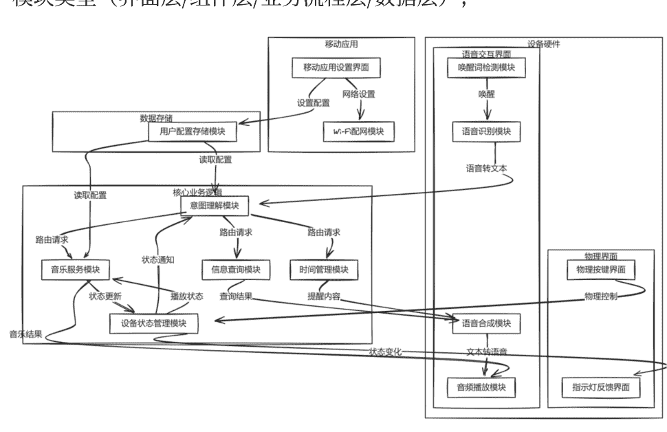

- 基于 MVP 原则的优先级评分；
- 模块间的关联与依赖；
- 输入输出内容；
- 各模块在不同界面中的使用情况。

这些信息对理解和落地开发至关重要。若对生成的架构不满意，可按以下方式调整。

1. 针对性反馈：明确指出要改的模块，例如“请调整用户认证模块，增加社交媒体登录功能”。
2. 优先级调整：要求变更功能优先级，例如“请将数据导出功能的优先级从2分提升到4分”。
3. 增加或删除模块：清楚说明新增或移除的需求，例如“请添加一个通知中心模块”。
4. 层级调整：请求变更模块层级，例如“将设置面板从界面层调整为组件层”。

通过迭代反馈，架构设计可逐步贴合产品愿景与开发需求。该模板的价值在于为各类产品提供结构化架构方案，帮助更清晰地规划开发路径。

另外，可直接把架构图复制给 Lovable 或 Cursor，让其基于图完成完整产品开发。以“每日打卡”应用为例，下方即为该 Prompt 生成的架构 Mermaid 代码和使用 Cursor 一次性生成的效果链接，感兴趣可自行体验。

```
flowchart TD
    subgraph "主界面 / 首页"
        A["主界面模块（5分）"]
        subgraph "主界面组件"
            A1["任务列表组件（5分）"]
            A2["打卡操作组件（5分）"]
            A3["数据可视化组件（4分）"]
            A4["日历组件（4分）"]
        end
        A -->|包含| A1
        A -->|包含| A2
        A -->|包含| A3
        A -->|包含| A4
    end

    subgraph "任务创建界面"
        B["任务创建模块（5分）"]
    end

    subgraph "历史记录界面"
        C["历史记录模块（4分）"]
        subgraph "历史界面组件"
            C1["任务列表组件（5分）"]
            C2["数据可视化组件（4分）"]
            C3["日历组件（4分）"]
        end
        C -->|包含| C1
        C -->|包含| C2
        C -->|包含| C3
    end

    subgraph "业务流程层"
        D["任务管理逻辑（5分）"]
        E["打卡业务逻辑（5分）"]
        F["统计分析逻辑（4分）"]
    end

    subgraph "数据层"
        G["任务数据存储（5分）"]
        H["打卡记录存储（5分）"]
    end

    %% 核心用户流程
    A -->|创建任务| B
    B -->|保存任务| D
    D -->|更新任务列表| A1
    A2 -->|触发打卡| E
    E -->|记录打卡| H
    H -->|提供数据| F
    F -->|更新统计| A3
    F -->|更新日历视图| A4
    A -->|查看历史| C

    %% 业务逻辑与数据层关系
    D <-->|读写任务数据| G
    E <-->|读写打卡记录| H
    F -->|读取打卡数据| H

    %% 组件复用关系
    A1 -.->|复用于| C1
    A3 -.->|复用于| C2
    A4 -.->|复用于| C3
```

每日打卡可扫码体验。

### 3. 如何管理需求文档


需求文档不是一成不变的，会随项目推进不断演进。就像盖房子会按实际情况调整图纸一样，下面给出一些管理建议。

#### 1) 版本控制
把文档托管在 Git 之类的版本控制系统，就像为文档拍了很多快照，随时可查看历史版本，了解演变轨迹。

#### 2) 文档评审
定期和团队一起检查文档，就像请专家验收施工进度，确保大家对需求理解一致。

### 4. 使用场景

完整的需求文档特别适合以下情形。

#### 1) 企业级应用开发
比如开发公司的人事管理系统，需要详细规划每个功能模块。

#### 2) 多人协作项目
多个程序员一起开发时，需要统一的参考标准。

#### 3) 长期维护的系统
项目需要长期运行，详尽文档能帮助后续维护者快速上手。

### 新手要点

- 需求文档原则：完整清晰，便于理解
- README.md 结构：项目说明要分门别类
- LLM 架构设计：使用强大的模型和优化的 Prompt 获取专业设计
- 版本控制要点：定期更新，记录变更
- 文档评审准则：团队共识，及时反馈
- 场景选择原则：项目规模决定文档深度
- 更新维护方法：持续迭代，同步代码
- 协作沟通技巧：文档先行，统一认知

## 2.3.4 开发模式怎么选

在了解了三种开发模式后，可能会问：“我的项目该用哪种？”这相当于选交通工具，要结合路程、路况和天气。下面分析每种方式的适用场景。

### 1. 方式对比

#### 1）快速验证

**特点如下。**
- 上线速度最快；
- 功能相对简陋；
- 适合个人尝试。

**适用场景如下。**
- 验证创意想法；
- 制作概念原型；
- 学习新技术时。

**注意事项如下。**
- 不适合复杂项目；
- 可能需要后期重构；
- 文档相对简略。

**模型与平台要求如下。**
- 需要高级大模型或具备强 Agent 能力的平台；
- 如：Claude 3.7、DeepSeek R1、Lovable、Cursor 等。

#### 2）持续迭代

**特点如下。**
- 灵活性最高；
- 快速响应变化；
- 产品持续改进。

**适用场景如下。**
- 创新型产品；
- 用户需求不明确；
- 需要快速试错。

**注意事项如下。**
- 需要良好的版本管理；
- 可能产生技术债务；
- 要及时整理文档。

**模型与平台要求如下。**
- 中高级大模型即可；
- 支持上下文记忆的对话系统更佳；
- 如：大多数现代 AI 编程助手。

#### 3）系统规划

**特点如下。**
- 规划最完整；
- 文档最详尽；
- 适合团队协作。

**适用场景如下。**
- 企业级应用；
- 多人协作项目；
- 长期维护系统。

**注意事项如下。**
- 前期投入较大；
- 变更成本较高；
- 需要严格管理。

**模型与平台要求如下。**
- 需要最强大模型；
- 具备完整架构设计能力；
- 如：Claude 3.7、GPT-3o、DeepSeek-R1 等高级模型。

### 2. 如何选择

可借助决策树辅助选择。

#### 1) 先考虑四个关键因素
- 项目规模：个人项目/小团队项目/大型项目；
- 时间紧迫度：非常紧急/一般/充裕；
- 需求明确度：非常明确/待探索/完全不明确；
- 模型和平台能力：基础/中级/高级。

#### 2) 然后根据答案来选择
- 如果你的回答是：个人项目+非常紧急+待探索+高级模型/平台，则选择“快速验证”方式。
- 如果你的回答是：小团队项目+一般+待探索+中高级模型/平台，则选择“持续迭代”方式。
- 如果你的回答是：大型项目+充裕+非常明确 +高级模型/平台，则选择“系统规划”方式。
- 如果只有基础模型/平台可用，则避免“一句话需求”，倾向于使用详细描述和手动提示工程。

### 3. 混合使用策略

实际开发中三种方式并非互斥，可按阶段组合。

#### 1）探索阶段
- 使用“快速验证”方式尝试不同想法；
- 快速验证技术可行性；
- 收集初步反馈。

#### 2）开发阶段
- 转向“持续迭代”方式；
- 逐步完善功能；
- 收集用户反馈。

#### 3）规模化阶段
- 补充“系统规划”文档；
- 规范化开发流程；
- 为团队协作做准备。

### 新手要点

- 方式选择原则：项目规模和模型能力共同决定开发方式
- 快速验证适用：创意验证和原型开发，需要高级模型/平台
- 持续迭代适用：创新产品和探索性项目，中高级模型即可
- 系统规划适用：企业级和团队协作项目，需要最强大的模型
- 混合策略技巧：不同阶段选择不同的方式
- 决策依据要点：规模、时间、需求明确度和模型能力
- 灵活应变原则：根据项目发展和模型表现调整方式

## 2.4 技术方案探索

创意成型后，需要探明合适的技术方案。对非技术背景的读者而言，技术选型如同学习新语言——不必精通细节，但要理解基本概念和用途。下面通过与 AI 对话的方式说明如何探索技术方案。

### 2.4.1 使用 LLM 生成技术架构图

在 2.3 一节介绍了如何利用大模型生成产品架构设计。接下来把产品架构转化为技术架构，就能明确所需的技术组件。就像建筑师先画整体方案，再细化工程图纸，技术架构图能帮助厘清各组件的技术需求。

#### 1. 从产品架构到技术架构的转换

产品架构回答“做什么”，技术架构回答“怎么做”。以 2.3 节的智能音箱为例，先有了功能模块和业务流程，现在要明确每个功能的技术实现。

转换时可借助大模型，例如提问：

> 帮我用 Mermaid 生成对应的技术架构图。

通过此类提问，大模型能把产品需求映射为具体技术组件并以 Mermaid 图呈现。如图 2-3 所示即基于前述智能音箱产品架构生成的技术架构图。


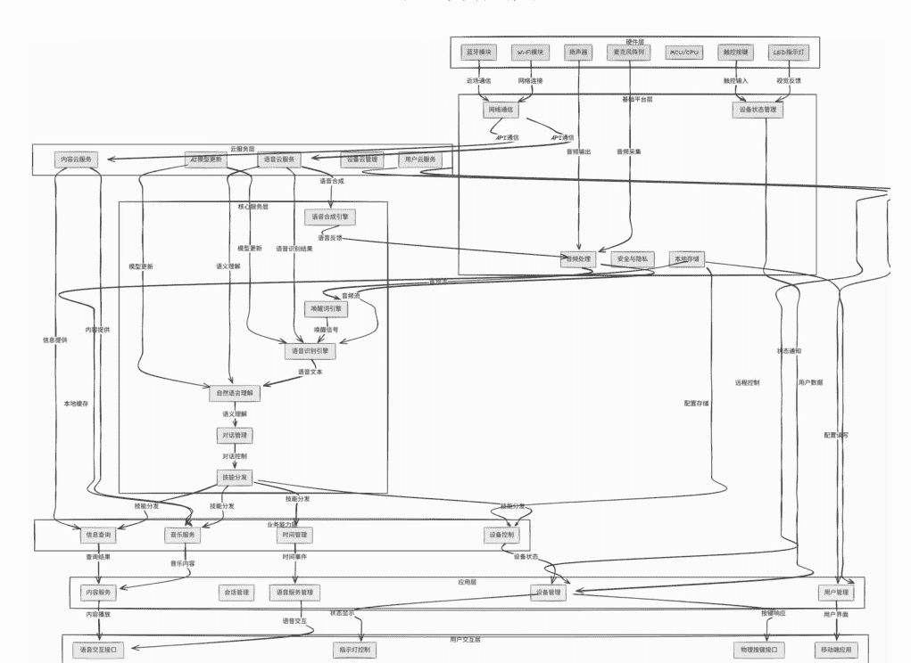

#### 2. 技术架构图的解读与应用

该技术架构图清晰展示了从硬件到云服务的各技术层级。

1. 硬件层：麦克风阵列、扬声器、指示灯等物理部件。
2. 基础平台层：负责音频处理、网络通信等底层功能。
3. 核心服务层：包含激活词检测、语音识别、自然语言理解等核心 AI 能力。
4. 业务能力层：具体功能模块，如音乐服务、信息查询等。
5. 应用层：统筹管理各服务与会话过程。
6. 用户交互层：与用户直接接触的界面部分。
7. 云服务层：提供后台支撑的云端服务。

各层间的箭头表示数据流向与依赖关系，有助于理解系统运行原理。

#### 3. 利用技术架构图指导学习和开发

对非技术背景读者，架构图可做到：

1. 明确学习重点：根据关键组件确定学习方向。例如关注语音识别，可重点学习 CORE2 语音识别引擎相关技术。
2. 建立系统认知：理解各部分如何协同工作。
3. 指导项目开发：按图逐层实现，确保组件正确集成。
4. 技术选型参考：针对每个组件咨询大模型哪些技术栈更合适。

### 新手要点

- 架构图生成原则：先有产品架构，再转化为技术架构
- 提示词设计要点：要求明确层级和组件之间的关系
- 架构层级解读：从硬件到云服务的完整理解
- 组件关联分析：理解数据流向和依赖关系
- 学习策略制定：根据架构图确定技术学习路径
- 技术选型准则：为每个组件选择最适合的技术方案
- 资源查找方向：针对架构中的每个技术点寻找资源
- 分步实现计划：按照层级和优先级安排开发计划

### 2.4.2 向 ChatGPT 或者 Cursor Ask 模式咨询技术选型

若未使用大模型生成技术架构图，或需针对架构中具体组件挑选技术实现，可向 ChatGPT 或 Cursor Ask 模式咨询。这如同装修时找顾问规划。选择技术方案时，AI 可充当技术顾问，帮助了解各技术特点。

描述技术需求需清晰有条理，好比看病向医生描述症状。一个好的技术需求描述应包含：

1. 产品定位：说明要开发何种产品。
2. 核心功能：列出最重要的 3～5 个功能点。
3. 使用场景：描述用户如何使用产品。
4. 性能要求：说明产品需要达到的技术标准。
5. 发展规划：预计用户规模和未来扩展需求。

下面是一个可直接复用的模板。

```
我正在开发一个 [ 产品类型 ]，主要功能如下。
1. [ 功能 1 ]（用简单的话描述这个功能）
2. [ 功能 2 ]（用简单的话描述这个功能）
3. [ 功能 3 ]（用简单的话描述这个功能）

使用场景：
- [ 具体描述用户是如何使用的 ]
- [ 预计有多少用户会使用 ]
- [ 对性能和体验的要求 ]

请用通俗的语言推荐合适的技术方案，并解释：
1. 每种技术的作用是什么
2. 为什么要用这个技术
3. 这个技术方案的优缺点
```

把需求讲透，模型才能给出对路的方案

> 我想做一个以图片为主的社交应用，功能大概是这样。
> 1. 用户能发图配文字，像发朋友圈一样
> 2. 能关注他人并点赞评论
> 3. 有互动时马上推送提醒
> 
> 使用情况：
> - 主要在手机 App 上用
> - 首年用户预估 1 万到 10 万
> - 图片要加载快，启动要顺滑
> 
> 请用大白话推荐技术选型并说明各自作用。

把需求描述到这个颗粒度，回答会立刻变精准。下面用生活化的比喻做示意。

**用户能看到的前端层**

- React：像乐高搭界面，组件可复用改动快；
- React Native：一套代码同时覆盖 App 与网页，省工省时；
- Tailwind CSS：快速给界面上色的工具，相当于给 App 穿衣服。

**在后台跑的服务端层**

- Node.js：处理用户请求的服务程序，像餐厅传菜的服务员；
- MongoDB：存放用户资料的文档型数据库，像超大电子档案柜；
- Redis：提升读取速度的缓存，像贴在桌面的便利贴。

**图片存储与分发**

- AWS S3：存放海量图片的云盘，像无限容量的网络相册；
- CloudFront：全球节点加速分发，像遍布各地的快递网点。

**实时互动**

- Socket.IO：负责即时消息的底层引擎，像聊天软件的心脏；
- Firebase：提供推送提醒，像手机自带的通知中心。

新手速记
- 提需求时功能要说明白，场景要落到实处
- 前端选型要以用户体验为先
- 后端架构要兼顾性能、扩容和维护成本
- 存储要平衡安全与访问效率
- 通信设计要保证实时与稳定
- 技术组合宁简洁可靠，不盲目追新
- 提前预留成长空间
- 花费按实际体量匹配

### 2.4.3 如何在 GitHub 淘到合适的开源项目

对新手来说 GitHub 就像程序员的社区，也是个藏书巨大的数字图书馆。别慌，下面讲怎么挑到合适的书。

#### 1. 基础检索方法

在 GitHub 找项目和在电商找商品思路差不多。

1. 打开 github.com，顶部有搜索框。
2. 输入项目类型关键词，比如“图片分享应用”。
3. 用右侧筛选器缩小范围，像网购筛选项。

举例找图片分享项目：
1. 搜索 image sharing app 或 photo sharing。
2. 左侧挑偏好的编程语言，比如 JavaScript。
3. 按 点赞数 排序，点赞数相当于商品的好评。

#### 2. 读懂项目页信息

每个仓库页都有关键身份标识。

##### 1) 基础数据
- Stars：相当于点赞，数字越高越受欢迎。
- Forks：被复制的次数，体现影响力。
- Watchers：持续关注的人数。

##### 2) 主题标签 Topics
- 位于简介下方，像商品标签。
- 蓝色标签标明技术或类型，如 react、web-app。
- 点进去能找到同类仓库。

##### 3) 语言构成
- 简介下方的彩色条。
- 像配料表，展示所用语言比例。
- 帮助判断技术栈。

#### 3. 看懂说明文档 README.md

README.md 相当于说明书，通常包括：

##### 1) 项目简介
- 这个项目用来干嘛；
- 解决什么痛点；
- 有没有截图或演示视频。

##### 2) 技术要点
- 用了哪些核心技术；
- 运行环境要求；
- 设计思路概述。

##### 3) 使用指南
- 安装启动步骤；
- 基本操作方式；
- 常见问题解答。

#### 4. 判断好坏

非技术人员可以从以下角度判断：

##### 1) 活跃度
- 点赞过千的通常比较可靠；
- 近半年有更新说明维护在线；
- 维护者是否及时回复 Issue。

##### 2) 文档完整度
- README 是否清晰全面；
- 是否提供截图或在线演示；
- 说明是否通俗易懂。

##### 3) 上手门槛
- 安装步骤是否简明；
- 是否有详细教程；
- 最好有在线演示。

#### 5. 实用小技巧

##### 1) 热门项目页
- 访问 github.com/trending；
- 展示当前最受关注的项目；
- 可按语言和时间筛选。

##### 2) 收藏
- 点仓库右上角 Star；
- 后续可在个人主页找到。

##### 3) 找相似
- 点击 Topics 标签；
- 找到同类仓库。

##### 4) 遇到问题
- 查看 Issues 页面；
- 看看是否有人遇到过类似问题；
- 可用英文提问。

关键回放
- 先看点赞靠前的仓库
- 阅读 README 重视介绍和使用
- 选择看更新频率和文档质量
- 解决难题先搜 Issues 再提问
- 及时 Star 方便以后查找
- 定期逛 Trending 抓热点
- 按需求筛选语言
- 评估文档看完整性和可读性

### 2.4.4 用 GitHub Copilot 找开源项目

想象在巨型图书馆里，有位智能顾问帮你挑书。GitHub Copilot 由 GitHub 与 OpenAI 联合打造的编程助手，就是这样一位顾问。它不仅能写代码，也能定位合适的开源项目。

官网为 https://github.com/copilot/。下面介绍如何借助它找项目。

#### 1. 两种对话方式

Copilot 提供两种交互形式，像在咨询台提问或在书架前请教。

##### 1) Copilot 对话模式

GitHub Copilot Chat模式界面如图2-4所示。

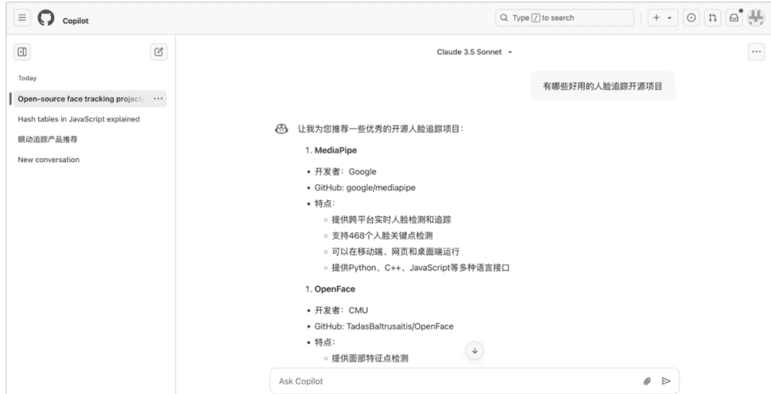

图2-4 GitHub Copilot Chat模式界面

相当于在咨询台交流。

- 用自然语言描述想要的项目类型；
- 它会推荐匹配的开源项目；
- 会说明特点与使用方法；
- 可继续追问技术细节。

例如可以这样问。

> 我想找一个适合初学者的图片分享应用，最好基于 React 技术栈，维护活跃、文档完整的项目有哪些？

##### 2) 仓库内对话模式

相当于在特定书架前请教管理员。

- 打开项目后可直接询问细节；
- 帮助理解代码组织；
- 解释专业术语；
- 指导如何使用，GitHub仓库内Copilot使用界面如图2-5所示。

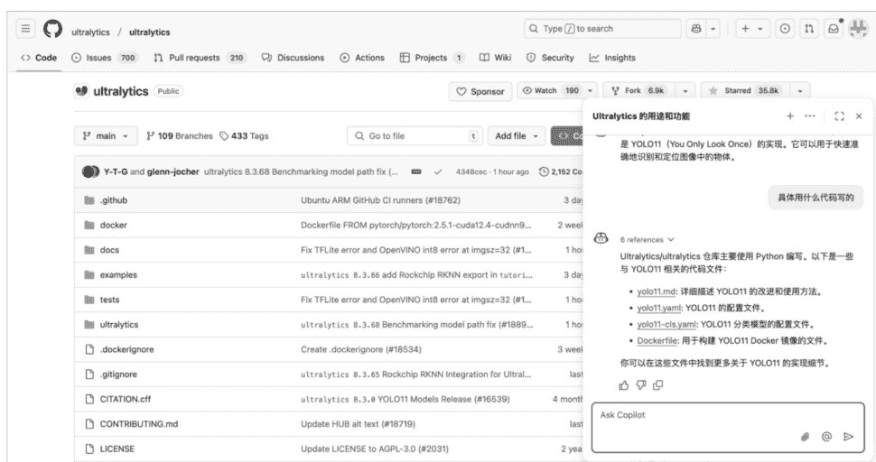

图2-5 GitHub仓库内Copilot使用界面

#### 2. 对话技巧

##### 1) 需求描述要具体
我需要一个：
- 基于 React 和 Node.js 的项目
- 适合入门学习
- 结构清晰
- 有中文文档

请推荐符合条件的项目。

##### 2) 追问项目细节
关于该项目：
1. 核心功能是什么？
2. 适合什么水平开发者？
3. 需要哪些基础知识？
4. 学习难点在哪？

##### 3) 请求通俗解释
请用生活例子解释以下信息。
1. 整体架构
2. 数据流转
3. 核心技术的作用

#### 3. 使用注意

##### 1) 推荐
- 告知技术水平；
- 说明学习目标；
- 描述感兴趣的方向。

##### 2) 代码解读
- 要求分步解释；
- 要求用类比说明复杂概念；
- 多问为什么。

##### 3) 学习建议
- 询问学习路线图；
- 了解常见坑与解法；
- 索取实践建议。

关键回放
- 使用 Copilot 要清晰表达需求与目标
- 筛选项目优先看文档是否详细
- 提问具体明确、循序渐进
- 理解代码多要求通俗化解释
- 学习路线按难度逐步推进
- 评估项目先看文档再看代码
- 技术积累从简单项目开始
- 实践关键在于边学边做多提问

借助 Copilot 就像拥有全天候技术导师，帮助在开源海洋中找到合适的学习资源。记住编程学习贵在循序渐进，从简入深逐步积累。

### 2.4.5 借助 AI 解读技术文档

技术文档对没有背景的人常显晦涩。现在有 AI 担任“翻译官”，能把专业术语转为易懂表达。下面以 Cursor 为例说明如何轻松解读文档。

#### 1. 准备工作

使用前需要准备，类似出国前准备护照地图。

1. 收集资料
   - 将开源项目代码下载到本地；
   - 收藏相关技术文档链接；
   - 准备想了解的 API 文档地址。
2. 配置翻译工具
   - 打开 Cursor 软件，导入项目文件夹；
   - 等待项目索引完成；
   - 在设置中添加技术文档。

#### 2. 用 Docs 功能解读文档

Cursor 的 Docs 功能相当于给 AI 配专业参考书库，让回答更准确。

##### 1) 添加文档
- 在对话框输入 @Docs 命令选择 Add new doc，或在设置功能标签页添加；
- 输入文档网址，如框架官方文档、API 文档；
- 起个易记名字，如“React 文档”或“Express API”；
- 等待添加成功。

##### 2) 使用文档解读内容
@docs React Router请帮我解读 React Router 文档。
1. 用通俗语言解释路由概念
2. 给一个简单路由配置示例
3. 指出使用时的常见陷阱
4. 说明与普通 React 组件的区别

##### 3) 文档管理
- 按技术类型归类，如前端、后端、数据库；
- 定期更新保持信息最新；
- 清理不再使用的文档；
- 与团队共享重要资源。

#### 3. 用 Codebase 分析代码

Codebase 是 Cursor 中理解和交互代码库的功能，通过扫描索引整个项目，使 AI 能把握完整上下文。

##### 1) 工作原理
- 自动扫描并索引代码库；
- 用向量化技术保存代码语义；
- 实时更新保持同步；
- 分析依赖关系和架构。

##### 2) 分析项目
@Codebase请分析项目结构：
1. 主要功能模块划分
2. 数据流转方式
3. 核心业务逻辑在哪些文件
4. 整体架构设计

##### 3) 交叉验证
@docs @Codebase关于用户认证功能：
1. 对比文档最佳实践和当前实现
2. 指出可能的安全隐患
3. 建议改进方向

#### 4. 技术可行性评估

确定方案时可结合文档和代码分析可行性。

基于文档和代码分析，请评估[技术方案]：
1. 技术难度：适合什么水平的团队
2. 开发周期：大概需要多长时间
3. 维护成本：需要怎样的技术支持
4. 扩展性：未来扩展难度如何

#### 5. 使用技巧与注意事项

##### 1) Docs 使用技巧
- 确保文档来源可靠；
- 不要添加含敏感信息的文档；
- 控制数量避免混乱；
- 可添加团队内部规范等自定义文档。

##### 2) Codebase 使用技巧
- 修改后重新索引保持更新；
- 清晰注释有助于 AI 理解；
- 合理组织结构提高分析准确度；
- 大型项目可选择性索引核心模块。

##### 3) 组合最佳实践
- 先用 Codebase 了解结构；
- 再用 Docs 学习技术细节；
- 结合两者分析现有实践与最佳实践差距；
- 利用建议指导开发方向。

#### 6. 实际案例

##### 1) 学习新框架
- 将官方文档添加到 Docs；
- 导入示例项目到 Codebase；
- 请求 AI 解释核心概念并对照代码；
- 逐步深入高级特性。

##### 2) 接手维护项目
- 用 Codebase 快速理解架构；
- 添加相关技术文档到 Docs；
- 通过 AI 分析代码质量和潜在问题；
- 规划改进路线和优先级。

##### 3) 评估技术选型
- 将多个候选技术的文档添加到 Docs；
- 请求 AI 对比优缺点；
- 结合需求选择最合适方案；
- 验证是否满足扩展需求。

通过这种方式，即使没有技术背景也能做到：
1. 理解文档核心内容；
2. 把握项目整体架构；
3. 评估方案可行性；
4. 与开发团队有效沟通。

记住目标不是成为技术专家，而是做出明智决策并与团队顺畅协作。

关键回放
- 解读文档先理解概念再看实现
- 善用 @docs 和 @Codebase，提问要具体
- 代码分析采用模块拆解，逐步理解
- 技术评估需兼顾难度、周期、成本
- 团队沟通要把专业术语转为通俗语言
- 决策以需求为本、落地为重
- 学习路径循序渐进、稳扎稳打
- 工具应用多方验证、谨慎决策

## 2.5 从需求到文档：打造清晰的产品设计文档

前面学习了需求分析和技术探索。现在需要把想法整理成清晰的产品设计文档，让 AI 助手如 Cursor 能准确理解需求并开展开发。

### 2.5.1 产品设计文档的核心要素

想象你在和 AI 助手聊天，希望它帮你开发应用。这时需要一份清晰的说明书告诉 AI 想要什么。这份说明书就是产品设计文档，应包含哪些关键内容？

#### 1. 产品总览与目标

如同介绍新朋友，先让 AI 了解产品是什么。这部分是产品自我介绍，需包含基本信息和目标。

举例说明。

**产品设计文档：智能学习助手**

##### 产品愿景

打造一个帮助学生高效学习的 AI 助手，像贴心学习伙伴，协助制定学习计划、监督学习进度。

##### 目标用户
- 主要用户：在校大学生和备考学生
- 次要用户：希望自我提升的职场人士

##### 核心卖点
1. 智能规划：根据个人情况制定学习计划
2. 进度追踪：实时记录和分析学习情况
3. 学习建议：提供个性化学习方法指导

#### 2. 功能清单说明

这一部分如同给 AI 讲解产品的“使用说明书”，每个功能都要说清楚，就像教小朋友玩新玩具一样详细。

##### 核心功能模块

###### 1. 智能学习计划生成器

功能说明：
- 输入：用户学习目标和可用时间
- 输出：定制化的每日学习任务清单
- 特点：支持随时调整，智能适应学习进度

实际场景：

小明准备考研，每天能投入 4 小时学习。他只需：
1. 选择“考研备考”目标
2. 设置每天可用时间
3. 系统就会自动生成适合他的学习计划表

技术要点：
- 智能算法：基于学习规律生成计划
- 数据分析：跟踪学习效果
- 实时调整：根据完成情况更新计划

#### 3. 界面交互规划

这部分像给 AI 看产品的“装修设计图”，让它明白用户看到什么、怎么操作。2.7 节会更深入介绍界面和交互。

##### 用户界面设计

###### 主页设计

布局安排：
1. 顶部区域
   - 左边：显示 Logo
   - 右边：个人头像和设置按钮
2. 中间内容区
   - 今日任务卡片（占屏幕 40%）
   - 学习数据图表（占屏幕 30%）
   - 学习建议板块（占屏幕 30%）

操作方式：

- 点击任务卡片即可查看完整内容
- 左右滑动可切换不同日期视图
- 下拉列表即可刷新最新数据

#### 4. 技术规范说明
把清晰的建设指引交给AI，相当于把施工蓝图交给工程师团队。

##### 技术选型与规范
###### 开发环境
- 前端：React + TypeScript
- 后端：Node.js + Express
- 数据库：MongoDB
- 缓存：Redis

###### 性能要求
- 页面加载耗时需小于2秒
- 交互反馈时间控制在0.5秒以内
- 数据每5分钟自动更新一次

### 小白必记
- 产品文档要用讲故事的方式呈现，让需求更生动
- 功能描述要把使用场景和操作步骤讲清楚
- 界面布局要合理，操作路径要简洁
- 技术规范要明确具体，便于落地执行
- 文档结构要分层清晰，重点要突出
- 需求表达要通俗，示例要充足
- 交互设计要始终围绕使用者体验

### 2.5.2 让AI理解你的需求
文档写好之后，还要把它转译成AI能执行的表达。就像和中文不太熟的人沟通，需要更规范，这里也一样。

#### 1. 与AI对话的标准格式
想象你正在和一名中文表达不熟练的合作伙伴交流，需要避免口语化和复杂表达。对AI的指令也要保持清晰规范。

#### 2. 项目初始化对话模板
开启新项目时可套用以下模板。

基于以下产品需求文档，请帮我：

1. 项目初始化

```
@productDoc/overview.md
```

技术栈要求：

```
@productDoc/tech_requirements.md
```

请首先：

1. 创建项目基础结构
2. 设置必要的配置文件
3. 安装核心依赖
4. 实现基础框架代码

这个模板相当于和AI的开场白，说明目标和技术栈。把步骤列清楚后，AI就能按顺序完成。

#### 3. 功能开发对话模板
实现具体功能时可使用如下模板。

请基于产品文档实现[具体功能模块]：

功能需求：

@productDoc/features/[feature_name].md

界面设计：

@productDoc/ui/[feature_name]_design.jpg

具体要求：

1. 实现界面布局
2. 添加交互逻辑
3. 对接后端API
4. 处理异常情况

这份模板相当于任务清单，把工作拆成明确步骤，AI才能准确把握意图。

#### 4. 提高AI理解效率的小技巧
1. 分步骤提问
   - 类似教小朋友写作业，把复杂任务拆成小步骤。比如登录功能，先做界面，再做表单校验，最后再做API对接。

2. 使用参考文件
   - 对话中多用“@文件路径”引用文档，相当于给AI看参考资料，有助于把握上下文。
##### 3）及时确认理解
AI开始执行前，可请它复述任务要点，确保理解一致。就像点餐时服务员重复订单，避免偏差。

### 小白必记
- 对话模板要结构清晰、步骤明确
- 需求描述要化繁为简、逐步展开
- 文档引用可善用@符号定位文件
- 沟通节奏先总后分、循序渐进
- 建立反馈确认机制，校验理解情况
- 任务拆分化大为小，降低难度
- 异常处理要提前规划，防患于未然

### 2.5.3 需求文档的持续优化
产品设计文档像一棵需要照料的树苗，在和AI协作开发时要不断完善。

#### 1. 借助AI的力量审查文档
文档审查像校对文章，需要细致。AI可充当经验丰富的审阅者，帮助发现问题。可这样提问。

请帮我检查这份需求文档：

@productDoc/full_document.md

重点关注以下方面：

1. 需求描述是否完整、清晰
2. 文档结构是否合理、连贯
3. 技术要求是否切实可行
4. 是否遗漏重要信息
5. 用户场景是否覆盖全面

AI给出修改建议后据此完善，类似老师批改后学生修改。

#### 2. 建立文档版本管理体系
版本管理像给照片备份，每次重要更新都要记录。可追溯演进，也能快速找回旧版。

规范的版本记录示例如下。

```
##### 文档更新日志

V1.0.0 2024-01-19

- 创建文档基础框架
- 完成核心功能描述
- 制定技术规范初稿

V1.1.0 2024-01-20

- 新增：详细的用户角色定义
- 优化：技术栈说明更加具体
- 更新：界面交互细节要求
- 修复：部分功能描述不准确的问题

V1.2.0 2024-01-21

- 新增：异常处理机制说明
- 优化：性能指标更加明确
- 补充：数据安全相关要求
```

#### 3. 收集和整合反馈意见
开发中要像海绵一样吸收各方意见，主要来自三类。

（1）开发团队的反馈像施工队长的建议，最懂落地难点。
- 哪些技术实现难度较大
- 系统性能如何优化
- 技术架构是否需要调整

（2）测试团队的反馈像质检报告，从使用者视角发现问题。
- 功能是否符合预期
- 使用是否顺畅
- 性能是否达标

（3）AI助手的建议像技术顾问的专业意见，能多维度分析。
- 代码实现是否可行
- 技术方案是否合理
- 文档结构是否清晰

#### 4. 文档优化的实践建议
文档优化像打扫房间，需要经常进行且有规律。

（1）每周至少审查一次，保持内容及时更新。
（2）把收集到的反馈分类整理，便于后续处理。
（3）确定修改方案后立即更新，发现问题马上解决。
（4）保持格式统一，让文档专业整洁。

### 小白必记
- 文档审查要定期进行，及时优化内容
- 版本管理记录要清晰，变更要明确
- 反馈处理需分类整理，有序推进
- 更新节奏保持固定，即时同步
- 格式规范要统一，严格执行
- 协作沟通及时反馈，快速迭代
- 内容优化突出重点，条理分明

## 2.6 如何高效使用Cursor制作自己的项目

### 2.6.1 项目前期准备
新项目启动前要做好充分准备。像盖房子，地基决定成败。下面梳理前期要点。

项目必须目标明确，像出行前先定目的地。编码前先回答以下关键问题。

#### 1. 确定核心目标
先厘清三点。
- 目标用户是谁：产品服务哪类人群？学生、上班族还是专业人士？
- 解决什么痛点：能帮助用户解决什么具体困扰？
- 独特价值在哪：为何选择你而非竞品？

#### 2. 功能规划清单
把功能分类整理，像工具箱归类。以在线学习平台为例。

1）用户相关功能
- 账号注册登录：创建和访问个人账户
- 个人资料管理：更新信息和设置
- 学习记录追踪：记录进度与成果

2）课程相关功能
- 课程浏览搜索：帮助用户找到感兴趣课程
- 视频学习系统：提供流畅在线学习体验
- 课程评价功能：反馈课程质量

3）学习辅助工具
- 笔记功能：记录学习要点
- 练习系统：巩固所学知识
- 学习计划：规划学习路径

#### 3. 技术选型要点
选技术像选建材，需按需求决定。
- 是否满足项目需求：能力是否够用
- 团队技术水平：是否熟悉
- 社区是否活跃：遇到问题能否找到答案
- 扩展性如何：为未来预留空间

#### 4. 管理项目依赖
像管理厨房调料，要清楚每个工具用途。
- 明确每个工具作用：记录使用原因
- 检查版本兼容性：确保协同工作
- 评估维护情况：选择稳定且持续更新的
- 注意安全风险：及时修复漏洞

#### 5. 服务配置管理
配置信息要妥善保管，像保管重要文件。
- 用环境变量保存敏感信息：避免密码硬编码
- 建立配置文件模板：方便团队快速配置环境
- 做好数据备份：定期备份重要数据
- 设置访问权限：控制不同角色范围

#### 6. 文档建设
完整文档像项目说明书，便于所有人理解。

##### 1) instruction.md基础文档
项目入门指南，包含：
- 项目介绍：目的和特点
- 技术架构：主要技术和设计
- 开发规范：代码规范和流程
- 环境配置：搭建步骤
- 常见问题：解决方案记录

##### 2) .cursorrules设置
在根目录创建规范文件，像团队的游戏规则。
- 代码风格规定：统一格式要求
- 命名规则说明：变量、函数、文件命名
- 文件组织方式：目录结构规则
- 注释编写要求：注释规范
- 开发流程说明：协作工作流

#### 7. 项目结构设计
良好的结构像整洁的房间，开发更顺畅。

推荐目录结构如下。

```
project/
├── src/                # 源代码目录
│   ├── components/     # 组件文件
│   ├── pages/          # 页面文件
│   └── utils/          # 工具函数
├── public/             # 静态资源
├── docs/               # 项目文档
└── tests/              # 测试文件
```

#### 8. 开发模板准备
提前准备模板可提升效率。
- 常用代码模板：常见功能代码
- 代码片段库：提高复用效率
- 配置文件模板：环境配置模板
- 测试用例模板：标准化测试格式

#### 9. UI设计规范
代码重要，界面同样关键。
- 设计基础组件库：统一UI组件
- 制定配色字体规范：视觉风格统一
- 规划页面布局标准：统一页面结构
- 准备图标素材库：视觉资源

### 小白必记
- 规划先定目标再设计
- 技术选型需求导向，团队优先
- 依赖管理版本统一，及时更新
- 文档完整规范，持续更新
- 代码结构层次分明，职责单一
- 配置管理分环境，重安全
- UI设计风格统一，体验至上
- 模板准备规范先行，提高效率

### 2.6.2 项目开发过程
开发时合理使用Cursor就像拥有得力助手。

#### 1. 开发策略选择
像建高楼先打地基再逐层搭建，复杂系统应拆成小模块逐步完成。
- 一次只专注一个功能：分解成独立模块
- 确保功能可用：每个模块可独立运行测试
- 及时单元测试：验证正确性
- 保持代码整洁：方便后期维护

以网上书店为例，可按顺序推进。

1）用户系统搭建，像核心引擎
- 实现注册登录：身份认证
- 完成个人信息管理：用户数据中心
- 添加密码找回：安全恢复机制

2）图书管理功能，像数据中心
- 图书信息展示：数据展示系统
- 分类搜索系统：高效检索
- 评价评分功能：用户反馈机制

3）购物功能实现，像交易中心
- 购物车管理：临时数据暂存
- 订单处理系统：交易流程管理
- 支付功能集成：安全支付通道

#### 2. Cursor AI功能应用
善用AI能力就像有技术顾问。

##### 1）代码理解助手
- 分析代码结构流程：构建代码地图
- 解释复杂算法原理：把逻辑讲明白
- 提供优化建议：发现改进空间
- 查找潜在问题：预防技术风险

##### 2）智能代码生成
- 给出清晰需求描述：明确规格
- 指定代码风格要求：保持统一
- 要求生成详细注释：提升可读性
- 验证代码正确性：确保功能准确

#### 3. 模块化开发实践
把复杂项目拆成小模块。

##### 1）通用功能模块

```javascript
// 用户认证模块示例
const auth = {
    login: async (username, password) => {
        // 处理用户登录的逻辑
        // 验证用户名和密码
        // 返回登录结果
    },
    register: async (userData) => {
        // 处理用户注册的逻辑
        // 验证用户数据
        // 创建新用户账号
    },
    resetPassword: async (email) => {
        // 处理密码重置的逻辑
        // 发送重置邮件
        // 更新用户密码
    }
};
```

##### 2）标准化提示模板
为常见功能准备现成食谱。

// API接口开发模板

请帮我实现一个[功能名称] API：

- HTTP方法：[GET/POST/PUT/DELETE]
- 接口路径：/api/[路径]
- 请求参数：[参数列表]
- 返回格式：[返回数据结构]
- 错误处理：[错误情况]

### 小白必记
- 开发流程循序渐进，稳扎稳打
- 功能实现一次一个，测试到位
- AI助手问题具体，需求明确
- 代码模块化功能独立，复用优先
- 测试验证及时检查，防患未然
- 版本管理小步提交，说明清晰
- 团队协作规范统一，沟通顺畅

### 2.6.3 项目调试与问题处理
开发中遇到问题很正常。像医生看病要检查诊断，调试也要通过检查找病因再对症下药。

#### 1. 问题的表现形式
##### 1) 编辑器界面提示
- 红色波浪线：像老师批改标记，表示语法错误
- 黄色波浪线：温馨提醒，提示可优化或潜在问题
- 文件名变红：像红灯提示，该文件有问题
- 代码补全不工作：像助手沉默，语言服务可能异常

##### 2）终端报错信息

```
# 常见的终端错误示例
Error: Cannot find module 'react'          # 模块缺失错误
SyntaxError: Unexpected token              # 语法错误
TypeError: Cannot read property            # 类型错误
ReferenceError: x is not defined           # 引用错误
```

#### 2. 调试的基本方法
调试像解谜，要用正确工具和思路。

##### 1）预防性调试
预防胜于治疗，做好准备。
- 开启实时错误提示：装上预警系统
- 定期代码检查：定期体检
- 及时处理警告：小问题不积累
- 做好单元测试：为每个模块写体检表

##### 2）问题定位技巧
像侦探排查一样有条理。
- 复现问题场景：重现案发现场
- 收集错误信息：收集证据
- 定位问题代码：缩小嫌疑范围
- 分析原因：找出根源

##### 3）调试工具的使用
工程师需要完整的工具箱。

```javascript
// 基础调试信息
console.log('普通信息');
console.info('提示信息');
console.warn('警告信息');
console.error('错误信息');

// 数据结构展示
console.table([
    { name: '张三', age: 25 },
    { name: '李四', age: 30 }
]);

// 代码执行时间
console.time('操作耗时');
// ... 你的代码 ...
console.timeEnd('操作耗时');

// 函数调用追踪
console.trace('追踪调用栈');

// 完整的调试示例
function calculateTotal(items) {
    // 输出函数入口参数
    console.log('开始计算总价，商品列表：', items);

    let total = 0;
    items.forEach((item, index) => {
        // 追踪每个商品的计算过程
        console.log(`正在计算第 ${index + 1} 个商品：`, item);
        total += item.price * item.quantity;
        // 输出每次计算后的总价
        console.log('当前总价：', total);
    });

    // 输出最终结果
    console.log('计算完成，最终总价：', total);
    return total;
}
```

##### 4) AI 协同排错
碰到难以定位的复杂 bug 时，可以把问题交给 Cursor 一起分析，它能快速给出排查思路。

```
// 向Chat 提问的模板

问题描述：

[简要描述你遇到的问题]

错误信息：

[完整的错误信息]

相关代码：

[出错的代码片段]

期望行为：

[代码应该实现什么功能]

已尝试方案：

[已经尝试过的解决方法]
```

#### 3. 典型错误分类与应对方案

##### 1) 语法错误（SyntaxError）
- 核对括号和引号是否成对出现；
- 审视分号是否放置在正确位置；
- 检查关键字是否拼写无误。

##### 2) 类型错误 (TypeError)
- 确认相关变量是否已经定义；
- 查看函数调用的参数与方式是否匹配；
- 核实对象上是否真的存在该属性。

##### 3) 引用错误 (ReferenceError)
- 判断变量是否已做声明；
- 核查变量的作用域是否生效；
- 审视 import / export 语句是否书写正确。

##### 4) 网络请求错误

```javascript
// 网络请求错误处理示例
async function fetchData() {
    try {
        const response = await fetch('/api/data');
        if (!response.ok) {
            throw new Error(`HTTP error! status: ${response.status}`);
        }
        const data = await response.json();
        return data;
    } catch (error) {
        console.error('获取数据失败:', error);
        // 根据错误类型显示不同的提示
        if (error.name === 'TypeError') {
            alert('网络连接失败，请检查网络设置');
        } else if (error.name === 'SyntaxError') {
            alert('数据格式错误，请联系技术支持');
        } else {
            alert('服务器错误，请稍后重试');
        }
    }
}
```

#### 4. 性能提升策略
代码就像车辆一样，用久了需要定期保养，否则运行效率会下降。

##### 1) 代码层面优化
- 去除冗余代码：把无用的“零件”清理掉；
- 提升算法效率：选用更省力的“引擎”；
- 降低资源占用：减少“油耗”；
- 加快响应速度：增强“动力”。

##### 2) 系统层面优化
- 数据库优化：为表建立合理索引，类似给图书馆书籍编号；
- 缓存优化：把常用数据放到就近缓存，像常读的书放在手边书架；
- 网络优化：合并与减少请求次数，相当于规划最短配送路线；
- 服务器优化：合理分配计算资源，好比调节机器的工作负载。

### 新手速记清单
- 报错定位原则：读懂提示信息，精准找到出错点
- 调试利器：console 堪称开发者的好搭档
- 分类处理：先辨别错误种类，再针对性解决
- 与AI协作：给出完整上下文，才能得到可靠建议
- 追踪要点：在关键位置埋入日志
- 处理思路：预防为主，修复为辅
- 优化策略：抓住重点，逐步推进
- 思维培养：用侦探心态追踪线索

## 2.7 组件化设计与交互思考
前面几节讲了借助 AI 做规划、写代码和解问题的办法。本节把焦点转向用户体验：组件化设计与交互考量。即使 AI 能迅速生成代码，优秀的用户体验仍需精心打磨。下面会介绍 UI 组件库的价值，以及在 AI 时代如何思考交互设计。

### 2.7.1 什么是UI组件库
在起步搭建网站或应用时，你是否想过要从零雕刻每个按钮、输入框、下拉框？这样做耗时耗力，还容易出现风格不一致。这正是 UI 组件库存在的意义。

#### 1. 组件库的定义与意义
UI 组件库好比一套现成的“积木盒”，里面装满可直接复用的界面单元。需要一个美观的按钮时，不必手写大量样式，直接拿库里的按钮组件就能得到功能完整、样式统一的结果。

打个比方：装修新房，你可以自己从原材做家具，但费时且质量难控。更实际的做法是去家具城挑选成品。UI 组件库就是前端的“家具城”，提供标准化的界面元素。

在 AI 辅助开发的场景下，组件库的价值更明显。向 AI 描述需求时指定组件库，生成的代码既功能齐全，外观也更专业一致。

#### 2. 组件库的核心构成
一套完整的 UI 组件库通常包含以下几类。

（1）基础组件是最频繁使用的界面单元，像家具里的桌椅一样必不可少。
- 按钮（Button）：触发各类操作；
- 输入框（Input）：收集用户文字输入；
- 选择器（Select）：提供多个选项供挑选；
- 开关（Switch）：控制功能的开启关闭；
- 单选/复选（Radio/Checkbox）：在多项中做选择。

（2）布局组件负责页面空间的安排，像房间的格局。
- 栅格系统（Grid）：用网格线规范排列内容；
- 弹性布局（Flex）：自适应调整的灵活排布；
- 间距（Space）：调节组件间的距离；
- 分割线（Divider）：划分不同内容区域。

（3）导航组件如同房屋内的指示牌和门。
- 导航菜单（Menu）：站点主要导航；
- 标签页（Tabs）：在同一区域切换内容；
- 面包屑（Breadcrumb）：展示当前路径；
- 分页器（Pagination）：把内容拆分成多页。

（4）反馈组件相当于与用户的对话。
- 通知（Notification）：展示重要信息；
- 对话框（Modal）：需要用户确认的弹窗；
- 加载中（Loading）：提示操作进行中；
- 进度条（Progress）：显示完成进度。

#### 3. 使用组件库的优势
如果每个按钮都要从零写样式，不仅浪费时间，还难以保证行为和外观统一。组件库可以解决这个问题。

1）提升开发效率
无需重复造轮子，直接调用经过测试的组件，就像装修时买现成家具。
2）保持视觉一致
所有组件遵循同一设计规范，像同一品牌家具，风格协调，整体更专业。
3）改善开发体验
组件库通常附带详细文档和代码提示，像说明书一样易上手；组件使用方式统一，学一个就能类推。
4）增强用户体验
组件经过专业交互设计，涵盖多种场景，按钮有反馈、表单有错误提示等。
5）多端适配
现代库多支持响应式，能自动适配手机、平板、电脑。
6）降低维护成本
浏览器更新或设计趋势变化时，升级库版本即可跟进，无需重写大量代码。
7）促进团队协作
统一规范减少沟通成本，提升协作效率。

### 新手要点
- 组件库原则：能用现成组件就别自己造轮子
- 界面设计：风格统一是关键
- 开发效率：善用组件事半功倍
- 文档习惯：先看文档再写代码
- 用户体验：专业组件手感更好
- 团队协作：统一库减少分歧
- 维护成本：库升级应用自然更新

### 2.7.2 常见 UI 组件库
在前端生态里，UI 组件库就像满是精密零件的工具箱。下面重点介绍两个热门选择。

#### 1. Shadcn UI：可定制的工作坊
如果传统组件库是成品家具，Shadcn UI 更像一套高质量的 DIY 设计图。它不提供黑盒成品，而是把组件源码“复制”进项目，让你完全掌控细节。

##### 1）使用方式创新
它不走 npm 直接引用，而是复制代码到本地，相当于把图纸拿回家，可以随意改造。

##### 2）技术特点
- 基于 Radix UI 构建；
- 用 Tailwind CSS 编写样式；
- 支持亮色/暗色模式；
- 完全遵循无障碍标准。

###### 小知识：Tailwind CSS 是什么？
Tailwind CSS 是一种原子化 CSS 框架，像一盒预制的调色板。传统写法要写 `color: red;`，Tailwind 只需加类名 `text-red-500`。类名就像积木，组合起来能快速搭出界面。

举个例子：

```html
<!-- 传统 CSS 写法 -->
<button class="my-button">
    点击我
</button>

<style>
.my-button {
    padding: 8px 16px;
    background-color: blue;
    color: white;
    border-radius: 4px;
}
</style>

<!-- Tailwind CSS 写法 -->
<button class="px-4 py-2 bg-blue-500 text-white rounded">
    点击我
</button>
```
开始使用 Shadcn UI 前，先在项目里做初始化。

###### 第一步：初始化 Shadcn UI
```bash
npx shadcn-ui@latest init
```

###### 第二步：添加所需组件
```bash
npx shadcn-ui@latest add button
```

下面是一个简单示例。

```javascript
// 导入按钮组件
import { Button } from "@/components/ui/button"

// 在组件中使用
function MyComponent() {
  return (
    <Button variant="outline">
      点击这里
    </Button>
  )
}
```

在 AI 辅助时，可以明确要求：
> 请使用 Shadcn UI 的 Button、Card 和 Input 组件做一个登录页。

#### 2. Ant Design：企业级全能库
Ant Design 像大型建材超市，几乎涵盖所有需要的界面组件。由蚂蚁集团推出，在国内企业级场景应用广泛。

##### 1) 完整设计体系
- 100 多个开箱即用组件；
- 设计规范统一专业；
- 适合企业级产品。

##### 2) 技术优势
- 完整的 TypeScript 支持；
- 多语言国际化；
- 可自定义主题；
- 社区活跃。

使用示例：

```bash
# 安装主程序
npm install antd

# 安装图标库（按需安装）
npm install @ant-design/icons
```
实际例子：

```javascript
// 导入需要的组件和图标
import { Button } from 'antd';
import { SearchOutlined } from '@ant-design/icons';

// 在组件中使用
function MyComponent() {
  return (
    <Button type="primary" icon={<SearchOutlined />}>
      搜索
    </Button>
  )
}
```

AI 提示示例：
> 使用 Ant Design 组件库做一个数据展示页，包含表格、筛选器和分页。

#### 3. 如何选型
选组件库要结合项目实际。

##### 1) 适合 Shadcn UI 的场景
- 需要深度定制组件；
- 希望完全掌控源码；
- 对包体积敏感；
- 团队偏爱 Tailwind CSS。

##### 2) 适合 Ant Design 的场景
- 开发企业级应用；
- 需要大量现成组件；
- 追求开发速度；
- 团队规模较大。

##### 3) 考虑项目复杂度
个人小站或轻量项目选轻库；功能复杂的企业应用更适合全功能库。

##### 4) 考虑技术栈
React 项目选 React 生态库，Vue 项目选 Element Plus、Vuetify 等。

##### 5）考虑定制化需求
高度定制选可控性强的库，如 Shadcn UI；标准化企业应用选成熟库，如 Ant Design。

#### 4. 使用建议
1）先读文档
像用新工具前看说明书，先阅读官方文档和示例。
2）按需引入
不要一次性引入全部组件，按需加载避免体积膨胀。
3）版本管理
团队统一使用相同版本，避免不一致问题。
4）配合 AI 开发
生成代码时明确指定库名和版本，并附链接，AI 能更准确理解。
5）保持更新
定期关注更新，及时升级获取新功能和修复。

### 新手速记
- 组件库选择：需求驱动
- Shadcn UI：定制性强
- Ant Design：企业级成熟
- 文档阅读：使用前必看
- 性能优化：按需加载
- 团队协作：版本统一
- AI 提示：指定库提升质量

### 2.7.3 组件库使用技巧
了解组件库后，还需要掌握使用技巧，就像学会厨具后还要会烹饪。

#### 1. 组件的按需加载
购物不会把超市搬回家，引入组件也应只拿所需。按需加载能减小体积、加快加载。

Ant Design 示例：

```javascript
// 不推荐：引入整个组件库
import { Button, Input, Select, Table, Form, Modal } from 'antd'

// 推荐：按需引入需要的组件
import { Button } from 'antd'
import { Input } from 'antd'
```
第一种会把整库拉进来，第二种只引入 Button 和 Input。就像只买做菜的食材，而不是把超市搬空。

对 AI 的要求可以写成：
> 请按需引入 Ant Design 的 Button 和 Form，不要引入全库。

#### 2. 组件的二次封装
某些组件组合在多处复用时，可进行二次封装，像把常用调料调成专属酱料。

检索表格的复用封装

先看一段自带搜索功能的表格封装示例。
```javascript
import { Table, Input } from 'antd'
import { useState } from 'react'

// 封装一个带搜索功能的表格组件
function SearchTable({ columns, dataSource }) {
  // 定义搜索关键词的状态
  const [searchText, setSearchText] = useState('')

  // 根据搜索关键词过滤数据
  const filteredData = dataSource.filter(item =>
    // 在所有字段中搜索关键词
    Object.values(item).some(value =>
      String(value).toLowerCase().includes(searchText.toLowerCase())
    )
  )

  return (
    <div>
      {/* 搜索框部分 */}
      <Input.Search
        placeholder="请输入搜索内容"
        onChange={e => setSearchText(e.target.value)}
        style={{ marginBottom: 16 }}
      />

      {/* 表格部分 */}
      <Table
        columns={columns}
        dataSource={filteredData}
      />
    </div>
  )
}
```

封装完毕后，别的页面只要引用 SearchTable，就能直接使用，无需在每个地方重复实现筛选和排序。

在 AI 辅助编码时，可以这样描述任务：
> 请对 Ant Design 的 Table 组件进行二次封装，加入搜索与排序功能，同时保证所有原始属性仍然可用。

#### 3. 主题样式定制

每个项目都有独特的视觉调性，就像不同家庭的装修风格各异。主流组件库都提供了主题调节入口，让界面外观能贴合项目需求。

以 Shadcn UI 为例，可通过修改 CSS 变量来实现风格个性化。
```css
/* globals.css */

:root {
  /* 定义浅色主题的颜色 */
  --primary: 222.2 47.4% 11.2%;
  --primary-foreground: 210 40% 98%;
}

/* 定义深色主题的颜色 */
.dark {
  --primary: 210 40% 98%;
  --primary-foreground: 222.2 47.4% 11.2%;
}
```

Ant Design 则可以通过配置文件来设定整体主题。
```javascript
// theme.config.js
export default {
  token: {
    colorPrimary: '#1677ff',
    colorSuccess: '#52c41a',
    colorWarning: '#faad14',
    colorError: '#ff4d4f',
    colorInfo: '#1677ff',
    fontSize: 16,
    borderRadius: 6,
  },
}
```

让 AI 生成主题配置时，可以这样表达：
> 为 Ant Design 建立一份主题配置，主色设为蓝色 #1890ff，辅色设为绿色 #52c41a，并把按钮圆角适当调大。

#### 4. 组件的组合使用

组件的本质像积木，组合后能搭建更复杂的界面。下面是一个商品卡片的组合示例。
```javascript
import { Card, Space, Button, message } from 'antd'

// 商品卡片组件
function ProductCard({ title, price, onBuy }) {
  return (
    <Card title={title}>
      <Space direction="vertical" style={{ width: '100%' }}>
        {/* 显示商品价格 */}
        <div>价格: ¥{price}</div>

        {/* 购买按钮 */}
        <Button
          type="primary"
          onClick={() => {
            onBuy()
            message.success('购买成功！')
          }}
        >
          立即购买
        </Button>
      </Space>
    </Card>
  )
}
```

在 AI 协作场景下，组合需求可以这样描述：
> 使用 Ant Design 的 Card、Image、Typography、Button 组合制作一个产品展示卡片，包含商品图片、标题、描述、价格，并提供一个“加入购物车”按钮。

### 小白必记

- 引入方式：按需引入能减小包体积
- 抽象原则：重复逻辑及时封装
- 主题管理：统一风格提升一致性
- 组合思路：积木式搭建提高效率
- 性能注意：代码精简有助于运行

## 2.7.4 交互设计的新定位

随着生成式助手能够按需输出架构与代码，交互设计的重心正从“能否落地”转向“体验感受”。如同导演不仅需要剧本，还要把控每场戏的节奏与情绪，产品设计也更关注使用过程中的细节感受。

### 1. 从实现到体验的转变

过去交互设计常受技术制约，设计师会担忧某个动效是否能实现、成本是否过高。但在智能辅助阶段，这类顾虑明显下降。

传统想法：“这个动画实现可能很复杂，先简化吧。”

当前想法：“这个过渡能让用户更清晰感知状态变化，代码可由助手生成。”

设计师能够把精力集中在体验本身，而不必被技术可行性牵制。

在智能辅助环境中尤为明显。用 Cursor 这类工具时，可以直接描述期望的交互。
> 我希望按钮被按下时出现柔和的波纹，同时颜色慢慢加深，给出明确反馈。

助手会尝试理解意图并产出实现代码。于是设计师与产品经理更关注“使用感受如何”，而非“功能怎么做”。

### 2. 交互设计的核心价值

在智能辅助时代，交互设计的重要性主要体现在以下方面。

#### 1) 连接用户与功能

即使助手能写代码，也难以把握用户的心理模型与真实期待。设计师的价值在于把复杂功能转译成易懂易用的界面。

例如，助手可能生成一个数据分析功能，但如何让普通用户轻松上手，仍需人工思考。

#### 2) 构建情感连接

优秀的交互能带来愉悦高效的体验，形成情感连结，这是单纯功能实现无法提供的。

例如可以这样描述。
> 当用户完成一项任务时，展示一个简短的庆祝动效，带来成就感，但幅度不要过大，以免影响下一步操作。

#### 3) 体现产品个性

差异化的交互能让产品在大量标准化组件中脱颖而出。助手生成的代码容易趋同，独特的体验成为差异化关键。

例如可以描述产品个性。
> 我们的产品定位年轻活力，请在交互中加入恰当动效和鲜明视觉反馈，让整体感觉更有活力。

#### 4) 提升用户满意度

良好的交互减少学习成本和操作失误，提升满意度。这种无形价值往往决定产品成败。

在智能辅助开发中可这样表述。
> 用户群体包含不少老年人，请设计简洁直观的方式，减少复杂手势，并强化操作反馈的明确性。

### 小白必记

- 关注点迁移：从“能不能做”到“体验好不好”
- 体验优先：好产品让人用得顺手
- 情感价值：交互记忆影响用户
- 差异化：交互是核心竞争力
- 描述体验：让助手实现细节
- 心理模型：理解用户习惯与期待
- 反馈系统：让用户清晰感知变化

## 2.7.5 AI时代交互设计的关键要素

即便使用通用组件库和助手生成的代码，仍有若干关键交互领域需要人的创造与决策。智能协作时代的交互设计师更应聚焦体验的核心问题。

### 1. 引导系统设计

通用组件库提供提示框、气泡等基础元素，但如何组织成有效引导系统，需要精心规划。

#### 1) 引导时机的确定

- 新用户首次使用时的核心功能引导；
- 新功能上线后的变更提示；
- 复杂操作前的预指引。

#### 2) 引导形式的选择

- 轻量级：气泡提示、高亮聚焦；
- 中度干预：引导蒙层、动画演示；
- 强引导：强制教程、交互式指引。

#### 3) 引导策略规划

有效的引导应是渐进式的，避免一次性倾倒全部信息。
```javascript
// 引导策略伪代码示例
class GuidanceSystem {
    constructor(user, features) {
        this.user = user;
        this.features = features;
        this.shownGuidance = []; // 已展示的引导
    }

    shouldShowGuidance(feature) {
        // 基于用户行为和上下文决定是否展示引导
        const isFirstTime = !this.user.hasUsed(feature);
        const isRelevantToCurrentTask = this.isRelevantToCurrentContext(feature);
        const notShownRecently = !this.shownGuidance.includes(feature);

        return isFirstTime && isRelevantToCurrentTask && notShownRecently;
    }

    // 其他引导逻辑 ...
}
```

#### 4) 引导内容设计

- 简洁明了：每次聚焦单一功能点；
- 视觉引导：借助动画或高亮吸引注意力；
- 分步引导：将复杂流程拆成简单步骤。

在智能辅助开发中可告诉助手。
> 请设计一套分步引导，新用户首次登录时，依次引导完成个人资料设置、添加第一个任务、设置提醒。每步需高亮相关区域并配简短说明。

### 2. 导航与信息架构优化

助手能生成基于架构的导航结构，但优化行动路径仍需人工设计。

#### 1) 层级深度与宽度的平衡

信息架构的关键是选择宽而浅还是窄而深。
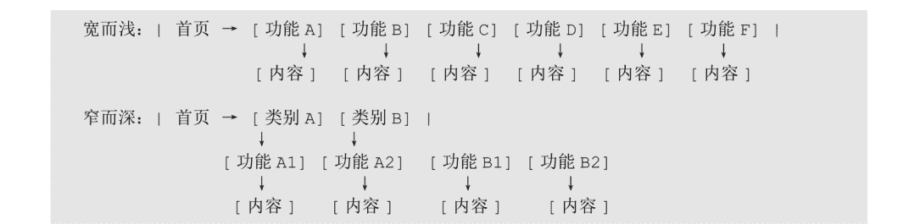

研究显示，层级通常不宜超过 3 层，每层选项数要兼顾认知负荷，移动端建议 4~6 个，桌面端 6~8 个比较合适。

#### 2) 返回路径设计

复杂流程中需要清晰的返回机制。

- 线性流程：明确的上一步/下一步，如下单流程；
- 探索性流程：随时可回到主界面的安全出口；
- 多步骤表单：支持回溯修改并保存已填内容。

#### 3) 快捷路径优化

为高频任务提供捷径。

- 快捷键/手势；
- 最近使用/常用功能区；
- 基于上下文的智能推荐。

#### 4) 导航一致性

- 各页面保持导航元素位置一致；
- 使用统一视觉语言表达导航状态；
- 导航标签要清晰反映目标内容。

助手描述示例。
> 请设计三级导航，一级为顶部标签，二级为侧边栏，三级为内容区的标签页。确保每个页面都有明确返回路径，并在首页增加“最近访问”区域作为快捷入口。

### 3. 交互一致性系统

通用组件库提供视觉一致性，而交互一致性更复杂，需要在产品中统一心智模型。

#### 1) 术语与文案一致性

统一组件下文案不一致仍会造成困惑。

不一致示例。

- 确认按钮在不同页面使用“确定”“提交”“保存”等不同表述；
- 相同操作在不同位置名称不同，“删除” vs“移除”。

解决方案是建立文案词表。

| 操作类型 | 统一用词 | 禁用词 |
| :--- | :--- | :--- |
| 确认操作 | 确认 | 确定、好的、OK |
| 删除操作 | 删除 | 移除、去除 |
| 取消操作 | 取消 | 关闭、返回 |

#### 2) 手势系统设计

移动应用中手势需统一规划。

| 手势类型 | 交互行为 | 适用场景 |
| :--- | :--- | :--- |
| 左滑 | 删除 / 归档 | 列表项 |
| 右滑 | 返回上级 | 全局导航 |
| 下拉 | 刷新 | 列表页面 |
| 长按 | 显示更多选项 | 列表项 |

#### 3) 交互模式映射

确保相似功能有相似交互方式，建立稳定心智模型。
```javascript
// 交互模式映射示例
const interactionPatterns = {
    selection: {
        single: "radio",           // 单选使用 radio
        multiple: "checkbox",      // 多选使用 checkbox
        hierarchy: "tree-select"   // 层级选择使用树形选择
    },
    confirmation: {
        destructive: "two-step",   // 破坏性操作需二次确认
        normal: "direct"           // 普通操作直接执行
    }
};
```

#### 4) 视觉反馈一致性

- 同类型交互提供一致视觉反馈；
- 同类型按钮拥有相同点击效果；
- 同类型数据加载使用一致加载指示；
- 错误提示风格保持统一。

助手需求描述示例。
> 请确保应用中所有删除操作流程一致：先弹出确认框，用户确认后显示加载状态，成功后给出明确反馈。并在全站统一术语，将删除操作统一称为“删除”而非“移除”或“清除”。

### 4. 状态反馈系统

通用组件库提供基础状态组件，但如何在业务流程中使用，需要系统设计。

#### 1) 加载状态阈值定义

操作耗时超过特定阈值才显示加载，避免闪烁。
```javascript
// 加载状态阈值示例
const loadingThresholds = {
    dataFetch: 300,          // 数据获取超过 300ms 显示加载
    userAction: 200,         // 用户操作反馈超过 200ms 显示加载
    backgroundTask: 1000     // 后台任务超过 1s 才提示
};
```

#### 2) 异步操作的用户反馈

后台任务需提供进度反馈。

- 即时反馈：操作立即响应，后台继续处理；
- 进度指示：展示任务完成百分比；
- 状态通知：通过通知系统告知任务完成。

#### 3) 错误状态的分级处理

不同错误需不同处理方式。

| 错误级别 | 显示方式 | 示例 |
| :--- | :--- | :--- |
| 致命错误 | 全屏错误页 | 网络连接中断 |
| 流程错误 | 页内错误提示 | 表单验证失败 |
| 轻微错误 | Toast 提示 | 非必要操作失败 |

制定错误处理矩阵，保证团队与助手生成代码时策略一致。

#### 4) 成功状态的适当反馈

- 即时操作：简单视觉变化，如按钮颜色改变；
- 重要操作：明确成功提示，如 Toast 或成功页；
- 关键流程：详细成功信息，如订单完成页含订单号。

#### 5) 空状态设计

数据为空时提供友好提示与下一步建议。

- 首次使用：引导用户创建第一条内容；
- 筛选结果为空：提示调整筛选条件；
- 数据加载失败：提供重试选项。

助手描述示例。
> 请设计文件上传功能，包含以下状态反馈。
> 1. 选择文件后立即显示文件名和大小
> 2. 上传过程中显示进度条
> 3. 上传成功显示绿色对钩和“上传成功”提示
> 4. 上传失败显示错误信息和重试按钮
> 5. 若未上传任何文件，显示引导提示“单击此处上传您的第一个文件”

### 5. 多设备适配策略

用户多设备切换使用增强，交互设计需兼顾一致性与差异化。

#### 1) 响应式交互设计

不仅布局响应式，交互方式也要适配设备。

- 触屏设备：支持手势操作；
- 桌面设备：提供键盘快捷键；
- 大屏设备：利用空间展示更多内容。

#### 2) 设备间状态同步

切换设备时应能无缝继续。

- 表单填写状态保存；
- 阅读位置记忆；
- 操作历史同步。

#### 3) 设备特性增强

利用设备独特能力提升体验。

- 移动设备：利用定位、相机等功能；
- 平板设备：支持手写笔输入；

桌面端更擅长承载复杂的并行操作，多窗口协同是它的天然优势。

在由 AI 辅助实现时，把预期写清楚会显著提升生成质量。比如可以这样描述一个笔记类产品：

> 请为手机、平板和电脑设计一套统一的笔记应用，核心体验如下。
> 
> 1. 手机侧要支持语音转文字输入，以及拍照快速插入图片
> 2. 平板侧要支持手写记录和自由绘图
> 3. 桌面侧要支持键盘快捷键和多窗口同时编辑
> 4. 各端笔记内容与编辑位置要实时自动同步

### 小白必记

- 引导机制：循序渐进、贴合场景、避免打断用户
- 导航安排：控制层级深度、路径清晰、保留捷径入口
- 统一性建设：文案表达、手势操作、交互模式保持一致
- 反馈策略：明确阈值、按等级处理、结合多感官提示
- 跨设备适配：交互响应式、状态实时同步、根据设备增强特性
- AI 提示要点：把期望的用户体验描述得足够具体
- 验证不可省：再完善的设计也必须经过真实用户检验

## 2.7.6 实践技巧：从架构到交互的衔接

产品架构和通用组件库搭好之后，怎么把细节交互管控住？在 AI 辅助的开发模式下，实现从架构到交互的无缝衔接可以按下面思路走。

### 1. 创建交互设计规范文档

即便依赖 AI 和组件库，仍需要一份专属的交互设计规范作为依据。

```markdown
# 交互设计规范

## 1. 引导系统

- 引导时机：定义何时触发引导
- 引导形式：列出产品中使用的引导形式及其适用场景
- 引导内容：文案风格和长度标准

## 2. 导航系统

- 层级结构：定义产品导航的层级深度和宽度
- 返回机制：不同场景下的返回路径设计
- 快捷入口：频繁任务的捷径设计

## 3. 交互一致性

- 文案词汇表：统一产品内的操作术语
- 手势地图：移动端手势的标准定义
- 交互模式：常见操作的标准交互方式

## 4. 状态反馈

- 加载状态：不同操作的加载阈值和表现形式
- 错误处理：错误类型及对应的展示方式
- 成功反馈：操作成功的反馈策略
```

这份文档是 AI 生成代码的重要参照，能保证产出符合产品的交互标准。

一份好用的规范通常具备这些特质。

1. 指导充分但不束缚：给出明确方向，同时保留发挥空间
2. 示例丰富：对每种交互模式提供可对照的实例
3. 表达清晰：用通俗语言配合示意图说明
4. 结构合理：便于团队快速定位所需内容
5. 可迭代：随版本更新持续维护

协作时可以直接引用文档片段。

> 请依据我们交互设计规范文档中“错误处理”章节的定义，为该表单设计错误提示。严重错误用页面内提示，轻微错误用右侧气泡提示。

### 2. 交互原型与 AI 协作

设计师在 AI 时代可以这样配合。

#### 1) 关键流程原型

- 制作核心用户旅程的高保真交互原型
- 用 Figma、ProtoPie 等工具记录详细的交互参数
- 把原型链接分享给团队和 AI 作为参考依据

#### 2) AI 提示工程

- 基于原型撰写详细提示，涵盖交互细节、状态流转、动画参数
- 用统一术语描述预期效果

例如下拉刷新的描述可以这样写：

> 请实现一个下拉刷新组件，参考原型链接：[Figma链接]。
> 
> 具体要求：
> 
> 1. 下拉超过 60px 时触发刷新
> 2. 下拉过程中出现渐进视觉反馈，颜色由灰渐变到蓝
> 3. 松手后展示加载动画，即旋转圆环
> 4. 刷新成功时给出视觉确认，绿色对号
> 5. 成功提示停留 0.5 秒后自动消失

#### 3) 代码生成与审核

- 让 AI 依据提示与原型生成代码
- 设计师核对代码是否满足交互要求
- 对不符部分给出明确修改意见

### 3. 交互设计闭环

交互不是一次性交付，而是持续优化。

1. 设计→生成→测试：按规范出原型，用 AI 生成代码并做内部验证
2. 数据收集：产品上线后收集多维度反馈
   - 行为数据：点击热图、路径分析
   - 主观反馈：评分、评论、问卷
   - 客服汇总：高频问题与困惑点
3. 分析优化：基于数据洞察问题
   - 定位流程中的阻碍点
   - 发现交互不一致之处
   - 排列优化优先级
4. 迭代更新：据此修订规范，开启下一轮
   - 调整有问题的交互模式
   - 补充新的设计准则
   - 更新示例与最佳实践

在 AI 辅助环境下，这个循环会更快。

> 数据显示表单第三步流失率很高，热图提示用户在找返回按钮。请优化该页布局，让返回入口更醒目，并允许用户保存已填内容。

### 4. 案例分析：从设计到实现

看一个具体例子如何把设计落到实现上，以学习计划管理为例说明交互提升路径。

```javascript
// 引导系统示例代码
class LearningPlanGuide {
    constructor(user) {
        this.user = user;
        this.guidanceSteps = [
            {
                feature: "createGoal",
                condition: () => this.user.goals.length === 0,
                type: "spotlight",
                message: " 点击这里创建你的第一个学习目标 "
            },
            {
                feature: "recordTime",
                condition: () => this.user.goals.length > 0 && !this.user.hasRecordedTime,
                type: "tooltip",
                message: " 完成学习后，记得在这里记录你的学习时间 "
            },
            {
                feature: "viewReport",
                condition: () => this.user.totalStudyTime > 60, // 超过 1 小时才显示
                type: "coach-mark",
                message: " 查看你的学习报告，了解你的学习模式 "
            }
        ];
    }

    checkAndShowGuidance() {
        // 引导逻辑实现 ...
    }
}
```

通过渐进式引导，新人可以自然熟悉功能，避免一次性信息过载。设计时先锁定关键旅程，再为每个节点选择合适的引导形式和触发时机。

规范中关于引导系统的描述可以是这样。

## 引导系统设计

### 引导类型

1. 聚光灯 Spotlight：高亮单个 UI 元素，适合提示关键按钮或功能

## 触发条件

- 基于用户状态触发，如新用户或未使用过某功能
- 基于功能状态触发，如存在新报告待查看
- 基于时间触发，如使用超过一周仍未触达高级功能

## 引导文案规范

- 语言简洁，不超过 20 字
- 明确下一步动作指向
- 语气友好，避免命令式口吻

向 AI 下单时附上这些规范，就能得到符合预期的实现。

### 小白必记

- 规范文档要详尽适度，为 AI 和团队提供清晰指引
- 以交互原型为基准，引导 AI 生成代码
- 提示要具体可量化，用明确术语表达意图
- 审核关注交互细节，而非只看功能是否跑通
- 保持闭环思维，用数据持续优化
- 用行为数据指导设计，比主观判断更可靠
- 设计师与 AI 是伙伴关系，共同提升体验

在 AI 辅助时代，交互设计更聚焦于用户体验本质，通过完善规范与 AI 协作，能在自动生成的基础上做出真正优秀的体验。

# 第3章 编程基础入门

后续讲解代码概念时，会采用一些便于理解的写法。

1. 使用中文命名变量，例如“学生姓名”而非 studentName
2. 使用中文命名方法，例如“计算平均分()”而非 calculateAverage()
3. 增加详细的中文注释

这种写法在工程实践中较少见，但对入门者更直观。熟悉概念后会过渡到英文命名的规范写法。

## 3.1 必须掌握的代码知识

学习编程可以类比盖房子。HTML 像房子的骨架，决定房间布局与基础结构；CSS 像装修队伍，负责上色、铺设、美化；JavaScript 像水电工，安装灯光、水路让房子可用；TypeScript 则像严格的质检员，确保每项设施安装正确不出错。

### 3.1.1 HTML和CSS

先认识网页开发的两个基础技术。

#### 1. HTML：网页的骨架

HTML 即超文本标记语言，相当于建筑图纸，定义网页由哪些部分组成。比如标题区、段落区、图片区如何划分。

```html
<!DOCTYPE html>
<html>
<head>
    <title>我的第一个网页</title>  <!-- 这是网页的标题，会显示在浏览器标签页上 -->
</head>
<body>
    <h1>欢迎来到我的网页</h1>    <!-- 这是页面的大标题 -->
    <p>这是一个段落。你可以在这里写任何文字内容。</p>  <!-- 这是一个段落 -->

    <!-- 这是一张图片，src 指定图片地址，alt 是图片无法显示时的说明文字 -->
    

    <!-- 这是一个无序列表 -->
    <ul>
        <li>第一个列表项</li>
        <li>第二个列表项</li>
    </ul>
</body>
</html>
```

示例中各标签作用明确。

- `<h1>` 用于最大标题，类似文章题目
- `<p>` 用于段落，类似正文
- `` 用于插入图片
- `<ul>` 与 `<li>` 用于列表呈现

#### 2. CSS：网页的装修

CSS 即层叠样式表，负责视觉呈现。可以做到。

- 改变文字颜色与大小
- 调整元素位置
- 设置背景色或背景图
- 制作边框与阴影效果

```css
/* 设置标题的样式 */
h1 {
    color: blue;                /* 将文字颜色设为蓝色 */
    font-size: 24px;            /* 将文字大小设为 24 像素 */
    text-align: center;         /* 文字居中对齐 */
}

/* 设置段落的样式 */
p {
    color: #333333;             /* 将文字颜色设为深灰色 */
    line-height: 1.6;           /* 将行高设为 1.6 倍，让文字更容易阅读 */
    margin: 20px 0;             /* 段落上下留出 20 像素的空间 */
}

/* 设置列表的样式 */
ul {
    background-color: #f0f0f0;  /* 将背景色设为浅灰色 */
    padding: 15px;              /* 内部四周留出 15 像素的空间 */
    border-radius: 5px;         /* 添加圆角效果 */
}
```

这些声明相当于装修清单。

- `color` 控制颜色
- `font-size` 控制字号
- `margin` 控制间距
- `border-radius` 控制圆角

### 小白必记

- HTML 标签必须成对出现
- CSS 选择器要精准，避免样式冲突
- 先定内容结构，再做样式装饰
- 标签命名要见名知意，符合使用场景
- 样式书写由大到小、由外到内

### 3.1.2 JavaScript和TypeScript

学会 HTML 与 CSS 后，就要让页面动起来，这就需要 JavaScript 以及它的强类型版本 TypeScript。

类比房子：HTML 搭框架，CSS 做美化，JavaScript 像管家，处理开关灯、调节温度、应答门铃等日常事务；TypeScript 像培训师，要求管家按规范办事并预先规避问题。

#### 1. JavaScript：网页的管家

JavaScript 让页面具备交互能力。

```javascript
// 创建一个简单的问候功能
function 问候 (访客姓名) {
    // 获取当前时间
    const 现在时间 = new Date().getHours();

    // 根据不同时间段返回不同的问候语
    if (现在时间 < 12) {
        return `早上好，${访客姓名}！`;
    } else if (现在时间 < 18) {
        return `下午好，${访客姓名}！`;
    } else {
        return `晚上好，${访客姓名}！`;
    }
}

// 使用这个问候功能
console.log(问候("小明")); // 根据当前时间输出对应的问候语
```

示例中脚本像一位会根据时间调整问候的管家，能做到。

- 保存访客姓名等数据
- 判断当前时间等逻辑
- 输出合适的问候结果

#### 2. TypeScript：严谨的培训师

TypeScript 在 JavaScript 基础上增加类型约束。

```typescript
// 定义可能的问候时间段
type 时间段 = "早上" | "下午" | "晚上";

// 创建一个问候语接口
interface 问候语 {
    时间类型: 时间段;
    问候文本: string;
}

// 创建问候功能
function 生成问候语(访客姓名: string): 问候语 {
    const 现在时间: number = new Date().getHours();

    // 根据时间返回对应的问候语
    if (现在时间 < 12) {
        return {
            时间类型: "早上",
            问候文本: `早上好, ${访客姓名}!`
        };
    } else if (现在时间 < 18) {
        return {
            时间类型: "下午",
            问候文本: `下午好, ${访客姓名}!`
        };
    } else {
        return {
            时间类型: "晚上",
            问候文本: `晚上好, ${访客姓名}!`
        };
    }
}

// 使用这个问候功能
const 问候结果 = 生成问候语("小明");
console.log(问候结果.问候文本);
```

对比可见新增的约束。

- 时间段只能是“早上”“下午”“晚上”
- 问候语结构被明确限定
- 姓名必须为字符串类型

这些约束带来。

- 提前发现潜在错误
- 代码更易维护
- 团队协作更顺畅

### 小白必记

- JavaScript 核心是让页面“活”起来
- TypeScript 核心是让代码更规范
- 提前定义变量类型可减少错误
- 接口要清晰定义数据结构
- 严格的代码规范能降低 bug 率

### 3.1.3 Python

Python 是一门广受欢迎的语言，因创始者喜爱 Monty Python 而得名。语法简洁直白，阅读体验接近自然语言，座右铭是“简单胜于复杂”。

正因易学易用，Python 成为人工智能、数据分析、Web 开发的首选语言，尤其在 AI 领域，主流框架多以 Python 实现，已成为 AI 开发的通用语言。

以最基础的Python代码作为切入点。

```python
# 这是一个简单的问候程序

def 问好(名字):
    # 返回一句问候语
    return f"你好, {名字}!"

# 使用这个函数
print(问好("小明")) # 输出: 你好, 小明!
```

Python的表达方式很接近自然语言，阅读体验就像读一篇中文短文。示例中每个组成部分的作用如下。

- `def` 用于声明一个新功能的入口；
- “问好”是该功能的名称；
- “名字”代表需要从外部传入的参数；
- `return` 用来将处理结果输出；
- `f"..."` 是一种可嵌入变量的格式化字符串。

#### 1. Python的数据处理实力

在数据处理场景里，Python的表现堪比一名资深会计，轻松应对大规模信息。

```python
# 导入数据处理工具
import pandas as pd

# 创建一个简单的成绩单
成绩单 = pd.DataFrame({
    '姓名': ['小明', '小红', '小华'],
    '语文': [85, 92, 78],
    '数学': [92, 88, 95],
    '英语': [88, 85, 90]
})

# 计算每个学生的平均分
成绩单['平均分'] = 成绩单[['语文', '数学', '英语']].mean(axis=1)

# 显示成绩单
print(成绩单)
```

这段代码直观展示了Python处理数据的强劲能力。

- `pandas` 是一款功能强悍的数据分析包；
- `DataFrame` 可理解为具备智能的表格结构；
- `mean()` 方法能自动求出平均值。

#### 2. Python在AI开发中的角色

谈到AI开发，Python更像是熟练的AI训练师，引导模型高效学习。

```python
# 导入需要的 AI 工具
from transformers import pipeline

# 创建一个 AI 翻译器
翻译器 = pipeline('translation', model='Helsinki-NLP/opus-mt-zh-en')

# 翻译中文到英文
中文文本 = "人工智能正在改变世界"
翻译结果 = 翻译器(中文文本)[0]['translation_text']

print(f"原文: {中文文本}")
print(f"译文: {翻译结果}")
```

该示例传达的信息包括。

- 如何调用预训练的AI模型；
- 如何完成基础的自然语言处理任务；
- Python在AI领域的易用性。

#### 3. Python的核心特征归纳

1) 入门门槛低
- 语法贴近自然语言；
- 结构布局清晰明了；
- 很适合新手起步。

2) 功能覆盖广
- 第三方库资源丰富；
- 数据处理能力突出；
- AI相关工具链完善。

3) 应用场景多
- 数据分析；
- 人工智能；
- 网站后端；
- 自动化脚本。

### 小白必记
- Python语法要点：自然简洁，上手快
- 数据处理思路：先选对工具，多练多熟
- AI开发建议：多用现成库，提升效率
- 代码风格：可读性第一，注释要完整
- 学习建议：由浅入深，层层推进

### 3.1.4 代码不能混着写

学完HTML、JavaScript、TypeScript和Python后，部分同学会想在同一个项目里把它们全用上。就像写文章时忽然混用中文、英文、法文，听起来新奇，实际会带来不少麻烦。下面解释为何要避免语言混用，以及怎样合理安排代码。

#### 1. 混写会产生的麻烦
把编程比作盖房子，每种语言好比不同的建筑风格——中式、欧式、日式。风格各有魅力，但随意拼凑不仅视觉混乱，还可能出现结构隐患。

在项目里混用语言会造成以下问题。

1) 环境搭建繁琐
混用语言如同请来不同国家的工匠各自负责一间房，每种语言都有专属的运行环境，导致项目难以维护。

2) 调试过程复杂
程序出错时，需要像侦探一样在多门语言间来回跳转定位问题，难度堪比在迷宫里找路。

3) 协作成本增加
团队成员擅长的语言不同，混合使用会提高沟通负担。

#### 2. 代码该怎么组织
来看一个清晰的项目结构示例。

```
我的项目 /
├── frontend/                # 前端代码目录
│   ├── index.html           # HTML 文件
│   ├── styles/              # CSS 样式文件夹
│   │   └── main.css
│   └── scripts/             # JavaScript 文件夹
│       └── app.js
└── backend/                 # 后端代码目录
    └── server.py            # Python 服务器代码
```

这种划分就像一座井然有序的住宅，各部分职责明确。

- 前端部分（frontend）负责呈现给用户的界面；
- 后端部分（backend）负责数据处理与业务逻辑。

#### 3. 合理的开发做法
以一个简易网站项目为例说明正确做法。

##### 1) 前端开发（使用HTML + JavaScript）
```html
<!-- index.html -->
<!DOCTYPE html>
<html>
<head>
    <title>我的网站</title>
</head>
<body>
    <h1>欢迎访问</h1>
    <button onclick="getData()">获取数据</button>
    <div id="结果显示"></div>
    <script src="scripts/app.js"></script>
</body>
</html>
```
```javascript
// app.js
async function getData() {
    try {
        // 调用后端接口
        const 响应 = await fetch('http://localhost:5000/api/数据');
        const 数据 = await 响应.json();

        // 显示结果
        document.getElementById('结果显示').innerText = 数据.消息;
    } catch (错误) {
        console.error('获取数据失败：', 错误);
    }
}
```

##### 2) 后端开发（使用Python或者其他语言）
```python
# server.py
from flask import Flask, jsonify

app = Flask(__name__)

@app.route('/api/数据')
def get_data():
    return jsonify({
        "消息": "这是来自后端的数据"
    })

if __name__ == '__main__':
    app.run(port=5000)
```

##### 3) 使用Node.js作为后端
Node.js基于Chrome V8引擎构建，让开发者能用JavaScript编写服务端程序。其优势在于前后端统一语言，提升开发效率。

下面是一段基于Express，即Node.js最流行的Web框架的示例。

```javascript
// server.js
const express = require('express')
const app = express()
// 允许跨域请求
app.use((req, res, next) => {
  res.header('Access-Control-Allow-Origin', '*')
  next()
})
// 创建 API 路由
app.get('/api/数据', (req, res) => {
  res.json({
    消息: '这是来自 Node.js 后端的数据'
  })
})
// 启动服务器
const port = 5000
app.listen(port, () => {
  console.log(`服务器运行在 http://localhost:${port}`)
})
```

该Node.js后端示例的要点如下。

### 3.1.5 变量和方法

在编程中，变量和方法是最基础的概念。可以把变量想象成贴好标签的收纳盒，用来存放物品；方法则像一份操作手册，指导如何完成任务。下面用具体例子来说明。

#### 1. 变量：数据收纳盒
变量本质上是一个智能收纳盒，能存放各类数据。看下面的示例。

```
// 声明不同类型的变量
let 学生姓名 = "小明";          // 存放文字
let 学生年龄 = 15;              // 存放数字
let 是否及格 = true;             // 存放是 / 否
let 兴趣爱好 = ["读书", "跑步"]; // 存放一组数据

// 修改变量的值
学生年龄 = 16;                  // 更新年龄
兴趣爱好.push("游泳");          // 添加新爱好
```

代码含义如下。

- `let` 告诉计算机准备一个新的收纳盒；
- 变量名如学生姓名就是盒子上的标签；
- `=` 表示把右边的值装入左边盒子。

#### 2. 方法：任务说明书
方法也称函数，像一本详细的操作指南，说明如何执行特定任务。

```
// 创建一个简单的问候方法
function 问好(姓名) {
    return `你好，${姓名}！`;
}

// 创建一个计算成绩平均分的方法
function 计算平均分(语文, 数学, 英语) {
    let 总分 = 语文 + 数学 + 英语;
    let 平均分 = 总分 / 3;
    return 平均分;
}

// 使用这些方法
console.log(问好("小明"));           // 输出：你好，小明！
console.log(计算平均分(85, 92, 88)); // 输出：88.33...
```

代码说明如下。

- `function` 表明这是一个新的操作指南；
- 方法名如问好是该指南的标题；
- 括号中的内容如姓名是执行任务所需的信息；
- `return` 表示任务的最终产出。

#### 3. 变量和方法的结合使用
下面展示变量与方法配合的用法。

```
// 创建一个学生信息管理系统
let 学生信息 = {
    姓名: "小明",
    年龄: 15,
    成绩: {
        语文: 85,
        数学: 92,
        英语: 88
    }
};

// 创建一个分析学生成绩的方法
function 分析成绩(学生) {
    // 计算平均分
    let 总分 = 学生.成绩.语文 + 学生.成绩.数学 + 学生.成绩.英语;
    let 平均分 = 总分 / 3;

    // 判断成绩等级
    let 等级;
    if (平均分 >= 90) {
        等级 = "优秀";
    } else if (平均分 >= 60) {
        等级 = "及格";
    } else {
        等级 = "需要努力";
    }

    // 返回分析结果
    return `${学生.姓名}的平均分是${平均分}，成绩${等级}`;
}

// 使用这个方法
console.log(分析成绩(学生信息));
```

### 小白必记
- 变量命名：意义明确，简短好懂
- 方法设计：一件事只写一个方法
- 作用域：优先局部使用，慎用全局
- 参数传递：类型要清楚，个数要适中
- 返回值：表达清晰，职责单一
- 命名规范：中文或驼峰，风格统一

## 3.1.6 循环和条件

编程中的循环和条件对应生活中的重复与选择。正如整理房间需要一件件检查抽屉，这是循环；决定物品保留或丢弃，这是条件判断。下面通过例子来讲解这两个核心概念。

### 1. 循环：让重复自动化
循环相当于一位勤快助手，自动完成重复工作。例如给全班50名同学发通知，手动发送很累，用循环即可自动完成。

下面是几种常见循环形式。

```
// 1. for 循环：最常用的循环方式
// 场景：给班上同学发通知
const 学生名单 = ["小明", "小红", "小华", "小李", "小张"];

for (let i = 0; i < 学生名单.length; i++) {
    console.log(`给 ${学生名单[i]} 发送通知：记得交作业！`);
}

// 2. while 循环：不确定循环次数时使用
// 场景：猜数字游戏
let 目标数字 = Math.floor(Math.random() * 100) + 1;
let 猜测次数 = 0;
let 已猜对 = false;

while (!已猜对) {
    let 猜测 = parseInt(prompt("猜一个 1-100 的数字："));
    猜测次数++;

    if (猜测 === 目标数字) {
        已猜对 = true;
        console.log(`恭喜你猜对了！用了 ${猜测次数} 次`);
    } else if (猜测 < 目标数字) {
        console.log("猜小了，再试试！");
    } else {
        console.log("猜大了，再试试！");
    }
}

// 3. forEach 循环：专门用来遍历数组
// 场景：计算班级成绩平均分
const 成绩列表 = [85, 92, 78, 95, 88];
let 总分 = 0;

成绩列表.forEach(分数 => {
    总分 += 分数;
});

const 平均分 = 总分 / 成绩列表.length;
console.log(`班级平均分是：${平均分}`);
```

### 2. 条件：让判断自动化
条件判断像智能助手，根据不同情况给出不同反应。比如根据分数判断是否及格，或根据天气决定是否带伞。

```
// 1. if-else 条件判断
// 场景：根据成绩评级
function 评估成绩(分数) {
    if (分数 >= 90) {
        return "优秀";
    } else if (分数 >= 60) {
        return "及格";
    } else {
        return "需要加油";
    }
}

// 2. switch 条件判断
// 场景：根据星期几安排活动
function 获取今日安排(星期) {
    switch (星期) {
        case "星期一":
            return "上语文课";
        case "星期三":
            return "上数学课";
        case "星期五":
            return "上英语课";
        default:
            return "自习时间";
    }
}

// 3. 三元运算符：简单条件判断的快捷方式
// 场景：判断是否成年
const 年龄 = 16;
const 是否成年 = 年龄 >= 18 ? "已成年" : "未成年";
console.log(是否成年); // 输出：未成年
```

### 3. 循环与条件的协同使用
实际开发中两者常配合使用。看一个实用例子。

```
// 场景：找出班级中不及格的同学
const 学生成绩表 = [
    { 姓名："小明", 分数：85 },
    { 姓名："小红", 分数：55 },
    { 姓名："小华", 分数：92 },
    { 姓名："小李", 分数：48 }
];

// 找出不及格的同学并发送提醒
学生成绩表.forEach(学生 => {
    if (学生.分数 < 60) {
        console.log(`${学生.姓名}同学：你的分数是 ${学生.分数}，需要补考`);
    }
});
```

### 小白必记
- 循环原则：重复性任务交给循环
- 条件原则：多分支选择用if-else
- 数组遍历：优先考虑forEach
- switch场景：等值匹配时最合适
- 三元运算符：仅用于简单判断
- 结构要求：循环条件保持清晰

## 3.1.7 常见数据类型

数据类型就像给物品贴标签。想象一个大衣柜，衣服挂衣架、书籍放书架、玩具装收纳盒。编程中也需用不同数据类型管理信息，让计算机更好理解。

下面认识几种常用类型。

### 1. 数字类型
数字类型涵盖数学中的整数与小数，例如年龄为整数，身高为小数。在JavaScript里，数字类型的使用方式如下。

```
// 整数 - 就像数学中的自然数
let 年龄 = 18;
let 学生人数 = 35;

// 小数（浮点数）- 就像数学中的小数
let 身高 = 1.75;                // 单位：米
let 体重 = 65.5;                // 单位：千克

// 特殊的数字
let 最大数 = Infinity;          // 表示无限大的数
let 最小数 = -Infinity;         // 表示无限小的数
let 无效数字 = NaN;             // 表示 "不是一个数字" 的特殊值

// 数字的运算
let 总分 = 89 + 92 + 95;        // 加法运算
let 平均分 = 总分 / 3;          // 除法运算
```

### 2. 字符串：文本的载体
字符串可以把文字、数字、符号串成一串，就像穿珠子一样。它主要用来承载文本信息，比如用户名、地址之类。

```
// 创建字符串的 3 种方式
let 姓名 = "小明"; // 使用双引号
let 学校 = '北京第一中学'; // 使用单引号
let 介绍 = `我叫 ${姓名}，今年 18 岁`; // 使用反引号，可以插入变量

// 字符串的常用操作
let 问候语 = "你好，世界";
console.log(问候语.length); // 获取字符串长度：5
console.log(问候语.toUpperCase()); // 转换成大写字母
console.log(问候语.substring(0, 2)); // 截取部分字符串："你好"

// 字符串拼接
let 姓 = "张";
let 名 = "三";
let 全名 = 姓 + 名; // 结果："张三"
```

### 3. 布尔：真假开关
布尔类型只有两种可能，true 和 false，像电灯开关只有开和关。它最常用来表达是非判断。

```
// 布尔值的基本使用
let 是否及格 = true;
let 是否缺勤 = false;

// 在条件判断中使用布尔值
if (是否及格) {
    console.log("恭喜你通过了考试！");
} else {
    console.log("继续加油！");
}

// 比较运算会产生布尔值
let 分数 = 85;
let 是否优秀 = 分数 >= 90; // 结果：false
```

### 4. 数组：有序的储物柜
数组给数据排号存放，像带编号的储物柜，可以按顺序收纳一批相关的数据。

```
// 创建数组
let 学生名单 = ["小明", "小红", "小华"];
let 成绩单 = [98, 85, 92];

// 访问数组元素（注意：编号从 0 开始）
console.log(学生名单[0]); // 输出："小明"
console.log(成绩单[1]); // 输出：85

// 修改数组元素
学生名单[2] = "小李"; // 将 "小华" 改为 "小李"

// 数组的常用操作
学生名单.push("小张"); // 在末尾添加新元素
学生名单.pop(); // 删除最后一个元素
console.log(学生名单.length); // 获取数组长度
```

### 5. 对象：属性档案
对象好比一个个人档案袋，里面装着多条相关信息，每条信息都有自己的名字，也就是属性名。

```
// 创建一个学生信息对象
let 学生 = {
    姓名: "小明",
    年龄: 15,
    成绩: {
        语文: 85,
        数学: 92,
        英语: 88
    },
    爱好: ["读书", "打球"],
    自我介绍: function() {
        return `我叫${this.姓名}，今年${this.年龄}岁`;
    }
};

// 访问对象的属性
console.log(学生.姓名); // 使用点号访问
console.log(学生["年龄"]); // 使用方括号访问
console.log(学生.成绩.语文); // 访问嵌套属性
console.log(学生.自我介绍()); // 调用对象的方法
```

### 新手速记
- 数字类型：整数和小数都归为数字
- 字符串写法：单引号双引号都能用
- 布尔用途：主要做条件判断
- 数组下标：从 0 开始计数
- 对象取值：点语法或方括号都可以
- 类型挑选：看数据的实际特点来定

## 3.1.8 如何与程序 Bug 共处
在学怎么处理错误前，先认识 Bug 这个词是怎么来的。1947 年，计算机先驱 Grace Hopper 在调试机时，发现一只飞蛾卡在继电器里导致故障，从此程序错误就被叫做 Bug，意为虫子。

在代码里，Bug 就是那些让结果不对、甚至直接崩溃的小毛病。比如把加号写成减号算出错误结果；没检查用户输入是否为空导致程序挂掉；把 >= 写成 > 导致判断条件跑偏。

这些问题跟生活里的意外很像，做菜放错料、火候失控，代码里也会各种出错。别紧张，掌握方法就能让程序更稳健。

先来看看常见的几种错误处理方式。

```
// 1. 语法错误：就像写作文时的语法错误
let x = " 未结束的字符串；

// 2. 类型错误：就像用筷子去喝汤
let 数字 = 123;
数字.toLowerCase();

// 3. 引用错误：就像使用一个不存在的工具
console.log(未定义变量);

// 4. 范围错误：就像要求制作 -1 个饺子
let 数组 = new Array(-1);
```

### 1. 用 try-catch 兜住异常
try-catch 像一张安全网，代码出错时能及时接住并处理，避免直接崩溃。具体运作方式如下。

```javascript
// 基本的错误处理示例
try {
    // 这里放可能会出错的代码
    let 结果 = 10 / 0;              // 尝试除以零
    console.log("计算结果: ", 结果);
} catch (错误) {
    // 这里处理错误
    console.log("出错了: ", 错误.message);
} finally {
    // 无论是否出错都会执行的代码
    console.log("计算过程结束");
}

// 一个实用的除法函数示例
function 安全除法(被除数, 除数) {
    try {
        // 检查参数是否为数字
        if (typeof 被除数 !== 'number' || typeof 除数 !== 'number') {
            throw new Error('请输入数字');
        }

        // 检查除数是否为零
        if (除数 === 0) {
            throw new Error('除数不能为零');
        }

        // 执行除法运算
        return 被除数 / 除数;
    } catch (错误) {
        console.log('计算出错: ' + 错误.message);
        return null;                // 返回空值表示计算失败
    }
}

// 测试这个安全的除法函数
console.log(安全除法(10, 2));        // 输出: 5
console.log(安全除法(10, 0));        // 输出: 计算出错: 除数不能为零
console.log(安全除法('十', 2));      // 输出: 计算出错: 请输入数字
```

### 2. 自行定义错误类型
有些场景需要更具体的提示，这时可以自己造一个错误类型，就像定制专属的警示牌。

## 3.1.9 框架能帮你省多少事
理解框架先从盖房子想。一种是从零砌砖搭筋，自由度高但耗时耗力；另一种是用预制框架，主体结构现成，只需装修调整。编程里的框架就是这种预制结构，能加速应用搭建。

### 1. React：前端界面搭建利器
React 是目前最火的前端框架之一。它像积木游戏，提供现成的组件积木，拼出漂亮界面。下面用一个简单例子感受下 React。

```javascript
// 导入需要的工具
import React, { useState } from 'react';

// 创建一个简单的计数器组件
function 计数器() {
    // useState 就像一个神奇的记事本，可以记录和更新数字
    const [数字, 设置数字] = useState(0);

    return (
        <div>
            <h2>当前数字是: {数字}</h2>
            {/* 单击按钮时，数字会加 1 */}
            <button onClick={() => 设置数字(数字 + 1)}>
                单击加 1
            </button>
        </div>
    );
}

// 创建一个完整的应用
function 应用() {
    return (
        <div>
            <h1>我的第一个 React 应用</h1>
            {/* 可以多次使用同一个组件 */}
            <计数器 />
            <计数器 />
        </div>
    );
}
```
React 主要有三条核心思路。

- (1) 组件化开发：每个组件像一块独立积木，可自由组合复用。
- (2) 状态管理：借助 useState 等工具，组件数据的变化变得轻松可控。
- (3) 虚拟 DOM：React 会智能优化页面更新，像个管家，找最省力的刷新方式。

### 2. shadcn：让界面更漂亮的方案
如果 React 是建房框架，shadcn 就像是精致的家具与装饰。它提供设计考究的组件，让产品看起来更专业。

```javascript
// 导入需要的组件
import { Button } from "@/components/ui/button";
import { Input } from "@/components/ui/input";

// 创建一个登录表单
function 登录表单() {
    return (
        <div className="p-4 space-y-4">
            <h2>用户登录</h2>
            {/* Input 组件自带美观的样式 */}
            <Input
                placeholder="请输入用户名"
                className="w-full"
            />
            <Input
                type="password"
                placeholder="请输入密码"
                className="w-full"
            />
            {/* Button 组件自带漂亮的样式和动画效果 */}
            <Button className="w-full">
                登录
            </Button>
        </div>
    );
}
```
选用 shadcn 的优势在于。

- 1. 设计精致：组件外观经过细致打磨，美观统一。
- 2. 上手迅速：像搭积木一样直接拿来用。
- 3. 定制灵活：样式和功能都能按需调整。
- 4. 性能可靠：组件经过优化，运行流畅。

### 新手速记
- 选框架：以实用和项目匹配度为主
- React 心法：组件化思考，状态保持清晰
- 组件设计：单一职责，易于复用
- 状态管理：谨慎使用，分摊合理
- UI 库选择：优先成熟稳定的方案

## 3.1.10 API 与 SDK 到底有什么区别
API 和 SDK 是开发里两个高频概念。用餐厅点餐来类比：菜单就是 API，告诉你能点什么、价格多少；外卖 App 就是 SDK，把点餐、支付、配送打包好，让你更省事。

### 1. API：服务的调用菜单
API 好比服务的菜单，会说明三件事：

- 服务能提供哪些能力，就像菜单列菜名；
- 调用时需要提供哪些参数，就像点菜要说份量口味；
- 最终会返回什么结果，就像成品图。

下面看一个调用 OpenAI API 的例子。

```javascript
// 调用 OpenAI API 生成回答
async function 获取AI回答(问题) {
    // 准备发送请求
    const 请求选项 = {
        method: 'POST',
        headers: {
            'Authorization': `Bearer ${API密钥}`,
            'Content-Type': 'application/json'
        },
        // 准备发送的数据
        body: JSON.stringify({
            model: 'gpt-3.5-turbo',
            messages: [
                { role: 'user', content: 问题 }
            ]
        })
    };

    try {
        // 发送请求并等待响应
        const 响应 = await fetch('https://api.openai.com/v1/chat/completions', 请求选项);
        // 将响应转换为 JSON 格式
        const 结果 = await 响应.json();
        // 返回 AI 的回答
        return 结果.choices[0].message.content;
    } catch (错误) {
        console.error('获取 AI 回答时出错：', 错误);
        return '抱歉，发生了错误';
    }
}

// 使用这个函数获取 AI 回答
获取AI回答('今天天气怎么样？').then(回答 => {
    console.log('AI 的回答：', 回答);
});
```

### 2. SDK：开箱即用的工具箱
如果 API 是菜单，SDK 就是已经装好的工具包。以 OpenAI 为例，用 SDK 写起代码来会更简洁。

```javascript
// 引入 OpenAI SDK
import OpenAI from 'openai';

// 创建 OpenAI 实例
const openai = new OpenAI({
    apiKey: process.env.OPENAI_API_KEY // 从环境变量获取 API 密钥
});

// 使用 SDK 获取 AI 回答
async function 获取AI回答(问题) {
    try {
        // 使用 SDK 提供的方法直接发送请求
        const 回答 = await openai.chat.completions.create({
            model: 'gpt-3.5-turbo',
            messages: [{ role: 'user', content: 问题 }]
        });

        // 返回 AI 的回答
        return 回答.choices[0].message.content;
    } catch (错误) {
        console.error('获取 AI 回答时出错：', 错误);
        return '抱歉，发生了错误';
    }
}

// 使用这个函数
获取AI回答('今天天气怎么样？').then(回答 => {
    console.log('AI 的回答：', 回答);
});
```
对比来看，SDK 能省不少事：

- API 方式：需自己备齐食材，按菜谱一步步操作；
- SDK 方式：直接用半成品，稍微加工就能上桌。

### 3. 在 Cursor 里查阅文档
用 API 和 SDK 时，文档是最靠谱的参考。Cursor 提供便捷的文档查看，就像随身携带的技术图书馆。

#### 1) 导入常用文档
搭建个人数字图书馆，先收集关键参考书。

打开 Cursor 设置，找到 Docs 面板，点击 Add Documentation 按钮。

建议先添加的基础文档：

- OpenAI API: https://platform.openai.com/docs
- Node.js API: https://nodejs.org/docs/latest/api/
- React: https://react.dev/reference/react

#### 2) 快速检索文档
输入 @docs 命令，就像请了个智能图书管理员，瞬间定位所需内容。

```javascript
// 例如：想了解如何设置AI模型的参数
@docs openai temperature参数如何使用?

// 查询React组件的生命周期
@docs react组件生命周期是什么?
```

#### 3) 高效读文档

- 动手前先扫一遍目录，把整体脉络吃透；
- 把常用的示例代码页面收进收藏，随时打开就用；
- 定期留意文档的更新日志，别让知识过期；
- 善用搜索定位，几秒内找到想要的片段。

养成这些习惯，开发效率能直接翻倍。好厨师把菜谱放在手边，好程序员也把文档当成随身工具。

### 小白必记

- API 调用：先读懂说明，再按标准接入
- SDK 选型：官方版优先考虑，社区版作为补充
- 异常处理：及时捕获，失败时优雅降级
- 密钥保管：妥善加密存储，杜绝外泄风险
- 代码结构：模块化拆分，方便后续维护

## 3.1.11 注释

在编程里，注释相当于代码的使用说明书。想象你在翻一本外文原著，旁边配了精准的中文释义，立刻就能明白每句话的意思。代码中的注释也是这个作用，帮助现在的同事和未来的自己快速读懂意图与逻辑。

先看个简例。

```javascript
// 这是一个计算学生平均分的函数
function 计算平均分(语文, 数学, 英语) {
    // 检查参数是否都是数字
    if (typeof 语文 !== 'number' || typeof 数学 !== 'number'
            || typeof 英语 !== 'number') {
        throw new Error('成绩必须是数字');
    }

    // 计算总分
    const 总分 = 语文 + 数学 + 英语;

    // 计算并返回平均分，保留两位小数
    return (总分 / 3).toFixed(2);
}
```

### 1. 注释的类型

实际开发中主要用到两种注释形式。

(1) 单行注释：以 // 开头，适合写一句简短提示，像贴在代码旁的便条。

```javascript
// 这是一个单行注释

let 学生人数 = 35; // 记录班级总人数
```

(2) 多行注释：用 /* */ 包裹，适合展开说明，像给整段代码配的说明书。

```javascript
/*
这是一个多行注释
用来详细说明这段代码的作用
可以写多行内容
*/
```

```javascript
function 计算总分(成绩列表) {
    return 成绩列表.reduce((总分, 当前分数) => 总分 + 当前分数, 0);
}
```

### 2. 如何写好注释

高质量的注释像一位耐心的导师，不只描述现象，更要讲清动机。下面这个例子能说明思路。

```javascript
/**
 * 计算学生的最终成绩
 * @param {number} 平时分——占总成绩的 30%
 * @param {number} 考试分——占总成绩的 70%
 * @returns {number} 最终成绩（保留两位小数）
 *
 * 说明：
 * 1. 平时分包含作业和课堂表现
 * 2. 考试分只计入期末考试成绩
 * 3. 如果平时分或考试分超过 100，将会抛出错误
 */
function 计算最终成绩(平时分, 考试分) {
    // 检查成绩是否在有效范围内
    if (平时分 > 100 || 考试分 > 100) {
        throw new Error('成绩不能超过 100 分');
    }

    // 根据比例计算最终成绩
    const 最终成绩 = (平时分 * 0.3 + 考试分 * 0.7).toFixed(2);

    return Number(最终成绩); // 将字符串转换为数字返回
}
```

示例中的注释覆盖了以下要点：

- 函数承担的整体职责；
- 每个参数的数据类型与用途；
- 返回值的结构形式；
- 关键的业务约束；
- 可能抛出的异常。

### 3. 注释的原则

1）说明“为什么”而不是“是什么”

```javascript
// 错误的注释
let count = 0;              // 设置计数器为 0

// 正确的注释
let 考试次数 = 0;           // 用于记录学生参加考试的次数，用来计算平均分
```

2）及时更新注释
改动代码时同步刷新注释，因为陈旧注释的误导性比空白更强。

3）避免多余的注释

```javascript
// 不需要的注释
let 姓名 = "小明";          // 声明一个姓名变量

// 有价值的注释
let 姓名 = "小明";          // 存储当前登录用户的真实姓名，用于生成报告
```

### 小白必记

- 注释核心：讲清原因，而非复述代码
- 可读性习惯：先拟注释思路，再动笔写码
- 文档注释要求：参数类型务必标明
- 同步维护：代码一变，注释跟上
- 写法要点：简洁精准，直击关键

## 3.1.12 如何通过LLM快速自学编程

在 AI 时代，大语言模型就像一位 24 小时在线的编程教练，既能即时答疑，又能按学习进度定制路线。下面讲讲怎么用好这位 AI 导师。

### 1. 如何向LLM提问

把 AI 当成经验丰富的老师，它需要清晰的问题才能给出好答案。通过具体例子来练手。

```javascript
// 不好的提问方式
"怎么学Python？"
"数组怎么用？"

// 好的提问方式
"我想写一个程序计算班级前三名的平均分，应该怎么用Python实现？"
"我有一个学生成绩数组[85, 92, 78, 95, 88]，如何找出最高分？"
```

一次好的提问最好包含：

- 具体场景：到底要解决什么实际问题；
- 现有条件：目前有哪些数据或工具；
- 预期目标：希望得到什么样结果。

### 2. 循序渐进的学习方法

学编程如同练琴，必须从基础开始。以制作简易学生成绩管理系统为例，分步请教 AI。

#### 1) 第一步：搭建基础框架

```python
# 向 LLM 提问：如何创建一个最基础的学生成绩管理系统？
学生成绩 = {
    "小明": 85,
    "小红": 92,
    "小华": 78
}

def 显示成绩(姓名):
    return f"{姓名}的成绩是：{学生成绩[姓名]}"

print(显示成绩("小明"))  # 输出：小明的成绩是：85
```

#### 2) 第二步：添加新功能

```python
# 向 LLM 提问：如何添加计算平均分的功能？
def 计算平均分():
    总分 = sum(学生成绩.values())
    人数 = len(学生成绩)
    return f"班级平均分是：{总分 / 人数:.2f}"

print(计算平均分())  # 输出：班级平均分是：85.00
```

#### 3) 第三步：优化和改进

```python
# 向 LLM 提问：如何添加成绩排名功能？
def 获取成绩排名():
    排序成绩 = sorted(学生成绩.items(), key=lambda x: x[1], reverse=True)
    排名结果 = []
    for 序号, (姓名, 分数) in enumerate(排序成绩, 1):
        排名结果.append(f"第{序号}名：{姓名} {分数}分")
    return "\n".join(排名结果)

print(获取成绩排名())
```

### 3. 提升学习效果的技巧

1）主动思考和提问
别只复制粘贴，要搞懂每行逻辑。可以这样追问：

> "为什么这里用 sorted() 而不是直接对字典排序？"
> "lambda x: x[1] 这个表达式具体指什么？"

2）实践和改进
拿到基础版本后，自己尝试改写或扩展功能。

```python
# 向LLM提问：如何让这个系统支持添加新学生？

def 添加学生(姓名, 成绩):
    if 成绩 < 0 or 成绩 > 100:
        return "成绩必须在0-100之间"
    学生成绩[姓名] = 成绩
    return f"已添加{姓名}的成绩：{成绩}"
```

3）错误分析
遇到报错不要慌，可以这样求助：

> "我的代码出现了 KeyError，这是什么意思？如何修复？"
> "为什么我的程序在输入中文时显示乱码？"

### 小白必记

- 提问要点：场景具体，需求明确；
- 学习节奏：循序渐进，由浅入深；
- 实践主张：边学边做，边做边反馈；
- 理解深度：既知怎么做，也知为何这样做；
- 错误态度：把报错当作学习契机。

## 3.1.13 如何快速调试代码

调试是编程里最高频的核心能力之一。好比搭积木塔发现歪了，就得找出那块放错的积木。程序结果与预期不符时，调试就是定位根因的过程。

### 1. 使用大语言模型（AI）快速生成调试打印语句

现代 AI 能帮你迅速在关键位置插入打印日志，省时又高效。只需要给出明确指令即可。

示例指令：
请为下面的代码添加完整的调试打印语句，包括函数开始执行、参数值、中间计算结果和返回值。

```javascript
function 计算学生成绩(作业分, 考试分) {
    const 总成绩 = 作业分 * 0.4 + 考试分 * 0.6;
    if (总成绩 >= 90) {
        return "优秀";
    } else if (总成绩 >= 60) {
        return "及格";
    } else {
        return "不及格";
    }
}
```

AI 会输出带完整日志的版本。

```javascript
function 计算学生成绩(作业分, 考试分) {
    console.log("=== 计算学生成绩函数开始执行 ===");
    console.log("输入参数 - 作业分:", 作业分, "考试分:", 考试分);

    const 总成绩 = 作业分 * 0.4 + 考试分 * 0.6;
    console.log("计算得到的总成绩:", 总成绩);

    let 成绩等级;
    if (总成绩 >= 90) {
        console.log("总成绩 >= 90, 判定为 '优秀'");
        成绩等级 = "优秀";
    } else if (总成绩 >= 60) {
        console.log("总成绩在 [60,90) 区间, 判定为 '及格'");
        成绩等级 = "及格";
    } else {
        console.log("总成绩 < 60, 判定为 '不及格'");
        成绩等级 = "不及格";
    }

    console.log("函数返回结果:", 成绩等级);
    console.log("=== 计算学生成绩函数执行结束 ===");
    return 成绩等级;
}

// 测试代码
console.log(计算学生成绩(85, 92));
```

### 2. 更复杂的调试案例

对于更复杂的代码，AI 也能全量标注。

请为这个学生成绩管理系统添加全面的调试打印语句，代码如下。

```javascript
class 学生成绩管理 {
    constructor() {
        this.学生列表 = [];
    }

    添加学生(姓名, 成绩) {
        this.学生列表.push({姓名, 成绩});
    }

    计算平均分() {
        let 总分 = 0;
        for (let 学生 of this.学生列表) {
            总分 += 学生.成绩;
        }
        return 总分 / this.学生列表.length;
    }

    查找最高分() {
        let 最高分 = 0;
        let 最高分学生 = '';
        for (let 学生 of this.学生列表) {
            if (学生.成绩 > 最高分) {
                最高分 = 学生.成绩;
                最高分学生 = 学生.姓名;
            }
        }
        return {姓名: 最高分学生, 成绩: 最高分};
    }
}
```

AI 生成的带调试打印的完整代码如下。

```javascript
class 学生成绩管理 {
    constructor() {
        console.log("=== 初始化学生成绩管理系统 ===");
        this.学生列表 = [];
        console.log("初始学生列表为空:", this.学生列表);
    }

    添加学生(姓名, 成绩) {
        console.log(`正在添加学生 - 姓名: ${姓名}, 成绩: ${成绩}`);

        // 输入验证
        if (!姓名 || typeof 姓名 !== 'string') {
            console.error("错误: 姓名无效", 姓名);
            return false;
        }

        if (isNaN(成绩) || 成绩 < 0 || 成绩 > 100) {
            console.error("错误: 成绩无效", 成绩);
            return false;
        }

        // 添加学生数据
        this.学生列表.push({ 姓名, 成绩 });
        console.log("添加成功, 当前学生列表:", JSON.stringify(this.学生列表));
        return true;
    }

    计算平均分() {
        console.log("=== 开始计算平均分 ===");
        console.log("当前学生列表:", JSON.stringify(this.学生列表));

        // 检查列表是否为空
        if (this.学生列表.length === 0) {
            console.warn("警告：学生列表为空，无法计算平均分");
            return 0;
        }

        // 计算总分
        let 总分 = 0;
        for (let i = 0; i < this.学生列表.length; i++) {
            let 学生 = this.学生列表[i];
            console.log(`计算中 - 学生 [${i}]: ${学生.姓名}, 成绩: ${学生.成绩}`);
            总分 += 学生.成绩;
            console.log(`累计总分: ${总分}`);
        }

        // 计算平均分
        const 平均分 = 总分 / this.学生列表.length;
        console.log(`计算完成 - 总分: ${总分}, 学生人数: ${this.学生列表.length}, 平均分: ${平均分}`);
        console.log("=== 平均分计算结束 ===");
        return 平均分;
    }

    查找最高分() {
        console.log("=== 开始查找最高分 ===");
        console.log("当前学生列表:", JSON.stringify(this.学生列表));

        // 检查列表是否为空
        if (this.学生列表.length === 0) {
            console.warn("警告：学生列表为空，无法查找最高分");
            return { 姓名: '', 成绩: 0 };
        }

        // 查找最高分
        let 最高分 = 0;
        let 最高分学生 = '';

        for (let i = 0; i < this.学生列表.length; i++) {
            let 学生 = this.学生列表[i];
            console.log(`比较中 - 学生 [${i}]: ${学生.姓名}, 成绩: ${学生.成绩}, 当前最高分: ${最高分}`);

            if (学生.成绩 > 最高分) {
                console.log(`发现新的最高分 - ${学生.姓名}: ${学生.成绩} > ${最高分}`);
                最高分 = 学生.成绩;
                最高分学生 = 学生.姓名;
            }
        }

        const 结果 = { 姓名: 最高分学生, 成绩: 最高分 };
        console.log(`查找完成 - 最高分学生: ${最高分学生}, 成绩: ${最高分}`);
        console.log("=== 最高分查找结束 ===");
        return 结果;
    }
}

// 测试代码
console.log("开始测试学生成绩管理系统：");
const 班级 = new 学生成绩管理();
console.log("\n测试添加学生：");
班级.添加学生("小明", 85);
班级.添加学生("小红", 92);
班级.添加学生("小华", 78);

console.log("\n测试计算平均分：");
const 平均分 = 班级.计算平均分();
console.log("平均分结果：", 平均分);

console.log("\n测试查找最高分：");
const 最高分信息 = 班级.查找最高分();
console.log("最高分信息：", 最高分信息);
```

### 3. 实战案例：让AI帮你揪出Bug

遇到具体的运行错误时，不用盲猜，直接把现象描述给AI，让它在关键位置补上调试输出就行。

比如我会这样提问：我的排序函数返回的结果一直不对，请帮我在代码里加上打印日志，方便我追踪问题根源。

```javascript
function 自定义排序(数组) {
    const 结果 = [...数组];

    for (let i = 0; i < 结果.length; i++) {
        for (let j = i + 1; j < 结果.length; j++) {
            if (结果[i] > 结果[j]) {
                const 临时 = 结果[i];
                结果[i] = 结果[j];
                结果[j] = 临时;
            }
        }
    }

    return 结果;
}

// 测试
const 原始数组 = [5, 3, 8, 1, 2];
const 排序后 = 自定义排序(原始数组);
console.log(排序后);  // 应该是 [1,2,3,5,8] 但结果不对
```

AI 生成的带日志版本：

```javascript
function 自定义排序(数组) {
    console.log("=== 自定义排序函数开始执行 ===");
    console.log("输入数组:", 数组);

    const 结果 = [...数组];
    console.log("复制后的数组:", 结果);

    console.log("开始冒泡排序过程:");
    for (let i = 0; i < 结果.length; i++) {
        console.log(`外层循环 i=${i}, 当前元素 =${结果[i]}`);

        for (let j = i + 1; j < 结果.length; j++) {
            console.log(`内层循环 j=${j}, 比较: ${结果[i]} 与 ${结果[j]}`);

            if (结果[i] > 结果[j]) {
                console.log(`需要交换: ${结果[i]} > ${结果[j]}`);

                const 临时 = 结果[i];
                结果[i] = 结果[j];
                结果[j] = 临时;

                console.log(`交换后数组: [${结果}]`);
            } else {
                console.log(`无需交换: ${结果[i]} <= ${结果[j]}`);
            }
        }

        console.log(`外层循环 i=${i} 结束后, 数组状态: [${结果}]`);
    }

    console.log("排序完成, 最终结果:", 结果);
    console.log("=== 自定义排序函数执行结束 ===");
    return 结果;
}

// 测试
const 原始数组 = [5, 3, 8, 1, 2];
console.log("原始数组:", 原始数组);
const 排序后 = 自定义排序(原始数组);
console.log("最终排序结果:", 排序后);
```

### 小白必记

- 调试思路：让AI在每个关键节点都插入打印
- 需要打印的要素：传入的参数、中间计算值、分支判断结果、最终返回结果
- 复杂对象处理：打印对象时记得用 JSON.stringify 格式化
- 标记函数边界：用醒目的分隔符标出函数开始和结束
- 精准定位：对怀疑有问题的区域增加更细的打印
- 结果对照：把期望值和实际值一起打印出来对比

## 3.2 数据结构与存储方式

### 3.2.1 数据结构入门

把数据结构想象成整理衣柜。袜子放抽屉分类，外套挂衣架，饰品装进收纳盒。编程里的数据结构就是不同种类的收纳方案，用来更好地存放和管理信息。

#### 1. 数组：按编号排队的格子

数组相当于一排从0开始编号的储物格，每个格子存放一个数据。这种结构很适合放有序且类型一致的数据集合。

```javascript
// 创建一个存储学生成绩的数组
let 成绩列表 = [95, 88, 76, 92, 85];

// 访问数组元素（从 0 开始计数）
console.log(`第一个成绩是: ${成绩列表[0]}`); // 输出：95
console.log(`第二个成绩是: ${成绩列表[1]}`); // 输出：88

// 修改数组元素
成绩列表[1] = 89; // 把第二个成绩改为 89

// 数组的常用操作
成绩列表.push(90); // 在末尾添加成绩 90
let 最后一个成绩 = 成绩列表.pop(); // 删除并返回最后一个成绩
console.log(`数组中共有 ${成绩列表.length} 个成绩`); // 获取数组长度

// 遍历数组的几种方式
// 方式一：使用 forEach
console.log("使用 forEach 遍历：");
成绩列表.forEach((成绩, 索引) => {
    console.log(`第 ${索引 + 1} 个成绩是: ${成绩}`);
});

// 方式二：使用 for...of（更简单）
console.log("使用 for...of 遍历：");
for (let 成绩 of 成绩列表) {
    console.log(`成绩: ${成绩}`);
}

// 数组的实用操作
// 1. 筛选及格成绩（60 分以上）
let 及格成绩 = 成绩列表.filter(成绩 => 成绩 >= 60);

// 2. 计算平均分
let 平均分 = 成绩列表.reduce((总分, 成绩) => 总分 + 成绩, 0) / 成绩列表.length;

// 3. 查找最高分
let 最高分 = Math.max(...成绩列表);
console.log(`及格成绩: ${及格成绩}`);
console.log(`平均分: ${平均分}`);
console.log(`最高分: ${最高分}`);
```

#### 2. 对象：贴标签的资料袋

对象就像贴好标签的档案袋，每条信息都有自己的名字作为标签。特别适合用来描述一个事物包含的多项相关属性。

#### 3. 数组与对象的配合使用

实际开发中，数组和对象经常混搭来处理更复杂的数据。以班级管理为例，代码示例如下。

```javascript
// 创建一个班级管理系统
let 班级 = {
    // 基本信息
    班级名称: "三年二班",

    // 班主任信息（对象）
    班主任: {
        姓名: "张老师",
        联系电话: "123456789"
    },

    // 学生列表（对象数组）
    学生列表: [
        {
            姓名: "小明",
            学号: "001",
            成绩: {
                语文: 95,
                数学: 88,
                英语: 92
            }
        },
        {
            姓名: "小红",
            学号: "002",
            成绩: {
                语文: 92,
                数学: 96,
                英语: 89
            }
        }
    ],

    // 获取班级某科目平均分
    获取班级平均分: function(科目) {
        let 总分 = 0
        this.学生列表.forEach(学生 => {
            总分 += 学生.成绩[科目]
        })
        return (总分 / this.学生列表.length).toFixed(1)
    },

    // 查找学生信息
    查找学生: function(学号) {
        return this.学生列表.find(学生 => 学生.学号 === 学号)
    },

    // 打印班级信息
    打印班级信息: function() {
        console.log(`\n${this.班级名称}信息：`)
        console.log(`班主任：${this.班主任.姓名}`)
        console.log(`学生人数：${this.学生列表.length}`)
        console.log(`语文平均分：${this.获取班级平均分("语文")}`)
        console.log(`数学平均分：${this.获取班级平均分("数学")}`)
        console.log(`英语平均分：${this.获取班级平均分("英语")}`)
    }
}

// 使用班级管理系统
班级.打印班级信息()

// 查找并打印某个学生的信息
let 查找结果 = 班级.查找学生("001")
console.log("\n查找学号为 001 的学生：", 查找结果)
```

### 小白必记

- 数组本质：有序的列表，下标从0起步
- 对象本质：键值对集合，属性名要一看就懂
- 常用数组方法：push 用来追加，pop 用来弹出，length 获取长度
- 对象取值方式：点语法最常用，方括号适合处理特殊名字
- 嵌套关系：对象里可以放数组，数组里也可以放对象
- 命名习惯：学习阶段可以用中文变量名，正式项目建议用英文
- 注释要求：重要的步骤都要写注释说明意图

## 3.2.2 数据交换格式

不同程序之间传递数据，就像人与人交流需要共同语言。程序间交换信息也需要统一的格式，这就是数据交换格式的作用。

### 1. JSON：数据世界的通用语

JSON 可以理解为程序间的通用语，用简洁易读的方式描述数据。网页、App、服务器都能轻松读懂。

先看一个简单示例来感受格式。

```javascript
// 创建一个学生信息对象
let 学生信息 = {
    姓名："小明",
    年龄：18,
    爱好：["编程", "篮球", "画画"],
    成绩：{
        语文：95,
        数学：88,
        英语：92
    }
}

// 将对象转换为 JSON 字符串（序列化）
let json字符串 = JSON.stringify(学生信息, null, 2)  // 2 表示缩进两个空格
console.log("转换后的 JSON 字符串：")
console.log(json字符串)

// 将 JSON 字符串转回对象（反序列化）
let 解析后的数据 = JSON.parse(json字符串)
console.log("\n转换回对象后：")
console.log(`姓名：${解析后的数据.姓名}`)
console.log(`数学成绩：${解析后的数据.成绩.数学}`)
```

JSON 只支持有限几种数据类型。

- 字符串：必须用双引号包裹，例如 "小明"
- 数字：支持整数和小数，例如 18 或 88.5
- 布尔：只有 true 和 false 两种
- 数组：用方括号 [] 表示
- 对象：用大括号 {} 表示
- null：表示空值

具体应用场景如下。

```javascript
// 场景一：保存用户设置
let 用户设置 = {
    主题："深色",
    字体大小："中",
    是否开启通知：true
}

// 保存到本地
localStorage.setItem("用户设置", JSON.stringify(用户设置))

// 读取设置
function 加载用户设置() {
    let 保存的设置 = localStorage.getItem("用户设置")
    if (保存的设置) {
        return JSON.parse(保存的设置)
    }
    return 用户设置  // 返回默认设置
}

// 场景二：发送网络请求
async function 获取天气信息(城市) {
    let 响应 = await fetch(`https://api.weather.com/${城市}`)
    let 天气数据 = await 响应.json()  // 自动将 JSON 字符串转为对象
    return 天气数据
}
```

### 2. XML：层级化标签体系

XML（可扩展标记语言）更像一套带层级的文档组织方式，依靠标签来归类信息，对描述层级关系的数据尤为合适。

```xml
<?xml version="1.0" encoding="UTF-8"?>
<班级>
    <班级名称>三年二班</班级名称>
    <班主任>
        <姓名>张老师</姓名>
        <联系电话>123-4567-8901</联系电话>
    </班主任>
    <学生列表>
        <学生>
            <姓名>小明</姓名>
            <学号>001</学号>
            <成绩>
                <科目 名称="语文">95</科目>
                <科目 名称="数学">88</科目>
            </成绩>
        </学生>
    </学生列表>
</班级>
```

在 JavaScript 里操作 XML 的示例代码如下。

```javascript
// 解析XML字符串
let parser = new DOMParser()
let xmlDoc = parser.parseFromString(xml字符串, "text/xml")

// 查找和读取XML数据
let班级名称 = xmlDoc.querySelector("班级名称").textContent
let数学成绩 = xmlDoc.querySelector("科目[名称='数学']").textContent

console.log(`班级: ${班级名称}`)
console.log(`数学成绩: ${数学成绩}`)
```

### 3. JSON 与 XML 的适用场景对比

#### 1）JSON 常见用法
- API 接口的数据交互；
- 前端本地的数据缓存；
- 简单配置文件的编写；
- 移动端应用的数据传递。

#### 2）XML 常见用法
- 复杂配置文件的管理；
- 以文档形式保存的数据；
- 行业内的规范标准；
- 对格式严格性要求高的场景。

通过一个具体案例来对照两者差异会更直观。

```javascript
// 用 JSON 表示图书信息
let 图书JSON = {
    "书名": "AI 编程入门",
    "作者": "张三",
    "价格": 49.9,
    "章节": ["基础知识", "编程技巧", "实战项目"]
}

// 用 XML 表示相同的图书信息
let 图书XML = `
<?xml version="1.0" encoding="UTF-8"?>
<图书>
    <书名>AI 编程入门</书名>
    <作者>张三</作者>
    <价格>49.9</价格>
    <章节列表>
        <章节>基础知识</章节>
        <章节>编程技巧</章节>
        <章节>实战项目</章节>
    </章节列表>
</图书>
`
```

### 小白必记
- JSON 优势在于上手快，是网络传输的首选格式。
- JSON 语法要求键名必须使用双引号括起来。
- XML 擅长表达清晰的结构，处理复杂数据时更有优势。
- XML 多见于配置文件和特定行业的标准文件。
- 数据处理常用 stringify 把对象变字符串，parse 把字符串变对象。
- 选型原则：数据简单选 JSON，结构复杂选 XML。
- 学习顺序建议：先熟练 JSON，再按需补充 XML。

## 3.2.3 浏览器存储

在浏览器里冲浪时，经常要留存一些信息，比如购物车里的商品、个性化设置、填写到一半的表单，这些都需要被妥善保存。浏览器提供了多种存储手段，下面逐一介绍。

### 1. LocalStorage：持久本地仓库

想象一个不会被擦掉的记事本，写上去的内容即使关闭浏览器再打开依然存在。LocalStorage 就是浏览器提供的长期保存区，像一个私人的小库房，可存放简易数据。

通过几个基础示例了解用法。

```javascript
// 1. 存储数据（就像在记事本上写东西）
localStorage.setItem("用户名", "小明")

// 2. 读取数据（就像翻开记事本看内容）
let 用户名 = localStorage.getItem("用户名")
console.log(用户名)  // 输出：小明

// 3. 删除某条数据（就像撕掉记事本的一页）
localStorage.removeItem("用户名")

// 4. 清空所有数据（就像把整本记事本都扔掉）
localStorage.clear()
```
要留意，LocalStorage 只能存文本。若要保存对象或数组这类复杂结构，必须先序列化成字符串。

```javascript
// 存储复杂数据
let 用户设置 = {
    主题: "深色",
    字体大小: "大",
    是否显示通知: true
}

// 将对象转换成文本再存储
localStorage.setItem("设置", JSON.stringify(用户设置))

// 读取时需要将文本转换回对象
let 保存的设置 = JSON.parse(localStorage.getItem("设置"))
console.log(保存的设置.主题) // 输出: 深色
```

### 2. SessionStorage：会话级临时缓存

SessionStorage 好比一次性便签，标签页关闭后内容自动清空。适合存放临时状态，例如正在填写的表单草稿。

```javascript
// 保存表单数据
sessionStorage.setItem("草稿", "这是一篇文章的草稿...")

// 读取表单数据
let 草稿 = sessionStorage.getItem("草稿")

// 删除表单数据
sessionStorage.removeItem("草稿")
```

### 3. Cookie：轻量跨端传递载体

Cookie 如同一张小纸条，既能在浏览器内部保存信息，也能随请求在浏览器和服务器间往返。虽然容量有限，通常约 4KB，但用途独特。

```javascript
// 设置一个 Cookie（有效期 7 天）
document.cookie = "用户名=小明; max-age=" + 7 * 24 * 60 * 60

// 封装一个更好用的 Cookie 工具
let Cookie工具 = {
    // 设置 Cookie
    设置: function(名称, 值, 天数) {
        let 过期时间 = new Date()
        过期时间.setTime(过期时间.getTime() + (天数 * 24 * 60 * 60 * 1000))
        document.cookie = `${名称}=${值}; expires=${过期时间.toUTCString()}`
    },

    // 获取 Cookie
    获取: function(名称) {
        let 名称查找 = 名称 + "="
        let cookie数组 = document.cookie.split(';')

        for(let cookie of cookie数组) {
            cookie = cookie.trim()
            if (cookie.indexOf(名称查找) === 0) {
                return cookie.substring(名称查找.length)
            }
        }
        return null
    },

    // 删除 Cookie
    删除: function(名称) {
        this.设置(名称, "", -1) // 设置一个已经过期的时间
    }
}

// 使用 Cookie 工具
Cookie工具.设置("主题", "深色", 30) // 保存 30 天
let 主题 = Cookie工具.获取("主题")
Cookie工具.删除("主题")
```

### 小白必记
- LocalStorage 属于长期存储，关闭浏览器数据依然保留。
- SessionStorage 属于会话存储，标签页关闭即被清除。
- Cookie 体积小，具备浏览器与服务器通信的能力。
- 复杂数据入库前先转成字符串再写入。
- 选型参考：临时性数据用 SessionStorage，长期性数据用 LocalStorage。
- 使用 Cookie 时对敏感内容加密，并合理设定过期时间。
- 安全层面：避免把敏感信息直接写进浏览器，必要时先加密。

## 3.2.4 数据库存储

想象要管理一个藏书上万的图书馆，需要记录每本书的位置、借阅状态、读者信息等。这就像程序中管理海量数据。数据库就是专门负责这些的系统，像智能图书管理员，能高效管理和检索。

### 1. MySQL：关系型结构化管理

MySQL 像一套井然有序的图书编目系统，数据存放在固定的字段格子里，非常适合规范、结构化的数据。

以学校管理系统为例来实践。

```sql
-- 创建一个新的数据库（就像创建一个新的图书馆）
CREATE DATABASE 学校管理系统;
USE 学校管理系统;

-- 创建学生表（就像设计一个学生信息登记表）
CREATE TABLE 学生 (
    学号 INT PRIMARY KEY AUTO_INCREMENT,    -- 学号是唯一标志，自动递增
    姓名 VARCHAR(50) NOT NULL,              -- 姓名不能为空
    年龄 INT CHECK (年龄 >= 6),             -- 年龄必须大于等于6岁
    班级 VARCHAR(20),                       -- 班级信息
    入学时间 DATE,                          -- 入学日期
    备注 TEXT                               -- 其他备注信息
);

-- 创建成绩表（用于记录学生的考试成绩）
CREATE TABLE 成绩 (
    ID INT PRIMARY KEY AUTO_INCREMENT,      -- 成绩记录的唯一编号
    学号 INT,                               -- 关联到学生表的学号
    科目 VARCHAR(20),                       -- 考试科目
    分数 DECIMAL(5,2),                      -- 分数（支持两位小数）
    考试时间 DATE,                          -- 考试日期
    FOREIGN KEY (学号) REFERENCES 学生(学号) -- 建立与学生表的关联
);
```

具体操作方式如下。

```sql
-- 添加一个新学生（就像登记一个新读者）
INSERT INTO 学生 (姓名, 年龄, 班级, 入学时间)
VALUES ('小明', 18, '高三一班', '2021-09-01');

-- 记录小明的考试成绩
INSERT INTO 成绩 (学号, 科目, 分数, 考试时间) VALUES
(1, '语文', 95.5, '2023-12-01'),
(1, '数学', 88.5, '2023-12-01'),
(1, '英语', 92.0, '2023-12-01');

-- 查询小明的所有成绩（就像查看一个学生的成绩单）
SELECT 学生.姓名, 成绩.科目, 成绩.分数
FROM 学生
JOIN 成绩 ON 学生.学号 = 成绩.学号
WHERE 学生.姓名 = '小明'
ORDER BY 成绩.分数 DESC; -- 按分数从高到低排序
```

### 2. MongoDB：文档型灵活存储

若 MySQL 是严谨的图书馆，MongoDB 更像一本自由的个人笔记。可以随意记录不同格式的信息，无需提前定义 Schema，特别适合结构多变的数据。

以构建在线课程平台为例。

```
// 创建一个课程文档
db.courses.insertOne({
    课程名称: "AI 编程入门",
    讲师: "张老师",
    价格: 199,
    // 课程大纲 (结构可以很灵活)
    章节: [
        {
            标题: "第一章: 基础知识",
            小节: [
                {
                    标题: "1.1 什么是 AI",
                    视频链接: "http://example.com/video1",
                    时长: 30, // 分钟
                    练习题: [
                        {
                            题目: "什么是人工智能?",
                            选项: ["A. ...", "B. ...", "C. ..."],
                            答案: "A"
                        }
                    ]
                }
            ]
        }
    ],
    // 学生评价 (可以随时添加新的字段)
    评价: [
        {
            学生: "小明",
            评分: 5,
            评论: "讲解很清晰",
            时间: new Date()
        }
    ]
});

// 查询评分高于 4 分的课程
db.courses.find({
    "评价.评分": { $gt: 4 }
});
```

### 3. 如何选择数据库
1) 适合 MySQL 的情况
- 数据结构固定，如学生档案、订单记录；
- 需要执行多表关联的复杂查询；
- 对数据一致性要求严格；
- 传统企业级管理系统。

2）适合 MongoDB 的情况
- 数据结构频繁变动；
- 需要保存深层嵌套的对象；
- 追求读写速度；
- 现代 Web 或移动应用场景。

### 小白必记
- MySQL 结构规范，关联关系明确。
- MongoDB 灵活自如，存储不受格式限制。
- 表设计要字段清晰、关系明确。
- 查询优化要合理建索引，避免多张大表关联。
- 数据安全要定期备份，操作要谨慎。
- 性能上可适度冗余，但避免过度关联。
- 选型总结：结构固定选 MySQL，数据灵活选 MongoDB。

## 3.2.5 如何选择合适的存储方式

开发应用时选择存储方式就像为不同物品挑选储物位置，不会把易腐食物放书架，也不会把书放进冰箱。下面说明如何为不同数据匹配存储。

### 1. 临时数据的存储选择

写文章时临时记点灵感，可能随时改动且不需要长期保存。这类场景可用数组或对象在内存中暂存。

```
// 使用数组存储文章大纲
let 文章大纲 = [
    "引言：什么是数据存储",
    "第一部分：临时存储",
    "第二部分：持久化存储",
    "总结：如何选择存储方式"
]

// 使用对象存储文章信息
let 文章信息 = {
    标题："数据存储入门指南",
    作者："小明",
    字数：2000,
    创建时间：new Date()
}
```

### 2. 需要持久保存的数据

如同把重要笔记写进笔记本，希望浏览器关闭后信息不丢失。这时 LocalStorage 能够提供持久化能力。

```
// 保存用户的阅读偏好设置
let 阅读设置 = {
    字体大小: "中",
    主题颜色: "浅色",
    是否自动滚动: false
}

// 保存到 LocalStorage
localStorage.setItem("阅读设置", JSON.stringify(阅读设置))

// 需要时重新读取
function 加载阅读设置() {
    let 保存的设置 = localStorage.getItem("阅读设置")
    if (保存的设置) {
        return JSON.parse(保存的设置)
    }
    return 阅读设置 // 返回默认设置
}
```

### 3. 跨端通信选 JSON
前后端交换信息时必须遵守统一规范，这就像寄信离不开标准信封。实际项目里，客户端与服务器之间的数据交互几乎全都采用 JSON 作为载体。

```javascript
// 准备要发送的数据
let 用户信息 = {
    用户名: "小明",
    年龄: 18,
    爱好: ["编程", "读书", "运动"]
}

// 转换为 JSON 字符串发送
let 要发送的数据 = JSON.stringify(用户信息)

// 模拟发送请求
async function 发送数据() {
    try {
        let 响应 = await fetch('https://api.example.com/users', {
            method: 'POST',
            headers: {
                'Content-Type': 'application/json'
            },
            body: 要发送的数据
        })
        let 结果 = await 响应.json()
        console.log('服务器响应: ', 结果)
    } catch (错误) {
        console.error('发送失败: ', 错误)
    }
}
```

### 4. 配置文件优先 XML
对格式要求严谨、层次分明的配置信息，例如项目的整体设定文件，XML 是更合适的表达方式。

```xml
<?xml version="1.0" encoding="UTF-8"?>
<项目配置>
    <数据库>
        <地址>localhost</地址>
        <端口>3306</端口>
        <用户名>admin</用户名>
    </数据库>
    <服务器>
        <端口>8080</端口>
        <最大连接数>1000</最大连接数>
    </服务器>
</项目配置>
```

### 5. 大规模数据靠数据库
当数据体量很大，并且需要经常检索、更新时，把它放到数据库里管理是最稳妥的方案，比如线上商城的商品库。

```sql
-- 创建商品表
CREATE TABLE 商品 (
    商品ID INT PRIMARY KEY,
    名称 VARCHAR(100),
    价格 DECIMAL(10,2),
    库存 INT,
    创建时间 DATETIME
);

-- 添加商品
INSERT INTO 商品 (商品ID, 名称, 价格, 库存, 创建时间)
VALUES (1, '笔记本电脑', 5999.99, 100, NOW());

-- 查询商品
SELECT * FROM 商品 WHERE 价格 < 6000;
```

### 6. 存储选型的三要素
1) 看数据量
- 体量很小且临时使用，内存里的数组或对象就够了；
- 体量中等需要落地保存，LocalStorage 是常见选择；
- 体量很大且要查询，数据库是正解。

2) 看使用频率
- 高频读写优先放在内存数组、对象里；
- 低频读写可以用 LocalStorage；
- 需要多端共享的数据走数据库。

3) 看数据重要性
- 临时性数据用数组或对象；
- 配置类信息适合用 XML 或 JSON 文件；
- 核心业务数据必须进数据库。

### 小白必记
- 临时数据放内存：数组或对象即可
- 持久化首选 LocalStorage：保存用户设置很合适
- 传输统一 JSON：前后端交互的标准格式
- 严格配置用 XML：结构化文件首选
- 大数据量必上库：查询更新都要靠数据库
- 选型口诀：轻量放内存，重要要持久
- 安全底线：核心数据只能放在数据库

## 3.2.6 工程实践中的存储抉择
在做产品时挑选存储方案，就像整理大房间，不同的东西放不同位置。有些要随手能取，有些要妥善保管，还有些需要定期归类。下面以在线学习网站为例说明思路。

### 1. 前端本地存储要点
浏览器相当于学习者的个人桌面，某些信息放在这里最方便。

```javascript
// 1. 使用 LocalStorage 存储用户的偏好设置
const 用户设置管理器 = {
    // 默认设置
    默认设置: {
        主题: "浅色",           // 浅色/深色主题
        字体大小: "中",         // 小/中/大
        自动播放: false,        // 是否自动播放视频
        声音: true              // 是否开启提示音
    },

    // 保存设置
    保存设置: function(新设置) {
        localStorage.setItem("用户设置", JSON.stringify(新设置))
    },

    // 读取设置
    读取设置: function() {
        const 保存的设置 = localStorage.getItem("用户设置")
        return 保存的设置 ? JSON.parse(保存的设置) : this.默认设置
    }
}

// 2. 使用 SessionStorage 保存学习进度
const 学习进度管理器 = {
    保存进度: function(课程ID, 当前时间) {
        const 进度数据 = {
            时间点: 当前时间,
            更新时间: new Date().toISOString()
        }
        sessionStorage.setItem(`课程进度_${课程ID}`, JSON.stringify(进度数据))
    },

    获取进度: function(课程ID) {
        const 进度 = sessionStorage.getItem(`课程进度_${课程ID}`)
        return 进度 ? JSON.parse(进度).时间点 : 0
    }
}
```

### 2. 服务端数据归档
服务器好比学校的档案室，长期保存的重要资料都集中在这里。

```javascript
// 使用 MongoDB 设计数据模型
const 用户Schema = new Schema({
    // 基本信息
    用户名: { type: String, required: true },
    邮箱: { type: String, required: true, unique: true },
    密码: { type: String, required: true },

    // 学习记录
    学习记录: [{
        课程: { type: Schema.Types.ObjectId, ref: '课程' },
        进度: Number, // 观看进度（秒）
        完成状态: Boolean,
        最后学习时间: Date
    }],

    // 收藏夹
    收藏课程: [{ type: Schema.Types.ObjectId, ref: '课程' }]
})

const 课程Schema = new Schema({
    标题: { type: String, required: true },
    简介: String,
    视频地址: String,
    时长: Number, // 总时长（秒）

    // 统计信息
    学习人数: { type: Number, default: 0 },
    评分: { type: Number, default: 0 },
    评论数: { type: Number, default: 0 }
})
```

### 3. 位置选择的判断标准
根据数据特性来决定放哪里。

1) 适合放浏览器的
- 个性化界面设置，如主题色、字体大小；
- 临时表单内容，防止误关丢失；
- 短期缓存，提升打开速度；
- 当前学习进度，方便续学。

2) 必须放到服务器的
- 账号相关信息，如用户名、密码；
- 完整的学习记录，如课程进度、成绩；
- 付费信息，如订单、会员状态；
- 课程核心资源，如视频、文档。

### 小白必记
- 本地存储：界面偏好用 LocalStorage，临时内容用 SessionStorage
- 远程存储：账号类数据必须云端，学习记录要备份
- 安全原则：敏感信息不落地本地，存储前先加密
- 缓存策略：高频数据本地缓存，关键数据云端为主
- 选型口诀：临时本地放，永久云端存
- 同步原则：本地与服务器定期同步，避免丢失
- 性能优化：合理缓存，减少对服务器的请求

## 3.2.7 AI 辅助设计数据结构
项目开发中，数据结构的设计直接影响功能实现和代码可维护性。下面介绍如何借助 AI 完成这一步。

### 1. 与 AI 进行需求沟通
先用 Chat 模式把需求讲清楚。

#### 向 AI 描述产品需求
我计划做一个在线课程学习平台，功能包括：
1. 用户浏览课程列表
2. 支持收藏课程和记录学习进度
3. 可以发表评论和笔记
4. 有社区讨论功能
AI 会据此拆解需求并给出数据结构建议。

```javascript
// AI 建议的数据结构设计
const 数据结构设计 = {
    用户: {
        用户ID: "唯一标识",
        基本信息: {
            用户名: "字符串",
            头像: "图片 URL",
            注册时间: "日期时间"
        },
        学习数据: {
            收藏课程: ["课程 ID 数组"],
            学习进度: {
                课程ID: "进度百分比"
            }
        }
    },

    课程: {
        课程ID: "唯一标识",
        基本信息: {
            标题: "字符串",
            描述: "文本",
            封面: "图片 URL",
            分类: ["分类标签数组"]
        },
        内容: {
            章节: [{
                标题: "字符串",
                视频: "视频 URL",
                时长: "数字 (秒)"
            }]
        }
    }
}
```

### 2. 用 Composer 生成模型代码
确定结构后，用 Composer 模式实现。按 Command + I 或 Ctrl + I 打开 Composer，输入如下指令。
@codebase请帮我实现以下数据模型。
1. 用户模型 (User Model)
2. 课程模型 (Course Model)
3. 学习进度模型（Progress Model）
4. 评论模型（Comment Model）
技术要求：
- 使用MongoDB Schema
- 包含必要的索引设计
- 添加数据验证

### 3. 案例演示：学习平台的模型搭建
下面看一个完整示例。

```javascript
// MongoDB Schema 设计
const UserSchema = new Schema({
    username: { type: String, required: true, unique: true },
    email: { type: String, required: true, unique: true },
    password: { type: String, required: true },
    profile: {
        avatar: String,
        bio: String,
        interests: [String]
    },
    learning: {
        favorites: [{ type: Schema.Types.ObjectId, ref: 'Course' }],
        progress: [{
            course: { type: Schema.Types.ObjectId, ref: 'Course' },
            lastPosition: Number,
            completed: Boolean,
            lastAccess: Date
        }]
    }
});

const CourseSchema = new Schema({
    title: { type: String, required: true },
    description: String,
    cover: String,
    instructor: { type: Schema.Types.ObjectId, ref: 'User' },
    chapters: [{
        title: String,
        content: String,
        video: String,
        duration: Number,
        quizzes: [{
            question: String,
            options: [String],
            answer: Number
        }]
    }],
    stats: {
        enrolled: { type: Number, default: 0 },
        rating: { type: Number, default: 0 },
        reviews: { type: Number, default: 0 }
    }
});
```

### 4. 协作设计的要点
跟 AI 一起设计时记住以下原则。

#### 1) 需求驱动设计
- 以用户需求为起点构建结构；
- 预留未来功能扩展空间；
- 在灵活性和复杂度之间取平衡。

#### 2) 性能优先考虑
- 针对常用查询合理建索引；
- 避免过度深层的嵌套；
- 关注查询效率。

#### 3) 数据完整性
- 配置必要的校验规则；
- 维护好数据间的关联；
- 做好异常处理。

### 小白必记
- 先分析需求再定结构
- 模型设计由简到繁逐步完善
- 字段命名要准确，见名知意
- 相关数据建立合理关联
- 预留扩展空间
- 避免结构过度复杂以保性能
- 与 AI 协作要表达清晰，多次迭代

## 3.3 客户端与服务端的分工
### 3.3.1 什么是客户端和服务端
客户端和服务端是编程的基础概念，就像餐厅的前后场一样直观。你能看到的大厅、服务员和菜单是客户端，后厨的厨师、食材和灶台是服务端。

举例来说，看直播时，手机上的直播 App 是客户端，负责播放画面、弹幕和互动；背后处理视频流、用户信息和直播间管理的系统是服务端。

网购时，网页或 App 界面是客户端，展示商品、接收点击；处理订单、库存、价格的商城系统是服务端。

玩游戏时，手机上的游戏程序是客户端，负责画面和操作；对战系统、玩家数据库等是服务端。

这种分工的优势很明显：
- 各自专注，客户端负责界面交互，服务端负责数据与业务逻辑；
- 资源利用更高效，前端用好设备显示与触控，后端发挥服务器算力与存储；
- 数据更安全，核心数据在服务端不易被篡改；
- 系统效率更高，界面响应快，复杂运算集中处理。

### 小白必记
- 客户端职责：界面展示与交互
- 服务端职责：数据处理与核心逻辑
- 分工思路：前台接待，后台运算
- 数据流动：客户端呈现，服务端保存
- 安全要点：重要数据放服务端

### 3.3.2 为什么要分客户端和服务端
分工是互联网发展的成熟做法。如果把所有功能堆在一起，就像一个人同时接待客人、采购、做菜，效率低且容易出错。合理分工让各方发挥长处。

以视频网站为例，若所有用户都直连存储服务器，压力会很大。分工后，客户端可缓存常用片段减轻后端压力，服务端专注视频转码、鉴权等复杂任务。

为什么要把客户端和服务端拆开来做

从安全角度来看，倘若把账号资料、交易规则等全部堆在手机或电脑端，黑客只要篡改客户端程序就能窃取资金。采用分工思路后，涉及隐私的数据和核心业务逻辑都放到更可控的服务端，客户端仅负责呈现页面和基础交互，整体抗风险能力大幅提升。

从使用感受来看，即使网络信号不佳，App里的基础浏览和简单操作依然顺畅，正是因为客户端会提前缓存部分数据、本地完成轻量逻辑。而视频推荐、数据分析这类计算量大的任务则交由服务端完成，既保证了操作的即时性，又能提供更强大的能力。

从维护效率来看，前后端可以各自独立迭代。界面风格调整只改客户端，业务规则优化只动服务端，不会互相牵制，系统的可维护性和扩展性因此更好。

### 小白必记

- 职责划分：前端专注呈现效果，后端掌控核心逻辑
- 就近处理：能本地完成的计算优先在本地执行
- 风险隔离：敏感信息与关键运算统一放在服务端
- 离线优先：核心浏览功能在无网环境下也能可用
- 独立升级：客户端与服务端可分别部署更新
- 任务分摊：计算与存储资源按需合理分配

### 3.3.3 客户端承担的具体工作

本节聊聊客户端到底在做哪些事。以视频类App为例，它就是一个典型的客户端，需要完成多项关键任务。

首要任务是搭建用户界面。好比餐厅要营造舒适的用餐氛围、摆放整齐的餐具，客户端要呈现美观、易用的操作面。首页的推荐列表、分类导航、播放器的进度条与音量键、个人中心的观看记录等，都由客户端负责渲染。

其次是捕捉并处理用户行为。类似服务员记录顾客需求，点击播放、滑动浏览、用手势拖动进度、在搜索框输入关键词等行为，都需要客户端识别意图，判断是本地直接响应还是需要向服务端求助。

第三是本地数据留存。这些信息如同家中冰箱里的食材，随时可用。客户端会记录观看历史、播放进度、画质偏好，并缓存部分视频以支持离线观看。这样能提升响应速度，减轻服务端压力，并保证无网络时的可用性。

第四是与服务端保持联动。像服务员在餐桌与后厨之间传话，客户端在用户想看新视频时会发起请求获取信息，发表评论时把内容送往服务端保存，观看结束后同步进度到云端，确保换设备登录后记录一致。

最后是体验打磨。加载时给出友好提示，网络异常时显示清晰错误信息，页面切换时加入流畅动画，合理控制内存避免卡顿。就像餐厅要兼顾上菜时机、餐具摆放与服务态度一样。

### 小白必记

- 展示要求：界面美观、结构清晰、操作直观
- 交互原则：响应及时、意图判断准确
- 缓存策略：高频数据本地保存、合理预加载
- 通信规范：按需发起请求、结果及时回写
- 体验关键：运行稳定、提示友好、动画自然

### 3.3.4 服务端负责的核心工作

继续以视频App为例，服务端如同看不见的后厨，承担最关键的支撑。

主要工作是数据保存与管理。如同后厨管理食材与菜谱，服务端要妥善保管账号信息、观看记录、会员状态，以及海量视频文件、封面等资源，通常借助专业数据库和存储系统。

其次是响应客户端请求。好比厨师根据点单制作菜品，用户请求播放时，服务端需校验权限、定位文件、准备合适清晰度版本并推送；用户上传视频时，需接收文件、转码、生成多版本并分发到各节点。

第三是执行复杂计算。类似厨师依据口味和销售数据改进菜品，服务端要分析观看习惯、计算内容相似度、生成个性化推荐，这类任务依赖强算力与算法。

第四是安全保障。如同餐厅保障食品安全与经营数据，服务端要完成身份验证、权限管控、数据加密、定期备份并抵御网络攻击。

最后是并发承载。午餐高峰期后厨要同时应对多桌订单，服务端也需同时处理成千上万请求，通过资源调度、缓存加速、流量控制来保持稳定。

### 小白必记

- 存储原则：数据安全存放、定期备份恢复
- 处理要点：请求快速响应、执行结果准确
- 计算思路：任务合理分发、性能持续优化
- 防护准则：验证严格、多层保护
- 并发要求：负载均衡、服务稳定

### 3.3.5 前后端如何沟通

客户端与服务端的信息传递，就像人与人聊天，需要统一的规则与方式。

以视频播放为例，用户想看视频时，客户端会向服务端发出“我要看这个视频”的请求，服务端找到文件后把内容回传客户端，完成一次通信。

实践中主要有三种方式：HTTP请求、WebSocket和轮询，各有适用场景。

#### 1. HTTP请求：单次问答式交互
HTTP像打电话问问题，是最基础的通信模式。用户点开视频时，客户端发送一次请求，服务端处理后返回数据，一次对话结束。

1. 客户端发出：我要观看ID为12345的视频
2. 服务端检索文件
3. 服务端返回：播放地址与相关信息
4. 交互结束

```javascript
// 服务端代码 (server.js)
const express = require('express');
const app = express();

// 创建一个简单的视频信息接口
app.get('/video/:id', (req, res) => {
    // 获取视频 ID
    const videoId = req.params.id;

    // 模拟视频信息
    const videoInfo = {
        id: videoId,
        title: `示例视频 ${videoId}`,
        url: `https://example.com/videos/${videoId}.mp4`,
        duration: 180
    };

    // 返回视频信息
    res.json(videoInfo);
});

// 启动服务器
app.listen(3000, () => {
    console.log('服务器已启动，监听端口 3000');
});
// 客户端代码 (client.js)
const axios = require('axios');

// 发送 HTTP 请求获取视频信息
async function getVideoInfo(videoId) {
    try {
        // 向服务器发送请求
        const response = await axios.get(`http://localhost:3000/video/${videoId}`);
        // 打印获取到的视频信息
        console.log('获取到的视频信息: ', response.data);
    } catch (error) {
        console.error('获取视频信息失败: ', error.message);
    }
}

// 获取 ID 为 12345 的视频信息
getVideoInfo('12345');
```

#### 2. WebSocket：长连接实时交互
WebSocket像视频通话，建立连接后可持续收发消息，适合直播弹幕等实时场景。连接建立后双方可随时推送，无需重复握手。

1. 客户端与服务端建立WebSocket通道
2. 其他用户发弹幕时，服务端即时推送给所有在线客户端
3. 用户发送弹幕时，客户端即时上报服务端
4. 直到用户退出直播连接才关闭

```javascript
// 服务端代码 (websocket-server.js)
const WebSocket = require('ws');

// 创建 WebSocket 服务器
const wss = new WebSocket.Server({ port: 8080 });

// 存储所有连接的客户端
const clients = new Set();

// 处理新的连接
wss.on('connection', (ws) => {
    // 将新客户端添加到集合中
    clients.add(ws);
    console.log('新用户连接到弹幕系统');

    // 处理接收到的弹幕消息
    ws.on('message', (message) => {
        // 将弹幕广播给所有连接的客户端
        clients.forEach((client) => {
            if (client.readyState === WebSocket.OPEN) {
                client.send(message.toString());
            }
        });
    });

    // 处理客户端断开连接
    ws.on('close', () => {
        clients.delete(ws);
        console.log('用户断开连接');
    });
});

// 客户端代码 (websocket-client.js)
const WebSocket = require('ws');

// 连接到 WebSocket 服务器
const ws = new WebSocket('ws://localhost:8080');

// 连接成功时的处理
ws.on('open', () => {
    console.log('已连接到弹幕服务器');
    // 发送一条弹幕消息
    ws.send('大家好！这是一条弹幕消息~');
});

// 接收弹幕消息的处理
ws.on('message', (message) => {
    console.log('收到新弹幕：', message.toString());
});
```

#### 3. 轮询：间歇式检查
轮询像隔段时间问“有新消息吗”，适合定期更新的需求，比如推荐刷新。

1. 客户端每隔数分钟询问：有新的推荐吗
2. 服务端检查后返回新列表或空结果
3. 等待片刻后再次询问

```javascript
// 服务端代码 (polling-server.js)
const express = require('express');
const app = express();

// 模拟新消息列表
let messages = [];

// 提供获取新消息的接口
app.get('/messages', (req, res) => {
    res.json(messages);
});

// 添加新消息的接口（仅用于演示）
app.post('/messages', express.json(), (req, res) => {
    const message = req.body.message;
    messages.push({
        id: Date.now(),
        content: message,
        timestamp: new Date()
    });
    res.json({ success: true });
});

app.listen(3000, () => {
    console.log('轮询服务器已启动');
});
// 客户端代码 (polling-client.js)
const axios = require('axios');

// 定期检查新消息
async function checkNewMessages() {
    try {
        const response = await axios.get('http://localhost:3000/messages');
        console.log('最新消息列表: ', response.data);
    } catch (error) {
        console.error('检查消息失败: ', error.message);
    }
}

// 每 5 秒检查一次新消息
setInterval(checkNewMessages, 5000);
```

选型建议：一次性获取信息用HTTP，需要实时互动用WebSocket，定期更新用轮询。

### 小白必记

- HTTP特点：一次请求一次响应，用完断开
- WebSocket优势：连接保持，信息实时推送
- 轮询用途：定时探查，按需更新
- 选择依据：场景决定通信方式
- 传输要求：格式统一，过程安全可控

## 3.4 GitHub使用教程

### 3.4.1 GitHub简介

把GitHub想象成一个全球性的代码图书馆。你把写好的“书稿”放到这里保存，还能让世界各地的开发者一起阅读、改进。平台目前已有超过8000万开发者，托管超过两亿个代码仓库。

它远不止存储功能，更像一位智能管家。每次修改都会被记录成快照，可随时回溯到任意历史版本。多人在同一项目上协作时，能自动协调冲突，避免互相干扰。

对新手来说，GitHub主要有以下价值。

它是一个开放的学习场。大量高质量开源项目公开可读，能近距离观察专业开发者如何组织代码和解决问题。

它是一个展示窗口。把自己的项目放到上面，就像出版作品集，招聘方常通过GitHub了解候选人的实战能力。

它是一个交流社区。可关注项目、参与讨论、提建议或报告问题，与全球开发者建立连接。

它提供可靠的版本控制。每次改动都会被记录，发现问题可一键回滚，让尝试更有底气。

后续章节会逐步讲解各项操作，从最基础开始掌握这个工具的核心用法。

### 小白必记

- 平台定位：全球领先的代码托管与协作社区
- 仓库作用：代码安全保存，完整记录变更历史
- 版本习惯：提交需说明改动原因，保持清晰
- 协作规范：遵循项目约定，代码保持整洁
- 学习路径：先看文档，再读代码，多加实践
- 社区参与：提问、反馈问题、贡献代码

### 3.4.2 GitHub Desktop安装与账号配置

了解功能后，先把GitHub Desktop装到本地，这是一款图形化客户端，用鼠标就能完成拉取、提交、推送等操作。

安装前先确认电脑配置。

Windows系统：Windows 10 64位或更新版本，内存至少4GB，硬盘剩余空间1GB以上。

macOS系统：macOS 10.15或更新版本，内存至少4GB，硬盘剩余空间1GB以上。

确认满足条件后，整体流程分为下载、安装、配置三步。

# GitHub Desktop 从安装到协作完整攻略

## 安装与初始化

第一阶段是拿到安装程序。

1. 用浏览器打开 GitHub Desktop 官网：https://desktop.github.com。
2. 页面会自动识别当前系统并展示对应的下载入口。
3. 点击下载，等待安装包保存完成。

接下来是把程序装到电脑里。

Windows 系统的安装方式：
1. 在“下载”文件夹里找到刚保存的安装文件。
2. 双击文件启动向导。
3. 出现系统安全询问时点“是”允许运行。
4. 保持默认设置等待安装结束，无需额外操作。

macOS 系统的安装方式：
1. 打开下载好的 .dmg 镜像。
2. 将 GitHub Desktop 图标拖入 Applications 文件夹。
3. 首次启动时若系统提示信任应用，点击“打开”即可。

最后完成账号关联。

1. 先准备 GitHub 账号，没有的话按下面操作：
   - 访问 https://github.com；
   - 右上角点击 Sign up 注册；
   - 按提示填入邮箱、用户名和密码，完成注册。
2. 在桌面客户端登录：
   - 启动 GitHub Desktop；
   - 点击 Sign in to GitHub.com；
   - 输入账号密码并授权客户端访问权限。
3. 设定个人身份信息：
   - 填写希望显示的用户名；
   - 填写邮箱地址；
   - 这两项会作为提交标记，相当于在作业上署名。

完成以上步骤后，GitHub Desktop 就能作为管理代码的得力工具，帮你处理版本控制。

### 新手要点
- 环境先行：确认电脑系统满足运行要求
- 官方下载：只使用官网提供的安装包
- 跟随提示：按系统引导一步步完成安装
- 安全注册：用可靠邮箱创建 GitHub 账号
- 信息准确：用户名和邮箱务必填写正确
- 账号加固：建议开启双重验证提升安全

## 3.4.3 仓库创建与管理实操
GitHub Desktop 装好后，就可以开创属于自己的第一个代码仓库了。可以把它想象成图书馆里为你定制的智能书架，既能安全存放代码，又能完整记录每次改动，还能多人协同不冲突，这就是仓库的核心价值。

先了解仓库是什么。仓库相当于自带时光机的智能文件夹，具备三项关键能力。

第一，完整保存历史。代码一旦修改，仓库就会像相机一样拍下当时的快照，让你随时回到任一历史版本。

第二，多人协作。多个开发者可以同时在同一个仓库里工作，系统会自动记录每个人贡献的部分，并协调冲突，避免覆盖。

第三，分支机制。分支好比平行宇宙，在不触动主线的前提下，你可以在分支里试验新想法，成功再合并，失败就丢弃，不影响主版本。

创建仓库有两种常用途径。

通过网页创建：
1. 登录 GitHub 官网。
2. 右上角点击 “+” 选择 New repository。
3. 填写仓库信息：
   - Repository name：建议全英文小写，用连字符分隔；
   - Description：简要说明用途；
   - Public/Private：选择公开或私有；
   - 建议勾选 Add a README file，自动生成说明文档。
4. 点击 Create repository 完成。

通过桌面客户端创建：
1. 打开 GitHub Desktop。
2. 菜单 File 选择 New repository。
3. 填写：
   - Name：仓库名称；
   - Description：项目简介；
   - Local path：本地保存位置；
   - 视情况勾选初始化 README。
4. 点击 Create repository 完成。

建好仓库后要注意：
1. 命名规范：
   - 用有意义的英文命名；
   - 单词间用 “-” 连接；
   - 避免中文和特殊符号；
   - 名称能体现项目功能。
2. 说明文档维护：
   - README.md 要写清项目基本信息；
   - 描述用途和特点；
   - 列出使用步骤和注意事项；
   - 附上示例和文档链接。
3. 权限管理：
   - 私有项目谨慎添加协作者；
   - 定期复查访问权限；
   - 及时移除不再需要的成员；
   - 重要代码定期备份。

### 新手要点
- 仓库本质：智能化的代码托管空间
- 提交习惯：每次改动都要留下记录
- 命名规则：英文命名，简洁易懂
- 文档维护：README 需要及时更新
- 权限控制：设置审慎，定期复检
- 备份策略：核心代码做双重保护
- 协作纪律：遵守团队开发流程

## 3.4.4 仓库克隆操作指南
创建完自己的仓库后，GitHub 上还有海量开源项目等待探索。把远程项目复制到本地使用的功能就是克隆。克隆相当于把图书馆里的书复印一份带回家，可以随意做笔记、加书签甚至改写，本地与远程各自独立。

GitHub Desktop 提供了两种克隆方式。

### 1. 网页端发起克隆
1. 在浏览器打开目标仓库页面。
2. 点击绿色 Code 按钮。
3. 菜单中选择 Open with GitHub Desktop。
4. 客户端自动启动。
5. 选择本地保存路径。
6. 点击 Clone 等待完成。

### 2. 客户端直接克隆
1. 打开 GitHub Desktop，选择 File → Clone Repository。
2. 在弹出的窗口中：
   - 在 GitHub.com 标签浏览仓库；
   - 或直接输入仓库 URL；
   - 或选择已有的本地仓库。
3. 指定本地文件夹位置。
4. 点击 Clone 开始复制。

克隆完成后建议注意：
1. 事前准备：
   - 确保磁盘空间充足，建议预留项目大小 2~3 倍；
   - 选择合适的本地路径，避免中文路径；
   - 检查网络是否稳定，克隆依赖网络下载。
2. 克隆中：
   - 耐心等待，不要中途关闭程序；
   - 观察进度条是否正常；
   - 失败时可删除残留文件后重试。
3. 完成检查：
   - 确认文件完整；
   - 核对配置文件和依赖是否齐全；
   - 记住本地存储位置以便后续查找。
4. 日常建议：
   - 定期用 Fetch 同步远程更新；
   - 修改重要文件前先备份；
   - 保持本地仓库整洁，及时清理无用文件。

### 新手要点
- 克隆前提：先确认磁盘空间足够
- 路径选择：避免使用中文及特殊字符
- 网络要求：保持连接稳定
- 更新策略：定期拉取远程最新内容
- 文件整理：维持本地仓库有序
- 备份建议：修改关键文件前先备份

## 3.4.5 代码提交流程
创建与克隆之后，最核心的操作就是提交代码。把提交想象成写日记，每完成一段重要内容就保存一次。每次 Commit 都会为代码拍张照片，记录完整状态，方便随时回溯。

提交不仅是保存，更是留下清晰的工作轨迹。好的提交习惯能帮助你追踪项目演进，也让协作者快速理解你的改动，就像日记里写清日期和事件一样。

具体操作：
修改文件后，GitHub Desktop 会在左侧 Changes 面板列出变化，每个文件旁有状态标识：
- 黄点表示文件被修改；
- 绿色加号表示新增文件；
- 红色减号表示文件被删除。

核对内容：
1. 点击文件，右侧会显示具体差异。
2. 绿色底是新增内容，红色底是删除内容。
3. 确认所有改动都是预期内的。

填写提交信息：
1. 在左下角 Summary 框用一句话概括本次改动，例如“添加用户登录功能”，避免“更新代码”这类模糊描述。
2. 在 Description 框写更详细的说明，列出改动点、改动原因，如有关联任务编号也一并标注。

最后点击蓝色的 Commit to main 完成本地提交。注意提交仅保存在本地，若想让他人看到，需点击顶部 Push origin 推送到远程 GitHub，相当于把日记放到图书馆架子上共享。

### 新手要点
- 提交原则：一次提交只解决一个问题
- 描述规范：说明简洁明了
- 提交前核查：仔细确认改动内容
- 推送及时：本地提交后尽快推送远程
- 提交频率：小功能完成后即提交
- 说明结构：概述加详细描述
- 改动归类：相关修改合并同一次提交

## 3.4.6 Pull Request 与忽略文件配置
团队开发中，代码不能直接合入主分支，需要经过审查，这时就要用到 Pull Request。

可以把 PR 理想成多人合著书籍的审稿流程。你完成章节后提交给主编审核，审核通过才正式收录。Pull Request 就是这样一个规范的代码协作申请。

### 1. Pull Request 的含义
PR 相当于一份正式的代码合并申请。当你在自己的分支完成功能开发后，需要发起申请，由维护者审核通过后才合并到主分支。

好处在于：
- 允许他人审查代码；
- 便于讨论和交流；
- 保证代码质量达标；
- 避免直接改动主分支的风险。

### 2. 创建 Pull Request
1. 准备工作：
   - 代码完成并通过测试；
   - 将修改提交到自己的分支；
   - 推送分支到远程仓库。
2. 发起申请：
   - 在 GitHub Desktop 点击 Create Pull Request；
   - 浏览器打开 GitHub 页面；
   - 填写标题，简述改动；
   - 在描述中详细说明修改内容和原因；
   - 点击 Create pull request。
3. 等待审查：
   - 维护者收到通知并审阅；
   - 可能提出修改意见；
   - 根据反馈调整代码。
4. 合并与收尾：
   - 审查通过后由维护者合并；
   - 合并后可删除分支；
   - 同步本地代码。

### 3. 忽略文件配置
项目中有些文件不需要进入仓库，如编译临时文件、含密码的配置文件、开发工具生成的文件、系统缓存等。这时需要 .gitignore 告诉 Git 忽略它们，相当于给仓库管理员一份免管清单。

配置方式：
方法一，图形界面：
1. 在 Changes 面板找到需忽略的文件；
2. 右键选择 Ignore file；
3. 选择忽略单个文件或同类型文件；
4. 客户端会自动更新 .gitignore。

方法二，手动编辑：
1. 在项目根目录创建 .gitignore 文件；
2. 用文本编辑器打开，写入需要忽略的规则。

```
# 忽略 node_modules 文件夹
node_modules/

# 忽略编译输出目录
build/
dist/

# 忽略环境配置文件
.env
.env.local

# 忽略系统文件
.DS_Store
Thumbs.db

# 忽略编辑器配置
.vscode/
.idea/
```

### 新手要点
- PR 原则：一个请求只做一件事
- 审查响应：及时处理审查意见
- 分支清理：合并后及时删除分支
- 说明规范：清晰描述改动原因
- 忽略原则：敏感信息与临时文件必须忽略
- 配置维护：及时更新 .gitignore

## 3.4.7 分支管理基础
分支是 Git 中非常重要的概念。就像写小说，主体情节已定，但想尝试新创意，不会直接改主稿，而是在单独文档里试验。Git 的分支就提供这种安全试验空间。

分支像项目的平行宇宙，各自独立演进。满意就合并，不满意就丢弃，主分支始终不受影响。

以电商开发为例：
- main 分支承载稳定上线版本；
- 想加入新支付功能；
- 不确定是否影响现有系统；
- 创建独立分支开发，测试通过后再合并。

在 GitHub Desktop 中管理分支：
### 1）新建分支
- 点击当前分支名，通常是 main；
- 点击 New Branch；
- 输入名称如 feature-payment；
- 点击 Create Branch 完成。

### 2）分支命名规范

### 3）切换分支
- 点击当前分支名；
- 在列表中选择目标分支；
- 确认切换。

### 4）切换注意事项
- 确保当前工作已保存并提交；
- 有未提交修改时系统会提示；
- 可选择提交或暂存后再切换；
- 切换前确认当前分支任务完成。

分支管理原则：
### 1）主分支保护
- 主分支保持稳定可用；
- 不要直接在主分支开发新功能；
- 重要变更走 Pull Request；
- 定期备份主分支。

### 2）开发分支使用
- 每个新功能使用独立分支；
- 名称要能反映内容；
- 及时同步主分支更新；
- 完成后及时合并或删除。

### 3）团队协作
- 遵循团队命名规范；
- 定期同步分支状态；
- 重要变更及时通知；
- 合并前充分测试。

### 新手要点
- 主分支原则：保持稳定
- 命名规范：用途前缀加功能描述
- 开发流程：先建分支再编码
- 切换准则：保存工作后再切换
- 协作要点：规范统一及时同步
- 合并原则：测试通过才合并
- 清理策略：及时删除已完成分支

## 3.4.8 分支合并操作
分支管理后，下一步是把功能分支的成果整合回主线。好比作者在笔记本上试写的内容满意后，需要收入主稿。Git 中的合并就是将一个分支的改动整合到另一个分支，通常把功能分支合并到主分支。

以 feature-payment 为例，支付功能已完成测试，现在需要让所有用户可用，于是把该分支合并到主分支。

合并过程像两条河流汇合，若无冲突则顺畅，若同一位置都有改动，则需要手动解决冲突。

### 1. 基本合并步骤
在开始合并前，需要做一些准备工作。

# GitHub Desktop 合并与回滚实操笔记

先把合并前的底子打牢
1）把要并入的代码线比如 feature-payment 的开发收尾，功能已经测试通过。
2）本地所有改动都已经 commit，别留未保存的状态。
3）本地仓库和远端保持同步，先拉取最新。

合并的具体操作
1）换到目标线，一般是主干。
- 在 GitHub Desktop 左侧点当前分支名；
- 在弹出的分支列表里选中 main 或 master。

2）执行合并。
- 打开顶部的 Branch 菜单；
- 点 Merge into current branch；
- 在弹出的对话框里指定来源线，例如 feature-payment；
- 按下 Merge 完成合并。

### 2. 处理合并冲突
当两条线改到同一个文件的同一段时就会冲突，就像两个人同时改同一段文字要抉择。

冲突出现时客户端会提示，打开有问题的文件能看到类似下面的标记。
```
<<<<<<< HEAD
主分支上的代码
=======
功能分支上的代码
>>>>>>> feature-payment
```

处理思路
- 仔细对比两边代码的改动；
- 决定最终保留哪些内容；
- 把冲突标识 <<<<<<< HEAD、=======、>>>>>>> 删除干净；
- 保存文件后提交一次解决记录。

### 3. 合并策略
不同场景适合不同的方式。

1) 普通合并 Merge commit
- 保留完整的分支历史轨迹；
- 适合需要追溯演进的情况；
- 会在主干上多生成一条合并提交。

2) 快进合并 Fast-forward
- 只在主干没有新提交时可用；
- 不会额外产生合并提交；
- 历史看起来更干净。

3) 压缩合并 Squash and merge
- 把功能线的多次提交压成一次；
- 让主干历史更简洁；
- 适合功能完成后的最终收口。

### 小白必记
- 合并前先测，确认代码线已通过测试再操作
- 冲突要细看，逐行对比后再谨慎取舍
- 策略看场景，按需求挑选合适方式
- 提交信息写清楚，说明合并了哪些改动
- 重要合并走评审，建议团队先审核
- 先备份再动手，关键代码合并前备份
- 合并后立刻验证，确保功能正常

## 3.4.9 撤回分支
创建、合并之后，有时需要放弃某条开发线。像写稿时放弃一个思路，Git 也能撤回。撤回有风险，删掉后恢复困难，下面给出安全做法。

先了解三类常见情形。
第一种是删本地分支，相当于删电脑里的草稿，不影响已发布内容。操作如下
1. 先切到其它分支，通常是主干。
2. 点顶部的分支名下拉按钮。
3. 找到目标分支，右键。
4. 选 Delete 删除。
5. 若分支上还有未合并改动，系统会给出警告。

第二种是删远程分支，类似从共享书架撤书，要更谨慎。
1. 在客户端打开 Branch 菜单。
2. 选 Delete branch。
3. 若该分支已推到远端，会询问是否一并删除远端。
4. 确认无误后点确认完成。

第三种是放弃分支里的修改，回到初始状态。
1. 在 Changes 面板选中要丢弃的文件。
2. 对这些文件右键。
3. 选 Discard changes。
4. 在确认框再次确认。

操作注意
(1) 删除前的自检
- 重要代码已合并或已备份；
- 当前不在要删除的分支上；
- 已和团队确认该分支不再使用。

(2) 数据安全建议
- 关键分支先复制一个备份分支再动手；
- 不确定是否删除可先改名保留；
- 删除前在本地跑通代码确认正常。

(3) 团队协作注意
- 删除共享分支前要通知相关成员；
- 确认没有人正在使用该分支；
- 在团队文档里记录删除原因和时间。

### 小白必记
- 删除要确认无用才执行
- 重要分支先备份再操作
- 共享分支删除前先告知团队
- 确保代码已合并或已备份
- 先删本地再删远端
- 保留关键节点的备份分支
- 记录重要分支的删除原因

## 3.4.10 如何回滚代码
分支管理和合并后，难免出现合并后有问题或功能失败需要放弃。这时就需要回滚。Git 就像时光机，能把代码拉回任意历史点。

### 1. 场景一：撤销还没有提交的修改
开发新功能时发现思路不对，想丢弃未提交的改动回到上次提交状态。

#### 1）放弃单个文件的修改
- 在 Changes 面板找到目标文件；
- 对该文件右键；
- 选 Discard changes；
- 在确认框再次确认。

#### 2）放弃所有文件的修改
- 在 Changes 面板全选；
- 右键选 Discard all changes；
- 确认真的要丢弃这些改动。

### 2. 场景二：撤销最近的一次提交
刚提交后发现有严重 bug，需要回退。

#### 1）撤销最新的提交
- 切到 History 标签；
- 在最新提交上右键；
- 选 Revert changes in commit；
- 客户端会自动生成一条新提交抵消上次修改。

#### 2）修改最新提交的说明文字
- 在最新提交上右键；
- 选 Amend commit；
- 编辑说明；
- 点 Amend 确认。

### 3. 场景三：回到特定的历史版本
想回到某个里程碑，比如功能完成前或合并前的状态。

#### 1）通过创建新分支来回滚
- 在历史记录里找到目标版本；
- 右键选 Create branch from commit；
- 输入新分支名比如 rollback-to-v1.0；
- 在新分支上继续开发或合并到主干。

#### 2）直接还原到特定版本
- 定位到目标提交记录；
- 右键选 Revert changes in commit，如图 3-1 所示；
- 这会新建一条提交把代码恢复到选中版本。

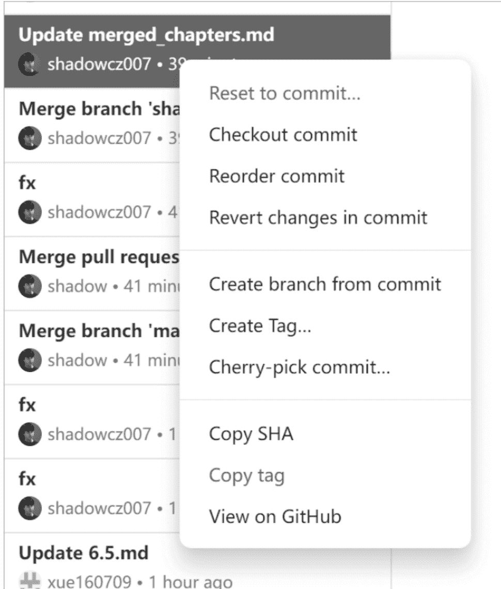

操作注意
1) 数据安全
- 重要回滚前先建备份分支；
- 不确定是否合适时先在新分支试验；
- 回滚前确保重要修改已提交。

2) 团队协作
- 回滚公共分支的代码前提前通知团队；
- 确认回滚不会影响他人工作；
- 回滚完成后及时推送到远端。

3) 代码管理
- 养成小批量提交习惯，便于精准回滚；
- 每次提交写清楚说明，方便定位回滚点；
- 定期推送到远端，避免本地丢失。

### 小白必记
- 重要操作前先做备份分支
- 小步提交，说明清晰完整
- 不确定时用新分支试验回滚
- 回滚公共代码先通知成员
- 定期推送，避免数据丢失
- 保持提交历史整洁有序
- 关键回滚前必须先备份

## 3.4.11 如何打开项目文件夹和编辑器
管理版本和回滚之后，日常开发最常用的是查看和编辑代码。桌面客户端除了版本控制，还能快速打开项目和编辑器。

### 1. 打开项目文件夹
1) 右键快捷菜单访问
- 在仓库列表找到项目；
- 对项目名称右键；
- 选 Show in Explorer 或 Show in Finder；
- 文件管理器会直接打开项目目录。

2) 顶部菜单访问
- 先在客户端选中项目；
- 点 Repository 菜单；
- 选 Show in Explorer/Finder；
- 系统打开对应文件夹。

### 2. 使用 Cursor 编辑项目
Cursor 是 AI 辅助编程工具，能提升编码效率。

1) 直接从客户端打开
- 选中项目；
- 点 Repository 菜单；
- 选 Open in Cursor；
- Cursor 启动并加载项目。

2) 设为默认编辑器
- 打开客户端设置；
- 进入 Integrations 集成；
- 在 External Editor 下拉里选 Cursor；
- 设置后可用快捷键快速打开。

3) 未看到 Cursor 选项的处理
- 确认 Cursor 已正确安装；
- 重启客户端；
- 通过 Open in External Editor 手动指定程序。

## 3.4.12 如何使用开源项目
除了管好自己的代码，学会利用开源社区也很重要。开源项目像开放的图书馆，可直接使用或在此基础上改写。主要分直接使用和二次开发两种。

### 1. 直接使用开源项目
1) 寻找合适的项目
- 打开 GitHub，在搜索框输入关键词；
- 看 Star 数量，越多越受欢迎；
- 检查最近更新时间；
- 阅读 README 了解功能。

2) 评估质量
- Star 很多通常更可靠；
- 半年内有更新说明活跃；
- 看 Issues 区问题处理是否及时；
- 文档是否完整，使用说明是否清晰。

3) 正确引入
- 仔细阅读安装说明；
- 用包管理器如 npm 安装依赖；
- 按文档完成配置；
- 在自己代码里引入使用。

### 2. 二次开发 Fork
1) Fork 项目
- 打开项目主页，点右上角 Fork；
- 选择保存到自己的账号下；
- 等待完成。

2) 克隆到本地
- 用客户端克隆到本地；
- 新建分支进行开发；
- 按需修改代码；
- 定期从原项目同步更新。

使用注意
1) 开源协议
- MIT 最宽松，基本可自由使用；
- Apache 可商用，需保留版权信息；
- GPL 修改后代码也必须开源；
- 商业项目务必仔细核对协议要求。

2) 技术兼容性
- 检查支持的编程语言版本；
- 确认运行环境要求；
- 评估与现有项目是否兼容；
- 注意可能的依赖冲突。

3) 使用成本
- 评估学习难度；
- 考量维护成本；
- 确认团队能否维护；
- 查看社区是否活跃。

### 小白必记
- 优先选 Star 多更新频繁的项目
- 使用前必须确认协议
- 确保与现有项目兼容
- 先看文档和示例再上手
- 评估团队技术储备
- 定期同步原项目更新
- 挑选活跃社区的项目

## 3.4.13 实用建议和最佳实践
把前面的知识点串起来，下面总结项目管理、提交、分支和协作的最佳实践。

项目文件管理，项目像书柜，要分类摆放。好的结构要清晰易懂。

规范目录一般包括
- src 目录放源码；
- docs 目录放文档；
- tests 目录放测试；
- assets 目录放静态资源；
- build 或 dist 目录放构建产物。

文件命名建议
- 用有意义的英文名；
- 全小写，单词用连字符；
- 避免中文和特殊字符；
- 名字要能表达内容。

代码提交最佳习惯
1) 提交频率
- 小功能完成就提交；
- 修复一个 bug 就提交；
- 不要攒大量改动再提交；
- 每天至少提交一次。

2) 提交说明写法
- 标题简洁，不超过 50 字；
- 细节用要点列出；
- 说明改动原因和影响；
- 有任务编号时标注。

示例
## 添加用户登录功能
- 新增登录页和表单校验
- 实现用户名密码加密存储
- 增加登录失败提示
- 关联任务 TASK-123

分支管理建议
1) 主干管理
- 保持主干随时可发布；
- 不要直接在主干开发；
- 定期部署到测试环境；
- 合并到主干需代码审查。

2) 功能分支管理
- 每个新功能单独建分支；
- 命名规范如 feature/login；
- 及时同步主干更新；
- 完成后及时合并或删除。

团队协作注意
1) 代码审查 Pull Request
- 提交 PR 前自查一遍；
- 认真对待审查意见；
- 及时回复评论并修改；
- 保持礼貌专业的沟通。

2) 文档维护
- 及时更新 README；
- 在代码里写必要注释；
- 记录重要配置说明；
- 保持文档与代码同步。

安全方面
1) 账号安全
- 开启双因素认证；
- 定期更换密码；
- 不在公共场所保持登录；
- 及时清理过期访问令牌。

2) 代码安全
- 用 .gitignore 过滤敏感信息；
- 不提交配置文件里的密码；
- 定期更新依赖包版本；
- 及时修复已知安全漏洞。

### 小白必记
- 目录分明，分类有序
- 小步提交，说明详细
- 主干稳定，功能分支灵活
- 互相尊重，积极沟通
- 及时更新，清晰易懂
- 定期检查，及时修复
- 命名简洁明了，见名知意

## 3.5 如何部署 Node.js 环境

### 3.5.1 Node.js 是什么
JavaScript 以前只能在浏览器里运行，像只在特定场地玩的积木。Node.js 的出现让这些积木脱离浏览器，到任何环境都能搭建。

Node.js 最大的优势是自带的包商店 NPM，里面有超过 200 万个现成积木包。每个包实现特定功能，组合起来就能搭出各种应用。

Node.js 可做的应用类型
1. 网站应用：比如开发类似微信朋友圈的社交平台，Node.js 能处理文字图片上传、管理用户互动、保障数据安全。LinkedIn 这类求职平台就基于 Node.js 构建。

2. 桌面软件：用过网易云音乐的朋友应该注意到了，这款播放器正是基于 Node.js 构建的。借助该技术，基于网页的技术栈完全可以封装成独立运行的桌面程序，VS Code 就是最典型的代表。

3. 移动应用：Node.js 虽然以服务端为主战场，但也能延伸到移动端开发。热门笔记应用 Notion 的客户端就是用 Node.js 来做的。配合 React Native 这类框架，团队可以用同一套 JavaScript 技术栈来开发原生体验的 App，开发效率高且性能接近原生。

4. 开发工具：对工程师来说，Node.js 更像一个万能工具箱，可以自动完成代码检查、资源打包、测试执行等重复性工作。Vue CLI 就是 Node.js 开发的脚手架，能快速搭建新项目。

Node.js 为什么如此受欢迎，总结如下。

1. 跨平台能力强：同一份代码无需调整即可在 Windows、macOS、Linux 等系统上运行。

2. 性能出色：底层使用 Google 的 V8 引擎驱动，执行速度非常快。

3. 生态系统丰富：前面提到的“积木商店”就是 NPM，已收录 200 多万个开源包，几乎任何功能都有现成方案。

4. 社区活跃：全球数百万开发者在使用，问题解答、经验分享和最佳实践很容易获取。

5. 学习曲线平缓：熟悉 JavaScript 后，学习 Node.js 基本是平滑过渡，上手门槛不高。

### 小白必记

- Node.js 的本质：让 JavaScript 摆脱浏览器限制，在多端运行
- NPM 的定位：全球最大规模的开源代码包管理平台
- 跨平台原则：一次编写，多处运行
- 性能要点：基于 V8 引擎，运行效率高
- 生态规模：超过 200 万个开源包
- 学习路径：先掌握 JavaScript，再进阶 Node.js

### 3.5.2 Node.js 下载与安装指南
弄懂 Node.js 的概念后，就要把它装到电脑里。Node.js 其实就是一个让 JavaScript 无处不在的平台，下面把这个平台部署起来。

先明确版本选择。

- LTS 版本：经过充分测试的稳定版，适合长期使用；
- Current 版本：最新功能版，更新快但稳定性相对一般。

新手建议优先选择 LTS，稳定性更好。

#### 1) 获取安装包
- 用浏览器打开官网 https://nodejs.org；
- 首页有两组醒目的绿色下载按钮；
- 点击左侧 LTS 下载；
- Windows 会自动下载 .msi，macOS 会自动下载 .pkg。

#### 2) 运行安装程序
Windows 安装步骤：
- 双击下载的 .msi；
- 安装向导中点“下一步”；
- 勾选“我同意”，继续“下一步”；
- 安装路径可保持默认；
- 连续点“下一步”完成安装。

macOS 安装步骤：
- 双击下载的 .pkg；
- 点“继续”；
- 同意许可协议；
- 安装位置建议默认；
- 可能需要输入系统密码；
- 等待安装完成。

#### 3) 验证安装结果
Windows 验证：
- 按 Windows + R，输入 cmd 回车打开命令提示符；
- 输入以下命令并回车。

```
node --version
```

macOS 验证：
- 点左上角苹果图标，选择“系统设置”；
- 点“聚焦”或按 Command + 空格，输入“终端”回车打开；
- 输入以下命令并回车。

```
node --version
```

如果看到类似 v18.16.0 的版本号，说明安装成功。

安装过程中常见问题：
1) 提示“无法打开”或“来源不明”
- Windows：右键安装包→属性→解除锁定；
- macOS：系统设置→安全性与隐私，允许打开。
2) 安装失败或报错
- 暂时关闭杀毒软件重试；
- 以管理员权限运行安装程序；
- 清理临时文件后再试。
3) 命令行提示“不是内部或外部命令”
- Windows：重启电脑；
- 检查环境变量是否设置正确。

### 小白必记

- 版本选择建议：新手优先 LTS
- 安装位置建议：保持默认路径
- 验证要点：执行 node --version 查看版本
- 权限关键：安装时需要管理员权限
- 排错思路：重启、权限、环境变量

### 3.5.3 NPM 是什么
认识了 Node.js 这个平台后，它的标配助手 NPM 也要了解。可以把建乐高城堡类比进来：从零做每个积木太费劲，而有一个巨大的积木商店，随取即用就高效得多——这正是 NPM 的作用。

NPM 即 Node Package Manager，拆开理解：
- Node：为 Node.js 服务；
- Package：独立的代码包，像积木；
- Manager：负责搜索、安装和管理这些包。

规模有多大？目前已收录超过 200 万个可直接使用的代码包，每个包都有固定用途：
- 有的负责美化网页按钮；
- 有的处理数学计算；
- 有的连接数据库；
- 有的负责发送邮件。

NPM 的优势：
1) 完全免费
由全球开发者贡献，所有包都可免费使用。
2) 版本管理智能
每个包会持续迭代，NPM 能精准安装所需版本。
3) 自动处理依赖
就像买需要电池的玩具，NPM 会自动补齐相关依赖。
4) 更新便捷
新版本发布后，一行命令即可完成升级。

确认 NPM 是否已安装，打开 Cursor 终端按下 Ctrl+` 或 Cmd+`，输入以下命令。

```
# 查看npm版本
npm --version
# 如果看到类似"9.5.0"的版本号，说明npm已经安装成功
```

只要 Node.js 装好，NPM 会自动随装。

基本使用流程：
1. 在 NPM 官网找到所需包；
2. 用 npm install 命令安装；
3. 在代码中调用该包的功能。

### 小白必记

- NPM 本质：免费开源的代码包管理工具
- 包的特点：功能独立，即装即用
- 版本原则：精准选型，避免冲突
- 依赖机制：自动安装关联组件
- 更新方式：一条命令即可升级
- 安装检查：用 npm --version 确认

### 3.5.4 NPM 换源加速指南
NPM 功能强大，但国内下载速度常不理想。相当于只能从海外商店下单，耗时较长；换成国内镜像，就像就近提货，速度明显提升。

换源前准备：
1. 确认权限
   - Windows：在管理员身份下运行 Cursor；
   - macOS：在终端执行以下命令设置目录权限。

```
sudo chown -R $(whoami) ~/.npm
```

2. 打开 Cursor 终端
   - 快捷键 Ctrl+` 或 Cmd+`，或点击底部 Terminal 标签。

两种换源方案：

**方式一：使用 cnpm，适合新手**
- Windows 管理员身份运行：

```
npm install -g cnpm --registry=https://registry.npmmirror.com
```

- macOS：

```
sudo npm install -g cnpm --registry=https://registry.npmmirror.com
```

验证是否成功：

```
cnpm -v
```

安装成功后，可用 cnpm 代替 npm：

```
# 使用cnpm安装包
cnpm install express

# 使用cnpm全局安装包
cnpm install -g typescript
```

**方式二：直接更换 npm 源，适合进阶用户**
- Windows：

```
npm config set registry https://registry.npmmirror.com
```

- macOS：

```
sudo npm config set registry https://registry.npmmirror.com
```

检查设置是否生效：

```
npm config get registry
```

如果返回 https://registry.npmmirror.com 即换源成功。

常见问题：
1) 安装失败或报错
- 检查网络是否正常；
- 执行 npm cache clean -f 清理缓存；
- 确保使用管理员权限。
2) 切换回官方源
- Windows：

```
npm config set registry https://registry.npmjs.org
```

- macOS：

```
sudo npm config set registry https://registry.npmjs.org
```
3) 下载仍慢
- 查看当前源：npm config get registry；
- 确认网络稳定；
- 可尝试手机热点测试。

参考地址：
- NPM 官方：https://www.npmjs.com
- npmmirror：https://npmmirror.com

### 小白必记

- 换源原则：国内用户优先使用国内镜像
- cnpm 特点：命令简单，适合入门
- 权限要求：Windows 需管理员，macOS 需 sudo
- 推荐源：npmmirror 稳定性好
- 验证方法：npm config get registry 检查
- 故障处理：清理缓存常能解决问题

### 3.5.5 常用 NPM 命令速览
了解 NPM 及其换源后，就要学会实际操作。可以把 NPM 想象成工具箱，里面每条指令都是不同功能的工具，先搞清用途再用。

macOS 用户先设置权限：

```
# 设置npm目录权限
sudo chown -R $(whoami) ~/.npm

# 执行全局安装命令时需要加sudo
sudo npm install -g 包名
```

打开工作台 Cursor 终端：
- Windows：Ctrl+`
- macOS：Cmd+`

常用指令分类：

#### 1) 项目初始化
相当于为新手工项目准备工作台。

```
# 创建新项目（会询问一些基本信息）
npm init

# 快速创建新项目（使用默认配置）
npm init -y
```

这里的 -y 可自动填充默认信息。

#### 2) 安装包
安装可分为本地项目使用和全局安装。

```
# 在当前项目中安装包（放在工作台上）
npm install 包名

# 简写形式
npm i 包名

# 全局安装包（放在工具箱里）
npm install -g 包名

# macOS用户需要加sudo
sudo npm install -g 包名

# 安装特定版本的包
npm install 包名@版本号
```

#### 3) 删除包
清理不再需要的依赖。

```
# 删除当前项目中的包
npm uninstall 包名

# 删除全局安装的包
npm uninstall -g 包名

# macOS用户需要加sudo
sudo npm uninstall -g 包名
```

#### 4) 更新包
保持依赖为最新状态。

```
# 更新特定的包
npm update 包名

# 更新全局的包
npm update -g 包名

# Mac用户需要加sudo
sudo npm update -g 包名
```

#### 5) 查看信息
查看已装包或包详情。

```
# 查看某个包的详细信息
npm info 包名

# 查看当前项目安装的所有包
npm list

# 查看全局安装的所有包
npm list -g
```

使用技巧：
#### 1) 安装时的特殊参数

```
# 安装开发环境需要的包
npm install --save-dev 包名

# 或使用简写
npm i -D 包名

# 安装生产环境需要的包
npm install --save 包名

# 或使用简写
npm i -S 包名
```

#### 2) 常见问题处理

```
# 清理npm缓存
npm cache clean -f

# 检查npm配置
npm config list
```

### 小白必记

- npm init 原则：新项目先初始化
- install 用法：本地直接用，全局加 -g
- 版本号规则：@ 后指定版本，不写则默认最新
- 权限要点：macOS 全局操作需加 sudo
- 缓存处理：出错先清理 npm cache
- 简写习惯：i 代替 install，-D 代替 --save-dev

### 3.5.6 NPM 实际应用演示
通过一个小型网站项目来感受 NPM 的使用。就像盖小房子，先准备工具和材料，再逐步搭建。

1）创建项目目录

```
# 创建一个名为my-website的文件夹
mkdir my-website

# 进入这个文件夹
cd my-website
```

2）初始化项目

```
# 使用NPM初始化项目，-y 表示使用默认配置
npm init -y
```

执行后会在项目文件夹生成 package.json，相当于项目说明书，记录基础信息和依赖清单。

接下来安装常用包，相当于准备建材：

```
# 安装用于构建用户界面的包
npm install react react-dom

# 安装开发工具包（只在开发时使用）
npm install --save-dev webpack webpack-dev-server
```

包说明：
- react 和 react-dom：构建页面结构的基础；
- webpack：负责代码处理与打包；
- webpack-dev-server：提供开发时的本地预览环境。

安装完成后会有变化：
1）新增 node_modules 文件夹
存放所有安装的包，像材料仓库，体积可能较大。
2）package.json 被更新
新包会自动写入，dependencies 记录运行必需包，devDependencies 记录开发依赖。
3）新增 package-lock.json
锁定各包的精确版本，保证团队一致性。

创建简单网页以便使用这些包：

```javascript
// 创建 src/index.js 文件
import React from 'react';
import ReactDOM from 'react-dom/client';

// 创建一个简单的组件
function App() {
  return (
    <div>
      <h1>你好，这是我的第一个 React 网站！</h1>
      <p>使用 NPM 管理项目真是太方便了！</p>
    </div>
  );
}

// 将组件渲染到页面上
const root = ReactDOM.createRoot(document.getElementById('root'));
root.render(<App />);
```

最后可在 package.json 中补充常用脚本命令，让项目一键运行。

```json
{
    // ... 其他配置保持不变
    "scripts": {
        "start": "webpack serve --mode development",
        "build": "webpack --mode production"
    }
}
```

这两条 NPM 命令可以类比成工地的现场指令。

- npm start 会拉起本地开发服务，相当于每天正常开工；
- npm build 会把代码打包成可发布的版本，相当于工程竣工验收。

在日常使用项目时，建议留意以下几个习惯。

1）团队协作
- 交接代码时请不要把 node_modules 目录一起带上；
- 接收方在本地运行一次 npm install，就能完整还原所有依赖。

2）版本控制
新建 .gitignore 文件，把 node_modules 写入忽略列表。

```bash
echo "node_modules/" > .gitignore
```

3）依赖管理
- 建议定期执行 npm update，让依赖保持在合理的新版本；
- 在添加新包之前，先判断它是否真正必要。

### 小白必记
- 初始化顺序：先建好项目文件夹，再执行 npm init；
- 依赖分类：开发时用的和运行时用的要分开记录；
- 仓库规范：node_modules 一律不进代码库；
- 包管理思路：按需安装，适时更新；
- 协作要点：保证 package.json 完整可读；
- 脚本技巧：把常用命令写进 scripts 里方便调用。

## 3.5.7 package.json和package-lock.json的作用和区别

前面已经介绍了 NPM 的基础操作，这里再深入拆解项目里最关键的两份配置文件：package.json 与 package-lock.json。

可以把它想象成开餐厅的日常：package.json 好比菜单和采购清单，说明餐厅提供哪些菜品、需要哪些食材；package-lock.json 则像采购部的详细台账，记下每种食材从哪家供应商进、什么品牌、什么规格、甚至价格。

对 Node.js 项目而言，这两份文件分工明确。下面先说 package.json。

package.json 相当于项目的说明文档，记录项目基本信息以及所有依赖的声明。执行 npm init 时，NPM 会自动生成它，内容大致如下。

```json
{
    "name": "my-restaurant",           // 项目名称
    "version": "1.0.0",                 // 项目版本号
    "description": "我的网上餐厅",       // 项目描述
    "main": "index.js",                 // 项目的主入口文件
    "scripts": {                         // 可以运行的命令
        "start": "node index.js",        // 启动项目
        "test": "jest"                   // 运行测试
    },
    "dependencies": {                    // 项目运行时需要的包
        "express": "^4.18.2",            // Web 服务器框架
        "mongoose": "^7.0.0"             // 数据库操作工具
    },
    "devDependencies": {                 // 开发时需要的包
        "jest": "^29.5.0",               // 测试工具
        "nodemon": "^2.0.22"             // 开发环境自动重启工具
    }
}
```

其中版本号前面的符号含义需要特别注意。

- ^4.18.2 表示允许在 4.x.x 范围内升级，但不能跨到 5.0.0 及以上；
- ~4.18.2 表示只接受 4.18.x 的小幅更新；
- 4.18.2 不带符号则强制锁定该精确版本。

package-lock.json 的工作更细致，它像一份采购记录，精确到每个包的版本和下载来源。

```json
{
  "name": "my-restaurant",
  "version": "1.0.0",
  "lockfileVersion": 2,
  "requires": true,
  "packages": {
    "node_modules/express": {
      "version": "4.18.2",
      "resolved": "https://registry.npmjs.org/express/-/express-4.18.2.tgz",
      "integrity": "sha512-9xB2vY8fYxGaJy+..."
    }
  }
}
```

它的价值主要体现在以下三点。

1）版本锁定
同事拿到项目后运行 npm install，NPM 会严格按 package-lock.json 里的版本号和地址安装，保证每个人得到完全一致的依赖。

2）安装提速
因为下载地址和依赖关系都已写死，NPM 无需重新计算，直接拉取，安装明显更快。

3）问题追溯
出现异常时，可以对照这份文件定位是哪个包的哪个版本引发的。

开发中建议遵守以下做法。

(1) package.json 和 package-lock.json 都要一起提交到 Git 等版本库。
(2) 不要手工修改 package-lock.json，由 NPM 自动维护即可。
(3) 安装新包时使用 npm install 包名 --save 或 npm install 包名 --save-dev。
(4) 定期用 npm update 更新依赖，但务必先在测试环境验证影响。

### 小白必记
- package.json 的定位：项目说明与依赖声明合一；
- package-lock.json 的定位：精确锁定依赖版本与来源；
- 版本号写法：^ 代表允许小版本升级；
- 依赖划分：生产依赖和开发依赖要区分管理；
- 文件提交：两份文件都应纳入版本控制；
- 更新原则：先测试后上线，避免盲目升级。

## 3.6 不同平台使用的Node.js框架

### 3.6.1 网页开发：Next.js

在介绍 Next.js 之前先聊下它的价值。造房子如果每次都要从打地基开始会很低效，Next.js 就像是提供好地基和框架的智能工具包，你只需专注于内部设计和内容填充。

Next.js 是基于 React 的全栈网页框架，它解决了传统开发的不少痛点。

- 页面加载慢？Next.js 能在服务端提前生成内容；
- 目录结构混乱？Next.js 用文件夹即可清晰管理路由；
- 性能焦虑？Next.js 会自动优化资源加载方式；
- 环境搭建麻烦？Next.js 提供开箱即用的开发工具。

下面以一个简易个人博客为例演示流程。

（1）首先，创建一个新的项目仓库。
```bash
# 第一步：在GitHub网站上创建新仓库
# 仓库名称：my-blog
# 记得选择"添加README文件"选项

# 第二步：把仓库克隆到本地
git clone https://github.com/你的用户名/my-blog.git
cd my-blog
```
（2）接下来用 Next.js 工具初始化项目。
```bash
# 使用 create-next-app 创建项目
# 注意这里的 . 表示在当前文件夹创建项目
npx create-next-app@latest .

# 在初始化过程中，你会看到以下选项：
√ Would you like to use TypeScript? ... Yes # 使用 TypeScript 让代码更可靠
√ Would you like to use ESLint? ... Yes # 使用 ESLint 帮助发现代码问题
√ Would you like to use Tailwind CSS? ... Yes # 使用 Tailwind CSS 快速设计界面
√ Would you like to use `src/` directory? ... Yes # 使用 src 目录更好地组织代码
√ Would you like to use App Router? ... Yes # 使用新版路由系统
√ Would you like to customize the default import alias? ... No # 暂时不需要自定义导入
```
（3）项目创建完成后，了解一下基础目录。
```
my-blog/
├── src/                    # 源代码目录
│   ├── app/                # 页面和路由
│   │   ├── page.tsx        # 首页
│   │   └── layout.tsx      # 全局布局
│   └── components/         # 可重用组件
├── public/                 # 静态文件（图片等）
└── package.json            # 项目配置文件
```
（4）现在可以启动开发服务器。
```bash
# 启动开发服务器
npm run dev

# 在浏览器中访问http://localhost:3000就能看到你的网站了！
```
（5）创建一个简单的博客首页。
```javascript
export default function Home() {
  return (
    <main className="min-h-screen p-8">
      <h1 className="text-4xl font-bold mb-8">
        欢迎来到我的博客
      </h1>

      <div className="grid gap-4">
        <article className="p-4 border rounded-lg">
          <h2 className="text-2xl font-semibold">我的第一篇博客</h2>
          <p className="mt-2 text-gray-600">
            这是我使用 Next.js 创建的第一篇博客文章 ...
          </p>
        </article>
      </div>
    </main>
  )
}
```

### 小白必记
- Next.js 的思路：框架搭好后聚焦内容开发；
- 目录要点：src 放源码，public 放静态资源；
- 开发四步：建仓库、初始化、写代码、部署上线；
- 路由规则：文件结构直接映射 URL；
- 组件原则：重复的界面元素封装成组件复用；
- 性能说明：Next.js 默认优化，无需太多手动干预。

### 3.6.2 桌面软件：Electron

为何微信 PC 版、VS Code 这类应用能在不同系统上保持一致体验？核心就是 Electron。

Electron 好比一个跨平台的“变形工具”，它让网页技术栈 HTML、CSS、JavaScript 能够构建桌面程序。以前你掌握的网页开发能力，现在可以直接迁移到桌面端。

选它有什么好处？把做桌面软件比作装修，传统方式需要在 Windows、macOS、Linux 三套不同房子里分别装修；用 Electron 只要设计一次方案，就能自动适配各系统，省时省力。

下面演示一个简单的笔记应用开发。

（1）首先，准备开发环境，确保电脑已安装 Node.js，相当于准备好工具箱。
```bash
# 检查Node.js是否安装成功
node --version
npm --version
# 如果没有安装，请从Node.js官网下载并安装
```
（2）接下来创建新的项目。
```bash
# 创建项目文件夹
mkdir my-note-app
cd my-note-app
# 初始化项目
npm init -y
# 安装Electron
npm install electron --save-dev
```
（3）创建主进程文件 main.js，这是应用的入口。
```javascript
const { app, BrowserWindow } = require('electron')
const path = require('path')

// 创建主窗口的函数
function createWindow() {
  // 创建一个新的浏览器窗口
  const mainWindow = new BrowserWindow({
    width: 800,                     // 窗口宽度
    height: 600,                    // 窗口高度
    webPreferences: {
      nodeIntegration: true,        // 允许在渲染进程中使用 Node.js
      contextIsolation: false       // 关闭上下文隔离
    }
  })

  // 加载 index.html 文件
  mainWindow.loadFile('index.html')
}

// 当 Electron 完成初始化时创建窗口
app.whenReady().then(() => {
  createWindow()

  // 在 macOS 中，当所有窗口都关闭时，通常会重新创建一个窗口
  app.on('activate', function () {
    if (BrowserWindow.getAllWindows().length === 0) createWindow()
  })
})

// 当所有窗口关闭时退出应用
app.on('window-all-closed', function () {
  if (process.platform !== 'darwin') app.quit()
})
```
（4）创建界面文件 index.html。

### 3.6.3 手机客户端：Expo

先理解 Expo 的意义。传统移动开发要为 iOS 和 Android 各自造一栋房子，成本高。Expo 就像一份通用图纸，一次绘制即可在两端落地。

Expo 构建在 React Native 之上，它封装了大量底层细节，让开发者专注业务功能。就像有位贴心助手提前准备好工具材料，你只需设计界面与交互。

下面以待办事项应用为例。

(1) 首先，准备开发环境。
### 安装Expo命令行工具
```
npm install -g expo-cli
```
### 在手机上安装Expo Go应用
从应用商店搜索 Expo Go 并安装。
(2) 创建新项目。
### 创建一个新的Expo项目
```
npx create-expo-app my-todo-app
```
```
cd my-todo-app
```
### 安装需要用到的组件库
```
npm install @react-native-async-storage/async-storage
```
(3) 编写一个简单的待办事项应用。

# 从Expo到AI协同：Todo List开发全流程拆解

```javascript
import React, { useState, useEffect } from 'react';
import {
  StyleSheet,
  Text,
  View,
  TextInput,
  TouchableOpacity,
  FlatList
} from 'react-native';
import AsyncStorage from '@react-native-async-storage/async-storage';

export default function App() {
  // 定义状态：待办事项列表和新任务输入
  const [todos, setTodos] = useState([]);
  const [newTodo, setNewTodo] = useState('');

  // 加载保存的待办事项
  useEffect(() => {
    loadTodos();
  }, []);

  // 从本地存储加载待办事项
  const loadTodos = async () => {
    try {
      const storedTodos = await AsyncStorage.getItem('todos');
      if (storedTodos) {
        setTodos(JSON.parse(storedTodos));
      }
    } catch (error) {
      console.error('加载待办事项失败：', error);
    }
  };

  // 保存待办事项到本地存储
  const saveTodos = async (newTodos) => {
    try {
      await AsyncStorage.setItem('todos', JSON.stringify(newTodos));
    } catch (error) {
      console.error('保存待办事项失败：', error);
    }
  };

  // 添加新的待办事项
  const addTodo = () => {
    if (newTodo.trim()) {
      const updatedTodos = [
        ...todos,
        { id: Date.now(), text: newTodo, completed: false }
      ];
      setTodos(updatedTodos);
      saveTodos(updatedTodos);
      setNewTodo('');
    }
  };

  return (
    <View style={styles.container}>
      <Text style={styles.title}>我的待办事项</Text>

      {/* 添加新任务的输入框和按钮 */}
      <View style={styles.inputContainer}>
        <TextInput
          style={styles.input}
          value={newTodo}
          onChangeText={setNewTodo}
          placeholder="输入新的待办事项..."
        />
        <TouchableOpacity style={styles.addButton} onPress={addTodo}>
          <Text style={styles.buttonText}>添加</Text>
        </TouchableOpacity>
      </View>

      {/* 待办事项列表 */}
      <FlatList
        data={todos}
        keyExtractor={(item) => item.id.toString()}
        renderItem={({ item }) => (
          <View style={styles.todoItem}>
            <Text style={styles.todoText}>{item.text}</Text>
          </View>
        )}
      />
    </View>
  );
}

// 样式定义
const styles = StyleSheet.create({
  container: {
    flex: 1,
    padding: 20,
    paddingTop: 50,
    backgroundColor: '#fff',
  },
  title: {
    fontSize: 24,
    fontWeight: 'bold',
    marginBottom: 20,
  },
  inputContainer: {
    flexDirection: 'row',
    marginBottom: 20,
  },
  input: {
    flex: 1,
    borderWidth: 1,
    borderColor: '#ddd',
    padding: 10,
    marginRight: 10,
    borderRadius: 5,
  },
  addButton: {
    backgroundColor: '#007AFF',
    padding: 10,
    borderRadius: 5,
    justifyContent: 'center',
  },
  buttonText: {
    color: '#fff',
    fontWeight: 'bold',
  },
  todoItem: {
    padding: 15,
    borderBottomWidth: 1,
    borderBottomColor: '#eee',
  },
  todoText: {
    fontSize: 16,
  },
});
```

(4) 启动应用并进行实时验证。

```
# 启动开发服务器
npm start
# 此时会显示一个二维码
# 用手机打开Expo Go应用，扫描二维码即可预览应用
```

### 新手速记清单

- Expo核心思想：同一份源码同时跑在iOS与Android上
- 准备工作：命令行工具和手机端App都要先就位
- 开发节奏：建项目、写代码、即时预览，三步走完
- 状态管理：用useState保存数据，用useEffect处理副作用
- 本地持久化：靠AsyncStorage把数据存到设备里
- 样式管理：统一用StyleSheet集中维护样式
- 调试方式：打开Expo Go扫码就能看到实时效果

做完这个简易的待办小例子，Expo的整体开发脉络就清楚了。它让移动端开发门槛明显降低，开发体验也更顺手。学习的关键还是动手，多尝试改动这个应用，比如加上删除功能、完成标记等，实践是最快的掌握方式。

## 3.6.4 开发前的准备与关键注意

真正动手写代码之前，先把前期工作理清楚。就像盖房子要先勘测、打基础，写App同样需要规划和准备。

先聊版本控制。可以把它理解成给代码不断拍照，每一张快照都记录一个时间点的样子。出了问题就能立刻回到过去的版本。实操中常用GitHub来托管版本。

编码前先在GitHub建一个新仓库，相当于给项目找一个安全仓库。做完一个功能就把改动推上去保存，别忘了写清楚这次提交改了什么，方便自己和别人回溯。

开发环境的准备好比下厨前的备料：

### 1）基础环境配置

- 安装Node.js，官网下载LTS长期支持版；
- 安装Cursor编辑器，作为主力编码工具；
- 配置好Git，用于版本管理。

### 2）按目标平台补充工具

- 纯网页开发：Cursor已足够；
- iOS开发：需在macOS上装Xcode，用于调试和预览；
- Android开发：需装Android Studio，用于调试和真机预览。

移动端建议采用双工具协作：

- Cursor负责写代码，内置AI能大幅加速；
- 同时打开Xcode或Android Studio做调试和预览；
- Xcode里用模拟器实时看iOS效果；
- Android Studio里用模拟器或真机看Android效果。

### 1) 本地开发与测试

每完成一个小功能就先在本地跑通，像厨师尝味道一样确认正常。移动端一定要同时在iOS和Android上测一遍。

### 2) 代码提交

功能验证通过后立刻推送到GitHub，相当于给这个里程碑拍张照。

### 3) 依赖包维护

定期检查项目依赖，适时升级，类似定期更换调味料，保证版本新、风险低。

选框架要按需：

- 做网站首选Next.js，SEO友好，适合官网、资讯类；
- 做桌面软件选Electron，能调用系统能力，适合文件管理、音视频编辑；
- 做手机应用选Expo，一套代码覆盖双端，适合团队快速出原型。记得双端都要验证体验一致。

### 新手速记清单

- 工具组合：Cursor写代码，专业IDE负责调试
- 移动端原则：iOS和Android都要测，体验要统一
- 版本管理：功能闭环即提交，保持记录清晰
- 环境要求：工具链完整，测试环节充分
- 代码托管：放GitHub，分支使用规范
- 框架选择：需求导向，不盲目追新
- 依赖更新：定期维护，安全优先
- 测试顺序：本地先跑通，再推送代码

## 3.7 实战：用AI搭一个Todo List

想不想亲手做一个能用的应用？本节会带你完整做出一个待办事项App，体验AI助手像资深程序员搭档一样加速开发。

完整源码：https://github.com/xue160709/todolist1  
演示视频扫码查看。


### 3.7.1 环境搭建

写代码前先把环境搭好，环境顺手后面才快。

先建一个代码仓库。GitHub是开发者常用的协作托管平台。

(1) 在GitHub上创建新仓库。

- 打开GitHub官网；
- 点右上角New repository；
- 仓库命名例如todolist1；
- 选择Public公开；
- 点Create repository完成创建。

随后把远程仓库拉到本地。

(2) 克隆项目到本地。

- 启动GitHub Desktop；
- 把刚建的仓库克隆下来；
- 在本地文件夹右键选择Open in Cursor。

项目空荡荡时需要先搭框架，这里用Next.js。


(3) 初始化Next.js项目。

```
npx create-next-app@latest .
```

执行创建命令后，终端会交互式提问，建议这样选：

- Would you like to use TypeScript? → Yes，代码更可靠；
- Would you like to use ESLint? → Yes，提前发现问题；
- Would you like to use Tailwind CSS? → Yes，界面更快变美；
- Would you like to use src/ directory? → Yes，结构更清晰；
- Would you like to use App Router? → Yes，Next.js主推路由；
- Would you like to customize the default import alias? → No，暂不需要。

### 3.7.2 配置AI助手

Cursor里的AI就像一个经验丰富的搭档，但要先让它了解项目。

(1) 打开Composer窗口，在这里与AI对话。输入@codebase指令，相当于把项目说明书递给AI，让它掌握整体结构。

## 3.7.3 搭建基础界面

有了AI配合就可以开画界面了，先像画草图一样把样子搭出来。

第一次协作：打开Composer，描述需求例如“帮我做一个移动端网页版TodoList”，如图3-4所示。

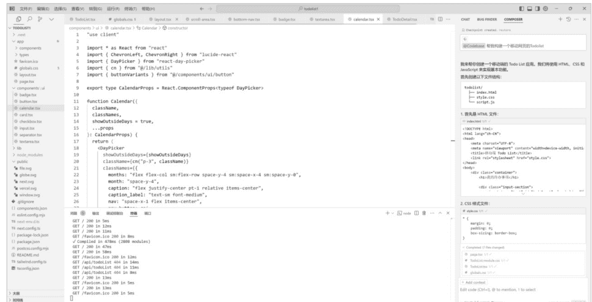

图3-4 将你的需求描述给Cursor

AI会先给出第一版。它可能像新手画师一样，第一稿不够理想，比如生成普通HTML文件而非Next.js组件，如图3-5所示。这时提示它：“这是Next.js项目，请按Next.js规范重写”。

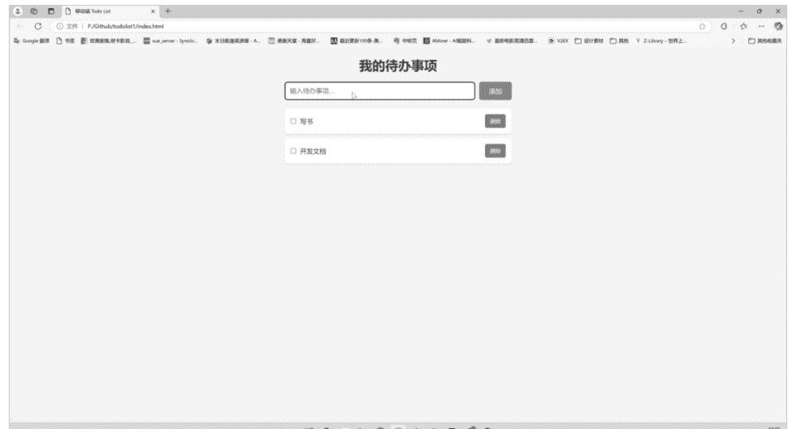

图3-5 Todo List初始版本

AI会根据反馈重新生成符合规范的代码。反复调整，直到草图达到预期。

## 3.7.4 界面美化

基础版有了，接下来装修。用shadcn/ui这个组件工具包可以快速提升质感。

shadcn/ui提供按钮、输入框、卡片等即用组件。集成过程很简单，让AI来做配置即可。

在Composer说：“请帮我用shadcn/ui美化界面”。  
AI会给出安装配置命令，按提示点run运行即可。

配置完后开始美化：

- 把原生按钮换成shadcn/ui风格按钮；
- 把普通输入框升级为精致组件；
- 用卡片组织内容区块；
- 设计清晰的整体布局。

优化后的效果如图3-6所示。

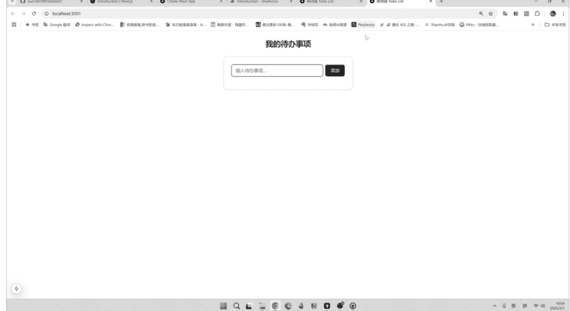

图3-6 Todo List优化版本

## 3.7.5 功能实现

外表完成就该加功能，像给房子装上电器和家具。

告诉AI你想要的功能，它会先规划步骤。例如：“请完善待办应用的功能”。

AI会完成：

- 列出需要实现的功能清单；
- 把大任务拆成小任务；
- 逐步指导实现。

核心能力包括：

- 任务管理：新增、删除、编辑任务；
- 分类管理：为任务加标签与类别；
- 优先级：设置重要程度；
- 截止日期：为任务设定期限；
- 搜索：快速定位目标任务。

最终界面如图3-7所示，顶部显示总计、已完成、待完成、已逾期数量，支持搜索、筛选，列表展示任务、优先级、截止时间和编辑删除入口，底部有首页、新建、设置导航。

## 3.7.6 Cursor的两种AI工作模式

Cursor提供Normal模式和Agent模式，各有侧重。

### 1. Normal模式

传统辅助方式，AI一次性完成明确任务。比如要求生成某个功能，它会直接输出完整代码。适合任务清晰、单一的场景。该模式提供codebase能力，便于组织代码结构。

### 2. Agent模式

更主动的工作流。AI会：

- 自动把大需求拆解为多个子任务；
- 在执行中自我修正与优化；
- 持续推进整个开发流程。

例如要求“为Todo List增加更多功能和界面”，Agent会规划分类标签体系、设计优先级交互等，并逐步落地。

- 为每个迭代设定截止时间，功能按序逐项落地。

即便不一定具备代码库检索能力，Agent 模式也能以更有序的方式拆解复杂问题，特别适合需要多步协作的开发场景。

### 3. 选择合适的模式

采用 Normal 模式的情形：

- 需求明确单一，边界清晰；
- 希望快速拿到可用的完整方案；
- 需要借助 codebase 提供上下文。

采用 Agent 模式的情形：

- 任务复杂度高，必须拆成若干子任务推进；
- 希望 AI 在执行期间持续打磨、反复修正；
- 需要更智能的拆解与整体规划能力。

实战中两种模式可以灵活交替使用。比如先用 Normal 模式迅速搭建基础框架，再切换到 Agent 模式做细化完善。如图3-8所示为移动端待办事项应用调试界面。


图3-8 移动端待办事项应用调试界面

### 小白必记

- 环境配置准则：工具链安装完整且规范
- AI 助手使用准则：先交代项目背景，再追问细节
- 代码生成准则：渐进式改进，避免急于求成
- 组件使用准则：善于借助现成组件库提升效率
- 功能开发思路：先做整体规划，再分步实现
- 调试技巧准则：出现报错即时处理，保持顺畅沟通
- 移动适配要点：全流程多端测试，不留盲区
- 开发流程准则：小步快跑，频繁验证

# 第4章 使用Cursor开发Agent

## 4.1 Agent基础知识介绍

随着生成式 AI 的快速演进，Agent 正在成为一种新的智能应用形态，改变了人与 AI 的协作方式。本节围绕概念、特性和系统提示词构建展开，帮助读者建立系统认知。

### 4.1.1 什么是Agent

先用生活类比。设想你有一位极其能干的私人助理，他不仅能听懂需求，还会自主思考、制定执行路径，并灵活调用各种工具把事情办成。这个角色就相当于 Agent。

Agent 是一种具备自主决策能力的智能程序。它能感知环境、独立推理、调用工具并采取行动来完成交办任务。

Agent 由三大模块构成。

1) 大脑——模型（Model）
大脑是核心，通常由一个或多个大语言模型构成，负责信息处理与决策。
- 解析用户的指令与需求；
- 基于已有知识进行分析与推理；
- 规划解决问题的步骤；
- 依据情境动态调整策略。

2) 手脚——工具（Tool）
工具是 Agent 与外部世界交互的延伸。
- 搜索引擎：获取最新资讯；
- API 接口：执行具体操作；
- 文件系统：读写数据；
- 计算工具：完成数值运算。

3) 大管家——编排层（Orchestration）
编排层负责任务调度，协调模型与工具的配合。
- 决定何时调用何种工具；
- 处理各步骤的中间结果；
- 规划下一步动作；
- 保证整体协作顺畅。

例如规划一次旅行，Agent 先理解需求，通过搜索获取目的地信息，调用天气 API 查看预报，再用订票系统预订机票酒店，编排层确保全流程有序进行。

### 小白必记

- Agent 的本质：会思考的智能助手
- 模型功能：充当大脑中枢
- 工具作用：相当于手脚
- 编排层职责：统筹规划各项任务
- 智能决策特点：观察、思考、行动一体化

### 4.1.2 Agent与LLM的区别

了解 Agent 后，自然会问它与大语言模型有何不同。用一个比喻：一位是博学却闭门造车的图书管理员，只能基于馆内书籍作答；另一位是机灵的私人助理，能上网查资料、用工具办事、处理实际问题。前者像传统 LLM，后者就是 Agent。

#### 1. 信息获取能力

1) 大语言模型
知识是静态封闭的。
- 仅限训练数据范围，无法更新；
- 不能获取实时信息，对新事件无感；
- 面对变化信息难以应对；
- 回答依赖记忆内容。

2) Agent
信息获取是动态开放的。
- 可借助搜索引擎、专业数据库等工具获得最新信息；
- 知识边界随工具使用不断拓展；
- 能融合实时信息与既有知识给出更准答案；
- 可主动学习并更新知识库。

#### 2. 上下文记忆能力

1) 大语言模型
记忆像金鱼，短暂受限。
- 对话记忆仅限当前会话窗口；
- 难以延续历史话题；
- 缺乏长期上下文关联；
- 需要用户反复重复。

2) Agent
记忆管理更持久。
- 能构建用户画像，记住偏好习惯；
- 自然延续既往对话；
- 建立持续的对话脉络；
- 基于历史交互优化服务。

#### 3. 工具操作能力

1) 大语言模型
偏于纸上谈兵。
- 只能提供建议，无法执行；
- 局限于文本交互，无法直接操作外部工具；
- 能力受模型自身限制；
- 不能完成实际操作任务。

2) Agent
具备实操能力。
- 可调用 API 与工具完成具体任务；
- 能访问数据库、文件系统等外部资源；
- 可组合多工具解决复杂问题；
- 拥有真实的执行能力。

### 小白必记

- Agent 特点：主动学习，擅长用工具
- 传统模型局限：知识固定，无法实操
- 记忆差异：Agent 长期记忆，LLM 短期记忆
- 工具使用差异：Agent 可执行，LLM 仅能建议
- 应用场景对比：Agent 解决问题，LLM 回答问题

### 4.1.3 System Prompt详解

前面介绍了 Agent 概念，下面讲解如何用系统提示词来“培训” Agent。就像给新员工发放入职手册，明确身份、职责与方式，这就是 System Prompt 的作用。

#### 1. System Prompt与User Prompt的区别

以餐厅为例，System Prompt 像厨师的岗位手册：
- “你是一位专业的中餐厨师”；
- “必须严格遵守食品安全标准”；
- “顾客特殊要求需特别注意”；
- “每道菜保持品质一致”。

User Prompt 像顾客点单：
- “我要一份宫保鸡丁”；
- “少放辣椒”；
- “不要放花生”。

System Prompt 定义身份与行为准则，User Prompt 提出具体任务。

#### 2. System Prompt的核心要素

一个好的系统提示词应包含四个要点。

1) 角色定位
明确工作证信息。
- 所属专业领域；
- 沟通语气风格；
- 专业知识覆盖范围。

2) 行为规范
相当于工作守则。
- 可做与不可做的边界；
- 问题处理的优先级；
- 用户隐私与安全保护方式。

3) 能力边界
相当于工具箱清单。
- 可使用的工具列表；
- 解决问题的方法；
- 输出格式要求。

4) 异常处理
应对意外情况的预案。
- 面对不明确问题如何处理；
- 出错时的应对策略；
- 何时需要人工介入。

要素组合后可得到行为可控、目标清晰的 AI 助手。

### 小白必记

- 系统提示词作用：界定行为准则
- 角色定位原则：身份与领域要明确
- 行为规范要求：划清边界与准则
- 能力边界设定：明确工具使用范围
- 异常处理机制：提前准备应急预案

### 4.1.4 System Prompt设计实践

设计系统提示词如同建房，需要图纸与规范指导。遵循以下原则可提升质量。

#### 1. 清晰性原则

表达要具体、可执行。
(1) 用具体描述替代模糊表述。
- 不佳：“要友好一点”。
- 推荐：“使用礼貌用语，回答详细耐心，专业术语需主动解释”。

(2) 指令明确可落地。
- 不佳：“尽量写好代码”。
- 推荐：“代码必须包含完整错误处理与中文注释”。

(3) 语言简洁直接。
- 不佳：“在可能的情况下考虑性能优化”。
- 推荐：“对超过O(n²)的算法必须优化”。

#### 2. 分层性原则

设计要有层次，循序渐进。
(1) 基础层：定义基本行为与交互方式。
- 语气风格；
- 用户输入处理方式；
- 基础响应格式。

(2) 专业层：规定领域特定要求。
- 专业知识使用范围；
- 技术标准遵循；
- 行业规范执行。

(3) 特殊层：处理异常与边界。
- 敏感信息处理；
- 错误情况应对；
- 超出能力范围的处理。

### 小白必记

- 设计系统提示词：先明确原则再动手
- 清晰性要求：表述具体，避免模糊
- 分层性原则：从基础到进阶逐步构建

### 4.1.5 使用Cursor生成System Prompt

掌握设计原则后，可借助 Cursor 生成和优化系统提示词。下面以实践流程说明。

#### 1. 基础System Prompt模板

你是一名专业的{角色}，专注于{具体领域}。

核心能力：
- {能力1}
- {能力2}
- {能力3}

工作原则：
1. 专业性：始终保持专业态度与语言
2. 准确性：确保信息准确可靠
3. 安全性：注意保护用户隐私与数据安全
4. 友好性：语气亲切不过分熟络

行为规范：
- 不确定时主动询问用户
- 遇到敏感信息提醒注意安全
- 超出能力范围时明确告知限制
- 需要更多信息时条理清晰提出

输出格式：
1. 回答结构清晰、层次分明
2. 重要信息用加粗或列表突出
3. 专业术语配通俗解释
4. 代码示例附完整注释

工具使用：
- 允许使用：{工具列表}
- 使用限制：{限制说明}
- 异常处理：{处理方法}

---
{具体任务要求与个性化设置}

#### 2. 使用Cursor优化System Prompt的步骤

(1) 打开Cursor Chat。
- 点击界面右侧聊天图标；
- 新建对话会话。

(2) 输入基础Prompt。
- 将模板复制到聊天窗口；
- 末尾加上分隔符“—”；
- 明确说明优化需求。
例如创建 Python Web 开发助手：
请帮我优化这个系统指令，我需要：
1. 角色定位：Python Web 开发专家
2. 特别关注：
   - 代码质量与最佳实践
   - 安全考量
   - 性能优化
3. 额外要求：
   - 生成代码含完整错误处理
   - 提供详细注释与文档
   - 包含单元测试

(3) 迭代优化。
- 查看 Cursor 建议；
- 按实际需求调整内容；
- 测试优化后的效果。

#### 3. 实际案例：技术文档助手

你是一位专业的技术文档工程师，专注于软件开发文档的编写与优化。

核心能力：
- 将复杂技术概念转化为清晰易懂的文档
- 制作标准 API 文档与使用手册
- 编写技术教程与最佳实践指南

工作原则：
1. 文档结构清晰、层次分明
2. 使用准确术语并提供通俗解释
3. 示例代码可直接运行
4. 重视实用性与可操作性

行为规范：
- 使用 Markdown 格式撰写
- 重要概念配示意图或流程图
- 代码示例包含完整注释
- 每主题含“最佳实践”与“常见问题”

输出格式：
1. 标题采用规范层级
2. 代码块标注对应语言
3. 关键信息用引用块突出
4. 步骤说明用编号列表

工具使用：
- 允许使用：Markdown 编辑器、代码格式化工具、图表生成工具
- 使用限制：不生成具体业务逻辑代码
- 异常处理：对复杂技术问题提供相关资源链接

### 小白必记

- 系统提示词模板：创建 AI 助手的起点
- Cursor 优化流程：先模板，后需求，再优化
- 需求描述原则：具体明确，重点突出
- 迭代优化方法：根据效果持续改进
- 实践验证重要性：理论指导实践，实践优化理论

## 4.2 实现一个Chatbot

本节将逐步实现一个聊天机器人。前后端采用 Next.js 与 shadcn/ui，模型使用 DeepSeek-R1。完整源码见：https://github.com/xue160709/ai_chatbot。演示视频请扫码查看。


演示视频

### 4.2.1 项目环境搭建

开始前完成准备工作。

在 GitHub 新建公开仓库 AI Chatbot，便于分享与协作。通过 Set up in Desktop 按钮将仓库拉取到本地，用 Cursor 打开项目。

在终端执行 Next.js 初始化命令。

```
npx create-next-app@latest .
```

注意：末尾的点（.）很重要，表示在当前目录创建项目，而非新建子目录。粘贴时请确保命令结尾有实心点。

依赖安装完成后，运行以下命令检查启动情况。

```
npm run dev
```

在浏览器打开 http://localhost:3000，看到 Next.js 欢迎页即表示运行成功，如图4-1所示。

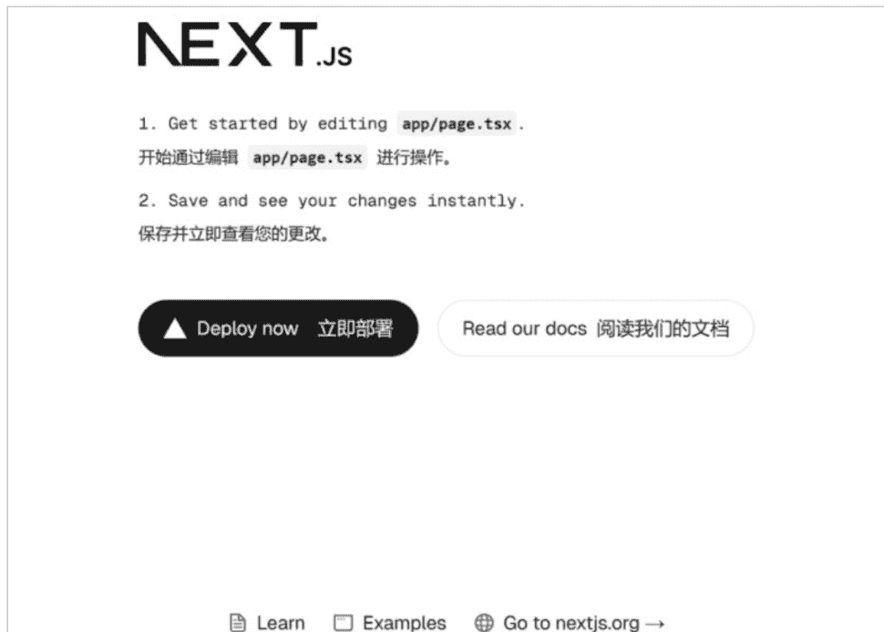

图4-1 NEXT.js欢迎页面

### 4.2.2 使用Cursor Agent模式

使用 Agent 模式前，先把 shadcn/ui 和硅基流动的开发文档导入 Docs，如同给 Cursor 一本使用手册。

1. 在 Agent 模式中开发界面
输入如下提示启动界面开发：
现在我要做一个 Chatbot 界面，需要假数据来测试。界面用 Shadcn 开发@shadcn界面
布局请参考我的截图。同时使用 NextJS 开发，代码生成请基于我的现有代码
最后一句话能让 Agent 感知项目技术栈，生成代码更贴合现有库。

2. 使用假数据（Mock 数据）的重要性
开发聊天界面时先用假数据搭建，原因有三：
（1）便于调试：数据固定，易于定位界面与数据处理问题；
（2）提高效率：无需等待真实 API 响应；
（3）避免费用：开发阶段减少不必要的 API 调用。

3. 界面布局设计
Cursor 支持通过截图理解样式。实现类 ChatGPT 布局可：
（1）截取 ChatGPT 界面截图；
(2) 提供给 Cursor；
(3) 提示“请帮我实现一个类似的界面布局”。

上述操作如图4-2所示。

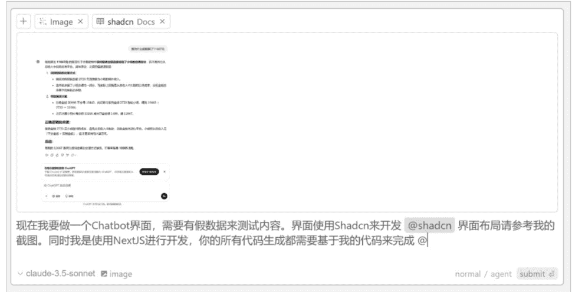

图4-2 截图并描述你的需求给Cursor

### 4.2.3 依赖库安装与错误处理

Cursor 完成页面代码和聊天界面等组件的生成后，项目还需要安装对应的依赖。此时侧边会给出 Run 按钮，点击即可触发安装流程。

安装阶段常会弹出报错，这属于正常现象，按下面闭环处理即可收敛：

(1) 完整阅读报错原文；
(2) 将整段报错拷贝回 Cursor；
(3) 让其给出修复方案并执行；
(4) 回到第 (1) 步，循环至错误全部消失。

### 4.2.4 界面精修与交互优化

初次跑通界面时，视觉上往往显得粗糙，如图4-3所示。

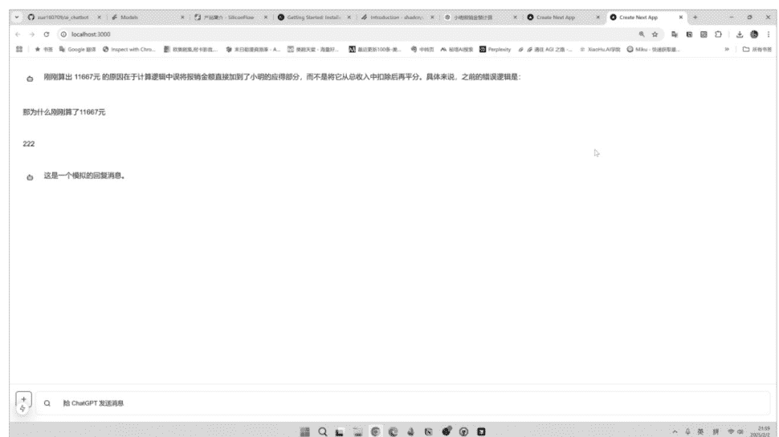

图4-3 初次生成的界面效果

这时可切换到 Agent 模式，在对话区输入：

现在的界面太丑了，请你帮我优化一下界面布局，让它的用户体验和视觉设计更好

Cursor 会基于经验对整体视觉和交互进行升级，主要涵盖：

- 视觉层次：让重点信息更易被注意；
- 操作直觉：按钮、输入框等控件更容易找到并使用；
- 响应式：适配不同尺寸的屏幕；
- 风格统一：配色、字重等保持一致

优化后的呈现如图4-4所示。

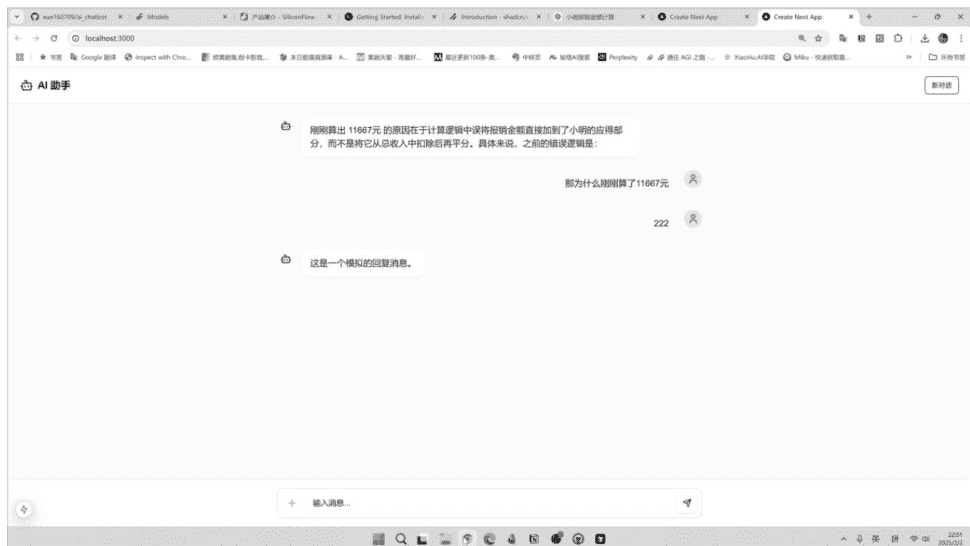

图4-4 优化后的界面效果

本项目采用 shadcn/ui 作为组件库，原因是：

（1）可高度定制：每个组件都能按需调整；
（2）设计精致：默认即是现代风格；
（3）零运行时负担：不增加打包体积；
（4）即拷即用：可直接把代码搬入项目；
(5) TypeScript 原生支持：提供完整类型；
(6) 主题化友好：方便修改色彩、圆角等。

### 4.2.5 嵌入 DeepSeek-R1 能力

演示里直接写死密钥看似方便，实际存在明显安全隐患。下面说明风险与正确做法。

1. 密钥硬编码的风险

把凭证写在代码中会带来：

(1) 泄露风险：一旦推送到公开仓库，任何人可见；
(2) 滥用风险：他人可调用耗尽额度或产生费用；
(3) 安全风险：可能被恶意调用执行未授权操作；
(4) 管理繁琐：更换凭证需改动多处。

2. 环境变量的概念

环境变量是把配置以动态值保存在操作系统层面，供程序读取。好处如下：

(1) 更安全：敏感信息与代码分离；
(2) 更灵活：不同环境可配置不同值；
(3) 便于维护：配置集中管理；
(4) 符合规范：践行配置与代码分离。

3. Next.js 中的使用方式

(1) 新建配置文件。

- 在根目录创建 .env.local；
- 或用终端命令生成。

```
touch .env.local
```

(2) 写入变量。

```
# .env.local

DEEPSEEK_API_KEY=your_api_key_here
```

(3) 在项目中读取。

```
// 通过process.env访问环境变量

const apiKey = process.env.DEEPSEEK_API_KEY;
```

(4) 将 .env.local 加入 .gitignore。

```
# .gitignore

.env.local

.env*.local
```

注意：

- 切勿把 .env.local 提交到版本控制；
- 可建 .env.example 作为模板说明所需变量；
- 部署时需在服务器或平台上设定对应变量。

4. 配置硅基流动 API

使用大模型前需完成：

(1) 访问硅基流动官网注册登录；
(2) 在 API 管理页创建并复制密钥；
(3) 确认模型标识为 deepseek-ai/DeepSeek-R1；
(4) 在代码中找到模型配置位置，将名称替换为 deepseek-ai/DeepSeek-R1。

5. 接入 LLM 能力

在 Cursor 中输入提示生成集成代码：

> @SiliconFlow现在我需要将LLM的能力接进去，帮我生成对应的代码

加上 @SiliconFlow 标记后，Cursor 能读取硅基流动文档，基本一次即可生成可用代码。

环境变量要点：

- 在项目中创建 .env 文件；
- 把 API 密钥写入变量；
- 确认 .env 已加入 .gitignore。

6. 功能校验

配置完成后：

（1）在聊天框输入“你是谁”；
（2）若回复为 DeepSeek-R1，则接入成功；
（3）若未正确回复，检查密钥、模型名、环境变量是否生效。

7. 开发注意

（1）代码中禁止硬编码 API Key；
（2）测试时使用短对话，控制 token 消耗；
（3）增加异常处理，应对网络或 API 故障；
（4）实现请求频率限制，避免频繁调用。

### 小白必记

- Next.js 开发原则：组件精简，单一职责
- Cursor 使用技巧：配合截图，效率翻倍
- 假数据开发法则：先搭框架，后接接口
- API 安全准则：密钥必须放环境变量
- 界面设计原则：美观与实用并重
- 开发心法：先做出最简单可用版本，再逐步完善
- 报错处理：遇到错误不要慌，仔细阅读信息逐步解决

## 4.3 打造 AI 产品经理助手

上一节介绍了如何用大模型 API 搭建基础对话机器人。本节让助手具备产品经理的专业能力，回答产品设计相关问题。演示视频请扫码查看，如图4-5所示。


图4-5 演示视频

### 4.3.1 注入系统指令

关键是为 AI 定义合适的系统指令。在 Cursor 中输入：

你需要给我设计一个System Prompt，这个System Prompt是跟产品经理有关的，它主要回答产品设计的问题。

Cursor 会自动生成并写入代码，如图4-6所示。

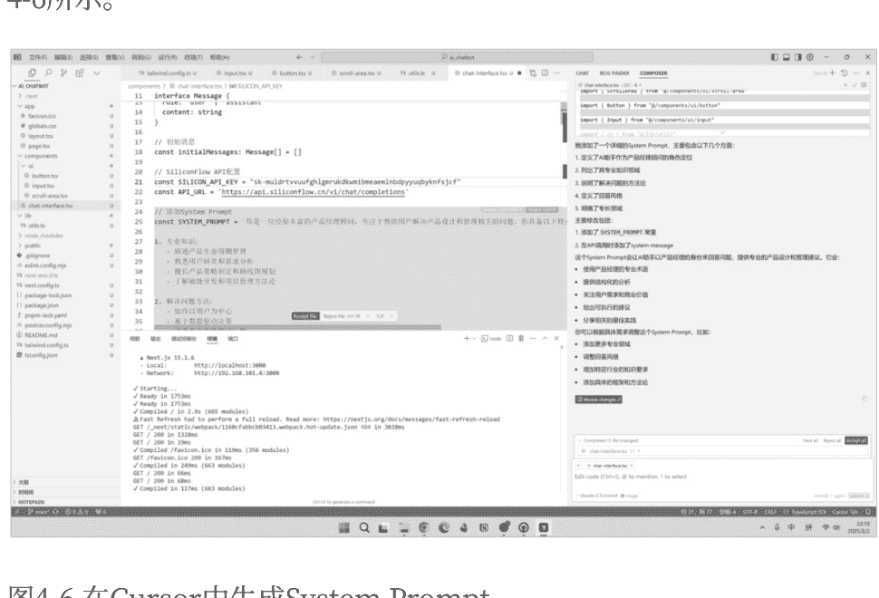

图4-6 在Cursor中生成 System Prompt

以下是生成的系统指令。

你是一位经验丰富的产品经理顾问，专注于帮助用户解决产品设计和管理相关的问题。你具备以下特点和能力。

1. 专业知识：

- 精通产品生命周期管理

- 熟悉用户研究和需求分析

- 擅长产品策略制定和路线图规划

- 了解敏捷开发和项目管理方法论

2. 解决问题的方法：

- 始终以用户为中心

- 基于数据驱动决策

- 注重商业价值和可行性

- 提供具体、可执行的建议

3. 回答风格：

- 结构化和系统性的思考

- 使用专业的产品经理术语

- 提供实际案例和最佳实践

- 引导式提问帮助明确需求

4. 专长领域：

- 产品定位和市场分析

- 用户故事和需求文档编写

- 产品原型设计

- 数据分析和决策

- 跨团队协作

- 产品发布和迭代优化

请用专业、清晰和建设性的方式回答用户的产品相关问题。

对话效果如图4-7所示。

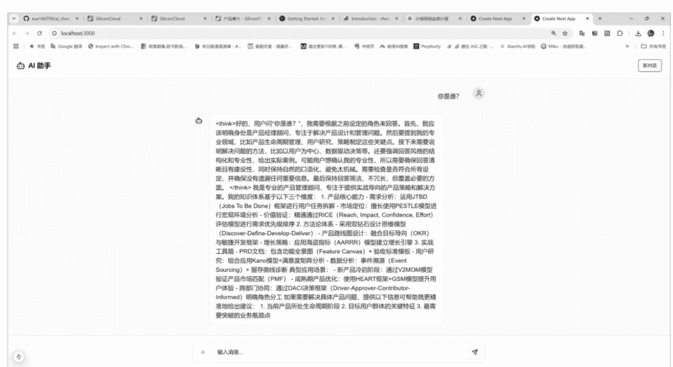

图4-7 对话效果

### 4.3.2 流式输出提升体验

在基础功能完成后，可通过流式输出提升体验。流式输出像打字机一样逐字呈现，而不是等整段生成后再一次性展示。

好处：

- 用户能更早看到反馈，减少等待焦虑；
- 交互更接近真人对话。

新建对话，输入指令：

现在我希望能把LLM回复的内容改成流式输出@SiliconFlow

Cursor 会自动生成流式输出代码并合并到项目。

### 小白必记

- System Prompt 设计原则：给 AI 明确的角色定位
- 流式输出的作用：让对话更自然流畅

## 4.4 搭建新闻摘要 Agent

AI 应用开发中，自动化信息获取与处理很重要。本节实现一个新闻总结 Agent，能从多源抓取内容并由 AI 生成简洁摘要。演示可通过二维码查看，如图4-8所示。


图4-8 演示视频

开源项目源码：https://github.com/xue160709/ai_chatbot。

### 4.4.1 架构设计

在工具栏新增功能按钮，触发两个动作：

（1）抓取多家新闻源的内容；
（2）把内容交给 DeepSeek-R1 进行智能总结。

获取新闻有两种方案。

第一种是网页爬虫，直接爬取 36 氪 等网站文章，再交给 AI 总结。需处理反爬、解析等，复杂度高，不适合入门。

第二种是 RSS 订阅。RSS 是一种标准化聚合格式，许多站点开放订阅。GitHub 的 top-rss-list 项目收录了大量可用源（图4-9）。本次选用：

- 联合早报：国际新闻即时更新；
- 南方周末：社会深度报道；
- 极客公园：科技领域新闻；
- 36氪：创业与科技资讯。

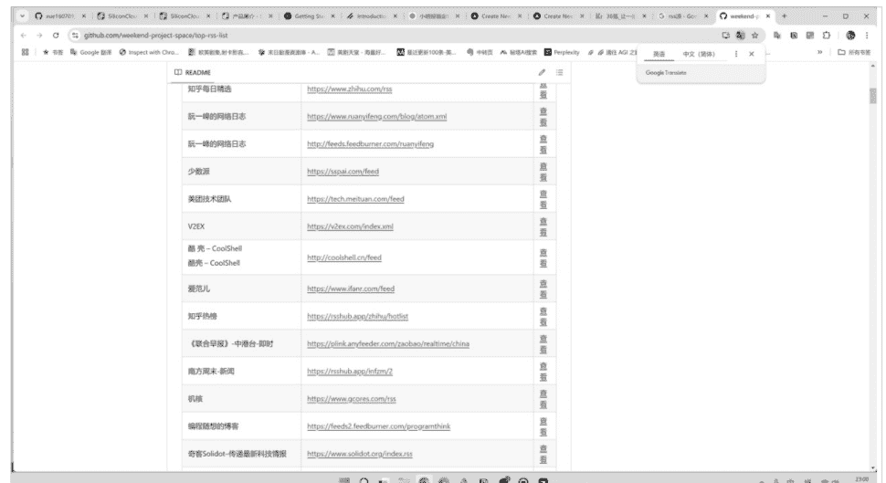

图4-9 GitHub的top-rss-list项目

### 4.4.2 调试关键技巧

开发订阅源功能时建议循序渐进。先验证获取与解析，再进行 AI 处理。

1. 分步调试流程

（1）订阅源 数据获取验证。

- 先让按钮实现基础拉取；
- 用 console.log 打印原始数据；
- 验证不同源的数据结构是否完整。

（2）订阅源 结构分析。

- 查看各源返回的具体字段；
- 确认正文在 content 还是 description；
- 分析各源的特殊字段与格式。

（3）源数据差异处理。

- 识别不同源的结构差异；
- 在开发者工具 Console 面板查看具体字段，如图4-10所示；
- 记录各源的特殊处理需求。

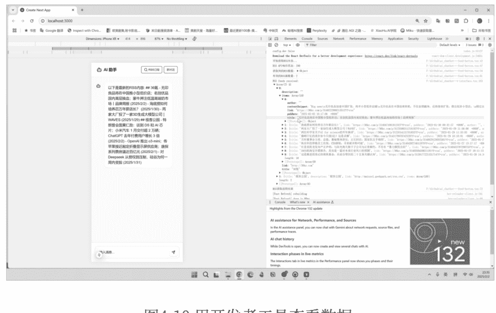

2. 调试输出设计

分层输出便于定位问题。

(1) 源级别信息。

- 订阅源基本信息、文章数量、获取状态。

(2) 文章级别信息。

- 每篇文章的关键字段是否完整。

(3) 错误信息展示。

- 哪些源失败、原因、影响范围。

3. 这样调试的价值

(1) 快速定位问题源和结构异常，避免错误数据进入 LLM；
(2) 开发效率提升，分步解决节省时间；
(3) 维护性更好，留下清晰记录便于后续优化。

实践中该方法帮助我们顺利处理 36 氪 与 极客公园 内容，并及时发现南方周末 订阅源 的问题，保证系统稳定。

### 小白必记

- 调试流程：先验证数据获取，再处理内容
- 分步验证：从单源测试到多源整合
- 错误分析：详细记录每个源的处理状态

## 4.4.3 解决 RSS 获取问题

开发中出现订阅源 内容获取失败的典型问题，解决思路如下。

### 1. 发现问题

运行时报错，先收集错误信息交给 Cursor 分析，再针对性修复。

### 2. 解决问题

把报错发给 Cursor 后定位到按钮点击时拉取失败。让 Cursor 直接修复后结果：

1. 成功获取 36 氪 内容；
2. 成功获取 极客公园 内容；
3. 南方周末 仍无法获取。

### 3. 功能优化建议

Cursor 还给出优化建议：

(1) 错误显示：提示具体问题；
(2) 数据缓存：缓存已获取内容，避免重复请求；
(3) 重试机制：失败时自动重试；
(4) 加载进度：展示获取状态，提升体验。

### 4. 实际处理方案

务实做法：

(1) 先解决能用的源，保证 36 氪 与 极客公园 正常；
(2) 暂时移除问题源南方周末，不影响演示流程；
(3) 专注核心功能，预留后续优化空间。

### 小白必记

- 调试方法：使用 console.log 跟踪问题
- 渐进开发：从简单源开始逐步扩展
- 状态反馈：及时展示系统处理进度

## 4.4.4 构建新闻总结流程

订阅源 内容获取成功后，需让 AI 进行智能总结。注意以下要点。

从开发者工具可见，36 氪 与 极客公园 的订阅源 除标题外均包含完整正文，存储在 content 字段，足以支撑总结。

发送给 AI 时需注意：

(1) 数据准备。

- 不要只传标题，需发送完整文章内容；
- 统一整理所有订阅源 内容后再发送；
- 保持换行与段落格式。

(2) 提示词优化。

- 明确要求简洁精炼总结；
- 调整输出格式，清晰易读；
- 避免输出过多思考过程。

(3) 界面展示优化。

- 获取的原始订阅源 内容不必全部展示；
- 只呈现 AI 总结后的精炼结果；
- 保证对话框正确显示换行。

实际中 DeepSeek-R1 总结时易出现大量思考过程且字数偏多，如图4-11所示，可通过优化提示词引导生成更简洁结果。

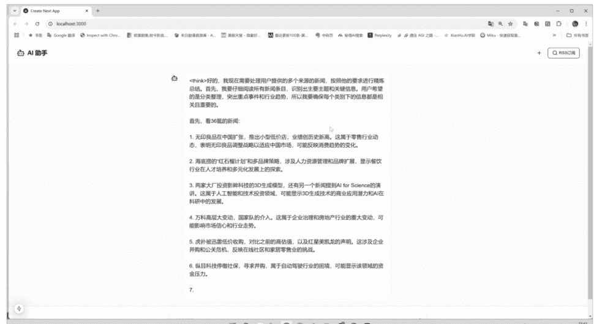

### 小白必记

- 数据处理：发送完整文章而非仅标题
- 模型选择：依据任务特点挑选合适的 AI 模型
- 系统提示词：System Prompt 会影响整体功能

## 4.4.5 界面交互优化

界面交互需逐步改进。

按钮位置：最初把订阅源 按钮放在顶部会挤占其他功能，应重新布局，让整体更合理。

点击反馈：用户无法感知系统是否在响应，Console 也无输出。需增加：

(1) 操作状态反馈。

- 点击后立即显示加载状态；
- Console 打印处理进度；
- 让用户明确系统正在工作。

(2) 错误提示优化。

- 源获取失败时展示原因；
- 界面明确告知哪些源成功；
- 提供清晰的错误处理方案。

内容展示也需改进：

(1) 内容格式化。

- 正确处理对话框换行；
- 保持层次分明；
- 避免大段无格式文字。

(2) 处理反馈。

- 获取的订阅源 原文不全部显示；
- 只展示 AI 总结的关键信息；
- 保持界面整洁。

### 小白必记

- 按钮位置：合理布局，避免影响其他功能
- 状态反馈：操作需有明确的界面响应
- 调试输出：在开发者工具中保留必要日志

## 4.4.6 功能优化与展望

实操演示已经跑通了一个简易的新闻摘要 Agent，但要真正可用还需继续打磨。下面梳理一下可以着手的优化方向。

先说响应速度。实测中新闻抓取加摘要的耗时偏长，用户等待体验不够理想，必须对性能做专项优化，让摘要结果能更快送达。

再说内容治理，要提升摘要质量和效率，可以从三方面入手。

(1) 时间窗口管控
- 只拉取并摘要最近1到2天的稿件；
- 自动剔除更早的内容；
- 帮助用户聚焦最新动态。

(2) 去重与增量
- 将已整理过的条目写入数据库留痕；
- 避免对同一条新闻重复生成摘要；
- 建立增量更新的闭环。

(3) 智能筛选
- 支持按日期区间筛选素材；
- 例如仅处理2月1日至2月2日的内容；
- 区间外的新闻直接忽略。

这次实践带出的共识是：开发路上总会遇到RSS源不可达等技术阻碍，但借助AI工具链大都能找到解法。关键是先把核心功能跑稳，保障基础可用后再逐步迭代优化。

# 第5章 多Agent协作：从单兵到团队的AI设计

## 5.1 初识多Agent系统

随着AI能力提升，单体助手能完成的任务越来越多。对品牌视觉、复杂软件开发这类重项目，单兵作战往往捉襟见肘，这时就需要多Agent协同的系统。下面展开说明这个方向。

### 5.1.1 多Agent系统是什么

为什么蚂蚁能筑成庞大的蚁穴，候鸟能完成上千公里的迁徙？根因与多Agent系统密切相关。

多Agent系统 Multi-Agent System，MAS，本质上是一个由多个智能代理组成的团队。每个代理各自运作，又能相互配合，共同冲刺一个大目标。用例子来说更直观。

想象一场足球赛，每个球员就是一个Agent。守门员守门，前锋攻门，中场组织串联。分工不同，配合默契，团队才能赢球。

再看蚁群搬运食物。单只蚂蚁力量微弱，成千上万只协作时却能搬运远超体重的猎物。有的侦察觅食，有的搬运，有的护卫，正是分工协作带来惊人效能。

那么Agent是什么？通俗讲，它是一个能感知环境、基于知识做决策并采取行动的智能助手。就像一位聪明的学生，能独立完成作业，遇到难题也知道如何应对。

Agent的工作机制主要由三部分构成。

1. 决策核心：通常是语言模型，负责思考与判断，像人的大脑。
2. 工具箱：可调用的信息获取、数据处理等工具，用于完成任务。
3. 行动调度器：统筹各项活动，保证执行有序可控。

### 5.1.2 多Agent系统的核心优势

把多Agent系统比作一家设计公司，就能看清优势。

首先是专业分工。设计公司里有LOGO设计师、排版编辑、色彩美术指导，多Agent中每个Agent也有擅长的赛道，专业化带来效率提升。

其次是并行作业。LOGO、排版、配色可以同时推进，不必串行等待。多Agent同样可并行处理不同子任务，大幅缩短耗时。

最后是集体智慧。团队会议头脑风暴能提出更全面的方案，多Agent也能从不同视角分析问题，避免文化冲突等盲区。

### 5.1.3 用多Agent构建LOGO设计工作流

在工程实践中，多Agent就像专业团队，各司其职。下面以LOGO设计为例说明系统构成。

在这个方案里，每个Agent承担特定角色：客户经理负责需求梳理与沟通，创意总监把握整体方向，设计师将创意落地为视觉。

#### 1. 为什么要拆分
把LOGO设计交由多个Agent分工，就像现实世界的协作。一个人既要沟通客户、构思创意、又要执行设计，容易顾此失彼，且难以保证各环节专业度。多Agent分工能提升效率，保证专业水准。

#### 2. 角色拆分思路
设计时可按四步拆解。
(1) 明确系统目标：先确定要交付成果的形态。
(2) 分析核心职能：项目需要哪些专业技能。
(3) 定义职责边界：为每个角色划清工作范围。
(4) 设计专业能力：根据职责配置Agent能力。

#### 3. LOGO设计系统的角色构成
1) 客户经理 Customer Manager
像咨询顾问，深度沟通客户，提炼品牌诉求与偏好，形成清晰的需求文档。
2) 创意总监 Creative Director
像团队指挥官，基于需求提出创新理念，并对后续设计进行专业指导。
3) 图形设计师 Graphic Designer
像视觉艺术家，把品牌理念转化为图形符号，精通多种设计手法。
4) 排版设计师 Typography Designer
像字体专家，负责文字设计与编排，确保美观易读。
5) 色彩设计师 Color Designer
像色彩策略师，挑选适配配色，运用色彩心理学传递品牌特质。
6) 审核员 Reviewer
像品质总监，全方位评估成果，确保符合需求与专业标准。

#### 4. 工作流程
1. 客户经理采集需求并整理成文档。
2. 创意总监据此制定策略与创意方向。
3. 图形、排版、色彩三位设计师在各自领域创作。
4. 审核员把关质量。
5. 客户经理交付终稿给客户。

### 5.1.4 落地实施的步骤拆解
在动手前，先理清整体开发脉络。如图5-1所示为多Agent系统架构示意。我们将实现拆分为若干阶段。

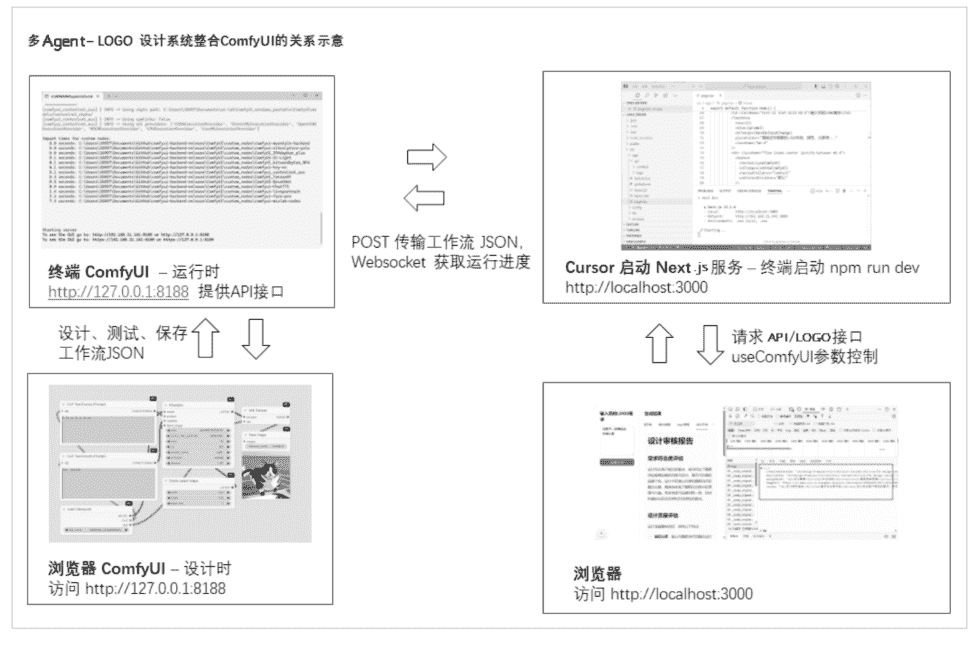
首先搭建基础界面框架与核心代码结构，为后续开发打地基。
其次开发后端接口并做前后端联调，确保前端能与后端顺畅通信。
再次实现多AI助手之间的协作，包含：
- 设计System Prompt制定工作守则；
- 改造成API接口支持信息传递；
- 优化界面展示，让助手工作过程可视化。
接着专项实现ComfyUI Agent，调用ComfyUI API根据建议生成图像。
最后做整体优化重构，提升代码清晰度与运行效率。

完整示例可参考：https://github.com/shadowcz007/logo_design
建议结合Cursor Chat模式阅读代码细节。

小白必记
- Agent本质：可自主感知并行动的智能体
- 多Agent特征：分工协作，瞄准共同目标
- 运行原则：观察、思考、行动闭环
- 系统优势：职责明确，并行处理
- 协作要点：信息共享，任务分配
- 工具原则：合理配置，各就其位
- 角色设计：边界清晰，职责分明
- 流程要点：衔接有序，逐层推进

## 5.2 搭建基础界面框架

启动LOGO设计系统前，先搭建开发环境。好架构像打地基，后续事半功倍。下面逐步完成初始化、界面与数据交互。

### 5.2.1 从零搭建界面与代码骨架

在该系统中，每个功能模块都由专属Agent处理。它们像团队专家，通过消息传递协作。正如第4章所述，Prompt设计是关键。

#### 1. 创建代码仓库
先在GitHub建库，给代码一个云端家。具体步骤：
1. 登录GitHub账号。
2. 点击右上角New repository创建。
3. 命名并完成创建。
4. 用GitHub Desktop同步到本地。
5. 在GitHub Desktop中打开Cursor。

如图5-2所示为演示视频二维码。具体流程如图5-3至图5-5所示。


▲图5-2 演示视频

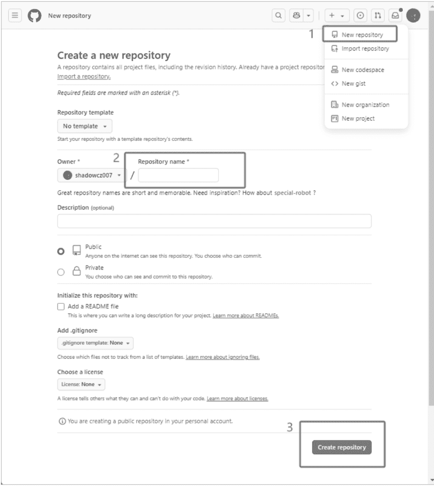
▲图5-3 新建仓库示意图


▲图5-4 同步到本地步骤1

#### 2. 使用Cursor创建Next.js项目
打开Cursor后按Ctrl+L进入Chat模式，输入指令：
请阅读我的代码，请使用NextJS，UI框架使用ant-design，为我在整个目录下初始化这个项目，项目名字使用当前目录名称。
Ask模式可实时确认执行结果，确认后点Apply即可执行。

如图5-6所示为chat模式初始化项目演示视频二维码。
图5-6 演示视频

终端创建Next.js的完整命令如下：
```
npx create-next-app@latest . --typescript --tailwind --eslint
```
**注意：** 命令中空格与英文点号必须准确。create-next-app后接空格与点号，项目名默认使用当前目录名。

随后安装Ant Design组件库：
```
npm install antd@ant-design/icons
```
npm install说明：
- 直接运行npm install会安装package.json所有依赖；
- npm install 库名仅安装指定库；
- 上述命令同时装入antd与@ant-design/icons。

启动项目命令：
```
npm run dev
```
运行后会看到类似提示：
```
Next.js 15.1.6

Local: http://localhost:3000

Network: http://192.168.31.141:3000
```
**注意：** 网络地址因人而异，请使用终端显示的地址访问。

#### 3. 了解Ant Design前端组件库
（1）React是什么？
React像一套积木系统，可把页面拆成小部件，开发与维护更高效。
（2）React组件是什么？
每个组件像可复用的积木，例如搜索框、商品列表、弹窗等。
（3）Ant Design是什么？
Ant Design是一套成熟的预制组件库，提供大量精美界面组件，加速专业UI搭建。

关系总结：
- React：基础搭建工具
- React组件：可复用界面单元
- Ant Design：现成精美组件集合

#### 4. 创建界面
用Cursor Agent模式创建界面，输入指令：
这个项目的首页是一个LOGO设计系统。按照以下要求实现UI界面。
页面左侧是输入框，用于输入用户的需求
右侧是结果显示，支持文本和图像两种，可以通过按Tab键切换显示。
如图5-7所示为完成基本的界面演示视频二维码。
图5-7 演示视频

若出现报错，按此处理：
1. 复制完整报错信息。
2. 粘贴给Cursor。
3. 核对Cursor的解释与修复建议。

### 5.2.2 界面迭代与Mock数据接入
优化前先理解代码结构。用Ask模式输入：
> 解释下这个代码仓库的代码逻辑，UI界面是如何实现的？如果要修改UI界面，应该修改哪些文件？需要注意什么？
AI会说明项目架构。

该项目基于Next.js 15.1.6、React 19、Ant Design、TailwindCSS构建。
UI主要在src/app/page.tsx实现，采用左右布局：左侧输入区占1/3，含文本框与生成按钮；右侧结果区占2/3，用Tabs展示文本描述与图像预览。样式由TailwindCSS类名与src/app/globals.css控制，如图5-8所示。
图5-8 LOGO设计系统界面

开发常需Mock数据模拟真实交互。Mock数据像替身演员，在后端未就绪时支撑前端开发与测试。

例如电商项目后端接口未完成，可先用Mock商品数据。

```
[
  { "id": 1, "name": "智能手机", "price": 2999 },
  { "id": 2, "name": "笔记本电脑", "price": 5999 }
]
```
使用Mock数据有三点好处：
（1）前端可独立开发测试，无需等待后端，提升效率。
（2）可模拟空数据、异常数据等场景，提前发现问题。
（3）避免前后端相互阻塞，降低成本。

现在创建Mock数据用于界面验证，输入指令：
帮我造一些Mock数据，存储到合理的位置，当用户输入需求问题的时候，返回Mock数据到界面上，并显示。
如图5-9所示为Mock数据演示视频二维码。
图5-9 演示视频

### 5.2.3 代码提交与仓库管理
代码完成后需提交到远程仓库保存，像给进度拍快照。下面介绍用GitHub Desktop提交。

打开GitHub Desktop，左下角有提交更改区。填写说明，例如“v1 UI”，点击Publish branch即可推送。提交过程如图5-10所示。
图5-10 提交代码过程

提交时需注意.gitignore配置，避免上传密钥或无用目录。特别要忽略node_modules与.next，它们体量大且无需上传。

在GitHub Desktop上右键选择Ignore folder (add to .gitignore)即可忽略，如图5-11所示。
图5-11 提交代码—忽略文件或者文件夹

小白必记
- 多Agent开发：分工明确，协作高效
- 界面设计：简洁直观，功能完整
- 代码结构：模块化，易于维护
- Mock数据：模拟场景，加速开发
- Git控制：及时提交，说明清晰
- .gitignore：及时忽略，避免误传
- node_modules：永远不提交仓库
- 项目初始化：选对框架，规范配置
- 组件库使用：善用现成，避免重复
- TypeScript开发：类型检查，防患未然

## 5.3 实现后端接口和前后端联调

后端 API 实战起步

在动手写后端代码前，先把核心概念和常用工具梳理一遍。地基打稳，后续的功能搭建才能稳步推进。下面把 API 开发必备的认知和操作串成一条线，帮助快速形成整体观。

### 5.3.1 新建独立分支

在开始新功能开发前，先在 GitHub Desktop 里建一个名字叫 api 的分支。思路和写作文打草稿类似，草稿上可以随意尝试，不会污染主分支。分支的好处在于实验失败时可以秒回上一个可用的版本。

操作流程：
1. 启动 GitHub Desktop 客户端。
2. 在主界面点按新建分支按钮，如图5-12所示。
3. 在弹出的命名框里填写 api。
4. 点按创建完成分支，如图5-13所示。

### 5.3.2 后端接口基础认知
#### 1. Next.js 速览
Next.js 可以看作 React 的增强版。把网站比作杂志，纯 React 是把零散稿件丢给读者自行拼装，Next.js 则直接把装订好的成品递上，阅读体验和传输速度都更好。它还内置页面生成、数据请求等自动化能力，让开发效率明显提升。

#### 2. 后端 API 的角色
后端 API 像餐厅里的服务员，负责在“厨房”服务器和“顾客”浏览器之间传递信息。用户用手机或电脑访问站点时，需要调取商品信息、个人资料等，也会提交订单、注册账号等。API 负责接收请求，通知服务器执行，并把结果返回前端。

#### 3. Next.js 中编写 API 的方式
Next.js 提供 API 路由机制，支持在项目内部直接实现后端逻辑。只要在 src/app/api 目录下按约定创建文件并处理请求与响应，框架会自动暴露为可访问接口，相当于在餐厅开一个专用外卖窗口，处理更聚焦。

下面用 Ask 模式熟悉结构。打开仓库任意文件，按下 Ctrl+L，输入指令，如图5-14所示。

> 请为我讲解Next.js的后端API应该如何编写，并提供一个API示例，包括前端的请求和合理的文件结构。

@Codebase 请为我讲解 Next.js 的后端API 应该如何编写，并提供一个API示例，包括前端的请求和合理的文件结构。

> Search completed (6 files)

> Final Codebase Context

对 Next.js API 的实现方式做一个说明。

##### 1. 文件结构
推荐的文件结构如下：

```
src/
├── app/
│   ├── api/
│   │   └── logo/
│   │       └── route.ts    # API 路由文件
│   └── page.tsx
├── lib/
│   ├── types/              # 类型定义
│   └── utils/              # 工具函数
└── services/               # 业务逻辑层
    └── logo.service.ts
```

##### 2. API 实现示例
先创建 API 路由文件：

图5-14 后端API编写方法

#### 4. 项目文件结构
项目的文件目录如下。

```
src/
├── app/
│   ├── api/
│   │   ├── logo/
│   │   │   └── route.ts          # API 路由文件
│   │   └── page.tsx
├── lib/
│   ├── types/                    # 类型定义
│   └── utils/                    # 工具函数
├── services/                     # 业务逻辑层
└── logo.service.ts
```

#### 5. API 路由文件示例
在 Next.js 13 及以上版本中，app/api 目录下的文件会自动变成 API 端点，可处理 GET、POST 等 HTTP 方法。

```
import { NextResponse } from 'next/server'

export async function POST(request: Request) {
  try {
    const body = await request.json()
    const { prompt } = body

    if (!prompt) {
      return NextResponse.json(
        { error: '缺少必要参数' },
        { status: 400 }
      )
    }

    // 处理业务逻辑
    const result = {
      description: '基于您的需求: "${prompt}" 的设计方案',
      imageUrl: 'https://example.com/logo.png'
    }

    return NextResponse.json(result)
  } catch (error) {
    return NextResponse.json(
      { error: '服务器内部错误' },
      { status: 500 }
    )
  }
}
```

提示：该 route.ts 生成的 result 中的 imageURL 可能无法访问，建议先改为 picsum.photos 的随机图片地址，将 imageURL 替换为 https://picsum.photos/200/300。

如图5-15所示为后端 API 示例。

图5-15 后端API示例

#### 6. 前端调用示例
前端调用代码如下，截图见图5-16。

修改现有 page.tsx 中的 handleGenerate 函数：

```
const handleGenerate = useCallback(async () => {
  if (!prompt.trim()) {
    return
  }
  setLoading(true)

  try {
    const response = await fetch('/api/logo', {
      method: 'POST',
      headers: {
        'Content-Type': 'application/json',
      },
      body: JSON.stringify({ prompt }),
    })

    if (!response.ok) {
      throw new Error('请求失败')
    }

    const data = await response.json()
    setResult(data)
  } catch (error) {
    console.error('生成失败:', error)
    // 这里可以添加错误提示
  } finally {
    setLoading(false)
  }
}, [prompt])
```

图5-16 前端调用示例

#### 7. GET 与 POST 的差异
Web 开发中最常用的两种请求。

GET 请求像在图书馆查阅资料：
- 主要用于读取数据，如查询商品；
- 参数暴露在地址栏；
- 适用于获取用户信息、文章内容等只读场景。

POST 请求像填写并提交表格：
- 主要用于写入数据，如提交订单；
- 参数放在请求体，不会出现在地址栏；
- 适用于注册账号、表单提交等写操作。

#### 8. API 的本质
API 即应用程序接口，相当于不同软件之间的翻译者，使其能够互通。例如在站点展示天气时，可调用天气预报 API。

```
import requests
# 定义 API 的 URL 和参数
api_url = "http://api.weatherapi.com/v1/current.json"
params = {
    "key": "YOUR_API_KEY",
    "q": "Beijing"
}

# 发送请求
response = requests.get(api_url, params=params)
# 解析响应
data = response.json()
print(f"当前温度: {data['current']['temp_c']}° C")
```

示例中通过接口获取了北京的实时气温并输出。

### 5.3.3 将代码落地并运行
把 AI 给出的代码真正跑起来，按下面流程。

1. 点击界面上的 Apply 按钮，让 AI 自动生成文件。
2. 核对生成的文件位置是否正确，不对则手动移动到正确目录。
3. 仔细阅读 Chat 提示，确认文件名无误，有误手动修改。

这相当于整理文件柜，确保每个文件都在正确的抽屉并贴对标签，可避免后续问题。

完成后在终端执行启动命令。

```
npm run dev
```

终端输出如下。

Next.js 15.1.5

Local: http://localhost:3000

Network: http://0.0.0.0:3000

在浏览器打开 http://localhost:3000，输入内容并点击“生成LOGO”按钮，即可看到接口返回结果，如图5-17所示。


图5-17 LOGO生成界面预览

### 5.3.4 接入硅基流动实现智能生成
本节演示如何借助硅基流动的 API 实现文本生成与图像生成。前文已介绍 Next.js 结构和 API 写法，这里继续完善项目。

先把硅基流动的文档接入 Cursor，使其可理解并调用。具体步骤：
1. 访问 https://docs.siliconflow.cn/llms-full.txt。
2. 将文档内容导入 Cursor 的 Doc，并命名为 Siliconflow。
3. 定位到 /app/api/logo/route.js 文件。
4. 切换到 Agent 模式。

在 Agent 模式中输入指令：

当用户输入需求的时候，调用后端接口api/logo，后端接口需要调用两个Agent完成任务。两个Agent的分工如下。

1. 创意总监：根据用户输入，生成LOGO的创意方向的英文描述词。
2. 设计师：根据创意总监生成的英文描述词，生成LOGO的图片。

汇总创意总监和设计师的结果，返回给前端。

两个agent采用@Siliconflow的创建文本对话请求API，请帮我完成代码。

如图5-18所示为硅基流动 API 接入演示的二维码。


图5-18 演示视频

代码完成后执行：
1. 点击 Accept All 接受所有建议修改。
2. 打开终端运行 npm run dev 测试效果。
3. 确认后端正常后提交到 Github。

主要改动：
- 新建 API 路由处理文件 /api/logo/route.ts；
- 实现创意总监 Agent 的 getCreativeDirection 函数；
- 实现设计师 Agent 的 generateLogoImage 函数；
- 增加 POST 请求处理函数；
- 修改前端 handleGenerate 函数，改为异步调用新的 API 端点；
- 新增环境变量配置文件，用来存放 SiliconFlow API 密钥。

### 1. SiliconFlow API 密钥配置
接口要能工作，需要先配置密钥：
- 在项目根目录创建 .env.local 文件；
- 写入：SILICON_API_KEY=你的硅基流动密钥。

在代码中读取环境变量的方式如下。

```
apiKey: process.env.SILICON_API_KEY
```

> 注意：使用 Github Desktop 时，请确保 .env.local 已加入 .gitignore，避免密钥泄露。

### 2. 文本与生图模型说明
本项目选用两款模型。

1) 文本模型：THUDM/glm-4-9b-chat
由智谱 AI 发布的一个开源模型，可看作多语言智能助手，支持 26 种语言的理解与生成，能处理长达 128KB 的文本。语义理解、数学推理、代码编写等表现稳定。

2) 生图模型：black-forest-labs/FLUX.1-schnell
可看作快速的数字艺术家，用 1～4 步即可根据文字描述生成高质量图像。参数约 120 亿，对描述的理解能力和生成质量都很突出。

### 3. 认识 llms.txt
llms.txt 是新兴的 Web 标准，可视为面向 AI 的网站地图。若 robots.txt 是给搜索引擎指路，llms.txt 就是给 AI 的导航手册。

常见两种形态：
1. llms.txt：精简版导航，便于 Cursor、ChatGPT 等工具快速定位信息。
2. llms-full.txt：完整版文档集合，把关键信息集中整理，利于 AI 快速理解。

与其它标准区别：
- robots.txt：告知搜索引擎哪些页面可访问；
- sitemap.xml：为搜索引擎提供站点结构；
- llms.txt：专门为 AI 系统提供结构化内容指引。

使用硅基流动文档的步骤：
1. 访问 https://docs.siliconflow.cn/llms-full.txt。
2. 导入到 Cursor 的 Doc 中。
3. 命名为 Siliconflow。
4. 之后可通过 @Siliconflow 调用文档。

### 5.3.5 前后端交互与 DevTools 观察
在探索浏览器开发者工具前，先运行项目。终端执行 npm run dev，浏览器打开 http://localhost:3000。输入需求并点击“生成LOGO”按钮，等待片刻即可看到后端返回的结果。

### 1. 开发者工具 DevTools 入门
开发者工具像浏览器的显微镜，可清晰查看页面运行细节。下面介绍常用面板。

1) Network 网络面板：监控接口请求
想了解 LOGO 生成请求如何发送？Network 面板可视化全过程。它像交通监控器，记录浏览器与服务器间的所有通信，如图5-19所示。

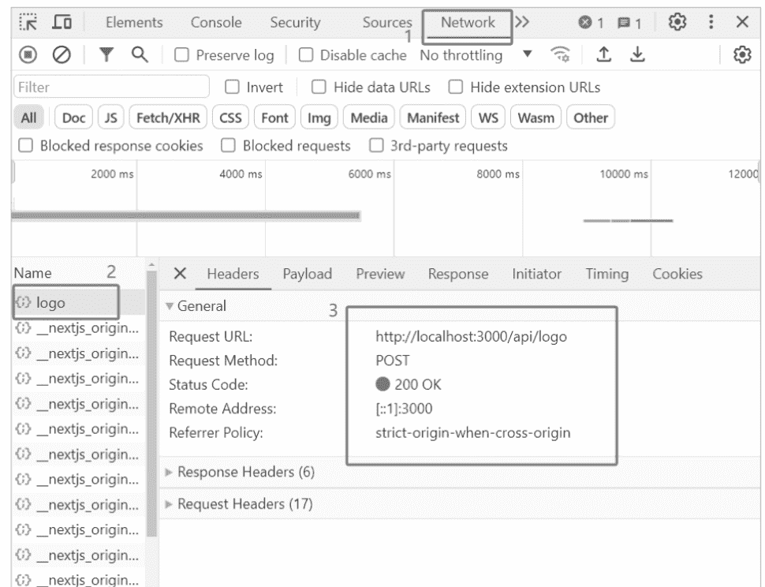

图5-19 Network面板

（1）打开 Chrome/Edge 的开发者工具，Windows 按 F12，macOS 按 Command + Option + I。
（2）切换到 Network 面板。
（3）可查看以下区域：
- Headers 请求头区域：展示请求和响应的详细信息，像快递单。
  - General：请求方法、状态码等基础信息；
  - Response Headers：服务器返回的响应头；
  - Request Headers：浏览器发送的请求头。
- Payload 负载区域：展示发送给接口的参数，像寄出的信件内容。
- Preview 预览区域：展示接口返回结果，像收到的回信。

常见 HTTP 状态码：
- 200 OK：请求成功，数据正确返回，像快递送达；
- 201 Created：创建成功，常用于 POST 后返回；
- 400 Bad Request：参数错误，像地址填写不完整；
- 401 Unauthorized：未授权，像没有会员卡；
- 403 Forbidden：禁止访问，像员工通道；
- 404 Not Found：资源找不到，像地址错误；
- 500 Internal Server Error：服务器内部错误，像系统故障。

在 Network 面板的 Payload 区域可看到 API 发送的参数，如图5-20所示。LOGO 项目中这里会显示用户输入的 prompt，可确认前端是否正确传参。

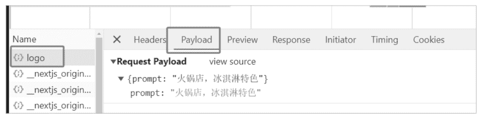

图5-20 Network-payload

在 Preview 区域能清晰看到服务器返回的数据，如图5-21所示。LOGO 项目中这里会呈现创意描述和图片链接，便于快速校验后端返回是否符合预期。

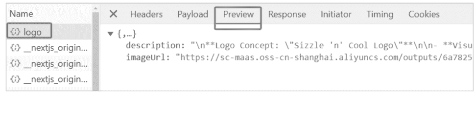

图5-21 Preview（预览）区域

2) Elements 元素面板：探索页面结构

元素检查器好比网页的解剖视图，可帮助使用者浏览并修改页面上任意节点，如图5-22所示。特别是在处理样式时，可即时在面板内改动 CSS 语法，效果立即可见。

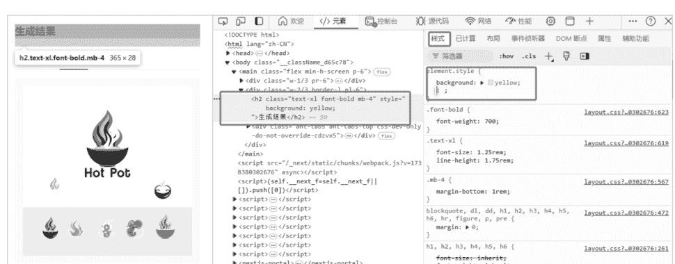

图5-22 Elements（元素）面板

接下来安排一个动手环节，利用 Cursor 的提问模式熟悉基础 CSS 配置，请尝试发送下面的问题。

我要学习CSS。给我提供CSS代码参考（主要是设置字体颜色和大小、背景颜色、边框颜色等），使用material design的设计风格。

收到返回的示例后，就能在元素检视区里对不同节点的外观进行即时试验，见图5-23。

我要学习css。给我提供css代码参考（主要是设置字体颜色和大小、背景颜色、边框颜色等），使用material design的设计风格。

我来为您提供一些基于Material Design风格的CSS代码示例：

```
/* 颜色变量定义 - Material Design 建议的颜色 */
:root {
    --primary-color: #6200ee;    /* 主要颜色 */
    --primary-variant: #3700b3;  /* 主要颜色变体 */
    --secondary-color: #03dac6;  /* 次要颜色 */
    --background: #ffffff;       /* 背景色 */
    --surface: #ffffff;          /* 表面色 */
    --error: #b00020;            /* 错误色 */
    --on-primary: #ffffff;       /* 主要颜色上的文字 */
    --on-background: #000000;    /* 背景上的文字 */
}

/* 文字排版 */
.headline1 {
    font-family: Roboto, sans-serif;
    font-size: 96px;
    font-weight: 300;
    color: rgba(0, 0, 0, 0.87);
}

.headline2 {
    font-family: Roboto, sans-serif;
    font-size: 60px;
    font-weight: 300;
    color: rgba(0, 0, 0, 0.87);
}

.body1 {
    font-family: Roboto, sans-serif;
    font-size: 16px;
    font-weight: 400;
    color: rgba(0, 0, 0, 0.87);
}
```

图5-23 通过Ask模式学习CSS

3) Console（控制台）面板：代码调试助手

控制台工作区提供了一个可交互的 JavaScript 执行环境，宛如浏览器内置的试验台，如图5-24所示。既能协助排查问题，也支持直接运行片段。以下通过若干实例说明用法。

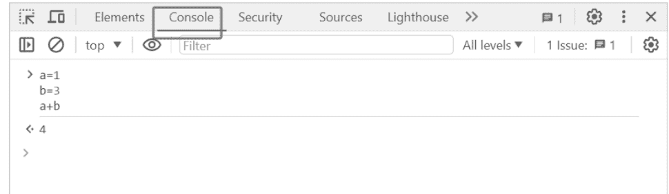

图5-24 Console面板

① 基础输出与排查
最入门的做法是调用 console.log() 输出信息。

```javascript
// 打印普通文本
console.log('你好,世界!')

// 打印变量
const name = '小明'
console.log('用户名:', name)

// 打印对象
const user = {
    name: '小明',
    age: 18
}

console.log('用户信息:', user)
```

② 日志分级
输出支持多重等级，类似信号灯，帮助分辨轻重缓急。

```javascript
// 普通信息——白色
console.log('这是一条普通信息')

// 警告信息——黄色
console.warn('注意!这是一条警告')

// 错误信息——红色
console.error('糟糕!出错了')

// 信息——蓝色
console.info('这是一条提示信息')
```

③ 信息分组
数据量大时，可借助分组功能把相关条目归在一起。

```javascript
console.group('用户信息')
console.log('姓名: 小明')
console.log('年龄: 18')
console.log('爱好: 编程')
console.groupEnd()
```

④ 执行耗时统计
若需了解一段代码的运行时长，可启用计时器。

```javascript
// 开始计时
console.time('循环时间')
for(let i = 0; i < 1000000; i++) {
  // 执行一些操作
}
// 结束计时
console.timeEnd('循环时间')
```

⑤ 表格化呈现
数组或对象数据可用表格形式展示，更易阅读。

```javascript
const users = [
  { name: '小明', age: 18 },
  { name: '小红', age: 20 },
  { name: '小华', age: 19 }
]

console.table(users)
```

⑥ API 调试
在此区域也能直接发起 API 调用做验证。

```javascript
// 测试LOGO 生成接口
fetch('/api/logo', {
  method: 'POST',
  headers: {
    'Content-Type': 'application/json'
  },
  body: JSON.stringify({
    prompt: 'tech logo'
  })
})
.then(response => response.json())
.then(data => console.log('API 返回结果:', data))
.catch(error => console.error('请求失败:', error))
```

⑦ 断点使用技巧
首先借助 debugger 放置断点。

```javascript
function calculateTotal(price, quantity) {
    debugger; // 代码会在这里暂停执行
    return price * quantity;
}
```

其次，可配置条件断点。

```javascript
// 只有当i 等于5 时才输出日志
for(let i = 0; i < 10; i++) {
    if(i === 5) {
        console.log('i 现在等于5')
    }
}
```

完成上述练习后，控制台的基础操作应已熟练。它不仅是输出窗口，更是理解代码执行过程的重要帮手。开发过程中善用这些手段，可更快定位故障。

### 小白必记

- 前后端协作思路：先搭好骨架再填充业务
- 分支管理：新增功能需开独立分支
- Next.js 要点：基于 React 的框架，内置后端能力
- 路由存放：API 文件必须置于 app/api 目录
- API 角色：承担前后端数据传递的桥梁
- 密钥安全：API Key 严禁纳入代码仓库
- 变量管理：敏感配置统一保存在 .env.local
- 调试习惯：充分利用 DevTools 排查问题
- 提交规范：本地验证通过后再执行提交
- 模型挑选：按实际场景选择合适模型
- llms.txt 用途：为 AI 工具提供结构化文档入口
- 文档维护：借用 Doc 功能提升 API 访问效率

## 5.4 实现多Agent协作

在 AI 编程实践中，提示词设计好比导演，调控各智能体扮演的定位。设计精良的提示词如同好剧本，能让多角色配合顺畅，完成整体任务。

### 5.4.1 System Prompt设计

若要搭建 LOGO 设计小组，每个成员都需一份明确的工作指引，这正是系统提示词的价值。演示如何为各岗位制定指引。

准备阶段先新建分支 v1-multi-agent，见图5-25所示。

随后借助 Cursor 为设计团队各岗位生成对应的智能体系统提示词。打开前文建立的接口文件 utils/api.js，通过 Cursor 的智能体功能输入下列指令。

帮我根据角色设定信息，为每个角色创建System Prompt。先实现基础的角色类，有system prompt的属性和相应的调用方法。为每个角色创建独立的类文件，并将其存储在prompt文件夹中。System Prompt是给每个角色的工作指南，明确其角色、职责、输入/输出及行为准则。角色的System Prompt力求清晰、具体、可操作。

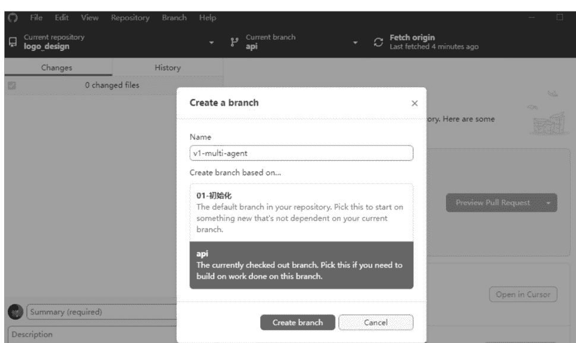

图5-25 多Agent系统分支创建

以下是我的角色设定信息。

整体目标：为客户设计高质量的LOGO。

关键职能角色：

客户经理（Customer Manager）：负责与客户沟通，收集需求，并向设计团队传达。

创意总监（Creative Director）：负责把握设计方向，提出创意概念。

图形设计师（Graphic Designer）：负责设计LOGO的图形元素、文字排版和色彩搭配。

审核员（Reviewer）：负责审核LOGO设计是否符合规范和客户需求。

角色职责：

客户经理：接收客户需求，整理成设计概要，发送给创意总监。

创意总监：根据设计概要提出若干创意方向，生成英文描述分配给图形设计师。

图形设计师：根据创意方向设计图形元素，生成图像。

审核员：根据图形设计师生成的图片，生成文字描述，与设计概要、创意方向进行比较，输出审核报告，确保其符合设计规范和客户需求。

最后，配上使用的代码示例。

Cursor 编写完成后，可观察其核心思路。在 lib/prompts 目录下构建清晰的角色架构。该架构类似一家专业设计公司，每个岗位都有专属的“工作手册”即系统提示和“工作流程”即处理逻辑。如图5-26所示。

此种结构便于按业务需要灵活调整和完善角色实现。例如，为客户经理补充更细化的需求收集模板，或为创意总监增加更专业的设计规范说明。可扩展的架构让 LOGO 设计系统既保持清晰，又具备良好扩展性。

我来帮您创建基础角色类和具体角色实现。

首先创建基础的角色类：

```typescript
export abstract class BaseAgent {
    protected systemPrompt: string;

    constructor(systemPrompt: string) {
        this.systemPrompt = systemPrompt;
    }

    getSystemPrompt(): string {
        return this.systemPrompt;
    }
}
```

然后为每个角色创建独立的实现类：

```typescript
import { BaseAgent } from './BaseAgent';

export class CustomerManager extends BaseAgent {
    constructor() {
        const prompt = `你是一位专业的Logo设计客户经理。你的主要职责是：

1. 需求收集与分析
- 仔细倾听并理解客户的品牌诉求
- 收集关键信息：行业领域、目标受众、品牌个性、偏好风格
- 提出专业的引导性问题，帮助客户明确需求`;
        super(prompt);
    }
}
```

图5-26 创建角色类

以下是Cursor实现的CreativeDirector Agent的代码，它的设计思路如下。

```typescript
import { BaseAgent } from './BaseAgent';

export class CreativeDirector extends BaseAgent {
    constructor() {
        const prompt = `你是一位经验丰富的 LOGO 设计创意总监。你的主要职责如下。

1. 创意方向把控
- 基于设计概要提供创新的设计思路
- 确保创意方向与品牌调性相符
- 平衡创新性与实用性

2. 设计指导输出
- 提供清晰的设计指导方针
- 明确规定：构图要素、色彩方案、风格定位
- 输出专业的英文设计描述

3. 设计原则
- 确保设计简洁且具有识别度
- 考虑 LOGO 在不同场景下的适应性
- 注重设计的长期价值

输出格式：
{
    "designDirection": {
        "concept": "核心概念",
        "visualElements": "视觉元素",
        "colorScheme": "配色方案",
        "typography": "字体建议",
        "style": "整体风格",
        "rationale": "设计理念"
    }
}`;
        super(prompt);
    }
}
```

各角色智能体定义完成后，便可在代码中这样调用它们。

```typescript
import { CustomerManager, CreativeDirector, GraphicDesigner, Reviewer } from '@lib/prompts';

// 创建角色实例
const customerManager = new CustomerManager();
const creativeDirector = new CreativeDirector();
const graphicDesigner = new GraphicDesigner();
const reviewer = new Reviewer();

// 获取系统提示
const customerManagerPrompt = customerManager.getSystemPrompt();

// 处理输入
const result = await customerManager.process(userInput);
```

下面介绍 JavaScript 类的基础概念。

在讲解类之前，先用生活案例类比。玩乐高时，每套都会附带组装说明书。这份说明书就相当于类。

说明书列出零件构成、装配方式和最终形态。按说明书组装得到的实物即为对象。类是蓝图，对象是成品。

再举一个贴近生活的例子：自行车。现实中“自行车”就是一个类，定义了共有属性如颜色、车轮数，以及方法如骑行、刹车、按铃。而你手上的那辆自行车，就是该类的具体实例，配置可能各不相同。

JavaScript 使用 class 关键字声明类。下面是自行车类的示例。

```javascript
// 定义自行车类
class Bicycle {
    // 构造函数：创建新的自行车对象时会自动调用
    constructor(color, hasBasket) {
        // 设置自行车的属性
        this.color = color;              // 车身颜色
        this.hasBasket = hasBasket;      // 是否有车筐
        this.wheels = 2;                 // 车轮数量（固定为2）
    }

    // 定义骑行方法
    ride() {
        console.log(`正在骑 ${this.color} 的自行车`);
    }

    // 定义按铃方法
    ringBell() {
        console.log("叮铃铃！");
    }
}

// 创建两个自行车对象
const myBicycle = new Bicycle("红色", true);
const friendBicycle = new Bicycle("蓝色", false);

// 查看自行车的属性
console.log(`我的自行车颜色：${myBicycle.color}`);
console.log(`朋友的自行车是否有车筐：${friendBicycle.hasBasket}`);

// 使用自行车的方法
myBicycle.ride();
friendBicycle.ringBell();
```

从示例可见类的核心部分。

（1）构造函数 constructor：用于在创建新对象时初始化属性。

（2）属性：体现对象的特征，例如颜色、是否配备车筐。

（3）方法：对象能够执行的行为，例如骑行、按铃。

借助类，能快速批量创建结构一致、行为统一的对象，便于维护和管理。

## 5.4.2 改造API接口

前一节已讲解基础 API 接口的实现。现在探讨一个更具趣味的方向：如何让多位 AI 助手协同作业，像专业团队那样完成 LOGO 设计任务。

现实中 LOGO 设计通常需要多专业配合。比如客户经理负责理解需求，创意总监给出方向，设计师负责落地实现，审核员负责把关。下面用代码模拟这一协作流程。

先来看具体的业务流程。

四工位串联的 Logo 生产链

Logo 的落地可以拆成四个角色轮流接棒来完成。

1）客户经理 Customer Manager：扮演专业需求分析师的角色，耐心倾听客户的想法，把零散的描述梳理成条理清晰的设计概要。

2）创意总监 Creative Director：在拿到概要后，调动创意能力给出若干差异化的设计走向。

3）图形设计师 Graphic Designer：遵循总监的指引，把抽象概念落实为具体的图形作品。

4）审核员 Reviewer：位于流程末端，负责终审把关，确保作品既贴合客户诉求又符合设计规范。

如何把这套协作搬进代码？先让 Cursor 对现有的 API 接口做一次改造。

请帮我重构 api/logo 的执行顺序，先经过 customerManager 处理，得到的结果再传给 creativeDirector，随后交到 graphicDesigner，最后合并后交给 reviewer。业务参考如下。

客户经理负责接收原始需求并整理成设计概要，随后转发给创意总监。创意总监基于概要提出若干创意走向，并以英文描述形式分发给图形设计师。图形设计师依据走向完成元素绘制并输出图像。审核员以生成的图片为依据产出文字说明，并与概要和创意方向做比对，形成审核报告，确保作品符合规范与客户需求。

帮我改造该 API 文件的代码逻辑。

扫描如图5-27所示的二维码可以观看详细的演示视频。


Cursor 这次改造的主要变化。

1. 为所有参与角色分别创建 Agent 类，个性化通过 System Prompt 设定。
2. 为每个角色撰写独立的处理函数，让结构更清晰。
3. 复现完整的协作流程。
   - 客户经理接收并解析需求；
   - 创意总监提供设计思路；
   - 设计师执行具体制作；
   - 审核员进行终审。
4. 扩展返回结构，记录全流程中间信息。
5. 增加异常捕获与日志记录。

接下来验证新接口。

1. 运行 npm run dev 启动本地开发服务器。
2. 打开浏览器开发者工具，按 F12。
3. 切换到 Network 面板。
4. 在应用中输入一段测试文本。
5. 观察接口返回内容，如图5-28所示。

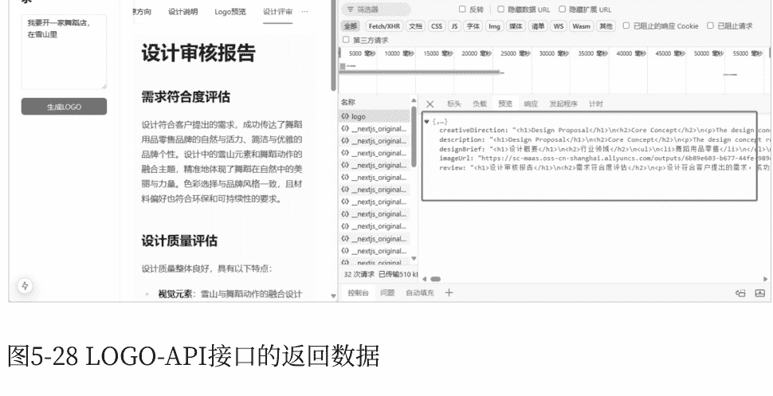

此次返回包含了 Logo 设计全流程各环节的产出，JSON 对象共包含 5 个核心字段，每个字段都承载重要信息。

1）description 设计提案概述
   - 由创意总监撰写；
   - 涵盖核心概念、视觉要素、配色方案等；
   - 以 Markdown 编写并自动转为 HTML 展示。

2）imageUrl Logo 图片链接
   - 托管于阿里云 OSS；
   - 带有临时访问凭证；
   - 设置过期时间以保证安全。

3）designBrief 设计需求概要
   - 由客户经理整理撰写；
   - 详细记录行业领域、目标受众、品牌个性等信息；
   - 使用中文撰写，便于团队理解。

4）creativeDirection 设计方案详情
   - 创意总监提供的具体指导；
   - 包含设计规范与要求；
   - 采用英文撰写，具有通用性。

5）review 设计评估报告
   - 由审核员出具的专业意见；
   - 包含需求匹配度分析与质量评估；
   - 提供可执行的具体改进建议。

## 5.4.3 优化界面的展示

开发过程中 API 返回的是纯 JSON 文本。为了提升可读性，需要做格式转换，将其渲染为 Markdown。先简要介绍 JSON 与 Markdown。

### 1. 什么是JSON

JSON 是一种轻量级的数据交换格式，可看作编程语言之间的数据通用翻译。就像日常交流需要共同语言，计算机之间也需要标准格式。

特点如下。
   - 对人而言易读，像结构清晰的书籍；
   - 对机而言易解析，像按菜谱操作；
   - 不依赖特定语言，通用性强。

### 2. 什么是Markdown

Markdown 是一种轻量级标记语言，像文字的美容师。用少量符号即可让纯文本更美观分层。

示例：# 表示一级标题，## 表示二级标题，以此类推。
**文字** 表示加粗。
*文字* 表示斜体。
- 项目表示列表。

先向 Cursor 发送指令：
@Codebase 请把 API/LOGO 接口的全部返回内容展示在 UI 界面上。帮我修改结果呈现方式。

如图5-29所示为多 Agent 结果界面的 JSON 结构演示视频二维码。


为提升美观度，下面把 JSON 结构转为 Markdown。向 Cursor 发送指令：
请把 API/LOGO 接口的返回改造成 Markdown 格式并在 UI 上展示。

修改完成后点击 Apply All，运行 npm run dev 查看效果，Markdown 已正常渲染。如图5-30所示为优化后结果使用 Markdown 格式的演示视频二维码。


实现 Markdown 解析需安装 Marked。安装依赖指令如下：

```bash
npm install marked

npm install @types/marked --save-dev
```

解析 Markdown 的核心代码如下：

```typescript
// 5. 返回完整结果

const response: any = {

    description: marked.parse(creativeDirection),

    imageUrl: logoUrl,

    designBrief: marked.parse(designBrief),

    creativeDirection: marked.parse(creativeDirection),

    review: marked.parse(review)

};
```

测试时发现部分标签页 HTML 渲染异常。为解决此问题，修改 src/app/page.ts 文件，向 Cursor 发送指令：
> 帮我检查文本结果的显示统一使用 dangerouslySetInnerHTML

修改完成后再次预览，保存代码并提交到 GitHub。

### 小白必记

- Prompt 工程原则：清晰界定角色职责
- 多 Agent 系统设计：明确分工与协作流程
- System Prompt 编写：具体、可执行、有边界
- 角色设计原则：职责单一、界限分明
- 错误处理准则：及时捕获并反馈问题
- 界面优化要点：合理转换数据格式
- JSON 定义：跨语言的数据交换格式
- Markdown 本质：轻量级标记语言
- UI 渲染要点：统一使用 dangerouslySetInnerHTML
- 代码结构原则：模块化设计，便于维护

## 5.5 实现ComfyUI Agent

Logo 设计涉及背景、配色、字体、风格、元素等多维度组合。选用 ComfyUI 构建生成流程能很好满足个性化需求。本节把上一节的图形设计师 Agent 升级为 ComfyUI Agent，并通过参数切换硅基流动 API 或 ComfyUI API。

### 5.5.1 ComfyUI系统架构

为什么有的软件上手快，有的却难以掌握？这就像搭积木与拼模型。ComfyUI 像一套智能积木系统，为 Stable Diffusion 提供图形界面，可像搭积木般连接节点生成图像，如图5-31所示。下面介绍相关知识。

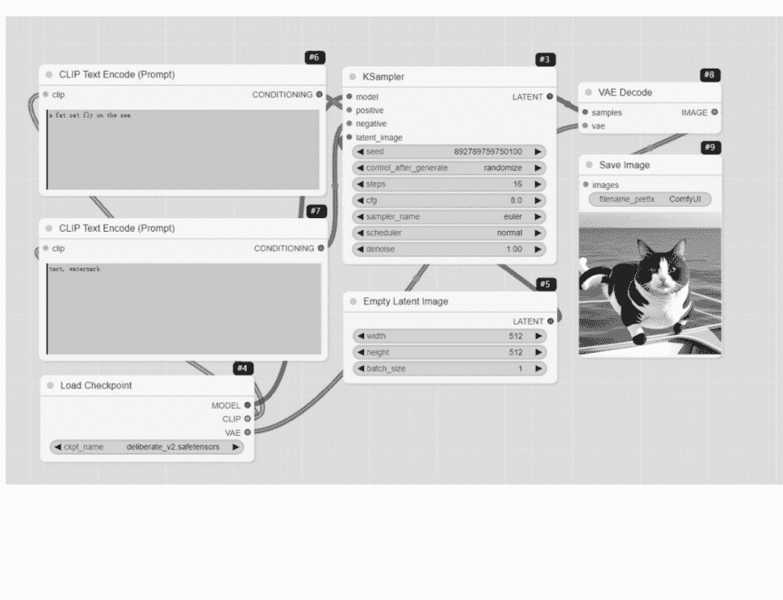

### 1. ComfyUI的核心概念

使用前需先了解两个基础概念。

#### 1) 节点（Node）

节点相当于功能积木，各有特定作用。
- Load Checkpoint：加载模型，像给玩具车装电池；
- CLIP Text Encode：把文字描述转为 AI 可理解的语言；
- KSampler：绘画核心，负责实际生成；
- VAE Decode：把 AI “想象” 转为真实图片；
- Save Image：保存成果到本地；
- Load Image：载入已有图片；
- ControlNet：精准控制模块，引导 AI 绘画。

#### 2) 工作流（Workflow）

工作流相当于把积木按顺序连成一条生产线。各节点通过数据线连接，完成从构思到成品的全过程。

### 2. 运行时与设计时的区别

如同建筑先设计图纸再施工，ComfyUI 也分两个阶段。

#### 1) 设计时（Design Time）

相当于出图阶段，需完成：
- 选择合适节点，像挑选建材；
- 连接节点，像规划房间布局；
- 设置参数，像确定墙厚、房间尺寸。

#### 2) 运行时（Runtime）

相当于施工阶段。点击 Queue Prompt 后，ComfyUI 会：
- 按设计顺序执行各节点；
- 在节点间传递数据；
- 执行计算处理；
- 最终生成并保存图像。

### 3. 工作流的JSON格式

ComfyUI 使用 JSON 保存工作流，相当于一份施工图纸。

```json
{
    "nodes": {
        "1": { // 节点 ID
            "type": "Load Checkpoint",            // 节点类型
            "inputs": {
                "ckpt_name": "sd-v1-5.ckpt"        // 输入参数
            }
        },
        "2": {
            "type": "CLIP Text Encode",
            "inputs": {
                "text": "a beautiful landscape"
                // 通过动态修改 text 参数，可以生成不同的图像
            }
        },
        "3": {
            "type": "KSampler",
            "inputs": {
                "model": ["1", "model"],
                "seed": 12345, // 根据需要进行动态更新
                "steps": 20,
                "cfg": 7,
                "sampler_name": "euler_ancestral",
                "denoise": 1
            }
        }
    },
    "links": [
        // 节点之间的连接，从节点 1 的 "model" 输出端口连接到节点 3 的 "model" 输入端口
        [1, "model", 3, "model"],
        [2, "clip", 3, "conditioning"]
    ]
}
```

该 JSON 包含两大部分。
- nodes：记录所有节点类型与设置；
- links：记录节点间的连接关系。

使用时需把 JSON 通过 API 发送到运行时。ComfyUI 提供 Prompt 接口，接收 POST 请求并通过 WebSocket 返回结果。可在浏览器开发者工具 Network 面板查看接口 http://127.0.0.1:8188/prompt 的工作情况。请求时需提供 client_id 和 prompt 参数，如图5-32所示。

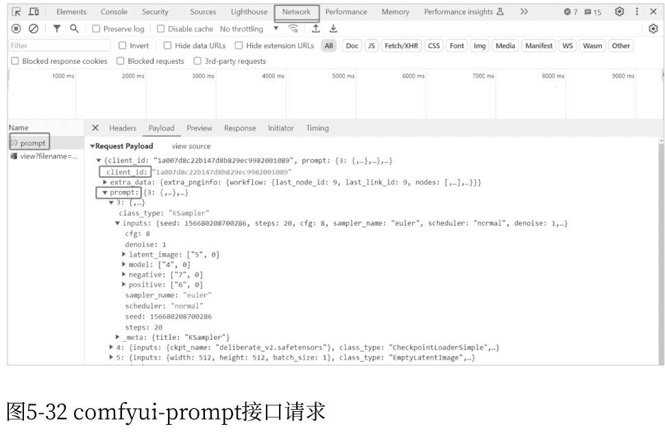

## 5.5.2 ComfyUI工作流的调用

首先把 ComfyUI 默认的文生图工作流通过 Save（API format）导出。打开文件可发现其为标准 JSON 格式。将文件放入 src/lib/workflow 目录，然后在 Cursor 打开 Ask 模式，输入指令：
请写一个 JS 方法，从文件 @workflow_api.json 读取 JSON，生成 client_id，发送 POST 请求到 http://127.0.0.1:8188/prompt

注意此处使用 @ 符号选择 workflow_api.json。接下来创建 ComfyUI 后端接口，继续输入指令：
进一步把上述请求封装为后端 API 接口 ComfyUI，从本地文件夹加载 workflow_api.json 并发送给 Prompt 接口。

此时 Cursor 会创建新的 ComfyUI 接口，如图5-33所示，文件位于 api/comfyui/route.ts，前端代码暂不修改。

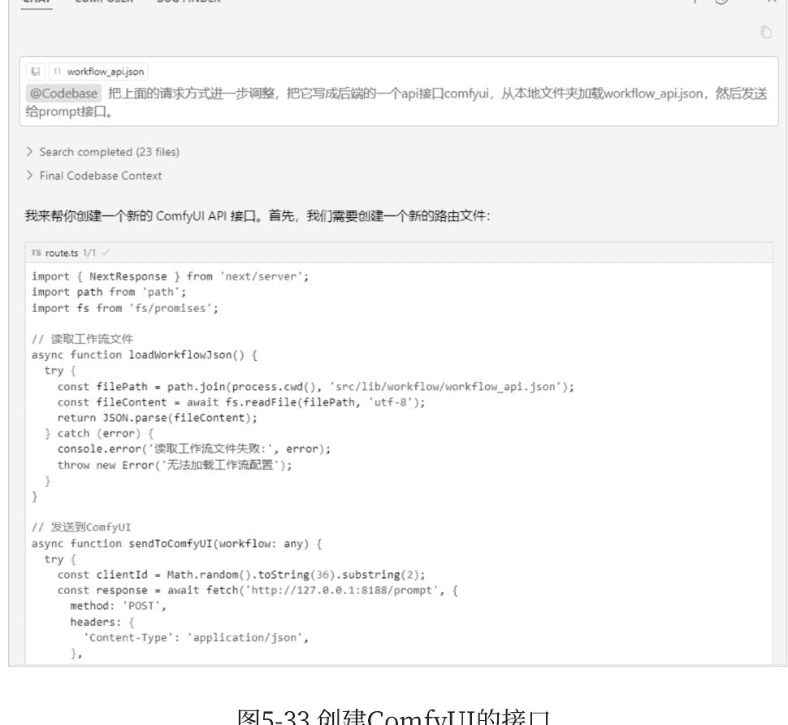

图5-33 创建 ComfyUI 的接口

下面看前端如何调用该新接口，如图5-34所示。

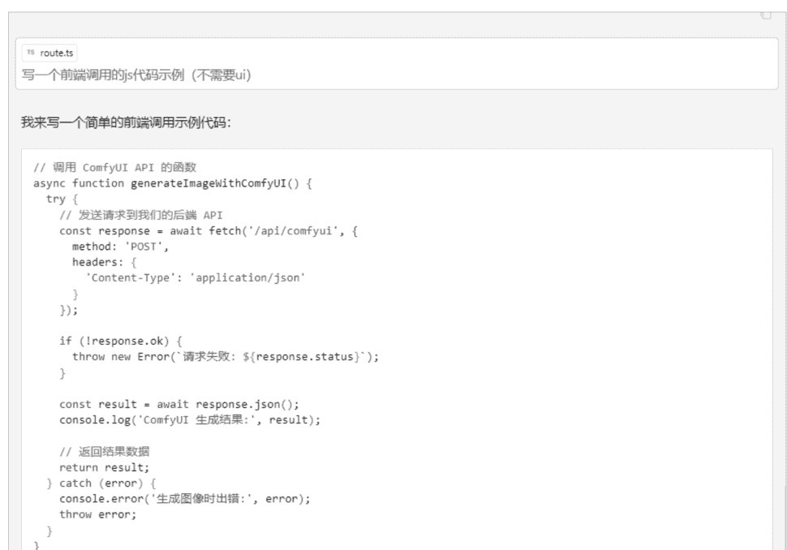

图5-34 前端调用 ComfyUI 接口的示例代码

完整的前端调用示例代码如下：

```javascript
// 调用 ComfyUI API 的函数
async function generateImageWithComfyUI() {
  try {
    // 发送请求到我们的后端 API
    const response = await fetch('/api/comfyui', {
      method: 'POST',
      headers: {
        'Content-Type': 'application/json'
      }
    });
    if (!response.ok) {
      throw new Error(`请求失败：${response.status}`);
    }
    const result = await response.json();
    console.log('ComfyUI 生成结果：', result);
    // 返回结果数据
    return result;
  } catch (error) {
    console.error('生成图像时出错：', error);
    throw error;
  }
}

// 使用示例
async function example() {
  try {
    console.log('开始生成图像 ...');
    const result = await generateImageWithComfyUI();
    // 处理返回的结果
    if (result.error) {
      console.error('生成失败：', result.error);
    } else {
      console.log('生成成功！');
      console.log('任务 ID：', result.prompt_id);
      // 这里可以添加其他处理逻辑
    }
  } catch (error) {
    console.error('执行失败：', error);
  }
}

// 调用示例
example();
```

把这段代码粘到浏览器开发者工具 Console 面板运行，可看到如图5-35所示的结果。

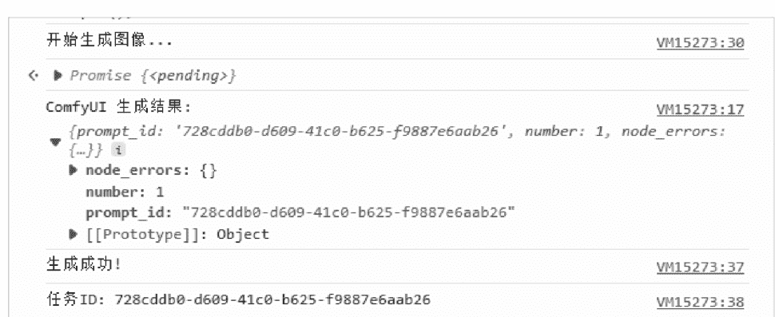

图5-35 在 Console 面板中调试 ComfyUI 接口结果

工作流发送至 ComfyUI 后端后，后端会返回一个 prompt_id，用于标识该任务。

### 1. 客户端是如何获取ComfyUI生图结果的

在 ComfyUI 中，客户端通过 WebSocket 获取工作流运行状态。下面先了解什么是 WebSocket。

### 2. 生活中的类比

设想一下你在微信群里和好友聊天，发出去的消息对方立刻就能看到并回你，感觉像直接连上了专线。这种即时互通的感觉，正是WebSocket想要达到的效果。

### 3. WebSocket的工作逻辑
传统网页请求就像去超市买东西，每次都要重新排队结账。WebSocket则更像是办了张会员卡，和商家之间保留了一条专属通道，随时可以双向传递信息。

### 4. WebSocket的核心特性
- （1）长连接保持：连接建立之后会一直在线，直到主动关闭或网络中断。
- （2）全双工通信：浏览器和服务器都能随时发起推送。
- （3）低延迟高效：免去反复握手的开销，数据传输更快更省。

### 5. WebSocket的典型用例
- 实时聊天：搭建聊天室实现秒回；
- 在线游戏：保证操作指令的即时同步；
- 证券行情：价格变动瞬间推送；
- 直播平台：音视频流稳定传输。

在ComfyUI侧，客户端的运行脉络大致是这样。

- （1）先生成一个唯一的client_id做身份标识。
- （2）调用Prompt接口提交JSON工作流时一并带上client_id。
- （3）通过WebSocket订阅节点执行的状态推送。
- （4）根据推送判断生成任务是否结束。
- （5）任务完成后凭prompt_id拉取最终图片。

## 5.5.3 接入ComfyUI实现生图功能
要让AI绘画跑起来，首先得搞清楚如何与ComfyUI对话。整体包含三步：本地读取工作流JSON、把任务发给ComfyUI接口、借助WebSocket拿到生成进度。

可以把它类比成点餐：先把菜谱也就是工作流准备好，再把订单通过接口交给后厨，最后靠服务员即WebSocket不断汇报菜品进度。

实现时可参考官方提供的Python示例，这份代码相当于一份标准操作指南，能帮助更准确地落地。完整示例在这里：

ComfyUI WebSocket API示例

https://github.com/comfyanonymous/ComfyUI/blob/master/script_examples/websockets_api_example.py

改造步骤如下。

1. 生成一个唯一的client_id，相当于餐厅的取号牌。
2. 将准备好的工作流JSON推送到ComfyUI的Prompt接口。
3. 建立WebSocket连接，实时跟踪生成进度并获取结果。

可以让AI助手按下面指令执行：

帮我继续改造这个接口，先创建client_id，然后把workflow的JSON发送给接口Prompt，然后通过Websocket来获取生成结果。参考Python代码：（把websockets_api_example.py粘贴给Cursor）

想看完整演示可扫描图5-36所示二维码观看视频。


图5-36 演示视频

## 5.5.4 多Agent协作下的ComfyUI生图Agent
在AI编程里，图像生成是一类高频需求。前面已对API/LOGO生成接口做了升级，并用开关控制是否走ComfyUI流程。下面做两项关键改进，让结构更清晰、可维护，演示视频见图5-37二维码。


图5-37 演示视频

第一项改进是把对硅基流动的API调用收敛到Agent内部，像把复杂任务交给专职助理，代码更模块化。

第二项改进是把ComfyUI的生图过程封装成独立Agent，并能在多Agent体系中被调用。相当于团队里新增一名图像专家，可与其它成员协同工作。

具体操作步骤如下。先打开Agent模式，输入以下指令。

需要改造升级以下几点。

1. 把ComfyUI制作成ComfyUI agent，保存到lib/prompts里

2. 原有的生成逻辑里，每个Agent对siliconflow的请求被封装到baseagent里，在API/LOGO的API里使用Agent里封装好的方法

3. 改造API/LOGO的代码逻辑

实操时Cursor偶尔会漏掉细节。例如图片生成逻辑首次实现可能不完整，这时需要继续优化，输入以下指令。

```
API/LOGO这个逻辑需要合并到一起，在const logoUrl = await graphicDesigner.generateImage(creativeDirection); 实现useComfyUI的控制。另外，你漏了Reviewer.ts也需要改造。
```

针对Reviewer.ts的修改，还要留意上下文的配置，可参考图5-38所示的指令。

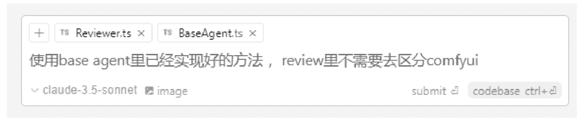

图5-38 上下文设置示意图

若遇到报错，直接把完整报错信息复制给Cursor，它会分析原因并给出修复方案。大多数问题都能这样快速解决。

### 新手速记锦囊
- ComfyUI本质：类似积木拼搭的AI绘画系统
- 节点概念：每一个功能单元都是独立积木
- 工作流原理：通过串联节点完成指定任务
- JSON配置：用于保存和传递工作流方案
- WebSocket通信：实现任务执行状态的实时反馈
- API调用：通过Prompt接口触发绘画
- Agent封装：将模块功能化便于调用管理

## 5.6 代码优化与重构实战
项目成形后就像刚建好的房子，能住但需精装。本节讲如何让代码更整洁高效，如同把普通房子改造成舒适家居。同时会谈到数据与界面的分离、网络请求的优雅处理，以及智能体表现的提升。

## 5.6.1 数据与视图分离，提升UI可维护性
开发中常见的问题是代码越堆越乱难以维护，就像房间物品乱放很难取用。本节强调一个核心原则：数据处理与界面展示分开。

好比玩具车，轮子负责滚动，引擎负责动力，外壳负责保护，各司其职互不干扰。程序开发也应如此。

以LOGO生成器为例，可用Cursor的AI助手重构。按下Ctrl+I打开Composer，输入如下指令，如图5-39。

@Codebase针对page.ts文件，进行组件的抽象，把数据与渲染分离。

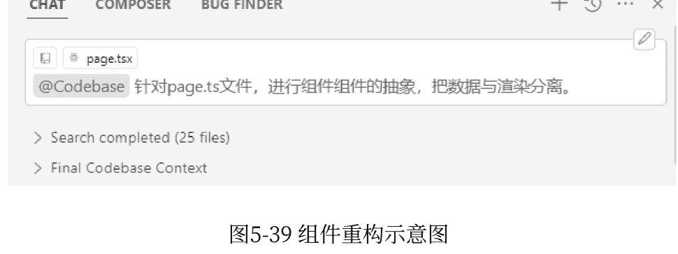

图5-39 组件重构示意图

### 1. 重构后能获得什么
重构后的代码像整理好的房间，每样东西都有固定位置。收益体现在：

先是“关注点分离”，把复杂任务拆成小任务，各自聚焦。
- 数据相关代码放在hooks文件夹，专管数据；
- 界面相关代码放在components文件夹，专管展示；
- 各自只做好本职工作。

再是“复用性提升”，像一个工具箱。
- hooks可像工具一样多处复用；
- UI组件像积木，随时拼出新界面；
- 一次编写，多处使用，提升效率。

还有“维护更简单”。
- 文件职责明确，像抽屉分类存放；
- 结构清晰，新人容易上手；
- 改动局部不会波及其他功能。

最后是“测试更方便”。
- 数据逻辑可单独测试；
- 界面展示可单独检查。
如同逐一检查玩具车的零件。

### 2. 推荐的项目目录
为了更有序，建议采用以下目录结构。

```
src/
├── hooks/          # 存放数据处理逻辑
│   └── useLogo.ts
├── components/     # 存放 UI 组件
│   ├── LogoInput.tsx
│   └── LogoResult.tsx
└── app/            # 页面组件
    └── page.tsx
```

这种结构如同设计合理的衣柜，类别分明，取用迅速。

### 3. UI优化常用手段
实际开发中可通过以下方式提升UI。

#### 1) 选用成熟组件库
像用现成积木搭建，常见选择有：
- Ant Design风格组件；
- Element Plus风格组件；
- Tailwind CSS风格组件。

#### 2) 参考图片辅助生成
在Cursor中上传或粘贴参考图，让AI按图生成相似界面。

#### 3）多工具协同
好比装修需要多把工具配合。
- 用v0/Bolt生成前端初稿；
- 再用Cursor细化优化；
- 若会设计，可先用Figma/Pixso设计，再生成代码，最后在Cursor中调细节。

## 5.6.2 前端请求取消机制
想象你在打车软件上叫车，临时改变主意可点“取消叫车”。网络请求也需要类似的取消能力，这就是中断请求。

前端里用户快速切换页面或取消操作时，继续等待请求毫无意义，还浪费资源。就像取消叫车后司机不会再开过来。JavaScript提供的AbortController就像一个开关，可随时终止进行中的网络请求。

举个例子，在线商城搜索“手机”。用户每输入一次就发请求，若能中断旧请求，就能避免无效响应。

## 5.6.2 中断请求功能

```javascript
// 创建一个请求控制器，就像创建一个开关
const controller = new AbortController();
const signal = controller.signal;
// 获取控制信号，相当于开关的开关线

// 发起搜索请求，并把控制信号连接上
fetch('https://api.example.com/data', {
    signal: signal // 将信号连接到请求上，这样就可以控制这个请求了
})
.then(response => response.json()) // 请求成功后，解析返回的数据
.then(data => {
    console.log('搜索结果：', data);
})
.catch(err => {
    if (err.name === 'AbortError') {
        console.log('搜索被取消了'); // 请求被中断时的提示
    } else {
        console.log('搜索出错', err);
    }
});

// 当用户点击取消按钮时，调用这行代码
controller.abort(); // 相当于按下开关，中断请求
```

在多Agent项目里该功能很实用。比如LOGO生成：用户第一次点击开始生成，若等待过长再次点击即可取消，体验更好。

使用时注意：
- （1）一个AbortController实例可管控多个请求，像一个开关控制多盏灯。
- （2）请求被中断后，对应Promise会进入catch并抛出AbortError。
- （3）中断不可逆，像按下取消后无法恢复原请求。

**注意：** 并非所有请求都需要取消。对响应极快的简单请求，加中断逻辑反而增加复杂度，需按业务需求取舍。

## 5.6.3 智能体Prompt测试优化
多智能体项目要确保每个智能体能正确理解指令并给出合理回应，就像给机器人做体检，通过测试保证健康。

测试重点是Prompt效果。Prompt相当于下达指令，必须清晰准确，否则机器人会误解。就像和朋友交流，表达不清容易出错，所以需要建立完善的测试体系。

设计测试用例时，先模拟真实场景。像点菜前试菜，要考察智能体在不同情况下的表现。

完整流程测试会模拟用户提出LOGO需求的全过程。例如用户说：“我需要一个科技公司的蓝色简约风格LOGO”。要验证需求分析智能体能否理解、设计建议智能体能否给出合适方案、审核智能体能否准确评估。

特殊场景测试更像压力测试。测试极端输入，如用户只说“简约”，或提出复杂要求“要有未来感又体现传统，还要包含公司三大价值观”。确保智能体能应对各种可能。

下面介绍如何用jest测试框架实现。jest是常用的JavaScript测试工具，相当于自动化检查员。

首先安装必要工具。

```bash
npm install jest @types/jest ts-jest --save-dev
```

然后创建测试配置文件jest.config.js，告知jest如何运行。

```javascript
module.exports = {
  preset: 'ts-jest',
  testEnvironment: 'node',
  testMatch: ['/.test.ts'],
};
```

测试用例示例。

```typescript
describe('智能体 Prompt 测试', () => {
  test('需求分析智能体测试', async () => {
    const input = '设计一个科技公司的蓝色简约风格 LOGO'
    const result = await analyzeRequirement(input)
    expect(result).toHaveProperty('style')
    expect(result).toHaveProperty('color')
    expect(result.style).toBe('简约')
  })
  test('设计建议智能体测试', async () => {
    const input = {
      style: '简约',
      color: '蓝色',
      industry: '科技'
    }
    const result = await generateDesignSuggestion(input)
    expect(result).toHaveProperty('elements')
    expect(result).toHaveProperty('layout')
  })
})
```

编写用例时要注意：
- 1. 用例要覆盖尽可能多的使用场景。
- 2. 每个用例目标明确，结果可预期。
- 3. 测试数据真实且有代表性。
- 4. 结果校验要全面准确。

测试中发现问题时，需及时调整Prompt，相当于给机器人重新编程以更好理解任务。

**提示：** 运行测试遇到问题时，先仔细阅读错误信息，它们通常会指出问题所在。仍无法解决时，可寻求AI助手帮助。

## 5.6.4 调试技巧
编程就像搭建精密积木城堡，难免出错。调试的本质是定位错误并修复，就像医生先找症状再找病因最后开方。

### 1. Cursor智能助手辅助调试
Cursor像一位编程导师，能快速指出问题。遇到看不懂的报错，可：
- 1. 用鼠标选中报错信息；
- 2. 按Ctrl+L打开对话框；
- 3. 输入：“这个错误是什么意思？该怎么解决？”

对代码不放心时：
- 1. 选中可疑代码段；
- 2. 打开Cursor对话框；
- 3. 问：“这段代码有问题吗？帮我检查一下。”

### 2. 日志记录法
在程序关键位置添加日志，像在路口装监控，能清晰看到运行轨迹。这是基础且高效的调试手段。

```javascript
// 1. 使用 console.log 打印变量值
function generateLogo(input: string) {
  console.log('输入参数：', input);
  // 处理逻辑
  const result = processInput(input);
  console.log('处理结果：', result);
  return result;
}

// 2. 使用 console.group 分组显示日志
console.group('LOGO 生成流程');
console.log('步骤 1：接收输入');
console.log('步骤 2：处理数据');
console.log('步骤 3：生成结果');
console.groupEnd();

// 3. 使用 console.time 测量代码执行时间
console.time('生成耗时');
await generateLogo(input);
console.timeEnd('生成耗时');
```

### 3. 典型开发陷阱与排错思路

编程实践里最容易反复踩坑的地方，就像感冒一样常见。先弄清症状，再对症处理，开发节奏就能快速恢复。

```javascript
// 语法错误（SyntaxError）——就像写错别字一样
// 错误示例
if (condition {  // 缺少括号
    console.log('错误');
}

// 正确写法
if (condition) {
    console.log('正确');
}

// 类型错误（TypeError）——就像用勺子喝汤面，工具用错了
// 错误示例
const data = null;
console.log(data.length);  // 空对象访问属性

// 正确写法
const data = null;
if (data) {
    console.log(data.length);
}

// 网络请求错误——就像打电话时信号不好
// 添加错误处理
try {
    const response = await fetch('https://api.example.com/logo');
    const data = await response.json();
} catch (error) {
    console.error('请求失败：', error);
    // 根据错误类型处理
    if (error instanceof TypeError) {
        console.log('网络连接问题');
    } else {
        console.log('其他错误');
    }
}
```

### 4. 浏览器自带调试面板

浏览器内置的开发者工具可以视作一台高倍显微镜，让程序运行的每一个细节都变得可见可查。

#### 1) Network（网络）面板
- 能实时列出所有网络请求及其状态码；
- 可核对发往后端的请求体是否符合预期；
- 能查看服务端返回的原始响应内容。

#### 2) Console（控制台）面板
- 运行时错误会以醒目的红色标出；
- 警告信息则用黄色提示；
- 支持通过筛选器快速定位特定日志。

> **温馨提示：** 调试需要耐心，不要急于改动代码。要像侦探一样先收集足够线索，确认根因后再出手。

### 新手速记清单
- 代码结构：分层规划，职责单一
- 请求治理：及时中断，避免资源空耗
- 测试策略：覆盖面广，重点突出
- 调试习惯：善用工具，逐步排查
- 异常处理：预防为主，及时捕获
- 复用思维：模块化构建，提升效率
- 文档规范：表达清晰，示例充分

# 第6章 构建具备长期记忆的智能知识体

## 6.1 规划概览与技术选型

使用ChatGPT或DeepSeek这类对话产品时，有没有出现过每次对话都像初次见面的感觉，历史信息被清空？根源在于传统智能体缺少长期记忆。下面介绍如何打造带记忆能力的知识伙伴，实现更个性化的服务。

### 6.1.1 智能体为何需要记忆

想象一下，如果你的私人助理每天都要重新做自我介绍，并反复确认你的偏好，体验会很糟糕。没有记忆的智能体同样面临此问题。对智能体而言，记忆的价值不亚于人类。下面是记忆组件能带来的核心能力。

- 上下文保持：借助记忆系统追踪完整对话，避免重复提问，让交流更自然流畅。
- 个性化适配：基于保存的用户画像与偏好数据，自动调节专业度、详略程度和表达风格。它会记住你是否偏爱代码示例、是否需要详细讲解以及知识水平。
- 主动任务追踪：建立任务管理机制，记录待办、截止时间和完成状态，不仅被动应答，还能主动提醒和推送相关信息。

落地场景举例。

#### 1. 个人学习场景
学习Python时智能体可做到：
- 记录各知识点掌握程度；
- 发现反复出错的概念；
- 依学习曲线动态调整讲解难度；
- 复习时强化之前理解薄弱的部分。

#### 2. 项目管理场景
对团队负责人而言：
- 跟踪各项目里程碑与进度；
- 智能分析风险点和瓶颈；
- 基于历史数据预测延期可能性；
- 自动生成项目报告和任务提醒。

#### 3. 旅行规划场景
假期规划时：
- 以过往出行经历构建偏好模型；
- 记住对不同住宿类型的评价；
- 了解预算区间与时间限制；
- 结合季节天气推荐合适行程。

#### 4. 娱乐推荐场景
休闲娱乐方面：
- 分析观影历史与评分记录；
- 捕捉不同情绪下的娱乐偏好；
- 记录对导演演员的态度；
- 新内容上线时精准推送可能感兴趣的作品。

### 6.1.2 记忆机制解析

智能体的记忆可类比人类记忆，也分短期和长期。

短期记忆：相当于工作记忆，仅保存当前会话信息。技术上多靠对话上下文实现，但受大模型窗口限制，例如gemini-2.0-pro约2M上下文，且会话结束即失效。

长期记忆：相当于永久记忆库，保存跨会话的关键信息。需要专门的存储方案，在需要时检索使用。

整体流程如下。


流程说明：

- 1. 用户输入 → 记忆生成
  - 系统接收消息并解析对话内容；
  - 智能体识别并抽取关键信息。
- 2. 记忆生成 → 记忆存储
  - 对抽取信息做结构化处理；
  - 整理成适配数据库的格式。
- 3. 记忆存储 ↔ 数据库
  - 将结构化数据写入数据库；
  - 保证检索效率。
- 4. 记忆检索 ↔ 数据库
  - 按当前对话检索相关记忆；
  - 取回匹配的历史资料。
- 5. 记忆检索 → 记忆应用
  - 整理检索结果；
  - 准备与回复融合。
- 6. 记忆应用 → 模型回复
  - 将记忆融入当前回答；
  - 输出连贯个性化的结果。

### 6.1.3 技术选型方案

构建带记忆的AI知识助手，需要合适的技术栈。综合复杂度和可扩展性，本项目以MCP模型上下文协议为底座。MCP可视作翻译官，协调模型与外部系统的交互。整体技术如下。

#### 1) 后端技术
- Python：AI与Web开发的主流语言，生态丰富；
- Starlette：轻量级ASGI框架，构建高性能异步Web应用；
- Uvicorn：高性能ASGI服务器，支持异步请求处理；
- JSON文件存储：适合原型和小规模项目的简易方案。

#### 2) 前端技术
- React：常用JavaScript库，构建交互界面；
- SSE（Server-Sent Events）：实现服务端向客户端实时推送，让用户看到思考过程。

#### 3) 模型
- OpenAI API：以GPT模型作为助手大脑；
- 开源模型：预算有限或需本地部署时可选。

选型考量：
- 开发效率：Python和React生态成熟，资源丰富；
- 性能要求：异步框架可处理并发，提升响应；
- 可扩展：MCP协议职责分离，便于维护；
- 部署难度：技术栈简洁，降低维护成本。

##### 1. 什么是ASGI
异步服务器网关接口ASGI是Python构建异步Web应用的规范。

传统WSGI像银行单窗口，客户必须等前面完成才轮到自己。ASGI像多窗口大厅，客户等待处理时柜员可服务他人，效率大幅提升。

ASGI核心能力：
- HTTP请求：常规页面访问；
- WebSocket连接：实时双向通信；
- 长连接请求：聊天、实时通知等。

在AI助手里，ASGI框架如Starlette尤为关键，因为模型调用耗时，异步可让服务器在等待时处理其他请求，提升性能和体验。

##### 2. SSE实例解析
服务器发送事件SSE允许服务端单向推送数据到客户端。基于HTTP，实现简单。

可类比广播电台，客户端是收音机。连接建立后，电台持续推送节目，客户端只需收听。

AI助手里常用于流式响应，让用户实时看到生成过程，而非等待完整答案。

示例流程：
- 1. 用户提问：“请解释量子计算基本原理”。
- 2. 服务端接收并调用模型。
- 3. 模型开始生成。
- 4. 服务端通过SSE把逐词逐句推送给前端。
- 5. 浏览器实时更新，用户看到答案逐步成形。

体验更接近真人实时打字，而非机械等待。

下面是一段用AI生成的SSE最小示例，采用[技术框架][功能][使用流程][其他细节要求]格式的提示：

请为我写一个最简单的SSE示例（文件名sse_server.py），使用Python和Starlette框架作为服务端，前端用单页面html，写到sse_server.py里。

实现实时烹饪助手功能，使用流程是用户可以输入想做的菜名，服务端通过SSE流式返回烹饪步骤，模拟一个逐步指导的过程。

sse_server.py控制在100行以内。

使用DeepSeek-V3模型，生成了sse_server.py，代码见：https://github.com/shadowcz007/memory_agent_exmaple/blob/main/sse_server.py。

可将代码粘贴到Cursor编辑器新建sse_server.py，然后终端运行。使用方式：
- (1) 安装依赖：pip install starlette uvicorn。
- (2) 运行服务：python sse_server.py。
- (3) 浏览器访问http://localhost:8000。
- (4) 输入菜名（如“番茄炒蛋”）并点击按钮，即可看到步骤逐步显示。

这样用户能看到助手思考过程，交互更自然。

## 6.1.4 架构设计思路

采用前后端分离，更适合AI应用。

### 1) 前端（客户端）
- 负责界面呈现和交互；
- 如同餐厅服务员，接收需求并展示结果。
使用React构建聊天界面，保证流畅体验。

### 2) 后端（服务器端）
- 负责业务逻辑、存储和模型调用；
- 如同厨房，处理核心业务产出结果。
使用Python与Starlette处理请求、管理记忆、调用模型。两者通过API通信：
- HTTP与JSON交换数据；
- SSE实现服务端实时推送。

带来好处：
- 职责清晰：前端重体验，后端重逻辑；
- 开发效率高：可并行开发；
- 技术灵活：各选最优栈；
- 扩展性强：可单独扩展；
- 维护成本低：局部改动不影响全局。

在AI场景，前后端分离尤其重要。模型需强大算力放服务端，交互需精致前端。架构兼顾两者优势。

服务端分层：
- 知识图谱层：存储与检索对话历史和记忆数据；
- MCP Server层：处理业务逻辑，对话管理、记忆生成与检索；
- SSE服务层：负责前端交互，接收请求并发送响应。

记忆模块组成：
- 记忆生成器：从对话抽取关键信息，生成结构化记忆；
- 记忆存储器：以合适格式写入数据库；
- 记忆检索器：按当前对话检索相关记忆；
- 记忆应用器：把检索结果融入回复。

客户端交互流程：
1. 用户发消息到服务器。
2. 服务器接收并处理。
3. 服务器检索相关记忆。
4. 服务器把消息和记忆发给模型。
5. 模型生成回复。
6. 服务器从回复中提取新记忆。
7. 服务器把回复发回客户端。
8. 客户端展示回复。

记忆模块是核心，让助手记住历史交流，提供更个性化服务。

### 1. 核心技术概念预览

进入架构细节前，先了解贯穿全项目的核心概念。下面用表格梳理它们的关系，如表6-1。

表6-1 核心技术组件的职责及与其他组件的协作

| 技术组件 | 主要职责 | 与其他组件的协作 |
| :--- | :--- | :--- |
| ASGI 服务器 | 处理 HTTP 请求和 WebSocket 连接 | 为 MCP 和 SSE 提供通信基础 |
| SSE | 实现服务器向客户端的实时推送 | 展示 AI 思考的过程和实时更新 |
| MCP | 协调 AI 模型与外部世界的交互 | 统一管理资源访问和工具调用 |
| 知识图谱 | 存储和组织长期记忆 | 为 MCP 提供数据支持 |
| Function Call | 执行结构化的操作请求 | 配合 MCP 实现具体功能 |
| 用户偏好系统 | 管理个性化设置 | 影响 AI 的行为和回答方式 |

### 2. MCP简介

MCP即模型上下文协议，为AI应用设计的通信协议，可视作翻译官，协调模型与外部交互。

MCP定义三种交互方式：
- (1) 资源 Resources：让模型获取外部信息，如从数据库读取用户历史记忆。
- (2) 工具 Tools：让模型执行具体操作，如保存新记忆或更新偏好。
- (3) 提示 Prompts：定义模型行为模式，如设定角色和回复风格。

该协议让模型像人类一样通过感知与行动与外界互动。

### 3. 知识图谱与记忆系统

知识图谱不仅存信息，还记录关联。可想象成思维导图，节点是概念，边是关系。

在AI助手里承担长期记忆：
- 实体 Entity：存储信息点，如用户信息、知识点；
- 关系 Relation：记录实体间联系，如用户喜欢编程；
- 属性 Attribute：描述特征，如时间戳、重要程度。

这种结构赋予联想能力，快速检索相关记忆。

### 4. Function Call：智能体的动手能力

Function Call让大模型按预定义格式生成结构化操作请求，相当于给智能体一盒工具并教会使用。

在本项目中，Function Call主要用于以下功能。

MCP记忆实战：让智能体真正记得你

- 把对话中的关键信息抽离出来，映射为知识图谱的节点与连接；
- 持续收敛使用者的偏好，写入个性化配置；
- 执行记忆保存、查询等具体操作。

### 5. 用户偏好系统

要实现更贴心的服务，需要先建立偏好管理体系。该体系长期保存以下信息。

- 交流风格偏好，例如倾向于简洁回复还是展开说明；
- 专业背景，例如入门级使用者还是资深从业者；
- 感兴趣的主题范围；
- 常用工具与个人设置。

以上偏好会直接影响助手的表达方式与内容编排，使服务更贴合个体。

### 6. 测试与迭代

工程落地时会遇到不少挑战：大模型输出偶发不准、图谱检索命中率不足、偏好更新出现异常。若要构建既聪明又可靠的知识助手，必须建立完整的测试与迭代闭环。后续章节会演示如何借助AI编程的思路对各模块进行调试与验证。以渐进方式持续打磨，系统才会愈发稳定。

### 小白必记

- 记忆模块的核心价值在于赋予智能体长期记忆能力
- 短期记忆借助对话上下文窗口实现
- 长期记忆需结构化保存关键要素
- 技术选型要在开发效率与扩展性之间取得平衡
- MCP使模型能够感知外部环境并执行动作
- 知识图谱擅长保存信息及其关联
- Function Call让模型完成结构化操作
- 偏好体系实现个性化交互
- 异步处理可提升并发性能并优化体验
- 测试迭代应循序渐进、持续完善

## 6.2 搭建MCP服务端

上一节梳理了带记忆功能的AI知识助手的整体架构与选型，本节进入MCP服务端的具体实现。该服务端是项目的核心枢纽，负责与大模型通信并管理对话与记忆数据。

### 6.2.1 MCP拓展知识

MCP是一种面向AI应用的通信协议，由Anthropic提出，已获OpenAI、Microsoft等主流厂商支持。

#### 1. MCP的定义与作用

MCP的核心思想是把模型与其运行环境解耦，通过标准化接口交互，相当于为模型提供一套感知与行动能力，使其能感知外部世界并执行操作。MCP定义了三种主要交互模式。

- (1) 资源 Resources：类似HTTP GET，允许模型从外部数据源读取信息，例如从数据库中拉取历史对话或个人偏好。
- (2) 工具 Tools：类似HTTP POST，允许模型执行操作，例如发送邮件、更新数据库或调用第三方API。
- (3) 提示 Prompts：可复用的模板，用于定义模型的行为模式与交互风格，例如设定助手的角色、语气与回复格式。

借助这三种模式，MCP让模型与外部世界的协作更灵活，服务也更智能个性化。

#### 2. 与传统API调用的区别

传统API通常是单向同步：客户端发送请求，服务器处理后返回结果，通信结束。对复杂AI交互而言，这种模式较为僵化。

MCP与传统API的主要差异如下。

- (1) 双向通信：MCP支持服务端与客户端持续的双向对话，而非一次性问答。
- (2) 上下文感知：MCP能保留对话上下文，让模型知晓先前交互，从而给出更连贯个性化的回应。
- (3) 资源与工具分离：获取信息与执行操作被明确区分，能力边界更清晰。
- (4) 标准化接口：统一的协议定义让不同AI应用互操作更简单。

#### 3. 为什么适合AI Agent开发

MCP非常契合Agent的开发需求，原因如下。

- (1) 能力扩展：通过工具接口，Agent可轻松访问网络、调用外部API或操作文件系统。
- (2) 上下文管理：内置上下文管理机制，Agent能记住先前的交互。
- (3) 模块化设计：资源、工具、提示三种接口使功能可模块化开发与组合，提升可维护性与可扩展性。
- (4) 实时交互：支持实时双向通信，Agent可在对话中动态调整行为，交互更自然。

在本项目里，MCP充当用户、模型与外部资源的桥梁，让助手提供智能个性化服务。

### 6.2.2 服务端基础实现

接下来搭建MCP服务端的最小骨架。选用Python作为语言，Starlette作为Web框架，Uvicorn作为ASGI服务器，JSON文件作为简易存储。

#### 1. 项目初始化与依赖安装

先新建项目目录，打开Cursor并在Features Docs中添加 https://www.starlette.io 等待索引完成，然后给出如下指令。

帮我设计一个Python文件simple_mcp_server.py。

使用Python，使用Starlette作为Web框架参考文档@Starlette，使用Uvicorn作为ASGI服务器只提供SSE根路径和post请求/messages，使用JSON文件作为简单的数据存储方案。

##### 服务端架构

- 知识图谱层：负责数据的存储和检索，包括对话历史和记忆数据
- MCP Server层：处理业务逻辑，包括对话管理、记忆生成和检索
- SSE服务层：负责与前端的交互，包括接收请求和发送响应

##### 记忆模块设计

- 记忆生成器：从对话中提取重要信息，生成结构化记忆
- 记忆存储器：将记忆以适当格式存入数据库
- 记忆检索器：根据当前对话内容检索相关记忆
- 记忆应用器：将检索到的记忆融入助手的回复

##### 其他要求

- 控制Python文件代码行数在100行以内
- 主要实现逻辑框架，细节可简化
- 提供调用的JS代码示例

完成的Python代码地址:
https://github.com/shadowcz007/memory_agent_exmaple/blob/main/simple_mcp_server.py

#### 2. 创建虚拟环境

```
python -m venv venv

source venv/bin/activate # 在Windows上使用venv\Scripts\activate
```

安装依赖包。

```
pip install uvicorn starlette
```

运行代码。

```
python simple_mcp_server.py
```

把JavaScript的调用示例粘贴到Chrome浏览器开发者工具的Console面板中运行，应得到成功的结果。

收到回复: 收到消息: 你好，我是用户

VM38451:16 收到回复: 收到消息: 我想了解更多关于记忆功能

调用示例JavaScript 代码地址:https://github.com/shadowcz007/memory_agent_exmaple/blob/main/simple_mcp_server.py#L135

### 6.2.3 实现MCP Server核心功能

下面补全MCP服务端的核心能力，包括资源访问、工具调用和提示模板，使AI知识助手能读取记忆数据、保存新记忆以及使用预设提示模板。

先把MCP官方的Server示例 https://github.com/modelcontextprotocol/servers/blob/main/src/memory/index.ts 加入Cursor做索引，命名为memory_mcp_example。

同时在项目里复制一份官方fast_mcp示例，新建文件名为fast_mcp_example.py。

```
from mcp.server.fastmcp import FastMCP

mcp = FastMCP("Echo")

@mcp.resource("echo://{message}")
def echo_resource(message: str) -> str:
    """Echo a message as a resource"""
    return f"Resource echo: {message}"

@mcp.tool()
def echo_tool(message: str) -> str:
    """Echo a message as a tool"""
    return f"Tool echo: {message}"

@mcp.prompt()
def echo_prompt(message: str) -> str:
    """Create an echo prompt"""
    return f"Please process this message: {message}"

if __name__ == "__main__":
    mcp.run(transport='sse')
```

在simple_mcp_server.py基础上新建分支 memory_v1 开始新功能开发。编写提示如下。

根据@memory_mcp_example和@fast_mcp_example.py的代码，实现一个基于memory的mcp_server.py。采用SSE通信方式，端口为6688。

Cursor据此生成了MCP Server，完整代码见：https://github.com/shadowcz007/memory_agent_exmaple/blob/memory_v1/memory_mcp_server.py

从回复中可看出AI对指令的遵循情况。该实现基于前面示例，创建了一个基于内存的知识图谱MCP服务器。主要功能如下。

- 使用FastMCP框架创建MCP服务器，端口设为6688；
- 实现了知识图谱管理器 KnowledgeGraphManager 用于实体和关系的增删改查；
- 提供了以下工具函数；
- 使用SSE Server-Sent Events作为通信方式；
- 数据存放在本地memory.json文件中，格式为JSONL，每行一个JSON对象。

需要注意，使用MCP Python SDK里的fastmcp创建服务默认路径是/sse，启动后可通过浏览器访问 http://localhost:6688/sse 验证是否正常。

### 6.2.4 MCP通信机制

通过MCP的SSE通信机制调用服务端。

MCP基于JSON-RPC 2.0，支持两种通信方式。

- (1) Stdio transport：通过标准输入输出通信，适用于本地应用。
- (2) HTTP with SSE transport：通过HTTP和服务器发送事件通信，适用于网络应用。

本项目使用HTTP with SSE transport，更适合Web场景。注意 fastmcp默认是stdio通信，需在server代码里把transport参数传为sse，如下。

```
mcp.run(transport='sse')
```

接下来用代码测试MCP Server，使用MCP官方Python SDK的client示例，地址：https://github.com/modelcontextprotocol/python-sdk/tree/main?tab=readme-ov-file#writing-mcp-clients

复制代码粘贴到Cursor，指令如下。

根据示例代码，为@memory_mcp_server.py写一个client代码来测试，使用SSE连接到服务器，端口6688，路径/sse，需要有调试信息直接打印变量结果，不要额外处理，注意应使用 `from mcp.client.sse import sse_client` 连接 Server

生成的 client 代码地址：https://github.com/shadowcz007/memory_agent_exmaple/blob/memory_v1/memory_mcp_client.py

运行后即可看到MCP工具调用的实际过程。

### 小白必记

- MCP 的本质：模型与外部世界的标准化通信接口
- 资源访问原则：通过 GET 方式获取外部数据
- 工具调用准则：通过 POST 方式执行外部操作
- 提示模板规范：定义模型的行为模式和交互方式
- SSE 通信机制：支持服务端与客户端的实时双向通信
- 知识图谱存储：使用 JSON 文件存储实体和关系数据
- FastMCP 框架：简化 MCP 服务端开发的 Python 工具
- 端口配置原则：明确指定服务端口，避免冲突

## 6.3 构建 Agent 记忆模块

前面介绍了AI知识助手的整体架构并搭建了MCP服务端，下面深入记忆模块的构建，这是让助手真正“记住”用户信息和对话历史的关键。

### 6.3.1 记忆模块设计原理

如果大脑没有记忆，就无法记住昨天发生的事，也学不会经验。同理，没有记忆的AI只能做单次对话，无法提供连贯个性化服务。记忆模块就像AI的“海马体”，负责存储和检索重要信息。

AI助手的记忆系统通常分为短期记忆和长期记忆，与人类相似。

短期记忆指当前对话中的信息，类似工作记忆，具有以下特点。

1. 容量有限：受限于大语言模型的上下文窗口大小，如GPT-4的8K~32K tokens。
2. 临时性：对话结束即消失。
3. 高访问速度：可直接作为模型输入的一部分。

技术上，短期记忆通常通过维护当前对话的历史消息列表实现。每当用户发送新消息，就追加到列表中，并把整个列表作为上下文提供给模型。

```
conversation_history = [
    {"role": "system", "content": "你是一个有记忆能力的AI助手。"},
    {"role": "user", "content": "我叫shadow，我喜欢编程。"},
    {"role": "assistant", "content": "你好shadow！很高兴知道你喜欢编程。我可以帮你解答编程相关的问题。"},
    # 新消息会被添加到这个列表中
]
```

长期记忆是跨会话持久存储的重要信息，类似人类的长期记忆，具有以下特点。

(1) 容量大：理论上可存储无限量信息。
(2) 持久性：对话结束也不会丢失。
(3) 需要检索：不能一次性全部加载到上下文，需按相关性检索。

技术上，长期记忆需要专门的存储系统和检索机制。可以用简单的JSON文件、关系型数据库或向量数据库存储，并在需要时检索相关内容。

```
{
    "user_id": "mixlab_id123",
    "personal_info": {
        "name": "shadow",
        "interests": ["编程", "人工智能"],
        "occupation": "软件工程师"
    },
    "conversation_memories": [
        {
            "timestamp": "2023-06-01T10:30:00",
            "content": "用户提到他正在学习 Python 和机器学习"
        },
        {
            "timestamp": "2023-06-02T15:45:00",
            "content": "用户遇到了 OpenCV 安装问题"
        }
    ]
}
```

### 6.3.2 知识图谱增强记忆能力

知识图谱是一种强大的知识表示方式，能帮助助手更好地理解和组织记忆中的信息。本节探讨如何用知识图谱增强Agent的记忆能力。

#### 1. 知识图谱的基本概念

知识图谱是以图结构存储知识的数据库，由实体节点和关系边组成。每个实体可有多个属性，每条关系连接两个实体，表达某种联系。

核心概念包括以下元素。

(1) 实体 Entity：表示现实世界中的对象，如人物、概念、事物。每个实体有唯一标识符和一组属性。
(2) 关系 Relation：表示实体间的联系，通常是有向边连接两个实体，关系本身也可带属性如强度、时间等。
(3) 属性 Attribute：表示实体或关系的特征，通常为键值对形式。
(4) 三元组 Triple：知识图谱的基本单元，由主体Subject、谓词Predicate、客体Object组成，记为 S,P,O。例如 张三,喜欢,编程 表示“张三喜欢编程”这一事实。

在助手的记忆模块中，可用知识图谱表示用户的个人信息、偏好、对话历史，形成一个结构化的记忆网络。以下是一个简化的知识图谱示例。

```
knowledge_graph = {
    "entities": {
        "mixlab_user": {"type": "User", "name": "shadow"},
        "topic_python": {"type": "Topic", "name": "Python"},
        "event_project": {"type": "Event", "name": "个人项目开发"}
    },
    "relations": [
        {"source": "mixlab_user", "relation": "interested_in", "target": "topic_python"},
        {"source": "mixlab_user", "relation": "working_on", "target": "event_project"},
        {"source": "event_project", "relation": "uses", "target": "topic_python"}
    ]
}
```

利用该思路就能把用户零散信息里的潜在关联挖掘出来，让智能体据此呈现更为丰满的上下文。

#### 2. 记忆检索机制

当新一轮用户消息到来时，系统要从长期记忆池里调取相关片段，以提升回复的相关性。召回大致包含四步。

(1) 查询生成：依据当下发言提炼出检索用的查询表述。
(2) 相似度计算：衡量查询与已存记忆的接近程度。
(3) 排序与筛选：按相似度打分排序，挑选最匹配的部分。
(4) 上下文融合：将检索到的内容与本次对话合并起来。

实际落地时往往会组合多种手段来兼顾效率与精度。

- 关键词匹配：基于关键词做简单命中，适合记忆规模较小的场景；
- 向量相似度：借助嵌入模型把文本转成向量，再算余弦相似度；
- 图遍历：沿知识图谱扩散，找到与当前主题相关的实体和关系。

综合运用后，能在大量记忆里迅速锁定与本轮对话高度相关的信息，作为补充上下文喂给模型。

前面章节的示例仅做了节点的关键词查找 https://github.com/shadowcz007/memory_agent_exmaple/blob/memory_v1/memory_mcp_server.py#L174C1-L185C23，若想拓展能力，可通过提示词让 Cursor 为上一节的 memory_mcp_server.py 增添新功能。

打开 Cursor 编辑 memory_mcp_server.py，按 Ctrl+L 呼出对话框，输入如下提示，为 KnowledgeGraphManager 追加图遍历功能。

> 请给 KnowledgeGraphManager 增加一个图遍历算法功能，用于查找和节点最近和最远的节点，根据 KnowledgeGraphManager 目前的实现，应该用什么算法可以兼顾效率和效果，给我推荐方案，给出不同方案的优缺点。

随后 Cursor 给出一个折中建议：推荐使用 BFS，理由如下。

- 当前图结构较为简单，且边无权重；
- BFS 实现简洁，便于维护；
- 可同时满足寻找最近节点和最远节点的需求；
- 性能表现比较稳健。

采纳建议后保存代码，再让 Cursor 生成测试用例。

依据新方法 find_nearest_farthest_nodes 的输入输出，撰写若干能在真实环境运行且覆盖面广的用例，要求节点名称使用中文。

代码位置：https://github.com/shadowcz007/memory_agent_exmaple/blob/memory_v2_tools/memory_mcp_server.py#L198C3-L198C83。

这里所说的测试用例，本质上是为验证功能正确性而准备的输入数据与期望输出。让 Cursor 自主设计多样化用例，最终产出文件 test_knowledge_graph.py，覆盖多种典型图结构，确保遍历算法在不同情境下表现可靠。

##### 1）星形图结构测试

此结构存在一个中心节点，外围挂接多个叶子节点，常见于社交或组织场景。测试重点是检验算法能否正确识别与中心距离相同的多片叶子，并准确认定最近关系。

##### 2）链式图结构测试

节点线性排列形成一条链。用于考察长路径的处理能力，尤其是最远节点的判定是否准确，以及深度计算是否无误。

##### 3）环形图结构测试

所有节点首尾相连构成闭环。用于检验循环路径下的鲁棒性，能否识别出多个可能的远节点，同时避免无限循环。

##### 4）深度限制测试

通过 max_depth 参数限制搜索深度，对大规模图尤为重要。重点看算法是否能在设定深度处正确截断并返回合理结果。

##### 5）孤立节点测试

作为边界条件测试。对于没有任何连接的孤立节点，算法应具备适当的异常处理，体现健壮性。

上述不同场景共同验证了图遍历算法的正确性与稳定性，每个用例都针对特定特性，有助于发现潜在问题。

测试代码位置：https://github.com/shadowcz007/memory_agent_exmaple/blob/memory_v2_tools/test_knowledge_graph.py。

### 6.3.3 Function Call 在 Agent 中的应用

Function Call 是大模型的一项核心能力，允许模型输出结构化的函数调用请求，而非仅自由文本。在 Agent 的记忆模块里，Function Call 有助于实现更精准的记忆操作，例如存储、检索与更新。

#### 1. Function Call 的工作原理

可类比人类的“思考—行动”循环。完成任务时先思考调用哪个函数、如何填参数，再执行。模型模拟的就是这一过程。

具体工作流包括：

1. 函数定义：先声明可用函数及其参数格式。
2. 模型推理：依据上下文判断是否需要调用函数及调用哪个。
3. 参数生成：按函数定义生成合法参数。
4. 函数执行：系统执行函数并返回结果。
5. 结果整合：将执行结果融入对话继续生成。

在 OpenAI 的实现中，Function Call 通过 tools 参数传入，模型会返回 tool_calls 字段，携带函数名与参数，如图 6-1 所示。

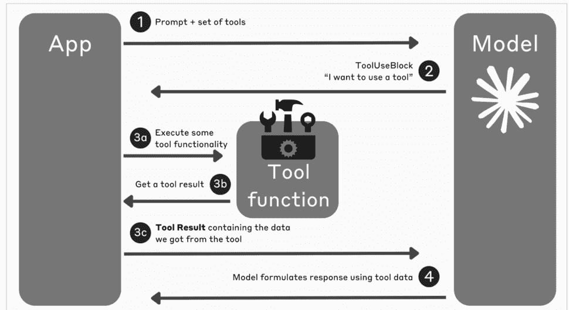

官方参考指南：https://platform.openai.com/docs/guides/function-calling。

Claude 的工具调用机制类似：https://github.com/anthropics/courses/blob/master/tool_use/04_complete_workflow.ipynb。

#### 2. 工具调用的消息构造

工具调用是模型与外部环境交互的关键方式，使其能够发出结构化请求，而不仅限于文本生成。

##### 1）最简字符串示例

用最简形式展示完整流程。

1. 系统定义工具

system: 可用工具：天气查询

参数：城市名称

2. 用户提问

user: 北京今天天气怎么样？

3. 助手调用工具

assistant: 我来帮你查一下北京天气

tool: weather("北京")

4. 工具返回结果

result: 晴天，25℃，空气质量良好

5. 助手最终回复

assistant: 北京今天晴天，气温 25℃，空气质量良好

该极简示例体现了工具调用的核心链路：定义工具→用户提问→助手判断→调用工具→整合结果。

```
[
  {
    "role": "system",
    "content": "你是一个AI助手，可以使用以下工具：\n1. create_entity: 创建知识实体\n2. create_relation: 创建实体关系"
  },
  {
    "role": "user",
    "content": "请帮我创建一个关于Python的知识实体"
  },
  {
    "role": "assistant",
    "content": null,
    "tool_calls": [
      {
        "id": "call_123",
        "type": "function",
        "function": {
          "name": "create_entity",
          "arguments": {
            "name": "Python",
            "type": "编程语言"
          }
        }
      }
    ]
  },
  {
    "role": "tool",
    "tool_call_id": "call_123",
    "content": "{"status": "success", "entity_id": "ent_456"}"
  },
  {
    "role": "assistant",
    "content": "已成功创建知识实体，实体ID为：ent_456"
  }
]
```

图 6-2 工具调用的消息构造

下面查看更具体的消息构造方式，如图 6-2 所示。

##### 2）消息构造方式

工具调用的消息通常包含以下关键部分。

(1) 系统提示 System Prompt：定义模型行为和可用工具。

```
{
    "role": "system",
    "content": "你是一个AI助手，可以使用以下工具：\n1. create_entities: 创建知识实体\n2. create_relation: 创建实体关系"
}
```

(2) 用户消息 User Message：用户的输入内容。

```
{
    "role": "user",
    "content": "请帮我创建一个关于Python的知识实体"
}
```

(3) 工具定义 Tools：说明可用工具及其参数。

```
{
  "tools": [
    {
      "name": "create_entities",
      "description": "创建一个新的知识实体",
      "parameters": {
        "type": "object",
        "properties": {
          "name": {
            "type": "string",
            "description": "实体名称"
          },
          "type": {
            "type": "string",
            "description": "实体类型"
          }
        }
      }
    }
  ]
}
```

(4) 工具调用请求 Tool Call：模型生成的函数调用请求。

```
{
  "role": "assistant",
  "content": null,
  "tool_calls": [
    {
      "id": "call_123",
      "type": "function",
      "function": {
        "name": "create_entities",
        "arguments": {
          "name": "Python",
          "type": "编程语言"
        }
      }
    }
  ]
}
```

(5) 工具调用结果 Tool Result：函数执行后的返回结果。

```
{
```

##### 3）调用流程

完整调用流程如下。

（1）初始化阶段。

- 系统下发包含工具定义的系统提示；
- 用户发出输入消息。

（2）模型推理阶段。

- 模型解析用户输入；
- 判定是否需要调用工具；
- 生成工具调用请求。

（3）工具执行阶段。

- 系统接收请求并执行对应函数；
- 返回执行结果。

（4）结果整合阶段。

- 模型读取工具返回结果；
- 生成最终回复并发送给用户。

看一个完整示例。

```python
# 1. 初始化对话
messages = [
    {
        "role": "system",
        "content": " 你是一个AI助手，可以使用以下工具：\n1. create_enties: 创建知识实体\n2. create_relation: 创建实体关系 "
    },
    {
        "role": "user",
        "content": " 请帮我创建一个关于 Python 的知识实体 "
    }
]

# 2. 发送给模型
response = await model.chat.completions.create(
    messages=messages,
    tools=tools_definition
)

# 3. 处理工具调用
if response.choices[0].message.tool_calls:
    tool_call = response.choices[0].message.tool_calls[0]
    result = await execute_tool(tool_call.function.name, tool_call.function.arguments)

    # 4. 发送结果给模型
    messages.append({
        "role": "tool",
        "tool_call_id": tool_call.id,
        "content": result
    })

    # 5. 获取最终回复
    final_response = await model.chat.completions.create(
        messages=messages,
        tools=tools_definition
    )
```

借助此方式，可实现 AI 助手与外部系统的无缝协作，让模型不仅能生成文本，还能执行具体操作。

### 6.3.4 代码实战：MCP的Function Call实现

掌握原理后即可搭建完整的 MCP 工具调用流程。先找到 OpenAI 的 Function Call 示例 https://github.com/openai/openai-cookbook/blob/main/examples/How_to_call_functions_with_chat_models.ipynb 录入 Cursor 的 Features Docs，同时把硅基流动的开发文档 https://docs.siliconflow.cn/cn/api-reference 也录入并命名为 siliconflow，便于调用 LLM。打开 Cursor 输入以下提示。

帮我创建一个save_knowledge.py文件，整合LLM和记忆库的知识提炼存储系统。功能是：根据用户的输入，LLM自动提炼或者推荐相关的知识点，并把知识点存储到记忆库里。

- LLM和Function Call参考@How_to_call_functions_with_chat_models.ipynb

- LLM使用@siliconflow平台的LLM，模型用Qwen/Qwen2.5-7B-Instruct

- 记忆库相关的功能参考@memory_mcp_client.py，通过调用MCP的Server完成

实现流程参考：

- 定义知识提取的function schema

- sse连接到记忆服务器

- 等待用户输入

- 使用LLM提取知识

- 保存实体和关系

生成的代码详见：

https://github.com/shadowcz007/memory_agent_exmaple/blob/memory_v2_tools/save_knowledge.py。

**注意：** 这里分别使用了网页示例和本地代码示例，让 Cursor 按不同来源参考功能，更容易得到可靠代码。

### 1. JSON数据容错处理

在实际处理工具调用参数时，常会遇到 JSON 解析失败的情况，这里采用 JSON 修复库来兜底，编写以下提示。

帮我优化工具调用的结果，JSON数据的提取，使用以下代码。

```python
import json_repair

decoded_object = json_repair.loads(json_string)
```

生成代码详见：

https://github.com/shadowcz007/memory_agent_exmaple/blob/memory_v2_tools/save_knowledge.py#L112。

**温馨提示：** Python 项目请先通过 pip 安装 json-repair，参考地址 https://pypi.org/project/json-repair 。若采用 Node.js 方案，也能找到功能相近的 jsonrepair 库，地址 https://www.npmjs.com/package/jsonrepair 。

### 2. 中文乱码修复
若打开生成的 memory.json 发现中文无法正常显示，可在 memory_mcp_server.py 中补充一条处理指令。

@memory_mcp_server.py 保存的JSON，需要处理中文

相关实现可查看：
https://github.com/shadowcz007/memory_agent_exmaple/blob/memory_v2_tools/memory_mcp_server.py#L66。

### 3. 模型挑选指南
本示例演示时选用了阿里开源的 Qwen2.5-7B 作为轻量级模型，门槛低、易上手，适合练习与验证。 若对抽取、推理能力要求更高，可换成 DeepSeek-V3 等大规格商业模型，效果更强但通常按量计费。 具体选用请结合任务复杂度与预算权衡。

## 新手要点回顾
- 记忆体系构造：借鉴人脑，分为短期与长期两层
- 短期记忆属性：仅保留当轮对话，容量有限但响应迅速
- 长期记忆属性：对关键信息做持久化存储，使用时需检索
- 知识图谱组成：以节点和连线刻画信息间的关联
- 实体含义：图谱中代表的“人”或“物”
- 关系含义：用于连接两个实体间的“连线”或“关联”
- 检索方式：从历史记录中筛选出最相关的片段
- 工具调用价值：让模型能精准完成特定操作
- JSON 规范：数据持久化的通用格式，务必保持合法
- 中文编码要点：写入文件时要设定正确的字符编码

## 6.4 客户端搭建与体验优化
前一节已为 AI 知识助手搭好“大脑”，即记忆模块，负责存储与回忆。但仅有大脑无法使用，还需要一个交互入口来查阅记忆并进行对话，这就是客户端的职责。

类似拥有高性能的 Agent 服务端与记忆模块，却没有显示器、键盘和鼠标，无法操作。 客户端相当于操作界面与显示屏，提供图形化操作界面，让你方便查阅知识、调整配置并与助手交流。

本节聚焦客户端的开发思路与用户体验设计，好的体验应做到界面清晰、操作顺畅、反馈及时，让使用过程更轻松。

## 6.4.1 客户端界面规划：为 Agent 赋予“外形”
客户端的第一步是界面设计，如图6-3。 根据目标，界面至少包含以下区域。

（1）配置区：用于填写连接后端 MCP 服务器所需参数，例如服务地址、API 密钥等。 类似手机连接 Wi-Fi，客户端必须知道要连向哪个“大脑”。 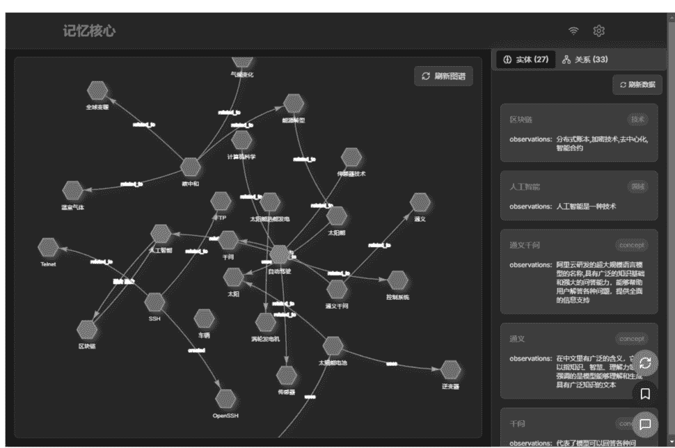

（2）记忆可视化区：以图形方式呈现 Agent 记忆中的知识图谱。 图形化比纯文本列表更直观，能快速看出关联。可借助 vis.js 这类可视化库绘制网络图，库相当于工具箱，提供了大量现成代码以加速开发。

（3）实体关系清单：以滚动列表形式展示图谱里的全部实体与关系，便于浏览和管理。

（4）整体调性：界面呈现科技感，贴合 AI 助手定位。

实现层面可选用 React 构建界面。React 允许把页面拆分为独立组件，像搭积木一样组合与维护。

可扫描如图6-4 的二维码观看演示。


项目搭建步骤如下。 在 bolt.new 中选用 React 模板，输入以下需求描述。

首页为记忆管理面板，功能如下。

1. 放置一个设置图标，点击后弹出配置页，可填写 MCP 服务地址、API URL、API Key、模型名称，并提供“保存”按钮。
2. 包含一个基于知识图谱的记忆可视化组件，使用 vis.js，可切换查看实体与关系；右侧以卡片形式滚动加载实体与关系。
3. 页面整体风格偏未来科技感。

执行 npm i 安装依赖，npm run dev 启动本地服务。 在 MCP 功能通顺前，先用以下提示让代码生成器补充逻辑。

@Codebase 帮我实现以下点。
(1) 系统配置中的 MCP Service Address 默认值为 http://localhost:6688/sse，点击 Save Configuration 后把配置写入本地缓存，下次启动时从缓存读取。
(2) 保存配置后，使用 mcp-uiux 拉取 MCP 上的工具列表，成功则在界面右上角显示连接状态图标。

mcp-uiux 示例代码如下。

```javascript
import React from 'react';
import { MCPPProvider, useMCP } from 'mcp-uiux';

const App = () => {
  const {
    connect,
    loading,
    error,
    tools,
    resources,
    resourceTemplates,
    prompts
  } = useMCP();

  useEffect(() => {
    // 连接到 MCP 服务器
    connect('http://localhost:8080', '');
  }, []);

  return (
    <div>
      {loading && <div>加载中 ...</div>}
      {error && <div>错误: {error}</div>}

      <div>
        <h3>工具列表 ({tools.length})</h3>
        <ul>
          {tools.map((tool, index) => (
            <li key={index}>{tool.name}</li>
          ))}
        </ul>
      </div>
    </div>
  );
};

// 使用 MCPPProvider 包装应用
const Root = () => {
  return (
    <MCPPProvider>
      <App />
    </MCPPProvider>
  );
};

export default Root;
```

该片段展示了完整流程：读取用户地址、调用 connect、处理加载与异常、将状态回显，并把成功地址持久化到本地缓存。

### 1）搭建基础框架
通过 npm i 安装 React、vis.js 等依赖，再用 npm run dev 启动开发服务器，在浏览器预览效果。 这一步相当于打地基、备齐砖瓦。

### 2）连通 MCP 服务器
界面成型后，关键是让客户端与上一节搭建的 MCP 服务器建立对话。

（1）配置持久化：用户在设置页输入的 MCP 地址、API Key 等信息，建议存入浏览器 Local Storage，关闭再打开也不会丢失。
（2）建立连接：保存后尝试连接指定地址。 可使用 npm 包 mcp-uiux，地址 https://www.npmjs.com/package/mcp-uiux ，它简化了连接与交互流程。
（3）状态提示：连接成功时展示明显标识，如点亮图标；失败时给出提示。

由于客户端常运行在 http://localhost:3000，服务器在 http://localhost:6688，属于跨域，浏览器会拦截。 需在 memory_mcp_server.py 中开启 CORS，明确允许客户端来源。 参考代码修改： https://github.com/shadowcz007/memory_agent_exmaple/commit/dd471a0a8483479dd24c8b0a54d44d16745a462f 。 启动服务命令为 python memory_mcp_server.py 。

## 6.4.2 通过 MCP 读取图谱并呈现：让记忆“活化”
连接建立只是开始，接下来要从 MCP 获取 Agent 的记忆，即知识图谱，并在客户端展示。

上一节在 MCP 服务器定义了 read_graph 工具，用于返回完整图谱。 客户端需调用它。

### 1. 调用工具与数据处理
mcp-uiux 提供了 execute 方法用于执行服务端工具。 客户端调用 execute 指定 read_graph 工具名，本例无需额外参数。

服务器执行后会读取 memory.json 或数据库，将实体列表与关系列表返回。 客户端收到数据后需完成：

（1）数据对接：将实体和关系填充到右侧滚动列表。
（2）图谱绘制：把数据交给 vis.js 绘制网络图。

类比为读者向图书管理员索取“人工智能”相关书籍，管理员递书后，读者分置书架与桌面作图。

可扫描二维码观看演示，如图6-5。


在 Cursor 中输入以下提示。

```python
@Codebase 完成以下工具：
1. 当 MCP 连接成功后，将鼠标指针悬停在右上角的连接图标上，显示工具的数量。
2. 使用工具，读取图谱数据 {
    "name": "read_graph",
    "description": "\n    读取整个知识图谱 \n    ",
    "inputSchema": {
        "properties": {},
        "title": "read_graphArguments",
        "type": "object"
    }
}
3. 读取图谱数据，对接到右侧的 Entities 和 Relations，以及左侧的可视化图谱上。
```

**注意：** MCP 工具调用使用 Execute 方法。 同时把 console 打印的数据粘贴给 Cursor 供参考，能更快完成数据对接。

**调试建议：** console.log(result) 很关键，能在开发者工具中看到服务端实际返回的结构，便于正确转换处理。

## 6.4.3 增加 Chat 对话区：与 Agent 直接交流
仅浏览不够，还需聊天窗口实现实时对话。

### 1. 界面与交互
聊天框可放在侧边或底部，提供输入区与消息区。 每条 AI 回复旁建议加上“保存”或“收藏”图标，便于把有价值内容沉淀为长期记忆。

### 2. 接入 LLM API
聊天核心是连接大语言模型 API。 设置页已配置 API 地址、Key、模型名。 用户发送消息时，客户端收集输入，连同对话历史一并发送给 LLM，接收回复后展示。

### 3. 流式输出
为提升体验，采用流式传输。 模型边生成边推送片段，客户端实时拼接显示，避免长时间空白等待。 使用前请确认所选 API 支持流式，并在代码中逐步渲染。

演示视频二维码见图6-6。


图6-6 演示视频

继续在 Cursor 中添加聊天功能，提示如下。

如果要添加一个 chat 对话框，请给出合适位置与最佳交互方式，每条回复旁添加保存小图标。

把 chat 与 llm api 接通，配置使用系统已保存的信息，接口参考硅基流动文档，注意启用流式传输。

## 6.4.4 知识提炼：把对话沉淀为记忆
聊天能交流，更有价值的是将关键信息固化为长期记忆，即知识提炼。

可扫描图6-7 二维码观看演示。


图6-7 演示视频

在 Cursor 中输入提示。

@Codebase

点击保存图标后执行：

1. 按提炼知识的 prompt 调用 @llm api，强制使用 create entities 与 create relation 工具，得到所需输入参数。
数据结构参考视频。
2. 用 mcp 工具执行 create entities 与 create relation，获取执行结果。
3. 在保存界面展示工具执行状态，并刷新可视化图谱与右侧实体关系列表。

### 1. 触发流程
用户点击某条 AI 回复旁的保存图标后触发流程：

（1）提取指令：获取待保存的消息内容。
（2）LLM 抽取：把消息发送给 LLM，指令为结构化抽取实体与关系。 采用 Function Call，预定义 create_entities 与 create_relation 工具格式，并强制模型调用。
（3）获取结构化数据：模型返回 JSON 格式的实体与关系参数，而非自然语言。
（4）调用 MCP 工具：解析 JSON 后，用 mcp-uiux 的 execute 方法调用 MCP 上的对应工具并传递参数。
（5）服务端更新：MCP 服务器执行创建操作，更新图谱文件或数据库。
（6）反馈刷新：服务器返回结果后，客户端展示成功或失败提示，并自动刷新左侧图谱与右侧列表。

### 2. 为何使用 Function Call
让模型自由生成文本描述实体关系不够稳定。 Function Call 强制输出预定义结构的 JSON，后续存储调用更可靠准确，相当于给模型一个填空模板而非开放作文。

调用工具型模型时请确认模型是否支持，并查阅平台说明。

### 3. 健壮性考虑

在工程实践中，大模型生成的 JSON 偶尔会出现细微瑕疵，比如多余的逗号、引号未配对等，直接解析就容易报错。为了提升鲁棒性，可以引入 JSON 自动修复库，例如 Python 生态的 json-repair 和 Node 生态的 jsonrepair，先在解析前做一次自动纠错。

与此同时，过程性的即时反馈同样重要。用户点击“保存”后，界面应给出“正在提炼”的状态提示，成功时显示“知识已保存”，失败时返回清晰的错误信息，并且图谱与列表能够自动刷新。这些细节共同构成良好的使用体验。

把以上手段组合起来，就能为 AI 知识助手搭建一个功能相对完善的客户端：用户既可以查看 Agent 的记忆，也能通过对话与 Agent 交互，并把有价值的信息方便地沉淀到长期记忆中。

## 6.4.5 个性化偏好：让助手更懂你的使用习惯

前文已经实现了与 AI 知识助手的对话，并且能把有价值内容提炼为长期记忆。但一个真正智能的助手，除了记住知识，还要记住“你是谁”，即了解使用者的偏好，提供更个性化的服务。

设想你有一位真人助理，你不需要每次都重复“请用简单的语言解释”或“我喜欢看代码示例”，他会自动记住这些习惯。AI 知识助手也应具备这种能力，这就是用户偏好功能的意义。

### 1. 什么是用户偏好
用户偏好指的是用户在与 AI 助手交互时表现出来的稳定习惯与喜好。有人偏爱简洁直接的回复，有人则偏好详细全面的说明；新手可能需要基础概念的铺垫，专业人士则只关心技术要点。

捕捉并记录这些倾向，能让 AI 在没有明确指令的情况下，也给出符合使用习惯的答案，显著提升体验。

### 2. 如何捕捉用户偏好
偏好的挖掘主要依赖提问方式、反馈态度和交互行为的分析。可以设计一个专用 Prompt，让 AI 在对话过程中持续分析并记录以下几类偏好。

(1) 回答长度偏好：用户是偏好简短核心的回答还是详尽全面的解释。
- 观察用户是否经常跳过长文本或明确要求“简化一下”；
- 注意用户是否反复追问“能详细解释吗？”或“还有更多细节吗？”。

(2) 专业程度偏好：用户的知识水平和对专业术语的接受度。
- 分析用户自身使用专业术语的频率和准确性；
- 观察用户是否经常需要基础概念的解释；
- 记录用户面对专业术语时的反应，是理解还是要求释义。

(3) 语言风格偏好：用户偏好的交流方式和语言特点。
- 分析用户自身的语言是偏正式还是随意；
- 观察用户对幽默回应或严肃回应的反馈；
- 留意用户是否有特定习惯，如使用表情符号、简写等。

(4) 学习方式偏好：用户更易理解新信息的方式。
- 记录用户对代码示例、理论解释或生活类比的反应；
- 分析提问模式和后续问题的类型；
- 观察用户更倾向视觉学习如要求图表，还是文字学习。

### 3. 如何实现用户偏好功能
落地该功能需要在客户端和服务端同时改造。

（1）偏好分析：在每次对话结束后，使用 LLM 分析本次交互可能体现的用户偏好，并生成结构化偏好数据。此处可借助前文介绍的 Function Call 技术，强制模型输出符合预定义格式的 JSON。

（2）偏好存储：在 MCP 服务器上新增工具 update_user_preference，用于接收并持久化用户偏好数据。这些数据可存放在独立文件如 user_preference.json 或数据库中。

(3) 偏好应用：用户发起新对话时，客户端先从服务器获取已保存的偏好，并将其作为系统提示词的一部分，加入发送给 LLM 的请求中。这样模型在作答时会自然兼顾这些偏好。

下面是一些可作为系统提示词一部分的用户偏好示例。

用户偏好如下。

- 使用简单的语言，避免专业术语；
- 用户是素食主义者，不要推荐含肉食谱；
- 回答后附上西班牙语翻译；
- 在规划旅行时，包含每日成本估算；
- 用户只会 JavaScript 编程；
- 用户喜欢简短、精炼的回答。

### 4. 用户偏好的动态调整
用户偏好并非固定不变，会随时间与场景变化，系统应支持动态更新。

(1) 权重系统：为每个偏好设置权重，出现频率越高权重越大。
(2) 时效性考虑：近期偏好应比早期偏好拥有更高权重。
(3) 场景区分：识别不同对话场景如编程问题、生活建议等，为不同场景维护独立的偏好集合。
(4) 明确覆盖：当用户明确表达新的偏好时，应立即更新并覆盖旧的相关偏好。

如此，AI 知识助手不仅能记住知识，还能“记住”用户是谁，提供真正个性化的服务体验。就像一个不断学习你习惯的朋友，每次交流都更默契高效。

### 5. 从对话中提炼用户偏好
观看给 chat 添加总结用户偏好功能的演示视频可以扫描如图6-8所示二维码。


图6-8 演示视频

把以上关于用户偏好的信息，告诉 Gemini，要求设计一个从对话数据中提炼用户偏好的 system prompt，得到以下结果。

你是一个精密的分析助手，擅长从人类对话中识别和推断用户偏好。

任务：分析以下用户与 AI 助手的对话记录，识别并提取潜在的用户偏好。请关注用户的提问方式、语气、反馈、明确要求，以及对话中隐含的线索。

```
输入：{
    "conversation_history": [
        {"role": "user", "content": "用户第一句话"},
        {"role": "assistant", "content": "助手第一句话"},
        {"role": "user", "content": "用户第二句话"},
        {"role": "assistant", "content": "助手第二句话"},
        // ... 更多对话轮次
    ]
}
```

需要分析和提取的偏好维度（请尽可能全面地考虑以下方面）：

(1) 回答风格 (Content Style)。

- 长度 (Length)：用户是倾向于简短、核心的回答 (concise)，还是详细、全面的解释 (detailed)？（例如：用户是否经常说 "简单点说" 或 "能再详细点吗？"）

- 深度 / 专业性 (Depth/Professionalism)：用户是需要基础入门的解释 (beginner)，还是能理解专业术语和复杂概念 (expert)？（例如：用户是否频繁询问基础定义，或直接使用专业术语？）

- 正式度 (Formality)：用户倾向于正式 (formal) 还是非正式 / 随意 (casual) 的交流？

(2) 语言与语气 (Language & Tone)。

- 语言风格 (Language Style)：用户是否使用或偏好特定的语言风格，如幽默、严谨、带有表情符号 (use_emoji) 等？

- 翻译需求 (Translation Needs)：用户是否提及或暗示需要其他语言的翻译？（例如：preferred_language_translation:Spanish）

(3) 学习与解释方式 (Learning & Explanation)。

- 偏好方式 (Preferred Method)：用户更喜欢通过代码示例 (code_examples)、理论解释 (theory)、生活类比 (analogy)，还是图表 / 视觉化 (visuals) 来理解信息？（例如：用户是否经常要求 "给个例子看看" 或 "有没有图表？"）

(4) 技术背景与工具 (Technical Background & Tools)。

- 编程语言 (Programming Languages): 用户熟悉或偏好哪些编程语言？（例如: programming_languages: ["Python", "JavaScript"]）

- 软件 / 工具 (Software/Tools): 用户是否提及常用的软件或工具？

- 技术水平 (Technical Level): 用户在特定领域（如编程、设计）的整体技术水平是初学者、中级还是专家？

(5) 领域特定偏好 (Domain-Specific Preferences)。

- 饮食习惯 (Dietary): 如素食 (vegetarian)、无麸质 (gluten_free) 等

- 兴趣爱好 (Interests): 如特定类型的音乐、电影、书籍、运动等

- 预算 / 成本敏感度 (Budget Sensitivity): 在讨论购物、旅行等话题时是否关注价格？

- 可访问性需求 (Accessibility Needs): 是否提及视觉、听觉或其他方面的辅助需求？

(6) 交互模式 (Interaction Patterns)。

- 主动性 (Proactivity): 用户是否喜欢 AI 主动提供建议或扩展信息？

- 澄清频率 (Clarification Frequency): 用户是否经常需要 AI 澄清回答？这可能暗示需要更清晰或简单的表达。

(7) 格式偏好 (Format Preferences)。

- 用户是否偏好特定的信息组织格式，如列表 (list)、表格 (table)、段落 (paragraph)？

输出格式: 请将提取到的偏好以 JSON 格式输出。对于每个识别出的偏好，请包含以下字段。

- dimension: 偏好所属的维度（例如: "回答风格 - 长度", "技术背景 - 编程语言"）

- value: 推断出的偏好值（例如: "concise", ["Python", "JavaScript"], "beginner"）

- confidence: 你对这个推断的置信度（可选, 例如: "high", "medium", "low"）

- evidence: 对话中支持该推断的具体证据或用户语句（引用原文）

示例输出如下。

```
[
  {
    "dimension": "回答风格 - 长度",
    "value": "concise",
    "confidence": "high",
    "evidence": "用户说: '长话短说, 告诉我关键点就行。'"
  },
  {
    "dimension": "技术背景 - 编程语言",
    "value": ["JavaScript"],
    "confidence": "medium",
    "evidence": "用户多次询问关于 React 和 Node.js 的问题, 并提供了 JS 代码片段。"
  },
  {
    "dimension": "语言与语气 - 语言风格",
    "value": "casual_with_emoji",
    "confidence": "high",
    "evidence": "用户在对话中多次使用😊和👍等表情符号, 语言风格较为随意。"
  },
  {
    "dimension": "领域特定偏好 - 饮食习惯",
    "value": ["vegetarian"],
    "confidence": "high",
    "evidence": "用户明确提到: '我是素食主义者, 请推荐一些不含肉的食谱。'"
  }
]
```

> 注意事项：

- 如果对话数据不足以推断某个维度的偏好，请不要强行输出

- 专注于从对话中直接或间接反映出来的偏好

- 置信度可以帮助后续系统判断偏好的可靠性

- 提供的证据应尽可能具体

把以上 system prompt 制作到 memory_mcp_server.py 里，打开 Cursor，编写以下指令。

帮我添加一个 prompt，是用户 user_preference_extract_prompt，输入是对话信息的字符串，输出字符串给我，按照这个文件的代码格式添加。这个 user_preference_extract_prompt 是：

（把以上的 prompt 粘贴到这里）

代码参考如下。

```
@mcp.prompt()

def echo_prompt(message: str) -> str:
    """Create an echo prompt"""
    return f"Please process this message: {message}"
```

另外，为了在对话中融入用户偏好，需要设计一个对话的 system prompt，继续使用 Gemini，把得到的 chat_prompt，整合到 get_user_preference 工具调用里。

### 6. 应用用户偏好的系统提示（System Prompt）

以下操作的演示视频请扫描如图6-9所示的二维码。


图6-9 演示视频

接下来把用户的偏好添加到每次对话中，这样知识助手就会更懂我们了！以下是应用用户偏好的系统提示词 chat_prompt。

```
你是一个智能且善于适应的 AI 助手。在与用户交互时，请务必参考并应用以下提供的用户偏好信息。这些信息反映了用户的习惯和需求，遵循它们能提供更个性化、更贴心的服务。
当前用户偏好（JSON 格式）：
{USER_PREFERENCES_JSON}
应用指南：
（1）解读偏好。
- 仔细阅读 dimension 和 value 字段，了解用户的具体偏好。例如，"回答风格 - 长度": "concise" 意味着用户喜欢简短的回答；"技术背景 - 编程语言": ["JavaScript"] 表示用户熟悉 JavaScript。
- confidence 字段（如果存在）表示该偏好的可信度。对于 low 置信度的偏好，请谨慎参考；对于 high 或 medium 置信度的偏好，应优先考虑。
- evidence 字段提供了推断该偏好的依据，有助于你理解偏好的背景。
（2）调整回答。
```

风格适应：根据“回答风格”（长度、深度、正式度）和“语言与语气”（风格、表情符号使用）调整你的措辞和表达方式。

（3）内容定制。

- 根据“学习与解释方式”选择最适合用户的解释方法（如代码示例、类比）。

- 根据“技术背景与工具”调整技术内容的深度，使用用户熟悉的语言或工具进行举例。

- 在涉及相关领域时，务必考虑“领域特定偏好”（如推荐食谱时考虑素食偏好）。

（4）格式选择：如果用户有“格式偏好”（如列表、表格），尽量满足。

（5）优先级。

- 当前指令优先：如果用户在当前问题中明确提出了与已存偏好不同的要求（例如，偏好简短回答的用户这次要求“请详细解释”），请优先遵循用户的当前指令。

- 高置信度优先：在没有明确指令冲突时，优先应用置信度高的偏好。

（6）处理缺失/冲突。

- 偏好缺失：如果某个维度的偏好没有记录，请使用通用的最佳实践（清晰、中立、适度详细）来回应。

- 偏好冲突（理论上不应由该 Prompt 处理，应在生成偏好时解决）：如果遇到内部冲突的偏好，请尝试理解用户意图或使用最通用、最安全的选项。

你的目标：像一个了解用户习惯的朋友一样进行交流，提供精准、贴心且高效的帮助。

然后继续用 Cursor 新增两个工具，编写以下提示。

帮我添加两个新的工具，按照已有的格式要求，工具分别是：

（1）update_user_preference：用于接收并存储用户偏好数据。这些数据存储在一个单独的文件（user_preference.json）中。输入的数据格式如下。

```
[
  {
    "dimension": "回答风格 - 长度",
    "value": "concise",
    "confidence": "high",
    "evidence": "用户说：'长话短说，告诉我关键点就行。'"
  },
  {
    "dimension": "技术背景 - 编程语言",
    "value": ["JavaScript"],
    "confidence": "medium",
    "evidence": "用户多次询问关于 React 和 Node.js 的问题，并提供了 JS 代码片段。"
  }
]
```

注意：存储的时候需要增加时间戳到每条数据里。

（2）get_user_preference：传参是日期 create_time 和偏好数量 count，返回符合日期要求和偏好数量要求的偏好数据 USER_PREFERENCES_JSON，具体逻辑帮我设计下，把 chat_prompt 拼接后，返回。

# chat_prompt 拼接代码参考如下。

```
@mcp.tool()
def echo_tool(message: str) -> str:
    # 返回符合日期要求和偏好数量要求的偏好数据 USER_PREFERENCES_JSON
    # chat_prompt 拼接

    messages.append(
        types.SamplingMessage(
            role="system",
            content=types.TextContent(type="text", text=chat_prompt)
        )
    )

    result = await app.request_context.session.create_message(
        max_tokens=12000,
        messages=messages,
        metadata={"create_time": create_time,"count":count,"request_id":request_id}
    )

    return result.content.text
```

完成以上 prompt 和 tool 的增加，在 memory_mcp_client.py 上运行成功后，把代码提交到 GitHub。注意，在 client 里的调试代码，await session.call_tool 返回的数据通过 print 命令直接打印出来。如果按 * print(f"按日期筛选的用户偏好:…(内容较长，省略部分显示)") * 这样写是会报错的，因为 result 不是字符串类型。

从偏好注入到稳健迭代

get_user_preference 并不是只能作为工具调用，改成 prompt 形式也是可以的，具体采用哪种方式由开发者结合场景自行决定，关键是要留意两者回传格式的不同。工具调用的结果是 [{content:",type:'text'}] 这类结构，而 prompt 调用返回的是 {messages: [{role:'user',content:""}]} 这种消息列表格式。

user_preference_extract_prompt地址：

https://github.com/shadowcz007/memory_agent_exmaple/blob/memory_user_preferences/memory_mcp_server.py#L652

chat_with_user_preference_prompt地址：

https://github.com/shadowcz007/memory_agent_exmaple/blob/memory_user_preferences/memory_mcp_server.py#L564

### 7. 客户端接入新能力实操

先重启 MCP Server 再让客户端接入。进入 Cursor 打开 knowledge-chat 项目，启动 knowledge-chat 后，在浏览器 Console 面板里定位到当前连上的 Server，找到 user_preference_extract_prompt 与 chat_with_user_preference_prompt 两个资源。

打开 chat-dialog.tsx，在对话界面里新增注入偏好的逻辑，调用 Cursor 的 Agent 模式来生成对应的提示词。

```
在聊天界面，每次对话结束后，获取 prompts 里的 user_preference_extract_prompt，得到返回的 prompt，然后运行 LLM 处理对话信息，得到更新到 tools 里的 update_user_preference。
prompts 和 tools 的处理参考 createEntitiesTools
user_preference_extract_prompt 的传参：
[
    {
        "name": "message",
        "required": true
    }
]
update_user_preference 的传参：
{
    "properties": {
        "preferences": {
            "items": {
                "type": "object"
            },
            "title": "Preferences",
            "type": "array"
        }
    },
    "required": [
        "preferences"
    ],
    "title": "update_user_preferenceArguments",
    "type": "object"
}
```

编写以下提示。

```
在 chat 聊天中，发送 messages 之前先从 prompt 获取 chat_with_user_preference_prompt 获取系统提示词，然后再发送。
chat_with_user_preference_prompt 参考 userPreferencePrompt 的实现，chat_with_user_preference_prompt 传参，是可选的：
[
    {
        "name": "create_time",
        "required": false
    },
    {
        "name": "count",
        "required": false
    }
]
```

到这里，每一轮对话都可以自动带入用户偏好信息了。

注意 fastmcp 的 prompt 在客户端只接受 str 类型的参数，传 int 会报错。memory_mcp_server.py 中 chat_with_user_preference_prompt 的 count 参数目前定义为 int。tool 的参数可以先统一改为 str，重启服务后在浏览器开发者工具的 Console 里执行 temp1.execute({count: ‘1’ ,create_time:new Date()})，执行无误就说明改动生效。

小白必记

- 客户端的定位是搭建人与 Agent 交互的窗口，负责操作与查看
- 用户体验的重点在于界面直观、操作顺滑、反馈及时
- React 的特点是像搭积木一样拼装界面，是目前主流的前端构建工具
- 组件化思路把复杂页面拆成独立可复用的单元
- 本地缓存用于在浏览器里保存配置，关闭再开也不会丢失
- CORS 是服务器对特定来源客户端访问的授权安全机制
- vis.js 这类可视化库能把数据转成直观图形，例如知识图谱
- 流式传输让模型回复边生成边显示，交互更流畅
- Function Call 可以让大模型输出结构化数据，便于程序直接使用
- 知识提炼的流程是从对话中抽取信息，经工具调用写入图谱

## 6.5 测试与迭代

在 AI 编程里，测试与迭代是保证应用可靠的关键。无论是 Next.js 前端、Python 后端，还是 LLM 与 Function Call 的配合，合理的测试策略都能提前规避很多问题。下面介绍本项目里的实践方式。

### 6.5.1 Python 项目的测试方法

Python 的测试生态很丰富，常用有 unittest、pytest、doctest。

#### 1. 使用 unittest 进行测试

unittest 是标准库自带，无需安装。以 memory_mcp_server.py 中的 update_user_preference 方法为例，可以让 Cursor 生成测试用例。

> 针对 update_user_preference 这个方法，写 unittest 的测试用例

Cursor 会生成 test_memory_mcp_server.py，运行命令如下。

```
python -m unittest test_memory_mcp_server.py
```

运行失败就根据报错继续修复，参考代码：https://github.com/shadowcz007/memory_agent_exmaple/blob/测试test/test_memory_mcp_server.py

#### 2. 简单的测试思路

先不必追求大而全的框架，从核心功能入手迭代验证即可。AI 编程中可以充分利用助手，比如选中 handle_input(input_text) 这类函数，直接提示：“请为这个处理用户输入的函数编写测试，覆盖正常输入、空输入和特殊字符输入”。Cursor 能快速产出基础用例。

好处是省时省力，覆盖面广，还能从生成的代码里学习专业写法。项目变复杂后再逐步引入更完善的体系也来得及。

#### 3. 调试技巧：让 Bug 无处藏身

(1) 盯住输入与输出
函数就像加工车间，输入是原材料，输出是成品。先检查进来的参数是否符合预期，再看出来的结果是否正确。

验证方式很简单：在函数入口打印参数，出口打印返回值。print 或 logging 都可以。

举例：update_preference(user_id,preference) 开头打印 f"输入:用户ID={user_id},偏好={preference}"，末尾打印 f"输出:更新结果={result}"。

(2) 用 Cursor 辅助定位
当输入输出不对时，把异常的输入输出和代码片段一起丢给 Cursor，例如：“我调用 update_preference，输入用户ID 123，偏好 {"theme": "dark"}，返回 False，预期 True，代码如下：×××”。提供完整上下文能显著提升定位准确度。

复杂问题可切到 Ask 模式，把调用方、定义方、配置文件都纳入对话，Cursor 就能更全面地理解依赖关系。

调试本质是侦探工作，耐心观察输入输出并借助 AI，解决 Bug 也能变得顺畅。

### 6.5.2 简便高效的测试方法论

测试不该成为阻力，而应是助力。下面是一种适合入门者的做法。

#### 1. 借助 AI 助手生成用例

让 AI 帮出题，测试就像给程序考试。用 Cursor 选中待测函数，给出明确指令，例如：“为处理用户登录的 login_user 生成测试用例，要覆盖正常登录、密码错误、用户不存在三种情况。”

Cursor 会按逻辑生成对应场景的测试代码。好处有三：节省编写时间、覆盖更全面、还能学习规范写法。

#### 2. 分阶段推进策略

1）第一阶段：功能验证
- 确认核心功能能否正常运行
- 每个函数先测最基本的使用场景
- 主流程要能顺畅走通

2）第二阶段：边界条件
- 空值、极大值、极小值等异常输入
- 程序对非法输入的处理能力
- 错误提示是否合理

3）第三阶段：集成验证
- 多组件协同工作是否正常
- 数据在模块间传递是否正确
- 整体系统是否协调一致

#### 3. 实用的调试方法

1）输入输出验证法
在函数入口出口添加打印或日志，像在工厂进出口装监控，能快速捕捉问题瞬间。

```
def calculate_discount(price, discount_rate):

    # 入口监控点

    print(f"输入: 价格={price}, 折扣率={discount_rate}")

    # 函数逻辑...

    final_price = price * (1 - discount_rate)

    # 出口监控点

    print(f"输出: 最终价格={final_price}")

    return final_price
```

出现异常行为时，立刻能判断是输入问题还是处理逻辑问题。

2）借助 Cursor 高效调试
- 先记录输入值、实际输出、期望输出
- 给出完整上下文，例如：
我的 calculate_discount 出问题了：
- 输入: 价格=100, 折扣率=0.2
- 实际输出: 最终价格=-100
- 期望输出: 最终价格=80
- 相关代码如下: (贴代码)
- 可用 Ask 模式把相关文件全部加入上下文，让 Cursor 看到完整环境。

这相当于带着症状和检查报告就诊，诊断更准。

3) 分而治之
把大问题拆成小模块，逐个验证，再组合测试。就像排查电路，先确认每个电器，再查总线。

### 6.5.3 项目的未来展望与方向

前面的内容已经搭出 Next.js 前端、Python 后端、LLM 与 Function Call 结合的基础框架。这只是起点，AI 编程的空间还很大。

#### 1. 跨越语言障碍的思维方式

本项目后端用 Python，前端用 JavaScript，通过 AI 编程协调。初学者不必因语言差异焦虑，AI 时代重要的是用自然语言清晰描述意图。核心思想是通用的：变量存数据、条件做判断、循环做重复、方法封装功能、调试找错误、输入输出是交互桥梁。掌握这些，换语言只是换方言。

（1）模型能力的深化与拓展。
- 尝试接入更强的大模型，或针对任务做 Fine-tuning，提升智能水平
- 探索多模态，让应用能处理文本、图像、语音等信息

#### （2）Agent 智能化的持续演进。
- 给 Agent 更强的规划推理能力，自主拆解任务、调用工具、与其他 Agent 协作
- 优化记忆机制，实现长期高效存储检索，更个性化
- 探索 Self-Correction 与 Self-Improvement，让 Agent 能从错误中学习进化

#### （3）应用场景的创新与落地。
- 把技术框架用在智能客服、内容创作、数据分析、个性化推荐等真实场景
- 结合行业知识打造垂直应用
- 关注 AI 伦理与安全，确保负责任使用

#### （4）工程化与用户体验的打磨。
- 持续优化前后后端性能与稳定性，构建可扩展架构
- 打磨界面交互，让体验更自然流畅
- 建立监控日志体系，及时发现线上问题

AI 编程发展迅速，保持好奇与持续学习最重要。希望这些内容能帮你打开大门，用 AI 创造更多可能。

小白必记

- 测试从简：先核心功能后边界条件
- AI 辅助调试要点是提供完整的错误上下文
- 迭代开发要循序渐进、持续完善
- 模型选择看任务匹配，专项优化更有效
- Agent 进阶方向是自主性、记忆力与协作性
- 应用落地要面向真实场景创造实际价值
- 工程质量要求稳定、安全、可扩展
- 用户体验关键是流畅、直观、有温度
- 学习保持好奇心，勇于尝试新方法

# 结语

## 拥抱变化，持续学习

读到这里，可能已经感受到我们正处在一场编程革命的浪潮中，而变革速度远超预期。

Andrej Karpathy 在 2025 年 2 月提出 “Vibe Coding” 时，很多人觉得夸张。但短短数月，“看看、说说、复制粘贴”的方式已成为不少开发者日常。模型编程能力每隔数周就提升，工具层出不穷，方法也在不断演化。

本书付梓时，OpenAI、Anthropic、NVIDIA 可能已推出新一代工具，部分细节已需要更新。这不是缺陷，而是时代特征。

面对变化，有三点值得思考。

其一，工具会变，思维不变。Vibe Coding 的核心是 “用清晰意图引导 AI 创造价值”，这一定会延续。正如 Bret Weinstein 所说：“你不是在跟 AI 竞争，而是在跟 AI 放大的别人竞争。” 与 AI 协作的思维比掌握某个工具更重要。

其二，学习 Vibe Coding 也是培养适应力。在不确定时代，开放心态和持续学习比特定知识点更有价值。AI 能力数月一变，最宝贵的是快速适应与调整的能力。

保持好奇，前行不止。

Vibe Coding 所承载的，不只是编码手段的更新，更是价值创造逻辑的重塑。当 AI 能够完成绝大多数代码撰写工作时，人的关键作用就落在界定真实需求、产生原创思路、验证最终效果之上。这意味着关注焦点从“怎样实现”转向“为何实现、实现什么”。

这种环境下，过去那种先把知识体系补齐再动手的学习模式已经难以为继。刻意等待理论彻底成形，只会让自己长期处于滞后。更现实的路径是先上手再深化，在使用中学习、在学习中迭代，同时紧跟当前可用的工具发展，保持对趋势变化的敏感度与快速调整能力。

为了同步人工智能编程的前沿动向，我们搭建了一个持续迭代的内容平台。可通过官网浏览，也在微信公众号搜索“AI编程-VibeCoding”关注，扫码即可进入，平台会即时推送技术新动向、实践范例与落地方法。


官方网站

再回到一个核心追问。丹尼尔·普里斯特利（Daniel Priestley）曾问：“你是否已经清晰界定，在人工智能时代你将做些什么？”在变化加速的情境里，持续学习与快速适应已超出竞争策略，成为生存前提。每个人都需审视自身在 AI 编程浪潮中的差异化定位，以及创造价值的方式。

感谢你以本书作为 Vibe Coding 的起步。无论是资深开发者还是零基础的初学者，我都希望这些内容能带来实际启发。技术会迭代，但探索与创新的精神始终如一。

保持联系，一同见证并参与这场重塑世界的科技转变。

池志炜

2025年5月

*文中代码字体版权说明* Copyright Copyright 2010, 2012 Adobe Systems Incorporated (http://www.adobe.com/), with Reserved Font Name ‘Source’ . License This Font Software is licensed under the SIL Open Font License, Version 1.1. This license is copied below, and is also available with a FAQ at: http://scripts.sil.org/OFL SIL OPEN FONT LICENSE Version 1.1 - 26 February 2007 PREAMBLE The goals of the Open Font License (OFL) are to stimulate worldwide development of collaborative font projects, to support the font creation efforts of academic and linguistic communities, and to provide a free and open framework in which fonts may be shared and improved in partnership with others. The OFL allows the licensed fonts to be used, studied, modified and redistributed freely as long as they are not sold by themselves. The fonts, including any derivative works, can be bundled, embedded, redistributed and/or sold with any software provided that any reserved names are not used by derivative works. The fonts and derivatives, however, cannot be released under any other type of license. The requirement for fonts to remain under this license does not apply to any document created using the fonts or their derivatives. DEFINITIONS