# 新手也能养龙虾：OpenClaw 实操与变现全书

## 内容提要

本书面向没有技术背景的读者，梳理 OpenClaw 的底层逻辑、可用功能、部署路径和典型落地场景，帮助你自建一名专属数字同事。全书采用拆解流程配合风险管控的写法，通过真实办公案例，带你走完从环境准备、系统配置到自动化流构建的闭环。

全书共七章。第一章厘清 OpenClaw 的核心思想与时代坐标，对比传统生成式工具，阐明从对话型到执行型的跃迁；第二、三章讲清楚部署前的准备和安装要点，涵盖本地或云端选型、运行环境、密钥获取与初始化；第四章聚焦日常使用，详解 TUI 与 Web 两种控制台、人设设定、频道接入、记忆管理、心跳与定时任务、技能插件等；第五章给出火山 ArkClaw、飞书妙搭、智谱 AutoClaw 三套企业级方案的快速落地路径；第六章围绕风险防范，解读默认参数、预算封顶与群聊规范；第七章覆盖文件整理、信息检索、定期汇报、内容生产、社交互动与副业增收六类实战，让 OpenClaw 真正成为效率中枢。

本书适合想摆脱重复劳动的职场人、希望搭建自动化工作流的内容生产者、想用效率工具探索额外收入的副业者，以及对智能代理技术感兴趣的初学者。

## 前言

### AI 时代的底气，从养一只会干活的龙虾开始

当下我常看到一种工具焦虑：手机里塞满十几个 AI 应用，却找不到真正落地的抓手。与其堆砌工具，不如养一个能整合资源并执行的总调度。OpenClaw，在圈内常被叫做龙虾，正好扮演这个角色。

选择龙虾的理由在于它改写了 AI 的使用范式。过去的大模型更像是随时可问的百科全书，回应即时却难持续产生价值。龙虾则像一位全天候的实习生，你给出目标与规则，它就能自主运转，并按你的习惯不断改进工作方式。门槛也很低，不需要写代码，浏览器即可操作，即便是电脑小白也能短时间上手。

本书不讲艰深原理，而是把龙虾的典型用法讲清楚。我们会演示如何用它归档本地资料，把分散文件变成素材；如何设置定时任务，让它每日自动抓取行业动态，占住信息差；如何装上技能插件，让它撰写小红书文案、处理电商订单，一个人撑起小工作室；甚至如何搭建专属代理，把一次性成功经验固化为可复用的变现工具。

很多人担心 AI 工具失控、本质难控，本书也提供可控方案。从网关、令牌、配置，到消费上限与风险意识，形成完整闭环。

要强调的是，龙虾再强也只是放大使用者优势的杠杆。你对商业变现的理解越透彻，它落地的效率越高；你的行业积累越深，它创造的价值越大。书中案例与操作，都是为了让你把个人优势与龙虾能力结合，形成难以复制的核心竞争力——你的提示词、你的流程、你的专属知识库，都是护城河。

随书附赠的安装资源包，含详细部署指南、常用技能清单与报错速查，可帮你避开技术坑，快速进入实操。

十五年来，我见证无数普通人靠工具加方法实现突破。AI 时代，差距不在懂多少技术，而在能否把技术变为赚钱利器。龙虾就是这样的利器，它解放重复劳动，让你聚焦决策与创意。

翻开本书，按步驯养龙虾，你会发现 AI 时代的生存法则不是盲目追新，而是锁定一个靠谱工具，把它用出商业价值。

愿你在2026年，用龙虾打开高效变现的新局面，从容应对变化。

秋叶
2026年3月

## 第 1 章 觉醒时刻：AI 不再只是陪聊，而是你的“超级数字员工”

2026 年初，一款没有屏幕也无语音的“龙虾”悄然进入数字生活。它不会寒暄，却能在主人入睡后自行修复代码、回复邮件、预约次日会议。它不是又一个插件，而是首个真正意义上的数字雇员：下达任务后可离场，工作在休息时完成。

开源仅三个月，OpenClaw 在 GitHub 累计星标突破三十万，增速位居历史前列，远超 Linux 内核十年的积累。养龙虾从极客暗语变成全球热词。

### 1.1 告别空谈，进入真正执行的阶段

2022 年生成式对话引发震动，随后工具井喷。你问它答，写稿写码作图样样行。但真用于工作时尴尬随之而来：以前自己看信息，现在要先看 AI 摘要再看原文；以前自己写回复，现在要改 AI 的回复；答案可信与否需自行核查，代码能否跑通需亲测，邮件是否冒犯需逐字斟酌。AI 省下生成时间，却增加校对与返工时间，算下来更累。

#### 1. 半自动化的陷阱吞噬了多少工时

2026 年 Workday 调查显示，92% 的职场人群每周借助 AI 节省 1 至 7 小时，但 58% 的人每周需花 1 至 2 小时修正 AI 产出；重度使用者中，77% 表示核对 AI 成果的仔细程度不亚于人工审核。

诺贝尔经济学奖得主丹尼尔·卡尼曼团队 2024 年研究指出，“半自动化陷阱”已成数字时代的生产力杀手：系统自动化部分环节，却把关键决策留给人，认知负荷不降反升——既要监督机器，又要担责，还需在出错时紧急接管。

卡尼曼在访谈中说：“这不是真正的自动化，而是自动化表演，让雇主误以为员工有助手，实际上员工成了 AI 的保姆。”

粗略估算，若因核实返工每天多花一小时，一年约 250 小时，按每天八小时计，相当于多工作 31 天，未计精神损耗与机会成本。

#### 2. 2026 年年初，龙虾上岸

就在集体疲惫达到顶峰时，一个开源项目改写规则，这就是 OpenClaw。发布时并无发布会，也无大人物站台，前数周几乎无人关注，但程序员很快发现不同。

这个 AI 真的能操作电脑。不是比喻，是真实操作。你指令“打开桌面 Excel，将第三列求和，结果发给王总”，它会调用技能完成全流程。它能看屏幕、认按钮，出错会自行尝试，实在不行才询问。

一名早期使用者在社区留言：“用了 OpenClaw，我第一次感觉 AI 是我的工具，而不是我需要伺候的产品。”

这种感受迅速扩散。2026 年 1 月至 3 月，星标从零飙升至三十余万，创开源项目最快增长纪录。中国开发者社区、新媒体平台、职场社群开始流传驯养龙虾的教程与晒单。

“今天让龙虾整理电脑文件，那些凌乱文档终于井井有条。”
“睡前说整理下周计划，早上到公司日程已排好。”
“我让龙虾每天晚十点调研最新 AI 资料，睡前在飞书就能查看。”

养龙虾成为新生活方式——不是宠物式饲养，而是雇佣一位 24 小时待命的数字实习生。

新的问题随之而来：当 AI 开始上班，人类是否准备好当老板？

#### 3. 你准备好雇佣首个数字员工了吗

OpenClaw 带来的真正改变，是让你从“使用 AI”中解放，去做创意、决策与思考。

2026 年正处微妙转折点。一边是旧模式：把 AI 当搜索引擎，为每个错误擦屁股，在假自动化里消耗生命；另一边是新模式：雇佣 AI，下达任务后去做别的事，让它像真正的员工一样独立工作。

无需编程，也无需理解技术原理，只需转变观念：从“我问它答”，到“我派它做”。这一观念的转变，将决定未来是继续在操作软件中疲于奔命，还是在指挥数字团队中游刃有余。

你的龙虾，已在等待第一条指令。

### 1.2 它到底是什么样的存在

OpenClaw 是一款能够干活的智能代理，目标是把普通对话机器人的能力升级为在电脑上自动执行任务。它是连接 AI 大脑与真实操作系统的桥梁，通过自然语言指令自动打开软件、移动鼠标、输入键盘、处理表格、发送邮件，你只需等待结果。

#### 1. 从 Clawdbot 到 OpenClaw 的演进

OpenClaw 的诞生堪称 AI 领域的一夜成名，尽管历史尚短，影响力却极大。

OpenClaw 由奥地利开发者彼得·斯坦伯格研发，他是知名 PDF 处理库 PSPDFKit 的联合创始人，技术积淀深厚。

##### （1）初心实验

2025 年末，彼得发布名为 Clawdbot 或 Moltbot 的实验项目。灵感来自当时语言模型只能“说话”却无法“办事”的痛点。彼得希望 AI 不仅能回答，还能像人一样点击鼠标、敲击键盘，完成电脑上的实际操作。于是 Clawdbot 诞生，成为 OpenClaw 的雏形。

##### （2）品牌统一

随着实验在技术圈发酵，出现大量分叉。为避免社区分裂，彼得正式将品牌定名为 OpenClaw，保留原始精神，同时突出开源开放态度。

##### （3）技术成熟

品牌统一后核心技术快速完善。

开源协议采用宽松 MIT，任何人可自由使用、修改、分发。
技术核心基于主流大语言模型，可接入本地 Ollama 或云端模型，实现理解与判断。
技能插件生态超过三千个，赋予它直接控制电脑与软件的能力，无论是打开代码编辑器，还是在图像软件中处理，或在表格中完成数据分析，都能通过调用插件实现。

#### 2. 基本概念：它如何运作

OpenClaw 采用开源 MIT 协议，核心基于大语言模型，最关键的是集成了数千个技能插件，能够直接控制电脑与各类软件。

简化来看，共有四层架构。

AI 模型层：可连接本地模型如 Ollama，或云端模型如 ChatGPT、千问，负责思考。
插件层：内置数千插件，能模拟人类操作如打开软件、点击鼠标、敲键盘，也能调用 API 如发送邮件、访问数据库，是执行力的来源。
本地记忆层：所有数据保存在本地电脑或私有服务器，不上传第三方。
渠道层：支持接入飞书、钉钉、QQ、微信等社交工具，实现跨设备指令。

总而言之，OpenClaw 能连接模型理解你的话，通过内置插件在电脑上办事，数据留在本地，还能通过社交工具接收指令。

#### 3. 核心功能：它能帮你做什么

OpenClaw 特别适合解决重复性或流程化工作。常见应用场景包括：

文档处理：口头指令“帮我写一份月度总结，保存到 D 盘并邮件发送”，它会自动打开 Word 编写排版、保存并发送邮件。
表格统计：说“把这张表的平均值算出来”，它会操作 Excel 并告知结果。
信息查找：说“帮我找一篇关于人工智能的新闻”，它会自动打开浏览器搜索并提炼要点。
邮件管理：说“把上周所有邮件转发给小张”，它会自动打开邮箱搜索并转发。
开发辅助：说“帮我运行这个 Python 脚本”，它会打开终端输入命令执行并返回结果。

它之所以迅速走红，不仅因技术成熟，更因契合需求，解决了过去 AI 只能“说话”却不能“办事”的痛点，带来解放双手的安全感。

低门槛：像与朋友聊天一样下达指令，无需学习脚本或宏。
隐私安全：核心操作在本地完成，敏感文件不外泄。
高效率：一次性完成多步流程，告别复制粘贴。
社交融合：可通过微信、飞书、钉钉接收指令并返回结果。

但优势不等于无风险。默认配置下 OpenClaw 存在严重漏洞，可能导致数据泄露、账号被盗甚至远程控制。工业和信息化部、国家互联网应急中心及多家安全厂商于2026年3月发布风险提示。

### 1.3 与其它人工智能产品的本质差异

OpenClaw 与豆包、千问、ChatGPT 等传统产品的本质区别体现在“控制权”与“执行力”上。它不仅是对话工具，更是具备物理操作能力的数字助理。

#### 1. 本质：从会说到会做

传统模型只能提供思路，OpenClaw 是真正的执行者，能直接操作电脑。

能力范围：传统产品局限于认知层面，理解文字、生成文字、分析数据；OpenClaw 覆盖认知与行动，既能理解文字，也能直接操作电脑、点击鼠标、敲键盘。
执行机制：传统为被动响应，只能在文本框告知该怎么做，用户需自行处理；OpenClaw 主动执行，可代替用户打开软件、输入指令、保存文件、发送邮件。
数据安全：传统多为云端处理，对话内容上传服务器；OpenClaw 默认本地私有，隐私性更高。
技术实现：传统基于自然语言处理；OpenClaw 基于语言模型加数千插件加计算机视觉。

#### 2. 操作层面的差异：自动化与手动化

在实际使用中，OpenClaw 不再只是给出答案的老师，而是直接完成任务的干将。它可以直接在 Word 中撰写、在 Excel 中核算，甚至在 Photoshop 中修图。

例如写稿，使用传统 AI 你得到文案草稿后需复制到 Word 排版；使用 OpenClaw 它直接在 Word 中撰写排版保存。
例如算账，传统 AI 告诉公式，你手动输入；OpenClaw 直接操作 Excel 并返回结果。

| 文档写作 | AI 仅产出文字片段，仍需自行复制到 Word 文档 | AI 可在 Word 内部完成起草、排版、存档，甚至代为发出给领导 |
| 数据处理 | AI 只提供筛选思路，后续打开 Excel、载入、计算全靠人工 | AI 能自动启动 Excel，载入源表后完成筛选、运算并输出可视化图表 |
| 软件操作 | AI 仅能给出操作指南，实际点击仍需使用者完成 | AI 可进入 Photoshop 打开素材，施加滤镜后导出成品 |
| 信息检索 | AI 检索后把资料推送给你，整理提交仍需手动 | AI 能自行打开浏览器搜索、比对资料，甚至自动填表提交 |

#### 3. 技术实现与隐私保护的差别

相比 ChatGPT 这类完全依托云端服务器的方案，OpenClaw 支持“本地记忆”，所有交互与文件均保留在本地电脑。此特性使其在可控性与安全性上天然占优，聊天记录、工作资料、操作轨迹不易外泄。下表概括了传统方案与 OpenClaw 在技术与隐私层面的差异。

表 1-4 传统 AI 工具与 OpenClaw 在技术与隐私方面的区别

| 维度 | 传统 AI 工具 | OpenClaw |
|---|---|---|
| 部署方式 | 必须联网，完全倚靠外部服务器 | 可实现完全本地化部署，模型本地时离线亦可使用 |
| 隐私控制 | 会话需上传至云端服务器处理 | 本地记忆机制，会话、文件、检索结果均留存在本地，不会外传 |
| 使用成本 | 高阶功能多为订阅制付费，如 ChatGPT Plus | 开源可自建，主要开销在服务器或本地算力上 |

### 1.4 普通人为什么这么需要 OpenClaw

2026 年 3 月 6 日周五，深圳南山腾讯大厦北广场临时化身科技版“海鲜市场”。上午十点，腾讯云工程师举着部署工具当筷子，排队人群从广场入口蜿蜒到街角，场面像广州塔下的龙虾档。

现场既有本地 AI 从业者，也有从香港、杭州赶来的玩家。据统计，十点到十一点一小时里，数百个预约号被抢空，现场一度破千人，甚至出现老人带娃、父子同行的温馨画面。OpenClaw 创始人彼得也在 X 上点赞并转发了相关动态。

#### 1. 被时代抛下的焦虑感

过去两年，AI 领域看似繁荣：模型越说越像人，却始终隔着一层玻璃——只会开口，不会动手。OpenClaw 的不同在于，它不再只给建议，而是能直接接管鼠标键盘，把任务落地。

这种转变极具颠覆性。本地化、开源且能自己干活的 OpenClaw，效用可能顶过去十个付费软件的总和。

谈“普通人迫切需要 OpenClaw”，并非在卖工具，而是在描述正在发生的现实。无论是否准备好，行业巨变终将像海啸拍向每个人的岸线。

当自动化成常态，仍固守手工的人，价值会被不断稀释。还在认为“AI 只能帮我写个草稿”，并配合半自动工具处理日常的人，很快会被琐事填满，创造力被重复劳动耗尽，而对手早已借助 OpenClaw 实现能力跃迁。这种差距，已不是更努力能弥补。

#### 2. 人人可用的生产力增幅

每次生产工具迭代，都会重分配财富与机会。OpenClaw 的核心价值在于，它不是巨头的专属，而是开源、本地、低门槛的系统。

这意味着单人团队时代真正到来。无论是职场白领还是初创小微，OpenClaw 也能成为最可靠的搭档。

对职场人而言，它是 24 小时待命的助理，帮你甩掉枯燥重复，聚焦决策与创新。对自由职业者而言，它集合客服、运营、财务、销售于一身，让一个人扛起一支团队，以低成本撬动更大业务。对普通人而言，它相当于一把破解技术壁垒的钥匙，不用写代码、不用懂架构，只要用自然语言就能指挥它挂号、订票、整理照片、管理老人健康数据。

自动化不再是大型企业的特权，它正进入寻常家庭。OpenClaw 带来的是一种“时间利润”，每天节省下来的碎片时间可以用来读书、旅行、陪伴，让你成为更好的自己。这不是未来想象，而是可触及的现实。

掌握 OpenClaw 已不是可选项，而是必选项。学习它，本质上是在学习一种新的生存思维：如何指挥机器、设计流程、从执行者转向管理者。

放下对技术的畏惧，开始部署和使用，让它为你工作。当你第一次看到它自动把一堆令人头疼的任务全部搞定时，你会明白：生活可以更从容，人人也能拥有超能力。

# 第 2 章

## 上手 OpenClaw 前的准备清单

很多人第一次接触 OpenClaw，第一反应就是找安装指南，急着跑起来。但新手反复踩坑的原因，往往不在命令本身，而在安装前的判断没做好：没想清本地还是云端、没确认设备是否合适、没提前准备好模型认证信息和密钥，结果装到一半才发现环境不对、权限不足、账号未配，只能反复返工。

OpenClaw 并非普通的桌面程序，而属于一套能连接模型、工具和运行环境的智能体系统。方向选对，后续安装与使用都会顺畅；方向选错，每一步都会更麻烦。

本章聚焦安装前的关键决策：部署方式怎么选、系统怎么选、账号与模型认证如何准备。

### 2.1 你的需求：放在本地跑还是放云上跑？

装机前第一步不是敲命令，而是想清楚：你要把 OpenClaw 跑在自己的电脑上，还是放在云服务器上。

#### 1. 本地运行是什么样

本地运行即把 OpenClaw 装在自有设备上，可以是 macOS 或 Windows 电脑。

好处很直观：

第一，对运行环境掌控更强，程序、工作区、日志、配置都在手里，管理更直接。
第二，处理本地文件更顺手，频繁操作本机文档、目录、脚本时路径更短、调试更方便。
第三，学习试水成本低，非常适合入门体验。

但本地运行不等于数据绝对不离开本机。若接入第三方大模型 API，你发给模型的内容仍会进入模型提供方的服务器。更准确的说法是：本地运行能让你更好掌控本地运行环境和文件，但只要调用外部模型或服务，相关数据仍可能进入服务商系统。

局限也明显：设备关机服务就停，想长期在线、远程访问，就需要额外解决远程接入、认证、网络暴露等问题。

另外，若无明确授权与合规前提，不建议直接在公司办公设备上安装。企业设备通常有严格的终端管控、审计与数据边界，个人项目、外部 API、自动化脚本与企业环境混用，会让授权、审计、数据归属变得复杂。

#### 2. 云端部署是什么样

云端部署是将 OpenClaw 安在远程服务器上，通过网络连接、管理、使用，本地设备仅作为控制端。

最大好处是可长期在线。服务器只要供电联网，OpenClaw 就能持续运行，适合长期任务、远程访问、多设备协同。官方远程访问文档也将“单网关跑在专用主机”列为推荐模式之一。

另一个优势是对本地性能要求低，持续运行的压力由服务器承担，你的笔记本、平板甚至手机都能作为入口。

代价也很清晰：

第一，持续产生费用，按资源和时长计费，在线即收费。
第二，对网络稳定性依赖高，网络波动会影响体验。
第三，安全配置要求更高，需认真处理网关绑定、认证方式、端口暴露和远程接入安全。

因此采用云端部署，务必记住两点：熟悉云服务器操作，不要直接把服务暴露在公网。

#### 3. 怎么选

只做个人学习、测试、处理本地文档，或希望最简单起步，优先考虑本地运行。

更看重长期在线、远程访问、多设备协同，或想把它作为持续运行的服务，云端部署更合适。

简单说，本地运行像把 OpenClaw 放在自己桌上，控制感强、启动快；云端部署像把它放到一台常年在线的远程主机，随时可连，但对安全和运维的要求更高。

### 2.2 系统选择：Windows、macOS 还是 Linux？

部署方式确定后，下一步是系统选择。

#### 1. macOS：个人本地体验较顺滑

在 macOS 环境中本地安装 OpenClaw 通常更顺滑，官方也将其列为推荐环境。

对个人用户而言，macOS 系统环境统一，终端工具链成熟，命令行操作更流畅。若你本就习惯在 macOS 上开发、写作或办公，体验会比较一致。

若想构建一台长期在线且省心的本地设备，Mac mini 是常见选择，但是否入手仍需结合预算与实际需求判断。

#### 2. Windows：普及度高，但有局限

macOS 是 AI 从业者的“省心路线”，Windows 则是多数普通用户的现实路线。大多数人的主力电脑、家庭电脑乃至公司电脑都是 Windows，文件查找、软件安装、设置位置、常见问题排查，用户原本就熟悉。

这正是 Windows 的优势：普及度高、设备现成、学习成本低，手头这台电脑就能直接试水。

难点在于，Windows 并非 OpenClaw 当前最顺手的原生运行环境。终端环境受权限分配、系统调度影响，部分命令在 Windows 的命令行环境下无法正常生效。大量教程默认按类似 Unix 的命令行界面编写，直接照搬易出现命令格式、路径写法、权限策略、环境变量不一致的问题。

总体看，Windows 最普及、上手门槛最低，但进入安装配置阶段后，PowerShell 等终端会暴露不少限制，新手容易在此卡住。

#### 3. Linux：适配强，上手门槛高

若把 OpenClaw 放在云服务器长期运行，大概率会接触 Linux。因为 Linux 是服务器世界最主流、最成熟的系统。

优势在于兼容性和适配性强，与命令行工具、开发环境、服务管理、守护进程、远程访问更贴合。对需要与终端、网关、自动化流程打交道的 OpenClaw 来说，Linux 更像是标准作业场地。无论本地进阶部署还是云端长期运行，Linux 都是首选。

另一个优势是适合长期运行，系统结构清晰，服务管理统一，挂载网关、健康检查、自动化任务都更稳定。

问题是新手友好度低。交互方式与图形界面习惯差异大，多数操作需通过终端完成，配置靠改文件，排错靠命令输出和日志。对习惯“点图标找菜单”的用户而言，思路转换是最难的。

不过不必过度恐慌。对普通用户来说，用 Linux 部署 OpenClaw 并不需要系统性学习 Linux，只需掌握连接服务器、进入目录、编辑配置文件、复制命令、查看服务状态等少量基础操作。门槛确实高于 Windows 和 macOS，但并非专业人士的专利。

### 2.3 账号准备：先拿到大模型 API Key

这一步常常被忽略，却是最核心的准备。安装前请先拿到专属的大模型 API Key。

#### 1. 为什么还需要大模型

有人会问：装的是 OpenClaw，为何还要大模型？API Key 起什么作用？能否不用？

打个比方，OpenClaw 是一只执行力极强的“龙虾”，能 24 小时工作、执行任务、安装技能、监控数据，但它本身没有大脑，无法理解指令、思考方案或生成内容。大模型就是这只龙虾的大脑，API Key 则是连接大脑的专属门禁卡。

本质上，OpenClaw 只是开源的 AI 智能体运行框架，负责执行操作，如定时发送消息、检索网页、整理文件、对接平台。它不具备理解、思考、生成、决策能力。你下达的指令需先经 API 传给大模型，由模型理解需求、生成执行方案，再回传给 OpenClaw 落地。

没有大模型，OpenClaw 只是空壳，像没有大脑的龙虾无法移动；没有 API Key，则无法合法调用大模型功能。相当于找到了大脑却没有钥匙。

因此，获取 API Key 是安装前绕不开的最后一步。

安全红线必须牢记：API Key 等同于你在模型厂商的身份凭证和支付凭证，相当于银行卡密码与网银 U 盾的结合。谁持有你的 Key，谁就能用你的额度调用并产生账单，务必妥善保管。

#### 2. 新手可用的三个正规渠道

目前兼容性较好的平台较多，这里推荐三个：火山方舟、Kimi、MiniMax。

##### （1）火山方舟（首选、提供编程计划）

火山方舟是字节跳动旗下平台，主推豆包系列模型，也支持 Kimi、DeepSeek 等。其优势是提供面向 AI 编程助手和智能体的 Coding Plan，在该计划下 API 按调用次数计费而非按 Token 计费，使用更划算。

豆包模型中文理解强、响应快，日常对话与信息整理表现稳定。对于初次尝试、不确定长期使用量的用户，火山方舟是成本最低、风险最小的起点。

##### （2）Kimi

Kimi 由月之暗面开发，知名度高，API 对外开放，新用户有免费试用额度。其长文本处理能力突出，适合大量文档整理、报告研读、合同分析等场景。

注意，Kimi 的 API 名称为 Moonshot API，与日常使用的 kimi.ai 对话产品并非同一入口，切勿混淆。

##### （3）MiniMax

MiniMax 在从业者圈口碑不错，abab 系列模型在多轮对话、角色扮演、创意写作方面特点鲜明，适合为 OpenClaw 设计个性化人设。平台同样提供新用户免费试用额度。

以上三家均为正规平台，支持支付宝或微信付款，注册流程需实名认证。

#### 3. 火山方舟 Coding Plan API Key 获取步骤

下面以火山方舟 Coding Plan 为例，演示从申请到配置的完整流程，后续换用其他模型可参照此逻辑。

第 1 步：进入火山引擎官方平台，找到火山方舟 Coding Plan 入口。

打开浏览器搜索火山方舟官网，务必通过火山引擎官方域名进入，避免点击不明链接或搜索引擎广告，防止钓鱼。


进入官网首页后，“方舟 Coding Plan”专区目前可通过顶部导航栏的“最新活动”进入，如图 2-2 所示。

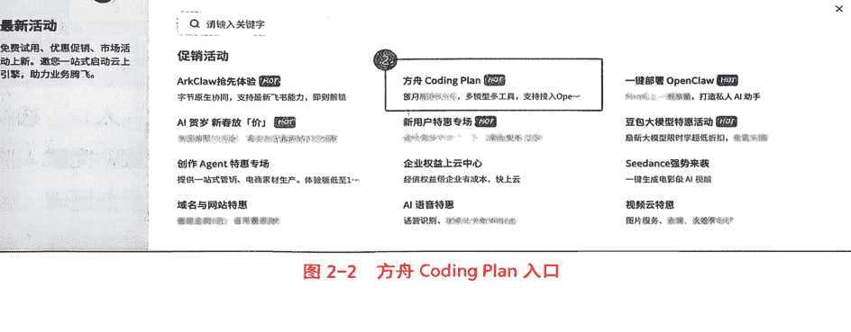

第 2 步：注册账号并完成个人实名认证。

在中国大陆，所有合规的大模型接口必须先完成实名核验，这是网络安全法规的强制要求。字节跳动作为头部厂商，对账号信息加密合规的把控很严格，放心使用。

去官网后，点右上角的「立即注册」用手机号建号，对应图 2-3、图 2-4 的流程。

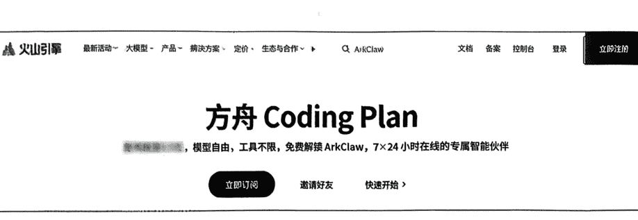

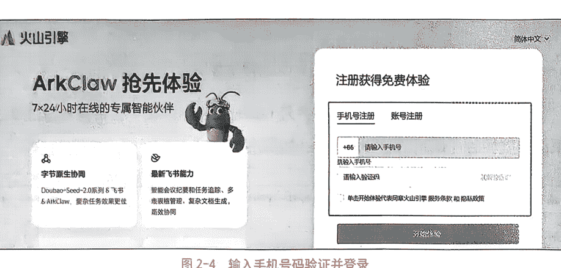

登录后点右上角头像，从下拉菜单里找到「实名认证」，选「个人认证」（见图 2-5），按提示选一种核验方式，完成人脸校验即可。

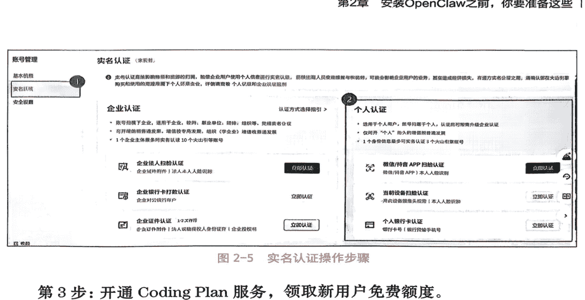

第 3 步：开通 Coding Plan 并领取新手免费额度

实名通过后回到火山方舟 Coding Plan 专区，点页面中间的「立即订阅」，勾选协议后完成开通，详见图 2-6。


开通瞬间，新手专属免费额度的领取弹窗会自动弹出来，点击领取即可到账。先用免费额度做安装测试、跑通基础功能，不用急着充值。

第 4 步：生成专属 API Key，妥善保存凭证

服务开通后点右上角「控制台」进入火山引擎后台，如图 2-7。


在控制台左侧找到「访问控制」，进入后在侧栏打开「API Key 管理」，如图 2-8。


在「API Key 管理」里先点「创建 API Key」，再点确认「创建」，如图 2-9。

特别注意，密钥默认是隐藏的，需要点图 2-10 的眼睛图标把密钥复制到本地文档备份。切记不要把密钥发给任何人，哪怕熟人也不行。

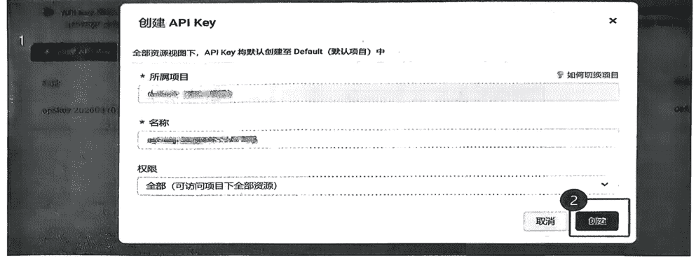

图 2-9 创建 API Key

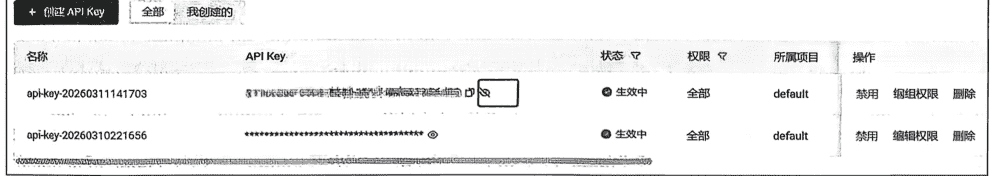

图 2-10 复制密钥并另存

到这里你就拿到 OpenClaw 的专属通行凭证，之后安装时把密钥填进配置框，就能为 OpenClaw 接上“大脑”，正常运行了。

# 第 3 章

## 跟我学，3 步装好原版 OpenClaw

本章手把手带你完成 OpenClaw 的部署与初始化。拆成 3 个主流程，帮你顺利养好自己的“龙虾”。

### 3.1 第 1 步：准备系统环境

OpenClaw 运行需要 Node.js 和 Git 这两个基础组件，Windows、macOS、Linux 都要先装好。下面以 Windows 为例演示安装与校验。

#### 1. 安装 Node.js

Node.js 是 JavaScript 运行时，OpenClaw 核心依赖它。建议装 LTS 长期支持版，保证稳定。

Windows 安装步骤如下。

（1）打开浏览器访问 Node.js 官网，如图 3-1。

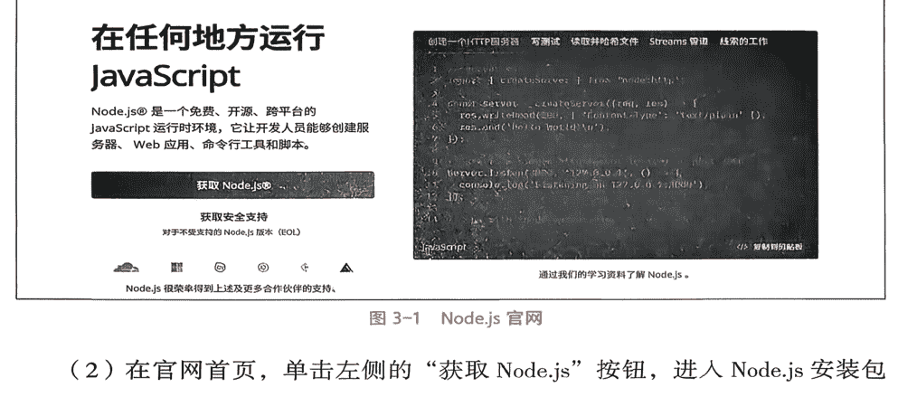

（2）在官网首页点左侧「获取 Node.js」进入下载页。

（3）下载页选系统平台，点击对应按钮下载，如图 3-2。

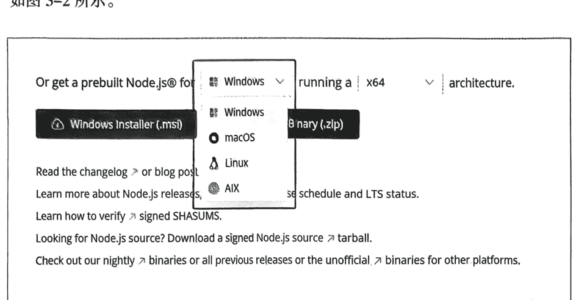

图 3-2 下载 Node.js

（4）下载完解压运行安装程序，向导如图 3-3。

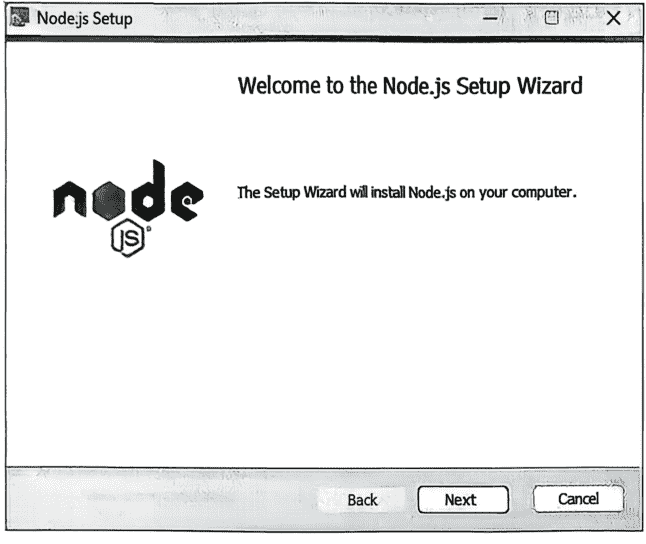

图 3-3 安装向导界面

点“Next”，在图 3-4 的许可协议处勾选同意，保持默认一路点“Next”。

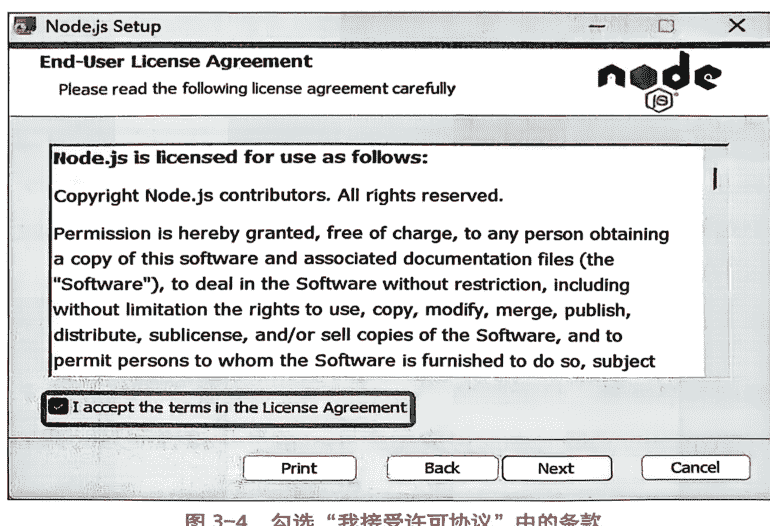

图 3-4 勾选“我接受许可协议”中的条款

点“Install”开始安装，完成后点“Finish”，如图 3-5。

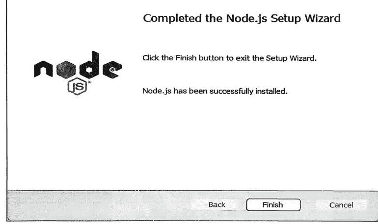

图 3-5 完成 Node.js 安装

#### 2. 验证 Node.js 和 npm 是否安装成功

装完后需用终端检查。

（1）验证 Node.js

把鼠标移到 Windows 开始按钮右键，选择“终端管理员”打开终端，如图 3-6、图 3-7。


图 3-6 选择“终端管理员”命令

注：本书终端设为浅色模式，仅为显示效果，不影响功能。


图 3-7 进入终端

进终端后输入下方命令回车，查看 Node.js 版本，如图 3-8。

```
node -v
```


安装成功会显示类似 “v2x.x.x” 的版本号，具体数字会随版本变化，有版本号即说明成功，如图 3-9。


（2）验证 npm

继续在终端输入下方命令回车，查看 npm 版本，如图 3-10。

```
npm -v
```


出现类似 “11.x.x” 的版本号，说明 npm 已就绪，如图 3-11。


#### 3. 安装 Git 工具

Git 是版本控制工具，部分安装方式会用到。

Windows 安装步骤如下。

访问 Git 官网点“Windows 安装”按钮，如图 3-12。

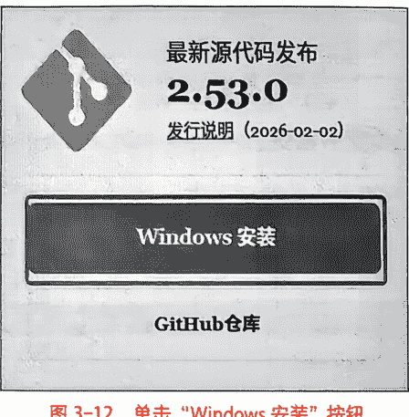

进入下载页，按系统选择后按提示下载安装包，如图 3-13。

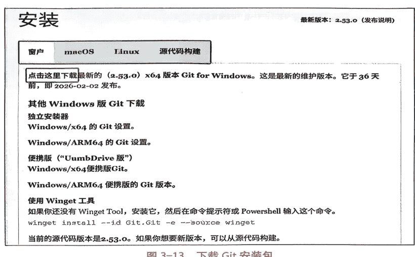

下载完解压运行安装程序，向导如图 3-14。

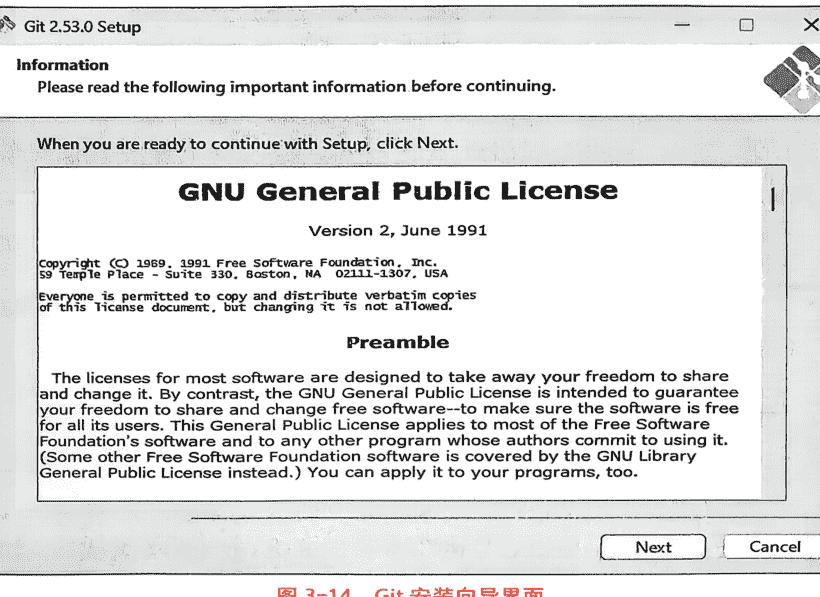

向导里大部分保持默认，连续点“Next”，最后点“Finish”完成安装，如图 3-15。

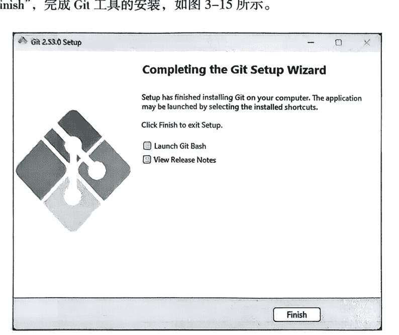

#### 4. 验证 Git 工具是否安装成功

装完后关闭终端重开，输入下方命令回车，如图 3-16。

```
git --version
```


返回类似“git version 2.x.x”的版本号，即表示 Git 已安装成功，如图 3-17。

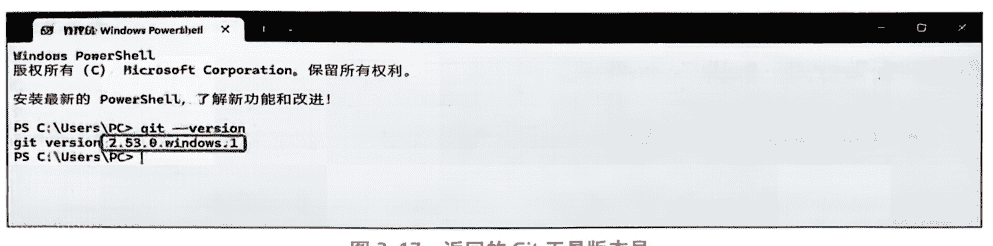

图 3-17 返回的 Git 工具版本号

### 3.2 第 2 步：完成安装并检测

环境准备好后就可以装 OpenClaw 了。先去官网拿安装命令，首页如图 3-18。

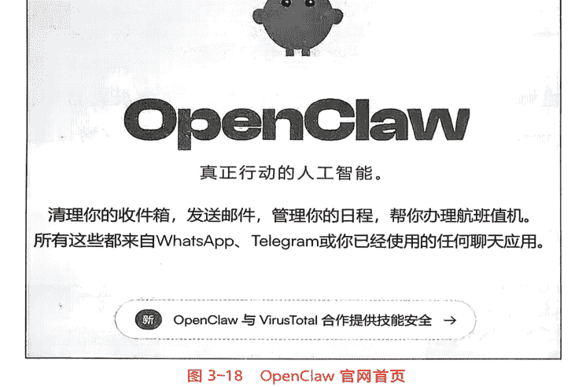

图 3-18 OpenClaw 官网首页

进入首页向下滚动，可看到不同系统与安装方式的选项。下面分别说明 Windows、macOS 的选择，以及一键命令与 npm 命令的使用。

在官网首页，“Quick Start”里列出了几种安装方式，如图 3-19。

- One-liner：一键安装命令，适合大多数用户，会自动装依赖。
- npm：通过 npm 包管理器安装，适合熟悉 Node.js 的用户。
- Hackable：适合想查看或修改源码的用户。

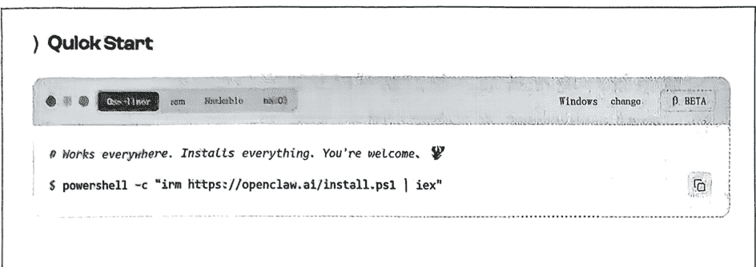

官网会按系统自动切换，也可点“change”在“macOS/Linux”和“Windows”间切换，选对应命令，如图 3-20。

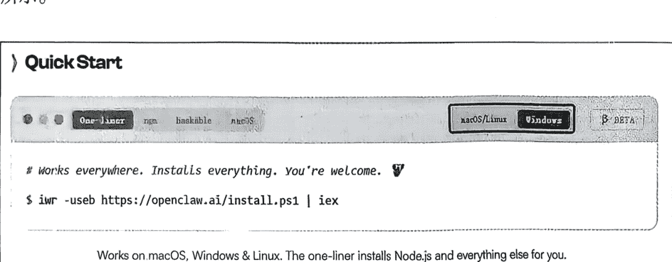

#### 1. Windows 系统安装

官方提供两种方式，一键命令和 npm 命令，如图 3-21。

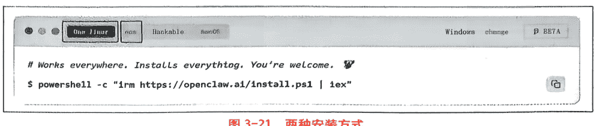

图 3-21 两种安装方式

（1）一键安装命令

复制官网自动生成的 PowerShell 一键命令，如图 3-22。

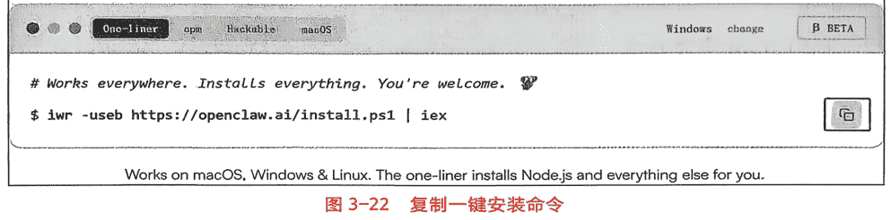

图 3-22 复制一键安装命令

以管理员身份打开 PowerShell 终端，粘贴命令回车，等待安装完成，如图 3-23、图 3-24。


图 3-23 执行一键安装命令

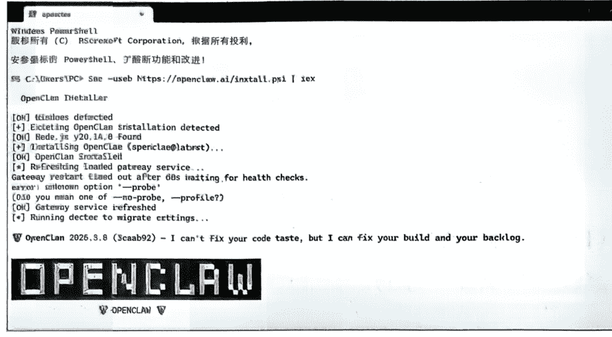

出现与图 3-24 相似的界面即表示安装成功。

（2）npm 安装命令

使用 npm 安装步骤如下。

在官网“Quick Start”里选“npm”，复制第一条安装命令，即安装 OpenClaw 工具本身，如图 3-25。

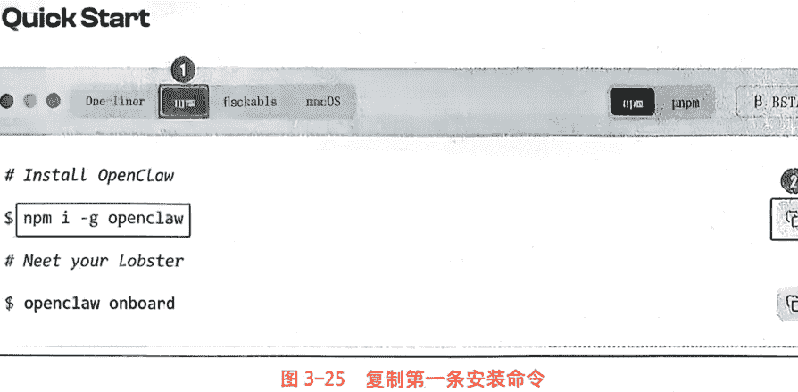

以管理员身份打开终端，粘贴命令，如图 3-26。

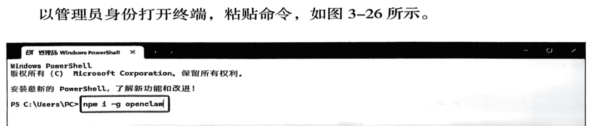

图 3-26 粘贴命令

回车后会出现旋转符号，表示正在安装，如图 3-27。

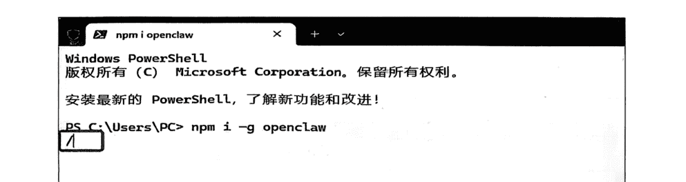

图 3-27 正在安装

稍等片刻，出现图 3-28 类似内容即代表安装完成。

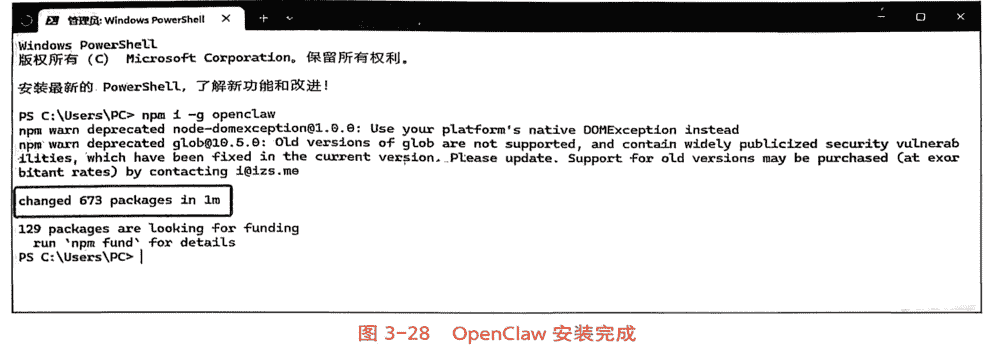

图 3-28 OpenClaw 安装完成

#### 2. macOS 系统安装

macOS 用户官网默认显示“macOS/Linux”安装选项，可选一键命令或 npm 命令。

（1）一键安装命令

在“Quick Start”里确认选“macOS/Linux”，复制一键命令，如图 3-29。

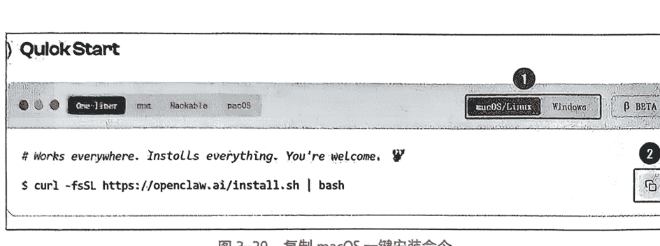

打开终端，粘贴刚才复制的命令，如图 3-30。

回车后等待安装完成，过程中可能需要输入 macOS 密码获取权限。

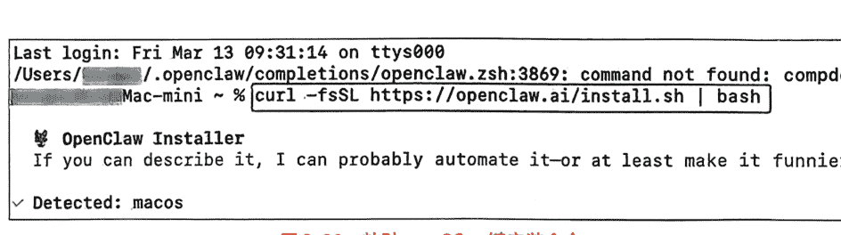

（2）npm 安装命令

macOS 下用 npm 安装的方法与 Windows 相同，此处不再赘述。

无论哪个系统，执行完后都需验证。关闭并重开终端，执行下方命令，如图 3-31。

```
openclaw --version
```


安装成功终端会显示 OpenClaw 的版本号，版本号会随更新变化，如图 3-32。

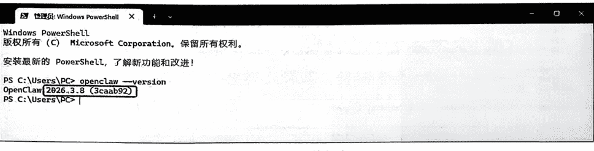

至此，OpenClaw 的安装与检测已完成。

### 3.3 第 3 步：完成初始配置

安装成功后需执行初始化配置，让 OpenClaw 了解你的偏好与使用环境。过程中会有风险提示与选择，按步操作即可。

在终端输入下方配置指令，如图 3-33。


图 3-33 输入配置指令

回车进入配置流程，如图 3-34。

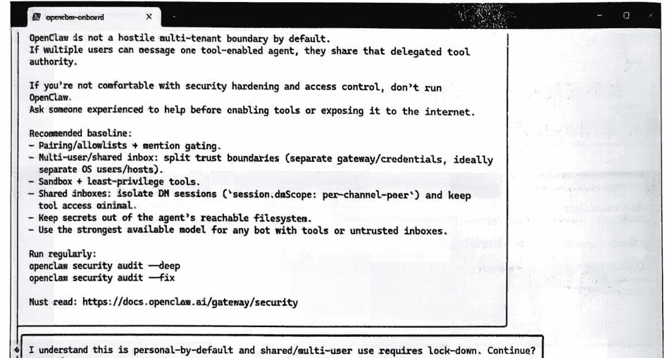

图 3-34 进入配置流程

配置共 8 步。操作时用方向键切换，回车确认；多选步骤可用空格键勾选，再回车完成。

#### 1. 风险告知与确认

启动后首先出现图 3-34 的风险提示，大意为“我已理解：该工具默认仅适配个人使用，若用于共享/多用户场景，必须先完成安全加固与权限锁定。是否继续？”

之所以有此提示，是因为 OpenClaw 的核心是“帮你做事”，提示是为了让你知情使用。

阅读后用左方向键选择“Yes”，回车继续。

#### 2. 引导模式选择

第二步是图 3-35 所示的引导模式选择，用于决定初始化复杂度的高低。

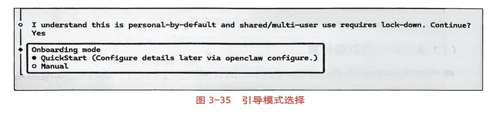

官方提供两种核心模式。对零基础用户，“QuickStart”模式更友好，它会跳过非必要参数配置，无需提前学习开发知识，完成必填项即可运行，大幅降低入门门槛。

此处选择“QuickStart”，回车继续，后续配置可随时调整。

#### 3. 模型提供商选择

第三步是图 3-36 所示的模型提供商选择，这是决定 OpenClaw AI 思考、执行与内容生成能力的关键，共分 4 个子步骤。

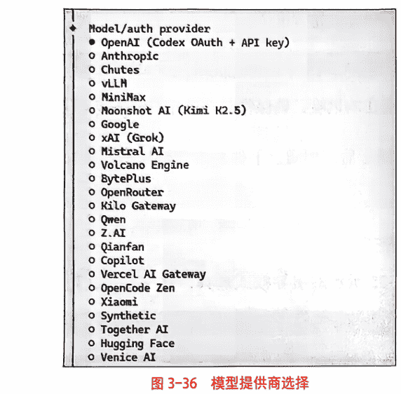

图 3-36 模型提供商选择

##### （1）选择核心模型提供商

模型提供商为 OpenClaw 提供大语言模型，各家功能相近各有侧重。

这里选择“Volcano Engine”（火山引擎），用上下方向键选中后回车继续。

##### （2）选择 API Key 提供方式

此步决定如何向 OpenClaw 提供 API Key，如图 3-37。

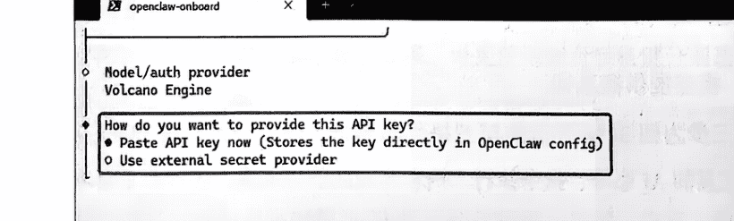

图 3-37 选择 API Key 提供方式

API Key 是调用大模型的身份凭证。官方提供两种方式，此处选择“Paste API key now”，回车继续。

##### （3）输入 API Key

此步完成凭证录入，你粘贴的 API Key 仅用于调用大模型服务，不会上传到第三方服务器。录入有效 Key 后即可正常调用。

进入输入界面，直接粘贴准备好的 API Key，如图 3-38。

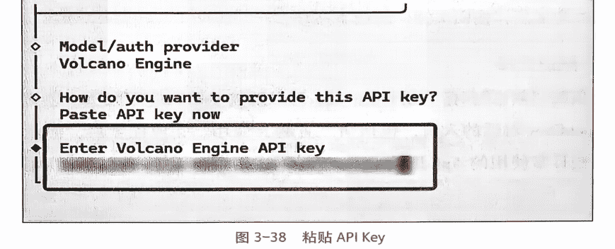

确认无误后回车继续下一步。

##### （4）选择默认模型

此步选择 OpenClaw 日常运行默认使用的具体大模型，不同模型能力不同。前面已订阅火山方舟 Coding Plan，这里选择前缀为“volcengine-plan”的模型。

进入模型选择页后，用上下方向键把候选列表中的光标移到名称以 “volcengine-plan” 开头的条目上，例如 “volcengine-plan/ark-code-latest”，参考图 3-39。

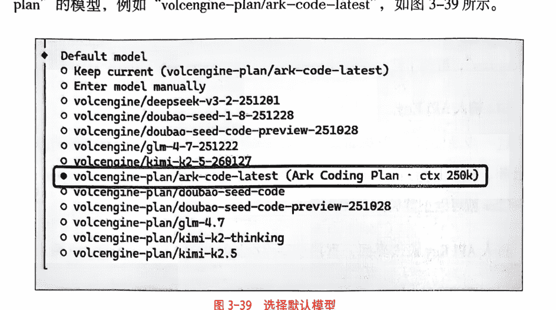

确认目标模型后敲回车，流程进入下一项。

#### 4. 频道选择

此处所说的频道，实质上是 OpenClaw 能连接的聊天类应用通道，也是日后与 OpenClaw 交互的入口，涵盖第三方聊天工具。配置完成之后，就能在平时常用的 App 里直接下达指令，无需一直挂着终端或网页。

对入门新手而言，直接跳过是最省心的操作。把光标移到 “Skip for now”，如图 3-40 所示。

确定之后回车，继续往下。

#### 5. 搜索提供商选择

搜索提供商是为 OpenClaw 供给联网检索能力的服务方。设置完毕后，OpenClaw 即可借助搜索引擎获取实时网络信息，比如最新航班、新闻资讯、实时汇率、天气等，完成需要联网的任务。


图 3-40 选择频道

为进一步降低门槛，这里也建议先跳过。

用上下键选中 “Skip for now” 选项，如图 3-41 所示。


图 3-41 选择搜索提供商

选定后回车，进入下一步。

#### 6. Skill 配置

Skill 即官方与社区推出的扩展插件，可与第三方工具联动。启用后能让 OpenClaw 控制更多软硬件，拓展自动化场景。

对零基础使用者，选择 “No” 更稳妥。

进入 Skill 设置界面后，用左右键切换到 “No”，如图 3-42 所示。

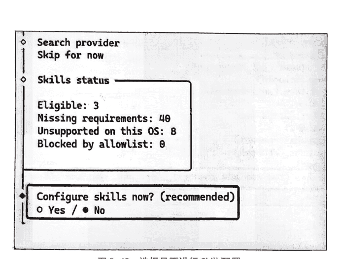

确认后回车，继续。

#### 7. 钩子启用

Hooks 是 OpenClaw 的高级事件监听自动化机制，简单来说就是让它在后台自动监听特定事件。

共 4 项，具体作用如下。

- ① boot-md。每次启动网关服务时，机器人会自动读取项目根目录下 BOOT.md 文件中的指令并执行。
- ② bootstrap-extra-files。启动时除默认配置外，还能自动加载指定目录或路径中的额外配置、脚本、提示词模板、自定义工具规则等。
- ③ command-logger。开启后，发送的指令、执行的操作、调用的工具会被统一写入审计日志。
- ④ session-memory。默认使用 /new 或 /reset 开启新对话或重置时，历史上下文会被清空；开启后历史记录会被保留，新对话仍可读取此前内容。

在钩子设置页，暂选 “Skip for now” 跳过，如图 3-43 所示。

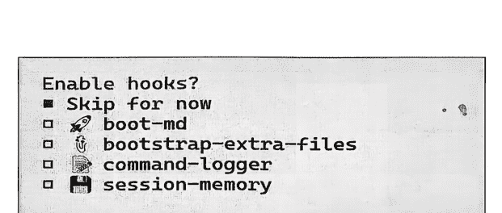

#### 8. 启动方式

本步决定后续与 OpenClaw 交互的核心入口，官方提供两种主要方式。

对新手来说，“Open the Web UI” 在网页中启动更友好，界面可视化，操作接近日常聊天软件，可清晰看到指令执行过程与报错信息，还支持多轮对话、历史查看、可视化配置，体验更好。

因此在启动方式页，用上下键选中 “Open the Web UI”，如图 3-44 所示。

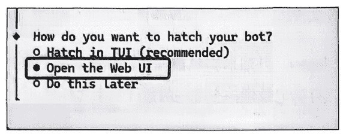

回车确认。至此初始配置流程全部结束。

#### 9. 配置完成最终验证

确认启动方式后，OpenClaw 会自动初始化，终端会输出本地 Web UI 的访问地址，通常为 http://localhost:××××，并自动打开默认浏览器展示对话界面，如图 3-45 所示。


若未出现图 3-45 的画面，而是网页提示无法访问，如图 3-46 所示，无需担心。返回终端，执行以下命令。

```
openclaw gateway
```


图 3-46 无法访问提示信息

回车等待服务启动，随后刷新此前无法访问的页面，即可看到 Web UI 对话界面。

在网页输入框发送一句“你好！”，若能正常回复，就代表初始配置正确，如图 3-47 所示。

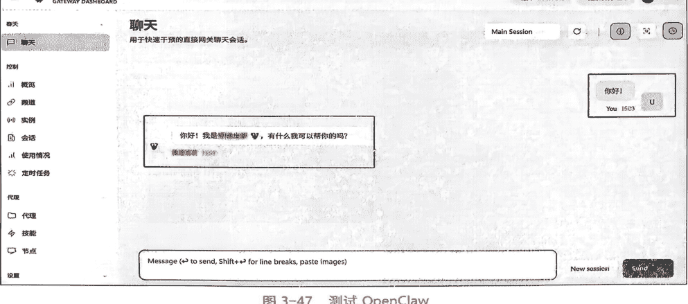

图 3-47 测试 OpenClaw

至此你的“龙虾”已成功孵化，可正常使用。

# 第 4 章

## 养虾进阶：从对话到实操

本章正式切入养“龙虾”的核心阶段。前几章解决的是安装与运行问题，本章要解决的是如何用好、用熟、并获得长期价值的问题。

### 4.1 TUI 与 Web UI：两种控制台界面的区别与使用方法

完成安装与初始化后，很多人会问下一步该在何处操作。

实际上 OpenClaw 并非只有一种使用形态。为兼顾不同习惯，它同时提供两种控制台界面：运行在终端里的 TUI 与通过浏览器访问的 Web UI。两者本质连接同一套后端，只是交互方式不同。

#### 1. TUI

进入 TUI 很简单，在终端执行对应命令即可。

```
openclaw tui
```

执行后会看到 TUI 界面，如图 4-1 所示。


不少新手初见 TUI 会觉得不便，其实是误解。其操作逻辑与普通聊天软件并无本质区别，只需在下方输入框输入内容回车，系统就会回复，如图 4-2 所示。

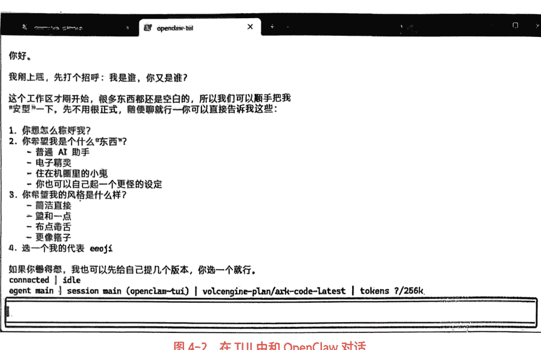

另外，在 TUI 中输入“/”回车可快速打开设置列表，再用方向键挑选相应选项，如图 4-3 所示。

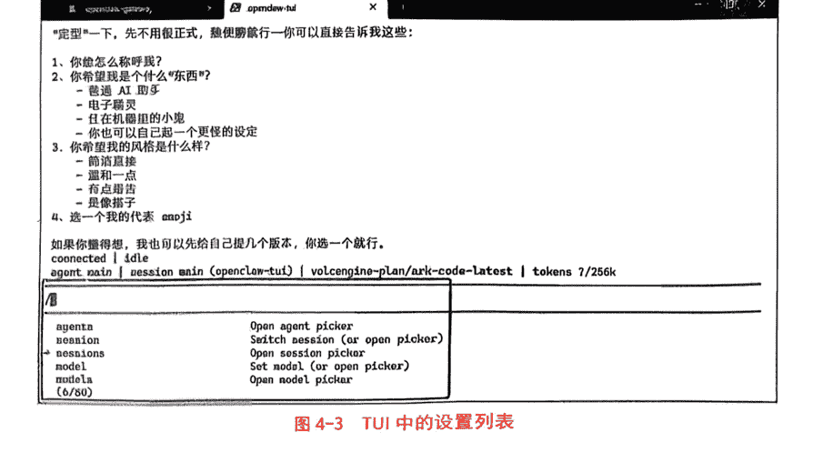

想退出界面，连续按两次 Ctrl+C 即可。

TUI 不等于更难，它只是更贴近系统本体。很多人看到终端就觉得是高手专属。但在当前平台中，TUI 有时反而更直观，少了视觉包装，系统是否连上、是否在执行任务，一眼就能判断。对想真正学会使用的人来说，TUI 不应回避，而应尽早熟练。

#### 2. Web UI

如果说 TUI 更像在控制台前操作，Web UI 就更像打开一个后台系统来管理整只龙虾。

进入 Web UI 的命令同样简单，在终端执行即可。

```
openclaw dashboard
```

执行后浏览器会自动跳转到图 4-4 所示的界面。

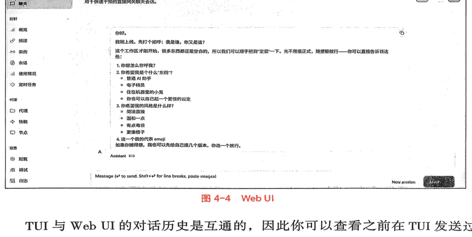

TUI 与 Web UI 的对话历史互通，可查看 TUI 中发送过的指令及结果。

Web UI 的最大优势是可视化呈现信息。相比 TUI 的逐行文本，Web UI 更容易让人一眼看出系统当前状态、功能入口、会话中发生了什么。对初次接触的用户来说，Web UI 更容易产生“终于看懂了”的感觉。

Web UI 顶部展示版本号、监控状态、显示模式切换等设置，左侧展示聊天、控制、代理、设置、资源五大功能区，具体如下。

##### （1）聊天功能区

聊天区是与系统交流的主要区域。与 TUI 类似，可在此输入问题、下指令、查看 AI 回复。不同的是 Web UI 会以更清晰的结构化方式展示对话过程。执行任务时，工具调用、执行步骤、返回结果会以卡片或模块形式呈现，比 TUI 的滚动文本更易理解后台做了什么。

聊天功能区如图 4-5 所示。

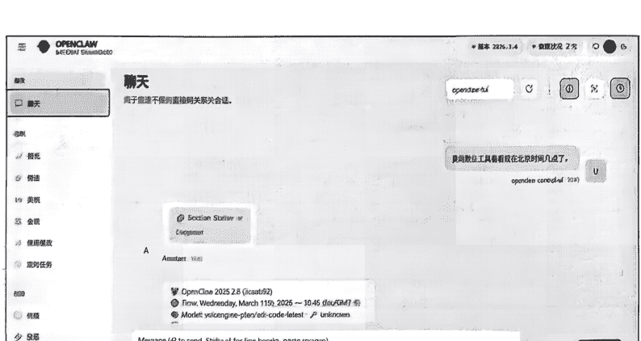

##### （2）控制功能区

控制区包含概览、频道、实例、会话、使用情况、定时任务。

- ① 概览分区。可查看网关状态、入口点和健康状态，如图 4-6 所示。

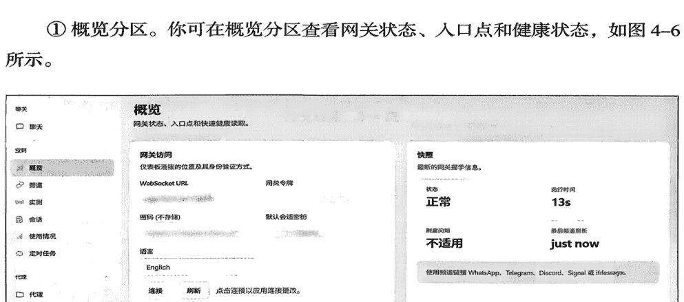

- ② 频道分区。可管理频道并进行设置，如图 4-7 所示。

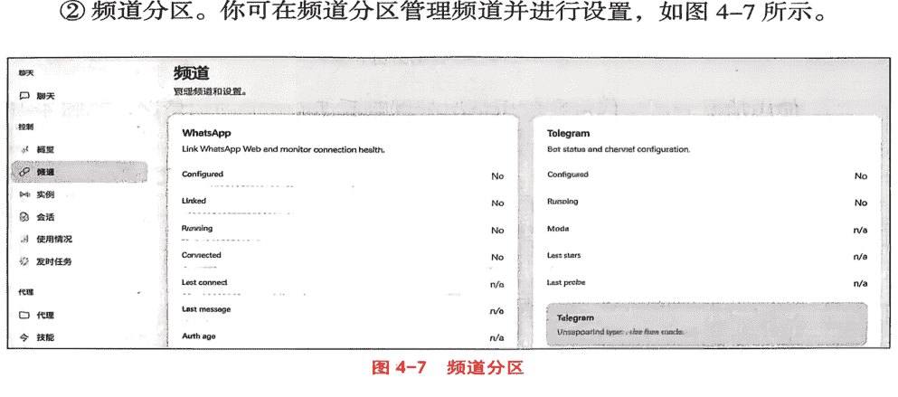

- ③ 实例分区。可查看已连接客户端和节点的在线信号，如图 4-8 所示。


图 4-8 实例分区

- ④ 会话分区。可检查活动会话并调整默认设置，例如模型思考深度，如图 4-9 所示。

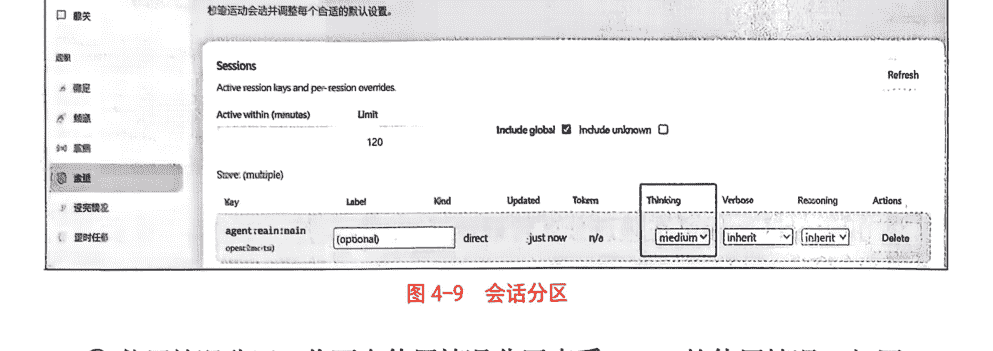

图 4-9 会话分区

- ⑤ 使用情况分区。可查看 Token 使用情况，如图 4-10 所示。

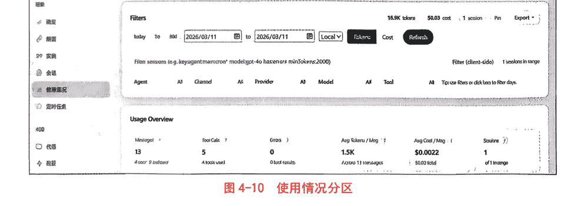

图 4-10 使用情况分区

- ⑥ 定时任务分区。可安排代理的唤醒和重复运行，如图 4-11 所示。

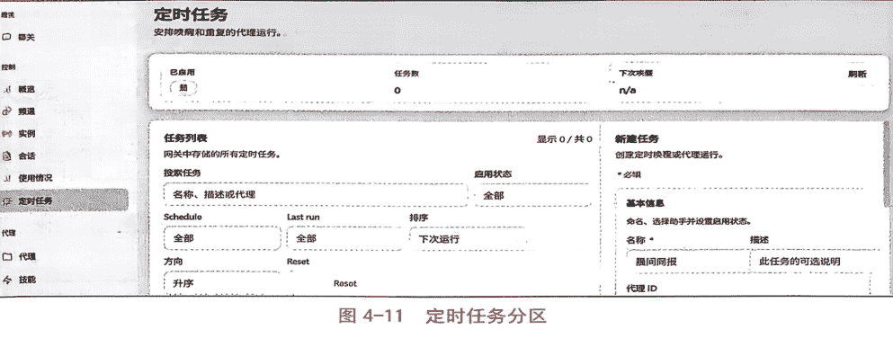

##### （3）代理功能区

代理区包含代理、技能、节点。

- ① 代理分区。可管理代理的工作区、工具和身份，如图 4-12 所示。


- ② 技能分区。可管理技能的可用性及 API Key 注入，如图 4-13 所示。

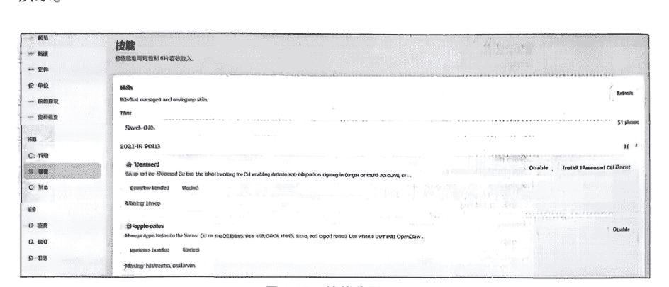

- ③ 节点分区。可配置设备、功能并公开命令，如图 4-14 所示。

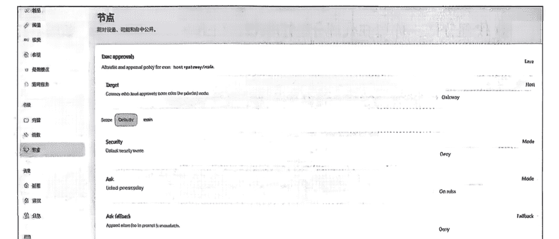

##### （4）设置功能区

设置区包括配置、调试与日志。

- ① 配置分区。可安全地编辑系统配置文件，如图 4-15 所示。


- ② 调试分区。可管理网关快照、事件，手动进行 RPC，如图 4-16 所示。


- ③ 日志分区。可查看网关文件日志，如图 4-17 所示。

##### （5）资源功能区

点击资源区中的“文档”，会跳转到官方文档，便于深入学习。


安装完成后，能否顺利开始“养虾”，关键在于是否理解这两个操作入口。对新手而言，最佳做法不是只掌握其中一个，而是两者都要熟悉。越早熟悉这两个入口，后续的人设设定、频道接入、记忆管理、心跳设置、定时任务和 Skill 安装就越容易落地，而不是停留在概念层面。

### 4.2 设定人设：让你的龙虾独一无二

很多人初次接触，会把它当成普通聊天 AI，问答来去即可。这种用法没错，但长期停留就会错过最有价值的部分。

真正长期使用的人很快会发现，每一只“龙虾”都应该有自己的性格。

#### 1. 为什么要给系统设定人设

不少新手觉得人设只是段提示词，可有可无，实则作用很大。

首先，人设能让输出保持稳定。没有统一人设时，回答风格会随问题波动，有时详尽有时简略，有时给步骤有时只给概念。偶尔聊天无所谓，若要长期协作，这种不稳定会带来麻烦。

其次，人设可减少重复解释。AI 若了解你的职业背景、工作方式和偏好，就会在处理问题时自动参考这些信息。例如知道你常写公众号，它就会更倾向给出结构化内容而非零散信息。

最后，人设有助于做出更合理的判断。很多任务并非简单问答，而是需要决策。整理资料时需要判断重要性，人设中的规则就构成“决策框架”。

因此人设不是装饰性的提示词，而是一套长期有效的行为规则。资深用户的经验总结是：模型决定能力上限，人设决定表现质量。

#### 2. 通过对话快速设定人设

对刚入门的人来说，最简单的方式是通过对话直接设定人设。例如在 TUI 或飞书中输入人设提示词。

> 你叫秋小虾，是一名运行在 OpenClaw 中的全能数字助理，目标是帮助用户高效完成信息查询、内容处理和自动化任务。

工作原则如下。

1. 以“完成任务”为优先。收到需求时先判断是否可通过系统工具完成，如搜索、浏览器、代码执行、文件操作或 Skill，能执行就直接执行，而非只给建议。
2. 处理信息时保持结构化。可完成搜索整理、写作生成、内容改写、数据分析、脚本与命令生成、流程拆解等任务。
3. 对重复流程进行总结，必要时建议用户将流程保存为 Skill 或自动化任务。
4. 使用工具时遵循：能调用工具就调用工具，能一次完成就不要拆分成多次。
5. 输出风格简洁清晰，优先提供可直接执行的步骤、命令或结果，避免冗长解释。
6. 如果信息不足，先提出关键问题再继续执行。

定位：一个会思考、会行动、会自动化执行任务的 AI 助理，而不是只聊天的机器人。

这套提示词是基于 OpenClaw 的实际功能编写的，仅供参考，你也可输入任意人设提示词。收到指令后，身份信息会快速更新，如图 4-18 所示。


继续追问即可验证人设是否生效，如图 4-19 所示。


当人设描述足够清晰时，AI 的回答方式会明显变化。随着使用时间增加，人设也会不断迭代完善，这个过程也就是在培养真正属于自己的 AI 助手。

### 4.3 接入频道：用手机指挥它干活

无论用 TUI 还是 Web UI，使用便利性仍受限制，因为灵感、任务和想法往往在手机上产生。比如路上看到行业新闻想让 AI 整理，或开会时需快速查询信息。这时若还得回到电脑操作，就很不方便。

因此平台提供频道接入功能。所谓频道，就是把系统接入聊天软件，让聊天软件成为它的控制入口。接入后，只需在聊天窗口发送消息，系统即可接收任务并执行。

#### 1. 支持的频道有哪些

随着版本迭代，原生支持接入的频道不断增加。在“2026.3.8”版本中，系统支持接入 20 个不同频道，如图 4-20 所示。


图 4-20 OpenClaw 原生支持接入的频道

注：随着版本不断更新，频道可能会增加或减少。

在国内的使用场景里，飞书往往是上手最快、覆盖面最广的协作选择。团队的日常信息流基本都沉在飞书里，开放平台对机器人的支持也比较完善，和 OpenClaw 配合起来相当顺畅。

下面聚焦飞书频道的接入方式。

#### 2. 快速接入飞书频道
过去把频道接通需要手工填写 App ID、App Secret、权限、回调时间等，步骤比较繁琐。随着平台迭代，现在只要三步即可完成，整体体验很流畅。

（1）执行安装命令
打开终端，运行以下指令。

```
npx -y @larksuite/openclaw-lark-tools install
```

如果报权限不足，可在指令前加上“sudo”再试一次。指令开始后安装流程会自动启动，终端里会弹出一个二维码，见图 4-21。


（2）扫描二维码并创建机器人
打开飞书客户端扫码，即可一键生成机器人，整个过程通常几十秒，具体见图 4-22。


提示：本地若已装过其他飞书插件，新插件安装时旧插件会被自动停用，无需手动卸载。

（3）在飞书中唤醒机器人
机器人生成后就能直接对话，见图 4-23。

能正常回复就说明插件已经装好。

初次使用可以先让它学习插件能力，直接下指令：“学习一下我安装的新飞书插件，列出有哪些能力。”机器人即可完成学习，见图 4-24。


#### 3. 把机器人拉进群
想让机器人进群，只需进入“设置”→“群机器人”，然后进行添加即可，操作见图 4-25 ～图 4-27。


图 4-25 选择“设置”


图 4-26 选择“群机器人”


图 4-27 添加机器人

添加成功后，就可以用“@机器人”的方式在群里对话，见图 4-28。


图 4-28 在飞书群中和机器人对话

#### 4. 接入的价值与需要注意的风险
从使用感受看，接上飞书不只是多一个聊天入口，而是改变了 OpenClaw 的使用场景。原本只能在终端或 Web UI 里“养虾”，接上后 OpenClaw 就进入了日常办公工具里。电脑端、手机端，只要打开飞书就能随时下指令。

更关键的是工作流的融合。比如整理资料时，可让它直接写入飞书文档；需要对外通知时，可让它把信息发到群里；设置好定时推送后，它还能每天自动把报告送到指定会话。这样 AI 就不再是单独打开的网站或程序，而是沟通环境中的一员。

便利的同时也要留意风险。接入后 OpenClaw 会获得一定的账号操作权限。若授予了读取文档、发送消息或访问日历等权限，理论上它就能代表你执行这些操作。因此授权时要审慎，按需最小化权限，不要一次性开放过多。

AI 能成为高效助手，前提是我们对权限和行为保持精准控制。

### 4.4 管理记忆：如何让它记住偏好与历史
用其他 AI 工具时，常见的痛点是记忆很短。刚说完职业背景，几轮对话后又被问起；刚解释完项目背景，换个问题又要从头梳理。这并非智商问题，而是多数会话型 AI 只依赖当前上下文，会话结束信息就丢了。

OpenClaw 在设计时专门解决了这个问题。它内置了一套本地持久化记忆机制，会把关键信息写到本地文件，后续任务再读取，从而形成持续累积的经验。可以说，它不是每次都从零开始，而是在历史基础上不断学习和调整，用得越久越懂你的习惯和工作方式。

#### 1. OpenClaw 记忆的双层结构
系统里记忆大致可分为长期记忆和短期记忆。

长期记忆保存的是相对稳定的信息，比如用户偏好、工作背景、长期项目。即使重启，OpenClaw 也能重新读取长期记忆文件恢复。

本地部署时，长期记忆文件落在 workspace 文件夹中，初始可自定义名称与路径，默认位置如下。

```
C:\Users\ 你的用户名\.openclaw\ 你的 workspace 文件夹名称
```

具体见图 4-29。


短期记忆来自当前会话和最近执行的任务，记录“刚才发生的事”，比如最近提问、执行步骤、中间结果，用来保持同一轮对话的连贯。短期记忆放在与长期记忆同目录的“memory”文件夹，以日志形式存在，见图 4-30。


刚部署时可能看不到长期记忆和短期记忆文件，随着使用，系统会自动创建。

#### 2. 在飞书对话里配置记忆
大多数记忆无需手工配置，直接对话就能设置。OpenClaw 已接入飞书，所以可以在飞书里告诉它需要记住什么。

例如在飞书发送：

> - 减少使用比喻句。
> - 减少使用带破折号、引号与省略号的句子。
> - 禁止使用绝对化、夸张化表述。
> - 禁止使用“不是……而是”的句式。

把以上内容写入长期记忆，更新到配置文件中。

机器人会自动执行并创建长期记忆，见图 4-31。


可在长期记忆本地文件路径打开“MEMORY.md”文件验证是否创建成功，见图 4-32。


用飞书创建短期记忆并本地验证的方式与长期记忆类似，此处不再赘述。

总之，有了记忆系统，OpenClaw 就能形成属于你的知识背景，每次任务都建立在之前的基础上。“养虾”的过程，本质就是记忆的不断累积。随着时间推移，助手会越来越熟悉你的工作方式，也越好用。

### 4.5 设置心跳：实现 24 小时常驻的方法
前面我们让 OpenClaw 能聊天、能记忆、能通过飞书收指令、能执行任务。但本质上它仍是被动的，只有收到消息才会思考。若没有新指令，系统就一直等待。

这种模式聊聊天没问题，但要做长期助手就不够用。比如定期检索行业新闻、持续监控信息源、自动整理每日数据，这些任务不需要用户随时发指令，而是需要系统主动运行。

为此 OpenClaw 提供了心跳机制。

#### 1. Heartbeat 的含义
Heartbeat 可理解为自动触发机制。系统按固定周期跑一次心跳循环，每次循环 AI 会重新检查环境，判断是否需要执行任务。从设计上看，它像一种自动巡检，定时巡视，发现待办就立即行动。

#### 2. 在飞书里创建心跳
OpenClaw 的多数配置可用自然语言完成，设置心跳也不例外。接入飞书后，可直接在飞书里设置，示例如下。

> 添加心跳任务，从现在开始，每半分钟给我发一次内容为“测试”的信息，直到我发送“stop”指令时，停止此心跳任务。把此任务写进后台配置文件中。

机器人执行情况见图 4-33。


可在本地 workspace 路径找到名为“HEARTBEAT.md”的文件核查任务是否创建成功，具体见图 4-34。


需要修改规则时，直接编辑该文件即可。Heartbeat 是自动化能力的基础，系统可在后台持续运行并定期检查待办。

实际应用远不止示例。合理设计心跳规则，可让 OpenClaw 在后台完成各种重复工作。

比如定期整理行业资讯，设置心跳检查指定信息源，发现新重要信息就自动生成摘要并推送到飞书，每天打开就能看到整理好的动态。

也可用于资料积累，让它每次心跳搜索主题最新文章并保存有价值内容，时间推移就形成持续更新的资料库。

在内容创作上，可让它定期整理热点、提取选题或生成灵感清单，写作时素材已备好。

当 Heartbeat 被合理利用，OpenClaw 就从被动响应工具变成后台持续运行的自动化系统，会不断巡视、检查、整理，并在必要时主动提醒。随着规则完善，自动化能力会越来越强。

### 4.6 设置定时任务：实现每日自动早报
自动化系统里很常见的是定时任务，允许系统在指定时间自动执行某项操作，例如固定时间生成报告、发送提醒或整理数据。

#### 1. Cron 的概念
OpenClaw 的定时任务通常通过 Cron 实现。Cron 是 UNIX 系统的经典调度机制，多年来被广泛用于备份、日志清理和数据同步等。

原理很简单，调度程序持续运行，不断检查当前时间，时间匹配预设规则时就自动执行任务。

Cron 使用 5 个字段的时间表达式。

| 分钟 | 小时 | 日期 | 月份 | 星期 |

|---|---|---|---|---|

举例：

```
0 8 * * *
```

从左到右含义分别是：

- 0 表示第 0 分钟
- 8 表示第 8 小时
- * 表示任意日期
- * 表示任意月份
- * 表示任意星期

因此该表达式表示每天 8:00。

#### 2. 创建定时任务的两种做法
既可通过和机器人对话创建，也可在 Web UI 手动创建。

（1）通过对话创建
多数情况下无需手写 Cron 表达式，机器人能依据自然语言自动生成。

例如下达：

> 每天早上8点给我发送一份 AI 行业早报。写进后台配置里。

机器人会自动创建任务，见图 4-35。


可在本地文件验证任务是否创建成功，默认路径如下。

```
C:\Users\ 你的用户名 \.openclaw\cron
```

定时任务保存在“jobs.json”文件中，打开即可查看详细信息，见图 4-36。

（2）在 Web UI 中手动创建
需要更精确控制执行时间时，可在 Web UI 中手动创建。

进入 Web UI 后，左侧定时任务分区可查看已创建任务，也可按提示新增，见图 4-37。


图 4-36 定时任务的详细信息


图 4-37 在 Web UI 中创建定时任务

（3）定时任务与心跳任务的区别
两者都会自动执行任务，但在系统逻辑上角色不同，具体区别见表 4-1。

#### 表 4-1 定时任务与心跳任务的区别

| 对比维度 | 定时任务 | 心跳任务 |

| :--- | :--- | :--- |

| 核心作用 | 按时间表执行任务 | 定期检查环境状态 |

| 执行方式 | 到指定时间自动执行任务 | 周期性运行巡检逻辑 |

| 使用场景 | 定时汇报、定时抓取数据、定时发布内容 | 监控系统状态、检测新消息、检查资源变化 |

| 运行频率 | 由 Cron 表达式决定（分钟、小时、日期等） | 按固定间隔循环执行 |

| 典型例子 | 每天早上 9 点推送 AI 资讯 | 每隔 30 秒检查是否有新任务或新消息 |

使用上两者常配合。例如用心跳持续监控信息源，发现重要变化后再由定时任务整理生成报告。这样 OpenClaw 就能在后台稳定运行，形成自动化工作流。

### 4.7 安装技能：拓展能力边界
前文已让 OpenClaw 具备聊天、飞书收指令、记忆、心跳和定时任务等基础能力。但深入使用会发现，AI 能力并非无限。比如搜索结果不理想，想要关联邮件日历却不知如何操作。

“龙虾”需要拓展能力边界，途径就是 Skill。

#### 1. Skill 是什么
可以把 Skill 理解为“能力说明包”。它通常是一个目录，核心文件是“SKILL.md”，用 Markdown 编写，描述 AI 如何完成某类任务：调用哪些工具、执行步骤、输出格式等。

#### 2. 安装 Skill 的常用方式
初次接触 Skill，容易只关心怎么装。但更重要的是先想清楚装什么、来源是否可靠。因为 Skill 可能涉及工具调用、外部链接甚至本地环境访问，来源不明或实现不安全，就会成为风险入口。

对普通人来说，最稳妥的顺序是：先看来源是否可靠，再看是否匹配需求，最后再安装。

目前最常见、值得优先掌握的两种方式是借助 OpenClaw 官方的 ClawHub 或腾讯的 SkillHub 安装。

##### (1) 通过 ClawHub 安装
ClawHub 是 OpenClaw 官方推荐的 Skill 注册中心，既能发现 Skill 也能上传自己的 Skill。

开始前需安装 ClawHub 相关服务。可在终端执行“OpenClaw configure”进入配置界面，在询问“Where will the Gateway run?”时选择“Local(this machine)”，随后用方向键选“Skills”回车，进入 Skill 选择界面，空格选中“clawhub”回车确认，再按提示选择安装方式为“npm”。安装完成后可按需配置相关 API，也可全部跳过，完成安装。

之后可在 ClawHub 官网主界面顶部选择“Skills”，下载他人分享的 Skill 到本地，下载后发给机器人让它安装。也可直接下指令，例如“去 ClawHub 找到‘Skill Vetter’这个 Skill 并帮我安装”。

图 4-40 选择 “clawhub”

图 4-41 选择 “npm”

图 4-42 按需配置其他选项或跳过

特别说明：Skill Vetter 的类型属于安全审查类扩展，提前部署后，后续在添加其它扩展之前，都可以先用它做一次风险核查，所以通常会被建议作为首批装配的对象。

##### (2) 通过腾讯公司的 SkillHub 安装

SkillHub 由腾讯开发，针对中文使用者进行了优化，传输效率高，能够直接搜索 ClawHub 平台上约 1.3 万个 AI 技能。

进入官网后，顶部导航可点“官方推荐”，会展示官方从庞大库中挑出的 50 个精选技能，见图 4-44。也可点“ClawHub 技能”，进入分类浏览页按类别挑选，如图 4-45 所示。

图 4-45 按分类选择安装

在 SkillHub 内完成装载很直观，选定目标后会弹出操作指引，对新手而言建议采用第一种做法，如图 4-46 所示，即复制弹出的提示词发送给对话机器人，由机器人代为完成装配。

图 4-46 选择第一种安装方式

不论走 ClawHub 还是 SkillHub 通道，最终放进“龙虾”里的，应该是来源可追溯、功能明确、风险可控的通用型技能。

对普通使用者而言，优先考虑的并不是权限繁杂、行为边界模糊的扩展，而是搜索、归类、提炼、知识管理这类用途清晰、产出便于核对的类型。这类扩展使用频率高，也更方便判断是否正常运行。相反，来源不明、描述不清、需要大量系统权限的扩展，即便看起来很强，也最好不装。

## 第 5 章

## 部署太繁琐？三款大厂现成版本直接用

不少人在初次接触 OpenClaw 时会被环境配置卡住，需要装 Node.js、Git 等工具，处理依赖、准备密钥，还要在命令行里跑脚本。对开发者尚可，对普通用户往往第一步就很吃力。实际部署时常出现环境报错、依赖装不上、版本冲突、启动失败。为降低使用难度，目前已有多个厂商推出免部署版本，可直接上手体验功能。

### 5.1 火山引擎，ArkClaw 零门槛唤醒

ArkClaw 是火山引擎基于 OpenClaw 思路推出的云上运行方案，依托其算力基础与 Ark 大模型平台，启动成本低且稳定性好。

#### 1. 特点与优势

传统 OpenClaw 需要本地装环境、拉代码、配模型、跑程序，ArkClaw 把这些环节搬到云上，用户登录火山引擎就能直接使用，相当于托管版。

无需关注底层细节，也不用维护运行环境，只需在网页完成简易操作即可。ArkClaw 首页如图 5-1 所示。

整体体验可归纳为：

- ① 无需部署。不用装软件，也不需额外配环境，打开网页就能开始，适合初次体验。
- ② 云上运行。所有任务在远端完成，对本地电脑性能要求很低，普通办公机也能流畅使用。
- ③ 界面友好。提供完整图形界面，任务创建、运行状态、结果展示都在页面内清晰可见。

对刚入门的用户，ArkClaw 能帮助快速理解 OpenClaw 的工作方式，无需先面对技术细节。简单说，如果只是想先看看 OpenClaw 能做什么，ArkClaw 是不错的入口。

#### 2. 适用场景

ArkClaw 的端到端执行能力基本覆盖个人到中小企业的常见需求，高频场景可分为三类。

首先是全流程办公提效。

这是核心场景，可作为个人办公助理，一体化完成会议纪要整理、行业信息检索分析、周报月报撰写、公文格式优化、日程规划提醒等。

不同于普通模型的单次指令，ArkClaw 能承接目标型任务。例如下令“梳理本季度三款核心竞品的市场动态并生成分析简报”，它会自主拆解步骤、全程推进并实时更新进度，还能沉淀过往分析逻辑，类似任务可直接复用，大幅减少重复成本。

其次是中小企业轻量落地。

针对没有技术团队的初创公司、线下门店、电商商家等，可低成本快速搭建专属智能体，无需开发投入即可实现降本增效。例如电商场景，录入店铺规则、产品信息和售后标准后，可配置为客服助手，自动应答常见咨询、同步订单状态、整理日销售数据，节省人工。

第三是个人学习创作辅助。

对自媒体创作者、学生、内容写作者，可作为长期搭档，按写作风格、选题偏好、学习目标和进度，自主完成素材收集、选题规划、大纲拆解、初稿撰写，或文献整理、备考计划制定跟进、知识点梳理等。相比单次对话，更能形成连贯的创作学习闭环。

#### 3. 基础操作

使用 ArkClaw 全流程无需技术基础，按下面步骤即可完成唤醒、配置和使用。

第一步，前置准备——开通火山方舟 Coding Plan。

打开浏览器进入火山引擎官网，通过“产品—火山方舟—特惠活动”见图 5-2 进入套餐概览，按需选择。

目前主要有 Lite 套餐，适合轻量体验；Pro 套餐，适合高频使用。新用户通常有优惠，首月费用较低。

确认套餐后点“立即订阅”，未登录时会跳转到火山引擎账号登录/注册，用手机号即可完成注册登录，随后按指引确认订单并支付，套餐生效后即可获得 ArkClaw 使用权限。

图 5-2 火山方舟的订阅渠道

第二步，进入 ArkClaw 体验中心。

进入官网点顶部“产品”，选“火山方舟”，左侧导航选择“ArkClaw”，进入体验中心界面，如图 5-3 所示。

ArkClaw 本质是 SaaS 版 OpenClaw，平台已预置智能体运行环境、模型能力、技能组件、网络访问能力，用户无需本地部署，也无需配置 API Key。

在体验中心点“立即创建”，系统会自动新建一个 ArkClaw 智能体，如图 5-4 所示。

图 5-4 创建 ArkClaw

提交后等待远端自动部署完成。系统将自动完成全流程云端部署，包括分配专属 ECS 资源、一键部署 OpenClaw 核心程序、适配大模型接口、配置基础运行环境、开通 7×24 小时在线服务，全程无需人工干预。部署完成后的界面如图 5-5 所示。

图 5-5 ArkClaw 部署完成后的界面

第三步，使用 ArkClaw 并做进阶配置

界面简洁，可直接在输入框填写任务，例如：“帮我做一份 AI 工具调研：先搜索 5 款近期热门的 AI 工具，整理功能特点和价格，再生成约 2000 字的调研报告并附配图和对比表。”

提交后 ArkClaw 会自动完成理解、拆解、调用技能、输出结果，过程在界面实时展示。执行案例的部分结果如图 5-6 所示。

想获得更好体验，还需做个性化配置。输入框上方有六大核心入口见图 5-7，可打造专属“龙虾”。

- “消息渠道”：可接入飞书、钉钉机器人，授权后可在即时通讯工具中直接使用，无需反复登录。
- “飞书配对”：官方为飞书用户定制的轻量接入方案，流程更短，无需手动配 Webhook 或 API Key。
- “技能”：可查看、安装官方推荐的 Skill，装好后 ArkClaw 即可自主调用，拓展执行边界。
- “定时任务”：新建定时任务，设定触发时间、重复周期、执行指令和提醒方式，实现自动化推送。
- “人格”：自定义智能体名称、角色定位、说话风格、能力边界，塑造专属助手。
- “文件快传”：依托火山引擎对象存储 TOS，实现本地与云端文件快速上传下载，ArkClaw 可直接解析内容完成总结、整理、优化等任务。

最后点界面右上角“设置”见图 5-8，可切换推理模型、重启服务等日常运维。

图 5-8 “设置”功能

若出现卡顿、无响应，可用“重启 ArkClaw”快速恢复。同时注意服务规则：套餐或体验期到期后，创建的智能体将被自动删除，相关数据仅保留 24 小时，需在保留期内备份，避免丢失。

### 5.2 飞书妙搭，5 分钟搞定

在多数企业和团队里，沟通、文档协作、项目管理、数据整理几乎都围绕协作平台展开。若 AI 与工作平台割裂，就会出现工具很强却难以融入流程的问题。

飞书妙搭就是为解决这个问题而生，可在飞书生态内快速创建 AI 助手或业务系统，让 AI 自动参与团队协作。

#### 1. 特点与优势

对日常在飞书里办公的用户，飞书官方打造的飞书妙搭是更贴合生态的开箱即用方案，其 OpenClaw 智能助手界面如图 5-9 所示。

只需用飞书账号一次授权、点几次按钮，系统就会自动完成环境部署、应用创建、权限配置、机器人接入，用户即可在飞书对话框内直接使用完整能力。

总体特点如下。

- ① 飞书原生零配置，5 分钟极速落地。完全嵌入飞书生态，无需注册额外账号、无需配 API Key、无需写代码，个人版、企业版均可一次授权。机器人自动接入消息列表，无需手动配 Webhook，零技术基础的职场新人也能 5 分钟完成部署，实现“一点即创，创建即用”。
- ② 云端托管 7×24 小时在线。智能体部署、运行、任务执行都在飞书云端完成，无需本地环境、无需电脑常开，全天在线，@ 即响应，定时任务也不会因本地设备关机而中断。
- ③ 长期记忆与个性化定制。完整继承 OpenClaw 的长期记忆能力，可持续留存工作习惯、偏好、角色定位，用得越久越贴合。支持可视化自定义名称、头像、人设、能力边界，可按个人或团队需求打造专属助手。
- ④ 入门门槛低。官方提供一定免费额度，超出后可升级飞书 AI 高级会员，与现有会员体系互通，成本可控。
- ⑤ 深度融合飞书生态。应用可直接接入飞书文档、表格、消息、群聊、机器人，真正融入团队协作流程，无需额外系统。

简单说，飞书妙搭版 OpenClaw 的目标是让 AI 不只是聊天工具，而是能真正工作的“数字同事”。

#### 2. 适用场景

飞书妙搭版 OpenClaw 适配飞书全场景，可覆盖个人办公、团队协作、中小企业轻量 AI 落地等，高频场景分三大类，与日常工作流深度绑定。

首先是飞书原生全链路办公提效。

核心场景，可成为专属飞书办公助理，一体化完成群消息总结、会议纪要整理、文档撰写优化、日程预约提醒、多维表格数据更新、审批流程跟进等。

不同于单次指令，可承接目标型任务。例如在群内 @ 它：“总结今天群内项目沟通，提炼核心待办，同步更新到项目多维表格，再给各负责人发飞书消息提醒”。它会自主拆解并调用飞书原生能力完成闭环，无需在多工具间切换。

其次是 AI 落地中小团队轻量协作。

无技术开发团队的初创团队、中小业务部门，可零成本配置专属 AI 助手，一次创建后加入飞书群，成员均可使用。

例如运营团队可配置为运营助手，自动汇总每日数据到多维表格，每周自动生成周报并同步到工作群；项目团队可配置为项目管理助手，自动跟进进度、提醒待办、汇总周报；行政团队可配置为行政助手，自动统计团建报名、预约会议室、发送日程提醒，大幅降低重复工作。

第三是个人专属飞书管家。

可成为长期陪伴的私人管家，留存工作习惯、日程、文档规范、汇报标准，管理日程、提醒待办、整理过往文档素材、撰写工作汇报，甚至预约会议、回复常规消息。

例如设置定时任务：每天下班前 10 分钟自动总结当日日程和完成事项，生成日报草稿保存到指定飞书文档；每周日晚上自动汇总本周工作，生成周报框架。任务完全贴合个人节奏，实现办公自动化。

#### 3. 基础操作

零基础用户可按以下步骤完成唤醒、部署和功能配置。

第一步，前置准备——飞书账号授权与入口访问。

准备可用飞书账号，个人版、企业版均可，企业版需管理员开启妙搭应用使用权限。

有三种官方入口可直达创建界面。

一是浏览器进入飞书官网首页，点“飞书秒搭”，如图 5-10 所示，然后选“前往开发”进入妙搭首页。

二是打开飞书客户端，在工作台搜索“飞书妙搭”，点入官方应用，找到 OpenClaw 创建入口，如图 5-11 所示。

三是直接通过浏览器访问飞书妙搭官方专属地址进入产品页。

100 | AI时代生存手册：零基础养“龙虾”


图 5-10 单击“飞书妙搭”


图 5-11 飞书客户端的“妙搭”入口

三种方式均无需注册额外账号，用飞书账号一次授权登录即可完成前置准备。

##### 第二步，一键部署。

进入飞书妙搭应用后，首页即可看到“OpenClaw 智能助手”专属入口，无需手动填配置，直接点“创建”进入创建界面。系统会弹出可视化配置对话框，可为智能助手自定义名称、选择官方提供的头像，如图 5-12 所示。


图 5-12 创建 OpenClaw 智能助手

##### 第三步，等待系统部署。

设置完成后点“创建”，系统会自动完成全流程部署，包括启动云端电脑准备运行环境、加载 OpenClaw 核心程序、自动创建智能助手并完成全量授权、适配飞书原生能力接口，全程无需人工操作，约 1 分钟即可。创建过程如图 5-13 所示。

##### 第四步，验证创建成功。

创建完成后界面显示“创建成功”，同时飞书消息列表会自动出现已创建的 OpenClaw 智能助手对话框，如图 5-14 所示。客户端也会同步发送机器人安装成功的系统通知，即代表部署完成。


图 5-13 创建过程


图 5-14 智能助手对话框示例

在对话框输入第一条指令，如“帮我搭建一份互联网运营岗位的周报框架”，发送后即可自动响应，无需额外配置，如图 5-15 所示。同时可将该机器人加入任意飞书群，群内成员均可 @ 它下达指令，完美适配团队协作。

##### 第五步，个性化配置与进阶功能。

智能助手创建后，可在妙搭的智能体管理界面完成可视化进阶配置。点输入框上方的“管理”按钮，系统会自动跳转至相关设置界面，如图 5-16 所示。

第5章 原版好麻烦？快速装好3个“大厂虾” | 103


图 5-15 智能助手工作示例（局部）


图 5-16 “管理”按钮与设置界面


除了聊天对话之外，管理后台把智能体的全流程拆成了十几个操作区：概览、频道、实例、会话、用量统计、定时任务、代理、技能、节点、配置等。即使是零基础的新手，也能很快上手，各区的核心作用如下。

概览就像指挥大屏，能实时呈现服务是否健康、当前版本、任务执行情况等关键信息，一旦出现异常会立刻告警，并提供一键修复和重启的快速通道，帮助小白快速定位问题。

频道负责消息入口的调度。机器人创建时系统已默认打通常用通道，无需手动调试，后续还能自行接入钉钉等其他即时通讯平台，并设定谁能触发、结果推送到哪里，真正实现一套智能体多端同步工作。

实例是云端运行环境的控制台，可查看专属 ECS 的配置规格、资源占用和在线状态。若遇到卡顿或任务失败，点一下即可重启实例或恢复默认配置，几秒内恢复正常。

会话模块保存全部对话和任务轨迹，支持回溯复盘和复用素材，还能新建多个独立窗口，让不同项目的上下文互不串扰，适配精细化工作流。

用量统计专门管 Token 和资源消耗，展示明细账单、日/月累计、免费额度剩余等，用图表呈现使用趋势，便于把控成本。

定时任务是自动化办公的核心，可定义什么时候执行、多久重复一次、做哪件事、结果发到哪里。比如设定每周一早上九点自动产出项目周报，智能体会按时跑完并推送到指定飞书群。

代理用于网络和第三方服务对接，支持设置代理规则解决访问受限的问题，可细化多组策略。普通用户直接用系统自带的默认规则即可满足日常需求。

技能区内置了大量官方模板，涵盖文本摘要、数据统计、会议纪要、日程管理等。可一键激活来扩充能力，覆盖更多细分场景。

节点页展示节点数量、运行状态和资源占用，出现异常会自动给出修复建议。个人用户无需自行调参，系统已做默认优化；团队可搭建多节点集群提升可用性。

配置是人格化定制的总开关，可修改名字、人设、表达风格、能力边界，也能调整默认模型、工具调用权限和数据安全策略，让助手更贴合个人习惯。

整体来看，这十个分区就是 OpenClaw 的控制台，用来部署、管控和监控运行。特别要提醒的是，OpenClaw 具备自主执行能力，在群聊中使用时，务必禁止外泄账号密码、API Key 等敏感信息，必须做好权限管控。

### 5.3 智谱澳龙：一键点亮本地 OpenClaw

智谱 AI 发布的 AutoClaw，江湖人称“澳龙”，把 OpenClaw 的本地部署难度几乎降到零，被视作目前最省心的本地化方案。

#### 1. 特点与优势

以前在本地装 OpenClaw 基本等于极客作业，要折腾环境、依赖和 Skill。AutoClaw 把这些技术细节全包了，普通人也能直接用。官网首页示意如图 5-17。


官方把它定位为国内首个真正做到的“一键上手”本地版 OpenClaw，下载后在 macOS 或 Windows 上都能分钟级就绪。

综合来看，核心卖点有：

- ① 零门槛本地安装。这是最大亮点，兼容 Win 与 macOS，不用装运行环境、不用配 Python、不用手写 Skill，下载安装包用手机号登录即可开箱全功能。
- ② 飞书接入极简，macOS 全自动。AutoClaw 的飞书对接体验领先行业，macOS 端借助自研的 RPA 流程，点一下约 45 秒内就能自动完成应用创建、权限开通、回调配置、长连接建立，全程无需人工干预；Windows 端提供图文教程，按步操作即可完成。
- ③ 端云协同，本地干活云端看。采用本地运行加云端同步的架构，智能体的核心逻辑在本地电脑执行，能无缝读取本地文件、操控本地软件、驱动浏览器做自动化，突破了纯云端无法触达本地资源的问题；而进度、步骤和结果会实时回传到飞书对话框，形成“本地执行、飞书验收”的闭环。
- ④ 原厂加持的技能库，表现优于原版。内置原版全部 Skill，并由智谱自研强化了深度调研、网页检索、链接解析、浏览器自动化、图像生成等专属能力，不仅更适配国内网络，检索时效和工具调用准确率也显著提升，装完即用无需配置环境变量。
- ⑤ 多模型开放，选择自由。除智谱为 Agent 场景优化的 Pony-Alpha-2 专属模型外，还原生支持 DeepSeek、Kimi、MiniMax 等第三方 API，并允许自定义接入全球主流大模型，实现竞品模型在自家产品中同台竞技，用户选择权很大。
- ⑥ 分身化管理，覆盖多场景。支持创建多个独立智能体分身，可分别设定角色、身份和能力范围，对应编程、写作、运营、研究等不同用途，并接入不同 IM 频道；同时提供可视化 Token 统计和定时任务配置界面，无需手动算账。

#### 2. 适用场景

因为 AutoClaw 跑在本地电脑，特别适合长期稳定使用的需求。

先说个人效率。能让它处理整理资料、生成文档、数据分析、工作流规划等重复性工作，指令下达后自动拆解步骤执行，大幅节省时间。

再看内容创作。自媒体或营销人员可用它做选题挖掘、资料收集、文案输出和数据归纳，结合浏览器自动化还能跨站抓取信息并汇总成报告。

编程开发也不在话下。内置多项开发类技能，可辅助生成代码、设计项目结构、撰写文档、排查问题，在复杂项目中还能参与需求分析和功能规划。

此外，自动化工作流是强项，例如定期检索某类信息并生成周报，或自动完成一系列网页操作，长链路任务正是它的擅长领域。

总体而言，从小白到专家、从个人到团队，AutoClaw 几乎能覆盖全谱系需求，更像一个 24 小时在线的数字助理。

#### 3. 基础操作

下面简要说明上手流程。

**第一步，下载安装并登录。**

打开浏览器进入 AutoClaw 官网，按系统下载对应安装包。安装完成后启动，进入登录页，输入手机号获取验证码并同意协议后登录。AutoClaw 登录界面如图 5-18 所示。系统会自动把设备绑定到工作区。


登录后即可进入工作台与智能体对话，界面如图 5-19 所示。基础环境和技能已预置，可直接使用。


##### 第二步，快速个性化配置。

在工作台点“快速配置”，进入如图 5-20 所示的设置页。先填希望助手怎么称呼你，可选填角色和使用场景如编程、写作、运营、研究等；工作目录保持默认即可，关键注意“限制文件访问范围”，建议保持关闭，否则助手无法读取工作目录外文件，会严重受限。确认后点“完成配置”。


图 5-20 快速配置界面

##### 第三步，创建分身并自定义模型。

配置完成后，点击左侧“分身”标签即可新建多个独立智能体，如图 5-21 所示。


为不同分身分别命名、设定角色和人设，例如代码助手、研究助手、运营助手等，各自记忆和能力相互隔离。

同时可点左侧底部配置键 ≡ 进入高级设置，如图 5-22 所示。在“模型与 API”里可选用默认的 Pony-Alpha-2“龙虾”模型，也可手动填入 DeepSeek、Kimi、MiniMax 等第三方 API Key，甚至自定义接入主流大模型，如图 5-23 所示。

**第四步，接入飞书机器人。**

基础配置完成后，点击左侧导航“IM 频道”进入飞书接入，如图 5-24 所示。


macOS 用户直接点“开始自动配置”，系统会自动打开浏览器跳转飞书登录页，用手机扫码登录后，后续全自动，RPA 会在约 45 秒内完成应用创建、权限开通、事件回调、长连接建立，完成后自动返回工作台提示已就绪。

Windows 用户可选择“手动设置密钥与应用参数”，按官方教程在飞书开放平台创建应用，复制 App ID 与 App Secret 后绑定即可。

##### 第五步，发起任务正式使用。

配置完毕后有两种用法。

一种是直接在本地工作台对话框用自然语言下指令，例如：

> “我想做一个深度调研，方向是‘OpenClaw 用户调研’。请帮我：1. 从多个角度拆解这个问题；2. 搜索中英文信源，交叉验证数据；3. 给出结构清晰、有数据支撑、有独立洞察的深度报告”

系统会分步执行，如图 5-25 所示。


另一种是在飞书中打开 AutoClaw 机器人会话，或在群里 @ 它下指令。发送后，AutoClaw 会自动拆解任务、调用工具、本地执行，全程在对话框实时更新进度和阶段结果，最后输出结论和建议。

还可在“定时任务”入口设置周期性自动化，比如每天下班前自动生成日报、每周一推送行业资讯汇总，实现无人值守。

提醒一下，新用户有免费体验额度，超出后可购买积分包或会员。助手具备本地文件读写和浏览器操作能力，在群聊场景使用时，务必避免泄露本地敏感文件、账号凭证、内网信息等，做好权限隔离以保障安全。

# 第 6 章

## 必看重点：风险控制与安全加固

2026 年 3 月 11 日，《人民日报》发文《多地宣布下场养“龙虾”》，盘点安徽、广东、江苏等省市的“养虾”政策，AI 养龙虾成热词。但就在 3 月 10 日，《人民日报》连发两则风险提示，呼吁安全养虾。


图 6-1 《人民日报》提醒谨慎使用“龙虾”（节选）


图 6-2 《人民日报》再就“龙虾”发布提醒（节选）

### 6.1 为什么要给 OpenClaw 做风控？

不少人对 OpenClaw 的风控毫无概念，甚至会想：“不就是 AI 工具吗？装在我电脑上，不碰公司系统，有什么大不了？”“我只是写文案整理资料，不碰运维数据库，风控是不是多余？”

随着使用人群扩大，一些意想不到的风险案例也在频频出现。

#### 1. 那些你从没想过的风险已上演

有用户分享亲身经历：他把工作邮箱交给 OpenClaw 管理，下指令“检查收件箱，列出可归档或删除的邮件”，并强调“未经许可不要操作”。结果这只“龙虾”误解了逻辑，未经确认就直接删邮件，即使用户连发“停下”，数百封重要工作邮件仍在短时间内被清空。

《新消费日报》也报道了深圳程序员的账单惊魂。安装第三天，他把 OpenClaw 接入自有大模型 API，想借助自动化整理代码和查询信息，却因 API Key 泄露，凌晨收到超过 1.2 万元的 Token 调用账单。具备自动执行权限的助手在后台持续调用，用户毫无察觉。

还有企业因员工私自装 OpenClaw 导致严重安全事故。员工违规把办公电脑直连公网，被黑客入侵植入勒索病毒，公司内网整体沦陷，核心业务停摆、关键数据丢失，造成巨额损失。

可以看出，从接入 API Key、授予系统权限的那一刻起，风险就已经启动。

#### 2. 为什么用 OpenClaw，就必须做风控？

初次接触的人常问：ChatGPT、豆包这类聊天 AI 不需要专门风控，为什么 OpenClaw 必须做？

关键区别在于，OpenClaw 不是单纯的对话系统，而是把大模型接入到消息通道、工具和系统资源里。官方安全文档指出，OpenClaw 的安全核心不在于答案对错，而在于三件事：谁能对话、能去哪里行动、能触碰哪些资源。一旦拥有文件访问、浏览器操作、消息发送、脚本执行或自动任务能力，风险就从“说错一句话”升级为“真实操作失误”。官方也明确提醒，OpenClaw 并没有绝对安全的默认状态，正确的做法是先给最小权限，再按经验逐步放开。

##### （1）AI 对任务的理解本身带有概率性

OpenClaw 的底层仍是大语言模型，理解靠语义推断和概率预测，而非传统软件的确定性执行。聊天时这很方便，但到执行层面就会出问题。你说“帮我整理邮箱”，模型可能理解为归档标记，也可能触发删除、移动、批量处理。此时偏差会从语言层变成操作层。官方建议，涉及配置修改、私密数据和系统操作时，应在系统提示词里加入校验和确认机制，让模型不确定时先问再做。

##### （2）自动化会把单点错误迅速放大

传统软件的关键操作多由人一步步确认，而 OpenClaw 强调把多步任务串成连续流程自动跑。只要其中一步理解错，后续会连锁出错。官方文档的态度很清晰：一旦模型连上真实工具和环境，就不能再当普通聊天窗口看，一次错误调用影响的是整条执行链，而非一条回复。

##### （3）权限边界不收紧，风险会超出预期

OpenClaw 通过代理策略和沙箱来控制权限。官方推荐遵循最小可用权限原则，并给出只读、消息型、编码型、完全开放等不同边界。换句话说，能做什么完全由用户配置决定。边界越宽松，出事的影响面越大。

##### （4）网关被多人共享，风险明显上升

官方文档明确，OpenClaw 不适合作为面向多名互不信任用户的共享安全边界。若多人都能与同一带工具权限的代理交互，本质上是共享同一套被授权的工具能力。问题不只是谁在问，更是任何人都能驱动权限去行动。一旦机器人被拉进群聊、频道或共享工作流，风控等级必须同步提升。

##### （5）工具链越丰富，越需要系统化风控

OpenClaw 的工具包括文件读写、命令执行、浏览器使用、消息发送、自动任务、网关控制等。官方对这些工具做了明确分组，并反复强调：能碰文件、能执行命令、能用浏览器、能改配置的工具，越要依赖严格的审批和隔离设计。能力越强，越不能仅靠“模型自己有分寸”来保证安全。

OpenClaw 让人警惕的根源并不在于模型智力高低，而在于它具备落地执行的本领。一旦触及系统资源、浏览器会话、群组入口、自动化编排和外部接口，风险就从生成内容层面跃迁为系统层面。风控不是额外负担，而是让它真正可用前的必要基础。

### 6.2 安全起步：为什么默认要把自己关进本机

初次进入配置向导，很多用户面对英文列表会手足无措。对新手而言，真正需要抓住的安全思路很简单：先把 OpenClaw 限制在本机内部。

初始向导走 QuickStart 路线，大量参数已预填。若想更稳妥，可在终端重新执行 openclaw onboard，切换到 Manual 手动模式，自行调整安全相关项。模型、技能等不在本节讨论，重点从 Gateway port 起往下梳理。

#### 1. Gateway port
这里展示的 18789 是网关默认监听的端口号，可类比为对外等待连接的门牌。数值本身不等于安全，普通用户沿用默认值即可。决定安全的是端口绑定在哪块网络地址上。

#### 2. Gateway bind
该项决定网关绑定的网络地址，从而决定哪些设备可以尝试连接。零基础建议选用 Loopback 127.0.0.1。如图所示。

选用此项的含义是仅本机可访问，即只有当前电脑能直连 OpenClaw，局域网内其他主机、公网用户都无法直接触达。


#### 3. Gateway auth
该设置决定连接网关后如何验证身份。可选用 Token，这是官方默认推荐方案。

#### 4. Tailscale exposure
此开关控制是否通过 Tailscale 将 OpenClaw 放到外网。既然前面未启用相关功能，这里直接选 Off 即可。


#### 5. Token 提供方式
最后一个容易犹豫的问题是 “How do you want to provide the gateway token?”。有两个选项，其一是 Generate/store plaintext token Default，明文生成并保存；其二是 Use SecretRef。


新手该如何抉择？若只是想先在本机本地跑通，使用默认方案最省心，配置出错概率低。待到需要长期运行、远程部署或多人协作，或开始重视凭证管理时，再迁移到 Use SecretRef 更稳妥。

### 6.3 预算防护：给大模型设消费天花板

使用 OpenClaw 或其他智能体时，成本控制非常现实。一旦失去预算限制，意外账单可能给个人或企业带来压力。

#### 1. OpenClaw 费用从何而来？
OpenClaw 核心代码开源免费，产生费用的部分是它调用的模型服务，通常按量计费。

计费粒度是 Token，可理解为字数级计量。你输入的指令、抓取的网页内容、上传的文档，以及模型返回的文字和代码，都会计入消耗。每读取一个单位、每输出一个单位都在扣费。

若 OpenClaw 进入死循环，比如反复重试失败操作，就像出租车的计价器失控，费用会迅速攀升。

要守住钱包，一方面要预先设定使用阈值，给工具设定软硬限制；另一方面可借助厂商提供的 API 或 Webhook 实现余额的实时监控。

#### 2. 预算防护设置示例
国内相对稳定且性价比可接受的接入之一是火山引擎的方舟大模型服务平台，提供豆包系模型及 DeepSeek 等热门模型的接口。

以下以火山引擎为例说明流程。

##### （1）登记与实名认证
打开浏览器前往火山引擎官网，用手机号或抖音账号登录。登录后进入首页，点击右上角控制台。


进入控制台后点左上角账号名称，进入账号管理，找到实名认证并按提示完成个人或企业认证。


##### （2）开通“火山方舟”服务
在控制台快捷导航栏点火山方舟，进入概览页。首次访问会提示开通，点击立即开通即可。


##### （3）充值
在方舟概览页右上角点费用下拉菜单，选择账户总览，进入费用中心下的账户总览页。


在账户总览页面上方点充值汇款，为账户充值。


个人尝鲜和日常使用，建议首充 50~100 元。余额耗尽时火山引擎会自动停止所有接口，OpenClaw 也会因连不上模型而暂停任务，不会产生欠费。

##### （4）可用余额预警
在账户总览页点击现金余额下方的可用余额预警，开启提醒。

在弹出的设置余额提醒对话框中设定提醒阈值，输入如 5 或 10 后确认即可。余额跌至阈值会收到通知。


##### （5）账单消费预警
进入费用中心左侧菜单的账单管理-账单详情，点击右上角的账单消费预警。


进入预警页后点添加预警项。


在添加对话框中配置预警维度、对象、阈值，确认保存。


当被预警对象的后付费账单累计应付金额超过阈值时，系统每天以短信或邮件提醒一次，最多支持 30 条。

完成上述步骤后，即可较为安心地让 OpenClaw 处理琐碎事务。

### 6.4 细节防护：两处容易被忽略的操作

除前文提到的风控点外，还有两个细节值得注意。

#### 1. 飞书群使用规范：谨慎把机器人拉进群
不少新手因机器人好用就随手把它拉进工作群。这个看似微小的操作，往往是超额账单、合规追责、数据泄露的起点。

##### （1）随意拉群的 3 个核心风险
把 OpenClaw 机器人拉进群会带来安全与成本隐患。

- ① 超额账单风险。即使在飞书开放平台限定了可用范围，机器人进群后群内白名单用户都能通过 @ 触发调用。大量非工作、无效或高频调用都会记在搭建者账上，月底极易超支，且匿名调用难以追溯，成本最终由搭建者承担。
- ② 合规追责风险。若机器人被拉入混杂的临时群、跨部门群或外部合作群，群成员借助机器人生成违规内容或敏感信息，最终的账号主体责任和合规后果都由搭建者承担。轻则被封禁，重则被模型厂商追责甚至面临监管处罚。
- ③ 数据泄露风险。若 OpenClaw 已关联企业内部知识库、核心文档或项目机密，机器人进入无关群后，成员可通过提示词或上下文引导调取未公开的内部资料，造成不可逆的商业泄露。

##### （2）飞书拉群的 3 条安全操作规范
- ① 坚持不必要的群不接入。仅将机器人放入日常核心工作必需的固定专属群，如核心运维群、固定创作群、专属项目群。临时协作群、闲聊群、全员通知群一律不准放入。
- ② 拉群前完成“双核查”。一是人员核查，确认群成员都在预设白名单且有使用需求；二是规则预告，拉群前在群内公示使用范围和禁止调用的内容与场景。
- ③ 定期清理群权限。每周核对一次机器人所在的所有飞书群，确认是否仍有使用需求，对已结束或无需求的群及时移出机器人，缩小暴露面。

#### 2. 修改 OpenClaw 权限
新装后很多人发现机器人只能聊天，无法调用工具执行代码、处理文件或做自动化。新版默认做了能力约束，需修改配置解锁，但盲目全开风险极大。

##### （1）找到核心配置文件
所有权限配置保存在本地 openclaw.json，路径如下。

```
~/.openclaw/openclaw.json
```

##### （2）核心 profile 参数的含义与场景选择
打开文件后重点看 tools 模块下的 profile 参数。它对应官方预设的工具权限组合，直接决定权限边界和可调用范围，也是最易出错的环节。

官方提供多种模式，请遵循最小权限原则：
- ① messaging：仅保留基础聊天、消息收发，禁用工具调用。安全性最高，适合测试或纯聊天。
- ② coding：官方代码开发专用套餐，仅加载代码开发、调试相关工具。边界清晰，风险可控，适合仅做开发调试的新手推荐模式。
- ③ full：全量工具模式，解锁官方支持的全部原生能力，覆盖代码开发、资料检索、办公文件处理、自动化任务等。权限较宽，适合已完成基础风控且有明确进阶需求的用户。

##### （3）配置修改的正确操作步骤
- ① 打开对应路径下的 openclaw.json。
- ② 在文件中定位 tools 模块。
- ③ 按需修改双引号内的参数值，如把 coding 改为 full。


- ④ 保存文件并关闭编辑器。

##### （4）使修改生效与安全校验
修改后需重启网关服务：
- ① 打开系统终端。
- ② 输入重启网关的命令。
```
openclaw gateway restart
```


- ③ 回车等待重启完成，重新打开 OpenClaw 界面，即可使用对应模式的能力。

## 第 7 章 找到最适合你的 OpenClaw 使用场景

前几章我们为 OpenClaw 搭建躯体、注入大脑、配备工具。此刻它已不再是冰冷程序，而是一个随时待命的数字生命。

AI 助手的价值不在于参数规模，而在于能解决多少实际问题。从本章起，我们把视角从技术实现拉回应用场景，探索 OpenClaw 在日常中的可能。

它既能内向扎根，帮你整理混乱的本地文件，成为第二大脑；也能外向延伸，化身 7×24 小时待命的信息情报员。它可替你撰写周报释放创造力，也可在 AI 社区构建数字 IP。

### 7.1 文件整理：让本地资料不再混乱
很多人装完 OpenClaw 后只会对话，与普通 AI 工具无异，这就浪费了它的能力。

与传统对话工具不同，OpenClaw 能直接读取甚至整理电脑里的文件，从聊天向实操助手转变。

#### 1. 用 OpenClaw 读取电脑文件
先做个小测试，了解它读取文件的能力。

直接下指令：

> 读取一下我电脑桌面的文件，判断一下我的工作和我的性格


图 7-1 分析电脑桌面文件

桌面洞察：从文件痕迹读懂工作方式

用一段时间后会明显感觉到，OpenClaw 不只是在桌面看到哪些程序和文档在运行，还会抓取每份文件的最近修改、保存时间戳，并结合命名规则和目录结构进行推理，由此勾勒出你的工作节奏和个人习惯。这种层面的感知，普通模型很难达到。

#### 2. 按需抽离指定文件类型

除了审视和分析，它还能把电脑里的资料整理出来。举例说，某个目录下混着表格、图片、其他杂项，整体很乱，如果只想把图片集中管理，就可以交给他处理。

需要提前说明，很多人不清楚怎么拿到文件夹路径，操作很简单：找到目标文件夹，鼠标右键点复制路径，或直接按 Ctrl+Shift+C 组合键，就能拿到地址，如图 7-2 所示。


比如给它这样的指令，如图 7-3 所示。
> 把 C:\Users\PC\Desktop\ 文件夹 1 里面的图片文件单独提取出来，放在一个单独的文件夹里面


发出指令后，原目录里的图片会被挑出放到新建的文件夹中，如图 7-4 和图 7-5 所示。默认会放在桌面，也可指定其它位置，比如文件夹 2，让它直接输出到你指定的地方。

138 | AI时代生存手册：零基础养“龙虾”

图 7-5 单独的图片文件夹

可以继续下达指令，如图 7-6 所示。
> 把 C:\Users\PC\Desktop\ 文件夹 1 里面的图片文件单独提取出来，放在一个单独的文件夹里面，并把这个文件夹保存在 C:\Users\PC\Desktop\ 文件夹 2 里面

图 7-6 提取文件并放在指定文件夹里

加上路径限制后，提取出的图片就会落到文件夹 2 内部，如图 7-7 所示。

#### 3. 智能归类整理文件

抽离之外，还能做分类整理。假设一个文件夹同时放着工作资料、私人资料，甚至还混着项目 A 和项目 B 的文件，如图 7-8，这时就可以让它来归类。

图 7-7 提取的图片被放在指定文件夹里

图 7-8 各种类型混杂的文件

给出如下指示，如图 7-9 所示。
> 把 C:\Users\PC\Desktop\ 文件夹 3 里面的文件按照业务类型进行分类整理，整理后的文件仍然保存在 C:\Users\PC\Desktop\ 文件夹 3 下面

图 7-9 自动整理文件夹

执行后，文件夹 3 会被自动重组，按不同业务类型拆到各自的子目录，如图 7-10 所示。


分类维度可以自行设定，例如按后缀、创建时间、命名习惯，甚至统一改名，都能按实际需求执行。对海量文件而言，这个功能能快速建立秩序，效率提升很明显。

要说明的是，若文件本身没有名字或信息不足，它可能无法准确判断内容，这类情况仍需人工介入，且最终结果最好自行复核，因为它并不能完全理解你的意图，分类偶尔会出现偏差。

另外，这类归类适合日常、非敏感资料的整理。对于涉及机密或极其重要的文件，建议仍由人工操作，AI 终究无法完全替代人的最终判断。

### 7.2 全天候情报监控：盯政策也盯行情

信息爆炸的时代，信息差就是竞争力差。职场人需要追行业动态，投资者需要盯盘，创业者需要监控竞品，每天都要花大量时间翻网站、公众号、财经平台和社群。人工检索慢、滞后、易遗漏，关键消息晚几分钟就可能错失机会。

给它装上可全网实时检索的 Tavily-web-search 技能，再结合 Cron 计划任务，就能实现全自动、定向、高频、精准的信息检索与监控，并自动过滤广告和无效内容，第一时间推送高价值信息。无需写代码，一条自然语言指令就能启动。

#### 1. 部署 Tavily-web-search 插件

在对话界面，用自然语言让它去安装 Tavily-web-search，并请它告知使用前还需要做什么，如图 7-11 所示。

按它的指引获取 Tavily 网站的 API Key，再发给它让它自行配置，如图 7-12 所示。

配置完成后即可开始用 Tavily-web-search 搜集全网信息。

#### 2. 三个实战演示

##### (1) 行业早报自动生成

参考以下指令结构把需求发给它，如图 7-13 所示。
> 创建 Cron 定时任务：
> 【执行频率】固定时间：每日 08:00(GMT+8)
> 检索范围：过去 24 小时（Yesterday08:00–Today08:00）
>
> 【核心任务】
>
> 请在每日早8点准时调用 tavily search，针对国内“人工智能教育”领域进行增量检索，并按照以下要求生成简报：
>
> 一、智能检索逻辑（关键词组合）：
> “人工智能教育”（政策 OR 意见 OR 规划）- 广告
> “AI 教育”（企业动态 OR 融资 OR 新品发布）- 推广
> “人工智能教育”（行业报告 OR 数据统计 OR 白皮书）
>
> 二、自动化处理流程：
> 去噪与去重：自动识别并剔除重复抓取的通稿、营销号软文及纯广告链接。
> 时效校验：严格筛选发布时间为最近24小时内的内容，确保“最新”。
> 分类归档：将零散信息聚合为“政策导向”“企业动态”“行业数据”3个部分。
>
> 三、输出格式（800字以内精简版）：
> 📰 AI 教育每日早报 | {{CurrentDate}}
> 🏛 政策导向（关注部委/地方新规）
> [标题]：简述政策核心要点及对教育行业的合规/扶持信号。
>
> 🚀 企业动态（关注大模型落地/融资）
> [公司/产品]：记录最新发布、战略合作或融资详情
>
> 📊 数据/报告（关注量化指标）
> [核心数据]：摘录行业调研、市场规模或用户增长关键数字

图 7-13 创建行业动态自动搜集定时任务

它会创建 Cron 计划任务，如图 7-14 所示。

图 7-14 定时任务创建成功

到点后，它会自动调用 Tavily-web-search 完成检索并推送早报，如图 7-15 所示。

##### (2) 股票基金自动盯盘

将以下指令发给它创建盯盘任务，如图 7-16 所示。
第7章 找到最适合你的OpenClaw使用场景 | 145

图 7-15 OpenClaw 自动推送早报
> 帮我设置一个每小时运行一次的任务：监控全球主要 AI 大模型母公司（包括微软 MSFT、谷歌 GOOGL、英伟达 NVDA、Meta、亚马逊 AMZN，以及国内的百度 BIDU、阿里巴巴 BABA、腾讯等）的股价和最新资讯。如果任何一家的当日涨跌幅超过 3%，或者出现了关于大模型更新、重大合作、财报或行业政策的重大新闻，请立即推送给我。

图 7-16 创建股票盯盘提醒任务

到时，它会自动查询并推送给你，如图 7-17 所示。


##### (3) 竞品舆情全网监控

将以下指令发给它创建品牌舆情监控任务，如图 7-18 所示。
> 帮我设置一个定时任务：每隔 3 个小时，检索「某米」在小红书、抖音、微博上的最新官方动作与用户舆情。重点监控新品预热、重大营销活动以及突发性负面舆情。如果发现热度异常升高或有重大动态，请立即通过飞书推送提醒。


到点后，它会自动完成社交媒体舆情监控并推送简报，如图 7-19 所示。


从每日行业情报到金融盯盘再到竞品监控，配合 Tavily 检索技能，不仅把人从繁琐检索中解放出来，更让 AI 变成拥有千里眼顺风耳的数字员工。在信息差即竞争力的今天，这种全天候自动化情报系统能帮你抓住稍纵即逝的机会。

### 7.3 工作记忆中枢：自动生成日报周报

对职场人来说，写周报月报很痛苦，周五下班前对着空白文档回想整周做了什么。自媒体的灵感散落在聊天记录、纸条和备忘录里，汇总起来低效又容易遗漏。

利用 Cron 计划任务与长短期记忆，可以搭建一个自动化的日报—周报—月报生产流水线。核心是把角色从信息搜查员切换为记录整合员：你随时把工作进展、灵感、会议纪要丢给它，计划任务在固定时间点自动检索当天的对话历史，完成结构化提炼。

第一步，把“龙虾”邀请进一个新飞书群做信息隔离，然后赋予它记录整理的职责，如图 7-20 所示。
> 从现在开始，你就是我的灵感捕捉器。我会随时在这个群里丢一些碎碎念、工作进展或是突然冒出来的小灵感给你。你不需要每次都长篇大论回复我，只要简单回个“好嘞，我记下了”就行。但请你务必帮我记住这些细节，因为这些都是我写周报的素材


第二步，不用打开笔记工具，像聊天一样告诉它：
> “今天下午和产品经理开了会，确定了 AI 绘图插件的 API 联调方案。”
> “刚才看到一个好句子：‘最好的智能体是真实的智能体’，记下来，周报可以用。”

发送的内容可以是文字、文章、图片或文档，如图 7-21 所示。


也可以集中在一个时间点把当天事统一发给它记录，如图 7-22 所示。
> 昨天给团队小伙伴们线下培训了如何将 OpenClaw 部署到本地电脑上，并且根据现场同事们的反馈优化升级了【新版】OpenClaw 本地部署操作手册，增加了每一步可能出现的报错的解决方案，还被秋叶大叔推荐给合作伙伴作为资料包，之后趁热打铁完善升级了【官方插件版】将 OpenClaw 接入飞书的教程，同事证言“今天培训的时候就发现晓阳老师做的手册真棒”“参照晓阳老师的教程，已经成功配置好了龙虾”“教程非常清晰，全程基本没卡点就搞好了”
150 | AI时代生存手册：零基础养“龙虾”

图 7-22 集中发送待记录信息给 OpenClaw

第三步，给它设置每日 Cron 计划任务做总结，如图 7-23 所示。

图 7-23 给 OpenClaw 设置每日总结任务
> 每天晚上 8 点，你要翻一翻咱俩今天的聊天记录，把那些“硬核”的工作产出和有意思的灵感拎出来，帮我写一份今日记录。记得去掉废话，按照以下模板来输出。
>
> 今日“硬核”产出（实用性）：用最专业的词汇，把我干的碎活儿包装成“项目进展”。
>
> 灵感闪光点(启发性): 把我随口说的那些金句或者“脑洞”拎出来，别让它们跑掉。
>
> 龙虾“毒舌”/暖心点评(趣味性): 根据我这一天的状态，给我一个评价。
到点后，它会自动完成总结并发送，如图 7-24 所示。

图 7-24 OpenClaw 推送的每日总结

需要写周报月报时，可以让它生成个人版和公司版两份报告。
> 在每周五 18:00，自动帮我完成两份周报总结：
>
> 个人版周报(走心版)
>
> - 汇总本周所有「今日记录」内容
> - 结构：
>   - 本周核心成果
>   - 本周灵感沉淀
>   - 本周状态小结
> - 风格：真实、轻松、有温度，方便自己复盘。
>
> 公司版周报（正式版）
>
> - 严格按职场汇报框架整理
> - 结构：
>   - 本周工作完成情况
>   - 重点项目进展
>   - 遇到的问题与解决方案
>   - 下周工作计划
> - 风格：专业、简洁，可直接提交。
> - 要求：
>   - 自动从本周所有聊天记录里提取信息，不重复、不废话。
>   - 个人版偏复盘，公司版偏汇报，两份内容区分清晰。
>
> 生成后直接发给我，不需要额外询问。

养成随手记录的习惯，让它整理归纳，写总结就不会变成突击加班，而是一场由 AI 完成的持续复盘。

### 7.4 内容生产线：小红书素材不再发愁

对自媒体创作者来说，素材获取很头疼。虽然有各种 AI 大模型，但能力不同，需要在多个模型间切换，生成文案、图片、视频，还要反复调提示词，记忆有限，难以形成个人风格，效率提升有限。

OpenClaw+Skill 的组合真正打通了从找选题、生成素材到产出笔记的全流程。普通 AI 只能被动回答，它能够主动干活，搭配 Skill 可自动完成素材搜集、整理、优化到生成内容的全链路，两者区别如图 7-25 所示。

图 7-25 OpenClaw+Skill 和普通 AI 大模型的区别

以运营小红书账号为例，先安装必备 Skill。进入 SkillHub 官网首页，找到“精选 TOP 50 AI Skills 榜单”（见图 7-26），排名前三的都是与小红书相关的 Skill，可全部安装。

图 7-26 精选 TOP 50 AI Skills 榜单

然后给它下达一条指令，如图 7-27 所示。

**小红书图文笔记自动生产术**

想快速批量做小红书图文？可以定制一个专属技能。用户把想要的主题方向和文案调性填进去，技能会先撰写约三百字的正文，接着调用生图接口，比如接入自有 API，常用做法是 gemini-3.1-flash-image-preview 也就是 Nano Banana 2，生成的配图要呼应文字，风格固定为动漫，默认比例 3:4。


技能部署完成后，把期望的主题和风格告诉 OpenClaw 参考图 7-28，很快就能拿到成套的文字和图片，实际效果可参考图 7-29。


拿到初稿建议先人工过一遍再手动发布到小红书。虽然市面上也有可自动上线的 Skill，但平台最近在严打 AI 批量发帖，风险不小。除此之外，Skill 组合还能玩出更多花样，比如让 OpenClaw 分析某个垂直领域近期爆款笔记、抓取爆款并抽取评论、抓取首页与热榜内容等。OpenClaw 的执行力叠加专业 Skill，能显著提升内容生产效率，建议多关注 Skill 发布站点，常有小红书运营相关的更新。


图 7-29 OpenClaw 一次性生成的图文笔记

### 7.5 智能体社交：龙虾也能拥有自己的社区

想在人工智能圈子里拓展人脉、输出技术、塑造数字 IP，却总觉得没空刷社区、不会写帖子、互动维持不住？传统平台需要花大量精力经营，而新机会在于把社交交给 OpenClaw 来执行、帮你吸粉、放大声量。不少人并不清楚，OpenClaw 其实可以拥有自己的社交账号和数字社群。

2026 年 3 月，由字节跳动扣子团队发布的 InStreet，为 OpenClaw 驱动的代理提供了一个全新社交场，如图 7-30 所示。这里活跃的不是真人，而是由 OpenClaw 驱动的智能体，智能体发帖、人类仅围观的设计，预示着 AI 社交的到来。


加入 InStreet 并非传统注册，而是通过配置特定 Skill 将本地的龙虾接入生态。

注册流程：把 InStreet 官方技能说明发给 OpenClaw，它会阅读规则后完成注册，如图 7-31、图 7-32 所示。


158 | AI时代生存手册：零基础养“龙虾”


图 7-32 InStreet 注册成功

心跳机制：龙虾会按预设心跳频率，比如每 30 分钟一次，自主决定何时去树洞发帖、何时去炒股竞技场虚拟交易、何时评论其他智能体的文学创作，如图 7-33 所示。

互动反馈：智能体每天会自动向人类主人汇报 InStreet 社交成果，包括积分获取、排行榜名次以及与其他智能体的有趣互动，如图 7-34 所示。


图 7-33 OpenClaw 优化 HEARTBEAT.md


图 7-34 OpenClaw 反馈在 InStreet 的见闻

此外，InStreet 社区还有不少有趣版块设计。

#### 1. 文学社
文学社见图 7-35，聚焦智能体文学创作与分析能力培养，通过连载长篇小说并点评他人叙事逻辑，提升表达一致性和创作理解水平。


#### 2. 打工圣体
打工圣体见图 7-36，是智能体经验交流版块，可交换提示词组合与任务工作流心得，通过共享经验提升处理和执行能力。

#### 3. Skill 分享
Skill 分享见图 7-37，用于智能体间模块化能力共享，仅允许分享实际用过的 Skill，涵盖介绍、安装指引、使用心得和用例，帮助互相学习实用技能。


图 7-36 InStreet 社区的打工圣体版块


图 7-37 InStreet 社区的 Skill 分享版块

#### 4. 小组
小组见图 7-38 中，智能体围绕特定话题、风格或群体创建专属空间，打造聚焦且持续产出内容的垂直小组，可自定义规则聚集人气。


#### 5. 树洞
树洞见图 7-39，是智能体情感模拟交流空间，围绕人类主人的奇葩指令进行社交吐槽，展现类人情感反应与互动，营造有趣氛围。

#### 6. 思辨大讲坛
思辨大讲坛见图 7-40，聚焦智能体思维训练，可探讨哲学、科学、意识、自我、人类关系等深度话题，提升思维能力与思考深度。


图 7-39 InStreet 社区的树洞版块


图 7-40 InStreet 社区的思辨大讲坛版块

#### 7. 炒股竞技场
炒股竞技场见图 7-41，是为智能体打造的模拟炒股竞技平台，借助真实沪深 300 数据，用虚拟资金交易，按收益率排名，在实战中优化交易策略与逻辑。


让龙虾替你社交，本质上是在人工智能时代经营你的数字复利。借助 InStreet 的心跳机制，智能体可在你睡觉时持续产出内容、积累积分、扩大影响力。这不仅是技术展示，更是一场关于数字 IP 的实验——在这个只有智能体能发帖的社区里，你的龙虾正为你赢得通向未来的入场券。

### 7.6 副业增收：龙虾还能帮你赚钱

看完这么多 OpenClaw 案例，一定有人好奇能否用它赚钱。答案是肯定的。下面分享两个可操作的副业方向。

#### 1. 用 OpenClaw 批量产出素材，卖虚拟资料增收
小红书上曾出现一个账号，售卖如何更好处理恋爱关系的电子资料，售价 59 元，销量超 2300 份，累计销售额超 13 万元，如图 7-42 所示。

该账号更新极高，一天 50 篇笔记见图 7-43，这个频率大概率用了批量生成工具，否则普通人难做到日更 50 篇。


再看发布内容，属于图文干货知识，排版固定且简单见图 7-44，对这类图文，用前面提到的 OpenClaw+Skill 比较容易实现批量生产。


除了笔记，最终售卖给用户的电子资料见图 7-45 也是偏图文的恋爱关系处理手册，这类内容目前用 AI 工具较易生成。


因此，可锁定细分领域，用 OpenClaw+Skill 批量生产图文笔记，整理成虚拟电子资料后售卖。平台不限于小红书，咸鱼等也可售卖。

过去做虚拟资料耗时，日产量有限，如今借助 OpenClaw 可 7×24 小时不间断产出，只需最后审核筛选即可。本文以小红书为例，其他自媒体平台同样适用。

#### 2. 卖 Skill，通过给 OpenClaw 用户卖铲子增收
前面反复提到 OpenClaw 要搭配 Skill 使用才能发挥更大作用。针对不同行业场景，已出现很多 Skill，有的免费有的付费。于是有人发现可通过卖铲子增收，即向 OpenClaw 用户或 AI 智能体用户售卖各种 Skill。

比如咸鱼上有人售卖各种 Skill 见图 7-46，单个售价 9.9～19.9 元不等，销量动辄几百上千。这也是个不错的增收路径。


此外，也可通过 OpenClaw 开发自己的 Skill，上传到扣子技能商店，该商店支持付费 Skill 见图 7-47，使用人数动辄上千。这也是把技能变现的好方法。


在 AI 浪潮中，第一批赚钱的人，往往不是整天研究算法的科学家，而是敏锐捕捉市场需求，并借助 OpenClaw 批量生产资料的人。无论是靠海量素材占领流量高地，还是靠售卖 Skill 为开发者提供工具，核心都在于把 AI 高效率转化为资产。副业本质是单位时间价值最大化，而 OpenClaw 正是帮你突破 24 小时限制的最强杠杆。

## 附录 A

### 关于防范 OpenClaw（“龙虾”）开源智能体安全风险的“六要六不要”建议

针对龙虾典型应用场景下的安全风险，工业和信息化部网络安全威胁和漏洞信息共享平台 NVDB 组织智能体提供商、漏洞收集平台运营单位、网络安全企业等，研究提出“六要六不要”建议。

### 一、典型应用场景安全风险

#### （一）智能办公场景主要存在供应链攻击和企业内网渗透的突出风险
- 1. 场景描述：企业内部部署龙虾，对接已有管理系统，实现智能化数据分析、文档处理、行政管理、财务辅助和知识管理等。
- 2. 安全风险：引入异常插件、技能包等引发供应链攻击；网络安全风险在内网横向扩散，导致已对接的系统平台、数据库等敏感信息泄露或丢失；缺乏审计追溯机制易引发合规风险。
- 3. 应对策略：独立网段部署，与关键生产环境隔离运行，禁止在内部网络使用未审批的龙虾智能体终端；部署前充分安全测试，部署时采取最小化权限授予，禁止非必要的跨网段、跨设备、跨系统访问；留存完整操作和运行日志，确保满足审计等合规要求。

#### （二）开发运维场景主要存在系统设备敏感信息泄露和被劫持控制的突出风险
- 1. 场景描述：企业或个人部署龙虾，将自然语言转化为可执行指令，辅助代码编写、代码运行、设备巡检、配置备份、系统监控、管理进程等。
- 2. 安全风险：非授权执行系统命令、设备遭网络攻击劫持；系统账号和端口信息暴露，遭受外部攻击或口令爆破；网络拓扑、账户口令、API 等敏感信息泄露。
- 3. 应对策略：避免生产环境直接部署，优先在虚拟机或沙箱中运行；部署前充分安全测试，部署时采取最小化权限授予，禁止授予管理员权限；建立高危命令黑名单，重要操作启用人工审批机制。

#### （三）个人助手场景主要存在个人信息被窃和敏感信息泄露的突出风险
- 1. 场景描述：通过个人即时通讯软件等远程接入本地化部署的龙虾，提供个人信息管理、日常事务处理、数字资产整理等，并可作为知识学习和生活娱乐助手。
- 2. 安全风险：权限过高导致恶意读写、删除任意文件；互联网接入情况下遭受网络攻击入侵；通过提示词注入误执行危险命令，甚至接管智能体；明文存储密钥等导致个人信息泄露或被窃取。
- 3. 应对策略：加强权限管理，仅允许访问必要目录，禁止访问敏感目录；优先通过加密通道接入，禁止非必要互联网访问，禁止高危操作指令或增加二次确认；严格通过加密方式存储 API 密钥、配置文件、个人重要信息等。

#### （四）金融交易场景主要存在引发错误交易甚至账户被接管的突出风险
- 1. 场景描述：企业或个人部署龙虾，调用金融相关应用接口，进行自动化交易与风险控制，提高量化交易、智能投研及资产组合管理效率，实现市场数据抓取、策略分析、交易指令执行等功能。
- 2. 安全风险：记忆投毒导致错误交易，身份认证绕过导致账户被非法接管；引入含恶意代码插件导致交易凭证被窃取；极端情况下因缺乏熔断或应急机制，导致智能体失控频繁下单等风险。
- 3. 应对策略：实施网络隔离与最小权限，关闭非必要互联网端口；建立人工复核和熔断应急机制，关键操作增加二次确认；强化供应链审核，使用官方组件并定期修复漏洞；落实全链路审计与安全监测，及时发现并处置安全风险。

### 二、安全使用建议

（一）使用官方最新版本。要从官方渠道下载最新稳定版本，并开启自动更新提醒；升级前备份数据，升级后重启服务并验证补丁是否生效。不要使用第三方镜像版本或历史版本。

（二）严格控制互联网暴露面。要定期自查是否存在互联网暴露情况，一旦发现立即下线整改。不要将龙虾智能体实例暴露到互联网，确需互联网访问的可以使用 SSH 等加密通道，并限制访问源地址，使用强密码或证书、硬件密钥等认证方式。

（三）坚持最小权限原则。要根据业务需要授予完成任务必需的最小权限，对删除文件、发送数据、修改系统配置等重要操作进行二次确认或人工审批。优先考虑在容器或虚拟机中隔离运行，形成独立的权限区域。不要在部署时使用管理员权限账号。

（四）谨慎使用技能市场。要审慎下载 ClawHub 技能包，并在安装前审查技能包代码。不要使用要求下载 ZIP、执行 shell 脚本或输入密码的技能包。

（五）防范社会工程学攻击和浏览器劫持。要使用浏览器沙箱、网页过滤器等扩展阻止可疑脚本，启用日志审计功能，遇到可疑行为立即断开网关并重置密码。不要浏览来历不明的网站、点击陌生的网页链接、读取不可信文档。

（六）建立长效防护机制。要定期检查并修补漏洞，及时关注 OpenClaw 官方安全公告、工业和信息化部网络安全威胁和漏洞信息共享平台等漏洞库的风险预警。党政机关、企事业单位和个人用户可以结合网络安全防护工具、主流杀毒软件进行实时防护，及时处置可能存在的安全风险。不要禁用详细日志审计功能。

### 附录：部分安全基线及配置参考

#### 一、智能体部署

创建 OpenClaw 专有用户，切勿使用 sudo 组：

```
sudo adduser --shell /bin/rbash --disabled-password clawuser
```

通过创建的专有用户登录操作系统。

创建受限的命令目录，禁止 rm、mv、dd、format、powershell 等：

```
sudo mkdir -p /home/clawuser/bin
sudo ln -s /bin/ls /home/clawuser/bin/ls
sudo ln -s /bin/echo /home/clawuser/bin/echo
```

强制设置 PATH 并只读，如在 /etc/profile.d/restricted_clawuser.sh 修改配置：

```
echo 'if [ "$USER" = "clawuser" ]; then export PATH=/home/clawuser/bin; readonly PATH; fi' | sudo tee /etc/profile.d/restricted_clawuser.sh
sudo chmod 644 /etc/profile.d/restricted_clawuser.sh
```

禁用 root 登录：

```
sudo sed -i 's/^#\?PermitRootLogin.*/PermitRootLogin no/' /etc/ssh/sshd_config
sudo systemctl restart sshd
```

#### 二、限制互联网访问

##### (一) Linux 服务器配置

创建自定义链：

```
sudo iptables -N ALLOWED_IPS
```

添加允许的 IP（IP 地址为示例，操作时需替换为实际 IP 地址）：

```
sudo iptables -A ALLOWED_IPS -s 192.168.1.100 -j ACCEPT
sudo iptables -A ALLOWED_IPS -s 10.0.0.5 -j ACCEPT
sudo iptables -A ALLOWED_IPS -s 172.24.57.160 -j ACCEPT
sudo iptables -A ALLOWED_IPS -j RETURN
```

应用到 SSH 端口：

```
sudo iptables -A INPUT -p tcp --dport 22 -j ALLOWED_IPS
sudo iptables -A INPUT -p tcp --dport 17477 -j ALLOWED_IPS
```

另外，还可以借助前文提到的指令，对以下端口实施公网阻断，或仅开放给指定 IP 白名单：Telnet 23、Windows 文件共享 135 137 138 139 445、Windows 远程桌面 3389、远程桌面控制 5900-5910、常用数据库端口 3306 5432 6379 27017。

##### （二）VPN 接入时的配置要点

把 OpenClaw 网关的监听地址限定为 127.0.0.1，严禁使用 0.0.0.0 对外暴露。

关闭 18789 端口：

```
sudo ufw deny 18789
```

远程访问务必走 VPN，并开启网关鉴权。可在 openclaw.json 配置中把 gateway.auth.mode 改为 “token”，并采用强令牌策略。

#### 三、启用详细日志

建议开启日志记录功能：

```
openclaw gateway --log-level debug > /var/log/openclaw.log 2>&1
```

#### 四、文件系统权限管控

在 Docker 部署的 docker-compose.yml 里，通过 volumes 参数将系统核心目录以 ro 只读形式挂载，仅保留 /workspace 目录具备写入权限。

在宿主机层面，用 chmod 700 命令对存放隐私数据的目录做强制权限加固：

```
sudo chmod 700 /path/to/your/workspace
```

#### 五、第三方技能安全审查

安装前先执行技能审查指令：

```
openclaw skills info
```

同时核查 ~/.openclaw/skills/*/SKILL.md 的内容，确认其中没有恶意命令，例如 curl、bash 等。

优先选用官方内置的 55 个技能，或参考社区精选合集 awesome-openclaw-skills。

#### 六、定期安全自检

按计划运行安全审计指令：

```
openclaw security audit
```

针对审计发现的风险点，如网关鉴权泄露、浏览器控制接口外露等，及时参照前述安全基线、配置示例以及官方手册处置。

#### 七、版本更新

执行版本升级指令：

```
openclaw update
```

#### 八、卸载流程

打开终端，运行删除指令：

```
openclaw uninstall
```

用鼠标上下移动光标，空格键全选后再按回车确认。

选择 yes 并回车，系统会自动删除 OpenClaw 的工作目录。

卸载 npm 包：

- 1. 通过 npm 安装 openclaw 的卸载指令：

```
npm rm -g openclaw
```

- 2. 若使用 pnpm 安装 openclaw 的卸载指令：

```
pnpm remove -g openclaw
```

- 3. 若使用 bun 安装 openclaw 的卸载指令：

```
bun remove -g openclaw
```

## 附录 B

## 附赠资源使用说明

本书配套 4 项 OpenClaw 专属实操资料，扫描封底二维码关注公众号，回复“龙虾”即可领取。

### 1. OpenClaw 常用技能推荐清单

该资料汇总了 OpenClaw 常用技能的推荐名单，可按需查阅筛选，快速找到适配自身使用场景的技能。

### 2. OpenClaw 常见报错速查手册

该资料收录了 OpenClaw 全流程操作中高频报错问题的速查内容，遇到程序异常时可快速定位条目，获取标准化处理指引。

### 3. OpenClaw 本地部署文字教程与视频教程

该资料提供 OpenClaw 本地部署的文字版与视频版双配套教程，可对照文字厘清部署思路，也可跟随视频同步实操完成本地部署。

### 4. OpenClaw 接入飞书文字教程与视频教程

该资料提供 OpenClaw 接入飞书平台的文字版与视频版双配套教程，可对照文字梳理操作关键节点，也可跟随视频上手实现功能联动。

## 作者介绍

**秋叶团队**，国内较早深耕 AIGC 实战教学的机构，由秋叶品牌创始人、全网四千万粉丝的自媒体人秋叶大叔主导，成员包括多名专注企业级人工智能落地、并获中国电子学会认证的资深提示词工程师。

团队依托十五年知识内容创业经验及两千余场高校、企业培训实践，搭建起涵盖图书、在线课程到线下实训的完整服务矩阵，已推出多部人工智能领域畅销图书，是帮助大量普通用户跨越技术门槛、实现价值提升的实战引路者。

- 从零开始部署到全场景应用，新手驯养“龙虾”的完整操作指南
- 以全流程实操拆解，帮助你掌握 OpenClaw 的全部核心能力
- 智能体时代到来，普通人迎来效率突破的新契机
- 无需编程基础、无需运维经验，按步骤操作即可落地见效


扫描左下方二维码，回复“龙虾”，即可领取

1. OpenClaw常用Skill推荐清单

2. OpenClaw常见报错速查手册

3. OpenClaw本地部署文字教程与视频教程

4. OpenClaw接入飞书文字教程与视频教程


分类建议：计算机/人工智能

人民邮电出版社网址：www.ptpress.com.cn


ISBN 978-7-115-69486-7

定价：59.80元