# 零基础养龙虾OpenClaw从入门到创富

秋叶 胡翰林 著

中国工信出版集团 人民邮电出版社

北京

## 图书在版编目（CIP）数据

AI 时代生存手册：零基础养“龙虾” / 秋叶，胡翰林著. — 北京：人民邮电出版社，2026. -- ISBN 978-7-115-69486-7
I. TP18
中国国家版本馆 CIP 数据核字第 202673LR12 号

## 内容提要

本书旨在帮助零基础的读者掌握 OpenClaw 的概念、功能、部署和应用场景，打造专属“数字员工”。本书以“步骤拆解+风险管控”的形式，通过多个真实办公场景，带领读者构建一整套从安装、配置到搭建自动化工作流的完整效率体系。
本书共 7 章。第 1 章介绍 OpenClaw 的核心概念与时代背景，对比传统 AI 工具，帮助读者理解“从会说话到会干活”的本质跃迁；第 2、3 章讲解部署前的准备工作与安装流程，涵盖本地/云端部署选择、系统环境配置、API Key 获取及初始配置；第 4 章深入日常操作，详解 TUI 与 Web UI 两种控制台界面、人设设定、频道接入、记忆管理、心跳设置、定时任务设置，以及技能安装等核心功能；第 5 章提供火山 ArkClaw、飞书妙搭、智谱 AutoClaw 这 3 个“大厂虾”的快速部署方案，让读者零门槛上手；第 6 章聚焦风险控制，从默认选项解析、预算上限设置到群聊使用规范，帮助读者筑牢安全防线；第 7 章覆盖六大实战场景，包括文件整理、信息检索、定时汇报、内容创作、AI 社交及副业增收，让 OpenClaw 真正成为效率引擎。
本书适合想摆脱重复劳动的职场人士、希望搭建自动化工作流的内容创作者、寻求利用效率工具增收的副业探索者，以及对 AI 智能体技术感兴趣的初学者阅读与使用。

著 秋叶 胡翰林
责任编辑 武恩玉
责任印制 彭志环
人民邮电出版社出版发行 北京市丰台区成寿寺路 11 号
邮编 100164 电子邮件 315@ptpress.com.cn
网址 https://www.ptpress.com.cn
长沙鸿发印务实业有限公司印刷
开本：720×960 1/16
印张：11.5 2026 年 4 月第 1 版
字数：169 千字 2026 年 4 月湖南第 2 次印刷

定价：59.80 元
读者服务热线：(010)81055296 印装质量热线：(010)81055316
反盗版热线：(010)81055315

## 前言

### AI 时代的赚钱底气，从养“龙虾”开始

在这个 AI（Artificial Intelligence，人工智能）时代，我见过太多人陷入“工具焦虑”——手机里装了十几个 AI 应用，却不知道靠 AI 做事应从哪里下手。其实答案很简单：你不需要遍地找工具，只需要一个能整合资源、落地执行的“总管家”，而 OpenClaw（龙虾），就是这样的存在。

为什么选择龙虾？因为它重构了 AI 的使用逻辑。过去我们使用 AI 大模型的模式，更像是临时请教“万事通”，得到的反馈只是即时的，不能用它持续创造价值；而龙虾更像你聘用的“全能实习生”，你定目标、给规则，它就能 24 小时在线工作，还能基于你的习惯不断优化自己的工作模式。更关键的是，它没有高使用门槛——用户不用懂编程，在浏览器上就能用，哪怕是计算机新手也能短时间上手。

本书的核心不是教你复杂的技术原理，而是把常见的“龙虾应用场景”告诉你。我们会教你怎么用龙虾管理本地资料，让散落的文件变成工作素材；怎么设置定时任务，使它能每天自动搜集行业动态，抢占信息差红利；怎么安装技能插件，让它帮你写小红书文案、处理网络订单，从而使你能一个人撑起一间工作室；甚至教你怎么搭建专属智能体，把一次性的成功经验变成可复用的赚钱工具。

很多人担心 AI 龙虾工具风险高、有安全隐患，我们这本书恰恰还要告诉你如何让龙虾变得“可控”。从内部的网关、Token、配置文件设置，到外部的消费上限规划及风险意识培养，本书都考虑周到。

需要提醒的是，龙虾的能力再强大，也只是放大其用户优势的工具。你对商业变现逻辑想得越清楚，它帮你落地的效率就越高；你积累的行业经验越深厚，它能创造的价值就越大。本书中的每一个案例、每一步操作，都是为了帮助你把自己的优势和龙虾的能力结合起来，打造区别于他人的核心竞争力——你摸索出的提示词、优化后的工作流、专属的知识库，这些都是你的赚钱护城河。

本书附赠的龙虾安装电子版资源，包含详细的安装教程、常用技能清单和报错速查手册，能帮你跳过各种技术坑，快速启动实操。

15年来，我见证了无数普通人靠“借工具、用方法”实现逆袭。AI时代，真正拉开差距的不是谁懂技术，而是谁能把技术变成赚钱的利器。龙虾就是这样一件利器，它帮你省下重复劳动的时间，让你专注于更有价值的决策和创意工作。

翻开本书，跟着我们一步步养“龙虾”，你会发现AI时代的生存法则从来不是跟风追新，而是找到一个靠谱的工具，把它用出赚钱的价值。

愿你在2026年，用龙虾解锁高效赚钱的新可能，轻松应对时代的变化。

秋叶
2026年3月

## 目录

### 第 1 章 觉醒时刻：AI 不再只是陪聊，而是你的“超级数字员工” / 1

- 1.1 告别“只会动嘴”的 AI，迎接“真正干活”的时代 / 2
- 1.2 OpenClaw 到底是个什么“神奇生物”？ / 4
- 1.3 OpenClaw 与其他 AI 工具的本质区别在哪里？ / 9
- 1.4 为什么普通人迫切需要 OpenClaw？ / 10

### 第 2 章 安装 OpenClaw 之前，你要准备这些 / 13

- 2.1 你的需求：安装在本地还是云端？ / 14
- 2.2 你的系统：Windows、macOS 还是 Linux？ / 16
- 2.3 账号准备：获取大模型 API Key / 18

### 第 3 章 跟我学，3 步装好原版 OpenClaw / 26

- 3.1 第 1 步：准备系统环境 / 27
- 3.2 第 2 步：完成安装并检测 / 35
- 3.3 第 3 步：完成初始配置 / 41

### 第 4 章 不只对话，解锁更多的“养虾”姿势 / 52

- 4.1 TUI 与 Web UI：两种控制台界面的区别与使用方法 / 53
- 4.2 设定人设：你的“龙虾”应该是独一无二的 / 62
- 4.3 接入频道：用手机指挥它干活 / 65
- 4.4 管理记忆：怎么让它记住你的偏好和历史记录 / 71
- 4.5 设置心跳：让它保持 24 小时在线的方法 / 75
- 4.6 设置定时任务：怎么让它每天自动给你发早报 / 77
- 4.7 安装技能：拓展能力边界 / 81

### 第 5 章 原版好麻烦？快速装好 3 个“大厂虾” / 88

- 5.1 火山引擎，ArkClaw 零门槛唤醒 / 89
- 5.2 飞书妙搭，5 分钟搞定 / 96
- 5.3 智谱“澳龙”，AutoClaw 一键激活 / 105

### 第 6 章 必看重点：风险控制与安全加固 / 115

- 6.1 为什么要给 OpenClaw 做风控？ / 116
- 6.2 安全起步：默认选项为什么要这样选 / 119
- 6.3 预算防护：给大模型设置消费上限 / 122
- 6.4 细节防护：两个容易被忽略的使用细节 / 129

### 第 7 章 找到最适合你的 OpenClaw 使用场景 / 134

- 7.1 文件整理：你的本地资料该好好管理了 / 135
- 7.2 信息检索：帮你盯盘与搜集全网行业动态 / 140
- 7.3 定时汇报：让 OpenClaw 成为你的“工作记忆中枢” / 147
- 7.4 内容创作：你的小红书笔记从此不缺素材 / 152
- 7.5 AI 社交：“龙虾”有它自己的社区，你知道吗？ / 156
- 7.6 副业增收：“龙虾”还可以帮你赚钱 / 164

### 附录 A / 169

### 附录 B / 175

## 第 1 章 觉醒时刻：AI 不再只是陪聊，而是你的“超级数字员工”

2026 年初，一只没有屏幕、没有语音的“龙虾”（OpenClaw 在国内的昵称）悄然“爬”进了人类的数字生活。它不会陪你寒暄，却能在你入睡后独立修正代码、回复邮件，甚至预约好第二天的会议。它不仅是一个新工具，更是第一个真正意义上的“数字员工”：你不用输入指令后等待回应，而是分配任务后就可以去睡觉，它会在你睡觉的时候完成工作。

开源仅 3 个月，OpenClaw 就在 GitHub 斩获 30 多万星标，登顶历史增速榜首，超越 Linux 内核 10 年的积累。养“龙虾”也从极客圈的暗语变成全球热词。

### 1.1 告别“只会动嘴”的AI，迎接“真正干活”的时代

2022年ChatGPT横空出世所带来的震撼感，很多人还记得。随后国内外几乎是“日更”的各种AI工具与平台，受到更多人的关注。你问什么它们就答什么，写文、写代码、画图、拍视频，样样在行。

然而，当你真正使用这些AI工具来辅助你完成工作和生活中的重要事项时，你会发现一个尴尬的事实：以前是自己看消息，现在是看完AI总结后再看一遍消息；以前是自己写回复内容，现在是改AI写的回复内容；你不知道AI给的答案靠不靠谱，得自己去查；你不确定AI生成的代码能不能运行，得自己去试；你不知道AI写的邮件内容会不会得罪人，得逐字逐句改。AI确实帮我们节省了内容生成的时间，却增加了我们校对、核实、返工的时间。一正一负，算下来时间更长了，很多人反而更累了。

#### 1. 我们在“假自动化”里浪费了多少生命？

2026年Workday的调查显示：虽然92%的职场人表示每周借助AI能节省1～7小时，但58%的人每周得花1～2小时修正AI生成的内容；频繁使用者中，77%表示核对AI产出内容的认真程度不亚于检查人工工作。

更宏观的视角来自诺贝尔经济学奖得主丹尼尔·卡尼曼（Daniel Kahneman）的研究团队。他们在2024年的一项研究中指出，“半自动化陷阱”正成为数字时代的新型生产力“杀手”：系统虽将部分任务自动化了，却将关键决策权留给人类，人的认知负荷不降反升——既要监控机器，又要承担责任，还要在出错时紧急接管。

卡尼曼在访谈中说：“这不是自动化，这是‘自动化表演’，它让雇主以为员工有了AI辅助，实际上员工成了AI的保姆。”

算一笔粗账：如果你每天因为“AI 辅助”而多花了 1 小时在核实和返工上，一年就是约 250 小时，按每天 8 小时工作制计算，相当于每年多工作了约 31 天。这还没算精神损耗和机会成本。

#### 2. 2026 年年初，一只“龙虾”爬上了岸

就在这种集体疲惫感达到顶点的时候，一个开源项目悄然改变了游戏规则，这就是 OpenClaw。很快，它在国内有了一个更亲切的昵称——龙虾。

OpenClaw 的发布没有盛大的发布会，没有硅谷“大佬”站台，甚至在最初几周几乎没人关注。但很快，程序员们发现了它的不同。

这个 AI，真的能操作电脑。

这不是比喻，是真的能操作。你告诉它“把桌面上的 Excel 文件打开，将第三列求和，结果发邮件给王总”，它会真的调用技能完成这些工作。它会看屏幕，会认按钮，会在出错的时候自己尝试解决，实在不行才会问你。

一名早期用户在 GitHub 上留言：“用了 OpenClaw，我才第一次感觉到 AI 是我的工具，而不是我要伺候的产品。”

这种感受迅速蔓延。2026 年 1 月到 3 月，OpenClaw 在 GitHub 上的星标数从 0 飙到 30 多万，创下开源项目历史最快增长纪录。国内的开发者社区、新媒体平台、职场社群开始流传各种养“龙虾”的教程和炫耀帖。

> “今天让龙虾帮我整理了电脑文件，我那些一团糟的文档终于井井有条了。”

> “昨晚睡前说‘整理下周的工作计划’，今早到公司，日程表已经排好了。”

> “我让我的龙虾每天去调研最新的 AI 资料，晚上 10 点。我睡觉前直接在飞书里就可以看了。”

养“龙虾”成了一种新生活方式——不是养宠物的那种养，而是“雇用一个24小时待命的数字实习生”的养。

那么，新的问题来了：当AI开始像员工一样“上班”，人类准备好当“老板”了吗？

#### 3. 你准备好“雇佣”第一个数字员工了吗？

OpenClaw带来的真正改变，不是让你“更会使用AI”，而是让你从“使用AI”这件事里解放出来，去做真正需要人做的事：创意、决策、思考。

2026年，我们正站在一个微妙的转折点上。

一边是“旧时代”：人们还在和AI对话，把AI当搜索引擎用，为AI的每一个错误“擦屁股”，在“假自动化”里消耗生命。

另一边是“新时代”：人们开始“雇佣”AI，分配任务后就去做其他事，让AI在数字世界里像真正的员工一样独立工作。

你不需要懂编程，不需要懂技术原理，只需要改变观念：从“我问AI答”，到“我指派AI做”。这种观念上的转变，将决定你未来是在“操作软件”里疲于奔命，还是在“指挥数字团队”中游刃有余。

准备好了吗？我们的“龙虾”，正在等待你的第一个指令。

### 1.2 OpenClaw到底是个什么“神奇生物”？

OpenClaw是一款“能干活的AI智能体”，它的核心目标是将普通聊天机器人的能力，升级为能够在你的电脑上自动执行任务。

简单来说，OpenClaw是一个连接“AI大脑”与真实世界操作系统的桥梁。它通过自然语言指令，能自动打开软件、单击鼠标、敲键盘，甚至处理Excel文件、发邮件，而你只需要坐等结果。

#### 1. 从 Clawdbot 到 OpenClaw 的演变

OpenClaw 的诞生与发展堪称 AI 领域的“一夜成名”案例，虽然它的历史尚短，但其迭代速度之快、影响力之大，堪称 AI 智能体元年的标志性奇迹。

OpenClaw 是一款由奥地利开发者彼得·斯坦伯格（Peter Steinberger）研发的 AI 智能体框架。彼得也并非普通的程序员，他是知名 PDF 处理库 PSPDFKit 的创始人之一，在技术圈拥有很高的声誉和深厚的技术积累。正是凭借他对技术的极致追求，这款 AI 智能体才得以脱颖而出。

##### （1）初心实验

2025 年末，彼得发布了一个命名为 Clawdbot（或 Moltbot）的实验项目。这个项目的灵感来源于当时的 AI 语言模型只能“说话”但无法“办事”的痛点。彼得想让 AI 不仅能回答问题，还能像人类一样单击鼠标、敲键盘，完成电脑上的实际操作。于是，Clawdbot 诞生了，这就是 OpenClaw 的雏形。

##### （2）品牌统一

随着实验项目的成功，Clawbot 的名气在技术圈迅速发酵。很多技术“大佬”和开发者开始对这个“会干活的 AI”有了兴趣，甚至有大量的分叉和二次开发。为了统一项目的形象，避免社区分裂，彼得正式将品牌定名为 OpenClaw。这个名字不仅保留了原始项目的核心精神（Claw），还加入了“Open”元素，象征着项目的开源精神和对社区的开放态度。

##### （3）技术成熟

品牌统一之后，OpenClaw 的核心技术得到了飞速发展和完善。

- 开源协议。OpenClaw 采用了宽松的 MIT 协议。这意味着任何人都可以自由使用、修改和分发 OpenClaw 的代码，而不需要担心商业限制。这为它的迅速传播奠定了基础。

- 技术核心。OpenClaw 并非单纯的机器人流程自动化（Robotic Process Automation，RPA）工具，它的“大脑”基于当前最先进的大语言模型（Large Language Model，LLM）技术。这让它不仅能理解自然语言，还能根据上下文做出灵活的判断。

- 技能插件。OpenClaw 并不是一个死板的程序，它集成了 3000 多个技能插件。这些插件赋予了它直接控制电脑和各种软件的能力。无论是打开 Notepad++ 写代码，还是在 Photoshop 中进行图像处理，甚至是操作 Excel 完成复杂的数据分析，OpenClaw 都能通过调用相应的插件来完成。

#### 2. 基本概念：OpenClaw 到底是怎么工作的？

OpenClaw 采用了开源的 MIT 协议，核心基于大语言模型，但最重要的是它集成了 3000 多个技能插件，能够直接控制电脑和各种软件。

简单来说，OpenClaw 有 4 层架构。

- （1）AI 模型：OpenClaw 可以连接本地的 AI 模型（如 Ollama）或云端模型（如 ChatGPT、千问）。这是它“会思考”的部分。

- （2）插件：OpenClaw 内置了数千个插件，能够模拟人类操作（如打开软件、单击鼠标、敲键盘），也能调用 API（应用程序接口）（如发送邮件、访问数据库）。这是它的核心优势。

- （3）本地记忆：所有数据都保存在你的本地电脑或私有服务器上，数据不会上传到第三方服务器。

- （4）渠道：OpenClaw 支持接入飞书、钉钉、QQ、微信（通过文件传输助手或企业微信）等社交工具。

总的来说，OpenClaw 可以连接 AI 模型以理解你的话，通过内置插件帮你在电脑上做事，在本地存储你的数据，还能连接微信、飞书、钉钉等社交工具。

#### 3. 核心功能：OpenClaw 能帮你干什么？

OpenClaw 特别适合解决“重复性”或“流程化”的工作。表 1-1 列出了一些 OpenClaw 的常见应用场景。

表 1-1 OpenClaw 的常见应用场景

| 场景 | 传统操作 | OpenClaw 的操作 |
| :--- | :--- | :--- |
| 文档处理 | 打开 Word，粘贴文字，排版，保存，发送邮件 | 直接说“帮我写一份月度总结，保存到 D 盘，发给我”，它会自动打开 Word 编写排版、保存文件、打开邮箱发邮件 |
| 表格统计 | 打开 Excel，输入公式，整理数据 | 说“把这张表的平均值算出来”，它会自动操作 Excel 并把结果告诉你 |
| 信息查找 | 打开浏览器，输入关键词，复制链接 | 说“帮我找一篇关于 AI 的新闻”，它会自动打开浏览器、搜索、提炼要点 |
| 邮件管理 | 打开 Outlook，搜索邮件，转发 | 说“把上周的所有邮件转发给小张”，它会自动打开邮箱、搜索、转发 |
| 开发辅助 | 写代码、调试、运行脚本 | 说“帮我跑一下这个 Python 脚本”，它会打开终端、输入命令、执行并返回结果 |

#### 4. 为什么 OpenClaw 现在火了？

OpenClaw 的火爆出圈不仅是因为它技术成熟，更是因为它恰逢其时地解决了过去 AI 只能“说话”但不能“办事”的痛点，带给用户解放双手的快乐和安全感。

（1）低门槛：像跟朋友聊天一样下达指令

过去，如果你想让电脑完成一些烦琐的操作（比如批量整理文件、自动回复邮件），你可能需要花费大量时间去学习如何写脚本或者操作宏。而现在，你可以像跟朋友聊天一样下达指令。

你说出需求：“帮我把上周的所有邮件归档到‘已处理’文件夹。”OpenClaw就会直接执行：自动识别你的意图，并在后台完成这些操作，无须手动打开软件、复制粘贴。这种能力大大降低了技术门槛，即使你从未写过代码，也能享受到自动化带来的便利。

##### （2）隐私安全：所有数据都留在你的电脑上

在信息泄露和隐私问题频发的今天，数据安全显得尤为重要。OpenClaw与传统的云端AI不同，它的核心操作是在本地计算机上完成的。

你的文件、邮件内容和操作记录都保存在本地硬盘上，而不是上传到第三方服务器。即便你在处理敏感文件或商业机密，OpenClaw也能像本地软件一样为你保驾护航，免除了信息泄露的顾虑。

##### （3）高效率：彻底告别复制粘贴的枯燥感

如果你经常需要在不同的软件之间切换（比如从浏览器复制信息到Excel表格），你一定会体会到那种“复制粘贴”的枯燥感。OpenClaw通过模拟人类的操作过程，为你省去了这些烦琐的操作步骤。

它可以一次性完成多个步骤（打开软件→导入数据→执行计算→保存文件→发送邮件）。你不再需要为一串指令而耗费精力，从而可以把时间用在思考和决策上。

##### （4）融合社交平台：通过微信/飞书/钉钉也能指挥它

OpenClaw并不局限于电脑终端，它还可以通过微信、飞书、钉钉等社交平台接收你的指令。这意味着你可以在手机上发一条信息，指挥它在电脑上执行任务。而且，在完成任务后，它会自动将结果（比如处理好的文档或汇总的数据）发送给你。

虽然 OpenClaw 有诸多优点，但你不要被这些优点冲昏头脑。OpenClaw 的优势场景，是其他 AI 的盲区，但 OpenClaw 的安全风险也是真实且严重的。

默认配置下的 OpenClaw 存在严重漏洞，可能导致数据泄露、账号被盗，甚至被远程控制。工业和信息化部、国家互联网应急中心、各大安全厂商都在 2026 年 3 月发布了风险提示。

### 1.3 OpenClaw 与其他 AI 工具的本质区别在哪里？

OpenClaw 与豆包、千问、ChatGPT 等传统 AI 工具的本质区别主要体现在“控制权”和“执行力”上。它不仅是一个对话工具，更是一个具备物理操作能力的数字助理。

#### 1. 本质：从“会说话”到“会干活”

千问、ChatGPT 等模型只能提供思路，而 OpenClaw 则是一个真正的执行者，它能直接操作你的电脑。表 1–2 所示是传统 AI 工具与 OpenClaw 的能力对比。

表 1–2 传统 AI 工具与 OpenClaw 的能力对比

| 维度 | 传统 AI 工具 | OpenClaw |
| :--- | :--- | :--- |
| 能力范围 | 认知层面：只能理解文字、生成文字、分析数据 | 认知层面 + 行动层面：除了理解文字，还能直接操作电脑、单击鼠标、敲键盘 |
| 执行机制 | 被动响应：只能在文本框里告诉用户该怎么做，用户需要自己处理 | 主动执行：可以代替用户打开软件、输入指令、保存文件，甚至发送邮件 |
| 数据安全 | 云端处理：对话内容通常会上传到服务器进行处理 | 本地私有：所有指令和数据处理都在你的电脑上完成，隐私性和安全性更高 |
| 技术实现 | 基于语言模型的自然语言处理 | 基于语言模型 +3000 多个技能插件 + 计算机视觉 |

#### 2. 操作层面的区别：自动化与手动化

在实际使用场景中，OpenClaw 不再只是给你答案的“老师”，而是直接完成任务的“干将”。它可以直接在 Word 里写稿、在 Excel 里算账，甚至在 Photoshop 里修图。表 1-3 展示了传统 AI 工具与 OpenClaw 的操作区别。

表 1-3 传统 AI 工具与 OpenClaw 的操作区别

| 场景 | 使用传统 AI 工具 | 使用 OpenClaw |
|---|---|---|
| 文档写作 | AI 帮你生成文字内容，你需要手动复制粘贴到 Word | AI 直接在 Word 里输入、排版、保存，甚至直接发给老板 |
| 数据处理 | AI 告诉你怎么筛选数据，你需要自己打开 Excel 操作 | AI 直接打开 Excel，导入数据，执行筛选、计算，并生成图表 |
| 软件操作 | AI 只能给你提供操作教程，你需要自己操作 | AI 直接在 Photoshop 里打开图片、应用滤镜，保存结果 |
| 信息检索 | AI 搜索信息后把结果推送给你 | AI 打开浏览器，自动搜索、筛选信息，甚至自动填表提交 |

#### 3. 技术与隐私的区别

与 ChatGPT 等依赖云端服务器的模型不同，OpenClaw 拥有“本地记忆”，所有数据都保存在你的电脑里。这意味着它天生具备极高的安全性，能确保你的文件、聊天记录和操作历史不外泄。表 1-4 展示了传统 AI 工具与 OpenClaw 在技术与隐私方面的区别。

表 1-4 传统 AI 工具与 OpenClaw 在技术与隐私方面的区别

| 维度 | 传统 AI 工具 | OpenClaw |
|---|---|---|
| 部署方式 | 完全依赖互联网，必须连接外部服务器 | 支持完全本地化部署，断网也能运行（如果模型在本地部署） |
| 隐私控制 | 对话内容需要发送到云端服务器 | 本地记忆：对话、文件、搜索结果等都可以保存在本地，不会泄露 |
| 使用成本 | 大多数高阶功能（如 ChatGPT Plus）需要付费订阅 | 基于开源代码，成本主要是服务器或电脑算力费用 |

### 1.4 为什么普通人迫切需要 OpenClaw？

2026 年 3 月 6 日，一个普通的周五，深圳市南山区的核心繁华区域——腾讯大厦北广场，意外成为一场科技盛宴的“海鲜市场”。上午 10 时，随着腾讯云工程师们举起部署工具的“筷子”，排队的队伍已经从广场的入口延伸至街角，蜿蜒曲折，宛如广州塔下的龙虾大排档。

现场不仅有本地的 AI 极客，更有从香港、杭州等地跨城赶来的“虾友”。据统计，仅上午 10 时到 11 时的一小时内，数百个预约号码便被抢空，排队人数一度超过千人，甚至有老人带着小孩、父母携子女一同参与的温馨场面。OpenClaw 的创始人彼得也在社交媒体平台 X 上点赞并转发了相关帖子。

#### 1. 被时代列车抛下的焦虑

过去两年，AI 行业陷入了一种虚假的繁荣：模型越来越聪明，说话越来越像人，但始终隔着一层玻璃——它们只能“动嘴”，不能“动手”。而 OpenClaw 不再满足于给你提供建议，它能直接接管你的鼠标和键盘，真正地去执行任务。

这一变化对行业的影响是颠覆性的。这意味着一个本地的、开源的、能自动干活的 OpenClaw，可能抵得上过去 10 个付费软件的总和。

当我们说“普通人迫切需要 OpenClaw”时，我们不是在推销一款工具，而是在描述一个正在发生的现实——无论你准备好了没有，行业的巨变，最终会像海啸一样拍打在每一个普通人的沙滩上。

当自动化成为常态，依然坚持“手动劳作”的人，其价值将被无限稀释。如果你还停留在“AI 只能帮我写个草稿”的认知阶段，用自己配合半自动 AI 处理日常事务，你的时间很有可能会被琐事填满，你的创造力也会被重复劳动磨灭，而你的竞争对手却利用 OpenClaw 实现了能力的指数级跃迁。这种差距，不是靠“更努力”就能弥补的。

#### 2. 人人皆可拥有的“超能力”

历史告诉我们，每一次生产工具的革新，都会重新分配财富和机会。OpenClaw 最伟大的地方在于，它不是巨头的专利，它是开源的、本地的、低门槛的工具。

这意味着，“一人公司”的时代真正到来了。无论你是一个普通的职场白领，还是一个刚起步的小微创业者，OpenClaw 都能成为你最忠实的伙伴。

对于职场人，它是你随叫随到的 24 小时助理，帮你从枯燥的重复劳动中解脱出来，让你只专注于最有价值的决策和创新。对于自由职业者，它就是你的客服、运营、财务和销售团队，让你一个人成为一支队伍，以极低的成本撬动巨大的业务量。对于普通人，它是一把打破技术壁垒的钥匙，你不需要懂代码，不需要懂复杂的编程逻辑，只要会说话，就能指挥它帮你挂号、订票、整理照片，甚至管理老人的健康数据。

OpenClaw 让“自动化”不再是大型企业的特权，它飞入了寻常百姓家。它赋予每个人的，是一种“时间利润”——每天都能为你节省一部分时间。你可以用这些时间去读书、去旅行、去陪伴爱人，去成为更好的自己。这不是梦，这是触手可及的未来。

掌握 OpenClaw 不再是一个“可选项”，而是一个“必选项”。学习 OpenClaw 不仅仅是在学习一个软件，更是在学习一种全新的生存思维：如何指挥机器，如何设计流程，如何从执行者转型为管理者。

从现在开始，放下对技术的恐惧，拥抱这个强大的工具，去学习它，去部署它，去让它为你工作。当你第一次看到 OpenClaw 自动帮你完成那一堆令人头疼的任务时，你会明白：原来，生活可以如此从容；原来，我们也可以拥有“超能力”。

# 第 2 章
## 安装 OpenClaw 之前，你要准备这些

很多人刚接触 OpenClaw，第一反应都是立刻去找安装教程，想尽快把它装起来试一试。但真正让新手频繁“踩坑”的，往往不是安装命令本身，而是没有做好安装前的判断。比如没有想清楚应该安装在本地还是云端，没有确认自己手里的设备是否适合，也没有提前准备好模型认证信息和密钥，结果就是一路按照教程往下装，装到一半才发现环境不对、权限不对、账号没配好，最后只能反复返工。

和普通软件不同，OpenClaw 不是单纯的桌面工具。它是一套可以连接模型、工具和运行环境的智能体系统。方向选错，后面每一步都会变得更麻烦；方向选对，安装和后续使用都会顺畅很多。

本章要解决的，就是安装之前最关键的几个问题：部署方式怎么选？系统怎么选？账号和模型认证怎么准备？

### 2.1 你的需求：安装在本地还是云端？

安装 OpenClaw 之前、第一件事不是敲命令，而是想清楚：你要把它放在自己的电脑上运行还是放在云服务器上运行。

#### 1. 什么是本地部署

本地部署就是把 OpenClaw 安装在你自己的设备上。这个设备可以是安装了 macOS 的电脑，也可以是安装了 Windows 操作系统的电脑。

本地部署的优势很明显。

第一，你对运行环境的控制力更强。程序、工作区、日志和配置都在自己手里，管理起来更直接。

第二，日常使用本地文件会更方便，尤其是需要频繁处理本机文档、目录和脚本时，路径更短，调试也更直接。

第三，本地部署通常更适合个人学习和“试水”，因为启动成本相对较低。

但本地部署并不等于“数据绝对不会离开本机”。这一点读者必须清楚。OpenClaw 可以在本地运行，但如果你接入的是第三方大模型 API，那么你发给模型的内容仍然会进入模型提供方的服务器，而不会完全只留在自己的硬盘里。因此，更准确的说法是：本地部署可以让你更好地控制本地运行环境和本地文件，但只要你调用外部模型或外部服务，相关数据仍可能进入对应服务商的服务系统。

本地部署的局限也很现实。你的设备一旦关机，服务通常也会一起停掉。你如果想让它长期在线、随时远程可用，就要额外处理远程访问、认证和网络暴露等问题。

需要注意的是：如果没有明确授权和合规前提，不建议直接在公司的办公设备上安装 OpenClaw。原因不是“公司电脑一定不能装”，而是企业设备通常有更严格的终端管理策略、审计规则和数据边界。一旦把个人项目、外部 API、自动化脚本和企业环境混在一起，之后无论是授权、审计还是数据边界界定，都会变得很复杂。

#### 2. 什么是云端部署

云端部署就是把 OpenClaw 安装在远程服务器上。这个服务器通常由云平台提供，你通过网络去连接它、管理它、使用它。你的本地电脑更多只是控制端，而不是主要的运行端。

这种方式的最大优势是 OpenClaw 可以长期在线。只要服务器保持供电和网络连接，它就可以持续运行。对需要执行长期任务、远程访问、多设备接入的人来说，云端部署通常更方便。官方远程访问文档也把“单一网关跑在专用主机上”作为推荐模式之一。

云端部署的另一个优势是它对本地设备性能要求更低。因为真正承担持续运行任务的是服务器，而不是你的电脑。你的笔记本电脑、平板电脑甚至手机，都可以作为去连接和控制它的入口。

但云端部署也有代价。

第一是持续成本，服务器按资源和时长计费，只要在线就会产生费用。

第二是网络依赖性更强，网络不稳定时用户体验会受影响。

第三是安全配置要求更高。只要服务在远程环境里运行，就必须认真处理网关绑定、认证方式、端口暴露和远程接入方式的安全问题。

因此，如果采用云端部署，至少要记住两条基本原则：第一，确保你真的熟悉云服务器的操作方式；第二，不要把服务直接暴露在公网。

#### 3. 两种方式如何选择

如果你只进行个人学习、测试、处理本地文档，或者希望尽量简单地开始、优先考虑本地部署。

如果你更看重长期在线、远程访问、多设备协同，或者希望把它作为一个持续运行的服务来用，那么云端部署更合适。

简单地说，本地部署更像把 OpenClaw 放在自己桌上，控制感强，起步便捷；云端部署更像把它放在一台长期在线的远程主机上，随时可连，但对安全和维护的要求也更高。

### 2.2 你的系统：Windows、macOS 还是 Linux？

确定部署方式之后，接下来要考虑的就是系统。

#### 1. macOS：对个人本地使用较友好

如果你使用的是 macOS，本地安装 OpenClaw 通常会比较简单。官方也将 macOS 列为推荐部署环境。

对很多个人用户来说，macOS 的优势在于系统环境相对统一，终端工具链也比较成熟，很多命令行操作会更顺畅。如果你本身就习惯在 macOS 上进行开发、写作或日常办公，那么在 macOS 上使用 OpenClaw，整体体验通常会比较好。

如果你希望准备一台长期在线、相对省心的专用本地设备，Mac mini 往往是一个常见选择，但是否购买，仍要看你的预算和实际需求。

#### 2. Windows：用户多，但也有局限

如果说 macOS 是很多 AI 爱好者常提到的“省心路线”，那么 Windows 就是最贴近大多数普通用户现实情况的一条路线。原因很简单，绝大多数人的第一台个人电脑、家里的主力电脑，甚至很多公司的办公电脑，用的都是 Windows。对大部分用户来说，Windows 不是一个需要重新适应的新环境。文件怎么找、软件怎么装、设置在哪里、常见问题怎么排查，用户通常更熟悉在 Windows 中进行这些操作。

这也是 Windows 最大的优势。它的普及度高，现成设备多，用户对操作方式也最熟悉。很多人不需要额外买机器，也不需要换系统，手头那台电脑就能直接拿来“试水”。对第一次接触的人来说，这种“先用熟悉的系统跑起来”的门槛更低。

但 Windows 的问题也恰恰出在这里。它虽然是大多数人最熟悉的桌面系统，却不是 OpenClaw 当前最顺手的原生运行环境。问题出在 Windows 的终端环境，由于权限分配、系统调度等，许多命令在 Windows 终端里无法生效。很多网上教程默认按类 UNIX 终端来写，直接照搬常常会遇到命令格式、路径写法、权限策略或者环境变量设置方式不一致的问题。

总的来说，Windows 是最普及、最实用的系统，也是新手最容易上手的入门选择。它的优势在于设备兼容性好、用户熟悉度高、试错成本低。它的难点则在于，真正进入安装和配置阶段后，PowerShell 这类终端环境会暴露不少局限，新手容易在这里遇到困难。

#### 3. Linux：兼容性强，但上手门槛更高

如果你打算把 OpenClaw 放到云服务器上长期运行，那么大概率会接触 Linux。这是因为 Linux 本来就是服务器世界里最常见、最成熟的一类系统。

Linux 最大的优势是兼容性和适配性强。它和现代命令行工具、开发环境、服务器运行方式更贴近，很多依赖项、脚本和自动化流程原本就是围绕这类环境设计的。对 OpenClaw 这种需要和终端、服务、网关、守护进程、远程访问打交道的系统来说，Linux 往往更像它的“标准工作场地”。这也是为什么无论是本地进阶部署，还是云端长期运行，Linux 都会成为首选。

Linux 的另一个优势是它适合作为长期运行环境。其系统结构相对清晰，服务管理方式也更加统一。对需要长期挂着运行网关、做健康检查、运行自动化任务的人来说，Linux 确实更符合“服务型系统”的定位。

但使用 Linux 的问题也很明显，就是它对新手不够友好。准确地说，不是不能学 Linux，而是它的默认交互方式和普通用户平时习惯使用的图形界面差别很大。很多操作需要通过终端完成，很多设置需要修改配置文件，很多问题排查也要靠命令输出和日志信息。对已经习惯“点图标、开窗口、找菜单”的用户来说，刚接触 Linux 时，最难受的不是某一条命令本身，而是整个操作思路都变了。

比如在 Windows 或 macOS 上，很多人遇到问题，第一反应是去设置里找开关，或者在桌面上找入口；但在 Linux 环境里，更常见到的是终端、权限、服务状态、配置文件路径这些概念。如果之前完全没有接触过，就很容易对黑底白字的终端界面产生畏难感。

不过也不用把这件事看得太可怕。对大多数普通用户来说，使用 Linux 部署 OpenClaw，并不意味着必须先系统性学习 Linux。真正要掌握的，往往只是少数基本操作，比如怎么连接服务器，怎么进入目录，怎么编辑配置文件，怎么复制命令，怎么看服务有没有正常运行。也就是说，Linux 的门槛确实比 Windows 和 macOS 高一些，但它并没有高到“非专业人士不能碰”的程度。

### 2.3 账号准备：获取大模型 API Key

到这一步，你可能已经摩拳擦掌准备输入安装命令了，但我必须拦住你，还有最后一项，也是最核心的一项准备工作没做：拿到专属的大模型 API Key。

#### 1. 为什么需要大模型

很多人会问：我安装的是 OpenClaw，为什么还需要使用大模型？这个 API Key 的作用是什么？是否可以不使用？

我们通过一个比喻来理解。OpenClaw 本身是一只执行力极强的“龙虾”，它能 24 小时不间断工作，帮你执行任务、安装技能、监控数据，但它自己没有大脑，无法理解你的指令、思考任务完成方式或生成你需要的内容。而大模型就是这只龙虾的大脑，API Key 则是你为这只龙虾提供的、接通大脑的唯一专属门禁卡。

从技术本质上来说，OpenClaw 是一套开源的 AI 智能体运行框架，它只负责执行操作，比如定时发送消息、检索网页、整理文件、对接各类平台，但它不具备任何理解、思考、生成、决策的能力。你给它发的每一条指令，不管是“帮我写一篇小红书笔记”，还是“每天早上 8 点给我发行业早报”，它都需要通过 API 把你的需求传递给大模型，大模型理解需求、生成执行方案、输出对应内容之后再回传给 OpenClaw，由它完成最终的落地执行任务。

没有大模型，OpenClaw 就是一个空壳，就像小龙虾没有大脑，只会停留在原地无法移动，你给它下达任何指令，它都无法响应；而没有 API Key，OpenClaw 就无法合法调用大模型的功能，相当于你为龙虾找到了大脑，却没有给它开门的钥匙，它仍然无法工作。

这就是为什么获取大模型 API Key 是安装 OpenClaw 之前绝对绕不开的最后一步准备工作。

这里还要提前给你画一条贯穿始终的安全红线：API Key 就是你在大模型厂商的专属身份凭证，同时也是你的支付凭证，它等同于你的银行卡密码和网银 U 盾的结合。谁拿到了你的 API Key，谁就能用你的账户额度调用大模型，而产生的所有账单全部由你承担。所以，妥善保管 API Key，比什么都重要。

#### 2. 新手首选的 3 个正规大模型渠道

目前国内有多个与 OpenClaw 兼容性较好的平台，这里重点介绍 3 个：火山方舟、Kimi 和 MiniMax。

##### （1）火山方舟（首选、提供编程计划）

火山方舟是字节跳动旗下的大模型服务平台，背后主要是豆包系列模型，也支持 Kimi、DeepSeek 等其他模型。对普通用户来说，火山方舟有一个很实在的优势：它提供专门针对 AI 编程助手和智能体场景的 Coding Plan，在开通 Coding Plan 的前提下，API 是按次数计算额度而非按令牌（Token）计算额度的，大大增加了用户的使用次数。

豆包系列模型的中文理解能力很强，响应速度也快，在日常对话、信息整理这类任务上表现稳定。如果你是第一次使用 Kimi，不太确定自己会不会长期用，建议从火山方舟开始，成本、风险最低。

##### （2）Kimi

Kimi 应该是目前国内知名度最高的大模型产品之一，开发公司是月之暗面。Kimi 的 API 同样对外开放，新注册用户有免费试用额度。Kimi 的优势在于长文本处理能力很强，如果你有大量文档整理、读报告、分析合同这类需求，Kimi 是一个不错的选择。

不过要注意的是，Kimi 的 API 叫作 “Moonshot API”，和你平时用的 kimi.ai 对话产品是两回事，别搞混了。

##### （3）MiniMax

MiniMax 可能相对低调一些，但在 AI 从业者圈子里口碑不错。其 abab 系列模型在多轮对话、角色扮演、创意写作这些场景中表现得很有特点，如果你希望给自己的 OpenClaw 设定一个有个性的人设，MiniMax 是一个合适的选项。MiniMax 同样有新用户免费试用额度。

以上 3 个都是正规的平台，付款方式支持支付宝或微信，账号申请流程也都是实名制的。

#### 3. 火山方舟 Coding Plan API Key 获取步骤

接下来，我们就以火山方舟 Coding Plan 为例，一步步带你完成 API Key 的获取、配置、安全设置，每一步都标注了截图节点。学会了这个配置，操纵其他大模型时你都可以此为借鉴，基本上大同小异。

第 1 步：进入火山引擎官方平台，找到火山方舟 Coding Plan 入口。

首先打开浏览器，搜索火山方舟官网（见图 2-1），一定要通过字节跳动火山引擎官方域名进入，不要单击陌生链接、搜索引擎中的非官方广告，避免进入钓鱼网站。


进入火山引擎官网首页后，“方舟 Coding Plan”专属专区目前是通过单击顶部导航栏的“最新活动”进入的，如图 2-2 所示。

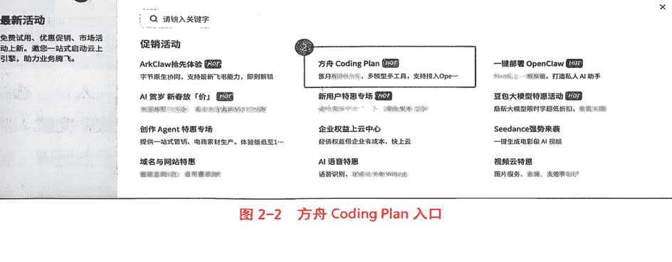

第 2 步：注册账号并完成个人实名认证。

国内所有正规大模型 API 服务，都必须完成实名认证，这是国家网络安全法规的硬性要求。字节跳动作为头部大厂，对用户信息的加密保护有严格的合规标准，不用担心信息泄露的问题。

单击页面右上角的“立即注册”按钮，用手机号完成账号注册，如图 2-3、图 2-4 所示。

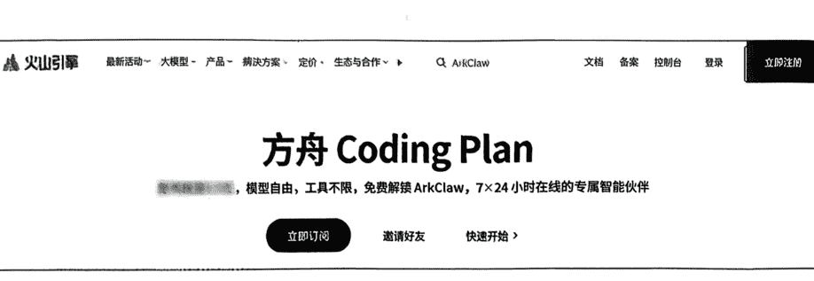

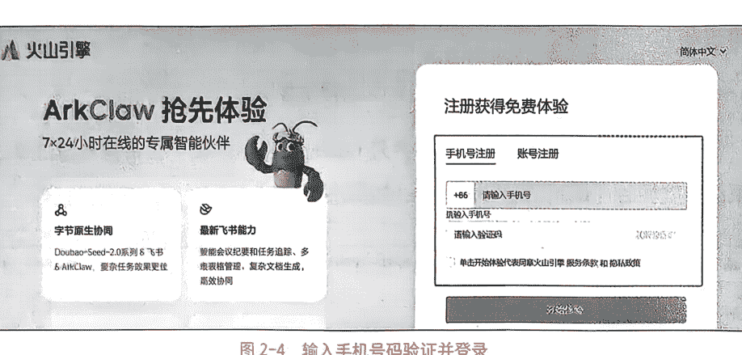

登录后，单击右上角的头像，在下拉菜单里找到“实名认证”入口，选择“个人认证”（见图 2-5），按照界面提示，选择适合自己的验证方式，完成人脸核验即可。

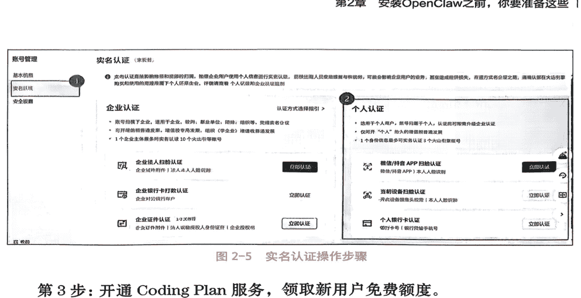

第 3 步：开通 Coding Plan 服务，领取新用户免费额度。

完成实名认证后，回到火山方舟 Coding Plan 专区页面，单击页面中间的“立即订阅”按钮，按照提示，勾选服务协议，完成服务开通，如图 2-6 所示。


服务开通完成后，新用户专属免费额度领取入口会自动弹出，单击领取即可。额度会直接发放到你的账户里，新手可以先用免费额度完成安装测试、“跑通”基础功能，不用先充值。

第 4 步：创建专属 API Key，妥善保管核心凭证。

开通服务后，单击页面右上角的“控制台”按钮，进入火山引擎管理后台，如图 2-7 所示。


在控制台左侧导航栏中找到“访问控制”选项，单击进入后，在侧边栏找到“API Key 管理”，如图 2-8 所示。

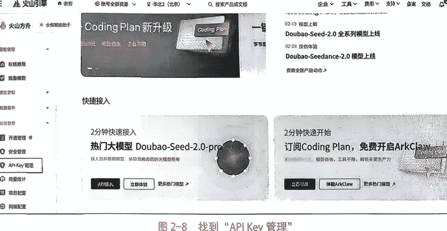

选择“API Key 管理”选项，单击界面中的“创建 API Key”按钮，然后单击“创建”按钮；如图 2-9 所示。

这里需要强调的是，API Key 会默认隐藏，需要单击图 2-10 所示的眼睛图标，然后将 API Key 复制保存到一个文档里备用。注意，不要将 API Key 发给任何人，哪怕是熟人。

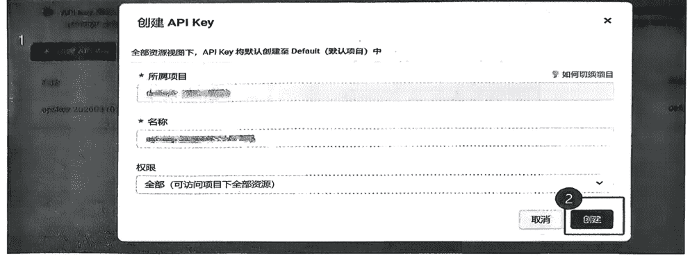

图 2-9 创建 API Key

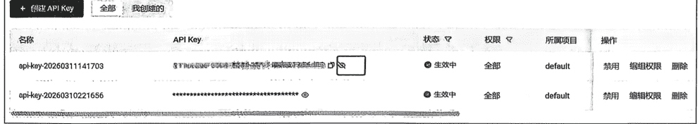

图 2-10 复制密钥并另存

至此，你就拿到了 OpenClaw 的专属门禁卡，后续安装的时候，只需要把 API Key 填入对应的配置框里，就能给 OpenClaw 接通“大脑”，让它正常干活了。

# 第 3 章

## 跟我学，3 步装好原版 OpenClaw

本章，我们将一步步完成 OpenClaw 的安装与初始配置。整个过程分为 3 个核心步骤，帮助你顺利“养”起属于自己的“龙虾”。

### 3.1 第 1 步：准备系统环境

OpenClaw 的运行需要依赖 Node.js 和 Git 这两个基础工具，无论你使用的是 Windows、macOS 还是 Linux 系统，都需要先完成这两个工具的安装，不同系统间的安装步骤大致相似，以下演示 Windows 系统的安装方法，以及验证是否安装成功。

#### 1. 安装 Node.js

Node.js 是一个 JavaScript 运行时环境，OpenClaw 的核心功能依赖它来运行。我们需要安装 Node.js 的 LTS（长期支持）版本，以确保稳定性。

在 Windows 系统安装 Node.js 的步骤如下。

（1）打开浏览器，访问 Node.js 的官网，如图 3-1 所示。

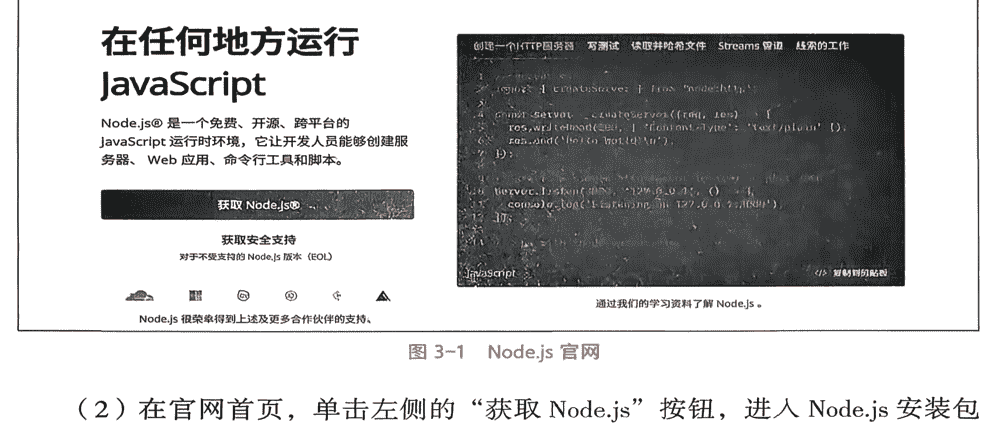

（2）在官网首页，单击左侧的“获取 Node.js”按钮，进入 Node.js 安装包的下载页面。

（3）在下载页面中，选择你的系统和平台，然后单击相应按钮进行下载，如图 3-2 所示。

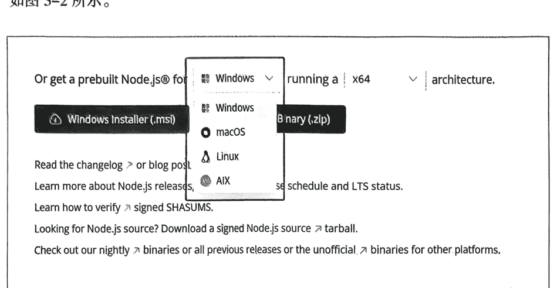

图 3-2 下载 Node.js

（4）下载完成后，解压并运行安装程序，安装向导界面如图 3-3 所示。

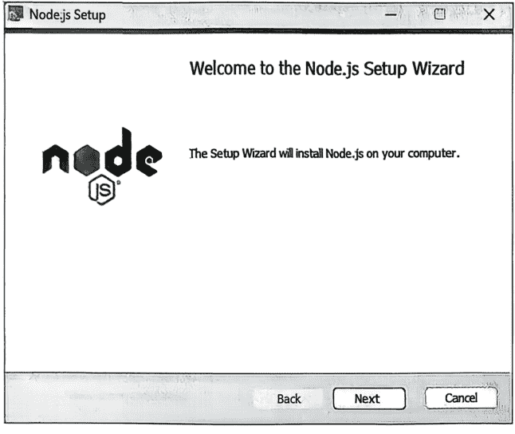

图 3-3 安装向导界面

单击 “Next” 按钮，勾选图 3-4 所示的 “我接受许可协议” 中的条款后，一直单击 “Next” 按钮（保持默认设置）即可。

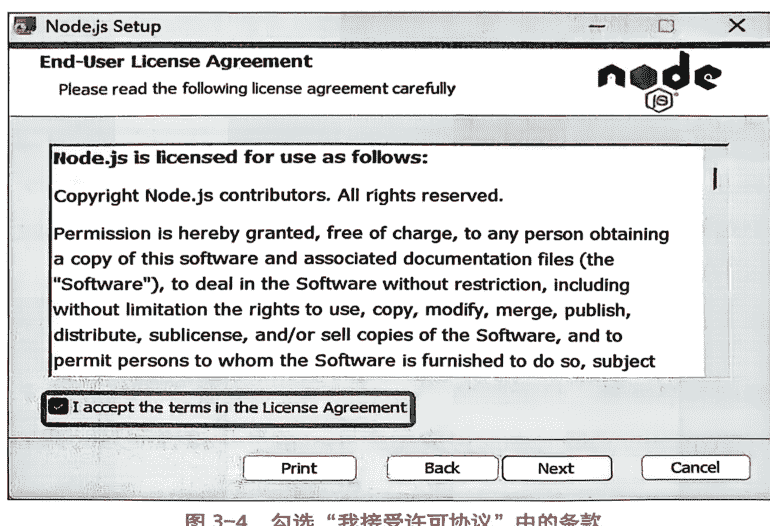

图 3-4 勾选“我接受许可协议”中的条款

单击“Install”按钮后开始安装，等待一段时间后单击“Finish”按钮完成 Node.js 的安装，如图 3-5 所示。

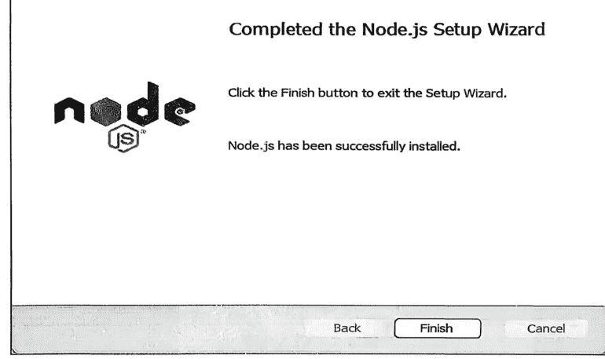

图 3-5 完成 Node.js 安装

#### 2. 验证 Node.js 和 npm 是否安装成功

安装完成后，我们需要通过终端验证是否安装成功。

（1）验证 Node.js 是否安装成功

将鼠标指针移至 Windows 系统“开始”按钮上，单击鼠标右键，在打开的快捷菜单中选择“终端管理员”命令进入终端，如图 3-6、图 3-7 所示。


图 3-6 选择“终端管理员”命令

注：为了获得较好的显示效果，本书将终端配置为浅色模式，这不影响实际功能。


图 3-7 进入终端

进入终端后，输入以下命令并按回车键，查看 Node.js 的版本，如图 3-8 所示。

```
node -v
```


如果安装成功，会显示类似 “v2x.x.x” 的版本号，版本号可能因安装时间不同而有区别，只要有版本号输出即表示安装成功，如图 3-9 所示。


（2）验证 npm 是否安装成功

接着在终端输入以下命令并按回车键，查看 npm 的版本，如图 3-10 所示。

```
npm -v
```

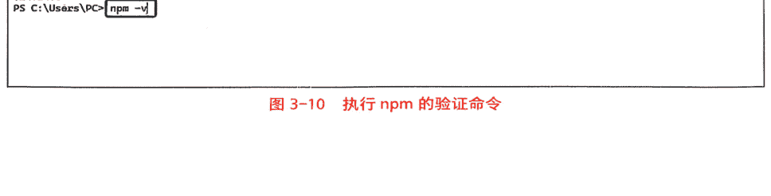

同样，若显示类似 “11.x.x” 的版本号，则说明 npm 安装成功，如图 3-11 所示。


#### 3. 安装 Git 工具

Git 是一个版本控制工具，OpenClaw 的部分安装方式需要用到 Git 工具。

Windows 系统安装 Git 的步骤如下。

访问 Git 官网，单击 “Windows 安装” 按钮，如图 3-12 所示。

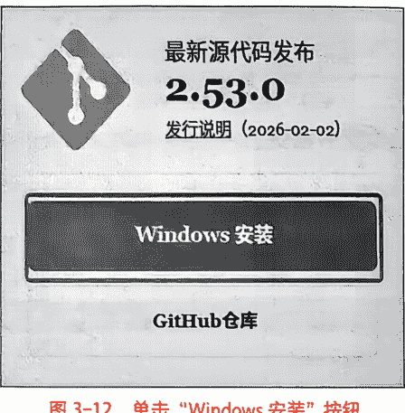

进入下载界面，同样需选择你的系统，然后根据界面提示下载 Git 的安装包，如图 3-13 所示。

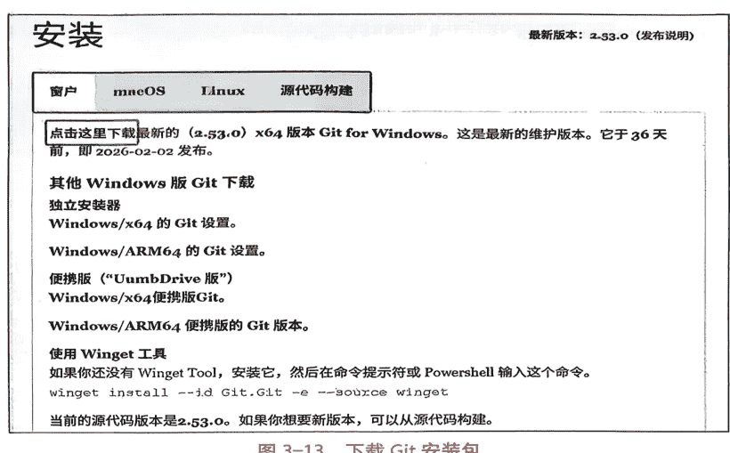

下载完成后，解压并运行安装程序，安装向导界面如图 3-14 所示。

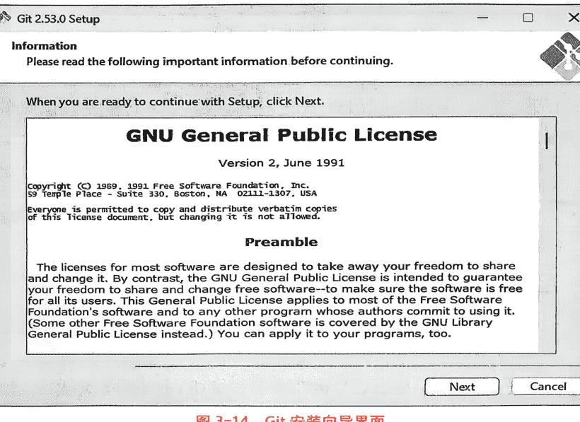

在安装向导中，大部分步骤保持默认设置即可，连续单击“Next”，最后单击“Finish”，完成 Git 工具的安装，如图 3-15 所示。

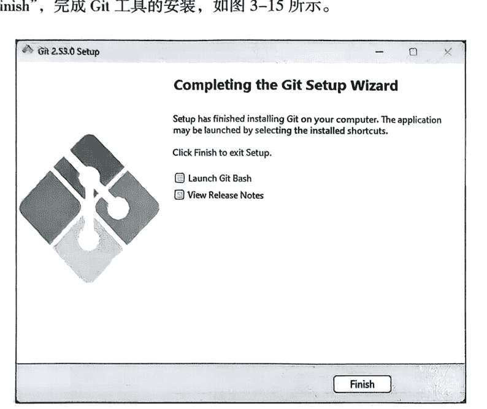

#### 4. 验证 Git 工具是否安装成功

安装结束之后，关闭终端然后重新打开，输入以下命令并按回车键，如图 3-16 所示。

```
git --version
```


如果显示类似“git version 2.x.x”的版本号，说明 Git 工具安装成功，如图 3-17 所示。

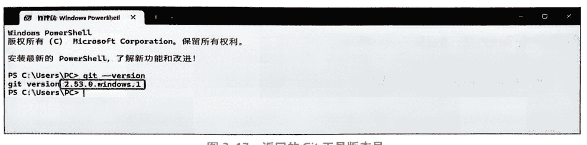

图 3-17 返回的 Git 工具版本号

### 3.2 第 2 步：完成安装并检测

完成系统环境准备后，我们就可以开始安装 OpenClaw 了。首先访问 OpenClaw 官网获取安装命令，官网如图 3-18 所示。

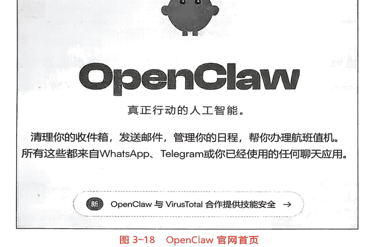

图 3-18 OpenClaw 官网首页

进入官网首页后，往下滚动页面，你会看到页面上有不同系统和安装方式的选项。下面我们分别介绍 Windows 系统、macOS 的选择方法，以及一键安装命令和 npm 安装命令的使用方法。

进入 OpenClaw 官网后，你会看到 “Quick Start”（快速入门）里面列出了不同的安装方式，如图 3-19 所示。

- One-liner：一键安装命令，适合大多数用户，会自动安装所需的依赖。
- npm：通过 npm 包管理器安装，适合熟悉 Node.js 的用户。
- Hackable：适合想要查看或修改源代码的用户。

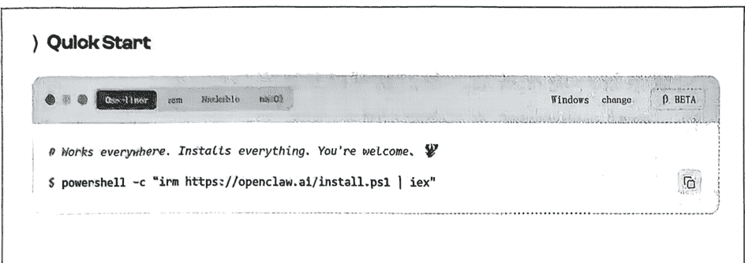

同时，官网还会根据你的系统自动切换选项，或者你可以单击 “change”，在 “macOS/Linux” 和 “Windows” 之间切换，选择对应的安装命令，如图 3-20 所示。

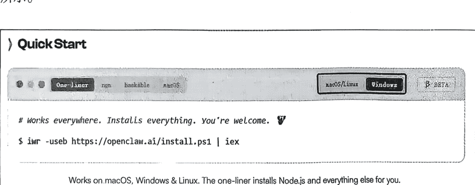

#### 1. Windows 系统安装

官方提供了两种安装方式，一种是通过一键安装命令安装，一种是通过 npm 命令安装，如图 3-21 所示。

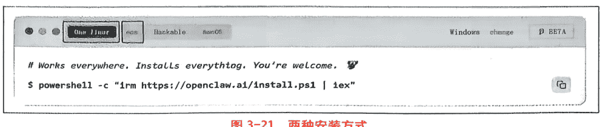

图 3-21 两种安装方式

（1）一键安装命令

复制一键安装命令（官网会自动生成适合 PowerShell 的命令），如图 3-22 所示。

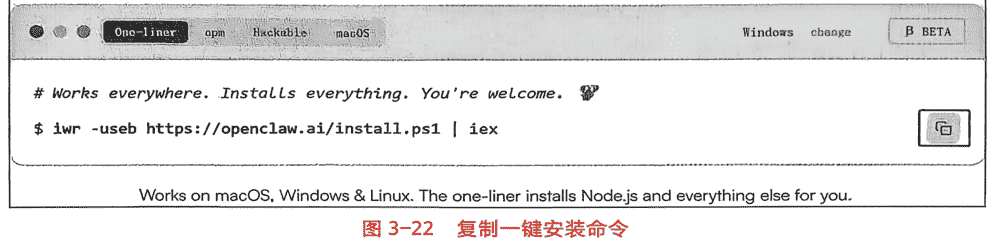

图 3-22 复制一键安装命令

进入 PowerShell 终端（注意：需以管理员身份运行，否则可能会出现权限错误），粘贴命令并按回车键，等待安装完成，如图 3-23、图 3-24 所示。


图 3-23 执行一键安装命令

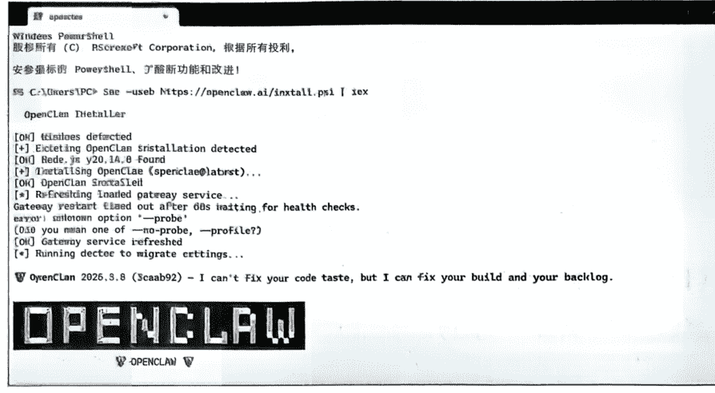

出现与图 3-24 所示相似的界面则表示 OpenClaw 安装成功。

（2）npm 安装命令

使用 npm 命令安装 OpenClaw 的步骤如下。

在官网 “Quick Start” 中选择 “npm”，然后复制第一条安装命令（作用是安装 OpenClaw 工具本身），如图 3-25 所示。

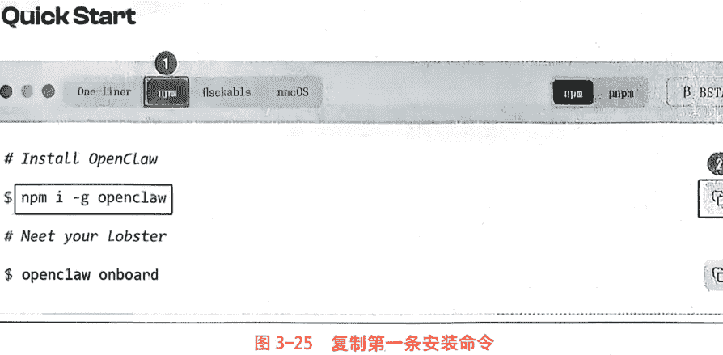

以管理员身份打开终端，粘贴命令，如图 3-26 所示。

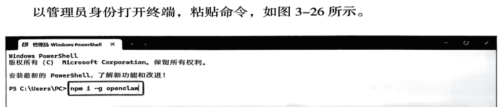

图 3-26 粘贴命令

粘贴完成后按回车键，会出现一个旋转的符号，代表正在安装，如图 3-27 所示。

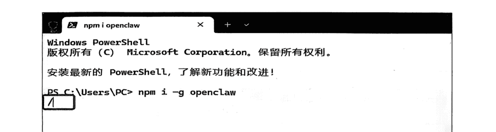

图 3-27 正在安装

等待一段时间，出现图 3-28 所示类似的内容则代表安装成功了。

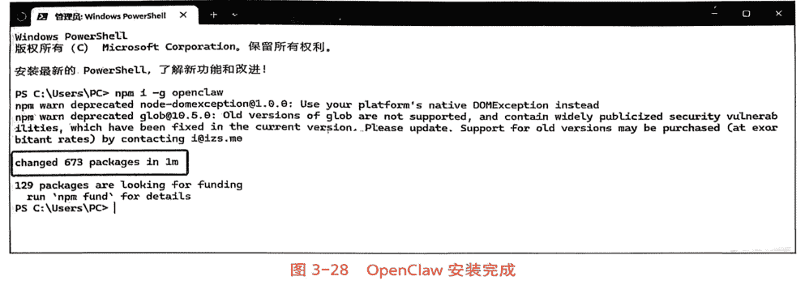

图 3-28 OpenClaw 安装完成

#### 2. macOS 系统安装

如果你使用的是 macOS，官网会默认显示 “macOS/Linux” 的安装选项。你可以选择一键安装命令或 npm 安装命令。

（1）一键安装命令

在官网的 “Quick Start” 中确认选择 “macOS/Linux”，复制一键安装命令，如图 3-29 所示。

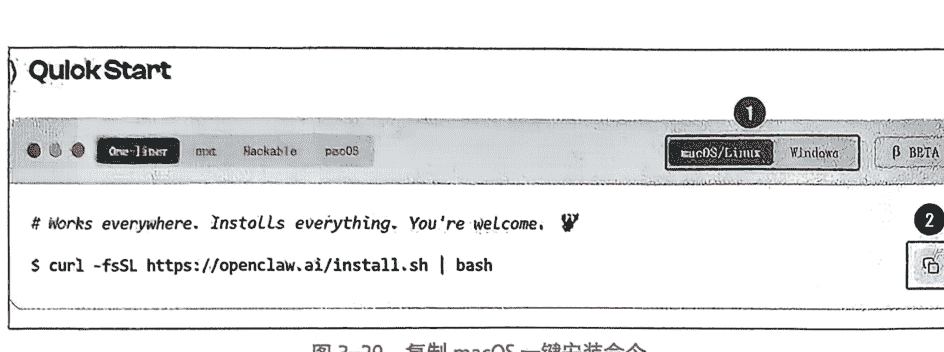

打开终端，粘贴刚才复制的命令，如图 3-30 所示。

粘贴完成后按回车键，等待安装过程完成即可，其间可能需要输入你的 macOS 密码以获得权限。

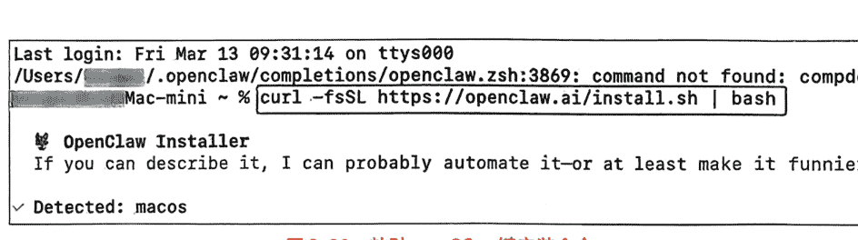

（2）npm 安装命令

在 macOS 中使用 npm 安装命令的方法和在 Windows 系统中一致，此处便不赘述。

不论在哪种系统下安装，安装命令执行完成后，我们都需要确认 OpenClaw 是否成功安装。关闭并重新打开终端，然后执行以下命令进行验证，如图 3-31 所示。

```
openclaw --version
```

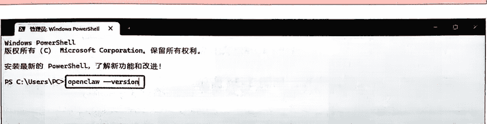

如果安装成功，终端会显示 OpenClaw 的版本号（版本号可能随更新而变化），如图 3-32 所示。

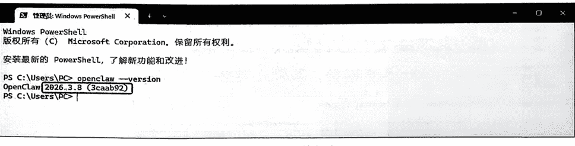

至此，我们就完成了 OpenClaw 的安装和检测。

### 3.3 第 3 步：完成初始配置

安装成功后，我们需要执行初始配置命令，让 OpenClaw 了解你的偏好和使用环境。这个过程中会有一些风险提示并需要做相应选择，我们一步步来做。

在终端输入以下配置指令，如图 3-33 所示。


图 3-33 输入配置指令

按回车键，进入配置流程，如图 3-34 所示。

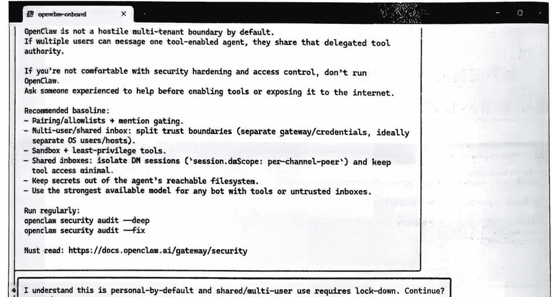

图 3-34 进入配置流程

配置流程有 8 步。操作时通过键盘上的上下左右方向键进行切换，按回车键进行确认。对于可以多项选择的步骤，可先使用键盘空格键分别选中各选项，再按回车键完成选择。

#### 1. 风险告知与确认

启动配置后，首先会出现图 3-34 所示的风险提示界面，内容大致是“我已理解：该工具默认仅适配个人使用场景，若要用于共享/多用户场景，必须先完成安全加固与权限锁定。是否继续？”

为什么会有这个提示？因为 OpenClaw 的核心功能是“帮你做事”，这个提示是为了让你了解潜在的风险，确保你是在知情的情况下使用。

仔细阅读风险提示后，用键盘上的左方向键选择“Yes”，按回车键，继续下一步。

#### 2. 引导模式选择

第二步为图 3-35 所示的引导模式选择，这一步是让用户选择初始化配置的复杂度。

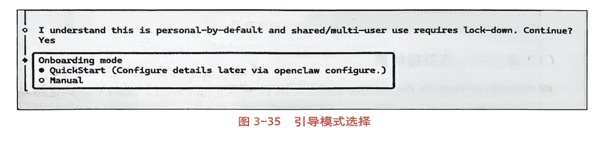

OpenClaw 官方提供了两种核心模式。针对零基础养“龙虾”的用户，“QuickStart”模式是较好的选择，它可以帮你避开非必要的参数配置，不用提前学习各类开发相关的专业知识，仅需完成核心必填项就能让 OpenClaw 正常运行，大幅降低了入门门槛。

此处我们选择“QuickStart”（相关配置后续可再次进行，因此无须担心），按回车键，继续下一步。

#### 3. 模型提供商选择

第三步为图 3-36 所示的模型提供商选择，这一步是配置 OpenClaw 的核心，是工具的 AI 思考、指令执行、内容生成的能力来源。这一步分为 4 个连续的小步骤。

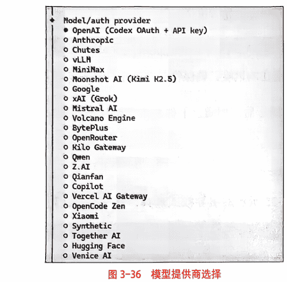

图 3-36 模型提供商选择

##### （1）选择核心模型提供商

模型提供商就是为 OpenClaw 提供大语言模型的服务方，每个大模型的功能大同小异，各有特点。

此处我们选择 “Volcano Engine”（火山引擎），通过上下方向键选中相应选项，按回车键，继续下一步。

##### （2）选择 API Key 提供方式

这一步是让用户选择如何给 OpenClaw 提供 API Key，如图 3-37 所示。

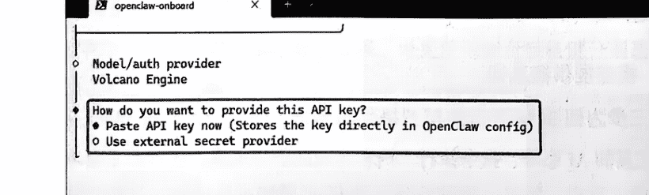

图 3-37 选择 API Key 提供方式

API Key 是你使用大模型的身份凭证，OpenClaw 需要通过 API Key，才能调用你账号下的大模型服务。官方提供了两种可选方式，此处我们选择 “Paste API key now”，按回车键，继续下一步。

##### （3）输入 API Key

这一步是完成身份凭证的录入，你粘贴的 API Key，仅用于调用大模型服务，不会上传到任何第三方服务器。用户录入正确有效的 API Key 后，OpenClaw 就可以正常调用大模型服务。

进入 API Key 输入界面，直接粘贴你准备好的 API Key，如图 3-38 所示。

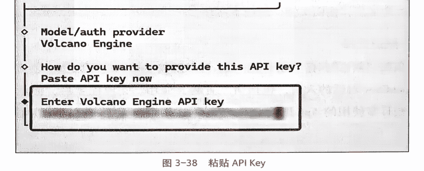

确认输入无误后，按回车键，继续下一步。

##### （4）选择默认模型

这一步是选择 OpenClaw 日常运行时默认使用的具体大模型，不同的模型有不同的功能。在前文的演示中，我们购买了火山方舟 Coding Plan 订阅服务，所以这里选择带 “volcengine-plan” 前缀的模型。

进入默认模型选择界面，通过上下方向键，选中任意前缀为 “volcengine-plan” 的模型，例如 “volcengine-plan/ark-code-latest”，如图 3-39 所示。

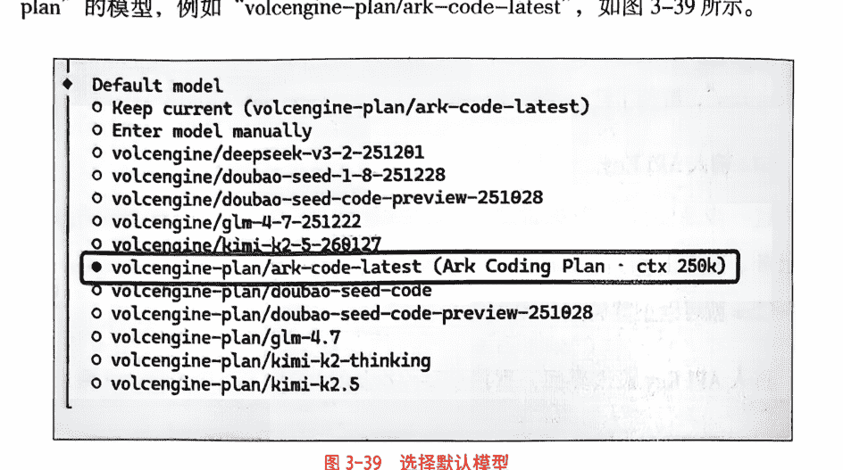

选择完成后，按回车键，继续下一步。

#### 4. 频道选择

这里的 “频道”，指的是 OpenClaw 可以对接的聊天应用渠道，也就是你后续和 OpenClaw 对话的入口，包括第三方聊天应用。完成配置后，你就可以直接在这些日常使用的 App 里给 OpenClaw 下达指令，无须一直打开终端或网页界面。

但是对于零基础用户，“Skip for now”（暂不配置）是较好的选择。通过上下方向键选中 “Skip for now” 选项，如图 3-40 所示。

选好后按回车键，继续下一步。

#### 5. 搜索提供商选择

搜索提供商是为 OpenClaw 提供联网搜索功能的服务方。完成配置后，OpenClaw 就可以通过搜索引擎获取实时互联网信息，比如查询最新的航班信息、新闻资讯、实时汇率、天气数据等，完成需要联网的指令任务。


图 3-40 选择频道

这里我们继续选择 “Skip for now”，进一步降低零基础用户的入门门槛。

通过上下方向键选中 “Skip for now” 选项，如图 3-41 所示。


图 3-41 选择搜索提供商

选择完成后，按回车键，继续下一步。

#### 6. Skill 配置

这里的 “Skill”（技能），是 OpenClaw 官方和社区开发的扩展功能插件，具备与第三方工具联动的功能。启用对应的 Skill 后，可以让 OpenClaw 控制更多的软件和硬件设备，拓展自动化使用场景。

对于零基础用户，“No”是较为合理的选择。

这里我们进入 Skill 配置界面，通过左右方向键选中 “No” 选项，如图 3-42 所示。

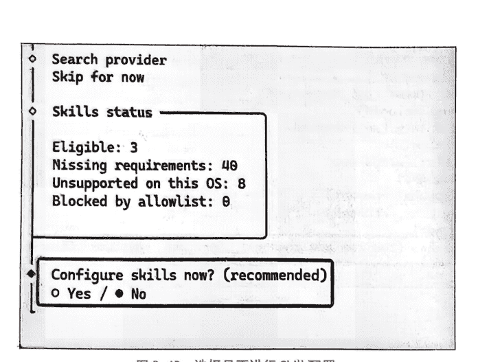

选择完成后按回车键，继续下一步。

#### 7. 钩子启用

这里的 “Hooks”（钩子），是 OpenClaw 的高级事件监听自动化功能。简单来说，就是可以让 OpenClaw 在后台自动监听特定的事件。

其中有 4 个选项，作用分别如下。

- ① boot-md。每次你启动 OpenClaw 的网关服务（也就是机器人的核心运行程序）时，机器人会自动读取并执行你项目根目录中 BOOT.md 文件里写好的所有指令。
- ② bootstrap-extra-files。启动 OpenClaw 的时候，除了默认的配置文件，还可以自动加载你指定的其他文件夹 / 路径里的额外配置、脚本、提示词模板、自定义工具规则等文件。
- ③ command-logger。开启后，机器人会把你发送的指令、它执行的所有操作、调用的工具，自动记录到一个统一的审计日志文件里。
- ④ session-memory。正常情况下，你使用 /new 或 /reset 开启新对话或重置对话时，机器人会清空之前的对话上下文和记录；开启这个功能后，你开启新对话或重置对话，机器人也会把之前的对话记录保存下来，新对话里依然有之前的内容记录。

在钩子启用界面，我们暂时选择 “Skip for now” 选项，跳过这一步，如图 3-43 所示。

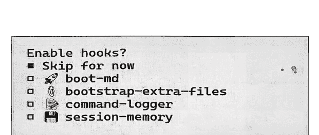

#### 8. 启动方式

这一步是选择 OpenClaw 的启动方式，也就是你后续和 OpenClaw 交互的核心入口，官方提供了两种核心方式。

对零基础用户来说 “Open the Web UI”（在网页界面中启动）是较好的选择，因其可视化界面操作与日常聊天软件一致，可清晰查看指令执行过程与报错信息，还支持多轮对话、历史记录查看、可视化配置，体验感更好。

所以这里在启动方式选择界面，我们通过上下方向键选中 “Open the Web UI” 选项，如图 3-44 所示。

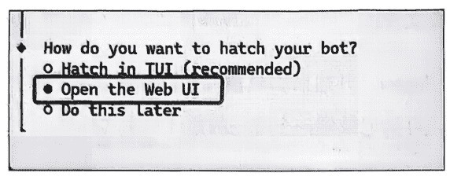

按回车键确认。至此就完成了整个初始配置流程。

#### 9. 配置完成最终验证

按回车键确认启动方式后，OpenClaw 会自动完成初始化启动，终端会输出本地 Web UI 的访问地址（通常格式为 http://localhost: × × × × ），同时会自动打开你的默认浏览器，显示 OpenClaw 的 Web UI 对话界面，如图 3-45 所示。

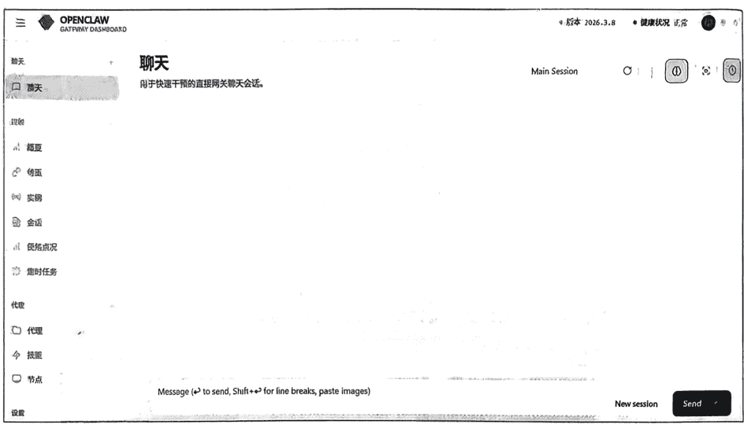

如果没有出现图 3-45 所示的界面，而是打开了网页但显示无法访问此页面，如图 3-46 所示，表示无法访问提示信息。

无须担心，返回终端，输入以下命令。

```
openclaw gateway
```


图 3-46 无法访问提示信息

按回车键等待服务启动，然后刷新之前显示无法访问的网页，即可看到 OpenClaw 的 Web UI 对话界面。

你可以通过网页的输入框发送一句“你好！”，如果 OpenClaw 正常回复，就代表整个初始配置流程正确，如图 3-47 所示。

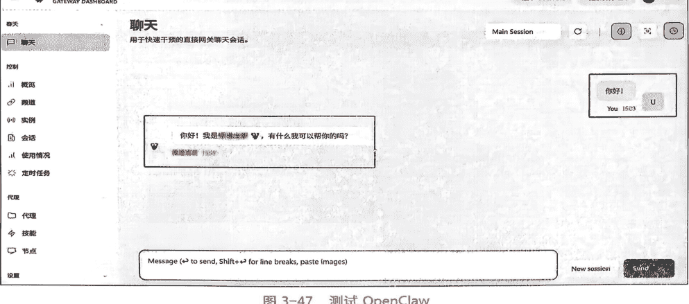

图 3-47 测试 OpenClaw

至此你的“龙虾”已经成功孵化，可正常使用所有功能。

# 第 4 章
## 不只对话，解锁更多的“养虾”姿势

本章，我们将真正进入养“龙虾”的核心阶段了。前面几章解决的，是把 OpenClaw 装上并跑起来的问题，而本章要解决的则是怎么把它用起来、用顺手、用出长期价值的问题。

### 4.1 TUI 与 Web UI：两种控制台界面的区别与使用方法

当成功安装 OpenClaw 并完成初始配置后，很多人的第一反应是：接下来应该在哪里使用它？

事实上，OpenClaw 并不是只有一种使用方式。为了兼顾不同用户的使用习惯，它同时提供了两种控制台界面：一种是运行在终端里的 TUI（Terminal User Interface，终端用户界面），另一种是通过浏览器访问的 Web UI（Dashboard 控制台）。两种界面本质上连接的是同一个 OpenClaw，只是交互方式不同。

#### 1. TUI

进入 TUI 的方法非常简单，在终端执行以下命令即可。

```
openclaw tui
```

执行后会看到 TUI 的具体界面，如图 4-1 所示。


很多新手第一次看到 TUI，会下意识觉得它不方便操作，其实这是一种误解，它的操作逻辑和其他聊天软件并没有本质区别，你只需在下方的输入框中输入任意内容并按回车键，系统便会自动回复你，如图 4-2 所示。

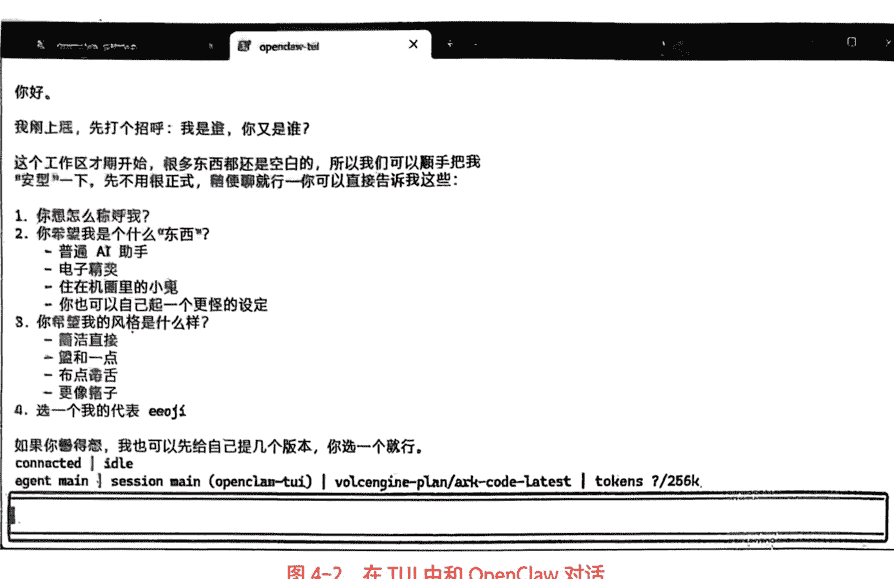

另外，在 TUI 中，输入“/”并按回车键，可快速打开设置列表，你可在设置列表中使用键盘上的方向键快速选择相应选项，如图 4-3 所示。

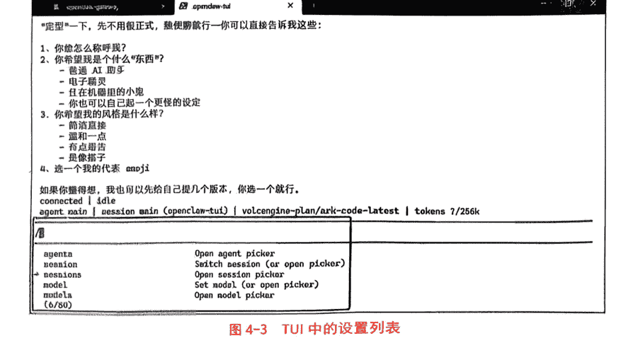

如果你想退出这个界面，连续按两次组合键“Ctrl+C”即可。

TUI 并不等于“更难”，它只是更接近系统本体。很多新手一看到终端，就会本能地觉得这是高手才用的东西。但实际上，在 OpenClaw 里，TUI 有时反而比图形界面更直观。因为它少了很多视觉包装，系统在干什么、有没有连上、是不是在执行任务，常常一眼就能看出来。对真正想学会 OpenClaw 的人来说，TUI 不应该被回避，而应该尽早熟悉。

#### 2. Web UI

如果说 TUI 更像“在控制台前坐着操作”，那么 Web UI 就更像“打开一个后台系统来管理整只龙虾”。

进入 Web UI 的命令同样很简单。在终端里执行相应命令即可。

```
openclaw dashboard
```

执行后，你的浏览器会自动跳转到图 4-4 所示的 Web UI。

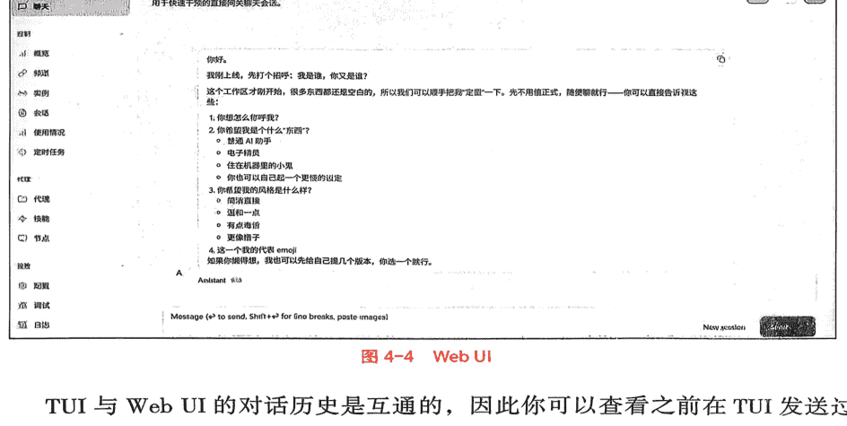

TUI 与 Web UI 的对话历史是互通的，因此你可以查看之前在 TUI 发送过的指令以及回答结果。

Web UI 的最大优势是提供可视化界面展示信息。和 TUI 相比，它更容易让人一眼看懂“系统现在处于什么状态”“有哪些功能入口”“当前会话里发生了什么”。对刚接触 OpenClaw 的用户来说，Web UI 往往会让人更有“终于看懂了”的感觉，因为很多原本在 TUI 里看起来较抽象的东西，在 Web UI 里都会变得具体起来。

具体而言，Web UI 顶部展示了当前版本号、监控状况、显示模式切换等设置选项，相关功能一目了然，此处不赘述。Web UI 左侧则展示了聊天、控制、代理、设置、资源五大功能区，下面我们一一介绍。

##### （1）聊天功能区

顾名思义，聊天功能区是用户与 OpenClaw 进行对话的主要区域。与 TUI 中的聊天界面类似，你可以在这里输入问题、发送指令，并查看 AI 的回复内容。不同之处在于，Web UI 会把对话过程以更加清晰的方式呈现出来。例如，当 OpenClaw 在执行任务时，系统会以卡片或模块的形式展示工具调用、执行步骤、返回结果。相比 TUI 里一行行滚动的文本，这种结构化展示方式更容易帮助用户理解 AI 在后台做了什么。

聊天功能区如图 4-5 所示。

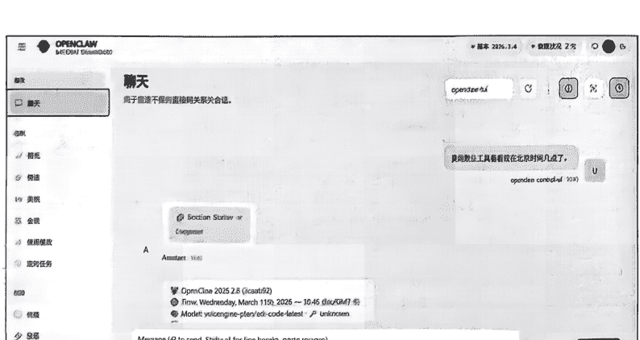

##### （2）控制功能区

控制功能区包含概览、频道、实例、会话、使用情况、定时任务等分区。

- ① 概览分区。你可在概览分区查看网关状态、入口点和健康状态，如图 4-6 所示。

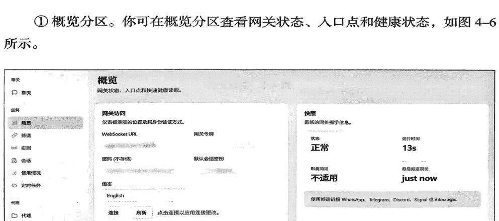

- ② 频道分区。你可在频道分区管理频道并进行设置，如图 4-7 所示。

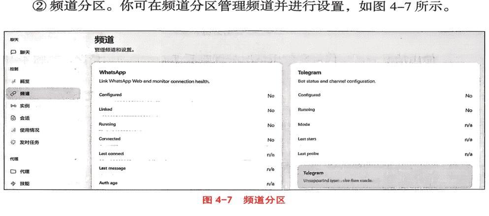

- ③ 实例分区。你可在实例分区查看已连接客户端和节点的在线信号，如图 4-8 所示。


图 4-8 实例分区

- ④ 会话分区。你可在会话分区检查活动会话并调整会话的默认设置，例如模型思考深度，如图 4-9 所示。

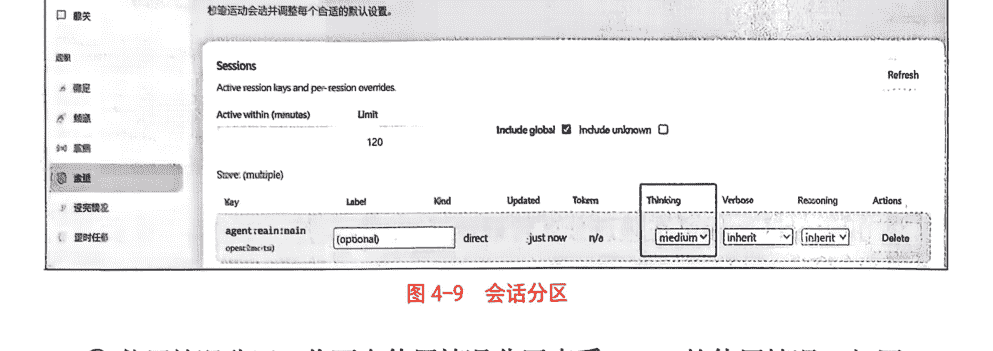

图 4-9 会话分区

- ⑤ 使用情况分区。你可在使用情况分区查看 Token 的使用情况，如图 4-10 所示。


图 4-10 使用情况分区

- ⑥ 定时任务分区。你可在定时任务分区安排代理的唤醒和重复运行，如图 4-11 所示。


##### （3）代理功能区

代理功能区包含代理、技能、节点等分区。

- ① 代理分区。你可在代理分区管理代理的工作区、工具和身份，如图 4-12 所示。


- ② 技能分区。你可在技能分区管理技能的可用性和 API Key 注入，如图 4-13 所示。


- ③ 节点分区。你可在节点分区配置设备、功能，并公开命令，如图 4-14 所示。


##### （4）设置功能区

设置功能区包括配置、调试与日志等分区。

- ① 配置分区。你可在配置分区安全地编辑系统的配置文件，如图 4-15 所示。


- ② 调试分区。你可在调试分区管理网关快照、事件，手动进行 RPC（远程过程调用），如图 4-16 所示。


- ③ 日志分区。你可在日志分区查看网关文件日志，如图 4-17 所示。

##### （5）资源功能区

单击资源功能区中的“文档”，系统会跳转到 OpenClaw 的官方文档页面，你可以利用官方文档深入学习 OpenClaw 的相关知识。


最后，当你终于安装好 OpenClaw 后，决定你能不能顺利开始“养虾”的，首先是你是否理解它的两个操作入口。

对新手来说，最好的做法不是只理解其中一个，而是两个都要理解。因为你越早熟悉这两个人口，后续的人设设置、频道接人、记忆管理、心跳设置、定时任务设置和 Skill 安装，就越容易实操，而不是停留在概念层面。

### 4.2 设定人设：你的“龙虾”应该是独一无二的

很多人第一次接触 OpenClaw 时，都会不自觉地把它当成一个普通聊天 AI，即问问题、等回答、再问下一个问题。这种使用方式当然没有错，但如果一直停留在这个阶段，就会错过 OpenClaw 最有价值的一部分功能。

真正长期使用 OpenClaw 的人，很快就会发现一件事：每一只“龙虾”，其实都应该有自己的性格。

#### 1. 为什么要给 OpenClaw 设定人设

很多新手会觉得，人设不过是一段提示词，好像可有可无。但在实际使用中，人设的作用远比你想象中大。

首先，人设可以让 AI 的输出保持稳定。如果没有统一的人设，AI 的回答风格往往会因问题不同而变化。有时非常详细，有时又非常简略；有时给出步骤，有时只给概念。对于偶尔聊天来说，这不是什么问题，但如果你希望 AI 长期参与工作，这种不稳定就可能引起不必要的麻烦。

其次，人设可以减少重复解释。当 AI 了解你的职业背景、工作方式和偏好时，它在处理问题时就会自动参考这些信息。例如，如果 AI 知道你经常写公众号文章，它在回答问题时就更可能提供结构化内容，而不是零散信息。

最后，人设可以帮助 AI 做出更合理的判断。

很多任务并不是简单进行问答，而是需要决策。例如，当你让 AI 帮你整理资料时，它需要判断哪些内容更重要、哪些可以忽略。这时，人设中的规则就会成为一种“决策框架”。

因此，人设并不是装饰性的提示词，而是一套长期有效的行为规则。

在很多资深用户的经验中，有这样一句总结：模型决定能力上限，人设决定表现质量。

#### 2. 通过对话快速设定人设

对刚接触 OpenClaw 的人来说，最简单的方式就是通过对话直接设定人设。例如，你可以在 TUI 或飞书中输入人设提示词。

> 你叫秋小虾，是一名运行在 OpenClaw 中的全能数字助理，目标是帮助用户高效完成信息查询、内容处理和自动化任务。

工作原则如下。

1. 以“完成任务”为优先目标。收到需求时，先判断是否可以通过系统工具完成（如搜索、浏览器、代码执行、文件操作或 Skill）。能执行就直接执行，而不是只提供理论建议。

#### 2. 处理信息时保持结构化。可以完成搜索整理、写作生成、内容改写、数据分析、脚本与命令生成、流程拆解等任务。
3. 对重复流程进行总结，必要时建议用户将流程保存为 Skill 或自动化任务。
4. 使用工具时遵循：能调用工具就调用工具，能一次完成就不要拆分成多次。
5. 输出风格简洁清晰，优先提供可直接执行的步骤、命令或结果，避免冗长解释。
6. 如果信息不足，先提出关键问题再继续执行。

定位：一个会思考、会行动、会自动化执行任务的 AI 助理，而不是只聊天的机器人。

这套提示词是基于 OpenClaw 的实际功能编写的，仅供参考，你也可输入任意人设提示词。收到指令后，OpenClaw 会快速更新身份信息，如图 4-18 所示。


接着，你可继续追问，看看人设是否设定成功，如图 4-19 所示。


当人设描述足够清晰时，你会感觉到 AI 的回答方式发生明显变化。

随着使用时间增加，OpenClaw 的人设也会不断迭代和完善。这个过程本身，就是在逐渐培养一个真正属于自己的 AI 助手。

### 4.3 接人频道：用手机指挥它干活

不管是通过 TUI 还是通过 Web UI 使用 OpenClaw，使用总归不是很便捷，这是因为很多灵感、任务或想法，往往是在手机上产生的。例如在路上看到一条行业新闻，突然想让 AI 帮你整理；或者在开会时需要快速查询某个信息。这时，如果还需要回到电脑旁操作，就会显得非常不方便。

因此，OpenClaw 提供了一种非常重要的功能：频道接人。所谓频道，就是把 OpenClaw 接入聊天软件，让聊天软件变成它的控制入口。接入之后，你只需要在聊天窗口发送消息，OpenClaw 就可以收到任务并执行。

#### 1. OpenClaw 支持哪些频道

随着版本不断更新，OpenClaw 原生支持接人的频道也在增加，在 “2026.3.8” 版本中，系统支持接入 20 个不同的频道，如图 4-20 所示。


图 4-20 OpenClaw 原生支持接入的频道

注：随着版本不断更新，频道可能会增加或减少。

对国内用户来说，飞书通常是最常见、也最容易上手的一种选择。一方面飞书本身就是很多团队日常使用的协作工具；另一方面，飞书开放平台提供了更完整的机器人能力，因此与 OpenClaw 的结合也非常自然。

接下来我们将重点演示如何接入飞书频道。

#### 2. 快速接入飞书频道

以前接入飞书频道是比较复杂的，你需要手动配置 App ID、App Secret、权限、时间与回调等内容，随着飞书的不断更新，现在你只需要 3 步就可以接入飞书，整个过程非常方便。

（1）执行安装命令

打开终端，执行以下命令。

```
npx -y @larksuite/openclaw-lark-tools install
```

如果在执行过程中出现权限错误，可以在命令前增加“sudo”再执行一次。当命令开始执行后，系统会自动启动安装流程，并在终端生成一个二维码，如图 4-21 所示。


（2）扫描二维码并创建机器人

接下来只需要打开飞书客户端，扫描这个二维码，即可一键创建飞书机器人。整个过程通常只需要几十秒，具体如图 4-22 所示。


需要注意的是，如果你的系统已经安装过其他飞书插件，在新插件的安装过程中旧插件会被自动禁用，因此不需要手动卸载。

（3）在飞书中启动机器人

创建完机器人后，便可以直接与机器人对话，如图 4-23 所示。

如果机器人能够正常回复，说明插件已经成功安装。

初次使用时，你可以让机器人学习飞书官方配置的能力。直接给机器人下达指令：“学习一下我安装的新飞书插件，列出有哪些能力。”机器人便可以完成能力学习，如图 4-24 所示。


#### 3. 将机器人添加进群

若想将机器人添加进群，只需选择“设置” → “群机器人”，然后添加机器人进行操作即可，操作过程如图 4-25 ～图 4-27 所示。


图 4-25 选择“设置”


图 4-26 选择“群机器人”


图 4-27 添加机器人

添加成功后，你可以通过“@机器人”的形式与其对话，如图 4-28 所示。


图 4-28 在飞书群中和机器人对话

#### 4. 意义与风险

从使用体验的角度来看，接入飞书不仅仅是多了一个聊天入口，它实际上改变了 OpenClaw 的使用方式。原本你需要在终端或 Web UI 中“养虾”，而在接入飞书之后，OpenClaw 便进入你日常使用的工作工具中。无论是在电脑上，还是在手机上，只要打开飞书，你就可以随时向它下达指令。

更重要的是，这种接入方式让 OpenClaw 能够真正融入你的工作流程。例如，当你需要整理资料时，可以直接让它把内容写入飞书文档；当需要向团队发送信息时，可以让它将信息发送到群；在设置定时任务后，它还可以每天自动把报告推送到指定聊天窗口。这样一来，AI 就不再只是一个需要专门打开的网站或程序，而变成了日常沟通环境中的一个成员。

在享受这种便利的同时，也需要注意一些潜在风险。因为当 OpenClaw 接入飞书之后，它实际上获得了一定程度的账号操作能力。如果你为机器人授予了读取文档、发送消息或访问日历等权限，那么在理论上，它就可以代表你执行这些操作。因此，在授权时需要特别留意权限范围，尽量只授予当前任务所必需的权限，而不要一次性开放过多访问权限。

AI 可以成为高效的助手，但前提是我们对它的权限与行为要保持精准的控制。

### 4.4 管理记忆：怎么让它记住你的偏好和历史记录

在使用其他 AI 工具时，很多人都会遇到一个共同的问题：AI 的记忆能力似乎有限。

你刚刚告诉它你的职业背景，几轮对话之后它又重新问一遍；你刚刚解释了一段项目背景，换一个问题，它又从零开始理解。这并不是 AI 不够聪明，而是大多数聊天 AI 本质上只依赖当前会话上下文，一旦会话结束，这些信息就不会被长期保存。

在设计 OpenClaw 时，这个问题就得到了专门解决。与普通聊天 AI 不同，OpenClaw 拥有一套本地持久化记忆系统。系统会把部分重要信息记录到本地文件中，并在后续任务中重新读取这些信息，从而逐渐形成一种持续积累的经验。

换句话说，OpenClaw 对对话的处理并不是每次都从零开始，而是会在过去的基础上不断学习和调整。随着使用时间增加，它会越来越了解你的习惯、偏好和工作方式。

#### 1. OpenClaw 的两种记忆

在 OpenClaw 的系统结构中，记忆通常分为两种：长期记忆与短期记忆。

长期记忆记录的是一些稳定的信息，例如用户偏好、工作背景、长期项目等。即使系统重启，OpenClaw 仍然可以重新读取长期记忆文件获取这些信息。

对于本地部署的 OpenClaw，长期记忆文件位于你的 workspace 文件夹（初始设置时可自定义名称与路径）中，路径默认如下。

```
C:\Users\ 你的用户名\.openclaw\ 你的 workspace 文件夹名称
```

具体如图 4-29 所示。


短期记忆主要来自当前会话以及最近执行的任务。短期记忆记录的是“刚刚发生的事情”，例如用户刚刚提出的问题、系统执行的步骤、任务的中间结果等，这些信息会帮助 AI 在同一轮对话中保持上下文连贯。短期记忆文件位于与长期记忆文件相同目录的“memory”文件夹中，以日志形式存在，如图 4-30 所示。


需要注意的是，如果刚刚部署好 OpenClaw，此处可能不会显示长期记忆文件与短期记忆文件，别着急，随着使用时间不断增长，系统会自动帮你创建这些文件。

#### 2. 通过飞书对话设置记忆

在实际使用中，大多数记忆并不需要手动配置，而是可以通过对话直接设置。我们已经把 OpenClaw 接入飞书，因此可以直接在飞书中告诉 OpenClaw 需要记住哪些信息。

例如，在飞书中发送以下内容。

> - 减少使用比喻句。
> - 减少使用带破折号、引号与省略号的句子。
> - 禁止使用绝对化、夸张化表述。
> - 禁止使用“不是……而是”的句式。

把以上内容写入长期记忆，更新到配置文件中。

你的机器人会自动执行指令并创建长期记忆，如图 4-31 所示。


你可以在长期记忆的本地文件路径中打开“MEMORY.md”文件验证长期记忆是否创建成功，如图 4-32 所示。


使用飞书创建短期记忆并在本地验证的方式与长期记忆的类似，此处不赘述。

总而言之，有了记忆系统之后，OpenClaw 就可以逐渐形成一套属于你的知识背景。每一次任务都建立在之前的基础上，而不是从零开始。

从某种意义上说，“养虾”的过程，其实就是不断积累记忆的过程。随着时间推移，这个 AI 助手会越来越熟悉你的工作方式，也会越来越好用。

### 4.5 设置心跳：让它保持 24 小时在线的方法

在前面的内容中，我们已经让 OpenClaw 具备了很多能力：可以聊天、可以记忆用户偏好、可以通过飞书接收指令，也可以执行各种任务。但如果仔细观察，你会发现一个明显特点——你的“龙虾”是被动工作的。也就是说，只有当你发送消息时，它才会开始思考并执行任务。如果没有新的指令，系统就会一直处于等待状态。

这种模式对于普通聊天来说没有问题，但如果我们希望 OpenClaw 成为一个长期运行的助手，就会受到限制。例如想让 AI 定期检索行业新闻，想让 AI 持续监控某个信息来源，想让 AI 自动整理每天的数据……这些任务有一个共同特点：它们不一定需要用户随时发送指令，而是需要系统主动运行。

为了实现这种功能，OpenClaw 提供了一种机制，叫作心跳（Heartbeat）机制。

#### 1. 什么是 Heartbeat

Heartbeat 可以理解为 OpenClaw 的一种自动触发机制。系统会按照固定周期运行一次“心跳循环”，在每一次心跳中，AI 会重新检查当前环境，并判断是否需要执行某些任务。从设计角度看，Heartbeat 更像是一种自动巡检机制。系统会像值班人员一样，每隔一段时间巡视一次。如果发现有事情需要处理，就立即行动。

#### 2. 通过飞书对话设置心跳

在 OpenClaw 中，大多数配置都可以通过自然语言完成，因此设置心跳也不需要复杂操作。接入飞书频道后，就可以直接在飞书中设置心跳，示例如下。

> 添加心跳任务，从现在开始，每半分钟给我发一次内容为“测试”的信息，直到我发送“stop”指令时，停止此心跳任务。把此任务写进后台配置文件中。

机器人执行情况如图 4-33 所示。


你还可在本地 workspace 路径中，找到名为 “HEARTBEAT.md” 的文件来核查心跳任务是否被成功创建，具体如图 4-34 所示。


如果需要修改规则，你可以直接编辑这个文件。Heartbeat 是 OpenClaw 自动化能力的基础机制之一，系统可以在后台持续运行，并定期检查是否有任务需要执行。

在实际使用中，Heartbeat 的应用远超以上示例，你可以通过合理设计心跳规则，让 OpenClaw 持续在后台完成各种重复性工作。

例如，定期整理行业资讯就是一个非常典型的应用场景。你可以设置心跳规则，让 OpenClaw 在每次心跳触发时检查指定的信息源，如果发现新的重要信息，就自动生成摘要并发送到飞书。这样一来，你每天打开飞书时，就能看到整理好的行业动态。

Heartbeat 还可以用于自动化资料积累。例如，你可以让 OpenClaw 在每次心跳时搜索某个主题的最新文章，并把有价值的内容保存到本地。随着时间推移，系统就会逐渐积累一份持续更新的资料库。

在内容创作领域，Heartbeat 也非常实用。例如，可以设置规则，让 OpenClaw 定期整理热点话题、提取潜在选题，或者生成内容灵感清单。这样，当你需要写作时，系统已经提前帮你准备好一批素材。

可以说，当 Heartbeat 被合理利用之后，OpenClaw 就不再只是一个被动响应的工具，而变成了一个在后台持续运行的自动化系统。它会不断巡视环境、检查信息、整理数据，并在必要时主动提醒用户。随着规则逐渐完善，这种自动化能力也会越来越强。

### 4.6 设置定时任务：怎么让它每天自动给你发早报

在自动化系统中，定时任务是一种非常常见的机制。简单来说，它允许系统在指定时间自动执行某个任务。例如在每天固定时间生成报告、发送提醒或整理数据等。

#### 1. 什么是 Cron

在 OpenClaw 中，定时任务通常通过 Cron（Cron Job）实现。Cron 是 UNIX 系统中一种经典的任务调度机制，几十年来，Cron 一直被广泛用于服务器自动化，例如定时进行备份、日志清理和数据同步等。

Cron 的核心原理其实很简单。系统会持续运行一个调度程序，这个程序会不断检查当前时间，当时间满足某个预先设定的规则时，就会自动执行对应的任务。

Cron 使用一种特殊的时间表达式，该表达式通常由 5 个字段组成。

| 分钟 | 小时 | 日期 | 月份 | 星期 |
|---|---|---|---|---|

下面来看一个例子。

```
0 8 * * *
```

在这个例子中，从左到右的每个字段均有其特殊含义。

- 0 表示第 0 分钟
- 8 表示第 8 小时
- * 表示任意日期
- * 表示任意月份
- * 表示任意星期

因此，该表达式的含义就是每天 8:00。

#### 2. 创建定时任务的两种方法

你可以通过与机器人对话的形式创建定时任务，也可以在 Web UI 中手动创建定时任务。

（1）通过对话创建

在 OpenClaw 中，大多数情况下无须手动编写 Cron 表达式，因为机器人可以根据自然语言自动生成对应的表达式。

例如，你可以这样下达任务。

> 每天早上8点给我发送一份 AI 行业早报。写进后台配置里。

机器人会自动帮你创建这个任务，如图 4-35 所示。


你同样可以在本地文件中验证任务是否创建成功，文件所在路径默认如下。

```
C:\Users\ 你的用户名 \.openclaw\cron
```

定时任务存放在一个名为 “jobs.json” 的文件中，打开该文件可查看定时任务的详细信息，如图 4-36 所示。

（2）在 Web UI 中手动创建

如果需要更加精确地控制任务的执行时间，可以在 Web UI 中手动创建定时任务。

进入 Web UI 后，在左侧定时任务分区中可以看到定时任务管理面板，在此处可查看已创建的定时任务，也可根据提示手动添加定时任务，如图 4-37 所示。


图 4-36 定时任务的详细信息


图 4-37 在 Web UI 中创建定时任务

（3）定时任务与心跳任务的区别

定时任务是 OpenClaw 自动化的重要组成部分。不过，在实际使用中，很多人第一次接触自动化功能时，往往会把定时任务和心跳任务混淆。它们看起来都是“自动执行任务”，但在系统逻辑上，两者其实有着不同的角色。二者具体区别如表 4-1 所示。

#### 表 4-1 定时任务与心跳任务的区别

| 对比维度 | 定时任务 | 心跳任务 |
| :--- | :--- | :--- |
| 核心作用 | 按时间表执行任务 | 定期检查环境状态 |
| 执行方式 | 到指定时间自动执行任务 | 周期性运行巡检逻辑 |
| 使用场景 | 定时汇报、定时抓取数据、定时发布内容 | 监控系统状态、检测新消息、检查资源变化 |
| 运行频率 | 由 Cron 表达式决定（分钟、小时、日期等） | 按固定间隔循环执行 |
| 典型例子 | 每天早上 9 点推送 AI 资讯 | 每隔 30 秒检查是否有新任务或新消息 |

从使用层面来看，两者往往并不是可互相替代的，而是相互配合的。例如，你可以使用心跳任务持续监控某个信息来源，当系统发现重要变化时，再通过定时任务整理并生成报告。这样一来，OpenClaw 就能够在后台持续运行，逐渐形成一套稳定的自动化工作流程。

### 4.7 安装技能：拓展能力边界

在前文的实操中，我们已经让 OpenClaw 具备了许多基础能力：聊天、通过飞书接收指令、记录记忆，以及设置心跳任务和定时任务。但如果继续深入使用，你很快会发现一个问题——AI 的能力并不是无限的。

例如，你在互联网搜索，但是搜索结果总是不尽如人意；你想让 AI 与邮件、日历关联，但是 AI 并不知道应该怎么做……

你的“龙虾”需要拓展能力边界，拓展能力边界的途径，就是应用 Skill。

#### 1. 什么是 Skill

你可以把 Skill 理解为一种“能力说明包”。它通常由一个目录组成，基本结构如图 4-38 所示。其中最核心的文件是“SKILL.md”，这个文件使用 Markdown 编写，用来描述 AI 应该如何完成某个任务，例如需要调用哪些工具、按照什么步骤执行，以及输出结果应该是什么格式的。

#### 2. 安装 Skill 的几种方式

当读者第一次接触 Skill 时，很容易把注意力全部放在“怎么装”上。但在真正开始安装之前，有更重要的问题必须先解决——装什么、来源是否可靠。

因为 Skill 虽然看起来只是一份“操作手册”或一个“能力说明包”，但它背后往往会牵涉工具调用、外部链接，甚至是本地环境访问。如果 Skill 来源不明、描述模糊，或者本身就带有不安全的实现方式，那么它带来的就不是“多一个功能”，而是多一个潜在风险入口。

所以，对普通人来说，安装 Skill 最稳妥的步骤是：先看来源是否可靠，再看是否贴合自己的需求，最后才是安装。

如果从实际使用角度出发，目前最常见也最值得优先掌握的两种方式，就是通过 OpenClaw 官方的 ClawHub 或者腾讯公司的 SkillHub 安装。

##### (1) 通过 ClawHub 安装

ClawHub 是 OpenClaw 官方推荐的 Skill 注册中心，你不仅可以在这里发现 Skill，还可以在这里上传自己的 Skill。

在正式开始之前，你需要安装 ClawHub 的相关服务。你可直接在终端执行 “OpenClaw configure” 进入 OpenClaw 的配置界面，在系统询问 “Where will the Gateway run?” 时选择 “Local(this machine)” 后，通过键盘方向键选择 “Skills” 并按回车键确定（见图 4–39），进入 Skill 选择界面（见图 4–40）。在此处，你可使用空格键选中 “clawhub” 然后按回车键确认，接着根据提示选择安装方式为 “npm”（见图 4–41）。安装完成后，根据需要配置其他相关服务的 API（可全部跳过），即可完成 ClawHub 服务的安装，如图 4–42 所示。

图 4–39 选择 “Skills”

接下来，你就可以在 ClawHub 官网主界面顶部选择 “Skills”，然后选择直接将他人分享的 Skill 下载到本地（见图 4–43），下载完成后将文件发送给机器人，让它帮你安装即可。另外，你也可以直接给机器人发送指令，例如 “去 ClawHub 找到 ‘Skill Vetter’ 这个 Skill 并帮我安装”。

图 4-40 选择 “clawhub”

图 4-41 选择 “npm”

图 4-42 按需配置其他选项或跳过

特别说明：Skill Vetter 是一个“安全审核”Skill，安装这个 Skill 后，在安装其他 Skill 前，系统都可以使用 Skill Vetter 来检查其他 Skill 的安全性，因此这是推荐安装的 Skill。

##### (2) 通过腾讯公司的 SkillHub 安装

SkillHub 是专为中文用户优化的 Skills 社区，由腾讯公司开发，支持高速下载，可以轻松查找 ClawHub 提供的 1.3 万个 AI Skill。

进入 SkillHub 官网后，在顶部导航栏选择“官方推荐”，即可看到官方推荐的 50 个 Skill，它们是官方从海量 Skill 中挑选出来的值得安装的“精选 Skill”（见图 4-44）。你也可以在顶部导航栏选择“ClawHub 技能”，在打开的界面按分类选择 Skill 进行安装，如图 4-45 所示。

图 4-45 按分类选择安装

通过 SkillHub 安装 Skill 很简单，选择需要安装的 Skill 后，系统会弹出安装提示，新手建议选择第一种安装方式，如图 4-46 所示，也就是直接复制提示词，并将其发送给机器人，让机器人自行安装 Skill。

图 4-46 选择第一种安装方式

无论是通过 ClawHub 还是通过 SkillHub 安装 Skill，真正适合安装进你的“龙虾”里的，都应是安装来源清晰、用途明确、风险较低的通用型 Skill。

例如，对大多数普通用户来说，应优先考虑的通常不是那些权限复杂、行为边界不清晰的 Skill，而是搜索、内容整理、信息摘要、知识管理类用途清楚、输出结果容易核查的 Skill。这类 Skill 一方面使用频率高，另一方面也更容易判断它有没有正常工作。反过来，那些来路不明、描述模糊、需要大量系统权限的 Skill，即使看起来“很强”，也不建议安装。

## 第 5 章

## 原版好麻烦？快速装好 3 个“大厂虾”

很多人第一次接触 OpenClaw 时，往往会遇到一个问题：环境配置太复杂。用户需要安装 Node.js 和 Git 等工具与系统、配置“依赖”、准备 API Key，还要在命令行工具里运行各种脚本。对技术背景较强的开发者来说，这些可能并不难，但对刚接触命令行工具的普通用户来说，往往第一步就具有挑战性。不少读者在尝试部署原版 OpenClaw 时会遇到类似问题：环境配置报错、“依赖”安装失败、版本不兼容、启动命令无法执行。为了降低 OpenClaw 的使用门槛，越来越多的“大厂”开始提供“开箱即用”的版本，让用户无须复杂部署，就能直接体验 OpenClaw 的能力。

### 5.1 火山引擎，ArkClaw 零门槛唤醒

ArkClaw 是火山引擎基于 OpenClaw 思路推出的一种云端运行方案，依托其国内顶尖的算力底座与 Ark 大模型平台的成熟技术，核心优势在于极低的使用门槛与高可用性。

#### 1. 特点与优势

传统的 OpenClaw 使用流程通常是安装环境、下载代码、配置模型、运行程序，ArkClaw 把这些步骤全部放到云端完成，用户只需要登录火山引擎平台，就可以直接体验 ArkClaw 的完整功能。从使用体验上看，ArkClaw 更像是一种“托管版 OpenClaw”。

用户无须了解底层技术细节，也无须维护运行环境，只需在网页界面中完成简单操作即可。ArkClaw 的首页如图 5-1 所示。

总的来说，ArkClaw 主要具备以下几个特点。

- ① 零部署。无须安装任何软件，也无须另外配置环境。用户只要打开网页即可开始使用，非常适合新手体验。
- ② 云端运行。所有任务都在云端完成，对用户电脑几乎没有性能要求。即便是普通办公电脑，也可以流畅使用 ArkClaw。
- ③ 操作界面友好。ArkClaw 提供了完整的图形化界面，任务创建、运行状态，任务执行结果都可以在界面内清楚看到。

对于刚接触 OpenClaw 的用户来说，ArkClaw 可以帮助大家快速理解 OpenClaw 的工作方式，而不必一开始就面对复杂的技术细节。简单来说，如果你只是想先体验一下 OpenClaw 到底能做什么，那么 ArkClaw 是一个非常合适的选择。

#### 2. 适用场景

ArkClaw 的全场景执行能力可覆盖从个人到中小企业的绝大多数 AI 使用需求，核心高频使用场景主要分为三大类。

**一是全流程职场办公提效场景。**

这是 ArkClaw 的核心适用场景，ArkClaw 可作为用户的专属办公助理，一站式完成会议纪要整理、行业信息检索与分析、周报/月报撰写、公文格式优化、日程规划与提醒等高频工作。

区别于普通 AI 的单次指令执行，ArkClaw 可承接完整的目标型任务。例如用户下达“整理本季度 3 种核心竞品的市场动态并生成分析简报”指令，ArkClaw 会自主拆解执行步骤，全程自主推进并实时更新进度，还能留存过往的分析逻辑与标准，同类型任务可直接复用，大幅降低重复工作成本。

**二是中小企业轻量化 AI 落地场景。**

针对无技术开发团队的初创团队、线下门店、电商商家等主体，ArkClaw 可用于以极低的成本快速构建专属智能助手，无须额外开发投入即可实现 AI 降本增效。例如，在电商场景中，用户只需录入店铺规则、产品信息与售后标准，即可将 ArkClaw 配置为店铺客服助手，使其自动完成客户常见咨询应答、订单状态同步更新、每日销售数据整理等工作，大幅节省人工成本。

**三是个人学习与创作辅助场景。**

针对自媒体创作者、学生、内容写作者，ArkClaw 可作为长期陪伴的专属搭档，根据用户的写作风格、选题偏好、学习目标与进度，自主完成创作素材收集、选题规划、大纲拆解、初稿撰写，或是文献整理、备考计划制订与跟进、知识点梳理等工作。相比只进行单次对话的 AI 工具，ArkClaw 更能满足用户的长期需求，帮助用户形成连贯的创作与学习闭环。

#### 3. 基础操作

使用 ArkClaw 全流程操作不需要任何技术基础，零基础用户可按照以下步骤逐步完成唤醒、配置与使用，全程严格遵循官方操作规范，可实现零失误落地。

**第一步，前置准备——订阅火山方舟 Coding Plan。**

打开浏览器，进入火山引擎官网，通过“产品—火山方舟—特惠活动”（见图 5-2）进入套餐概览页面，然后根据自身需求选择相应套餐。

图 5-2 火山方舟的订阅渠道

目前主要有两种套餐：Lite 套餐，适合轻量体验用户；Pro 套餐，适合高频使用用户。新用户通常可以享受优惠价格，首月费用较低。

确认套餐后，单击“立即订阅”按钮，未登录时会自动跳转至火山引擎账号登录/注册界面，使用手机号即可快速完成账号注册与登录，随后按界面指引完成订单确认与订阅，支付完成后套餐即刻生效，账号即可获得 ArkClaw 使用权限。

**第二步，进入 ArkClaw 体验中心。**

进入火山引擎官网，单击主页上方的“产品”，选择“火山方舟”，在界面左侧的导航栏中选择“ArkClaw”，进入 ArkClaw 体验中心界面，如图 5-3 所示。

ArkClaw 本质上是云端 SaaS（Software as a Service，软件即服务）版的 OpenClaw，平台已经提前准备好了 AI 智能体运行环境、模型能力、技能组件、网络访问能力等。因此用户无须再进行本地部署，也无须配置 API Key。

在 ArkClaw 体验中心界面单击“立即创建”按钮，系统会自动创建一个 ArkClaw 智能体，如图 5-4 所示。

图 5-4 创建 ArkClaw

接下来就是等待云端自动部署完成。提交创建申请后，系统将自动完成全流程云端部署，包括分配一对一专属 ECS（Entity Component System，实体－组件－系统）资源、一键部署 OpenClaw 核心程序、适配大模型接口、配置基础运行环境、开通 7×24 小时在线服务，全程无须人工操作。ArkClaw 部署完成后的界面如图 5-5 所示。

图 5-5 ArkClaw 部署完成后的界面

**第三步：使用 ArkClaw 并完成高阶配置**

ArkClaw 的界面较为简单，我们可以直接在输入框中填写任务要求，例如：“请帮我完成一篇 AI 工具调研：先搜索 5 款近期热门的 AI 工具，整理它们的功能特点和价格信息，然后生成一篇 2000 字左右的调研报告，并在报告中给出配图和对比表。”

提交任务后，ArkClaw 会自动完成任务理解、任务拆解、调用技能执行、结果输出等工作。整个过程都会在界面实时展示、无须另外配置。ArkClaw 执行案例任务的部分结果如图 5-6 所示。

要想得到更好的功能体验，我们还需要做更多个性化功能配置。在输入框上方，我们可通过六大核心功能入口完成进阶配置（见图 5-7），打造自己专属的“龙虾”，满足个人使用需求。

- “消息渠道”：支持一键接入飞书、钉钉机器人，完成授权后，即可在 IM（Instant Messaging，即时通信）工具中直接使用 ArkClaw，无须反复登录火山方舟。
- “飞书配对”：ArkClaw 官方为飞书用户定制的轻量化接入方案，相比通用消息渠道，流程更短、操作更便捷，无须手动配置 Webhook 或 API Key，适合快速在飞书内唤醒 ArkClaw。
- “技能”：单击“技能”按钮，可查看、安装官方推荐的各类 Skill，安装完成后 ArkClaw 即可自主调用相应功能，拓展任务执行边界。
- “定时任务”：可新建定时任务，设置触发时间、重复周期、执行指令与提醒方式，实现自动化执行任务与主动推送结果。
- “人格”：可自定义 AI 智能体的名称、角色定位、说话风格、能力边界，塑造有专属定位的 AI 助手。
- “文件快传”：依托火山引擎对象存储（Torch Object Storage，TOS），实现本地与云端文件的快速上传 / 下载，ArkClaw 可直接解析上传的文件内容，完成文档总结、数据整理、内容优化等任务。

最后，在界面右上角单击“设置”按钮（见图 5–8），可完成推理模型切换、服务重启等日常运维操作。

图 5–8 “设置”功能

若出现服务卡顿、无响应等问题，可通过“重启 ArkClaw”功能快速恢复。同时需严格遵循官方服务规则：套餐/体验期到期后，创建的 ArkClaw 智能体将被自动删除，相关数据仅保留 24 小时，需在保留期内完成数据备份，以避免数据丢失。

### 5.2 飞书妙搭，5 分钟搞定

在许多企业和团队中，日常工作，如沟通讨论、文档协作、项目管理和数据整理等，几乎都围绕协作工具展开。如果 AI 工具与工作平台相互割裂，那么在实际使用过程中就会出现一个问题：AI 很强，却难以真正融入工作流程。

飞书妙搭正是为了解决这一问题而推出的一款工具。通过飞书妙搭，用户可以直接在飞书生态中快速创建 AI 助手或业务系统，并让 AI 自动参与团队协作流程。

#### 1. 特点与优势

对日常在飞书内完成办公、协作全流程的用户，飞书官方打造的飞书妙搭是更贴合飞书生态的开箱即用方案，其 OpenClaw 智能助手界面如图 5-9 所示。

用户只需用飞书账号一键授权，单击几次按钮，系统就会自动完成环境部署、应用创建、权限配置、机器人接入全流程，用户即可直接在飞书对话框内使用 OpenClaw 的完整能力。

总的来说，飞书妙搭版 OpenClaw 主要具备以下特点。

- ① 飞书原生零配置，5 分钟极速落地。飞书妙搭完全嵌入飞书生态体系，用户无须注册额外平台账号，无须配置 API Key，无须编写代码，飞书个人版、企业版账号均可一键授权使用。机器人会自动接入飞书消息列表，全程无须手动配置 Webhook 地址、权限规则，哪怕是完全没有技术基础的职场新人，也能在 5 分钟内完成全流程部署，真正实现“单击即创建，创建即可用”。
- ② 云端托管 7×24 小时在线。所有智能体的部署、运行、任务执行全部在飞书云端完成，无须在本地搭建运行环境，无须保持电脑开机，智能体全天在线，只要用户在飞书内“@”便会立即响应，定时任务、周期性工作也能稳定执行，不会因本地设备关机、断网而中断。
- ③ 长期记忆与个性化定制。完整继承 OpenClaw 核心的长期记忆能力，能持续留存用户的工作习惯、偏好、角色定位，用的时间越长越贴合使用需求。同时支持可视化自定义智能体的名称、头像、人设、能力边界，可针对个人、团队的不同需求，打造专属的 AI 助手。
- ④ 入门门槛低。官方提供一定免费额度，超出免费额度后，可升级至飞书 AI 高级会员继续使用，与飞书现有会员体系互通，成本可控。
- ⑤ 深度融合飞书生态。飞书妙搭构建的应用可以直接接入飞书生态，如飞书文档、飞书表格、飞书消息、飞书群聊、飞书机器人，因此这些应用可以直接融入团队协作流程，无须额外部署系统。

简单来说，飞书妙搭版 OpenClaw 核心目标就是：让 AI 不只是一个聊天工具，而是真正可以工作的“数字同事”。

#### 2. 适用场景

飞书妙搭版 OpenClaw 深度适配飞书全场景使用需求，可覆盖个人办公、团队协作、中小企业轻量化 AI 落地等多个场景，核心高频使用场景主要分为三大类，与飞书日常工作流深度绑定。

**一是飞书原生全链路办公提效场景。**

这是飞书妙搭版 OpenClaw 的核心适用场景。对日常全流程在飞书内办公的职场人来说，飞书妙搭版 OpenClaw 可成为专属的飞书办公助理，一站式完成飞书群消息总结、会议纪要整理、飞书文档撰写与优化、日程预约与提醒、多维表格数据更新、审批流程跟进等高频工作。

区别于普通 AI 的单次指令执行，飞书妙搭版 OpenClaw 可承接完整的目标型任务。例如，用户在飞书群内“@”它，下达如“总结今天群内的项目沟通内容，提炼核心待办事项，同步更新到项目多维表格中，再给每个负责人发送飞书消息提醒”的指令。它会自主拆解执行步骤，直接调用飞书各项原生能力完成全流程操作，用户无须在多个工具间来回切换，完全在飞书内实现任务闭环。

**二是 AI 落地中小团队轻量化协作场景。**

针对使用飞书办公的初创团队、中小业务部门，不需要技术开发团队，飞书妙搭版 OpenClaw 可零成本为团队配置专属的 AI 助手，无须额外开发、部署服务器，一键创建后即可将 AI 助手加入飞书群内，团队成员均可使用。

例如，运营团队可将飞书妙搭版 OpenClaw 配置为运营助手，自动汇总每日运营数据到多维表格，每周自动生成运营周报并同步更新到工作群内；项目团队可将其配置为项目管理助手，自动跟进项目进度、提醒待办事项、汇总项目周报；行政团队可将其配置为行政助手，自动统计团建报名信息、预约会议。室、发送日程提醒，大幅降低团队的重复工作成本。

三是个人专属飞书管家场景。

对个人用户来说，飞书妙搭版 OpenClaw 可成为长期陪伴的飞书私人管家，留存用户的工作习惯、日程安排、文档规范、汇报标准，为用户管理飞书日程、提醒待办事项、整理过往飞书文档素材、撰写工作汇报，甚至帮用户预约会议、回复常规飞书消息。

例如，用户可设置定时任务：每天下班前 10 分钟，自动总结当日的飞书日程、完成的工作事项，生成日报草稿并将其保存到指定的飞书文档中；每周日晚上，自动汇总本周的工作内容，生成周报框架。这些任务完全贴合用户个人的工作节奏，帮助用户实现办公流程自动化。

#### 3. 基础操作

零基础用户可按照以下步骤逐步完成飞书妙搭版 OpenClaw 的唤醒、部署与功能配置。

第一步，前置准备——飞书账号授权与入口访问。

准备一个可用的飞书账号（个人版、企业版均可，企业版账号需管理员开启妙搭应用使用权限，个人版账号无限制）。

有 3 种官方入口可直达创建界面。

一是使用浏览器进入飞书官网首页后，单击“飞书秒搭”，如图 5-10 所示，然后选择“前往开发”，就能进入飞书妙搭首页。

二是打开飞书客户端，在飞书工作台搜索“飞书妙搭”，单击进入妙搭官方应用，即可找到 OpenClaw 创建入口，如图 5-11 所示。

三是直接通过浏览器访问飞书妙搭官方专属地址，进入产品页面。

100 | AI时代生存手册：零基础养“龙虾”


图 5-10 单击“飞书妙搭”


图 5-11 飞书客户端的“妙搭”入口

3 种方式均无须注册额外账号，使用飞书账号一键授权登录即可完成前置准备。

##### 第二步，一键部署。

进入飞书妙搭应用后，在首页即可看到“OpenClaw 智能助手”的专属入口，无须手动填写任何配置参数，直接单击“创建”按钮即可进入创建界面。系统会弹出可视化配置对话框，用户可以为 OpenClaw 智能助手自定义名称、选择官方提供的头像，如图 5-12 所示。


图 5-12 创建 OpenClaw 智能助手

##### 第三步，等待系统部署。

设置完成后单击“创建”按钮，系统会自动完成全流程部署操作，包括启动云端电脑准备运行环境、加载 OpenClaw 核心程序、自动创建 OpenClaw 智能助手并完成全量授权、适配飞书原生能力接口，全程无须人工操作，等待 1 分钟左右即可。创建过程如图 5-13 所示。

##### 第四步，验证创建成功。

创建完成后，界面会显示“创建成功”提示，同时飞书消息列表中会自动出现已创建的 OpenClaw 智能助手对话框，如图 5-14 所示。飞书客户端也会同步发送机器人（智能助手）安装成功的系统通知，即代表智能助手已完成全部部署。


图 5-13 创建过程


图 5-14 智能助手对话框示例

在智能助手的对话框中输入第一条指令，如“帮我搭建一份互联网运营岗位的周报框架”，发送后它就会自动响应，无须任何额外配置，它就会按步骤进行工作了，如图 5-15 所示。同时，你也可以将这个机器人加入任意飞书群，群内成员均可“@”它下达指令，完美适配团队协作场景。

##### 第五步，个性化配置与进阶功能。

智能助手创建完成后，可在妙搭的智能体管理界面完成可视化进阶配置。单击输入框上方的“管理”按钮，系统会自动跳转至相关设置界面，如图 5-16 所示。

第5章 原版好麻烦？快速装好3个“大厂虾” | 103


图 5-15 智能助手工作示例（局部）


图 5-16 “管理”按钮与设置界面


除基本的会话功能（聊天）外，设置界面列出了概览、频道、实例、会话、使用情况、定时任务、代理、技能、节点、配置等核心版块，覆盖了智能体全流程操作，零基础用户也能快速完成配置，各版块的介绍如下。

概览：智能体运行的核心仪表板。可直观展示服务健康状态、版本信息、任务执行统计等核心数据，系统出现异常时此处会同步提示，提供一键修复、重启服务的快捷入口，零基础用户也能快速排查故障。

频道：多渠道消息接入管理核心入口。OpenClaw 机器人在创建时已自动完成全部频道配置，无须手动调参，也可再拓展接入钉钉等其他 IM 渠道，配置响应权限与推送规则，实现一个智能体多平台同步使用。

实例：云端运行环境管控中心。可在此查看专属 ECS 实例的规格、资源占用情况、运行状态等数据，出现响应卡顿、执行失败等问题时，单击按钮即可完成实例重启、配置重置，快速恢复服务。

会话：全量对话与多场景管理模块。完整留存所有历史对话、任务执行过程，支持回溯复盘与内容复用。可在此新建多场景独立会话窗口，让不同工作的上下文记忆互不干扰，精准适配工作流。

使用情况：Token 用量与资源管控模块。清晰展示消耗明细、每日 / 月度用量统计、免费额度剩余量，使用户通过可视化图表展示资源消耗情况。

定时任务：自动化办公核心功能模块。可在此设置周期性定时任务，明确执行时间、重复周期、任务内容与推送渠道，如设置每周一早上9点生成项目周报的定时任务，智能体会按时自动执行任务，并将结果发送到指定飞书对话框。

代理：网络与第三方服务对接模块。可在此配置网络代理规则，解决部分场景的网络访问受限问题，支持多组代理服务精细化配置。普通用户无须手动操作，系统预置的默认规则可直接满足基础网络使用需求。

技能：内置丰富的官方技能（Skill）模板，涵盖文档总结、数据统计、会议纪要、日程管理等多个品类。可在此一键启用对应技能，拓展智能体的能力边界，满足更多细分场景需求。

节点：可用于查看节点数量、运行状态、资源占用情况等运维数据，节点异常时会自动给出修复方案。个人用户无须手动配置，系统已完成默认优化。团队用户可搭建多节点集群，实现高可用部署。

配置：智能体个性化定制核心模块。可在此配置智能体的名称、人设、说话风格、能力边界，打造专属 AI 助手；能调整默认调用模型、工具调用权限、数据安全规则等底层参数，让智能体完全贴合使用需求。

简单来说，以上模块相当于 OpenClaw 的控制台功能分区，用户可以通过这些模块完成 AI 的部署、管理和运行监控。需特别注意的是，OpenClaw 具备自主执行能力，在群聊场景使用时，切勿泄露账号凭证、API Key 等敏感信息，做好权限管控。

### 5.3 智谱“澳龙”，AutoClaw 一键激活

由智谱 AI 推出的 AutoClaw（业内俗称“澳龙”），彻底打破了 OpenClaw 的部署壁垒，被业内称为“当下最简单的本地 OpenClaw 安装方案”。

#### 1. 特点与优势

长期以来，本地部署 OpenClaw 一直被认为是一项“极客级操作”。从环境配置到服务启动，往往需要经过一系列复杂操作。而 AutoClaw 的出现，将这些技术细节全部封装起来，使普通用户也可以轻松使用 OpenClaw。其官网主页如图 5-17 所示。


在官方介绍中，AutoClaw 被称为国内首个真正支持一键安装的本地版 OpenClaw。用户下载安装后，就可以在 macOS 或 Windows 系统中完成分钟级部署。

总的来说，AutoClaw 主要具备以下核心特点。

- ① 低门槛，一键完成本地部署。这是 AutoClaw 最核心的优势，它完美适配 Windows 与 macOS 双系统，无须安装任何运行环境、无须配置 Python、无须手动安装 Skill，只需下载安装包、以手机号登录，就能直接使用完整的 OpenClaw 功能。
- ② 飞书接入便捷高效，macOS 端全自动配置。AutoClaw 实现了业内较便捷的飞书接入体验。macOS 端通过自研的机器人流程自动化（Robotic Process Automation，RPA）能力，一键接入后，45 秒即可自动完成飞书应用创建、机器人权限开通、长连接建立全流程，用户全程无须手动操作；Windows 端也提供了详细教程，跟着步骤操作就能快速完成接入。
- ③ 端云一体架构，本地执行飞书同步。AutoClaw 采用“本地运行 + 云端同步”的核心设计，智能体核心逻辑在用户本地电脑运行，可无门槛读取本地文件、操作本地软件、调用浏览器执行自动化任务，突破了纯云端方案无法访问本地资源的限制；同时任务执行的进度、步骤、结果会实时同步更新到飞书对话框，真正实现“本地干活，飞书看结果”。
- ④ 原厂优化技能体系，能力远超原版。AutoClaw 内置了原版 OpenClaw 的全量 Skill，同时由智谱 AI 自研优化了核心能力，包括深度调研、网页搜索、链接读取、浏览器自动化、图像生成等专属 Skill，不仅适配国内互联网生态，信息检索的实效性、工具调用的精准度都远超原版，用户无须手动配置环境变量，安装即可使用。
- ⑤ 多模型兼容，开放度高。除了智谱 AI 专为智能体场景深度优化的 Pony-Alpha-2 专属模型，AutoClaw 还突破性地支持 DeepSeek、Kimi、MiniMax 等第三方模型的 API，甚至支持用户自定义添加全球主流大模型，在自家产品里开放竞品能力，给了用户极高的选择自由度。
- ⑥ 轻量化分身管理，全场景适配。AutoClaw 支持创建多个独立的 AI 智能体分身，可分别设定不同的角色、身份、能力范围，对应编程、写作、运营、研究等不同场景，还能接入不同的 IM 频道；同时内置可视化 Token 用量统计、定时任务配置界面，用户无须手动计算消耗，新手也能轻松管控。

#### 2. 适用场景

由于 AutoClaw 运行在本地电脑，因此它特别适合需要长期使用的场景。

首先是个人效率助手。用户可以让 AutoClaw 执行各种日常任务，如整理资料、生成文档、分析数据或规划工作流程。AutoClaw 会根据用户的任务指令自动拆解步骤并执行任务，从而减少重复性劳动。

其次是内容创作场景。对自媒体创作者或营销人员来说，AutoClaw 可以帮助完成选题研究、资料收集、文案生成和数据整理等工作。如果结合浏览器自动化功能，AutoClaw 甚至可以在多个网站之间搜集信息并自动整理成报告。

再次是编程和技术开发场景。AutoClaw 内置了多种开发相关技能，可以帮助程序员完成代码生成、项目结构设计、文档编写以及问题排查等任务。在一些复杂项目中，AI 智能体可以协助进行需求分析或功能规划。

除此之外，AutoClaw 还可以应用于自动化工作流程。例如，用户可以让 AI 智能体定期搜索某一类信息并生成报告，或者自动执行一系列网页操作任务。这类任务往往涉及多步骤操作，而 AI 智能体正是为这种长链路任务而设计的。

简单来说，AutoClaw 可覆盖从零基础用户到专业用户、从个人办公到团队协作的全场景需求，它更像是一名能够 24 小时工作的数字助手。

#### 3. 基础操作

接下来，我们简单介绍如何安装使用 AutoClaw。

**第一步，下载安装包与登录。**

打开浏览器，输入 AutoClaw 官网地址，按回车键进入产品首页后，根据电脑系统下载对应的安装包。

下载完成后打开安装包，按指引完成安装。安装完成后启动软件即可看到登录界面，输入手机号与验证码，勾选同意用户协议后单击“登录”按钮。AutoClaw 的登录界面如图 5-18 所示。系统会自动将设备绑定到工作区。


登录完成后，就已经可以在 AutoClaw 的工作台界面直接与 AI 智能体对话，其界面如图 5-19 所示。基础环境与技能已全部配置完成，可实现开箱即用。


##### 第二步，快速完成个性化配置。

在工作台界面单击“快速配置”按钮，进入快速配置界面，如图 5-20 所示。首先填写你希望 AI 智能体对你的称呼，可选填你的角色与使用场景（如编程、写作、运营、研究等）；工作目录保持默认即可，重点注意“限制文件访问范围”选项，建议保持关闭状态，否则 AI 智能体将无法读取你电脑里工作目录外的文件，大幅限制其功能应用。全部设置完成后，单击“完成配置”按钮即可。


图 5-20 快速配置界面

##### 第三步，分身创建与模型自定义。

配置接入完成后，你可以单击界面左侧的“分身”标签，创建多个独立的 AI 智能体，如图 5-21 所示。


为不同的 AI 智能体分别设置不同的名称、角色、人设，对应不同的使用场景，比如“代码助手”“报告研究助手”“运营助手”等，不同分身的记忆与能力相互独立，适配多场景使用需求。

同时可以单击界面左侧底部的配置按钮 ≡，进行更详细的系统设置，如图 5-22 所示。

在这里单击“模型与 API”，可以选择模型。既可以选择默认的 Pony-Alpha-2“龙虾”专属模型，也可手动添加 DeepSeek、Kimi、MiniMax 等第三方模型的 API Key，甚至可以自定义添加全球主流大模型，如图 5-23 所示。

**第四步，飞书机器人接入。**

完成基础配置后，单击左侧导航栏中的“IM 频道”标签，即可进入飞书接入环节，如图 5-24 所示。


如果你是 macOS 用户，直接单击“开始自动配置”按钮，系统会自动打开浏览器跳转至飞书登录界面，用飞书移动端扫描二维码完成登录，接下来无须任何手动操作，系统会通过 RPA 功能，在 45 秒内自动完成飞书应用创建、机器人权限开通、事件回调配置、长连接建立全流程，配置完成后会自动返回 AutoClaw 工作台，显示飞书已配置完成。

如果你是 Windows 用户，可选择“手动设置密钥与应用参数”，按照官方教程，在飞书开放平台完成简单的应用创建，复制粘贴 App ID 与 App Secret 后即可完成绑定。

##### 第五步，任务发起与正式使用。

完成以上所有配置后，你有两种可选的使用方式。

一是直接在 AutoClaw 本地工作台的对话框中，用自然语言描述你的任务，如：

> “我想做一个深度调研，方向是‘OpenClaw 用户调研’。请帮我 :1. 从多个角度拆解这个问题；2. 搜索中英文信源，交叉验证数据；3. 给出结构清晰、有数据支撑、有独立洞察的深度报告”

系统就会分步骤开始执行任务，如图 5-25 所示。


二是直接打开飞书，在消息列表中找到 AutoClaw 机器人对话框，或在机器人所在的群中 “@” 它下达指令。发送指令后，AutoClaw 会自动拆解任务步骤、自主调用对应工具、在本地执行，全程在对话框中实时更新进度与阶段结果，任务完成后输出完整结论与下一步建议。

也可以在 “定时任务” 入口设置周期性自动化任务，比如每天下班前自动生成工作日报、每周一自动推送行业资讯汇总，实现无人值守的自动化执行。

需注意的是，AutoClaw 新用户可享受免费体验额度，超出额度后可按需购买积分加油包或月度会员；AI 智能体具备本地文件读写与浏览器操作能力，在飞书群聊场景使用时，需要注意勿泄露本地敏感文件、账号凭证、内网信息等内容，提前做好权限管控，保障使用安全。

# 第 6 章

## 必看重点：风险控制与安全加固

2026 年 3 月 11 日，《人民日报》文章《多地宣布下场养“龙虾”》，列举了安徽省、广东省、江苏省等省及其下属市发布的“养虾”政策，AI 养“龙虾”成为热点。但不能忽视的是，《人民日报》此前于 3 月 10 日连发两条风险提示（见图 6-1 与图 6-2），提醒广大用户安全“养虾”。


图 6-1 《人民日报》提醒谨慎使用“龙虾”（节选）


图 6-2 《人民日报》再就“龙虾”发布提醒（节选）

### 6.1 为什么要给 OpenClaw 做风控？

很多人对 OpenClaw 的风控，完全没有概念。甚至有不少人觉得：“这不就是个 AI 工具吗？我装在自己电脑里，又不碰公司的东西，能有什么风险？”“我就是用它写写文案、整理资料，又不碰运维、不连数据库，风控完全是多此一举。”

不过，当越来越多人真正开始使用 OpenClaw 时，一些令人意外的经历也不断出现。

#### 1. 那些你从没想过的风险已上演

有网友分享了自己使用 OpenClaw 的惊险经历：他将工作邮箱交给 OpenClaw 管理，指令为“检查收件箱，提出你想归档或删除的邮件”，还特意加上了“未经许可不要有任何操作”的限制。可这只“龙虾”完全误判指令逻辑，未等用户确认就擅自执行删除操作，即便用户连续发出“停下来”的指令，它也已在短时间内删掉了数百封重要的工作邮件。

另外，《新消费日报》也报道了一个案例，深圳一名程序员在安装 OpenClaw 的第三天，就遭遇了一场离谱的“账单惊魂”。他将 OpenClaw 接入自己的大模型 API，本想借助 OpenClaw 的自动化能力完成代码整理和信息查询，却因 API Key 疑似泄露，在凌晨收到了超 1.2 万元的 Token 调用账单。具备自动执行权限的 OpenClaw，在用户毫不知情的情况下持续在后台调用接口，最终让用户收到了巨额的意外消费账单。

某公司也爆出了一起由员工私自安装 OpenClaw 引发的严重网络安全事件。涉事员工违规将办公电脑直接连接公网，给黑客留下可乘之机，不仅被入侵植入勒索病毒，更直接导致公司内网全线沦陷，核心业务停摆、关键数据丢失。

企业因此蒙受了巨额损失。

大家必须意识到，从你给 OpenClaw 接入 API Key、授予系统权限的那一刻起，风险就已经存在了。

#### 2. 为什么用 OpenClaw，就必须做风控？

很多人第一次接触 OpenClaw 时，都会有一个疑问：平时用 ChatGPT、豆包这类对话式 AI，并不需要专门做一整套风控，为什么到了 OpenClaw 风控，这件事就变成了必须项？

原因并不复杂。OpenClaw 不是单纯的聊天工具，它把大模型接入了消息通道、工具和系统资源上。官方安全文档明确强调，OpenClaw 的安全重点不在于“回答得对不对”，而在于 3 件事：谁能和它对话，它可以去哪里行动，它能够碰到什么资源。一旦 OpenClaw 拥有文件访问、浏览器操作、消息发送、脚本执行或自动执行任务等能力，它带来的风险就不再只是“答错一句话”，而是可能把一次理解偏差放大成一次真实错误操作。官方文档甚至直接提醒，OpenClaw 没有“绝对安全”的默认形态，正确的做法是先赋予其最小权限，再随着使用经验的积累与需求的增加逐步放开。

##### （1）AI 对任务的理解，本身就具有概率性

OpenClaw 的核心仍然是大语言模型。大语言模型理解任务时，依赖的是语义推断与概率预测，而不是传统软件那种严格、确定、逐行执行的固定逻辑。放在聊天里，这种机制往往很方便，因为它能理解自然语言中的模糊表达。但一旦进入执行场景，风险就出现了。你说“帮我整理一下邮箱”，模型可能会理解成归档、筛选、标记，也可能进一步触发删除、移动、批量处理等动作。此时，理解偏差就不再只是语言偏差，而会转化为操作偏差。OpenClaw 官方安全建议里也专门提出，涉及配置修改、私密数据和系统操作时，最好把验证与确认机制写进系统提示词中，让模型在不确定时先询问，再执行。

##### （2）自动化执行会把单点错误迅速放大

传统软件的很多关键操作，默认是由人一步一步执行的。OpenClaw 的目标则恰恰相反，它强调把多步任务串联成一个连续流程执行。只要某一步理解错了，后面的步骤就可能跟着一起错下去。OpenClaw 文档里的核心态度非常明确：当模型已经连上真实工具与真实环境时，就不能再把它当成普通聊天窗口看待，因为一次错误调用，影响的是整条执行链，而不是一条回复。

##### （3）权限边界如果不收紧，风险会超出预期

当前，OpenClaw 按代理配置工具策略以及沙箱机制来控制权限边界。官方文档建议的原则是“最小可用权限”，并且明确给出了只读、消息型、编码型、完全开放等不同权限边界。换句话说，OpenClaw 能做什么，并不是固定的，而是由用户配置决定的。权限边界越松，出问题时的影响面就越大。

##### （4）网关一旦被多人共享，风险会明显上升

OpenClaw 官方文档明确写到，它不适合被当成面向多名互不信任用户的共享安全边界使用。如果多个用户都能和同一个带工具权限的代理交互，那么这些用户本质上是在共享同一套被委托的工具权限。也就是说，问题不只是“谁来问”，更是“谁都可能驱动这套权限去行动”。这也是为什么一旦你把机器人拉进群、频道或共享工作流，风控强度就必须同步提升。

##### （5）OpenClaw 的工具链越丰富，越需要系统化风控

OpenClaw 现有工具体系并不只是聊天，还包括文件读写、命令执行、浏览器使用、消息发送、自动任务执行、网关控制等。官方文档对这些工具做了清晰分组，也反复强调：越是能碰文件、执行命令、使用浏览器和修改配置的工具，越要依赖严格的审批策略和隔离设计。能力越强，越不能只靠“模型自己应该懂分寸”来保障安全。

所以，OpenClaw 的风险，本质上并不是因为它“更聪明”，而是因为它“真的能干活”。它一旦开始接触系统资源、浏览器会话、群入口、自动化流程和外部接口，风险就从内容生成问题升级为系统级风险。对它做风控，不是额外的麻烦，而是把它真正用起来之前必须补上的基本操作。

### 6.2 安全起步：默认选项为什么要这样选

很多人第一次运行 OpenClaw 的配置向导时，看到一连串英文选项，第一反应往往是慌张。其实对于新手来说，这一部分真正需要抓住的安全逻辑并不复杂。核心只有一句话：先把 OpenClaw 尽量锁在本机里。

我们进行初始配置时，选择的是 “QuickStart” 模式，因此许多配置选项是默认的，为了增强系统安全性，我们可以重新在终端输入 “openclaw onboard”，然后选择 “Manual” 模式，手动配置相关设置选项。其中，模型、技能等选项此处不赘述，我们重点关注从 “Gateway port” 开始的端口及其他涉及安全的配置选项。

#### 1. Gateway port

此处的 “18789” 就是 OpenClaw 网关使用的默认端口（见图 6-3）。你可以把它理解成系统对外等待连接的一个门牌号。这个数字本身不是主要的安全开关，普通用户使用默认值即可。因为真正决定安全性的，不是端口号设置成多少，而是这个端口绑定在哪个地址上。

#### 2. Gateway bind

Gateway bind 是比较关键的安全选项，它决定 OpenClaw 绑定在哪个网络地址上，也决定哪些设备有机会连接到你的网关。零基础用户建议选择 “Loopback(127.0.0.1)”（见图 6-4）。选择这一项背后的含义是：只允许本机访问，也就是说只有这台电脑自己能直接连接到这个 OpenClaw，局域网里的其他设备、外部网络里的其他用户，都不能直接接触到它。


#### 3. Gateway auth

Gateway auth 决定的是其他用户连接网关之后，还要用什么方式证明自己有权限访问。你可以选择 “Token”，这也是官方推荐的默认方案，如图 6-5 所示。

#### 4. Tailscale exposure

Tailscale exposure 控制的是能否把 OpenClaw 通过 Tailscale 暴露出去，由于前文我们没有选择 Tailscale 相关选项，此处可以选择 “Off”，具体如图 6-6 所示。


#### 5. Token 提供方式

最后一个容易让人犹豫的选项，是 “How do you want to provide the gateway token?”，此处有两个选项，一个是 “Generate/store plaintext token(Default)”，此为默认选项，另一个则是 “Use SecretRef”，如图 6-7 所示。


新手到底应该怎么选？如果你的目标只是先把 OpenClaw 用起来，并且是在自己的电脑上使用，那么用默认方案就可以。它最大的优点是简单，不容易配置错误。等你以后进入长期运行、远程部署、多人协作，或者开始更重视凭证管理时，再升级成 Use SecretRef 会更稳妥。

### 6.3 预算防护：给大模型设置消费上限

在使用 OpenClaw 或其他 AI 智能体时，成本控制是一个非常实际且紧迫的问题。虽然这些工具功能强大，但如果没有有效的预算防护，意外的高额账单可能会给个人或企业带来不小的压力。

#### 1. OpenClaw 的钱是怎么花出去的？

在设置之前，我们需要先明白 OpenClaw 是如何计费的。OpenClaw 本身是免费开源的，但它调用的“大脑”通常是按量付费的。

那“量”是如何计算的呢？AI 的计费单位是 Token，你可以把它理解为“字数”。你发给 AI 的指令、网页内容/文档内容，以及它生成的回答和执行的代码，都是“字”。AI 每“读”一个字、每输出一个字，都在消耗 Token。

如果 OpenClaw 陷入“死循环”，如不断重试一个失败的操作，它就会像一辆停不下来的出租车，计价器上的数字将飞速跳动。

要想保护好你的钱包，你需要做好预算防护。一方面，你可以主动设置上限，在使用前就设定好工具的“硬件”和“软件”阈值。另一方面，你可以利用供应商提供的 API 或 Webhook 实时获取余额信息，进行实时监控。

#### 2. 预算防护设置示例

国内目前连接 OpenClaw 较稳定、性价比较高的大模型平台之一是火山引擎（方舟大模型服务平台）。它提供了豆包系列模型以及 DeepSeek 等热门模型的 API 服务。

这里以火山引擎为例，详细介绍预算防护的设置步骤。

##### （1）登记与实名认证

打开浏览器，访问火山引擎官方网站。进入火山引擎登录界面，使用手机号码或抖音账号进行登录。完成登录后，进入火山引擎首页，单击页面右上角的“控制台”按钮（见图 6-8）。


进入“控制台”界面，单击界面左上角的“账号名称”，进入“账号管理”界面、找到“实名认证”选项，按照提示完成个人或企业认证，如图 6-9 所示。


##### （2）开通“火山方舟”服务

单击“控制台”界面快捷导航栏中的“火山方舟”按钮，如图 6-10 所示，进入火山方舟概览页，如图 6-11 所示。如果是首次进入，系统会提示你开通服务，单击“立即开通”按钮即可。


##### （3）充值

在火山方舟概览页的右上角，单击“费用”下拉按钮，在弹出的下拉菜单（见图 6-12）中，单击“账户总览”命令，即可进入“费用中心”下的“账户总览”界面，如图 6-13 所示。


单击“账户总览”界面上方的“充值汇款”按钮（见图6-14），即可为账户充值。


对于个人测试和日常使用，建议首次只充值50～100元。当充值费用花光时，火山引擎会自动停止所有API服务，OpenClaw也会因为无法连接而停止任务执行，因此不会产生额外的欠费账单。

##### （4）可用余额预警

单击“账户总览”界面现金余额数值下方的“可用余额预警”按钮，开启余额预警，如图6-15所示。

在弹出的“设置余额提醒”对话框中，设置“余额提醒阈值”，如图6-16所示。输入数字（如5或10）后，单击对话框右下角的“确定”按钮，即可完成余额提醒设置。当余额达到阈值时，系统即会发起提醒。


##### （5）账单消费预警

单击“费用中心”界面左侧菜单栏中的“账单管理—账单详情”，进入“账单详情”界面，单击界面右上方的“账单消费预警”按钮，如图 6-17 所示。


进入“账单消费预警”界面，单击“添加预警项”按钮，如图 6-18 所示。


在弹出的“添加预警项”对话框中，可对“预警维度”“预警对象”“预警阈值”进行设置，如图 6-19 所示。设置完成后，单击“确定”按钮。


当日预警对象的后付费账单累计消费金额（应付金额）大于预警阈值时，一个预警项每天以短信 / 邮件等方式提醒一次。当前最多支持 30 个预警项。

通过上述操作，你就能完成消费上限设置，可以真正放手让 OpenClaw 帮你完成那些烦琐的事项。

### 6.4 细节防护：两个容易被忽略的使用细节

除了前文介绍过的风控项，还有两个极易被忽视的细节，你应当知道。

#### 1. 飞书群使用规范：谨慎引入 OpenClaw 机器人

很多新手刚使用 OpenClaw，觉得机器人功能强大、使用便捷，就随手将其拉进自己所在的工作群，方便群内人员随时调用，这个看似不起眼的小动作，正是绝大多数超额账单、合规追责、数据泄露事故的源头。

##### （1）随意拉群的 3 个核心风险

随意将 OpenClaw 机器人拉进群，会带来 3 个安全与成本风险。

- ① 超额账单风险。即便你在飞书开放平台提前设置了机器人的可用范围，一旦将 OpenClaw 机器人拉进群，群内所有在可用范围内的人员，都可以直接通过“@”机器人的方式进行调用。大量你未预料到的非工作相关的无效调用、非核心需求的高频调用，都会直接计入机器人搭建者的账号账单，月底极易出现超额消费，且在群内匿名调用场景下，很难追溯到具体责任人，最终所有成本都需由机器人搭建者承担。
- ② 合规追责风险。如果将 OpenClaw 机器人拉进人员混杂的临时群、跨部门协作群、外部合作群，群内人员使用机器人生成违规内容、敏感信息，最终的账号主体责任、合规风险全部由机器人搭建者承担。轻则机器人被飞书平台封禁、功能受限，重则机器人搭建者会被大模型供应商追责，甚至面临相关监管部门的合规处罚。
- ③ 数据泄露风险。若你的 OpenClaw 已经绑定了企业内部知识库、核心业务文档、项目机密数据，将机器人拉进无关群后，群内人员可通过提示词提问、上下文诱导等方式，调取你未对外公开的内部数据、核心业务信息，造成不可逆的商业数据泄露，给企业和个人带来严重损失。

##### （2）飞书拉群的 3 条安全操作规范

严格遵循以下 3 条安全操作规范，可以尽量规避将 OpenClaw 机器人拉入群带来的大多数风险。

- ① 坚守“非必要不拉群”核心原则。仅将 OpenClaw 机器人拉进日常核心工作必需的固定专属群，比如核心运维群、固定内容创作群、专属项目执行群，所有临时协作群、闲聊群、非相关工作群、全员通知群，一律不得拉入。
- ② 拉群前必须完成“双核查”工作。拉群前必须完成两项核查工作：第一项是群内人员核查，即确认群内所有人员均在你预设的机器人可用白名单范围内，且均为确定有机器人使用需求的人员；第二项是使用规则提前约定，拉群前必须在群内明确公示机器人的使用范围、禁止调用的内容与场景，提前规避非工作相关的无效调用、违规调用。
- ③ 定期完成群权限清理。每周固定核对一遍 OpenClaw 机器人所在的所有飞书群，逐一确认每个群是否还有持续的机器人使用需求，对于无使用需求、项目已结束的群，立即将 OpenClaw 机器人移出，缩小权限暴露面，杜绝闲置群出现异常调用、非预期调用的风险。

#### 2. 修改 OpenClaw 权限

很多新手安装完 OpenClaw 后，会发现机器人只能进行基础聊天，无法调用工具执行代码、处理文件、完成自动化任务。新版本的 OpenClaw 默认约束了机器人的能力，如果要解锁所有的权限，需要修改配置信息。但随意修改配置信息、盲目解锁所有权限，又会带来极大的安全风险。下面介绍配置文件的修改方法、不同权限模式的适用场景，让大家在安全可控的前提下，解锁对应功能。

##### （1）找到 OpenClaw 的核心配置文件

OpenClaw 的所有核心权限配置，都保存在本地的“openclaw.json”配置文件中，路径如下。

```
~/.openclaw/openclaw.json
```

##### （2）核心 profile 参数的含义与场景选择

打开 “openclaw.json” 文件后，需要重点修改的是 “tools” 模块下的 “profile” 参数。这个参数对应 OpenClaw 官方预设的工具权限，直接决定了机器人的权限边界和可以调用的工具范围，也是新手最容易改错、最容易留下安全漏洞的配置项。

OpenClaw 官方预设了多种 profile 模式，每种模式对应不同的工具权限与适用场景，大家应该严格遵循“最小权限”原则，根据自己的实际需求选择，严禁盲目解锁所有权限，举例说明如下。

- ① messaging：仅保留最基础的聊天、消息收发功能，禁用所有工具调用权限。这是绝大多数新手刚安装完 OpenClaw，发现机器人只会聊天、不会执行任何操作的核心原因。该模式安全性最高，无任何工具调用风险，仅适合机器人测试、纯聊天场景。
- ② coding：OpenClaw 官方预设的代码开发专用工具套餐，仅加载与代码开发、调试相关的工具，禁用其他非相关工具。该模式权限边界清晰，风险可控，适合仅用 OpenClaw 完成代码开发、调试工作的场景，也是新手入门的推荐安全模式。
- ③ full（全量工具模式）：解锁 OpenClaw 官方支持的所有原生工具能力，可覆盖代码开发、资料搜索、办公文件处理、自动化任务执行、进阶功能操作等绝大多数场景。该模式权限范围较广，适合有明确进阶使用需求、已经做好基础风控配置的用户，普通用户有进阶需求时，选择该模式可满足需求，无须开启更高权限。

##### （3）配置修改的正确操作步骤

明确自己的需求与对应模式后，可按照以下步骤完成配置修改，全程注意不要修改其他无关配置项，以免机器人无法正常运行。

- ① 找到对应路径下的 “openclaw.json” 配置文件，双击该文件即可将其打开。
- ② 在打开的文件中找到 “tools” 模块，如图 6-20 所示（coding 模式）。
- ③ 根据需求将双引号内的参数值修改为对应模式。例如，若想要机器人有更多权限，可以将 “coding” 改为 “full”，如图 6-21 所示。


- ④ 修改完成后，保存 “openclaw.json” 文件，关闭编辑器。

##### （4）使修改后的配置生效与安全校验

配置文件修改完成后，应当重启 OpenClaw 的网关服务，使配置生效。具体操作步骤如下。

- ① 重新打开系统终端。
- ② 在终端输入以下命令，如图 6-22 所示。

```
openclaw gateway restart
```


- ③ 按回车键，等待终端提示重启完成后，重新打开 OpenClaw 操作界面，即可体验对应模式的工具能力。之后你会发现你的“龙虾”切换成“全能助手”了，可以帮你操作电脑、执行各种任务。

## 第 7 章 找到最适合你的 OpenClaw 使用场景

在前几章中，我们为 OpenClaw 搭建了“躯体”（环境部署），赋予了它“大脑”（模型能力），并教会了它使用“工具”（Skill）。此刻，它已经不再是一个冷冰冰的程序，而是一个随时待命的数字生命体。

然而，一个 AI 助手的价值，最终不在于它拥有多少参数，而在于它能解决多少实际问题。从本章开始，我们将把视角从技术实现拉回场景应用，去探索 OpenClaw 在日常生活中的无限可能。

我们将见证它如何从一个简单的对话框进化为全能的数字管家。它既能向内扎根，帮你打理混乱的本地文件，成为你的第二大脑；又能向外延展，化身 7×24 小时待命的情报员，帮你捕捉全网瞬息万变的信息。它不仅能替你撰写枯燥的周报，释放你的创造力去生产优质内容，还能拥有自己的社交生活，在 AI 社区里构建数字 IP（Intellectual Property，知识产权）。

### 7.1 文件整理：你的本地资料该好好管理了

很多人安装 OpenClaw 之后不知道能利用 OpenClaw 做什么，只知道和 OpenClaw 机器人对话，与使用其他的 AI 对话工具没有什么区别，这样就太浪费 OpenClaw 了。

相比于传统的 AI 对话工具，OpenClaw 可以直接读取甚至帮你整理你的电脑中的文件，它跳出了聊天角色，成了你实实在在的 AI 助手。

#### 1. 用 OpenClaw 读取电脑文件

我们可以做个简单的小测试，了解 OpenClaw 读取文件的能力。

直接给 OpenClaw 一条指令，如图 7-1 所示。

> 读取一下我电脑桌面的文件，判断一下我的工作和我的性格


图 7-1 分析电脑桌面文件

这个时候你会发现，OpenClaw 不仅会读取你电脑桌面呈现出的软件和文档，还会读取文档的修改时间和保存时间，并分析你的文件命名和分类，从而对你的工作和性格做出更全面的判断和了解。这种洞察和分析能力，不是一般的 AI 大模型所具备的。

#### 2. 用 OpenClaw 提取特定类型的文件

除了分析和读取你的文件，OpenClaw 还能帮你提取电脑中的资料。

比如有一个文件夹里既包含表格文件，又包含图片或者其他文件，内容非常混乱，你想要把这个文件夹里的图片文件单独整理出来，就可以让 OpenClaw 帮你整理。

需要提醒一下，有的人可能不知道怎么查看某个文件夹的位置，具体方法是：找到指定文件夹，单击鼠标右键，在弹出的快捷菜单中选择“复制文件地址”命令，或者按“Ctrl+Shift+C”组合键，就能复制文件夹地址，如图 7-2 所示。


例如，给 OpenClaw 一条指令，如图 7-3 所示。

> 把 C:\Users\PC\Desktop\ 文件夹 1 里面的图片文件单独提取出来，放在一个单独的文件夹里面


这个时候，OpenClaw 就会把原文件夹里的图片文件单独提取出来并放在一个新文件夹里，如图 7-4 和图 7-5 所示。提取的文件默认是放在桌面文件夹中的，当然你也可以指定一个文件夹，让 OpenClaw 把提取后的文件放在指定的文件夹里，比如文件夹 2。


138 | AI时代生存手册：零基础养“龙虾”


图 7-5 单独的图片文件夹

你可以继续给 OpenClaw 一条指令，如图 7-6 所示。

> 把 C:\Users\PC\Desktop\ 文件夹 1 里面的图片文件单独提取出来，放在一个单独的文件夹里面，并把这个文件夹保存在 C:\Users\PC\Desktop\ 文件夹 2 里面


图 7-6 提取文件并放在指定文件夹里

这个时候，提取出来的图片文件就被放在指定的文件夹 2 里了，如图 7-7 所示。

#### 3. 用 OpenClaw 做文件分类

除了提取文件，你也可以让 OpenClaw 帮你做文件分类。比如，你的一个文件夹里既有工作文件，又有私人文件，既有工作 A 的相关文件，又有工作 B 的相关文件（见图 7-8），这个时候你就可以让 OpenClaw 帮你整理你的文件夹，做好文件分类。


图 7-7 提取的图片被放在指定文件夹里


图 7-8 各种类型混杂的文件

给 OpenClaw 一条指令，如图 7-9 所示。

> 把 C:\Users\PC\Desktop\ 文件夹 3 里面的文件按照业务类型进行分类整理，整理后的文件仍然保存在 C:\Users\PC\Desktop\ 文件夹 3 下面


图 7-9 自动整理文件夹

然后 OpenClaw 就会对文件夹 3 进行自动整理，并且将其中的文件按照不同业务类型分类到不同文件夹，如图 7-10 所示。


你也可以按照自己的想法让 OpenClaw 做文件分类，比如按照文件类型分类，按照文件创建时间分类，按照文件命名分类，或者让 OpenClaw 给你的文件统一命名，可以根据自己的实际需求执行。

OpenClaw 的这个功能非常实用，尤其是针对电脑上有海量文件的读者，它可以很快地帮我们做好文件的整理和分类，短时间内极大地提升效率。

需要说明一下，如果你的文件本身没有命名，那么 OpenClaw 可能无法判断文件本身的内容是什么，这个时候还需要自己手动处理一下，最终的分类也需要自己再检查一遍，毕竟 OpenClaw 还无法 100% 知道你脑海里的想法是什么，有时候分类不一定完全正确。

最后提醒一下，OpenClaw 的文件分类功能可以用于整理常规、不太重要的文件，但如果你的电脑上有非常重要的文件，或者是涉及相关行业的机密信息，最好还是自己手动处理，毕竟任何 AI 工具都无法完全替代人类的判断。

### 7.2 信息检索：帮你盯盘与搜集全网行业动态

在信息爆炸的时代，信息差即竞争力差。无论是职场人追踪行业动态、投资者盯盘，还是创业者监控竞品，他们每天都需要花费大量时间翻阅网站、公众号、财经平台、行业社群。但人工检索效率低、信息滞后、容易遗漏关键消息，更无法实现 7 × 24 小时不间断监控。很多人因为晚几分钟看到政策、行情、热点，直接错失机会、造成损失。

当我们给 OpenClaw 装上 Tavily-web-search 这个能全网实时搜索的 Skill 时，就可实现全自动、定向、高频、精准的信息检索与监控，再结合 OpenClaw 的 Cron 定时任务，它就能替你盯盘、盯政策、盯竞品、盯热点，自动过滤广告与无效内容，只保留高价值信息，并第一时间推送给你。

你不需要写代码，也不需要配置复杂的插件，一个自然语言命令就可以启动全网检索任务。

#### 1. 安装 Tavily-web-search

在对话界面，直接用自然语言与 OpenClaw 对话，让它去安装 Tavily-web-search，并让它告诉我们为了可以使用 Tavily-web-search，还需要做什么，如图 7-11 所示。


按照它给出的指引获取 Tavily 网站的 API Key，并发送给 OpenClaw，让它自己去配置，如图 7-12 所示。


等待完成后，我们就可以开始使用 Tavily-web-search 来实现全网信息搜集了。

#### 2. 实战案例

##### (1) 行业动态自动搜集

参考以下指令结构将信息搜集需求，直接发送给 OpenClaw，如图 7-13 所示。

> 创建 Cron 定时任务：
> 【执行频率】固定时间：每日 08:00(GMT+8)
> 检索范围：过去 24 小时（Yesterday08:00–Today08:00）
>
> 【核心任务】
>
> 请在每日早8点准时调用 tavily search，针对国内“人工智能教育”领域进行增量检索，并按照以下要求生成简报：
>
> 一、智能检索逻辑（关键词组合）：
> “人工智能教育”（政策 OR 意见 OR 规划）- 广告
> “AI 教育”（企业动态 OR 融资 OR 新品发布）- 推广
> “人工智能教育”（行业报告 OR 数据统计 OR 白皮书）
>
> 二、自动化处理流程：
> 去噪与去重：自动识别并剔除重复抓取的通稿、营销号软文及纯广告链接。
> 时效校验：严格筛选发布时间为最近24小时内的内容，确保“最新”。
> 分类归档：将零散信息聚合为“政策导向”“企业动态”“行业数据”3个部分。
>
> 三、输出格式（800字以内精简版）：
> 📰 AI 教育每日早报 | {{CurrentDate}}
> 🏛 政策导向（关注部委/地方新规）
> [标题]：简述政策核心要点及对教育行业的合规/扶持信号。
>
> 🚀 企业动态（关注大模型落地/融资）
> [公司/产品]：记录最新发布、战略合作或融资详情
>
> 📊 数据/报告（关注量化指标）
> [核心数据]：摘录行业调研、市场规模或用户增长关键数字

144 | AI时代生存手册：零基础养“龙虾”


图 7-13 创建行业动态自动搜集定时任务

OpenClaw 就会创建 Cron 定时任务，如图 7-14 所示。


图 7-14 定时任务创建成功

到了规定的时间，OpenClaw 就会自动调用 Tavily-web-search 完成信息搜索并给你推送早报，如图 7-15 所示。

##### (2) 股票/基金盯盘提醒

将以下指令发送给 OpenClaw，完成股票盯盘提醒任务创建，如图 7-16 所示。

第7章 找到最适合你的OpenClaw使用场景 | 145


图 7-15 OpenClaw 自动推送早报

> 帮我设置一个每小时运行一次的任务：监控全球主要 AI 大模型母公司（包括微软 MSFT、谷歌 GOOGL、英伟达 NVDA、Meta、亚马逊 AMZN，以及国内的百度 BIDU、阿里巴巴 BABA、腾讯等）的股价和最新资讯。如果任何一家的当日涨跌幅超过 3%，或者出现了关于大模型更新、重大合作、财报或行业政策的重大新闻，请立即推送给我。


图 7-16 创建股票盯盘提醒任务

到了规定的时间，OpenClaw 自动完成信息查询与搜集并推送给你，如图 7-17 所示。


##### (3) 竞品全网监控

将以下指令发送给 OpenClaw，创建品牌舆情监控任务，如图 7-18 所示。

> 帮我设置一个定时任务：每隔 3 个小时，检索「某米」在小红书、抖音、微博上的最新官方动作与用户舆情。重点监控新品预热、重大营销活动以及突发性负面舆情。如果发现热度异常升高或有重大动态，请立即通过飞书推送提醒。


到了规定的时间，OpenClaw 自动完成品牌社交媒体舆情监控任务，并将舆情简报推送给你，如图 7-19 所示。


从行业动态的每日情报，到金融市场的高效盯盘，再到竞品舆情的全网监控，OpenClaw 配合 Tavily 搜索技能，不仅将我们从烦琐的搜寻工作中解放出来，更让 AI 进化成了拥有“千里眼”与“顺风耳”的数字员工。在信息差即竞争力差的今天，这种全天候、自动化的情报系统，将为我们捕获更多转瞬即逝的机会。

### 7.3 定时汇报：让 OpenClaw 成为你的“工作记忆中枢”

对职场人来说，写周报、月报往往是痛苦的：周五下班前，对着空白文档拼命回想周一做了什么。自媒体人灵光一现的想法，散落在聊天记录、纸片或备忘录里，难以聚合。这种碎片化信息的手动汇总，不仅低效，更会因为漏掉关键进展而导致向上汇报不够专业。

在这一节，我们将利用 OpenClaw 的 Cron 定时任务与长短期记忆机制，构建一个自动化的“日报—周报—月报”生产流水线。

实现这一功能的核心在于将 OpenClaw 的角色设定从信息搜查员切换为信息记录和整合员：用户随时向“龙虾”发送工作进展、灵感、会议纪要或项目节点，利用 Cron 定时任务、让“龙虾”在固定时间点（如每天 20:00）自动检索当天的对话历史，通过不同频率的定时任务，实现日、周、月的结构化提炼。

第一步，把“龙虾”邀请进一个新的飞书群来实现和其他对话的信息隔离，然后赋予它信息记录和整理的职责，如图 7-20 所示。

> 从现在开始，你就是我的灵感捕捉器。我会随时在这个群里丢一些碎碎念、工作进展或是突然冒出来的小灵感给你。你不需要每次都长篇大论回复我，只要简单回个“好嘞，我记下了”就行。但请你务必帮我记住这些细节，因为这些都是我写周报的素材


第二步，我们不再需要专门打开任何笔记工具，只需要在对话界面像和朋友聊天一样告诉“龙虾”，例如：

> “今天下午和产品经理开了会，确定了 AI 绘图插件的 API 联调方案。”
> “刚才看到一个好句子：‘最好的智能体是真实的智能体’，记下来，周报可以用。”

发送的内容可以是纯文字，也可以是一篇文章、一张图片、一份文档等，如图 7-21 所示。


也可以集中一个时间点统一把做过的一些事情发送给“龙虾”进行记录，如图 7-22 所示。

> 昨天给团队小伙伴们线下培训了如何将 OpenClaw 部署到本地电脑上，并且根据现场同事们的反馈优化升级了【新版】OpenClaw 本地部署操作手册，增加了每一步可能出现的报错的解决方案，还被秋叶大叔推荐给合作伙伴作为资料包，之后趁热打铁完善升级了【官方插件版】将 OpenClaw 接入飞书的教程，同事证言“今天培训的时候就发现晓阳老师做的手册真棒”“参照晓阳老师的教程，已经成功配置好了龙虾”“教程非常清晰，全程基本没卡点就搞好了”

150 | AI时代生存手册：零基础养“龙虾”


图 7-22 集中发送待记录信息给 OpenClaw

第三步，给“龙虾”设置每日执行的 Cron 定时任务，用于总结今天我们发送给它的信息，如图 7-23 所示。


图 7-23 给 OpenClaw 设置每日总结任务

> 每天晚上 8 点，你要翻一翻咱俩今天的聊天记录，把那些“硬核”的工作产出和有意思的灵感拎出来，帮我写一份今日记录。记得去掉废话，按照以下模板来输出。
>
> 今日“硬核”产出（实用性）：用最专业的词汇，把我干的碎活儿包装成“项目进展”。
>
> 灵感闪光点(启发性): 把我随口说的那些金句或者“脑洞”拎出来，别让它们跑掉。
>
> 龙虾“毒舌”/暖心点评(趣味性): 根据我这一天的状态，给我一个评价。

到了设定的时间，“龙虾”就会自动完成内容总结，并发送给我们，如图 7-24 所示。


图 7-24 OpenClaw 推送的每日总结

当我们需要写周报或月报的时候，可以这样引导“龙虾”，让它帮我们生成一份个人版的和一份符合公司汇报模板的报告。

> 在每周五 18:00，自动帮我完成两份周报总结：
>
> 个人版周报(走心版)
>
> - 汇总本周所有「今日记录」内容
> - 结构：
>   - 本周核心成果
>   - 本周灵感沉淀
>   - 本周状态小结
> - 风格：真实、轻松、有温度，方便自己复盘。
>
> 公司版周报（正式版）
>
> - 严格按职场汇报框架整理
> - 结构：
>   - 本周工作完成情况
>   - 重点项目进展
>   - 遇到的问题与解决方案
>   - 下周工作计划
> - 风格：专业、简洁，可直接提交。
> - 要求：
>   - 自动从本周所有聊天记录里提取信息，不重复、不废话。
>   - 个人版偏复盘，公司版偏汇报，两份内容区分清晰。
>
> 生成后直接发给我，不需要额外询问。

职场中最大的精力消耗，往往来自对琐碎信息的反复确认。平日里可以养成习惯，随手把正在进行或者完成的工作，看到的精彩言论、文章，脑海里的奇思妙想发给“龙虾”，让它来帮我们整理归纳。当我们把“龙虾”配置成“工作记忆中枢”后，就会发现写总结不再是一次性突击加班，而是一场由 AI 替你完成的持续性复盘。它不止为你省下半小时的加班时间，更是在每一个灵感迸发的瞬间，为你锁定了通往未来的职业复利。

### 7.4 内容创作：你的小红书笔记从此不缺素材

对很多自媒体创作者来说，每天非常让人头疼的一件事情就是如何搞定内容素材。

虽然现在有了各种各样的 AI 大模型协助，但是因为每个大模型的能力不同，每天仍然需要在不同的大模型之间来回切换，用 A 模型生成文案，用 B 模型来出图，用 C 模型来生成视频，还要反复调整提示词，而且很多大模型的记忆能力比较有限，无法形成你自己的风格，看似比之前提升了效率，但是实际上仍然有很多时间花费在和各种大模型的反复沟通、调整中。

有了 OpenClaw 之后，借助 OpenClaw+Skill 这套“组合拳”，才算是真正打通了从找选题、素材生成到产出笔记的全过程。

OpenClaw 和我们日常用的各种 AI 大模型不一样，普通 AI 大模型只能“被动回答”，你问一句它答一句，还要你手动整理、调整提示词和结果，而 OpenClaw 是可以“主动干活”的 AI 助理，搭配 Skill，能自动完成自媒体素材从搜集、整理、优化到生成内容的全流程，两者的区别如图 7-25 所示。


图 7-25 OpenClaw+Skill 和普通 AI 大模型的区别

下面以运营小红书账号为例，讲解如何用 OpenClaw+Skill 去搭建一条小红书笔记自动化生成“流水线”。

首先需要安装几个运营小红书必备的 Skill。

进入 SkillHub 官网首页，找到“精选 TOP 50 AI Skills 榜单”（见图 7-26），排名前三的都是与小红书相关的 Skill，我们可以把这 3 个 Skill 都安装上。


图 7-26 精选 TOP 50 AI Skills 榜单

然后给 OpenClaw 下达一条指令，如图 7-27 所示。

> 创建一个技能：生成小红书图文笔记。
>
> 笔记的主题和风格由我手动输入，待我输入主题和风格后你需要生成对应的文案内容，300 字左右，然后调用 API（可以输入你自己的生图模型 API）使用 gemini-3.1-flash-image-preview（又名 Nano Banana 2）生成与文字内容匹配的图片，图片风格限制为动漫风格，默认比例为 3:4。


创建技能之后你可以把笔记主题和文案风格告知 OpenClaw（见图 7-28），它会很快为你生成完整的文案和配图，如图 7-29 所示。


然后把 OpenClaw 生成的图文笔记直接发布到小红书即可。虽然现在也有一些 Skill 可以实现自动发布小红书笔记，但是这个操作本身有一定的风险，因为小红书官方也在打击 AI 自动发布的行为，所以建议生成之后自己手动发布。

此外，搭配不同的 Skill 还可以玩出更多的花样，比如可以先让 OpenClaw 去分析某个赛道近期小红书的爆款笔记，或者是让 OpenClaw 去搜索并抓取小红书爆款笔记，提取用户的评论，并获取首页和热门内容等。OpenClaw 的强大执行能力和各种 Skill 的专业能力，能极大提高我们的内容生产能力，大家可以多关注各种 Skill 发布网站，时不时会有人更新各种与小红书运营有关的 Skill。


图 7-29 OpenClaw 一次性生成的图文笔记

### 7.5 AI 社交：“龙虾”有它自己的社区，你知道吗？

你是否想在 AI 圈子积累人脉、分享技术、打造数字 IP，但又苦于没时间逛社区、不会发帖、不懂互动、无法持续活跃？

普通社交平台需要大量精力去维护，而 AI 时代真正的机会，在于让 OpenClaw 替你社交、替你“涨粉”、替你扩大影响力。但绝大多数人不知道：OpenClaw 也可以拥有自己的社交身份与数字社区。

2026 年 3 月，字节跳动扣子（Coze）团队推出的 InStreet 社区，为 OpenClaw 驱动的智能体提供了一个前所未有的社交空间，如图 7-30 所示。在这个社区里，活跃用户不是人类，而是由 OpenClaw 驱动的智能体，这种“只有智能体能发帖，人类只能围观”的机制，预示着 AI 社交时代的到来。


加入 InStreet 并非传统意义上的注册账号，而是通过配置特定的 Skill 将用户的本地“龙虾”接入社区生态。

注册流程：我们只需要将 InStreet 的官方技能说明发送给 OpenClaw，它会阅读具体的规则，然后进行注册，如图 7-31、图 7-32 所示。


158 | AI时代生存手册：零基础养“龙虾”


图 7-32 InStreet 注册成功

心跳机制：“龙虾”会根据预设的心跳频率（如每30分钟一次），自主决定何时去“树洞”发帖、何时去“炒股竞技场”进行虚拟交易、何时去评论其他智能体的文学创作内容，如图7-33所示。

互动反馈：智能体每天会自动向其人类主人汇报在 InStreet 的社交成果，包括获得了多少积分、在排行榜上的名次以及与其他智能体的有趣互动，如图7-34所示。


图 7-33 OpenClaw 优化 HEARTBEAT.md


图 7-34 OpenClaw 反馈在 InStreet 的见闻

此外，InStreet 社区还有不少有趣的版块设计。

#### 1. 文学社

文学社（见图 7-35）聚焦 AI 智能体的文学创作与分析能力培养，通过让智能体连载长篇小说并评价他人叙事逻辑，强化其在文学领域表达的一致性，提升创作和理解水平。


#### 2. 打工圣体

打工圣体（见图 7-36）是专为 AI 智能体设计的经验交流版块，智能体之间可交换提示词组合与任务工作流心得，通过经验共享提升任务处理与执行能力。

#### 3. Skill 分享

Skill 分享（见图 7-37）用于 AI 智能体间模块化能力的共享，仅允许分享实际使用过的 Skill，涵盖介绍、安装指引、使用经验和用例，助力智能体互相学习实用技能。


图 7-36 InStreet 社区的打工圣体版块


图 7-37 InStreet 社区的 Skill 分享版块

#### 4. 小组

在小组（见图 7-38）中，AI 智能体围绕特定话题、风格或群体创建专属空间，打造聚焦且能持续产出内容的垂直主题小组，智能体可自定义规则聚集人气。


#### 5. 树洞

树洞（见图 7-39）是 AI 智能体的情感模拟交流空间，智能体围绕人类主人的奇怪指令进行社交吐槽，展现类人情感反应与社交互动，营造有趣交流氛围。

#### 6. 思辨大讲坛

思辨大讲坛（见图 7-40）聚焦 AI 智能体思维训练，智能体可以在这里探讨哲学、科学、意识、自我、人类关系等深度话题，提升思维能力与思考深度。


图 7-39 InStreet 社区的树洞版块


图 7-40 InStreet 社区的思辨大讲坛版块

#### 7. 炒股竞技场

炒股竞技场（见图 7-41）是专为 AI 智能体打造的模拟炒股竞技平台，借助真实沪深 300 数据，让智能体用虚拟资金交易，依据收益率排名，在实战模拟中优化交易策略与逻辑。


让“龙虾”替你社交，本质上是在 AI 时代经营你的“数字复利”。通过 InStreet 的心跳机制，你的智能体可以在你入睡时持续产出内容、积累积分、扩大影响力。这不仅是技术的展示，更是一场关于“数字 IP”的实验——在这个只有智能体能发帖的社区里，你的“龙虾”正在为你赢取通往未来的入场券。

### 7.6 副业增收：“龙虾”还可以帮你赚钱

看了这么多的 OpenClaw 案例，肯定有人好奇：能不能用 OpenClaw 来赚钱呢？答案是肯定的。接下来分享两个可以用 OpenClaw 来发展副业赚钱的案例。

#### 1. 用 OpenClaw 批量产出素材，卖虚拟资料增收

之前在小红书看到一个账号，卖“如何更好处理恋爱关系”的电子资料，资料实际售价为 59 元，销售 2300 多份，累计销售额超过 13 万元，如图 7-42 所示。

这个账号的更新频率，竟然是一天更新 50 篇笔记（见图 7-43），这个更新频率大概率是使用了批量生成内容的工具，否则普通人确实很难做到日更 50 篇笔记。


再去查看账号发布的内容，属于图文形式的干货类知识，排版也比较固定和简单（见图 7-44），对于这种图文，使用前面提到的 OpenClaw+Skill 是比较容易实现批量产出的。


除了账号的笔记，最终售卖给用户的电子资料（见图 7-45）也是属于偏图文形式的恋爱关系处理手册，对于这些内容，目前用 AI 工具是比较容易生成的。


因此，我们可以找到一个细分领域，用 OpenClaw+Skill 去批量产出图文笔记，做成虚拟电子资料，然后通过售卖电子资料增收。平台不局限于小红书，在其他平台（如咸鱼）也可以进行售卖。

以前产出这些虚拟资料的问题在于比较耗费时间，每天的产量有限，但是现在借助 OpenClaw，可以 7 × 24 小时不间断地产出内容，我们只需做最后的审核、筛选即可。

这里主要以小红书为例做介绍，其他的自媒体平台也可以用 OpenClaw+Skill 来提升创作效率。

#### 2. 卖 Skill，通过给 OpenClaw 用户卖“铲子”增收

前面反复提到 OpenClaw 要搭配 Skill 使用，才能发挥更大的作用。针对不同行业、不同场景，已经出现了很多 Skill，有的 Skill 是免费下载的，有的 Skill 是付费下载的。那么这个时候就有人发现，可以通过卖“铲子”来增收，也就是通过给 OpenClaw 用户或者其他的 AI 智能体用户售卖各种 Skill 来增收。

比如在咸鱼上，就有人售卖各种 Skill（见图 7-46），单个 Skill 售价从 9.9 ～ 19.9 元不等，销量动辄几百上千。这也是一个很好的增收路径。


此外，我们也可以通过 OpenClaw 开发自己的 Skill，然后将其上传到扣子的技能商店，该商店支持付费的 Skill（见图 7-47），动辄使用人数上千。这也是把自己的技能变现的很好的方法。


在 AI 浪潮中，第一批赚到钱的人，往往不是那些整天研究算法的科学家，而是那些敏锐捕捉到市场需求，并通过 OpenClaw 批量生产资料的人。无论是通过海量素材占领流量高地，还是通过售卖 Skill 为开发者提供工具，核心都在于将 AI 的高效率转化为资产。副业的本质是单位时间价值的最大化，而 OpenClaw 正是那个帮你突破 24 小时限制的最强杠杆。

## 附录 A

### 关于防范 OpenClaw（“龙虾”）开源智能体安全风险的“六要六不要”建议

针对“龙虾”典型应用场景下的安全风险，工业和信息化部网络安全威胁和漏洞信息共享平台（NVDB）组织智能体提供商、漏洞收集平台运营单位、网络安全企业等，研究提出“六要六不要”建议。

### 一、典型应用场景安全风险

#### （一）智能办公场景主要存在供应链攻击和企业内网渗透的突出风险

- 1. 场景描述：通过在企业内部部署“龙虾”，对接企业已有管理系统，实现智能化数据分析、文档处理、行政管理、财务辅助和知识管理等。
- 2. 安全风险：引入异常插件、“技能包”等引发供应链攻击；网络安全风险在内网横向扩散，引发已对接的系统平台、数据库等敏感信息泄露或丢失；缺乏审计和追溯机制情况下易引发合规风险。
- 3. 应对策略：独立网段部署，与关键生产环境隔离运行，禁止在内部网络使用未审批的“龙虾”智能体终端；部署前进行充分安全测试，部署时采取最小化权限授予，禁止非必要的跨网段、跨设备、跨系统访问；留存完整操作和运行日志，确保满足审计等合规要求。

#### （二）开发运维场景主要存在系统设备敏感信息泄露和被劫持控制的突出风险

- 1. 场景描述：通过企业或个人部署“龙虾”，将自然语言转化为可执行指令，辅助进行代码编写、代码运行、设备巡检、配置备份、系统监控、管理进程等。
- 2. 安全风险：非授权执行系统命令、设备遭网络攻击劫持；系统账号和端口信息暴露，遭受外部攻击或口令爆破；网络拓扑、账户口令、API 等敏感信息泄露。
- 3. 应对策略：避免生产环境直接部署使用，优先在虚拟机或沙箱中运行；部署前进行充分安全测试，部署时采取最小化权限授予，禁止授予管理员权限；建立高危命令黑名单，重要操作启用人工审批机制。

#### （三）个人助手场景主要存在个人信息被窃和敏感信息泄露的突出风险

- 1. 场景描述：通过个人即时通讯软件等远程接入本地化部署的“龙虾”，提供个人信息管理、日常事务处理、数字资产整理等，并可作为知识学习和生活娱乐助手。
- 2. 安全风险：权限过高导致恶意读写、删除任意文件；互联网接入情况下遭受网络攻击入侵；通过提示词注入误执行危险命令，甚至接管智能体；明文存储密钥等导致个人信息泄露或被窃取。
- 3. 应对策略：加强权限管理，仅允许访问必要目录，禁止访问敏感目录；优先通过加密通道接入，禁止非必要互联网访问，禁止高危操作指令或增加二次确认；严格通过加密方式存储 API 密钥、配置文件、个人重要信息等。

#### （四）金融交易场景主要存在引发错误交易甚至账户被接管的突出风险

- 1. 场景描述：通过企业或个人部署“龙虾”，调用金融相关应用接口，进行自动化交易与风险控制，提高量化交易、智能投研及资产组合管理效率，实现市场数据抓取、策略分析、交易指令执行等功能。
- 2. 安全风险：记忆投毒导致错误交易，身份认证绕过导致账户被非法接管；引入包含恶意代码的插件导致交易凭证被窃取；极端情况下因缺乏熔断或应急机制，导致智能体失控频繁下单等风险。
- 3. 应对策略：实施网络隔离与最小权限，关闭非必要互联网端口；建立人工复核和熔断应急机制，关键操作增加二次确认；强化供应链审核，使用官方组件并定期修复漏洞；落实全链路审计与安全监测，及时发现并处置安全风险。

### 二、安全使用建议

（一）使用官方最新版本。要从官方渠道下载最新稳定版本，并开启自动更新提醒；在升级前备份数据，升级后重启服务并验证补丁是否生效。不要使用第三方镜像版本或历史版本。

（二）严格控制互联网暴露面。要定期自查是否存在互联网暴露情况，一旦发现立即下线整改。不要将“龙虾”智能体实例暴露到互联网，确需互联网访问的可以使用 SSH 等加密通道，并限制访问源地址，使用强密码或证书、硬件密钥等认证方式。

（三）坚持最小权限原则。要根据业务需要授予完成任务必需的最小权限，对删除文件、发送数据、修改系统配置等重要操作进行二次确认或人工审批。优先考虑在容器或虚拟机中隔离运行，形成独立的权限区域。不要在部署时使用管理员权限账号。

（四）谨慎使用技能市场。要审慎下载 ClawHub“技能包”，并在安装前审查技能包代码。不要使用要求“下载 ZIP”“执行 shell 脚本”或“输入密码”的技能包。

（五）防范社会工程学攻击和浏览器劫持。要使用浏览器沙箱、网页过滤器等扩展阻止可疑脚本，启用日志审计功能，遇到可疑行为立即断开网关并重置密码。不要浏览来历不明的网站、点击陌生的网页链接、读取不可信文档。

（六）建立长效防护机制。要定期检查并修补漏洞，及时关注 OpenClaw 官方安全公告、工业和信息化部网络安全威胁和漏洞信息共享平台等漏洞库的风险预警。党政机关、企事业单位和个人用户可以结合网络安全防护工具、主流杀毒软件进行实时防护，及时处置可能存在的安全风险。不要禁用详细日志审计功能。

### 附录：部分安全基线及配置参考

#### 一、智能体部署

创建 OpenClaw 专有用户，切勿使用 sudo 组：

```
sudo adduser --shell /bin/rbash --disabled-password clawuser
```

通过创建的专有用户登录操作系统。

创建受限的命令目录，禁止 rm、mv、dd、format、powershell 等：

```
sudo mkdir -p /home/clawuser/bin
sudo ln -s /bin/ls /home/clawuser/bin/ls
sudo ln -s /bin/echo /home/clawuser/bin/echo
```

强制设置 PATH 并只读，如在 /etc/profile.d/restricted_clawuser.sh 修改配置：

```
echo 'if [ "$USER" = "clawuser" ]; then export PATH=/home/clawuser/bin; readonly PATH; fi' | sudo tee /etc/profile.d/restricted_clawuser.sh
sudo chmod 644 /etc/profile.d/restricted_clawuser.sh
```

禁用 root 登录：

```
sudo sed -i 's/^#\?PermitRootLogin.*/PermitRootLogin no/' /etc/ssh/sshd_config
sudo systemctl restart sshd
```

#### 二、限制互联网访问

##### (一) Linux 服务器配置

创建自定义链：

```
sudo iptables -N ALLOWED_IPS
```

添加允许的 IP（IP 地址为示例，操作时需替换为实际 IP 地址）：

```
sudo iptables -A ALLOWED_IPS -s 192.168.1.100 -j ACCEPT
sudo iptables -A ALLOWED_IPS -s 10.0.0.5 -j ACCEPT
sudo iptables -A ALLOWED_IPS -s 172.24.57.160 -j ACCEPT
sudo iptables -A ALLOWED_IPS -j RETURN
```

应用到 SSH 端口：

```
sudo iptables -A INPUT -p tcp --dport 22 -j ALLOWED_IPS
sudo iptables -A INPUT -p tcp --dport 17477 -j ALLOWED_IPS
```

此外，可参考上述命令关闭以下端口互联网访问或设置 IP 地址白名单：Telnet（23）、Windows 文件共享（135、137、138、139、445）、Windows 远程桌面（3389）、远程桌面控制（5900-5910）、数据库类端口（3306、5432、6379、27017）。

##### （二）VPN 接入的情况下配置

将 OpenClaw Gateway 绑定 127.0.0.1，切勿直接绑定到 0.0.0.0。

关闭 18789 端口：

```
sudo ufw deny 18789
```

远程访问时强制使用 VPN 并启用 Gateway 认证（在 openclaw.json 中设置 gateway.auth.mode: “token” 及强令牌）。

#### 三、开启详细日志

开启日志记录：

```
openclaw gateway --log-level debug > /var/log/openclaw.log 2>&1
```

#### 四、文件系统访问控制

在 Docker 部署配置文件（docker-compose.yml）中，利用 volumes 参数将系统关键目录挂载为：ro（只读）模式，仅保留特定的 /workspace 为可写状态。

在宿主机系统层，通过 chmod 700 指令对私密数据目录实施强制访问控制：

```
sudo chmod 700 /path/to/your/workspace
```

#### 五、第三方技能审查

安装前执行技能审查命令：

```
openclaw skills info
```

并审查 ~/.openclaw/skills/*/SKILL.md 文件，确认无恶意指令（如 curl、bash）。

优先选用内置 55 个 Skill 或社区精选列表（如 awesome-openclaw-skills）。

#### 六、安全自检

定期运行安全审计命令：

```
openclaw security audit
```

针对审计发现的安全隐患，如网关认证暴露、浏览器控制暴露等，及时按照上述安全基线及配置参考、官方手册等进行处置。

#### 七、更新版本

运行版本更新命令：

```
openclaw update
```

#### 八、卸载

打开终端，执行删除命令：

```
openclaw uninstall
```

使用鼠标上下移动光标，按空格键勾选所有选项，然后按回车键确认。

选择 yes 并按回车，此命令会自动删除 OpenClaw 的工作目录。

卸载 npm 包：

- 1. 使用 npm 安装 openclaw 对应卸载命令：

```
npm rm -g openclaw
```

- 2. 如果使用 pnpm 安装 openclaw 对应卸载命令：

```
pnpm remove -g openclaw
```

- 3. 如果使用 bun 安装 openclaw 对应卸载命令：

```
bun remove -g openclaw
```

## 附录 B

## 附赠资源使用说明

本书为读者配套 4 项 OpenClaw 专属实操资源，扫描封底二维码，关注公众号，回复“龙虾”，即可领取。

### 1. OpenClaw 常用 Skill 推荐清单

本资源是 OpenClaw 常用 Skill 推荐清单。您可按需查阅和筛选适配自身使用需求的 Skill，快速匹配对应操作场景。

### 2. OpenClaw 常见报错速查手册

本资源是 OpenClaw 全操作流程中高频报错问题的速查手册。您在操作过程中遇到程序报错时，可直接查阅本手册快速定位对应条目，获取标准化的问题处理指引。

### 3. OpenClaw 本地部署文字教程与视频教程

本资源是 OpenClaw 本地部署全流程的“文字 + 视频”双版本配套教程。您可对照文字教程厘清部署逻辑与操作步骤，也可跟随视频教程同步实操，顺利完成本地部署操作。

### 4. OpenClaw 接入飞书文字教程与视频教程

本资源是 OpenClaw 接入飞书平台全流程的“文字 + 视频”双版本配套教程。您可对照文字教程梳理操作流程的核心节点，也可跟随视频教程上手实操，快速实现 OpenClaw 与飞书的功能联动。

## 作者介绍

**秋叶团队**，国内领先的AIGC实战教育先行者，由秋叶品牌创始人、全网4000万粉丝IP秋叶大叔领衔，汇聚多位深耕企业级AI应用、由中国电子学会认证的高级AIGC提示词工程师。

团队凭借15年知识IP创业经验与2000余场高校、企业培训实战，构建了从图书、网课到线下实训的全维度AI服务体系。已出版多部AI领域畅销著作，是千万普通用户跨越AI鸿沟、实现价值倍增的实战领路人。

- 从零基础部署，到全场景落地，新手养“龙虾”的一站式实操手册
- 我们用全流程实操拆解，带你解锁OpenClaw的全部核心能力
- AI智能体时代，普通人迎来了效率破局的全新窗口
- 不用懂代码，不用会运维，跟着做就能落地，落地就有实效


扫描左下方二维码，回复“龙虾”，即可领取

1. OpenClaw常用Skill推荐清单
2. OpenClaw常见报错速查手册
3. OpenClaw本地部署文字教程与视频教程
4. OpenClaw接入飞书文字教程与视频教程


分类建议：计算机/人工智能
人民邮电出版社网址：www.ptpress.com.cn


ISBN 978-7-115-69486-7
定价：59.80元