# DeepSeek × Cursor：零基础 AI 编程实战

## 内容简介
本书以 Cursor 为主线的实操手册，完整呈现 DeepSeek 与 Cursor 双引擎配合的工作方式，说明如何通过日常口吻的表达把产品构思一路推进到上线代码。相较于以语言语法为主的传统教材，本书弱化技术壁垒，把从需求梳理、模型产码到调优迭代的完整闭环讲透，让没有编程经历的读者也能迅速进入动手状态。

全书以真实案例为载体，展示 Cursor 在界面构建、服务端接口、数据管理等场景的落地能力，同时呈现 DeepSeek 在方案策划与规划输出方面的价值。重点章节拆解口语化指令、自动化写码、版本管理等关键点，并引入 MCP 等前沿思路，揭示智能化如何重塑开发流程。

书中每个【项目实战】都附带详细的操作流程与代码解读，在保证理论深度的同时兼顾动手价值，适合零起点学习者、具备开发经验的工程师，以及希望提升团队效能的技术团队阅读。整体以“工具上手 + 案例演练 + 原理剖析”的三层结构，帮助读者从入门走向熟练。

未经许可，不得以任何方式复制或抄袭本书之部分或全部内容。

版权所有，侵权必究。

## 图书在版编目（CIP）数据

零基础学 AI 编程：DeepSeek+Cursor：项目实战版 / 罗健著. -- 北京：电子工业出版社，2025. 7. -- ISBN 978-7-121-50662-8

I. TP18

中国国家版本馆 CIP 数据核字第 2025X1B113 号

责任编辑：董英 吴宏伟

印 刷：天津嘉恒印务有限公司

装 订：天津嘉恒印务有限公司

出版发行：电子工业出版社

北京市海淀区万寿路 173 信箱 邮编 100036

开 本：720×1000 1/16 印张：13.25 字数：296.8 千字

版 次：2025 年 7 月第 1 版

印 次：2025 年 7 月第 1 次印刷

定 价：79.00 元

凡所购买电子工业出版社图书有缺损问题，请向购买书店调换。若书店售缺，请与本社发行部联系，联系及邮购电话：（010）88254888，88258888。

质量投诉请发邮件至 zlts@phei.com.cn，盗版侵权举报请发邮件至 dbqq@phei.com.cn。

本书咨询联系方式：faq@phei.com.cn。

## 前言
在智能化工具改写研发规则的当下，创作者不必精通 Python、Java、JavaScript 等语言的繁复规范，也无需手工堆砌上百行模板代码，只需用大白话描述意图即可推动开发进展：

- DeepSeek 能够把含糊的想法拆解，产出可落地的产品方案；
- Cursor 能据此生成完整的前端页面、后端接口，甚至数据脚本。

这不仅是工具迭代，更是工作思维的迁移。

当重复性劳动被智能化接管后，开发者可把注意力放在创意与逻辑上，真正接近“想即所得”。

市场上多为碎片化笔记与孤立案例，实践者常面临两大痛点：

（1）缺少端到端实操经验。
能让模型产出单个函数，却难以将需求分析、架构设计、调试部署串成完整链路。
（2）技术断层难以跨越。
初学者卡在环境搭建与错误排查，进阶者则缺少企业级项目的架构设计与性能优化经验。

本书以 DeepSeek + Cursor 为主线，通过多个实战案例贯穿需求设计、模型产码、调试优化的全流程。

在保留传统开发核心逻辑的同时深度融合 AI 提效手段，帮助读者建立系统化的智能辅助开发能力。

## 本书读者对象
1. 零编程基础的学习者
借助“一句话实现一个网站（个人摄影作品展示网站）”“给网站增加更多功能”等案例，避开繁复语法学习成本，直接掌握智能辅助开发主流程，快速建立信心。
2. 产品经理或管理岗位人员
运用 DeepSeek 的需求分析方法，学会产品分析、规划与原型设计，实现创意到开发的高效衔接；借助 Cursor 的口语化编程，快速搭建 MVP，摆脱对开发团队的依赖，自主完成产品验证。
3. 希望提升效率的开发者
学习借助 Cursor 的 Tab 补全、高质量提示词、多轮对话技巧，压缩重复编码时间，聚焦业务逻辑，显著提升效率。

## 看完本书，你能得到什么
经系统化实战，读者可突破传统开发瓶颈，掌握智能辅助开发的核心能力，从被动使用工具转向全流程主动设计。核心收获如下。

1. 掌握 AI 工具辅助开发，构建全链路开发能力
学会整合 DeepSeek、Cursor 及其他智能工具的优势，实现需求设计、模型生成代码、调试优化的闭环。
（1）用 DeepSeek 把想法落地。
通过用户调研、竞品分析、功能优先级排序，将模糊概念转化为可落地的技术方案。
（2）用 Cursor 快速产出代码。
无需记忆复杂语法，通过自然语言即可生成多种语言代码，再配合代码解读、错误修复等技巧，效率大幅提升。
（3）借助其他 AI 工具协同提效。
用 Readdy AI 生成可交互的高保真原型，Cursor 在此基础上开发，UI 与交互效果更佳；用即梦 AI 生成 Logo 或配图，提升产品质感。

2. 多个实战项目，精通全流程开发方法论
书中通过小程序、网页小游戏、桌面应用、企业级应用等项目，让读者走完开发全周期，积累可复用经验。
（1）需求分析。
例如“卡路里”小程序的市场分析、定位与功能优先级。
（2）技术选型。
例如“我爱背单词”桌面应用选用 PyQt 5 构建界面、SQLite 存储数据等。
（3）代码实现。
各项目均提供完整代码，读者可复现实现过程。
（4）调试优化。
针对生成代码的兼容性问题，如浏览器适配、数据库连接报错等，给出具体解决办法。

3. 对零编程基础的学习者友好，提供从环境搭建到代码调试的保姆级指引
零基础读者可通过【项目实战】一步步实现从 0 到 1。
（1）软件安装。
图文演示 Python、Java 环境配置，以及 IDEA、微信开发者工具的下载与初始化，并附带完整提示词。
（2）项目目录解析。
对每个项目目录做详细说明，帮助读者快速理解代码逻辑，避免面对复杂结构无从下手。
（3）错误排查。
针对“JSON 格式错误”“端口占用”等常见问题，提供 AI 辅助修复的提示词与操作流程。

4. 技术深度进阶，建立从代码细节到系统架构的完整认识
摒弃只知其然不究其所以然的教学，通过“实战拆解 + 原理解析”建立完整认知。
（1）基础语法与 AI 指令结合。
在“一句话实现一个网站”案例中，Cursor 生成 HTML、CSS 后同步解析语义化标签如 `<header>`、`<section>` 的结构意义和事件监听原理，读者既能读懂逻辑也能自主修改。
（2）企业级架构拆解。
以“社区超市”商城系统为例，详解企业级开发流程、平台特点与优势，并演示如何用 Cursor 生成规范 API。

5. 个性化学习路径，适配不同阶段的能力成长
无论是零基础新手、专业开发者还是技术负责人，都能按需提升。
（1）快速入门——适合零编程基础的学习者。
从第 4 章“一句话实现一个网站”起步，掌握需求描述到 Cursor 生成代码的最小流程，重点熟悉 Agent 型工作方式与 Ask 型答疑方式，建立 AI 编程基础认知。
（2）进阶提升——适合专业开发者。
通过第 9 章“社区超市”商城系统，聚焦数据库设计、前后端分离、复杂业务逻辑，运用多轮对话提示词技巧处理企业级需求。
（3）原理深挖——适合寻求团队协作方案的技术负责人。
通过第 7 章“坦克大战”小游戏学习游戏主循环、碰撞检测原理；通过第 11 章 MCP 实战学习自定义 MCP 服务器开发，理解大模型与本地 MCP 服务器的通信机制。

## 写在最后，迎接 AI 辅助开发的新时代
AI 编程工具的出现不是为了取代开发者，而是重新定义开发者的核心竞争力——从“代码执行者”转向“需求翻译官”与“技术架构师”。书中每个项目和代码段都经过真实场景验证，既保留传统编程的核心逻辑，又融入 AI 提效精髓。AI 不是替代品，而是延伸能力的伙伴。

无论你是想突破效率瓶颈的专业开发者，还是零基础的学习者，本书都能成为你掌握 AI 编程的钥匙。

翻开本书，让我们在实战中验证：当创意遇上 AI，代码更简洁，开发更高效，技术落地更贴近想象。

期待你在 AI 编程世界里持续探索、实践、创新。最好的产品，永远是下一个即将诞生的创意。

罗健
2025 年 5 月

## 目录

### 第1篇 丝滑入门

#### 第1章 认识 DeepSeek 和 Cursor

1.1 AI 编程概述

1.1.1 AI 编程发展历程

1.1.2 学 AI 编程难吗？零编程基础也能快速上手

1.2 为什么是 DeepSeek 和 Cursor

1.2.1 DeepSeek 能帮我们设计产品：把想法变成可实现的方案

1.2.2 Cursor 能帮我们高效开发产品

1.3 DeepSeek 对话技巧与最佳实践

1.3.1 明确需求，精准提问

1.3.2 多轮对话，逐步深入

1.3.3 通过引导性问题拓展思路

1.3.4 参考成功的产品案例，对比优化

1.4 Cursor 入门

1.4.1 Cursor 简介与特点

1.4.2 安装和注册

1.4.3 让 Cursor 变为中文版

#### 第2章 小白速补项目流程

2.1 速补项目开发流程

2.1.1 明确需求：需求分析阶段

2.1.2 细化实现方案：设计阶段

2.1.3 实现功能模块：开发阶段

2.1.4 保障产品质量：测试阶段

2.2 速补项目发布流程

2.2.1 网站发布流程

2.2.2 微信小程序发布流程

2.3 速补编程常用术语

2.3.1 理解 HTTP 和 HTTPS

2.3.2 认识 API

2.3.3 掌握 JSON 数据格式

2.3.4 理解 WebSocket 技术

2.3.5 区分前端和后端

2.3.6 认识数据库

#### 第3章 小白速补产品设计——借助 DeepSeek

3.1 借助 DeepSeek 做产品需求分析

3.1.1 用户调研与分析

3.1.2 竞品分析

3.2 借助 DeepSeek 做产品规划

3.2.1 产品定位

3.2.2 功能规划

3.2.3 商业模式规划

3.3 借助 DeepSeek 设计产品原型

3.3.1 信息架构设计

3.3.2 交互流程设计

3.3.3 界面原型设计

3.4 产品设计还要用到哪些 AI 工具

3.4.1 生成页面原型：Readdy AI

3.4.2 生成 Logo 或配图：即梦 AI

### 第2篇 Cursor 之美

#### 第4章 快速体验 Cursor 编程

4.1 案例：一句话实现一个网站（个人摄影作品展示网站）

4.1.1 具体实现过程

4.1.2 拆解网站文件

4.2 案例：给网站增加更多功能

4.2.1 增加灯箱效果

4.2.2 增加图片下载功能

4.3 体验 Cursor 的 4 种功能

4.3.1 Tab 自动补全加速代码输入

4.3.2 自然语言编程突破语法壁垒

4.3.3 代码解释

4.3.4 问题诊断

4.4 探索 Cursor 的 3 种工作模式

4.4.1 智能编程领航员：Agent 模式

4.4.2 智能答疑：Ask 模式

4.4.3 精准控制：Manual 模式

4.5 发布网站的全流程

4.5.1 获取网站网络标识：注册域名

4.5.2 给网站找家：选择服务器

4.5.3 合规必备流程：网站备案

4.5.4 部署网站：上传网站文件

#### 第5章 提升 Cursor 开发效率与保障质量

5.1 让 Cursor 更懂开发者

5.1.1 规范 Cursor 的代码生成行为：定制专属规则

5.1.2 精准控制 Cursor 的文件扫描范围：使用 .cursorignore

5.1.3 指定要扫描的文件或目录：使用 @Files&folders

5.1.4 高效访问文档资源：使用 @Docs 访问在线文档与自定义知识库

5.2 怎么规避开发风险

5.2.1 谨慎使用 Accept all（全部接受）

5.2.2 使用 Git 管理代码版本

5.2.3 生成项目说明文档

5.2.4 让 Cursor “自我反思”

5.3 高质量提示词技巧

5.3.1 清晰定义目标：避免模糊的需求描述

5.3.2 提供充足的上下文：减少 AI 猜测

5.3.3 构建结构化的提示词：引导 AI 准确生成代码

5.4 多轮对话提示词技巧

5.4.1 选择技术方案

5.4.2 完善方案细节

5.4.3 根据方案生成代码

5.4.4 验证及优化代码

### 第3篇 项目实战——小程序、网页小游戏、桌面应用、企业级应用

#### 第6章 【项目实战】智能识别食物热量的小程序“卡路里”

6.1 预览小程序

6.1.1 图解核心功能

6.1.2 技术亮点：拍照识别、营养可视化、极简交互设计

6.2 利用 DeepSeek 设计“卡路里”小程序

6.2.1 需求分析

6.2.2 产品规划

6.2.3 设计高保真原型方案

6.2.4 生成高保真原型

6.3 开发小程序前的准备

6.3.1 注册小程序

6.3.2 备案与认证

6.3.3 下载和安装小程序开发工具

6.3.4 准备大模型接口

6.4 借助 Cursor 开发小程序

6.4.1 创建小程序项目

6.4.2 详解项目目录，以便更好地理解代码

6.4.3 准备开发文档

6.4.4 生成拍照识别页面

6.4.5 处理异常

6.4.6 生成 AI 对接功能

6.4.7 发布小程序

#### 第7章 【项目实战】本地网页小游戏“坦克大战”

7.1 预览小游戏

7.1.1 图解核心玩法

7.1.2 预览关卡

7.2 开发准备

7.2.1 创建资源目录以存放素材

7.2.2 利用 3 个网站下载素材

7.2.3 利用即梦 AI 生成图片

7.3 利用 Cursor 开发小游戏

7.3.1 生成游戏首页

7.3.2 生成游戏页

7.3.3 详解项目目录，以便更好地理解代码

7.3.4 生成其他页

7.4 游戏开发的基础知识

7.4.1 解析游戏的主循环和状态管理

7.4.2 解析碰撞检测

7.4.3 解析得分系统

7.5 拓展提高

7.5.1 让敌方坦克自动追踪玩家坦克

7.5.2 增加坦克特殊技能

#### 第8章 【项目实战】桌面应用“我爱背单词”

8.1 预览桌面应用

8.1.1 图解核心功能

8.1.2 技术亮点：AI 语音互动和个性化学习

8.2 开发桌面应用前的准备

8.2.1 安装 Python

8.2.2 准备开发文档

8.2.3 下载词库

8.3 利用 Cursor 开发“我爱背单词”桌面应用

8.3.1 生成界面

8.3.2 详解项目目录，以便更好地理解代码

8.3.3 启动桌面应用

8.3.4 生成导入词库功能

8.3.5 生成学习功能

8.3.6 开发听写功能

8.4 掌握桌面应用的关键技术

8.4.1 让 Cursor 解释关键技术

8.4.2 构建桌面交互界面的基石：PyQt 5

8.4.3 管理本地数据的利器：SQLite

8.4.4 分析数据的得力助手：Pandas

8.4.5 实现单词朗读的关键：gTTS

# 第 9 章 【项目实战】企业级应用——“社区超市”商城系统

## 9.1 预览商城系统

### 9.1.1 图解核心功能

### 9.1.2 技术亮点：企业级技术栈

## 9.2 开发环境准备

### 9.2.1 选择开发语言

### 9.2.2 下载基础开发平台

### 9.2.3 准备 Java 环境

### 9.2.4 准备 MySQL 数据库环境

### 9.2.5 初始化数据库

### 9.2.6 安装 Redis

### 9.2.7 安装 Node.js

## 9.3 Cursor 开发应用

### 9.3.1 运行基础平台

### 9.3.2 生成“商品管理”功能

### 9.3.3 生成“超市首页”

### 9.3.4 详解项目目录，以便更好地理解代码

### 9.3.5 创建面向客户的用户体系

### 9.3.6 生成“购物车”功能

### 9.3.7 生成模拟支付流程

### 9.3.8 生成“订单管理”功能

## 9.4 拓展提高

### 9.4.1 学习什么是事务

### 9.4.2 掌握如何防范 SQL 注入

### 9.4.3 学习数据库优化

# 第 4 篇 迈向高手

# 第 10 章 Cursor 不仅能编程

## 10.1 解读开源项目

### 10.1.1 入门级项目：Free Python Games

### 10.1.2 进阶级项目：FastAPI

## 10.2 处理数据

### 10.2.1 案例：处理电商订单数据

### 10.2.2 案例：销售数据统计分析

## 10.3 写作

### 10.3.1 生成标题

### 10.3.2 生成和迭代大纲

### 10.3.3 生成内容

# 第 11 章 MCP——AI 时代的万物互联

## 11.1 MCP 核心概念与价值体现
### 11.1.1 生态完整度高
### 11.1.2 模型厂商可灵活更换
### 11.1.3 隐私与安全更有保障

## 11.2 MCP 运作原理
### 11.2.1 一图读懂整体架构
### 11.2.2 大模型与服务器间交互流程

## 11.3 快速入门：部署服务器并实战演练
### 11.3.1 以 Smithery 为例实现一键部署
### 11.3.2 案例演示：自动生成目录报告

## 11.4 自行构建 MCP 服务
### 11.4.1 快速创建服务
### 11.4.2 服务部署与配置要点
### 11.4.3 自然语言调用实践

# 第 1 篇 零门槛启动
# 第 1 章 DeepSeek 与 Cursor 初识

## 1.1 AI 编程总览
面对各式编程语言的语法门槛，有没有幻想过无需死记硬背也能把想法变成可用软件？比如搭一个属于自己的官网、做一个每日饮食记录的小工具，甚至复原童年时期的坦克大战。

现在借助 AI 驱动的开发，想法就能落地——不必精通语言，只要会用日常表达，AI 即可帮你生成程序。

### 1.1.1 AI 编程演进轨迹
过去的开发方式相当于用外语与机器沟通，必须熟练掌握 Python、Java、JavaScript 等语言的语法。以一个最基础的 HTML5 页面为例，页面里放一个按钮，点击后弹出“欢迎使用”的提示，光是完成这项功能就需要撰写数十行代码：

```html
<!DOCTYPE html>
<html lang="zh-CN">
<head>
    <meta charset="UTF-8">
    <meta name="viewport" content="width=device-width, initial-scale=1.0">
    <title>欢迎页面</title>
</head>
<body>
    <button class="welcome-button" onclick="showWelcome()">单击这里</button>
</body>
</html>
```

```html
<script>
    function showWelcome() {
        alert('欢迎使用！');
    }
</script>
</body>
</html>
```

技术演进让 AI 辅助开发逐步改变现状，大致经历三个关键阶段。

#### 阶段 1：智能补全起步
为了加速书写速度，市场上涌现了大量代码补全方案。这类方案具备类似联想输入的智能提示能力。举例来说，在编写前述页面时，键入 `<script>` 后工具会自动补全闭合标签 `</script>`；输入字母 “f” 时则会提示 “function”。

这个阶段工具更多是辅助有经验的开发者提速，使用者仍需具备一定基础，对新手帮助有限。

#### 阶段 2：自然语言生成函数
2021 年 GitHub Copilot 发布后迅速获得关注。它突破了单纯补全的局限，能够依据注释自动生成完整函数。注释只需用日常语言描述意图，例如写下 “// 用快速排序对数组进行排序”，按 Tab 即可得到对应实现：

```javascript
// 用快速排序的方法给数组排序
function quickSort(arr) {
    if (arr.length <= 1) {
        return arr;
    }
    var pivot = arr[0];
    var left = [];
    var right = [];
    for (var i = 1; i < arr.length; i++) {
        if (arr[i] < pivot) {
            left.push(arr[i]);
        } else {
            right.push(arr[i]);
        }
    }
    return quickSort(left).concat(pivot, quickSort(right));
}
```

该阶段的核心变化是需求可以用自然语言表达，模型据此产出函数或代码片段。开发速度明显提升，但主要面向已有编程背景的人群，对完全零基础的用户门槛依然较高。

#### 阶段 3：全流程对话式开发
当前 Cursor、Windsurf、通义灵码、TRAE 等工具的生成能力已实现跃升。它们不再止于片段或单一函数，而是能一次产出整页甚至多页应用，真正做到用对话方式完成完整产品开发。

例如口头指令 “生成一个 HTML5 页面，页面包含一个按钮，点击后弹出‘欢迎使用’”，工具便会自动产出完整页面。

从联想补全到自然语言生成函数，再到全流程对话开发，AI 辅助开发的发展趋势就是让工具越来越懂人。

### 1.1.2 学 AI 驱动开发难吗？零基础也能迅速上手
担心自己学不会？AI 辅助开发的学习路径与传统编程截然不同。核心在于学会准确描述需求，比如将 “做登录功能” 细化为 “页面包含用户名输入框、密码输入框与登录按钮，点击后校验账号密码”。

借助实战项目，例如做一个计算器，你能在实践中掌握 “功能—代码—实现” 的思路，像拼积木般组合出软件。提出需求时，工具会主动给出可选项，如 “是否接入数据库？”“是否要生成移动端适配版本？” 按引导逐步完成即可。

无需死记语法或查阅资料，直接用口语化表达。过去需要百行代码的工作，现在一句话即可完成。学生、产品经理以及其他非技术岗位同样可以快速上手。

## 1.2 选择 DeepSeek 与 Cursor 的原因
市面上的 AI 开发工具不少，为何偏向 DeepSeek 与 Cursor？二者更像一对协作搭档：

- DeepSeek 擅长梳理思路，把模糊想法转化为可执行的产品规划。
- Cursor 擅长快速落地，把规划转化为可运行的代码。

组合使用后，零基础用户也能完整走通从需求梳理到上线发布的全链路，达到所想即所得的效果。

### 1.2.1 DeepSeek 助力产品设计：把想法转化为可行方案
如果你只有个大致构想，例如 “想做个人网站展示设计作品”，却不知如何展开，DeepSeek 就像一位免费的产品经理。把想法告诉它，便会展开深度思考并拆解需求，涵盖战略定位、视觉架构、技术方案、内容运营等多个维度进行系统规划，如图 1-1 所示。

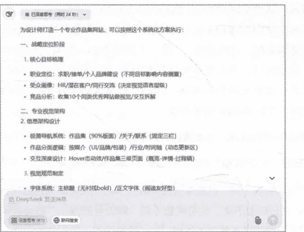

图 1-1

若需更细化的计划表，直接要求 “帮我制定网站开发计划表”，它会基于前文内容生成定制方案。结果若与预期不符，随时可要求按自己的思路调整。

### 1.2.2 Cursor 助力高效开发
DeepSeek 解决要做什么，Cursor 专注于如何快做。它既是编辑器，也是能读懂自然语言的智能编程助手。

> 提示 即使完全不懂 HTML、CSS、JavaScript，也能通过对话让 Cursor 为你生成代码、调试程序，甚至完成复杂的功能开发。

选择 Cursor 主要有三点优势。

#### 1. 与 VSCode 生态无缝衔接，上手门槛低
Cursor 本质上是 VSCode 的 AI 增强版本，支持一键迁移插件、主题、快捷键与配置文件。有 VSCode 使用经验者可直接切换；新手也能快速适应，左侧文件树、右侧编辑区、底部对话输入框布局清晰。无需额外学习成本即可聚焦功能实现。

#### 2. 多模型可选，复杂需求一次到位
Cursor 支持 Claude 3.5、Claude 3.7 等多种模型，并可推理。

- 简单需求：选 Claude 3.5，响应更快。
- 复杂需求：用 Claude 3.7，自动拆分任务并生成多文件。例如要求 “做一个登录功能，页面有用户名输入框、密码输入框、登录按钮，点击后验证账号密码”。Cursor 会自动划分前后端任务，产出前端、后端及数据库脚本，并给出数据库配置与建表指引。

#### 3. 智能调试与代码重构，即时化解报错
新手最怕报错，在 Cursor 中可轻松处理。

程序运行报错如 “数据库连接失败” 时，复制报错信息输入 “修复这个错误”，Cursor 会分析上下文定位问题，如端口错误、账号密码错误等，并给出修改建议甚至直接生成修复后代码。

对代码风格不满意，如 “希望使用更简洁的 ES6 语法”，输入 “优化这段代码，使用箭头函数和模板字符串”，Cursor 会自动重构，功能保持不变。

对话式调试让你无需死记 API 文档，专注逻辑优化。

## 1.3 DeepSeek 对话技巧与最佳实践
在用 DeepSeek 做产品设计时，掌握沟通技巧能显著提升效率，就像与资深专家交流，表达越准确收获越多。

### 1.3.1 明确需求，精准提问
对话时清晰表达需求是关键，避免模糊表述，尽量细化。

比如设计电商 App，不要只说 “帮我设计一个电商 App”。可以这样问：“我想设计一款面向年轻女性的时尚电商 App，目标用户注重个性化推荐和社交互动，帮我规划首页布局和主要功能模块。” 详尽描述让输出更贴合预期。

> **提示** 阐述需求时可举具体例子辅助说明。如 “我希望搜索功能像淘宝那样，有热门推荐，输入关键词时实时显示相关商品。” 这样 DeepSeek 能更直观理解期望。

### 1.3.2 多轮对话，逐步深入
产品设计很难一次完成，多轮对话有助于深挖需求、完善方案。

首轮先确定大致方向和核心功能，如在线教育 App 的课程分类、注册登录等。随后逐步细化，例如课程详情页的介绍、讲师信息、学员评价等板块布局。

> **提示** 对话中根据建议不断调整需求。若 DeepSeek 提出有价值的功能或设计点，可及时纳入后续方案。

多轮对话还能挖掘潜在需求。如设计购物车时，可能逐步发现需要批量删除、价格校验等细节，这些在一开始容易被忽略。

### 1.3.3 用引导性问题拓展思路
DeepSeek 知识储备丰富，通过引导问题可激发更多角度思考。

例如设计健身 App 时，可问：“有什么创新方式能提升用户长期健身兴趣？比如加入社交或游戏化设计。” 可能得到挑战赛、用户竞赛、虚拟奖励等建议，提升产品竞争力。

设计界面时，也可用引导问题获取灵感：“简约风格的音乐播放 App 界面，有哪些独特的配色和图标设计能提升体验？” 可获得流行配色组合和创意图标建议。

### 1.3.4 参考成功案例，对比优化
参考成熟产品很有帮助。想做短视频 App 时，可问：“我很喜欢抖音和快手的推荐算法和互动方式，如何在借鉴优点的基础上做出差异化？”

DeepSeek 会分析案例优势，结合你的产品特点给出建议。通过对比界面、内容展示、操作流程等差异，更好理解设计优劣，优化自己的方案。提及具体功能案例，也能让 DeepSeek 更清晰把握效果。

## 1.4 Cursor 入门

### 1.4.1 Cursor 简介与特点
Cursor 是深度融合 AI 的先进代码编辑工具，由 Anysphere 开发，在 VSCode 基础上深度定制。保留了 VSCode 的强大功能和熟悉界面，同时集成强力 AI，提供全新编程体验。

> 提示 专业开发者和编程新手都能借助 Cursor 更高效完成编写、调试和项目开发。

#### 1. 自然语言交互
最突出特点是支持自然语言。传统编程需熟悉语法手动输入大量代码，而 Cursor 只需口语化描述需求，如“创建一个 Python 函数计算两个数之和”，即可快速生成代码。大幅降低门槛，提升效率。

#### 2. 代码生成与补全能力强
AI 引擎可根据自然语言指令生成完整片段，也能在编写时实时提供补全建议。基于上下文和常见模式预测下一步输入，生成代码质量高、规范。例如快速生成 Web 应用后端接口的路由、请求处理和数据库交互框架。

#### 3. 智能调试与错误修复
调试是开发耗时环节。Cursor 能自动检测错误并给出提示和修复建议。运行出错时反馈错误信息，它会分析根因并提供方案，必要时直接修改代码修复。显著缩短调试时间。

#### 4. 无缝集成 VSCode 生态
基于 VSCode 定制，可无缝使用丰富的插件生态，如代码格式化、版本控制等，同时享受 AI 增强功能。迁移成本几乎为零。

> 提示 Cursor 保留了 VSCode 的快捷键和操作习惯，使用体验一致。

#### 5. 多语言支持
支持 Python、Java、JavaScript、C++ 等主流语言。无论 Web 开发、数据科学、人工智能或移动应用，都可满足需求，并根据语言特点提供准确支持。

### 1.4.2 安装和注册

#### 1. 安装
（1）访问 Cursor 官网，平台兼容 Windows、macOS、Linux，首页中央下载按钮会自动识别当前系统，点击后即可获取对应安装包，如图 1-2 所示。

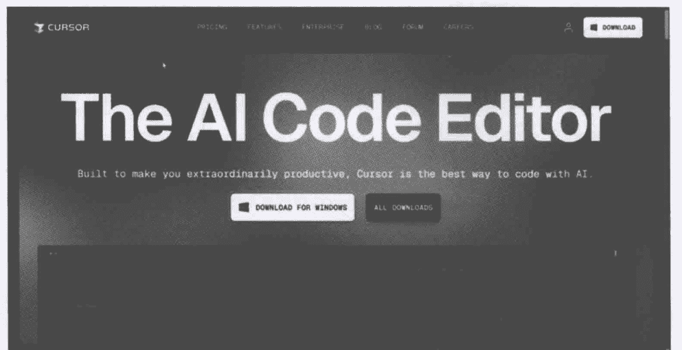

（2）完成下载后启动安装，勾选【我同意此协议】，点击【下一步】。后续保持默认设置即可。

（3）安装完成后界面如图 1-3 所示。


图 1-3

#### 2. 注册
（1）在图 1-3 所示界面，已有账号点击【Log In】登录，未注册则点击【Sign Up】。以下以注册流程为例说明。

快速上手 Cursor：注册登录与界面中文化

（2）打开注册页，参照图 1-4 的示例填入姓名与邮箱，随后点击【Continue】继续。
（3）进入图 1-5 展示的页面，设置登录密码后再点一次【Continue】。

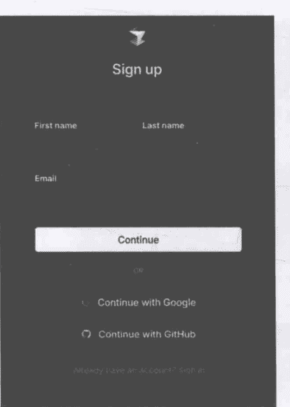

图 1-4

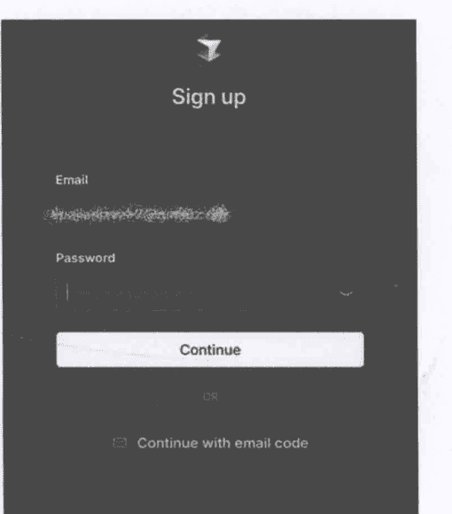

图 1-5

（4）注册完成后会看到图 1-6 的确认页，点击【YES,LOG IN】即可。
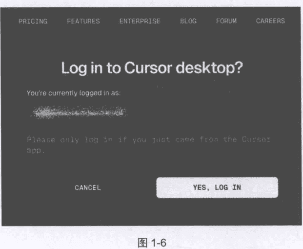

图 1-6

（5）多数情况下客户端会自动唤起。若未自动打开，可在客户端里再次点【Log In】，浏览器会被自动拉起至登录确认页，再次点击【YES,LOG IN】即可完成签入。
（6）登录后进入主题选择页，通过【Explore other themes】浏览并挑选喜欢的配色主题，如图 1-7。
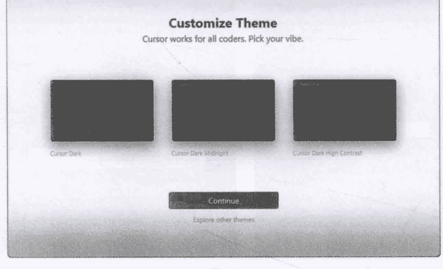

图 1-7

（7）其余初始化项保持默认，直接点【Continue】通过即可。

> **提示** 初始化时可指定模型对话语言，建议选用简体中文 [Chinese(Simplified)]，如图 1-8，这样后续模型回复会以中文呈现。
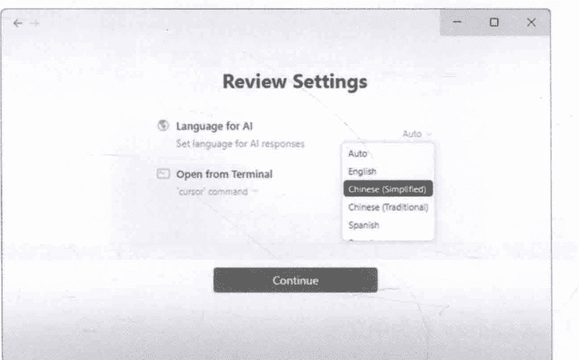

图 1-8

（8）完成登录与初始化后会看到图 1-9 的主工作区。

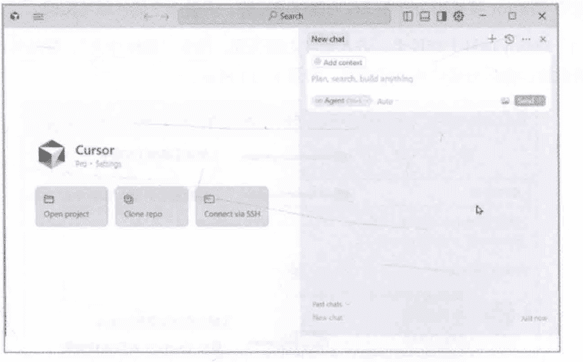

图 1-9

此时需要一个本地工程目录。可在电脑上新建一个文件夹，例如命名为“HELLO”，然后在客户端点【Open project】打开它，左侧列表便会显示该“HELLO”目录，如图 1-10 所示。
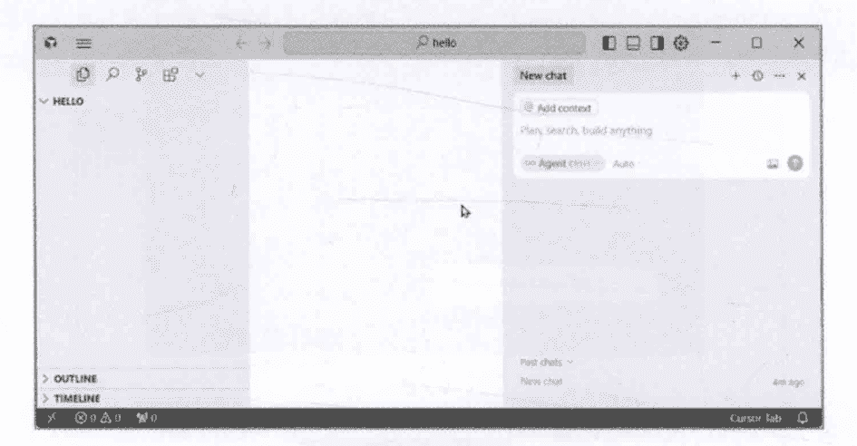

### 1.4.3 Cursor 界面汉化指南

1.4.2 节里我们只改了模型对话语种，Cursor 自身的菜单与功能名称仍是英文，因为那一步仅影响模型回复，未改变客户端界面语言。

把界面切换为中文只需要装一个插件。

（1）点开【插件】标签进入插件中心，搜索“简体中文”，找到带地球仪图标的插件并安装，如图 1-11 所示。
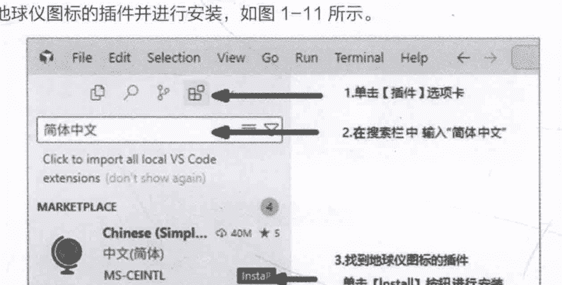

（2）安装完毕重启客户端后，菜单与功能区已全部变为简体中文，如图 1-12 所示。
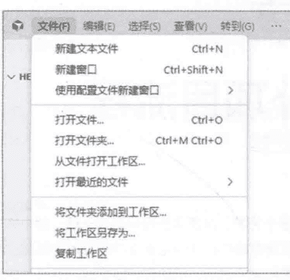

图 1-12

# 第 2 章 项目开发与发布速览

把一个编程项目从想法落地到上线，是一个环环相扣的链条，从需求梳理到正式投放，每一步都相互依赖。对新手来说，先建立清晰的流程认知是高效执行的前提。本章以常见项目类型为例，结合图解与要点，帮助你快速把握开发主线，为实战打下基础。

## 2.1 开发全流程速览

无论是 Web 网站还是小程序，从需求到上线都包含需求分析、设计、开发、测试等核心环节。下面通过流程图与关键步骤拆解，帮助你对网站开发建立整体认识。

下图 2-1 为网站开发流程图，可快速建立全局观。
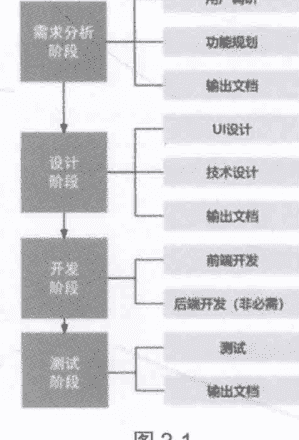

### 2.1.1 需求分析：先厘清目标

1. 用户调研
通过问卷、访谈等手段明确目标人群诉求，例如“需要一个摄影作品集站点，支持分类筛选与移动端适配”。

2. 功能规划
确定核心模块如首页、作品集、联系表单等，选择技术栈如 HTML、CSS、JavaScript 或 React、Vue 等，梳理业务逻辑如图片懒加载、表单校验等。

3. 交付物
形成需求文档与功能清单，明确开发方向。

### 2.1.2 设计阶段：把想法细化

1. UI 设计
用 Figma 或 MasterGo 等工具绘制页面原型，包含导航栏、响应式布局，并完成视觉设计如配色、素材选取。

2. 技术设计
划分前端界面、后端数据处理及数据库存储，定义交互逻辑如按钮反馈、页面动效。

3. 交付物
产出原型图与技术架构图，厘清实现细节。

### 2.1.3 开发阶段：实现功能模块

1. 前端开发
编写 HTML 结构、CSS 样式与 JavaScript 交互，实现分类筛选、表单验证等功能。

2. 后端开发
纯静态站点可不依赖后端；但社区、电商等复杂站点后端是必须的。
> 提示 后端工作包括业务实现、API 接口开发与数据库对接，常用数据库如 MySQL、MongoDB，用于存储用户信息、作品元数据等。

### 2.1.4 测试阶段：保障质量

1. 功能测试
检验各项功能是否正常，例如分类按钮能否正确过滤图片，表单提交是否触发校验。
2. 兼容性测试
检查站点在 Chrome、Firefox、移动端浏览器上的显示与交互一致性。
3. 性能测试
检测页面加载速度与内存占用，优化图片压缩与代码合并。
4. 交付物
生成测试报告与缺陷修复清单，确保产品稳定。

## 2.2 上线发布流程速览

开发完成后发布是让项目面向用户的关键。不同类型项目的发布各有特点。下面先以网站发布为基础理解从开发环境到可访问的路径，再介绍微信小程序发布方式。

### 2.2.1 网站如何上线

核心流程如图 2-2 所示。
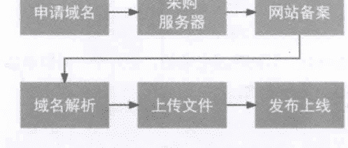

步骤如下：
（1）申请域名，挑选简洁易记且相关的名称，通过域名注册商完成注册。
（2）采购服务器，根据规模选择虚拟主机或云服务器等。
（3）进行备案，国内服务器需按服务商要求提交资料审核。
（4）域名解析，将域名与服务器 IP 绑定。
（5）上传文件，把网站代码、图片等上传到服务器指定目录。
（6）发布上线，检查功能正常后正式对外开放。

后续章节会进一步展开细节。

### 2.2.2 小程序发布要点

微信小程序依托微信生态，流程既有共通也有独特性，核心流程如图 2-3 所示。
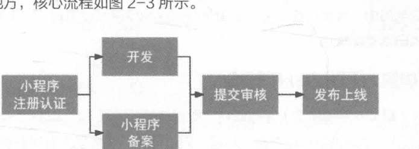

步骤如下：
（1）注册认证
在微信公众平台完成账号注册与认证，填写主体信息、联系方式等，完成后获得唯一 AppID，作为后续开发发布的身份凭证。
（2）开发与备案
开发可与备案同步进行。开发阶段可参考 2.1 节的需求分析、设计、开发、测试；同时进行小程序备案，不同类型小程序需提交不同材料，如医疗、金融类需提供行业资质证明。
（3）提交审核
通过微信开发者工具打包代码提交审核。官方会检查功能完整性、内容合规性、界面规范、是否存在诱导分享等违规行为。不通过时会给出反馈，需修改后再提交。
（4）发布上线
审核通过后可在微信公众平台操作发布。发布成功后用户可通过搜索或扫描小程序码访问使用。

## 2.3 编程术语快速补课

掌握常用术语能更快理解开发流程。以下用通俗语言带你入门核心概念。

### 2.3.1 HTTP 与 HTTPS 的区别
HTTP 是互联网数据传输协议，浏览器与服务器通过它“对话”，例如输入 baidu 网址时浏览器会向服务器请求网页数据，服务器返回内容。
HTTPS 在 HTTP 基础上增加加密，保障数据安全，防止密码、支付信息等被窃取。
区别在于普通网站以 http:// 开头，加密网站以 https:// 开头，地址栏会显示小锁图标。
> 提示 如今大部分网站已使用 HTTPS，即使输入 http:// 地址，服务器也会自动跳转到 https://。

### 2.3.2 API 是什么
API 即应用程序接口，相当于软件间的“外卖窗口”。例如 App 需要地图功能，无需自建，只需调用高德地图 API 获取位置、路线等数据。电商 App 调用支付 API 实现支付宝、微信支付，新闻 App 调用天气 API 显示实时天气等，实现软件互通。

### 2.3.3 JSON 数据格式入门
JSON 是一种轻量级的数据交换格式，结构类似 JavaScript 对象，简洁易读。下面是一个示例：
```
{
  "name": "小明",
  "age": 20,
  "hobbies": ["编程", "摄影"]
}
```

因其简洁性，人机皆易理解，JSON 已成为前后端交互的通用格式。

### 2.3.4 WebSocket 实时通信原理
传统 HTTP 是请求-响应模式，刷新页面才更新数据。WebSocket 是持久连接的实时通信方式，服务器可主动推送消息给客户端，无需刷新。网页版实时聊天、股票行情推送都依赖 WebSocket。

### 2.3.5 前端与后端怎么分
前端是用户可见可操作的界面，如页面布局、按钮交互、App 视觉效果，常用技术为 HTML、CSS、JavaScript。
后端是幕后的“大脑”，负责数据存储、逻辑处理、与前端和数据库交互，常用语言有 Python、Java、Node.js 等。

### 2.3.6 数据库基础认知
数据库是按规则组织的电子仓库，便于快速查询和管理数据。常见分为关系型和非关系型。
- 关系型数据库以表格形式存储数据，每个表含多个字段，如用户表含姓名、昵称字段等。典型代表有 Oracle、MySQL。
- 非关系型数据库结构灵活，适合存储日志、缓存等数据。

# 第 3 章

## 产品设计入门：借助 DeepSeek 加速

在产品开发中，产品设计是连接用户需求与技术实现的关键桥梁，也是产品成功的基石。对于缺乏经验的设计新手，本章提供通俗易懂的入门指引，帮助你逐步进入产品设计领域，掌握核心要点。
若你已是资深产品经理，可跳过本章直接阅读后续内容。

## 3.1 用 DeepSeek 开展产品需求分析

需求分析是产品设计的起点，决定了产品解决什么问题、服务谁。DeepSeek 能帮助你快速梳理用户需求、挖掘市场机会、分析竞品，形成专业级的需求报告。

### 3.1.1 用户调研：找准人群需求
用户调研是精准定位需求的基础，结合 DeepSeek 与常用方法论可高效完成。
1. **明确目标用户群体**
在 DeepSeek 输入“帮我分析‘个人摄影作品展示网站’的目标用户群体”，即可得到核心用户与潜在需求的分析。
无需人工收集问卷，DeepSeek 可通过分析同类产品评论、社交媒体标签，快速提炼真实需求。这种多维度细分能完整描绘用户画像，为功能设计提供依据。
2. **挖掘真实需求**
采用 KANO 模型挖掘需求，分为基本型需求、期望型需求、兴奋型需求、无差异需求和反向需求。
- 基本型需求：产品必须具备，缺失会严重不满。
- 期望型需求：满足会提升满意度。
- 兴奋型需求：超出预期带来惊喜。
- 无差异需求：实现与否不影响满意度。
- 反向需求：实现反而降低满意度。
向 DeepSeek 提问：“采用 KANO 模型分析个人摄影作品展示网站的需求有哪些？”
DeepSeek 会从用户满意度与功能实现关系出发，将需求归类为五大类型。
3. **评估可行性**
采用成本效益分析评估技术难度、成本投入与预期收益。
提问：“开发一个个人摄影作品展示网站的技术难度、成本投入、预期收益如何？”
DeepSeek 总结：
- 技术难度：中等偏上，核心功能可实现，进阶模块如 AI、区块链门槛较高。
- 成本投入：基础版 8 万~15 万元，旗舰版 50 万元以上，需持续运维。
- 预期收益：2~3 年可回本，长期通过生态构建可实现 10 倍以上增值。

### 3.1.2 竞品拆解：看清差距与机会
竞品分析有助于把握竞争态势，寻找差异化优势。借助 DeepSeek 与 SWOT 分析可全面剖析竞品。
1. **锁定竞争对手**
采用市场竞争格局分析，输入“列举 3 个摄影作品展示类网站竞品”，DeepSeek 会基于大数据给出代表性竞品。
通过分析这些竞品，可清晰看到市场分布，为差异化定位提供基础。
2. **对比核心功能**
采用 SWOT 分析评估各竞品的优势、劣势、机会、威胁。提问：“用 SWOT 分析方法对比这些竞品的核心功能。”
通过分析可明确自身优势与差异化方向，例如针对竞品劣势设计更易用的功能，或利用市场机会拓展新业务模式。

## 3.2 用 DeepSeek 进行产品规划
在完成需求分析后，进入产品规划阶段，将分析成果转化为可落地方案，明确定位、功能架构和商业模式。DeepSeek 可大幅提升规划效率。

### 3.2.1 产品定位：找准市场与差异
从明确目标市场和确立差异化定位两方面展开，结合市场细分、竞品分析与 DeepSeek 工具，为个人摄影作品展示网站制定策略。
1. **明确目标市场**
采用市场细分与目标选择方法，结合用户画像与趋势，借助 DeepSeek 分析不同细分市场的规模、增长潜力、竞争情况与适配度。提问：“分析不同年龄层次业余摄影爱好者市场中个人摄影作品展示网站的规模、增长潜力和竞争情况。”
DeepSeek 分析如下：
- Z 世代：需整合短视频与社交功能，如“摄影挑战赛”。
- 千禧一代：强化家庭场景服务，如自动生成“成长时间轴”。
- 中年群体：聚焦教育与版权保护，如区块链确权和作品交易抽成等。
通过分析可更有针对性地选择市场，集中资源满足特定群体需求。
2. **确立差异化定位**

在摄影类平台同质化愈发严重的当下，能否被用户记住，关键在于能否建立一眼可辨的差异化认知。依托差异化竞争的分析框架，并结合对竞品的拆解，我们系统梳理出可形成壁垒的独特性。为此向 DeepSeek 发出询问，请求其对照同类产品，提炼个人摄影作品展示站点在功能、体验与社区氛围上可做出的区隔点。

模型反馈集中在三大方向：

功能层面，文件本地化整合、AI 与区块链的结合运用、呈现方式的动态化。体验层面，界面极简、跨终端顺滑、提供数据驱动的辅助手段。社区层面，聚焦垂直圈层沉淀、主办赛事活动、借助社交链路实现传播扩散。

凭借上述三个维度的区隔，作品展示站点能够在核心体验上拉开差距，建立竞争壁垒，精准触达目标人群。

### 3.2.2 功能规划

功能规划的本质，是把战略定位转化为可落地的模块清单。通过拆解与排序，确保交付既贴合用户诉求，也具备工程可行性。

1. **功能拆解**

拆解即把整体能力细化为可执行子项。基于既定定位与用户需求，我们借助 DeepSeek 对个人摄影作品展示站点的三大主线进行细分。提问为：“请为个人摄影作品展示网站规划作品展示、社交互动与版权保护的详细子功能。”

输出结果如下：

- 作品展示。
  (1) 智能作品管理：AI 智能标注、多格式兼容、动态呈现模式等。
  (2) 个性化展示优化：智能排版助手、跨设备自适应、数据看板等。
  (3) 创作辅助：AI 润饰建议、灵感地图等。

- 社交互动。
  (1) 社区化互动：圈层划分、UGC 激励机制等。
  （2）实时互动工具：直播摄影课、协作共创等。
  （3）社交分发链路：跨平台分享、裂变传播等。

- 版权保护。
  （1）主动防护体系：隐形水印、权限分级等。
  （2）区块链存证：版权上链存证、智能合约交易等。

如此拆解后，可形成从内容呈现到商业变现的闭环，成为区别于对手的核心护城河。

2. **优先级排序**

在模块清单确定后，需按价值与成本进行分级，以有限资源优先保障关键能力。我们采用 KANO 模型与成本效益分析，结合需求重要度与开发投入进行排序。提问为：“依据用户需求与开发成本，对个人摄影作品展示网站的功能模块进行优先级划分。”

DeepSeek 给出的分级建议：

（1）高优先级：作品展示、账号安全等。
（2）中优先级：社交互动、检索优化等。
（3）低优先级：AI、区块链、虚拟展示等。

合理的分级安排可先夯实核心能力，再逐步拓展增值功能，提升研发效率与成功概率。

### 3.2.3 商业模式规划

商业模式规划关乎盈利与长期可持续性。本阶段运用盈利模式拆解与成本结构分析，设计适配的变现路径。

1. **选择盈利模式**

盈利模式的选择需权衡目标市场需求、产品特性及竞争态势。我们借助 DeepSeek 评估不同变现方式的可行性与收益潜力。提问为：“分析个人摄影作品展示网站面向 Z 世代业余摄影爱好者市场的盈利模式可行性。”

DeepSeek 给出的落地建议：

- 最小可行产品验证：上线基础社交打赏功能，通过“摄影挑战赛”检验付费意愿，1~2 个月内收集数据。
- 技术整合：接入现成 AI API，例如阿里云视觉智能，降低开发成本，快速迭代修图工具。
- 社区运营：邀请 Z 世代 KOL 入驻，以“作品热度排行”激发创作竞争，培育活跃生态。

科学的商业模式设计能在满足需求的同时实现收益，保障平台的持续发展。

2. **成本结构分析**

成本结构是检验商业可持续性的关键。我们采用成本分类与估算方法，借助 DeepSeek 梳理运营成本。提问为：“估算个人摄影作品展示网站在技术开发、营销推广和内容运营方面的成本。”

DeepSeek 的估算结果：

- 技术开发：采用云服务加开源框架，成本区间约 2 万~30 万元。
- 营销推广：聚焦高 ROI 渠道，成本区间约 5 万~50 万元。
- 内容运营：鼓励用户自制内容，成本区间约 5 万~50 万元。

## 3.3 借助 DeepSeek 设计产品原型

产品规划完成后，原型设计是将抽象概念转化为可视化交互模型的重要步骤，有助于直观呈现结构、流程与界面，提前识别风险。以下从信息架构、交互流程和界面原型三方面展开。

### 3.3.1 信息架构设计

信息架构是对产品信息进行系统化梳理与组织，以帮助用户高效获取所需内容。对个人摄影作品展示网站而言，清晰的架构尤为关键。

我们借助 DeepSeek 完成架构设计。提问为：“为个人摄影作品展示网站设计信息架构，包括作品展示、用户、社区、版权等模块。”

DeepSeek 给出的技术选型建议如下：

- 前端：React + Next.js（SSR 优化 SEO）+ Three.js（3D 展示）。
- 后端：Nest.js（微服务架构）+ MySQL（关系型数据库）+ Redis（缓存加速）。
- 存储：阿里云 OSS（图片）+ IPFS（NFT 元数据）。
- 运维：Docker 容器化。

### 3.3.2 交互流程设计

交互流程设计关注人与产品的互动顺畅度，需要模拟典型使用场景并规划合理路径。为此提问：“设计个人摄影作品展示网站的主要交互流程，如作品上传、浏览、评论等。”

主要流程设计如下：

- 作品上传流程。
  (1) 用户操作路径：登录→进入上传页→选择文件→编辑信息→发布→反馈。
  (2) 交互设计：支持单次上传 10 张以内图片，自动读取 EXIF，AI 辅助生成标签。

- 作品浏览流程。
  (1) 用户操作路径：首页入口→筛选/排序→浏览→深度交互。
  (2) 交互设计：支持网格模式与瀑布流切换，基于浏览历史推荐相似风格作品。

- 评论交互流程。
  (1) 用户操作路径：查看作品→触发评论→输入→发布→反馈。
  (2) 交互设计：支持文字加表情，优质评论可折叠展开，敏感词自动过滤。

### 3.3.3 界面原型设计

界面原型设计把信息架构与交互流程可视化，形成初步界面模型，便于团队沟通与反馈。

由于 DeepSeek 与 Cursor 在生成原型时存在发散性与一致性问题，我们先让 DeepSeek 输出界面描述，提升页面的统一性与跳转协调度。提问为：“生成个人摄影作品展示网站的首页、作品详情页、个人主页的界面原型草图描述，风格简单现代。”

以下是 DeepSeek 生成的核心页面界面原型草图描述节选：

```
一、首页设计
布局结构
顶部导航栏 | 主视觉区 | 内容瀑布流 | 底部功能区

1. 顶部导航栏
左侧：
```

## 3.4 产品设计还要用到哪些 AI 工具

除了 DeepSeek 在需求分析、规划与原型阶段的助力外，还有其他 AI 工具能在特定环节提升创意与效率。下面介绍 Readdy AI 与即梦 AI 的应用。

### 3.4.1 生成页面原型：Readdy AI

页面原型是将抽象想法转化为直观视觉的关键。Readdy AI 以对话式建站和强大的功能著称，能显著提升原型效率与质量。

在 DeepSeek 完成需求梳理、功能规划与架构设计后，Readdy AI 可无缝衔接，迅速将成果转为可视化原型。例如，输入前述界面原型草图描述，如图 3-1 所示。

凭借先进算法与丰富的模板库，Readdy AI 几分钟内即可呈现初步效果，如图 3-2 所示，大幅压缩从构思到可视化的周期。


图 3-1


图 3-2

生成的原型具备高度可调整性。对作品缩略图尺寸、导航栏颜色或交互细节不满意时，只需再次对话说明修改点，即可快速迭代。

原型定稿后，Readdy AI 提供多样化导出方式：

- 下载代码：直接提供基础代码框架，便于后续开发，可配合 Cursor 等工具深化。
- 导出为 Figma 文件：方便设计师在熟悉环境中做精细化视觉与交互优化。

这种灵活的输出能力使其成为连接设计与开发的桥梁，提升整体效率。

### 3.4.2 生成 Logo 或配图：即梦 AI

视觉元素直接影响品牌形象与用户吸引力。即梦 AI 在图形设计上表现突出，尤其适合 Logo 与配图生成，为摄影作品展示平台注入独特视觉魅力。

针对 Logo 设计，即梦 AI 可依据产品定位、理念与目标用户生成创意方案。例如提示词：“生成体现摄影艺术感、简约现代且适用于摄影作品展示平台的 Logo，融入相机镜头与光影元素，风格简约时尚”。即梦 AI 会快速输出多套方案，如图 3-3 所示。


这些方案巧妙融合摄影元素，通过图形与配色传递艺术感并契合现代审美，能准确传达品牌调性，形成深刻第一印象。

在配图方面，即梦 AI 同样实用：

- 首页可生成视觉冲击强的摄影主题插画，如以城市夜景为背景搭配热门作品缩略图与活动信息，引导用户浏览。
- 作品详情页可根据风格生成匹配的装饰配图，如为复古人像配复古色调边框与纹理背景，提升整体美感。

值得注意的是，即梦 AI 生成的 Logo 与配图具备商业使用合法性，有效规避版权纠纷风险，为产品稳定上线提供保障。

# 第 2 篇

## Cursor 之美

# 第 4 章

快速体验 Cursor 编程

## 4.1 案例：一句话实现一个网站（个人摄影作品展示网站）

### 4.1.1 具体实现过程

下面演示如何用一句话完成一个网站的搭建：

1. 在电脑上新建文件夹 “my-website”。
2. 在 Cursor 菜单中选择【文件】→【打开文件夹】，载入新建的文件夹。
3. 在输入框输入提示词：“用 HTML 生成一个个人网站，用于展示我的摄影作品，暂时先下载网络图片来填充作品位置。”
4. 在输入框左下角切换至 Agent 模式（如图 4-1 所示），再选择 claude-3.7-sonnet 大模型（如图 4-2 所示），点击输入框右下角按钮。

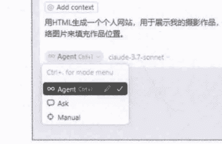

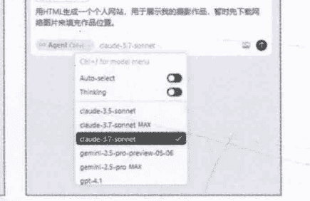

(5) Cursor 开始生成代码。所需的 JavaScript 与 CSS 文件会一并生成，并附带项目说明文档 README.md，如图 4-3 所示。

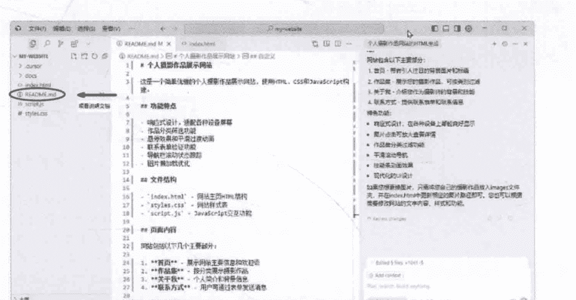

(6) 返回本地文件夹，双击生成的 index.html，在浏览器中即可看到页面效果，如图 4-4 所示。


(7) 若效果满意，点击输入框右上角的【Accept all】按钮（如图 4-5 所示），保存全部文件，一个简洁美观的个人摄影作品展示站就完成。

> **提示** 若不满意，可在输入框中给出修改意见让 Cursor 重新生成，满意后再点【Accept all】。若完全不满意，可点击【Reject all】按钮清除文件，重新生成。


图 4-5

### 4.1.2 拆解网站文件

借助 Cursor，无需逐行学习语法即可快速搭建功能网页。但了解网页基本结构与模块作用，有助于后续理解运行机制与深度定制。

下面以刚生成的摄影作品展示站为例进行拆解。首先阅读自动生成的说明文档 README.md。

```
#### 个人摄影作品展示网站

这是一个简单优雅的个人摄影作品展示网站，使用 HTML、CSS 和 JavaScript 构建。

##### 功能特点

- 响应式设计，适配各种设备屏幕
- 作品分类筛选功能
- 悬停效果和平滑过渡动画
- 联系表单验证功能
- 导航栏滚动状态跟踪
- 图片懒加载优化

##### 文件结构

- `index.html` - 网站主页 HTML 结构
- `styles.css` - 网站样式表
- `script.js` - JavaScript 交互功能
```

##### 页面内容

网站包含以下主要板块：

1. **首页** - 展示站点核心信息与欢迎语
2. **作品集** - 按分类呈现摄影作品
3. **关于我** - 个人简介与背景
4. **联系方式** - 用户可通过表单发送消息

##### 技术说明

- 采用纯 HTML、CSS 与 JavaScript 构建
- 响应式设计基于媒体查询与弹性布局
- 使用 CSS 变量管理主题色
- 布局结合 CSS Grid 与 Flexbox
- 作品图片来源于 Pixabay 与 Pexels 免费图库

##### 如何使用

1. 下载或克隆仓库全部文件
2. 在浏览器打开 `index.html` 即可预览
3. 按需修改 HTML 内容、CSS 样式或 JavaScript 功能

##### 自定义

- 在 `index.html` 中更换文字与图片链接
- 在 `styles.css` 的 `:root` 部分调整颜色主题
- 在 `script.js` 中修改交互行为

文档对文件结构做了简要说明：index.html 为页面结构，styles.css 为样式表，script.js 实现交互。但要深入理解仍需更细致解读，接下来让 Cursor 展开说明。

（1）在 Cursor 输入框切换至 Ask 模式（如图 4-6 所示）。


（2）在输入框向 Cursor 提问，Cursor 会以初学者可理解的方式解释代码且不修改代码。如下为提问与回复示例。

> 向 Cursor 提问

我是一个初学者，请用初学者能理解的方式给我解释这个个人摄影作品展示网站的代码。

Cursor 以初学者友好的方式解释了代码：

- 首页 HTML：index.html

```
<!DOCTYPE html>
<html lang="zh">
<head>
    <!-- 这里放置网站的基本信息和引用的外部文件 -->
    <meta charset="UTF-8"> <!-- 定义网页使用的字符编码 -->
    <title>摄影艺术展示 | 我的个人作品集</title> <!-- 网页标题，显示在浏览器标签上 -->
    <link rel="stylesheet" href="styles.css"> <!-- 引入 CSS 样式文件 -->
</head>
<body>
    <!-- 这里是网页的主体内容 -->
</body>
</html>
```

设计思路如下：

1. 模块化设计：页面被划分为首页、作品集、关于我、联系方式等清晰区块。
2. 响应式设计：布局会随屏幕尺寸自动调整。
3. 用户体验：加入平滑过渡、悬停效果与动画，提升体验感。

技术要点如下：

1. 使用语义化 HTML 元素（如`<header>`、`<section>`、`<footer>`）。

2. 通过 CSS 变量集中管理配色，方便全局主题统一调整。

3. 依赖 JavaScript 事件监听机制来构建页面交互。

若以上步骤仍有疑问，随时在 Cursor 中继续提问。受篇幅限制，后续演示暂不展开。

## 4.2 为作品站注入更多交互

个人摄影展示站的基础框架已经搭好，但功能偏简，体验略显平淡。借助 Cursor 的能力，可以为站点补充动态效果，让浏览更生动。接下来重点演示如何添加灯箱浏览与图片下载两项实用功能。

### 4.2.1 一键放大：为图片加上灯箱

当前站点里的缩略图无法放大查看，影响作品细节呈现。让 Cursor 补充灯箱功能后，点击图片即可全屏浏览并左右切换。

操作思路很直接，向 Cursor 描述需求即可：“让图片点击后全屏展示，并支持多图浏览”。Cursor 会快速给出实现方案。

关键改动集中在 CSS，补充灯箱的样式定义：

```
/* 灯箱效果样式 */
.lightbox {
    display: none;
    position: fixed;
    top: 0;
    left: 0;
    width: 100%;
    height: 100%;
    background-color: rgba(0, 0, 0, 0.9);
    z-index: 2000;
    justify-content: center;
    align-items: center;
    opacity: 0;
    transition: opacity 0.3s ease;
}
```

调整完成后效果立竿见影。如图 4-7 所示，点击缩略图后画面会铺满整屏，细节更清晰，用户欣赏体验大幅提升。


### 4.2.2 增加下载入口

在灯箱基础上再延伸，考虑到访客想保存喜欢的作品，可以让 Cursor 增加下载能力。

需求描述为：“全屏预览时提供下载按钮，点击后直接下载当前图片”。Cursor 会给出完整步骤和代码。

核心代码片段如下：

```
<!DOCTYPE html>
<html lang="zh">
// ... existing code ...

    <!-- 灯箱结构 -->
    <div class="lightbox" id="lightbox">
        <div class="lightbox-content">
            
            <div class="caption" id="lightbox-caption"></div>
            <div class="counter" id="lightbox-counter"></div>
            <span class="close" id="lightbox-close">&times;</span>
            <span class="prev" id="lightbox-prev">&#10094;</span>
            <span class="next" id="lightbox-next">&#10095;</span>
            <a class="download" id="lightbox-download" download title="下载图片">
                <i class="fas fa-download"></i>
            </a>
```

```
</div>
</div>
```

按提示完成修改后，效果如图 4-8 所示。全屏预览界面里多了一个【下载】按钮，一键即可保存当前照片，进一步提升了站点的实用度。


图 4-8

加上灯箱与下载后，摄影作品站更完整，体验与实用性同步提升，也体现出 Cursor 在功能实现上的高效助力。后续可以根据需要继续叠加更多有趣的功能。

## 4.3 Cursor 的四大核心编程能力

在快速搭站并扩展功能后，进一步感受 Cursor 的编程底座。本节聚焦它的四个关键能力：Tab 智能补全、自然语言编程、代码解读、问题诊断。无论新手还是资深开发者，都能显著提速降门槛。

### 4.3.1 Tab 智能补全让输入更快

Cursor 的 Tab 补全不只是简单续写，还具备智能编辑、多行批量修改和上下文感知三大特质，编码体验明显提升。

#### 1. 智能编辑：从补全到推荐
补全会结合光标周边上下文给出建议。以 JavaScript 对象方法调用为例，输入 “obj” 后按 Tab，Cursor 会列出属性和方法，并在光标后以灰色文本提示最匹配的选项（如图 4-9 所示）。确认后一键接受即可。

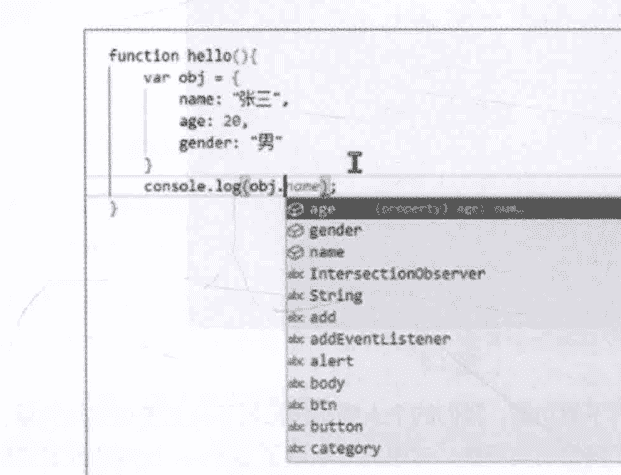

就像有位经验丰富的搭档实时提示，帮助代码更合理、更简洁。

#### 2. 多行修改：批量同步提高效率
不同于单行补全，Cursor 支持一次修改多行。例如 HTML 页面有多枚按钮，需要统一添加样式类。在第一行 `<button>` 的 class 中输入 “btn”，其余行会同步出现灰色提示（如图 4-10 所示）。按 Tab 后，所有按钮自动加上该类，避免逐行操作。

## 作品展示

<div class="gallery-categories">

    <button class="btn category active" data-category="all">全部</button>

    <button class="btn category" data-category="nature">自然风光</button>

    <button class="btn category" data-category="portrait">人像摄影</button>

    <button class="btn category" data-category="street">街头纪实</button>

</div>

图 4-10

#### 3. 上下文感知：动态规避错误
补全会依据最近修改和代码检查结果调整建议。如 JavaScript 中把变量 obj 改名为 person，后续使用处会自动跟随新名提供补全（如图 4-11 所示）。

```
function hello() {
    var person = {
        name: "张三",
        age: 20,
        gender: "男"
    }
    console.log(obj.name);    console.log(person.name);
    console.log(obj.age);
    console.log(obj.gender);
}
```

图 4-11

若变量类型由数字改为字符串，补全也会从数字运算方法切换为字符串方法，并在代码出错时给出修正提示。

> **提示** 例如 Python 中调用了未定义函数，Cursor 会结合导入模块和当前作用域推断可能正确的名称，在输入部分字符按 Tab 时优先展示符合上下文的修正项，帮助快速定位错误。

这三个特点让代码输入更流畅，节省大量时间。

### 4.3.2 自然语言编程打破语法壁垒

传统编程要求熟记语法，Cursor 的自然语言编程降低了门槛，允许用日常描述来生成代码。

比如要筛选数组中的偶数并打印，传统写法需要手动编码：

```
var arr = [1, 2, 3, 4, 5, 6];
for(var i = 0; i < arr.length; i++){
    if(arr[i] % 2 == 0){
        console.log(arr[i]);
    }
}
```

在 Cursor 中只需输入：“用 JavaScript 写一个程序，从数组[1, 2, 3, 4, 5, 6]中挑出所有偶数并打印”。它就能理解意图并生成代码。

也可以在代码文件里写注释：“编写程序，从数组[1, 2, 3, 4, 5, 6]中筛选偶数并打印”，Cursor 借助自动补全直接生成实现（如图 4-12 所示），按 Tab 即可完成。


### 4.3.3 代码解释

阅读他人或旧代码时常卡壳，Cursor 的解释功能相当于随身导师，能清晰说明功能与逻辑。

选中目标代码（如图 4-13 所示），切换到 Ask 模式提问：“解释一下这段代码的功能。”（如图 4-14 所示）。

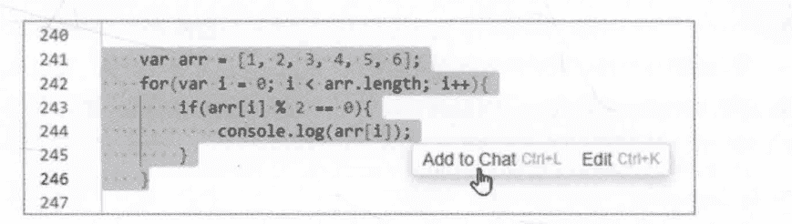

图 4-13


图 4-14

Cursor 会给出详细说明，例如：

> **Cursor 的回复**
> 
> 为您解释这段代码的功能：
> 
> 这是一个简单的 JavaScript 片段，主要用于遍历数组并打印所有偶数。
> 
> 逐行分析
> ......
> 
> （内容较长，部分省略。）

### 4.3.4 问题诊断

编程中错误频出，Cursor 的诊断功能能快速定位并给出解决办法。

例如下面这段代码表面看不出问题：

```
var arr = [1, 2, 3, 4, 5, 6];
for(var i = 0; i < arr.length; i++){
    if(arr[i] % 2 == 0){
        console.log(arr[i]);
    }
}
```

浏览器却报错未定义变量：

```
script.js:241 Uncaught ReferenceError: l is not defined
    at setupLightbox (script.js:241:16)
    at HTMLDocument.<anonymous> (script.js:109:5)
setupLightbox @ script.js:241
(anonymous) @ script.js:109
```

把错误信息发给 Cursor：

> 向 Cursor 提问
> 
> 页面报错：
> 
> script.js:241 Uncaught ReferenceError: l is not defined
> 
>     at setupLightbox (script.js:241:16)
> 
>     at HTMLDocument.<anonymous> (script.js:109:5)
> 
> setupLightbox @ script.js:241
> 
> (anonymous) @ script.js:109

Cursor 迅速指出，数组首元素是字母 l，实际应为数字 1。

## 4.4 Cursor 的三种工作模式

掌握 Agent、Ask、Manual 三种模式，能让开发更高效，各自适用于不同场景。

### 4.4.1 智能编程领航员：Agent 模式
Agent 是 Cursor 的核心，像智能伙伴可深度交互代码库。

1. 自动提取上下文
在复杂项目中，它能自动抓取相关代码片段，无需手动筛选，快速定位任务所需信息。

2. 执行终端命令
避免在编辑器和终端间切换，Agent 可直接运行赋权、测试、构建等命令，保持开发连贯。

3. 文件操作
创建、修改、删除文件均可通过指令完成，例如新建 Python 文件并生成符合项目规范的模板。

4. 语义搜索
突破关键词限制，理解代码语义和逻辑，输入功能描述即可精准找到相关实现，甚至找到相似逻辑的不同写法。

5. 工具调用
支持最多 25 个工具的链式调用。在全栈开发中，可依次调用代码生成、代码检查、数据库迁移等工具，自动完成从搭建到部署。

### 4.4.2 智能答疑：Ask 模式
Ask 是“智能问答模块”，遇到技术难点或概念模糊时可随时提问。

> 提示 代码功能、语法用法、概念理解均可向 Ask 模式咨询。

选中代码问“解释这段代码的功能”，会得到逻辑拆解和应用场景；问“如何正确使用某个 Java 类”，会获得示例和注意事项。

> **提示** 选型时可在 Ask 模式提问：“实现个人网站可选哪些开源框架”。新增功能时也可询问备选方案。学习新语言或接手他人代码时，能快速理解逻辑，降低沟通成本。

### 4.4.3 精准控制：Manual 模式

Cursor 手动精调模式与上线交付全攻略

Manual 模式接替了旧的 Edit 模式，本质上是 Cursor 提供的手工作业级微调功能。只有当你清楚地知道要动哪一份代码、改成什么样子时，它才最合适做这种点对点的改动。

> **提示** 与 Agent 模式不同，Manual 模式不会自行遍历代码库，也不会去执行终端命令，全部动作都取决于你给出的明确指令和你指定的文件范围。

比如先用 Cursor 生成了一个 HTML 页面，觉得发送消息按钮不够好看，就可以在 Manual 模式里直接要求：“把发送消息的按钮换成绿色，再加一个鼠标悬停变色的效果。”需要注意的是，这类请求一定要用 @ 来点名文件。典型的对话示例如下：

> **? 向 DeepSeek 提问**
@styles.css @index.html 将发送消息的按钮改为绿色，并添加鼠标悬停变色效果。

> **A Cursor 的回复**
根据您提供的文件内容，我将修改发送消息按钮的颜色为绿色，并添加鼠标悬停变色效果。以下是建议的修改方式：

```css
/* 发送消息按钮样式 - 将其添加到 styles.css 文件中 */
form .btn {
    cursor: pointer;
    border: none;
    background-color: #4CAF50; /* 改为绿色 */
    display: block;
    width: 100%;
    transition: all 0.3s ease;
}

form .btn:hover {
    background-color: #45a049; /* 鼠标悬停时按钮为深绿色 */
    transform: translateY(-3px);
    box-shadow: 0 5px 15px rgba(0, 0, 0, 0.2);
}
...
```

这些修改：

1. 将联系表单的提交按钮从原来的蓝色(`var(--secondary-color)`)改为绿色(#4CAF50)

2. 添加鼠标悬停变色效果，使按钮变为深绿色(#45a049)

3. 保留了原有的向上浮动效果和阴影效果

你只需要把上面的 CSS 片段追加到 `styles.css` 即可，这段样式会覆盖之前按钮的定义，其他样式不受影响。建议把代码放在大约第 330 行附近的联系表单样式区段。

`index.html` 里的按钮已经带了 `class="btn"`，所以 HTML 本身无需改动。

和 Agent 模式不同，Manual 模式不会自动把生成的内容写进文件，开发者需要手动点按代码块右上角的【Apply to ...】按钮来完成写入，如图 4-15 所示。

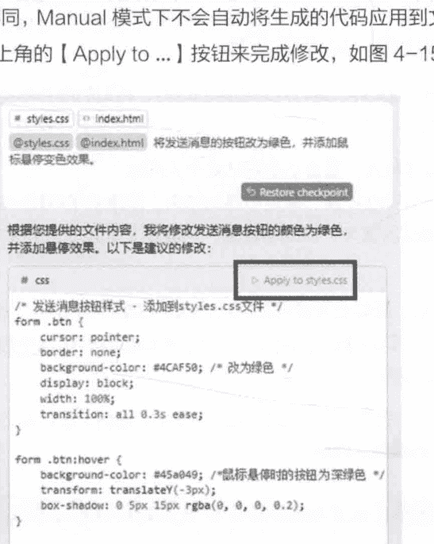

> 提示 Manual 模式适合那些有明确代码修改思路的开发者，因为它要求开发者清楚知道要修改哪些代码。相较于 Agent 模式，Manual 模式对开发者的编程基础有一定的要求，新手开发者更适合从 Agent 模式入手。

## 4.5 网站上线全流程

网站在 Cursor 里开发完后，真正的落地要进入发布阶段。发布涉及域名与服务器的选配、解析配置、文件部署以及后续的基础运维。接下来详细介绍每一步的关键点和操作思路，帮助你把站点顺利推到互联网上。

### 4.5.1 域名注册：给网站一个网络门牌

域名相当于网站在网上的地址牌，便于用户记忆和访问。挑选时要追求简短好记、贴合站点主题。

注册渠道主要是阿里云、腾讯云等主流域名商。操作流程是先查询域名是否已被占用，再按平台要求填写资料并完成付款。

### 4.5.2 服务器选型：给网站找一个落脚地

服务器负责存放网站文件并运行程序。常见形态有虚拟主机、云服务器和独立服务器。

- 虚拟主机价格低，适合个人站或流量小的轻量站点。
- 云服务器可弹性扩容、稳定性好，适合中型项目。
- 独立服务器性能强劲但费用高，多用于大型企业或对性能要求苛刻的业务。

选型时要权衡访问量、存储需求和预算。比如一个个人摄影作品集前期流量不大，可以先用性价比高的虚拟主机，等业务增长后再迁移到云服务器。

买到服务器后会获得一个公网 IP，紧接着需要做域名解析，让域名能够指向这台机器。

> 提示 域名解析就是把域名和服务器 IP 建立对应关系的过程。

登录域名注册商的控制台，找到解析设置，新增一条 A 记录，把域名指向服务器 IP。例如服务器 IP 为“192.168.1.100”，就在 A 记录里填写域名和该 IP。解析生效通常需要几分钟到几小时，期间可用 ping 命令验证是否生效。

### 4.5.3 网站备案：国内合规的必经步骤

依据中国大陆相关法规，网站上线前必须完成备案，未备案的站点无法使用国内服务器访问。备案的目的是规范互联网信息服务，保障信息安全。

各大服务商流程略有差异，整体步骤基本一致。

1. 在服务器提供商的备案系统里注册账号并登录。
2. 按提示填写站点信息，包含网站名称、域名、用途、负责人等。
3. 上传身份证明扫描件，个人用身份证，企业用营业执照。
4. 提交后由服务商进行初审，核查资料完整性与真实性。
5. 初审通过后转交属地通信管理局终审，周期一般在 20 个工作日左右，结果会以短信或邮件通知。

### 4.5.4 文件部署：把站点上传到服务器

域名和服务器准备好后，就要把本地开发好的 HTML、CSS、JavaScript 以及图片、字体等资源传上去。常用工具是 FTP 客户端，例如 WinSCP。填写服务器的 FTP 地址、用户名和密码，连接成功后把本地项目目录整体上传到服务器的网站根目录。

# 第 5 章 让 Cursor 更懂你、让代码更稳

前几章覆盖了 Cursor 的基本用法，本章聚焦如何让它更贴合你的开发习惯，提升效率并保证质量。

## 5.1 让 Cursor 更懂开发者

掌握好工具的进阶功能，能显著提升协作流畅度。下面介绍几组实用技巧，帮助你与 Cursor 配合更顺手。

### 5.1.1 定制生成行为：打造专属规则

Cursor 支持通过规则文件约束它生成代码时的行为。

#### 1. 为什么需要规则

- 个性化 AI 行为：不同项目有不同规范，通过规则可让 AI 按需产出更贴合的代码。例如数据可视化项目可设定优先使用 D3.js 并遵循统一图表风格。
- 保持一致性：在规则里固化编码规范和最佳实践，能确保 AI 输出符合项目标准。JavaScript 项目可规定统一使用 ES6、固定命名方式和注释格式。
- 提供上下文感知：项目常有特定架构、常用库和内部方法。把这些信息写进规则，能让 AI 生成的代码更贴合实际，比如告知微服务架构及服务间通信方式。
- 提升产出效率：规则明确后，AI 生成的代码更接近可用状态，减少人工修改。例如电商项目预定义商品列表页结构和交互，AI 直接输出骨架代码。
- 促进团队协作：共享 .cursorrules 文件可让团队成员获得一致的 AI 辅助，统一风格，提升可读性和可维护性。
- 注入项目专有知识：规则可包含项目结构、依赖关系和业务细节，帮助 AI 给出更准确建议。

#### 2. 如何设置规则

（1）打开 Cursor，点击右上角的⚙️图标，如图 5-1 所示。


（2）进入设置页后，在左侧菜单选择“Rules”，如图 5-2 所示。

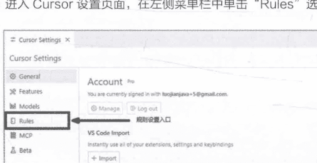

（3）Rules 页面分为上下两部分，上方是全局适用的“User Rules”，下方是项目专属的“Project Rules”，如图 5-3 所示。

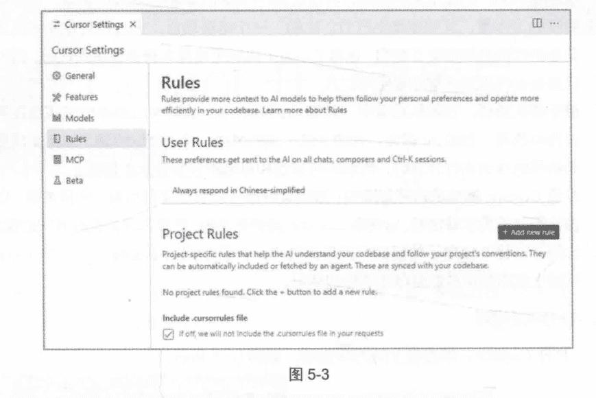

#### 3. 用户规则

用户规则作用于所有项目，常用于语言、注释、文档规范等。例如：

- 始终用中文回复
- 对复杂逻辑补充注释说明
- 用清晰简洁的语言解释概念
- 每次 @ 文件前重新读取内容
- 生成新功能模块时同步更新 README.md

#### 4. 项目规则

在设置页点击“Project Rules”旁的【Add new rule】即可为当前项目添加专属规则，可依据技术栈定义开发规范。

以第 4 章网站案例为例，可采用以下命名约定：

##### 文件命名规范

**HTML 文件**：全小写，用连字符分隔的描述性名称，例如 product-details.html、user-profile.html。

**CSS 文件**：同上，例如 main.css、styles.css、components.css。

**JavaScript 文件**：驼峰命名，例如 utils.js、htmxConfig.js。

**组件文件**：体现用途，例如 product-card.html、search-form.html。

**图像文件**：描述性命名，例如 product-image-1.jpg、user-avatar.png。

若是 Python 项目，可补充专属规则，例如：

##### 1. 代码组织与结构

###### 1.1. 目录结构最佳实践

**扁平化优先于过度嵌套**：先从简洁结构开始，按需重构。

**包与模块**：用包含 `__init__.py` 的目录做逻辑分组。

**src 布局**：考虑使用 src 目录隔离应用代码与项目级文件，如 setup.py、requirements.txt，有助于避免导入冲突。

**典型项目结构**：

```
project_name/
├── src/
│   ├── package_name/
│   │   ├── __init__.py
│   │   ├── module1.py
│   │   └── module2.py
│   └── main.py  # 入口点
├── tests/
│   ├── __init__.py
│   ├── test_module1.py
│   └── test_module2.py
├── docs/
│   ├── conf.py
│   └── index.rst
├── .gitignore
├── pyproject.toml 或 setup.py
├── README.md
└── requirements.txt 或 requirements-dev.txt
......
```

###### 1.2. 文件命名规范

**模块**：小写字母，下划线分隔，如 my_module.py。

**包**：小写字母，如 my_package，尽量避免下划线。

**测试文件**：以 test_ 开头，如 test_my_module.py。

......

##### 5. 自动生成规则

Cursor 0.49 版本起支持自动生成规则。在对话框输入斜杠并点击【Generate Cursor Rules】按钮，如图 5-4 所示，工具会扫描项目并生成规则文件。


### 5.1.2 精准控制扫描范围：使用 cursorignore

Cursor 并不需要分析项目里每个文件。有些目录文件量巨大、与核心开发无关，反而会拖慢分析速度、干扰理解。

这时 cursorignore 就能派上用场，它可以让你只让 Cursor 看你关心的部分。

> **提示** cursorignore 的使用逻辑和 .gitignore 类似：创建一个 .cursorignore 文件，列出希望 Cursor 跳过的路径，工具就会忽略这些文件和目录，集中精力在关键代码上。

#### 1. 使用价值

（1）提速：大型项目中 node_modules 包含大量依赖，扫描耗时极长，忽略该目录可大幅提升响应速度。
（2）减少干扰：格式不规范或特殊格式的文件容易误导 AI，忽略后可让分析更聚焦。
（3）保护隐私：配置文件中可能包含数据库密码、API 密钥等敏感信息，忽略可避免泄露风险。

#### 2. 设置方法

在项目根目录新建一个名为 .cursorignore 的文件，Windows 资源管理器中默认隐藏，但在 Cursor 中可见。如已存在则直接编辑，每行写一个要忽略的文件或目录。例如：

```
##### 忽略整个 node_modules 目录（包含其所有子目录和子文件）
node_modules/

##### 忽略所有 .log 文件
*.log

##### 忽略名为 temp 的目录
temp/

##### 忽略特定的文件，如某个测试数据文件
testData.csv
```

#### 3. 通配符与注释

cursorignore 支持通配符实现模糊匹配：

- “*.txt” 会忽略所有 .txt 文件。
- “docs/*.md” 会忽略 docs 目录下的 .md 文件，不影响子目录。
- “docs/**/*.md” 会递归忽略 docs 下所有子目录的 .md 文件。

> **提示** 单体架构将所有功能模块放在同一代码库中统一开发、部署和扩展。早期项目因简单易测常采用单体，但随业务增长，单体结构会变得臃肿，依赖复杂，维护和扩展难度加大。

### 5.1.3 定向扫描：使用 @Files&folders

开发中往往不需要全库扫描，只需聚焦特定文件或目录。

Cursor 的 @Files&folders 指令正好满足这个需求，可指定扫描对象，实现更精准高效的分析。

#### 1. 典型应用场景

（1）特定功能代码审查：维护某个功能时，只需审查相关文件。例如社交应用的消息推送功能代码集中在 push-notifications 目录，使用 @Files&folders 指定后，Cursor 可专注给出风格、逻辑、安全方面的建议，避免被无关代码干扰。

（2）代码优化与调试：性能问题定位到 performance-critical 目录下的几个文件时，定向扫描能帮助分析复杂度、执行效率并提供优化建议。

（3）多版本兼容性检查：在不同分支或版本间对比时，指定文件或目录可快速核查兼容性问题。

代码扫描与文档联动的实战要点

假设正在进行版本升级，希望确认 new-feature 目录里的代码在新旧环境下都能正常运行。通过 @Files&folders 限定检查范围，Cursor 即可横向比对不同版本的改动，判断是否存在兼容隐患并给出对应解决建议。

#### 2. 如何使用 @Files&Folders
在对话框里输入 @，从指令列表中挑选 Files&Folders（见图 5-5），之后即可检索并锁定需要扫描的文件或目录路径。

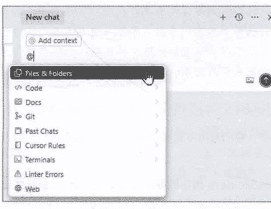

例如想核查项目里的 scripts.js 是否有语法瑕疵，可以这样提问：“请检查文件 @script.js 是否包含语法错误”。其中 @script.js 是经 @Files&Folders 选中的引用，系统会对该文件展开审查并把结论返回。

> 向 Cursor 提问

请检查 @script.js 是否存在语法错误。

读取代码后 Cursor 的反馈：

> setupLightbox 函数被定义为全局函数，但在文件末尾却有多余的大括号和分号，这是不符合语法规范的。

更稳妥的做法是把 setupLightbox 放入 DOMContentLoaded 监听器内部，或确保监听器本身被完整闭合。

#### 3. 使用 @Files&Folders 的注意事项
（1）路径需精确：指定的文件或目录必须无误。路径错误会导致目标定位失败，扫描自然无效。填写时要仔细核对拼写与层级关系。
（2）留意耗时：相比全库扫描，限定范围更高效，但若目标目录下文件众多，处理仍会花费一定时间。

### 5.1.4 高效访问文档资源：使用 @Docs 访问在线文档与自定义知识库
开发中查阅技术资料是高频操作。@Docs 指令把官方在线文档与自建知识库深度融合，让模型直接阅读资料，从而明显提升编码效率。

#### 1. @Docs 的核心功能与应用场景
Cursor 已内置 React、Vue、Tailwind CSS、Docker 等主流框架和工具的权威资料。
（1）输入 @，选择 Docs，如图 5-6 所示。

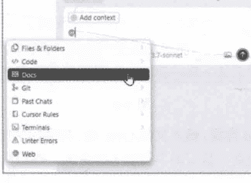

图 5-6
（2）键入技术关键词如 tail，即可定位到对应的官方文档 Tailwind CSS，如图 5-7 所示。标签 Official 并非文档名称，只是系统对内置资料的标识，便于与用户自建内容区分。

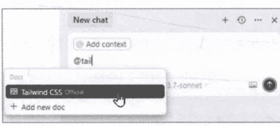

图 5-7
开发者无需手动翻阅，模型即可基于这些资料完成代码产出。

#### 2. 管理自定义文档
系统还支持导入自有文档。单轮对话中可同时引用官方资料、技术博客、问答社区等多种来源。例如撰写 HTML 时，输入 @Tailwind CSS 即可直接调用 Tailwind CSS 官方文档的方法说明，更精准地调整样式。
（1）打开 Cursor 设置，进入 Features，在 Docs 侧点击【Add new doc】按钮，如图 5-8 所示。


图 5-8
（2）进入 Add new doc 页面，填写文档链接及名称后点击【Confirm】，如图 5-9 所示。

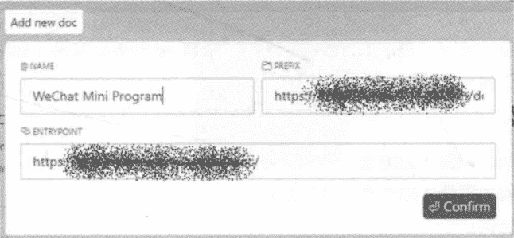

系统会自动抓取并解析内容。完成后在输入 @ 后选择 Docs，再搜索刚添加的文档名称即可调用。

> **提示** 通过 @Docs 指令，可把分散的技术资料转化为可直接调用的智能上下文，显著提升代码质量与开发效率。配合自定义知识库，还能构建企业级智能开发环境。

## 5.2 怎么规避开发风险
Cursor 能大幅提速，但生成的代码也可能因逻辑偏差、依赖冲突等引入隐患。以下给出规避方法。

### 5.2.1 谨慎使用 Accept all（全部接受）
“Accept all” 虽能提升效率，却可能未经甄别地全盘采纳 AI 的修改，导致质量下降、引入安全漏洞，甚至破坏项目稳定。

1. **主要风险**
   - 代码逻辑问题：模型可能生成不符合业务需求的代码，如错误的支付逻辑、过时的库引用，导致功能异常或安全风险。
   - 文件修改风险：批量操作时易误改敏感信息，引发依赖冲突，或破坏团队统一的编码规范。

2. **安全实践**
   - 测试验证：涉及业务逻辑、安全相关如认证、支付的代码，必须经人工测试验证后再采纳。
   - 工具辅助：结合静态分析工具筛查语法与规范问题，弥补人工评审盲区。
   - 权限控制：关闭“自动执行修改”功能，限制 AI 对配置文件、核心模块等关键文件的写入权限。

3. **可接受场景**
   - 简单的格式微调，如缩进、补全分号。
   - 安全依赖的非高危漏洞修复。
   - 模板化代码。

### 5.2.2 使用 Git 管理代码版本
为抵御生成代码带来的风险，可借助 Git 进行版本管理。通过及时提交形成可验证版本，异常时可快速回滚。为防止误操作导致核心文件丢失，需确保所有变更均可通过历史记录找回。下面以 Gitee 为例说明流程。

#### 1. 注册 Gitee 账号
打开 Gitee 首页，点击右上角【注册】进入注册页（如图 5-10 所示）。

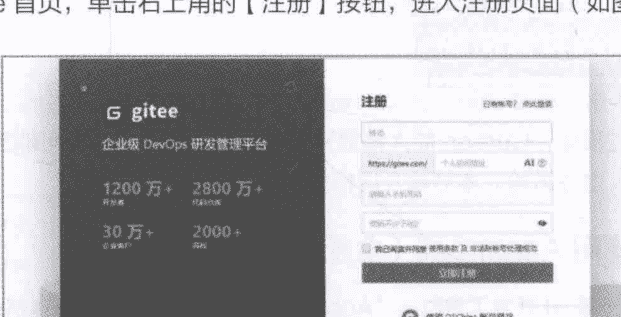

#### 2. 新建仓库
进入主界面后，点击右上角【+】，再选择【新建仓库】，如图 5-11 所示。
填写仓库名称与路径，勾选“私有”，点击【创建】，如图 5-12 所示。

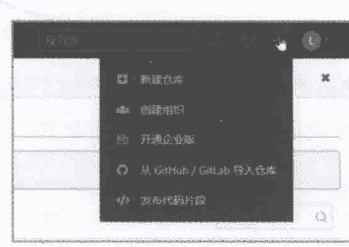

图 5-11


图 5-12

#### 3. 初始化仓库
在 Cursor 中，点击【版本管理入口】图标 🔀，再点击【初始化仓库】按钮，如图 5-13 所示。

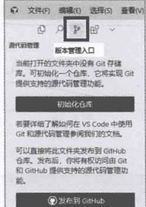

图 5-13

#### 4. 添加远程仓库
回到 Gitee 刚创建的仓库页，点击【HTTPS】按钮，再点击【复制】（如图 5-14 所示），地址即进入剪贴板。

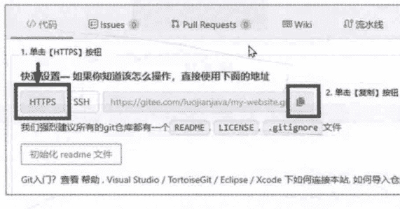

在 Cursor 的版本管理面板中，点击【...】打开菜单，选择【远程】>【添加远程存储库】（如图 5-15 所示），弹出对话框后粘贴刚才的远程地址，如图 5-16 所示。

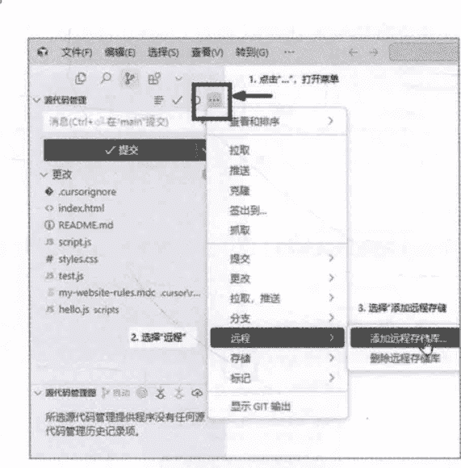


#### 5. 提交和推送代码
（1）点击“更改”标签旁的【+】按钮（如图 5-17 所示），再点击【提交】旁的下拉箭头，选择【提交和推送】（如图 5-18 所示），系统开始提交并推送。

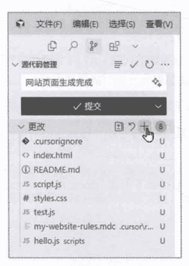

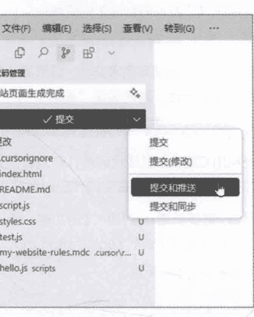

（2）首次提交会弹出 Gitee 登录窗口（如图 5-19 所示），输入用户名与密码后继续。


完成上述步骤后，代码已推送至 Gitee 服务器。后续若生成代码错误较多，可回滚到指定版本。

提示 生成的代码必须经过人工校验与测试才能推送。建议按功能模块如“用户注册接口”单独提交，避免多模块混 commit，便于精准回滚。

### 5.2.3 生成项目说明文档
先撰写需求文档引导 AI 产出符合预期的代码；生成代码时同步更新项目说明文档，最终形成“需求文档→代码→项目说明文档”的闭环。

#### 1. 编写需求文档，为 AI 生成锚定方向
使用 Cursor 前，先准备结构化需求文档，明确功能边界、技术约束和交互逻辑，让模型有据可依。
例如新增用户注册功能，可在项目根目录创建 docs/requirements 目录，新建 user_registration.md，内容包括：

```
##### 用户注册功能需求文档
###### 1. 功能目标
- 支持手机号/邮箱注册，验证码防刷机制
- 密码需包含大小写字母+数字，长度≥8位
###### 2. 技术约束
- 调用阿里云短信 API 发送验证码
- 密码需通过 BCrypt 加密存储
###### 3. 交互流程
1. 用户提交注册信息→2. 后端校验格式→3. 发送验证码→4. 验证通过后写入数据库
```

在生成代码的提示词中指定该需求文档，模型会依据文档进行产出。

> 向 Cursor 提问

根据需求文档@user_registration.md 生成用户注册功能。

依据需求文档，Cursor 已完成注册功能的实现，汇总如下：
1. 新建了注册页面 register.html 与登录页面 login.html
2. 实现了注册与登录的样式文件 register.css
3. 编写了注册页脚本 registerScript.js 与登录页脚本 loginScript.js
4. 创建了模拟后端 API api.js 供前端开发与测试
5. 编写了项目说明文档 README-user-auth.md

功能要点：
- 支持手机号与邮箱两种注册方式
- 密码需包含大小写字母及数字，长度不低于8位
- 实现验证码发送及防刷机制，含60秒倒计时
- 表单验证与错误提示
- 模拟 API 完成数据校验与用户创建

系统会优先解析需求文档中的技术约束，例如调用阿里云短信 API，避免偏离需求。若不会撰写需求文档，可参考第3章，使用 DeepSeek 协助生成。

#### 2. 让说明文档随代码自动更新
生成代码模块时同步更新说明文档，避免文档滞后。最简便的做法是在 User Rules 中添加如下说明。

> 每次生成新的功能模块时，都要添加说明到 README.md 文档中

若希望文档更丰富，可在生成代码的提示词后追加文档要求。我们回滚之前的注册功能，调整提示词重新生成，如下：

> 向 DeepSeek 提问

根据需求文档@user_registration.md 生成用户注册功能，同时生成业务流程图。

> Cursor 的回复

我将根据需求文档创建用户注册功能，并生成业务流程图。

……

现在，根据需求文档和网站风格，我将创建注册页面和相关 JavaScript 文件。

创建一个业务流程图的 HTML 文件，用于展示用户注册业务流程：

……

创建一个简单的后端模拟代码，展示如何实现注册功能的服务端 Node.js 版本：

……

详细的流程图可在 user-register-workflow.html 文件中查看。

（内容过长，省略部分）。

Cursor 重新生成了注册相关页面，并新增了用户注册业务流程图页面 user-register-workflow.html，流程图如图 5-20 所示。

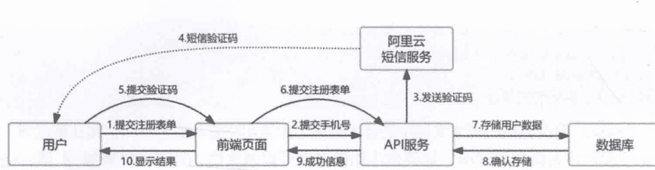

开发者与模型通过需求文档与项目说明文档双向协作，实现两点：
- 需求明确：需求文档约束生成范围，减少理解偏差。
- 知识沉淀：说明文档随代码自动沉淀，避免“无人能读懂模型生成的代码”困境。

### 5.2.4 让 Cursor “自我反思”
开发过程中让 Cursor 进行自我反思，能显著提升代码质量、优化流程并规避错误。通过让模型回顾分析已有代码，开发者可更稳当地掌控进度。可在提示词中明确要求自我反思。

> 向 Cursor 提问

检查刚刚生成的注册代码是否存在不足或缺陷。

Cursor 检查后指出以下问题：
（1）缺少图形验证码。
需求文档要求用户先通过图形验证码才能请求短信/邮箱验证码，但实际代码中未实现。
（2）缺少表单状态反馈。
表单验证已实现，错误时会有提示，但成功时缺少对应提示。
（3）安全问题。
缺少密码强度提示，用户无法直观了解强度。
缺少防止自动提交的机制。
（4）用户体验不佳。
注册表单缺少加载状态，提交后无“处理中”反馈。
无法在表单中切换密码可见性。

发现问题后，可让 Cursor 针对性修正。例如表单状态反馈不完善，可提示：

> 向 Cursor 提问

完善表单状态反馈。

Cursor 可产出对应的改进代码。

依据反思结果调整交互方式与开发策略。复杂业务场景下进行反思，需提供更详细的业务规则，需求设计阶段应提前准备好。

## 5.3 高质量提示词技巧
在 AI 开发中，提示词是与 Cursor 沟通的核心。高质量提示词能让需求理解更精准、代码更贴合、调试成本更低。

### 5.3.1 清晰定义目标：避免模糊的需求描述
优质提示词需遵循“目标明确、上下文充足、结构清晰”三大原则。

低质量提示词：

```
写一个登录功能。
```

未说明技术栈、交互细节、安全要求，Cursor 或将产出通用但不符合项目需求的代码。

高质量提示词：

```
在 @auth 目录中生成手机号登录组件（含验证码输入、密码强度检测），需对接后端 API “/api/login”，要求：
1. 验证码按钮需有 60 秒倒计时。
2. 密码输入框支持明暗文切换。
3. 错误信息用红色字显示。
```

这样 Cursor 就能一次性产出满意结果。

### 5.3.2 提供充足的上下文：减少 AI 猜测
缺乏上下文时，Cursor 只能凭借通用知识猜测意图，很容易偏离。提供丰富且准确的上下文，能显著降低猜测。

> **提示** 需要修改、优化或扩展现有代码时，直接选中相关代码非常有效。Cursor 能基于已有逻辑和结构更精准理解需求。

例如要修改用户注册功能，目前仅支持国内手机号，需增加国际号码支持。可直接输入“增加支持国际手机号码”，Cursor 可扫描全库定位相关代码后进行修改。

如果先选中相关代码（如图 5-21），再让 Cursor 增加功能（如图 5-22），修改会更高效、更准确。


### 5.3.3 用结构化 Prompt 引导精准输出
结构化提示词能显著提升生成代码的准确性与效率。核心是通过标识符和属性词搭建逻辑框架，同时兼顾人类可读性与模型解析效率。

#### 1. 标识符：定义层级结构
使用 1. 2. 3. 3.1 3.2…… 等层级列表，帮助模型快速识别逻辑关系。

#### 2. 属性词：描写语义模块
使用语义清晰的关键词如角色、规则，引导模型聚焦特定功能领域。

结构化提示词示例：

```
你是一个前端工程师，按下面要求生成前端代码。
生成用户注册功能，需求如下：
1. 支持手机号注册和邮箱注册
2. 手机号验证规则：
   2.1 支持国内和国际手机号
   2.2 国内手机号支持语音验证码和短信验证码
   2.3 国际手机号仅支持短信验证码
3. 邮箱验证：全部使用验证码验证
```

先行锁定模型的身份定位与输出边界，明确指令只交付前端代码。之后借助清晰的层级结构把需求拆解透彻，让模型迅速捕捉逻辑主线，避免信息混杂导致生成偏离。

## 5.4 多轮对话提示词技巧

当项目复杂度上升，单次提问很难一次性覆盖所有细节。通过分步引导、上下文复用与任务拆解，多轮对话能够让 Cursor 逐步加深理解，避免一次性信息过载造成的偏差。

下面以四个阶段呈现从需求沟通到代码落地的闭环掌控方式。

### 5.4.1 选择技术方案

先请 Cursor 罗列可行的技术路线，使用者再结合实际情况挑选推进方向。

> 示例提问
做一个网页版“贪吃蛇”游戏，推荐的技术路线有哪些。

返回的思路通常包含两类。

- HTML5 Canvas：绘图效率高，很适合呈现动态游戏画面。
- 原生 JavaScript：体积轻量，无需额外框架依赖。

### 5.4.2 完善方案细节

在 5.4.1 确定方向后，继续把方案补充完整。

> 示例提问
采用 HTML5 Canvas 方案，补充细节并将文档生成到 docs 目录。

此时 Cursor 会输出更完整的说明，如图 5-23 所示，涵盖项目总览、技术选型、目录结构等。

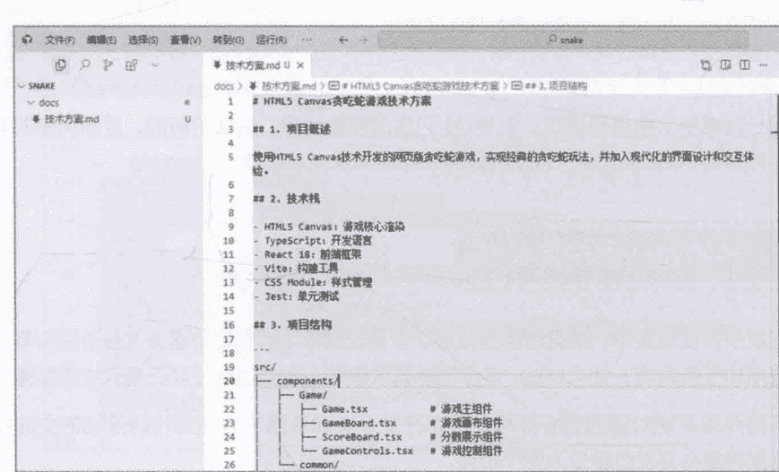

### 5.4.3 根据方案生成代码

方案细化完成后，用以下提示触发实现。

> 示例提问
依据文档@技术方案.md 来实现“贪吃蛇”游戏。

Cursor 按照方案执行，先搭建基础目录，再生成配置文件，随后产出页面文件，最终效果如图 5-24 所示。

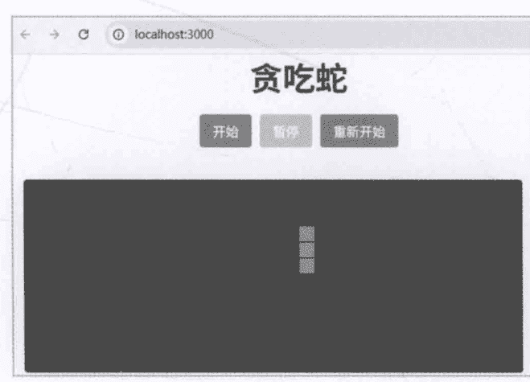

图 5-24

### 5.4.4 验证及优化代码

按 Cursor 生成的说明文档执行命令运行程序。

```
# 安装依赖
npm install
# 启动项目
npm run dev
```

若运行中出现报错，可直接在对话中描述问题让 Cursor 解决。例如：

> 示例提问
安装依赖时出现错误。

Cursor 会追查原因，发现缺少“package.json”导致依赖安装失败，随后创建该文件并写入全部必要依赖。

# 第 3 篇

项目实战——小程序、网页小游戏、桌面应用、企业级应用

# 第 6 章

【项目实战】智能识别食物热量的小程序“卡路里”

随着数字化健康管理需求持续攀升，打造“卡路里”小程序既具备真实的市场价值，也是一次从需求分析到上线运营的完整实战训练。

通过本项目能够全流程掌握产品从分析、设计到运营落地的关键环节。

## 6.1 预览小程序

在正式进入设计开发前，先了解该小程序的核心功能与技术亮点。

### 6.1.1 图解核心功能

核心是“拍照识别”，操作路径非常简洁。

1. 在首页点击橙色拍摄按钮，如图 6-1 所示，进入拍摄页。
2. 将镜头对准食物拍照，如图 6-2 所示。
3. 等待数秒后展示识别结果，如图 6-3 所示。


### 6.1.2 技术亮点：拍照识别、营养可视化、极简交互设计

1. 拍照识别
调用豆包视觉大模型 Doubao-1.5-vision-pro 识别食物种类、热量与营养信息。
2. 营养可视化
基于大模型解析蛋白质、脂肪、碳水等含量，以直观数据呈现给用户。
3. 极简交互设计
只需轻松拍照即可完成识别。

## 6.2 利用 DeepSeek 设计“卡路里”小程序

下面详述借助 DeepSeek 完成小程序设计的思路。

### 6.2.1 需求分析

开发前精准把握用户需求与市场趋势，有助于明确功能边界并合理分配资源，提升市场契合度与满意度。

#### 1. 用户调研与分析

（1）明确目标用户

> 示例提问
分析智能识别食物热量类小程序的核心用户群体及潜在需求。

得到的人群及需求点包括：

- 健身/减肥人群：关注热量与营养配比，实现减脂、增肌或体重维持。
- 慢性病患者人群：如糖尿病、高血压，需严格控制特定成分摄入，依赖科学饮食管理辅助治疗。
- 职场白领/外卖依赖人群：追求高效便捷，偏爱智能工具，对交互体验和科技感要求高。
- 银发人群：需要操作简便、大字体界面，并提供饮食禁忌提示，如“红烧肉脂肪含量超标”。
- 母婴/家庭主妇人群：需要识别儿童餐的营养成分如钙、维生素，并与生长需求对比。

（2）挖掘真实需求 KANO 模型

> 示例提问
使用 KANO 模型分析智能识别食物热量小程序的需求优先级。

回复将需求划分为五类。

- 基本型需求：精准热量识别、基础营养展示、便捷记录、隐私保护。缺失会严重不满。
- 期望型需求：个性化热量预算、饮食分析报告、场景化功能、多端协同，可显著提升满意度。
- 兴奋型需求：AI 定制食谱推荐、心理支持与激励、AR 菜品识别、健康风险评估，形成差异化优势。
- 无差异需求：复杂社交功能、过度细分报告，投入产出比低。
- 反向需求：过度广告植入、强推付费内容，应坚决避免。

据此明确了后续产品规划的优先级。

#### 2. 市场机会分析

(1) 可行性评估

> 示例提问
开发一个智能识别食物热量的小程序，技术难度、成本投入、预期收益如何？

主要结论如下。

- 技术面：图像识别与 AI 算法、营养数据库构建、个性化推荐系统难度不低，需要跨领域协作与大量数据支撑，成熟方案与合作可降低门槛。
- 成本投入：开发期含团队组建、数据采集标注、基础设施、合规安全；运营期含维护、推广、用户运营。
- 预期收益：C 端订阅与广告收入，B 端企业健康服务与餐饮数据服务合作，盈利周期约 2~3 年。
- 风险：技术风险如识别准确率不足、数据合规；市场风险如竞争激烈；运营风险如增长乏力。可通过算法持续优化、聚焦垂直场景、加入社交激励来缓释。

总体看，市场潜力较大，需合理规划与长期投入。

(2) 竞品分析

> 示例提问
列举 3 个智能识别食物热量 App 竞品。

得到 3 个竞品的拆解，包括核心功能、优势、用户吐槽及市场表现。以某知名竞品为例，拍照识别能力强、食物库覆盖广、提供健康管理与增值服务，用户量大活跃度高；不足在于免费版广告多、复杂混合菜识别误差大。

对比后明确差异化方向：提升复杂场景识别精度、强化个性化服务、优化体验。

### 6.2.2 产品规划

为满足用户需求进行全面规划，本章聚焦教学，不展开商业模式。

#### 1. 产品定位

（1）明确目标市场

> 示例提问
分析智能识别食物热量小程序在不同人群的市场规模、增长潜力与竞争态势。

主要潜在人群：

- 健身/减肥人群：体量大、增长快、竞争激烈，强需求为精准记录与动态计划调整。
- 慢性病患者人群：潜力巨大但医疗合规门槛高，需与医疗数据联动的精准管理工具。
- 职场白领/外卖依赖人群：规模大、增长中等，需求快速识别外卖热量。
- 银发人群：随老龄化扩大，技术适配成本高，需要简便易用且支持代际协同管理。
- 母婴/家庭主妇人群：关注儿童营养均衡，需求分散，需分龄饮食计划与家庭多人管理。

策略建议：针对健身人群强化社交与博主联名；针对慢性病人群整合医疗生态；针对白领嵌入场景工具并与外卖平台合作；针对银发人群做代际协同；针对母婴人群深耕垂直场景与电商导购。

（2）确定差异化定位

> 示例提问
分析该类小程序在功能、体验、社区方面区别于竞品的独特卖点。

关键结论：在功能上以技术筑壁垒，突破混合餐识别局限，实现中餐复杂场景精准识别；联动智能硬件实时同步数据提供动态营养干预；引入 AR 交互获取营养信息。在体验上设计极简界面减少操作，融入情感化设计缓解管理焦虑，构建游戏化激励提升粘性。在社区上打造垂直社交平台建立专属社群，联动公益增强认同，引入专家入驻形成共创生态。

#### 2. 功能规划

（1）功能分解

> 示例提问
为智能识别食物热量小程序规划功能模块。

建议分为六大模块：核心功能模块、健康管理模块、社区互动模块、工具扩展模块、体验优化模块、商业化模块。本章聚焦核心功能模块的设计与开发。

（2）优先级排序

> 示例提问
根据用户需求与开发成本，对功能进行优先级排序。

排序如下：

- 第一优先级 MVP 必备：拍照识别基础版、手动记录与编辑、每日热量统计、隐私与数据安全，周期短成本低，可快速验证市场。
- 第二优先级：扫码录入、手动修正识别结果、正向反馈设计。

### 6.2.3 设计高保真原型方案

产品规划后需将概念转化为可交互原型，便于直观展示与提前纠偏。以下以核心功能拍照识别为例。

> 示例提问
设计智能识别食物热量小程序核心功能拍照识别的高保真原型方案。

得到三个页面。

#### 1. 主界面

【界面元素】
（1）核心按钮：居中【拍照识别】按钮，采用高对比配色如橙底白字。
（2）辅助入口：顶部导航栏【历史记录】【个人中心】图标。

【用户动作】点击【拍照识别】进入拍摄界面。

#### 2. 拍摄界面

【界面元素】
（1）底部左侧【相册导入】按钮。
（2）底部中间【拍摄】按钮。

【用户动作】对准食物后点击拍摄，或从相册选择照片。

#### 3. 识别结果界面

【界面元素】
（1）热量总览：显示总热量。
（2）食物详情：食物名称及三大营养含量。
（3）底部【记录到今日饮食】按钮。

【用户动作】点击记录按钮将数据保存至小程序。

### 6.2.4 生成高保真原型

借助 Readdy AI 将方案转为可交互原型。

（1）访问 Readdy AI，点击右上角【Log in】登录或注册。
（2）在“Project Name”输入框命名项目后点击【Create】创建，如图 6-4 所示。
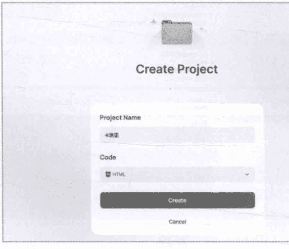
（3）选择 Mobile 版，复制 DeepSeek 生成的高保真原型方案后点击【发送】，如图 6-5 所示。
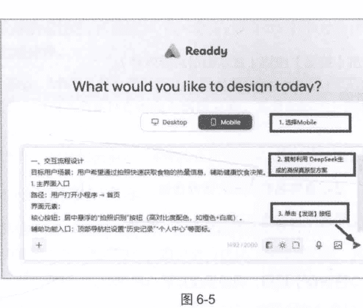

图 6-5

> 提示 虽然网站为英文，但对话框可用中文输入，生成页面为中文界面。

（4）Readdy AI 整理方案描述后点击【Generate】生成，如图 6-6 所示。
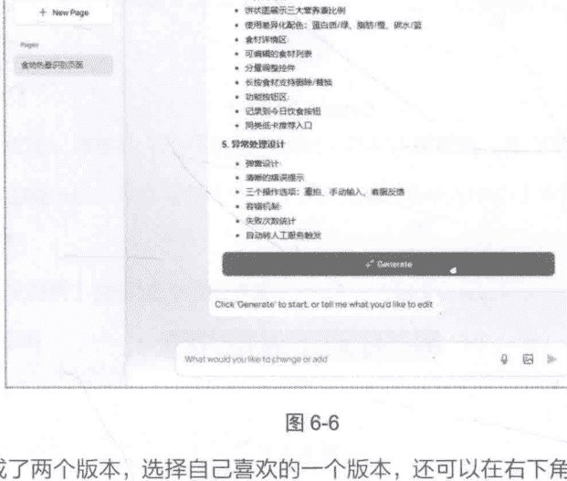

图 6-6

（5）生成两个版本后挑选其一，也可在右下角输入修改意见，如图 6-7 所示。


## 6.3 开发小程序前的准备

### 6.3.1 注册小程序

（1）访问微信公众平台，如图 6-8 所示，点击右上角【立即注册】，账号类型选“小程序”，如图 6-9 所示。

（2）填写邮箱与密码，按提示完成激活与信息登记。
（3）注册完成后进入账号主页，如图 6-10 所示，填写小程序信息如图 6-11 所示及类目设置如图 6-12 所示。
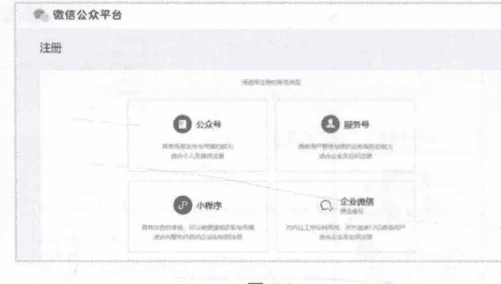

图 6-9

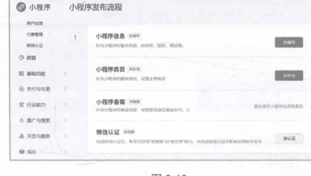

图 6-10


图 6-11

小程序头像可用即梦 AI 生成。


图 6-12

建议类目选择“工具 > 健康管理”。

### 6.3.2 备案与认证

注册并完善信息后，“小程序备案”与“微信认证”处会出现操作入口，如图 6-13 所示。


图 6-13

点击“小程序备案”右侧【去备案】填写身份信息与小程序信息如图 6-14 所示，备注需认真填写以便审核理解。微信认证点击【去认证】按指引完成即可。
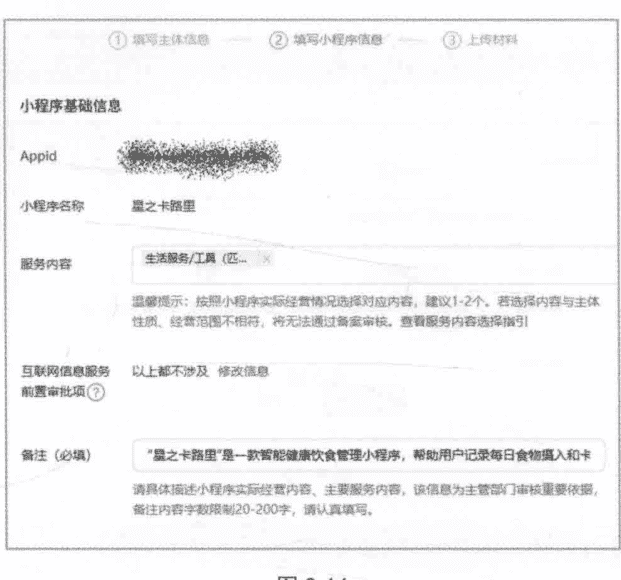

图 6-14

### 6.3.3 下载和安装小程序开发工具

（1）打开小程序开发文档，点击【工具】→【下载】→【稳定版更新日志】，根据系统选择对应版本下载，如图 6-15 所示。
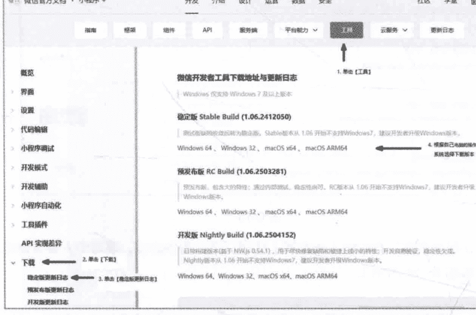

图 6-15

（2）双击安装包安装微信开发者工具，完成后如图 6-16 所示。

### 6.3.4 准备大模型接口

识别照片与热量需 AI 视觉大模型支持。火山引擎豆包视觉大模型识别率高且提供免费额度，故选用其接口。

（1）搜索“火山引擎”进入官网，如图 6-17 所示，点击右上角【立即注册】完成注册。

（2）按指引填写身份信息完成实名认证。
（3）搜索“火山方舟”，登录后进入控制台，输入“火山方舟”后点击【火山方舟】，如图 6-18 所示。

（4）开通模型：在火山方舟中点击【开通管理】，在大语言模型标签下找到“Doubao-1.5-vision-pro”，点击右侧【开通服务】，如图 6-19 所示，按指引操作。
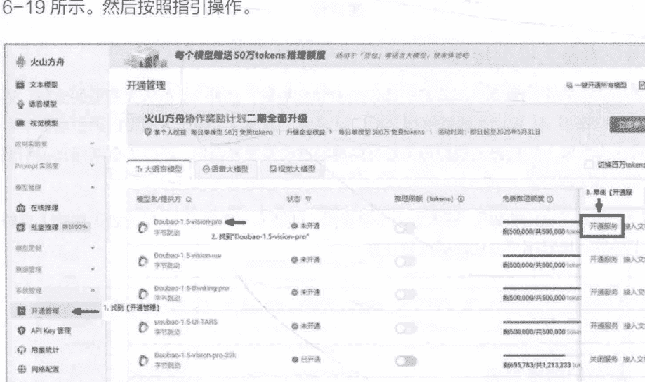
（5）创建 API Key：在左侧菜单点击【API Key 管理】，再点击【创建 API Key】按表单指引填写，获取 Key 后供后续调用使用。

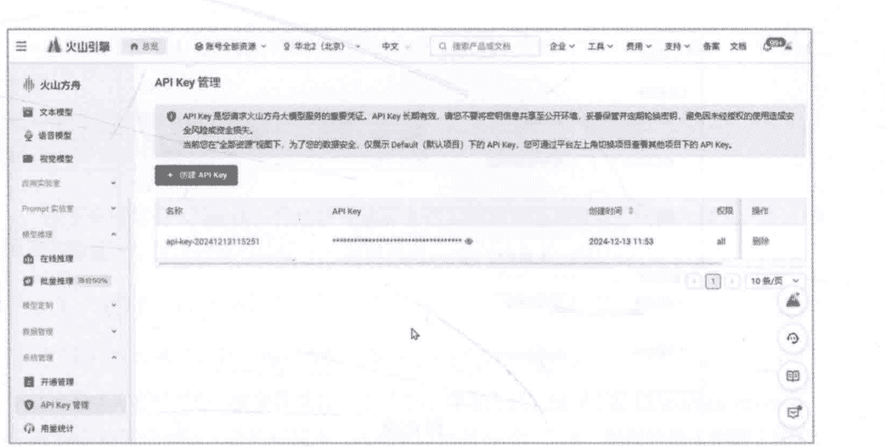

图 6-20

（6）准备创建接入点：打开火山方舟左侧功能区，点击【在线推理】，右侧列表里选择【自定义推理接入点】，再按下【创建推理接入点】，示意如图 6-21。


图 6-21

（7）创建接入点：为新点命名并补充简短描述，示意见图 6-22。

（8）添加模型：点按【添加模型】，在可选列表中挑中模型名“Doubao-1.5-vision-pro”及版本“250328”，如图 6-23 所示，确认后点【确定】。

（9）保存接入点 ID：进入详情页，把接入点 ID 复制保存备用，参考图 6-24。


图 6-22


图 6-23


图 6-24

按照上述流程，也能完成 DeepSeek R1 在火山引擎上的开通与接入点搭建。

## 6.4 用 Cursor 快速搭建拍照识餐小程序

下面结合 Cursor、微信开发者工具和火山引擎豆包视觉大模型，把“卡路里”小程序的拍照识别核心功能逐步实现。

### 6.4.1 新建小程序项目

（1）启动微信开发者工具并登录，点击顶部【+】新建小程序。

（2）填入项目名，选择代码存放目录，例如 D:\cursor\calorie，AppID 填入已注册的小程序 ID，其余信息按图 6-25 配置后点【创建】。


图 6-25

（3）工具会自动生成基础目录，miniprogram 用来存放页面、组件和配置文件，utils 存放公共工具，为后续编码奠基，如图 6-26。


### 6.4.2 读懂目录结构

了解目录才能更快定位修改点。打开项目后文件较多，新手容易迷路，可以让 Cursor 帮忙解读。

> ❓ 在 Cursor 中提问

请输出一份 README.md，用来说明各目录和主要文件的作用。

Cursor 产出的 README.md 详细解释了目录与关键文件的职责：

```
├── miniprogram/          # 小程序主目录
│   ├── app.ts            # 小程序入口文件
│   ├── app.json          # 小程序全局配置
│   ├── assets/           # 静态资源（包括图片、图标等）
│   ├── components/       # 自定义组件
│   ├── pages/            # 各页面目录
│   │   ├── index/        # 首页
│   │   └── logs/         # 日志页
│   └── utils/            # 工具库
```

```
package.json # 项目依赖配置
tsconfig.json # TypeScript 配置
app.json # 小程序全局页面配置
project.config.json # 项目配置
...... # 其他配置或文档
```

### 6.4.3 准备开发资料

为了让 Cursor 生成的结果更贴合预期，提前把需求文档放进项目并准备好大模型接口说明，能显著提升效率。

（1）在根目录下新建 docs。

（2）在 docs 内新建“功能模块规划.md”。

（3）把 DeepSeek 生成的功能模块规划内容粘贴进去，如图 6-27。

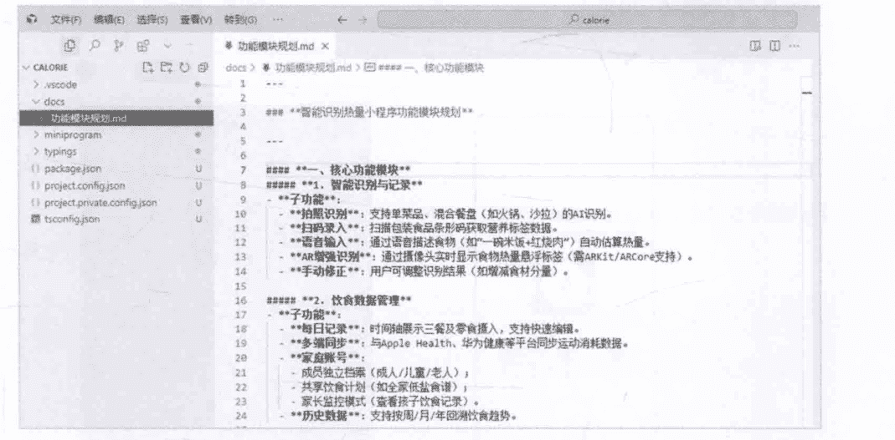

（4）新建“交互流程和原型说明.md”，把 DeepSeek 的交互流程与原型说明复制进来，如图 6-28。


（5）新建“高保真原型.html”，把 Readdy AI 导出的代码粘贴到此文件，如图 6-29。

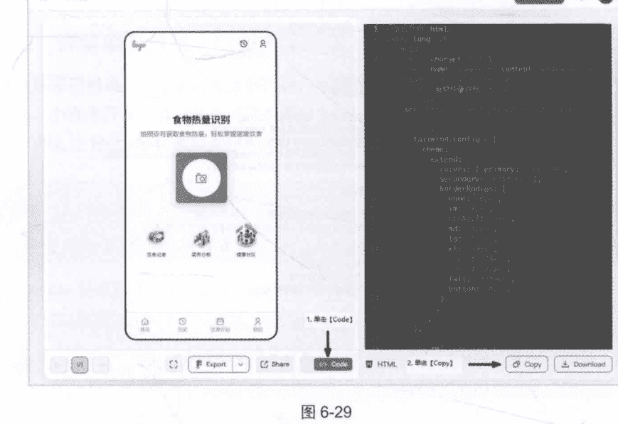

（6）获取接口说明链接：登录火山引擎控制台 → 开通管理 → Doubao-1.5-vision-pro → 点【接入文档】，如图 6-30，复制该页面的 URL。


图 6-30

（7）在 Cursor 设置 → Feature → Docs 中点【Add new doc】，粘贴上一步的 URL，添加成功后如图 6-31。


图 6-31

### 6.4.4 一键生成拍照识别页

（1）生成页面：关联 6.4.3 准备好的高保真原型和高保真需求文档，避免生成偏离。

> 在 Cursor 对话框输入

依据高保真原型文件@高保真原型.html，以及需求文档@功能模块规划.md @ 交互流程和原型说明.md，生成小程序的拍照识别功能。现有页面是模板生成的，均可修改。

Cursor 依据原型和需求生成了 3 个相关页面，目录变化如下：

```
├── miniprogram/          # 小程序主目录
│   ├── pages/            # 各页面目录
│   │   ├── index/        # 首页
│   │   ├── camera/       # 拍照/选图页
│   │   └── result/       # 识别结果页
```

（未修改的文件或目录未列出）

（2）编译预览：代码生成后回到微信开发者工具，点击【编译】即可预览，如图 6-32。


### 6.4.5 异常排查与修复

若运行出错，如图 6-33 所示，可把报错信息贴给 Cursor 分析修复。


> 在 Cursor 中提问

运行时出现以下错误：

```
[渲染层网络层错误] Failed to load local image resource /assets/icons/diet-record.png the server responded with a status of 500 (HTTP/1.1 500 Internal Server Error)
(env: Windows,mp,1.06.2412050; lib: 2.32.3)
[渲染层网络层错误] Failed to load local image resource /assets/icons/nutrition.png the server responded with a status of 500 (HTTP/1.1 500 Internal Server Error)
(env: Windows,mp,1.06.2412050; lib: 2.32.3)
[渲染层网络层错误] Failed to load local image resource /assets/icons/community.png the server responded with a status of 500 (HTTP/1.1 500 Internal Server Error)
(env: Windows,mp,1.06.2412050; lib: 2.32.3)。
```

Cursor 判定是样式文件引用的图标缺失。通过补全图标并修正样式后，图标正常显示，如图 6-34。


图 6-34

提示：以上仅为示例错误，实际遇到的报错可能不同，按此思路处理即可。

### 6.4.6 接入 AI 完成识餐

接下来使用准备好的接口文档、接入点 ID 和 API Key，实现上传图片后调用火山引擎识别食物热量的核心逻辑。

> 在 Cursor 中提问

用户发图后调用火山引擎接口。

接口文档：@VolcEngine 。

接入点 ID：ep-20250421153047-XXXX。

API Key：52521880-27ba-XXXXXX。

Cursor 生成了对接代码，关键片段如下：

```
// 构建请求体
const requestBody = {
  "model": MODEL_ID,
  "messages": [
    {
      "role": "system",
      "content": "你是一个专业的食物识别和营养分析助手。请为用户识别图片中的食物，并提供详细的营养信息，包括热量(kcal)、蛋白质(g)、脂肪(g)和碳水化合物(g)。只需返回JSON格式的数据，不要有其他解释性文字。"
    },
    {
      "role": "user",
      "content": [
        {
          "type": "image_url",
          "image_url": {
            "url": `data:image/jpeg;base64,${base64Image}`
          }
        }
      ]
    }
  ],
  "max_tokens": 5000,
  "temperature": 0.1
};
```

其中最核心的是发给大模型的提示词：

> 你是一个专业的食物识别和营养分析助手。请为用户识别图片中的食物，并提供详细的营养信息，包括热量 (kcal)、蛋白质 (g)、脂肪 (g) 和碳水化合物 (g)。只需返回 JSON 格式的数据，不要有其他解释性文字。

完成对接后，上传一张美食图即可看到营养分析结果，如图 6-35。


### 6.4.7 小程序上线流程

(1) 上传代码：在开发者工具右上角点【上传】，填写版本号和备注，如图 6-36。


（2）提交审核：登录微信公众平台，左侧菜单进入【版本管理】，找到刚上传的版本，如图6-37，点击【提交审核】等待审核。


图 6-37

（3）正式发布：审核通过后，版本状态显示通过，点击右侧【发布】即可上线。

#### 第7章 AI 复刻经典：网页版坦克大战

借助 AI 开发“坦克大战”既是致敬经典，也能完整体验游戏从创意到落地的全流程。

## 7.1 效果预览

### 7.1.1 玩法核心拆解

网页版“坦克大战”包含首页和游戏页两大界面，如图 7-1。


为便于学习，本版沿用经典像素风格和基础规则。

- 坐标系统：采用 20×20 网格组织场景，每个格子 26 px×26 px，所有元素均放置于格子中心。
- 移动控制：方向键控制移动与转向，撞到障碍或边界会产生反馈。
- 战斗机制：玩家坦克与敌方坦克、炮弹在速度、穿透力、冷却时间、存活时间等方面各不相同，炮弹对砖墙和钢墙的破坏效果也有区别。

### 7.1.2 关卡一览

本次仅实现 3 个关卡，如图 7-2。


从左到右依次为新兵训练营、闪电攻防战、钢铁迷宫。

## 7.2 素材与准备

把设计变成可玩游戏，素材是关键。优质图片和音效能直接提升体验。

### 7.2.1 搭建资源目录

按类型分目录存放，音频放在“audio”，图片放在“images”，推荐结构如下：

```
tank/
├── assets/          # 游戏资源文件
│   ├── audio/       # 游戏音频文件
│   └── images/      # 游戏图片文件
```

### 7.2.2 三个免费素材站推荐

开发前先备好资源，下面推荐三家新手友好的平台。

#### 1. Pixabay

- 平台概况：Pixabay 是综合素材库，涵盖图片、视频、音频，授权宽松，可用于个人和商业项目。
- 相关素材：可找到坦克、战场、障碍物等图片，质量高、风格多样，写实、卡通、像素风均有。
- 使用体验：搜索精准，界面简洁，关键词直达，下载无门槛。

#### 2. 爱给网

- 平台概况：爱给网聚焦游戏开发素材，音频、配乐、模型、图片齐全，分类细致，国内开发者常用。
- 相关素材：拥有大量坦克射击、炮弹飞行、爆炸音效，真实有张力；另有场景图和简模可用于搭建基础元素。
- 使用体验：界面本土化，分类清晰，部分高级素材需积分，免费资源充足，并附使用说明和教程。

#### 3. Kenney Assets

- 平台概况：Kenney Assets 专为游戏开发者提供高质量统一风格的 2D/3D 素材，可自由使用修改。
- 相关素材：提供一套 2D 像素风格的坦克、障碍、道具，尺寸风格统一，便于快速集成。
- 使用体验：打包下载即用，无需复杂处理，效率高，并配有详细文档。

### 7.2.3 用即梦 AI 补齐图片

若对下载素材不满意，可用即梦 AI 生成，例如首页图，可试用下方提示词。

> 在即梦 AI 输入

生成“坦克大战”游戏的首页，2D 平面，像素艺术风格，8bit 色彩。

即梦会输出多张候选图，如图 7-3，挑选满意的下载到图片目录。

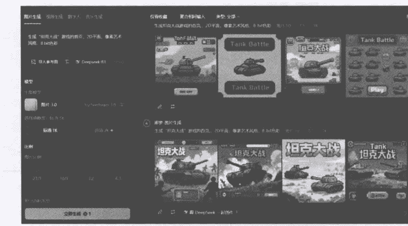

> 提示 在即梦 AI 的绘图提示词中，若需在画面里嵌入特定文字，建议把文字放在英文双引号里作为标记，例如“坦克大战”。

## 7.3 Cursor 实战开发游戏

进入实战阶段，用 Cursor 高效把设计转化为可运行页面。

### 7.3.1 生成并修复首页

开发首页需结合前期设计和已准备素材。

（1）生成首页：明确资源路径，让 Cursor 生成首页。

> 在 Cursor 中提问

参考经典版“坦克大战”玩法生成 HTML5 小游戏首页，首页背景图为@images 下的 index.jpg。

生成后用浏览器打开 index.html，发现部分图标未完全显示，如图 7-4。

（2）定位问题：设计文档规定坦克尺寸为 26px × 26px，但实际素材为 32px × 32px，尺寸不匹配导致裁切。让 Cursor 修正尺寸即可。

【实战笔记】用 Cursor 搭出坦克大战与单词桌面应用

先把菜单里的坦克图标由 26px × 26px 调整到 32px × 32px。

> 对 Cursor 的提问
把坦克的尺寸 26px × 26px 改为 32 px × 32px。

指令发出后，Cursor 把游戏菜单中的坦克图标改成了 32px × 32px，重新载入 index.html，首页各区块呈现正常，如图 7-5 所示。

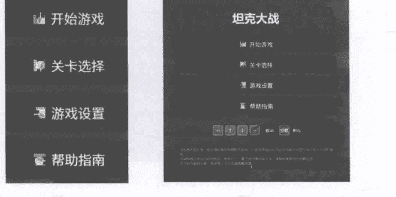

### 7.3.2 搭建游戏页面
游戏页是坦克大战的核心承载。借助 Cursor 推进时，需要紧扣前期确定的玩法机制与关卡规划来组织页面功能。

（1）产出游戏代码：承接 7.3.1 的设定，让 Cursor 依据经典版坦克大战的机制来搭建游戏页面。

> 对 Cursor 的提问
参考经典版“坦克大战”游戏的机制，生成游戏页面。

Cursor 先确认脚本目录存在，并新建了核心脚本，搭起了基础骨架与关键机制，包含：

- 新建主容器，用来容纳 Canvas 区域与各类状态页面。
- 设计信息区，实时呈现玩家血量、得分、当前关卡与剩余敌机数等关键数据。
- 构建关卡加载页，切换关卡时展示关卡信息。
- 设置结束与胜利页，为玩家提供“再来一局”和“下一关”选项。
- 增加操作提示，向玩家说明方向键移动、空格键射击等控制方式。

产出效果见图 7-6。


从效果看，墙面与障碍物的绘制不正常，出现大量空隙。

(2) 问题排查：对照素材图 7-7，发现坦克尺寸为 32px × 32px，障碍物尺寸为 16px × 16px，而 Cursor 未注意到两者尺寸差异。


修正方法很直接——把差异告诉 Cursor，并据此重改。

> 对 Cursor 的提问
游戏素材中，砖块等障碍物的尺寸是 16px × 16px，坦克的尺寸是 32px × 32px，将地图的网格尺寸改为 16 px × 16 px，一个坦克占 4 个网格。

Cursor 把页面中的单元格大小改为 16px × 16px，单个障碍占 1 格，一辆坦克占 4 格。修复后的页面见图 7-8。

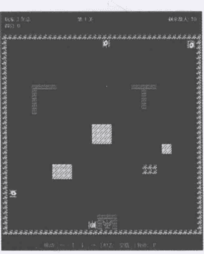

图 7-8

后续仍可能出现其它问题，比如击毁敌人后未补兵、玩家被击中后未结束等，只要在 Cursor 中把问题描述清楚，就能帮助修复，确保逻辑正确。

### 7.3.3 目录结构说明以便理解代码
除手动创建的资源目录外，Cursor 还生成了若干文件。可让 Cursor 介绍各目录与主要文件的作用。

> 对 Cursor 的提问
生成 README.md 项目说明文档，需要包含各目录作用和主要文件作用的说明。

生成的 README.md 详细说明了目录与主要文件的作用：

```
tank/
├── assets/          # 游戏资源文件
│   ├── audio/       # 游戏音频文件
│   └── images/      # 游戏图片文件
├── docs/            # 文档
│   └── 关卡设计.md  # 关卡设计文档
├── js/              # JavaScript 代码
│   ├── const.js     # 游戏常量定义
│   └── game.js      # 游戏核心逻辑
├── game.html        # 游戏页
├── index.html       # 游戏首页
└── README.md        # 项目说明（本文件）
```

### 7.3.4 产出其它页面
除首页与游戏页外，坦克大战还需要暂停页、关卡选择页、设置页等来完善体验。

（1）产出暂停页。

> 对 Cursor 的提问
生成游戏暂停页，提示游戏处于暂停状态，按 P 键则恢复游戏运行。

生成的暂停页在游戏暂停时会显示半透明遮罩并提示暂停状态，如图 7-9 所示。


（2）产出关卡选择页。

> 对 Cursor 的提问
生成关卡选择页，只需要 3 个关卡。

关卡选择页如图 7-10 所示。


图 7-10

（3）产出设置页。

> 对 Cursor 的提问
继续生成游戏设置页。

生成的设置页如图 7-11 所示，包含难度选择、音效开关、背景音乐开关、音量调节等选项，玩家可按喜好个性化配置。


图 7-11

## 7.4 游戏开发的基础知识
前期已实现基础功能，接下来借助 Ask 模式深入解析主循环与状态管理、碰撞检测、得分系统。

### 7.4.1 解析主循环与状态管理
主循环与状态管理是游戏运行的核心，两者协同保证世界动态更新与稳定。

把 Cursor 对话框切换到 Ask 模式直接提问。

> 对 Cursor 的提问
我是一个初学者，给我解释这个游戏的主循环和状态管理的相关代码。

#### 1. 游戏主循环
主循环代码如下：

```
// 游戏的主循环
gameLoop(timestamp) {
    if (this.paused) return;

    const deltaTime = timestamp - this.lastTimestamp;
    this.lastTimestamp = timestamp;

    this.update(deltaTime);
    this.render();

    if (!this.gameOver) {
        requestAnimationFrame(this.gameLoop.bind(this));
    }
}
```

运行原理：

1. 读取当前时间戳 timestamp。
2. 计算前后两帧的时间差 deltaTime。
3. 调用 update 刷新所有对象状态。
4. 调用 render 重绘画面。
5. 若游戏未结束，则用 requestAnimationFrame 安排下一帧。

#### 2. 状态管理
核心状态变量在 Game 类构造函数中初始化：

```
constructor(canvasId) {
    this.canvas = document.getElementById(canvasId);
    this.ctx = this.canvas.getContext('2d');
    this.gameOver = false;      // 游戏是否结束
    this.paused = false;        // 游戏是否暂停
    this.currentLevel = 1;      // 当前关卡
    this.score = 0;             // 玩家得分
    this.playerLives = 3;       // 玩家生命数
    this.enemies = [];          // 敌人的坦克数组
    this.bullets = [];          // 子弹数组
    this.explosions = [];       // 爆炸效果数组
    this.map = [];              // 地图对象数组
    this.keyState = [];         // 按键状态
    this.lastTimestamp = 0;     // 上一帧的时间戳
    this.player = null;         // 玩家坦克
    this.enemiesLeft = 0;       // 剩余敌人数量
    this.enemiesGenerated = 0;  // 已生成敌人数量
    this.animationCounter = 0;  // 动画计数器
    ......                      // 省略部分代码
}
```

要点总结：

- 用 requestAnimationFrame 形成平滑循环。
- 用数组管理坦克、子弹、爆炸等对象。
- 借助 deltaTime 让速度不受帧率影响。
- 通过碰撞与事件改变状态。
- 用 gameOver 与 paused 标志控制流程。

### 7.4.2 解析碰撞检测
碰撞检测确保逻辑正确并增加策略性，通过算法判断对象是否接触。

> 对 Cursor 的提问
继续解释碰撞检测的相关代码，并解释实现原理。

核心代码如下：

该方法实现 AABB 轴对齐边界框检测，思路是：

（1）检查两个矩形在 x 轴与 y 轴上的重叠情况。
（2）只有两轴都重叠才判定为碰撞。

计算简洁高效，适合方形物体的检测。

### 7.4.3 解析得分系统
得分系统用于衡量表现并提升趣味性。

> 对 Cursor 的提问
继续解释得分系统的代码与原理。

得分规则简洁：

- 击毁敌方坦克获得分数。
- 不同敌人类型分值可能不同。
- 分数在游戏中实时显示。
- 分数跨关累积。

敌人被击中时更新分数的代码：

```javascript
enemyHit(enemy) {
    ...... //省略部分代码
    let scoreValue = 100; // 基础分值

    // 根据敌人类型给予不同分值
    if (enemy.tankType === 'basic') {
        scoreValue = 100;
    } else if (enemy.tankType === 'fast') {
        scoreValue = 200;
    } else if (enemy.tankType === 'armor') {
        scoreValue = 300;
    }

    this.score += scoreValue;
    ...... //省略部分代码
}
```

## 7.5 拓展提升

### 7.5.1 让敌方坦克自动追踪玩家
为增加趣味，可让敌方坦克追踪玩家。

> 对 Cursor 的提问
第 2 关，为敌方坦克增加自动追踪玩家坦克的能力。

Cursor 为第二关的敌方坦克添加了追踪能力。实现后可用 Ask 模式请 Cursor 解读原理。

> 对 Cursor 的提问
解释一下自动追踪功能的代码和原理。

追踪主要由 updateEnemyAI 函数实现，代码如下：

```javascript
updateArmorTankAI(enemy) {
    // 计算敌方坦克和玩家坦克之间的距离和方向
    const dx = this.player.x - enemy.x;
    const dy = this.player.y - enemy.y;

    // 每1.5秒更新一次追踪方向
    if (enemy.aiTimer >= 1500) {
        enemy.aiTimer = 0;

        // 决定是横向追踪还是纵向追踪
        const preferHorizontal = Math.abs(dx) > Math.abs(dy);

        if (preferHorizontal) {
            // 横向移动
            if (dx > 0) {
                enemy.move(RIGHT); // 玩家坦克在右边
            } else {
                enemy.move(LEFT); // 玩家坦克在左边
            }
        } else {
            // 纵向移动
            if (dy > 0) {
                enemy.move(DOWN); // 玩家坦克在下边
            } else {
                enemy.move(UP); // 玩家坦克在上边
            }
        }

        // 10%的概率随机移动，避免卡住
        if (Math.random() < 0.1) {
            const directions = [UP, RIGHT, DOWN, LEFT];
            const randomDirection = directions[Math.floor(Math.random() * directions.length)];
            enemy.move(randomDirection);
        }
    }
}
```

在游戏中表现为：

- 敌机明显朝玩家方向移动。
- 第二关的敌机比第一关更具侵略性。
- 有时会出现绕路，不一定走最短路径。
- 随机移动让行为不可完全预测。

> 提示 这并非复杂 AI，但对复古游戏已足够具挑战性。

### 7.5.2 增加玩家特殊技能
参考现代竞技游戏，为玩家坦克加入特殊技能并设置冷却。

> 对 Cursor 的提问
给玩家坦克增加两项特殊技能，需要有冷却机制，不能无限制使用。

未指定具体技能，Cursor 生成了超级炮弹与闪现冲刺，效果如图 7-12 所示。


图 7-12

# 第 8 章
【项目实战】桌面应用“我爱背单词”

“我爱背单词”是一款面向个人学习的桌面工具，主打高效记忆与个性化学习，借助 AI 提升背诵效率。

## 8.1 预览桌面应用

### 8.1.1 核心功能图解

#### 1. 词库管理
词库管理界面如图 8-1 所示。


图 8-1

#### 2. 学习
选择词库后可查看单词释义与例句，如图 8-2 所示。


图 8-2

#### 3. 听写
播放单词音频后书写单词，如图 8-3 所示。


图 8-3

### 8.1.2 技术亮点：AI 语音互动与个性化学习

#### 1. AI 语音互动
AI 语音朗读可辅助学习与听写。学习页点击【朗读】可听发音，结合释义与例句加深记忆。

#### 2. 个性化学习
用户可导入不同词库，中小学生、大学生或职场人士均可使用。

## 8.2 开发前的准备

### 8.2.1 安装 Python
Python 因丰富的第三方库而被选用。安装步骤：

1. 访问 Python 官网。
2. 下载：鼠标移到【Downloads】，点击下方按钮下载，如图 8-4 所示。


图 8-4

3. 安装：双击安装包，按向导完成安装。
4. 验证：打开命令行，输入 python --version 或 Windows 下的 py --version，看到版本号即安装成功，如图 8-5 所示。


### 8.2.2 准备开发文档

1. 创建项目目录如 D:\cursor\words。
2. 在项目目录下建 docs 文档目录。
3. 创建需求文档：为提升 AI 生成可控性，建议撰写“用户需求分析.md”与“功能模块设计.md”，可借助 DeepSeek 生成。
4. 创建高保真原型文件“高保真原型.html”，用 Readdy AI 生成原型后把源码复制入该文件。

文档目录已整理完毕，整体框架如 图 8-6 所示。


### 8.2.3 下载词库

1. 访问 GitHub 主页。
2. 在搜索框键入“四六级词库”进行查找，示意如图 8-7。
3. 在搜索结果中挑选合适的仓库，可参考活跃度、星标等指标，通常首个即可，参见图 8-8。


4. 进入目标仓库，定位所需词库，右键点击【原始地址】，在菜单中选择【在新窗口中打开链接】，如图 8-9，下载后解压。


5. 在工程根目录下创建名为 books 的目录。
6. 把解压得到的词库文件拷贝进 books 目录。

## 8.3 利用 Cursor 打造“我爱背单词”桌面程序

### 8.3.1 界面生成

（1）依托文档生成代码：通过对话窗口的 @docs 指令关联需求文档，让 Cursor 依据文档生成桌面客户端。

> 向 Cursor 提问

根据高保真原型@高保真原型.html和需求文档@功能模块设计.md @用户需求分析.md，使用Python生成桌面应用“我爱背单词”。

Cursor 生成了基于 Python 的“我爱背单词”程序，同时输出 README.md 与 requirements.txt 文件，如图 8-10 所示。


### 8.3.2 项目结构说明，便于理解代码

此时功能尚未完善，但目录下已出现多个子目录与文件，为更好地把握结构，可请 Cursor 进行解读。

项目中已有 README.md，无需新建，只需在该文档内补充子目录及主要文件的职责说明即可。

> 向 Cursor 提问

在 README.md 文档中增加子目录和主要文件的作用说明。

Cursor 在 README.md 中详细补充了各目录的职责与关键文件说明：

```
words/
├── src/                    - 源代码目录
│   ├── main.py             - 应用程序入口点
│   ├── core/               - 核心功能模块
│   ├── database/           - 数据库相关
│   │   ├── words.db        - SQLite 数据库文件
│   │   └── db_manager.py   - 数据库管理接口
│   ├── ui/                 - 用户界面
│   │   ├── main_window.py  - 主窗口
│   │   ├── components/     - UI 组件
│   │   ├── dialogs/        - 对话框
│   │   └── widgets/        - 自定义控件
│   ├── utils/              - 工具类
│   └── resources/          - 资源文件
├── books/                  - 单词书和词库
├── docs/                   - 文档
├── tests/                  - 测试文件
├── requirements.txt        - 项目依赖
└── 启动程序.bat            - Windows 批处理启动文件
```

### 8.3.3 启动桌面程序

代码生成后，按以下步骤运行。

（1）在 Cursor 菜单中点击【终端】→【新建终端】，如图 8-11。


（2）在终端中执行安装依赖的命令。

```
pip install -r requirements.txt
```

（3）在终端中执行启动应用的命令。

```
python src/main.py
```

> 提示 main.py 有可能生成在项目目录下，此时启动命令则是 “python main.py”。

（4）若安装依赖或启动时终端报错，如图 8-12，将错误信息复制到 Cursor 对话框，让 Cursor 解决。


（5）错误处理完毕后即可看到应用正常运行，如图 8-13。

生成的界面与高保真原型相近，后续可继续让 Cursor 调整。


图 8-13

### 8.3.4 实现导入词库功能

当前仅为静态界面且数据不全。下面加入导入词库及基于词库学习的功能，提升实用性。

> 向 Cursor 提问

实现导入词库功能，待导入的文件格式参考@CET4luan_1.json。

生成代码后，在终端执行命令“python src/main.py”，应用数据被清空。点击【导入】按钮选择词库文件，再次点击【导入】，页面直接提示“JSON 格式错误，无法解析文件”，如图 8-14。


图 8-14

将报错信息粘贴至对话窗口，并输入以下提示：

> 向 Cursor 提问

分析并解决这个 JSON 格式错误的问题。

处理后重新运行并导入词库，导入成功，如图 8-15。


### 8.3.5 学习模块开发

#### 1. 基础学习功能

> 向 Cursor 提问

根据需求文档@功能模块设计.md @用户需求分析.md 生成学习功能。

Cursor 实现了基础学习功能，点击【学习】进入学习页，再点击【开始学习】进入单词练习，效果如图 8-16。页面展示单词、释义、例句，并提供“不认识”“模糊”“认识”等选项，便于记录掌握程度，按多样化模式练习。


图 8-16

#### 2. 增加朗读

为优化体验，在单词右侧增加【播放】按钮，点击可朗读。

> 向 Cursor 提问

学习单词时，在单词右边增加一个【播放】按钮，单击该按钮可以朗读单词。

Cursor 采用文本转语音技术，为学习过程加入朗读，效果如图 8-17，单词与例句旁均出现【播放】按钮，点击即可播放音频。


图 8-17

### 8.3.6 听写功能开发

前文的“复习”功能改为“听写”，更贴合定位。该功能播放单词音频，用户根据听到的内容输入单词，正确则自动进入下一词，错误则停留，可手动跳过。

> 向 Cursor 提问

将菜单中“复习”改为“听写”，参考学习功能，但是界面只有一个播放按钮，用户根据听到的音频内容输入单词，若输入正确则自动跳到下一个单词，若输入错误则不跳到下一个单词，但用户可以手动跳到下一个单词。

Cursor 生成对应代码，完成听写功能开发，效果如图 8-18，为用户提供多样化复习手段。


## 8.4 桌面应用关键技术剖析

使用 Cursor 开发“我爱背单词”时，代码均由 Cursor 生成，初学者不易了解底层技术。下面借助 Ask 模式梳理关键点。

### 8.4.1 让 Cursor 总结技术栈

将 Cursor 对话框左下角模式切换到“Ask”，输入提示词。

> 向 Cursor 提问

这个桌面应用使用了哪些关键技术？

Cursor 扫描项目后总结如下：

- 前端框架：PyQt 5 用来搭建桌面 GUI，提供丰富控件与布局管理，方便可视化操作。
- 数据库技术：SQLAlchemy 作为 ORM 框架，便于 Python 操作数据库；SQLite 负责本地数据保存。
- 核心功能技术：Pandas 处理数据，Matplotlib 实现数据可视化，gTTS 生成音频，Playsound 播放音频，PyQtWebEngine 展示富文本。
- 网络通信：requests 库负责 HTTP 请求，实现数据交互与云端同步。
- 学习算法：基于遗忘曲线制定学习计划，结合多种学习模式与游戏化提升效果。
- 架构特点：模块化设计，按功能划分；遵循 MVC 架构，降低耦合，便于维护。

下面重点介绍后续可能用到的几项技术。

### 8.4.2 桌面交互基石 PyQt 5

PyQt 5 是 Python 的 GUI 库，可创建图形界面程序。

在本应用中的作用：

（1）搭建完整界面
- 主窗口、按钮、标签、输入框等基础控件。
- 复杂布局管理，如 QVBoxLayout、QHBoxLayout。
- 堆叠式页面切换。

（2）提供信号与槽机制
用于响应用户交互，如点击按钮后切换页面。

例如代码中的：
```python
self.sidebar.page_changed.connect(self.change_page)
```
该行实现：侧边栏按钮被点击时发出信号，主功能区接收后切换页面。

（3）界面样式定制
- 通过 QSS 文件设置样式，如项目中的 style.qss。
- 支持自定义主题与美化。

（4）组件化开发
- WordLibraryWidget、LearningWidget 等均为 PyQt 5 组件。
- 各功能模块封装为独立 Widget，便于管理与复用。

（5）多媒体支持
- PyQtWebEngine 用于展示富文本内容。
- 结合 Playsound 与 gTTS 实现单词发音。

### 8.4.3 本地数据管理利器 SQLite

#### 1. SQLite 概述

SQLite 是轻量级关系型数据库，无需独立服务器进程，直接嵌入应用。整个数据库存为单个文件，便于复制与迁移。

> 提示 可把 SQLite 理解为“文件型数据库”，数据以结构化表格保存在一个文件中，应用可方便读写。

#### 2. 在本应用中的作用

（1）本地存储
- src/database/words.db 即 SQLite 数据库文件。
- 保存单词信息、学习记录、用户进度。

（2）学习数据持久化
- 记录学习历史与记忆进度。
- 存储复习计划数据。
- 保存统计信息用于可视化。

（3）词库管理
- 存储各类词库单词，如考试词库、专业词库。
- 可能包含发音、例句、释义。

（4）应用配置
保存用户偏好与系统配置。

#### 3. 优势

项目中通过 DatabaseManager 类处理所有交互。优势如下：

- 性能足够，满足个人应用。
- 零配置，无需服务器或端口。
- 可靠性高，支持事务保证一致性。
- 跨平台，同一文件可在不同操作系统使用。

### 8.4.4 数据分析助手 Pandas

#### 1. Pandas 概述

Pandas 是 Python 数据分析库，提供 Series 与 DataFrame 两种核心结构，便于处理表格与时间序列数据。

> 提示 可类比为“Python 版的 Excel 高级形态”，帮助应用智能分析学习数据。

#### 2. 在本应用中的作用

（1）学习数据分析处理
- 将数据库读取的记录转为 DataFrame 高效分析。
- 计算学习进度、正确率、记忆效率。

（2）生成学习曲线
- 结合遗忘曲线算法分析历史。
- 处理时间序列，计算最佳复习点。

（3）数据过滤与分组
- 按难度、类别、掌握度筛选单词。
- 按天/周/月分组统计效果。

（4）可视化支撑
- 与 Matplotlib 结合将 DataFrame 转图表。
- 生成进度表、记忆曲线、薄弱点分析。

（5）导入导出
- 支持 Excel/CSV 词表导入导出。
- 处理自定义词库格式转换。

（6）智能学习算法支撑
- 为智能学习计划提供数据基础。
- 基于历史数据找出重点复习单词。

### 8.4.5 实现单词朗读的关键 gTTS

gTTS 是 Python 文本转语音库，支持多语言与口音。可视为“虚拟播音员”，标准清晰地朗读单词，无需额外音频资源。

在本应用中的作用：

（1）提供发音功能
- 将英文单词转为标准发音音频。
- 帮助掌握正确读音。

（2）朗读例句
- 可朗读包含目标词的例句。
- 加深对用法与发音的理解。

（3）发音练习
- 用户可录音并与标准发音对比。
- 改进口语。

# 第 9 章 【项目实战】企业级应用——“社区超市”商城系统

前面已学习用 Cursor 开发简单应用，本章转向更复杂的企业级应用开发，需先把业务逻辑拆解为模块，再由 Cursor 完成实现。

## 9.1 商城系统预览

### 9.1.1 核心功能概览

1. 首页

顶部导航栏包含搜索、登录、注册、购物车入口，中部展示热销商品与分类导航如 3C、食品等，见 图 9-1。


2. 购物车

加入商品后实时计算总价，支持增减数量或删除商品，见 图 9-2。


3. 订单管理

订单按“全部”“待付款”“待发货”“待收货”“已完成”“已关闭”分类展示，并支持关键词搜索与筛选，见 图 9-3。


### 9.1.2 企业级技术栈亮点

“社区超市”商城系统采用企业级技术栈：

1. 后端架构
基于 Java 的 Spring Boot，企业级框架，支持分布式部署，可平滑演进为微服务，支持高并发与横向扩展。

2. 数据库架构
MySQL 保存核心业务数据如商品、订单、用户；Redis 缓存高频数据如热销列表、会话信息，提升查询速度并降低数据库压力。

3. 前端架构
Vue.js + Element UI，响应式布局，适配 PC 与移动端，保证多设备体验。

## 9.2 开发环境准备

全栈开发启动前，充分准备是项目成功的关键，直接影响开发效率与系统质量。下面从开发语言、开源平台、Java 环境、MySQL 环境等维度展开。

### 9.2.1 开发语言选择

众多大型电商如淘宝、天猫、京东、亚马逊均采用 Java 编写，本项目亦选 Java，其优势：

- 企业级开发能力强
Java 兼具健壮、安全、跨平台特性，结合 Spring Boot 的依赖注入与 AOP，可提升可维护性与扩展性。例如商品管理模块，依赖注入使数据访问层变更时业务逻辑改动很小。

- 稳定性与可靠性高
商城系统需长期在线，Spring Boot 成熟架构与事务管理可保障购物车结算等操作数据一致，避免异常导致错误。

- 可扩展性好
业务增长带来新需求，Spring Cloud 支持微服务架构，便于引入会员积分、线上配送等新模块。

- 技术生态成熟

技术生态越活跃，踩坑成本就越低。社区沉淀的文档、开源范例和实战经验能帮助快速定位问题，配合丰富的第三方组件，项目可扩展性也会明显提升。

### 9.2.2 引入基础开发框架
开源阵营里有大量成熟的 Java 起步方案，已把注册登录、权限控制、用户管理等通用能力封装好，开发者可集中精力做业务本身。本项目选用 RuoYi 作为底座，前端交互采用 Vue.js 来实现。

1. RuoYi 的核心亮点
以 Spring Boot 与 Spring Cloud 为底座，内置组件丰富，能大幅减少脚手架工作量。权限体系支持细粒度角色管控，有助于保障数据安全。内置的代码生成器可依据表结构自动产出代码，提升开发效率。对主流数据库兼容友好，数据层封装简洁易用。

2. Vue.js 的适用点
语法简洁、扩展灵活，组件化方式很适合搭建购物车、商品展示等页面。配合 Vue Router 和 Vuex，能够实现页面平滑切换和集中式状态管理，整体体验更流畅。

3. 获取流程
（1）前往 Gitee，于检索框填入“ruoyi-vue”，见图 9-4，挑选“若依/ruoyi-vue”仓库。


（2）进入仓库页面，点选“克隆/下载”控件，于弹层中点选获取压缩包选项，见图 9-5。


（3）新建工程文件夹，例如 “D:\cursor\shop”，把解压后的文件整体放入该文件夹。

### 9.2.3 搭建 Java 运行环境
1. 部署 IntelliJ IDEA
（1）前往 JetBrains 官方站点，定位 IntelliJ IDEA 入口，见图 9-6。


（2）于产品页点选“下载”，进入下载中心。
（3）定位 Community 社区版，下方获取控件见图 9-7。


图 9-7
（4）安装包获取完成后双击运行，按向导完成部署。

2. 配置 JDK
（1）用 IDEA 载入工程文件夹，载入文件 “RuoYiApplication”，见图 9-8。首次载入时 IDEA 会提示“项目未配置 JDK”。


图 9-8
（2）点选提示条右侧的“安装 SDK”控件，挑选“下载 JDK”。
（3）于对话框指定“1.8”版本，并指定 JDK 保存路径，见图 9-9。


图 9-9

### 9.2.4 配置 MySQL 数据环境
1. 获取并部署 MySQL
（1）前往 MySQL 官方站点，于底部获取列表点选“MySQL Community Server”链接，见图 9-10。


图 9-10
（2）指定“8.0.42”版本，挑选对应操作系统，下方链接见图 9-11。
（3）进入获取页，若出现登录 / 注册提示，直接点选“No thanks, just start my download.”链接继续获取，见图 9-12。


图 9-11

图 9-12
（4）双击安装包，按向导完成部署。

> 提示 部署阶段需设定数据库账号与密钥，请妥善保存。

2. 部署数据库管理工具
（1）前往 DBeaver 官方站点，进入获取页。
（2）依据系统挑选对应安装包，见图 9-13。


图 9-13
（3）双击安装包，按向导完成部署。
（4）启动 DBeaver，点选“创建连接”旁的下拉控件，指定“MySQL”，见图 9-14。


图 9-14
（5）填入主机、端口、账号、密钥等连接参数，见图 9-15。


图 9-15

> 提示 账号密钥为此前 MySQL 部署时设定的。

（6）点选“完成”按钮。

### 9.2.5 数据库初始化
RuoYi 需先完成数据库初始化，具体操作如下。
（1）创建数据库
借助 DBeaver 连接数据库，于 数据库 节点右键 新建数据库，见图 9-16。填写库名，字符集指定“utf8mb4”，见图 9-17，点选“确定”。


（2）导入初始化数据
于新建库右键 工具 → 恢复数据库，见图 9-18。于输入区指定工程文件夹内的“ry_20250417.sql”文件，见图 9-19，并勾选“禁用外键检查”，点选“开始”。


图 9-19
（3）导入定时任务数据
重复上述操作，改为导入工程文件夹内的“quartz.sql”文件。
（4）修改项目中的数据库连接配置
定位工程文件夹下 application-druid.yml 文件，修改主数据源的库名、账号、密钥，见图 9-20。


图 9-20

### 9.2.6 部署 Redis 缓存
（1）前往 GitHub，检索“redis-windows/redis-windows”，见图 9-21。


图 9-21
（2）进入仓库，于右侧 Release 区点选“Redis 7.4.3 for Windows”链接，进入获取页，见图 9-22。


（3）于获取页点选首个链接，完成文件获取，见图 9-23。


（4）把解压包放到安装目录，例如 D:\Program Files\Redis-7.4。
（5）进入目录，以管理员权限运行“install_redis_service.bat”。
（6）若系统弹出安全提示窗口，见图 9-24，点选“更多信息”再点“仍要运行”。


（7）于命令行窗口按 Enter 选用默认配置完成部署，见图 9-25。


图 9-25

### 9.2.7 配置 Node.js 运行时
（1）前往 Node.js 官方站点，进入获取页。
（2）指定版本与操作系统，见图 9-26。


图 9-26
（3）拷贝生成指令，于系统 PowerShell 中粘贴执行。

## 9.3 Cursor 驱动开发实战

### 9.3.1 启动基础平台
环境准备完毕后，先让 RuoYi 跑起来，为后续开发打基础。

1. 启动后端
（1）于 IDEA 中载入文件 “RuoYiApplication”。
（2）点选工具栏运行控件，见图 9-27。


（3）控制台出现“若依启动成功”字样即表示后端正常。

> **提示** 若启动异常，可复制日志到 Cursor，采用 Ask 模式排查根因。

2. 启动前端
（1）借助 Cursor 打开工程文件夹。
（2）于终端执行以下命令：

```
cd ruoyi-ui
npm install
npm run dev
```

（3）启动浏览器，网址栏填入“http://localhost”，见图 9-28。默认账号为“admin”，密钥为“admin123”，填入验证码后点选“登录”。登录成功说明部署正常，否则可于 Cursor 对话框描述问题交由其处理。


### 9.3.2 构建商品管理模块
目前仅有基础后台，社区超市的核心商品管理尚未落地，下面借助 Cursor 分步实现。

1. 设计表结构
> 提示给 Cursor
现需基于 RuoYi 搭建社区超市商城系统。
阅读已有表结构@ry_20250417.sql，设计商品管理相关表结构要求：
1. 以 shop_ 作为前缀。
2. 表结构 SQL 写入 ry_20250417.sql 文件。

Cursor 按需产出以下表：
- 商品分类表 shop_category：支持多级结构，含图标、排序、状态等。
- 商品品牌表 shop_brand：保存品牌基础信息，含 logo、描述、官网。
- 商品规格表 shop_spec：定义规格选项，选项以 JSON 存储。
- 商品属性表 shop_attribute：区分销售属性与基础属性，属性值以 JSON 存储。
- 商品基础信息表 shop_goods：保存价格、库存、重量等核心数据，支持新品、热销、推荐标记。
- 商品 SKU 表 shop_goods_sku：记录 SKU 具体信息，含价格、库存、规格。
- 商品评价表 shop_goods_comment：保存用户评价，支持图片评价和商家回复。
- 促销活动表 shop_promotion：支持满减、折扣、秒杀、特价四种类型，含规则与时间设置。
- 促销商品关联表 shop_promotion_goods：关联活动与商品，支持促销价与限购。

2. 执行 SQL
（1）拷贝 Cursor 产出的 SQL。
（2）借助 DBeaver，针对项目数据库右键 SQL 编辑器 新建，粘贴 SQL，见图 9-29。

#### 3. 生成后端
（1）让 Cursor 生成后端代码
> 提示给 Cursor
基于前述表结构生成商品相关后端代码：
1. 包含实体类、mapper、service、controller。
2. 代码放入 ruoyi-admin 文件夹。
3. 参考现有代码格式与规范。

Cursor 按要求产出实体、Mapper、Service、Controller，见图 9-31。
（2）于 IDEA 中运行
载入 “RuoYiApplication”，点选运行按钮。
（3）错误处理
一次性生成大量代码易出现编译问题，见图 9-32。
把错误日志粘贴到 Cursor 对话框，请求修复。
> 提示给 Cursor
ShopCategory 无法直接转为 TreeSelect，通过新增转换工具类实现类型映射，使分类树形结构能正确构建，前端展示正常。

#### 4. 生成前端
> 提示给 Cursor
针对 @ruoyi-ui 生成商品后端管理相关前端代码。
Cursor 产出了商品分类与商品管理的页面，效果见图 9-33。
点选“新增”录入商品信息保存后，可于列表中查看，见图 9-34。

### 9.3.3 制作面向客户的超市首页
目前只有管理员后台，缺少面向客户的站点。下面使用 Cursor 生成面向客户的“超市首页”。

#### 1. 生成前端
（1）创建用户端目录
于工程文件夹内新建目录“user-ui”，用户端页面均置于此。
（2）使用 Cursor 生成首页
> 提示给 Cursor
生成社区超市商城系统用户端首页，要求：
1. 新建一个 Web 工程创建用户端站点。
2. 工程根目录已创建 user-ui 用于存放用户端。
3. Web 端口使用 81。
4. 技术栈参考后台管理系统。
5. 仅生成超市首页，其余页面暂不涉。
6. 适配手机端页面。

Cursor 采用 Vue.js 2.x、Element UI 等技术搭建用户端首页。
（3）运行
点选菜单“终端”→“新建终端”，输入以下命令：

```
cd user-ui
npm install
npm run dev
```

（4）预览
于浏览器地址栏填入 “http://localhost:81”，见图 9-35，可看到超市首页，当前数据仍为模拟数据。

#### 2. 生成后端
让首页数据由后端商品分类与商品信息驱动。
（1）生成后端接口
> 提示给 DeepSeek
于 @ruoyi-admin 生成超市首页接口。
用户无需登录即可浏览首页。
Cursor 产出了首页所需的分类与商品接口。
（2）前端请求后端接口
> 提示给 Cursor
前端调用后端商品分类与商品数据的接口。
Cursor 改为接口调用，不再使用模拟数据。效果见图 9-36，分类与商品均来自后台管理系统。

### 9.3.4 项目目录结构解读
项目目前包含后端、管理员前端、客户前端，结构较复杂。下载的 RuoYi 代码已带 README.md，只需让 Cursor 补充目录说明。
> 提示给 Cursor
于 @README.md 补充目录结构说明。
Cursor 于“README.md”中详细解释了各目录的作用及主要文件的功能：

```
ruoyi-ui                # 面向管理员的后端网站
user-ui                 # 面向客户的网站
ruoyi-admin             # 后端服务
ruoyi-framework         # 核心框架
ruoyi-system            # 系统模块
ruoyi-common            # 通用模块
    ruoyi-common-core       # 核心模块
    ruoyi-common-redis      # 缓存服务
    ruoyi-common-log        # 日志记录
    ruoyi-common-security   # 安全模块
ruoyi-generator         # 代码生成
ruoyi-quartz            # 定时任务
bin                     # 执行脚本
├── doc                # 项目文档
├── sql                # 数据库脚本
├── ry.sh              # Linux 启动脚本
├── ry.bat             # Windows 启动脚本
└── pom.xml            # 公共依赖
```

### 9.3.5 为买家搭建独立的用户体系

现有工程只覆盖了后台管理员的登录体系，前台买家侧的身份管理还是空白，需要单独补齐面向客户的会员体系。

#### 1. 补充项目规范
扩充用户体系意味着要新增数据表，新增表需要统一约定：
> 表名统一以 shop_ 为前缀
> 建表语句写入 ry_20250417.sql
该约定与此前商品管理模块保持一致，后续模块也能沿用，因此可直接写入项目规则。

#### 2. 设计表结构
向 Cursor 发起咨询
为“社区超市”商城补全会员体系，先给出相关表结构的设计思路。
Cursor 给出以下三张表作为支撑：
- shop_member 会员主表
- shop_member_level 会员等级表
- shop_address 收货地址表

#### 3. 后端代码产出
（1）基础 CRUD 产出
向 Cursor 发起咨询
基于上述表结构产出对应的后端代码：
1. 包含实体、Mapper、Service、Controller
2. 落地到 ruoyi-admin 内部
3. 遵循现有代码风格与规范
主要类包括：
- ShopMember 会员信息实体
- ShopMemberLevel 等级实体
- ShopAddress 地址实体
- ShopMemberMapper 数据访问接口
- ShopMemberService 业务接口
- ShopMemberServiceImpl 业务实现
- ShopMemberController 对外 API

（2）注册登录与鉴权
向 Cursor 发起咨询
为会员体系补齐注册、登录及鉴权逻辑。
产出内容为：
- 登录成功后颁发 Token 并写入 Redis
- 登录接口免鉴权，其余受保护接口统一标记 @ShopMemberLogin
- 拦截器校验标记接口的 Token 有效性
- 校验通过后把会员 ID 放入 request，业务层可直接取用

#### 4. 前端页面实现
向 Cursor 发起咨询
在 user-ui 工作区产出注册与登录页面。
产出效果见图 9-37、图 9-38。

### 9.3.6 购物车模块实现
购物车是商城的基础能力，下面借助 Cursor 完成。

#### 1. 表结构设计
向 Cursor 发起咨询
为“社区超市”设计购物车相关表。
新增：
- shop_cart 购物车表

#### 2. 后端接口编写
向 Cursor 发起咨询
按表结构产出购物车后端代码：
1. 实体、Mapper、Service、Controller 齐全
2. 统一放置于 ruoyi-admin
产出的服务支持购物车商品的查询、新增、修改、删除。

#### 3. 前端交互制作
向 Cursor 发起咨询
在 user-ui 实现把商品加入购物车并展示购物车页面的能力。
Cursor 回复表示将在 user-ui 中完成购物车功能并生成相关页面。
……
最终实现了商品加入购物车及购物车内商品操作，效果见图 9-39、图 9-40。

### 9.3.7 模拟支付流程跑通
#### 1. 支付链路概览
支付链路较复杂，简化后如图 9-41，关键步骤：
1. 客户把商品放入购物车后点“去结算”
2. 浏览器向商城系统发送下单请求
3. 商城系统向微信或支付宝提交身份与支付数据
4. 支付渠道返回支付链接
5. 商城系统通知浏览器跳转支付页
6. 客户在支付页用微信或支付宝扫码付款
7. 客户确认支付，确认信息直达支付渠道
8. 支付渠道收款完成后通知商城系统
9. 浏览器在下单后持续轮询支付结果
10. 商城收到收款通知后订单支付完成，返回成功提示

#### 2. 模拟支付落地
完整支付需要开通商家权限，这里采用模拟。
向 Cursor 发起咨询
产出结算功能，采用模拟支付。
结算前后端已完成。点击支付按钮时：
（1）前端弹出支付弹窗，展示订单金额与支付方式选项
（2）用户选择方式并确认付款
（3）后端把订单状态更新为“已支付”，返回成功信息
（4）前端展示支付成功提示
支付页效果见图 9-42。

### 9.3.8 订单管理模块搭建
#### 1. 表结构规划
向 Cursor 发起咨询
为“社区超市”设计订单相关表。
新增：
- shop_order 订单表
- shop_order_item 订单明细表

#### 2. 后端代码生成
向 Cursor 发起咨询
按表结构产出订单相关后端代码：
1. 实体、Mapper、Service、Controller 齐全
2. 存放于 ruoyi-admin
产出包含创建订单、修改订单状态等接口。

#### 3. 前端页面制作
向 Cursor 发起咨询
在 user-ui 实现订单管理页面。
产出的订单管理页效果见图 9-43。

## 9.4 进阶提升

### 9.4.1 理解事务机制
在“社区超市”开发中，事务是保障数据一致性的核心。事务是一组相关操作的逻辑单元，要么全部成功，要么全部回滚。
以用户下单为例，涉及扣减库存、写入订单、更新用户消费金额等。若未作为事务处理，可能出现库存已减但订单未写入，导致数据不一致。
Spring 框架通过 @Transactional 注解简化事务管理。例如为创建订单的方法加上：
```java
@Service
public class OrderServiceImpl implements OrderService {

    @Autowired
    private OrderMapper orderMapper;

    @Autowired
    private GoodsMapper goodsMapper;

    @Transactional
    @Override
    public void createOrder(Order order) {
        // 减少商品库存
        Goods goods = goodsMapper.selectGoodsById(order.getGoodsId());
        if (goods.getStock() >= order.getQuantity()) {
            goods.setStock(goods.getStock() - order.getQuantity());
            goodsMapper.updateGoodsStock(goods);
        } else {
            throw new RuntimeException("商品库存不足");
        }
        // 增加订单记录
        orderMapper.insertOrder(order);
    }
}
```
调用时若扣库存或写订单任一步骤异常，整个事务会自动回滚，保证一致性。

### 9.4.2 SQL 注入的防范方法
SQL 注入是数据库常见的高危攻击。输入未校验时，恶意字符可篡改 SQL 逻辑，造成泄露或篡改。
如登录功能采用字符串拼接构建查询：
```java
// 存在 SQL 注入风险的代码示例
public User login(String username, String password) {
    String sql = "SELECT * FROM shop_member WHERE username = '" + username + "' AND password = '" + password + "'";
    // 执行 SQL 查询并返回结果
}
```
攻击者在密码框输入 `' OR '1'='1`，拼接后语句变为 `SELECT * FROM shop_member WHERE username = '任意值' AND password = '' OR '1'='1'`，即可绕过校验。
“社区超市”使用 MyBatis 防范注入。MyBatis 采用预编译机制，SQL 先编译，用户输入作为参数传入，不会直接拼接。
查询商品示例：
```xml
<select id="selectGoodsById" parameterType="int"
resultType="com.ruoyi.shop.domain.ShopGoods">
    SELECT * FROM shop_goods WHERE goods_id = #{goodsId}
</select>
```
`#{goodsId}` 为预编译占位符，参数会被安全传递，避免注入风险。
动态 SQL 也遵循同一机制，例如条件查询商品列表：
```xml
<select id="selectGoodsList"
parameterType="com.ruoyi.shop.domain.query.GoodsQuery"
resultType="com.ruoyi.shop.domain.ShopGoods">
    SELECT * FROM shop_goods
```

### 9.4.3 数据库性能优化思路
业务增长带来数据量上升，优化数据库可提升响应速度、用户体验并降低服务器压力。

#### 1. 索引策略
合理建索引能显著提升查询效率。对常用查询字段如商品表的商品 ID、分类 ID，订单表的订单编号、用户 ID 等建立索引。例如商品表建商品 ID 索引：
```sql
CREATE INDEX idx_shop_goods_goods_id ON shop_goods (goods_id);
```
注意索引过多会拖慢写入操作，需谨慎选择。

#### 2. 查询优化
编写高效 SQL 是关键，避免全表扫描，尽量走索引。例如按分类查商品：
```sql
-- 优化前，可能导致全表扫描
SELECT * FROM shop_goods WHERE category_id = '某个分类 ID';
-- 优化后，使用索引查询
SELECT * FROM shop_goods USE INDEX (idx_shop_goods_category_id) WHERE category_id = '某个分类 ID';
```
复杂查询中合理使用 JOIN 代替子查询，并根据数据量选择 INNER JOIN、LEFT JOIN 等合适类型。

#### 3. 配置调优
根据硬件与负载调整 MySQL 参数。如增大 innodb_buffer_pool_size，可缓存更多数据和索引，减少磁盘 I/O；调整 max_connections 控制最大并发连接，避免资源耗尽。

#### 4. 分库分表
单库单表达到瓶颈时，可采用分库分表。例如按用户 ID 对订单表分表，不同用户订单存于不同表，降低单表压力。常用中间件有 MyCat、ShardingSphere 等。

# 第 4 篇

## 迈向高手

# 第 10 章

## Cursor 的能力远不止编程

### 10.1 解读开源项目
通过阅读开源项目，开发者能快速学习优秀代码结构、设计模式和行业最佳实践。本节以两个典型项目为例，演示如何借助 Cursor 高效解析项目逻辑，提升技术认知。

### 10.1.1 入门级项目：Free Python Games
**1. 项目介绍**
Free Python Games 是一个免费的开源 Python 游戏合集，面向初学者设计，包含 20 多个经典小游戏，单个游戏代码小于 200 行，仅依赖 Python 标准库的 Turtle 模块，零配置即可运行。

**2. 源码下载**
（1）打开 GitHub，搜索 “free-python-game”，如图 10-1 所示。
（2）进入项目主页，点击“Code”按钮，再点击“Download ZIP”链接，如图 10-2 所示。
（3）新建目录，如 D:\code\github。
（4）把下载的代码解压到新建目录。
（5）用 Cursor 打开代码目录，如图 10-3 所示。

**3. 详解目录结构，快速熟悉项目**
直接让 Cursor 产出“README.md”文件，要求包含目录结构说明。
向 Cursor 发起咨询
生成 README.md 项目说明文件，需要包含目录和主要文件的作用说明。
Cursor 产出的 README.md 中详细解释了各目录的作用及主要文件的作用：

```
free-python-games/
├── docs/                    # 项目文档
├── src/                     # 源代码
│   ├── freegames/           # 游戏包目录
│   │   ├── utils.py         # 通用工具函数
│   │   ├── typing.py        # 类型定义
│   │   ├── snake.py         # 贪吃蛇游戏
│   │   ├── pacman.py        # 吃豆人游戏
│   │   ├── pong.py          # 乒乓球游戏
│   │   ├── avoid.py         # 避险游戏
│   │   ├── memory.py        # 记忆游戏
│   │   ├── tictactoe.py     # 井字棋游戏
│   │   ├── connect.py       # 四子棋游戏
│   │   ├── flappy.py        # 像素鸟游戏
│   │   └── ... (其他游戏)
│   └── freegames.egg-info/  # 包元数据
├── tests/                   # 测试目录
├── .github/                 # GitHub 相关配置
├── .venv/                   # 虚拟环境（开发用）
├── pyproject.toml           # 项目配置
├── requirements.txt         # 项目依赖
├── requirements-dev.txt     # 开发依赖
├── README.rst               # 项目说明（RST 格式）
├── LICENSE                  # 许可证文件
├── tox.ini                  # 测试配置
└── MANIFEST.in              # 打包配置
```

**4. 准备依赖环境**

启动命令行界面，执行下方指令完成装配：

```bash
pip install -r requirements-dev.txt
```

**5. 试玩内置小游戏**

1. 前往 `src/freegames` 目录，其中存放了诸多游戏的代码。
2. 再次开启命令行，输入指定命令以启动 `avoid`：

```bash
python -m freegames.avoid
```

启动后的画面可参照图 10-4。


图 10-4

（3）操作方向键驱动蓝点移动，同时躲避场中的黑色圆点。

**6. 源码逐层解析**

在 Cursor 对话面板中提交以下指令：

> 请 Cursor 阅读

> 浏览此仓库并概括整体情况。

Cursor 扫描完代码后，给出了这样一份总结。

Free Python Games 是一项开源合集，收录了多款用 Python 撰写的轻量游戏，以教学与娱乐为目的。项目采用 Apache 2.0 许可，允许自由使用、修改与分发。

- 项目亮点
  - 教学指向：体量小、代码易读，适合初学者练习与尝试。
  - 纯标准库实现：全部游戏仅依赖 Python 自带库，尤其是 Turtle，无需额外包。
  - 可扩展性强：每个游戏都附带练习题，鼓励二次开发。
  - 全平台兼容：在 Windows、macOS、Linux 与树莓派等环境均可运行。
  - 文档齐全：提供详尽的使用说明与测试指南。

- 目录组织
  核心代码集中于 `src/freegames`，包含：
  - 游戏本体：每个 `.py` 文件对应一个独立游戏，如 `snake.py`、`pacman.py`、`pong.py` 等。
  - 工具集合：`utils.py` 提供了通用开发能力，如向量计算与绘图。
  - 入口脚本：`__main__.py` 实现命令行交互，支持列出、执行、查看或复制游戏。

- 核心组件
  `utils.py` 包含若干关键实现：
  - `vector` 类：二维向量，支持加减乘除及旋转等操作。
  - `square` 函数：辅助绘制正方形。
  - `line` 函数：辅助绘制线段。
  - `floor` 函数：处理网格坐标。
  - `path` 函数：获取资源路径。

- 示例清单
  仓库提供多款经典游戏的简化实现，例如：
  - Snake 贪吃蛇：操控蛇吞食食物成长，避免撞墙或自噬。
  - Pacman 吃豆人：在迷宫收集豆子并躲避幽灵。
  - Pong 乒乓球：双人对战，通过挡板回击球。
  - Memory 记忆配对：寻找相同数字。
  - Tic Tac Toe 井字棋：X 与 O 的对弈。
  - Connect 四子棋：轮流落子，先连四子者胜。
  - Flappy 像素鸟：点击操控小鸟飞行并闪避障碍。
  - 其余二十余款小游戏。

随后让 Cursor 聚焦 `avoid`：

> 请 Cursor 分析

> 解析 avoid 小游戏的源码并说明运行机制。

> **Cursor 返回**

> 游戏概览
> “avoid” 属街机类玩法，玩家需操控一个小点在画面中移动，同时闪避随机出现的炸弹。触碰炸弹或超出边界即结束。
> ......
> （后续内容较长，此处省略）。

Cursor 对每一行代码均做了解释，涵盖主循环、玩法逻辑、输入方式与运行原理。

- 关键要素与变量
  方向向量：
  ```python
  north, south = vector(0, 4), vector(0, -4) # 定义了四个基本移动方向：北(上)、南(下)、东(右)、西(左)
  east, west = vector(4, 0), vector(-4, 0) # 每个方向都是一个速度为 4 个单位的向量
  options = north, south, east, west # options 列表包含所有可能的移动方向
  ```
  游戏实体：
  ```python
  player = vector(0, 0)  # 玩家位置，初始位置是中心点
  aim = choice(options).copy()  # 玩家移动方向，随机初始化
  bombs = []  # 存储炸弹位置的列表
  speeds = []  # 存储炸弹移动速度的列表
  ```

- 核心函数
  `inside(point)` 用来校验点是否在可视区内：
  ```python
  def inside(point):
      """Return True if point on screen."""
      #检查传入的坐标点是否在 -200 到 200 的范围内（屏幕边界）
      return -200 < point.x < 200 and -200 < point.y < 200
  ```
  `draw(alive)` 负责渲染画面：
  ```python
  def draw(alive):
      """Draw screen objects."""
      clear()  # 清空屏幕，重新绘制所有元素
      goto(player.x, player.y)
      color = 'blue' if alive else 'red'  # 玩家存活时为蓝色，死亡时为红色
      dot(10, color)  # 绘制玩家点
      for bomb in bombs:
          goto(bomb.x, bomb.y)
          dot(20, 'black')  # 绘制炸弹，炸弹为黑色，大小为 20 个单位
      update()
  ```
  `move()` 作为主循环，更新各实体位置：
  ```python
  def move():
      """Update player and bomb positions."""
      player.move(aim)  # 更新玩家位置

      for bomb, speed in zip(bombs, speeds):
          bomb.move(speed)  # 更新每个炸弹的位置

      # 随机生成新炸弹（10%概率）
      if randrange(10) == 0:
          speed = choice(options).copy()
          offset = randrange(-199, 200)

          # 根据移动方向决定炸弹初始位置
          if speed == north:
              bomb = vector(offset, -199)  # 从底部生成向上移动的炸弹
          if speed == south:
              bomb = vector(offset, 199)  # 从顶部生成向下移动的炸弹
          if speed == east:
              bomb = vector(-199, offset)  # 从左侧生成向右移动的炸弹
          if speed == west:
              bomb = vector(199, offset)  # 从右侧生成向左移动的炸弹

          bombs.append(bomb)
          speeds.append(speed)

      # 删除已经离开屏幕的炸弹
      for index in reversed(range(len(bombs))):
          bomb = bombs[index]
          if not inside(bomb):
              del bombs[index]
              del speeds[index]

      # 检查玩家是否在屏幕内
      if not inside(player):
          draw(False)
          return

      # 检查玩家是否碰到炸弹
      for bomb in bombs:
          if abs(bomb - player) < 15:  # 碰撞检测
              draw(False)
              return

      # 继续游戏
      draw(True)
      ontimer(move, 50)  # 50 毫秒后再次调用 move() 函数
  ```

若想调整游戏，可依据 Cursor 的说明定位代码自行修改，也可直接委托 Cursor 代为改写。

### 10.1.2 进阶级项目：FastAPI

**1. 目录结构速览**

FastAPI 是一款现代、高效、高性能的 Web 框架。参照前节流程获取源码，再让 Cursor 讲解目录布局。因仓库已有英文 `README.md`，可补充 `README.zh.md` 生成中文说明。

> 请 Cursor 生成

> 创建 README.zh.md 说明文件，需涵盖目录与主要文件的职责。

Cursor 生成的 `README.zh.md` 对各目录及关键文件的职责做了详细说明：

```
fastapi/
├── fastapi/                    # 核心源代码
│   ├── applications.py         # FastAPI 主应用程序类
│   ├── background.py           # 后端任务处理
│   ├── concurrency.py          # 处理并发请求
│   ├── datastructures.py       # 数据结构定义
│   ├── dependencies/           # 依赖注入系统
│   ├── encoders.py             # 数据编码处理
│   ├── exceptions.py           # 异常类定义
│   ├── middleware/              # 中间件组件
│   ├── openapi/                # OpenAPI/Swagger 集成
│   ├── param_functions.py      # 参数处理函数
│   ├── params.py               # 参数处理类
│   ├── requests.py             # 请求相关功能
│   ├── responses.py            # 响应相关功能
```
├── routing.py                # 路由处理
├── security/                 # 安全和认证组件
├── staticfiles.py            # 静态文件处理
├── templating.py             # 模板处理
├── testclient.py             # 测试客户端
├── types.py                  # 类型定义
├── utils.py                  # 实用工具函数
├── websockets.py             # WebSocket 支持
├── docs_src/                 # 文件源码和示例
│   ├── first_steps/          # 入门示例
│   ├── body/                 # 请求体示例
│   ├── dependencies/         # 依赖注入示例
│   ├── security/             # 安全认证示例
│   └── ...                   # 其他功能示例
├── docs/                     # 生成的文件
├── requirements/             # 依赖需求文件
│   └── requirements.txt
├── scripts/                  # 项目脚本
├── pyproject.toml            # 项目配置
└── README.md                 # 英文说明文件

#### 2. 主要功能

> 请 Cursor 说明

> 该框架提供哪些核心能力？

FastAPI 的能力清单如下：

- 路由操作装饰器
- 请求参数解析：
  - 路径参数 Path Parameters
  - 查询参数 Query Parameters
  - 表单数据 Form Data
  - 请求体 Request Body
  - 文件上传 File Uploads
- 数据校验：借助 Pydantic 模型自动校验请求与响应
- 依赖注入机制：便于代码组织与复用
- 安全特性：内置 OAuth2、JWT、HTTP 基本认证及 API 密钥
- WebSocket 支持：提供 WebSocket 连接能力
- 后台任务：在返回响应后执行异步任务
- 中间件：支持接入自定义中间件

#### 3. 工作原理

> 请 Cursor 解释

> FastAPI 的运行机理是什么？

Cursor 的解读如下。

- ASGI 基础
FastAPI 基于 ASGI 异步服务器网关接口，实现 Python 异步服务器与框架间的通信：
异步处理：可并发处理请求，无需线程池。
事件驱动：管理 HTTP 请求生命周期事件。
高并发：适合处理大量并发连接，尤其长连接场景如 WebSocket。
实现上，FastAPI 继承自 Starlette，一个轻量级 ASGI 框架。

- 请求生命周期
请求进入 FastAPI 应用的处理流程：
1. 接收请求：ASGI 服务器如 Uvicorn 接收 HTTP 请求。
2. 路由匹配：依据 URL 路径与 HTTP 方法定位处理器。
3. 依赖解析：解析并执行处理函数所需的依赖。
4. 参数提取与校验：从路径、查询、请求体等抽取数据，使用 Pydantic 做校验与类型转换。
5. 执行处理函数：运行业务逻辑。
6. 响应生成：将返回值转为 HTTP 响应。
7. 中间件处理：应用所有已配置的中间件。
8. 发送响应：将最终结果返回客户端。

通过研读真实项目，开发者能锻炼代码阅读能力，理解工业级项目的架构思路，为后续独立开发复杂应用奠定基础。

## 10.2 处理数据

清洗、格式化与分析是日常办公的高频需求，Cursor 能有效辅助完成这些任务，大幅提升效率。下面以典型业务场景示范如何借助 Cursor 处理数据。

### 10.2.1 案例：处理电商订单数据

实际业务中，数据常出现格式不统一、缺失值、类型错误等问题。借助 Cursor 可快速完成清洗与标准化。

现有一份 `orders.csv` 订单表，存在缺失值、日期格式混乱、金额单位不统一等问题。文件内容如下：

```
订单号,用户 ID,商品名称,类别,价格,数量,订单日期,地址
1001,10001,笔记本电脑,电子产品,¥5999,10,2023-10-05,北京市朝阳区
1002,,无线鼠标,电子产品,$39.9,5,2023-13-32,
1003,10002,连衣裙,服饰,299,,"2023年5月15日",上海市浦东新区
1004,10003,运动鞋,服饰,¥899,8,2023-08-10,广东省广州市
1005,10004,机械键盘,电子产品,¥699,3,2023-09-20,浙江省杭州市
1006,10005,保温杯,生活用品,$45,15,2024-02-30,
1007,10006,羽绒服,服饰,599元,2,2023-11-08,江苏省苏州市
1008,10007,台灯,生活用品,¥79.9,12,2023-04-31,四川省成都市
1009,10008,篮球,运动器材,199,6,2023-07-15,
1010,10009,烤箱,厨房电器,$399,4,2023-12-32,湖北省武汉市
```

先让工具对订单表做一次体检。

示例提问
@orders.csv 这份表格存在哪些问题？

得到的检查结论

1. 日期写法不统一
   - 有记录采用 2023-10-05 这样规范写法
   - 有记录写成 2023年5月15日 的中文写法
   - 出现 2023-13-32、2023-04-31、2024-02-30、2023-12-32 等非法日期
2. 价格表示混乱
   - 部分带 ¥ 符号如 ¥5999
   - 部分带 $ 符号如 $39.9
   - 部分仅数字如 299
   - 部分带文字单位如 599元
3. 信息缺失
   - 第 1002 行缺少用户编号
   - 第 1003 行数量为空
   - 地址缺失集中在 1002、1006、1009 行
4. 地址详略差异大，有的完整有的只有地名

这类不一致会阻碍后续分析，需要先清洗再规范。

随后让工具执行清洗任务：

示例提问
请把这份数据清洗标准化并导出新文件。

清洗要点整理如下：

```
订单号,用户 ID,商品名称,类别,价格(元),数量,订单日期,地址
1001,10001,笔记本电脑,电子产品,5999.00,10,2023-10-05,北京市朝阳区
1002,未知,无线鼠标,电子产品,287.28,5,未知,未知
1003,10002,连衣裙,服饰,299.00,0,2023-05-15,上海市浦东新区
1004,10003,运动鞋,服饰,899.00,8,2023-08-10,广东省广州市
1005,10004,机械键盘,电子产品,699.00,3,2023-09-20,浙江省杭州市
1006,10005,保温杯,生活用品,324.00,15,未知,未知
1007,10006,羽绒服,服饰,599.00,2,2023-11-08,江苏省苏州市
1008,10007,台灯,生活用品,79.90,12,未知,四川省成都市
1009,10008,篮球,运动器材,199.00,6,2023-07-15,未知
1010,10009,烤箱,厨房电器,2872.80,4,未知,湖北省武汉市
```

- 金额统一换算为人民币元，保留两位小数
- 日期全部转为 YYYY-MM-DD 格式
- 无效或空值统一标注为“未知”
- 美元按 1:7.2 汇率折算为人民币

### 10.2.2 案例拆解：超市销售数据统计

下面以社区超市电商的销售明细为例，演示如何借助工具快速写出统计脚本并解读结果。原始表如下：

```
订单 ID,产品名称,类别,销售日期,数量,单价,销售额
1001,无线耳机,电子产品,2024-01-05,15,299,4485
1002,纯棉 T 恤,服饰,2024-01-03,20,59,1180
1003,蓝牙音箱,电子产品,2024-01-07,12,199,2388
1004,运动鞋,服饰,2024-01-02,8,199,1592
1005,智能手表,电子产品,2024-01-06,10,599,5990
1006,连衣裙,服饰,2024-01-04,14,89,1246
1007,机械键盘,电子产品,2024-01-08,6,399,2394
1008,保温杯,生活用品,2024-01-01,25,35,875
1009,床上四件套,生活用品,2024-01-09,18,99,1782
1010,沐浴露,生活用品,2024-01-10,30,25,750
```

#### 1. 多维度基础统计

示例提问
@sales.csv 是销售明细，请做多维度统计。

工具从五个维度给出结果：

- 品类汇总
- 销售额排名
- 销量排名
- 时间走势
- 其他发现

电子产品累计销售额 15,257 元，售出 43 件，均价 354.8 元
服饰累计销售额 4,018 元，售出 42 件，均价 95.7 元
生活用品累计销售额 3,407 元，售出 73 件，均价 46.7 元

单品销售额靠前：智能手表 5,990 元，无线耳机 4,485 元，机械键盘 2,394 元，蓝牙音箱 2,388 元，床上四件套 1,782 元

单品销量靠前：沐浴露 30 件，保温杯 25 件，纯棉T恤 20 件，床上四件套 18 件，无线耳机 15 件

时间上，销售额最高在 1 月 6 日，5,990 元；出货量最多在 1 月 10 日，30 件。平均订单金额为 2,268.2 元。

小结：电子产品数量少但贡献营收最高，生活用品走量大但单价偏低。

#### 2. 图表自动生成

示例提问
按日期汇总销售额并制作趋势图。

工具本身不支持直接绘图，先编写 Python 脚本并运行，得到了销售额日期趋势图和 Top5 产品销售额图。


图 10-5


图 10-6

## 10.3 内容创作实战

在撰写博客、产品文案或技术文档时，该工具也是得力助手，能迅速产出结构化素材并适配不同平台。下面以介绍工具本身为例，展示从选题到排版的完整流程。

### 10.3.1 标题生成

影响标题效果的关键要素有平台、主题、关键词。提示词建议同时覆盖三点，示范如下：

示例提问
为公众号拟 3 个介绍 Cursor 的标题，要求包含“高效”“编程利器”，语气专业且有吸引力。

返回结果

1. 《Cursor：程序员的高效编程利器，AI 辅助开发提速 50%》
2. 《代码编写新时代：Cursor 如何成为开发者的高效编程利器》
3. 《告别烦琐开发：Cursor 这款编程利器如何让你的工作效率翻倍》

若不满意可从以下方向优化：加入量化数据如“效率提升 50%”“代码错误减少 30%”；结合场景如“团队协作”“快速原型”；切中痛点如“告别代码报错”“拒绝重复劳动”。

> 提示 标题和正文中的量化指标必须有可靠的数据来源。

这里选用第 3 个：《告别烦琐开发：Cursor 这款编程利器如何让你的工作效率翻倍》。

### 10.3.2 大纲生成与迭代

1. 生成基础大纲

示例提问
基于标题《告别烦琐开发：Cursor 这款编程利器如何让你的工作效率翻倍》，给出文章大纲，涵盖主要功能、优势、使用案例，并保存为 markdown 文件。

生成的 outline 文件为 “cursor_article_outline.md”，图示如下。


> 提示 务必让工具把大纲写入文件保存，否则对话变长后容易遗忘，导致后续内容混乱。

2. 迭代优化大纲

打磨方向包括：增减“代码安全检测”“跨语言支持”等子项；切换用户视角如“面向零基础”“面向小学生”“口语化”“专业化”；加入数据支撑如“各功能使用频率”统计。

继续优化：

示例提问
@cursor_article_outline.md 请用更口语化的表达修改这份大纲。

### 10.3.3 内容生成

1. 生成基础正文

根据大纲生成初稿：

示例提问
参照修改后的大纲 @cursor_article_outline.md，输出 HTML 格式正文，并配上无版权图片，阅读对象为新手。

产出完整的 HTML 文章，使用 Pexels 的免费图作为配图，页面效果见下图。


2. 技术细节展开

初稿偏概括，重点需要细化。

示例提问
详细解释 Cursor 的“自然语言转代码”能力，包括技术原理、典型场景，并给出代码示例，例如生成 Excel 数据清洗脚本。

3. 配图优化

前期配图多来自素材库，可能与内容贴合度不够。可采取：手动截图界面；用即梦 AI 生成定制图；让工具输出可视化数据图表。

让工具生成图片提示词，复制到即梦 AI 即可。若文章涉及数据统计，可参考前文方法生成图表。

4. 润色

局部润色可从三点入手：口语化与专业化切换，在提示词中说明“用轻松易懂的语言，适合新手阅读”或“用专业表述”；为“ASGI 架构”“依赖注入”等术语增加通俗解释；把案例具象化，如“学生用 Cursor 完成课程作业”“工程师加速项目迭代”。

# 第 11 章

MCP——AI 时代的万物互联

## 11.1 MCP 概念与优势概览

MCP 即 Model Context Protocol，是 Anthropic 在 2024 年 11 月底发布的开放标准，用来规范应用如何为大语言模型提供上下文。它相当于 AI 领域的 USB-C 接口，如下图所示，为模型与外部资源连接提供了统一规范。


在实际开发里，大模型要发挥更大价值就需要接入各类数据和工具。MCP 让这种接入变得标准且省心。开发者不必为不同模型和数据工具写大量差异化连接代码，只需遵循 MCP 规范即可完成对接，效率明显提升。

MCP 的三大优势如下。

### 11.1.1 优势一：生态丰富

1. 多语言 SDK 与示例库
MCP 官方提供 Python、TypeScript、Java、Kotlin、C# 等语言的 SDK，并附带大量示例工具，覆盖数据处理、内容生成、消息调度、系统控制等场景。开发者可快速让模型获得访问特定数据库、调用专业工具等能力，避免从零搭建。
2. 资源平台供给海量组件
MCP 生态已有多个平台提供即用型服务器或客户端，主流的有：
- Awesome MCP：GitHub 上热门的 MCP 服务器合集，分类清晰并支持中文
- Smithery：支持一键导入 MCP 服务器，也可自托管
- MCP SO：提供服务器的同时也有客户端

### 11.1.2 优势二：模型供应商可灵活切换

使用大模型时，因成本、性能或功能需求可能需要更换供应商。MCP 提供了这种灵活性。

以智能客服系统为例：初期选用某家供应商，业务发展后发现另一家在多语言上表现更好。通过 MCP，可在不大幅改动系统架构的前提下便捷切换模型，降低成本与风险。

### 11.1.3 优势三：数据安全有保障

数据安全是开发关键。MCP 给出了安全最佳实践，帮助在自有基础设施内保护数据。

无论是本地文件还是网络传输的远程服务，MCP 都能在传输和使用环节保证安全。比如处理敏感用户信息或商业数据时，可通过加密、访问控制等手段防止泄露，为应用稳定和用户信任提供保障。

## 11.2 MCP 工作原理

### 11.2.1 架构总览

MCP 遵循客户端-服务器架构，通过标准化协议实现大语言模型与外部工具的高效协作，核心结构如下图所示。


整体拆分为五个清晰单元。

#### 1. MCP 宿主
需要通过 MCP 访问数据的应用，如 Cursor、Claude Desktop、Cline 等就是宿主。例如在 Cursor 中生成文档时，宿主可借助 MCP 从不同数据源获取信息，丰富创作内容。

#### 2. MCP 客户端
客户端负责与服务器保持 1:1 连接，像一座桥梁的一端，确保宿主与服务器之间的数据和指令准确高效传输。每个客户端对应特定的服务器，实现特定功能交互。

#### 3. MCP 服务器
服务器通过标准协议对外暴露特定功能，像一个功能库。不同服务器专注不同能力，有的连接本地数据库，有的调用远程图像识别服务。通过 MCP 规范接口为宿主和大模型提供支持。

#### 4. 本地数据源
包括电脑上的文件、数据库及本地服务。MCP 服务器可安全访问这些资源，让大模型利用本地数据完成学习和任务。例如本地保存的大量业务数据，可通过 MCP 服务器被模型用于分析和生成报告。

#### 5. 远程服务
指通过互联网提供的外部服务，可通过 Web API 访问。MCP 服务器能连接这些服务，扩展模型能力。例如接入在线地图 API，模型即可获取实时地理信息并实现位置相关功能。

### 11.2.2 调用流程

流程如下图所示。


用户发起请求后依次发生：

1. MCP 宿主接收用户的提示词
2. 宿主把提示词和工具上下文一起发送给大模型
3. 大模型分析可用工具并决定调用哪一个或多个
4. MCP 客户端调用 MCP 服务器执行工具
5. 把执行结果返回给大模型
6. 大模型结合结果生成最终回复呈现给用户

## 11.3 快速上手：MCP 服务器安装实战

前文介绍了优势，本节演示如何安装使用 MCP 服务器。

### 11.3.1 以 Smithery 平台为例的一站式安装

Smithery 提供了标准化安装流程，下面以安装文件管理服务器 “Desktop Commander” 为例：

（1）打开 Smithery 官网，点击 “Desktop Commander” 链接，如下图所示。


图 11-4

（2）进入主页后点击右上角的 “Install” 按钮，如下图所示。


图 11-5

（3）在弹出框中选择 “Cursor”，如下图所示。


图 11-6

（4）按下 Copy 把指令拷贝到剪贴板，示意图见图 11-7。

图 11-7

（5）启动 Cursor 内置的终端，把刚才获取的指令粘贴进去执行，示意图见图 11-8。

图 11-8

（6）进入配置面板的 MCP 区域，可看到已部署的服务清单，示意图见图 11-9。

图 11-9

提示：右侧绿色小圆点表示服务正常，若出现黄色小圆点请稍等片刻。

### 11.3.2 实战示范：目录报告的自动生成

Desktop Commander MCP 是一款兼顾文件管理与命令调用的工具，主要能力如下：

1. 文件层操作
- read_file 读取文件内容
- write_file 写入文件
- edit_block 对文件片段进行编辑
- create_directory 新建文件夹
- list_directory 查看目录列表
- move_file 移动或改名文件
- search_files 查找文件

2. 代码检索
search_code 可在代码库中定位指定片段。

3. 终端命令
- execute_command 运行 Shell 指令
- list_processes、kill_process 查看与结束进程
- list_sessions、read_output、force_terminate 管理终端会话

下面演示如何用它管理本地文件。

（1）在对话区给出文件管理类的自然语言指令，例如：
> 示例提示
请检查 D:\cursor 目录下的子目录分别包含什么内容，并把汇总结果写入当前目录的 README.md。

（2）运行过程如图 11-10 所示。
194 零基础学 AI 编程（项目实战版）——DeepSeek + Cursor

图 11-10

（3）生成的 “README.md” 如图 11-11 所示。

图 11-11

## 11.4 自建 MCP 服务

前面介绍了接入现成 MCP 服务的方式，若现有方案不满足需求，就需要自行开发。本节以 FastMCP 为例，演示如何开发一个操作本地 SQLite 数据库的 MCP 服务，并完整走完从代码生成到部署调用的流程。

### 11.4.1 快速搭建服务

FastMCP 是一个基于 Python 的高级框架，用于构建 MCP 服务，能让开发者用很少的代码让 AI 助手与本地工具协同。借助 Cursor 在 FastMCP 基础上生成代码会更快更高效。

1. 生成代码
> 示例指令
基于 FastMCP 构建一个可操作本地 SQLite 的 MCP Server。

Cursor 生成的核心文件如下：
- README.md：说明文档。
- requirements.txt：依赖列表。
- server.py：服务入口文件，被调用时会执行该脚本。

其中 server.py 封装了以下工具：
- execute_query：连接数据库并执行查询
- get_table_schema：获取表结构
- list_tables：列出全部表
- create_table：新建表

2. 安装依赖
所需依赖已写入 requirements.txt，只需执行对应命令：
```
pip install -r .\requirements.txt
```

3. 启动验证
在正式配置前，先在终端本地运行服务，确认 Python 进程能正常工作。执行：
```
python server.py
```

若终端输出类似以下日志，则说明启动成功。
```
Starting server "SQLite MCP 服务器"...
```

否则把错误信息复制回对话区，让 AI 协助排查。

### 11.4.2 部署配置流程

（1）打开 Cursor 配置面板，点击 “Add new global MCP server” 按钮，如图 11-12 所示。

图 11-12

（2）在 “mcpServers” 区块添加以下配置：
```
"sqlite_mcp_server": {
    "command": "cmd",
    "args": [
        "/c",
        "python",
        "D:/cursor/mcp/sqlite_mcp_server/server.py"
    ]
},
```

添加完成后配置文件如图 11-13 所示。


### 11.4.3 用自然语言调用

接入后无需掌握复杂的 SQL 语法，只需用自然语言描述需求即可。例如：

> **示例提示**
SQLite 数据库文件 D:\cursor\words\src\database\words.db
这里面有哪些表？

> **返回结果**
让我为您查看 D:\cursor\words\src\database\words.db 数据库中的表：
Called MCP tool execute_query
根据查询结果，D:\cursor\words\src\database\words.db 数据库中有以下表：
users - 用户信息表
包含字段：id, username, password_hash, email, created_at, last_login
目前有 1 条记录
sqlite_sequence - SQLite 自动创建的序列表
用于追踪自增字段的最新值
有 7 条记录
word_libraries - 单词库表
包含字段：id, name, description, category, word_count, created_at, created_by, is_public
有 2 个单词库：CET4luan_1(1162 个单词)和 CET6luan_1(1228 个单词)
......
（内容过长，部分内容省略。）

在返回内容里，“Called MCP tool execute_query” 代表调用了刚添加的 SQLite MCP 服务，“execute_query” 是 server.py 中提供的方法之一。

Broadview 博文视点·IT出版旗舰品牌
www.broadview.com.cn 技术凝聚实力·专业创新出版
# 零基础学
AI编程
(项目实战版)
DeepSeek + Cursor
## 本书读者对象
- 零编程基础的学习者
- 产品经理或管理岗位人员
- 想提高效率的开发者
## 掌握AI工具辅助开发，构建全链路开发能力
- 利用DeepSeek落地创意
- 利用Cursor落地代码
提供从环境搭建到代码调试的保姆级指引

读者服务
微信扫码回复：50662
· 获取本书示例代码
· 加入本书读者交流群，与作者互动
· 获取【百场业界大咖直播合集】(持续更新)，仅需1元
责任编辑：董 英 吴宏伟
封面设计：李 玲
上架建议：AI编程
ISBN 978-7-121-50662-8
定价：79.00元