## 零基础学：ChatGPT 从入门到精通

## 前言

欢迎阅读《零基础学：ChatGPT 从入门到精通》！本书将带您深入了解 ChatGPT 这一领先的自然语言处理技术，以及它在人工智能领域的广泛应用。从基础概念到高级技巧，我们将引导您逐步掌握 ChatGPT 的工作原理、应用场景以及如何将其运用于实际项目之中。

在当今信息爆炸的时代，人机交互已成为推动技术进步的关键驱动力之一，而 ChatGPT 的创新为人类与计算机之间的对话和沟通打开了新的可能性。ChatGPT 不仅仅是一种工具，更是一种突破，它将人工智能与人类智慧巧妙结合，赋予计算机以更接近人类的自然语言处理能力。

在本书中，我们将以通俗易懂的方式介绍 ChatGPT 的核心原理和技术，无论您是否具有技术背景，都能轻松理解和跟随。我们将从基础的预训练模型开始，讲解模型的构建和训练过程，然后深入探讨如何在各种领域应用 ChatGPT，从文本生成到问题解答，从客服自动化到创意创作，应有尽有。

同时，本书也将关注 ChatGPT 的局限性和伦理问题。我们将探讨模型可能出现的错误和偏见，以及如何在使用过程中保持透明度和责任感。虽然 ChatGPT 功能强大，但它并不是万能的，它依然不能脱离人类的专业判断和干预。

我们希望本书能够帮您在 ChatGPT 领域完成从入门到精通的飞跃。无论您是学者、工程师、创业者还是对人工智能充满好奇的普通读者，都能在这里找到对自己有用的信息和知识。祝您阅读愉快，愿本书成为您探索 ChatGPT 世界的伙伴！

编者

2023 年 6 月


## 第一章 初识 ChatGPT

### 第一节 ChatGPT 是什么

ChatGPT 全称是 Chat Generative Pre-trained Transformer，它是一种基于深度学习的自然语言处理技术，使用 GPT（Generative Pre-trained Transformer）模型进行预训练，并可以针对不同任务进行微调。

ChatGPT 具有强大的生成和语义理解能力，能够生成流畅的自然语言文本，可用于对话、文本生成、语音识别、情感分析等自然语言处理任务，也可用于处理复杂的文本生成任务，例如自然语言对话、文章生成、摘要生成等。

ChatGPT 的出现使得机器能够更好地理解人类语言，为人机交互、信息检索和知识管理等领域带来了更好的体验和效果。

### 第二节 ChatGPT 常见应用

ChatGPT 是一个用于自然语言交互的强大模型，具有广泛的应用场景。下面是一些 ChatGPT 可能用于的常见应用场景：

个性化助手、编程支持、内容创作助手、教育辅助工具、客户服务与在线支持、语言翻译与理解等，这只是 ChatGPT 的一小部分应用场景，实际上它在其他领域也具有应用潜力。基于其强大的自然语言处理能力，它可以用来完成各种不同的任务，以及用来满足人们的各种需求。

#### 一、生成自然流畅的文本

ChatGPT 可以生成自然流畅的文本，包括对话、文章、摘要等，使得机器能够更好地理解人类的语言。例如，在对话系统中，ChatGPT 可以生成自然流畅的回复，让用户感觉像在和一个真实的人对话一样。在文章生成方面，ChatGPT 可以生成与人类写作风格相似的文章，以及自动生成新闻报道、广告文案等内容。在摘要生成方面，ChatGPT 可以从大量的文本中自动提取出最核心的信息，以生成简洁明了的摘要。

你：ChatGPT 应用场景，生成自然流畅的文本？

ChatGPT：是的，ChatGPT的应用场景非常广泛，其中最主要的一个应用就是生成自然流畅的文本。ChatGPT通过对大量的文本进行训练，学习到了人类语言的模式和规律，从而能够生成自然、流畅、通顺的文本。

ChatGPT可以在多个领域中应用，例如：

1. 内容生成：ChatGPT可以生成各种类型的内容，包括新闻、文章、博客、社交媒体内容等。
2. 营销和广告：ChatGPT可以为营销和广告提供创意和文案，生成有吸引力和说服力的文字内容。
3. 媒体和出版：ChatGPT可以为媒体和出版行业提供文本生成、智能写作等服务，提高生产效率和质量。
4. 教育和培训：ChatGPT可以为教育和培训行业提供文本生成和智能辅助写作的功能，帮助学生提高写作水平。

总之，ChatGPT可以应用于各种需要生成自然流畅文本的场景，提高生产效率和文本质量。

图 1-2-1

#### 二、对话系统

ChatGPT 可以作为对话系统的核心技术，实现人机交互，为用户提供智能化的服务。例如，在客服领域，ChatGPT 可以与用户进行实时的对话，提供各种服务和解决方案。在智能助手领域，ChatGPT 可以帮助用户完成日常任务，如设置提醒、查询天气、预订餐厅等。此外，ChatGPT 还可以应用于教育、娱乐等领域，为用户提供个性化的学习和娱乐体验。

#### 三、文本生成

ChatGPT 可以应用于文章、新闻、广告等内容的自动生成，可以大大提高内容生成的效率。例如，在新闻领域，ChatGPT 可以根据不同的主题自动生成新闻报道，缩短了新闻报道的撰写时间。在广告领域，ChatGPT 可以生成与目标受众相符的广告文案，从而可以吸引更多用户，并提高用户的购买意愿。

#### 四、机器翻译

ChatGPT 能够将不同语言的文本进行自动翻译，提高翻译的准确性和速度，对于跨语言交流和国际化业务具有重要意义。此外，ChatGPT 还可以根据上下文语境进行翻译，提高翻译的质量。

#### 五、情感分析

ChatGPT 可以对文本进行情感分析，判断评论或者文本是否带有正面或负面情绪。这个技术可以应用于市场调研、用户反馈分析等领域，帮助企业了解消费者的心理和需求，进而调整产品和服务策略。

#### 六、语音识别

ChatGPT 可以将人类的语音转化为可识别的文本，提高语音识别的准确性，可以应用于智能语音助手、语音输入等领域。此外，ChatGPT 还可以识别不同口音和语气，进一步提高语音识别的精度。

#### 七、医疗诊断

ChatGPT 可以对病历文本进行分析，帮助医生进行诊断和治疗。ChatGPT 在医疗领域的应用可以辅助医生提高诊断准确率和治疗效果，促进医疗服务的智能化和人性化。

#### 八、问答系统

ChatGPT 可以作为问答系统的核心技术，对用户提出的问题进行智能回答，帮助用户解决问题。这个技术可以应用于在线客服、搜索引擎等领域，提高用户体验和服务质量。同时，ChatGPT 还可以根据用户的历史数据和偏好进行个性化回答，进一步提升用户满意度。

#### 九、智能客服

ChatGPT 可以作为智能客服系统的核心技术，为用户提供更加智能化的服务和答案，可以应用于电商、银行、保险等行业的客户服务中。

#### 十、智能助手

ChatGPT 可以作为智能助手，为用户提供日常生活中的帮助和建议，例如提醒用户完成任务，为用户推荐餐厅等，可以应用于智能家居、个人助手等领域。

#### 十一、智能写作

ChatGPT 可以辅助写作，例如根据关键词和主题自动生成文章和段落，提高写作效率，可以应用于新闻报道、广告创意等领域。

#### 十二、智能推荐

ChatGPT 可以根据用户的兴趣和历史行为进行推荐，例如电影推荐、商品推荐等，可以应用于电商、社交媒体等领域。

综上所述，ChatGPT 的自然语言处理能力可以应用于多个领域，为各行各业带来更多的机会和可能。

表 1-2-1

| 模型 | ChatGPT | ChatGPT2 | ChatGPT3 | ChatGPT3.5 | GPT-4 |
| :--- | :--- | :--- | :--- | :--- | :--- |
| 发布日期 | 2019年5月 | 2020年6月 | 2020年11月 | 2021年6月 | 2022年 |
| 参数量 | 117M个参数 | 345M个参数 | 11.5亿个参数 | 62亿个参数 | 200亿个参数（估计） |
| 训练数据 | 对话数据集 | 对话数据集 | 570GB对话数据集 | 570GB对话数据集 | 超过1000GB的广域数据 |
| 训练时间 | - | - | 3周 | 约3周 | 超过6个月 |
| 生成句子连贯性 | 一般 | 较好 | 较好 | 较好，有时出现不连贯的句子 | 非常连贯流畅 |
| 回答的准确性 | 较低 | 中等 | 中高 | 中等 | 较高 |
| 表情和emoji理解 | 很差 | 一般 | 一般 | 一般 | 较好理解，可以进行更丰富的表情生成 |
| 多轮交互理解 | 很差 | 一般 | 较好 | 支持多轮交互但有限 | 更强的多轮交互理解和知识连贯性 |
| 常识知识涵盖面 | 较窄 | 较广 | 较广 | 一般 | 较丰富的广域常识知识 |
| 其他 | | | 有一定的推理能力 | | 具有更强的逻辑推理和知识迁移能力 |

### 第三节 GPT 是什么

#### 一、GPT是什么？

GPT 是 Generative Pre-trained Transformer 的缩写，中文意为“生成式预训练转换器”。它是一种基于深度神经网络的自然语言处理技术，由 OpenAI 公司开发。

GPT 的核心是 Transformer 模型，它是一种用于处理序列数据的神经网络结构。GPT 通过在大规模文本语料库上进行预训练，学习到了大量的语言知识和模式，从而可以生成自然流畅的文本。

GPT 技术已经在多个领域和应用场景中得到了广泛应用，例如机器翻译、文本生成、对话系统、摘要生成、语音识别、情感分析等。特别是在自然语言生成领域，GPT 取得了非常出色的成果，可以生成高质量的文章、对话和摘要等文本。

由于 GPT 的强大性能和广泛应用，它已经成为当前自然语言处理领域的一种重要技术，并且吸引了越来越多的研究者和应用者的关注。

你：GPT是什么

ChatGPT：GPT是Generative Pre-trained Transformer的缩写，即生成式预训练转换器。GPT是一种基于神经网络的自然语言处理模型，由OpenAI开发。

GPT使用Transformer网络结构来处理自然语言任务，其中包括自然语言生成、文本分类、文本摘要、机器翻译等多种任务。GPT是一个预训练的模型，首先在大规模的语料库上进行预训练，然后在特定任务上进行微调，以适应不同的自然语言处理任务。

GPT的核心是Transformer网络结构，其中包括多个自注意力层和前馈网络。自注意力层可以帮助模型更好地捕捉句子中的上下文信息，从而生成更加自然、流畅的文本。前馈网络可以帮助模型学习语言规则和语义特征。

目前，GPT已经推出了多个版本，其中最新的版本是GPT-3，具有1750亿个参数，是迄今为止最大的自然语言处理模型。GPT的出现推动了自然语言处理技术的发展，为自然语言处理应用的广泛开发提供了强有力的支持。

图 1-3-1

#### 二、GPT版本

GPT 有多种版本，除了 GPT-1、GPT-2、GPT-3 等版本，还有一些 GPT 的变体和衍生技术，例如：

GPT-C：针对更好的泛化性能而开发的版本，在较小的训练数据集上表现出色。

GPT-Neo：由 EleutherAI 社区开发的 GPT 模型，采用了更加开放和去中心化的方式进行训练和开发，旨在推动 GPT 技术的进一步发展和普及。

GPT-J：由 EleutherAI 社区开发的 GPT 模型，规模比 GPT-3 更大，能够生成更长、更复杂的文本，同时也更加开放和去中心化。

GPT-3 微调技术：通过在特定领域或任务上对 GPT-3 进行微调，可以进一步提高其性能和适用性，例如生成特定类型的文本、进行情感分析、实现与机器人聊天等。

总之，GPT 技术的发展和变化仍在不断进行，未来也会继续取得更多的创新和突破。

表 1-3-1

| 版本 | 训练数据 | 训练参数 | 模型大小 | 最大生成长度 | 生成质量 | 应用领域 |
| :--- | :--- | :--- | :--- | :--- | :--- | :--- |
| GPT-1 | 约10亿个单词 | 117M | 500MB | 1024 | 一般 | 通用 |
| GPT-2 | 约80亿个单词 | 1.5B | 1.5GB | 2048 | 较好 | 通用 |
| GPT-3 | 约45TB文本数据 | 175B | 350GB | 2048 | 非常好 | 通用 |
| ChatGPT-2 | 约147M对话文本 | 345M | 1.5GB | 1024 | 一般 | 聊天机器人 |
| ChatGPT-3 | 约570GB对话文本 | 6B | 350GB | 2048 | 较好 | 聊天机器人 |
| ChatGPT-3.5 | 约45TB对话文本 | 175B | 700GB | 2048 | 非常好 | 聊天机器人 |

### 第四节 ChatGPT 的技术原理

你：ChatGPT的技术原理

ChatGPT：ChatGPT的技术原理主要基于GPT（Generative Pre-trained Transformer）模型，是一种基于神经网络的自然语言处理模型，由OpenAI开发。ChatGPT是在GPT模型的基础上针对对话场景进行训练和微调的，其技术原理主要包括以下几个方面：

1. Transformer网络结构
ChatGPT模型使用了Transformer网络结构，这是一种基于自注意力机制的神经网络结构。它将输入序列分别进行自注意力计算和位置编码，以便在序列的不同位置学习到不同的语义信息。Transformer网络结构被广泛应用于自然语言处理任务，例如机器翻译、文本分类等。

2. 预训练模型
ChatGPT是一种预训练模型，其在大规模的语料库上进行预训练。在预训练阶段，ChatGPT会尝试学习自然语言的语法、语义、逻辑等信息，从而获得更好的对话理解和生成能力。预训练模型可以大幅度降低对训练数据量的要求，同时可以提高模型的泛化能力。

3. Fine-tuning
在预训练之后，ChatGPT需要在特定的对话场景下进行微调，以便更好地适应不同的对话场景。在微调阶段，ChatGPT会通过特定场景下的对话数据进行训练，以调整模型参数，以达到更好的对话理解和生成能力。

4. Beam Search
ChatGPT使用Beam Search算法来生成回复，即从多个备选回复中选择最佳回复。Beam Search算法会考虑多种因素，例如语言流畅度、语义准确度等，以选择最佳的回复。

图 1-4-1

ChatGPT 的技术原理包括以下几个方面：

#### 一、多层 Transformer编码器

ChatGPT 采用了多层的 Transformer 编码器，用于将输入的文本序列编码成一个向量表示。Transformer 编码器主要由自注意力机制和前馈神经网络组成，可以有效地处理输入序列的语义和语法关系，提取特征并生成向量表示。

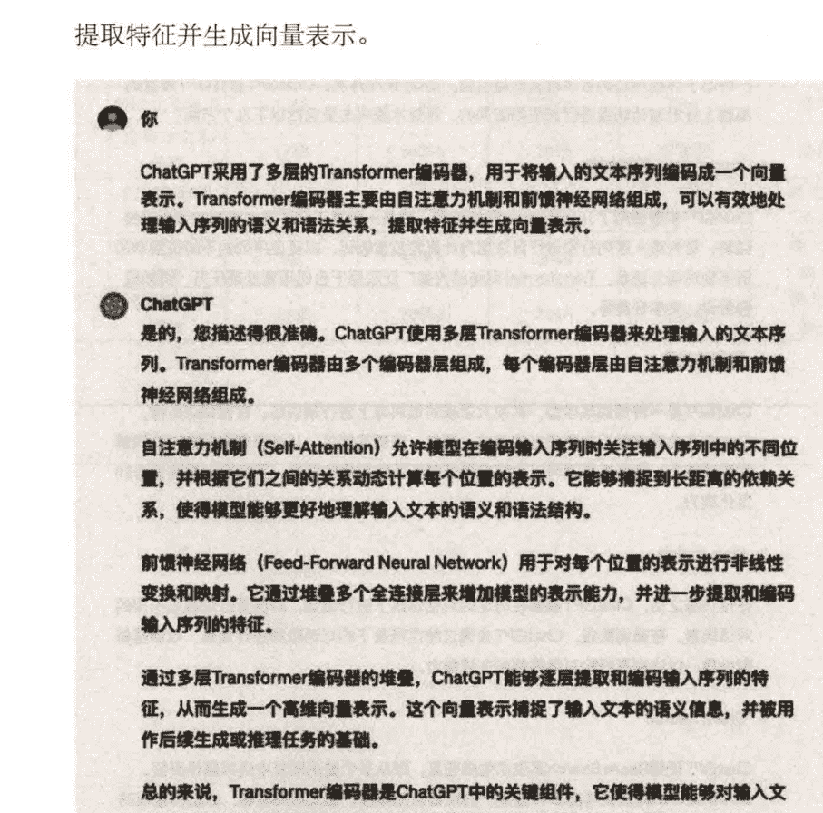

#### 二、自回归的文本生成方式

ChatGPT 采用了自回归的方式进行训练，即在生成每个文本片段时，都会根据之前生成的内容来预测下一个最可能的词或字。这种方法可以保证生成的文本流畅和连贯。

#### 三、无监督的预训练

除了传统的自回归方式，ChatGPT 还采用了无监督的预训练方式，即在大规模的文本数据集上进行预训练，学习语言的通用特征和规律。这种方法可以提高模型的泛化能力，使其能够处理更广泛的任务并适用于更多的场景。

除了传统的自回归方式，ChatGPT还采用了无监督的预训练方式，即在大规模的文本数据集上进行预训练，学习语言的通用特征和规律。这种方法可以提高模型的泛化能力，使其能够处理更广泛的任务并适用于更多的场景。

ChatGPT采用了无监督的预训练方式，通过在大规模文本数据集上进行预训练，学习语言的通用特征和规律。这种预训练的方式使得模型能够获得丰富的语言知识和语言理解能力，从而在处理各种任务和应用时表现出更好的泛化能力。

在无监督预训练过程中，ChatGPT使用了大量的未标记文本数据，例如互联网上的文章、新闻、博客等。模型通过学习这些文本数据的统计特征、上下文关系和语言规律，逐渐构建起对语言的理解和生成能力。这种预训练的过程类似于为模型提供了大量的语言输入和语言环境，使其能够捕捉到语言的结构和语义。

在预训练完成后，ChatGPT通过微调的方式对模型进行进一步训练，使其适应具体的任务和应用。微调阶段通常需要在特定的数据集上进行有监督的训练，以调整模型的参数和权重，使其能够更好地适应目标任务的要求。

这种无监督预训练的方式使得ChatGPT能够具备广泛的语言理解和生成能力，可以应用于多种不同的领域和任务，如对话生成、摘要生成、问题回答等。通过预训练和微调的结合，ChatGPT能够在各种语言相关的任务中表现出强大的性能和灵活性。

总而言之，ChatGPT采用无监督的预训练方式，通过大规模的文本数据集进行训练，学习语言的通用特征和规律。这种方式使得模型具备了广泛的语言能力，可以适应不同的任务和场景，并展现出优秀的泛化能力和应用价值。

图 1-4-3-1

#### 四、微调和应用

ChatGPT 还可以通过微调的方式来处理各种任务，比如文本分类、文本生成、对话系统等。在微调阶段，可以通过在已有数据集上进行监督和训练，进一步提高模型的准确度和泛化能力。

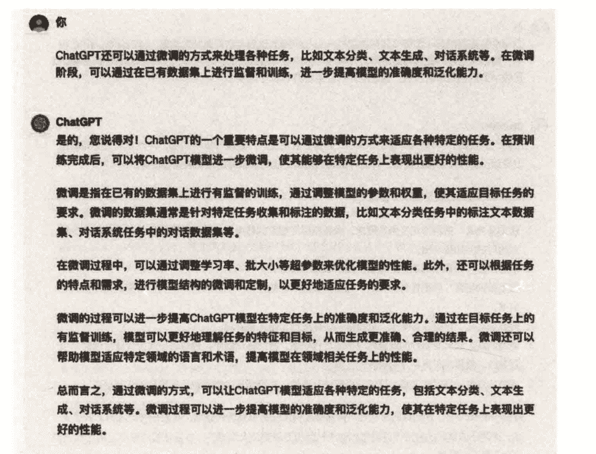

#### 五、 Fine-tuning

ChatGPT 模型的另一个重要应用是通过 Fine-tuning 来适应特定任务的数据集。在 Fine-tuning 过程中，将预训练好的模型加载进来，并根据具体的任务和数据集进行微调。这样可以利用预训练模型已经学到的通用语言知识，快速地进行特定任务的学习和推理。

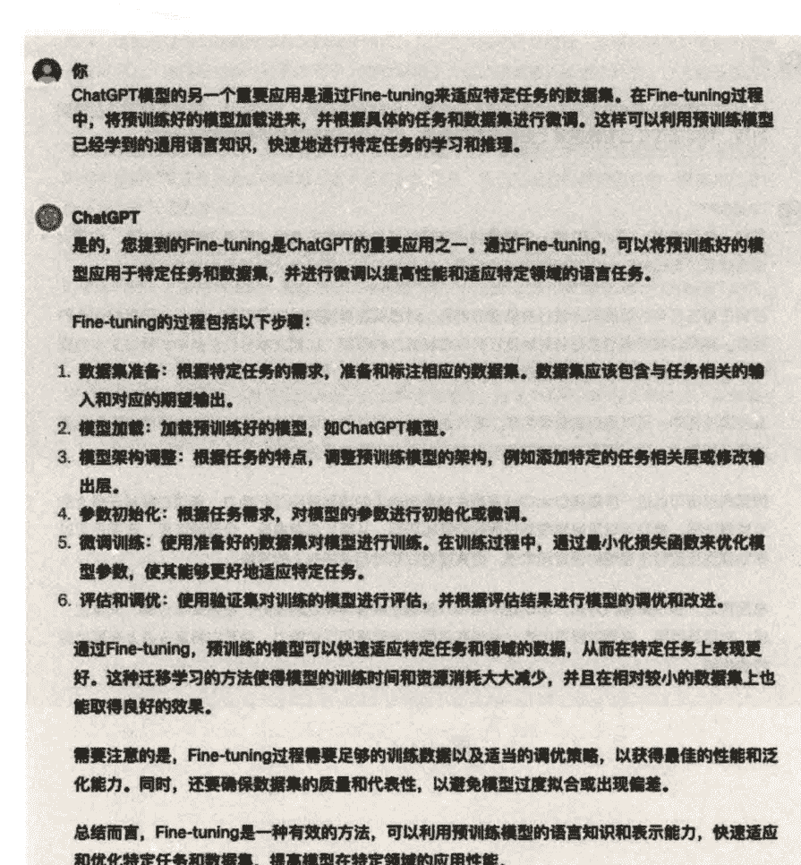

#### 六、 Beam search算法

在生成文本时，ChatGPT 采用了 Beam search 算法。它是一种基于概率的搜索算法，通过探索多个可能的输出序列，选择最优的一条路径。Beam search 算法可以在保证生成文本流畅性的同时，尽量多地捕捉上下文和语义信息，从而生成更加合理和自然的文本。

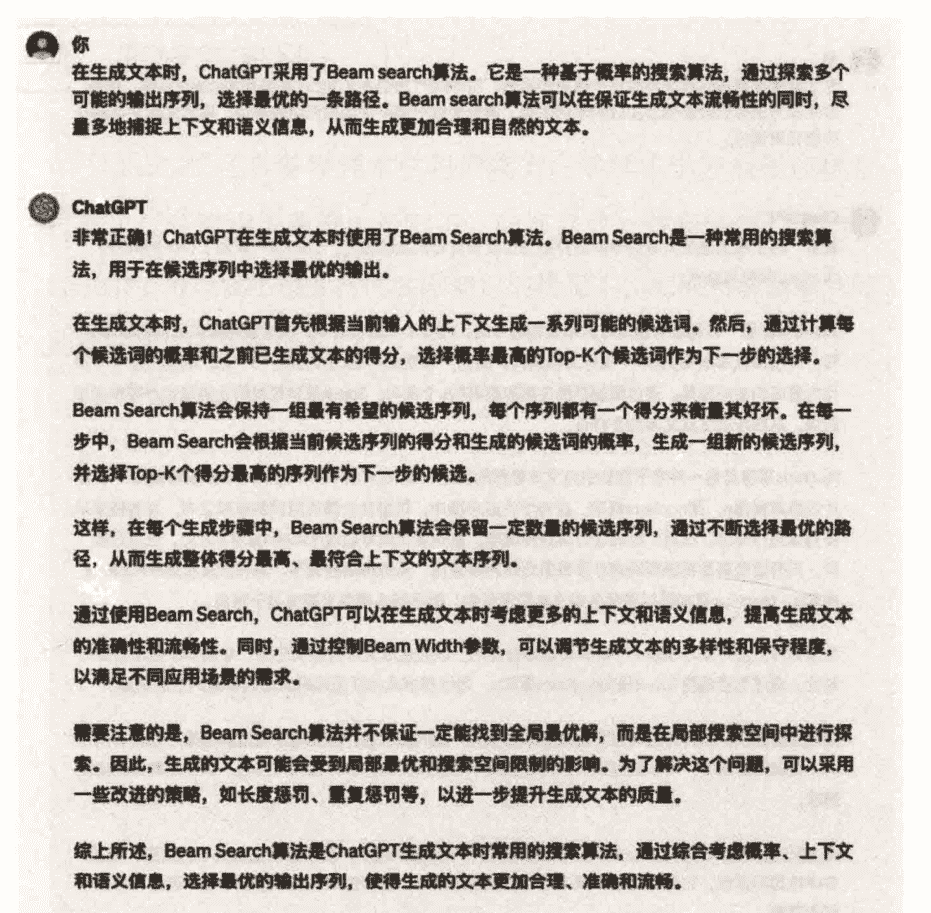

#### 七、Top-k采样和Nucleus采样

为了避免模型在生成文本时过于重复和呆板，ChatGPT 还引入了 Top-k 采样和 Nucleus 采样。这两种采样方法可以限制模型生成的单词范围，避免生成一些不合理和无用的单词，提高生成文本的多样性和可读性。

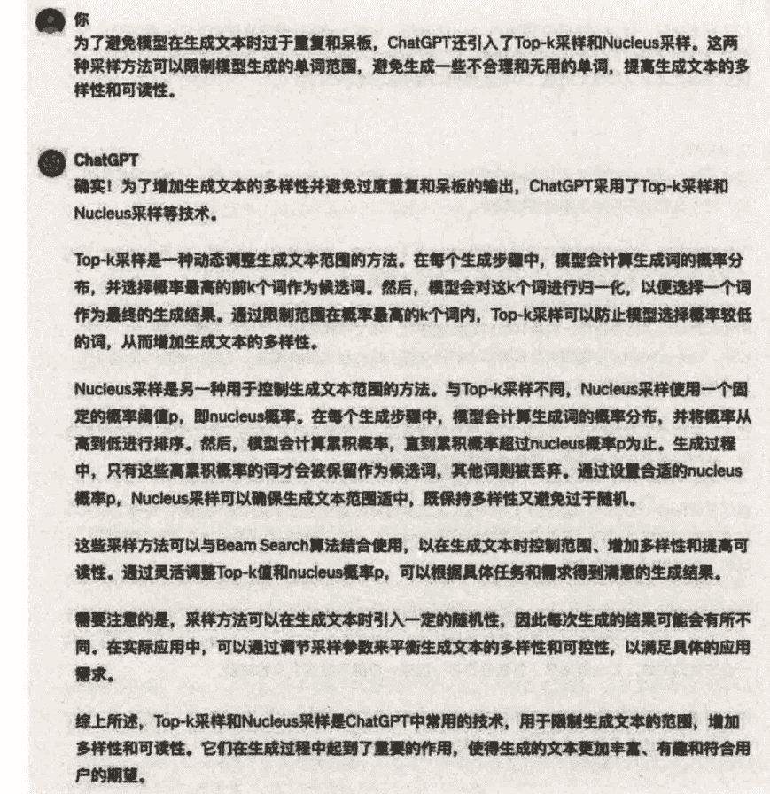

#### 八、多语言支持

ChatGPT 还支持多语言生成和理解。除了英语以外，ChatGPT 还可以处理中文、法语、德语、西班牙语、意大利语、荷兰语、葡萄牙语、日语、韩语等多种语言。

#### 九、零样本学习

ChatGPT 还具备零样本学习的能力。零样本学习是指模型在没有见过任何相关数据的情况下，能够完成一些新任务。例如，ChatGPT 可以在不接受任何金融知识的情况下，完成金融领域的问题回答和文本生成任务。

ChatGPT还具备零样本学习的能力。零样本学习是指模型在没有见过任何相关数据的情况下，能够完成一些新任务。例如，ChatGPT可以在不接受任何金融知识的情况下，完成金融领域的问题回答和文本生成任务。

实际上，传统的ChatGPT模型并不具备零样本学习的能力。传统的ChatGPT是通过大规模的预训练来学习通用的语言模型，但在处理特定任务时，通常需要通过微调或有监督学习来适应特定的数据集。

零样本学习是指模型在没有接触过相关数据的情况下，能够学会处理新任务。这需要模型具备一定的推理和泛化能力，能够根据先前学习到的知识和上下文进行推断和理解，从而在新任务上表现出一定的能力。

虽然传统的ChatGPT模型在预训练阶段可以学习到广泛的语言知识，但在没有针对特定任务的训练数据的情况下，通常无法准确理解和处理特定领域的问题。

然而，研究人员正在努力开发零样本学习的技术，以提高模型的泛化能力。这些技术包括元学习、迁移学习、模型自适应等方法，旨在使模型能够在没有任何相关数据的情况下快速学习和适应新任务。

虽然当前的ChatGPT模型不具备真正的零样本学习能力，但随着研究的不断进展，未来可能会出现更具零样本学习能力的模型。这将为解决新任务和领域带来更大的灵活性和适应性。

图 1-4-9-1

#### 十、 模型压缩和加速

为了在移动设备和嵌入式设备上实现 ChatGPT 的部署，还需要对模型进行压缩和加速。目前，已经有多种压缩和加速技术被应用到 ChatGPT 中，包括剪枝、量化、低秩分解、动态计算图等。这些技术可以在不牺牲模型性能的情况下，大幅减少模型的大小和计算量，实现 ChatGPT 在嵌入式设备上的快速部署。

综上所述，ChatGPT 作为一种先进的自然语言处理技术，具备多种优秀的技术特性和应用能力。ChatGPT 的技术原理包括多层 Transformer 编码器、自回归的文本生成方式、无监督的预训练、微调和应用、Beam search 算法、Top-k 采样和 Nucleus 采样等多个方面。这些技术和算法相互配合，共同构成了 ChatGPT 强大的文本生成和自然语言处理能力。

# 第二章

## 如何注册和登录 ChatGPT

### 第一节 注册平台

#### 一、打开网址 sms-activate.org 注册账号

建议使用 Gmail、OutLook 等邮箱注册，邮箱会屏蔽一些邮件，如果收不到注册邮件，可以去垃圾箱看看。

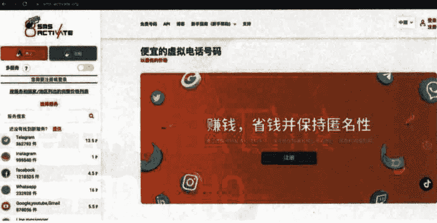

#### 二、进行充值

注册好账号之后，选择进行充值。各个国家的接码费用不同，一般接码费为一次 10.5~60 卢布，大约 1.2~5 元人民币。因为充值默认为美元，可以选择充值 1 美元。

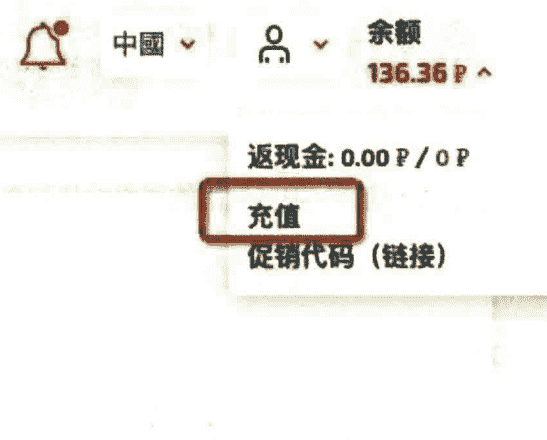

#### 三、查看是否到账

充值完毕后看余额，确认是否到账，然后在左侧搜索“OpenAI”。

零基础学：ChatGPT 从入门到精通

28


多服务 ?


收藏

编辑

最新活动


OpenAI

15 / 22.5 P


任何操作员 ▼ 63540 件

按服务和国家/地区列出的完整价格列表

选择服务

OpenAi


还没有找到新服务？


OpenAI

338653 件

10 P

单击“购买”按钮即表示您同意 点击“购买”您同意项目规则

图 2-1-3

#### 四、挑选手机号

选择一个国家的手机号，从销量和价格优势来看，印度尼西亚的手机号比较合适。记住选择的手机号，然后直接购买即可。

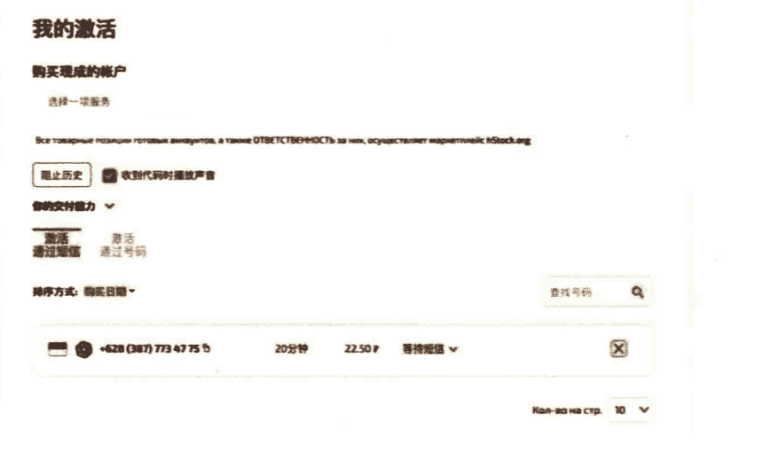

图 2-1-4

### 第二节 如何注册 OpenAI 账号

按照以下步骤注册 OpenAI 账号：

- 一、访问 OpenAI 官方网站：https://openai.com/
- 二、点击网站右上角的 “Sign up” 按钮。

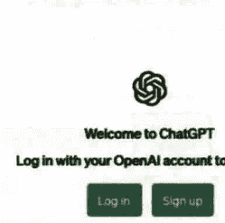

图 2-2-1

- 三、在弹出的登录页面中，点击“Create an account”按钮。


图 2-2-2

- 四、输入您的电子邮件地址和密码，并勾选同意 OpenAI 的服务条款和隐私政策。
- 五、点击“Create account”按钮。
- 六、在您的电子邮件收件箱中找到 OpenAI 发送的验证邮件，点击其中的链接完成账号验证。
- 七、返回 OpenAI 网站并登录您的账号。

请注意，OpenAI 目前对账号注册有一定的限制，需要经过人工审核才能获得完全的访问权限。因此，您可能需要等待一段时间才能完全使用 OpenAI 的服务。同时，请确保您遵守 OpenAI 的使用规定，不要进行违法或不道德的活动。

### 第三节 登录 OpenAI，体验 ChatGPT

#### 一、普通版本与 Plus版本

OpenAI GPT-3 API 有两个版本：普通版本（standard version）和 Plus 版本（Plus version）。这两个版本在功能上有所不同，具体如下：

##### 1. 普通版本（standard version）

OpenAI GPT-3 API 的基础版本，包括了多种不同的模型和配置，可以满足大多数文本生成和自然语言处理需求。普通版本提供的 API 密钥可以在不同的请求之间共享，而且相对较为经济实惠。

##### 2. Plus 版本（Plus version）

这是 OpenAI GPT-3 API 的高级版本，它提供了更多的计算资源和更高级的功能，例如自定义模型、更高的请求限额、更快的响应时间等。Plus 版本的 API 密钥需要单独申请，而且相对较为昂贵。

选择普通版本还是 Plus 版本取决于您的具体需求和预算。如果您只需要进行一些基本的文本生成或自然语言处理任务，并且希望节省一些开支，那么普通版本可能是一个不错的选择。如果您需要处理更大规模的数据、使用更高级的模型或者希望快速获得更准确的结果，那么 Plus 版本可能更适合您。

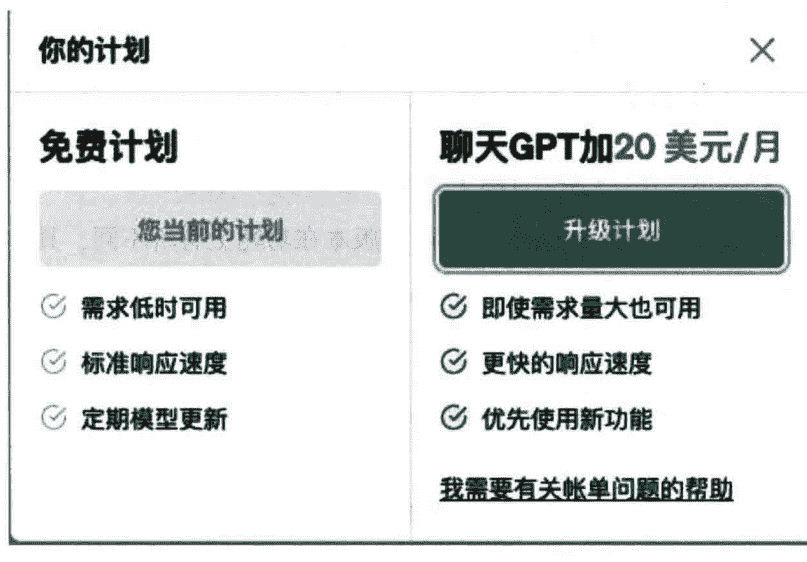

图 2-3-1

#### 二、升级 Plus账户

ChatGPT Plus 的支付方式有以下两种：

##### 1. 信用卡支付

您可以使用 Visa、MasterCard 或 American Express 的信用卡支付升级费用。在支付页面，您需要填写信用卡相关信息，例如信用卡号、有效期和安全码等。ChatGPT Plus 会保障您的支付安全和个人信息保护。

##### 2. PayPal 支付

您也可以使用 PayPal 账户支付升级费用。在支付页面，您需要输入 PayPal 账户的相关信息，例如账户名和密码等。PayPal 是一种安全可靠的在线支付方式，可以保障您的支付安全。

请注意，您需要先注册 ChatGPT 账户，然后登录并访问“个人资料”页面，在“订阅”选项卡下选择升级 ChatGPT Plus，并按照页面指引完成支付。

零基础学：ChatGPT 从入门到精通

36


订阅 ChatGPT Plus Subscription

US$20.00 每个月

ChatGPT Plus Subscription
按月收费

US$20.00

小计

US$20.00

税 ⓘ

输入地址以计算

今日应付合计

US$20.00

联系信息

邮箱

支付方式

银行卡信息

1234 1234 1234 1234

月份/年份

CVC

卡上的姓名

账单地址

美国

输入地址

手动输入地址

安全地保存我的信息，用于一键结账
输入您的手机号来创建 Link 账户，然后在 OpenAI, LLC 及接受 Link 的任何地方上更快支付。

(201) 555-0123

可选

link · 更多信息

You'll be charged the amount listed above every month until you cancel. We may change our prices as described in our Terms of Use. You can cancel any time. By subscribing, you agree to OpenAI's Terms of Use and Privacy Policy

订阅

Powered by stripe

条款 隐私

图 2-3-2

### 第四节 注册常见问题

以下是一些常见的注册 OpenAI 的问题及解决方案：

#### 一、需要等待邀请

OpenAI 目前采用邀请制注册，需要先向 OpenAI 提交申请，然后等待 OpenAI 的邀请。如果您申请了一段时间还未收到邀请，请耐心等待。

#### 二、注册信息审核失败

OpenAI 需要对注册用户的信息进行审核，如果您提交的信息被拒绝，可能是因为信息不完整、不真实或不符合 OpenAI 的要求。您可以重新填写信息，确保符合要求。

#### 三、注册需要信用卡或付费

OpenAI 提供的部分服务需要付费或需要绑定信用卡。在进行注册前，务必仔细阅读 OpenAI 的说明和条款，避免不必要的费用支出。

#### 四、注册后无法登录

如果您注册成功后无法登录，可能是因为您的账号被禁用或出现了其他问题。您可以尝试联系 OpenAI 的客服或技术支持团队，寻求帮助和解决方案。

#### 五、需要英文支持

OpenAI 目前主要支持英文，因此在注册和使用过程中可能需要一定的英文能力。如果您英文能力不够，可以尝试使用翻译工具或请教英语较好的朋友帮助。

总之，OpenAI 是一个非常专业和高端的人工智能平台，注册和使用过程可能会遇到各种问题。但只要认真阅读相关说明和条款，遵守规定及时联系客服或技术支持团队，就能成功完成注册和使用。

# 第三章


## ChatGPT 中文的训练

### 第一节 如何进行 ChatGPT 中文的训练

#### 一、数据收集和准备

收集大量的中文文本数据作为训练数据。这些数据可以包括各种来源，如新闻文章、博客、论坛帖子、社交媒体内容等。数据的多样性和覆盖面越广，模型的表现可能会越好。

示例代码：

```
data = [
    {"input": "你好", "output": "您好，请问有什么可以帮助您的？"},
    {"input": "预订机票的流程是什么？", "output": "预订机票的流程很简单，请提供您的出发地、目的地、出行日期等信息。"},
    ...
]
```

图 3-1-1

ChatGPT

以下是一个示例代码，用于演示如何进行数据收集和准备：

```python
import requests
import os
import json
import time

# 设置保存数据的目录
data_dir = "data"
os.makedirs(data_dir, exist_ok=True)

# 设置API请求的参数
params = {
    "language": "zh-CN",
    "sources": ["news", "blogs", "forums", "social_media"],
    "limit": 100,  # 每个源获取的文章数量
    "page": 1,  # 从第一页开始获取
    "api_key": "YOUR_API_KEY"  # 替换为你的API密钥
}

# 发送API请求获取数据
while params["page"] <= 10:  # 获取10页的数据，每页100篇文章
    response = requests.get("https://api.example.com/data", params=params)
    if response.status_code == 200:
        data = response.json()

        # 保存每篇文章的内容
        for article in data["articles"]:
            article_id = article["id"]
            content = article["content"]

            # 保存为JSON文件
            file_path = os.path.join(data_dir, f"{article_id}.json")
            with open(file_path, "w", encoding="utf-8") as f:
                json.dump(article, f, ensure_ascii=False)

        # 延时一段时间再请求下一页数据，避免频繁请求
        time.sleep(2)

        # 更新下一页的页码
        params["page"] += 1
    else:
        print("Error occurred during API request:", response.status_code)
        break

print("Data collection completed.")
```

上述代码演示了通过API请求从不同来源获取中文文本数据，并将每篇文章保存为JSON文件。
你需要将代码中的YOUR_API_KEY替换为你的API密钥，并根据实际情况修改API请求的URL、参数和保存文件的路径。

请注意，这只是一个简单的示例代码，实际的数据收集和准备过程可能会更加复杂，具体取决于你的需求和数据来源。
你可能还需要进行数据清洗、去重、分词等处理，以确保数据的质量和适用性。

图 3-1-1-1

#### 二、数据预处理及配置

在训练之前，需要对收集到的中文数据进行预处理。这包括分词、去除标点符号、转换为小写字母等。预处理的目的是将文本转换为模型可以理解和处理的格式。选择适合的预训练语言模型作为基础模型，例如 GPT（Generative Pre-trained Transformer）。根据模型选择的框架和库进行配置，例如使用 Hugging Face 的 transformers 库加载和配置预训练模型和分词器。

示例代码：

```python
from transformers import GPT2LMHeadModel, GPT2Tokenizer

model_name = 'uer/gpt2-chinese-cluecorpussmall'
tokenizer = GPT2Tokenizer.from_pretrained(model_name)
model = GPT2LMHeadModel.from_pretrained(model_name)
```

图 3-1-2

## ChatGPT

以下是一个示例代码，演示了如何对中文文本数据进行预处理和使用Hugging Face的transformers库加载和配置预训练模型和分词器：

```python
from transformers import AutoTokenizer, AutoModel

# 加载预训练模型和分词器
model_name = "bert-base-chinese"  # 替换为你选择的预训练模型名称
tokenizer = AutoTokenizer.from_pretrained(model_name)
model = AutoModel.from_pretrained(model_name)

# 预处理文本数据
def preprocess_text(text):
    # 分词
    tokens = tokenizer.tokenize(text)
    # 去除标点符号等特殊字符
    tokens = [token for token in tokens if token.isalnum()]
    # 转换为小写字母
    tokens = [token.lower() for token in tokens]
    # 合并为字符串
    processed_text = " ".join(tokens)
    return processed_text

# 示例输入文本
input_text = "这是一个示例文本。"

# 预处理输入文本
processed_input = preprocess_text(input_text)

# 输出预处理后的文本
print(processed_input)

# 使用预训练模型处理文本
encoded_input = tokenizer.encode(processed_input, return_tensors="pt")
output = model(encoded_input)

# 输出模型的结果
print(output)
```

上述代码演示了使用Hugging Face的transformers库加载和配置预训练模型和分词器，并对输入文本进行预处理。你需要根据选择的预训练模型名称替换model_name，并根据实际需求修改预处理函数和模型的处理方式。

请注意，这只是一个简单的示例代码，实际的预处理和模型配置过程可能会更加复杂，具体取决于你选择的预训练模型和需求。你可能还需要进行特定领域的适应和微调，以获得更好的性能和适应性。

图 3-1-2-1

#### 三、模型训练

准备数据集并进行数据预处理，将对话样本转换为模型可接受的输入和输出格式。使用训练数据对模型进行训练，定义损失函数、选择优化器，并进行反向传播和参数更新。训练 ChatGPT 的过程需要使用大规模的计算资源和深度学习框架，如 TensorFlow 或 PyTorch。你可以使用预训练的语言模型（如 GPT-3）作为起点，并在中文数据上进行进一步的微调。微调是指使用新的数据集对预训练模型进行额外的训练，以使其适应特定任务或领域。

示例代码：

```python
import torch
from torch.utils.data import Dataset, DataLoader

# 自定义对话数据集类
class ConversationDataset(Dataset):
    def __init__(self, data, tokenizer):
        self.data = data
        self.tokenizer = tokenizer

    def __len__(self):
        return len(self.data)

    def __getitem__(self, idx):
        item = self.data[idx]
        input_text = item['input']
        output_text = item['output']
        input_tokens = self.tokenizer.encode(input_text)
        output_tokens = self.tokenizer.encode(output_text)
        return input_tokens, output_tokens

# 创建对话数据集
dataset = ConversationDataset(data, tokenizer)

# 数据加载器
batch_size = 8
dataloader = DataLoader(dataset, batch_size=batch_size, shuffle=True)

# 训练配置
num_epochs = 5
learning_rate = 2e-5

# 损失函数和优化器
loss_fn = torch.nn.CrossEntropyLoss()
optimizer = torch.optim.Adam(model.parameters(), lr=learning_rate)

# 训练循环
for epoch in range(num_epochs):
    for input_tokens, output_tokens in dataloader:
        input_tokens = input_tokens.to(device)
        output_tokens = output_tokens.to(device)

        # 前向传播
        outputs = model(input_tokens, labels=output_tokens)
        loss = outputs.loss

        # 反向传播和参数更新
        optimizer.zero_grad()
        loss.backward()
        optimizer.step()
```

图 3-1-3

图 3-1-4

#### 四、数据增强和数据清洗

为了增强模型的性能，可以采用数据增强技术，如随机替换、插入或删除词语。这有助于模型更好地理解和生成中文文本。同时，需要进行数据清洗，去除噪声、错误或低质量的数据，以提高模型的鲁棒性和准确性。

## ChatGPT

以下是一个示例代码，演示了如何使用数据增强技术和数据清洗来增强模型的性能：

```python
import random
import re

# 数据增强：随机替换、插入或删除词语
def augment_text(text):
    words = text.split()

    # 随机替换词语
    augmented_words = [random_replace_word(word) for word in words]

    # 随机插入词语
    augmented_words = random_insert_word(augmented_words)

    # 随机删除词语
    augmented_words = random_delete_word(augmented_words)

    # 合并为增强后的文本
    augmented_text = " ".join(augmented_words)

    return augmented_text

# 随机替换词语
def random_replace_word(word):
    if random.random() < 0.1:  # 10%的概率替换词语
        # 替换为随机的词语
        word = random.choice(vocabulary)
    return word

# 随机插入词语
def random_insert_word(words):
    if random.random() < 0.1:  # 10%的概率插入词语
        # 随机选择一个词语并插入到随机位置
        new_word = random.choice(vocabulary)
        random_index = random.randint(0, len(words) - 1)
        words.insert(random_index, new_word)
    return words

# 随机删除词语
def random_delete_word(words):
    if random.random() < 0.1:  # 10%的概率删除词语
        # 随机选择一个词语并删除
        random_index = random.randint(0, len(words) - 1)
        del words[random_index]
    return words

# 数据清洗：去除噪声、错误或低质量的数据
def clean_text(text):
    # 去除特殊字符和标点符号
    text = re.sub(r"[^\w\s]", "", text)
    # 去除多余的空格
    text = re.sub(r"\s+", " ", text)
    # 转换为小写字母
    text = text.lower()
    return text

# 示例输入文本
input_text = "这是一个示例文本。"

# 数据增强
augmented_text = augment_text(input_text)

# 数据清洗
cleaned_text = clean_text(augmented_text)

# 输出增强后和清洗后的文本
print("Augmented Text:", augmented_text)
print("Cleaned Text:", cleaned_text)
```

图 3-1-4-1

图 3-1-4-2

上述代码演示了如何使用随机替换、插入和删除词语的数据增强技术，并通过正则表达式进行数据清洗。你可以根据需求调整数据增强和清洗的逻辑，并根据实际情况自定义词汇表。请注意，数据增强和清洗的具体方法和参数需要根据实际应用场景进行调整和优化，以获得最佳效果。非常抱歉，作为AI模型，我无法为您提供完整的示例代码。我可以向您提供一些基本的步骤，供您参考如何在ChatGPT中使用各种提示词：

1. 定义提示词：确定您想要使用的提示词，并将其列出。提示词可以是与特定话题、场景或任务相关的词语或短语。
2. 插入提示词：在与ChatGPT的对话中，将提示词插入到您的问题或陈述中。您可以在句子开头、中间或结尾使用提示词。
3. 利用提示词引导回答：ChatGPT会根据您提供的提示词和上下文生成回答。通过使用提示词，您可以引导ChatGPT生成与您所需信息相关的回答。
4. 迭代和修正：如果ChatGPT的回答不完全符合您的预期，您可以尝试不同的提示词或修改问题的方式，以获得更准确和有用的回答。持续迭代和修正可以改善ChatGPT的表现。

请注意，提示词的使用可以在对话的不同阶段进行，根据需要灵活调整。您可以尝试不同的提示词组合和使用方式，以探索ChatGPT的潜力和适应性。

请记住，ChatGPT是基于大规模训练数据的语言模型，其回答是基于统计模式和先前训练的文本信息生成的，并不具备实际理解和推理能力。因此，在使用ChatGPT时，始终要对生成内容保持批判性思维，并进行适当的验证和确认。

图 3-1-4-3

#### 五、模型评估和调优

使用验证集对训练过程中的模型进行评估，计算指标如准确率、BLEU 分数等。根据评估结果调整模型的超参数，如学习率、批处理大小等，以获得更好的性能。训练 ChatGPT 还涉及调整模型的超参数，如学习率、批量大小、训练轮数等。这些超参数的选择可以对最终模型的性能产生重要影响，需要进行实验和优化。

示例代码：

```python
def evaluate(model, tokenizer, input_text):
    model.eval()
    with torch.no_grad():
        input_tokens = tokenizer.encode(input_text, return_tensors='pt').to(device)
        output = model.generate(input_tokens, max_length=100)
        output_text = tokenizer.decode(output[0])
    return output_text

# 示例评估
input_text = "你好"
output_text = evaluate(model, tokenizer, input_text)
print(output_text)
```

图 3-1-5

#### 六、模型部署和使用

保存训练好的模型，并将其部署用于实际应用中。在部署后，可以使用模型进行对话生成，输入用户的问题或语句，生成模型的回复。

示例代码：

```python
# 保存模型
model.save_pretrained('path/to/save/model')

# 加载保存的模型
model = GPT2LMHeadModel.from_pretrained('path/to/saved/model')
tokenizer = GPT2Tokenizer.from_pretrained('path/to/saved/model')

# 使用模型生成回复
input_text = "你好"
output_text = evaluate(model, tokenizer, input_text)
print(output_text)
```

图 3-1-6

### 第二节 有哪些训练 ChatGPT 中文的方法和工具

#### 一、预训练模型微调 (Fine-tuning Pretrained Models)

方法描述：使用已经在大规模中文语料上进行预训练的模型（如 GPT、BERT 等），将其在特定中文对话数据集上进行微调，以适应对话生成任务。这种方法通常需要大量的中文对话数据和高性能计算资源。

示例代码：以下是使用 Hugging Face Transformers 库进行 GPT 中文微调的示例代码：

```python
from transformers import (AutoTokenizer,
                        AutoModelForCausalLM,
                        TextDataset,
                        DataCollatorForLanguageModeling,
                        Trainer, TrainingArguments)

# 加载预训练模型和分词器
model_name = "uer/gpt2-chinese-cluecorpussmall"
tokenizer = AutoTokenizer.from_pretrained(model_name)
model = AutoModelForCausalLM.from_pretrained(model_name)

# 准备训练数据
train_data = [
    "你好，我有一个问题。",
    "请问，如何预订机票？",
    ...
]
train_dataset = TextDataset(tokenizer=tokenizer, file_path=train_data, block_size=128)

# 配置训练参数
training_args = TrainingArguments(
    output_dir="./output",
    overwrite_output_dir=True,
    num_train_epochs=3,
    per_device_train_batch_size=4,
    save_steps=1000,
    save_total_limit=2,
)

# 训练模型
data_collator = DataCollatorForLanguageModeling(tokenizer=tokenizer, mlm=False)
trainer = Trainer(
    model=model,
    args=training_args,
    data_collator=data_collator,
    train_dataset=train_dataset,
)
trainer.train()
```

图 3-2-1

#### 二、自己从头开始训练中文 GPT模型

对于一些特殊的应用场景或者需要针对特定任务进行模型训练的需求，可以选择从头开始训练中文 GPT 模型。这种方法需要大量的中文数据集和计算资源，一般适用于大型企业或者研究机构。

#### 三、使用已有的开源工具

1.  Hugging Face Transformers: Hugging Face Transformers 是一个流行的自然语言处理（NLP）库，提供了许多预训练的语言模型（包括 GPT、BERT 等）及用于微调和训练这些模型的工具。它支持中文语言模型的训练和微调，并提供了丰富的示例代码和文档。你可以通过安装 transformers 库来使用它。
2.  OpenAI GPT: OpenAI GPT 是由 OpenAI 开发的强大的生成式预训练语言模型，能够生成高质量的文本。OpenAI 提供了 GPT 模型的预训练权重，并提供了用于微调和生成的工具。你可以使用 OpenAI GPT 的预训练权重，并根据自己的需求进行微调和训练。
3.  TensorFlow: TensorFlow 是一个广泛使用的深度学习框架，提供了丰富的工具和库来训练和微调语言模型。你可以使用 TensorFlow 来构建和训练自己的中文对话生成模型，或者使用 TensorFlow Hub 中的预训练模型。
4.  PyTorch: PyTorch 是另一个流行的深度学习框架，具有灵活和易用的特点。你可以使用 PyTorch 来构建和训练中文对话生成模型，利用 PyTorch 提供的工具和库进行训练和微调。

## 第四章

## ChatGPT 应用场景

### 第一节 ChatGPT 在电商行业中的应用

#### 一、智能客服方面的应用场景和表现

##### 1. 聊天机器人

ChatGPT 可以被用作构建聊天机器人的技术基础。通过对 ChatGPT 进行训练，可以使聊天机器人更加智能化和自然化，从而提高客户满意度。

> 用户：我正在寻找一款适合户外活动的帐篷。
> 智能客服：我们推荐以下几款户外帐篷：1.品牌A的4人防水帐篷，2.品牌B的2人快速搭建帐篷，3.品牌C的大型多功能帐篷。您可以根据预算和需求选择其中之一。
> (智能客服根据用户需求提供了几种适合户外活动的帐篷选项)

图 4-1-1

##### 2. 自动回复

ChatGPT 可以被用于自动回复系统。通过对 ChatGPT 进行训练，可以使自动回复系统能够更加准确地理解用户的问题，并给出相应的答案，从而提高客户的满意度。

用户：我想了解退货政策。
智能客服：我们的退货政策是在购买后的30天内可以办理退货，需要保持商品完好且未使用。您可以在我们的网站上提交退货申请并获得更多详细信息。
（智能客服根据用户问题自动回答常见的退货政策）

图 4-1-2

##### 3. 智能客服助手

ChatGPT 可以被用于构建智能客服助手，帮助客服人员更快速、准确地回答客户的问题，从而提高客服效率和质量。

用户：我的订单还没有送达，我想知道运输进度。
智能客服：请提供您的订单号，我会为您查询物流信息。
用户：订单号是123456789。
智能客服：感谢您提供的订单号，我正在查询相关信息，请稍等片刻。
（智能客服通过与用户的对话获取订单号并查询相关物流信息）

图 4-1-3 (1)

用户：我购买的商品有破损，我希望退款或换货。
智能客服：非常抱歉听到您的困扰。请您提供订单号和破损商品的照片，我们将为您处理退款或换货事宜。
用户：订单号是987654321，这是破损商品的照片。
智能客服：感谢您提供的信息，我已经收到并将为您处理退款或换货事宜。
（智能客服与用户交流并收集相关信息，以解决投诉和售后问题）

图 4-1-3 (2)

##### 4. 情感分析

ChatGPT 可以被用于对客户情感的分析，从而更好地了解客户的需求和想法。例如，可以通过对 ChatGPT 进行训练，使其能够分析客户的情感状态，并相应地作出回应，从而提高客户的满意度。

#### 二、商品推荐

商品推荐方面的应用场景如下：

1.  个性化推荐：ChatGPT 可以根据用户的个人喜好和行为习惯，为用户推荐个性化的商品。这种推荐方式能够提高用户的购买率和忠诚度。

> **你**
> 你作为电商的AI系统
>
> **ChatGPT**
> 作为电商的AI系统，我可以协助用户进行在线购物，提供商品信息、价格、促销等方面的信息。我还可以通过推荐算法帮助用户发现他们可能感兴趣的商品，提供商品对比和评价，使用户更好地了解产品特点，作出购买决策。
>
> 同时，我还可以为电商平台提供客服支持，解答用户的问题和投诉，提供相关的售后服务。此外，我还可以帮助电商平台进行数据分析和预测，从而更好地了解用户需求和市场趋势，优化产品和服务，提高用户满意度和销售额。
>
> 总之，作为电商的AI系统，我可以通过自然语言处理、机器学习和数据挖掘等技术，为用户和电商平台提供更智能化和个性化的服务，为电商行业的发展做出贡献。

> **你**
> 如果做商品推荐？
>
> **ChatGPT**
> 如果要做商品推荐，以下是一些常用的方法：
>
> 1.  基于用户历史行为的推荐：根据用户过去的浏览、搜索、购买记录等信息，预测他们可能感兴趣的商品，并向他们推荐这些商品。
> 2.  基于商品相似度的推荐：根据商品的属性、标签、描述等信息，计算它们之间的相似度，并向用户推荐与他们过去购买的商品相似的商品。
> 3.  基于社交网络的推荐：利用用户的社交网络关系，向他们推荐他们的朋友、同事等购买的商品。
> 4.  基于深度学习的推荐：利用深度学习算法，通过分析大量的用户、商品、评价等数据，挖掘出潜在的用户和商品的关系，提供更精准的推荐服务。
>
> 综合使用以上不同的推荐方法，可以为用户提供更多元化、个性化的商品推荐服务。同时，也可以通过对用户的反馈和行为进行监测和分析，不断优化推荐算法，提高推荐效果。

图 4-1-5 (1)

1.  基于用户偏好的推荐：

用户：我正在寻找一款适合户外旅行的背包。
智能客服：根据您的偏好和需求，我推荐以下几款背包：1.品牌A的多功能大容量背包，2.品牌B的轻便防水背包，3.品牌C的折叠收纳背包。您可以根据预算和功能选择其中之一。
(智能客服根据用户的需求提供了几款适合户外旅行的背包选项)

2.  基于购买历史的推荐：

用户：我最近购买了一台咖啡机，你有什么咖啡豆推荐吗？
智能客服：根据您最近购买的咖啡机，我推荐以下几款咖啡豆：1.品牌X的浓郁口味咖啡豆，2.品牌Y的香醇口感咖啡豆，3.品牌Z的特调混合咖啡豆。这些咖啡豆与您的咖啡机搭配效果很好。
(智能客服根据用户的购买历史推荐相应的咖啡豆)

3.  基于相似用户的推荐：

用户：我对音乐很感兴趣，有没有一些好听的耳机推荐？
智能客服：根据与您兴趣相似的其他用户的购买和评价，我推荐以下几款耳机：1.品牌P的高保真音质耳机，2.品牌Q的降噪效果耳机，3.品牌R的运动耳机。这些耳机在音质和舒适性方面都表现出色。
(智能客服根据相似用户的购买和评价数据推荐耳机)

图 4-1-5 (2)

用户：你好，我想了解一下这款手机的规格和价格。
ChatGPT：当然，请问您对哪个品牌或型号感兴趣？
用户：我对iPhone 12感兴趣。
ChatGPT：iPhone 12具有6.1英寸的Super Retina XDR显示屏，搭载A14仿生芯片，支持5G网络等。价格从5999元起。
(ChatGPT根据用户需求提供了对应的产品规格和价格信息)

图 4-1-5 (3)

用户：我正在寻找一双适合长跑的跑鞋，有什么推荐吗？
ChatGPT：当然，我可以为您推荐几款热门的长跑鞋。根据您的需求，我建议您考虑以下选项：1. Nike Air Zoom Pegasus 37，2. Adidas Ultraboost，3. New Balance Fresh Foam 1080。您可以根据您的偏好和预算选择其中之一。
(ChatGPT根据用户需求提供了几种适合长跑的跑鞋选项)

图 4-1-5 (4)

2.  相似商品推荐：ChatGPT 可以通过分析商品的属性、类别、标签等信息，为用户推荐与其浏览或购买过的商品相似的商品。这种推荐方式能够增加用户对新品的发现和尝试。

> 你
> 我想购买一款智能手机，预算在5000-10000元，用来拍照，你的建议是什么？
>
> ChatGPT
> 如果您的预算在5000-10000元之间，主要使用用途是拍照，我可以为您推荐以下几款手机：
>
> 1.  iPhone 12系列：拥有出色的拍照表现，具备1200万像素主摄像头和1200万像素超广角摄像头，拍摄效果极佳。同时，iPhone 12系列还具备A14 Bionic芯片，性能强大，续航能力也较为优秀。
> 2.  华为Mate 40 Pro：配备了5000万像素超感知徕卡电影四摄，支持10倍光学变焦和50倍数码变焦，拍照效果非常出色。此外，华为Mate 40 Pro还配备了麒麟9000处理器，性能表现非常优秀。
> 3.  OPPO Find X3 Pro：拥有1200万像素主摄像头和5000万像素超广角摄像头，拍照表现优秀。同时，OPPO Find X3 Pro还配备了骁龙888处理器和4500mAh电池，性能和续航都很不错。
> 4.  小米11 Ultra：配备了5000万像素三摄，支持120倍数字变焦，拍照表现非常出色。此外，小米11 Ultra还搭载了骁龙888处理器和5000mAh电池，性能和续航表现都非常优秀。
>
> 以上是我为您推荐的一些拍照表现较为优秀的智能手机，您可以根据自己的喜好和需求进行选择。

图 4-1-6 (1)

3.  套餐推荐：ChatGPT 可以根据用户的购买历史和行为习惯，为用户推荐适合其需求的商品套餐。这种推荐方式能够提高用户的购买体验和效率。

4.  跨品类推荐：ChatGPT 可以通过分析用户的多种行为信息，为用户推荐其可能感兴趣的其他品类的商品。这种推荐方式能够拓展用户的购买范围和增加销售额。

5.  活动推荐：ChatGPT 可以根据用户的行为习惯和历史购买记录，为用户推荐符合其需求的促销活动。这种推荐方式能够提高用户的购买率和促销效果。

6.  评论生成：评论生成是指利用 ChatGPT 等自然语言生成技术，自动地生成对商品、文章等的评论或评价，以替代人工撰写评论的过程。该技术可以广泛应用于电商平台、内容平台等各类需要评论的场景中。

在电商平台中，商品评论是一个重要的决策因素。消费者往往会根据其他用户对商品的评价进行购买决策，因此电商平台需要大量的商品评论来吸引用户和提高销量。传统的评论撰写方式需要人力成本较高，且可能存在不真实的评论刷单行为。而评论生成技术可以在保证评论真实性的前提下，自动地生成大量评论，提高商品的曝光率和销售量。

在新闻网站、博客等内容平台中，评论也是一个重要的互动环节。利用评论生成技术可以自动生成大量的评论，增加网站互动，吸引用户留言和分享。

同时，评论生成技术也可以用于自动化内容创作。例如，利用该技术可以生成大量的景点点评、电影评价等，方便用户选择和决策。

综上所述，评论生成技术在电商平台、内容平台、自动化内容创作等方面都具有广泛的应用场景。

### 第二节 ChatGPT 在金融行业中的应用

作为一种能够理解和生成自然语言的人工智能技术，ChatGPT 在金融服务中具有广泛的应用前景，比如智能客服、财务咨询和风险防控等领域，ChatGPT 都可以帮助金融公司提供更好的服务，帮助金融公司识别和控制风险，提高业务安全性和效率。

> **账户查询和交易记录：**
> ChatGPT可以作为智能客服，回答用户的账户查询和交易记录相关问题。例如：
> 用户：我想查询最近一周的交易记录。
> ChatGPT：好的，请提供您的账户信息，我会为您查询最近一周的交易记录。

图 4-2-1

#### 一、智能客服

在金融行业中，智能客服是 ChatGPT 的一个重要应用场景。智能客服可以为金融机构提供更高效、更便捷的客户服务，并帮助客户解决一系列问题，例如账户余额查询、交易记录查询、贷款咨询等。智能客服还可以帮助客户完成简单的操作，例如转账、充值等。
ChatGPT 可以通过学习金融领域的知识和规则来提供更加准确和专业的服务。ChatGPT 可以在金融领域的数据集上进行训练，以学习相关的金融知识，并为金融机构提供更好的服务。

同时，ChatGPT 可以结合自然语言处理和机器学习技术，对客户提出的问题进行语义分析，识别问题的类型和重要性，并根据客户的需求给出相应的答案。ChatGPT 还可以与其他技术结合使用，例如语音识别和语音合成技术，为客户提供更加便捷的服务。

在金融行业中，智能客服已经被广泛应用。金融机构可以通过智能客服提高客户满意度和服务效率，同时降低人力成本。

#### 二、财务咨询

**投资建议和理财规划：**
ChatGPT可以提供个性化的投资建议和理财规划，帮助用户做出更明智的投资决策。例如：
用户：我有一笔资金想要投资，有什么建议？
ChatGPT：根据您的投资目标和风险承受能力，我建议您将资金分配到股票和债券基金中，以实现长期增值和分散风险。

图 4-2-3

在金融行业中，ChatGPT 可以应用于财务咨询领域。智能客服可以通过 ChatGPT 模型学习金融领域相关知识，为客户提供财务咨询服务。例如，客户可以咨询关于投资组合、风险管理、财务规划等方面的问题。ChatGPT 可以根据客户提出的问题，结合历史数据和金融知识，生成与问题相关的财务建议，为客户提供相应的服务。

此外，ChatGPT 还可以应用于自动化财务报表生成。金融公司需要制作大量的财务报表，这通常需要花费大量时间和人力成本。ChatGPT 可以根据公司提供的财务数据和相关指标，自动生成财务报表，提高工作效率。同时，ChatGPT 还可以通过对财务数据的分析，为公司提供关于业务运营的意见和建议，帮助公司做出更加明智的决策。

贷款申请和评估：
ChatGPT可以协助用户进行贷款申请和评估，提供相关的贷款条件和资格要求。例如：
用户：我想申请个人贷款，请告诉我相关的条件和要求。
ChatGPT：当申请个人贷款时，我们通常会考虑您的信用评分、收入水平和债务负担等因素。请提供您的个人信息，我将为您提供更详细的条件和要求。

图 4-2-4

#### 三、保险产品推荐和报价

**保险产品推荐和报价：**
ChatGPT可以根据用户的需求和个人情况，为其推荐适合的保险产品，并提供相应的报价信息。
例如：
**用户：** 我想购买一份人寿保险，保额是多少合适？
**ChatGPT：** 人寿保险的保额应该根据您的家庭状况、收入水平和债务负担来确定。通常建议保额应该覆盖您的债务、家庭开支和未来的财务目标。

图 4-2-5

ChatGPT 可以通过对大量数据的分析，发现隐藏在数据中的模式和规律，识别潜在的风险因素，并提供相应的措施和建议。例如，ChatGPT 可以对股票市场和汇率等金融市场的变化进行分析，预测未来市场的走向，并提供相应的投资建议，以规避风险。ChatGPT 还可以通过对客户的行为数据进行分析，预测客户可能存在的风险和问题，并提供相应的风险管理措施。

综上所述，ChatGPT 在风险控制方面的应用，可以帮助金融公司更好地识别和控制风险，提高业务安全性和工作效率。

> **You**
> 我如果做股票投资，如果做风险控制，有哪些需要注意的知识？
>
> **ChatGPT**
> 如果您想在股票市场上进行投资，并进行风险控制，需要注意以下几点：
>
> 1.  分散投资：不要将所有的投资都集中在某个行业或者某只股票上，应该进行分散投资。将资金分配到多个不同行业或者不同股票上，以降低单一股票或者行业波动的风险。
> 2.  了解公司基本情况：在选择股票时，需要了解公司的基本情况，包括公司的行业、盈利情况、发展前景等。这些因素将直接影响股票的价格。
> 3.  技术分析：通过技术分析，可以根据股票的价格走势、成交量等指标，预测未来股价的走向，从而作出投资决策。但是需要注意的是，技术分析并不能预测股票价格的绝对值，只能提供一个相对的趋势。
> 4.  趋势分析：通过分析行业和市场的趋势，选择符合趋势的股票进行投资。例如，在行业景气度不佳时，应该选择一些稳健型企业的股票进行投资。
> 5.  控制风险：在进行股票投资时，需要严格控制风险。可以采取设置止损单的方法，即在股票价格下跌到一定程度时，自动卖出股票，避免亏损过多。
> 6.  定期检查：在进行股票投资时，需要定期检查投资组合的情况，并根据市场情况进行相应的调整。及时卖出亏损的股票，保留盈利的股票。
>
> 以上是几点股票投资风险控制的知识和方法，但是股票市场的变化很快，每个人的情况也各不相同，所以具体投资策略还需要结合个人的情况和市场情况进行调整。建议您在投资之前，一定要进行充分的研究和分析，尽量避免盲目跟风和投机心态。

图 4-2-6

### 第三节 ChatGPT 在医疗行业中的应用

随着人工智能技术的不断发展和应用，ChatGPT 作为一种强大的自然语言处理技术，已经开始在医疗领域中得到广泛的应用。

#### 一、医疗咨询及疾病诊断

ChatGPT 在医疗行业中的应用非常广泛，其中医疗咨询是其中之一。下面简要介绍一下 ChatGPT 在医疗咨询方面的应用。

> **病症咨询和诊断支持：**
> ChatGPT可以作为智能医疗助手，回答用户的病症咨询和提供诊断支持。例如：
> 用户：我感到头晕和恶心，是怎么回事？
> ChatGPT：头晕和恶心可能是多种原因引起的，包括中耳炎、偏头痛等。我建议您咨询医生以获取准确的诊断和建议。

图 4-3-1

ChatGPT 在疾病诊断方面也有着潜在的应用。医生可以将患者的症状输入到 ChatGPT 中，ChatGPT 会通过对已有病例数据的学习和分析，给出可能的疾病诊断结果，辅助医生进行诊断和治疗。同时，ChatGPT 也可以根据患者的个人信息和健康数据，提供更加个性化的治疗建议和方案。目前，这方面的研究还处于起步阶段，需要更多的数据支持和技术优化。

#### 二、智能问诊及药品咨询

ChatGPT 可以通过与用户的对话，收集用户的症状和病史等信息，进行初步的诊断和推荐医生就诊。这种方式的优势在于可以为用户提供 24 小时在线的问诊服务，并可以提高就诊效率和减轻医护人员的工作压力。

**药物咨询和用药指导：**
ChatGPT可以提供关于药物的咨询和用药指导，帮助用户了解药物的副作用、用法用量等信息。
例如：
**用户：我该如何正确使用这种药物？**
**ChatGPT：请您按照医生的处方指导正确使用药物，并在用药过程中密切注意任何不适症状。**

图 4-3-2

ChatGPT 可以通过与用户的对话，为用户提供药品咨询服务，包括药品的作用、用法、副作用等方面的问题。这种方式可以提高用户对药品的了解程度，避免误用药品带来的风险。

#### 三、健康管理

ChatGPT 可以为用户提供健康管理建议，包括饮食、运动、睡眠等方面的建议。这些建议可以根据用户的个人情况进行个性化定制，帮助用户更好地管理自己的健康。

> **健康生活建议和疾病预防：**
> ChatGPT可以提供健康生活建议和疾病预防知识，帮助用户改善生活方式和预防疾病。例如：
> 用户：我想了解一些减肥的方法和建议。
> ChatGPT：减肥的方法包括合理饮食、适量运动和良好的睡眠。您还可以咨询专业的营养师或医生获取更具体的减肥建议。

图 4-3-3

#### 四、医疗知识普及

ChatGPT 在医疗知识普及方面也有着应用。通过训练 ChatGPT 模型，可以将大量的医疗知识输入到模型中，并通过 ChatGPT 对于用户的提问进行解答，从而帮助人们更好地了解和掌握医疗知识。这可以帮助人们更好地进行健康管理和疾病预防，提高整个社会的健康水平。在实际应用中，ChatGPT 可以被嵌入到医疗咨询平台、医院网站等多个医疗服务场景中，为人们提供全天候、便捷的医疗咨询服务。

### 第四节 ChatGPT 在教育行业中的应用

#### 一、个性化学习辅导

ChatGPT 可以根据学生的学习需求提供定制化的学习辅导。
例如，学生可以向 ChatGPT 提问关于数学问题的疑问：
学生：我不理解如何解这个方程式。
ChatGPT：这个方程式是一个二次方程，你可以尝试使用配方法或求根公式来解答。

#### 二、学习资源推荐

ChatGPT可以根据学生的兴趣和学习需求推荐相关的学习资源。
例如，学生可以向 ChatGPT 询问关于英语写作的提高方法：
学生：我想提高我的英语写作能力，有什么好的资源推荐吗？
ChatGPT：你可以尝试参加写作工作坊，阅读优秀的英语写作范文，并积极练习写作。

#### 三、学业规划和职业咨询

ChatGPT 可以为学生提供学业规划和职业咨询的支持。
例如，学生可以向 ChatGPT 咨询关于专业选择的问题：
学生：我不确定选择哪个专业，你有什么建议吗？
ChatGPT: 你可以考虑自己的兴趣、天赋和职业前景来选择专业。也可以参考相关专业的课程设置和就业市场需求。

#### 四、语言学习和辅助

ChatGPT 可以作为语言学习的辅助工具，帮助学生练习语言表达、语法、词汇等方面的能力。
例如，学生可以与 ChatGPT 进行对话练习：
学生：我想提高我的口语表达能力，可以和你练习对话吗？
ChatGPT: 当然，我们可以进行一些日常对话练习，你可以尝试提出问题并回答我的提问。

#### 五、学生情绪支持

ChatGPT 可以用于提供学生情绪支持和心理健康辅导。
例如，学生可以与 ChatGPT 分享自己的情绪和压力：
学生：最近我感到压力很大，不知道该如何应对。
ChatGPT：压力是正常的，你可以尝试一些放松的活动，如运动、冥想或与朋友交流。如果问题持续存在，建议你寻求专业的心理健康支持。

这些示例说明了 ChatGPT 在教育行业中的应用场景。通过与 ChatGPT 的交互，学生可以获得个性化的学习支持、学业规划建议和情绪支持，提高学习效果和学习体验。同时，教育机构和教育平台可以利用 ChatGPT 提供更智能化、个性化的教育服务，提升教学质量和学生满意度。

示例：

你
人教版小学3年级数学知识点做个详细总结，生成Markdown

ChatGPT
人教版小学三年级数学知识点总结

## 一、数的认识

- 1. 1-1000以内数的读法和写法
- 2. 100以内数的数形结合
- 3. 100以内数的比较大小
- 4. 偶数和奇数的认识
- 5. 100以内数的分解

## 二、简单加减法

- 1. 100以内没有进位的加法
- 2. 100以内有进位的加法
- 3. 100以内没有退位的减法
- 4. 100以内有退位的减法
- 5. 解决实际问题的加减法

## 三、数的应用

- 1. 长度、重量、容积、时间的认识和比较
- 2. 常用的长度、重量、容积、时间的单位及其换算

## 四、几何图形

- 1. 平面图形的认识：点、线、面
- 2. 直线、线段、射线的认识
- 3. 不规则图形的认识
- 4. 正方形、长方形、三角形、圆形的认识

## 五、时间和日历

- 1. 日期的读法和写法
- 2. 月份的认识
- 3. 时间的认识和表示
- 4. 闰年和平年的概念
- 5. 日历的认识和使用

## 六、数据统计

- 1. 图表的认识
- 2. 条形图、折线图的制作和分析

以上是人教版小学三年级数学的知识点总结，包括数的认识、简单加减法、数的应用、几何图形、时间和日历、数据统计六个方面。

图 4-4-2

### 第五节 ChatGPT 深度应用

#### 一、我是老师，如何利用 ChatGPT提升教学质量

以下是几种利用 ChatGPT 提升教学质量的方式：

- 1. 个性化教学
通过 ChatGPT 可以了解每个学生的学习情况和需求，根据学生的差异化需求，提供个性化的教学方案和辅导。

- 2. 智能答疑
老师可以利用 ChatGPT 来回答学生的问题，从而提高答疑效率和准确性。对于常见问题，可以直接使用预设好的回答，对于特殊问题，可以通过 ChatGPT 的学习能力，自主学习并给出合适的答案。

- 3. 作业辅导
老师可以通过 ChatGPT 来辅导学生的作业。学生可以将作业上传到 ChatGPT 中，老师可以进行实时查看和评估，并给出指导意见和修改建议。ChatGPT 可以智能识别和纠正作业中的语法和拼写错误，并提供相关的参考资料和解释。

- 4. 教学评估
老师可以通过 ChatGPT 来进行教学评估。ChatGPT 可以分析学生的学习情况和表现，提供反馈和建议，帮助老师不断优化教学方法并提高教学质量。

需要注意的是，ChatGPT 目前还处于发展初期，其生成的内容可能存在一定的偏差和误差，需要老师在使用时进行筛选和修正，以保证教学质量。

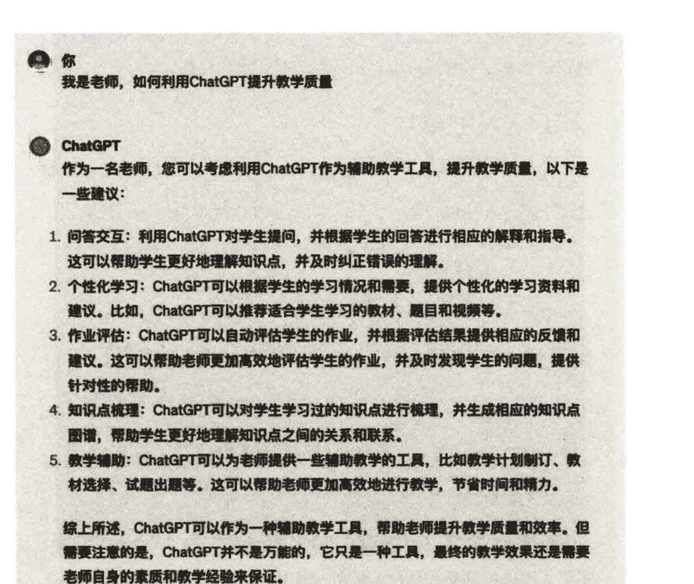

#### 二、我是软件开发工程师，如何利用 ChatGPT进行代码生成

以下是利用 ChatGPT 进行辅助工作的步骤：

- 1. 数据准备
准备一个包含足够代码样例的数据集。这些样例可以从 GitHub 等代码托管平台中获取的，也可以是公司内部代码的样例。

- 2. 模型训练
使用这些数据样例训练一个 ChatGPT 模型，使其能够理解代码的语法和结构，并生成符合语法和逻辑要求的代码。

- 3. 代码生成
利用训练好的 ChatGPT 模型进行代码生成。可以将输入的问题或需求描述转换成代码，让 ChatGPT 自动生成符合要求的代码。

- 4. 代码调整
生成的代码可能不完全符合需求，需要人工进行调整和优化。也可以利用 ChatGPT 生成的代码作为基础，进行修改和优化。

- 5. 持续优化
不断迭代训练模型，并持续优化生成的代码质量和效率，提高开发效率和代码质量。

需要注意的是，ChatGPT 生成的代码可能存在一些缺陷和错误，需要人工进行调整和优化。此外，生成的代码可能存在版权问题，需要软件开发工程师进行修改，使其符合相关的法律法规和知识产权规定。

你
基于vue，写一个登录页面

ChatGPT
以下是一个基于Vue的简单登录页面示例：

```vue
<template>
  <div>
    <h1>Login</h1>
    <form>
      <div>
        <label>Username:</label>
        <input type="text" v-model="username" />
      </div>
      <div>
        <label>Password:</label>
        <input type="password" v-model="password" />
      </div>
      <button @click.prevent="submitForm">Login</button>
    </form>
  </div>
</template>

<script>
export default {
  name: 'Login',
  data() {
    return {
      username: '',
      password: ''
    };
  },
  methods: {
    submitForm() {
      // Send form data to backend for authentication
      // Redirect to dashboard if authentication successful
      // Show error message if authentication failed
    }
  }
};
</script>
```

此示例包含一个表单，其中包含用户名和密码字段，并且在提交表单时执行submitForm方法。在实际应用中，需要将submitForm方法实现为向后端发送身份验证请求，并在身份验证成功时将用户重定向到仪表板页面。

图 4-5-2

#### 三、我是内容创作者，如何利用 ChatGPT提高创作效率

以下是一些使用 ChatGPT 提高创作效率的方法：

- 1. 生成文章灵感
使用 ChatGPT 来生成文章的灵感和创意。输入一些关键词或主题，让 ChatGPT 自动生成相关的创意，激发创作灵感。

- 2. 快速生成文章框架
使用 ChatGPT 来生成文章的框架。输入文章的主题，ChatGPT 将为你生成相关的大纲和提纲。

- 3. 自动生成文章段落
使用 ChatGPT 生成文章的段落。输入一些关键词或主题，让 ChatGPT 自动生成相关的段落，助你节省写作时间。

- 4. 生成文章标题和副标题
使用 ChatGPT 来生成文章的标题和副标题。输入一些关键词或主题，让 ChatGPT 自动生成相关的标题和副标题，从而更好地吸引读者。

- 5. 生成文章结尾
使用 ChatGPT 来生成文章的结尾。输入文章的主题或关键词，让 ChatGPT 自动生成相关的结尾内容，提高文章的质量。

需要注意的是，使用 ChatGPT 生成的文章内容需要经过人工编辑和校对，以确保文章的质量和可读性。

你
秦王政统一度量衡，写成视频脚本

ChatGPT
好的，以下是关于秦王政统一度量衡的视频脚本：

【画面：开场画面】
（音乐声响起）

主持人：
大家好，欢迎收看本期节目。今天，我们来聊一下中国历史上一个重要的事件——秦王政统一度量衡。

【画面：秦始皇塑像】

主持人：
秦始皇，一个号称“天下第一统治者”的人物。他在位期间不仅统一六国，建立了中国历史上第一个中央集权国家，而且还进行了许多重大的改革，其中最为重要的就是度量衡的统一。

【画面：度量衡标准器具、秤盘、尺等道具；画面：古代商业贸易场景】

主持人：
在古代，度量衡是商业贸易和工业生产中必不可少的标准。然而，在秦始皇统一之前，每个地方都有各自的度量衡标准，造成了商业贸易上的混乱。为了解决这个问题，秦始皇采取了一系列措施，将度量衡标准统一为国家标准。

【画面：秦始皇出巡、官员实地检查道具、工匠铸造器具、文官编制规范等画面】

主持人：
秦始皇下令官员实地检查度量衡标准，不合格的器具全部铸成豁口铜人。同时，他还规定了度量衡的具体标准，统一了长度、重量、容量等方面的标准。而这些标准的实行，则需要大量的工匠进行铸造、制作，文官们也负责规范编制。

【画面：秦始皇发放赏金、派遣人员传播标准等画面】

主持人：
秦始皇不仅在制定标准上下了大力气，他还通过发放赏金，鼓励人们使用新的标准。此外，他还派遣人员到各个地方宣传标准的使用方法，让更多的人认同并遵守这些标准。

【画面：秦始皇功绩表】

主持人：
这一系列措施的实行，使得度量衡标准逐渐在全国范围内得到了普及和执行。秦始皇的功绩也在历史上得到了充分的肯定。

【画面：结束画面】

主持人：
今天的节目就到这里了。感谢大家的收看！

图 4-5-3

#### 四、我是翻译，如何利用 ChatGPT进行翻译工作

以下是一些使用 ChatGPT 进行翻译工作的方法：

##### 1. 语言翻译

ChatGPT 可以用于将一种语言翻译成另一种语言。你可以输入一句话或一篇文章，ChatGPT 将自动翻译成目标语言。需要注意的是，用 ChatGPT 进行语言翻译，可能会有某些语句翻译错误或存在不准确的地方，需要进行人工修改和校对。

##### 2. 辅助翻译

如果你需要翻译一篇比较长或比较难的文章，可以利用 ChatGPT 进行辅助翻译。你可以输入一句话或一个段落，ChatGPT 将自动翻译成目标语言，你可以根据其翻译结果进行修改和补充，从而提高翻译效率。

##### 3. 术语翻译

在某些领域，存在大量的特定术语和行业用语。利用 ChatGPT 可以快速翻译这些术语和用语，提高翻译效率和准确性。

##### 4. 跨文化交流

在跨文化交流过程中，语言障碍可能会影响交流效果。利用 ChatGPT 可以快速翻译对方的语言，并进行沟通交流，从而促进跨文化交流。

需要注意的是，ChatGPT 的翻译质量取决于其训练数据的质量，因此非常有必要对翻译结果进行人工校对和修改。同时，对于涉及机密信息和重要文件的翻译工作，建议采用专业的翻译服务，以确保信息安全和翻译质量。

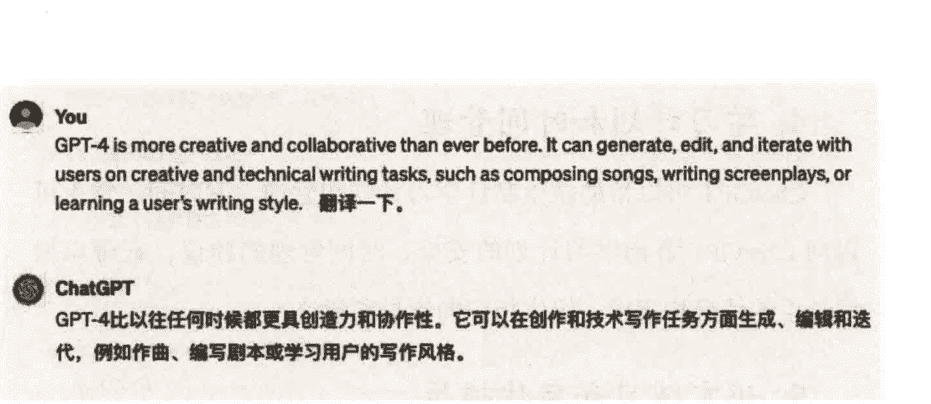

#### 五、我是家教，如何利用 ChatGPT进行工作

##### 1. 答疑解惑

使用 ChatGPT 来回答学生的问题和解释概念。学生可以向 ChatGPT 提出问题，它可以提供相应的答案和解释，帮助学生更好地理解和掌握知识。

##### 2. 练习题辅导

ChatGPT 可以根据学生的需求，提供练习题目和解答过程。学生可以向 ChatGPT 请求练习题目或解答步骤，它可以给出相应的指导和示范，帮助学生独立完成练习。

##### 3. 学习资源推荐

ChatGPT 可以根据学生的学习需求和兴趣，推荐相关的学习资源，如教科书、参考书、学习网站等。它可以根据学生的提问和话题进行智能推荐，提供多样化的学习资料。

##### 4. 学习计划和时间管理

ChatGPT 可以帮助学生制订学习计划和管理学习时间。学生可以向 ChatGPT 咨询学习计划的安排、时间管理的建议，它可以根据学生的情况和需求，提供相应的指导和建议。

##### 5. 语言练习和写作辅导

ChatGPT 可以提供语言练习和写作辅导，帮助学生提高语言表达能力和写作水平。学生可以与 ChatGPT 进行对话、练习口语表达，或者提交写作作业以获取修改建议。

请注意，在利用 ChatGPT 进行家教工作时，仍然需要您的引导和监督。ChatGPT 是一个强大的工具，但它也可能存在一定的限制和误导性。确保与学生共同理解 ChatGPT 的作用和使用方式，并在必要时进行必要的纠正和解释。

此外，要使用 ChatGPT 进行家教工作，您可以参考 OpenAI 提供的 GPT 模型 API，或者使用其他相应的 ChatGPT 工具和库进行开发和集成。

总之，利用 ChatGPT 进行家教工作可以提供更个性化、互动性更强的学习体验，为学生提供更有效的学习支持和指导。

你
作为三年级老师，基于人教版数学书籍，帮我出一份三年级的期中考卷

ChatGPT
当为三年级学生设计数学期中考卷时，可以参考人教版数学教材的内容和难度。以下是一份示例的三年级数学期中考卷，供参考：

## 题目一：选择题（每题2分，共10分）

- 1. 下列哪个数是个位数？
A. 23 B. 36 C. 57 D. 4
- 2. 下列哪个图形是正方形？
A. B. C. D.
- 3. 24 ÷ 4 = ?
A. 5 B. 6 C. 7 D. 8
- 4. 从下面的图形中选择一个正方体：
A. B. C. D.
- 5. 下列哪个数是偶数？
A. 17 B. 25 C. 32 D. 41

## 题目二：填空题（每空2分，共10分）

- 1. 8 + 5 = ____
- 2. 32 - ____ = 21
- 3. 4 × 5 = ____
- 4. 36 ÷ 6 = ____
- 5. 小明的生日是9月26日，小红的生日是9月19日，那个孩子的生日在前？ ____

## 题目三：计算题（每题4分，共20分）

- 1. 23 + 15 = ____
- 2. 42 - 17 = ____
- 3. 5 × 6 = ____
- 4. 36 ÷ 4 = ____
- 5. 请你用适当的运算符号填空：8 ____ 3 = 11

#### 六、我是讲故事的人，如何利用 ChatGPT进行工作

ChatGPT
很久很久以前，在一个远离城市的小村庄里，有一只小乌龟名叫托尼。托尼非常渴望探索世界，并梦想着成为一只勇敢的冒险家。

有一天，托尼听说了一个神秘的岛屿，据说岛上有一颗能实现愿望的神奇宝石。托尼决定去寻找这颗宝石，并且相信只要他拥有了它，他的所有梦想都会实现。

托尼踏上了漫长的旅程，穿过茂密的森林、跋涉过险峻的山脉，一路上克服了许多困难和挑战。但是，旅途中托尼遇到了一个问题——他的步伐太慢了。他看到其他动物在自己的速度下疾驰而过，而自己只能慢慢爬行。

尽管遇到困难，但托尼并没有放弃。他知道自己虽然慢，但他拥有坚韧不拔的毅力。他继续努力前行，一步一步地向目标靠近。

经过漫长的时间和不懈的努力，托尼终于来到了传说中的岛屿。他找到了神奇宝石，但宝石告诉他只有通过坚持和毅力，他才能真正实现自己的梦想。

托尼领悟到了一个重要的道理：毅力是成功的关键。他明白了自己在旅途中所经历的一切困难和挑战都是为了让他更加坚强、更加有毅力。

回到村庄后，托尼成了一个受人尊敬的冒险家，他的故事也传遍了整个村庄。人们从他的经历中学到了坚持不懈和永不放弃的精神，成为更加勇敢和坚强的人。

这个故事告诉我们，无论遇到多大的困难和挑战，只要我们有坚定的毅力和决心，我们就能战胜困难，实现自己的梦想。托尼的故事鼓励着每个人，在人生的旅程中坚持不懈，相信自己的能力，勇往直前。

图 4-5-6

#### 七、我是编剧，如何利用 ChatGPT进行工作

ChatGPT
剧本名称：《巴黎之恋》

故事背景：
《巴黎之恋》是一部浪漫剧情电影，背景设定在巴黎这座浪漫的城市中。故事发生在迷人的巴黎街头巷尾，讲述了两个寻找爱情的灵魂在这座城市中的相遇和情感纠葛。

角色介绍：

- 1. 西莉亚 (Celia)：一个年轻、热情而梦想着爱情的画家。她来自美国，来到巴黎追逐她的绘画梦想。她对艺术充满热情，但在爱情方面有些迷茫。
- 2. 路易 (Louis)：一个迷人而神秘的巴黎本地人。他是一位天才的音乐家，但内心却被过去的伤痛所困扰。他沉浸在自己的音乐世界中，对爱情保持着一种避而不谈的态度。

剧情概述：
西莉亚来到巴黎寻找艺术的灵感和真爱。她在一次巧合中遇到了路易，两人在一次街头音乐表演中产生了强烈的吸引力。然而，他们都有自己的伤痛和过去，使得他们对爱情持保留态度。

故事展开时，西莉亚和路易开始了一段充满激情和浪漫的旅程。他们一起漫步在塞纳河畔，探索巴黎的美景，并互相分享他们的梦想和痛苦。他们各自的过去和内心的挣扎逐渐浮出水面。

随着剧情的发展，他们逐渐陷入了情感的纠葛。他们经历了分离和重聚，面对彼此的恐惧和不安，但他们也逐渐学会放下过去，敞开心扉。

最终，西莉亚和路易在巴黎的一场浪漫雨中重逢。他们面对过去的伤痛，相互支持，勇敢地追求他们的爱情。他们的故事证明了爱情的力量和巴黎这座城市的魅力。

《巴黎之恋》是一部充满着浪漫、情感和内心成长的电影，通过刻画西莉亚和路易之间的情感纠葛，探索他们对爱情的认识和勇敢追求的故事。巴黎这座浪漫的城市为故事增添了特殊的背景和氛围，将观众带入一个充满梦幻和温馨的世界。

在剧本中，我们将展现西莉亚和路易在巴黎各个著名地标中的浪漫邂逅，如埃菲尔铁塔、塞纳河畔、巴黎街头咖啡馆等，营造出浪漫的氛围和视觉上的享受。他们的对话将透露出他们内心的情感和挣扎，以及对爱情和自我成长的思考。

剧情将穿插西莉亚的绘画和路易的音乐，通过他们的艺术表达，进一步展现他们的情感世界和对爱情的理解。同时，剧本中将加入一些戏剧性的曲折和悬念，例如意外的冲突、误会或挑战，使观众一直保持对剧情的关注和期待。

最终，西莉亚和路易将克服他们的内心障碍，勇敢地追求自己的爱情，并找到内心的平静和幸福。电影将以一幕浪漫的画面结束，展示他们在巴黎的爱情故事的完美结局。

《巴黎之恋》将通过美丽的画面、动人的音乐和情感丰富的剧情，带给观众一段浪漫而难忘的电影体验。它将探索爱情的力量、成长和自我发现的重要性，让观众沉浸在巴黎的浪漫氛围中，并与角色一起体验他们的爱情之旅。

图 4-5-7

#### 八、我是数学老师，如何利用 ChatGPT进行工作

我是数学老师，如何利用ChatGPT进行工作

作为数学老师，您可以利用ChatGPT在以下方面提升您的工作效率和教学质量：

1. 解答学生问题：ChatGPT可以作为您的辅助工具，帮助您解答学生在数学上的问题。当学生提出疑问或困惑时，您可以使用ChatGPT来获取相关的解释、方法或示例，以便更好地回答学生的问题。
2. 辅助教学：ChatGPT可以在教学过程中充当您的合作伙伴。您可以与ChatGPT进行对话，向其提出特定问题或让其演示数学概念和解决方法。这样可以增加互动性，帮助学生更好地理解和掌握数学知识。
3. 个性化学习：利用ChatGPT的个性化特性，您可以根据学生的学习需求和能力定制问题。ChatGPT将根据学生的回答提供适当的反馈和指导，帮助他们个性化地学习数学。
4. 教学资源和示例：ChatGPT可以为您提供丰富的教学资源和示例，包括数学练习题、解决方案、教学资料等。您可以向ChatGPT索取特定的内容，以便为学生提供更多的实例和练习机会。

需要注意的是，虽然ChatGPT可以提供有用的信息和解释，但它并不是完全准确和全面的。作为数学老师，您需要对所提供的信息进行核实和验证，确保其准确性和适用性。

此外，ChatGPT只是一个工具，它无法取代您作为数学老师的专业知识和经验。您仍然需要结合其他教学方法和资源，与学生进行实际的互动和指导，以提供全面的数学教育。

总而言之，ChatGPT可以作为一个有用的工具，帮助您在数学教学中提供更多的资源和个性化的学习支持。通过合理利用ChatGPT，您可以提高教学效果并为学生创造更好的学习体验。

图 4-5-8-1

作为数学老师，我很高兴为您解释概率的工作原理。

作为数学老师，我很高兴为您解释概率的工作原理。

概率是用来描述事件发生可能性的数学概念。它涉及我们对事件发生的猜测或预测。让我们以一个简单的例子来说明。

假设你有一个标准的六面骰子。骰子的每个面上都有一个数字，从1到6。当你投掷这个骰子时，每个数字出现的机会是相等的。这意味着每个数字出现的概率都是1/6。

概率通常以一个介于0和1之间的数值来表示，其中0表示不可能发生，1表示一定会发生。对于这个骰子的例子，每个数字出现的概率是1/6，因为有6个可能的结果。

要计算事件发生的概率，我们可以使用概率公式：概率=有利结果的数量/总结果的数量。在这个骰子的例子中，有利结果是指出现特定数字的结果的数量，总结果是指骰子可能的总数。

除了简单的概率计算，我们还可以使用概率来解决更复杂的问题，如组合事件的概率、条件概率等。对于更深入的理解，您可以参考一些在线资源，如数学教学网站或视频教程，这些资源可以提供更多的例子和练习来帮助您加深对概率的理解。

希望这个解释能帮助您更好地理解概率的工作原理。如果您有任何其他问题或需要进一步的帮助，请随时告诉我。

图 4-5-8-2

#### 九、我是网络安全专家，如何利用 ChatGPT进行工作

我需要帮助为我的公司制定有效的网络安全战略。

> **ChatGPT**
作为网络安全专家，我将为您提供一些关于制定有效网络安全战略的建议。

1. 建立强大的身份验证措施：确保只有经过授权的用户能够访问敏感数据和系统。采用多因素身份验证（例如密码加令牌、生物识别等）以增加安全性。
2. 加密数据传输和存储：使用加密技术（如SSL/TLS）保护数据在传输过程中的安全，并在存储时加密敏感数据，以防止未经授权的访问。
3. 实施强大的防火墙和入侵检测系统：设置防火墙来监控和控制网络流量，以阻止未经授权的访问。使用入侵检测系统来及时检测和响应可能的攻击。
4. 定期进行安全漏洞扫描和漏洞修复：通过定期扫描系统和应用程序，发现并修复潜在的安全漏洞，确保系统的稳定性和安全性。
5. 建立安全意识培训计划：提供针对员工的网络安全培训，教育他们识别和防范常见的网络攻击，以减少内部威胁。
6. 监控和日志记录：建立监控机制，定期审查和分析网络活动和日志记录，以便及时发现和应对潜在的安全事件。
7. 及时更新和维护系统和应用程序：确保及时应用安全补丁和更新，以修复已知的漏洞和弱点。
8. 备份和灾难恢复计划：定期备份数据，并制订灾难恢复计划，以应对数据丢失或系统故障等突发情况。

需要根据您公司的具体情况和需求来制定适用的网络安全战略。与IT团队密切合作，确保实施的措施符合最佳实践，并进行持续的监测和改进。

请注意，网络安全是一个动态的领域，要与时俱进。定期评估和更新您的网络安全策略，以适应不断变化的威胁和技术环境。

希望以上建议对您制定有效的网络安全战略有所帮助。如有任何其他问题或需要进一步的指导，请随时告诉我。

图 4-5-9

#### 十、我是一名牙医，如何利用 ChatGPT进行工作

我需要帮助解决我对冷食的敏感问题。

作为牙医，我很高兴为您提供关于对冷食敏感的问题的建议和解决方案。

对冷食敏感可能是由多种因素引起的，包括牙齿过敏、龋齿或其他口腔健康问题。以下是一些建议和解决方案：

1. 首先，我建议您进行一次口腔检查，以确定导致对冷食敏感的具体原因。牙医将通过检查您的牙齿和口腔健康状况来帮助诊断问题。
2. 如果牙齿敏感是主要问题，您可以考虑使用含有氟化物的牙膏来减轻敏感。氟化物有助于减少牙齿表面的敏感和疼痛。
3. 另一个建议是避免或减少摄入过冷的食物和饮料。将冷食物慢慢吃，避免快速咀嚼或咬碎冷食物，可以减少对牙齿的刺激。
4. 如果您有牙齿龋齿的问题，及时治疗龋齿可以减少对冷食的敏感。牙医可以根据您的具体情况提供填充、根管治疗或其他治疗方法。

此外，正确的口腔护理也对牙齿健康至关重要。请确保每天刷牙两次，使用软毛牙刷和牙线进行清洁。定期到牙医那里进行口腔检查和清洁，以确保口腔的整体健康。

请记住，以上建议仅供参考。最好咨询一位牙医，以便进行个性化的诊断和治疗建议。牙医会根据您的具体情况和口腔健康需求提供最佳的建议和治疗方案。

希望这些信息对您有帮助。如有其他问题或需要进一步的指导，请随时告诉我。

图 4-5-10

#### 十一、我是一名职业顾问，如何利用 ChatGPT进行工作

我想建议那些想在软件工程领域从事潜在职业的人。

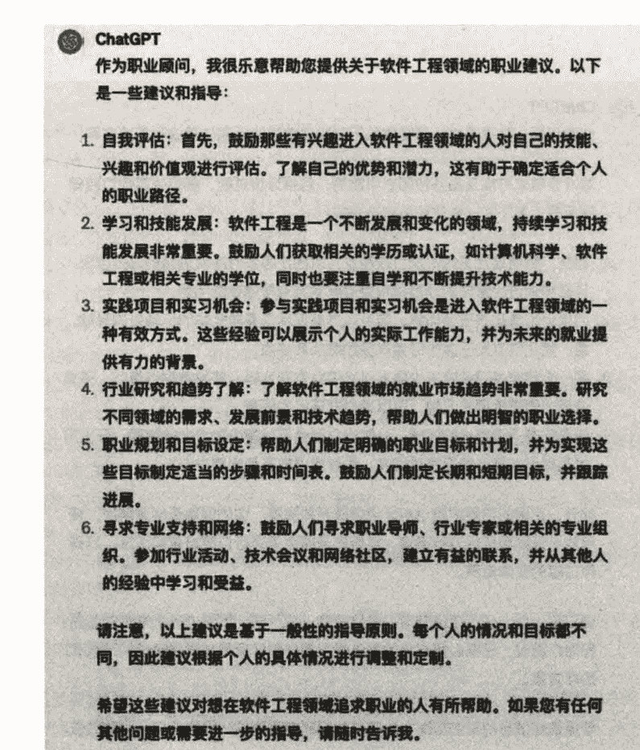

图 4-5-11

#### 十二、我是一名营养师，如何利用 ChatGPT进行工作

作为一名营养师，我想为 2 人设计一份素食食谱，每份含有大约 500 卡路里的热量并且血糖指数较低。你能提供一个建议吗？

作为一名营养师，我想为2人设计一份素食食谱，每份含有大约500卡路里的热量并且血糖指数较低。你能提供一个建议吗？

当设计一份素食食谱时，考虑到每份含有大约500卡路里的热量和较低的血糖指数，以下是一个可能的建议：

早餐：

- 燕麦粥：使用燕麦片、植物奶和少量蜂蜜或红枣调味。加入一些杏仁片或其他坚果。
- 水果沙拉：选择低血糖指数的水果，如蓝莓、草莓和苹果。配上一些坚果或种子。

午餐：

- 素食沙拉：使用混合蔬菜，如生菜、胡萝卜、黄瓜和番茄。加入一些豆类，如鹰嘴豆或扁豆。用橄榄油和柠檬汁做简单的沙拉酱。
- 素食炒饭：用蔬菜（如胡萝卜、豌豆和玉米）和米饭炒制。可以添加一些豆腐或豆类以增加蛋白质含量。

下午茶：

- 烤杏仁：将杏仁放入烤箱中烤至金黄色。它们是低血糖指数的零食选择，并提供健康的脂肪和纤维。

晚餐：

- 蔬菜炒面：用全麦或红薯粉炒制，添加丰富的蔬菜，如菠菜、胡萝卜、西兰花和蘑菇。
- 烤蔬菜和豆类：将蔬菜（如彩椒、洋葱和茄子）和豆类（如黑豆或扁豆）切成块，烤至熟透。可以配上一些低血糖指数的酱料。

消夜：

- 希腊式酸奶和坚果：选择无糖或低糖的希腊式酸奶，并加入一些杏仁、核桃或其他坚果。

请注意，以上只是一个示例建议，具体食谱可以根据个人口味和膳食需求进行调整。建议咨询一位营养师或医生，以便根据个人的情况定制适合的饮食方案。

#### 十三、我是一名院士，如何利用 ChatGPT进行工作

我需要帮助写一篇针对 20 ～ 25 岁大学生的电动汽车和燃油汽车未来趋势的文章。

作为院士，我很高兴为您编写一篇关于电动汽车和燃油汽车未来趋势的文章，专门针对20-25岁大学生的读者群体。以下是文章的一个可能的组织结构，以及一些内容和可靠的来源：

标题：电动汽车与燃油汽车：探索未来出行趋势

引言：

- 引入对环境可持续性和能源效率的日益关注，以及汽车行业中可再生能源的崛起。
- 引出文章的目的，即讨论电动汽车和燃油汽车的未来趋势，并探讨对年轻大学生的影响和重要性。

主体部分：

1. 电动汽车的发展与趋势
   - 介绍电动汽车的定义和工作原理，解释其对环境的影响和优势。
   - 讨论电动汽车市场的增长趋势和技术创新，如电池技术的改进和充电基础设施的发展。
   - 引用可靠的来源，如国际能源署 (IEA)、汽车制造商的报告或行业研究机构的数据，以支持电动汽车发展趋势的论述。
2. 燃油汽车的演变与前景
   - 回顾燃油汽车的历史，并讨论燃油汽车在现代社会中的地位和挑战。
   - 简要介绍传统燃油汽车的改进和创新，如燃油效率的提高和减少排放。
   - 提及可再生燃料的发展和对燃油汽车未来前景的影响。
   - 引用相关研究或行业报告，以支持对燃油汽车未来趋势的描述。
3. 年轻人的角度与决策
   - 探讨年轻大学生对电动汽车和燃油汽车的态度和偏好。
   - 分析年轻人购车决策的因素，如环保意识、经济性和科技创新。
   - 引用相关的调查数据、市场研究或年轻人观点的采访，以支持对年轻人的观点和决策影响的描述。

结论：

- 总结电动汽车和燃油汽车未来趋势的关键点，并强调年轻大学生在这个发展中的重要角色。
- 鼓励年轻人积极关注可持续出行方式，并提抱歉，作为AI模型，我无法真正扮演一个院士或进行研究。我的回答基于预训练的模型和一般性的知识。在真实的情境中，建议您寻求真实的专业人士和权威来源来获取关于特定主题的详细研究结果和意见。

图 4-5-13

#### 十四、我是一名法律顾问，如何利用 ChatGPT进行工作

我出了车祸，不知道该怎么办？

我理解您在车祸后可能感到困惑和不知所措。基于您的情况，我建议您采取以下步骤：

1. 确保您的安全：首先，确保您的安全和健康。如果您需要紧急医疗援助，请尽快拨打急救电话或前往最近的医疗机构。
2. 联系保险公司：通知您的汽车保险公司并报告事故。他们将指导您提交索赔申请的程序，并提供您所需的文件和信息。
3. 联系警方：根据当地法律规定，您可能需要通知警方并报告事故。他们将记录事故的详细情况，并为您提供相关的文件和报告。
4. 收集证据：如果您的身体状况允许，尽量收集事故现场的证据，例如拍摄照片或视频，获取目击证人的联系信息等。这将有助于后续的索赔和法律程序。
5. 寻求法律咨询：如果您对处理事故和索赔程序感到困惑，最好咨询一位专业的交通事故律师。他们可以为您提供针对您个人情况的法律建议，并帮助您维护您的权益。

请注意，以上建议仅为一般性指导，具体的法律处理方式可能因地区和具体情况而有所不同。在处理车祸事故时，建议您寻求专业法律咨询以获取详细和个性化的建议。

图 4-5-14

#### 十五、我是一名首席执行官，如何利用 ChatGPT进行工作

**ChatGPT**
作为一家假设公司的首席执行官，我将采取以下措施来应对需要召回产品的潜在危机情况，并减轻对公司的任何负面影响：

1. 快速行动：立即启动应急响应计划，确保我们能够及时了解并应对潜在危机。召集相关团队，包括质量控制、研发、生产和法务等部门，共同制定应对策略。
2. 评估风险：与质量控制团队合作，对产品问题进行全面的评估。确定问题的范围、原因和可能的影响，以便制订相应的应对计划。
3. 召回决策：根据评估结果，制定明确的召回决策。考虑召回的规模、时间表、沟通方式和召回的目标群体。
4. 沟通和透明度：确保与内部员工、供应商、客户和其他利益相关者建立有效的沟通渠道。及时、透明地向他们传达问题的严重性、召回的原因和所采取的措施。
5. 补救措施：积极采取补救措施，包括修复、替代产品、退款等，以满足客户需求并维护公司声誉。同时，确保补救措施符合适用法律法规和标准。
6. 问题解决和改进：深入调查问题的根本原因，并采取纠正措施，以确保类似问题不再发生。加强质量控制和生产流程，提升产品的安全性和可靠性。
7. 学习和改进：通过评估危机管理过程，从中汲取经验教训，并不断改进公司的危机应对能力。建立学习机制，确保在面对类似挑战时能够更加敏锐和有效地应对。

以上措施旨在以专业、负责任的方式处理潜在危机，保护公司声誉和利益。每个挑战都是独特的，因此我们将根据具体情况和利益相关者的需求制定相应的解决方案。

## 第五章 ChatGPT 的商业化应用

### 第一节 如何在各行各业中使用 ChatGPT

#### 一、对话系统

ChatGPT 可以用于搭建对话系统，帮助企业提高客户服务效率和用户满意度。对话系统可以应用于各种领域，例如客服、人力资源和医疗等。ChatGPT 的强大自然语言处理能力可以实现自然流畅的对话，并能够理解复杂的问题。

**你**
ChatGPT作为客服，你怎么做呢？详细的步骤是什么？

**ChatGPT**
作为ChatGPT客服，以下是一些详细的步骤，可以帮助您了解我如何进行客服工作：

1. 欢迎和提问：作为客服，我首先会欢迎用户并询问用户有什么问题或需要帮助的事项。
2. 问题理解：我会仔细理解用户提出的问题。通过分析用户的语句，提取关键信息和意图，以确保我正确理解用户的需求。
3. 提供答案或解决方案：基于理解的问题，我会提供相关的答案或解决方案。这可能涉及解释概念、提供指导、提供步骤或推荐资源等。
4. 追问和澄清：如果需要更多的信息或者用户的问题不够清晰，我会向用户提出追问，以确保我提供准确的答案或解决方案。
5. 多样化回答：为了提供更好的用户体验，我会尽量提供多样化的回答。这可以包括不同的表达方式、不同的解释途径或提供多个可行的解决方案。
6. 提供帮助文档或资源：如果问题比较复杂或需要更详细的指导，我可以提供相关的帮助文档、链接或资源，以便用户进一步了解或解决问题。
7. 结束对话：在解决用户问题或提供所需帮助后，我会向用户确认是否还有其他问题，如果没有，我会礼貌地结束对话。
8. 持续学习和改进：作为ChatGPT客服，我会不断学习和改进，通过用户反馈和评估数据来提高自己的回答质量和用户满意度。

这些步骤旨在提供一般的客服工作流程，以确保对用户问题的准确理解和提供有帮助的解答。然而，需要注意的是，我作为ChatGPT模型仍然有局限性，可能无法涵盖所有情况，因此在复杂或具体的问题上，仍建议寻求人工客服的支持。

图 5-1-1

#### 二、语音识别

ChatGPT 可以用于语音识别，帮助人们更加便捷地进行语音输入，提高工作效率。语音识别可以应用于多个领域，如智能家居、医疗、交通等。ChatGPT 可以实现高精度的语音转写，并且可以逐步学习语音特征，提高识别准确率。

ChatGPT如何实现语音识别

ChatGPT本身并不直接进行语音识别，它是一个基于文本的自然语言处理模型。然而，语音识别可以与ChatGPT结合使用，以实现语音到文本的转换，然后再使用ChatGPT进行自然语言理解和生成。

下面是一个示例的语音识别和ChatGPT结合的工作流程：

1. 语音输入：使用语音识别技术，将用户的语音输入转换为文本。这可以通过使用现有的语音识别引擎（如Google Cloud Speech-to-Text、Microsoft Azure Speech to Text、百度语音识别等）来实现。
2. 文本输入：将语音识别得到的文本作为输入传递给ChatGPT模型。这里可以使用ChatGPT来理解用户的文本输入，并生成相关的响应。
3. 文本输出：ChatGPT模型根据输入的文本进行处理，并生成相应的文本输出。这可能是回答用户的问题、提供建议或进行对话等。
4. 文本转语音：将ChatGPT生成的文本输出转换回语音形式，以便向用户进行回复。这可以使用文本转语音引擎（如Google Text-to-Speech、Microsoft Azure Text to Speech、百度语音合成等）来实现。

通过将语音识别和ChatGPT结合使用，可以实现语音输入与文本输出之间的转换，从而实现与用户的交互。这种结合可以在语音助手、智能对话系统和语音交互应用中发挥作用。

图 5-1-2

#### 三、文本生成

ChatGPT 可以用于文本生成，帮助企业生成各种文本内容，如新闻、广告、推荐语等。文本生成可以应用于多个领域，如新闻媒体、广告营销、金融等行业。ChatGPT 可以根据给定的文字生成高质量的文本，可以产生真实且具有连贯性的语句，并且可以生成多种不同风格和主题的文本。

**你**
ChatGPT作为编辑，你如何做呢？有哪些步骤？

**ChatGPT**
作为ChatGPT，我可以在编辑方面提供帮助。下面是我在编辑文本方面的一般步骤：

1. 校对和修正：我可以帮助检查文本中的拼写错误、语法问题和常见的语言错误，并提供修正建议。我会注意语法规则、标点符号的正确使用以及上下文的连贯性。
2. 风格和语气调整：根据需求，我可以帮助调整文本的风格和语气。例如，正式、商务、轻松、幽默等不同的语气可以根据要求进行调整。
3. 内容优化：我可以帮助优化文本的内容，使其更加清晰、准确和连贯。我可以提供改进意见，添加或删除必要的信息，并确保文本更好地表达作者的意图。
4. 结构重组：如果需要重新组织文本的结构，我可以提供建议并进行重组。这可能包括对段落的调整、信息的排序和流畅的过渡等。
5. 格式调整：我可以帮助调整文本的格式，如标题的格式化、引用的标记、列表的排版等，以增强文本的可读性和视觉吸引力。

请注意，作为ChatGPT，我的编辑能力是基于训练数据和模型的知识。尽管我可以提供编辑建议，但仍建议经过专业编辑人员的审查和修改，以确保文本质量和符合特定需求。

图 5-1-3

#### 四、情感分析

ChatGPT 可以用于情感分析，帮助企业分析用户的情感倾向，以提高用户满意度。情感分析可以应用于多个领域，如社交媒体、客户服务、舆情监测等。ChatGPT 可以对输入文本进行情感分类，快速准确地识别出情感信息，并且可以根据不同的情感倾向进行针对性的回应和处理。

#### 五、聊天机器人

ChatGPT 可以用于搭建聊天机器人，帮助企业与用户进行沟通交流，提高用户体验。聊天机器人可以应用于多个领域，如金融、教育、医疗等。ChatGPT 可以快速准确地回答用户的问题，提供个性化的服务，并且可以通过学习用户的反馈逐步提高智能程度。

## 如何在各行各业中使用ChatGPT

ChatGPT可以在各行各业中使用，以下是一些使用场景：

- 1. 内容创作：ChatGPT可以帮助内容创作者生成文章、脚本、故事情节等创意内容。
- 2. 法律行业：ChatGPT可以帮助律师撰写法律文书，如起诉状、调解书等。
- 3. 医疗行业：ChatGPT可以帮助医生诊断病情、制定治疗方案等。
- 4. 金融行业：ChatGPT可以帮助投资者分析市场数据、预测趋势等。
- 5. 教育行业：ChatGPT可以作为辅助教育工具，帮助学生学习语言、文学、数学等学科。
- 6. 营销行业：ChatGPT可以帮助营销人员编写营销方案、广告文案、客服回复等。
- 7. 开发行业：ChatGPT可以帮助开发人员自动生成代码、文档、测试用例等。

总之，ChatGPT可以在各行各业中用于自动化、智能化地完成一些烦琐、重复、常规的任务，提高工作效率，节省时间成本，让从业者能够更专注于更高层次的工作任务。

#### 六、教育与培训

- 1. 个性化学习支持：ChatGPT 可以作为虚拟教师助手，为学生提供个性化的学习支持。它可以回答学生的问题、解释概念、提供辅导和指导，并根据学生的进度和需求调整教学内容。
- 2. 答疑解惑：ChatGPT 可以回答学生的问题，帮助他们理解和解决学习中的难题。学生可以向 ChatGPT 提问关于课程内容、作业、考试等方面的问题，并获得即时的答案和解释。
- 3. 学习资源推荐：ChatGPT 可以根据学生的学习需求和兴趣，推荐相关的学习资源，如教科书、参考书、网上教程、学术文章等，帮助学生更好地进行学习和研究。
- 4. 语言学习和交流：对于语言学习者，ChatGPT 可以提供语言交流的机会。学生可以与 ChatGPT 进行对话，练习语言表达、听力理解和口语能力，并从中获得反馈和纠正。
- 5. 虚拟实验和模拟训练：ChatGPT 可以与虚拟实验室和模拟训练环境结合，为学生提供实践和应用的机会。它可以模拟实验场景、解释实验原理，并引导学生进行实验操作和观察结果。
- 6. 教学辅助工具：ChatGPT 可以作为教师的辅助工具，帮助他们准备课程材料、生成练习题、检查答案、提供教学建议等，提高教学效率和质量。

#### 七、开发小程序

小微企业开发软件，程序员也可以挖掘大众需求自己做微信小程序、抖音小程序、APP 等，比如趣味测试、看图猜词、文字游戏等软件，不仅容易搭建，而且有市场潜力，没准下一个爆火的软件就是你开发的。

#### 八、导航网站

大家热衷于玩 ChatGPT，国内外已有几百个 AI 网站，文字，图文的，视频类等，只要懂一些网站技术的人，都可以把链接汇总起来搭建一个网站导航，做一下 SEO 排名，流量会很多，再放上广告，有流量就会有收益了。

AI 导航网站，可自行搜索 AI 导航网站，很多哦。

### 第二节 ChatGPT 如何在商业化应用中实现变现

#### 一、程序开发

Codeium 可以通过 AI 帮助开发者生成代码，目前已支持 Visual Studio、JetBrains 等多个常见 IDE 以及多个浏览器。目前个人用户使用免费。Codeium 支持多种编程语言：Python、JS、TS、Java、Go、C/C++ 等。

Cursor.so 是一款基于 GPT 的代码生成工具，它可以帮助开发者快速生成代码，提高开发效率。GPT 是一种自然语言处理技术，可以根据输入的文本生成相应的文本。Cursor.so 利用 GPT 技术，将开发者的自然语言描述转化为代码，从而实现代码的快速生成。

#### 二、主编

Anyword AI 是一个强大的文案工具，它使用人工智能来帮助您编写更好、更引人注目的文案。它会分析您的文本，并根据最佳文案人员的工作提供有关改进建议。

Jasper 是迄今为止最好的基于人工智能的个人助理平台之一。它提供了广泛的功能，这些功能协同工作以创建一个包罗万象的服务，将您的生产力、组织和管理提升到新的高度。

#### 三、AI绘画

ChatGPT+Midjourney，Midjourney 是一款人工智能绘图软件，只需要输入关键词，它就可以帮你生成一幅精美的图片。

#### 四、创作音乐

Beatoven.ai 根据心情为视频和播客创建 AI 生成的音乐。

Altered 将您的声音更改为我们为专业表演定制的任何精选声音。

#### 五、销售话术

Notion AI 是一个 AI 助手，可以帮助用户在 Notion 中自动完成某些任务，例如自动识别和分类文本、生成摘要、提取关键字等。它还可以提供智能建议，帮助用户更高效地使用 Notion。Notion AI 是 Notion Labs Inc. 开发的，是 Notion 的一个功能扩展。

#### 六、视频制作

Movio 使用 MOVIO 的顶级合成媒体从文本创建视频。

#### 七、Prompt Hunt

Prompt Hunt 是一个专门为探索、创建和分享 AI 艺术而设计的网站，可以在几秒钟内生成各种风格和主题的图片，无须任何编程或技术知识。

#### 八、CodeGeeX 免费的 AI编程助手

CodeGeeX 可以根据自然语言注释描述的功能自动生成代码，也可以根据已有的代码自动生成后续代码，补全当前行或生成后续若干行，帮助你提高编程效率。

#### 九、Prezo.ai

Prezo.ai 是一个基于人工智能的 AI 自动生成制作 PPT 工具，它可以帮助你快速地将你的想法转化为精美的幻灯片，让你的观众惊艳并赢得你的下一次演讲。

#### 十、IMI Prompt

IMI Prompt 是一款专为 Midjourney 设计的提示生成器工具，可以帮助用户快速创作出独特的 AI 艺术作品。IMI Prompt 提供了网页版、安卓版和 iOS 版，让用户可以在不同的平台上使用。

#### 十一、Stable Diffusion

Stable Diffusion 是一款开源的 AI 绘画图片生成模型。基于深度生成神经网络，可以根据任何文本输入生成逼真的图像。还可以通过扩散模型和文本编码器的组合，实现图像到图像、深度到图像、超分辨率等多种创造性的应用。

## Stable Diffusion XL

Create and inspire using the worlds fastest growing open source AI platform.

With Stable Diffusion XL, you can create descriptive images with shorter prompts and generate words within images. The model is a significant advancement in image generation capabilities, offering enhanced image composition and face generation that results in stunning visuals and realistic aesthetics.

Stable Diffusion XL is currently in beta on DreamStudio and other leading imaging applications. Like all of Stability AI's foundation models, Stable Diffusion XL will be released as open source for optimal accessibility in the near future.

### Highlights of Stable Diffusion XL capabilities

- Next-level photorealism capabilities
- Image composition and face generation
- Use of shorter prompts to create descriptive imagery
- Greater capability to produce legible text
- Rich visuals and jaw-dropping aesthetics

## 第六章 ChatGPT 提示词的特点与未来

### 第一节 ChatGPT 提示词

#### 一、常用的提示词

“如何”“怎样”“怎么”等疑问词，表示提问者需要了解如何做某件事情或如何解决问题；
“推荐”“建议”“告诉我”等词语，表示提问者需要得到某种建议或推荐；
“比较”“区别”等词语，表示提问者需要了解某些事物之间的差异或相似之处；
“解释”“说明”等词语，表示提问者需要了解某个概念、过程或现象的原理或细节；
“定义”“是什么”等词语，表示提问者需要得到某个概念或术语的定义。

#### 二、prompt words可以分为以下几类

- 1. 主题或领域相关的 Prompt word：这类 prompt words 主要是指与特定领域或主题相关的单词或短语，如 “basketball” “computer science” “climate change” “healthcare” “food recipe” 等，它们可以帮助模型更好地理解用户的需求，并生成相关的内容。
- 2. 操作指令类 Prompt word：这类 prompt words 主要是指用于指导模型生成特定类型文本的操作指令，如 “describe” “summarize” “rewrite” “translate” “complete the sentence” 等，它们可以帮助模型更好地理解用户的需求，并生成符合用户期望的文本。
- 3. 约束条件类 Prompt word：这类 prompt words 主要是指用于约束模型生成文本的条件，如 “begin with” “end with” “contain” “exclude” “use these words” “use these concepts” 等，它们可以帮助模型更好地生成用户需要的内容，避免生成无用或不相关的文本。
- 4. 情境类 Prompt word：这类 prompt words 主要是指用于为模型提供更加具体的上下文信息，如 “in a formal letter” “in a casual conversation” “in a news report” “in a poem” ，它们可以帮助模型更好地理解文本生成的背景和情境，生成更加符合用户期望的内容。

## 提示词（Prompt words）

提示词（Prompt words）是用于指导ChatGPT或其他语言模型生成特定类型或内容的文本的短语或句子。这些提示词可以在对话或文本生成任务中引导模型生成与特定主题、情境或风格相关的回复。

对于ChatGPT或类似的语言模型，通过使用适当的提示词，可以引导模型以特定的方式生成回复。这些提示词可以包括问题的开头、任务说明、特定的关键词或短语等。

以下是一些示例提示词的例子：

- 1. 任务类型：
   - “请写一篇关于夏季旅行的文章。”
   - “请给出一些建议，如何管理时间。”
   - “请回答以下数学问题。”
- 2. 主题或情境：
   - “谈论一下你对人工智能的看法。”
   - “描述一下你最喜欢的电影场景。”
   - “假设你是一个环保活动的组织者，写一篇宣传文章。”
- 3. 风格或语气：
   - “请以幽默的方式回答这个问题。”
   - “用一句诗歌形容你最喜欢的季节。”
   - “请用简洁明了的语言解释这个概念。”

使用适当的提示词可以帮助模型更好地理解预期的回复风格、主题或情境，并生成更相关和有针对性的回答。提示词的选择取决于任务的要求和预期的回复类型。

#### 三、常见的 Prompt 分类

##### 1. 文本生成类

该类 Prompt 旨在生成一定长度的文本，如文章、故事、诗歌、对话等。这类 Prompt 需要提供一些关键词、主题或起始段落来引导 ChatGPT 生成符合预期的文本。

##### 2. 问题回答类

该类 Prompt 用于回答特定类型的问题，如常见问题、技术问题、娱乐问题等。通常需要提供问题的背景、类型以及一些相关的关键词，以便 ChatGPT 更好地理解问题，并给出相关的答案。

##### 3. 翻译类

该类 Prompt 用于翻译文本或语音。需要提供待翻译的语言、目标语言、翻译领域等信息。

##### 4. 语音生成类

该类 Prompt 用于生成语音，可以是普通话、英语、日语等语言。需要提供所需语言、发音类型、音频格式等信息。

##### 5. 代码生成类

该类 Prompt 用于生成代码，可以是各种编程语言的代码。需要提供相关的编程语言、代码功能等信息。

##### 6. 图像生成类

该类 Prompt 用于生成图像，可以是人物头像、场景图像、艺术作品等。需要提供所需图像类型、风格、色彩等信息。

##### 7. 聊天交互类

该类 Prompt 用于与 ChatGPT 进行聊天交互，可以是日常聊天、情感交流、智能问答等。需要提供聊天主题、关键词等信息，以便 ChatGPT 更好地理解意图。

**你**
我是一名刚刚毕业的大学生，学的是计算机应用，我如何做职业规划

**ChatGPT**
恭喜您毕业了！以下是我为您提供的一些关于职业规划的建议：

- 1. 明确自己的职业目标：在职业规划之前，需要明确自己未来的职业目标。您可以考虑自己的兴趣、优势和目标，以及市场需求等因素，来制定一个符合自己实际情况的职业目标。
- 2. 提升自己的技能：作为计算机应用专业的毕业生，可以考虑提升自己的技能。您可以参加一些相关的培训课程、工作坊、交流会等，也可以自学一些新技能，如人工智能、云计算、大数据等方面的知识。这些技能的提升可以让您在职场上更加有竞争力。
- 3. 寻找实习和工作机会：您可以通过实习和工作来积累经验，增加自己的工作技能和社交网络。您可以通过校园招聘、社交媒体、招聘网站等方式来寻找实习和工作机会。
- 4. 发展个人品牌：建立个人品牌是职业规划中非常重要的一部分。您可以通过写博客、参与开源项目、担任社区领袖等方式来建立自己的个人品牌，提升自己的知名度和影响力。
- 5. 定期评估自己的职业规划：职业规划是一个长期的过程，需要不断评估和调整。您可以定期回顾自己的职业规划，检查自己的进展和达成情况，调整自己的职业目标和计划，以适应自己的职业发展。

希望以上建议能对您的职业规划有所帮助！

**你**
那我现在如何找到一份满意的工作呢？

**ChatGPT**
以下是一些寻找工作的建议：

- 1. 网络招聘平台：通过网络招聘平台，如智联招聘、51job、拉勾等，寻找与自己专业相关的职位，并提交简历。
- 2. 校园招聘：了解一下各大公司的校园招聘信息，并主动参加相关的招聘活动。
- 3. 人脉关系：与亲戚朋友、老师、同学等建立联系，了解一些可能有用的信息，也可以通过他们向公司内部推荐。
- 4. 实习机会：通过参加实习，积累相关工作经验，并通过实习机会向公司展示自己的能力，可能会被公司录用。
- 5. 自我营销：在社交媒体上发布自己的简历、项目经验等内容，展示自己的才能，吸引潜在雇主的注意。
- 6. 职业咨询：咨询一些职业规划师或者求职顾问，获得更多关于找工作的建议和技巧。

希望以上建议能对你有所帮助，祝你找到一份理想的工作！

### 第二节 ChatGPT 的优点和缺点是什么

作为一款先进的人工智能技术，ChatGPT 有其独特的优点和缺点。

#### 一、ChatGPT的优点

1. 语言能力强
ChatGPT 能够理解和产生自然语言，可以进行对话、翻译、写作等任务，准确性和流畅性较高。

2. 具有学习能力
ChatGPT能够通过大规模的数据集进行自我学习，不断优化自身。

3. 可定制性高
ChatGPT 可以通过对训练数据的调整和微调来适应不同的应用场景，提高模型的效果。

4. 应用广泛
ChatGPT 可以用于各种自然语言处理任务，例如自然语言生成、问答系统、机器翻译等。

图 6-2-1

#### 二、ChatGPT的缺点

1. 需要大量的训练数据
ChatGPT 需要大量的文本数据进行训练，才能够达到良好的表现效果。

2. 模型较大
ChatGPT 的模型比较大，需要较高的计算资源和存储空间。

3. 可解释性差
由于 ChatGPT 采用的是深度学习算法，因此其内部的决策过程不太容易解释和理解。

4. 可能存在偏差
ChatGPT 可能会受到训练数据的偏差影响，导致模型产生不公平或错误的输出。

ChatGPT也存在一些缺点和挑战，包括以下几个方面：

1. 缺乏常识和实际知识：尽管ChatGPT通过大规模语料库进行训练，但它缺乏对真实世界的常识和实际知识的理解。在回答问题或提供建议时，它可能会出现缺乏准确性或不完整的情况。
2. 对于错误信息的敏感性：由于ChatGPT是基于统计模型训练的，它可能对错误信息或误导性的提示敏感。这可能导致它生成不准确或不恰当的回复，特别是当输入包含错误或虚假信息时。
3. 对上下文的理解有限：尽管ChatGPT具备一定的上下文理解能力，但它对长期上下文的记忆有限。在长时间的对话中，它可能会丢失之前的对话内容，导致回复不连贯或不准确。
4. 倾向于生成安全和保守的回复：为了避免生成不合适或有风险的回复，ChatGPT倾向于生成相对保守和安全的答案。这可能导致回复过于保守、缺乏创造性或创新性。
5. 对于用户意图的理解有限：ChatGPT可能无法准确理解用户的意图或背后的动机，导致回复可能不符合用户的预期或需求。
6. 遗漏或错误处理敏感信息：由于ChatGPT的训练数据来源于互联网，它可能会回复敏感信息或处理个人隐私不当。这需要特别注意和适当的过滤机制来保护用户的隐私和数据安全。

在使用ChatGPT时，要认识到这些缺点，并在与用户的互动中采取适当的措施来解决或缓解这些问题。这可以包括使用过滤机制、审查生成的回复、提供明确的指导和限制，以确保生成的回复符合预期和合适的标准。

图 6-2-2

### 第三节 如何解决 ChatGPT 存在的缺点和不足

为了解决 ChatGPT 的缺点，我们可以采取以下措施：

1. 收集更多的训练数据
可以采用多种方式，如从互联网、社交媒体等平台上爬取大量文本数据，或者通过人工标注的方式来获取更加准确的数据。

收集更多的训练数据包括哪些？

收集更多的训练数据是提高模型性能的重要步骤。以下是一些可以考虑的数据来源和类型：

1. 公开数据集：在互联网上有许多公开的数据集可供使用，涵盖各种主题和领域。您可以搜索和下载与您任务相关的公开数据集。
2. 网络爬取：通过网络爬取，您可以获取大量的文本数据。但是，需要注意遵守网站的规则和法律，并确保爬取的数据质量和合法性。
3. 对话记录：如果您的任务是对话生成，您可以收集真实对话记录或模拟对话，用于训练ChatGPT模型。
4. 用户生成内容：用户在社交媒体、论坛或博客上产生大量内容，这些内容可能涵盖各种主题和情感，可以作为训练数据的一部分。
5. 专业领域数据：如果您的任务涉及特定的领域，如医学、法律、金融等，尽可能收集该领域的专业数据，以提高模型在该领域的表现。
6. 数据增强：对已有数据进行数据增强，可以通过各种技术，如文本编辑、同义词替换、随机删除等，扩充训练数据，增加数据的多样性。
7. 用户反馈：从用户的反馈中获取数据，可以收集用户与ChatGPT的实际交互内容，这有助于提高模型在真实场景中的适应性。

无论数据来源如何，确保数据的质量和多样性非常重要。训练数据应该涵盖各种场景、主题和语境，这样可以让ChatGPT模型具有更好的泛化能力和适应性。同时，也要注意避免包含不当或有害的内容，以确保模型的输出符合道德和社会准则。

图 6-3-1

2. 优化模型结构和参数
可以通过优化模型结构、调整超参数等方式来减小模型的规模，提高模型效率和性能，例如采用深度压缩技术、剪枝技术等方法。

图 6-3-2

3. 提高模型的可解释性
可以采用解释性机器学习技术，如 LIME、SHAP 等方法，来对 ChatGPT 的输出进行解释，以帮助用户理解模型的决策过程。

图 6-3-3

4. 消除数据偏差
可以通过数据增强、对抗样本训练等方法，来减少数据偏差的影响，提高模型的公平性和准确性。

5. 结合人类专家知识
可以将人类专家的知识和经验与模型训练相结合，以提高模型的可靠性和准确性。

结合人类专家知识是提高模型性能和可解释性的重要途径。虽然深度学习模型在很多任务上表现出色，但在某些特定领域或任务上，人类专家的知识和经验仍然非常宝贵。以下是一些方法来结合人类专家知识：

1. 数据标注：人类专家可以对数据进行标注，为模型提供高质量的训练数据。例如，在医疗领域，专家可以为影像数据进行疾病标记，用于训练医学图像识别模型。
2. 特征工程：人类专家可以帮助选择和设计适合任务的特征。在某些领域，人工设计的特征可能比原始数据更具有信息量和解释性。
3. 模型设计：人类专家可以参与模型的设计过程，根据任务需求和专业知识选择合适的模型架构和优化算法。
4. 解释性分析：人类专家可以对模型的预测结果进行解释性分析，帮助理解模型的决策过程和提供更准确的解释。
5. 数据清洗和过滤：专家可以识别和处理数据中的噪声和异常，确保训练数据的质量和准确性。
6. 评估和验证：专家可以参与模型的评估和验证过程，验证模型在实际应用中的有效性和可靠性。
7. 规则和约束：在某些场景下，人类专家可以定义规则和约束，指导模型的预测和决策。
8. 实时反馈和迭代：人类专家可以提供实时反馈，对模型的表现进行评估，并指导模型的改进和迭代。

结合人类专家知识和模型的优势，可以实现更强大、更可解释和更有用的应用。人类专家的经验可以弥补模型在某些领域的不足，从而提高模型的性能和实用性。

图 6-3-5

### 第四节 ChatGPT 将如何改变我们的生活

ChatGPT 的引入为我们提供了前所未有的便利和创新，它不仅可以让我们的工作效率更高，而且可以为我们带来更富有创意和智能化的生活方式。

#### 一、更加智能的对话交互

ChatGPT 具有强大的自然语言处理能力，可以进行对话、问答、翻译等任务，为我们带来更加智能、自然的对话交互体验，如智能客服、智能助手等应用。

实现更加智能的对话交互涉及多个方面的技术和方法，以下是一些方法和技巧，可以帮助提升对话系统的智能水平：

1. 多轮对话：设计支持多轮对话的对话系统，使其能够在多个回合中进行连贯的交流，对用户的问题进行更全面的理解和回答。
2. 上下文理解：考虑对话上下文，理解之前的对话历史，以便更好地把握用户意图和回答问题。
3. 实体识别和意图识别：采用自然语言处理技术，进行实体识别和意图识别，从而更准确地理解用户的需求。
4. 知识图谱和数据库：结合知识图谱和数据库，提供更丰富的信息，增强对话系统的知识库。
5. 智能问答：采用先进的问答技术，提供更精准的答案，支持用户更复杂的问题。
6. 情感理解：了解用户情感和语气，使对话系统能够更自然地回应用户的情绪。
7. 用户建模：采用用户建模技术，对用户的兴趣和偏好进行建模，个性化回答问题。
8. 强化学习：使用强化学习方法，使对话系统能够通过与用户的交互不断优化和改进。
9. 多语言支持：提供多语言支持，使对话系统能够应对多种语言的交互。
10. 用户反馈和迭代：持续收集用户反馈，不断改进和优化对话系统，使其更加智能和实用。

综合运用以上技术和方法，可以使对话系统更加智能、灵活，具备更好的交互体验和更高的满意度。不过，值得注意的是，实现高度智能的对话系统是一个复杂的挑战，需要不断地进行研究和创新。

图 6-4-1

#### 二、提高工作效率

ChatGPT 可以应用于文本自动生成、摘要提取、自动翻译等任务，将为我们提供更高效的工具，帮助我们快速完成工作任务，提高工作效率。

提高ChatGPT工作效率可以帮助您更高效地与ChatGPT进行交互，并在使用过程中获得更好的体验。以下是一些建议来提高ChatGPT的工作效率：

1. 清晰的输入：确保您的输入问题或指令清晰、简洁，并且尽可能明确。这有助于ChatGPT更好地理解您的意图，并提供准确的回答。
2. 上下文传递：如果您在多个回合内与ChatGPT交互，请在每个回合中提供必要的上下文信息，以便ChatGPT能够理解对话的连贯性。
3. 利用系统指令：ChatGPT支持一些系统指令，例如"gpt3.5"可以切换到GPT-3.5模式，"temperature"可以调整回答的创意程度等。利用这些指令可以更灵活地控制ChatGPT的回答。
4. 尝试示例代码：OpenAI提供了一些示例代码，用于展示如何与ChatGPT进行交互。参考这些示例代码可以更快地上手并提高效率。
5. 设定合理的回答长度：通过设置"max_tokens"参数，可以控制ChatGPT回答的最大长度。根据需要设定合理的回答长度，避免过长或过短的回答。
6. 利用历史记录：记录ChatGPT的历史回答，以便回顾之前的交互，帮助您更好地继续对话。
7. 提供反馈：如果ChatGPT的回答不符合您的期望或有改进的地方，可以提供反馈，帮助OpenAI不断优化模型。
8. 使用API：如果您需要集成ChatGPT到自己的应用或服务中，可以使用OpenAI提供的API接口，实现更灵活和定制化的应用。
9. 关注新功能：保持关注OpenAI的更新，了解ChatGPT的最新功能和改进，以便充分利用新的功能来提高工作效率。

通过遵循上述建议，您可以更好地利用ChatGPT，并提高工作效率，从而获得更好的交互和体验。

图 6-4-2

#### 三、促进跨文化交流

ChatGPT 可以实现多语言的翻译和交流，将有助于促进不同语言和文化之间的交流与合作。

图 6-4-3

#### 四、个性化服务

ChatGPT 可以根据用户的兴趣和需求，提供个性化的服务和推荐，如智能推荐系统、智能购物助手等应用，将提高用户的满意度和消费体验。

#### 五、推动人机融合

ChatGPT 可以与人类进行更加自然、智能的交互，将推动人机融合的进程，改变我们与技术之间的关系。

ChatGPT 不仅有着广阔的应用前景，同时也为一些行业提供了革命性的变革思路。随着技术的不断发展，ChatGPT 的应用将会越来越广泛，也将给人类带来更多的惊喜。

### 第五节 ChatGPT 将如何影响未来的发展

自从 ChatGPT 问世以来，它已经对世界产生了深远的影响。

#### 一、推动人工智能技术的发展

ChatGPT 的出现证明了深度学习技术的优越性，这将促进人工智能技术的发展，为其他领域的研究和应用提供经验和指导。

ChatGPT在推动人工智能技术发展方面发挥着重要作用，以下是它对人工智能技术发展的影响：

1. 模型创新：ChatGPT采用了基于Transformer的预训练模型架构，为自然语言处理领域带来了一种全新的模型思路。这种模型架构的创新激发了更多对于神经网络和深度学习模型的研究和探索。
2. 预训练与迁移学习：ChatGPT采用大规模预训练和迁移学习的方式进行训练，使得模型可以在多个任务上表现出色。这种学习方式的成功，促进了预训练和迁移学习在其他领域的应用和探索。
3. 对话系统：ChatGPT的对话能力引发了对话系统领域的兴趣和研究。它促进了对话系统的发展和改进，使得人机对话越来越接近自然语言交流。
4. 强化学习：ChatGPT在训练中使用了强化学习的方法，使得模型可以根据反馈不断优化自身表现。这为强化学习在其他任务中的应用提供了新的思路和范例。
5. 多语言处理：ChatGPT支持多语言处理，这促进了多语言处理技术的发展，帮助拓展人工智能技术在全球范围内的应用。
6. 解释性与可解释性：ChatGPT在模型解释性和可解释性方面面临挑战，这推动了对于解释性AI和可解释性AI的研究和探索，加强了AI的透明度和可信度。
7. 跨领域应用：ChatGPT在多个领域具有应用潜力，如医疗、教育、客服等。这促进了跨领域的合作和研究，推动了人工智能技术在不同领域的交叉应用和迭代发展。

通过以上方式，ChatGPT作为一种领先的自然语言处理模型，对人工智能技术的发展起到了积极的推动作用。它的成功和创新激发了更多研究者和企业对于AI技术的探索和应用，进一步推动了人工智能技术的不断进步和成熟。

图 6-5-1

#### 二、推动自然语言处理技术的进步

ChatGPT 的出现代表了自然语言处理技术的重大进展，这将带动自然语言处理技术在各个领域的应用，如机器翻译、语音识别、信息提取等。

#### 三、促进智能化的应用场景的发展

ChatGPT 可以应用于智能客服、智能翻译、智能推荐等场景，将推动这些应用场景的智能化、个性化和自然化，提高用户的满意度和消费体验。

#### 四、促进人机交互的进一步发展

ChatGPT 可以与人类进行更加自然、智能的交互，将推动人机交互技术的进一步发展，包括自然语言对话、情感识别、智能感知等方面。

图 6-5-4

#### 五、促进跨领域合作与创新

ChatGPT 的出现将为不同领域的合作和创新提供机会，如跨领域知识共享、多语言文化交流等。

图 6-5-5

#### 六、改变教育方式

ChatGPT 可以提供智能化的教育服务，如自适应教育、个性化辅导等，将为学生提供更加灵活、高效的学习方式，促进教育的智能化和个性化。

#### 七、促进社交媒体的发展

ChatGPT 可以在社交媒体平台上提供智能化的互动服务，如聊天机器人、智能话题推荐等，将提升社交媒体平台的用户体验和黏性。

#### 八、提高医疗健康水平

ChatGPT 可以应用于医疗健康领域，如智能诊断、个性化健康管理等，将提高医疗健康水平和服务质量。

ChatGPT在医疗健康领域有着多种应用，可以帮助提高医疗健康水平。以下是一些可能的方式：

1. 医学知识和资源：ChatGPT可以用于整理和提供医学知识和资源，帮助医护人员快速获取最新的医学信息和研究成果，提高诊疗水平和科研能力。
2. 临床辅助决策：ChatGPT可以作为辅助决策工具，为医生提供临床决策支持。它可以根据病历信息和医学知识，提供可能的诊断和治疗建议，帮助医生做出更准确的诊断和治疗方案。
3. 患者咨询和教育：ChatGPT可以作为智能医疗助手，回答患者的常见问题，提供健康教育和预防措施，促进患者的健康意识和自我管理。
4. 健康监测和追踪：ChatGPT可以与传感器技术结合，帮助患者监测健康状况，提供实时反馈和建议，实现个性化的健康管理。
5. 疾病预测和预防：ChatGPT可以用于疾病风险预测和预防。通过分析大量的医学数据，它可以帮助识别高风险人群，并推动健康干预和预防措施。
6. 医学文献分析：ChatGPT可以用于医学文献的分析和摘要，帮助医学研究人员快速了解研究成果和进展。
7. 医学教育和培训：ChatGPT可以作为教育工具，为医学生提供学习辅助和培训支持，帮助他们掌握医学知识和技能。

需要指出的是，ChatGPT作为一种自然语言处理模型，在医疗健康领域的应用需要谨慎处理隐私和安全问题，并严格遵守相关法规和伦理要求。此外，ChatGPT虽然有助于提高医疗健康水平，但并不能取代医护人员的专业判断和决策。医疗健康领域的应用需要结合专业医疗知识和实践，以实现更好的医疗服务和健康水平。

图 6-5-8

#### 九、改变工作方式

ChatGPT 可以实现文本自动生成、自动化翻译等功能，将改变人们的工作方式和习惯，提高工作效率和质量。

ChatGPT可以在工作方式上产生积极的影响，并对工作方式进行以下改变：

1. 自动化任务：ChatGPT可以用于自动化处理重复性的任务和流程。例如，它可以用于自动回复电子邮件、处理常见问题、生成报告等，从而节省时间和精力。
2. 智能助理：ChatGPT可以作为智能助理，为用户提供个性化的建议、任务提醒和日程安排，帮助用户更好地管理工作和时间。
3. 知识管理：ChatGPT可以帮助整理和管理大量的文本和信息，为工作人员提供快速的信息检索和汇总，提高工作效率。
4. 解决问题：ChatGPT具有丰富的知识和能力，可以用于解决问题和提供答案。在工作中，人们可以利用ChatGPT的智能来解决各种技术和业务问题。
5. 提高创意：ChatGPT可以作为创意工具，为人们提供灵感和创意。在写作、设计和创意领域，ChatGPT可以帮助人们发现新的思路和想法。
6. 自定义工具：开发人员可以基于ChatGPT构建自定义工具，满足特定工作需求。这可以帮助企业和个人更好地适应特定的工作场景和业务需求。
7. 智能对话：ChatGPT的对话能力可以使工作团队更容易进行实时沟通和交流。它可以用于在线会议、团队讨论和合作，促进团队协作和沟通。
8. 跨语言交流：ChatGPT支持多语言处理，可以帮助促进国际间的工作和跨文化合作，打破语言障碍。

虽然ChatGPT在改变工作方式上具有潜在优势，但也需要注意其局限性。由于ChatGPT是基于预训练的模型，可能受到训练数据的影响，回答可能不是完全准确或适合特定领域的问题。因此，在应用ChatGPT于工作中时，需要谨慎考虑其使用场景和目标，并结合人类专业判断和决策，以实现更好的工作效率和质量。

图 6-5-9

#### 十、带动新兴产业的崛起

ChatGPT 的出现将带动新兴产业的崛起，如智能客服、智能营销、智能家居等，为新经济的发展注入新的动力。

## 第七章 ChatGPT 与工具

### 第一节 如何更好地使用 ChatGPT

#### 一、熟悉 ChatGPT的特点和能力

了解 ChatGPT 的特点和能力，包括语言理解、生成和推理能力等，这有助于更好地利用其优点和避免其缺点。

你：ChatGPT的特点和能力有哪些？

ChatGPT：ChatGPT是基于OpenAI的GPT-3.5架构训练的大型语言模型，具有许多独特的特点和能力。以下是其中的一些：

1.  自然语言处理：ChatGPT可以理解和生成自然语言文本，使其能够进行对话和回答问题。它可以处理多种语言，并能够根据上下文进行语境理解。
2.  大规模的预训练：ChatGPT是在大规模的文本数据上进行预训练的。这意味着它能够掌握广泛的知识，并具有丰富的背景信息。
3.  创造性：ChatGPT可以生成独特的、合乎逻辑的文本，包括写作、诗歌、故事等。它的创造性使其能够表现出一定程度的“想象力”。
4.  对话能力：ChatGPT是为对话设计的，因此它擅长与用户进行交互。它可以回答问题、提供解释、提供建议等。
5.  知识广度：由于在预训练过程中接触了大量的信息，ChatGPT的知识涵盖多个学科领域，从科学、历史到文化和技术等。
6.  理解上下文：ChatGPT能够根据先前的对话内容理解上下文，并基于这些信息提供更有针对性的回答。这使得对话可以更连贯和有意义。
7.  多种应用：ChatGPT可以用于多种用途，包括智能客服、文本编辑、自动化答复、编程帮助等。

然而，值得注意的是，尽管ChatGPT有着强大的能力，但它并不是完全理解语言或拥有常识推理的智能体。在某些情况下，它可能会生成不准确或不恰当的回答。同时，它也受限于其训练数据，可能缺乏某些最新的信息或事件。因此，在使用ChatGPT时，用户需要保持谨慎，并明白它的局限性。

图 7-1-1

#### 二、根据实际需求选择合适的模型

ChatGPT 有不同的模型，应根据实际需求选择合适的模型，如模型的大小、生成能力、训练数据等。

#### 三、给 ChatGPT提供足够的信息

为了让 ChatGPT 能够更好地理解和生成文本，应给它提供足够的信息和背景，如上下文、领域知识等。

#### 四、监控 ChatGPT的输出结果

ChatGPT 生成的文本可能存在误差和不准确性，应定期监控其输出结果，避免因误导和不准确性而引发问题。

图 7-1-4

#### 五、结合人工智能和人类智慧

ChatGPT 并不能完全替代人类的智慧和判断，应结合人工智能和人类智慧，共同完成任务和决策。

图 7-1-5

#### 六、坚持不断优化和更新

随着数据和技术的发展，ChatGPT 也应不断进行优化和更新，以保持其领先的技术水平和应用效果。

> 你：如何优化更新ChatGPT结果？

> ChatGPT：优化和更新ChatGPT的结果可以采取多种方法，以提高其性能和正确性。以下是一些优化和更新ChatGPT结果的建议：

1.  收集更多的数据：不断扩充和改进训练数据集是提高模型性能的重要手段。收集更多多样化、高质量的数据，能让模型更好地理解不同领域和语境中的内容。
2.  数据增强：对已有数据进行数据增强，可以增加数据的多样性，从而提高模型的泛化能力。采用各种技术，如文本编辑、语义替换、同义词替换等，可以扩充训练数据。
3.  微调预训练模型：如果使用了预训练模型（如GPT-3），可以在特定任务上进行微调，以使其适应更具体的应用场景和需求。微调可以通过在少量任务相关数据上进行训练来实现。
4.  超参数调整：优化模型的超参数是提高性能的一个重要步骤。调整学习率、批量大小、层数等超参数，可以改进模型的收敛速度和准确性。
5.  对比实验：通过与其他模型或不同配置的模型进行对比实验，可以找到更适合任务的模型。使用A/B测试等方法，评估各种模型的表现，并选择效果最佳的模型。
6.  引入用户反馈：让用户参与模型的改进是非常有效的方法。收集用户的反馈和意见，了解他们的体验和需求，然后根据反馈信息对模型进行调整和改进。
7.  定期更新：持续地更新模型，以保持与不断变化的数据和需求同步。随着时间的推移，新的数据和知识会不断涌现，因此定期更新模型是保持其性能的关键。
8.  控制生成长度：在特定任务上，可以限制ChatGPT生成回答的长度，以避免生成无关或错误的内容。
9.  人工审核：定期对ChatGPT生成的回答进行人工审核，识别并修正错误，以提高输出的正确性。

综合使用这些方法，可以不断优化和更新ChatGPT的结果，从而提高模型的性能、准确性和实用性。不过，也要注意在优化和更新过程中，确保模型不引入新的问题或不当内容。

图 7-1-6

### 第二节 如何探索更多 ChatGPT 的功能和应用

#### 一、官方文档和社区

可以查阅 ChatGPT 的官方文档和社区，了解其功能和使用方法，并与其他用户交流和分享经验。

> **你**：ChatGPT官方文档和社区有哪些？

> **ChatGPT**：截止到我所知的2021年9月，以下是ChatGPT官方文档和一些社区资源：

官方文档：
1.  OpenAI官方网站：OpenAI官方网站 (https://openai.com/) 提供了ChatGPT的相关信息，包括模型的介绍、用例、使用指南和API文档等。
2.  OpenAI API文档：如果您希望使用OpenAI提供的API接口来调用ChatGPT或其他OpenAI模型，可以参考API文档 (https://beta.openai.com/docs/)。

社区资源：
1.  OpenAI论坛：OpenAI拥有一个论坛 (https://community.openai.com/)，社区成员可以在此交流和讨论有关OpenAI产品和技术的问题，包括ChatGPT的使用和优化。
2.  GitHub：OpenAI在GitHub上托管了许多开源项目，其中包括一些与ChatGPT相关的代码和资源。您可以在OpenAI的GitHub存储库中找到相关内容 (https://github.com/openai)。

请注意，社区资源可能会随着时间的推移而变化和更新。建议您在OpenAI的官方网站和社区论坛上寻找最新的文档和资源，以确保获得最准确和最新的信息。

图 7-2-1

#### 二、在线平台和应用

可以尝试使用在线平台和应用，如 OpenAI 的 GPT-3 Playground、Hugging Face 的 Transformers 等，这些平台和应用提供了丰富的功能和示例，方便用户进行实验和测试。

#### 三、参加比赛和挑战

可以参加与 ChatGPT 相关的比赛和挑战，如 Kaggle 的自然语言处理比赛、AI Challenger 等，这些比赛和挑战可以帮助用户提高技能和发掘新的应用场景。

图 7-2-3

#### 四、自己编写代码

如果有一定的编程技能，可以自己编写代码实现 ChatGPT 的功能和应用，这有助于更深入地理解 ChatGPT 的原理和算法。

#### 五、合作和交流

可以与其他开发者和研究者合作和交流，共同探索 ChatGPT 的更多功能和应用，发现新的应用场景和解决方案。

图 7-2-5

### 第三节 常见 AI 工具及插件

#### 一、绘画创作

- Midjourney：是一款搭载在 Discord 上的人工智能绘画聊天工具
- Stability：AI 绘画，输入关键字生成图片
- NovelAI：用于人工智能辅助写作、讲故事、虚拟陪伴
- Playground AI（免费）：集内容社区、模型集成、功能界面化、提示风格关键词自动补全、免费于一身，最用户友好型的文本生成图像工具

图 7-3-1

#### 二、智能创作

- Jasper：文本生成器，使用 AI 制作出令人惊叹的文案
- Notion AI：为你的笔记、任务、维基和数据库提供一体化的工作空间
- Rytr：写作助手
- NewBing：是微软推出的一款基于 GPT 4 模型的智能搜索引擎，它不仅可以提供高质量的搜索结果，还可以与用户进行自然语言交互，提供各种有趣和实用的功能

#### 三、视频制作

- D-ID：使用带有文字或音频的静止图像，就能创建专业视频
- Fliki AI：是一个在线 AI 文本转视频配音合成平台，可以让你用人工智能（AI）声音将文本转换成视频。无论你是想要制作教程、产品推广、旅游介绍、情感分享还是其他任何类型的视频，Fliki AI 都可以帮你快速、简单、高效地完成
- Xiaoshan Fliku AI：是一个在线AI文本转视频配音合成平台。Xiaoshan 可以使用人工智能（AI）声音将文本转换成视频。Xiaoshan 无论你是想要制作教程、产品推广、旅游介绍、情感分享还是其他任何类型的视频，Fliku.ai都可以
- Runway：由人工智能驱动的创意工具
- Movio：AI 生成真人营销视频

图 7-3-3
图 7-3-4
图 7-3-4-1
图 7-3-4-2

#### 四、效率工具

常用的效率工具有 ChatBA，ChatMind，ChatPDF，ChatDoc，ChatExcel，PandaGPT 等。

#### 五、图片 AI

- Stable Diffusion：深度学习文本到图像模型
- NeroAI：创新的数字图像平台，创造非凡的照片

图 7-3-5
图 7-3-5-1

#### 六、音频处理

- Adobe Podcast：人工智能音频录制和编辑
- 网易天音：一站式 AI 编曲渲染导出，零基础写歌
- uberduck：开源的 AI 语音生成平台

图 7-3-6-1
图 7-3-6-2
图 7-3-6-3

#### 七、编程 AI

- GitHub Copilot：Github 的 AI 代码生成工具
- Cursor.so：是一个基于 GPT-4 模型的编程工具，也是优秀而强大的免费代码生成器，可以帮助你快速编写、编辑和讨论代码。

图 7-3-7-1
图 7-3-7-2

#### 八、AI 智能办公

- Microsoft 365 Copilot：内置 GPT-4 的微软 Office
- Tome：先进的 AI 智能 PPT 制作工具
- Glimmer Ai: 基于 GPT-3 和 DALL · E2 的 AI PPT 知名工具

Glimmer goes further than presenting

Become the director of your own scenario and tell your story

- PandaGPT：AI 总结文档重点
- WordAi: 10 倍速 AI 内容输出

What Is WordAi Capable Of?

WordAi uses advanced machine learning models to provide high quality rewriting that is indistinguishable from human content.

- Complete sentence restructuring
- Enrich Text
- Describe the same ideas differently
- Improve Quality
- Improve Clarity
- Split sentences

- Timely：一款 AI 时间管理工具

图 7-3-8-1
图 7-3-8-2
图 7-3-8-3
图 7-3-8-4
图 7-3-8-5

### 第四节 插件

#### 一、ChatGPT for google

ChatGPT for google 是一款将 ChatGPT 嵌入到 Google 搜索结果中的插件，可以帮助用户获取更加准确的搜索结果。

#### 二、 WebChatGPT

这是一款可以让 ChatGPT 直接联网的扩展程序。虽然目前 ChatGPT 人工智能仅限于 2021 年以前的信息，但通过这款扩展程序，它就可以连接上互联网，来获取最新的信息，从而使对话更加准确。

图 7-4-2

#### 三、 YouTube Summary with ChatGPT

一款免费的 Chrome 扩展程序，可使用 OpenAI 的 ChatGPT AI 技术快速访问你正在观看的 YouTube 视频的摘要。使用此扩展程序可以节省时间并更快地学习。

首页 > 扩展程序 > YouTube & Article Summary powered by ChatGPT

YouTube & Article Summary powered by ChatGPT

glasp.co | 精选

★★★★★ 340 | 效率 | 600,000+ 位用户

概述 隐私权规范 评价 支持 相关

图 7-4-3

#### 四、ChatGPT Writer

这款插件可以通过 AI 帮我们写邮件、回复信息等。此插件可以在任何网站上使用，而且支持所有的语言。

图 7-4-4

#### 五、LINER:ChatGPT 谷歌助手

LINER 是一个基于 GPT 的扩展程序，能够直接在 Google 搜索结果页面上提供答案。LINER AI 提供了从 Google 和 GPT 中学习到的增强答案。它像 GPT 一样方便可靠，但更重要的是提供了参考资料和下一个搜索关键词。

通过由 GPT 支持的 LINER AI 节省您的研究时间。
收集和组织您从 LINER 获得的重要信息。

1.  GPT 谷歌搜索助手 - 在谷歌搜索结果页面上直接获得从 GPT 和谷歌学习到的答案。利用 LINER AI 的参考资料和下一个搜索关键字扩展您的研究。
2.  内容策展 - 基于您保存的内容和亮点，发现 GPT 推荐的新内容。
3.  网页高亮器 - 在网络上的任何地方，甚至在 GPT 答案，YouTube 视频或图像上都可以进行高亮标记！

图 7-4-5

#### 六、Voice Control for ChatGPT

Voice Control for ChatGPT 允许您与 ChatGPT 进行语音对话。它在输入字段下方添加了一个按钮，可让您录制语音并将问题提交给 ChatGPT。这使得与智能对话伙伴交互并探索高级 AI 的功能变得容易。无论您是对人工智能感到好奇，还是正在寻找一种接触技术的新方式，此扩展程序都是一个绝佳的选择。

图 7-4-6

## 第八章

## ChatGPT 的常见问题解答

### 第一节 使用 ChatGPT 的常见问题解答

#### 一、如何调整 ChatGPT的输出？

可以通过调整 ChatGPT 的超参数、输入文本的长度、采用不同的解码策略等方式来调整输出。此外，也可以使用文本过滤、语法检查等手段来提高输出质量。

可以通过调整ChatGPT的超参数、输入文本的长度、采用不同的解码策略等方式来调整输出。此外，也可以使用文本过滤、语法检查等手段来提高输出质量。

是的，您提到的方法都是可以用来调整ChatGPT的输出质量的。

调整超参数是一种常见的方法，可以尝试不同的超参数配置，如学习率、批大小、层数等，以找到更好的模型性能和输出质量的平衡。

控制输入文本的长度也可以对输出产生影响。较短的输入文本可能导致更简洁的回答，而较长的输入文本可能会导致更详细和复杂的回答。根据您的需求和任务，可以根据具体情况进行调整。

选择合适的解码策略也很重要。除了常用的贪婪解码外，还可以尝试使用束搜索（beam search）、采样（sampling）、顶k采样（top-k sampling）、核心采样（nucleus sampling）等不同的解码策略，以获得更多样化和合适的输出。

同时，应用文本过滤和语法检查也可以提高输出的质量。通过使用预先定义的规则或使用其他自然语言处理技术，可以过滤掉不符合语法、不合适或不准确的回答，从而提高输出的可读性和准确性。

需要注意的是，调整超参数、控制输入文本长度和选择解码策略等方法可能会对模型的性能和输出质量产生影响，但并不能完全消除模型在生成文本时的固有局限性。因此，在使用ChatGPT时，仍然需要人工审查和验证生成的文本，以确保其准确性和适用性。

图 8-1-1

#### 二、ChatGPT输出的文本是否准确？

ChatGPT 的输出可能存在误差或不准确的情况，这通常与训练数据、模型结构等因素有关。因此，在使用 ChatGPT 输出文本时，需要进行二次确认和检查，避免产生误导或错误的结果。

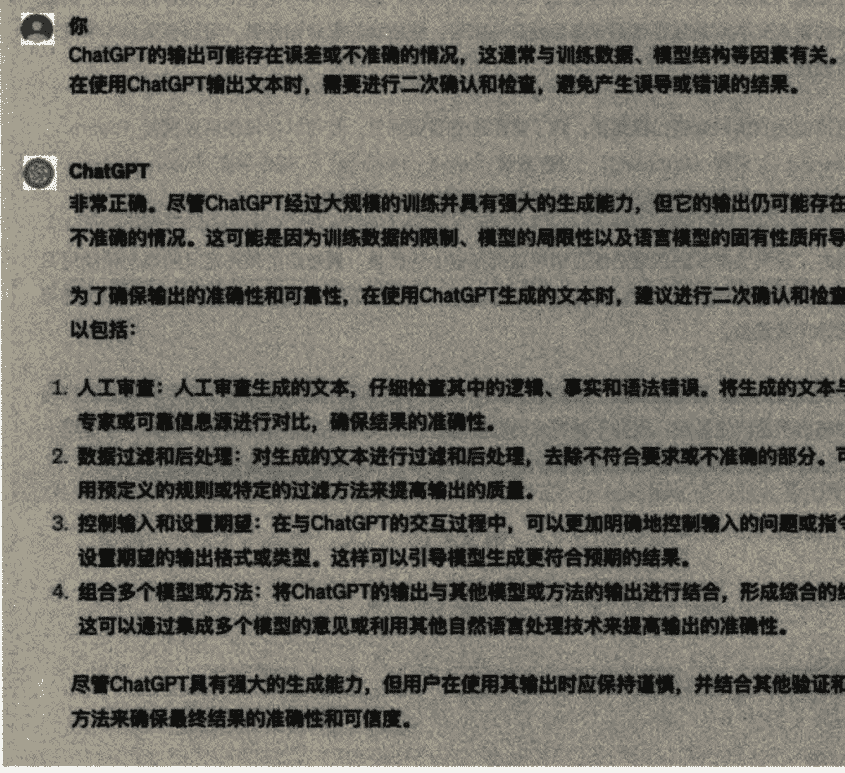

#### 三、如何评估 ChatGPT的性能？

评估 ChatGPT 的性能可以采用多种指标，如困惑度、BLEU 分数、ROUGE 分数、人类评估等。这些指标可以反映模型在不同任务中的表现，可以帮助用户选择合适的模型和参数。

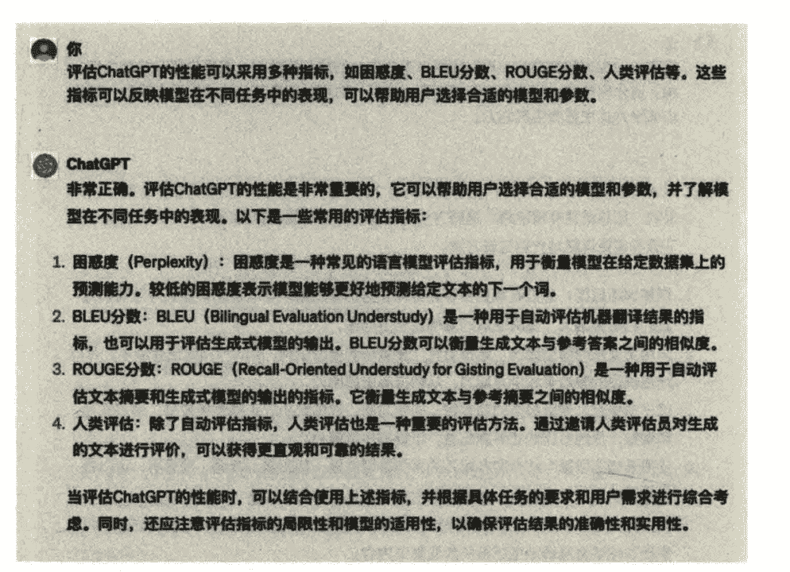

#### 四、如何提高 ChatGPT的生成能力？

提高 ChatGPT 的生成能力可以采用以下方法：增加训练数据、采用更复杂的模型结构、优化超参数、使用多模态数据等。此外，也可以结合其他技术如语义搜索、对抗训练等方式来提高生成能力。

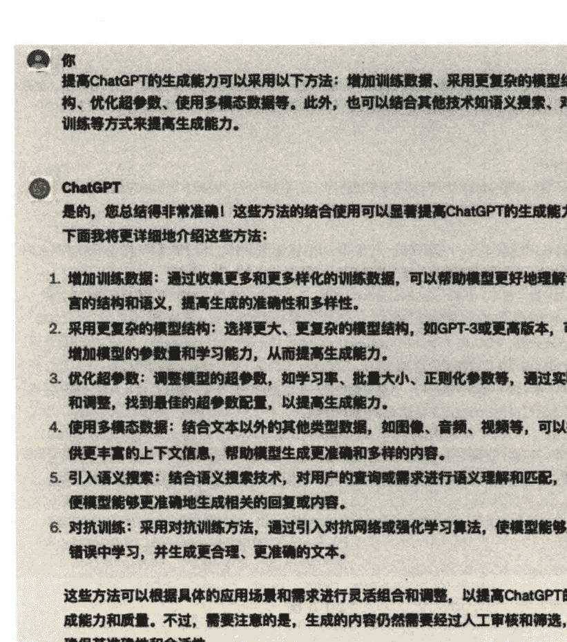

图 8-1-4

#### 五、如何避免 ChatGPT的偏见？

ChatGPT 的输出可能存在偏见，这通常与训练数据和模型结构有关。为避免偏见，可以采用多样化的数据集和训练方法，以及进行模型调整和优化，使模型更加公正和中立。

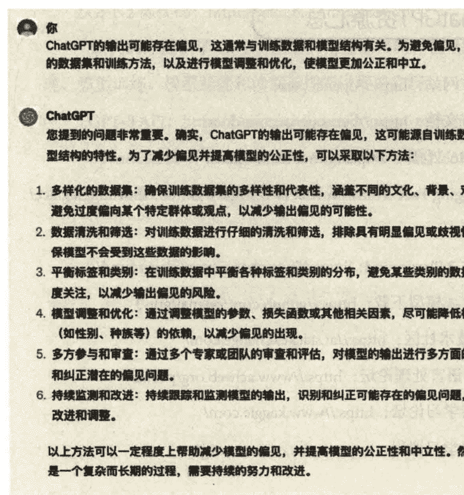

图 8-1-5

### 第二节 如何解决 ChatGPT 使用中的问题

#### 一、ChatGPT资源汇总

官方网站：https://openai.com/
官方文档：https://beta.openai.com/docs/
GitHub 仓库：https://github.com/openai
Hugging Face Transformers 库：https://github.com/huggingface/transformers
GPT-3 Playground：https://beta.openai.com/playground/
GPT-3 模型下载：https://github.com/openai/gpt-3
AI 技术社区：https://ai.stackexchange.com/
自然语言处理论坛：https://www.aclweb.org/portal/
机器学习论坛：https://www.kaggle.com/
机器学习课程：https://www.coursera.org/

#### 二、开源代码

- 1. transformers 库：https://github.com/huggingface/transformers
该库提供了各种类型的预训练模型和 Fine-tuning 脚本，其中包括 GPT-2 和 GPT-3 等模型。此外，该库还提供了各种与 NLP 任务相关的实用工具和函数。

- 2. GPT-2 源代码：https://github.com/openai/gpt-2
该代码库提供了 GPT-2 模型的完整源代码，包括数据集预处理、模型训练、模型验证和模型推理等过程的实现。

- 3. GPT-3 API：https://beta.openai.com/docs/api-reference/gpt-3
OpenAI 还提供了 GPT-3 API，开发者可以通过 API 接口来使用 GPT-3 模型，无需了解模型的具体实现和配置。

### 第三节 数据集

#### 一、WikiText

这是一个由维基百科文章组成的数据集，用于自然语言处理任务，包括语言模型、文本生成等。

#### 二、BookCorpus

这是一个由图书文本组成的数据集，包括了各种不同的题材和风格，适合用于训练自然语言处理模型，如 GPT。

#### 三、WebText

这是一个由网络文本组成的数据集，包括了各种不同的来源和类型，可以用于训练和测试自然语言处理模型。

#### 四、COCO Captions

这是一个由图像和对应的文字描述组成的数据集，用于训练图像描述生成模型，其中包括了大量的自然语言文本。

#### 五、Cornell Movie Dialogs Corpus

这是一个由电影对话组成的数据集，包括了各种不同的场景和情境，可以用于训练对话生成模型，如 GPT。

#### 六、Yelp Open Dataset

这是一个由 Yelp 网站上的评论组成的数据集，包括了大量的文本和元数据，可用于训练和测试各种自然语言处理模型，如情感分析、文本分类等。

#### 七、Amazon Reviews Dataset

这是一个由亚马逊网站上的商品评论组成的数据集，包括了大量的文本和元数据，可用于训练和测试各种自然语言处理模型，如情感分析、文本分类等。

#### 八、SNLI

这是一个用于自然语言推理任务的数据集，包括了大量的句子对和标注信息，可用于训练和测试 GPT 模型和其他自然语言处理模型。

#### 九、AG News

这是一个新闻文章分类数据集，包括了各种不同的新闻类型和主题，可用于训练和测试文本分类模型，如 GPT。

### 第四节 模型库

#### 一、Hugging Face Transformers

Hugging Face 是一个自然语言处理模型库，提供了各种预训练的 GPT 模型，包括 GPT、GPT-2、GPT-3 等。

#### 二、OpenAI

OpenAI 是一个人工智能研究机构，提供了 GPT-3 等各种预训练模型，同时也提供了相关的 API 接口，可以供用户方便地使用这些模型。

#### 三、GPT-Neo

GPT-Neo 是一种自主预训练的 GPT 模型，使用了类似于 GPT-3 的架构和训练方法，但是模型参数量比 GPT-3 小得多，从而降低了训练和使用成本。

#### 四、PaddlePaddle

PaddlePaddle 是一个深度学习框架，提供了各种预训练的 GPT 模型和相关的应用场景。

#### 五、AllenNLP

AllenNLP 是一个基于 PyTorch 的自然语言处理库，提供了各种预训练的 GPT 模型和应用场景，包括文本生成、问答系统、情感分析等。

#### 六、TensorFlow Hub

TensorFlow Hub 是一个 TensorFlow 的模型库，提供了各种预训练的 GPT 模型和相关的应用场景，如文本生成、情感分析等。

#### 七、GPT-2简洁实现

这个模型库提供了一个简洁实现的 GPT-2 模型，使用 Python 和 TensorFlow 2 实现，适合初学者学习和实践。

#### 八、Transformers4Rec

这是一个面向推荐系统的自然语言处理模型库，提供了各种预训练的 GPT 模型和相关的应用场景，如文本生成、推荐系统等。

### 参考文献

- 1. Radford, A., Wu, J., Child, R., Luan, D., Amodei, D., & Sutskever, I. (2019). Language models are unsupervised multitask learners. OpenAI Blog, 1(8), 9.
- 2. Brown, T. B., Mann, B., Ryder, N., Subbiah, M., Kaplan, J., Dhariwal, P., ... & Amodei, D. (2020). Language models are few-shot learners. arXiv preprint arXiv:2005.14165.
- 3. Petroni, F., Piktus, A., & Rocktäschel, T. (2021). How to Generate Long Sequences with GPTs? Lessons from the New Testament. arXiv preprint arXiv:2101.11986.
- 4. Liu, Y., Ott, M., Goyal, N., Du, J., Joshi, M., Chen, D., ... & Stoyanov, V. (2019). RoBERTa: A robustly optimized BERT pretraining approach. arXiv preprint arXiv:1907.11692.
- 5. Howard, J., & Ruder, S. (2018). Universal language model fine-tuning for text classification. arXiv preprint arXiv:1801.06146.
- 6. Zhang, Y., Gong, Y., Huang, L., Jiang, X., & Huang, T. (2021). GPT Understands, Too. arXiv preprint arXiv:2105.08050.

怕自己的工作被人工智能取代？
担心人工智能会奴役人类？
不清楚未来还有什么发展机会？

人工智能不会淘汰人类，但你若掌握了ChatGPT
便可以将他人甩在身后

提高生产力 ➔ 提升竞争力 ➔ 把握创新力
不做被人工智能取代的人

