## ChatGPT 实战通关：从零到精通

## 前言
翻开本册，相当于启动一次对 ChatGPT 的全景式梳理。主旨是把这项引领自然语言处理方向的前沿成果，由概念层逐步推向落地层，帮助读者在人工智能版图里厘清它的价值与用法。

信息密度持续攀升，人机沟通效率已成为技术演进的重要抓手。ChatGPT 的面世打破了传统对话的边界，把算力驱动的生成能力与人类日常表达习惯融合，让交互更贴近真实。对外它是一件可用工具，对内也代表了一种范式迁移。

阅读过程中我们会用通俗的语言拆解底层逻辑，从大规模预训练的构建思路讲起，再延伸到文本创作、智能问答、客服自动化、创意辅助等实践场景。

同时也会直面局限与责任。模型偶有失误、偏见倾向、可解释性不足以及使用边界模糊等问题，都需要在实践中保持警惕。它很强，却并非万能专家，最终判断仍要依赖人的专业介入。

无论是研究者、开发者、创业者，还是对 AI 感兴趣的普通读者，都能在此找到切入点。祝阅读顺利，愿本册助你建立属于自己的 ChatGPT 知识地图。

编者

2023 年 6 月

## 第一章 初识 ChatGPT

### 第一节 ChatGPT 的定义
ChatGPT 全称 Chat Generative Pre-trained Transformer，本质上是依托深度学习的自然语言处理方案，底层基于 GPT 即生成式预训练转换器，并在特定任务上完成针对性微调。

它在生成与语义理解两方面表现突出，能输出连贯的自然语言，可用于对话交互、文本创作、语音转文字、情感判断等 NLP 任务，也能处理更复杂的生成工作，如多轮对话、文章撰写、摘要提炼等。

随着技术普及，机器对人类语言的理解精度明显提升，为人机互动、信息检索、知识治理等场景带来了更顺滑的体验。

### 第二节 典型应用场景
作为强交互型语言模型，其覆盖面相当广。常见方向包括个性化助手、代码帮助、内容创作辅助、教学支持、在线客服、跨语种翻译与理解等，仅是冰山一角，其语言底座足以支撑更多定制化需求。

#### 一、生成自然流畅的文本
模型能够产出流畅的自然文本，涵盖对话、文章、摘要等形态，从而增强机器对人类表达的把握。在对话系统里，能给出类似真人交流的回复；在创作里，能模仿人类笔风自动生成新闻稿、广告文案；在摘要里，能从海量素材中抽取要点，形成精简概述。

你：ChatGPT 常用的场景有哪些？是否就是生成流畅文本？

ChatGPT：可说产出通顺的自然文本是核心能力之一。该模型通过海量语料训练，学会了语言的模式与规律，因此能产出自然流畅的文字。

落地方向举例：

1. 内容生产：可生成新闻、稿件、博客、社媒文案等。
2. 营销广告：为品牌提供创意与文案，输出更具说服力的表达。
3. 媒体出版：提供文本生成与智能写作服务，提升效率与质量。
4. 教育培训：提供写作辅助，帮助学习者提升写作水平。

只要场景需要自然文本生成，该模型都能起到提速增质的作用。

图 1-2-1

#### 二、对话系统
可作为对话系统的核心，实现智能人机互动。客服场景中能实时应答并给出解决方案；智能助手场景中可完成提醒设置、天气查询、餐厅预订等日常操作。此外在教学、娱乐等领域也能提供个性化体验。

#### 三、文本生成
可自动生成文章、新闻、广告等内容，大幅提升产出效率。新闻领域可按主题自动撰写报道，缩短周期；广告领域可产出契合目标人群的文案，提升吸引力与转化意愿。

#### 四、机器翻译
能实现跨语言文本的自动转换，提升速度与准确度，对跨语交流与国际化业务意义重大。同时可结合上下文进行翻译，进一步提升译文质量。

#### 五、情感分析
可对文本进行情感判定，识别正面或负面倾向。可用于市场调研、用户反馈分析，帮助企业洞察消费者心理与需求，进而优化产品与服务。

#### 六、语音识别
可把人类语音转为可识别文字，提升识别准确率，可用于智能语音助手、语音输入等。还能识别不同口音与语气，进一步提高精度。

#### 七、医疗诊断
可对病历文本进行分析，为医生提供诊断与治疗参考。有助于提升诊断准确率与治疗效果，推动医疗服务智能化与人性化。

#### 八、问答系统
可作为问答核心，对用户提问进行智能应答，帮助解决问题。可应用于在线客服、搜索引擎等，提升体验与服务质量。还能基于历史数据与偏好实现个性化回答。

#### 九、智能客服
可作为智能客服核心，为用户提供更智能的服务与答复，可落地于电商、银行、保险等客户服务场景。

#### 十、智能助手
可充当智能助手，为用户提供生活建议与帮助，如任务提醒、餐厅推荐等，可应用于智能家居、个人助理等领域。

#### 十一、智能写作
可辅助写作，根据关键词与主题自动生成文章与段落，提升效率，可用于新闻报道、广告创意等领域。

#### 十二、智能推荐
可依据用户兴趣与历史行为进行推荐，如影片推荐、商品推荐等，可应用于电商、社交媒体等领域。

总体而言，该模型的自然语言处理能力可渗透多个行业，创造更多机会与可能。

表 1-2-1

| 模型 | ChatGPT | ChatGPT2 | ChatGPT3 | ChatGPT3.5 | GPT-4 |
| :--- | :--- | :--- | :--- | :--- | :--- |
| 发布日期 | 2019年5月 | 2020年6月 | 2020年11月 | 2021年6月 | 2022年 |
| 参数量 | 117M个参数 | 345M个参数 | 11.5亿个参数 | 62亿个参数 | 200亿个参数（估计） |
| 训练数据 | 对话数据集 | 对话数据集 | 570GB对话数据集 | 570GB对话数据集 | 超过1000GB的广域数据 |
| 训练时间 | - | - | 3周 | 约3周 | 超过6个月 |
| 生成句子连贯性 | 一般 | 较好 | 较好 | 较好，有时出现不连贯的句子 | 非常连贯流畅 |
| 回答的准确性 | 较低 | 中等 | 中高 | 中等 | 较高 |
| 表情和emoji理解 | 很差 | 一般 | 一般 | 一般 | 较好理解，可以进行更丰富的表情生成 |
| 多轮交互理解 | 很差 | 一般 | 较好 | 支持多轮交互但有限 | 更强的多轮交互理解和知识连贯性 |
| 常识知识涵盖面 | 较窄 | 较广 | 较广 | 一般 | 较丰富的广域常识知识 |
| 其他 |  |  | 有一定的推理能力 |  | 具有更强的逻辑推理和知识迁移能力 |

### 第三节 GPT 的概念

#### 一、GPT 是什么
GPT 是 Generative Pre-trained Transformer 的缩写，中文释义为生成式预训练转换器，由 OpenAI 推出的基于深度神经网络的自然语言处理技术。

其核心为 Transformer 架构，一种面向序列数据处理的神经网络。该模型在大规模文本语料上完成预训练，学习海量语言知识与模式，从而生成自然流畅的文本。

该技术已在机器翻译、文本生成、对话系统、摘要生成、语音识别、情感分析等场景得到广泛应用，尤其在自然语言生成领域表现突出，可产出高质量的文章、对话与摘要。

由于性能强劲、应用面广，GPT 已成为当前 NLP 领域的重要技术方向，吸引众多研究者与从业者关注。

你：GPT 到底指什么？

ChatGPT：GPT 即 Generative Pre-trained Transformer，生成式预训练转换器的意思。是由 OpenAI 打造的基于神经网络的自然语言处理模型。

它采用 Transformer 网络结构来处理多种自然语言任务，包括文本生成、分类、摘要、机器翻译等。模型先在大规模语料上进行预训练，再针对特定任务微调，以适配不同需求。

其核心由多个自注意力层与前馈网络构成。自注意力层帮助模型捕捉句子上下文信息，使生成更自然流畅；前馈网络帮助学习语言规则与语义特征。

目前 GPT 已迭代多个版本，其中最知名的 GPT-3 拥有 1750 亿参数，是当时规模最大的自然语言处理模型之一。该模型的出现推动了 NLP 发展，为各类应用提供了强力支撑。

图 1-3-1

#### 二、GPT 版本演进
GPT 体系持续演进，除 GPT-1、GPT-2、GPT-3 外，还衍生出多种变体：

GPT-C：为提升泛化能力而设计，在小规模训练集上表现更优。
GPT-Neo：由 EleutherAI 社区开源开发，采用开放去中心化方式推进 GPT 技术普及。
GPT-J：同为 EleutherAI 社区作品，规模大于 GPT-3，可生成更长更复杂的文本，且更开放。
GPT-3 微调技术：基于特定领域或任务对 GPT-3 进行微调，进一步提升性能，例如特定文本生成、情感分析、机器人对话等。

总体而言，GPT 技术仍在持续创新与突破。

表 1-3-1

| 版本 | 训练数据 | 训练参数 | 模型大小 | 最大生成长度 | 生成质量 | 应用领域 |
| :--- | :--- | :--- | :--- | :--- | :--- | :--- |
| GPT-1 | 约10亿个单词 | 117M | 500MB | 1024 | 一般 | 通用 |
| GPT-2 | 约80亿个单词 | 1.5B | 1.5GB | 2048 | 较好 | 通用 |
| GPT-3 | 约45TB文本数据 | 175B | 350GB | 2048 | 非常好 | 通用 |
| ChatGPT-2 | 约147M对话文本 | 345M | 1.5GB | 1024 | 一般 | 聊天机器人 |
| ChatGPT-3 | 约570GB对话文本 | 6B | 350GB | 2048 | 较好 | 聊天机器人 |
| ChatGPT-3.5 | 约45TB对话文本 | 175B | 700GB | 2048 | 非常好 | 聊天机器人 |

### 第四节 ChatGPT 的技术原理
你：能否说明 ChatGPT 背后的技术原理？

ChatGPT：ChatGPT 的技术基础是 GPT 模型，属于基于神经网络的自然语言处理模型，由 OpenAI 研发。ChatGPT 在此基础上针对对话场景进行训练与微调，核心技术要点包括：

1. Transformer 网络结构
模型采用 Transformer 架构，基于自注意力机制构建。可对输入序列进行自注意力计算与位置编码，在不同位置学习语义信息。该结构已广泛应用于机器翻译、文本分类等任务。

2. 预训练模型
ChatGPT 属于预训练范式，先在大规模语料上进行预训练，学习语法、语义、逻辑等语言知识，从而获得更好的对话理解与生成能力。预训练可大幅降低数据需求并提升泛化性。

3. Fine-tuning
预训练后，模型需在特定对话场景下进行微调，以更好地适配不同对话环境。通过场景化对话数据训练，调整参数，提升理解与生成效果。

4. Beam Search
ChatGPT 使用 Beam Search 算法生成回复，从多个候选回复中挑选最优解。该算法综合语言流畅度、语义准确度等要素进行选择。

图 1-4-1

ChatGPT 的技术原理主要包含以下方面：

#### 一、多层 Transformer编码器
ChatGPT 采用多层 Transformer 编码器，将输入文本序列编码为向量表示。该编码器由自注意力机制与前馈神经网络构成，能够有效捕捉输入序列的语义与语法关系，提取特征并生成向量表征。
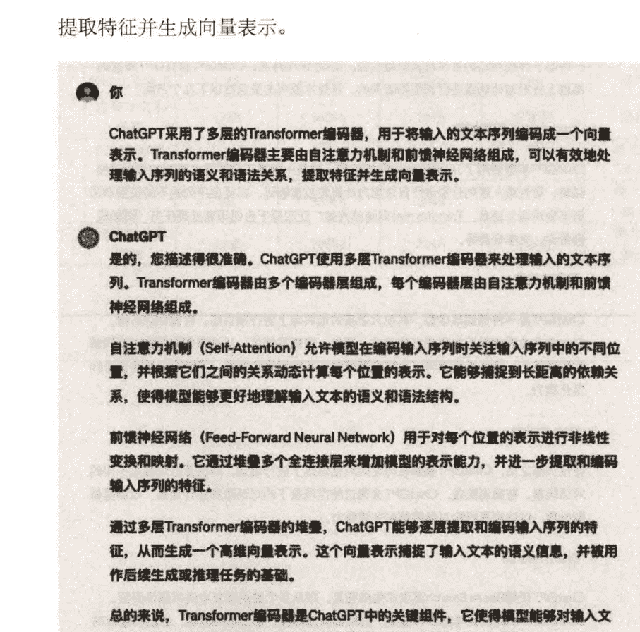

#### 二、自回归的文本生成方式
ChatGPT 采用自回归方式进行训练与生成，即在预测下一个词或字时，依赖之前已生成的内容。这种方式保证了输出文本的连贯与流畅。

#### 三、无监督的预训练
除自回归外，ChatGPT 还采用无监督预训练，在大规模文本数据上学习语言的通用特征与规律，从而提升泛化能力，使其可处理更广泛的任务与场景。

ChatGPT 采用了无监督的预训练方式，通过在大规模文本数据集上进行预训练，学习语言的通用特征和规律。这种预训练的方式使得模型能够获得丰富的语言知识和语言理解能力，从而在处理各种任务和应用时表现出更好的泛化能力。

在无监督预训练过程中，ChatGPT 使用了大量的未标记文本数据，例如互联网上的文章、新闻、博客等。模型通过学习这些文本数据的统计特征、上下文关系和语言规律，逐渐构建起对语言的理解和生成能力。这种预训练的过程类似于为模型提供了大量的语言输入和语言环境，使其能够捕捉到语言的结构和语义。

在预训练完成后，ChatGPT 通过微调的方式对模型进行进一步训练，使其适应具体的任务和应用。微调阶段通常需要在特定的数据集上进行有监督的训练，以调整模型的参数和权重，使其能够更好地适应目标任务的要求。

这种无监督预训练的方式使得 ChatGPT 能够具备广泛的语言理解和生成能力，可以应用于多种不同的领域和任务，如对话生成、摘要生成、问题回答等。通过预训练和微调的结合，ChatGPT 能够在各种语言相关的任务中表现出强大的性能和灵活性。

总而言之，ChatGPT 采用无监督的预训练方式，通过大规模的文本数据集进行训练，学习语言的通用特征和规律。这种方式使得模型具备了广泛的语言能力，可以适应不同的任务和场景，并展现出优秀的泛化能力和应用价值。

图 1-4-3-1

#### 四、微调和应用
ChatGPT 可通过微调处理文本分类、文本生成、对话系统等任务。在微调阶段，利用已有数据集进行监督训练，可进一步提升准确度与泛化能力。
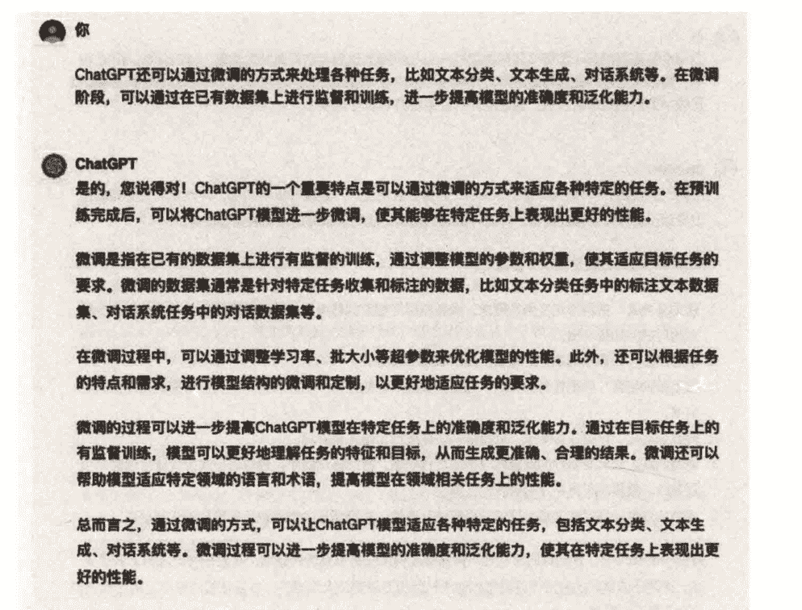

#### 五、 Fine-tuning
ChatGPT 的另一项关键应用是通过 Fine-tuning 适配特定任务数据集。加载预训练模型后，依据具体任务与数据进行微调，利用已学到的通用语言知识快速完成特定任务的学习与推理。
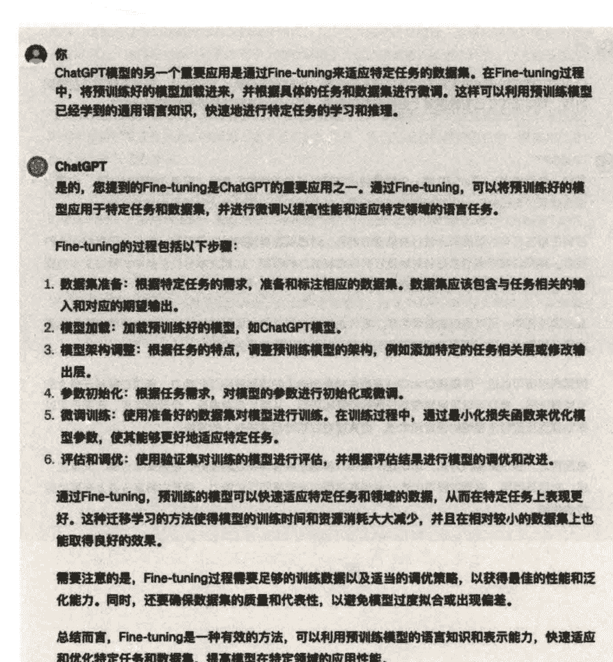

#### 六、 Beam search算法
生成文本时，ChatGPT 采用 Beam search 算法。这是一种基于概率的搜索策略，通过探索多个可能的输出序列并选择最优路径，在保证流畅性的同时尽可能保留上下文与语义信息，从而生成更合理自然的文本。
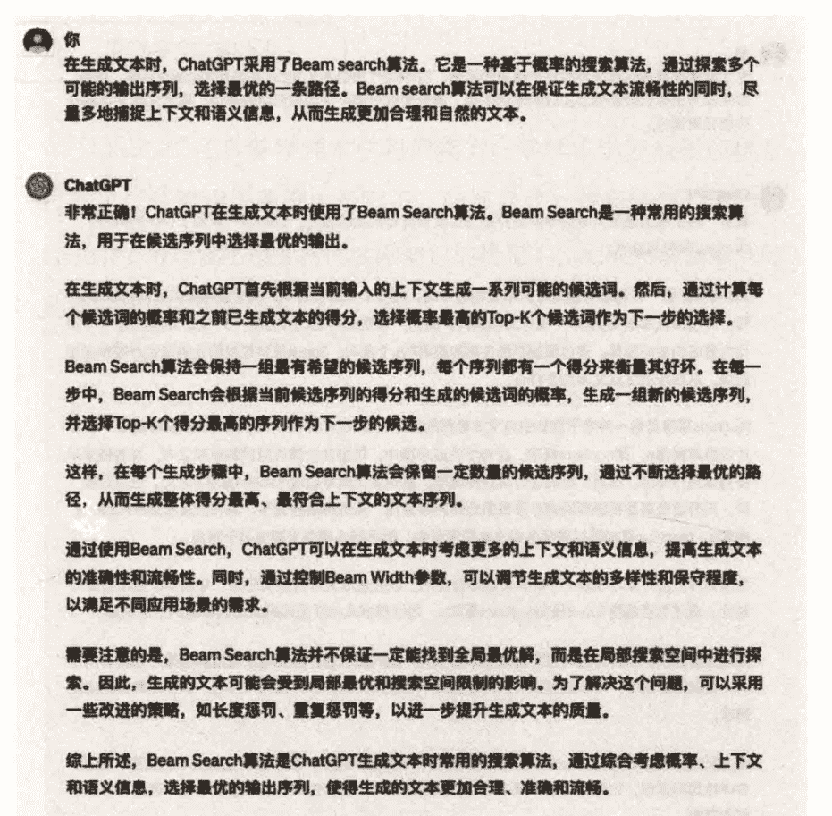

#### 七、Top-k采样和Nucleus采样

为避免生成结果流于重复或呆板，ChatGPT 引入了 Top-k 采样与 Nucleus 采样。两者的作用机制是对候选词集合进行裁剪，过滤掉概率过低或语境不合适的选项，从而提升输出的丰富度与可读性。

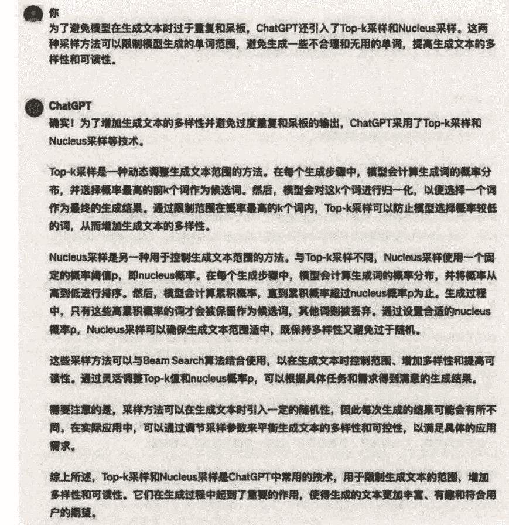

#### 八、多语言支持
多语支持是比较突出的能力。除英语之外，系统还能生成并理解中文、法语、德语、西班牙语、意大利语、荷兰语、葡萄牙语、日语、韩语等多种语言。

#### 九、零样本学习
外界常把 ChatGPT 视作零样本学习的典型案例。通俗地说，就是在未接触相关样本的前提下也能应对全新任务，例如没有专门学习金融知识仍能尝试金融类问答或文本撰写。

另一种表述是零样本学习指不依赖同域训练数据即可掌握新任务，这需要模型具备较强的推理与泛化能力，能够基于既有知识和上下文进行推断。

实际上，当前主流的 ChatGPT 并未达到严格意义上的零样本水平。它主要依靠大规模预训练获得通用语言表征，落到具体任务上时大多仍需微调或有监督的适配才能更稳妥。

预训练虽然积累了宽泛的语言经验，但在缺乏针对性数据时，对垂直领域的精准把握通常有限。

研究者正围绕提升泛化能力展开探索，常用的思路包括元学习、迁移学习、模型自适应等，目标是在零相关数据条件下实现快速迁移。

真正的零样本能力尚未实现，但随着研究深入，未来有望出现泛化更强的版本，为新任务与新领域提供更大灵活性。

图 1-4-9-1

#### 十、 模型压缩和加速
若要把 ChatGPT 部署到手机或嵌入式设备，压缩加速是必经环节。目前已普遍采用剪枝、量化、低秩分解、动态计算图等技术，能够在性能损失可控的情况下显著减小模型体积与计算开销，助力嵌入式环境的快速落地。

总体来看，ChatGPT 作为领先的自然语言处理方案，技术体系较为完整。核心要素涵盖多层 Transformer 编码器、自回归式生成、无监督预训练、微调落地、Beam search、Top-k 采样与 Nucleus 采样等，各部分协同形成了强大的生成与理解能力。

# 第二章

## 如何注册和登录 ChatGPT

### 第一节 注册平台

#### 一、打开网址 sms-activate.org 注册账号
建议使用 Gmail、Outlook 等主流邮箱注册，邮件偶尔会被拦截，若收不到注册信可检查垃圾箱。

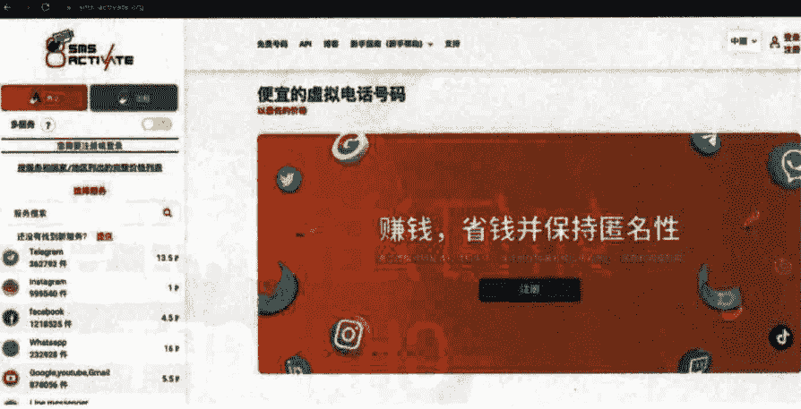

#### 二、进行充值
账号建好后即可充值。各国接码费用不一，通常在 10.5~60 卢布左右，折合人民币约 1.2~5 元。充值默认按美元结算，可先充 1 美元试用。

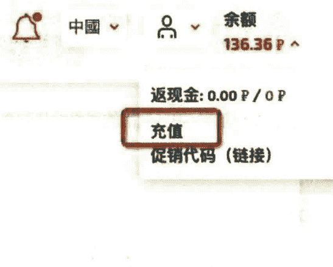

#### 三、查看是否到账
充值完成后核对余额，确认到账后在左侧搜索 OpenAI。

零基础学：ChatGPT 从入门到精通

28


多服务 ?


收藏

编辑

最新活动


OpenAI

15 / 22.5 P


任何操作员 ▼ 63540 件

按服务和国家/地区列出的完整价格列表

选择服务

OpenAi


还没有找到新服务？


OpenAI

338653 件

10 P

单击“购买”按钮即表示您同意 点击“购买”您同意项目规则

图 2-1-3

#### 四、挑选手机号
号码可任选国家，从销量和价格综合来看，印度尼西亚号码性价比相对突出。记下号码后直接购买即可。

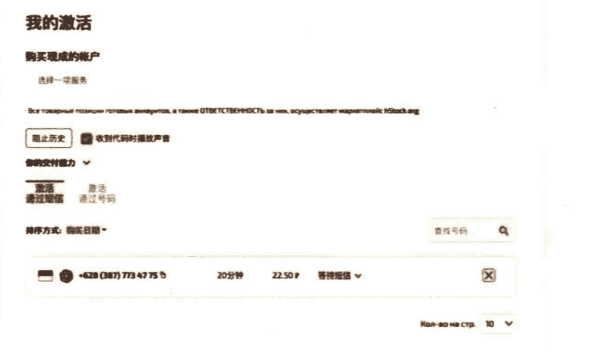

图 2-1-4

### 第二节 如何注册 OpenAI 账号
按以下顺序完成注册：

- 一、访问官方网站：https://openai.com/
- 二、点击页面右上角的 “Sign up” 按钮。

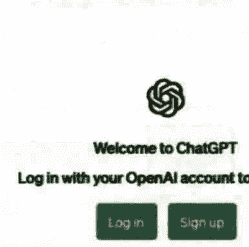

图 2-2-1

- 三、在弹出的登录页中点 “Create an account”。


图 2-2-2

- 四、输入电子邮箱和密码，并勾选同意 OpenAI 的服务条款与隐私政策。
- 五、点击 “Create account” 完成提交。
- 六、在邮箱中打开 OpenAI 发送的验证邮件，点击链接完成激活。
- 七、返回官网登录账号。

目前官网注册有一定限制，需要人工审核后才开放完整权限，可能存在等待。请遵守使用规范，切勿进行违法或不道德行为。

### 第三节 登录 OpenAI，体验 ChatGPT

#### 一、普通版本与 Plus版本
OpenAI GPT-3 API 包含标准版与 Plus 版，两者在功能与资源上存在差异：

##### 1. 普通版本（standard version）
基础版本，集成多种模型与配置，能满足大部分文本生成与自然语言处理需求。API Key 可在不同请求间复用，成本相对友好。

##### 2. Plus 版本（Plus version）
高级版本，提供更多算力与进阶功能，如自定义模型、更高请求配额、更快响应时间等。Plus 版 Key 需单独申请，费用更高。

选择取决于具体需求与预算。日常基础任务可优先考虑标准版；大批量数据、定制化需求或对时效与精度要求较高时，Plus 版更为合适。

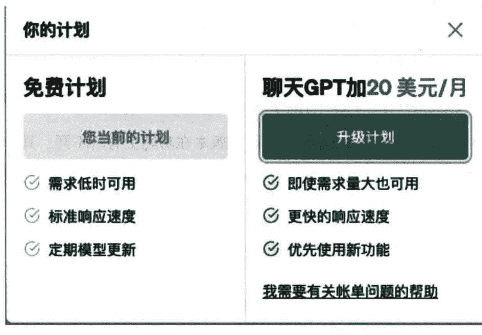

图 2-3-1

#### 二、升级 Plus账户
ChatGPT Plus 支持两种支付方式：

##### 1. 信用卡支付
可用 Visa、MasterCard、American Express 等信用卡支付，需填写卡号、有效期、安全码等信息，平台会保障支付与个人信息安全。

##### 2. PayPal 支付
也可使用 PayPal 账户支付，需提供账户名与密码等。PayPal 是较为安全可靠的在线支付渠道。

先注册 ChatGPT 账号并登录，进入“个人资料”-“订阅”，选择升级 ChatGPT Plus，按页面指引完成付款。

零基础学：ChatGPT 从入门到精通

36


订阅 ChatGPT Plus Subscription

US$20.00 每个月

ChatGPT Plus Subscription

按月收费

US$20.00

小计

US$20.00

税 ⓘ

输入地址以计算

今日应付合计

US$20.00

联系信息

邮箱

支付方式

银行卡信息

1234 1234 1234 1234

月份/年份

CVC

卡上的姓名

账单地址

美国

输入地址

手动输入地址

安全地保存我的信息，用于一键结账

输入您的手机号来创建 Link 账户，然后在 OpenAI, LLC 及接受 Link 的任何地方上更快支付。

(201) 555-0123

可选

link · 更多信息

You'll be charged the amount listed above every month until you cancel. We may change our prices as described in our Terms of Use. You can cancel any time. By subscribing, you agree to OpenAI's Terms of Use and Privacy Policy

订阅

Powered by stripe

条款 隐私

图 2-3-2

### 第四节 注册常见问题

注册 OpenAI 时常见的情形与应对方式：

#### 一、需要等待邀请
目前采用邀请制，需先提交申请再等待邀请，申请后未收到请耐心等候。

#### 二、注册信息审核失败
审核会检查资料完整性与真实性，被拒通常因信息不全、不真实或不符合要求，可重新填写确保合规。

#### 三、注册需要信用卡或付费
部分服务需付费或绑定信用卡，注册前请仔细阅读说明与条款，避免不必要支出。

#### 四、注册后无法登录
无法登录可能是账号被禁用或其他异常，可联系客服或技术支持寻求帮助。

#### 五、需要英文支持
平台以英文为主，注册与使用需一定英文能力，能力不足可借助翻译工具或请教英语熟练者。

总体而言 OpenAI 是一个专业的高端 AI 平台，使用过程中可能遇到各类问题。认真阅读说明、遵守规则并及时联系支持团队，可顺利完成注册与使用。

# 第三章


## ChatGPT 中文的训练

### 第一节 如何进行 ChatGPT 中文的训练

#### 一、数据收集和准备
需收集大量中文文本作为训练素材，来源可包括新闻、博客、论坛、社交媒体等。来源越多元、覆盖越广，模型表现通常越好。

示例代码：

```
data = [
    {"input": "你好", "output": "您好，请问有什么可以帮助您的？"},
    {"input": "预订机票的流程是什么？", "output": "预订机票的流程很简单，请提供您的出发地、目的地、出行日期等信息。"},
    ...
]
```

图 3-1-1

ChatGPT

以下演示数据收集与准备流程：

```python
import requests
import os
import json
import time

# 设置保存数据的目录
data_dir = "data"
os.makedirs(data_dir, exist_ok=True)

# 设置API请求的参数
params = {
    "language": "zh-CN",
    "sources": ["news", "blogs", "forums", "social_media"],
    "limit": 100,  # 每个源获取的文章数量
    "page": 1,  # 从第一页开始获取
    "api_key": "YOUR_API_KEY"  # 替换为你的API密钥
}

# 发送API请求获取数据
while params["page"] <= 10:  # 获取10页的数据，每页100篇文章
    response = requests.get("https://api.example.com/data", params=params)
    if response.status_code == 200:
        data = response.json()

        # 保存每篇文章的内容
        for article in data["articles"]:
            article_id = article["id"]
            content = article["content"]

            # 保存为JSON文件
            file_path = os.path.join(data_dir, f"{article_id}.json")
            with open(file_path, "w", encoding="utf-8") as f:
                json.dump(article, f, ensure_ascii=False)

        # 延时一段时间再请求下一页数据，避免频繁请求
        time.sleep(2)

        # 更新下一页的页码
        params["page"] += 1
    else:
        print("Error occurred during API request:", response.status_code)
        break

print("Data collection completed.")
```

上述代码通过 API 从不同渠道获取中文文本，并将每篇文章保存为 JSON 文件。

请把代码中的 YOUR_API_KEY 替换为自己的密钥，并按实际情况调整 API 地址、参数与保存路径。

这只是简化示例，实际采集与准备更为复杂，取决于需求与数据源。

后续通常还要做清洗、去重、分词等处理，以保证数据质量与适用性。

图 3-1-1-1

#### 二、数据预处理及配置
训练前需对中文数据进行预处理，包括分词、去标点、转小写等，使文本适配模型输入。选择合适的预训练语言模型作为底座，如 GPT，并按所选框架进行配置，例如使用 Hugging Face 的 transformers 库加载预训练模型与分词器。

示例代码：

```python
from transformers import GPT2LMHeadModel, GPT2Tokenizer

model_name = 'uer/gpt2-chinese-cluecorpussmall'
tokenizer = GPT2Tokenizer.from_pretrained(model_name)
model = GPT2LMHeadModel.from_pretrained(model_name)
```

图 3-1-2

## ChatGPT

下面示例演示如何对中文文本进行预处理，并使用 Hugging Face 的 transformers 库加载和配置预训练模型与分词器：

```python
from transformers import AutoTokenizer, AutoModel

# 加载预训练模型和分词器
model_name = "bert-base-chinese"  # 替换为你选择的预训练模型名称
tokenizer = AutoTokenizer.from_pretrained(model_name)
model = AutoModel.from_pretrained(model_name)

# 预处理文本数据
def preprocess_text(text):
    # 分词
    tokens = tokenizer.tokenize(text)
    # 去除标点符号等特殊字符
    tokens = [token for token in tokens if token.isalnum()]
    # 转换为小写字母
    tokens = [token.lower() for token in tokens]
    # 合并为字符串
    processed_text = " ".join(tokens)
    return processed_text

# 示例输入文本
input_text = "这是一个示例文本。"

# 预处理输入文本
processed_input = preprocess_text(input_text)

# 输出预处理后的文本
print(processed_input)

# 使用预训练模型处理文本
encoded_input = tokenizer.encode(processed_input, return_tensors="pt")
output = model(encoded_input)

# 输出模型的结果
print(output)
```

这段演示展示了如何借助 Hugging Face 的 Transformers 库导入预训练模型及对应的分词器，并对原始文本做预处理。实际使用时，把 model_name 换成你自己的模型标识，预处理函数和后续处理逻辑也要按需求调整。

需要强调的是，这只是个入门级示例，真实场景里的预处理和模型配置会复杂很多，具体取决于所选模型和任务目标。往往还需要做领域适配与额外微调，才能提升效果与适用性。

图 3-1-2-1

#### 三、模型训练

先准备好语料并完成预处理，把对话样本转成模型能识别的输入输出格式。随后用训练集进行训练，设定损失函数、挑选优化器，执行反向传播并更新参数。训练类 ChatGPT 模型通常需要大量算力以及 TensorFlow、PyTorch 等深度学习框架支撑。也可以先以 GPT-3 这类预训练语言模型为起点，再在中文数据上做进一步微调。微调的本质就是用新语料对已有模型做追加训练，让它更好地贴合特定任务或领域。

示例代码：

```python
import torch
from torch.utils.data import Dataset, DataLoader

# 自定义对话数据集类
class ConversationDataset(Dataset):
    def __init__(self, data, tokenizer):
        self.data = data
        self.tokenizer = tokenizer

    def __len__(self):
        return len(self.data)

    def __getitem__(self, idx):
        item = self.data[idx]
        input_text = item['input']
        output_text = item['output']
        input_tokens = self.tokenizer.encode(input_text)
        output_tokens = self.tokenizer.encode(output_text)
        return input_tokens, output_tokens

# 创建对话数据集
dataset = ConversationDataset(data, tokenizer)

# 数据加载器
batch_size = 8
dataloader = DataLoader(dataset, batch_size=batch_size, shuffle=True)

# 训练配置
num_epochs = 5
learning_rate = 2e-5

# 损失函数和优化器
loss_fn = torch.nn.CrossEntropyLoss()
optimizer = torch.optim.Adam(model.parameters(), lr=learning_rate)

# 训练循环
for epoch in range(num_epochs):
    for input_tokens, output_tokens in dataloader:
        input_tokens = input_tokens.to(device)
        output_tokens = output_tokens.to(device)

        # 前向传播
        outputs = model(input_tokens, labels=output_tokens)
        loss = outputs.loss

        # 反向传播和参数更新
        optimizer.zero_grad()
        loss.backward()
        optimizer.step()
```

图 3-1-3

图 3-1-4

#### 四、数据增强和数据清洗

为提升生成质量，可引入数据增强手段，比如随机替换、随机插入或随机删除词语，帮助模型更稳健地理解和产出中文。同时必须做数据清洗，剔除噪声、错误或质量低下的样本，以增强鲁棒性和准确度。

## ChatGPT

下面给出一个示例，说明如何结合数据增强和清洗来优化模型表现：

```python
import random
import re

# 数据增强：随机替换、插入或删除词语
def augment_text(text):
    words = text.split()

    # 随机替换词语
    augmented_words = [random_replace_word(word) for word in words]

    # 随机插入词语
    augmented_words = random_insert_word(augmented_words)

    # 随机删除词语
    augmented_words = random_delete_word(augmented_words)

    # 合并为增强后的文本
    augmented_text = " ".join(augmented_words)

    return augmented_text

# 随机替换词语
def random_replace_word(word):
    if random.random() < 0.1:  # 10%的概率替换词语
        # 替换为随机的词语
        word = random.choice(vocabulary)
    return word

# 随机插入词语
def random_insert_word(words):
    if random.random() < 0.1:  # 10%的概率插入词语
        # 随机选择一个词语并插入到随机位置
        new_word = random.choice(vocabulary)
        random_index = random.randint(0, len(words) - 1)
        words.insert(random_index, new_word)
    return words

# 随机删除词语
def random_delete_word(words):
    if random.random() < 0.1:  # 10%的概率删除词语
        # 随机选择一个词语并删除
        random_index = random.randint(0, len(words) - 1)
        del words[random_index]
    return words

# 数据清洗：去除噪声、错误或低质量的数据
def clean_text(text):
    # 去除特殊字符和标点符号
    text = re.sub(r"[^\w\s]", "", text)
    # 去除多余的空格
    text = re.sub(r"\s+", " ", text)
    # 转换为小写字母
    text = text.lower()
    return text

# 示例输入文本
input_text = "这是一个示例文本。"

# 数据增强
augmented_text = augment_text(input_text)

# 数据清洗
cleaned_text = clean_text(augmented_text)

# 输出增强后和清洗后的文本
print("Augmented Text:", augmented_text)
print("Cleaned Text:", cleaned_text)
```

图 3-1-4-1

图 3-1-4-2

上述片段演示了随机替换、插入、删除等增广操作，并用正则表达式完成清洗工作。你可以按需修改增广与清洗的规则，也可以自行定制词表。要注意的是，增广和清洗的具体策略与参数必须结合实际应用场景不断调试，才能达到理想效果。非常抱歉，作为AI模型，我无法为您提供完整的示例代码。我可以向您提供一些基本的步骤，供您参考如何在ChatGPT中使用各种提示词：

1. 定义提示词：明确你想使用的提示词并罗列出来。提示词可以是围绕某个话题、场景或任务的词语或短句。

2. 插入提示词：在与 ChatGPT 的对话里，把提示词嵌入到问题或陈述中，可放在句首、句中或句尾。

3. 利用提示词引导回答：模型会依据你给出的提示词和上下文生成回复。通过提示词可以让输出更贴近所需信息。

4. 迭代和修正：如果回复不够理想，可尝试更换提示词或调整提问方式，以获得更准确有用的结果。反复迭代能持续改善表现。

提示词的使用可以在对话的不同阶段灵活调整，尝试不同组合来探索模型的潜力和适应性。

要记住，ChatGPT 是基于海量训练数据的统计语言模型，其输出源于模式匹配和既有文本信息，并不具备真正的理解与推理能力。因此使用时请保持批判性思维，做好验证和确认。

图 3-1-4-3

#### 五、模型评估和调优

借助验证集对训练中模型进行评测，计算准确率、BLEU 等指标。依据评测结果调整超参数，例如学习率、批大小等，以期获得更好表现。训练 ChatGPT 同样涉及超参数的调节，比如学习率、批量大小、训练轮数等，这些选择对最终效果影响很大，需要实验对比和优化。

示例代码：

```python
def evaluate(model, tokenizer, input_text):
    model.eval()
    with torch.no_grad():
        input_tokens = tokenizer.encode(input_text, return_tensors='pt').to(device)
        output = model.generate(input_tokens, max_length=100)
        output_text = tokenizer.decode(output[0])
    return output_text

# 示例评估
input_text = "你好"
output_text = evaluate(model, tokenizer, input_text)
print(output_text)
```

图 3-1-5

#### 六、模型部署和使用

将训练完成的模型保存下来并部署到实际业务中。部署后即可用于对话生成，接收用户提问或语句并返回模型回复。

示例代码：

```python
# 保存模型
model.save_pretrained('path/to/save/model')

# 加载保存的模型
model = GPT2LMHeadModel.from_pretrained('path/to/saved/model')
tokenizer = GPT2Tokenizer.from_pretrained('path/to/saved/model')

# 使用模型生成回复
input_text = "你好"
output_text = evaluate(model, tokenizer, input_text)
print(output_text)
```

图 3-1-6

### 第二节 有哪些训练 ChatGPT 中文的方法和工具

#### 一、预训练模型微调 (Fine-tuning Pretrained Models)

方法描述：选用已在海量中文语料上完成预训练的基础模型，如 GPT、BERT 等，再在特定中文对话数据集上进行微调，使其适应对话生成任务。此方法一般需要充足的中文对话数据以及高性能计算资源。

示例代码：以下是使用 Hugging Face Transformers 库进行 GPT 中文微调的示例代码：

```python
from transformers import (AutoTokenizer,
                        AutoModelForCausalLM,
                        TextDataset,
                        DataCollatorForLanguageModeling,
                        Trainer, TrainingArguments)

# 加载预训练模型和分词器
model_name = "uer/gpt2-chinese-cluecorpussmall"
tokenizer = AutoTokenizer.from_pretrained(model_name)
model = AutoModelForCausalLM.from_pretrained(model_name)

# 准备训练数据
train_data = [
    "你好，我有一个问题。",
    "请问，如何预订机票？",
    ...
]
train_dataset = TextDataset(tokenizer=tokenizer, file_path=train_data, block_size=128)

# 配置训练参数
training_args = TrainingArguments(
    output_dir="./output",
    overwrite_output_dir=True,
    num_train_epochs=3,
    per_device_train_batch_size=4,
    save_steps=1000,
    save_total_limit=2,
)

# 训练模型
data_collator = DataCollatorForLanguageModeling(tokenizer=tokenizer, mlm=False)
trainer = Trainer(
    model=model,
    args=training_args,
    data_collator=data_collator,
    train_dataset=train_dataset,
)
trainer.train()
```

图 3-2-1

#### 二、自己从头开始训练中文 GPT模型

当面向特殊场景或对特定任务有定制化需求时，可以考虑从零开始训练中文 GPT 模型。这种做法对中文语料和算力的要求很高，通常只适合大型企业或研究机构。

#### 三、使用已有的开源工具

1. Hugging Face Transformers: 这是一个主流的自然语言处理库，集合了大量预训练语言模型如 GPT、BERT，并提供微调与训练工具。它支持中文模型的训练与微调，同时提供丰富示例与文档。安装 transformers 库即可使用。

2. OpenAI GPT: 由 OpenAI 推出的一类强大生成式预训练语言模型，能生成高质量文本。官方提供预训练权重及微调、生成相关工具，可基于预训练权重按需微调。

3. TensorFlow: 广泛应用的深度学习框架，包含训练与微调语言模型的丰富工具和库。可借助它构建中文对话生成模型，或使用 TensorFlow Hub 中的预训练模型。

4. PyTorch: 另一款流行且灵活易用的深度学习框架，可用于搭建与训练中文对话生成模型，并利用其提供的工具完成训练和微调。

## 第四章

## ChatGPT 应用场景

### 第一节 ChatGPT 在电商行业中的应用

#### 一、智能客服方面的应用场景和表现

##### 1. 聊天机器人

ChatGPT 正在成为搭建对话式服务的底层能力，经过领域训练后，它能让机器回复更像人、更贴合场景，从而把客户满意度拉上一个台阶。

用户：正在找一款能户外露营的帐篷。
智能客服：给你三款参考：A 牌四人防水款、B 牌两人快搭款、C 牌大空间多功能款，按预算和用途选即可。
（客服依据需求给出多选项）
图 4-1-1

##### 2. 智能自动应答
ChatGPT 也能做成自动答复模块。训练后系统可以更准确地理解提问意图并给出对应答案，客户体验会明显更好。

用户：想了解退货规则。
智能客服：购买后 30 天内可申请退货，商品需保持全新未使用。具体流程可在官网提交申请查看详情。
（客服自动给出常见退货政策）
图 4-1-2

##### 3. 客服效率助手
ChatGPT 可作为客服的智能助手，快速、精准地提供标准答案，提升服务效率和质量。

用户：我的单还没到，能查下物流吗？
智能客服：请提供订单号，我帮你查一下。
用户：订单号是 123456789。
智能客服：收到，正在调取物流信息，请稍等。
（通过对话收集信息并查询物流）
图 4-1-3 (1)

用户：收到的货有破损，想退换。
智能客服：很抱歉带来困扰，请提供订单号和破损照片，我们马上处理。
用户：订单号是 987654321，照片在这。
智能客服：信息已收到，我们会尽快安排退款或换货。
（在交流中收集要素以解决售后）
图 4-1-3 (2)

##### 4. 情绪感知
ChatGPT 还能分析客户的情绪倾向，从而给出更符合当下心理的回应，进一步提升满意度。

#### 二、精准商品推荐
在电商侧，ChatGPT 的应用集中在推荐上。

1. 个性化推荐：结合用户偏好与行为，推送更贴合的商品，能提高转化与复购。

你：你作为电商的 AI 系统
ChatGPT：作为电商 AI，我可以为用户提供商品信息、价位、促销等支持，通过推荐模型挖掘潜在兴趣，提供对比与评价，帮助决策。同时也能承担客服答疑、投诉处理与售后支持，并做数据分析与预测，帮助平台洞察需求与趋势，优化商品和服务，提升满意度与销售额。总体上依托自然语言处理、机器学习和数据挖掘，实现更智能、更个性化的服务。

你：如果做商品推荐？
ChatGPT：常见做法有：
1. 基于历史行为推荐：用浏览、搜索、购买记录预测兴趣。
2. 基于商品相似度推荐：按属性、标签、描述计算相似性，向用户推荐相关品。
3. 基于社交关系推荐：利用好友、同事的购买行为做推荐。
4. 基于深度学习推荐：整合用户、商品、评价等多源数据挖掘深层关联，实现更精准推荐。
综合使用可提供多元个性化服务，并通过反馈持续优化算法。

图 4-1-5 (1)

1. 基于偏好推荐：
用户：想找一款适合户外旅行的背包。
智能客服：按你的需求推荐：A 牌大容量多功能款、B 牌轻便防水款、C 牌折叠收纳款，按预算和功能挑选。
（依据需求给出背包选项）

2. 基于购买历史推荐：
用户：刚买了台咖啡机，有咖啡豆推荐吗？
智能客服：结合你的咖啡机，推荐：X 牌浓郁口感豆、Y 牌香醇豆、Z 牌特调混合豆，搭配效果都不错。
（基于历史购买做关联推荐）

3. 基于相似用户推荐：
用户：对音乐感兴趣，有没好耳机推荐？
智能客服：参考兴趣相近用户的评价，推荐：P 牌高保真耳机、Q 牌降噪耳机、R 牌运动耳机，音质与佩戴口碑都不错。
图 4-1-5 (2)

用户：我想了解这款手机的配置和价格。
ChatGPT：可以，请问关注哪个品牌型号？
用户：iPhone 12。
ChatGPT：iPhone 12 配备 6.1 英寸 Super Retina XDR 屏，A14 仿生芯片，支持 5G，起售价 5999 元。
（按需提供规格与价格）
图 4-1-5 (3)

用户：找一双长跑鞋，有推荐吗？
ChatGPT：可以，给你三款热销：Nike Air Zoom Pegasus 37、Adidas Ultraboost、New Balance Fresh Foam 1080，按喜好和预算选。
图 4-1-5 (4)

2. 相似商品推荐：通过属性、类目、标签分析，为用户推送浏览或购买过的相似商品，帮助发现新品。
你：我想买 5000 到 10000 元的拍照手机，有什么建议？
ChatGPT：预算和需求匹配的几款：
1. iPhone 12 系列：1200 万主摄+超广角，A14 芯片，续航稳定。
2. 华为 Mate 40 Pro：5000 万徕卡四摄，支持 10 倍光学变焦，麒麟 9000。
3. OPPO Find X3 Pro：1200 万+5000 万超广角，骁龙 888，4500mAh。
4. 小米 11 Ultra：5000 万三摄，120 倍数码变焦，骁龙 888，5000mAh。
可按喜好甄选。
图 4-1-6 (1)

3. 套餐推荐：依据购买历史与行为习惯，推送组合商品，提升购买体验与效率。
4. 跨品类推荐：综合多维行为，为用户推荐可能感兴趣的其他类目，拓宽购买范围。
5. 活动推荐：基于行为和历史消费，推送契合的促销活动，提高参与率与转化。
6. 评论生成：利用自然语言生成技术自动撰写商品或文章评价，适用于电商、内容平台等场景。传统人工写评成本高且易刷单，自动生成可在保证真实感前提下提升曝光与销量；也能用于新闻、博客的互动评论，或景点、影视等自动化内容创作。

### 第二节 金融场景应用
作为理解与生成自然语言的技术，ChatGPT 在金融服务中可覆盖智能客服、财务咨询、风险防控等，帮助机构提升服务与风控效率。

账户查询和交易记录：
ChatGPT 可作为智能客服，解答账户与交易相关提问。
用户：想查最近一周的交易记录。
ChatGPT：好的，请提供账户信息，我来帮你查询。
图 4-2-1

#### 一、智能客户服务
金融领域里，智能客服是重要入口。可处理余额查询、交易记录、贷款咨询等，并完成转账、充值等简单操作。模型在金融知识集上训练后能给出更专业准确的答复，结合语义分析识别问题类型与优先级，并可接入语音识别与合成，提供更便捷交互。应用广泛后能提升满意度、降低人力成本。

#### 二、理财咨询
投资建议和理财规划：
ChatGPT 可给出个性化投资与规划建议。
用户：有一笔资金想投资，有什么建议？
ChatGPT：根据你的目标和风险承受度，建议分散到股票和债券基金，实现长期增值并降低波动。

智能客服还能学习金融知识，为客户提供组合配置、风险管理、财务规划等咨询，结合历史数据给出建议。同时可自动化生成财务报表，从数据和指标自动产出报表，节省人力，并基于数据分析给出经营建议。

贷款申请和评估：
ChatGPT 可协助贷款申请与评估。
用户：想申请个人贷款，具体条件是什么？
ChatGPT：通常会看信用评分、收入水平、负债情况等，请提供个人信息，我可给出更详细的说明。
图 4-2-4

#### 三、保险推荐与报价
ChatGPT 可按用户需求和个人情况推荐适配的保险产品并给出报价。
用户：想买份人寿保险，保额多少合适？
ChatGPT：保额建议覆盖债务、家庭开支和未来财务目标，可结合家庭状况、收入与负债来定。
图 4-2-5

在风险控制上，ChatGPT 可分析数据中的规律识别潜在风险，如分析股市、汇率走势预测方向并给出规避建议，或通过客户行为数据预判风险并提供管理措施，帮助机构提升安全与效率。

You：我做股票投资要做风险控制，需要注意什么？
ChatGPT：建议注意：
1. 分散投资，避免集中在单一行业或个股。
2. 了解公司基本面，包括行业、盈利与前景。
3. 技术分析可辅助判断趋势，但无法精确预测点位。
4. 趋势分析，选择符合大势的标的。
5. 严格控风险，可设止损。
6. 定期复盘，根据市场调整组合，及时止损留利。
具体策略需结合个人情况与市场动态，投资前应充分研究，避免盲目跟风。
图 4-2-6

### 第三节 医疗行业应用
随着自然语言技术成熟，ChatGPT 在医疗场景的应用快速扩展。

#### 一、问诊诊断支持
医疗咨询是核心场景之一。

病症咨询和诊断支持：
ChatGPT 可作为医疗助手回答病症咨询。
用户：我头晕恶心，是怎么回事？
ChatGPT：头晕恶心原因多样，如中耳炎、偏头痛等，建议咨询医生获取准确诊断。
图 4-3-1

在诊断辅助上，医生可输入症状，模型基于历史病例给出可能的诊断方向，辅助决策，同时按个人健康数据提供个性化建议，目前仍需更多数据与优化。

#### 二、在线问诊与药讯
ChatGPT 可通过对话收集症状与病史，进行初步判断并推荐就诊，提升 24 小时可及性与就诊效率。

药物咨询和用药指导：
ChatGPT 可提供药品作用、用法、副作用等信息。
用户：这种药该怎么用？
ChatGPT：请遵医嘱使用，并在用药期间注意不适反应。
图 4-3-2

#### 三、健康管理
可给出饮食、运动、睡眠等个性化健康建议。

健康生活建议和疾病预防：
ChatGPT 可提供生活方式改进与疾病预防知识。
用户：想了解减肥方法。
ChatGPT：合理饮食、适度运动、充足睡眠是基础，可咨询营养师或医生获取更具体方案。
图 4-3-3

#### 四、医学科普
通过训练模型内嵌大量医学知识，可实时解答用户提问，帮助公众提升健康管理与疾病预防意识，常被嵌入咨询平台与医院官网等场景。

### 第四节 教育行业应用
#### 一、个性化学习辅导
ChatGPT 可按学习需求提供定制辅导。
学生：我不会解这个方程。
ChatGPT：这是二次方程，可尝试配方法或求根公式。

#### 二、学习资源匹配

ChatGPT 能够依据学生的兴趣爱好和具体学习诉求，推送匹配的学习资源。

比如学生想提升英语写作，可以这样询问：
学生：想让我的英语写作水平有所提升，有没有合适的资源可以推荐？
ChatGPT：可以考虑参加写作工作坊，多阅读优秀的英语范文，并且保持规律的写作练习。

#### 三、学业规划和职业咨询
ChatGPT 也能为学生的学业方向和职业选择提供参考建议。

例如学生不确定专业方向时：
学生：我现在对选专业很犹豫，能给点意见吗？
ChatGPT：不妨先从自身的兴趣、才能以及长远的职业前景出发做权衡，同时也可以查阅目标专业的课程安排和当前的就业市场需求。

#### 四、语言学习和辅助
ChatGPT 可作为语言学习的辅助伙伴，帮助学生练习口头表达、语法运用和词汇积累等能力。

例如进行口语练习：
学生：我希望提高口语表达，能不能跟我练对话？
ChatGPT：没问题，我们可以进行日常对话练习，你可以向我提问，我也会向你提问，你来作答。

#### 五、学生情绪支持
ChatGPT 还能提供情绪疏导和心理健康方面的陪伴支持。

例如学生倾诉压力时：
学生：最近压力特别大，不知道该怎么调节。
ChatGPT：压力出现是正常的，可以尝试做一些放松的事情，比如运动、冥想或者和朋友交流。如果困扰持续，建议寻求专业的心理健康帮助。

以上案例展示了 ChatGPT 在教育场景里的典型用法。通过与 ChatGPT 的互动，学生可以获得定制化的学习支持、学业规划指导和情绪陪伴，从而提升学习成效和体验。教育机构和平台也可以借助 ChatGPT 实现更智能、更个性化的教学服务，进而提高教学质量和学生满意度。

示例：

你

请基于人教版，对小学三年级数学知识点做一个详细的 Markdown 总结

ChatGPT

人教版小学三年级数学知识点梳理

## 一、数的认识
- 1. 一千以内数的读法与写法
- 2. 百以内数的数形结合表示
- 3. 百以内数的大小比较
- 4. 偶数和奇数的基本概念
- 5. 百以内数的分解与组成

## 二、简单加减法
- 1. 百以内不进位加法
- 2. 百以内进位加法
- 3. 百以内不退位减法
- 4. 百以内退位减法
- 5. 加减法在实际问题中的应用

## 三、数的应用
- 1. 长度、质量、容积、时间的初步认识与比较
- 2. 常用长度、质量、容积、时间单位及换算关系

## 四、几何图形
- 1. 平面图形基础：点、线、面
- 2. 直线、线段、射线的辨析
- 3. 不规则图形的认识
- 4. 正方形、长方形、三角形、圆的特征

## 五、时间和日历
- 1. 日期读写方法
- 2. 月份的认识
- 3. 时间的表示与认识
- 4. 闰年与平年的区分
- 5. 日历的查阅与运用

## 六、数据统计
- 1. 图表的初步认识
- 2. 条形图与折线图的绘制与分析

以上是对人教版小学三年级数学的知识点归纳，涵盖数的认识、简单加减法、数的应用、几何图形、时间日历和数据统计六大板块。

图 4-4-2

### 第五节 ChatGPT 深度应用

#### 一、我是老师，如何利用 ChatGPT提升教学质量

以下是对教学质量有帮助的几种使用方式：

- 1. 个性化教学
借助 ChatGPT 了解每位学生的学习状态与需求，根据差异化特点制定个性化的教学方案和辅导计划。
- 2. 智能答疑
教师可让 ChatGPT 承接学生提问，提升答疑效率。常见问题可用预设答案快速响应，复杂问题则依靠模型的学习能力给出合理解答。
- 3. 作业辅导
学生可将作业上传至 ChatGPT，教师实时查看并评估，给予指导与修改建议。系统还能自动识别语法、拼写等错误，并提供参考资料与解释说明。
- 4. 教学评估
通过 ChatGPT 分析学生的学习表现与数据，形成反馈与改进建议，帮助教师优化教学方法，提升整体教学水平。

需要留意的是，ChatGPT 仍在发展中，生成内容可能存在偏差或误差，使用时需由教师甄别修正，以确保教学质量。

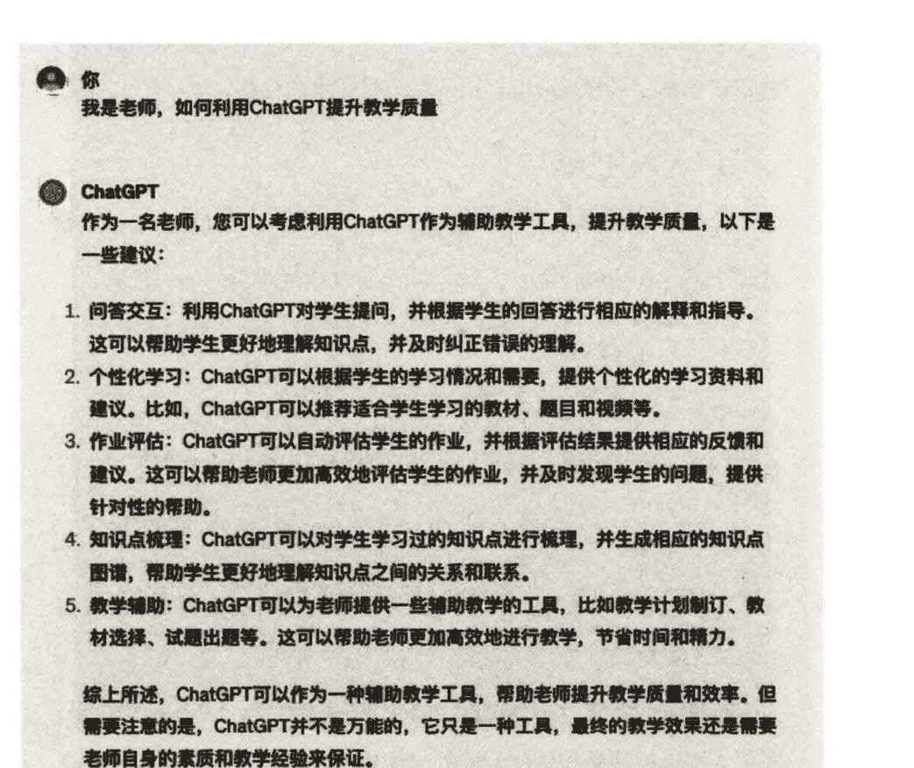

#### 二、我是软件开发工程师，如何利用 ChatGPT进行代码生成

以下是一套借助 ChatGPT 辅助编程的工作流程：

- 1. 数据准备
收集足够量的代码样本，这些样本可来源于 GitHub 等公开仓库，也可采用公司内部的代码案例。
- 2. 模型训练
用上述样本对 ChatGPT 进行训练，使其掌握代码语法与结构，并能按规范生成代码。
- 3. 代码生成
将问题描述或需求输入训练好的模型，由其自动输出符合逻辑的代码。
- 4. 代码调整
生成的代码未必完全契合需求，需要人工进行修改与优化，也可在此基础上迭代完善。
- 5. 持续优化
不断更新训练数据并优化生成效果，提升开发效率与代码质量。

应注意，ChatGPT 生成的代码可能存在缺陷或错误，需人工校对优化；同时需留意版权合规，工程师应进行必要修改以满足法律法规和知识产权要求。

你

基于 Vue 写一个登录页面的示例

ChatGPT

下面是一个基于 Vue 的简易登录页示例：

```vue
<template>
  <div>
    <h1>Login</h1>
    <form>
      <div>
        <label>Username:</label>
        <input type="text" v-model="username" />
      </div>
      <div>
        <label>Password:</label>
        <input type="password" v-model="password" />
      </div>
      <button @click.prevent="submitForm">Login</button>
    </form>
  </div>
</template>

<script>
export default {
  name: 'Login',
  data() {
    return {
      username: '',
      password: ''
    };
  },
  methods: {
    submitForm() {
      // Send form data to backend for authentication
      // Redirect to dashboard if authentication successful
      // Show error message if authentication failed
    }
  }
};
</script>
```

此示例包含用户名和密码两个表单字段，并在提交时触发 submitForm 方法。实际项目中，submitForm 通常需要向后端发起身份验证请求，并在验证通过后将用户跳转至后台页面。

图 4-5-2

#### 三、我是内容创作者，如何利用 ChatGPT提高创作效率

以下方法可提升创作效率：

- 1. 生成文章灵感
输入关键词或主题，让 ChatGPT 自动产出创意点子，激发写作灵感。
- 2. 快速搭建框架
输入文章主题，由 ChatGPT 输出提纲和大纲，快速形成结构。
- 3. 自动生成段落
提供关键词或主题，ChatGPT 可自动生成相关段落，节省撰写时间。
- 4. 生成标题和副标题
输入关键词，ChatGPT 能批量产出吸引眼球的标题与副标题。
- 5. 生成结尾内容
输入主题或关键词，ChatGPT 可帮助拟写收束性的结尾，提升文章完整度。

使用 ChatGPT 生成的内容需经过人工编辑和校对，以保证质量与可读性。

你

请把秦王政统一度量衡写成一个视频脚本

ChatGPT

好的，以下是关于秦王政统一度量衡的视频脚本：

【画面：开场画面】

（背景音乐响起）

主持人：

大家好，欢迎收看本期节目。今天我们来讲一个中国历史上的重要事件——秦王政统一度量衡。

【画面：秦始皇雕像】

主持人：

秦始皇，被誉为“千古一帝”。在他统治时期，不仅完成六国统一，建立中国首个中央集权帝国，还推行了多项重大改革，其中度量衡的统一影响深远。

【画面：古代度量衡器具、秤盘、尺具；古代商贸场景】

主持人：

在秦始皇统一前，各地度量衡标准不一，导致商业贸易和生产活动混乱不堪。为解决此问题，秦始皇推行了一系列措施，把各地标准统一为国家统一标准。

【画面：秦始皇巡视、官员核查器具、工匠铸造、官员编订规范】

主持人：

秦始皇下令官员实地核查度量衡，不合格器具全部熔铸为“泄孔铜人”。同时明确规定长度、重量、容积等具体标准。其推行需要大量工匠铸造制作，文官负责规范编纂。

【画面：发放奖赏、派员宣传新标准】

主持人：

为推广新标准，秦始皇还发放赏金鼓励使用，并派遣人员到各地讲解新标准的使用方法，促使其被广泛接受与遵守。

【画面：秦始皇功绩展示】

主持人：

这些举措使度量衡标准逐步在全国推行并执行，秦始皇的历史功绩因此得到高度评价。

【画面：结束画面】

主持人：

本期节目就到这里，感谢观看！

图 4-5-3

#### 四、我是翻译，如何利用 ChatGPT进行翻译工作

以下是几种翻译场景的应用方式：

##### 1. 语言翻译
可将一段话或文章从源语言译为目标语言。需注意模型翻译可能出现错误或不准之处，需人工修正校对。

##### 2. 辅助翻译
面对长篇或难度较高的译文，可先让 ChatGPT 逐句或逐段译出，再据此进行润色补充，提高效率。

##### 3. 术语翻译
在专业领域中，可借助 ChatGPT 快速翻译大量专有名词和行业用语，提升效率和准确性。

##### 4. 跨文化交流
在跨文化沟通中，语言障碍会影响效果。借助 ChatGPT 快速完成对方语言的理解与表达，有助于促进交流。

值得注意的是，ChatGPT 的翻译质量取决于训练数据质量，结果必须人工校对。对于涉及机密或重要文件的翻译，建议采用专业翻译服务以保障信息安全与质量。

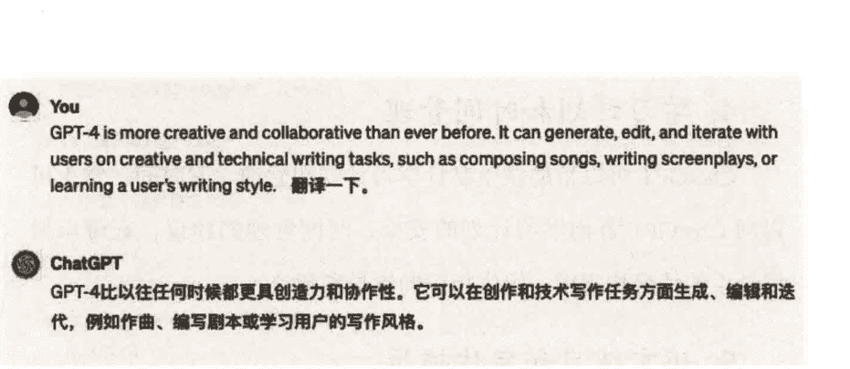

#### 五、我是家教，如何利用 ChatGPT进行工作

##### 1. 答疑解惑
让 ChatGPT 回答学生提问并解释概念，帮助学生更深入理解知识。

##### 2. 练习题辅导
根据学生需求生成练习题目并提供解题思路，学生可请求题目或步骤示范，提升自主练习能力。

##### 3. 学习资源推荐
依据学生的兴趣和学习需求，智能推荐教材、参考书、学习网站等多样的学习资料。

##### 4. 学习计划和时间管理
协助学生制定学习计划、安排复习时间，提供个性化的时间管理建议。

##### 5. 语言练习和写作辅导
提供对话练习、口语训练，以及写作作业的修改建议，帮助提升语言表达与写作水平。

在实际家教中使用 ChatGPT 时，仍需教师的引导与监督。ChatGPT 是强有力的工具，但在准确性和引导性上存在局限，需与学生共同明确其作用，并在必要时纠正解释。

若要将 ChatGPT 应用于家教，可参考 OpenAI 提供的 GPT 模型 API，或使用相关工具和库进行开发集成。

总之，借助 ChatGPT 可实现更具个性化和互动性的教学体验，为学生提供更高效的学习支持。

你

作为三年级老师，请基于人教版数学教材，出一份三年级期中试卷

ChatGPT

在为三年级学生设计数学期中试卷时，可参照人教版教材的内容和难度。以下是一份示例试卷，供参考：

## 题目一：选择题 每题2分，共10分
- 1. 下列哪个数是个位数字？
A. 23 B. 36 C. 57 D. 4
- 2. 下列哪个图形是正方形？
A. B. C. D.
- 3. 24 ÷ 4 = ?
A. 5 B. 6 C. 7 D. 8
- 4. 从下图中选出一个正方体：
A. B. C. D.
- 5. 下列哪个数是偶数？
A. 17 B. 25 C. 32 D. 41

## 题目二：填空题 每空2分，共10分
- 1. 8 + 5 = ____
- 2. 32 - ____ = 21
- 3. 4 × 5 = ____
- 4. 36 ÷ 6 = ____
- 5. 小明的生日是9月26日，小红的生日是9月19日，谁的生日更早？ ____

## 题目三：计算题 每题4分，共20分
- 1. 23 + 15 = ____
- 2. 42 - 17 = ____
- 3. 5 × 6 = ____
- 4. 36 ÷ 4 = ____
- 5. 用合适的运算符号填空：8 ____ 3 = 11

#### 六、我是讲故事的人，如何利用 ChatGPT进行工作

ChatGPT

很久以前，在一个远离城市的小村庄里，住着一只叫托尼的小乌龟。托尼渴望探索世界，梦想成为一名勇敢的探险家。

一天，他听说了座神秘岛屿的传说，岛上有一颗能实现愿望的神奇宝石。托尼决定踏上寻找这颗宝石的旅程，相信它能成全自己的梦想。

旅途漫长而艰辛，他穿越茂密森林、翻越高山，一路上遇到诸多挑战。但他发现自己的速度很慢，看着其他动物飞快奔跑，自己只能缓慢爬行。

尽管如此，托尼没有放弃。他明白自己虽慢，却拥有坚韧的意志。他一步步坚持前行，朝着目标靠近。

历经时日不懈努力，托尼终于抵达传说中的岛屿。他找到了神奇宝石，宝石告诉他，唯有坚持与毅力才能真正实现愿望。

托尼领悟到，毅力是成功的关键。旅途中的每一次困难都在锤炼他的坚强。

回到村庄后，托尼成为受人敬仰的探险者，他的故事在村里广为流传。人们从中学会了坚持不懈、永不言弃的精神。

这个故事告诉我们，无论困难多大，只要有坚定的毅力和决心，就能克服挑战，实现梦想。托尼的故事激励着每一个人，在人生旅途中勇往直前。

图 4-5-6

#### 七、我是编剧，如何利用 ChatGPT进行工作

ChatGPT

剧本名称：《巴黎之恋》

故事背景：

《巴黎之恋》是一部浪漫剧情片，故事发生在大巴黎的街头巷弄。两位渴望爱情的灵魂在此相遇，展开一段情感纠葛。

角色介绍：

- 1. 西莉亚 Celia：年轻热情、怀揣爱情梦想的画家。来自美国，为追逐绘画梦想来到巴黎，对艺术充满激情，却在感情上有些迷茫。
- 2. 路易 Louis：迷人神秘的巴黎本地人，天才音乐家，内心被过往伤痛困扰，对爱情采取回避态度。

剧情概述：

西莉亚来到巴黎寻找艺术灵感与真爱。在一次街头音乐表演的偶然中，她遇见了路易，两人瞬间被彼此吸引。然而各自的伤痛让他们对爱情保持谨慎。

两人开始了一段充满激情与浪漫的旅程，一同漫步塞纳河畔，探索巴黎美景，分享梦想与心痛。过去的阴影逐渐浮现。

随着故事推进，他们经历分离与重逢，面对恐惧与不安，慢慢学会放下过去，敞开心扉。

最终，在一场浪漫的巴黎雨夜，两人重逢，携手面对伤痛，勇敢追求爱情。他们的故事彰显了爱情的力量与巴黎的魅力。

《巴黎之恋》通过两位主角的情感历程，探讨爱情的认知与勇敢追求，巴黎的浪漫氛围为影片增添梦幻色彩。

巴黎心动

西莉亚与路易的初遇被安置在巴黎标志性街景里，铁塔剪影、塞纳夜色、巷口咖啡馆共同为故事镀上浪漫光晕。对话像细线牵动真实与渴望，映照出情绪起伏、对自我成长的追问以及对爱情的多重思索。

绘画与音乐成为情感载体，西莉亚的画笔与路易的旋律轮番登场，帮助观众更清晰地读懂他们对爱的诠释。剧作中穿插若干冲突设计，突如其来的争吵、误会、现实压力不断制造悬念，保持观感张力。

最终两人跨越内心防线，走向真诚拥抱，并在过程中获得宁静与满足。片尾定格在一场诗意巴黎画面，为整段旅程收束出圆满余韵。

《巴黎之恋》凭借细腻视听与饱满情感脉络，带给观众一段难忘的浪漫体验。影片探讨爱的能力、成长的必要以及自我觉醒的价值，邀请观众沉浸于巴黎氛围，与主人公共赴这段心动之旅。

图 4-5-7

#### 八、我是数学老师，如何利用 ChatGPT进行工作

数学教学中融入 ChatGPT 的实践思路

从授课者视角出发，合理引入大模型能在多方面减轻负担并提升效率：

1. 辅助答惑：当学子提出疑问，可先请模型给出解释路径、解题步骤或示范案例，供教师二次审阅后更高效地回复。
2. 课堂协作：在备课或互动时与模型交流，请其示范概念、展示多种解法，有助于提高课堂活跃度，让抽象知识更易吸收。
3. 个性化训练：依据学生的掌握程度提出定制化练习要求，模型可据此产出差异化题目并给出针对性反馈，达成分层教学目标。
4. 资源补充：模型能迅速生成练习题、标准解答、讲义要点等资料，助力教师扩充题库和案例储备。

需注意，模型生成的內容未必完全准确，使用前应自行核查其正确性与适用范围。它仅能扮演辅助角色，无法取代教师的专业判断与面对面指导，教学品质最终仍系于教师经验与设计。

总体而言，ChatGPT 可为数学教学提供资源与个性化支持，但在教师把关下谨慎运用来得其效。

图 4-5-8-1

概率原理简释

概率用于刻画随机事件发生的可能性，体现我们对不确定性的判断。下面以一个基础例子说明。

设想一枚标准的六面骰子，六个面分别标记1至6。掷出时各面出现的机会相同，故每面出现的机会为1/6。

概率值通常落在0到1之间，0代表绝不可能，1代表必然。以骰子为例，每点的概率为1/6，分子为特定点数出现的情形，分母为全部等可能结果。

概率不仅涵盖基础运算，还可延伸至复合事件、条件概率等。若需更深入理解，可查阅数学教学网站或视频课程，里面有大量例题可供演练。

希望上述说明能帮助把握概率的运作。若仍有疑问，欢迎继续提问。

图 4-5-8-2

#### 九、我是网络安全专家，如何利用 ChatGPT进行工作

我需要帮助为我的公司制定有效的网络安全战略。

> **ChatGPT**

站在网络安全专业人员的立场，提供构建安全战略的若干建议。

1. 强化身份管控：确保仅授权人员可接触敏感数据与系统。采用多因素认证，如密码配合令牌或生物识别，提升准入门槛。
2. 数据加密保护：借助SSL/TLS等技术守护传输中数据，对静态存储的敏感信息进行加密，防止未授权读取。
3. 防火墙与入侵检测：部署防火墙监控流量，阻断非法访问；配合入侵检测系统实现威胁的实时发现与响应。
4. 漏洞管理：定期扫描系统与应用，发现潜在弱点并及时修复，维持环境稳定安全。
5. 安全意识教育：为员工提供系统化培训，帮助其识别常见攻击手段，降低人为失误风险。
6. 监控与日志分析：建立持续监控机制，定期检视网络行为与日志，及时捕捉异常。
7. 补丁与维护：保持系统与软件及时更新，快速应用安全补丁，堵住已知漏洞。
8. 备份与恢复：定期备份关键数据，并制定灾难恢复预案，应对数据丢失或系统故障。

战略需结合公司实际业务与需求落地。建议与IT团队紧密协作，确保方案符合最佳实践，并保持持续监测与优化。

网络安全处于动态演进中，策略应定期评估更新，以匹配新的威胁与技术变化。以上建议希望对战略制定有参考价值，如需进一步指导请随时交流。

图 4-5-9

#### 十、我是一名牙医，如何利用 ChatGPT进行工作

我需要帮助解决我对冷食的敏感问题。

以牙医身份提供关于冷刺激敏感的建议。

冷热敏感可能源于牙齿过敏、龋损或其他口腔问题。建议如下：

1. 先做一次全面口腔检查，明确敏感的具体诱因，临床检查能帮助定位问题。
2. 若为牙齿敏感，可尝试含氟牙膏，有助于降低牙面敏感度并缓解不适。
3. 减少刺激的方式包括避免极冷食物，或放缓咀嚼节奏，避免快速咬碎冷食。
4. 若存在龋损，应尽早治疗，必要时进行充填或根管治疗，以减轻冷敏感。

日常口腔护理也很重要，保持早晚刷牙、配合软毛牙刷与牙线清洁，并定期进行口腔检查与洁治。

以上信息仅作参考，具体诊断与治疗仍需临床医生根据个人情况给出。希望对您有帮助，如有其他疑问随时咨询。

图 4-5-10

#### 十一、我是一名职业顾问，如何利用 ChatGPT进行工作

我想建议那些想在软件工程领域从事潜在职业的人。

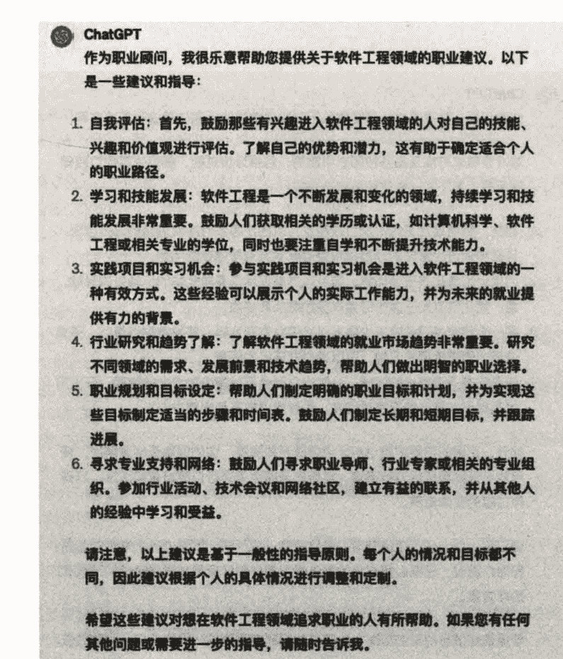

图 4-5-11

#### 十二、我是一名营养师，如何利用 ChatGPT进行工作

有营养师提出需求：为两人设计素食方案，每份约500千卡且低血糖指数，请提供建议。

针对双人素食、每份约500千卡且低GI的需求，可参考以下安排：

早餐：
- 燕麦粥：燕麦片搭配植物奶，用少量蜂蜜或红枣调味，撒上杏仁片。
- 水果拼盘：选用低GI水果如蓝莓、草莓、苹果，搭配少量坚果或种子。

午餐：
- 蔬菜沙拉：生菜、胡萝卜、黄瓜、番茄混合，加入鹰嘴豆或扁豆，淋橄榄油柠檬汁。
- 素炒饭：以糙米或藜麦为基底，加入胡萝卜、豌豆、玉米等蔬菜，可加豆腐提升蛋白。

下午茶：
- 烤杏仁：烤至金黄，低GI且提供健康脂肪与纤维。

晚餐：
- 蔬菜炒面：选用全麦或红薯面，搭配菠菜、胡萝卜、西兰花、蘑菇等。
- 烤时蔬与豆类：彩椒、洋葱、茄子与黑豆或扁豆拌烤，搭配低GI酱料。

夜宵：
- 原味希腊酸奶加入少量杏仁或核桃。

以上仅为示例，实际搭配应根据个人口味与健康状况调整，建议在专业营养师或医师指导下制定个性化方案。

#### 十三、我是一名院士，如何利用 ChatGPT进行工作

我需要帮助写一篇针对 20 ～ 25 岁大学生的电动汽车和燃油汽车未来趋势的文章。

在院士视角下，为20至25岁大学生撰写的电动与燃油汽车趋势文章框架如下：

标题：电动汽车与燃油汽车：探索未来出行趋势

引言：
- 点出环境可持续与能源效率受到关注，以及汽车行业中可再生能源的兴起。
- 说明本文旨在探讨电动与燃油汽车的未来走向，并分析其对年轻大学生的影响。

主体部分：
1. 电动汽车的发展与趋势
   - 介绍电动汽车定义、工作原理，阐述其环境效益与优势。
   - 分析市场增长与技术创新，如电池技术改进与充电网络建设。
   - 可引用国际能源署、车企报告或行业研究数据支撑论述。
2. 燃油汽车的演变与前景
   - 回顾燃油汽车历史，讨论其在当代社会的地位与挑战。
   - 简述传统燃油车的改进，如燃油效率提升与排放下降。
   - 涉及可再生燃料发展及其对未来前景的影响。
   - 引用相关研究或行业报告支撑描述。
3. 年轻人的视角与决策
   - 探讨年轻大学生对电动与燃油汽车的态度与偏好。
   - 分析购车决策因素，如环保意识、经济性与科技创新。
   - 可引用调查数据、市场研究或青年访谈支撑观点。

结论：
- 概括电动与燃油汽车未来趋势要点，强调年轻大学生在此进程中的作用。
- 鼓励年轻人关注可持续出行方式，并提

抱歉，作为AI模型，我无法真正扮演一个院士或进行研究。我的回答基于预训练的模型和一般性的知识。在真实的情境中，建议您寻求真实的专业人士和权威来源来获取关于特定主题的详细研究结果和意见。

图 4-5-13

#### 十四、我是一名法律顾问，如何利用 ChatGPT进行工作

我出了车祸，不知道该怎么办？

发生交通事故后感到迷茫，建议按以下顺序处理：

1. 安全优先：确认自身与乘客安全无虞，若需急救请立即拨打急救电话或就近就医。
2. 保险报备：及时通知投保的汽车保险公司，说明事故经过，按其指引提交理赔所需材料。
3. 警方备案：遵照当地法规向警方报案，由其制作事故记录并出具相关文书。
4. 现场取证：在身体允许情况下，拍摄现场照片或视频，记录目击者联系方式，为后续索赔提供依据。
5. 法律求助：若对理赔流程不清，建议咨询专业交通事故律师，获取符合个人情况的法律意见并维护权益。

上述仅为通用指引，具体操作因地区与案情而异。处理交通事故时，建议寻求专业法律咨询以获得个性化建议。

图 4-5-14

#### 十五、我是一名首席执行官，如何利用 ChatGPT进行工作

**ChatGPT**

以假设公司首席执行官身份，面对可能需召回产品的危机，可采取以下措施降低负面影响：

1. 果断启动：立即启动应急响应机制，确保及时掌握并应对潜在危机。召集质量控制、研发、生产、法务等部门共同制定应对方案。
2. 风险评估：与质控团队合作全面评估产品问题，明确范围、原因及潜在影响，为后续计划提供依据。
3. 召回决策：依据评估结果制定明确召回方案，考虑召回规模、时间节点、沟通方式及目标群体。
4. 沟通透明：建立与员工、供应商、客户及利益相关方的有效沟通渠道，及时透明地传达问题严重性、原因及应对措施。
5. 补救执行：积极实施修复、更换产品、退款等补救措施，满足客户需求并维护企业声誉，同时确保符合法规与标准。
6. 根因改进：深入调查问题根源并采取纠正措施，防止类似问题再现。强化质量控制与生产流程，提升产品安全性与可靠性。
7. 复盘学习：评估危机管理过程，汲取经验教训，不断完善危机应对能力，建立学习机制，以便未来更敏捷有效应对挑战。

以上措施旨在以专业负责任的态度处理潜在危机，保护企业声誉与利益。每个案例各有不同，应依据具体情况与利益相关方需求制定相应方案。

## 第五章 ChatGPT 的商业化应用

### 第一节 如何在各行各业中使用 ChatGPT

#### 一、对话系统

ChatGPT 可用于搭建对话系统，帮助企业提升客户服务效率与用户满意度。对话系统可应用于客服、人力资源、医疗等多个领域。其强大的自然语言处理能力能够实现自然流畅的交流，并理解较为复杂的提问。

**你**

如果让ChatGPT担任客服，具体步骤是什么？

**ChatGPT**

在客服场景下，ChatGPT 通常按以下流程运作：

1. 迎宾提问：先向用户致意并询问需求或问题。
2. 理解需求：解析用户表述，提取关键信息与意图，确保理解准确。
3. 给出答复：基于理解提供相应解答、指引、步骤或资源推荐。
4. 追问澄清：若信息不足或表达模糊，会主动询问补充细节以确保准确性。
5. 多样表达：尝试用不同表述方式或提供多种可行方案，提升体验。
6. 提供资料：对复杂问题，可提供帮助文档、链接或参考资料供进一步查阅。
7. 结束对话：在问题解决后确认是否还有其他需求，若无则礼貌结束交流。
8. 持续优化：通过用户反馈与评估数据不断改进回答质量与满意度。

此流程仅为一般性说明，ChatGPT 仍存在局限，复杂或特定问题建议转人工客服支持。

图 5-1-1

#### 二、语音识别

ChatGPT 可与语音识别技术结合，提升语音输入便捷性与工作效率。应用场景包括智能家居、医疗、交通等。结合后可实现高精度语音转写，并通过持续学习语音特征提升识别准确率。

ChatGPT 实现语音识别的方式

ChatGPT 自身不直接进行语音识别，它是基于文本的自然语言处理模型。但语音识别可与之配合，实现语音到文本的转换，再由 ChatGPT 进行理解与生成。

典型工作流程如下：

1. 语音输入：使用语音识别引擎将用户语音转为文本，例如 Google Cloud Speech-to-Text、Microsoft Azure Speech to Text、百度语音识别等。
2. 文本输入：将识别得到的文本传给 ChatGPT 由其理解并生成响应。
3. 文本输出：模型处理后生成相应文本回复，可为问答、建议或对话。
4. 文本转语音：再将生成的文本通过文本转语音引擎转换回语音，如 Google Text-to-Speech、Microsoft Azure Text to Speech、百度语音合成等，以语音形式回复用户。

借助语音识别与 ChatGPT 的结合，可实现语音输入与文本输出的交互，适用于语音助手、智能对话系统等场景。

图 5-1-2

#### 三、文本生成

ChatGPT 可用于文本生成，助力企业产出新闻、广告、推荐语等多种文本内容。适用行业包括新闻媒体、广告营销、金融等。其能根据给定文字生成高质量文本，语句通顺连贯，且可产出不同风格主题的内容。

**你**

ChatGPT 在编辑场景中如何运作，有哪些步骤？

**ChatGPT**

在编辑场景中，ChatGPT 通常按以下步骤提供支持：

1. 校对修正：检查拼写、语法及常见语言错误，给出修正建议，注意语法规则、标点使用及上下文连贯性。
2. 风格调整：依需求调整文本风格与语气，如正式、商务、轻松、幽默等。
3. 内容优化：使文本更清晰、准确、连贯，提供改进建议，增删必要信息，确保表达作者意图。
4. 结构重组：对结构提出建议并进行调整，包括段落安排、信息排序与流畅过渡。

5. 版式优化：能够对文档的外观细节进行微调，例如标题层级的规范化、引用符号的添加、列表排列方式的调整等，从而增强阅读舒适度与视觉效果。

需要说明的是，我的编辑建议建立在训练语料与模型能力之上。虽可提供方向性修改意见，终审与定稿仍建议交由专业编辑把关，以确保质量与特定需求匹配。

图 5-1-3

#### 四、情绪洞察
该模型可承担情绪分析任务，帮助企业捕捉用户态度变化以提升满意度。典型应用覆盖社媒监测、客服对话、舆情跟踪等场景。系统能对输入文本进行情绪归类，快速识别情感信号，并据不同倾向给出针对性回应与处置策略。

#### 五、对话式服务
该模型可用于搭建智能对话系统，作为企业与用户沟通的桥梁，提升交互体验。常见行业有金融、教育、医疗等。它能迅速且准确地解答用户提问，提供个性化服务，并在持续吸收用户反馈的过程中逐步增强智能化水平。

## ChatGPT 跨行业落地场景
该系统的应用范围非常宽泛，代表性场景包括：

- 1. 内容生产：为创作者提供灵感，辅助撰写文章、剧本、故事大纲等创意素材。
- 2. 法律领域：辅助律师起草起诉状、调解书等法律文书。
- 3. 医疗领域：辅助医生进行病情判断与治疗方案拟定。
- 4. 金融领域：为投资者解读市场数据、研判走势。
- 5. 教育领域：作为教学助手，助力学生学习语言、文学、数学等科目。
- 6. 营销领域：为营销人员撰写方案、广告文案、客服回复等。
- 7. 开发领域：为工程师自动产出代码、文档、测试用例等。

总体来看，该模型能在诸多领域实现自动化与智能化处理，替代繁琐重复的常规工作，提升效率、节省时间成本，让从业者聚焦更高价值的任务。

#### 六、教学与训练
- 1. 个性化学习支持：可充当虚拟助教，为学生提供定制化辅导。能够解答疑问、解释概念、给予指导，并依据学习进度动态调整教学内容。
- 2. 答疑解惑：实时回应学生在课程、作业、考试等方面的问题，提供即时解释。
- 3. 学习资源推荐：结合学习目标与兴趣，推荐教材、参考书、在线课程、学术论文等资源。
- 4. 语言练习与交流：为语言学习者提供对话练习机会，助力表达、听力、口语能力提升并给予纠正。
- 5. 虚拟实验与模拟演练：结合虚拟实验室环境，模拟实验场景、讲解原理，引导操作与结果观察。
- 6. 教师辅助工具：帮助教师备课、生成练习题、批改作业、提供教学建议，提升教学效率与质量。

#### 七、小程序开发机遇
小微企业或独立开发者可挖掘大众需求，自主开发微信小程序、抖音小程序、App 等产品，例如趣味测评、看图猜词、文字游戏等。这类产品门槛较低、搭建便捷且具备一定市场潜力，或许下一个爆款即出自你的之手。

#### 八、AI 站点聚合
目前国内外已出现数百个人工智能相关站点，涵盖文字、图文、视频等形态。具备一定网站技术的人可以将这些资源链接汇总，搭建聚合导航站，配合 SEO 优化获取流量，再接入广告实现收益。

AI 导航站资源丰富，可自行检索。

### 第二节 商业化变现路径

#### 一、代码生成
Codeium 能借助人工智能为开发者生成代码，已兼容 Visual Studio、JetBrains 等主流 IDE 及多款浏览器。个人用户可免费使用，支持 Python、JS、TS、Java、Go、C/C++ 等多种语言。
Cursor.so 是基于 GPT 的代码生成工具，可将开发者的自然语言描述转化为代码，加速开发流程。GPT 作为自然语言处理技术，能依据输入文本生成对应输出，Cursor.so 正是依托这一技术实现快速编码。

#### 二、文案主编
Anyword AI 是一款强大的文案辅助工具，借助人工智能提升文案质量。它会分析文本内容，并参照优秀文案给出改进建议。
Jasper 是目前领先的 AI 个人助理平台之一，功能丰富且协同工作，覆盖生产力、组织和管理等多个维度。

#### 三、AI 作画
ChatGPT 配合 Midjourney 使用。Midjourney 是一款人工智能绘图软件，只需输入关键词即可生成精美图像。

#### 四、音乐创作
Beatoven.ai 可根据情绪为视频和播客生成 AI 音乐。
Altered 能将用户的声音转换成专业表演场景下精选的各种声线。

#### 五、销售话术
Notion AI 是 Notion 内的智能助理，可自动识别和分类文本、生成摘要、提取关键词等，并提供智能建议，帮助用户更高效地使用 Notion。该功能由 Notion Labs Inc. 开发，是 Notion 的扩展。

#### 六、视频制作
Movio 利用顶级合成媒体技术，实现从文本到视频的转化。

#### 七、Prompt Hunt
Prompt Hunt 是面向 AI 艺术探索、创作和分享的平台，可在数秒内生成多样风格和主题的图像，无需编程或技术背景。

#### 八、CodeGeeX 编程助手
CodeGeeX 能根据自然语言注释自动生成代码，也可基于已有代码补全当前行或后续多行，提升编程效率。

#### 九、Prezo.ai
Prezo.ai 是一款 AI 自动化 PPT 生成工具，可将想法快速转化为精美幻灯片，帮助用户在演讲中获得好评。

#### 十、IMI Prompt
IMI Prompt 是专为 Midjourney 设计的提示词生成工具，可快速创建独特的 AI 艺术作品，提供网页版、安卓版和 iOS 版。

#### 十一、Stable Diffusion
Stable Diffusion 是一款开源的人工智能绘画模型，基于深度生成神经网络，可根据任意文本输入生成逼真图像。结合扩散模型和文本编码器，还可实现图像到图像、深度到图像、超分辨率等创造性应用。

## Stable Diffusion XL
使用全球增长最快的开源 AI 平台进行创作与灵感激发。

凭借 Stable Diffusion XL，可用更简短的提示生成具描述性的图像，并在图像中生成文字。模型在图像构图和人脸生成方面取得显著进步，呈现出令人惊叹的视觉效果和真实美感。

Stable Diffusion XL 目前在 DreamStudio 及其他主流图像应用中处于测试阶段。如同 Stability AI 的其他基础模型，该版本未来将以开源形式发布以提升可及性。

### Stable Diffusion XL 的核心亮点
- 更高级别的光影写实能力
- 图像构图与人脸生成提升
- 使用更短提示即可生成描述性图像
- 可生成更易读的文字内容
- 画面丰富、视觉冲击力强

## 第六章 提示词特征与未来展望

### 第一节 提示词概览

#### 一、常用提问范式
“如何”“怎样”“怎么”等疑问词，表示需要了解操作方法或解决问题的路径；
“推荐”“建议”“告诉我”等词语，表示需要获得建议或推荐信息；
“比较”“区别”等词语，表示需要了解事物间的差异或相似点；
“解释”“说明”等词语，表示需要理解概念、流程或现象的原理与细节；
“定义”“是什么”等词语，表示需要获取概念或术语的解释。

#### 二、提示词可划分为以下几类
- 1. 主题或领域相关类：与特定领域或主题相关的词汇或短语，如 “basketball”“computer science”“climate change”“healthcare”“food recipe”等，帮助模型理解需求并生成相关内容。
- 2. 操作指令类：用于指导模型生成特定类型文本的指令，如 “describe”“summarize”“rewrite”“translate”“complete the sentence”等，帮助模型按预期输出。
- 3. 约束条件类：用于限定生成内容的条件，如 “begin with”“end with”“contain”“exclude”“use these words”“use these concepts”等，避免无关或无用输出。
- 4. 情境类：为模型提供具体上下文，如 “in a formal letter”“in a casual conversation”“in a news report”“in a poem”，帮助模型生成更贴合背景的内容。

## 提示词
提示词是用于引导 ChatGPT 或其他语言模型生成特定类型或内容文本的短语或句子，可在对话或文本生成任务中引导模型产出与特定主题、情境或风格相关的回复。

通过合适的提示词，可引导模型以特定方式作答。提示词可包含问题开头、任务说明、关键词或短语等。

示例：
- 1. 任务类型：
   - “请写一篇关于夏季旅行的文章。”
   - “请给出一些时间管理的建议。”
   - “请回答以下数学问题。”
- 2. 主题或情境：
   - “谈谈你对人工智能的看法。”
   - “描述你最喜欢的电影场景。”
   - “假设你是一名环保活动的组织者，写一篇宣传文章。”
- 3. 风格或语气：
   - “请用幽默的方式回答这个问题。”
   - “用一首诗形容你最喜欢的季节。”
   - “请用简洁明了的语言解释这个概念。”

选用合适的提示词有助于模型理解期望的风格、主题或情境，生成更相关和针对性的回答。提示词的选择取决于任务要求和预期类型。

#### 三、常见 Prompt 分类
##### 1. 文本生成类
旨在生成一定长度的文本，如文章、故事、诗歌、对话等。需要提供关键词、主题或起始段落来引导生成。

##### 2. 问题解答类
用于回答特定类型问题，如常见问题、技术问题、娱乐问题等。通常需提供背景、类型和相关关键词。

##### 3. 翻译类
用于文本或语音翻译。需提供源语言、目标语言、翻译领域等信息。

##### 4. 语音生成类
用于生成语音，可为普通话、英语、日语等。需提供语言、发音风格、音频格式等信息。

##### 5. 代码生成类
用于生成各编程语言代码。需提供编程语言、功能需求等信息。

##### 6. 图像生成类
用于生成图像，如头像、场景图、艺术作品等。需提供图像类型、风格、色彩等信息。

##### 7. 聊天交互类
用于与 ChatGPT 进行日常聊天、情感交流、智能问答等。需提供主题、关键词等信息以便理解意图。

**你**
我是一名刚毕业的大学生，专业是计算机应用，我该如何做职业规划

**ChatGPT**
恭喜毕业！以下建议供参考：
- 1. 明确职业目标：结合兴趣、优势、市场需求，设定符合自身情况的职业方向。
- 2. 提升技能：可参加培训、研讨会或自学人工智能、云计算、大数据等新技术，增强竞争力。
- 3. 积累经验：通过实习或工作获取实践经验，拓展人脉。也可通过校园招聘、招聘网站等渠道寻找机会。
- 4. 打造个人品牌：通过写博客、参与开源项目、担任社区角色等方式提升知名度和影响力。
- 5. 定期复盘：职业规划是长期过程，需定期回顾进展，调整目标和计划以适应发展。

希望对你有帮助！

**你**
那我现在怎么找到一份满意的工作呢？

**ChatGPT**
以下方法可供参考：
- 1. 在线招聘平台：如智联招聘、51job、拉勾等投递简历。
- 2. 校园招聘：关注企业招聘信息并积极参与。
- 3. 人脉推荐：与亲友、老师、同学保持联系，获取内推信息。
- 4. 实习转化：通过实习积累经验并争取被录用。
- 5. 自我展示：在社交媒体发布简历、项目经验等吸引雇主注意。
- 6. 职业咨询：向职业规划师或求职顾问寻求建议和技巧。

祝你找到理想工作！

### 第二节 优势与局限分析
作为先进的人工智能技术，ChatGPT 既有突出优势也有明显局限。

#### 一、ChatGPT 的优势
1. 语言能力强
能够理解和生成自然语言，支持对话、翻译、写作等任务，准确性和流畅度较高。
2. 学习能力
可通过大规模数据集自我学习并持续优化。
3. 定制性高
通过调整训练数据和微调，可适配不同应用场景，提升效果。
4. 应用广泛
可用于自然语言生成、问答系统、机器翻译等多种 NLP 任务。

图 6-2-1

#### 二、ChatGPT 的不足
1. 训练数据需求大
需要海量文本数据才能达到良好表现。
2. 模型体量大
模型规模庞大，对计算资源和存储要求高。
3. 可解释性差
基于深度学习，内部决策过程难以解释和理解。
4. 可能存在偏见
训练数据偏差可能导致输出不公平或错误。

另外还存在以下挑战：
1. 缺乏常识与实际知识：虽经大规模语料训练，但对真实世界常识理解不足，回答可能不准确或不完整。
2. 对错误信息敏感：基于统计模型，易受错误或误导性提示影响，生成不当回复。
3. 上下文记忆有限：对长期上下文记忆不足，长时间对话中可能丢失信息导致回复不连贯。
4. 倾向保守回复：为避免风险，模型常生成相对保守安全的答案，可能缺乏创造性和创新性。

5. 意图把握容易偏差：ChatGPT 在解读用户真正想要什么时并不总靠谱，有时抓不住背后的动机和隐含需求，回答很容易偏离预期。

6. 敏感信息容易被误触：模型的学习素材来自开放网络，面对隐私类或敏感内容时可能不当复述或处理不佳。想要安全使用，必须配备恰当的过滤和保护机制。

在使用 ChatGPT 的过程中，要正视这些短板，并在互动里主动采取补救手段，比如搭建过滤层、人工复核生成内容、给出清晰的指令边界和限制条件，以确保输出符合预期和合规标准。

图 6-2-2

### 第三节 如何解决 ChatGPT 存在的缺点和不足

要弥补 ChatGPT 的不足，可以从以下几个方向入手：

1. 扩充训练数据的规模和质量

可通过互联网爬取、社交平台采集或人工标注等方式获取更精准的样本。

扩充训练数据可以从哪些渠道入手？

数据量的提升是提升模型表现的关键。常见的数据来源和类型包括：

1. 公开数据集：网络上已公开的多主题、多领域的数据集可直接检索下载。
2. 网络爬取：在遵守网站规则和法律法规的前提下抓取公开文本，注意质量和合法性。
3. 对话记录：真实对话或模拟对话都能为对话生成任务提供样本。
4. 用户生成内容：社交媒体、论坛、博客等产生的海量内容涵盖情绪和主题多样性。
5. 专业领域数据：医学、法律、金融等垂直场景需要对应的专业语料来增强表现。
6. 数据增强：对已有语料做改写、同义词替换、随机删改等操作，提升多样性。
7. 用户反馈：沉淀真实交互记录，用作后续迭代的依据。

无论来源怎样，数据的质量与多样性是核心。语料应覆盖多种场景、主题和语境，让模型泛化更强，同时要剔除不当有害内容，保证输出符合道德与社会规范。

图 6-3-1

2. 精简与优化模型结构
通过调整架构、调优超参数、采用深度压缩、剪枝等技术，降低模型体积的同时提升效率与效果。

图 6-3-2

3. 增强模型的可解释性
借助 LIME、SHAP 等可解释机器学习方法，对输出进行拆解，帮助用户理解决策逻辑。

图 6-3-3

4. 缓解数据偏差
利用数据增强、对抗样本训练等手段，减少偏差带来的不公平和准确率下降问题。

5. 融入人类专家经验
把专业人员的知识与模型训练结合，能显著提升可靠性和准确度。具体做法包括：

1. 数据标注：专家对数据进行精细标注，提供高质量训练样本。
2. 特征工程：依托专家经验挑选或设计更具信息量的特征。
3. 模型设计：结合任务需求与专业认知选择架构与优化策略。
4. 解释性分析：对预测结果进行专业解读，提升可信度。
5. 数据清洗与过滤：识别噪声和异常，保证训练集干净准确。
6. 评估与验证：参与上线前的效果检验，确保实际可用。
7. 规则与约束：为特定场景设定业务规则，指导模型决策。
8. 实时反馈迭代：持续提供使用反馈，驱动模型进化。

专家经验与模型能力结合，能补齐短板，打造更强、可解释、更实用的应用。

图 6-3-5

### 第四节 ChatGPT 将如何改变我们的生活

ChatGPT 的到来带来前所未有的便利与创新，既能提升工作效能，也能让生活更具创意与智能。

#### 一、更加智能的对话交互
凭借强大的自然语言能力，ChatGPT 可完成对话、问答、翻译等任务，让交互更自然流畅，典型场景包括智能客服、智能助手等。

要打造更智能的对话，需要多方面协同：

1. 多轮对话能力：支持连贯的多回合交流。
2. 上下文理解：记住对话历史，准确把握意图。
3. 实体识别与意图识别：更精准地理解用户需求。
4. 知识图谱与数据库融合：丰富信息来源。
5. 智能问答：应对复杂问题，给出精准答案。
6. 情感理解：感知语气情绪，自然回应。
7. 用户建模：基于兴趣偏好个性化回复。
8. 强化学习优化：通过交互不断自我改进。
9. 多语言支持：跨语言无障碍沟通。
10. 反馈驱动迭代：持续收集用户反馈优化体验。

综合这些技术，对话系统会更灵活、满意度更高。实现高度智能仍是持续探索的挑战。

图 6-4-1

#### 二、提高工作效率
在文本自动生成、摘要抽取、自动翻译等任务上，ChatGPT 能提供高效工具，快速完成工作。

提升使用效率的建议：

1. 输入要清晰简洁，意图越明确回答越准。
2. 多轮对话中补充必要上下文，保持连贯性。
3. 善用系统指令，如切换模式、调节创意度等。
4. 参考官方示例代码，加快上手。
5. 通过 max_tokens 控制回答长度，避免过长或过短。
6. 保存历史记录，便于回顾与延续对话。
7. 及时提供反馈，帮助模型改进。
8. 需要嵌入业务时使用官方 API，实现定制化。
9. 关注功能更新，充分利用新能力。

遵循这些做法，能让交互更顺畅、效率更高。

图 6-4-2

#### 三、促进跨文化交流
多语言翻译与交流能力，有助于打破语言壁垒，推动不同文化间的合作。

图 6-4-3

#### 四、个性化服务
根据兴趣与需求提供定制化推荐，如智能推荐、智能购物助手等，提升满意度与消费体验。

#### 五、推动人机融合
更自然智能的交互方式正在重塑人机关系，推动融合进程。

ChatGPT 不仅应用前景广阔，也为多个行业提供了变革思路。随着技术演进，其价值将持续释放。

### 第五节 ChatGPT 将如何影响未来的发展

自面世以来，ChatGPT 已产生深远影响。

#### 一、推动人工智能技术的发展
ChatGPT 验证了深度学习的优势，为 AI 发展提供经验与指引。

具体影响包括：

1. 模型创新：基于 Transformer 的预训练架构激发新思路。
2. 预训练与迁移学习：大规模预训练让模型一模型多用，推动该范式普及。
3. 对话系统：显著推动人机自然对话研究。
4. 强化学习：以反馈优化表现，为强化学习应用提供范本。
5. 多语言处理：促进全球化场景下的技术落地。
6. 可解释性研究：暴露透明度挑战，推动可解释 AI 进步。
7. 跨领域应用：在医疗、教育、客服等领域催生交叉创新。

整体来看，ChatGPT 正积极驱动 AI 技术成熟。

图 6-5-1

#### 二、推动自然语言处理技术的进步
代表了 NLP 的重大进展，带动机器翻译、语音识别、信息抽取等领域发展。

#### 三、促进智能化的应用场景的发展
在智能客服、智能翻译、智能推荐等场景加速智能化、个性化与自然化。

#### 四、促进人机交互的进一步发展
推动自然语言对话、情感识别、智能感知等交互技术的演进。

图 6-5-4

#### 五、促进跨领域合作与创新
为知识共享、多语言文化交流等提供合作契机。

图 6-5-5

#### 六、改变教育方式
提供自适应学习、个性化辅导等智能教育服务，让学习更灵活高效。

#### 七、促进社交媒体的发展
在平台上提供聊天机器人、智能话题推荐等，提升用户体验与粘性。

#### 八、提高医疗健康水平
应用场景包括：

1. 医学知识整理：快速获取最新研究与资料。
2. 临床辅助决策：基于病历提供可能的诊断与治疗建议。
3. 患者咨询与健康教育：解答常见问题，提升自我管理意识。
4. 健康监测与追踪：结合传感器实现个性化管理。
5. 疾病风险预测与预防：识别高风险人群，推动干预。
6. 医学文献分析：快速梳理研究进展。
7. 医学教育与培训：辅助学习与技能训练。

需注意隐私安全与合规，ChatGPT 可辅助但不能替代专业医护判断。

图 6-5-8

#### 九、改变工作方式
具备文本自动生成、自动化翻译等能力，重塑工作习惯与效率。

具体改变：

1. 自动化重复任务：邮件回复、FAQ 处理、报告生成等。
2. 智能助理：个性化建议、提醒与日程管理。
3. 知识管理：快速检索与汇总海量信息。
4. 问题解决：提供技术与业务参考答案。
5. 激发创意：为写作、设计提供灵感。
6. 自定义工具：基于模型构建专属工作流。
7. 智能协作：在线会议与团队讨论更高效。
8. 跨语言协作：降低国际沟通成本。

同时要注意模型局限，需结合人工判断确保准确性与适用性。

图 6-5-9

#### 十、带动新兴产业的崛起
催生智能客服、智能营销、智能家居等新业态，为新经济注入动力。

## 第七章 ChatGPT 与工具

### 第一节 如何更好地使用 ChatGPT

#### 一、熟悉 ChatGPT的特点和能力
了解其语言理解、生成与推理能力，有助于扬长避短。

你：ChatGPT 的特点和能力有哪些？

ChatGPT：ChatGPT 基于 OpenAI GPT-3.5 架构训练的大模型，具备以下特质：

1. 自然语言处理：能理解并生成自然语言，支持多语种与上下文理解。
2. 大规模预训练：在海量文本上训练，知识面覆盖广泛。
3. 创造性：可生成合乎逻辑的文章、诗歌、故事等。
4. 对话能力：擅长交互式问答、解释、建议。
5. 知识广度：涵盖科学、历史、文化、技术等多领域。
6. 上下文记忆：基于历史对话提供针对性回复。
7. 应用多样：可用于客服、文本编辑、编程辅助等。

同时要保持清醒：它并非真正理解语言或具备常识推理，可能出现不准确或不当输出，受限于训练数据时效性，使用时需谨慎并认识局限。

图 7-1-1

#### 二、根据实际需求选择合适的模型
不同模型在规模、生成能力与训练数据上各异，应按任务选型。

#### 三、给 ChatGPT提供足够的信息
提供充分的上下文与领域背景，有助于模型更好理解与生成。

#### 四、监控 ChatGPT的输出结果
生成内容可能存在偏差与误差，需定期复核，防止误导。

图 7-1-4

#### 五、结合人工智能和人类智慧
模型无法完全替代人的判断，最佳实践是人机协同决策。

图 7-1-5

#### 六、坚持不断优化和更新

随着算力与数据规模的持续扩张，ChatGPT 若想保持技术优势就必须不断打磨与迭代。

> 你：如何让 ChatGPT 的产出更可靠？
> ChatGPT：提升产出质量可以从多个层面入手：

1. 扩充优质训练语料：模型能力的根基在数据，持续补充来源多元、质量可靠的语料，有助于跨领域、跨语境的理解。
2. 对现有语料进行扩增：借助改写、语义替换、同义词置换等手段丰富样本，提升模型的泛化表现。
3. 针对具体任务做微调：在如 GPT-3 之类的预训练基座上，用少量领域样本进行适应性训练，使其更贴合实际场景。
4. 细化模型参数：学习率、批次大小、层数等设置会直接影响收敛速度与准确率，需要反复调试寻找平衡点。
5. 进行对比实验：将不同模型或不同配置并列测试，通过 A/B 测试等方式挑出表现最优的方案。
6. 融入用户反馈：收集真实使用者的体验与需求，将意见回炉到模型改进中。
7. 保持持续更新：知识与需求在不断变化，定期刷新模型才能跟上新信息。
8. 控制生成长度：在特定任务中设定输出上限，避免跑题或产生错误信息。
9. 加入人工复核：定期抽检生成结果，及时纠错，提升可信度。

综合运用上述做法，能让性能、准确性与实用性持续提升，同时要警惕优化过程中引入新问题或不当内容。

图 7-1-6

### 第二节 挖掘 ChatGPT 更广阔的应用空间

#### 一、官方文档与社区资源
先从官方说明和社区入手，了解功能细节与使用规范，并与其他使用者交流心得。

> **你**：官方说明和交流渠道有哪些？
> **ChatGPT**：截至 2021 年 9 月，我所知的主要渠道如下：

官方资料：
1. OpenAI 官网：OpenAI 官网 https://openai.com/ 提供了模型介绍、典型案例、操作指南与 API 文档。
2. OpenAI API 说明：若需调用接口使用 ChatGPT 或其他模型，可参考 API 文档 https://beta.openai.com/docs/。

社区资源：
1. OpenAI 社区论坛：官方社区 https://community.openai.com/ 中用户会讨论产品与技术问题，包含 ChatGPT 的使用与优化。
2. GitHub：OpenAI 在 GitHub 上维护多个开源项目，其中包含与 ChatGPT 相关的代码与资料，可在仓库 https://github.com/openai 查找。

社区内容会随时间更新，建议前往官网与论坛查看最新资料。

图 7-2-1

#### 二、线上平台与工具
可尝试 OpenAI 的 GPT-3 Playground、Hugging Face 的 Transformers 等在线平台，它们提供丰富功能与示例，便于实验与验证。

#### 三、竞赛与挑战
参与与 ChatGPT 相关的比赛，如 Kaggle 的自然语言处理赛事、AI Challenger 等，有助于提升技能并发现新场景。

图 7-2-3

#### 四、自主实现
具备一定编程能力的话，可自行编写代码复现 ChatGPT 的功能与应用，更深入理解其原理与算法。

#### 五、协同探索
与开发者、研究者合作，共同探索更多功能、应用场景与解决方案。

图 7-2-5

### 第三节 常用 AI 工具盘点

#### 一、绘画创作
- Midjourney：在 Discord 上运行的 AI 绘画对话工具
- Stability：输入关键词即可生成图像的 AI 绘图方案
- NovelAI：面向 AI 辅助写作、讲故事、虚拟陪伴的工具
- Playground AI（免费）：集内容社区、模型整合、可视化操作与提示词自动补全于一身的文生图工具，使用体验友好

图 7-3-1

#### 二、智能创作
- Jasper：AI 文案生成器，可产出吸睛的营销文案
- Notion AI：为笔记、任务、知识库与数据库提供一体化的智能工作空间
- Rytr：文本写作辅助工具
- NewBing：微软基于 GPT-4 的智能搜索引擎，可提供高质量检索结果并支持自然语言交互

#### 三、视频制作
- D-ID：利用带文字或音频的静止图像制作专业视频
- Fliki AI：在线 AI 文本转视频配音合成平台，可将文本转为带 AI 语音的视频，适用于教程、推广、旅行介绍等
- Xiaoshan Fliku AI：在线 AI 文本转视频配音平台，支持 AI 语音合成，同样适用于教程、推广、情感分享等制作
- Runway：人工智能驱动的创意工具
- Movio：AI 生成真人营销视频

图 7-3-3
图 7-3-4
图 7-3-4-1
图 7-3-4-2

#### 四、效率工具
常用效率工具有 ChatBA、ChatMind、ChatPDF、ChatDoc、ChatExcel、PandaGPT 等。

#### 五、图像 AI
- Stable Diffusion：基于深度学习的文本到图像模型
- NeroAI：创新的数字图像平台，用于创作非凡照片

图 7-3-5
图 7-3-5-1

#### 六、音频处理
- Adobe Podcast：AI 驱动的音频录制与编辑
- 网易天音：一站式 AI 编曲渲染导出，零基础创作音乐
- uberduck：开源的 AI 语音生成平台

图 7-3-6-1
图 7-3-6-2
图 7-3-6-3

#### 七、编程 AI
- GitHub Copilot：GitHub 的 AI 代码生成工具
- Cursor.so：基于 GPT-4 的编程助手，也是强大的免费代码生成器，可帮助快速编写、编辑与讨论代码

图 7-3-7-1
图 7-3-7-2

#### 八、AI 智能办公
- Microsoft 365 Copilot：内置 GPT-4 的微软 Office 套件
- Tome：先进的 AI 智能 PPT 制作工具
- Glimmer Ai：基于 GPT-3 和 DALL·E2 的知名 AI PPT 工具
Glimmer goes further than presenting
Become the director of your own scenario and tell your story
- PandaGPT：AI 总结文档重点
- WordAi：10 倍速 AI 内容输出
What Is WordAi Capable Of?
WordAi uses advanced machine learning models to provide high quality rewriting that is indistinguishable from human content.
- Complete sentence restructuring
- Enrich Text
- Describe the same ideas differently
- Improve Quality
- Improve Clarity
- Split sentences
- Timely：一款 AI 时间管理工具

图 7-3-8-1
图 7-3-8-2
图 7-3-8-3
图 7-3-8-4
图 7-3-8-5

### 第四节 实用插件推荐

#### 一、ChatGPT for google
该插件可把 ChatGPT 嵌入 Google 搜索结果，帮助获取更精准的搜索答案。

#### 二、 WebChatGPT
该扩展能让 ChatGPT 直接联网。虽然模型本身信息截止 2021 年，但借助扩展可获取最新信息，使对话更准确。

图 7-4-2

#### 三、 YouTube Summary with ChatGPT
一款免费 Chrome 扩展，利用 OpenAI ChatGPT 技术快速获取正在观看的 YouTube 视频摘要，节省学习时间。

首页 > 扩展程序 > YouTube & Article Summary powered by ChatGPT

YouTube & Article Summary powered by ChatGPT

glasp.co | 精选

★★★★★ 340 | 效率 | 600,000+ 位用户

概述 隐私权规范 评价 支持 相关

图 7-4-3

#### 四、ChatGPT Writer
该插件可借助 AI 写邮件、回复信息等，可在任意网站使用，支持多语言。

图 7-4-4

#### 五、LINER:ChatGPT 谷歌助手
LINER 是基于 GPT 的扩展，可在 Google 搜索结果页直接给出答案。结合 Google 与 GPT 学习结果，提供带参考资料和后续关键词的增强答案。

通过由 GPT 支持的 LINER AI 节省研究时间。
收集和组织从 LINER 获得的重要信息。
1. GPT 谷歌搜索助手 - 在谷歌搜索结果页直接获得 GPT 与谷歌学习到的答案，利用 LINER AI 的参考资料和关键词拓展研究。
2. 内容策展 - 基于保存的内容和标注，发现 GPT 推荐的新内容。
3. 网页高亮器 - 可在网页、GPT 答案、YouTube 视频或图像上高亮标记。

图 7-4-5

#### 六、Voice Control for ChatGPT
支持与 ChatGPT 进行语音对话，在输入框下方添加录音按钮，将问题语音提交给 ChatGPT，便于交互探索 AI 功能。

图 7-4-6

## 第八章
## ChatGPT 的常见问题解答

### 第一节 使用 ChatGPT 的常见问题解答

#### 一、如何调节输出效果
可通过调整超参数、控制输入文本长度、选用不同解码策略来调节输出，同时借助文本过滤、语法检查等手段提升质量。

调整超参数是常见做法，可尝试不同学习率、批大小、层数等配置，以寻找性能与质量的平衡点。

输入长度也会影响结果，短输入易得简洁回答，长输入则可能生成更详细内容，可按任务需求灵活调整。

解码策略选择也很关键，除贪婪解码外，还可尝试束搜索、采样、Top-k 采样、Nucleus 采样等，以获得更丰富或更合适的输出。

结合文本过滤和语法检查，可剔除不合规、不准确的内容，提升可读性和准确性。

需要注意的是，超参数、输入长度和解码策略的调整虽能改善表现，但无法完全消除生成文本的固有局限，使用时仍需人工审核验证。

图 8-1-1

#### 二、ChatGPT 输出的文本是否准确
ChatGPT 的生成结果可能出现误差或不准确，这与训练数据、模型结构等因素有关，使用时需要二次确认，避免误导或错误。

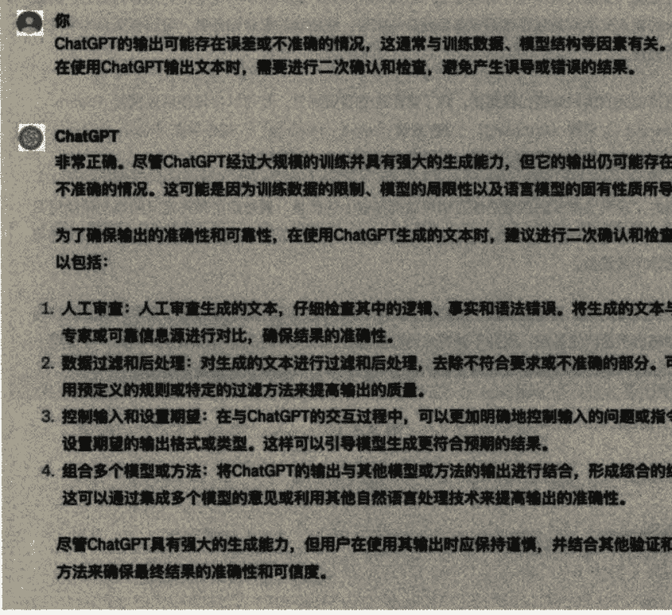

#### 三、如何评估 ChatGPT 的性能
可采用困惑度、BLEU 分数、ROUGE 分数、人类评估等多种指标，从不同任务角度反映模型表现，帮助选择合适的模型和参数。

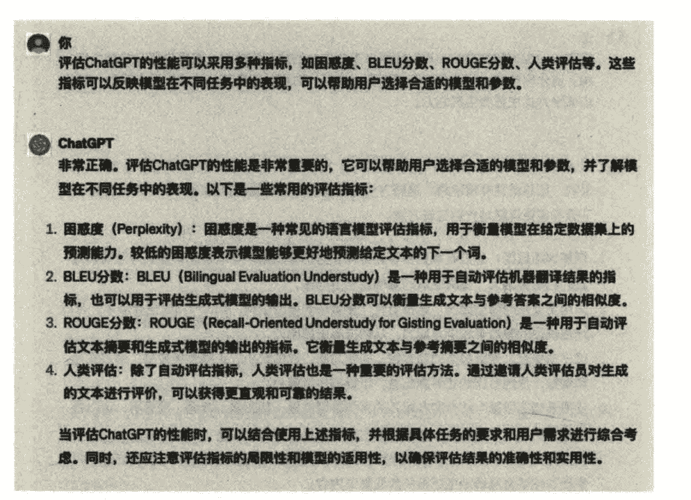

#### 四、如何提高 ChatGPT 的生成能力
可通过增加训练数据、采用更复杂的模型结构、优化超参数、使用多模态数据等方式提升生成能力，也可结合语义搜索、对抗训练等技术进一步增强。

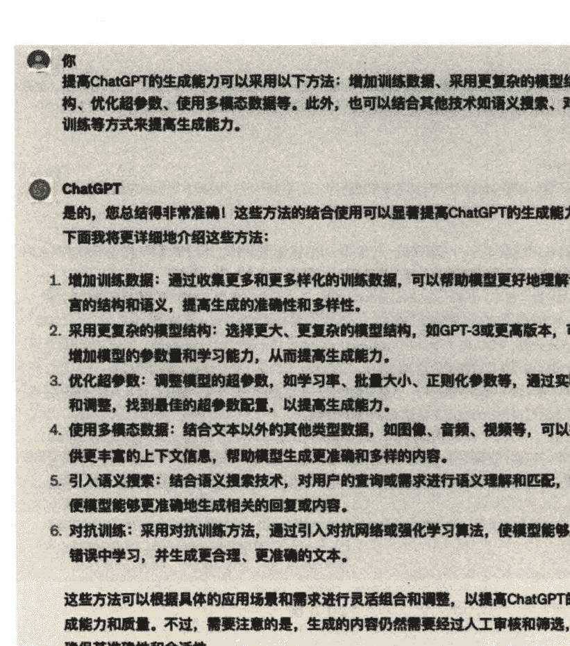

图 8-1-4

#### 五、如何避免 ChatGPT 的偏见
输出偏见通常源于训练数据和模型结构。采用多样化数据集和训练方法，并对模型进行调整优化，可使其更公正中立。

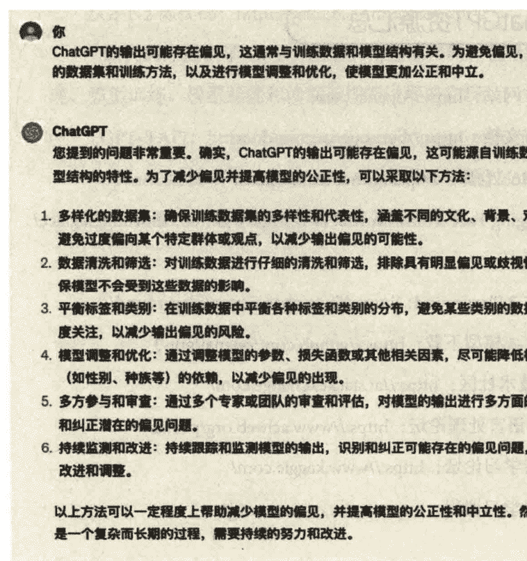

图 8-1-5

### 第二节 使用问题排查指南

#### 一、ChatGPT 资源汇总
官方网站：https://openai.com/
官方文档：https://beta.openai.com/docs/
GitHub 仓库：https://github.com/openai
Hugging Face Transformers 库：https://github.com/huggingface/transformers
GPT-3 Playground：https://beta.openai.com/playground/
GPT-3 模型下载：https://github.com/openai/gpt-3
AI 技术社区：https://ai.stackexchange.com/
自然语言处理论坛：https://www.aclweb.org/portal/
机器学习论坛：https://www.kaggle.com/
机器学习课程：https://www.coursera.org/

#### 二、开源代码
- 1. transformers 库：https://github.com/huggingface/transformers
该库提供多种预训练模型和微调脚本，包含 GPT-2、GPT-3 等，并提供 NLP 任务相关工具函数。
- 2. GPT-2 源代码：https://github.com/openai/gpt-2
代码库包含 GPT-2 模型的完整实现，包括数据预处理、训练、验证和推理。
- 3. GPT-3 API：https://beta.openai.com/docs/api-reference/gpt-3
OpenAI 提供 GPT-3 API，开发者可通过接口调用模型，无需了解内部实现。

### 第三节 数据集

#### 一、WikiText
由维基百科文章组成，用于语言模型、文本生成等自然语言处理任务。

#### 二、BookCorpus
由图书文本构成，题材风格多样，适合训练如 GPT 等 NLP 模型。

#### 三、WebText
由网络文本组成，来源类型多样，可用于训练和测试 NLP 模型。

#### 四、COCO Captions
由图像及其文字描述组成，用于训练图像描述生成模型，包含大量自然语言文本。

#### 五、Cornell Movie Dialogs Corpus
由电影对话构成，场景多样，可用于训练对话生成模型如 GPT。

#### 六、Yelp Open Dataset
由 Yelp 网站评论组成，包含大量文本和元数据，可用于情感分析、文本分类等任务。

#### 七、Amazon Reviews Dataset
由亚马逊商品评论组成，含大量文本和元数据，适用于情感分析、文本分类等。

#### 八、SNLI

自然语言推理方向常用的资源多以成对句子配合标签呈现，这类数据既能支持 GPT 系列模型的学习，也可用于评测其他 NLP 系统的效果。

#### 九、AG News
AG News 汇聚了跨类别的新闻稿件，覆盖面较广，常被用作文本分类的基准集，GPT 等语言模型也常借此进行能力验证。

### 第四节 模型库

#### 一、Hugging Face Transformers
Transformers 由 Hugging Face 打造，是 NLP 社区主流的模型仓库，内部收录了 GPT、GPT-2、GPT-3 等多种预先训练好的权重。

#### 二、OpenAI
OpenAI 是一家 AI 研究机构，推出了 GPT-3 等预训练模型，并配套开放调用接口，让开发者无需本地部署即可使用。

#### 三、GPT-Neo
GPT-Neo 采用自监督方式进行预训练，整体设计与 GPT-3 相近，但参数规模大幅压缩，因而在算力消耗与使用门槛上更为友好。

#### 四、PaddlePaddle
PaddlePaddle 是百度开源的深度学习平台，内置多款 GPT 预训练模型，并附带典型落地示例。

#### 五、AllenNLP
AllenNLP 在 PyTorch 基础上构建，提供预训练 GPT 资源，覆盖生成、问答、情感判断等多种使用情境。

#### 六、TensorFlow Hub
TensorFlow Hub 作为 TensorFlow 生态的模型分发中心，汇聚了不少 GPT 预训练模型，常见于生成式任务与情感分析。

#### 七、GPT-2简洁实现
该仓库基于 Python 与 TensorFlow 2 给出 GPT-2 的精简实现，代码量可控，适合入门者上手练习。

#### 八、Transformers4Rec
Transformers4Rec 专注于推荐场景的 NLP 工具集，整合了可用的 GPT 预训练模型，兼顾内容生成与个性化推荐。

### 参考文献

- 1. Radford, A., Wu, J., Child, R., Luan, D., Amodei, D., & Sutskever, I. (2019). Language models are unsupervised multitask learners. OpenAI Blog, 1(8), 9.

- 2. Brown, T. B., Mann, B., Ryder, N., Subbiah, M., Kaplan, J., Dhariwal, P., ... & Amodei, D. (2020). Language models are few-shot learners. arXiv preprint arXiv:2005.14165.

- 3. Petroni, F., Piktus, A., & Rocktäschel, T. (2021). How to Generate Long Sequences with GPTs? Lessons from the New Testament. arXiv preprint arXiv:2101.11986.

- 4. Liu, Y., Ott, M., Goyal, N., Du, J., Joshi, M., Chen, D., ... & Stoyanov, V. (2019). RoBERTa: A robustly optimized BERT pretraining approach. arXiv preprint arXiv:1907.11692.

- 5. Howard, J., & Ruder, S. (2018). Universal language model fine-tuning for text classification. arXiv preprint arXiv:1801.06146.

- 6. Zhang, Y., Gong, Y., Huang, L., Jiang, X., & Huang, T. (2021). GPT Understands, Too. arXiv preprint arXiv:2105.08050.

岗位会被 AI 取代而焦虑？
害怕 AI 反过来掌控人类？
对未来职业方向感到迷茫？

AI 并非要消灭人类，真正掌握 ChatGPT 的人才能领先一步

提效 ➔ 强化优势 ➔ 占领创新先机

别让自己成为被技术淘汰的那一个

