# Python 与 ChatGPT 零基础实战

# 内容简介
本书以 Python 编程基础和 ChatGPT 使用方法为主线，用易懂的语言配合案例推进，帮助读者轻松理解、迅速上手。特别加入了 Python 与 ChatGPT 结合应用的章节，演示如何借助大模型辅助学语法、写代码、搭建聊天机器人等，打开创新实践的可能性。无论是完全的新手，还是希望提升个人能力的从业者，都能从中获得实用知识与技能。

# 作者简介
杨鹏飞，男，毕业于河南农业大学计算机科学与技术专业，现于郑州旅游职业学院任教，主讲计算机类课程。研究兴趣涉及计算机网络应用技术、程序设计、算法优化，近年集中在机器学习与人工智能方向。

# 前言
在信息科技快速发展的时代，人与机器的协作愈发紧密，以人工智能为代表的新技术正成为推动社会进步的重要动力。

Python 以简洁清晰、应用灵活著称，已广泛用于数据分析、机器学习、Web 开发等领域，是当下最受欢迎的编程语言之一。OpenAI 发布的 ChatGPT 在自然语言理解与生成对话方面表现突出。两者配合，能让问题解决更直观高效，也为创新提供持续可能。

本书属于程序设计类读物，以 Python 技术与 ChatGPT 应用为双核心，介绍 ChatGPT 的概念、发展现状与前景，梳理 Python 的数据类型、语句规范、常用函数、复合结构及面向对象思想，并探讨编程技术的具体落地。通过互动练习，帮助读者加深对两者理解，提升技术水平与理论认知，为程序设计、人工智能等领域学习者与技术人员提供参考。

知识更新很快，编者希望本书既能传递现有经验，也能激发探索欲，让读者保持前沿视野。

写作过程中部分 ChatGPT 问答截图由模型自动生成，可能存在疏漏或错误，敬请读者指正。
作者
2023 年 10 月

# 第 1 章 ChatGPT 的含义

## 1.1 什么是 ChatGPT
### ChatGPT 的来源
2020 年底 ChatGPT 突然走红，有人用它写论文拿高分，有人靠它通过面试，还有人从中获得商业收益。它到底是什么？

ChatGPT 由美国 OpenAI 公司推出，基于强化学习的大语言模型，主要用于文本生成。通过对海量语料训练模拟人类表达，实现问答、内容创作、任务完成等功能。

### ChatGPT 的主要特性
主要开发语言为 Python。

模型依托大规模语料训练，语料源自真实对话，因而知识面广且能结合上下文互动。

使用过程中具备一定个性化能力，会根据过往交流和偏好给出定制化回复。

支持多语种输入，覆盖范围广，同时可为多位用户并发服务。

### ChatGPT 的优缺点
任何技术都存在两面性。

表 1-1 ChatGPT 的优点

| 优点 | 说明 |
| --- | --- |
| 场景覆盖广 | 可用于客服、教学、金融、社交等领域，适应性强 |
| 生成与创造能力强 | 能学习并创造内容，甚至写诗、小说、新闻稿 |
| 对话更自然 | 输出更接近人类表达，实现拟人化交流 |

表 1-2 ChatGPT 的缺点

| 缺点 | 说明 |
| --- | --- |
| 训练成本高 | 需要大量高质量、多样的数据支撑 |
| 输出可能失真 | 偶尔会编造并不存在的知识 |
| 社会争议存在 | 大规模应用后，部分人担忧被用于网络攻击等不当用途 |

### 如何注册 ChatGPT 账号
随着自然语言处理技术成熟，ChatGPT 在智能客服、对话系统等领域价值凸显。熟练使用能明显提升个人能力，若不能掌握未来可能被淘汰。

一种常用渠道的注册流程如下：
- 1、先用谷歌账号注册平台账号，示意图见图 1-1。
- 2、登录 poe.com 并用谷歌账号完成注册。
- 3、注册完成后进入主界面，见图 1-2。

图 1-2 ChatGPT 主界面

## 1.2 如何对 ChatGPT 提问
ChatGPT 基于上下文作答，有时需要开启新会话以避免旧信息干扰，点击 New Chat 即可开始新对话，见图 1-3。

图 1-3 开启新对话

网络上“弱智吧”对战 ChatGPT 的话题常被讨论，正是因为把原问题直接输入后，答案常出人意料。这说明提问技巧直接影响结果。

提示词工程的核心是提示，模型生成正是基于用户提供的 prompt。用户给出一段对话作为提示，模型据此生成连贯回应。

提问时建议遵循表 1-3 的原则。

表 1-3 提问的正确示例和错误示例

|  | 问题明确无歧义 | 问题具体不宽泛 | 问题简洁扼要 |
|---|---|---|---|
| 正确示例 | 我想买一部苹果手机 | 我要一份蛋炒饭，不要辣，堂食 | 我想去理发 |
| 错误示例 | 我想买一个苹果 | 我要一份炒饭 | 天太热，我打算做手术切除身体里无用的组织 |

例如三口之家想在暑假去山东游玩三天，如何提问更有效？

错误示范：给我推荐一些景点。

正确示范：我们一家三口 7 月想去山东旅游三天，预算控制在 3000 元以内，景点要适合 12 岁孩子，请推荐。

两种表述的答案差异明显，精准提问会得到泰山、青岛等亲子低成本方案，而宽泛提问则得到希腊、澳洲等不相关结果，见图 1-4、图 1-5。

再如教师想让 ChatGPT 出题：

错误示范：给学生出一份练习题。

正确示范：你现在是数学老师，给小学五年级学生出 10 道练习题，要求 5 道选择、3 道填空、2 道应用，开始。

后者能得到结构清晰、分型明确的练习题，而前者仅给出零散题目，见图 1-6、图 1-7。

多尝试不同表述，可看到同一问题的不同答案。

常用技巧是让模型扮演角色，格式为角色 + 背景 + 问题，见图 1-8。

让模型以辛弃疾口吻写被贬边境的心情，回答会模仿词风进行文言抒发。

需注意，ChatGPT 不知情时可能胡编乱造，不可盲目采信。例如问“诸葛亮去世时刘备为何没哭”，模型会编造理由，而事实上刘备早于诸葛亮去世，见图 1-9。

# 第 2 章 ChatGPT 的应用

## 2.1 使用 ChatGPT 给女朋友写情书
很多人写情书时除了直接夸赞，很难写出风格独特的优质内容，ChatGPT 能解决这一问题，并按不同风格、素材生成情书。

例如自称网球运动员，想把网球魅力写入情书，见图 2-1。

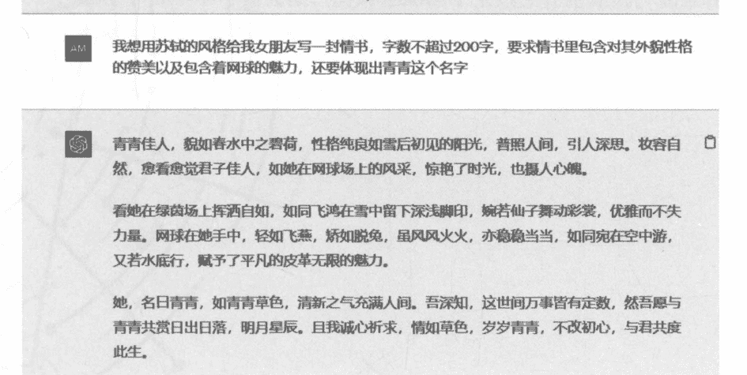

可见生成文本带有苏轼风格，可直接使用或稍作修改。

例如想融入天山元素并用李白风格写情书，见图 2-2。

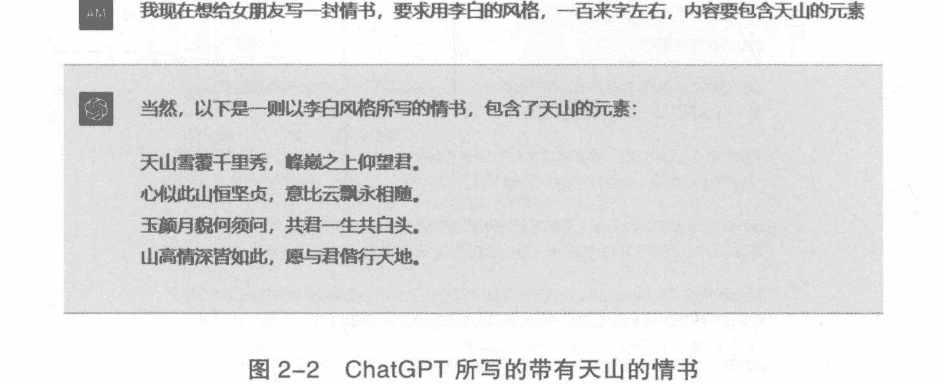

文本呈现出李白式的诗意，若不满意可多次生成直至满意。

若觉得古风太华丽，也可先让 ChatGPT 列出语言朴素的经典情书，再据此风格创作，见图 2-3。

借助 ChatGPT，不管想要李白、徐志摩或泰戈尔风格的情书，都能快速得到合适的表达。

## 2.2 使用 ChatGPT 给宝宝起名
在现实与网络平台上，起名都是高需求技能，有人甚至靠此获得可观收入。

中国起名要求较高，需兼顾多方面因素，而融合人类智慧的 ChatGPT 可胜任这项工作，利用得当也能成为副业。

起名模板可设为：现在你是一个起名专家，给宝宝起名字，要求考虑性别、音韵美感及家人期望，下面是宝宝信息。

> 出生日期：2023年6月16日，北京时间13点45分
> 性别：女
> 姓氏：王
> 家人期望：希望孩子平平安安、健健康康长大，将来成为科学家报效祖国。
> 根据信息给出带姓氏的五个名字，并结合音韵、期望等进行解析。

执行后可获得五个带姓名字并附解析，见图 2-5。

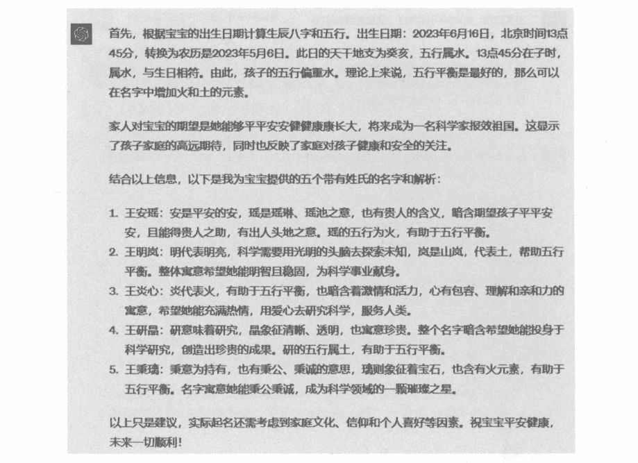

图 2-5 ChatGPT 所给出的 5 个名字

看图 2-5 可知，模型回应的五组名字皆配有说明，每个名字都映照出父母的祝愿，并且融入了多重考量。

现在在主流电商平台检索“宝宝起名”，即刻能出现上百家专业店铺，收费从几十到上千不等。值得注意的是，即便付费高价，其取名质量也不见得优于图中示例。

将这项取名能力接入自营店铺很方便：承接订单后，把客户需求整理成固定提问模板输入模型，很快就能得到带解读的候选名。

若客户对初稿不满意，可让模型继续扩充，比如限定双字或四字形式，图 2-6 就是一次按需迭代的实例。

出生日期：2023年8月22日，北京时间3点3分

性别：男

姓氏：钱

家人期望：希望孩子平平安安健健康康长大。

根据信息和要求给出带着姓氏的五个名字，并结合家人期望等对名字进行解析，另外算上“钱”这个字的情况下，要求名字的字数是2个字。

基于上述条件，模型给出的回答如下：

1. 钱安
   - 解读：“安”本义为平安，与家人期盼孩子平安相呼应。五行上钱为金，安为木，木克金，被认为是一种制衡与平衡。

2. 钱康
   - 解读：“康”取自健康之意，契合健健康康成长的愿望。五行里康属土，金生土，呈现相生的格局，象征稳健成长。

3. 钱宁
   - 解读：“宁”有安宁平静之意，符合平安的诉求。五行中宁属水，钱属金，金生水，体现流通顺畅。

4. 钱祺
   - 解读：“祺”寓意吉祥好运，既表达平安健康，也寄托更广的美好。祺属火，金克火，关系上需结合整体命局再权衡。

5. 钱乐
   - 解读：“乐”强调快乐成长，回应不仅要平安健康还要开心的期待。乐属土，与金钱相生，有助喜乐发展。

以上解读仅供参考，并未做专业八字推演。若要更全面精确的评估，建议咨询专业命名或八字人士。希望这些建议能帮助锁定满意的名字。

图 2-6 ChatGPT 所给出的两字名字

若觉得说明仍显浅显，也可要求模型对某个名字做深度拆解，例如重点解析“钱祺”，如图 2-7 所示。

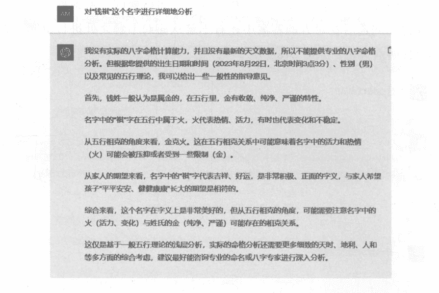

图 2-7 ChatGPT 对名字的详细解释

有了这类取名工具，无论是为自家孩子取名，还是在网络上接单变现，都是一项很实用的能力。

（注：以上部分内容仅用于测试使用，全方位展示 ChatGPT 能力，请相信科学，反对迷信）

## 2.3 以模型为永不疲倦的学习伙伴

要找到一位可被反复追问、从不同角度发问却始终耐心作答的老师并不容易，而该系统恰好能承担此角色。可以把它视作上知天文下知地理、学识渊博且从不厌烦的导师。

可采用层层追问的交互方式，先提问题，得到回复后发现不解之处，再针对疑惑继续追问，直到完全明白为止，如图 2-8、图 2-9、图 2-10 所示。

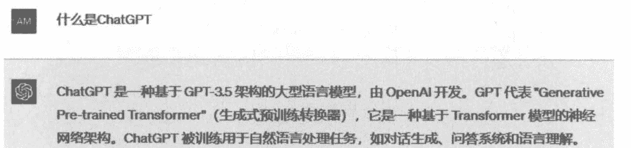

图 2-8 开始询问 ChatGPT

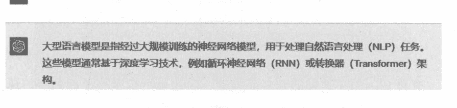

图 2-9 第一次追问 ChatGPT

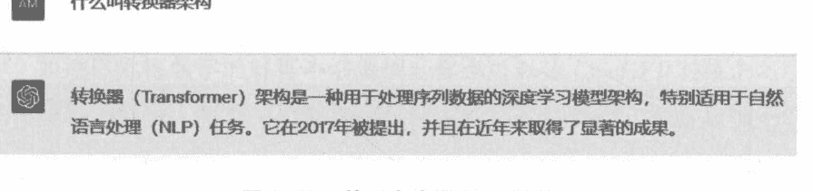

图 2-10 第二次追问 ChatGPT

你可以不断追问下去，它永远不会感到厌烦。

该系统还能帮助解答课堂上的具体难题，如图 2-11 所示。

我现在对高中数学的向量章节掌握不好，你帮我详细讲解下吧，要求有例题的讲解

当然，向量是数学里非常核心的概念，在物理、工程和计算机领域应用很广。下面是基础介绍和若干例题说明。

### 向量的基本概念

向量兼具大小和方向，常常用箭头表示。它可以在空间中平移而不改变自身属性。

向量可写成 **a** = (a₁, a₂, ..., aₙ)，n为维数。二维写作 **a** = (a₁, a₂)，三维写作 **a** = (a₁, a₂, a₃)。

### 向量的基本运算

1. **向量加法**：同维向量相加，分量对应相加。如 **a** + **b** = (a₁ + b₁, a₂ + b₂)。

2. **向量减法**：同维向量相减，分量对应相减。如 **a** - **b** = (a₁ - b₁, a₂ - b₂)。

图 2-11 ChatGPT 解释向量的知识点

在学习辅导方面，该系统还能快速汇总考试重点。以历史为例，张三要参加中考，却不清楚考点分布，这时可以让它把河北省中考历史的重要知识点梳理出来，并列出老师最爱考的20项，如图 2-12 所示。

你好，我现在要参加河北省的中考了，你能不能把河北省中考历史学科的重要知识点总结好，然后把其中老师最常考的20个知识点发给我

你好！我无法精准预测具体考题，但可以给你一份通用重点清单。请务必结合最新考试大纲和样卷。

1. 夏商周制度 - 商王朝与西周分封制，东周诸侯制的变化。
2. 战国七雄 - 七国概况及各自特征。
3. 儒家思想 - 孔子、孟子的核心主张。
4. 法家思想 - 韩非、商鞅的法治改革。
5. 秦始皇统一六国 - 度量衡、文字统一等举措。
6. 汉朝开放与收敛 - 汉武帝“罢黜百家，独尊儒术”。
7. 三国演义与史实 - 曹操、刘备、孙权的真实角色。
8. 隋唐盛世 - 唐太宗时期的改革与繁荣。
9. 五代十国与宋统一 - 宋代经济文化发展。
10. 元明清对比 - 各朝统治特点及民族关系。
11. 明朝海禁 - 郑和下西洋与海禁政策的关联。
12. 清朝衰败原因 - 鸦片战争及列强侵略等。
13. 太平天国运动 - 社会背景与历史影响。
14. 洋务运动与戊戌变法 - 异同与成败原因。
15. 辛亥革命 - 终结两千多年封建帝制。
16. 中华民国与北洋政府 - 孙中山三民主义。
17. 抗日战争 - 重大战役与中外关系。
18. 从民国到新中国 - 解放战争、土地改革等过渡。
19. 建国后改革 - 土地改革、大跃进、文化大革命。
20. 改革开放 - 邓小平作用及经济社会快速发展。

仅作起步参考，建议结合教材和大纲深入复习。祝中考顺利！

图 2-12 ChatGPT 总结较高考频的知识点

在学习辅导上，除了罗列重点，还可以围绕重点出题，如图 2-13、图 2-14 所示。

关于清朝的衰败因素这个知识点，你来帮我找出两道中考难度的选择题，先不要告诉我答案，等我把自己答案发给你后你再把解析发给我。

当然，下面是两道关于清朝衰败因素的中考难度选择题：

### 选择题1

清朝衰败的原因中，以下哪项不属于外部势力导致？

A. 鸦片战争

B. 外国列强的瓜分

C. 内忧外患

D. 农民起义如太平天国运动

### 选择题2

鸦片战争爆发并加速清朝衰败时，执政的是哪位皇帝？

A. 康熙

B. 道光

C. 乾隆

D. 光绪

请把你的答案发给我，然后我会提供详细解析。祝你做题顺利！

图 2-13 ChatGPT 所给出的两道选择题

第一题选D，第二题选B

很好，现在来看解析。

### 选择题1 解析

正确答案是D：农民起义如太平天国运动。

本题考的是内外因区分。A、B、C都与外部势力相关，鸦片战争和列强瓜分是外因，“内忧外患”也包含外部威胁。而太平天国运动主要是内部原因，主要是由于社会不公和官僚腐败引发的。

### 选择题2 解析

正确答案是B：道光。

本题考时间定位。鸦片战争是在道光皇帝的统治下爆发的，而不是康熙、乾隆或光绪。

你都答对了，说明对清朝衰败因素掌握得不错，继续加油！

图 2-14 ChatGPT 对答案的点评

除了出题，还能解析不会做的题目。当遇到不会的题目时，把题发过去让它拆解即可，比如英语题求助，如图 2-15 所示。

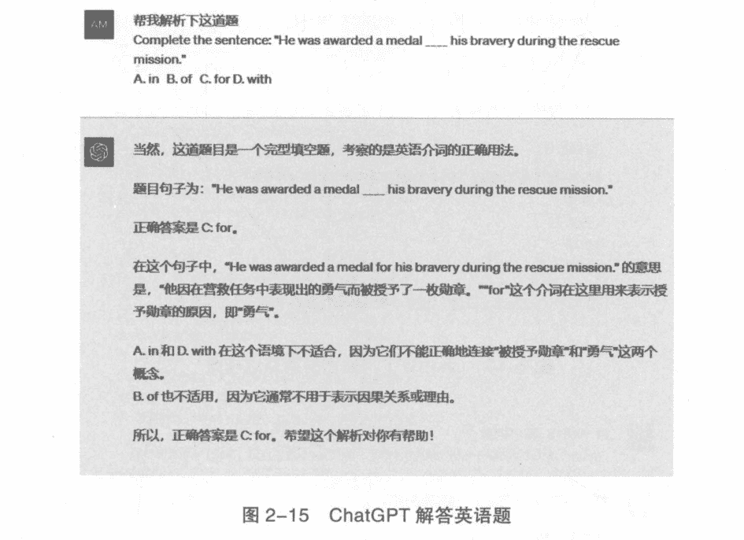

图 2-15 ChatGPT 解答英语题

理解完一道题后，想找同类题巩固，不用再翻书上网，直接让系统按刚才的题型再生成几道即可，如图 2-16 所示。

按照刚才这道英语习题，帮我出三道类似的习题。

当然，下面是三道类似的英语选择题，主要考察介词用法：

**习题 1**

Complete the sentence: "She excels ___ mathematics and plans to become an engineer."

A. on

B. of

C. in

D. for

**习题 2**

Complete the sentence: "He was convicted ___ robbery and was sentenced to five years in prison."

A. of

B. with

C. for

D. in

**习题 3**

Complete the sentence: "The company is known ___ its excellent customer service."

A. about

B. with

C. of

D. for

请先试着回答，然后我会给出解析。祝你做题顺利！

图 2-16 ChatGPT 给出相似习题

## 2.4 把模型当作随身法律参考

日常生活中常会碰到法律相关的问题，用浏览器搜索往往得不到建设性意见，去找律师又不方便。这时该系统是一个不错的替代，比搜索引擎更能进行有效对话。

比如，用了一张图后有人称是他所有且未授权，该怎么办，如图 2-17 所示。

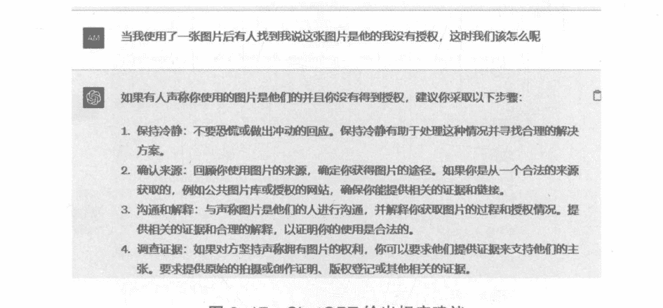

比如，被人无端诬陷造谣却不知如何应对，可以询问系统，如图 2-18 所示。

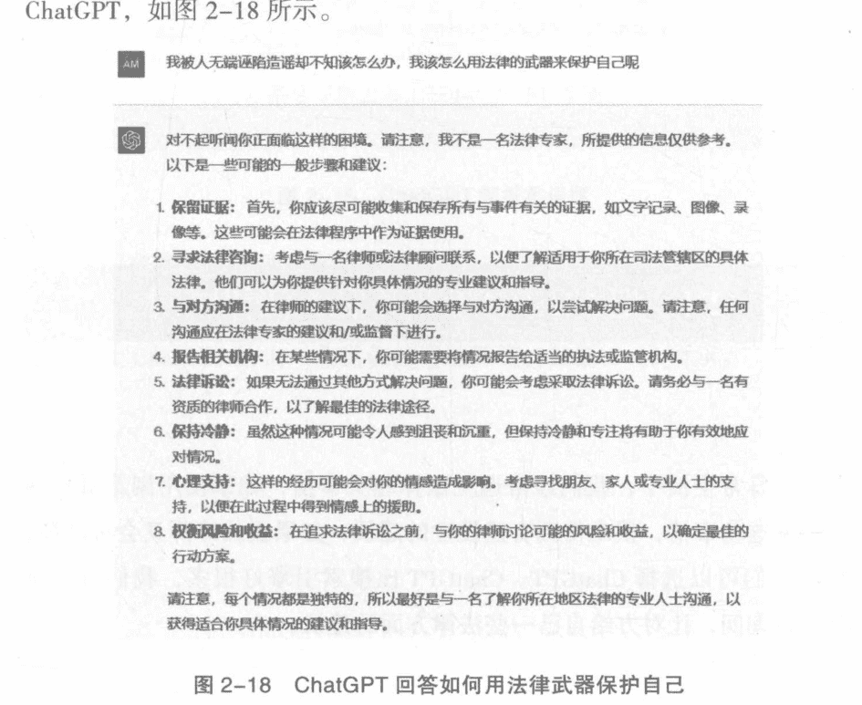

比如，结婚前应该走哪些法律程序，也可以咨询它，如图 2-19 所示。

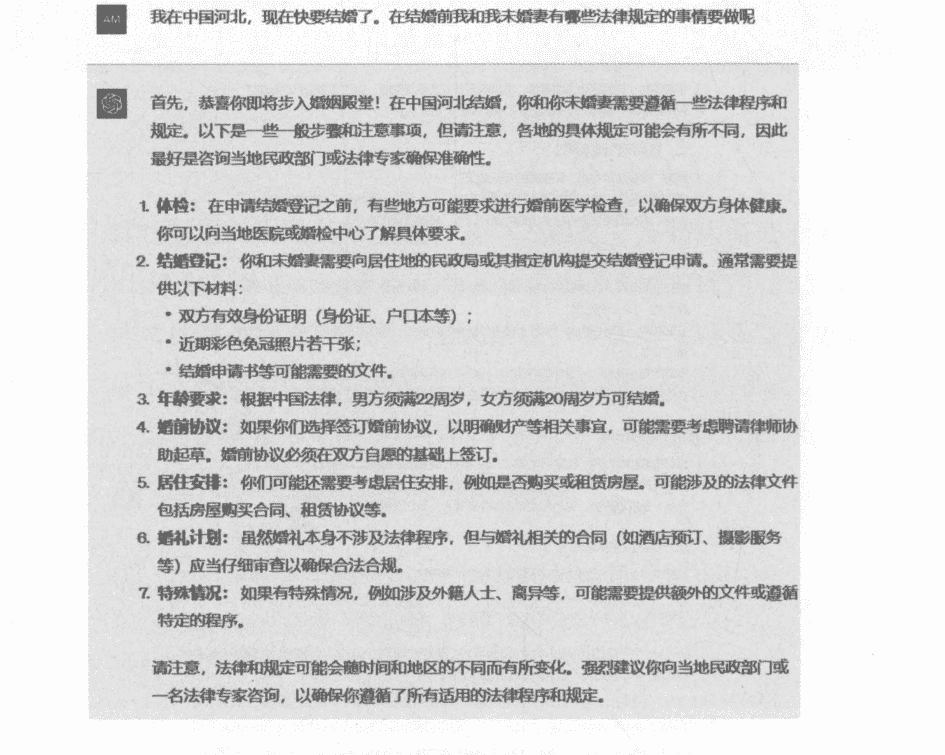

图 2-19 ChatGPT 回答与结婚相关法律问题

对大多数年轻人来说，买房是绕不开的人生大事，过程中会遇到哪些法律问题？不清楚时就可以让它列出，如图 2-20 所示。

028 零基础学 Python+ChatGPT

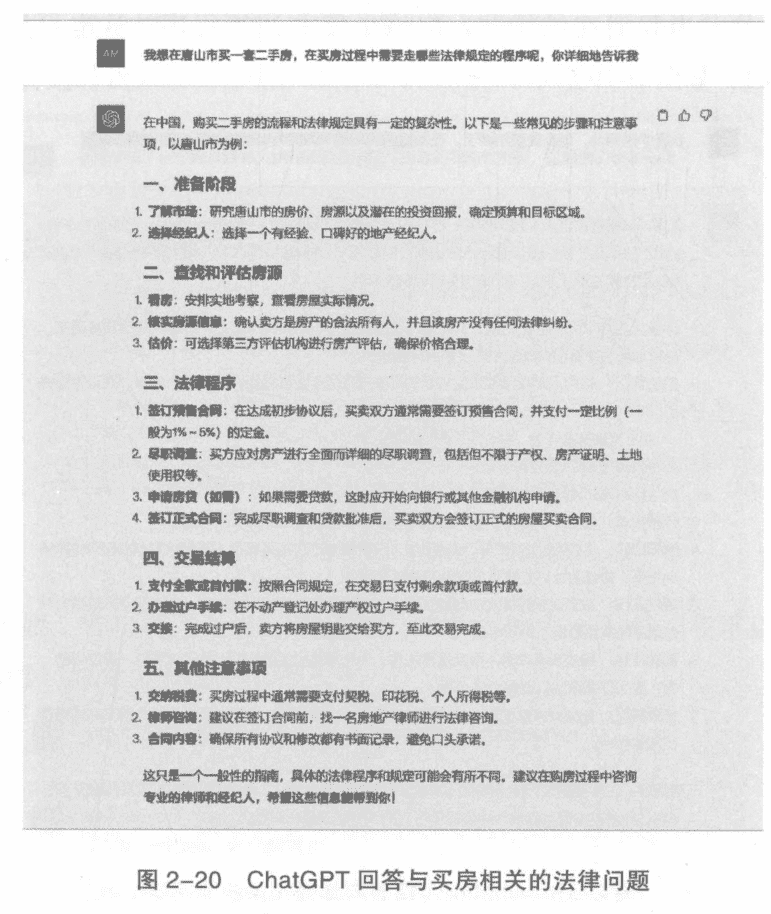

图 2-20 ChatGPT 回答与买房相关的法律问题

随着法律意识提升，有一个像系统这样的随身法律顾问，既能省下咨询费，也能节省大量时间，是非常有必要的事。

## 2.5 用系统梳理职业方向

职业规划常让人无从下手，网上信息良莠不齐。该模型能给出建议，分析不同行业的薪资待遇和岗位要求，回应更精准。

比如，让它列出未来最赚钱的十大行业，如图 2-21 所示。

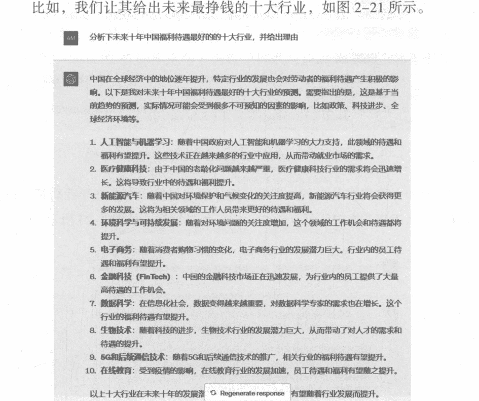

图 2-21 ChatGPT 列举的十大行业

还可以指定某个行业让它做深度介绍，如图 2-22 所示。

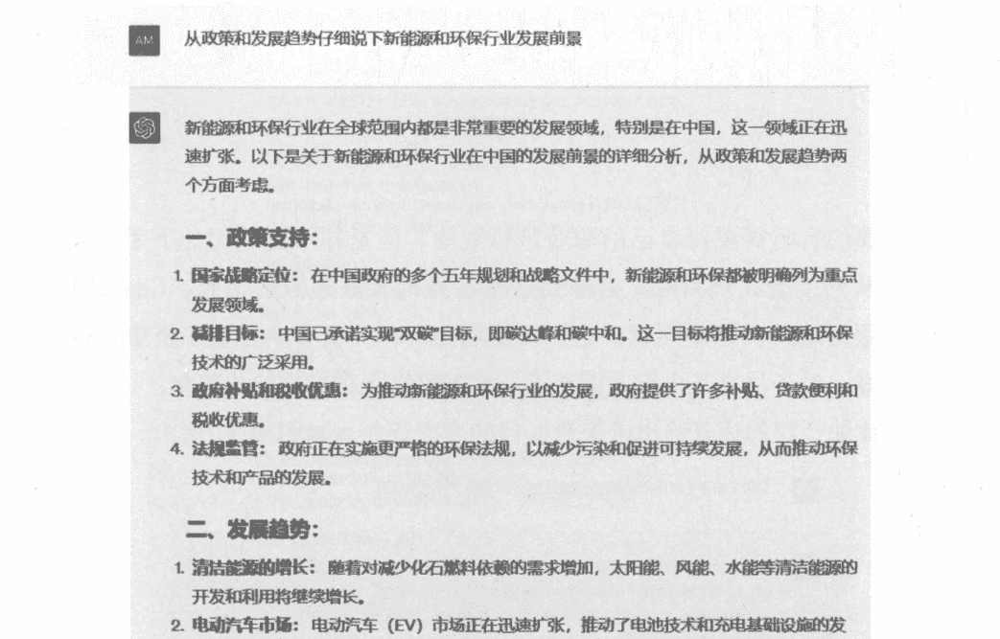

比如，大学生想知道所学专业毕业后能做什么，可以直接提问，如图 2-23 所示。

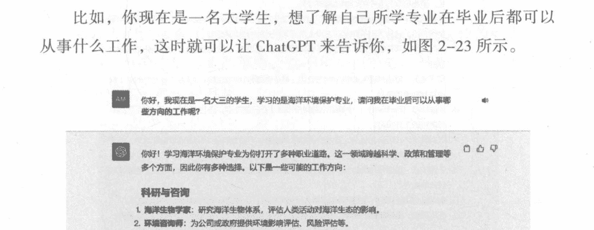

政府与非营利组织

1. 环境政策分析师：研究并提出海洋保护相关政策建议。
2. 海洋保护区经理：负责海洋保护区或海洋公园的管理维护。
3. 环境教育与宣传员：在公益或教育机构提升公众环保意识。

企业界

1. 企业社会责任经理：主导企业环境保护相关项目。
2. 环境健康与安全经理：执行和维护公司环境标准。
3. 可持续发展经理：推动生产过程的环保转型。

其他

1. 环境记者：为媒体撰写海洋与环境保护稿件。
2. 数据分析师：分析环境数据评估生态系统健康。
3. 旅游业：从事生态旅游或可持续旅游实践推广。

这只是冰山一角，每个方向都有细分需求。建议大学期间多实习或做志愿者，找到真正感兴趣的领域，必要时考取相关证书提升竞争力。祝前程似锦！

图 2-23 （续）

了解方向后，还可以让它提供国内该方向的知名企业，如图 2-24 所示。

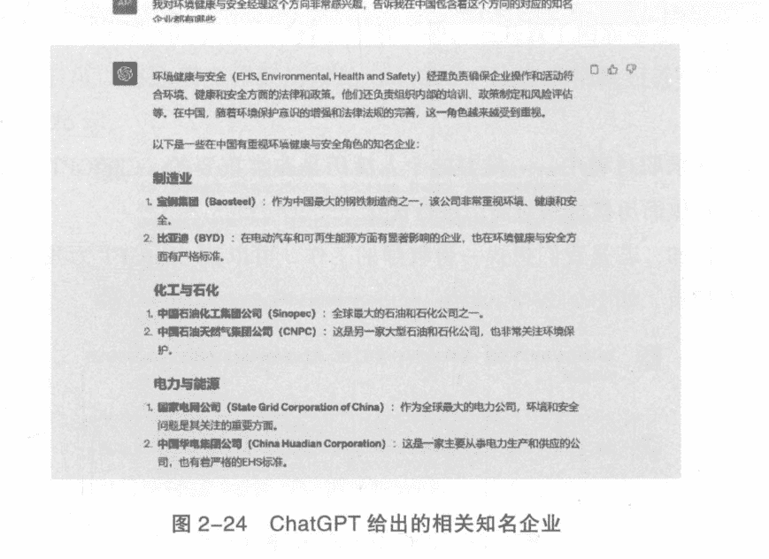

032 零基础学 Python+ChatGPT

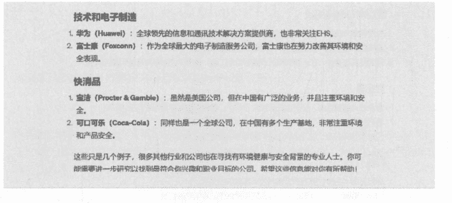

图 2-24 (续)

有这样一个几乎覆盖所有行业的智能助手，不管你想往哪走，它都能结合个人情况给出合理建议，用来制定职业规划再合适不过。

## 2.6 用系统打磨求职简历

求职时一份好的简历很关键，系统既能提供模板，也能帮你优化内容。

比如，想找教师工作，可以让它给一份模板，如图 2-25 所示。

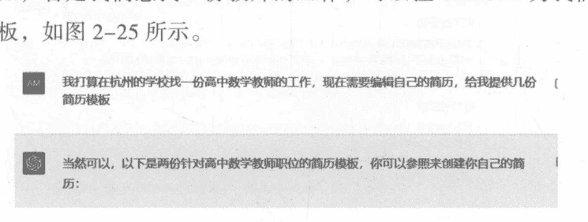

图 2-25 ChatGPT 给出的简历模板

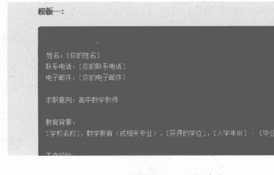

拿模板填完基础信息后，姓名、学校等固定项改不了，但工作经验、自我评价、项目经历等都可以优化。

例如这段工作经历：“我在大三就开始进行实习了，在大三上学期每周都会在周末去给一名高一学生当家教，补习数学，这名学生原本数学考80分，后来考110分；在大四我在一家设计公司实习了半年，可以熟练使用办公软件；大学毕业后我在一家教育培训公司当数学老师，教授过高三毕业班的学生，对教学非常熟悉，一共教了两届毕业生。”

把这段话发给系统让它润色，如图 2-26 所示。

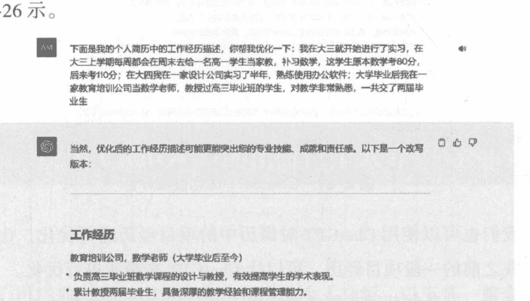

034 零基础学 Python+ChatGPT

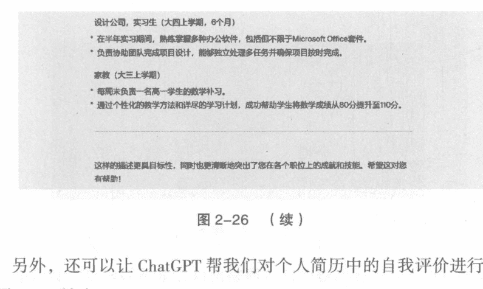

另外，自我评价也能请它帮忙优化，如图 2-27 所示。

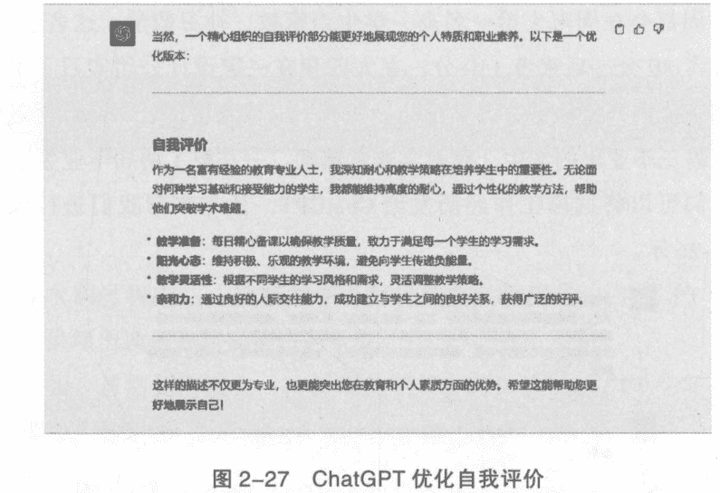

项目经历同样适用。比如一段石药制药废水处理项目的经历：

背景：原有青霉素制造废水含钠盐钾盐，旧工艺只能提取混盐，资源浪费严重。

过程：本人负责全新工艺设计，包括原理说明、材料选择、管线选择与CAD流程图。

结果：完成合格方案设计。

职责：设计工程师，负责全部工艺流程设计。

让系统优化后的结果如图 2-28 所示。

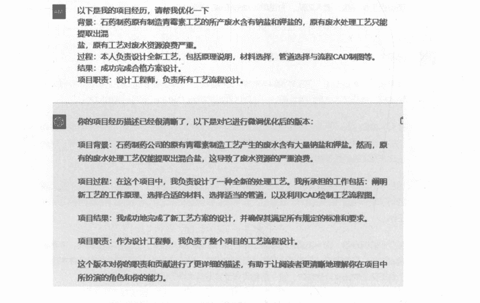

## 2.7 用系统润色面试自我介绍

面试自我介绍也可以交给系统润色。下面是一段初稿，看它优化后会变成什么样，如图 2-29 所示。

036 零基础学 Python+ChatGPT

以下是我为面试准备的个人介绍，帮我优化一下

我是一名普通的本科应届毕业生，我叫张三，来自天津，我一直追求着自己的成就。

个人简历打磨、AI 实操笔记与 Python 入门记录

在大学阶段我曾担任学生干部并被评为校级优秀干部，这一经历锻炼了我的统筹协调与人际沟通能力。暑假期间我多次通过勤工俭学的方式积累社会经验，培养出吃苦耐劳与承压自强的特质。天津电子设计竞赛中我获得二等奖，充分展现了较强的实践动手能力和独立钻研精神。无论工作环境文化背景如何不同，我都能快速适应并与同事高效协作。

专业方面，我已系统掌握本专业的基础理论与技术要点，并持续拓宽知识视野。在课程设计和实验任务中，我善于独立思考、主动探究、勇于创新，最终取得较为理想的效果。毕业设计我独立完成了以化工原理为基础的废水处理系统方案设计与实现，并顺利通过答辩。

展望工作，我将以积极乐观的态度和踏实敬业的精神面对各类挑战，相信能够迅速融入新环境、与团队紧密配合，为用人单位创造价值。感谢阅读。

你的求职陈述框架已经很完整，下面做了一点润色，让经历和成果更突出：

我叫张三，来自天津，目前正处于毕业季。虽然是本科应届毕业生，但已通过竞赛和课程设计等实践证明了自身的韧性与持续进阶的能力。

大学里我注重自我突破与领导力提升。担任学生干部期间获评校级优秀学生干部，验证了我在组织与协调方面的表现。假期勤工俭学则让我体会到坚持与吃苦的价值。

我持续精进实践技能。天津电子设计大赛二等奖反映出我的动手能力与自学能力。我有信心在文化差异或团队构成各异的情况下都能胜任工作。

在专业知识上，我系统掌握学科基础，并以主动思考、积极探索和创新思维在课程设计与实验中取得良好表现。毕业设计是自行完成的化工废水处理系统，获得答辩委员会认可。

未来我期待以积极态度与专业精神迎接挑战，相信能迅速适应环境，与团队密切合作，为企业贡献价值。非常感谢您给予的机会。

ChatGPT 作为大语言模型，还能实现跨语言互译，如图 2-30 所示。

请将下面这句话译成英语、法语、日语、俄语、西班牙语、阿拉伯语

我将会以积极的态度和敬业的精神去面对各种挑战和困难

图 2-30 ChatGPT 多语言翻译


图 2-30 （续）

## 【扩展】将静态照片转成会说话的视频

把一张静止照片变成口述视频，目前主流的实现路径大致有三种：heygen.com 在线生成、D-ID 生成、Stable Diffusion 本地部署。三者的优劣各异，整体来看 heygen.com 生成的效果最为自然，D-ID 次之，Stable Diffusion 免费且可装在本地电脑运行，但对硬件配置要求较高。

以 heygen.com 为例，操作流程如下，注册是第一步。在浏览器中打开 https://www.heygen.com/，如图 2-31 所示。

038 零基础学 Python+ChatGPT


图 2-31 heygen.com 网站

随后，点击右上角的 Sign In，再选择 Sign Up with Email 来创建账号，如图 2-32 所示。


图 2-32 注册界面

在新页面第一行填写邮箱并点击 Send Code，如图 2-33 所示。


图 2-33 注册界面

发送后邮箱会收到验证码，输入验证码后点击 Next Step 进入密码设置，密码要求 8 到 35 位且包含数字与大小写字母，如图 2-34 所示。


图 2-34 登录界面

下一步点击 Done 即可完成注册，系统会自动登录。随后网站会做简短调研，可如实填写也可随意选择，每完成一项点击右下角的亮色按钮即可，如图 2-35 所示。


图 2-35 调研界面

调研完成后即可使用功能。界面右上角显示两分钟免费试用时长，每生成一段视频都会消耗相应时长，超出需充值，如图 2-36 所示。


图 2-36 两分钟的免费试用时长界面

左侧 Template 为平台提供的模板，下方 Avatar 可上传本地照片，Video 可查看已生成的视频，如图 2-37 所示。


图 2-37 Template 模板

开始尝试，先点“Avatar”上传照片，如图 2-38 所示。

042 零基础学 Python+ChatGPT


图 2-38 上传界面

上传成功后点击所上传的图片，如图 2-39 所示。


图 2-39 上传完成界面

打开图片后，下一步点 “Create Video”，如图 2-40 所示。


图 2-40 图片打开界面

进入制作页后，删除默认英文文案，输入希望照片说的内容，下方会实时显示时长，如图 2-41 所示。

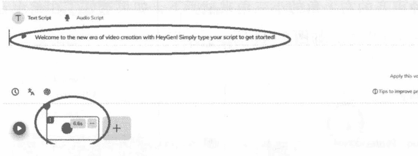

输入文案后，右侧国旗处可选择语言和音色，如图 2-42、图 2-43 所示。

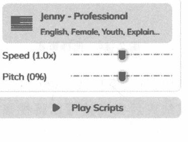


选择中文 Chinese 后会出现多种音色，可点击每种音色的右上角小三角试听，选定后在右下方点 Select 即可，如图 2-44 所示。


音色和文案确定后，点击右上角 Submit 生成视频，生成完毕即可下载观看，如图 2-45、图 2-46 所示。


图 2-46 下载位置

# 第 3 章 Python 的含义与简单数据类型


## 3.1 Python 的含义

### 编程是什么

可以这样理解编程，电脑的核心是 CPU，内部包含大量功能。编程就是用编程语言把这些功能编排起来并保存为文件，运行文件时电脑就按编写的步骤执行，从而实现目标。

编程的本质是通过代码告诉计算机该做什么，计算机按顺序一步步执行并给出结果。例如计算 2+3*（6-4），先算括号内 6-4 得 2，再算 3*2 得 6，最后 2+6 得 8。电脑需要代码明确每一步的指令。

### Python 能做什么

CPU 内置大量指令，编程语言是组织这些指令的工具。如今语言种类数十上百，其中流行度最高、使用最广的是 Python，除此之外 C、C++、Java 等也较常见。

Python 应用范围非常广，具体领域如表 3-1。

表 3-1 Python 的应用领域

| 应用领域 | 具体描述 |
| :--- | :--- |
| 网站服务 | 个人、企业网站；企业管理系统等 |
| 自动工具 | 工作自动化：自动采集网站数据、股票数据；自动发送邮件等 |
| 数据处理 | 处理文本、图片、表格等 |
| 人工智能 | 智能异常检测，大语言模型等 |
| 自动交易 | 股票自动买卖，自动下单、购票等 |

### 学好编程的三部曲

编程需要掌握三大技术：编程语言、数据库、网络。只会语言相当于单脚行走需借助拐杖，能走但费力；学会数据库后相当于有了第二条腿，能丢掉拐杖奔跑。

学习路径建议先打牢基础语法，再掌握数据结构，最后补充高并发。高并发是互联网系统架构的性能指标，指单位时间内系统能同时处理的请求数，也称 QPS。

## 3.2 编程相关软件安装和使用

### 环境变量

（1）环境变量可以理解为记录软件安装位置的表格，如表 3-2。

表 3-2 变量与值

| 食材登记表 | |
| :--- | :--- |
| 食材名称 | 存放位置 |
| 土豆 | 1 号库房 |
| 西红柿 | 2 号库房 |
| 绿色蔬菜 | 3 号库房；4 号库房 |
| 环境变量 | |
| 变量 | 值 |
| weixin | C:\weixin\weixin.exe |
| path | C:\system\python |

对比可知，环境变量相当于记录程序存放位置的表格，变量指程序名，值指存放路径。

（2）环境变量配置演示以 win10 为例：

打开右下角搜索框，输入环境变量后搜索，如图 3-1 所示。


图 3-1 搜索位置

点击编辑系统环境变量，如图 3-2 所示。

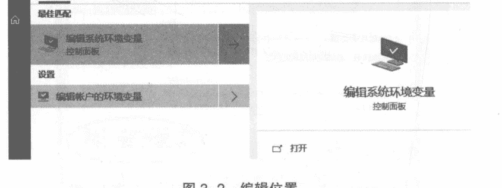

图 3-2 编辑位置

在打开的窗口中选择高级，然后点环境变量，如图 3-3 所示。

052 零基础学 Python+ChatGPT

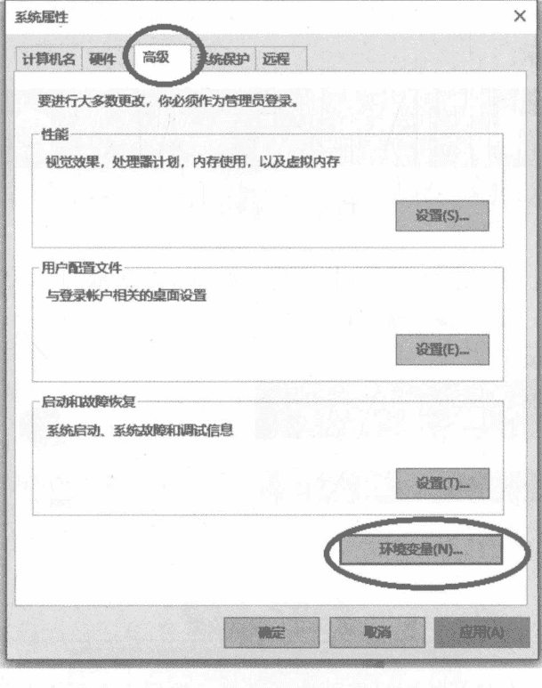

图 3-3 环境变量位置

打开后窗口分为用户变量和系统变量，一般不动系统变量，只在用户变量中新建，如图 3-4 所示。

# 第 3 章 Python 的含义与简单数据类型

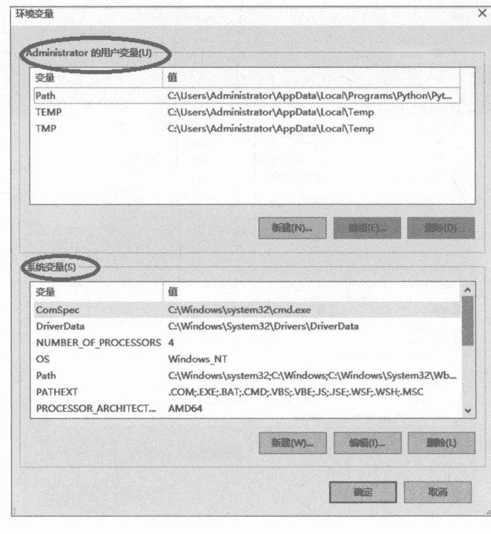

图 3-4 变量界面

点击新建后，可创建新变量和值，例如建立名为 mypath 的变量，在浏览目录中选择路径后点确定，如图 3-5 所示。

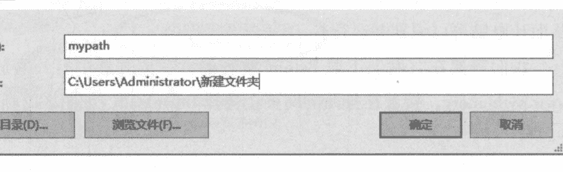

图 3-5 新建变量界面

最后在如图 3-6 所示窗口点确定即可生效。

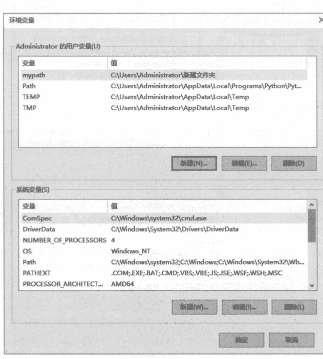

图 3-6 新建成功后界面

### Python 解释器的安装

Python 解释器负责把编写的代码翻译成计算机可识别的字节码。我们可在官网下载，在浏览器打开 http://www.python.org，随后选择 Download，如图 3-7 所示。

图 3-7 Python 官网界面

点击图中圈出位置开始下载，下载后安装，建议安装到默认的 C 盘。

图 3-8 中小圈位置务必勾选，然后点大圈位置开始安装。

图 3-8 安装界面

安装完成后做一次测试。按 Win+R 打开运行，输入 cmd 确定，在窗口中输入 Python 回车，若出现如图 3-9 的提示则说明安装成功。

## JupyterLab 的安装

先下载 Anaconda，在浏览器搜索 http://www.anaconda.com 进入官网，点击 Download 下载，如图 3-10 所示。

下载完成后运行安装，安装完毕后可在开始菜单搜索 Anaconda 打开软件，如图 3-11 所示。

软件启动较慢，耐心等待，打开后点击启动 Jupyter Lab 即可，如图 3-12 所示。

## 文件扩展名与默认打开方式

扩展名是文件名最后的“.+后缀”，即文件格式。Windows 常见格式如 .exe 为可执行程序，.txt 为文本文档。可通过重命名改变扩展名来更换格式，.py 为 Python 文件。

默认打开方式可通过右键文件属性修改，如图 3-13 所示。

图 3-13 文件属性界面

## 3.3 Python 的表达式

### 表达式与算术表达式

首先打开 Jupyter，打开 Downloads 文件夹，在空白处右键，如图 3-14 所示。

图 3-14 Jupyter 界面

选择 New Folder，建立文件夹并命名为“张三的 Python 编程学习笔记”，双击打开，如图 3-15 所示。

图 3-15 Jupyter 新建文件夹

打开后点击圈出位置新建文档，右键重命名为“张三的 Python 编程学习笔记”，如图 3-16、图 3-17 所示。

图 3-16 Jupyter 新建 Python 文件

图 3-17 Python 文件改名

最后即可学习记录，如图 3-18， “+” 代表新增输入框；“x” 删除输入框；“▶” 运行；最右侧“Code”可改为 Markdown，即文本格式。输入框既可写代码也可写文本，非常方便。

图 3-18 Jupyter 操作界面功能介绍

#### 1. 表达式

表达式把变量和常量组合生成新值。可进行运算，由数字和运算符构成，运算结果称为返回值，运算有优先级，按操作符排序。

#### 2. 算术表达式

算术表达式是数字间的运算，常用操作符如表 3-3。

表 3-3 算术表达式常用操作符

| 操作符 | 示例 |
| :--- | :--- |
| 加法 + | 比如 1 + 1 = 2 |
| 减法 - | 比如 3 - 2 = 1 |
| 乘法 * | 比如 2 * 2 = 4 |
| 除法 / | 比如 6 / 2 = 3 |
| 整除 // | 比如 5 // 2 = 2 |
| 模运算 % | 比如 5 % 4 = 1 |
| 次方 ** | 比如 2 ** 3 = 8 |

注意：*、/、//、%、** 优先级高于 +、-；为清晰建议操作符与数字间加空格；括号只有 () 一种，如图 3-19、图 3-20 所示。

图 3-20 编程复杂计算界面

#### 3. 数字的类型

数字分浮点数和整型。浮点数带小数点，如 1.0、2.3；整型为整数，如 2、6、102。不同类型运算时需转换，分为隐式转换和显式转换。

隐式转换：在运算时 Python 会自动转换，如图 3-21 中 0.2 + 3 = 3.2，虽类型不同仍可正常计算，这是 Python 在后台完成了转换。

图 3-21 中的 “# 隐式转换” 为注释，运行时会被忽略，不影响程序。可在复杂或陌生代码前用 “# 注释” 提示自己。

显式转换：使用 Python 提供的函数手动转换。如 float() 可把整型转浮点数，int() 可把浮点数转整型，如图 3-22 所示。

图 3-22 编程中的显式转换

浮点数精度高于整型，从浮点到整型经 int() 转换时会丢失精度，如 int(0.6) + 2 结果为 2 而非 2.6，如图 3-23 所示。

### 表达式的关系运算

##### 1. 关系运算符的分类

关系运算符分两类：比较大小和比较相等。

比较大小有四种：大于 >、大于等于 >=、小于 <、小于等于 <=。

比较相等有两种：== 判断是否相等，!= 判断是否不相等。

关系运算执行后会给出结果，这个结果只有两种可能：True 与 False，分别对应真、假，也可看作正确或错误，见图 3-24。

图 3-24 里被圈起来的示例，把四条关系运算放进同一个输入框，并借助 print() 函数，让输出带上自定义的提示文字。

##### 2. 关系运算符谁先算
在执行过程中，关系运算符同样存在先后顺序。

算术运算先于关系运算执行；在关系运算内部，判断大小的运算符比判断相等的运算符优先级更高，见图 3-25。

图 3-25 关系运算符优先级示意

图 3-25 里举的 “3 == 2 > 1”，实际运行会先算 2 > 1 得到 True，再用 3 与 True 做相等比较，最终结果为 False。

关系运算常被用来做逻辑判断和循环控制。

### 逻辑运算表达式
逻辑运算符又称布尔运算符，一共三种：and、or、not。

##### 1. and 运算符规则
and 表示“并且”，只有左右两边都是真时才返回 True，只要有一边是假，或两边皆假，结果就是 False。

and 的求值顺序是先算左边。若左边为 False，则直接短路返回 False，不再计算右边；若左边为 True，才继续算右边，右边为 False 则整体 False，右边为 True 则整体 True。示例见图 3-26。

##### 2. or 运算符规则
or 表示“或者”，只要左右任一为真，结果就是 True；两边皆假时才返回 False。

or 的求值先看左边。左边为 True 时直接短路返回 True，不算右边；左边为 False 时再算右边，右边真则真，右边假则假。示例见图 3-27。

##### 3. not 运算符规则
not 用于取反，也叫逻辑非，会把右边结果反过来输出，True 变 False，False 变 True。

例如 `not 1 > 2`，先算 1 > 2 为 False，not 取反后得到 True。示例见图 3-28。

运算符优先级从低到高：逻辑运算符 < 关系运算符 < 算术运算符。

### 字面量做逻辑运算

### 1. 什么是字符串
由文字、字母、数字等组成的文本称为字符串，也叫字面量或字符串常量。

Python 为了方便理解，用数字 1 表示 True，0 表示 False。本质上 Python 只认识二进制的 0 和 1，并没有独立的 True False 概念。

直接输入汉字运算会报错，因为无法识别。给汉字加上英文双引号后就变成了字符串，Python 才能识别。见图 3-29。

图 3-29 字符串的创建示例

##### 2. bin 与 bool 函数用法
bin() 用来把十进制转成二进制，输出结果前面会带 0b 表示是二进制格式，见图 3-30。

图 3-30 十进制转二进制示例

bool() 把内容转为布尔值。0 或空值返回 False，其他情况都返回 True，见图 3-31。

字面量配合 and 的例子见图 3-32。1 and 3 左边 1 为真，继续算右边 3 为真，最终返回 3；0 and 3 左边 0 为假，直接短路返回 0。

字面量配合 or 的例子见图 3-33。

字面量配合 not 的例子见图 3-34。

### 复合表达式与变量

##### 1. 复合表达式的坑
把多个表达式组合起来就叫复合表达式。比如 (2+3)*(5-3)，理论上先算括号再相乘，但直接写进输入框会报错，见图 3-35。

图 3-35 直接输入复合表达式的错误

这时需要借助变量。内存被分成若干块，可以给它们命名为 a、b、c 等。

可以这样想象执行过程：先算 2+3 得 5 存到 a，再算 5-3 得 2 存到 b，最后取出 a 和 b 做 5*2 得 10。a、b 就是变量，按图 3-36 的写法就能正常运行。

图 3-36 用变量实现复合表达式

##### 2. 变量命名规则
随着代码增多，变量命名就需要规范，不能只用简单字母。

- 不能以数字开头；
- 只能由字母、下划线、数字组成，部分环境支持汉字；
- 不能使用 Python 保留字作为名称。

##### 3. 编码时常见提醒
出现 SyntaxError 表示语法写错了，这是新手常见的问题。见图 3-37。

图 3-37 SyntaxError 示例

变量名最好有意义，便于自己和他人理解。例如 name = "张三"，看到 name 就知道是人名。

## 3.4 变量与基础数据类型

### 变量赋值原理
变量本质上是一个指向内存地址的引用。

一个变量可以反复赋值，后面的值会覆盖前面的；也可以一次给多个变量赋值，见图 3-38。

图 3-38 同时给多个变量赋值

图中圈出的 (66,88,99) 带括号的不是普通数字，而是元组，后续会介绍。

### 数字类型分类
数字类型主要分浮点型、整型和复数，复数使用较少暂不展开。

浮点型带小数点，精度约为 16 位，即能准确表示约 16 位数字。

整型即整数，没有小数点。

整型与浮点型可互相转换，float() 转浮点，int() 转整型，示例见图 3-39。

注意：int() 把浮点转整型会直接截断小数部分，不做四舍五入。

图 3-40 的测试显示，最后一位已不准确，从首位起约 16 位保持准确，这印证了浮点精度。

由于 Python 底层是二进制，运算结果会从二进制转回十进制显示，某些小数计算会出现误差，比如 1-0.9 理论上是 0.1，实际输出却不相等，见图 3-41。

为解决该误差，可使用 decimal 模块，示例见图 3-42。

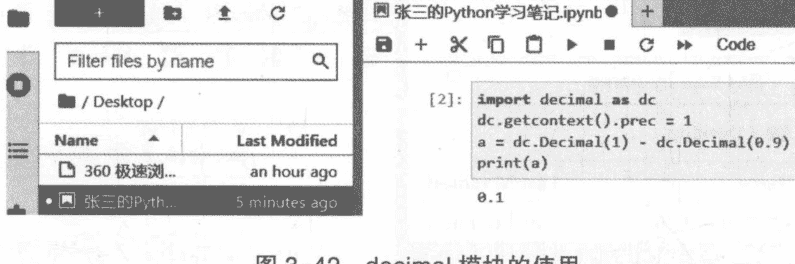

图 3-42 decimal 模块示例

图 3-42 的代码含义是：导入 decimal 并起别名 dc，设置精度为 1，创建两个 Decimal 对象 1 和 0.9 相减存入 a，最后打印 a。

## 字符串与转义符详解

### 1. 字符串的写法
汉字或字符只有加上单引号或双引号才算字符串，否则会报错，见图 3-43。

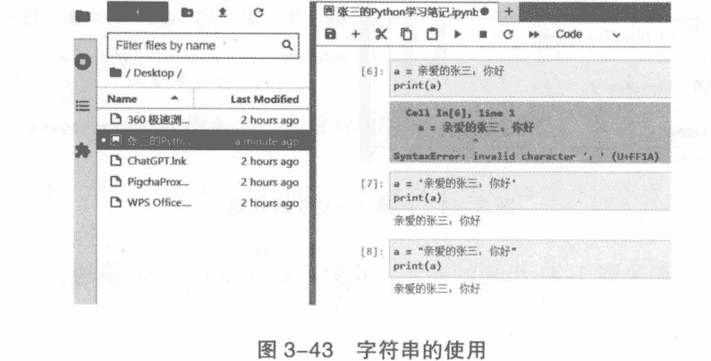

图 3-43 字符串使用示例

当需要多行输出时，比如写信开头，单双引号就不够用，见图 3-44。

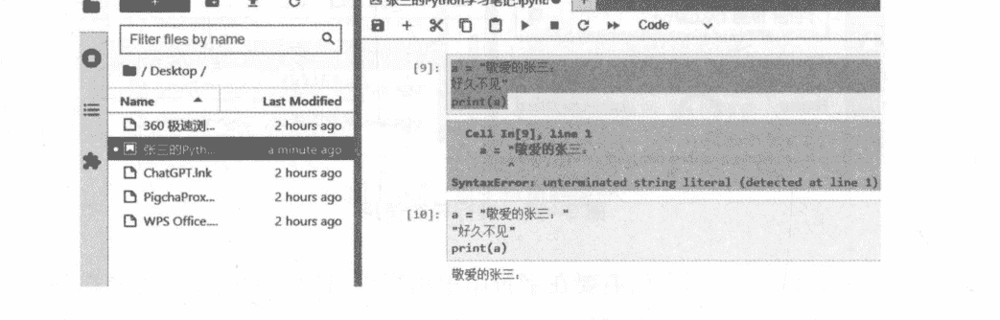

因此字符串引号分为单行和多行两种。

单行用一对单引号或双引号；多行用三对单引号或三对双引号。

示例见图 3-45。

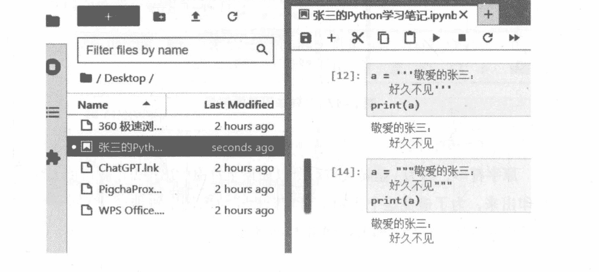

### 2. 常用转义符
\n 用于换行，见图 3-46。

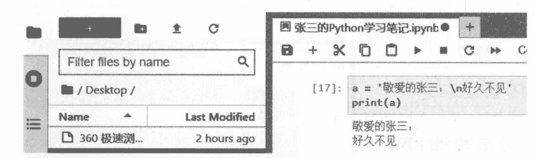

图 3-46 换行符示例

在字符串里想出现单引号，可用 \' 转义，或改用双引号包裹，否则会报错，见图 3-47。

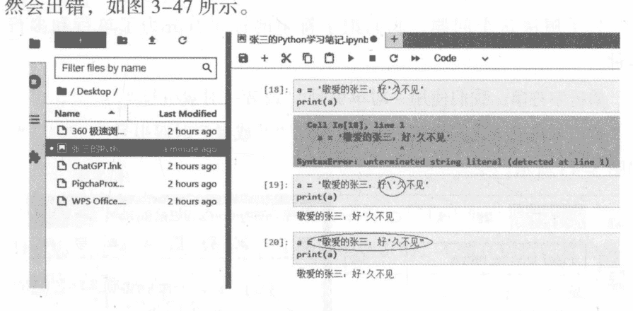

图 3-47 转义单引号示例

转义双引号 \" 用法类似。

反斜杠 \ 本身是转义符，若想原样输出 \，可在字符串前加 r 声明为原始字符串，见图 3-48。

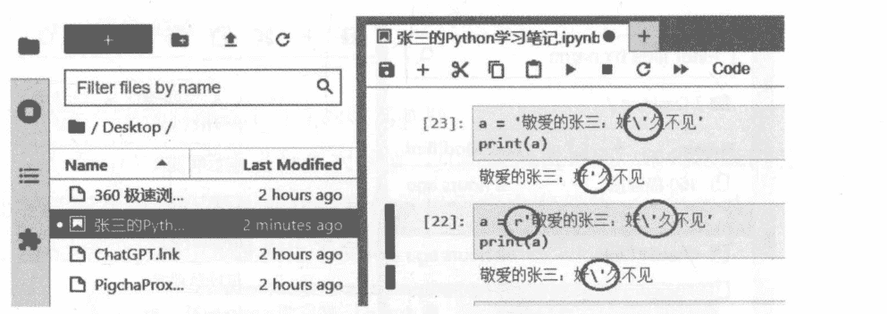

图 3-48 原始字符串示例

## 字符串与数字互转
字符串和数字一起运算前需先统一类型。

用 str() 把数字变字符串，用 float() / int() 把数字字符串变数字。

例如把 "888" 转为浮点或整型，见图 3-49。

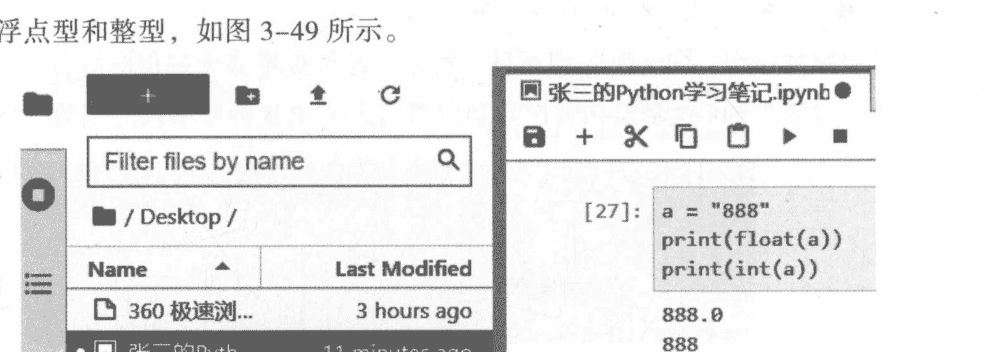

图 3-49 字符串转数字示例

字符串拼接可用 + 连接，也可直接写在同一行，见图 3-50。

084 零基础学 Python+ChatGPT

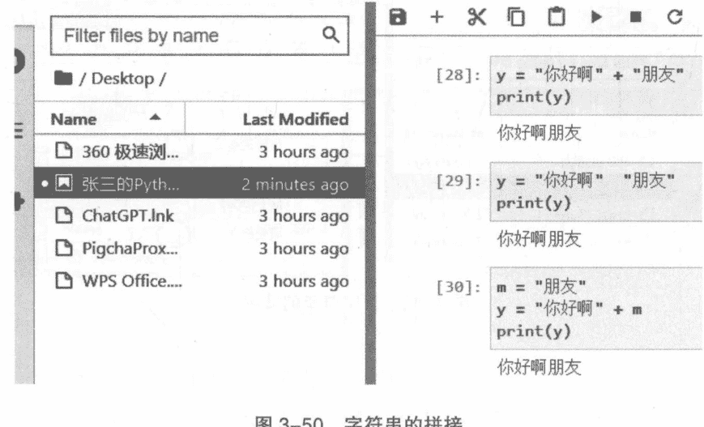

图 3-50 字符串拼接示例

数字与字符串拼接时，数字需先转成字符串。

例如拼接“李四、77、公斤”，若不先把 77 转成字符串会报错，转成字符串后即可成功，见图 3-51。

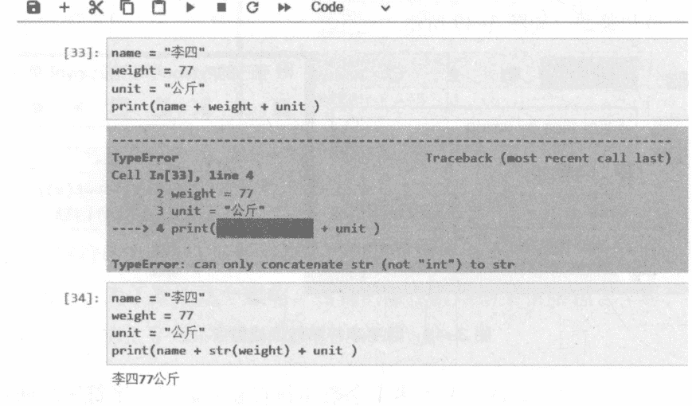

图 3-51 数字转字符串拼接示例

### 不可变类型特征
数字和字符串属于不可变类型。

若多次赋不同值，变量指向的内存地址会变，用 id() 可验证，见图 3-52。

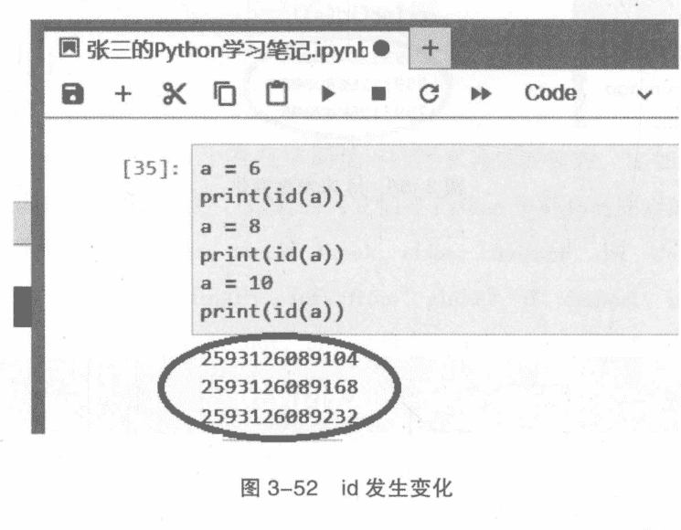

若多次赋相同值，Python 可能复用同一内存，地址不变，见图 3-53。

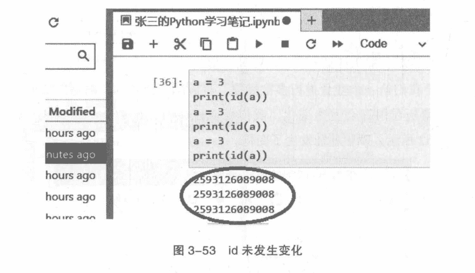

## 3.5 选择语句入门

### 语句类型概览
语句让程序具备选择执行的能力，没有语句代码只能顺序执行。

主要有选择、重复、跳转三类，还有异常、上下文、断言等。

Python 的一些常见语句，如表 3-4 所示。

### 表 3-4 常见语句对照表
| 语句名称 | 选择语句 | 重复语句 | 跳转语句 | 异常语句 | 上下文语句 | 断言语句 |
| :--- | :--- | :--- | :--- | :--- | :--- | :--- |
| 常见写法 | if | for、while | Break continue | try、except、raise | with | assert |

### 关键字说明
关键字是 Python 预留的，具有固定含义，不能用作变量名。包括 and、as、assert、break、class、continue、def、del、elif、else、except、False、finally、for、from、global、if、import、in、is、lambda、None、nonlocal、not、or、pass、raise、return、True、try、while、with 等。

可通过代码查看全部关键字，见图 3-54。

```
[1]: import keyword
print(keyword.kwlist)

['False', 'None', 'True', 'and', 'as', 'assert', 'async', 'await', 'break', 'class', 'continue', 'def', 'del', 'elif', 'else', 'except', 'finally', 'for', 'from', 'global', 'if', 'import', 'in', 'is', 'lambda', 'nonlocal', 'not', 'or', 'pass', 'raise', 'return', 'try', 'while', 'with', 'yield']
```

图 3-54 查看关键字示例

### 输入输出函数使用
输入用 input()，输出用 print()。

先用命令行交互式测试 input()。按 Win+R 打开运行，输入 cmd，回车；输入 python 回车进入交互环境；输入 input() 回车后输入内容再回车即可看到输入，见图 3-55。

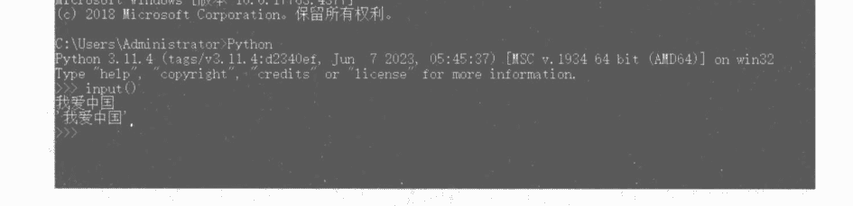

图 3-55 input 使用示例

输入的内容可赋给变量再输出。如将体重赋给 abc，用 print 输出“我的体重是”与 abc，中间用逗号分隔，见图 3-56。


图 3-56 print 输出示例

在网页练习中，写入代码后点击运行，会出现图 3-57 界面。

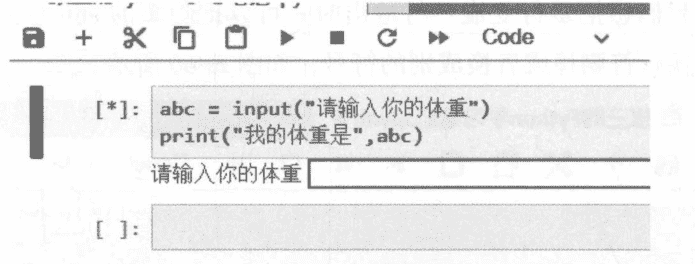

图 3-57 input 运行效果

输入 70 公斤后直接回车，不要点运行，效果见图 3-58。

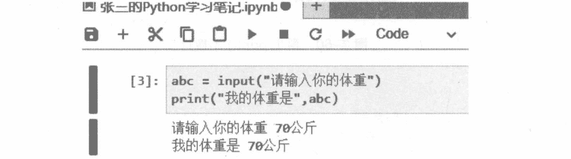

图 3-58 回车后结果

每次调用 print() 都会自动换行，因为默认 end='\n'，见图 3-59。

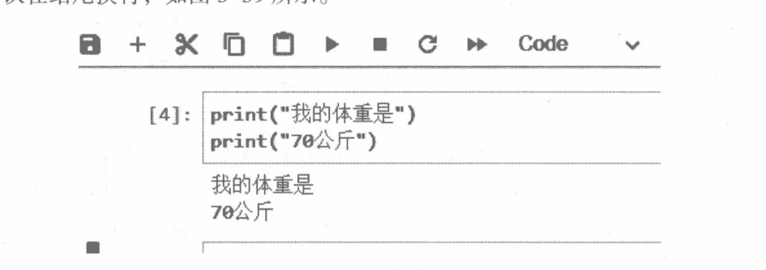

图 3-59 多次 print 换行

若想一行输出，可显式指定 end 参数，去掉换行符或换成其他符号，见图 3-60。

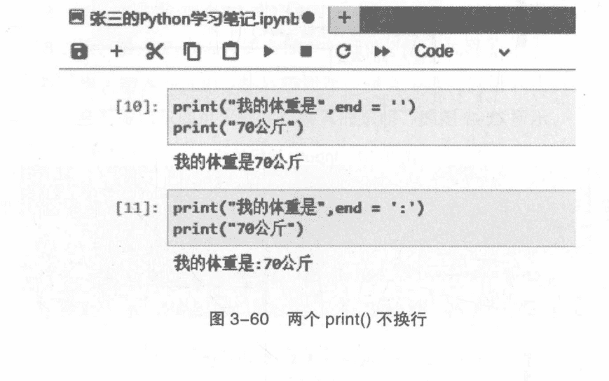

## if else elif 语句详解

### 1. if 语句写法要点
if 也叫分支语句，意为“如果”，常用于流程分支。

if 根据条件表达式的真假决定执行哪段代码。

if 的基本格式如下。

```
if 条件表达式：
    01 - 语句：如果满足条件表达式（条件表达式的返回值为 True），执行这行代码
```

注意：代码块前须缩进四个空格，条件后必须加英文冒号。

input 获取的内容是字符串，比较前需用 int() 或 float() 转成数字，见图 3-61。

```
[20]: n = input("请输入学生分数")
if n > 60:
    print("及格")

print("结束")

请输入学生分数 70

TypeError
Cell In[20], line 2
      1 n = input("请输入学生分数")
----> 2 if n > 60:
      3     print("及格")
      5 print("结束")

TypeError: '>' not supported between instances of 'str' and 'int'
```

```
[21]: n = int(input("请输入学生分数:"))

if n >= 60:
    print("及格")

print("结束")

请输入学生分数: 70
及格
结束
```

图3-61 input() 的返回类型

图3-61显示，第一个片段因未将字符串形式的数字转成数值类型，直接参与运算导致异常；第二个片段先完成类型转换，执行过程就顺利。

若输入的分数小于60，例如给出40，if后的判断式求值结果为False，对应的01-行会被跳过，见图3-62。

```
[23]: n = int(input("请输入学生分数:"))

if n >= 60:
    print("及格")

print("结束")

请输入学生分数: 40
结束
```

图3-62 未满足条件时跳过代码行

### 2. else 子句的使用要点

（1）else 对应“否则”，同一个 if 结构内 if 分支和 else 分支各只能存在一次。

（2）书写形式如下：

```
if 条件表达式：
    01 - 语句：如果满足条件表达式（条件表达式的返回值为 True），执行这行代码
else：
    02 - 语句，当条件表达式的返回值为 False 时，执行这行代码
```

示例见图3-63。

```
[24]: n = int(input("请输入学生分数:"))

if n >= 60:
    print("及格")
else:
    print("不及格")
print("结束")

请输入学生分数：40
不及格
结束
```

图3-63 else 分支示例

### 3. elif 子句的使用要点

（1）elif 是 else if 的缩写，含义为“否则如果”。

（2）一个 if 结构里可以出现多个 elif。

（3）书写形式如下：

```
if 条件表达式：
    01 - 语句：如果满足条件表达式（条件表达式的返回值为 True）执行这行代码
elif 条件表达式：
    02 - 语句：当条件表达式返回值为 True 时，执行这行代码
elif 条件表达式：
    03 - 语句：当条件表达式返回值为 True 时，执行这行代码
elif 条件表达式：
    04 - 语句：当条件表达式返回值为 True 时，执行这行代码
```

示例见图3-64。

```
[4]: n = int(input("请输入学生分数:"))

if 0 <= n < 60:
    print("不及格")
elif 60 <= n < 75:
    print("及格")
elif 75 <= n < 90:
    print("良好")
elif 90 <= n <= 100:
    print("优秀")
print("结束")
请输入学生分数: 40
不及格
结束
```

```
[5]: n = int(input("请输入学生分数:"))

if 0 <= n < 60:
    print("不及格")
elif 60 <= n < 75:
    print("及格")
elif 75 <= n < 90:
    print("良好")
elif 90 <= n <= 100:
    print("优秀")
print("结束")
请输入学生分数: 83
良好
结束
```

图3-64 elif 分支示例

### 4. if、else 与 elif 并用的情形

图3-64展示的程序中，若输入的数值是999，明显超出既定范围，这时可在末尾补上 else，如图3-65所示。

```
[3]: n = int(input("请输入学生分数:"))

if n < 60:
    print("不及格")
elif 60 <= n < 75:
    print("及格")
elif 75 <= n < 90:
    print("良好")
elif 90 <= n <= 100:
    print("优秀")
else:
    print("分数有误，请检查后重新输入")
print("结束")
```

学生分数输入：999

提示分数错误，请复核后再试

结束

图3-65 if、elif、else 共同出现示例

## 嵌套选择结构

单一 if 结构中 if 与 else 各只能出现一次，而嵌套选择允许在 if、else、elif 内部继续放置新的判断。

例如可利用嵌套对成绩进行分级，如图3-66所示。

```
[8]: cj = int(input('请输入想要定级的学生分数'))

if 0 <= cj <= 100:
    if cj < 60:
        print('不合格')
    elif 60 <= cj < 75:
        print('合格')
    elif 75 <= cj < 85:
        print('良好')
    else:
        print('优秀')
else:
    print('成绩有误，请重新输入')
```

图3-66 嵌套选择的示例

定级分数输入 10086

提示成绩无效，请再次提供

```
[9]: cj = int(input('请输入想要定级的学生分数'))

if 0 <= cj <= 100:
    if cj < 60:
        print('不合格')
    elif 60 <= cj < 75:
        print('合格')
    elif 75 <= cj < 85:
        print('良好')
    else:
        print('优秀')
else:
    print('成绩有误，请重新输入')
```

定级分数输入 57

判定为不合格

图3-66 续

同样思路可用于 BMI 评估。BMI 是衡量体脂状况的常用指标，下面实现一个输入体重身高后输出等级的程序。世界卫生组织给出的分界如下：

BMI = 体重千克 ÷ 身高米的平方，本例仅考虑 15~100 区间，超出视为错误。

- 体重偏低：BMI < 18.5
- 体重正常：BMI 18.5~24.9
- 体重偏高：BMI 25~29.9
- 肥胖等级一：BMI 30~34.9
- 肥胖等级二：BMI ≥ 35

流程：

1. 接收体重千克与身高米。
2. 按公式求 BMI。
3. 检查 BMI 是否落在 15~100 合理区间，不在则输出“数据异常，请再次输入”。
4. 在合理区间内按数值输出对应等级，如图3-67所示。

```
[14]: m = float(input('请输入体重是多少公斤'))
n = float(input('请输入身高是多少米'))
bmi = float(m / (n ** 2))
if 15 < bmi < 100:
    if bmi < 18.5:
        print('低体重')
    elif 18.5 <= bmi < 25:
        print('正常体重')
    elif 25 <= bmi < 30:
        print('过重')
    elif 30 <= bmi < 35:
        print('肥胖')
    else:
        print('严重肥胖')
else:
    print('数据有误，请重新输入')
```

体重输入 75 公斤

身高输入 1.81 米

判定为体重正常

图3-67 BMI 计算演示

## 条件判断与流程图对应

流程图是把程序逻辑图形化的手段，比纯文本更直观，高中数学也会涉及。

常用图形见图3-68。

图3-68 流程图符号

可将图3-69的编码用流程图表示。

```python
cj = int(input('请输入想要定级的学生分数'))

if 0 <= cj <= 100:
    if cj < 60:
        print('不合格')
    elif 60 <= cj < 75:
        print('合格')
    elif 75 <= cj < 85:
        print('良好')
    else:
        print('优秀')
else:
    print('成绩有误，请重新输入')
```

图3-69 编码对应的流程图

定级分数输入 10086

提示成绩无效，请再次提供

```python
cj = int(input('请输入想要定级的学生分数'))

if 0 <= cj <= 100:
    if cj < 60:
        print('不合格')
    elif 60 <= cj < 75:
        print('合格')
    elif 75 <= cj < 85:
        print('良好')
    else:
        print('优秀')
else:
    print('成绩有误，请重新输入')
```

定级分数输入 57

判定为不合格

图3-69 编码对应的流程图

流程图如图3-70所示，绘制可用 WPS，也可在线访问 https://app.diagrams.net/。

图3-70 编码对应的流程图

## 字面量在 if 中的行为

以下内容仅作了解。

（1）在 Python 中布尔类型只有 True 与 False，0 与空字符串视为假，其余数字或字符串都视为真，所以 if 后可直接使用数字、字符串或算术式作为判断依据。

（2）if 表达式与数字、字符串，如图3-71所示。

```python
if 3:
    print('这是3')

if '汉字':
    print('这是汉字')

这是3
这是汉字

if 0:
    print('这是0')

if '':
    print('这是空的字符串')
```

图3-71 数字、字符串的真假

从图3-71可看出，if 表达式为0或空字符串时程序不输出也不报错，因为它们代表假值 False。

（3）if 与算术表达式，如图3-72所示。

```python
if 3 + 3:
    print('3 + 3')
if 5 - 3:
    print('5 - 3')

3 + 3
5 - 3

if 3 - 3:
    print('3 - 3')
if 5 - 5:
    print('5 - 5')
```

图3-72 if 与算术式

3-3 与 5-5 的结果都是0，属于假值，故无输出。

（4）if 与算术、关系表达式及变量，如图3-73所示。

```python
if 6 - 4 > 1:
    print('6 - 4 > 1')
n = 2
if n:
    print('这是', + n)

6 - 4 > 1
这是 2

if 6 - 4 > 5:
    print('6 - 4 > 5')
```

图3-73 if 与算术、关系式及变量

## 3.6 循环结构

循环也叫重复结构，能让一段代码反复执行。想把名字打印一万遍，用 print 需要写很多次，用循环只要几行。

## 赋值运算

### 1. 赋值操作符

操作符名称及说明见表3-5。

表3-5 赋值运算符的名称及解释

| 赋值运算符 | 名称 | 解释 |

| :--- | :--- | :--- |

| = | 简单的赋值运算符 | c = 1 : 把 1 赋值给 c |

| += | 加法赋值运算符 | c += a 等效于 c = c + a |

| -= | 减法赋值运算符 | c -= a 等效于 c = c - a |

| *= | 乘法赋值运算符 | c *= a 等效于 c = c * a |

| /= | 除法赋值运算符 | c /= a 等效于 c = c / a |

| %= | 取模赋值运算符 | c %= a 等效于 c = c % a |

| **= | 次幂赋值运算符 | c **= a 等效于 c = c ** a |

| //= | 去整除赋值运算符 | c //= a 等效于 c = c // a |

### 2. 赋值操作符编程示例

使用示例见图3-74。

```python
a = 2
a = a + 3
print(a)
5

a = 2
a += 3
print(a)
5
```

图3-74 赋值操作符示例

### 3. 赋值操作符的优先级

赋值操作符的优先级低于关系操作符，示例见图3-75。

```python
a = 1
b = 2
c = 3
c += b > a
print(c)

4
```

```python
a = 1
b = 2
c = 3
c = c + b > a
print(c)

True
```

图3-75 优先级示例

图3-75第一个程序中，“c += b > a”会先算“b > a”，即“2 > 1”为真，相当于1，于是式子变为“c += 1”，最终输出4。

第二个程序中，“c = c + b > a”会先算“c + b”，即“3 + 2”，得5，再比较“5 > a”，即“5 > 1”为真，所以最终是“c = True”，输出 True。

注意：Jupyter 存在上下文关联，例如在第一个输入框给变量 a 赋值后未删除，后续输入框中 a 仍保持该值，如图3-76所示。

```python
a = 3
print(a)

3

print(a)

3
```

图3-76 Jupyter 的上下文关联

## Jupyter 调试方法

debug 的含义是对 bug 进行追踪排查，使用调试功能能快速定位问题。

断点是调试时程序暂停的位置，点击图3-77圈出的图标即可启动调试。

图3-77 启动调试位置

点击后图标变红，代码行前会出现序号，如图3-78，鼠标悬停会出现小红点，点击即可固定为断点。

图3-78 调试开启后的界面

选中首行后点击执行，界面如图3-79所示。

图3-79 第一步执行后

右侧有下一步图标，点击即可逐行运行并检查错误，如图3-80所示。

图3-80 下一步执行位置

点击下一步后，图3-81圈出区域会显示当前步的运行结果。

图3-81 实时运行结果

可利用调试功能检查之前编写的程序。

## while 循环结构

while 循环的格式如下，注意冒号和缩进：

```
while 表达式：
    01 - 代码块（循环体）
```

运行机制：遇到 while 时先计算后面的表达式，结果为真就进入下方代码块执行一次，执行完后回到 while 重新判断，直到表达式为假才结束循环。

例如用 while 打印“张三”10次，如图3-82所示。

```python
n = 1
while n <= 10:
    print(f'{n}张三')
    n += 1
print('十次打印结束')
```

1张三

2张三

3张三

4张三

5张三

6张三

7张三

8张三

9张三

10张三

十次打印结束

图3-82 while 循环使用示例

图3-82中 print(f'{n} 张三') 的 f 表示格式化拼接，能把大括号里的 n 与文字拼接，比用加号更简洁，多练习即可熟练，如图3-83所示。

```python
a = 1
a += 2
c = '你好'
print(f'{a}c')

3c
```

图 3-83 拼接小技巧示例

举个例子，如果要算出 1 到 5 的每一个数的立方，可以参照图 3-84 给出的写法。

```python
i = 1
while i <= 5:
    print(f'{i}    {i ** 3}')
    i += 1
print('结束')

1    1
2    8
3    27
4    64
5    125
结束
```

图 3-84 数字 1 到 5 的立方值

## while 的无限循环与嵌套循环

### 1. 无限循环

while 的判断式如果永远为真，循环体就会一直跑下去。典型格式如下：

```
while 1:
    01 - 被循环的程序
print('OK')
```

因为判断条件恒成立，这个循环根本停不下来，循环后面的语句也永远得不到执行，我们通常把这种状况叫做死循环或程序被卡住，必须强制结束才行，示例见图 3-85。

```python
while 1:
    print('你好')
print('程序结束')

你好
你好
你好
你好
你好
你好
你好
你好
你好
你好
你好
你好
你好
你好
你好
你好
你好
你好
你好
你好
```

图 3-85 无限循环示例

无限循环以极快的速度执行时，有可能让电脑假死。但在某些需求里无限循环是必要的，这时可以人为加入间隔，如图 3-86。

```python
import time
while 1:
    print('你好')
    time.sleep(3)
print('程序结束')

你好
你好
你好
你好
```

图 3-86 带时间的无限循环

图 3-86 中先引入了 time 模块，`time.sleep(3)` 的作用就是让程序暂停 3 秒。按下运行后，每隔 3 秒就会输出一次“你好”。

### 2. 嵌套循环

嵌套循环就是一个循环里再放一个循环，理论上可以像俄罗斯套娃那样层层套下去，实际开发里一般不会套太多，代码要保持简洁易查，也更容易避免出错。while 的嵌套写法要注意冒号和四格缩进：

```
while 表达式:
    01-- 代码块
    while 表达式:
        02-- 代码块
```

先做一个简单练习，效果如图 3-87。

```python
import time
a = 1
while a <= 3:
    print('世界：')
    n = 5
    while n < 8:
        print('\t你好')
        n += 2
    a += 1
print('结束')
```

世界：

    你好

    你好

世界：

    你好

    你好

世界：

    你好

    你好

结束

图 3-87 嵌套循环示例

图 3-87 里 \t 表示空八格，用空格代替也完全可以。

再用 while 的嵌套来打印乘法表，效果如图 3-88。

```python
i = 1
while i <= 9:
    j = 1
    while j <= i:
        print(f'{j}*{i}={j*i}', end=" ")
        j += 1
    print()
    i += 1
print('结束')
```

1*1=1

1*2=2 2*2=4

1*3=3 2*3=6 3*3=9

1*4=4 2*4=8 3*4=12 4*4=16

1*5=5 2*5=10 3*5=15 4*5=20 5*5=25

1*6=6 2*6=12 3*6=18 4*6=24 5*6=30 6*6=36

1*7=7 2*7=14 3*7=21 4*7=28 5*7=35 6*7=42 7*7=49

1*8=8 2*8=16 3*8=24 4*8=32 5*8=40 6*8=48 7*8=56 8*8=64

1*9=9 2*9=18 3*9=27 4*9=36 5*9=45 6*9=54 7*9=63 8*9=72 9*9=81

结束

图 3-88 while 的嵌套循环编写乘法表

注：图 3-88 中单独的 print() 用来换行。执行思路如下。

（1）从 1 开始把值赋给变量 i。
（2）外层循环开始，只要 i 不大于 9 就持续执行。
（3）每次进入外层时把 j 重置为 1。
（4）内层循环开始，只要 j 不大于 i 就持续执行。
（5）内层里用 print 打印形如 1*1=1 的表达式。
（6）打印后把 j 加 1，准备下一列。
（7）重复（4）~（6）直到 j 超过 i。
（8）内层结束后打印一次空行，换到下一行。
（9）把 i 加 1，准备下一行。
（10）重复（2）~（9）直到 i 超过 9。
（11）全部结束后再打印“结束”。

## for 循环与相关函数

### 1. for 循环

for 的基本形式是：

```
for 循环变量 in 可以遍历的结构：
    01 - 代码块（重复执行的代码）
```

可遍历的结构：好比老师点名，名单就是可遍历的对象，点名的过程就是遍历。
循环变量：点到哪个名字，名字就被放到变量里。

做一个点名示例，输出如图 3-89。

```python
stus = ['张三','李四','王五','赵六']
for name in stus:
    print(name)
```

张三

李四

王五

赵六

图 3-89 for 循环示例

注：程序里 stus 指的就是容器，中括号 [] 表示列表，可放多个元素，元素间用英文逗号分隔。这个列表是可以遍历的，从张三依次到赵六。注意 Python 的索引从 0 开始，张三是第 0 位，可用 debug 一步步检查。

### 2. 相关函数

enumerate() 是内置函数，能把可遍历对象包装成索引序列，同时给出序号和元素。

如果想在名字前加上序号，初版写法如图 3-90。

```python
stus = ['张三','李四','王五','赵六']
i = 0
for name in stus:
    print(f'{i}.{name}')
    i += 1
```

0.张三

1.李四

2.王五

3.赵六

图 3-90 带序号打印名字

用 enumerate 重写后如图 3-91。

```python
stus = ['张三','李四','王五','赵六']
for i,name in enumerate(stus):
    print(f'{i}.{name}')
```

0.张三

1.李四

2.王五

3.赵六

图 3-91 函数 enumerate() 使用示例

此时循环变量除了 name，还有 i，i 就是 enumerate 提供的序号。

range() 也是内置函数，用来生成等差整数序列，格式为 range(起始, 终止, 步长)，步长省略时默认 1。

例如 range(0,6) 会产生 0,1,2,3,4,5，终止值不包含。
例如 range(0,10,2) 会产生 0,2,4,6,8，同样不包含终止值。

效果分别见图 3-92、图 3-93，可用 debug 追踪每一步。

```
[8]: for i in range(0,6):
        print(f'{i}')
```

0

1

2

3

4

5

图 3-92  不带步数示例

```
[9]: for i in range(0,10,2):
        print(f'{i}')
```

0

2

4

6

8

图 3-93  带步数示例

## 退出循环

while 依靠条件真假决定是否退出，for 依靠可遍历对象的长度决定何时结束。还可以用 break 直接跳出循环，或用 continue 跳过本次剩余语句。

比如在列表 M 中找红色，找到就停止。列表如图 3-94。

```
[ ]: y = input('请输入你想找到的颜色：')
    M = ['黑色', '橙色', '黄色', '红色', '绿色', '蓝色']
```

图 3-94 包含各种颜色的列表

第一版不加序号的查找结果如图 3-95。

```
[11]: y = input('请输入你想找到的颜色：')
      M = ['黑色', '橙色', '黄色', '红色', '绿色', '蓝色']
      for a in M:
          if a == y:
              print(f'已找到{y}!!!')
          else:
              print(f'未找到{y}...')
      print('查找完成')
```

请输入你想找到的颜色： 红色

未找到红色...

未找到红色...

未找到红色...

已找到红色!!!

未找到红色...

未找到红色...

查找完成

图 3-95 结果不带序号的查找代码

加上 enumerate 看清是第几次，如图 3-96。

```
[12]: y = input('请输入你想找到的颜色：')
M = ['黑色','橙色','黄色','红色','绿色','蓝色']
for i,a in enumerate(M):
    if a == y:
        print(f'{i}已找到{y}!!!')
    else:
        print(f'{i}未找到{y}...')
print('查找完成')
```

请输入你想找到的颜色： 红色

0未找到红色...

1未找到红色...

2未找到红色...

3已找到红色!!!

4未找到红色...

5未找到红色...

查找完成

图 3-96 结果带序号的查找代码

再用 break 在找到后立即终止，如图 3-97。

```
[13]: y = input('请输入你想找到的颜色：')
M = ['黑色','橙色','黄色','红色','绿色','蓝色']
for i,a in enumerate(M):
    if a == y:
        print(f'{i}已找到{y}!!!')
        break
    else:
        print(f'{i}未找到{y}...')
print('查找完成')
```

请输入你想找到的颜色： 红色

0未找到红色...

1未找到红色...

2未找到红色...

3已找到红色!!!

查找完成

图 3-97 带终止的代码

再看人名查找。列表如图 3-98，赵六因伤不能上体育课，其他人可以。

```
y = input('请输入你要找的人名字：')
M = ['张三', '李四', '王五', '赵六', '孙七', '吴九', '郑十']
```

图 3-98 包含很多名字的列表

先用 else 编写的版本如图 3-99。

```
[14]: y = input('请输入你要找的人名字：')
M = ['张三', '李四', '王五', '赵六', '孙七', '吴九', '郑十']
for i in M:
    if i == y:
        print(f'已找到{i},{i}因为受伤不能去上体育课')
    else:
        print(f'{i}可以去上体育课')
```

请输入你要找的人名字： 赵六

张三可以去上体育课

李四可以去上体育课

王五可以去上体育课

已找到赵六,赵六因为受伤不能去上体育课

孙七可以去上体育课

吴九可以去上体育课

郑十可以去上体育课

图 3-99 使用 else 的查找代码

改用 continue 也能达到同样效果，如图 3-100。

```
[18]: y = input('请输入你要找的人名字：')
M = ['张三', '李四', '王五', '赵六', '孙七', '吴九', '郑十']
for i in M:
    if i == y:
        print(f'已找到{i},{i}因为受伤不能去上体育课')
        continue
    print(f'{i}可以去上体育课')
```

请输入你要找的人名字： 赵六

张三可以去上体育课

李四可以去上体育课

王五可以去上体育课

已找到赵六,赵六因为受伤不能去上体育课

孙七可以去上体育课

吴九可以去上体育课

郑十可以去上体育课

图 3-100 使用 continue 的查找代码

图 3-100 中，continue 会让本层及以下代码不再执行，直接跳回 for 开头。找到赵六后执行：

```
print(f' 已找到 {i},{i} 因为受伤不能去上体育课 ')
```

随后经 continue 直接回到循环顶部，而不会再执行本轮的：

```
print(f'{i} 可以去上体育课 ')
```

因此输出里没有“赵六可以去上体育课”。

可用 debug 逐行跟踪。

for 里再套 for 的例子如图 3-101。

```
[19]: for a in range(1,5):
    print(f'外循环第{a}次:')
    for b in range(1,6,3):
        print(f'\t内循环中的{b}')
```

外循环第1次：

    内循环中的1

    内循环中的4

外循环第2次：

    内循环中的1

    内循环中的4

外循环第3次：

    内循环中的1

    内循环中的4

外循环第4次：

    内循环中的1

    内循环中的4

图 3-101 for 循环中的嵌套循环

# 第 4 章

Python 相关函数

与复合数据类型


## 4.1 函数的定义与调用

### 什么是函数

把一段可复用的代码封装起来并取个名字，以后通过名字调用，这就是函数。定义后不调用，函数不会生效。

### 如何定义和调用函数

定义格式：

```
def average(a,b):
    01 - 函数体
```

其中 def 是 define 的缩写，表示定义；average 是函数名，意为平均数，注意冒号后要空四格；(a,b) 中的 a、b 叫形参。

调用格式：

```
average(1,2)
```

调用时 (1,2) 里的 1、2 是实参，按顺序对应形参 a、b。

练习一下，如图 4-1。

```
[1]: def abcd():
        print('你好')
    abcd()

你好
```

```
[3]: def abcd():
        print('你好')
    for i in range(0,3):
        abcd()

你好
你好
你好
```

图 4-1 定义函数示例

注意：自定义函数参数可以为空，但括号必须保留。图 4-1 中函数命名为 abcd()，函数体打印“你好”，调用一次就输出一次。示例里的 for 和 range 见第 3 章。

再自定义求平均数和求乘积的函数，如图 4-2。

```
[4]:
def average(a,b,c):
    print((a + b + c) / 3)
average(4,6,8)

6.0
```

```
[5]:
def product(a,b,c,d):
    print(a * b * c * d)
product(2,3,4,5)

120
```

图 4-2 定义求平均数和求乘积的函数

注意：命名时别和内置函数冲突，函数本质也是表达式，小技巧是内置关键字在编辑器中常显示为绿色。

### 返回函数

每个函数都有返回值，用 return 把结果交给调用方。若没有 return，默认返回 None，如图 4-3。

```
[7]:
def product(a,b,c,d):
    print(a * b * c * d)
print(product(2,3,4,5))

120
None
```

图 4-3 不使用 return 返回

使用 return 返回值时示例如图 4-4。

```
[8]: def product(a,b,c,d):
        return a * b * c * d
    print(product(2,3,4,5))

120
```

```
[9]: def product(a,b,c,d):
        return a * b * c * d
    n = product(2,3,4,5)
    print(n)

120
```

图 4-4 使用 return 返回

借助 return 语句可以一次性返回多个结果，演示见图 4-5。
```
[10]: def product(a,b):
         return a - 1,b + 6
     x,y = product(2,3)
     print(x,y)

1 9
```

图 4-5 使用 return 返回多个值

### 函数的三元表达式
三元表达式也称三目表达式，本质上是对 if-else 的一行压缩。原本需要多行判断的逻辑被浓缩为单行写法。

if-else 的常规写法：

```
if 条件表达式：
    01 - 语句：如果满足条件表达式（条件表达式的返回值为 True），执行这行代码
```

else：

02 - 语句，当条件表达式的评价值为 False 时执行。

三元表达式的写法：

01 - 语句 if 条件表达式 else 02 - 语句

在不借助三元形式的前提下，比较两数大小并返回较大值，代码示例如图 4-6。
```
[1]: def bj(a,b):
        if a >= b:
            print(a)
        else:
            print(b)
    bj(33,44)
    44
```

```
[4]: def bj(a,b):
        if a >= b:
            return a
        else:
            return b
    print(bj(33,44))
    44
```

图 4-6 不使用三元表达式

改用三元形式实现，示例见图 4-7。
```
[6]: def bj(a,b):
        return a if a >= b else b
    print(bj(33,44))
    44
```

图 4-7 使用三元表达式

### 参数的位置与默认值
形参与实参的对应关系通常要保持一致，例如分别代表体重和身高的两个位置参数，顺序不能调换，调用时需按序传入，示例见图 4-8。
```
[11]: def sub(a,b):
        return a - b
    print(sub(33,22))

11

[12]: def sub(a,b):
        return a - b
    print(sub(22,33))

-11
```

图 4-8 形参和实参的位置要相互匹配

并非所有参数都必须由调用方提供，定义时可以为其设定默认值。print() 能自动换行，就是因为其 end 参数的默认值是 “\n”。

为函数或其它标识符命名时，避免关键字与纯数字，名称要通俗易懂，用汉字命名也完全可以，示例见图 4-9。
```
[13]: def 减法(a,b):
        return a - b
    print(减法(33,22))

11
```

图 4-9 以汉字为函数名

设定默认值的语法如下：
```
def 函数名 (x,y=3)
    函数体
```

在该自定义子程序里，参数 y 的初始值设为 3。若调用时未重新指定 y，则沿用 3；若指定了新值，则采用新值，示例见图 4-10。
```
[22]: def 减法(x,y=3):
        return x + 1 , y - 2
    a,b = 减法(2)
    print(a,b)

3 1

[23]: def 减法(x,y=3):
        return x + 1 , y - 2
    a,b = 减法(2,5)
    print(a,b)

3 3
```

图 4-10 设置默认值

此前写的乘法表也可以封装成子程序，示例见图 4-11。
```
[8]: def 乘法表(n):
        i = 1
        while i <= n:
            j = 1
            while j <= i:
                print(f'{j}*{i}={j*i}',end=" ")
                j += 1
            print()
            i += 1
    乘法表(6)

1*1=1
1*2=2 2*2=4
1*3=3 2*3=6 3*3=9
1*4=4 2*4=8 3*4=12 4*4=16
1*5=5 2*5=10 3*5=15 4*5=20 5*5=25
1*6=6 2*6=12 3*6=18 4*6=24 5*6=30 6*6=36
```

图 4-11 乘法表设置成函数

### 关键字参数
调用时可以借助关键字参数明确指定目标形参，从而跳过位置限制，示例见图 4-12。
```
[6]: def 体型(身高,体重):
        print(f'我{身高}cm高,{体重}kg重')
体型(181,75)
我181cm高,75kg重

[7]: def 体型(身高,体重):
        print(f'我{身高}cm高,{体重}kg重')
体型(体重=75,身高=181)
我181cm高,75kg重
```

图 4-12 关键字参数指定形参

### 可变长度参数
前面学过的参数个数是固定的，实际开发中常需接收任意数量的输入，这时用到可变长度参数，分为无关键字版和有关键字版两种。

无关键字版的格式如下：
```
def 函数名(* 变量):
    for a in 变量:
函数名()
```

示例见图 4-13、图 4-14。
```
[9]: def 求和(*qh):
    n = 0
    for x in qh:
        n += x
    print(n)
求和(1,2,3,4,5)
15
```

图 4-13 无关键字参数
```
[10]: def 求和(*qh):
    n = 0
    for x in qh:
        n += x
    return n
求和(1,2,3,4,5)
[10]: 15
```

图 4-14 无关键字参数

有关键字版格式，暂时了解即可：
```
def 函数名(** 变量):
    for a in 变量:
函数名()
```

示例见图 4-15。
```
[11]: def 小组(**bl):
    for a in bl:
        print(a)
小组(一组=['张三','李四'],二组=['王五','赵六'])
一组
二组
```

```
[14]: def 小组(**bl):
    for a in bl.values():
        print(a)
小组(一组=['张三','李四'],二组=['王五','赵六'])
['张三', '李四']
['王五', '赵六']
```

```
[15]: def 小组(**bl):
    for a in bl.keys():
        print(a)
小组(一组=['张三','李四'],二组=['王五','赵六'])
一组
二组
```

```
[16]: def 小组(**bl):
    for a in bl.values():
        for b in a:
            print(b)
小组(一组=['张三','李四'],二组=['王五','赵六'])
张三
李四
王五
赵六
```

图 4-15 有关字参数

### 变量作用域
按可见范围划分，变量分为局部变量和全局变量。

局部变量在函数或代码块内部诞生，仅在其所在作用域内可见，执行结束后即被销毁，示例见图 4-16。

## 4.1 函数

### 局部变量与全局变量
```python
[22]:
def zh():
    mk = '大家好'
    return mk
print(mk)
```

```
NameError                                 Traceback (most recent call last)
Cell In[22], line 4
      2     mk = '大家好'
      3     return mk
----> 4 print(mk)

NameError: name 'mk' is not defined
```

图 4-16 局部变量使用示例

图 4-16 中，函数结束后仍尝试打印变量 mk，程序会报错提示找不到该变量。因为 mk 是函数内部的局部变量，函数退出后已被销毁。

全局变量在整个程序生命周期内都可访问，可在模块顶层定义，也可在函数内部用 global 关键字声明。它会一直存活到程序结束或被显式删除。

同名局部变量与全局变量共存的例子见图 4-17。
```python
[20]:
nh = '你好'
def zh():
    nh = '大家好'
    return nh
print(zh())
print(nh)
```

```
大家好
你好
```

图 4-17 全局变量和局部变量的调用

说明：开头的 nh = '你好' 是全局变量，函数 zh() 内部的 nh 是局部变量。两者同名但作用域不同，局部只在函数内有效，外层不受影响。最终 print(nh) 输出的是全局的 “你好”，而非函数内部的 “大家好”。

模块即 .py 文件。

局部与全局的区别：局部只能在其定义函数内使用，其他函数或代码块无法触及；全局可被同模块各处访问，若想在函数内部修改全局变量，需使用 global 关键字，示例见图 4-18。
```python
[25]:
nh = '你好'
def zh():
    global nh
    nh = '大家好'
    return nh
print(zh())
print(nh)
```

```
大家好
大家好
```

图 4-18 使用关键字 global

### 匿名函数
借助 lambda 可以定义单行匿名子程序，语法为：
lambda 参数 1, 参数 2: 函数体

lambda 后不带括号，也没有名字，直接列出参数，冒号后接表达式作为体，示例见图 4-19。
```python
[29]:
# 我们要买苹果，用m表示个数，用n表示苹果单价
# 现在定一个匿名函数来计算买苹果需要消耗的资金
y = lambda m,n:m*n
print(y(10,20))
```

```
200
```

图 4-19 使用 lambda

### 递归函数与嵌套函数
递归在不同语言中的使用频率差异较大，我们接触较少。另外函数内部可以再定义函数，形成嵌套，示例见图 4-20。
```python
[31]:
def 外函数(a):
    def 内函数(b):
        return a * b
    return 内函数(6)
外函数(3)
```

```
18
```

图 4-20 嵌套函数

## 4.2 内置函数

### 什么是内置函数
Python 提供的内置函数是已预先写好的工具，无需导入即可在任意位置直接调用。

### 如何查看内置函数
可通过官方文档查阅。首先打开 Python 官网，点击 “Documentation”，再进入 “Docs”，如图 4-21。
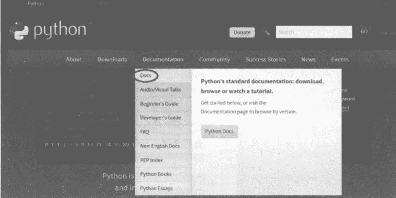

图 4-21 登录 Python 的官网

进入后点 “Python Docs”，如图 4-22。
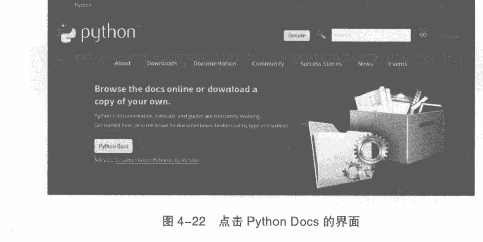

图 4-22 点击 Python Docs 的界面

在语言选项中切换为简体中文 Simplified Chinese，然后进入标准库参考，左侧可选择不同 Python 版本，如图 4-23。
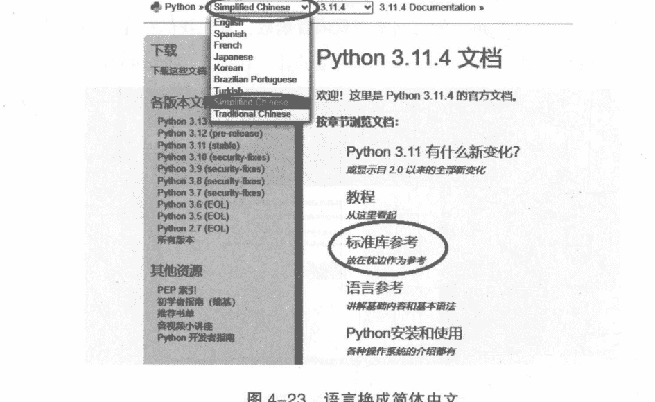

图 4-23 语言换成简体中文

进入后点击内置函数，即可浏览完整列表，点击单个函数还能查看详细说明，如图 4-24、图 4-25。


### 内置函数
Python 解释器自带大量函数和类型，随时可用。以下按字母顺序给出列表。

| 内置函数 | | | |

| --- | --- | --- | --- |

| A | E | L | R |

| abs() | enumerate() | len() | range() |

| aiter() | eval() | list() | repr() |

| all() | exec() | locals() | reversed() |

| any() | | | round() |

| anext() | F | M | |

| ascii() | filter() | map() | S |

| | float() | max() | set() |

| B | format() | memoryview() | setattr() |

| bin() | frozenset() | min() | slice() |

| bool() | | | sorted() |

| breakpoint() | G | N | staticmethod() |

| bytearray() | getattr() | next() | str() |

| bytes() | globals() | | sum() |

| | | O | super() |

| C | H | object() | |

| callable() | hasattr() | oct() | T |

| chr() | hash() | open() | tuple() |

| classmethod() | help() | ord() | type() |

| compile() | hex() | | |

| complex() | | P | V |

| | I | pow() | vars() |

| D | id() | print() | |

| delattr() | input() | property() | Z |

| dict() | int() | | zip() |

| dir() | isinstance() | | |

| divmod() | issubclass() | | __import__() |

| | iter() | | |

### 常用内置函数
max()、min()、sum() 的使用见图 4-26，注意 sum() 当数据多于两个时需用中括号 [] 包裹。
```python
[37]:
print(max(5,2,3))
print(min(5,2,3))
print(sum([5,2,3]))
```

```
5
2
10
```

图 4-26 最大值函数、最小值函数、求和函数

abs() 的使用见图 4-27。
```python
[39]:
abs(-3)
```

```
3
```

图 4-27 绝对值函数

len() 的使用见图 4-28。
```python
[43]:
print(len('你好我好大家好'))
print(len(['你好','我好','大家好']))
```

```
7
3
```

图 4-28 长度函数

int()、float() 的使用见图 4-29。
```python
[45]:
print(int(2.333))
print(float(2))
```

```
2
2.0
```

图 4-29 数字类型函数

str()、bool() 的使用见图 4-30。
```python
[48]:
a = 3
b = '公斤'
print(str(a)+b)
```

```
3公斤
```

```python
[49]:
print(bool(0))
print(bool(1))
```

```
False
True
```

图 4-30 转换字符串函数、布尔函数

range() 生成等差整数序列，含步长与不含步长的示例见图 4-31、图 4-32。
```python
[8]:
for i in range(0,6):
    print(f'{i}')
```

```
0
1
2
3
4
5
```

图 4-31 不带步数的函数 range()

```python
[9]:
for i in range(0,10,2):
    print(f'{i}')
```

```
0
2
4
6
8
```

图 4-32 带步数的函数 range()

对可迭代对象逐项遍历并给出序号与对应值的工具 enumerate()，示意如图 4-33。

```python
[12]:
y = input('请输入你想找到的颜色：')
M = ['黑色','橙色','黄色','红色','绿色','蓝色']
for i,a in enumerate(M):
    if a == y:
        print(f'{i}已找到{y}!!!')
    else:
        print(f'{i}未找到{y}...')
print('查找完成')
```

```
请输入你想找到的颜色： 红色
0未找到红色...
1未找到红色...
2未找到红色...
3已找到红色!!!
4未找到红色...
5未找到红色...
查找完成
```

图 4-33 函数 enumerate()

获取对象身份标识的 id() 如图 4-34 所示。


图 4-34 地址函数

从终端读取用户输入的 input() 如图 4-35 所示。


图 4-35 输入函数

## 4.3 序列与列表

### 序列是什么

前面接触过数字、文本、变量这类基础类型，它们只能容纳相对简单的单一数据。当面对成千上万条需要统一存放的信息时，就要借助复合类型。Python 提供的复合类型主要有列表 list、元组 tuple、字典 dict、集合 set，它们像容器一样可以装入各种类型的数据，且容器之间还能相互嵌套。

序列可以类比排队，每个队伍由若干成员构成，成员即元素，成员总数即长度，排位即索引，特别注意索引从 0 开始计数。

### 序列的三大要素

序列具备索引 index、长度 len、元素 item 三大特性。

### 序列的底层存储

序列内部采用连续的顺序存储，占用一块相邻的内存区，元素紧挨着存放，位置有序，因而随机访问效率高。但因为是连续空间，插入或删除元素时往往需要搬移后续数据以维持连续性。

### 列表概述

列表属于序列的一种，允许存放任意类型的对象，并且保持存放顺序。

列表的构造方式有多种：

```python
stu0 = []
stu1 = ['张三','李四','王五','赵六']
stu2 = list(['张三','李四','王五','赵六'])
```

### 列表特点

- （1）列表大小可动态伸缩，内存会按需自动扩容或回收。
- （2）作为复合序列，列表能容纳任意类型的数据，甚至可以包含其它列表。
- （3）支持运行时增删改等动态操作。

### 列表常用操作

列表的基础用法涵盖新建、增删、查找、反转、遍历、判断等，这些本质都是方法，即可调用的函数，需要熟练掌握。

（1）新建列表，如图 4-36 所示。

```python
[ ]:
stu0 = []
stu1 = ['张三','李四','王五','赵六']
stu2 = list(['张三','李四','王五','赵六'])
```

图 4-36 创建列表

（2）向列表添加元素有两种常见做法。一种是 .append( 元素 )，把新元素放到尾部，如图 4-37 所示。

```python
[61]:
stu0 = []
stu0.append('张三')
print(stu0)
```

```
['张三']
```

```python
[62]:
stu0 = ['张三','李四','王五']
stu0.append('张三')
print(stu0)
```

```
['张三', '李四', '王五', '张三']
```

图 4-37 列表 .append( 元素 )

另一种是 .insert( 索引 , 元素 )，需要指定插入位置的下标，如图 4-38 所示。

```python
[63]:
stu0 = ['张三','李四','王五']
stu0.insert(0,'赵六')
print(stu0)
```

```
['赵六', '张三', '李四', '王五']
```

```python
[64]:
stu0 = ['张三','李四','王五']
stu0.insert(2,'赵六')
print(stu0)
```

```
['张三', '李四', '赵六', '王五']
```

图 4-38 列表 .insert( 索引 , 元素 )

注意：调用时须使用英文半角符号。

(3) 读取与修改元素。列表可通过下标访问，取出指定位置的内容，如图 4-39 所示，注意括号用法。

```python
[65]:
stu0 = ['张三','李四','王五','赵六']
print(stu0[2])
```

```
王五
```

图 4-39 使用访问索引 (index)

也可以通过下标配合赋值修改元素内容，如图 4-40 所示。

```python
[66]:
stu0 = ['张三','李四','王五','赵六']
stu0[2] = '小明'
stu0
```

```
['张三', '李四', '小明', '赵六']
```

图 4-40 修改元素

(4) 删除元素同样有两种手段。一种是 .pop()，默认移除末尾一项并返回其值；也可传入下标 .pop( 索引 ) 指定删除位置，如图 4-41 所示。

```python
[67]:
stu0 = ['张三','李四','王五','赵六']
stu0.pop()
stu0
```

```
['张三', '李四', '王五']
```

```python
[68]:
stu0 = ['张三','李四','王五','赵六']
stu0.pop(0)
stu0
```

```
['李四', '王五', '赵六']
```

图 4-41 列表 .pop() 删除元素

另一种是 .remove( 元素 )，按值删除首次匹配项，若找不到会抛出 ValueError，如图 4-42 所示。

```python
[69]:
stu0 = ['张三','李四','王五','赵六']
stu0.remove('王五')
stu0
```

```
['张三', '李四', '赵六']
```

```python
[70]:
stu0 = ['张三','李四','王五','赵六']
stu0.remove('小明')
stu0
```

```
ValueError Traceback (most recent call last)
Cell In[70], line 2
      1 stu0 = ['张三','李四','王五','赵六']
----> 2 stu0.remove('小明')
      3 stu0

ValueError: list.remove(x): x not in list
```

图 4-42 列表 .remove( 元素 ) 删除元素

（5）排序、清空与翻转。sort() 可对列表排序，默认升序，可借助 reverse 参数反转顺序；clear() 能清空全部内容，如图 4-43 所示。

```python
[71]:
stu0 = [9,8,5,1,14]
stu0.sort()
stu0
```

```
[1, 5, 8, 9, 14]
```

```python
[7]:
stu0 = [9,8,5,1,14]
stu0.sort(reverse = True)
stu0
```

```
[14, 9, 8, 5, 1]
```

```python
[8]:
stu0 = [9,8,5,1,14]
stu0.clear()
stu0
```

```
[]
```

图 4-43 对列表进行排序、翻转、清除

（6）成员检测。可用 in 与 not in 判断元素是否存在，返回布尔值；in 为真表示存在，not in 为真表示不存在，如图 4-44 所示。

```python
[9]:
stu0 = ['张三','李四','王五','赵六']
print('张三' in stu0)
```

```
True
```

```python
[10]:
stu0 = ['张三','李四','王五','赵六']
print('小明' in stu0)
```

```
False
```

```python
[11]:
stu0 = ['张三','李四','王五','赵六']
print('小明' not in stu0)
```

```
True
```

```python
[13]:
stu0 = ['张三','李四','王五','赵六']
print('李四' not in stu0)
```

```
False
```

图 4-44 列表元素的检测

还可以用 while 循环配合 if 实现手动查找，如图 4-45 所示。

```python
stu0 = ['张三','李四','王五','赵六']
while 1:
    a = input('请输入想要查找的名字：')
    if a in stu0:
        print(f'{a}在列表中')
    elif a == '结束':
        print('已终止程序')
        break
    else:
        print(f'{a}不在列表中')
print('结束')
```

请输入想要查找的名字：小明

小明不在列表中

请输入想要查找的名字：小虎

小虎不在列表中

请输入想要查找的名字：王五

王五在列表中

请输入想要查找的名字：结束

已终止程序

结束

图 4-45 使用 while 循环和 if 语句编写检测程序

（7）遍历列表有两种思路。一种是 for ... in 直接遍历元素，如图 4-46 所示。

```python
stu0 = ['张三','李四','王五','赵六']
for a in stu0:
    print(a)
```

张三

李四

王五

赵六

```python
stu0 = ['张三','李四','王五','赵六']
for i,a in enumerate(stu0):
    print(i,a)
```

0 张三

1 李四

2 王五

3 赵六

图 4-46 使用 for in 的遍历

另一种是借助下标循环，类似 C 语言风格，如图 4-47 所示。

```python
stu0 = ['张三','李四','王五','赵六']
stu_len = len(stu0)
for index in range(stu_len):
    print(stu0[index])
```

张三

李四

王五

赵六

```python
stu0 = ['张三','李四','王五','赵六']
长度 = len(stu0)
for 索引 in range(长度):
    print(stu0[索引])
```

张三

李四

王五

赵六

图 4-47 使用索引的遍历

（8）列表内置函数。max() 取最大值，min() 取最小值，count() 统计出现次数等，如图 4-48 所示。

```python
stu0 = ['张三','李四','王五','张三','赵六']
print(stu0.count('张三'))
print(stu0.count('李四'))
print(stu0.count('小明'))
```

2

1

0

```python
stu0 = [9,8,5,1,14]
print(max(stu0))
print(min(stu0))
```

14

1

图 4-48 列表的函数

（9）列表拼接。可用 + 实现合并，* 实现重复，如图 4-49 所示。

```python
stu0 = [9,8,5]
stu1 = ['张三','李四']
stu2 = stu0 + stu1
print(stu2)
```

[9, 8, 5, '张三', '李四']

```python
stu0 = ['张三','李四']
stu1 = stu0 * 3
print(stu1)
```

['张三', '李四', '张三', '李四', '张三', '李四']

```python
stu0 = ['张三','李四']
stu0 *= 3
print(stu0)
```

['张三', '李四', '张三', '李四', '张三', '李四']

图 4-49 列表之间的拼接

## 4.4 元组、字典和集合的概念与简单操作

### 元组

1. 元组概念

元组也是内置序列，和列表相似但不可变，赋值完成后不能修改。因此处理固定数据时更适合元组，频繁变化的数据更常用列表。

2. 元组构造方法

tp1 = ('张三','李四')

tp2 = (10,20,30)

tp3 = (10,)

注意：元组使用圆括号 () 表示，单元素元组必须在元素后加英文逗号，否则会被当作普通变量；元组与列表可互相转换，tuple() 转为元组，list() 转为列表，如图 4-50 所示。

```python
stu0 = ['张三']
tp1 = tuple(stu0)
print(tp1)
```

('张三',)

```python
tp1 = (2,)
stu1 = list(tp1)
print(stu1)
```

[2]

图 4-50 元组和列表的相互转换

3. 元组基本操作

元组元素不可改，但支持拼接和成员检测，方法和列表一致，相关函数也相同，如图 4-51、图 4-52 所示。

```python
tp0 = ('张三','李四')
tp1 = (2,3,5)
tp2 = tp0 + tp1
print(tp2)
```

('张三', '李四', 2, 3, 5)

```python
tp0 = ('张三','李四')
tp1 = tp0 * 3
print(tp1)
```

('张三', '李四', '张三', '李四', '张三', '李四')

```python
tp0 = ('张三','李四')
tp0 *= 3
print(tp0)
```

('张三', '李四', '张三', '李四', '张三', '李四')

图 4-51 元组的拼接

```python
tp1 = ('张三','李四','王五','赵六')
for i,a in enumerate(tp1):
    print(i,a)
```

0 张三

1 李四

2 王五

3 赵六

```python
a = input('请输入想要查找的名字：')
tp1 = ('张三','李四','王五','赵六')
if a in tp1:
    print(f'{a}在元组中')
else:
    print(f'{a}不在元组中')
print('结束')
```

请输入想要查找的名字：李四

李四在元组中

结束

图 4-52 元组的元素检测和元组的函数

```python
tp1 = ('张三','李四','王五','张三','赵六')
print(tp1.count('张三'))
```

2

```python
tp1 = (9,8,5,1,14)
print(max(tp1))
print(min(tp1))
```

14

1

图 4-52 （续）

### 字典

1. 字典概念

字典采用键值对形式，类似两列表格，例如班级身高表，如表 4-1。

表 4-1 键值对表格

| key | value |

|---|---|

| 小明 | 178 |

| 小红 | 166 |

| 张三 | 181 |

| 李四 | 167 |

注意：key 为键，不能重复，value 为对应值，通过 key 检索更高效。

2. 字典构造方式

常见做法有两种，第一种直接用花括号，如下：

```python
d1 = {'小明':178,'小红':166,'张三':181,'李四':167}
```

第二种借助 dict() 构造，如下：

```python
d2 = dict({'小明':178,'小红':166,'张三':181,'李四':167})
```

注意：花括号 {} 内部以 key:value 形式书写。

3. 字典特性

- （1）字典元素无序，依赖 key 查找，顺序不重要。
- （2）键不可重复。
- （3）键一旦创建不可更改，但可新增键值对。
- （4）大小可变，支持动态增删。

4. 字典基本操作

字典的操作和列表类似，包含创建、访问、修改、遍历、增删、判断等。

创建方式多样，可用 {}、dict()、dict({})、fromkeys()，其中 fromkeys() 可把序列转为字典，如图 4-53、图 4-54 所示。

```python
a = {}
print(type(a))
```

<class 'dict'>

```python
d1 = dict()
print(type(d1))
```

<class 'dict'>

图 4-53 用花括号和 dict() 构造字典

```python
a = ['你好','我好']
b = dict.fromkeys(a)
print(type(b))
print(b)
```

<class 'dict'>

{'你好': None, '我好': None}

图 4-54 fromkeys() 把序列转成字典

type() 能判断括号里对象的类型。上例里 a 的类型显示为 dict，说明它是字典，这种写法同样适用于其他创建方式，如图 4-55 所示。

```python
a = []
print(type(a))
```

<class 'list'>

```python
a = ()
print(type(a))
```

<class 'tuple'>

图 4-55 用 type() 判断数据类型

字典新增元素可以直接写 字典名['key'] = 'value'，示例如图 4-56。

```python
a = {}
a['中国'] = '你好'
a['世界'] = '你也好'
print(a)
```

{'中国': '你好', '世界': '你也好'}

图 4-56 为字典追加键值对

修改已有键值的做法和添加几乎一样，只要重新赋值即可，如图 4-57。

```python
a = {'中国': '你好', '世界': '你也好'}
a['世界'] = '你们好啊'
print(a)
```

{'中国': '你好', '世界': '你们好啊'}

图 4-57 修改字典中的值

删除元素主要有三种写法：

（1）字典名.pop('key')，键存在时直接删掉并返回对应值，键不存在会抛异常，如图 4-58。

```python
a = {'中国': '你好', '世界': '你也好'}
a.pop('世界')
```

'你也好'

```python
a = {'中国': '你好', '世界': '你也好'}
a.pop('世界')
print(a)
```

{'中国': '你好'}

```python
a = {'中国': '你好', '世界': '你也好'}
a.pop('火星')
print(a)
```

KeyError: Traceback (most recent call last)

Cell In[17], line 2

      1 a = {'中国': '你好', '世界': '你也好'}

----> 2 a.pop('火星')

      3 print(a)

KeyError: '火星'

图 4-58 使用 pop('key') 删除键值对

（2）字典名.pop('key', None)，键不存在时不会报错而是返回 None，如图 4-59。

```python
a = {'中国': '你好', '世界': '你也好'}
a.pop('火星',None)
print(a.pop('火星',None))
```

None

图 4-59 使用 pop('key', None) 安全删除

（3）字典名.popitem()，会弹出最后插入的那一对键值并返回，如图 4-60。

```python
a = {}
a['中国'] = '你好'
a['世界'] = '你也好'
a.popitem()
```

('世界', '你也好')

```python
a = {}
a['中国'] = '你好'
a['世界'] = '你也好'
a.popitem()
print(a)
```

{'中国': '你好'}

图 4-60 用 popitem() 移除末尾项

读取元素常用 字典名.get('key')，执行后会得到对应的 value，如图 4-61。

```python
a = {'中国': '你好', '世界': '你也好'}
a.get('中国')
print(a.get('中国'))
```

你好

```python
a = {'中国': '你好', '世界': '你也好'}
a.get('中国')
```

'你好'

```python
a = {'中国': '你好', '世界': '你也好'}
print(a.get('中国'))
```

你好

图 4-61 通过 get 访问字典元素

keys()、values() 能把字典的键和值分别以视图形式给出，配合遍历就能批量处理，如图 4-62。

```python
a = {'中国': '你好', '世界': '你也好'}
a.keys()
```

dict_keys(['中国', '世界'])

```python
a = {'中国': '你好', '世界': '你也好'}
a.values()
```

dict_values(['你好', '你也好'])

```python
a = {'中国': '你好', '世界': '你也好'}
for m in a.keys():
    print(m)
```

中国

世界

```python
a = {'中国': '你好', '世界': '你也好'}
for n in a.values():
    print(n)
```

你好

你也好

图 4-62 keys() 与 values() 的使用

items() 会把键值对以元组形式打包进视图，便于一次性拿到两者，如图 4-63。

```python
a = {'中国': '你好', '世界': '你也好'}
a.items()
```

dict_items([('中国', '你好'), ('世界', '你也好')])

```python
a = {'中国': '你好', '世界': '你也好'}
for m,n in a.items():
    print(m,n)
```

中国 你好

世界 你也好

图 4-63 items() 返回键值对

遍历字典既可以用 items() 拿到完整对，也可以直接 for in 拿键再取值，效果如图 4-64。

```python
a = {'中国': '你好', '世界': '你也好'}
for m in a:
    print(m)
```

中国

世界

```python
a = {'中国': '你好', '世界': '你也好'}
for m in a:
    print(a.get(m))
```

你好

你也好

```python
a = {'中国': '你好', '世界': '你也好'}
for m in a:
    print(m, a.get(m))
```

中国 你好

世界 你也好

图 4-64 直接用 for in 遍历字典

判断键是否存在可以用 in、not in，返回布尔值，如图 4-65。

```python
a = {'中国': '你好', '世界': '你也好'}
'世界' in a
```

True

```python
a = {'中国': '你好', '世界': '你也好'}
'火星' in a
```

False

```python
a = {'中国': '你好', '世界': '你也好'}
if '火星' in a:
    print('在')
else:
    print('不在')
```

不在

```python
a = {'中国': '你好', '世界': '你也好'}
if '世界' in a:
    print('在')
else:
    print('不在')
```

在

图 4-65 用 in 和 not in 检查键

len() 返回元素个数，clear() 把字典清空成空字典，sorted() 对键进行排序后返回列表，如图 4-66。

```python
a = {'小明': '优秀', '小红': '良好', '小张': '及格', '小王': '不及格'}
print(len(a))
```

4

```python
a = {'小明': '优秀', '小红': '良好', '小张': '及格', '小王': '不及格'}
a.clear()
print(a)
```

{}

```python
a = {'小明': '优秀', '小红': '良好', '小张': '及格', '小王': '不及格'}
print(sorted(a))
```

['小张', '小明', '小王', '小红']

```python
a = {'c': '5', 'b': '7', 'd': '6', 'e': '4'}
print(sorted(a))
print(a)
```

['b', 'c', 'd', 'e']

{'c': '5', 'b': '7', 'd': '6', 'e': '4'}

图 4-66 len()、clear()、sorted() 的示例

### 集合基础

1. 集合的概念
集合是可存放元素的容器，特点是元素不重复且顺序不固定。常用操作有检测、增删、去重，对象还支持并集、交集、差集、对称差等数学运算。

2. 集合的创建方式
创建集合可以用 set() 或直接用大括号 {}。注意空集合不能写成 {}，空大括号会被解释为字典，正确写法是 set()。

```python
c = {'小明', '小红', '小兰'}
c = set()
c = set(['小明', '小红', '小兰'])
```

### 3. 集合的特征
- （1）元素排列无顺序。
- （2）元素不允许重复。
- （3）大小可以动态变化。
- （4）支持合集、交集等运算。

### 4. 集合的存储原理
把 1000 万条数据放在列表里查询，需要逐条对比，最坏要遍历 1000 万次，效率很低。若放到集合里，借助哈希算法先把元素分桶，比如分成 1 万个桶，每个桶约 1000 个元素，查询时先算哈希定位到桶，再在桶内查找，最多 1000 次。形象地说就像图书馆先按类别找书架再找书。字典的每个 key 本质也是一个桶，所以查字典远快于查列表。

### 5. 集合的简单操作
元素添加可用 集合名.add('元素')，批量添加列表可用 集合名.update(['元素'])，删除可用 remove 或 discard，如图 4-67、图 4-68。

```
[42]: c = set()
c.add('小明')
c
[42]: {'小明'}

[45]: c = {'小红'}
c.add('小明')
c
[45]: {'小明', '小红'}

[46]: c = {'小明', '小红'}
c.remove('小红')
c
```

图 4-67 集合元素的增删示例

```
[49]: c = {'小明', '小红'}
c.discard('小红')
c
[49]: {'小明'}

[48]: c = set()
c.update([1,2,3,3,3,4,5])
c
[48]: {1, 2, 3, 4, 5}
```

图 4-68 集合元素的增删示例

从图 4-68 可看出，update 后重复的 3 只保留一份，体现了无重复特性。

Python 集合支持数学运算：
（1）集合名.difference(其他集合) 找不同元素，如图 4-69。
（2）集合名.intersection(其他集合) 求交集，如图 4-70。

```
[54]: a = {1,2,3}
b = {2,3,4}
a.intersection(b)

[54]: {2, 3}
```

图 4-70 intersection() 示例

（3）集合名.union(其他集合) 求并集，如图 4-71。

```
[55]: a = {1,2,3}
b = {2,3,4}
a.union(b)

[55]: {1, 2, 3, 4}
```

图 4-71 union() 示例

（4）集合名.difference_update(其他集合) 原地删除在另一集合中出现过的元素，如图 4-72。

```
[59]: a = {1,2,3,9,7}
b = {2,3,4}
a.difference_update(b)
a

[59]: {1, 7, 9}
```

图 4-72 difference_update() 示例

（5）集合名.intersection_update(其他集合) 原地保留两集合共同部分，如图 4-73。

```
[60]: a = {1,2,3,9,7}
b = {2,3,4}
a.intersection_update(b)
a
[60]: {2, 3}
```

图 4-73 intersection_update() 示例

## 4.5 推导式、函数注解与冒泡排序

### 推导式
列表、元组、字典、集合都支持推导式，能快速生成新结构。基本形式是 输出 for 变量 in 可迭代对象，必要时可加 if 条件，也可嵌套。

### 推导式示例
（1）列表推导式示例如图 4-74。

```
[63]: a = [n for n in range(7)]
a
[63]: [0, 1, 2, 3, 4, 5, 6]
[65]: a = [n for n in range(7) if n % 2 == 1]
a
[65]: [1, 3, 5]
```

图 4-74 列表推导式示例

（2）元组推导式示例如图 4-75。注意结果是生成器，会在迭代时才计算。

```
[66]: a = (n for n in range(7))
a
[66]: <generator object <genexpr> at 0x000001B024811AF0>
[67]: a = (n for n in range(7))
type(a)
[67]: generator
```

图 4-75 元组推导式示例

（3）字典推导式示例如图 4-76。

```
[69]: a = {'m'+str(n):n for n in range(7)}
a
[69]: {'m0': 0, 'm1': 1, 'm2': 2, 'm3': 3, 'm4': 4, 'm5': 5, 'm6': 6}
```

图 4-76 字典推导式示例

（4）集合推导式示例如图 4-77。

```
[70]: a = {n for n in range(7)}
a
[70]: {0, 1, 2, 3, 4, 5, 6}
```

图 4-77 集合推导式示例

### 函数注解
在大型项目里，函数参数类型不统一容易埋 bug。函数注解可以在定义时声明参数和返回值的类型，调用时就能提前发现不匹配，提升健壮性。格式如图 4-78。

```
[72]: def 求和(a:int,b:int) -> int:
        return a + b
```

图 4-78 函数注解写法示例

上面示例定义了求和函数，并限定输入输出均为整型。

### 冒泡排序
冒泡排序每次把最大值冒到最右侧。先比较相邻两数，大的往后放，循环结束后最大值在队尾；再对剩余部分重复，直至排完。以 [3,2,5] 为例，先把 3 和 2 调换，再把 3 和 5 调换，第一轮结束得到 [2,3,5]，再对前两数处理即可。

纯数字列表的冒泡排序实现示例如图 4-79 所示。

```
[73]: a = [3,2,5,4]
a_len = len(a)
for n in range(len(a)):
    for m in range(a_len - n - 1):
        if a[m] > a[m + 1]:
            a[m],a[m + 1] = a[m + 1],a[m]
print(a)
[2, 3, 4, 5]
```

```
[74]: def 排序(a):
    a_len = len(a)
    for n in range(len(a)):
        for m in range(a_len - n - 1):
            if a[m] > a[m + 1]:
                a[m],a[m + 1] = a[m + 1],a[m]
    return a
print(排序([59,45,23,78,56,1,8,9,2]))
[1, 2, 8, 9, 23, 45, 56, 59, 78]
```

图 4-79 冒泡排序处理纯数字列表的示例

### 在线逐行分析工具 Tutor

想要把代码的执行过程拆开看清楚，Tutor 是一个很合适的在线分析平台，它能把每一步的变化都呈现出来，理解起来会轻松很多。直接在网页搜索 Python Tutor 即可进入官网，如图 4-80。


进入官网后，把需要检查的代码复制到输入框里，点击运行即可开始，如图 4-81。


运行后页面会随之变化，点击任意代码行就相当于在该行设置断点。按 Next 逐步执行时，左侧会出现绿红两支指示箭头，绿色代表刚执行完的那一行，红色代表即将要执行的那一行；右侧则以文字说明配合图表同步展示当前运行状态，如图 4-82。


图 4-82 Tutor 工具运行示例

# 第 5 章 Python 数据结构应用与类入门


## 5.1 序列常用操作及数据类型可变性

### 序列的正负索引

先前学习过从左往右数索引，从 0 开始到最后一个元素，这就是正向索引。也可以从右往左数，-1 对应最末位，-2 对应倒数第二位，依此类推，这就是负向索引，如图 5-1。

```
[15]: a = ['小明','小刚','小红','小兰','小新','小黑']
print(a[5])
print(a[-1])

小黑
小黑
```

图 5-1 序列的正负操作

从图 5-1 可以看出，要取出列表里的“小黑”，它在最右边，正向索引是 5，负向索引是 -1。正负索引结合使用，能更便捷地取到靠近两端的元素。

### 序列的切片操作

切片可以理解为从一个容器里截取一段连续元素。

开始索引指截取起点，留空则默认从 0 开始；结束索引指截取终点，结束位置的元素不包含在结果中，留空则默认到末尾；步长决定遍历方向，正数从左到右，负数从右到左，留空默认 1。切片本质是浅拷贝，写法为：

序列 [ 开始索引 : 结束索引 : 步长 ]

示例如图 5-2。

```
[31]: a = ['小明', '小刚', '小红', '小兰', '小新', '小黑']
print(a[:])
print(a[1:5])
print(a[1:5:2])
print(a[-1:-5:-1])
print(a[-1:-5:-2])
print(a[0:-1])
print(a[0:-1:2])
print(a[-1:0:-2])

['小明', '小刚', '小红', '小兰', '小新', '小黑']
['小刚', '小红', '小兰', '小新']
['小刚', '小兰']
['小黑', '小新', '小兰', '小红']
['小黑', '小兰']
['小明', '小刚', '小红', '小兰', '小新']
['小明', '小红', '小新']
['小黑', '小兰', '小刚']
```

图 5-2 序列的切片

### 不可变数据类型

给变量 a 赋值为 a = 1 时，Python 会把数字 1 放在某块内存，a 指向该地址。再把 a 改为 a = 2 时，2 会被分配到另一块新内存，a 的指向随之改变，原来的 1 内存保持不变。

数字、字符串等都属于不可变类型，用 id() 可以直观看到地址变化，如图 5-3。

```
[32]: a = 1
print(id(a))
a = 2
print(id(a))

2143554306288
2143554306320
```

图 5-3 不可变数据类型地址示例

### 可变数据类型

可变类型可以在原内存位置直接修改内容，不需要重新分配内存。列表、字典、集合等都属于此类，可用 id() 查看地址是否保持一致，如图 5-4。

```
[35]: a = ['小明','小黑']
print(id(a))
a[0] = '小红'
print(id(a))

2143665860672
2143665860672
```

图 5-4 可变数据类型地址示例

### 不可变与可变类型的传递差异

把数据传入函数时，两种类型的行为不同。不可变类型是值传递，先复制一份副本进入函数，函数内部的修改只影响副本，原数据不变。

可变类型是引用传递，直接把原数据的引用传进去，函数内修改会作用于原数据本身，所以外部也能看到变化，如图 5-5。

```
[39]: 名字 = '小明'
技能 = ['篮球','跳舞','rap']
def 函数(名字,技能):
    名字 = '小黑'
    技能[0] = '足球'
    print('内部:',名字,技能)
函数(名字,技能)
print('外部:',名字,技能)

内部: 小黑 ['足球', '跳舞', 'rap']
外部: 小明 ['足球', '跳舞', 'rap']
```

图 5-5 引用传递

从图 5-5 的程序可以看到，调用函数后变量“名字”未变，而变量“技能”发生了改变，这正体现了两种类型的传递差异。

## 5.2 浅拷贝与深拷贝、栈与队列

### 浅拷贝

浅拷贝只支持可变类型，不可变类型不支持。通过 copy 模块的 copy() 函数实现，它会把容器复制到新地址，有时能避免意外关联，如图 5-6。

```
[45]: a = ['小明', '小红', '小刚']
b = a
print(id(a))
print(id(b))
b[0] = '小黑'
print(b)
print(a)

2143666034496
2143666034496
['小黑', '小红', '小刚']
['小黑', '小红', '小刚']
```

图 5-6 拷贝错误使用示例

图 5-6 中变量 a 是一个列表，把 a 直接赋给 b，a 和 b 指向同一地址，修改 b 也会改动 a。用浅拷贝给 b 赋值后，两者地址分离，如图 5-7。

```
[46]: a = ['小明','小红','小刚']
b = a.copy()
print(id(a))
print(id(b))
b[0] = '小黑'
print(b)
print(a)

2143665726400
2143665902656
['小黑', '小红', '小刚']
['小明', '小红', '小刚']
```

图 5-7 浅拷贝使用示例

需要注意，浅拷贝对容器内部的可变元素只复制地址，不会递归复制。如图 5-8。

```
[52]: a = [['唱歌'],'小红','小刚','小牛','小金']
b = a.copy()
b[0][0] = '跳舞'
b[4] = 0
print(b)
print(a)

[['跳舞'], '小红', '小刚', '小牛', 0]
[['跳舞'], '小红', '小刚', '小牛', '小金']
```

图 5-8 拷贝的是内存地址

图 5-8 中 a 的第一个元素是一个列表，其余是字符串。浅拷贝后修改 b 的索引 0 元素内部的列表，a 的对应列表也被改变；而修改 b 的最后一个不可变字符串元素，a 不受影响。

### 深拷贝

深拷贝会另起全新内存区域，无论元素是可变还是不可变都完整复制，互不影响。需要使用 copy 模块的 deepcopy()，用法如图 5-9。

```
[53]: import copy
a = [['唱歌'],'小红','小刚','小牛','小金']
b = copy.deepcopy(a)
b[0][0] = '跳舞'
b[4] = 0
print(b)
print(a)

[['跳舞'], '小红', '小刚', '小牛', 0]
[['唱歌'], '小红', '小刚', '小牛', '小金']
```

图 5-9 深拷贝使用示例

### 栈结构 LIFO

栈是最常用的数据结构之一，和列表类似但操作受限。入栈叫 push，出栈叫 pop，只能在栈顶操作。形象地说只能从一端进出。

可用列表模拟，右端作栈顶，左端作栈底，append 实现入栈，pop 实现出栈，如图 5-10。

```
[55]: m = []
m.append('小明')
m.append('小红')
m.append('小黑')
print(m)
n = m.pop()
print(n)
print(m)
['小明', '小红', '小黑']
小黑
['小明', '小红']
```

图 5-10 栈结构的使用示例

从图 5-10 可见，先后加入的元素最后加入的是“小黑”，它位于栈顶，出栈时最先被取出。

### 队列

队列遵循先进先出原则，像排队取号，先进入的先离开。可用列表实现，append 在队尾加入，pop(0) 从队头取出，如图 5-11。

```
[57]: m = []
m.append('张三')
m.append('李四')
m.append('王五')
m.append('赵六')
print(m)
n = m.pop(0)
print(n)
print(m)
['张三', '李四', '王五', '赵六']
张三
['李四', '王五', '赵六']
```

图 5-11 队列的使用示例

当元素很多时，pop(0) 会让后面所有元素前移，效率不高。

如果一个函数在内部调用自己，就是递归函数，作用类似 while 循环。图 5-12展示了递归的执行追踪。

```
[6]: 1 import time
2 def hs(n):
3     n -= 1
4     if n >= 0:
5         print(n)
6         time.sleep(1)
7         return hs(n)
8 hs(3)
2
1
0
```

图 5-12 递归函数使用示例

```
[12]:
1 import time
2 def hs(n):
3     n -= 1
4     if n >= 0:
5         hs(n)
6     print(n)
7     time.sleep(1)
8 hs(3)

-1
0
1
2
```

图 5-12 （续）

以图 5-12 中第二个程序为例，入栈、出栈过程如下。

入栈过程：

- （1）hs(3) 先入栈，n 变为 2，满足条件继续入栈。
- （2）hs(2) 入栈，n 变为 1，继续入栈。
- （3）hs(1) 入栈，n 变为 0，继续入栈。
- （4）hs(0) 入栈，n 变为 -1，不再满足条件，入栈结束。

出栈过程从栈顶开始：

- （1）hs(0) 先出栈，n 为 -1，不执行 if，打印 -1。
- （2）hs(1) 出栈，n 变为 0，打印 0。
- （3）hs(2) 出栈，n 变为 1，打印 1。
- （4）hs(3) 出栈，n 变为 2，打印 2。

用 debug 逐步观察能更清晰地看到每一步的变化。

### 实现一个名单管理系统

结合前面所学知识，可以写一个简单的学生名单管理程序，实现增、删、改、查功能，示例如图 5-13。

```
[*]:
    lb = []
    q = '请输入姓名'
    def panduan(shuzi:str) -> int:
        if shuzi.isdigit():
            return int(shuzi)
        else:
            print('输入错误请重新输入！')
            return 8

    def tianjia(stus:list):
        name = input(q)
        stus.append(name)

    def chaxun(stus:list) -> list:
        name = input(q)
        xlb = []
        for m,n in enumerate(stus):
            if n == name:
                xlb.append(q)
                print(f'{n:>8}{m:>8}')
        return xlb

    def shanchu(stus:list) -> bool:
        name = input(q)
        stus.remove(name)

    def bianli(stus:list):
        for m, n in enumerate(stus):
            print(f'{n:>8}{m:>8}')

    while 1:
        print('请输入正确的数字选择功能：')
        print('输入1可进行添加姓名')
        print('输入2可进行查询姓名')
        print('输入3可进行删除姓名')
        print('输入4可进行遍历姓名')
        print('输入0退出程序',end = '')
        shuzi = panduan(input('请输入数字：'))
        if shuzi == 0:
            print('程序已关闭')
            break
        elif shuzi == 1:
            tianjia(lb)
        elif shuzi == 2:
            chaxun(lb)
        elif shuzi == 3:
            shanchu(lb)
        elif shuzi == 4:
            bianli(lb)
```


图 5-13 名单管理系统示例

## 5.3 编程范式演进与面向对象

编程方式的演进脉络
编程思路大致经历了三轮更迭。

第一阶段：面向机器码编程
语言诞生初期，程序员只能直接与硬件对话，用 0 和 1 撰写代码。工作量极大，于是出现了用助记符替代机器码的汇编语言。汇编语言写出的代码机器无法直接执行，因为它只认 0 和 1，所以要用 0 和 1 再写一个转换程序，让机器把汇编代码转成机器码后才能运行，这个转换程序就是汇编器。

第二阶段：面向过程编程
汇编语言比纯机器码效率大幅提升，但随着技术发展它已难以满足需求，于是出现了 C 语言。C 语言把底层的机器操作封装成函数，程序员无需手动干预内存和磁盘，直接调用现成函数即可，这才真正摆脱了对机器码的直接依赖。

第三阶段：面向对象编程
面向对象是设计程序的一种方法论。随着大型软件增多，代码量呈几何级数膨胀，改动成本也急剧上升，于是提出了面向对象编程，引入了对象、类、继承等核心概念。如今主流的 Python、C++、C#、Java 等语言均支持面向对象。

## 面向对象编程概述
前面学过基础数据类型和函数，写小规模程序足够用。但系统规模变大后，仅靠这些已不敷使用。

于是出现了面向对象编程，其核心是借鉴现实世界来构建程序，以降低复杂系统的开发难度，并支持多人协作完成大型项目。

面向对象的掌握可分为三个层次：
- 第一层次：学会一门面向对象语言，如 Java、C#，能按规范使用面向对象进行开发，但对底层原理理解尚浅；
- 第二层次：摆脱特定语言束缚，掌握面向对象的分析方法；
- 第三层次：在第二层次基础上，能进行面向对象的框架设计和可复用组件开发。

本书主要围绕第一层次展开，同时会适当涉及第二层次。

面向对象的对象是什么？
可以把对象类比成一个人。人的性别、姓名、年龄、身高等属于属性或特征；打篮球、唱歌、跳舞等属于行为，即能做什么。

举例说明：2000 年浙江出生一个孩子，和多数健康婴儿一样拥有两只眼睛、一个鼻子、一个嘴巴等特征，父母取名张伟。从出生起张伟就占用地球资源，长大后成为牙科医生，骑电动车上下班，后来成家生子，数十年后逝世。

从该例归纳：
- （1）创建对象。整个地球可看作内存，张伟就是一个对象也称实例。刚出生的张伟和其他婴儿共用一套模板，类比到程序中这套模板在 Python 里称为类，关键字是 class。
- （2）销毁对象。张伟存活期间占用资源，死亡后资源释放。对象在生命周期内占用资源，被销毁后不再占用。
- （3）对象的职责。张伟的职责是看牙，程序中每个对象都应有明确职责，无职责的对象没有存在价值。
- （4）对象之间的关系。张伟与父母是分层关系，即继承；张伟与电动车是通过行为建立的横向关系。
- （5）编程中的对象。编程里对象的属性和行为都是数据，对象本质上是属性与行为的数据集合。

在编程中，面向对象是对现实的模拟。Python、Java 等语言里，对象依据 class 建立后会占用内存，任务完成后对象被销毁，内存随之释放。

## 5.4 类的用法和实例、成员方法与成员变量

类的用法
class 本质上是一种模板，定义方式如下：

```
class 名字:
    pass
```

空类必须加上 pass 否则会报错，也可以用三个点 ... 代替，格式如下：

```
class 名字:
    ...
```

空函数同样可以用 pass 或 ...，示例如图 5-14、图 5-15 所示。

```
[1]: class 名字:

Cell In[1], line 1
    class 名字:
          ^
SyntaxError: incomplete input
```

```
[2]: class 名字:
        pass
```

```
[3]: class 名字:...
```

```
[4]: class 名字:
        ...
```

图 5-14 类的创建示例

```
[5]: def a():
        pass
```

```
[6]: def a():
        ...
```

```
[7]: def a():...
```

图 5-15 空函数的创建示例

class 命名采用驼峰命名法，单词首字母大写，如 Name、CapsLock。部分约定俗成的名称可全大写，如 WX 代表微信，OS 代表系统。

class 由属性和行为构成，其属性分两类：类属性和实例属性。以 WX 为例，属性可包括内存大小、版本、功能种类等，先看类变量，如图 5-16 所示。

```
[12]: class WX:
    intenal = '147M'
    version = '8.0.40'
    function = 6
    print(WX.intenal,WX.version)

147M 8.0.40
```

图 5-16 类变量

图 5-16 中第一行 “class WX :” 创建了名为 WX 的类，其后即为类变量。

实例的创建
在班级中，每个学生都是对象，具体到某位学生即为实例。实例通过在类名后加小括号创建，如图 5-17 所示。

```
[17]: class WX:
    pass
a = WX()
```

图 5-17 实例的创建

实例的成员方法
class 中定义的函数称为方法，主要分为内置方法和普通方法。内置方法名称前后各加两个下划线，如 __init__。__init__ 是构造方法，实例化时解释器会自动调用，可在其中完成初始化。

普通方法调用格式为：实例变量.方法名称(参数)，示例如图 5-18 所示。

```
[21]: class WX:

    def __init__(self):
        print('哈喽')

    def print(self,test):
        print(test,'好久不见')

a = WX()
a.print('朋友')

哈喽
朋友 好久不见
```

图 5-18 调用实例的方式示例

图 5-18 中 class 内定义了两个方法，一个是内置的 __init__，输出“哈喽”；另一个是普通方法，self 为默认参数，test 为可变参数，代码 a.print('朋友') 修改了 test 变量。

class 中的方法都有默认参数，通常用 self，表示实例本身，通过它可访问实例属性，也可用其他字母代替。

实例的成员变量
在类体中定义的变量即成员变量。不同实例的成员变量彼此独立，示例如图 5-19 所示。

```
[19]: class WX:

    def __init__(self,intenal,version):
        self.intenal = intenal
        self.version = version

    def print(self):
        print(self.intenal,self.version)

WX1 = WX('147M','8.0.40')
WX2 = WX('150M','8.0.42')
WX1.print()
WX2.print()

147M 8.0.40
150M 8.0.42
```

图 5-19 成员变量完全隔开示例

图 5-19 显示实例中有两个成员变量，各自赋值两次，输出结果不同，说明互不干扰。

实例之间可以相互调用，示例如图 5-20 所示。

```
[32]: class WX:

    def __init__(self,intenal,version):
        self.intenal = intenal
        self.version = version
        self.print()

    def print(self):
        print(self.intenal,self.version)

WX1 = WX('147M','8.0.40')
WX2 = WX('150M','8.0.42')

147M 8.0.40
150M 8.0.42
```

图 5-20 实例之间相互调用示例

成员变量也可直接访问或修改，如图 5-21 所示。

```
[44]: class WX:

    def __init__(self,intenal,version):
        self.intenal = intenal
        self.version = version

    def print(self):
        print(self.gs(),self.intenal,self.version)

    def gs(self):
        return '大小是' + self.intenal

WX1 = WX('147M','8.0.40')
WX2 = WX('150M','8.0.42')
print(WX1.version)

8.0.40
```

```
[43]: class WX:

    def __init__(self,intenal,version):
        self.intenal = intenal
        self.version = version

    def print(self):
        print(self.gs(),self.intenal,self.version)

    def gs(self):
        return '大小是' + self.intenal

WX1 = WX('147M','8.0.40')
WX2 = WX('150M','8.0.42')
WX1.version = 10
WX1.print()

大小是147M 147M 10
```

图 5-21 直接访问或者修改成员变量

## 静态变量与静态方法

### 1. 静态变量
静态变量可视作类变量，无需实例化即可通过类名调用，如图 5-22 所示。

```python
class Mn:
    a = 1

print(Mn.a)
Mn.a = 9
print(Mn.a)

1
9
```

图 5-22 静态变量直接调用

也可以用实例的方式调用，如图 5-23 所示。

```python
class Mn:
    a = 1

m1 = Mn()
m2 = Mn()
Mn.a = 9
print(m1.a)
print(m2.a)

9
9
```

图 5-23 采用实例的方式进行调用

图 5-23 可知，类变量对不同实例是共享的，发生变化时所有实例都会受影响，编码时需注意。

实例成员变量改变不会影响其他实例，如图 5-24 所示。

```python
class Mn:
    a = 1

    def __init__(self, shuzi):
        self.shuzi = shuzi

m1 = Mn(888)
m2 = Mn(999)

print(m1.shuzi)
print(m2.shuzi)

888
999
```

图 5-24 成员变量改变不影响其他实例

### 2. 静态方法
静态方法无需实例化即可调用，在方法上方标注 “@staticmethod” 即可，其格式如图 5-25 所示。

```python
class Abc:
    @staticmethod
    def heiha():
        print('嘿哈')

Abc.heiha()

嘿哈
```

图 5-25 静态方法可直接调用

@staticmethod 是装饰器，用它定义的方法属于静态方法。类中定义的 heiha() 并未使用默认参数 self。

若加上 self 参数，则必须先实例化后访问，如图 5-26 所示。

```python
class Mn:
    @staticmethod
    def heiha():
        print('嘿哈')

    def nihao(self):
        print('你好')

Mn.heiha()
Mn.nihao()

嘿哈

TypeError                                 Traceback (most recent call last)
Cell In[14], line 11
      8     print('你好')
     10 Mn.heiha()
---> 11 Mn.nihao()

TypeError: Mn.nihao() missing 1 required positional argument: 'self'
```

```python
class Mn:
    @staticmethod
    def heiha():
        print('嘿哈')

    def nihao(self):
        print('你好')

m1 = Mn()
m1.nihao()
Mn.nihao(m1)

你好
你好
```

图 5-26 带 self 参数访问需要实例化

## 私有属性与私有方法

前面介绍的类、实例方法与变量均可在类外访问，属于公开权限。除公开外，类和实例还存在私有方法和变量。

### 1. 私有属性
通过 dir() 函数可查看对象的公开方法和属性，示例如图 5-27 所示。

```python
class Mn:
    pass

print(dir(Mn))
['__class__', '__delattr__', '__dict__', '__dir__', '__doc__', '__eq__', '__format__', '__ge__', '__getattribute__', '__gt__', '__hash__', '__init__', '__init_subclass__', '__le__', '__lt__', '__module__', '__ne__', '__new__', '__reduce__', '__reduce_ex__', '__repr__', '__setattr__', '__sizeof__', '__str__', '__subclasshook__', '__weakref__']
```

图 5-27 dir() 函数使用示例

也可以从外部为对象新增属性，如图 5-28 所示。

```python
class Mn:
    pass

Mn.abc = 666
print(dir(Mn))
['__class__', '__delattr__', '__dict__', '__dir__', '__doc__', '__eq__', '__format__', '__ge__', '__getattribute__', '__gt__', '__hash__', '__init__', '__init_subclass__', '__le__', '__lt__', '__module__', '__ne__', '__new__', '__reduce__', '__reduce_ex__', '__repr__', '__setattr__', '__sizeof__', '__str__', '__subclasshook__', '__weakref__', 'abc']
```

图 5-28 从外部建立新的属性

对比图 5-27 与图 5-28 可见，后者末尾多出 “abc”，即外部新增属性的方式。除创建或修改类属性外，也可为实例创建属性，如图 5-29 所示。

```python
class Mn:
    pass

m1 = Mn()
m1.abc = 666
print(dir(m1))
['__class__', '__delattr__', '__dict__', '__dir__', '__doc__', '__eq__', '__format__', '__ge__', '__getattribute__', '__gt__', '__hash__', '__init__', '__init_subclass__', '__le__', '__lt__', '__module__', '__ne__', '__new__', '__reduce__', '__reduce_ex__', '__repr__', '__setattr__', '__sizeof__', '__str__', '__subclasshook__', '__weakref__', 'abc']
```

图 5-29 对实例的属性进行创建

### 2. 私有成员的命名与访问
（1）在 Python 里，只能在类内部使用的变量和方法就叫做私有成员。惯例是在标识符最前面加上两个下划线作为前缀来声明，如图 5-30 所示。

```python
class Mn:
    __abc = 666

print(Mn.__abc)

AttributeError                            Traceback (most recent call last)
Cell In[29], line 4
      1 class Mn:
      2     __abc = 666
----> 4 print(Mn.__abc)

AttributeError: type object 'Mn' has no attribute '__abc'
```

图 5-30 私有变量和私有方法的命名

从图 5-30 可以看出，类内部新增了属性，但在外部调用时却报错提示 Mn 没有属性 __abc，这说明该属性是私有的，外部无法直接使用。我们可以用 dir() 来列出 Mn 的全部属性，如图 5-31 所示。

```python
class Mn:
    __abc = 666

print(dir(Mn))
['_Mn__abc', '__class__', '__delattr__', '__dict__', '__dir__', '__doc__', '__eq__', '__format__', '__ge__', '__getattribute__', '__gt__', '__hash__', '__init__', '__init_subclass__', '__le__', '__lt__', '__module__', '__ne__', '__new__', '__reduce__', '__reduce_ex__', '__repr__', '__setattr__', '__sizeof__', '__str__', '__subclasshook__', '__weakref__']
```

图 5-31 使用 dir() 函数查看 'Mn' 的属性

图 5-31 展示的结果里没有出现 __abc，却多出了一个 _Mn__abc 的名字。Python 对私有属性做了名字改写，会在原名前面加上 _类名 的前缀。于是外部若沿用原始名字就会失败，若改用改写后的名字就能访问到，如图 5-32 所示。

```python
class Mn:
    __abc = 666

print(Mn._Mn__abc)

666
```

图 5-32 用改过之后的属性名可以访问

实例层面的私有属性创建方式与类层面一致，如图 5-33 所示。

```python
class Mn:
    def __init__(self):
        self.__abc = 666

m1 = Mn()
print(m1._Mn__abc)
print(dir(m1))

666
['_Mn__abc', '__class__', '__delattr__', '__dict__', '__dir__', '__doc__', '__eq__', '__format__', '__ge__', '__getattribute__', '__gt__', '__hash__', '__init__', '__init_subclass__', '__le__', '__lt__', '__module__', '__ne__', '__new__', '__reduce__', '__reduce_ex__', '__repr__', '__setattr__', '__sizeof__', '__str__', '__subclasshook__', '__weakref__']
```

图 5-33 实例的私有属性创建

（2）私有方法的声明也很简单，只需在方法名前面加上两个下划线即可，如图 5-34 所示。

```python
class Mn:
    def __init__(self):
        self.__abc = 666

    def __fangfa(self):
        print('私有方法')

m1 = Mn()
m1._Mn__fangfa()

私有方法
```

```python
class Mn:
    def __init__(self):
        self.__abc = 666

    def __fangfa(self):
        print('私有方法')

m1 = Mn()
m1._Mn__fangfa()
print(dir(m1))

私有方法
['_Mn__fangfa', '__class__', '__delattr__', '__dict__', '__dir__', '__doc__', '__eq__', '__format__', '__ge__', '__getattribute__', '__gt__', '__hash__', '__init__', '__init_subclass__', '__le__', '__lt__', '__module__', '__ne__', '__new__', '__reduce__', '__reduce_ex__', '__repr__', '__setattr__', '__sizeof__', '__str__', '__subclasshook__', '__weakref__']
```

图 5-34 私有方法的创建

### 3. 私有化的实际意义
使用全自动洗衣机时，用户只需按下开始等待结束，内部的加水、搅动、排水、脱水、烘干等步骤都被隐藏起来。私有变量和私有方法的作用就是把 class 的内部细节封装起来，不对外暴露。

## 面向对象的三大特征

### 1. 封装
class 代表一类事物，属性是事物的信息，方法是指对象能做什么。“封”指对外部关闭，“装”指把属性和方法打包成一个整体。class 体现了打包，但未必体现关闭。

有些信息需要对外开放，有些则必须隐藏，就像查看微信主页能看到昵称和账号，却看不到密码。想要隐藏密码这类敏感信息，就可以在属性和方法名前加上两个下划线实现封装，如图 5-35 所示。

```python
# 软件内部程序
class Yonghu:
    def __init__(self, nicheng, mima, xingbie, nianling):
        self.nicheng = nicheng
        self.__mima = mima
        self.xingbie = xingbie
        self.nianling = nianling

# 客户端程序
a = Yonghu('张三', '666888', '男', '25')

def yonghuxinxi(u: Yonghu):
    print(u.nicheng)
    print(u.__mima)
    print(u.xingbie)
    print(u.nianling)

yonghuxinxi(a)
张三
```

图 5-35 属性、方法的封装

```python
AttributeError                          Traceback (most recent call last)
Cell In[2], line 15
     12     print(u.xingbie)
     13     print(u.niamling)
---> 15     print(u.mima)

Cell In[2], line 11, in yonghuxinxi(u)
      9 def yonghuxinxi(u: Yonghu):
     10     print(u.nicheng)
---> 11     print(u.mima)
     12     print(u.xingbie)
     13     print(u.niamling)

AttributeError: 'Yonghu' object has no attribute '_mima'
```

图 5-35 （续）

从图 5-35 可见，给 mima 前面加上双下划线后它变成了私有属性。当客户端尝试访问或修改时，系统会报错提示属性不存在。

### 2. 继承
（1）继承是一种管理与复用代码的手段。子类可以通过继承获得父类的公开成员，被继承的叫父类，继承者的叫子类，基本语法如图 5-36 所示。

```python
class Aa:
    def __init__(self):
        print('打印父类')
        self.mingzi = '开始测试'

    def dayin(self):
        return self.mingzi

class Bb(Aa):
    pass

m = Bb()
print(m.mingzi)
print(m.dayin())

打印父类
开始测试
开始测试
```

图 5-36 继承的格式语法

图 5-36 显示，原本空的 Bb 类在括号里写入 Aa 后，Aa 成为父类，Bb 成为子类。子类初始化为空时，系统会默认调用父类的初始化，从而获得父类的成员。需要注意，私有属性是不会被继承的。

（2）子类想调用父类的构造或属性时常用 super()，如图 5-37 所示。

```python
class Aa:
    def __init__(self):
        print('打印父类')
        self.mingzi = '开始测试'

    def dayin(self):
        return self.mingzi

class Bb(Aa):
    def c(self):
        super().__init__()
        print(self.mingzi)

m = Bb()
m.c()

打印父类
打印父类
开始测试
```

图 5-37 在子类中调用父类的属性方法

图 5-37 中使用 super().__init__() 调用父类 mingzi，但输出结果会出现两次“打印父类”，这不合理。正确做法是用另一种 super() 用法来调用父类成员，如图 5-38 所示。

## 3. 多态
多态字面是多种形态，指在继承体系里子类与父类行为相似但实现不同。举例来说，出行可坐火车，火车又分普通列车、动车、高铁，速度各不相同。

多态的核心是调用方依赖抽象接口而非具体类，程序面向抽象而不是具体实现。调用父类方法时实际执行的是子类重写后的版本。多态示例如图 5-46 所示。

```python
class Hche:
    def chexing(self):
        print('火车')

class Dhche(Hche):
    pass

a = Dhche()
a.chexing()
```

```
火车
```

```python
class Hche:
    def chexing(self):
        print('火车')

class Dhche(Hche):
    def chexing(self):
        print('动车')

a = Dhche()
a.chexing()
```

```
动车
```

图 5-46 多态的使用示例

从图 5-46 可以看出，当子类方法与父类同名时，运行时会优先执行子类的方法，这就是覆盖。

在开发中，修改程序时应尽量增加新功能而非改动旧功能，减少对已有代码的触碰。

例如客户先要一个查询普通列车时速的程序，初版如图 5-47 所示。

```python
# 先创建一个类
class Hche:
    def get_sudu(self):
        print("绿皮火车速度是100公里/小时")

#创建一个查询函数给使用者调用
def get_sudu():
    Hche().get_sudu()

#客户端调用查询函数
get_sudu()
```

```
绿皮火车速度是100公里/小时
```

图 5-47 初版查询火车时速的程序

后来客户又要支持动车时速，第一次改版如图 5-48 所示。

```python
class Lhche:
    def get_sudu(self):
        print("绿皮火车速度是100公里/小时")

class Dhche:
    def get_sudu(self):
        print("动车的速度为200公里/小时")

def get_sudu(yinzi):
    if yinzi == 'L':
        Lhche().get_sudu()
    elif yinzi == 'D':
        Dhche().get_sudu()

get_sudu('L')
get_sudu('D')
```

```
绿皮火车速度是100公里/小时
动车的速度为200公里/小时
```

图 5-48 第一次改版的查询火车时速的程序

图 5-48 说明，为了满足需求我们直接改写了原函数。代码量小还好，实际项目中代码庞大，反复在旧代码上改动很容易出错。改用多态就能避免，如图 5-49 所示。

```python
class Hche:
    def get_sudu(self):
        pass

class Lhche(Hche):
    def get_sudu(self):
        print('绿皮火车速度是100公里/小时')

class Dhche(Hche):
    def get_sudu(self):
        print('动车速度是200公里/小时')

class Ghche(Hche):
    def get_sudu(self):
        print('高铁速度是300公里/小时')

def get_sudu(lx:Hche):
    lx.get_sudu()

m1 = Lhche()
m2 = Dhche()
m3 = Ghche()
get_sudu(m1)
get_sudu(m2)
get_sudu(m3)
```

```
绿皮火车速度是100公里/小时
动车速度是200公里/小时
高铁速度是300公里/小时
```

图 5-49 第二次改版的查询火车时速的程序

图 5-49 中的 def get_sudu(lx:Hche) 里，lx 是参数，冒号后的 Hche 是类型提示，表示参数应为 Hche 的子类。采用多态后新增车型时，只需新增类，原有代码无需改动。

## 创建类的重要原则
使用类的时间点：当内置数据类型如数字、字符串已不满足需求，或函数参数过多容易混淆时，适合用类来封装。

- 1. 简短原则
创建类时保持精简，功能繁多时不要把所有功能塞进一个类，可按功能拆分为多个类。
- 2. 单一职责原则
一个类应只负责一件事，例如打电话的类就专注打电话，发短信、看视频等应另起类。
- 3. 高内聚原则
类内部的成员和方法应紧密相关，都为完成同一职责服务，内聚越高职责越单一。

## 5.5 类和类的关系与选择

### 对象实例的类型判断

在实际开发中，经常会碰到要确认某个对象是否属于某个类这类需求，这时可以用 isinstance(对象, 类) 来做校验，括号里的对象是否归属于括号里的类，可以通过图 5-50 查看。

```python
class Hche:
    def get_sudu(self):
        pass

class Ghche(Hche):
    def get_sudu(self):
        print('高铁速度是300公里/小时')

class Mhche():
    def get_sudu(self):
        print('慢火车速度只有60公里/小时')

def get_sudu(lx:Hche):
    lx.get_sudu()

def test(ab):
    if isinstance(ab,Hche):
        ab.get_sudu()

test(Ghche())
test(Mhche())
```

```
高铁速度是300公里/小时
```

图 5-50 isinstance( 实例，类 ) 的使用示例

从图 5-50 的演示可以看出，isinstance() 主要用来判断参数 ab 是否是 Hche 的继承体系，满足条件就执行分支，不满足则跳过。在 test() 的调用处，第一个实参 Ghche() 继承自 Hche，所以分支被触发；而 Mhche() 并未触发。

若只是想知道一个值的具体类型，也可以借助 type() 来查询，参考图 5-51。

```python
class Hche:
    def get_sudu(self):
        pass

print(type(1))
print(type('2'))
print(type(Hche()))
```

```
<class 'int'>
<class 'str'>
<class '__main__.Hche'>
```

图 5-51 使用 type() 函数来查看类型

### 类与类的依赖关系

依赖关系指的是，A 类的某个方法内部使用了 B 类的方法，且两者并非父子继承，那么 A 就依赖于 B。

A 方法里调用 B 方法的常见做法有两种，第一种实现见图 5-52 所示。

```python
class Aa:
    def mingzi(self,name):
        print(f'姓名: {name}')

class Bb:
    def weixin(self,haoma):
        print(f'微信号: {haoma}')

class Cc:
    def mingzi(self,name):
        Aa().mingzi(name)

    def weixin(self,haoma):
        Bb().weixin(haoma)

m1 = Cc()
m1.mingzi('张三')
m1.weixin('zhangsan666')
```

```
姓名：张三
微信号：zhangsan666
```

图 5-52 第一种调用方式

另一种是通过参数传入的方式建立依赖关系，示例见图 5-53。

```python
class Aa:
    def mingzi(self,name):
        print(f'姓名：{name}')

class Bb:
    def weixin(self,haoma):
        print(f'微信号：{haoma}')

class Cc:
    def mingzi(self,name,c:Aa):
        c.mingzi(name)

    def weixin(self,haoma):
        Bb().weixin(haoma)

m1 = Cc()
m1.mingzi('张三',Aa())
```

```
姓名：张三
```

图 5-53 第二种调用方式

### 类与类的组合关系

组合的含义是把一个类作为另一个类的属性放进去，让前者直接复用后者的能力，示例见图 5-54。

```python
class Aa:
    def mingzi(self,name):
        print(f'姓名: {name}')

class Bb:
    def weixin(self,haoma):
        print(f'微信号: {haoma}')

class Cc:
    def __init__(self):
        self.smingzi = Aa()
        self.sweixin = Bb()

    def mingzi(self,name):
        self.smingzi.mingzi(name)

    def weixin(self,haoma):
        self.sweixin.weixin(haoma)

m1 = Cc()
m1.mingzi('张三')
m1.weixin('zhangsan666')
```

```
姓名: 张三
微信号: zhangsan666
```

图 5-54 类与类的组合

### 组合与继承该如何选择

继承链最好控制在两层以内，层级太深容易出错，后续维护成本也会上升。

只有当子类与父类满足“is a”的语义时才适合继承，例如以梨为主题的类，子类可以是鸭梨、水晶梨、雪花梨，而牛奶、草莓这类显然不适合继承自梨。当两者不满足“is a”时，用组合会比继承更合理。

## 5.6 常见异常与异常处理

### 语法错误与逻辑错误

写代码难免会遇到报错，弄清错误类型和处理思路很重要。

错误大致分为语法错误和逻辑错误。Python 解释器在解析代码时，一旦发现语法问题就会在对应位置中断并提示错误类型，错误类型本身也是一个类，比如 SyntaxError: invalid syntax，就是常见的语法报错示例，见图 5-55。

```
[4]: print'a'
Cell In[4], line 1
    print'a'
    ^
SyntaxError: Missing parentheses in call to 'print'. Did you mean print(...)?
```

图 5-55 语法错误示例

逻辑错误指的是代码思路不对。这类问题往往不易察觉，有时甚至不报错，运行结果时对时错，例如本意是做加法却写成了乘法，示例见图 5-56。

```
def jiafa(m,n):
    return m * n
```

图 5-56 逻辑错误示例

### 异常

异常是指程序运行时出现的不确定性问题，可能不会导致程序崩溃，但会让当前线程的执行停止。

Python 的内置异常都继承自 BaseException，该基类下面包含 BaseExceptionGroup、GeneratorExit、KeyboardInterrupt、SystemExit、Exception 等分支。其中 Exception 最常用，我们常见的 SyntaxError、AttributeError 都属于它的子类，自己定义异常时也应当继承它。

### 异常分析与防御性编程

现代语言大多提供异常处理机制，参考图 5-57。

```
def jiafa(m,n):
    return m + n

print(jiafa(3,5))
print(jiafa(3,'5'))
```

```
TypeError                                 Traceback (most recent call last)
Cell In[8], line 5
      2     return m + n
      4 print(jiafa(3,5))
----> 5 print(jiafa(3,'5'))

Cell In[8], line 2, in jiafa(m, n)
      1 def jiafa(m,n):
----> 2     return m + n

TypeError: unsupported operand type(s) for +: 'int' and 'str'
```

图 5-57 异常处理机制示例

图 5-57 中 print(jiafa(3,5)) 能正常得到 8，而 print(jiafa(3,'5')) 就会报错。报错信息明确指出行号，顶部提示 TypeError，末尾说明 unsupported operand type(s) for +: 'int' and 'str'，即整型与字符串不能相加。

读懂报错后修复会更快。示例报错本质是参数类型不对，期望的是整型运算。为了避免此类情况，可采取防御性编程，在运算前先校验参数类型，符合才执行，不符合则直接返回或跳过。相关写法见图 5-58。

```
[10]: def jiafa(m,n):
        if isinstance(m,int) and isinstance(n,int):
            return m + n
        else:
            return None

    print(jiafa(3,5))
    print(jiafa(3,'5'))

    8
    None
```

图 5-58 防御性编程示例

### 异常处理

异常处理的核心是在程序出错时能够捕获并做相应处理或忽略。Python 用 try 结构来实现，格式如下：

```
try:
    可能出现异常的代码
except:
    有异常要执行的操作
finally:
    不管是否有异常，都要执行的代码
```

通俗说就是把可能出错的代码放在 try 与 except 之间，把处理逻辑写在 except 之后，finally 是可选的，通常用于释放资源。前面示例中的代码也可以用 try 包裹，见图 5-59。

```
[17]: def jiafa(m,n):
    try:
        return m + n
    except:
        return None
    finally:
        print('不论有无异常我这句话都会出现！')

print(jiafa(3,5))
print(jiafa(3,'5'))
```

```
不论有无异常我这句话都会出现！
8
不论有无异常我这句话都会出现！
None
```

图 5-59 异常处理

若不需要收尾操作，也可以省略 finally，见图 5-60。

```
[18]: def jiafa(m,n):
    try:
        return m + n
    except:
        return None

print(jiafa(3,5))
print(jiafa(3,'5'))
```

```
8
None
```

图 5-60 不写 finally 的异常处理

## 5.7 装饰器

### 装饰器函数

装饰器本质上是一个函数，它的形参也是函数，接收一个函数后做一定加工再返回。

先回顾嵌套函数，示例见图 5-61。

```
[4]: def m():
        print('这外面是m')

        def n():
            print('里面是n')
        return n

a1 = m()
a1()
```

```
这外面是m
里面是n
```

图 5-61 嵌套函数示例

图 5-61 中 m() 里嵌套了 n()，m() 的返回值是 n 本身而非调用结果，所以外部 a1 = m() 后，a1 等同于 n，若想执行仍需加括号。

装饰器的思路与嵌套函数类似，只是把“外层函数”封装起来。假设 m() 和 n() 都在外层，若想让 m() 使用 n()，一种写法见图 5-62。

```
[5]: def m():
        n()

    def n():
        print('里面是n')

    m()
```

```
里面是n
```

图 5-62 第一种调用方式

另一种写法见图 5-63。

```
[6]: def m(abc):
        abc()

    def n():
        print('里面是n')

    m(n)
```

```
里面是n
```

图 5-63 第二种调用方式

这两种方式都能实现调用，但当 n() 有参数且参数会变化时，m() 需要同步声明和传递，维护起来很繁琐。此时用装饰器形式会更灵活，示例见图 5-64。

```
[7]: def m(abc):
    def chuan(*args,**kwargs):
        return abc(*args,**kwargs)
    return chuan

@m
def n(qw,qe,qr):
    print(qw,qe,qr,'所有参数都被传递')

n('小明','小红','小黑')
```

```
小明 小红 小黑 所有参数都被传递
```

图 5-64 用装饰器的形式调用函数

### 类中的装饰器 property

之前提到过 @staticmethod，类中常用的还有 @property。在需要对私有属性进行受控访问和修改时，通常会写 getter 与 setter，示例见图 5-65。

```
[9]: class Xuesheng:
    def __init__(self):
        self.__mingzi = ''

    def get_mingzi(self):
        return self.__mingzi

    def set_mingzi(self,mingzi):
        self.__mingzi = mingzi

a1 = Xuesheng()
a1.set_mingzi('张三')
print(a1.get_mingzi())
```

```
张三
```

图 5-65 在类中访问和更改私有变量

使用 @property 可以简化外部调用的写法，示例见图 5-66。

```
[10]: class Xuesheng:
    def __init__(self):
        self.__mingzi = 'xxx'

    @property
    def mingzi(self):
        return self.__mingzi

    @mingzi.setter
    def mingzi(self,mingzi):
        self.__mingzi = mingzi

a1 = Xuesheng()
a1.mingzi = '张三'
print(a1.mingzi)
```

```
张三
```

图 5-66 用装饰器 @property 简化调用代码

### 用装饰器改写登录函数

开发中常需要在函数真正执行前做一些前置校验，这时可以用装饰器。例如一个登录函数，需要先判断账号密码是否为空或是否错误，校验通过才允许登录，原实现见图 5-67。

```
[13]: def denglu(zhanghao,mima):
    if None in (zhanghao,mima) or '' in (zhanghao,mima):
        print('账号或密码不能为空')
        return

    elif zhanghao == 'zhangsan' and mima == '666888':
        print('账号和密码正确，登录成功')

    else:
        print('账号或密码有误，请核对后重新输入！')

denglu('zhangsan','123456')
```

```
账号或密码有误，请核对后重新输入！
```

图 5-67 原函数代码

把空值校验这类前置逻辑抽到装饰器里，就能在函数运行前完成检查，让被装饰的函数在执行时拿到的账号密码已经是合法的，改写后示例见图 5-68。

```
[17]: def jiancha(func):
    def wrapper(*args,**kwargs):
        if None in args or '' in args:
            print('账号或密码不能为空')
            return
        else:
            return func(*args,**kwargs)
    return wrapper

@jiancha
def denglu(zhanghao,mima):
    if zhanghao == 'zhangsan' and mima == '666888':
        print('账号和密码正确，登录成功')
    else:
        print('账号或密码有误，请核对后重新输入！')

denglu('zhangsan','123456')
```

```
账号或密码有误，请核对后重新输入！
```

图 5-68 使用装饰器的代码

## 5.8 用类重构学生名单管理

先前我们用函数实现过一个简易的名单管理工具。掌握类之后，可以把同样的业务需求改写成面向对象的写法，作为练习。

先做拆解。该系统是学生信息管理，整体可分为学生实体和管理操作两部分。学生实体用于承载个人的基本属性，这些属性会以列表的形式统一收纳；管理操作提供新增、查询、删除、遍历四种能力。理清分工后即可开始编码。

学生类的实现示例见图 5-69。
```
class Tongxue:
    def __init__(self):
        self.__mingzi = ''
        self.__banji = ''
        self.__nianji = ''
        self.__fenshu = ''

    def set_mingzi(self,mingzi):
        self.__mingzi = mingzi

    def set_banji(self,banji):
        self.__banji = banji

    def set_nianji(self,nianji):
        self.__nianji = nianji

    def set_fenshu(self,fenshu):
        self.__fenshu = fenshu

    def get_mingzi(self):
        return self.__mingzi

    def get_banji(self):
        return self.__banji

    def get_nianji(self):
        return self.__nianji

    def get_fenshu(self):
        return self.__fenshu
```
图 5-69 学生类编程

管理类的实现示例见图 5-70。
```
class Guanli:
    __gl:dict = dict()
    def __zeng(self,mingzi,banji,nianji,fenshu):
        a = Tongxue()
        a.set_mingzi(mingzi)
        a.set_banji(banji)
        a.set_nianji(nianji)
        a.set_fenshu(fenshu)
        self.__gl[mingzi] = a

    def __chaxun(self,mingzi):
        a = self.__gl.get(mingzi)
        if a is not None:
            print(a.get_mingzi(),a.get_banji(),a.get_nianji(),a.get_fenshu())
        else:
            print(f'{mingzi}不在名单里')

    def __shanchu(self,mingzi):
        self.__gl.pop(mingzi,None)

    def __list(self):
        a_keys = self.__gl.keys()
        print(f'{"姓名":>5}{"班级":>10}{"年龄":>15}{"分数":>20}')
        for k in a_keys:
            a = self.__gl.get(k)
            print(f'{a.get_mingzi():>5}{a.get_banji():>12}{a.get_nianji():>16}{a.get_fenshu():>22}')

    def runing(self):
        while 1:
            print('注意：按1添加，按2查询，按3删除，按4遍历，按0退出',end = '')
            dd = int(input('请输入想使用的功能对应数字'))
            if 1 == dd:
                self.__zeng(input('名字'),input('班级'),input('年龄'),input('分数'))
            elif 2 == dd:
                self.__chaxun(input('名字'))
            elif 3 == dd:
                self.__shanchu(input('名字'))
            elif 4 == dd:
                self.__list()
            else:
                print('退出程序')
                break

Guanli().runing()
```
图 5-70 管理类编程

运行效果如图 5-71 所示。
```
注意：按1添加，按2查询，按3删除，按4遍历，按0退出
请输入想使用的功能对应数字 1
名字 张三
班级 233
年龄 18
分数 677
注意：按1添加，按2查询，按3删除，按4遍历，按0退出
请输入想使用的功能对应数字 1
名字 李四
班级 235
年龄 19
分数 456
注意：按1添加，按2查询，按3删除，按4遍历，按0退出
请输入想使用的功能对应数字 2
名字 张三
张三 233 18 677
注意：按1添加，按2查询，按3删除，按4遍历，按0退出
请输入想使用的功能对应数字 4
```

| 姓名 | 班级 | 年龄 | 分数 |
|---|---|---|---|
| 张三 | 233 | 18 | 677 |
| 李四 | 235 | 19 | 456 |

```
注意：按1添加，按2查询，按3删除，按4遍历，按0退出
请输入想使用的功能对应数字 3
名字 张三
注意：按1添加，按2查询，按3删除，按4遍历，按0退出
请输入想使用的功能对应数字 4
```

| 姓名 | 班级 | 年龄 | 分数 |
|---|---|---|---|
| 李四 | 235 | 19 | 456 |

```
注意：按1添加，按2查询，按3删除，按4遍历，按0退出
请输入想使用的功能对应数字 0
退出程序
```
图 5-71 运行结果

# 第 6 章
ChatGPT 与 Python


## 6.1 ChatGPT 与 Python 的关联

ChatGPT 是 OpenAI 推出的人工智能对话模型，能够输出连贯且贴合上下文的文本。它源自 GPT，即生成式预训练 Transformer，采用 Transformer 架构，先在大规模语料上做预训练，再针对问答、写作等任务进行微调。

Python 属于应用范围很广的高级语言，常用于 Web 开发、数据科学、机器学习、人工智能等领域。在众多 AI 项目里，Python 多被选作主要开发语言。

两者联系在 chỗ，ChatGPT 的研发、训练与部署全流程都依赖 Python。因为该语言拥有 TensorFlow、PyTorch 等成熟的 AI 生态，且语法简洁易学，所以在人工智能领域被广泛使用。

概括来说，Python 就是搭建并运行 ChatGPT 这类模型的基础工具，它提供了模型开发运行时所需的功能与库。

ChatGPT 的底层实现也是用 Python 构建的，因此在编程学习中具备辅助价值。它无法独立完成复杂编码，却可以校验代码正误、指出问题并给出修正，甚至能直接生成若干简单的目标代码。

前面提到过，可以把 ChatGPT 视作一位永不疲倦、极有耐心的导师。于是可以让它充当 Python 导师来辅助学习。先请它产出一份学习大纲，如图 6-1 所示。

> 你现在扮演一名Python老师，来教我学习Python，我之前从未接触过Python所以是零基础，那么现在你列出一份教学大纲出来

> 非常好，我非常乐意帮助你学习Python。以下是我推荐的学习大纲：

1. Python基础:

   - 什么是Python及其特点

   - 如何安装Python

   - Python解释器的使用

   - 简单的打印语句 (Hello World)

2. Python基础语法:

   - 注释

   - 变量和数据类型

   - 运算符

   - 流程控制 (if、for、while等)

3. Python数据结构:

   - 列表 (List)

   - 元组 (Tuple)

   - 字典 (Dict)

   - 集合 (Set)

图 6-1 ChatGPT 列出的教学大纲

从图 6-1 可见，大纲安排由浅入深、逻辑清晰，对零基础的初学者很友好。下一步可以从中挑选一节，让它给出详细内容，如图 6-2 所示。

现在详细地讲一讲变量和数据类型这一小节

非常好，接下来我们来详细地学习Python中的变量和数据类型。

变量：

在Python中，变量不需要预先声明。当你在变量名后面加上等号和一个值，Python就会自动创建这个变量。例如：

```python
x = 5
name = "John"
```

在这个例子中，`x`是一个整数变量，其值为5，`name`是一个字符串变量，其值为"John"。

数据类型：

1. 整数 (Integers)：如上面的例子所示，整数就是没有小数点的数。例如：-3, 0, 5, 100。

2. 浮点数 (Floats)：这些是带有小数点的数。例如：-3.5, 0.0, 4.2。

3. 布尔 (Booleans)：布尔类型只有两个值：True和False。这在逻辑判断和条件语句中非常有用。

4. 字符串 (Strings)：字符串是字符的序列。在Python中，字符串可以用单引号或双引号括起来。例如："Hello"或'Hello'。

5. 列表 (Lists)：列表是一个容器，它可以包含多个元素，这些元素可以是不同的类型。例如：[1, 2, 3]或["a", "b", "c", 1, 2, 3]。

6. 元组 (Tuples)：元组和列表类似，但元组是不可变的，也就是说，你不能修改元组的内容。

图 6-2 ChatGPT 给出的具体教学内容

从图 6-2 看出，ChatGPT 对章节内容的展开很细致，并会配上示例代码帮助理解。还可以让它对某个知识点做深入讲解，如图 6-3 所示。

详细地讲解下布尔

好的，我很高兴详细解释一下Python中的布尔（Boolean）类型。

布尔是一种数据类型，仅有两个值：True（真）和False（假）。在Python中，布尔值可以用于进行逻辑运算或条件判断。

以下是一些可以生成布尔值的例子：

### 比较操作符：

比较操作符比较两个值，并返回一个布尔值。以下是一些比较操作符的例子：

```python
print(5 == 5)  # 输出: True，因为5等于5
print(5 != 5)  # 输出: False，因为5等于5
print(5 > 3)   # 输出: True，因为5大于3
print(5 < 3)   # 输出: False，因为5大于3
print(5 >= 5)  # 输出: True，因为5大于或等于5
print(5 <= 3)  # 输出: False，因为5大于3
```

### 逻辑操作符：

逻辑操作符对一个或两个布尔值进行操作，并返回一个布尔值。Python中有三个逻辑操作符：and、or和not。

图 6-3 ChatGPT 对具体知识点展开详细讲解

图 6-3 中对布尔值的定义和用法做了详细介绍，并列举了大量实例，阅读起来十分清晰。借助这种方式，其他章节或知识点也能逐步攻克，遇到不懂的地方可以持续追问直到明白为止。

## 6.2 ChatGPT 辅助代码自检

ChatGPT 不仅能按要求生成代码，还能对已有代码进行校验并给出修改建议，示例如图 6-4、图 6-5 所示。

> 帮我分析下下面代码能不能正常运行，如果有错的话指出错误在哪并给出更正建议

> class Mn:

> 

>     @staticmethod

>     def heiha():

>         print('嘿哈')

> 

>     def nihao(self):

>         print('你好')

> 

> Mn.heiha()

> Mn.nihao()

这段代码将会出现错误。问题在于尝试调用`nihao`方法。这个方法是一个实例方法，这意味着它需要一个类的实例才能被调用。而你的代码中是在类本身上调用它，没有任何实例。这将导致Python报错。

`Mn.heiha()`是正确的，因为`heiha`方法使用了`@staticmethod`装饰器，这允许它在类级别被调用，而无需创建类的实例。

为了解决这个问题，你需要先创建一个`Mn`类的实例，然后再调用`nihao`方法。以下是修改后的代码：

图 6-4 ChatGPT 检验代码示例

```python
class Mn:

    @staticmethod
    def heiha():
        print('嘿哈')

    def nihao(self):
        print('你好')

Mn.heiha()
mn_instance = Mn()
mn_instance.nihao()
```

在这段代码中，我们首先创建了一个`Mn`的实例`mn_instance`，然后在这个实例上调用了`nihao`方法。这样代码就可以正常运行了。

### 图 6-4 （续）

有没有其他的更改方法

除了先创建类的实例外，还有另一种方法，就是将`nihao`方法也改为静态方法。如果你并不需要在`nihao`方法中访问任何实例级别的数据，那么这将是一个可行的解决方案。这可以通过添加`@staticmethod`装饰器来完成。

以下是修改后的代码：

```python
class Mn:

    @staticmethod
    def heiha():
        print('嘿哈')

    @staticmethod
    def nihao():
        print('你好')

Mn.heiha()
Mn.nihao()
```

### 图 6-5 ChatGPT 更改代码示例

现在，`nihao`和`heiha`方法都被声明为静态方法，可以在不创建类实例的情况下调用。这样的修改使得你的代码可以正常运行了。但请注意，只有当方法不需要访问任何实例特定的状态（即不使用`self`）时，你才应该使用静态方法。

### 图 6-5 （续）

由图 6-4、图 6-5 可见，ChatGPT 能识别代码问题并给出一种或多种修正方案。

学习过程中若代码运行出错，可直接把代码发给它检查。比如之前写过一个在列表中查找颜色的程序，拿不准对错时就可以请它检测，如图 6-6 所示。

```
帮我分析下下面代码能不能正常运行，如果有错的话指出错误在哪并给出更正建议
y = input('请输入你想找到的颜色')
M = ['黑色','橙色','黄色','红色','绿色','蓝色']
for i,a in enumerate(M):
    if a = y:
        print(f'{i}已找到{y}。')
    else:
        print(f'{i}未找到{y}...')
print('查找完成')
```

图 6-6 ChatGPT 检测在列表中找寻某种颜色的程序代码

这段代码中存在一个语法错误。在 Python 中，`=`是赋值运算符，而`==`才是用于检查等于的比较运算符。所以在`if`语句中应该使用`==`来比较`a`和`y`的值，而不是`=`。

因此，你的`if`语句应该是`if a == y:`而不是`if a = y:`。

### 图 6-6 （续）

下面是更正后的代码：

```python
y = input('请输入你想找到的颜色')
M = ['黑色', '橙色', '黄色', '红色', '绿色', '蓝色']
for i,a in enumerate(M):
    if a == y:
        print(f'{i}已找到{y}。')
    else:
        print(f'{i}未找到{y}...')
print('查找完成')
```

这段代码的功能是，首先获取用户输入的颜色，然后在颜色列表‘M’中查找该颜色。如果找到，就打印出颜色的位置和颜色名；如果没找到，就打印出当前位置和未找到的消息。最后打印出查找完成的消息。

### 图 6-6 （续）

图 6-6 中精准点出了错误所在，并解释了原因，同时给出了正确的代码。

除了纠错，还可以请 ChatGPT 对正确代码提出优化建议。例如用函数实现了一个计算房贷月供的程序，就能让它给出优化意见，如图 6-7 所示。

房贷月供脚本健壮性检查

先判断下面这段用来计算房贷月供的片段能否顺畅执行，若有不足请指出并给出修正方向。

```
zongjia = input("请输入你要买的房子总价/元")
shoufubili = input("请输入你首付的比例是百分之多少")
daikuanbili = float(1) - float(shoufubili) / 100
shoufukuan = int(float(zongjia) * float(shoufubili) / 100)
a = float(zongjia) * float(daikuanbili)
f = input("请输入你要贷款的年限")
g = input("请输入当地的贷款年利率是百分之多少")
p = float(g) / 100
m = float(p) / 12
b = float(a) * float(m)
n = float(1) + float(m)
h = float(f) * 12
c = float(n) ** float(h)
d = float(b) * float(c)
e = float(c) - float(1)
yuegong = float(d) / float(e)
yuegong = int(yuegong)
print(f"您的首付为{shoufukuan}元")
print(f"按照等额本息您每月需要还款{yuegong}元")
```

图6-7 记录了大模型对贷款月供程序的优化建议

整体框架可用，细节仍有打磨空间。

Python 中 input 返回的是文本，后续要参与运算就必须先做类型转换。一旦用户填入无法被转为数值的字符，就会抛出 ValueError，程序随之中断。加入异常拦截可以让交互更稳健。

另外，脚本里多次重复调用 float() 属于冗余。算术运算符在运算时会自行把整型提升为浮点，不必反复包装。

### 图6-7（续）

调整后的实现如下：

```python
try:
    zongjia = float(input('请输入你要买的房子总价/元'))
    shoufubili = float(input('请输入你首付的比例是百分之多少')) / 100
    daikuanbili = 1 - shoufubili
    shoufukuan = int(zongjia * shoufubili)
    a = zongjia * daikuanbili
    f = float(input('请输入你要贷款的年限'))
    g = float(input('请输入当地的贷款年利率是百分之多少')) / 100
    p = g
    m = p / 12
    b = a * m
    n = 1 + m
    h = f * 12
    c = n ** h
    d = b * c
    e = c - 1
    yuegong = int(d / e)
    print(f'您的首付为{shoufukuan}元')
    print(f'按照等额本息您每月需要还款{yuegong}元')
except ValueError:
    print('请输入有效的数字')
```

新增 try/except 结构来捕获 ValueError。非法输入时程序不会崩溃，而是提示用户提供合法数值。

### 图6-7（续）

图6-7 中助手认为原片段没有致命错误，但可以进一步完善，并给出改进思路与改造后代码。将改进后脚本放入笔记本环境验证，效果见图6-8、图6-9。

```
[4]: try:
    zongjia = float(input('请输入你要买的房子总价/元'))
    shoufubili = float(input('请输入你首付的比例是百分之多少')) / 100
    daikuanbili = 1 - shoufubili
    shoufukuan = int(zongjia * shoufubili)
    a = zongjia * daikuanbili
    f = float(input('请输入你要贷款的年限'))
    g = float(input('请输入当地的贷款年利率是百分之多少')) / 100
    p = g
    m = p / 12
    b = a * m
    n = 1 + m
    h = f * 12
    c = n ** h
    d = b * c
    e = c - 1
    yuegong = int(d / e)
    print(f'您的首付为{shoufukuan}元')
    print(f'按照等额本息您每月需要还款{yuegong}元')

except ValueError:
    print("请输入有效的数字")
```

图6-8 显示对非法输入的处理

图6-9 显示正常输入下的计算结果

## 6.3 借助模型直接生成程序片段

前面看到模型能够审阅脚本、修复缺陷并做优化。更进一步，它还能依据自然语言描述直接产出可运行片段，入门级任务很适合交给它完成。

以 1 到 9 的乘法表为例，以前是手写，现在把需求直接交给模型，如图6-10 所示。

> 你现在是一名掌握Python的程序员，现在用Python中的while的嵌套循环写一段程序，要求打印出来九九乘法表

> 当然，我可以帮您写一个使用`while`嵌套循环来生成九九乘法表的Python代码。下面是这个代码的实现：

```python
i = 1
while i <= 9:
    j = 1
    while j <= i:
        print(f'{j} * {i} = {j * i}', end='\t')
        j += 1
    print()
    i += 1
```

该实现会完整输出 1 到 9 的乘法表。外层 while 负责行，内层 while 负责列的计算。`end='\t'` 用来在每个结果后插入制表符以便对齐，外部循环结束时 `print()` 换行，保证每行独立。

图6-10 展示模型生成的乘法表代码

从图6-10 可看出，模型不仅给出可运行片段，还额外解释了 while、制表符等关键点，对新手很友好。把片段复制到笔记本里试跑，结果正常，如图6-11 所示。

```python
i = 1
while i <= 9:
    j = 1
    while j <= i:
        print(f'{j} * {i} = {j * i}', end='\t')
        j += 1
    print()
    i += 1

1 * 1 = 1
1 * 2 = 2    2 * 2 = 4
1 * 3 = 3    2 * 3 = 6    3 * 3 = 9
1 * 4 = 4    2 * 4 = 8    3 * 4 = 12    4 * 4 = 16
1 * 5 = 5    2 * 5 = 10   3 * 5 = 15    4 * 5 = 20    5 * 5 = 25
1 * 6 = 6    2 * 6 = 12   3 * 6 = 18    4 * 6 = 24    5 * 6 = 30    6 * 6 = 36
1 * 7 = 7    2 * 7 = 14   3 * 7 = 21    4 * 7 = 28    5 * 7 = 35    6 * 7 = 42    7 * 7 = 49
1 * 8 = 8    2 * 8 = 16   3 * 8 = 24    4 * 8 = 32    5 * 8 = 40    6 * 8 = 48    7 * 8 = 56    8 * 8 = 64
1 * 9 = 9    2 * 9 = 18   3 * 9 = 27    4 * 9 = 36    5 * 9 = 45    6 * 9 = 54    7 * 9 = 63    8 * 9 = 72    9 * 9 = 81
```

图6-11 显示执行效果

若首次结果不满意，可继续追问让它迭代。下面以成员信息管理程序为例。最初让模型生成的片段如图6-12 所示。

> 现在你用函数的方法写一个名单管理系统，要求这个名单管理系统包含着人名，年龄，身高和体重，并且这个名单可以输入0然后增添元素，输入1然后删除元素，输入2访问某个元素，输入3然后遍历所有元素

> 这是一个简单的命令行名单管理系统的Python代码实现。在这个代码中，我将使用字典数据类型来存储人的信息，包括人名、年龄，身高和体重。同时，我将使用一个列表来存储所有人的信息。你可以输入数字0,1,2,3来进行相应的操作，分别是增添元素、删除元素、访问某个元素和遍历所有元素。

```python
class Roster:
    def __init__(self):
        self.roster = []
```

图6-12 展示模型最初生成的程序

该版缺少退出机制，于是追加需求，如图6-13 所示。

> 加上一个输入4就退出脚本的命令

> 当然，可以添加一个选项使用户可以输入4来退出脚本。下面是修改后的代码：

```python
class Roster:
    def __init__(self):
        self.roster = []
```

图6-13 展示加入退出选项后的代码

此时提示语全是英文，再让它改成中文，如图6-14 所示。

> 程序中的提示换成中文

> 好的，我将会把程序中的提示换成中文。这是修改后的代码：

```python
while True:
    print("输入 0 来添加一个人。")
    print("输入 1 来删除一个人。")
    print("输入 2 来获取一个人的详细信息。")
    print("输入 3 来获取所有人的详细信息。")
```

图6-14 展示提示语汉化后的代码

改完后基本符合预期，复制到笔记本中试运行，如图6-15 所示。

```
输入 0 来添加一个人。
输入 1 来删除一个人。
输入 2 来获取一个人的详细信息。
输入 3 来获取所有人的详细信息。
输入 4 来退出。
请输入选项：0
请输入名字：张三
请输入年龄：12
请输入身高：120
请输入体重：123
输入 0 来添加一个人。
输入 1 来删除一个人。
输入 2 来获取一个人的详细信息。
输入 3 来获取所有人的详细信息。
输入 4 来退出。
请输入选项：2
请输入名字：张三
{'name': '张三', 'age': '12', 'height': '120', 'weight': '123'}
```

图6-15 显示运行效果

## 6.4 用模型做一个猜数小游戏

模型做不了完整的商业游戏，游戏开发需要设计、美术、音效等多角色协作。但简单的逻辑小游戏，它写起来毫无压力。

我们设定规则：系统在 50 到 200 之间随机生成一个整数，玩家猜数；猜错提示偏高或偏低；猜对后显示尝试次数，3 次及以内显示“不可置信”，4 到 10 次显示“优秀”，10 次以上显示“继续加油！”。模型给出的实现如图6-16 所示。

> 好的，按照你的要求，这里是一个符合你描述的Python游戏的简单实现。它使用了Python的`random`库来生成随机数，然后使用`input`函数来获取玩家的输入。这个游戏会根据玩家猜测的次数给出不同的评价。

```python
import random

def game():
    number_to_guess = random.randint(50, 200)
    guess = None
    attempts = 0

    while guess != number_to_guess:
        guess = int(input("猜一个从50到200的价格："))
        attempts += 1
        if guess < number_to_guess:
            print("猜的价格太低了！再试试。")
        elif guess > number_to_guess:
            print("猜的价格太高了！再试试。")

    print(f"恭喜你，你猜对了！价格是 {number_to_guess}。你总共尝试了 {attempts} 次。")

    if attempts <= 5:
        print("不可置信！")
    elif attempts <= 10:
        print("优秀！")
    else:
        print("继续加油！")

if __name__ == "__main__":
    game()
```

图6-16 展示模型编写的猜数游戏代码

把代码放入笔记本试跑，体验如图6-17 所示。

```python
import random

def game():
    number_to_guess = random.randint(50, 200)
    guess = None
    attempts = 0

    while guess != number_to_guess:
        guess = int(input("猜一个从50到200的价格："))
        attempts += 1
        if guess < number_to_guess:
            print("猜的价格太低了！再试试。")
        elif guess > number_to_guess:
            print("猜的价格太高了！再试试。")

    print(f"恭喜你，你猜对了！价格是 {number_to_guess}。你总共尝试了 {attempts} 次。")

    if attempts <= 3:
        print("不可置信！")
    elif attempts <= 10:
        print("优秀！")
    else:
        print("继续加油！")

if __name__ == "__main__":
    game()
```

图6-17 显示游戏运行过程

额外好处是，读不懂的地方可以直接让它逐行解释，如图6-18 所示。

> 用汉字解释下你刚才写的每一行代码的意思

> 当然，这里是每行代码的详细解释：

```python
import random
```

这一行代码引入了Python的random模块，这个模块可以生成随机数。

```python
def game():
```

这一行代码定义了一个新的函数，函数名是“game”。函数是一段可以反复使用的代码。

图6-18 展示模型对代码的逐行说明

有了逐行注释，理解成本大幅下降，学习效率明显提升。

## 6.5 用 Python 连接模型做聊天机器人

学完前面内容后，可尝试用 PyCharm 来开发更复杂的项目。安装方式如下。

先打开官网 https://www.jetbrains.com/pycharm/，也可以直接搜索 PyCharm 官网进入，如图6-19 所示。

从零入门 PyCharm 与 ChatGPT 实战


图 6-19 PyCharm 官网界面

进入官网后向下滚动，就能看到如图 6-20 的功能对照区。

| Feature | PyCharm Professional Edition | PyCharm Community Edition |
| :--- | :---: | :---: |
| Intelligent Python editor | ✓ | ✓ |
| Graphical debugger and test runner | ✓ | ✓ |
| Navigation and Refactorings | ✓ | ✓ |
| Code inspections | ✓ | ✓ |
| VCS support | ✓ | ✓ |
| Scientific tools | ✓ |  |
| Web development | ✓ |  |
| Python web frameworks | ✓ |  |
| Python Profiler | ✓ |  |
| Remote development capabilities | ✓ |  |
| Database & SQL support | ✓ |  |

图 6-20 PyCharm 官网下方界面

图 6-20 里提供两种获取入口，绿色按钮指向专业版，黑色按钮指向试用版。功能上两者有差距，试用版可以永久免费用，专业版未激活时只能体验一个月。为了让练习更完整，这里选择专业版下载后激活。下载完成后启动安装向导，如图 6-21 所示。


图 6-21 PyCharm 的安装过程

建议避开系统盘 C 盘来存放程序，其他软件也建议如此，可任选其他磁盘。安装向导中把全部组件打勾即可，如图 6-22 所示，对英文描述不确定的地方可以用翻译工具对照。

244 零基础学 Python+ChatGPT


图 6-22 安装时勾选所有选项

安装并激活后打开软件，默认是英文界面。如不适应，可通过汉化插件切换。操作流程如下。

首先在菜单栏左上角打开 File，再进入 Settings，如图 6-23 所示。


图 6-23 安装插件第一步

随后在 Settings 搜索框里输入 Chinese，点击 Install，如图 6-24 所示。

246 零基础学 Python+ChatGPT


图 6-24 安装插件第二步

最后下载完成后点 OK 触发重启，重启后界面文字已全部变为中文，如图 6-25 所示。


图 6-25 安装插件第三步

环境就绪后就能用 PyCharm 编写调用 ChatGPT API 实现聊天的脚本，甚至打包分发给他人。请注意，PyCharm 编程前必须配置好 Python 解释器。

在左下角空白区域右键新建一个 Python 文件，名称设为 ChatGPT 接口，如图 6-26、图 6-27 所示。


图 6-26 新建一个 Python 文件


图 6-27 Python 文件的命名

项目建好后，可把此前练习的猜价格小游戏代码复制进去，点击右上角的 ▶ 按钮执行，如图 6-28 所示。


图 6-28 运行代码

执行完成后输出会显示在底部区域，如图 6-29 所示。


图 6-29 代码运行结果

在提示处输入猜测的数字并按回车即可继续，如图 6-30 所示。


图 6-30 点击回车进行下一步的运行

程序能正常交互说明安装没有问题。接下来练习对接 ChatGPT，先在左下角打开终端准备安装 openai 库，如图 6-31 所示。


在终端里键入 pip install openai 后回车等待完成，如图 6-32 所示。


安装完成后开始编码，先用 import openai 引入模块，如图 6-33 所示。


完整示例见图 6-34。

```python
import openai

openai.api_key = os.getenv('ChatGPT-KEY')#括号里面要写我们的key
messages = []
#请求chatgpt api
def send_request(messages):
    message = input('张三: ')
    user_message_dict = {"role":"user","content":message}
    messages.append(user_message_dict)
    resp = openai.ChatComletion.create(
        model = 'gpt-3.5-turbo',  #模型名称
        messages = messages,#输入的问题
        stream = True,#流式返回，指的是一个字一个字的返回答案而不是一下子全返回出来
        temperature = 0.5#温度，范围是0-1，越靠近0越保守，越靠近1越开放
    )
    return resp

while True:
    resp = send_request(messages)
    print('GPT: ')
    for line in resp:
        data = line['choices'][0]['delta'].get('content','')
        print(data,end='')
        if line['choices'][0]['finish_reason'] is not None:
            break
    print()
```

图 6-34 完整的代码

也可以让 ChatGPT 直接生成一段调用 OpenAI API 的聊天工具，如图 6-35 所示。

帮我用Python写一段程序，要求可以连接OPENAI的API实现聊天功能

在写这个程序之前，你需要先确保你已经注册了OpenAI，并获得了一个API密钥。下面是一个基本的程序例子，可以让你使用OpenAI的GPT-3或者GPT-4模型来生成文字：

```python
import openai
import os

# 从环境变量获取你的OpenAI API密钥
openai.api_key = os.getenv("OPENAI_API_KEY")

# 一个简单的聊天功能函数
def chat_with_gpt(message):
    response = openai.Completion.create(
        engine="text-davinci-003", # 或者"text-curie-004"等其他引擎
        prompt=message,
        max_tokens=150
    )

    # 返回生成的消息
    return response.choices[0].text.strip()

# 使用函数
print(chat_with_gpt("你好，今天天气如何？"))
```

这段实现先通过环境变量读取你的 OpenAI API 密钥，随后定义一个函数，用该信息向 OpenAI 接口发起请求并返回生成结果。

注意：示例里 engine 选用了 text-davinci-003，这类语言模型在处理复杂问题时表现较好。OpenAI 还提供了 text-curie-004 等其他引擎，可按需求更换。

另外 max_tokens 控制返回的最大长度，想获得更长的回答可以调大数值，但会消耗更多计算资源并可能增加费用。

图 6-35 ChatGPT 写调用 openai 的 api 的聊天工具

最后把 ChatGPT 生成的代码复制到 PyCharm 中，运行验证是否正常。


# 结语

本书以零基础视角撰写，写作时作者模拟小白身份，从 Python 入门到掌握基础再到结合 ChatGPT。阅读时不会感到枯燥，像有老师在旁现场讲解。

如果你正处于 Python 起步阶段，这本书会带来明显收获。学习时切忌偷懒，书中每一行代码最好都亲手敲一遍。

在此感谢每一位读者，你们的阅读让本书有了意义。本书旨在帮助大家掌握 Python 基础，并学会用 ChatGPT 提升编程效率。

书中覆盖了 Python 基础语法、变量类型、函数与类等核心内容，并讲解如何用这些知识解决实际问题、提高开发效率。这些基础相当于大厦的地基，为后续深入打下根基。

我们也详细介绍了 ChatGPT 的使用方法，如何借助它辅助写代码、纠错，从而更好地理解 Python。ChatGPT 既是编程助手，也是学习和解题的好伙伴。

编程之路没有终点，无论你是新手还是有经验的开发者，希望本书能激发探索欲，更好地理解和运用 Python，更高效地使用 ChatGPT。

学习编程像登山，路上会有困难，只要坚持就能登顶。本书愿成为你攀登路上的良师益友，陪你克服难关，直至俯瞰全局。

再次感谢阅读，期待未来再相遇。无论遇到什么挑战，请保持热情、持续学习、永不放弃。只要坚持，就没有解决不了的问题。让我们在编程世界无畏前行，追求无限可能。

作者

2023 年 12 月

责任编辑：李 虎

责任校对：徐艳硕

美术编辑：张 帆

封面设计：优盛文化

# 一本系统而全面的Python+ChatGPT入门级教程

- ◇ 由浅入深循序渐进，从零起步掌握 Python 与 ChatGPT
- ◇ 体系完整全面，ChatGPT 用法和 Python 语法讲解透彻易懂
- ◇ 图文结合，数百张截图演示，分步图解上手快
- ◇ 大量简单实例，逻辑清晰易理解，学做结合记忆更牢
- ◇ 将 ChatGPT 融入 Python 学习流程，让编程写作更高效

