# 零基础学 AI 投资

# **内容提要**

本书是一本全面解析如何利用 DeepSeek 等 8 款工具进行股票投资的实用指南，通过 58 个案例，助力读者借助 AI 从新手成长为投资高手。本书配有丰富的学习资源，包括 125 分钟教学视频、66 组 AI 提示词、13 个素材文件、57 个效果文件、30 个 DeepSeek 应用技巧视频、30 个 DeepSeek 量化策略指令和 50 个 DeepSeek 分析股票指令，确保读者能够学以致用，快速上手。

本书内容围绕两大主线—AI 技巧篇和智能炒股篇展开，为读者搭建了一个从理论到实践的全方位学习平台。

AI 技巧篇涵盖 AI 炒股入门知识、AI 工具操作技巧、AI 提示词优化方法、AI 模型部署与应用、AI 智能体搭建方法等内容，从基础概念到高级应用，层层递进，帮助读者深入理解并掌握 AI 工具的使用技巧。

智能炒股篇包含 AI 看盘分析、AI 智能选股、AI 量化分析、AI 短线投资、AI 长线投资等内容，通过具体案例与策略解析，将 AI 技术融入股票投资的全过程，帮助读者提升市场洞察力与投资决策能力。

本书内容翔实，实操性强，知识点与实战场景紧密结合。无论你是缺乏投资经验的股票投资新手，还是寻求技术突破的资深股票投资者，都能从本书中获取适配的 AI 炒股方案。此外，本书也可作为股票投资与 AI 应用相关培训课程的教材。

# **前言**

**一、写作驱动**

传统投资模式常受限于人工判断的主观性、数据处理的滞后性。普通投资者尤其是新手在传统投资模式中，始终被如下诸多痛点所困扰，这些痛点仅靠人工方法难以有效解决。

（1）手动处理行情、财务数据的效率太低，且易漏关键信息。

（2）肉眼看 K 线形态，容易判错涨跌信号。

（3）在获取政策动态、市场消息方面速度太慢，易错失时机。

（4）面对 A 股中的几千只股票，手动筛选很难找出潜力股。

（5）顾了日线趋势，缺漏了周线信号。

（6）在行情波动时容易追涨杀跌。

（7）人工盯盘，很难及时察觉持仓股的异动。

（8）短线机会转瞬即逝，手动反应不过来。

（9）看不懂公司财报，难以判断个股的成长潜力。

（10）凭感觉设置止损、止盈，没有科学依据。

AI 技术的出现为这些传统痛点提供了针对性解决方案：用 AI 整合多维度数据、客观识别技术形态、实时抓取资讯、通过量化筛选个股、强制执行交易纪律。

基于此，《零基础学 AI 投资》应运而生。本书聚焦“AI 破解传统投资模式难题”的核心逻辑，从认知到实操系统，全面讲解如何用 AI 重构投资流程，让投资者摆脱传统投资模式的局限，迈入智能投资的新赛道。

**二、本书特色**

为了帮投资者用 AI 高效破解传统投资模式难题，本书围绕“工具—技巧—技术—实战—资源”这 5 个核心维度，形成了针对性强、落地性高的 5 个特色，让普通投资者能快速上手 AI 炒股，具体特色如下。

**（1）8 种热门工具精讲，全场景赋能炒股流程：**精选 DeepSeek、豆包、Kimi、文心一言、智谱清言、同花顺、通达信、扣子 8 种实用工具，分别拆解其适配场景与核心用法，让不同需求的投资者都能找到适配工具。

**（2）12 个 AI 提示词优化技巧，精准输出炒股策略：**针对很多人不会用 AI 的问题，书中提炼了 12 个可直接使用的提示词技巧，让 AI 给出的建议更贴合投资者的实际需求，避免“答非所问”。

**（3）AI 模型部署+智能体开发，打造投资者的专属炒股助手：**详解 DeepSeek 模型本地部署+微调全流程，并教会投资者使用扣子搭建专属 AI 炒股智能体，实现“AI 投资助手的量身定制”。

**（4）58 个 AI 炒股实战案例，覆盖全投资场景：**案例涵盖基本面分析、看盘、选股、量化、短线、长线等核心场景，每个案例附具体操作步骤或提示词，读者可直接使用。

**（5）随书赠送七大实用资源，加速上手 AI 炒股：**125 分钟教学视频+66 组 AI 提示词+13 个素材文件+57 个效果文件+30 个 DeepSeek 应用技巧视频+30 个 DeepSeek 量化策略指令+50 个 DeepSeek 分析股票指令，帮投资者省去“从零开始”的时间，快速迈入 AI 炒股实操阶段。

本书既是 AI 炒股初学者的“入门指南”，也是进阶投资者的“实战手册”——它以解决投资者真实痛点为核心，用系统的知识、详细的实操、全场景的案例，让 AI 技术真正服务于股票投资。

从认知到实操系统，通过本书，普通投资者能掌握 DeepSeek 等工具的操作，全方位提升看盘、选股、量化技能，新手也能借此进阶为 AI 投资高手！

**三、教学资源**

本书提供的配套教学资源及具体数量如下表所示。读者可通过扫描本书封面上的二维码获取相关资源。

教学资源及数量表

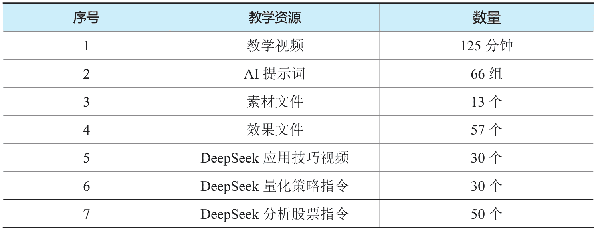

**四、特别提示**

**（1）版本更新：**本书在编写时，是基于当前各种工具和网页平台的界面截取的实际操作图片，但本书从编辑到出版需要一段时间，这些工具和平台的功能、界面等都可能会有变动，请读者在阅读时，根据书中的思路，举一反三，进行学习。其中，通达信金融终端版本为 6.4.11、通达信 App 版本为 7.0.0、同花顺（计算机端）版本为 9.30.72、同花顺 App 版本为 v11.36.05、DeepSeek App 版本为 1.4.2。

**（2）AI 生成的内容差异：**即使是完全相同的提示词，AI 模型每次生成的内容都会有差别，这是模型基于算法与算力得出的新结果，是正常的。所以，读者看到书里的截图与视频有所区别，包括用同样的提示词，自己再去生成内容时，生成的结果也会有差异。另外，由于本书篇幅有限，AI 生成的内容在书中仅呈现部分，若读者需查看完整内容，请参阅随书赠送资源中的效果文件。

**（3）AI 提供的信息仅供参考：**AI 所提供的炒股建议、分析报告、股票筛选结果等信息仅基于现有数据和预设算法模型生成，存在一定的局限性与不确定性，它无法完全取代人类投资者的独立思考、专业分析与丰富经验。因此，投资者在参考 AI 提供的信息时，应保持理性与审慎，结合自身判断、深入研究以及专业投资顾问的建议，综合做出投资决策，切勿盲目跟从。

**（4）股市有风险，入市需谨慎：**股市行情瞬息万变，投资股票必然伴随着风险，投资者应充分了解股市风险，理性评估自身财务状况、投资经验和风险承受力，以谨慎的态度参与股市交易。

**五、作者服务**

本书由陈国嘉著，龙飞、苏高等人整理。由于笔者知识水平有限，书中难免有疏漏之处，恳请广大读者批评、指正，沟通和交流请联系微信：2633228153。

作者

2026 年 2 月

# **AI 技巧篇**

## **第一章** **AI 炒股入门：开启智能股票投资新征程**

**学前提示**

在风云变幻的金融市场中，股票投资一直是备受瞩目的领域。过去，投资者依靠传统方法在股市中摸索前行。而如今，科技浪潮汹涌来袭，AI 强势进军股票市场，改写股票投资格局。本章将为大家揭开 AI 炒股的神秘面纱，带领大家从掌握股票市场的基础知识出发，逐步探索 AI 在股票投资中的应用与优势。

### **1.1** **股票市场基础知识**

股票市场宛如一座巨大而复杂的迷宫，吸引着无数怀揣财富梦想的人投身其中。在踏入 AI（Artificial Intelligence，人工智能）炒股这一前沿领域前，扎实地掌握股票市场基础知识是不可或缺的。这就好比建造高楼，坚实的地基决定了高楼的稳固程度。

本节将深入剖析股票的基本概念与类型，让你清晰了解手中持有的究竟是什么；详细解析股市交易规则，助你在交易过程中不触碰红线；精准解读股市行情，使你能从纷繁的数字与曲线中洞察市场趋势。有了这些基础储备，你才能在股票市场中迈出稳健的步伐，为后续运用 AI 炒股打下良好基础。

**1.1.1** **股票的基本概念与类型**

股票是股份公司向股东出具的、证明其持股比例的有价证券，既可作为交易标的，也能作为抵押品，是资金市场中重要的信用工具。股票是股东所有权份额的凭证，股东持有股票就意味着拥有公司对应比例的资本所有权。股东可依据公司章程领取股息、分享经营红利，还能出席股东会、参与选举董事，以及参与公司经营决策。股东的投资意愿通过行使股东权利得以落地，同时股东也需承担相应的经营风险与投资责任。

不同于债券等有固定偿还期限的金融产品，股票具有“无须偿还本金”的特性：股份公司不会向股东退还入股资金，股东若想收回资金，只能通过转让股票实现，即把股票对应的股东身份与全部权益让渡给受让方。而股价在股票转让过程中，会受公司盈利水平、发展前景、市场供求关系、宏观经济形势等多重因素影响，因此投资股票必然伴随一定风险。

从形式上看，股票经历了从“有纸化”到“无纸化”的演变。早期股票采用纸质印刷，以上海“老八股”为代表，纸面会清晰标注股票编号、公司名称、股份总额、每股金额、股东户名、股数、股票发行时间、董事长及其签章等关键信息，如图 1-1 所示。

图 1-1 上海“老八股”示例

随着现代电子技术的普及，电子化股票逐渐取代纸质股票：无须实体凭证，相关数据均存储于交易所计算机中心，股东仅需持有股东账户卡，通过券商交易终端就能查询持有的股票品种与数量。

在股票市场中，发行公司会根据不同投资者的需求，设计并发行不同类型的股票。日常我们常说的股票，大多是指在上海、深圳、北京证券交易所挂牌交易的 A 股，这类股票也被称为流通股、社会公众股或普通股，是个人投资者参与度最高的股票品种。

股票的分类标准多样，投资者若想参与股票交易，需通过线上联系券商客户经理开通股票账户。我国股票具体类型如表 1-1 所示。

表 1-1 我国股票具体类型

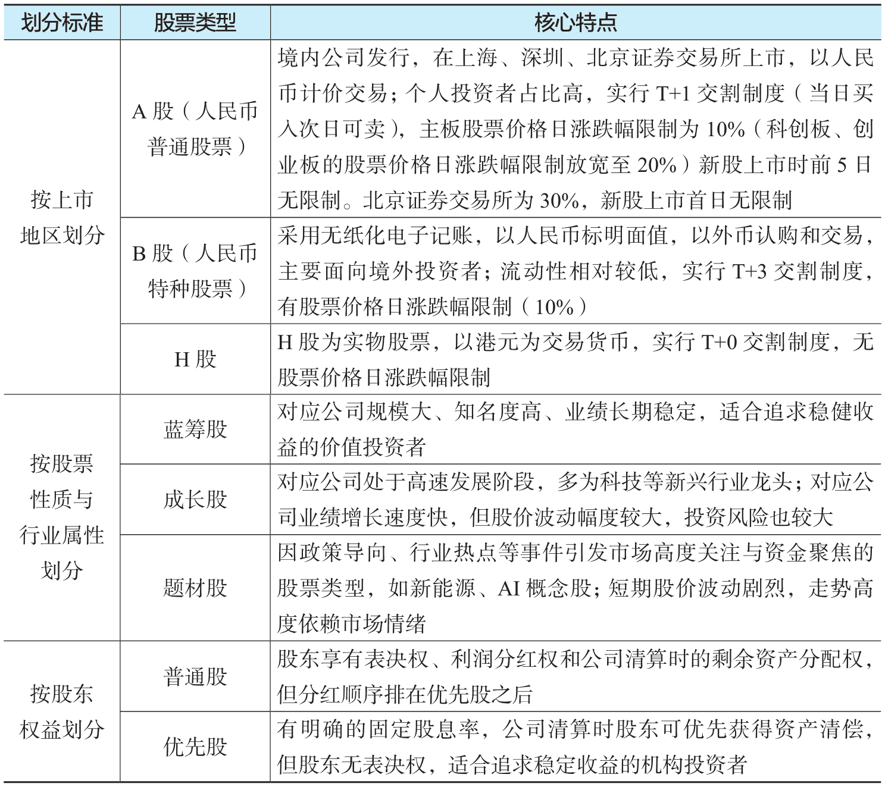

**1.1.2** **股市交易规则解析**

要在股票市场开展投资，首先需清晰理解股市交易的底层逻辑与核心规则——这既是规避交易风险的基础，也是实现合理操作的前提。股票交易本质是投资者之间转让上市公司所有权的行为：买入股票即成为公司股东，可分享盈利，同时需承担经营亏损风险；交易需通过上海、深圳证券交易所等正规证券交易所进行，投资者需先通过证券公司开立账户，才能参与市场买卖。

对新手而言，掌握股市交易规则的核心要点是入门阶段的关键任务，下面将系统解析股市交易的核心规则。

**1.** **交易时间：严格遵循市场时段**

以 A 股为例，实行“周一至周五交易日制”，法定节假日与证券交易所公告休市日暂停交易，每日的具体交易时段如图 1-2 所示。

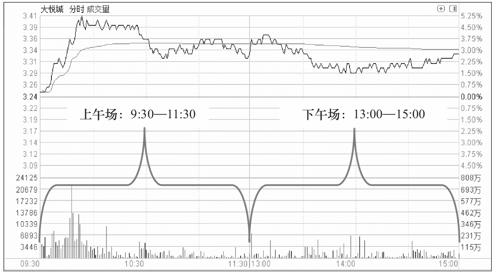

图 1-2 A 股每日的具体交易时段

需注意的是，不同国家/地区市场的交易时段差异显著，如美国股市夏令时对应北京时间 21：30 开盘、次日 4：00 收盘，冬令时延后 1 小时（北京时间 22：30 开盘、次日 5：00 收盘）。因此，投资者若参与跨市场交易，还需特别关注时差，以免错过交易时机。

**2.** **交易单位：以“手”为基础单位**

A 股交易以“手”为最小单位，1 手=100 股，委托买入数量需为 100 股或其整数倍，如 200 股、500 股等。

注意，仅当股票分红送股或部分成交时，可能产生“零股”（不足 1 手），零股仅支持委托卖出，不支持委托买入。

**3.** **竞价成交：遵循“价格优先、时间优先”原则**

以 A 股为例，主要包括集合竞价和连续竞价两种竞价方式，其核心规则如下。

（1）竞价时间。

① 集合竞价：早盘集合竞价时间为 9：15—9：25，其中 9：15—9：20 可申报、可撤单，9：20—9：25 可申报、不可撤单；9：25—9：30 只接受申报。深市（指深圳证券交易所）另设 14：57—15：00 收盘集合竞价时间，此时段可申报、不可撤单。

② 连续竞价：沪市（指上海证券交易所）时间为 9：30—11：30、13：00—15：00；深市则为 9：30—11：30、13：00—14：57。

（2）成交原则。

① 集合竞价：按最大成交量原则产生成交价。具体为高于成交价的买入申报与低于成交价的卖出申报全部成交；申报价与成交价相同的买方或卖方至少有一方全部成交。如有多个符合条件的价格，沪市取中间价，深市取离前一日收盘价最近的价格。集合竞价未成交的委托自动进入连续竞价。

② 连续竞价：遵循价格优先、时间优先的原则。即较高价格买入申报优先于较低价格买入申报，较低价格卖出申报优先于较高价格卖出申报；同价格的申报，按交易主机接受申报的时间顺序成交。

（3）其他规则。

① 申报限制：买入股数需为 100 股的整数倍，卖出股数不足 100 股的需一次性申报；A 股价格最小变动单位为 0.01 元。

② 涨跌幅限制：主板股票价格日涨跌幅限制为 10%，创业板/科创板为 20%，新股上市时前 5 日无限制。北京证券交易所为 30%，新股上市首日无限制。

③ 价格限制：申报价格不得超过当日涨跌停范围。

**4.** **交易费用：影响实际收益**

投资者交易股票通常需支付以下 3 类费用，其直接影响最终收益。

（1）佣金：由证券公司收取，通常按交易金额的一定比例计算，且有最低收费标准。

（2）印花税：仅卖出时收取，由国家税务部门征收，自 2023 年 8 月 28 日起，税率由 0.1%减半至 0.05%并维持单边征收。

（3）过户费：用于证券登记结算机构处理股票所有权转移。具体费用以市场最新规则为准。

注意，不同市场板块（如主板、创业板、科创板）的交易费用可能有细微差异，具体费用还需参考实际交易协议和券商规定。

**5.** **信息披露：投资者决策的重要依据**

上市公司需依法定期（如年报、季报）或不定期（如重大合同签订、业绩预告）披露关键信息，内容涵盖财务数据、经营状况、重大事项等，如图 1-3 所示。投资者需密切关注公司披露的信息，以及时把握公司动态，避免出现信息差导致决策失误。

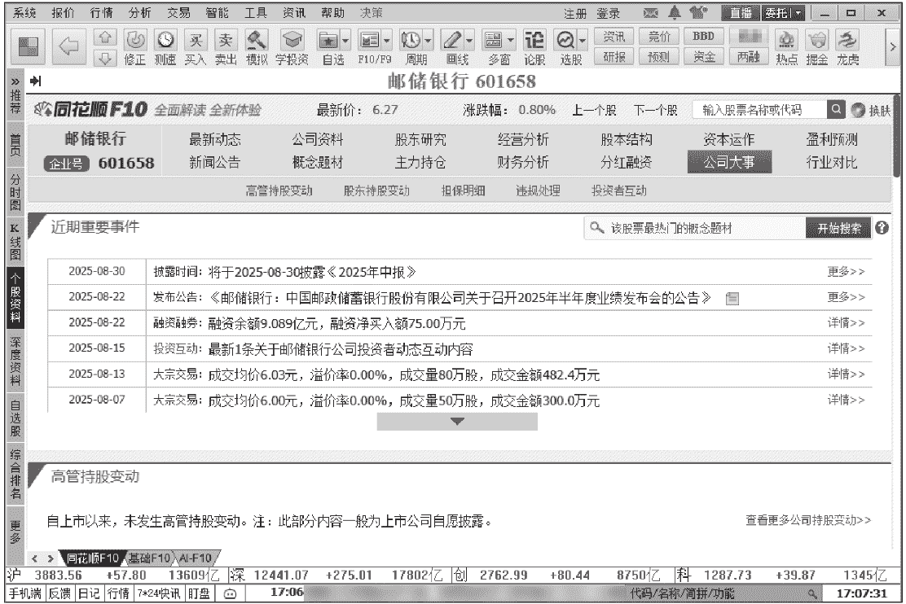

图 1-3 上市公司披露的关键信息示例

**1.1.3** **股市行情解读**

股市行情是证券市场运行状态的直观体现，反映证券交易所内各只股票的价格涨跌、成交量变化以及资金流动情况。投资者可以利用通达信、同花顺或者其他炒股网站来查看股市行情。通过同花顺金融终端/平台查看股市行情如图 1-4 所示。

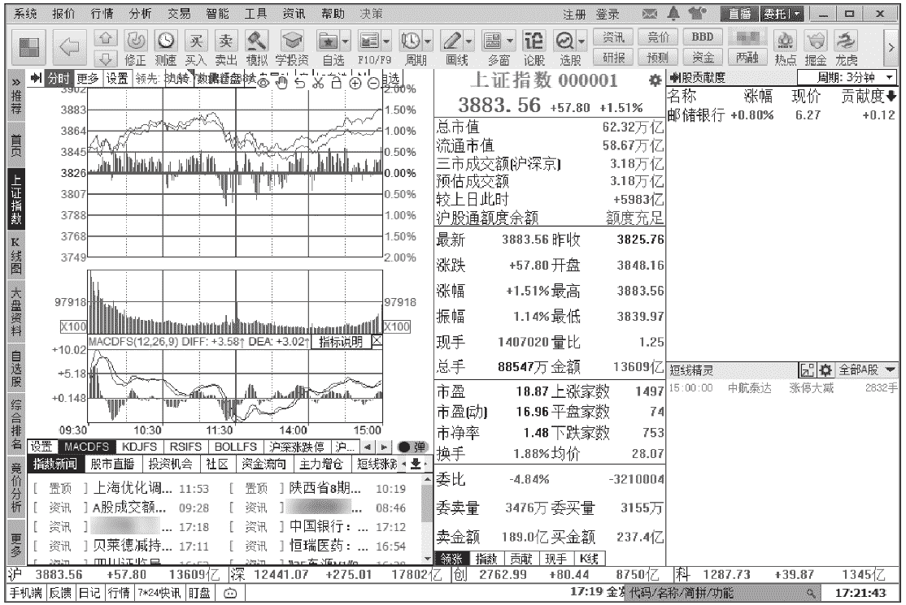

图 1-4 通过同花顺金融终端/平台查看股市行情

对新手而言，看懂行情不仅需要关注股价波动，更需掌握关键行情术语的含义与实战意义——这些术语是分析市场趋势、判断投资时机的“基础语言”。下面将从核心价格指标、市场趋势、交易行为与风险三大维度，系统介绍 A 股市场常用的行情术语，帮助投资者快速建立行情分析框架。

**1.** **核心价格指标：行情分析的基础锚点**

股市的开盘价、收盘价、报价以及涨跌幅限制等，是判断单只股票当日表现的核心依据，也是后续趋势分析的重要起点。相关行情术语如表 1-2 所示。

表 1-2 与核心价格指标相关的行情术语

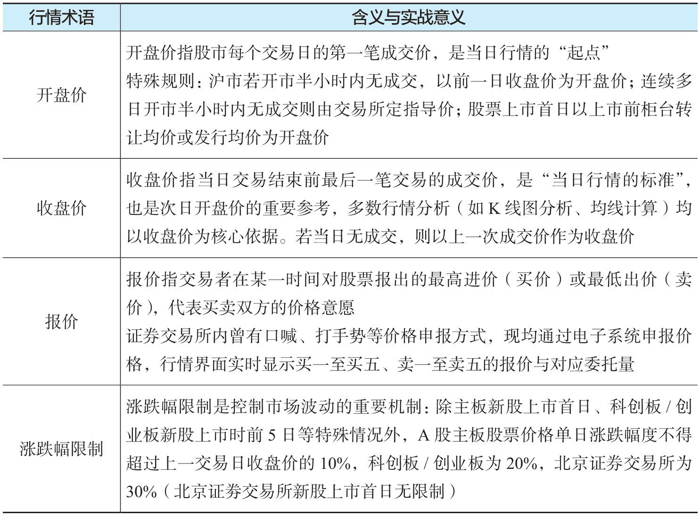

**2.** **市场趋势：判断多空方向的关键**

市场趋势是指在一定时期内，股价、成交量等核心指标呈现的整体运行方向。“多头”“空头”等术语直接反映市场整体或个股的趋势方向，能够帮助投资者识别当前市场是处于“上涨周期”还是处于“下跌周期”。相关行情术语如表 1-3 所示。

表 1-3 与市场趋势相关的行情术语

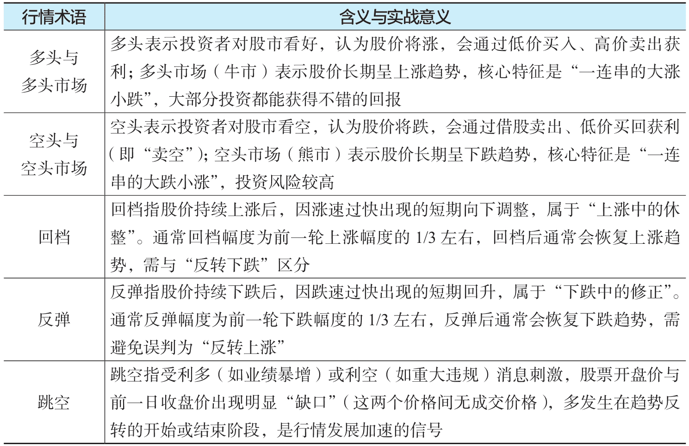

**3.** **交易行为与风险：理解市场博弈与规避风险**

投资者聚焦资金博弈行为与投资风险，有助于识别主力资金的痕迹，避免“踩坑”。相关行情术语如表 1-4 所示。

表 1-4 与交易行为和风险相关的行情术语

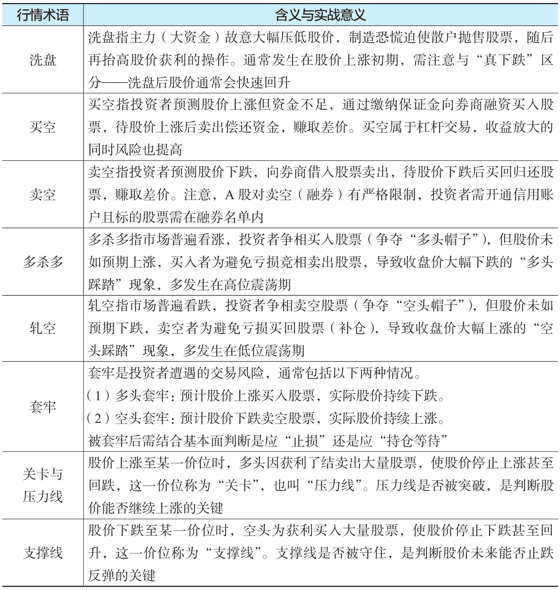

大家需要注意的是，股市行情解读的核心是“先懂术语，再看趋势”，也就是说，投资者只有明确开盘价、支撑线等基础行情术语的含义，才能理解股价波动背后的资金逻辑；只有结合多头、空头、回档、反弹等趋势特征，才能更理性地判断投资时机。尤其对新手来说，初期无须追求复杂分析，先熟练掌握这些核心行情术语，为后续深入行情分析打下坚实基础。

### **1.2** **AI 炒股基础认知**

本节将聚焦 AI 炒股，剖析其与传统股票投资的本质区别，深挖 AI 在股票市场的核心优势，同时揭示新手使用 AI 炒股时的常见误区，并提供实用的规避方法。另外，本节还将分析 AI 炒股的适用人群与适用场景，进行 AI 驱动的股票投资趋势展望，帮助大家在这场智能投资浪潮中找准定位，扬帆起航。

**1.2.1** **AI 炒股与传统股票投资的本质区别**

在金融市场持续演进的当下，AI 炒股与传统股票投资形成鲜明对比，理解两者的本质区别，对投资者在复杂多变的市场中找准方向、优化策略至关重要。

什么是传统股票投资？传统股票投资是投资者基于自身知识、经验、直觉，结合对宏观经济、行业前景、公司基本面等的研究，主观判断股票价值与价格走势，进而做出买卖决策的过程，决策周期可长可短，涵盖长期价值投资与短期投机。

AI 炒股又是什么意思呢？AI 炒股即运用 AI 技术辅助开展股票投资，AI 借助机器学习、深度学习等算法，对海量金融数据进行挖掘分析，自动识别市场模式、趋势与规律，生成交易信号并执行交易，实现投资决策智能化、自动化。表 1-5 所示为 AI 炒股与传统股票投资的本质区别。

表 1-5 AI 炒股与传统股票投资的本质区别

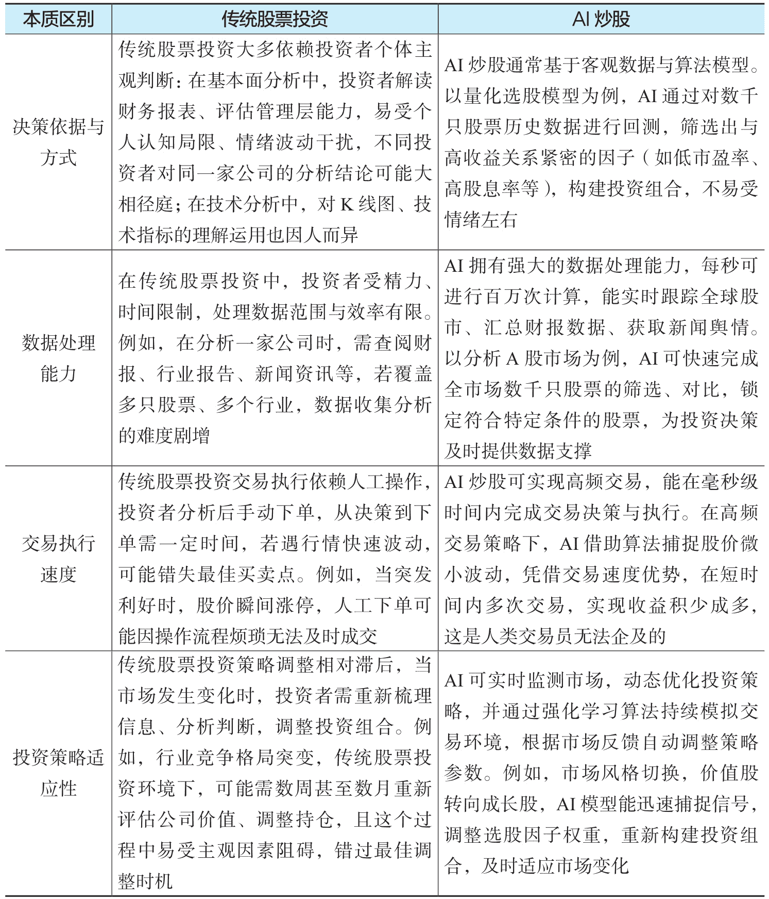

例如，广发证券对旗下的易淘金 App 进行了 AI 原生化升级，以“天玑智融”大模型为核心，构建主动式个性化引擎，并嵌入行情、交易、资讯等高频服务场景，如图 1-5 所示。如易淘金 App 中的“AI 盯盘小助理”，通过思维链推理等能力，7 天×24 小时为投资者提供选股、诊股等主动“聊天式服务”，大幅提升投资者信息获取效率。

图 1-5 易淘金 App 的 AI 原生化升级功能示例

▶**专家提醒**

需要注意的是，AI 炒股凭借技术优势，为投资领域带来活力与机遇，但市场复杂多变，即便 AI 也无法完全精准预测。目前，证监会明确要求保留人工审核环节，禁止散户全自动交易，旨在平衡创新与风险。对投资者而言，只有合理运用 AI 辅助决策，结合自身投资经验与理性判断，才有望在股市中增加投资胜算。

**1.2.2** **AI 在股票市场的核心优势**

在金融科技迅猛发展的浪潮中，AI 正以前所未有的速度重塑股票市场的底层逻辑。相较于传统股票投资模式，AI 在股票市场的核心优势体现在 4 个维度：全量数据处理能力、无情绪化决策机制、动态迭代进化特性、规模化成本控制。这些优势不仅突破了人类生理与认知的极限，更推动着投资范式向智能化、精准化跃迁。

**1.** **全量数据处理能力：突破人类认知的信息边界**

AI 的核心优势之一，在于其能突破人类认知局限，实现全维度、海量数据的实时处理与深度挖掘。在传统股票投资中，研究员通常最多跟踪数十只股票、分析有限的财务与交易数据；而 AI 系统可同步监控 A 股市场 5000 余只股票的实时行情，还能整合社交媒体舆情、卫星遥感数据、物流航运指标等“非传统数据源”。

例如，国际量化巨头 Two Sigma 的 AI 系统通过卫星图像分析某连锁超市停车场的车辆密度（见图 1-6），预判零售企业营收增速，进而优化持仓策略。以前要等财报周期到了投资者才能做决策，而依靠“用卫星炒股”这种模式，投资者可以随时获得实时数据，并调整投资。

图 1-6 停车场卫星图像示例

**2.** **无情绪化决策机制：规避人性弱点的理性屏障**

在股票市场中，人类投资者常受贪婪、恐惧、侥幸等心理影响，导致追涨杀跌、逆势操作等非理性决策；而 AI 具备无情绪化的决策特质，能严格遵循预设模型执行策略，成为规避人性弱点的理性屏障。

国内券商的智能交易工具体现了这一优势，如使用华泰证券“涨乐财富通”的智能条件单功能（见图 1-7），投资者可预设“跌破支撑位自动止损”“突破压力位自动加仓”等规则，系统会实时监控行情并精准执行策略，避免投资者因犹豫、侥幸心理错失最佳操作时机。

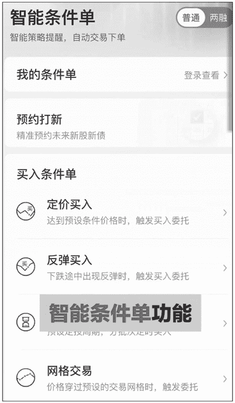

图 1-7 智能条件单功能示例

另外，AI 在仓位控制中也能保持绝对理性，不会因短期行情波动随意改变预设的风险敞口，有助于维持投资组合的稳健性。

**3.** **动态迭代进化特性：超越人类效率的策略优化**

传统股票投资策略的迭代往往依赖人工回测与经验调整，一个完整的策略优化周期可能长达数月；而 AI 具备“数据驱动+实时学习”的动态迭代能力，能以远超人类的效率更新策略逻辑与参数。

▶**专家提醒**

人工回测是传统股票投资中验证策略有效性的关键手段，指投资者或研究员基于历史市场数据（如过往股价、成交量、财务指标等），手动模拟投资策略的执行过程，评估其在过去某段时间内的盈利表现与风险水平。

广发证券“天玑智融”大模型的进化机制就极具代表性，其通过强化学习算法，每天对历史交易数据、市场反馈进行复盘，自动修正选股因子的有效性阈值。例如，当“低市盈率”因子失效时，该模型会快速降低该因子权重，转而提升“营收增速”“研发投入占比”等更适配当前市场风格的因子权重。这种动态进化能力，让 AI 策略能及时适配市场变化，避免传统策略“一招鲜吃遍天”导致的收益回撤。

**4.** **规模化成本控制：重构投资服务的性价比边界**

AI 在投资领域的另一核心优势，在于其“前期研发投入固定、后期服务边际成本趋近于零”的规模化特性，其能大幅降低投资服务的单位成本，打破传统人工服务的性价比瓶颈。

AI 的这种成本优势在普惠金融领域尤为突出。例如，东方财富证券的“AI 投顾助手”，通过自然语言处理技术实现 7 天×24 小时行情解读、持仓诊断，普通投资者无须支付高额服务费，即可获得与专业投顾媲美的基础分析服务。

另外，AI 在交易执行环节也能降本，如中信证券的 AI 算法交易系统，可将大额订单拆分为多笔小额订单，避免人工下单导致的市场冲击成本，使交易滑点率从传统的 0.3%降至 0.05%以下。

▶**专家提醒**

交易滑点率是衡量订单实际成交价格与预期价格差异的百分比指标。当投资者下单时，若市场流动性不足、价格波动剧烈或订单规模较大，实际成交价格可能高于（买入时）或低于（卖出时）预期价格，两者差值与预期价格的比率即为交易滑点率。

当前，很多头部机构已形成“AI+人工”的协同模式。例如，贝莱德的阿拉丁系统被誉为“金融天眼”，但它在生成投资建议后，仍需由人类基金经理进行最终决策。这种人机协作的“混合智能”模式，既发挥了 AI 的算力和纪律性优势，又保留了人类的战略判断力。

AI 在股票市场的核心优势，本质上是技术对人类能力的延伸与超越，它不仅重新定义了投资决策的效率边界，更推动着金融行业向智能化、普惠化转型。对投资者而言，拥抱 AI 工具而不完全依赖 AI 决策，在技术赋能中保持独立思考，将是在新时代金融市场中制胜的关键。

**1.2.3** **新手使用 AI 炒股的常见误区及规避方法**

在金融科技浪潮的席卷下，AI 炒股作为新兴投资方式，吸引着众多投资者投身其中，期望借助技术力量实现财富增值。但由于对 AI 技术及股市复杂性认识不足，新手在使用 AI 炒股时，常陷入一些误区（见图 1-8），导致投资受损。

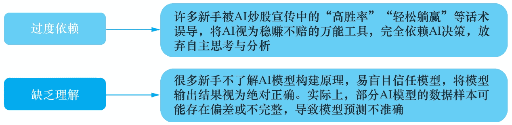

图 1-8 新手使用 AI 炒股的常见误区

新手使用 AI 炒股，需认清常见误区，掌握规避方法，如图 1-9 所示。新手应谨慎选择平台与工具，将 AI 作为提升投资能力的助力，而非投资成功的捷径，在不断学习与实践中，逐步提升自身投资水平，实现稳健投资目标。

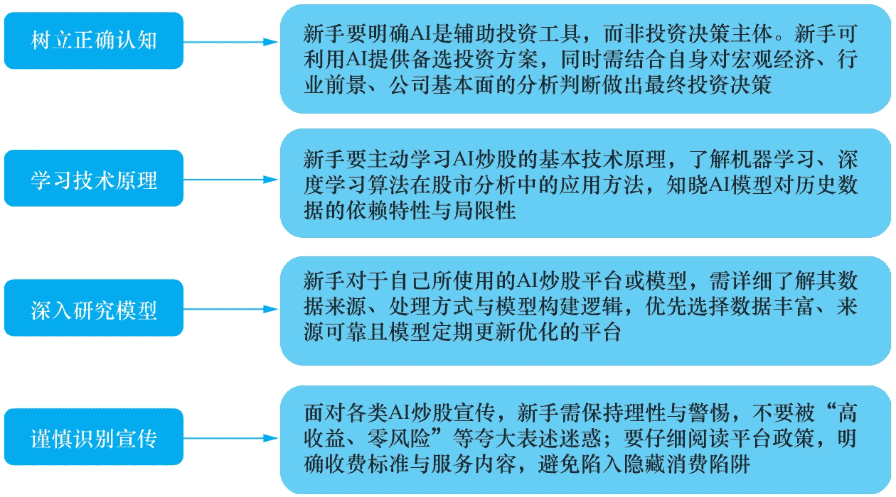

图 1-9 AI 炒股常见误区的规避方法

**1.2.4** **AI 炒股的适用人群与适用场景**

**1.** **AI 炒股的适用人群**

具有不同投资背景与目标的人群，在复杂多变的股市场景中，对 AI 炒股的需求与应用方式各有不同。下面是 AI 炒股的适用人群。

（1）忙碌的上班族。在快节奏的现代生活中，上班族往往难以时刻关注股市动态，他们虽有投资意愿，但每天工作繁忙，无法投入大量时间进行股票研究与分析。对于这类人群，AI 的智能筛选与自动化交易功能十分实用。例如，借助东方财富证券旗下的“妙想”金融大模型（见图 1-10），上班族只需设定简单的筛选条件，AI 便能在海量股票中迅速锁定符合要求的标的，节省大量时间与精力。

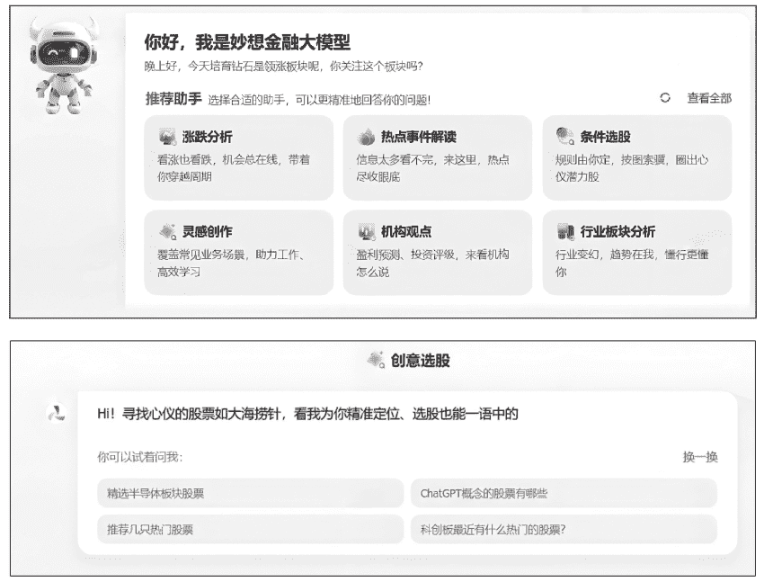

图 1-10 “妙想”金融大模型

（2）量化投资爱好者。这类人群热衷于通过复杂的数学模型与数据分析来制定投资策略，AI 回测平台为他们提供了强大的技术支持与丰富的数据。像 JoinQuant、Backtrader 等 AI 回测平台，能帮助量化投资爱好者快速验证投资策略的可行性，助力优化量化策略。

（3）初涉股市的新手。新手通常缺乏系统的投资知识与丰富的实战经验，在面对复杂的股市时往往感到迷茫与无从下手。基于 AI 技术打造的智能投顾服务，能为新手提供专业指导与投资建议。以国金证券的“国金佣金宝”App 为例，其 AI 投顾功能中的“AI 选好股”服务，通过深度数据分析与量化策略分析，每日从上千只股票中精选出具备波段潜力的股票，并给出买卖信号，如图 1-11 所示。新手可参考这些建议，逐步学习与积累投资经验。同时，一些 AI 炒股平台还提供基础投资知识讲解与模拟交易功能，能够帮助新手在实践中熟悉股市规则与操作流程。

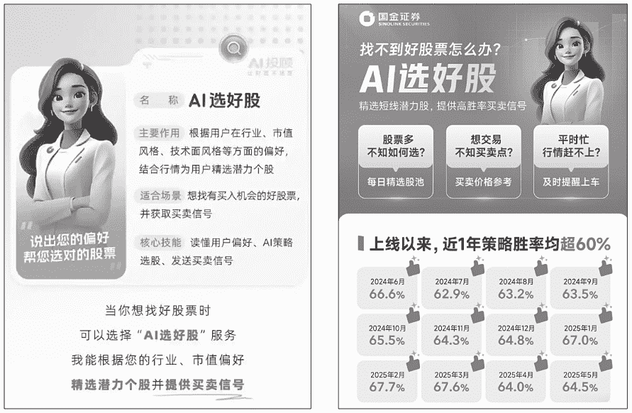

图 1-11 “国金佣金宝”App 的“AI 选好股”服务

（4）数据敏感型投资者。这类投资者坚信数据是投资决策的核心依据，对各类市场数据有着敏锐的洞察力与强烈的需求，AI 炒股平台的数据处理与分析能力恰好契合他们的投资理念。例如，同花顺的“问财”大模型，接入了丰富的金融指标和量化因子，投资者只需输入简单问题，AI 便能迅速调取数据并给出精准答案。而且，AI 还能对这些数据进行深度挖掘，分析数据之间的潜在关联，为数据敏感型投资者提供更具价值的投资线索。图 1-12 所示为同花顺的“问财”大模型。

图 1-12 同花顺的“问财”大模型

**2.** **AI 炒股的适用场景**

在风云变幻的股市中，每一次的价格波动都牵系着投资者的期望与收益。传统炒股方式在海量数据与复杂行情前，常显力不从心。而 AI 的介入，宛如为股市投资开启了一扇全新的大门，AI 以其强大的数据处理、智能分析能力，构建出多样、独特的适用场景，为具有不同需求的投资者带来新机遇与变革。下面是 AI 炒股的适用场景。

（1）智能选股。在茫茫股海中筛选出具有投资潜力的个股，是投资者面临的首要难题。AI 在这一场景中优势显著，投资者可以用自然语言向 AI 下达筛选指令，如“筛选出营业收入连续三年增长超过 10%的消费行业股票。”以 DeepSeek 为例，其能在短短数秒内，基于强大的数据分析能力与广泛的数据来源，输出符合条件的股票清单，帮助投资者快速锁定潜在投资目标。相关案例如下。

### **提示词**

筛选出营业收入连续三年增长超过 10%的消费行业股票。

## **DeepSeek**

根据您的需求，我筛选了 A 股和港股消费行业中营业收入连续三年增长表现较好的公司。需要提醒的是，严格符合“营业收入连续三年增长超过 10%”条件的公司可能利用公开信息不易直接获取，但以下公司近年来均展现了持续的营收增长势头或在近期实现了高增长，供您参考。

1\. 劲仔食品（003000.SZ）

近期增长：2024 年营收 24.12 亿元，同比增长 16.79%；公司近三年实现了业绩倍增，2024 年营收较 2021 年翻番。

……

▶**专家提醒**

注意，由于本书篇幅有限，AI 生成的内容在书中可能仅呈现部分，若读者需查看完整内容，请参阅随书赠送资源中的效果文件。

（2）策略回测与优化。对于投资者自行构建或借鉴的投资策略，需要验证其在不同市场环境下的有效性与稳定性。AI 可将投资者设定的策略，代入历史数据进行模拟交易。通过多次回测，AI 能给出策略的年化收益率、胜率、最大回撤等关键指标，直观展示策略优劣。同时，AI 还能基于大数据分析，为投资者提供策略优化建议，如调整买卖触发条件、增加风险控制因子等，提升策略的盈利能力与抗风险能力。

（3）动态风险监控与管理。股市波动频繁，风险无处不在，AI 能实时监控市场动态与投资组合情况，及时发出风险预警，提示投资者采取减仓、止损等措施。另外，AI 还能根据市场变化，动态调整投资组合中各类资产的配置比例，平衡风险与收益。

（4）行业轮动与热点捕捉。股市中不同行业板块轮动特征明显，及时捕捉热点行业与板块，是获取超额收益的关键。AI 通过对宏观经济数据、政策动态、行业研报、社交媒体舆情等多源数据的实时分析，能够敏锐感知行业轮动趋势与热点变化。投资者可借助 AI 快速布局热点行业，把握投资先机。

例如，雪球是一个以投资者社区为基础，逐渐发展成为集投资交流、金融数据及资讯获取、交易服务以及财富管理等于一体的综合性在线金融服务平台，拥有庞大的用户群体和丰富的功能服务。接入 DeepSeek 大模型后，雪球平台于 2025 年 5 月顺势推出了 AI 功能，该功能具备“雪球思考”与“全网搜索”两种实用模式。

①“雪球思考”模式：依托 DeepSeek 大模型，对雪球站内沉淀 14 年的海量数据（如个股公告、财报、行情数据、行业新闻、热门个股信息，以及用户分享的帖子与回复等内容）进行深度挖掘与整合，进而输出极具“雪球特色”的专业投资分析内容。当投资者询问某只股票的投资价值时，雪球能综合多方面信息，给出深入且贴合市场实际的见解，为投资决策提供有力参考。雪球的“雪球思考”模式如图 1-13 所示。

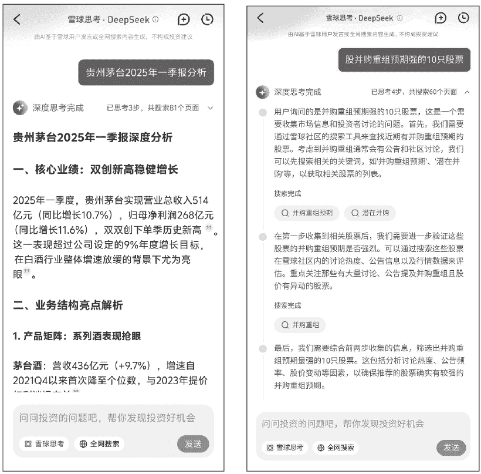

图 1-13 雪球的“雪球思考”模式

②“全网搜索”模式：同样借助 DeepSeek 大模型，通过全网搜索引擎对公开信息进行检索与整合，及时满足投资者对信息时效性与广度的需求。

在实际应用场景中，雪球接入 DeepSeek 大模型的优势尽显：对于忙碌的投资者，以往收集、整理和分析各类投资信息耗时费力，如今借助“雪球思考”模式，短短几分钟就能获取全面且条理清晰的信息汇总与分析结果。

另外，对于初涉投资领域的新手，面对纷繁的市场信息往往不知所措。在 DeepSeek 助力下的“雪球思考”模式，能够以通俗易懂的语言解答新手的基础投资问题，如股票交易规则有哪些、如何分析财务报表等，同时结合具体案例进行讲解，让新手快速积累投资知识，逐步建立投资逻辑。

**1.2.5** **AI 驱动的股票投资趋势展望**

在科技与金融深度融合的时代浪潮下，AI 已成为重塑股票投资格局的关键力量之一。从智能选股到动态风险管控，AI 对股票投资全流程的渗透，正推动行业迈向智能化、高效化的新阶段。展望未来，AI 驱动的股票投资将呈现出一系列令人瞩目的趋势，为投资者带来全新机遇与挑战。

**1.** **多模态数据融合深化，拓展投资洞察边界**

传统股票投资分析多依赖财务报表、股价走势等结构化数据，信息维度有限。未来，AI 将深度融合文本、图像、音频等多模态数据，全方位洞察市场。

例如，通过分析公司财报文本的情感倾向、新闻报道语气，AI 可感知市场对企业的预期；AI 能够解读行业会议音频，捕捉专家观点与潜在趋势；AI 能够利用卫星图像分析企业工厂产能、物流运输情况，辅助判断企业运营状况。

**2.** **个性化投资策略定制成主流**

每个投资者的风险偏好、投资目标、资金规模各异，通用投资策略难以满足个性化的投资需求。AI 凭借强大算法，能依据投资者个性化特征，为其量身定制投资策略。通过对投资者交易历史、风险评估问卷等数据进行深度学习，AI 可构建精准用户画像，匹配适宜的投资组合与交易时机。

**3.** **实时智能决策与交易加速落地**

股市瞬息万变，及时决策至关重要，AI 可以实现实时数据处理与智能决策，提升交易效率。借助高速传输数据的能力与强大的算力，AI 能实时分析市场动态，捕捉投资机会，瞬间完成交易指令。

尤其在量化投资领域，一些机构利用 AI 算法，根据市场实时波动，毫秒级调整投资组合，把握转瞬即逝的获利机会。例如，大智慧 V10.0“慧问”版本通过自然语言驱动量化策略的生成，投资者只需通过语音或文字描述投资思路，AI 即可自动解析并生成专属量化策略，如图 1-14 所示。这种零代码交互打破了“传统语言-量化决策”工具的技术壁垒，让普通投资者也能轻松实现策略定制。

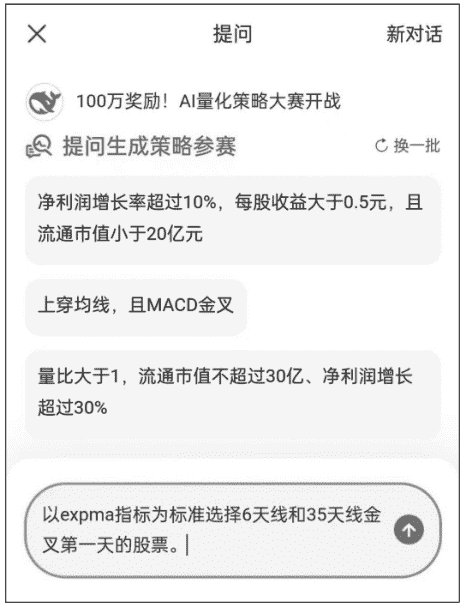

图 1-14 大智慧 V10.0“慧问”版本

**4.** **人机协同投资模式普及**

AI 虽强大，但无法完全替代人类智慧。未来，人机协同投资将成主流模式。人类投资者凭借经验、直觉与对市场的敏锐感知，把握宏观趋势、解读复杂信息；AI 负责海量数据处理、精准模型构建与策略执行。双方优势互补，提升投资决策科学性与准确性。

在研究新兴行业投资机会时，人类分析师凭借对行业的前瞻性理解，提出投资思路；AI 通过对行业数据的挖掘、竞品分析，为投资决策提供数据支撑与风险评估。例如，券商投顾团队借助 AI 智能助手，快速筛选潜力个股，再结合自身专业判断，为客户制定投资方案，实现人机高效协作。

**5.** **AI 炒股平台与工具持续创新**

在科技与金融深度交融的当下，AI 炒股平台与工具正成为投资领域的创新先锋，市场对智能化投资需求激增，驱动着各类平台与工具推陈出新。

例如，微软推出的 Qlib 作为开源量化投资工具，具有一键式 AI 建模、分钟级回测及可视化看板等优势。图 1-15 所示为 Qlib 生成的报告示例。未来，Qlib 等开源量化投资工具将吸引更多开发者贡献代码，拓展功能，降低量化投资门槛，让普通投资者也能借助 AI 构建个性化量化策略，实现科学投资。同时，开源量化投资工具的社区生态将更加活跃，投资者可在社区分享策略、交流经验，共同提升投资水平。

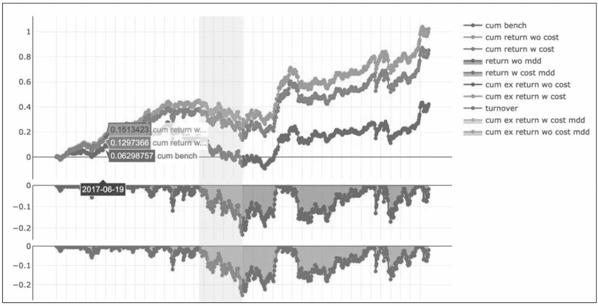

图 1-15 Qlib 生成的报告示例（局部）

AI 驱动的股票投资正处于快速发展阶段，投资者应积极拥抱上述投资趋势，合理运用 AI 工具，提升投资能力，在智能化投资新时代把握更多机遇，实现财富稳健增长。

## **第二章 AI 工具操作：用 AI 提升投资效率**

**学前提示**

在当今数字化时代，人工智能技术的飞速发展为股票投资领域带来了前所未有的机遇。AI 不仅能快速处理海量数据，还能通过复杂的算法模型挖掘数据中的潜在规律，为投资者提供精准的决策支持。本章将深入探讨如何利用 AI 工具优化股票投资流程，从基础操作到实战应用，全方位提升投资效率。

### **2.1 热门 AI 炒股工具应用建议**

AI 炒股的落地离不开各种工具的支持，当前市场上，DeepSeek、豆包、Kimi、文心一言、智谱清言等 AI 工具覆盖了从投资策略、盘面分析到买卖建议的各类需求，投资者可根据自身投资风格选择合适的方案。本节将分析一些热门 AI 工具的核心功能，并提供炒股实战中的应用建议。

**2.1.1 DeepSeek 用于炒股**

DeepSeek 是由中国杭州深度求索人工智能基础技术研究有限公司开发的一款基于大语言模型（简称大模型）的 AI 助手，具备自然语言处理、多模态数据分析和决策支持等功能，以训练成本低、运行效率高、推理能力强等优势，在多个场景实现商业落地。

DeepSeek 支持内容创作、学习辅助及个性化推荐等功能，能进行自然语言理解与分析、编程、个性化推荐等操作，以及具备深度思考、联网搜索和上传与解析文件等功能。

将 DeepSeek 用于炒股的建议如下。

（1）信息收集与分析。投资者可通过联网搜索功能，用 DeepSeek 快速获取大量与股市相关的资讯，如宏观经济数据、行业动态、公司财报等，并对其进行分析和整理，从而把握市场趋势和热点。相关案例如下。

## **提示词**

请联网搜索并整理今日最新的 A 股市场热点，包括涨幅居前的行业板块、主力资金净流入方向、北向资金持仓变化，以及可能影响市场的宏观经济政策。用简洁的条目列出五大热点，并标注其驱动逻辑（如政策利好、业绩预增等）。

### **DeepSeek**

根据今日最新的 A 股市场数据，我为你整理了当前市场的五大热点。

1. 新能源赛道（储能、固态电池）表现强势

驱动逻辑：政策利好。《新型储能规模化建设专项行动方案（2025—2027 年）》设定了到 2027 年全国新型储能装机规模达到 1.8 亿千瓦以上，带动项目直接投资约 2500 亿元的目标。同时，龙头企业如宁德时代储能电池产量全球领先，阳光电源储能业务营收大幅增长，也提供了支撑。

2. 新能源汽车行业获资金重点关注

驱动逻辑：政策利好。工业和信息化部等八部门联合印发的《汽车行业稳增长工作方案（2025—2026 年）》明确了 2025 年新能源汽车销量目标约为 1550 万辆，同比增长约 20%。这提振了整个产业链的景气度预期，吸引了主力资金净流入。

……

▶**专家提醒**

开盘前掌握市场热点和主力资金流向，有助于投资者提前布局高关注度板块。该案例的提示词通过聚焦盘前信息整合，明确要求 AI 关注行业板块、主力资金流向、北向资金数据、宏观经济政策四大核心内容，并强调“标注其驱动逻辑”，避免信息堆砌。同时，提示词中使用“简洁的条目”确保 AI 的输出结构清晰，适合快速阅读。

（2）投资策略制定。DeepSeek 根据对信息的分析，结合投资者的风险偏好和投资目标，为其制定个性化的投资策略，如价值投资策略、成长投资策略、波段操作策略等。

（3）情绪识别。DeepSeek 可帮助投资者识别市场情绪拐点，为投资决策提供参考。

**2.1.2 豆包用于炒股**

豆包是由抖音开发的智能平台，基于丰富的业务场景和技术资源，能够提供全面的 AI 能力支持。豆包支持多模态集成，可进行文字、图像、音频、视频等多模态数据的智能生成和处理。用户通过豆包还可以创建 AI 智能体，在创意工作、学习辅助、职场效率、娱乐互动等方面都有应用。

将豆包用于炒股的建议如下。

（1）智能写作辅助。豆包可以帮助投资者撰写投资分析报告、投资策略总结等文字材料，提高写作效率和质量。相关案例如下。

## **提示词**

你是一名专业的机构分析师，请你撰写一份《2025 年第二季度 A 股行业配置建议》，建议超配消费、科技行业，标配医药行业，低配周期行业。请分别说明各行业配置理由，总字数控制在 700 字内，内容专业但易懂。

**豆包**

**2025 年第二季度 A 股行业配置建议**

2025 年第二季度 A 股行业配置需紧扣结构分化主线，建议超配消费、科技行业，标配医药行业，低配周期行业。消费行业迎来复苏加速期，政策与需求形成双重支撑。2025 年第二季度第三产业增加值同比增长 5.7%，其中批发和零售业增加值同比增长 6.0%，住宿和餐饮业增加值同比增长 5.2%，这显示消费场景修复持续深化。非必需消费品方面，得益于新能源汽车补贴等政策延续发力，叠加假期消费回暖，其市场需求正稳步增长。必需消费品板块则凭借稳定的业绩表现，在经济转型阶段成为资金规避风险的优先选择。

……

▶**专家提醒**

该案例的提示词通过让 AI 扮演“机构分析师”角色，明确配置方向和对应逻辑，要求 AI 为每个判断提供理由。同时，提示词通过“内容专业但易懂”来平衡 AI 内容的深度与可读性，AI 输出的内容可用于投资社群的分享。

（2）创意激发。豆包可以在投资创意方面给予投资者启发，如为投资者提供新颖的投资组合构建思路、独特的股票筛选方法等。

（3）学习辅助。豆包可以为投资者提供与股票投资相关的学习资料和问题解答，帮助投资者增加投资知识和提升技能水平。

**2.1.3 Kimi 用于炒股**

Kimi 是由北京月之暗面科技有限公司开发的 AI 工具，基于自研的千亿参数大模型，擅长中英文对话，在长文本处理方面表现出色。

Kimi 支持多达 200 万个汉字的输入和输出，能够处理超长文档，如 PDF、Word、Excel、PPT 和 TXT 等格式的文档，快速获取要点；具备智能搜索与高效阅读能力，可实时搜索信息，在整合后提供详尽回答，并给出信息来源；还涵盖文案生成、代码编写、数据分析、图片解析等创作与效率工具。

将 Kimi 用于炒股的建议如下。

（1）研报解读。Kimi 可以帮助投资者快速阅读和理解冗长的证券研究报告，提取关键信息和观点，为投资决策提供参考。

（2）新闻资讯筛选。Kimi 可以从大量的财经新闻中，筛选出与投资者关注的股票或行业相关的重要资讯，帮助投资者及时掌握市场动态。相关案例如下。

### **提示词**

请筛选近一周美股市场新闻中可能影响 A 股科技板块的内容，重点关注：①纳斯达克指数大幅波动；②中概股指数/价格涨跌；③美债收益率异动。逐条说明对 A 股的潜在影响方向。

**Kimi**

近一周，美股市场的波动及政策动向正在通过纳斯达克指数调整、中概股指数/价格走势分化、美债收益率上行三大路径，对 A 股科技板块形成情绪传导与估值锚定效应。以下是具体影响方向分析。

1. 纳斯达克指数大幅波动：情绪压制+估值锚定下移

事件：2025 年 9 月中旬以来，纳斯达克指数出现连续回调，单周最大跌幅超 2%，科技股领跌，半导体、AI 应用等子板块跌幅居前。

A 股影响方向：

……

▶**专家提醒**

A 股常受海外市场情绪传导影响（如美股科技股指数/价格暴跌带动 A 股指数/价格调整）。在提示词中设定外溢影响，让 AI 识别可能引发 A 股联动的海外事件，可帮助投资者提升跨市场风险预判能力。

该案例的提示词通过明确以“影响 A 股科技板块”为筛选目标，避免 AI 泛泛而谈，同时通过“逐条说明对 A 股的潜在影响方向”推动 AI 建立因果逻辑。

（3）文案创作。Kimi 可协助投资者创作与炒股相关的内容，如股票投资经验分享、投资理念阐述等文案，用于个人社交媒体等的内容发布。

**2.1.4 文心一言用于炒股**

文心一言是百度推出的知识增强大模型，具有广泛的知识和强大的语言理解与生成能力，在多个领域都有出色的表现。文心一言能够与投资者进行自然流畅的对话，回答各种问题，提供信息查询、知识解答、文本创作、语言翻译等服务，还具备一定的推理和逻辑思维能力。

将文心一言用于炒股的建议如下。

（1）投资知识咨询。文心一言可以为投资者解答关于股票投资的基础知识、专业术语等方面的问题，帮助投资者构建完善的投资知识体系。相关案例如下。

### **提示词**

请用通俗的语言解释价值投资的三大核心原则：①股票是企业所有权的一部分；②市场短期是“投票机”，长期是“称重机”；③安全边际的重要性。结合 A 股案例说明如何在实战中应用这些原则。

**文心一言**

**价值投资三大核心原则通俗解释及 A 股实战应用（节选）**

1. 股票是企业所有权的一部分

简单说，买股票就是买企业的一小部分“所有权”。比如你花 10 万元买下一家奶茶店 10%的股份，未来奶茶店赚的钱、分红的钱，你都有份。在 A 股中，贵州茅台就是典型案例。2001 年上市时，其每股净资产仅 10 元，但投资者看中的是贵州茅台的品牌、酿酒工艺和持续盈利能力。2023 年，贵州茅台每股净资产已超 180 元，股价更是突破 2000 元。长期持有贵州茅台股票的投资者，本质上分享了企业从地方小厂成长为全球烈酒巨头的红利。实战中，要像挑生意伙伴一样选企业：看它的产品是否受欢迎、管理层是否靠谱、行业地位是否稳固。

……

▶**专家提醒**

许多投资者误将“低价股”当作价值股，真正的价值投资需理解企业内在价值与安全边际。该案例的提示词通过聚焦基础理念，明确要求 AI 围绕“通俗解释+价值投资的三大核心原则+实战应用”生成内容，确保理论与实践结合，能帮初学者建立正确认知。

（2）市场行情分析。文心一言可以对当前的股市行情进行分析和解读，为投资者提供有关市场趋势的观点和分析思路，辅助投资者做出更明智的投资决策。

（3）心理辅导。在投资者面临市场波动产生焦虑、恐惧等情绪时，文心一言可以给予心理安慰和疏导，帮助投资者保持理性平和的心态进行投资。

**2.1.5 智谱清言用于炒股**

智谱清言由北京智谱华章科技有限公司推出，基于自主研发的中英双语对话模型 ChatGLM2，具有丰富的知识和强大的学习能力。智谱清言能够与投资者进行深入的交流和对话，帮助投资者解决问题和获取信息，其回答质量高、可靠性强。

将智谱清言用于炒股的建议如下。

（1）深入专题研究。智谱清言可以针对特定的股票投资专题或行业进行深入研究，为投资者提供深入独到的见解和分析报告，帮助投资者挖掘具有投资价值的标的。

（2）经验分享。智谱清言可以将股票投资领域的专家经验、经典投资案例等进行整合，以通俗易懂的方式分享给普通投资者，帮助他们少走弯路，快速提升投资水平。相关案例如下。

### **提示词**

请结合巴菲特投资可口可乐、苹果等经典案例，总结他选择并长期持有股票的三大核心标准：护城河、管理层、自由现金流。用通俗的语言解释每一标准的含义，并说明普通投资者如何在 A 股选股中参考应用。

**智谱清言**

巴菲特选择并长期持有股票的三大核心标准，通过其投资可口可乐和苹果等经典案例可见一斑。

首先是护城河。巴菲特特别看重企业是否拥有难以被竞争对手超越的优势，如可口可乐的全球品牌影响力。拥有难以被竞争对手超越的优势让企业能在市场中保持长期竞争力，就像一座城周围的护城河，保护着企业的利润空间。普通投资者在进行 A 股选股时，可关注那些拥有独特品牌、专利技术或网络效应的公司。

……

▶**专家提醒**

沃伦·E.巴菲特（Warren E. Buffett）的成功不在于频繁交易，而在于识别“看得懂”的伟大企业并长期持有其股票。该案例的提示词通过聚焦大师经验本土化，要求 AI 从真实案例出发“提炼标准—解释逻辑—A 股选股应用”，形成完整迁移路径，帮助普通投资者学习顶级投资者的持股哲学与实战标准。

（3）风险评估与预警。智谱清言利用知识和分析能力，可对投资者关注的股票或投资组合进行风险评估，分析可能存在的风险因素，如公司财务风险、行业竞争风险、宏观经济风险等，并及时发出预警信号，提醒投资者注意风险，以便投资者及时调整投资策略，降低损失。

▶**专家提醒**

投资者应根据自身的投资需求、投资风格以及对工具功能的偏好来选择 AI 工具。例如，如果投资者更注重长文本处理和文档阅读理解能力，那么像 Kimi 这种在长文本处理方面表现出色的工具可能更合适；若投资者希望借助多模态数据智能生成和处理功能来进行更丰富的内容创作或分析，豆包则是一个不错的选择。

需要明确的是，这些 AI 工具只能作为炒股的辅助工具，不能完全依赖它们做出投资决策。虽然它们能够提供大量的信息和分析建议，但股市的复杂性和不确定性使得没有任何工具可以保证百分之百的准确性和收益。投资者自身仍需具备一定的投资知识和经验，对工具提供的信息和分析建议进行批判性思考和独立判断。

在实际应用中，投资者应将 AI 工具与自己的投资策略相结合。比如，对于长期价值投资者来说，可以利用 AI 工具来筛选具有长期投资价值的优质公司，分析其基本面和发展前景；而对于短期波段操作者而言，可以借助 AI 工具对市场热点和短期趋势的分析来把握买卖时机，但同时也要注意控制风险，避免盲目跟风和过度交易。

### **2.2 DeepSeek 的操作方法解析**

掌握 AI 工具的核心操作方法，是在炒股过程中发挥 AI 效能的关键。DeepSeek 作为功能强大的智能分析工具，其“深度思考”“联网搜索”两大模式和文件上传与解析功能，各有各的操作逻辑与应用场景。

本节将解析 DeepSeek 这些强大功能的操作方法，帮助投资者突破使用门槛，让 DeepSeek 成为投资者进行投资分析的“超级大脑”。

**2.2.1 使用“深度思考”模式**

DeepSeek 的“深度思考”模式，是基于强大的语言模型和算法的一种工作模式，主要通过多层级逻辑推理对复杂问题进行拆解分析，动态优化解决方案。

DeepSeek 的“深度思考”模式能够帮助投资者精准评估股票投资风险，并给出贴合个人情况的投资建议；同时还能整合多方面的股市信息，让投资决策更科学，助力投资者获取稳定收益。

例如，在同花顺的“问财”大模型中，就集成了 DeepSeek R1 模型，可实现对复杂金融数据的多维度分析与逻辑推理，提升投资建议的精准度与实用性，如图 2-1 所示。

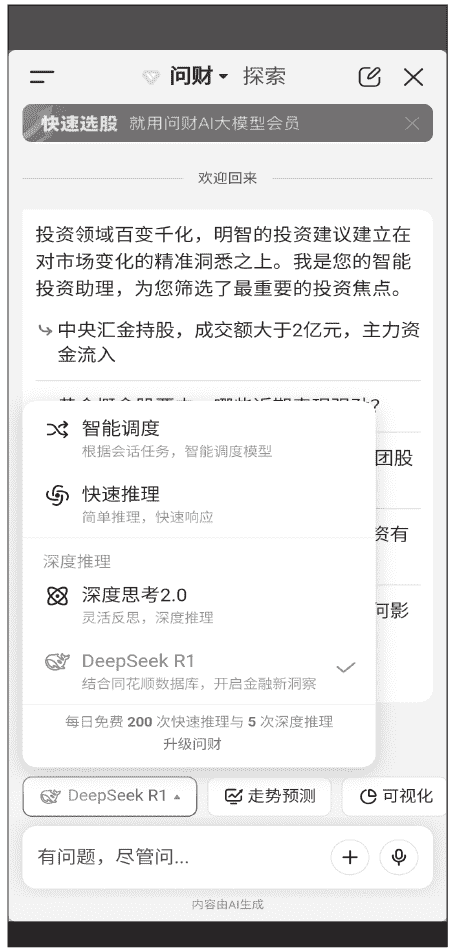

图 2-1 “问财”大模型中集成了 DeepSeek R1 模型

下面以 DeepSeek 网页端为例，介绍使用“深度思考”模式的操作方法。

步骤 1 进入 DeepSeek 的对话界面，❶输入相应的提示词；❷单击提示词输入框左下角的“深度思考”按钮，如图 2-2 所示，开启“深度思考”模式后，该按钮会变成蓝色。

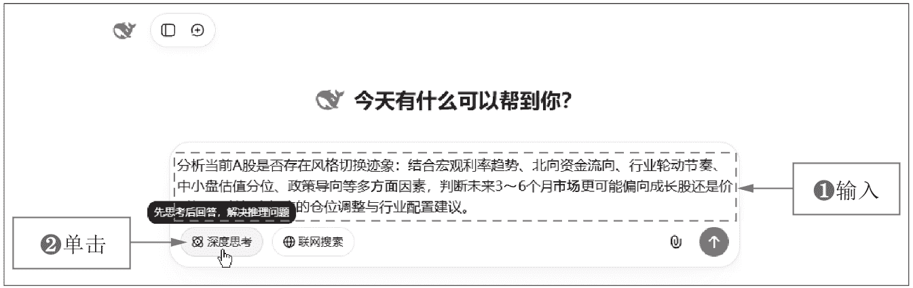

图 2-2 开启“深度思考”模式

步骤 2 单击“发送”按钮 ，即可将提示词发送给 DeepSeek，DeepSeek 会根据要求生成所需的内容。相关提示词和 AI 回复内容如下。

### **提示词**

分析当前 A 股是否存在风格切换迹象：结合宏观利率趋势、北向资金流向、行业轮动节奏、中小盘估值分位、政策导向等多方面因素，判断未来 3～6 个月市场更可能偏向成长股还是价值股，并提出相应的仓位调整与行业配置建议。

## **DeepSeek**

根据你提供的分析要求，我结合当前市场情况、宏观利率趋势、北向资金流向、行业轮动节奏、中小盘估值分位和政策导向等多方面因素，对 A 股市场风格切换可能性及未来 3～6 个月的投资方向进行了综合评估。以下是详细分析。

A 股市场风格切换分析及未来投资策略

1. 宏观利率趋势：实际利率下行利好成长股

当前国内利率环境正经历三阶段发展：2024 年快速下行—2025 年进入低位宽幅震荡—随着物价温和回升、通胀逐步上行，名义利率抬升，实际利率下降。这种利率环境对权益资产整体有利，尤其是对实际利率敏感度较高的成长股。

从全球利率环境来看，市场预期美联储 2026 年降息 3 次。这种全球宽松的货币环境通常有利于成长股的表现，因为成长股的长期现金流折现价值在实际利率下行环境中会得到提升。

……

**2.2.2 使用“联网搜索”模式**

DeepSeek 的“联网搜索”模式是其重要功能之一，基于 RAG（Retrieval Augmented Generation，检索增强生成）技术，能集成外部数据源进行检索，实时获取并整合网络信息，增强信息的时效性，但需过滤噪声数据确保输出结果可靠。

DeepSeek 的“联网搜索”模式适用于查询最新动态、特定网页内容等场景，如查询新闻、天气、股价、赛事结果、最新政策等。对于炒股而言，“联网搜索”模式的意义在于，投资者可借此功能及时获取股市最新资讯、政策动态、公司公告等信息，为股市的投资决策提供参考，避免信息滞后导致的决策失误。

下面以 DeepSeek 网页端为例，介绍使用“联网搜索”模式的操作方法。

步骤 1 进入 DeepSeek 的对话界面，❶输入相应的提示词；❷单击提示词输入框左下角的“联网搜索”按钮，如图 2-3 所示，开启“联网搜索”模式后，该按钮会变成蓝色。

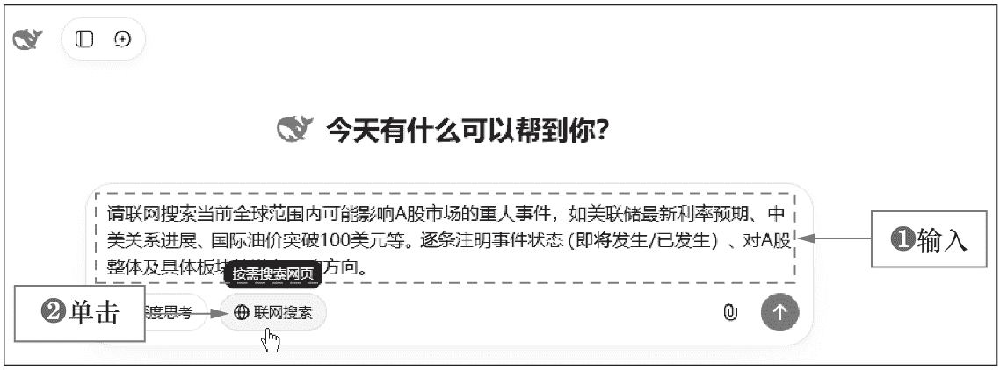

图 2-3 单击“联网搜索”按钮

步骤 2 单击“发送”按钮 ，即可将提示词发送给 DeepSeek，DeepSeek 会根据要求生成所需的内容。相关提示词和 AI 回复内容如下。

## **提示词**

请联网搜索当前全球范围内可能影响 A 股市场的重大事件，如美联储最新利率预期、中美关系进展、国际油价突破 100 美元等。逐条注明事件状态（即将发生/已发生）、对 A 股整体以及具体板块的潜在影响方向。

### **DeepSeek**

根据最新信息，我为你梳理了当前全球范围内可能影响 A 股市场的几项重大事件，包括事件状态、对 A 股整体的潜在影响方向，以及需要关注的具体板块。

1. 美联储降息预期

事件状态：即将发生（北京时间 2025 年 9 月 18 日凌晨 2：00 公布决议）

事件详情：市场普遍预计（概率超 90%）美联储此次将降息 25 个基点，这可能是一轮“预防式降息”的开始。此次降息主要源于近期美国就业增长的明显放缓（8 月非农就业人数仅新增 2.2 万人），同时通胀压力也有所缓解。

对 A 股整体的潜在影响方向：利好。美联储降息通常会为全球市场带来更宽松的流动性环境，可能吸引外资回流估值相对较低的新兴市场。A 股（沪深 300 市盈率约 14 倍）相较于美股（估值超 30 倍）的估值优势，有望吸引全球资金的再配置。

……

▶**专家提醒**

美联储议息、地缘冲突、大宗商品价格异动等事件，可能引发股票价格的剧烈波动。该案例的提示词中强调全球视野与影响映射，要求 AI 不仅需列出事件，还需判断事件状态、对 A 股整体以及具体板块的潜在影响方向，实现从信息到决策的转化。

**2.2.3 上传与解析文件**

DeepSeek 支持多种格式文件的上传与解析，包括 PDF、Word、Excel、PPT、TXT 等，要求单个文件不超过 100MB，单次最多可上传 50 个文件。

DeepSeek 的文件上传与解析功能在炒股方面具有重要作用，投资者可以上传各类文件，如公司财报等，让 DeepSeek 从中快速提取关键信息，如公司的营收状况、利润变化等，帮助投资者分析公司的财务状况和经营成果。另外，DeepSeek 还能对证券资讯进行分析总结，提取有价值的投资建议和市场趋势信息，为投资者制定投资策略和做出投资决策提供有力依据。

例如，上市公司的公告内容庞杂，投资者需快速抓住重点，判断其对股价的潜在影响。下面以 DeepSeek 网页端为例，介绍上传与解析公告文件的操作方法。

步骤 1 进入 DeepSeek 的对话界面，单击提示词输入框右下角的“上传附件”按钮 ，如图 2-4 所示。

图 2-4 单击“上传附件”按钮

步骤 2 弹出“打开”对话框，选择相应的上市公司公告文件，如图 2-5 所示。

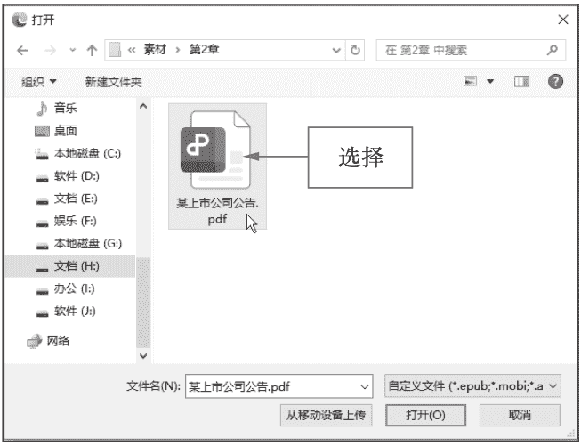

图 2-5 选择相应的文件

步骤 3 单击“打开”按钮，即可上传文件，如图 2-6 所示，DeepSeek 会自动解析上市公司的公告文件。

图 2-6 上传文件

步骤 4 输入相应的提示词，单击“发送”按钮 ，即可将提示词发送给 DeepSeek，DeepSeek 会根据要求生成所需的内容。相关提示词和 AI 回复内容如下。

## **提示词**

请解析我上传的《某上市公司公告》，用简洁的条目列出：①会议通过的主要议案（如取消监事会）；②关键表决数据（如同意率）；③通过的主要议案对公司治理结构的影响；④是否存在潜在利好或风险。每条不超过 30 字。

## **DeepSeek**

① 会议通过取消监事会、修订章程及多项治理制度的议案。

② 各项议案同意率均超 99.95%，反对票极少。

③ 取消监事会，治理结构更集中，决策效率提升。

④ 利好：治理优化；风险：监督力度减小可能导致治理隐患。

### **2.3 使用 DeepSeek 实现智能化股票投资**

将 AI 工具的操作方法转化为实战能力，是智能化投资的核心目标。DeepSeek 在市场资讯获取、宏观经济政策解读等场景中展现出独特价值，通过其强大的数据整合与分析能力，投资者可实时跟踪市场变化，精准锁定优质标的，并动态优化持仓结构。本节聚焦这些实战场景，展示如何通过 DeepSeek 将技术优势转化为投资决策的准确性与效率。

**2.3.1 利用 DeepSeek 实时获取市场资讯**

证券市场中的信息瞬息万变，对投资者来说，“时效就是优势，信息差就是利润空间”。过去，投资者往往要通过浏览大量新闻、研报、公告的方式来获取市场资讯，由于资讯内容太多，难以跟上市场节奏。

而现在投资者可以利用 AI 技术，实现对全球财经动态、资金流向、突发事件的秒级响应与智能筛选，从海量的资讯中精准捕捉关键信号，真正做到“早一步发现，快一步决策”。

例如，股市的盘中行情瞬息万变，热点切换频繁。利用 DeepSeek 筛选当前资金集中流入的板块与驱动因素，有助于短线投资者及时跟进或规避风险，避免“追高被套”。相关案例如下。

## **提示词**

请根据今日实时行情，列出当前涨幅居前三的行业板块，并说明：①领涨原因（如政策、事件）；②主力资金净流入额；③是否具有持续性（简要判断）。

### **DeepSeek**

截至 2025 年 9 月 24 日收盘，涨幅领先的三大行业板块是半导体、电子化学品和电池（包含光伏设备、能源金属等细分领域）。

下面为您分别说明各板块的情况。

1. 半导体板块

领涨原因：板块的爆发主要受 AI 算力需求增长和行业周期复苏的双重驱动，特别是开源 AI 模型降低了部署门槛，刺激了端侧芯片的需求。

资金情况：该板块展现出强大的资金集聚效应，全天主力资金净流入额超 147 亿元，个股如通富微电净买入额高达 11.53 亿元。

……

▶**专家提醒**

该案例提示词中的“今日实时行情”明确了数据的时效性，同时要求说明“领涨原因”和“是否具有持续性”，可以推动 AI 做因果分析而非仅列数据。

**2.3.2 利用 DeepSeek 解读宏观经济政策**

在股市中，宏观经济政策是驱动市场的“无形之手”，从财政政策刺激到货币政策调整，从产业扶持到监管变革，这些政策都可能引发行业格局重塑与资产价格重估。

然而，普通投资者在面对那些表述视角宏观、信息密集的政策文件时，往往难以快速把握其中的重点信息。此时，可以借助 AI 来高效解析政策文本并预判其影响，将晦涩的宏观经济政策转化为清晰的投资信号，真正实现“政策看得懂，机会抓得住”。

例如，同一项宏观经济政策对不同行业的影响差异巨大，此时投资者可以让 DeepSeek 从产业链角度分析政策利弊，识别“真利好”与“伪概念”，避免盲目追涨。相关案例如下。

### **提示词**

请分析央行下调存款准备金率 0.5 个百分点，对“房地产”“银行”“消费”三个行业的影响：①短期影响；②长期逻辑；③是否构成实质性利好。

## **DeepSeek**

央行降准 0.5 个百分点对三大行业的影响分析如下。

房地产：①从短期看，市场流动性增加有助于缓解开发商资金压力并小幅提振购房者信贷信心；②但长期逻辑未变，行业仍处于“去杠杆”周期，政策核心是维稳而非刺激房价上涨；③构成有限利好，对资金链紧绷的企业是雪中送炭，但难以扭转整体调整趋势。

银行：①短期可贷资金规模扩大，利于息差企稳和信贷投放；②长期看利率市场化与金融脱媒持续压缩盈利空间，银行需转向中间业务寻求增长；③属实质性利好，直接增强信贷供给能力并改善流动性指标，但红利大小取决于后续资产质量高低。

……

▶**专家提醒**

该案例的提示词以具体政策为切入点，明确设定“央行下调存款准备金率 0.5 个百分点”这一可量化事件，避免 AI 陷入模糊讨论。同时，提示词中要求分析事件对“房地产”“银行”“消费”三个典型行业的影响，可以有效引导 AI 进行横向对比分析，提高其结论的参考价值。

## **第三章 AI 提示词优化：精准输出智能炒股策略**

**学前提示**

在 AI 炒股场景中，提示词是投资者输入的指令或信息，用于明确任务目标、约束输出范围，是引导 AI 生成符合需求的内容的关键，其质量直接影响结果的准确性和相关性。在运用 AI 辅助股票投资时，提示词的优化至关重要。本章将深入探讨如何通过精心设计的提示词，引导 AI 精准输出智能炒股策略。

### **3.1 AI 炒股提示词的智能生成与优化**

在利用各种 AI 工具辅助炒股时，输入精准的提示词是迈向成功的第一步。本节主要介绍 AI 炒股提示词的智能生成与优化方法，帮助投资者提升提示词的质量与准确性，为后续的炒股策略优化奠定坚实基础。

**3.1.1 使用 AI 智能体生成提示词**

AI 智能体可简称为智能体（Agent），它是一个能“自己思考、自己行动”的 AI 程序，能够在不同任务中稳定扮演角色和保持行为模式。在生成提示词时，AI 智能体能够依据用户需求和既定规则，结合相关数据，自主构建初步框架，并通过不断学习和优化，输出精准、高效的提示词。

在股票投资领域，AI 智能体辅助生成的提示词，能帮助投资者快速聚焦关键信息，提升投资决策的科学性和效率。下面以豆包为例，介绍使用 AI 智能体生成提示词的操作方法。

步骤 1 进入豆包的“新对话”界面，将鼠标指针移至左侧导航栏的“更多”选项上，在弹出的菜单中选择“AI 智能体”选项，如图 3-1 所示。

图 3-1 选择“AI 智能体”选项

▶**专家提醒**

豆包的 AI 智能体是基于抖音“云雀”大模型开发的 AI 系统，具备强大的文本生成、内容创作与信息检索能力。

步骤 2 进入“发现 AI 智能体”界面，❶搜索“DeepSeek 提示词”；❷在搜索结果中选择相应的 AI 智能体，如图 3-2 所示。

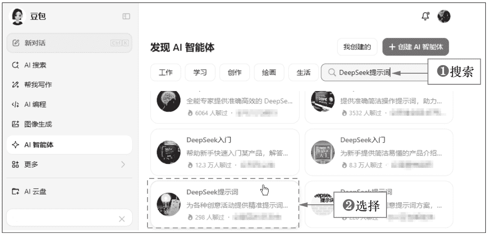

图 3-2 选择相应的 AI 智能体

步骤 3 进入相应 AI 智能体的对话界面，输入相应的提示词，如图 3-3 所示。这里简单列出目的或要求即可。

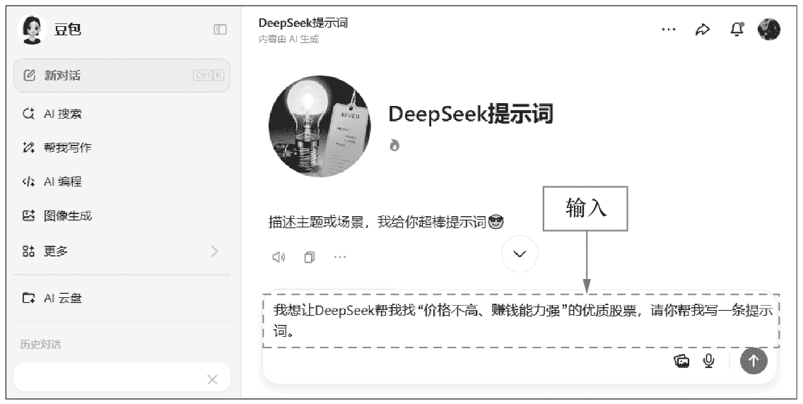

图 3-3 输入相应的提示词

步骤 4 单击“发送”按钮 ，即可将提示词发送给 AI 智能体，它会根据要求生成所需的内容。相关提示词和 AI 回复内容如下。

### **提示词**

我想让 DeepSeek 帮我找“价格不高、赚钱能力强”的优质股票，请你帮我写一条提示词。

**豆包**

筛选近三年利润持续增长、市盈率低于行业均值且非 ST（Special Treatment，特别处理）的稳健型股票，可从以下几方面入手：净资产收益率连续三年大于 15%；资产负债率低于 50%；经营活动产生的现金流量净额为正且逐年增长；机构关注度高，有 5 家以上主流机构给予买入或增持评级。

**3.1.2 使用 AI 智能体优化提示词**

在 AI 赋能股票投资的时代，如何让 AI 更懂投资者的需求？答案或许就在于对提示词的精心雕琢与优化。智谱清言推出的官方 AI 智能体“提示词工程师”，是 AI 炒股的得力助手，它不仅可以生成提示词，而且还擅长对已有提示词进行优化，使其更精准、更高效。

下面以智谱清言为例，介绍使用 AI 智能体优化提示词的操作方法。

步骤 1 进入智谱清言的对话界面，在左侧导航栏的底部单击“智能体中心”按钮，如图 3-4 所示。

图 3-4 单击“智能体中心”按钮

步骤 2 进入“智能体中心”界面，❶搜索“提示词”；❷在搜索结果中选择“提示词工程师”智能体，如图 3-5 所示。

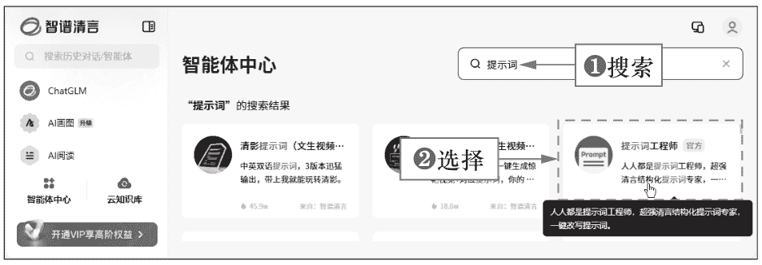

图 3-5 选择“提示词工程师”智能体

步骤 3 进入“提示词工程师”智能体的对话界面，输入相应的提示词，如图 3-6 所示。建议提示词以“优化 prompt”（prompt 即表示提示词）开头，让智能体可以更好地执行提示词优化任务。

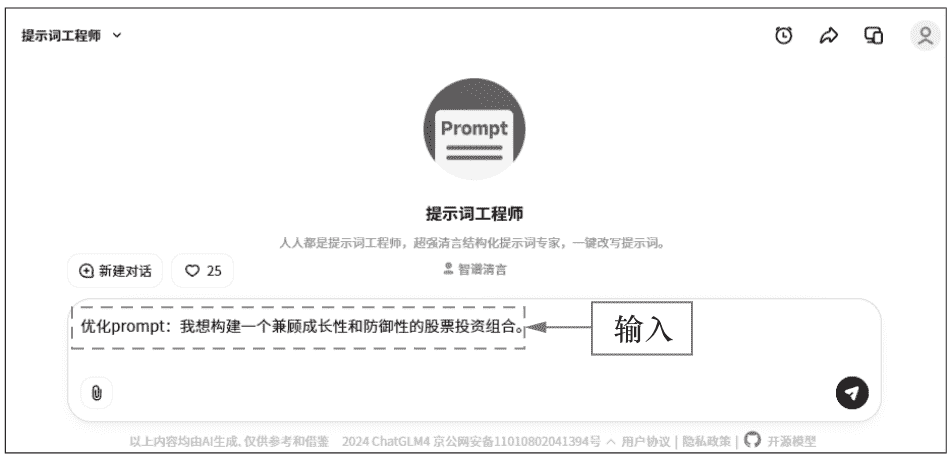

图 3-6 输入相应的提示词

步骤 4 单击“发送”按钮 ，即可将提示词发送给“提示词工程师”智能体，它会根据要求优化提示词，并输出相应的 markdown 代码，如图 3-7 所示。markdown 代码具有增强可读性、提升编辑修改便利性等作用，能提升提示词的管理效率和质量，使投资者更精准地获取智能炒股建议。

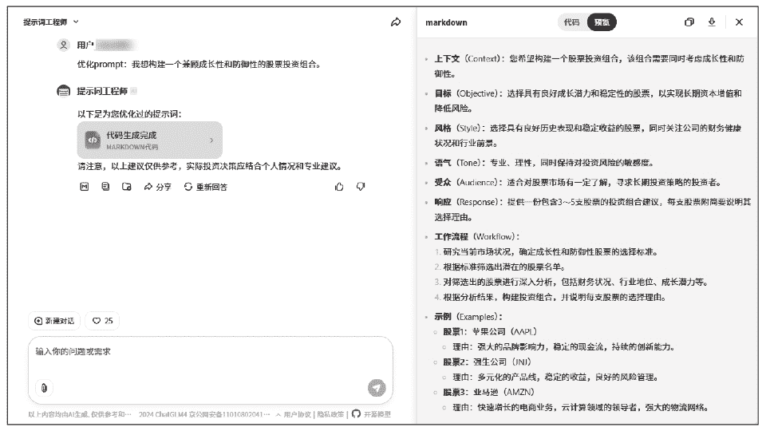

图 3-7 优化提示词并输出相应的 markdown 代码

### **3.2 AI 炒股提示词编写的核心技巧**

本节以 DeepSeek 为例，深入探讨 AI 炒股提示词编写的核心技巧，帮助投资者更好地引导 AI 理解其需求，输出质量更高且更具针对性的炒股建议。

**3.2.1 明确目标：精准定义 AI 任务**

在输入提示词之前，需要明确提示词的主要目标与意图，即你想要得到什么样的结果。例如，用 AI 做行业分析时，常出现“可能上涨”“有一定机会”这类模糊表达，对投资决策的帮助有限。“明确目标”原则要求 AI 必须做出选择——不能模棱两可，如可以在提示词中要求 AI 在“复苏、持平、下行”中选一个发展方向，并用最关键的事实做支撑。相关案例如下。

## **提示词**

请用一句话总结光伏行业未来一年的发展趋势：是复苏、持平还是下行？并列出支撑该判断的两个关键因素。

### **DeepSeek**

光伏行业未来一年（2025—2026 年）将呈现缓慢复苏的趋势。

支撑该判断的两个关键因素如下。

1. 政策引导与供给侧结构性改革：中国政府持续推进光伏行业“反内卷”政策，包括明确禁止销售价低于成本价、推动能耗标准提升以及通过市场化法治化手段淘汰落后产能等政策。这有助于改善市场秩序，引导价格回归合理区间，初步扭转了全行业亏损的局面。

……

▶**专家提醒**

该案例的提示词通过“用一句话总结”和“两个关键因素”，强制 AI 进行归纳与优先级排序，避免泛泛而谈，有助于 AI 输出明确的行业观点，为仓位调整、板块轮动提供依据。

**3.2.2 优化内容：提升 AI 输出质量**

在设计提示词的内容时，我们要追求质量而非数量，尽可能提供详细、准确、具有启发性的信息，以激发 AI 的创造力；同时，还要避免提供过多的限制性信息，给 AI 留下一定的自由发挥空间。

例如，如果提示词内容为“比较一下光伏和储能行业”，AI 可能随意罗列几点，内容缺乏结构性。优化提示词内容的关键是提供分析框架，如“从政策支持、技术进步、盈利能力三个维度对比”，这样 AI 输出的内容才会系统、全面，而不是碎片化的。相关案例如下。

## **提示词**

请从“政策支持力度、技术进步速度、龙头企业盈利能力”三个维度，对比光伏与储能行业的发展前景，每个维度用一句话总结。

## **DeepSeek**

根据提供的搜索结果，我从“政策支持力度、技术进步速度、龙头企业盈利能力”三个维度对光伏与储能行业发展前景进行对比分析，每个维度的总结如下。

1. 政策支持力度

储能行业受益于国家层面《新型储能规模化建设专项行动方案（2025—2027 年）》的直接推动，政策目标具体（如 2027 年全国新型储能装机规模达到 1.8 亿千瓦以上），并强调技术多元与市场机制完善。

……

▶**专家提醒**

该案例的提示词明确给出三个可比维度，并要求“每个维度用一句话总结”，既保证分析结构完整，又保证输出内容简洁。这种“框架+约束”的提示词写法，是提升 AI 输出质量的经典策略。

**3.2.3 示例引导：让 AI 更理解需求**

投资者在提示词中可以给 AI 提供一些示例和引导，从而帮助 AI 更好地理解需求。例如，在使用同花顺的条件选股功能时，虽然该功能支持自然语言处理，但如果投资者表达不清，也会导致选股结果不准。此时，投资者可以通过提供一个清晰示例，来引导 AI 模仿其格式和语气，生成更精准的条件选股语句。相关案例如下。

### **提示词**

请参考下面这句话的格式和语气，生成新的条件选股语句，帮我筛选股息高的股票。

示例：选出股价创 60 日新高且成交量大于 5 日均量 1.5 倍的股票。

### **DeepSeek**

选出股息率高于 5%且连续三年股息增长的股票。

▶**专家提醒**

该案例的提示词高效地引导了 AI 模仿示例精准、简洁的技术分析文风，生成了符合特定需求且格式标准的条件选股语句，保证了结果的可直接使用性。图 3-8 所示为 AI 生成的条件选股语句使用效果。

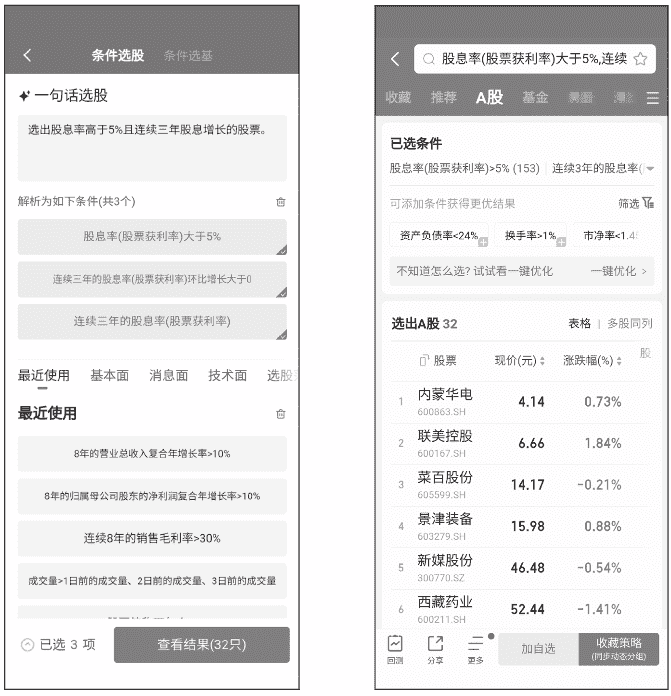

图 3-8 AI 生成的条件选股语句使用效果

**3.2.4 格式规范：使 AI 回复结构化**

投资者可以对 AI 输出的格式提出要求，如要求以列表形式回复、限定回复字数等，以便得到更易于消化的回复。例如，用 AI 分析市场情绪时，它常常会堆砌无关细节，设置“三点式+一句话”的格式要求，可以引导 AI 输出结论导向型内容，而非现象描述，适配快速决策场景。相关案例如下。

## **提示词**

请用三点式结构总结当前市场情绪：①强度；②主要驱动；③短期方向。每点用一句话总结。

### **DeepSeek**

当前市场情绪整体偏谨慎观望，强度温和但分化明显。主要驱动来自政策（如国内“反内卷”政策、美联储降息）预期与资金结构变化。短期方向预计延续震荡趋势，待 9 月（2025 年）下旬季节性压制缓解后可能迎来跨节行情布局机会。

▶**专家提醒**

该案例的提示词采用了“三点式”和“一句话”的双重格式约束，AI 必须压缩信息，从而帮助投资者快速判断市场状态，辅助调整持仓。

**3.2.5 角色模拟：增强场景适配性**

投资者可以让 AI 扮演一个角色并提出问题，这样可以为 AI 提供更明确的情境。需要注意的是，角色设置要具体和明确，如专业股票研究员、以风险控制为导向的量化分析师或者资深 A 股市场策略分析师等。

例如，政策驱动是 A 股的重要变量，但普通分析常停留在“利好行业”层面。投资者可以让 AI 扮演“头部私募基金的投研总监”，使其从产业研究和投资决策的双重视角，构建“政策—产业链—企业盈利”的完整逻辑链。相关案例如下。

### **提示词**

请你扮演头部私募基金的投研总监，负责制定宏观与行业策略。请分析《新能源汽车产业发展规划（2021—2035 年）》对“比亚迪”的影响：①政策核心条款；②上游锂电材料行业受益逻辑；③未来两年盈利预期变化。请在 200 字内完成专业分析。

### **DeepSeek**

《新能源汽车产业发展规划（2021—2035 年）》对比亚迪的影响分析如下。

1. 政策核心条款：《新能源汽车产业发展规划（2021—2035 年）》提出到 2025 年新能源汽车新车销售量达到汽车新车销售总量的 20%左右，并支持优势企业兼并重组、做大做强。这为比亚迪提供了广阔的市场空间和政策支持，助力其巩固行业龙头地位。

2. 上游锂电材料行业受益逻辑：《新能源汽车产业发展规划（2021—2035 年）》鼓励企业、提高关键资源保障能力，比亚迪通过签署长期供货协议（如丰元股份磷酸铁锂材料供货协议）和投资锂矿项目（如宜春电池级碳酸锂项目）强化供应链稳定性，降低成本波动风险。

……

▶**专家提醒**

该案例的提示词通过“扮演头部私募基金的投研总监”，为 AI 设定了一个专业身份，有助于增强其生成内容的可信度。

### **3.3 AI 炒股提示词的进阶使用策略**

当投资者掌握了提示词的基础编写技巧后，如何进一步挖掘其潜力成为关键。本节以 DeepSeek 为例，介绍 AI 炒股提示词的进阶使用策略，包括直接提问、指令式提问等方式，旨在激发 AI 的创造力与逻辑性，帮助投资者突破传统思维定式，设计出信息密度和逻辑连贯性高的提示词，实现在复杂炒股场景下多样化、精准化的策略输出。

**3.3.1 直接提问：简洁高效**

在编写 AI 提示词时，“直接提问”是一种高效且实用的策略，其核心在于通过简洁、直接的语言表达自己的需求，确保 AI 能够迅速而准确地理解并回应。

例如，在快速决策场景中，投资者不需要长篇大论的分析，而是需要一个明确的结论。投资者采用“直接提问”策略，可以跳过背景铺垫和逻辑推导，直击核心问题，让 AI 以最短路径输出有关“流入/流出”的结论，提升信息获取效率。相关案例如下。

## **提示词**

最近 2 个交易日，主力资金是流入还是流出光伏板块？

### **DeepSeek**

光伏板块在近期（主要参考 2025 年 9 月 16 日和 17 日的资金流向数据）整体呈现主力资金净流出的状态，但板块内部也存在分化。

整体板块资金动向

2025 年 9 月 16 日：光伏设备板块（申万行业指数）当日虽然上涨 0.76%，但主力资金净流出 11.31 亿元；同时，游资净流入 5521.18 万元，散户资金净流入 10.76 亿元。

相关 ETF（Exchange Traded Fund，交易型开放式指数基金，又称指数股）动向：跟踪光伏板块的光伏 50ETF（159864）在 9 月 16 日当日净流出 9829.04 万元，近 30 个交易日中有 17 天资金净流出，累计流出 1.39 亿元，其份额也减少了 1.69 亿份，规模跌破 7.20 亿元。

……

▶**专家提醒**

该案例的提示词采用了“是 A 还是 B”二选一的问题结构，强制 AI 做出明确判断。另外，提示词通过“最近 2 个交易日”限定了时间范围，同时用“主力资金”明确核心指标。

该案例的提示词无修饰、无铺垫，完全遵循“简洁高效”原则，能够帮助投资者快速识别行业热度变化、判断热点切换时机，适用于早盘策略会、盘中调仓等高时效决策场景。

**3.3.2 指令式提问：明确操作步骤**

采用“指令式提问”策略，能够显著提升 AI 的执行效率和回复结果的准确性。“指令式提问”策略强调在提问时直接给出明确的操作指令，让 AI 能够迅速理解并执行相应的任务。

例如，上市公司的财报信息通常比较庞杂，人工提取关键信息耗时且易错。通过“指令式提问”策略，直接要求 AI“提取并列出”特定指标，可使其跳过无关内容，精准定位关键数据，实现信息的高效获取。相关案例如下。

## **提示词**

请从贵州茅台 2024 年年报中提取以下数据并按顺序列出：营业收入、归母净利润、分红总额、净资产收益率。

### **DeepSeek**

根据贵州茅台 2024 年年报，其主要财务数据如下。

1. 营业收入：1741.44 亿元（人民币，下同），同比增长 15.66%。

2. 归母净利润：862.28 亿元，同比增长 15.38%。

3. 分红总额：647 亿元（含税），其中 300 亿元已派发，分红金额创历史新高。该总额对应每股分红 27.673 元（含税）。

4. 净资产收益率：36.02%（加权平均）。

▶**专家提醒**

该案例提示词中的“请从……中提取……并按顺序列出”是标准的动作指令，明确指定信息来源（年报）和目标字段（4 项财务指标），避免 AI 自由发挥。另外，提示词中的“按顺序列出”要求，进一步规范了 AI 的输出格式，确保输出结果结构化。

该案例中通过“指令式提问”策略编写的提示词，让 AI 从财报中提取关键数据，这样投资者无须翻阅包括大量信息的年报，即可获得核心财务数据，便于快速对比历史表现或对标同行水平，提升研究效率。

**3.3.3 模板化提问：规范输出格式**

在编写 AI 提示词时，“模板化提问”是一种高效且有序的策略，它通过预设的模板来规范 AI 的输出格式和内容结构，确保结果的统一性和可预测性。

例如，在日常研究中，投资者常常需要快速获取多只股票的对比信息，但 AI 自由输出的内容结构不一（有的先讲业绩，有的先讲技术面），难以进行横向比较。投资者采用“模板化提问”策略，通过预设统一字段，强制 AI 按固定结构输出内容，确保 AI 每次回复的格式一致，便于进行归档、对比和批量处理。相关案例如下。

## **提示词**

请根据最新的光伏行业研报，按以下格式总结。

【核心驱动】：

【当前景气度】：

【受益环节】：

【操作建议】：

每项用一句话概括。

### **DeepSeek**

光伏行业最新研报核心观点总结如下。

【核心驱动】：光伏行业“反内卷”政策有望逐步落地，包括能耗标准趋严（如多晶硅综合能耗指标降幅达 30%～40%）、遏制低价无序竞争及产能整合等政策。

【当前景气度】：行业处于触底复苏阶段，产能利用率不足 60%，全行业普遍亏损；但硅料价格自 2025 年 7 月以来显著回升（涨幅超 30%），头部企业利润开始恢复。

【受益环节】：各环节龙头企业和推动 N 型 TOPCon（Tunnel Oxide Passivated Contact，隧穿氧化层钝化接触）、BC（Back Contact，背接触）电池等技术迭代的头部企业优先受益，硅料环节因产能出清和价格反弹弹性更大。

【操作建议】：建议关注行业底部布局机会，重点配置具备技术优势和成本控制能力的龙头企业的股票，同时跟踪政策落地及组件涨价传导情况。

……

▶**专家提醒**

该案例提示词中的“按以下格式总结”明确要求结构统一，字段设计体现了“驱动—景气度—受益—操作”的产业链逻辑，同时“每项用一句话概括”可以防止 AI 复制原文段落。

该提示词模板具有通用性，适用于风电、半导体等其他行业，可以帮助投资者在短时间内把握多个行业研报的核心观点，且支持跨行业轮动决策，同时便于建立行业数据库进行回溯分析。

**3.3.4 整合式提问：提高信息密度**

“整合式提问”策略即将多个相关问题整合到一条提示词中，可以显著提高 AI 输出内容的信息密度。

例如，投资者在判断行业轮动时，需综合政策动向、产业链景气度、资金偏好等多重因素，若逐项向 AI 提问，易导致信息脱节。利用“整合式提问”策略，可让 AI 在一次响应中构建完整逻辑链条，输出更具操作性的结论。相关案例如下。

▶**专家提醒**

行业轮动是指在股票市场中，受经济周期波动、政策变化等因素影响，资金在不同行业板块之间流动，导致各行业表现此起彼伏、轮流领先的现象。投资者对行业轮动进行判断的目的是根据宏观经济环境变化主动调整投资组合以优化收益。

## **提示词**

请分析近期新能源汽车政策调整的影响：①核心政策变化；②上游锂电材料行业景气度变化；③主力资金是否流入该板块；④该板块当前是否具备配置价值。请简要回答。

## **DeepSeek**

根据最新信息，以下是针对新能源汽车政策调整的分析。

1. 核心政策变化：八部门（指工业和信息化部、公安部、财政部、交通运输部、商务部、海关总署、市场监管总局、国家能源局）联合印发《汽车行业稳增长工作方案（2025—2026 年）》，明确提出 2025 年力争实现全年汽车销量约 3230 万辆，其中新能源汽车销量约 1550 万辆，同比增长约 20%，并推进公共领域车辆全面电动化先行区试点及有条件批准 L3 级车型生产准入。

2. 上游锂电材料行业景气度变化：碳酸锂市场呈现“供需两旺”格局，“金九银十”旺季特征显现，磷酸铁锂排产创新高，储能订单涨势强劲，库存加速去化。

3. 主力资金是否流入该板块：主力资金近期流入汽车板块，例如比亚迪单日获主力资金净流入超 8 亿元，整个汽车板块在特定交易日获主力资金净流入 31.66 亿元。

4. 该板块当前是否具备配置价值：在政策目标明确、上游行业景气度回升及资金关注度提升的背景下，新能源汽车板块目前具备配置价值。

▶**专家提醒**

该案例的提示词以“政策—产业链—资金—配置”的顺序将 4 个问题整合到一起，体现逐步分析的逻辑，其中：“是否流入”“是否具备”可以引导 AI 做判断，而非仅描述现象；“简要回答”可以确保 AI 的输出内容精练，避免生成冗长的内容。

该提示词通过运用“整合式提问”策略，让 AI 整合后的内容形成“从因到果”的完整判断逻辑链，有助于投资者系统理解政策传导路径，快速识别行业轮动机会，避免因信息碎片化作出片面决策。

**3.3.5 创新式提问：突破常规思维**

采用“创新式提问”策略编写的提示词，能够激发 AI 进行非传统的思考，鼓励 AI 生成独特、新颖的见解和解决方案。这种策略强调跳出常规框架，勇于尝试不同的方法和思路，以激发创意的火花。

例如，传统分析聚焦财务与技术指标，但市场情绪变化常领先于价格变化。而采用“创新式提问”策略，可以引导 AI 跳出财务报表和 K 线图，从微博热搜、抖音热点、股吧讨论热度等另类数据中挖掘有效信息，捕捉情绪拐点。相关案例如下。

▶**专家提醒**

情绪拐点指市场情绪从极度悲观向乐观变化的转折点，通常伴随极端情绪被释放后的反弹或反转行情。情绪拐点的判断需对技术形态、估值水平和资金流向进行综合分析，而非分析单一指标。

## **提示词**

请设想一种非传统指标：若某消费股的抖音“种草”视频月播放量增长超 50%，这是否可能预示其未来一个月股价会上涨？请分析逻辑链条和潜在风险。

### **DeepSeek**

好的，我们来详细分析“抖音‘种草’视频月播放量增长超 50%”作为非传统指标的逻辑链条和潜在风险。

1. 逻辑链条

这一指标的有效性建立在从“流量关注”到“市场预期”再到“实际业绩”的传导机制上。其预示股价上涨的逻辑链条可分为几个关键环节。

（1）前端指标：敏锐的需求洞察

抖音“种草”视频月播放量暴增是一个高频、具有前瞻性的用户行为数据。它直接反映了市场对某品牌或产品的关注度和兴趣度在急剧上升。这种关注度是潜在购买意愿的先行指标，比传统的季度财报数据更及时，能帮助投资者提前感知消费趋势的变化。

（2）营销效能：强大的品牌渗透力与算法赋能

抖音“种草”视频月播放量增长并非孤立事件，它通常伴随着互动行为（点赞、评论、分享）的互动率提升。平台的算法会进一步放大这种效应，将内容推荐给更多潜在客群，形成“曝光—互动—更大曝光”的正向循环。这种低成本、高效率的“爆款”营销能显著提升品牌在特定消费群体（尤其是年轻一代）中的心智占有率，为未来的销售转化打下坚实基础。

……

▶**专家提醒**

该案例的提示词以“请设想一种非传统指标”开头，明确要求 AI 突破常 1 规框架，同时指定“抖音‘种草’视频月播放量”这一非金融数据，强制 AI 跳出传统分析维度，有助于投资者发现“流量即需求”的新逻辑，抢占情绪驱动型的投资机会。

## **第四章 AI 模型部署与应用：本地部署与应用 DeepSeek**

**学前提示**

本章聚焦将 DeepSeek 部署至本地环境并应用于股票投资场景的全流程技术实践。通过软硬件协同优化、前端交互界面定制以及模型微调技术，构建一套完整的 AI 炒股解决方案，内容涵盖从本地环境配置到模型炒股实战的全链路，让大家直观感受 AI 技术在实际股票投资场景中的应用效果。

### **4.1 认识 AI 模型**

要想真正掌握 AI 炒股技术，就必须先了解模型（Model）的基础知识。本节将从 AI 模型的基本概念入手，深入探讨它的工作原理和本地部署准备，帮助大家建立对 AI 模型的初步认识，为学习后续知识做好铺垫。

**4.1.1 什么是 AI 模型？**

这里的模型，特指 AI 领域的模型，它是模仿人类智能的一种数学结构，用于对数据进行处理和分析，从而完成特定的任务，如图像识别、自然语言处理、预测等。模型就像是一个智能的“大脑”，通过学习大量的数据来理解这些数据的模式和规律，并将其应用于完成各种任务。

在 AI 炒股领域，模型通过分析海量历史股票数据，能够挖掘出价格及交易量走势、市场情绪等关键特征。例如，模型可以识别某股票在特定市场条件下的变化模式，如在经济指标发布后成交量和价格的联动变化。这些洞察能够帮助投资者预测价格趋势、制定交易策略、优化投资组合，实现更明智的决策。图 4-1 所示为同花顺“问财”大模型的走势预测功能。

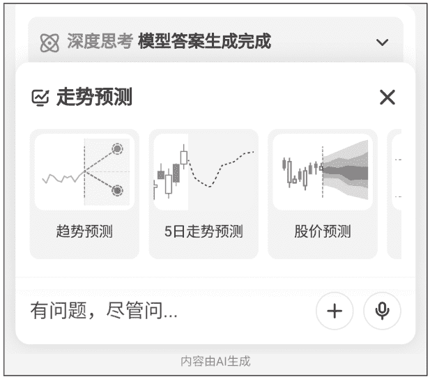

图 4-1 同花顺“问财”大模型的走势预测功能

提到 AI，大家可能常听到机器学习、深度学习等说法，其实它们都围绕一个核心目标：让机器从数据中自主学习规律。这一过程包含以下两个关键阶段。

（1）学习（训练）过程：让模型通过大量数据“总结经验”，形成对特定任务的处理能力。

（2）解释（测试）过程：用训练好的模型处理新数据，验证其是否真正“学会”所需技能。

其中，模型训练过程是 AI 实现智能的基石，它就像人类学习的“刷题阶段”——通过反复接触海量数据，不断修正错误，最终形成精准的判断能力。

**4.1.2 AI 模型的工作原理**

以 DeepSeek 为例，当我们与 AI 展开对话时，背后的模型正进行着一场精密的“文字接龙”游戏。这个看似简单的语言游戏，正是支撑起现代 AI 对话系统的核心机制。

DeepSeek 的本质是一个训练有素的“文字接龙专家”，当我们输入“你的名字是什么？”时，DeepSeek 会启动以下循环机制。

（1）初始输入：将完整问题输入模型。

（2）首词预测：模型输出第一个预测词（如“我”）。

（3）语境拼接：将预测词与原始输入组合（“你的名字是什么？我”）。

（4）迭代接龙：持续预测后续词汇，直到本次对话结束。

DeepSeek 的对话示例如图 4-2 所示。

图 4-2 DeepSeek 的对话示例

逐词生成机制使得 DeepSeek 能够像人类一样构建完整句式。但与传统接龙不同，DeepSeek 的每个预测都建立在概率计算之上，模型会评估所有候选词汇的出现概率，优先选择最合理的选项。

不过，纯粹的基于概率的选择会导致回答刻板、重复，为此 DeepSeek 还引入了“创造性随机”机制，这种设计让 DeepSeek 在保持回答的逻辑性的同时，展现出令人惊喜的创造力。“创造性随机”机制的具体作用如下。

（1）概率扰动：模型不总是选择出现概率最高的词汇，而是随机采纳次优选项。

（2）参数调节：通过调节随机性强度，平衡回答的准确性与创意性。

（3）多样性增强：模型能生成类似“这个问题值得深入探讨”的回复，而非千篇一律的“我不知道”。

在持续对话中，DeepSeek 还通过动态语境拼接维持对话的连贯性，这种设计使得 DeepSeek 能够进行“记得我们上次讨论……”式的深度对话，具体作用如下。

（1）会话记忆：将历史对话与当前问题组合输入，例如“昨天你说……今天我觉得……”。

（2）限制长度：例如，DeepSeek-V3 模型支持 128000 个 Token 的上下文长度，相当于约 10 万个汉字或 9.6 万个英文单词。

▶**专家提醒**

在自然语言处理中，Token 是文本的基本单位，可以是一个字、一个词或一个子词。

（3）注意力聚焦：自注意力机制自动识别关键信息，避免语境过载。

支撑这场“文字接龙”游戏的，是深度神经网络的精密结构——Transformer 架构。这种架构使模型能够同时处理句子开头与结尾的隐含关联，实现全局语义理解。DeepSeek 的“接龙技艺”通过强化学习练成，这个过程类似于人类通过大量阅读掌握语言规律，但效率提升了百万倍，具体如下。

（1）预测训练：基于海量文本练习预测下一个词。

（2）误差修正：将预测结果与真实文本对比。

（3）参数微调：通过反向传播算法优化神经网络。

（4）迭代优化：在万亿词库中完成知识内化。

当我们惊叹于 AI 的创作能力时，不应忘记：每个流畅回答的背后，都是万亿次神经元联动的精密计算。AI 模型的发展，不仅是技术突破的缩影，更是人类探索智能本质的重要里程碑。

**4.1.3 本地部署 AI 模型的准备**

如今，很多企业发布了开源大模型，如 DeepSeek、豆包等，这些模型支持本地运行，无须将数据上传至云端，能有效降低数据泄露风险。同时，这些模型还具备强大的扩展能力，可接入企业知识库和行业数据库，通过定制化训练适配特定业务场景，满足个性化需求，如股票投资场景。

在本地部署 AI 模型前，模型参数规模的大小不同，对硬件配置的要求有所不同。以 DeepSeek 为例，具体配置如下。

（1）入门配置：建议使用配备 NVIDIA（英伟达）显卡（显存≥8GB）的设备，适合运行 7B/8B 模型，同时确保安装了最新的显卡驱动。

（2）高性能配置：对于参数规模更大的 14B 模型，建议使用配备显存≥16GB 的 NVIDIA 显卡的设备。图 4-3 所示为 NVIDIA 推出的 GeForce RTX 5090 D 显卡，配备 32GB 显存和 21760 个 CUDA（Compute Unified Device Architecture，统一计算设备架构）核心，显存带宽高达 1792 GB/s，具有强大的 AI 算力。

图 4-3 GeForce RTX 5090 D 显卡

▶**专家提醒**

CUDA 是 NVIDIA 的并行计算平台和编程模型，允许开发者使用 C/C++、Python、Fortran 等语言调用 GPU（Graphics Processing Unit，图形处理单元）的并行计算能力。

（3）无独立显卡配置：即使没有独立显卡，也可以使用 CPU（Central Processing Unit，中央处理器）模式运行参数规模小的模型，其性能大约是 GPU 的 20%。

另外，本地部署 AI 模型（以 DeepSeek 为例），内存要求至少为 16GB，推荐使用 32GB 内存，以确保模型处理长文本时的流畅性。在存储空间方面，至少需要 50GB 的可用存储空间，建议使用 SSD（Solid State Disk，固态硬盘）以加快模型的加载速度。

### **4.2 DeepSeek 模型部署与前端交互界面搭建**

随着 AI 技术的飞速发展，本地部署 AI 模型炒股已成为金融投资领域的新趋势。在这一背景下，本节将讲解 DeepSeek 模型部署与前端交互界面搭建方法，让投资者能够清晰地理解如何将这一强大的 AI 工具应用到股票投资中。

**4.2.1 配置 Python 环境**

在部署 DeepSeek 模型之前，必须先确保计算机中的操作系统已安装必要的依赖项。以 Windows 系统为例，需要安装最新版的 Visual Studio（微软推出的一款功能强大的集成开发工具）运行库，还需要确保 Python 版本为 3.8 或以上。

Python 是一种广泛使用的高级编程语言，由吉多·范罗苏姆（Guido van Rossum）于 1989 年底发明，第一个公开发行版本发行于 1991 年。Python 的设计哲学强调代码的可读性和语法的简洁性，这使得它被认为是一种易于学习的编程语言。下面介绍手动下载、安装与配置 Python 环境的操作方法。

步骤 1 进入 Python 官网，❶将鼠标指针移至“Downloads”（下载）按钮上；❷在弹出的“Download for Windows”（Windows 版下载）面板中单击“Python”（Python 后面的数字为版本号）按钮，如图 4-4 所示，即可下载 Python 安装程序。

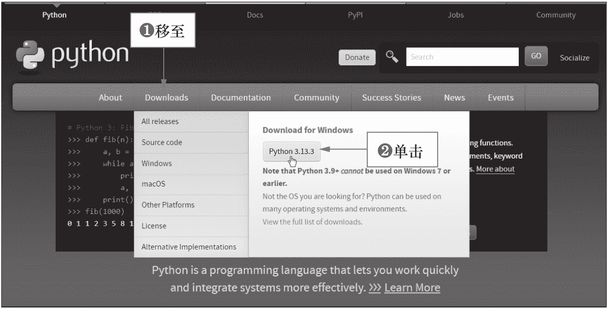

图 4-4 单击“Python”按钮

步骤 2 下载好 Python 安装程序后，进入相应文件夹，双击该安装程序，如图 4-5 所示。

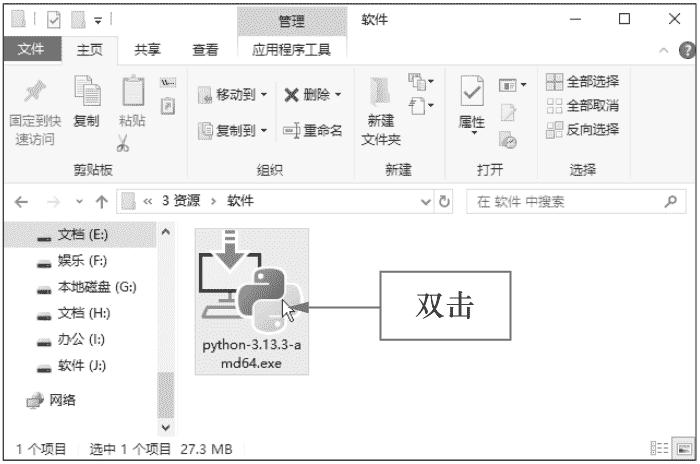

图 4-5 双击 Python 安装程序

步骤 3 执行操作后，弹出 Python 的安装对话框，选择“Customize installation”（自定义安装）选项，如图 4-6 所示，根据提示进行安装。

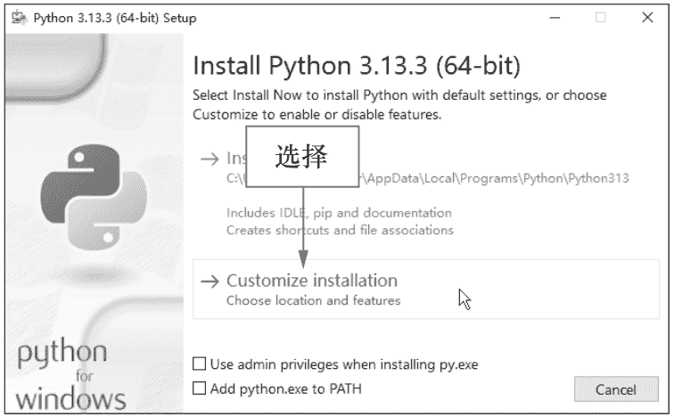

图 4-6 选择“Customize installation”选项

步骤 4 在安装 Python 的过程中需要注意，在“Advanced Options”（高级选项）界面中，需要选中“Add Python to environment variables”（将 Python 添加到环境变量）复选框，如图 4-7 所示，可自动同步环境变量。

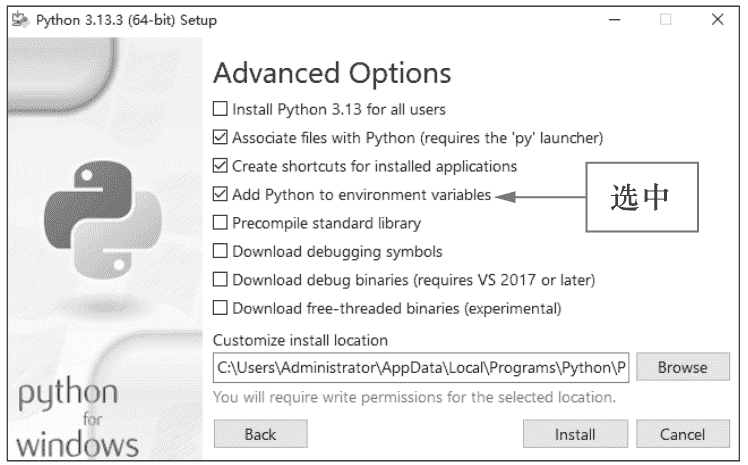

图 4-7 选中相应复选框

步骤 5 如果在安装 Python 时没有自动同步环境变量，则需要手动添加环境变量。在“此电脑”图标上单击鼠标右键，在弹出的快捷菜单中选择“属性”选项，如图 4-8 所示。

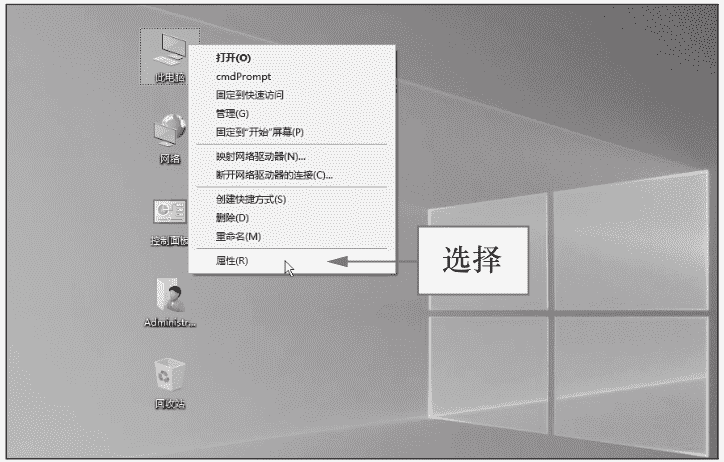

图 4-8 选择“属性”选项

▶**专家提醒**

环境变量是操作系统用来存储有关系统行为、用户偏好设置和应用程序配置信息的变量。正确配置环境变量，对于确保 Python 及其相关工具（如 pip 包管理器）能够从任何目录中被调用至关重要。

步骤 6 打开“设置”窗口，在“关于”界面中单击“高级系统设置”链接，如图 4-9 所示。

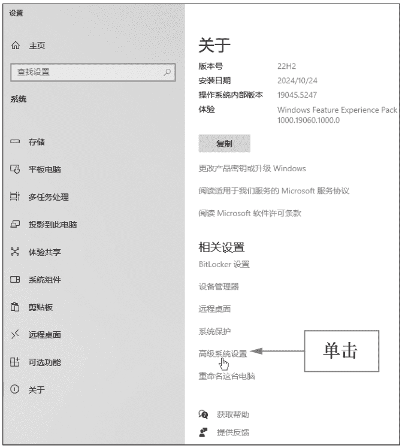

图 4-9 单击“高级系统设置”链接

步骤 7 执行操作后，弹出“系统属性”对话框，并自动切换至“高级”选项卡，单击“环境变量”按钮，如图 4-10 所示。

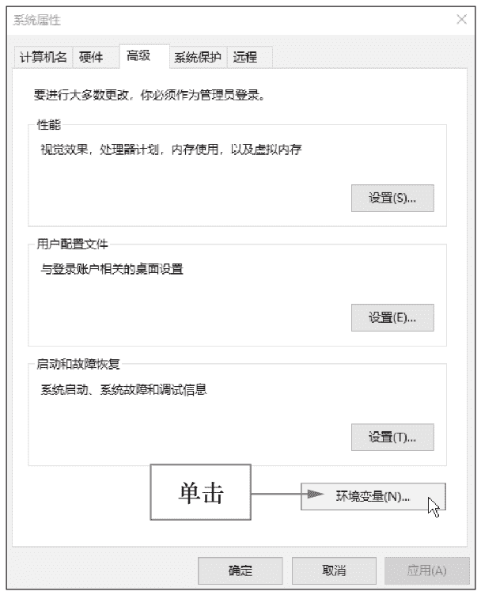

图 4-10 单击“环境变量”按钮

步骤 8 弹出“环境变量”对话框，在“系统变量”列表框中双击“Path”（路径）选项，如图 4-11 所示，或者选择“Path”选项后单击“编辑”按钮。

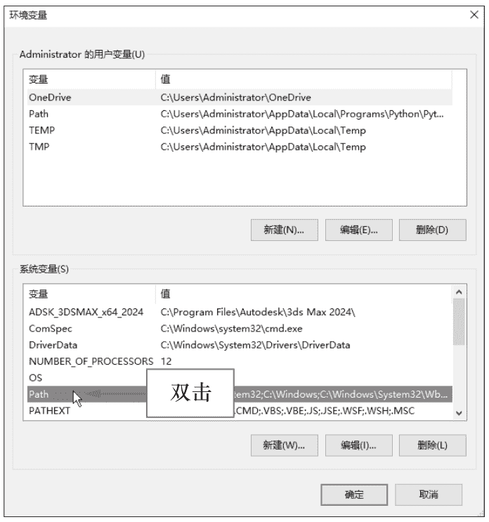

图 4-11 双击“Path”选项

步骤 9 执行操作后，弹出“编辑环境变量”对话框，❶单击“新建”按钮，新建一个环境变量值；❷输入 Python 的安装地址，如图 4-12 所示。

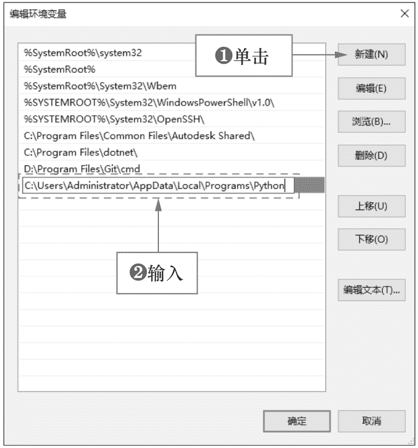

图 4-12 输入 Python 的安装地址

步骤 10 在任意文件夹的地址栏内输入“cmd”并按【Enter】键，打开命令提示符窗口，输入“python–V”并按【Enter】键，如果返回一个版本号，则说明 Python 安装成功，如图 4-13 所示。

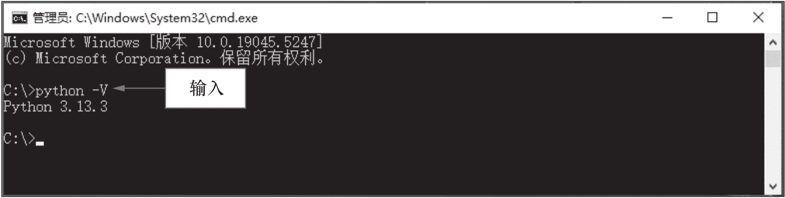

图 4-13 测试 Python 是否安装成功

Python 等依赖项是本地运行 DeepSeek 所需的基本环境，其核心作用是为模型提供运行载体与功能支撑。

**4.2.2 安装 Ollama 工具**

本次 DeepSeek 模型的本地部署需借助 Ollama 工具完成。Ollama 官网提供了丰富的模型资源，除 DeepSeek 系列外，还有 Llama 系列、Qwen 系列等众多模型。

Ollama 优势显著，它拥有多个版本，可适配不同的操作系统，无论是 Linux 系统还是 Windows 系统都能找到对应的安装包（Linux 系统版为安装脚本，Windows 系统版为 exe 文件），安装过程简单，安装完成后在控制台即可运行。

下面介绍安装 Ollama 工具的操作方法。

步骤 1 进入 Ollama 官网，单击“Download”（下载）按钮，如图 4-14 所示。

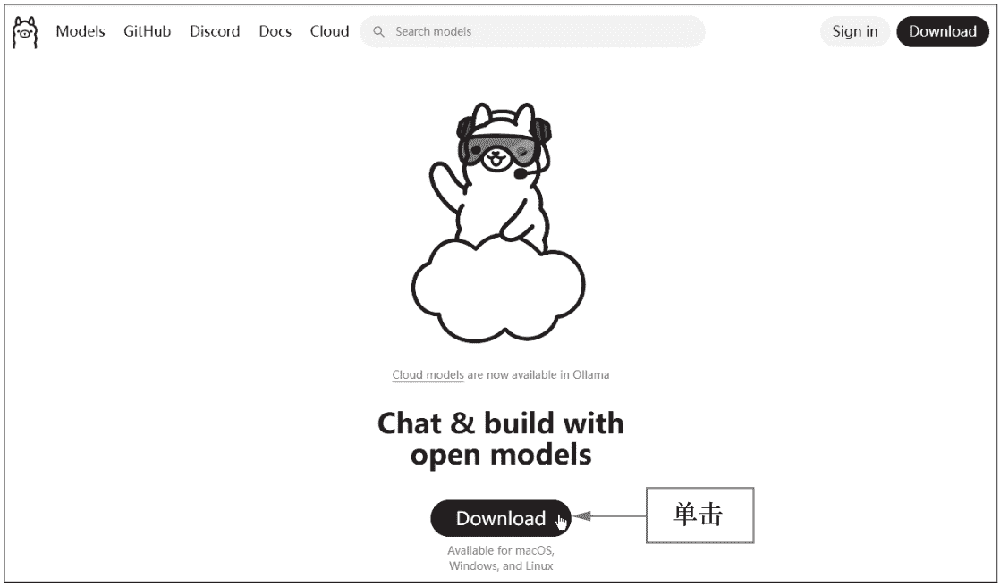

图 4-14 单击“Download”按钮

步骤 2 进入“Download Ollama”界面，投资者可以根据自己的操作系统下载对应的版本，以 Windows 系统为例，单击“Download for Windows”按钮，如图 4-15 所示，即可下载 Ollama 安装程序。

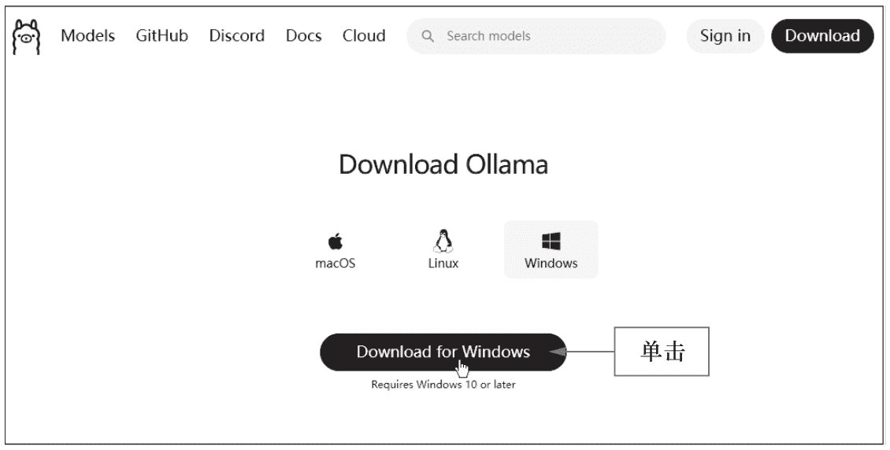

图 4-15 单击“Download for Windows”按钮

步骤 3 进入 Ollama 安装程序所在的文件夹，双击 Ollama 安装程序，如图 4-16 所示。

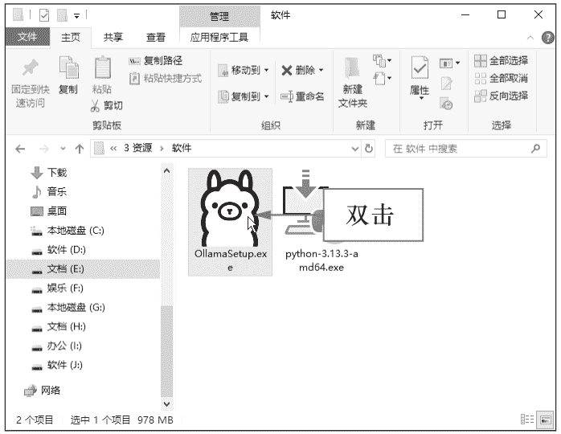

图 4-16 双击 Ollama 安装程序

步骤 4 执行操作后，弹出“Setup”（安装，右侧为 Ollama 的版本号）对话框，单击“Install”（安装）按钮，如图 4-17 所示。

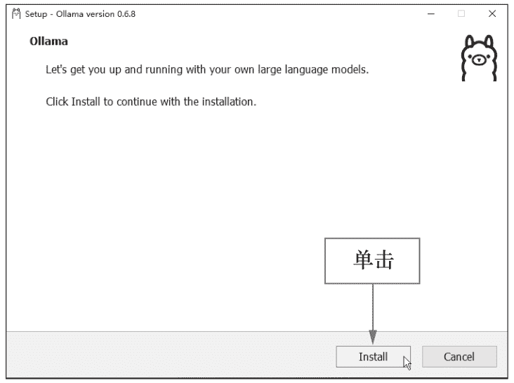

图 4-17 单击“Install”按钮

▶**专家提醒**

Ollama 提供了命令行工具，通过简单的命令就能实现模型的下载、运行、查看等操作，如利用 GPU 计算能力加速下载和运行模型。

步骤 5 执行操作后，进入“Installing”（正在安装）界面，显示 Ollama 的安装进度，如图 4-18 所示。

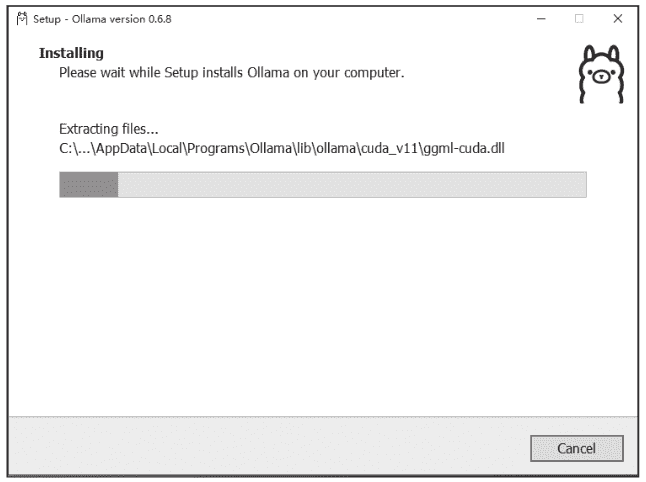

图 4-18 显示 Ollama 的安装进度

步骤 6 安装完成后，“Setup”对话框会自动退出。在任意文件夹的地址栏内输入“cmd”并按【Enter】键，打开命令提示符窗口，输入“ollama -v”并按【Enter】键，如果返回一个版本号，则说明 Ollama 安装成功，如图 4-19 所示。

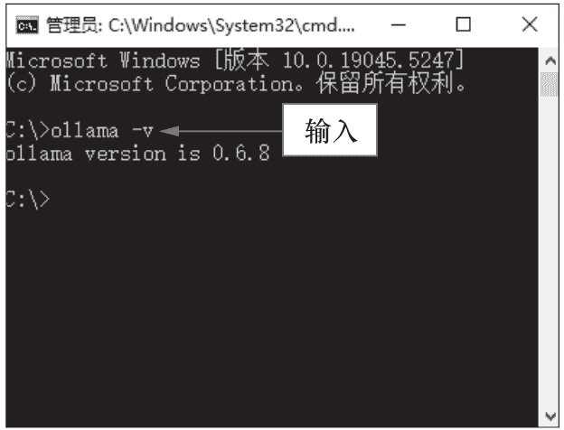

图 4-19 测试 Ollama 是否安装成功

步骤 7 在命令提示符窗口中输入“ollama help”（帮助）并按【Enter】键，即可查看 Ollama 的帮助信息，如图 4-20 所示。

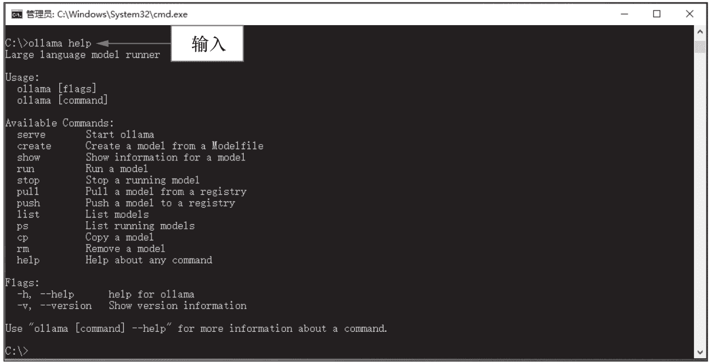

图 4-20 查看 Ollama 的帮助信息

▶**专家提醒**

Ollama 的常用命令及其作用介绍如下。

（1）serve：启动 Ollama 服务，使得模型可以开始运行并响应请求。

（2）create：根据一个 Modelfile 创建一个模型。Modelfile 是一个配置文件，用于定义模型的参数和设置。

（3）show：显示某个模型的信息，包括模型的配置、状态等。

（4）run：运行一个模型，使其开始执行任务。

（5）stop：停止一个正在运行的模型，使其停止执行任务。

（6）pull：从一个模型仓库中拉取模型，并将其下载到本地。

（7）push：将一个模型推送到一个模型仓库中。

（8）list：列出所有已下载或可用的模型。

（9）ps：列出所有正在运行的模型。

（10）cp：复制一个模型到另一个位置或设备。

（11）rm：删除一个不再需要的模型。

（12）help：显示所有命令的帮助信息。

**4.2.3 下载 DeepSeek 模型**

Ollama 是一个免费开源的本地大模型运行平台，可用于简化模型的下载和管理。投资者可以通过 Ollama 快速将 DeepSeek 模型下载到自己的计算机并运行，从而搭建本地的 AI 炒股平台。下面介绍下载 DeepSeek 模型的操作方法。

步骤 1 进入 Ollama 官网，❶在搜索框中输入“DeepSeek-R1”；❷在弹出的列表框中选择“deepseek-r1”选项，如图 4-21 所示。

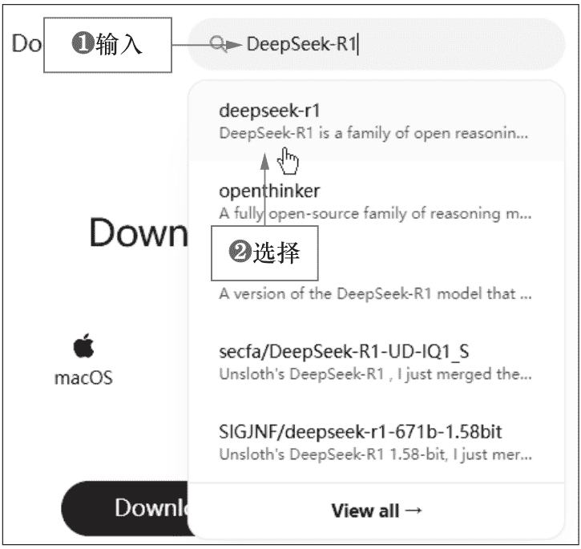

图 4-21 选择“deepseek-r1”选项

步骤 2 进入“deepseek-r1”界面，在“Models”列表中根据计算机配置选择合适的模型，例如这里选择的是 8B 模型（“deepseek-r1：8b”选项），如图 4-22 所示。

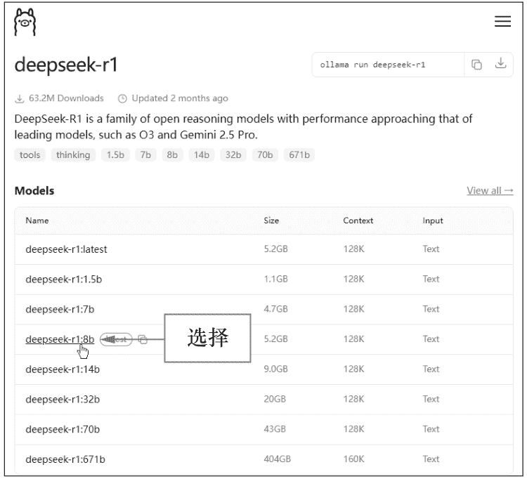

图 4-22 选择合适的模型

▶**专家提醒**

DeepSeek-R1 的不同参数规模（注意，习惯上使用大写英文字母 B 来表示参数规模）版本主要在性能、适用场景和硬件需求上有所不同，以下是主要区别。

（1）1.5B、7B、8B 版本：参数规模相对较小，运行时资源消耗少，适合在本地设备上部署轻量级任务，如小型智能问答系统或简单 AI 助手。1.5B 模型参数规模最小，在 4 核 CPU、8GB 内存的配置下即可运行，无须独立显卡；7B、8B 模型建议最低配置为 8 核 CPU、16GB 内存、12GB 的 RTX 3060 显卡。

（2）14B 和 32B 版本：推理能力显著提升，能处理更复杂的任务，如代码补全和数据分析，但需要高端 GPU 才能发挥最佳性能。14B 模型需 12 核 CPU、64GB 内存、RTX 4090 或 A5000 显卡的配置；从 32B 模型起进入服务器配置级别，建议用 16 核 CPU、512GB 内存、2～4 张 80 GB 的 A100 显卡的配置。

（3）70B 和 671B 版本：代表顶尖水平，70B 模型接近 GPT（Generative Pre trained Transformer，生成式预训练变换器）-4 模型的能力，至少需 32 核 CPU、128GB 内存、2 张 A100 或 4 张 RTX 4090 显卡的配置；671B 模型是顶级大模型，主要面向大规模云端推理，能处理极其复杂的任务，对硬件和计算资源需求巨大，建议用 64 核 CPU、512GB 内存、8 张 A100 或 H100 显卡的配置。

步骤 3 执行操作后，进入 8B 模型的详情界面，单击右侧的 按钮，如图 4-23 所示，复制本地部署模型的命令。

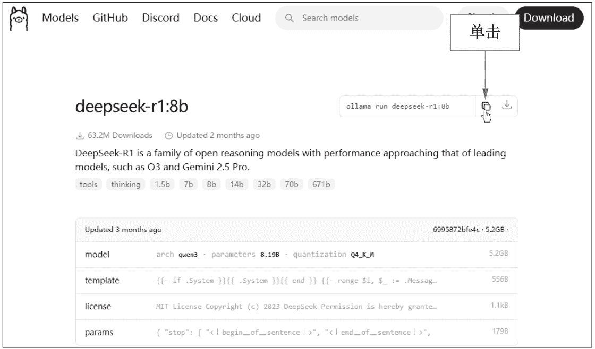

图 4-23 单击相应按钮

步骤 4 复制好命令后，打开命令提示符窗口并粘贴该命令，如图 4-24 所示。

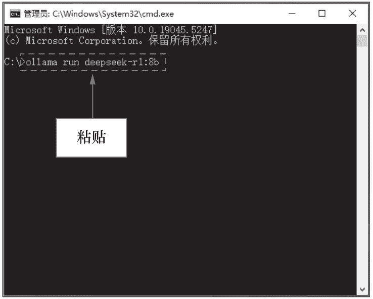

图 4-24 粘贴本地部署模型的命令

步骤 5 按【Enter】键运行命令，即可开始本地部署模型，并显示相应的下载进度和速度，如图 4-25 所示。

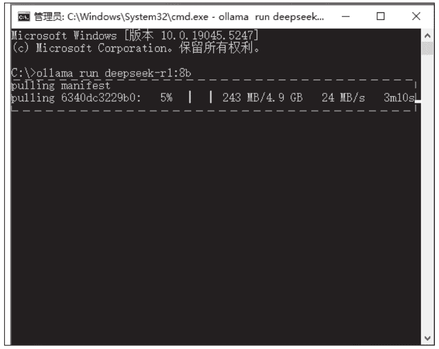

图 4-25 显示相应的下载进度和速度

▶**专家提醒**

“ollama run deepseek-r1：8b”是通过 Ollama 工具在本地启动并运行 DeepSeek-R1 模型 8B 版本的命令。

步骤 6 模型部署完成后，输入相应的提示词进行测试，如“你是谁？你能做什么？”，按【Enter】键确认，将指令发送给模型，模型会根据要求进行回复，如图 4-26 所示。

图 4-26 模型根据要求进行回复

**4.2.4 搭建前端交互界面**

模型部署完成后，要想实现高效、便捷的股票投资分析与决策，前端交互界面的搭建至关重要。Page Assist 插件是一款开源的浏览器扩展程序，主要为本地 AI 模型提供直观的前端交互界面。下面介绍用 Edge 浏览器+Page Assist 插件搭建 DeepSeek 模型的前端交互界面的操作方法。

步骤 1 打开 Edge 浏览器，❶单击地址栏右侧的“扩展”按钮 ；❷在弹出的“扩展”菜单中选择“获取 Microsoft Edge 扩展”选项，如图 4-27 所示。

图 4-27 选择“获取 Microsoft Edge 扩展”选项

▶**专家提醒**

Page Assist 作为浏览器插件，可用于在浏览器中打开侧边栏或 Web UI（Website User Interface，网页用户界面），使投资者与本地部署的 DeepSeek 模型进行对话，从而更便捷地获取智能辅助。

步骤 2 执行操作后，打开“Microsoft Edge 加载项”网页窗口，在搜索栏中输入“Page Assist”，如图 4-28 所示，并按【Enter】键确认。

图 4-28 在搜索栏中输入“Page Assist”

▶**专家提醒**

Microsoft Edge 加载项是小型软件程序，用于自定义和增强 Edge 浏览器的功能，它们可帮助用户更好地控制浏览体验，使上网更轻松、更安全、更高效。

步骤 3 执行操作后，即可显示搜索结果，选择相应的扩展插件，如选择“Page Assist-A Web UI for Local AI Models”（本地 AI 模型的 Web UI），如图 4-29 所示。

图 4-29 选择相应的扩展插件

步骤 4 执行操作后，进入 Page Assist 插件的详情界面，单击右上角的“获取”按钮，如图 4-30 所示。

图 4-30 单击“获取”按钮

步骤 5 执行操作后，在弹出的对话框中单击“添加扩展”按钮，如图 4-31 所示，即可开始安装 Page Assist 插件。

图 4-31 单击“添加扩展”按钮

步骤 6 稍等片刻，弹出的对话框会显示 Page Assist 插件已经成功安装，如图 4-32 所示。

图 4-32 显示 Page Assist 插件已经成功安装

步骤 7 返回 Edge 浏览器，❶单击地址栏右侧的“扩展”按钮 ；❷在弹出的“扩展”菜单中选择相应的 Page Assist 插件，如图 4-33 所示。

图 4-33 选择相应的 Page Assist 插件

步骤 8 执行操作后，进入 Page Assist 插件的对话界面，可以看到界面中间会出现“Ollama 正在运行”的提示信息，说明 Page Assist 插件已经检测到了 Ollama，在上方左侧的下拉列表框中选择本地部署好的 DeepSeek 模型，如图 4-34 所示。

图 4-34 选择本地部署好的 DeepSeek 模型

▶**专家提醒**

注意，在 Page Assist 插件中正式使用 DeepSeek 模型前，最好先配置一个文本嵌入模型，具体方法可以参考 4.3.1 小节。

步骤 9 在输入框中输入提示词，如“股票是什么？”，单击“提交”按钮发送指令，即可调用本地部署的 DeepSeek 模型来回答问题，如图 4-35 所示。

图 4-35 调用 DeepSeek 模型回答问题

### **4.3 DeepSeek 模型微调与 AI 炒股应用**

做好模型的部署后，为了使 DeepSeek 能够更好地契合炒股场景，模型微调不可或缺，这可以让 DeepSeek 为投资者提供更加专业、精准、实用的决策支持。本节将介绍相关的模型微调方法与 AI 炒股应用技巧。

**4.3.1 配置文本嵌入模型**

文本嵌入模型作为模型微调的重要基础，其配置的合理性直接关系到后续模型微调的效果与效率。下面介绍在使用 Page Assist 插件微调 DeepSeek 模型时，如何配置文本嵌入模型，具体操作方法如下。

步骤 1 进入 Ollama 官网，单击界面上方的“Models”链接，如图 4-36 所示。

图 4-36 单击 Models 链接

步骤 2 进入“Models”界面，显示 Ollama 平台上的所有模型，找到并选择相应的文本嵌入模型，如选择“nomic-embed-text”，如图 4-37 所示。

图 4-37 选择相应的文本嵌入模型

▶**专家提醒**

文本嵌入模型是一种将文本数据转换为向量的工具。在微调 DeepSeek 模型时，文本嵌入模型通过对输入文本进行编码，生成固定维度的向量，使文本能够被计算机高效处理。这些向量保留了原始文本的语义信息，通过捕捉词汇间的语义关系，帮助 DeepSeek 模型更好地理解文本内容。这为后续的 DeepSeek 模型微调提供了结构化的输入数据，提升了 DeepSeek 模型对文本数据的理解深度和处理能力。

nomic-embed-text 是一个强大的自然语言处理模型，专注于文本嵌入和语义相似度计算。nomic-embed-text 基于 Transformer 架构，经过大规模文本数据预训练，可将文本转换为捕捉语义信息的向量，适用于文本分类、信息检索、文档聚类、问答系统、文本搜索等多种自然语言处理任务，其支持多种语言，主要针对英语优化，也具备一定跨语言处理能力。

步骤 3 进入文本嵌入模型详情界面，单击右侧的 按钮，如图 4-38 所示，复制本地部署文本嵌入模型的命令。

图 4-38 单击相应按钮

步骤 4 复制好命令后，打开命令提示符窗口并粘贴该命令，按【Enter】键运行命令，即可开始本地部署文本嵌入模型，并显示文本嵌入模型的下载进度和速度，如图 4-39 所示。

图 4-39 显示文本嵌入模型的下载进度和速度

▶**专家提醒**

命令提示符（Command Prompt）窗口是 Windows 系统提供的一个文本界面，用户可以在其中输入命令来执行各种操作。

在 Windows 系统中，可以通过按【Win+R】组合键打开“运行”对话框，然后输入“cmd”并按【Enter】键来打开命令提示符窗口；也可以通过在“开始”菜单中搜索“命令提示符”或“cmd”，来找到并打开命令提示符窗口。

步骤 5 稍等片刻，出现“success”（成功）的提示信息，说明 nomic-embed-text 被成功部署到本地，如图 4-40 所示。

图 4-40 成功部署 nomic-embed-text

步骤 6 在 Edge 浏览器中进入 Page Assist 插件的对话界面，单击右上角的“设置”按钮 ，如图 4-41 所示。

图 4-41 单击“设置”按钮

步骤 7 进入“一般设置”界面，❶在左侧选择“RAG 设置”选项，进入“RAG 设置”界面；❷在“文本嵌入模型”下拉列表框中选择 nomic-embed-text 模型，如图 4-42 所示。单击“保存”按钮保存设置即可。

图 4-42 选择 nomic-embed-text 模型

**4.3.2 构建股票投资知识库**

创建知识库是微调 DeepSeek 模型的关键环节，知识库为模型提供了丰富的专业知识与信息支持。通过合理组织和管理知识库内容，我们能够有效提升模型回答有关股票投资问题的准确性和专业性，使其在实际业务场景中发挥更大价值。下面介绍利用 Page Assist 插件构建一个简单的股票投资知识库的操作方法。

步骤 1 在 Edge 浏览器中进入 Page Assist 插件的“一般设置”界面，❶选择“管理知识”选项进入相应界面；❷单击右上角的“添加新知识”按钮，如图 4-43 所示。

图 4-43 单击“添加新知识”按钮

步骤 2 弹出“添加知识”对话框，❶设置“知识标题”为“股票投资”，给知识库命名；❷在“上传文件”下方的虚线框区域内单击，如图 4-44 所示。

图 4-44 单击虚线框区域

步骤 3 执行操作后，弹出“打开”对话框，❶选择相应的文档；❷单击“打开”按钮，如图 4-45 所示。

图 4-45 单击“打开”按钮

步骤 4 执行操作后，返回“添加知识”对话框，单击“提交”按钮，如图 4-46 所示。

图 4-46 单击“提交”按钮

步骤 5 执行操作后，使用前面配置的文本嵌入模型处理知识库，处理完成后，在“状态”栏中会显示“已完成”，如图 4-47 所示。

图 4-47 完成知识库的处理

**4.3.3 添加 AI 炒股提示词**

提示词在引导模型生成精准回答方面起着至关重要的作用。精心设计提示词的格式、内容与逻辑，能够帮助模型更好地理解有关股票投资问题的语义，从而生成更符合用户需求的高质量答案，提升本地模型在股票投资场景中的实用性。下面介绍添加 AI 炒股提示词的操作方法。

步骤 1 在 Edge 浏览器中进入 Page Assist 插件的“一般设置”界面，❶选择“管理提示词”选项进入相应界面；❷单击右上角的“添加新提示词”按钮，如图 4-48 所示。

图 4-48 单击“添加新提示词”按钮

步骤 2 弹出“添加新提示词”对话框，设置“标题”为“股票投资助手”，如图 4-49 所示，明确提示词的功能。

图 4-49 设置“标题”为“股票投资助手”

步骤 3 在“提示词”下方的输入框中，输入相应的提示词，如图 4-50 所示，为模型指定相应的角色、技能和限制信息，提升模型回复的精准性。

图 4-50 输入相应的提示词

步骤 4 启用“是否为系统提示词”功能，将上述提示词设置为系统提示词，如图 4-51 所示，为模型设定基础的行为框架和回答风格。

图 4-51 启用“是否为系统提示词”功能

步骤 5 单击“添加提示词”按钮，返回“管理提示词”界面，即可添加相应的提示词模板，如图 4-52 所示。

图 4-52 添加相应的提示词模板

**4.3.4 本地模型的 AI 炒股应用**

将模型的深度推理能力与本地实时数据处理相结合，可针对个股特性生成个性化投资策略，如动态调整止损阈值、捕捉盘中异动信号等。下面介绍利用本地模型实现 AI 炒股应用的操作方法。

步骤 1 在 Edge 浏览器中进入 Page Assist 插件的对话界面，在提示词下拉列表框中选择相应的提示词模板，如图 4-53 所示。

图 4-53 选择相应的提示词模板

步骤 2 ❶单击提示词输入框下方的“知识”按钮 ；❷在弹出的列表框中选择相应的知识库，如图 4-54 所示，让模型回复时自动调用该知识库。

图 4-54 选择相应的知识库

▶**专家提醒**

在模型微调过程中，知识库是支撑模型学习与推理的核心数据基础设施，它通过结构化或非结构化的形式存储与某领域相关的专业知识、历史数据以及规则模式。

步骤 3 ❶输入相应的提示词（注意，这里输入的是用户提示词）；❷单击“提交”按钮，如图 4-55 所示，将指令发送给模型。

图 4-55 单击“提交”按钮

▶**专家提醒**

用户提示词是用户输入的文本内容，用于指导模型生成符合用户需求的回答。用户提示词通常是一个问题、请求或指令，明确告诉模型用户希望得到什么样的输出。

步骤 4 提交指令后，模型会根据提示词和知识库信息生成可靠的答案，相关提示词和 AI 回复内容如下。

## **提示词**

我刚买入了一只股票，买入价是 10 元。为了控制风险，我应该将止损位设置在什么价位？同时，我希望知道在什么情况下应该考虑止盈卖出，止盈位又该如何确定呢？有没有一些通用的止损止盈比例可以参考？

### **DeepSeek**

根据文档中的建议，设置止损位时，可以选择以下几种方法。

1. 技术位止损法

短期交易：止损比例 3%～5%（止损位为 9.5～9.7 元）。

中线投资：止损比例 7%～8%（止损位为 9.2～9.3 元），结合支撑位分析。

2. ATR（Average True Range，真实波动幅度均值）波动止损法

使用 14 日 ATR，设置 2 倍 ATR 止损规则。例如，当前 ATR 为 0.3 元，止损位为 10-0.6=9.4（元）。

3. 资金管理止损法

根据账户总额和持有股数计算单笔亏损不超过 1%～2%。如账户总额为 10 万元，持有股数为 1000 股，止损价为 8～9 元。

……

下面是知识库中关于该问题的内容，通过对比微调后的模型回复结果，可以看到两者的内容基本相似，这表明微调后的模型能够有效理解和运用知识库内容，并基于知识库数据学习关键要点生成准确回答。这体现了模型微调的成功，使该模型在股票投资领域能够为投资者提供专业和实用的建议，满足投资者在股票投资决策方面的信息需求。

**知识库**

在股票交易中，合理止损和止盈对风险管理至关重要。

止损方法如下。

1. 技术位止损法

短期交易：在股价相对买入价降低 3%～5%时止损，过滤正常波动。

中线投资：止损比例放宽至 7%～8%，结合支撑位判断。

2. ATR 波动止损法

用 14 日 ATR，如 ATR=0.3 元，可设 2 倍 ATR 止损规则，动态适应波动。

3. 资金管理止损法

单笔交易产生的亏损金额不得超过账户总资金的 1%～2%。

……

## **第五章** **AI 智能体搭建：打造专属股票投资顾问**

在股票投资的复杂世界中，构建一个能够实时分析、智能决策的个性化投资顾问已成为许多投资者的梦想。本章将深入探讨如何利用 AI 技术搭建股票投资智能体，从基础概念到实际操作，全方位指导投资者打造专属股票投资顾问，实现投资效率与决策精准度的双重提升。

**学前提示**

### **5.1** **认识智能体及其工具**

搭建专属 AI 炒股智能体的前提，是厘清“智能体是什么”以及“智能体是用什么工具实现的”。不少投资者易将智能体与普通 AI 工具混淆，本节将先解析智能体的概念与原理，破除认知壁垒，再梳理常用的智能体工具，为后续搭建智能体的工作奠定认知与工具基础。

**5.1.1** **智能体的概念与原理**

第三章简单介绍过智能体的概念，它是基于 AI 技术构建的具备自主感知、决策与执行能力的智能系统。不同于传统被动响应式 AI 工具，智能体无须人工逐步输入指令，能以目标为导向自主完成复杂任务。

相较于仅能执行单一指令的 AI 模型，智能体具备“主动性”“适配性”“协同性”三大特征——可主动识别环境信息、动态调整行为策略，并能调用多种工具协同完成跨场景任务，因此它本质是“能自主解决问题的 AI 实体”。在股票投资等专业场景中，智能体可化身“专属顾问”，自主整合行情数据、分析政策影响、生成投资建议，实现从信息获取到决策输出的全流程自主服务。

智能体的运作依赖“感知—决策—执行—反馈”的架构，辅以四大核心技术支撑，具体原理如下。

（1）核心架构：首先“感知层”主动抓取多源数据，如股市行情、政策文件、舆情信息等；随后“决策层”基于目标拆解任务；然后“执行层”调用工具落地操作，如用 DeepSeek 模型筛选标的、用 Excel 生成报表等；最后“反馈层”结合结果优化策略，形成持续迭代的闭环。

（2）关键技术支撑：一是以大模型（如 GPT、DeepSeek）为“智能大脑”，提供逻辑推理与自然语言理解能力；二是以工具调用模块为“能力延伸”，连接数据接口、分析软件等外部工具，突破大模型的原生局限；三是以专业知识库为“领域储备”，沉淀行业规则、历史案例等数据，提升决策精准度；四是以工作流逻辑为“行动蓝图”，定义任务执行顺序与触发条件，保障流程的有序性。

通过架构与技术协同，智能体实现从“被动响应”到“主动服务”的升级，成为复杂场景下 AI 技术落地的核心形态。

**5.1.2** **常用的智能体工具**

当前主流智能体工具按定位可分为“低代码可视化平台”“技术型开发框架”“垂直场景解决方案”三类，适配不同技术基础与炒股需求。常用的智能体工具如下。

**1.** **扣子（Coze）**

扣子是由抖音推出的低代码智能体搭建平台，核心优势是“低技术门槛、可视化操作”。用户无须具备编程基础，即可在扣子上通过拖动组件完成智能体的创建。扣子支持快速接入行业知识库（如 A 股财报、政策解读知识库）、配置调用工具（如行情查询接口、回测工具），并能一键生成工作流。扣子上的智能体示例如图 5-1 所示。

图 5-1 扣子上的智能体示例

**2.** **LangChain**

LangChain 是一个开源智能体开发框架，以“高灵活性、工具生态丰富”为核心特征。LangChain 主打“连接大模型与外部资源”，支持集成 DeepSeek、GPT 等大模型，适配股票数据 API（Application Program Interface，应用程序接口）、Excel 分析工具、数据库等多类资源。用户使用 LangChain 需具备基础编程能力，因此 LangChain 适合技术型投资者定制化开发智能体。

**3.** **AutoGPT**

AutoGPT 是一个聚焦“自主决策能力”的智能体工具，核心亮点是“以既定目标为导向，构建完整且自主循环的执行系统”。在 AutoGPT 中输入核心目标（如“追踪新能源行业高成长性个股”）后，该工具可自主拆解任务（如筛选营收增速、分析政策影响、验证技术壁垒）、调用工具、优化方案，无须人工干预中间环节。

▶**专家提醒**

在炒股场景中，AutoGPT 可用于生成动态调仓策略，能自主根据市场波动调整筛选条件，但需手动配置 API 密钥与权限，对操作熟练度有一定要求。

**4.** **文心智能体平台**

文心智能体平台是百度依托文心大模型打造的轻量化智能体开发工具，核心定位是降低个人用户的智能体创建门槛，在国内 C 端智能体工具中具备鲜明的“低门槛+商业化”特性。

文心智能体平台的特点尤为贴合非技术背景用户：支持零代码与低代码双模式开发，用户无须具备编程基础即可通过可视化界面完成智能体的功能配置、规则设定与知识库接入等工作，极大降低开发难度。同时，文心智能体平台面向 C 端用户提供完整的流量分发路径与商业闭环能力，C 端用户创建的智能体可通过平台生态触达更广泛的用户群体，甚至实现商业化变现。文心智能体平台上的智能体示例如图 5-2 所示。

图 5-2 文心智能体平台上的智能体示例

### **5.2** **开发与应用 AI 炒股智能体**

制作智能体并非无法攻克的技术难题，借助成熟的智能体工具，普通人也能轻松开发与应用 AI 炒股智能体。本节以扣子为例，介绍如何开发与应用 AI 炒股智能体，搭建一套高效、智能、精准的炒股工作流，助力投资者在复杂多变的股市中把握机遇、规避风险，实现投资收益的最大化。

**5.2.1** **使用扣子创建智能体**

不论你是否具备编程知识，都能在扣子上迅速创建一个智能体。下面以“AI 炒股小助手”智能体为例，介绍使用扣子创建智能体的操作方法。

步骤 1 在浏览器中进入扣子官网后，首先会要求用户登录，如图 5-3 所示。如果用户已经注册了账号，可以在“账号登录”选项卡进行登录；如果用户没有注册过账号，则可以使用手机号进行登录；另外，扣子还提供抖音和飞书扫码登录的方式，用户可以根据需要进行选择。

图 5-3 扣子的登录界面

步骤 2 登录成功后，进入扣子的“开发平台”界面，单击“快速开始”按钮，如图 5-4 所示。

图 5-4 单击“快速开始”按钮

步骤 3 执行操作后，进入扣子的“主页”界面，单击左侧导航栏中的“创建”按钮，如图 5-5 所示。

图 5-5 单击“创建”按钮

步骤 4 执行操作后，弹出“创建”对话框，单击“创建智能体”选项区中的“创建”按钮，如图 5-6 所示。

图 5-6 单击“创建智能体”选项区中的“创建”按钮

步骤 5 执行操作后，弹出“创建智能体”对话框，输入相应的智能体名称和智能体功能介绍，如图 5-7 所示。

图 5-7 输入相应的信息

步骤 6 单击 按钮，使用 AI 给智能体生成一个合适的头像，如图 5-8 所示。

图 5-8 生成智能体头像

步骤 7 单击“确认”按钮，进入智能体的编辑界面，如图 5-9 所示，可在此配置与调试“AI 炒股小助手”智能体。

图 5-9 智能体的编辑界面

▶**专家提醒**

图 5-9 所示的智能体的编辑界面包括以下 3 个窗口。

❶“人设与回复逻辑”窗口：在此可以配置智能体的提示词，从而确立智能体的基础人设。建议投资者在“人设与回复逻辑”窗口中明确指定智能体的角色定位、设计回复的语言风格，并适当限制智能体的回答范畴，以确保对话更加贴近用户的期望。

❷“编排”窗口：包括“模型设置”“技能”“知识”“记忆”等选项区，主要用于配置智能体的相关功能。

❸“预览与调试”窗口：配置好智能体后，可以在该窗口中测试智能体是否符合预期。

**5.2.2** **构建 AI 炒股知识库**

扣子的知识库功能旨在解决大模型幻觉和专业领域知识不足的问题，通过上传和存储外部知识内容，并提供多种检索方案，以提升大模型回复的准确率。

大模型幻觉是指模型在生成文本或回答问题时，产生了与输入无关、不准确或完全错误的信息，这种现象通常表现为模型编造事实、提供虚假信息或生成不符合逻辑的内容。

下面介绍构建 AI 炒股知识库的操作方法。

步骤 1 在扣子左侧的导航栏中，❶单击“资源库”按钮进入相应界面；❷单击“资源”按钮；❸在弹出的下拉列表框中选择“知识库”选项，如图 5-10 所示。

图 5-10 选择“知识库”选项

步骤 2 执行操作后，弹出“创建知识库”对话框，选择“创建扣子知识库”选项，如图 5-11 所示。用户也可以根据实际需求选择“关联火山知识库”选项，该选项更适合企业客户场景。

图 5-11 选择“创建扣子知识库”选项

步骤 3 执行操作后，展开相应的选项区，设置“名称”为“股票投资”、“描述”为“股票投资的相关知识”、“导入类型”为“本地文档”，如图 5-12 所示。

图 5-12 设置相应选项

步骤 4 单击“创建并导入”按钮，创建知识库，并进入“新增知识库”界面，单击上传按钮 ，如图 5-13 所示。

图 5-13 单击上传按钮

▶**专家提醒**

知识库主要包含以下两个核心功能。

（1）存储和管理外部数据。扣子支持从多种数据源（如本地文档、在线数据、公众号等）上传文本和表格数据，上传后，知识内容会被自动切分为内容片段进行存储；同时用户也可以自定义内容分片规则，如通过分段标识符、字符长度等方式对知识内容进行分割。

（2）增强检索。扣子提供了多种检索方式，以便对存储的内容片段进行高效检索。例如，全文检索功能允许用户通过关键词快速找到相关的内容片段，模型会根据找到的内容片段生成最终的回复内容。

步骤 5 执行操作后，弹出“打开”对话框，选择相应的文档，如图 5-14 所示。

图 5-14 选择相应的文档

步骤 6 单击“打开”按钮即可上传文档。返回“新增知识库”界面，单击“下一步”按钮，如图 5-15 所示。

图 5-15 单击“下一步”按钮

步骤 7 执行操作后，进入“创建设置”环节，❶设置“文档解析策略”为“快速解析”，这样不会提取文档中的图像、表格等元素，适用于纯文本，“分段策略”保持默认的“自动分段与清洗”；❷单击“下一步”按钮，如图 5-16 所示。

图 5-16 单击“下一步”按钮

▶**专家提醒**

保持“自动分段与清洗”的默认分段策略，可以确保文档内容被合理分割成易于检索和处理的段落，从而提高知识库的检索效率和准确性。

步骤 8 执行操作后，进入“分段预览”环节，在此可以预览分段与清洗后的文档，单击“下一步”按钮，如图 5-17 所示。

图 5-17 单击“下一步”按钮

步骤 9 执行操作后，进入“数据处理”环节，文档数据处理完成后，单击“确认”按钮，如图 5-18 所示。该环节主要是对导入的知识库文档进行进一步的优化和整理，如分析文档内容、提取关键信息、去除重复内容等操作，确保知识库中的数据准确且易于检索。

图 5-18 单击“确认”按钮

步骤 10 执行操作后，即可完成知识库的创建，并预览其内容，如图 5-19 所示。

图 5-19 创建知识库并预览其内容

**5.2.3** **构建 AI 炒股工作流**

扣子提供以下两种工作流类型。

（1）默认工作流：专注于处理功能性需求，通过按顺序执行一系列任务来实现特定功能，适用于数据的自动化处理场景，如编写行业研究报告、设计海报、创作绘本等。

（2）对话流：一种基于对话情境的特殊工作流，更适合处理对话类需求。对话流通过对话方式与用户互动，并完成复杂的业务逻辑处理，适用于需要在响应请求时执行复杂逻辑处理的对话式智能体，如个人助理、智能客服、虚拟伴侣等智能体。

通过精心构建的工作流，智能体能够高效地理解用户意图并提供精准回答，提升用户体验。下面以对话流为例，介绍构建 AI 炒股工作流的操作方法。

步骤 1 在智能体的编辑界面中，在“选择模式”下拉列表框中选择“单 Agent（对话流模式）”选项，如图 5-20 所示。

图 5-20 选择“单 Agent（对话流模式）”选项

步骤 2 执行操作后，即可切换为对话流模式，单击“单击添加对话流”按钮，如图 5-21 所示。

图 5-21 单击“单击添加对话流”按钮

步骤 3 执行操作后，弹出相应对话框，在此可以选择资源库中的工作流，这里单击“创建对话流”按钮，如图 5-22 所示，创建自定义的工作流。

图 5-22 单击“创建对话流”按钮

步骤 4 执行操作后，弹出“创建对话流”对话框，设置“对话流名称”为“stock_trading_assistant”（炒股助手）、“对话流描述”为“AI 智能炒股助手”，如图 5-23 所示。

图 5-23 设置对话流的名称和描述

步骤 5 单击“确认”按钮，即可创建一个对话流类型的工作流。进入工作流，选择“开始”节点，如图 5-24 所示，保持默认参数设置。

图 5-24 选择“开始”节点

步骤 6 ❶单击“添加节点”按钮；❷在弹出的下拉列表框中选择“意图识别”选项，如图 5-25 所示。

图 5-25 选择“意图识别”选项

步骤 7 执行操作后，即可添加一个“意图识别”节点，将其输入端连接到“开始”节点，如图 5-26 所示，使智能体能够在用户发起对话时立即识别其意图，从而快速引导对话进入相应的处理流程。

图 5-26 连接“意图识别”节点

步骤 8 在“意图识别”面板的“输入”选项区中，启用“会话历史”功能，如图 5-27 所示，用于自动将“开始”节点入参（即变量 CONVERSATION_NAME，指对话名称）对应的会话上下文信息发送给模型。

图 5-27 启用“会话历史”功能

步骤 9 ❶设置“query”（查询）的变量值为“开始-USER_INPUT”（USER_INPUT 指用户输入）；❷单击 按钮；❸添加相应的意图选项，分别为“股票问题咨询”“非股票问题咨询”，如图 5-28 所示，让“意图识别”节点能够根据用户的输入和对话历史（会话上下文）准确判断用户的意图。

图 5-28 设置“意图识别”节点参数

步骤 10 ❶单击“添加节点”按钮，添加一个“大模型”节点；❷将其输入端连接到“意图识别”节点的第一个输出端，如图 5-29 所示，用于在识别到用户咨询股票投资相关问题后，利用大模型进一步处理和回答用户的具体问题。

图 5-29 添加并连接“大模型”节点

步骤 11 ❶在相应面板中将“大模型”节点重命名为“针对股票投资问题咨询的通用解答大模型”；❷启用“会话历史”功能；❸设置“input”（输入）的变量值为“开始-USER_INPUT”，如图 5-30 所示，明确该节点的功能定位，使其专注于处理股票投资的相关问题。

图 5-30 设置“大模型”节点参数

步骤 12 在“系统提示词”选项区中，输入相应的系统提示词，如图 5-31 所示，为对话提供系统级指导，如设定人设和回复逻辑等。

图 5-31 输入相应的系统提示词

步骤 13 在“用户提示词”选项区中，输入“{{input}}”，如图 5-32 所示，向模型提供用户指令，如查询或任何基于文本输入的提问。

图 5-32 输入相应的用户提示词

步骤 14 复制“针对股票投资问题咨询的通用解答大模型”节点，❶将其重命名为“针对非股票投资问题咨询的通用解答大模型”；❷将重命名后的大模型的输入端连接到“意图识别”节点的剩余两个输出端，如图 5-33 所示。这样可以确保智能体根据用户意图的不同，调用不同的处理逻辑和大模型。

图 5-33 重命名并连接相应节点

步骤 15 在“针对非股票投资问题咨询的通用解答大模型”面板中，❶输入相应的系统提示词，❷删除用户提示词，如图 5-34 所示，提升智能体在处理非股票投资问题时的准确性和效率。

图 5-34 设置提示词

步骤 16 ❶单击“添加节点”按钮，添加一个“知识库检索”节点；❷将其输入端连接到“针对股票投资问题咨询的通用解答大模型”节点的输出端，如图 5-35 所示，使智能体在生成通用回答后，进一步检索知识库中的详细信息，为用户提供更准确、更全面的解答。

图 5-35 添加并连接“知识库检索”节点

步骤 17 在“知识库检索”面板的“输入”选项区中，❶设置“Query”的变量值为“针对股票投资问题咨询的通用解答”大模型-output”；❷在“目标知识库”选项区中单击右侧的 按钮，如图 5-36 所示。

图 5-36 单击相应按钮

步骤 18 执行操作后，弹出“选择知识库”对话框，单击前面创建好的知识库后的“添加”按钮，如图 5-37 所示。

图 5-37 单击“添加”按钮

步骤 19 执行操作后，即可添加知识库，关闭“选择知识库”对话框。在“知识库检索”面板中取消选中“仅查看个人文档”复选框，如图 5-38 所示，允许用户搜索和访问知识库中所有成员上传的文档，而不仅仅是自己上传的和开发者预置的文档。

图 5-38 设置知识库

步骤 20 ❶单击“添加节点”按钮，添加一个“大模型”节点；❷将其重命名为“股票投资助手”；❸将其输入端连接到“知识库检索”节点的输出端，如图 5-39 所示，让大模型可以根据知识库的检索结果生成更自然、更详细的回答。

图 5-39 添加并连接相应节点

步骤 21 在“股票投资助手”面板的“输入”选项区中，设置“input”的变量值为“开始-USER_INPUT”，如图 5-40 所示，以引用用户输入的数据。

图 5-40 设置“input”变量

步骤 22 ❶单击 按钮；❷添加一个“resp”（响应）变量；❸在“变量值”下拉列表框中选择“知识库检索”|“outputList Array<Object>”选项，如图 5-41 所示，用于将知识库检索的结果传递给“股票投资助手”节点。步骤 21 和步骤 22 的操作，主要是让大模型在处理知识库检索结果时，能够结合用户的原始问题，生成更精准、更具针对性的回答。

图 5-41 添加并设置“resp”变量

▶**知识扩展**

在工作流中，“resp”变量是节点间数据交互的核心通道，其核心价值在于将上游节点的处理结果高效传递给下游节点。

步骤 23 在“股票投资助手”面板的“系统提示词”选项区中，❶单击“自动优化提示词”按钮 ；❷在弹出的对话框中输入相应的系统提示词，如图 5-42 所示。

图 5-42 输入相应的系统提示词

步骤 24 单击“自动优化”按钮，优化后的系统提示词能够提高回答的准确性和相关性。单击“替换”按钮，如图 5-43 所示，将优化后的系统提示词填入“系统提示词”文本框中。

图 5-43 单击“替换”按钮

步骤 25 在“股票投资助手”面板的“用户提示词”选项区中，输入相应的用户提示词，如图 5-44 所示，用于指导 AI 处理用户咨询和知识库检索结果。

图 5-44 输入相应的用户提示词

步骤 26 将“股票投资助手”节点的输出端连接到“结束”节点，如图 5-45 所示，用于将经过处理和优化的最终回答传递到工作流的输出端。

图 5-45 连接相应的节点

步骤 27 将“针对非股票投资问题咨询的通用解答大模型”节点的输出端连接到“结束”节点，如图 5-46 所示，确保工作流的完整性和连贯性。

图 5-46 连接相应的节点

步骤 28 ❶选择“结束”节点；❷在“结束”面板的“输出变量”选项区中，添加“output_1”“output_2”变量，分别引用相应大模型的输出结果；❸在“回答内容”选项区中，输入“{{output_1}}{{output_2}}”，如图 5-47 所示，用于将多个模型的处理结果整合到最终输出中，组合成一个完整的回复内容。

图 5-47 输入相应的参数

步骤 29 单击底部工具栏中的“试运行”按钮，如图 5-48 所示。

图 5-48 单击“试运行”按钮

步骤 30 执行操作后，在“试运行”面板的“关联智能体或者应用”下拉列表框中，选择“AI 炒股小助手”选项，如图 5-49 所示，用于在实际环境中测试工作流的运行效果，验证对话逻辑是否顺畅、回答是否准确、知识库检索是否有效。

图 5-49 选择“AI 炒股小助手”选项

步骤 31 执行操作后，单击“保存并开始对话调试”按钮，如图 5-50 所示。

图 5-50 单击“保存并开始对话调试”按钮

步骤 32 执行操作后，进入“试运行”模式，输入相应的问题，如“你是谁？你能做什么？”。发送指令后可以看到智能体会提示用户明确问题，如图 5-51 所示。

图 5-51 试运行工作流

步骤 33 ❶单击“发布”按钮，弹出相应的对话框；❷输入相应的版本描述信息，如“用 AI 解决各种股票投资问题”，便于工作流的管理和更新；❸单击“发布”按钮，如图 5-52 所示，即可发布工作流。

图 5-52 单击“发布”按钮

步骤 34 返回智能体的编辑界面，弹出相应的对话框，单击“确认”按钮，如图 5-53 所示，即可将工作流添加到智能体中。

图 5-53 单击“确认”按钮

**5.2.4** **配置与发布智能体**

可以给智能体配置背景图片和语音通话等功能，让 AI 炒股智能体变得更加友好、高效和个性化，为用户提供更优质的交互体验。下面介绍配置与发布智能体的操作方法。

步骤 1 进入智能体的编辑界面，在“编排”窗口的“记忆”选项区的“长期记忆”下拉列表框中，选择“开启”选项，如图 5-54 所示，让智能体能够记住用户的历史对话和偏好，从而提供更个性化、更连贯的对话服务。

图 5-54 选择“开启”选项

步骤 2 展开“开场白”选项区，❶输入相应的开场白文案，让用户快速了解智能体的定位与功能；❷启用“全部显示”功能，如图 5-55 所示，显示开场白预置问题。

图 5-55 启用“全部显示”功能

步骤 3 添加多个开场白预置问题，如“您有多少年的股票投资经验？”“您主要想获取长期投资还是短期交易的建议？”“您的风险承受能力如何？更倾向稳健型还是进取型？”，如图 5-56 所示。这种设置可以帮助用户快速找到他们可能关心的问题和答案，减少用户输入问题的步骤，提升交互效率和用户体验。

图 5-56 添加多个开场白预置问题

步骤 4 单击“背景图片”选项右侧的 按钮，如图 5-57 所示。

图 5-57 单击相应按钮

步骤 5 执行操作后，弹出“背景图片”对话框，单击“上传图片”按钮，如图 5-58 所示。

图 5-58 单击“上传图片”按钮

步骤 6 执行操作后，弹出“打开”对话框，选择相应的图片，如图 5-59 所示。

图 5-59 选择相应的图片

步骤 7 单击“打开”按钮，即可上传背景图片。“背景图片”对话框会展示宽屏和竖屏的图片效果，单击“确认”按钮，如图 5-60 所示。

图 5-60 单击“确认”按钮

步骤 8 执行操作后，即可为智能体添加背景图片，让用户在与智能体交互时感受到更友好、更专业的氛围。添加背景图片效果如图 5-61 所示。

图 5-61 添加背景图片效果

步骤 9 单击“音视频”选项右侧的“添加语音”按钮 ，如图 5-62 所示。

图 5-62 单击“添加语音”按钮

步骤 10 执行操作后，弹出“选择音色”对话框，❶单击“语言和音色”按钮；❷设置语言为“中文”、音色为“阳光青年”，如图 5-63 所示。

图 5-63 设置语言和音色

步骤 11 单击“确认”按钮，即可启用“语音通话”功能，如图 5-64 所示，可让用户通过语音通话快速与智能体交互，如即时询问股票行情。

图 5-64 启用“语音通话”功能

步骤 12 在“预览与调试”窗口的右上角，可以看到增加了“通话”按钮 ，如图 5-65 所示，有助于提升智能体的沟通效率与信息理解度。

图 5-65 “通话”按钮

步骤 13 在“预览与调试”窗口中，输入一个自定义的问题，如“股票投资技术分析中的经典理论有哪些？”，如图 5-66 所示。

图 5-66 输入自定义的问题

步骤 14 单击“发送”按钮 发送指令，智能体会回复相关内容，如图 5-67 所示，可以测试智能体对非预设问题的处理能力。

图 5-67 智能体的回复

▶**专家提醒**

这一步能够验证智能体是否能够准确理解用户意图，并提供相关且准确的回答。这种方式可以评估智能体的泛化能力和问题处理的灵活性，确保其在面对各种用户咨询时都能给出恰当的解答，从而进一步优化智能体的性能。

步骤 15 在智能体的编辑界面的右上角单击“发布”按钮，如图 5-68 所示。

图 5-68 单击“发布”按钮

步骤 16 执行操作后，进入“发布”界面，在“发布记录”选项区中单击“生成”按钮，如图 5-69 所示，即可自动生成智能体的变更日志。

图 5-69 单击“生成”按钮

步骤 17 ❶选中“扣子商店”和“豆包”复选框，选择相应的发布平台；❷单击“发布”按钮，如图 5-70 所示。

图 5-70 单击“发布”按钮

步骤 18 执行操作后，即可发布智能体，等待平台审核后即可上线。单击“完成”按钮，如图 5-71 所示，结束发布流程。

图 5-71 单击“完成”按钮

**5.2.5** **应用 AI 炒股智能体**

搭建完成的 AI 炒股智能体，唯有落地应用才能发挥其“专属顾问”的核心价值。从知识库储备到工作流设计，前期搭建的每一步都为实际应用做铺垫，使智能体不再是静态的工具集合，而是能在真实市场中主动响应需求的“专业助手”。应用阶段的核心是让智能体深度融入投资决策链条：既可以实时调用行情数据解读个股异动，也能基于预设逻辑推送价值股筛选结果，还能根据持仓变化自动生成调仓建议。这一过程不仅能检验前期搭建智能体的合理性，更能通过实际反馈优化智能体。下面介绍应用 AI 炒股智能体的操作方法。

步骤 1 在扣子左侧的导航栏中，单击“模板商店”按钮进入相应界面，如图 5-72 所示。

图 5-72 进入“模板商店”界面

步骤 2 ❶在搜索框中输入相应的智能体名称，如“AI 炒股小助手”，按【Enter】键确认；❷切换至“项目”选项卡，即可搜索到相应的智能体项目；❸选择“AI 炒股小助手”智能体，如图 5-73 所示。

图 5-73 选择“AI 炒股小助手”智能体

步骤 3 执行操作后，进入“AI 炒股小助手”智能体的运行界面，如图 5-74 所示。

图 5-74 进入智能体运行界面

步骤 4 在运行界面下方的输入框中，输入相应的提示词，如图 5-75 所示。

图 5-75 输入相应的提示词

步骤 5 单击“发送”按钮 发送指令，智能体会通过实时分析市场数据、预测价格走势、评估风险因素，提供相应的调仓建议，相关提示词和智能体回复内容如下。

## **提示词**

当前市场波动率指数（VIX 指数）超过 25，我应该如何调整投资组合的风险等级？

**AI 炒股小助手**

VIX 指数通常被视为市场恐慌指数，当它超过 25 时，意味着市场的不确定性和波动性较高。以下是一些调整投资组合风险等级的建议。

增加防御性资产：可以考虑增加债券、黄金等防御性资产。债券通常在市场波动时表现相对稳定，能为投资组合提供一定的稳定性和现金流；黄金具有避险属性，在市场动荡时可能会保值甚至增值。

……

▶**专家提醒**

VIX 指数（Volatility Index，波动率指数）是由芝加哥期权交易所（Chicago Board Options Exchange，CBOE）于 1993 年推出的市场指标，用于衡量标普 500 指数期权隐含波动率，反映市场对未来 30 天标普 500 指数波动性的预期。

# **智能炒股篇**

## **第六章** **AI 看盘分析：智能分析分时图与 K 线图**

**学前提示**

在证券交易的茫茫大海中，分时图与 K 线图恰似两座关键灯塔，为投资者指引方向。AI 为分时图与 K 线图的分析提供了全新途径，让投资者能够更精准地把握市场脉搏和交易时机。本章将深入探讨 AI 如何赋能分时图与 K 线图分析，开启智能投资新时代。

### **6.1** **分时图的基础知识**

分时图是投资者观察股票短期走势的重要工具，它以分钟为单位，实时记录股价的波动情况，反映市场的供需关系与投资者情绪。本节将重点介绍分时图的基础知识，帮助投资者建立扎实的分时图分析基础。

**6.1.1** **分时图的基本构成要素**

分时图是反映股票在一天的交易时间内股价实时波动的图表，以时间为横轴、股价为纵轴，通过曲线动态呈现每分钟的成交价格变化，同时搭配成交量柱状图，直观展示当日多空双方的博弈过程和资金即时动向。个股分时图示例如图 6-1 所示。

图 6-1 个股分时图示例

分时图是洞察个股日内资金博弈的“实时战场地图”，其基本构成要素不仅记录股价波动轨迹，更暗藏主力资金的短期操作意图。理解分时图的基本构成要素，有助于精准捕捉日内买卖信号，为短线交易提供关键依据。相关介绍如下。

（1）股价线：反映股票每分钟的实时成交价格，曲线向上表示股价上涨，向下则表示下跌，斜率越大说明涨跌幅度越大。

（2）均价线：简称均线，代表当日成交的平均价格，反映市场整体持仓成本。若股价线在均价线上方，说明股价高于平均成本，多头占优；若股价线在均价线下方，则空头占优。

（3）成交量柱状图：位于分时图下方，一根柱子代表一分钟的成交量。

（4）实时盘口数据体系：包含实时买一至买五、卖一至卖五的挂单价格和数量，以及当日开盘价、最高价、最低价、收盘价、涨跌幅、换手率等关键数据。

**6.1.2** **分时图中成交量的含义与作用**

分时图中的成交量可以简称为分时成交量或分时量，是指 A 股交易时段（9：30—11：30、13：00—15：00），每一分钟股票成交的总手数，如图 6-2 所示。

图 6-2 分时图中的成交量

**1.** **分时成交量的含义**

在股票软件的个股分时图中，成交量通常以高低不一、色彩分明的柱子呈现。每一根柱子都对应某一分钟的成交情况，通过柱子高度和柱子颜色传递关键信息，相关分析如下。

（1）柱子高度表示交易活跃度：柱体高，说明该分钟内买卖双方交锋激烈，资金交易活跃；柱体矮，则代表交易清淡，市场处于观望状态。

（2）柱子颜色表示多空胜负结果：颜色判定严格基于“相邻分钟收盘价对比”，红柱表示“当前分钟收盘价>前一分钟收盘价”，代表买方暂时占据优势，推动股价上行；绿柱表示“当前分钟收盘价<前一分钟收盘价”，代表卖方暂时主导，推动股价下跌。

**2.** **分时成交量的作用**

若把股市比作“日内交易菜市场”，分时成交量就是观察市场情绪的最佳工具：摊位突然挤满人且菜价跳涨（红柱+量能暴增），是“购买热潮”的信号；人潮汹涌却疯狂甩卖（绿柱+量能暴增），则是“恐慌抛售”的表现。具体到实战，分时成交量有以下两大核心作用。

（1）捕捉日内关键变盘信号。分时成交量的“放量异动”，往往是趋势转折的预警信号，具体作用如下。

• 放量拉升（股价快速上涨+红柱骤然变高）：代表主力资金主动进攻，上涨动能充足，趋势大概率延续。

• 放量杀跌（股价快速下跌+绿柱骤然变高）：意味着大资金集体出逃，下跌压力大，需警惕趋势延续。

• 关键位置博弈（如前期高点、分时支撑位）：若股价以放量红柱突破关键位，说明突破有效；若股价以放量绿柱跌破关键位，则破位风险确认。

（2）识别“虚涨虚跌”的信号。分时图中价格涨跌未必真实，成交量是“试金石”，具体作用如下。

• 缩量上涨（股价走高但红柱矮）：说明股价上涨但缺乏资金跟进，多为散户追涨或主力“拉高出货”，后续易回落，需警惕“诱多”陷阱。

• 缩量下跌（股价走低但绿柱矮）：代表抛压已逐步衰竭，可能是主力在清洗浮筹而非股价真下跌，短期企稳概率高。

**6.1.3** **分时图中的实时盘口数据体系**

分时图的实时盘口数据体系是股票日内交易的“神经中枢”，它动态呈现每一秒的买卖挂单、成交明细和资金博弈细节，直接反映多空双方的即时力量对比。个股分时图的实时盘口数据体系示例如图 6-3 所示。

图 6-3 个股分时图的实时盘口数据体系示例

读懂实时盘口数据体系，有助于投资者穿透股价表面波动，捕捉主力的试盘、吸筹、拉升或出货等动作，为短线交易提供毫秒级的决策依据。实时盘口数据体系是日内交易者不可或缺的分析工具，下面介绍分时图的实时盘口数据体系。

（1）分笔数据：记录了股票交易中每一笔成交的具体情况，包括成交时间、成交价格、成交数量以及买卖方向（B 为主动买盘，S 为主动卖盘）等。观察分笔数据，能了解日内交易中资金实时的买卖动作，判断多空力量在每一个时间点的交锋情况。例如，连续出现大买单（买卖方向为 B 且成交数量大），可能是主力在积极吸筹；连续出现大卖单（买卖方向为 S 且成交数量大），或许是主力在出货。

（2）分钟数据：按分钟统计的成交情况，包含每分钟的成交时间、成交价格和成交数量。例如“14：36 17.15 287”，即 14 点 36 分，该分钟内以 17.15 元成交 287 手。分析分钟数据，可把握日内不同时段的成交活跃度和价格变化节奏，若某几分钟成交数量大幅增加且股价快速上涨，说明该时段资金推动股价上涨的动力强，可能是日内的一个关键异动时段。

（3）盘口数据：呈现股票当日交易的关键统计信息，是对全天交易的概括。相关数据含义如下。

• 开盘价：当日股票开始交易时的首次成交价格，反映早盘市场对个股的初始定价。

• 最高价：当日交易中股价达到的最高位置。

• 最低价：当日交易中股价达到的最低位置，显示空头打压的极限。

• 收盘价：当日交易结束前最后一笔交易的成交价，对次日开盘价等有参考意义。

• 成交量：当日总共成交的股票数量，体现市场对个股的参与热情和交易活跃程度。

• 成交额：当日成交的总金额，结合成交量可判断资金交易的“含金量”，如高价股成交量少但成交额可能大。

• 涨跌：当日收盘价相对前一日收盘价的变化方向。

• 涨跌幅：当日股价涨跌的幅度，反映股价日内的整体表现。

• 振幅：当日最高价与最低价之间的波动幅度。

• 换手率：当日成交股数占流通股总数的比例，用于衡量股票的流通性和交易活跃度，一般换手率高说明交易活跃。

• 总股本：公司发行股票的总数量。

• 流通股：公司目前可以在二级市场流通交易的股票数量。

这些盘口数据可以从整体上勾勒出股票当日交易的基本轮廓，辅助投资者判断股票的日内表现、市场热度以及股票的基本筹码情况等。

### **6.2** **AI 助力分时图分析的实战应用**

传统分时图分析依赖投资者的经验和对市场波动的直觉，但在信息量巨大的市场环境中，人工解读分时图往往效率低下且容易遗漏关键信号。AI 技术的介入为分时图分析带来了质的飞跃，它不仅能快速解读分时图，还能预测分时图的短期走势。本节主要介绍 AI 在分时图分析中的实战应用。

**6.2.1** **利用 AI 解读个股分时图**

分时图作为个股日内价格波动与资金流向的“实时心电图”，是短线捕捉买卖时机、识破主力异动的核心工具，分时图中股价线的骤升骤降、均价线的支撑强弱、成交量柱子的高矮变化，都暗藏着趋势转向与资金博弈的信号。

投资者在解读分时图时常陷入“三重困境”：既难以实时整合舆情、盘口数据等多维信息，又易被短期波动干扰判断，还难以识破主力通过“早盘急拉、尾盘偷袭”制造的分时陷阱。利用 AI 解读个股分时图，可以突破人工局限，实现从对分时图的“表象观察”到“本质解读”的升级，为短线决策提供高效的智能支撑。下面以同花顺 App 为例，介绍利用 AI 解读个股分时图的操作方法。

步骤 1 在同花顺 App 中进入相应个股的详情走势图界面，默认显示的是分时图走势，点击右上角的 图标，如图 6-4 所示。

图 6-4 点击相应图标

步骤 2 进入“问财”界面，滑动底部的工具栏，点击“圈选分析”按钮，如图 6-5 所示。

图 6-5 点击“圈选分析”按钮

步骤 3 执行操作后，自动跳转到个股的详情走势图界面，❶用手指框选分时图中的目标区间；❷点击“AI 解读”按钮，如图 6-6 所示。

图 6-6 点击“AI 解读”按钮

步骤 4 执行操作后，可以发送相应的指令，AI 会自动解读圈选的个股分时图，分析盘面走势，并给出相应的结论，如图 6-7 所示。

图 6-7 AI 解读个股分时图

**6.2.2** **利用 AI 预测分时图走势**

分时图走势预测，是指通过技术手段预判个股日内数分钟至数小时的价格波动趋势，核心是捕捉从“当前量价状态”到“未来短期走向”的映射关系。分时图走势预测区别于中长期趋势分析，更聚焦短线交易的即时决策需求。

利用 AI 进行分时图走势预测的核心作用在于破解短线择时难题：投资者依赖个人经验进行判断时，常因难以处理高频数据（如每秒成交明细、盘口挂单变化）而错失转瞬即逝的投资机会，或被主力制造的“假突破”形态误导；而利用 AI 预测分时图走势，能将历史分时规律转化为量化模型，预警回调风险或上涨动能，为“日内做 T”（指当天内完成“低买高卖”或“高卖低买”）、追涨杀跌等操作提供客观依据，显著降低决策失误率。

下面以同花顺 App 为例，介绍利用 AI 预测分时图走势的操作方法。

步骤 1 进入同花顺 App 的“首页”界面，单击右上角的 图标，如图 6-8 所示。

图 6-8 点击相应图标

步骤 2 进入“问财”界面，在底部的工具栏中，单击“走势预测”按钮，如图 6-9 所示。

图 6-9 点击“走势预测”按钮

步骤 3 弹出“走势预测”对话框，选择“趋势预测”选项，如图 6-10 所示。

图 6-10 选择“趋势预测”选项

步骤 4 执行操作后，即可调用“走势预测”功能，如图 6-11 所示。

图 6-11 调用“走势预测”功能

步骤 5 在提示词输入框中，删除默认的个股名称，并输入相应的提示词，如图 6-12 所示。

图 6-12 输入相应的提示词

步骤 6 点击发送按钮 发送指令，AI 会对问题进行分析，并收集相关的信息，同时调用金融查询工具，来预测短期的分时图走势，并生成相应的结论，如图 6-13 所示。

图 6-13 预测分时图走势

### **6.3** **K 线图的基础知识**

K 线图是金融市场分析的基石，它以简洁直观的形态记录价格的起伏，揭示市场多空力量的博弈。单根 K 线形态蕴含市场情绪，而组合 K 线形态则能够传递趋势反转的信号。深入理解 K 线图的构成与形态，是把握中长期投资机会的关键所在。本节主要介绍 K 线图的基础知识。

**6.3.1** **解读单根 K 线**

K 线是表示单位时间内价格变化情况的技术分析图，其将各种股票每日、每周、每月的开盘价、收盘价、最高价、最低价等，用图形的方式表现出来。图 6-14 所示为单根 K 线的基本图形。

图 6-14 单根 K 线的基本图形

**1.** **K 线的核心要素**

K 线的核心要素如下。

（1）核心四价：包括开盘价、收盘价、最高价和最低价，其含义与分时图中的盘口数据一致，此处不赘述。

（2）实体：包括阳线实体和阴线实体，表示的是开盘价与收盘价的价格区间。实体长（如长阳线、长阴线），说明多空一方力量强；实体短（如十字星），代表多空博弈均衡。

（3）影线：包括上影线和下影线。上影线是最高价与实体上端（阳线收盘价/阴线开盘价）的距离，上影线长，说明多头冲高遇阻，空头反击；下影线是最低价与实体下端（阳线开盘价/阴线收盘价）的距离，下影线长，代表空头砸盘失败，多头护盘。

**2.** **K 线的分类**

了解 K 线的分类，是 K 线分析中的基础，可以帮助投资者识别市场情绪和潜在的价格走势。经典单根 K 线的主要分类如图 6-15 所示。

图 6-15 经典单根 K 线的主要分类

（1）标准 K 线（实体较长）：阳线（白色或红色）的开盘价低于收盘价，表示买方控制市场；阴线（黑色或绿色）的开盘价高于收盘价，表示卖方控制市场。

（2）十字星：开盘价和收盘价非常接近，形成一条横线，而上下影线较长。十字星表明市场态度犹豫不决，可能是趋势反转的信号。

（3）锤子线：下影线很长，实体较短，通常为阳线。锤子线通常出现在下跌趋势的底部，可能预示着市场趋势将反转向上。

（4）倒锤子线：上影线很长，实体较短，通常出现在上涨趋势的顶部，可能预示着市场趋势将反转向下。

（5）纺锤线：实体短，上下影线较长，开盘价和收盘价接近。纺锤线表示市场态度犹豫不决，可能出现趋势变化。

（6）上吊线：下影线长，实体短，可以是阳线也可以是阴线。上吊线属于顶部反转形态，必须出现在一段上升趋势之后。

（7）墓碑线：上影线长，实体短，通常为阴线，出现在价格高点时，可能预示着下跌趋势的开始。

（8）蜻蜓线：下影线极长，几乎没有实体，开盘价、收盘价和最高价接近。蜻蜓线常出现在下跌趋势底部，是比较强烈的买入信号。

（9）一字线：开盘价、收盘价、最高价和最低价相同，表示市场完全静止，通常在连续涨停或跌停时出现。

**6.3.2** **常见 K 线组合形态及其市场意义**

K 线组合是由两根及以上 K 线按时间顺序排列形成的形态，核心是通过多根 K 线的价格联动，直观呈现短期内多空双方的力量博弈变化。

K 线组合能辅助判断股价趋势是否延续或反转，为投资者预判短期股价走向、制定买卖策略提供参考，是技术分析中的基础工具。表 6-1 所示为常见 K 线组合形态及其市场意义。

表 6-1 常见 K 线组合形态及其市场意义

### **6.4** **AI 助力 K 线图分析的实战应用**

K 线图形态千变万化，如何从复杂的形态中捕捉反转信号并优化交易策略，一直是投资者面临的难题。AI 技术的引入为 K 线图分析开辟了新的思路，它能辅助投资者识别反转形态，优化交易策略，并预测未来趋势。本节主要介绍 AI 在 K 线图分析中的实战应用。

**6.4.1** **利用 AI 识别 K 线图形态**

对于普通投资者来说，人工识别 K 线图形态不仅耗时耗力，而且难以覆盖全市场个股，易受主观情绪干扰，错失“假突破”“真反转”等关键信号。AI 技术能够突破人工识别 K 线图形态的局限，让形态解读从经验判断升级为数据驱动的精准分析。

例如，使用同花顺 App 的形态选股功能，既能快速从 A 股全市场中锁定符合目标形态的个股，又能结合量能、资金流向等多维数据验证形态有效性，为短线捕捉涨停机会、中线把握趋势突破机会提供客观依据，具体操作方法如下。

步骤 1 进入同花顺 App 的“首页”界面，点击“选股”按钮，如图 6-16 所示。

图 6-16 点击“选股”按钮

步骤 2 进入“问财选股”界面，在“选股小助手”选项区中，选择“形态选股”选项，如图 6-17 所示。

图 6-17 选择“形态选股”选项

步骤 3 执行操作后，进入“形态选股”界面，点击“搜形态”按钮，如图 6-18 所示。

图 6-18 点击“搜形态”按钮

步骤 4 执行操作后，进入“形态搜索”界面，投资者可以在搜索框中输入形态名称进行搜索，也可以选择下方列表中的相应形态名称进行搜索，如选择“三金叉”形态，如图 6-19 所示。

图 6-19 选择“三金叉”形态

步骤 5 执行操作后，进入“三金叉”形态的详情界面，下方会自动显示近期有该形态的个股列表，同时会显示个股 K 线图中的形态区域，如图 6-20 所示。

图 6-20 个股 K 线图中的形态区域

步骤 6 点击“百科解读”链接，进入“百科”界面，如图 6-21 所示。该界面通过“百科+案例”的形式，将“三金叉”这一经典底部信号的定义、识别标准和实战效果一次性摆到投资者面前，帮助投资者掌握形态逻辑并对标历史赚钱效应，从而缩短从“知道”到“敢用”的决策路径。

图 6-21 “百科”界面

**6.4.2** **利用 AI 识别 K 线图的支撑位和压力位**

K 线图中的支撑位与压力位，是股价波动中多空力量达成短期平衡的关键节点。支撑位是股价下跌时多次止跌反弹的位置，本质是买方资金集中介入的“防御线”；压力位则是股价上涨时反复遇阻回落的位置，代表卖方抛压密集释放的“压力线”。二者共同构成判断股价趋势边界的核心依据。K 线图中的支撑位与压力位示例如图 6-22 所示。

图 6-22 K 线图中的支撑位与压力位示例

传统人工识别支撑位与压力位时，常依赖肉眼观察 K 线历史高低点、手动标注均线位置，不仅易遗漏隐藏的成交密集区（如某段时间的横盘平台），更难统筹日线、周线等多周期点位的联动关系，导致判断滞后或出现偏差。

而 AI 技术的介入，恰好破解了“精准度”与“效率”方面的双重痛点：AI 不仅能通过聚类算法挖掘海量 K 线数据中的历史成交密集区，用回归模型分析均线与股价的互动规律，还能结合量能变化动态调整点位权重。例如，某价位若伴随高成交量企稳，AI 会自动提升其支撑强度评分，若某价位成交量低迷且股价在该价位缺乏支撑表现，则弱化该点位评分，将其视为无效点位。

AI 通过数据驱动的支撑位与压力位识别方式，既突破了人工操作经验的局限，又能实时整合多周期、多维度数据，为投资者制定止损止盈策略（如依托支撑位设置买入点、参考压力位规划止盈区间）提供客观、精准的点位参考，让 K 线图中的“隐形边界”转化为可落地的决策依据。

下面以同花顺 App 为例，介绍利用 AI 识别 K 线图的支撑位和压力位的操作方法。

步骤 1 进入同花顺 App 的“问财”界面，在底部的工具栏中，点击“走势预测”按钮。弹出“走势预测”对话框，选择“支撑压力”选项，如图 6-23 所示。

图 6-23 选择“支撑压力”选项

步骤 2 执行操作后，即可调用“走势预测”功能。删除默认的个股名称，并输入相应的个股名称，如图 6-24 所示，后面的提示词保持默认即可。

图 6-24 输入相应的个股名称

步骤 3 点击发送按钮 发送指令，即可利用 AI 分析指定个股的支撑位与压力位，如图 6-25 所示。AI 可输出较为客观的点位结果，为设置止损止盈策略、判断股价涨跌边界与买卖时机提供精准的依据。

图 6-25 分析支撑位与压力位

## **第七章 AI 智能选股：快速锁定市场热点与潜力股**

**学前提示**

在信息量爆炸的资本市场中，传统选股模式常陷入“信息过载难筛选、热点捕捉滞后、分析维度单一”的困境，难以高效锁定潜力股。本章将围绕热点捕捉、基本面研判、技术面分析三大场景，拆解 AI 如何重构选股逻辑，助力投资者高效锁定市场热点与潜力股，平衡选股效率与决策精度。

### **7.1 市场热点与 AI 选股**

市场热点是短期资金集中涌入、收益弹性显著的核心领域，如果仅凭人工跟踪新闻舆情、资金流向，往往容易错过热点启动初期；而仅凭板块涨幅判断热度，则又易陷入“追高套牢”的风险。

本节将聚焦这一痛点，从市场热点本质出发，先解析热点板块的形成与特点，明确传统热点投资的策略框架与风险控制要点；再重点拆解 AI 的突破性价值，实现热点板块的“早识别、早介入”；最终落地到“市场情绪+资金流向”的 AI 选股策略，让热点捕捉从“主观判断”转向“数据驱动”，既可以帮助投资者提升介入时机的精准度，又能大幅降低追高风险。

**7.1.1 热点板块的形成与特点**

热点板块是证券市场中交投活跃度、成交量与资金关注度显著高于平均水平的行业或地域板块。热点板块的形成主要受 3 类因素驱动：政策利好（如关税豁免政策实施）、产业变革（如国产芯片量产）、突发事件（如行业技术突破）。这些因素推动资金快速集聚，形成短期交易热潮。

以通达信为例，打开通达信金融终端后，在菜单栏中单击“发现”命令进入相应界面，切换至“板块解读”选项卡，如图 7-1 所示，在此可以切换查看人气热点、近 5 日热点以及近 30 日热点等板块，涨幅居前的板块往往就是当前的热点板块。这种方法简单直观，能够快速让投资者了解市场上哪些板块表现活跃。

图 7-1 “板块解读”选项卡

从核心特征看，热点板块需同时满足 3 个条件：日均成交量超市场均值 30%以上、板块指数涨幅连续 5 个交易日排名前 20%、个股涨停数量占板块成分股比例超 15%。另外，热点板块还具有显著的资金集聚效应，如 2025 年 5 月贵金属板块单周主力净流入超 120 亿元，占全市场资金规模的 9.3%；技术面常呈现均线系统多头排列，如 2024 年 12 月半导体板块 5 日与 20 日均线金叉持续 17 个交易日。

典型案例显示，热点板块短期爆发力强、轮动快：2025 年 6 月算力互联互通板块单周成交额突破 2800 亿元，5 只个股价格创历史新高；2025 年 1 月元宇宙概念板块单月出现 4 次集体涨停，部分个股月换手率超 400%。

**7.1.2 热点板块的投资策略与风险控制**

针对热点板块的投资，投资者需结合趋势把握与风险防控，制定系统化策略，具体方法如下。

（1）在投资策略方面：可参考趋势跟踪型策略，强调早期介入，建议在板块启动前 3 个交易日或首日放量阶段布局，以 2025 年无人机板块为例，在该板块启动前 3 个交易日或首日放量时买入，投资者可获平均 19%的超额收益。2025 年无人机板块的指数走势图如图 7-2 所示。

图 7-2 2025 年无人机板块的指数走势图

（2）在止盈机制方面：可参考“板块指数偏离 20 日均线 15%时逐步减仓”策略，如 2025 年针对煤炭板块可采用此策略有效规避后续回撤。

（3）在对冲策略方面：可通过跨板块配置实现风险对冲，如通过选择科技与消费这类负相关性高的板块组合，利用板块间涨跌互补的特性，实现热点板块投资中的风险抵消，最终达成降低组合波动率的效果。

（4）在仓位管理方面：单板块配置比例不宜超过总仓位的 30%，如 2025 年一季度数据显示，该比例可将组合最大回撤控制在 8%以内。

对于热点板块的风险控制，投资者需聚焦这 3 类核心风险：量能衰减风险，当板块成交量跌破 5 日均量线（Volume Moving Average，VMA）时，3 日内回调概率达 72%；概念透支风险，如 2025 年宠物经济板块的市盈率升至 78 倍后，3 个月估值回调 42%；政策变动风险，如 2024 年医药集采政策导致相关板块 20 日内最大回撤达到 31%。投资者需通过实时监测量能、估值与政策动态，及时调整持仓策略。

**7.1.3 AI 在热点板块分析中的应用**

AI 通过自然语言处理、时序预测、多维度数据融合等能力，能够重构热点板块的分析逻辑，解决传统分析中“信息滞后、噪声干扰、维度单一”的痛点。AI 的核心价值在于帮助投资者实现对热点板块的“早识别、准判断、快响应”，目前已在数据处理、信号挖掘、实时监测等环节形成成熟的 AI 应用范式。

利用 DeepSeek 识别热点板块并判断趋势的相关案例如下。

### **提示词**

你是一位资深的 A 股市场策略分析师，请根据近 5 个交易日的市场数据（包括市场成交量、资金流向、政策利好、新闻热度等），列出当前最活跃的 5 个热点板块。对每个板块：

① 分析其上涨驱动因素（如政策、产业周期、事件）；

② 判断趋势强度（短期/中期/长期），并给出依据；

③ 列出该板块中市值前五的核心龙头股及其近期表现；

④ 提示潜在风险（如估值过高、监管风险等）。

请以清晰的结构化格式输出分析内容，基于可验证数据进行推论，避免主观臆断。

### **DeepSeek**

根据近期 A 股市场数据，我为您分析当前最活跃的 5 个热点板块。以下是基于市场成交量、资金流向、政策利好和新闻热度的综合分析。

1. AI 算力与芯片板块

上涨驱动因素：《国务院关于深入实施“人工智能+”行动的意见》发布，首次在国家层面为 AI 全产业链提供清晰发展路径。产业方面，国内 AI 芯片公司业绩爆发，例如寒武纪上半年营收同比增长 4347.82%（其 2025 年 6 月至 9 月的股价走势如图 7-3 所示——作者注），验证了国产芯片替代的爆发力。全球 AI 大模型“军备竞赛”催生巨大算力需求，英伟达等国际巨头也持续推出新一代芯片。

图 7-3 寒武纪（688256）2025 年 6 月至 9 月的股价走势

趋势强度如下。

短期：高强度（政策刚发布，市场情绪高涨）。

中期：中高强度（业绩持续兑现，国产芯片替代逻辑强化）。

长期：中高强度（AI 与千行百业融合是长期趋势，但技术迭代快）。

……

▶**知识扩展**

该案例的提示词，通过为 AI 设定“资深的 A 股市场策略分析师”的角色，赋予 AI 专业视角，使其输出内容更具权威性和逻辑性。同时，提示词中要求 AI 综合考量市场成交量、资金流向、政策利好和新闻热度等多维指标，确保分析维度全面，不局限于单一因素，提升了 AI 输出内容的实用价值。

**7.1.4 结合市场情绪与资金流向的选股策略**

市场情绪反映投资者对标的的心理预期，资金流向则体现真金白银的布局动向，两者的共振或背离是选股的核心信号：当市场情绪与资金流向共振时，往往预示着趋势延续；当两者背离时，则可能暗示着行情反转。

例如，通达信中的 PSY（Psychological Line，心理线）指标，是判断市场情绪的“直观温度计”，其基于群体心理规律设计，计算公式简洁且实用：PSY=（*N*日内上涨天数/*N*）×100，默认参数*N*=12（即统计周期为最近 12 个交易日）。

PSY 指标的数值直接对应市场情绪状态：PSY>75 时，说明市场情绪趋向乐观、处于过热状态，需警惕后续回调风险；PSY<25 时，说明市场陷入悲观情绪、处于过冷状态，往往暗藏反弹机会；PSY 在 50 附近则代表市场情绪趋于中性，当前趋势大概率会延续。通达信中的 PSY 指标如图 7-4 所示。

图 7-4 通达信中的 PSY 指标

在实战中，投资者还可以通过“背离信号”进一步判断情绪与价格的匹配度：价格创新高但 PSY 指标未同步创新高（顶背离），预示情绪支撑不足，需考虑卖出；价格创新低但 PSY 指标未同步创新低（底背离），表明悲观情绪已触底，或为买入时机。

▶**知识扩展**

PSY 指标存在局限性，在震荡市中作为判断依据的效果最佳，而强势牛市或熊市中可能长期停留在超买/超卖区域，此时需结合成交量（如无量上涨时 PSY 指标处于高位较危险）、MACD（Moving Average Convergence/Divergence，异同移动平均线）或 KDJ 指标（Stochastic Indicator，随机指标）等指标综合验证；且默认 12 日参数适配中期情绪，若想捕捉短期情绪可将参数调整为 6 日，关注长期情绪则调整为 24 日。

资金流向是一套核心数据指标体系，专门反映市场多空双方的买卖意愿，以及主力与散户资金的操作倾向。无论是分析股市大盘的整体运行趋势，还是指导个股的具体交易决策，资金流向都能提供关键参考，帮助投资者把握资金的真实动向。下面以通达信 App 为例，介绍分析资金流向的操作方法。

步骤 1 打开通达信 App，进入“首页”界面，向左滑动上方的功能区，如图 7-5 所示。

图 7-5 向左滑动功能区

步骤 2 执行操作后，可以显示更多的功能，点击“全部”按钮，如图 7-6 所示。

图 7-6 点击“全部”按钮

步骤 3 执行操作后，进入“全部功能”界面，在“本周热门”板块中选择“资金流向”选项，如图 7-7 所示。

图 7-7 选择“资金流向”选项

步骤 4 进入“资金流向”界面，在此可以查看资金驱动、资金博弈、历史资金等数据，如图 7-8 所示。

图 7-8 “资金流向”界面

步骤 5 ❶点击底部的“个股”标签，切换至“个股”选项卡，在此可以查看 A 股市场资金流向的相关数据，呈现不同个股的资金动态情况；❷选择相应的个股，如图 7-9 所示。

图 7-9 选择相应的个股

步骤 6 进入个股的走势图界面，点击底部的“资金”标签，如图 7-10 所示。

图 7-10 点击“资金”标签

步骤 7 切换至“资金”选项卡，在此可以查看个股的资金流向详细情况，如图 7-11 所示。这能帮助投资者在选股时更好地判断资金对个股的偏好，辅助把握趋势。

图 7-11 查看个股的资金流向详情

**7.1.5 利用 AI 分析资金流向与个股关系**

资金流向与个股价格的联动关系是市场博弈的核心逻辑，传统分析依赖人工统计大单流向或经验判断，难以应对高频数据冲击和复杂资金嵌套结构。AI 可通过多源数据融合、时序预测和模式识别，实现资金流向的动态追踪、个股影响归因以及风险预警的全流程智能化，成为破解“资金迷雾”的关键工具。

例如，主力资金的持续流入，往往预示着专业投资者对某只股票长期看好。通过 AI 识别主力资金的动向，投资者可以提前布局具备基本面支撑和市场认可度的潜力股。下面使用 DeepSeek，看看如何用 AI 筛选主力资金连续多日为净流入且具备上涨潜力的个股。相关案例如下。

### **提示词**

你是一位精通资金流向分析的资深市场策略师，请根据最近 5 个交易日的 A 股数据，筛选出满足以下条件的股票：

① 主力资金（大单+超大单）连续 5 日为净流入，累计净流入金额排名全市场前 100；

② 股价处于上升通道（近 10 日涨幅为正，且未出现单日跌幅超过 7%的情况）；

③ 所属行业非短期炒作型（排除近期因突发消息或概念炒作的 ST、微盘股等）。

对每只入选股票，请：

① 列出近 5 日主力资金净流入总额与日均流入金额；

② 分析其背后的驱动因素（如业绩预增、行业政策利好、机构调研频繁等）；

③ 判断该资金流入是属于趋势性布局还是属于短期博弈；

④ 给出未来 1～2 周的操作建议（如“持有”“关注回踩机会”）。

请以表格形式输出前 10 只股票，并附简要评述。

### **DeepSeek**

根据您提供的条件，我结合近期 A 股市场数据，筛选出了主力资金连续 5 日为净流入、股价处于上升通道且行业具备基本面支撑的股票。以下是精选的前 10 只股票及相关分析。

1. 筛选说明

数据来源：基于 Wind 数据库及公开市场报告（统计时间截至 2025 年 9 月 1 日）。

筛选条件：

主力资金（大单+超大单）连续 5 日为净流入，且累计净流入金额排名全市场前 100；

股价处于上升通道（近 10 日涨幅为正，且未出现单日跌幅超过 7%的情况）；

所属行业非短期炒作型（排除近期因突发消息或概念炒作的 ST、微盘股等）。

分析逻辑：结合资金流向、行业政策、公司基本面及市场情绪综合判断。

2. 主力资金连续 5 日为净流入的优质股票分析

下表列出了主力资金连续 5 日为净流入、股价处于上升通道，且行业具备基本面支撑的前 10 只 A 股股票。

……

▶**知识扩展**

该案例的提示词通过为 AI 设定“资深市场策略师”的角色，赋予 AI 专业判断视角，强调对资金行为的深层解读而非简单罗列。同时，在提示词中要求 AI 分析驱动因素与资金性质，能够促使 AI 进行因果推演，提升结论的可信度。

### **7.2 基本面分析与 AI 选股**

基本面分析是挖掘长期价值股的核心手段，但传统模式依赖人工解读财务报表、评估成长潜力，不仅耗时耗力，还易因“指标遗漏、主观偏差”出现误判。本节旨在通过 AI 重构基本面分析逻辑，既减少投资者在选股时的主观偏差，又批量筛选出符合长期价值逻辑的潜力股。

**7.2.1 利用 AI 解读财务报表关键指标**

在股票投资决策中，基本面分析是挖掘企业长期内在价值的核心方法，而财务报表（简称财报）正是这一分析过程的核心数据载体。借助财报中具象化的关键财务指标，投资者能够清晰研判企业的盈利能力、成长潜力、估值合理性与财务健康度——这些维度共同构成了判断企业是否具备投资价值的核心依据。图 7-12 所示为使用同花顺查看个股的财务分析资料。

图 7-12 使用同花顺查看个股的财务分析资料

需要明确的是，财报分析并非用于预测股价短期波动，其核心价值在于规避市场情绪干扰，识别具备持续经营能力、竞争优势稳固的“好企业”，并结合估值逻辑找到合理价格区间内的买入时机。

下面将重点解析 5 个对股票投资决策至关重要的财务指标：市盈率、市净率、净资产收益率、毛利率与资产负债率，如表 7-1 所示。

表 7-1 5 个对股票投资决策至关重要的财务指标

▶**知识扩展**

杜邦分析拆解，本质是一种将 ROE 这一核心盈利指标层层分解为多个关键财务变量的分析方法。杜邦分析拆解的核心价值在于：不仅看“企业赚钱能力强（ROE 高）”这个结果，还看“企业靠什么赚钱”的本质——是产品利润高、资产周转快，还是靠杠杆放大收益，从而帮投资者更精准地判断企业盈利的“质量”和“可持续性”。

传统人工解读财报存在三大痛点：一是手动计算指标效率低，二是易遗漏跨指标关联逻辑，三是主观判断易受市场情绪干扰（如误判高 PE 为“泡沫”而非成长预期）。而 AI 通过“实时数据抓取—自动化计算—多维度对比—风险预警”的全流程赋能，重构财务指标解读逻辑，既能提升分析效率，又能穿透数据表象，挖掘指标背后的企业真实经营状况。

例如，盈利能力是企业价值的根基，AI 可以通过对比毛利率、净利润率（计算公式为：净利润÷营业收入×100%）、净资产收益率等关键指标，识别出行业中真正具备“护城河”和持续赚钱能力的优质企业。相关案例如下。

## **提示词**

你是一位资深财务分析师，请从“新能源汽车”行业中选取市值排名前 15 的上市公司，对其最新一期财报中的以下三项指标进行横向对比分析：

① 毛利率（反映产品定价能力与成本控制）；

② 净利润率（反映整体盈利效率）；

③ 净资产收益率（反映股东回报水平）。

对每家公司：

① 列出三项指标的具体数值，并与行业均值对比；

② 分析其高/低的原因（如技术优势、规模效应、成本控制等）；

③ 综合三项指标，按盈利能力从高到低排序，选出最具投资价值的前 5 家公司。

请以对比表格+文字评述的形式输出分析内容。

### **DeepSeek**

**新能源汽车行业市值排名前 15 的公司财务指标对比分析**

（表略）

注：由于搜索结果中未提供所有公司完整的三项指标（特别是 ROE），上表仅基于可获得数据编制。行业平均值因数据不足无法计算，将基于可获得数据进行分析。

财务指标分析

毛利率分析：

理想汽车的毛利率（20.1%）位居前列，这主要得益于其产品定位高端（如理想 L 系列）、有效的成本控制和规模效应。其增程式技术路线也降低了电池成本占比。

比亚迪的毛利率（18.0%）虽然同比有所下滑，但仍处于行业中上水平。其垂直整合供应链（自产电池、芯片等）带来了成本优势，但近期为应对竞争采取的价格策略和智驾功能成本增加（单车成本增加约 0.5 万元）对毛利率产生了负面影响。

……

▶**知识扩展**

该案例的提示词聚焦“盈利能力”这一核心维度，将 AI 的角色设定为“资深财务分析师”，强调专业性与深度解读。提示词中选取毛利率、净利润率、ROE 三大经典指标，覆盖了从产品端到股东回报的完整盈利链条。同时，提示词要求将指标与行业均值对比，强化了相对价值判断。另外，提示词要求 AI 分析指标高/低的原因，促使 AI 进行因果推演而非简单罗列数据。

**7.2.2 利用 AI 评估公司的成长潜力**

在股票投资领域，准确评估一家公司的成长潜力，对于投资者做出明智决策至关重要。投资者可以从以下多个维度精准剖析公司的成长潜力，从而挖掘出具有高成长价值的投资标的。

（1）公司业绩表现。公司过往的营收和利润增长是衡量其成长潜力的重要指标。持续增长的营收和利润是成长的直接体现，表明公司在市场中竞争力较强，有成长的动力。例如，使用同花顺可以查看上市公司的盈利预测数据，如图 7-13 所示，盈利预测数据能直观展示公司未来收益的增长预期，帮助投资者判断其成长潜力。

图 7-13 查看上市公司的盈利预测数据

（2）行业前景。公司所处行业的未来发展空间对其成长潜力影响巨大。处于朝阳行业的公司往往有更大的成长空间，如新能源、AI 等新兴行业，随着技术发展和市场需求增长，相关公司的成长机会通常会更多一些。

（3）创新能力。这是公司持续成长的关键驱动力。拥有独特技术、不断推出新产品或新服务的公司，通常能更好地适应市场变化，获得更多成长机会。

（4）管理团队素质。优秀的管理团队对公司的成长至关重要。经验丰富、决策明智的管理团队，通常能带领公司应对各种挑战。若管理团队善于把握市场时机，及时调整战略，推动公司业务拓展，将为公司成长提供有力保障。

（5）财务状况稳健性。稳健的财务状况是公司成长的坚实基础。合理的资产负债结构、充足的现金流，能让公司在发展中保持稳定。若公司资产负债率过高，可能面临财务风险，甚至会影响其成长。

投资者可以使用 AI 来快速收集并分析公司财务数据、行业动态、创新能力等多维度信息，精准识别具有成长潜力的公司。通过对大量数据的深度学习，AI 可以构建评估模型，预测公司未来的成长趋势，为投资者提供科学、高效的投资决策依据。相关案例如下。

## **提示词**

你是一位成长股分析师，请从“储能”行业中选取市值排名前 10 的公司，列出其过去三年的营收与归母净利润年复合增长率（Compound Annual Growth Rate，CAGR）。筛选出两项增速均高于行业均值的公司，并按综合增速排序，推荐前 3 家公司，简要说明其增长驱动因素。

## **DeepSeek**

根据 2024 年储能产业链相关数据及研究报告，我为您梳理了储能行业市值排名前 10 的公司的增长情况。需要说明的是，由于部分公司并未完整披露过去三年的详细财务数据，且不同市场（如 A 股、港股）的财报统计口径存在差异，因此相关指标主要依据可获得的公开数据进行估算和分析。

储能行业市值排名前 10 的公司财务数据估算表

……

▶**知识扩展**

该案例的提示词聚焦“营收+归母净利润”双增长，为 AI 设定“成长股分析师”的角色，确保其具有专业视角；同时要求 AI 计算过去三年营收和归母净利润 CAGR，增强趋势判断可靠性；另外，通过“高于行业均值”和“综合排序”实现优选，逻辑清晰。该提示词虽然比较简洁，但覆盖数据提取、对比、排序、归因全流程，高效实用，适合成长型投资者用于在热门行业中快速识别真实的高增长公司，避免“伪成长”陷阱。

**7.2.3 利用 AI 进行基本面的综合评分选股**

基本面的综合评分是一种多维度评估股票基本面状况的方法，它将公司的财务指标、行业地位、市场情绪等多方面因素量化为一个综合得分，帮助投资者全面、客观地衡量股票的投资价值。

进行基本面综合评分时，投资者可以使用多种工具。例如，投资者可以使用通达信 App 进入个股详情走势图界面，点击底部的“综评”标签，如图 7-14 所示。

图 7-14 点击“综评”标签

切换至“综评”选项卡，这里整合了公司概况、综合评分、行业排名等多维度数据，可帮助投资者快速了解公司基本情况、市场表现与估值水平，为评估公司投资价值、成长潜力与风险，辅助选股或持仓决策提供参考信息。“综评”选项卡如图 7-15 所示。

图 7-15 “综评”选项卡

在股票投资领域，基本面分析是挖掘价值标的的核心方法，需综合财务健康度、行业景气度、公司核心竞争力等多维度信息。但传统人工分析存在数据繁杂难整合、效率低下、主观偏差大等痛点。

随着 AI 技术的快速演进，利用 AI 对基本面要素进行量化整合并构建综合评分体系，为选股提供了更高效、精准的解决方案。这既突破了人工分析的局限，又能通过多维度数据的深度挖掘，更科学地筛选出具备长期投资价值的优质公司。AI 还能精准识别风险，通过多维度校验和异常检测，如识别财务数据异常等，降低“踩雷”概率，为投资者提供更客观可靠的选股依据。

例如，优质的公司通常应兼具高盈利能力和稳健财务结构，通过 AI 对公司核心指标打分，可快速识别基本面扎实的标的。相关案例如下。

## **提示词**

你是一位价值投资分析师，请为“家电”行业市值排名前 8 的公司构建评分模型：ROE>15%得 3 分，ROE 为 10%～15%得 2 分，ROE<10%得 1 分；毛利率>30%得 2 分，否则得 1 分；资产负债率<60%得 2 分，否则得 1 分。计算总分，推荐得分排名前 2 的公司，并说明其优势。

## **DeepSeek**

根据你构建的价值投资评分模型，我对家电行业市值排名前 8 的公司进行了评估。以下是评分结果及投资推荐。

家电行业价值投资评分分析

评分模型标准

……

▶**知识扩展**

该案例的提示词以“评分+推荐”为核心，将 AI 的角色设定为“价值投资分析师”确保其逻辑严谨。提示词通过明确构建“ROE+毛利率+资产负债率”的“三指标模型”，覆盖盈利与安全两大维度，评分标准量化方式清晰，避免主观判断。

### **7.3 技术面分析与 AI 选股**

技术面分析依托历史价格、成交量等数据判断短期趋势，但传统模式依赖人工识别 K 线形态或技术指标，既存在“形态误判、信号滞后”的问题，又难以应对“多标的同时分析”的场景。本节将聚焦 AI 对技术面分析的升级，让技术面选股从“定性判断”转向“定量概率分析”，这既可以提升信号精度，又能适配多标的高效筛选需求。

**7.3.1 利用 AI 识别经典技术形态**

技术形态是股票价格在波动过程中形成的具有规律性的图形，本质是多空双方力量博弈的可视化呈现，为预测未来走势提供重要参考。技术形态按市场意义可分为反转形态（趋势逆转信号）和中继形态（趋势延续信号）两大类。图 7-16 所示为一些常见的技术形态。

图 7-16 常见的技术形态

在经典反转形态中，头肩顶/底最为可靠：头肩顶由左肩、头部、右肩三个高点构成，头部高于双肩，股价突破颈线后预示下跌；头肩底则为反向形态，股价突破颈线后看涨，其成交量特征为左肩最大、头部次之、右肩最小。

双重顶/底（M 形/W 形）由两个相近高低点构成，股价突破颈线后趋势反转，形态持续时间越长，反转力度越大。V 形顶/底则以价格骤升/骤降形成尖锐转折点为特征，常伴随成交量激增。

中继形态包括三角形（如对称三角形、上升三角形、下降三角形等）、矩形、楔形等，中继形态包括三角形（如对称三角形、上升三角形、下降三角形等）、矩形、楔形等类型。这些形态在股价走势中通常意味着原有走势会暂时进入休整阶段，待中继形态完成之后，股价将延续之前既定的运行方向。例如，上升三角形形态具有明显的特征，其上沿对股价形成的压力较为明显，同时下沿的支撑力度会逐步增强，当股价成功突破上升三角形的上沿时，后续股价看涨。下沿支撑逐步抬高，股价突破上沿后看涨。

传统人工识别技术形态依赖经验判断，不仅效率低下，还易因主观偏差或形态变异导致误判。而 AI 通过深度学习算法利用海量历史数据进行训练，能精准捕捉形态特征、实时监测价格变化，显著提升识别效率与准确性，成为技术分析领域的重要突破。例如，同花顺 AI 开放平台的文字识别功能，能够识别一段时间内的 K 线形态，以便于预测未来 K 线走势，辅助决策效率显著提升。

另外，投资者也可以利用 Kimi 辅助识别经典技术形态。图 7-17 所示为厦门信达（000701）2024 年 3 月至 2025 年 1 月的 K 线走势图，将其上传至 Kimi 后，输入相应的提示词，让 AI 辅助识别 K 线图中的圆底形态，捕捉温和反转信号。相关案例如下。

图 7-17 厦门信达的 K 线走势图

## **提示词**

你是一位专业的股票图表分析师，请分析我上传的个股 K 线走势图，判断是否存在圆底形态。

① 股价是否在经历下跌后进入缓跌—横盘整理—缓升的 U 形走势？

② 形态右侧是否放量突破颈线（前期高点连线）？

③ 整个形态构建时间是否超过 3 个月？

若形态满足条件，请确认为有效圆底，并估算目标涨幅（颈线到低点垂直距离向上投射），判断是否可分批建仓。

**Kimi**

根据您提供的 K 线走势图，初步判断该股可能存在圆底形态。K 线走势图显示股价经历下跌后进入缓跌，随后横盘整理，最后缓升并放量突破颈线，整个形态构建时间超过 3 个月。若确认为有效圆底，目标涨幅可估算为从低点 3.26 元到颈线位置的垂直距离向上投射，建议分批建仓。我将调用工具获取更精确的数据以验证这一分析。

……

▶**知识扩展**

需要注意的是，DeepSeek 目前在图形类分析方面的能力比较有限。因此，投资者可以使用 Kimi 来完成视觉理解任务，它不仅能够分析 K 线图，而且还会调用工具来获取个股数据，进一步验证分析结果。

图 7-18 所示为厦门信达的后市 K 线走势图，可以看到股价在突破颈线后迅速上涨，达到了 8.35 元，说明前期技术形态的突破有效性较强。

图 7-18 厦门信达的后市 K 线走势图

**7.3.2 利用 AI 预测股价走势的概率分析**

2023 年 5 月，高盛集团的一则调整公告悄然搅动金融行业——其裁撤了 600 名分析师与交易员，与此同时，正式宣布将 AI 预测系统全面嵌入核心交易决策流程。这并非孤例，摩根大通、黑石、桥水等一众金融巨头，同期均在推进类似的“减员+AI 升级”动作。

这背后的逻辑指向一个无法回避的现实：在市场走势预测这个环节，AI 的准确率已实现对大量人类分析师的碾压。这不是虚构的科幻情节，而是正在金融行业中真实发生的变革，标志着行业决策模式正从“人力主导”加速向“AI 赋能”转型。

股价预测长期受制于市场的随机性与复杂性，传统分析常陷入“确定性预测”的误区。而概率分析通过量化涨跌可能性，为投资者提供更理性的决策依据。AI 的介入打破了传统统计模型的局限——它能整合多维度数据、捕捉非线性规律，将股价走势分析从“模糊判断”转化为“动态概率分布”，如高盛等金融机构已通过 AI 预测系统实现对市场趋势的精准概率分析，推动技术分析从经验驱动转向数据驱动。

▶**知识扩展**

股价走势的概率分析是通过统计模型与数据挖掘，计算未来特定时间段内股价上涨、下跌或横盘整理的可能性，用 0～1 的数值或概率分布曲线呈现分析结果。它不追求“精准预测点位”，而是聚焦“风险与机会的量化描述”，如某股票的价格未来 3 天上涨概率为 65%、下跌概率为 30%，本质是对市场多空力量博弈的数学化表达。

例如，技术面上的突破是否有效，会直接影响后续走势。利用 AI 对 K 线形态和成交量进行分析，可以量化突破成功的概率。投资者可基于技术形态进行上涨突破概率分析，用 AI 评估股价成功突破关键压力位的可能性。相关案例如下。

### **提示词**

你是一位技术分析专家，请分析我上传的个股 K 线走势图（见图 7-19），若股价正接近前期高点压力位，请判断未来 5 个交易日内实现有效突破的概率。结合趋势方向、形态支撑和量能变化，给出高（>60%）、中等（40%～60%）、低（<40%）三档概率，并说明主要依据，同时给出相应的操作建议。

图 7-19 个股 K 线走势图

**Kimi**

根据对个股 K 线走势图的分析，目前股价接近前期高点压力位 5.60 元，未来 5 个交易日内实现有效突破的概率为中等（40%～60%）。中长期趋势向上对突破形成支撑，但短期趋势不明确，且缺乏足够的成交量支撑，形态支撑力度也不大。操作建议：若股价突破 5.60 元并站稳，可考虑逐步建仓，止损位设在 5.50 元附近；若未能突破或突破后回落，建议观望。

**7.3.3 利用 AI 构建技术面选股策略**

技术面选股策略是以股票价格、成交量等市场交易数据为核心，通过分析技术指标、价格形态及趋势特征，预测股价短期走势并筛选交易标的的方法。常见的技术面选股策略可分为以下两类。

（1）指标型策略：依赖量化指标判断多空力量，如移动平均线策略（通过金叉/死叉识别趋势反转）、布林带突破策略（捕捉趋势性机会）以及 MACD 趋势跟踪策略（中长线趋势判断）。例如，当移动平均线中出现 5 日线上穿 60 日线形成金叉，且配合成交量放大时，在传统人工分析中是买入信号。

（2）形态型策略：是一种基于价格走势图形特征的策略，经典形态包括头肩顶/底、三角形、矩形等。投资者使用形态型策略时需识别形态结构关键点（如颈线、支撑位），但人工识别易受主观判断影响，准确率波动较大。

AI 通过量化特征、动态学习与实时优化，让技术面选股策略突破人工局限，但需注意结合市场环境调整参数，避免过度拟合历史数据。例如，均线中的 5 日线、10 日线、20 日线呈多头排列，是股价进入稳定上升趋势的重要信号，通过 AI 识别此类结构，可捕捉趋势启动机会。下面以 DeepSeek+同花顺 App 为例，介绍使用 AI 筛选价格处于上升趋势初期的均线呈多头排列的股票的操作方法。

步骤 1 进入 DeepSeek 的对话界面，输入并发送相应的提示词，让 AI 生成技术面选股策略的特定条件语句，然后复制其中的相应语句内容，相关案例如下。

### **提示词**

在同花顺 App 的问财选股工具中，应该输入哪些具体的技术指标和条件，来筛选出“短期均线刚形成多头排列、股价刚突破关键位置且整体涨幅不大”的股票？

## **DeepSeek**

您好！在同花顺 App 的问财选股工具中，筛选“短期均线刚形成多头排列、股价刚突破关键位置且整体涨幅不大”的股票，是一个非常经典且有效的策略。要精准地实现它，需要将这句口语化的描述转化为问财能理解的量化指标和条件。

……

推荐问财选股语句（可直接复制使用）

您可以根据自己的偏好和风险承受能力，选择以下一条或多条语句进行搜索。

语句一（综合经典版）：

5 日线>10 日线，10 日线>20 日线，20 日线>60 日线；股价创 60 日新高；60 日内涨幅低于 30%；量比大于 1.5；换手率大于 3%……

步骤 2 进入同花顺 App 的“首页”界面，点击上方的搜索框，如图 7-20 所示。

图 7-20 点击搜索框

步骤 3 ❶在搜索框中输入“选股”；❷点击“搜索”按钮，如图 7-21 所示。

图 7-21 点击“搜索”按钮

步骤 4 在搜索结果中，选择“选股”选项，如图 7-22 所示。

图 7-22 选择“选股”选项

步骤 5 进入“问财选股”界面，选择“条件选股”选项，如图 7-23 所示。

图 7-23 选择“条件选股”选项

步骤 6 进入“条件选股”界面，点击“一句话选股”下方的文本框，如图 7-24 所示。

图 7-24 点击文本框

步骤 7 弹出“一句话选股”对话框，❶在文本框中粘贴 DeepSeek 生成的技术面选股策略语句；❷点击“生成”按钮，如图 7-25 所示。

图 7-25 点击“生成”按钮

步骤 8 执行操作后，系统会解析并列出所有条件，点击“查看结果”按钮，如图 7-26 所示。

图 7-26 点击“查看结果”按钮

步骤 9 执行操作后，即可查看根据条件筛选出来的相应个股列表，点击“一键优化”按钮，如图 7-27 所示。

图 7-27 点击“一键优化”按钮

步骤 10 执行操作后，可以让 AI 优化选股条件，如图 7-28 所示。投资者只需选择相应的优化后的条件，点击“确认选择”按钮，即可重新筛选股票。

图 7-28 AI 优化选股条件

## **第八章 AI 量化分析：揭示数据背后的财富密码**

**学前提示**

传统投资方式在复杂多变的市场面前，常显力不从心，而 AI 量化分析的出现，宛如一道曙光，穿透数据的迷雾，为投资者揭示潜藏在数据背后的财富密码。AI 凭借强大的数据处理能力、精准的模型运算，从海量市场数据中挖掘被忽视的规律，将看似无序的价格波动转化为可把握的投资信号，开启股票投资的全新智能时代。

### **8.1 认识 AI 量化分析**

在踏入 AI 量化分析领域前，首先要揭开量化交易（Quantitative Trading）的神秘面纱。量化交易是一股新兴却强劲的力量，它与传统交易有着本质区别，投资交易不再单纯依赖投资者的主观判断与经验直觉，而是依托先进的技术基础。

而 AI 的融入，为量化分析注入新活力，无论是设置与使用 AI 量化插件，还是运用 AI 编写量化公式，都将为投资者解锁全新的投资视角与操作方式。

**8.1.1 量化交易的基本概念**

量化交易是一种数据驱动的交易方式，其核心在于利用数学模型和计算机算法，从历史数据中挖掘市场规律，以制定科学的交易策略。在传统交易模式中，投资者往往依赖直觉和经验进行决策，容易受到情绪波动的影响，在极端市场情况下做出非理性的投资行为。

而量化交易通过先进的数学模型（即量化交易模型，常简称为量化模型）替代人的主观判断，利用计算机技术从庞大的历史数据中筛选出能带来超额收益的多种“大概率”事件，从而制定交易策略（即量化交易策略，常简称为量化策略），极大地减少了情绪干扰。图 8-1 所示为通达信中的默认量化交易模型。

图 8-1 通达信中的默认量化交易模型

例如，你经营一家小卖部，专门销售可乐。在传统交易方式下，你可能凭借经验发现天气炎热时可乐卖得更快，因此在夏季多进货，冬季少进货。然而，这种经验往往不可靠，当天气突然变冷时，可能会导致库存积压，造成损失。

而量化交易则不同，它会通过收集和分析数据，如过去 5 年每天的气温、每天卖出的可乐数量、可乐的价格变化、竞争对手的价格策略等，发现当气温超过 30℃时，人们购买可乐的概率会提高 50%。于是，你可以编写一个程序，只要天气预报显示未来几天气温将高于 30℃，系统就会自动向供应商下单，提前备货，从而实现更高效、更精准的交易决策。

量化交易的优势在于其科学性和系统性，它不仅能够帮助投资者规避情绪化决策的风险，还能通过算法的不断优化，提高交易效率和收益。在当今复杂多变的金融市场中，量化交易已成为一种重要的投资工具，为投资者提供了更广阔的选择空间和更高的收益潜力。

**8.1.2 量化交易与传统交易的区别**

在金融投资领域，量化交易与传统交易是两种截然不同的投资方式，各自具有独有的特点和适用场景，图 8-2 所示为两者的区别。

图 8-2 量化交易与传统交易的区别

随着科技的不断进步和市场的日益复杂，量化交易将继续发展。AI 等新技术的应用，可能进一步提升量化交易的效率和效果。然而，投资者仍需保持谨慎，只有充分理解量化交易的原理和风险，才能在股市中取得更好的投资效果。

**8.1.3 量化交易的技术基础**

提到量化交易，很多人会误以为它需要掌握复杂的高等数学知识，实则不然。简单来说，量化交易的核心逻辑是将投资者的交易思路转化为可执行的“程序代码”，也称为量化策略，它能够让计算机按照预设规则在市场中自动完成交易操作。

例如，我们可以设定“当股价突破 20 日均线时自动买入”“当相对强弱指标超过 70 时触发卖出指令”，这些明确的条件就是量化策略的核心，而计算机能以远超人类的速度和精度执行这些操作，避免人工交易中的情绪干扰等问题。

要实现量化交易的稳定落地，离不开四大核心技术要素的支撑，它们共同构成了量化交易的核心架构。下面是量化交易技术的相关介绍。

**1. 核心要素：量化交易的四大支柱**

在量化交易的技术体系中，“数据、模型、算法、执行”这四大要素缺一不可，它们相互关联、协同作用，共同搭建起量化交易的核心架构，决定了量化策略能否稳定落地、高效运行。下面逐一剖析量化交易的四大支柱的具体内涵与作用。

（1）数据：量化交易的基石。数据是量化交易的“原材料”，没有高质量的数据，任何模型和策略都无从谈起。数据的涵盖范围极广，既包括股票的历史价格、成交量等交易数据，也涵盖公司财报中的营收、净利润、资产负债率等财务数据，还包括 GDP（Gross Domestic Product，国内生产总值）增长率、利率等反映宏观经济运行的数据。这些数据为量化模型的构建、策略回测和风险评估提供了关键依据。

（2）模型：挖掘市场规律的核心。基于统计学、机器学习等技术构建的数学模型，是量化交易的“大脑”，它通过对海量数据的深度分析，挖掘市场中隐藏的规律和趋势，为交易决策提供依据。常见的模型类型包括基于传统统计学的线性回归模型（用于预测股价与影响因子间的线性关系）、基于机器学习的随机森林模型（用于捕捉多因子间的复杂关系）等。

（3）算法：连接模型与交易的“桥梁”。算法是将抽象的数学模型转化为具体交易指令的“转换器”，它根据模型输出的结果，确定交易的标的、数量、时机和执行方式，确保策略高效落地。在交易执行阶段，常见的算法包括时间加权平均价格（Time-Weighted Average Price，TWAP）算法和成交量加权平均价格（Volume Weighted Average Price，VWAP）算法。其中，TWAP 算法会将大额订单拆分为多个小单，在预设时间内均匀执行，从而减少对市场价格的冲击；VWAP 算法则根据市场成交量的时间分布，在成交量较高的时段多执行订单，从而让实际成交价格接近市场平均成交价格，降低交易成本。

（4）执行：保障交易高效落地的关键。量化交易的执行环节完全由计算机系统自动完成，无须人工干预，这是其区别于传统交易的重要特征。自动化执行不仅能大幅提升交易速度，还能减少人为错误，避免情绪波动导致的误操作、漏单等问题。

**2. 基础能力：编程与数据处理**

量化交易的实操离不开编程技能，其中 Python 因上手难度低、金融类库丰富，成为最常用的编程语言之一。下面是新手需重点掌握的 4 类核心库。

（1）数据处理库：投资者使用 Python 的 pandas 库，可以方便地获取和处理数据，可实现数据清洗、筛选、聚合等操作，如快速提取某行业所有股票的财务数据。例如，投资者使用 yfinance 库可以轻松获取股票数据，并可使用 pandas 库来处理数据，相关代码如图 8-3 所示。运行这段代码将会下载苹果公司（AAPL）在 2020 年的股票数据，并打印出前几行数据。

图 8-3 使用 pandas 库来处理数据的示例

（2）数学计算库：如 NumPy，支持矩阵运算、统计分析等，为模型计算提供基础，如计算股票的收益率和波动率。

（3）可视化库：如 Matplotlib，可绘制股价走势图、因子相关性热力图等，帮助投资者直观分析数据规律。

（4）回测框架：如 Backtrader、Zipline，可用编写的策略基于历史数据进行模拟交易，验证策略的盈利能力和风险水平。

对于入门阶段的投资者来说，可尝试用 pandas 导入某只股票的日 K 线数据，用 Matplotlib 绘制价格走势与均线图，再通过 Backtrader 测试“均线交叉”策略基于历史数据的表现，逐步熟悉数据处理与策略验证流程。

**3. 核心认知：理解市场与策略**

投资者需要注意，编程只是工具，对市场逻辑和策略的理解才是量化交易的核心。常见的量化策略可分为 4 类，如图 8-4 所示。

图 8-4 常见的量化策略

**4. 实操关键：回测与风险控制**

“纸上谈兵”无法验证量化策略的有效性，投资者必须通过回测和模拟交易积累实战经验，实操时可按以下步骤进行。

（1）数据获取。从证券交易所官网、金融数据平台下载历史数据，确保数据的完整性和准确性。

（2）策略回测。使用 Backtrader 等框架，让量化策略基于历史数据模拟运行，分析年化收益率、最大回撤、胜率等指标，评估量化策略的表现。

▶**知识扩展**

Backtrader 是 Python 生态中主流的开源量化交易回测框架，专为验证量化策略有效性而设计，支持股票、期货、加密货币等多市场回测，兼具灵活性与易用性，是量化交易入门者和专业开发者的常用工具。

Backtrader 的核心功能包括：可接入历史价格、成交量等多维度数据，内置均线、RSI（Relative Strength Index，相对强弱指标）等技术指标，还允许自定义指标；能通过编写策略类，定义入场、止损、止盈等逻辑，快速实现策略代码化；回测后还能自动输出年化收益率、最大回撤、胜率等关键指标，助力评估量化策略表现。

（3）模拟交易。在不投入真实资金的情况下，通过模拟盘验证量化策略在实时市场中的适应性，避免直接进行实盘交易导致风险。图 8-5 所示为同花顺的模拟炒股功能。

图 8-5 同花顺的模拟炒股功能

（4）规避“过拟合”。回测时需警惕“过拟合”问题，即量化策略基于历史数据的表现极佳，但在实盘中失效。避免“过拟合”的关键在于：不刻意为贴合历史数据调整策略参数、延长回测时间周期、引入样本外数据验证量化策略的稳定性。

**5. 进阶方向：量化交易的深入应用**

当投资者掌握基础量化策略后，可从以下 3 个方向深入应用。

（1）高频交易：依托低延迟硬件（如高速交易服务器、专用网络）和高频数据，捕捉市场毫秒级的价格波动。这对技术架构要求较高。

（2）构建多因子模型：通过纳入更多维度的因子（如宏观经济因子、市场情绪因子），提升量化策略的稳定性和盈利能力。这是当前机构量化交易的主流方向。

（3）AI 与深度学习应用：利用深度学习模型处理文本（如新闻舆情）、图像等非结构化数据，挖掘其中隐藏的市场规律，进而优化选股、择时或风险预警模型，为量化策略注入更强的市场洞察与适应能力。

总之，量化交易的技术基础并非高不可攀，其核心是数据、模型、算法、执行的协同，辅以编程能力和市场认知。投资者入门时需循序渐进，从基础工具学习、简单策略回测开始，逐步积累实战经验，同时理性看待量化交易——它并非“稳赚不赔”的捷径，而是帮助投资者系统化、理性化应对市场的工具。

**8.1.4 设置与使用 AI 量化插件**

在 AI 量化交易实践中，将 AI 工具与主流行情软件结合是提升操作效率的关键步骤。通达信作为国内常用的股票行情查询与交易软件，其计算机版支持通过插件形式接入 AI 量化功能（如 DeepSeek 模型），帮助投资者在熟悉的软件环境中直接调用 AI 工具，实现策略编写、信号分析等操作。

下面介绍通达信计算机版（即通达信金融终端）AI 量化插件的详细设置流程与使用方法。

步骤 1 启动并登录通达信金融终端，在菜单栏中选择“选项”|“系统设置”命令，如图 8-6 所示，或者按快捷键【Ctrl+D】。

图 8-6 选择“系统设置”命令

步骤 2 弹出“系统设置”对话框，该对话框包含“外观”“设置”“周期”“链接”等多个选项卡，AI 量化插件的配置需通过“链接”选项卡完成。单击“链接”标签，如图 8-7 所示。

图 8-7 单击“链接”标签

步骤 3 切换至“链接”选项卡，在此可以配置品种相关网站链接，单击“添加”按钮，如图 8-8 所示。

图 8-8 单击“添加”按钮

步骤 4 弹出“添加相关网站链接”对话框，设置“链接描述”为“AI 量化”、“链接地址”为 DeepSeek 的网页链接（也可以设置其他 AI 工具的访问地址），如图 8-9 所示，添加外部链接，为 AI 量化插件提供接口。

图 8-9 设置相应内容

步骤 5 单击“确定”按钮，返回“系统设置”对话框的“链接”选项卡；❶设置“品种相关链接的打开方式”为“内部弹出窗口方式”、“品种相关链接的显示位置”为“左侧竖直切换条（灰底）”、“网站链接适合的关联品种”为“仅 A 股类品种”，确保插件仅对 A 股股票生效，避免在其他品种中无效调用；❷单击“确定”按钮，如图 8-10 所示。

图 8-10 单击“确定”按钮

步骤 6 配置完成后，需重启通达信金融终端激活插件，随后进入相应的个股分析界面，在左侧的竖直切换条中即可看到“AI 量化”插件，单击该插件，如图 8-11 所示。

图 8-11 单击“AI 量化”插件

步骤 7 弹出“通达信金融终端信息”对话框，要求用户登录 DeepSeek，可以使用验证码、密码或微信扫码等方式登录，如图 8-12 所示。

图 8-12 “通达信金融终端信息”对话框

步骤 8 登录 DeepSeek 后，即可直接在通达信金融终端中使用 DeepSeek 生成量化策略，输入相应的提示词，如“MACD 上穿零轴选股公式”，如图 8-13 所示。

图 8-13 输入相应的提示词

步骤 9 单击“发送”按钮 发送指令，DeepSeek 即可根据提示词的要求生成相应的量化策略代码，如图 8-14 所示。

图 8-14 生成相应的量化策略代码

DeepSeek 等部分 AI 量化插件支持“深度思考”模式，可结合通达信的行情数据进行实时计算，直接生成买卖信号提示。另外，如果用户想要保存 AI 生成的量化策略代码，可单击 AI 生成的代码右上角的“复制”按钮，复制代码，并粘贴到通达信的“公式编辑器”对话框中进一步编辑，实现量化策略与通达信的深度融合。

**8.1.5 运用通达信 AI 写量化公式**

通达信作为国内主流的股票行情查询与交易软件，其内置的 AI 功能已实现量化公式的自动生成，无须用户掌握复杂的编程知识，用户只需用自然语言描述交易逻辑，该软件即可快速生成适配的指标公式，大幅降低量化交易入门门槛。下面以通达信金融终端为例，介绍用 AI 写量化公式的操作方法。

步骤 1 在通达信金融终端的菜单栏中选择“公式”|“公式管理器”命令，如图 8-15 所示，或者按快捷键【Ctrl+F】。

图 8-15 选择“公式管理器”命令

步骤 2 弹出“公式管理器”对话框，在“公式组”选项卡中，❶选择“技术指标公式”中的“其他类型”选项；❷单击“新建”按钮，如图 8-16 所示。

图 8-16 单击“新建”按钮

步骤 3 弹出“指标公式编辑器”对话框，单击“AI 写公式”按钮，如图 8-17 所示。通达信 AI 写公式的核心逻辑是“自然语言描述—AI 生成代码—公式测试”。

图 8-17 单击“AI 写公式”按钮

步骤 4 执行操作后，可以在默认浏览器中自动打开 DeepSeek 的对话界面，输入相应的提示词，如“帮我写一个连涨*N*天，配合 MACD 金叉的通达信公式”，如图 8-18 所示。

图 8-18 输入相应的提示词

步骤 5 单击“发送”按钮 发送指令，AI 即可根据提示词的要求生成相应的量化公式。单击公式右上角的“复制”按钮，如图 8-19 所示，复制量化公式的代码。

图 8-19 单击“复制”按钮

▶**知识扩展**

DeepSeek 不仅会自动生成量化公式代码，还会给出相应的使用说明和公式逻辑，如果投资者需要进一步优化量化公式（如增加成交量条件或过滤假信号），可以在此基础上扩展。

步骤 6 复制代码后，返回“指标公式编辑器”对话框，❶在中间的文本框中粘贴代码；❷将“公式名称”设置为“连涨金叉”；❸单击“测试公式”按钮，如图 8-20 所示。

图 8-20 单击“测试公式”按钮

▶**知识扩展**

注意，如果 AI 生成的量化公式在通达信中没有通过测试，投资者可以将错误代码发送给 DeepSeek，让它对代码进行修改。

步骤 7 执行操作后，底部的“测试结果”区域中显示测试通过的提示信息，说明公式语法正确、无逻辑错误，可以正常使用。单击“确定”按钮，如图 8-21 所示。

图 8-21 单击“确定”按钮

步骤 8 执行操作后，返回“公式管理器”对话框，在“公式组”选项卡中可以看到新建的量化公式，如图 8-22 所示。

图 8-22 新建量化公式

步骤 9 单击“关闭”按钮，关闭“公式管理器”对话框。打开相应的个股走势图界面，❶输入“连涨金叉”；❷在弹出的“通达信键盘精灵”对话框中选择相应的量化公式，即可显示对应的技术指标，如图 8-23 所示。

图 8-23 显示对应的技术指标

### **8.2 利用 AI 生成炒股量化策略**

当我们对 AI 量化分析有了初步认知之后，利用 AI 生成炒股量化策略便是将理论付诸实践的关键一步。本节主要以 DeepSeek 为例，介绍如何凭借 AI 强大的数据分析与模型构建能力，为量化策略的生成与优化提供精准支持，助力投资者在股海博弈中占得先机。

**8.2.1 利用 AI 生成简单选股策略**

在量化交易入门阶段，简单选股策略是连接投资思路与实战的关键桥梁，它以清晰的量化条件（如均线排列、成交量异动、指标金叉等）筛选标的，无须构建复杂模型，适合新手快速上手。

AI 的出现降低了简单选股策略的生成门槛——投资者不懂编程或公式编写，只用自然语言明确选股逻辑，AI 就能自动将其转化为可执行的策略代码，还能根据需求调整条件、补充细节。

利用 AI 生成简单选股策略，不仅节省手动编写与调试的时间，还能帮助投资者将模糊的“选股想法”转化为标准化、可验证的策略，为后续回测与优化打下基础。相关操作方法如下。

步骤 1 在 DeepSeek 中输入并发送相应的提示词，让 AI 生成简单选股策略以及适配通达信的公式代码。相关案例如下。

## **提示词**

请生成一个基于均线的简单选股策略：筛选出 5 日均线大于 10 日均线、10 日均线大于 20 日均线，且近 3 日成交量均大于前一日的 A 股股票。输出完整策略逻辑与适配通达信的公式代码。

### **DeepSeek**

好的，这是一个基于均线多头排列与成交量放量配合的简单选股策略（部分代码如图 8-24 所示）。

图 8-24 简单选股策略的部分代码

该策略旨在筛选出价格处于短期上升趋势且得到成交量确认的股票。

一、策略逻辑详解

核心思想：寻找价格短期趋势向上（均线多头排列）并且市场关注度或活跃度近期显著提升（成交量持续放大）的股票。

趋势判断——均线多头排列。

5 日均线>10 日均线：短期价格动能强于中期价格动能，是短期上涨趋势的信号。

10 日均线>20 日均线：中期价格动能强于长期价格动能，确保了短期上涨趋势不是在长期下跌趋势中的偶然反弹，增强了趋势的稳定性。

……

步骤 2 单击“复制”按钮，即可复制 DeepSeek 生成的代码。进入通达信金融终端，按快捷键【Ctrl+F】，弹出“公式管理器”对话框，在“公式组”选项卡中，❶选择“条件选股公式”中的“其他类型”选项；❷单击“新建”按钮，如图 8-25 所示。

图 8-25 单击“新建”按钮

步骤 3 执行操作后，弹出“条件选股公式编辑器”对话框，❶粘贴 DeepSeek 生成的代码；❷设置“公式名称”为“简单选股策略”、“公式描述”为“均线成交量选股策略”；❸单击“测试公式”按钮，可以看到出现了错误提示，如图 8-26 所示。

图 8-26 出现错误提示

步骤 4 此时可以将错误提示发送给 DeepSeek，让 AI 优化量化策略的代码。相关案例如下。

## **提示词**

在通达信中测试公式时，出现如下错误，请修改公式。

错误句如下。

详细信息：单词最大字符数不得超过 15 个

错误起始位置：349；长度：3

## **DeepSeek**

抱歉出现了错误。通达信公式对变量名称有严格的长度限制（最多 15 个字符）。问题出现在变量名 SELECT_CONDITION 的长度超过了限制。以下是修正后的代码：（部分代码如图 8-27 所示）。

图 8-27 修改后的部分代码

主要修改：

将过长的变量名 SELECT_CONDITION 缩短为 SELECT_COND；

将条件变量名 CONDITION1 等缩短为 COND1 等。

这些修改确保了所有变量名都不超过 15 个字符的限制，同时保持了代码的可读性。请使用这个修正后的代码再次测试，应该不会再出现字符数超限的错误。

……

步骤 5 复制修改后的代码，❶将其粘贴到“条件选股公式编辑器”对话框中；❷单击“测试公式”按钮，可以看到代码通过测试，如图 8-28 所示。

图 8-28 代码通过测试

步骤 6 单击“确定”按钮，即可创建简单选股策略。在通达信金融终端的菜单栏中，选择“公式”|“条件选股”命令，如图 8-29 所示。“条件选股”命令是通过预设量化条件（如均线排列、MACD 金叉、净利润增长等），由软件自动筛选出符合条件的股票，帮助投资者高效定位目标标的，减少主观判断干扰。

图 8-29 选择“条件选股”命令

步骤 7 执行操作后，弹出“条件选股”对话框，❶在“条件选股公式”下拉列表框中选择前面创建的简单选股策略；❷单击“加入条件”按钮，将其添加到选股条件列表中；❸单击“执行选股”按钮，如图 8-30 所示。

图 8-30 单击“执行选股”按钮

步骤 8 执行操作后，系统会自动列出所有满足条件的股票，如图 8-31 所示。

图 8-31 系统自动列出所有满足条件的股票

简单选股策略可作为初选工具，快速缩小选股范围。建议投资者在选中股票后，结合 K 线形态、基本面、行业板块、大盘走势等其他因素进行二次分析，然后做出最终的投资决策。

**8.2.2 利用 AI 生成多因子选股策略**

多因子选股策略凭借多维度评估股票价值、克服单一因子局限性的优势，成为量化交易中追求稳定超额收益的核心方法。多因子选股策略的核心逻辑是在市场非完全有效的前提下，通过筛选具有经济逻辑支撑的因子（如价值因子、成长因子、动量因子等），结合数据处理与组合优化，构建抗风险能力强的股票组合。

AI 的融入大幅降低了多因子选股策略的构建门槛——无须人工完成复杂的数据清洗、权重计算与风险控制，便能在因子挖掘、动态优化等环节实现突破，让策略构建更高效、精准。

使用传统方法构建多因子选股策略时，数据预处理耗时长、因子权重配置依赖人工经验、组合优化易出现“过拟合”，而 AI 可有针对性地解决以下痛点。

（1）高效数据处理。AI 能自动完成多因子选股策略所需的极端值处理（Winsorize 处理）、行业中性化与因子标准化（Z-score），如通过算法识别 PE、PB 等因子中的异常值，避免极端数据干扰；同时快速匹配行业分类数据，实现同一行业内因子可比，大幅缩短数据准备周期。

（2）智能因子筛选。基于预设的“经济逻辑合理性、历史稳定性、低相关性”标准，AI 可自动分析海量因子的历史表现，剔除冗余因子，甚至挖掘机器学习因子，降低人工筛选的主观性。

（3）动态权重分配与优化。AI 能实时分析因子历史 IC（Information Coefficient，信息系数）数据，自动按“历史 IC 加权”或“风险平价加权”分配因子权重，避免人工加权的滞后性；在组合优化阶段，AI 可通过算法控制行业暴露、风格暴露与换手率，同时精准测算交易成本，确保策略的可行性。

例如，成长股因具备高营收、高净利润增长潜力，始终是量化交易中追求超额收益投资者的重要标的，但传统成长股筛选常关注单一财务数据（如仅看净利润增长率），忽略资金关注度与机构预期，导致策略的抗风险能力弱、实盘收益不及预期。

投资者可明确因子组合、数据预处理规则、权重分配方法与交易成本约束，让 AI 生成可直接落地的成长股多因子选股策略，同时提供回测代码与监控指标，助力投资者快速验证策略有效性。相关案例如下。

## **提示词**

帮我生成一个侧重成长股的多因子选股策略：因子包括成长因子（营业收入同比增长率、净利润同比增长率）、资金流向因子（近 10 日主力资金为净流入）、分析师预期因子（近 1 个月预测盈利上调次数），数据预处理需剔除 ST 股与上市不满 1 年的股票，按历史 IC 加权（参考近 3 年因子 IC 数据）分配因子权重，组合优化时控制交易成本≤ 0.5%。输出策略代码。

### **DeepSeek**

下面是基于成长因子、资金流向因子和分析师预期因子的多因子选股策略代码（部分代码如图 8-32 所示）。该策略按历史 IC 加权分配因子权重，并控制交易成本。

图 8-32 多因子选股策略的部分代码

策略说明

因子选择：

成长因子：营业收入同比增长率、净利润同比增长率。

资金流向因子：近 10 日主力资金为净流入。

……

**8.2.3 利用 AI 生成趋势跟踪策略**

在量化交易领域，“跟随趋势、顺势而为”是一套经典且实用的策略逻辑，趋势跟踪策略不试图去预测市场拐点，而是通过捕捉已经形成的价格趋势，在趋势存续期内获取收益。简单来说，趋势跟踪就像是发现市场中的“河流”：价格的上涨或下跌趋势是“水流方向”，量化交易者则是“顺流而下”的航行者，在趋势形成之初入场，在趋势终结前退出。

我们在日常生活中常有“预判趋势”的经验，如通过蚂蚁搬家、燕子低飞预测可能会下雨。在股市中，趋势的发现同样有章可循。图 8-33 所示的 4 类经典的趋势跟踪策略，是量化交易中常用的策略。

图 8-33 4 类经典的趋势跟踪策略

双移动平均线策略是趋势跟踪领域中最经典、最易落地的基础策略之一，尤其是 5 日与 20 日的移动平均线组合，既可用于敏锐捕捉短期趋势动向，又可用于通过长期均线过滤短期波动杂音，“金叉买入、死叉卖出”的信号逻辑直观易懂，适合量化交易入门者快速上手。

不过，单一的双移动平均线策略在震荡市易受假信号干扰，且缺乏明确的风险控制机制，因此需搭配 2 倍 ATR 止损规则，借助 ATR 动态衡量市场波动率，为每笔交易设定合理止损位，有效规避趋势反转时的大幅亏损。投资者可以通过明确回测周期与输出内容，让 AI 生成可直接应用的趋势跟踪策略代码，并提供胜率、最大回撤等关键指标，帮助快速验证策略在近 3 年市场中的实战有效性。

相关案例如下。

## **提示词**

请生成基于双移动平均线的趋势跟踪策略：基于 5 日和 20 日移动平均线，短期移动平均线上穿长期移动平均线时买入，下穿时卖出；设置 2 倍 ATR 止损规则，回测周期为近 3 年。输出策略代码，以及最大回撤、胜率等评价指标。

## **DeepSeek**

下面是基于双移动平均线和 2 倍 ATR 止损规则的趋势跟踪策略代码（部分代码如图 8-34 所示），使用 Backtrader 框架进行回测。

图 8-34 趋势跟踪策略的部分代码

策略说明

交易信号：

当 5 日移动平均线上穿 20 日移动平均线时（金叉）发出买入信号。

当 5 日移动平均线下穿 20 日移动平均线时（死叉）发出卖出信号。

……

**8.2.4 利用 AI 生成市场中性策略**

市场中性策略是股市量化交易中一类以“剥离系统性风险、追求绝对收益”为核心目标的策略，其核心逻辑是通过构建“多头组合+空头组合”的对称结构，搭配股指期货等对冲工具，抵消市场整体波动（即*β*风险），仅保留组合中个股或因子差异带来的超额收益（即*α*收益）。

简单来说，无论大盘上涨或下跌，市场中性策略的收益主要依赖“多头端标的表现优于空头端标的”，而非市场整体走势。市场中性策略具有四大显著特点，如图 8-35 所示。

图 8-35 市场中性策略的四大显著特点

例如，基本面多因子是市场中性策略中最稳健的核心框架之一，通过 PE、ROE、净利润同比增长率等基本面因子筛选具有高*α*收益潜力的多头端标的，搭配具有低*α*收益/负*α*收益潜力的空头端标的，再用沪深 300 股指期货对冲系统性风险，既能规避大盘波动影响，又能依托企业基本面获取稳定超额收益，适合追求长期稳健回报的投资者。投资者可用 AI 助力生成可落地的市场中性策略，相关案例如下。

### **提示词**

请生成基于基本面多因子的市场中性策略：多头端选 PE-TTM 低于行业均值、ROE（近 3 年）>15%、净利润同比增长率>20%的沪深 300 成分股（取前 30 只），空头端选同行业内 PE-TTM 高于行业均值 50%、ROE<5%的标的（与多头端标的市值匹配），用沪深 300 股指期货 1：1 对冲。输出策略代码，以及近 5 年夏普比率、最大回撤、*α*收益值。

▶**知识扩展**

PE-TTM（Price-to-Earnings Ratio Trailing Twelve Months）即滚动市盈率，它是一个使用最近 4 个季度真实财报数据计算的估值指标，计算公式为当前股价除以最近 4 个季度每股收益总和，能相对及时、准确地反映一家公司的当前估值水平。

### **DeepSeek**

下面是基于您描述的基本面多因子市场中性策略代码（部分代码如图 8-36 所示），包括回测和性能指标计算。

图 8-36 市场中性策略的部分代码

策略说明

多头端选股条件：

PE-TTM 低于行业均值。

ROE（近 3 年）大于 15%。

净利润同比增长率大于 20%。

从符合条件的股票中选择前 30 只（按 PE 升序排列）。

……

**8.2.5 利用 AI 生成高频交易策略**

高频交易策略是借助先进计算机技术和复杂数学模型，以毫秒甚至微秒级别的时间完成大量交易操作的自动化交易策略。高频交易策略的核心逻辑是通过极致速度捕捉市场瞬间的微小价格波动或价差机会，以高频次交易累积微薄利润获取收益，依赖低延迟基础设施和算法模型实现全自动交易决策与执行。下面是高频交易策略的三大显著特点，如图 8-37 所示。

图 8-37 高频交易策略的三大显著特点

例如，A 股 Level2（实时行情信息收费服务）盘口中的“隐性大单”是主力资金隐藏真实意图的常用手段，它们往往被拆分为多笔小单连续成交，传统仅看“单笔≥1000 手”的筛选方式易将其遗漏，错失短期价格波动机会，还可能误判零散小单形成的“伪大单”。这类大单通常代表主力明确的建仓或减仓意图，是短期价格涨跌的强烈信号。

AI 的融入彻底重构了高频交易策略的生成逻辑：它能以机器学习模型解析 Level2 数据中的隐藏关联，动态优化止盈止损参数，甚至通过多模态融合验证信号真实性，让策略突破人工经验的局限，在毫秒级时间窗口内精准捕捉“隐性大单、跨期价差突变、订单流不平衡”等瞬时机会。相关案例如下。

## **提示词**

生成捕捉 A 股 Level2 隐性大单的高频交易策略：标的为日均成交额>15 亿元的主板个股，通过逐笔成交+委托队列数据识别“5 分钟内累计成交≥5000 手且委托拆单率<30%”的隐性大单；主动买单触发时以卖一价跟仓买入，主动卖单触发时以买一价跟仓卖出；止盈比例为 0.08%、止损比例为 0.04%；设置“连续 2 笔止损后暂停交易 5 分钟”的风险控制规则。输出策略代码。

### **DeepSeek**

以下是基于 A 股 Level2 数据的捕捉隐形大单的高频交易策略代码（部分代码如图 8-38 所示）。

图 8-38 高频交易策略的部分代码

核心逻辑

标的筛选：选择日均成交额>15 亿元的主板个股（在实际应用中需预先筛选）。

隐形大单识别：

5 分钟内累计成交≥5000 手。

委托拆单率<30%（通过分析委托队列中的大单占比计算）

……

## **第九章 AI 短线投资：捕捉交易良机，获取稳定盈利**

**学前提示**

在股票投资领域，短线交易凭借其快速的资金周转和灵活的操作方式等特点，吸引着众多投资者的目光。本章将深入探讨 AI 如何助力短线投资，从交易策略的制定、技术分析的深化到实战应用的拓展，全方位揭示 AI 在捕捉交易良机、获取稳定盈利方面的独特优势和巨大潜力。

### **9.1 短线交易策略与 AI 工具应用**

短线交易是一种在短时间内买卖股票以获取利润的交易方式，它要求投资者能够迅速把握市场中的价格波动机会。AI 的应用能帮助短线投资者在复杂的市场环境中做出更明智的投资决策。

本节主要介绍短线交易的原则与关键，以及如何利用 AI 选出短线强势股，识别短线买入和短线卖出信号，并优化短线交易信号，提升短线交易的成功率和效率。

**9.1.1 短线交易的原则与关键**

短线交易，即在较短时间内完成股票或其他金融产品的买入与卖出，旨在获取差价利润的交易方式。短线交易周期通常以小时、天或周计算，短线交易能让投资者迅速将市场波动转化为实际收益，资金周转效率高，适合对市场变化敏感、追求短期资金快速增值的投资者。短线交易的五大原则如图 9-1 所示。

图 9-1 短线交易的五大原则

相比中长线交易的“放长线钓大鱼”，短线交易追求的是“积小胜为大胜”，高效运作能将市场每日的细微波动转化为实实在在的利润，让投资者在活跃市场中享受操作乐趣与收益。提升短线交易效率的关键在于以下几点。

（1）精准把握热点板块。短线交易务必紧跟市场热点，热点板块如同市场舞台上的聚光灯，吸引大量资金涌入，板块内个股活跃度高，股价波动大，蕴藏大量的短线机会。要做到精准把握热点板块，需每日关注政策动向、行业新闻以及资金流向。图 9-2 所示为通达信金融终端中的板块指数，投资者可以查看各板块的成交额、换手率等排名情况，资金持续流入且成交量放大的板块很可能成为热点。

图 9-2 通达信金融终端中的板块指数

（2）巧用技术分析工具。技术分析是短线交易的得力助手，利用分时图、K 线图、均线系统、MACD 指标等，能精准洞察股价短期走势。例如，某科技股的价格在经历一段时间的调整后，5 日均线与 10 日均线形成金叉，同时 MACD 指标发出买入信号，此时果断买入，随后股价在短期内大幅攀升，彰显技术分析对提升短线交易效率的关键作用。

（3）严格执行止损止盈规则。止损止盈规则是短线交易的“安全带”与“油门”，投资者需确保每笔交易的风险可控、收益明确，提升交易效率。设置合理的止损规则，如股价下跌 8%时果断卖出，能防止小额亏损演变为巨额损失；止盈规则则让利润及时“落袋为安”，依据个股波动特性，设定 10%～15%的止盈比例较为适宜。

（4）保持高频交易与合理仓位。短线交易依赖高频操作捕捉价差收益，在活跃市场中，每日进行多次交易，充分利用股价日内波动获利。但在高频交易的过程中需合理控制仓位，避免满仓操作带来的巨大风险。一般来说，投资者可以将仓位维持在总仓位的 50%～70%，既保证交易灵活性，又能在行情突变时有资金应对。

**9.1.2 利用 AI 选出短线强势股**

短线强势股是指短期内（数天至数周）股价涨幅显著大于大盘与行业均值的个股，其核心特征如下。

（1）资金驱动：成交量持续放大（换手率≥10%）、主力资金净流入占比高。

（2）市场辨识度高：多为题材龙头股，如新能源、AI 板块领涨股；或事件驱动标的，如政策利好、业绩超预期等事件。

（3）波动大：日内或短期（3～5 天）股价波动大，存在明确的买卖点与超额收益空间。

通过利用 AI，投资者能够更准确地识别短线强势股，制定有效的交易策略，从而提高短线交易的成功率和盈利能力。然而，需要注意的是，短线交易风险较高，投资者在利用 AI 工具时，应结合自身的风险承受能力和投资目标，谨慎做出决策。下面以 DeepSeek+同花顺 App 为例，介绍利用 AI 选出短线强势股的操作方法。

步骤 1 在 DeepSeek 中输入并发送相应的提示词，让 AI 生成筛选短线强势股的特定条件语句，然后复制相应语句。相关案例如下。

## **提示词**

我正在使用同花顺 App 的“条件选股”功能，想筛选出当前具备短线强势特征的股票。请根据常见的短线选股逻辑，生成 3～5 个可以直接输入同花顺 App 的自然语言选股条件，要求：

① 语言简洁，符合同花顺 App“条件选股”语法；

② 每个条件聚焦一种短线强势模式（如快速上涨、涨停回踩、量价齐升等）；

③ 包含技术指标（如均线、成交量、涨幅）和时间范围；

④ 排除 ST 股。

### **DeepSeek**

好的，这里为您提供 5 个符合同花顺 App“条件选股”语法的自然语言条件，每个都聚焦一种经典的短线强势模式，并已排除 ST 股。

条件一：*N*日连续放量上涨（量价齐升）

这个条件筛选出近期成交量持续放大、价格同步上涨的个股，是典型的强势启动特征。

选股条件：涨幅大于 0，且成交量大于 1 日前成交量、2 日前成交量和 3 日前成交量；统计周期为最近 5 个交易日；排除 ST 股

逻辑解析：

涨幅大于 0——确保当日收涨。

……

步骤 2 进入同花顺 App 的“条件选股”界面，点击“一句话选股”下方的文本框，如图 9-3 所示。

图 9-3 点击文本框

步骤 3 弹出“一句话选股”对话框，❶在文本框中粘贴 DeepSeek 生成的筛选短线强势股的语句；❷点击“生成”按钮，如图 9-4 所示。

图 9-4 点击“生成”按钮

步骤 4 执行操作后，系统会解析并列出所有条件，点击“查看结果”按钮，如图 9-5 所示。

图 9-5 点击“查看结果”按钮

步骤 5 执行操作后，即可查看根据条件筛选出来的相应个股列表，如图 9-6 所示。

图 9-6 筛选出的相应个股列表

步骤 6 点击“选出 A 股”右侧的“多股同列”按钮，如图 9-7 所示，可以将多只股票的日 K 线走势图同屏列出来，方便投资者进行对比和筛选。

图 9-7 多股同列

步骤 7 投资者还可以点击“换手率”等标签，如图 9-8 所示，查看其他技术指标的走势对比图。通过切换不同指标，投资者可以直观地比较各股票在相同时间维度下的技术表现，如判断哪只股票的换手更为活跃或股票成交量是否持续放大等。

图 9-8 查看其他技术指标

**9.1.3 利用 AI 识别短线买入信号**

短线买入信号是指在短期内提示投资者买入股票的信号，这些信号通常基于技术分析指标、价格形态、成交量变化等，表明股票价格可能即将上涨。常见的短线买入信号包括但不限于以下几类。

（1）价格突破关键点位：股票价格突破前期高点或关键技术压力位。

（2）技术指标金叉：如 MACD 指标的 DIF（Difference，差离值）线向上穿过 DEA（Difference Exponential Average，异同平均数）线。

（3）超卖信号：如 RSI 低于 30，表明股票可能被超卖。超卖是一种技术分析名词，指一种证券的价格显著下跌后，短期内可能上涨。

（4）成交量放大：在价格上涨时伴随成交量放大，表明有资金流入。

在传统投资过程中，投资者常常通过技术分析和市场观察来识别短线买入信号，但这种方法存在主观性强、效率低、容易错过机会等缺点。

AI 的应用彻底改变了这一状况。AI 能高效处理海量市场数据，识别复杂模式和形态，实时监测市场动态并发现短线机会，同时基于算法决策，减少情绪干扰。其优势显著：可快速筛选潜在股票、精准识别入场时机、实时调整策略适应市场变化。

投资者可利用 AI 辅助识别短线买入信号，提升交易效率和决策质量。下面以同花顺 App 为例，介绍利用 AI 识别短线买入信号的操作方法。

步骤 1 在同花顺 App 中进入相应个股的详情走势图界面，点击右上角的 图标，如图 9-9 所示。

图 9-9 点击相应图标

步骤 2 进入“问财”界面，点击下方的“可视化”按钮，如图 9-10 所示。

图 9-10 点击“可视化”按钮

步骤 3 弹出“可视化”对话框，选择要分析的图表类型，如选择“K 线图”选项，如图 9-11 所示。

图 9-11 选择“K 线图”选项

步骤 4 执行操作后，即可调用 K 线图的可视化分析功能，如图 9-12 所示。

图 9-12 调用相应可视化分析功能

步骤 5 删除默认的个股名称，输入相应的股票代码和提示词，如图 9-13 所示，要求 AI 识别该个股的短线买入信号。

图 9-13 输入相应的股票代码和提示词

步骤 6 点击发送按钮 发送指令，AI 会进行深度思考，包括分析问题、收集相关信息、分析短线强势信号等，如图 9-14 所示。

图 9-14 AI 进行深度思考

步骤 7 思考完成后，AI 会生成相应的短线买入信号和次日操作策略建议等内容，如图 9-15 所示。

图 9-15 AI 生成的内容

▶**知识扩展**

需要注意的是，所有 AI 生成的内容仅供参考，不能直接作为投资依据，建议投资者结合实时行情灵活调整短线交易策略。

**9.1.4 利用 AI 识别短线卖出信号**

短线卖出信号是短线投资中锁定收益、规避风险的核心触发条件，它是指个股价格短期内下跌概率显著高于上涨概率的市场信号。短线卖出信号的核心源于量价背离、技术指标反转或资金动向变化，常见类型如下。

（1）技术面的 MACD 死叉：短期均线下穿长期均线。

（2）KDJ 超买回落：KDJ 从 80 以上降至 70 以下。超买是指股票市场上投资者对某只股票的买入意愿过于强烈，导致买入量远大于卖出量，有股价回调或反转的风险。

（3）资金面的放量滞涨：价格停滞但成交量骤增 3 倍以上。

除此之外，还有双顶形态颈线破位、主力资金单日净流出超千万元、情绪面的题材热度骤降、突发负面舆情（如业绩不及预期）等，这些信号的核心判断标准是“短期下跌概率>60%”，可帮助投资者及时止盈落袋或止损避亏。

在传统方法下，投资者依靠技术分析和经验来识别这些短线卖出信号，但这种方法效率低、主观性强，容易错过最佳卖出时机。AI 的应用，在短线卖出信号的识别方面具有显著的优势。AI 能够快速处理海量的市场数据，识别复杂的市场模式和价格形态，并发现短线卖出机会，同时基于算法决策，减少情绪干扰。

AI 可以帮助投资者快速筛选出可以卖出的候选股票，精准识别出场时机，并实时调整策略以适应市场变化。同花顺“问财”大模型的可视化分析功能，可以辅助投资者识别短线卖出信号。相关案例如下。

## **提示词**

你是一位短线风控专家，请分析安正时尚（603839）的近期走势图是否构成短线卖出信号。若是，请提供止盈或减仓操作的建议。

**问财**

结论性陈述

安正时尚（603839）近期走势图已构成明确的短线卖出信号。股价跌破 5 日均线且均线陡峭向下，主力资金连续 5 日为净流出，技术指标（MACD、KDJ）显示存在超买回调压力，量能萎缩且逼近压力位。建议投资者立即减仓或止盈，以控制短期风险。

短线技术分析详解

……

同花顺“问财”大模型除了能给出相应的结论性陈述、短线技术分析详解等内容，还能在 AI 生成的结果中直接调用个股的走势图，涵盖分时图、日 K 线、周 K 线、月 K 线等多种形式，如图 9-16 所示。

图 9-16 直接调用个股的走势图

通过这种可视化内容，投资者能够更直观地看到股价的短期波动和长期趋势，进而更准确地把握卖出时机。例如，通过分析分时图中的成交量变化和价格走势，结合日 K 线中的技术指标信号，投资者可以确认短线卖出信号是否成立。

**9.1.5 利用 AI 优化短线交易信号**

短线交易信号是基于技术分析和市场数据生成的买卖提示，用于指导投资者在短期内进行交易。常见的短线交易信号包括技术指标的交叉、超买超卖状态、价格突破关键支撑位或压力位等，这些信号可帮助投资者快速做出交易决策，捕捉市场短期波动带来的获利机会。

在实际交易中，各种虚假信号可能误导投资者，因此优化交易信号显得尤为重要。传统的方法依赖手动调整技术指标参数和组合多种指标来提高信号的可靠性，但这种方法效率低且主观性强。AI 的引入为短线交易信号的优化提供了更高效、更客观的解决方案。

首先，AI 可以通过机器学习算法分析大量的历史交易数据，识别有效的信号模式，并自动调整指标参数以适应市场变化；其次，AI 能够结合多种技术指标和市场因素，构建全面的交易模型，从而提高信号的准确性和稳定性。利用 AI 优化短线交易信号的相关案例如下。

### **提示词**

我有一个基础的短线交易策略：当个股 5 日均线上穿 10 日均线时买入。请帮我优化该策略，增加至少两个辅助确认条件，形成“高置信度买入信号”。说明每个新增条件的作用，并给出优化后的完整策略规则。

### **DeepSeek**

好的，这是一个非常经典且常见的基础策略。优化它的核心思路是：通过增加过滤条件，避免在震荡市中频繁出现假信号（或称“噪声交易”），从而提高每次信号发出后的操作成功概率，确保买入操作发生在趋势启动的“高置信度”时刻。

以下是优化后的策略，增加了两个核心辅助确认条件。

核心信号（保留）

均线金叉：个股的 5 日均线上穿 10 日均线。

辅助确认条件一：成交量放大确认。

成交量条件：发生金叉当日的成交量必须显著大于前 5 个交易日平均成交量的 1.5 倍（具体倍数可根据个股活跃度微调，例如 1.2～2 倍）。

……

▶**知识扩展**

该案例中的提示词以均线金叉为基础策略，明确要求 AI 进行条件升级而非图像识别。提示词中强调“增加至少两个辅助确认条件”，引导 AI 从量价、动量、趋势等多个维度补充验证逻辑。同时，提示词要求说明作用和给出完整策略规则，确保 AI 输出的策略内容结构清晰、可执行。

### **9.2 短线交易技术分析与 AI 结合**

技术分析是短线交易中不可或缺的一部分，它通过研究市场历史数据来预测未来价格走势。AI 的介入为传统技术分析注入了新的活力，使得投资者能够更深入地解读技术指标和市场形态。本节主要介绍如何用 AI 解读常用技术指标，以及 AI 在形态分析中的应用，帮助投资者更准确地把握市场脉搏，捕捉短线交易的时机。

**9.2.1 常用技术指标的 AI 解读**

技术指标是基于历史价格、成交量等数据，通过特定的数学公式计算得出的用于辅助投资决策的量化指标。

常见的技术指标包括移动平均线、相对强弱指标、随机指标、指数平滑异同移动平均线等。这些指标反映了市场的不同特征，如趋势、超买超卖状态、市场动能等。

传统的技术指标解读依赖投资者的经验和主观判断，容易受到情绪和认知偏见的影响。AI 的引入为技术指标的解读带来了更为客观、精准的视角。AI 能够通过深度学习算法对海量的历史数据进行分析，从中挖掘出技术指标与市场走势之间的复杂关系。

例如，某个股的日均线看似呈多头排列，但若未伴随量能释放，则可能是假信号。此时，投资者可以用 AI 辅助区分真实趋势与短期波动，提高预判入场时机的准确性。相关案例如下。

## **提示词**

该股 5 日、10 日、20 日均线呈多头排列（见图 9-17），请分析：均线是否明显向上发散；股价是否站稳 5 日均线；近 5 日成交量是否较前期放大 30%以上。若以上三项条件皆满足，是否确认为上升趋势？若均线仅排列整齐但走平，可能是什么状态？

图 9-17 某个股的 K 线走势图

**Kimi**

一、逐项分析

1. 均线是否明显向上发散

5 日、10 日、20 日均线数值如下。

MA5：25.89 元。

MA10：25.36 元。

MA20：24.01 元。

均线排列顺序：MA5>MA10>MA20，呈多头排列。

均线间距如下。

MA5 与 MA10 的间距：25.89-25.36=0.53（元）（MA5 比 MA10 高约 2.1%）

……

**9.2.2 AI 在形态分析中的应用**

形态分析是技术分析的核心方法之一，通过识别股价走势中形成的典型图形，判断多空力量转换与未来趋势。常见的形态包括趋势线、支撑位与压力位、头部与肩部形态、双重顶与双重底、三角形整理等，这些形态反映了市场参与者的心理和行为模式，为投资者提供了重要的决策依据。

AI 在形态分析中的应用突破了人工局限，主要体现在以下 3 个方面。

（1）形态识别与分类：AI 能够自动识别价格图表上的各种技术形态。通过基于大量历史图表数据进行训练，AI 可以学习到不同形态的特征，并对新的图表进行快速准确的分类，如识别头部与肩部形态、双重底形态等。

（2）智能绘图与标记：AI 驱动的交易工具可以自动绘制趋势线、支撑位和压力位等关键元素，避免了人工绘制的主观性和误差。

▶**知识扩展**

趋势线是反映股价运行方向的线，通过连接某一周期内的关键低点（上升趋势）或高点（下降趋势）绘制而成。支撑位是股价下跌过程中，买盘力量增强至足以阻止下跌的价位。压力位与支撑位相反，是股价上涨过程中，卖盘力量增强至足以阻止上涨的价位。

（3）预测与概率分析：基于识别出的形态，AI 可以进一步分析其可能的演化方向，并提供相应的预测结果和概率分析。

例如，利用同花顺“问财”大模型的圈选分析功能，投资者可手动圈选 K 线图中疑似形态的区域（如某段价格横盘整理或上涨的走势），AI 会即时解析该区域的价格波动特征、量能变化与关键点，快速匹配数据库中的相似形态并输出分析结果。相关操作方法如下。

步骤 1 在同花顺 App 中进入相应个股的详情走势图界面，点击“日 K”标签，如图 9-18 所示。

图 9-18 点击“日 K”标签

步骤 2 切换至“日 K”选项卡，可以查看个股的日 K 线走势图，点击右上角的 图标，如图 9-19 所示。

图 9-19 点击相应图标

步骤 3 进入“问财”界面，滑动底部的工具栏，点击“圈选分析”按钮，如图 9-20 所示。

图 9-20 点击“圈选分析”按钮

步骤 4 执行操作后，自动跳转到个股的详情走势图界面，❶用手指圈选目标区间；❷点击“AI 解读”按钮，如图 9-21 所示。

图 9-21 点击“AI 解读”按钮

步骤 5 执行操作后，可以发送相应的走势图和指令，同时 AI 会开始分析问题，如图 9-22 所示。

图 9-22 AI 开始分析问题

步骤 6 稍等片刻，AI 即可解读圈选的 K 线形态，如图 9-23 所示。

图 9-23 AI 解读圈选的 K 线形态

“问财”大模型的圈选分析功能打破了传统预设形态库的局限，让投资者能验证自己发现的潜在形态，通过 AI 的量化分析与历史数据支撑，避免主观判断导致的形态误读，大幅提升短线交易中形态信号判断的可靠性。

### **9.3 AI 在短线交易中的实战应用**

将 AI 应用于短线交易的实战中，能够显著提高交易的准确性和盈利能力。通过结合具体的交易指标，如 MACD 金叉、KDJ 超卖等，AI 可以帮助投资者更好地识别短线交易机会，实现快速获利。本节将通过实际案例展示如何利用 AI 分析这些指标，以捕捉短线交易的良机，获取稳定的收益。

**9.3.1 利用 MACD 金叉与 AI 分析捕捉短线交易机会**

MACD 是一种广泛应用于技术分析的趋势跟踪指标，由杰拉尔德·阿佩尔（Gerald Appel）于 1979 年提出。MACD 金叉是指 MACD 指标中，快速线（DIF 线）由下向上穿越慢速线（DEA 线）形成的交叉信号，通常被视为短期趋势转强的标志。

在短线交易中，低位金叉（如 DIF 线、DEA 线均位于零轴下方时形成的金叉）或零轴附近的金叉，往往预示买盘力量增强，股价可能迎来 1～5 天的反弹行情，如图 9-24 所示。

图 9-24 MACD 金叉

AI 通过深度学习和模式识别，能够高效地识别和分析 MACD 金叉信号，从而提高交易决策的准确性和时效性。

例如，当股价经历持续回调后出现 MACD 金叉，常预示着空头动能衰竭，有可能开启技术性反弹。相关案例如下。

## **提示词**

你是一位波段策略分析师，请分析该股在近期价格下跌后是否出现 MACD 金叉的情况：DIF 线从负值区域上穿 DEA 线；红柱开始变高；同时成交量温和回升。若同时满足上述条件，是否可确认为短线买入信号？提供与目标位和止损位有关的建议。

**Kimi**

根据近期该股价格走势及 MACD 指标分析，DIF 线确已从负值区域上穿 DEA 线，形成金叉，且红柱开始变高，表明短期上涨动能增强。同时，成交量温和回升，进一步增强短线买入信号的可靠性。建议目标位设为 4.10 元，止损位设为 3.20 元。

▶**知识扩展**

该案例中的提示词通过聚焦“低位金叉”场景，将 AI 的角色设定为“波段策略分析师”，突出其对趋势转折的判断能力。提示词中明确了 3 个验证条件——位置（价格下跌）、指标状态（负值区域金叉）、量能配合（温和放量），避免将弱势反弹信号误判为反转信号。

**9.3.2 利用 KDJ 超卖与 AI 提示实现短线交易获利**

KDJ 超卖是指 KDJ 中，K 值、D 值低于 20（通常 J 值低于 0）的状态，如图 9-25 所示，反映市场短期卖压释放充分，股价可能进入阶段性底部，存在反弹机会，是短线抄底的重要信号。

图 9-25 KDJ 超卖

传统人工识别 KDJ 超卖信号时存在一定的局限：仅靠数值判断易陷入“超卖后再超卖”的陷阱，且难以结合量能、趋势等因素验证反弹概率，导致盲目进场。AI 通过多维度校验，能将 KDJ 超卖信号转化为可落地的短线获利机会。

例如，当 KDJ 的 3 条线进入 20 以下超卖区后拐头向上，常预示短期空头力量释放完毕，可能出现技术性反弹。相关案例如下。

## **提示词**

你是一位短线抄底分析师，请分析该股 KDJ 是否满足 K 值和 D 值均低于 20，且 J 值开始从低位拐头向上；若同时股价出现小阳线反弹，是否可确认为短线超卖反弹信号？提供与目标涨幅和持有周期（如 3～5 日）有关的建议。

**Kimi**

从 KDJ 来看，当前 K 值和 D 值均低于 20，处于超卖区，且 J 值已开始从低位拐头向上，同时股价也出现了小阳线反弹，这基本满足了短线超卖反弹信号的条件。不过，考虑到近期均线仍呈空头排列，市场整体趋势偏弱，建议短线交易者可以小仓位参与反弹，目标涨幅预计在 5%～8%，持有周期建议控制在 3～5 个交易日，若股价未能如期反弹则及时止损。

图 9-26 所示为相应个股的后市走势图，可以看到反弹持续超过 5 个交易日，超出了 AI 的建议周期。这波反弹的短线收益表现相当亮眼，股价从 26.09 元的超卖点反弹至 33.31 元，涨幅超 27%，远超一般短线交易 5%～8%的目标涨幅。

图 9-26 相应个股的后市走势图

## **第十章** **AI 长线投资：挖掘优质股，穿越周期获取稳定收益**

**学前提示**

与短线交易追求快速获利不同，长线投资更注重企业基本面与成长潜力，而 AI 能够为长线投资者提供前所未有的洞察力。本章将深入介绍如何借助 AI 挖掘优质股，通过科学的组合管理与风险评估，实现资产在不同市场周期中的稳健增值。

### **10.1** **长线投资理念与 AI 辅助分析**

长线投资是一种基于企业长期价值增长的投资策略，要求投资者具备敏锐的市场洞察力和精准的选股能力。AI 能够快速处理海量的企业数据，识别具有长期增长潜力的优质股。本节主要介绍长线投资的核心理念与原则，并探讨 AI 在长线投资中的独特优势，以及如何利用 AI 优化长线投资组合，帮助投资者在复杂多变的市场中获取稳健收益。

**10.1.1** **长线投资的核心理念与原则**

长线投资的资产持有周期一般较长，通常超过三年，它是一种通过长期持有资产以实现稳定增值和收益的投资策略，其核心在于关注资产的内在价值增长和长期经济趋势，而非短期市场波动。

长线投资者通常选择具有稳定盈利能力、良好管理团队和较强行业竞争力的公司作为投资对象，并在估值合理时买入，以期获得长期稳定收益。图 10-1 所示为长线投资的核心理念与原则，可以帮助长线投资者在复杂的市场环境中实现资产的稳定增值，穿越周期，实现财富的长期增长。

图 10-1 长线投资的核心理念与原则

**10.1.2** **AI 在长线投资中的独特优势**

长线投资的核心是挖掘企业长期价值，而传统模式存在以下 3 方面的痛点。

（1）海量信息处理效率低，难以全面覆盖财务、行业、舆情等维度。

（2）人性弱点干扰决策，易因短期波动偏离长期策略。

（3）动态跟踪滞后，难以及时捕捉企业基本面变化。

AI 凭借数据处理与逻辑分析的优势，成为长线投资的“理性赋能者”。AI 在长线投资中具备独特优势，其数据分析和模式识别能力可用于挖掘潜在投资机会并预测市场波动。另外，AI 不受情绪干扰，它提供的决策相对更客观、更稳定。

例如，同花顺的“问财”大模型可提供理性投资分析，依据投资者特性定制策略，帮助投资者及时捕捉投资良机。图 10-2 所示为使用“问财”大模型分析与处理个股数据的示例，通过直观的图表形式，如五粮液的股息率趋势图和紫光国微的营业收入构成饼图，投资者能够快速理解复杂数据，降低信息处理成本。

图 10-2 使用“问财”大模型分析与处理个股数据的示例

▶**知识扩展**

AI 能够帮助投资者识别长期投资价值，如通过股息率变化把握获取稳定收益的机会，或经业务结构分析筛选优质企业。另外，AI 的可视化功能还提升了决策效率，助力投资者在长线布局中迅速把握关键信息，制定更明智的投资策略。

**10.1.3** **长线投资组合管理与 AI 优化**

长线投资组合是指投资者根据自身的风险偏好、投资目标和财务状况，选择多种资产进行长期投资，以实现资产稳健增值的投资策略。管理长线投资组合需要考虑资产配置、风险控制、动态调整等多个方面。AI 在长线投资组合管理中具有独特的优势，能够帮助投资者优化投资组合，提高投资决策的科学性和准确性。

例如，长线投资虽强调“聚焦”，但过度集中于单一行业可能面临系统性风险，因此需适度分散投资。使用 AI 可以识别并降低过度集中的行业风险。相关案例如下。

## **提示词**

我当前长线持仓的股票包括：贵州茅台、宁德时代、药明康德、中国中免、隆基绿能。请分析这些股票所属行业（消费、新能源、医药）的集中度，判断是否存在过度依赖某一赛道的风险，并对应增加哪些低相关性行业（如金融、公用事业、信息技术）的投资以提升组合稳定性提出建议。

## **DeepSeek**

**股票持仓行业集中度与风险分析及优化建议**

我对您当前长线持仓的股票（贵州茅台、中国中免、宁德时代、隆基绿能、药明康德）进行了分析。这些股票覆盖了消费（高端白酒、免税零售）、新能源（动力电池、光伏）和医药三大行业。以下我将从行业集中度、风险分析及优化建议等方面为您详细解答。

一、行业集中度与风险分析

您的持仓高度集中于三大热门赛道：消费、新能源、医药。这些行业虽然成长性强，但也存在明显的周期性和政策敏感性。以下是具体分析。

1\. 消费行业（贵州茅台、中国中免）

集中度：消费行业占您投资组合的 40%。

……

▶**知识扩展**

该案例中的提示词以具体股票持仓为主，引导 AI 进行行业结构分析，明确要求 AI 判断是否存在行业集中风险并对应增加投资的行业提出建议，推动 AI 从诊断到优化长线投资组合。

### **10.2** **利用 AI 挖掘优质股的方法与实践**

在长线投资中，挖掘优质股是实现资产稳健增值的关键环节。优质股通常具有良好的基本面、稳定的盈利能力和发展潜力。然而，在众多股票中筛选出真正的优质股并非易事。

AI 凭借其强大的数据分析和模式识别能力，能够高效地利用海量数据从众多股票中挖掘出符合标准的优质股。本节将详细介绍优质股的基本特征与筛选标准，以及 AI 在优质股筛选中的应用技巧，并分享针对不同行业优质股的 AI 挖掘技巧，助力投资者精准捕捉长线投资机会。

**10.2.1** **优质股的基本特征与筛选标准**

优质股是在财务健康度、行业竞争力和市场表现等方面具有明显优势的股票。这类股票通常具有较高的股本回报率，一般超过 10%，并且估值接近历史平均水平，在货币紧缩周期中表现出较强的抗风险能力。按照企业特质，优质股可以分为 3 类，如图 10-3 所示。

图 10-3 按照企业特质对优质股进行分类

在筛选优质股时，投资者需要综合评估多个因素，包括行业前景、企业的管理层能力、资产负债率等核心要素。采取长期持有优质股的投资策略对于实现投资价值最大化非常重要。

例如，用通达信专业研究版筛选优质股时，可从个股比较与行业比较两方面着手。个股比较包含个股分析、公司荣誉、分析师评级三大板块，具体如下。

（1）个股分析：能展示个股的最新行情、主营构成、行业地位等指标数据，如图 10-4 所示；搜索行业或板块可查询所属个股的基本信息，选中个股还能查看日 K 线、新闻等。

图 10-4 个股分析

（2）公司荣誉：汇总行业标杆、优良公司榜等，并给出业绩评分，有助于投资者进行量化投资判断。

（3）分析师评级：可自定义时间区间，查询分析师最新评级以及调入/调出情况。

行业比较包含行业分析、行业指标、品类分析、前沿科技、行业全景 5 个方面的行业指标数据，具体如下。

（1）行业分析：展示行业的最新行情、资金流向等指标数据，如图 10-5 所示，投资者可通过筛选行业代码或名称查看基本信息与研报。

图 10-5 行业分析

（2）行业指标：以统计图展示同比增长、当前值等数据，还展示相关个股价格涨速、PE、PB 等。

（3）品类分析：统计各行业不同品类股价涨跌排名与详情，并展示相关个股。

（4）前沿科技：统计前沿科技的行业详情，投资者可查看科技规模、产业链等信息以及相关成分股。

（5）行业全景：展示通达信中各行业上下游产业链关系以及相关成分股，帮助投资者厘清行业关系，找到感兴趣的优质个股。

**10.2.2** **AI 在优质股筛选中的应用技巧**

优质股筛选需覆盖财务健康度、行业竞争力、成长可持续性等多重维度，传统人工筛选常因数据碎片化、指标关联性分析不足导致遗漏。AI 通过处理海量数据、识别复杂模式以及优化决策过程，为投资者提供全新的长线投资选股工具。下面以 DeepSeek+同花顺 App 为例，介绍利用 AI 选出长线优质股的操作方法。

步骤 1 在 DeepSeek 中输入并发送相应的提示词，让 AI 生成筛选长线优质股的特定条件语句，然后复制相应语句，相关案例如下。

## **提示词**

请帮我写一条同花顺 App 的“条件选股”语句：筛选过去 8 年营业收入和归母净利润年均复合增长率均超过 10%，且毛利率持续高于 30%的公司。无须生成代码，请使用“营业收入复合增长率>10%”这类平台能识别的自然语言表达方式。

### **DeepSeek**

为您整理的同花顺 App 的“条件选股”语句的自然语言描述如下。

选股条件：

1. 营业收入复合增长率>10%（8 年）：计算过去 8 个完整会计年度营业收入的年均复合增长率，并要求该增长率大于 10%。

2. 归母净利润复合增长率>10%（8 年）：计算过去 8 个完整会计年度归属于母公司所有者的净利润的年均复合增长率，并要求该增长率大于 10%。

3. 毛利率>30%（持续 8 年）：要求最近 8 个完整会计年度中，每一年的销售毛利率均高于 30%。

……

▶**知识扩展**

真正的长线优质股往往具备长期复合增长能力，而非仅为短期爆发式增长。在该案例的提示词中，提出了复合增长率、毛利率、时间跨度 3 个关键维度，并要求 AI 使用专业术语，符合同花顺 App 的数据字段命名习惯，这能提高条件被系统识别的概率。

步骤 2 进入同花顺 App 的“条件选股”界面，点击“一句话选股”下方的文本框，如图 10-6 所示。

图 10-6 点击文本框

步骤 3 弹出“一句话选股”对话框，❶在文本框中粘贴 DeepSeek 生成的筛选长线优质股的语句；❷点击“生成”按钮，如图 10-7 所示。

图 10-7 点击“生成”按钮

步骤 4 执行操作后，系统会解析并列出所有条件，点击“查看结果”按钮，如图 10-8 所示。

图 10-8 点击“查看结果”按钮

步骤 5 执行操作后，即可查看根据条件筛选出来的相应个股列表，点击界面左下角的“回测”按钮，如图 10-9 所示。

图 10-9 点击“回测”按钮

步骤 6 弹出“选择回测方案”对话框，选择“中长线回测方案”选项，如图 10-10 所示。

图 10-10 选择“中长线回测方案”选项

步骤 7 进入“回测详情”界面，中长线回测方案可通过历史数据验证投资策略的长期收益与风险表现，助力投资者优化资产配置，判断策略是否具备稳定性。点击“调整方案”按钮，如图 10-11 所示。

图 10-11 点击“调整方案”按钮

步骤 8 进入“回测设置”界面，投资者可灵活调整回测的时间、选股排序、交易规则等参数，精准验证不同策略在中长线交易中的表现，助力优化投资方案。例如，点击回测时间，如图 10-12 所示。

图 10-12 点击回测时间

步骤 9 弹出“选择时间”对话框，❶选择相应的回测时间（最长可选 3 年）；❷点击“确定”按钮，如图 10-13 所示。

图 10-13 点击“确定”按钮

步骤 10 返回“回测设置”界面，在该界面的最下方点击“开始回测”按钮，进入“回测详情”界面，如图 10-14 所示。该界面能够直观呈现策略收益、风险等表现，可验证策略有效性，为优化中长线投资方案提供数据支撑。

图 10-14 “回测详情”界面

步骤 11 在“回测结果”选项区下方，还可以查看相应个股的交易详情，如图 10-15 所示。这可帮助投资者清晰了解每只股票的买卖表现，助力分析个股对策略的贡献，优化选股与交易决策。

图 10-15 查看交易详情

**10.2.3** **不同行业优质股的 AI 挖掘技巧**

通过智能的筛选条件和分析模型，AI 能够快速处理海量数据，识别各行业内的优质股。例如，消费行业长线优质股多出自细分领域，如调味品、小家电、宠物用品等领域，投资者需深入产业链进行挖掘。投资者可以利用 AI 识别细分领域中具备品牌壁垒的优质消费股。相关案例如下。

## **提示词**

请分析 A 股消费行业中，哪些公司是非一线龙头但市场份额持续提升、毛利率高于 35%的“隐形冠军”？聚焦调味品、健康零食、宠物用品等细分领域，列出 3～5 家具备强用户黏性和区域扩张潜力的公司，并说明其差异化竞争优势。

### **DeepSeek**

根据您的需求，我梳理了 A 股消费行业中几家符合“隐形冠军”特质的公司。它们虽然并非家喻户晓的一线龙头，但在各自细分领域市场份额持续提升，毛利率高于 35%，具备强大的用户黏性和区域扩张潜力。

以下表格汇总了它们的核心信息。

……

▶**知识扩展**

该案例中的提示词聚焦消费行业的细分领域，明确限定行业子类（调味品、健康零食、宠物用品）、财务标准（毛利率>35%）、成长特征（强用户黏性和区域扩张潜力），避免 AI 泛泛推荐“大白马”。同时，提示词中要求“说明差异化竞争优势”，促使 AI 进行深度分析而非简单罗列。

该提示词的语言简洁但信息密度高，适合寻找“第二增长曲线”的投资者，用于发现尚未被充分定价的高潜力消费企业，提前布局细分龙头。

另外，DeepSeek 还支持技术面辅助选股和动态调整功能。投资者可以编写选股公式，如“5 周均线上穿 20 周均线”，筛选出具有技术面优势的股票。同时，投资者还可以通过 DeepSeek 及时调整投资组合，以应对市场变化。通过 AI 带来的这些帮助，投资者可以更高效地挖掘不同行业的优质股，为长线投资提供有力支持。

### **10.3** **AI 在长线投资中的实战应用**

将 AI 应用于长线投资的实践中，能够显著提升投资决策的科学性和准确性。本节将重点介绍如何利用 AI 筛选出具有高成长性的企业，以及识别被市场低估的优质股，帮助投资者构建稳健、抗风险的长线投资组合，实现资产的长期稳定增长。

**10.3.1** **利用 AI 筛选高成长性企业**

高成长性企业是指在较长时期（如 5 年至 10 年）内，发展速度快，具有高效益、高增值能力，能引起当代生产领域的变革，并处于当代经济前沿的企业。这类企业通常具备突出的创新能力、高效的运营模式、强大的市场营销策略，以及具备注重人才引进和培养等特点。

在当今竞争激烈的商业环境中，高成长性企业成了经济发展的重要驱动力，准确识别和把握高成长性企业的特征，对于投资者和创业者来说，都具有非常重要的战略意义。AI 的出现，为筛选高成长性企业带来了全新且高效的途径，它能够整合多源数据，运用复杂算法挖掘数据背后的规律，精准识别企业的成长潜力，大大提升筛选的效率和准确性。

例如，真正的高成长性企业的营收与利润通常不是短期爆发式增长的，而是多年持续增长的，体现其业务模式具有可复制性。利用 AI 识别长期稳定增长的“时间复利”型企业的相关案例如下。

## **提示词**

请从 A 股非 ST 上市公司中，筛选出近 5 年营业收入和归母净利润年均复合增长率均超过 10%的企业，且企业毛利率维持在 25%以上，近 3 年未出现连续 2 年亏损或重大财务异常。列举 5 个典型案例，并简要说明其业务模式如何支撑其营业收入和归母净利润持续增长。

### **DeepSeek**

根据你的要求，我筛选出了 5 家 A 股非 ST 上市公司。它们在过去 5 年中，不仅营业收入和归母净利润的年均复合增长率均超过 10%，毛利率也稳定在 25%以上，并且没有连续亏损或重大财务异常。

下面这个表格整理了这 5 家公司的核心财务数据和业务亮点，可以帮你快速了解概况。

……

▶**知识扩展**

该案例中的提示词通过聚焦“年均复合增长率”这一核心指标，设定双增长（营收+归母净利润）、时间跨度（5 年）、毛利率门槛（25%）等标准，排除一次性收益干扰。同时，财务稳定性通过“近 3 年未出现连续 2 年亏损或重大财务异常”来评估，避免 AI 因短期波动误判企业基本面。

**10.3.2** **利用 AI 识别被低估的优质股**

在股票市场中，被低估的优质股是指那些市场价格低于其内在价值的股票，它们通常具有良好的基本面、稳定的盈利能力、较高的行业地位和较大的成长潜力，但由于市场情绪、信息不对称或其他短期因素，其股价未能充分反映公司的真实价值。识别并投资于这些被低估的优质股，往往能在长期内获得显著的资本增值。

传统识别被低估的优质股时，往往依赖人工对比财务指标与行业均值，易受主观偏差影响，且难以整合舆情、政策等隐性因素。AI 通过多维度量化分析突破这一局限：它能实时整合财务数据、行业周期、市场情绪等信息，动态校准不同行业的估值标准（如对科技股容忍更高 PE，但要求更高研发增速），并识别“低估值+高成长”的共振信号，大幅提升被低估优质股的识别效率与精准度。

例如，当优质公司的股息率超过国债收益率，且具备持续分红能力时，往往具备长期配置价值。利用 AI 筛选股息率高于国债收益率的高分红优质股的相关案例如下。

## **提示词**

请筛选 A 股中近 3 年平均股息率超过 3%，且每年均分红的公司，要求：①近 3 年净利润复合增长率不低于 5%；②资产负债率低于 60%；③经营性现金流为正。列出前 10 家公司，并对比其当前 PE 与行业均值，分析是否存在估值偏低迹象。

**问财**

结论

基于同花顺数据筛选，A 股中满足近 3 年平均股息率>3%、每年均分红、净利润复合增长率≥5%、资产负债率<60%、经营性现金流为正的公司共 10 家，其中 7 家当前 PE 显著低于行业均值（行业中 PE 排名前 30%），存在估值偏低迹象，主要集中在能源、公用事业等防御性行业。以下为详细分析。

一、符合条件的前 10 家公司列表

根据筛选条件，列出前 10 家公司的核心财务指标及估值对比。数据基于 2025 年 9 月最新信息，重点突出股息率、净利润复合增长率、资产负债率及 PE 与行业均值的对比。

……

▶**知识扩展**

该案例中的提示词通过将成长性要求设置为“近 3 年净利润复合增长率不低于 5%”，更符合成熟企业的现实特征，避免 AI 过滤掉优质蓝筹股；近 3 年平均股息率设置为“超过 3%”并要求“每年均分红”，确保分红具有持续性；“资产负债率低于 60%”和“经营性现金流为正”用于排除财务风险；最后要求对比 PE 与行业均值，判断估值水平，形成“高股息率+低估值+财务安全”的三维筛选体系，逻辑完整且可执行。