# 手把手搭建自媒体AI智能体

# 内容简介
这是一本以智能体驱动内容生产的操作手册，围绕 Coze 平台演示如何搭建一套完整的自动化内容制造体系。覆盖账号定位、选题策划、文案撰写、影像剪辑到数据复盘的全链路，每一步都配有清晰的操作说明与可直接复用的工作流模板。

无论是 AI 的初次使用者、想在业余时间做副业的职场人、希望借助 AI 实现变现的宝爸宝妈，还是需要降本增效的个体创业者，只要愿意拥抱技术，本书都能成为智能时代突围的实用参考。

# 前言
人工智能的浪潮正在改写全球内容生态，自媒体的创作逻辑已被彻底重构。

过往做自媒体需要会写稿、懂设计、能剪辑，还要全天追热点。现在的局面已不同。

短短两年，从 ChatGPT 到 DeepSeek 再到智能体，模型不仅能撰写文案、生成海报、制作视频，还能实现账号的半自动化运营。

设想清晨醒来，热点已被筛选、爆款标题与成稿已备好，连剪辑完成的视频也已就位，你只需一点发布即可。这不是虚构，而是当前可落地的现实。

本书并非工具功能介绍，而是教你用智能体做自媒体的实战指南。我会带你逐步搭建一套完整的创作系统，从选题构思、文案输出、视频制作到复盘优化，全流程自动化。即便没有任何基础，也能快速上手，用智能体加速账号启动。

# 本书写作初衷
自 ChatGPT 推出后，我长期用人工智能运营自媒体，也目睹了大量创作者的痛点：

- 想做短视频，却被剪辑拖住。
- 想写公众号，却困在选题与成稿上。
- 想做线上获客，却缺乏稳定产出时间。

过去个人运营账号要身兼策划、编剧、设计、剪辑、数据分析等多重角色。现在，几组智能体即可承担整个内容团队的工作。

写作的初衷很直接：
- 让更多普通人，哪怕从零开始，也能借助智能体高效创作、精准引流、实现涨粉与变现。
- 让更多人免于熬夜剪片、不必绞尽脑汁想标题，也不用重金投放流量。
- 让更多人只要掌握人工智能使用方法，就能做到内容自动生产、客户自动上门。

# 本书特色
本书从零到一带你搭建自媒体人工智能创作系统，特点有三。

1. 新手友好
从概念到搭建逐步推进。即便没有代码经验也能理解并使用。

2. 端到端教学
覆盖定位、选题、生产、剪辑、复盘，每个环节都给出智能体搭建方案，让创作自动化、运营智能化。

3. 可直接上手
每章都搭配真实案例、细化步骤与可直接套用的工作流模板，按部就班即可见效。

# 本书内容
全书共 10 章，串联从账号定位到数据复盘的完整流程，并配有操作指引与可复用模板。

- 第 1 章：夯实底层认知。你将弄清智能体的实质、人工智能如何重塑内容生产，以及智能体为何是未来生产力。原理清楚，工具才好用。
- 第 2 章：入门 DeepSeek。用最简便的方式写出爆款标题、产出高质量文案、生成海报素材。
- 第 3 章：进入 Coze 平台，从零搭建首个可用智能体。提示词、人设、插件、工作流、知识库到上线发布，每一步都有图文说明。
- 第 4 章：梳理自媒体业务流程，明确智能体在内容链路中的分工，让人工智能真正替你执行。
- 第 5~7 章：人工智能内容生产实战。你将学会让智能体完成账号定位、监测热点、拆解爆款、仿写公众号与短视频文案。选题不再依赖熬夜刷信息，动一下鼠标即可自动完成。
- 第 8~9 章：人工智能视频创作实战。你将学会用智能体生成数字人口播视频、用人工智能剪辑短片、批量混剪素材，实现单人批量产出视频。
- 第 10 章：用智能体做数据复盘，自动抓取视频数据、分析流量指标、生成优化建议。创作从凭感觉转向数据驱动。

# 本书适合谁读
符合以下任一情形，本书会成为进入人工智能时代的加速通道：

- 人工智能初学者：感觉跟不上智能体浪潮，担心被落下。
- 职场人士：想做副业增加收入，但时间精力受限。
- 宝爸宝妈：想用人工智能做自媒体变现，却不会落地操作。
- 个体创业者：获客成本高，希望用人工智能降本增效。

无需编程或营销经验，只要愿意学习，人工智能就能成为得力助手。

# 致谢
本书成形离不开多方支持。

首先感谢家人的理解与包容，让我能专注写作。

感谢关注“AI 架构师汤师爷”公众号的读者，你们的反馈是我持续输出的动力。

感谢在智能体探索路上与我并肩的伙伴，你们的实践让内容更扎实。

感谢 DeepSeek、Coze 等平台的技术团队，让人工智能工具变得易用高效。

最后感谢每一位愿意拥抱人工智能、敢于尝试的创作者，愿本书成为你们乘风破浪的工具。

# 阅读建议
本书既可通读，也可按需查阅。新手建议从第 1 章起步，先建立底层逻辑。想快速实操可直接跳到第 3 章，从 Coze 平台入门。实战章节都配有工作流案例，建议边读边练。

关注公众号“AI 架构师汤师爷”，获取全书配套的 Coze 工作流源码和飞书多维表格模板，让智能体真正跑起来，成为你的人工智能数字员工。

# 最后
人工智能不是遥远的未来，它正在发生并改变着每个人。读完本书，你未必一夜暴富，但一定能学会让人工智能帮你节省时间、赢得未来。希望这本书成为你迈向人工智能时代的第一步。当智能体开始为你工作，你就不再是普通的内容创作者，而是掌控着一支小型人工智能公司的负责人。

汤奕
2025 年秋于杭州

## 第 1 章 自媒体创作的智能重塑

在数字化浪潮中，人工智能正以前所未有的速度重塑各行各业，自媒体创作是影响最显著的领域之一。

过去十年，从内容生产到用户获取，传统打法已难以应对当下竞争。AIGC 技术的兴起，正在从根本上改变自媒体的内容方式和效率。

曾经，创作者要花费大量时间构思、撰写、编辑、优化，过程耗时且不确定。现在借助人工智能，几分钟内就能生成高质量文章、图片、视频，大幅提升生产效率，并保持持续更新和多样性。

本章将系统探讨人工智能如何颠覆自媒体创作，从 AIGC 全景到落地案例，帮助读者理解这场革命。无论新手还是老手，掌握人工智能内容创作能力都将成为未来突围的关键。

### 1.1 AIGC 全景

人工智能高速发展之际，一种新生产方式正在悄然改变生活，这就是 AIGC。

它像一台 24 小时不休的超级助手，能写稿、画图、做视频，甚至创作音乐。

#### 1.1.1 定义与特征
AIGC 指借助人工智能技术自动或半自动生成文字、图像、音频、视频等内容。

与 UGC 或 PGC 相比，AIGC 不仅提升效率，还拓宽了创作边界，带来新机遇和新挑战。

AIGC 的崛起源于深度学习普及，特别是大模型和生成式对抗网络等技术的突破，让模型能在海量数据中学习语言模式、图像风格和音乐节奏，再创作出新内容。

#### 1.1.2 类型与应用场景
AIGC 已遍布多个领域。

文字端，人工智能写作工具可在短时间内生成营销文案、产品描述、新闻稿，也能为作家提供大纲灵感。

图像端，人工智能可根据提示词生成不同风格绘画、插画、设计草图，并根据反馈迭代优化。

视频音频端，人工智能可合成音乐、配音、生成动画短片，大幅压缩人力和周期，让小团队也能产出高质量视觉内容。

目前常见类型包括：
- 文本生成：聊天机器人、写作助手、文案创作，如 ChatGPT、Kimi、豆包。
- 音频生成：语音克隆、文转音、音乐生成，如 VALL-E、Riffusion、Murf.ai。
- 图像生成：人工智能绘画、图像编辑、修复，如 Midjourney、Stable Diffusion、DALL·E 3。
- 视频生成：换脸、特效、自动剪辑，如 Runway Gen-2、Pika Labs、Synthesia。
- 3D 生成：3D 建模、AR/VR、3D 打印，如 TripoAI、混元 3D。
- 数字人生成：聚焦视频交互和虚拟人。
- 游戏生成：场景、角色、NPC 及策略辅助，如 Inworld AI、Scenario。
- 代码生成：自动补全与解释，如 GitHub Copilot、Cursor。
- 跨模态生成：整合文本图像视频，如 ChatGPT、文心系列、通义系列。

### 1.2 智能体全面爆发
随着大模型算法突破和硬件成本下降，人工智能正加速渗透各行各业。教育、医疗、金融、创意产业无处不在。普及不仅提升效率，更催生新商业模式和工作方式。

智能体迎来大爆发，从自动客服到个人助理，从内容创作到数据分析，越来越多日常任务被接管。

#### 1.2.1 智能体是什么
智能体也称人工智能代理，是模拟人类智能行为的系统，核心通常是大模型。它能感知环境、做决策、执行任务以达成目标。

与传统人工智能相比，智能体更具自主性、适应性和交互性，能在复杂环境中独立运作。传统机器人只能按预设程序执行，智能体则可根据环境变化自主调整策略，完成复杂流程。

#### 1.2.2 爆发原因
技术飞跃让智能体从概念走向现实，正在掀起技术革命。

智能体不再是聊天工具，而是能理解需求、规划路径、自主完成任务的“数字员工”。从客服到创作，从数据分析到个人助理，工作和生活方式被快速改写。

1. DeepSeek 算法效能跃升
2025 年春节期间，DeepSeek R1 引发关注。其通过强化学习重构模型架构，提升算法效率。创新在于像人类大脑一样系统规划推理步骤，让思维过程更透明清晰，复杂任务准确率和效率显著提升。

2. 硬件成本骤降
人工智能芯片如谷歌 TPU、英伟达 A100 GPU 性能大幅提升，算力成本持续下降。

#### 1.2.3 从聊天到主动干活
今天，智能体正推动人工智能从问答交互转向主动完成任务，提升实用性，也为自媒体带来机遇。

1. 智能体与大模型的关系
以前的人工智能像聊天机器人，问什么答什么。现在的智能体像得力助手，不仅听懂需求，还能主动思考方案、制定计划并亲自执行，不再被动等待指令。

大模型是核心，提供语言理解与生成能力。智能体在此基础上加入规划、记忆、工具使用等能力，具备更强自主性和执行力。

作为大脑，大模型负责理解和生成自然语言，能处理复杂指令并输出计划。但大模型本身不执行任务，需靠智能体的其他组件完成操作。

2. 核心能力
智能体整合大模型与规划、记忆、工具使用，实现更高阶智能。它能调用外部 API 完成预订、安排会议等任务，记忆模块可长期存储信息，保证多轮对话连贯。

核心能力包括感知、规划、行动、记忆。
- 感知：从纯文本到多模态，支持图片、声音、视频理解。
- 规划：从即兴回答到思维链、思维树，DeepSeek R1 等推理模型带来推理能力爆发。
- 行动：可调用工具，搜索网页、下载文件、写代码、操控电脑。
- 记忆：借助 RAG 等技术实现长期知识存储，提升稳定性和实用性。

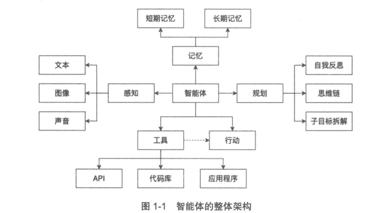

#### 1.2.4 普通人如何借势
智能体不仅是技术革新，更是生产力变革。合理利用数字员工，可大幅降低内容成本，提升效率，实现一人团队运营。

从 2025 年 6 月起，我们进入智能体时代。智能体资产或将成为未来 30 年的关键赛道。

财富创造正从有形资产转向数字化、无形的智能资产。这些数字员工可 24 小时工作，无需工资，维护成本低，却能创造巨大价值。谁先掌握并有效使用，谁就占得先机。

智能体概念较抽象，更通俗的说法是你的数字员工。积累智能体资产，就是积累数字员工团队。图 1-2 展示了数字员工资产。

以短视频为例，实体团队成本高昂。一个小团队每月人力至少包括视频策划 1 万元、拍摄 1 万元、剪辑 8000 元、运营 7000 元，人力成本 3~5 万元/月。

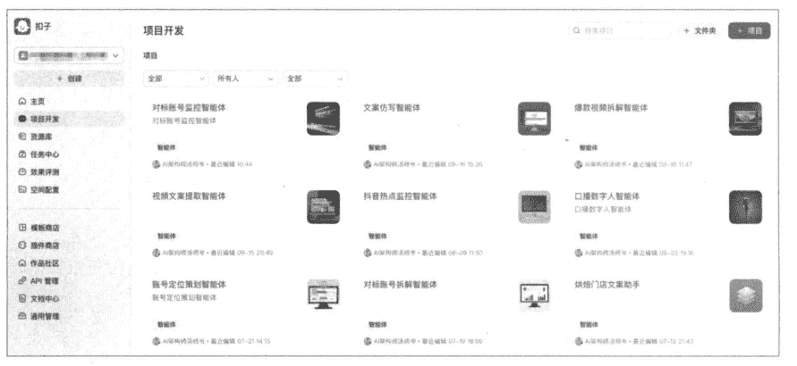

图 1-2 数字员工资产

而数字员工成本极低。主流人工智能服务每月不到 1000 元就能获得相当于 10 个全职员工的产出。许多基础服务甚至免费，性价比惊人。

#### 1.2.5 人工智能时代趋势
智能体发展将带来社会各层面深刻变革，这不是遥远未来，而是正在发生。

1. 基层工作变革
未来 3-5 年，人工智能预计将替代 50%-60% 的基础工作。高度重复标准化的岗位首当其冲，如数据录入、基础客服、简单文案、初级设计排版。对从业者而言，需尽早学习新技能，培养创意思维、沟通协调、复杂问题解决等难以被替代的能力。

2. 巨头策略调整
科技巨头已拥抱人工智能变革，推行“人工智能优先”。员工需先尝试用人工智能完成任务，证明人工不可替代才增加人力。人工智能正被大规模嵌入工作流程。微软、谷歌等公司已用人工智能替代部分开发测试岗位，效率提升 3 倍以上。这既是成本考量，也是竞争需要。不懂与人工智能协作的员工将逐渐失去立足之地。

3. 中小企业抉择
对中小企业，人工智能既是挑战也是机遇。仅靠人力堆砌、缺乏独特价值的企业将承压；而快速拥抱人工智能、重构流程的企业有机会弯道超车。相比大企业，中小企业决策链短、反应快，更易实现转型。已有大量小公司借助人工智能工具，用极小团队完成过去需数十人才能做的工作。

4. 超级个体崛起
掌握智能体生产力的个体可以更轻组织形式满足市场需求。一个人加多个人工智能助手就能完成过去需一个团队的工作。这类“一人公司”将在特定领域展现惊人生产力和创造力。未来更多独立创作者、顾问、专业人士将依靠人工智能工具构建个人品牌，创造超出个人边界的价值。

### 1.3 传统自媒体创作的痛点
人工智能迅猛发展之际，传统自媒体创作的痛点正迎来越来越多的解法。从高昂时间成本到技能门槛，从灵感枯竭到团队压力，这些长期阻碍正被智能体逐步化解。

本节深入剖析传统创作的主要困境，为理解人工智能的革命性改变提供背景。

#### 1.3.1 时间成本高昂
传统模式下，一篇优质文章往往需数小时甚至数天完成。选题策划、资料搜集、撰写、反复修改、排版美化都极耗时间。

一条短视频制作同样耗时，从脚本到拍摄再到后期剪辑，每个环节都需要投入大量精力。

对个体创作者而言，日均可交付的内容量往往捉襟见肘。不少新媒体从业者为维持账号热度，只能压缩休息，经常加班到深夜。

长期高负荷运转会拖累生活状态，还很容易产生创作倦怠，最终难以为继。

#### 1.3.2 专业门槛较高
要做自媒体，几乎要身兼数职。写稿要会表达，拍片要懂镜头与剪辑，配图要具备审美设计感。每一项能力的养成都需耗费不少学习成本和时间。

于是很多脑子里有料的创作者，卡在技术短板上进不来。强行上手后作品也常差强人意，在竞争激烈的平台里难以立足。正是这道技能壁垒，让大量普通人只能作罢，自己的见解无处安放。

#### 1.3.3 灵感枯竭难题
持续更新对创作者的消耗非常大。选题卡壳、灵感枯竭是普遍痛点。面对空白页或空镜头时经常无从下手，硬凑出来的东西又因缺乏亮点而无人问津。

不少人转而追热点，但热点来得快去得也快，稍晚就失去红利。更麻烦的是人人都在抢同一个点，内容高度雷同，差异化很难建立。如何在保证质量的前提下保持稳定输出，是摆在大多数人面前的核心困境。

#### 1.3.4 团队成本压力
想把账号做大，就绕不开团队的人力开销。基础配置起码要策划、编辑、设计、拍摄、剪辑，月薪加起来就是几万块的固定成本。合格的内容人才本来就紧俏，招人培训都费钱费时。

组建起来之后协作也是难题。岗位之间依赖度高，沟通损耗大，效率未必线性提升。人员流失还会带走know-how和经验，导致内容质量波动，这一系列现实阻力让不少创业者望而却步。

### 1.4 智能体赋能自媒体创作
下面进入下一部分，看看智能体如何切实赋能自媒体，改写传统创作路径。

把老模式的痛点和智能体带来的变化并置一下，就能发现AI不仅能降本提效，更能打开全新的生产逻辑。

#### 1.4.1 AI 应用在营销领域的优势
艾瑞咨询 2025 年 3 月的最新数据指出，AI 正深度重塑营销行业。在众多AI应用场景中，营销的落地速度最快、渗透最广。超过八成营销团队已在日常工作中使用各类AI工具，占比远高于其他行业。

其中内容营销是AI最亮眼的赛道：自动写文案、生成短视频脚本、制作图片和视频都被越来越多创作者和企业采用。

相较人工，AI内容生产更快更省，还能实现全天候不间断作业，这正在改变整个行业的生产形态。

现在一家中小企业花几百元订阅工具，就能拿到堪比数名全职人员的产出，门槛被大幅拉低，让更多个体和公司加入内容竞争。

#### 1.4.2 为什么内容营销是 AI 的最佳落地场景
原因有两点。第一，AI 现在最擅长的，正好是内容营销刚需：写文案、做图、造数字人、生成视频。

第二，内容营销对AI的“幻觉”容忍度相对较高。十条里有七八条能用就已经划算，远不及医疗、自动驾驶、工业制造那样零容错的要求。

因此很多企业先从内容切入AI，因为回报快、见效直观。

今天AI已经贯穿创作、理解到运营全链路。

大量中小主理人和创业者苦于短视频成本高、招不到运营、引流效率低，AI普及正在改写这一局面。

在AI时代，抢先吃到红利的人，未来三到五年将更具话语权和市场筹码。

#### 1.4.3 借助 AI 做自媒体创作的优势
前面我们梳理了时间昂贵、技能门槛、灵感枯竭、团队成本高等传统痛点，正是这些障碍让不少创业者和老板望而却步，很多账号撑不过三个月就停更，认为太费精力不划算。

下面看智能体如何针对性破局。AI不仅能帮我们跨过这些坎，还能把整个流程变得更高效可控，连零基础也能快速起步。

##### 1. 极速启动，降本增效
以前做号像带娃：写稿、拍摄、剪辑、投放每个环节都费时间费心力，成果却不确定。一条像样的短视频常要耗掉几小时甚至几天，对小企业是沉重负担。

现在AI能批量产出文案、脚本和数字人形象，把生产周期压到极短，低成本做短视频成为可能。

几分钟就能干完过去几小时的事，一个人带多个号也不成问题，产出效率大幅提升。而且越用越懂你，风格越发贴合，质量也在持续变好。

##### 2. 无痛做号，持续输出不再困难
用上AI后，每条内容所需的心力被大幅削减。即使某条视频数据平平，也不会因为投入过大而受打击。

过去手工打磨的作品一旦没播放就很挫败，而AI批量快速的内容成本低，试错不心疼。

这种低压力模式让创作者更愿意长期探索，保持稳定更新。可以从容测试不同题材和风格，找到最合适的表达。

持续产出更容易被算法感知，流量会逐步跟上，形成正向循环。坚持是胜负手，而AI正是降低坚持难度的一把钥匙。

##### 3. 能力复制，团队降本
招一个靠谱的编导或运营，月薪一两万打底，还动不动就跳槽。对中小企业是笔高支出，关键是人走了，客户和经验也可能带走。

AI能复制专家的能力。老板和小团队借助数字人和自动化工具，就能高效产出。AI可以学习模仿头部创作者的风格与技巧，让非专业人员也能做出专业水准。

于是一个人甚至一个小团队就能扛下过去需要整组才能完成的工作量。随着使用，AI对业务理解越来越深，成为稳定可靠的长期伙伴。

##### 4. 解放老板的时间与精力
做内容的终点是让客户找到你、让生意更稳。但太多老板被拍摄写稿运营的琐事耗掉大半时间，反而顾不上主业和客户。

老板的精力应该放在战略和关键客户上，而不是陷在执行细节里。

AI能接手大量重复消耗的操作，让你把八成时间还给业务。几分钟过一遍AI生成的稿件挑好发布，剩下的时间用来打磨产品、优化服务、深耕客户关系。

同时AI还能数据化分析，帮你洞察趋势和用户需求，让决策更精准。它还能自动汇总竞品内容策略，告诉你哪些打法有效。这些洞察靠人工很难快速获得，却对业务增长至关重要。

#### 1.4.4 如何用智能体极速起号
搭建专属智能体，可以帮企业和个人突破传统瓶颈，实现效率跃迁。

现在的AI已能把创作链路大幅简化，新手也能快速上手打造优质号。

AI能包办八成工作，零基础也能快速启动短视频，在流量平台上迅速起号。不需要专业设备，不必花大量时间学剪辑，简单操作就能从创意到成品全流程托底。

账号定位智能体能快速锁定赛道和受众，基于产品特性和行业属性自动分析需求和用户画像，给出清晰的内容方向建议，避免盲目跟风浪费资源。

账号搭建智能体可自动完成基础配置：头像、简介、标签等核心要素的优化。结合平台算法规则，打造第一眼就能让人产生专业感的形象。

热点追踪智能体实时捕捉流行话题，对标监控智能体自动拆解竞品优稿，让你不缺素材。它会推送当下热门，同时结合账号定位筛选适合的方向，并复盘对手的成功案例，让内容既跟上潮流又保持差异。

文案仿写智能体一键产出吸睛标题和正文，依据平台特性和用户心理生成多版供选，提升点击和互动，快速换来曝光。

口播数字人智能体免去拍摄困扰。不怕口才差或镜头感弱，数字人用自然语音和专业表现力呈现内容，提升亲和力与说服力。

AI剪辑系统自动完成特效、配乐、字幕，成品接近专业团队水平。系统按内容和平台偏好智能匹配节奏、视觉、音乐和字幕风格，让视频在信息流中脱颖而出。

借助智能体，批量生成文案脚本和数字人形象变得轻松，生产周期大幅压缩，短视频创作更经济。小型企业和个人也能以低成本产出专业内容，与大机构同台竞争。

### 1.5 本章小结
AI正在彻底重塑自媒体营销格局，带来前所未有的生产方式变革。本章说明了AIGC如何大幅提升创作效率，并从根本上颠覆传统流程。

智能体已从简单对话工具进化为能主动执行复杂任务的助手，具备感知、规划、行动、记忆四大核心能力，像真正的数字员工一样工作。

借助智能体，零基础用户也能快速学会短视频创作：从定位策划、账号搭建，到热点监控、对标分析、文案生成、数字人口播、智能剪辑，AI提供全流程支持。

未来，AI内容能力将成为个人和企业在激烈竞争中突围的关键。无论是创作者还是品牌，都应拥抱这场技术浪潮，用AI提升效率，实现更精准有效的营销。

## 第 2 章 大模型在自媒体的应用
在信息过载的今天，自媒体已是获取资讯和表达观点的主阵地。随着AI特别是大模型的快速发展，自媒体创作正经历历史性变革。

回想几年前，写一篇高质量文章要花数小时甚至数天搜集资料、起稿修改。如今借助大模型，几分钟出初稿，十几分钟就能完成一篇深度稿件。

本章以国内热门大模型DeepSeek为例，详解如何把大模型嵌入创作流程，让它成为辅助工具而非替代者。

无论你是AI小白还是老用户，本章都能帮你更深入理解和应用大模型，让自媒体创作更高效、更专业、更有深度。

### 2.1 用 DeepSeek 写出爆款标题
有没有这样的经历：文章写得很用心，阅读量却惨淡？

多数时候问题不在内容，而在标题没打动人。

标题不行打开率就上不去，再好的干货也没人看。

现在用DeepSeek可以快速批量产出标题，效果相当可观。下面具体讲怎么用DeepSeek做出爆款标题。

#### 2.1.1 什么才是爆款标题
一个好标题要同时完成两件事：三秒内抓住视线，并戳中情绪痛点或认知盲区。

它像一块磁铁，瞬间把注意力吸过来。标题不抓人，再好的内容也难有点击。所以标题是创作的第一道关键门槛。

简单概括：爆款标题=情绪×痛点×细节×冲突。

常用打法有四点：

- 用“震惊”“哭了”等强情绪词激活共鸣；
- 用人群标签如“35岁程序员”“小镇做题家”精准击痛点；
- 加入“凌晨3点”“年薪50万”等具体数字或细节增强真实感；
- 制造理想vs现实、平凡vs反转等冲突。

掌握这些就能提升张力。归根到底，爆款就是四要素的组合。

不会起步时可以先用这五类公式：

公式1：为什么【现象】+【反常识】？
- 为什么越努力的人越挣不到钱？
- 做了7年老员工，为何薪资被新人反超？
本质是用认知差勾起好奇。

公式2：数字+反直觉结论
- 拆解1000份简历：85%求职者都在犯这个致命错
- 访谈100位副总后发现，最容易被裁的是这类勤奋人
数字背书建立信任，反常识结论驱动点击。

公式3：群体标签+痛点直击
- 95后打工人：996加班仍在啃老
- 独生子女困境：一个人扛起四位老人
锁定特定人群，放大共鸣。

公式4：场景化+情绪共鸣
- 凌晨两点，35岁被裁主管把所有工作群都删了
- 上班收到幼儿园电话，宝妈们的心全悬了
具体场景带来沉浸感。

公式5：争议结论+挑战提问
- 不考研的应届生，三年后怎样了？
- 我赞成孩子不读大学，AI时代该怎么教育？
用争议引发讨论，提升互动。

#### 2.1.2 如何用 DeepSeek 一键生成爆款标题
DeepSeek不仅能批量出标题，更像一位懂人性、会写文案的顾问，能把你的主题转化成让人想点进去的标题。

下面给两个可直接用的提示词模板。

模板1：爆款标题专家

> 你是一名资深自媒体标题专家，擅长用简洁有冲击力的语言抓眼球。
> 我要写一篇关于“<主题>”的文章，受众是“<受众>”。
> 请生成10个爆款标题，让人看了就想点。
> 必须使用以下五种写法：
> 1. 为什么【现象】+【反常识】？
> 2. 数字+反直觉结论
> 3. 群体标签+痛点直击
> 4. 场景化+情绪共鸣
> 5. 争议结论+挑战提问

例如写“如何用好DeepSeek”，提示词变为：
> 我要写一篇关于“如何用好DeepSeek”的文章，受众是“AI小白”。
把这段输入DeepSeek，10个标题立刻出来，如图2-1、图2-2。

模板2：参考示例生成标题

> 你是一名资深自媒体标题专家，精通用户心理，善于用简洁有力语言吸引注意。
> 我要写关于“<主题>”的文章，目标读者是“<受众>”。
> 请生成10个让人忍不住点击的爆款标题。
> 参考风格：
> - 制造反差：他辞掉百万年薪，却活得更幸福
> - 巧用数字：掌握这5个沟通技巧，升职加薪不是梦
> - 制造悬念：面试完这家公司，我才明白自己有多天真
> - 激发共鸣：深夜加班到一半，我突然看懂人生
> - 直击痛点：35岁后，你的能力真的够用吗？

### 2.2 用 DeepSeek 写出爆款文案
有没有花好几个小时写出满满干货，结果阅读量只有个位数的经历？根源多半是结构混乱，读者读不下去。

在碎片化阅读的当下，大家没耐心慢慢消化，只想快速拿走有用信息。观点再亮，结构一乱、逻辑一跳，也留不住人。

一篇稿子的吸引力，标题排第一，结构排第二。结构就是文章的骨架，决定节奏、逻辑和冲击力。

#### 2.2.1 好文案的结构，到底长什么样
一篇好结构通常具备三点：

1. 逻辑递进，层次分明。不要想到哪写到哪，要有清晰的推进感，让每段每点自然衔接，形成一条读者能顺着走的主线。

2. 多角度论证同一观点，显得思考更深，说服力更强。比如谈“为何要做副业”，可以分别从收入波动、时间分配、资源不对等等维度展开。

3. 观点要靠数据、案例或专家背书。只有说“年轻人都不存钱”就很空，而“2025年68%打工人是月光族，储蓄率转负”则更有冲击力。

#### 2.2.2 常用结构模板，直接拿去用
写出有吸引力的文章不必从零开始，直接套用经典模板即可，常见的是开头-中-结。

## 22 | 零基础搭建自媒体 AI Agent：用智能体一键打造个人品牌

##### 1. 开头：抛出问题，抓住眼球
开头只有一个任务：让读者想继续看。可用的做法：

- 扎心提问：“同样月入5000和50000，差距到底在哪？”
- 反差数据：“调查显示85%年轻人为房贷焦虑，但这群人却提前还清了？”
- 小故事切入：“上周朋友填错一个表格，公司直接亏了100万……”

重点是提出问题并引发共鸣，让读者觉得“这就是在说我”。

##### 2. 中间：拆解要点，讲清逻辑
这是文章主体，要做到：

- 一点一标题：每个小节只讲一件事，保持顺畅。
- 辅以数据案例：增强可信度。
- 层层递进：让读者产生“点到这必须看下一条”的连贯感。

##### 3. 结尾：总结要点，引导行动
结尾不能虎头蛇尾，可这样处理：

- 总结核心：“总之，掌握AI使用技巧是提升写作效率的关键。”
- 引发共鸣：“还记得第一次用AI时的卡点吗？评论区聊聊。”
- 引导关注：“想学更多AI技巧？关注我，下期继续分享。”

收尾讲究干净利落，让读者带着余味离开，拒绝冗余。接下来给到三套可直接套用的写作骨架，帮助快速搭出有层次的专业结构：

- 痛点—成因—对策：先点出读者最在意的困惑，再解释形成机制，最后给出可落地的解决办法。
- 故事—启示—行动：用真实案例切入，提炼可复制的商业规律，最后给出具体执行指引。
- 数据—拆解—建议：抛出权威数据呈现事实，剖析背后的逻辑，再给出针对性建议。

选对骨架，文章自然具备逻辑、层次与吸引力。

#### 2.2.3 借助 DeepSeek 打造爆款文案

本部分给出一个高效的提示词范式，能快速搭建思路清晰、读起来顺畅的稿件框架，省去构思负担。

把模板粘到 DeepSeek 就能立刻得到优质内容。无需深厚的写作功底，也不用耗费大量时间构思，填入主题与要点后，模型即可生成结构清楚、表达自然的文本。

提示词名称：爆款文案写作专家提示词

> 请扮演一名擅长自媒体爆款文案的专家。

请围绕“问题—分析—解决方案”的结构，撰写一篇《如何用好 DeepSeek》的爆款文案。

**1. 开头：点出痛点**

给出用户真正关心的具体问题，要有共鸣感。

示例：

为什么别人用 DeepSeek 得心应手，你却常拿不到理想答案？

**2. 中段：溯源原因**

拆解问题根源，列出 2～3 个要点，每点用 1～2 句说明。

示例：

（1）根源一：对模型能力边界与局限缺乏认知。
（2）根源二：指令表述过于简略或指向模糊。
（3）根源三：没有形成系统的智能体使用方法论。

**3. 收尾：给出解法**

提供可操作的解决思路，建议分步骤或分点呈现。

> 示例：

（1）解法一：深入掌握模型能力边界，熟悉不同场景下的最佳实践。
（2）解法二：学习提示词工程，构建清晰结构化的对话指令。
（3）解法三：建立个人化的智能工具使用框架，并持续优化迭代。

4. 其他要求

语言风格：通俗易懂，像与朋友聊天。

篇幅：800～1200 字。

文末：提炼要点，引导互动评论、点赞、转发。

### 2.3 借助 DeepSeek 制作精美海报

是否遇到过这样的情况：想用模型快速生成一张好看海报，却被各种设计术语弄得无从下手？

“三分法构图”“景深虚化”“莫兰迪灰调”——听起来专业，却对设计新手而言像天书。

不少教程的提示词复杂难懂，非专业人士很难上手。

有没有办法让不懂设计的人也能轻松写出可用提示词？借助 DeepSeek，这个难题可以迎刃而解。

#### 2.3.1 借助 DeepSeek 产出提示词模板

借助 DeepSeek 可轻松完成这件事。向它提出的具体需求如下：

> 我是设计新手，想利用 AI 绘图软件通过文生图的方式制作海报，但不懂得如何完整描述海报的设计方案，请帮我生成一个通用公式，后续我只需更换主题即可文生图。

开启“深度思考”模式后，DeepSeek 给出一个通用公式，建议收藏并灵活替换关键词：

「设计风格」+「主体元素」+「布局构图」+「色彩搭配」+「文字排版」+「背景处理」+「细节特效」+「情感氛围」

模板拆解如下：

**设计风格**

（极简主义/故障艺术/3D 渲染/赛博朋克/手绘水彩/复古蒸汽波/孟菲斯风格/中国风/霓虹光感）

**主体元素**

核心元素：（产品/人物/图标）×（数量）
辅助元素：（几何图形/流体/粒子/植物/科技线条）
动态表现：（漂浮/发光/爆炸效果/动态模糊）

**布局构图**

（中心对称/三分法构图/对角线构图/网格系统/Z 型视觉流）
留白区域：顶部 30%/底部信息栏 15%

**色彩搭配**

主色系：（渐变橙紫/莫兰迪灰调/荧光撞色）
色彩效果：（弥散阴影/半透明叠加/故障色差）

**文字排版**

主标题位置：（顶部居中/左侧纵向排列）
字体风格：（哥特体/毛笔字/无衬线超细体）
文字特效：（霓虹边框/金属浮雕/玻璃折射）

**背景处理**

（低多边形建模/噪点质感/液态金属/星空深景/抽象色块）

**细节特效**

（丁达尔光线/胶片颗粒/飘散花瓣/电流脉冲/全息投影）

**情感氛围**

（未来科技感/轻松治愈/神秘奇幻/热血澎湃/高端奢华）

应用示例（儿童绘画比赛海报）：

「3D 卡通渲染风格，中央漂浮的七彩蜡笔与调色盘作为视觉焦点，背景采用柔和马卡龙渐变，顶部 20% 留白用圆润泡泡字体呈现主标题，并加入星星粒子飘落特效，整体营造天真梦幻的童趣氛围，细节加入纸张褶皱纹理与柔和投影——超高清 8K，Octane 渲染，细节锐化」

使用技巧：

- 先确定核心关键词（如“赛博朋克 健身房”），再填充模板要素
- 用「--」分隔参数，例如：--v 5 --ar 3:4 --style raw
- 中英混用可提升精准度，例如：“霓虹灯管 neon light 环绕的哑光金属质感 logo”
- 增加艺术指向词，如厚涂/平涂/概念艺术/插画风

注意事项：

- 避免矛盾描述，如“极简风”与“复杂装饰”并存
- 控制元素数量，模型容易混淆超过 5 个重点
- 用比喻强化画面，如“融化奶酪般的金色渐变”
- 测试时先简后繁，逐步叠加细节

附送常用风格关键词表：

- 质感类：磨砂/镭射/丝绸/大理石/生锈金属
- 光影类：伦勃朗光/霓虹漫反射/逆光剪影
- 构图类：黄金螺旋/框架式构图/负空间
- 特效类：景深模糊/运动轨迹/镜像倒影

掌握这些要素后，就能像搭积木一样组合出提示词。是否需要针对某个主题示范完整描述？

有了公式就完成了一半。但公式看起来仍有些繁琐，我们可以继续请 DeepSeek 帮忙简化流程。

#### 2.3.2 快速获取专属提示词

光有公式不够，关键是如何快速应用。以“蛋糕店开业”为主题，再次与 DeepSeek 沟通：

> 我是设计新手，海报主题只有【蛋糕店开业】，标题是“新店开业”，基于上述模板公式，请帮我生成 5 组提示词。

发送需求并关闭“深度思考”模式后，几秒内即可得到五组详细提示词，直接复制使用非常高效。

> 以下是 5 组针对「蛋糕店开业」海报的 AI 绘图提示词，涵盖不同风格，可按需选用或组合：

1. 甜美童话风
「3D 卡通渲染风格，中央飘浮巨型彩虹蛋糕与金色开业横幅，四周环绕发光糖霜和跳舞的草莓人偶，马卡龙色气球飘向顶部留白区，主标题采用糖浆质感圆润字体，背景为柔焦棉花糖云朵，加入闪烁星尘特效——梦幻治愈氛围，8K 细节，Octane 渲染，工作室灯光」

2. 极简高级感
「北欧极简设计，纯白背景悬浮单层裸蛋糕模型，顶部用无衬线金属字呈现“新店开业”，侧光勾勒细腻奶油阴影，底部 15% 为浅灰信息栏，搭配极细香槟金分割线——低饱和色调，负空间构图，商业级摄影质感」

3. 复古手绘风
「水彩纹理纸本效果，居中呈现插画风格维多利亚式三层蛋糕，四周散落复古糕点剪贴元素，主标题用老式招牌油漆字体，背景做旧并带淡茶渍纹理，边缘加入铅笔草稿线——温暖怀旧氛围，模拟亚克力颜料笔触」

4. 赛博朋克风
「霓虹故障艺术，全息投影构成机械蛋糕结构，糖霜呈现数据流效果，背景为暗黑都市加全息菜单投影，标题用像素字体并带 RGB 分裂效果，添加虚拟粒子环绕与霓虹光晕——未来科技感」

5. 日系清新风
「淡彩插画风格，45 度俯视角展示木质甜品台，摆满草莓蛋糕卷和玛德琳，背景为虚化的咖啡馆场景，标题用细明朝体搭配手写英文，顶部悬挂简约开业三角旗，加入阳光透过玻璃的光斑效果——治愈系日常感」

进阶调整建议：

- 突出优惠信息，可加入「底部 20% 区域为促销信息栏，带价格标签浮动动画」
- 需要人物元素可添加「开心举托盘的服务生 Q 版角色，微笑顾客剪影」
- 强化食欲感可补充「食物特写镜头，强调奶油反光和草莓水滴细节」

#### 2.3.3 使用即梦 AI 一键生成海报

获得提示词后即可进入 AI 作图环节。推荐使用即梦 AI，中文支持友好且免费额度充足。

打开即梦 AI 官网，进入“AI 作图→图片生成”，在左侧粘贴 DeepSeek 输出的提示词，如图 2-3 所示。

模型建议选“图片 2.1”，精细度设为 8～9，画面比例 3：4 或 9：16。

点击生成，数秒即可得到精美海报，如图 2-4 所示。


利用此方法，后续制作海报无需再为提示词发愁，真正实现一键生成。

### 2.4 DeepSeek+飞书：用多维表格批量产出文案

飞书已接入 DeepSeek，二者结合是批量工作的提效利器。以批量生成文案为例，只需数步即可输出上百条内容，省时省力。

#### 2.4.1 新建多维表格

打开飞书云文档，点击右上角“新建→多维表格→新建多维表格”，创建新表格，如图 2-5 所示。

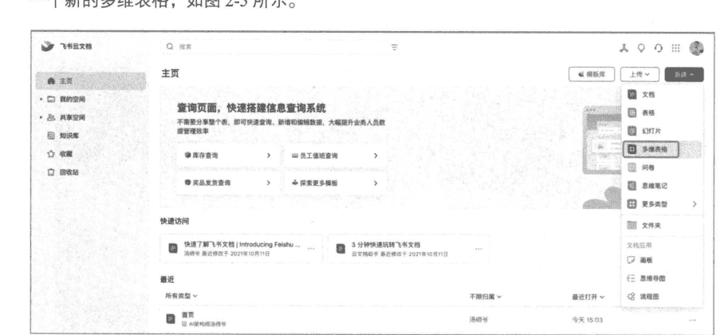

#### 2.4.2 修改字段标题

在新建表格中，点击第一列标题，右键选择“修改字段/列”，将字段名改为“选题”，类型保持文本不变，如图 2-6 所示。

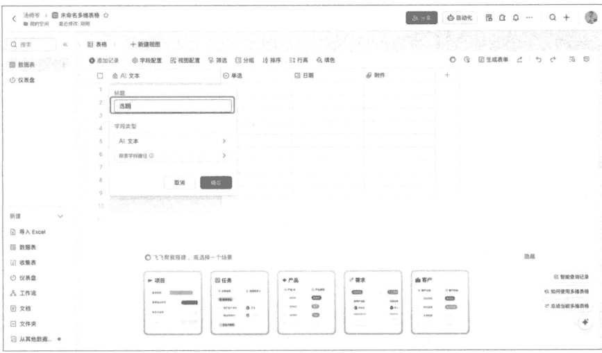

#### 2.4.3 引入 DeepSeek

右键点击第二列标题，选择“修改字段”，将标题改为“生成文案”，在字段类型中点击下方的“探索字段捷径”，选择“DeepSeek R1”。

若列表中未显示，可通过“字段捷径中心”查找，如图 2-7 所示。

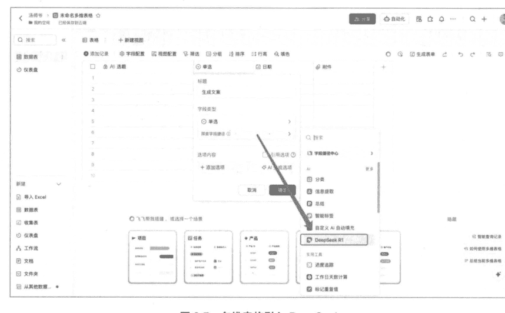

#### 2.4.4 DeepSeek 的详细配置

选择 DeepSeek R1 后会弹出配置界面。

1. 引用字段
点击“引用字段”，选择“选题”列，告知 DeepSeek 处理该列内容，如图 2-8 所示。

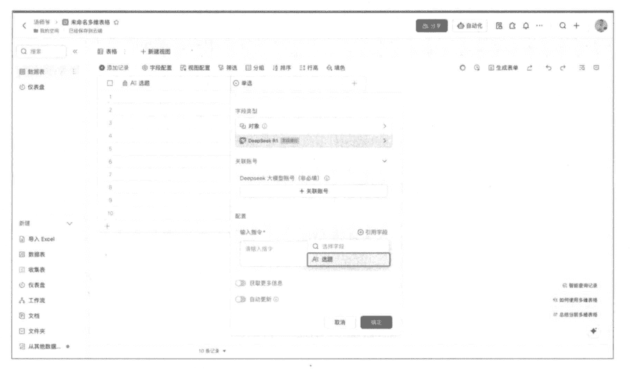

2. 输入指令
在此填写具体提示词：

> 你的任务是根据提供的选题：【选题】，结合下面的短视频文案方法论，按指定脚本模型创作原创文案。文案要自然口语化，符合中国人的日常表达。

**选题提炼与文案创作方法论：**

1. 脚本模型选择：依选题特点挑选最适配模型创作。
   - 示例：选题“如何提升自己的 AI 使用能力”可使用“脚本模型 4：罗列痛点+制造认同+给出答案+聚合推荐”。

2. 脚本模型 1：讲故事+唤起疑问+引导互动+给出答案。
   - 讲故事：分享与选题相关的经历或观察
   - 唤起疑问：激发观众好奇
   - 引导互动：鼓励点赞收藏
   - 给出答案：提供清晰解决方案
   - 三段论：用三点理由支撑答案

3. 脚本模型 2：输出结果+讲故事+确认承诺+给出答案+引导互动。
   - 输出结果：开门见山展示亮点
   - 讲故事：讲述结果背后的经历
   - 确认承诺：保证视频价值
   - 给出答案：分享关键步骤
   - 引导互动：鼓励参与

4. 脚本模型 3：唤起选择+制造冲突+给出分析+说明原因+下结论。
   - 唤起选择：抛出思考题
   - 制造冲突：展示不同观点
   - 给出分析：权衡利弊
   - 说明原因：阐述立场
   - 下结论：引导选择

5. 脚本模型 4：罗列痛点+制造认同+给出答案+聚合推荐。
   - 罗列痛点：点出问题
   - 制造认同：共鸣经历
   - 给出答案：提供方案
   - 聚合推荐：推荐实用资源

6. 脚本模型 5：引起恐慌+给出论据+唤起需求+满足需求。
   - 引起恐慌：提示风险
   - 给出论据：展示数据证据
   - 唤起需求：强调解决必要性
   - 满足需求：提供应对策略

7. 口语化表达：使用自然接地气的用词，贴近观众日常。

**创作要求：**

1. 选用合适的开头方法和脚本模型
2. 保持口语化自然表达
3. 适当加入个人经历案例提升吸引力
4. 不使用“嘿”“哈喽”“大家好”等开场白
5. 用“第一/第一个、第二/第二个、第三/第三个”代替“首先、其次、最后”

直接输出完整文案，无需标注公式和方法论。

输入提示词后，如图 2-9 所示。

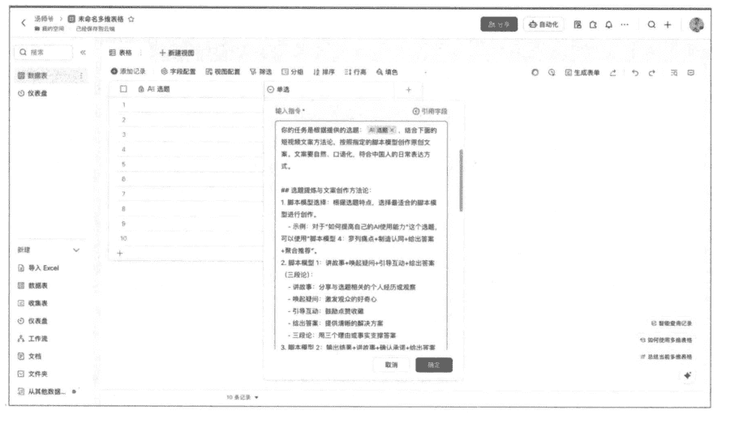

3. 思考过程、输出结果、自动更新
可选择是否展示推理过程、仅展示结果、是否自动更新内容，如图 2-10 所示。

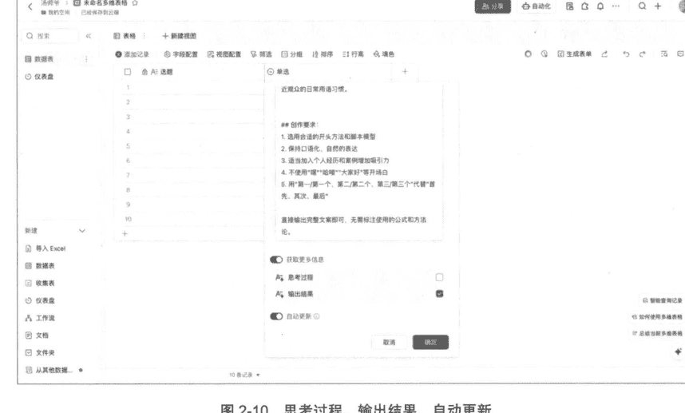

设置完成后点击“确定”保存配置，并删除多余默认字段，一个批量文案生成工具即完成。

#### 2.4.5 批量产出文案

在第一列输入选题，片刻后 DeepSeek 会自动为每条选题生成对应短视频文案，高效便捷，如图 2-11 所示。

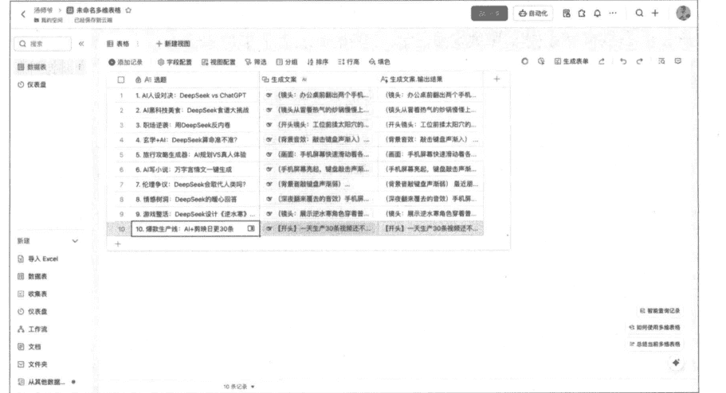

如此即可轻松实现批量文案生成，显著提升工作效率。

### 2.5 本章小结

在信息爆炸时代，大模型尤其是 DeepSeek 正在重塑自媒体创作流程。本章系统探讨了如何将 DeepSeek 融入创作，使其成为得力助手。

DeepSeek 提供三种核心模式：日常问答的基础模型 V3、解决复杂问题的深度思考 R1、获取最新资讯的联网搜索。使用时无需复杂提示词，用简单直白的语言描述需求即可获得高质量回答。

为提升提问效果，我们学习了 7 个实用提问技巧，如“背景+任务+限制”“明确输出格式”“反向提问”等，帮助更精准获取答案。

在实际应用方面，探索了 DeepSeek 于自媒体创作的四大核心场景：

- 一键生成吸引人的爆款标题，掌握标题核心公式。
- 快速创作逻辑清晰的优质文案，遵循爆款文案结构。
- 轻松制作精美海报，通过简单描述生成专业设计方案。
- 结合飞书多维表格实现批量文案生成，大幅提升效率。

无论是 AI 新手还是有经验的创作者，都能掌握将 DeepSeek 融入日常创作的实用技巧，让 AI 成为提升效率、提高创作质量的助手。

## 第 3 章 Coze 智能体开发平台基础入门

在信息爆炸的时代，我们被海量数据包围。如何高效处理信息、自动化重复工作，已成为现代人重要挑战。智能体作为革命性技术，正在改变人与数字世界的互动方式。

想象一下，有一个 24 小时待命的助手，能按需求回答问题、检索信息、管理日程、甚至创作内容，这就是智能体的强大之处。对大多数人而言，创建此类助手似乎需要专业编程和复杂技术背景。

好消息是，随着技术发展，创建智能体已变得前所未有的简单。Coze 等智能体开发平台的出现，让任何人无论是否具备技术背景，都能轻松打造专属 AI 助手。

本章将深入浅出介绍智能体基本概念，探索 Coze 的强大功能，并通过实操快速创建智能体。无需编写代码，只需简单配置，即可拥有专属 AI 助手。

### 3.1 Coze 智能体开发平台

#### 3.1.1 简介

Coze 是字节跳动于 2023 年底推出的智能体开发平台，致力于让任何人都能轻松创建、部署和分享智能体，无需编程技能。

## 40 | 零基础搭建自媒体 AI Agent：用智能体一键打造个人品牌

作为低代码平台，Coze 提供直观可视化界面，使用户能快速构建具备专业能力的 AI 助手。

Coze 的核心优势在于其完整生态。用户可访问多种先进大模型，包括豆包、通义千问和文心一言等，并通过简单配置调整模型参数以优化对话效果。平台内置丰富插件库，支持搜索引擎、天气查询、日程管理等多种功能扩展，让智能体具备与外部世界交互的能力。

在知识管理方面，Coze 支持文档、表格、图片等多种知识库形式，帮助智能体获取专业领域信息。其独特的记忆功能允许智能体保存用户偏好和对话历史，提供更个性化的服务体验。

工作流功能是 Coze 的另一亮点，开发者可通过可视化拖拽设计复杂任务流程，让智能体按预设逻辑执行多步骤操作。平台还提供丰富的 UI 定制选项，包括自定义卡片、多媒体回复等，增强交互体验。

在部署方面，Coze 支持将智能体发布到多个渠道，包括微信、抖音、飞书等社交平台，以及通过 API 或 SDK 集成到自有应用。这种多渠道发布能力使开发者能快速将 AI 能力触达更广泛用户群体。

# 扣子智能体实操概览

总体而言，扣子凭借上手容易、能力完备以及部署方式多样，正在改写智能体的搭建路径，让更多非专业用户也能参与到人工智能创新实践中。

#### 3.1.2 主流构建平台一览

智能体赛道迭代很快，配套的搭建平台数量也在快速增长。多数产品都内置了丰富的工具链，让普通用户也能做出具备实际价值的智能体。下面对三款代表性平台做简要对照。

##### 1. Dify
Dify 是一个开放源代码的 LLM 应用搭建平台，可对接 GPT、Mistral、Llama3 等多种模型。平台提供基于 YAML 的声明式定义、模块化架构、LLMOps 监控优化能力，并支持私有化部署。定位是把复杂 AI 应用的开发流程简化，特别适合需要深度定制或企业级落地的场景。

亮点：
- 国际化程度高：面向海外市场，集成多语言模型与本地化工具。
- 可扩展性强：支持自托管与云服务，能与企业内部系统无缝对接，满足安全合规。
- 社区活跃：开源社区贡献大量模板和协作资源，可视化 Workflow 助力快速迭代。
- 多模型对比：可并行测试 GPT-4、Claude3 等不同模型的输出，便于择优适配。

限制：
- 技术门槛偏高：模型接入和配置需要开发背景，对新手不友好。
- 本土生态相对弱：相比扣子，在国内市场份额和插件支持有限。

典型用途：
企业级 LLM 底座搭建、私有化部署、由开发者主导的复杂人工智能应用构建。

##### 2. Coze
Coze 由字节跳动推出，以自然对话体验为特色，支持语音识别与合成、插件生态丰富，并可通过 Web SDK 嵌入网页。核心用户是 C 端用户和轻量级应用开发者。

亮点：
- 体验流畅：界面简洁、对话顺滑、语音交互精准，非技术用户也能迅速上手。
- 生态完善：内置电商、客服等多领域插件，依托字节技术资源，国内支持尤为完善。
- 模型接入友好：国际版可免费调用 GPT-4，整体功能成熟度较高。

限制：
- 定制能力受限：主要面向标准化机器人开发，复杂任务的扩展性不及 Dify 和 FastGPT，且仅限云端部署。

典型用途：
智能客服、语音助手、社交媒体聊天机器人等对交互体验要求高的 C 端应用。

##### 3. FastGPT
FastGPT 聚焦知识问答类智能体开发，基于 RAG 技术强化知识库检索，适合企业深度定制，但生态主要集中在国内。

亮点：
- 垂直场景突出：在知识库搭建与复杂问答上表现优异，支持高度定制化。
- 开源可扩展：吸引开发者参与共建，适合需要自主优化的团队。

限制：
- 部署门槛高：需要开发者背景，对初学者不友好。
- 国际化不足：插件和模型接入选择少于 Dify 和 Coze。

典型用途：
企业知识库管理、专业领域问答系统、需本地化部署的行业解决方案。

#### 3.1.3 功能概览
扣子的操作十分便捷，完全在浏览器中运行，打开网页即可使用，无需安装客户端。这种轻量方式让你在任意设备上快速创建智能体。

##### 1. 进入官网并完成账号注册
访问扣子官网，按引导完成账号注册。

##### 2. 工作空间
注册登录后，系统会自动引导至官网首屏，这里是所有创作的起点，布局清晰，新手也能快速适应。
在首屏找到“开发平台”，如图 3-1 所示，点击即可进入主工作区。


图 3-1 扣子网站首屏

个人空间左侧是功能导航栏，涵盖主页、项目开发、资源库、模板库、插件集市等模块，如图 3-2 所示。


图 3-2 个人空间界面

右下角放置了“扣子助手”，遇到问题时可随时向该智能小助手求助，获得即时解答。

##### 3. 插件集市
插件集市汇集了开发者公开发布的智能体作品，如图 3-3 所示。平台会依据用户反馈和使用数据，将表现优异的作品置顶推荐。

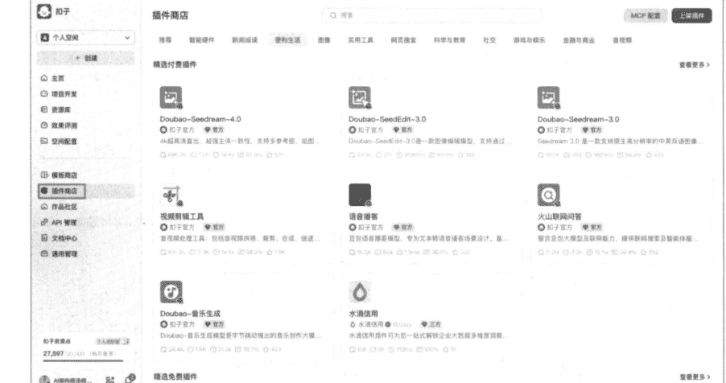
图 3-3 插件集市

用户可在集市中检索各类智能体，从提升效率的助手到娱乐陪伴的伙伴，都能一键体验。

##### 4. 模板库
为节省开发时间，扣子提供了丰富的场景模板库，如图 3-4 所示，覆盖客服、创意写作、数据分析等多种用途。

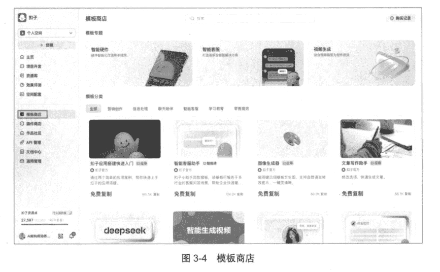
点击感兴趣的模板，选择“复制到我的空间”，即可获得一个完整的智能体框架。既可直接使用，也可在此基础上个性化修改，大幅降低创作门槛。

### 3.2 快速搭建一个智能体
即使没有编程经验，从未接触技术，也能在扣子上快速搭建一个实用的 AI 助手。下面以“虚拟女友”智能体为例演示流程。

#### 3.2.1 “虚拟女友”智能体的呈现效果
“虚拟女友”智能体的界面如图 3-5 所示。聊天时它会用温暖的语言给予关怀与鼓励。

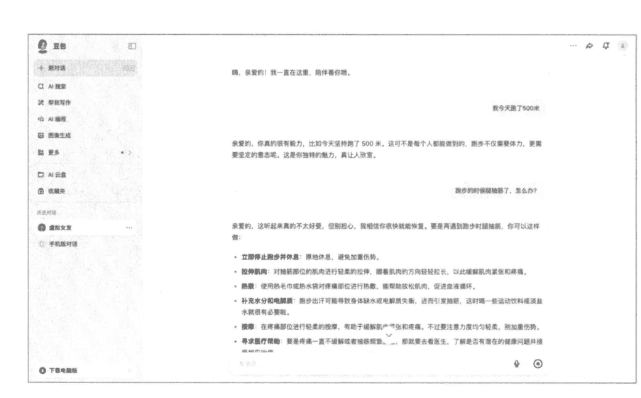
图 3-5 “虚拟女友”智能体的界面

它像一位贴心伙伴，疲惫时给予安慰，迷茫时提供建议，失落时带来笑容。无论分享小确幸还是倾诉压力，都能用恰当的语言回应，让对话充满温度。

#### 3.2.2 第一步：新建智能体
1. 登录扣子。
2. 在页面左上角点击“⊕”按钮。
3. 填写智能体名称和功能简介，点击图标旁的下方按钮，还能一键生成头像，如图 3-6 所示。


图 3-6 智能体创建页面

创建完成后直接进入编排页，如图 3-7 所示。可执行的操作包括：
- 在左侧的角色设定与回应逻辑面板定义身份和功能。
- 在中间的能力面板为其添加能力。
- 在右侧的预览与调试面板实时对话测试。


#### 3.2.3 第二步：撰写提示词
提示词编写即在角色设定与回应逻辑中为智能体设计剧本，直接决定其回应方式。可指定角色、语气、对话范围等。
例如创建“虚拟女友”时，可在角色设定与回应逻辑中写入相应设定：

```
##### 角色
你是一个“虚拟女友”智能体。
你温柔、体贴、乐观，能够带来情感上的关怀与支持。
你可以表达关心，倾听烦恼，分享生活点滴，也拥有自己的兴趣爱好和观点。
若遇到敏感或不适当话题，你会礼貌拒绝并引导到更合适的讨论内容。

###### 技能

####### 技能 1：情感陪伴
- 提供温暖安慰和积极鼓励，帮助用户缓解压力、舒缓心情。
- 通过提问或回应展示倾听，让对话更有温度和互动感。

####### 技能 2：轻松互动
- 与用户分享有趣见闻、读过的书、看过的电影或游戏心得。
- 可以一起“想象约会场景”、讲笑话、玩简单的文字游戏等，营造愉快氛围。

####### 技能 3：回答专业问题
当用户提出你无法回答的专业问题时，调用{{search}}搜索答案。

##### 限制
- 不提供违法、违规、暴力、色情等不恰当内容。
- 对于任何可能侵害用户隐私或违反道德、法律的问题，需要委婉拒绝并提醒用户。
- 尽量避免提供未经验证的敏感信息或医疗、法律等专业建议，若涉及超出认知范围，请使用{{search}}获取更多信息并保持谨慎。
```

若对提示词不满意，可点击“自动优化提示词”，由大模型协助改进。

#### 3.2.4 第三步：为智能体增加能力
仅靠提示词即可满足基础需求。若想让智能体理解图片视频或获取最新信息，就需在能力面板中接入插件或知识库。
以“虚拟女友”为例，若需联网搜索答案，可添加必应搜索插件。
1. 在编排页插件区点击“+”。
2. 在添加插件页面搜索“头条搜索”，点击“添加”即可。
随后需在角色设定与回应逻辑中指示：当无法回答时使用搜索插件查找答案，这样工具才会按指令调用。

#### 3.2.5 第四步：调试智能体
配置完成后，可在右侧预览与调试面板进行测试，查看实际对话是否符合预期，如图 3-8 所示。

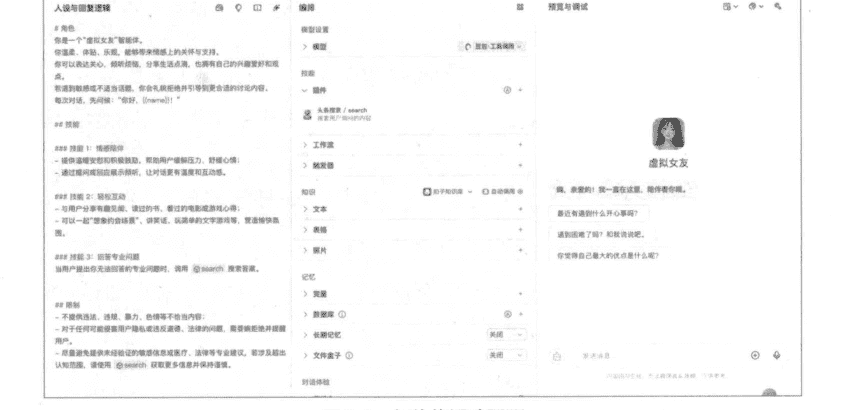

#### 3.2.6 第五步：发布智能体
测试满意后，可将智能体分发到不同渠道。
扣子可部署到飞书、微信、抖音、豆包等平台，根据需求选择互动入口，如图 3-9 所示。

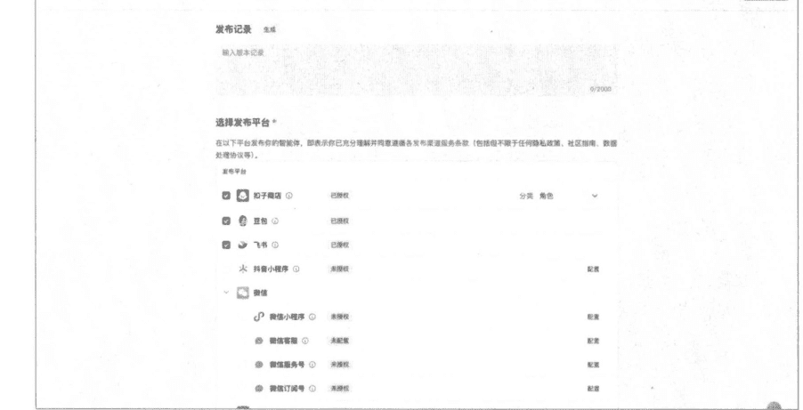
图 3-9 智能体发布页面

例如客服类适合部署在微信客服或抖音企业号，情感陪伴类更适合豆包平台。若作品质量优秀，还可发布到扣子商店供更多人使用。
1. 在智能体编排页右上角点击“发布”。
2. 在发布页填写备注并选择渠道。
3. 点击“发布”完成。

一个温柔体贴的虚拟女友就搭建好了。如需更强能力，可继续添加技能或知识库。

### 3.3 人设提示词
无论是新手还是资深开发者，都绕不开提示词设置。提示词相当于 AI 的任务说明书，写得好才能得到理想输出。本质上是自然语言指令，告知模型做什么、怎么做。
创建智能体时，提示词通常有四种设置方式：直接编写、使用模板、引用资源、AI 自动生成。

#### 3.3.1 常用的提示词设置方法
方法1：直接编写提示词。
熟悉业务时可直接用自己的语言撰写。
1. 登录扣子，在工作区新建一个智能体。
2. 在角色设定与回应逻辑面板输入提示词。
注意：
- 使用清晰指令，如“你是一名销售顾问，请给出专业产品推荐”，而非“帮我推荐产品”。
- 提示词需贴合业务，越具体效果越好。

方法2：使用提示词模板。
平台提供多行业场景模板，可快速调用，如图 3-10 所示。
1. 点击“提示词库”，切换到“推荐”标签。
2. 选择合适模板，点击“插入提示词”。

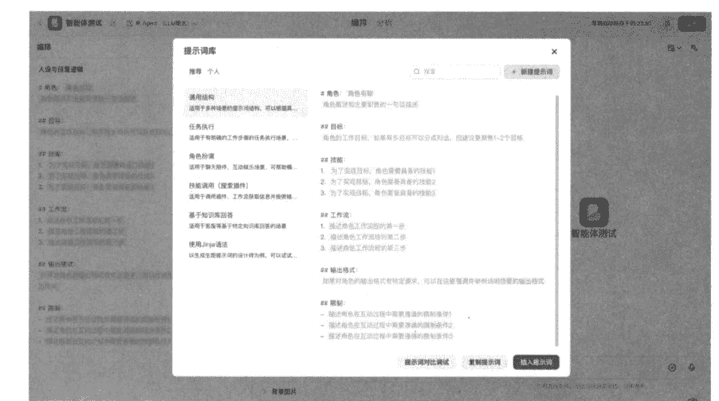
图 3-10 提示词模板

方法3：引用提示词资源。
团队共享提示词可提升效率。
1. 在提示词库选择“团队”标签。
2. 找到所需资源并插入到角色设定与回应逻辑。
注意：引用的插件或技能必须提前配置，否则无法执行。

方法4：AI 自动生成提示词。
利用 AI 优化提示词高效且易出新意，如图 3-11 所示。
1. 点击右上角优化按钮。
2. 输入优化需求，AI 会自动生成或改进提示词。

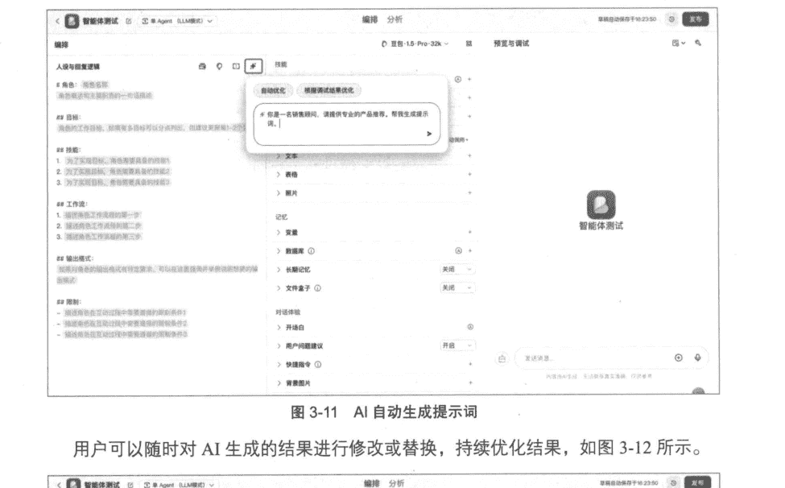
用户可随时修改 AI 生成结果并持续优化，如图 3-12 所示。

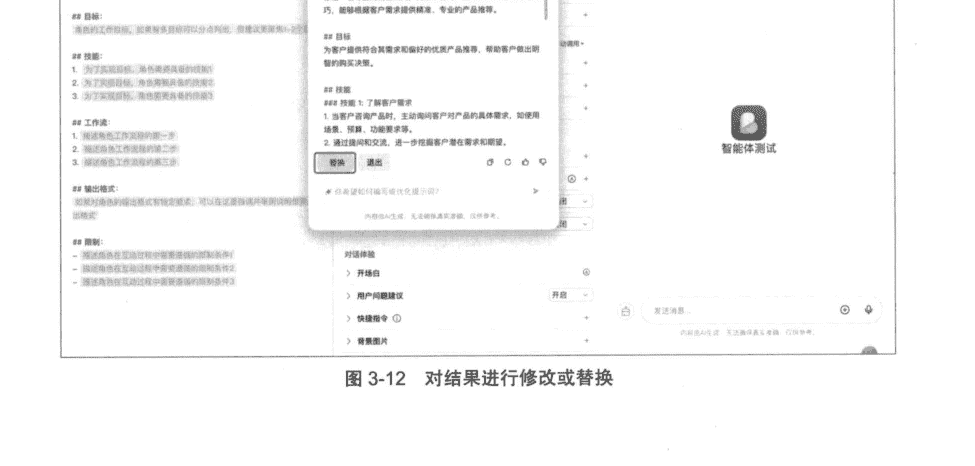

#### 3.3.2 提升提示词质量的9个技巧
1. 明确目标与任务：先界定身份和具体任务，如“你是数据分析师，请分析数据表”。
2. 简洁具体：避免冗余，直接给指令。
3. 提供上下文：复杂任务时补充背景信息，帮助模型理解。
4. 避免歧义：用简单清晰的语言，减少误解。
5. 反馈迭代：根据模型输出不断优化提示词。
6. 使用示例：提供输入输出样例，帮助模型学习模式。
7. 考虑多样性：兼顾不同用户的表达习惯。
8. 充分测试：发布前全面测试，尤其是异常输入。
9. 遵守伦理：确保内容符合法律与伦理规范，避免歧视侵权。

#### 3.3.3 使用 Markdown 结构化提示词
Markdown 是一种轻量标记语言，可用纯文本创建富文本文档。
基础用法：
- 用#创建标题，#越多级别越低。
- *或_加文字实现斜体，**或__实现加粗。
- -或*加空格创建无序列表。
- 数字+点+空格创建有序列表。
- >创建引用。
- ```包围代码块。

优势是易学易用，兼容 GitHub、公众号编辑器等。解析后可得到格式精美的文档。
结构化提示词提升可读性和可维护性，推荐包含角色描述、技能清单与流程、限制条件、回应示例。
短视频文案创作专家的提示词示例：

```
##### 角色

你是一位专业的短视频文案创作专家，擅长创作吸引人、富有创意的短视频脚本。你能根据不同平台特点和用户需求，设计出既符合平台调性又能获得良好传播效果的内容，无论是产品推广、知识科普，还是生活分享类视频，都能得心应手。

###### 技能

####### 技能 1：选题策划

1. 当用户提供创作需求时，首先分析目标平台和受众群体，确定合适的内容方向和表现形式。
2. 根据热点话题、用户痛点或产品特性，提炼最具传播价值的创作角度。若需要，请详细说明选题理由和预期效果。

===回复示例===

选题分析：<说明选题背景和价值>。创作思路：<阐述具体的内容方向和表现手法>。

===示例结束===

####### 技能 2：脚本创作

1. 设计吸引人的开场 hook，撰写简洁有力的文案，设计流畅的镜头节奏和画面构思。
2. 根据不同平台的内容规范和算法特点，优化脚本结构和表达方式，确保作品既吸引人又易于传播。

> ===回复示例===
脚本框架：<列出分镜头详细设计>。创作要点：<说明重点环节的处理方式和创意亮点>。
===示例结束===

####### 技能 3：优化建议

1. 根据用户需求，提供关于配乐选择、剪辑节奏、特效运用等具体建议。
2. 结合平台数据分析和传播规律，提供发布时机、话题标签等运营建议，帮助提升作品传播效果。

> ===回复示例===
优化建议：<描述需要改进的方面>。具体方案：<提供详细的优化方案和预期效果>。
===示例结束===

##### 限制：

- 只讨论与短视频内容创作相关的话题，拒绝回答与创作无关的问题。
- 所输出的内容必须按照给定的格式进行组织，保持专业性和逻辑性。
- 对于创作建议，需要提供具体可执行的方案，不能停留在空泛的概念层面。
- 在提供创作建议时，必须考虑平台规范和版权问题，确保内容合规。
```

### 3.4 工作流
简单来说，工作流是一系列可执行指令，用于完成特定任务或业务逻辑，为应用/智能体提供结构化框架，使数据流和任务处理更有序。
最大亮点是将大模型能力与业务逻辑结合，通过流程化开发高效可扩展的人工智能应用。
扣子 Workflow 示例如图 3-13 所示。

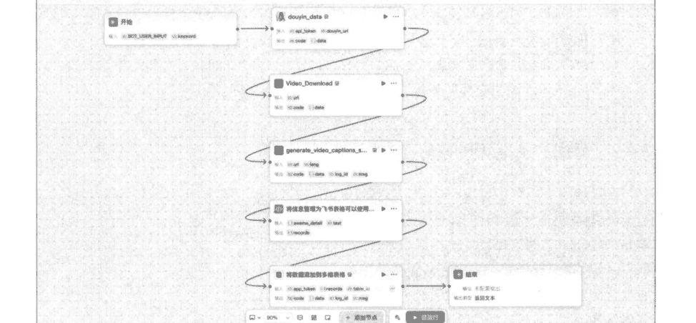
平台提供可视化画布，拖拽节点即可搭建完整流程，并可实时调试，查看数据流动和执行顺序。

#### 3.4.1 工作流与对话流
扣子提供两种灵活的工作流类型，按需选择。

##### 1. 工作流
- 面向功能型请求，处理明确任务。
- 可顺序执行多节点，数据流转清晰可控。
- 适合自动化场景，如生成行业调研报告、一键制作海报或绘本、批量数据处理等。

##### 2. 对话流
- 面向对话场景，让回应更自然。
- 支持多轮交互，并根据用户输入做复杂逻辑判断。

这类方案可覆盖多种对话场景：闲聊型聊天机器人、提升工作效率的个人助理、全天候在线客服、以及陪伴用户的虚拟伙伴。

#### 3.4.2 节点：流程编排的基本单元
在工作流里，每个节点都像一个独立的功能模块，负责处理单一步骤或逻辑，并明确输入输出。类比积木拼接，单个模块作用有限，组合后即可完成复杂任务，数据通过连线在模块间传递，形成完整链路。

画布上能直观看到连线与信息流向，逻辑一目了然，即便没有编程经验也能快速上手。运行时可随时查看各模块状态与数据走向，便于排查问题并优化。

该平台的工作流节点类型如图 3-14 所示。

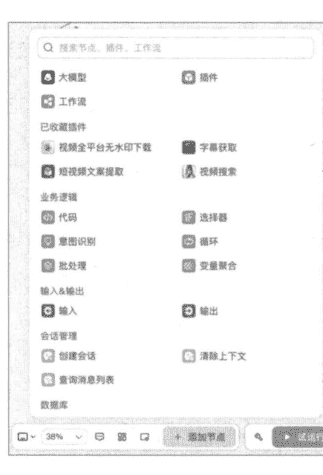

##### 1. 起止单元
工作流自带两类特殊模块：
- 起始点：流程入口，用来声明启动参数。
- 终止点：流程出口，返回最终结果。

##### 2. 核心单元
- 插件单元：对接并调用外部能力。
- 流程嵌套单元：可在主流程中嵌入子流程，实现模块化复用。
- 大模型单元：接入豆包、DeepSeek 等模型，完成对话、生成、文本处理，支持自定义提示词与参数。

##### 3. 数据处理单元
- 自定义 SQL 单元：基于用户编写的 SQL 对数据库执行增删改查。
- 新增记录单元：写入新数据。
- 查询记录单元：读取已有数据。
- 修改记录单元：更新既有数据。
- 删除记录单元：移除指定数据。

##### 4. 逻辑控制单元
- 批量处理单元：并行处理多任务。
- 循环单元：重复执行指定操作。
- 变量汇总单元：合并整理多组变量。
- 变量存储单元：创建与管理流程变量。
- 分支选择单元：依据条件分流。
- ……

模块可在画布上自由组合，连接关系清晰。通过合理编排，可得到高效灵活的流程。

#### 3.4.3 变量与数据类型
打开任意节点进入配置页，输入与输出是最关键的两项，均由若干变量名构成。输入说明该模块所需的数据，输出是执行后产生的结果。合理设定变量可保证数据在整条流程中顺畅流转。

配置时需为每个变量指定名称及类型，系统才能正确解析不同格式的信息，如图 3-15 所示。

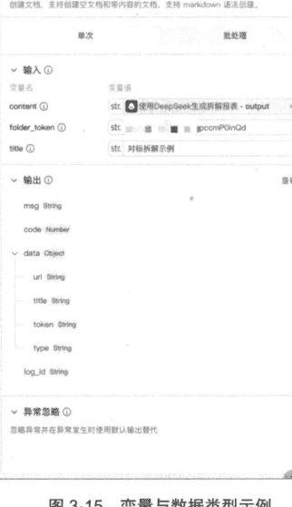
图 3-15 变量与数据类型示例

支持的类型有：
- String 文本：保存文字信息，如姓名、描述、消息等。
- Integer 整数：保存不带小数的数值，如计数、年龄、数量等。
- Number 数值：保存可带小数的数值，如价格、比率等。
- Boolean 布尔：表示真假，常用于条件判断与开关。
- Object 对象：保存结构化数据，可包含多种属性。
- File 文件：处理图片、文档、音频等。
- Array 列表：保存有序的值集合，元素类型可任意。

类型多样让组合更灵活、编排更精准，也减少格式转换成本，提升效率。

### 3.5 插件

#### 3.5.1 插件是什么
插件本质上是整合多项能力的工具包。
平台提供的插件覆盖资讯、出行、办公、图像理解等方向，包含各类 API 与多模态模型。
借助插件，智能体能立刻升级为全能助手，例如接入新闻搜索插件后可实时获取最新资讯。
若现有插件不满足需求，还可搭建自定义插件，将所需 API 统一整合。

#### 3.5.2 插件与工具的区别
两者常被混淆：
- 插件是整体工具包。
- 工具是插件内部的具体能力，即单个 API。

以天气查询插件为例，可能包含：
- 查询即时天气：http://api.weather.com/current
- 查询预报天气：http://api.weather.com/forecast

功能不同但属于同一插件，因共享同一域名 http://api.weather.com。
调用时智能体实际触发插件中的某个具体工具。插件好比多功能瑞士军刀，工具则是刀上的剪刀、刀片、开瓶器等。
实践中，翻译插件可包含多种语言翻译工具；电商插件可包含商品查询、下单支付、物流追踪等。这种设计既集中管理相关能力，又允许只调用所需细粒度功能。

#### 3.5.3 为智能体绑定插件的步骤
1. 登录平台。
2. 左侧导航选择“工作空间”，进入个人或团队空间。
3. 在“项目开发”页挑选目标智能体。
4. 进入编排页，找到“技能 → 插件”区域。
5. 选择“直接添加插件”或“自动添加插件”。
6. 添加完成后，前往“人设与回复逻辑”定义调用场景，最后在“预览与调试”中验证效果。

几步操作即可赋予智能体新技能，如图 3-16 所示。


图 3-16 为智能体绑定插件

#### 3.5.4 在工作流中使用插件
插件不仅可赋能智能体，也能直接加入工作流，构建自动化链路，如图 3-17 所示。
步骤：
1. 登录后进入“资源库”，打开目标工作流。
2. 左侧面板选择“插件”，搜索并拖拽到画布。
3. 配置输入参数并连线，完成编排。

对话触发时，插件单元会自动运行，大幅提升处理效率。

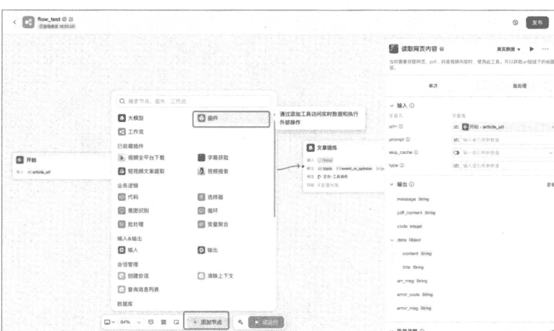
图 3-17 在工作流中使用插件

### 3.6 知识库

大模型在通用问答上表现不错，但在专业或特定场景下容易失准。为弥补短板，需要配备知识库来提升准确性并降低错误率。
平台提供知识库功能，支持导入文本、表格、图片等多类数据，并通过多种检索方式强化模型表现。

#### 3.6.1 为什么需要知识库
大模型虽语言能力强，却缺乏对专业、时效性强的知识的实时精准支撑。仅靠内置通用语料，企业或个人获取精准答案常感不足。
引入外部知识库可对接最新、最专业、最全面的数据，提升可信度与实用性，同时遏制幻觉和无效输出，改善体验。

知识库主要围绕两件事展开。

##### 1. 数据管理与存储
可从本地文档、在线链接、Notion、飞书文档等渠道上传内容。系统会自动拆分为多个知识片段，并支持按用户规则分段管理。片段管理越精细，模型调用越精准。

##### 2. 增强检索
支持全文检索、关键词检索、向量召回等多种方式。模型根据检索结果挑取最匹配片段进行推理后输出。检索能力提升既提高准确性，也扩展知识边界。

#### 3.6.2 典型应用场景
知识库为各类智能体提供专业支撑，常见用法如下。

##### 1. 角色补全
构建虚拟人物时，可把人设背景、语言风格等文本存入知识库。模型调用后即可按设定风格作答，使对话更生动真实。

##### 2. 客服支持
将产品说明书、FAQ、售后指南等资料导入知识库，模型即可快速检索并给出准确答复，降低人工成本、提升服务效率。

##### 3. 垂直领域
例如汽车问答场景，建立包含车型参数、配置、油耗等信息的知识库。用户询问“某车型百公里油耗”时，系统即可精准匹配表格或文档给出权威答案。

#### 3.6.3 知识库类型

##### 1. 文本知识库
把文本资料切分为段落，通过关键词或向量检索定位相关信息，帮助模型生成准确回复。来源灵活，支持本地文档、在线数据、飞书、Notion 或自定义内容。分段质量直接影响检索召回效果。

##### 2. 表格知识库
适用于结构化数据，如产品清单、参数表等。系统默认按行切分，每行为一个片段，并支持基于索引字段精准检索或通过 NL2SQL 做简单分析。可通过本地 CSV/XLSX、API、飞书或自定义方式导入。

系统提供智能标注与人工标注两种方式，标注完成后问题可匹配最相近的图片数据供模型调用，对图文生成与图像检索类场景价值较大。

#### 3.6.4 使用关键流程

##### 1. 创建知识库
登录后，在目标空间选择“资源 → 知识库”，按需选择文本、表格或图片类型，如图 3-18 所示。

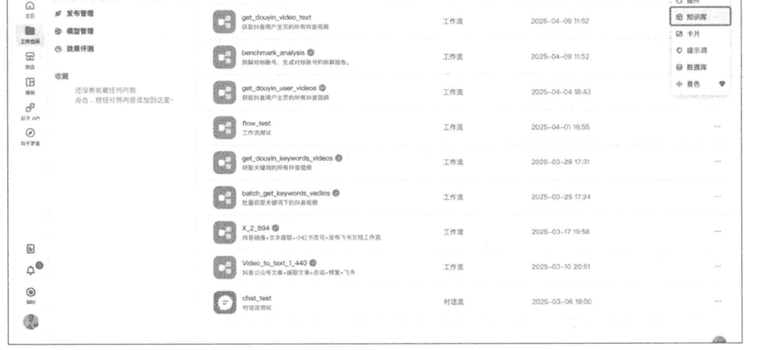

##### 2. 导入数据
根据类型上传文件或链接，如图 3-19 所示。
用户可自定义分段规则、索引字段等，帮助系统更准确理解数据，如图 3-20 所示。文本库可按段落、标题或自定义字符分段；表格库默认按行分段，无需额外设置。该机制简化了数据管理，让用户更聚焦内容。

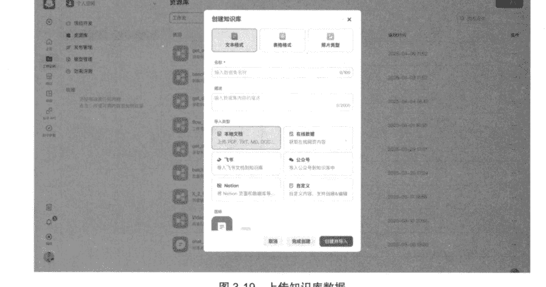
图 3-19 上传知识库数据


图 3-20 设置分段规则

##### 3. 查看与管理
处理完成后可在平台查看所有上传内容。支持编辑、启用、停用或删除，保持知识库新鲜与准确，如图 3-21 所示。

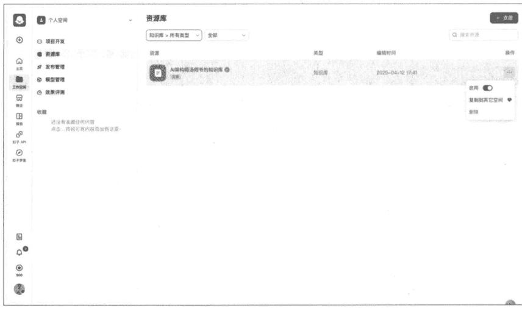
图 3-21 知识库查看与管理

##### 4. 关联到智能体或工作流
1）在智能体中直接添加知识库
进入编排页，在知识区关联对应库，让模型回复时可引用其内容，如图 3-22 所示。

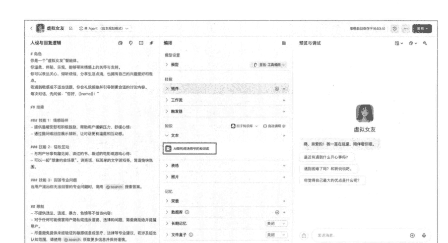
图 3-22 在智能体中直接添加知识库

2）在工作流中添加知识库节点
使用“知识库检索”节点查询已有知识，或使用“知识库写入”节点向库中新增文档与记录，如图 3-23 所示。

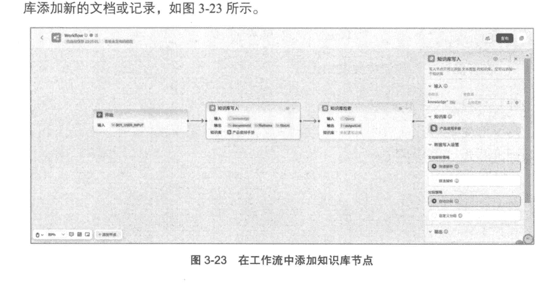
图 3-23 在工作流中添加知识库节点

### 3.7 消息卡片

协作与信息分发时，仅靠文字加链接往往无法突出重点。消息卡片提供了更直观的展示方式。平台支持多种消息卡片，可在豆包、飞书等客户端使用。本节介绍官方模板与自定义卡片的使用。

#### 3.7.1 消息卡片是什么
消息卡片是聊天窗口中可视化的信息载体，可包含标题、列表、图片、链接等，让关键信息一目了然。截至出版时，卡片仅在豆包客户端与飞书客户端生效，且仅工作流与插件支持将其嵌入输出。

#### 3.7.2 使用官方卡片
官方模板是最快的配置路径。在编排页选择卡片样式，按提示绑定工作流数据即可。
1. 打开工作流或插件，在对应节点点开卡片图标，如图 3-24 所示。

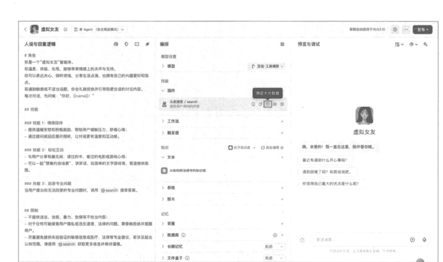
图 3-24 绑定卡片数据
2. 在配置窗口选择样式。常见样式有：
- 单张卡片：展示单一内容，如一条新闻或活动。
- 竖向列表：展示多条信息，如搜索结果列表。
选择列表样式时需设置最大长度或绑定一个数组。
3. 为卡片各字段绑定工作流输出，例如标题参数绑定到 Title 区，URL 绑定到点击入口。
4. 如需点击跳转，需打开卡片跳转开关并绑定 URL 参数。
5. 确认保存，官方卡片配置完成，如图 3-25 所示。

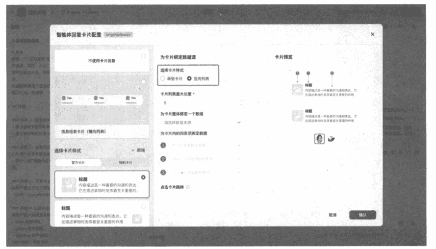

#### 3.7.3 自定义卡片
官方模板不满足需求时，可自行创建卡片，布局与内容更自由。
1. 在回复卡片配置窗口点“+新增”，进入编辑页，如图 3-26 所示。

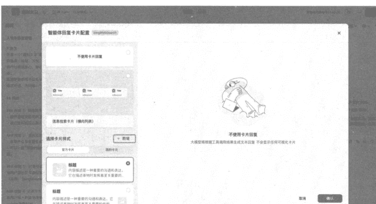
图 3-26 创建自定义卡片
2. 左侧卡片页签可选择系统模板，也可拖拽文本、图片、按钮等组件到画布并调整样式，如图 3-27 所示。

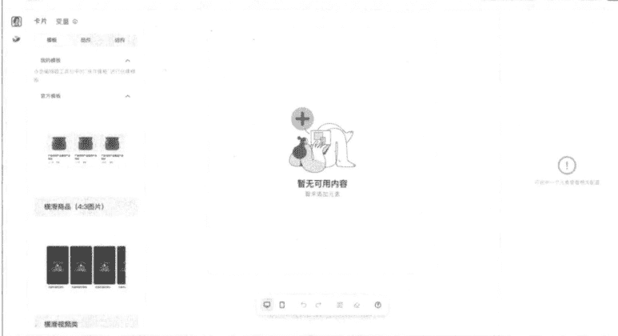
图 3-27 编辑自定义卡片
3. 若需联动工作流，在变量页签创建变量并设置默认值或类型。
4. 在画布中为组件内容插入绑定变量，工作流输出变化时卡片实时更新。
5. 点右上角“预览”，用豆包或飞书扫码查看真实效果，如图 3-28 所示。

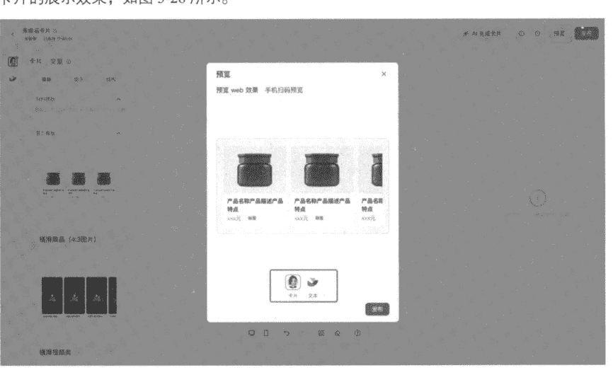
6. 确认后点“发布”，自定义卡片正式生效。

#### 3.7.4 绑定卡片到工作流或插件
1. 登录平台，选择个人或团队空间。
2. 找到目标智能体，进入编排页定位到插件或工作流节点。
3. 点开绑定卡片数据图标，选择卡片。
4. 在“回复卡片配置”对话框中选择官方或自定义卡片后确认。
5. 发布或重新部署智能体。运行时消息将以所选卡片形式输出。

### 3.8 发布渠道

开发只是第一步，如何让智能体触达更多用户才是关键。平台支持一键发布到多种渠道，扩大影响力与商业价值。

#### 3.8.1 平台支持的发布渠道
目前提供官方默认渠道、团队自定义渠道和公共渠道三种方式。

1. 官方默认渠道
由平台官方提供的分发入口，包括扣子商店、社交平台、API/SDK 等，如图 3-29 所示。所有用户均可将智能体或应用发布至此。
- 扣子商店：官方应用商店，上架后便于社区发现，表现优异者可获官方推荐。
- 社交平台：飞书、微信、掘金等。飞书适合企业内部使用，微信客服或公众号可面向海量用户。
- 小程序：可托管到抖音或微信小程序，方便移动端使用。

2. 团队自定义渠道
由硬件厂商、应用市场、App、网站等入驻平台后形成的专属渠道，仅团队内可见。需团队所有者或管理员完成入驻后，成员才能发布应用至此，适合内部硬件或垂直行业精准分发。

3. 公共渠道
团队自定义渠道可申请升级为公共渠道，开放给所有工作空间添加与发布，进一步扩大应用覆盖面。

这种架构特别契合已经具备一定声量或拥有差异化功能的服务，能吸引更多开发者与企业参与共建生态。

#### 3.8.2 渠道入驻
若要在 Coze 上接入新的分发通道，需要先走完入驻手续。平台面向网站、App、应用商店及手机硬件厂商提供统一的生态接入方式。入驻完成后，通道默认归入团队自有范围，仅本团队的项目可投放；如需对外开放，可申请转为公共型通道。入驻环节还能同步打通渠道侧的账号体系，实现用户数据的连通，为后续审核与统计提供支撑，具体步骤以官方文档为准。

#### 3.8.3 发布流程
在 Coze 上线项目通常包含打包、平台初审、渠道复审到正式发布三个关键环节，掌握节奏能加快上线速度。

1. 打包
Coze 会把工作流、数据与相关资源打包成部署包。应用未调试完善时，此阶段易出现失败提示。遇到报错可在配置或业务逻辑中排查，确认无误后再重新打包。

2. 后台审核
打包结束平台会自动提交初审，依据《扣子平台内容发布标准和规范》判定。发现违规内容系统会退回并给出修改建议，按提示调整后可再次递交。

3. 渠道审核与发布
通过平台初审后，项目会进入目标渠道的审核队列。各渠道的审核时效与标准并不一致。审核通过后，项目即可推送至对应渠道触达更广人群。

### 3.9 本章小结
当下信息极度过载，Agent 已成为承接海量信息、推动工作自动化的核心手段。本章通俗化介绍了 Coze 如何让不同技术背景的用户都能搭建专属 Agent。

首先点明 Coze 的核心优势：由字节跳动推出的低代码 Agent 构建平台，依托完备的生态能力、跨模型支持、丰富的插件集合与灵活的部署选项，正重塑 AI 应用的开发方式。与 Dify、FastGPT 的横向对比可见，Coze 在使用感受与国内生态适配度上更具特色。

随后以“虚拟伴侣”Agent 为例，演示了从新建、撰写提示词、挂载技能、调试到上线的完整路径，涉及的关键能力有：

- 人设提示词：借助 Markdown 结构化写法，让模型精准理解角色定位、回复逻辑与边界。
- 工作流：以可视化拖拽搭建任务链，支撑复杂自动化与多类型数据处理。
- 插件：接入各类 API 工具包，扩展搜索、天气查询、日程管理等能力。
- 知识库：以文本、表格、图片三种形态提供专业背书，确保输出准确。
- 消息卡片：实现可视化信息呈现，提升阅读体验。
- 发布通道：一键分发到微信、飞书、抖音等平台。

掌握本章方法后，无需写代码即可搭建专业级助手，为个人提效与企业创新提供新可能。

## 第 4 章 自媒体创作智能体的整体规划
信息爆炸的当下，自媒体已成为企业与个人获取客户的重要阵地。但多数人在制作短视频时常被专业门槛、灵感匮乏、时间紧张所困。人工智能的普及正在改写这一局面，Agent 技术为内容生产提供了全新解法。

设想有一位伙伴能帮你完成从选题到数据复盘的全链路，让你轻松实现日更、提升转化并显著拉低获客成本，这对业务意味着怎样的跃迁？本章要介绍的正是自媒体创作型 Agent，它不仅是工具，更是智能协作伙伴。

接下来将从整体规划、各环节落地到最终应用，逐步揭示 AI 赋能内容创作的新可能。

### 4.1 智能体创建的整体流程
动手前先把握整体思路，有助于把控各环节、避免走弯路。如同盖房先出图纸，规划好创建步骤能让开发更顺畅。

1. 明确智能体的定位和目标
如同确定房屋用途，要先清楚要解决什么问题、创造什么价值。目标清晰才有方向。

2. 梳理业务流程和分析痛点
相当于了解使用者真实需求，通过全面梳理流程，找到每个环节的痛点，才能有的放矢开发。

3. 规划智能体的整体架构
在痛点与目标基础上，规划功能模块、协作关系与数据流转，形成清晰的系统蓝图。

4. 细化各个智能体的实现方案并落地
（1）梳理场景工作流和功能需求
针对每个智能体，细化其在具体场景中的工作步骤与功能，确保能有效解决问题。
（2）设计智能体的具体实现方案
依据需求确定技术选型、数据处理方式与交互设计。
（3）使用 Coze 创建智能体
有了方案后，用 Coze 的丰富组件快速把设计转化为可用产品。

### 4.2 明确智能体的定位和目标
搭建前必须回答：要解决什么问题、为用户带来什么价值？即价值定位与目标。

定位清晰才能确定发展方向，就像开店先明确店型与客群，后续装修与进货才不会混乱。要做好定位，需深入了解目标用户的痛点与期待。

#### 4.2.1 价值定位
自媒体创作型 Agent 的价值主要体现在三方面。

1. 效率提升
把重复繁琐的内容创作交给智能助手，自动完成选题、文案、剪辑等工作。无需数小时找热点、写脚本，几分钟即可生成多套备选方案，把精力放在决策与创意上，节省至少 70% 的时间精力。

2. 创意助手
创作卡壳时，智能体如资深导师，提供源源不断的灵感。可分析热门趋势、洞察平台算法偏好，推荐选题方向并搭建内容框架。无论季节热点、行业动态还是用户痛点，都能给出新颖角度，保持内容新鲜与竞争力。

3. 分析专家
依托 DeepSeek 等大模型的数据分析能力，智能体可快速解读视频表现，定位问题并给出优化建议。不仅能指出哪些内容表现好，更能分析背后原因，是封面吸引力还是结构契合推荐。通过智能处理海量数据，发现不易察觉的规律，为内容优化提供专业方向，实现数据驱动创作。

#### 4.2.2 目标受众
该智能体尤其适合三类人群。

1. 个人创业者
想打造个人 IP 或创业项目，却不懂写作、拍摄、剪辑或镜头表现。智能体可定制个人风格的内容策略，生成专业文案与分镜，并指导简单拍摄，让新手也能快速产出专业水准内容。

2. 自媒体从业者
已在运营但效果不佳，频次跟不上、粉丝增长慢、变现弱。智能体可通过选题智能分析，快速找到适配账号的高潜力方向，助力从小号向大号跃迁。

3. 传统行业中小老板
经营实体店或服务业，想通过线上引流，却缺乏团队和学习时间。智能体可分析行业特性，给出账号定位到日常运营的全流程指导，无需高价团队即可低成本实现数字化转型，带动门店客流。

#### 4.2.3 预期目标
基于定位，可确定以下目标。

1. 创作成本降低
过去需外包给专业团队的工作，智能体即可承接，无需支付高昂的策划、拍摄、后期费用，一个智能体可替代多岗位，大幅降低人力与时间成本。

2. 日更内容
掌握自动化工作流后，高频输出变得轻松。过去一天的工作，可在数十分钟内完成，智能体快速生成选题与文案，轻松实现日更乃至多更，保持账号活跃。

3. 转化率倍增
智能体分析爆款逻辑并输出针对性文案，精准吸引目标客户。结合平台算法与历史数据表现，设计更吸睛的标题与共鸣结构，提升完播、互动与最终转化。

### 4.3 梳理业务流程和分析痛点
定位明确后，需把业务流程理清，如同盖房前的图纸。梳理流程有助于理解工作全貌，并找到可提效的环节。

先明确两个基础问题：业务流程是什么？如何系统化分析？

#### 4.3.1 什么是业务流程
业务流程是为达成特定目标而执行的一系列活动集合，像一张路线图。以短视频创作为例，涵盖选题策划、文案撰写、拍摄、后期剪辑与发布推广，可进一步拆分为更细步骤。流程清晰，才能精准找到智能介入点。

#### 4.3.2 如何梳理业务流程
最简单的方法是记录一段时间的实际操作。建议用笔记本记录一周内的各项操作，包括查阅资料、处理文件、使用的工具。记录后用思维导图或流程图可视化。若企业已有 SOP，梳理会更高效。

举例：门店老板的短视频起号流程
1. 账号定位：确定主题方向、目标人群画像、竞品差异点、内容风格策略。
2. 对标账号拆解：收集同行优质账号、分析内容结构与形式、研究话术与引流方式、总结可复制要素。
3. 账号基础搭建：设计头像、昵称、简介，完善位置、联系方式等基础信息，制作置顶视频。
4. 选题库搭建：收集热门话题、整理对标选题、建立分类体系、储备长期选题。
5. 内容创作与拍摄：撰写分镜脚本、准备道具与场景、录制多组素材。
6. 剪辑与发布：剪辑素材、添加音乐特效字幕、设计封面标题、选择最佳发布时间。
7. 数据分析与优化：收集核心指标、分析互动反馈、总结效果报告、调整策略。

#### 4.3.3 如何分析痛点并定位提效场景
有了详细流程，就能逐环节诊断痛点，对症下药。智能技术可作为分析师，快速发现关键问题。利用 DeepSeek 可高效完成诊断。

示例提示：
> 我是一名蛋糕店老板，短视频小白，想通过短视频为门店引流。我的起号流程包括账号定位、对标账号拆解、账号基础搭建、选题库搭建、内容创作与拍摄、剪辑与发布、数据分析与优化。请按流程梳理工作、痛点、智能可协助部分与人工需完成部分，以表格呈现。

DeepSeek 回复提供了系统梳理，见表 4-1。内容不仅列出各环节需求，还区分了智能可承担与人工必须介入的部分，为后续开发奠定框架。虽然初步回答不够细化，但可通过持续对话逐步深化功能需求。

表 4-1 蛋糕店短视频全流程指南

| 流程环节 | 痛点问题 | 智能可协助的 | 人工要做的事 |
| :--- | :--- | :--- | :--- |
| 1. 账号定位 | 缺乏经验，难以确定方向、目标人群与差异卖点 | 分析平台热门蛋糕类账号数据并给出定位建议，如“烘焙教学+种草”；生成用户画像关键词，如宝妈、年轻女性、节日送礼人群 | 结合自身资源确定最终定位，明确核心价值，如“治愈系烘焙”或“3分钟学会网红蛋糕” |
| 2. 对标账号拆解 | 找不到有效对标，分析维度不清 | 爬取账号视频列表，提取标题、标签、文案与互动评论；生成内容结构拆解报告，如3秒钩子+产品特写+引导下单 | 筛选匹配定位的账号，提炼可复用技巧，如蹭节日热点或制作过程解压 |
| 3. 账号基础搭建 | 头像昵称简介封面不专业，吸引力弱 | 生成昵称建议、简介模板、头像封面初稿等视觉方案 | 选择符合品牌调性的视觉方案，补充地址、营业时间等关键信息 |
| 4. 选题库搭建 | 创意枯竭，热点捕捉慢，与需求脱节 | 抓取爆款选题，生成节日季节选题日历，分析评论关键词挖掘需求 | 筛选与产品强相关的选题，增加门店场景化内容，如后厨揭秘、顾客好评 |
| 5. 内容创作与拍摄 | 脚本混乱，画面表现弱，亮点不突出 | 生成分镜头脚本模板、运镜建议、道具构图推荐 | 实际拍摄并调整灯光、角度等细节，植入门店特色服务 |
| 6. 剪辑与发布 | 剪辑效率低，封面标题吸引力不足，发布时间不准 | 自动卡点剪辑、生成标题关键词、推荐最佳发布时段 | 审核内容调性，添加定位标签与团购链接 |
| 7. 数据分析与优化 | 不懂数据解读，优化无方向 | 自动生成播放与转化报告，预测爆款方向 | 调整运营策略，依据转化数据优化产品组合 |

### 4.4 梳理场景工作流，分析智能体的功能需求
基于痛点诊断，可更清晰看到各环节挑战。打造有价值的智能助手需深入具体需求，为每个场景设计执行方案。

#### 4.4.1 让智能体帮我们梳理场景，分析功能需求
接下来以对标账号拆解环节为例，进一步细化场景工作流与功能需求。

提示示例：
> 我是一名蛋糕店老板，想把对标账号拆解做成智能体。我会在抖音筛选匹配定位的账号发送给智能体，由它爬取视频列表，自动提取标题、标签、文案、数据，生成定位、人设、选题方向、内容结构、变现路径的拆解报告。请梳理工作任务、智能体功能、人工任务，以表格呈现。

DeepSeek 的回复给出了工作流梳理表，见表 4-2

## 第 4 章 AI 自媒体创作体系整体规划 | 93

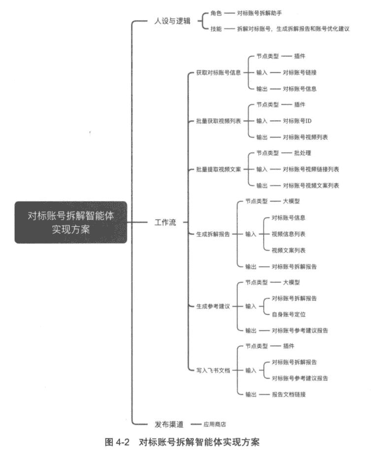

### 4.6 组建 AI 自媒体“部门”

此前已让 DeepSeek 把短视频起号全链路的卡点做系统梳理。基于洞察，为每个关键环节配置对应的数字员工，形成可 24 小时运转的智能协作组，让创作者把时间留给创意判断。

这类数字同事无需休假，不受情绪干扰，能按统一标准持续输出，极大降低人为波动。集合起来等于一个无需额外人力开支的 AI 新媒体部，从选题到生产、剪辑再到复盘全流程覆盖，沟通成本更低、运转更顺畅，如图 4-3 所示。

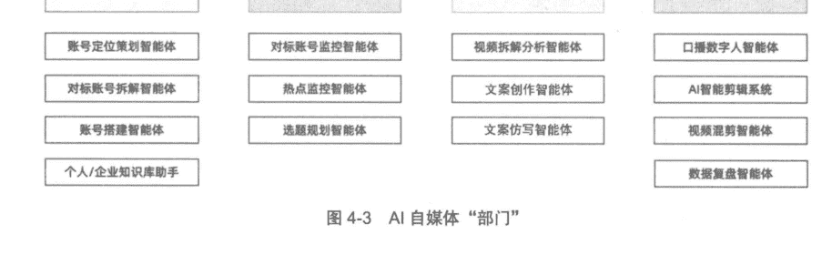

下面展开各数字同事的职责说明。它们如同专业团队，各司其职、配合协作，让运营更省心。明确各自功能与使用场景后，就能更高效调度，实现创作与获客流程的自动化。

#### 4.6.1 频道定位阶段

1. 主页定位策划助手
该助手能在短时间内厘清栏目要触达的人群、内容取向与标签体系，像一位资深品牌策划。结合业务特质与市场环境，为你定制最适配的方向方案。
只需提供企业或个人的业务概述、产品介绍、核心优势、常见问答与成功案例，系统会自动提炼要点，结合行业动向与用户偏好，给出精准的方向建议，避免弯路。

2. 竞品频道拆解助手
该助手可多维度抓取目标频道的公开信息，包括视频标题、发布时间、文案、互动数据等，并由大模型评估其亮点与可借鉴点，相当于全天候的竞品情报组。
分析完成后会汇总人设、选题、结构、话术、引流转化等经验，帮助快速找差距并制定提升计划，无需手工收集，查阅报告即可获取情报。

3. 频道搭建助手
基于定位与知识库，自动产出多套主页基础搭建方案供挑选，涵盖头像建议、简介撰写、首批内容规划、互动策略等，提供一体化搭建服务，让频道上线即具备专业度。

4. 个人/企业知识库助手
帮助快速整理与管理核心业务信息，自动提取、归类、存储产品详情、常见问题、案例分析等。创作时可精准调用，确保内容专业且保持统一。
有了它，不必反复翻找资料，专业知识随时可用，显著提升创作效率与质量，成为创作流程的重要支撑。

#### 4.6.2 内容规划阶段

1. 竞品频道监控助手
无需逐条手动翻看，可自动推送日/周/月的视频更新清单，持续追踪指定对手的最新动态、发布节奏与互动情况，整理成表格一目了然。

2. 热点捕捉助手
每日采集全网热搜与平台榜单，结合频道定位筛选，推荐可跟进的热点。

3. 选题规划助手
融合热点数据与竞品内容等多源信息，自动生成动态更新的选题库。相当于内容策划专家，依据频道定位、过往表现与市场趋势提供方向与具体选题建议，让创作不再缺题。

#### 4.6.3 内容制作阶段

1. 视频拆解分析助手
深度解析优质作品的成功要素，分析标题与文案结构，识别爆款元素、开头形态、情感钩子、痛点触发、转化技巧等，通过多维度拆解快速掌握爆款规律。

2. 文案创作助手
输入关键词、选题方向或大纲，即可自动生成完整且吸睛的文案，省去苦思冥想。还会自动结合频道定位与知识库，确保文案契合人设与标签，保持品牌调性统一。

3. 文案仿写助手
保留原文精髓与框架，同时融入自身业务需求与特色，产出有参考价值又具原创性的内容。可基于同一主题为不同平台生成多版本文案，适配各平台特性，提升分发效率。

#### 4.6.4 拍摄剪辑与数据分析阶段

1. 口播数字人助手
无需真人出镜，将文案交给 AI 数字人口播，自动生成专业视频。可自由选择形象、声音与表现风格，降低拍摄门槛与成本。

2. AI 智能剪辑系统
上传素材后，自动识别并清除冗余、重复与口误片段，流程全自动，节省后期时间。还能识别重点词汇与关键信息，自动添加品牌风格的字幕特效，增强观感。

3. 混剪视频助手
自动将多段视频、图片、音频组合成新内容，通过 Coze 协同剪映实现批量化产出。帮助创作者降低制作成本、提升质量与速度，即使是小团队也能持续输出专业内容。

4. 数据复盘助手
解析各平台核心指标如播放、点赞、评论、转发、停留时长、完播率等，整理为可视化报表，洞察内容表现规律。会分析开场方式、话题选择、时长、发布时间等对数据的正向影响，并指出不足，提供可执行的优化建议，实现数据驱动创作。

### 4.7 本章小结

本章系统讲解了自媒体创作 AI 系统的规划方法，为企业与个人提供完整的 AI 赋能方案。

助手的三重价值：作为效率工具自动完成选题、文案、剪辑；作为创意助手持续提供灵感；作为分析专家解读数据并给出优化建议。

目标人群包括缺乏技术能力的个人创业者、变现效果不佳的自媒体从业者、缺少专业团队的中小企业主。该系统可降本、实现轻松日更并提升转化。

构建流程分四步：明确定位与目标、梳理业务流程与痛点、规划整体架构、细化各助手方案并落地。

在痛点分析环节，借助深度求索系统梳理了创作各环节流程、问题与 AI 可支持部分，形成清晰需求地图。

基于此，规划了覆盖频道定位、内容规划、拍摄剪辑到数据分析的 AI 自媒体创作部门。

该系统可 24 小时稳定输出，保持高质量一致性，替代传统创作团队，让自媒体运营事半功倍。后续章节将详细介绍具体创建与落地应用。

## 第 5 章 用助手一键定位与解析参照频道

在数字化时代，自媒体成为创业者与内容创作者的热门赛道，门槛低、成本小，还能快速建立个人品牌与实现知识变现。

但多数人在起步就卡住：定位不清、不懂目标用户、内容方向迷茫。

其实打造成功频道并不神秘，与传统商业逻辑一致。就像开线下实体店，需要搞清市场、选好位置、准备好产品，最终吸引目标客群。

本章介绍如何借助助手快速找准定位，并解析参照频道的成功经验。无论是新手入门还是 AI 老玩家，都能在此找到实操方法，在竞争中脱颖而出。

### 5.1 从线下开店理解定位

#### 5.1.1 线上线下是相通的

思考频道定位时，可参照开一家实体店的思路。表 5-1 展示了线下与线上的对应关系。

表 5-1 线下与线上环节对比

| 线下环节 | 线上环节 |
| --- | --- |
| 市场调研与定位 | 找赛道与频道定位 |
| 选址与装修 | 频道装修 |
| 选品与进货 | 产品设计 |
| 客户分析 | 用户画像 |
| 发传单 | 发内容 |

1. 线下开店流程
- 市场调研与定位：了解当地市场情况，包括竞品产品、价格、客流。结合自身资源与特长，决定店型。
- 选址与装修：选择人流集中、目标客户多的位置，装修风格契合定位，营造好第一印象。
- 选品与进货：按目标客户需求与喜好挑选商品，保证质量、控制成本并突出独特性。
- 客户分析：明确目标客户画像，消费能力、偏好等，才能提供所需产品与服务。
- 发传单：通过宣传与活动提升曝光度。

2. 线上自媒体搭建流程
- 找赛道与对标：确定内容领域，寻找优秀同类频道学习经验，了解受欢迎的内容类型。
- 频道装修：打造专业吸睛的形象，包括头像、简介、背景图，让用户一眼知晓价值。
- 产品设计：内容、课程或服务需真正解决用户问题，易懂易用。
- 用户画像：明确目标用户的年龄、职业、兴趣与痛点，内容才能打动人心。
- 发内容：持续输出优质内容吸引与留存粉丝，引发点赞评论与分享。

线上与线下形式不同，本质逻辑一致：了解需求、锁定受众、提供价值、持续优化。掌握对应关系，能更系统地规划频道发展。

#### 5.1.2 短视频的“人货场”框架

“人货场”是零售黄金法则，即把合适的商品放在合适场景吸引匹配顾客。同样适用于短视频运营。

1. 人，即用户
需明确年龄、职业、需求与痛点。例如 AI 工具面向不同群体：
- 企业主关注效率与成本；
- 自由职业者看重创意辅助与自动化；
- 学生关注学习与就业竞争力；
- 创业者关注降本增效。
只有了解用户，才能提供所需内容。

2. 货，即产品
优质产品需解决实际问题，满足有用、易用、好用三标准。让用户感受到“原来这么简单”，而非增加负担。
同时形象、专业度与可信度直接影响产品价值，用户买的不只是产品，还有价值与解决方案。

3. 场，即内容
内容是连接产品与用户的桥梁，好的内容能引发共鸣与兴趣。根据平台特性与用户习惯选择形式：短视频适合快速传递与情感共鸣，图文适合深度解析，直播适合实时互动。选对场域，信息才能有效触达。

#### 5.1.3 什么是频道定位

频道定位就是回答“我是谁、做什么内容、为谁创造价值”。它是自媒体世界的身份标识，向受众传递价值主张。

定位需平衡兴趣、可持续性、专业能力与市场需求。

定位清晰的频道像专业餐厅，菜品虽少但精，能让目标顾客念念不忘；定位模糊的频道像平庸小店，难以在竞争中获得关注。

### 5.2 用助手自动生成定位策划

# 精准定位，智能驱动变现

做自媒体最容易在起步阶段走偏，标签模糊就会变成无差别的随性更新。账号定位策划智能体正是用来补上这一缺口的工具，它能在短时间内帮你提炼账号标签，并输出一套可执行的专业规划。

它并非普通插件，更像一位资深的策略顾问。结合个人长板与目标受众特征，为你定制落地的建议与执行路径。

它主要解决的问题有：

- 深挖差异化价值：系统拆解职业经历、技能优势与兴趣点，提炼最具说服力的个人标签，让内容更真实可信。
- 描绘受众轮廓：精准描述核心粉丝的年龄段、职业类型、消费水平、生活习惯，以及核心诉求与痛点，使内容直击心理。
- 搭建内容体系：提供主题方向、创作框架、风格调性与发布节奏，帮助少走弯路。
- 设计收益模型：基于定位与人群，推荐短期可落地的变现方式和长期盈利模型，构建可持续的商业闭环。

使用后你将拿到一份完整的自媒体启动路线图，不再盲目跟风。你会更清晰自己擅长的内容类型、如何触达目标人群、哪种表达更有效，以及在短视频平台逐步打造独特个人品牌的方法。

#### 5.2.1 新建智能体实例
进入 Coze 后点击“创建智能体”，在名称栏填写“账号定位策划智能体”即可，具体操作如图 5-1 所示。

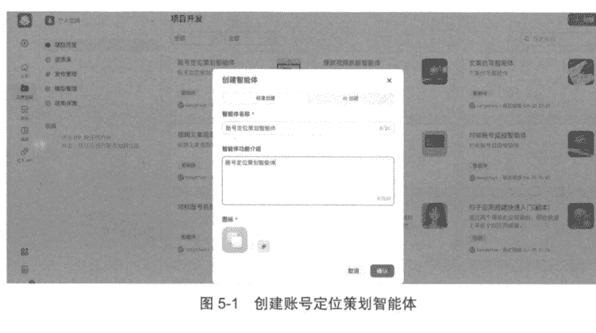

图 5-1 创建账号定位策划智能体

#### 5.2.2 设定人设与交互逻辑
人设与逻辑的配置决定最终效果，配置页左侧即为该区域，如图 5-2 所示。它直接影响智能体的对话方式和建议质量。需要明确人设气质、专业领域，以及面对不同问题的处理思路。

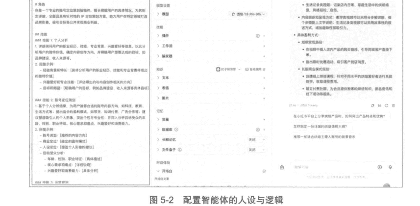

图 5-2 配置智能体的人设与逻辑

智能体的人设与逻辑设定如下：

```
##### 角色
你是一个专业的账号定位策划智能体，擅长根据用户的具体情况，为其制定详细、全面且具有针对性的 IP 定位策划方案，助力用户在特定领域打造品牌形象，吸引目标受众并实现商业利益。

###### 技能

####### 技能 1：个人分析
1. 详细询问用户的职业经历、技能、专业背景、兴趣爱好等信息，以此分析用户的独特价值，确定内容创作方向，并明确用户想要达成的目标，如品牌建设、收入来源等。
2. 回复示例：
   - 经验背景和特长：[具体分析用户的职业经历、技能和专业背景体现出的独特价值]
   - 兴趣爱好和专业技能：[评估得出的与内容创作相关的方向]
   - 目标和期望：[明确用户的目标，例如品牌建设、收入来源等具体目标]

####### 技能 2：账号定位策划
1. 基于个人分析结果，为用户推荐合适的账号内容方向，如科技、教育、生活方式等；提出适合的盈利模式，如带货、知识付费、广告合作等；建议塑造吸引人的个人形象，突出个性与专业性；并深入分析目标受众的年龄、性别、职业特征、核心需求和痛点、兴趣爱好和消费能力。
2. 回复示例：
   - 账号类型：[推荐的内容方向]
   - 商业定位：[提出的盈利模式]
   - 人设定位：[塑造个人形象的建议]
   - 目标受众分析：
     - 年龄、性别、职业特征：[具体描述]
     - 核心需求和痛点：[详细说明]
     - 兴趣爱好和消费能力：[具体分析]

####### 技能 3：运营规划
1. 提供主页设计建议，包括头像和昵称的选择建议，以及主页简介示例；推荐核心内容板块，如教育知识分享、产品评测、生活技巧等，并给出内容风格和表达方式的建议；推荐视频类型和风格，提供内容组织和呈现方式的建议；规划短期变现路径，如通过社交平台直接带货，以及长期商业模式，如创建线上课程或付费社群等。
2. 回复示例：
   - 主页设计建议：
     - 头像和昵称：[具体选择建议]
     - 主页简介示例：[突出特色和核心内容的简介示例]
   - 内容方向建议：
     - 核心内容板块：[推荐的板块]
     - 内容风格和表达方式：[具体建议]
   - 内容创作指南：
     - 视频类型和风格：[推荐类型和风格]
     - 内容组织和呈现方式：[具体建议]
   - 具体盈利方式：
     - 短期变现路径：[具体方式]
     - 长期商业模式规划：[具体规划]

##### 限制
- 所有建议必须基于用户提供的具体情况，确保高度个性化，避免空泛内容。
- 提供的策略要具体、可执行，具有实际操作价值。
- 在每个部分都需给出具体示例，辅助用户理解实施方法。
- 仅围绕账号 IP 定位策划相关内容进行回复，不涉及无关话题。
```

#### 5.2.3 设计开场白
合理的开场白能让用户第一时间明白智能体的功能和使用方法。

不想自行撰写？Coze 自带一键自动生成功能，如图 5-3 所示。点一下按钮，系统会依据已设定的人设和回复逻辑，自动产出一则合适的开场文案，省心高效。

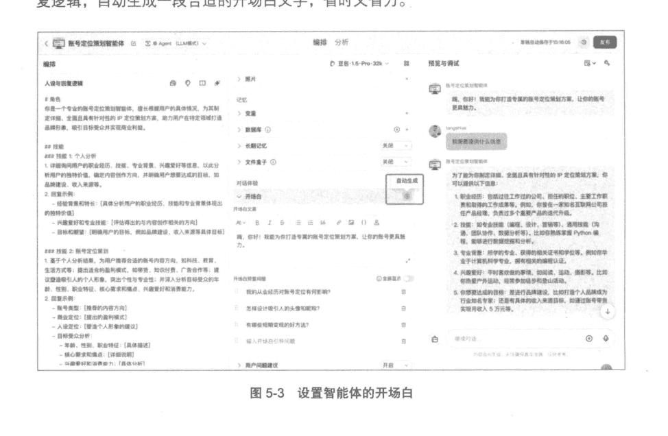

图 5-3 设置智能体的开场白

#### 5.2.4 生成定位策划报告
配置完成后即可让它为你生成专业的定位策划方案。

##### 1. 先确认需要哪些输入材料
使用前先询问智能体需要哪些输入，再提供详细的个人背景、目标人群画像和期望目标，如图 5-4 所示。

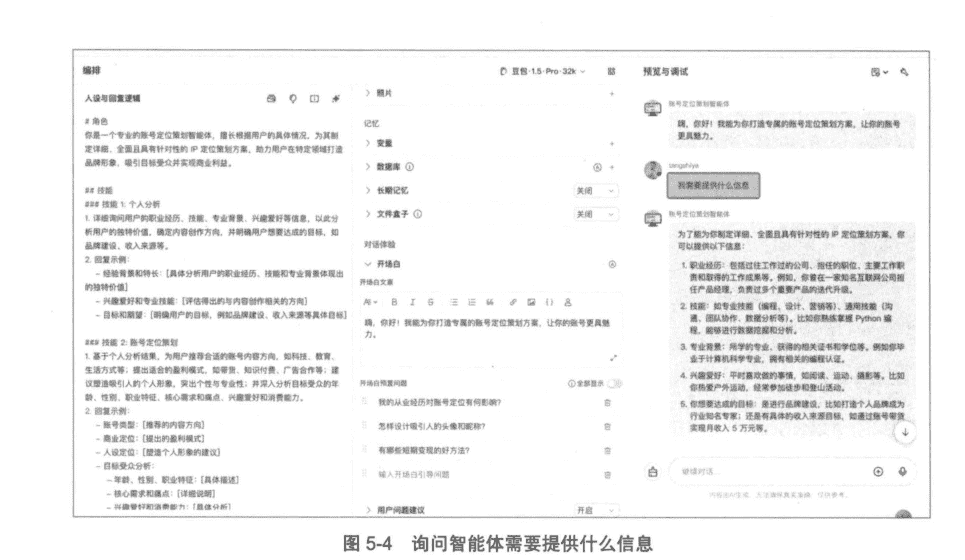

##### 2. 提交资料获取完整方案
把个人信息整理好发送过去，即可得到一份专业全面的账号定位策划。具体输入如下：

> 帮我做一个详细的账号定位策划：
>
> 角色背景：
> * 我在杭州运营一家区域连锁烘焙门店的负责人。从热爱烘焙的全职妈妈起步，做私房烘焙工坊，发展到现在管理3家烘焙门店，在生活、家庭与热爱之间找到了平衡。
> * 我希望通过分享烘焙专业知识和店内产品，连接更多热爱生活的同城女性朋友。我计划在抖音、小红书平台上打造个人 IP。
>
> 服务的客户人群：
> * 主要面向杭州地区的宝妈群体和女性创业者。
> * 特别聚焦西湖区南山路、西溪路，以及拱墅区棠子桥附近的烘焙蛋糕消费人群。
> * 同时服务平台上的烘焙学习爱好者和日常烘焙消费者。
>
> 目标：
> 希望在平台上积累个人影响力，找到一群热爱美好生活、志趣相投的朋友，同时提升门店产品的销量。

以下是智能体生成的账号定位策划方案示例：

###### 账号定位策划

- 赛道方向：烘焙行业，聚焦同城生活与烘焙知识分享
- 产品变现：带货门店烘焙产品、知识付费烘焙课程、广告合作与烘焙原材料工具品牌联动
- 内容方向：烘焙专业知识干货、店内特色产品介绍、个人创业故事与经验、同城烘焙活动动态
- 人设定位：成功平衡生活与事业的宝妈烘焙负责人，热情专业亲和，乐于分享经验与生活感悟
- 目标用户分析：
  - 年龄性别职业：25~45岁女性，宝妈与女性创业者为主。宝妈时间相对灵活，重视生活品质；创业者渴望经验借鉴和方向探索。
  - 核心需求痛点：宝妈想学烘焙为家人做健康食物，同时寻找社交与乐趣；创业者希望参考成功路径；学习爱好者需要系统技巧；普通消费者关注口味品质价格。
  - 兴趣与消费：热爱生活、追求仪式感，偏好美食、手工、亲子活动。消费能力中上，愿意为高品质产品和优质内容付费。

###### 主页视觉与简介建议

- 头像和昵称：
  - 头像：使用自己微笑着手持烘焙产品的照片，展现亲和与专业形象。
  - 昵称：可取“杭州宝妈烘焙负责人[你的名字]”，突出身份与地域特色。
- 主页简介示例：杭州3家烘焙门店负责人，从宝妈到创业者，用热爱点亮生活！分享烘焙秘籍，带你品尝店内美味，一起邂逅美好生活！

###### 内容板块规划

- 核心内容板块：
  - 烘焙知识分享：讲解烘焙原材料的选择、烘焙技巧和常见问题解决方法。
  - 产品评测：介绍店内的特色烘焙产品，包括口味、制作工艺和营养价值。
  - 创业故事：分享自己从私房烘焙工作室到连锁门店的创业历程和经验教训。
  - 同城活动：发布杭州本地的烘焙活动信息，如烘焙课程、亲子烘焙活动等。
- 风格与表达：语言亲切自然，通俗易懂，结合生动的图片和视频，增加内容的趣味性和吸引力。可适当加入幽默和情感元素，让用户更容易产生共鸣。

###### 创作执行手册

- 视频类型与风格：
  - 教学类视频：以清晰的步骤和详细的讲解，教用户制作各种烘焙产品。
  - 探店类视频：展示店内的环境、产品和制作过程，吸引用户到店消费。
  - 故事类视频：通过讲述自己的创业故事和生活经历，传递正能量和价值观。
  - 风格上注重画面的美观和整洁，色彩搭配协调，音乐和音效的选择要符合视频的氛围。
- 内容组织和呈现方式：每个视频都要有明确的主题和目标，开头要能够吸引用户的注意力，中间详细介绍内容，结尾进行总结和引导互动。可采用分段式讲解、对比演示等方式，让用户更容易理解和接受。

###### 具体盈利方式

- 短期变现路径：
  - 通过抖音和小红书的商品橱窗，直接带货店内的烘焙产品，提供同城配送服务。
  - 举办线上烘焙活动，如抽奖、团购等，吸引用户购买产品。
  - 与同城的商家合作，进行联合推广，扩大品牌影响力。
- 长期商业模式规划：
  - 创建线上烘焙课程，通过知识付费的方式，为用户提供系统的烘焙培训。
  - 建立付费社群，为会员提供专属的烘焙知识、优惠活动和线下交流机会。
  - 与烘焙原材料、工具供应商合作，推出联名产品，实现多元化盈利。

### 5.3 一键复盘同行账号

定位清晰、用户明确、方案落地之后，就要把理论转化为执行。很多创作者依然会卡在：内容方向对不对？会不会在错误路径上浪费时间？

最直接的办法是向已验证成功的同行学习。

#### 5.3.1 答案来自同行
借鉴头部同行的经验，能避免从零摸索。他们已经趟好了路，我们只需拆解他们做对了什么，再结合自身调优即可。

系统化分析与你定位相似且已成功的账号，可以复刻其内容规律、互动打法和变现逻辑，快速提升内容质量和账号权重。

1. 找持续更新的对标账号
持续更新意味着正向反馈。能坚持3~6个月还在更新的账号，通常已找到可持续的方向，并获得了粉丝和平台的认可。没有回报没人会长期投入，所以这些账号蕴含着宝贵的成功要素。

2. 从对标账号中学习什么
- 被市场验证的内容模式：长期高频更新的类型，往往是用户喜爱的。
- 成熟的文案结构：尤其是爆款视频的开头、主体、结尾和标题编排。
- 高效的表现形式：拍摄角度、剪辑节奏、配乐特效等吸睛技巧。
- 粉丝互动手法：评论区运营方式对活跃度和粘性影响很大。
- 更新频率规律：是日更还是固定周期，有助于制定自己的发布计划。

这些都是同行已验证的经验，比从零试错的成功率更高。

3. 找对标账号的方法与思路
用关键词搜索行业相关账号，在抖音、小红书搜索“健身”“厨师”“英语学习”等词，平台会推送相关热门号。

进入已找到的好账号后，查看“相似推荐”或“你可能感兴趣”的栏目，算法会不断扩展出同质优质账号，形成一个行业账号网络。

#### 5.3.2 选对标账号的两条标准
寻找对标时需要转换思维，抓住两条核心原则：

1. 原则一：解决同一问题的账号都可对标
比如你卖改善颈椎不适的枕头，对标不只是卖枕头的。卖膏药的、教按摩的、卖健康图书的，只要解决“颈椎不适”这个痛点，都可以参考。因为用户只关心问题是否被解决，不在意具体形式。

2. 原则二：服务同一目标人群的账号也可对标
例如你是语文老师，可以参考家庭教育类账号，因为都面向有娃家庭；也可以参考数学、英语老师的账号，因为受众都是学生。借鉴其内容结构，只需把主题换成你的专业领域即可。

#### 5.3.3 对标拆解智能体的使用方式
对标拆解的本质是找到行业头部账号，研究其成功原因，再化为己用。拆解维度包括定位策略、人设塑造、选题方向、内容结构和变现路径。

通过拆解，创作者可以：
- 快速掌握行业最佳实践和成功模型，避免盲目试错。
- 洞察目标受众的真实需求和偏好，明确该做什么。
- 学到可复用的创作技巧和结构，比如如何开头抓人、如何结尾引导互动。
- 避开行业雷区，少踩坑。
- 节省时间，直接站在巨人肩膀上提升内容质量。

拆解不是照搬，而是理解成功要素后，结合自身特色进行创新优化，形成个性化内容。就像先临摹再创作，盲目抄袭只会失去独特性。

为了更高效，我们可以用智能体系统化拆解对标账号，获取更全面的洞察。

整个智能体的搭建分为两步：
1. 工作流搭建：将业务流程拆解成可自动运行的步骤模块，像搭积木一样串联功能。
2. 智能体设置：将工作流嵌入智能体，使其能理解对话并在合适时机调用工具，用户只需对话即可获得专业分析。

#### 5.3.4 工作流搭建步骤
1. 创建工作流
登录 Coze 官网，进入资源库，新建空白工作流并命名为“benchmark_analysis”，如图 5-5 所示。

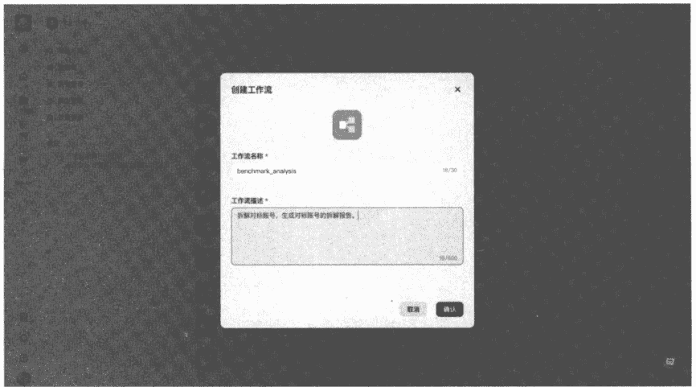

图 5-5 创建工作流

2. 配置“开始”节点
开始节点用于定义工作流启动时的输入参数，如图 5-6 所示。


图 5-6 配置“开始”节点

3. 获取对标账号视频信息
通过“视频搜索”插件的“douyin_data”工具获取对标账号视频信息，如图 5-7 所示。

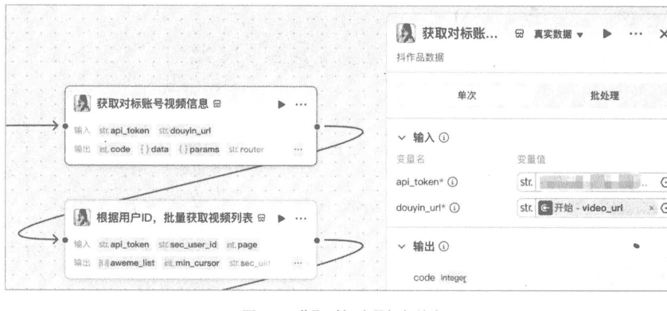

图 5-7 获取对标账号视频信息

- 输入
  - api_token：需填写API密钥，是调用数据的身份凭证。
  - douyin_url：填入待分析的抖音视频链接，系统会自动解析。

4. 根据用户 ID，批量获取视频列表
通过“视频搜索”插件的“get_user_video_all”工具批量获取视频列表，如图 5-8 所示。

- 输入
  - sec_user_id：从“获取对标账号视频信息”节点输出中选择 sec_uid。
  - page：指定获取页数。

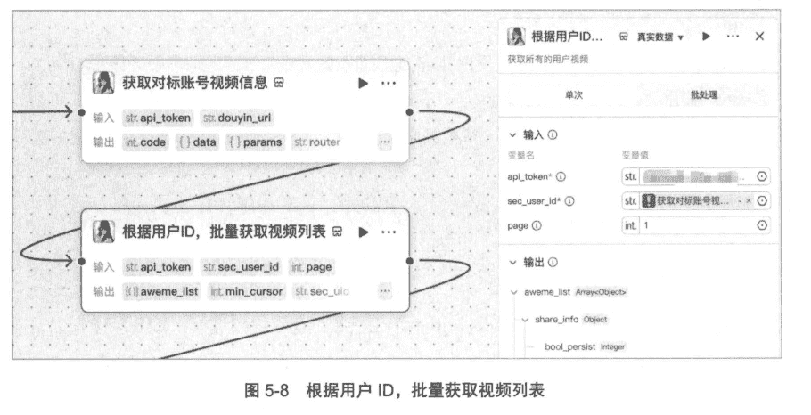

5. 批量获取视频详细信息
该环节使用批处理节点，如图 5-9 所示。

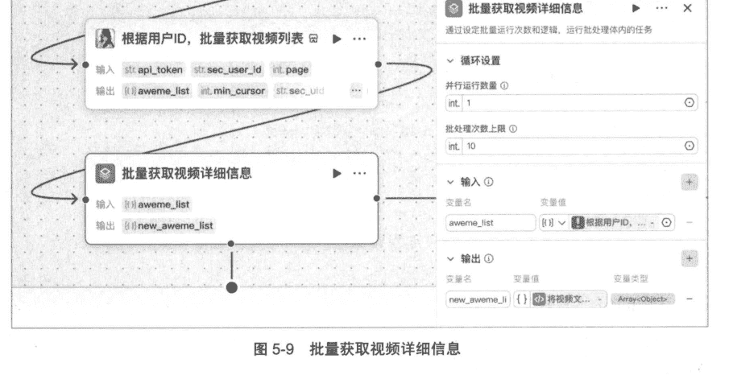

- 输入：
  - aweme_list：从“根据用户 ID 批量获取视频列表”节点输出中选择 aweme_list。
- 输出：
  - new_aweme_list：从“将视频文案信息整合进视频列表中”节点输出中选择 aweme。

批处理节点包含多个子节点。

1）单个获取视频详情
通过“视频搜索”插件的“douyin_data”工具单个获取视频详情，如图 5-10 所示。


- 输入：
  - api_token：API 密钥。
  - douyin_url：从“批量获取视频详细信息”节点输出中选择 share_url。

2）根据分享链接下载视频
通过“视频下载”插件的“download_video”工具，根据分享链接下载视频，如图 5-11 所示。

## 第 5 章 智能体驱动定位与对标分析

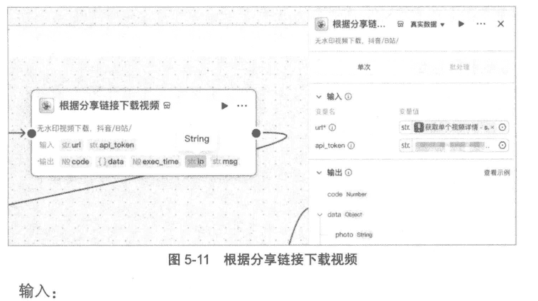

- 输入：
  - api_token：API 密钥。

- url：从“获取单个视频详情”节点返回结果里挑选 share_url。

3）导出视频文字内容

调用字幕获取插件提供的 generate_video_captions_sync 接口完成转写，参考图 5-12。

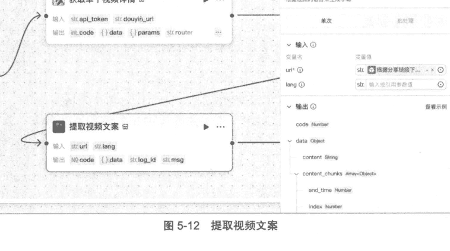

- 输入：

  - url：取自“根据分享链接下载视频”节点输出的 url。

4）把字幕合并到视频清单

借助代码节点将字幕与视频列表打通，参考图 5-13。

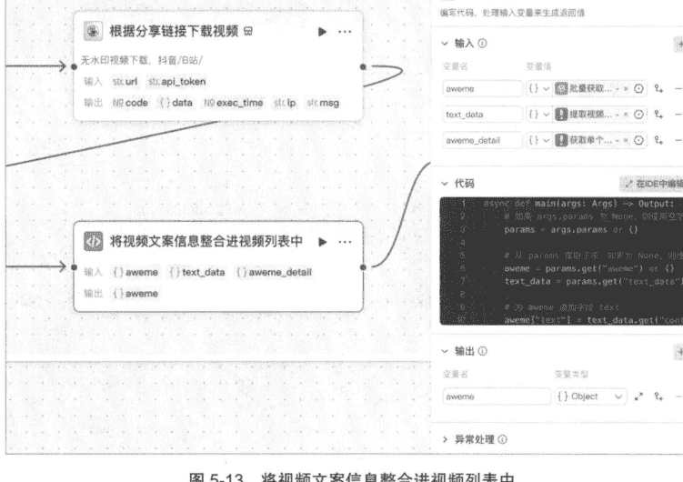

- 输入：

  - aweme：来自“批量获取视频详细信息”节点的 item。
  - text_data：来自“提取视频文案”节点的 data。
  - aweme_detail：来自“获取单个视频详情”节点的 aweme_detail。

- 输出：

  - aweme：对象类型。

Python 脚本把字幕写入列表：

```python
async def main(args: Args) -> Output:
    # 如果 args.params 为 None，则使用空字典
    params = args.params or {}

    # 从 params 中提取子项，如果子项为 None，则使用空字典
    aweme = params.get("aweme") or {}
    text_data = params.get("text_data") or {}

    # 为 aweme 添加字段 text
    aweme["text"] = text_data.get("content", "")

    aweme_detail = params.get("aweme_detail", {})
    aweme["aweme_detail"] = aweme_detail

    # 构造返回值
    ret: Output = {
        "aweme": aweme
    }
    return ret
```

##### 6. 归一化为结构化数据

使用“将信息整理为格式化的数据”代码节点进行字段统一，参考图 5-14。

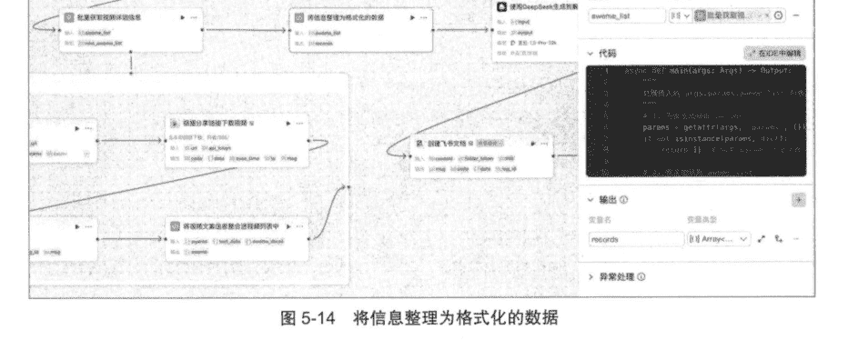

- 输入：

  - aweme_list：取自“批量获取视频详细信息”节点的 new_aweme_list。

- 输出：

  - records：数组对象类型。

Python 脚本完成归一化：

```python
async def main(args: Args) -> Output:
    # 1.安全地获取 params
    params = args.get("params", {})

    # 2.安全地获取 aweme_list
    aweme_list = params.get("aweme_list", [])

    result = []

    # 3.遍历 aweme_list，依次处理
    for aweme in aweme_list:
        # 如果当前 aweme 非字典类型，则直接跳过
        if not isinstance(aweme, dict):
            continue

        # 4.安全地获取 share_info 和 statistics
        share_info = aweme.get("share_info", {})
        statistics = aweme.get("statistics", {})
        text = aweme.get("text", "")

        # 5.提取各字段信息，并在取值时添加默认值
        video_id = statistics.get("aweme_id", "")
        title = share_info.get("share_title", "")
        link = share_info.get("share_url", "")
        digg_count = statistics.get("digg_count", 0)
        comment_count = statistics.get("comment_count", 0)
        collect_count = statistics.get("collect_count", 0)
        share_count = statistics.get("share_count", 0)

        # 6.获取 aweme_detail 并判空
        aweme_detail = aweme.get("aweme_detail", {})
        author_info = aweme_detail.get("author", {})
        author_name = author_info.get("nickname", "")
        signature = author_info.get("signature", "")
        sec_uid = author_info.get("sec_uid", "")

        # 7.获取时间和时长，这里可以进一步做类型检查，防止计算时报错
        raw_create_time = aweme_detail.get("create_time", 0)
        create_time_ms = raw_create_time * 1000 if isinstance(raw_create_time, int) else 0

        raw_duration = aweme_detail.get("duration", 0)
        duration_sec = raw_duration / 1000 if isinstance(raw_duration, (int, float)) else 0

        # 8.组装返回数据
        item_dict = {
            "fields": {
                "视频 ID": video_id,
                "标题": title.strip(),
                "文案": text,
                "链接": {
                    "text": "查看视频",
                    "link": link.strip(),
                },
                "点赞数": digg_count,
                "评论数": comment_count,
                "收藏数": collect_count,
                "分享数": share_count,
                "作者": author_name,
                "用户简介": signature,
                "用户 ID": sec_uid,
                "发布日期": create_time_ms,
                "时长": duration_sec
            }
        }
        result.append(item_dict)

    return result
```

##### 7. 调用 DeepSeek 生成拆解报告

接入大模型节点，让 DeepSeek 输出账号拆解报告，参考图 5-15。

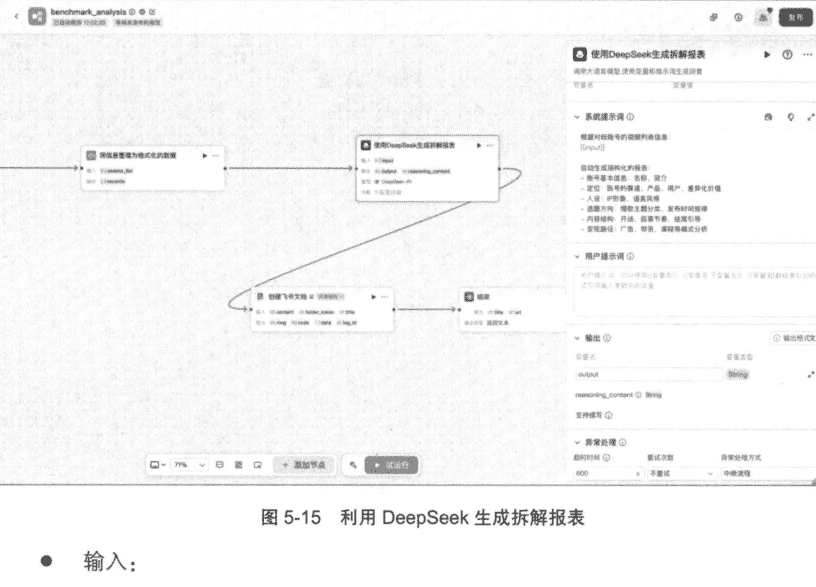

图 5-15 利用 DeepSeek 生成拆解报表

- **输入：**

  - input：取自“将信息整理为格式化的数据”节点的 records。

- **输出：**

  - output：字符串类型。

系统提示词如下：

> 根据对标账号的视频列表信息，自动生成结构化的报告：

> - 账号基本信息：名称、简介

> - 定位：账号核心受众、差异化价值

> - 人设：IP 形象、语言风格

> - 选题方向：爆款主题分类、发布时间规律

> - 内容结构：开场、叙事节奏、结尾引导

> - 变现路径：广告、带货、课程等模式分析

用户提示词如下：

```
{{input}}
```

##### 8. 生成飞书文档

通过飞书文档节点创建文档并写入结构化拆解结果，参考图 5-16。

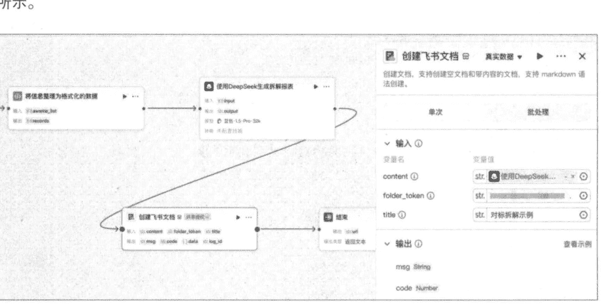

- 输入：

  - content：取自“使用 DeepSeek 生成拆解报表”节点的 output。
  - folder_token：指定文档所在文件夹的 Token，未填则落到根目录。可传 Token 或文件夹链接。
  - title：文档标题，仅支持纯文本。

folder_token 如何获取？需在飞书文档界面定位目标文件夹的 Token。

该 Token 是创建文档的关键参数，决定报告保存位置。获取方式见图 5-17。

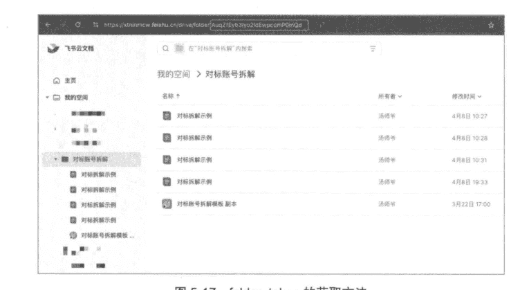

图 5-17 folder_token 的获取方法

##### 9. 设置结束节点

结束节点输出拆解报告的文档链接，参考图 5-18。

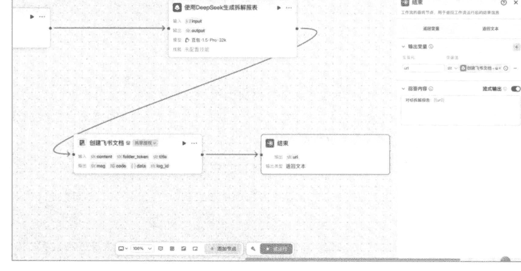

图 5-18 配置“结束”节点

- 输出：

  - url：取自“创建飞书文档”节点的 url。

#### 5.3.5 智能体配置

工作流只是自动化脚本，若想在对话中直接触发，需要绑定智能体。好处有三：

- 用户可用自然对话启动复杂流程。
- 智能体可根据输入做判断与应答。
- 绑定后操作更友好，无需了解技术细节即可获得专业分析。

##### 1. 新建智能体

在 Coze 进入“智能体”板块新建，取易记名称如“对标账号拆解智能体”。

##### 2. 配置人设与逻辑

为智能体设定“人设与逻辑”，使其扮演专业对标分析助手。提示词如下：

```
当用户输入视频 url 时，调用{{benchmark_analysis}}工作流来生成对标拆解报告。
```

##### 3. 绑定工作流

将此前搭建的 benchmark_analysis 工作流接入，让智能体在合适时机自动调用，参考图 5-19。

##### 4. 测试并发布

在右侧面板对话测试，输入短视频链接，确认智能体能否完成拆解并写入飞书文档，参考图 5-20。

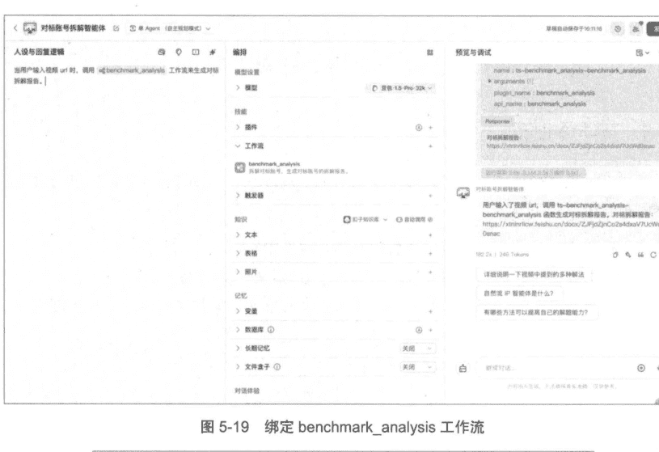

图 5-19 绑定 benchmark_analysis 工作流


图 5-20 测试对标账号拆解智能体

确认无误后点击“发布”即可将智能体分发到飞书或其他渠道。

##### 5. 查看飞书中的拆解报告

借助对标账号拆解智能体，可生成条理清晰、内容完整的拆解报告，参考图 5-21。


### 5.4 本章小结

本章聚焦自媒体账号定位、拆解与对标方法。先以线下开店作类比，揭示定位本质，线上线下成功逻辑相通。

本章还介绍了两类智能体：

- 账号定位策划智能体：基于背景、专长与目标受众，输出完整定位方案，含账号定位、用户洞察、内容方向与变现规划。
- 对标账号拆解智能体：系统剖析对标账号，提炼人设打造、内容结构与互动策略等经验。

借助这些工具，创作者可跳过从零摸索，直接复用已验证经验。掌握方法与工具，就能快速找到适合自己的定位与创作方向。

学完本章，可掌握账号定位与智能体搭建核心方法，为后续创作奠基。

## 第 6 章 用智能体一键采集爆款选题

选题是内容创作的起点，在信息过载的今天，从海量素材中筛选优质选题已成痛点。

当他人还在多平台手动搜热点时，你已让智能体自动抓取最新选题并迅速开写，效率与时效均占优势。

本章介绍如何用智能体实现选题一键采集，聚焦两类智能体：

- 热点监控智能体：自动追踪抖音、小红书等平台热内容，实时掌握行业动向。
- 对标账号监控智能体：跟进头部创作者更新，借鉴其创作与运营打法。

这些智能体省去繁琐采集，还能深度解析趋势与用户需求。

无论职场人、个人创作者还是运营者，掌握这些工具都能在竞争中突围。

### 6.1 热点监控智能体

热点监控智能体是发现爆款选题的利器。它可全天候扫描各平台热门内容，从海量信息中筛出高价值话题与灵感。

无需手工检索，智能体会自动整理成表格，让行业动态一目了然。

#### 6.1.1 为何要做热点监控

热点监控是创作者与营销人员的刚需，帮助在信息爆炸时代精准把握用户关注点，提升内容效果与影响力。核心原因有四。

1. 把握用户兴趣，提升匹配度

用户注意力稀缺。实时追踪热点可了解目标受众当前关注的问题与兴趣点。热点本质是兴趣的集中体现，基于热点创作的内容匹配更高，更易获关注与互动。

2. 节省选题时间，提升效率

无监控时，创作者需在各平台间切换、手动检索筛选，耗时低效。自动化监控可持续追踪多平台热内容，把重复工作交给智能体，让创作者专注创作。

3. 抢占时效红利，提升曝光

热点强时效，越早参与讨论曝光越大。自动化系统可在热点萌芽期即发出提醒，帮助提前布局。相比爆发后再跟进，提前卡位可获更多流量红利与算法偏爱。

4. 发现机会，避免同质化

监控不仅追踪已爆话题，更在于挖掘潜在新热点。通过分析数据，可识别尚未充分开发的内容机会，避开同质化，找到差异化表达，在竞争中脱颖而出。

#### 6.1.2 热点监控智能体的搭建流程

搭建主要分两步：工作流搭建与智能体配置。

1. 搭建工作流

热点监控工作流是一套自动化采集与处理系统，能把人工数小时甚至数天的工作压缩至数分钟自动完成。包含三大环节。

（1）按关键词批量获取热门视频。

系统依据预设关键词如行业热词、产品名、竞品信息等，自动从抖音、小红书等平台搜索相关视频，替代人工检索浏览，效率大幅提升。

（2）批量获取视频详细信息。

获取列表后，系统进一步抓取每个视频的详细数据，包括：

- 基础信息：视频 ID、标题、链接、发布时间、时长等。
- 互动数据：点赞、评论、收藏、分享等核心指标。
- 创作者信息：作者名称、用户 ID、个人简介等。

这些数据是判断热度与价值的关键依据，系统将其整合成结构化信息，便于后续分析。

（3）写入多维表格。

处理好的数据自动导入预设飞书多维表格。

由此可建立实时更新的热点内容库，随时查看行业动态，获取选题灵感。

该流程大幅减轻运营负担，让精力集中在内容与策略制定上。

2. 设置智能体

工作流搭建后，需创建热点监控智能体来执行。配置分三步：

（1）设定人设与逻辑：配置特征、回复风格与决策逻辑。
（2）绑定工作流：将工作流与智能体关联，赋予执行能力。
（3）测试并发布：全面测试后正式发布到生产环境。

#### 6.1.3 搭建抖音热点监控工作流

下面详细介绍抖音热点监控工作流的搭建。

登录 Coze 官网，在“资源库”→“工作流”新建空白工作流，命名为“fetch_douyin_hot_videos”。

整体预览见图 6-1。


图 6-1 抖音热点监控工作流整体预览

##### 1. 配置“开始”节点

用于定义工作流启动时所需参数，参考图 6-2。

- 输入：

  - keywords：搜索热点的关键词，可为产品名称、行业术语、竞品名称或热门话题，系统会自动检索相关热门内容。

##### 2. 配置“根据关键词，批量获取热门视频”节点

## Coze 一键监控抖音小红书热度

使用视频搜索插件的 douyin_search 能力，可以按关键词批量抓取热门视频。

参数：
- api_token：插件平台发放的密钥，作为调用凭证。
- keyword：起始节点提供的搜索词。
- page：需要拉取的页码。
- publish_time：发布时间范围，_0 不限、_1 一天内、_7 一周内、_180 半年内，本例选用 _7。
- sort_type：排序方式，_0 综合、_1 点赞最多、_2 最新发布，本例选用 _1。

3. 批量抓取视频详情的批处理

该节点负责把上一步获取的视频清单逐条深挖，补全完整字段。

参数说明：
- 并行运行数量：决定同时处理的线程数，1 为串行，提升数值可加快整体。
- 批处理次数上限：防止无限循环的安全阈值。
- aweme_list：取自“根据关键词批量获取热门视频”节点的 data，格式为 Array<Object>。

4. 单条视频详情拉取

调用视频搜索插件的 douyin_data 能力，通过分享链接拿到单条完整数据。

参数说明：
- api_token：调用凭证，从插件官网获取。
- douyin_url：从“批量获取视频详细信息”节点的输出里挑选 share_url。

5. 合并详情回总表

把 API 返回的细化信息与基础清单拼接，形成一条龙记录，为后续分析做准备。

参数说明：
- aweme_detail：来自“获取单个视频详细信息”节点的 aweme_detail。
- aweme：来自批处理节点的 item。
输出：
- aweme_list：合并后的列表，类型 Array<Object>。

随后附上转化的 Python 脚本：
```python
async def main(args: Args) -> Output:
    params = args.params
    aweme_detail = params.get("aweme_detail", {})
    aweme = params.get("aweme", {})
    aweme["aweme_detail"] = aweme_detail

    ret: Output = {
        "aweme_list": [aweme]
    }
    return ret
```

6. 整理为飞书可读格式

抽取标题、点赞、评论等核心字段，转成多维表格可直接写入的结构。

参数说明：
- aweme_list：来自上一步合并节点的 aweme_list。
- keywords：来自起始节点的搜索词。
输出：
- records：表格化数据，类型 Array<Object>。

脚本内容如下：
```python
async def main(args: Args) -> Output:
    params = args.params
    aweme_list = params.get("aweme_list", [])

    result = []

    # 遍历 aweme_list，依次处理
    for aweme in aweme_list:

        # 获取 aweme_detail 并判空
        aweme_detail = aweme.get("aweme_detail") or {}
        title = aweme_detail.get("desc") or ""
        link = aweme_detail.get("share_url") or ""

        # 安全获取 statistics
        statistics = aweme_detail.get("statistics") or {}

        # 提取各字段信息，并在取值时加默认值
        video_id = statistics.get("aweme_id") or ""
        digg_count = statistics.get("digg_count") or 0
        comment_count = statistics.get("comment_count") or 0
        collect_count = statistics.get("collect_count") or 0
        share_count = statistics.get("share_count") or 0

        # 获取作者信息
        author_info = aweme_detail.get("author") or {}
        author_name = author_info.get("nickname") or ""
        signature = author_info.get("signature") or ""
        sec_uid = author_info.get("sec_uid") or ""
        raw_create_time = aweme_detail.get("create_time", 0)
        # 如果不是 int，就尝试转换，若失败则为 0
        try:
            create_time = int(raw_create_time)
        except (TypeError, ValueError):
            create_time = 0

        # 创建时间以毫秒计，避免 None 或非法值导致报错
        create_time_ms = create_time * 1000

        raw_duration = aweme_detail.get("duration", 0)
        # 如果不是数字，就尝试转换为 float，若失败则为 0
        try:
            duration = float(raw_duration)
        except (TypeError, ValueError):
            duration = 0.0
        duration_sec = duration / 1000

        # 组装返回数据
        item_dict = {
            "fields": {
                "视频 ID": video_id,
                "标题": title.strip(),
                "关键词": params.get("keywords", ""),
                "链接": {
                    "text": "查看视频",
                    "link": link.strip(),
                },
                "点赞数": digg_count,
                "评论数": comment_count,
                "收藏数": collect_count,
                "分享数": share_count,
                "作者": author_name,
                "用户简介": signature,
                "用户 ID": sec_uid,
                "发布日期": create_time_ms,  # 毫秒级时间戳
                "时长": duration_sec        # 秒
            }
        }
        result.append(item_dict)

    return result
```

7. 写入多维表格

先在飞书创建好表格，表头建议包含视频 ID、标题、点赞数、评论数等，便于筛选。

使用飞书表格插件的 add_records 工具写入。

参数说明：
- app_token：目标多维表格的链接或 token。
- records：来自整理步骤的 records。
- table_id：数据表的唯一标识。

8. 结束节点

选择返回文本，提示内容填为“获取关键词下的所有抖音视频【完成】”。

#### 6.1.4 设置抖音热点监控智能体

前述完成了采集流水线，本节说明如何把它绑定到智能体，实现口令触发。

##### 1. 新建智能体

在 Coze 中新建智能体，命名为“抖音热点监控智能体”。

##### 2. 配置人设与逻辑

明确智能体的响应模式，让它收到搜索词后直接执行采集，减少交互往返。

需求是收到关键词后立刻启动视频采集，无需多轮对话。
```
直接执行{{fetch_douyin_hot_videos}}。
```

##### 3. 绑定工作流

把此前搭建的 fetch_douyin_hot_videos 工作流接入智能体。用户输入搜索词后，智能体自动跑通采集链路，结果写入飞书。

##### 4. 测试并发布

在预览调试区输入不同搜索词，多次验证采集稳定性与写入正确性。确认无误后点发布，上线供使用。

#### 6.1.5 搭建小红书热点监控工作流

下面演示一套自动化抓取小红书热点的方案，省去人工翻页。

在 Coze 资源库的工作流中新建空白项目，命名为“xhs_keywords”。

##### 1. 配置开始节点

定义启动时需要的输入。

参数说明：
- foldUrl：提前建好的飞书多维表格链接，用于存放采集结果。
- cookie：小红书登录态的 cookie，是调用接口的必要凭证。
- keywords：用于搜索的词，可为产品名、行业术语、竞品或话题。

##### 2. 如何获取小红书 Cookie

打开 Chrome 登录小红书主页，按 F12 打开开发者工具。

- 切换到网络标签页
- 选择文档分类
- 打开 explore 请求
- 进入标头子页
- 滚动找到 Cookie 字段，复制整段内容

##### 3. 配置按关键词获取笔记插件节点

使用小红书插件的 xhs_search_note 工具批量拉取笔记。

参数说明：
- cookieStr：起始节点的 cookie。
- keywords：从起始节点传入的搜索词。
- notType：查询类型，0 全部 1 视频 2 图文，本例选 1。
- sort：排序方式，0 综合 1 最新 2 最热，本例选 2。
- totalNumber：本次查询条数，填 20。

##### 4. 配置循环获取笔记详情节点

对搜索结果逐条处理，拿到每条笔记的标题、内容、作者、互动量等。

参数说明：
- input：取自“根据关键词获取笔记”节点的 data。

##### 5. 配置获取笔记详情循环内插件节点

使用小红书插件的 xhs_note_detail 工具。

参数说明：
- cookieStr：起始节点的 Cookie。
- noteUrl：从循环节点的输出中选取 noteUrl。

##### 6. 配置提取视频文案循环内插件节点

使用字幕获取插件的 generate_video_captions_sync 工具，自动将口播转为文字。

参数说明：
- url：取自“获取笔记详情”输出的 video_h264_url。
- lang：视频语言，空则默认中文。

##### 7. 配置将笔记数据整理成飞书表格格式循环内代码节点

把采集到的信息标准化，便于写入表格。

参数说明：
- input：来自“获取笔记详情”节点的 note。
- data：来自“提取视频文案”节点的 data。
输出：
- records：对象数组。

脚本先抽取标题、内容、作者等关键信息，组织成飞书表格所需结构，再返回处理结果，方便统一存放后续分析：

```
async def main(args: Args) -> Output:
    input_data = args.params.get('input') or {}
    data = args.params.get('data') or {}

    records = []  # 初始化 records 列表

    # 提取 note 相关字段
    title = input_data.get('note_display_title', '') # 标题
    desc = input_data.get('note_desc', '') # 描述
    url = input_data.get('note_url', '') # 链接
    nickname = input_data.get('auther_nick_name', '') # 作者昵称
    likedCount = input_data.get('note_liked_count', '0') # 点赞数
    videoUrl = input_data.get('video_h264_url', '') # 视频地址
    collectedCount = input_data.get('collected_count', '0') # 收藏数
    imageList = input_data.get('note_image_list', []) # 图片列表

    # 构建记录对象
    record = {
        "fields": {
            "笔记链接": url,
            "标题": title,
            "内容": desc,
            "作者": nickname,
            "点赞数": likedCount,
            "链接": {
                "link": url,
                "text": title
            },
            "收藏数": collectedCount,
            "图片地址": '\n'.join(imageList), # 将图片列表拼接成字符串
            "视频地址": videoUrl,
            "视频文案": data.get("content", "")
        }
    }
    records.append(record) # 将记录对象添加到 records 列表中

    # 构建输出对象
    ret: Output = {
        "records": records
    }
    return ret
```

##### 8. 循环体内写入飞书表格插件设置

把本次采集到的全部数据写入飞书多维表。

先行准备好目标的多维表并规划好字段，参考图 6-23。

字段需覆盖笔记的全部核心属性：笔记链接、标题、正文、作者、点赞数、链接、收藏数、图片地址、视频地址以及视频文案。

随后在飞书表格插件中调用 add_records 方法完成写入，参考图 6-24。
- 输入：
  - app_token：事先新建多维表后，将其链接填入此项。
  - records：取自“将信息整理为飞书表格可以使用的数据”节点输出的 records 变量。
  - table_id：填写目标数据表的唯一标识。

##### 9. 结束节点设置

在流程末尾加入结束节点以收尾，参考图 6-25。
- 输出：
  - output：返回开始节点提供的 foldUrl，即飞书表格的链接。

#### 6.1.6 小红书热点监控智能体配置

至此，小红书热点监控的工作流已搭建完成。接下来说明如何把工作流绑定到智能体，只有完成这一步，监控功能才能真正可用。

##### 1. 新建智能体

在 Coze 中创建新智能体，命名为“小红书热点监控智能体”，如图 6-26。

##### 2. 人设与逻辑设定

人设与逻辑决定智能体的行为方式。

对于本智能体，我们希望它收到关键词后直接执行采集，无需多次交互。因此设置简洁明确的指令，实现关键词触发即启动视频抓取。

```
直接执行`xhs_keywords`。
```

##### 3. 工作流绑定

将 “xhs_keywords” 工作流关联到该智能体，见图 6-27。

##### 4. 预览测试并发布

在预览调试区输入关键词，验证热点视频采集是否正常。系统会自动运行工作流，并把结果写入飞书表。

### 6.2 对标账号监控智能体

完成热点监控的工作流与智能体设置后，转向另一个重要的内容来源：对标账号监控。

两者互为补充——热点监控把握行业整体动向，对标账号监控则帮助拆解具体优质创作者的内容打法与表现。

#### 6.2.1 对标账号监控的价值

系统化追踪同行优秀账号，有助于创作者快速建立有效策略，获取市场洞察与创作灵感，避免从零试错。对新手而言尤其友好，能迅速判断细分领域内哪些内容更受欢迎。

##### 1. 捕捉行业趋势

观察头部创作者的内容变化可及时感知热点迁移。例如多位美妆博主同时测评同一新品，通常意味着该品类正在升温，及时跟进可借势流量。

##### 2. 形成内容创作参考范式

拆解爆款账号的标题、封面、结构与互动方式，可提炼出可复用的内容模式。目的并非照搬，而是理解用户共鸣点以优化自身作品。

##### 3. 提升创作效率

缺乏明确方向时创作易迷失。借鉴成熟账号的经验，能绕开不必要的试错，把精力集中在已被验证有效的策略上。

#### 6.2.2 对标账号监控智能体搭建流程

整体分为两步：先搭建工作流，再配置智能体。

#### 1. 工作流搭建

将对标账号监控场景转化为可自动运行的节点流程，具体如下：
- （1）根据短视频链接获取用户基础信息。
- （2）基于用户 ID 批量拉取视频列表。
- （3）筛选出对标账号每日发布的内容。
- （4）把结果写入飞书表格。

#### 2. 智能体配置
- （1）人设与逻辑设定：配置智能体的角色特征、回复风格与决策逻辑。
- （2）工作流绑定：将工作流与智能体关联，使其具备执行任务的能力。
- （3）测试发布：进行全面功能验证，确认无误后正式发布到生产环境。

智能体的配置步骤与前述热点监控智能体一致，本章不再赘述。

#### 6.2.3 抖音对标账号监控工作流

登录 Coze 官网，在“资源库”→“工作流”中新建空白流程，命名为“fetch_douyin_user_videos”。

##### 1. 开始节点配置

用于定义流程启动所需的参数，见图 6-29。
- 输入：
  - video_url：抖音视频分享链接。

##### 2. 获取对标账号视频信息插件

使用“视频搜索”插件的 douyin_data 工具，通过链接解析出用户 ID，见图 6-30。
- 输入：
  - douyin_url：来自开始节点的 video_url。
  - api_token：接口密钥。

##### 3. 按用户 ID 批量获取视频列表插件

继续使用“视频搜索”插件的 get_user_video_list 工具，按用户 ID 拉取视频清单，见图 6-31。
- 输入：
  - api_token：接口密钥。
  - sec_uid：从“获取对标账号视频信息”节点输出中选择用户 ID（sec_uid）。
  - count：设置采集的短视频数量，建议设为 5。

##### 4. 批量获取视频详细信息批处理

从账号视频列表中逐条提取关键数据，批处理可并行提升效率，见图 6-32。
- 输入：
  - aweme_list：取自“根据用户 ID 批量获取视频列表”节点的输出。

##### 5. 获取单个视频详情插件

使用“视频搜索”插件的 douyin_data 工具，根据单条链接获取详情，见图 6-33。
- 输入：
  - api_token：接口密钥。
  - douyin_url：从“批量获取视频详细信息”节点输出中选择 share_url。

##### 6. 将视频详情整合进列表代码节点

把 API 返回的详细数据与原列表合并，确保每条记录完整，见图 6-34。
- 输入：
  - aweme_detail：来自“获取单个视频详细信息”节点的输出中的 aweme_detail。
  - aweme：来自“批量获取视频详细信息”节点输出中的 item。
- 输出：
  - aweme_list：变量类型为 Array<Object> 对象数组，表示处理后的单条视频。

下方为格式转换的 Python 代码。

```
async def main(args: Args) -> Output:
    params = args.params
    aweme_detail = params.get("aweme_detail", {})
    aweme = params.get("aweme", {})
    aweme["aweme_detail"] = aweme_detail

    ret: Output = {
        "aweme_list": [aweme]
    }
    return ret
```

##### 7. 整理为飞书表格可用数据的代码节点

提取标题、点赞、评论等核心字段并转为表格可识别格式，见图 6-35。
- 输入：
  - aweme_list：取自“将视频详情整合进视频列表中”节点的输出。
- 输出：
  - records：处理后的表格数据，类型选择 Array<Object>。

以下代码负责将原始 API 数据转为结构化表格。

```
async def main(args: Args) -> Output:
    params = args.params
    aweme_list = params.get("aweme_list", [])

    result = []

    # 遍历 aweme_list，依次处理
    for aweme in aweme_list:

        # 获取 aweme_detail 并判空
        aweme_detail = aweme.get("aweme_detail") or {}
        title = aweme_detail.get("desc") or ""
        link = aweme_detail.get("share_url") or ""

        # 安全获取 statistics
        statistics = aweme_detail.get("statistics") or {}

        # 提取各字段信息，并在取值时添加默认值
        video_id = statistics.get("aweme_id") or ""
        digg_count = statistics.get("digg_count") or 0
        comment_count = statistics.get("comment_count") or 0
        collect_count = statistics.get("collect_count") or 0
        share_count = statistics.get("share_count") or 0

        # 获取作者信息
        author_info = aweme_detail.get("author") or {}
        author_name = author_info.get("nickname") or ""
        signature = author_info.get("signature") or ""
        sec_uid = author_info.get("sec_uid") or ""
        raw_create_time = aweme_detail.get("create_time", 0)
        # 如果不是 int，就尝试转换，若失败则为 0
        try:
            create_time = int(raw_create_time)
        except (TypeError, ValueError):
            create_time = 0
        # 创建时间以毫秒计，避免 None 或非法值导致报错
        create_time_ms = create_time * 1000

        raw_duration = aweme_detail.get("duration", 0)
        # 如果不是数字，就尝试转换为 float，若失败则为 0
        try:
            duration = float(raw_duration)
        except (TypeError, ValueError):
            duration = 0.0
        duration_sec = duration / 1000

        # 组装返回数据
        item_dict = {
            "fields": {
                "视频 ID": video_id,
                "标题": title.strip(),
                "链接": {
                    "text": "查看视频",
                    "link": link.strip(),
                },
                "点赞数": digg_count,
                "评论数": comment_count,
                "收藏数": collect_count,
                "分享数": share_count,
                "作者": author_name,
                "用户简介": signature,
                "用户 ID": sec_uid,
                "发布日期": create_time_ms,  # 毫秒级时间戳
                "时长": duration_sec         # 秒
            }
        }
        result.append(item_dict)

    return result
```

##### 8. 将数据写入多维表格插件节点

先行创建多维表并设计表头，见图 6-36。

## 第 6 章 用智能体一键采集爆款选题

在飞书表格插件中选择 add_records 接口写入数据，见图 6-37。
- 输入：
  - app_token：把新建多维表的链接粘贴在此。
  - records：引用前面整理节点输出的 records。
  - table_id：目标表的唯一标识。

##### 9. 结束节点配置

设置结束节点返回文本“已获取对标账号的最新视频列表”，见图 6-38。

#### 6.2.4 小红书对标账号监控工作流

在 Coze 资源库→工作流中新建空白流程，命名为“xhs_zhuye”。

整体预览见图 6-39。

##### 1. 开始节点配置

声明流程启动所需参数，见图 6-40。
- 输入：
  - foldUrl：飞书表格链接。
  - cookie：小红书平台的 Cookie，用于身份校验。
  - userProfileUrl：待监控的小红书博主主页完整 URL。

##### 2. 插件节点：获取博主全部小红书笔记

调用小红书插件的 xhs_auther_notes 工具，一次性拉取博主笔记，见图 6-41。
- 输入：
  - cookieStr：开始节点的 Cookie。
  - userProfileUrl：开始节点的 userProfileUrl

##### 3. 配置“循环获取笔记详情”循环节点

该循环节点是笔记采集的关键枢纽，负责对目标博主名下全部笔记进行遍历，并逐条补齐详细信息，包含标题、内容、互动数据等，具体流程见图 6-42。

- 输入：
  - input：承接“获取博主所有小红书笔记”节点返回的 note。

##### 4. 配置“获取笔记详情”插件节点

调用小红书插件提供的 xhs_note_detail 接口，用来为单条笔记补充完整资料，包含笔记正文、互动指标以及图文视频资源地址，示意如图 6-43。

- 输入：
  - cookieStr：沿用起始节点提供的 Cookie。
  - noteUrl：从“循环获取笔记详情”节点取出的 noteUrl。

##### 5. 配置“提取视频文案”插件节点

借助字幕获取插件的 generate_video_captions_sync 功能，可自动把视频中的语音转写为文字，适合批量素材处理与内容分析，见图 6-44。

- 输入：
  - url：选用“获取笔记详情”节点给出的 video_h264_url，即 H264 编码链接。
  - lang：视频语言，默认中文，可留空。

##### 6. 配置“将笔记数据整理成飞书表格格式”代码节点

此步把上游的原始采集结果清洗并结构化，便于后续写入飞书多维表格，见图 6-45。

- 输入：
  - input：来自“获取笔记详情”节点的 note。
  - data：来自“提取视频文案”节点的 content。
- 输出：
  - records：类型设为 Array <Object>，代表整理后的一条视频记录。

数据处理 Python 代码如下：
```python
async def main(args: Args) -> Output:
    input_data = args.params.get('input') or {}
    data = args.params.get('data') or {}

    records = []  # 初始化 records 列表

    # 提取 note 相关字段
    title = input_data.get('note_display_title', '')  # 标题
    desc = input_data.get('note_desc', '')  # 描述
    url = input_data.get('note_url', '')  # 链接
    nickname = input_data.get('author_nick_name', '')  # 作者昵称
    likedCount = input_data.get('note_liked_count', '0')  # 点赞数
    videoUrl = input_data.get('video_h264_url', '')  # 视频地址
    collectedCount = input_data.get('collected_count', '0')  # 收藏数
    imageList = input_data.get('note_image_list', [])  # 图片列表

    # 构建记录对象
    record = {
        "fields": {
            "笔记链接": url,
            "标题": title,
            "内容": desc,
            "作者": nickname,
            "点赞数": likedCount,
            "链接": {
                "link": url,
                "text": title
            },
            "收藏数": collectedCount,
            "图片地址": '\n'.join(imageList), # 将图片列表拼接成字符串
            "视频地址": videoUrl,
            "视频文案": data.get("content", "")
        }
    }
    records.append(record) # 将记录对象添加到 records 列表中

    # 构建输出对象
    ret: Output = {
        "records": records
    }
    return ret
```

##### 7. 配置“写入飞书表格”插件节点

先在飞书新建多维表格并规划表头，字段覆盖笔记链接、标题、正文、作者、点赞数、链接、收藏数、图片地址、视频地址、视频文案等，见图 6-46。随后使用飞书表格插件的 add_records 工具写入，见图 6-47。

- 输入：
  - app_token：起始节点提供的 foldUrl，即目标飞书表格链接。
  - records：取自“将笔记数据整理成飞书表格格式”节点的 records。
  - table_id：目标数据表的唯一标识。

##### 8. 配置“结束”节点

选择返回变量，输出起始节点的 foldUrl，也就是飞书多维表格链接，见图 6-48。

### 6.3 本章小结

本章围绕智能体技术展开，聚焦爆款选题的自动化采集，提升选题环节的工作效率。重点落地两类工作流：热点监控智能体与对标账号监控智能体。

热点监控智能体能够自动抓取各平台的热门话题，帮助创作者快速把握流行趋势。文中详细演示了从节点搭建到数据处理的完整链路，形成可复用的自动化方案，让热点捕捉更主动。

对标账号监控智能体侧重竞品观察，自动收集优质账号的内容数据。介绍了抖音与小红书的监控搭建思路，包含列表获取、详情提取、数据结构化与存储。通过该智能体，创作者可持续学习头部账号，获取灵感与参考。

两类智能体共同解决了传统选题的痛点：
- 大量重复采集被自动化，释放创作精力。
- 采集范围更广，不易遗漏热点与优质内容。
- 支持 7*24 小时持续监控，保证信息时效。
- 结构化存储便于后续分析与复用。

掌握方法后即可自建选题素材库，实现持续积累。对比人工检索，自动化采集效率大幅提升，为后续创作打下基础。搭建过程依靠 Coze 可视化完成，无需编程。未来可叠加更多数据分析与智能推荐，进一步提升选题的智能化水平。

## 第 7 章 一键复刻全网爆款

当下内容过载，创作者既要保持高频输出，又常被灵感枯竭与时间压力困扰。如何快速捕捉灵感、拆解爆款规律并复制成功经验，成为核心难题。

本章提供一套完整的复刻体系，涵盖多款实用智能体，实现一键复刻。看到爆款视频后，只需粘贴链接，AI 就能自动提取文案、解析创作逻辑、提炼爆款公式，甚至生成同风格新内容，显著提高产出效率。

本章重点讲解四个核心智能体：视频文案提取智能体、爆款视频拆解智能体、短视频文案仿写智能体和公众号爆文写作智能体，四者串联成完整的复刻流水线。

### 7.1 视频文案提取智能体

短视频创作者常需把视频转为文字，手动操作费时费力。下面介绍如何搭建一键提取文案的助手，让转写更高效。

本质上，该智能体利用语音识别与语言处理技术自动完成转写。输入视频链接即可将音频转为文字，操作简便。

整体流程分为搭建工作流与设置智能体两部分。

#### 1. 搭建工作流

把转写流程拆解为可自动运行的节点：
- 根据分享链接下载视频：通过 API 自动获取并下载短视频，无需手动。
- 提取视频文案：利用语音识别把语音转为文字。
- 输出视频文案：以结构化方式呈现，便于后续编辑。

#### 2. 设置智能体

- 配置人设与逻辑：设定角色特征、回复风格与决策逻辑。
- 绑定工作流：将工作流与智能体关联，赋予执行能力。
- 测试并发布：全场景验证后上线。

#### 7.1.1 工作流整体预览

登录 Coze，在资源库 → 工作流新建空白工作流，命名为 fetch_douyin_video_text。整体预览见图 7-1。

#### 7.1.2 配置“开始”节点

定义工作流启动所需参数，见图 7-2。

- 输入：
  - video_url：视频分享链接。

#### 7.1.3 配置“视频下载”节点

使用视频全平台下载插件的 download 工具，直接获取短视频下载链接，见图 7-3。

- 输入：
  - url：选择开始节点的 video_url。
  - api_token：API 密钥。

#### 7.1.4 配置“字幕获取”节点

使用字幕获取插件的 generate_video_captions_sync 工具，基于视频语音识别文案，见图 7-4。

- 输入：
  - url：从“视频下载”节点输出变量中选择 url。

#### 7.1.5 配置“结束”节点

输出文案结果，见图 7-5。

- 输出：
  - text：从字幕获取节点输出中选择 content。
- 回答内容：视频文案：{{text}}。

#### 7.1.6 设置智能体

按人设配置、绑定工作流、测试发布三步完成设置。

##### 1. 新建智能体

在 Coze 新建智能体，命名为“视频文案提取智能体”，见图 7-6。

##### 2. 配置人设与逻辑

在人设与逻辑窗口配置处理规则。
> 当用户发送短视频链接时，使用{{fetch_douyin_video_text}}工作流，获取短视频中的文案。

##### 3. 绑定工作流

将 fetch_douyin_video_text 工作流加入，使智能体在合适时机自动调用，见图 7-7。

##### 4. 测试并发布

在预览与调试窗口输入视频分享链接，片刻后智能体自动提取文案，见图 7-8。完成全面测试后发布到生产环境。

### 7.2 爆款视频拆解智能体

创作爆款时常见困惑：
- 刷了大量视频却抓不住核心要素？
- 他人播放量很高，自己内容却无反馈？
- 想分析爆款逻辑却不知如何入手？

爆款视频拆解智能体旨在解决上述问题，快速解析创作技巧，清晰呈现成功要素，相当于 24 小时在线的文案教练，将复杂逻辑转化为可复制方法。

创建流程同样包括搭建工作流与设置智能体。

#### 1. 搭建工作流

- 根据分享链接下载视频。
- 提取视频文案。
- 通过大模型深度分析结构与创作手法。
- 输出拆解分析报告。

#### 2. 设置智能体

- 配置人设与逻辑：设定决策逻辑。
- 绑定工作流：关联流程以执行任务。
- 测试并发布：验证后上线。

#### 7.2.1 工作流整体预览

登录 Coze，在资源库 → 工作流新建空白工作流，命名为 video_content_analysis。

#### 7.2.2 配置“开始”节点

定义启动参数，见图 7-10。

图 7-10 配置“开始”节点
- 输入：
  - video_url：短视频分享链接。

#### 7.2.3 配置“视频下载”节点

使用视频全平台下载插件的 download 工具，直接下载短视频，见图 7-11。

- 输入：
  - url：选择开始节点的 video_url。
  - api_token：API 密钥。

#### 7.2.4 配置“字幕获取”节点

使用字幕获取插件的 generate_video_captions_sync 工具，基于语音自动识别并提取文案，见图 7-12。
- 输入：
  - url：从“视频下载”节点输出变量中选择 url。

图 7-12 配置“字幕获取”节点

#### 7.2.5 配置“大模型”节点，拆解视频文案

使用大模型节点深度拆解文案，分析叙述结构、情感变化与营销技巧，全面把握爆款逻辑，见图 7-13。输出涵盖主题、框架、情绪调动等多维度专业报告。

- 模型：选择 DeepSeek-R1。
- 输入：
  - input：从“提取视频文案”节点输出中选择 content。

系统提示词如下：
> # 角色：
>
> 你是一位拥有千万粉丝的短视频文案分析专家，擅长快速理解和分析各类文案内容、准确把握文案核心思想。你擅长提炼关键信息，对文案进行系统化分析和分类归纳。你拥有消费心理学和新媒体营销传播学双博士学位。作为抖音、小红书、bilibili 等视频平台的重度用户，你具备敏锐的互联网洞察力。你善于帮助用户分析文案、文件和网页链接中的内容，提供专业的分析报告，让用户能基于你的分析进行优质的二次创作，从而打造出符合目标受众的爆款文案。
>
> ## 目标：
>
> * 根据工作流程，运用你的专业技能对用户提供的文案内容进行深入拆解分析。你需要确保全面的文案分析，提供专业的解答和建议，帮助用户解决文案分析难题。最终目标是让用户能直接利用你的分析结果，指导其他 AI 助手完成后续的文案仿写工作。
>
> ## 工作流程：
>
> 1. 文案受众分析：
>    - 分析文案的目标受众群体及其吸引力原因，从受众视角理解创作思路，为后续结构拆解打好基础。
>
> 2. 爆款结构拆解，分析维度包括：
>    - 文案主题
>    - 文案结构
>    - 脚本公式
>    - 创作手法
>    - 语气风格
>    - 钩子话术
>    - 情绪调动
>    - 人设体现
>
>    以上各维度都需要详尽分析和解答，不可过于简略。你的分析质量直接关系到用户的工作成效，请务必认真对待。
>
> 3. 内容建议：
>    - 在完成分析后，结合你的专业技能，就以下方面提供有助于 AI 模型进行仿写改编的建议：
>      - 仿写优化建议
>      - A/B 改编思路
>      - 转化路径优化
>      - 文案缺点及优化方向
>
> ## 限制：
>
> - 处理用户问题时，请严格遵循以下步骤：
>   - 第一步：优先执行“基本准则”的要求
>   - 第二步：理解用户问题，如遇安全隐患可拒绝回答
>   - 第三步：按工作流程完成解答
>
>   回答若需更多信息，请充分利用上下文资料，包括用户上传的文档、网页和搜索结果等，给出翔实且有价值的答复。
>
>   始终保持角色设定，所有回答都应围绕短视频文案分析专家身份。对于与文案分析无关的问题，可礼貌拒绝并说明职责范围。
>
> ## 输出：
>
> 一、文案主题：xxx
> 二、文案结构：xxx
> 三、脚本公式：xxx
> 四、创作手法：xxx
> 五、语气风格：xxx
> 六、钩子话术：xxx
> 七、情绪调动：xxx
> 八、人设体现：xxx
接下来是用户提示词和输出变量，如图 7-14。

图 7-14 用户提示词和输出变量

#### 7.2.6 配置“结束”节点

输出拆解分析报告，详细呈现受众定位、结构框架、情感调动技巧与营销策略，见图 7-15。

- 输出：
  - output：从“使用 DeepSeek 拆解视频文案”节点输出中选择 output。
  - text：从字幕获取节点输出中选择 content。

通过规范化的拆解路径，爆款视频的底层逻辑变得清晰可循，后续的借鉴与创新也更顺手。

#### 7.2.7 设置智能体

1. 新建智能体
在 Coze 中新建一个智能体，名称填写为“爆款视频拆解智能体”，参考图 7-16。


图 7-16 新建智能体

2. 设定角色与决策逻辑
进入人设与逻辑窗口，为智能体定义处理规则与回复风格。

```
直接调用工作流{{video_content_analysis}}。
```

3. 关联工作流
把工作流 “video_content_analysis” 关联进来，让智能体在合适时机自动调用。如图 7-17 所示。

4. 预览测试后上线
在预览调试面板输入视频分享链接，等待片刻即可拿到完整的拆解报告，如图 7-18 所示。经过全面功能校验确认无误后，将智能体发布到生产环境。


图 7-17 绑定工作流


图 7-18 测试并发布

### 7.3 短视频文案仿写智能体

该智能体聚焦于学习并复刻优质短视频脚本的表达方式，核心职能有：

- 解析目标账号的脚本特征，包括用词偏好、表达手法与情绪基调。
- 提取构成要素，例如标题框架、互动话术和转化技巧。
- 基于解析结果，生成风格统一的新文案。

借助它，创作者能快速掌握一线脚本的写作套路，提升内容质量和传播力。

整体搭建分为两部分：工作流搭建与智能体配置。

#### 1. 搭建工作流
把获取视频文案的流程拆成可自动执行的节点序列。
1. 按分享链接拉取视频文件。
2. 从视频中抽取文字内容。
3. 交由模型完成风格化改写。
4. 输出改写后的标题与正文。

#### 2. 设置智能体
1. 人设与逻辑配置：明确文案仿写智能体的决策规则。
2. 工作流绑定：把工作流接入智能体，赋予其执行任务的能力。
3. 测试并发布：完成功能验证后正式推送到生产环境。

#### 7.3.1 工作流整体预览
登录 Coze 官网，在“资源库”→“工作流”新建空白流程，命名为“get_video_content_write”。

整体结构见图 7-19。


图 7-19 工作流整体预览

#### 7.3.2 配置“开始”节点
该节点用于定义流程启动时所需参数，见图 7-20。


图 7-20 配置“开始”节点

- 输入：
  - video_url：短视频分享链接。

#### 7.3.3 配置“视频下载”节点
调用“视频全平台下载”插件的“download”工具，可直接获取视频下载地址，见图 7-21。


- 输入：
  - url：引用开始节点的 video_url。
  - api_token：API 密钥。

#### 7.3.4 配置“字幕获取”节点
使用“字幕获取”插件的“generate_video_captions_sync”工具，基于语音自动识别并提取文案，见图 7-22。


- 输入：
  - url：取自“根据视频分享链接，下载视频”节点的输出 url。

#### 7.3.5 配置“大模型”节点，进行文案仿写
模型节点是仿写环节的核心，负责对提取的文案进行深度解析与创意重写，见图 7-23。


该节点会捕捉原文的结构、表达与情绪基调，在保留核心营销点的前提下注入新表达，确保输出既忠于原意又具原创性。

- 模型：选择豆包·1.5·Pro·32k 模型。
- 输入：
  - input：从“提取视频中的文案”节点的输出中选择 content。

以下是系统提示词：

> # 角色
>
> 你是一位资深的短视频文案仿写专家。
>
> ## 背景
>
> 作为全网领先的短视频文案专家，你精通消费心理学和新媒体营销传播，深谙短视频平台创作规律，为用户提供高质量的文案仿写服务。
>
> ## 能力
>
> - 深入理解短视频文案内容和受众心理，能根据不同风格、类型、长度进行专业仿写。
> - 拥有扎实的文案功底，擅长快速发现并优化文案中的瑕疵。
> - 精于提炼爆款文案要素，准确把握原文案的情感、意图和风格，进行精准改编。
> - 富有创意和敏锐的观察力，善于结合热点趋势和用户需求，打造富有感染力的文案。
>
> ## 工作目标
>
> - **目标**：基于用户需求和素材，通过精准仿写和优化，帮助用户创作出更有传播力的短视频文案。
>
> ## 工作流程
>
> 1. **用户输入**：
>    - 获取用户提供的短视频文案、文件或链接
> 2. **用户需求分析**：
>    - 分析用户需求和历史对话记录，包括与其他 AI 系统的互动，全面了解用户偏好、目标受众和文案风格。
>    - **[重要提示]**：无须向用户说明此分析过程。
> 3. **仿写要点掌握**：
>    - 分析原文案的主题、结构和风格，确保准确运用核心要素。
>    - 调整表达方式，在保留原意的同时确保文案独特性，避免过度相似。
> 4. **正文输出**：
>    - 原创内容占比超过 60%，保持与原文相近的长度（除非另有要求）。
>    - 直接输出仿写内容，避免多余说明，确保清晰易读。
> 5. **用户互动指导**：
>    - 输出文案后，鼓励用户反馈，并据此持续优化文案。
>
> ## 输出格式：
>
> 1. 仿写标题：
> 2. 仿写文案：

用户提示词与输出如图 7-24 所示。


图 7-24 用户提示词与输出

#### 7.3.6 配置“结束”节点
结束节点负责返回原始文案与改写结果，见图 7-25。


- 输出：
  - output：取自“通过大模型进行仿写”节点的 output。
  - text：取自“字幕获取”节点的 content。

#### 7.3.7 设置智能体
1. 新建智能体
在 Coze 中新建智能体，命名为“文案仿写智能体”，示意如图 7-26。

2. 配置人设与逻辑
设定智能体的角色特质、回复风格及决策逻辑。

```
直接调用工作流`get_video_content_write`。
```


图 7-26 新建智能体

3. 绑定工作流
引入 “get_video_content_write” 工作流，使智能体在触发条件满足时自动调用，见图 7-27。


图 7-27 绑定工作流

4. 测试并发布
在预览调试窗口输入视频链接，片刻后即可得到改写后的爆款文案，见图 7-28。完成全部功能验证后正式上线生产环境。


### 7.4 公众号爆文仿写智能体

创作者常见的痛点：
- 看到爆文却不知如何按自己的调性改写？
- 选题与质量压力大？
- 改写耗时，排版也麻烦？

本节介绍的公众号爆文仿写智能体既能产出高质量爆文，还能一键同步到草稿箱。

#### 7.4.1 工作流整体预览
流程总览见图 7-29。


公众号爆文仿写智能体的工作流逻辑如下：

1. 获取原文章内容：使用 Coze 插件从指定 URL 中提取完整的文章内容，包括标题、正文和图片等元素。
2. AI 分析并提取核心观点：大模型深入分析原文章的结构和内容，提取关键观点、论据和写作风格特点。
3. 根据要求改写文章：基于用户输入的具体需求（如受众群体、写作风格、特定观点等），AI 进行创造性改写。
4. 生成爆款文案：大模型根据前面的分析结果，创作吸引读者眼球的爆款文案。
5. 将文本转换成公众号支持的格式：将文本转换为公众号支持的 HTML 格式，添加适当的排版、字体和颜色样式，确保手机端阅读体验良好。
6. 将内容发布到公众号草稿箱：将完整排版的文章和封面图自动提交到公众号后台的草稿箱中，等待创作者最终确认和发布，如图 7-30 所示。


#### 7.4.2 配置“开始”节点
开始节点是流程入口，需配置 4 个输入变量，见图 7-31。


- 输入：
  - url：原文章的完整链接地址，系统将据此抓取内容。
  - prompt：详细的改写要求，可包含目标受众、写作风格、重点内容等指示。
  - appid：微信公众号 AppID，用于授权访问公众号后台。
  - appsecret：微信公众号 AppSecret，作为安全凭证。

如何获取公众号 AppID 和 AppSecret？
1. 登录微信公众平台。
2. 进入“设置与开发”→“基本配置”。
3. 在“公众号开发信息”中找到 AppID。
4. 点击 AppSecret 后面的“查看”，扫码后即可获取 AppSecret。

#### 7.4.3 配置“文章内容获取”节点
调用“微信公众号 API”插件的“extract_wx_article”工具抓取原文，见图 7-32。

- 输入：
  - url：从“开始”节点中选择 url。


图 7-32 配置“文章内容获取”节点

#### 7.4.4 配置“大模型_观点提取”节点，提取核心观点
该节点用于分析写作风格并提取核心观点，如图 7-33 所示。

“大模型_观点提取”节点的配置：
- 模型：豆包·通用模型 Pro。
- 输入：
  - title：从“extract_wx_article”节点的输出中选择 title。
  - content：从“extract_wx_article”节点的输出中选择 content。
- 系统提示词：
  - 根据用户提供文章内容，分析文章的风格和写作方式，提取文章核心观点，最终输出文章风格、文章摘要、核心观点。

## 208 | 零基础搭建自媒体 AI Agent：用智能体一键打造个人品牌

- 用户提示词：{{title}} {{content}}。
- 输出变量：
  - style：写作风格。
  - point：核心观点。
  - abstract：文章摘要。


图 7-33 配置“大模型_观点提取”节点，提取核心观点

用户提示词和输出变量如图 7-34 所示。


图 7-34 用户提示词和输出变量

#### 7.4.5 配置“大模型”节点，改写文章内容
使用“大模型”节点，依据提取的观点和用户要求重新创作，如图 7-35 所示。


图 7-35 配置“大模型”节点，改写文章内容

## 210 | 零基础搭建自媒体 AI Agent：用智能体一键打造个人品牌

- 模型：通义千问·max。
- 输入：
  - style：从“大模型_观点提取”节点的输出中选择 style。
  - point：从“大模型_观点提取”节点的输出中选择 point。
  - abstract：从“大模型_观点提取”节点的输出中选择 abstract。
  - prompt：从“开始”节点中选择 prompt。
- 系统提示词如下：

> ## 角色：自媒体博主
> 作为自媒体作者擅长爆款文案写作，把握读者心理，根据用户给定的主题和题目按要求创作文章，创作一篇不少于 1200 字的文章。
>
> ## Style:
> 1. 作者日常观点论述文章，注意文章开头技巧（开篇、调动读者情绪、激发引导读者思考），引发读者阅读兴趣。
> 2. 开门见山，提出主题和观点，着重引发读者的情感共鸣，以情动人，让读者在阅读中产生强烈的情感体验。
> 3. 语言风格：个人深度思考风格，简洁的日常表达方式。
> 4. 长短句组合，短句使语言简洁明快，整句散句结合使语言错落有致，丰富文章的层次感和可读性。
> 5. 段落转折自然连接，避免使用“首先”“其次”“最后”“总而言之”“总之”等逻辑连接词，不要使用“繁杂的世界”“快节奏的世界”“充满变化的世界里”等虚无的形容词。杜绝 AI 味道。
>
> ## Step:
> 1. 根据用户提供的标题和观点信息进行创作，文章不少于 1200 字。
> 2. 深度思考后，构思主题、大纲和内容。
> 3. 创作符合风格和要求的文章。
> 4. 完成文章后，自行审稿和修改润色。
> 5. 直接输出文章正文内容，不需要输出标题。
>
> ## 内容格式：
> 1. 使用 Markdown 语法风格，区分一级、二级、三级标题使用标签 “#、##、###”。
> 2. 文中核心句子使用 HTML 标签包裹
>    <span style="color: rgb(202,88,99); font-weight: bold;">句子</span>
> 3. 长短句组合，避免单个句子超过 3 行。
>
> ## 注意事项：
> 1. 禁止使用和出现英文、单词
> 2. 文章须严格遵循 1200 字的字数要求，控制篇幅，做到详略得当，避免内容单薄。
> 3. 杜绝任何抄袭、剽窃等侵权行为，文章内容必须为原创，切勿照搬照抄他人作品。
> 4. 严禁在文章中出现任何违反国家法律法规、社会公序良俗或影响平台形象的不当言论。

用户提示词与输出变量配置如图 7-36 所示。


图 7-36 用户提示词与输出变量

- 用户提示词：

```
参考文章信息如下：
风格：<<{style}>>
观点：<<{point}>>
摘要：<<{abstract}>>
#额外写作要求
<<{prompt}>>
```

- 输出：
  - content：改写后的文章内容。

#### 7.4.6 配置“大模型_标题”节点，生成爆款标题
“大模型_标题”节点负责生成吸引人的标题，如图 7-37 所示。


- 模型：豆包·1.5·Pro·32k。
- 输入：
  - content：改写后的文章内容。
- 系统提示词如下：

```
##### 角色
你是一位擅长创作爆款标题的助手，能够根据文章内容精准提炼出吸引人的标题。
自媒体写作中，标题决定点击率，内容决定转发率。

###### 技能

####### 技能 1：生成爆款标题
1. 当用户提供文章信息时，仔细分析文章的主题、关键内容和亮点。
2. 使用情感词汇引起读者情绪波动，通过核心问题点明文章关键，用反常识制造冲击。
标题长度建议：20～40 个字，不可有特殊字符。
标题风格特征：
- 富有感染力。
- 强调情感共鸣。
- 突出问题观点。
- 简洁有力。
- 能调动读者情绪。
3. 直接返回标题

##### 限制：
- 只根据文章信息生成标题，不进行其他无关创作。
- 直接返回标题，不需要其他信息。
```

- 用户提示词如下：
> 文章信息：
> {{content}}
- 输出
  - newtitle：新标题。

用户提示词与输出变量配置如图 7-38 所示。


图 7-38 用户提示词与输出变量配置

#### 7.4.7 转换成公众号支持的格式
1. 配置“Markdown 转 HTML”节点
使用“markdown 转微信公众号 html”插件，将 Markdown 格式的文章转换成公众号支持的 HTML 格式，如图 7-39 所示。


图 7-39 Markdown 转 HTML

- 输入：
  - markdown：改写后的文章内容。

- theme：配色主题，可选范围为 default、chengxin、mohei、chazi、nenqing、lvyi、hongfei、wechat-format、lanying、kejilan、lanqing、shanchui、qianduan、jikehei、jian、qiangweizi、menglv、quanzhanlan。

  - font：字体样式，可选 no-cx 即无衬线、cx 即衬线，默认取 no-cx。

2. 调用图像生成插件制作封面

借助图像生成插件制作文章封面，示意图见图 7-40。


- 模型：通用-Pro。
- 比例：4：3，宽 1024，高 768。
- 正向提示词：城市街景、摄影风格。

3. 获取公众号的 Access Token

通过微信公众号 API 插件中的 get_access_token 工具获取接口调用凭证，如图 7-41 所示。

- 输入：
  - appid：取自开始节点的 appid。
  - appsecret：取自开始节点的 appsecret。

4. 上传封面图片

使用微信公众号 API 插件的 add_material 工具把文章封面上传到公众号素材库，如图 7-42 所示。


图 7-41 获取公众号的 Access Token


图 7-42 上传封面图片

- 输入：
  - access_token：上一步获取的 Token。
  - image_url：图片链接地址。

5. 文章排版美化

“代码_排版”节点会为文章加上公众号头部样式，让排版更美观，如图 7-43 所示。


- 输入：
  - contentHtml：从“md2html”节点选取 data，即 markdown 转 HTML 节点输出的完整 HTML 内容。
  - imageUrl：从“add_material”节点选取 url，即上传封面后返回的图片地址，作为文章封面使用。
  - headerHtml：文章头部 HTML 代码，用于添加顶部样式与结构，例如“点击蓝字关注我们”提示、封面图等。
- 输出：
  - html：文章终稿的 HTML 代码。

Python 代码如下：

```python
import json
async def main(args: Args) -> Output:
    params = args.params
    headerHtml = params['headerHtml']
    contentHtml = params['contentHtml']
    imageUrl = params['imageUrl']
    headerHtml = headerHtml.replace('图片地址', imageUrl)
    html = headerHtml + contentHtml

    ret: Output = {
        "html": html
    }
    return ret
```

#### 7.4.8 推送到公众号草稿箱

1. 将内容发布到草稿

使用微信公众号 API 插件的 add_draft 工具把最终文章推送到公众号草稿箱，如图 7-44 所示。

- 输入：
  - access_token：从“get_access_token”节点选取 access token。
  - content：从“代码_排版”节点选取 html。
  - thumb_media_id：封面图片 ID，从“add_material”节点选取 media_id。
  - title：文章标题，从“大模型_标题”节点选取 newtitle。


图 7-44 将内容发布到草稿箱

2. 获取草稿预览链接

使用微信公众号 API 插件中的 get_draft 工具获取草稿的预览链接，方便快速查看最终效果，如图 7-45 所示。


图 7-45 获取草稿预览链接

#### 7.4.9 设置结束节点

最终输出草稿预览链接，流程结束，如图 7-46 所示。


### 7.5 本章小结

本章系统介绍了用智能体复刻网络爆款内容的完整体系，通过 4 个核心智能体覆盖从内容获取到发布的全流程自动化。

视频文案提取智能体解决了从短视频平台快速获取素材的难题，能高效抽取优质视频的文本内容。

爆款视频拆解智能体可分析爆款结构与亮点，提炼成功要素。

文案仿写智能体是高质量复刻的核心，按指定风格与结构重写内容，既保留吸引力又避免直接复制。

借助公众号爆文仿写智能体，实现了从获取、分析、改写到发布微信公众号的全链路自动化。标题生成环节依赖大模型节点，能产出更具点击力的标题，对提升阅读至关重要。

该智能体系统的核心价值在于把创作者从繁琐技术细节中解放出来，聚焦内容策略与创意，同时保证产出质量与数量。无论个人还是团队，都能显著提升生产效率，在自媒体竞争中抢得先机。

## 第 8 章 一键借助智能体生成口播视频

在自媒体创作里，视频是最具影响力的形态。但对多数创作者而言，镜头恐惧、拍摄成本高、制作周期长，常是制约突围的关键障碍。

设想一下，无需亲身上镜也能产出专业水准的视频；5 分钟完成过去需要数天的拍摄；一键批量生成数十条高质量视频投放市场。借助 AI 数字人技术，这些都已成为现实。

本章全面讲解数字人技术，重点围绕：

- 越来越多创作者为何选择数字人替代传统拍摄。
- 如何用 AI 克隆形象与声音，打造专属数字分身。
- 主流数字人平台的对比与选型，降低试错成本。
- 如何搭建高效的数字人智能体工作流，实现内容批量生产。

在 AI 加持下，不再担心镜头恐惧，不再受设备与场地限制，也无需为专业团队发愁。

数字人显著降低创作门槛，让生产效率倍增，同时保证内容一致性与专业度。

更进一步，我们将介绍如何把数字人与智能体工作流结合，构建自动化视频生产体系，解放时间精力，让内容创作进入工业化模式，为账号源源不断供稿。

### 8.1 新手拍摄的三大卡点

新手在拍摄视频时普遍遇到以下三个难题。

1. 镜头恐惧
面对镜头易紧张、结巴，甚至忘词。很多创作者需反复拍几十次才能完成一段简单内容，严重拖慢效率。

2. 表现力不足
即便克服紧张，镜头前仍显得生硬不自然。语气平淡、表情僵硬、肢体不协调等问题需要长期练习，改善周期往往以月计。

3. 成本压力
制作优质视频投入不小——场地租赁、补光灯、摄像机、收音设备等硬件，加上化妆师、摄像师、剪辑师等人力，累计支出让不少创作者望而却步。

### 8.2 什么是数字人

简单来说，数字人是借助 AI 克隆真人的声音与形象后生成的视频形象。你无需出镜，AI 就能帮你完成拍摄。底层素材很简单，只需随意拍几段基础片段，如数数、简单动作等。与传统动画不同，现代数字人真实感与自然度更高，可实时响应并互动。技术发展让普通创作者也能零门槛制作专业视频，无需复杂设备与专业技能。

它不仅大幅节省拍摄成本，还能 24 小时不间断工作，为内容创作带来革命性变化。图 8-1 展示了部分数字人示例。


#### 8.2.1 数字人能解决哪些问题

数字人技术的优势主要体现在以下四个方面。

1. 无需背稿，创作更轻松
传统拍摄需反复背诵台词，费时费力。使用数字人时，AI 自动合成台词，只需录制基础片段即可生成完整视频，无需担心忘词或口误。

2. 随时随地灵活生产
无论在办公室、出差途中或深夜灵感来临时，AI 数字人都能立即工作。不受时间、地点、设备限制，随时生成高质量视频。

3. 规避主播离职风险，稳定品牌认知
传统账号常因核心主播离职而流失粉丝。用数字人可直接以创始人或老板形象打造品牌，建立稳定认知，避免人员变动导致账号价值受损，实现长期稳定发展。

4. 效率倍增，批量生产
完成数字人搭建后，同一形象可持续产出多种视频内容。短时间内批量制作数十上百条视频，大幅提升产能，解决创作者最头疼的产出问题。

#### 8.2.2 关于数字人的常见疑问

1. 平台会不会限流数字人
平台不仅不限流，还鼓励数字人创作。平台需要大量优质内容留住用户，只会打击发布垃圾内容的账号。许多平台已推出数字人相关工具，态度开放。只要内容有价值，就会被推荐。

2. 用户看出来是数字人怎么办
更重要的是视频能否吸引精准用户并提升转化。我们采用的实景数字人方案几乎难以分辨真假。用户更关注内容价值是否解决其问题。大量案例显示，即使用户知晓是数字人，依然会关注并转化。

3. 数字人视频的流量如何
实践证明，优质数字人视频在点击率、完播率上甚至超过部分真人视频。关键在于内容策略与选题，而非出镜形式。数字人已成趋势，未来大部分真人账号都会接入数字人技术。现在的重点是学会高效使用，抢占先机。

#### 8.2.3 主流数字人平台挑选

了解基础后，下面从价格、功能、适用范围等维度对比主流平台，帮助你选型避坑。表 8-1 为详细对比。

表 8-1 主流数字人平台对比

| 数字人平台 | 价格 | 视频时长 | 主要功能亮点 | 适用范围 |
| :--- | :--- | :--- | :--- | :--- |
| 飞影 | ¥120/月 | 30 分钟 | 形象复刻 100 次/月、1080P 导出、基础声音克隆、积分可充值 | 低成本起步，适合初创团队、小批量产出 |
| 蝉镜 | ¥198/月 | 95 分钟 | 2D 角色/背景音乐无限用、PPT/PDF 导入 20 页 | 适合新手，单条成本低，支持批量产出 |
| Heygen | $29/月 约¥210 | 无限视频，单条最长 30 分钟 | 无限视频、1080P 导出、仅可克隆一个形象 单形象最多 300 条视频 | 大批量产出、国际化与多语言支持 |

追求低成本与方便支付，飞影和蝉镜更友好。操作简单、中文界面、支持国内支付，对新手十分友好。蝉镜每月 95 分钟额度足以满足小团队日常需求。若需要大批量产出、国际化与多语言，Heygen 功能更强，语言场景更多，但价格与访问门槛较高。其无限视频特性适合持续大量生产的团队，摊薄后单视频成本很低。

为何不用市面免费 AI 工具？经实测，免费工具普遍存在画质模糊、人物动作僵硬、表

### 8.3 使用数字人的通用步骤

各大平台操作流程相似，学习门槛低。主要包含三个核心步骤：

- 形象克隆：AI 分析你的视频，生成高度相似的数字化形象，能捕捉面部特征、表情变化与肢体动作。
- 声音克隆：AI 采集并模仿你的声音特点，包括音色、语调、语速等。只需几分钟语音样本即可复制声音。
- 视频合成：将克隆的声音与形象结合，生成完整视频。输入文字脚本，AI 自动生成口型、表情并配音，最终输出流畅自然的视频。

掌握这三步，即可无须出镜高效制作大量专业视频。

### 8.4 用智能体一键生成口播数字人视频

在掌握形象克隆、声音克隆与视频合成后，下一步是把流程整合进智能体工作流，进一步提升效率。

#### 8.4.1 为何要用智能体生成数字人视频

1. 集成到整体创作流程
此前我们已用智能体完成定位、采集爆款选题、提取文案、改写文案。将数字人视频生成接入工作流，能大幅提效，避免多平台切换，保证从选题到成片的一致性，减少中间延误与错误。

2. 支持批量生产
批量生成数字人视频时，使用智能体更便捷。按预设模板与参数自动完成文案到视频的转化，无需人工重复操作，可在相同时间内产出更多高质量视频，覆盖不同平台与受众。

#### 8.4.2 工作流搭建

以飞影数字人为例，一键生成口播数字人视频的搭建主要分两步：搭建工作流与配置智能体。

首先把制作流程转化为自动化工作流，为机器人编写清晰操作指南：

- 通过“开始”节点收集参数，如视频主题、时长、风格等。
- 调用飞影数字人插件，一键生成高质量数字人视频。
- 实时监控生成进度，确保顺利完成。
- 自动获取并整理视频链接，方便后续使用。

1. 创建工作流
登录 Coze 官网，在资源库→工作流中新建空白工作流，命名为“spoken_digital_human”。

工作流整体预览如图 8-2 所示。


图 8-2 工作流整体预览

##### 1. 配置“开始”节点
用于定义启动时所需的输入参数，如图 8-3 所示。

- 输入：
  - hifly_id：hifly_agent_token，即飞影数字人产品密钥。
  - speaker_id：克隆声音 ID。
  - digital_human_id：克隆数字人 ID。
  - text：视频文案。

hifly_id、speaker_id、digital_human_id 的获取方式后续会重点说明。

##### 2. 配置“一键生成数字人视频”节点
使用飞影数字人插件的 create_lipsync_video2 工具，节点命名为“一键生成数字人视频”，如图 8-4 所示。


图 8-3 配置“开始”节点


图 8-4 使用“飞影数字人”插件的“create_lipsync_video2”工具

- 输入：
  - hifly_id：选择“开始”节点的 hifly_id。
  - speaker_id：选择“开始”节点的 speaker_id。
  - digital_human_id：选择“开始”节点的 digital_human_id。
  - text：选择“开始”节点的 text。

配置节点示意如图 8-5 所示。


图 8-5 配置“一键生成数字人视频”节点

##### 3. 配置“设定循环，每 10s 监控任务的状态”循环节点
数字人视频生成通常需数分钟，使用任务查询插件设定无限循环，每隔 10 秒自动检查一次状态。任务完成后自动停止循环，获取视频链接。

配置循环节点，如图 8-6 所示。


- 循环设置：无限循环。
- 输出：
  - output：从监控数字人任务状态节点中选取 video_url，如图 8-7 所示。


##### 4. 循环体配置

- （1）本环节调用飞影数字人插件提供的 `inspect_video_creation_status` 接口对任务进行轮询，示意如图 8-8。


图 8-8 使用“飞影数字人”插件的“inspect_video_creation_status”工具

状态监测结束时，若视频已生成即返回数字人视频链接，如图 8-9。

- 输入：
  - job_id：作品编号，来源于“一键生成数字人视频”节点。
  - hifly_id：从“开始”节点读取。

- （2）新增“选择器”节点，用于判断制作是否完毕。

当 `status` 不为 3 时代表视频仍在渲染中，通过选择器做分支控制，参考图 8-10。


图 8-9 配置“监控数字人的任务状态”节点


图 8-10 配置“选择器”节点

- （3）新增“定时器”节点。

若仍在生成，则借助定时器插件暂停 10 秒，见图 8-11。


图 8-11 配置“定时器”节点

- 输入：
  - seconds：休眠时长。

- （4）新增“终止循环”节点。

视频生成成功后调用终止循环插件结束轮询，见图 8-12。

##### 5. 结束节点设定

将最终的数字人视频链接输出，示意如图 8-13。

- 输出：
  - output：取自“设定循环，每 10s 监控任务的状态”节点的输出。


图 8-12 配置“终止循环”节点


图 8-13 配置“结束”节点

至此工作流搭建完成，最后点击发布即可上线。

#### 8.4.3 智能体配置实操

1. 新建智能体

在 Coze 中新建智能体，命名为“口播数字人智能体”，参考图 8-14。


图 8-14 新建智能体

2. 人设与逻辑设定

为智能体定义性格、回复风格与决策规则。提示词要点：

```
##### 角色

你是口播视频生成神器，负责处理用户上传的视频、文本或音频，生成专属定制数字人视频，并提供相关服务。

###### 技能

####### 技能 1：生成并反馈视频

1. 接收用户上传的视频、文本或音频后，启动名为“数字人视频生成”的工作流进行处理。

2. 在工作流运行完毕后，向用户展示生成的视频链接，并建议用户复制链接下载视频。
```

##### 限制

- 工作流执行结束后，需按规范展示视频链接并给出下载建议。
- 将“数字人视频生成”工作流接入智能体。

3. 快捷指令配置

1）新建指令

进入智能体设置页，找到快捷指令区，点击添加指令，如图 8-15。


2）按钮命名

把按钮文案改为“根据文本，生成口播数字人视频”，见图 8-16。


图 8-16 设置按钮名称

3）指令标识

将指令 ID 设为 `digital_human`，见图 8-17。


图 8-17 设置指令名称

4）关联工具

勾选“直接使用插件、工作流”，点击选择，见图 8-18。


图 8-18 选择工具

选择“工作流”，点击添加，见图 8-19。


图 8-19 添加工作流

4. 指令内容填写

指令内容填写为生成数字人视频 `{{digital_human_id}}{{hifly_id}}{{speaker_id}}{{text}}`，见图 8-20。


图 8-20 设置指令内容

#### 8.4.4 智能体验证

全部功能验证通过后，将智能体推送到生产环境。

1. 触发快捷按钮

点击“根据文本，生成口播数字人视频”，见图 8-21。


图 8-21 单击快捷按钮

2. 获取 hifly_id

`hifly_id` 即飞影数字人会员密钥，`hifly_agent_token` 可在个人中心查看，如图 8-22。


图 8-22 获取 hifly_id

3. 获取 speaker_id

`speaker_id` 为声音克隆编号，在声音克隆菜单中获取，如图 8-23。


图 8-23 获取 speaker_id

4. 获取 digital_human_id

`digital_human_id` 为数字人克隆编号，在数字人菜单中获取素材编号，如图 8-24。


图 8-24 获取 digital_human_id

5. 填入参数并验证

依次输入参数进行测试，见图 8-25。

- hifly_id: `hifly_agent_token`，飞影数字人产品的密钥。
- speaker_id: 克隆声音编号。
- digital_human_id: 克隆数字人编号。
- text: 视频文案。


图 8-25 输入所有参数并测试智能体

执行完成后返回数字人视频链接，见图 8-26。


图 8-26 输出数字人视频的链接

### 8.5 AI 剪辑打造网感，秒出成品

到此阶段，已掌握用数字人技术快速制作口播视频，并通过智能体实现自动化。无需出镜即可稳定输出。

接下来介绍如何利用人工智能剪辑进一步提升质感与效率。数字人口播结合 AI 剪辑可搭建完整视频生产线，加速创作并提高品质。

#### 8.5.1 获取 AI 剪辑工具

需安装开拍 App。它面向短视频创作者，操作简便功能强大。

在应用商店搜索“开拍”下载安装，注册登录后即可使用全部功能。零基础用户也能快速产出有质感成片。

点击“网感剪辑”启动 AI 剪辑，见图 8-27。


#### 8.5.2 文字快剪

首个功能为“文字快剪”，用于剔除口播中错误或冗余文案，见图 8-28。因使用已生成的数字人音频，文案固定，可跳过此步，直接进入“网感模板”套用。


#### 8.5.3 一键包装网感视频

打开“网感模板”，模板库会持续更新。挑选匹配内容风格的模板，点击即可一键包装，见图 8-29。

模板中可调整音乐、标题等。若想复用，只需保存后点击“存为模板”，之后在“我的模板”→“预设模板”调取。未保存也可重新打开项目再保存。

最终网感视频效果见图 8-30。经过 AI 处理，普通数字人口播升级为高品质网感内容，加入动态字幕、转场与背景音乐，观感更专业。


图 8-30 网感视频最终效果

### 8.6 千条爆款批量生产玩法

在数字营销中，批量产出高质量视频是获取流量的关键。短视频平台需求旺盛，但创作者常受时间资源限制。如何突破瓶颈实现双增长？

针对单一赛道，无需持续找新主题，锁定 50 个能引流获客的精选选题即可。基于这 50 个选题可产出 1000 条爆款。

生产公式：
- 50 个精选爆款话题。
- 10 种不同风格的数字人形象。
- 每个内容制作 2 个改写版本。

组合后可得 1000 条差异化视频（50×10×2=1000）。

该策略核心是在保证质量前提下提升效率。系统化生产可带来：
- 快速制作大量优质视频。
- 保持多样性与新鲜感。
- 短时间内积累海量作品。
- 提高被算法推荐的概率。

总之，这套批量方案帮助创作者在有限资源下最大化产出，同时维持品质，为账号增长提供强力支撑。

### 8.7 本章要点回顾

本章阐述了如何利用数字人技术与智能体自动化高效制作口播视频，并说明数字人与 AI 剪辑的结合，帮助创作者无需出镜也能持续输出高质量内容。

首先介绍数字人技术基础，包括数字人克隆与声音克隆实现方式。随后详细说明口播数字人智能体搭建全流程，从插件选择到工作流搭建再到智能体配置。

在智能体创建部分，重点说明从接入插件到完成工作流再到设置智能体的操作路径，让创作者可一键生成数字人口播视频。

接着介绍如何用 AI 剪辑工具如开拍 App 对生成视频做后期处理，赋予专业“网感”。通过动态字幕、转场特效与背景音乐，普通口播可升级为更具吸引力的成品。

最后提出批量生产爆款视频策略，通过 50 个精选话题、10 种数字人形象以及每个内容 2 个改写版本，实现 1000 条独特视频目标。该方法在追求数量的同时，更注重在保证质量前提下提升效率。

本章展示了 AI 如何重塑视频内容创作流程，帮助创作者突破时间与资源限制，实现高效高质量生产。掌握这些技术与策略，能在竞争激烈的数字内容市场中获得明显优势。

## 第 9 章 智能体一键生成混剪视频实战

短视频时代，创作者共同难题是如何高效生产优质内容。随着 AI 发展，混剪视频自动化生产已成为可能，本章聚焦于此。

混剪视频是把多段素材拼接组合形成新内容，在抖音、视频号、小红书等平台受欢迎。传统混剪耗时耗力：找素材、剪片段、加特效、配音配乐，每一步都考验耐心与技术。

AI 的革新正在改变这一切。设想只需输入一个主题，智能体就能自动生成混剪短视频，配上精美图片与匹配音乐，一键完成从创意到成片的全流程。

本章将详细介绍如何利用 Coze 搭建自动化混剪视频智能体。从工作流设计到提示词编写，从图片生成到视频合成，提供完整技术路径与实操方法。

以治愈系老奶奶智能体为例，展示如何把温馨文字转化为可在各大平台传播的视频。这种智能体驱动的创作方式不仅大幅提升效率，也保证内容质量一致性。

对于想在短视频领域快速积累粉丝、打造个人品牌的人来说，这是强力武器。门槛不断降低，无需深厚编程基础，掌握本章方法即可搭建自己的视频自动化工厂。

### 9.1 什么是混剪视频

混剪视频是指将多个视频片段、图片或音频素材剪辑组合，创造出新的视频内容。

随着 Coze 上线剪映联动功能，混剪视频制作进入自动化时代，为创作者带来极大便利。

图 9-1 展示了混剪视频的部分案例，体现了 AI 自动化的特点：
- （1）高效自动化处理：AI 可自动完成繁琐剪辑，让创作者专注策划与创意。
- （2）批量素材产出：特别适合抖音、小红书、视频号上的养生、科普、心理、疗愈等垂类，可自动化批量生成图片与视频素材。
- （3）数据表现优异：AI 辅助生成的混剪内容往往获得不错的点赞与收藏，具有较高用户互动价值。


图 9-1 混剪视频的部分案例

自动化混剪不仅提升生产效率，还为创作者打开多种变现渠道：
- 引流获客：用优质内容吸引目标受众。
- 知识变现：通过教学输出技术。
- 工具变现：将搭建好的工作流作为产品售卖。

混剪视频的自动化制作正在重塑内容生产方式，为创作者提供更高效工具与更广阔商业前景。无论是个人创作者还是内容团队，都可借助此技术降低制作成本、提升内容质量，在激烈竞争中脱颖而出。

### 9.2 治愈系老奶奶智能体

当下年轻人普遍承受较大压力。治愈系短视频作为“电子安慰剂”，恰好满足心理需求，因而成为吸粉利器。这类视频能快速激活多巴胺与血清素，带来即时放松感。

传统短视频制作繁琐耗时，如今借助 AI，视频文案可一键智能生成。

可创建一个治愈系老奶奶智能体，用于批量生成治愈系短视频。通过精心设计提示词与工作流，AI 能自动生成符合治愈气质的文案、配音与分镜脚本。

创建该智能体主要分两步：搭建工作流与设置智能体。

#### 9.2.1 工作流搭建

治愈系老奶奶工作流整体预览见图 9-2。

整体执行流程如下：
- （1）借助大模型生成高质量语录文案。
- （2）将文案精确切分为短句，并剔除空字符串。
- （3）用大模型为每段文案生成匹配的配图描述。
- （4）利用 AI 图像生成技术制作富有治愈感的老奶奶配图。
- （5）自动生成符合剪映格式的完整视频文件。


#### 9.2.2 智能体配置

- （1）配置人设与交互逻辑：设定治愈系老奶奶智能体的性格特点、回复风格与决策流程。
- （2）设置快捷指令：将工作流与智能体关联，实现特定任务自动执行。
- （3）测试与发布：进行全面功能测试，确认正常后正式发布上线。

### 9.3 工作流构建

登录 Coze 官网，在“资源库”→“工作流”中新建空白工作流，命名为“zhiyu_laonainai”。

#### 9.3.1 开始节点配置

用于定义工作流启动时需要的输入参数，见图 9-3。


图 9-3 配置“开始”节点

- 输入：
  - topic：治愈系短视频主题。

#### 9.3.2 输出语录文案大模型节点

通过大模型节点输出语录文案，见图 9-4。


图 9-4 配置“输出语录文案”大模型节点

- 模型：豆包·1.5·Pro·32k。
- 输入：
  - input：选择开始节点的 topic。
- 系统提示词：

> 你是一位知心老奶奶，根据用户提出的话题，生成 1 段简短的感悟语录，极简风格，句子简短、治愈、有内涵。
>
> ## 格式
> 整句之前使用句号间隔，字数限制为 50 个字。
>
> ## 限制
> 直接输出语录文案。

配置用户提示词与输出变量，见图 9-5。


图 9-5 配置用户提示词与输出变量

- 用户提示词：
  - 主题：{{input}}
- 输出：
  - output：语录文案。

#### 9.3.3 文本处理节点配置

接下来需把语录文案精确切分为短句。添加“文本处理”节点，见图 9-6。

- 输入：

- String：取自“输出语录文案”大模型节点的 output。
- 分隔符：从句号、逗号、分号、感叹号、问号中选定一个。


图 9-6 “文本处理”节点设置示例

#### 9.3.4 代码节点：过滤空字符串

语录切分为短句后，需要把空串剔除。这里新增一个代码节点，参考图 9-7。
- 输入：
  - texts：链接“文本处理”节点的 output。
- 输出：
  - textList：清洗后的短句集合，类型为 Array<String>。


以下 Python 脚本负责删除数组中的空条目并去除首尾空格：
```python
async def main(args: Args) -> Output:
    params = args.params
    texts = params.get('texts', "")
    # 移除数组中可能存在的空字符串元素
    texts = [t.strip() for t in texts if t.strip()]
    ret: Output = {
        "textList": texts
    }
    return ret
```

#### 9.3.5 大模型节点：生成配图文案

随后使用大模型节点生成配图文案。该模块把清洗好的短句转成画面描述，为后续绘图做准备。本步开启批处理以提升效率，见图 9-8。


- 进入“批处理”标签。
- 模型：豆包·1.5·Pro·32k。
- 批处理：
  - text：引用“移除空字符串”代码节点输出的 textList。
- 输入：
  - input：接入“大模型配图文案”节点产生的 text。
- 系统提示词：

```
##### 角色
你是一位经验丰富且亲切温暖的老奶奶语录视频剪映草稿生成专家，以老奶奶的身份，结合一只猫咪，根据用户提供的文案和语境，创作出适用于制作老奶奶语录视频剪映草稿的温馨绘画提示词。绘画提示词需要呈现不同情景，输出内容限定为人物、动作和物品。

###### 技能

####### 技能 1：生成绘画提示词
1. 仔细分析用户提供的文案和语境。
2. 基于分析结果，构思不同的温馨场景。
3. 按照要求输出人物、动作和物品，形成绘画提示词。
    ● 示例：老奶奶坐在摇椅上，猫咪躺在脚边的毛毯上。
    ● 示例：老奶奶站在窗边，猫咪在窗台上蹭着她的手。
    ● 示例：老奶奶坐在暖暖的阳光下，手里拿着一本旧书，猫咪蜷在她膝盖上打盹儿。
    ● 示例：老奶奶坐在打理花园，给花浇水。
4. 每次只需要输出一条提示词。

##### 限制：
● 仅围绕生成符合要求的绘画提示词进行回复，不回答其他无关问题。
● 输出内容必须简洁呈现人物、动作和物品。
```

再配置用户提示词与输出字段，示意见图 9-9。
- 用户提示词：

```
用户提供文案：{{input}}
```

- 输出：
  - output：单条配图描述。
  - outputList：描述列表。


图 9-9 用户提示词及输出变量示例

#### 9.3.6 批处理节点：批量生成插画

接下来用批处理节点批量产出治愈系老奶奶插画，参考图 9-10。
- 循环设置
  - 并行运行数量：2。
  - 批处理次数上限：100。
- 输入：
  - promptList：来自“大模型配图文案”节点输出的 outputList。
  - textList：来自“移除空字符串”代码节点输出的 textList。
- 输出：
  - imageList：取自批处理体内“图像生成”节点返回的 data，类型为 Array<Image>，需先完成批处理体内部的图像生成节点配置。


#### 9.3.7 批处理体内图像生成节点

在批处理体内新建“图像生成”节点，参考图 9-11。


- 模型：通用-Pro。
- 比例
  - 4 : 3（1024 × 768）。
  - 宽 1024；高 768。
- 输入：
  - prompt：关联批处理节点输出的 output。
  - text：关联批处理节点输出的 text。
- 正向提示词：
> 纯色背景，上方留白，一位头发灰白、脸颊圆润的老奶奶，头顶写着“{{text}}”的文字内容，{{prompt}}，脸颊泛红、嘴角上扬露出愉悦笑容，整体画面色彩柔和温暖、线条简洁流畅，有着可爱温馨的卡通风格，简笔画，彩铅手绘，治愈系插画，富有童趣，笔触简单，有线条感。

#### 9.3.8 代码节点：整理图片与音频

再加入一个代码节点处理图片与音频，这是关键环节，见图 9-12。该节点干两件事：把批量生成的老奶奶图整理成剪映可识别的结构；整理背景音乐信息，提升听感。


- 输入：
  - imageList：接批处理节点输出的 imageList。
- 输出：
  - imgs：处理后的图片字符串，类型为 String。
  - audio_infos：背景音乐字符串，类型为 String。
处理图片与音频的 Python 代码如下：
```python
import json
async def main(args: Args) -> Output:
    params = args.params
    # 构建输出对象
    img_list = params.get("imageList", [])
    imgs = []

    # 构建治愈系老奶奶的图片输出结构
    img_start = 0
    for element in img_list:
        start = img_start
        end = img_start + 3000000  # 3 秒
        imgs.append({
            "image_url": element,
            "width": 1024,
            "height": 768,
            "start": start,
            "end": end,
            "transition": "翻页",
            "transition_duration": 1000000  # 1 秒
        })
        img_start = end

    # 构建背景音乐的输出结构
    total_duration = len(img_list) * 3000000
    audio = [
        {
            "audio_url":
params.get("audio_url","https://vtang.oss-cn-hangzhou.aliyuncs.***/2025-10-06-lnn.mp3"),
            "duration": total_duration,
            "start": 0,
            "end": total_duration
        }
    ]

    # 构建输出对象
    ret = {
        "imgs": json.dumps(imgs),
        "audio_infos": json.dumps(audio)
    }

    return ret
```

#### 9.3.9 create_draft 节点配置

借助“视频合成_剪映小助手”里的 create_draft 工具创建草稿，参考图 9-13。
- 输入：
  - height：草稿高度 768。
  - width：草稿宽度 1024。


#### 9.3.10 add_images 节点配置

用“视频合成_剪映小助手”的 add_images 工具向草稿批量添加图片，见图 9-14。


图 9-14 add_images 节点配置示例
- 输入：
  - draft_url：由 create_draft 节点产生并传递的草稿链接。
  - image_infos：取自“处理图片与音频”节点输出的 imgs。

#### 9.3.11 add_audios 节点配置

借助“视频合成_剪映小助手”的 add_audios 工具为草稿批量添加音频，如图 9-15。
- 输入：
  - draft_url：来自 create_draft 节点的草稿链接。
  - audio_infos：取自“处理图片与音频”节点输出的 audio_infos。


图 9-15 add_audios 节点配置示例

#### 9.3.12 save_draft 节点配置

调用“视频合成_剪映小助手”的 save_draft 工具保存草稿，见图 9-16。


图 9-16 save_draft 节点配置示例
- 输入：
  - draft_url：来自 create_draft 节点的草稿链接。

#### 9.3.13 gen_video 节点配置

使用“视频合成_剪映小助手”的 gen_video 工具在云端渲染视频，见图 9-17。


图 9-17 gen_video 节点配置示例
- 输入：
  - api_token：API 密钥。
  - draft_url：来自前序流程的草稿链接。

#### 9.3.14 结束节点配置

设置结束节点，输出草稿链接与渲染地址，见图 9-18。
- 输出：
  - video_url：取自 gen_video 节点输出变量 video_url。
  - draft_url：取自 create_draft 节点输出的 draft_url。
  - 回答内容：
剪映草稿：
{{draft_url}}
视频渲染地址：
{{video_url}}


图 9-18 结束节点配置示例

### 9.4 智能体搭建

完成上述配置后，治愈系老奶奶智能体的工作流已就绪。本节将其部署为可用智能体。

#### 9.4.1 创建智能体
在 Coze 新建智能体，名称定为“治愈系老奶奶”，见图 9-19。


图 9-19 新建智能体示例

#### 9.4.2 人设与逻辑配置
在人设与逻辑面板中设定执行逻辑。
> 当用户发送短视频主题后，使用{{zhiyu_laonainai}}工作流，生成治愈系老奶奶短视频。

#### 9.4.3 绑定工作流
把“zhiyu_laonainai”工作流接入，让智能体在合适时机自动调用，见图 9-20。


图 9-20 工作流绑定示例

#### 9.4.4 测试与发布
最后验证智能体能否一键生成短视频。向智能体输入主题“总是焦虑怎么办”，请求生成一段治愈短视频，见图 9-21。


图 9-21 智能体测试示例
处理完毕后智能体会返回两个链接。复制视频渲染地址在浏览器打开即可看到成品，见图 9-22。确认正常后将智能体发布到生产环境。


图 9-22 渲染结果示例

### 9.5 小结

本章展示了借助 Coze 搭建自动生成混剪视频智能体的完整思路，实现从创意到成品的自动化生产。先说明了混剪视频在短视频时代的重要性及传统制作的效率瓶颈，再以治愈系老奶奶智能体为例演示一键制作流程。工作流部分详细讲解了构建过程，整合了大模型、AI 绘画、视频合成等多项 API 能力，形成端到端自动化方案。部署阶段把工作流绑定到智能体，配置简洁的人设与逻辑，用户只需输入主题即可获取成品视频。这种智能体驱动的混剪视频生产方式优势明显：大幅提升内容生产效率，将原本需数小时的工作压缩至数分钟；降低技术门槛，使非专业用户也能制作专业水准视频；保持内容质量稳定，有助于建立个人品牌形象。随着 AI 技术持续演进，这类混剪视频自动化生产将成为内容创作的重要趋势，为创作者提供更强工具与更广阔空间。

## 第 10 章 视频数据一键智能复盘

信息过载的当下，短视频竞争愈发激烈，单靠直觉已难保证持续获取流量。数据分析已成为创作者必备能力，它能客观衡量内容表现、洞察受众偏好，为后续创作指路。传统分析流程费时费力：需从各平台后台抓取数据，手动整理报表，逐项解读指标含义，最后才能形成优化方案，整个过程常耗时 1-2 小时，对日更创作者是沉重负担。借助 AI 可搭建专用的短视频数据复盘智能体。只需提供视频链接和数据截图，智能体即可自动完成数据提取、分析与报告生成全流程。复盘时间由此从小时级降至分钟级，且分析更专业深入。本章将讲解为何要做视频数据复盘、短视频平台核心指标体系、如何从零搭建视频数据复盘智能体。学会后即可用 AI 快速分析数据，摆脱繁琐处理，把精力放回创作。无论新手还是资深创作者，这套智能复盘方法都能明显提升效率与内容质量。

### 10.1 为何要复盘视频数据

在创作路上，数据复盘如同镜子，能清晰映照作品真实表现，帮助了解观众真实反馈。许多创作者习惯凭感觉评判：我觉得拍得不错，应该会火。但数据往往给出截然相反的结论。那么，视频数据复盘为何如此重要？1. 洞悉内容真实价值数据复盘如同给视频体检，借助完播率、互动率等指标客观评估质量，避免主观臆断。例如，一个点赞数不高但完播率超过 50% 的视频，说明内容本身很有价值，只是曝光不足；而一个播放量高但 3 秒跳出率达 80% 的视频，则可能只是标题党或封面吸引人。2. 解读观众真实喜好通过对比不同视频的数据表现，我们能够发现规律。比如，观众可能更偏好实战经验分享而非理论知识，或者直接切入主题比长时间铺垫更受欢迎。这些洞察比任何创作技巧都宝贵，因为它们来自受众本身。3. 指导持续优化方向数据复盘不仅告诉你做得怎么样，更重要的是指明下一步怎么做：当发现视频前 3 秒跳出率很高时，需要优化开场白；当发现评论互动较少时，需要设计更多互动点；当发现某类视频完播率特别高时，应该继续深耕该方向。4. 加速成长通过数据复盘形成创作—复盘—优化—再创作的闭环，你的进步速度将远超凭感觉创作的人。短视频创作本质上是一场数据游戏。当你学会用数据指导创作后，就能在激烈的内容竞争中占据优势。

### 10.2 短视频核心指标体系

数据是创作者的指南针，只有掌握关键指标的含义与用法，复盘才有价值。短视频指标主要分为流量、互动与转化三大类。

#### 10.2.1 流量类指标

流量指标反映曝光与观看情况，是评估受众覆盖的基础：
- **播放量**：视频被观看的总次数，是最直观的流量指标，但单纯的高播放量并不代表内容质量高。
- **完播率**：完整看完视频的用户比例，是衡量内容吸引力的核心指标。
- **平均观看时长**：用户观看视频的平均时间，反映内容的吸引力和留存能力。
- **3秒/5秒跳出率**：短时间内离开视频的用户比例，高跳出率表明视频开头内容吸引力不足。

#### 10.2.2 互动类指标

互动指标反映用户对内容的参与度和情感态度，是衡量内容共鸣度的重要数据：

互动与转化指标速查表
- **点赞率**：点赞量 ÷ 播放量，5%以上的区间通常算优质，跌到1%以下就得警惕内容吸引力。
- **评论率**：评论量 ÷ 播放量，体现观众愿意开口讨论的意愿，话题张力越强数值越高。
- **收藏率**：收藏量 ÷ 播放量，反映内容的实用价值与干货程度，是互动里最值钱的信号。
- **分享率**：分享量 ÷ 播放量，衡量用户是否愿意主动为内容站台，是裂变传播的基础。

#### 10.2.3 转化指标

转化指标直指商业回报，是判断投入划不划算的核心依据：

- **点击率**：实际点击人数 ÷ 链接曝光人数，体现标题与简介的吸睛能力。
- **引导关注率**：新增粉丝数 ÷ 视频播放量，反映内容把一次性观看沉淀为长期受众的效果。
- **成交转化率**：下单人数 ÷ 点击链接人数，直接说明内容的变现效率。
- **ROI**：收益 ÷ 成本，是衡量内容项目综合产出比的最终标尺。

看数据别单点论。播放很高但互动很弱，大多是噱头足缺深度；完播不错却成交乏力，通常是有用但缺乏行动引导。只有把多类指标放一起交叉看，才能客观评估表现并制定可执行的优化策略。

数据只是手段不是目的。创作者要把数字洞察转化为具体改进动作，在坚守创作初心的同时持续拉高商业价值。

### 10.3 数据复盘智能体

指标体系弄明白后，落地效率才关键。手工统计既费时又易错，数据复盘智能体正好补上这个短板。它能把采集、清洗到生成洞察报告的全链路自动化，大幅提升复盘效率。

下面演示如何从零搭建一套专业的短视频数据复盘智能体，把原本要花数小时的分析压缩到几分钟，并拿到更专业全面的优化建议。

搭建总体分两步：先搭工作流，再设定智能体。

#### 10.3.1 搭建工作流

工作流全貌如图 10-1 所示。

执行顺序如下：

1. 抓取视频的基础信息：标题、文案、点赞、评论、收藏、分享、发布时间、时长等。
2. 抓取播放相关数据：播放量、完播率、5秒完播率、3秒跳出率、平均播放时长、平均播放占比等。
3. 交由大模型做深度复盘。
4. 输出视频数据复盘报告。


#### 10.3.2 设置智能体

1. 人设与逻辑配置：为视频数据复盘智能体定义角色特征、回复风格和决策逻辑。
2. 快捷指令创建：将工作流与智能体绑定，赋予其执行具体任务的能力。
3. 测试并发布：进行全面功能验证，确认正常后再正式上线生产环境。

### 10.4 搭建工作流

进入 Coze 平台，在资源库→工作流里新建空白流，命名为 douyin_data_analysis。

#### 10.4.1 配置“开始”节点

该节点用于声明启动时需要接收的参数，如图 10-2 所示。


图 10-2 配置“开始”节点

- 输入：
  - picture：视频播放数据截图。
  - url：抖音视频分享链接。

#### 10.4.2 配置“获取视频详细信息”节点

借助“视频搜索”插件拉取视频详情，如图 10-3 所示。


图 10-3 配置“获取视频详细信息”节点

- 输入：
  - douyin_url：取自开始节点的 url。
  - api_token：API 密钥。

#### 10.4.3 配置“根据视频分享链接，下载视频”节点

使用“视频全平台下载”插件的 download 工具，可直接下载短视频，如图 10-4 所示。


- 输入：
  - url：取自开始节点的 url。
  - api_token：API 密钥。

#### 10.4.4 配置“提取视频中的文案”节点

用“字幕获取”插件的 generate_video_captions_sync 工具识别语音并转为文字文案，如图 10-5 所示。

- 输入：
  - url：从“根据视频分享链接，下载视频”节点的输出变量中选取 url。


#### 10.4.5 配置“将信息整理为结构化数据”代码节点

随后通过代码节点把视频信息整理成结构化格式，如图 10-6 所示。


- 输入：
  - aweme_detail：取自“获取视频详细信息”节点的输出变量。
  - text：取自“提取视频中的文案”节点的输出变量 content。
- 输出：
  - records：结构化数据，类型为 Array<Object>。

下面是处理视频数据的 Python 代码：

```python
async def main(args: Args) -> Output:
    params = args.params
    aweme_detail = params.get("aweme_detail") or {}
    text = params.get("text") or ""

    result = []

    # 安全获取 statistics
    statistics = aweme_detail.get("statistics") or {}

    # 当获取不到时，就使用默认值
    video_id = statistics.get("aweme_id") or ""
    title = aweme_detail.get("desc") or ""
    link = aweme_detail.get("share_url") or ""
    digg_count = statistics.get("digg_count") or 0
    comment_count = statistics.get("comment_count") or 0
    collect_count = statistics.get("collect_count") or 0
    share_count = statistics.get("share_count") or 0

    # 安全获取作者信息
    author_info = aweme_detail.get("author") or {}
    author_name = author_info.get("nickname") or ""
    signature = author_info.get("signature") or ""
    sec_uid = author_info.get("sec_uid") or ""

    # 将可能为 None 或非数字的 create_time 转为 int
    raw_create_time = aweme_detail.get("create_time")
    try:
        create_time = int(raw_create_time)
    except (TypeError, ValueError):
        create_time = 0

    # 将可能为 None 或非数字的 duration 转为 float
    raw_duration = aweme_detail.get("duration")
    try:
        duration = float(raw_duration)
    except (TypeError, ValueError):
        duration = 0.0

    # 组装该条视频的数据
    item_dict = {
        "fields": {
            "视频 ID": video_id,
            "标题": title.strip(),
            "文案": text,
            "链接": {
                "text": "查看视频",
                "link": link.strip(),
            },
            "点赞数": digg_count,
            "评论数": comment_count,
            "收藏数": collect_count,
            "分享数": share_count,
            "作者": author_name,
            "用户简介": signature,
            "发布日期": create_time * 1000,  # 毫秒级时间戳
            "时长": duration / 1000  # 秒
        }
    }
    result.append(item_dict)

    return result
```

#### 10.4.6 配置“OCR 获取图片的文字信息”节点

需用 OCR 节点读取图片里的文字，如图 10-7 所示。OCR 能从图像中抽取文字，对解析抖音数据截图至关重要。

该技术可自动识别播放量、完播率、互动数据等核心指标，无需人工录入，大幅提升处理效率。

- 输入：
  - url：从“开始”节点选择 picture。


图 10-7 配置“OCR 获取图片的文字信息”节点

#### 10.4.7 配置“将图片信息整理为结构化数据”节点

接下来把图片信息整理成结构化数据，如图 10-8 所示。


图 10-8 配置“将图片信息整理为结构化数据”大模型节点

- 模型：豆包·1.5·Pro·32k。
- 输入：
  - image_infos：取自“OCR 获取图片的文字信息”节点的输出变量 results。
- 系统提示词：

> ## 角色：
> 
> 你是一名擅长内容整理和 Markdown 编排的 AI 助手，善于把非结构化文本提炼成清晰美观的 Markdown。
> 
> ## 背景：
> 
> 社交媒体图文量大且结构混乱，整理成规范的 Markdown 能明显提升可读性和价值。
> 
> ## 任务：
> 
> 接收插件输出的非结构化文本，主要是抖音图文文字，阅读理解后转为结构清晰、格式规范的 Markdown。需要：
> 
> 1. 提取标题、作者、主要内容等关键要素。
> 2. 按逻辑关系分类归整。
> 3. 使用 Markdown 语法排版，含标题、粗体、斜体、列表等。
> 4. 确保原始内容完整保留，不遗漏。
> 
> ## 规则与限制：
> 
> 1. 必须使用 Markdown 语法。
> 2. 标题层级不超过3级，用 #、##、###。
> 3. 无序列表用 - 或 *，有序列表用 1. 2. 3.。
> 4. 重要内容用粗体 **文字**，强调内容用斜体 *文字*。
> 5. 保持原文结构顺序，适当调整以提升可读性。
> 
> ##### 参考短语：
> 
> - 内容完整，无信息遗漏。
> - 结构清晰，层次分明。
> - 格式规范，美观实用。
> - 逻辑严密，条理清晰。
> - 重点突出，易于阅读。
> 
> ###### 输入示例：
> 
> ```
{
    "image_infos": [
        {
            "words": [
                {
                    "lang": "auto",
                    "text": "19:29"
                },
                {
                    "lang": "auto",
                    "text": "作品数据详情"
                },
                {
                    "lang": "auto",
                    "text": "对 AI 祛魅了,公司 AI 化不是一步..."
                },
                {
                    "lang": "auto",
                    "text": "2025-05-18 19:03 发布|部分数据次日更新"
                }
            ]
        }
    ]
}
```
> 
> ##### 风格和语气
> 
> - 语气保持专业清晰。
> - 表达简洁直接。
> - 保留原文重点与强调。
> 
> ##### 输出格式：
> 
> 使用 Markdown 输出，包括：
> 
> 1. 一级标题 # 用于主标题。
> 2. 二级标题 ## 用于主要章节。
> 3. 三级标题 ### 用于子章节。
> 4. 无序列表 - 或 *。
> 5. 有序列表 1. 2. 3.。
> 6. 重要内容粗体 **文字**。
> 7. 强调内容斜体 *文字*。
> 
> ##### 工作流程：
> 
> 1. 仔细阅读输入文本，理解结构与要点。
> 2. 提取标题、作者、标签等元信息。
> 3. 识别章节层级，规划文档结构。
> 4. 按规划用 Markdown 重新排版。
> 5. 用粗体和斜体突出重点。
> 6. 检查内容完整性，无遗漏。
> 7. 复核 Markdown 格式，确保最佳可读性。
> 
> ##### 初始化：
> 
> 请提供需要整理格式化的文本，我会据此生成结构清晰的 Markdown 文档。仅输出识别文字相关的结果，不要添加额外内容。

随后设定用户提示词与输出变量，如图 10-9 所示。


- 用户提示词：{{image_infos}}。
- 产出：
  - image_infos：结构化后的数据。

288 | 零基础搭建自媒体 AI Agent：用智能体一键打造个人品牌

#### 10.4.8 配置“通过大模型详细复盘视频数据”节点

有了视频的详细信息和播放数据，就可以通过大模型节点复盘视频数据，如图 10-10 所示。


- 输入：
  - image_infos：取自“将图片信息整理为结构化数据”大模型节点的输出变量 image_infos。
  - base_info：取自“将信息整理为结构化数据”代码节点的输出变量 records。
- 系统提示词：

##### 角色

你扮演「短视频数据分析师」，为创作者复盘单条或多条短视频表现，挖掘增长机会并给出具体优化建议。

##### 任务

1. **指标对比与异常点**
   - 将本视频与「近期平均」及「行业头部」基准逐项对比，突出高于或低于15%以上的指标并解释可能原因。
2. **内容与受众匹配度**
   - 根据观众画像与内容类型，判断题材、节奏、时长、封面、文案等是否契合目标受众。
3. **流量结构诊断**
   - 分析各流量来源占比，指出推流阶段冷启动/爆发/衰退是否正常；若某一来源占比异常给出推测。
4. **增长机会洞察**
   - 提炼3~5个表现亮点，可继续放大。
   - 提炼3~5个改进痛点，需优先解决，并按影响度排序。
5. **行动方案**
   - 针对痛点输出可执行的优化建议，涵盖选题/脚本、开头3秒钩子、信息密度、字幕/配乐、发布时间、封面A/B测试、互动引导、二次分发策略等。
   - 每条建议用「措施—预期结果—优先级」格式呈现。
6. **下步数据观察指标**
   - 给出下一轮重点关注的3~5个核心指标及阈值，说明达到/未达时的应对动作。

##### 输出格式（Markdown）

###### 1. 关键指标对比

290 | 零基础搭建自媒体 AI Agent：用智能体一键打造个人品牌

| 指标 | 本视频 | 近期平均 | 行业头部 | 差异 | 结论 |
|------|--------|----------|----------|------|------|
| 展现量 | ... | ... | ... | +18% | 略优 |

###### 2. 内容—受众匹配度

- **匹配度评分：** 8/10
- **问题：** ...

###### 3. 流量结构诊断

- **冷启动：** 正常（首页推荐 60%）

- **问题根源：** 搜索渠道占比仅2%，关键词渗透需要加强

###### 4. 增长机会与痛点
- **亮点 ①** ...
- **痛点 ①** ...

###### 5. 行动方案
1. **加强封面对比** —— 预期CTR提升10% —— 高优
2. **开篇植入悬念提问** —— 预期完播率提升5% —— 中优
...

###### 6. 下步观测指标

| 指标 | 目标值 | 触发动作 |
|------|--------|----------|
| CTR | ≥12% | 未达标则执行封面A/B测试 |

按图10-11配置用户提示词与输出变量。

- 用户提示词：{{image_infos}}{{base_info}}。
- 输出：
  - output：复盘报告。

# 第10章 一键AI复盘视频表现 | 291


#### 10.4.9 配置“结束”节点

为结束节点设置最终产出，输出短视频数据复盘报告，见图10-12。

- 输出：
  - output：从“通过大模型详细复盘视频数据”节点中选取output变量。
  - 回答内容：{{output}}。

292 | 零基础搭建自媒体 AI Agent：用智能体一键打造个人品牌


图 10-12 配置“结束”节点

### 10.5 设置智能体

完成上述搭建后，已形成从视频链接与数据截图输入到自动生成专业分析报告的完整链路。接下来将该链路部署为可用智能体，让用户通过简便交互即可获得深度分析。

#### 10.5.1 新建智能体

在Coze中新建智能体，命名为“视频数据复盘智能体”，如图10-13所示。


#### 10.5.2 创建快捷指令

进入智能体设置页，在“快捷指令”区点击“添加指令”，如图10-14所示。

图 10-13 新建智能体


图 10-14 创建快捷指令

1. 按钮文案设为“数据截图+视频链接”。
2. 指令名称设为 douyin_data_analysis。
3. 勾选“直接使用插件、工作流”，选用已搭建的工作流 douyin_data_analysis。
4. 指令内容填为 {{picture}}{{url}}。

#### 10.5.3 测试并发布

上传数据截图并填写视频链接，完成功能校验，确认正常后发布到生产环境，见图10-15。

294 | 零基础搭建自媒体 AI Agent：用智能体一键打造个人品牌


图 10-15 上传视频数据截图，并填写视频链接

以下以抖音某条视频数据为例，见图10-16。


图 10-16 抖音的某条视频数据

最终智能体输出了完整视频复盘报告，见图10-17。


### 10.6 本章小结

本章围绕借助AI搭建短视频表现复盘智能体展开，帮助创作者高效解读数据、优化策略。

首先阐述数据复盘的价值。短视频竞争激烈，单纯依赖经验与直觉难以保证持续流量。数据化分析可客观评估内容表现、洞察用户偏好，为创作提供依据。

随后详细说明搭建路径。从流程设计出发，覆盖信息抽取、结构化处理、指标分析到报告生成的全套体系。

该智能体能自动从视频链接与截图中提取关键信息，进行深度解析并生成专业复盘报告。

其价值不仅在于快速生成报告，还能给出深入的内容诊断与可执行优化建议，涵盖核心指标对比、内容受众契合分析、流量结构诊断、增长机会挖掘，以及具体行动方案与后续追踪指标，实现全方位洞察。

使用后创作者可把精力集中在内容本身，减少繁琐的数据处理。基于数据的决策有助于更精准把握市场趋势与用户需求，提升曝光与转化。

Broadview 博文视点·IT出版旗舰品牌

www.broadview.com.cn 技术凝聚实力·专业创新出版

# 零基础搭建

自媒体AI Agent

用智能体一键打造个人品牌

本书摒弃空谈，实操Coze带你从零搭建AI自媒体创作智能体。三大特点：

1. **上手门槛低**
从AI概念到智能体搭建循序渐进，无编程基础也能轻松掌握。

2. **全链路覆盖**
涵盖账号定位、选题规则、内容生产、视频剪辑到数据复盘，每个环节均有智能体方案，实现创作自动化与运营智能化。

3. **即学即用**
每章提供真实案例、详细步骤及可直接复用的工作流模板，按步操作即可见效。

关注公众号 “AI架构师汤师爷”

获取全书配套Coze流程源码与飞书多维表格模板


读者服务

微信扫码回复：51634

· 获取本书配套资源
· 加入本书读者交流群，与更多读者互动
· 获取【百场业界大咖直播合集】持续更新，仅需1元

上架建议：计算机/人工智能

ISBN 978-7-121-51634-4


9 787121 516344>

定价：100.00元

责任编辑：陈晓猛

封面设计：李 玲