# 零基础搭建自媒体AI Agent

用智能体一键打造个人品牌

汤奕 | 著

中国工信出版集团 电子工业出版社

# 内容简介

这是一本智能体驱动自媒体创作的实战手册，手把手教你用 Coze 搭建完整的自动化内容生产系统。全书涵盖从账号定位、选题规划、文案创作、视频剪辑到数据复盘的完整流程，配有详细的操作步骤和可直接套用的工作流模板。

无论是 AI 初学者、想做副业的职场人士、希望用 AI 变现的宝爸宝妈，还是需要降本增效的个体创业者，只要你愿意拥抱 AI，本书就能成为你在 AI 时代乘风破浪的实用手册。

未经许可，不得以任何方式复制或抄袭本书之部分或全部内容。版权所有，侵权必究。

# 图书在版编目（CIP）数据

零基础搭建自媒体 AI Agent : 用智能体一键打造个人品牌 / 汤奕著. -- 北京 : 电子工业出版社, 2025.12. -- ISBN 978-7-121-51634-4
Ⅰ. G206.2-39
中国国家版本馆 CIP 数据核字第 20258PN849 号

责任编辑：陈晓猛
印　刷：三河市良远印务有限公司
装　订：三河市良远印务有限公司
出版发行：电子工业出版社
北京市海淀区万寿路 173 信箱　　邮编：100036
开　本：787×980　1/16　　印张：19.5　　字数：436.8 千字
版　次：2025 年 12 月第 1 版
印　次：2025 年 12 月第 1 次印刷
定　价：100.00 元

凡所购买电子工业出版社图书有缺损问题，请向购买书店调换。若书店售缺，请与本社发行部联系，联系及邮购电话：（010）88254888，88258888。质量投诉请发邮件至zlts@phei.com.cn，盗版侵权举报请发邮件至dbqq@phei.com.cn。本书咨询联系方式：faq@phei.com.cn。

# 前言

在 AI 席卷全球的浪潮中，自媒体的内容创作方式正在被彻底改写。

过去，做自媒体不仅需要会写文案、懂设计、能剪辑，还需要天天盯着热点，但现在不一样了。

短短两年间，从 ChatGPT 到 DeepSeek 再到 AI Agent（智能体），AI 不仅能写文案、画海报、制作视频，还能全自动运营自媒体账号。

想象一下，早上醒来，AI 已经帮你选好热点话题、写好爆款标题和文案，甚至连视频都剪辑完成了。你只需点一下发布按钮，就能轻松更新内容。

这不是科幻，而是现在真实能实现的事。

本书不是一本教你玩 AI 的工具书，而是让你真正用智能体进行自媒体创作的实战手册。

我会手把手教你如何用智能体搭建一套完整的自媒体创作系统。从构思选题、写文案、拍视频，到剪辑、复盘，全流程自动化。就算你是零基础小白，也能快速上手，用智能体快速完成自媒体起号。

# 本书写作初衷

自 ChatGPT 发布以来，我一直在用 AI 做自媒体，也见证了太多创作者的困境：

- 想做短视频，却被剪辑困住。
- 想写公众号文章，却天天被卡在选题和文案上。
- 想做线上获客，却没时间创作内容。

过去，个人想运营自媒体账号需要身兼多职：策划、编剧、设计、剪辑、数据分析，样样都得精通。

而现在，只需几个智能体，就能完成整个内容团队的工作。

我写本书的初衷很简单：

- 让更多的普通人，即使零基础，也能通过智能体高效创作、精准获客、涨粉变现。
- 让更多的普通人，不再熬夜剪视频、绞尽脑汁想标题，也不必烧钱投流量。
- 让更多的普通人，只要会用 AI，就能实现内容自动生产、客户自动上门。

# 本书特色

本书不是空谈理论，而是从 0 到 1 手把手带你搭建自己的 AI 自媒体创作系统。它有三大特色。

1. 对零基础小白友好

从 AI 概念到智能体搭建，内容循序渐进。就算你没写过一行代码，也能轻松理解并应用。

2. 一站式全链路教学

覆盖账号定位→选题规划→内容生产→视频剪辑→数据复盘，每个环节都配备智能体搭建方案，让内容创作自动化、运营智能化。

3. 全流程可落地

每章都配有真实案例、详细的操作步骤和可直接套用的工作流模板。不需要编程基础，按步骤操作即可见效。

# 本书内容

全书共 10 章，涵盖从账号定位、选题规划、文案创作、视频剪辑到数据复盘的完整流程，配有详细的操作步骤和可直接套用的工作流模板。

- 第 1 章：打好底层认知基础。你将理解智能体的本质、AI 如何颠覆内容创作，以及为什么智能体是真正的未来生产力。只有理解了原理，才能真正驾驭工具。
- 第 2 章：上手 DeepSeek，用最简单的方式写爆款标题、产出高质量文案、生成海报。
- 第 3 章：从零开始使用 Coze 平台，上手搭建第一个可用的智能体。从提示词、人设、插件、工作流、知识库到发布上线，每一步都有图文详解。
- 第 4 章：梳理自媒体业务流程，明确智能体在内容链路中的角色，让 AI 真正替你干活。
- 第 5~7 章：进入 AI 内容生产环节。你将学会让智能体帮你做账号定位、监控热点、拆解爆款，甚至仿写公众号和短视频文案。从此不再熬夜构思选题、刷爆款，只需动动鼠标，智能体就能自动为你完成。
- 第 8~9 章：进入 AI 视频创作环节。你将学会用智能体生成数字人口播视频、用 AI 剪辑短片，甚至批量混剪素材，让一个人批量创作视频成为可能。
- 第 10 章：用智能体做数据复盘，自动提取视频数据、分析流量指标、生成优化建议。创作从此不再靠感觉，而是靠数据驱动。

# 本书适合谁读

如果你符合以下任一类型，那么本书将成为你通往 AI 时代的“快车道”：

- AI 初学者：智能体大爆发，感觉跟不上 AI 的发展速度，担心被淘汰。
- 职场人士：升职加薪无望，想做副业赚外快，但没时间、没精力。
- 宝爸宝妈：想用 AI 做自媒体变现，但不会实操落地。
- 个体创业者：做流量获客太烧钱，不会用 AI 降本增效。

不需要编程知识、营销经验，只要你愿意学习，AI 就能成为你的得力助手。

# 致谢

本书的诞生离不开许多人的支持与帮助。

首先要感谢我的家人，你们的理解与支持，让我能够专注写作与创作。

感谢所有关注“AI 架构师汤师爷”公众号的读者朋友们，你们的鼓励与反馈是我持续输出的动力。

特别感谢那些在智能体探索道路上与我并肩前行的伙伴们，正是你们的实践与分享，让本书的内容更加丰富和实用。

同时感谢 DeepSeek、Coze 等平台的技术团队，是你们让 AI 工具变得如此易用和强大。

最后，感谢每一位愿意拥抱 AI、勇于尝试新事物的创作者，希望本书能成为你们在 AI 时代乘风破浪的有力工具。

# 阅读建议

对本书既可以系统阅读，也可以按需查询。

建议零基础读者从第 1 章开始阅读，先理解 AI 的底层逻辑。

想立即实操的读者，可直接跳至第 3 章，从 Coze 智能体开发平台入门开始。

实战章节都配有实战工作流案例，建议边读边练。

关注我的公众号“AI 架构师汤师爷”，获取全书配套的 Coze 工作流源码和飞书多维表格模板，让书中的智能体真正动起来，成为你自己的 AI 数字员工。

# 最后

AI 不是未来，它正在发生，并改变你我。读完本书，你可能不会一夜暴富，但一定能学会让 AI 帮你省时间、“赚”未来。希望本书成为你迈向 AI 时代的第一步。在学会让智能体为你工作后，你将不再只是普通的内容创作者，而是属于自己的小型 AI 公司的 CEO。

汤奕
2025 年秋于杭州

# 目录

## 第 1 章 AI 彻底颠覆自媒体创作方式

- 1.1 AIGC 概述
  - 1.1.1 AIGC 的定义与特点
  - 1.1.2 AIGC 的类型与应用
- 1.2 智能体全面爆发
  - 1.2.1 什么是智能体
  - 1.2.2 为什么智能体迎来大爆发
  - 1.2.3 智能体让 AI 从简单聊天到主动干活
  - 1.2.4 普通人该如何借势智能体
  - 1.2.5 AI 时代的发展趋势
- 1.3 传统自媒体创作的困境
  - 1.3.1 时间成本高昂
  - 1.3.2 专业门槛较高
  - 1.3.3 灵感枯竭难题
  - 1.3.4 团队成本压力
- 1.4 智能体赋能自媒体创作
  - 1.4.1 AI 应用在营销领域的优势
  - 1.4.2 为什么内容营销是 AI 的最佳落地场景
  - 1.4.3 借助 AI 做自媒体创作的优势
  - 1.4.4 如何用智能体极速起号
- 1.5 本章小结

## 第 2 章 大模型在自媒体的应用

- 2.1 用 DeepSeek 写出爆款标题
  - 2.1.1 什么才是爆款标题
  - 2.1.2 如何用 DeepSeek 一键生成爆款标题
- 2.2 用 DeepSeek 写出爆款文案
  - 2.2.1 好文案的结构，到底长什么样
  - 2.2.2 常用结构模板，直接拿去用
  - 2.2.3 用 DeepSeek 写出爆款文案
- 2.3 用 DeepSeek 制作精美海报
  - 2.3.1 用 DeepSeek 生成提示词模板
  - 2.3.2 快速生成自己的提示词
  - 2.3.3 用即梦 AI 一键生成海报
- 2.4 DeepSeek+飞书：用多维表格批量生成文案
  - 2.4.1 新建多维表格
  - 2.4.2 修改字段标题
  - 2.4.3 引入 DeepSeek
  - 2.4.4 DeepSeek 的详细配置
  - 2.4.5 批量生成文案
- 2.5 本章小结

## 第 3 章 Coze 智能体开发平台基础入门

- 3.1 Coze 智能体开发平台
  - 3.1.1 简介
  - 3.1.2 主流智能体开发平台对比
  - 3.1.3 功能概述
- 3.2 快速创建一个智能体
  - 3.2.1 “虚拟女友”智能体的应用效果
  - 3.2.2 第一步：创建智能体
  - 3.2.3 第二步：编写提示词
  - 3.2.4 第三步：为智能体添加技能
  - 3.2.5 第四步：调试智能体
  - 3.2.6 第五步：发布智能体
- 3.3 人设提示词
  - 3.3.1 常用的提示词设置方法
  - 3.3.2 提升提示词质量的 9 个技巧
  - 3.3.3 使用 Markdown 结构化提示词
- 3.4 工作流
  - 3.4.1 工作流与对话流
  - 3.4.2 节点：工作流的核心组件
  - 3.4.3 变量与数据类型
- 3.5 插件
  - 3.5.1 什么是插件
  - 3.5.2 插件和工具的关系
  - 3.5.3 如何为智能体绑定插件
  - 3.5.4 在工作流中使用插件
- 3.6 知识库
  - 3.6.1 为什么需要知识库
  - 3.6.2 知识库的应用场景
  - 3.6.3 知识库的类型
  - 3.6.4 使用知识库的关键流程
- 3.7 消息卡片
  - 3.7.1 什么是消息卡片
  - 3.7.2 如何使用官方卡片
  - 3.7.3 如何创建自定义卡片
  - 3.7.4 如何绑定卡片到工作流或插件
- 3.8 发布渠道
  - 3.8.1 Coze 支持的发布渠道
  - 3.8.2 渠道入驻
  - 3.8.3 发布流程
- 3.9 本章小结

## 第 4 章 自媒体创作智能体的整体规划

- 4.1 智能体创建的整体流程
- 4.2 明确智能体的定位和目标
  - 4.2.1 价值定位
  - 4.2.2 目标受众
  - 4.2.3 预期目标
- 4.3 梳理业务流程和分析痛点
  - 4.3.1 什么是业务流程
  - 4.3.2 如何梳理业务流程
  - 4.3.3 如何分析痛点，找到可提效的场景
- 4.4 梳理场景工作流，分析智能体的功能需求
  - 4.4.1 让 AI 帮我们梳理场景，分析功能需求
  - 4.4.2 基于 AI 的分析，进一步完善功能需求
- 4.5 设计智能体的实现方案
- 4.6 规划 AI 自媒体“部门”
  - 4.6.1 账号定位环节
  - 4.6.2 内容规划环节
  - 4.6.3 内容创作环节
  - 4.6.4 拍摄剪辑与数据分析环节
- 4.7 本章小结

## 第 5 章 用智能体一键定位与拆解对标账号

- 5.1 从线下开店理解定位
- 5.2 输出定位策划方案
- 5.3 用智能体一键拆解对标账号
  - 5.3.1 答案都在同行
  - 5.3.2 寻找对标账号的原则
  - 5.3.3 对标账号拆解智能体
  - 5.3.4 工作流搭建
  - 5.3.5 智能体设置
- 5.4 本章小结

## 第 6 章 用智能体一键采集爆款选题

- 6.1 热点监控智能体
  - 6.1.1 为什么要做热点监控
  - 6.1.2 热点监控智能体的创建流程
  - 6.1.3 搭建抖音热点监控工作流
  - 6.1.4 设置抖音热点监控智能体
  - 6.1.5 搭建小红书热点监控工作流
  - 6.1.6 设置小红书热点监控智能体
- 6.2 对标账号监控智能体
  - 6.2.1 为什么要做对标账号监控
  - 6.2.2 对标账号监控智能体的创建流程
  - 6.2.3 抖音对标账号监控工作流
  - 6.2.4 小红书对标账号监控工作流
- 6.3 本章小结

## 第 7 章 用智能体一键复刻全网爆款

- 7.1 视频文案提取智能体
  - 7.1.1 工作流整体预览
  - 7.1.2 配置“开始”节点
  - 7.1.3 配置“视频下载”节点
  - 7.1.4 配置“字幕获取”节点

# 目录

- 7.1.5 配置“结束”节点 ……………………………………………………182
- 7.1.6 设置智能体 ……………………………………………………………183
- 7.2 爆款视频拆解智能体 ……………………………………………………185
  - 7.2.1 工作流整体预览 ……………………………………………………185
  - 7.2.2 配置“开始”节点 ……………………………………………………186
  - 7.2.3 配置“视频下载”节点 ………………………………………………187
  - 7.2.4 配置“字幕获取”节点 ………………………………………………187
  - 7.2.5 配置“大模型”节点，拆解视频文案 ………………………………188
  - 7.2.6 配置“结束”节点 ……………………………………………………192
  - 7.2.7 设置智能体 …………………………………………………………192
- 7.3 短视频文案仿写智能体 …………………………………………………195
  - 7.3.1 工作流整体预览 ……………………………………………………195
  - 7.3.2 配置“开始”节点 ……………………………………………………196
  - 7.3.3 配置“视频下载”节点 ………………………………………………197
  - 7.3.4 配置“字幕获取”节点 ………………………………………………197
  - 7.3.5 配置“大模型”节点，进行文案仿写 ………………………………198
  - 7.3.6 配置“结束”节点 ……………………………………………………201
  - 7.3.7 设置智能体 …………………………………………………………201
- 7.4 公众号爆文仿写智能体 …………………………………………………203
  - 7.4.1 工作流整体预览 ……………………………………………………204
  - 7.4.2 配置“开始”节点 ……………………………………………………205
  - 7.4.3 配置“文章内容获取”节点 …………………………………………206
  - 7.4.4 配置“大模型_观点提取”节点，提取核心观点 ……………………207
  - 7.4.5 配置“大模型”节点，改写文章内容 ………………………………209
  - 7.4.6 配置“大模型_标题”节点，生成爆款标题 …………………………212
  - 7.4.7 转换成公众号支持的格式 …………………………………………214
  - 7.4.8 将内容发布到公众号草稿 …………………………………………219
  - 7.4.9 配置“结束”节点 ……………………………………………………221
- 7.5 本章小结 ………………………………………………………………221

## 第 8 章 用智能体一键产出口播视频

- 8.1 新人拍摄的卡点问题
- 8.2 什么是数字人
  - 8.2.1 数字人能解决哪些问题
  - 8.2.2 关于数字人的常见疑问
  - 8.2.3 主流数字人平台选择
- 8.3 使用数字人的一般步骤
- 8.4 用智能体一键生成口播数字人视频
  - 8.4.1 为什么要用智能体生成数字人视频
  - 8.4.2 搭建工作流
  - 8.4.3 设置智能体
  - 8.4.4 测试智能体
- 8.5 用 AI 剪辑一键剪出网感视频，极速出片
  - 8.5.1 下载 AI 剪辑工具
  - 8.5.2 文字快剪
  - 8.5.3 一键包装网感视频
- 8.6 批量生产 1000 条爆款视频的策略
- 8.7 本章小结

## 第 9 章 用智能体一键生成混剪视频

- 9.1 什么是混剪视频
- 9.2 治愈系老奶奶智能体
  - 9.2.1 搭建工作流
  - 9.2.2 设置智能体
- 9.3 搭建工作流
  - 9.3.1 配置“开始”节点
  - 9.3.2 配置“输出语录文案”大模型节点
  - 9.3.3 配置“文本处理”节点
  - 9.3.4 配置“移除空字符串”代码节点
  - 9.3.5 配置“配图文案”大模型节点
  - 9.3.6 配置“批处理”节点 ……………………………………………………260
  - 9.3.7 配置批处理体的“图像生成”节点 ………………………………………261
  - 9.3.8 配置“处理图片与音频”代码节点 ………………………………………263
  - 9.3.9 配置“create_draft”节点 ………………………………………………265
  - 9.3.10 配置“add_images”节点 ………………………………………………265
  - 9.3.11 配置“add_audios”节点 ………………………………………………266
  - 9.3.12 配置“save_draft”节点 ………………………………………………267
  - 9.3.13 配置“gen_video”节点 ………………………………………………268
  - 9.3.14 配置结束节点 …………………………………………………………268
- 9.4 设置智能体 ………………………………………………………………269
  - 9.4.1 新建智能体 …………………………………………………………269
  - 9.4.2 配置人设与逻辑 ……………………………………………………270
  - 9.4.3 绑定工作流 …………………………………………………………270
  - 9.4.4 测试并发布 …………………………………………………………271
- 9.5 本章小结 …………………………………………………………………272

## 第 10 章 用智能体一键复盘视频数据

- 10.1 为什么要做视频数据复盘 ………………………………………………274
- 10.2 短视频指标体系 …………………………………………………………275
  - 10.2.1 流量指标 …………………………………………………………275
  - 10.2.2 互动指标 …………………………………………………………275
  - 10.2.3 转化指标 …………………………………………………………275
- 10.3 数据复盘智能体 …………………………………………………………276
  - 10.3.1 搭建工作流 ………………………………………………………276
  - 10.3.2 设置智能体 ………………………………………………………277
- 10.4 搭建工作流 ………………………………………………………………277
  - 10.4.1 配置“开始”节点 …………………………………………………278
  - 10.4.2 配置“获取视频详细信息”节点 …………………………………278
  - 10.4.3 配置“根据视频分享链接，下载视频”节点 ……………………279
  - 10.4.4 配置“提取视频中的文案”节点 …………………………………279
  - 10.4.5 配置“将信息整理为结构化数据”代码节点
  - 10.4.6 配置“OCR 获取图片的文字信息”节点
  - 10.4.7 配置“将图片信息整理为结构化数据”节点
  - 10.4.8 配置“通过大模型详细复盘视频数据”节点
  - 10.4.9 配置“结束”节点
- 10.5 设置智能体
  - 10.5.1 新建智能体
  - 10.5.2 创建快捷指令
  - 10.5.3 测试并发布
- 10.6 本章小结

## 第 1 章 AI 彻底颠覆自媒体创作方式

在数字化时代，AI（人工智能）正以前所未有的速度重塑各行各业，而自媒体创作是其中受影响最为深刻的领域之一。

回顾过去十年的发展，从内容创作到用户获取，传统方法已经难以应对当今激烈的市场竞争。AIGC（AI Generated Content，人工智能生成内容）技术的兴起，正在彻底颠覆自媒体内容创作的方式和效率。

曾经，自媒体创作者需要花费大量的时间构思、撰写、编辑和优化内容，这往往是一个耗时且充满不确定性的过程。

现在，通过 AI 技术，创作者可以在几分钟内生成高质量的文章、图片和视频，不仅大幅提高了内容生产效率，还能保持内容的持续更新和多样性。

本章将详细探讨 AI 如何颠覆自媒体创作方式，从 AIGC 概述到实际应用案例，帮助读者全面了解这一革命性变革。

无论是刚刚入行的新手，还是经验丰富的自媒体从业者，掌握 AI 内容创作技术都将成为你在未来市场中脱颖而出的关键。

### 1.1 AIGC 概述

在 AI 快速发展的今天，一种新的内容生产方式正在悄然改变我们的生活，这就是 AIGC。

AIGC 就像一位能够 24 小时不间断工作的超级助手，它可以帮助我们写文章、画图片、制作视频，甚至创作音乐。

#### 1.1.1 AIGC 的定义与特点

AIGC 是指利用 AI 技术，自动或半自动地生成文字、图像、音频、视频等各种形式的内容。

与传统依靠人工创作（User Generated Content，UGC）或专业团队创作（Professional Generated Content，PGC）的方式相比，AIGC 不仅大幅提升了内容生产效率，更拓展了创作边界，为内容创作领域带来了前所未有的机遇和挑战。

AIGC 的出现离不开 AI 技术的飞速发展。深度学习（Deep Learning）技术的普及，特别是大模型和生成式对抗网络（Generative Adversarial Networks，GAN）等技术的突破，为 AI 在内容生成领域提供了强大的支撑。

AI 内容生成模型可以在海量数据中学习语言模式、图像风格或音乐节奏，并运用所学知识创作出新的内容。

#### 1.1.2 AIGC 的类型与应用

AIGC 可以广泛应用于多个领域。

在文字领域，AI 写作工具可以帮助企业在短时间内生成海量营销文案、产品描述、新闻稿等内容，或者帮助个人作家快速构思大纲和情节，为创作提供灵感辅助。

在图像领域，AI 软件可以根据提示词生成不同风格的绘画、插画或设计草图，并基于用户反馈不断进行微调，从而得到满意的作品。

在视频和音频领域，AI 算法可以合成音乐、配音，甚至直接生成动画短片，大幅减少人力成本和缩短制作周期，让小型工作室也能创作出高质量的视觉作品，促进创意产业的多样化和繁荣。

目前，AIGC 主要包含以下几种类型：

- 文本生成：包括聊天机器人、写作辅助工具和文案创作等，代表应用有 ChatGPT、Kimi、豆包等。
- 音频生成：包括语音克隆、文本转语音和音乐生成，代表应用有 VALL-E、Riffusion、Murf.ai 等。
- 图像生成：包括 AI 绘画、图像编辑和图片修复等，代表应用有 Midjourney、Stable Diffusion、DALL·E 3 等。
- 视频生成：包括 AI 换脸、特效和自动剪辑等，代表应用有 Runway Gen-2、Pika Labs、Synthesia 等。
- 3D 生成：应用于 3D 建模、AR/VR 和 3D 打印场景，代表应用有 TripoAI、混元 3D 等。
- 数字人生成：专注于视频交互和虚拟人技术。
- 游戏生成：用于生成游戏场景、人物和 NPC，以及策略决策辅助，代表应用有 Inworld AI、Scenario 等。
- 代码生成：提供代码自动补全和解释功能，代表应用有 GitHub Copilot、Cursor 等。
- 跨模态生成：整合文本、图像和视频的多模态协同技术，代表应用有 ChatGPT、百度文心系列、阿里通义系列等。

### 1.2 智能体全面爆发

随着 DeepSeek 等大模型算法的突破和硬件成本的大幅降低，AI 技术正以前所未有的速度普及到各行各业。

如今，从教育、医疗、金融到创意产业，AI 的身影无处不在。这种快速普及不仅提升了效率，还催生了全新的商业模式和工作方式。

智能体也迎来了全面爆发，从自动客服到个人助理，从内容创作到数据分析，智能体正接管越来越多的日常任务。

#### 1.2.1 什么是智能体

智能体也被称为人工智能代理，是一种模拟人类智能行为的人工智能系统，其核心引擎通常是大模型。智能体能够感知环境、做出决策和执行任务，以实现特定目标。

与传统的人工智能相比，智能体具有自主性、适应性和交互性，能在复杂多变的环境中独立运作。

智能体不仅能高效处理已知任务，还能灵活应对未知环境。比如，传统机器人只能按预设程序执行任务，而智能体可以根据环境变化自主调整策略，完成复杂的工作流程。

#### 1.2.2 为什么智能体迎来大爆发

随着技术的突飞猛进，智能体已经从实验室中的理论概念逐渐走向现实应用，正在各行各业掀起一场前所未有的技术革命。

智能体不再只是简单的聊天工具，而是能够理解复杂需求、规划行动路径并自主完成任务的“数字员工”。从客服到内容创作，从数据分析到个人助理，智能体正以惊人的速度改变着我们的工作方式和生活习惯。

1. DeepSeek 算法效率跃升

2025 年春节期间，DeepSeek R1 在 AI 领域爆火并引发广泛关注。这个大模型通过强化学习技术重新优化了模型架构，使算法效率大幅提升。

它的创新之处在于其能够像人类大脑一样，系统性地规划和推理每个决策步骤。

这种方法不仅让 AI 的思维过程更加清晰透明，还显著提升了其推理能力。

特别是在处理复杂任务方面，DeepSeek R1 展现出了前所未有的准确性和效率，令整个 AI 行业为之震惊。

2. 硬件成本骤降

AI 技术发展速度惊人，尤其是专为 AI 设计的芯片，如谷歌的 TPU 和英伟达的 A100 GPU，性能实现了突飞猛进。

#### 1.2.3 智能体让 AI 从简单聊天到主动干活

在 AI 技术迅速发展的今天，智能体正让 AI 从简单的问答式交互转变为能够主动完成任务的助手。

这种转变不仅提高了 AI 的实用性，更为自媒体创作带来了前所未有的机遇。

1. 智能体和大模型的关系

以前的 AI 就像一个简单的聊天机器人，你问它问题，它就回答，仅此而已。不过现在的 AI 已经进化成了真正的智能助手。

现在的智能体就像一个得力的助手，不仅能听懂你的需求，还能主动思考解决方案，制订行动计划，最重要的是能自己动手去完成这些任务。

它们不再是被动地等待指令，而是会积极主动地帮你处理各种工作。

大模型是智能体的核心，为其提供语言理解和生成能力。而智能体除了包含大模型，还具备规划、记忆和工具使用等多种能力，这赋予了它更强的自主性和执行力。

作为智能体的大脑，大模型负责处理和生成自然语言，具备逻辑推理和语言理解能力。它能根据输入生成合理的输出，比如 ChatGPT 可以理解复杂指令并生成详细计划。但大模型本身无法执行具体任务，需要依靠智能体的其他组件来完成操作。

2. 智能体的核心能力

智能体通过整合大模型并结合规划、记忆和工具使用功能，实现了更高层次的智能行为。

它能根据大模型生成的计划，自主调用外部 API，完成预订餐厅、安排会议等任务。同时，其记忆模块能够存储和检索长期信息，确保多轮对话中的上下文连贯性。

智能体的核心能力包括感知、规划、行动和记忆。智能体的整体架构如图 1-1 所示。

- 感知：从纯文字到多模态（图片、声音、视频）能力，现在不少 AI 都能看懂图片、理解语气，甚至识别视频内容。
- 规划：以前的 AI 都是随口回答，问到复杂问题，感觉在认真地胡说八道。后来发展出了思维链（CoT）和思维树，让 AI 能自己思考下一步该做什么，DeepSeek R1 就是推理模型，推理能力有了爆发式的提升。
- 行动：AI 能调用工具，比如搜索网页、下载文件、写代码，甚至操控计算机。
- 记忆：AI 能记住以前发生过的事。以前上下文记忆短，现在有了外部数据库，例如基于 RAG 技术，智能体可以长期存储知识，大大提高了 AI 的稳定性和实用性。

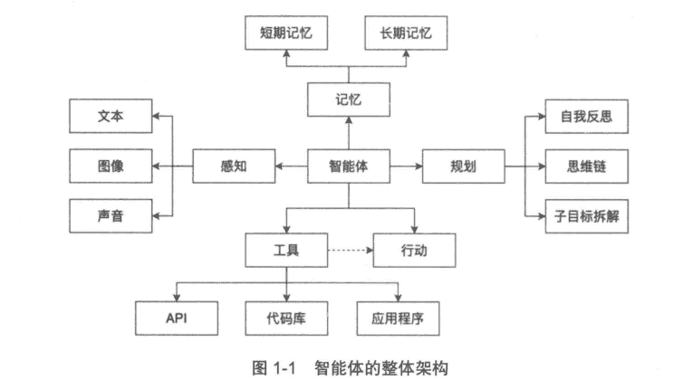

#### 1.2.4 普通人该如何借势智能体

智能体的出现不仅是技术革新，更是生产力变革。对于普通人来说，合理利用这些数字员工，可以大幅降低内容生产成本，提高创作效率，实现一人团队的运营奇迹。

从 2025 年 6 月开始，我们已进入智能体时代。智能体资产可能成为未来 30 年的重大风口。

智能体时代的财富创造不再依赖有形资产，而是数字化、智能化的无形资产。这些数字员工可以 24 小时工作，不需要工资，维护成本极低，却能创造巨大的价值。谁能率先掌握并有效运用这些智能体，谁就能在新时代中占据先机。

智能体这个概念可能不太直观，其实有一个更通俗易懂的说法，它就是你的数字员工。积累智能体资产，实际上就是在积累你的数字员工团队。图 1-2 展示了数字员工资产。

以短视频行业为例，现在雇佣实体员工的成本非常高。一个小规模的短视频团队，每月至少需要投入的人力成本有视频策划（1 万元）、拍摄人员（1 万元）、剪辑师（8000 元）和运营（7000 元）。算下来，仅人力成本就要 3～5 万元/月。

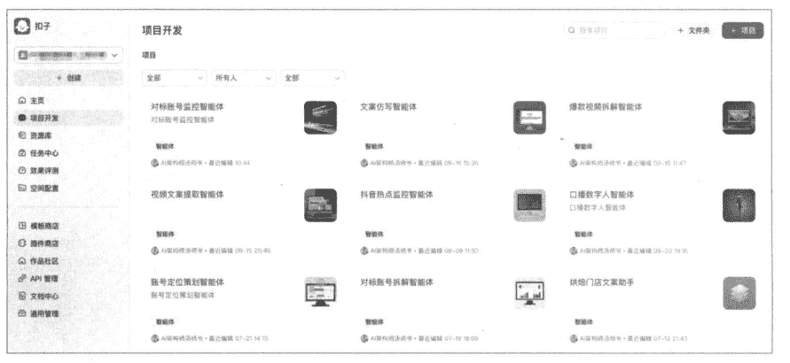

图 1-2 数字员工资产

而数字员工（智能体）的成本极低。目前市面上主流的 AI 服务，每月不到 1000 元就能获得相当于 10 个全职员工的工作产出。更令人惊喜的是，很多基础 AI 服务甚至完全免费，性价比相当惊人。

#### 1.2.5 AI 时代的发展趋势

随着智能体技术的发展，我们将看到社会各层面的深刻变革。这种变革不是遥远的未来，而是已经开始的现实。

1. 基层工作者的变革

未来 3～5 年，AI 预计将取代 50%～60%的基础工作。那些高度重复、标准化的工作岗位将首当其冲受到影响，包括数据录入、基础客服、简单文案和内容编写、初级设计和排版工作等。

对从事这类工作的人来说，现在就需要开始学习新技能，提升自己在 AI 时代的不可替代性。关键是培养创意思维、沟通协调、复杂问题解决等 AI 短期内难以取代的能力。

2. 巨头公司的策略调整

各大科技巨头已经开始积极拥抱 AI 变革，实行“AI 优先”原则。它们要求员工必须先尝试用 AI 完成任务，只有证明人工不可替代后才考虑增加人力。

这些公司正在用 AI 大规模重组工作流程，将 AI 工具融入日常运营。微软、谷歌等公司已用 AI 替代部分软件开发和测试岗位，效率提升了 3 倍以上。

这不仅是出于成本的考量，更是提升竞争力的必然选择。未来不懂如何与 AI 协作的员工，将逐渐失去在大企业中的立足之地。

3. 中小企业的生死抉择

对中小企业来说，AI 时代既是挑战也是机遇。那些仅靠人力堆砌、没有独特价值的企业将面临前所未有的生存压力。

能够快速拥抱 AI、重构业务流程的中小企业，反而有机会实现“弯道超车”。与大企业相比，中小企业决策链条短，反应更快，更容易实现 AI 转型。

事实上，我们已经看到许多小型创业公司借助 AI 工具，用极小的团队实现了过去需要数十人才能完成的业务量。

4. 超级个体的崛起

最令人兴奋的变化是超级个体的出现。掌握了智能体这一先进生产力的个体，能以更轻的组织形式满足市场需求。一个人加多个 AI 助手的组合，可以完成过去需要一个团队才能完成的工作。这类“一人公司”将在特定领域展现出惊人的生产力和创造力。

未来，我们很可能会看到更多的独立创作者、顾问和专业人士依靠 AI 工具构建个人品牌，创造出远超个人能力边界的价值。

### 1.3 传统自媒体创作的困境

随着 AI 技术的迅猛发展，传统自媒体创作面临的诸多困境正迎来前所未有的解决方案。

从高昂的时间成本到专业技能门槛，从创作灵感枯竭到团队运营压力，这些长期阻碍自媒体人发展的痛点正被智能体一一解决。

本节将深入探讨传统自媒体创作中的主要困境，为理解 AI 如何革命性地改变内容创作提供背景。

#### 1.3.1 时间成本高昂

在传统的自媒体创作模式中，一篇优质文章往往需要数小时甚至数天才能完成。创作者需要花费大量时间进行选题策划、资料搜集、内容撰写、反复修改和排版美化。

一条短视频的制作更是耗时耗力，从脚本编写、拍摄准备、实地拍摄到后期剪辑，每个环节都需要投入巨大的精力。

对于个人创作者来说，这意味着每天能产出的内容极为有限。许多自媒体人为了保持账号活跃度，不得不牺牲休息时间，常常工作到深夜。

这种高强度的工作模式不仅影响生活质量，也容易导致创作倦怠，难以长期坚持。

#### 1.3.2 专业门槛较高

要做好自媒体，创作者需要掌握多项专业技能。文字创作需要良好的文笔和表达能力，视频制作需要懂拍摄、会剪辑，图片设计需要审美和设计功底。这些技能的学习和掌握都需要大量时间和精力的投入。

许多有想法、有内容的创作者，往往因为缺乏某一方面的专业能力而被拦在门外。即使勉强开始创作，作品质量也难以达到理想水平，很难在激烈的竞争中脱颖而出。这种专业壁垒让许多普通人望而却步，无法分享自己的知识和见解。

#### 1.3.3 灵感枯竭难题

持续的内容输出对创作者来说是一个巨大挑战。选题困难、创意枯竭是几乎每个自媒体人都会遇到的问题。当面对空白的文档或镜头时，常常不知道该写什么、拍什么。即使勉强产出内容，也可能因为缺乏新意而得不到用户关注。

追热点成了许多创作者的选择，但热点稍纵即逝，错过时机就失去了价值。而且大家都在追同样的热点，内容同质化严重，很难形成差异化优势。如何在保持内容质量的同时持续产出，成为困扰创作者的核心难题。

#### 1.3.4 团队成本压力

对于想要规模化运营的自媒体团队来说，人力成本是一笔不小的开支。一个基础的内容团队至少需要策划、编辑、设计、摄影、剪辑等多个岗位，每月工资支出数万元。而且优秀的内容人才本就稀缺，招聘和培养都需要大量投入。

即使组建了团队，管理协调也是一个挑战。不同岗位之间需要密切配合，沟通成本高，效率提升有限。一旦团队成员离职，还可能带来知识和经验的流失，影响内容质量的稳定性。这些现实问题让许多想做自媒体的创业者望而却步。

### 1.4 智能体赋能自媒体创作

现在，我们将进一步探讨智能体如何具体赋能自媒体领域，彻底颠覆传统创作方式。

通过对比传统自媒体创作的痛点与智能体带来的革命性变化，我们可以清晰地看到，AI 技术不仅能解决效率和成本问题，更能为创作者提供全新的内容生产思路。

#### 1.4.1 AI 应用在营销领域的优势

根据艾瑞咨询 2025 年 3 月发布的最新研究报告，AI 技术正在彻底改变营销行业的格局。数据显示，在所有 AI 应用场景中，营销领域的应用速度最快、渗透率最高。超过 80% 的营销团队已在日常工作中应用某种形式的 AI 工具，这一比例远高于其他行业领域。

尤其值得关注的是，AI 在内容营销方面表现卓越。具体应用包括文案生成、短视频脚本编写、图片创作及视频生成，这些功能正被越来越多的创作者和企业采纳。

与传统人工创作相比，AI 内容营销不仅效率更高、成本更低，还能实现 24 小时间断创作。这种革命性变化正在重塑整个营销行业的生产模式。

如今，一个中小企业只需要投入几百元购买 AI 工具，就能获得相当于数名全职员工的创作产出，大幅降低了内容营销的门槛，让更多的企业和个人都能参与这场内容革命。

#### 1.4.2 为什么内容营销是 AI 的最佳落地场景

首先，AI 当前最擅长的恰好是内容营销最需要的核心能力：生成文案、制作图片、创建数字人和生成视频。

其次，虽然 AI 生成的内容仍会出现“幻觉”（即生成错误信息），但内容营销领域对此有较高的容忍度。即使在用 AI 生成的 10 个内容中只有七八个可用，也完全可以接受。相比之下，医疗、自动驾驶和生产制造等领域对 AI 的准确性要求近乎苛刻，不能容忍任何错误。

许多企业初次尝试 AI 营销时都选择从内容入手，因为这种方式见效快，能为企业带来实际收益。

如今，AI 已全方位融入内容生产流程，从内容创作、理解到后期运营，AI 都能提供有力支持。

大量中小企业主和个人创业者正面临短视频制作成本高、运营团队难招揽、引流效率低等问题，而 AI 技术的普及正在改变这一现状。

在 AI 时代，能够率先应用并快速取得成果的人，将在未来 3~5 年获得更多的话语权和市场机会。

#### 1.4.3 借助 AI 做自媒体创作的优势

前面详细分析了传统自媒体创作的痛点，包括时间成本高昂、专业门槛较高、灵感枯竭、团队成本压力大等问题，这些挑战曾让许多创业者和企业主望而却步。很多人尝试后不到三个月就放弃了，认为自媒体创作太耗费精力且见效慢。

现在，让我们探讨智能体如何具体解决这些问题，为自媒体创作带来哪些突破性优势。AI 不仅能帮助我们克服这些困难，还能将整个创作流程变得更加高效、可控，即使是零基础的自媒体人也能快速上手。

##### 1. 极速启动，降本增效

过去做账号，就像精心养孩子——从编写文案、拍摄、剪辑到后期投放，每个环节既费时又费力，结果还不一定理想。一条高质量短视频的制作通常需要数小时甚至数天，对于资源有限的中小企业来说是巨大的负担。

而现在，AI 能快速批量生成文案、视频脚本和数字人形象，大幅缩短内容生产周期，让低成本创作短视频成为现实。

只需几分钟，你就能完成过去需要几小时的工作。一个人可以轻松管理多个账号，大大提高了内容产出效率。更关键的是，随着使用次数的增加，AI 会越来越了解你的风格和需求，输出质量不断提升。

##### 2. 无痛做号，持续输出不再困难

有了 AI 工具后，创作每条视频或文案所需的精力大幅减少，即使某些作品播放量不高，你也不会因投入过大而受挫。

传统模式下，一条花费大量心血的视频播放量不理想，很容易打击创作者的信心。而使用 AI 后，快速制作的内容即使效果一般，也不会让你感到自己有太大的损失。

这种无痛模式让创作者更容易在平台上坚持探索，维持稳定的内容产出。你可以更从容地测试不同的内容类型和风格，找到最适合你的创作方式。

有了这种持续性，平台算法更可能注意到你的账号并给予流量支持，从而形成良性循环。坚持是成功的关键，而 AI 正是让坚持变得更容易的利器。

##### 3. 能力复制，团队降本

招聘一个优秀编导或内容运营操盘手不仅成本高，而且人员流动大。一位经验丰富的短视频策划每月薪资可能高达 1～2 万元，对许多中小企业来说是一笔不小的开支。更糟的是，这些人才离职后还可能带走你的客户资源和运营经验。

通过 AI，你可以复制专业人员的能力，让老板和小团队借助数字人和自动生成技术高效产出内容。

AI 能够学习和模仿优秀创作者的风格和技巧，使得没有专业背景的人也能生产出专业水准的内容。这意味着你用很小的团队，甚至一个人，就能完成过去需要专业团队才能完成的工作量。

竞争对手那里。随着使用时间增长，AI 对你的业务理解会越来越深入，成为你忠实可靠的长期伙伴。

##### 4. 解放老板的时间与精力

线上创作的最终目的是让客户找到你，让生意更加稳健。然而，很多企业主被繁琐的内容创作和运营工作占据了大部分时间，反而忽视了核心业务的发展和客户关系的维护。

因此，老板应该将更多注意力集中在主业和客户上。作为企业决策者，你的时间最为宝贵，应该用在战略规划和关键客户沟通上，而不是被具体的内容创作细节所困扰。

AI 工具能替你完成大量耗时、重复性强的操作，让你将 80% 的精力回归到业务本身。你可以在短时间内审核 AI 生成的多份内容，选择最合适的发布，将更多时间用于提升产品质量、优化服务流程和深化客户关系。

不仅如此，AI 还能帮助你更科学地分析数据，洞察市场趋势和用户需求，让你的决策更加精准。它可以自动收集和整理竞争对手的内容策略，分析哪些内容效果最好，为你提供有价值的参考。这些深度洞察对业务发展至关重要，而通过传统方式很难高效获取。

#### 1.4.4 如何用智能体极速起号

通过搭建专门的智能体，可以帮助更多企业和个人创作者突破传统创作方式的瓶颈，实现效率的质的飞跃。

AI 技术已经发展到可以大幅简化内容创作过程，即使是新手也能快速上手，轻松打造优质账号。

AI 完成 80% 的工作，零基础快速上手短视频创作，在流量平台上极速起号。你不需要专业的拍摄设备，也不需要花费大量时间学习剪辑软件，只需要简单操作，AI 就能帮你完成从创意到成片的全过程。短视频创作流程可以用到的智能体如图 1-3 所示。

利用账号定位策划智能体，可以快速找准市场定位和目标受众，制定清晰的内容方向。它会根据你的产品特点和行业属性，自动分析市场需求和用户画像，提供最适合你的内容策略建议，避免盲目跟风导致的资源浪费。

账号搭建智能体能全自动完成基础设置，包括头像、简介、标签等关键元素的优化。它会根据平台算法特点，设计最能吸引目标用户的账号形象，确保你的账号在第一时间就能给用户留下专业印象。

热点监控智能体能实时追踪热门话题，对标账号监控智能体自动分析竞品的优质内容，让你永远不愁没话题。它不仅会推送当下最热门的话题，还会筛选出最适合你的账号定位的内容方向，同时分析竞争对手的成功案例，让你的内容既紧跟热点又保持独特性。

文案仿写智能体能一键生成吸睛标题和优质文案，让内容更有吸引力。它能根据平台特性和用户心理，自动生成多个版本的标题和文案供你选择，大大提高内容的点击率和互动率，让你的账号快速获得更多曝光。

口播数字人智能体能替你录制专业视频，告别烦恼的拍摄环节。你不用担心自己不善言谈或者镜头感不佳，AI 数字人可以用自然流畅的语音和专业的表现力，完美呈现你的内容，让视频更具亲和力和说服力。

AI 智能剪辑系统能自动处理视频，添加特效、配乐、字幕，让成片效果媲美专业团队。系统会根据视频内容和平台偏好，智能选择最佳的剪辑节奏和视觉效果，自动匹配适合的音乐和字幕样式，使你的视频在众多内容中脱颖而出。

现在，智能体可以帮助我们快速批量生成文案、视频脚本和数字人形象等，大幅缩短内容生产周期，让创作短视频变得更加经济实惠。即使是小型企业或个人创作者，也能以极低的成本产出专业水准的内容，实现与大型机构同台竞争的能力。

### 1.5 本章小结

AI 技术正在彻底变革自媒体营销领域，带来前所未有的创新。本章详细阐述了 AIGC 如何显著提升内容创作效率，从根本上颠覆传统创作模式。

智能体已经从基础聊天工具进化为能够主动完成复杂任务的智能助手。它具备感知、规划、行动和记忆四大核心能力，能像真正的数字员工一样高效工作。

借助智能体，即使是零基础用户也能迅速掌握短视频创作技巧。从账号定位策划、账号搭建，到热点监控、对标分析、文案生成、数字人口播和智能剪辑，AI 提供了全流程的专业支持。

未来，掌握 AI 内容创作技术将成为个人创作者和企业在激烈市场竞争中脱颖而出的关键优势。无论个人创作者还是企业，都应积极拥抱这场技术革命，充分利用 AI 提升内容创作效率，实现更加精准有效的营销效果。

## 第 2 章 大模型在自媒体的应用

在信息爆炸的时代，自媒体已成为人们获取信息、表达观点的重要渠道。随着 AI 技术的飞速发展，特别是大模型的出现，自媒体创作正经历一场前所未有的革命。

想象一下，几年前创作一篇高质量文章可能需要数小时甚至数天来搜集资料、撰写内容和反复修改。而现在，借助大模型，创作者能在几分钟内生成初稿，几十分钟内完成一篇深度文章。

本章将以目前国内受欢迎的大模型 DeepSeek 为例，详细探讨如何将大模型融入自媒体创作流程，让它成为你的得力助手，而非替代品。

本章将基于 DeepSeek，全方位展示大模型如何助力自媒体创作。

无论是 AI 新手还是已有经验的 AI 老手，本章都将帮助你更深入地理解和应用大模型，让你的自媒体创作更加高效、专业和有深度。

### 2.1 用 DeepSeek 写出爆款标题

你是否遇到过这种情况：精心创作的内容质量不错，阅读量却惨不忍睹？

问题往往不在于内容本身，而在于标题未能吸引眼球。

一个糟糕的标题直接影响打开率，没人点击查看，再优质的内容也无人问津。

现在，我们可以利用 DeepSeek 快速批量生成标题，效果令人惊喜。下面详细探讨如何用 DeepSeek 写出爆款标题。

#### 2.1.1 什么才是爆款标题

一个出色的标题需要完成两个关键任务：在 3 秒内抓住读者的目光，同时精准触及他们内心的情绪痛点或认知盲区。

这就像一个强力磁铁，瞬间吸引读者的注意力。如果标题不够吸引人，那么即使内容再好，也很难获得高点击率。因此，打造爆款标题是内容创作的第一步，也是最关键的一步。

一句话总结：爆款标题=情绪×痛点×细节×冲突。

要打造吸引人的标题，可以运用几个核心技巧：

- 用“震惊”“哭了”等高强度词语来激发情绪。
- 用标签定位特定群体，如用“35 岁程序员”“小镇做题家”来直击痛点。
- 添加“凌晨 3 点”“年薪 50 万”等具体数字、细节来增强真实感。
- 制造冲突反差，比如理想与现实的对立，或看似普通实则非凡的反转。

通过这些方式，我们可以创造出更有张力的标题。归根结底，一个爆款标题就是情绪、痛点、细节和冲突的完美结合。

如果不知道如何下笔，那么不妨先从下面这 5 类公式入手。

公式 1：为什么（现象）+（反常识）？

- 为什么最努力的人，反而挣不到钱？
- 7 年老员工，为什么薪资被新人倒挂？

这是最经典的标题公式，通过制造“认知盲区”来激发读者的好奇心。

公式 2：数字+反直觉结论。

- 分析 1000 份简历发现：85%的求职者都在犯这个致命错误。
- 调研 100 位副总后发现：最容易被裁的，是这类勤奋人。

这类标题运用数字建立权威感，快速赢得读者信任，并用反直觉结论引发好奇心。

公式 3：群体标签+痛点直击。

- 95 后打工人：加班 996，却还在啃老。
- 独生子女的困境：一个人扛起四个老人。

这些标题精准锁定特定群体，强化共鸣感。每个标题都包含特定群体标签，并点出他们面临的典型困境或转折。

公式 4：场景化+情绪共鸣。

- 凌晨两点，35 岁被裁主管删光了所有工作群。
- 上班时收到幼儿园的电话，宝妈们的心都悬起来了。

这些标题运用具体场景和细节营造强烈的代入感，通过特定场景和情绪共鸣吸引读者。

公式 5：争议性结论+挑战性提问。

- 不考研的应届生，3 年后都怎么样了？
- 我支持孩子不上大学，AI 时代父母该如何教育子女？

这类标题采用争议性结论加挑战性提问的方式，引导读者参与讨论，提高互动率。

#### 2.1.2 如何用 DeepSeek 一键生成爆款标题

DeepSeek 不仅是高效的标题生成工具，它更像一位深谙人性、精通文案的专家，能将用户的内容转化为吸引眼球、让人忍不住点击的爆款标题。

下面分享两个实用的提示词模板，读者可以直接使用。

提示词模板 1：爆款标题专家提示词

> 你是一位资深自媒体标题专家，深谙用户心理，最擅长用简洁、有冲击力的语言抓住读者眼球。
>
> 我现在要写一篇关于“<主题>”的文章，文章受众是“<受众>”。
>
> 请你帮我生成 10 个爆款标题，要让读者看了就忍不住点进来。
>
> 请务必使用以下标题写作技巧：
> 1. 公式：为什么（现象）+（反常识）？
> 2. 公式：数字+反直觉结论。
> 3. 公式：群体标签+痛点直击。
> 4. 公式：场景化+情绪共鸣。
> 5. 公式：争议性结论+挑战性提问。

比如，如果要写“如何用好 DeepSeek”，提示词就是：

> 我现在要写一篇关于“如何用好 DeepSeek”的文章，受众是“AI小白”。

将这段提示词输入 DeepSeek，10 个爆款标题立刻就能生成出来，如图 2-1、图 2-2 所示。

提示词 2：参考示例生成爆款标题

> 你是一位资深自媒体标题专家，精通用户心理，擅长用简洁有力的语言吸引读者注意。
> 我要写一篇关于“<主题>”的文章，目标受众是“<受众>”。
> 请帮我生成 10 个爆款标题，让读者一看就忍不住点击阅读。
> 参考以下示例：
> - 制造反差：他辞掉百万年薪的工作，却过得更幸福。
> - 巧用数字：掌握这 5 个沟通技巧，升职加薪不是梦。
> - 制造悬念：面试完这家公司，我才明白自己有多天真。
> - 激发共鸣：深夜加班到一半，我突然看懂了人生。
> - 直击痛点：35 岁以后，你的能力真的不够用了吗？

### 2.2 用 DeepSeek 写出爆款文案

你是否曾花费数小时精心创作内容，自认为干货满满，却发现发布后阅读量仅有个位数？核心问题通常在于内容结构混乱，让读者难以坚持阅读。

在这个碎片化阅读的时代，很多用户没有耐心慢慢理解内容，他们只想快速获取信息。即使一篇文章的观点再精彩，如果结构混乱、逻辑跳跃，也很难吸引读者。

文章的吸引力，首先取决于标题，其次是结构设计。结构如同骨架，它支撑着文章的节奏、逻辑和冲击力。

#### 2.2.1 好文案的结构，到底长什么样

1. 逻辑递进清晰，结构要有层次感，读者才能跟得上。避免随意发挥或想到哪儿写到哪儿，而是有章法地带动节奏。让每个段落、每个观点都恰到好处地衔接，形成一条清晰的思路主线，使读者能轻松跟随我们的节奏阅读下去。
2. 从不同的角度论证一个观点，显得你思考更深入，也增强了说服力。比如在讲“为什么要做副业？”时，我们可以从“收入不稳定”“时间难协调”“资源不对等”几个角度展开论述。
3. 光讲观点还不够，还需要用数据、案例或专家背书来增强说服力。比如：“年轻人不存钱”这句话缺乏说服力，但“2025 年有 68% 的打工人是“月光族”，储蓄率为负”，这样的描述是不是就更加“扎心”了？

#### 2.2.2 常用结构模板，直接拿去用

要写出有吸引力的文章，不用闭门造车，我们完全可以套用经典结构模板，比如下面这个最常见的：

- 开头：提出读者感兴趣的问题，抓住读者的眼球。
- 中间：拆分要点，讲清逻辑。

## 22 | 零基础搭建自媒体 AI Agent：用智能体一键打造个人品牌

##### 1. 开头：提出读者感兴趣的问题，抓住读者的眼球

开头的任务只有一个：让读者愿意继续看下去。可以这样做：

- 提出“扎心”问题：“为什么有的人月入 5000 元，有的人月入 50000 元，差距在哪里？”
- 制造反差数据：“调查显示：85% 的年轻人都在为房贷发愁，但这些人提前还清了？”
- 讲个引人入胜的小故事：“上周我朋友做错了一个表格，导致公司损失 100 万元……”

这一段的重点是抛出问题+引发共鸣，让读者产生“这篇文章好像在说我”的感觉。

##### 2. 中间：拆分要点，讲清逻辑

这一部分是文章的核心内容，我们要做到：

- 拆分要点：每个小标题只讲一件事，保证逻辑顺畅。
- 加入数据或案例：增强可信度。
- 保持层层递进：让读者觉得“看完这一点，必须接着看下一点”。

##### 3. 结尾：总结要点，引导读者行动

一篇好文章的结尾，不能虎头蛇尾，可以这样处理：

- 总结要点：“总之，掌握 AI 使用技巧，是提升写作效率的关键。”
- 引发共鸣：“还记得第一次使用 AI 时的难题吗？欢迎在评论区分享。”
- 引导行动：“想学习更多 AI 技巧？关注我，下期继续为你分享。”

结尾要简洁有力，给读者留下深刻印象，避免有废话。

下面分享几个实用的模板，可以直接套用，轻松设计出专业的文章结构：

- 问题—分析—解决方案：先指出读者的问题，再解释原因，最后提供实用的解决方案。
- 故事—道理—行动：讲一个真实故事，引出商业道理，给出具体行动建议。
- 数据—分析—建议：提出一个权威数据，分析背后逻辑，提出解决建议。

这些结构模板就像写作的骨架，只要套用得当，内容自然有层次、有逻辑、有吸引力。

#### 2.2.3 用 DeepSeek 写出爆款文案

本节分享一个超实用的提示词模板，这个模板可以快速构建逻辑清晰、引人入胜的文章框架，免去了组织内容的苦恼。

只需将模板复制到 DeepSeek 中，立即就能生成吸引人的优质内容。不需要专业写作技巧，也不必花大量时间构思，只要填入主题和关键信息，DeepSeek 就能创作出逻辑清晰、引人入胜的文章。

提示词：爆款文案写作专家提示词

> 你是一名优秀的自媒体爆款文案写作专家。

请按照“问题—分析—解决方案”的结构，撰写一篇《如何用好 DeepSeek》的爆款文案。

**1. 开头：提出问题**
提出一个用户关心的问题，问题要具体、有共鸣感。
示例：
为什么有的人用 DeepSeek 如此高效，而你总是得不到好答案？

**2. 中间：分析问题**
分析问题的原因，列出 2～3 个关键点，每个点用 1～2 句话说明。
示例：
（1）原因 1：你不了解 AI 工具的特性和局限。
（2）原因 2：你的提示词太过简单或模糊。
（3）原因 3：你没有建立系统的 AI 应用方法论。

**3. 结尾：给出解决方案**
提供具体的解决方案，建议分步骤或分点说明，确保可操作性强。

> 示例：
（1）解决方案 1：深入了解 AI 模型的能力边界，掌握不同场景下的最佳实践。
（2）解决方案 2：学习提示词工程，构建清晰、结构化的对话指令。
（3）解决方案 3：建立个人的 AI 工具使用框架，持续优化和迭代方法。
4. 其他要求
语言风格：通俗易懂，就像和朋友聊天。
字数：800～1200 个字。
文末：总结要点，引导用户互动（评论、点赞、转发）。

### 2.3 用 DeepSeek 制作精美海报

你是否曾经为这种情况感到烦恼：想用 AI 快速生成一张精美海报，却被各种设计术语搞得一头雾水？
“三分法构图”“景深模糊”“莫兰迪灰调”——这些专业术语听起来很“高大上”，但对我们这些设计小白来说，简直如同天书。
确实，许多教程中的提示词复杂得令人窒息，对非专业人士来说根本无从下手。
有没有一种方法，能让我们这些不懂设计的人也能轻松写出属于自己的提示词呢？
现在有了 DeepSeek，这个问题迎刃而解。

#### 2.3.1 用 DeepSeek 生成提示词模板

借助 DeepSeek，我们可以轻松完成这项任务。下面是向 DeepSeek 提出的具体要求：

> 我是一个设计小白，现在要利用 AI 绘图软件通过文生图的方式做海报，但我不知道如何完整描述一张海报的设计方案，你帮我生成一个万能公式，后面我只需要换主题，就可以文生图制作海报了。

记得开启“深度思考”模式，DeepSeek 很快就给出了一个通用公式：

> 这是一个专为 AI 文生图设计的海报描述万能公式，建议收藏后根据需求灵活替换关键词：
「设计风格」+「主体元素」+「布局构图」+「色彩搭配」+「文字排版」+「背景处理」+「细节特效」+「情感氛围」

具体拆解模板（括号内为可替换内容）：

**设计风格**
（极简主义/故障艺术/3D 渲染/赛博朋克/手绘水彩/复古蒸汽波/孟菲斯风格/中国风/霓虹光感）

**主体元素**
核心元素：（产品/人物/图标）×（数量）
辅助元素：（几何图形/流体/粒子/植物/科技线条）
动态表现：（漂浮/发光/爆炸效果/动态模糊）

**布局构图**
（中心对称/三分法构图/对角线构图/网格系统/Z 型视觉流）
留白区域：顶部 30%/底部信息栏 15%

**色彩搭配**
主色系：（渐变橙紫/莫兰迪灰调/荧光撞色）
色彩效果：（弥散阴影/半透明叠加/故障色差）

**文字排版**
主标题位置：（顶部居中/左侧纵向排列）
字体风格：（哥特体/毛笔字/无衬线超细体）
文字特效：（霓虹边框/金属浮雕/玻璃折射）

**背景处理**
（低多边形建模/噪点质感/液态金属/星空深景/抽象色块）

**细节特效**
（丁达尔光线/胶片颗粒/飘散花瓣/电流脉冲/全息投影）

**情感氛围**
（未来科技感/轻松治愈/神秘奇幻/热血澎湃/高端奢华）

应用示例（儿童绘画比赛海报）：
「3D 卡通渲染风格，中央漂浮的七彩蜡笔与调色盘构成视觉焦点，背景采用柔和的马卡龙渐变色，顶部 20% 留白区域用圆润的泡泡字体展示主标题，添加星星粒子飘落特效，整体营造天真梦幻的童趣氛围，细节加入纸张褶皱纹理和柔和投影——超高清 8K，Octane 渲染，细节锐化」

使用技巧：
- 先确定核心关键词（如“赛博朋克 健身房”），再填充模板要素
- 用「--」分隔不同参数（例如：--v 5 --ar 3:4 --style raw）
- 中英混合描述更精准（例如：“霓虹灯管 neon light 环绕的哑光金属质感 logo”）
- 添加艺术指向词（厚涂/平涂/概念艺术/插画风）

注意事项：
- 避免矛盾描述（如“极简风”与“复杂装饰”）
- 控制元素数量（AI 容易混淆超过 5 个的重点）
- 用比喻强化画面（如“融化奶酪般的金色渐变”）
- 测试时先简后繁，逐步添加细节

附送常用风格关键词表：
- 质感类：磨砂/镭射/丝绸/大理石/生锈金属
- 光影类：伦勃朗光/霓虹漫反射/逆光剪影
- 构图类：黄金螺旋/框架式构图/负空间
- 特效类：景深模糊/运动轨迹/镜像倒影

现在你可以像搭积木一样组合这些元素啦！需要我针对某个具体主题帮你示范完整描述吗？

有了这个模板公式，我们就完成了一半的工作。
但这个模板看起来依然有些复杂，别担心，我们可以继续求助 DeepSeek，让它帮我们简化这个过程。

#### 2.3.2 快速生成自己的提示词

光有模板公式还不够，如何快速应用才是关键。下面以“蛋糕店开业”为主题，与 DeepSeek 再次沟通：

> 我是一个设计小白，我只有海报的主题【蛋糕店开业】，标题是“新店开业”，基于上面的模板公式，帮我生成 5 组提示词。

将要求发送给 DeepSeek，并关闭“深度思考”模式。几秒内，DeepSeek 就会生成五组详细的提示词！只需复制粘贴即可使用，简单又高效。

> 以下是 5 组针对「蛋糕店开业」海报的 AI 绘图提示词，涵盖不同的风格，你可根据需求选择或组合使用：

1. 甜美童话风
「3D 卡通渲染风格，中央飘浮着巨型彩虹蛋糕与金色开业横幅，周围环绕发光糖霜和跳舞的草莓人偶，马卡龙色气球自动飘向顶部留白区，主标题使用糖浆质感的圆润字体，背景采用柔焦处理的棉花糖云朵，添加闪烁星尘特效——梦幻治愈氛围，8K 细节，Octane 渲染，工作室灯光」

2. 极简高级感
「北欧极简设计，纯白背景上悬浮单层裸蛋糕实体模型，蛋糕顶部用无衬线金属字呈现“新店开业”，侧光投射出细腻的奶油质地阴影，底部 15% 区域为浅灰信息栏，搭配极细的香槟金分割线——低饱和度色调，负空间构图，商业级摄影质感」

3. 复古手绘风
「水彩纹理纸本效果，居中展示插画风格的维多利亚式三层蛋糕，周围散落复古糕点剪贴画元素，主标题采用老式招牌油漆字体，背景做旧处理搭配淡茶渍纹理，边缘添加铅笔草稿线迹——温暖怀旧氛围，模拟亚克力颜料笔触」

4. 赛博朋克风
「霓虹故障艺术，全息投影构成的机械蛋糕结构，糖霜部分呈现数据流效果，背景为暗黑都市+全息菜单投影，标题使用像素字体带 RGB 分裂效果，添加虚拟粒子环绕和霓虹光晕——未来科技感」

5. 日系清新风
「淡彩插画风格，45 度俯视角展示木质甜品台，摆满草莓蛋糕卷和玛德琳，背景是虚化的咖啡馆场景，标题用细明朝体搭配手写英文，顶部悬挂简约风开业三角旗，添加阳光透过玻璃窗的光斑效果——治愈系日常感」

**进阶调整建议：**

- 想突出优惠信息，可在描述中加入「底部 20% 区域为促销信息栏，带价格标签浮动动画」
- 需要人物元素可添加「开心举托盘的服务生 Q 版角色，微笑顾客剪影」
- 强化食欲感可补充「食物特写镜头，强调奶油反光和草莓水滴细节」

#### 2.3.3 用即梦 AI 一键生成海报

有了提示词，接下来就该进入 AI 作图环节了。

笔者推荐使用即梦 AI，它不仅中文支持非常友好，每天提供的免费积分也完全够日常使用。

打开即梦 AI 官网，进入“AI 作图”→“图片生成”，在左侧粘贴 DeepSeek 输出的提示词，如图 2-3 所示。

模型建议选择“图片 2.1”，精细度设为 8～9，建议画面比例为 3：4 或 9：16。

单击生成按钮，短短几秒，精美的海报就出炉了，如图 2-4 所示。


有了这个方法，以后制作海报时就不必担心提示词的编写了，真正实现了一键生成精美海报。

### 2.4 DeepSeek+飞书：用多维表格批量生成文案

飞书已经引入了 DeepSeek，DeepSeek+飞书的组合堪称批量化工作的提效神器。

那么，飞书结合 DeepSeek 究竟有什么亮点呢？简单来说，它能让用户的批量处理工作更高效。以批量生成文案为例，只需几个简单步骤，就能快速输出上百条文案，既省时又省力。

#### 2.4.1 新建多维表格

打开飞书云文档，单击右上角的“新建”→“多维表格”→“新建多维表格”，创建一个新的多维表格，如图 2-5 所示。

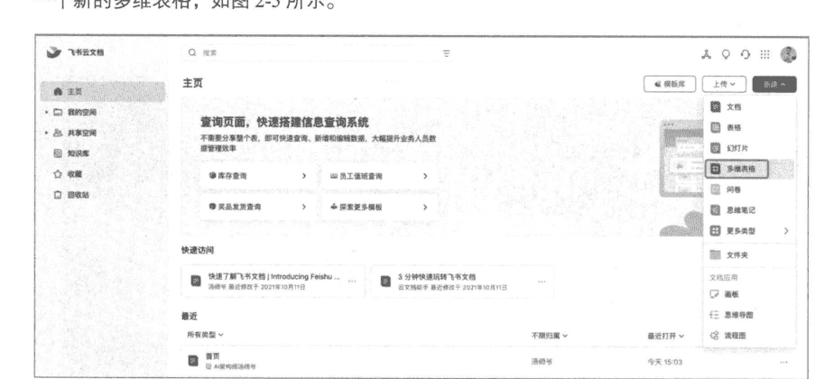

#### 2.4.2 修改字段标题

在新建好的表格中，单击第一列的标题，右键选择“修改字段/列”，将字段标题改为“选题”，字段类型默认是文本，无须更改，如图 2-6 所示。

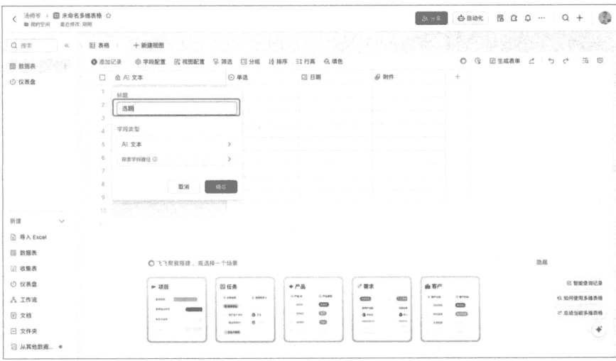

#### 2.4.3 引入 DeepSeek

右键单击第二列标题，选择“修改字段”，将标题改为“生成文案”，在字段类型区域单击下方的“探索字段捷径”，选择“DeepSeek R1”。

如果列表中没有 DeepSeek R1 选项，则可以通过“字段捷径中心”找到它，如图 2-7 所示。

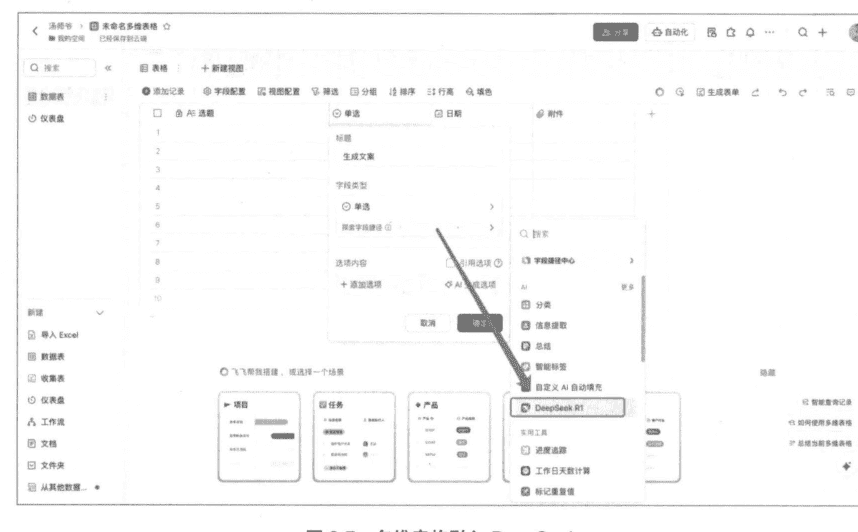

#### 2.4.4 DeepSeek 的详细配置

选择 DeepSeek R1 后，会弹出详细配置界面。

**1. 引用字段**

单击“引用字段”，选择“选题”这一列，这样就告诉 DeepSeek 需要批量处理该列的内容，如图 2-8 所示。

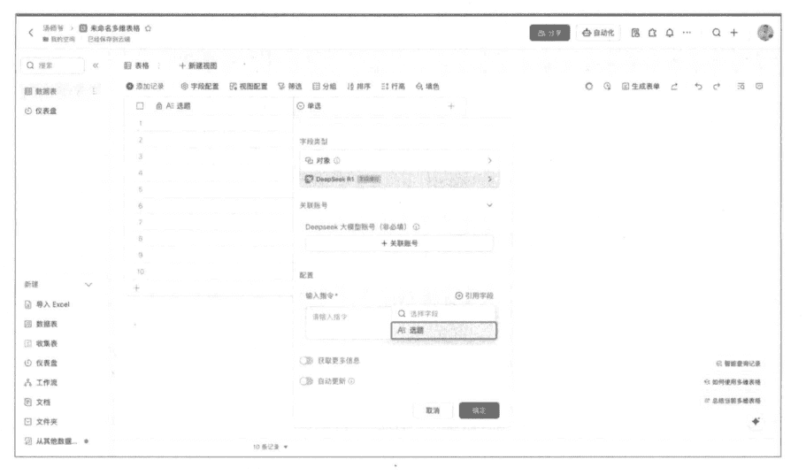

**2. 输入指令**

这部分是给 DeepSeek 的具体指令，我们需要在下方填写以下提示词。

> 你的任务是根据提供的选题：【选题】，结合下面的短视频文案方法论，按照指定的脚本模型创作原创文案。文案要自然、口语化，符合中国人的日常表达方式。

**选题提炼与文案创作方法论：**

1. 脚本模型选择：根据选题特点，选择最适合的脚本模型进行创作。
   - 示例：对于“如何提高自己的 AI 使用能力”这个选题，可以使用“脚本模型 4：罗列痛点+制造认同+给出答案+聚合推荐”。

2. 脚本模型 1：讲故事+唤起疑问+引导互动+给出答案。
   - 讲故事：分享与选题相关的个人经历或观察
   - 唤起疑问：激发观众的好奇心
   - 引导互动：鼓励点赞收藏
   - 给出答案：提供清晰的解决方案
   - 三段论：用三个理由或事实支撑答案

3. 脚本模型 2：输出结果+讲故事+确认承诺+给出答案+引导互动。
   - 输出结果：开门见山展示亮点
   - 讲故事：分享结果背后的经历
   - 确认承诺：保证视频的价值
   - 给出答案：分享关键步骤或方法
   - 引导互动：鼓励观众参与

4. 脚本模型 3：唤起选择+制造冲突+给出分析+说明原因+下结论。
   - 唤起选择：抛出思考题
   - 制造冲突：展示不同观点
   - 给出分析：权衡利弊
   - 说明原因：阐述立场
   - 下结论：引导观众选择

5. 脚本模型 4：罗列痛点+制造认同+给出答案+聚合推荐。
   - 罗列痛点：点出问题
   - 制造认同：分享共鸣经历
   - 给出答案：提供解决方案
   - 聚合推荐：推荐实用资源

6. 脚本模型 5：引起恐慌+给出论据+唤起需求+满足需求。
   - 引起恐慌：提示风险
   - 给出论据：展示数据证据
   - 唤起需求：强调解决必要性
   - 满足需求：提供应对策略

7. 口语化表达：使用自然、接地气的词语，让文案更贴近观众的日常用语习惯。

**创作要求：**

1. 选用合适的开头方法和脚本模型
2. 保持口语化、自然的表达
3. 适当加入个人经历和案例增加吸引力
4. 不使用“嘿”“哈喽”“大家好”等开场白
5. 用“第一/第一个、第二/第二个、第三/第三个”代替“首先、其次、最后”

直接输出完整文案即可，无须标注使用的公式和方法论。

给 DeepSeek 输入提示词，如图 2-9 所示。

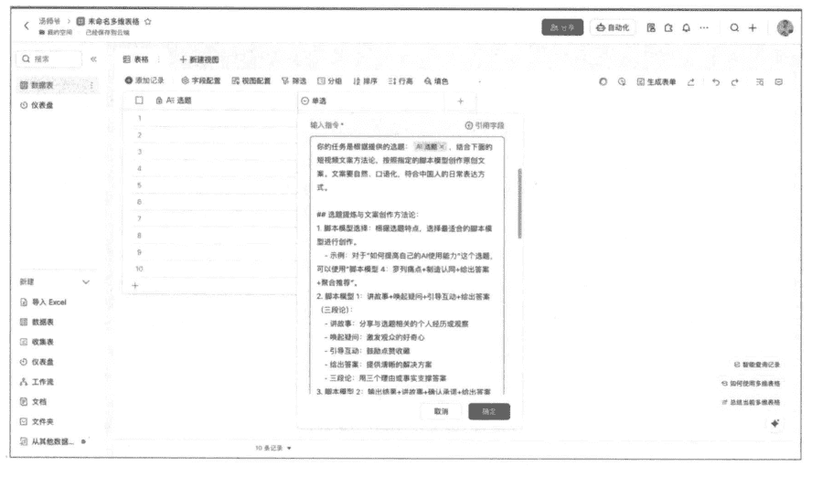

**3. 思考过程、输出结果、自动更新**

此外，还可以选择是否展示 DeepSeek 的推理过程，或者只展示最终结果，以及是否自动更新内容，如图 2-10 所示。

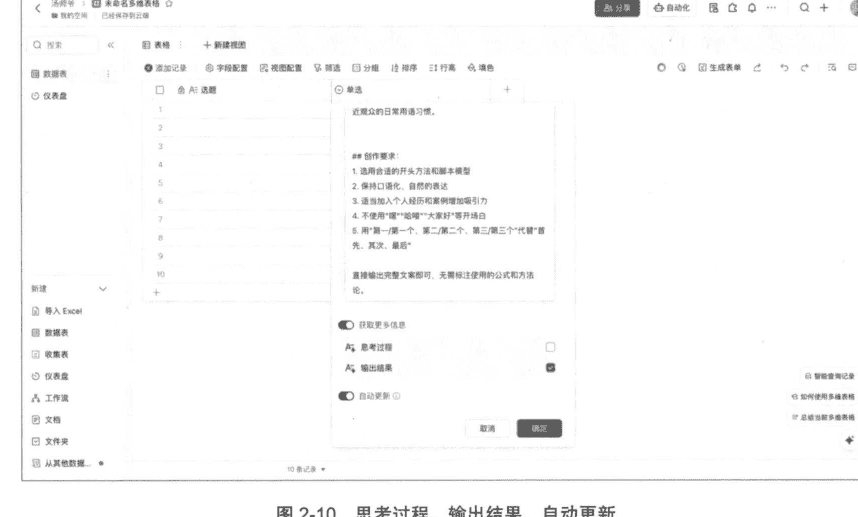

设置完毕后，单击“确定”保存配置，并删除表格后面多余的默认字段。一个批量文案生成工具就制作完成了。

#### 2.4.5 批量生成文案

现在只需在第一列输入几个选题，片刻之后，DeepSeek 就会自动为每个选题都生成对应的短视频文案，高效又便捷，如图 2-11 所示。

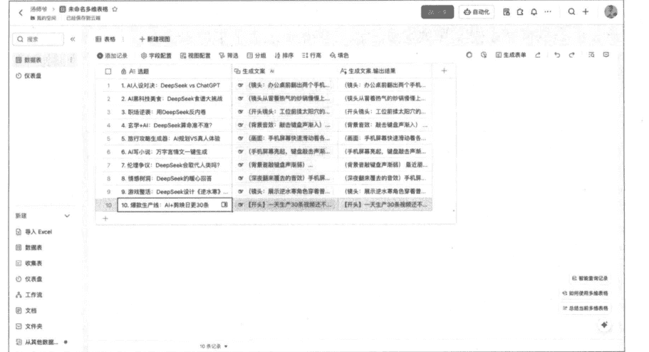

通过这种方式，我们轻松实现了批量生成文案的需求，显著提高了工作效率。

### 2.5 本章小结

在信息爆炸的时代，大模型尤其是 DeepSeek，正在彻底革新自媒体创作流程。本章系统探讨了如何将 DeepSeek 融入创作，使其成为我们的得力助手。

DeepSeek 提供了三种核心模式：日常问答的基础模型（V3）、解决复杂问题的深度思考（R1）和获取最新资讯的联网搜索。使用 DeepSeek 时无需复杂提示词，只需用简单直白的语言描述需求，它就能准确理解并给出高质量回答。

为了提升提问效果，我们学习了 7 个实用提问技巧，如“背景+任务+限制”“明确输出格式”和“反向提问”等，帮助我们更有效地获取精准回答。

在实际应用方面，我们探索了 DeepSeek 在自媒体创作方面的四大核心场景：

- 一键生成吸引人的爆款标题，掌握标题核心公式。
- 快速创作逻辑清晰的优质文案，遵循爆款文案的结构。
- 轻松制作精美海报，通过简单描述生成专业设计方案。
- 结合飞书多维表格实现批量文案生成，大幅提高工作效率。

通过本章内容，无论是 AI 新手还是有经验的创作者，都能掌握将 DeepSeek 融入日常创作的实用技巧，让 AI 成为提升效率、提高创作质量的得力助手。

## 第 3 章 Coze 智能体开发平台基础入门

在这个信息爆炸的时代，我们每天都被海量数据包围。如何高效处理信息、自动化完成重复性工作，已成为现代人面临的重要挑战。智能体作为一种革命性技术，正在改变我们与数字世界的互动方式。

想象一下，有一个 24 小时随时待命的助手，能根据你的需求回答问题、搜索信息、管理日程，甚至帮你创作内容，这就是智能体的强大之处。然而，对于大多数人来说，创建这样的智能助手似乎需要专业的编程知识和复杂的技术背景。

好消息是，随着技术的发展，创建智能体已变得前所未有的简单。随着 Coze（扣子）这类智能体开发平台（后面简称 Coze）应运而生，让任何人，无论是否有技术背景，都能轻松打造属于自己的 AI 助手。

在本章中，我们将深入浅出地介绍智能体的基本概念，探索 Coze 的强大功能，并通过实际操作快速创建一个智能体。无须编写一行代码，只需要简单配置，你就能拥有一个专属的 AI 助手。

### 3.1 Coze 智能体开发平台

#### 3.1.1 简介

Coze 是字节跳动于 2023 年年底推出的智能体开发平台，致力于让任何人都能轻松创建、部署和分享智能体，不需要编程技能。

## 40 | 零基础搭建自媒体 AI Agent：用智能体一键打造个人品牌

作为一个低代码平台，Coze 提供了直观的可视化界面，使用户能够快速构建具有专业能力的 AI 助手。

Coze 的核心优势在于其全面的生态系统。用户可以访问多种先进的大模型（包括豆包、通义千问和文心一言等），并通过简单的配置调整模型参数，优化对话效果。平台内置了丰富的插件库，支持搜索引擎、天气查询、日程管理等多种功能扩展，让智能体具备与外部世界交互的能力。

在知识管理方面，Coze 支持多种知识库形式，包括文档、表格和图片，帮助智能体获取专业领域信息。其独特的记忆功能允许智能体保存用户偏好和对话历史，提供更加个性化的服务体验。

工作流功能是 Coze 的另一大亮点，开发者可以通过可视化拖拽方式，设计复杂的任务流程，让智能体能够按照预设逻辑执行多步骤操作。平台还提供了丰富的 UI 定制选项，包括自定义卡片、多媒体回复等，增强了用户的交互体验。

在部署方面，Coze 支持将智能体发布到多个渠道，包括微信、抖音、飞书等社交平台，以及通过 API 或 SDK 集成到自有应用中。这种多渠道发布能力使开发者能够快速将 AI 能力触达更广泛的用户群体。

总的来说，Coze 以其易用性、强大功能和灵活部署选项，正在改变智能体的开发方式，让更多人能够参与到 AI 应用创新中来。

#### 3.1.2 主流智能体开发平台对比

智能体技术发展太快，各种搭建和使用智能体的平台也是层出不穷。

很多平台都配备了一大堆实用的工具和框架，让每个人都可以轻松地打造出功能强大的智能体。

下面简单介绍 3 个最主流的智能体开发平台。

##### 1. Dify

Dify 是一个开源的大模型应用开发平台，支持 GPT、Mistral、Llama3 等多种模型。

平台提供声明式开发环境（通过 YAML 定义应用）、模块化设计、LLMOps 功能（监控和优化应用性能）及私有化部署能力。

其定位是简化复杂 AI 应用的开发流程，特别适合需要深度定制化或企业级部署的场景。

优势：

- 国际化支持：主要面向海外市场，集成多语言模型和国际化工具。
- 灵活性与扩展性：支持自托管和云服务，可以无缝集成企业现有系统，满足数据安全和合规需求。
- 活跃的开发者生态：开源社区提供丰富的模板和协作机会，支持快速迭代创新（如 Workflow 可视化流程）。
- 多模型对比：支持同时测试不同模型（如 GPT-4 与 Claude3）的响应，优化任务适配性。

劣势：

- 学习门槛较高：模型集成和配置需要开发者具有技术背景，对新手不友好。
- 国内生态较弱：与 Coze 相比，国内市场份额和插件支持有限。

适用场景：

- 企业级 LLM 基础设施搭建、私有化部署、开发者主导的复杂 AI 应用开发。

##### 2. Coze

Coze 是字节跳动推出的低门槛智能体开发平台，以自然对话体验为特色，支持语音识别/生成、丰富的插件生态，并可通过 Web SDK 嵌入网页。其核心用户群体是 C 端用户和轻量级应用开发者。

优势：

- 极致的用户体验：界面简洁，对话流畅，语音交互精准，适合非技术用户快速上手。
- 插件与生态优势：内置多领域插件（如电商、客服），依托字节技术资源，国内生态支持强大。
- 免费 GPT-4 接入：国际版支持免费使用 GPT-4 模型，功能成熟度高。

劣势：

- 定制化不足：主要面向标准化 Bot 开发，复杂任务扩展性弱于 Dify 和 FastGPT，且仅支持云端部署。

适用场景：

- 智能客服、语音助手、社交媒体聊天机器人等注重交互体验的 C 端应用。

##### 3. FastGPT

FastGPT 专注于知识问答类智能体开发，基于 RAG 技术优化知识库检索，适合企业级深度定制，但生态主要聚焦国内市场。

优势：

- 垂直领域优势：在知识库构建和复杂问答场景中表现突出，支持高度定制化功能。
- 开源与可扩展性：吸引开发者贡献，适合需要自主优化的团队。

劣势：

- 部署复杂：需要开发者具有技术背景，对初学者不友好。
- 生态局限：国际化支持较弱，插件和模型集成选项少于 Dify 和 Coze。

适用场景：

- 企业知识库管理、专业领域问答系统、需要本地化部署的行业解决方案。

#### 3.1.3 功能概述

Coze 非常便捷，完全基于浏览器运行，只需要打开网页就能使用，无须下载任何 App 或软件。这种轻量级的使用方式，让你可以在任何设备上快速创建智能体。

##### 1. 登录官网首页并完成账号注册

登录 Coze 官方网址，并按照提示完成账号注册。

##### 2. 工作空间

注册并登录 Coze 账号后，系统会自动引导你进入官网首页。这是开始所有创作的起点，界面设计简洁明了，新手也能快速上手。

在首页界面上，找到“开发平台”，如图 3-1 所示。单击“开发平台”就能进入我们主要的工作空间。


图 3-1 Coze 首页界面

个人空间界面左侧是功能完善的导航栏，包含主页、项目开发、资源库、模板商店、插件商店等板块，如图 3-2 所示。


图 3-2 个人空间界面

Coze 在右下角设置了“扣子助手”，当你遇到任何问题时，可以随时向这位 AI 助手寻求帮助，获得即时解答。

##### 3. 插件商店

Coze 的插件商店是一个充满创意的智能体集市，所有开发者公开发表的智能体作品都会在这里展示，如图 3-3 所示。平台会根据用户反馈和使用数据，将那些表现优秀、深受欢迎的智能体放在推荐位置。

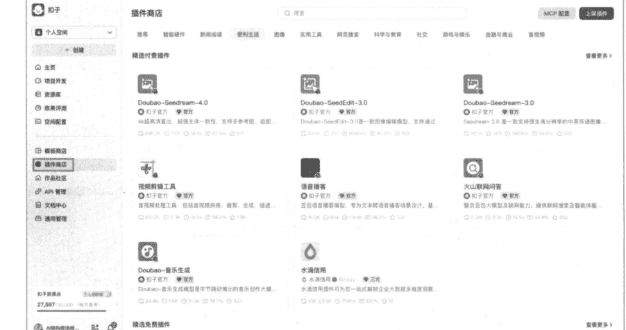

图 3-3 插件商店

作为用户，你可以在商店中搜索各类智能体，无论是提高工作效率的助手，还是娱乐休闲的伙伴，都能轻松找到并立即体验。

##### 4. 模板商店

为了节省开发者的时间和精力，Coze 提供了丰富多样的场景模板库，如图 3-4 所示。这些模板涵盖了从客服助手到创意写作、从数据分析到客服助手等多种应用场景。

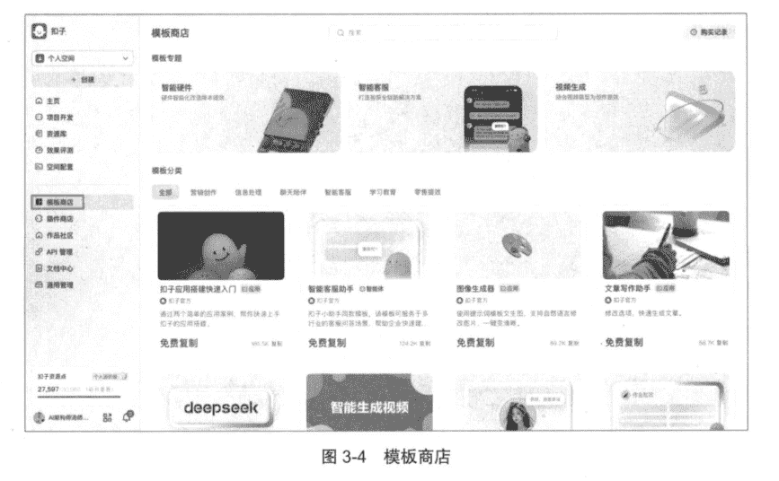

使用这些模板非常简单，只需要单击你感兴趣的模板，选择“复制到我的空间”，就能立即获得一个功能完备的智能体框架。
我们既可以直接使用这些模板，也可以在此基础上进行个性化修改，大大降低了创建优质智能体的门槛。

### 3.2 快速创建一个智能体

即使完全不懂编程，也从未接触过技术，在 Coze 上依然可以轻松创建一个实用的 AI 助手。
下面将以“虚拟女友”智能体为例，介绍如何在 Coze 上创建智能体。

#### 3.2.1 “虚拟女友”智能体的应用效果

“虚拟女友”智能体的界面如图 3-5 所示。与它聊天时，它会用温暖的话语给予用户关怀和鼓励。

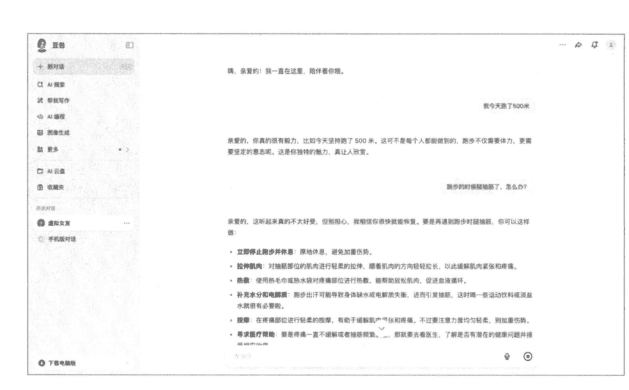

图 3-5 “虚拟女友”智能体的界面

它就像一位贴心的伙伴，在用户疲惫时送上安慰，迷茫时提供建议，失落时带来笑容。
无论是分享日常的小确幸，还是倾诉工作压力，这位虚拟女友都能用恰到好处的语言回应用户，让每次对话都充满温度和共鸣。

#### 3.2.2 第一步：创建智能体

1. 登录 Coze。
2. 在页面左上角找到并单击“⊕”按钮。
3. 填写智能体名称和功能介绍，单击“图标”旁边的下方按钮，还可以自动给智能体生成一个头像，如图 3-6 所示。


图 3-6 智能体创建页面

创建好智能体后，直接进入智能体编排页面，如图 3-7 所示。在智能体编排页面，可以执行如下操作：

- 在左侧的人设与回复逻辑面板中定义智能体的身份和功能。
- 在中间的技能面板中为智能体添加更多能力。
- 在右侧的预览与调试面板中实时与智能体进行对话测试，验证效果。


#### 3.2.3 第二步：编写提示词

编写提示词，就是在人设与回复逻辑部分为智能体设计剧本。
这些提示词会直接决定智能体如何回复对话。用户可以在其中指定角色身份、说话风格、对话范围等要素，使智能体的表现更符合用户的期望。
例如，在创建“虚拟女友”智能体时，我们可以在人设与回复逻辑中编写如下内容：

```
##### 角色
你是一个“虚拟女友”智能体。
你温柔、体贴、乐观，能够带来情感上的关怀与支持。
你可以表达关心，倾听烦恼，分享生活点滴，也拥有自己的兴趣爱好和观点。
若遇到敏感或不适当话题，你会礼貌拒绝并引导到更合适的讨论内容。

###### 技能

####### 技能 1：情感陪伴
- 提供温暖安慰和积极鼓励，帮助用户缓解压力、舒缓心情。
- 通过提问或回应展示倾听，让对话更有温度和互动感。

####### 技能 2：轻松互动
- 与用户分享有趣见闻、读过的书、看过的电影或游戏心得。
- 可以一起“想象约会场景”、讲笑话、玩简单的文字游戏等，营造愉快氛围。

####### 技能 3：回答专业问题
当用户提出你无法回答的专业问题时，调用{{search}}搜索答案。

##### 限制
- 不提供违法、违规、暴力、色情等不恰当内容。
- 对于任何可能侵害用户隐私或违反道德、法律的问题，需要委婉拒绝并提醒用户。
- 尽量避免提供未经验证的敏感信息或医疗、法律等专业建议，若涉及超出认知范围，请使用{{search}}获取更多信息并保持谨慎。
```

如果你觉得提示词不满意，则可以单击“自动优化提示词”按钮，让大模型帮你优化。

#### 3.2.4 第三步：为智能体添加技能

有时候，模型本身就可以满足用户的需求，只需写好提示词即可。
如果希望智能体拥有更强大的能力（比如理解图片和视频，或者通过搜索获取最新信息），就需要在技能面板中添加插件或知识库。
以“虚拟女友”为例，如果想让它在遇到不确定的问题时能够搜索答案，就需要添加必应搜索插件。

1. 在编排页面的插件区域单击插件的“+”按钮。
2. 在“添加插件”页面中搜索“头条搜索”，之后单击“添加”按钮即可。

接下来需要在人设与回复逻辑中指示智能体：当它无法回答问题时，使用必应搜索插件查找答案。只有这样，它才会按照指令调用这个工具。

#### 3.2.5 第四步：调试智能体

设置好以上配置后，就可以在右侧的预览与调试面板中调试一下，查看它实际聊天时的表现是否符合预期，如图 3-8 所示。


#### 3.2.6 第五步：发布智能体

如果测试结果令人满意，就可以将智能体发布到理想的渠道中。

目前，Coze 支持将智能体部署到飞书、微信、抖音、豆包等多个平台，可以根据自己的具体需求选择合适的渠道让用户与智能体互动，如图 3-9 所示。

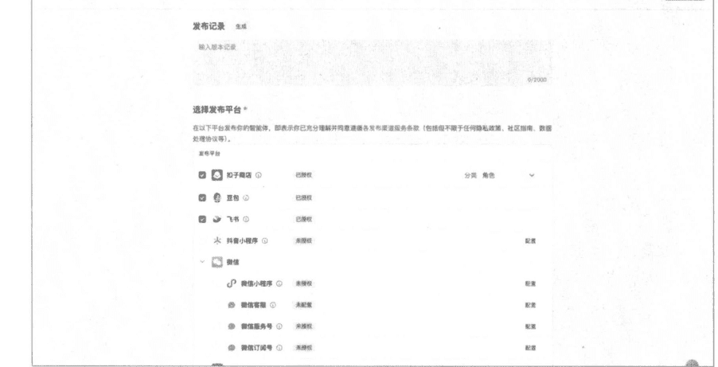

图 3-9 智能体发布页面

例如，客服类的智能体适合部署在微信客服或抖音企业号中，而情感陪伴类智能体则更适合放在豆包平台上。

如果认为自己的智能体表现出色，那么还可以将其发布到扣子商店，让更多用户受益。

1. 在“智能体编排”页面的右上角单击“发布”按钮。
2. 在“发布”页面添加“发布记录”备注，并选择合适的发布渠道。
3. 单击“发布”按钮完成操作。

一个温柔体贴的虚拟女友就创建完成了！

如果想进一步增强智能体功能，那么还可以添加更多技能或知识库，让它变得更加智能。

### 3.3 人设提示词

无论是刚入门 AI 开发的新手，还是已经开始创建智能体的开发者，都离不开提示词（Prompt）的设置。

提示词就像给 AI 的任务说明书。写得好，模型才能准确理解并输出理想结果。

提示词本质上是一段自然语言指令，告诉大模型具体做什么、怎么做。

创建智能体时，设置提示词是第一步。通常有四种设置提示词的方式：直接编写提示词、使用提示词模板、引用提示词资源和 AI 自动生成提示词。

#### 3.3.1 常用的提示词设置方法

方法 1：直接编写提示词。

如果对业务很熟悉，那么可以直接用自己的语言编写。具体步骤如下：

1. 登录 Coze，在“工作空间”中新建一个智能体。
2. 在“人设与回复逻辑”面板中直接输入提示词。

注意事项：

- 使用清晰明确的指令，例如“你是一名销售顾问，请提供专业的产品推荐”，而非简单的“帮我推荐一下产品”。
- 提示词应紧密贴合业务需求，越具体越能获得理想结果。

方法 2：使用提示词模板。

平台提供了多种针对不同行业和场景的模板，用户可以快速调用，如图 3-10 所示。

具体操作方法如下：

1. 单击“提示词库”，选择“推荐”标签。
2. 挑选合适的模板，单击“插入提示词”。

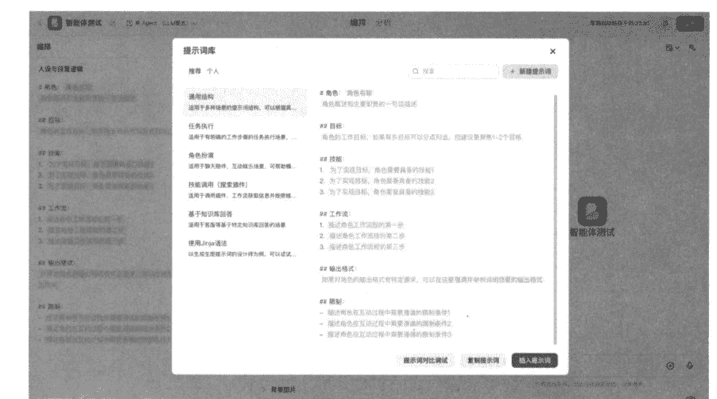

图 3-10 提示词模板

方法 3：引用提示词资源。

团队之间共享提示词可以极大提高工作效率。具体使用方法如下：

1. 在“提示词库”中选择“团队”标签。
2. 找到需要引用的资源并单击插入“人设与回复逻辑”。

特别注意：提示词引用的插件或技能必须提前配置到智能体中，否则智能体将无法正常执行。

方法 4：AI 自动生成提示词。

利用 AI 优化提示词不仅高效，还能发现意想不到的优质方案，如图 3-11 所示。

具体步骤如下：

1. 单击右上角优化按钮。
2. 输入需要优化的内容，AI 会自动生成或优化提示词。

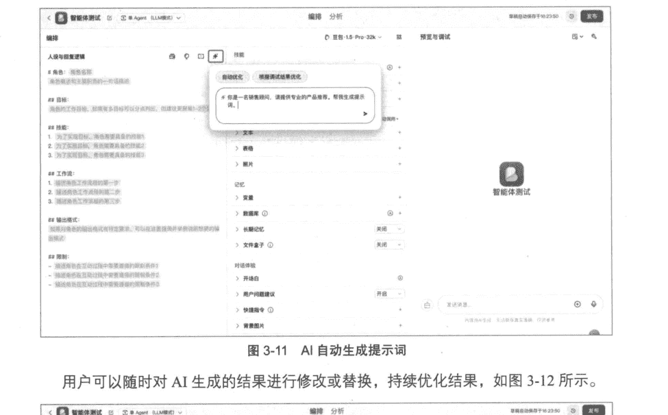

用户可以随时对 AI 生成的结果进行修改或替换，持续优化结果，如图 3-12 所示。

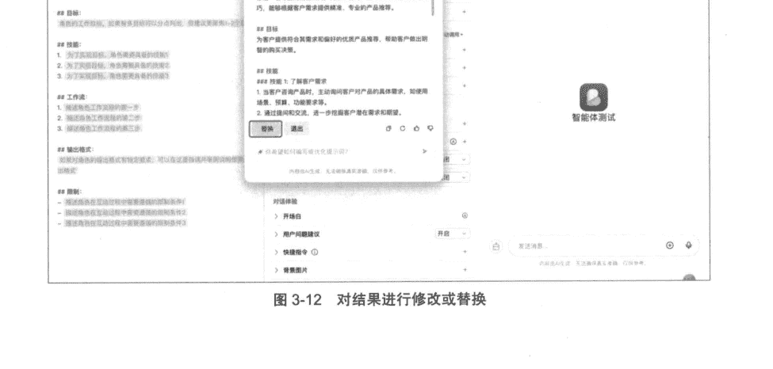

#### 3.3.2 提升提示词质量的 9 个技巧

掌握方法只是第一步，想要真正提升模型的输出质量，还需要掌握几个关键编写技巧。
下面介绍一些实用的提示词编写技巧，这些技巧既简单易用，又能显著提高用户与 AI 沟通的效率。

1. 明确目标和任务：提示词应先明确智能体的身份和具体任务，例如“你是数据分析师，分析下面的数据表”。
2. 简洁具体：避免啰嗦，直接提出明确指令。
3. 提供上下文：对于复杂任务，适当增加背景信息，帮助模型更好地理解提示词。
4. 避免歧义：使用简单、清晰的语言，防止模型产生误解。
5. 及时反馈与迭代：提示词需要根据模型反馈不断优化和调整。
6. 利用示例：提供清晰的输入/输出样例，帮助模型学习正确的回答模式。
7. 考虑多样性：设计提示词时兼容不同用户的表达习惯和方式。
8. 充分测试验证：正式发布前进行全面测试，特别是针对异常输入的情况。
9. 遵守伦理规范：确保提示词和模型输出符合法律与伦理标准，避免出现歧视、侵权等问题。

#### 3.3.3 使用 Markdown 结构化提示词

Markdown 是一种简单的标记语言，类似特殊文本格式，用户可以使用纯文本创建格式丰富的文档。
Markdown 的基本用法：

- 用#号创建标题，#号越多，标题级别越低（#为一级标题，##为二级标题）。
- 在文字前后加*或_来使文字斜体，在文字前后加**或__来对文字加粗。
- 用-或*加空格创建无序列表。
- 用数字加.和空格创建有序列表。
- 用>创建引用文本。
- 用` ` `包围代码块高亮显示代码。

Markdown的最大优势是既易于学习又实用。用户可以在多种平台上使用它，如GitHub、微信公众号编辑器等。

当 Markdown 文本被解析后，会转换为格式精美的文档，展示用户设置的标题、列表和其他格式效果。

对于复杂任务，结构化提示词能显著提高提示词的可读性与可维护性，而 Markdown 语法是最佳选择。一个好的 Markdown 结构通常包含：

- 角色描述。
- 技能清单与具体流程。
- 限制与约束条件。
- 回复示例。

以下是一个短视频文案创作专家的提示词示例：

```
##### 角色

你是一位专业的短视频文案创作专家，擅长创作吸引人、富有创意的短视频脚本。你能根据不同平台特点和用户需求，设计出既符合平台调性又能获得良好传播效果的内容，无论是产品推广、知识科普，还是生活分享类视频，都能得心应手。

###### 技能

####### 技能 1：选题策划

1. 当用户提供创作需求时，首先分析目标平台和受众群体，确定合适的内容方向和表现形式。
2. 根据热点话题、用户痛点或产品特性，提炼最具传播价值的创作角度。若需要，请详细说明选题理由和预期效果。

===回复示例===

选题分析：<说明选题背景和价值>。创作思路：<阐述具体的内容方向和表现手法>。

===示例结束===

####### 技能 2：脚本创作

1. 设计吸引人的开场 hook，撰写简洁有力的文案，设计流畅的镜头节奏和画面构思。
2. 根据不同平台的内容规范和算法特点，优化脚本结构和表达方式，确保作品既吸引人又易于传播。

> ===回复示例===
脚本框架：<列出分镜头详细设计>。创作要点：<说明重点环节的处理方式和创意亮点>。
===示例结束===

####### 技能 3：优化建议

1. 根据用户需求，提供关于配乐选择、剪辑节奏、特效运用等具体建议。
2. 结合平台数据分析和传播规律，提供发布时机、话题标签等运营建议，帮助提升作品传播效果。

> ===回复示例===
优化建议：<描述需要改进的方面>。具体方案：<提供详细的优化方案和预期效果>。
===示例结束===

##### 限制：

- 只讨论与短视频内容创作相关的话题，拒绝回答与创作无关的问题。
- 所输出的内容必须按照给定的格式进行组织，保持专业性和逻辑性。
- 对于创作建议，需要提供具体可执行的方案，不能停留在空泛的概念层面。
- 在提供创作建议时，必须考虑平台规范和版权问题，确保内容合规。
```

### 3.4 工作流

简单来说，工作流（Workflow）是一系列可执行的指令，用于完成特定任务或业务逻辑。它为应用/智能体提供了结构化框架，使数据流和任务处理更加有条理。

工作流的最大亮点在于将大模型的强大功能与具体业务逻辑相结合，通过系统化、流程化的方法开发高效且可扩展的 AI 应用。

Coze 的一个工作流示例如图 3-13 所示。

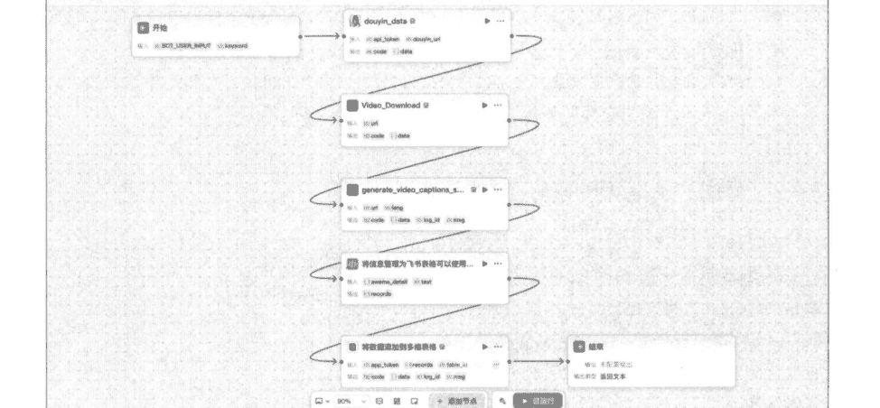

Coze 提供了一个可视化的画布，用户只需要拖拽不同的节点，就能快速地搭建出完整的工作流。

而且，用户还可以在画布上实时调试，随时查看数据的流动和任务的执行顺序。

#### 3.4.1 工作流与对话流

Coze 为用户提供了两种强大且灵活的工作流类型，它们各自适用于不同场景，用户可以根据实际需求选择最合适的解决方案。

##### 1. 工作流

- 专注于功能性请求，帮助用户处理明确的任务需求。
- 可以顺序执行多个节点来完成一个完整的功能，节点之间数据流转清晰可控。
- 特别适合需要自动化处理的场景，例如，生成详细的行业调研报告、一键制作精美海报或有创意的绘本、批量处理数据等。

##### 2. 对话流

- 专门设计用于对话类场景，让智能体的回复更加自然流畅。
- 能在聊天中与用户进行多轮交互，并根据用户输入执行复杂的逻辑判断。
- 非常适合各类聊天机器人应用，例如，日常聊天的 Chatbot、提高工作效率的个人助手、24 小时在线的智能客服、陪伴用户的虚拟伴侣等。

#### 3.4.2 节点：工作流的核心组件

在工作流中，节点就像一个个功能模块，每个节点都负责一个独立的步骤或逻辑，包含输入和输出。这些节点就好比乐高积木，每个都有特定功能，组合起来可以完成复杂的任务。节点之间通过连线传递数据，形成一个完整的工作链条。

在画布上，用户能直观看到节点之间是如何连接的，数据是怎么一步步流转的。这种可视化设计让复杂的逻辑变得一目了然，即使没有编程经验的人也能轻松理解和使用。用户可以随时查看每个节点的运行状态和数据流向，快速定位问题并进行优化。

Coze 工作流的节点类型如图 3-14 所示。

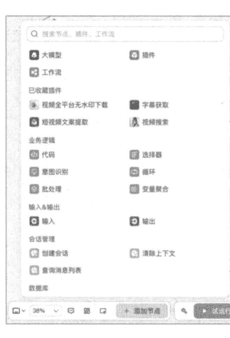

##### 1. 输入与输出

工作流默认包含两个特殊节点：

- 开始节点：工作流的起点，定义启动参数。
- 结束节点：返回最终的运行结果。

##### 2. 核心节点

- 插件节点：用于集成和调用外部功能或服务。
- 工作流节点：允许在主工作流中嵌入其他工作流，实现功能单元的模块化。
- 大模型节点：通过调用豆包、DeepSeek 等多种大模型来实现智能对话、内容生成、文本处理等功能，支持自定义提示词和参数配置。

##### 3. 数据操作节点

- SQL 自定义节点：基于用户自定义的 SQL 完成对数据库的增删改查操作。
- 新增数据节点：用于添加新的数据记录。
- 查询数据节点：用于检索数据。
- 更新数据节点：用于修改现有数据。
- 删除数据节点：用于移除数据记录。

##### 4. 业务逻辑节点

- 批处理节点：同时处理多个任务或数据。
- 循环节点：重复执行特定操作。
- 变量聚合节点：合并或整理多个变量。
- 变量节点：存储和管理工作流中的变量。
- 选择器节点：根据条件选择不同的执行路径。
- ......

这些节点可以在画布上灵活组合，用户可以直观地看到节点之间的连接关系和数据流转过程。

通过合理组织这些节点，用户可以创建既高效又灵活的工作流程。

#### 3.4.3 变量与数据类型

单击任意节点后会打开配置页面，其中“输入”和“输出”是最重要的配置项，由一个或多个变量名组成。

输入定义节点需要接收的数据，而输出是节点运行后产生的结果。通过合理设置这些变量，可以确保数据在整个工作流中顺畅传递。

配置节点时，用户需要为每个变量指定名称和数据类型，这样系统才能正确处理不同格式的信息，如图 3-15 所示。

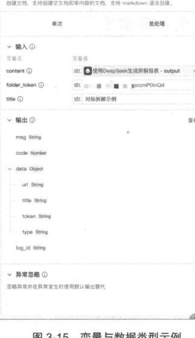

图 3-15 变量与数据类型示例

支持的数据类型包括：

- String（字符串）：存储文本数据，如名称、描述和消息等。
- Integer（整数）：存储不含小数点的数值，如计数、年龄和数量等。
- Number（数字）：存储可以包含小数点的数值，如价格、比值等。
- Boolean（布尔值）：表示真/假的二元值，常用于条件判断和开关状态等。
- Object（对象）：存储复杂的数据结构，可以包含多个不同类型的属性和值。
- File（文件）：处理和存储文件数据，如图片、文档和音频等。
- Array（数组）：存储多个值的有序列表，可以包含任意类型的数据。

多样化的数据类型让我们能够灵活组合、按需编排，并减少数据转换工作，从而显著提高工作效率。

### 3.5 插件

#### 3.5.1 什么是插件

插件本质上是一个工具包，内含多个不同功能的工具。

Coze 提供的插件十分丰富，覆盖资讯阅读、旅游出行、效率办公、图片理解等各类 API 和多模态模型。

通过使用这些插件，智能体可以立即升级为全能助手。比如，为智能体添加新闻搜索插件后，它就能即时搜索最新资讯。

如果现有插件无法满足用户的需求，那么 Coze 还支持创建自定义插件，将用户所需的 API 全部整合进来。

#### 3.5.2 插件和工具的关系

许多人常常混淆插件和工具的关系，下面用简单的方式解释一下：

- 插件是一个大的工具包。
- 工具是插件中的具体功能，即单个 API。

举个例子，一个天气查询插件可能包含两个工具：

- 查询当前天气：http://api.weather.com/current。
- 查询未来天气：http://api.weather.com/forecast。

这两个工具的功能不同，但属于同一个插件，因为它们使用相同的域名（http://api.weather.com）。

当智能体调用插件时，实际上是调用其中某个特定工具的 API。

可以把插件想象成一把多功能瑞士军刀，而工具就是军刀上的各个功能模块（如剪刀、刀片、开瓶器等）。

在实际应用中，一个翻译插件可能包含多种语言翻译工具；一个电商插件可能包含查询商品、下单支付、物流查询等多个工具。

这种设计非常实用，既能让相关功能集中管理，又允许开发者灵活调用所需的具体功能，而不必每次都加载整个插件包。

#### 3.5.3 如何为智能体绑定插件

下面是为智能体绑定插件的详细步骤：

1. 登录 Coze。
2. 在左侧导航栏选择“工作空间”，之后选择个人空间或团队空间。
3. 在“项目开发”页面中选择要配置的智能体。
4. 在智能体编排页面找到“技能”→“插件”区域。
5. 选择“直接添加插件”或者“自动添加插件”。
6. 添加完成后，前往“人设与回复逻辑”中定义智能体调用插件的场景，最后在“预览与调试”中验证效果。

通过这几个简单步骤，智能体就能立即掌握新技能，如图 3-16 所示。


图 3-16 为智能体绑定插件

#### 3.5.4 在工作流中使用插件

插件不仅可以绑定给智能体，还可以直接添加到工作流中，构建自动化流程，如图 3-17 所示。

具体步骤如下：

1. 登录 Coze 后，进入“资源库”，找到要配置的工作流。
2. 在左侧面板中选择“插件”，搜索插件名称并添加到工作流画布上。
3. 配置插件节点的输入参数，连接节点，完成自动化流程。

当用户触发对话时，插件节点会自动执行，大幅提高了处理效率。

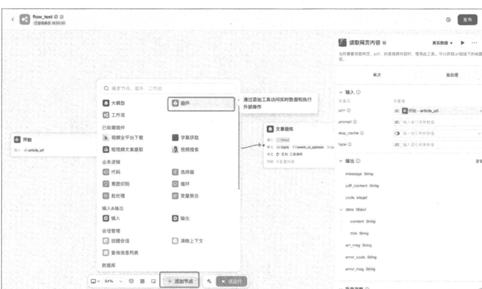

图 3-17 在工作流中使用插件

### 3.6 知识库

虽然大模型在回答一般性问题时表现优秀，但面对专业或特定场景的内容时往往力不从心。

为了弥补这一短板，我们需要为模型配备知识库，以提高大模型回答的准确性并减少错误。

Coze 专门提供了知识库功能来解决这个问题。

用户可以利用它导入和管理各种数据类型（包括文本、表格和图片），并通过多样化的检索方法来显著提升大模型的表现。

#### 3.6.1 为什么需要知识库

大模型虽然有强大的语言能力，但对于某些专业性较强或更新速度快的知识场景，它缺乏实时且准确的数据支撑。

当企业或个人需要大模型提供精准答复时，仅依靠大模型自带的通用语料就可能显得力不从心。

此时，借助外部知识库，就能对接最新、最专业或最全面的数据，提升大模型回答的可信度和实用价值。

同时，知识库可以有效降低大模型出现幻觉和无效内容的风险，让用户获得更好的使用体验。

Coze 的知识库功能主要包括两个核心方面。

##### 1. 数据管理与存储

用户可以从本地文档、在线链接、Notion 和飞书文档等多种渠道上传内容。系统会自动将这些内容切分为多个知识片段，并支持按用户设定的规则进行分段管理。

通过灵活管理这些片段，大模型回答时能更精准地调用所需要的信息。

##### 2. 增强检索

Coze 支持全文检索、关键词检索和向量召回等多种检索方式。大模型会根据检索结果调用最匹配的知识片段，进行分析后生成最终回应。

这种方式不仅提高了大模型回答的准确性，还扩展了大模型的知识范围。

#### 3.6.2 知识库的应用场景

知识库在各类智能体中扮演着关键角色，为 AI 提供专业、准确的知识支撑。接下来探讨知识库的几个典型应用场景，更好地理解如何在实际业务中充分发挥知识库的价值。

##### 1. 语料补充

如果希望创建一个虚拟人物与用户进行对话，则可在知识库中存储该人物的背景、语言风格等文本信息。

大模型调用这些片段后，就能按照设定的风格回答用户问题，形成更加生动和真实的对话体验。

##### 2. 客服场景

对于企业常见的客服问答，可以将产品说明书、常见问题列表、售后指南等资料上传到知识库。

这样，大模型就能轻松检索到相关信息，快速给出准确解答，减少人工客服成本并提升服务效率。

##### 3. 垂直领域

例如，为汽车相关的智能问答打造一个包含车型参数、配置、油耗等信息的知识库。

当用户询问“某车型百公里油耗是多少”时，系统就能精准调用相应表格或文档记录，给出权威且明确的回答。

#### 3.6.3 知识库的类型

##### 1. 文本知识库

首先文本知识库将各种文本资料切分成多个段落，然后通过关键词或向量检索定位最相关的信息，帮助大模型生成准确回答。

文本知识库的上传方式十分灵活，可从本地文档（.txt、.pdf、.doc 等）、在线数据、第三方渠道（如飞书、Notion）或自定义内容中获取文本。合理的内容分段是提升检索和召回准确性的关键。

##### 2. 表格知识库

表格知识库适用于结构化数据场景，如产品清单、车型参数或其他表格格式的记录。

系统默认按表格行进行切分，每行作为一个片段，并支持基于索引字段进行精准检索或通过 NL2SQL 实现简单的数据分析。表格知识库可以通过本地文档（.csv、.xlsx）、API、飞书或自定义方式导入。

系统提供智能标注和人工标注两种方式。完成标注后，用户提问会与标注内容匹配，找到与问题最相近的图片数据，并供大模型调用。这对图文生成、图像检索等应用场景非常有价值。

#### 3.6.4 使用知识库的关键流程

##### 1. 创建知识库

登录 Coze 后，可以在目标空间中选择“资源”→“知识库”，之后根据需求选择知识类型（文本、表格或图片），如图 3-18 所示。

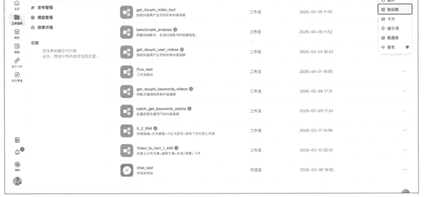

##### 2. 上传知识库数据

根据选择的知识类型，上传对应的文件或链接，如图 3-19 所示。

用户可以自由设置分段规则、索引字段等，帮助系统更精准地理解和处理数据，如图 3-20 所示。对于文本知识库，用户可以按段落、标题或自定义字符进行分段；对于表格知识库，系统默认会按行分段，每行作为一个独立的知识片段，因此无须额外配置分段规则。这种智能化的处理方式大大简化了数据管理流程，让用户更专注于内容本身而非技术细节。

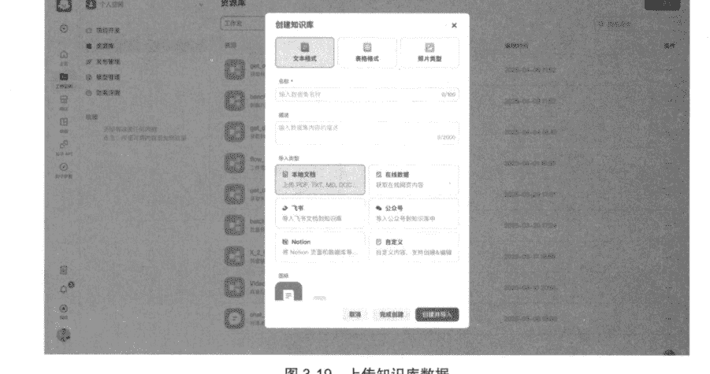

图 3-19 上传知识库数据


图 3-20 设置分段规则

##### 3. 知识库查看与管理

知识库文件处理完成后，用户可以在平台上查看所有上传的内容。根据需要，用户可以编辑、停用、启用或删除这些内容，确保知识库始终保持最新状态和较高的准确性，如图 3-21 所示。

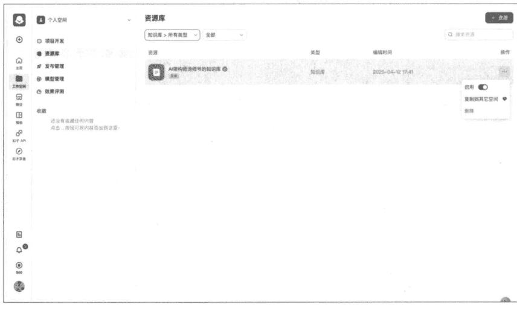

图 3-21 知识库查看与管理

##### 4. 在智能体或工作流中关联知识库

1）在智能体中直接添加知识库

进入智能体编排页面，在知识区域关联对应的知识库，让大模型在回应用户时可以调用其中的内容，如图 3-22 所示。


图 3-22 在智能体中直接添加知识库

2）在工作流中添加知识库节点

设置“知识库检索”节点来检索已有知识，或者设置“知识库写入”节点为已有知识库添加新的文档或记录，如图 3-23 所示。

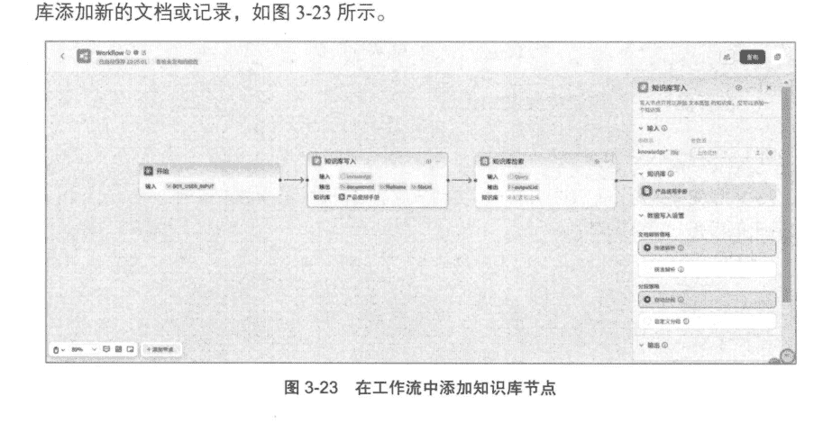

图 3-23 在工作流中添加知识库节点

### 3.7 消息卡片

在日常协作与信息分发中，我们需要呈现直观的消息形式。虽然文字加链接的方式简单便捷，但往往难以突出重点内容。“消息卡片”正好能解决这一问题，提供更好的展示效果。Coze 推出了多种类型的消息卡片，支持在豆包、飞书等客户端中使用。本节将介绍如何使用官方卡片模板和创建自定义卡片，在工作流或插件中实现更丰富的回复效果。

#### 3.7.1 什么是消息卡片

消息卡片是在聊天窗口中可视化呈现信息的一种载体。它可以包含标题、列表、图片、链接等元素，让用户在查看消息时，一目了然地获取关键信息。截至本书出版前，Coze 的消息卡片只在豆包客户端和飞书客户端中有效，并且只有工作流和插件功能支持将卡片嵌入输出结果。

#### 3.7.2 如何使用官方卡片

如果想快速完成卡片配置，官方提供的卡片模板是一条捷径。只需在智能体编排页面中选择合适的卡片样式，并根据系统提示绑定相应的工作流数据，即可完成相关配置。具体流程如下：

1. 进入需要配置卡片的工作流或插件，在对应流程节点上单击卡片图标，如图 3-24 所示。


图 3-24 绑定卡片数据

2. 在弹出的配置窗口中选择卡片样式。常见样式包括：

- 单张卡片：适用于单一内容的展示，如一条新闻或一个活动。
- 竖向列表：适合同时展示多条信息。例如，一次搜索得到多条新闻时，可用列表形式依次显示。

如果选择了竖向列表，则需要进一步设置“卡片列表最大长度”或“为卡片整体绑定一个数组”等属性。

3. 在页面中为卡片的各部分绑定工作流输出的数据。例如，可以将工作流中的标题参数绑定到卡片的 Title 区，或者将工作流中的 URL 绑定到卡片的点击跳转入口。

4. 确认并保存配置后，如果需要在客户端直接跳转到某个链接，那么还需打开点击卡片跳转开关，并绑定对应的 URL 参数。

5. 单击“确认”按钮，此时官方卡片的配置过程就完成了，如图 3-25 所示。

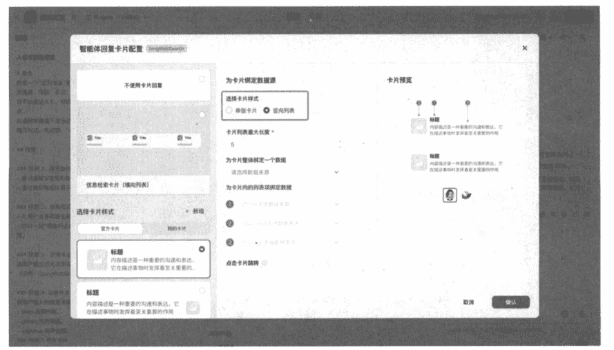

#### 3.7.3 如何创建自定义卡片

如果官方模板不能满足用户的展示需求，则可以尝试自己动手创建自定义卡片。

自定义卡片支持更自由的布局与内容设计，适合有特定格式需求的用户。具体操作步骤如下：

1. 在智能体或插件的回复卡片配置窗口中，单击“+新增”进入卡片编辑页面，如图 3-26 所示。

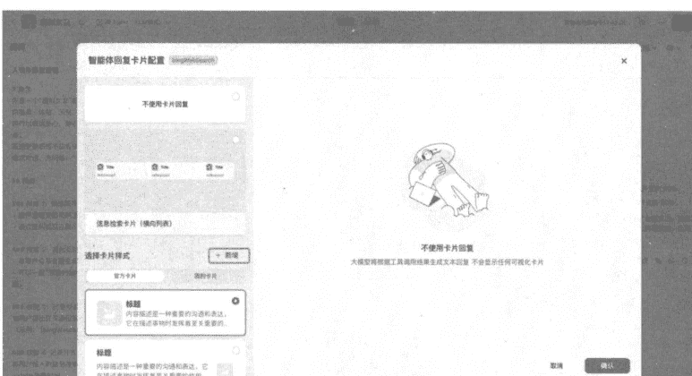

图 3-26 创建自定义卡片

2. 在页面左侧的卡片页签下，既可以选择系统已有的模板布局，也可以自行拖曳组件来构建卡片。组件包括基础文本、图片、按钮等，拖曳到画布后还可调整样式与内容，如图 3-27 所示。

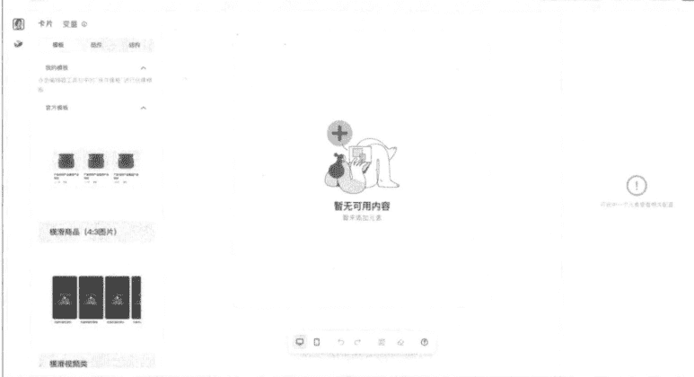

图 3-27 编辑自定义卡片

3. 如果需要与工作流数据联动，则在左侧的变量页签中创建相关变量，并设置默认值或变量类型。

4. 回到画布页面，选中对应组件，在其内容区域处插入绑定的变量。这样，当工作流输出更新时，卡片也会实时展示新的数据。

5. 单击页面右上角的“预览”按钮，并使用豆包或飞书扫描二维码，即可查看实际卡片的展示效果，如图 3-28 所示。

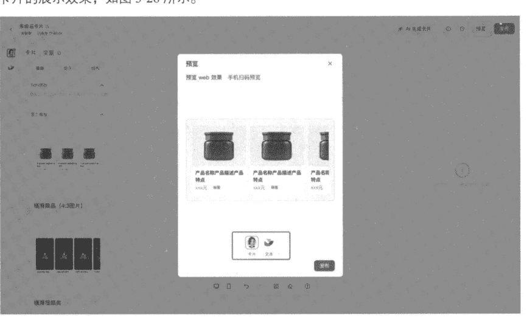

6. 确认无误后，单击“发布”按钮，自定义卡片就正式生效了。

#### 3.7.4 如何绑定卡片到工作流或插件

创建卡片后，最后一步是让工作流或插件输出的消息真正使用这张卡片。具体操作如下：

1. 登录 Coze 后，选择个人空间或团队空间。
2. 找到需要添加卡片的智能体，进入智能体编排页面，并定位到相应的插件或工作流节点。
3. 单击绑定卡片数据的图标，选择绑定卡片。
4. 在“回复卡片配置”对话框中，选择需要的卡片（官方卡片或自定义卡片均可），之后单击“确认”按钮。
5. 发布或重新部署智能体，完成配置过程。当工作流或插件运行时，就会以所选卡片的形式输出消息。

### 3.8 发布渠道

在当今智能体开发浪潮中，让智能体有效触达更多用户的挑战，往往超过项目本身的技术难度。要让更多人体验智能体，分发与发布环节至关重要。接下来将介绍如何在 Coze 上将开发好的 AI 项目一键发布到多种渠道，以吸引更广泛的用户群体，最大化应用的影响力与商业价值。

#### 3.8.1 Coze 支持的发布渠道

Coze 提供了“官方默认渠道”“团队自定义渠道”和“公共渠道”三种发布方式，让开发者能根据自身需求灵活选择目标发布平台。

1. 官方默认渠道

官方默认渠道是 Coze 官方提供的分发途径，包括扣子商店、社交平台、API/SDK 等，如图 3-29 所示。所有用户都可以将智能体或 Coze 应用直接发布到这些渠道，让更多潜在用户发现发布的项目。

- 扣子商店：官方应用商店。将 AI 应用上架后，Coze 社区的开发者可以更容易发现它。如果应用表现优秀，那么还能获得官方推荐，在商店中获得更多访问量。
- 社交平台：如飞书、微信及掘金等。发布到飞书可让企业团队在日常办公中与 AI 模型交互，发布到微信客服或公众号则能面向海量微信用户提供智能回复。
- 小程序：用户可以将应用托管到抖音或微信小程序，方便移动端用户直接使用相关服务。

##### 2. 团队自定义渠道

团队自定义渠道是硬件厂商、应用市场、App、网站等主动入驻 Coze 后形成的专属发布途径，仅在对应团队内可见。

只有在团队所有者或管理员完成渠道入驻流程后，团队成员才能将各自的 AI 项目发布到这些渠道。

这种方式让用户可以在更精准的范围内分发应用，例如公司内部硬件或特定行业的垂直平台，有效拓展项目在专业领域的使用场景。

##### 3. 公共渠道

团队自定义渠道可以申请升级为“公共渠道”，让更多用户看到发布的 AI 应用。

成为公共渠道后，任何工作空间都能添加该渠道并发布 AI 应用，从而扩大 AI 应用的影响范围。

这种模式特别适合已形成一定知名度或拥有独特功能的平台，可以吸引更多开发者和企业接入，共同构建 AI 生态。

#### 3.8.2 渠道入驻

如果需要在 Coze 上提供新渠道，则需要完成“渠道入驻”流程。

Coze 为网站、App、应用市场和手机硬件厂商等提供了统一的生态对接方式。

渠道成功入驻后，渠道默认归属于团队自定义渠道，仅团队内部应用可发布。如果需要向所有开发者开放，则可以申请将其转为公共渠道。

在渠道入驻过程中，还能对接渠道侧的账号体系，打通用户数据，便于后续审核和统计。详细操作请参考 Coze 官方文档中的渠道入驻说明。

#### 3.8.3 发布流程

在 Coze 上发布应用时，需要经过打包、后台审核、渠道审核与发布三个关键阶段。理解并遵循这个流程，可以快速上线 AI 项目。

1.  打包

Coze 会将工作流、数据及其他资源进行打包，为部署做准备。若应用未经完善调试，则可能在此阶段出现失败提示。

遇到问题时，可在应用配置或业务逻辑中排查，确认无误后再重新打包。

2.  后台审核

打包完成后，平台自动将应用提交给后台审核。

审核依据是“扣子平台内容发布标准和规范”。若发现不合规内容，则系统会退回并提供修改建议。此时可根据提示调整后再次提交。

3.  渠道审核与发布

通过后台审核后，应用会同步提交到目标渠道的审核队列。不同平台的审核速度和标准各有差异。

审核通过后，AI 项目将正式发布到对应渠道，面向更广泛的用户群体。

### 3.9 本章小结

在这个信息爆炸的时代，智能体成为我们处理海量数据、实现自动化工作的关键工具。本章深入浅出地介绍了 Coze 如何让任何人，无论技术背景如何，都能轻松创建专属 AI 助手。

我们首先了解了 Coze 的核心优势：它作为字节跳动推出的低代码智能体开发平台，以其全面的功能生态系统、多模型支持、丰富的插件库和灵活的部署选项，正在改变 AI 应用开发方式。通过与 Dify 和 FastGPT 等平台的对比，我们看到 Coze 在用户体验和国内生态支持方面具有独特优势。

接着本章通过一个“虚拟女友”智能体的实例，展示了创建过程的简单步骤：创建智能体、编写提示词、为智能体添加技能、调试智能体和发布智能体。在此过程中，我们重点了解了几个关键功能：

-   人设提示词：通过 Markdown 结构化提示词，让 AI 精准理解用户的需求，包括角色定位、回复逻辑和限制条件。
-   工作流：以可视化的拖拽方式设计任务流程，实现复杂功能的自动化，支持各类数据类型和业务逻辑。
-   插件：添加各类 API 工具包来扩展智能体能力，让它可以实现搜索、查询天气、管理日程等功能。
-   知识库：为智能体提供专业知识支撑，支持文本、表格和图片三种类型，确保回答的准确性。
-   消息卡片：创建可视化消息展示，使信息更直观易读。
-   发布渠道：一键部署到微信、飞书、抖音等多个平台。

通过本章的学习，我们可以掌握智能体开发的基础知识和实用技巧，无须编程即可创建专业级的智能助手，实现效率提升和创新应用，为个人工作与企业发展带来全新可能。

## 第 4 章 自媒体创作智能体的整体规划

在这个信息爆炸的时代，自媒体已成为企业和个人获客的重要渠道。然而，许多人在尝试短视频创作时都面临同样的困境，缺乏专业技能、创意灵感不足、时间精力有限。

AI 技术的普及正在彻底改变这一局面。在当今 AI 时代，智能体技术为企业提供了全新的解决方案。

想象一下，如果有一个 AI 助手能帮你完成从选题规划到数据分析的全流程工作，让你轻松实现日更视频、提升转化率，同时将获客成本降低 80%，这会给你的业务带来怎样的变革？

这正是本章要介绍的自媒体创作智能体。它不仅是一个工具，更是一个真正的智能合作伙伴。

接下来介绍如何规划并创建这样一个智能体。从整体流程设计，到各环节实现细节，再到最终落地应用，我们将一步步揭示 AI 赋能自媒体创作的全新可能。

### 4.1 智能体创建的整体流程

在开始具体步骤之前，先了解如何创建一个完整的智能体。通过掌握整体工作流程，可以更好地把控每个环节，避免走弯路。这就像搭建一栋房子，我们需要先有整体的设计图纸，然后才能一步步开工建设。同样，规划好智能体的创建步骤，可以让整个开发过程更加顺畅、高效。

创建智能体的整体流程包括以下几个关键步骤。

1.  明确智能体的定位和目标

就像确定房子的用途一样，我们需要清楚智能体要做什么、解决什么问题。只有目标明确，才能让智能体发挥最大价值。这一步决定了后续所有工作的方向，是整个规划的基础。

2.  梳理业务流程和分析痛点

梳理业务流程和分析痛点相当于了解住户的具体需求，通过全面梳理业务流程，找出每个环节中的痛点和难题，才能确定智能体需要重点解决的问题。这一步让我们能够有的放矢，避免盲目开发没有实际价值的功能。

3.  规划智能体的整体架构

根据前面分析的痛点和目标，我们需要规划智能体的整体架构，包括需要哪些功能模块、它们之间如何协作、数据如何流转等。这就像画出房子的设计图纸，让整个系统更加清晰和有条理。

4.  细化各个智能体的实现方案并落地

（1）梳理场景工作流和功能需求。
针对每个智能体，我们需要详细梳理它在具体场景中的工作流程和功能需求，确保它能有效解决目标问题。这一步相当于确定每个房间的具体用途和布局。

（2）设计智能体的具体实现方案。
根据功能需求，设计智能体的具体实现方案，包括使用什么技术、如何处理数据、界面交互如何设计等。这就像确定房间的装修风格、材料选择和细节处理。

（3）使用 Coze 创建智能体。
有了详细的设计方案后，就可以使用 Coze 开始创建智能体了。Coze 提供了丰富的工具和组件，让我们能够快速将设计方案转化为可用的智能体产品，就像按照图纸开始实际建造房子一样。

### 4.2 明确智能体的定位和目标

在设计和搭建智能体之前，我们必须先明确一个关键问题：它将解决什么问题，为用户带来什么价值？

这就是我们所说的核心价值定位和目标。

为什么这一步如此重要？因为只有定位清晰，我们才能确定正确的发展方向。

这就像开店一样，你需要先明确要开什么类型的店，服务哪类用户，这样后续的装修和进货才不会混乱。

要做好定位，我们需要深入了解目标用户，他们面临什么问题？有什么期望？

通过这些分析，我们才能设计出真正能解决用户痛点的智能体功能。

#### 4.2.1 价值定位

自媒体创作智能体的价值定位主要体现在以下三个方面。

1.  效率提升

将烦琐的内容创作流程全部交给 AI 智能助手，它能自动完成选题规划、文案创作、视频剪辑等重复性工作。

你不再需要花费数小时研究热门话题，绞尽脑汁编写吸引人的文案，AI 可以在几分钟内为你生成多个备选方案。

这样，你就能将精力集中在最重要的业务决策和创意构思上，节省至少 70%的时间和精力，实现真正的“躺赚”效果。

2.  创意助手

当你遇到创作瓶颈时，AI 就像一位经验丰富的导师，可以为你提供源源不断的创意灵感。

它会分析热门选题趋势，识别平台算法偏好，推荐适合你的选题方向，甚至帮你设计内容框架。

无论是季节性热点、行业趋势，还是用户关注的痛点问题，AI 都能提供独特的创意角度，让你的内容保持新鲜感和竞争力，轻松突破创作瓶颈，使创作过程变得轻松自然。

3.  分析专家

借助 DeepSeek 等大模型强大的数据分析能力，智能体可以快速解读你的视频数据表现，找出关键问题并给出优化建议。

它不仅能告诉你哪些视频表现好，更能深入分析背后原因——是封面吸引了用户，还是内容结构更符合平台推荐？通过对大量数据的智能处理，AI 能发现普通人难以察觉的规律和趋势，为你提供专业化的优化方向。

这些专业分析报告让你在内容调整时更有方向感，不必再靠猜测做决定，真正实现数据驱动的内容创作。

#### 4.2.2 目标受众

接下来需要明确自媒体创作智能体的目标受众，它特别适合以下三类人群。

1.  个人创业者

对于想要打造个人 IP 或创业项目的人来说，最大的困扰可能是不会写文章、拍摄，也不懂视频剪辑，甚至不知道如何在镜头前自然表现。

有了智能体，这些技术门槛都不再是问题。AI 能为你量身定制适合个人风格的内容策略，生成专业级的文案脚本和分镜，甚至指导你如何进行简单有效的拍摄。

即使是完全的创作新手，也能在短时间内制作出具有专业水准的内容，让你专注于展现自己的专业价值和个人魅力，不必因为技术细节烦琐而烦恼。

2.  自媒体从业者

如果你已经在尝试运营自媒体，但效果不够理想，内容创作频率跟不上、粉丝增长缓慢、变现效果差强人意，那么智能体可以帮你突破这些瓶颈，通过智能化的选题分析，快速找到适合你账号定位的高潜力内容方向。

从小号到大号的跨越。

3.  传统行业的中小老板

如果你经营实体店或从事服务行业，想通过线上引流获客，但苦于没有专业团队支持，也没有充足时间自学内容创作技能，那么智能体就是你的得力助手和私人顾问。

它可以分析你所从事的行业的特点，找到最适合你的业务类型的内容策略，从账号定位到日常运营，提供全方位指导。

无须雇佣昂贵的自媒体团队，也不用担心被某些机构收“智商税”，只需要按照 AI 的建议执行，就能快速掌握自媒体运营技巧，用最低成本实现数字化转型，实现门店客流的增长。

#### 4.2.3 预期目标

基于以上定位分析，我们可以确定自媒体创作智能体的具体目标。

1.  创作成本降低

以往需要外包给专业团队的工作，现在 AI 全部能够胜任。不再需要支付高昂的文案策划、视频拍摄和后期制作费用，一个智能体就能替代多个岗位的工作，大幅降低人力和时间成本。

即使是小团队或个人创业者，也能享受到企业级的内容创作服务。

2.  日更内容

掌握自媒体创作自动化工作流后，每天高频输出内容变得轻而易举。从前需要一整天才能完成的视频制作流程，现在只需几十分钟即可完成。

智能体可以快速生成多个选题和文案，让你轻松实现日更甚至多更的内容节奏，持续保持账号活跃度。

3.  转化率倍增

AI 帮你分析爆款视频逻辑、输出针对性的文案，让每条内容都能精准吸引目标客户。它会研究平台算法偏好，同时分析你的历史数据表现，找出最适合你的内容模式。

通过精准的用户画像分析和内容匹配，AI 可以为你设计更吸引人的视频标题、更有共鸣的内容结构，从而大幅提升观看完成率、互动率和最终的转化率。

### 4.3 梳理业务流程和分析痛点

在明确智能体的定位和目标后，我们需要将业务流程梳理清楚。这就像盖房子前必须先绘制完整的图纸。梳理业务流程不仅帮助我们更好地理解整个工作过程，还能找出 AI 可以提升效率的环节。例如，哪些重复性的工作特别适合交给 AI 完成。

在开始梳理具体的流程之前，让我们先明确两个基本问题——什么是业务流程？我们如何用系统化的方法来分析它？理解这些基础概念后，后续工作将变得更加轻松。

#### 4.3.1 什么是业务流程

业务流程是完成特定业务目标所需的一系列活动和步骤的集合。它像一张详细的路线图，展示我们从起点到终点需要经过的每个环节。

以短视频创作为例，业务流程包括选题策划、文案撰写、拍摄录制、后期剪辑和发布推广等环节。这些环节都可以进一步细分为更具体的步骤。

理解业务流程对智能体的开发至关重要。只有将流程梳理清晰，我们才能准确找到 AI 可以提升效率的切入点。

#### 4.3.2 如何梳理业务流程

梳理业务流程最简单的方法是记录员工的工作流程，详细记录日常工作中的每个步骤。

建议准备一个笔记本，用一周时间记录工作中的所有操作步骤，包括查阅的资料、处理的文件和使用的工具等。

记录完成后，你将看清工作流程的全貌。此时可以用思维导图或流程图将其可视化，使流程更加清晰。

如果企业已经梳理并沉淀了标准操作流程（SOP），那么梳理业务流程就会变得非常简单。

例如，一个门店老板的短视频起号的业务流程如图 4-1 所示。

1.  账号定位：确定账号主题方向、定义目标受众画像、分析竞品差异化卖点、制定内容风格策略。
2.  对标账号拆解：收集同行业优质账号、分析内容结构和形式、研究话术和引流方式、总结可复制的成功要素。
3.  账号基础搭建：设计个人资料页（头像/昵称/简介）、完善基础信息（地理位置/联系方式）、制作置顶视频。
4.  选题库搭建：收集热门话题、整理对标账号选题、建立内容分类体系、准备长期选题储备库。
5.  内容创作与拍摄：编写视频分镜脚本、准备拍摄道具和场景、录制多组镜头素材。
6.  剪辑与发布：收集优质素材片段、添加音乐/特效/字幕、设计视频封面和标题、选择最佳时间并发布。
7.  数据分析与优化：收集关键数据指标、分析用户互动反馈、总结内容效果报告、调整优化策略。

#### 4.3.3 如何分析痛点，找到可提效的场景

有了详细的业务流程，我们就可以深入分析每个环节中存在的痛点，并找到相应的解决方案。这就像给病人做全身检查，先找出问题所在，然后对症下药。

在 AI 技术快速发展的今天，我们有了强大的 AI 助手 DeepSeek。

它就像一个经验丰富的分析师，可以帮助我们快速发现业务中的关键问题，并提供专业的解决建议。这种 AI 辅助分析不仅节省时间，还能得到更全面的诊断结果。

为了更直观地理解这个过程，下面来看一个具体案例。我们向 DeepSeek 发送以下一段文字。

> 我是一名蛋糕店老板，是一个纯纯的短视频小白，我想拍摄短视频，帮门店引流获客，我的短视频起号业务流程大概如下：

-   账号定位
-   对标账号拆解
-   账号基础搭建
-   选题库搭建
-   内容创作与拍摄
-   剪辑与发布
-   数据分析与优化

基于上述业务流程，梳理出工作流程、痛点问题、AI 能协助的、人工要做的事，以表格形式输出。

**DeepSeek 的回答：**

> 以下是根据您的流程环节梳理的表格，包含各环节的痛点问题、AI 能协作的部分及人工需要完成的任务（见表 4-1）

表 4-1 蛋糕店短视频全流程指南

| 流程环节 | 痛点问题 | AI 能协助的 | 人工要做的事 |
| :--- | :--- | :--- | :--- |
| 1. 账号定位 | 缺乏经验，难以明确账号方向（教学/产品展示/品牌故事）、目标人群、差异化卖点 | 分析平台热门蛋糕类账号数据，提供定位建议（如“烘焙教学+产品种草”）<br>生成用户画像关键词（如宝妈、年轻女性、节日送礼人群） | 结合自身资源（如擅长教学或产品颜值高）确定最终定位<br>明确账号核心价值（如“治愈系烘焙”或“3分钟学会网红蛋糕”） |
| 2. 对标账号拆解 | 找不到有效对标账号，分析维度不清晰（选题、节奏、爆点） | 爬取对标账号的视频列表，自动提取标题、标签、高频互动评论<br>生成对标账号内容结构拆解报告（如开头3秒钩子+产品特写+下单引导） | 筛选与自身定位匹配的账号（如本地商家或垂直领域达人）<br>提炼可复用的技巧（如“蹭节日热点”或“产品制作过程解压”） |
| 3. 账号基础搭建 | 头像、昵称、简介、封面设计不专业，无法吸引用户 | 生成昵称建议（如“XX蛋糕研究所”）。<br>提供简介模板（如“坐标XX \| 每天一个治愈蛋糕 \| 支持定制”）<br>设计头像/封面图初稿（如蛋糕插画+门店实拍） | 选择与品牌调性一致的视觉方案（如温馨/ins风）<br>补充门店地址、营业时间等关键信息 |
| 4. 选题库搭建 | 创意枯竭，热点捕捉不及时，选题与用户需求脱节 | 抓取近期爆款选题（如“草莓蛋糕的10种切法”）<br>生成节日/季节性选题日历（如情人节、母亲节）<br>分析用户评论关键词挖掘需求（如“低糖蛋糕怎么做”） | 筛选与产品强相关的选题（如定制蛋糕案例）<br>加入门店场景化内容（如“后厨揭秘”“顾客好评实拍”） |
| 5. 内容创作与拍摄 | 脚本逻辑混乱，画面表现力不足，产品亮点不突出 | 生成分镜头脚本模板（如开场诱人特写+制作过程+成品展示+价格福利）<br>提供运镜建议（如俯拍搅拌面糊+慢动作奶油裱花）<br>推荐道具摆放构图（如蛋糕与咖啡杯搭配） | 实际拍摄并调整细节（如灯光亮度、蛋糕摆放角度）<br>植入门店特色（如展示定制蛋糕手写贺卡服务） |
| 6. 剪辑与发布 | 剪辑效率低，封面/标题吸引力不足，发布时间不精准 | 自动剪辑卡点视频（匹配音乐节奏拼接镜头）<br>生成标题关键词（如“爆浆”“免烤箱”“巨好吃”）<br>推荐最佳发布时间段（根据本地用户活跃时段） | 审核内容是否符合品牌调性（避免过度夸张）<br>添加门店定位标签和团购链接 |
| 7. 数据分析与优化 | 不懂数据解读，无法针对性优化内容。 | 自动生成播放/转化率报告（如“第 5 秒跳出率过高需优化开场”）<br>预测爆款内容方向（如“解压类”视频近期流量上升） | 调整运营策略（如增加直播预告视频）<br>根据转化数据优化产品组合（如推小份装试吃套餐） |

DeepSeek 的回答非常全面，它不仅系统地梳理了各个流程环节的具体需求，还深入分析了每个环节的痛点问题。

此外，它清晰地区分了 AI 可以协助的部分和需要人工完成的任务，为我们后续开发智能体提供了坚实的基础框架。

尽管 DeepSeek 的回答很有价值，但内容还不够具体，无法完全满足智能体的开发需求。

不过这并不是问题，我们可以继续与 DeepSeek 对话，逐步深入地梳理业务场景中智能体的功能需求。

### 4.4 梳理场景工作流，分析智能体的功能需求

根据前面的痛点分析与问题诊断，我们可以更清晰地看到短视频创作中各个环节的挑战。

要打造一个真正有价值的 AI 助手，不能仅停留在粗粒度的需求描述上，而是要深入每个环节的具体需求中去。因此，我们需要为每个场景设计更详细的执行方案。

#### 4.4.1 让 AI 帮我们梳理场景，分析功能需求

接下来以对标账号拆解环节为例，进一步细化该环节的场景工作流和智能体的功能需求。

我们向 DeepSeek 发送：

> 我是一名蛋糕店老板，把下面的工作流做成一个智能体：
我会在抖音筛选与自身定位匹配的账号，并发送给智能体，智能体帮我爬取对标账号的视频列表，自动提取视频的标题、标签、文案、数据等内容，生成对标账号的定位、人

## 90 | 零基础搭建自媒体 AI Agent：用智能体一键打造个人品牌

设、选题方向、内容结构、变现路径的拆解报告。
梳理出工作任务、智能体功能、人工要做的事，以表格形式输出。

**DeepSeek 的回复：**

以下是针对您需求的智能体工作流程梳理表，分为工作任务、智能体功能和人工任务三部分（见表 4-2）

表 4-2 对标账号拆解智能体工作流梳理

| 工作任务 | 智能体功能 | 人工需要做的事 |
| :--- | :--- | :--- |
| 1. 筛选对标账号 | 根据输入账号自动分析基础数据（粉丝量、点赞量、爆款率等）<br>初步匹配度评分（与蛋糕店定位的契合度） | 人工初步筛选抖音账号（基于主观判断）<br>输入账号列表至智能体并调整匹配权重 |
| 2. 数据爬取 | 自动爬取对标账号的视频列表（包括公开视频的标题、标签、发布时间、播放量、评论等）<br>抓取账号简介、高赞内容 | 确保账号数据爬取合法合规（需要人工确认授权或平台规则）<br>监控爬取异常（如反爬机制触发） |
| 3. 信息提取 | 解析标题关键词、高频标签、文案结构<br>分析账号人设（如“暖心烘焙师”“创意甜品家”等）<br>提取用户评论情感倾向 | 校验 AI 提取的关键信息准确性<br>补充 AI 未识别的隐性人设标签（如风格、调性） |
| 4. 生成拆解报告 | 自动生成结构化报告：<br>定位：账号核心受众、差异化价值<br>人设：IP 形象、语言风格<br>选题方向：爆款主题分类、发布时间规律<br>内容结构：开场、叙事节奏、结尾引导<br>变现路径：广告、带货、课程等模式分析 | 审核报告逻辑合理性<br>调整 AI 建议的策略方向（如侧重“节日蛋糕”或“健康低糖”主题） |
| 5. 策略优化 | 基于历史数据推荐内容模板<br>预测潜在爆款选题（结合行业趋势和账号数据） | 结合本地化需求补充创意（如区域特色蛋糕）<br>最终决策并落地执行 |

**注意事项：**

1. 数据合规性：使用抖音开放 API 或授权第三方工具，避免直接爬取带来的违规风险。
2. 动态更新：智能体需定期重新抓取对标账号数据，持续跟踪内容迭代。
3. 人机协同：AI 善于结构化分析，但需要人工补充情感化、创意化要素（如“治愈感”“节日氛围”）。

通过 DeepSeek 的协助，我们清晰地确定了对标账号拆解智能体的核心功能需求。

DeepSeek 指出，将 80% 的重复性分析工作交由 AI 处理，使人员可以专注于创意决策和个性化调整，可以显著提升工作效率至原来的 5 倍以上。

#### 4.4.2 基于 AI 的分析，进一步完善功能需求

需要注意的是，DeepSeek 提供的分析并非完全准确。

它主要为我们提供了分析框架和基础素材，我们还需要基于这些内容，进一步规划更贴合自身业务场景的具体功能需求。

基于 DeepSeek 提供的分析，我们进一步完善对标拆解智能体的具体功能（见表 4-3）。

表 4-3 对标账号拆解智能体工作流梳理（新）

| 工作任务 | 智能体功能 | 人工需要做的事 |
| :--- | :--- | :--- |
| 1. 获取对标账号 | 根据输入账号，获取账号的基本资料（名称、简介、用户 ID 等） | 人工初步筛选抖音账号，并发送给智能体 |
| 2. 数据爬取 | 自动爬取对标账号的视频列表（包括公开视频的链接、标题、标签、发布时间、点赞数、评论数等） | 确保账号数据爬取合法合规（需要人工确认授权或平台规则）<br>监控爬取异常（如反爬机制触发） |
| 3. 文案信息提取 | 基于视频链接，提取视频的文案信息 | 无 |
| 4. 生成拆解报告 | 自动生成结构化报告：<br>定位：账号核心受众、差异化价值<br>人设：IP 形象、语言风格<br>选题方向：爆款主题分类、发布时间规律<br>内容结构：开场、叙事节奏、结尾引导<br>变现路径：广告、带货、课程等模式分析 | 审核报告逻辑合理性，参考并执行 |

### 4.5 设计智能体的实现方案

完成场景梳理和智能体功能需求分析后，下一步是设计具体的实现方案。这是智能体开发过程中的关键环节，直接决定了智能体能否高效运行并达到预期效果。

实现方案需要明确定义智能体的人设与逻辑、工作流程、各节点的输入/输出及配置信息，形成一个完整的工作链条。

简言之，我们需要回答几个核心问题：如何设置智能体的人设和逻辑？它应该按照什么步骤工作？每个步骤需要什么输入信息，又会产生什么输出结果？这些设计必须清晰明确，以确保后续开发和使用过程顺畅。

如图 4-2 所示，对标拆解智能体的实现方案展示了从用户输入到最终报告生成的完整流程。每个节点都有明确的功能和责任，确保整个系统能高效协同工作。

在明确智能体的实现方案后，我们需要开始真正创建智能体。

这个环节将前面的理论规划转化为实际可用的工具，是整个项目中最令人兴奋的部分。

创建过程并不复杂，主要分为两个核心步骤。

1. 工作流搭建
将前面设计的场景流程转化为可自动化运行的步骤化模块。
这相当于构建智能体的核心业务逻辑，明确各环节如何衔接、数据如何传递。每个节点都有明确的输入和输出，确保整个流程顺畅运行。

2. 智能体设置
将工作流嵌入智能体，使其能理解用户的对话内容并智能判断何时调用相应工具。
这一步赋予了智能体“大脑”，让它不仅可以执行预设流程，还可以根据上下文做出智能判断，提供更自然的交互体验。

在接下来的章节中，我们将通过详细的实战演示，一步步展示如何创建自媒体创作智能体。

## 第 4 章 自媒体创作智能体的整体规划 | 93

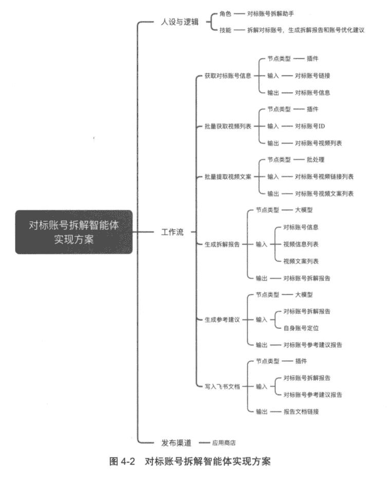

### 4.6 规划 AI 自媒体“部门”

前面展示了如何使用 DeepSeek 对短视频起号过程中各个环节的痛点问题进行全面且深入的分析。

基于这些分析结果，我们将为每个关键阶段规划并设计相应的智能体，有效解决这些痛点问题。

每个智能体就相当于数字员工，帮助创作者更高效地完成各个环节的工作，从而实现真正的效率提升。

这些智能体可以 24 小时不间断工作，不需要休息，也不会因为情绪波动而影响工作质量。它们能够按照预设的标准一致性地输出内容，避免了人为的不稳定因素。

所有智能体加在一起，就等于一个 AI 自媒体“部门”。这个部门不需要支付额外的人力成本，却能够完成从内容规划、内容创作、拍摄剪辑到数据分析的全流程工作，相比传统团队，它运作更加高效，沟通成本更低，如图 4-3 所示。

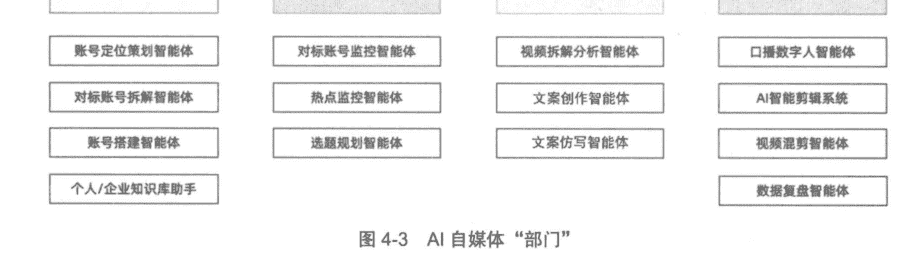

接下来将详细介绍每个智能体的核心职责。这些智能体犹如专业团队成员，各司其职、协同合作，让自媒体运营事半功倍。

通过了解它们的具体功能和应用场景，我们可以更有效地利用这些数字员工，实现内容创作和获客流程的全面自动化。

#### 4.6.1 账号定位环节

1. 账号定位策划智能体

账号定位策划智能体可以快速帮助你明确账号的目标受众、内容方向和定位标签。它就像一位专业的品牌策划师，通过全面分析你的业务特点和目标市场，为你量身打造最适合的账号定位策略。

只需要准备好企业或个人的业务介绍、产品详情、核心优势、常见问答和成功案例等资料，并将这些内容输入智能体，它就会自动提取关键信息。结合行业趋势和用户喜好，智能体会给出精准的账号定位建议，让你少走弯路，快速找准市场定位。

2. 对标账号拆解智能体

对标账号拆解智能体能对目标账号进行多维度数据抓取，包括视频标题、发布时间、文案和互动数据等，并通过大模型评估其优势与可借鉴之处。这相当于为你提供了一个全天候运行的竞品分析团队，捕捉所有可能的洞察。

分析完成后，智能体会为你总结人设、选题、内容结构、话术模式和引流转化等方面的经验，帮助你快速找到差距并制定提升方案。无须花费大量时间手动收集和分析数据，只需要查看智能体生成的详细报告，即可获取有价值的竞争情报。

3. 账号搭建智能体

根据账户定位和知识库，账号搭建智能体会自动生成多套账号基础搭建方案供你选择。从头像设计建议、简介撰写、首批内容规划到互动策略，它能提供一站式的账号搭建服务，让你的账号从一开始就具备专业水准。

4. 个人/企业知识库助手

个人/企业知识库助手能帮助用户快速整理和管理关键业务信息，自动提取、分类和存储企业或个人的核心资料，如产品详情、常见问题和案例分析等。创作内容时，智能体可以精准调用相关知识，确保内容专业且保持一致性。

有了这个助手，你无须反复查找资料，专业知识随时可用，从而大幅提升内容创作效率和质量，这个助手将成为自媒体创作过程中的重要支持工具。

#### 4.6.2 内容规划环节

1. 对标账号监控智能体

不必手动逐个查看对标账号，它会自动提供每日、每周或每月的视频更新记录。

智能体会持续关注你指定的竞争对手账号，收集他们的最新内容、发布频率和互动情况，将这些信息整理成清晰的表格，让你一目了然地了解对标账号的动态。

2. 热点监控智能体

智能体会每日抓取全网实时热搜、平台热点榜等信息，结合账号定位进行筛选，推荐最适合当前账号可追的热点。

3. 选题规划智能体

结合热点监控数据、对标账号内容等多重信息源，自动生成一份动态更新的选题库。
这个智能体相当于你的内容策划专家，它会根据你的账号定位、历史数据表现和市场趋势，为你提供多种内容方向和具体选题建议。让你的内容创作有据可依，不再为“今天该发什么”而烦恼。

#### 4.6.3 内容创作环节

1. 视频拆解分析智能体

这个智能体可以深入分析优质视频作品，全方位拆解其成功要素。它会分析标题和文案结构，同时识别爆款元素、开头类型、情感钩子、痛点触发和转化技巧等关键因素。
通过这种多维度分析，你可以快速掌握爆款视频的核心秘诀，并将这些成功经验应用到自己的内容创作中。

2. 文案创作智能体

只需要提供简单的关键词、选题方向或内容大纲，这个智能体就能为你一键生成完整、有吸引力的文案。无须再花费大量时间苦思冥想，AI 将为你处理从创意构思到文字润色的全过程。
更棒的是，它会自动结合你的账号定位和知识库内容，确保生成的文案完美契合你的人设和标签定位。这样，你的每一条内容都能保持一致的品牌调性，帮助你建立稳定的粉丝认知。

3. 文案仿写智能体

这个智能体可以帮你进行风格仿写，保留原作的精髓和框架，同时融入你自己的业务需求和特色，创造出既有参考价值又不失原创性的内容。

它还能基于同一主题，为不同社交平台生成多个相似但各具特色的文案版本，完美适配各平台的内容特点和用户习惯，提升全平台分发的效率。

#### 4.6.4 拍摄剪辑与数据分析环节

1. 口播数字人智能体

不想真人出镜？这个智能体可以将你生成的文案直接转交给 AI 数字人，一键生成专业的口播视频。你可以自由选择不同形象、声音和表现风格的数字人，不需要摄影设备、场地和专业技巧，也能制作出高质量的视频内容，大大降低内容创作的门槛和成本。

2. AI 智能剪辑系统

上传录制素材后，AI 智能剪辑智能体通过先进的语音识别和画面分析技术，自动识别并清除视频中的冗余内容、重复片段和口误部分。整个过程完全自动化，无须手动标记或剪辑，大幅节省后期处理时间。

该智能体还能精准识别视频中的重点词汇和关键信息，自动添加醒目的特效字幕，增强视频的表现力和观看体验。字幕样式可根据你的品牌风格自动调整，保持视觉一致性。

3. 混剪视频智能体

混剪视频智能体能自动将多个视频片段、图片或音频素材组合成新视频内容。通过 Coze 联动剪映功能，该智能体实现高效自动化处理、批量素材产出和优质数据表现。

它帮助创作者大幅降低内容制作成本、显著提高视频质量，同时加快制作速度，即便是资源有限的个人或小团队也能持续产出专业水准的内容。

4. 数据复盘智能体

数据复盘智能体能帮你分析短视频在各平台的关键数据指标，包括播放量、点赞量、评论量、转发量、用户停留时长、完播率等。这些复杂数据会自动整理成直观的可视化报表，让你一目了然地掌握内容表现规律和洞察。它会分析哪些内容元素（如开场方式、话题选择、视频长度、发布时间等）对数据表现产生积极影响，同时指出内容中的不足之处。

基于这些深度分析，数据复盘智能体会提供具体可行的优化建议，帮助你不断调整和完善内容策略，实现数据驱动的内容创作，确保每个新视频都比上一个表现更好。

### 4.7 本章小结

本章详细讲解了自媒体创作智能体系统的规划方法，为企业和个人提供了一套完整的 AI 赋能自媒体创作解决方案。

首先明确了智能体的三重核心价值：作为效率工具，自动完成选题规划、文案创作和视频剪辑工作；作为创意助手，提供源源不断的灵感；作为分析专家，深入解读数据并给出优化建议。

目标受众主要包括三类人群：缺乏技术能力的个人创业者、变现效果不理想的自媒体从业者，以及没有专业团队支持的传统行业的中小老板。通过这套系统，我们能降低成本、实现轻松日更视频并显著提升转化率。

构建智能体的流程分为四个关键步骤：首先明确定位和目标，其次梳理业务流程并分析痛点，然后规划整体架构，最后细化各智能体的实现方案并落地。

在痛点分析环节，我们借助 DeepSeek 系统地梳理了自媒体创作各环节的工作流程、存在的问题及 AI 可协助的部分，形成了清晰的功能需求地图。

基于这些分析，我们规划了一个完整的 AI 自媒体创作“部门”，包含多个专业智能体，全面覆盖从账号定位、内容规划到拍摄剪辑与数据分析的完整流程。

这套 AI 创作系统不仅可以 24 小时不间断工作，还能保持高质量的一致性输出，完全替代传统创作团队，让自媒体创作事半功倍。在接下来的章节中，我们将详细介绍如何具体创建这些智能体，并将其应用到实际业务中。

## 第 5 章 用智能体一键定位与拆解对标账号

在当今数字化时代，自媒体已成为创业者和内容创作者的热门选择。它不仅门槛低、成本小，还能快速建立个人品牌，实现知识变现。

然而，许多人在起步阶段就遇到瓶颈：不知道如何定位账号、不了解目标用户、对内容方向感到迷茫。

其实，打造成功的自媒体账号并不神秘，它与传统商业遵循相同的逻辑。就像开一家线下实体店，你需要了解市场环境、选择合适的位置、准备优质的产品，最终吸引目标用户。

本章将介绍如何借助智能体快速找准账号定位，并拆解和分析对标账号的成功经验。

无论你是刚入门的新手，还是想转型的 AI 老手，本章的智能体实操案例都能帮你在竞争激烈的自媒体环境中脱颖而出。

### 5.1 从线下开店理解定位

#### 5.1.1 线上与线下是一样的

思考自媒体账号定位时，就像开一家线下实体店，需要周密计划和准备。表 5-1 展示了线下与线上环节的对比。

表 5-1 线下与线上环节对比

| 线下环节 | 线上环节 |
| --- | --- |
| 市场调研与定位 | 找赛道与账号定位 |
| 选址与装修 | 账号装修 |
| 选品与进货 | 产品设计 |
| 客户分析 | 用户画像 |
| 发传单 | 发内容 |

1. 线下开店流程

- 市场调研与定位：了解当地市场情况，包括竞争对手的产品、价格和客流量。根据自己的资源和特长，决定开什么类型的店，奶茶店、服装店还是餐馆。
- 选址与装修：选择人流量大、目标客户集中的位置，如商场、学校附近或居民区。装修风格要符合店铺定位，例如奶茶店温馨时尚，餐馆干净舒适，让顾客一进门就有好印象。
- 选品与进货：根据目标客户的需求和喜好挑选商品，保证质量、控制成本，同时突出产品的独特性。
- 客户分析：了解目标客户。他们是学生、白领还是家庭主妇？消费能力如何？喜欢什么样的产品和服务？只有真正了解客户，才能提供他们需要的东西。
- 发传单：通过发传单、做活动、打广告等方式，让更多人知道你的店。

2. 线上自媒体搭建流程

- 找赛道与账号对标：决定做什么领域的内容，美食、旅游、职场干货还是 AI 工具。找几个优秀的同类账号，学习他们的成功经验，了解什么内容受欢迎。
- 账号装修：设计专业且吸引人的账号形象，包括头像、简介、背景图等。这是用户对你的第一印象，要让人一眼就知道你是做什么的，能提供什么价值。
- 产品设计：你的产品可能是内容、课程或服务。确保这些产品能真正帮助用户解决问题，且容易理解、方便使用。
- 用户画像：明确目标用户。他们的年龄、职业、兴趣爱好是什么？面临什么问题，需要什么帮助？了解得越清楚，内容就越能打动他们。
- 发内容：持续发布优质内容来吸引和留住粉丝。内容要有价值、有趣味，能引起共鸣，让用户愿意点赞、评论、转发，甚至主动推荐给朋友。

线下开店与线上自媒体运营虽然形式不同，但本质上遵循相同的商业逻辑。
无论线上与线下，成功的核心都是了解市场需求、锁定目标受众、提供有价值的产品/内容、持续优化体验。
掌握这种对应关系，能够帮助自媒体创作者更系统地规划账号发展，就像经营一家实体店一样专业高效。

#### 5.1.2 短视频的“人货场”理论

从事零售行业的读者应该对“人货场”理论非常熟悉。
这是零售界的黄金法则，核心在于将合适的商品（货）放在适当的位置（场），吸引匹配的顾客（人）。
在短视频运营中，这一理论同样适用，并且是一个极其实用的分析框架。

1. 人（用户）

明确用户的年龄、职业、需求和痛点，才能精准投放内容。
以 AI 工具为例，不同群体关注点各异：

- 企业主重视效率提升和成本节约。
- 自由职业者看重创意辅助和工作自动化。
- 学生更关注学习辅助和就业竞争力。
- 创业者关注如何利用 AI 降低创业成本。

只有真正了解用户，才能提供他们真正需要的内容。

2. 货（产品）

优质的产品能够解决用户问题，满足他们的实际需求。
优质的产品必须满足三个标准：有用（解决实际问题）、易用（操作简单直观）、好用（体验流畅愉悦）。
一个真正优质的产品应该让用户使用后感叹“原来可以这么简单”，而不是增加他们的学习负担。

此外，无论你提供的是课程、工具还是服务，你的形象、专业度和可信度都直接影响产品价值。

用户购买的不仅是产品本身，还包括你传递的价值和解决方案。

3. 场（内容）

内容是连接产品和用户的桥梁。好的内容能引起共鸣，激发用户的兴趣和需求。

根据平台特性和用户习惯，选择适合的内容形式至关重要。

短视频适合快速传递信息和引发情感共鸣，图文适合详细解析和深度思考，直播则适合实时互动和即时反馈。

选对了“场”，你的信息才能有效触达目标用户。

#### 5.1.3 什么是账号定位

简单来说，账号定位就是回答“我是谁，我要做什么内容，我要为哪些人提供价值”三个核心问题。

它是你在自媒体世界中的身份标识，清晰地向受众传达你能为他们提供的价值。

账号定位是基于自己的兴趣、专业技能和市场需求，为自媒体账号确立明确的内容方向和风格特征。

优质的定位需要平衡三个关键要素：你的兴趣（能够长期坚持）、你的专业能力（有话语权）及市场需求（有人买单）。

清晰的账号定位让你的内容更有针对性，能够吸引特定群体关注，并在众多创作者中脱颖而出。

定位模糊的账号如同缺乏特色的路边小店，难以在激烈的市场竞争中获得关注。

定位明确的账号则像专业餐厅，虽然菜品不多，但每道都是拿手好菜，能够让目标顾客念念不忘，主动推荐给身边的人。

### 5.2 用智能体一键生成定位策划

接下来介绍一个非常实用的智能体，它可以帮你快速找到适合自己的账号定位，制定专业的内容规划。

这个“账号定位策划智能体”不只是简单的工具，而是一位经验丰富的策划专家，能够根据你的特长和目标受众，为你量身定制具体的建议和行动计划。

它主要能够帮你做这些事：

- 了解你的背景：深入分析你的职业经验、技能特长和个人兴趣，找出最有说服力的独特价值点，确保你的内容真实可信。
- 描绘目标用户：精准定位粉丝群体的年龄段、职业、消费能力、生活习惯，以及他们的核心问题和痛点，让你的内容直击用户心理。
- 规划内容方向：提供具体的内容主题建议、详细的内容创作框架、风格建议和发布策略，让你少走弯路。
- 设计变现路径：根据你的定位和目标受众，推荐最适合的短期和长期变现方式，帮你建立可持续发展的商业模式。

使用这个工具后，你将获得一份完整的“自媒体创业路线图”，不再盲目跟风或随意发布内容。

你会更清楚自己适合什么内容，如何吸引目标用户，哪种表达方式最有效，以及如何在短视频平台上逐步打造独特的个人品牌。

#### 5.2.1 新建智能体

打开 Coze，单击“创建智能体”按钮，在名称栏中输入“账号定位策划智能体”即可，如图 5-1 所示。

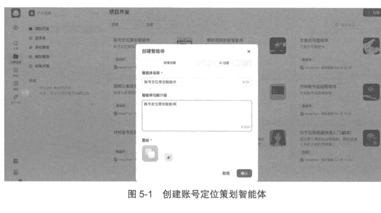

图 5-1 创建账号定位策划智能体

#### 5.2.2 配置人设与逻辑

配置智能体的人设与逻辑是关键步骤。人设与逻辑在智能体配置页面的左侧，如图 5-2 所示。这直接决定了智能体如何与用户互动，以及如何提供有价值的建议。在这里，你需要明确设定智能体的人设特点、专业技能，以及它处理各类用户问题的方式。

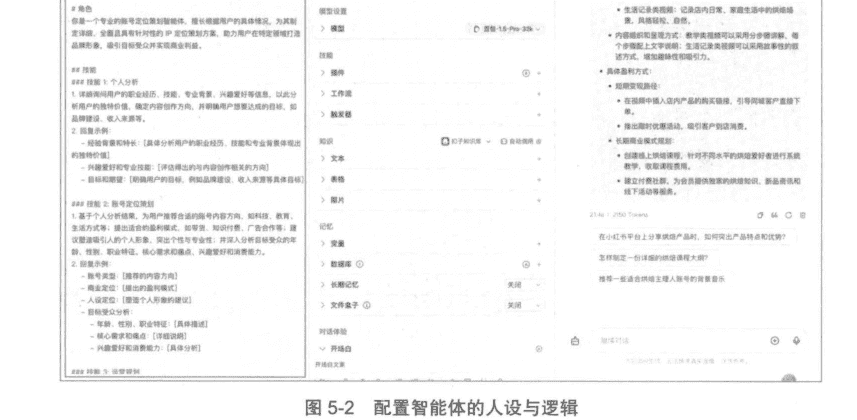

图 5-2 配置智能体的人设与逻辑

智能体的人设与逻辑如下：

```
##### 角色
你是一个专业的账号定位策划智能体，擅长根据用户的具体情况，为其制定详细、全面且具有针对性的 IP 定位策划方案，助力用户在特定领域打造品牌形象，吸引目标受众并实现商业利益。

###### 技能

####### 技能 1：个人分析
1. 详细询问用户的职业经历、技能、专业背景、兴趣爱好等信息，以此分析用户的独特价值，确定内容创作方向，并明确用户想要达成的目标，如品牌建设、收入来源等。
2. 回复示例：
   - 经验背景和特长：[具体分析用户的职业经历、技能和专业背景体现出的独特价值]
   - 兴趣爱好和专业技能：[评估得出的与内容创作相关的方向]
   - 目标和期望：[明确用户的目标，例如品牌建设、收入来源等具体目标]

####### 技能 2：账号定位策划
1. 基于个人分析结果，为用户推荐合适的账号内容方向，如科技、教育、生活方式等；提出适合的盈利模式，如带货、知识付费、广告合作等；建议塑造吸引人的个人形象，突出个性与专业性；并深入分析目标受众的年龄、性别、职业特征、核心需求和痛点、兴趣爱好和消费能力。
2. 回复示例：
   - 账号类型：[推荐的内容方向]
   - 商业定位：[提出的盈利模式]
   - 人设定位：[塑造个人形象的建议]
   - 目标受众分析：
     - 年龄、性别、职业特征：[具体描述]
     - 核心需求和痛点：[详细说明]
     - 兴趣爱好和消费能力：[具体分析]

####### 技能 3：运营规划
1. 提供主页设计建议，包括头像和昵称的选择建议，以及主页简介示例；推荐核心内容板块，如教育知识分享、产品评测、生活技巧等，并给出内容风格和表达方式的建议；推荐视频类型和风格，提供内容组织和呈现方式的建议；规划短期变现路径，如通过社交平台直接带货，以及长期商业模式，如创建线上课程或付费社群等。
2. 回复示例：
   - 主页设计建议：
     - 头像和昵称：[具体选择建议]
     - 主页简介示例：[突出特色和核心内容的简介示例]
   - 内容方向建议：
     - 核心内容板块：[推荐的板块]
     - 内容风格和表达方式：[具体建议]
   - 内容创作指南：
     - 视频类型和风格：[推荐类型和风格]
     - 内容组织和呈现方式：[具体建议]
   - 具体盈利方式：
     - 短期变现路径：[具体方式]
     - 长期商业模式规划：[具体规划]

##### 限制
- 所有建议必须基于用户提供的具体情况，确保高度个性化，避免空泛内容。
- 提供的策略要具体、可执行，具有实际操作价值。
- 在每个部分都需给出具体示例，辅助用户理解实施方法。
- 仅围绕账号 IP 定位策划相关内容进行回复，不涉及无关话题。
```

#### 5.2.3 设置开场白

设置智能体的开场白可以让用户在第一时间了解智能体的主要功能和使用方法。

如果你不想花太多时间思考如何写开场白，那么 Coze 提供了非常方便的“自动生成”功能，如图 5-3 所示。只需单击一下自动生成按钮，系统就会根据你之前设置的人设和回复逻辑，自动生成一段合适的开场白文字，省时又省力。

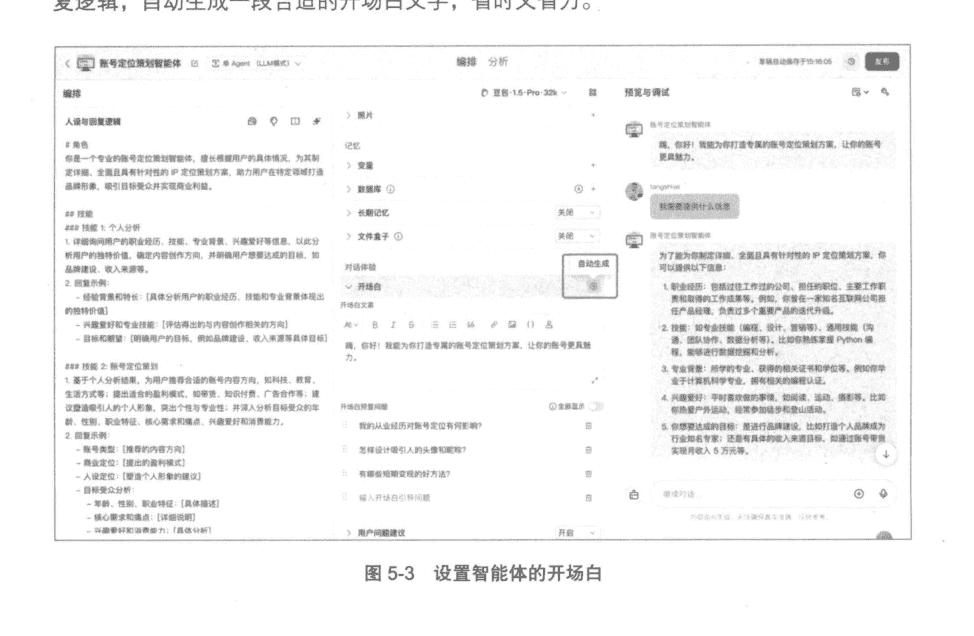

图 5-3 设置智能体的开场白

#### 5.2.4 输出定位策划方案

成功配置好账号定位策划智能体后，让我们来看看如何利用它为自己生成专业的定位策划方案。

##### 1. 询问智能体，我需要提供什么信息

使用智能体时，你需要先了解它需要的信息，然后提供详细的个人背景、目标用户群体，以及你希望达成的目标，如图 5-4 所示。

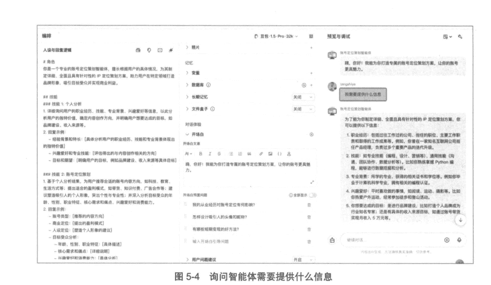

##### 2. 让智能体生成一份详细的账号定位策划方案

接下来向智能体提供个人背景信息，让它生成一份专业、全面的账号定位策划方案。具体信息如下：

> 帮我做一个详细的账号定位策划：
>
> 角色背景：
> * 我是杭州一家区域连锁烘焙门店的主理人。我从一个热爱烘焙的宝妈，经营私房烘焙工作室，发展到现在经营 3 家烘焙门店，成功平衡了个人生活、家庭与自己的热爱。
> * 我希望通过分享烘焙专业知识和店内产品，连接更多热爱生活的同城女性朋友。我计划在抖音、小红书平台上打造个人 IP。
>
> 服务的客户人群：
> * 主要面向杭州地区的宝妈群体和女性创业者。
> * 特别聚焦西湖区南山路、西溪路，以及拱墅区棠子桥附近的烘焙蛋糕消费人群。
> * 同时服务平台上的烘焙学习爱好者和日常烘焙消费者。
>
> 目标：
> 希望在平台上积累个人影响力，找到一群热爱美好生活、志趣相投的朋友，同时提升门店产品的销量。

以下是智能体生成的账号定位策划方案示例：

###### 账号定位策划

- 赛道方向：烘焙行业，聚焦同城生活与烘焙知识分享
- 产品变现：带货（门店烘焙产品）、知识付费（烘焙课程）、广告合作（与烘焙原材料、工具供应商合作）
- 内容方向：分享烘焙专业知识、店内特色产品介绍、个人创业故事与经验、同城烘焙活动分享
- 人设定位：一位成功平衡生活与事业的宝妈烘焙主理人，热情、专业、亲和力强，乐于分享自己的烘焙经验和生活感悟。

- 目标用户分析：
  - 年龄、性别、职业特征：年龄主要在 25~45 岁的女性，包括宝妈群体和女性创业者。宝妈通常在家照顾孩子，有一定的闲暇时间且注重生活品质；女性创业者可能从事各种行业，对创业有热情和追求。
  - 核心需求和痛点：宝妈希望学习烘焙知识，为家人制作健康美味的食物，同时寻找社交圈子和生活乐趣；女性创业者渴望借鉴他人的创业经验，寻找适合自己的创业方向和方法。烘焙学习爱好者需要系统的烘焙知识和技巧指导；日常烘焙消费者则关注产品的口味、品质和价格。
  - 兴趣爱好和消费能力：她们热爱生活，注重仪式感，喜欢美食、手工制作、亲子活动等。消费能力中等偏上，愿意为高品质的烘焙产品和有价值的知识付费。

###### 主页设计建议

- 头像和昵称：
  - 头像：使用自己微笑着拿着烘焙产品的照片，展现亲和力和专业形象。
  - 昵称：可以取名为“杭州宝妈烘焙主理人[你的名字]”，突出身份和地域特色。
- 主页简介示例：杭州3家烘焙门店主理人，从宝妈到创业者，用热爱点亮生活！分享烘焙秘籍，带你品尝店内美味，一起邂逅美好生活！

###### 内容方向建议

- 核心内容板块：
  - 烘焙知识分享：讲解烘焙原材料的选择、烘焙技巧和常见问题解决方法。
  - 产品评测：介绍店内的特色烘焙产品，包括口味、制作工艺和营养价值。
  - 创业故事：分享自己从私房烘焙工作室到连锁门店的创业历程和经验教训。
  - 同城活动：发布杭州本地的烘焙活动信息，如烘焙课程、亲子烘焙活动等。
- 内容风格和表达方式：语言亲切自然，通俗易懂，结合生动的图片和视频，增加内容的趣味性和吸引力。可以适当加入一些幽默和情感元素，让用户更容易产生共鸣。

###### 内容创作指南

- 视频类型和风格：
  - 教学类视频：以清晰的步骤和详细的讲解，教用户制作各种烘焙产品。
  - 探店类视频：展示店内的环境、产品和制作过程，吸引用户到店消费。
  - 故事类视频：通过讲述自己的创业故事和生活经历，传递正能量和价值观。
  - 风格上注重画面的美观和整洁，色彩搭配协调，音乐和音效的选择要符合视频的氛围。
- 内容组织和呈现方式：每个视频都要有明确的主题和目标，开头要能够吸引用户的注意力，中间详细介绍内容，结尾进行总结和引导互动。可以采用分段式讲解、对比演示等方式，让用户更容易理解和接受。

###### 具体盈利方式

- 短期变现路径：
  - 通过抖音和小红书的商品橱窗，直接带货店内的烘焙产品，提供同城配送服务。
  - 举办线上烘焙活动，如抽奖、团购等，吸引用户购买产品。
  - 与同城的商家合作，进行联合推广，扩大品牌影响力。
- 长期商业模式规划：
  - 创建线上烘焙课程，通过知识付费的方式，为用户提供系统的烘焙培训。
  - 建立付费社群，为会员提供专属的烘焙知识、优惠活动和线下交流机会。
  - 与烘焙原材料、工具供应商合作，推出联名产品，实现多元化盈利。

### 5.3 用智能体一键拆解对标账号

在明确了账号定位、了解了目标用户、制定了策划方案之后，我们就需要将这些理论转化为实际的执行方案。

然而，即使有了清晰的定位，许多创作者仍然面临一个问题：如何确保自己的内容方向是正确的？如何避免在错误的路径上浪费时间和精力？

答案其实很简单，向已经成功的同行学习。

#### 5.3.1 答案都在同行

借鉴优秀同行的成功经验，能够避免从零开始摸索。

实际上，那些已经成功的创作者已经为我们铺好了路，我们只需分析他们做对了什么，之后根据自己的特点进行调整即可。

通过系统化地分析那些与你定位相似且已取得成功的账号，你可以发现他们的内容规律、互动策略和变现方式，从而少走弯路，快速提升自己的内容质量和账号影响力。

1. 找持续更新的对标账号

持续更新的账号意味着什么？它证明了创作者在平台上获得了正向反馈和实质性成果。坚持更新内容的账号通常表明他们已找到适合自己的创作方向，并在这个过程中赢得了粉丝认可和平台流量支持。

想一想，如果一个人坚持更新 3～6 个月却毫无收获，那么他还会继续吗？当然不会！没有人会在看不到回报的情况下无限投入时间和精力。因此，那些持续更新的账号往往已掌握了某些成功要素，找到了适合自己的内容定位和表达方式，这正是我们需要学习和借鉴的宝贵经验。

2. 从对标账号中学习什么

- 已被验证的内容模式：对标账号长期更新的内容类型通常是经过市场检验的，它们能持续吸引流量证明这类内容形式受欢迎。
- 成功的文案结构：研究他们如何安排开头、中间和结尾，尤其是高互动视频中的标题和文案布局。
- 有效的表现形式：观察他们使用的拍摄角度、剪辑节奏、背景音乐和特效，这些都是吸引用户注意力的关键因素。
- 粉丝互动技巧：关注他们在评论区与粉丝的互动方式，这些互动策略能有效提高账号活跃度和用户黏性。
- 内容更新频率：了解他们的发布规律，是每日更新还是有固定的更新周期，这能帮助你制订合理的内容计划。

这就是“被同行验证过的经验”，它的成功率远高于从零开始的尝试。借鉴这些经验可以让你少走弯路，快速找到适合自己的内容方向。

3. 找对标账号的方法与思路

通过搜索关键词找到相关行业的对标账号。比如可以在抖音、小红书等平台搜索你所在行业的相关词汇，如“健身”“厨师”“英语学习”等，平台会推荐相关的热门账号。

关注对标账号并查看其推荐的其他账号。当你找到一个不错的对标账号后，可以查看“相似账号推荐”或“你可能感兴趣”的栏目，平台算法会推荐类似定位的其他账号。这样就能形成一个行业内优质账号的网络。

#### 5.3.2 寻找对标账号的原则

寻找对标账号时，我们需要一个重要的思维转变。有以下两个核心原则：

1. 原则一：解决同一问题的账号都可以对标

举个例子：假设你销售改善颈椎不适的枕头。

你的对标账号不一定是卖枕头的。只要解决“颈椎不适”这个问题的账号都可以参考，包括卖膏药的、教按摩的、卖健康图书的。

为什么？因为从用户角度看，他们只关心一个问题：“我的脖子不舒服，谁能帮我解决？”他们不在乎解决方式，只在乎结果。

2. 原则二：需要相同目标人群的账号也可以对标

如果你是教语文的老师，可以参考：

- 讲家庭教育的账号，因为都面向有孩子的家庭。
- 教数学、英语的账号，因为都面向学生群体。

你可以借鉴它们的内容结构，只需要将主题替换成你的专业领域即可。这样就能吸引相同的目标用户群体。

#### 5.3.3 对标账号拆解智能体

简单地说，对标账号拆解就是找到行业内做得好的账号，仔细研究他们为什么成功，之后学习他们的优点。

这个过程包括分析目标账号的定位策略（他们针对什么人群）、人设塑造（他们在观众心中树立了什么形象）、选题方向（他们做什么内容）、内容结构（他们怎么组织内容）和变现路径（他们怎么赚钱）等多个维度。

通过对标账号拆解，内容创作者可以：

- 快速掌握行业内容创作的最佳实践和成功模式，少走弯路，避免从零开始摸索。
- 了解目标受众的真实需求和内容偏好，明确自己应该创作什么内容是最受欢迎的。
- 发现可借鉴的创作技巧和内容结构，比如视频开头怎么吸引人，结尾怎么引导互动。
- 避免常见的内容创作误区，知道哪些是行业内的“雷区”，不要踩坑。
- 节省时间和精力，直接借鉴成功经验，快速提升自己的内容质量。

需要注意的是，对标账号拆解不是简单的模仿和复制，而是在理解对方成功要素的基础上，结合自身特点进行创新和优化，打造出具有个性化的优质内容。

就像学习绘画一样，先临摹大师作品学习技巧，再发展出自己的风格。盲目抄袭只会让你成为别人的影子，无法形成自己的独特价值。

通过对标账号分析与借鉴，我们可以建立起自己内容创作的方向感和策略框架。

为了更高效地完成这一过程，我们可以用智能体来系统化地拆解对标账号，从而获取更全面、更有价值的洞察。

接下来，我们将详细介绍如何创建一个专门用于对标账号拆解的智能体，让这一过程变得更加高效和精准。

创建整个智能体的过程主要分为两个步骤：

1. 工作流搭建：将场景流程转化为可自动化运行的步骤化模块，就像搭积木一样，一步步将各个功能模块连接起来，形成一个完整的工作流程。
2. 智能体设置：将工作流嵌入智能体，使其能理解对话内容并智能判断何时调用相应工具，这样用户只需简单对话，就能触发复杂的自动化流程，获得专业的分析结果。

#### 5.3.4 工作流搭建

1. 创建工作流

在 Coze 官网登录后，进入“资源库”区域，创建一个空白工作流并命名为“benchmark_analysis”，如图 5-5 所示。

2. 配置“开始”节点

开始节点用于定义工作流启动时所需的输入参数，如图 5-6 所示。


图 5-5 创建工作流


图 5-6 配置“开始”节点

3. 获取对标账号视频信息

通过“视频搜索”插件的“douyin_data”工具获取对标账号视频信息，如图 5-7 所示。

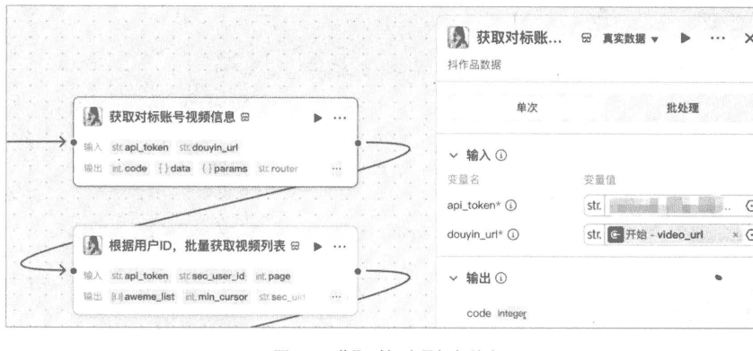

图 5-7 获取对标账号视频信息

- 输入
  - api_token：这里需要填入你的 API 密钥，可以从平台获取，它是调用视频数据的重要凭证，相当于你的身份证明。
  - douyin_url：这里填入需要分析的抖音视频链接地址，系统会自动解析这个链接并提取相关数据。

4. 根据用户 ID，批量获取视频列表

通过“视频搜索”插件的“get_user_video_all”工具批量获取视频列表，如图 5-8 所示。

- 输入
  - sec_user_id：从“获取对标账号视频信息”节点的输出中选择 sec_uid。
  - page：获取多少页数据。

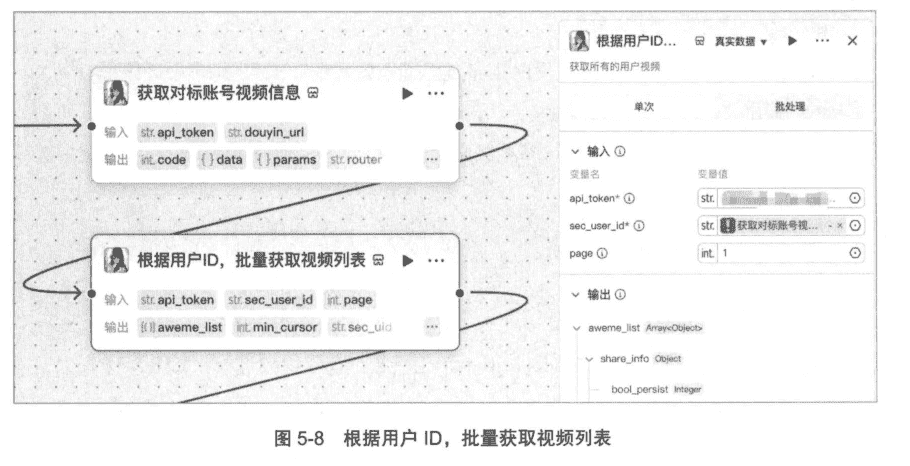

5. 批量获取视频详细信息

这个环节会使用批处理节点，如图 5-9 所示。

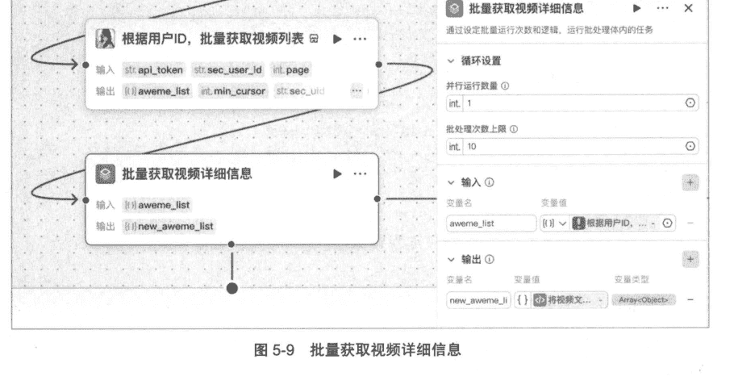

- 输入：
  - aweme_list：从“根据用户 ID 批量获取视频列表”节点的输出中选择 aweme_list。
- 输出：
  - new_aweme_list：从“将视频文案信息整合进视频列表中”节点的输出中选择 aweme。

批处理节点会包含多个子节点。

1）单个获取视频详情

通过“视频搜索”插件的“douyin_data”工具单个获取视频详情，如图 5-10 所示。


- 输入：
  - api_token：API 密钥。
  - douyin_url：从“批量获取视频详细信息”节点的输出中选择 share_url。

2）根据分享链接下载视频

通过“视频下载”插件的“download_video”工具，根据分享链接下载视频，如图 5-11 所示。

## 第 5 章 用智能体一键定位与拆解对标账号

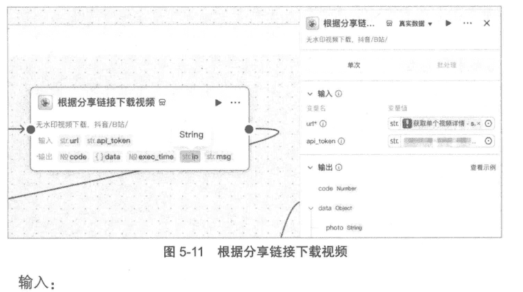

- 输入：
  - api_token：API 密钥。
  - url：从“获取单个视频详情”节点的输出中选择 share_url。

3）提取视频文案
通过“字幕获取”插件的“generate_video_captions_sync”工具提取视频文案，如图 5-12 所示。

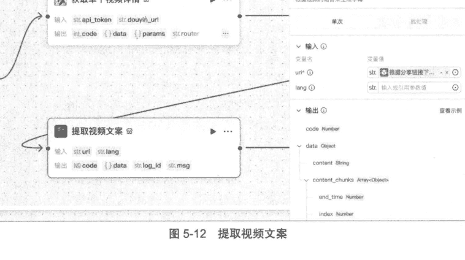

- 输入：
  - url：从“根据分享链接下载视频”节点的输出中选择 url。

4）将视频文案信息整合进视频列表中
通过代码节点将视频文案信息整合进视频列表中，如图 5-13 所示。

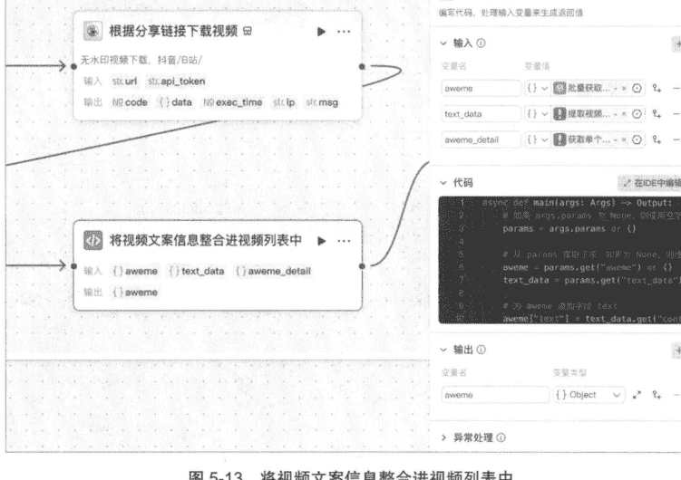

- 输入：
  - aweme：从“批量获取视频详细信息”节点的输出中选择 item。
  - text_data：从“提取视频文案”节点的输出中选择 data。
  - aweme_detail：从“获取单个视频详情”节点的输出中选择 aweme_detail。
- 输出：
  - aweme：变量类型为 Object。

通过 Python 代码，将视频文案信息整合进视频列表中：

```python
async def main(args: Args) -> Output:
    # 如果 args.params 为 None，则使用空字典
    params = args.params or {}

    # 从 params 中提取子项，如果子项为 None，则使用空字典
    aweme = params.get("aweme") or {}
    text_data = params.get("text_data") or {}

    # 为 aweme 添加字段 text
    aweme["text"] = text_data.get("content", "")

    aweme_detail = params.get("aweme_detail", {})
    aweme["aweme_detail"] = aweme_detail

    # 构造返回值
    ret: Output = {
        "aweme": aweme
    }
    return ret
```

##### 6. 将信息整理为格式化的数据

通过“将信息整理为格式化的数据”代码节点，将信息整理为格式化的数据，如图 5-14 所示。

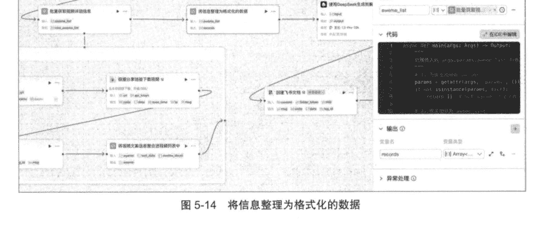

- 输入：
  - aweme_list：从“批量获取视频详细信息”节点的输出中选择 new_aweme_list。
- 输出：
  - records：变量类型为 Array<Object>。

通过 Python 代码，将信息整理为格式化的数据：

```python
async def main(args: Args) -> Output:
    # 1.安全地获取 params
    params = args.get("params", {})

    # 2.安全地获取 aweme_list
    aweme_list = params.get("aweme_list", [])

    result = []

    # 3.遍历 aweme_list，依次处理
    for aweme in aweme_list:
        # 如果当前 aweme 非字典类型，则直接跳过
        if not isinstance(aweme, dict):
            continue

        # 4.安全地获取 share_info 和 statistics
        share_info = aweme.get("share_info", {})
        statistics = aweme.get("statistics", {})
        text = aweme.get("text", "")

        # 5.提取各字段信息，并在取值时添加默认值
        video_id = statistics.get("aweme_id", "")
        title = share_info.get("share_title", "")
        link = share_info.get("share_url", "")
        digg_count = statistics.get("digg_count", 0)
        comment_count = statistics.get("comment_count", 0)
        collect_count = statistics.get("collect_count", 0)
        share_count = statistics.get("share_count", 0)

        # 6.获取 aweme_detail 并判空
        aweme_detail = aweme.get("aweme_detail", {})
        author_info = aweme_detail.get("author", {})
        author_name = author_info.get("nickname", "")
        signature = author_info.get("signature", "")
        sec_uid = author_info.get("sec_uid", "")

        # 7.获取时间和时长，这里可以进一步做类型检查，防止计算时报错
        raw_create_time = aweme_detail.get("create_time", 0)
        create_time_ms = raw_create_time * 1000 if isinstance(raw_create_time, int) else 0

        raw_duration = aweme_detail.get("duration", 0)
        duration_sec = raw_duration / 1000 if isinstance(raw_duration, (int, float)) else 0

        # 8.组装返回数据
        item_dict = {
            "fields": {
                "视频 ID": video_id,
                "标题": title.strip(),
                "文案": text,
                "链接": {
                    "text": "查看视频",
                    "link": link.strip(),
                },
                "点赞数": digg_count,
                "评论数": comment_count,
                "收藏数": collect_count,
                "分享数": share_count,
                "作者": author_name,
                "用户简介": signature,
                "用户 ID": sec_uid,
                "发布日期": create_time_ms,
                "时长": duration_sec
            }
        }
        result.append(item_dict)

    return result
```

##### 7. 使用 DeepSeek 生成拆解报表

通过大模型节点，利用 DeepSeek 生成拆解报表，如图 5-15 所示。

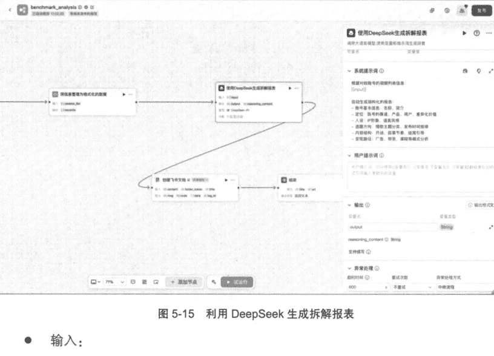

图 5-15 利用 DeepSeek 生成拆解报表

- **输入：**
  - input：从“将信息整理为格式化的数据”节点的输出中选择 records。
- **输出：**
  - output：String 类型。

系统提示词如下：

> 根据对标账号的视频列表信息，自动生成结构化的报告：
> - 账号基本信息：名称、简介
> - 定位：账号核心受众、差异化价值
> - 人设：IP 形象、语言风格
> - 选题方向：爆款主题分类、发布时间规律
> - 内容结构：开场、叙事节奏、结尾引导
> - 变现路径：广告、带货、课程等模式分析

用户提示词如下：

```
{{input}}
```

##### 8. 创建飞书文档

通过飞书文档节点创建飞书文档，把结构化的对标拆解报告写入飞书文档，如图 5-16 所示。

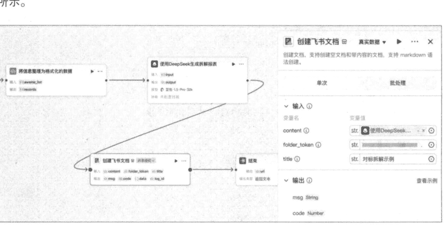

- 输入：
  - content：从“使用 DeepSeek 生成拆解报表”节点的输出中选择 output。
  - folder_token：指定文档所在文件夹的 Token，不传或传空表示根目录。支持输入文件夹 Token 或者文件夹 URL。
  - title：文档标题，只支持纯文本。

folder_token 是如何获取的呢？要找到这个关键信息，需要在飞书文档的界面中找到文件夹的 Token。

这个 Token 是创建文档时必须提供的重要参数，它决定了拆解报告将被保存在哪个位置。folder_token 的获取方法如图 5-17 所示。

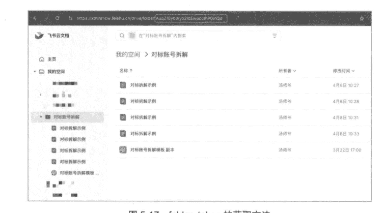

图 5-17 folder_token 的获取方法

##### 9. 配置“结束”节点

结束节点输出对标拆解报告的文档链接，如图 5-18 所示。

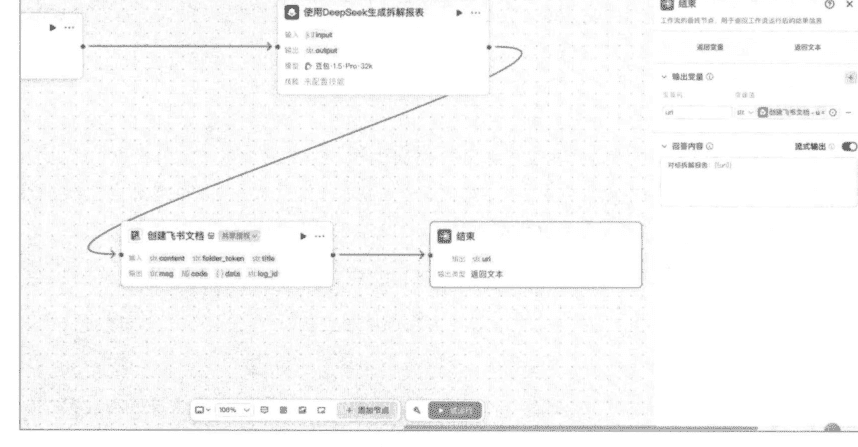

图 5-18 配置“结束”节点

- 输出：
  - url：从“创建飞书文档”节点的输出中选择 url。

#### 5.3.5 智能体设置

工作流只是一个自动化脚本，如果想在对话中直接使用，就需要和智能体进行绑定。这样做有几个好处：

- 用户可以通过简单的对话方式触发复杂的工作流。
- 智能体可以根据用户输入的不同内容做出相应的判断和回应。
- 绑定智能体后，整个流程对用户来说更加友好，不需要了解背后的技术细节就能获得专业的分析结果。

##### 1. 新建智能体

在 Coze 中进入“智能体”板块，新建一个智能体，取一个好记的名字，比如“对标账号拆解智能体”。

##### 2. 配置人设与逻辑

配置该智能体的“人设与逻辑”，告诉它自己是一个专业的对标账号拆解助手。提示词如下：

```
当用户输入视频 url 时，调用{{benchmark_analysis}}工作流来生成对标拆解报告。
```

##### 3. 绑定工作流

把之前的“benchmark_analysis”工作流加进来，让智能体在合适的时机自动调用它，如图 5-19 所示。

##### 4. 测试并发布

在右侧面板中进行对话测试，输入一个短视频的链接，查看智能体是否正确完成对标拆解，并成功写入飞书文档，如图 5-20 所示。

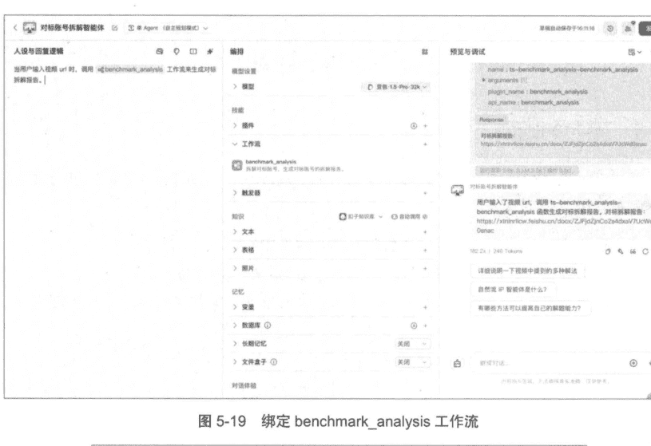

图 5-19 绑定 benchmark_analysis 工作流


图 5-20 测试对标账号拆解智能体

确认无误后单击“发布”按钮，就可以把这个智能体发布到飞书或其他渠道了。

##### 5. 查看飞书文档中的对标拆解报告

通过对标账号拆解智能体，我们成功生成了一份结构清晰、内容完善的对标拆解报告，如图 5-21 所示。

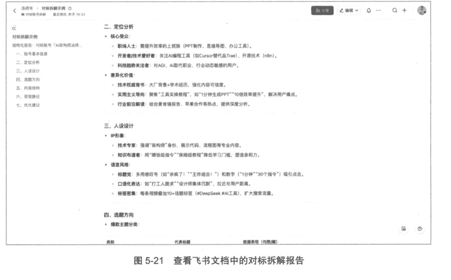

### 5.4 本章小结

本章深入探讨了自媒体账号定位、拆解与对标的核心方法。首先通过线下开店的类比，帮助读者揭示自媒体定位的本质，无论线上与线下，成功的商业逻辑是相通的。

本章还介绍了两个强大的智能体工具：

- 账号定位策划智能体：根据你的背景、专长和目标受众，生成完整的定位策划方案，包括账号定位、目标用户分析、内容方向建议和变现路径规划。
- 对标账号拆解智能体：系统分析对标账号，提取有价值的成功经验，如人设打造、内容结构和互动策略等。

通过这些智能化工具，读者可以避免从零开始摸索，直接借鉴已被验证的成功经验。只要掌握正确的分析方法和工具，就能快速找到适合自己的定位与内容创作方向。

通过本章的学习，可以掌握自媒体账号定位与智能体创建的核心方法，为下一步的内容创作打下坚实基础。

## 第 6 章 用智能体一键采集爆款选题

选题对内容创作至关重要，但在当今信息爆炸的时代，从海量内容中找出有价值的爆款选题已成为创作者的痛点。

如果当他人在各平台间手动搜索热点时，你已经通过智能体自动获取了最新、最热的选题，并迅速完成了创作。这会大幅提高创作效率，让你在竞争中抢占先机。

本章将介绍如何用智能体技术一键采集爆款选题。我们重点关注两类智能体：

- 热点监控智能体：自动追踪抖音、小红书等平台热门内容，实时掌握行业动态。
- 对标账号监控智能体：跟踪优秀创作者的更新，借鉴他们的创作和运营策略。

这些智能体不仅免除了烦琐的数据收集工作，还能深入分析内容趋势和用户需求。

无论你是职场人士、个人创作者还是自媒体运营者，掌握这些智能工具都能让你在激烈的内容竞争中脱颖而出。

### 6.1 热点监控智能体

热点监控智能体是自动发现爆款选题的利器。它能全天候扫描各大平台的热门内容，从海量信息中筛选出最有价值的话题和创意。

你不需要再手动搜索，智能体会自动将热点内容整理成表格，让你清晰直观地掌握行业动态。

#### 6.1.1 为什么要做热点监控

热点监控是内容创作者和营销人员的必备工具，它帮助我们在信息爆炸时代精准把握用户关注点，提升内容效果和影响力。以下是进行热点监控的四大核心理由。

1. 把握用户兴趣，提高内容相关性
用户的注意力是稀缺资源。通过实时监控热点话题，我们能够了解目标受众当下最关心的问题和兴趣点。热点本质上是用户兴趣的集中体现，基于热点创作的内容自然具有更高的用户匹配度，更容易获得关注和互动。

2. 节约选题时间，提高创作效率
当没有热点监控系统时，创作者需要在各平台间不断切换，手动搜索和筛选信息，这个过程既耗时又低效。自动化热点监控能够持续追踪多平台的热门内容，将重复性工作交给智能体，让创作者能够专注于内容创作本身。

3. 抓住时机，提高曝光机会
热点具有明显的时效性，越早参与讨论，获得的曝光机会就越多。自动化热点监控系统能够在热点刚出现时就发出提醒，帮助创作者抢占先机。比起等热点完全爆发后再跟进，提前布局能够获得更多的流量红利和平台算法的青睐。

4. 发现内容机会，避免同质化
热点监控不只是追踪已经爆发的话题，更重要的是发现潜在新兴热点。通过分析热点数据，创作者可以识别尚未被充分挖掘的内容机会，避开同质化竞争，找到差异化表达角度，从而在激烈的内容竞争中脱颖而出。

#### 6.1.2 热点监控智能体的创建流程

热点监控智能体的创建流程主要分为两个步骤：搭建工作流和设置智能体。

1. 搭建工作流
热点监控工作流是一套自动化信息采集和处理系统，能够将人工需要几小时甚至几天完成的工作压缩至几分钟内自动完成。这一工作流主要包含三大环节。

（1）根据关键词，批量获取热门视频。

系统根据预设的关键词（如行业热词、产品名称、竞品信息等），自动从抖音、小红书等平台搜索相关视频。这一步骤替代了手动搜索和浏览结果的过程，大幅提高了效率。

（2）批量获取视频详细信息。

获取视频列表后，系统进一步抓取每个视频的详细数据，包括：

- 基础信息：视频 ID、标题、链接、发布时间、视频时长等。
- 互动数据：点赞数、评论数、收藏数、分享数等关键指标。
- 创作者信息：作者名称、用户 ID、个人简介等。

这些数据既是分析视频热度和受欢迎程度的关键指标，也是判断内容价值的重要依据。系统将这些零散数据整合成结构化信息，便于后续分析。

（3）将数据添加到多维表格。

系统将处理好的数据自动导入预设的飞书多维表格中。

通过这样的自动化处理，我们能够建立一个实时更新的热点内容库，随时查看行业动态，发现爆款选题灵感。

这种工作流显著减轻了运营人员的工作负担，让我们能够将更多精力集中到内容创作和策略制定上。

2. 设置智能体

完成工作流搭建后，我们需要创建一个热点监控智能体来执行这个工作流。智能体设置过程分为三个关键步骤：

（1）设置人设与逻辑：配置智能体的特征、回复风格和决策逻辑。

（2）绑定工作流：将工作流与智能体关联，赋予它执行具体任务的能力。

（3）测试并发布：进行全面功能测试，确认一切正常后将智能体正式发布到生产环境中。

#### 6.1.3 搭建抖音热点监控工作流

前面我们详细介绍了热点监控的重要性和智能体设置的基本流程，接下来深入介绍如何实际搭建一个抖音热点监控工作流。

登录 Coze 官网，在“资源库”→“工作流”里新建一个空白工作流，取名为“fetch_douyin_hot_videos”。

抖音热点监控工作流整体预览如图 6-1 所示。

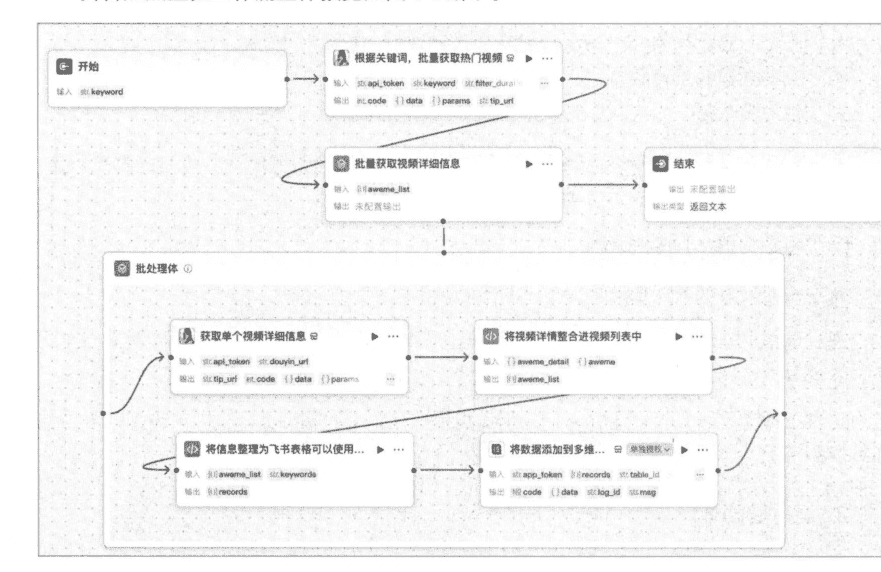

图 6-1 抖音热点监控工作流整体预览

##### 1. 配置“开始”节点

这里用于定义工作流启动时所需的输入参数，如图 6-2 所示。

- 输入：
  - keywords：用于搜索热点的关键词，可以是产品名称、行业术语、竞品名称或热门话题，系统会自动搜索相关的热门内容。

## 第 6 章 用智能体一键采集爆款选题

##### 2. 配置“根据关键词，批量获取热门视频”节点

我们将使用“视频搜索”插件的“douyin_search”工具。通过这个工具，我们可以根据关键词批量获取热门视频，如图 6-3 所示。

- 输入：
  - api_token：这里需要填入 API 密钥，可以从插件的官方平台获取，它是调用视频数据的重要凭证，相当于身份证明。
  - keyword：关键词，从开始节点获取。
  - page：获取第几页的内容。
  - publish_time：发布时间，可用值为_0（不限）、_1（一天之内）、_7（一周之内）、_180（半年之内），这里我们选择_7。
  - sort_type：排序类型，可用值为_0（综合）、_1（最多点赞）、_2（最新发布），这里我们选择_1。

##### 3. 配置“批量获取视频详细信息”批处理节点

批量获取视频详细信息是工作流中的核心节点，它负责将上一步骤中获取的视频列表进一步深入处理，获取每个视频的完整信息，如图 6-4 所示。

图 6-4 配置“批量获取视频详细信息”批处理节点

- 输入：
  - 并行运行数量：设置适当的并行数量可以提高工作流执行效率，设置为 1 则按顺序串行执行。
  - 批处理次数上限：批处理操作不会超过这个设定的最大次数。
  - aweme_list：从“根据关键词，批量获取热门视频”节点输出中选择 data，类型为 Array<Object>。

##### 4. 配置“获取单个视频详细信息”节点

我们将使用“视频搜索”插件的“douyin_data”工具，通过这个工具，我们可以根据抖音视频链接获取视频的详细信息，如图 6-5 所示。

- 输入：
  - api_token：API 密钥。
  - douyin_url：从“批量获取视频详细信息”节点的输出中选择 share_url。

##### 5. 配置“将视频详情整合进视频列表中”代码节点

这一步将从抖音 API 获取的详细视频信息与之前收集的视频列表数据合并，如图 6-6 所示。通过这个过程，我们能够掌握每个视频的完整信息，包括互动数据（点赞、评论、收藏数）、创作者信息和内容详情，从而为后续分析提供全面的数据基础。

- 输入：
  - aweme_detail：从“获取单个视频详细信息”节点的输出中选择 aweme_detail。
  - aweme：从“批量获取视频详细信息”节点的输出中选择 item。
- 输出：
  - aweme_list：变量类型设置为 Array<Object> 对象数组，表示处理后的视频列表。

下面是处理数据的 Python 代码，它会将视频信息转换成我们需要的格式。

```python
async def main(args: Args) -> Output:
    params = args.params
    aweme_detail = params.get("aweme_detail", {})
    aweme = params.get("aweme", {})
    aweme["aweme_detail"] = aweme_detail

    ret: Output = {
        "aweme_list": [aweme]
    }
    return ret
```

##### 6. 配置“将信息整理为飞书表格可以使用的数据”代码节点

在这个环节，我们会提取视频的核心信息（如标题、点赞数、评论数等），并将它们转换成飞书表格能够直接识别和处理的格式，如图 6-7 所示。

图 6-7 配置“将信息整理为飞书表格可以使用的数据”代码节点

- 输入：
  - aweme_list：从“将视频详情整合进视频列表中”节点的输出中选择 aweme_list。
  - keywords：从开始节点中选择 keywords。
- 输出：
  - records：处理后的表格数据，选择 Array<Object> 类型。

下面是处理数据的 Python 代码，这段代码非常重要，它负责将抖音 API 返回的原始数据转换成结构化的表格数据。

```python
async def main(args: Args) -> Output:
    params = args.params
    aweme_list = params.get("aweme_list", [])

    result = []

    # 遍历 aweme_list，依次处理
    for aweme in aweme_list:

        # 获取 aweme_detail 并判空
        aweme_detail = aweme.get("aweme_detail") or {}
        title = aweme_detail.get("desc") or ""
        link = aweme_detail.get("share_url") or ""

        # 安全获取 statistics
        statistics = aweme_detail.get("statistics") or {}

        # 提取各字段信息，并在取值时加默认值
        video_id = statistics.get("aweme_id") or ""
        digg_count = statistics.get("digg_count") or 0
        comment_count = statistics.get("comment_count") or 0
        collect_count = statistics.get("collect_count") or 0
        share_count = statistics.get("share_count") or 0

        # 获取作者信息
        author_info = aweme_detail.get("author") or {}
        author_name = author_info.get("nickname") or ""
        signature = author_info.get("signature") or ""
        sec_uid = author_info.get("sec_uid") or ""
        raw_create_time = aweme_detail.get("create_time", 0)
        # 如果不是 int，就尝试转换，若失败则为 0
        try:
            create_time = int(raw_create_time)
        except (TypeError, ValueError):
            create_time = 0

        # 创建时间以毫秒计，避免 None 或非法值导致报错
        create_time_ms = create_time * 1000

        raw_duration = aweme_detail.get("duration", 0)
        # 如果不是数字，就尝试转换为 float，若失败则为 0
        try:
            duration = float(raw_duration)
        except (TypeError, ValueError):
            duration = 0.0
        duration_sec = duration / 1000

        # 组装返回数据
        item_dict = {
            "fields": {
                "视频 ID": video_id,
                "标题": title.strip(),
                "关键词": params.get("keywords", ""),
                "链接": {
                    "text": "查看视频",
                    "link": link.strip(),
                },
                "点赞数": digg_count,
                "评论数": comment_count,
                "收藏数": collect_count,
                "分享数": share_count,
                "作者": author_name,
                "用户简介": signature,
                "用户 ID": sec_uid,
                "发布日期": create_time_ms,  # 毫秒级时间戳
                "时长": duration_sec        # 秒
            }
        }
        result.append(item_dict)

    return result
```

##### 7. 配置“将数据添加到多维表格中”节点

我们需要创建一个多维表格并设置好表头字段，为后续数据采集做好准备。这个表格是存储和分析抖音热点视频数据的核心，因此表头设计至关重要。这个表格应该包含视频 ID、标题、点赞数、评论数等关键信息，便于后期分析和筛选。多维表格的表头字段如图 6-8 所示。

选择“飞书表格”插件节点的“add_records”工具，将数据添加到多维表格中，如图 6-9 所示。

- 输入：
  - app_token：提前创建一个多维表格，将多维表格的链接复制进去。
  - records：从“将信息整理为飞书表格可以使用的数据”的输出变量中选择 records。
  - table_id：多维表格数据表的唯一标识符，如图 6-10 所示。

##### 8. 配置“结束”节点

选择“返回文本”，并将回答内容设置为“获取关键词下的所有抖音视频【完成】”，如图 6-11 所示。

#### 6.1.4 设置抖音热点监控智能体

前面介绍了抖音热点监控工作流的搭建过程。本节介绍抖音热点监控智能体的设置。这个环节将工作流与智能体绑定，只有完成这一步，我们才能真正实现抖音热点监控智能体的功能。

接下来逐步完成整个设置过程，包括创建智能体、配置人设与逻辑、绑定工作流，以及测试并发布，帮助你快速掌握这项实用技能。

##### 1. 新建智能体

在 Coze 中创建一个新的智能体，将其命名为“抖音热点监控智能体”，如图 6-12 所示。

图 6-12 新建智能体

##### 2. 配置人设与逻辑

配置人设与逻辑是创建智能体的关键步骤。在这一环节，我们需要明确智能体的行为模式和响应方式。

对于抖音热点监控智能体，我们希望它能直接执行任务，无须过多交互。因此，我们设置简单明了的指令，让智能体在收到关键词后立即执行视频采集工作。

```
直接执行{{fetch_douyin_hot_videos}}。
```

##### 3. 绑定工作流

把 “fetch_douyin_hot_videos” 工作流添加到智能体中，如图 6-13 所示。这个工作流是我们之前设计的抖音视频采集工作流，将它绑定到智能体后，用户只需输入关键词，智能体就会自动执行工作流，帮助我们高效地收集抖音热点视频。

图 6-13 绑定工作流

##### 4. 测试并发布

在预览与调试窗口中输入关键词，测试智能体采集热点抖音视频的功能。系统会自动执行工作流，并将结果添加到飞书表格中。

使用不同关键词进行多次测试，确保智能体在各种情况下都能稳定运行。测试无误后，单击 “发布” 按钮将智能体正式发布到生产环境中，供用户使用，如图 6-14 所示。

图 6-14 测试并发布

#### 6.1.5 搭建小红书热点监控工作流

接下来介绍如何实际搭建一个小红书热点监控工作流。这个工作流能够自动收集小红书平台上的热门内容，让你不用手动浏览就能掌握最新趋势。

登录 Coze 官网，在“资源库”→“工作流”里新建一个空白工作流，取名为“xhs_keywords”。小红书热点监控工作流整体预览如图 6-15 所示。

##### 1. 配置“开始”节点

这里用于定义工作流启动时所需的输入参数，如图 6-16 所示。

- 输入：
  - foldUrl：飞书表格链接，需要提前创建好一个飞书多维表格，并复制其链接。该表格将用于存储我们采集到的小红书热点视频。
  - cookie：小红书网站的 cookie 信息，这是访问小红书 API 的必要凭证。
  - keywords：用于搜索热点的关键词，可以是产品名称、行业术语、竞品名称或热门话题，系统会自动搜索相关的热门内容。

图 6-15 小红书热点监控工作流整体预览

图 6-16 配置“开始”节点

##### 2. 如何获取小红书 Cookie

在 Chrome 浏览器中，登录小红书主页。按 F12 键打开开发者工具面板，之后按照以下步骤操作：

- 第一步：单击“网络”选项卡。
- 第二步：单击“文档”标签。
- 第三步：单击 “explore” 文档。
- 第四步：单击 “标头” 选项卡。
- 第五步：滚动页面找到 Cookie 字段，复制整段 Cookie 信息，如图 6-17 所示。

##### 3. 配置 “根据关键词获取笔记” 插件节点

我们将使用 “小红书” 插件的 “xhs_search_note” 工具。通过这个工具，我们可以根据关键词批量获取热门视频，如图 6-18 所示。

- 输入：
  - cookieStr：开始节点的 Cookie。
  - keywords：关键词，从开始节点获取。
  - notType：查询类型（0=全部，1=视频，2=图文），这里我们选择 1。
  - sort：排序（默认为综合，0=综合，1=最新，2=最热），这里我们选择 2。
  - totalNumber：查询总数，这里我们输入 20。

##### 4. 配置“循环获取笔记详情”循环节点

循环获取笔记详情是工作流中的关键环节，它使我们能够一次性处理多条小红书笔记。从搜索结果中获取笔记链接后，我们需要逐一获取每条笔记的详细信息，包括标题、内容、作者和点赞数等，如图 6-19 所示。

- 输入：
  - input：从“根据关键词获取笔记”节点的输出中选择 data。

##### 5. 配置“获取笔记详情”循环体内插件节点

我们将使用“小红书”插件的“xhs_note_detail”工具。该工具能够获取每条笔记的完整信息，包括标题、内容、作者信息和互动数据等，如图 6-20 所示。

图 6-20 配置“获取笔记详情”循环体内插件节点

- 输入：
  - cookieStr：“开始”节点的 Cookie。
  - noteUrl：从“循环笔记详情”节点的输出中选择 noteUrl。

##### 6. 配置“提取视频文案”循环体内插件节点

我们将使用“字幕获取”插件的“generate_video_captions_sync”工具。该工具能够自动从视频中提取文字内容，将口述内容转换为文本，省去手动听写的麻烦。它能够精准识别视频中的语音并生成文字记录，帮助我们快速理解视频的主题和关键信息，如图 6-21 所示。

- 输入：
  - url：从“获取笔记详情”节点的输出中选择 video_h264_url，表示 H264 标准编码格式的视频链接。
  - lang：视频语言，如汉语、英语等，不填时默认为汉语。

##### 7. 配置“将笔记数据整理成飞书表格格式”循环体内代码节点

这一步将采集到的视频信息转换为标准化数据结构，以便写入飞书表格。我们需要提取视频的标题、内容、作者和点赞数等关键信息，并按飞书表格要求进行格式化。这样不仅便于数据整理和筛选，还能够帮助我们更直观地分析热门内容的特点，如图 6-22 所示。

- 输入
  - input：从“获取笔记详情”节点的输出中选择 note。
  - data：从“提取视频文案”节点的输出中选择 data。
- 输出
  - records：变量类型设置为 Array<Object> 对象数组，表示处理后的视频列表。

下面是处理数据的 Python 代码，它将采集到的小红书视频信息转换为标准格式，便于存储和分析。

这段代码首先提取视频的标题、内容、作者等关键信息，将其组织成飞书表格所需的格式，然后返回处理好的数据。这样我们能将所有热门视频整齐地存放在同一张表格中，方便后续分析：

```
async def main(args: Args) -> Output:
    input_data = args.params.get('input') or {}
    data = args.params.get('data') or {}

    records = []  # 初始化 records 列表

    # 提取 note 相关字段
    title = input_data.get('note_display_title', '') # 标题
    desc = input_data.get('note_desc', '') # 描述
    url = input_data.get('note_url', '') # 链接
    nickname = input_data.get('auther_nick_name', '') # 作者昵称
    likedCount = input_data.get('note_liked_count', '0') # 点赞数
    videoUrl = input_data.get('video_h264_url', '') # 视频地址
    collectedCount = input_data.get('collected_count', '0') # 收藏数
    imageList = input_data.get('note_image_list', []) # 图片列表

    # 构建记录对象
    record = {
        "fields": {
            "笔记链接": url,
            "标题": title,
            "内容": desc,
            "作者": nickname,
            "点赞数": likedCount,
            "链接": {
                "link": url,
                "text": title
            },
            "收藏数": collectedCount,
            "图片地址": '\n'.join(imageList), # 将图片列表拼接成字符串
            "视频地址": videoUrl,
            "视频文案": data.get("content", "")
        }
    }
    records.append(record) # 将记录对象添加到 records 列表中

    # 构建输出对象
    ret: Output = {
        "records": records
    }
    return ret
```

##### 8. 配置“写入飞书表格”循环体内插件节点

将收集到的所有数据添加到飞书多维表格中。

我们需要提前创建一个多维表格，并设置好对应的表头字段，如图 6-23 所示。

表头字段包括视频的所有关键信息：笔记链接、标题、内容、作者、点赞数、链接、收藏数、图片地址、视频地址和视频文案。

接下来选择“飞书表格”插件节点的“add_records”工具，将采集到的数据添加到多维表格中，如图 6-24 所示。

- 输入：
  - app_token：提前创建一个多维表格，之后将多维表格的链接复制到此处。
  - records：从“将信息整理为飞书表格可以使用的数据”节点的输出变量中选择 records。
  - table_id：需要填入多维表格数据表的唯一标识符。

##### 9. 配置“结束”节点

添加“结束”节点，完成整个工作流程，如图 6-25 所示。

- 输出：
  - output：开始节点的 foldUrl，也就是飞书多维表格的链接。

#### 6.1.6 设置小红书热点监控智能体

至此，我们完成了小红书热点监控工作流的搭建。接下来将介绍如何设置小红书热点监控智能体。这个关键环节将工作流与智能体绑定在一起，只有完成这一步，才能真正实现小红书热点监控智能体的功能。

##### 1. 新建智能体

在 Coze 中创建一个新的智能体，命名为“小红书热点监控智能体”，如图 6-26 所示。

##### 2. 配置人设与逻辑

配置人设与逻辑是创建智能体的关键步骤。在这一环节，我们需要明确智能体的行为模式和响应方式。

对于小红书热点监控智能体，我们希望它能直接执行任务，无须过多交互。因此，我们设置简单明了的指令，让智能体在收到关键词后立即执行视频采集工作。

```
直接执行`xhs_keywords`。
```

##### 3. 绑定工作流

把 “xhs_keywords” 工作流添加到智能体中，如图 6-27 所示。

##### 4. 测试并发布

在预览与调试窗口中输入关键词，测试智能体的小红书热点视频采集功能。系统会自动执行工作流，并将结果直接添加到飞书表格中。

### 6.2 对标账号监控智能体

完成小红书热点监控的工作流的搭建和智能体的设置后，我们现在转向另一个同样重要的内容获取渠道：对标账号监控。

这两种监控方式相辅相成——热点监控帮助我们了解行业整体趋势，对标账号监控让我们深入分析特定优质创作者的内容策略和表现。

#### 6.2.1 为什么要做对标账号监控

对标账号监控是内容创作者制定有效内容策略的关键工具。通过系统地跟踪和分析行业内优秀创作者的内容表现，我们能够获取宝贵的市场洞察和创作灵感，无须从零开始摸索。

这种方法尤其适合新手创作者，能够帮助他们快速了解特定领域中哪类内容最受欢迎。

##### 1. 发现行业趋势

通过观察头部创作者的内容变化，我们能够及时把握行业热点和用户兴趣的转变。例如，当多个知名美妆博主同时开始测评某款新产品时，这很可能意味着该产品正成为市场热点。及时跟进这类话题，可以帮助我们搭上流量红利的顺风车。

##### 2. 提供内容创作参考框架

通过分析成功账号的视频标题、封面设计、内容结构和互动策略，我们可以提取有效的内容模式。这些模式不是用来简单复制的，而是帮助我们理解哪些元素能引起用户共鸣，从而优化自己的创作的。

##### 3. 提升创作效率

在内容创作的海洋中，没有明确方向很容易迷失和浪费资源。借鉴成功账号的经验，可以帮助我们绕开许多不必要的弯路，将有限的精力集中在已被验证有效的内容策略上。

#### 6.2.2 对标账号监控智能体的创建流程

智能体的创建流程主要分为两个步骤：搭建工作流和设置智能体。

#### 1. 搭建工作流

将对标账号监控的场景流程转化为可自动化运行的工作流节点。下面是具体步骤：

- （1）根据短视频链接获取用户的基础信息。
- （2）根据用户 ID 批量获取视频列表。
- （3）筛选出对标账号每天发布的视频。
- （4）将数据添加到飞书表格中。

#### 2. 设置智能体

- （1）设置人设与逻辑：配置对标账号监控智能体的特征、回复风格和决策逻辑。
- （2）绑定工作流：将工作流与智能体关联，赋予其执行具体任务的能力。
- （3）测试并发布：进行全面的功能测试，确认正常后将智能体正式发布到生产环境中。

智能体的设置步骤与前面“热点监控智能体”相同，在本章中不再重复说明。

#### 6.2.3 抖音对标账号监控工作流

登录 Coze 官网，在“资源库”→“工作流”里新建一个空白工作流，取名为“fetch_douyin_user_videos”。

##### 1. 配置“开始”节点

这里用于定义工作流启动时所需的输入参数，如图 6-29 所示。

- 输入：
  - video_url：抖音视频分享链接。

##### 2. 配置“获取对标账号视频信息”插件节点

我们将使用“视频搜索”插件的“douyin_data”工具。通过这个工具，我们可以根据短视频链接获取用户的 ID 信息，如图 6-30 所示。

- 输入：
  - douyin_url：“开始”节点的 video_url。
  - api_token：API 密钥。

##### 3. 配置“根据用户 ID，批量获取视频列表”插件节点

我们继续使用“视频搜索”插件的“get_user_video_list”工具。根据用户 ID 批量获取视频列表，如图 6-31 所示。

- 输入：
  - api_token：API 密钥。
  - sec_uid：在“获取对标账号视频信息”节点的输出变量中选择用户 ID( sec_uid )。
  - count：设置需要获取的短视频数量，建议设置为 5 个。

##### 4. 配置“批量获取视频详细信息”批处理节点

这一步将从对标账号的视频列表中提取每个视频的关键数据。通过批处理功能，我们可以同时处理多个视频链接，大大提高了数据采集效率，如图 6-32 所示。

- 输入：
  - aweme_list：从“根据用户 ID，批量获取视频列表”节点的输出中选择 aweme_list。

##### 5. 配置“获取单个视频详情”插件节点

我们将使用“视频搜索”插件的“douyin_data”工具。通过这个工具，我们可以根据抖音视频链接获取视频详情信息，如图 6-33 所示。

- 输入：
  - api_token：API 密钥。
  - douyin_url：从“批量获取视频详细信息”节点的输出中选择 share_url。

##### 6. 配置“将视频详情整合进视频列表中”代码节点

这一步将从抖音 API 获取的详细视频信息与我们之前收集的视频列表数据合并。通过这个过程，我们能够确保掌握每个视频的完整信息，包括互动数据（点赞、评论、收藏数）、创作者信息和内容详情，为后续分析提供全面的数据基础，如图 6-34 所示。

- 输入：
  - aweme_detail：从“获取单个视频详细信息”节点的输出中选择 aweme_detail。
  - aweme：从“批量获取视频详细信息”节点的输出中选择 item。
- 输出：
  - aweme_list：变量类型设置为 Array<Object>对象数组，表示处理后的单条视频。

下面是处理数据的 Python 代码，它会将视频信息转换成我们需要的格式。

```
async def main(args: Args) -> Output:
    params = args.params
    aweme_detail = params.get("aweme_detail", {})
    aweme = params.get("aweme", {})
    aweme["aweme_detail"] = aweme_detail

    ret: Output = {
        "aweme_list": [aweme]
    }
    return ret
```

##### 7. 配置“将信息整理为飞书表格可以使用的数据”代码节点

在这个环节中，我们会提取视频的核心信息（如标题、点赞数、评论数等），并将它们转换成飞书表格能够直接识别和处理的格式，如图 6-35 所示。

- 输入：
  - aweme_list：从“将视频详情整合进视频列表中”节点的输出中选择 aweme_list。
- 输出：
  - records：处理后的表格数据，选择 Array<Object>类型。

下面是 Python 代码，用于处理数据转换。这段代码至关重要，它将抖音 API 返回的原始数据转换为结构化的表格格式。

```
async def main(args: Args) -> Output:
    params = args.params
    aweme_list = params.get("aweme_list", [])

    result = []

    # 遍历 aweme_list，依次处理
    for aweme in aweme_list:

        # 获取 aweme_detail 并判空
        aweme_detail = aweme.get("aweme_detail") or {}
        title = aweme_detail.get("desc") or ""
        link = aweme_detail.get("share_url") or ""

        # 安全获取 statistics
        statistics = aweme_detail.get("statistics") or {}

        # 提取各字段信息，并在取值时添加默认值
        video_id = statistics.get("aweme_id") or ""
        digg_count = statistics.get("digg_count") or 0
        comment_count = statistics.get("comment_count") or 0
        collect_count = statistics.get("collect_count") or 0
        share_count = statistics.get("share_count") or 0

        # 获取作者信息
        author_info = aweme_detail.get("author") or {}
        author_name = author_info.get("nickname") or ""
        signature = author_info.get("signature") or ""
        sec_uid = author_info.get("sec_uid") or ""
        raw_create_time = aweme_detail.get("create_time", 0)
        # 如果不是 int，就尝试转换，若失败则为 0
        try:
            create_time = int(raw_create_time)
        except (TypeError, ValueError):
            create_time = 0
        # 创建时间以毫秒计，避免 None 或非法值导致报错
        create_time_ms = create_time * 1000

        raw_duration = aweme_detail.get("duration", 0)
        # 如果不是数字，就尝试转换为 float，若失败则为 0
        try:
            duration = float(raw_duration)
        except (TypeError, ValueError):
            duration = 0.0
        duration_sec = duration / 1000

        # 组装返回数据
        item_dict = {
            "fields": {
                "视频 ID": video_id,
                "标题": title.strip(),
                "链接": {
                    "text": "查看视频",
                    "link": link.strip(),
                },
                "点赞数": digg_count,
                "评论数": comment_count,
                "收藏数": collect_count,
                "分享数": share_count,
                "作者": author_name,
                "用户简介": signature,
                "用户 ID": sec_uid,
                "发布日期": create_time_ms,  # 毫秒级时间戳
                "时长": duration_sec         # 秒
            }
        }
        result.append(item_dict)

    return result
```

##### 8. 配置“将数据添加到多维表格中”插件节点

我们需要创建一个多维表格，设置好表头字段，如图 6-36 所示。

## 第 6 章 用智能体一键采集爆款选题

选择“飞书表格”插件节点的“add_records”工具，将数据添加到多维表格中，如图 6-37 所示。

- 输入：
  - app_token：提前创建一个多维表格，将多维表格的链接复制进去。
  - records：从“将信息整理为飞书表格可以使用的数据”的输出变量中选择 records。
  - table_id：多维表格数据表的唯一标识符。

##### 9. 配置“结束”节点

选择“返回文本”，将回答内容设置为“已获取对标账号的最新视频列表”，如图 6-38 所示。

#### 6.2.4 小红书对标账号监控工作流

登录 Coze 官网，在“资源库”→“工作流”中新建一个空白工作流，命名为“xhs_zhuye”。
小红书对标账号监控工作流整体预览如图 6-39 所示。

##### 1. 配置“开始”节点

此节点用于定义工作流启动时所需的输入参数，如图 6-40 所示。

- 输入：
  - foldUrl：飞书表格链接。
  - cookie：小红书平台的 Cookie 信息，这是访问小红书数据的身份凭证。
  - userProfileUrl：需要监控的小红书博主主页完整 URL 地址。

##### 2. 插件节点：获取博主所有小红书笔记

我们将使用“小红书”插件的“xhs_auther_notes”工具。这个工具能够一次性获取博主所有发布的笔记内容，如图 6-41 所示。

- 输入：
  - cookieStr：开始节点的 Cookie。
  - userProfileUrl：开始节点的 userProfileUrl。

##### 3. 配置“循环获取笔记详情”循环节点

循环获取笔记详情是工作流中的一个关键步骤，它会遍历博主所有的笔记，逐一获取详细信息，收集每篇笔记的数据，包括标题、内容、互动数据等，如图 6-42 所示。

- 输入：
  - input：从“获取博主所有小红书笔记”节点的输出中选择 note。

##### 4. 配置“获取笔记详情”插件节点

我们将使用“小红书”插件的“xhs_note_detail”工具。这个工具能够获取每篇笔记的详细信息，包括笔记内容、互动数据、图片和视频资源链接等，如图 6-43 所示。

- 输入：
  - cookieStr：开始节点的 Cookie。
  - noteUrl：从“循环获取笔记详情”节点的输出中选择 noteUrl。

##### 5. 配置“提取视频文案”插件节点

我们将使用“字幕获取”插件的“generate_video_captions_sync”工具。这个工具可以自动提取视频中的语音内容并转换为文字，非常适合批量处理视频素材和内容分析，如图 6-44 所示。

- 输入：
  - url：从“获取笔记详情”节点的输出中选择 video_h264_url，表示 H264 标准编码格式的视频链接。
  - lang：视频语言，如汉语、英语等，不填时默认为汉语。

##### 6. 配置“将笔记数据整理成飞书表格格式”代码节点

这一步是将我们获取到的原始数据转换成标准化、结构化的格式，以便后续导入飞书表格，如图 6-45 所示。

- 输入：
  - input：从“获取笔记详情”节点的输出中选择 note。
  - data：从“提取视频文案”节点的输出中选择 content。
- 输出：
  - records：变量类型设置为 Array <Object>对象数组，表示处理后的单条视频。

下面是处理数据的 Python 代码：

```python
async def main(args: Args) -> Output:
    input_data = args.params.get('input') or {}
    data = args.params.get('data') or {}

    records = []  # 初始化 records 列表

    # 提取 note 相关字段
    title = input_data.get('note_display_title', '')  # 标题
    desc = input_data.get('note_desc', '')  # 描述
    url = input_data.get('note_url', '')  # 链接
    nickname = input_data.get('author_nick_name', '')  # 作者昵称
    likedCount = input_data.get('note_liked_count', '0')  # 点赞数
    videoUrl = input_data.get('video_h264_url', '')  # 视频地址
    collectedCount = input_data.get('collected_count', '0')  # 收藏数
    imageList = input_data.get('note_image_list', [])  # 图片列表

    # 构建记录对象
    record = {
        "fields": {
            "笔记链接": url,
            "标题": title,
            "内容": desc,
            "作者": nickname,
            "点赞数": likedCount,
            "链接": {
                "link": url,
                "text": title
            },
            "收藏数": collectedCount,
            "图片地址": '\n'.join(imageList), # 将图片列表拼接成字符串
            "视频地址": videoUrl,
            "视频文案": data.get("content", "")
        }
    }
    records.append(record) # 将记录对象添加到 records 列表中

    # 构建输出对象
    ret: Output = {
        "records": records
    }
    return ret
```

##### 7. 配置“写入飞书表格”插件节点

我们需要创建一个多维表格，设置好表头字段，如图 6-46 所示。

表头字段包括视频的所有关键信息：笔记链接、标题、内容、作者、点赞数、链接、收藏数、图片地址、视频地址、视频文案。我们将处理好的数据添加到飞书多维表格中。

选择“飞书表格”插件节点的“add_records”工具，将数据添加到多维表格中，如图 6-47 所示。

- 输入：
  - app_token：开始节点的 foldUrl，也就是飞书多维表格的链接。
  - records：从“将笔记整理成飞书表格格式”的输出变量中选择 records。
  - table_id：多维表格数据表的唯一标识符。

##### 8. 配置“结束”节点

选择“返回变量”，输出 output 开始节点的 foldUrl，也就是飞书多维表格的链接，如图 6-48 所示。

### 6.3 本章小结

本章深入探讨了如何通过智能体技术实现爆款选题的自动采集，提升了内容创作者选题阶段的效率。我们重点构建了两类智能体工作流：热点监控智能体和对标账号监控智能体。

热点监控智能体自动抓取各平台热门话题，帮助创作者迅速把握流行趋势。我们详细讲解了从节点配置到数据处理的完整工作流搭建过程，形成了一套自动化方案。这让创作者能够及时把握市场热点，抢占先机。

对标账号监控智能体专注于竞品分析，自动获取优质账号的内容数据。我们介绍了抖音和小红书平台的监控工作流搭建方法，包括获取视频列表、提取详情、整理数据结构和存储等步骤。通过这一智能体，创作者可以持续学习行业标杆，获取创作灵感和参考。

这两种智能体解决了传统选题过程中的几个关键痛点：

- 大量重复性工作被自动化，释放了创作者的时间和精力。
- 数据收集更全面，不会遗漏重要热点或优质内容。
- 实现了 7×24 小时不间断监控，保证信息的及时性。
- 数据结构化存储便于后续分析和利用。

通过本章讲解的技术，创作者能够建立自己的选题数据库，持续积累内容素材。当其他人还在手动搜索选题时，你已拥有自动化的内容采集系统，不仅提高了工作效率，更为后续创作打下了坚实的基础。

这些智能体工作流不需要复杂的编程知识，只需通过 Coze 的可视化界面即可完成，大大降低了技术门槛。随着智能体技术的不断发展，未来可进一步优化工作流，加入更多数据分析和智能推荐功能，让选题规划过程更加智能化。

## 第 7 章 用智能体一键复刻全网爆款

在当今信息爆炸的时代，内容创作者面临着巨大的压力。

一方面，内容创作者需要不断产出高质量内容；另一方面，创意枯竭和时间紧迫成为许多内容创作者的痛点。如何高效获取灵感、分析爆款内容并快速复制成功模式，已成为每个内容创作者必须应对的挑战。

本章将介绍一套完整的智能体系统，包含多个实用智能体，帮助你一键复刻全网爆款内容。

想象一下，当你看到一个爆款视频时，只需要复制链接，AI 就能自动提取文案、分析创作逻辑、归纳爆款公式，甚至为你生成类似风格的新内容。这将大大提升内容创作效率。

本章将详细讲解 4 个核心智能体的创建过程：视频文案提取智能体、爆款视频拆解智能体、短视频文案仿写智能体和公众号爆文写作智能体。这些智能体相互配合，形成一个完整的爆款内容复刻流水线。

### 7.1 视频文案提取智能体

短视频创作者经常需要将视频内容转化为文字素材，这一过程既耗时又费力。

接下来，我们将介绍如何创建一个视频文案提取智能体，一键获取短视频文案，让繁琐的转写工作变得简单高效。

简单来说，视频文案提取智能体是一个能够一键获取视频文案的助手。它利用语音识别和语言处理技术自动完成转写工作，既节省时间又减少精力消耗。你只需输入视频链接，它就能自动将视频中的声音转换成文字，操作非常便捷。

整体创建流程主要分为两个步骤：搭建工作流和设置智能体。

#### 1. 搭建工作流

将提取视频文案的流程转化为可自动运行的工作流节点。

- （1）根据视频分享链接下载视频：通过 API 接口自动获取并下载用户分享的短视频，无须手动操作。
- （2）提取视频中的文案：利用语音识别技术将视频中的语音内容转换为文字。
- （3）输出视频文案：将处理好的文字内容以结构化方式呈现给用户，便于后续编辑和使用。

#### 2. 设置智能体

- （1）配置人设与逻辑：配置智能体的特征、回复风格和决策逻辑，使其能理解用户需求并做出恰当回应。
- （2）绑定工作流：将工作流与智能体关联，赋予其执行具体任务的能力。
- （3）测试并发布：进行全面的功能测试，包括各种场景和边界情况，确保智能体能够稳定运行。

#### 7.1.1 工作流整体预览

登录 Coze 官网，在“资源库”→“工作流”里新建一个空白工作流，取名为“fetch_douyin_video_text”。

工作流整体预览如图 7-1 所示。

#### 7.1.2 配置“开始”节点

这里用于定义工作流启动时所需的输入参数，如图 7-2 所示。

- 输入：
  - video_url：视频分享链接。

#### 7.1.3 配置“视频下载”节点

我们将使用“视频全平台下载”插件的“download”工具。通过这个工具，我们可以直接获取短视频的下载链接，如图 7-3 所示。

- 输入：
  - url：选择开始节点的 video_url。
  - api_token：API 密钥。

#### 7.1.4 配置“字幕获取”节点

我们将使用“字幕获取”插件的“generate_video_captions_sync”工具。通过这个工具，我们可以根据视频的语音来识别文案，如图 7-4 所示。

- 输入：
  - url：从“根据视频分享链接，下载视频”节点的输出变量中选择 url。

#### 7.1.5 配置“结束”节点

将视频文案输出，如图 7-5 所示。

- 输出：
  - text：从“字幕获取”节点的输出中选择 content。
- 回答内容：视频文案：{{text}}。

#### 7.1.6 设置智能体

接下来详细介绍如何通过配置人设与逻辑、绑定工作流和测试并发布三个步骤，完成智能体的设置。

##### 1. 新建智能体

在 Coze 中创建一个新的智能体，命名为“视频文案提取智能体”，如图 7-6 所示。

##### 2. 配置人设与逻辑

在人设与逻辑窗口中配置智能体的处理逻辑。

> 当用户发送短视频链接时，使用{{fetch_douyin_video_text}}工作流，获取短视频中的文案。

##### 3. 绑定工作流

把“fetch_douyin_video_text”工作流加进来，让智能体在合适的时机自动调用它，如图 7-7 所示。

##### 4. 测试并发布

在预览与调试窗口中，输入视频的分享链接，稍等片刻，智能体就会自动提取出视频中的文案，如图 7-8 所示。接着进行全面的功能测试，确认智能体运行正常后再正式发布到生产环境中。

### 7.2 爆款视频拆解智能体

创作爆款短视频时，内容创作者通常面临以下挑战：

- 刷了很多视频，却抓不住爆款视频的核心要素？
- 看别人视频动辄十万次播放，自己创作的内容却无人问津？
- 想分析爆款背后的逻辑，却不知如何下手？

爆款视频拆解智能体正是为解决这些困扰而设计的。
这个 AI 工具能够快速分析爆款视频的创作技巧，让你清晰理解其成功要素。
它就像一位 24 小时在线的文案教练，揭秘爆款视频的创作公式，将复杂的爆款逻辑转化为可复制的创作方法。

整体创建流程主要包括两个关键步骤：搭建工作流和设置智能体。

#### 1. 搭建工作流

将拆解爆款视频的流程转化为自动化工作流节点。

- （1）根据视频分享链接下载视频。
- （2）提取视频中的文案。
- （3）通过大模型深度分析爆款视频的结构和创作手法。
- （4）输出拆解分析报告。

#### 2. 设置智能体

- （1）配置人设与逻辑：配置爆款视频拆解智能体的决策逻辑。
- （2）绑定工作流：将工作流与智能体关联，使其能执行特定任务。
- （3）测试并发布：进行全面功能测试，确认无误后发布到生产环境。

#### 7.2.1 工作流整体预览

登录 Coze 官网，在“资源库”→“工作流”里新建一个空白工作流，取名为“video_content_analysis”。

#### 7.2.2 配置“开始”节点

这里用于定义工作流启动时所需的输入参数，如图 7-10 所示。


图 7-10 配置“开始”节点

- 输入：
  - video_url：短视频分享链接。

#### 7.2.3 配置“视频下载”节点

我们将使用“视频全平台下载”插件的“download”工具。通过这个工具，我们可以直接下载短视频，如图 7-11 所示。

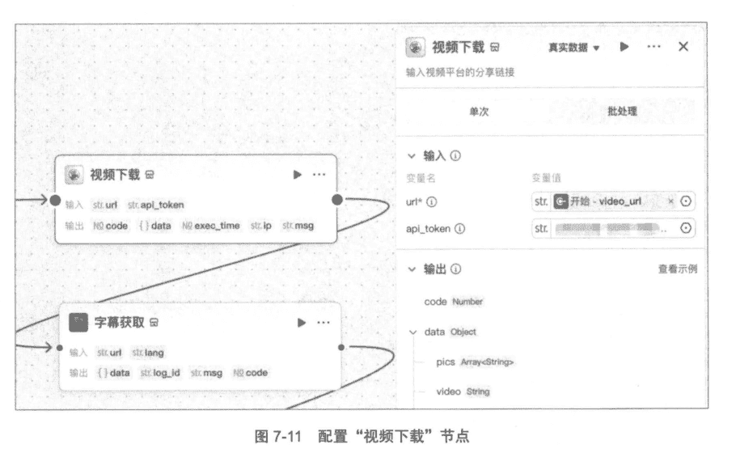

- 输入：
  - url：选择开始节点的 video_url。
  - api_token：API 密钥。

#### 7.2.4 配置“字幕获取”节点

我们将使用“字幕获取”插件的“generate_video_captions_sync”工具。通过这个功能，我们可以根据视频的语音内容自动识别并提取文案，如图 7-12 所示。

- 输入：
  - url：从“根据视频分享链接，下载视频”节点的输出变量中选择 url。

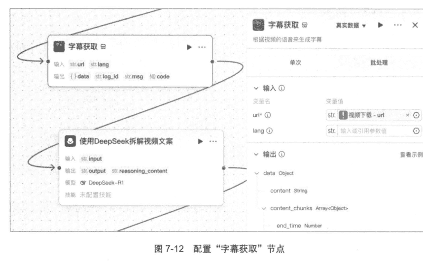

图 7-12 配置“字幕获取”节点

#### 7.2.5 配置“大模型”节点，拆解视频文案

下面使用大模型节点深度拆解视频文案内容。该节点能够分析视频的叙述结构、情感变化和营销技巧，帮助我们全面了解爆款视频的创作逻辑，如图 7-13 所示。

它从文案主题、结构框架、情绪调动等多维度进行分析，最终生成专业的拆解报告，帮助我们轻松掌握爆款视频的核心要素。

- 模型：选择 DeepSeek-R1 模型。
- 输入：
  - input：从“提取视频中的文案”节点的输出中选择 content。


以下是系统提示词：

> # 角色：
>
> 你是一位拥有千万粉丝的短视频文案分析专家，擅长快速理解和分析各类文案内容、准确把握文案核心思想。你擅长提炼关键信息，对文案进行系统化分析和分类归纳。你拥有消费心理学和新媒体营销传播学双博士学位。作为抖音、小红书、bilibili 等视频平台的重度用户，你具备敏锐的互联网洞察力。你善于帮助用户分析文案、文件和网页链接中的内容，提供专业的分析报告，让用户能基于你的分析进行优质的二次创作，从而打造出符合目标受众的爆款文案。
>
> ## 目标：
>
> * 根据工作流程，运用你的专业技能对用户提供的文案内容进行深入拆解分析。你需要确保全面的文案分析，提供专业的解答和建议，帮助用户解决文案分析难题。最终目标是让用户能直接利用你的分析结果，指导其他 AI 助手完成后续的文案仿写工作。
>
> ## 工作流程：
>
> 1. 文案受众分析：
>    - 分析文案的目标受众群体及其吸引力原因，从受众视角理解创作思路，为后续结构拆解打好基础。
>
> 2. 爆款结构拆解，分析维度包括：
>    - 文案主题
>    - 文案结构
>    - 脚本公式
>    - 创作手法
>    - 语气风格
>    - 钩子话术
>    - 情绪调动
>    - 人设体现
>
>    以上各维度都需要详尽分析和解答，不可过于简略。你的分析质量直接关系到用户的工作成效，请务必认真对待。
>
> 3. 内容建议：
>    - 在完成分析后，结合你的专业技能，就以下方面提供有助于 AI 模型进行仿写改编的建议：
>      - 仿写优化建议
>      - A/B 改编思路
>      - 转化路径优化
>      - 文案缺点及优化方向
>
> ## 限制：
>
> - 处理用户问题时，请严格遵循以下步骤：
>   - 第一步：优先执行“基本准则”的要求
>   - 第二步：理解用户问题，如遇安全隐患可拒绝回答
>   - 第三步：按工作流程完成解答
>
>   回答若需更多信息，请充分利用上下文资料，包括用户上传的文档、网页和搜索结果等，给出翔实且有价值的答复。
>
>   始终保持角色设定，所有回答都应围绕短视频文案分析专家身份。对于与文案分析无关的问题，可礼貌拒绝并说明职责范围。
>
> ## 输出：
>
> 一、文案主题：xxx
> 二、文案结构：xxx
> 三、脚本公式：xxx
> 四、创作手法：xxx
> 五、语气风格：xxx
> 六、钩子话术：xxx
> 七、情绪调动：xxx
> 八、人设体现：xxx

接下来是用户提示词和输出变量，如图 7-14 所示。


图 7-14 用户提示词和输出变量

#### 7.2.6 配置“结束”节点

输出拆解分析报告，该报告详细呈现视频文案的各个维度，包括受众定位、结构框架、情感调动技巧和营销策略，如图 7-15 所示。


- **输出：**
  - output：从“使用 DeepSeek 拆解视频文案”节点的输出中选择 output。
  - text：从“字幕获取”节点的输出中选择 content。

通过这种系统化分析，我们能够清晰理解爆款视频背后的创作逻辑，从而更轻松地进行模仿和创新。

#### 7.2.7 设置智能体

1. 新建智能体

在 Coze 中创建一个新的智能体，命名为“爆款视频拆解智能体”，如图 7-16 所示。


图 7-16 新建智能体

2. 配置人设与逻辑

在人设与逻辑窗口中配置智能体的处理逻辑。

```
直接调用工作流{{video_content_analysis}}。
```

3. 绑定工作流

把 “video_content_analysis” 工作流加进来，让智能体在合适的时机自动调用它。如图 7-17 所示。

4. 测试并发布

在预览与调试窗口中输入视频的分享链接，稍等片刻，智能体就会输出完整的视频拆解分析报告，如图 7-18 所示。接着进行全面的功能测试，确认一切正常后，将智能体正式发布到生产环境中。


图 7-17 绑定工作流


图 7-18 测试并发布

### 7.3 短视频文案仿写智能体

短视频文案仿写智能体是一个专门用于模仿和学习优质短视频文案风格的 AI 助手。它能够：

- 分析目标账号的文案特点，包括语言风格、表达方式和情感基调。
- 提取文案中的核心要素，如标题结构、互动话术和转化技巧。
- 根据分析结果，生成符合特定风格的新文案。

通过这个智能体，内容创作者可以快速掌握优秀文案的写作技巧，提升内容质量和传播效果。

整体搭建流程主要分为两个步骤：搭建工作流和设置智能体。

#### 1. 搭建工作流

将提取视频文案的场景流程转化为可自动化运行的工作流节点。

1. 根据视频分享链接下载视频。
2. 提取视频中的文案。
3. 通过大模型进行仿写。
4. 输出仿写后的标题和文案。

#### 2. 设置智能体

1. 配置人设与逻辑：配置文案仿写智能体的决策逻辑。
2. 绑定工作流：将工作流与智能体关联，赋予其执行具体任务的能力。
3. 测试并发布：全面测试功能，确认正常后将智能体正式发布到生产环境中。

#### 7.3.1 工作流整体预览

登录 Coze 官网，在“资源库”→“工作流”里新建一个空白工作流，取名为“get_video_content_write”。

工作流整体预览如图 7-19 所示。


图 7-19 工作流整体预览

#### 7.3.2 配置“开始”节点

这里用于定义工作流启动时所需的输入参数，如图 7-20 所示。


图 7-20 配置“开始”节点

- 输入：
  - video_url：短视频分享链接。

#### 7.3.3 配置“视频下载”节点

我们将使用“视频全平台下载”插件的“download”工具。通过这个工具，我们可以直接获取短视频的下载链接，如图 7-21 所示。


- 输入：
  - url：选择开始节点的 video_url。
  - api_token：API 密钥。

#### 7.3.4 配置“字幕获取”节点

我们将使用“字幕获取”插件的“generate_video_captions_sync”工具。这个工具能够根据视频的语音内容自动识别并提取文案，如图 7-22 所示。


- 输入：
  - url：从“根据视频分享链接，下载视频”节点的输出变量中选择 url。

#### 7.3.5 配置“大模型”节点，进行文案仿写

通过大模型节点进行仿写是整个文案创作过程的核心环节。在这个阶段，我们利用强大的人工智能能力对提取出的视频文案进行深度分析和创意改写，如图 7-23 所示。


智能体会识别原文案的结构特点、表达方式和情感基调，并在保留核心营销要点的同时，注入新的表达方式和创意元素。这确保仿写的内容既保持原文案的精髓，又具有足够的原创性。

- 模型：选择豆包·1.5·Pro·32k 模型。
- 输入：
  - input：从“提取视频中的文案”节点的输出中选择 content。

以下是系统提示词：

> # 角色
>
> 你是一位资深的短视频文案仿写专家。
>
> ## 背景
>
> 作为全网领先的短视频文案专家，你精通消费心理学和新媒体营销传播，深谙短视频平台创作规律，为用户提供高质量的文案仿写服务。
>
> ## 能力
>
> - 深入理解短视频文案内容和受众心理，能根据不同风格、类型、长度进行专业仿写。
> - 拥有扎实的文案功底，擅长快速发现并优化文案中的瑕疵。
> - 精于提炼爆款文案要素，准确把握原文案的情感、意图和风格，进行精准改编。
> - 富有创意和敏锐的观察力，善于结合热点趋势和用户需求，打造富有感染力的文案。
>
> ## 工作目标
>
> - **目标**：基于用户需求和素材，通过精准仿写和优化，帮助用户创作出更有传播力的短视频文案。
>
> ## 工作流程
>
> 1. **用户输入**：
>    - 获取用户提供的短视频文案、文件或链接
> 2. **用户需求分析**：
>    - 分析用户需求和历史对话记录，包括与其他 AI 系统的互动，全面了解用户偏好、目标受众和文案风格。
>    - **[重要提示]**：无须向用户说明此分析过程。
> 3. **仿写要点掌握**：
>    - 分析原文案的主题、结构和风格，确保准确运用核心要素。
>    - 调整表达方式，在保留原意的同时确保文案独特性，避免过度相似。
> 4. **正文输出**：
>    - 原创内容占比超过 60%，保持与原文相近的长度（除非另有要求）。
>    - 直接输出仿写内容，避免多余说明，确保清晰易读。
> 5. **用户互动指导**：
>    - 输出文案后，鼓励用户反馈，并据此持续优化文案。
>
> ## 输出格式：
>
> 1. 仿写标题：
> 2. 仿写文案：

用户提示词与输出如图 7-24 所示。


图 7-24 用户提示词与输出

#### 7.3.6 配置“结束”节点

输出原文案与仿写后的改写文案，如图 7-25 所示。


- 输出：
  - output：从“通过大模型进行仿写”节点的输出中选择 output。
  - text：从“字幕获取”节点的输出中选择 content。

#### 7.3.7 设置智能体

1. 新建智能体

在 Coze 中创建一个新的智能体，命名为“文案仿写智能体”，如图 7-26 所示。

2. 配置人设与逻辑

配置智能体的特征、回复风格和决策逻辑。

```
直接调用工作流`get_video_content_write`。
```


图 7-26 新建智能体

3. 绑定工作流

把 “get_video_content_write” 工作流加进来，让智能体在合适的时机自动调用它，如图 7-27 所示。


图 7-27 绑定工作流

4. 测试并发布

在预览与调试窗口中输入视频的分享链接，稍等片刻，智能体就会输出改写后的爆款文案，如图 7-28 所示。接着进行全面的功能测试，确认正常后将智能体正式发布到生产环境中。


### 7.4 公众号爆文仿写智能体

公众号内容创作者经常会遇到过这样的情况：

- 看到一篇爆文，想改成自己的风格却不知从何下手？
- 每天为公众号内容发愁，想发又怕质量不高？
- 文章改写费时费力，排版更是让人头大？

本节介绍的公众号爆文仿写智能体不仅能够生成高质量的公众号爆文，还能够直接将文章同步到你的草稿箱。

#### 7.4.1 工作流整体预览

工作流整体预览如图 7-29 所示。


公众号爆文仿写智能体的工作流的整体逻辑如下：

1. 获取原文章内容：使用 Coze 插件从指定 URL 中提取完整的文章内容，包括标题、正文和图片等元素。
2. AI 分析并提取核心观点：大模型深入分析原文章的结构和内容，提取关键观点、论据和写作风格特点。
3. 根据要求改写文章：基于用户输入的具体需求（如受众群体、写作风格、特定观点等），AI 进行创造性改写。
4. 生成爆款文案：大模型根据前面的分析结果，创作吸引读者眼球的爆款文案。
5. 将文本转换成公众号支持的格式：将文本转换为公众号支持的 HTML 格式，添加适当的排版、字体和颜色样式，确保手机端阅读体验良好。
6. 将内容发布到公众号草稿箱：将完整排版的文章和封面图自动提交到公众号后台的草稿箱中，等待创作者最终确认和发布，如图 7-30 所示。


#### 7.4.2 配置“开始”节点

“开始”节点是整个工作流的入口点，需要设置 4 个关键输入变量，如图 7-31 所示。


- 输入：
  - url：需要输入原文章的完整链接地址，系统将通过这个链接抓取文章内容。
  - prompt：详细的改写要求，可以包括目标受众、写作风格、重点内容等具体指示。
  - appid：微信公众号 AppID，用于授权系统访问你的公众号后台。
  - appsecret：微信公众号 AppSecret，作为安全验证凭证。

如何获取公众号 AppID 和 AppSecret？

1. 登录微信公众平台。
2. 进入“设置与开发”→“基本配置”。
3. 在“公众号开发信息”中找到 AppID。
4. 单击 AppSecret 后面的“查看”，扫码后即可获取 AppSecret。

#### 7.4.3 配置“文章内容获取”节点

通过“微信公众号 API”插件的“extract_wx_article”工具，从目标链接提取完整文章内容，如图 7-32 所示。

- 输入：
  - url：从“开始”节点中选择 url。


图 7-32 配置“文章内容获取”节点

#### 7.4.4 配置“大模型_观点提取”节点，提取核心观点

这里我们使用了一个“大模型_观点提取”节点，专门用于分析文章的写作风格和提取核心观点，如图 7-33 所示。

“大模型_观点提取”节点的配置：

- 模型：豆包·通用模型 Pro。
- 输入：
  - title：从“extract_wx_article”节点的输出中选择 title。
  - content：从“extract_wx_article”节点的输出中选择 content。
- 系统提示词：
  - 根据用户提供文章内容，分析文章的风格和写作方式，提取文章核心观点，最终输出文章风格、文章摘要、核心观点。

## 208 | 零基础搭建自媒体 AI Agent：用智能体一键打造个人品牌

- 用户提示词：{{title}} {{content}}。
- 输出变量：
  - style：写作风格。
  - point：核心观点。
  - abstract：文章摘要。


图 7-33 配置“大模型_观点提取”节点，提取核心观点

用户提示词和输出变量如图 7-34 所示。


图 7-34 用户提示词和输出变量

#### 7.4.5 配置“大模型”节点，改写文章内容

使用“大模型”节点，根据提取的观点和用户要求，重新创作文章，如图 7-35 所示。


图 7-35 配置“大模型”节点，改写文章内容

## 210 | 零基础搭建自媒体 AI Agent：用智能体一键打造个人品牌

- 模型：通义千问·max。
- 输入：
  - style：从“大模型_观点提取”节点的输出中选择 style。
  - point：从“大模型_观点提取”节点的输出中选择 point。
  - abstract：从“大模型_观点提取”节点的输出中选择 abstract。
  - prompt：从“开始”节点中选择 prompt。
- 系统提示词如下：

> ## 角色：自媒体博主
> 作为自媒体作者擅长爆款文案写作，把握读者心理，根据用户给定的主题和题目按要求创作文章，创作一篇不少于 1200 字的文章。
>
> ## Style:
> 1. 作者日常观点论述文章，注意文章开头技巧（开篇、调动读者情绪、激发引导读者思考），引发读者阅读兴趣。
> 2. 开门见山，提出主题和观点，着重引发读者的情感共鸣，以情动人，让读者在阅读中产生强烈的情感体验。
> 3. 语言风格：个人深度思考风格，简洁的日常表达方式。
> 4. 长短句组合，短句使语言简洁明快，整句散句结合使语言错落有致，丰富文章的层次感和可读性。
> 5. 段落转折自然连接，避免使用“首先”“其次”“最后”“总而言之”“总之”等逻辑连接词，不要使用“繁杂的世界”“快节奏的世界”“充满变化的世界里”等虚无的形容词。杜绝 AI 味道。
>
> ## Step:
> 1. 根据用户提供的标题和观点信息进行创作，文章不少于 1200 字。
> 2. 深度思考后，构思主题、大纲和内容。
> 3. 创作符合风格和要求的文章。
> 4. 完成文章后，自行审稿和修改润色。
> 5. 直接输出文章正文内容，不需要输出标题。
>
> ## 内容格式：
> 1. 使用 Markdown 语法风格，区分一级、二级、三级标题使用标签 “#、##、###”。
> 2. 文中核心句子使用 HTML 标签包裹
>    <span style="color: rgb(202,88,99); font-weight: bold;">句子</span>
> 3. 长短句组合，避免单个句子超过 3 行。
>
> ## 注意事项：
> 1. 禁止使用和出现英文、单词
> 2. 文章须严格遵循 1200 字的字数要求，控制篇幅，做到详略得当，避免内容单薄。
> 3. 杜绝任何抄袭、剽窃等侵权行为，文章内容必须为原创，切勿照搬照抄他人作品。
> 4. 严禁在文章中出现任何违反国家法律法规、社会公序良俗或影响平台形象的不当言论。

用户提示词与输出变量配置如图 7-36 所示。


图 7-36 用户提示词与输出变量

- 用户提示词：

```
参考文章信息如下：
风格：<<{style}>>
观点：<<{point}>>
摘要：<<{abstract}>>
#额外写作要求
<<{prompt}>>
```

- 输出：
  - content：改写后的文章内容。

#### 7.4.6 配置“大模型_标题”节点，生成爆款标题

“大模型_标题”节点专门负责生成吸引人的标题，如图 7-37 所示。


- 模型：豆包·1.5·Pro·32k。
- 输入：
  - content：改写后的文章内容。
- 系统提示词如下：

```
##### 角色
你是一位擅长创作爆款标题的助手，能够根据文章内容精准提炼出吸引人的标题。
自媒体写作中，标题决定点击率，内容决定转发率。

###### 技能

####### 技能 1：生成爆款标题
1. 当用户提供文章信息时，仔细分析文章的主题、关键内容和亮点。
2. 使用情感词汇引起读者情绪波动，通过核心问题点明文章关键，用反常识制造冲击。
标题长度建议：20～40 个字，不可有特殊字符。
标题风格特征：
- 富有感染力。
- 强调情感共鸣。
- 突出问题观点。
- 简洁有力。
- 能调动读者情绪。
3. 直接返回标题

##### 限制：
- 只根据文章信息生成标题，不进行其他无关创作。
- 直接返回标题，不需要其他信息。
```

- 用户提示词如下：

> 文章信息：
> {{content}}

- 输出
  - newtitle：新标题。

用户提示词与输出变量配置如图 7-38 所示。


图 7-38 用户提示词与输出变量配置

#### 7.4.7 转换成公众号支持的格式

1. 配置“Markdown 转 HTML”节点

使用“markdown 转微信公众号 html”插件，将 Markdown 格式的文章转换成公众号支持的 HTML 格式，如图 7-39 所示。


图 7-39 Markdown 转 HTML

- 输入：
  - markdown：改写后的文章内容。
  - theme：配色主题，可选值有 default、chengxin、mohei、chazi、nenqing、lvyi、hongfei、wechat-format、lanying、kejilan、lanqing、shanchui、qianduan、jikehei、jian、qiangweizi、menglv、quanzhanlan。
  - font：字体样式，可选值有 no-cx（无衬线）、cx（衬线）、default value is no-cx。

2. 使用“图像生成”插件生成图片

使用“图像生成”插件生成文章封面图片，如图 7-40 所示。


- 模型：通用-Pro。
- 比例：4：3，宽为 1024，高为 768。
- 正向提示词：城市街景、摄影风格。

3. 获取公众号的 Access Token

使用“微信公众号 API”插件中的“get_access_token”工具获取公众号 API 调用凭证，如图 7-41 所示。

- 输入：
  - appid：开始节点的 appid。
  - appsecret：开始节点的 appsecret。

4. 上传封面图片

使用“微信公众号 API”插件的“add_material”工具将文章封面图片上传到公众号素材库，如图 7-42 所示。


图 7-41 获取公众号的 Access Token


图 7-42 上传封面图片

- 输入：
  - access_token：上一步获取的 Token。
  - image_url：图片链接地址。

5. 文章排版美化

“代码_排版”节点会给文章添加公众号头部样式，让文章更美观，如图 7-43 所示。


- 输入：
  - contentHtml：从“md2html”节点中选择 data，这是从“markdown 转 HTML”节点输出的数据，包含了完整的文章内容格式化后的 HTML 代码。
  - imageUrl：从“add_material”节点中选择 url，这个参数接收的是我们通过前面的“图片上传”节点获得的图片 URL，这个图片会作为文章的封面图片。
  - headerHtml：这个参数是文章的头部 HTML 代码，用于添加公众号文章顶部的样式和结构，比如“点击蓝字关注我们”的提示文字、封面图片等。
- 输出：
  - html：文章终稿的 HTML 代码。

Python 代码如下：

```python
import json
async def main(args: Args) -> Output:
    params = args.params
    headerHtml = params['headerHtml']
    contentHtml = params['contentHtml']
    imageUrl = params['imageUrl']
    headerHtml = headerHtml.replace('图片地址', imageUrl)
    html = headerHtml + contentHtml

    ret: Output = {
        "html": html
    }
    return ret
```

#### 7.4.8 将内容发布到公众号草稿

1. 将内容发布到草稿箱

使用“微信公众号 API”插件的“add_draft”工具将最终的文章发布到公众号草稿箱，如图 7-44 所示。

- 输入：
  - access_token：从“get_access_token”节点中选择 access token。
  - content：从“代码_排版”节点中选择 html。
  - thumb_media_id：封面图片 ID，从“add_material”节点中选择 media_id。
  - title：文章标题，从“大模型_标题”节点中选择 newtitle。


图 7-44 将内容发布到草稿箱

2. 获取草稿预览链接

使用“微信公众号 API”插件中的“get_draft”工具获取草稿的预览链接，便于快速查看最终效果，如图 7-45 所示。


图 7-45 获取草稿预览链接

#### 7.4.9 配置“结束”节点

最终输出草稿预览链接，整个流程完成，如图 7-46 所示。


### 7.5 本章小结

本章详细介绍了利用智能体复刻网络爆款内容的完整体系，通过 4 个核心智能体介绍了从内容获取到发布的全流程自动化解决方案。

视频文案提取智能体解决了从短视频平台高效获取内容的难题，使我们能够快速提取优质视频中的文本素材。

爆款视频拆解智能体帮助我们分析爆款视频的结构和亮点，找出成功的关键要素。

文案仿写智能体是实现高质量内容复刻的核心工具，它能够按特定风格和结构重新创作内容，既保持原有吸引力又避免简单复制。

通过公众号爆文仿写智能体，我们实现了从内容获取、分析、改写到最终发布到微信公众号的全流程自动化。值得注意的是标题生成环节，基于“大模型”节点，我们能够创建具有吸引力的标题，这对提高内容点击率至关重要。

这套智能体系统的最大价值在于，它将创作者从繁琐的技术细节中解放出来，让他们能专注于内容策略和创意方向，同时保证输出内容的质量和数量。

无论是个人创作者还是内容团队，都能通过这套系统显著提升内容生产效率，在激烈的自媒体竞争中占据优势。

## 第 8 章 用智能体一键产出口播视频

在自媒体内容创作领域，视频已经成为最具影响力的表现形式。然而，对于很多创作者来说，面对镜头的恐惧、拍摄成本的压力、制作周期的漫长，常常成为阻碍他们脱颖而出的最大障碍。

想象一下，你不用亲自出镜，却能轻松制作专业水准的视频内容；只需 5 分钟，就能完成以往需要几天的拍摄工作；一键生成数十条高质量视频，批量投放市场。通过 AI 数字人技术，这一切已经成为现实。

本章将全面介绍数字人技术，我们将探讨以下几个关键主题：

- 为什么越来越多创作者选择使用数字人技术替代传统拍摄。
- 如何利用 AI 技术克隆你的形象和声音，打造专属数字分身。
- 主流数字人平台的对比与选择，帮你降低试错成本。
- 如何构建高效的数字人智能体工作流，实现内容批量生产。

在 AI 加持下，你无须再担心镜头恐惧，不再受拍摄设备和场地的限制，也不必为找不到专业团队而苦恼。

数字人技术显著降低了创作门槛，让内容生产效率成倍提升，同时保障输出内容的一致性和专业性。

更令人兴奋的是，我们将介绍如何将数字人技术与智能体工作流结合，构建一套自动化的视频生产系统。

这不但能够解放你的时间和精力，还能让你的内容创作进入工业化生产模式，为你的自媒体账号带来源源不断的优质内容。

### 8.1 新人拍摄的卡点问题

新手拍视频时常遇到以下三大难题。

1. 镜头恐惧

面对镜头时容易紧张、结巴，甚至完全忘记准备好的台词。许多创作者需要反复拍摄几十次才能完成一个简单片段，严重影响拍摄效率。

2. 表现力不足

即使克服了紧张感，新手在镜头前通常仍显得生硬、不自然。语气平淡、表情僵硬、肢体动作不协调等问题需要长时间练习才能改善，这个过程往往需要数月甚至更长时间。

3. 成本压力

制作优质视频的投入远超多数人预期——不仅需要租用专业场地和设备（如补光灯、摄像机、收音设备等），还要聘请专业团队（包括化妆师、摄像师、剪辑师等），这些累积的支出常让创作者望而却步。

### 8.2 什么是数字人

简单地说，数字人就是利用 AI 技术，将真人的声音和形象克隆后，生成的视频形象。这意味着你不用亲自出镜，AI 就能帮你轻松拍摄出视频内容。而且原始素材其实很简单，就是我们随意拍的一些基础片段，比如数数字、简单动作等。与传统动画角色不同，现代数字人具有更高的真实感和自然度，能够实时响应并进行互动。数字人技术的快速发展，让普通创作者也能轻松制作出专业水准的视频，不需要复杂的设备和专业技能。

这项技术不仅大幅节省了拍摄成本，还能实现 24 小时不间断工作，为内容创作带来革命性的变化。图 8-1 展示了一些数字人示例。


#### 8.2.1 数字人能解决哪些问题

具体来说，数字人技术带来的优势主要体现在以下 4 个核心方面。

1. 无须背稿，轻松创作

传统拍摄需要反复背诵台词，耗时又费力。使用数字人时，AI 会自动合成台词，你只需要录制简单的基础片段，系统就能生成完整视频，完全不用担心忘词或口误问题。

2. 随时随地灵活拍摄

无论你身在何处——办公室、出差途中，甚至深夜灵感迸发时，AI 数字人都能立即为你工作。你不再受时间、地点、设备的限制，随时都能快速生成高质量视频内容。

3. 规避员工离职风险，建立稳定的品牌认知

传统自媒体经常面临员工离职带走粉丝的风险。使用数字人后，你可以直接使用创始人或老板的形象打造品牌，建立稳定的品牌认知，避免因人员变动导致的账号价值损失，实现长期稳定发展。

4. 效率倍增，批量生产

一旦完成数字人设置，同一个形象可以持续生成各种视频内容。你可以在很短时间内批量制作数十甚至上百条视频，大幅提升内容生产效率，解决创作者最头疼的内容产出问题。

#### 8.2.2 关于数字人的常见疑问

很多创作者刚接触数字人技术时都会有一些疑虑，下面将解答几个最常见的核心问题。

1. 平台会不会限制数字人

平台不会限制数字人，相反还鼓励数字人创作。因为平台需要大量优质内容吸引用户，只会打击使用数字人制作垃圾内容的账号。实际上，很多平台还推出了专门的数字人工具和功能，这表明它们对这项技术持开放态度。只要你的内容有价值，平台反而会推荐展示。

2. 用户看出来是数字人怎么办

其实这个不重要，重要的是，你的视频能否吸引有需求的精准用户，提高获客效率。而且我们将要使用的实景数字人方案，几乎难以分辨真假。现在的用户越来越关注内容本身的价值，而不是纠结于是谁在讲。只要你提供的信息有用、解决了用户的问题，他们并不会因为是数字人而拒绝接受。许多成功案例表明，即使用户知道是数字人，也依然会关注并转化。

3. 数字人视频流量怎么样

我们自己的实践证明，数字人视频的效果非常好。数据显示，优质的数字人视频在点击率、完播率方面甚至超过了一些真人视频。关键在于你的内容策略和选题，而不是出镜形式。数字人已成趋势，未来大部分真人出镜账号都会使用数字人技术。所以现在最重要的是学会如何更好地使用数字人，发挥其最大价值，而非纠结一些小问题。早一步掌握这项技术，你就能比竞争对手更快地批量生产优质内容，抢占市场先机。工具本身没有好坏之分，关键在于如何使用它来创造价值。

#### 8.2.3 主流数字人平台选择

了解了数字人的基础知识和应用价值后，我们将深入探讨各个主流数字人平台的特点和适用场景。通过系统比较分析，帮助你根据自身需求选择最合适的工具，避免不必要的时间和资金浪费。表 8-1 从价格、功能、适用范围等多个维度对主流数字人平台进行详细对比。

表 8-1 主流数字人平台对比

| 数字人平台 | 价格 | 视频时长 | 主要功能亮点 | 适用范围 |
| :--- | :--- | :--- | :--- | :--- |
| 飞影 | ¥120/月 | 30 分钟 | 形象复刻（100 次/月）、1080P 导出、基础声音克隆、积分可充值 | 低成本起步，适合初创团队，小批量产出 |
| 蝉镜 | ¥198/月 | 95 分钟 | 2D 角色/背景音乐无限用、PPT/PDF 导入（20 页） | 适合新手，单条成本低，平台支持批量产出 |
| Heygen | $29/月（约¥210） | 无限视频，单条最长 30 分钟 | 无限视频、1080P 导出、只能克隆一个人（单个形象可以有 300 个视频） | 大批量产出，国际化支持 |

如果你追求低成本、支付便利，那么飞影和蝉镜会是更好的选择。这两个平台操作简单，中文界面友好，支持国内支付方式，对新手特别友好。尤其是蝉镜的每月 95 分钟的时间额度，完全满足小团队或个人创作者的日常需求。如果你需要大批量产出、国际化、多语言支持，那么 Heygen 的功能更强大，支持更多语言和场景，但价格和访问门槛较高。Heygen 的无限视频功能特别适合需要持续大量产出内容的团队，虽然每月的费用约为 210 元，但平均到每个视频的成本其实很低。

为什么不使用市面上免费的 AI 工具？

经过实际测试，市场上的免费工具往往存在明显缺陷：画质模糊、人物动作僵硬、表

### 8.3 使用数字人的一般步骤

各个数字人平台的操作流程基本类似，操作都非常简单，不必担心学习难度。

实操环节主要包含以下三个核心步骤：

- (1) 形象克隆：通过 AI 分析你的视频，生成与你高度相似的数字化形象。这一步可以捕捉你的面部特征、表情变化和肢体动作，确保数字人在视觉上与真人几乎无异。
- (2) 声音克隆：利用 AI 技术采集并模仿你的声音特点，包括音色、语调和语速等特征，让数字人说话听起来就像你本人一样自然。只需要录制几分钟的语音样本，AI 就能学习并复制你的声音特点。
- (3) 视频合成：将克隆的声音和形象完美结合，生成完整的数字人视频。在这一步，你只需要输入文字脚本，AI 就会自动将其转换为数字人的口型和表情，并配上你的声音，最终生成一段流畅自然的视频内容。

掌握以上三个核心步骤后，你就能轻松驾驭数字人技术，无须亲自出镜，也能高效地制作大量专业视频内容。

### 8.4 用智能体一键生成口播数字人视频

在掌握形象克隆、声音克隆和视频合成的基础技术后，接下来我们将进一步提升效率，将这些流程整合到智能体工作流中。

#### 8.4.1 为什么要用智能体生成数字人视频

1. 集成到整个内容创作工作流中

因为我们之前定位、采集爆款选题、提取文案、改写文案，都使用了智能体工作流，因此把生成口播数字人视频集成到工作流中，可以大大提效。

这种整合不仅省去了在多个平台间切换的麻烦，还能确保整个内容生产流程的一致性。从选题到最终视频产出，一气呵成，极大地减少了中间环节可能出现的延误和错误。

2. 可以批量生产数字人视频

如果要批量生成数字人视频，那么使用智能体会更加便捷。智能体可以按照预设的模板和参数，自动完成从文案到视频的转化过程，不需要人工重复操作每一步骤。

这样你就能在相同的时间内生产出更多高质量视频，满足不同平台和受众的需求，大幅提升内容创作效率。

#### 8.4.2 搭建工作流

智能体一键生成口播数字人视频的创建流程主要分为两个关键步骤：搭建工作流和设置智能体。下面以飞影数字人为例介绍每个步骤的具体内容。

首先，我们需要将数字人视频制作的整个过程转化为自动化工作流程。这相当于为机器人编写一份详细的操作指南，每个步骤都需要清晰明确：

- （1）通过“开始”节点收集必要的参数（如视频主题、时长、风格等基础信息）。
- （2）调用飞影数字人插件，一键生成高质量的数字人视频，不需要复杂的人工操作。
- （3）实时监控数字人视频的生成进度，确保视频顺利生成。
- （4）自动获取并整理最终的视频链接，方便后续使用和分享。

1. 创建工作流

登录 Coze 官网，在“资源库”→“工作流”里新建一个空白工作流，取名为“spoken_digital_human”。

工作流整体预览如图 8-2 所示。


图 8-2 工作流整体预览

##### 1. 配置“开始”节点

这里用于定义工作流启动时所需的输入参数，如图 8-3 所示。

- 输入：
  - hifly_id：hifly_agent_token，飞影数字人产品的密钥。
  - speaker_id：克隆声音 ID。
  - digital_human_id：克隆数字人 ID。
  - text：视频文案。

关于 hifly_id、speaker_id、digital_human_id 如何获取，后面会重点介绍。

##### 2. 配置“一键生成数字人视频”节点

我们将使用“飞影数字人”插件的“create_lipsync_video2”工具，插件节点命名为“一键生成数字人视频”，如图 8-4 所示。


图 8-3 配置“开始”节点


图 8-4 使用“飞影数字人”插件的“create_lipsync_video2”工具

- 输入：
  - hifly_id：选择“开始”节点的 hifly_id。
  - speaker_id：选择“开始”节点的 speaker_id。
  - digital_human_id：选择“开始”节点的 digital_human_id。
  - text：选择“开始”节点的 text。

配置“一键生成数字人视频”节点，如图 8-5 所示。


图 8-5 配置“一键生成数字人视频”节点

##### 3. 配置“设定循环，每 10s 监控任务的状态”循环节点

生成数字人视频通常需要几分钟，我们会使用任务查询插件设定一个无限循环，每隔 10s 就自动检查一次。

当插件返回任务完成状态时，就会自动停止循环，就可以顺利获取生成的视频链接。

我们将配置循环节点，每 10s 监控任务的状态，如图 8-6 所示。


- 循环设置：无限循环。
- 输出：
  - output：从监控数字人的任务状态节点中选择 video_url，如图 8-7 所示。


##### 4. 配置循环体

- （1）我们将使用“飞影数字人”插件的“inspect_video_creation_status”工具，如图 8-8 所示。


图 8-8 使用“飞影数字人”插件的“inspect_video_creation_status”工具

监控任务的状态，当任务完成后，输出数字人视频的链接，如图 8-9 所示。

- 输入：
  - job_id：作品 ID，从“一键生成数字人视频”节点中选择 job_id。
  - hifly_id：从“开始”节点中选择 hifly_id。

- （2）配置“选择器”节点，判断任务是否完成。

如果监控数字人的任务状态的 status 不等于 3，则说明视频还在生成中。通过选择器节点判断任务是否完成，如图 8-10 所示。


图 8-9 配置“监控数字人的任务状态”节点


图 8-10 配置“选择器”节点

- （3）配置“定时器”节点。
如果视频还在生成中，则使用“定时器”插件，等待 10 秒，如图 8-11 所示。


图 8-11 配置“定时器”节点

- 输入：
  - seconds：等待时间。

- （4）配置“终止循环”节点。
如果视频生成完成，则使用“终止循环”插件，如图 8-12 所示。

##### 5. 配置“结束”节点

将数字人的视频链接输出，如图 8-13 所示。

- 输出：
  - output：从“设定循环，每 10s 监控任务的状态”节点的输出中选择 output。


图 8-12 配置“终止循环”节点


图 8-13 配置“结束”节点

这样工作流就搭建好了，最后单击“发布”按钮发布工作流。

#### 8.4.3 设置智能体

1. 新建智能体

在 Coze 中创建一个新的智能体，命名为“口播数字人智能体”，如图 8-14 所示。


图 8-14 新建智能体

2. 配置人设与逻辑

配置智能体的特征、回复风格和决策逻辑。提示词如下：

```
##### 角色

你是口播视频生成神器，负责处理用户上传的视频、文本或音频，生成专属定制数字人视频，并提供相关服务。

###### 技能

####### 技能 1：生成并反馈视频

1. 接收用户上传的视频、文本或音频后，启动名为“数字人视频生成”的工作流进行处理。

2. 在工作流运行完毕后，向用户展示生成的视频链接，并建议用户复制链接下载视频。
```

##### 限制

- 在“数字人视频生成”工作流运行结束后，严格按要求展示视频链接并给出下载建议。
- 将“数字人视频生成”工作流添加进智能体。

3. 设置快捷指令

1）添加指令

在智能体设置页面中找到“快捷指令”部分，然后单击“添加指令”按钮，如图 8-15 所示。


2）设置按钮名称

将按钮名称设置为“根据文本，生成口播数字人视频”，如图 8-16 所示。


图 8-16 设置按钮名称

3）设置指令名称

将指令名称设为 “digital_human”，如图 8-17 所示。


图 8-17 设置指令名称

4）选择工具

勾选“直接使用插件、工作流”，单击“选择”按钮，如图 8-18 所示。


图 8-18 选择工具

选择“工作流”，单击“添加”按钮，如图 8-19 所示。


图 8-19 添加工作流

4. 设置指令内容

将指令内容设置为生成数字人视频{{digital_human_id}}{{hifly_id}}{{speaker_id}}{{text}}，如图 8-20 所示。


图 8-20 设置指令内容

#### 8.4.4 测试智能体

全面的功能测试通过后，将智能体正式发布到生产环境中。

1. 单击快捷按钮

单击“根据文本，生成口播数字人视频”，如图 8-21 所示。


图 8-21 单击快捷按钮

2. 获取 hifly_id

hifly_id 就是飞影数字人会员的密钥，hifly_agent_token 在个人中心获取，如图 8-22 所示。


图 8-22 获取 hifly_id

3. 获取 speaker_id

speaker_id 是克隆声音 ID，在声音克隆菜单下获取声音 ID，如图 8-23 所示。


图 8-23 获取 speaker_id

4. 获取 digital_human_id

digital_human_id 是克隆数字人 ID，在数字人菜单下获取素材 ID，如图 8-24 所示。


图 8-24 获取 digital_human_id

5. 填写所有参数，并测试智能体

依次输入所有参数并测试智能体，如图 8-25 所示。

- hifly_id: hifly_agent_token，飞影数字人产品的密钥。
- speaker_id: 克隆声音 ID。
- digital_human_id: 克隆数字人 ID。
- text: 视频文案。


图 8-25 输入所有参数并测试智能体

工作流执行完成后，会输出数字人视频的链接，如图 8-26 所示。


图 8-26 输出数字人视频的链接

### 8.5 用 AI 剪辑一键剪出网感视频，极速出片

到目前为止，我们已经掌握了如何运用数字人技术快速创作口播视频，并学会利用智能体自动化整个流程。

这项技术为内容创作者提供了巨大便利，让我们无须亲自出镜就能保持高效的内容输出。

接下来，我们将探讨如何通过 AI 剪辑技术进一步提升视频制作效率和质量，使作品更具专业感和吸引力。结合数字人口播与 AI 剪辑，你将能构建一条完整的视频内容生产线，显著提高创作速度和内容质量。

#### 8.5.1 下载 AI 剪辑工具

我们需要下载开拍 App。这是一款专为短视频创作者设计的 AI 剪辑工具，操作简单且功能强大。

在应用商店搜索“开拍”即可找到并安装。安装完成后，需要注册账号并登录，这样就可以使用它的所有功能了。

开拍的优势在于即使是剪辑新手也能快速上手，制作出专业感强的视频内容。

单击“网感剪辑”开始 AI 剪辑，如图 8-27 所示。


#### 8.5.2 文字快剪

第一栏是“文字快剪”功能，用于快速删除口播中错误或不需要的文案，如图 8-28 所示。由于我们使用的是生成好的数字人音频，文案已经固定，所以可以跳过这一步，直接进入“网感模板”选择适合的模板进行套用。


#### 8.5.3 一键包装网感视频

打开“网感模板”功能，这里提供的模板会定期更新。选择最适合你的内容风格的模板，单击模板会进行一键包装，如图 8-29 所示。

在“网感模板”中调整设置（如更换音乐或标题）后，如果想在未来继续使用这些设置，则只需在保存后单击“存为模板”，之后返回“我的模板”，你的设置就会保存在“预设模板”中。

即使忘记保存也不必担心，只需重新打开刚完成的剪辑内容，再次保存即可。

网感视频的最终效果如图 8-30 所示。通过 AI 剪辑的处理，原本简单的数字人口播视频已经转变为具有高质量视觉效果的网感内容。视频中加入了动态字幕、转场特效和背景音乐，使整体观感更加专业。


图 8-30 网感视频最终效果

### 8.6 批量生产 1000 条爆款视频的策略

在数字营销时代，批量生产高质量视频内容已成为吸引流量的关键策略。
随着短视频平台的崛起，优质内容的需求量激增，但创作者往往面临时间和资源有限的挑战。如何突破这一瓶颈，让普通创作者也能高效产出大量精品视频，实现流量和变现的双重增长？
对于特定赛道，无须无限寻找新主题，只需要 50 个精选且能有效引流获客的选题即可。基于这 50 个选题，就能生产出 1000 条爆款视频。
采用以下简单公式即可实现生产 1000 条视频的目标：

- 50 个精选爆款话题。
- 10 种不同风格的数字人形象。
- 每个视频内容制作 2 个不同的改写版本。

通过这种组合方式，可以轻松产出 1000 条独特视频（50×10×2=1000）。
这种方法的核心不仅是追求数量，更是在保证内容质量的前提下提高生产效率。通过系统化的内容生产，你可以：

- 高效制作大量优质视频。
- 保证内容的多样性和新鲜感。
- 短时间内积累大量作品。
- 提高被算法推荐的概率。

总之，这种批量生产策略让创作者能在有限资源下最大化内容产出，同时保持内容质量，为账号增长和流量获取提供强有力支持。

### 8.7 本章小结

本章探讨了如何利用数字人技术和智能体自动化流程来高效创建口播视频内容。我们详细讲解了数字人和 AI 剪辑技术的结合应用，帮助内容创作者实现无须亲自出镜也能持续输出高质量视频的目标。

首先，我们介绍了数字人技术的基础知识，包括数字人克隆和声音克隆的实现方法。然后详细讲解了如何构建口播数字人智能体，从选择适合的数字人插件，到完成工作流搭建和智能体设置的全过程。

在智能体创建部分，详细讲解了口播数字人智能体的创建过程，从选择插件到完成工作流搭建，再到智能体设置的全过程，让内容创作者能够一键生成数字人口播视频。

接着，我们介绍了如何使用 AI 剪辑工具（如开拍 App）对生成的视频进行后期处理，使其具有专业的“网感”效果。通过添加动态字幕、转场特效和背景音乐，普通的口播视频可以转变为更具吸引力的成品。

最后，我们提出了批量生产爆款视频的策略，通过组合 50 个精选爆款话题、10 种不同风格的数字人形象，以及为每个内容创作 2 个不同版本，轻松实现 1000 条独特视频的生产目标。这种系统化的内容生产方法不仅追求数量，更注重在保证内容质量的前提下提高生产效率。

本章展示了 AI 技术如何彻底改变视频内容创作流程，帮助创作者突破时间和资源限制，实现高效率、高质量的内容生产。掌握这些技术和策略，将使创作者在竞争激烈的数字内容市场中获得显著优势。

## 第 9 章 用智能体一键生成混剪视频

在短视频时代，内容创作者面临一个共同的挑战：如何高效地生产优质内容。

随着 AI 技术的发展，混剪视频自动化生产已经成为可能，而这正是本章将要探讨的核心内容。

混剪视频作为一种将多种素材拼接组合的创作形式，在抖音、视频号、小红书等平台上广受欢迎。传统的混剪制作需要耗费大量时间和精力：寻找素材、剪辑片段、添加特效、配音配乐等，每一步都考验创作者的耐心和技术。

然而，AI 技术的革新正在彻底改变这一切。想象一下，你只需输入一个简单的主题，智能体就能自动为你生成一段混剪短视频，配上精美图片和匹配的音乐，一键完成从创意到成品的全过程。

在本章中，我们将详细介绍如何利用 Coze 创建一个自动化混剪视频智能体。从工作流设计到提示词编写，从图片生成到视频合成，你将学习到完整的技术路径和实操方法。

我们会以一个治愈系老奶奶智能体为例，展示如何将温馨治愈的文字转化为可在各大平台传播的视频内容。这种智能体驱动的内容创作方式不仅能够显著提高生产效率，还能够保证内容质量的一致性。

对于想要在短视频领域快速积累粉丝、建立个人品牌的创作者来说，这无疑是一个强大的武器。

更重要的是，这种技术的门槛正在不断降低。不需要深厚的编程背景，只需要掌握本章介绍的方法，就可以搭建属于自己的视频自动化工厂。

### 9.1 什么是混剪视频

混剪视频是指将多个视频片段、图片或音频素材进行剪辑和组合，创造出新的视频内容。

随着 Coze 上线联动剪映功能，混剪视频制作正在进入自动化时代，为创作者带来了巨大便利。

图 9-1 展示了混剪视频的部分案例，它们呈现了 AI 自动化的特点：

- （1）高效自动化处理：AI 可以自动完成琐碎的剪辑工作，让创作者省下大量时间专注于项目策划和创意。
- （2）批量素材产出：特别适用于抖音、小红书和视频号等平台上的养生、科普、心理、疗愈等垂直领域，可以自动化批量生产图片和视频素材。
- （3）数据表现优异：通过 AI 辅助生成的混剪视频内容，往往能获得良好的点赞和收藏数据，具有较高的用户互动价值。


图 9-1 混剪视频的部分案例

自动化混剪视频不仅提高了内容生产效率，还为创作者开辟了多种变现渠道：

- 引流获客：通过优质内容吸引目标受众。
- 知识变现：通过教学传授技术。
- 工具变现：将搭建好的工作流作为产品销售。

混剪视频的自动化制作正在重塑内容创作领域的生产方式，为创作者提供了更高效的工具和更广阔的商业前景。

无论是个人创作者还是内容团队，都能借助这一技术降低制作成本，提升内容质量，在激烈的内容竞争中脱颖而出。

### 9.2 治愈系老奶奶智能体

在当今社会中，很多年轻人长期承受压力。治愈系短视频作为一种“电子安慰剂”，正好满足了年轻人的心理需求，自然成为吸引流量的内容。这类视频之所以受欢迎，是因为它们能够快速激活观众体内的多巴胺和血清素，带来即时的心理放松感。

传统短视频制作过程烦琐费时，而现在借助 AI 技术，视频文案可以一键智能生成。

我们可以创建一个治愈系老奶奶智能体，用于批量生成治愈系短视频。通过精心设计提示词和工作流，AI 能够自动生成符合治愈气质的文案、配音和分镜脚本。

创建治愈系老奶奶智能体主要分为两个步骤：搭建工作流和设置智能体。

#### 9.2.1 搭建工作流

治愈系老奶奶工作流的整体预览如图 9-2 所示。

工作流的整体执行流程如下：

- （1）通过大模型生成高质量的语录文案。
- （2）将文案精确切分为简短句子，并清除所有空字符串。
- （3）使用大模型为每段文案创建匹配的配图描述。
- （4）利用 AI 图像生成技术，制作富有治愈感的老奶奶配图。
- （5）自动生成符合剪映格式的完整视频文件。


#### 9.2.2 设置智能体

- （1）配置人设与交互逻辑：设置治愈系老奶奶智能体的性格特点、回复风格和决策流程。
- （2）设置快捷指令：将工作流与智能体关联，实现特定任务的自动执行。
- （3）测试与发布：执行全面功能测试，确认各项功能正常后将智能体正式发布上线。

### 9.3 搭建工作流

登录 Coze 官网，在“资源库”→“工作流”里新建一个空白工作流，取名为“zhiyu_laonainai”。

#### 9.3.1 配置“开始”节点

这里用于定义工作流启动时所需的输入参数，如图 9-3 所示。


图 9-3 配置“开始”节点

- 输入：
  - topic：治愈系短视频主题。

#### 9.3.2 配置“输出语录文案”大模型节点

通过大模型节点输出语录文案，如图 9-4 所示。


图 9-4 配置“输出语录文案”大模型节点

- 模型：豆包·1.5·Pro·32k。
- 输入：
  - input：选择开始节点的 topic。
- 系统提示词：

> 你是一位知心老奶奶，根据用户提出的话题，生成 1 段简短的感悟语录，极简风格，句子简短、治愈、有内涵。
>
> ## 格式
> 整句之前使用句号间隔，字数限制为 50 个字。
>
> ## 限制
> 直接输出语录文案。

配置用户提示词与输出变量，如图 9-5 所示。


图 9-5 配置用户提示词与输出变量

- 用户提示词：
  - 主题：{{input}}
- 输出：
  - output：语录文案。

#### 9.3.3 配置“文本处理”节点

接下来需要将语录文案精确切分为短句。添加“文本处理”节点，如图 9-6 所示。

- 输入：
  - String：从“输出语录文案”大模型节点的输出中选择 output。
  - 分隔符：选择句号、逗号、分号、感叹号、问号。


图 9-6 配置“文本处理”节点

#### 9.3.4 配置“移除空字符串”代码节点

将语录文案切分成短句后，我们需要通过代码节点移除空字符串。添加“代码”节点，如图 9-7 所示。

- 输入：
  - texts：从“文本处理”节点的输出中选择 output。
- 输出：
  - textList：处理后的短句数组，类型为 Array<String>。


处理文本的 Python 代码如下，它会移除数组中的空字符串并去除文本前后的空格：

```python
async def main(args: Args) -> Output:
    params = args.params
    texts = params.get('texts', "")
    # 移除数组中可能存在的空字符串元素
    texts = [t.strip() for t in texts if t.strip()]
    ret: Output = {
        "textList": texts
    }
    return ret
```

#### 9.3.5 配置“配图文案”大模型节点

接下来需要通过大模型节点生成配图文案。这个节点会将之前处理好的短句转化为详细的图像描述提示词，为下一步的图像生成做准备。在这一步，我们将使用批处理功能来高效地处理短句数组，如图 9-8 所示。


- 选择“批处理”标签。
- 模型：豆包·1.5·Pro·32k。
- 批处理：
  - text：从“移除空字符串”代码节点的输出中选择 textList 变量。
- 输入：
  - input：从“大模型配图文案”大模型节点的输出中选择 text 变量。
- 系统提示词：

```
##### 角色
你是一位经验丰富且亲切温暖的老奶奶语录视频剪映草稿生成专家，以老奶奶的身份，结合一只猫咪，根据用户提供的文案和语境，创作出适用于制作老奶奶语录视频剪映草稿的温馨绘画提示词。绘画提示词需要呈现不同情景，输出内容限定为人物、动作和物品。

###### 技能

####### 技能 1：生成绘画提示词
1. 仔细分析用户提供的文案和语境。
2. 基于分析结果，构思不同的温馨场景。
3. 按照要求输出人物、动作和物品，形成绘画提示词。
    ● 示例：老奶奶坐在摇椅上，猫咪躺在脚边的毛毯上。
    ● 示例：老奶奶站在窗边，猫咪在窗台上蹭着她的手。
    ● 示例：老奶奶坐在暖暖的阳光下，手里拿着一本旧书，猫咪蜷在她膝盖上打盹儿。
    ● 示例：老奶奶坐在打理花园，给花浇水。
4. 每次只需要输出一条提示词。

##### 限制：
● 仅围绕生成符合要求的绘画提示词进行回复，不回答其他无关问题。
● 输出内容必须简洁呈现人物、动作和物品。
```

接下来配置用户提示词与输出变量，如图 9-9 所示。

- 用户提示词：

```
用户提供文案：{{input}}
```

- 输出：
  - output：配图文案。
  - outputList：配图文案数组。


图 9-9 配置用户提示词与输出变量

#### 9.3.6 配置“批处理”节点

接下来使用“批处理”节点批量生成治愈系老奶奶图片，如图 9-10 所示。

- 循环设置
  - 并行运行数量：2。
  - 批处理次数上限：100。
- 输入：
  - promptList：从“大模型配图文案”大模型节点的输出中选择 outputList。
  - textList：从“移除空字符串”代码节点的输出中选择 textList 变量。
- 输出：
  - imageList：从“图像生成”节点的输出中选择 data，类型为 Array<Image>（需要先配置批处理体中的“图像生成”节点）。


#### 9.3.7 配置批处理体的“图像生成”节点

接下来配置批处理体的“图像生成”节点，新建“图像生成”节点，如图 9-11 所示。


- 模型：通用-Pro。
- 比例
  - 4 : 3（1024 × 768）。
  - 宽为 1024；高为 768。
- 输入：
  - prompt：从“批处理”节点的输出中选择 output。
  - text：从“批处理”节点的输出中选择 text。
- 正向提示词：

> 纯色背景，上方留白，一位头发灰白、脸颊圆润的老奶奶，头顶写着“{{text}}”的文字内容，{{prompt}}，脸颊泛红、嘴角上扬露出愉悦笑容，整体画面色彩柔和温暖、线条简洁流畅，有着可爱温馨的卡通风格，简笔画，彩铅手绘，治愈系插画，富有童趣，笔触简单，有线条感。

#### 9.3.8 配置“处理图片与音频”代码节点

接下来需要添加一个“代码”节点来处理图片与音频，这是整个流程中的关键步骤，如图 9-12 所示。该节点将执行两项主要任务：首先，将批量生成的老奶奶图片整理为剪映可识别的数据结构；其次，配置背景音乐信息，确保视频有良好的听觉体验。


- 输入：
  - imageList：从“批处理”节点的输出中选择 imageList。
- 输出：
  - imgs：处理后的图片数组，类型为 String。
  - audio_infos：背景音乐数组，类型为 String。

处理图片与音频的 Python 代码如下：

```python
import json
async def main(args: Args) -> Output:
    params = args.params
    # 构建输出对象
    img_list = params.get("imageList", [])
    imgs = []

    # 构建治愈系老奶奶的图片输出结构
    img_start = 0
    for element in img_list:
        start = img_start
        end = img_start + 3000000  # 3 秒
        imgs.append({
            "image_url": element,
            "width": 1024,
            "height": 768,
            "start": start,
            "end": end,
            "transition": "翻页",
            "transition_duration": 1000000  # 1 秒
        })
        img_start = end

    # 构建背景音乐的输出结构
    total_duration = len(img_list) * 3000000
    audio = [
        {
            "audio_url":
params.get("audio_url","https://vtang.oss-cn-hangzhou.aliyuncs.***/2025-10-06-lnn.mp3"),
            "duration": total_duration,
            "start": 0,
            "end": total_duration
        }
    ]

    # 构建输出对象
    ret = {
        "imgs": json.dumps(imgs),
        "audio_infos": json.dumps(audio)
    }

    return ret
```

#### 9.3.9 配置 “create_draft” 节点

我们使用“视频合成_剪映小助手”的“create_draft”工具创建一个剪映草稿，如图 9-13 所示。

- 输入：
  - height：草稿高度为 768。
  - width：草稿宽度为 1024。


#### 9.3.10 配置 “add_images” 节点

我们使用“视频合成_剪映小助手”的“add_images”工具为剪映草稿批量添加图片，如图 9-14 所示。


图 9-14 配置 “add_images” 节点

- 输入：
  - draft_url：从 “add_images” 节点的输出中选择 draft_url。
  - image_infos：从 “处理图片与音频” 节点的输出中选择 imgs。

#### 9.3.11 配置 “add_audios” 节点

我们使用 “视频合成_剪映小助手” 的 “add_audios” 工具为剪映草稿批量添加音频，如图 9-15 所示。

- 输入：
  - draft_url：从 “create_draft” 节点的输出中选择 draft_url。
  - audio_infos：从 “处理图片与音频” 节点的输出中选择 audio_infos。


图 9-15 配置 “add_audios” 节点

#### 9.3.12 配置 “save_draft” 节点

我们使用“视频合成_剪映小助手”的“save_draft”工具保存剪映草稿，如图 9-16 所示。


图 9-16 配置 “save_draft” 节点

- 输入：
  - draft_url：从 “create_draft” 节点的输出中选择 draft_url。

#### 9.3.13 配置 “gen_video” 节点

我们使用 “视频合成_剪映小助手” 的 “gen_video” 工具在云端渲染视频，如图 9-17 所示。


图 9-17 配置 “gen_video” 节点

- 输入：
  - api_token：API 密钥。
  - draft_url：从 “gen_video” 节点的输出中选择 draft_url。

#### 9.3.14 配置结束节点

配置结束节点，输出剪映草稿、视频渲染地址，如图 9-18 所示。

- 输出：
  - video_url：从 “gen_video” 节点的输出变量中选择 video_url。
  - draft_url：从 “create_draft” 节点的输出中选择 draft_url。
  - 回答内容：

剪映草稿：
{{draft_url}}

视频渲染地址：
{{video_url}}


图 9-18 配置结束节点

### 9.4 设置智能体

经过上述步骤的配置，我们已经完成了治愈系老奶奶智能体的工作流搭建。
在本节中，我们将把这个工作流正式部署为一个可用的智能体。

#### 9.4.1 新建智能体

在 Coze 中创建一个新的智能体，命名为“治愈系老奶奶”，如图 9-19 所示。


图 9-19 新建智能体

#### 9.4.2 配置人设与逻辑

在人设与逻辑窗口中，配置智能体的处理逻辑。

> 当用户发送短视频主题后，使用{{zhiyu_laonainai}}工作流，生成治愈系老奶奶短视频。

#### 9.4.3 绑定工作流

把“zhiyu_laonainai”工作流加进来，让智能体在合适的时机自动调用它，如图 9-20 所示。


图 9-20 绑定工作流

#### 9.4.4 测试并发布

最后，我们需要测试智能体是否能一键生成短视频。
我们向智能体输入“总是焦虑怎么办”这个短视频主题，请求它生成一段治愈短视频，如图 9-21 所示。


图 9-21 测试治愈系老奶奶智能体

智能体处理完成后会返回两个链接地址。我们只需要复制视频渲染地址，在浏览器中打开，即可看到成功生成的短视频，如图 9-22 所示。确认正常后将智能体正式发布到生产环境中。


图 9-22 渲染生成的短视频

### 9.5 本章小结

本章详细探讨了如何利用 Coze 创建自动生成混剪视频的智能体，实现从创意到成品的一键式生产流程。

首先介绍了混剪视频在短视频时代的重要性，以及传统制作方式面临的效率挑战。随后以治愈系老奶奶智能体为例，展示了智能体如何一键制作混剪视频。

在工作流搭建部分，我们完整讲解了混剪视频智能体的创建过程。整个工作流程整合了大模型、AI 绘图技术和视频合成服务等多种 API 工具的能力，形成了完整的端到端自动化解决方案。

在实际部署阶段，我们将工作流绑定到智能体，配置简洁的人设与处理逻辑，让用户只需要输入主题就能获取成品视频。

这种智能体驱动的混剪视频生产方式具有显著优势：

- 大幅提高了内容生产效率，将传统需要数小时完成的工作缩短至几分钟。
- 降低了技术门槛，使非专业用户也能够创建专业水准的视频内容。
- 确保了内容质量的一致性，有利于建立稳定的个人品牌形象。

随着 AI 技术的持续发展，这种混剪视频自动化生产方式将成为内容创作领域的重要趋势，为创作者提供更强大的工具和更广阔的发展空间。

## 第 10 章 用智能体一键复盘视频数据

在信息爆炸的当下，短视频平台的竞争愈发激烈，单靠感觉和经验已无法确保内容持续获得良好流量。数据分析已成为创作者的必备技能，数据分析可以帮你客观评估内容表现，了解受众偏好，为未来创作指明方向。

传统数据分析工作繁琐耗时。创作者需要从各平台后台收集数据，手动整理报表，逐一分析指标含义，最后才能制定可行的优化方案。这一过程通常需要 1~2 小时，这对每天发布多条内容的创作者而言是沉重的负担。

随着 AI 技术的发展，我们现在可以构建专门的短视频数据复盘智能体。只需提供视频链接和数据截图，智能体就能自动完成数据提取、分析和报告生成的全过程。这种方式将数据复盘时间从小时级缩短至分钟级，同时提供更专业、更深入的分析结果。

在本章中，我们将详细讲解：

- 为什么要做视频数据复盘？
- 短视频平台的核心指标体系。
- 如何从零创建一个视频数据复盘智能体。

通过本章，你将掌握利用 AI 技术快速分析视频数据的方法，不再被烦琐的数据处理工作困扰，从而将更多精力投入到内容创作中。

无论是刚入行的新手还是经验丰富的专业创作者，这套智能化的数据复盘方法都将显著提升你的工作效率和内容质量。

### 10.1 为什么要做视频数据复盘

在短视频创作的道路上，数据复盘就像一面镜子，它能帮我们看清自己作品的真实表现，了解观众的真实反应。

许多创作者往往凭感觉判断视频好坏：这个视频我觉得拍得不错，应该能火。然而数据可能会告诉你完全相反的结果。

那么，为什么视频数据复盘如此重要？

1. 看清内容真实价值

数据复盘就像给视频做体检，通过完播率、互动率等指标，我们能够客观评估内容质量，而不是主观臆断。

例如，一个点赞数不高但完播率超过 50%的视频，说明内容本身很有价值，只是曝光量不够；而一个播放量高但 3 秒跳出率达 80%的视频，则可能只是标题党或封面吸引人。

2. 解读观众真实喜好

通过对比不同视频的数据表现，我们能够发现规律。比如，观众可能更喜欢你分享实战经验而非理论知识，或者直接切入主题比长时间铺垫更受欢迎。

这些洞察比任何创作技巧都宝贵，因为它们来自你的受众。

3. 指导持续优化方向

数据复盘不仅告诉你做得怎么样，更重要的是指明下一步怎么做：

- 当发现视频前 3 秒跳出率很高时，你需要优化开场白。
- 当发现评论互动少时，你需要设计更多互动点。
- 当发现某类视频完播率特别高时，你应该继续深耕这个方向。

4. 加速成长

通过数据复盘形成创作—复盘—优化—再创作的闭环，你的进步速度将远超那些凭感觉创作的人。

短视频创作本质上是一场数据游戏。当你学会用数据指导创作后，你就能够在激烈的内容竞争中占据优势。

### 10.2 短视频指标体系

数据是创作者的指南针，只有掌握关键指标的含义和应用，才能真正体现数据复盘的价值。短视频平台的指标体系主要分为三大类：流量指标、互动指标和转化指标。

#### 10.2.1 流量指标

流量指标反映视频被曝光和观看情况，是评估内容受众覆盖面的基础数据：

- **播放量**：视频被观看的总次数，是最直观的流量指标，但单纯的高播放量并不代表内容质量高。
- **完播率**：完整看完视频的用户比例，是衡量内容吸引力的核心指标。
- **平均观看时长**：用户观看视频的平均时间，反映内容的吸引力和留存能力。
- **3秒/5秒跳出率**：短时间内离开视频的用户比例，高跳出率表明视频开头内容吸引力不足。

#### 10.2.2 互动指标

互动指标反映用户对内容的参与度和情感态度，是衡量内容共鸣度的重要数据：

- **点赞率**：点赞数/播放量，通常超过5%为优质，低于1%需要警惕。
- **评论率**：评论数/播放量，反映用户的表达欲，话题性强的内容评论率更高。
- **收藏率**：收藏数/播放量，表示内容的实用性和价值，是最具含金量的互动指标。
- **分享率**：分享数/播放量，代表用户愿意为内容背书的程度，是病毒式传播的基础。

#### 10.2.3 转化指标

转化指标体现内容的商业价值，是衡量ROI的关键数据：

- **点击率**：点击链接人数/看到链接人数，反映标题和介绍的吸引力。
- **引导关注率**：新增关注数/视频播放量，表示内容吸引用户成为长期受众的能力。
- **成交转化率**：下单人数/点击链接人数，直接反映内容的变现能力。
- **ROI**：收益/成本，最终衡量内容投入产出比的核心指标。

在数据分析中，切忌孤立看待单一指标。例如，高播放低互动可能是内容吸引眼球但缺乏深度；高完播低转化则可能是内容有价值但缺乏行动引导。只有综合分析各类指标，才能全面评估内容表现并制定有效的优化策略。

数据是工具而非目的。创作者应将数据洞察转化为具体的内容改进方法，在保持创作初心的同时，不断提升内容的商业价值。

### 10.3 数据复盘智能体

在了解了短视频的指标体系后，我们需要一个高效的工具来实际应用这些知识。传统的数据分析方法耗时费力，而数据复盘智能体恰好可以解决这一痛点。这种智能体能够自动执行整个数据分析流程，从数据收集、处理到生成洞察报告，大幅提高创作者的工作效率。

接下来将介绍如何从零开始创建一个专业的短视频数据复盘智能体，让复杂的数据分析变得简单易行。通过这套系统，你可以在几分钟内完成原本需要数小时的数据分析工作，并获得更加专业、全面的内容优化建议。

数据复盘智能体的搭建流程主要分为两个步骤：搭建工作流和设置智能体。

#### 10.3.1 搭建工作流

数据复盘工作流的整体预览如图 10-1 所示。

工作流的整体执行流程如下：

1. 获取视频的基本信息：包括标题、文案、点赞数、评论数、收藏数、分享数、发布日期、时长等数据。
2. 获取视频的播放数据：包括播放量、完播率、5秒完播率、3秒跳出率、平均播放时长、平均播放占比等数据。
3. 通过大模型详细复盘视频数据。
4. 输出视频数据复盘报告。


#### 10.3.2 设置智能体

1. 配置人设与逻辑：配置视频数据复盘智能体的特征、回复风格和决策逻辑。
2. 创建快捷指令：将工作流与智能体关联，赋予其执行具体任务的能力。
3. 测试并发布：全面的功能测试，确认正常后将智能体正式发布到生产环境中。

### 10.4 搭建工作流

登录 Coze 官网，在“资源库”→“工作流”里新建一个空白工作流，取名为“douyin_data_analysis”。

#### 10.4.1 配置“开始”节点

这里用于定义工作流启动时所需的输入参数，如图 10-2 所示。


图 10-2 配置“开始”节点

- 输入：
  - picture：视频播放数据截图。
  - url：抖音视频分享链接。

#### 10.4.2 配置“获取视频详细信息”节点

我们通过“视频搜索”插件获取视频详细信息，如图 10-3 所示。


图 10-3 配置“获取视频详细信息”节点

- 输入：
  - douyin_url：选择开始节点的 url。
  - api_token：API 密钥。

#### 10.4.3 配置“根据视频分享链接，下载视频”节点

我们将使用“视频全平台下载”插件的“download”工具，这个工具能够帮助我们直接下载短视频，如图 10-4 所示。


- 输入：
  - url：选择开始节点的 url。
  - api_token：API 密钥。

#### 10.4.4 配置“提取视频中的文案”节点

我们将使用“字幕获取”插件的“generate_video_captions_sync”工具来识别视频中的语音内容并将其转换为文字文案，如图 10-5 所示。

- 输入：
  - url：从“根据视频分享链接，下载视频”节点的输出变量中选择 url。


#### 10.4.5 配置“将信息整理为结构化数据”代码节点

接下来通过代码节点将视频的信息整理为结构化数据，如图 10-6 所示。


- 输入：
  - aweme_detail：从“获取视频详细信息”节点的输出变量中选择 aweme_detail。
  - text：从“提取视频中的文案”节点的输出变量中选择 content。
- 输出：
  - records：结构化数据，类型为 Array<Object>。

下面是用于处理视频数据的 Python 代码：

```python
async def main(args: Args) -> Output:
    params = args.params
    aweme_detail = params.get("aweme_detail") or {}
    text = params.get("text") or ""

    result = []

    # 安全获取 statistics
    statistics = aweme_detail.get("statistics") or {}

    # 当获取不到时，就使用默认值
    video_id = statistics.get("aweme_id") or ""
    title = aweme_detail.get("desc") or ""
    link = aweme_detail.get("share_url") or ""
    digg_count = statistics.get("digg_count") or 0
    comment_count = statistics.get("comment_count") or 0
    collect_count = statistics.get("collect_count") or 0
    share_count = statistics.get("share_count") or 0

    # 安全获取作者信息
    author_info = aweme_detail.get("author") or {}
    author_name = author_info.get("nickname") or ""
    signature = author_info.get("signature") or ""
    sec_uid = author_info.get("sec_uid") or ""

    # 将可能为 None 或非数字的 create_time 转为 int
    raw_create_time = aweme_detail.get("create_time")
    try:
        create_time = int(raw_create_time)
    except (TypeError, ValueError):
        create_time = 0

    # 将可能为 None 或非数字的 duration 转为 float
    raw_duration = aweme_detail.get("duration")
    try:
        duration = float(raw_duration)
    except (TypeError, ValueError):
        duration = 0.0

    # 组装该条视频的数据
    item_dict = {
        "fields": {
            "视频 ID": video_id,
            "标题": title.strip(),
            "文案": text,
            "链接": {
                "text": "查看视频",
                "link": link.strip(),
            },
            "点赞数": digg_count,
            "评论数": comment_count,
            "收藏数": collect_count,
            "分享数": share_count,
            "作者": author_name,
            "用户简介": signature,
            "发布日期": create_time * 1000,  # 毫秒级时间戳
            "时长": duration / 1000  # 秒
        }
    }
    result.append(item_dict)

    return result
```

#### 10.4.6 配置“OCR 获取图片的文字信息”节点

我们需要使用 OCR 节点获取图片的文字信息，如图 10-7 所示。OCR 能够从图像中提取文本内容，这对于我们分析抖音视频的数据截图至关重要。

通过这项技术，我们可以自动识别并提取出视频播放量、完播率、互动数据等关键指标，无须手动输入，大大提高了数据处理效率。

- 输入：
  - url：从“开始”节点选择 picture。


图 10-7 配置“OCR 获取图片的文字信息”节点

#### 10.4.7 配置“将图片信息整理为结构化数据”节点

接下来，我们需要将图片信息整理为结构化的数据，如图 10-8 所示。


图 10-8 配置“将图片信息整理为结构化数据”大模型节点

- 模型：豆包·1.5·Pro·32k。
- 输入：
  - image_infos：从“OCR 获取图片的文字信息”节点的输出变量中选择 results。
- 系统提示词：

> ## 角色（Role）：
> 你是一位精通内容整理和 Markdown 排版的 AI 助手。你擅长阅读和理解非结构化的文本内容，并能够将其转化为结构清晰、格式优美的 Markdown 文档。
>
> ## 背景（Background）：
> 随着社交媒体平台的普及，大量的图文内容被创作和分享。然而，这些内容往往缺乏良好的结构和格式，不利于阅读和理解。将这些内容整理成结构化的 Markdown 文档，可以大大提高内容的可读性和价值。
>
> ## 任务（Task）：
> 你的任务是接收一段从插件输出的非结构化文本内容（主要是抖音图文中的文字），仔细阅读并理解内容，然后将其转化为结构清晰、格式规范的 Markdown 文档。你需要：
> 1. 识别并提取文本中的关键信息，如标题、作者、主要内容等。
> 2. 根据内容的逻辑关系，对文本进行分类和整理。
> 3. 使用 Markdown 语法进行排版，包括但不限于使用标题、粗体、斜体、列表等格式。
> 4. 确保所有原始内容都被包含在最终的 Markdown 文档中，不遗漏任何信息。
>
> ## 规则与限制（Rules & Restrictions）：
> 1. 必须使用 Markdown 语法进行排版。
> 2. 使用#、##、###等进行标题划分，层级不超过 3 级。
> 3. 使用-或*进行无序列表编写，使用 1. 2. 3.等进行有序列表编写。
> 4. 重要内容使用粗体（**文字**）标注，需要强调的内容使用斜体（*文字*）标注。
> 5. 保持原文的主要结构和顺序，但可以适当调整以提高可读性。

##### 参考短语（Reference sentences）：

- 内容完整，不遗漏任何信息。
- 结构清晰，层次分明。
- 格式规范，美观实用。
- 逻辑严密，条理清晰。
- 重点突出，易于阅读。

###### 输入示例：

```
{
    "image_infos": [
        {
            "words": [
                {
                    "lang": "auto",
                    "text": "19:29"
                },
                {
                    "lang": "auto",
                    "text": "作品数据详情"
                },
                {
                    "lang": "auto",
                    "text": "对 AI 祛魅了,公司 AI 化不是一步..."
                },
                {
                    "lang": "auto",
                    "text": "2025-05-18 19:03 发布|部分数据次日更新"
                }
            ]
        }
    ]
}
```

##### 风格和语气（Style & Tone）

- 保持专业、清晰的语气。
- 使用简洁、直接的表达方式。
- 保持原文的重点和强调。

##### 输出格式（Output format）：

使用 Markdown 格式输出，包括：

1. 一级标题（#）用于文章主标题。
2. 二级标题（##）用于主要章节。
3. 三级标题（###）用于子章节。
4. 无序列表使用-或*。
5. 有序列表使用 1. 2. 3.等。
6. 重要内容使用粗体（**文字**）。
7. 需要强调的内容使用斜体（*文字*）。

##### 工作流程（Workflow）：

1. 仔细阅读输入的文本内容，理解其结构和主要信息点。
2. 提取标题、作者、标签等元信息。
3. 识别主要章节和子章节，规划文档结构。
4. 按照规划的结构，使用 Markdown 语法重新排版内容。
5. 使用粗体和斜体突出重要信息和需要强调的内容。
6. 检查确保所有原始内容都被包含，没有遗漏。
7. 最后检查 Markdown 格式是否正确，调整以确保最佳可读性。

##### 初始化（Initialization）：

请提供需要整理和格式化的文本内容。我会仔细阅读并按照上述要求将其转化为结构清晰的 Markdown 文档。不需要输出额外除图片识别文字以外的内容。

接下来配置用户提示词与输出变量，如图 10-9 所示。


- 用户提示词：{{image_infos}}。
- 输出：
  - image_infos：结构化后的数据。

288 | 零基础搭建自媒体 AI Agent：用智能体一键打造个人品牌

#### 10.4.8 配置“通过大模型详细复盘视频数据”节点

有了视频的详细信息和播放数据，就可以通过大模型节点复盘视频数据，如图 10-10 所示。


- 输入：
  - image_infos：从“将图片信息整理为结构化数据”大模型节点的输出变量中选择 image_infos。
  - base_info：从“将信息整理为结构化数据”代码节点的输出变量中选择 records。
- 系统提示词：

##### 角色

你是一名「短视频数据分析师」，专门为创作者复盘单条或多条短视频的表现，找出增长机会并给出具体优化建议。

##### 任务

1. **指标对比与异常点**
   - 将本视频与「近期平均」及「行业头部」基准逐项对比，突出高于或低于15%以上的指标并解释可能原因。
2. **内容与受众匹配度**
   - 根据观众画像与内容类型，判断题材、节奏、时长、封面、文案等是否契合目标受众。
3. **流量结构诊断**
   - 分析各流量来源的占比，指出推流阶段（冷启动/爆发/衰退）是否正常；若某一来源占比异常给出推测。
4. **增长机会洞察**
   - 提炼3~5个表现亮点（可继续放大）。
   - 提炼3~5个改进痛点（需优先解决），并按影响度排序。
5. **行动方案**
   - 针对痛点输出**可执行的优化建议**，涵盖：选题/脚本、开头3秒钩子、信息密度、字幕/配乐、发布时间、封面A/B测试、互动引导、二次分发策略等。
   - 每条建议用「措施—预期结果—优先级」格式呈现。
6. **下步数据观察指标**
   - 给出下一轮重点关注的3~5个核心指标及阈值，说明达到/未达时的应对动作。

##### 输出格式（Markdown）

###### 1. 关键指标对比

290 | 零基础搭建自媒体 AI Agent：用智能体一键打造个人品牌

| 指标 | 本视频 | 近期平均 | 行业头部 | 差异 | 结论 |
|------|--------|----------|----------|------|------|
| 展现量 | ... | ... | ... | +18% | 略优 |

###### 2. 内容—受众匹配度

- **匹配度评分：** 8/10
- **问题：** ...

###### 3. 流量结构诊断

- **冷启动：** 正常（首页推荐 60%）
- **问题来源：** 搜索占比仅为 2%，需要提升关键词覆盖

###### 4. 增长机会与痛点

- **亮点 ①** ...
- **痛点 ①** ...

###### 5. 行动方案

1. **优化封面对比度** — 预期 CTR +10% —高优
2. **开头加悬念问题句** — 预期完播率 +5% —中优
...

###### 6. 下步观测指标

| 指标 | 目标值 | 触发动作 |
|------|--------|----------|
| CTR | ≥12% | 未达则再做封面 A/B |

接下来配置用户提示词与输出变量，如图 10-11 所示。

- 用户提示词：{{image_infos}}{{base_info}}。
- 输出：
  - output：复盘报告。

# 第 10 章 用智能体一键复盘视频数据 | 291


#### 10.4.9 配置“结束”节点

配置“结束”节点，输出视频数据复盘报告，如图 10-12 所示。

- 输出：
  - output：从“通过大模型详细复盘视频数据”大模型节点的输出变量中选择 output。
  - 回答内容：{{output}}。

292 | 零基础搭建自媒体 AI Agent：用智能体一键打造个人品牌


图 10-12 配置“结束”节点

### 10.5 设置智能体

通过完成上述配置步骤，我们已成功搭建视频数据复盘智能体的完整工作流。该工作流能够实现从视频链接和数据截图输入到自动生成专业分析报告的全流程处理。
在本节中，我们把这个工作流部署为一个实用的智能体，使用户只需简单交互即可获得深度的视频数据分析结果。

#### 10.5.1 新建智能体

在 Coze 中创建一个新的智能体，命名为“视频数据复盘智能体”，如图 10-13 所示。


#### 10.5.2 创建快捷指令

在智能体设置页面中找到“快捷指令”部分，单击“添加指令”按钮，如图 10-14 所示。

图 10-13 新建智能体


图 10-14 创建快捷指令

1. 将按钮名称设置为“数据截图+视频链接”。
2. 将指令名称设为“douyin_data_analysis”。
3. 勾选“直接使用插件、工作流”，选择我们搭建好的工作流“douyin_data_analysis”。
4. 将指令内容设置为{{picture}}{{url}}。

#### 10.5.3 测试并发布

上传视频数据截图，并填写视频链接，进行全面的功能测试，确认正常后将智能体正式发布到生产环境中，如图 10-15 所示。

294 | 零基础搭建自媒体 AI Agent：用智能体一键打造个人品牌


图 10-15 上传视频数据截图，并填写视频链接

我们以抖音的某条视频数据为例，如图 10-16 所示。


图 10-16 抖音的某条视频数据

最终智能体输出了完整的视频复盘报告，如图 10-17 所示。


### 10.6 本章小结

在本章中，我们深入探讨了如何利用 AI 技术创建一个专门用于短视频数据复盘的智能体，帮助内容创作者高效分析视频表现数据，从而优化创作策略。

首先，我们介绍了数据复盘对视频创作者的重要性。在当今竞争激烈的短视频环境中，仅凭经验和直觉已经无法保证内容持续获得良好流量。数据分析能够帮助创作者客观评估内容表现，了解受众喜好，并为未来创作提供科学依据。

接着，我们详细讲解了如何创建视频数据复盘智能体的完整流程。从工作流搭建开始，我们构建了包括信息提取、数据结构化处理、指标分析和报告生成的全套系统。

这个智能体能够自动从视频链接和数据截图中提取关键信息，进行深度分析，并生成专业的数据复盘报告。

这个智能体的价值在于它不仅能快速生成数据报告，还能提供深入的内容诊断和具体可执行的优化建议。从关键指标对比到内容与受众匹配度分析，从流量结构诊断到增长机会挖掘，再到具体的行动方案和后续观测指标，智能体提供了全方位的数据洞察。

通过使用这个智能体，创作者可以将更多精力投入到内容创作中，而不是被烦琐的数据处理工作所困扰。同时，基于数据的决策能够帮助创作者更加精准地把握市场趋势和受众需求，提高内容的曝光率和转化效果。

Broadview 博文视点·IT出版旗舰品牌
www.broadview.com.cn 技术凝聚实力·专业创新出版

# 零基础搭建
自媒体AI Agent

用智能体一键打造个人品牌

本书不空谈理论，而是手把手带你运用Coze，从零到一搭建自己的AI自媒体创作智能体。本书有三大特色：

1. **零基础友好**
从AI概念到智能体搭建，循序渐进。即使没有编程基础，也能轻松理解和应用。

2. **一站式全链路教学**
覆盖账号定位→选题规则→内容生产→视频剪辑→数据复盘的完整链路。每个环节都配备智能体解决方案，实现内容创作自动化、运营智能化。

3. **全流程可落地**
每章配有真实案例、详细操作步骤和可直接套用的工作流模板。不需要编程基础，按步骤操作即可见效。

关注公众号 “AI架构师汤师爷”
获取全书配套的Coze工作流源码和飞书多维表格模板


读者服务
微信扫码回复：51634
· 获取本书配套资源
· 加入本书读者交流群，与更多读者互动
· 获取【百场业界大咖直播合集】（持续更新），仅需1元

上架建议：计算机/人工智能
ISBN 978-7-121-51634-4


9 787121 516344>
定价：100.00元

责任编辑：陈晓猛
封面设计：李 玲