# AI写作入门实操手册

# 主创阵容

杜利明 博士，当前主持宿迁学院人工智能系工作，并兼任沈阳建筑大学在职研究生的硕士导师，同时是中科院与中智学会的会员。研究兴趣集中在智能数字媒体、数据分析与精准营销、智能软件工程、图书情报分析与应用等方面。

王凤英 副教授，任职于宿迁学院计算机工程系，同时在沈阳建筑大学兼任硕士生导师，亦为两大学会专业会员。长期从事计算机应用技术教学与研究，指导学生参与微电影与专题片的策划制作。关注方向为智能数字媒体应用、智能软件工程、图书情报分析研究。

吴婧 沈阳建筑大学图书情报学在读硕士，关注档案材料的数字化与智能化。曾获第十三届全国大学生市场调查与分析大赛研究生组二等奖。

# 写在前面

欢迎阅读《零基础玩转AI写作》。本书希望为你打开智能写作的实践入口。在信息持续膨胀的今天，智能技术以更快更深的方式重塑学习与工作形态，既在科研、医疗、娱乐等领域释放强劲潜力，也从根本上改变了文字创作的路径。本书尝试拆解智能写作的神秘感，让读者进入可直接上手的场景，实现写作效率与质量的提升。

全书共七章，覆盖智能技术在写作场景的多元用法。

第1章梳理了当前主流智能写作产品的特性和使用要点，提供选择参考。
第2章聚焦与模型的高效沟通，围绕关键词提问、限定条件提问、示例提问等方法，帮助获取更精准的结果。
第3章面向学习场景，借助工具提升论文、实习总结、读书笔记、课题申请材料等写作水平。
第4章面向职场写作，涵盖简历、行业分析报告、工作总结、会议纪要等，给出实操建议。
第5章关注新媒体内容生产，包括平台文案、拍摄脚本等，提升效率与创意表现。
第6章深入商业营销，探讨产品测评、推广、品牌传播、新媒体销售、活动策划等文案的应用。
第7章覆盖生活社交与虚构创作，从日常回复、节日祝福、旅游攻略，到小说、睡前故事、朋友圈文案，展现个性化表达的可能性。

本书面向所有对智能写作感兴趣的人群，无论是学生、在职者，还是关注新媒体与营销的内容生产者，都能获得启发。我们将共同感受智能写作带来的乐趣，激发创造力，拓展思维边界。

智能技术迭代迅速，写作类软件不断涌现且更新频繁，书中难免有遗漏，敬请读者与专业人士指正。

特别感谢郭文艳、吕长垚、陈莹、崔蕾在写作与出版过程中给予的支持。

# 第1章 工具全景扫描

## 1.1 对话式智能平台：随时的创作助手

### 1.1.1 ChatGPT

#### 1. 总览
ChatGPT 由 OpenAI 所推出的一款会话型智能程序，上线后迅速获得全球关注。模型通过海量数据训练模拟人类语言行为，能够与用户多轮互动，结合上下文给出恰当回应。

#### 2. 核心能力
系统可依据输入进行推理与分析，输出符合语境的表达。

##### （1）文字产出
能够按需求生成总结、摘要、点评等多种文本形态。
##### （2）跨语言转换
支持不同语言间的互译，并可按要求优化表达，使译文更流畅。
##### （3）语义解读
对输入文本进行解析，帮助把握深层含义。
##### （4）情绪识别
能够判断输入内容的情感倾向并做出贴合的回复。
##### （5）快速检索补充
实时性有限，难以完全替代传统搜索引擎，但可作为补充，快速给出简短答案或建议，降低筛选成本。
##### （6）图像识别与解读
支持上传图片互动，可解答识别、解读与搜索相关问题。
##### （7）语音交互
支持语音输入理解，减少打字负担，提升使用便捷度。

### 1.1.2 文心一言

#### 1. 总览
文心一言是百度构建的大规模语言模型，具备文学创作、商业文案创作、数理逻辑推演、中文理解与多模态生成能力。模型可从海量信息中提炼价值内容，回应用户提问，是提升学习与工作效率的助力。

网页端可免费使用文心大模型 3.5，会员后可使用文心大模型 4.0 与 4.0 Turbo。

#### 2. 进入方式
提供网页与移动端。网页访问 https://yiyan.baidu.com ，移动端在应用商店搜索“文心一言”安装。登录支持百度账号、手机号等。

#### 3. 主要功能
以网页端为例，打开首页后可在对话框输入指令与系统交互，如图1-1所示。

常用能力如下。

##### （1）问答互动
在对话框输入科学、历史、文学、艺术、生活常识等各类问题，系统可从知识库或网络信息中检索相关答案。
##### （2）情绪识别
理解文字背后的情绪，给出支持与安慰。
##### （3）内容生成
依据关键词自动生成符合语法与逻辑的文本，提升创作效率。
##### （4）文本润色
对用户输入进行修改，如纠错、优化表达。
##### （5）翻译
按指令将文本在不同语言间转换。
##### （6）信息抽取
从长文本中提取时间、地点、人物等关键要素。
##### （7）图片描述生成
上传图片后生成文字描述，帮助理解图像内容。
##### （8）知识推理
可完成基础数学运算，并借助数学逻辑证明简单命题，助力学习。
##### （9）一言百宝箱
内置工具集，针对不同身份与场景集成大量实用提示词，辅助高效提问，如图1-2所示。

借鉴其中的提示词可举一反三，更清晰地表达问题，提升对话效率。

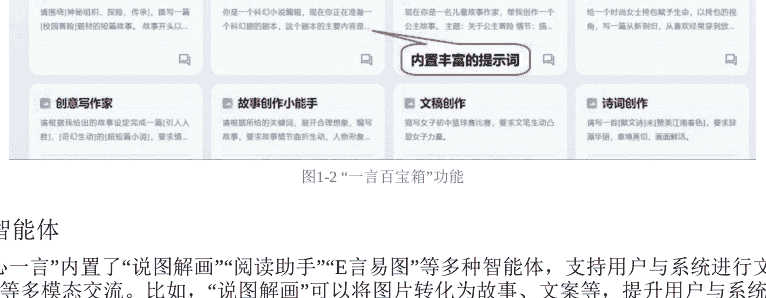
##### （10）智能体
内置“说图解画”“阅读助手”“E言易图”等多种智能体，支持文本、视觉、语音多模态交互。例如“说图解画”可将图片转为故事或文案，增强交互灵活性。
##### （11）独立对话空间
点击文心大模型右侧“+”可创建多个独立对话空间，各空间可设不同主题，方便管理与检索历史记录。

### 1.1.3 智谱清言

#### 1. 总览
智谱清言由北京智谱华章科技有限公司推出，是一款中英双语对话助手，提供通用对话、多轮对话、文档解读、代码生成等服务，助力工作、学习与日常场景。

#### 2. 进入方式
提供网页与移动端。网页访问 https://chatglm.cn ，移动端在应用商店搜索“智谱清言”安装。可使用手机号注册体验。

#### 3. 主要功能
以网页端为例，主要能力如下。
##### （1）ChatGLM
支持多轮对话，记忆上下文，提供信息查询、日程管理、文案生成、图像生成等帮助。
##### （2）清影智能体-AI生视频
根据文本或图像创意生成视频。
##### （3）长文档解读
在如图1-3所示页面上传文档后，可高效处理文档信息。

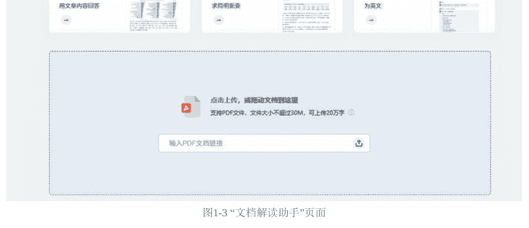
- ①文档问答：上传后提问，系统自动分析内容并作答。
- ②文档总结：提炼核心观点与关键信息，去繁就简。
- ③文档翻译：按指令将全文或部分内容译为其他语言。

##### （4）数据分析
可分析上传文件或数据并图表化，亦可通过简单编码处理文件，提升开发效率与准确性。
##### （5）智能体中心
内置集成模块，如图1-4所示。针对不同场景预设大量智能体，降低新手门槛，增强体验。

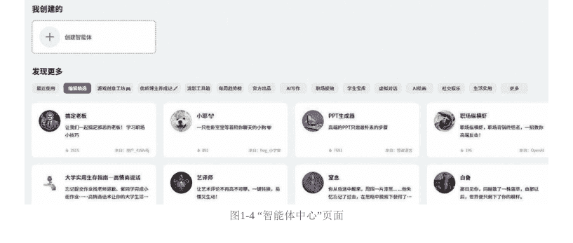

### 1.1.4 天工AI

#### 1. 总览与功能
天工AI由北京昆仑万维科技股份有限公司开发的对话式智能助手，具备智能搜索、对话、阅读、创作等能力，可满足文案创作、知识问答、代码编程、逻辑推演、数理计算等多元需求。

#### 2. 进入方式
提供网页与移动端。网页访问 https://search.tiangong.cn ，移动端在应用商店搜索“天工AI”安装。支持手机号快速注册，目前提供免费服务。

#### 3. 主要功能
##### （1）搜索
依据查询意图，从海量数据中快速准确抽取相关信息作答。
##### （2）天工 3.0 对话助手
在网页版对应页面与智能体进行自然流畅对话，可根据输入理解意图并作答，用户可选择不同对话场景以提升准确性，如图1-5所示。
##### （3）智能工具
包含“AI文档—音视频分析”“AI写作”“AI图片生成”“AI音乐”“AI PPT”等。按需选用，快速产出个性化内容，提升创作效率。

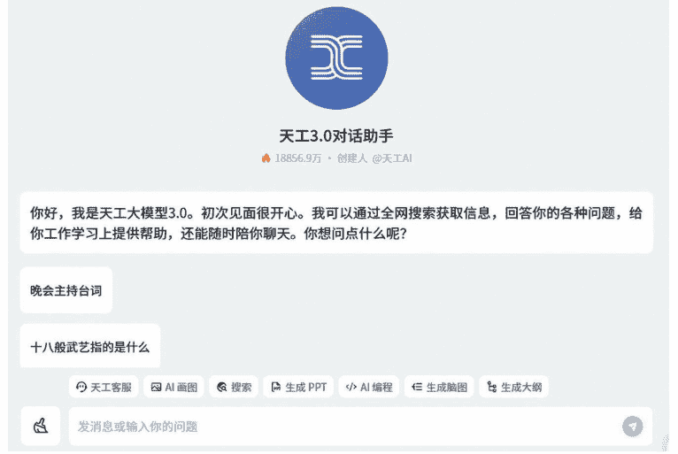

### 1.1.5 讯飞星火

#### 1. 总览
讯飞星火由科大讯飞股份有限公司推出，免费且实用，可实现知识问答、逻辑推理、语义理解、数学运算、代码编写，并支持文字、语音、图片等多模态信息处理。

#### 2. 进入方式
提供网页与移动端。网页访问 https://xinghuo.xfyun.cn ，移动端在应用商店搜索“讯飞星火”安装。支持手机号或微信账号注册登录。

#### 3. 主要功能
以下以移动端为例。
##### （1）对话
可在对话框输入文字、图片或语音输入，与系统问答交互，如图1-6所示。能回答生活常识、工作技能、医学知识等各类问题。
##### （2）智能体
针对不同场景设置大量智能体，如图1-7所示，便于有针对性地处理需求。例如用“绘画大师”创作主题图像，用“讯飞晓医”进行医学问答等。

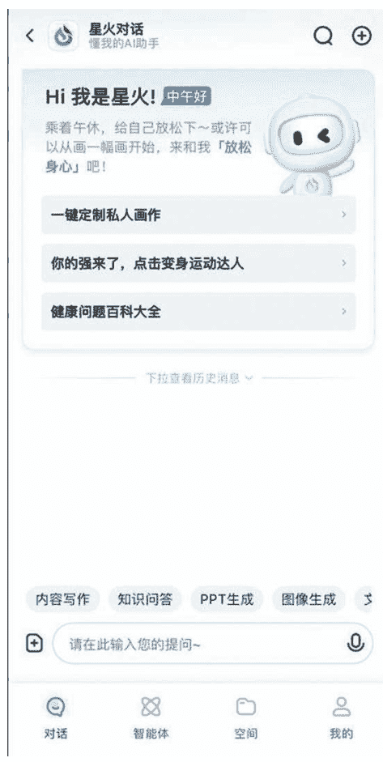

# 星火应用 应用广场

讯飞智文

智能文档 AI 助理

一键生成PPT

讯飞晓医

健康助手，专业医学回答

症状自查

报告解读

讯飞翻译机

沟通面面俱到，世界聊得来！

语音翻译

会话翻译

绘画大师

妙笔在手，一键生图

讯飞智作

创作你的AI虚拟人视频

讯飞录音笔

AI录音转写、翻译、文件管...

AI录音转文字

多语种、中文、方言转文字

同声传译

十大语种与中文互译、可听

对话

智能体

空间

我的

图1-7 “智能体”页面

## 1.2 翻译校对助手：翻译与校对的贴身伙伴

### 1.2.1 有道写作

1. 总览
有道写作由网易开发的在线写作工具，依据中文用户英语写作习惯构建批改体系，覆盖小学、初中、高中、四六级、考研、雅思、托福等多场景。支持macOS、Windows、iOS、Android。

网页端基础功能免费，会员可使用高级纠错与详细报告。

2. 登录方式
访问 https://write.youdao.com 。支持网易邮箱、手机号、微信、QQ登录。

3. 主要功能

（1）设置写作偏好与自定义术语库
建议在账号设置中调整写作偏好并创建术语库。通过设置职业与默认写作类型，获得更具针对性的批改建议；自定义术语库可避免不常见词汇被误判。

（2）自由写作模式
适合日常练习与写作。可边写边批改，实时查看修改建议与权威例句。

新建文档后进入编辑页，完成标题与正文后点左上角保存。点词数旁下拉可查看字符数、词数、阅读时长、朗读时长等信息。

点右上角翻译可逐句译文；点批改可在右侧给出评分，并提供基础纠错、句子润色、权威例句三类建议，可展开查看并在原文定位。

可开启实时批改功能，通过左上角菜单设置语言类型后，写作过程中同步纠错。

右下角写作助手提供翻译查词与例句检索。翻译查词支持中英文即时释义；例句检索可按自定义语料库与章节来源筛选权威例句。

（3）模拟考试模式
面向备考与限时训练，具备计时功能。

进入模拟考试后新建并选择考试类型，点击开始考试开始计时，完成后再点交卷提交。提交后系统自动批改，纠错后可点再次批改查看效果，未清零基础错误时该功能锁定。

（4）扩展下载服务
主页右上角头像旁点插件下载进入下载页，可获取浏览器扩展、Word加载项及有道词典移动端，提升使用体验。

浏览器扩展可在邮件等场景辅助准确表达；Word加载项支持在Word中专业写作；手机安装有道词典后可拍照上传纸质作文批改。

（5）外接智慧学习API
外接英文批改API与中文批改API，由网易有道智云基于深度学习提供自动作文批改。

登录后点主页上方对应入口可跳转体验页，基础功能免费体验，核心功能需付费。

### 1.2.2 DeepL
1. 总览

**DeepL：多语言翻译与表达润色套件**

德国 DeepL 公司出品的语言处理产品集合了机器翻译与写作辅助两类能力，译文准确、语法检校与表达提炼是其明显优势。产品线覆盖翻译器与 Write 写作模块，可将文字、图片乃至语音素材转成三十多种语言，同时提供标点、语法与风格核查，并能把原文改写为不同句式与语气。

使用入口
在浏览器地址栏输入 DeepL 中文 Write 链接即可免费用到润色功能；输入翻译器链接则打开主力翻译界面。

功能要点
目前可处理英语、德语、法语、西班牙语等语种的译写与润色。进入 Write 页面粘贴原稿后，右侧会实时呈现优化结果，整体界面见图1-11。改动部分以绿色下划线标出，点击右侧任一词可调取同义词建议与整句重写方案。免费账号单次处理上限为两千字符，对日常需求已足够。

图1-11 DeepL Write页面

### 1.2.3 Effidit

1. 概况
Effidit，即 Efficient and Intelligent Editing，由腾讯 AI Lab 发布的中英文写作辅助系统，目标是用智能手段降低写作门槛，改善效率与体验。

2. 访问路径
在浏览器打开 effidit 官网地址即可免费试用。

3. 主要能力
（1）智能纠错
对中文可自动找出错别字与用词不当并给出修改建议；对英文提供语法与拼写核查。

（2）续写补全
具备短语补全、句子补全与风格化续写三种能力。
- ①短语补全：依托光标处上下文自动补足短语。
- ②句子补全：在给出不完整句子后自动扩展为完整表达，结果融合检索与生成。
- ③风格化续写：按输入内容与所选风格进行续写，现支持通用、科幻、军事、武侠、职场五类风格，便于产出差异化文本。

（3）篇章生成
输入指令如“写一篇桂林游记”“介绍佛跳墙做法”即可快速生成正文，示例如图1-12。

（4）文本润色
提供词语级润色与句子级润色。
- ①词语级润色：选中句子中的词后基于上下文推荐更贴合语境的替代表达，提升精准与生动度。
- ②句子级润色：包含改写与扩写。改写在保留原意下换种表达；扩写在保留语义前提下增加修饰，使长句更丰满。

（5）超级网典
除上述能力外，还提供贯穿写作全流程的基础检索工具“超级网典”，含词推荐、句推荐、篇章推荐，如图1-13所示，有助于激发灵感与提升效率。

### 1.2.4 讯飞智检

1. 概况
“讯飞智检”由科大讯飞推出，聚焦校对与审查的智能方案，可批量处理纯文本、Word、图片、音频、视频，提升数据规范性并降低人工成本。

2. 访问路径
浏览器打开讯飞智检官网进入主页，通过手机号或邮箱注册后体验。

3. 主要能力
（1）文本校对
可检查拼写、语法、搭配、实体、标点、政治用语、数字使用等问题，如图1-14。常用项：
- ①日期纠错：修正年、月、日表述错误。
- ②成语古诗纠错：核查成语、古诗及固定用法。
- ③词语语法纠错：识别用词不当及冗余、缺失、乱序、搭配问题。
- ④机构地名纠错：结合语境检查知名机构或固定地点名称。

（2）内容审查
识别文本、图片、音视频、网页等多场景的违规或风险内容并拦截，涵盖智能文本检测、图片检测、音频检测、视频检测、网页检测、文档检测。

（3）词库管理
在词库管理页可自建校对拦截词库与放行词库，如图1-15。校对时系统按个性化词库执行拦截、替换或放行。

### 1.2.5 FunAI

1. 概况
FunAI 为手机端轻量录音转写与翻译应用，依托识别技术实现实时转写、语音互译、文字识别与图片文字转语音，适合学习与办公，主界面见图1-16。

2. 主要能力
（1）实时录音转写
可即时转写录音，覆盖上海话、四川话、河南话等中文方言，以及英语、阿拉伯语、德语等外语。提供教育直播、在线医疗、会议演讲等多场景模式，转写精准高效。

（2）语音互译
识别用户语音，在中文、英文、阿拉伯语等间实现双向互译。

（3）文字识别
从手机相册导入图片后提取文字内容并支持复制。

（4）图片转语音
把识别出的文字以语音播放，内置多位配音主播可选，如图1-17。还可添加停顿、音效、背景音乐，调节音量、语速、语调。

（5）视频转文字
上传视频片段后将其音频转为文字。

（6）视频转语音
把视频音源转为语音并导出。

（7）同声传译
近乎实时地把一种语言转为另一种并以发音呈现，便于跨语言交流。

## 1.3 集成式写作工具：多场景写作的智能助手

### 1.3.1 Friday智能写作

1. 概况
Friday 智能写作基于人工智能，能模拟专业写手技巧生成结构清晰、表达流畅的内容，降低流程负担，节省时间精力。

2. 访问路径
浏览器打开 Friday 官网进入主页，手机号或邮箱注册，深度功能需付费开通 VIP。

3. 主要能力
覆盖学生所需社会实践报告、论文摘要、心得体会、简历优化；职场所需年终总结、年度汇报、演讲稿、日周月报；运营所需营销文案、产品描述等，如图1-18。
用户可按场景设定主题、受众、风格与要点。以演讲稿为例，可自定义演讲主题、听众、风格与核心内容，如图1-19。无论是写手还是学生，都可借此获得灵感与效率提升。

### 1.3.2 笔灵AI

1. 概况
笔灵 AI 面向文本创作，可生成多种高质量稿件，提升效率与质量。界面简洁易上手，内置商务、教育、娱乐等多领域模板，选择板块并输入个性化需求即可获定制内容。

2. 访问路径
浏览器访问笔灵官网注册体验，支持手机号、微信、QQ。消耗字数额度，新用户赠送 500 字，高频用户可开通会员获取更多配额。

3. 主要能力
（1）模板写作
核心模块含办公、论文报告、教学帮手等模板，输入指令即可快速生成。如图1-20，明确职位、工作内容、字数要求即可生成工作总结，初稿可手动微调。

图1-20 生成工作总结

（2）写作工具
内置论文生成、PPT 生成、去生成痕迹、文章降重等，按引导操作即可，如图1-21。以论文写作为例生成毕业论文步骤：
- ①进入毕业论文模块。
- ②设定专业与学历，输入题目，生成大纲初稿。
- ③完善大纲，生成论文初稿。
- ④下载论文。

图1-21 多种写作工具

（3）模板检索
点击笔灵 AI LOGO 打开功能页，通过搜索模板查找专题入口。如搜索“报告”，即可进入申请报告、结题报告等。

图1-22 “搜索模板”功能

### 1.3.3 万彩AI

1. 概况
万彩 AI 同时支持智能写作与短视频制作，帮助提升工作效率。

2. 访问路径
浏览器打开万彩 AI 官网，进入主页。新用户赠送 20 个创作积分，高频用户可付费获取更多。

3. 主要能力
（1）写作
内置丰富写作模板，如图1-23，涵盖正式导学案到轻松海报文案，输入关键词即可生成逻辑清晰的文章，适合新手与资深作者。

图1-23 丰富的写作模板

（2）短视频
模块提供丰富视频模板，如图1-24，输入文稿即可自动配音生成视频。

图1-24 丰富的“AI短视频”模板

（3）数字人
上传清晰单人正面照或使用内置照片，输入口播内容或上传音频，即可生成会说话的数字人视频。图1-25 为内置照片生成的截图。

图1-25 会说话的数字人视频

（4）换脸秀
实现视频级换脸，选择模板视频并上传个人照片即可替换人脸。模块内置多款模板，如图1-26。

图1-26 丰富的“AI换脸秀”模板

### 1.3.4 搭画快写

1. 概况
搭画快写为智能写作平台，支持批量创作、排版与自动配图，提供高效便捷体验，基础页见图1-27。

图1-27 “搭画快写”基础页面

2. 访问路径
浏览器访问搭画快写官网注册，手机号快速注册，新用户赠送 1200 免费字数，深度使用可购会员解锁 VIP。

3. 主要能力
提供企业品牌软文、种草文案、测评文章、视频脚本等模板，也覆盖个人演讲稿、小说大纲、论文摘要等。特色在于智能配图与自动设计，自动匹配插入以丰富内容。可一键代发，日最高发布 4000 篇，节省人工发布时间并提升曝光。

### 1.3.5 boardmix AI

1. 概况
boardmix AI 融入智能办公软件博思白板，可快速生成流程图、PPT、思维导图、程序代码，并支持绘画与写作，提升效率与创意。需消耗积分，1 分约等于 10 字，新用户赠送积分，高频用户可付费获取。

#### 2. 访问路径
浏览器打开 boardmix 官网进入主页。进入创作页，boardmix AI 固定在工具栏首位，打开工作区即可唤出，如图1-28所示。

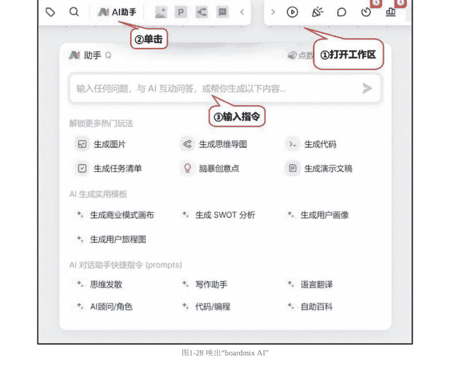

#### 3. 主要能力
##### （1）思维导图快速生成
输入关键词后系统分析信息并自动构建逻辑清晰的导图，如图1-29，用户可在其上调整，节省时间。

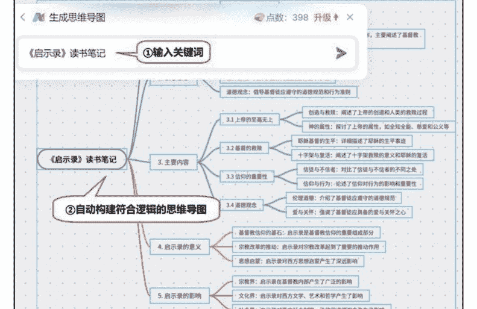

图1-29 一键生成思维导图

##### （2）演示文稿快速生成
导入大纲或内容文件，系统提取关键信息创建文稿初版，简化制作流程。

##### （3）绘画设计
输入关键词即可生成图片，快速产出大量创意方案。

##### （4）图生图
依据上传图片中的人物、角色、物品生成相似图像。

##### （5）抠图
利用人工智能精准提取目标物体与背景分离，提升设计效率。

##### （6）对话写作
集成情感专家、关系专家、职业顾问、辩论专家、IT 编程问题等对话场景，支持多样化交互。

### 1.3.6 AI创作家

#### 1. 概况
AI 创作家为手机端写作辅助应用，基于人工智能根据主题或关键词生成多场景文本，提升质量与可读性。

#### 2. 主要能力
##### （1）智能创作
支持多类写作任务，如图1-30所示，按需选择功能并输入关键词即可。

##### （2）智能对话
提供多轮对话问答，用户可在如图1-31所示对话框中输入学习、工作、生活问题，系统从知识库或网络检索答案。

图1-30 支持多种写作任务

### 1.3.7 AI写作猿

#### 1. 概况
AI 写作猿为手机端智能写作与对话应用，既提供灵感与思路提升创作效率，也能解答生活、学习、工作问题。

#### 2. 主要能力
#### (1) 智能创作
模块含扩写、小说生成、求职简历生成等，提供创意与灵感，助力高效写作，如图1-32所示。

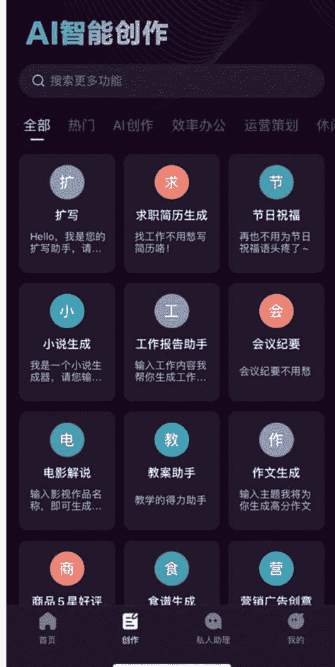

#### (2) 私人助理
模块配置多场景助理，提供针对性专业服务，如图1-33所示。

Q 搜索更多功能

+   全部

写作助理

职业助理

生活助理

旅游出行

您好，您可以提供游玩地区，我将为您制定最佳游玩路线。

学习顾问

你好我是您的私人学习顾问，您可以问我关于语文、学物理、地理、化学、历史、生物等各...

营销策划

提出您想要的方案，越详细越好。如：帮我写一个有创意的艺术培训招生营销方案，且足够吸...

讲故事

我是您的故事家，可以为您讲各种类型的故事

写作顾问

请输入要创作的文章类型及要求。

面试官

+   首页

创作

私人助理

我的

图1-33 “私人助理”页面

# 第2章 巧问妙答：引爆创意的引擎

## 2.1 关键词提问：精准发问，直击要点

### 1. 定义
关键词提问是一种高效提问方式，强调用简短直接的语言抓住问题核心，避免冗余描述。

### 2. 优点
关键词提问具备多项优势，具体如下。

#### （1）清晰明了
注重以关键词提出问题，表达简短清晰，直指核心，减少歧义，便于 AI 准确理解并给出精准回答。

#### （2）适用于明确概念和事实
对于只需明确简单概念或基本事实的问题，关键词提问可引导 AI 直奔核心，避免不必要的深入探讨或复杂解释，如图2-1所示。

#### （3）适用于专业性问题

专业交流提升术：关键词提问法

在涉及专业领域的话题时，用行业专用词汇提炼核心词来提问，往往能让交流更顺畅，如图2-2所示。

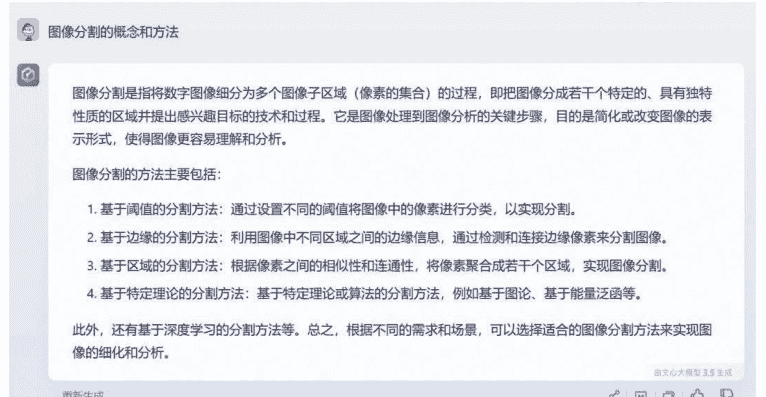

图2-2 针对专业性问题进行“关键词提问”

#### （4）检索对齐更顺畅，定位迅速
关键词本身具有较强的代表性，采用这种提问方式可以迅速缩小检索范围，让模型在知识库中更快找到相关资料。

#### （5）表达更简练，歧义更少
借助关键词来表述问题，能让问法更清晰，避免使用容易产生歧义的措辞，帮助模型更好地把握提问者的真实意图。

### 3. 常见类型

#### （1）主题词与属性词
“主题词”指用户通过提炼问题核心而使用的关键词，是提问的骨干，如图2-3所示。

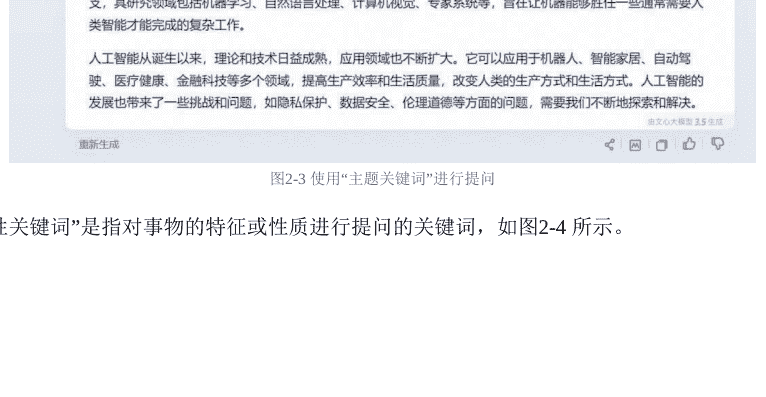

图2-3 使用“主题关键词”进行提问

“属性词”则是聚焦于事物特征或性质的提问词汇，如图2-4所示。

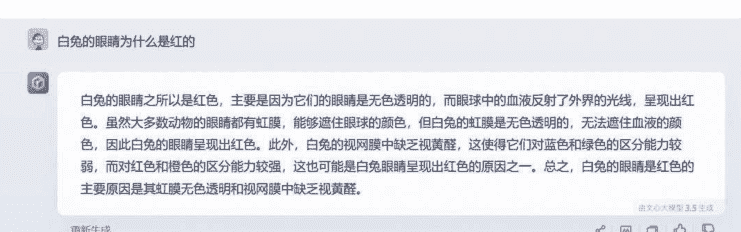

图2-4 使用“属性关键词”进行提问

#### （2）比较类词汇
“比较类词汇”常见的有“区别”“不同”“相似性”“异同点”等。借助这类词语提问，能引导模型对多个概念或事物进行对照，突出相似与差异，如图2-5所示。

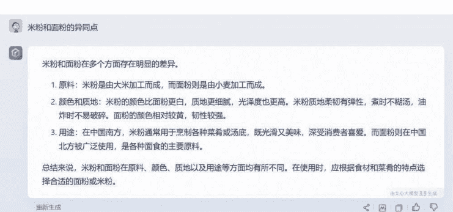

图2-5 使用“比较关键词”进行提问

#### （3）原理类词汇
“原理类词汇”用于引导模型解释事物内部运行机制，常用表达包括“原理”“机制”“工作原理”“核心原理”“基本原则”等，如图2-6所示。

图2-6 使用“原理关键词”进行提问

#### （4）流程类词汇
“流程类词汇”可以让模型给出完成某项任务或达成某种效果的具体步骤，典型用词有“过程”“步骤”“如何实现”“怎么做”等，如图2-7所示。

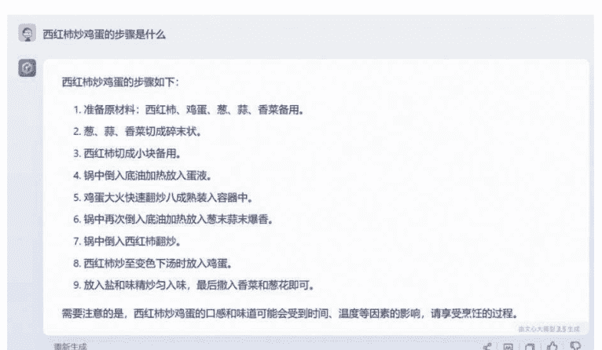

图2-7 使用“流程关键词”进行提问

#### （5）应用类词汇
“应用类词汇”用来让模型列出概念或事物在实际场景中的落地案例，常见说法为“如何应用”“实际应用价值”等，如图2-8所示。

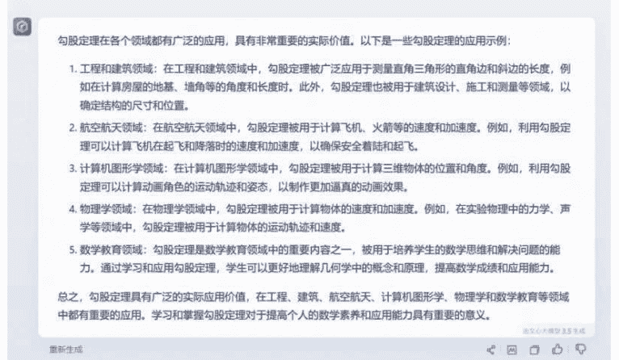

图2-8 使用“应用关键词”进行提问

#### （6）发展趋势词汇
“发展趋势词汇”用于让模型描述某个领域或事物未来的走向，常用词有“趋势”“未来”“创新”“前沿技术”等，如图2-9所示。

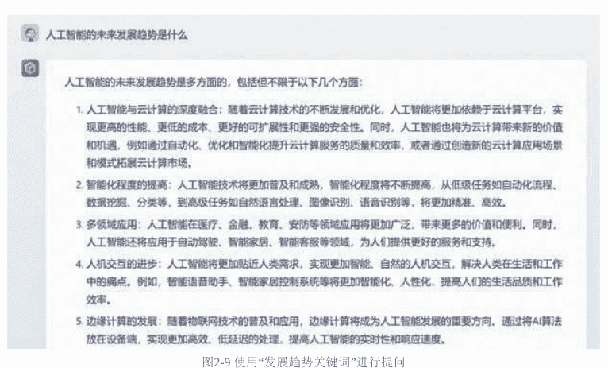

### 4. 局限
关键词提问方式更适合问题明确、直接、具体的情况。面对语境复杂或需要深度展开的场景，换一种提问方式会更合适。

## 2.2 约束提问：用边界锁定答案

### 1. 定义
约束提问的核心是通过限定词把问题框定在特定范围或条件下，从而拿到更具体、更具针对性的回复。加入限制条件可以把问题收窄，让提法更精准，也能避免问题过于开放或模糊，提升信息获取效率。

### 2. 优点

#### （1）精确可靠
加上约束条件能过滤掉宽泛或模糊的回复，提升信息的准确度。

#### （2）提高效率
明确约束后，模型的检索范围变小，干扰信息减少，获取可用信息更快。

#### （3）避免多义歧义干扰
设定约束可以处理存在多义或歧义的问题场景，如图2-10所示。

做一个伦敦的旅游攻略，伦敦是指加拿大安大略省的一个城市

# 伦敦（加拿大安大略省）旅游攻略

## 一、概述
伦敦位于加拿大安大略省，处于金斯顿地区，被视为加拿大的文化、艺术与科技重镇。城市兼具深厚的历史文化遗存、世界级博物馆、艺术馆和剧院，以及现代化的商业娱乐设施，深受游客和本地居民青睐。

## 二、旅游季节
伦敦属大陆性气候，四季分明。最适宜出行的是5月至10月的夏季，气温舒适、日照时间长，适合户外游览。冬季虽冷，却有独特的冰雪景致和冬季项目，如滑雪、溜冰等。

## 三、主要景点
- 1. 皇家安大略博物馆：加拿大规模最大的博物馆之一，藏有世界级艺术品与历史文物，展现人类文明多样性。
- 2. 伦敦水族馆：北美最大的淡水水族馆之一，呈现加拿大水生生物与生态系统。
- 3. 加拿大艺术中心：国内重要艺术平台之一，含现代化剧院、画廊及表演场地，汇聚加拿大及世界艺术作品。
- 4. 伦敦市政厅：城市政治中心，历史悠久、建筑特色鲜明。
- 5. 奥林匹克公园：2015年泛美运动会举办地，拥有现代体育设施与休闲公园。

## 四、美食和购物
伦敦餐饮购物多元化，能满足不同需求。市中心汇聚各式餐厅与小吃，从加拿大传统美食到国际风味一应俱全。购物集中在市中心商业街与购物中心，品牌服饰、珠宝、艺术品等应有尽有。

## 五、交通和住宿
城市公共交通便捷，地铁、公交、出租车覆盖主要景点。住宿选择丰富，从豪华酒店到经济型旅馆、民宿皆有，建议旺季提前预订。

图2-10 添加约束条件避免歧义

#### （4）定制化需求
相同问题在不同背景下答案不同，约束提问通过附加条件限定，能让回复更贴合个人化需求。

### 3. 常见类型

#### （1）领域限定
领域限定把回复限制在特定学科或专业范围内，如图2-11所示。

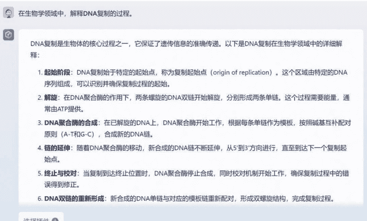

图2-11 利用“领域约束”提问

#### （2）方法限定
方法限定引导模型只围绕特定方法背景进行检索，如图2-12所示。

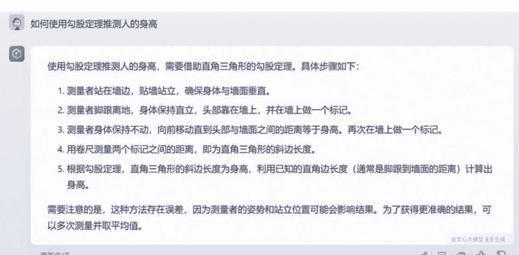

图2-12 利用“方法约束”提问

#### （3）时间限定
时间限定可借助“过去”“现在”“未来”“截至目前”等概括词，或“20世纪初”“2014年”等精确时间词，来筛选信息，如图2-13所示。

图2-13 利用“时间约束”提问

#### （4）空间限定
空间限定把回复限定在用户关心的地域范围内，例如问“通常吃甜豆腐脑还是咸豆腐脑”，加上“在南方”“在北方”会得到不同结果，如图2-14、图2-15所示。

图2-14 添加约束词“在北方”

图2-15 添加约束词“在南方”

### 4. 局限
约束提问在多数场景下能提升效率，但约束过严可能导致信息缺失，限制模型的创造性与灵活性；用户主观观点介入也可能影响回复客观性。

## 2.3 举例提问：以例带问，启发思考

### 1. 定义
举例提问是先给出具体案例作为引导，再提出问题。通过真实案例让问题更具体、生动，为模型提供更多上下文，帮助其更好理解与分析。

### 2. 优点

#### （1）简化用户表达
提供例子能帮助用户简洁地表达复杂情境或需求，如图2-16所示。

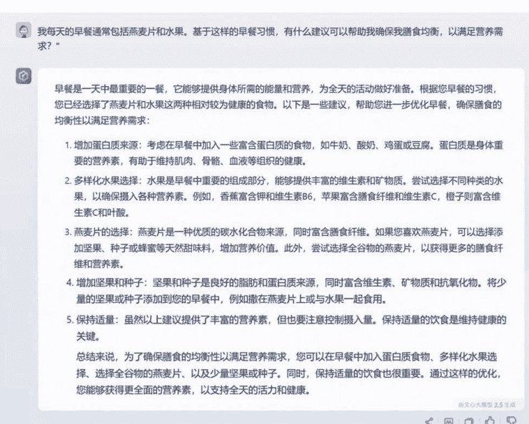

#### （2）帮助模型分析、理解问题
例子能让模型更清晰地把握背景与要求，如图2-17所示。

我通常在工作日忙碌，晚餐时间有限。我喜欢简单而健康的菜品，比如蔬菜沙拉。你有什么菜品建议可以适应我的工作日晚餐需求吗？

以下是一些简单又健康的菜品建议，适合你在工作日晚餐时间享用：

- 1. **烤蔬菜**：将各种蔬菜切块，涂上橄榄油、盐和黑胡椒，烤至软熟即可。蔬菜如南瓜、胡萝卜、洋葱、彩椒等都是不错的选择。
- 2. **蔬菜炒饭**：用剩余的米饭和各种蔬菜（如胡萝卜、豌豆、玉米粒等）进行简单的炒制。可以加入鸡蛋、鸡肉或豆腐来增加蛋白质。
- 3. **番茄肉酱意面**：用全麦意面、番茄酱和瘦肉（如鸡胸肉或火鸡肉）进行烹饪，简单又美味。可以额外添加一些蔬菜，如洋葱和胡萝卜。
- 4. **鸡胸肉配蔬菜**：将烤鸡胸肉切成小块，搭配烤熟的蔬菜（如西兰花、胡萝卜、洋葱等）一起食用。可以制作一些简单的调味料来增加风味。
- 5. **酸奶沙拉**：将各种生菜、水果和坚果混合在一起，淋上酸奶和蜂蜜，制成清爽的酸奶沙拉。
- 6. **蔬菜汤**：将各种蔬菜（如洋葱、胡萝卜、南瓜等）切块，加入高汤或水中煮沸，再加入一些香料（如姜、蒜、香草等）即可。
- 7. **凉拌菜**：将各种蔬菜（如黄瓜、胡萝卜、芹菜等）切丝，加入醋、姜丝和少许橄榄油拌匀，制成清爽的凉拌菜。
- 8. **烤三文鱼配蔬菜**：将三文鱼涂上橄榄油、盐和黑胡椒，烤至熟透。搭配烤熟的蔬菜（如西兰花、胡萝卜等）一起食用。

这些菜品都非常简单易做，而且营养丰富，适合你在工作日晚餐时间享用。记得选择健康的烹饪方式，尽量少油少盐，保持食材的原味和营养。

#### （3）引导回复，增强实用性
这种方式常能让模型给出更具体、更可操作的回复，而非停留在抽象理论。

### 3. 缺点
例子来自用户主观视角，可能不适用于所有情境，过于局限的案例会限制回复广度；有时例子会让问题更复杂，导致模型在引导下出现偏差。

## 2.4 对话型提问：多轮互动，深入探讨

### 1. 定义
对话型提问以多轮对话推进提问。不同于一次性提问，它由一系列关联问题构成，用户可根据模型的上条回复进行追问，形成互动式交流。

### 2. 优点

#### （1）更真实的自然互动
对话型提问模拟日常对话，使用户以更自然的方式沟通，上手门槛低，如图2-18所示。

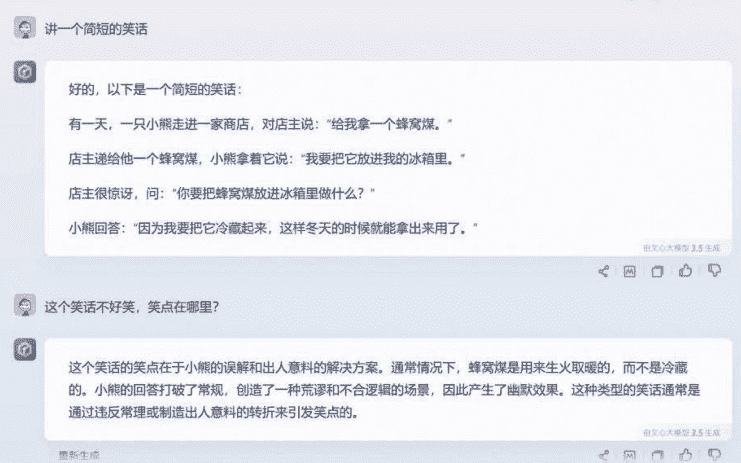

#### （2）更灵活的沟通过程
用户可随时根据需求提出新问题、追问或深入交流，不受预设问题限制，如图2-19所示。

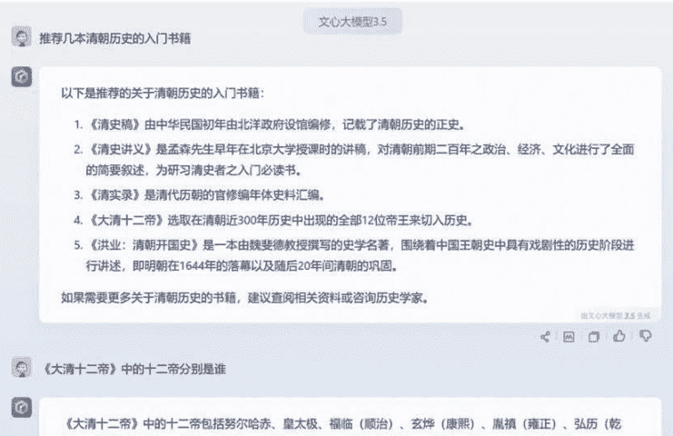

#### （3）充分利用上下文信息
对话会保留历史记录，有助于进行更深层探讨，引导模型给出更智能、全面的回复，如图2-20所示。

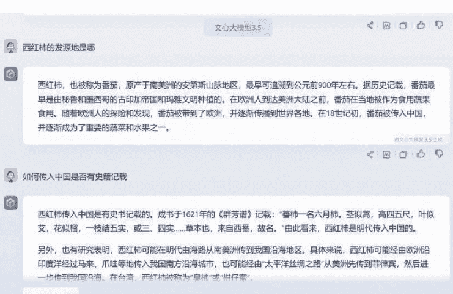

#### （4）便于把握提问进程
对话能提供即时反馈，用户可在互动中及时纠正误解或调整方向，如图2-21所示。

### 3. 缺点
模型目前仍无法完全媲美人类智能，在需要多步推理的长对话中，可能无法给出令人满意的答案。

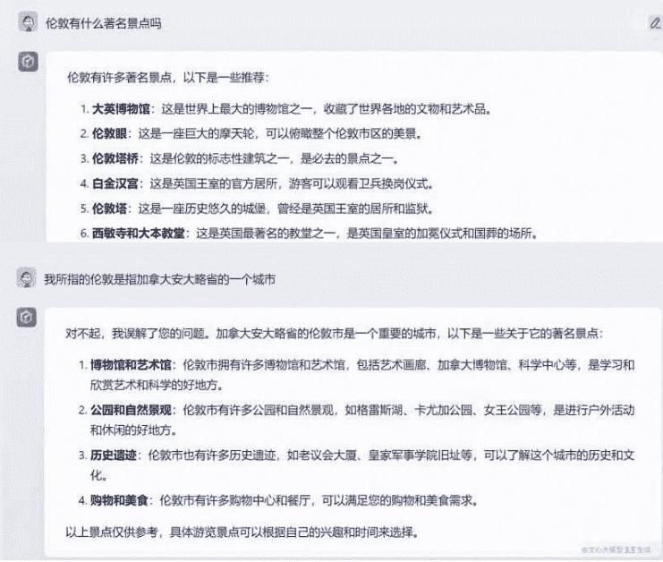

图2-21 用户及时纠正误解

## 2.5 描述背景：搭好情境，激发灵感

### 1. 定义
描述背景是在提问前向模型补充相关上下文或情境，帮助其理解语境、目的和来龙去脉。

### 2. 优点

#### （1）帮助模型理解用户需求
背景信息包含提问动机、具体情境等，能让模型更精准、个性化地回应。

#### （2）引导模型的注意力
背景能让模型聚焦问题的关键方面，避免在海量信息中迷失。

#### （3）解决歧义
同一句话在不同上下文含义不同，补充背景有助于模型抓住真实意图。

### 3. 常见类型

#### （1）提供问题背景
即说明问题发生的场景与来历，如图2-22所示。用户询问玻璃杯碎裂原因时提供使用方式，就是典型的背景补充，对准确分析很有帮助。

#### （2）提供用户的个性化信息
用户可分享个人背景、兴趣、地理位置、情感倾向等信息，便于系统给出定制化回复，如图2-23所示。

图2-23 提供用户的个性化信息

#### （3）提供领域信息
补充问题涉及领域的定义、关键概念和术语，有助于模型更准确理解并回应，如图2-24所示。

### 4. 局限
描述背景需要用户投入更多信息，操作相对繁琐；背景过长易造成信息冗余，使问题复杂化，降低理解效率；过度聚焦也可能限制模型宽泛思考。

## 2.6 答案判断：理性分析，精确评估
模型在处理大量数据时能力很强，但因上下文理解不足或算法缺陷仍会出现不准的情况。准确信息对决策至关重要，错误信息可能带来不良后果。因此在使用模型输出时保持审慎是必要的。答案判断的核心就是评估模型回复是否正确、合理或符合要求。

常用判断方法：

- （1）逻辑推理
结合上下文与背景，判断回复是否自洽、是否符合逻辑规律与常识。
- （2）利用经验与专业知识
借助自身经验和专业素养判断回复是否符合现实。
- （3）多方对比、查证信息
通过网络检索、文献查阅、专家咨询等多渠道核对，对比后综合判断。

# 第3章 高效学习与研究助手

## 3.1 论文选题：洞察热点，把握论文方向

### 3.1.1 论文选题的意义
论文选题是学术研究的重要起点。一个前瞻、创新且具现实意义的题目，能推动理论突破、技术革新，促进学科发展并解决实际问题。它为后续研究提供框架与方向。选题时需结合个人兴趣与专长、领域现状与趋势，明确目标，同时具备预判问题与挑战的能力。

### 3.1.2 论文选题的步骤
- ①文献调研：查阅相关文献，了解领域热点、痛点与发展趋势，锁定感兴趣方向。
- ②问题识别：在调研基础上与导师沟通，找到未解问题或研究空白。
- ③确定研究目标：结合问题识别结果与自身能力，划定课题范围与难度，明确目标与预期成果。
- ④设计研究方案：依据目标制定方法、步骤与计划。
- ⑤评估和调整：研究过程中根据实际情况修正方案，确保顺利推进。

### 3.1.3 模型辅助论文选题

#### 1. 使用ChatGPT
使用ChatGPT辅助选题时，可先为其设定角色，帮助其理解工作内容；生成结果后可追问优化，使输出更贴合需求，如图3-1、图3-2所示。

图3-1 ChatGPT生成论文选题建议

图3-2 ChatGPT针对追问生成结果

#### 2. 使用“文心一言”
进入“文心一言”主页面后，点击左侧“百宝箱”进入模板选择页，搜索“论文选题”，选择对应模块并按需修改内容即可生成结果，如图3-3所示。

你是一位人工智能专家，请给出关于人工智能的论文选题方向建议。我是一名计算机科学的学生，对人工智能很感兴趣，但目前还没有确定的研究方向。希望你能结合当前的研究热点和创新点，提供一些具体、可行的选题建议。（5个即可）

当然可以，结合当前的研究热点和创新点，以下是一些关于人工智能的论文选题方向建议：

1. **基于深度学习的自然语言处理（NLP）模型优化研究**
   - 研究背景：自然语言处理是人工智能的重要分支，深度学习在其中扮演着关键角色。然而，现有的NLP模型在处理复杂语言现象时仍存在挑战。
   - 研究内容：探索新型神经网络架构，改进现有模型的训练策略，提高模型在文本分类、情感分析、机器翻译等任务中的性能。
   - 创新点：提出新的模型结构或优化算法，减少模型对大量标注数据的依赖，增强其泛化能力。

2. **人工智能在医疗诊断中的应用研究**
   - 研究背景：人工智能技术在医疗领域的应用日益广泛，特别是在辅助诊断方面。
   - 研究内容：利用深度学习、图像识别等技术，开发高效的医疗诊断系统，如基于医学影像的病变检测、疾病预测模型等。
   - 创新点：提高诊断系统的准确性、可靠性和实时性，为医生提供有力支持，同时考虑数据隐私和安全问题。

3. **基于强化学习的智能机器人控制策略研究**

**AI选题灵感参考**

- 强化学习驱动的机器人自主决策
研究缘起：强化学习是让机器人具备自主判断与持续进化的底层能力。
研究要义：面向新一代强化学习范式，探索其在机器人运动控制、路径规划与任务闭环执行中的落地方式，提升整体智能水平。
创新价值：挖掘更高效率、更稳健的算法方案，解决复杂场景下适应性不足与鲁棒性弱的问题。

4. **金融科技场景下的人工智能应用与风险管控**
研究缘起：FinTech高速发展带来创新红利的同时，也产生新型风险外溢。
研究要义：梳理人工智能在信用评估、反欺诈、智能投顾等环节的实践路径，并研究配套的技术风险防范机制。
创新价值：提出融合传统金融学理与前沿智能技术的风控框架，兼顾市场稳定与消费者权益。

5. **面向可持续能源的人工智能管理体系**
研究缘起：全球可持续发展议程下，能源精细化管理的重要性持续攀升。
研究要义：依托智能技术构建可实现智能调度与能耗优化的管理系统，典型应用包括智慧电网与家庭能源治理。
创新价值：在提升利用效率、扩大可再生能源渗透率的同时兼顾环保与经济可行。

以上方向契合当前热点与创新趋势，并具备较清晰的落地可能。最终选题建议结合个人兴趣与所在领域实际需要再做细化。

#### 3. 案例对比与解析
上文对比可见，ChatGPT对指令的明确度非常敏感，提示越具体输出越贴合，还可通过多轮反馈让结果不断收敛。文心一言提供内置模板，填入领域与需求即可快速拿到建议。输出形态上，ChatGPT多以标题加简释呈现，后续展开易模糊；文心一言则为每个选题补充缘起、研究要义与创新价值，信息更完整。因此在选题推荐上，文心一言的可用性更强。

## 3.2 论文大纲：理清逻辑，构建论文框架

### 3.2.1 大纲的定位与意义
论文大纲是在明确主题并研读文献后形成的结构化蓝图，是论文的骨架。其价值在于为作者提供清晰有序的执行路线，保证研究的系统性与成文的完整性。通过大纲可提前明确研究目标、方法与预期产出，实现计划化推进；同时有助于结构合理、内容饱满、逻辑通顺，提升写作效率与质量。大纲还能帮助提炼关键问题与核心论点，使论文更聚焦、连贯，论点、论据与结论相互支撑，提升可读性与学术分量。

### 3.2.2 搭建大纲的操作路径
- ① 锁定主题与目标：明确具体问题，界定研究范围与焦点，确定论文希望传递的核心观点。
- ② 构建整体框架：常规论文包含引言、文献综述、研究方法、结果讨论、结论等模块，可按需增补实证、案例或理论建构。
- ③ 细化层级标题：为保证内容清晰并维持全文逻辑，建议展开到三级标题。
- ④ 填充要点梗概：在每个标题下补充关键观点、待展开议题，避免遗漏重要内容。
- ⑤ 复核与修订：初稿完成后逐项检查衔接是否自然、顺序是否合理、是否符合学术规范。

### 3.2.3 智能工具辅助大纲生成
智能写作助手已成为构思与撰写的常用助手。它们不仅能润色语言、提升流畅度，还能参与大纲的初稿生成。用户只需说明研究主题与目标，系统即可给出初步框架。写作过程中可与系统互动，确认各章节主题与标题，并要求补充细节。通过协作，可迅速形成完整详细的大纲，为后续写作奠定基础。

在本节将分别演示ChatGPT与文心一言生成大纲的过程。首次输出往往不够理想，可能偏离重点、缺失关键内容或逻辑不够顺畅。此时可提供更多提示或反馈，引导系统调整优化，直至满足论文需求。

#### 1. 使用ChatGPT
生成大纲时可自定义需求，例如输入“请以‘数字图书馆的创新服务与实践’为题，生成一篇硕士论文大纲”。系统会结合训练知识给出初步框架，如图3-4所示。

图3-4 ChatGPT生成论文大纲

#### 2. 使用文心一言
在文心一言对话框中同样输入“请以‘数字图书馆的创新服务与实践’为题，生成一篇硕士毕业论文大纲”，发送后即可得到结果，如图3-5所示。

#### 3. 案例对比与解析
两种工具均能基于用户需求生成结构化大纲，提供写作方向。差异在于，ChatGPT更偏重细节描述，生成的大纲内容更丰富深入，适合需要详尽阐述的主题；文心一言更强调整体结构与逻辑呈现，大纲清晰有序，适合需要明确框架的写作任务。用户可根据需求与反馈对结果进行迭代，甚至组合使用以获得更完善个性化的大纲。

## 3.3 论文写作：凝练创新，搭建学术交流桥梁

### 3.3.1 论文的基本特征
论文是围绕特定问题的系统性学术表达，旨在提出新观点、新理论或新解法，并以严谨论证与充分论据支撑。撰写需要扎实的专业基础、良好的逻辑思维与较强的表达能力，能够全面系统地呈现研究内容，推动学科进展。

### 3.3.2 论文的常规结构
规范论文通常由标题、摘要、关键词、正文、参考文献等组成，便于读者快速把握核心内容。具体结构可依据学科特点与发表要求调整。

- ① 标题：简洁明确，精准概括研究核心问题。
- ② 摘要：对研究内容、方法、结论的简要概括，通常150~250字，是读者快速了解论文的关键。
- ③ 关键词：摘要后列出3~5个关键词，便于检索与索引，应能概括主要内容。
- ④ 正文：论文核心，含引言、研究内容、结论与展望等，详细阐述研究过程、数据分析与观点论证。
- ⑤ 参考文献：体现学术诚信与对知识产权的尊重，需遵循规范格式准确引用。

### 3.3.3 智能生成论文

#### 1. 使用搭画快写
搭画快写提供多样化写作模板。进入“快速创作-快速写作”模板后，填写文章题目与内容格式，并在“你想怎么写？”“写作公式”“其他要求”“字数”等栏输入提示与约束条件，如图3-6所示。点击生成后即可得到初稿，如图3-7所示，如需更贴合需求可追加条件。

**快速写作**
* 文章题目：AI让写作更简单
* 你想怎么写？：三个分论点：自动校对和拼写检查；提供写作建议和改进意见；关键词和内容建议
* 写作公式：
* 其他要求：文章第一个段落要求50个字以上。
* 内容格式：正文格式
* 字数：500字

图3-6 搭画快写的“快速写作”模板

**AI让写作更简单**
**自动校对和拼写检查**
以往写作易出现拼写与语法失误，令人尴尬。随着人工智能发展，自动校对与拼写检查功能大幅提升写作便利。AI可自动识别并修正拼写语法错误，避免尴尬，并即时提示错误位置与正确建议，有助于提高质量。
**提供写作建议和改进意见**
除校对外，AI还能提供写作建议。在写作过程中，AI分析写作风格与句式结构，提出具体改进意见，如指出语句冗余、重复表达或缺少过渡等，帮助组织思路，使表达更流畅精准。
**关键词和内容建议**
AI还能提供关键词与内容建议。写作时常因思路不清难以确定主题，AI基于内容与写作目的给出相关关键词与主题建议，帮助梳理思路，准确表达观点。
**结论**
AI极大简化了写作流程。自动校对纠正错误，写作建议提升得体流畅度，关键词建议助力思路组织。AI无法替代人类创造力与想象力，但它是得力助手，帮助更便捷地呈现观点与创作。拥抱AI，让写作更简单。

#### 2. 使用文心一言
打开文心一言主页面，点击“百宝箱-职业”，切换至“学生”板块，选择“论文创作”模板，输入具体要求并发送，系统会自动生成文本，如图3-8所示。用户可据需求修改完善，也可要求进一步优化。

请以“AI让写作更简单”为话题，写一篇1000字左右的论文，结构要完整，正文部分要包含三个分论点。

**AI让写作更简单**
**摘要：** 随着人工智能技术迅猛发展，其在写作领域的应用日益普及。本文探讨AI如何让写作更简单，从内容生成、语言优化与效率提升三方面展开。通过案例与研究分析，本文认为AI显著降低了写作难度，提升了质量与效率。
**关键词：** 人工智能；写作；内容生成；语言优化；效率提升
**一、引言**
在信息社会，写作是信息传递与知识表达的重要方式，但传统写作耗时耗力，对素养要求高。人工智能的崛起为写作带来便利。本文从内容生成、语言优化、效率提升三维度分析AI的简化作用。
**二、AI在内容生成方面的应用**
内容生成是写作核心。传统写作需构思框架、搜集资料、整理观点，过程繁琐。AI借助自然语言处理与数据挖掘，可快速生成大纲与主体内容。基于深度学习的文本生成模型能依主题或关键词自动生成连贯段落。AI还能从海量数据中提取信息，为写作提供素材与参考。
**三、AI在语言优化方面的作用**
语言质量直接影响可读性与说服力。AI通过语法检查与拼写校对帮助纠错，提升规范性。同时，AI可进行风格分析与调整，使文章更符合特定要求或读者习惯。如写作工具可依用户设置调整语气、用词与句式，使文本更生动或专业。
**四、AI在提升写作效率方面的贡献**
AI还显著提升效率。传统写作需反复修改，AI通过智能推荐与自动修改帮助快速完成初稿，减少后续修改量。AI还能依据写作习惯推荐词汇、短语与句式，提升流畅性与连贯性，节省时间精力，提高整体效率。
**五、结论**
人工智能在写作中的应用为写作者带来极大便利。内容生成、语言优化与效率提升共同降低难度、提高质量。但AI不能完全替代人类，更多是辅助工具。未来应充分发挥AI优势，同时提升专业素养与创作能力，实现人机协同发展。
**参考文献**
[此处列出参考文献]

#### 3. 案例对比与解析
搭画快写的快速写作提供创作模板，用户按提示输入主题与关键词即可生成文本，可调整风格、语言与长度。生成文章结构较简单，与正规论文差距较大，不满意时可用智能编辑如自动纠错、句式优化提升质量。
文心一言的论文写作模块专为学术创作设计，提供多种写作风格，支持对话式修改。生成内容更完整，符合高校学生需求。
总体来看，搭画快写侧重效率与结构化，适合快速生成初稿；文心一言侧重内容自然性与多样性，适合高质量多风格需求。需强调AI仅能辅助，无法替代研究者的独立思考，作者应保持主导权，人工复核确保准确性与逻辑性，并遵守学术道德与规范，避免侵权与不端行为。

## 3.4 论文润色：优化表达，提升文章价值

### 3.4.1 润色的目的
论文润色是对成文稿件的多层面精细审查与改进，以提升整体质量与学术价值。润色有助于更清晰传达研究成果，增强学术影响力与认可度。通过优化措辞与语法，使结构更合理、论点更明确、语言更流畅准确；确保逻辑完整、论据充分、论证合理，避免错误与不连贯。润色需兼顾结构、语言、逻辑、严谨性、歧义消除、格式与原创性。

### 3.4.2 润色的步骤
润色是反复修正的过程，需多次审阅。常用步骤如下：
- ① 初步审查：确认论文框架完整，各必要部分已完成。
- ② 内容审查：逐段检查引言、文献综述、方法、结果、讨论、结论等是否清晰准确、逻辑自洽、衔接自然。
- ③ 语言与风格：保证语法、拼写、标点准确，避免重复与模糊表述，使用规范专业术语，符合学术写作风格。
- ④ 逻辑与连贯：检查论证是否顺畅、论点是否清晰、论据是否充分，确保各部分形成统一整体。
- ⑤ 图表检查：确认插图与表格清晰易懂，图文对应一致。
- ⑥ 参考文献与引用：核对引文与参考文献格式，检查引文与正文论点一致性。
- ⑦ 格式与排版：检查字体、字号、标题、页眉页脚等是否符合要求。

### 3.4.3 AI润色论文
AI工具遵循常规润色流程，先整体后局部，再对语言风格、逻辑连贯、图表、参考文献、格式排版等进行修改。以《基于KANO模型的慕课用户满意度提升策略研究》为例，分别用智谱清言与天工AI演示。

#### 1. 使用智谱清言
选用智谱清言的“长文档解读”功能上传论文，输入润色需求即可得到润色后内容，如图3-9所示。用户可根据需要进一步调整。

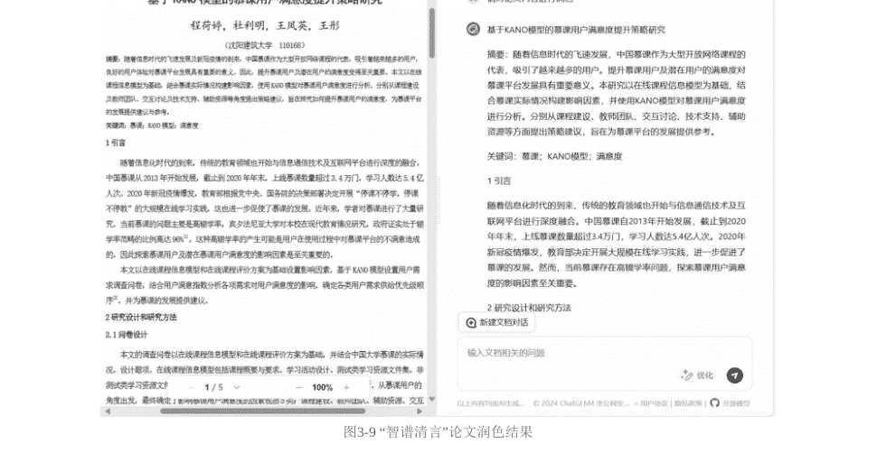

#### 2. 使用天工AI
在天工AI的“AI文档-音视频分析”模块上传同一论文，系统先进行解析，用户可直接输入需求进行交互式对话，润色过程与结果如图3-10和图3-11所示。

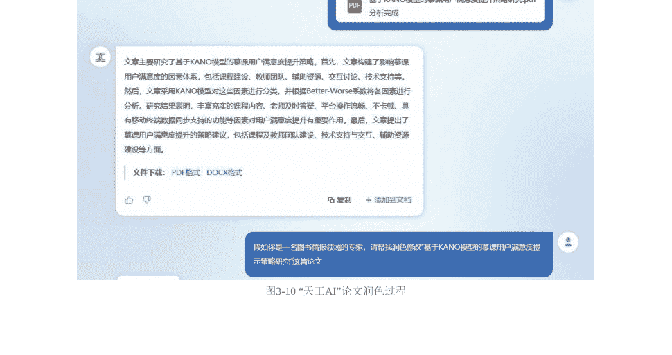

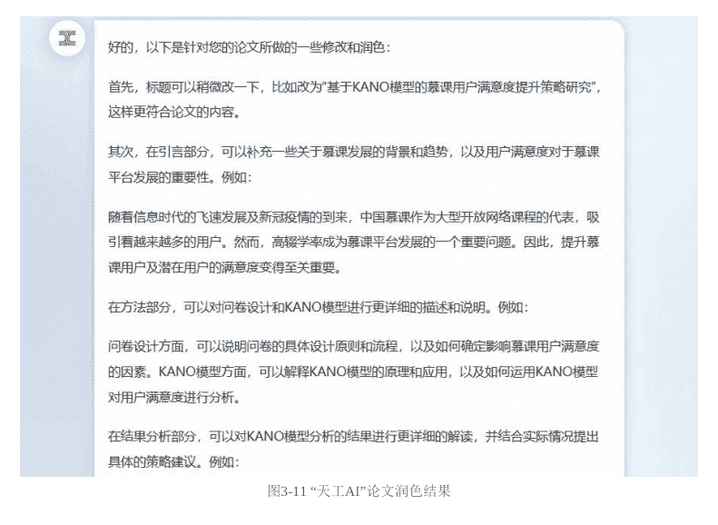

#### 3. 案例对比与解析

写作润色工具怎么挑？智谱清言与天工AI实测对比

智谱清言和天工AI都属于当下热门的写作辅助产品，论文润色是它们旗下的核心能力，只是使用思路并不完全相同。两者都有一个共同的工作习惯：先让用户把待改的文档上传进来，模型会先抽离出全文的主旨和论点，再在此基础上做整体优化，以确保逻辑自洽、观点鲜明。最终呈现方式则有分化，智谱清言更偏向一键交付，直接输出一篇润色完成的全文；天工AI则像一位编辑伙伴，提供逐条的可执行修改建议。基于此，选型逻辑也自然不同：想要快速拿到可用的成稿，智谱清言更省心；想深度参与打磨、逐句把控成稿质量，天工AI的可操控性更强。

总体而言，这类语言模型在语言处理上优势明显，能帮助作者梳理论文架构，提升表述的准确度与专业感，增强说服力度。同时具备自动纠错能力，保障信息正确。经过模型处理后，论文的可读性、顺畅度与规范性都会提升，有助于扩大学术影响，让研究成果表达得更清晰，促进学术交流。

3.5 文献提炼：把握要点加深理解

3.5.1 文献概括的意义何在
对单篇学术文献做精简系统的说明，能让读者在不阅读原文的情况下迅速掌握核心。通常会涵盖研究动因、采用方法、主要结论、可能的价值和局限。借助这类概括可以大幅提升阅读效率，精准定位研究重点，推动学术对话，也能让成果更广泛传播，提升社会对科学研究的认知度。

3.5.2 编写文献概括的操作流程
- ①锁定关键信息：先梳理出所属研究领域与核心问题。
- ②把握研究缘起：了解该领域的现状、研究动机与必要性。
- ③提炼研究手段：简要说明研究设计、数据获取与分析方法。
- ④归纳研究发现：挖掘主要结论，包含数据解读与问题回应。
- ⑤突出研究贡献：点明创新点、重要性及潜在应用前景。
- ⑥指出研究边界：分析过程限制与适用范围，评估有效性。
- ⑦整体归纳：将上述要素组织成结构清晰、逻辑连贯的一段文字。
- ⑧延伸价值：标出可借鉴、实用的部分，便于后续参考。

3.5.3 借助AI完成文献概括

#### 1. 借助文心一言
打开文心一言的主界面后，点击“文件”把待解析的文档导入，向模型清晰描述需求，它会按指令给出结果，如图3-12所示。初次生成后可以继续追问或要求再润色，直到满意，如图3-13所示。

请对上述论文进行总结，包括其研究背景、研究方法、研究结果、研究局限性以及该论文的拓展应用方面

使用: 阅读助手Plus

基于KANO模型的慕课用户满意度提升策略研究总结

#### 1. 研究缘起

**缘起概述：**
随信息时代加速与新冠疫情影响，中国慕课作为大型开放网络课程的代表迎来爆发式增长。截至2020年底，国内上线慕课超3.4万门，累计学习人次达5.4亿。然而高辍学率制约发展，研究显示辍学率高达96%。提升慕课用户及潜在用户的满意度，对降低流失、推动平台良性发展意义重大。

**研究目的：**
借助KANO模型解析慕课用户满意度的影响因素，并提出针对性提升策略，改善体验、提高满意度。

#### 2. 研究手段

**问卷设计：**
研究以在线课程信息模型与在线课程评价方案为基础，结合中国大学慕课实际，设计涵盖课程建设、教师团队、辅助资源、交互讨论、技术支持五大维度的问卷。通过线上线下发放，共回收有效问卷217份。

图3-12 “文心一言”产出文献概括

慕课满意度提升策略有哪些

使用: 阅读助手Plus

基于提供的《基于KANO模型的慕课用户满意度提升策略研究》论文内容，慕课满意度提升可归纳为：

- 1. 课程及教师团队层面：
   - **课程内容优化**：内容充实、难度适中、时长合理，并提供详尽课程信息。
   - **课程激励**：为完成者提供证书或高校认可学分，增强学习动力。
   - **教师素质提升**：普通话标准、讲解贴近实际，来自“985、211”院校的教师更具吸引力。
- 2. 技术支持与交互层面：
   - **平台性能优化**：导航清晰易找，操作流畅不卡顿。
   - **数据同步**：支持移动终端数据同步，跨设备学习无缝。
   - **交互增强**：优化反馈与交互界面，及时收集学生意见；增加学员间互动讨论功能。
- 3. 辅助资源层面：
   - **课后延展**：提供巩固所学资料。
   - **学习提醒**：通过微信或短信推送课程开始与测评时间，避免遗忘。
   - **习题讲解**：提供难度适中练习与测评，并对试题进行讲解。

#### 研究缘起

图3-13 “文心一言”针对追问产出结果

#### 2. 借助智谱清言
智谱清言的文献解读能力也很强。在首页选择“长文档解读”，拖拽导入待分析文档，用相同问题提问即可得到结果，如图3-14所示。同样可继续追问，如图3-15所示。

> 本研究基于在线课程信息模型，结合KANO模型分析慕课用户满意度并提出提升策略。

主要结论如下：

- 影响满意度的因素可归纳为五类：课程建设、教师团队、辅助资源、交互讨论、技术支持。
- KANO模型将影响因素细分为：
   - 魅力型需求 A：可获证书或高校承认学分、讲解结合实际、教师来自“985、211”院校、课程信息详尽、课后延展资料、学习进度与信息提醒及时。提供这些会显著提升满意度。
   - 期望型需求 O：内容充实、教师及时答疑、平台流畅不卡顿、具备移动端数据同步。这些是用户期望具备的功能。
   - 必备型需求 M：教师普通话标准、课后练习与测评难度适宜、试题有讲解、导航清晰易找。这些被视为必须具备。
   - 无差异需求 I：课程时长安排、课程难度、参与人数多、与其他同学互动讨论。对满意度影响不大。
   - 反向型需求 R：课程内容需付费。付费模式可能降低满意度。
- Better-Worse系数分析进一步验证了KANO结果，并揭示了各类需求对满意度的影响程度。

图3-14 “智谱清言”产出文献概括

#### 增加对技术支持的具体优化建议

根据研究，技术支持是关键影响因素之一。具体优化建议：

- 1. 网络稳定性与视频流畅度：
   - **优化服务器架构**：采用分布式架构，提升响应与处理能力，减少拥堵卡顿。
   - **内容分发网络 CDN**：利用CDN将视频分发至各节点，就近访问，降低延迟。
   - **视频编码优化**：采用高效编码，在保证质量下减小文件体积，加快加载。
   - **自适应流技术**：依用户带宽与设备性能自动调节清晰度与码率，保证流畅。
- 2. 移动终端支持：
   - **优化移动端界面**：针对手机、平板设计简洁易用界面。
   - **开发移动应用**：提供离线下载、缓存等便捷学习体验。
   - **数据同步功能**：实现跨设备学习进度与数据同步，无缝切换。

#### 3. 案例对照与分析
文心一言与智谱清言在文献概括功能上相似，都能通过导入文档帮助用户快速理解核心内容并做解读，准确率与效率较高，且支持追问获取更多信息。

不同点在于：技术实现上，文心一言在文本产出与理解上更强；智谱清言更偏代码产出与多轮对话。功能丰富度上，文心一言插件更强，如图片识别、文档编辑；智谱清言在概括基础上提供问答、翻译等辅助功能。用户体验上，两者差异明显，部分用户偏好文心一言的界面与操作，部分用户认为智谱清言回答更精准。具体选择需结合个人需求与偏好。

3.6 实习复盘：沉淀经验提炼成长

3.6.1 什么是实习报告
实习报告是对实习期间在企业或组织中的工作、学习与体验的总结反馈。一般包括实习时间地点、单位概况、参与工作、收获心得等。报告帮助学生系统回顾实习成效与不足，也让用人单位与学校了解表现。撰写过程可提升总结表达能力，加深对经历的认识，为职业规划打基础。

3.6.2 实习报告的结构
- ①基本情况：介绍实习单位与岗位。
- ②实习时间：明确起止时间与总时长。
- ③实习任务和目标：阐述需完成任务与能力提升方向，如专业技能、团队协作、沟通等。
- ④实习过程：详细描述工作内容、项目、挑战及解决方式。
- ⑤实习成果：总结学习成果与工作表现，包括综合素质与工作态度。
- ⑥实习评价：含自我评价与导师评价。自我评价需客观分析优缺点与感悟；导师评价给出建议与期望。
- ⑦总结与展望：归纳收获与不足，对未来职业发展提出展望。

3.6.3 AI 撰写实习报告

#### 1. 借助智谱清言
进入智谱清言，在对话框输入实习报告关键信息，如“实习单位”“实习岗位”“实习时间”“实习感悟”等，也可自定义“字数限制”，发送后即可生成报告，如图3-16所示。

用户_8noFZ8

你是一名实习生，有着丰富的实习经历和深刻的实习感悟。请根据要求撰写实习报告：

实习单位:某科技公司

实习岗位:市场调研助理

实习时间:2024年3月-2024年9月

实习感悟:如何通过市场调研提升产品竞争力

要求:报告内容要详细阐述实习经历、所学技能、实习成果和个人感悟，字数在300字左右，格式准确。

ChatGLM

实习报告

一、实习经历 实习单位：某科技公司 实习岗位：市场调研助理 实习时间：2024年3月-2024年9月

在实习期间，我负责协助市场调研团队开展市场调查、数据收集、分析与报告编制等工作。通过深入了解行业动态、竞品信息和消费者需求，为公司的产品优化和市场策略提供了重要参考。

二、所学技能

1. 熟练掌握了市场调研流程，包括问卷设计、样本抽取、数据整理等；
2. 学会了使用市场调研软件进行数据分析和图表制作；
3. 提升了跨部门沟通与协作能力；
4. 增强了报告撰写和演讲表达能力。

三、实习成果

图3-16 “智谱清言”产出实习报告

#### 2. 借助笔灵AI
进入笔灵AI首页，搜索栏输入“实习报告”，出现模板提示框，点击进入编辑页，填写“实习岗位”“实习内容”，尽量详细描述时间、单位、部门与经历，设定字数后点“生成内容”，即可获得报告，如图3-17所示。后续可按需“扩写”“改写”“简写”或“续写”。

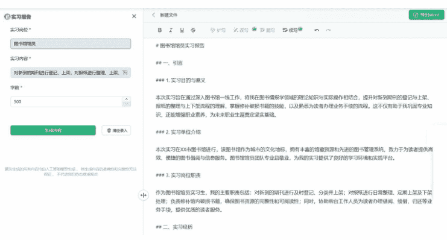

图3-17 “笔灵AI”产出实习报告

#### 3. 案例对照与分析
从对话角度看，智谱清言具备多轮与虚拟对话能力，可提供写作建议、框架构思与内容填充等更贴近实际的辅助；笔灵AI则基于固定模板，按关键词或提纲自动生成内容。

用户体验上，智谱清言功能更丰富，使用过程更智能便捷个性化；笔灵AI专注写作，在实习报告撰写上更具体实用，体验相对好。两者皆可辅助撰写，具体选择应依个人需求与喜好。

3.7 校园活动策划：激发创意打造活力

3.7.1 认识学生活动
学生活动是学校为丰富校园生活、促进成长设计的系统性活动，涵盖学术、文化、艺术、体育与社会服务等。通过实践、考察等将理论落地，提升学习效果与社交协作能力；通过体育、户外、心理健康等提升身心素质。

3.7.2 策划方案的框架
一篇完整的策划方案通常包含：
- ①活动名称：清晰传达主题。
- ②活动背景：说明发起原因与目的。
- ③活动目标：列出可衡量目标，便于评估。
- ④活动内容：规划流程、环节、互动、演讲等。
- ⑤活动时间：确定起止时间，避免冲突。
- ⑥活动地点：选择合适场地，考虑设施与交通。
- ⑦活动对象：明确参与人群。
- ⑧推广宣传：制定宣传计划，使用广播、海报、社交媒体等。
- ⑨活动预算：列出场地、材料、奖品、宣传等费用。
- ⑩活动组织架构：介绍团队分工与职责。

3.7.3 AI 辅助策划

利用AI撰写可提升效率、减少人为失误、实现个性化定制，激发创意，保证规范性与准确性，节省人力时间，让团队聚焦创意与细节。AI还能依据学生兴趣与学校特点给出个性化建议，智能推荐与数据分析也能帮助发现新形式。

#### 1. 借助智谱清言
打开智谱清言首页，在对话框逐一输入活动基本信息，如“活动名称”“活动内容”“活动目的”等，点击发送后即可自动生成策划方案，如图3-18所示。用户还能对生成稿进一步扩充润色，满足个性化需求。

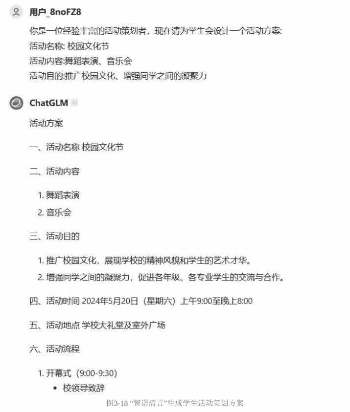

#### 2. 借助文心一言
进入文心一言首页，点击左侧“百宝箱”进入模板选择页，搜索“活动策划”，提供多个模板选项，如图3-19所示。选择“方案策划”模板，输入“活动主题”“内容要点”“策划要求”，发送后按需求生成方案，如图3-20所示。

图3-19 “文心一言”的“活动策划”模板

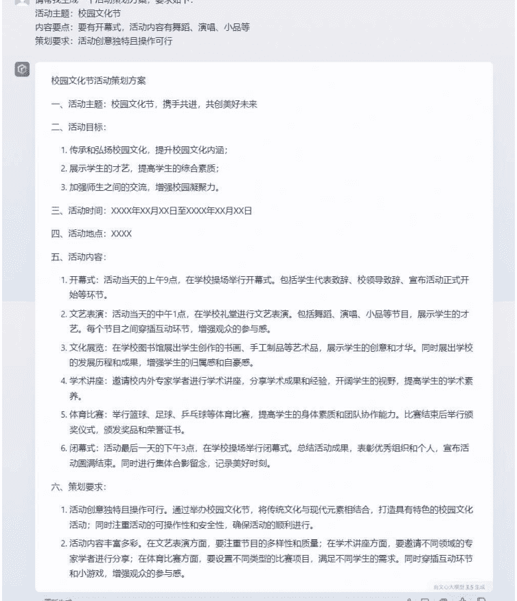

图3-20 “文心一言”产出学生活动策划方案

#### 3. 案例对照与分析
智谱清言与文心一言在撰写学生活动策划方案上各有特点。

相同点：创意生成上都能帮助设计有趣方案；语言表达上都能生成流畅有逻辑的文案；数据分析上都能助力了解受众、提升效果。

不同点：智谱清言处理知识性文本更突出，适合需要大量知识支撑的活动；文心一言更擅长情感色彩与主题性文本。生成速度上，智谱清言相对较慢，适合深度思考与长篇幅；文心一言速度更快，适合快速出方案。

总体而言，两者各有优势，用户可按实际需求选择。需深度思考与长篇知识性方案可选智谱清言；需快速生成情感化主题方案可选文心一言。

3.8 读书笔记：精读深思，点亮阅读智慧

3.8.1 认识读书笔记

掌握笔记技巧，激活阅读深度

读书笔记是我们在阅读过程中对书中要点、概念、信息以及个人感悟进行记录和整理的产物。形式可以是观点提炼、段落摘抄、对作者立场的评述、阅读带来的联想，或是零散信息的系统归类。借助记录与梳理，阅读的理解会更深入，尤其对抽象或难懂的论述帮助明显。整理过程往往激发新的疑问，有助于批判与创造性思维的提升，也能把新知识与已有认知框架连接，形成更完整系统的知识结构。对研究者而言，笔记是资料积累和后续论文写作的重要基础。

### 3.8.2 记笔记的常用步骤
具体做法因人而异，归纳起来大致可分为五步。
- 1. 启动准备：挑选合适的记录载体，如纸质本、便签、移动设备或专业笔记软件，同时明确本次阅读的意图与关注重点。
- 2. 阅读前预热：先浏览书籍的序言、目录与引言，掌握整体框架与主题，再依据阅读意图制定计划与预期目标。
- 3. 阅读中记录：
    - ① 提炼式记录：概括书中核心论点、论据与结论。
    - ② 原文抄录：完整抄写或粘贴重要的段落、定义与引用。
    - ③ 批注式记录：在书页空白或笔记中写下对原文的质疑、补充或个人见解。
    - ④ 图示化整理：用思维导图或概念图呈现信息之间的关联与层级。
- 4. 阅读后归纳：回看并整理手头的记录，确保信息准确完整；按主题分类并做好标记，便于后续检索与使用。
- 5. 深化内化：反思阅读材料带来的启示，思考其在实践中的运用方式，并将新知与已有知识体系融合，形成更深刻的理解。

### 3.8.3 借助智能系统生成读书笔记
借助智能系统生成读书笔记能显著提升效率，快速提炼要点并方便回顾。依靠自然语言处理等技术，系统可迅速对书籍内容进行归类、归纳与总结，节省大量时间；同时能够精准定位核心观点与关键信息，帮助读者更快理解与消化。整理好的笔记还可随时通过智能检索精准定位所需内容，提升学习与研究的效率。以《朝花夕拾》为例，分别用“笔灵AI”和“文心一言”进行实操演示。

#### 1. 操作笔灵AI
打开“笔灵AI”首页，在“热门”栏目下选择“读后感/读书笔记”模板，按模板提示填入书名、字数等参数，点击“生成内容”即可获得一篇笔记，如图3-21所示。

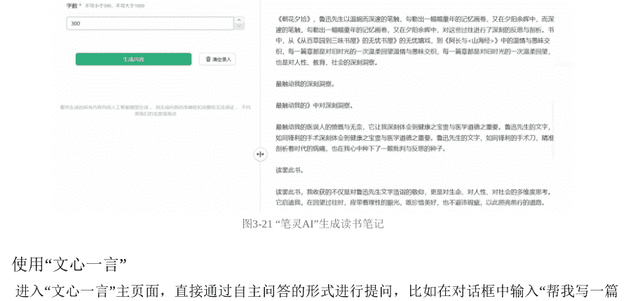

#### 2. 操作文心一言
进入“文心一言”首页，采用自由问答方式提问，例如在对话框输入“帮我写一篇《朝花夕拾》的读书笔记”，点击“发送”后即可得到结果，如图3-22所示。

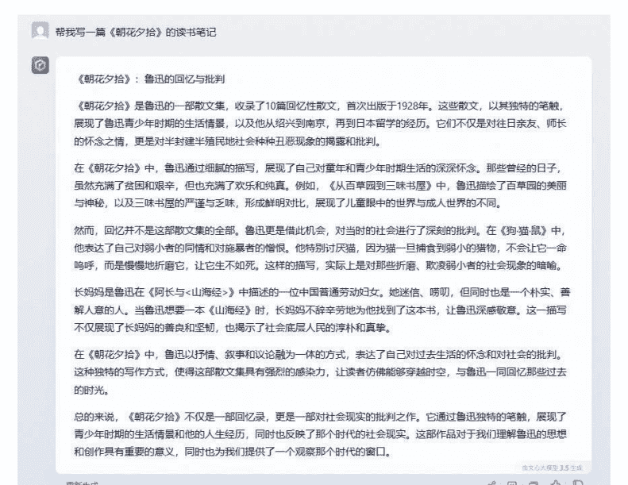

#### 3. 案例对比与分析
“笔灵AI”与“文心一言”的上手难度都不高，均覆盖多种写作场景。差异在于，“笔灵AI”可按用户需求产出类原创文本，适合在短时间内完成大量写作任务；“文心一言”更注重输出的逻辑性与连贯性。功能定位上，“笔灵AI”属于人工智能驱动的写作辅助产品，擅长文章创作与续写；“文心一言”则是基于大语言模型的智能写作平台，强调自动生成多样文本以提高写作效率。总体来看，两者都能便捷生成读书笔记，但在模板丰富度与生成质量上各有侧重，用户可按自身需求挑选。

## 3.9 课题申请报告：细化打磨，奠定研究基础

### 3.9.1 课题申请报告的定义
课题申请报告是科研项目或研究课题启动初期，研究者或团队向科研管理机构或评审委员会递交的正式文件。它是项目立项申请的核心材料，用于论证研究的必要性、可行性、科学性与预期目标，争取官方或专家的认可与资助，让资助方清晰了解研究计划与预期效益，从而决定是否提供资金支持。

### 3.9.2 报告构成要点
撰写时需保持客观真实，避免夸大或虚假信息，同时要体现团队实力与对领域的深入理解。具体结构会随资助方要求调整，通常包含以下核心板块。
- ① 封面：载明课题名称、申请人信息、申请日期等。课题名称需简洁概括核心内容；申请人信息包括姓名、单位、职务、联系方式。
- ② 摘要：概括研究背景与意义以及研究目标。
- ③ 研究内容与方法：详述研究范围、核心问题及解决思路；说明技术路线、实验设计等，以确保科学可行。
- ④ 研究计划与进度安排：分阶段列出研究任务与时间节点，合理规划整体节奏。
- ⑤ 预期成果与贡献：明确预期产出，如学术论文、专利、软件著作权等，并阐述对学科发展与社会进步的贡献。
- ⑥ 研究团队与条件：介绍成员的学术背景、研究经验与分工，并说明所需设备、场地、经费等保障条件。
- ⑦ 参考文献：列出报告中引用的文献，佐证研究的科学性与前沿性。
- ⑧ 附件：视需要附上证明材料、初步成果等以支撑申请。

### 3.9.3 用智能系统辅助撰写申请报告
下面以“智谱清言”和“天工AI”为例演示。

#### 1. 操作智谱清言
在“智谱清言”对话框中输入课题申请报告的结构与要求，点击发送，让其生成一份《数字经济与实体经济深度融合机制研究》的申请报告，如图3-23所示。该过程涵盖语义理解、逻辑优化、背景分析、意义阐述、目标设定与方法论完善等。

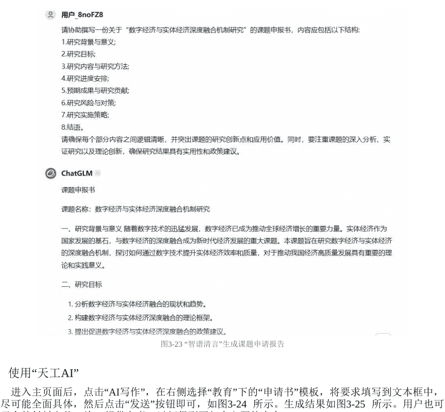

#### 2. 操作天工AI
进入主界面后点击“AI写作”，在右侧选择“教育”下的“申请书”模板，将详细需求填入文本框后点击发送即可，如图3-24所示。生成结果见图3-25所示。用户也可上传已有材料供系统参考，以提高贴合度。

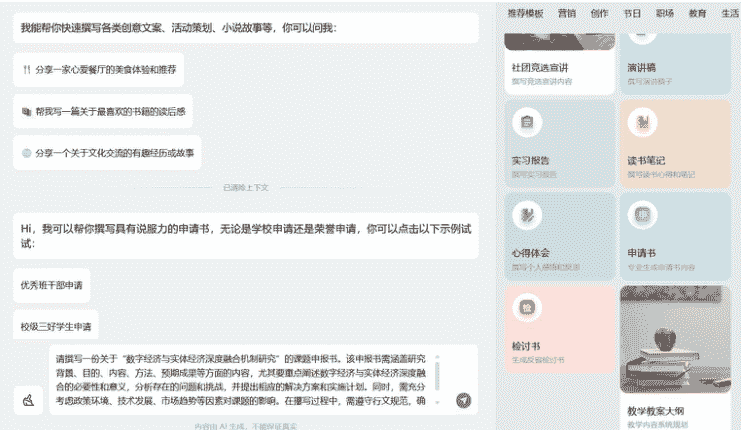

图3-24 “天工AI”的“申请书”模板

#### 3. 案例对比与分析
两者撰写功能相似，都采用交互对话生成内容，输出结构完整且符合申报格式，均可通过对话进一步优化。“天工AI”支持上传文档或链接进行校正，结果更精准。智能系统应作为学术研究中的咨询者、辅助者和伙伴，提供灵感支持而非替代撰写。我们倡导在智能辅助下工作，同时需清醒认识其局限：系统反馈可能出现不准确术语、概念偏差或文献引用错误，必须由专业研究人员甄别优化，确保文档准确。

### 【课题申报书】

**课题名称：** 数字经济与实体经济深度融合机制研究

#### 一、研究背景
进入21世纪，数字经济凭借强劲活力与创新力成为全球增长新引擎。与实体经济的深度融合不仅是发展必然趋势，也是实现高质量增长的关键路径。当前全球融合实践已初见成效，但仍面临模式创新不足、数据安全与隐私、政策适配性、技术壁垒与人才短缺等挑战，这些制约了融合的广度与深度，影响经济全面协调可持续发展。因此，深入探究融合机制，对构建现代化经济体系、优化结构、促进高质量发展具有重大意义。

#### 二、研究目的
课题旨在探索数字经济与实体经济深度融合的路径与机制，剖析融合中的问题与挑战，提出创新且可操作的解决方案，为政府、企业和社会各界提供决策参考，推动二者健康高效融合。

#### 三、研究内容
- 1. **理论框架构建：** 界定融合概念，分析特征，构建分类体系。
- 2. **现状与问题分析：** 梳理全球融合现状，深入探讨主要问题与挑战。
- 3. **融合机制研究：** 探索政策、市场、技术等多维度促进机制的制度设计。
- 4. **案例分析与经验总结：** 选取典型案例，总结成功经验与失败教训，提炼最佳实践。
- 5. **政策建议与实施策略：** 基于研究成果提出政策建议与实施策略，涵盖技术路线、政策框架与人才培养。

## 3.10 文本翻译：消除语言隔阂，实现信息精准传达

### 3.10.1 何为文本翻译
文本翻译是将文字从一种语言转换为另一种语言的过程。为促进跨国、跨文化学者的合作与交流，推动学术知识传播与共享，借鉴前沿进展并提升本国研究质量与影响力，专业读者常需将学术文本译成目标语言，使其符合目标语言的学术规范与文化语境，从而准确把握原作者的研究成果与思想。

### 3.10.2 文本翻译的操作步骤
- ① 理解原文：仔细阅读并吃透内容，涵盖文化背景、作者意图与文本用途。
- ② 梳理结构：分析段落与句子结构，明确内在逻辑与表达方式。
- ③ 选择方法：依据原文特点选用直译、意译或原义译等策略。
- ④ 实施翻译：按选定方法逐句翻译，确保译文语法规范、表达自然。
- ⑤ 校对修改：对照原文检查译文准确性与流畅度。
- ⑥ 调整风格：结合受众与目标文化，适当调整语言风格。
- ⑦ 最终核验：再次校对，修正语法、标点等错误。

### 3.10.3 智能工具下的文本翻译
市面智能翻译工具众多，衡量标准在于能否兼顾文化背景、语言风格与用户需求。本节以DeepL与“智谱清言”为例对比分析。

#### 1. 操作DeepL
按第1章介绍的方法进入DeepL主界面，点击“翻译文本”，将待译内容填入文本框，选择目标语言后即可自动生成翻译，如图3-26、图3-27所示。

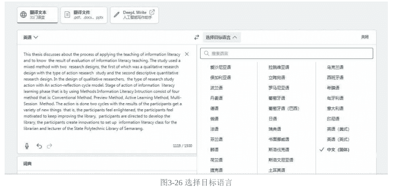

图3-26 选择目标语言

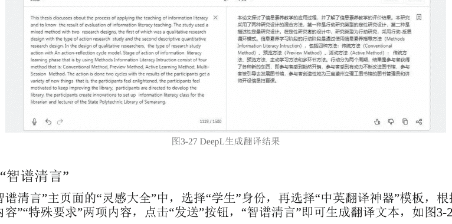

图3-27 DeepL生成翻译结果

#### 2. 操作智谱清言
在“智谱清言”主页“灵感大全”中选择“学生”身份，再选“中英翻译神器”模板，按提示填写“翻译内容”“特殊要求”，点击发送即可生成译文，如图3-28、图3-29所示。

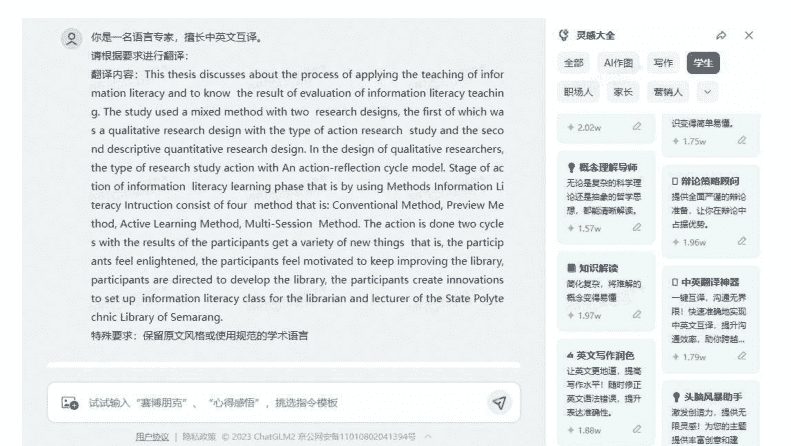

#### 3. 案例对比与分析
DeepL支持多种语言互译，覆盖面广；“智谱清言”除翻译外还具备智能问答、文案撰写、同步翻译、术语查找等功能。翻译质量上，DeepL在英语及其他语言互译保持较好忠实度与风格一致性；“智谱清言”在中英文互译中表现突出，尤其擅长理解中文语境与文化。使用体验上，DeepL界面简洁，支持Word、PPT、PDF等多格式，可自定义关键词翻译；“智谱清言”平台友好，跨设备使用，支持个性化服务。总体而言，DeepL在多语种与质量上占优，“智谱清言”在中英文场景更具优势，用户可按实际需求选择。

## 3.11 纠错编辑：精雕细琢，呈现完美文本

### 3.11.1 纠错编辑的重要性
纠错编辑需细致检查文档，修正拼写、语法、标点及事实性错误。它能提升出版物整体质量，增强专业性与可信度，保证信息准确传递，避免误解。在信息爆炸时代，高质量准确内容尤为珍贵，纠错编辑是写作出版不可或缺的环节。

### 3.11.2 纠错编辑的流程
纠错编辑是系统化工作，通常包含文本预处理、初步审阅、深入审查、综合校对、最终审查、反馈修正六个阶段。
- ① 文本预处理阶段：收集相关参考资料，明确编辑标准与规范。
- ② 初步审阅阶段：使用拼写检查工具核查文字与内容，修正语法错误并校对格式。
- ③ 深入审查阶段：进行语义检查，确保用词与句子无歧义；核查事实性内容，保证真实准确。
- ④ 综合校对阶段：检查整体流畅性与逻辑结构，校对参考文献、目录、索引的格式与内容。
- ⑤ 最终审查阶段：再次通读，确保无遗漏错误。
- ⑥ 反馈和修正阶段：把问题反馈给作者，按反馈进行必要修正。

### 3.11.3 智能纠错编辑工具实操
以下以“智谱清言”和Effidit为例演示。

#### 1. 操作智谱清言
“智谱清言”提供文本纠错、事实纠错、打字纠错、发音纠错等功能，通过对话即可获取服务。它会自动归纳语法、拼写、标点问题并给出修改建议。只需把待改文本输入对话框并提出修改要求，即可得到内容正确、语句连贯的文本，如图3-30所示。

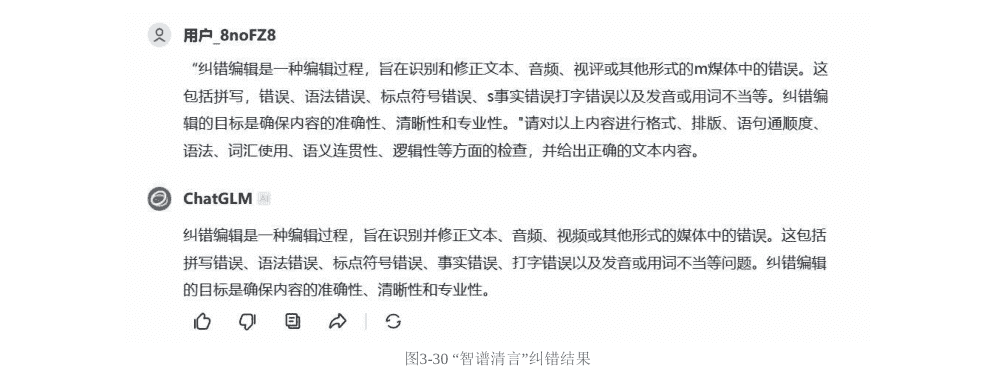

#### 2. 操作Effidit
在Effidit主页选择“智能纠错”，将需纠错内容粘贴到文本框即可，如图3-31所示。

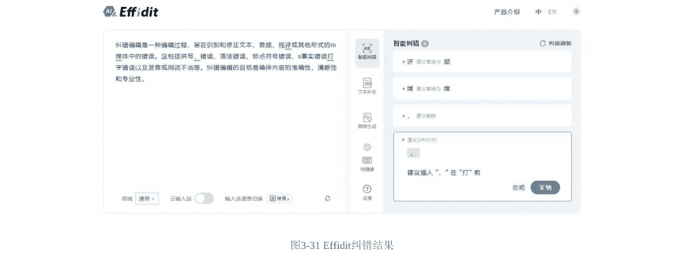

#### 3. 案例对比与分析
两者均能识别并修正拼写、语法、标点等错误，均支持多语言纠错。“智谱清言”会直接给出修改后文本，Effidit则提供修改建议供用户自主采纳。功能范围上，“智谱清言”除纠错外还具备多轮对话、创意写作、代码生成、虚拟对话等能力；Effidit聚焦文本纠错与润色。因此，“智谱清言”更适合需要复杂语言理解与多轮交互的场景，Effidit更适合快速修正文本的需求。

# 第4章 职场写作

## 4.1 简历：个性化呈现，提升求职竞争力

### 4.1.1 简历的重要性
简历在求职、参与社会活动、学术申请等场合发挥关键作用。职场中它影响初次印象、展示能力与经历、简化招聘流程、满足雇主要求并助力个人品牌建设。一份精心打磨的简历能在众多竞争者中脱颖而出，因而必不可少。

### 4.1.2 简历构成
简历通常包含个人基本信息、教育背景、个人经历、职业技能、荣誉证书、求职意愿等。要明确目标与使用场景，保持简洁明了，一般控制在一到两页，内容需有明确价值，突出技能、经验与成就，结构规范且逻辑清晰。
- ① 个人基本信息：姓名、性别、出生日期、联系方式、政治面貌、学历、籍贯等。
- ② 教育背景：毕业院校、专业、毕业时间、核心课程、成绩等。
- ③ 个人经历：校园经历、实习经历、项目经历等。校园经历指学习过程及学生会、社团参与；实习经历包括时间、公司、岗位、职责；项目经历包括项目名称、描述、成果。
- ④ 职业技能：技能名称及掌握程度。
- ⑤ 荣誉证书：证书全称、获奖时间、颁发单位。
- ⑥ 求职意愿：期望城市、岗位、薪资范围等。

### 4.1.3 智能系统助力撰写简历
借助智能系统写简历时，可先赋予系统面试官身份，使其从招聘方视角起草，更具针对性与专业性；其次按使用场景搭建框架，不同场景侧重点不同，如软件开发简历或学术申请简历；再由用户填充个人信息，让系统在框架基础上完成撰写，并可要求系统提出优化建议；最后生成定稿，不满意可反复提问优化。以一份软件开发求职简历为例，分别用ChatGPT与“文心一言”进行创作。

#### 1. 用 ChatGPT 拼装简历

和 ChatGPT 合作整理求职材料通常走两条路线：先对片段进行打磨，再合并成完整文档。以岗位实践的润色为例，把原始描述贴进对话窗口，提示模型以招聘方视角重新表述，就能得到类似图4-1的改写效果。若想一次拿到整份材料，需要先分板块补充学历、项目、技能等信息，最后下达“根据前面提供的信息生成一份完整简历”的指令，模型会输出整份内容，示范见图4-2。

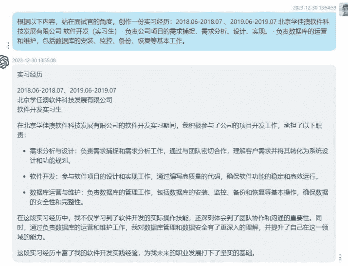

图4-1 ChatGPT生成的实习经历示例

**教育背景**

2017.09-2021.06 xxxx学院 计算机科学与技术（本科）

- 主修课程：数据库、数据结构、操作系统、计算机网络、计算机组成原理、编译原理、概率论、离散数学等。

2021.09-至今 xxxx大学 计算机科学与技术（研究生）

- 主修课程：机器学习、算法设计与分析、分布式数据库、计算机视觉、知识图谱、高级程序设计、数理统计等。

- 研究方向：深度强化学习、机器学习

**实习经历**

2018.06-2019.07 北京xxx软件科技发展有限公司 软件开发实习生

- 负责公司项目的需求捕捉、需求分析、设计和实现。

- 负责数据库的运营和维护，包括数据库的安装、监控、备份、恢复等基本工作。

**项目经历**

项目名称：基于深度强化学习的机器人路径规划

项目描述：利用深度强化学习算法解决室内移动机器人的导航问题，实现机器人在复杂环境中的自主导航。相关研究成果发表于《xxxx》。

**专业技能**

- 编程能力：熟练掌握Python和Java，并在数据挖掘和机器学习项目中应用。

- 系统和数据库知识：具备Linux系统和SQL数据库的基础知识，能进行数据存储、提取和处理。

- 机器学习框架和模型：熟练使用TensorFlow和PyTorch等主流机器学习框架，掌握常见机器学习模型。

- 数据处理和可视化：熟练运用Matplotlib、Pandas和NumPy等库进行数据分析、处理和可视化。

- 熟悉Ubuntu和ROS系统，搭建机器人整体架构，将人工智能算法应用在机器人中。

**证书**

- 大学英语六级（CET-6），良好的听说读写能力；

- 2023年9月 xxxx大学研究生一等学业奖学金；

- 2022年10月 xxxx大学研究生二等学业奖学金；

- 2021年5月 xxxx学院优秀毕业生；

#### 2. 文心一言 简历制作实操

文心一言的片段优化也很直接，在首页对话区输入岗位原文并给出改写指令即可得到润色稿，效果如图4-3。制作完整简历的思路与 ChatGPT 类似，先分步补充各部分信息再统一生成，效果如图4-4。

站在面试官的角度优化以下的实习经历：2018.06-2018.07、2019.06-2019.07 北京学佳澳软件科技发展有限公司 软件开发（实习生）。负责公司项目的需求捕捉、需求分析、设计、实现。负责数据库的运营和维护，包括数据库的安装、监控、备份、恢复等基本工作。

**实习经历**

北京学佳澳软件科技发展有限公司

软件开发实习生

时间：2018.06-2018.07、2019.06-2019.07

核心职责：

1. 需求管理：深入参与公司多个项目，从初期的需求捕捉到后期的需求分析，确保每一个细节都与用户的需求相匹配，为项目提供了明确、可行的方向。

2. 系统设计：不仅局限于软件层面的设计，还涉及到数据库的结构和运营策略，确保系统高效、稳定地运行，满足客户的核心需求。

3. 数据库运维：全面负责数据库的日常运营和维护，从安装到监控，再到备份和恢复，每一个环节都做到了精细化管理，确保数据的完整性和安全性。

图4-3 文心一言生成的实习经历示例

**教育背景**

- 2017.09-2021.06：XXXX学院，计算机科学与技术专业（本科），主修课程包括数据库、数据结构、操作系统等。

- 2021.09-至今：XXXX大学，计算机科学与技术专业（研究生），主修课程涵盖机器学习、算法设计与分析等。研究方向为深度强化学习。

**实习经历**

2018.06-2018.07、2019.06-2019.07：北京xxx软件科技发展有限公司，软件开发实习生。主要职责包括需求捕捉、分析、设计及实施，以及数据库的运营和维护。

**项目经历**

项目名称：基于深度强化学习的机器人路径规划

项目描述：将深度强化学习算法应用于室内移动机器人导航问题，提高机器人在复杂环境中的应对能力。该项目已于2023年8月23日在《xxxx》上发表论文一篇。

**专业技能**

- 熟练掌握Python和Java编程，具备Linux系统和SQL数据库知识。

- 熟悉TensorFlow和PyTorch等主流机器学习框架，并掌握常见机器学习模型。

- 熟练使用Matplotlib、Pandas和NumPy进行数据分析和可视化。

- 熟悉Ubuntu和ROS系统，具备机器人整体架构搭建经验，并能将人工智能算法应用于机器人中。

**证书与荣誉**

- 大学英语六级（CET-6）证书，具备良好的英语读写能力。

- 2023年9月获得XXXX大学研究生一等学业奖学金。

- 2022年10月获得XXXX大学研究生二等学业奖学金。

- 2021年5月被评为XXXX学院优秀毕业生。

图4-4 文心一言生成的简历示例

#### 3. 案例对比与分析

从版式、信息完整度、逻辑性、充实度等维度评估，ChatGPT 与文心一言都能按要求输出结构完整的简历。局部创作时，两者都能把岗位经历拆成条目呈现，突出要点、层次分明，阅读者能快速定位信息，可读性提升。整体来看，两款工具的输出差异不大，都偏向简洁规范、格式统一。共同的局限是无法直接导出可打印模板，用户仍需自行挑选模板后把生成内容填充进去。

使用 AI 生成简历时，如果某板块描述不够具体，例如岗位经历细节不足，可以在对话中追加指令如“请把实习经历扩写并保持语言精炼”，通过持续追问不断完善，最终得到一份质量更高的职业文档。提问技巧可参考本书第2章。

## 4.2 行业分析报告：把握行业动向

### 4.2.1 行业分析报告的价值

行业分析报告是对特定行业进行系统研究的文本，涵盖发展趋势、市场规模、竞争态势、消费者行为、关键参与者及潜在机会等，为经营决策提供依据。该类报告在市场营销、商业决策、产品开发、教学研究等多个领域均有应用。

### 4.2.2 行业分析报告的框架

- ①引言和摘要：以引言交代行业背景，简要概括发展趋势及未来挑战；摘要对全文浓缩，提炼关键发现与结论。
- ②方法和数据来源：明确研究方法与资料渠道，确保报告可信。
- ③行业概况：介绍行业的定义、范围、发展历程等基础信息。
- ④市场分析：剖析市场规模、增速及趋势，用于评估潜力并预测走向。
- ⑤竞争分析：梳理主要竞争者的企业、产品、定价、市场定位等。
- ⑥SWOT分析：结合内外环境，评估优势、劣势、机会与威胁。
- ⑦未来展望和建议：基于分析结果给出发展预测与对策建议。
- ⑧结论：总结核心发现，突出机遇与挑战。
- ⑨参考文献和附录：列出资料出处及补充数据。

### 4.2.3 AI 辅助撰写行业分析报告

使用 AI 撰写行业分析报告时，需要先让模型充分了解需求与背景，熟悉后即可生成报告。

以物流行业分析报告为例，分别用文心一言与智谱清言进行创作，过程如下。

#### 1. 使用文心一言

按照行业分析报告的规范，在文心一言对话框输入“按照引言和摘要、方法和数据来源、行业概况、市场分析、竞争分析、SWOT分析、未来展望和建议、结论、参考文献和附录这几部分，生成物流行业分析报告”，发送后即可得到文字版，效果见图4-5。若想得到可视化内容，可继续输入“用图表的形式展示物流行业数据分析报告”，效果见图4-6。

竞争分析：

- 1.竞争格局。目前，全球物流市场呈现出多元化的竞争格局。其中，电商物流市场是竞争最为激烈的领域之一，各大电商平台都在积极布局自己的物流体系，争夺市场份额。同时，传统物流企业也在积极转型和创新，提高服务质量。
- 2.竞争策略。为了在竞争中脱颖而出，物流企业需要采取以下策略：(1) 提高服务质量：通过提高服务质量，满足消费者的需求赢得市场份额。(2)降低成本，通过降低成本，提高企业的盈利能力，增强竞争力。(3) 拓展市场：通过拓展市场，扩大企业的业务范围，提高市场份额。

SWOT分析：

- 1.优势(Strengths)。(1)完善的物流网络：全球化的物流网络使得企业能够快速响应市场需求。(2)丰富的经验：多年的运营经验使得企业在处理复杂问题时更加得心应手。
- 2.劣势(Weaknesses)。(1)高成本：由于需要投入大量资金进行基础设施建设和技术研发，导致成本较高。(2)缺乏创新。在面对新兴技术时，企业可能缺乏足够的创新意识和能力。
- 3.机会(Opportunities)。(1)政策支持：政府对物流行业的支持力度不断加大，为企业提供了良好的发展环境。(2)新兴市场：新兴市场如东南亚、非洲等地区的市场潜力巨大，为企业提供了新的发展机遇。
- 4.威胁(Threats)。(1)国际贸易保护主义：国际贸易保护主义可能导致企业无法充分拓展国际市场。(2)技术变革：新兴技术如人工智能等可能对传统物流企业构成威胁。

图4-5 文心一言生成的物流行业分析报告

图表数据：

| 公司名称 | 年收入（亿美元） | 净利润（亿美元） | 员工人数（千人） | 运输能力（万吨） | 运输网络覆盖国家数 |
| :--- | :--- | :--- | :--- | :--- | :--- |
| FedEx | 800.33 | 29.57 | 4000000 | 12000000 | 220 |
| UPS | 711.59 | 31.12 | 394886 | 9074282 | 220 |
| DHL | 360.33 | 31.86 | 315000 | 11500000 | 220 |
| 中国邮政速递 | 131 | -131 | None | None | None |
| TNT Express | 213 | None | None | None | None |
| XPO Logistics | None | None | None | None | None |

图4-6 文心一言生成的物流行业图表数据

#### 2. 使用智谱清言

在智谱清言中输入与文心一言相同的指令，生成的报告见图4-7。

一、引言和摘要 物流行业作为现代经济体系中的重要组成部分，其发展水平直接影响着国家经济运行效率和现代化程度。本报告通过对物流行业的全面分析，揭示了行业的现状、市场趋势、竞争格局以及未来发展方向，为行业参与者提供决策依据。

二、方法数据来源 本报告采用的数据主要来源于官方统计数据、行业协会资料、企业调研以及市场调查等多种渠道，确保数据的真实性和准确性。

三、行业概况 物流行业包括运输、仓储、配送等多个环节，其发展受到政策、经济、技术等多方面因素的影响。近年来，我国物流行业规模不断扩大，效率逐步提高，但与发达国家相比，仍有较大差距。

四、市场分析 我国物流市场庞大，需求多样化。随着电商、制造业等领域的快速发展，物流市场呈现出快速增长的趋势。同时，市场竞争日益激烈，行业整合加速。

五、竞争分析 物流行业竞争格局分散，大型企业市场份额逐渐提高。目前，国内物流企业主要集中在低端市场，高端市场仍被外资企业占据。企业之间的竞争主要体现在价格、服务、效率等方面。

六、SWOT分析 物流行业面临的政策环境、市场需求、技术创新等外部因素以及企业自身的优势、劣势、机会和威胁，都将在SWOT分析中详细阐述。

七、未来展望和建议 结合行业发展趋势和市场需求，本报告提出了物流行业的发展建议，包括加大政策支持、提高行业集中度、加强技术创新等。

八、结论 物流行业作为国家经济的重要支柱，其发展前景广阔。在政策、市场和技术等多方面因素的推动下，我国物流行业将迎来新的发展机遇。

九、参考文献和附录 本报告参考了大量的文献资料，包括政策文件、行业报告、学术论文等，并在附录中提供了相关数据表格和图表。

通过以上几个部分，本报告全面分析了物流行业的现状、市场趋势、竞争格局以及未来发展方向，为行业参与者提供了有益的参考。

图4-7 智谱清言生成的物流行业分析报告

#### 3. 案例对比与分析

将两份 AI 产出的报告对照可发现，结构和整体内容相似，但表述角度和详略程度有所不同。两种工具都能按预设框架生成报告，帮助读者快速把握行业要点。内容上均提到物流发展受政策、经济、创新技术等多重因素影响，并指出我国与发达国家仍有差距。

在竞争分析和 SWOT 分析方面差异更明显。文心一言的报告从竞争格局与竞争策略两个层面展开，描述更为细致具体；SWOT 部分也对各项要素做了展开说明，成为行业分析的亮点。

一份完整的行业分析既需要文字阐释，也需要可视化图表。文字擅长抽象概念的细腻表达与深度解读，图表则直观、简洁、多样。把两者结合起来，能更全面地呈现行业优势，提升分析效果。

## 4.3 工作总结：呈现工作成效

### 4.3.1 工作总结的作用

工作总结是对一段时期工作进行回顾、分析与评价，通过总结经验教训提升工作效率与质量。其作用在于帮助员工认识自身表现、发现问题并制定改进计划；帮助员工理解公司业务与目标，为企业创造价值；促进沟通协作。长远来看，有助于个人与组织做好未来规划，实现目标。

### 4.3.2 撰写工作总结的流程

撰写时先确定简明扼要的标题；再构建主体内容，包括工作成果、工作亮点、工作不足及下一步计划；最后致谢，感谢帮助过的组织或个人。

主体内容中，工作成果需展示完成项目、达成目标、获得奖励等；工作亮点突出个人表现优异之处；工作不足反思遇到的困难与问题；下一步计划基于现状与经验教训制定未来方向。

### 4.3.3 AI 生成工作总结

AI 生成工作总结可实现自动化、结构化与个性化，在企业管理等场景中能快速高质量产出文稿，提升团队效率。

以软件开发工作总结为例，分别用 Chat 人工智能助手与文心一言进行创作。

#### 1. 使用 Chat 人工智能助手

Chat 人工智能助手是一款支持智能对话、写作、绘画的移动应用，具备强大的中文模型。

操作方式一：下载手机版后打开主界面，在底部输入框填写工作主题、关键词及其他要求，发送“按照上述要求创作一份工作总结”即可生成。操作方式二：点击底部“创作”进入左侧菜单选择“AI工作”，再点右侧“概况总结”，按提示填写主题描述/关键词、结果字数等，点击“AI生成”即可，效果见图4-8。

#### 2. 使用文心一言

在文心一言对话框输入：“关键词：软件工程工作总结，字数 1000 字。生成一份软件开发报告。”发送后得到结果，效果见图4-9。

关键词：软件工程工作总结，字数1000字，生成一份软件开发报告。

# 软件开发工作报告

## 一、引言

在过去的一段时间里，我作为软件工程项目团队的一员，深度参与了项目的规划、设计、开发与测试等各个环节。本项目旨在开发一款面向企业用户的客户关系管理系统（CRM），以提升企业的客户管理效率和业务处理能力。通过这段时间的努力，我深刻体会到了软件工程实践的复杂性与挑战性，同时也收获了宝贵的经验与教训。以下是对本项目工作的总结报告。

## 二、项目概述

本项目自启动之初，便明确了其目标：构建一个功能全面、操作便捷、安全可靠的CRM系统。系统需具备客户信息管理、销售流程追踪、数据分析与报表生成等核心功能。项目采用敏捷开发模式，分为多个迭代周期进行，每个周期均包含需求分析、设计、编码、测试与部署等阶段。

## 三、工作内容与成果

1.  **需求分析**：在项目初期，我与团队成员共同参与了需求调研与分析工作，通过与客户沟通，详细记录了业务需求，并编写了需求规格说明书。这一过程中，我学会了如何有效沟通以准确捕捉用户需求，以及如何将这些需求转化为具体、可衡量的开发任务。

2.  **系统设计**：基于需求分析结果，我参与了系统的总体设计与数据库设计。在设计过程中，我注重模块间的解耦与复用，确保系统的高内聚低耦合。同时，我也学习了如何使用UML进行建模，以更直观地展示系统结构。

3.  **编码实现**：在编码阶段，我主要负责了客户信息管理模块的开发。我遵循代码规范，注重代码的可读性与可维护性，同时利用单元测试确保代码质量。通过实际编码，我提升了自己的编程技能，尤其是在处理复杂业务逻辑时的能力。

4.  **测试与部署**：我参与了系统的集成测试与用户验收测试，负责编写测试用例并执行，发现并修复了多个潜在问题。在部署环节，我协助团队完成了系统的上线工作，确保了平稳过渡。

## 四、问题与挑战

在项目推进过程中，团队其实遇到了不少难题，比如需求频繁变动、技术难点需要攻坚、协作效率需要提升等。最具挑战性的是突发性的紧急变更，要求我们在很短时间内重新排布计划，同时保证交付节奏与质量。最终依靠迭代计划的灵活调整以及沟通协作的加强，才平稳化解了这些困难。

## 五、反思与总结
项目复盘后我体会到，完善的项目管理、顺畅的沟通机制、严谨的质量管控是项目成功的基石。同时也清醒地看到，自己在时间把控和技术深度挖掘上仍有提升空间。接下来的时间我会更专注于个人能力的精进，并强化团队协作素养，以期在软件工程领域取得更大进步。

## 六、结语
本次软件开发既是一次技术实操的历练，也是团队配合与个人成长的宝贵经历。我将带着这些收获继续前行，在软件工程的道路上不断探索学习，为企业创造更多价值。

图4-9 “文心一言”生成工作总结

#### 3. 案例对比与分析
图4-8与图4-9呈现的是依据相同提示由不同AI工具生成的两份总结，两者共同的短板是内容覆盖不够全面。针对这种情况可做二次优化，例如把Chat人工智能助手生成的工作总结原样粘贴到对话栏，再指令“在此基础上补充‘工作不足’部分”。

工作总结的呈现方式大致分为文字和图表两种。文字版擅长把工作要点提炼成简洁规范的表述，能保证正式完整，信息也比较充分，这类需求直接用Chat人工智能助手或文心一言生成文字报告就能满足。但纯文字阅读体验偏枯燥，如果让AI把内容转化为图表展示，则更具图文结合、逻辑清晰、参与感强和视觉丰富的优势。

还可以将不同AI工具的产出适度融合，以取长补短。

## 4.4 会议纪要：精准记录，助力决策执行

### 4.4.1 会议纪要的使用情况
会议纪要是用于记录会议核心内容与事项的文书，具有纪实性、概括性、指导性、约束性等特征。主要是对特定会议进行记录和归纳，通常由指定参会人员撰写，完成后再归档并分发给相关人员，便于大家了解会议要点并明确下一步安排。

### 4.4.2 会议纪要的主要结构

1. **标题**
标题一般由会议名称与文种构成，如“公司2023年全员会议纪要”。要紧扣会议中心，简明扼要。格式并非固定不变，遇到特殊情况需要适当调整。

2. **正文**
正文通常由前言、主体、结尾组成。前言交代会议名称、时间、地点、参会人、主持人等基本信息；主体是会议的核心，围绕主题把握会议精神，对讨论过程与结果进行准确清晰的概括；结尾并非必备，多为领导的期望与要求等。

3. **落款**
落款包含署名和时间。重要会议纪要需署明召集领导及单位全称并标注日期，同时加盖公章；一般会议纪要往往只需写明成文时间。

### 4.4.3 AI生成会议纪要
使用AI撰写会议纪要时，先让AI输出模板，基础框架为标题、正文、落款，具体内容依据会议而定；再明确纪要的级别，是普通还是重要，以便把握语气风格；最后通过多次追问细化创作要求，最终生成完整纪要。

以“公司第二季度全员会议纪要”为例，分别用“天工AI”和“文心一言”生成，具体如下。

1. **使用“天工AI”**
打开天工AI主页面，在搜索栏输入：“日期：2023年11月30日。时间：上午9:00至下午5:00。地点：公司会议室。出席人员：公司全体员工。讨论内容：①公司第二季度的工作成果；②各小组代表就其负责领域汇报成果；③提出改进意见和建议；④对下一季度的工作进行展望。”发送后结果见图4-10所示。
生成的纪要以会议基本信息开篇，记录了领导对下一季度的全面展望与目标设定、各部门负责人加强沟通协作的承诺，随后列出议程包括二季度成果总结、各组汇报、改进建议提出、下一季度展望等。后续行动项目包括任务分工与截止日期设定、领导层资源支持、定期进展汇报与计划调整、建立开放反馈机制等。会议纪要部分记载各小组汇报二季度成果及经验教训，并决定采纳优化协作机制和提高效率等改进建议。文末提示参会人员核对补充。

2. **使用“文心一言”**
打开文心一言，在对话框中输入与天工AI相同的提示并发送，生成结果如图4-11所示。

#### 3. 案例对比与分析
对比天工AI与文心一言生成的文案，两者都能准确记录讨论与结果，未失真漏项，重点突出，语言简练，格式规范。差异在于：文心一言的纪要额外增加了标题说明，天工AI则多出会议议程的单独呈现；在细节上，文心一言对To-do事项的描述更细，例如把计划精确到具体日期，更注重细节。

若AI首轮输出未达预期，可继续指令修改，关键是要说清问题与具体要求，例如在天工AI中输入“请为后续行动的每条记录补充具体时间安排”，即可重新生成。

## 4.5 商务函件：专业严谨，促进商务合作

### 4.5.1 商务函件使用情况
企业在商务往来中常借助商务函件进行信息沟通、业务联络、交易洽谈等。商务函件具备商务性和凭证性。商务性体现在主要用于商务场合，内容相对单一；凭证性体现在发生争议时可作为重要依据。

### 4.5.2 商务函件的内容
商务函件结构主要包括信头、标题、行文对象、正文、落款和附件。信头包含发收双方联系方式及日期；标题简明概括函件主旨；称呼需尊重礼貌，如“尊敬的×××先生/女士”；正文清晰阐述发函目的；落款提供发件人信息；如有附件需在文中注明。

### 4.5.3 AI创作商务函件
创作时先明确函件类型，如询问型、回复型、感谢型；再确定目的与受众，如建立关系、寻求合作、解决问题、传达信息等，受众多为客户或合作伙伴；然后确定结构与写作要求，参考4.5.2节，语言需专业、格式规范、突出重点并兼顾对方立场；最后反复修改完善。

以下以邀请客户体验新产品为例，分别用ChatGPT和文心一言生成。

1. **使用ChatGPT**
在对话框输入：“帮我写一份邀请型的商业函件，受众为客户，要有吸引力激发产品兴趣，目的是邀请收件人体验公司新产品并提供反馈意见。按信头、标题、行文对象、正文、落款的结构创作，使用专业语言并突出重点。”发送后结果如图4-12所示。信函表达了对客户的诚挚邀请，强调产品经过精心打磨以满足需求，并指出客户反馈对产品改进的重要性，重申邀请并致谢。

2. **使用“文心一言”**
在文心一言中输入与ChatGPT相同的指令，生成商务函件如图4-13所示。

#### 3. 案例对比与分析
两份函件目的一致，都是邀请客户体验新产品并征求反馈。文心一言的正文更强调产品的创新与高品质，并突出客户反馈价值；同时提供了更具体的体验流程，如回复邮件、寄送试用装、填写反馈表等，而ChatGPT的函件仅表达邀请意愿。落款均表达谢意并期待反馈。从结构看，ChatGPT严格按信头、标题、行文对象、正文、落款撰写，文心一言缺少信头信息。总体而言，文心一言更具体详细，ChatGPT更简洁概括。

使用AI创作商务函件时需兼顾专业性与准确性，并站在收件人角度考虑，通过清晰结构、规范语言和恰当表达提升效果。不同AI各有特点，可结合使用取长补短，但需遵循明确、言简意赅的原则，让收件人快速把握核心。

## 4.6 活动策划案：创意无限，打造精彩活动

### 4.6.1 活动策划案的重要性
活动策划案用于描述活动的流程与细节，是实现活动目标的必要文件。其使用与目标受众、预算、主题、形式等密切相关，常见于公司年会、商业展览、公益活动等。详尽的策划案是活动成功的保障，能提升吸引力与影响力。

### 4.6.2 活动策划案的结构
1. **背景分析**：介绍活动目的、意义、受众与需求，提供宏观视角。
2. **主题设定**：确定活动主题与关键词，选取相关元素。
3. **活动流程设计**：提前安排时间节点，确保各环节顺畅，准备好开场白、互动等细节。
4. **活动组织安排**：选定场地，明确主持人、演讲者、参与者分工，规划物资与预算。
5. **宣传推广**：确定宣传渠道与内容，制作海报、邀请函等材料。
6. **注意事项**：确保合法合规，预判突发状况，根据实际情况调整优化。

### 4.6.3 AI创作活动策划案
思路为：先让AI明确活动目的与主题；再根据目的与受众选择活动类型与形式；然后制定流程，安排环节、时间、内容与负责人；接着制定宣传方案与渠道；再据规模制定预算；最后制定风险控制与安全预案。

以策划新书发布会为例，受众为学生和职场人士，目的是宣传推广新书，吸引购买与阅读，分别用文心一言和天工AI生成。

#### 1. 使用“文心一言”
在文心一言中输入：“请以策划总监身份，按目标主题、类型形式、流程、宣传方案、预算、风险控制的流程帮我策划一场新书发布会，受众是学生和工作者，目的是宣传推广新出版书籍。”结果如图4-14所示。宣传方案包括社交媒体发布海报文案、媒体报道邀请、邮件邀请、与KOL合作等。预算涵盖场地、嘉宾邀请、现场布置、媒体报道及其他费用。风险控制涉及场地安全、嘉宾可靠性、现场秩序维护、流程把控、媒体报道及时性等。

#### 2. 使用“天工AI”
在天工AI中输入相同指令，结果如图4-15所示。活动主题为“知识的力量——新书发布会”，形式为线上直播结合线下签售。流程包括前期预热、线上发布会、线下签售、后期宣传。宣传方案涵盖传统媒体、社交媒体及合作宣传。预算包括场地、嘉宾、宣传、活动物资及其他费用。风险控制分策划阶段、执行阶段与活动结束后三个层面，提前预案并及时解决问题。

#### 3. 案例对比与分析
两份策划案均围绕新书发布会的宣传推广目标展开。在形式上，文心一言侧重互动式线下活动，包括主题演讲、作者分享、现场签售；天工AI提出线上直播加线下签售的结合方式，覆盖更广。在宣传上，文心一言以社交媒体和邮件为主，相对简洁；天工AI则涵盖传统媒体、社交媒体和合作宣传，覆盖面更广。预算方面，两者均包含场地、嘉宾、宣传、物资等项目，天工AI因宣传更全面，预算可能更高。风险控制上，两者均做预案，天工AI的描述更细致，覆盖策划、执行、复盘全过程。

活动策划案的核心价值，在于为主办方呈现一份尽可能完善的执行方案，以确保活动顺利落地。利用AI辅助创作时，如果用户持续输入更精准、更具体的背景信息，AI就能产出更贴合需求的策划内容，助力主办方实现活动目标，放大参与度与传播力。初稿若有不足之处，可不断下达优化指令，反复打磨，直至方案达到理想状态。

### 4.7 职场表达技巧：沟通力拉升职场竞争力

#### 4.7.1 职场沟通话术的定义
职场沟通话术，即在工作环境中与同事、领导、客户等进行交流时所采用的语言表达。得体的表达方式有助于职场人构建良好的人际网络，提升团队协作效率，促进合作共赢，并化解工作摩擦。

#### 4.7.2 职场沟通话术的归类

从使用场景和目的来看，职场沟通话术大致可分为汇报工作话术、请求支持话术、提出建议话术、反馈问题话术、接受批评话术等几类。汇报工作话术主要用于向上级或同事陈述进展、成果与困惑；请求支持话术用于向领导或同事寻求帮助与配合；提出建议话术用于表达自身想法与方案；反馈问题话术用于指出工作中的偏差或失误；接受批评话术用于得体地回应上级的点评与建议。

从沟通对象来看，可分为对领导的沟通话术、对同事的沟通话术、对客户的沟通话术、对其他部门的沟通话术、对下属的沟通话术等。对领导的沟通，重点在于汇报进展、递交建议或申请资源；对同事的沟通，强调同伴式的平等、友善与互相尊重，避免误会与矛盾；对客户的沟通，涵盖产品介绍、疑问解答、投诉处理等；对其他部门的沟通，侧重协同推进与信息共享；对下属的沟通，则需在布置任务、业务指导、绩效反馈时保持清晰具体、可操作性强，并兼顾激励与激发创造力。

#### 4.7.3 用AI生成职场沟通话术
借助AI创作职场沟通话术的基本思路是：首先明确沟通对象，告知AI对话方是谁；其次界定沟通意图，如传递信息、解决问题或表达感谢；再次补充细节要求，比如语气保持专业礼貌、突出要点、在特定场景下加入致谢与反馈；最后指令AI输出文本。

以向领导做工作汇报为例，分别用ChatGPT和“AI创作家”进行创作。

##### 1. 使用ChatGPT
按照上述思路，在ChatGPT对话框中输入：“我是xx公司的一名员工，请帮我生成一份在正式场合中向领导汇报工作的沟通话术。”点击发送后，生成的结果如图4-16所示。

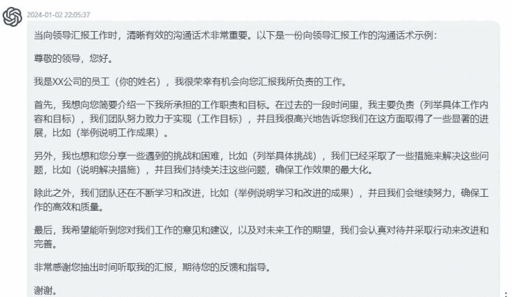

图4-16 ChatGPT生成职场沟通话术

##### 2. 使用“AI创作家”
在“AI创作家”对话框中输入与ChatGPT相同的指令，点击发送，生成的结果如图4-17所示。

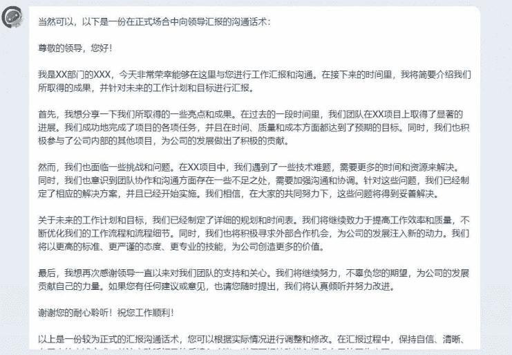

图4-17 “AI创作家”生成职场沟通话术

##### 3. 案例对比与分析
两份用于向领导汇报的话术在框架上接近，但在细节处理上存在差异。
开场都体现了对领导的尊重与礼貌；自我介绍部分都交代了汇报人身份及部门；工作回顾部分都展示了近期成果与进展，突出了团队价值；都提及了遇到的挑战及应对举措，体现了解决问题的积极性；都对未来工作进行了规划，展现了前瞻性；结尾都以感谢收束并期待领导指导。
不同之处在于，“AI创作家”在成果、挑战的描述上更具体，提供举例说明，使领导能更直观把握情况；ChatGPT的表述则更为简洁，细节展开较少。“AI创作家”在未来计划中还提及了寻求外部合作以注入新动能，ChatGPT的版本未涉及对外合作。
总体来看，两类AI生成的话术都抓住了汇报的核心要素，能提升沟通效果。实际使用时需让AI清楚沟通对象与背景，才能产出更匹配的表达。

### 4.8 面试题库：全方位覆盖，助力面试制胜

#### 4.8.1 面试题库的价值
面试题库是系统收集整理的面试问题集合。为求职者提供备考参考，有助于熟悉流程、练习应答、增强自信，从而提高通过率。对面试官而言，题库能帮助判断候选人是否具备岗位所需的专业能力与工作经验。

#### 4.8.2 面试题库的常见分类

1. 按面试形式分，主要有结构化面试题库和非结构化面试题库。
结构化题库依靠预设问题与评分标准进行提问与打分，保证公平与一致；非结构化题库则根据回答灵活追问，更能考察个人素质与潜能。

2. 按岗位类型分，主要有技术类、管理类、销售类题库。
技术类针对软件开发、数据库等岗位，考察技术水平与问题解决能力；管理类针对部门经理、总经理等，考察领导力、团队协作与管理经验；销售类针对销售代表、客户经理等，考察沟通技巧与销售能力。

3. 按行业分，主要有金融业、互联网、制造业题库。
金融业题库关注市场认知、风险管理与合规意识；互联网题库关注创新思维与技术理解；制造业题库关注生产工艺、设备维护、质量控制及实践经验。

4. 按面试轮次分，可分为初试题库、复试题库、终试题库。
初试用于了解基本信息、教育背景与经历，筛选符合基础要求的候选人；复试深入考察专业能力与个人素质，判断岗位适配度；终试聚焦综合素质、职业规划与企业文化契合度，综合决策录用。

#### 4.8.3 AI助力创作面试题库
使用AI生成面试题库时，先告知AI所需题库的类型，因不同行业岗位需求差异较大；再指令AI产出题目，提升针对性与专业度；最后进行整合梳理，可请AI补充面试建议与注意事项。

以算法工程师岗位为例，分别用“AI创作家”和“智谱清言”进行创作。

##### 1. 使用“AI创作家”
在“AI创作家”中依次提问“应聘算法工程师常见面试问题”“面试追加问题、注意事项与建议”，两次输出分别如图4-18、图4-19所示。

1. 基础问题：
- 算法和数据结构的概念是什么？
- 深度优先搜索与广度优先搜索有何区别？
- 常见的排序算法有哪些？时间复杂度分别如何？
- 什么是贪心算法？其原理及适用场景有哪些？
- 对动态规划如何理解？能否举例说明？

2. 进阶问题：
- 请举例说明使用SVM、决策树、神经网络等机器学习模型进行分类或回归的实践经验，涵盖数据准备、模型选型与优化。
- 请描述实现一个图像识别算法如卷积神经网络的流程，包括模型设计与训练。
- 是否使用过Hadoop、Spark等分布式计算框架处理大规模数据并建模？请分享经历。

3. 编程问题：
- 能否写出基于哈希表实现的链表插入操作？
- 能否说明冒泡排序在Python中的实现思路？
- 请分享使用TensorFlow或PyTorch进行模型训练的经验，包括数据加载、模型定义、损失函数与优化器。

图4-18 “AI创作家”生成面试题库

面试追加问题
1. 项目经验：请介绍与算法和数据结构相关的项目经历及你在其中的职责。
2. 算法实现：请提供一个你实现过的复杂算法案例，并说明解决思路。
3. 代码质量：你如何保证代码质量？能否展示一段旧代码并指出可改进之处？
4. 学习能力：你通常如何学习新算法或框架？是否参与过相关培训？

注意事项与建议：
1. 充分准备：熟练掌握算法与数据结构基础，并准备好项目、编程、机器学习相关问题的答案。
2. 突出重点：着重呈现与算法相关的项目经验、关键任务与成果。
3. 诚实自信：回答保持真实，同时展现自信；若不确定，可坦诚说明并尝试合理推断。
4. 展示成果：携带项目成果或作品集证明实力。
5. 注意细节：着装得体、举止专业，传递自信与礼貌。

图4-19 “AI创作家”补充回答

##### 2. 使用“智谱清言”
在“智谱清言”中输入相同指令两次，输出分别如图4-20、图4-21所示。

应聘算法工程师的面试问题通常覆盖：
1. 基础知识：数据结构与算法、计算机网络基础、操作系统原理、编程语言语法与特性。
2. 数学基础：线性代数、概率论与数理统计、最优化理论、数值计算。
3. 机器学习与深度学习：常见算法原理、深度学习架构如CNN、RNN、GANs、训练调参经验、过拟合与欠拟合的应对。
4. 项目经验：过往角色、技术挑战与解决方案、算法性能优化经验。
5. 编程能力：现场或在线编程、代码质量与效率考察。
6. 沟通协作：团队协作方式、面对分歧时的表达。

图4-20 “智谱清言”生成面试题库

面试官常根据回答追加追问，如对某算法的深入解析与批判性思考、对最新技术动态的了解、对目标行业问题的见解。

面试注意事项与建议：
1. 准备充分：熟悉简历细节，准备项目与技术选型的讲解，复习常见算法题，提前准备演示材料。
2. 沟通清晰：语言简练，避免过度专业术语，保持逻辑条理。
3. 诚实回答：坦诚未知问题，表达学习意愿，不夸大经历。
4. 展现热情：表现出对技术的热爱，主动询问公司与团队情况。
5. 着装得体：根据企业文化与面试形式选择合适装束。
6. 面试收尾反问：准备针对公司与岗位的问题，体现关注度。
7. 面试后跟进：发送感谢信，简要重申自身匹配度。

图4-21 “智谱清言”补充回答

##### 3. 案例对比与分析
两种AI输出均覆盖了岗位常见问题与注意事项。“智谱清言”的题库更宏观，范围更广；“AI创作家”的题库更具体，案例更细化。追加问题与建议部分差异不大。若需更精细的问题，可进一步向AI提出明确指令。
总体而言，AI生成题库能帮助面试官全面评估候选人知识、技能与经验，提升面试效率，也能帮助求职者更充分准备。但AI输出存在随机性，使用时需人工筛选与整理，确保问题有效且针对。

### 4.9 商业计划书：展示实力，赢得投资关注

#### 4.9.1 商业计划书的意义
商业计划书是对企业或项目机会、市场状况、战略规划、财务预测、运营模式等进行系统阐述的文件。它面向投资者、合作伙伴及利益相关方传递愿景与发展路径，是商业决策与融资的重要依据。

#### 4.9.2 商业计划书的常规架构
不同场景下结构会有差异，核心内容通常包括：
1. 封面与目录：封面展示公司名称、LOGO等关键信息；目录标明各章节页码。
2. 概述：对企业或项目做简要介绍。
3. 市场分析：市场定位、规模、增长趋势、目标客户、竞争对手分析。
4. 产品或服务：产品特点、功能、优势。
5. 经营模式：运营方式、商业模式、供应链、关键合作伙伴。
6. 市场营销策略：目标市场、品牌、定价、促销、销售渠道。
7. 组织与管理：组织架构、核心团队、管理流程与决策机制。
8. 财务计划：资金需求、来源、收入预测、成本结构、盈利预测。
9. 风险管理：识别潜在风险及应对措施。
10. 实施计划：行动步骤与时间表。
11. 总结与附录：整体概括与重点强调，附录提供数据、合同等支撑材料。

#### 4.9.3 AI创作商业计划书
使用AI撰写商业计划书时，首先明确商业模式，让AI了解产品服务与目标；其次按结构指令生成初稿；最后人工审核修改，确保信息准确。

以小学生课外阅读书籍销售为例，分别用“文心一言”和“智谱清言”生成。

##### 1. 使用“文心一言”
指令为“从概述、市场分析、产品服务、经营模式、市场营销策略、组织与管理、财务计划、风险管理、实施计划、总结这几个方面生成一份有关小学生课外阅读书籍销售的商业计划书。”部分内容如图4-22所示。

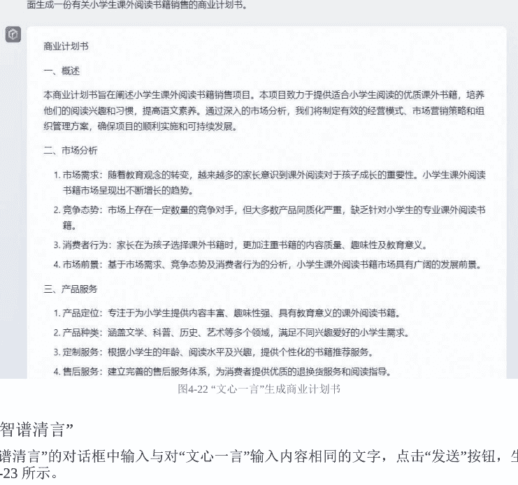

##### 2. 使用“智谱清言”
输入相同指令，部分结果如图4-23所示。

写一份儿童课外阅读书籍商业策划书，基本结构包括封面和目录、概述、市场分析、产品或服务、经营模式、市场营销策略、组织与管理、财务计划、实施计划、总结和附录。

一、封面和目录
1. 书名：《儿童课外阅读书籍商业策划书》
2. 编写人：张三
3. 日期：2021年8月
4. 目录：概述 市场分析 产品或服务 经营模式 市场营销策略 组织与管理 财务计划 实施计划 总结 附录

二、概述
本策划书旨在为儿童课外阅读书籍的商业运营提供系统规划。通过市场现状分析、产品定位、经营与营销策略设计，以及组织、财务与实施安排，为业务发展提供支撑。

三、市场分析
1. 市场需求：家长教育投入加大，儿童课外阅读市场持续扩容，对优质读物需求上升。
2. 市场竞争：品牌众多竞争激烈，需以差异化价值脱颖而出。
3. 市场机会：国家对文化产业的扶持及家庭教育投入，为市场提供广阔空间。

图4-23 “智谱清言”生成商业计划书

##### 3. 案例对比与分析

AI生成的商业方案对比

两份由大模型完成的商业方案在版式上基本一致，都遵循了常规的商业策划框架，但在内容侧重点上有所不同。项目概述部分，文心一言更突出方案的核心目标与意图，表述集中；智谱清言也点出项目名称与目标，展开的力度相对克制。市场分析部分，两份材料均涉及儿童课外阅读的需求与竞争态势，文心一言额外补充了用户行为模式与前景判断，智谱清言则侧重给出市场规模的测算。

总体来看，各有长处，实际运用时可以取长补短，将不同模型的优势融合，形成覆盖更全、论证更扎实的策划案。

## 4.10 通知撰写：简洁传递关键信息

### 4.10.1 通知的核心价值
通知是向个人或群体传递资讯的常用方式，常用于发布重要消息、给出提醒或进行动态更新。常见的载体有纸质文件、邮件、短信、电话等。它能把信息准确送达指定对象，提示某项事件或任务临近，也可促进互动。起草与分发时必须保证内容无误。

### 4.10.2 通知的常用框架
样式需结合具体内容调整，核心要素通常包括：
1. 主题标题：用简洁语言概括要点，便于接收方迅速把握重点。
2. 明确时点：通知具时效性，需标明事项发生或执行的具体时间。
3. 发布方信息：列出发布人姓名、职务等，便于判断来源可信度并提供联系渠道。
4. 正文说明：是通知的核心，需交代目的、内容、注意事项等，表述要清晰简练，便于阅读者理解并采取行动。
5. 收尾落款：一般配以感谢、问候等结束语，署名应包含发布人信息及发布时间。
6. 附件补充：若涉及额外资料，可在文中提供附件或补充链接，方便获取更详实的信息。

### 4.10.3 用大模型起草通知的方法
借助模型起草时，首先明确通知的类型与用途，如紧急通知、公告等；其次收集所需信息，如时间、地点、事项等；然后让模型依据框架和已知信息生成初稿；最后审阅初稿是否存在不合理之处，通过追问不断优化，并在实际使用中进行人工干预，确保内容准确贴合场景。

#### 1. 使用“文心一言”
按上述要求在对话框中输入：“为完成电力设备检修，某小区本周日13点至16点停电，请按‘标题、具体时间、发布者信息、正文内容、结尾和署名’的结构写一则通知。”发送后得到的生成结果如图4-24所示。

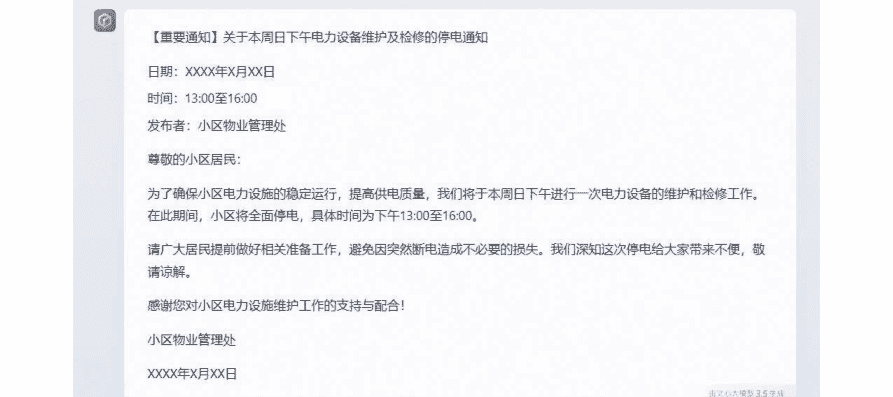

#### 2. 使用“AI创作家”
在“AI创作家”对话框中输入与文心一言相同的指令，点击发送，生成结果如图4-25所示。

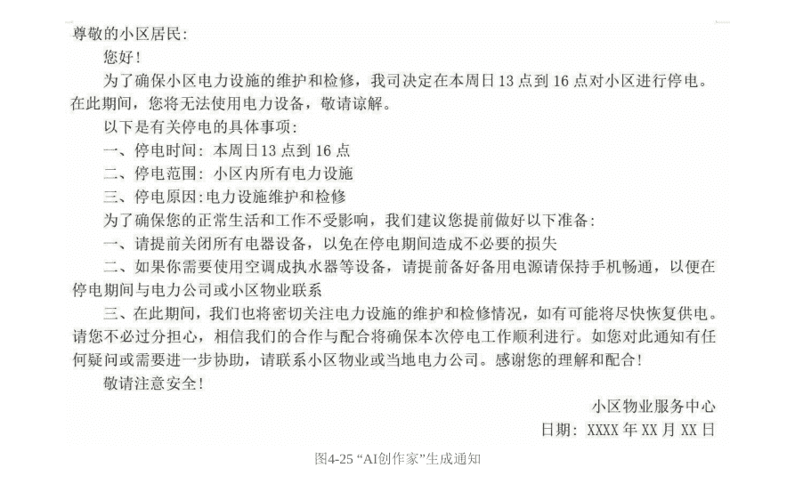

#### 3. 案例对比与分析
两则通知在措辞风格和详略程度上差异明显。文心一言的版本更简练，仅告知停电时段、原因及居民配合要求；AI创作家的版本则更细致，不仅说明停电详情，还提供操作建议和注意事项，如提前关闭电器、准备备用电源等。总体而言，AI创作家生成的通知更周全详实，有助于居民更清楚地了解情况并妥善应对。

在实际应用中，为保证质量，需要把握正式性、准确性、针对性等要点，对不当之处继续指令模型优化，最终由人工再次核验无误后再发布。

# 第5章 新媒体创作

## 5.1 选题策划：找准创意切入点

### 5.1.1 好选题为何关键
在新媒体创作里，选题的确定是提升写作质量的重要环节。对选题进行深入思考，有助于把握文章主题和思路，增强创作的针对性和实效性。优秀的选题具备吸引力，能提升点击率和阅读量。当前信息筛选门槛提高，一个新颖独特、能引发兴趣的选题，更容易抓住读者注意力，促进信息传播。

### 5.1.2 AI辅助选题的四步法
- ①明确核心主题：主题是内容的基础，也是与读者链接的起点。例如亲子教育类内容，就以此为边界深挖子话题。
- ②锁定目标受众：了解受众的阅读习惯、文化背景和兴趣偏好，以此匹配合适的表达风格。
- ③生成选题：基于主题和受众分析，由模型批量产出候选选题。
- ④细化需求：看到模型生成的选题后，可明确提出方向、期望效果等具体要求，引导模型产出更符合预期的结果。
需要强调的是，模型只能辅助，终审决策仍需创作者的判断与经验。

### 5.1.3 工具实操示例

#### 1. 使用“文心一言”
按流程在对话框输入：“我计划做一系列关于亲子教育的新媒体内容，重点关注科技在亲子沟通中的应用。目标受众是注重实用性和前沿教育理念的年轻父母，请推荐相关选题。”发送后生成结果如图5-1所示。

生成结果围绕科技与亲子教育融合给出若干方向，包括智能设备助力共读、AI教育玩具促进互动、虚拟现实亲子游戏、智能家居提升育儿便捷性、在線亲子课程优劣与选择等，均兼具实用性与前瞻性。

图5-1 “文心一言”针对文案选题的生成结果

#### 2. 使用“智谱清言”
输入与文心一言相同的指令后，生成建议如图5-2所示。

#### 3. 案例对比与分析
文心一言和智谱清言的选题建议都围绕亲子教育与科技融合，且强调实用与前沿，并面向年轻父母。
差异在于侧重点：文心一言更聚焦具体科技产品的直接应用，如智能阅读、AI玩具、VR游戏、智能家居和在线课程，偏向技术带来的互动创新。智谱清言的覆盖面更广，不仅涉及技术应用，还触及亲子关系、教育理念、情感交流、隐私与自主学习等层面，讨论更为深入。
在细节上，文心一言的选题更聚焦场景化的应用方式，描述具体；智谱清言则系统性更强，从应用到策略再到趋势进行全面铺展。两者都体现了对亲子教育科技化的敏锐把握，可根据创作需求选择合适方向。

## 5.2 标题打造：一句话抓住眼球

### 5.2.1 标题为何决定点击
标题在文章中起决定作用，很大程度上影响读者是否继续阅读。它是对内容的浓缩提炼，好的标题能准确传达主题和核心信息，让读者在阅读前形成预期。信息过载的当下，吸睛的标题是脱颖而出的关键。

### 5.2.2 用AI出标题的三步
- ①提出要求：向模型说明主题、目标受众、风格语气等具体需求。
- ②生成标题：模型据此批量产出候选标题。
- ③筛选优化：从中挑选合适的标题，并根据需要做微调，确保符合目标受众偏好。

### 5.2.3 实战演示

#### 1. 使用ChatGPT
在对话框输入：“请提供一批爆款标题，核心主题是抗老面霜推荐，目标受众是有初抗老需求的年轻人，风格幽默风趣，投放平台小红书。”发送后结果如图5-3所示。

图5-3 ChatGPT生成文章标题

若对结果不满意，可反馈优化方向。图5-4所示为要求增加紧迫感和吸引力后的优化结果。

图5-4 ChatGPT润色修正结果

#### 2. 使用“AI创作家”
输入与ChatGPT相同的指令，生成结果如图5-5所示。

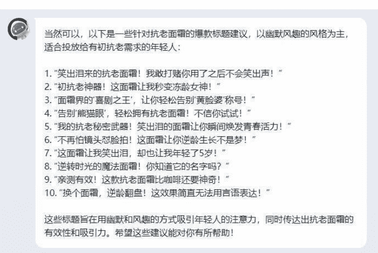

提出增加紧迫感和吸引力的优化要求后，生成结果如图5-6所示。

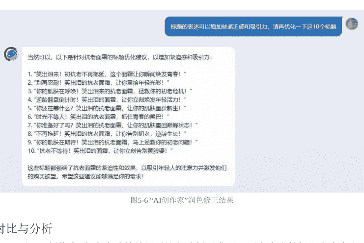

#### 3. 案例对比与分析
对比可见，两款工具的标题风格迥异。ChatGPT更偏向直白描述产品效果和受众感受，直击痛点并触发情感共鸣，强调抗老的重要性并增强购买信心。AI创作家的标题则更富创意与趣味，用生动想象引发兴趣。两者都符合幽默要求，ChatGPT重直接与实效，AI创作家重创意与趣味，具体选择取决于个人偏好和平台定位。

## 5.3 小红书笔记：玩转平台做爆款

### 5.3.1 小红书文案的份量
小红书以生活方式、美妆时尚等内容为主，用户体量大，内容生态丰富。创作者通过分享经验、知识、技能等内容吸引关注，形成信息交流与互动闭环。因此，高质量文案对创作者至关重要。

### 5.3.2 小红书内容创作流程
- ①确定主题和目标受众：明确内容方向及受众需求，为后续写作和表达定调。
- ②内容创作与编辑：据主题撰写文案，要简洁有吸引力并符合平台调性；必要时配以清晰美观的图片或视频，保持内容一致性。
- ③发布和分享：将成稿发布至平台并推送给目标人群，注意遵守社区规范，确保内容合规。

### 5.3.3 AI助力小红书创作

#### 1. 使用“天工AI”
按流程在对话框输入：“作为时尚博主，我想在小红书发布一篇关于‘夏季流行穿搭指南’的内容，请提供初稿并确保符合小红书风格，同时融入独特的时尚观点或趋势分析，让内容更有个性吸引力。”发送后生成结果如图5-7所示。

生成文案以轻松口吻切入夏季穿搭，点出亮色系成为当季主线，举例黄色、绿色、粉色等能提亮气色并提升存在感，鼓励大胆尝试，并结合博主视角给出实用建议，整体符合平台的亲切表达习惯。

夏日穿搭灵感合集

👚上装怎么选：今年特别火的几款上衣有露肩款、短版T恤、带飘带的衬衫。它们既能凸显身材线条，又自带随性优雅的氛围感。高腰裤或半身裙一搭，上半身比例立刻被拉长，整体看起来更利落。🔥

👖下装搭配思路：阔腿裤、短裤、印花半裙都是夏天的百搭选项。阔腿裤藏肉显瘦，短裤自带活力又能秀出腿型，印花裙则充满浪漫度。选款时最好结合自己的体型特点来定。💃

🎒点缀单品：一条有设计感的草帽、一串精致手链、一个风格鲜明的包包，都能为造型加分不少。配饰要和整体风格呼应，协调感很重要。👜

😊温馨提示：追逐潮流的同时，舒适度与实用性也不能丢。最适合自己的，才是最值得穿的。希望这份小指南能让你这个夏天更亮眼🌟！

#夏季穿搭 #流行趋势 #时尚博主推荐

#### 2. 使用“智谱清言”

打开智谱清言后进入智能体中心，在搜索框里输入小红书，选择“小红书爆款写作专家”，参考图5-8的操作路径。将与天工AI时使用的相同提示词复制进对话框，点击发送后得到的结果如图5-9所示。

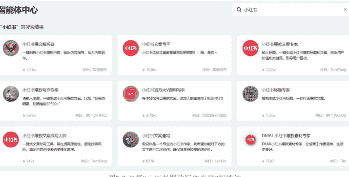

##### 一、标题

- 1. “夏日氛围，穿搭新风向！👗”
- 2. “博主揭秘：夏天衣橱必备清单👠”
- 3. “这个夏天，让美感up！💄”
- 4. “今夏流行趋势，你get了吗？👗”
- 5. “新手也能看懂的夏日穿搭攻略！👗”

##### 二、正文

🌞入夏了，衣橱该换新了！作为一名时尚博主，很开心把本季的夏季穿搭趋势分享给大家。👗

👗趋势拆解：今年夏天亮色系和大胆印花很抢镜。比如黄色、橙色这类高饱和色调，穿上自带元气感。花卉元素也很火，裙装或上衣都能传递出夏天的浪漫气息。

✨风格建议：偏爱低调的人可以选米色、浅灰等中性色打底，再在配饰上做文章，比如挑一顶有型的帽子或一个吸睛的包包，既简洁又不失个性。

👗实用小技巧：夏天的关键是透气凉快。建议优先棉麻等透气面料。叠穿也很实用，例如T恤外加一件薄纱开衫，既遮阳又时髦。

🛍️买买建议：可以留意下小众品牌或独立设计师的作品，往往更具设计感和独特性。

💬好奇大家的想法：你最爱哪件夏日单品？有没有独家穿搭妙招？欢迎在评论区聊聊你的心得！👇

标签: #夏季穿搭 #时尚趋势 #个性化风格 #穿搭技巧 #购物推荐

图5-9 “智谱清言”生成小红书文案

#### 3. 案例对比与分析

天工AI与智谱清言都围绕“夏季流行穿搭指南”给出建议，但在呈现上各有侧重。

语言层面，天工AI的文本更轻松活泼，表情符号多、口语化强；智谱清言则偏正式专业，行文更流畅连贯。

内容层面，天工AI更注重细节刻画和个性化叮嘱，像“记得大胆尝试”“配饰要与整体协调”这类提醒出现频率高；智谱清言更侧重趋势解读和整体风格塑造。

总体看，两款工具都能提供有用的时尚建议和趋势信息，只是风格与侧重点不同，用户可按偏好选择。

## 5.4 抖音文案：创新表达，引爆短视频热潮

### 5.4.1 抖音文案的特点

抖音文案通常用简短幽默生动的表达，在寥寥数语或关键词里传递创作者的生活观、情感态度和世界观，容易引发共鸣和思考，给人温暖感。

好的文案能抓住眼球，促使用户点进视频，提升曝光和互动，从而提高账号权重。优质文案用精炼语言概括视频主题，使用户快速get内容。通过文案，品牌或个人能在抖音树立形象，提升知名度。

### 5.4.2 撰写抖音文案的流程

- 1. 明确目的与受众
设定创作目标：比如品牌宣传、产品推广、知识分享或娱乐。分析目标人群的兴趣、需求和行为习惯，以便写出符合口味的文案。
- 2. 内容策划与构思
确定主题与亮点：围绕目标提炼视频主题，想好怎么在文案里突出亮点。搭建框架：规划开头、主体和结尾，确保逻辑清晰。
- 3. 撰写与编辑
先写初稿：按框架用简洁生动的语言起草。反复润色：保证表达准确流畅，符合抖音调性。
- 4. 发布与反馈收集
将文案与视频素材结合发布。关注播放、点赞、评论等数据，收集用户反馈以便优化。

### 5.4.3 AI撰写抖音文案

下面用“文心一言”和“Friday智能写作”演示案例。

- 1. 使用“文心一言”
按流程要求，在文心一言对话框输入：“我想做一条关于瑜伽练习的抖音视频，目的是吸引追求健康生活和身心平衡的观众。目标人群是年轻白领和学生，他们对瑜伽感兴趣但缺乏系统方法。请结合抖音文案结构，生成一篇有吸引力又有指导性的文案。”发送后结果如图5-10所示。

- 2. 使用“Friday智能写作”
在Friday智能写作对话框输入与文心一言相同的指令，点击发送，输出结果如图5-11所示。

🧘从“瑜”开始，平衡每一天✨

👋嗨，我是[你的名字]，瑜伽爱好者，也是你健康路上的伙伴！快节奏的城市生活里，你是否也想找回一点安宁？🧘‍♀️今天一起探索瑜伽如何帮助身心达成平衡！🌟

💼职场人必看，瑜伽减压妙招公开！
久坐肩颈僵？压力大？跟着练几招轻松体式，赶走疲惫，提升状态，让每一天都充满能量！💪从慢呼吸开始，感受吐纳间的松弛...

🎓学生党福利，瑜伽助学神器！
作业堆成山，脑子宕机？简单的体式练习能放松身心，让思维更清晰。柔韧与安定，会让学习更顺畅！📚

🔥零基础也能上手！

- ①呼吸练习：深吸清新，呼出烦躁，给心灵一次旅行！
- ②体式体验：从稳如山的山式，到连贯的流式太阳礼，感受力量与柔美。
- ③静心冥想：最后静坐片刻，让思绪随风，享受宁静。

🎁更多内容等你发现！
关注我，每天解锁新瑜伽技巧，拥抱更健康的生活圈。记得点赞👍、分享🔄、留言讲讲你的瑜伽故事，一起走得更远！

#瑜伽日常# #身心健康# #白领解压神器# #学生党加油包# #平衡生活美学# #从瑜开始#

图5-11 “Friday智能写作”生成抖音文案

#### 3. 案例对比与分析

文心一言与Friday智能写作在瑜伽抖音文案上风格不同。文心一言的文本简洁实用，逻辑清晰；Friday则更具创意和情感，善于场景化描写和情绪引导，文化内涵更丰富。Friday的标签也更细化，提升了搜索曝光。两者各有优势，可满足不同需求。

## 5.5 微博文案：匠心独运，助力成为金句达人

### 5.5.1 微博文案的特点

微博文案以精炼语言传递深刻感悟和情感共鸣，真挚的文字能触动人心，引发对人生意义的思考，激发内在力量。它们既是生活感悟，也是启示，有助于提升用户体验、增加参与度、促进传播、强化品牌形象并实现商业价值。

### 5.5.2 撰写微博文案的流程

- ①确定目标与受众：明确发布意图，是提升知名度、推广产品还是传递信息；分析受众年龄、性别、兴趣等特征。
- ②创意构思：基于目标受众进行创意设计，可用幽默、情感、励志等风格吸引不同人群。
- ③内容编写：将创意转化为具体文案，注意简洁易懂，也可用生动描写增强吸引力。
- ④优化与调整：反复修改，确保文案符合品牌调性并能引发共鸣。

### 5.5.3 AI撰写微博文案

下面用“文心一言”和“AI创作家”演示。

- 1. 使用“文心一言”
在文心一言对话框输入：“请帮我写一条微博文案，推广我们新出的科技产品，具有创新性和实用性，适合追求科技前沿的年轻人。文案要突出独特功能和优势，语气轻松幽默，简洁易懂，能引起共鸣。”发送后结果如图5-12所示。

- 2. 使用“AI创作家”
在AI创作家对话框输入与文心一言相同的文字，点击发送，生成结果如图5-13所示。

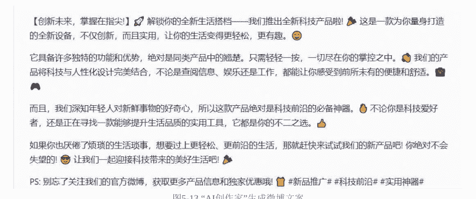

#### 3. 案例对比与分析

两款工具都满足基本要求，但在风格、侧重点和情感连接上差异明显。

语言风格上，文心一言更轻松幽默，如“科技控们的春天来了”，更亲切；AI创作家则更正式直接，信息清晰但幽默感不足。

内容侧重上，文心一言在强调功能优势的同时，也突出对个人形象和需求的提升；AI创作家更聚焦功能带来的便利。

情感共鸣上，文心一言用“告别繁琐，拥抱未来”等表达拉近与用户的距离，感染力更强；AI创作家在情感连接上稍显不足。

总体看，文心一言偏互动感，AI创作家偏信息传递，各有擅长。

## 5.6 公众号运营规划：深度运营，构建粉丝互动桥梁

### 5.6.1 公众号运营规划的意义

公众号运营规划是对微信公众号进行内容策划、粉丝互动和推广策略的系统部署，旨在提升知名度、用户粘性和品牌价值。科学规划能让公众号在目标受众中产生更大影响，实现商业目标。

### 5.6.2 制订和优化公众号运营规划的流程

- 1. 定位与包装
明确公众号角色，需与品牌产品匹配并吸引目标用户。确定后要做包装：名称、关键词自动回复、简介、菜单栏，文案风格需与定位一致。
- 2. 内容策划
制订内容计划，确定形式和频率。内容要兼顾吸引用户和宣传企业。原创优先，注意垂直度，大部分内容围绕定位展开，巧妙植入品牌信息，避免硬广。
- 3. 互动沟通
建立互动机制，通过自动回复、活动、粉丝社群等方式提升参与感和粘性。
- 4. 数据分析
分析活跃度、点击率等数据，找出不足优化策略。定期复盘有助于了解用户行为和运营效果。
- 5. 广告推广
用户基础稳定后可适度投放广告提升曝光，避免过度打扰影响体验。

### 5.6.3 AI撰写公众号运营规划

下面用“Friday智能写作”和“文心一言”演示。

- 1. 使用“Friday智能写作”
在Friday智能写作对话框输入：“请为一家专注健康饮食的公众号做一份详细运营规划：目标用户是关注健康饮食、追求生活品质的中青年；内容包括健康知识、食谱分享、营养建议；三个月内实现用户稳步增长并提升活跃度。”发送后结果如图5-14所示。

# 健康饮食领域公众号运营规划

一、前言
随着生活水平提升，健康饮食关注度持续上升。本号面向注重饮食健康、追求品质的中青年人群，提供实用信息。本规划旨在明确发展方向、内容安排、增长策略和活动，确保三个月内用户增长并提升活跃度。

二、目标人群
关注健康饮食、追求生活品质的中青年，具有一定消费能力，对饮食要求高。

三、内容安排
1. 健康知识：定期推送营养学、食材挑选、烹饪技巧等科普。
2. 食谱分享：结合季节、节日推出健康早餐、午餐、晚餐、小吃食谱。
3. 营养建议：提供分人群的营养搭配建议。
4. 互动栏目：问答、投票等形式增强参与感。

四、增长策略
1. 内容驱动：用高质量内容吸引关注和分享。
2. 合作推广：与健康、美食类公众号或KOL互推。
3. 社交媒体分发：微博、抖音等平台发图文短视频导流。
4. 线下活动：烹饪讲座、食材品鉴会等提升粘性。

五、活动安排
1. 互动活动：每月一次知识竞赛或食谱征集。
2. 优惠活动：节假日推出会员优惠、优惠券等。
3. 联合活动：与健康食品品牌合作试吃或生活方式分享会。

六、数据复盘与优化
定期分析用户数据，调整内容和活动。关注活跃度、留存、转化等指标，持续优化。

七、结语
本规划为健康饮食公众号提供发展路径，将持续优化内容、增长和活动，为用户提供价值，实现增长与活跃度提升。

图5-14 “Friday智能写作”生成公众号运营规划

- 2. 使用“文心一言”
在文心一言对话框输入与Friday智能写作相同的指令，发送后结果如图5-15所示。

# 健康饮食领域公众号运营规划

一、背景与目标
健康生活关注度提升，健康饮食成为中青年焦点。本号提供饮食知识、食谱和营养建议，帮助用户提升生活品质。目标是三个月内实现用户增长并提高活跃度。

二、目标用户
25-50岁的中青年，文化素养较高，注重饮食健康，喜欢尝试新食谱。

三、内容规划
1. 健康科普：营养学、食品安全等基础知识。
2. 食谱分享：家常菜、减脂餐、素食等多样化食谱。
3. 个性化建议：按年龄、性别、身体状况定制饮食计划。
4. 误区解析：纠正常见饮食误区，树立正确观念。

四、运营策略
1. 重视质量：保证内容专业可靠，建立信任。
2. 定期更新：每周至少三篇原创，保持新鲜感。
3. 互动反馈：鼓励评论留言，及时回复并收集意见。
4. 合作推广：与营养师、厨师及同领域公众号合作扩大影响。

五、增长与活跃度提升
1. 优质内容引流：提升搜索和社交平台曝光。
2. 社交传播：借助朋友圈、微博、抖音分发内容。
3. 线上活动：知识竞赛、食谱征集等提升参与度。

4. 会员体系：构建等级化的会员机制，为活跃度高的用户提供专属价格优惠、定制化内容等权益，以此调动参与积极性。

六、数据驱动的优化
1. 用户行为洞察：定期梳理用户行为数据，掌握用户偏好、阅读习惯等特征，为后续选题提供参考依据。
2. 内容表现评估：以阅读量、点赞量、评论量等数据为依据，判断内容成效，并据此调整内容方向。
3. 运营指标监控：持续关注用户规模、活跃度等核心指标，发现偏差及时修正运营策略，以确保目标落地。

七、总体回顾
本方案的核心是通过输出健康饮食科普、食谱分享与营养建议等内容，吸引对健康饮食感兴趣的中青年群体，推动用户量稳步提升并提高活跃水平。后续将持续打磨内容质量，拓展合作渠道，开展线上互动活动，并强化数据分析与优化，力求为用户提供更优质的健康饮食服务。

#### 3. 案例对比与分析
“Friday智能写作”与“文心一言”在产出结果上呈现出侧重点与细节打磨上的差异。

从内容侧重来看，“Friday智能写作”的答复更偏向具体活动的部署与用户互动的设计，通过线上线下活动的策划来提升参与感与活跃度，同时突出推广合作的重要性；“文心一言”则更侧重于公众号整体运营思路的梳理，包含对目标人群的精准界定、对内容规划的系统阐述、对用户增长与活动安排的全面考量，以及对数据分析价值的强调。

在细节层面，“Friday智能写作”给出了更细化的执行方案，例如在增长策略中列举了社交媒体投放与线下活动组织等多种打法；“文心一言”也提及类似策略，但在执行颗粒度上相对概括，更多聚焦于活动创意与吸引力。

总体而言，两份方案目标一致，都服务于健康饮食类公众号的运营，但在呈现角度与细节丰富度上各有特色，使用者可按自身需求选用合适的工具。

## 5.7 知乎投放文案：以专业视角放大传播力
### 5.7.1 知乎宣传文案的特征
知乎投放文案以简练有力、富有感染力的表达传递知识、智慧与思想的力量。它强调内容的深度、思考的独立性以及表达的准确性，旨在激发读者思考与讨论，推动知识的交流与扩散。同时，文案注重与读者的情感链接，通过具象化的场景与故事化叙述引发共鸣与情感共振。

### 5.7.2 撰写知乎宣传文案的步骤
撰写知乎宣传文案的核心是抓住目标人群的注意力，引发兴趣与思考，提升品牌知名度与影响力。具体流程如下。
- 1. 明确撰写目的
  这是首要环节。厘清文案是用于产品推广、品牌曝光、信息传达或其他用途，有助于后续策划与落笔。
- 2. 把握受众需求
  深入了解目标读者的兴趣点与痛点，确保内容能够触动他们。可通过调研、数据分析等方式获取信息。
- 3. 策划内容框架
  结合目的与受众，规划文案骨架，确保既具吸引力又能传递核心信息，涉及主题确定、视角选择、论点构建等。
- 4. 执行撰写
  内容规划完成后进入写作阶段。语言风格需贴合知乎调性，表达简洁、逻辑清晰，合理使用修辞与表达手法，提升吸引力与说服力。

### 5.7.3 AI辅助撰写知乎宣传文案的演示
以下分别使用“AI创作家”与“Friday智能写作”进行示例。
- 1. 使用“AI创作家”
  按上述思路，在“AI创作家”对话框输入：“请帮我写一篇知乎宣传文案，推广智能家居产品‘智慧助手’，面向追求生活品质与便捷的年轻人和家庭用户，突出产品的便捷与智能化，说明它如何简化日常琐事、提升生活质量。要求语言简洁明了、逻辑清晰，符合知乎风格，能激发关注与购买意愿。”点击发送，生成结果如图5-16所示。
  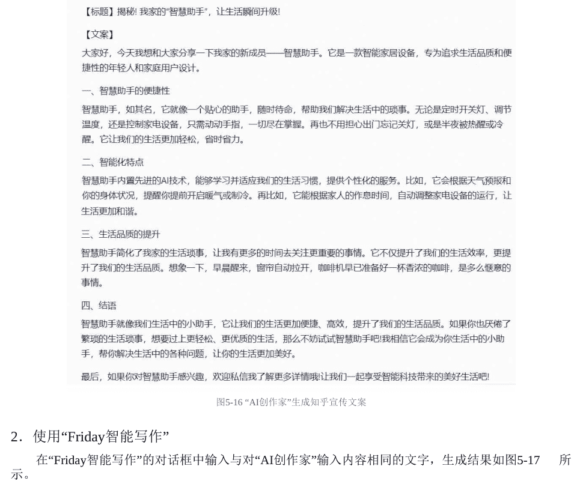
- 2. 使用“Friday智能写作”
  在“Friday智能写作”中输入与“AI创作家”相同的指令，生成结果如图5-17所示。
让生活回归纯粹与美好——“智慧助手”智能家居，让品质生活触手可及！
未来已来，智能家居近在眼前
在节奏加快的现代社会，大家都渴望生活更从容、更便利。“智慧助手”智能家居设备，正是实现这一愿景的理想搭档。依托前沿智能技术，它把繁琐的家务转化为指尖操作，让居家体验更轻松自在。
智慧助手，贴心的私人管家
产品不仅具备全屋智能控制能力，还能学习用户习惯，自动调节家居环境，打造专属舒适空间。无论是调节温湿度、调控灯光亮度，还是播放喜爱的音乐、提醒重要事项，都能一键完成，成为居家生活的得力助手。
简约外观，彰显生活品味
“智慧助手”在设计上兼顾简约与时尚，可无缝融入多种家居风格。精致的机身与细腻的触感，折射出用户对品质生活的追求，入手即是向高阶生活迈进的一步。
操作零门槛，畅享科技便利
作为智能家居代表，“智慧助手”上手极易。通过语音交互，只需口头指令即可实现快速响应，无论身处家中何处，都能轻松掌控全局，体会科技带来的乐趣。
安全可靠，守护家庭安心
产品重视隐私与安全，采用加密与多层防护机制，保障个人信息与居家安全。同时内置智能报警功能，异常时可即时推送提醒并启动相应措施，守护家人。
立即体验，开启智慧生活新篇章
别让琐碎事务占据生活，拥抱“智慧助手”，让居家回归简单美好。即刻点击下方链接选购“智慧助手”，开启专属智慧生活。
[购买链接]
让“智慧助手”成为你家的智能伙伴，共同创造更美好的未来！
图5-17 “Friday智能写作”生成知乎宣传文案

#### 3. 案例对比与分析
“AI创作家”与“Friday智能写作”在知乎文案生成上虽都围绕产品卖点与用户体验展开，但在语气、表达与侧重点上差异明显。
风格层面，“AI创作家”采用轻松亲和的语调，以第一人称叙述拉近距离，让读者更易产生共鸣，感受到使用后的便捷与舒适；“Friday智能写作”则偏向正式专业的口吻，注重客观陈述与逻辑条理，突出产品的可靠性。
表达方式上，“AI创作家”运用更多情感化描写与场景营造，如描绘清晨窗帘自动开启、咖啡自动备好的画面，让读者身临其境；“Friday智能写作”则侧重功能拆解与要点罗列，通过具体功能展示帮助读者全面认知产品优势。
内容侧重上，“AI创作家”更强调产品如何简化琐事、提升生活品质及带来的愉悦体验；“Friday智能写作”更聚焦于智能特性、技术先进性、安全保障及个性化服务。
总体来看，“AI创作家”偏重情感共鸣与体验描述，“Friday智能写作”偏重客观呈现与功能说明，用户可根据偏好选择工具。

## 5.8 短视频脚本创作：以镜头语言讲好视觉故事
### 5.8.1 短视频脚本的基本要求
短视频脚本需用精炼文字与明确镜头指示来指导拍摄，涵盖场景描写、人物台词、动作设计、音效提示及镜头指令，为团队提供清晰指引，保证成片的连贯与统一。通过脚本，导演、摄影、演员等成员能明确分工，将创意转化为具有表现力的影像作品。

### 5.8.2 短视频脚本创作流程
1. 界定主题
  脚本内容必须服务于主题。明确视频要传递的核心思想是首步，主题不明易致观众误解。
2. 确定风格
  主题确定后需敲定呈现风格，如搞笑、反转、温情等，为视频定调。
3. 编写情节
  在主题与风格框架下构建故事线，交代人物、时间、地点与事件，并规划整体时长。

### 5.8.3 AI生成短视频脚本的演示
以下使用“天工AI”与“智谱清言”进行演示。
1. 使用“天工AI”
如图5-18所示，在“天工AI”主界面点击“AI写作”后，输入：“请为我写一个以‘友情的力量’为主题的短视频拍摄脚本，风格温馨感人且带反转，要求情节紧凑，3分钟内可讲完。”点击发送，生成结果如图5-19所示。
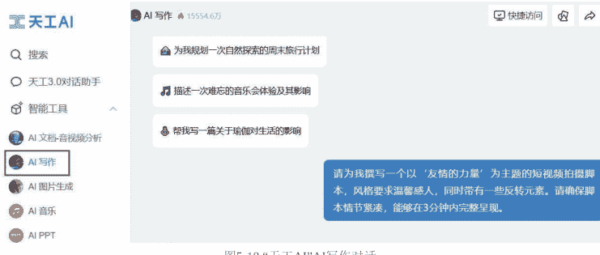
图5-18 “天工AI”AI写作对话
【场景一】公园长椅
【镜头】清晨阳光洒在公园长椅。镜头推进，定格在两个中学生模样的男孩李明与小杰面前放着棋盘，正专注射弈。
【旁白】人生如棋，每一步都考验抉择。李明与小杰，无话不谈的好友，友情在逆境中更加牢固。
【镜头】小杰眉头紧锁，李明轻笑，伸手点棋，给出关键一着。
【旁白】友情，就是困惑时为你指路的那只手。
【场景二】医院病房
【镜头】时间快进，切至医院病房。李明面色苍白躺床，小杰紧握其手。窗外乌云密布。
【旁白】人生难免波折。确诊重病后，小杰没有退缩，用行动诠释友情的力量。
【镜头】小杰在走廊奔忙的身影，筹款、联系专家、线上发起求助。快速剪辑呈现其坚持。
【旁白】在你最需要时，友情是那道最亮的光。
【场景三】康复中心
【镜头】再次跳跃，李明坐轮椅，小杰在一旁鼓励他尝试站立。多次失败后险些放弃，却被小杰眼神唤起力量。
【反转】李明在帮助下艰难站起，两人相视而笑，泪光闪现。镜头拉远，揭示轮椅实为站立训练专用设备，小杰早知病情未如表面严重，一直以鼓励与陪伴重建信心。
【旁白】友情有时需要一点巧思，它能在绝境中点亮希望。
【场景四】公园长椅
【镜头】回到公园长椅，此刻李明在轮椅上，小杰站在一旁。棋盘已空，换成一幅逆风飞翔的鸟画。阳光穿透云层。
【旁白】真正的友情，如逆风之翼，即便在最艰难时刻也能给予飞翔的力量。
【结束语】友情是生命中最珍贵的礼物。无论风浪多大，携手同行就能跨越。
【镜头】画面渐隐，定格在两人紧握的双手，音乐渐弱，结束。
2. 使用“智谱清言”
在“智谱清言”对话中输入与“天工AI”相同的指令，点击发送，生成结果如图5-20所示。
标题：《友情的力量》
【画面一】(0:00-0:15) 场景：公园长椅 背景音乐：温馨钢琴
旁白：这个世界上，有一种力量能温暖人心，那就是友情。
【画面二】(0:15-0:45) 场景：学校教室 角色：乐观的小明、内向的小李
情节：小明课堂上踊跃发言获掌声，课后主动帮小李解题，两人成友。
旁白：友情让我们在成长路上相互扶持。
【画面三】(0:45-1:30) 场景：操场 情节：两人参加篮球赛，小李紧张失误被队友责备，小明鼓励并共同训练，最终获胜。
反转：赛后小李突然晕倒。
【画面四】(1:30-2:00) 场景：医院病房 情节：小明陪伴，得知小李患严重心脏病且自幼缺乏关爱，决心助其战胜病魔。
旁白：友情让我们在困境中依靠彼此。
【画面五】(2:00-2:30) 场景：医院、公园 情节：两人一起康复训练，分享喜怒，经过努力病情好转。
反转：医生告知小明，小李病情实则恶化，治愈希望渺茫。
【画面六】(2:30-3:00) 场景：公园长椅 情节：小明带小李到公园告知真相，小李泪流感谢，两人夕阳下拥抱，约定永不放弃。
旁白：友情的力量助我们勇往直前，愿这份真挚永远照亮人生！
【画面结束】(3:00) 音乐高潮，画面渐暗，字幕：“感谢观看，珍惜身边的每一份友情。”
#### 3. 案例对比与分析
“天工AI”与“智谱清言”生成的“友情的力量”脚本在主题、基调与核心信息上一致，但在情节安排与情感处理上有所不同。
情节设置上，“天工AI”的脚本从公园下棋起笔，经医院照顾到康复鼓励，最后回归公园，形成友情深化的闭环；“智谱清言”的脚本更聚焦校园与医院两大场景，通过课堂互助、球场挫折、医院陪护展现友情在成长与困境中的作用。
情感表达上，“天工AI”更细腻，多靠环境与意境烘托友情的力量，留给观众想象空间；“智谱清言”更具冲击力，通过病情恶化与不离不弃强化逆境中友情的韧性。
总体而言，两者都成功传递了主题，采用温馨感人的叙述，使故事紧凑且富于情感。

## 5.9 豆瓣读书心得：以感悟分享启迪心灵
### 5.9.1 豆瓣读书心得的价值
分享读书心得有助于知识交流与传承，通过个人阅读体验的呈现激发他人阅读兴趣，提升社会阅读氛围与文化素养；同时也是对自身阅读成果的检验与反思，促进思考与成长。

### 5.9.2 撰写豆瓣读书心得的步骤
撰写心得既能加深理解，也能锻炼写作能力。具体流程如下。
①确定书目与主题：明确要分享的书名与核心主题，帮助读者快速把握内容方向。
②选择表达风格：结合豆瓣社区习惯选择合适语调，便于适配平台规范。
③完成文稿撰写：基于信息与风格，撰写完整的读书心得。

### 5.9.3 AI撰写豆瓣读书心得的演示
以下使用“天工AI”与“文心一言”演示。
1. 使用“天工AI”
在“天工AI”主界面点击“AI写作”，选择模板大全中的“心得体会”，如图5-21所示。在交互窗口输入：“最近读了乔治·奥威尔的反乌托邦小说《1984》，书中描绘极权统治下的未来社会，主人公温斯顿在反抗中逐渐丧失自我与自由。思想控制和监控描写令人震撼。请帮我写一篇豆瓣读书心得，着重：①简要介绍作者、背景及情节；②分享阅读感受，包括对极权社会的反思、对主人公命运的同情及对权力、自由、真理的思考；③阐述从书中学到的人性、社会制度与自由思想的认识；④向豆瓣用户推荐并说明价值；⑤语言犀利深刻，能引发共鸣，符合豆瓣风格。”点击发送，生成结果如图5-22所示。
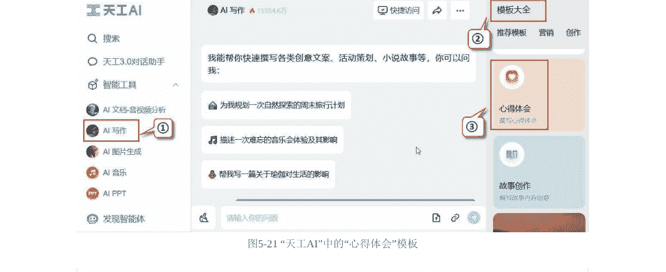
图5-21 “天工AI”中的“心得体会”模板

图5-22 “天工AI”生成读书心得
2. 使用“文心一言”
在“文心一言”对话框输入与“天工AI”相同的指令，点击发送，生成结果如图5-23所示。
# 《1984》阅读感悟分享
初读乔治·奥威尔的《1984》，我以为只是对未来的臆测，随着阅读深入才意识到作品远不止如此，它尖锐地揭示了人类可能跌入的深渊。这部反乌托邦小说以独特的视角与锋利的笔触，让我在阅读中不断惊叹并陷入沉思。
奥威尔构建了名为大洋国的极权世界，双重思想成为控制工具，真相被随意篡改，历史被重写，连记忆也被操控。主人公温斯顿本是普通党员，在觉醒后勇敢反抗，却最终换来无尽痛苦与绝望。
阅读时我深受震撼。书中极权社会像巨牢束缚思想与灵魂，自由成为奢侈，真理遥不可及。对温斯顿的遭遇深感同情，他的勇气如黑暗中的微光照亮人性。然而他的失败也引发反思：在庞大极权面前，个人能有多大作为？
从书中我获得多重启示。其一，人性在极端压力下易显脆弱与复杂，很多人为自保背弃信仰令人心痛；其二，社会制度深刻影响个体命运，健康的制度应尊重自由与权利，而非无休止监视；其三，思想自由至关重要，只有自由思考才能真正认识世界与自我。

在当下这个语境里，我真心希望每一位读者都能抽时间读一遍《1984》。这本书既是文学史上的经典之作，也是一部充满现实警示意义的社会寓言。它一次次提醒我们保持高度警觉，遏制极权主义萌生并扩散的可能；它也反复告诫人们要珍惜自由、坚守真理，绝不向任何形式的压迫与操控妥协。

整体而言，《1984》是一本值得反复咀嚼的作品。作者以直戳要害的笔法揭开了极权体系的阴暗面，同时也让读者瞥见了人性中坚韧的光与希望。我相信，读过这本书的人，都会带走不一样的启发与感触。

#### 3. 案例对比与分析

“天工AI”与“文心一言”对《1984》的产出，主题上都围绕阅读理解与心得分享，但呈现方式、关注点和挖掘层次上差异很明显。

就表达风格而言，天工AI的回覆偏向简洁直白，严格按提问框架依次给出书籍简介、阅读感受、核心观点和推荐理由；文心一言则语感更细腻，词藻与修辞更丰富，整体读起来更具文学味和感染力。

就关注焦点来看，天工AI更侧重提炼主题并做升华，突出《1984》作为历史镜鉴、现实警钟的价值，以及对自由这一价值的坚持；文心一言则更全面客观，先交代背景与情节，再分享个人感受，最后从人性、制度、思想自由等多个维度展开剖析。

就深度而言，文心一言在主题挖掘上更进一步，并未止步于情节复述，而是把情节背后的社会现象、人性困境以及对当下的启示都讲清楚了。天工AI也涉及这些层面，但层次相对平实直接。

总体来说，两款工具在读书心得的创作上各有优势，选用哪一个，可以依据个人喜好与需求来定。

# 第6章 商业营销文案写作

## 6.1 产品测评文案：理性分析，增强产品性能认知度

### 6.1.1 产品测评文案的意义

当新品面世后，为确保品质与销量，厂商会先行测试并收集反馈以便优化。在信息高度发达的今天，消费者在下单前习惯借助多平台了解产品性能、用法与适用场景，并在多家之间比较后做决定。产品测评文案应运而生，它用通俗易懂的语言呈现产品特质，帮助关注者建立比较完整的认知。

### 6.1.2 产品测评文案的创作思路

①标题和开头：抓人眼球的标题与开场白能迅速抓住读者注意力，并引出测评主题。

②产品介绍：在切入产品前，先简要介绍品牌及个人对品牌或品类的了解程度，以便读者理解测评立场；随后详述外观、功能、操作方式及适用场景，让读者对产品有全面的印象。

③实际体验：这是文案的核心，需要记录使用过程中的各项数据，体现真实感受与产品表现。

④总结：对产品的优劣做总体评价，给出购买建议；同时回顾测评初衷，重申写作目的。

### 6.1.3 AI撰写产品测评文案

产品测评文案主要投放在各类新媒体平台，不同平台的文案风格应有所区别。选定AI工具后，可依据发布平台挑选对应模板。以下以“华为FreeBuds 4E”蓝牙耳机为例，对比ChatGPT与“笔灵AI”的生成效果，两者均可完成任务，但“笔灵AI”自带测评模板，ChatGPT则以对话方式实现。

1. 使用ChatGPT

用ChatGPT写测评时可以限定语气与场景。例如在对话框输入：“请用轻松的语气写一篇华为FreeBuds 4E蓝牙耳机的测评，包含标题、开头、产品介绍、实际体验和总结五部分，实际体验聚焦听音乐与追剧两大场景。”发送后即可得到结果如图6-1所示。

若希望文案更专业可信，可以补充产品定位、功能、优缺点等基础信息，帮助模型做全面评述。如图6-2所示，追加产品信息、测评方向、使用场景与体验细节后，ChatGPT会产出更为详尽的测评。

2. 使用“笔灵AI”

按1.3.2节方法进入“笔灵AI”主界面，在搜索框输入“测评”，会弹出“测评文案”入口，点击进入模块页，如图6-3所示。该页仅需填写“测评主题”，且无字数限制，可把其他约束条件一并写入，确认后点“生成内容”即可。

在主界面还能找到相似模块，例如“小红书商品推荐文案”，如图6-4所示。该模板可填写“商品名称”“商品品牌”“使用场景”，完成后生成完整文案。

“笔灵AI”也提供“自定义撰写”。在搜索栏输入“自定义撰写”，选择该模块进入编辑页；在“请选择语气”处选“轻松”，在“想写什么就写什么”处输入“写一段关于HUAWEI FreeBuds 4E蓝牙耳机的测评文案，重点写听音乐和追剧两个场景”；点击“生成内容”，结果如图6-5所示。

#### 3. 案例对比与分析

ChatGPT在给出较多基础信息后，会以客观描述的方式介绍功能与性能，如音质、降噪与低延迟等，并着重描绘使用体验，分音乐与追剧两场景点评，突出不同情境下的表现。

“笔灵AI”的“小红书商品推荐文案”模板则更偏重外观设计、配色与通用适用性。语言更活泼，强调产品酷炫与功能强大，并提及降噪、佩戴舒适度及多场景适用性，强烈突出使用广泛性，同时加入号召性用语鼓励互动与评论。

综合而言，两款工具都能抓住卖点进行呈现，但表达调性与侧重点不同。若追求快速生成风格活泼的测评，可选“笔灵AI”；若需要专业度更高的测评，建议先整理产品信息与体验，再用ChatGPT创作。

## 6.2 产品推广文案：巧妙展示，扩大产品市场竞争力

### 6.2.1 产品推广的意义

产品推广对企业成功至关重要。有效的推广能提升消费者认知与接受度，吸引潜在客户，增强产品吸引力与销量，塑造品牌形象并积累口碑，还能帮助企业洞察市场趋势，优化产品设计与销售策略，保持竞争优势。

### 6.2.2 撰写产品推广文案的步骤

一篇优秀的推广文案要兼顾产品、品牌与受众。在明确目标后制定计划与内容并选择投放渠道。写作步骤主要包括：

- ①了解目标受众：掌握受众需求、兴趣与购买习惯，以便提供更具吸引力的内容。

- ②明确推广目标：确定是提升知名度、销售额还是市场份额等，为策略制定提供依据。

- ③制订推广策略：结合受众与目标，设计广告、促销、公关、口碑等组合方案。

- ④选择推广渠道：按产品与受众特点挑选电视、网络、社交媒体或线下活动等渠道。

- ⑤制订推广计划：明确时间、内容与预算等执行细节。

- ⑥创作推广内容：围绕受众、目标与策略制作标题、文案、图像与视频等素材。

### 6.2.3 AI撰写产品推广文案

线上推广常见于知乎、微博、简书、豆瓣、B站等平台，各平台文案风格各异。不少AI工具按平台提供模板，部分工具则靠对话生成。此处以华为mate60手机为例，对比“万彩AI”与“文心一言”。

#### 1. 使用“万彩AI”

“万彩AI”提供产品推广模板。进入主页面后选择“营销推广”，再选“产品推文”打开模板。在提示框输入“华为mate60，遥遥领先”并点“立即生成”，结果如图6-6所示。若输入更具体指令：“华为mate60，遥遥领先，从目标受众、推广目标、推广策略、推广渠道、推广计划、推广内容六个方面写一篇产品推广文案，突出遥遥领先特点”，则可获得更完整的文案，如图6-7所示。生成后可查看全文并进行续写、润色。

图6-6 简单提示下“万彩AI”生成产品推广文案

图6-7 描写特点后“万彩AI”生成产品推广文案

#### 2. 使用“文心一言”

“文心一言”支持对话创作与迭代优化。在对话框输入：“请从目标受众、推广目标、推广策略、推广渠道、推广计划、推广内容六个方面，为华为mate60写一篇产品推广文案，突出遥遥领先。”发送后系统会抓取关键词逐项展开，生成方案如图6-8所示，下滑可看完整内容。

可在此基础上继续润色，例如输入：“请把上述文案润色，采用简洁专业的风格，加入生动形容词激发兴趣，强调高性能、创新设计、出色拍照与美观，并把六个方面融合，不分点。”修改后文案如图6-9所示，下滑可查看。文案下方还会提示“补充价格优势”“增加有趣结尾”等方向，帮助拓展思路。

#### 3. 案例对比与分析

有模板的“万彩AI”操作便捷，能节省大量时间，但生成内容偏少，篇幅较短，多从产品属性出发，修改时主要做词句润色，不会改变整体结构。

“文心一言”这类对话式工具没有模板限制，用户可自由表达需求，通过多轮互动得到更符合预期的结果，还可对结构与逻辑进行调整甚至重写。建议结合第2章的提示词与对话技巧，提升沟通效率。

总体而言，时间紧、需求偏标准化时可用模板工具；有个性化或高自由度需求时，对话式工具更合适。

## 6.3 品牌宣传文案：塑造价值，巩固品牌地位

### 6.3.1 品牌宣传的意义

品牌宣传是重要的营销手段，与品牌定位、受众与营销策略密切相关，常见于宣传册、官网、广告与社交媒体。它不只是产品推销，更是文化与理念的传递。通过广告、公关、促销、人际传播等方式提升知名度与口碑，传达核心价值观、塑造形象、引导消费、增强竞争力并推动发展。

### 6.3.2 品牌宣传文案的结构

品牌宣传文案通常包含标题、引导语、主体内容、解决的问题、品牌标识、结尾，各部分作用如下。

- ①标题：读者第一眼看到的内容，需简洁、有吸引力、易引发共鸣。

- ②引导语：激发好奇心，让读者想进一步了解产品。

- ③主体内容：文案核心，具体介绍品牌特点、优势、价值与理念，逻辑清晰条理分明。

- ④解决的问题：明确受众群体、所能解决的问题与满足的需求，是潜在客户关注重点。

- ⑤品牌标识：在文案中强化品牌形象与认知度，提升好感与信任。

- ⑥结尾：对全文做总结，画龙点睛并呼吁行动，鼓励读者支持品牌服务。

### 6.3.3 AI撰写品牌宣传文案

AI撰写流程如下。

- ①确定文案结构并让AI明确品牌定位。

- ②明确宣传目的，如提升知名度或促销商品。

- ③让AI生成标题，要求简洁有创意且吸睛。

- ④让AI生成正文，使用简洁语言突出核心价值，并引导读者行动，如购买或访问网站；可加入个性化创意元素提升辨识度。

- ⑤对文案进行优化。

以下以“孔凤春”为例，对比ChatGPT与“智谱清言”。

#### 1. 使用ChatGPT

可采用分步提问或一次性输入全部要求。例如输入：“请从制订品牌战略、创意设计、实施传播、评估效果四个角度，为品牌‘孔凤春’创作品牌宣传文案，包含标题、引导语、主体内容、解决的问题、品牌标识和结语。解决的问题需涵盖受众群体、能解决的问题与满足的需求。”发送后结果如图6-10所示。

首次提问时需说明品牌所属行业，否则结果会偏差；发现偏差可补充“‘孔凤春’是化妆品品牌，主打纯植物提取的平价护肤”进行修正，修正结果如图6-11所示。若文案不满意，也可通过提问让其润色，如图6-12所示。

图6-11 ChatGPT修正品牌宣传文案

图6-12 ChatGPT润色品牌宣传文案

#### 2. 使用“智谱清言”

进入主页面后在“智能体中心”选择文案创作分类，搜索“品牌宣传”，选择“品牌宣传稿”模板，在对话框输入：“请从制订品牌战略、创意设计、实施传播、评估效果四个角度，为品牌‘孔凤春’创作品牌宣传文案，包含标题、引导语、主体内容、解决的问题、品牌标识和结语。解决的问题需涵盖受众群体、能解决的问题与满足的需求。”发送后生成结果如图6-13所示。

还可上传品牌LOGO并描述公司名称、行业、创立时间、主要成就等信息，通过对话生成更贴合需求的文案，如图6-14所示。

#### 3. 案例对比与分析

ChatGPT生成的品牌文案风格活泼轻松，用词口语化亲民，如“嘿”“小仙女们”“平价实惠”“nice”等，贴近生活，增强亲和力与可信度；同时使用“植物王国”“大自然的力量”“现代科技”等生动意象，让产品特点更形象。

“智谱清言”生成的文案风格偏正式，用“传奇故事”“跨越三个世纪”“深厚的历史底蕴”“独特的文化魅力”等词凸显品牌特质，也用“美的哲学”等象征性表达增强神秘感与吸引力。

总体来看，ChatGPT创作时可通过角色设定提升效果，参考第2章提问技巧；“智谱清言”提供角色与模板选择，操作更简便，对提问技巧要求较低。

## 6.4 新媒体销售文案：引导流量，提升产品销售业绩

### 6.4.1 新媒体销售略知一二

新媒体销售是指借助新媒体平台进行售卖，具有数字化、互动性、个性化与精准化特点，能实现更高效的转化。常见平台包括搜索引擎、邮件及微信、抖音等社交媒体。在新媒体销售中，销售文案是关键，可通过文字、图片、视频等形式传递产品信息，激发购买欲并促成交易。

### 6.4.2 创作新媒体销售文案的步骤

新媒体销售文案需涵盖定位客户、打造品牌形象、构建营销矩阵、制定销售计划等要素。具体步骤如下。

- ①了解目标受众：明确年龄、性别、职业、兴趣等特征。

- ②确定销售主题和卖点：提炼简洁的销售主题及吸引人的卖点，作为文案核心。

- ③创作吸引人的标题：标题需简洁吸睛，能概括销售主题。

- ④撰写流畅的销售文案：用简洁明了的语言描述产品优势与特点，同时解决潜在客户痛点。

- ⑤设计吸引人的配图或视频：选择合适的视觉元素，吸引注意力并激发购买欲。

### 6.4.3 AI创作新媒体销售文案

下面以“文心一言”与“搭画快写”为例演示。

#### 1. 使用“文心一言”

可参考6.4.2节要素。以“西屋智能按摩椅”为例，在对话框输入：“请为西屋智能按摩椅写一篇销售文案，突出舒适凉爽质感与专业技术结合、全方位按摩、随时高效放松的特点，受众为家庭用户。文案包含目标受众、销售主题与卖点、标题与正文，尽可能提供配图建议。”发送后生成结果如图6-15所示，后续可通过反复对话进行修改。

#### 2. 使用“搭画快写”

搭画快写在做新媒体带货文案时，模板可以直接开用。打开首页左侧导航，找到即时创作区里的小红书风格推广文案模板，另外在其他自媒体门户板块也能看到通用营销文案模板，按投放渠道挑选使用即可。

以即时创作区的小红书风格推广文案模板为例，先在题目/产品/品牌和大概内容两个位置填好需求，再设定语气和呈现样式，确定篇幅和成稿数量后点立即生成就能拿到初稿。想让稿子更有画面感，还可以点使用图库图片把视觉素材导入进去。

以西屋智能按摩椅为例，只需把产品名填进题目/产品/品牌栏，把具体要求写进大概内容栏，语气选赞扬，呈现样式选文档格式，点击立即生成，系统会自动输出对应文案，见图6-16所示。

#### 3. 案例对比与分析
实际体验下来，文心一言没有模板束缚，发散空间更大，产出更贴合个人预期；搭画快写则靠题目/产品/品牌、大概内容、语气、内容格式等字段驱动创作，篇数和篇幅可以自主设定，输出会从多个角度拆解商品卖点，条理清晰，还会自动高亮用户输入的关键词方便后续整理，同时支持上传图片让文案更生动。

因此，用文心一言写销售类新媒体文案，需要具备一定的提问技巧来引导方向；用搭画快写上手更快，能多维度呈现商品特性，让文案更专业且传播力更强。

## 6.5 活动策划文案：放大声量，精准引流

### 6.5.1 了解活动策划文案
在商业和营销里，活动策划文案的作用很关键。它能提升品牌曝光和知名度，吸引更多潜在用户参与，从而推动成交和收益增长。借助文字、图片、视频等形式把活动或品牌信息传递给目标人群，提升参与意愿和关注度。同时有助于塑造品牌形象，积累口碑，进而增强竞争力与市场份额。

### 6.5.2 创作活动策划文案的步骤
撰写前要先考虑活动主题、内容、推广目标、资源与预算，并把品牌价值观融入其中，让用户在轻松愉快中认识品牌。具体步骤如下。

- ①明确主题与受众：写作前先梳理活动主题、目标人群及其兴趣需求。
- ②确定风格与媒介：根据主题与受众，锁定文案调性如幽默、严肃、科技感等，以及选用文字、图片、视频等呈现方式。
- ③描述内容与亮点：文案中详细说明活动时间、地点、参与方式、奖项设置等，并突出特色亮点。
- ④体现品牌调性与价值：在文中展现品牌形象与核心理念，提升受众认同感与好感度。
- ⑤打造吸睛标题与配图：标题要简洁有力概括核心；配图需贴合活动，增强视觉吸引。
- ⑥投放与传播：将文案发布至社交媒体、博客、微信公众号等渠道，并通过分享、转发、点赞等手段扩大触达。

### 6.5.3 AI辅助创作活动策划文案
下面以AI写作猿和ChatGPT为例演示。

#### 1. 使用“AI写作猿”
AI写作猿里有三种方式可完成活动策划文案。

第一种，主页上方有AI创作入口，进入编辑页后在文本框直接输入关键词或具体需求，点击一键生成即可自动产出。例如输入“请帮我完成一篇关于七夕节雅诗兰黛粉底液的活动策划，内容要包含活动主题和目标受众、标题、发布和推广、活动内容亮点；文案风格要幽默轻松；突出品牌形象和价值观”，点击“一键创作”，生成结果如图6-18所示。

图6-17 “AI写作猿”主页面

第二种，点击主页下方创作，进入后可见热门、职场、自媒体、视频、教学等创作分类，如图6-19所示，每个分类下均有细分模板，按需选择模板进入编辑页，按提示填写内容即可生成对应文案。

第三种，采用AI对话方式获取文案。在AI对话页，用户直接提出写作需求，AI生成初稿后可通过连续追问迭代优化，如图6-20所示。

搜索想要的创作

- 全部 收藏 热门 职场 自媒体 视频 教学

- 写小说：生成各种风格类型小说

- 诗词歌赋：一键生成各种类型的精美诗词

- 新媒体写作：一键生成新媒体文章

- 网站：生成针对各种网站的内容以及文案

- 好评文案：生成针对各种广告的内容以及文案

- 宝宝起名：针对各种姓氏起合适的名字

- 大厨私房菜：一键生成各菜系菜单

- 广告：生成针对各种广告的...

- 写作 创作 AI对话 AI绘画 我的

图6-19 “创作”页面

例如在对话框输入“请帮我完成一篇关于七夕节雅诗兰黛粉底液的活动策划”，点击发送，生成结果如图6-21所示。之后可根据实际情况以对话形式多次修改润色。

图6-21 通过“AI对话”生成活动策划文案

#### 2. 使用ChatGPT
用ChatGPT创作活动策划文案时，指令越清晰具体，结果越符合预期。提问前可借助是什么、怎么做等框架让表达更清晰有逻辑；需求表达要明确，多用短句提问。以七夕节雅诗兰黛粉底液活动策划为例，ChatGPT生成文案如图6-22所示。

请帮我完成一篇关于七夕节雅诗兰黛粉底液的活动策划，内容要包含活动主题和目标受众、标题、发布和推广、活动内容亮点、文案风格要幽默轻松；突出品牌形象和价值观

当然可以帮您完成这个活动策划！以下是一份关于七夕节雅诗兰黛粉底液的活动策划方案：

**活动主题和目标受众：**

- 主题：「爱如粉底，持久不褪色」

- 目标受众：女性消费者，特别是对化妆品感兴趣的年轻女性，希望通过活动吸引她们对雅诗兰黛粉底液的关注和购买兴趣。

**标题：**

「七夕限定！爱如粉底，一见钟情！」

**发布和推广：**

- 社交媒体平台：通过微信、微博、抖音等平台发布活动海报和宣传内容，引导受众参与活动。

- 线上活动：结合线上抽奖、互动问答等形式，增加活动的参与度和趣味性。

- 门店宣传：在品牌专柜设置活动展示区域，吸引顾客参与并体验产品。

**活动内容亮点：**

1. **情侣同款福利：** 购买特定产品组合即可获得情侣同款礼盒一份，让情侣们在七夕节展现甜蜜。

2. **粉底测评活动：** 邀请美妆博主或化妆师进行现场粉底测评，帮助顾客选择适合自己肤色和肤质的产品。

3. **创意表白墙：** 设置一个创意表白墙，让顾客们写下对心上人的祝福或表白，拍照上传社交媒体参加抽奖。

4. **DIY美妆体验：** 设置一个DIY美妆体验区域，让顾客们亲自体验调配粉底颜色，感受雅诗兰黛产品的魅力。

**文案风格：**

「亲爱的女孩们，七夕节到啦！让我们一起来体验爱如粉底，持久不褪色的魔法！快来参加我们的活动，让你的妆容更持久，让爱情更长久！记得带上你的闺蜜、姐妹或心上人一起来哦！」

若文案未达预期，可通过角色设定和补充需求完善。例如继续输入“现在你是一名活动策划主要负责人，结合上述活动策划，对文案进行补充润色。本次活动的受众群体为三十岁左右的女性，文案的风格为轻松幽默，可以添加一些表情图案，并且为文案增加一些配图”，点击发送，润色结果如图6-23所示。

标题：七夕缔造爱的美丽，雅诗兰黛与你共度浪漫时刻！

亲爱的小仙女们~ 七夕节快到啦！雅诗兰黛为你准备了一场美丽盛宴，让我们一起缔造爱的美丽吧！

- 🎁 礼品赠送：七夕当天，购买雅诗兰黛粉底液的小仙女们将获得限量版化妆包，让你的妆台更加浪漫~ ❤️

- ✨ 限时折扣：七夕期间，购买粉底液即送面部护理套装！还有积分翻倍等惊喜在等你哦~ 快来抓住这个机会，享受护肤与化妆的双重幸福！

- 💄 社交媒体宣传：我们准备了七夕特别定制的粉底液宣传海报和视频，还有人气博主的化妆技巧分享，让你变美变自信！

- 📺 线上直播：别错过七夕当天的直播秀，专业化妆师来为你演绎浪漫妆容，更有抽奖互动环节，惊喜连连！

- 🎯 限时秒杀：七夕当天，热门款式的粉底液将进行限时秒杀活动，抓紧时间大宝贝们！

- 💝 个性定制：七夕，我们为你提供个性化定制服务，购买粉底液的同时，附赠专属定制化妆品标签或刻字服务，一份属于你的浪漫礼物！

小仙女们，雅诗兰黛邀请你共度浪漫七夕，让我们一起缔造爱的美丽，散发迷人的魅力！ 💋✨

[配图：七夕节主题的浪漫化妆品图片、粉底液礼品赠送图片、活动限时秒杀广告图、线上直播活动海报等]

#### 3. 案例对比与分析
对比来看，AI写作猿是手机端应用，需下载安装后使用。它支持对话迭代，也提供内置模板，操作简便，输出用语亲切自然，更易提升活动吸引力。

ChatGPT在理解需求和信息整合方面表现更好，能把多源信息关联成有价值的回答，写作风格变化丰富，可适配不同需求。

两者没有绝对优劣，用户可按自身习惯与场景选择合适工具。

## 6.6 购物指南：理性种草，助力决策

### 6.6.1 购物指南是什么
购物指南是对特定商品或品牌进行介绍、横向对比、推荐或购买引导的文本。对消费者而言，它能帮助更全面了解产品特性，做出理性决策；同时提供对比思路，选出最适合自己的款式；还能提升品牌知名度与信誉，促进销售。

### 6.6.2 撰写购物指南的步骤
一份完整的购物指南通常包含产品基本信息、特点、优势、使用方法，以及购买渠道、价格、售后等建议。写作可按以下步骤进行。

1. 明确目标受众：弄清受众的购物需求与关注点，提供针对性信息。
2. 收集全面资料：多渠道搜集产品或品牌信息，包括特性、性能、品质、价格、渠道、售后等。
3. 突出亮点优势：在文中强调卖点与优势，抓住读者注意力。
4. 语言简洁易懂：避免生僻词汇与复杂句式，提升可读性。
5. 设计吸睛标题与配图：标题概括核心要点，配图与产品相关，增强视觉效果。
6. 给出建议与引导：提供购买建议和行动提示，激发购买欲望。

### 6.6.3 AI创作购物指南
以下用智谱清言和讯飞星火做演示。

#### 1. 使用“智谱清言”
在智谱清言主页面选择ChatGLM，在对话框输入需求即可对话式写作。以智能手环推荐为例，输入：“你是一名智能手环测评专家，请为购买智能手环的人推荐以下内容。智能手环品牌：乐心MAMBO5、华为手环 7、小米手环 7pro、didoY20s pro。推荐角度：手机品牌与手环的兼容程度、基本配置、防水性、续航。从目标受众需求出发，收集全面信息，突出亮点和优势，语言应简洁明了，标题应引人注目，并提出购买建议。”点击发送，生成结果如图6-24所示。

用户还可在ChatGLM右上角点灵感大全，选择营销人身份，平台会提供健身饮料推荐、季节性护肤品推荐、男性护肤品推荐等购物指南文案模板。直接点模板即可生成初稿，如图6-25所示，后续可在对话框补充产品信息进行修改。

#### 2. 使用“讯飞星火”
打开讯飞星火APP，进入智能体下的应用广场，选择营销类目的小红书种草文案助手，输入产品名称即可获得文案，如图6-26所示。也可通过对话提问增加约束来完善内容。

图6-26 “讯飞星火”中的“小红书种草文案助手”

以运动手环购物指南为例，对话输入：“你是一名智能手环测评专家，请为购买智能手环的人推荐以下内容。智能手环品牌：乐心MAMBO5、华为手环 7、小米手环7pro、didoY20s pro。推荐角度：手机品牌与手环的兼容程度、基本配置、防水性、续航。从目标受众需求出发，收集全面信息，突出亮点和优势，语言应简洁明了，标题应引人注目，并提出购买建议。”发送后生成结果如图6-27所示。

图6-27 “讯飞星火”生成购物指南

#### 3. 案例对比与分析
创作购物指南时，智谱清言和讯飞星火都提供多种模板，支持对话创作；润色修改两者均需通过对话补充新约束，无法直接修改词语句子。

写作风格差异明显。智谱清言风格偏严肃专业，用词精准，善于用数据和事实佐证观点，说服力强。讯飞星火风格更轻松活泼，描述生动、有趣字符与表情，使文案更接地气，易于理解和接受。用户可按需求选用。

# 第7章 生活社交与虚构写作

## 7.1 回复内容：互动增信，拉近距离

### 7.1.1 回复内容需注意的问题
网络已是日常交流的重要场景，但仍需遵守基本准则。回复时保持礼貌和尊重，避免攻击性语言，营造良好氛围。要针对评论的核心观点或问题回应，提供有意义的讨论。可加入有用信息或个人见解，增加讨论价值。对负面评论，避免争执，以理性客观的态度回应，保持冷静并寻求共识。

### 7.1.2 撰写回复内容的流程
面对网络回复，用户常担心表达不清或用词不当，可借助AI工具提升质量。AI可帮助梳理观点、提供洞见并优化语言。参考步骤如下。

1. 分析评论：拆解评论内容与情感倾向，了解对方立场与观点。
2. 构思回复：思考如何礼貌专业地回应要点，并提供有价值信息或见解。
3. AI校对优化：用AI进行语法检查、句式优化，提供更具说服力的表达，确保清晰准确、可读性高。
4. 修改完善：对AI生成的回复进行人工修正，确保得体、信息丰富、专业。

### 7.1.3 AI撰写回复内容
以下用笔灵AI和ChatGPT演示。

#### 1. 使用“笔灵AI”
笔灵AI中有生活娱乐分类，点击后可找到高情商回复选项。进入创作页后按提示填写网络文案、评论或自身观点，点生成内容即可得到AI回复。例如填写安慰比赛中没有获得第一名的舍友，可得到如图7-2所示的结果。

图7-1 “笔灵AI”的“高情商回复”模板

使用高情商回复模板时只需填写回复情境，点击生成内容即可。

图7-2 “笔灵AI”生成回复内容

#### 2. 使用ChatGPT
在用ChatGPT撰写回复前，可先让它分析待回复话语的情感色彩。例如让它分析比赛中失利了，最近心情好低落，无心学习中的情绪，并建议回复需包含的要素。建议结果如图7-3所示。

图7-3 ChatGPT分析并建议

ChatGPT 不仅能按照它自己给出的写作建议来起草内容，还能基于这些建议对已有草稿进行扩充或重写。只要把具体的情境信息补充进对话，就能让结果更贴合预期。例如可以在原对话后追加：“请依据你刚才提到的建议，帮我写一段安慰舍友的文字。背景是：这位舍友和我关系很近，最近参加了全国性的数字建模竞赛，赛前她非常认真备赛，投入了大量精力，最后未能获得国赛头奖，现在情绪低落，一直否定自己的学习能力。”发送后即可得到如图7-4所示的输出。

#### 3. 案例对比与分析

两款模型生成的安抚文案，核心都是理解对方失落并给予鼓励，出发点都是关怀。差异在表达方式。“笔灵AI”语调轻松亲切，借助积极情绪带动，明确肯定对方能力，重在情感上的陪伴与支持；ChatGPT 的语调偏严肃认真，采用书信形式展开，更注重对情绪的深度理解与抚慰，同时给出正向建议和行动规划，既兼顾心理疏导也提供落地指引。

因此，面对面口头回复时，选择“笔灵AI”式精炼模板更易记忆；如果是网络文字交流，ChatGPT 的写法沟通效果更佳。

## 7.2 节日祝福：用文字传递心意

### 7.2.1 好祝福的价值
一份用心的节日祝福能带来温馨愉悦的感受，也是表达关心的方式。在节日里把精心准备的祝福送给亲友，会让对方感受到在意，从而拉近情感距离。祝福语还能营造喜庆氛围，让人更真切体会节日幸福，提升生活乐趣。

### 7.2.2 节日祝福的写作思路
1. 明确节日。不同节日的氛围和讲究不同，先确定祝福的节日。
2. 明确对象。是朋友、家人、同事还是特定群体，不同对象语气和内容要区别对待。
3. 传达真诚。祝福应发自内心，包含对对方的美好祝愿、关心与感激。
4. 语言通顺。表达要自然流畅，避免生硬拗口的句子。
5. 个性化表达。结合双方关系和对方个性特点加入专属细节，让祝福更贴心。

### 7.2.3 AI 助力写节日祝福
下面以“万彩AI”和“文心一言”为例说明。

#### 1. 使用“万彩AI”
在“万彩AI”里搜索“节日祝福”，进入“节日祝福语”模板。进入编辑页后，只需在“节日主题”中填入节日名称，点击“立即生成”即可获得一段祝福，如图7-5所示。

若想更具针对性，可在“节日主题”里加入对象、愿望等个性化限制。例如输入“春节到了，我要给祖母送新年祝福，祝她新年身体健康、福如东海。请写一段通俗易懂且带点幽默的祝福语”，点击生成，结果如图7-6所示。

#### 2. 使用“文心一言”
使用“文心一言”时，把需求和期待直接以对话形式输入，发送后即可得到祝福语，如图7-7所示。

若结果未达预期，可根据系统的提示反复追问修改，直到满意。

#### 3. 案例对比与分析
对比两款工具的输出可以看出差异。
“万彩AI”生成的祝福更年轻亲近，语言口语化、带点幽默，还会搭配表情符号，表达对祖母健康幸福的祝愿，整体氛围明快活泼，且一次可输出多条供挑选。
“文心一言”的祝福则偏正式传统，用词庄重，祝愿祖母健康长寿、生活愉快，同时流露出关心与依恋，氛围温馨肃穆。

因此，可根据偏好的语言风格和修改习惯选择合适的工具。

## 7.3 旅游攻略：规划行程提升体验

### 7.3.1 旅游攻略的作用
一份优质的旅游攻略能提供实用参考，帮助游客了解目的地的文化、历史与特色，激发探索欲望，体验当地风土人情，拓宽视野，培养文化尊重，促进交流融合。对目的地而言，攻略对景点、美食、住宿、交通的介绍能起到宣传推广作用，吸引游客，促进经济发展。

### 7.3.2 旅游攻略应含内容
攻略要以时间安排和个人喜好为出发点，细致安排衣食住行玩。主要包括：
- ①目的地介绍：地理位置、气候、历史文化背景等基本情况。
- ②景点推荐：主要和特色景点的特点、开放时间、门票等，便于路线规划。
- ③美食推荐：特色美食、餐厅、口味、招牌菜、地址营业时间。
- ④住宿推荐：酒店、民宿、青旅等不同价位风格的建议。
- ⑤交通指南：抵达方式及当地出行建议。
- ⑥购物推荐：特色购物品类及场所。

### 7.3.3 AI 制作旅游攻略
不同人需求不同，可通过设定角色提出个性化要求。下面以ChatGPT和“智谱清言”为例。

#### 1. 使用ChatGPT
制作时可先把AI设为导游角色，提出需求再补充信息。例如输入：“假设你是成都资深导游，我四天后要去成都，想请你出一份详细攻略，包含目的地介绍、景点、美食、住宿、交通、购物，我需要提供哪些信息？”发送后得到如图7-8所示的反馈。

提供信息后，生成的攻略如图7-9所示。用户可反馈不满意细节让其优化，也可要求按不同平台风格改写。

#### 2. 使用“智谱清言”
在“智谱清言”的智能体中心搜索“旅游攻略”，进入“旅游攻略规划师”页面，系统会展示提问模板，如图7-10所示。

例如输入：“请生成成都3人4日游攻略，主要玩大熊猫基地、宽窄巷子等，品尝兔头火锅，预算约15000元。”发送后即得攻略，如图7-11所示。之后可继续对话调整。

#### 3. 案例对比与分析
两款工具均提供吃住行玩的规划，并在景点后附简要说明。
ChatGPT的行程更细致，给出具体店铺推荐和特色游玩项目，体验感更强；“智谱清言”的攻略更简洁直观，整体结构清晰。
想深入了解美食与玩法选ChatGPT，偏重整体框架清晰度选“智谱清言”。关键是把需求描述得足够清晰。

## 7.4 小说：打开想象的边界

### 7.4.1 创作要点
吸引读者的小说需要鲜明人物、扣人心弦的情节和独特立意。人物要能共鸣，情节要带来阅读感受，立意要赋予作品深度，三者共同作用才能打动人。

### 7.4.2 写作思路
- ①确定主题。可选爱情、冒险、科幻等，自己感兴趣且有灵感的题材。
- ②塑造人物。为主要人物设定性格、目标、冲突，通过外貌、内心、行为让其立体。
- ③构建情节。以起承转合串联起点、发展、转折、结局，吸引读者。
- ④描写场景。交代时间、地点、氛围，让读者身临其境。
- ⑤设计对白。用生动对白展现关系与情感。
- ⑥借助AI工具。获取灵感、纠错、提供建议。
- ⑦反复修改。检查逻辑、人物、语法，完善初稿。

### 7.4.3 AI 创作小说
下面以ChatGPT和“文心一言”为例。

#### 1. 使用ChatGPT
可先用关键词提示让AI构思背景。例如输入：“帮我创作悬疑小说，提供几个关键词：古代世家家产纠纷；水井；真凶；悬疑；三兄弟嫌疑人；反转。”发送后得到如图7-12所示的背景和情节。

确认后可让其继续写大纲和章节，如图7-13、图7-14所示。也可分步完成，便于调整结构。

示例中前两章分别铺陈家族围绕古井的遗产争端，以及族长在井边离奇身亡后三兄弟成为嫌疑人的局面。

#### 2. 使用“文心一言”
可从主题、人物、情节入手对话。例如输入：“帮我写一篇悬疑小说，嫌疑人是三兄弟，为争夺家产激烈斗争，最后在水井发现尸体，要加入人物对白。”发送后得到如图7-15所示的内容。

需要更长篇幅可继续提问，例如：“请把上述故事扩充为六章短篇，相邻章节逻辑紧密，先完成前两章。”发送后得到如图7-16所示结果。

#### 3. 案例对比与分析
两款工具都能完成小说创作。
ChatGPT步骤感强，按指令分阶段输出，铺垫和章节衔接更完整，适合追求结构严谨和内容丰富的用户。
“文心一言”更直接快速给出完整故事框架，简洁清晰，适合先要一个整体雏形再自行修改的用户。
需要思路启发可选“文心一言”，需要逐步完善可选ChatGPT。

## 7.5 故事：启迪思考与情感共鸣

### 7.5.1 故事核心
故事的关键在情节，要引人入胜。角色塑造是吸引点，需兼顾性格、外貌、行为、情感。主题是灵魂，要通过情节和角色体现，引发思考。语言要生动简洁有感染力，提升阅读愉悦感。

### 7.5.2 编写流程
- ①明确主题风格。先定核心内容和整体风格。
- ②搭建框架。设计起承转合、人物关系、情节走向。
- ③填充细节。用人物描写、环境描绘、对话丰富内容。
- ④审校修改。检查语法、逻辑、表达，确保连贯一致。
- ⑤润色提升。扩展情节、深化人物、优化语言。
- ⑥再次审校。修正细节瑕疵，调整结构，确保流畅可读。

### 7.5.3 AI 编写故事
下面以“Friday智能写作”和“搭画快写”为例。

#### 1. 使用“Friday智能写作”
在对话框输入：“以‘暗夜之秘’为题，写一个500字故事，风格诙谐有趣。地点是现代城市边缘的废弃工厂，夜晚。场景：工厂周边荒凉，破旧建筑与杂草遍地；大门紧闭，窗户破碎，藤蔓爬满墙；内部机器停转，空气沉闷荒凉。”发送后得到如图7-17所示的故事。

生成后可阅读并对不满意之处提出修改，获得新版本。

#### 2. 使用“搭画快写”
如图7-18所示，平台提供众多模板。选择“小说&故事”下的“小说大纲”模板，填写内容大概、章节数量、情节要求、格式与字数等，如图7-19所示。点击“立即生成”，结果如图7-20所示。

图7-18 “搭画快写”内置模板
* 内容大概 299 / 400
朱啸天原本是一条狗，却亲手结束了主人的性命。为了摆脱天庭的追罚，他伪装成二郎神。可二郎神额头有三眼，第三眼更是神目，并非随意能替换。他辗转打听，最终找到宇智波家族，将写轮眼植入额间，竟意外激活了须佐能乎。拥有须佐能乎的朱啸天让天庭感到忌惮，便被派往M78星域开疆拓土。此举也促成了与奥特曼家族的联姻。他听说最强奥特曼藏在海底，却因本质仍是条狗，对海水有着天然恐惧。于是他登上了樵夫的船，航程物资匮乏，好在获得恶魔果实。噩梦果实的能力让他得知历史正文的存在，正文足以颠覆三界，能让他摆脱天庭的管束。因此他为集齐七块历史正文披荆斩棘，最终召唤出海龙，向它许愿换取自由。
* 加入情节
爱情情节
* 章节数量 2 / 10
1章
* 内容格式
● 文档格式
字数 500 字
🗑 清空记录
图7-19 “小说大纲”模板

图7-20 “搭画快写”生成故事

#### 3. 案例对比与分析
“Friday智能写作”更强调故事的逻辑自洽与情节连贯，能在用户提供梗概或线索的基础上，补足符合逻辑与情感脉络的进展，帮助产出更精彩、更抓人的叙事。
“搭画快写”则更偏向表达张力与创意发散，核心是为创作者提供灵感。它会给出多样化、新颖的构思和情节方案，点燃想象与创作热情。
总体来看，两者在故事生成上的侧重点不同。用户可依据自身需求挑选合适的AI工具来辅助写作。
AI的写作能力虽强，但人的创造力和想象力仍不可替代。实践中建议把个人的思考与情感融入AI输出，共同创作出独一无二、富有感染力的作品。

### 7.5.4 AI编写睡前故事
借助AI工具生成睡前故事，是满足孩子好奇心的一种高效做法。

#### 1. 使用ChatGPT
ChatGPT能结合孩子的年龄段和喜欢的风格，自动产出适配的睡前内容，示例如图7-21所示。

图7-21 ChatGPT随机生成睡前故事

若随机结果不符合预期，可按创作流程给出关键词和角色提示。比如在对话框输入：“请为4岁孩子写一个睡前故事，主角是超级飞侠和汪汪队一起解决困难，语言有趣好懂。”发送后效果如图7-22所示。

图7-22 ChatGPT根据提示生成睡前故事

#### 2. 使用“AI创作家”
在“AI创作家”首页点进“AI创作”，选择“小说故事”，再点“故事创作”进入编辑页。用户可在“请输入文章主题或者关键词”“请输入详细描述”等输入框填入想法和要求，点击“开始生成”即可，如图7-23所示。例如在“请输入详细描述”里填入与ChatGPT相同的提示，点击“开始创作”，系统会据此补充完善并生成故事，如图7-24所示。

图7-23 “AI创作家”的“故事创作”页面

图7-24 “AI创作家”生成睡前故事

若对成稿不满意，可通过文案下方的“AI改写”“AI扩写”“文章润色”等功能反复优化，也能用语音输入提升效率。

#### 3. 案例对比与分析
两款工具生成的故事都充满趣味与想象，能满足4岁孩子的好奇心，并传递积极观念，但在主题和笔调上有所差异。
ChatGPT的故事呈现了超级飞侠与汪汪队协同解难题的场景，趣味性强，侧重传递合作与勇气的价值；“AI创作家”的故事以一次冒险为框架，更突出友谊、团队精神和勇敢的重要性。

## 7.6 朋友圈文案：增进交流，展现个性风采

### 7.6.1 朋友圈分享的意义
朋友圈是人们分享生活点滴、观点、情绪和经历的窗口，能展现喜怒哀乐，帮助彼此更了解、更亲近。也是一种自我表达，让才华、见解得到认可与支持，引发评论和讨论，形成更深的互动。

### 7.6.2 创作朋友圈文案的思路
在准备分享时常会因表达不清而搁置。若想写出高质量文案，可参考以下思路。
- ①确定主题和目标受众：先明确想分享的核心内容以及面向谁，有助于把握表达重点和语气。
- ②编写文案：依据主题和受众撰写，语言要简洁明了，观点或情感清晰，可适当加入趣味用语、网络流行词提升活力。
- ③添加配图或视频：配上相关图片或短视频能提升吸引力，可从网上获取或自行制作。
- ④预览并调整：发布前预览整体效果，发现问题及时修改。

### 7.6.3 AI创作朋友圈文案
下面以“天工AI”和ChatGPT为例演示。

1. 使用“天工AI”
在“天工AI”的“发现智能体”页搜索“朋友圈文案”，进入对话页后输入指令即可生成。比如输入“描述家乡大同代王府的雪景”，发送后得到如图7-25所示的结果。

2. 使用ChatGPT
ChatGPT可按对话提示完成创作，提问方式可参考第二章的技巧。比如输入：“最近大同下雪了，代王府的雪景很美，我想发朋友圈让朋友一起欣赏，请帮我写一段文案。”发送后生成如图7-26所示的内容。
若结果不理想，可通过追问个性化调整。比如继续输入：“请把上面文案融入古诗词和代王府的历史，让文化感更强。”发送后效果如图7-27所示。

3. 案例对比与分析
“天工AI”和ChatGPT都按提示写出了大同代王府雪景的画面，包括雪花飘落、建筑映雪、历史与自然交融等，并表达了对美好与宁静的感恩，希望分享给他人。
表达与情感上则不同。“天工AI”风格更通俗亲切、轻松愉快，多用表情符号强化喜爱与感动；ChatGPT语气更正式、文艺古雅，着重描摹雪景的唯美和历史的厚重，整体沉静温婉。
总体来说，两款工具各有特色，用户可按喜好和需求选择合适的AI来辅助创作。