# AI绘画新手速成手册

**郭绍义**，鲁迅美术学院视觉传达设计系装饰专业硕士，曾任沈阳建筑大学设计艺术学院视觉传达系主任、副教授及硕导，连续六年获校级优秀教师。兼任全国计算机设计大赛评审专家、辽宁省视觉传达设计评估委员会委员、全国大学生广告大赛辽宁赛区专家。2018年创办晨曦印象视觉传达工作室，业务涉及影视制作、教学科研等。

**刘冯实**，沈阳建筑大学设计学在读硕士。曾获NCDA全国高校数字艺术大赛数字摄影辽宁赛区三等奖，全国大学生广告艺术大赛平面、文案等省赛奖项；参与《剪映：短视频剪辑从入门到精通》编著。

## 序 言

《零基础玩转 AI 绘画》围绕AI绘画工具“文心一格”展开。全书层层递进，先梳理热门应用场景与提示词，再解析描述语用法，最后以实战案例拆解收尾，脉络清晰。哪怕零美术基础，照着书中步骤练习也能上手AI创意设计。

AI作图工具在艺术设计领域已展现强劲潜力，普及价值明显。初学者借助软件可以拓展创作边界，提升表达力，甚至产出不输专业设计师的水准。工具只是手段，创作者仍需敏锐眼光、扎实知识、合理判断与明确设计方向。AI还能节省时间成本，让人在业余时间继续追逐绘画梦想。

本书共五章，从软件初识到常用技巧，从提示词精准化到热门实操案例，方法新颖实用。

## 序 言

本书从认知到项目落地，系统整理了与AI作图相关的知识。按图索骥完成练习，即可掌握文心一格的基本使用。无美术基础的读者也能开启创作之旅，无论是专业设计从业者还是对图像生成技术感兴趣的爱好者，都能获得启发。

由于模型受训练样本限制，人物手部、眼部等复杂细节易失真，生成后一般需借助其它绘图软件精修。为保留原始创作痕迹，本书插图均未做二次处理。期待样本库持续丰富，未来作品质量会更上一层楼。

最后感谢陈朝旭、蒋文强、巴图蒙赫、朱怡品、王锦涵、汪溪遥、张成祝、黄胜雪、胡雪锟对本书编纂出版的支持。

## 第 1 章 AI 绘画基础介绍

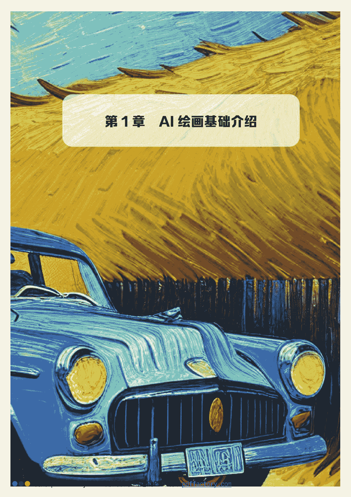

### 1.1 初识 AI 绘画软件

聊天机器人的普及让公众重新认识了人工智能。如今AI在文本写作与图像生成上的表现尤为突出，其作品已让部分文艺与设计从业者产生危机感。按此趋势，可替代性强的岗位如客服、行政、排版等或将受冲击。

当前市面上的AI作图产品众多，以“文心一格”为例，它是一款专业级的图像生成工具，用户只需在界面输入提示词或短语即可得到画面，比如“花瓣纹理”“人物神态”等。操作流程很简单：在对话框中描述需求，发出指令后系统读取理解并计算，最终反馈效果图。

“文心一格”打造了一个零门槛的创作环境，让每个人都能展现个人风格，享受艺术乐趣。无论是新手还是资深设计师，只需输入创意关键词并挑选期望风格，数秒就能得到成图。还能自定义风格主题，常用标签有“动画”“写实”“国风插画”之类，拿到图稍作排版，一套主题素材就绪，效率远超传统手工绘制，这也是AI作图迅速走红的原因。

#### 1.1.1 尝试临摹

文心一格门槛低，界面全中文，支持“中国风”等描述性词汇，可生成类似国画的画面。人学绘画多从临摹起步，AI绘画亦然。

平台首页右上角的“搜索”以及向下滑动的“探索创作”，都是很好的临摹入口，如图1-1所示。挑选喜欢的作品，复制其提示词即可。因为模型存在随机性，不必担心完全雷同，同一提示词也会产出不同结果。在此基础上不断微调输入内容，就能开启个人的创意探索。

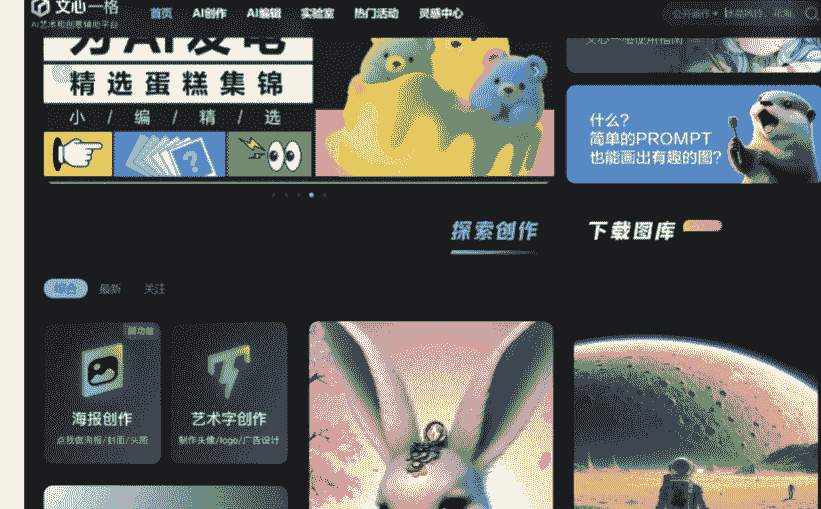

先熟悉操作界面。点开首页左上角“AI创作”，即可进入完整绘图区，如图1-2所示。左侧为工具栏，可选用系统自带的“推荐”模式，输入想要的画面关键词，类型由系统智能匹配。若对风格有更高要求，可切换至“自定义”模式，如图1-3所示。

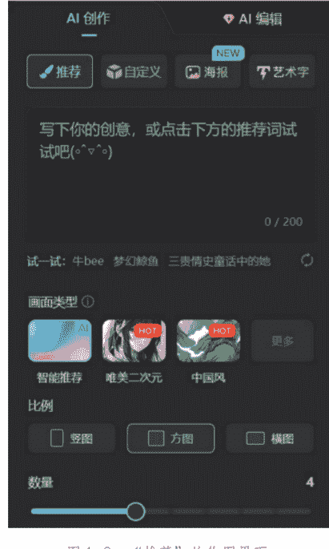

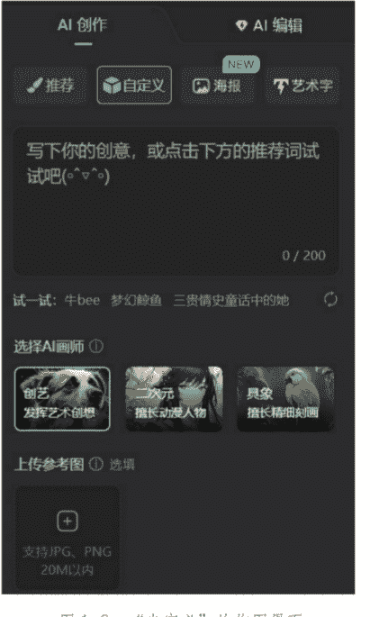

文心一格功能在持续迭代，目前已加入“海报”与“艺术字”两项。海报功能支持竖版9:16与横版16:9等比例，布局样式也可挑选，如图1-4所示。在“海报主体”中填入描述，例如“马在青草地上安静站立”；在“海报背景”中填入例如“一片广阔草原，远山连绵，白云柔和，草随风动”。如图1-5所示。设定生成张数后等待输出，结果如图1-6所示。

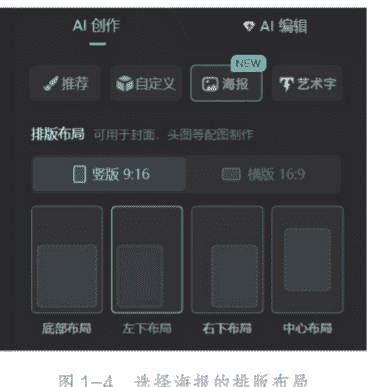

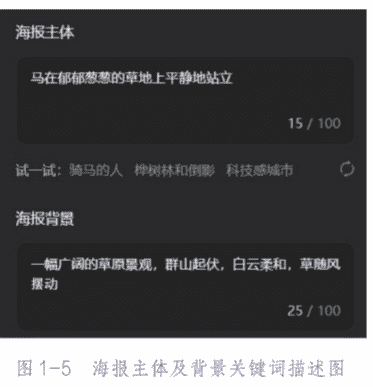

艺术字功能可输入1至5个汉字，如“夏天”；在“字体创意”中填写“夏日美好回忆，蓝海，木桥”，如图1-7所示。选定比例与数量后生成，效果见图1-8。

平台自带分享社区，可浏览他人作品，点击进入可查看描述词，为自己的创作提供灵感。建议使用“自定义”模式，可挑选不同AI画师、上传参考图、增加更多关键词。

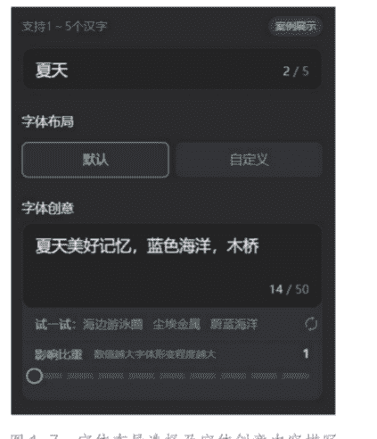

图 1-7 字体布局选择及字体创意内容描写

图 1-8 生成结果

### 1.2 如何玩转自定义模式

自定义模式可调用更新的模型版本，参数可调范围更广，是体验上限效果的通道。

需要注意，自定义并非更易用。推荐模式像手机拍照，按一下就有结果；自定义模式像单反，需要理解各项参数并据需求精细设置。虽然单反上限更高，但设置不当反而可能不如基础模式。所以想用自定义模式，需要耐心学习与工具协同的方式，收获会更惊喜。

#### 1.2.1 自定义参数设置

现阶段，输入文本与参数的质量直接决定结果上限。合适的输入能充分释放模型能力，否则只能得到合格但平庸的画面，自定义的价值也就在此。然而如何优化输入并无定论，需结合对象、风格与个人预期不断积累经验。

下面以四步法给出入门参考。

**第一步：锁定核心描绘对象**

核心对象通常是单一具体事物。当前模型对多主体描绘难度较高。例如想画汽车，可先在“写下你的创意”填入“汽车”，并在“AI画师”选择“具象”风格，首版结果见图1-9。

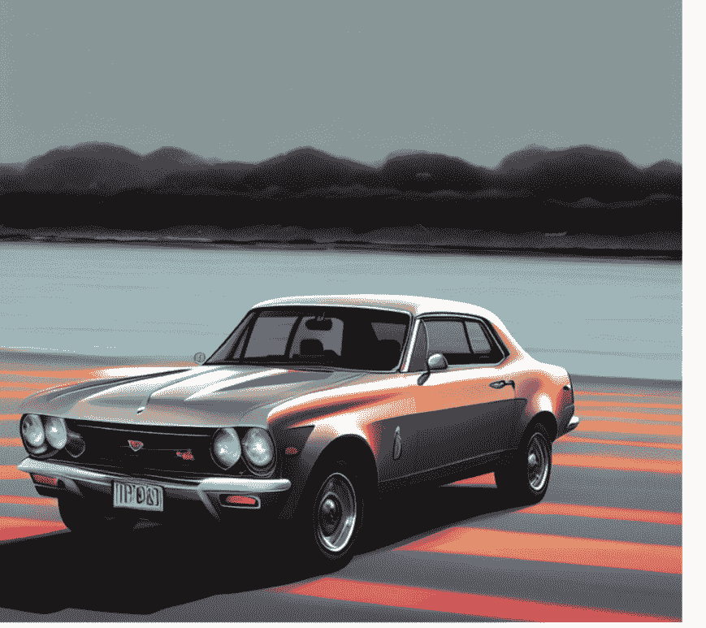

图 1-9 第一版图片

仅输入“汽车”会产生两点问题：画面平淡缺乏惊喜，风格不稳定。但此步可先确认主体是否准确。

**第二步：确定表现风格**

风格对画面观感影响极大，需提前确定。可从风格名称如油画，或具体艺术家如梵高两方面入手。风格与艺术家选择见图1-10。

指定风格后，输出会更稳定，且风格自带美感，效果见图1-11。

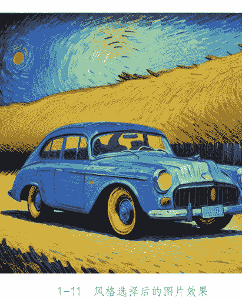

参考列表如下，模型无严格风格库，可大胆发挥想象。

（1）风格：文心一格自定义模式提供的选项如图1-12所示，还可尝试赛博朋克、照片、奇幻、电影、抽象、印象派、蒸汽朋克、3D、CG、铅笔素描等。

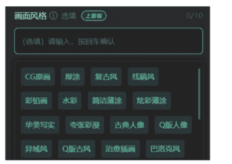

图 1-12 画面风格界面

（2）艺术家：齐白石、黄宾虹、徐悲鸿、潘天寿、张大千、傅抱石、梵高、莫奈、高更、达芬奇、毕加索、新海诚等，如图1-13所示。

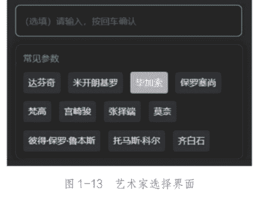

图 1-13 艺术家选择界面

**第三步：细化画面细节**

主体与风格确定后，需进一步调整细节。细节可分主体特征与画面属性两类，例如：

- 视角：俯瞰、侧面、仰拍、广角、微距、清晰对焦等。
- 色调：黑白、莫兰迪、暗调、暖调、冷调、炫彩、马卡龙等。
- 光线：柔光、剪影、强光、过曝等。
- 天气：晴天、小雨、狂风、雾气、冰雪等。

模型无固定属性库，可自由发挥。

在“绘画意向”中还有“不希望出现的内容”一栏，如图1-14所示，填写后可降低该内容出现概率，但不能保证完全排除。

## 第四步：持续优化

持续优化是最难也最有趣的环节。比如想让汽车更魁梧，既可改创意形容词，也可借助修饰词精确描述。常用修饰词包括：

- 清晰度：高清、超清、HD、4K、8K等。
- 局部要求：精细细节、皮肤质感、完美面容等。
- 质感：真实、细节、金属光泽、皮革、木质、锈蚀等。

因无严格属性集合，可自由组合，生成结果即为想象力体现，如图1-15所示。

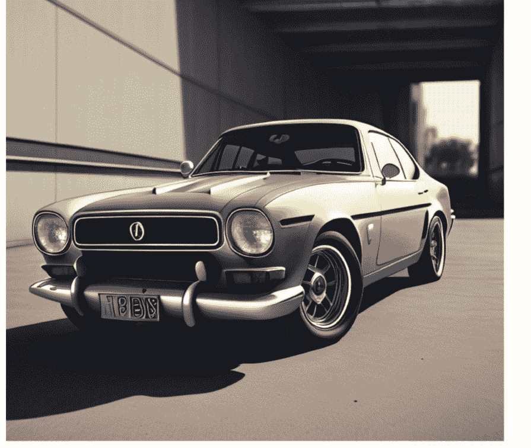

图 1-15 多次调整修饰词后生成的汽车图片

因模型随机性强，几轮生成可能仍不满意，需多尝试，或参考社区作品（首页下拉“探索创作”或右上“搜索作品”）。

“修饰词”栏可选用赛博朋克、摄影风格、对称等专业词汇以提升精准度，如图1-16所示。

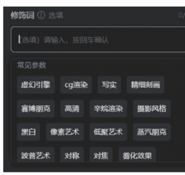

图 1-16 修饰词界面

部分修饰词说明：

虚幻引擎是Epic Games开发的游戏与VR等领域引擎，物理与渲染能力强，可构建逼真互动虚拟世界。

摄影风格即高质写实照片风格，好的照片有主体、陪体、前景、背景，主体是视觉中心，其余元素为之服务。可通过虚实、大小、明暗、动静对比突出主体。

蒸汽朋克以钢铁、机械、蒸汽机为核心，融合维多利亚与大正时期美学，元素包括蒸汽动力、机械臂、差分机、齿轮、轴承、钢铁、黄铜、浮雕等。

波普艺术追求通俗趣味，反对现代主义清高，强调新奇独特，大胆使用艳俗色彩，偏向异化与娱乐化表现。

尺寸选项有1:1、16:9、3:2等，如图1-17所示。选定规格与数量后等待生成，约需2分钟，系统从样本库提取素材作画。完成后可点击满意作品，通过右侧栏下载分享、收藏、加标签或公开。

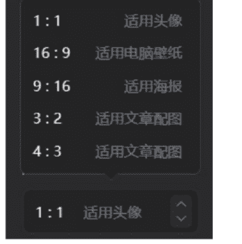

图 1-17 尺寸选择界面

## 1.3 AI 绘画热门操作

### 1.3.1 人物生成

人物生成本质是人机协作。用户用文字指令描述需求，模型返回图像，成图质量取决于模型理解能力，可控部分在于指令描述的精准度。

基础写法框架：先客观限定主体元素，如谁、在哪、何时、做什么、怎样做；再描述风格细化细节。例如“18岁中国少女在盛开花朵的火车上，开朗快乐，由早川河介以自然主义风格呈现，假日青春，天空飘花，仿真电影，超细节高保真摄影，五彩斑斓，鲜花覆盖，电影感拍摄，广角视角”，如图1-18所示。

短语可组织成句子，也可直接发送，效果相近。图1-19即基于上述指令的生成结果，对照关键词基本还原，画风可用。

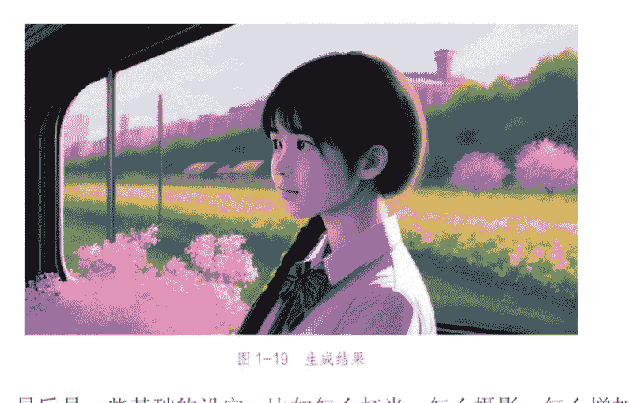

后续可补充打光、摄影手法、质感等关键词，指令越细，模型满足度越高。

### 1.3.2 黏土盲盒玩具风格

参数：玩具摆件、C4D、卡通可爱小女孩、发髻流苏、素雅汉服、精致细节、国潮国风、可爱萌、虹膜增强、全身、泡泡玛特风格、黏土材质、模型、盲盒玩具、光滑细腻、干净背景、3D渲染、极致细节、8K、极致清晰、高度锐化、光线追踪、粒子特效、摄影棚灯光、伦勃朗光、高清画质、细节刻画、全图高清色彩对比、细腻、复杂细节、虚幻引擎、斑驳光影。效果见图1-20。

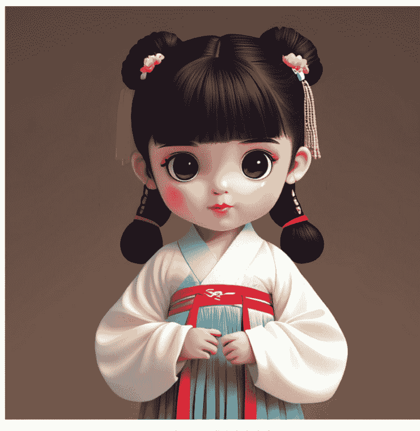

图 1-20 黏土盲盒效果

### 1.3.3 泡泡玛特风格

参数：可爱男孩/女孩（形容词前置）、太极（非遗）、白色（整体色调）、3D渲染、黏土感、干净背景、泡泡玛特风格、精致感。效果见图1-21。

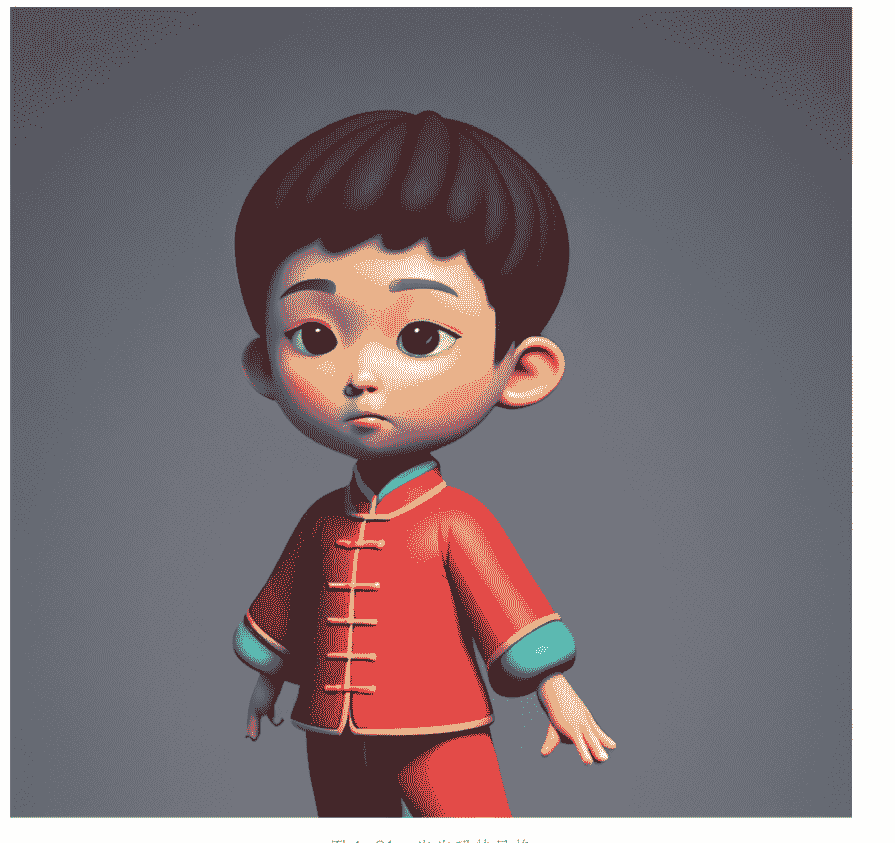

图 1-21 泡泡玛特风格

### 1.3.4 漫画城市风格

关键词：漫画、古城、文化底蕴、城市魅力。
画面类型：智能推荐。
比例：1:1。
灵感模式：关闭。
效果见图1-22。

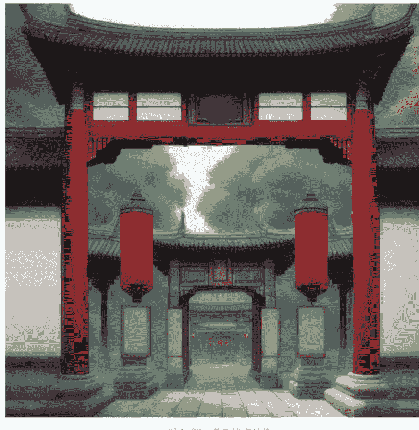

图 1-22 漫画城市风格

### 1.3.5 AI 绘画模拟摄影风格

如何模拟摄影风格？需准备清晰详细的提示词。基础信息如“下班后年轻男人疲惫表情”；时地如“20世纪90年代，城市过客，街景”。风格描述如“港风照片，50mm镜头，半身”。输入后生成，结果见图1-23。

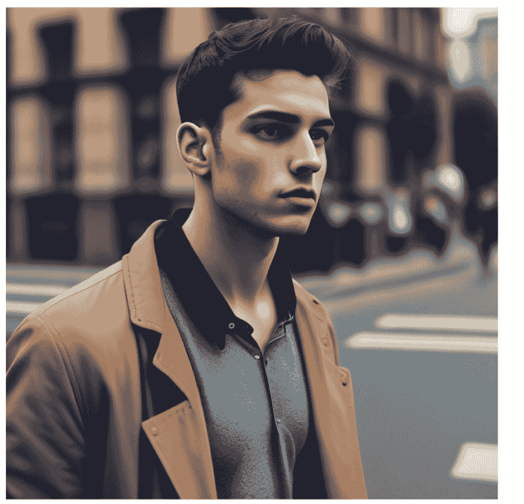

图 1-23 摄影风格

### 1.3.6 以图生图

## 图生图开启二次创作

以图生图的核心流程是先把自选参考图投进参考区，然后补充文字修饰、挑选艺术风格并列出排除项，实现原图的二次演绎。这种做法能打开灵感空间，让智能作图更具个人化。接下来示范如何借助参考图生成艺术风格图像。

进入创作界面后切换到自定义模式，填写关键词、指定画师模型并加载准备好的参考图。可通过调节影响权重来控制参考图的作用，数值越大参考越强，本次以6为例，如图1-24所示。确认后生成，结果如图1-25所示。

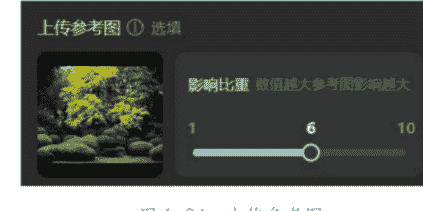
图 1-24 上传参考图
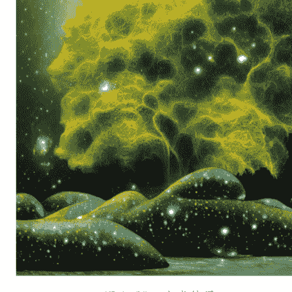
图 1-25 生成结果

### 1.3.7 生成电脑壁纸
进入“AI创作—自定义”，输入风格关键词，也可添加系统智能推荐词，描述越清晰成图越准确。比例栏可选择竖图9:16做手机壁纸、方图1:1做头像、横图16:9做电脑壁纸。以生成16:9横图为例，效果如图1-26所示。除基础用法外，还可自定义画师、画面风格、修饰词、艺术家等，形式多样。

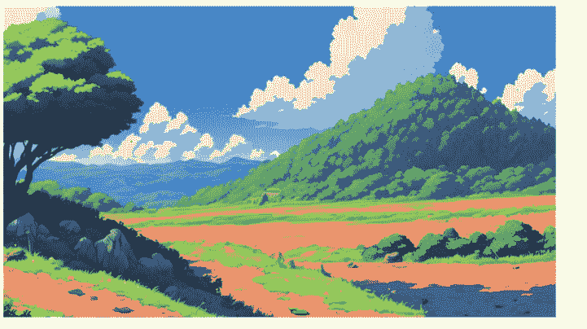
图 1-26 画面效果

### 1.3.8 更换图片风格
默认生成的图像偏写实，如何转为卡通？可通过修改出图设置实现。比如当前描述为“25岁的中国男模特，鲜花效果”，结果如图1-27所示。

想生成卡通风格，可将“选择AI画师”从“具象”改为“二次元”，“修饰词”选择“Q版人像”，也可上传参考图辅助。设置完成后，调整生成数量和宽高比，点击左下立即生成，新效果如图1-28所示。

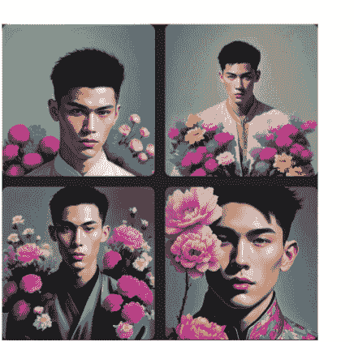
图 1-27 偏写实风格
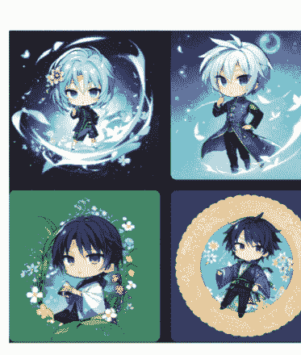
图 1-28 卡通风格

### 1.3.9 AI 绘画万能出图架构
作图提示词宜简洁，关键是先想清楚画面包含哪些内容。通过万能句式结构替换关键词，即可快速得到想要的画面。

结构：主题 + 媒介 + 背景 + 灯光 + 颜色 + 色彩 + 气氛 + 视角 + 镜头 + 构图 + 艺术风格。

主题：人、动物、人物、物体等。
媒介：照片、绘画、插图、雕塑、涂鸦等。
背景：森林、街景、宇宙、水下、天空之城等。
灯光：暖光、强光、舞台灯光、自然灯光、黄昏射线等。
颜色：蓝色、绿色、青色、金色、浅色等。
色彩：柔和、明亮、单色、彩色、黑白等。
气氛：雾蒙蒙、恐怖、风暴席卷、喧闹、平静等。
视角：侧视图、仰视、鸟瞰图、全身照、仰视等。
镜头：全景、单反、长焦、广角、卫星图像等。

## 1.4 AI 绘画常见问题解答

### 1.4.1 AI 没有理解关键词的意思，怎么办？
成图与预期偏差大，通常有两类原因。
第一，描述方式对模型来说较难。虽然希望模型学贯东西，但模型仍在持续学习，需用简单明确的方式描述需求。
第二，模型对指定内容刻画不足。若心中形象并非热门作品的人物场景，模型可能不了解该形象，会出现刻画不准。可转换思路，自己详细描述形象，而非让模型在知识库中寻找。

### 1.4.2 对画作结果不满意，怎么办？
需明白智能绘画仍有提升空间，优质率是重要指标。大部分结果尚可，但惊艳佳作并非每次都有。若多次尝试仍不理想，可尝试以下方法。
- （1）检查提示词是否有错别字。
- （2）内容是否包含模型易失败的元素，如人手、多个实体、指定颜色数量等，这些会降低优质率。
- （3）检查是否输入了互相冲突的描述，虽然有时会带来意外效果，但也可能降低优质率。
- （4）可使用相同提示多生成几次，妙手偶得。
- （5）通过检索功能，参考他人提示词和结果寻找灵感。
总之，保持耐心和好奇心，与智能绘画共同探索艺术可能性。

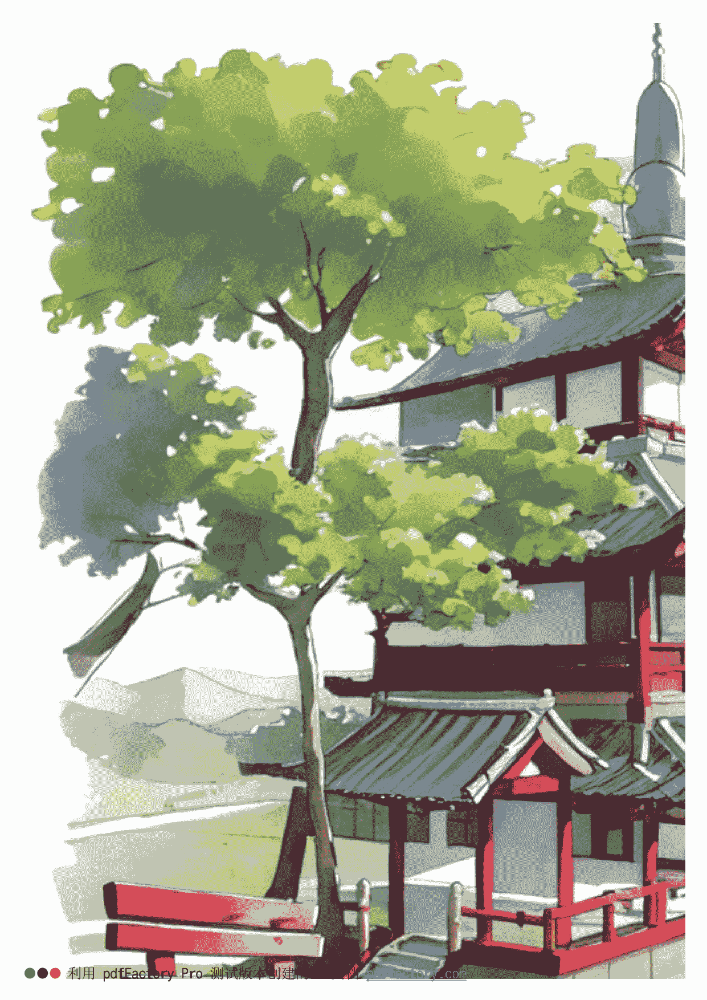
# 第 2 章 AI 绘画趣味实操
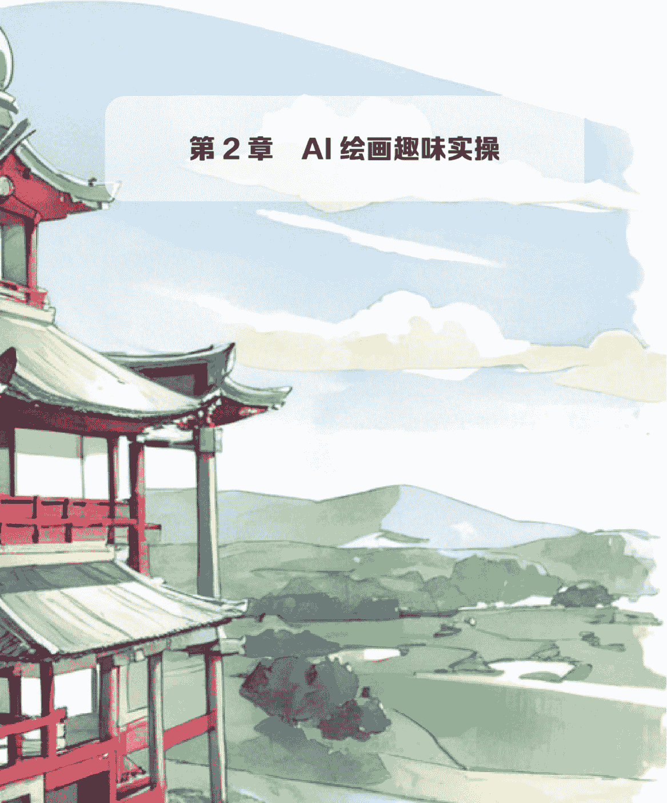

## 2.1 关键词精准选择

### 2.1.1 什么是关键词
对使用者而言，关键词是对事物简要描述，可为词、短语或小段话。
对搜索引擎而言，关键词是可被收录检索的词、短语或小段话。
对智能绘图软件而言，关键词是人与软件对话的桥梁，输入文字，软件以图像反馈。但软件只是人造系统，有一定智能却无想象力，需靠大量检索拼合画面，所以要用直白简短的词句告诉它要画什么、怎么画。由此可见关键词直接影响成图效果。那么描述关键词应遵循何种逻辑？

### 2.1.2 关键词逻辑
使用各类智能绘图软件都需遵循主体、描述词、风格三要素。
主体：是什么。
描述词：做什么、怎么样。
风格：怎么画。
示例：输入“少女，可爱，棕色，写实风格，赛博朋克服装，尖刺的头发，长长的尾巴”，结果如图2-1所示。

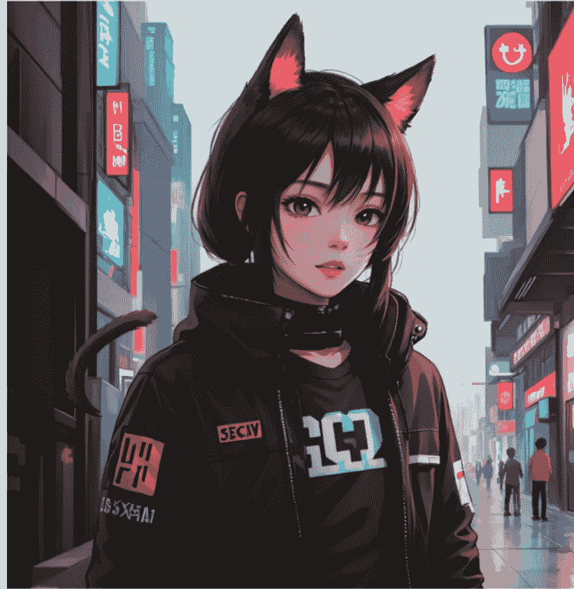
图 2-1 生成结果

提取的三要素如下。
主体——少女。
描述词——可爱，棕色，尖刺的头发，长长的尾巴。
风格——写实风格，赛博朋克服装。
该组描述较简单，模型输出与理想画面可能差距较大，需更详细的描述完善关键词。
总结：先明确要画什么，该事物长什么样，再决定用什么笔法绘制。

### 2.1.3 关键词类型
下面汇总关键词类型，可参考并结合实例观看效果。
主体关键词：服装配饰，情绪（暗黑的、开心的、强烈对比的、破碎的），行为动作，物品道具。
场景关键词：节日，环境，氛围，天气，气泡，草原，高原，沙漠，山上，山谷，山顶，海滩，海边，日落，大海，草地，夏威夷，罗马街道，宫廷，在街上，灯塔，温泉，酒吧，教堂建筑，星巴克，舞台，圣诞节，森林，咖啡厅，教室，户外公园，城市，餐厅，商店。
画面风格关键词：东方山水画，素描，水彩，油画，插画，水墨画，日本漫画，泡泡玛特，皮克斯，新海诚，迪士尼，黑白电影，抽象风，蒸汽朋克，原画，涂鸦，洛丽塔，工业风格，雕刻艺术风，哥特式，科幻，法国艺术，游戏风格，3D 卡通，手绘，宫崎骏风格，超现实风格，赛博朋克，后印象主义，废土风格，数字雕刻风格，建筑设计风格，海报风格，浮世绘，日本海报风格，90 年代电视游戏，包豪斯，像素画，古典风，乡村风格，RISO 印刷风，墨水渲染民族艺术，复古暗黑，国风，电影，摄影风格，概念艺术，写实主义，巴洛克时期，印象派，新艺术风格，野兽派，立体派，抽象表现主义，光效应艺术，维多利亚时代，未来主义，极简主义，粗犷主义，建构主义，绗缝艺术，彩墨纸本。
身材体型关键词：沙漏身材，梨形身材，运动员体型，高挑，苗条，娇小玲珑，曲线美，肌肉美，线条分明，宽肩膀，细腰，长腿，比例协调，丰满，瘦柳条，雄伟高大，柔软轻盈，结实紧凑，优雅迷人，高雅。
氛围感关键词：梦幻，雾气，明暗分明，忧郁的黑暗，鲜艳的色彩，高强度对比，平静宁谧，明亮的，亮点闪烁的，星星柔和的，烛光暖色调的，自然光线，迷幻森林，轻纱薄雾，温暖的光辉，忧郁的氛围，柔和的月光，微光，黄昏，射线，外太空，电影灯光，戏剧灯光，双性照明，纯净背景，全局照明，霓虹灯，残酷的，破碎的，强烈对比的，强光层次，光渲染效果，阴影效果，反射投影，浪漫烛光，电光闪烁，雾气朦胧，强光逆光，闪光灯光，冷光，暖光，伦勃朗光，情调光，气氛照明，体积照明，情绪照明，荧光灯，柔软的光线，立体光，影棚光，侧光，边缘光，硬光，明亮的光线，顶光，轮廓光，太阳光，黄金时段光。
色彩关键词：糖果色系，粉色，珊瑚色系，紫色，紫罗兰色系，白色，浅蓝色系，黑色，酒红色系，灰色，土耳其蓝色系，棕色，薄荷绿色系，金色，日暮色系，银色，柔粉色系，枫叶红色系，米色，波普艺术，奶油色，巨无霸色系，天蓝色，霓虹色调，莫兰迪色系，马卡龙色，金属色系，水晶蓝色系，鲜果色系，黑白灰色系，星闪温暖棕色，玫瑰金色，高对比度色调，电影色调，冷白色调，低对比度色调，黑白色调，大胆明亮，原色，奇幻色调，复古色调，互补色，哥特式色调，亮度类似色，红色，金银色调，荧光乡村色调，蓝色梦幻色调，圣光三色调，绿色浪漫色调，黄色，戏剧性色调，流行艺术色调，暖白色，橙色。
绘画手法关键词：拍摄镜头，特效，渲染器，画面构图。

### 2.1.4 关键词挑选
挑选关键词很关键，以下建议有助提升成图质量。
- 1. 选择特定动作或表情
在系统中指定动作或表情有助于生成优秀作品。例如想画人物微笑，可输入“女孩微笑”或“男孩开心”，结果如图2-2、2-3所示。

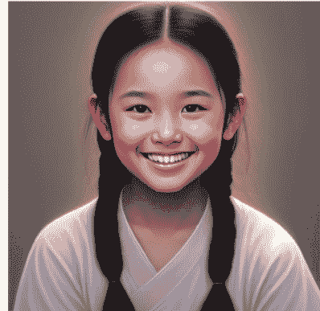
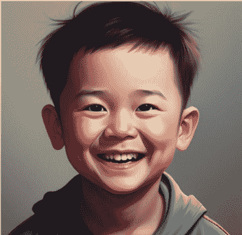
图 2-2 女孩微笑
图 2-3 男孩开心

- 2. 选择特定场景或环境
指定场景环境是生成优质作品的重要步骤。例如想画少年在湖边观景，可输入“湖水”“凉亭”等关键词辅助，如图2-4所示。这样可保证作品主题清晰，生成方向不偏离，结果如图2-5所示。

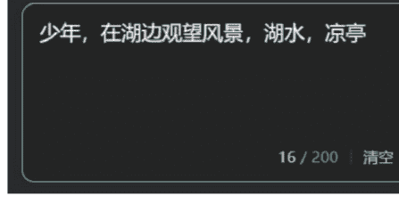
图2-4 关键词描述
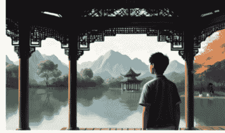
图2-5 生成结果

- 3. 选择特定画风或者风格
绘图软件会在生成时自动加入指定颜色与风格，并通过关键字判断画作风格。所以输入关键字时，可从多种画风中选择，例如“印象主义”“卡通”“赛博朋克”“黑白”等。
总之，选择关键词时要考虑想要的画作风格和主题，同时让关键词尽可能精确简洁，以保证最终质量和美观。

## 2.2 动漫角色设计

智能绘图正逐步应用于多个领域，包括创意艺术。动漫行业中智能绘图已成功用于绘画，可通过算法创作出精美角色形象。无论是Midjourney还是文心一格，都需不断训练。
传统智能主要采用符号推理、专家系统等技术，基于人工规则与知识库推理，擅长逻辑与规则问题，但在复杂模糊问题上受限。文心一格主要采用深度学习、神经网络、模糊逻辑等，通过多层神经网络进行特征提取与模式识别，可处理非线性与高维数据。
智能绘图在绘制二次元人物时借助计算机图形学与深度学习，能创作出逼真的动漫形象。通过对大量真人图与动漫角色图进行学习，可模仿绘画技巧、风格与特点。智能绘图可快速生成大量高质量角色作品，既为创作者提供灵感，也大幅提升效率。本节介绍使用智能绘图生成二次元及多风格动漫角色的技巧。

### 2.2.1 AI绘画设计动漫角色的优势
高效率：智能作图可在短时间内设计大量角色，满足需求。
低成本：成本相对较低，可提高生产效率。
独特创意：可按需求设计独特角色，带来全新视觉体验。
智能作图设计动漫角色在行业中具有巨大潜力和应用前景，正改变传统绘画方式与流程。无论是专业画手还是爱好者，掌握该技术都是一种有益的自我投资。

### 2.2.2 AI绘画生成人物的关键词参考
美丽，英俊，温柔，时尚，酷劲十足，外向，内向，甜美，坚毅，魅力十足，神秘，成熟，稳重，古典，现代，优雅，潇洒，洒脱，帅气，美艳，美好，高贵，普通，气质，性感，武士，毛笔，油画，水彩，素描，人物肖像，动态，静态，忧郁，寂寞，喜悦，充满活力，热情，冷静，安静，勇气，自信，温柔体贴，善良，无畏，独立，活泼，沉着，智慧，热血，安详，甜美，可爱，热烈，亲密，捕捉瞬间，看透心灵，心灵手巧，活灵活现，逼真写实，特立独行，具有感染力，狂放，自由，个性鲜明，活力四射，神经质，细节入微，内敛，明快大方，熟练，才气逼人，华丽精致，神秘莫测，准确无误，波澜壮阔，独具特色，使人陶醉，容易失去，叫人难忘，温暖阳光，处事果断，人人称羡，背景清晰，细节斟酌，陌生人，浪漫，情怀，灵动，美感，夸张表达，深入人心，带有幽默感，充满激情。

### 2.2.3 生成动漫角色
第一步：写文字描述
首先输入关键词，尽可能详细描述主题，如人物的性格、服饰、背景等，如图2-6所示。

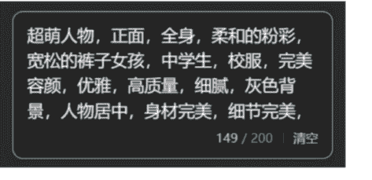
图 2-6 关键词描述

第二步：修饰描述词
让文字描述更精准。可根据自身描述选择相应修饰，使出图更准确，例如不希望人物过暗，可在“修饰词”中选择“精细刻画”“明亮”，如图2-7所示。

图 2-7 填写修饰词

第三步：填写不希望出现的内容
智能绘图在生成时可能出现多余元素，可在下方栏填写不希望出现的元素，以获得最佳效果，可选择“画面粗糙”“五官变形”，如图2-8所示。最终结果如图2-9所示。

图2-8 填写不希望出现的内容
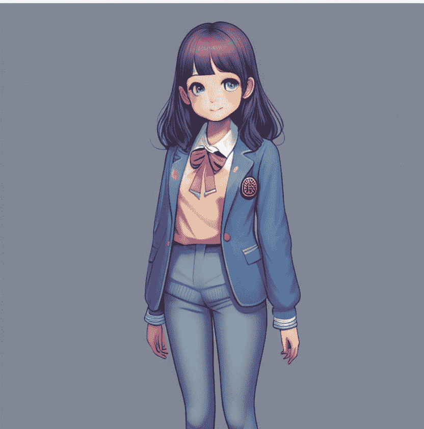
图2-9 生成结果

第四步：选择画风、尺寸
可自主选择喜爱的画风与尺寸。
第五步：上传参考图
上传参考图可更好地指引智能绘图创作。若无参考图也无妨，模型会依据描述进行创意绘画。
第六步：选择数量后即可生成动漫角色

### 2.2.4 通过调整细节来控制角色一致性
智能绘图软件依据数据集与模式训练，因此控制角色一致性颇具挑战。以下技巧可供参考。
技巧1：在关键词中使用知名演员姓名
将角色命名为知名演员即引用系统中关于该人物的资料。模型倾向于从相同提示生成相似图像。有时与名人的相似度可能过高引发肖像权问题，需剔除过于相似的图像。
技巧2：创建一个具有名字和属性的原创角色
可为角色起名字，如“可爱女孩”，并加入头发颜色、国籍等细节，如图2-10所示。即使不引用名人，详尽的具体描述也能让模型反馈更精准的图像，结果如图2-11所示。

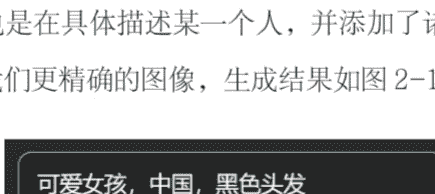
图 2-10 关键词描述
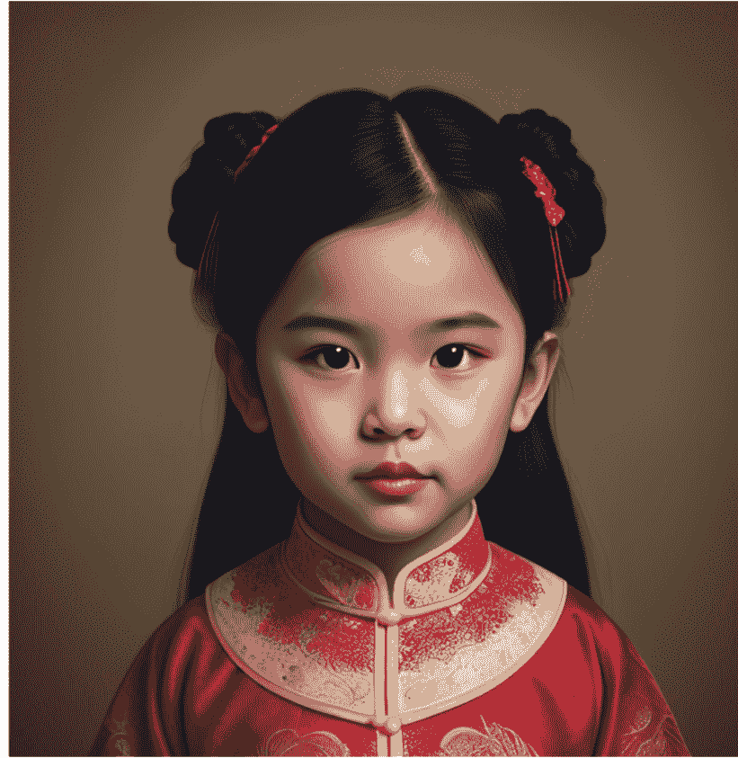
图 2-11 生成结果

技巧3：不断调整关键词内容，并添加属性
若结果与预期不符，可通过以下方式调整。
- 增加细节指令，如情绪、背景等。
- 改变语句结构，使其更清晰明了。
- 添加与期望结果相关的关键词，尝试不同艺术风格。
通过这些调整，可更容易创建一致性更强的角色。
技巧4：使用特定的艺术风格
艺术风格对模型创造一致角色来说很重要，可选择偏爱的风格，并在不同场景下保持统一。

### 2.2.5 动漫角色描述语参考
描述语1：可爱的美人鱼在演奏竖琴，完整的身体，微笑，小美人鱼的侧面视图，游戏风格美术，最佳照明，明暗对比。结果如图2-12所示。

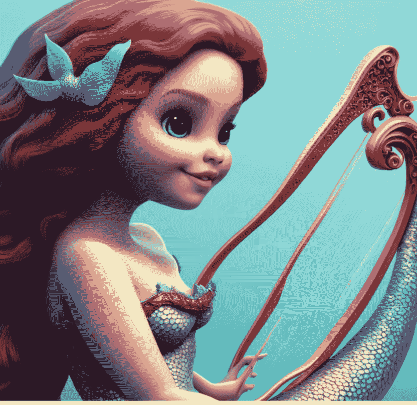
图 2-12 生成结果

描述语2：捕捉瞬间，低视角，赛博朋克风格的酒吧，一个绿发女歌手穿着绿色外套，坐在吧台凳上，漂亮的脸蛋，大胆的人物设计，朋克，人物设计，虚幻引擎，3D建模，金属，人物设计，细节人物设计。结果如图2-13所示。

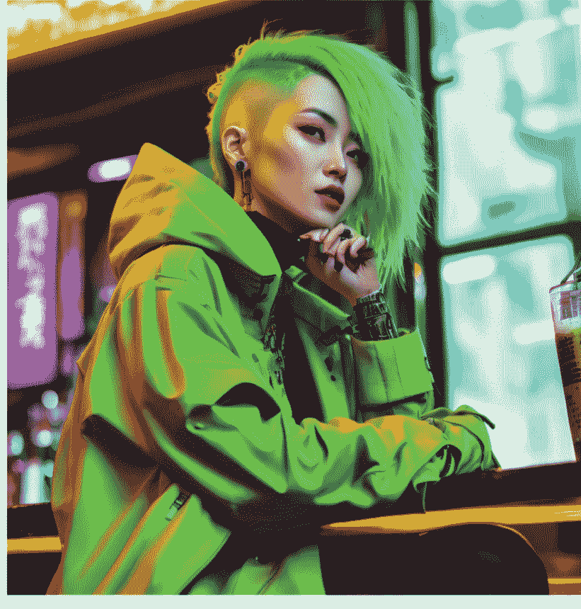
图 2-13 生成结果

描述语 3：超萌人物，正面，半身，柔和的粉彩色，宽松的裤子，戴着耳机，干净明亮的背景，3D，超细节，一个酷酷的女孩穿着运动服饰，蓝色的衣服，衣服上有很多点缀，站在现实的地面上，时代感，科技感，柔和，最高质量，柔和的阴影，柔和光线，梦幻的颜色，C4D。生成结果如图 2-14 所示。

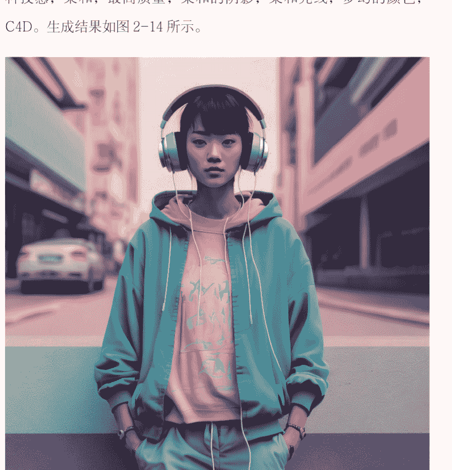

图 2-14 生成结果

描述语 4（实操案例）：篮球男孩，上身运动服，蓬松的头发，精致的五官，篮球场，拍摄，短裤，橙色系列，干净的背景，动漫，超高清，画质最佳。

描述语 5：全身人物，服装设计，粗轮廓，粗绘画，少女，16 岁，黑头发，猫耳，现代时尚，朋克设计感，白色外套，黑白紫色配色，动漫，精致的构图，高度细致。生成结果如图 2-15 所示。

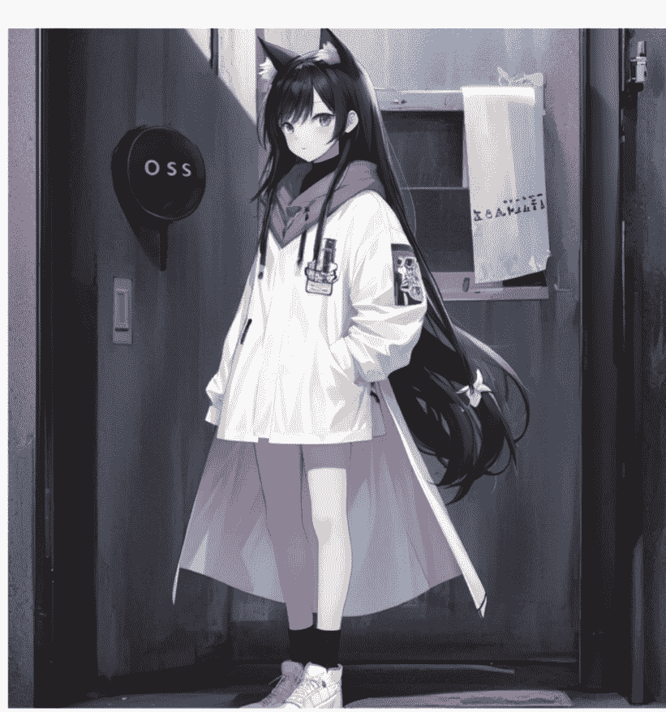

图 2-15 生成结果

描述语 6：女孩，中学生，校服，完美容颜，优雅，高质量，细腻，8K 画质，人物居中，身材完美，细节完美，照片风格，大眼睛，皮肤白皙，半身写真，微笑，完美五官比例，可爱，身材姣好，五官精致，高清，精密。生成结果如图 2-16 所示。

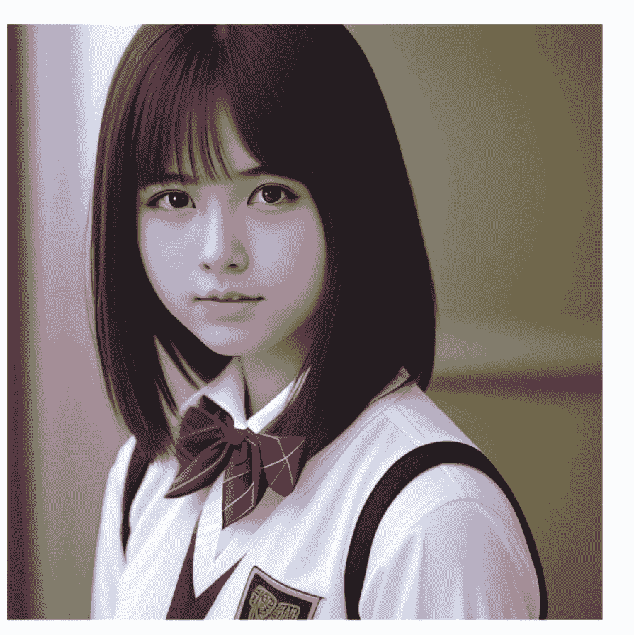

图 2-16 生成结果

描述语 7：真人，女生，完美容颜，白皙皮肤，清纯，武侠风格，汉服，身材姣好，高清，细节完美，飘逸，棕黑色头发，七彩羽衣，全身，冷酷，大广角镜头，镜头 85 定焦，专业摄影，辛烷渲染，佳能相机。生成结果如图 2-17 所示。

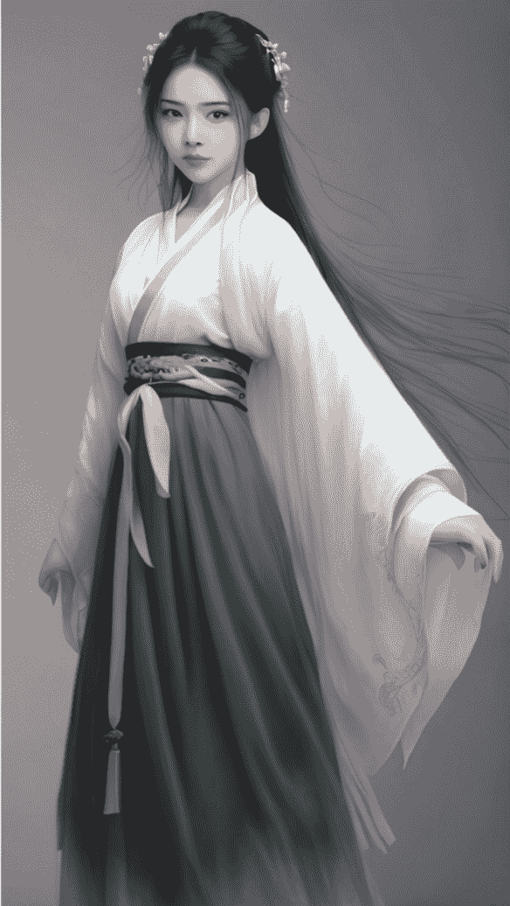

图 2-17 生成结果

描述语 8：女生，盛夏夜晚的海底，静谧辽阔，特写，游来游去，梦幻色彩，海底流光溢彩的全息色，许多气泡伴随女生，表情忧郁，盛夏时节的舒适感，创意构图。生成结果如图 2-18 所示。

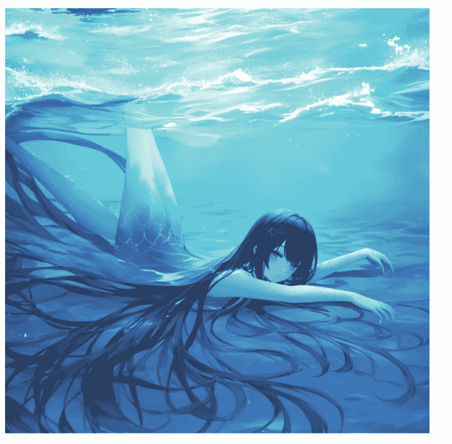

图 2-18 生成结果

描述语 9：女生，轮廓光线，微笑，瓜子脸，大眼睛，优雅，半身，背带裤，黑色上衣，精致细节，高清。生成结果如图 2-19 所示。

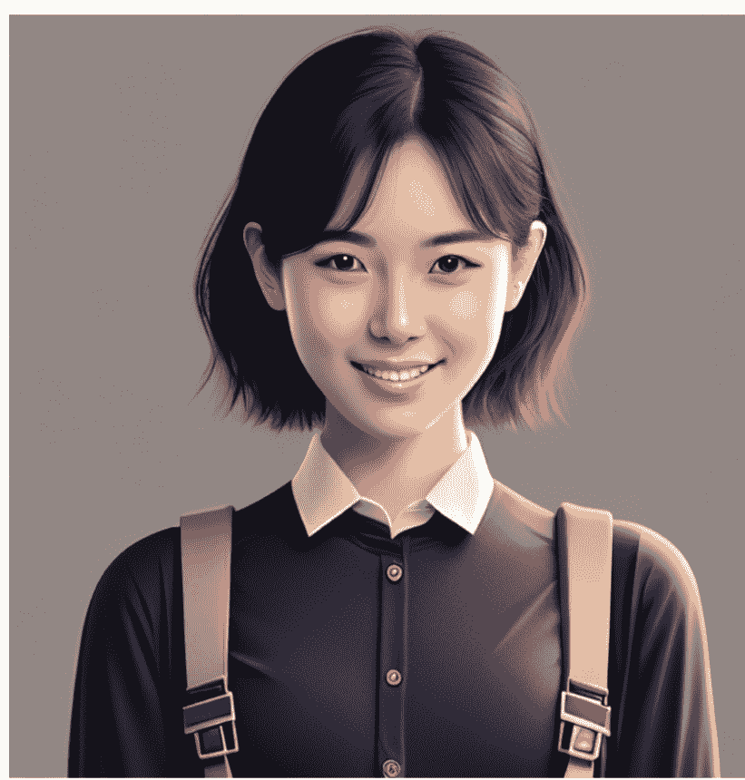

图 2-19 生成结果

### 2.2.6 角色生成实操

进入平台主页面后打开创作入口，切换至高级自定义。先在顶部主输入框落下主体概念。以“篮球男孩”为例，紧随其后补充外形、神态、动作与场景信息，例如“上身运动服，蓬松的头发，精致的五官，篮球场，拍摄，短裤，橙色系列，干净的背景”，示意图见图 2-20。

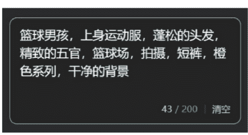

图 2-20 关键词描述

紧接着在绘师选择区锁定二次元，再将画面基调设定为动漫，对应图 2-21 的界面。

图 2-21 选择画面风格

主体与风格确定后，可通过优化词对画面做精细调节。在优化词栏填入“超高清，画质最佳”，如图 2-22。

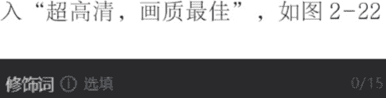

图 2-22 填写修饰词

生成比例按需选择，本次以 1:1 为例，最后设定出图张数，即可得到图 2-23 的效果。

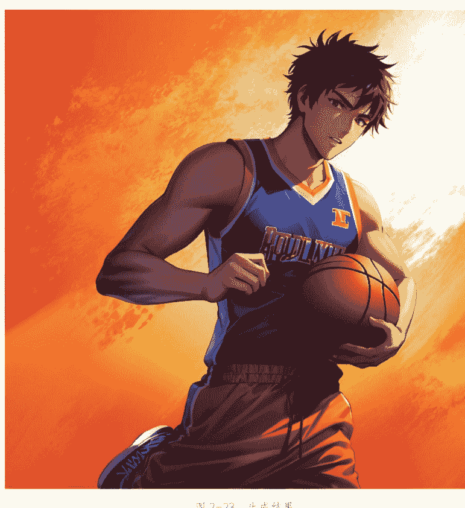

图 2-23 生成结果

小结：智能绘图能大幅提升漫画人物的产出效率，实际运用仍需注意三点。

其一是人物设定。绘制前要对角色做充分规划，涵盖长相、性格、着装、姿态等，确保形象有辨识度且可信。

其二是细节打磨。制作过程中要关注服装纹理、肌肉线条、眼神表现等细节，以让画面更丰富细腻。

其三是配色协调。上色时要兼顾色彩和谐与比例，使整体形象统一通顺。

## 2.3 贴纸设计

### 2.3.1 贴纸的生成

贴纸设计属于设计师与插画师的常规工作，与包装设计同属平面范畴，区别在于贴纸更强调与印刷生产环节的衔接。贴纸成本低、落地人力少，只要熟悉纸张种类、印刷规格、覆膜工艺与模切包装即可。对非专业用户而言，智能绘画的出现极大满足了创作诉求。

基于机器学习的贴纸生成方式，是先训练深度模型自动产出艺术化效果，再将其应用到图像上，帮助创作者快速得到多风格贴纸，提升产出速度。

该类贴纸在艺术创作、视觉设计与娱乐场景中应用广泛，设计师可用智能工具迅速产出不同风格贴纸用于美化装饰。

虽然目前仍有局限，但随技术迭代，可生成的贴纸类型会更丰富，为创作者提供更多选择。

主要优势体现为：

生成迅速：借助机器学习可快速产出多种风格贴纸。

风格多样：软件可学习多种绘画特征，使贴纸更丰富。

创新助力：有助于创作者提出新颖的艺术方案。

### 2.3.2 贴纸风格类型

手账贴纸

手账贴纸的核心概念是“Knolling”。Knolling 指把喜欢的物件按一定规则陈列后拍摄定妆照。将陈列元素转成贴纸内容，就形成了手账风格。

霓虹灯 & 卡通风贴纸

近期流行两种风格：个性激光渐变霓虹与抽象卡通。大多数数字贴纸被做成类似实体贴纸，外围有切割指示线，或采用圆形、圆角矩形等规则形状。

汽车贴纸

汽车贴纸多模仿赛场赛车图案，视觉简洁动感，用简易贴纸即可为爱车营造赛车氛围。艺术化汽车贴纸常使用流线、几何图形，或动漫人物、卡通动物，部分车主也偏爱中国传统图案，如水墨丹青、书法篆刻、图腾脸谱等。

### 2.3.3 贴纸描述语参考

描述语 1：赛博朋克头盔，概念艺术，喙，艺术站，发光二极管，高细节，贴纸，高楼大厦。如图 2-24 所示。

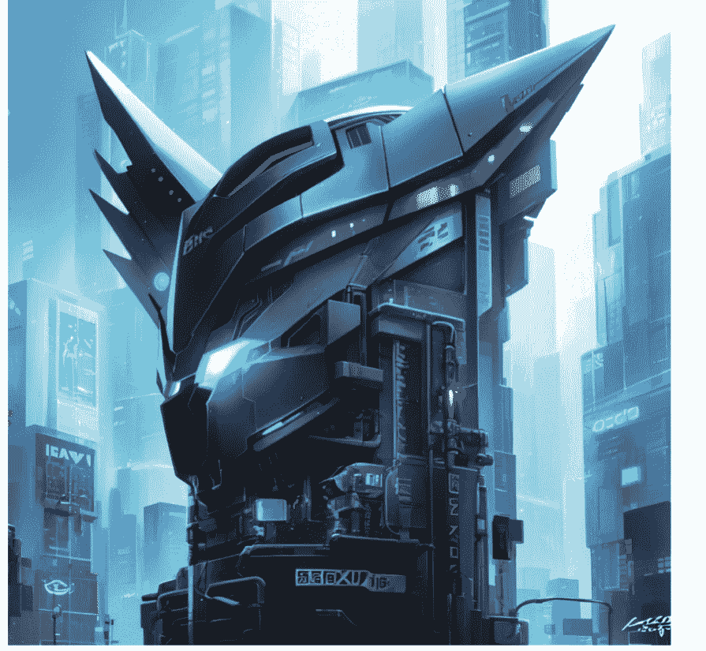

图 2-24 生成结果

描述语2（实操案例）：平面的贴纸素材，神秘太阳花纹，发光的，流线造型，对称的，规则的，涂鸦，虚幻引擎渲染。

描述语3：可爱的，锦鲤，贴纸，插图，高品质，矢量，艺术，高细节，概念艺术，光线追踪，平滑，锐利的，焦点，空灵的，照明，数字绘画，吉卜力工作室，4K。如图2-25所示。

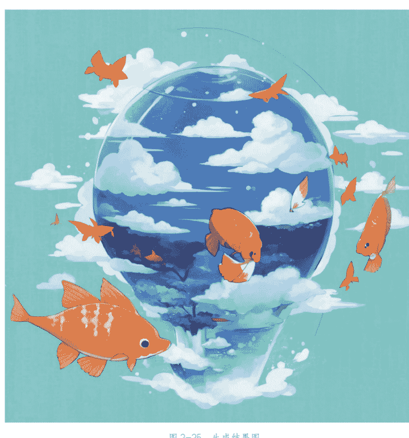

图2-25 生成结果

描述语4：古建筑，湖水，山丘，手册贴纸风，“咕卡”贴纸，干净背景，中式水墨风格，线条，莫兰迪配色，超高清、马克笔风格，国画元素、细节，8K高清，白色背景，白色环境光。如图2-26所示。

图2-26 生成结果

描述语 5：艺术贴纸，可爱的动漫人物，长发，自由，灵魂，数字插图，漫画风格，蒸汽朋克黑色，完美的解剖，集中，接近完美，动态，高度详细，水彩画，概念艺术，流畅，焦点，白色背景。如图 2-27 所示。

描述语 6：小女孩，南瓜篮子，棒棒糖，草莓，爱丽丝梦游仙境，扑克牌，水瓶，阔腿裤，可爱的脸，雀斑，精致五官，手册贴纸，平面插画，干净的背景，线条，动画风格，全身，精细笔触，细节，高清，白色背景。如图 2-28 所示。

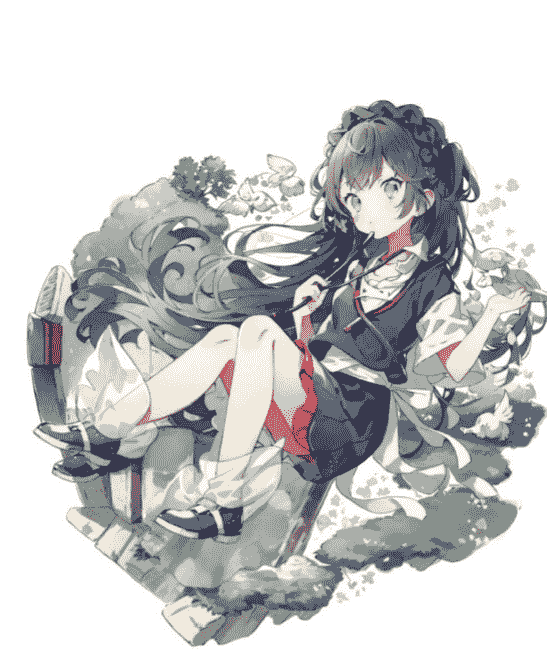

图2-27 生成结果

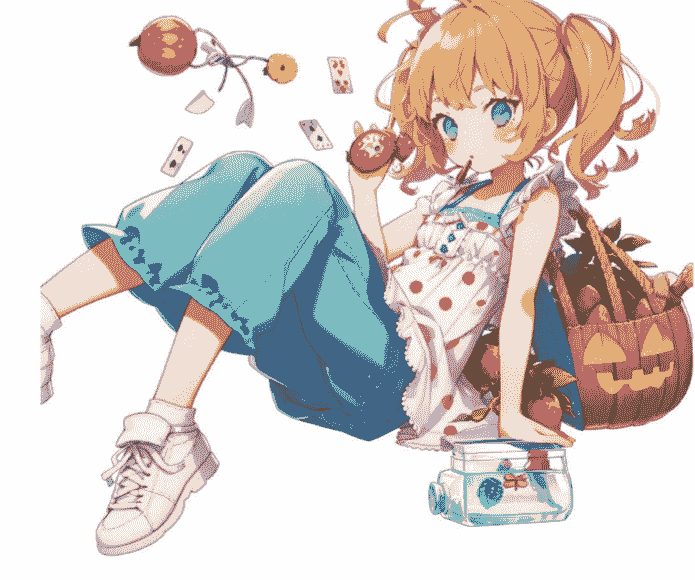

图2-28 生成结果

描述语 7：魔法药水，金边，魔法帽，蓝紫色渐变，扫帚，烛台，青蛙，魔法火焰，烟囱，霍格沃茨，羊皮纸，魔杖，咒语，可爱的小女巫，紫色，小女孩，可爱的脸，彼得兔风格，手册，日本贴纸，平面插图，干净的背景，贴纸轮廓，线条草稿，多个配件，动画风格，全身，精细笔触，拆装图，拆装设计，细节，8K 高清，工业设计，白色背景，白色环境光。如图 2-29 所示。

图 2-29 生成结果

### 2.3.4 AI 贴纸生成实操

打开平台首页，点击“AI 创作”，进入自定义模式。在“写下你的创意”中输入主体“平面的贴纸素材”，并在其后补充细节，如“神秘太阳花纹，发光的，流线造型，对称的，规则的”，如图 2-30 所示。

随后在“AI 画师”栏选择“创艺”，再把“画面风格”定为“涂鸦”，如图 2-31 所示。

内容与风格确定后，利用优化词进一步细化画面，输入“虚幻引擎渲染”，如图 2-32 所示。

尺寸按需选择，本次以 1:1 为例，最后设定生成张数，结果见图 2-33。

图 2-33 生成结果

## 2.4 表情包制作

在移动互联网时代，人们通过社交软件交流，表情包文化由此兴起。如今表情包已遍布各类输入场景。表情包是人类表情的延伸，当文字难以承载情感时其价值显现，且用途远不止于此。借助文心一格智能绘图，仅需少量核心关键词即可绘制出神态各异的表情包。

### 2.4.1 什么是 AI 绘画表情包

AI 绘画表情包是通过机器学习制作的个性化表情包，利用训练好的模型学习表情特征与建模方式，实现自动化生成各类表情图像。不仅提升制作效率，也让表情更精致生动。

### 2.4.2 表情包的类型

仅从视觉形式看，静态表情包可分为 3 种类型。

## 2.4.3 表情包的特点

一致性是制作表情包的核心，体现在以下方面。

- 1. 特征一致性

多张表情中主体形象的特征需保持一致，使用智能生成时可采用垫图方式，具体见本书“3.2 AI 绘画垫图”，尽量保证关键特征不变。

- 2. 色彩一致性

色彩统一决定整套表情的调性，色彩过于复杂或多变会显得杂乱，缺乏整体感。

- 3. 笔触一致性

笔触是整体风格的重要组成部分，选图时应重视笔触的统一，以体现连贯性。

- 4. 构图一致性

表情的比例、大小、空间分布等构图要素要注意，避免主体过大或过小，导致系列显得跳跃杂乱。

## 2.4.4 热门表情包

表情包有哪些种类？人们以图片、视频及热门网络语言为素材制作出引人发笑的图片或动图，因传播快、趣味强而风靡社交软件，为生活增添乐趣。下面介绍常见种类。

### 1. 搞笑表情包

搞笑表情包深受网友喜爱，如图 2-34 所示。

图 2-34 搞笑表情

### 2. 萌宠表情包

越来越多动物形象以图文形式嵌入社交软件，帮助传递情绪，逐步形成区别于日常交流的情感表达体系。无论交流情境如何，萌宠表情包在情绪表达上的贴切度都很高，在信息量、视觉形式和情绪唤醒度上都优于文字语言。

萌宠表情包在不同程度上呈现或模仿人类的面部表情和动作，如图 2-35 所示。其覆盖的情绪种类多样且复杂，表现或夸张或含蓄，个性鲜明，极大丰富了网络交流体验，促进情感沟通。

图 2-35 萌宠表情

常用动物关键词有：柴犬、羊驼、兔子、猫咪等，配合详细描述语，可用智能绘图制作更多有趣表情包。

## 2.4.5 表情包如何制作

表情包创作需要一批神态、动作关键词，一次性想全较困难，可先搜索相关词语快速获取。参考关键词如下。

动物类关键词：小白兔、浣熊、狐狸、猫咪、狗。

神态类关键词：开心、生气、悲伤、惊讶、困惑、难过、害怕、兴奋、无聊、鄙视、疑惑、淡定、傲慢、感动、笑翻、吐槽、瞪眼、撒娇、疲惫、无奈。

动态类关键词：跳舞、打人、哭泣、大笑、点头、摇头、跑步、飞翔、吃东西、睡觉、甩头发、指点、手舞足蹈、面无表情、抓狂、疯狂打字、自拍、捂脸、挥手、扔东西。

选取多个不同动作和表情的核心词即可创作一系列表情包。对满意作品可进一步优化，在关键词中加入“白色背景”，便于后期用 Photoshop 等软件抠图，最后根据实际情况微调即可。

## 2.4.6 AI 绘画表情包描述语参考

描述语 1：一只可爱的柴犬，多种造型和表情，线条画风，深白色，浅米色，姿态松散，线条简洁，漆画，质感厚实，风格可爱，表情符号作为插画集，以大胆的漫画线条风格，动感的姿势。生成结果如图 2-36 所示。

描述语 2：一只可爱的小仓鼠，灰色和白色，卡通风格，它正在吃东西，贴纸，灰色简约背景，低饱和度，有表现力，开心表情，有惹人喜爱的眼睛。生成结果如图 2-37 所示。

图 2-36 生成结果

图 2-37 生成结果

描述语 3：可爱的熊猫抱着竹子，可爱表情，灰绿色背景，竹叶，表情包设计，精致细节。生成结果如图 2-38 所示。

描述语 4：一只小猫头鹰，表情符号，可爱，大眼睛，黑色背景，精致细节，水彩风格，插画，贴纸。生成结果如图 2-39 所示。

图 2-38 生成结果

图 2-39 生成结果

## 2.4.7 表情包生成实操

首先进入文心一格的“AI 创作”界面，选择“自定义”，在“写下你的创意”中输入核心主体。以“小狐狸”为例，后面追加细节、动作、神态描述，如“可爱的，拿着棒棒糖或其他物品，多种姿势和表情，夸张的，生气的，高兴的，害怕的，俏皮的，黑色背景，表情包，九宫格布局”，如图 2-40 所示。

接着在“选择 AI 画师”栏挑选“二次元”，再把画面风格设为“动漫”，如图 2-41 所示。

内容与风格确定后，可在修饰词栏输入“吉卜力”，以优化细节，如图 2-42 所示。

尺寸方面，表情包多用正方形，本次以 1:1 为例。设定生成张数后，画面生成结果如图 2-43 所示。

图 2-43 生成结果

# 第 3 章 进阶玩法教学

## 3.1 插画制作

### 3.1.1 了解插画风格

文字以插画形式呈现更直观清晰。插画可分为以下风格。

- 1. 扁平插画

特点：流行常用、色彩明快、几何化、细节少、简洁大方。

扁平插画本质是将复杂关系简化，使画面清爽整洁，目前应用广泛，许多商务工具类 App 偏爱此风格。

- 2. 肌理插画

特点：是扁平插画的变种，增加颗粒感，有质感，光影关系更好。

肌理插画即为插画添加肌理质感与光感，本质仍与扁平插画相近，常用于需要体现质感的页面。

- 3. 手绘插画

特点：对美术功底要求最高，应用范围广，内容表现丰富。

插画风格解码与AI生成实操指南

手绘类插画在当下的内容生态里渗透面很广，绘本、角色设定、Q版头像以及故事场景的构建都离不开它。

- 4. 渐变插画
特征是画面唯美细腻，色调明亮饱满，对比强烈，整体偏写实且气势开阔。手机启动页里能频繁见到这类视觉。大多采用邻近色系过渡，氛围浪漫唯美，光感突出，因此业内也常称作“微光插画”。

- 5. 描边插画
以形体为基础做外轮廓勾线。除了造型本身，对边缘进行明确的线描，能让抽象概念更清晰地被表达，图标设计中应用尤为普遍。

### 3.1.2 插画描述语参考

描述语 1：盛夏梦境，两个人看着星星和月亮，云，光闪耀，抽象艺术，拼贴艺术，爵士风格，明亮调色。生成结果如图 3-1 所示。

图 3-1 生成结果

描述语 2：水下少女，女孩在水下游泳，创意风格，逼真，超精致的渲染风格，微笑，水中发光，紫色头发，黑色泳装，蓝色，脸部特写，夸张的透视，丁达尔效果，精致面容，看向镜头，插画风格。生成结果如图 3-2 所示。

图 3-2 生成结果

描述语 3：两只可爱的老虎，孟加拉，橙色虎斑，戴着猫耳朵棒球帽，单纯的微笑，在杂草旁边花后，卡通贴纸，吉卜力，黑色边框，胖胖的，全身，平面，卡通风格，绿色背景，插画。生成结果如图 3-3 所示。

图 3-3 生成结果

描述语 4（实操案例）：一个美丽的古风女孩，可爱风格造型，衣服颜色以橙红、蓝、绿为主色调，唐装，吉卜力风格，大气的姿态，富有想象力的创作，薄膜材质，精致的服装，精致的头饰，蓝色背景，可爱的卡通设计，8K 画质。

描述语 5：插画，春天明亮的绿色色调，山，云，湖水，梯田，山村，密集村落，全景构图，草，超级细节，16K 画质，平面插图，宫崎骏风格。生成结果如图 3-4 所示。

图 3-4 生成结果

### 3.1.3 AI 插画生成实操

打开工作台后进入 AI 创作模块，切换到自定义模式。在创意输入区先写下核心主体，这里以“古风女孩”举例，随后追加细节与神态说明，例如“可爱风格造型，衣服颜色橙红、蓝、绿为主色调，唐装，富有想象力的创作，薄膜材质，精致的服装，精致的头饰，蓝色背景，可爱的卡通设计……”如图 3-5 所示。

随后在画师选择区挑选“二次元”，再把画面风格锁定为“插画”“涂鸦”，如图 3-6 所示。

主体与风格确定后，可借助修饰词做进一步细化。在修饰词里加入“吉卜力”“精细刻画”，如图 3-7 所示。

画幅按需求设定，本次以 4 : 3 为例，生成数量设为1张，最终效果见图 3-8。

图 3-8 生成结果

## 3.2 AI 绘画垫图

### 3.2.1 什么是 AI 绘画垫图

AI 绘画垫图是借助深度学习快速产出绘画草图的工具。系统通过海量绘画作品与图像数据的训练，学习艺术家的风格与技法。非专业用户也能迅速拿到底稿，获得灵感与参照，让创作流程更高效有趣。

### 3.2.2 如何使用 AI 绘画垫图

使用逻辑很直观。可先选定喜欢的绘画风格或参考艺术家，上传一张作为草图素材的原图。软件会自动解析图像特征，按所选风格重绘，图 3-9 为文心一格中的上传参考图功能。借助参考图可在固定风格下进行二次创作。注意仅支持 JPG、PNG 格式，文件大小需在 20M 以内，其它格式无法识别。

另外可进入实验室的“人物动作识别再创作”，上传参考图片后会得到动作相近的新画作，属于图文结合的以图生图能力，见图 3-10。

图 3-10 人物动作识别再创作

另一种玩法是混合生图，将两张图像融合为一图。融合后主体与创意元素得以保留，实现二次发展。

先点首页左上角的“AI 编辑”，上传待合成的两张图片，先是一张实拍花丛，再是一张小鸟，也可补充描述词，这里输入“完美构图”，选定画幅后等待生成，如图 3-11 所示。图 3-12 为融合后的结果，花朵与鸟类元素均被保留。

图 3-11 上传两张图片并添加关键词

图 3-12 生成结果

## 3.3 AI 绘画迪士尼风格创作

### 3.3.1 什么是迪士尼风格

在数字艺术浪潮中，AI 绘画快速崛起，融合艺术与科学，开辟新的视觉探索空间。本节聚焦迪士尼风格及人物头像的创作要点。

大众对《疯狂动物城》《寻梦环游记》《疯狂原始人》《超能陆战队》《冰雪奇缘》等影片并不陌生，还有众多公主王子的童话。迪士尼出品保持高水准，流水线化制作形成了统一的人物面貌，简称为“迪士尼风格”。该风格头像可爱动人，辨识度与表现力突出，是年轻群体的时尚选择。通过 AI 绘画可以快速捕捉其元素，创作出富有生命力与情感表现的可爱角色头像。

将迪士尼风格与可爱头像结合，既打开艺术创作新可能，也为个性化表达提供更多空间。借助关键词引导，每位创作者都能发挥想象，产出优秀设计。

### 3.3.2 迪士尼风格描述语参考

描述语 1：迪士尼女孩，美丽的女孩，短发，粉红色的衣服，粉红色的猫耳朵发饰，治愈的微笑，大眼睛，看着观众，皮克斯风格，超级细节，黏土，边缘照明，渐变。

描述语 2：帅气男孩，人像，背着书包，兜帽衣服，卡通，看向镜头，皮克斯风格，迪士尼风格，超现实主义，渐变背景，精致，辛烷渲染。生成结果如图 3-13 所示。

图 3-13 生成结果

描述语 3：可爱的女孩，微笑表情，迪士尼风格，皮克斯风格，大眼睛，五官精致，丰富的细节，动画电影，长黑发，超细节，灰色背景，蓝色上衣，精细的光泽，柔和照明，动漫。

描述语 4：超级可爱的亚洲女孩，头上戴着花环，迪士尼风格，皮克斯风格，春天场景，柔和色彩，鲜花环绕，细腻的光泽，渐变背景，完美构图，柔焦。

图 3-14 生成结果

图 3-15 生成结果

### 3.3.3 迪士尼风格头像实操

点击“AI 创作”，选择“自定义”模式，在创意输入区写下核心主体“迪士尼女孩”，并补充人物细节与神态，如“美丽的女孩，短发，粉红色的衣服，粉红色的猫耳朵发饰，治愈的微笑，大眼睛，看着观众。皮克斯风格，超级细节，黏土，边缘照明，渐变背景”等，如图 3-16 所示。

图 3-16 关键词描述

随后在画师选择处选“具象”，如图 3-17 所示。再指定画面风格，选择“动漫”，如图 3-18 所示。

图 3-17 选择 AI 画师

图 3-18 选择画面风格

内容与风格确定后，用修饰词优化细节，在修饰词栏输入“迪士尼”“辛烷渲染”，如图 3-19 所示。

图 3-19 填写修饰词

尺寸按需求选择，本次以 1 : 1 为例，适合头像。最后设定生成数量并等待，得到的结果如图 3-20 所示。

图 3-20 生成结果

# 第 4 章 AI 绘画进阶教学

## 4.1 国潮风人物绘制

### 4.1.1 什么是国潮风

国潮即国风与潮流的结合，指兼具中国特色元素与深厚文化内涵的时尚风尚。目前国潮插画正流行，中国文化自信在其中得到充分彰显。国潮风多采用细线条塑造人物，整体以邻近色为主，辅以细腻线条提升精致度。留白处常点缀金色或红色，增强现代感与时尚感。人物从造型服饰到五官神态，均体现经典与当代潮流的融合，因而广受喜爱。

### 4.1.2 国潮风关键词

- 1. 国风插画艺术家关键词

倪传婧（Victo Ngai）：香港插画师，被视为国潮风插画的先驱，作品充满浓郁中国风，常见浪漫的国风元素、神话、民俗、成语典故等，同时吸收西方插画特点，画风细腻唯美，具超现实主义与浪漫气质，想象力丰富，每幅画都像一个故事，兼具文化底蕴与意境。

## 2. 画面类型描述词

国潮插画：中国元素与潮流元素融合，装饰性与表现力强。风格：装饰性与表现力强。

中国水墨画：传统水墨重彩，民族特色浓郁。风格：色调淡雅、笔触灵动、意境深远、写意强烈。

中国工笔画：以精细笔触与固有色描绘对象，色彩鲜亮。风格：细腻、精工、色彩明艳。

敦煌壁画：敦煌石窟壁画，涵盖佛像、经变、人像、装饰等。风格：笔墨简练塑造个性鲜明形象，概括力高，表现力强。

汉唐之仪国风：展现汉唐礼仪文化，涵盖婚丧嫁娶等场合。风格：突出礼仪文化与历史气息。

## 3. 艺术风格描述词

中国龙艺术：以龙为主题的传统艺术，象征神秘吉祥。风格：以龙为主题、神秘、吉祥。

水墨镜头：将水墨绘画特性融入摄影，营造中国文化氛围。风格：水墨画、中国文化。

写实唯美：传统绘画风格之一。风格：注重对象真实形态与美感。

## 4. 国风景色描述词

武陵源风景名胜区、武夷山、莫高窟、宏村古村落、黄果树瀑布、三亚海滩、泰山、壶口瀑布、元阳梯田、龙门石窟、婺源古村落、峨眉山、青城山、黄冈山。

## 5. 朝代风格描述词

夏朝、商朝、周朝、秦朝、汉朝、三国、晋朝、南北朝、隋朝、唐朝、五代十国、宋朝、元朝、明朝、清朝。

## 6. 神话故事描述词

女娲补天、盘古开天地、大禹治水、嫦娥奔月、后羿射日、周公摘星、瑶姬散花、神农尝百草、蚩尤战黄帝、夸父追日、姜子牙斩蛇、青龙、白虎、朱雀、玄武、伏羲。

## 7. 民族乐器描述词

琵琶、古琴、二胡、古筝、笛子、笙、扬琴、箫、葫芦丝、编钟、箜篌、中阮、管、月琴。

## 8. 古风服饰描述词

披风、腰裙、鱼袋、玄冠、紧身衣、花衫、曳裙、裙子、罗裙、金缕衣、褶裙、束腰。

## 9. 其他国潮风关键词

汉服、旗袍、龙、麒麟、中国灯笼、功夫咏春、武侠、昆曲、笛子、麻将、玉、景泰蓝瓷器、绣品、园林、亭子、寺庙、故宫、颐和园、牡丹、梅花、荷花、皮影戏、篆刻、中国扇子、二胡、古筝、琵琶、中国戏曲脸谱、苏绣、杭州丝绸、中国油纸伞、苗族银饰、年画、生肖红包、国画、长城、梯田、古镇、青花瓷、荔枝木雕、四合院、塔、灯谜、中国古琴、宣纸、竹子、书法、绘画、兵马俑、龙舟、中国茶道、月饼、京剧、太极拳、丝绸、剪纸、北京烤鸭、元宵节、中国结、中秋节、春节、舞龙舞狮、阴阳风水、中国象棋、武术、中医、中国古建筑、端午节。

### 4.1.3 国潮风描述语参考

描述语1：一个中国女孩，正在舞蹈，卡通，中国唐代服装，可爱，美丽，蓝色为主色调，明亮颜色，全身视图，线条笔触，精致特征。生成结果如图4-1所示。

图 4-1 生成结果

描述语 2：一个超级可爱的中国女孩，仙女，穿着汉服，背景是一只巨大的中国龙，国潮风格，古建筑，桃花，蓝色背景，飘逸的长发，光泽，丝绸，温文尔雅的表情和动作，明亮的光线，黏土材质，衣服上有纹样，全身，3D，超细节。生成结果如图 4-2所示。

图 4-2 生成结果

描述语 3（实操案例）：中国古代男性，半身，花，精致五官，古代发饰，灰色背景，白色烟雾。

描述语 4：宫殿，异域风格，夜景，飞龙，艺术与建筑风格，游戏美术，插画风格，金粉色调，建筑细节，动物精致描绘，金光。生成结果如图 4-3 所示。

图 4-3 生成结果

描述语 5：一个美丽的女子，身着中国传统汉服，中国山水剪影，古代发饰，淡绿色和红色搭配，柔和的线条和形状，极简主义。生成结果如图 4-4 所示。

图 4-4 生成结果

描述语 6：少女，忧郁，华美头饰，大气精致面容，皮肤白皙，黑色长发，古装发型，古朴发簪，长裙飘飘，书法背景，唯美风，国潮，梦幻修饰，柔和的色彩，虚幻引擎，8K 分辨率，复杂的细节，绝美，完成度高，笔触背景，大师作品，超详细。生成结果如图 4-5 所示。

图 4-5 生成结果

描述语 7：国风，清纯温婉仙女，盛世容颜，可爱精致干净面容，黑色长发，体型苗条，优雅，身着中式服装，桃花，大眼，忧郁，精美，半身，白色如玉肌肤，唯美风，梦幻修饰，柔和色彩，虚幻引擎，自然光，光影，细节，高质量，电影打光，轮廓光线，飘逸，极致，完成度高，高品质，精美 CG，8K 分辨率。生成结果如图 4-6 所示。

图 4-6 生成结果

### 4.1.4 AI 绘画国潮风实操

点击“AI 创作”，选择“自定义”模式，在输入框里确定核心主体。以“中国古代男性”为例，并在其后补充细节，如“半身，花，精致五官，古代发饰，灰色背景，白色烟雾”，如图 4-7 所示。

图 4-7 关键词描述

接着在画师选择处选“创艺”，指定画面风格为“水粉画”“插画”，如图 4-8 所示。

图 4-8 选择画面风格

主体与风格确定后，可用修饰词进一步优化。在修饰词栏选择“精细刻画”，如图 4-9 所示。

图 4-9 填写修饰词

尺寸按需求调整，本次以 1 : 1 为例。最后选择生成张数，得到的结果如图 4-10 所示。

图 4-10 生成结果

## 4.2 赛博朋克风格画作的绘制

### 4.2.1 了解赛博朋克风格

赛博朋克风格的诞生带有偶然性，源于电影《银翼杀手》。当时 CG 尚未出现，场景靠手工搭建。强光会暴露模型瑕疵，影响氛围，于是采用昏暗灯光遮掩缺陷。为表现未来感，城市场景加入大量霓虹灯元素，多以阴雨天气凸显阴郁氛围。正是这种巧合，塑造了赛博朋克的视觉语言。

赛博朋克风格的关键词：控制论，外骨骼，网络，未来高科技，义肢，脑后插管，全息投影，反英雄，黑客，生存，人工智能，虚拟现实，贫民窟，红蓝色调，雨天，暗场景。

时代的审美偏好往往藏在人们对未来的想象里。八十年代，网络与黑客文化被视作当时最尖端的科技象征。步入二十一世纪后，公众脑海中的未来图景更多地与沉浸式虚拟、量子计算、高度自动化生产、智能化系统以及全息呈现相联系。

八十年代的科幻叙事常把技术进步与生态创伤并置，霓虹灯这类人造光源被用来渲染繁华都市的夜景，成为那个时代的标志性意象。如今增强现实技术日渐成熟，影视作品里全息投影被频繁用于搭建光影场景，视觉冲击力明显强于传统霓虹，也更能传递出前沿科技的氛围。

### 4.2.2 赛博朋克风格描述语参考
下面汇总了一批可直接套用的赛博朋克类提示词示例，供参考生成效果。

描述语 1：年轻的女生，霓虹灯色彩，赛博朋克，未来派，白色背心，惊艳，高度细节，数字绘画，光滑，马尾侧梳，插图，4K 数字艺术。生成结果如图 4-11 所示。

图 4-11 生成结果

描述语 2：女孩，肖像美丽，霓虹灯色彩，赛博朋克，未来式，反光蓬松外套，完美的脸，精致的细节，逼真的阴影，精致的五官。生成结果如图 4-12 所示。

图 4-12 生成结果

描述语 3：未来风格，赛博朋克，人，背影，超大型超逼真的数字概念艺术，自然阳光，3D 渲染，体积光，自然光。生成结果如图 4-13 所示。

图 4-13 生成结果

描述语 4：外星人，机器面孔，错综复杂，优雅，高度细致，数字绘画，概念艺术，流畅，冷酷，插图，渐变背景，8K 画质。生成结果如图 4-14 所示。
描述语 5：美丽的赛博朋克城市街道，宽广，魔幻，搭配海市蜃楼效果，虚幻与现实，中国传统建筑，雕梁画栋，高分辨率，高清晰度。生成结果如图 4-15 所示。

图 4-14 生成结果

图 4-15 生成结果

描述语6：美丽的建构主义，赛博朋克电影海报，朱迪·加兰主演的电影《绿野仙踪》，极简油画和墨水拼贴画，电影海报，几何拼贴，生动的色彩，8K画质。生成结果如图4-16所示。

图4-16 生成结果

描述语7：赛博朋克动物，建筑，精致细节，机械感肖像，高分辨率，干净背景。生成结果如图4-17所示。

图 4-17 生成结果

描述语 8：赛博朋克风格，男孩，15 岁，全身照，融合艺术和科幻元素，使用糖果色彩，设计适合制作手办等周边产品，科技眼镜，复杂的背景，使用磨砂材质和逼真的细节，3D，8K 画质。生成结果如图 4-18 所示。
描述语 9：女生，真实，赛博朋克，激光质感，科幻，科技服装，背景发光，肖像。生成结果如图 4-19 所示。

图 4-18 生成结果

图 4-19 生成结果

描述语 10：未来风格，宠物机器人，头像，小狗，棕色，机械改造风格，超级可爱的机械脸，镭射质感，大眼睛，小嘴，侧视图，体积光，精致细节，辛烷渲染，渐变背景，8K 画质。生成结果如图 4-20 所示。

图 4-20 生成结果

描述语 11：猫，站立，赛博朋克艺术，CG 渲染，流行，超现实主义，芭比粉色，机器人，洛可可，风格大胆，精致细节。生成结果如图 4-21 所示。

图 4-21 生成结果

描述语 12：一个女性脸部被塑料覆盖着，亚洲面孔，赛博朋克，科技背景，精致五官，侧身，3D 渲染，以特写方式呈现，高清画质。生成结果如图 4-22 所示。
描述语 13：一个 20 岁的女孩，机械类型身躯，正面，半身照，低角度俯拍，机械科技眼镜戴在她的脸上，未来主题，赛博朋克，科幻系列，C4D，虚幻引擎渲染，超现实主义，在宇宙飞船内，明亮背景，精致，惊人，闪亮，激光质感，机械材质，色彩鲜艳，超高清，精致的细节，精致五官。生成结果如图 4-23 所示。

图 4-22 生成结果

图 4-23 生成结果

描述语 14：一个漂亮的瓷轮廓超详细的女性机器人脸，在外太空，赛博朋克，美丽的柔和光线，精致的脸，充满活力的细节，赛博朋克，超现实主义，面部肌肉，微芯片，电子板，优雅，美丽的背景，渲染，最高图片质量，杰作，插图，精致美丽，极其详细，CG，令人惊叹的，细节精细的，艺术，细节清晰的，8K，银色。生成结果如图 4-24 所示。

图 4-24 生成结果

描述语 15（实操案例）：年轻人，亚洲人，白袍，英俊，法术手势，武侠和仙女般的氛围，手握武器，游戏人物，被符文包围，霓虹灯，最佳品质，佳作，CG，HDR，高清，极其细致，逼真，史诗，人物设计，细节脸，超级英雄，细节UHD，写实，CG渲染，赛博朋克，精细刻画。

### 4.2.3 AI 赛博朋克风实操
文心一格内置了不少赛博朋克相关的修饰与风格倾向，上手门槛较低。先打开 AI 创作入口，切换到自定义模式，在创意输入框填入核心主体，例如“年轻人”，随后追加人物属性、动作神态等描述，如“亚洲人，白袍，英俊，武侠和仙女般的氛围，手握武器，游戏人物，被符文包围，霓虹灯，精致细节，佳作，cg，hdr高清，极其细致，逼真”等，示意图见图4-25所示。

图 4-25 关键词描述

随后在 AI 画师处挑选“创艺”，画面风格指定为“写实”，如图4-26所示。

图 4-26 选择画面风格

主体与风格确定后，可用修饰词进一步打磨细节，追求更精准的成图，这里选用“赛博朋克”“精细刻画”，如图 4-27 所示。

图 4-27 填写修饰词

最后设定画幅比例，本次以 1 : 1 为例，并设置生成数量，结果如图 4-28 所示。

图 4-28

## 4.3 AI 绘画实现专业摄影效果
在信息高速流动的今天，基于模型的图像生成已相当普及。由算法合成的摄影风格作品与传统摄影师的实拍成果，究竟谁更具说服力？

算法能迅速解析场景、识别人脸、微调光影，还可自动进行修饰。但那些不可预测的瞬间和细腻的情感波动，却是模型难以体会的。

摄影师是活生生的创作者，能够凭借直觉捕捉转瞬即逝的美，并融入个人的审美取向与艺术判断，精准把握按下快门的时机和取景角度，这是当前模型难以替代的。

二者各有优势。算法让成图过程更快更省力，摄影师则提供更加人性化、专业化的拍摄体验。总体来看，模型和摄影师都在为创作拓展更多可能性，带来更多优质成果。

### 4.3.1 摄影常用关键词
镜头关键词：电影镜头、高速摄影、延迟摄影、长焦镜头、微距镜头、广角镜头、鱼眼镜头。
焦距关键词：对焦、景深、短景深、长景深、移轴摄影、运动模糊。
视角关键词：仰视图、鸟瞰图、斜倾视图、跃肩视图。
距离关键词：近景、中景、全景、远景。
灯光关键词：暖色调、冷色调、正午、阴天、投影、暖光、冷光、闪光灯、彩色光源、真实光源、强光源、弱光源、背光、顶光、体积光、气氛光。
相机滤镜关键词：红绿胶卷、绿粉色滤镜、色相偏移滤镜、拍立得、旧胶片、黑白记录、复古胶卷、针孔摄影、底片、黑白摄影、红外摄影。

### 4.3.2 摄影风格描述语参考
描述语1：商业摄影，设计师口红产品，工作室灯光，8K画质，辛烷渲染，高分辨率摄影，精致的细节，高级，专业的影棚灯光，专业摄影师，丰富的沉浸感，精湛的工艺。生成结果如图4-29所示。

描述语 2：人物肖像，写真，摄影创意，中国藏族少女，五官精致，真实皮肤质感，皮肤纹理，民族服饰，精美的服饰和饰品，服装展示，丰富细节，逼真，山区背景，近景，看向镜头，民族纹饰，高级感，电影感，画面偏暗色调，时尚杂志，高清画质。生成结果如图 4-30 所示。

图 4-30 生成结果

描述语 3：米其林星级餐厅，方桌上的拿破仑蛋糕，干燥环境，美食摄影，产品照片，佳能 5D4 100mm 镜头，光圈 F/2.8, ISO 100，快门速度 1/125 秒，令人垂涎的感觉和诱人美味的呈现，真实的色彩和舒适的光线。生成结果如图 4-31 所示。

### 4.3.3 AI 摄影风格实操
进入文心一格创作页，选择自定义模式，先在创意输入框写出主体，例如“美丽女孩”，再追加细节与姿态描述，输入“白色连衣裙，白色纱裙，随性的姿势，全身摄影，背影，电影风格，背景有漂浮的水母，对称，高质量画质，服装设计，时尚摄影，逼真”，如图 4-42 所示。

图 4-42 关键词描述

在画师选项里选“具象”，画面风格选“写实”，如图 4-43 所示。

图 4-43 选择画面风格

主体与风格确认后，可用修饰词提升精度，这里选择“摄影风格”“写实”“精细刻画”，这是平台自带的词，能让摄影感更逼真，如图 4-44 所示。

图 4-44

画幅选用 4 : 3，设定生成数量后，最终结果如图 4-45 所示。

图 4-45 生成结果

## 4.4 3D 风格图片的生成

### 4.4.1 3D 风格图片的特点
3D 风格在平面绘画基础上加入光影与材质质感，能营造未来感。
视觉上简洁直观、质感饱满，可以强化画面氛围。
这类图像常用于盲盒 IP、企业形象或产品 IP 设计，例如美团外卖 App 的袋鼠图标、天猫的黑猫图标，以及个人微信头像等。

### 4.4.2 3D 风格人物图片描述语参考
描述语 1：超级可爱的女孩，国风服装，带着兔子造型的帽子，短发，时尚的衣服，精细的光泽，干净的背景，3D 渲染，渲染器，高清画质，精致细节，精致五官，正面视图，白色，灰色背景，站姿，图片比例 1 : 1。生成结果如图 4-46 所示。
描述语 2：一个可爱的女孩，水汪汪的眼睛，精致的帽子搭配花朵点缀，半身，学生装，黏土质感，渐变背景，自然鲜明，最佳质量，精致细节，精致五官，3D，C4D，渲染。生成结果如图 4-47 所示。

图 4-46 生成结果

图 4-47 生成结果

描述语 3：男生，穿着银色荧光全息雨衣，内搭黄色上衣，半身，黑色背景，干净背景，看向观众，镜头在前，特写，精致五官，3D，钻石光泽，霓虹色调，黏土材料，C4D，精致细节。生成结果如图 4-48 所示。

图 4-48 生成结果

描述语 4（实操案例）：一个可爱的女孩，半身，人物肖像，梦幻可爱的发饰，古装，干净明亮的渐变背景，白皙皮肤，3D 人物。

### 4.4.3 3D 风格人物图片生成实操
使用绘图前，先明确想要的画面，以及生成后如何调整完善。
先确定主体，例如“一个可爱的女孩”，随后补充细化描述“半身，人物肖像，梦幻可爱的发饰，古装，干净明亮的渐变背景，白皙皮肤，3D 人物”，如图 4-49 所示。在选择画师处选“创艺”，如图 4-50 所示。

画面风格选择“动漫”，如图 4-51 所示。
确定内容与风格后，用修饰词进一步优化，这里选用“3D 渲染”“精细刻画”，如图 4-52 所示。

完整提示为：一个可爱的女孩，半身，人物肖像，梦幻可爱的发饰，古装，干净明亮的渐变背景，白皙皮肤，3D 人物，3D 渲染，精细刻画。比例设为 1 : 1，如图 4-53 所示，设定生成数量后结果如图 4-54 所示。

图 4-53 选择图片比例

图 4-54 生成结果

生成后可见皮肤白皙、发饰梦幻、背景渐变自然，五官与细节完整，光线也比较自然。保存后如需更多变化，可继续追加关键词并重新生成。下载满意图片后，还可用修图软件裁剪修饰，即可完成一张 3D 风格人物图。

### 4.4.4 3D 风格图标描述语参考
描述语 1（实操案例）：文件夹图标，微微打开，3D 图标，视觉表现设计，蓝色，灰色白色，透明磨砂玻璃材料质感，光线，C4D，渲染，渐变背景，高清画质。
描述语 2：一个游戏机，蓝色和白色，磨砂玻璃质感，科技感，视觉表现设计，等距，渐变背景，明亮的颜色，3D 艺术，C4D，辛烷渲染，光线追踪，精致细节。生成结果如图 4-55 所示。

描述语 3：相机，黏土，卡通，日本游戏公司，游戏按钮装饰，光滑质感，有光泽，红色和紫色，渐变色背景，高质量细节，最佳画质，渲染，3D 图标。生成结果如图 4-56 所示。

图 4-56 生成结果

描述语 4：一个相机图标，蓝色配色，磨砂玻璃质感，高级设计感，产品设计，浅灰色渐变背景与精致的线性细节，工作室灯光照明，3D，C4D，精致细节，8K 画质。
描述语 5：数据安全形状图标，中心护盾为蓝色，白边，光滑，透明，科技感，产品设计，渐变灰白色背景，3D，C4D，精致细节，8K。生成结果如图 4-58 所示。

图 4-57 生成结果

图 4-58 生成结果

### 4.4.5 商业 3D 风格立体图标生成实操
3D 立体图标能呈现出立体效果，增强视觉冲击与品牌认知。相较平面图标，优势主要有：
一是立体感强。利用透视、阴影、材质等元素提升辨识度。
二是表现力更强。更加生动，容易被消费者记住。
三是美观度高。更符合现代审美。
可通过绘图制作。首先确定主体，如“文件夹图标”，再补充细节“微微打开，3D 图标，视觉表现设计，蓝色，灰色白色，透明磨砂玻璃材料质感，光线，C4D，渲染，渐变背景，高清画质”，如图 4-59 所示。

图 4-59 关键词描述

在选择画师处选择“创艺”，如图 4-60 所示。

画面主题敲定后，可以借助修饰标签进行精细化微调，让最终成图更贴合预期。将修饰区中的“3D渲染”“精细刻画”开启，参考图4-61。

随后把输出比例调成图标常用的方形1:1，示例见图4-62。最后设定生成数量，效果见图4-63。

## 4.5 盲盒玩具风格

在盲盒潮玩赛道里，泡泡玛特堪称标杆。与传统玩具不同，它的审美更偏向趣味化：嘴巴嘟起、头身比例夸张、身体富有弹性，角色种类繁多且风格各异，很快聚集大量粉丝。当新品上架时，粉丝往往会忍不住囤几盒，在“价格偏高”和“颜值惊艳”之间反复纠结。拆盒的乐趣来源于随机抽取，若未能抽中心仪款，反而会激发再次尝试的欲望。如今年轻人面临较大生活压力、可支配休闲时间有限，很多人会通过购买精美可爱的物件来获得情绪慰藉，泡泡玛特正好满足了这种心理需求，因而收获青睐。

在生成式绘画普及的背景下，我们也能借助创意发挥，为自己打造独一无二的盲盒潮玩图像。借助AI绘图，可以按照对人物形象、配色等偏好的设定来塑造玩具整体视觉，实现盲盒风格的自制，既能丰富业余时光，也能训练想象与创造能力。

### 4.5.1 如何构建盲盒玩具风格

生成盲盒类图像前，先厘清制作要点。

- 1. 依据实际需求先确定主体形象的描述文案。
- 2. 采用不同措辞反复测试，比较生成效果。
- 3. 加入视角类关键词进行试验，例如正面、侧面、背面。
- 4. 画布尺寸与比例直接决定成败，需提前锁定。

随后要细化核心关键词。

- 1. 主体类：盲盒、IP 形象设计。
- 2. 核心类：全身拍摄、卡通形象、前视图、侧视图、后视图。
- 3. 渲染类：泡泡玛特风格、纯净背景、自然光、顶级画质、超细节、渲染效果。

### 4.5.2 盲盒玩具风格关键词

1. 描述语结构公式
形式 + 风格 + 取景 + 人物场景描述（动作、表情、穿搭等）+ 材质 + 配色 + 背景 + 光照 + 画质 + 渲染器 + 画幅。
上述结构不必项项填满，每个维度可多选组合，按需求灵活增减。

2. 生成盲盒风格图片的常用基础关键词
3D 艺术作品、POP MART、blind box、树脂模型、figure、黏土材质、Polyclay、软胶质感、等距视角、clay render、C4D、Octane 渲染、摄影棚灯光、复杂细节、HD、8K。

### 4.5.3 盲盒玩具风格图片描述语参考

描述语 1：女生，外星人装扮，薄荷绿配色，渐变背景，卡通 3D，正视角，黏土质感，环境光线，精致细节，冷漠，人物细节精致。生成结果如图 4-64 所示。

图 4-64 生成结果

描述语 2：女孩，时尚人物，模型，盲盒玩具，光泽和精致，渐变灰色背景，干净的背景，精细的光泽，三维渲染，最高质量，4K 画质，艺术风格，精致细节，不出现标识文字，玩具。生成结果如图 4-65 所示。

图 4-65 生成结果

描述语 3：超级可爱的男孩，全身肖像，站立，盲盒，大头娃娃，绿色上衣，卡哇伊，魅力，时尚，精心制作的服装，可爱的五官，精致细节，明亮的色彩，柔和的光线，渐变的背景，高品质，边缘光效，8K 画质，精湛，3D。生成结果如图 4-66 所示。

图 4-66 生成结果

描述语 4：超级可爱的大眼睛男孩，穿着兜帽衣服，棕色头发，明亮的颜色，时尚的衣服，红色鞋子，全身肖像，站立，盲盒，侧面视图，干净的背景，渐变背景，黏土风格，精细光泽，工作室灯光，3D 人物，最佳质量，8K 画质，艺术风格。生成结果如图 4-67 所示。

图 4-67 生成结果

描述语 5：超级可爱的两个女孩，大眼睛，盲盒玩具，粉色连衣裙和粉色帽子，绿色裙子，黏土，模型，光滑细腻，背景干净，渐变背景，全身，3D 渲染，最佳质量，精致五官，精致细节。

描述语 6：超级可爱的女孩，大眼睛，黏土模型，盲盒玩具，下雨天，穿雨衣，舞台背景，桃色雨衣，精致的脸，全身，自然照明，3D 人物，3D 渲染，质量最佳，精致细节。生成结果如图 4-69 所示。

图 4-68 生成结果

图 4-69 生成结果

描述语7：可爱的动漫女孩，大眼睛，机械风，生动的姿势，全身，霓虹灯色彩，黄色连衣裙，渐变的背景，盲盒风格，糖果色彩，精细光泽，C4D，3D模型，最佳质量，精致细节，8K画质。生成结果如图4-70所示。

图4-70 生成结果

描述语8（实操案例）：可爱女孩，盲盒，站着，微笑着，短发，紫色的眼睛，在舞台上，自然灯光，柔和颜色，3D人物，黏土风格，渐变的背景。

描述语9：动物，柴犬3D形象，圆圆的尾巴，夸张造型，蓝色衣服，粉色，时尚潮流，眼镜，全身，渐变背景，干净背景，自然光，8K画质，最佳质量，精致细节，C4D，黑色靴子，侧身视图。生成结果如图 4-71 所示。

图 4-71 生成结果

### 4.5.4 盲盒玩具风格图片绘制实操

打开文心一格工作台，点击智能创作入口，选择自定义模式，在创意输入框填写核心描绘内容，以可爱女孩为例，后续补充人物细节、神态动作等描述，如盲盒，站着，微笑着，短发，紫色的眼睛，在舞台上，自然灯光，柔和颜色，3D 人物，黏土风格，渐变的背景，如图4-72所示。

在模型选择区，挑选创艺，并设定画面风格为动漫，如图4-73所示。

画面主题与风格确认后，通过修饰词进一步打磨细节，在修饰词栏勾选精细刻画、3D 渲染，如图4-74所示。

比例选择以1:1为例，最后设定输出数量，生成画面如图4-75所示。

# 第 5 章 AI 绘画商业实践

## 5.1 Logo 设计

### 5.1.1 Logo 有什么作用

许多人认为Logo仅仅是头像或简单图形，实际功能远超预期。

- 1. 识别作用
选购时消费者常依据品牌标识筛选商品，使用体验满意后，标识会在记忆中留下印记，后续有需求时易产生复购并传播。优秀的Logo需提炼品牌特性，体现行业属性。
记忆点不宜过多，元素堆砌会削弱辨识度，给人不够专业的感觉。

- 2. 延展作用
延展是指将辅助图形与色彩运用到品牌各触点，强化一致性与辨识度。在官网、社媒、包装、名片等场景统一应用，有助于受众迅速联想品牌。善用Logo比Logo本身更重要。

### 5.1.2 Logo 颜色的选择

色彩直接塑造视觉感受，进而影响购买欲望。

- 1. 红色
不易被忽略，能激发强烈情绪，制造紧迫感。
含义：爱，危险，愤怒，力量。
行业：餐饮、俱乐部、游戏、电子等。
相关品牌：可口可乐、KFC、任天堂、Netflix、佳能等。

- 2. 黄色
亮度突出，易于吸引注意，同时传递重要与警示感。
含义：乐观、警示、新鲜、忠诚。
行业：餐饮、电子、家居、物流等。
相关品牌：麦当劳、宜家、Snapchat、尼康、国家地理等。

- 3. 蓝色
象征理性，带来信任感，传递专业、稳定。
含义：创新、可靠、开阔、冷静。
行业：金融、保险、科技、媒体等。
相关品牌：腾讯、戴尔、VISA、Facebook、瑞幸等。

- 4. 绿色
温和中性，契合健康与自然主题，象征新生。
含义：自然、更新、新鲜、健康。
行业：环保、生活、媒体、电子等。
相关品牌：星巴克、爱奇艺、Shopify、Spotify 等。

- 5. 黑色和白色
应用范围广，中立不抢眼，体现少即是多的美学。
含义：力量、轻奢、简洁、高级。
行业：科技、鞋服、汽车等。
相关品牌：苹果、耐克、香奈儿、劳斯莱斯等。

随消费者品牌意识提升，精致的Logo易吸引注意，合适的色彩则能提升转化。

### 5.1.3 Logo 的风格

- 1. 几何风
以点线面组合提炼品牌特征，形成极简图形，对概括能力要求高。
适用：健身房、房地产、建筑、室内、酒店、互联网、服装、汽车。

- 2. 渐变风
借助光影叠加营造年轻、有活力、轻盈的视觉。
适用：互联网、美妆、艺术展览。

- 3. 手写风
具有原生态、童趣、手工感，延展性强。
适用：餐饮、食品、美妆、宠物用品。

- 4. 插画风
形象化角色或动植物，可迅速拉近品牌与用户距离。
适用：餐饮、食品、互联网、教育、宠物用品。

- 5. 中式国潮风
融合传统文化元素，需结合定位塑造差异化。
适用：餐饮、食品、新式茶饮、文创、美妆、潮牌。

- 6. 徽章风
兼具厚重传统感与复古时尚味。
适用：美发、服装、教育、餐饮、食品。

- 7. 立体风
利用正负空间与叠加营造伪三维错觉。
适用：室内、酒店、艺术展览、空间美陈、互联网。

- 8. 正负形
同一图形呈现双重解读，增加想象与趣味。
适用：服装、咖啡厅、艺术展览、室内装潢。

### 5.1.4 Logo 描述语参考

- 1. 设计师风格 Logo
描述语：平面矢量化的熊猫 Logo，简约图形，细节照片，细节阴影，黑色背景，保罗·兰德设计风格。生成结果如图 5-1 所示。
图 5-1 生成结果

- 2. 简约图形 Logo
图形 Logo，通常由简单的图形元素构成。
描述语：平面矢量化的狐狸 Logo，简约图形，灰色背景，细节照片，细节阴影。生成结果如图 5-2 所示。
图 5-2 生成结果

- 3. 简约线条 Logo
简约线条设计已经流行了一段时间，可以通过图像、几何形状或线条元素来生成。
描述语：几何形状，Logo，线条，简约，灰色背景，十字线型，细节阴影。生成结果如图 5-3 所示。
图 5-3 生成结果

- 4. 字母风格 Logo
字母风格 Logo 是由字母组成的 Logo，通常是品牌缩写，例如 ZARA。
描述语：字母标志，扁平圆形排版，简约，褐色背景，精细设计，阴影细节，色彩轮廓。生成结果如图 5-4 所示。
图 5-4 生成结果

- 5. 日式风格 Logo
日式风格 Logo 具有独特的审美表现力。
描述语：樱花，圆形，简约，日本书籍封面风格，干净背景，花瓣，色彩轮廓。生成结果如图 5-5 所示。
图 5-5 生成结果

- 6. 抽象 / 几何 Logo（实操案例）
抽象 Logo 是一种特定类型的图形 Logo，以抽象图案或几何形式呈现。
描述语：植物图形 Logo，平面，灰度，简约，透明白色背景，色彩轮廓，细节阴影。

- 7. 徽章风格 Logo
徽章风格 Logo 由交织在一起的符号、字母及图案等组成。
描述语：徽章，复古简约，灰白色背景，阴影细节，装饰颜色。
生成结果如图 5-6 所示。
图 5-6 生成结果

- 8. 游戏风格 Logo
游戏风格 Logo 在社交平台中非常受欢迎。
描述语：王冠，权杖，徽章，侵略性，圆形，矢量，褐色背景。生成结果如图 5-7 所示。

- 9. 吉祥物风格 Logo
吉祥物风格 Logo 以具有独特性格的角色为中心。
描述语：平面，简约，老虎，吉祥物，微笑表情，干净背景，色彩鲜艳。生成结果如图 5-8 所示。
图 5-7 生成结果
图 5-8 生成结果

### 5.1.5 个性 Logo 实操

打开操作界面，点击智能创作，选择自定义模式，在创意输入框填写核心描绘内容，以植物图形LOGO为例，确定主体后补充细致描述，如平面，灰度，简约，透明白色背景，色彩轮廓，细节阴影，如图5-9所示。

在模型选择栏挑选创艺，如图5-10所示。

画面内容确认后，利用修饰词进一步优化细节，在修饰词栏选择精细刻画，如图5-11所示。

最后将比例调至1:1，设定生成数量，结果如图5-12所示。
图 5-12 生成结果

## 5.2 电商海报的设计创作

电商海报在产品展示与吸引目标受众方面具有不可替代的作用。设计时可围绕宣传内容构思文案、构图与字体，明确主题，突出商品个性，促使用户下单。

### 5.2.1 设计电商海报的意义

- 1. 传递产品信息
海报设计以突出产品、传递信息为主，制作时关键在于突出产品特点和核心信息。通过图像、颜色、文字等元素吸引潜在消费者目光并引起兴趣。以美食类海报为例，可用鲜艳颜色展示精美食物图片，并配简洁明了文字描述，让消费者即刻了解产品独特价值。

- 2. 吸引消费者
成功的海报设计应能有效吸引消费者注意，引起兴趣。可运用别具一格设计元素，如独特图案、有趣插图或创意文字排版。同时选择字体和颜色时也要考虑产品品牌形象和目标受众群体，确保海报能使消费者产生共鸣。

### 5.2.2 设计电商海报的要点

- 1. 主题突出
电商海报必须有一个主题，所有元素全部围绕主题展开，通过形式强化内容，但形式不可大于内容。形式大于内容会干扰、弱化内容，使主要信息不被重视。可以使用颜色、字号、位置等来突出内容。

- 2. 形式美观
字体对形式美观有一定影响。把字体按照不同目标类型、风格分成若干种常用字体，建立常用字体库，做好常用模板。
设计海报需要构图。构图主要作用是将视觉元素用合适比例安排在一起，从而形成平衡视觉感，因此构图在海报设计中作用非常重要。

### 5.2.3 AI绘画海报设计描述语参考

描述语1：巴士，花朵，道路，3D，创意海报，自然风光，复杂细节，3D渲染，8K画质，蓝色天空，花团锦簇。生成结果如图5-13所示。

描述语2：天空中的飞船，发出一束光，光照射在海洋上，云朵，遨游，科技感背景，红色，90年代的游戏风格，涂鸦，精致细节，漫画风格，不需要文字。生成结果如图5-14所示。

描述语 3：光线追踪，伦勃朗照明，薰衣草花园，草丛，植物，艺术感，景深，逼真，辛烷渲染，C4D，复杂的细节，精致细节。生成结果如图 5-15 所示。

描述语 4（实操案例）：小男孩，划船，船浆，湖面上，远处群山，蓝天白云，夏日美景，中式色彩，自然光，3D 渲染，精致细节，辛烷渲染，画质最佳。

描述语 5：芒种节气，摄影景深效果，清新，万物复苏，绿色，小麦，小女孩戴着帽子，穿着国风服饰，可爱，色彩丰富而饱和，细节精致，中国风海报，16K 画质。生成结果如图 5-16 所示。

描述语 6：插画风，人物手持手机，波普艺术风格色彩，涂鸦式，星星，创造性的人物设计，色彩轮廓。生成结果如图 5-17 所示。

描述语 7：一个微笑的中国小女孩，黑色长发，遨游在一片巨大的麦田森林，明亮的光线，墨绿色的背景，海报，幻想，斑纹光，平面类型，8K 画质，精致细节。生成结果如图 5-18 所示。

### 5.2.4 AI 绘画软件海报创作实操

文心一格海报与包装实操要点

进入文心一格主页面，点开创作入口，切换为定制流程，在创意输入区填入画面核心主题。以一个小男孩为主题，锁定主体后补充细节描写，例如划船、船桨、湖面、远处山峦、蓝天白云、夏日景致、中式配色、自然光照、三维渲染、精细细节、辛烷渲染效果、最佳画质，见图 5-19。

在模型挑选区把生成模型设定为创艺，随后将画面基调调为插画，见图 5-20。

模型与基调确定后，可借助增强词把细节再压实，得到更精准的成图。在增强词栏勾选三维渲染、辛烷渲染，见图 5-21。

再设定输出比例，海报多为竖版，故选用 9 : 16，见图 5-22。

最后指定生成张数，等待结果。挑选满意的底图后，用修图工具添加文字并排版，一张原创海报即完成。海报效果见图 5-23。

图 5-23 海报最终效果图

## 5.3 包装方案

### 5.3.1 包装策划的定义

包装策划是对日常商品的外盒与容器进行视觉规划。其本质是对商品的二次开发，把容器变为信息载体。包装本身即是一种营销手段，既是购买的理由，也是品牌对品质的承诺。它始终围绕使用者展开，也是促进复购的关键。我们同样能借助文心一格绘制包装效果图，观感接近实物。

### 5.3.2 包装方案的特质

- 1. 明显的品牌辨识
包装的首要任务是让品牌一眼可认。常用手法有放大标志与品牌名称，搭配专属造型、独特配色或特殊装饰边等。
- 2. 让商品更突出
要让商品在货架上脱颖而出，包装需要在陈列中形成强吸引力，可利用色彩对比、大面积色块等方式迅速抓住视线。

## 3. 美学价值与视觉表达

好设计本身就是产品价值的一部分，精致样式很容易促成购买。此外，消费者还会通过包装质感去判断品牌定位。

### 5.3.3 包装画面类型

包装上出现的画面元素大致可分为 5 类。

- 1. 实物展示型
使用商品实拍图呈现外观与特征，适用于食品、饮料、美妆、电子设备等需直观展示外观的品类。
- 2. 插画型
用绘画、插图或图形呈现商品特点或场景，适用于儿童用品、图书、家居用品等需要营造氛围或情感连接的品类。
- 3. 图形图案型
使用简洁的几何形状、符号、图标来传达信息与品牌形象，适用于家居用品、电子产品、健康与健身产品等需要体现简洁现代感的品类。
- 4. 模特型
使用人物模特展示商品的使用方式、效果或场景，适用于服装、美妆、配饰等需在真人上呈现的品类。
- 5. 品牌标志型
将品牌标志或商标作为包装主要图像元素，以突出辨识度，适用于各类商品，特别是品牌重要性较高的品类。

### 5.3.4 包装提示词示例

提示词 1：商品包装，包装上有手绘风格的青果，被茂密的树叶和异国情调的花朵所环绕，摄影师拍摄，充满吸引力，异国情调，华丽，活泼，多彩，俏皮，构图。生成结果如图 5-24 所示。

图 5-24 生成结果

提示词 2：洗洁精瓶，包装设计，无手柄，有标签，颜色多样，清洁，灰色背景，专业摄影。生成结果如图 5-25 所示。

图 5-25 生成结果

提示词 3：包装设计，产品，包装盒图案精美，灰色背景，影棚灯光，商业摄影，中心构图，光影，精致细节。生成结果如图 5-26 所示。

图 5-26 生成结果

提示词 4：酒类产品包装，三色调，毛玻璃质感，有文字，纹理，影棚灯光，阴影。生成结果如图 5-27 所示。

图 5-27 生成结果

提示词 5：高端葡萄酒包装设计，墨绿色线条绘制插画，花卉，植物，绿叶，欧式花卉图案，英文排版，高品质，精致细节。生成结果如图 5-28 所示。

图 5-28 生成结果

提示词 6：啤酒包装设计，英文标签，蓝色与橙色包装，包装盒，两种瓶装风格，影棚灯光，商业摄影。生成结果如图 5-29 所示。

图 5-29 生成结果

提示词 7：蛋糕产品包装，白色及粉色搭配，英文排版，细节，影棚灯光，商业摄影，摄影师拍摄。生成结果如图 5-30 所示。

图 5-30 生成结果

### 5.3.5 包装生成实操步骤

包装创意常用公式：包装方案 + 商品 + 材质 + 形式 + 画面描述 + 风格。灵活运用可覆盖设计流程各环节。

1. 指定商品
生成工具的一个特点是限定词越少，创意空间越大。例如仅限定商品为“酒”，不断刷新即可得到多种迥异的酒包装方案，便于筛选。

2. 指定包装形式
不做限制时，生成结果会随机出现纸盒、纸袋、瓶装、罐装等。若有明确需求，只需把包装形式写入关键词即可。
3. 指定画面内容
为体现商品特性，可描述期望呈现的内容。比如设计水果类包装，可限定标签主题为水果。
4. 指定风格倾向
未指定风格时效果偏传统。若设计之初有明确审美倾向，可加入风格词，得到更符合现代简约审美的作品。元素可具象也可抽象，通过风格关键词提升艺术性与独特性。

下面以一款商品包装为例。

先进入创作入口，选择定制模式，在输入框确定主体描绘内容，以维生素商品为例，主体确定后补充细节，如现代包装方案，白色瓶身，黑色瓶盖，简约设计，将吸引客户，标签颜色为橙色，也可以搭配绿色，影棚灯光，商业摄影，如图 5-32 所示。

图 5-32 关键词描述

在模型挑选栏选用具象。确定模型后，可利用增强词进一步优化细节，获得更精准画作。在增强词栏选择摄影风格、商业摄影，如图 5-33 所示。

图 5-33 填写增强词

接着调整图片比例，这里选择 16 : 9。最后选择生成数量。生成结果如图 5-34 所示。

图 5-34 生成结果

若对包装风格无要求，想获取更多灵感，可减少细节关键词，仅用主体词生成初稿。

## 5.4 用AI绘图实现变现

在尽情发挥创意的同时，AI绘图也能变现。常见途径如下。

- 1. 头像 / 壁纸定制
上手门槛低，熟悉操作后即可接单，按客户要求生成头像或壁纸类图片。利用工具生成高质量壁纸，发布到自媒体并配上优质文案，可拓宽盈利渠道。
- 2. 出售教程
AI绘图是热门话题，很多人想入门。可通过教授使用方法实现变现，但需投入较多时间。
- 3. 模型变现
可用工具制作绘画模型并上传至平台，部分平台有收益分成，需求大且收益稳定。
- 4. 作品出售
创建高质量作品后可售予设计师或设计公司，也可投放素材网站，对创作力和吸引力要求较高。
- 5. 设计服务
为客户提供标识、海报、插图等设计服务。AI生成素材丰富，可大幅满足需求；设计师可在此基础上做二次优化。
- 6. 软件开发
编写程序实现更高效智能的AI绘图功能后出售给企业或个人，需具备编程与市场洞察力。

个人可通过以上方式获利，公司则可在产品设计、广告宣传中借助AI绘图辅助生成图像，实现降本增效。

责任编辑：杜宇琪

策划编辑：汲鑫欣

特约编辑：杨晓静

监　　制：花　火

装帧设计：弥　玖

# 零基础快速上手

一看就懂，一学就会

激发灵感，技术美学，实战应用，一键出图

## 广泛的应用场景，多样的视觉表现类别：

角色设计、贴纸制作、表情包制作、插画制作、迪士尼风格创作、国潮风人物绘制、赛博朋克风格绘制、模拟摄影、3D 风格、生成盲盒效果、商业 Logo 设计、电商海报制作、包装设计

扫码观看视频

上架建议○计算机 / 图形图像

ISBN 978-7-5742-1690-7

定价：58.00 元