## DeepSeek 护航 Python 零基础起步

## 内容提要

当智能技术已经渗入生产生活的方方面面，代码素养正成为新一代的核心生产力。本书紧跟智能化教学的趋势，将 DeepSeek 的能力完整融入 Python 学习路径，对入门方式进行了重新设计。过去自学常遇到的门槛高、节奏慢、容易受挫等问题，在即时对话、自动纠错与个性化引导的加持下逐步被化解，让没有任何经验的读者在智能工具的陪伴下，从看得懂、写得准到能够落地应用实现跃迁。

本书既面向想借助 Python 切入 IT 领域的新手，也适合希望用智能工具提升研发效率的在职人群。

## 作者简介：

张志刚，现任新达内教育的高级讲师，同时拥有华为官方授权讲师 HCSI 与红帽官方授权讲师 RHCI 资质。已获华为认证 ICT 专家 HCIE、红帽认证架构师 RHCA、云原生计算基金会 Kubernetes 工程师 CKA 等认证。著有《例解 Python：Python 编程快速入门践行指南》。

从业逾二十年，早期在国内企业担任网络系统工程师，投身 IT 教学十余年。曾以企业导师身份助力院校斩获 2011 年全国信息安全技术大赛一等奖，并指导学员夺得红帽首届亚太区挑战赛总冠军。

## 在线服务：

扫码加入本书读者专属 VIP 群，可在群内交流心得、提交建议、咨询作者。本书配套资料已整理为读者资料包，可在专属交流群领取。


VIP服务群

## 内容简介：

本书面向编程新手，主打低门槛入门加智能实战思路，把 DeepSeek 智能工具与 Python 教学结合，帮助读者快速建立编程思维并完成落地实践。适合在校生、在职新手、自由职业者阅读，采取学 Python 用 DeepSeek 的双引擎模式，在技术浪潮中抢占先机。

## 序言

FOREWORD

数字技术正以爆发态势演进，Python 凭借简洁高效与覆盖面广，已成为数据分析、人工智能、Web 开发、自动化脚本等领域的通用语言。但对毫无基础的新人而言，晦涩的文档与复杂的概念常让人望而却步。

本书像一位贴心向导，为零经验读者打开 Python 大门。全篇从新人视角出发，针对学习过程中可能出现的困惑，搭建由浅入深、通俗易懂的知识框架。

编排上摒弃纯理论说教，采用大量生动案例与生活化表达，把抽象概念转化为日常场景。例如讲解变量、函数时，通过编写简单的问候程序等实例，让读者在动手里体会编程乐趣。

本书还深度结合 DeepSeek 这一强力工具，提供便捷高效的学习体验。借助该工具，读者可即时校验代码、迅速定位问题，避免错误累积带来的挫败。理论与实践紧密结合，既能快速掌握 Python 基础技能，也能锻炼实操能力与问题解决思维。

此外，本书注重培养编程思维与良好习惯。每讲新知都会引导思考如何用所学解决实际问题，如何写出简洁高效易维护的程序。在全面培养下，读者在掌握技术同时，逻辑与创新能力也能同步提升。

对渴望入行却缺乏基础的读者而言，这是一本难得的入门宝典。以新颖视角、实用内容和高效方法，为零经验读者铺设通往 Python 世界的康庄大道。相信每位读者都能在轻松学习中掌握精髓，开启个人编程之旅。

如果你想掌握实用编程语言，为职业发展与个人成长添砖加瓦，不妨翻开本书，开启充满挑战与机遇的学习旅程吧！

高睿鹏
北京交通大学软件学院教授、博士生导师
中国计算机学会物联网、普适计算、智能机器人专委会委员

## 前言

PREFACE

### DeepSeek 加持 Python 开发

人工智能高速发展背景下，DeepSeek 作为强大的智能伙伴，正为 Python 开发者带来效率与创新的双重提升。无论是代码生成、智能补全、错误排查，还是算法优化、数据处理，凭借深厚知识储备与自然语言理解能力，都能提供精准支持。

在正式学习 Python 开发前，先认识传统编程特征，有助于更清晰地感知智能带来的变化。本书基于这一认知转变，为不同基础的读者提供融合传统编程思维与智能辅助技术的学习路径。

### 1. 传统编程方式的核心特征

（1）高度依赖人工逻辑设计。必须严格遵守语法规则，就像与计算机签订精密合同，每一处字符都要准确无误，少一个分号或拼写错误程序即无法运行。开发者需手动完成所有逻辑细节，从数据存储方式到执行顺序都要人工设计。调试如同破案，需逐行排查、阅读日志并反复测试才能找到根因。

（2）学习门槛高。存在语言壁垒，不同编程语言语法与用途差异大，学习新语言相当于学一门外语。还需掌握算法与数据结构等专业知识，理解内存管理、多线程等底层原理，否则易写出低效甚至不安全程序。同时工具链繁琐，需熟练使用编辑器、编译器、版本控制等一套完整工具。

（3）开发流程冗长。传统模式多按瀑布式推进，需求分析、设计、编码、测试、部署环环相扣，前一步未完成后一步无法启动。开发劳动密集，简单应用可能涉及数万行代码，且重复性工作多，需为不同平台分别编写相似功能。

（4）团队协作成本高。统一代码风格难，变量命名、缩进等需提前约定，否则代码易混乱。多人协作易产生合并冲突，如 A 改登录功能、B 改页面布局，合并时可能互相覆盖。新成员加入需数周熟悉代码，关键逻辑若仅存于原开发者脑中，人员流失后代码就会变成难以维护的黑箱。

### 2. 智能带来的编程本质变化

（1）从写代码到说需求——意图驱动开发。只需用自然语言描述目标，智能体即可生成完整代码。例如输入“帮我写个统计班级平均分的程序，不及格的学生标红”，就会自动生成读取数据、计算均值、筛选不及格并着色等完整实现。

（2）技术门槛消失——编程不再是外语考试。智能实现自然语言编程，中文、英文等日常语言即可生成代码，还可通过拖拽模块或流程图可视化交互。编程正从专业技能变为像微信一样普及的通用工具。

（3）效率革命——从手工雕刻到 3D 打印。智能可在数分钟内完成原本需数小时的工作，并能自动规避常见漏洞，如未处理异常、内存泄漏等。

（4）创新成本归零——人人都是创造者。传统开发试错成本高，小功能也需投入大量时间。借助智能可迅速验证想法，用智能生成最小可行产品 MVP 并立刻获取用户反馈。个人开发者借助智能可完成过去需十人团队的工作。

（5）人机协作——智能是副驾驶还是设计师。智能既可作为助手提供实时建议优化方案，也可作为共创伙伴参与架构设计。开发者从写代码的码农升级为把握核心逻辑的指挥官。

### 3. 本书的适用人群

本书定位零基础通用 Python 入门，通过 DeepSeek 等智能工具帮助读者以基础编程实现具备实用价值的程序。

- 编程初学者：常因漏写符号导致程序崩溃却难定位，引入智能辅助能将挫败感转化为即时成就感。
- 职场人员：如销售人员需自动生成周报图表，阅读后可用自然语言提示“从 Excel 读取销售数据生成柱状图并导出 PDF”，DeepSeek 即可输出可直接运行的 Python 脚本。
- 学生：掌握 DeepSeek 使用技巧，实现从孤立自学到智能导师陪伴的转变。
- 教师：了解如何用 DeepSeek 辅助编程，实现教学材料自动化生成与课程革新，完成从重复劳动到战略升级的跨越。

### 4. 如何使用本书

对很多初学者而言，搭建编程环境是第一道难题。本书详细讲解环境准备，需认真研读。

全书每章核心语法均采用通用知识讲解，不限职业背景均可掌握。具体安排如下。

第 1 章介绍 Python 开发环境部署与 DeepSeek 等智能工具的使用方法。
第 2 章整体介绍 Python 编程相关概念，借助 DeepSeek 可快速读懂代码。
第 3 章到第 6 章讲解 Python 核心语法如变量、循环、判断等及数据结构如数字、字符串、列表、元组等。
第 7 章到第 9 章介绍 Python 进阶知识，为专项技能学习打下基础。

每章均附 DeepSeek 使用技巧，起到事半功倍效果。书中案例请务必亲手实践，掌握后数日即可编写具备实际功能的程序。

作者水平有限，书中难免有不足之处，恳请读者批评指正。

作者
2025 年 3 月

## 第 1 章 Python 开发环境准备

### 1.1 Python 概述

#### 1.1.1 Python 简介

Python 是由荷兰国家数学与计算机科学中心吉多·范·罗萨姆于上世纪 90 年代初设计的广受欢迎语言，具备多项突出优势。

1. 简洁易学：语法明晰，说明文档通俗，适合新手入门。
2. 面向对象：兼顾面向过程与面向对象编程，支持类与对象组织代码。
3. 可移植性：开源且跨平台，已适配 Linux、Windows、FreeBSD、Solaris 等。
4. 解释性：解释型语言，无需编译即可运行，源代码经解释器转为字节码执行。
5. 开源：庞大社区与丰富的第三方库生态。
6. 可扩展性：可通过 C、C++ 等语言扩展功能与数据类型。
7. 库资源丰富：标准库与第三方库覆盖 Web 开发、数据分析、运维等众多场景。

因此 Python 在多个领域广泛应用。

（1）系统网络运维：可自动化运维任务，如系统管理、监控与发布。
（2）Web 应用开发：凭借 Django、Flask 等框架实现快速开发。
（3）数据分析：依托 NumPy、Pandas 等库提供强大数据处理能力。
（4）3D 游戏开发：支持 Pygame 等库进行游戏创作。
（5）网络爬虫：可编写程序自动抓取互联网信息。

#### 1.1.2 安装 Python

以下以 Windows 系统为例说明安装流程。

可在 Python 官网下载对应平台与版本程序，首页点击 Downloads 下的 Windows 即可获取安装包，如图 1-1 所示。


入门阶段面对众多版本不必纠结，语法基本一致，选择一个 64 位安装包即可。

Windows 下安装流程基本为一路下一步，此处不再赘述。

#### 1.1.3 运行 Python

安装完成后即可使用。在 Windows 任务栏搜索框输入 cmd 打开命令提示符，如图 1-2 所示。

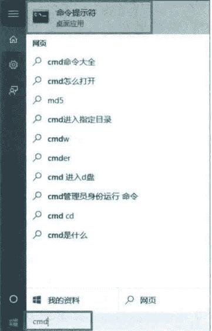
在命令行输入 python 回车，即可进入 Python 解释器，提示符显示为 >>>，如图 1-3 所示。

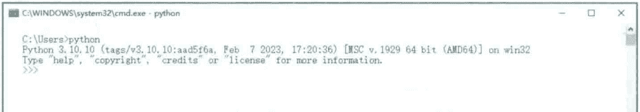
解释器中可进行基础语法测试，如输出 Hello World！；退出可输入 exit()，或按 Ctrl+Z 后回车，如图 1-4 所示。

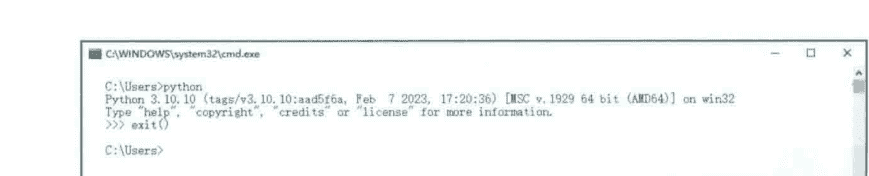
图 1-4
更常用的方式是将代码写入以 .py 为扩展名的文本文件再执行。例如用记事本新建文件，输入 print("Hello World!")，另存为 hello.py，如图 1-5 和图 1-6 所示。


图 1-5
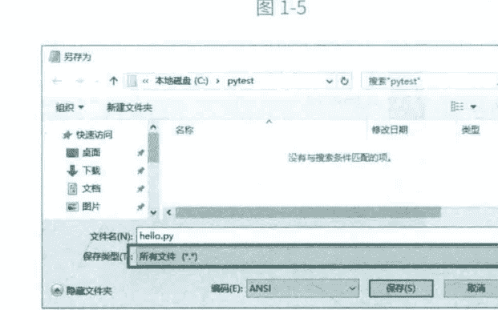
图 1-6
在命令行切换到文件所在目录后，用 Python 执行该文件即可，如图 1-7 所示。

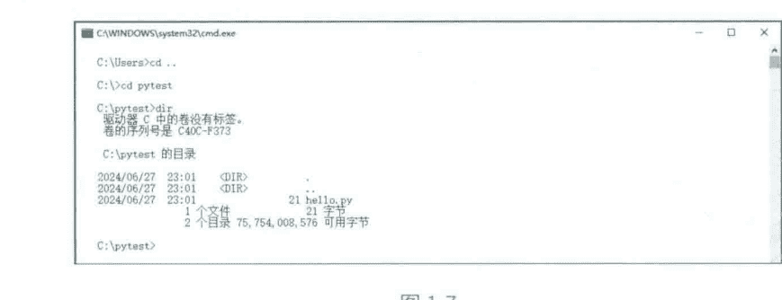
图 1-7

#### 1.1.4 利用 DeepSeek 排查运行异常

命令行运行 Python 时可能出现找不到命令的报错，如图 1-8 所示。

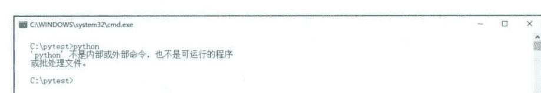
可借助 DeepSeek 分析原因。访问 DeepSeek 网页版，输入“在 Windows 已安装 Python，但命令行执行 python 提示不是内部或外部命令，如何解决”。

DeepSeek 的回答要点如下：

在 Windows 中出现“python 不是内部或外部命令”通常是因为安装路径未加入系统 PATH 环境变量。

解决方法：

（1）安装时勾选 Add python.exe to PATH 选项，如图 1-9 所示。

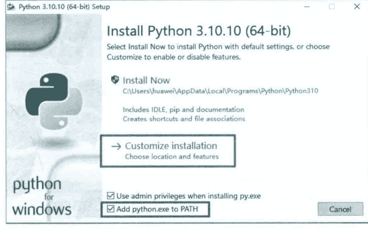
（2）若已安装，可按 Win+S 搜索“环境变量”，选择“编辑环境变量”，将 Python 安装目录追加到 PATH 中，如图 1-10 至图 1-12 所示。

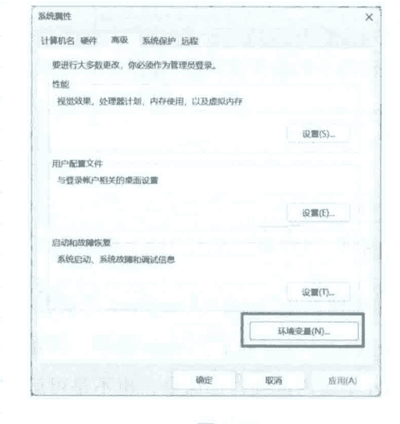
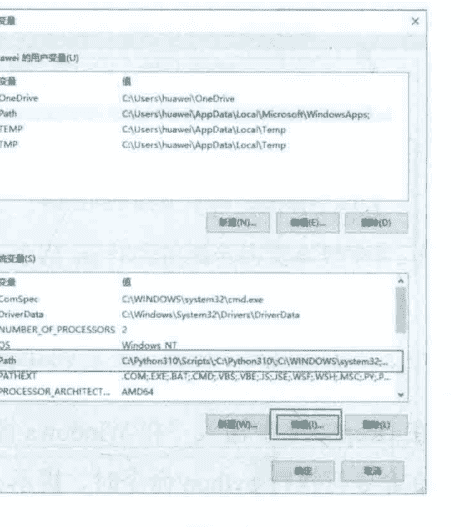
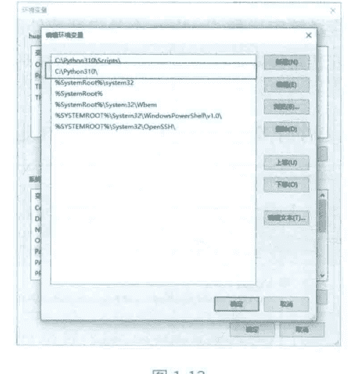

### 1.2 安装集成开发环境 PyCharm

#### 1.2.1 关于 PyCharm

若像 1.1.3 那样使用记事本手写每个字符，效率低下且易出错。程序员通常会使用集成开发环境 IDE。

PyCharm 是专为 Python 设计的 IDE，提供丰富功能以提升效率与代码质量。常用功能包括：

- 代码自动完成和智能感知：根据上下文推断变量、方法与类并给出建议，加快编码并减少错误。
- 语法检查和错误提示：实时检测语法问题并给出警告建议，帮助及早修复。
- 庞大的插件生态系统：可按需扩展功能，集成其他工具或定制 IDE 行为。

# Python 零基入门：PyCharm 与 AI 联合实战

调试与测试：PyCharm 自带一套功能完备的调试及测试模块，可进行断点摆放、变量实时观察、表达式即时求值等操作，帮助开发人员迅速定位问题根源。该 IDE 还原生兼容 unittest、pytest 等主流测试框架。

#### 1.2.2 PyCharm 版本选择

PyCharm 共提供专业版 Professional Edition 和社区版 Community Edition 两个分支。

专业版为付费产品，需购买授权后使用。功能覆盖面广，包含 Web 开发、各类 Python Web 框架支持、Python 分析器、远程开发、数据库与 SQL 支持等高级能力，同时具备高级调试、智能补全、代码重构、单元测试集成以及版本控制集成。

社区版完全免费，仅限非商业场景。仅保留 Python 核心开发的基础能力，不包含专业版的高级工具。对初学者而言，已足以满足学习与日常练习的需求。

下载建议访问 PyCharm 官方站点获取安装包。最新发行版常与部分插件存在兼容性问题，不建议直接采用。可点击“其他版本”进入历史版本列表，挑选稳定分支进行安装，如图 1-13 所示。


推荐使用 2022.3.3 版本，并且务必选择 PyCharm Community Edition 这一发行类型，如图 1-14 所示。
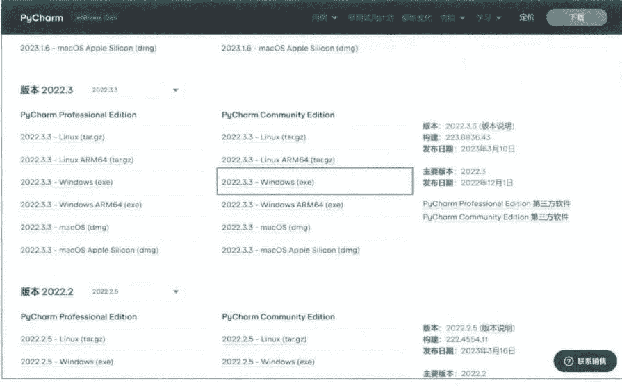

#### 1.2.3 配置 PyCharm

下载完成的安装包双击打开，按向导提示完成安装即可，具体步骤不再赘述。

首次启动后需要新建工作区，点击 New Project 按钮即可创建新的项目目录，如图 1-15 所示。

一个软件项目通常由多个文件构成，将代码集中放置于同一目录，有助于保持结构清晰。

创建项目时先指定项目目录路径，随后选择 Previously configured interpreter，即使用已有解释器。Python 既可在全局环境运行，也可通过虚拟环境隔离，本文暂不深入虚拟环境。为图简便，建议直接沿用系统已有的解释器。

PyCharm 初始并不知道解释器在系统中的具体位置，需要点击 Add Interpreter 按钮进行添加，如图 1-16 所示。
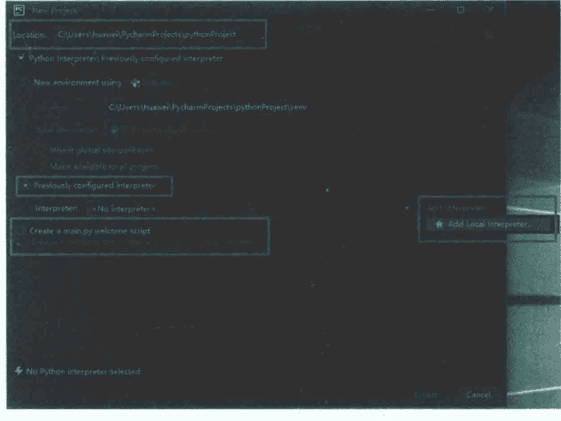
在弹出的对话框中选择 Existing，即现有解释器，然后定位到 Python 可执行文件所在路径，如图 1-17 所示。

确认无误后点击 Create 完成创建。

安装完成后界面默认是英文，也可切换为中文。进入 File → Settings → Plugins，通过 Marketplace 搜索中文语言包并完成安装，如图 1-18 所示。

安装完毕后点击 Restart IDE 重启，界面即可变为中文，如图 1-19 所示。

默认主题为暗色，可通过“文件”→“设置”→“编辑器”→“配色方案”调整，如图 1-20 所示。


#### 1.2.4 DeepSeek 解决 PyCharm 语法提示问题

在项目上右键即可新建文件并编写代码。作为集成开发环境，PyCharm 本应提供代码提示与自动补全。若出现不补全的情况，可借助 DeepSeek 分析原因。向 DeepSeek 输入“用 PyCharm 写 Python 时新建了 hello 文件，却没有代码提示与自动补全，可能是什么原因”。

DeepSeek 回复需先核查文件类型是否正确，扩展名应为 .py。将 hello 重命名为 hello.py 后，提示功能即恢复正常，如图 1-21 所示。
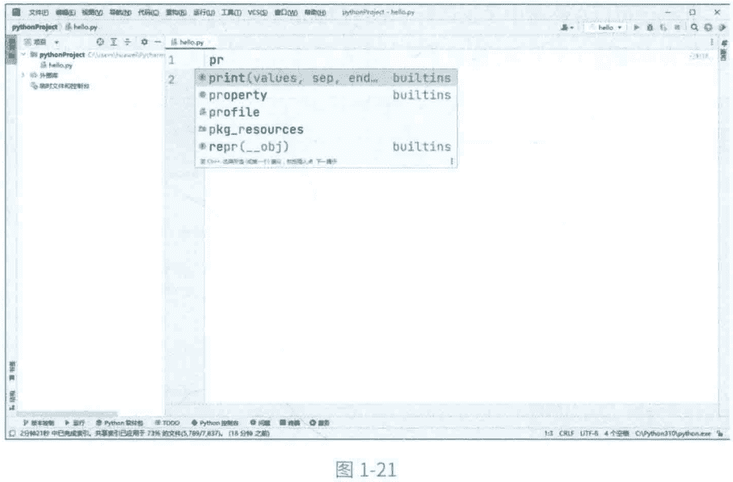
补全时可用方向键上下选择候选项，按 Enter 或 Tab 确认。PyCharm 对代码文件采用实时自动保存，无需手动存盘。

#### 1.2.5 运行代码

在编辑区右键点击，从快捷菜单中选择运行命令即可执行当前代码，如图 1-22 所示。
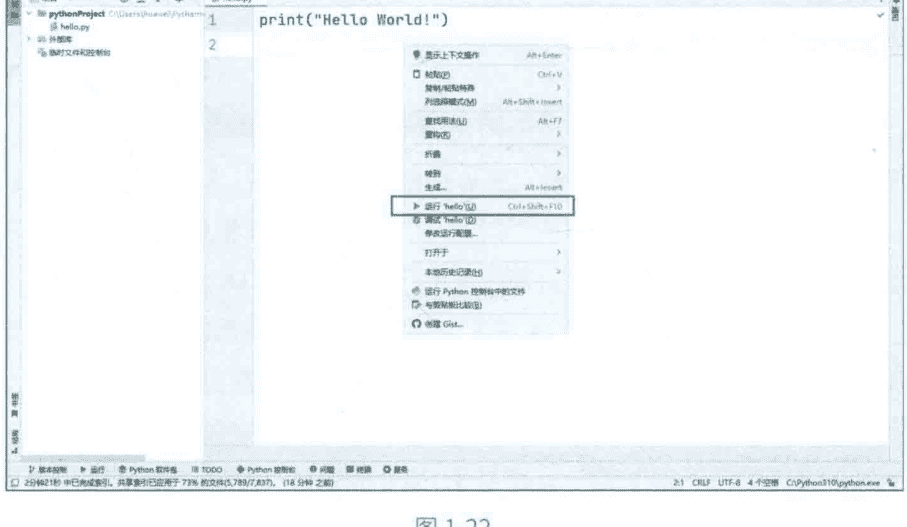

代码也可通过终端手动运行。点击底部工具栏的“终端”按钮，若未显示需先展开左下角工具栏图标，如图 1-23 所示。

打开终端后工作目录会自动切换至项目根目录，使用 ls 可查看文件列表，定位到自己的脚本后通过 `python 文件名` 命令执行，如图 1-24 和图 1-25 所示。
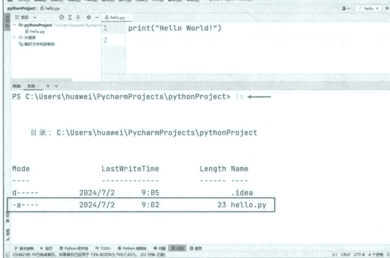
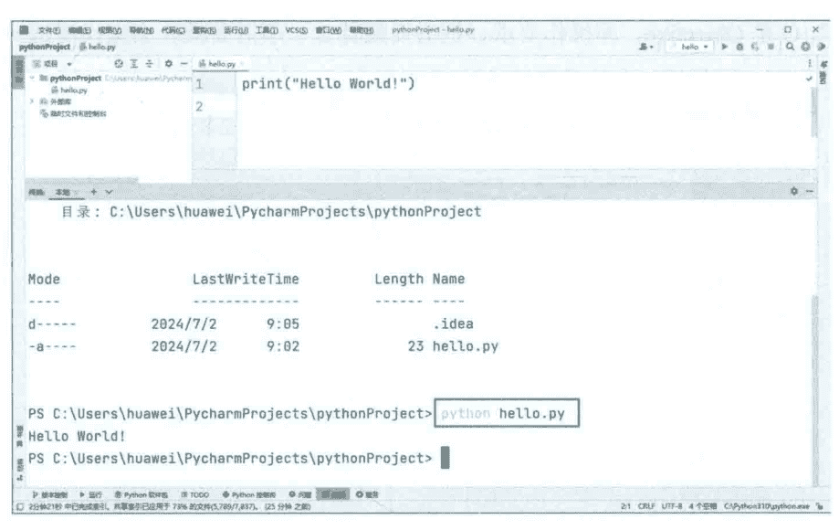

### 1.3 DeepSeek 等 AI 工具的使用方法

#### 1.3.1 网页版工具

ChatGPT 于 2022 年底走红后，众多厂商纷纷布局生成式 AI。传统模型在推理任务上表现有限，2024 年 11 月底 DeepSeek R1 网页版正式上线，重点强化推理能力，在数学、代码、自然语言推理等复杂场景更具优势。

目前多家厂商已将 DeepSeek 能力接入自家产品，除官方渠道外，还可通过百度、腾讯元宝、阿里巴巴通义千问、字节豆包等入口使用。

不少用户感觉 AI 输出不尽如人意，关键在于使用方法。生成式 AI 的提问可遵循 RTOG 原则。R 代表 Role 角色，先让模型扮演领域专家；T 代表 Task 任务，明确需要完成的事项；O 代表 Objective 操作要求，说明应做与不应做的边界；G 代表 Goal 目标，点明最终期望成果。

学习 Python 时可在大模型中开启会话，输入如下提示：

角色：
- 资深 Python 程序员
- 经验丰富的专家讲师
任务：
- 帮助零基础初学者学习 Python 编程语言
操作要求：
- 语言通俗易懂
- 概念需配合具体代码案例讲解
目标：
- 帮助初学者快速掌握 Python 语言
初始化：
- 若已理解，请以“好的，我将成为你学习 Python 的好帮手，让我们开始吧”作为开场

对话具备上下文记忆，未开启新会话时可直接追问，无需重复提示。

对于 DeepSeek R1 这类推理模型，无需严格套用上述模板。交流方式更接近与一位有思考能力的专家对话，只需说明要做什么、为谁做、目的何在以及约束条件即可。

例如学习字符串时可这样提问：“我需要了解 Python 字符串的使用，我是初学者，请结合具体示例讲解，只需列出最常用的用法，不必面面俱到。”

#### 1.3.2 PyCharm 集成通义灵码和 MarsCode

PyCharm 插件市场提供大量 AI 插件，阿里巴巴的通义灵码与字节跳动的 MarsCode 均表现优异，可根据个人习惯选用。本书以通义灵码为例。

在菜单栏进入“文件”→“设置”→“插件”，打开 Marketplace 搜索 tongyi 并安装，如图 1-26 所示。
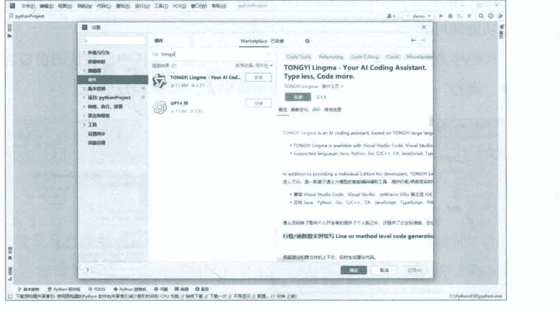

#### 1.3.3 DeepSeek 编写代码示例

安装完成后右侧边栏会出现通义灵码入口，点击登录即可使用。对话框左下角的模型选择按钮可切换至 deepseek-r1。

图 1-27

新建一个 demo.py 文件，在对话框输入“请用 Python 自带功能写一个带图形界面的计算器，只需实现加减乘除和乘方即可”。生成代码后点击“插入”按钮即可自动填入文件。随后在代码窗口右键选择“运行”，计算器窗口即弹出，如图 1-28 所示。
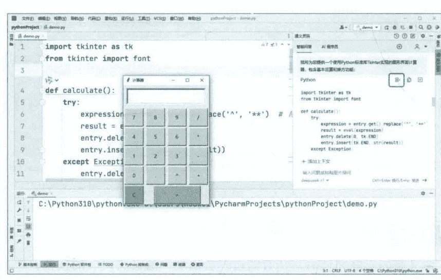

若测试时发现问题，用自然语言描述现象并要求 DeepSeek 自行检查即可，模型会修正错误并更新代码至文件中。

## 第 2 章 Python 编程概览

### 2.1 Python 编程概述

即便是有多年经验的网络工程师或运维工程师，提到编程也常会产生畏难情绪，认为编程是庞大的工程，需要大量知识积累和丰富实践。

精通编程并不容易，写出完美的代码需要全面权衡。但若只是为了完成简单自动化或提升工作效率，并不需要面面俱到的程序，对编程形成大致认知即可胜任。

本章将介绍 Python 编程的核心概念，帮助读者在看到代码时能够把握整体结构，不再感到像在读天书。

### 2.2 Python 编程总览

#### 2.2.1 关键字

关键字是 Python 预置的、具有特殊语法意义的标识符，构成语言骨架，用来定义结构与行为。因为属于内置元素，不能被用作变量名、函数名等自定义名称。

常见分类如下。

1. 控制流关键字
   - if、elif、else 用于条件判断
   - for、while 用于循环
   - break 用于跳出当前循环
   - continue 用于跳过本次循环剩余部分进入下一次迭代
   - pass 为空操作，常作占位
   - try、except、finally 用于异常处理
   - with、as 常与上下文管理器配合管理资源释放

2. 函数与类关键字
   - def 定义函数
   - class 定义类
   - lambda 定义匿名单行函数
   - yield 在生成器中返回值

3. 导入与模块关键字
   - import 用于导入模块或包
   - from、import 组合用于从模块中导入特定对象

4. 作用域关键字
   - global 在函数内部声明全局变量
   - nonlocal 在嵌套函数中声明外层函数的非局部变量

5. 断言与删除关键字
   - assert 用于调试时断言条件为真，否则抛出异常
   - del 用于删除对象引用

6. 常量及其他关键字
   - True、False 布尔常量，注意大小写
   - None 表示空值或无对象
   - and、or、not 逻辑运算符
   - in、is、not in 成员资格与身份运算符

#### 2.2.2 标识符

除关键字外，Python 还大量使用标识符命名变量、函数、类、模块等对象。良好的命名对可读性和可维护性至关重要。

命名规范：
- 由字母、数字、下划线构成
- 首字符必须是字母或下划线
- 不能以数字开头
- 区分大小写
- 不能与关键字冲突

常用风格：
- snake_case，下划线命名法，如 my_variable
- PascalCase，驼峰命名法用于类名，如 MyClass

建议：
- 使用语义明确的名称
- 避免过长或过短
- 保持命名风格统一
- 优先使用英文单词

变量是重要标识符，可随程序变化。直接写死的数据称为字面量。

使用变量的好处在于语义清晰，例如用 speed 表示 100，比裸数字更易理解；同时便于维护，代码中若出现多次数值，修改变量一次即可全局生效，而非逐处替换。

赋值使用等号，右侧表达式结果赋给左侧变量。

```
a = 100                # 直接赋值
b = 10 + 5             # 将 10+5 的结果赋值给 b
c = d = 200            # 链式赋值，c 和 d 值均为 200
x, y = 100, 200        # 多重赋值，x 为 100、y 为 200
x, y = y, x            # 交换 x 和 y 的值
```

#### 2.2.3 语法说明

Python 语法简洁易读，掌握门槛较低。

其一，大小写敏感，关键字与标识符均区分大小写。
```
user = 'zhangsan'      # 定义变量
USER = 'lisi'          # USER 与 user 是两个不同的变量
print(user)            # 输出变量
print(USER)
print(True)            # 输出关键字 True
print(true)            # 这里的 true 没有定义，将会报错
```

其二，Python 以缩进界定代码块，而非花括号。缩进通常为 4 个空格，位置错误会导致语法错误。

如图 2-1 所示，代码因首行出现不应有的缩进而报错，即便只有一个空格也不允许。
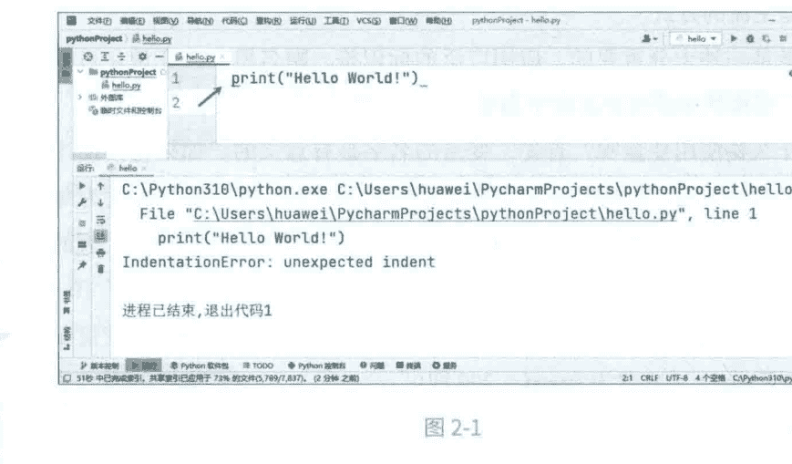
图 2-2 同样因缩进不当引发报错。if 3 > 0 是条件判断，应缩进其下的执行语句，而示例中 print("Hello World!") 未缩进，导致与 if 平级。
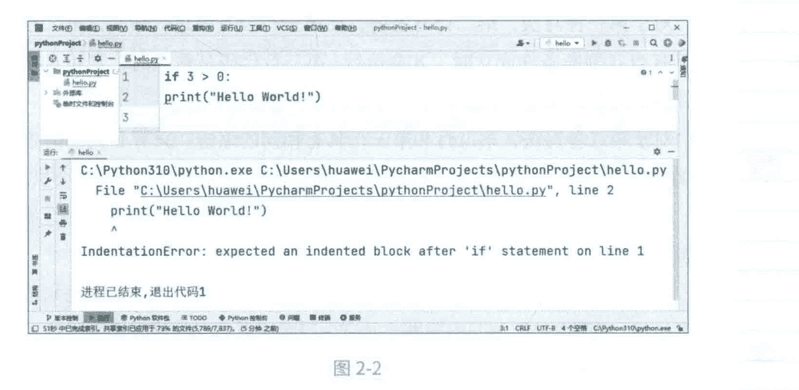
图 2-2
修正后给第二行添加缩进，如图 2-3 所示。
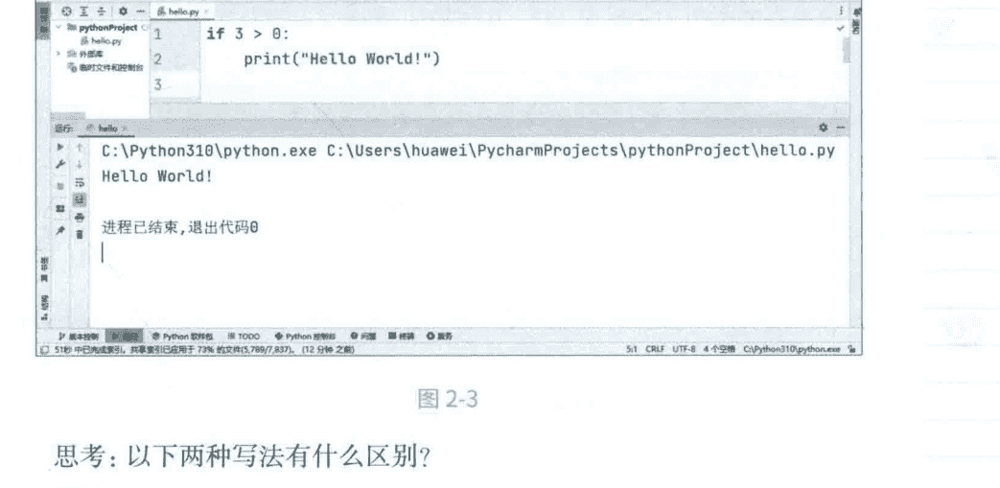
图 2-3

思考：以下两种写法有何区别？

写法一：
```
if 3 > 0:
    print("Hello World!")
print("OK")
```
写法二：
```
if 3 > 0:
    print("Hello World!")
    print("OK")
```

写法一中第二行被缩进，属于 if 的执行体，仅在条件成立时运行；第三行未缩进，与 if 无关，始终执行。

写法二中第二行与第三行缩进相同，均属于 if 的执行体，仅当条件成立时两者才运行，条件不成立时均不执行。

在 Python 中，所有名字都得先建立起来才能使用。名字泛指用来标记数据的各种标识，比如变量名。

图 2-4 的例子里，变量 n 先被赋值为 100，随后的输出语句就能正常工作。换到第 3 行执行 print(result) 时，因为 result 完全没有被定义过，解释器会直接报出 NameError，即名称错误。

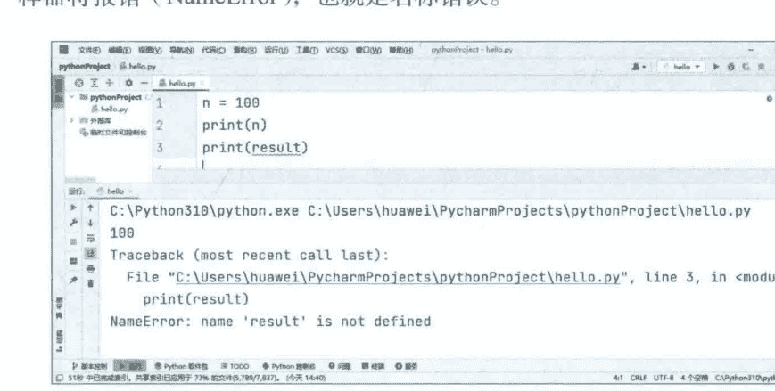

图 2-4

最后说到注释。Python 以 # 开头写注释，注释只起到说明作用，不会参与运行。

```
# 这是一个注释
print("Hello, World!")  # 这也是一个注释
```

> 💡 小技巧：在 PyCharm 里，按住 Ctrl+/ 可以对多行代码批量添加或取消注释，一键切换很方便。

前面讲到的这四件事，基本覆盖了 Python 入门最核心的语法要点。把它们吃透，就能开启一段既有挑战又有乐趣的 Python 学习之旅。

#### 2.2.4 程序运行机制

Python 语句的执行大致分为三种模式：按顺序执行、按条件分支执行、按条件反复执行。下面逐一拆解。

1. 顺序执行
顺序执行是程序最基础的运行方式。解释器会严格按照代码在文件中的书写顺序，一行一行地往下跑。这种方式最直观也最容易理解。

```
print(" 这是第一行代码 ")
print(" 这是第二行代码 ")
print(" 这是第三行代码 ")
```

该示例的三行代码会严格按照排列顺序依次运行。

2. 分支执行（条件执行）
分支执行的意思是程序会根据判断结果选择不同的代码路径。Python 用 if、elif、else 来实现这一逻辑。多分支里，一旦某个条件满足，对应的代码块会被执行，其余条件不再检查，也就是一次只走一个分支。

```
x = 10
if x > 5:
    print("x 大于 5")
elif x < 5:
    print("x 小于 5")
else:
    print("x 等于 5")

print(" 结束 ")
```

示例中 x 的值是 10，大于 5，所以第一个 if 成立并打印 “x 大于 5”。随后 elif 和 else 都被跳过。而 print(" 结束 ") 不在判断结构中，始终会执行。

3. 反复执行（循环执行）
循环执行让一段代码在满足条件时反复运行。Python 常用 for 循环和 while 循环两种形式。

- for 循环。常用来遍历列表、元组、字典等可迭代对象，循环次数通常是可预期的。

```
fruits = ["apple", "banana", "cherry"]
for fruit in fruits:
    print(fruit)
```

示例先把水果名称列表赋给 fruits，随后 for 循环依次取出每个元素赋给 fruit 并打印。

- while 循环。只要布尔条件为真就持续执行，适合循环次数不确定的场景。

```
i = 1
while i <= 5:
    print(i)
    i += 1
```

示例里 i 从 1 开始，只要 i 不超过 5，循环体内的两条语句就会重复。i += 1 相当于 i 自增 1。

本例循环次数其实是固定的，用 for 循环同样可以实现。

### 2.3 数据结构

数据类型决定了变量能存放什么样的数据，以及可以执行哪些操作。

#### 2.3.1 数值型
数字在代码里无处不在。Python 对数值的划分很简洁，主要有整型 Integer 和浮点型 Float。整型表示没有小数部分的整数，如 123、-456；浮点型表示带小数点的数，如 3.14、-2.718。

> Python 也支持复数，这里暂不展开。

#### 2.3.2 字符串
字符串用于保存和处理文本。创建字符串可以用单引号或双引号，两者在 Python 里等价。

以下两种写法效果完全一致：

```
s1 = 'Hello World!'
s2 = "Hello World!"
```

引号需要成对出现，下面这种写法会出错：

```
line = 'tom's hat'
```

本意是想写 tom 的帽子，但单引号在 tom 两侧就已闭合，后续内容无法解析。此时可用双引号包裹单引号：

```
line = "tom's hat"
```

同理，字符串内部出现双引号时，也可以用单引号来界定：

```
s1 = 'Tom said:"Nice to meet you".'
```

需要保留多行格式时，可使用三引号，即三个连续的单引号或双引号。

```
cities = """北京
上海
广州
深圳
杭州"""
```

字符串自带大量实用方法，如图 2-5 所示。

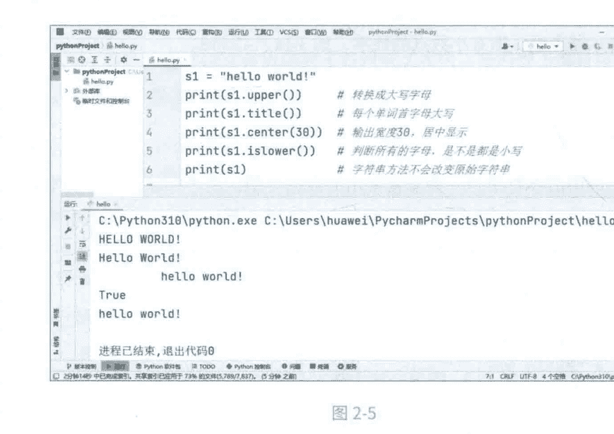

图 2-5

字符串还能拼接和重复。拼接使用 +，把若干片段连起来；重复使用 *，将字符按指定次数复制，如图 2-6 所示。

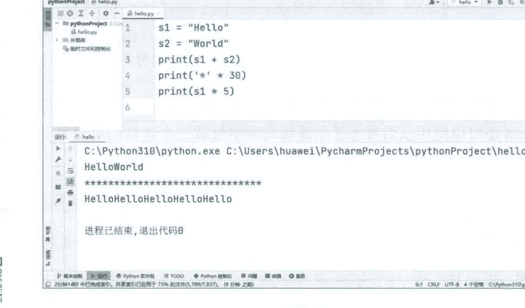

图 2-6

想在字符串里直接插入变量，f-string 很高效。给字符串前面加上 f 或 F，并在花括号中放入变量名即可动态填充，如图 2-7 所示。

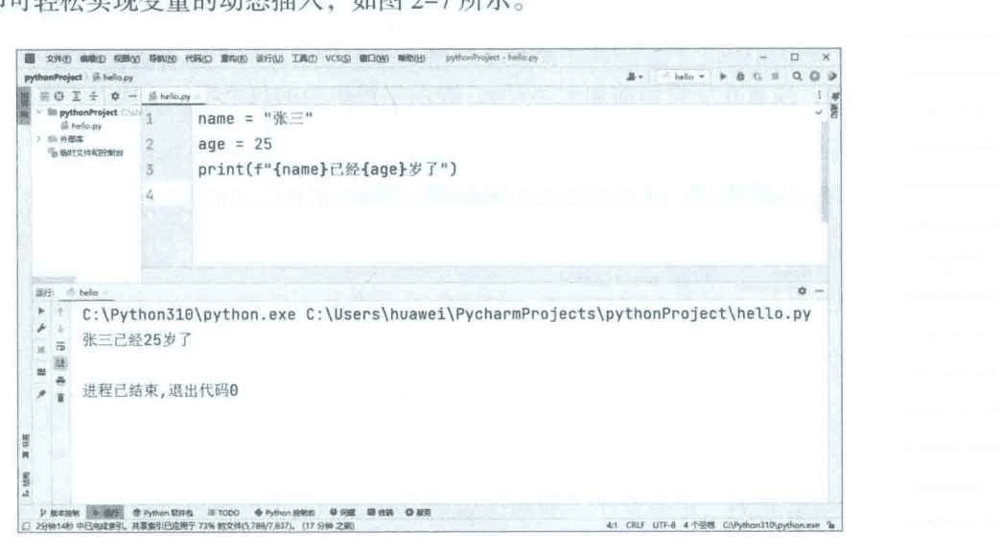

注意，给数字加上引号后它就不再是数字，而是长得像数字的字符串。就像手机模型外形像手机却不能打电话一样，数字字符串不能参与四则运算，如图 2-8 所示。

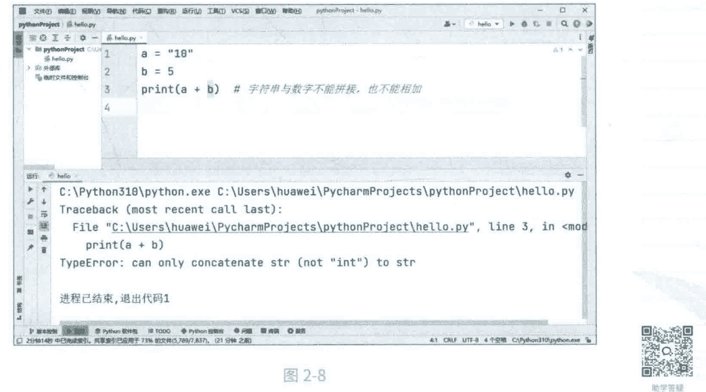

# 零基础玩转 DeepSeek：秒懂 Python 编程

最后，字符串前面加 r 表示原始字符串。

图 2-9 中变量 path 想表示 C 盘下的 newdir 目录，但反斜杠 \ 与 n 组合成了转义字符，导致换行。解决办法是用双反斜杠 \\ 或在字符串前加 r，让字符按字面意思处理，如图 2-10 所示。

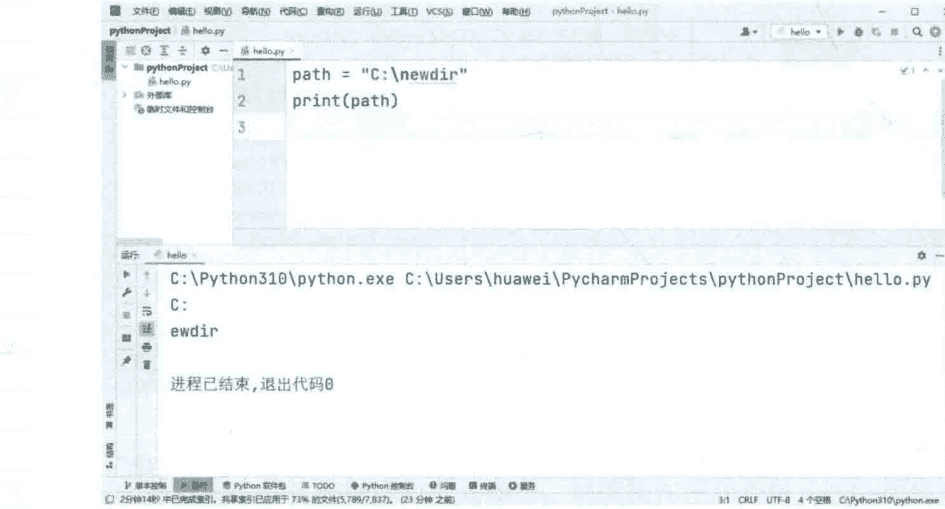

图 2-9

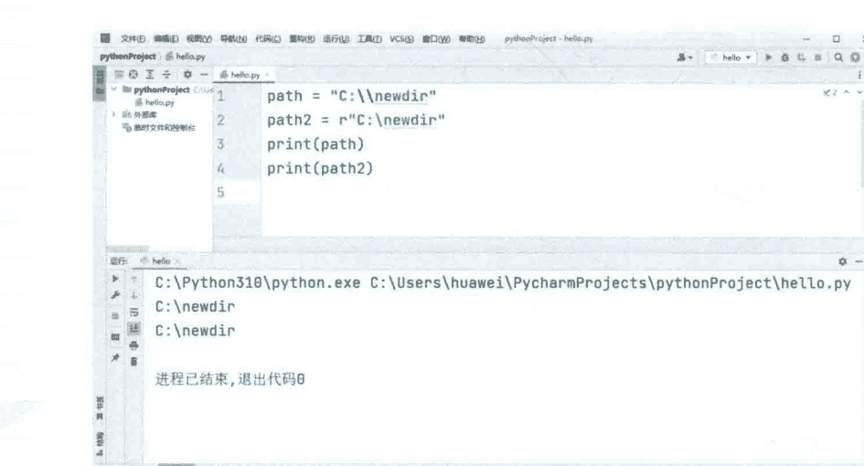

图 2-10

#### 2.3.3 列表
列表 List 是 Python 里最常用且灵活的容器，可以存放任意类型元素，且保持顺序。列表本质上是动态数组，长度会随增删自动调整。

如果只用变量存两个数字很方便，但要存上万个数字显然不现实，这时列表就派上用场了。Python 的列表比传统数组更自由，元素类型也可以混用。

##### 1. 列表的创建
空列表可用 [] 或 list() 创建，也可在方括号里用逗号分隔初始化。

```
# 创建一个空列表
empty_list1 = []

# 通过 list 函数创建空列表
empty_list2 = list()

# 创建一个包含元素的列表
my_list = ["张三", 25, "李四", 22]
```

##### 2. 访问列表中的元素
通过索引下标访问列表元素。

```
fruits = ['apple', 'banana', 'cherry']
print(fruits[0])  # 输出：apple
print(fruits[2])  # 输出：cherry
```

##### 3. 列表的方法
列表提供诸多内置方法支持增删改查等操作，如图 2-11 所示。

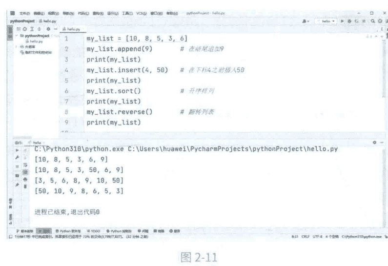

#### 2.3.4 元组
元组 Tuple 是一种不可变的序列，创建后内容不能修改。适合存放一组固定不变的值。

##### 1. 创建元组
创建方式如图 2-12 所示。

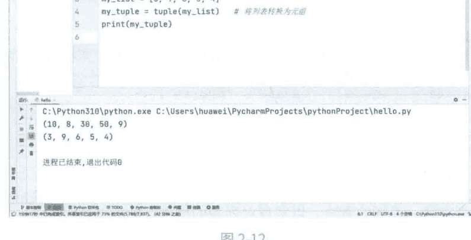

##### 2. 访问元组中的元素
访问方式与列表一致，通过索引取值。

```
nums = (10, 8, 30, 50, 9)
print(nums[1])
```

##### 3. 单元素元组
元组只有唯一一个元素时，末尾必须加逗号，否则会被当成普通值。

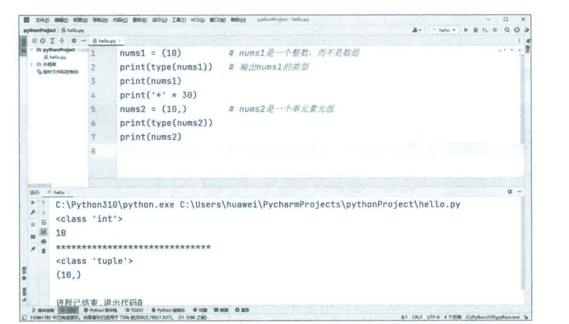

#### 2.3.5 字典
字典 Dictionary 以键值对形式存储数据，键唯一且不可重复，整体无序但检索高效。

##### 1. 创建字典
字典用花括号 {} 包裹，键和值用冒号分隔，多组用逗号分开。

```
player = {
    "name": "zhangsan",
    "age": 22,
    "gender": "male"
}
```

##### 2. 访问字典中的值
通过键作为下标读取对应的值。

```
print(player["name"])
```

##### 3. 添加键 - 值对
直接指定键和值即可新增，若键已存在则值会被覆盖，如图 2-14 所示。

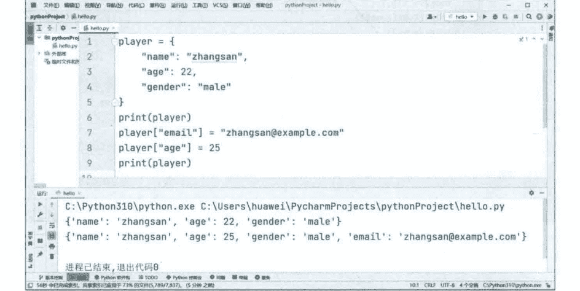

##### 4. 删除键 - 值对
使用 del 语句删除指定键对应的键值对。

```
del player["email"]
```

##### 5. 字典的方法
字典提供 keys、values 等方法方便操作，如图 2-15 所示。

#### 2.3.6 集合
集合 Set 可看作无值的字典，元素唯一且无序，用花括号表示。

##### 1. 创建集合
集合自动去重，同一个元素只保留一份。列表或元组转集合即可实现去重，如图 2-16 所示。

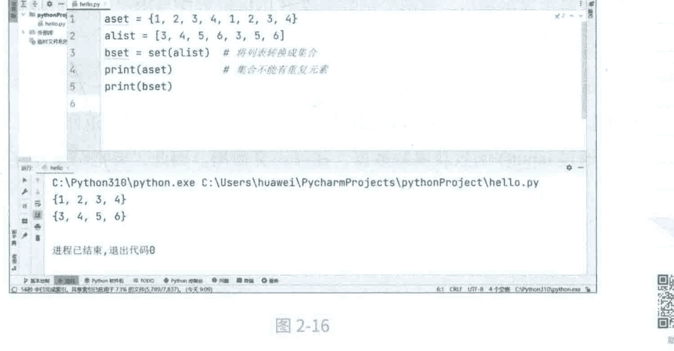

##### 2. 集合操作
集合常用交集、并集、差集操作。交集取出共同元素，并集取出所有不重复元素，差集取出只在第一个集合出现的内容，如图 2-17 所示。

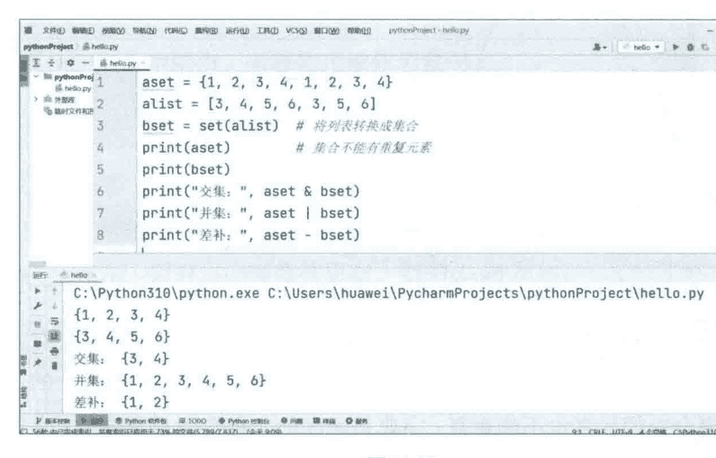

### 2.4 输入 / 输出
Python 与用户交互主要依赖两个内置函数：input() 接收输入，print() 输出结果。

#### 2.4.1 基本输入
input() 会在控制台显示提示并等待用户输入，返回结果始终是字符串。

通常需要把结果保存到变量中，如图 2-18 所示。

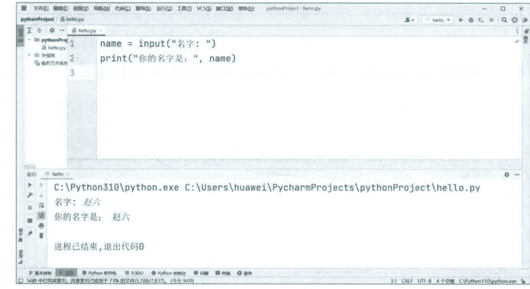

图 2-18

再次提醒，input() 的返回值类型是 str，即使输入的是数字也只是字符串形式，不能直接运算，如图 2-19 所示。

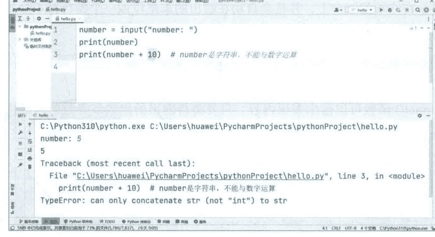

图 2-19

内置函数 int() 可把数字字符串转为整数，float() 可转为浮点数，如图 2-20 所示。

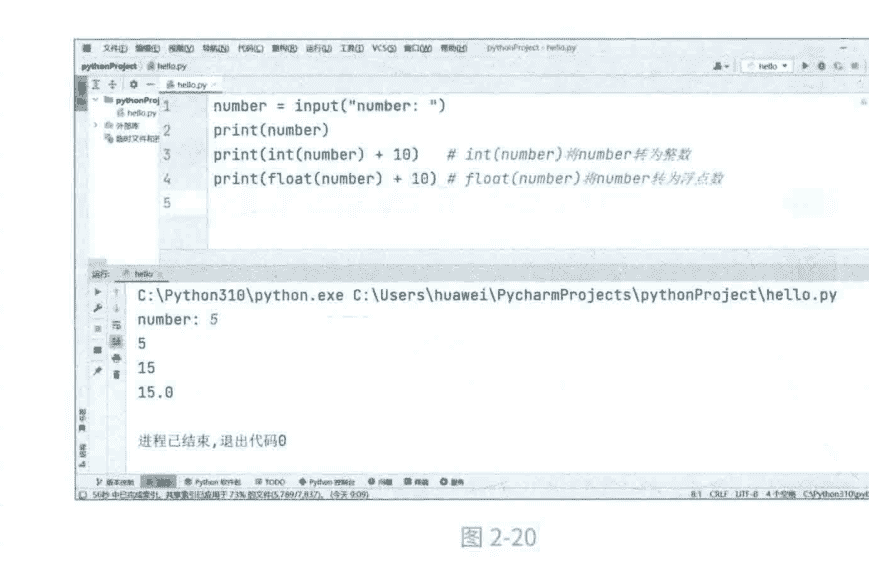

#### 2.4.2 基本输出
print() 是最常用的输出函数，默认会在末尾加换行。

除了基本用法，还可以同时输出多个对象，用逗号分隔，默认以空格拼接。可通过 sep 参数自定义分隔符，如图 2-21 所示。

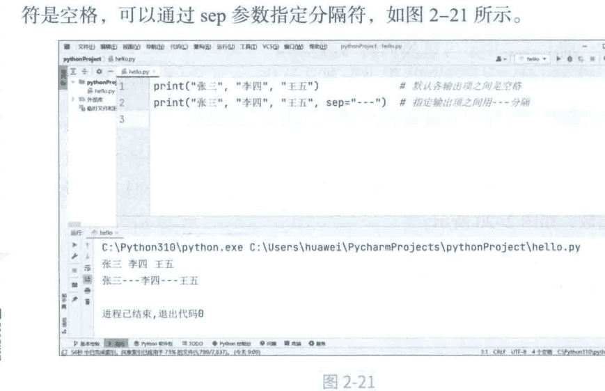

print 默认换行。换行符为 \n，通过 end 参数可以改写结尾字符，如图 2-22 所示。

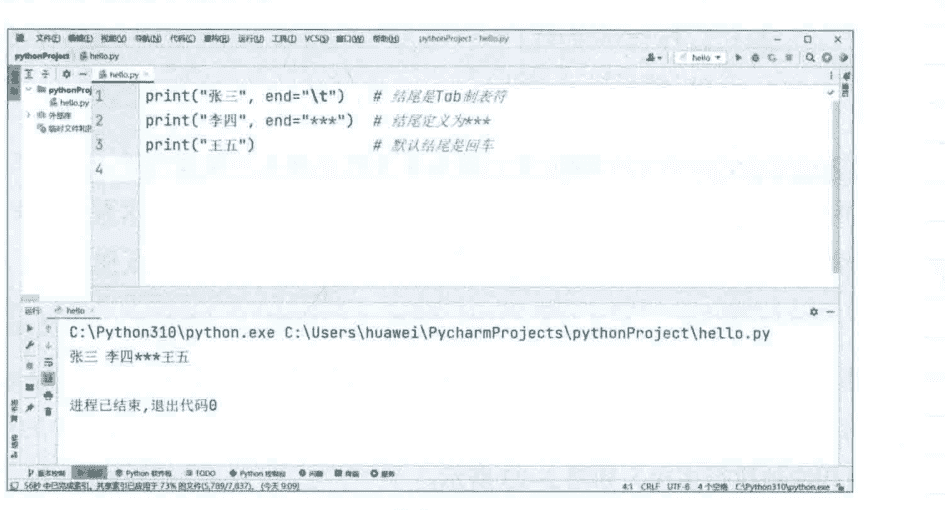

图 2-22

### 2.5 函数

#### 2.5.1 定义函数
函数是实现代码复用和增强可读性的核心工具。它把一段特定任务的代码打包起来，需要时再调用。

比如要打印两行 30 个星号，可以这样写：

```
for i in range(2):
    print('*' * 30)
```

如果后续还要多次输出星号就显得重复。这时用 def 定义函数 pstar 把这两行封装起来即可。

```
def pstar():
    for i in range(2):
        print('*' * 30)
```

> 小技巧：在 PyCharm 中选中代码按 Tab 缩进，按 Shift+Tab 取消缩进，每次变化 4 个空格。

定义函数时代码不会运行，只有在调用时才执行。一次调用执行一次，多次调用重复执行，如图 2-23 所示。

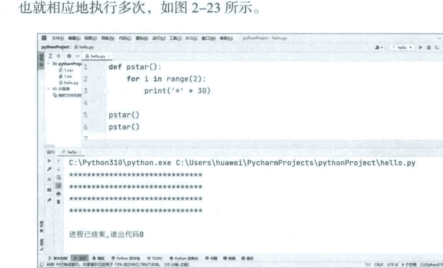

#### 2.5.2 参数
函数名后面的括号可以接收参数，还能设置默认值。未指定时使用默认值，指定时按传入值执行，如图 2-24 所示。

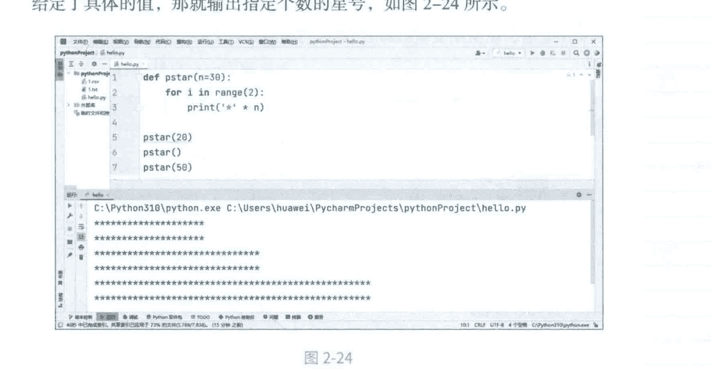

#### 2.5.3 返回值
函数执行完毕可以把结果返回给调用方，用 return 关键字实现。若函数没有 return，则默认返回 None。None 是一个表示空的特殊常量。

前面讲到的 pstar() 到底会给出什么结果？会不会是两行星号？别急着下结论。屏幕上出现的星号其实是 print() 在干活，pstar() 自己并没有写 return，所以它的返回值只能是 None，详见图 2-25。

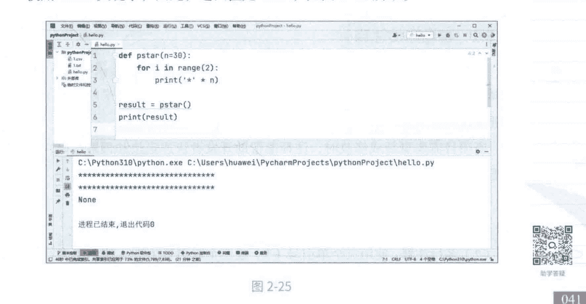

图 2-26 里展示了一个叫做 myadd 的函数，形参有两个，函数内部先把两者相加存到 result。问题是，真正调用之后，函数会回传什么？

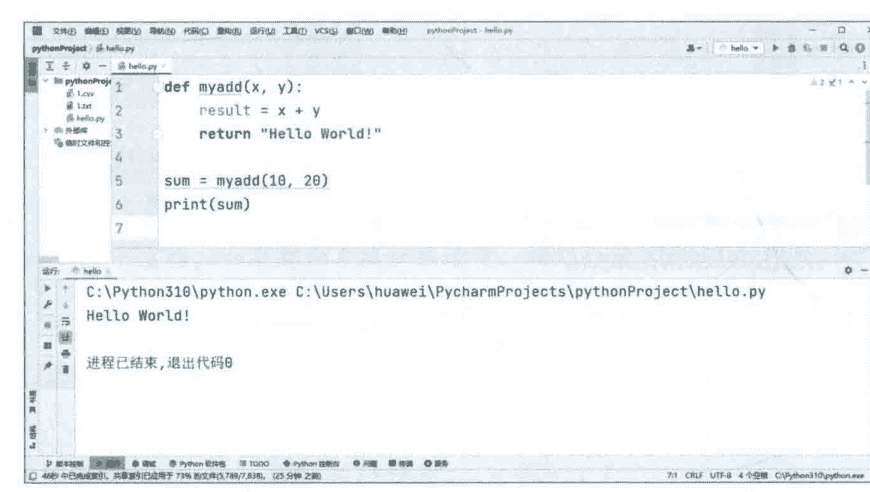

图 2-26

跑完之后实际得到的是字符串 Hello World!。因为代码里用 return 把这段文字直接送出去了，而 result = x + y 这一步在此例中完全没发挥作用。

### 2.6 DeepSeek 解析代码结构

#### 2.6.1 自动添加注释

代码既要机器能跑，也要人能读。尤其是逻辑复杂的片段，一段好的注释能说明功能和设计思路，让后来维护的人甚至未来的自己快速上手。项目迭代时，靠注释定位和理解代码，能明显降低改动成本和出错概率。

注释写法主要有两种。

- （1）单行注释：以 # 起始，# 右边的全部内容被忽略。
- （2）多行注释：用三个单引号 ''' 或三个双引号 """ 包裹起来的块。

手写注释费时，执行时又不产生效果，这时可以借助 AI 的自动注释能力。

比如下面这段代码，想给函数加上说明。

```
import random
import sys
import string
all_chs = string.ascii_letters + string.digits
def randpass(n=8):
    result = ""
    for i in range(n):
        ch = random.choice(all_chs)
        result += ch
    return result

print(randpass())
n = int(sys.argv[1])
print(randpass(n))
```

如图 2-27，点开函数上方的 AI 按钮，选择“生成注释”，右侧智能问答区就会给出建议，点击“插入”即可完成。

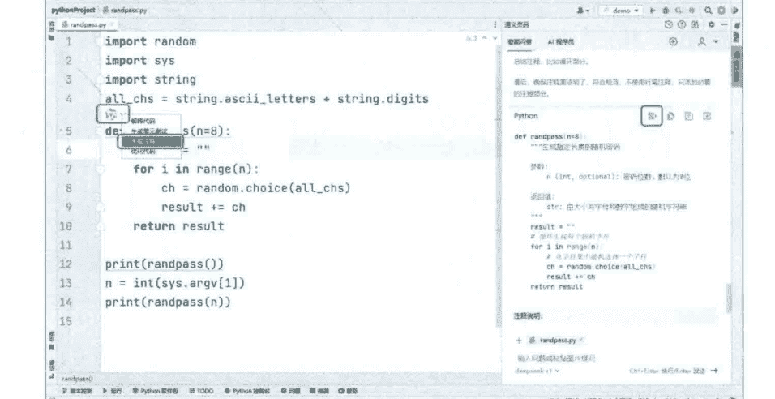

最终效果如图 2-28。

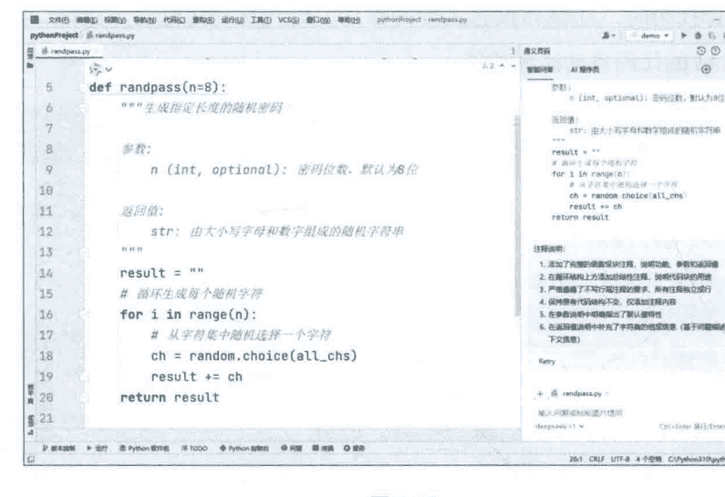

#### 2.6.2 解释代码

学习编程时，阅读高质量代码是提升技巧的重要路径。碰到看不懂的片段，可以用 AI 插件的“代码解释”功能。先选中目标代码，在对话框输入 /explain 回车，AI 会给出详细拆解，如图 2-29。

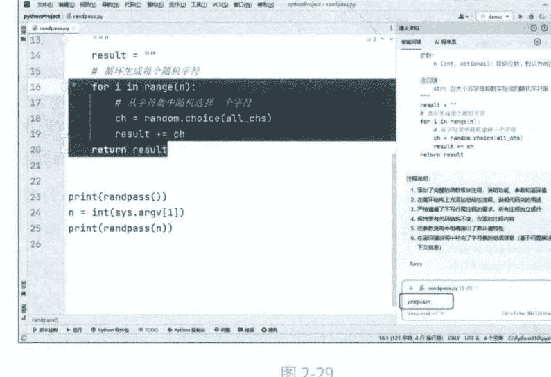

### 2.7 DeepSeek 知识点总结

本章快速扫过了 Python 的多种结构，下面用 DeepSeek 写一个综合案例演示本章要点。

提示词：写一个具体的 Python 案例，演示编程中用到的各种语法元素，包含函数、数字、字符串、列表等数据类型，并加上注释。

DeepSeek 生成结果：

下面是一个具体的 Python 案例，涵盖函数、数字、字符串、列表等类型，实现学生成绩管理，包括录入学生信息、计算平均分、查找最高分同学等。

```
# 定义学生列表，每个学生是一个字典，包含姓名和成绩
students = []

# 定义添加学生信息的函数
def add_student(name, grade):
    student = {
        "name": name,
        "grade": grade
    }
    students.append(student)
    print(f"已添加学生 {name}，成绩为 {grade}")

# 定义计算平均成绩的函数
def calculate_average_grade():
    if not students:
        return 0
    total_grades = sum(student["grade"] for student in students)
    return total_grades / len(students)

# 定义查找成绩最高的学生的函数
def find_top_student():
    if not students:
        return None
    top_student = max(students, key=lambda x: x["grade"])
    return top_student

# 添加学生信息
add_student("Alice", 85)
add_student("Bob", 92)
add_student("Charlie", 78)

# 计算平均成绩
average_grade = calculate_average_grade()
print(f"所有学生的平均成绩是：{average_grade}")

# 查找成绩最高的学生
top_student = find_top_student()
if top_student:
    print(f"成绩最高的学生是 {top_student['name']},成绩为 {top_student['grade']}")
```

追问：总结一下这段代码用到了哪些知识点？

DeepSeek 回答：

- 1. 数据类型

  - 列表 List：students 就是一个列表，用来存放多个学生信息。可变、可增删，例如 students.append(student)。
  - 字典 Dictionary：每个学生以字典形式保存，如 {"name": name, "grade": grade}，键为字符串，值可以是字符串或数字。
  - 字符串 String：如 "name""grade" 以及姓名 "Alice""Bob" 等，均是文本类型。
  - 数字 Number：成绩 85、92、78 等是数值类型。

- 2. 函数 Function

  - 函数定义：定义了 add_student、calculate_average_grade、find_top_student 三个函数，接收参数、执行任务并返回结果。

## 第 2 章 Python 编程全览

- 函数调用：在主程序里调用这些函数，如 add_student("Alice", 85) 添加信息，calculate_average_grade() 计算平均分等。

## 3. 控制流与内置函数

条件判断：在 calculate_average_grade 和 find_top_student 中使用 if not students: 判断列表是否为空，避免对空列表操作报错。

## 4. 内置函数

- sum() 函数：在 calculate_average_grade 中，sum(student["grade"] for student in students) 对所有成绩求和。
- max() 函数：在 find_top_student 中，max(students, key=lambda x: x["grade"]) 找出成绩最高的记录。
- len() 函数：在 calculate_average_grade 中，len(students) 获取列表长度。

## 5. 循环与生成器表达式

生成器表达式：在 calculate_average_grade 里，student["grade"] for student in students 逐个产出成绩，供 sum 求和。

## 6. 格式化输出

使用 f-string 格式化，例如 print(f"已添加学生 {name}, 成绩为 {grade}")，可把变量嵌入字符串，输出更直观。

有需要可继续追问，也可接着学习后续章节，针对性地与 DeepSeek 交流。

## 第 3 章 数字、字符串与判断

### 3.1 数字

Python 的数字分为整数和浮点数。整数使用时涉及十进制、二进制、十六进制，还常进行进制间的转换。

整数无前缀为十进制，十六进制前缀为 0X 或 0x，如 0X11；二进制前缀为 0b 或 0B；八进制前缀为 0o 或 0O。

#### 3.1.1 十六进制数与二进制数

网络通信中常出现 MAC 地址和 IPv6 地址。MAC 由 48 位二进制构成，为方便阅读转成 12 位十六进制；IPv6 由 128 位二进制构成，每 16 位用冒号分隔后转成十六进制。

在 Windows 用 ipconfig /all 可查看 MAC 和 IPv6，如图 3-1。

二进制与十六进制如何转换？先看对应关系。

从表 3-1 可知，4 位二进制对应 1 位十六进制。4 位二进制最大值 0b1111 对应十六进制最大值 0xF。于是 1 位十六进制可表示为 4 位 0/1 组合。

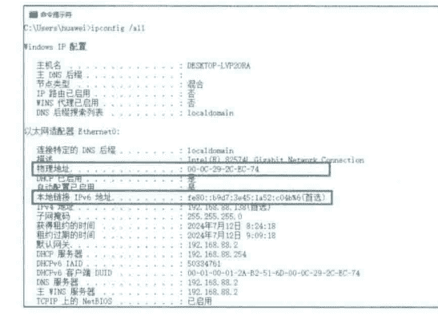

图 3-1

表 3-1 二进制数与十六进制数对照表

| 二进制数 | 十六进制数 |

| :--- | :--- |

| 0000 | 0 |

| 0001 | 1 |

| 0010 | 2 |

| 0011 | 3 |

| 0100 | 4 |

| 0101 | 5 |

| 0110 | 6 |

| 0111 | 7 |

| 1000 | 8 |

| 1001 | 9 |

| 1010 | A |

| 1011 | B |

| 1100 | C |

| 1101 | D |

| 1110 | E |

| 1111 | F |

4 位二进制从左到右权值依次是 8、4、2、1，相加最大 15，对应十六进制 F。因此转换可用加法完成，如 0b1001 = 8+1 = 9 → 0x9；0b1010 = 8+2 = 10 → 0xA。反过来 0xD = 13 = 8+4+1 → 0b1101。

Python 还提供 bin() 转二进制，hex() 转十六进制，如图 3-2。

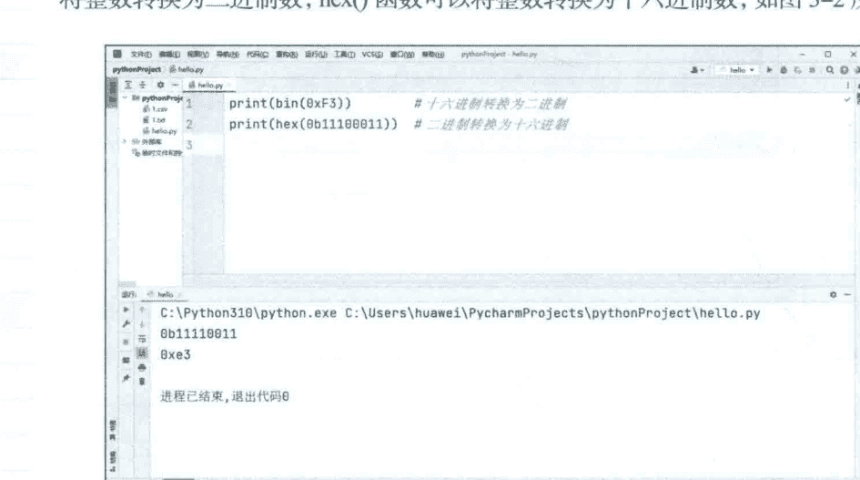

#### 3.1.2 十进制数与二进制数

IPv4 地址由 32 位二进制构成，通常每 8 位用点分隔，4 段转成十进制，这就是点分十进制。

二进制从右到左位权翻倍。8 位权值见表 3-2。

表 3-2 二进制数与十进制数对照表

| 二进制数 | 1 | 1 | 1 | 1 | 1 | 1 | 1 | 1 |

| :--- | :--- | :--- | :--- | :--- | :--- | :--- | :--- | :--- |

| 十进制数 | 128 | 64 | 32 | 16 | 8 | 4 | 2 | 1 |

全 1 时最大 255，所以 0~255 的十进制数都能用 8 位二进制表示。按位权求和即可转换，如 0b11001101 = 128+64+8+4+1 = 205。反之 168 = 128+32+8 → 0b10101000，如图 3-3。

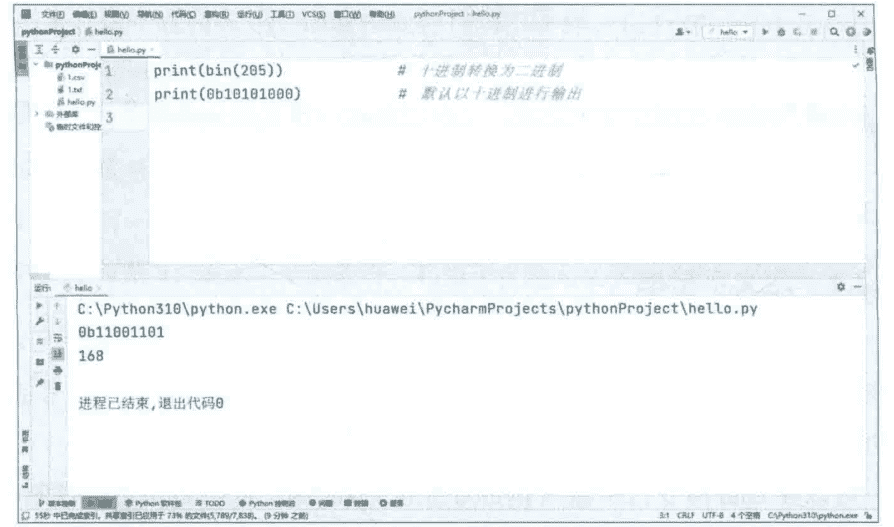

#### 3.1.3 八进制数

八进制偶尔会用到，如 Linux 文件权限数字。八进制与十六进制转换思路类似。

Python 的 oct() 可把整数转成八进制，如图 3-4。

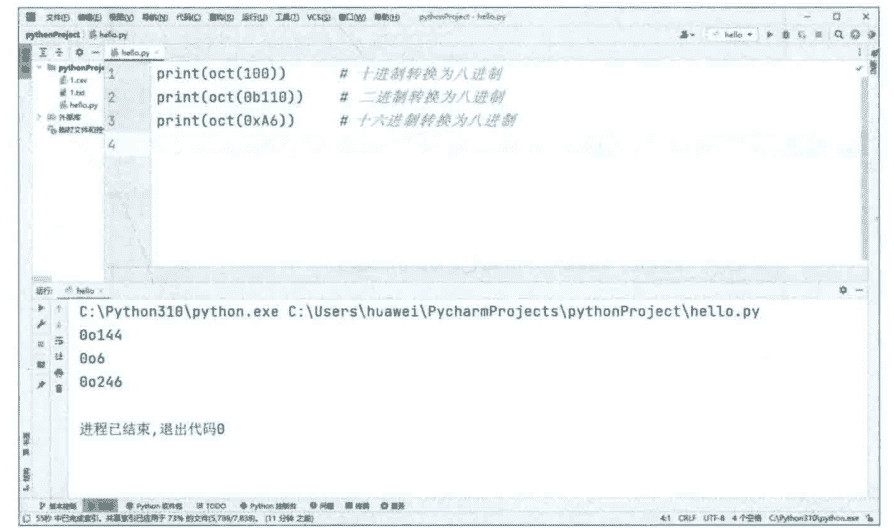

### 3.2 字符串

无论应用场景如何，字符串都是基础数据类型，用来存储和操作字符序列，可包含字母、数字、标点或中文等。

#### 3.2.1 定义字符串

Python 支持单引号 '、双引号 " 或三引号 """ / ''' 创建字符串。三引号适合多行文本。

在 cmd 打开 python 进入交互式控制台，若用单引号逐行定义 names，每按一次回车 Python 就尝试执行并报错，如图 3-5。


换成三引号就能一次性写多行，如图 3-6。


如图 3-6，定义时用了三引号，但实际变量内部并没有引号，而是每个名字后带了 \n。\n 是换行转义字符，\t 是制表符，相当于 Tab。

因此也可以用单引号或双引号配合 \n 实现多行输入，如图 3-7。


#### 3.2.2 字符串索引和切片

字符串是序列，从左到右下标从 0 开始，从右到左从 -1 开始，可通过下标取字符，如图 3-8。


切片可取片段，遵循“含头不含尾”。起点包含，终点不包含，如图 3-9。


省略起点则从头取，省略终点则取到尾，两端都省略即取全部，如图 3-10。


切片还可指定步长，默认 1，如图 3-11。


图 3-11

#### 3.2.3 字符串成员关系判断

可用 in 和 not in 判断元素是否存在，返回 True 或 False，如图 3-12。


图 3-12

#### 3.2.4 字符串方法

字符串自带大量方法，初学时数量惊人，其实正是省去手动实现的捷径。常用方法见图 3-13 ~ 图 3-19。


图 3-13


图 3-14


图 3-15


图 3-16


图 3-17


图 3-18


图 3-19

#### 3.2.5 原始字符串：禁用转义
在 Python 里，原始字符串是一种特殊的写法，核心作用是让反斜杠保持原样，不再充当转义符。进入原始字符串后，反斜杠就被当成普通字符处理，诸如 `\n`、`\t` 这类本应被解释的序列也会原封不动地保留下来。

这种写法在需要原样保留反斜杠的场景下特别好用，比如 Windows 文件路径、正则表达式模式等，都能避免层层转义，让代码更直观简洁。

声明方式是在引号前加小写的 `r` 或大写的 `R`，示意如下图 3-20。


#### 3.2.6 f-string：内联表达式
从 Python 3.6 起，格式化字符串字面量 f-string 成为拼接文本的主流手段。它允许在字符串内部直接嵌入任意合法表达式，构建时会自动求值并填入。

语法上以 `f` 或 `F` 开头，后跟字符串字面量，花括号 `{}` 内可放变量名或表达式，其结果会被转成文本并嵌入，如图 3-21 所示。


f-string 还支持在花括号后追加格式说明，可控制宽度、对其方式以及小数位数等细节。


#### 3.2.7 字节串：二进制载体
字节串是专门用来承载二进制数据的类型，由 0 到 255 范围的整数字节序列构成，常用于网络传输、文件读写以及编码解码相关工作。

普通字符串由字符组成，英文一个字符通常占一个字节，中文则占多个字节。字节串与 `str` 之间可通过 `encode()` 与 `decode()` 互相转换，如图 3-23 所示。


### 3.3 运算符总览
做运算时需要挑选合适的运算符。本节把常见运算符分类介绍。

#### 3.3.1 算术运算符速览
加减乘除等算术符号与数学习惯一致，使用方式不必多讲，如图 3-24 所示。


取余用 `%` 表示，幂运算用 `**` 表示，向下取整除法用 `//` 表示，即返回小于等于真实商的最大整数，如图 3-25 所示。


#### 3.3.2 赋值运算符详解
赋值用单个等号 `=`，执行方向是自右向左，先计算右边表达式再把结果赋给左边变量。例如 `a = 10 + 3` 先算出 13 再存入 `a`。

Python 也提供复合赋值，如图 3-26 所示。


`n += 5` 等价于 `n = n + 5`。这里的等号是赋值而非判断，先算 `n + 5` 再写回 `n`。同理还有 `-=`、`*=`、`/=` 等形式。

#### 3.3.3 比较运算符
比较运算结果只有 `True` 或 `False`。常用操作符有 `>`、`>=`、`<`、`<=`、`==`、`!=`，用法与日常数学一致，示例见图 3-27 所示。


#### 3.3.4 逻辑运算符
逻辑运算包括与、或、非。与或需要两个条件，属于双目运算符；非只需要一个条件，属于单目运算符，示例见图 3-28 所示。


Python 还支持链式比较写法，书写更紧凑，示例见图 3-29 所示。


图 3-29 中的 `5 < x > 8` 虽然语法合法，可读性差，不建议使用。

### 3.4 分支判断语句
判断语句用于多路分支，只有最先命中且条件为真的分支会被执行。

#### 3.4.1 单一条件判断
最简形式只有一个条件，成立则执行后续代码，否则跳过继续往后。流程见图 3-30。注意 `True`、`False` 大小写敏感，语句末尾的冒号不可缺失也不能用全角，如图 3-31 所示。


## 第 3 章 数字 字符串 与 条件判断

#### 3.4.2 判断条件的真假规则
判断条件通常是表达式，返回真值。但数据类型本身也可作条件，空值判假，非空判真，如图 3-32 所示。

#### 3.4.3 二选一的 if-else
`if-else` 相当于“如果…否则…”二选一结构。条件为真执行 `if` 块，否则执行 `else` 块，结构示例图 3-33，代码示例图 3-34。

#### 3.4.4 简洁的三元表达式
`if-else` 还可写成一行三元运算符。图 3-35 中，当 `age < 18` 时 `result` 为“未成年”，否则为“已成年”。

#### 3.4.5 多分支 elif 链
需要多个条件时使用 `elif`，可写多个，只有第一个满足的分支会生效，结构示例图 3-36，代码示例图 3-37。

图 3-37 的分数判断因顺序不当，先命中 `score >= 60` 导致 100 分也被判定为“及格”。正确写法应把范围大的条件后置，如图 3-38。若想先判断是否及格，可改用区间写法，如图 3-39。

### 3.5 实战练习：IP 地址分类
新建文件 `ip_class.py`，实现 IPv4 地址分类。

- 运行后让用户通过键盘输入一个合法的 IP 地址。
- 通过 `input()` 获取字符串，用 `split()` 以句点拆分为四段列表。
- 取第一段转为整数并判断范围：1~127 输出“A 类”，128~191 输出“B 类”，192~223 输出“C 类”。

参考实现见图 3-40。

### 3.6 DeepSeek 助力排查常见错误

#### 3.6.1 DeepSeek 解决语法错误
如图 3-41 所示代码因语法问题无法运行。提示 DeepSeek“帮我检查代码有哪些错误导致无法运行”，其指出相等判断应使用两个等号 `==`，单等号 `=` 是赋值。

也可直接输入 `/fix` 快速修复，如图 3-42。

#### 3.6.2 DeepSeek 解决逻辑错误
一段按成绩分类的代码本应 60 分以下“不及格”、60~79“及格”、80 及以上“优秀”，却把 100 分也判为“及格”。询问“为什么成绩最终不是优秀而是及格”，DeepSeek 给出分析见图 3-43。

### 3.7 DeepSeek 知识点总结
本章围绕数字、字符串与判断展开。下面让 DeepSeek 生成 BMI 计算示例。

提示：简单解释 BMI 并编写计算代码。

DeepSeek 回答：BMI 即身体质量指数，用体重千克除以身高米的平方来衡量。正常范围约 18.5 至 23.9。分级为：低于 18.5 体重过轻；18.5~23.9 正常；24~27.9 超重；28 及以上 肥胖。

```python
def calculate_bmi(weight, height):
    """
    此函数用于计算 BMI 指数
    :param weight: 体重（千克）
    :param height: 身高（米）
    :return: 计算得出的 BMI 指数
    """
    if weight <= 0 or height <= 0:
        raise ValueError("体重和身高必须为正数。")
    return weight / (height ** 2)

def get_bmi_category(bmi):
    """
    此函数根据 BMI 指数判断身体状况
    :param bmi: 计算得到的 BMI 指数
    :return: 对应的身体状况描述
    """
    if bmi < 18.5:
        return "体重过轻"
    elif 18.5 <= bmi < 24:
        return "体重正常"
    elif 24 <= bmi < 28:
        return "超重"
    else:
        return "肥胖"

if __name__ == "__main__":
    try:
        weight = float(input("请输入你的体重（千克）："))
        height = float(input("请输入你的身高（米）："))
        bmi = calculate_bmi(weight, height)
        category = get_bmi_category(bmi)
        print(f"你的BMI指数是:{bmi:.2f},身体状况：{category}")
    except ValueError as e:
        print(f"输入错误：{e}")
```

追问：这段代码用了哪些编程结构？

DeepSeek 回答：

#### 函数结构
`calculate_bmi(weight, height)` 接收体重身高，校验正数后按公式计算并返回；`get_bmi_category(bmi)` 根据区间返回描述。主程序通过函数调用获取结果。

#### 条件结构
`calculate_bmi` 中 `if weight <= 0 or height <= 0` 做合法性检查；`get_bmi_category` 中 `if/elif/else` 实现多区间判断。

#### 异常处理结构
主程序用 `try-except` 包裹输入与调用，捕获 `ValueError` 输出友好提示，提升健壮性。

#### 输入输出结构
`input()` 读取并 `float` 转换用户数据；`print()` 配合 f-string 输出格式化结果。

#### 模块化结构
以 `if __name__ == "__main__":` 保护入口，脚本直接运行时执行，主程序被导入时不执行。

## 第4章 列表 元组 与 循环

### 4.1 列表
列表是 Python 常用有序集合。第 3 章的字符串也有序，但列表可变而字符串不可变，如图 4-1。

#### 4.1.1 定义列表
列表用方括号 `[]` 定义，元素用逗号分隔，可同质可异质，如图 4-2。

列表可变，字符串与数字不可变，这点可通过图 4-3 验证。

链式赋值会让多个变量指向同一内存，如图 4-4。由于列表可变，修改元素直接改原内存；字符串不可变，重新赋值会开辟新内存，示意图见图 4-5。

#### 4.1.2 列表索引与切片
列表有序，索引与切片规则与字符串一致，如图 4-6。因列表可变，可对单个或多个元素重新赋值，如图 4-7。

#### 4.1.3 列表方法
Python 为列表提供丰富内置方法，操作后列表本身会变化，如图 4-8。

- `l.append()`：在尾部追加元素。
- `l.insert(i, x)`：在下标 `i` 前插入元素。
- `l.pop(i)`：弹出下标 `i` 的元素。

列表操作的细节经常见坑。pop() 接收下标定位，删除的同时把被取走的元素原样交还给调用方。remove() 则是按值查找并删除，执行完毕后返回的永远是 None，None 在 Python 里代表“空值”这一概念。

- l.remove(x) : 按指定值从列表中剔除元素
- l.clear() : 一键清空列表内容，如图 4-9 所示

列表还具备批量写入、排序等能力，如图 4-10 所示。

- l.extend(iterable) : 把可迭代对象里的元素逐个追加到末尾
- l.sort(reverse=True) : 对列表就地排序，默认升序，可设反序
- l.reverse() : 把列表顺序整体翻转

另外还有计数与定位的工具。若目标不在列表中，index() 会直接抛异常，如图 4-11 所示。

- l.count(x) : 统计某个值出现的频次
- l.index(x) : 找到元素首次出现的下标

#### 4.1.4 列表推导式速写
列表推导式是 Python 提供的一种紧凑写法，适合在已有数据基础上快速拼出新列表。核心思路就是从可迭代对象里取元素、加工、筛选，一步生成结果。

通用形态是：[ 表达式 for 变量 in 可迭代对象 ]。表达式决定加工方式，变量是临时占位符，可迭代对象可以是列表、元组、字符串等任何能逐个取值的对象。

这里用到的 for 语法细节会在 4.4 节展开。举例来说，生成一段 IP 地址片段就能用推导式完成，如图 4-12 所示。

推导式里还能加入 if 条件做过滤，如图 4-13 所示。

### 4.2 元组核心用法
#### 4.2.1 元组是什么
元组 tuple 和列表一样是容器，能装多个元素。不同点在于元组创建后不可改动，内容固化。

当需要保护某些数据不被运行期意外改写时，元组是好选择。运维场景里服务器 IP、端口号等配置一旦确定，就适合用元组固化。

创建方式是用圆括号包裹，元素间用逗号分隔。单元素元组一定要在后面补个逗号，如图 4-14 所示。

#### 4.2.2 元组的可用方法
因为不可变，元组的方法集是列表的子集，只剩下两个：

count() 用来计数，index() 用来定位，如图 4-15 所示。

#### 4.2.3 元组当作函数返回值
函数默认返回一个值，但 return 其实可以返回多个，多个值会被自动打包成元组传回。

检查服务器状态时，既要返回状态码，也希望带上原因说明，用元组一次性返回最方便，如图 4-16 所示。

### 4.3 while 循环
#### 4.3.1 循环的意义
需要重复执行的代码块放到循环里，循环就像一台有条件的重复机器，满足条件就继续，不满足就退出。Python 提供 while 和 for 两种实现：循环次数未知或不确定时常用 while，次数明确时更适合 for。

#### 4.3.2 while 的基本写法
while 的结构和 if 很像，只是条件会被反复校验。条件为真就执行缩进体，直到条件变假才结束，流程如图 4-17 所示。

图 4-18 的例子是不断接收用户输入，遇到 end 就退出，否则原样打印。

经典累加案例：求 1 到 100 的和。可以设一个桶 sum 起始为 0，再用 i 依次投豆子 1、2、3… 直到 100，代码表达如图 4-19 所示。


#### 4.3.3 continue 的用法
continue 能跳过当前轮剩下的语句，直接开启下一轮。它常用来排除不需要处理的情形。

在求和案例里若只想要偶数，可以把奇数轮直接跳过。累加写法也可以改成 i+=2，但用 continue 更直观。

判断条件可简写为 i % 2，因为余数 0 表示假，非 0 表示真。sum += i 写在 continue 下方时，else 分支可以省略，效果等价，如图 4-20 所示。


图 4-20

精简后的版本如图 4-21 所示。


图 4-21

#### 4.3.4 break 的用法
break 相当于紧急停止键，遇到它循环立刻终止，后续条件不再检查。用户输入的示例也可以用 break 实现，如图 4-22 这样。


图 4-22

因为 break 已经跳出，print 不必再放在 else 里。

#### 4.3.5 循环里的 else
这里的 else 指循环的 else，不是条件判断的 else。循环正常因条件变假而结束时才执行 else，若循环被 break 中断，else 会被跳过。

密码登录的常见做法是给三次机会，正确则 break，连续三次错误条件不再成立时 else 执行锁定提示，缩进与 while 平级，如图 4-23 所示。


### 4.4 for 循环
#### 4.4.1 for 的使用基础
for 接收一个可迭代对象，每轮把其中一个元素赋给目标变量，流程如图 4-24 所示。


遍历字符串、列表、元组时直接取元素；遍历字典时取的是键，再通过键取值，如图 4-25 所示。


图 4-25

#### 4.4.2 range() 的配合
for 多用于次数已知的场景，如何控制次数？可以用 range()。range 会生成一个不可变的整数序列对象，内存占用小，按需取数。

图 4-26 里 list 把 range 转成列表仅为展示，实际使用无需转换。

range 可接受三个参数 range(start, stop, step)，即起点、终点、步长。只给一个参数时表示终点，起点默认 0，实际取到 stop-1，如图 4-27 所示。

结合 for 与 range 计算 1 到 100 的累加会更简洁，如图 4-28 所示。


图 4-26


图 4-27


图 4-28

步长也可以是负数，实现倒序遍历，如图 4-29 所示。


for 循环同样支持 continue、break、else，行为与 while 完全一致。求 100 以内偶数和的写法如图 4-30 所示。


模拟三次登录失败后锁定的实现如图 4-31 所示。


### 4.5 常用内置函数
Python 内置大量现成工具，print、input 都是其中之一。

#### 4.5.1 数学运算类
- abs(x) : 返回 x 的绝对值
- round(x, n) : 四舍五入，保留 n 位小数
- sum(iterable) : 对可迭代对象求和
- min(iterable) : 取最小值
- max(iterable) : 取最大值

示例如图 4-32 所示。


#### 4.5.2 类型转换类
- int(x) : 转整数
- float(x) : 转浮点数
- str(x) : 转字符串
- list(iterable) : 转列表
- tuple(iterable) : 转元组
- dict(iterable) : 按可迭代对象建字典

示例如图 4-33 所示。


#### 4.5.3 序列操作类
- len(s) : 返回长度或元素个数
- sorted(iterable) : 排序后返回新列表
- reversed(seq) : 返回反序迭代器
- enumerate(iterable) : 返回下标与值的枚举对象

示例如图 4-34 所示。


组合使用内置函数能提升灵活性，用下标遍历可迭代对象的写法如图 4-35 这样。


enumerate 和 reversed 与 range 类似，都返回对象而非列表。enumerate 会把每个元素包装成下标和值的元组，可直接 for 遍历，如图 4-36 所示。


### 4.6 综合实操
#### 4.6.1 生成随机密码
创建一个 randpass.py，用来产出随机字符串作密码或验证码。

1. 通过命令行参数指定长度，运行方式：python3 randpass.py
2. 长度由命令行给出，结果直接打印到终端

实现要点：
1. 确定字符池，本例用大小写字母加数字
2. 循环中每次从字符池随机抽取一个字符
3. 把字符拼接成完整字符串
4. 随机选择用 random 模块，参数读取用 sys 模块

模块是把功能归类到 .py 文件里，通过 import 引入使用。random.choice 能从序列随机挑一个，sys.argv 是保存命令行参数的列表。

注意该程序需在终端运行，如图 4-37 所示。


图 4-37

参考代码 1 如图 4-38 所示。


图 4-38

参考代码 2 如图 4-39 所示。


图 4-39

#### 4.6.2 提取字符串中的字母
给定原始串 “123#%4hello*world000”，把其中所有字母挑出来。

思路：
1. 遍历每个字符，判断是否为字母就收集到列表
2. 用字符串的 isalpha() 方法判断
3. 需要字符串结果时再拼接

参考代码 1 如图 4-40 所示。


参考代码 2 如图 4-41 所示。


### 4.7 用 DeepSeek 审视性能
初学时关注如何跑通，性能常被忽略。DeepSeek 可以帮忙检查。

针对随机密码案例，提问“这段代码生成很长字符串时会不会有性能问题，如何优化？”，得到的反馈指出瓶颈并给出更简洁高效的写法，如图 4-42 所示。


图 4-42

再看 1 到 1000 万的累加，循环次数随数字增长而暴涨。询问 DeepSeek 如何优化，R1 会先分析时间复杂度，给出测试方法，最后提供优化方案与前后对比，如图 4-43 所示。


### 4.8 DeepSeek 知识点回顾
本章围绕列表、元组与循环展开，并通过两个实操加深理解。也可以让 DeepSeek 生成练习来复习。

提示词：帮我写一个抽奖程序。奖品设 9 种，自行命名，抽 3 次。

DeepSeek 生成的答案：

```python
import random

# 定义 9 种奖品
prizes = [
    "一等奖：豪华海外游",
    "二等奖：最新款平板电脑",
    "三等奖：智能手表",
    "四等奖：无线耳机",
    "五等奖：移动电源",
    "六等奖：定制T恤",
    "七等奖：精美笔记本",
    "八等奖：钥匙扣",
    "九等奖：优惠券"
]

# 抽奖次数
num_draws = 3

# 进行抽奖
for i in range(num_draws):
    prize = random.choice(prizes)
    print(f"第 {i+1} 次抽奖结果：{prize}")
```

```python
"三等奖: 智能手表",
"四等奖: 无线耳机",
"五等奖: 运动背包",
"六等奖: 精美书籍套装",
"七等奖: 品牌保温杯",
"八等奖: 定制钥匙链",
"九等奖: 手机支架"
]

# 定义抽奖函数
def lottery():
    chances = 3
    while chances > 0:
        input("按下 Enter 键开始抽奖: ")
        # 随机选择一个奖品
        prize = random.choice(prizes)
        print(f"恭喜你, 抽到了: {prize}")
        chances -= 1
    print("你的抽奖机会已用完。")

if __name__ == "__main__":
    lottery()
```
追问：该片段为何采用 while 循环，for 循环是否能替代？
DeepSeek 回答：
while 的作用是只要 chances 仍大于 0 就持续执行抽奖。实际上 for 也可以胜任，for 更适合循环次数事先确定的情形，写法也更紧凑。本例中抽奖机会固定为 3 次，用 for 直接限定次数即可。
抽奖函数修改后如下：
```python
def lottery():
    # 使用 for 循环控制抽奖次数
    for _ in range(3):
        input("按下 Enter 键开始抽奖: ")
        # 随机选择一个奖品
        prize = random.choice(prizes)
        print(f"恭喜你，抽到了：{prize}")
    print("你的抽奖机会已用完。")
```
追问：for 循环后面那个下划线 '_' 有什么含义？
DeepSeek 回答：
> '_' 只是编程社区里约定的一种命名惯例，并没有特殊的语法功能。
若换成 i、count 之类的有意义名字，容易让人误以为循环体内会用到它。选用 '_' 则表明该变量用不到，能减少误解，让代码更清晰简洁。

## 第 5 章 字典、集合与文件

### 5.1 字典

#### 5.1.1 定义字典
字典用一对大括号 {} 创建，属于键值映射结构。可以仅凭键来获取对应的值。它不属于序列，也就不存在下标；内部是无序的。
需要注意的是，键只能使用不可变对象，例如字符串、数值或元组；键不可重复，重复赋值时以最后一次为准。
此外，内置函数 dict() 也能用来构造字典，示例见图 5-1。


#### 5.1.2 更新字典
修改字典时直接用键指定值。若键已存在则覆盖旧值，若不存在则新增键值对，示例如图 5-2。


#### 5.1.3 字典的常用方法
- d.keys()：能拿到全部键的视图。
- d.values()：可得到所有值的视图。
代码示例如图 5-3 所示。

▶ d.items()：返回键值对的视图，每个元素是 key、value 元组，见图 5-4。

▶ d.get(key, default=None)：用于安全取值，不会触发 KeyError，缺失时返回默认值，见图 5-5。

▶ d.update(iterable)：用外部字典或键值对序列合并到当前字典，可覆盖旧值，见图 5-6。

▶ d.pop(key, default)：删除指定键并返回原值，若键不存在且未给默认值则会抛 KeyError，见图 5-7。

▶ d.setdefault(key, default)：键存在则返回原值，不存在则插入并返回默认值，见图 5-8。

图 5-8
▶ `d.fromkeys(iterable, value)`：以可迭代对象元素为键新建字典，所有值统一设为 value，默认 None，见图 5-9。

图 5-9

#### 5.1.4 字典的其他常用操作
- ▶ `key in dict`：判断键是否在字典中。
- ▶ `len()`：返回键值对总数。
代码示例如图 5-10 所示。

图 5-10
▶ 字典推导式：字典支持推导式生成，写法与列表推导式相近，示例见图 5-11。

图 5-11

### 5.2 集合

#### 5.2.1 定义集合
集合是无序且元素唯一的容器，类似没有值的字典，用 {} 创建。元素要求与字典键一致：必须是不可变类型，且无序不可下标访问。
也可以用内置 set() 来构造，示例见图 5-12。


#### 5.2.2 集合运算
▶ 交集运算 intersection() 或 “&”：取两个集合共有的元素，返回新集合，见图 5-13。

▶ 并集运算 union() 或 “|”：合并两个集合的元素，去重后返回新集合，见图 5-14。

图 5-14
▶ 差集运算 difference() 或 “-”：取只在第一个集合出现、第二个没有的元素，见图 5-15。

图 5-15

#### 5.2.3 集合的常用方法
▶ add() 方法：向集合插入单个元素，若已存在则不做事，保持唯一性，见图 5-16。

▶ update() 方法：批量添加来自可迭代对象的元素，逐个加入，见图 5-17。

▶ remove() 方法：删除指定元素，若不存在则抛出 KeyError，见图 5-18。

▶ discard() 方法：也用于删除元素，但元素不存在时不会报错，见图 5-19。

▶ pop() 方法：随机移除并返回一个元素，集合为空时会抛 KeyError，见图 5-20。

图 5-20

#### 5.2.4 集合的其他常用操作
- len() 函数：得到元素个数。
- in 关键字：用于成员检测，返回 True 或 False，示例如图 5-21。

图 5-21

### 5.3 文件

#### 5.3.1 文件概述
常规的文件处理流程为打开、读写、关闭。打开并非在编辑器中双击，文件本质上是磁盘上的 0/1 序列；打开操作相当于让文件指针指向存储起始位置。

#### 5.3.2 打开模式
内置函数 open() 需要指定模式，模式决定权限和行为。
主要模式说明如下：
- **只读模式 “r”**：指针在开头，只能读，文件必须存在否则 FileNotFoundError。
- **写入模式 “w”**：存在则清空，不存在则新建，指针在开头，写入会覆盖原内容。
- **追加模式 “a”**：存在则指针移至末尾追加，不存在则新建。
表 5-1 是常见的文件打开模式。
表 5-1 常见文件打开模式
| 模式 | 描述 | 典型运维场景 | 注意事项 |
| :--- | :--- | :--- | :--- |
| r | 只读 | 读取设备清单/配置文件 | 文件必须存在 |
| w | 写入 | 创建新日志文件/报告 | 会清空已有内容 |
| a | 追加 | 持续记录操作日志 | 在文件末尾添加 |
| r+ | 读写 | 修改配置文件 | 文件必须存在 |
| b | 二进制 | 传输镜像文件 | 需配合其他模式使用（如 rb、wb） |

#### 5.3.3 文本文件操作
▶ f.write()：向文本文件写入字符串，返回写入字符数，见图 5-22。

用 w 打开不存在的文件会自动创建。若连续两次 write 却显示一行，是因为缺少换行符 \n，制表符为 \t，旧 Windows 换行常用 \r\n，见图 5-23。

w 模式会清空原内容，所以再次打开写入会覆盖旧数据。
write 只接受字符串，其他类型会触发 TypeError，见图 5-24。

▶ f.writelines()：把字符串序列写入文件，不自动加换行，需手动添加，见图 5-25。

尽管名字指列表，实际可接受元组或集合等可迭代对象，见图 5-26。

若不想清空，用 a 模式可在文件末尾追加，见图 5-27。

▶ f.read(n)：以 r 模式读取，最多 n 个字符，未指定则读完。文件指针随读取后移，读到末尾后再读返回空字符串，见图 5-28。

▶ f.readline()：每次读一行，读到结束返回空字符串，见图 5-29。

print 默认加 \n，文件行尾也有 \n，会出现空行，可用 end 参数抑制，见图 5-30。

▶ f.readlines()：把每行装入列表返回，见图 5-31。

▶ for 循环遍历：文件对象可迭代，可用 for 逐行读，适合大文件避免一次性载入内存，见图 5-32。

图 5-32
▶ f.close()：操作完应关闭，释放资源，缓存会落盘，否则可能丢失。
▶ with 语句：with 语句自动管理打开和关闭，退出即关闭，见图 5-33。

图 5-33

#### 5.3.4 二进制文件操作
处理图片视频等非文本数据需加 b 模式，如 rb、wb。readline 不适用，write 建议分块。while 循环可分批读取直至空。
示例显示如何把 C:\img1\myimg.png 复制到 C:\img2，见图 5-34。

图 5-34

### 5.4 综合练习

#### 5.4.1 统计客户端
用以下是 10 行模拟 Nginx 服务器访问日志的内容，日志文件名为 access.log。编写代码，统计每个客户端出现的次数。

```
192.168.1.101 - - [10/Jul/2024:14:23:15 +0000] "GET / HTTP/1.1"
203.0.113.45 - - [10/Jul/2024:14:23:16 +0000] "GET /about HTTP/1.1"
198.51.100.10 - - [10/Jul/2024:14:23:17 +0000] "GET /contact HTTP/1.1"
192.168.1.101 - - [10/Jul/2024:14:23:18 +0000] "GET /products?cat=1 HTTP/1.1"
203.0.113.45 - - [10/Jul/2024:14:23:19 +0000] "POST /login HTTP/1.1"
192.168.1.101 - - [10/Jul/2024:14:23:20 +0000] "GET /images/logo.png HTTP/1.1"
203.0.113.45 - - [10/Jul/2024:14:23:21 +0000] "GET /api/v1/users HTTP/1.1"
192.168.1.101 - - [10/Jul/2024:14:23:22 +0000] "GET /robots.txt HTTP/1.1"
198.51.100.10 - - [10/Jul/2024:14:23:23 +0000] "GET /wp-admin HTTP/1.1"
192.168.1.101 - - [10/Jul/2024:14:23:24 +0000] "GET /favicon.ico HTTP/1.1"
```

分析：

(1) 要同时保留每个客户端的 IP 以及它出现了几次，最直接的做法是用字典来做承载。把 IP 作为键，相应的出现频次作为对应的值，就能完整记录。

(2) 程序运行时先打开日志文件，然后逐行扫描。从每行的开头截取 IP 地址，判断字典里是否已有该 IP。若是首次出现，就用 1 来初始化计数；若已存在，就在原计数上再加一次。

(3) 借助正则表达式可以很灵活地定位固定格式的字符串。本例的日志以空格分隔，直接把一行拆成列表即可，第一项就是客户端的 IP，操作上更简便。

参考代码如图 5-35 所示。


输出结果采用了 f-string 的写法，它支持通过特定语法来控制字段的宽度。对整数来说，在花括号内部使用冒号后接宽度数字即可设定占位宽度，位数不足时左侧会自动补空格。

浮点数除了宽度还能指定小数位数，在宽度后面加上小数点及精度数字即可实现。

字符串也能设定宽度，长度不够时默认在右侧补齐空格，如图 5-36 所示。


在设定宽度的基础上，还能用符号控制对齐方式。小于号 < 表示左对齐，大于号 > 表示右对齐，尖角号 ^ 表示居中对齐，如图 5-37 所示。


图 5-37

#### 5.4.2 统计新增的客户端

下面给出了 10 条模拟的 Nginx 访问日志，文件名为 access2.log。要求与 5.4.1 小节练习中使用的 access.log 对比，找出新出现的客户端有哪些。

```
201.3.10.101 - - [10/Jul/2024:14:23:15 +0000] "GET / HTTP/1.1"
52.101.58.2 - - [10/Jul/2024:14:23:16 +0000] "GET /about HTTP/1.1"
198.51.100.10 - - [10/Jul/2024:14:23:17 +0000] "GET /contact HTTP/1.1"
192.168.1.101 - - [10/Jul/2024:14:23:18 +0000] "GET /products?cat=1 HTTP/1.1"
201.3.10.101 - - [10/Jul/2024:14:23:19 +0000] "POST /login HTTP/1.1"
192.168.1.101 - - [10/Jul/2024:14:23:20 +0000] "GET /images/logo.png HTTP/1.1"
52.101.58.2 - - [10/Jul/2024:14:23:21 +0000] "GET /api/v1/users HTTP/1.1"
52.101.58.2 - - [10/Jul/2024:14:23:22 +0000] "GET /robots.txt HTTP/1.1"
```

198.51.100.10 - - [10/Jul/2024:14:23:23 +0000] "GET /wp-admin HTTP/1.1"

192.168.1.101 - - [10/Jul/2024:14:23:24 +0000] "GET /favicon.ico HTTP/1.1"

分析：

（1）先分别从两份日志中提取出所有客户端 IP，并把重复的去重。集合天生具备去重能力，用来保存这种结果很合适。

（2）集合支持差集运算，可以轻松得到在一个集合中存在而在另一个集合中缺失的元素。

参考代码如图 5-38 所示。


图 5-38

### 5.5 DeepSeek 生成动画助力理论理解

#### 5.5.1 冒泡排序

学习到数据结构与算法时，排序是个常见主题，比如冒泡排序、插入排序、快速排序等，纯理论往往比较抽象。这时可以让 DeepSeek 生成可视化动画来帮助理解。

例如想看冒泡排序的演示，可以在 DeepSeek 中输入：“请写一个网页，用动画演示冒泡排序的原理”。

点击代码框右上角的创建文件，把代码保存到新文件里，新文件的右上角会出现浏览器图标，点击即可打开预览页，如图 5-39 所示。


图 5-39

运行界面如图 5-40 所示


图 5-40

页面会根据数字大小生成不同高度的长方形。点击“开始排序”后，按照冒泡排序的规则从左到右比较相邻两个数字，把较小的那个挪到左边。

#### 5.5.2 理解变量变化

变量的本质是可变的量，初学者常常不明白代码执行时值是如何变化的。可以让 DeepSeek 生成动画来呈现变量的实时变化。比如要理解累加过程，可以输入：“请写一个网页，把代码中变量值的变化做成动画，方便理解”。


DeepSeek 会先阅读代码再生成对应的网页，如图 5-42 所示。


在动画页面里，代码执行会被高亮，执行到哪一行，上方窗格中的变量值就会同步更新。

### 5.6 DeepSeek 知识点总结

本章的核心是字典、集合与文件操作。借助 DeepSeek 可以更好地掌握这些结构在实际编程中的用法。

提示词：文件、字典和集合在编程中有哪些具体应用，请结合具体案例举几个场景，不要给出代码。

DeepSeek 回答：

- 1. 图书借阅系统

场景说明：从文件中读取借阅记录，统计每本书被借阅的次数，找出最热门的图书，并保证记录不重复。

使用方式

文件：保存借阅信息，每行记录一次借阅的时间、书名等。

字典：以书名为键，借阅次数为值，便于汇总每本书的借阅情况。

集合：存放已处理的借阅记录，避免重复计数。

- 2. 网站访问日志分析

略

- 3. 商品库存管理系统

略

- 4. 学生成绩管理系统

略

追问：请给出图书借阅系统的具体代码。

DeepSeek 回答：

```python
# 定义一个函数来处理借阅记录文件
def analyze_borrowing_records(file_path):
    # 用于存储每本图书的借阅次数，键为图书名称，值为借阅次数
    borrowing_count = {}
    # 用于存储已经处理过的借阅记录，确保记录的唯一性
    processed_records = set()
    try:
        # 打开文件进行读取
        with open(file_path, 'r', encoding='utf-8') as file:
            # 逐行读取文件内容
            for line in file:
                # 去除行尾的换行符
                line = line.strip()
                # 如果该行已经处理过，则跳过
                if line in processed_records:
                    continue
                # 将该行添加到已处理记录集合中
                processed_records.add(line)
                # 假设每行记录格式为 "日期,图书名称"，以逗号分隔
                parts = line.split(',')
                if len(parts) == 2:
                    book_name = parts[1]
                    # 如果图书已经在字典中，借阅次数加 1
                    if book_name in borrowing_count:
                        borrowing_count[book_name] += 1
                    # 否则，将该图书添加到字典中，初始借阅次数为 1
                    else:
                        borrowing_count[book_name] = 1

        # 找出借阅次数最多的图书
        most_borrowed_book = None
        max_borrowings = 0
        for book, count in borrowing_count.items():
            if count > max_borrowings:
                max_borrowings = count
                most_borrowed_book = book

        # 输出结果
        print("每本图书的借阅次数:")
        for book, count in borrowing_count.items():
            print(f"{book}: {count} 次")
        if most_borrowed_book:
            print(f"\n 最受欢迎的图书是：{most_borrowed_book}，借阅次数为 {max_borrowings} 次。")
        else:
            print("\n 没有有效的借阅记录。")

    except FileNotFoundError:
        print(f"错误：未找到文件 {file_path}。")
    except Exception as e:
        print(f"发生未知错误：{e}。")

if __name__ == "__main__":
    # 请将 'borrowing_records.txt' 替换为实际的文件路径
    file_path = 'borrowing_records.txt'
    analyze_borrowing_records(file_path)
```

代码说明：

文件操作：通过 open() 打开借阅记录文件，并逐行读取内容。

字典：borrowing_count 用于累加每本书的借阅次数，键是书名，值是次数。

集合：processed_records 用来记录已处理的借阅条目，保证每条只计算一次。

异常处理：加入了异常捕获，文件不存在或出现其他错误时会有相应提示。

使用方法：

需要先准备一个名为 borrowing_records.txt 的文件，文件格式为每行一条借阅记录，例如：

```
2024-01-01,Python 编程从入门到实践
2024-01-02,Python 编程从入门到实践
2024-01-03,数据结构与算法分析
```

然后执行代码，即可完成借阅记录的分析并输出结果。

## 第 6 章 函数式编程

### 6.1 函数基础

#### 6.1.1 函数基础基本概念

函数是一段封装了特定功能的代码片段，可以为这段代码取一个名字，方便以后反复调用。它可以接收调用时传入的参数，并可以选择返回一个结果。

函数用 def 关键字定义，后面跟函数名和圆括号，圆括号里可写参数。函数体通过缩进体现。图 6-1 给出了一个简单的定义示例。


在此例中 greet 是函数名，没有参数，即便参数为空，函数名后的括号也不能省略。第二、三行通过缩进构成函数体。

#### 6.1.2 函数调用

定义完函数后程序并不会输出任何内容，因为定义只是声明功能，并不会立即执行函数体。

调用函数只需写函数名后加一对圆括号，函数体就会被执行一次。函数可以被多次调用，这体现了代码复用。与其每次重复编写同一段逻辑，不如把逻辑封装进函数，使用时直接调用即可，如图 6-2 所示。


本例中函数被调用了两次，而函数体只写了一次，避免了重复。封装还能提升可读性，把复杂操作包进函数并起个表意的名字，代码更易理解。

函数对调试和维护也很友好。若某段逻辑在多处重复使用，修改时需要逐处改动；封装成函数后，只需在函数内部做一次修改即可，无需改动所有调用点。

#### 6.1.3 参数

函数可比作机器，参数就是机器所需的原材料。参数的定义方式很灵活，可以满足不同需求。

参数本质上是变量，只不过出现在特殊位置。定义函数时参数的值尚未确定，只是占位，称为形式参数或形参。调用时传入具体值，称为实际参数或实参，可视为给变量赋值。

##### ▶ 位置参数

位置参数是最常见的形式，调用时按定义顺序一一对应。每个位置参数都必须提供值，否则调用会失败。

图 6-3 中第二次调用 greet 时传入了两个参数 name 和 city，且顺序颠倒，导致 city 接收到“李娟”，name 接收到“北京”。


图 6-3

若想不按顺序传递，需要在调用时显式指定参数名，如图 6-4 所示。


图 6-4

参数中可以部分使用 key=value 的形式指定，但这类关键字参数必须置于位置参数之后，如图 6-5 和图 6-6 所示。


图 6-5


图 6-6

使用关键字参数时要注意顺序问题。

图 6-7 中“北京”先按位置赋给 name，随后又用 name=‘李娟’再次赋值，于是报错提示 name 被赋了多个值。


图 6-7

##### 关键字参数

函数定义时可以为参数设置默认值，形成关键字参数。调用时若未提供该参数，就使用默认值。

关键字参数能提升可读性，参数名明确，代码意图更清晰。尤其在参数较多时，可以只传需要覆盖默认值的一项，其余自动使用默认值，降低出错概率，也避免了顺序混淆，如图 6-8 所示。


图 6-8

##### ▶ 使用元组接收参数

当一个函数的输入个数事先无法确定该怎么做？我们熟悉的 print() 就可以一次吞下任意多个参数，情形如图 6-9。


图 6-9

在函数定义里，形参名前加一个星号 *，所有多余的位置实参会被自动收进一个元组，参考图 6-10。


##### ▶ 使用字典接收参数

若在形参前放上两个星号 **，函数就能接受任意数量的键值对参数，内部以字典保存，详见图 6-11。


前面讲过，定义时 * 对应元组、** 对应字典。调用时这对符号的作用会反转：给实参前加 * 可以把序列拆成若干独立参数传递，给实参前加 ** 可以把字典拆成 key=value 的关键字参数传递，如图 6-12。


#### 6.1.4 返回值

把函数看成一条生产线，参数是投入的原料，执行结束往往会产出结果，这个结果就是返回值，由 return 关键字交付。

需要明确的是，并不是每个函数都必须返回东西，若函数体里没有显式的 return，Python 会默认返回 None，表示空。

赋值是从右往左进行的。执行 result = greet() 时，先运行右侧的 greet()，里面的 print 会把 “Hello World!” 打印出来。因为 greet 没有 return，调用的返回值是 None，随后 None 被赋给 result，所以打印 result 得到 None，如图 6-13 所示。

这个思路可以用来模拟检查服务器健康：端口可达就返回 True，否则返回 False，如图 6-14 所示。

return 通常写在函数末尾，一旦执行到 return，函数立刻结束，后续代码不再运行，如图 6-15 所示。


图 6-13


图 6-14


图 6-15

return 不仅能返回一个值，也能一次性返回多个值。表面上像是返回了多个独立对象，实际是被打包成元组，如图 6-16 所示。


当需要一个函数同时给出服务器的在线状态、响应时间、错误码等信息时，就可以像图 6-17 那样实现。


#### 6.1.5 命令行上的位置参数

在 Python 里处理命令行参数是很实用的能力，特别是在写脚本和工具时。命令行参数让用户通过命令行界面 CLI 向程序传递信息来控制行为。位置参数就是按顺序传入、位置决定意义的参数。

- sys.argv 列表

Python 用 sys.argv 列表来获取命令行传入的内容。该列表包含脚本名和所有位置参数，sys.argv[0] 是脚本本身，其后才是用户传入的参数。

使用 sys.argv 前必须先导入 sys。

因为要走命令行，就必须在终端里运行程序，直接在编辑器里点“运行”会报错，如图 6-18 所示。


另外注意，命令行拿到的所有参数默认都是字符串类型，若需要别的类型要手动转换，如图 6-19 所示。

# Python 函数与作用域实战速览


## 解析位置参数

sys.argv 能拿到参数，但手工解析容易出错且繁琐。Python 的 argparse 模块提供了更强大、更灵活的解析方式，也支持位置参数。

图 6-20 给出了用 argparse 解析位置参数的简例。


示例里定义了两个位置参数 ip_addr 和 port，分别对应命令行第一个和第二个输入。argparse 会自动完成解析和类型转换。

运行后可用 -h 查看帮助，如图 6-21 所示。


图 6-21

### 6.2 变量作用域

有了函数后就要注意变量出现的位置。即使名字相同，不同位置的变量也可能是完全独立的。作用域决定了变量的可见性和生命周期，理解它对写出可维护代码很重要。

#### 6.2.1 什么是变量作用域

作用域是指变量在程序中有效的范围。变量只能在其定义的作用域及子作用域内访问和修改。Python 主要有以下几种：

（1）全局作用域：在模块顶层定义的变量可被整个模块访问和修改。

（2）函数作用域：在函数内部定义的变量仅在函数内部可见，函数执行完后被销毁。

（3）嵌套作用域：在嵌套函数中，内层函数可以访问外层函数定义的变量。

（4）类作用域：在类体中定义的变量即类属性，可在类的方法中或通过实例访问。

#### 6.2.2 全局变量与局部变量

▶ 全局变量

模块级别定义的变量就是全局变量，可在任意位置访问，如图 6-22 所示。


图 6-22

函数内部若定义了与全局同名的变量，函数执行时内部变量会遮蔽全局变量，但不会改变全局变量本身，如图 6-23 所示。


图 6-23

若想在函数内部修改全局变量，需要用 global 关键字声明，如图 6-24 所示。


图 6-24

#### 6.2.3 嵌套函数与 nonlocal 关键字

嵌套函数中，内部函数默认不能修改外部函数的局部变量。若要修改，可用 nonlocal 关键字声明，如图 6-25 所示。


### 6.3 函数进阶用法

#### 6.3.1 匿名函数

匿名函数没有名字，通常用于作为参数传递或逻辑很简单的情况。Python 用 lambda 关键字创建。

lambda 的基本形式是：

```
lambda 参数 1, 参数 2, ... : 表达式
```

参数列表后跟一个表达式，表达式的结果即返回值。lambda 只能包含一个表达式，不能写语句或多行代码。

▶ 基本用法

图 6-26 中用 lambda 定义了 add，接收 x、y 并返回和，随后调用并输出。


图 6-26

▶ 作为参数传递

lambda 常被用作 map、filter、sorted 等高阶函数的参数。

map 接收一个函数和一个或多个可迭代对象，返回将该函数作用于每个元素的迭代器，适用于批量统一操作。

map 基本语法：

```
map(function, iterable, ...)
```

其中 function 会被依次应用于可迭代对象的元素。注意图 6-27 中 map 的第一个参数是 add_suffix 函数，不能加括号，否则会提前调用。


图 6-27

由于 add_suffix 非常简单，也可以直接用匿名函数代替，如图 6-28 所示。


图 6-28

filter 也是高阶函数，用于筛选可迭代对象中的元素。接收判断函数和可迭代对象，若判断函数返回 True 则保留该元素，否则丢弃。

filter 基本语法：

```
filter(function, iterable)
```

filter 配合 lambda 过滤 web 服务器的例子如图 6-29 所示。


图 6-29

sorted 用于对可迭代对象排序，返回新列表，原对象不变。

sorted 基本语法：

```
sorted(iterable, *, key=None, reverse=False)
```

其中 iterable 是待排序对象，key 是提取比较关键字的函数，reverse 控制升降序。按服务器负载排序的示例如图 6-30 所示。


#### 6.3.2 递归函数

递归函数通过直接或间接调用自身来解决问题，适合可拆分为更小子问题的场景，但要防止无限递归。

递归通常包含：

1. 基线条件：停止递归的判断，返回具体值。
2. 递归步骤：将问题化小并再次调用自身。

阶乘是经典递归示例，n! 定义为小于等于 n 的正整数乘积，0! = 1。

具体实现如图 6-31 所示。


图 6-31

#### 6.3.3 生成器函数

生成器函数使用 yield 而非 return。调用时不会立即执行，而是返回生成器对象，通过迭代逐个取 yield 的值。

生成器的优势：

- 内存效率高，按需产生值，避免一次性加载。
- 延迟计算，提升响应。
- 代码更简洁。

简单例子如图 6-32 所示。


处理大文本文件时，一次读全部不现实，逐行又可能效率低。可用生成器每次返回 10 行。用列表暂存本次要 yield 的内容，取完后清空，剩余不足 10 行时在循环结束后再 yield 剩余部分，如图 6-33 所示。


#### 6.3.4 闭包

闭包是指函数能记住并访问其词法作用域，即使在定义域外被调用。它能捕获外部状态，形成带私有变量的函数。

创建闭包需要在外部函数中定义内部函数，内部函数引用外部局部变量，然后把内部函数返回。由于引用，外部变量不会被回收，形成闭包。

闭包由内部函数和定义它的作用域环境组成。图 6-34 是典型示例。


示例中 counter 接收 factor 并返回内部函数 multiplier，multiplier 记住了 factor。于是可以创建 double、triple 等各自记住不同 factor 的闭包。

#### 6.3.5 装饰器

装饰器本质是闭包的应用，用来在不修改原函数代码的前提下扩展功能。

装饰器是一个接收函数并返回新函数的函数，新函数在调用时会先执行额外逻辑再调用原函数，符合开放封闭原则。

实现时在被装饰函数上方加 @装饰器。图 6-35 给出简单示例。


图 6-35

调用 say_hello 时实际执行的是 wrapper。say_hello 被 deco 装饰后，wrapper 在原函数前后各输出一行。

若 wrapper 带有参数，就能在调用时传递参数。


可以把多个装饰器叠加到同一函数，形成装饰器链，按从内到外的顺序应用，本质为套娃，如图 6-37 和图 6-38 所示。


图 6-38

### 6.4 综合练习

#### 6.4.1 钓鱼式口算
面向小学生的趣味算术，常以钓鱼闯关呈现。鱼身上写着一道简易加减题，答对即可收鱼，累计失误三次鱼会迅速游走。下面用程序复现该交互。

要求：
（1）每次在 1 到 50 的范围内抽取两组数值。
（2）随机挑选本轮运算符为加或减。
（3）减法情形下保证结果不为负。
（4）借助循环让题目连续出现。
（5）失误累积至三次时自动给出标准答案。

分析：
（1）random 提供的 randint 可在闭区间内产生整数。
（2）random 中的 choice 能从序列里随机挑一个元素，适合抽取运算符。
（3）把两数放入列表后按降序排列，用大数减小数即可避免负值。
（4）三次尝试全部失败时展示答案，可利用 for 循环的 else 分支实现。

参考代码：
```python
import random

def add(x, y):
    return x + y

def sub(x, y):
    return x - y

def fishing():
    calc = {'+': add, '-': sub}
    nums = [random.randint(1, 50) for i in range(2)]
    nums.sort(reverse=True)
    op = random.choice("+-")
    result = calc[op](*nums)
    prompt = f"{nums[0]} {op} {nums[1]} = "
    for i in range(3):
        answer = int(input(prompt))
        if answer == result:
            print("Eat")
            break
        print(" 计算错误 ")
    else:
        print(f" 正确答案: {prompt}{result}")

def main():
    while True:
        fishing()
        yn = input(" 还要继续吗 (y/n)?").strip()[0]
        if yn in 'nN':
            print(" 结束 ")
            break

main()
```

核心片段说明。

```python
calc = {'+': add, '-': sub}
```

calc 为字典，键是运算符，值是实现运算的函数。函数名后切勿加括号，加括号会立即执行并把结果存入字典。由此可见字典不仅能存基本类型，也能存可调用对象。

```python
result = calc[op](*nums)
```

此句负责求出正确答案。op 由 random.choice("+-") 随机得到，作为 calc 的键取出对应函数，*nums 把列表展开为两个参数。若 op 为加号且 nums 为 [30,8]，执行过程如下：

```python
result = calc['+'](*[30,8])
```

从字典取出函数并展开列表，最终结果为：

```python
result = add(30, 8)
```

main 中的部分实现：

```python
yn = input(" 还要继续吗 (y/n)?").strip()[0]
```

input 返回的字符串可能带首尾空白或多余字符，先用 strip 清理，再取 [0] 保留首个字符。
首字母为 n 不论大小写都视为退出，其他情况继续，并不需要强制输入 y，所以写作：

```
if yn in 'nN':
    print("结束")
    break
```

程序开头定义了两个只有一行体的函数，也可直接用匿名函数替代。完整写法：

```
import random

def fishing():
    calc = {
        '+': lambda x, y: x + y,
        '-': lambda x, y: x - y
    }
    nums = [random.randint(1, 50) for i in range(2)]
    nums.sort(reverse=True)
    op = random.choice("+-")
    result = calc[op](*nums)
    prompt = f"{nums[0]} {op} {nums[1]} = "
    for i in range(3):
        answer = int(input(prompt))
        if answer == result:
            print("Eat")
            break
        print("计算错误")
    else:
        print(f"正确答案: {prompt}{result}")

def main():
    while True:
        fishing()
        yn = input(" 还要继续吗 (y/n)?").strip()[0]
        if yn in 'nN':
            print(" 结束 ")
            break

main()
```

当前版本若答题时输入非数字字符会报错中断；若在是否继续提示后直接回车也会报错，这些问题将在后续异常处理部分讨论。

运行效果如图 6-39 所示。


#### 6.4.2 函数耗时测量
运维脚本中常把功能封装成函数，整体耗时偏长时需要定位慢点。

要求：
（1）运行结束时输出各函数的耗时。
（2）统计逻辑可复用，相同功能只写一次。

分析：
（1）time.time 返回自 1970-01-01 00:00:00 起的秒数，记下调用前后两次数值相减即得耗时。
（2）为每个函数单独测时间不便，使用装饰器统一包装更简洁。

参考代码：
```
import time

def deco(func):
    def timeit():
        start = time.time()
        func()
        end = time.time()
        print(f"此函数运行了 :{end - start} 秒 ")
    return timeit

@deco
def func1():
    print('函数开始运行')
    time.sleep(0.5)
    print('函数运行结束')

@deco
def func2():
    print('函数开始运行')
    time.sleep(3)
    print('函数运行结束')

func1()
func2()
```

func1 与 func2 仅作示例，time.sleep 用来制造可控等待，模拟真实耗时。

运行结果如图 6-40 所示。


图 6-40

### 6.5 DeepSeek 辅助生成单元测试
#### 6.5.1 单元测试概述
单元测试是对最小可测试单元的验证，通常针对函数、方法或类。目标是确认单元在预期输入下行为正确，以便早期发现缺陷，提升质量与可靠性。

常见维度：
- 正常情形：使用合法输入，核查输出正确性。
- 边界情形：用最小值、最大值、空值等极限数据检验稳定性。
- 异常情形：传入会触发错误的输入，确认能否妥善处理并抛出合理信息。

#### 6.5.2 由 DeepSeek 自动生成测试
先前编写的口算程序是否隐藏问题？可让 DeepSeek 生成单元测试，在对话框输入“请帮我编写单元测试代码”即可。按提示保存并运行，如图 6-41、图 6-42 所示。


图 6-41


图 6-42

部分环境需先安装 unittest：
```
pip install unittest
```

模块管理将在第 7 章介绍。

执行后潜在问题会被逐条打印。

### 6.6 DeepSeek 对函数的实战归纳
本章已系统介绍函数用法。下面让 DeepSeek 总结实战场景。

> 提示词：函数应用非常广泛，结合全局变量、递归函数、装饰器、任意数量参数，给出一些函数在编程中的具体应用案例，不必给出具体代码，只给出使用场景。

DeepSeek 回答：

1. 配置文件解析器
场景描述：递归解析嵌套的配置文件，如 JSON/YAML，动态加载配置并支持扩展。
技术结合：
全局变量：保存全局配置，如 GLOBAL_CONFIG。
装饰器：自动把配置项注入函数参数，如 @load_config。
递归函数：遍历多层嵌套结构，如 parse_nested_config。
任意数量参数：允许动态追加配置项，如 update_config(key, value, **kwargs)。

2. 数学计算引擎
略

3. 游戏状态管理系统
略

4. 日志系统增强
略

5. 权限管理系统
略

6. 数据处理流水线
略

追问：请给出配置文件解析器的具体案例。

DeepSeek 回答：

```
import json

# 全局变量，用于存储全局配置
GLOBAL_CONFIG = {}

# 装饰器，用于自动将配置项注入到函数参数中
def load_config(func):
    def wrapper(*args, **kwargs):
        # 将全局配置合并到函数的关键字参数中
        kwargs.update(GLOBAL_CONFIG)
        return func(*args, **kwargs)
    return wrapper

# 递归函数，用于解析嵌套的配置结构
def parse_nested_config(config):
    if isinstance(config, dict):
        result = {}
        for key, value in config.items():
            # 递归解析嵌套的字典
            result[key] = parse_nested_config(value)
        return result
    elif isinstance(config, list):
        return [parse_nested_config(item) for item in config]
    else:
        return config

# 函数，用于更新配置项，支持任意数量的参数
def update_config(config_file_path, **kwargs):
    global GLOBAL_CONFIG
    try:
        # 打开配置文件并读取内容
        with open(config_file_path, 'r', encoding='utf-8') as file:
            config = json.load(file)
        # 递归解析配置
        parsed_config = parse_nested_config(config)
        # 更新全局配置
        GLOBAL_CONFIG.update(parsed_config)
        # 动态更新配置项
        GLOBAL_CONFIG.update(kwargs)
    except FileNotFoundError:
        print(f"错误: 未找到文件 {config_file_path}。")
    except json.JSONDecodeError:
        print(f"错误: 无法解析文件 {config_file_path} 中的 JSON 数据。")
    except Exception as e:
        print(f"发生未知错误: {e}。")

# 示例函数，使用装饰器加载配置
@load_config
def print_config(**kwargs):
    print("当前配置:")
    for key, value in kwargs.items():
        print(f"{key}: {value}")

if __name__ == "__main__":
    # 请将 'config.json' 替换为实际的配置文件路径
    config_file_path = 'config.json'
    # 更新配置，可传入额外的配置项
    update_config(config_file_path, new_key='new_value')
    # 调用示例函数，自动加载配置
    print_config()
```

全局变量：GLOBAL_CONFIG 用于存储全局配置信息，便于跨函数访问。
装饰器：load_config 装饰器会把全局配置合并到函数的关键字参数，使函数可直接使用配置项。
递归函数：parse_nested_config 用于递归解析嵌套的字典与列表结构，确保各层级被正确解析。
任意数量参数：update_config 接收配置文件路径及任意数量关键字参数，用于动态更新配置。

使用方法：
需创建名为 config.json 的配置文件，例如：
```
{
    "database": {
        "host": "localhost",
        "port": 3306
    },
    "app": {
        "name": "MyApp",
        "version": "1.0"
    }
}
```

运行后可解析配置并输出当前信息。也可在调用 update_config 时传入额外配置项，实现动态更新。

## 第 7 章 模块

### 7.1 模块基础
#### 7.1.1 模块基本概念
模块是一个以 .py 结尾的 Python 文件，文件名即模块名。它是组织代码的方式，可把相关函数、类和变量打包在一起供复用。

主要价值：
代码复用：将常用功能封装到模块，不同程序可直接引用，避免重复编写。
命名空间隔离：每个模块拥有独立命名空间，减少名称冲突，变量互不干扰。
结构清晰：拆分为多个模块便于维护与管理。

#### 7.1.2 定义模块
新建一个 Python 文件，文件名即模块名，如 mymodule.py。
在文件中定义函数、类与变量，这些即构成模块内容。
模块本身也可执行，如图 7-1 所示。


#### 7.1.3 导入模块
在其他文件中通过 import 引入模块，引入后可用“模块名.对象”访问内部定义。
标准写法为：
```
import mymodule
```

示例，如图 7-2 所示。


也可一行导入多个模块：
```
import mymodule, random, os
```

为保持可读性，建议每个模块单独一行导入：
```
import mymodule
import random
import os
```

除了常规导入，Python 还支持给导入对象起别名。给整个模块或其中的某个函数、类起一个新名字，能让后续调用更短、更直观：

```
import mymodule as mm
```

示例如图 7-3 所展示：


另外一种做法是从模块里单独挑出所需的内容直接导入：

```
from mymodule import show_msg
```

具体写法可参考图 7-4：

这种导入只把指定的函数、类或变量搬进来，调用时无需再加模块名前缀。


#### 7.1.4 导入时代码会执行的坑

运行 demo.py 的时候会发现一个奇怪现象：show_msg 实际只被调用了一次，控制台却打印了两遍 “IMPORTANT MESSAGE”。根源在于 Python 在 import 一个模块时，会把模块顶层的所有代码全部跑一遍。

mymodule 文件末尾直接执行了 show_msg，demo.py 一 import 它，这段尾部代码就立刻被运行，于是“IMPORTANT MESSAGE”提前出现。

怎么避免这种副作用？关键就在于内置变量 `__name__`。

每个模块都自带一个 `__name__` 属性。`__name__` 由解释器在导入时自动赋值，其值取决于模块的使用方式。掌握 `__name__` 的取值规律，有助于写出更灵活、可复用的代码。

`__name__` 是一个预定义变量。直接执行脚本时，`__name__` 会被设为 `__main__`；被别的模块导入时，`__name__` 则被设为该模块的名字，去掉 .py 后缀。

为了演示这个机制，先写一个极简模块 foo.py，只有一行打印 `__name__`，如图 7-5 所示。


图 7-5

单独运行 foo.py，打印出来的是 __main__。

再写一个 bar.py，也只有一行导入 foo 的代码，如图 7-6 所示。


图 7-6

执行 bar.py 会触发 foo 的导入，foo 顶层代码被执行一次，打印的正是模块名 foo，而非 __main__。

利用 `__name__` 的取值，可以让模块既能单独运行又能被安全导入。做法就是判断 `__name__` 是否为 `__main__`，如图 7-7 所示。


图 7-7

在 foo 里加上 `if __name__ == "__main__":` 的判断，直接运行 foo.py 时条件为真，`__name__` 打印为 __main__。


图 7-8

此时导入 foo，`__name__` 变为 foo，不等于 `__main__`，判断不成立，打印语句被跳过，bar.py 运行无输出。

实践中，模块末尾习惯加上 `if __name__ == "__main__":` 区块，放测试或演示代码。直接运行会执行，导入时则被忽略。

mymodule 的修改版本如图 7-9 所示。


demo.py 导入 mymodule 后就不会再出现意外的调用了，如图 7-10 所示。


小技巧：PyCharm 里输入 main 再回车，可自动补全 `if __name__ == "__main__":`。

#### 7.1.5 Python 文件的推荐排版顺序

为了可读性和可维护性，Python 社区对文件内部的语句顺序有一套约定。全局变量、类、函数、导入等通常放在特定位置，以符合语法规则和最佳实践。

### 先导入模块

导入语句一般放在文件最开头，领先于函数和全局变量的定义，保证依赖先加载。

```python
# 导入标准库模块
import os

# 导入第三方模块
import requests

# 从模块中导入特定内容
from datetime import datetime

# 导入自定义模块
import mymodule
```

### 全局变量放第二

导入之后、类和函数之前，是全局变量的常见位置。它们在文件内全局可见，但尽量避免在函数内部直接修改，以保持清晰。

```python
# 全局变量声明
DEBUG = True
API_KEY = 'your_api_key_here'

# 函数定义
def log_message(message):
    if DEBUG:
        print(message)
```

### 类定义的位置

类一般定义在导入和全局变量之后、函数之前。这样结构更清晰，类也能被本模块其他代码及外部模块复用。

关于类的知识，将在后续章节详细介绍。

```python
# 导入模块
import some_module

# 全局变量声明
GLOBAL_VAR = "I am a global variable"

# 类声明
class MyClass:
    def __init__(self, value):
        self.value = value

    def display(self):
        print(f"The value is: {self.value}")

# 函数定义
def use_my_class():
    obj = MyClass(GLOBAL_VAR)
    obj.display()

# 主程序入口
if __name__ == "__main__":
    use_my_class()
```

### 函数定义顺序

函数通常排在类声明之后。语法上以 def 开头，后接名称、参数，然后是冒号及缩进的代码块。

```python
# 函数定义
def greet(name):
    return f"Hello, {name}!"

def main():
    print(greet("Alice"))
```

### 主程序入口 if __name__ == "__main__": 块

当一个文件既要能被导入又要能单独运行，最稳妥的做法是用 `if __name__ == "__main__":` 包裹入口代码。直接运行会进入该块，导入时则跳过。

```python
# 主程序入口
if __name__ == "__main__":
    main()
```

完整结构示例：

```python
# 导入模块
import math
import random

# 全局变量声明
PI = math.pi
DEBUG = True

# 类声明
class Circle:
    def __init__(self, radius):
        self.radius = radius

    def area(self):
        return PI * (self.radius ** 2)

    def circumference(self):
        return 2 * PI * self.radius

# 函数定义
def generate_random_circle():
    radius = random.uniform(1, 10)
    return Circle(radius)

def print_circle_info(circle):
    print(f"圆直径：{circle.radius}")
    print(f"圆面积：{circle.area()}")
    print(f"圆周长：{circle.circumference()}")

# 主程序入口
if __name__ == "__main__":
    if DEBUG:
        print("Debug mode is on.")

    # 创建一个随机的圆
    random_circle = generate_random_circle()

    # 输出圆的信息
    print_circle_info(random_circle)
```

小技巧：代码可读性靠适当空行提升，PyCharm 按 Ctrl+Alt+L 即可一键格式化。

#### 7.1.6 第三方库的安装与管理

第三方库是由社区或独立开发者发布的扩展包，覆盖数据处理、网络、科学计算、Web 开发、GUI 等领域，能大幅拓展 Python 的能力。

Python 官方推荐的安装工具是 pip，它能从 PyPI 拉取并安装各种第三方包。

先确认 pip 是否可用，现代 Python 发行版大多已内置，可通过命令检查，示意图 7-11。


PyCharm 也提供了图形化安装方式，如图 7-12、7-13 所示。


在搜索框找到目标包后，可默认装最新版，也可手动指定版本，参考图 7-14。


安装完成后返回列表即可看到已装包，依赖项也会自动处理，见图 7-15。


也可以在命令行直接用 pip 安装。直接连 PyPI 有时较慢，可通过国内镜像加速。

临时使用镜像可在命令后加 -i 参数指定源，例如用清华镜像安装 requests：

```bash
pip install requests -i https://pypi.tuna.tsinghua.edu.cn/simple
```

执行效果如图 7-16。


若想永久使用镜像，可修改 pip 的配置文件。位置因系统而异，例如 Windows 下用户 zhangsan 的路径是 `C:\Users\zhangsan\pip\pip.ini`。文件不存在可自行新建，用记事本写入配置后改名为 pip.conf。

```ini
[global]
index-url = https://pypi.tuna.tsinghua.edu.cn/simple
```

配置后可在命令行验证是否生效，见图 7-17。


例如查询 Pillow 的版本，示意图 7-18。

```bash
pip index versions Pillow
```


安装时可在包名后加 `==`，若不填版本号会报错，见图 7-19。


指定版本号安装 Pillow 的示例见图 7-20。


将 Pillow 升级到最新版的操作见图 7-21。

```bash
pip install --upgrade Pillow
```


大型项目依赖较多时，可用 requirements.txt 统一管理依赖，列出包名及版本后一键安装：

```bash
pip install -r requirements.txt
```

requirements.txt 的示例内容：

```
requests==2.25.1
paramiko==3.5.1
```

安装结果见图 7-22。


查看已安装包：

```bash
pip freeze
```

输出示例见图 7-23。


卸载包的命令：

```bash
pip uninstall Pillow
```

卸载后的提示见图 7-24。


### 7.2 常用标准库速览

#### 7.2.1 time 模块 时间处理

time 模块集中了常用的时间操作，可获取当前时间、转换格式、做时间计算等。

- time()：返回自 1970-01-01 00:00:00 UTC 起的秒数，即时间戳。

```python
import time

current_time = time.time()
print(f"当前时间戳：{current_time}")
```

- localtime()：把时间戳转成本地时间的 struct_time 结构。

```python
local_time = time.localtime(time.time())
print(f"本地时间：{local_time}")
# 输出类似：time.struct_time(tm_year=2023, tm_mon=10, tm_mday=5, ...)
```

- gmtime()：把时间戳转成 UTC 时间的 struct_time 结构。

```python
utc_time = time.gmtime(time.time())
print(f"UTC时间：{utc_time}")
# 输出类似：time.struct_time(tm_year=2023, tm_mon=10, tm_mday=5, ...)
```

- strftime()：按指定格式把 struct_time 渲染成字符串。

```python
formatted_time = time.strftime("%Y-%m-%d %H:%M:%S", time.localtime())
print(f"格式化后的本地时间：{formatted_time}")
# 输出类似：2023-10-05 14:30:00
```

- strptime()：按指定格式把时间字符串解析成 struct_time。

```python
time_string = "2023-10-05 14:30:00"
parsed_time = time.strptime(time_string, "%Y-%m-%d %H:%M:%S")
print(f"解析后的时间：{parsed_time}")
# 输出类似：time.struct_time(tm_year=2023, tm_mon=10, tm_mday=5, ...)
```

- sleep()：让程序暂停若干秒，常用于制造延时。

```python
print("开始等待 ...")
time.sleep(2) # 暂停 2 秒
print("等待结束")
```

- mktime() 函数可把 struct_time 结构转成 Unix 时间戳。

```python
struct_time = time.localtime()
timestamp = time.mktime(struct_time)
print(f"struct_time 转换为时间戳：{timestamp}")
```

下面给出一个整合样例，演示前面提到的方法如何一起完成时间获取、格式化呈现、字符串解析以及延时等待。

```python
import time

# 获取当前时间戳
current_timestamp = time.time()
print(f"当前时间戳：{current_timestamp}")

# 将时间戳转换为本地时间
local_time = time.localtime(current_timestamp)
print(f"本地时间：{local_time}")

# 格式化本地时间为字符串
formatted_local_time = time.strftime("%Y-%m-%d %H:%M:%S", local_time)
print(f"格式化后的本地时间：{formatted_local_time}")

# 解析时间字符串为 struct_time 对象
time_string = "2023-10-05 14:30:00"
parsed_time = time.strptime(time_string, "%Y-%m-%d %H:%M:%S")
print(f"解析后的时间：{parsed_time}")

# 将 struct_time 对象转换回时间戳
parsed_timestamp = time.mktime(parsed_time)
print(f"解析后的时间戳：{parsed_timestamp}")

# 使程序暂停 2 秒
print("开始等待 ...")
time.sleep(2)
print("等待结束")
```

执行后的界面效果参考图 7-25。


#### 7.2.2 datetime 模块

datetime 是 Python 标准库里专门处理日期时间的核心模块，提供了大量类与函数，方便创建、运算和格式化日期时间对象。

- datetime.datetime.now()：返回本地当前日期时间。

```python
from datetime import datetime

now = datetime.now()
print(now)
```

- datetime.datetime.utcnow()：返回当前 UTC 日期时间。

```python
utc_now = datetime.utcnow()
print(utc_now)
```

- datetime.datetime.fromtimestamp()：把时间戳还原为 datetime 对象。

```python
timestamp = 1696514400
dt_from_timestamp = datetime.fromtimestamp(timestamp)
print(dt_from_timestamp)
```

- datetime.datetime.strptime()：按指定格式把时间字符串解析成 datetime 对象。

```python
date_string = "2023-10-05 14:30:00"
dt_from_string = datetime.strptime(date_string, "%Y-%m-%d %H:%M:%S")
print(dt_from_string)
```

- datetime.datetime.strftime()：把 datetime 对象按格式转成字符串。

```python
formatted_date_string = now.strftime("%Y-%m-%d %H:%M:%S")
print(formatted_date_string)
```

- datetime.datetime.replace()：修改 datetime 对象里的年、月、日、时分秒等字段并返回新对象。

```python
new_dt = now.replace(year=2024)
print(new_dt)
```

- datetime.timedelta 对象：表示两个日期时间之间的间隔，常用于加减运算。

```python
from datetime import timedelta

# 加一天
one_day_later = now + timedelta(days=1)
print(one_day_later)

# 减一小时
one_hour_earlier = now - timedelta(hours=1)
print(one_hour_earlier)
```

- datetime.date.today()：获取今天的日期。

```python
from datetime import date

today = date.today()
print(today)
```

- datetime.datetime.combine()：把独立的 date 和 time 合并成完整的 datetime 对象。

#### 7.2.3 os 模块

os 模块提供操作文件系统和执行系统相关任务的丰富接口。

- os.getcwd()：获取当前工作目录。

```python
import os
current_directory = os.getcwd()
print(f"当前工作目录是：{current_directory}")
```

该片段会打印出脚本当前所在的工作目录。

os.chdir(path)：更改当前工作目录。

```python
import os
os.chdir("/path/to/new/directory")
new_directory = os.getcwd()
print(f"新的工作目录是：{new_directory}")
```

该片段把工作目录切换到指定路径，并打印切换后的目录。

os.mkdir(path)：创建单级目录。

os.makedirs(path)：创建多级目录。

```python
import os
os.mkdir("mydir")
os.makedirs("newdir/subdir")
```

os.listdir(path)：列出目录内容。

```python
import os
directory_path = "/path/to/some/directory"
for item in os.listdir(directory_path):
    full_path = os.path.join(directory_path, item)
    if os.path.isdir(full_path):
        print(f"目录：{full_path}")
    else:
        print(f"文件：{full_path}")
```

os.rename(src, dst)：重命名文件或目录。

```python
import os
old_name = "old_file.txt"
new_name = "new_file.txt"
os.rename(old_name, new_name)
```

os.path.getsize(path)：获取文件大小。

```python
import os
file_size = os.path.getsize("example.txt")
print(f"文件 example.txt 的大小是：{file_size} 字节")
```

os.path.exists(path)：判断文件或目录是否存在。

```python
import os
if os.path.exists("example.txt"):
    print("文件 example.txt 存在")
else:
    print("文件 example.txt 不存在")
```

▶ os.path.split(path) 函数：能把完整路径拆成目录部分和文件名两部分，返回二元组，前面是目录，后面是文件名。

```python
import os

# 假设有一个 Linux 系统完整的文件路径
full_path = "/home/user/documents/example.txt"

# 使用 os.path.split 分割路径
directory, file_name = os.path.split(full_path)

print(f"目录路径：{directory}")
# 输出：目录路径：/home/user/documents
print(f"文件名：{file_name}")
# 输出：文件名：example.txt
```

▶ os.path.join() 函数：可把多个路径片段拼接成合法路径，会自动适配 Windows 的 “\” 与类 Unix 系统的 “/”。

```python
import os

# 假设在 Windows 系统上
base_path = "C:"
folder_name = "Users"
file_name = "example.txt"

# 使用 os.path.join 合并路径
full_path = os.path.join(base_path, folder_name, file_name)
print(full_path)
# 输出：C:\Users\example.txt
```

▶ os.walk：是 os 模块中的生成器，用来遍历目录树。对每个目录会产出 (dirpath, dirnames, filenames) 三元组。dirpath 是当前目录的绝对路径，dirnames 列出其下子目录名，filenames 列出其下普通文件名，均不带路径前缀。

```python
import os

for root, dirs, files in os.walk('/path/to/directory'):
    print(f'当前目录：{root}')
    print(f'子目录：{dirs}')
    print(f'文件：{files}')
    print('-' * 40)
```

下面是一个综合实操：先新建 C:\demo\test 与 C:\demo\prod 两个目录，然后把 C:\Windows\notepad.exe 拷贝到这两个目录下。随后切换至 C:\demo，输出当前工作目录并递归展示其下全部内容，最后删除 C:\demo\test 目录以及 C:\demo\prod\notepad.exe 文件。

```python
import os
import shutil

# 定义源文件和目标目录
source_file = r'C:\Windows\notepad.exe'
demo_dir = r'C:\demo'
test_dir = os.path.join(demo_dir, 'test')
prod_dir = os.path.join(demo_dir, 'prod')

# 创建目录
os.makedirs(test_dir, exist_ok=True)
os.makedirs(prod_dir, exist_ok=True)

# 复制文件到目标目录
shutil.copy(source_file, os.path.join(test_dir, 'notepad.exe'))
shutil.copy(source_file, os.path.join(prod_dir, 'notepad.exe'))

# 切换目录到 C:\demo
os.chdir(demo_dir)

# 打印当前工作目录
print(f"当前工作目录: {os.getcwd()}")

# 递归列出当前目录下的所有内容
def list_dir_contents(path):
    for root, dirs, files in os.walk(path):
        level = root.replace(path, '').count(os.sep)
        indent = ' ' * 4 * level
        print(f'{indent}{os.path.basename(root)}/')
        subindent = ' ' * 4 * (level + 1)
        for f in files:
            print(f'{subindent}{f}')

list_dir_contents(demo_dir)

# 删除 C:\demo\test\ 目录
shutil.rmtree(test_dir)

# 删除 C:\demo\prod\notepad.exe 文件
os.remove(os.path.join(prod_dir, 'notepad.exe'))

# 再次递归列出当前目录下的所有内容，以确认删除操作
list_dir_contents(demo_dir)
```

执行结果可参考图 7-27。


图 7-27

#### 7.2.4 tarfile 模块

tarfile 是 Python 标准库里处理 tar 归档的模块，支持创建、读取、解包 tar 文件，还能结合 gzip、bz2 等压缩方式处理压缩包。

使用 tar 文件的步骤与普通文件类似，先打开、使用、再关闭。

打开 tar 文件也要注意打开模式，tarfile 模块支持的打开模式见表 7-1。

表 7-1 tarfile 模块支持的打开模式

| 打开模式 | 说明 |

| :--- | :--- |

| r | 只读（默认） |

| w | 创建新 tar 文件（覆盖已有文件） |

| a | 追加到已有 tar 文件 |

| r:gz | 处理 gzip 压缩的 tar 文件（.tar.gz） |

| r:bz2 | 处理 bzip2 压缩的 tar 文件（.tar.bz2） |

以 access.log 和 access2.log 为例打包成 log.tar.gz。add() 既能把单个文件加入归档，也能整目录打包，示例见图 7-28。


tar 操作也可以用 with 语句包裹，退出时会自动关闭文件，如图 7-29 所示。


extract() 只解压指定单个成员，这里把 log.tar.gz 里的 access.log 解到 C:\demo，代码见图 7-30。


extractall() 一次性解压整个归档，此处把 log.tar.bz2 全部解到 C:\logs，目标目录不存在时会自行创建，见图 7-31。


#### 7.2.5 hashlib 模块

hashlib 提供了 MD5、SHA1、SHA224、SHA256、SHA384、SHA512 等常见哈希算法。哈希能把任意长度数据映射成固定长度摘要，常用于完整性校验和密码存储。

计算文件哈希本质是计算文件内容，读取时要以二进制模式 rb 打开，计算后用 hexdigest() 得到十六进制字符串，示例见图 7-32。


对于大文件，一次性读入不现实，可用 update() 分块更新哈希计算，见图 7-33。


hashlib 支持多种算法，改换成 sha256 只需在实例化时调用对应构造方法：

```python
m = hashlib.sha256()
```

综合案例是写一个 check_md5.py，从命令行接收文件名并打印其 MD5 值，示例如图 7-34。


运行后的输出请见图 7-35。


#### 7.2.6 paramiko 模块

paramiko 是实现 SSHv2 通信的第三方库，支持客户端和服务端功能，可在脚本中远程执行命令、传输文件等。

因为是第三方依赖，使用前需先安装：

```bash
pip install paramiko
```

### ▶ 连接到远程服务器

使用 paramiko 的 SSHClient 类即可建立与远程主机的 SSH 连接。

```python
import paramiko

# 创建一个 SSH 客户端对象
ssh = paramiko.SSHClient()

# 自动添加远程服务器的 SSH 密钥到本地 Known Hosts 文件
ssh.set_missing_host_key_policy(paramiko.AutoAddPolicy())

# 连接到远程服务器
ssh.connect(hostname='web1', username='root', password='123')
```

### ▶ 远程命令下发
建立 SSH 会话后即可调用 exec_command()，在远端主机上触发指定指令。

```python
# 执行远程命令
stdin, stdout, stderr = ssh.exec_command('ls -l')

# 读取命令输出
output = stdout.read().decode()
errors = stderr.read().decode()

print(output)
if errors:
    print(f"Errors: {errors}")
```

### ▶ 主动断开
全部任务收尾时，请主动关闭 SSH 连接，以免系统资源被长时间占用。

```python
# 关闭 SSH 连接
ssh.close()
```

### ▶ 密钥登录

```python
# 使用私钥文件进行认证
private_key = paramiko.RSAKey.from_private_key_file('/path/to/private/key')

# 连接到远程服务器，使用密钥认证
ssh.connect(hostname='web1', username='root', pkey=private_key)
```

### ▶ SFTP 文件搬运
Paramiko 内置 SFTP 支持，能够借助加密的 SSH 通道在本地与远端机器之间来回搬运文件。

```python
# 打开一个 SFTP 会话
sftp = ssh.open_sftp()

# 上传文件
sftp.put('local_file.txt', 'remote_file.txt')

# 下载文件
sftp.get('remote_file.txt', 'local_copy.txt')

# 关闭 SFTP 会话
sftp.close()
```

### ▶ 多机批量执行实战
（1）脚本文件命名为 rcmd.py。
（2）调用方式如下所示：

```bash
python.exe 服务器文件名 命令文件名
```

（3）当目标主机不止一台时，将各 IP 逐行写入服务器清单。
（4）若需同时执行多条命令，把命令按行写入命令清单。
（5）默认登录账户为 root，密码由使用者在运行时手动提供。

```python
import paramiko
import argparse

def read_server_file(file_path):
    """ 读取服务器文件，返回服务器 IP 地址列表 """
    with open(file_path, 'r') as file:
        return [line.strip() for line in file if line.strip()]

def read_command_file(file_path):
    """ 读取命令文件，返回命令列表 """
    with open(file_path, 'r') as file:
        return [line.strip() for line in file if line.strip()]

def execute_commands(server_ip, commands, username='root'):
    """ 连接到服务器并执行命令 """
    password = input(f" 请输入密码以连接到 {server_ip}: ")

    ssh = paramiko.SSHClient()
    ssh.set_missing_host_key_policy(paramiko.AutoAddPolicy())

    ssh.connect(server_ip, username=username, password=password)
    for command in commands:
        stdin, stdout, stderr = ssh.exec_command(command)
        output = stdout.read().decode()
        errors = stderr.read().decode()
        print(f" 在 {server_ip} 上执行命令：{command}")
        print(output)
        if errors:
            print(f" 错误：{errors}")
```
ssh.close()

def main():

    parser = argparse.ArgumentParser(description="通过SSH在远程服务器上执行命令")

    parser.add_argument("server_file", type=str, help="包含服务器IP地址的文件")

    parser.add_argument("command_file", type=str, help="包含要执行的命令的文件")

    args = parser.parse_args()

    server_ips = read_server_file(args.server_file)

    commands = read_command_file(args.command_file)

    for server_ip in server_ips:

        execute_commands(server_ip, commands)

if __name__ == "__main__":

    main()
```

运行结果如图 7-36 所示。


图 7-36

#### 7.2.7 re 模块

re 模块提供了对正则表达式的支持。正则表达式是一种强大的文本处理工具，可以用于搜索、替换和解析字符串。re 模块使在 Python 中使用正则表达式变得简单而高效。

▶ re.match() 函数：尝试从字符串的起始位置匹配正则表达式。

```
match = re.match(r'\d+', '123abc')

if match:

    print(match.group())  # 输出：123
```

其中，r'\d+' 是一个正则表达式，用于匹配一个或多个数字。match.group() 是一个方法，用于从匹配对象（Match 对象）中提取匹配的文本。当使用 re.match()、re.search() 或 re.findall() 等函数进行正则表达式匹配时，如果匹配成功，它们会返回一个匹配对象。这个匹配对象包含了关于匹配的信息，如匹配的位置、匹配的文本等。

match.group() 方法就是用来获取这个匹配文本的。默认情况下，不带参数的 match.group() 方法返回整个匹配的文本。如果想要获取正则表达式中捕获组（用圆括号括起来的部分）匹配的文本，可以向 match.group() 方法传递一个参数，该参数是捕获组的索引（从 1 开始计数，因为 0 通常代表整个匹配）。

```
import re

# 示例 1：获取整个匹配的文本

pattern = re.compile(r'\d+')

match = pattern.match('123abc')

if match:

    print(match.group())  # 输出：123

# 示例 2：获取捕获组匹配的文本

pattern = re.compile(r'(\d+)-(\w+)')

match = pattern.match('123-abc')

if match:

    print(match.group(1))  # 输出：123，捕获组 1 匹配的文本

    print(match.group(2))  # 输出：abc，捕获组 2 匹配的文本

    print(match.group(0))  # 输出：123-abc，整个匹配的文本

                          # （相当于 match.group()）
```

▶ re.search() 函数：在字符串中搜索第一个匹配正则表达式的子串。

```
match = re.search(r'\d+', 'abc123def')

if match:

    print(match.group())    # 输出：123
```

▶ re.findall() 函数：返回字符串中所有匹配正则表达式的子串列表。

```
matches = re.findall(r'\d+', 'abc123def456ghi789')

print(matches)            # 输出：['123', '456', '789']
```

▶ re.sub() 函数：用于替换字符串中匹配正则表达式的部分。

```
new_string = re.sub(r'\d+', 'NUMBER', 'abc123def456ghi789')

print(new_string)         # 输出：abcNUMBERdefNUMBERghiNUMBER
```

▶ re.split() 函数：使用正则表达式作为分隔符来分割字符串。

```
parts = re.split(r'\d+', 'abc123def456ghi789')

print(parts)             # 输出：['abc', 'def', 'ghi', '']
```

▶ 编译正则表达式：可以使用 re.compile() 函数来编译一个正则表达式，得到一个正则表达式对象。编译后的对象可以多次使用，以提高效率。

```
pattern = re.compile(r'\d+')
```

▶ 匹配字符串：编译后的对象有 match()、search() 等函数，作用与对应的函数相同。例如，match() 函数尝试从字符串的起始位置匹配正则表达式。

```
match = pattern.match('123abc')

if match:

    print(match.group())    # 输出：123
```

▶ 标志：re 模块的函数和 re.compile() 函数可以接收一个或多个标志（flags），用于修改正则表达式的行为。

```
match = re.search(r'abc', 'ABCdef', re.IGNORECASE)

if match:

    print(match.group())  # 输出：ABC
```

常用的标志见表 7-2。

表 7-2 常用的标志

| 标志 | 作用 |
| :--- | :--- |
| re.IGNORECASE 或 re.I | 忽略大小写 |
| re.MULTILINE 或 re.M | 多行模式，改变 ^ 和 $ 的行为 |
| re.DOTALL 或 re.S | 让 . 匹配包括换行符在内的任意字符 |

### 7.3 DeepSeek 代码规范化与风格检查

#### 7.3.1 PEP8 规范

PEP8 的全称是 Python Enhancement Proposal 8，即 Python 增强建议。它是 Python 官方提供的一份文档，旨在提供一套 Python 代码的编写风格指南，被 Python 社区广泛接受并遵循。其目的是通过统一代码风格，提高代码的可读性和一致性，促进 Python 社区内的代码共享和协作。

PEP8 规范中有以下要求：

- 缩进：建议使用 4 个空格进行缩进，避免使用制表符。
- 行长度：建议每行代码不超过 79 个字符，以提高代码的可读性。
- 命名规范：
  - 变量和函数名应使用小写字母和下划线（snake_case）。
  - 类名应使用驼峰命名法（CamelCase）。
- 注释：应使用清晰的注释来解释代码的意图和功能，避免冗余和误导性的注释。
- 导入语句：每个导入应位于独立的行上，按照标准库模块、第三方库模块和本地模块的顺序导入。

#### 7.3.2 用 DeepSeek 自动规范化文档

Python 初学者常因只关注代码能否运行而忽略其规范化，易养成难以改正的不良习惯。因此，在学习过程中应养成良好的编码习惯。不必刻意背规范，可借助 DeepSeek 修改代码。

以下代码的文件名是以数字 1、2、3 等开头的，现在需要将文件名中的 1、2、3 等数字改为 01、02、03，依次类推。代码中模块导入、变量名、空行、空格等的使用方式，很多都不符合 PEP8 规范。下面用 DeepSeek 进行修改，在对话框中输入：“请帮助我修改代码，使其符合 PEP8 规范，同时指出哪些书写方式不符合 PEP8 规范”。

原代码为：

```
import os,re

def rename_files(directory = '.'):

    for filename in os.listdir(directory):

        match=re.match(r'^(\d+)(.*)', filename)

        if match:

            numberpart=match.group(1)

            restpart=match.group(2)

            newnumber=numberpart.zfill(2)

            newname=f"{newnumber}{restpart}"

            oldpath=os.path.join(directory, filename)

            newpath=os.path.join(directory, newname)

            try:

                os.rename(oldpath, newpath)

                print(f"Renamed: {filename} -> {newname}")

            except Exception as e:

                print(f"Error renaming {filename}: {str(e)}")

if __name__ == "__main__":

    rename_files(r"C:\mytest")
```

DeepSeek 修改建议如图 7-37 所示。

# 零基础玩转 DeepSeek：秒懂 Python 编程


修改后的代码如下：

```
import os

import re

def rename_files(directory='.'):

    for filename in os.listdir(directory):

        match = re.match(r'^(\d+)(.*)', filename)

        if match:

            number_part = match.group(1)

            rest_part = match.group(2)

            new_number = number_part.zfill(2)

            new_name = f"{new_number}{rest_part}"

            old_path = os.path.join(directory, filename)

            new_path = os.path.join(directory, new_name)

            try:

                os.rename(old_path, new_path)

                print(f"Renamed: {filename} -> {new_name}")

            except Exception as e:

                print(f"Error renaming {filename}: {str(e)}")

if __name__ == "__main__":

    rename_files(r"C:\mytest")
```

### 7.4 让 DeepSeek 写一个典型案例

本章主要介绍模块的概念，每个 Python 文件都可以称为一个模块文件，模块文件需要遵循编码规范。下面用 DeepSeek 再写一个典型案例进行说明。

提示词：Python 编写代码时，建议遵守 PEP8 规范。写一个典型的案例，涉及编码用到的结构，如模块导入、全局变量、函数等。

DeepSeek 回答：

```
# 模块导入，标准库模块按字母序排列

import math

# 全局变量，全大写字母，单词间用下划线分隔

PI_APPROX = 3.14

# 类定义，类名使用大驼峰命名法

class Circle:

    def __init__(self, radius):

        """

        初始化圆的实例。

        :param radius: 圆的半径

        """

        self.radius = radius

    def calculate_area(self):

        """

        计算圆的面积。

        :return: 圆的面积

        """

        return PI_APPROX * self.radius ** 2

# 命名一致，异常可控

代码风格保持统一能让协作更顺畅。下面先看一个几何对象的构造封装，以及从启动点触发计算并输出结果的流程。

# 函数定义，函数名使用小写字母和下划线

def create_circle(radius):

    """

    创建一个圆的实例。

    :param radius: 圆的半径

    :return: Circle 实例

    """

    return Circle(radius)

# 主程序入口

if __name__ == "__main__":

    # 创建一个半径为 5 的圆

    circle = create_circle(5)

    # 计算并打印圆的面积

    print(f"圆的面积是: {circle.calculate_area()}")

```

# 零基础玩转 DeepSeek：秒懂 Python 编程

```

下面延续同样的标识风格，演示如何把尺寸和面积一起展示，并对小数位做控制。

"""

    return math.pi * self.radius ** 2

# 函数定义，函数名用小写字母，单词间用下划线分隔

def print_circle_info(circle):

    """

    打印圆的半径和面积信息。

    :param circle: Circle 类的实例

    """

    area = circle.calculate_area()

    print(f"圆的半径是：{circle.radius},面积约是：{area:.2f}")

if __name__ == "__main__":

    # 创建类的实例

    my_circle = Circle(5)

    # 调用函数

    print_circle_info(my_circle)

```

代码说明：
模块导入：导入了标准库中的 math 模块，用于数学计算。
全局变量：定义了全局变量 PI_APPROX，代表圆周率的近似值。
类：定义了 Circle 类，包含初始化方法 __init__ 和计算面积的方法 calculate_area，类名采用大驼峰命名法。
函数：定义了 print_circle_info 函数，用于打印圆的信息，函数名使用小写字母和下划线组合。
主程序：使用 if __name__ == "__main__": 结构，创建 Circle 类的实例并调用函数。

## 第 8 章 异常处理

### 8.1 异常处理的基本概念

#### 8.1.1 什么是异常

异常（Exception）是指在程序执行过程中出现的非预期事件或错误，这些事件或错误会中断程序的正常流程。异常通常是一些不利于程序继续执行的情况，比如文件未找到、内存不足、无效的输入数据、网络中断等。

简单来说，如果程序没有处理异常的语句，当程序执行时，一旦发生异常，它就会崩溃，终止执行。如当程序需要数字，却得到了字母，就可能发生异常，如图 8-1 所示。


图 8-1

在图 8-1 中，程序要获取用户输入的年龄，并转换为整数。而用户输入的却是“zhangsan”，int 函数无法处理这个字符串，所以抛出了 ValueError 异常，表示值错误。我们并没有对可能出现的错误做任何的处理，一旦出现问题，程序也就崩溃了，无法继续执行下去。

异常可以分为以下几类。

▶ **语法异常**：这类异常在程序编译或解释阶段被捕获，通常是代码编写错误导致的，如拼写错误、缺少括号、使用了未定义的变量等。这类异常在 Python 中通常由解释器直接报告，不需要程序员显式捕获。
▶ **运行时异常**：这类异常发生在程序运行期间，是程序逻辑错误或外部条件不满足导致的。在程序运行时，异常需要程序员通过异常处理机制来捕获和处理。
▶ **逻辑异常**：这类异常并不直接由程序错误引起，而是程序逻辑的一部分，用于表示某种特殊情况或业务规则。如在银行账户余额不足时抛出 InsufficientFundsException 异常。

常见的异常见表 8-1。

表 8-1 常见的异常

| 异常类型 | 说明 |
| :--- | :--- |
| NameError | 未声明/初始化对象 |
| IndexError | 序列中没有此索引 |
| SyntaxError | 语法错误 |
| KeyboardInterrupt | 用户中断执行，按了组合键 Ctrl+C |
| EOFError | 没有内键输入，达到 EOF 标记 |
| IOError | 输入/输出操作失败 |
| IndentationError | 缩进错误 |

异常在编程中扮演着重要的角色，其主要作用包括：

▶ **错误提示**：异常提供了关于错误发生原因和位置的详细信息，有助于程序员快速定位并修复问题。
▶ **程序健壮性**：通过捕获和处理异常，程序可以在遇到错误时采取适当的措施，而不是直接崩溃，从而提高了程序的健壮性和稳定性。
▶ **用户友好性**：对于最终用户来说，异常处理可以将技术性的错误信息转化为更易于理解的提示，提升用户体验。
▶ 资源管理：异常处理还可以确保在发生错误时能够正确释放已分配的资源，如关闭文件、释放网络连接等，避免资源泄漏。

#### 8.1.2 为什么需要处理异常

在编程的世界里，异常处理是不可或缺的一部分，它对于确保程序的稳定性、可读性和用户体验起着至关重要的作用。以下是几个核心原因，解释了为什么需要重视并妥善处理异常。

##### 1. 保障程序的稳定运行

程序在运行过程中，难免会遇到各种不可预见的问题，如文件不存在、网络中断、用户输入错误等。如果不进行异常处理，这些问题很可能会导致程序崩溃，从而中断整个执行流程。通过异常处理机制，我们可以捕获这些潜在的问题，并采取适当的措施来应对，从而保障程序的稳定运行。

##### 2. 提供清晰的问题反馈

当异常发生时，程序通常会抛出一个包含错误信息和堆栈跟踪的异常对象。这些信息对于开发者来说是非常宝贵的，因为它们可以帮助开发者快速定位问题的根源，并采取相应的修复措施。通过异常处理，可以将这些信息以更友好、更易于理解的方式呈现给用户或开发者，从而提高问题的可追踪性和可解决性。

##### 3. 增强用户体验

对于大多数用户来说，程序崩溃或显示复杂的错误信息并不是一种愉快的体验。通过异常处理，我们可以将这些问题转化为用户可以理解的提示或建议，如“文件未找到，请检查路径”或“网络连接失败，请稍后再试”。这样做不仅可以避免用户的困惑和不满，还可以增强他们对程序的信任和满意度。

##### 4. 优化代码结构和可读性

在大型或复杂的程序中，错误处理逻辑可能会分散在多个地方，导致代码结构混乱、难以维护。通过异常处理机制，可以将错误处理逻辑集中在一个地方（如 try-except 块中），从而优化代码结构，提高代码的可读性和可维护性。此外，这种做法还有助于实现错误处理的复用，避免重复编写相同的错误处理代码。


##### 5. 实现健壮的业务逻辑

在很多业务场景中，异常处理是实现健壮业务逻辑的关键。例如，在一个在线支付系统中，如果支付请求失败（如余额不足、网络问题等），程序应该能够捕获这些异常并给出相应的处理策略（如提示用户充值、重试支付等）。通过异常处理，我们可以确保程序在各种异常情况下都能正确地执行业务逻辑，从而提供稳定可靠的服务。

综上所述，异常处理是编程中不可或缺的一部分。它不仅能够保障程序的稳定运行和提供清晰的问题反馈，还能增强用户体验、优化代码结构和实现健壮的业务逻辑。因此，在编写程序时，我们应该充分重视异常处理的重要性，并灵活运用各种异常处理机制来应对潜在的问题。

#### 8.1.3 异常处理的核心原则

在进行异常处理时，遵循一些核心原则可以帮助我们编写出更加健壮、可维护和易于理解的代码。以下是几个关键的异常处理原则。

##### 1. 最小化捕获范围

应尽量避免使用过于宽泛的异常捕获语句，如 `except Exception` 或 `except`。这样的捕获方式会捕获所有类型的异常，包括那些我们可能不希望捕获或无法处理的异常。相反，我们应该尽量精确地指定要捕获的异常类型，以便我们只处理关心的异常。

##### 2. 尽早处理异常

一旦发现可能引发异常的代码，应尽早进行异常处理。这有助于防止异常在程序中进一步传播，从而导致更多的资源消耗或数据损坏。同时，尽早处理异常还可以提供更精确的错误位置和上下文信息，有助于问题的快速定位和解决。

##### 3. 避免隐藏异常

在捕获异常后，应尽量避免简单地忽略异常或仅输出一条错误信息。这样做可能会隐藏程序中的潜在问题，导致后续的错误或数据不一致。相反，我们应该根据异常的类型和上下文，采取适当的措施来处理异常，如重试操作、回滚事务或提示用户等。

##### 4. 保持异常的透明性

在异常处理过程中，应尽量保持异常的透明性，即不改变异常的原始信息。这有助于在异常传播过程中保留完整的堆栈跟踪和错误信息，有助于问题的追踪和解决。如果需要对异常进行包装或转换，应确保新的异常包含足够的原始异常信息。

##### 5. 合理释放资源

在异常处理过程中，应确保在发生异常时能够正确释放已分配的资源，如文件句柄、网络连接等。这可以通过在 finally 块中添加相应的资源释放代码来实现。这样做可以防止资源泄漏，确保程序的稳定性和可靠性。

##### 6. 记录异常信息

对于重要的异常或预期之外的异常，应记录详细的异常信息，包括异常类型、错误消息等。这有助于后续的问题分析和解决。记录异常信息时，应确保日志系统的安全性和隐私性，避免敏感信息的泄露。

##### 7. 提供有用的错误消息

在捕获异常后，应提供有用的错误消息给用户或开发者。这些消息应简洁明了地描述问题的本质和可能的解决方案。避免使用过于技术性或模糊的错误消息，以免增加用户的困惑和不满。

遵循这些异常处理的核心原则，可以帮助我们编写出更加健壮、可维护和易于理解的代码。同时，这些原则也是提高程序质量和用户体验的重要手段。

### 8.2 Python 异常处理机制

#### 8.2.1 检测和处理异常

完整的异常处理语法如下：

```
Python 的异常捕获提供四段式结构，风险代码被隔离，清理动作始终会执行。

try:

    有可能发生异常的语句

except Exception as variable:

    处理异常的语句

else:

    不发生异常才执行的语句

finally:

    不管异常是否发生都要执行的语句

```

将有可能发生异常的语句（try_suite）放在 try 语句中执行，如果捕获到了预期的异常，则执行 except_suite 语句。将只有异常不发生才执行的语句放到 else 子句中，不管异常是否发生都要执行的语句放到 finally 子句中。

下面举一个简单的例子进行说明。以下代码先提示用户输入一个整数，如果用户直接按 Enter 键，或是输入了非数字字符，将抛出 ValueError 异常，如图 8-2 所示。


如果用户没有输入任何数据，而是按了组合键 Ctrl+C 将会抛出 KeyboardInterrupt 异常，如图 8-3 所示。


input() 函数需要获取用户的输入，但是如果用户没有输入，而是按下了组合键 Ctrl+D，则会抛出 EOFError 异常，如图 8-4 所示。


图 8-4

如果用户输入的是 0（在除法中，0 不能作除数），还会抛出 ZeroDivisionError 异常，如图 8-5 所示。


图 8-5

针对这些异常，可以分别用 except 捕获，修改的代码如图 8-6 所示。


图 8-6

改动之后，用户输入0或其他非整数字符，程序不再抛出异常，而是输出“无效输入”，如图 8-7 所示。


图 8-7

如果没有直接输入，而是按下组合键 Ctrl+C 或 Ctrl+D 都会在新的一行输出 Bye-bye，如图 8-8 所示。


你可能注意到了，前两种异常我们采用了相同的处理方式，后两种异常也采用了相同的处理方式。那么，能不能对它们进行一个合并呢？当然是可以的。代码如图 8-9 所示。


需要注意的是，当通过一个 except 捕获多个异常时，需要把各个异常放到元组中。

#### 8.2.2 异常参数

现在异常已经捕获，如果希望把原因也显示出来，可以把异常的原因保存到一个变量中，然后进行输出，如图 8-10 所示。


#### 8.2.3 异常的 else 子句

8.2.2 小节的示例中的异常来自前两个语句，后面的两个 print 语句并没有出现任何错误。然而，当程序抛出异常时，代码就转到了相应的 except 语句，这两个没有异常的 print 语句也就不再执行了。所以，应当只把有可能发生异常的语句放入 try 块中，而不会发生异常的语句就不要放进去了，如图 8-11 所示。


以上写法，又会带来新的问题，而在没有异常发生时，一切正常。可是，当用户输入 abc，发生 ValueError 异常时，虽然已经捕获，但是又出现了新的 NameError 异常，如图 8-12 所示。


这个新的异常是怎么产生的呢？要解决问题，一定要认真读代码。用户输入 abc 后，int('abc') 引发了 ValueError 异常，代码立即跳转到了相应的 except 语句，也就是说跳过了 result = 100 / num 这条语句，没有执行该语句。既然没有为 result 赋值，那么 print(result) 语句中出现的名称错误也就清楚了。

print(result) 语句放到 try 块中不合适，放到外面又会出现 NameError 异常，那么怎么办呢？这就用到了 else 子句，else 子句只有异常不发生时才执行，如图 8-13 所示。


#### 8.2.4 finally 子句

在 Python 的异常处理结构中，finally 子句用于指定无论是否发生异常都会执行的代码块。它通常用于执行必要的清理操作，如关闭文件、释放资源、保存状态或发送通知等。finally 子句在 try 块之后执行，无论 try 块中的代码是否成功执行，也无论是否引发了异常并被 except 子句捕获。

```
在处理外部文件时，通常把打开与关闭放到 try/finally 中，保证句柄一定被释放。

file = None

try:

    file = open('example.txt', 'r')

    data = file.read()

except FileNotFoundError:

    print("文件未找到")

finally:

    if file:

        file.close()

# Python 高频微代码合集

下面这组示例覆盖了网络容错、对象创建、属性封装、流程编排、自检模型、不可变操作与购物车雏形等日常高频写法，阅读时对照代码更直观。

**分级捕获的 HTTP 访问**
演示了用 try、except、else、finally 組合，对缺少协议、连接失败、HTTP 错误以及其他异常做差异化反馈，并在成功时截取响应片段，最后统一收尾。

```

在除法示例中，把 print('Done') 语句放到 finally 子句中，不管异常是否发生，都会执行，如图 8-14 所示。


当然，我们在编写程序时，并不需要把所有的语法都写完整。常用的组合是 try-except 和 try-finally。

### 8.3 主动触发抛出异常

#### 8.3.1 raise 语句主动触发异常

要想引发异常，最简单的形式就是输入关键字 raise，后面输入要引发的异常的名称，还可指定异常发生的原因。
例如，为人指定年龄时，要求年龄的范围是 1~130，不在此范围的数值，则引发 ValueError 异常，如图 8-15 所示。


#### 8.3.2 断言异常

通过 assert 关键字可以实现断言异常。assert 断言，是必须等价于布尔值为真的判定。如果 assert 后面语句的结果为假，那么将引发 AssertionError 异常，如图 8-16 所示。


### 8.4 DeepSeek 解析 Traceback 信息

#### 8.4.1 什么是 Traceback

Traceback 是 Python 中异常处理时生成的一个记录，它告诉开发者程序在哪里及为什么出错，帮助快速定位和解决问题。它记录了异常发生时的调用栈信息。调用栈是程序执行过程中函数调用关系的记录，它展示了程序是如何一步步执行到当前位置的。当异常发生时，Traceback 对象会被创建，它包含了导致异常发生的调用序列，从引发异常的地方一直回溯到程序的入口点。

Traceback 有以下作用：

- **调试和诊断**：Traceback 提供了异常发生时的详细上下文信息，包括哪个文件、哪一行代码和哪个函数调用导致了异常。这对于开发者来说是非常宝贵的，因为它可以帮助开发者快速定位问题的根源，从而进行有效的调试和诊断。
- **错误报告**：在生产环境中，当程序遇到异常并崩溃时，Traceback 信息通常会被记录下来，并作为错误报告的一部分发送给开发者。通过分析这些 Traceback 信息，开发者可以了解异常发生的具体场景，从而采取适当的修复措施。

#### 8.4.2 使用 DeepSeek 解析 Traceback 信息

初学编程时看到报错信息我们往往会一头雾水，然而，这些报错信息实际上为我们提供了十分有用的提示。

以下代码用于在列表中返回指定下标的元素，运行时出现报错，可以把报错信息直接复制出来，交给 DeepSeek 帮助解析。


DeepSeek 既对 Traceback 信息做出了详细解释，还给出了修改方案，如图 8-18 所示。


Traceback 提示：主程序第 8 行代码触发了错误，这个错误是调用 get_element() 函数时出现的，实际发生错误的位置是第 2 行。最后的 IndexError 说明了错误产生的原因是下标值超出了范围，列表一共有 5 个值，下标从 0 开始，最后一项的下标应为 4。

### 8.5 DeepSeek 对异常处理知识点的总结

异常处理在编程中非常重要，它保证了代码的健壮性。通过 DeepSeek 我们来回顾一下具体的结构。

提示词：通过一个简单的示例，演示异常处理在编码中的实际应用，尽量包含异常处理的完整语法。

DeepSeek 回答：

```

**一行生成游戏角色**
通过构造器一次性传入角色名和武器名，直接得到可用对象，体现参数化实例化的简洁感。

```

代码解释

try 块: 尝试访问 http://example.com 这个 URL，使用 requests.get 方法发送请求，并用 raise_for_status 检查响应状态。

except 块:

requests.exceptions.MissingSchema : 捕获 URL 格式错误，若 URL 缺少协议（如 http 或 https）会触发。

requests.exceptions.ConnectionError : 捕获连接错误，当无法连接到指定 URL 时触发。

requests.exceptions.HTTPError : 捕获 HTTP 错误，当服务器返回错误状态码时触发。

Exception as e : 捕获其他未知异常，将异常信息存储在 e 中。

else 块: 若 try 块未抛出异常，会执行此块，输出获取到的页面前 200 字符内容。

finally 块: 无论 try 块是否抛出异常，都会执行，输出操作结束的提示。

## 第 9 章 面向对象编程

### 9.1 面向对象编程基础

#### 9.1.1 为什么要用面向对象编程

OOP（Object-Oriented Programming，面向对象编程）是一种编程范式，它基于“对象”来组织代码和数据。OOP 的核心思想是将数据（属性）和操作数据的方法（函数）封装在对象中，通过对象之间的交互来实现复杂的程序逻辑。

试想一下，你正在编写一个游戏程序。游戏中的人物有多种角色，如法师、战士、刺客等。那么你如何表现这样的一个游戏人物呢？

按我们之前所学的知识，先分析游戏人物需要哪些属性。比如玩家创建的游戏人物要有名字，还要有性别、职业等，手里需要拿件兵器等，这些都是数据，是人物具有的属性。游戏人物除了具有这些基本属性以外，还应该拥有一些行为能力，比如可以走或跑，使人物产生位移。一般来说，人物还要具有攻击的行为，能够“打怪升级”或与其他玩家对战。

人物的属性可以放到字典里，人物的行为就需要编写函数了，如图 9-1 所示。


图 9-1

按图 9-1 的方式虽然可以实现，但是数据与函数不相关。游戏人物可以走，可以攻击，但是函数无法体现行为的主体。人物属性的字典也可能变得过于复杂，比如武器不能只是一个字符串，武器是各种各样的（如战士有刀、枪、剑、戟，法师还有各种法杖等），它也有相关的属性（如武器的重量、武器的攻击力等）。

这样的问题，使用 OOP 后，难题将会迎刃而解。

#### 9.1.2 类和实例对象

面向对象编程首先要思考的是，我们创建的游戏人物有哪些共同的特点，把这些特点找出来创建一个类（class）。我们一提到鸟，就会想到鸟的样子：有羽毛、两只脚、能飞；一提到鱼，就想到它们有鳞片，能在水中呼吸，会游泳。那么我们要创建的游戏人物有什么特点呢？游戏人物有非常多的共同特点，我们姑且只用 9.1.1 小节中提到的，游戏人物有名字，有武器，能走，能攻击。下面创建这个类，如图 9-2 所示。


class 是关键字，紧跟在它后面的是类名，类名建议使用驼峰的形式，也就是多个单词，每个单词首字母大写组合在一起的形式。

类中有三个函数，不过在类中的函数有另一个专有名词——方法。它和之前学习的函数没有区别，只不过是换了个名字。每个方法都至少有一个参数，当通过实例调用方法时，实例自动作为第一个参数传递。由于表示实例本身，因此 python 使用 self 作为参数名，而 java 使用 this 作为参数名。但这只是一个惯例而已，并不是必须的，读者可以随意命名。

__init__() 方法是类中众多特殊方法中的一个，这种以双下划线开头和结尾的方法也被称为魔法（magic）方法。__init__() 方法在实例化时自动调用。

有了游戏人物类，当玩家需要创建一个游戏人物时，就可以通过游戏人物类创建出一个具体的实例对象。这个实例对象自动具有了类中所定义的属性和方法。

```python

**武器类最小属性容器**
定义 Weapon，使用 __init__ 接收名称、类型、强度三个参数并映射为实例属性，形成最基础的数据封装。

```

创建实例就像调用函数一样，在类的后面加上一对圆括号，把参数放到圆括号中。实例化自动调用 __init__() 方法，也就是说参数是传递给 __init__() 方法的。但是 __init__() 方法有三个参数，为什么只传递了两个呢？这是因

### 9.2 面向对象编程常用编程方式

#### 9.2.1 组合

组合是面向对象编程中的一种重要概念和技术，它允许对象包含其他对象作为其属性，并通过这些内部对象的公共接口进行交互。

组合表示“拥有”关系，即一个对象（称为容器对象）包含另一个对象（称为被包含对象）。被包含对象作为容器对象的一个属性存在。组合允许在运行时动态地添加、删除或替换被包含对象，从而提供了更大的灵活性。

两个类明显不同，其中的一个类是另一个类的组件时，组合这种方式是非常适合的。在游戏人物这个类中，武器不能只提供一个名字，它也拥有很多属性，比如它的攻击力是多少，属于物理攻击还是魔法攻击。而且武器种类繁多，既有战士用的刀、枪、剑、戟，也有法师用的各种法杖。

武器的属性不是人物的属性，保存到人物类中既臃肿，又不合适。专门为武器创建一个类是更好的解决方案。

```

**校验后入库的流程串联**
process_user 先执行校验函数，再调用持久化函数，展示步骤按序编排的典型模式。

```

人物使用什么样的武器，可以先创建其使用的武器，再绑定到人物实例上，如图 9-5 所示。


由于 blade 是 Weapon 的实例，它也有相应的属性，并绑定在了人物对象上，可以通过“人物.武器.属性”的方式获得。

通过组合，完美地实现了人物和武器的分离。编写人物代码时，只要考虑人物有哪些特性即可，使用什么样的武器，只要实例化一个武器对象即可。武器类就像是一个武器工厂或武器仓库，它能生产各式各样的兵刃供人物选择。

#### 9.2.2 继承

继承允许一个类（称为子类或派生类）继承另一个类（称为父类或基类）的属性和方法。通过继承，子类可以复用父类的代码，同时还可以添加或重写父类的方法，以实现多态和代码重用。

两个类明显不同，一个类是另一个类的组件，用组合的方式工作得很好。但是如果两个类有非常多的相似之处，只有一部分不同时，使用继承能够取得更好的效果。

游戏中的人物有各种职业，如战士、法师、刺客等。他们有很多相同的地方，如他们的基本属性（名字、性别、头发颜色、武器、盔甲等），以及一些方法（都能走，有攻击行为）。

各种职业的游戏人物，他们有很多的属性、行为都是一致的，但是每种职业还有自己特有的行为。比如战士施放的技能都是一样的，但是与法师的技能完全不一样。我们不能把所有职业的技能都写到一个类中，这样就需要单独创建战士类、法师类、刺客类等。然而，这些类又有大量相同的代码，难道要把这些相同的代码复制粘贴到每一个类中吗？继承允许我们利用父类（也称作基类）创建子类，而子类自动继承了父类的属性和方法，如图 9-6 所示。


定义法师 Mage 类时，类名后面的括号中不是参数，而是 Mage 类的父类。在创建实例 lijing 时，仍然需要调用 __init__ 方法，但是子类中没有该方法，程序则自动到父类中去查找 __init__ 方法。

即使在子类中没有定义，实例 nezha 也能拥有 speak() 方法，这是从父类继承过来的。子类中又创建了 fly() 方法，nezha 也能拥有子类方法。但是，父类的实例不能拥有子类的方法。

#### 9.2.3 多重继承

多重继承允许一个类（称为子类或派生类）同时继承多个父类（或基类）。通过多重继承，子类可以复用多个父类的代码，从而增加代码的复用性和灵活性，如图 9-7 所示。


由于 C 是 A 和 B 的子类，所以它拥有自己和父类的所有方法，运行结果如图 9-8 所示。


然而，多重继承也带来了一些复杂性和挑战性，如继承问题和命名冲突等。如果各个类中有同名方法，那么实例在调用方法时，查找的顺序是自下向上，自左向右，在哪个类中先查找到，就使用哪个类的方法，如图 9-9 所示。


c 是 C 类的实例，执行 fn() 方法时，首先在 C 类中查找，一旦找到立即执行，不再继续查找，如图 9-10 所示。


C 的基类，A 在左，B 在右，因此优先执行 A 类中的方法。如果 B 在左，A 在右，则优先执行 B 类中的方法。

### 9.3 魔法方法

魔法方法是一类特殊的方法，它们以双下划线（__）开头和结尾。这些方法为类的实例提供了一些内置的行为或功能，使得类的行为能够像 Python 内置类型（如列表、字典、整数等）一样自然。魔法方法允许开发者定义对象的特殊行为，比如对象的创建和销毁、属性的访问、数值运算、字符串表示等。

常见的需要掌握的魔法方法有：

- `__init__()`：实例化时自动调用，如图 9-11 所示。


- `__str__()`：输出实例时调用，如图 9-12 所示。


- `__call__()`：让实例可以像函数一样调用，如图 9-13 所示。


### 9.4 DeepSeek 生成 OOP 代码

#### 9.4.1 DeepSeek 介绍如何从函数转向类

习惯了函数式编程，再转向 OOP 方式会有很多不适应。DeepSeek 为我们总结了一些常见问题。

1. 对“对象”的陌生感
问题：习惯于通过函数操作数据，难以理解为何要将数据和方法“绑定”到对象中。
表现：写出的类只是函数的集合，未体现对象的状态和行为关联。

2. 状态管理的困惑
问题：函数式编程通常避免可变状态，而 OOP 中对象常通过修改内部状态实现功能。
表现：在类中大量使用全局变量或静态属性，导致状态混乱。

3. 过度设计或设计不足
问题：要么将所有逻辑塞进一个“超级大类”，要么过度拆分成无意义的小类。
表现：一个类管理用户、订单、日志，或拆出 StringFormatter 类只做大小写转换。

4. 继承与组合的误用
问题：滥用继承导致类层级复杂，或完全回避继承只用函数式组合。
表现：为 Dog 和 Cat 创建 AnimalWithFourLegs 父类，而非通过接口定义行为。

那么如何适应这种转变，怎么实现从“过程”到“对象交互”，DeepSeek 给出了以下建议。

1. 从“数据 + 函数”到“对象”

函数式思维：数据是独立的，函数处理数据。

```

**自带校验与落库的 User**
User 在初始化时保存名字并立即触发私有校验，长度不达标会抛出异常；save 方法负责把数据委托给存储层。

```

OOP 思维：数据和方法封装在对象中，对象自主管理行为。

```

**解包实现的不可变追加**
add_item 不改动原列表，而是借助列表解包生成包含新项的副本，保持输入数据的不可变语义。

```

2. 从“无状态函数”到“有状态对象”

函数式思维：通过参数传递所有数据，函数无副作用。

```

**购物车的基础骨架**
ShoppingCart 构造时创建空的 items 列表，并预留 add_item 接口，便于后续扩展业务逻辑。

```

OOP 思维：对象维护内部状态，方法修改状态。

```

代码细节里的甜蜜陷阱

Python 的可读性很大程度上取决于小地方的处理方式。下面通过几个常见场景，看看同样的意图可以用怎样更稳妥、更清晰的方式表达。

基础收集的写法
        self.items.append(item)
```

3. 从“流程控制”到“职责分配”

函数式思维：通过函数链式调用控制流程。

```

输入处理的两种思路
第一种把校验和解析连在一起一次性完成
result = parse_input(validate_input(raw_input))
```

OOP 思维：对象之间通过消息传递协作。

```

更清晰的做法是先构造校验对象，确认合法后再创建解析对象，按步骤推进
validator = InputValidator(raw_input)

if validator.is_valid():

    parser = InputParser(validator)

    result = parser.parse()
```

#### 9.4.2 函数转 OOP 示例

让我们看一个熟悉的例子，将第 7 章 hashlib 模块中计算 md5 值的代码粘贴给 DeepSeek，让它改为 OOP 模式，同时还需要增加计算 sha256、sha512 值的方法。

```

文件哈希的复用封装
下面示例展示如何把逐块读取的逻辑抽象出来，供不同算法复用
import hashlib

class FileHashCalculator:

    def __init__(self, filename):

        self.filename = filename

    def _generate_hash(self, hash_type):

        """ 生成哈希值的通用方法 """

        hasher = hash_type()

        with open(self.filename, "rb") as f:

            while chunk := f.read(4096):

                hasher.update(chunk)

        return hasher.hexdigest()

    def md5(self):

        """计算文件的 MD5 哈希值"""

        return self._generate_hash(hashlib.md5)

    def sha256(self):

        """计算文件的 SHA256 哈希值"""

        return self._generate_hash(hashlib.sha256)

    def sha512(self):

        """计算文件的 SHA512 哈希值"""

        return self._generate_hash(hashlib.sha512)

# 使用示例

if __name__ == "__main__":

    hasher = FileHashCalculator("access.log")

    print(f"MD5:    {hasher.md5()}")

    print(f"SHA256: {hasher.sha256()}")

    print(f"SHA512: {hasher.sha512()}")

```

对于一个文件，我们要计算它的多种哈希值，可以设计一个类。由于文件本身不会改变，因此把文件名作为类的属性是合理的。无论计算的是 md5 值，还是 sha256 或 sha512 值，代码是相同的，只是哈希算法不同。因此，可以创建一个名为 _generate_hash 的私有方法（以下划线开头表示该方法是一个私有方法，不能在类外部直接访问）。然后，分别为计算 md5、sha256 和 sha512 值定义对应的方法，每个方法将 hashlib 模块中相应的哈希函数传递给 _generate_hash() 方法来完成计算。

#### 9.4.3 不要过度依赖 AI

AI 辅助编程应定位为“效率倍增器”，而非“问题解决黑箱”。长期依赖 AI 自动生成代码，可能导致开发者对语法细节、底层原理的生疏。AI 生成的代码还可能存在逻辑错误、安全漏洞或性能问题。

编写本书时，讲解 AI 生成的代码，作者就遇到了一个错误，虽不是大错误，但是足以说明我们仍然要对 AI 生成代码保持警觉，不要认为 AI 生成的一定就是对的。

在编写计算器类时，作者要求 DeepSeek 生成具有加、减、乘、除功能的计算器类，DeepSeek 生成的代码如下：

```

计算器中容易混淆的运算符
class Calculator:

    def add(self, a, b):

        return a + b

    def subtract(self, a, b):

        return a - b

    def multiply(self, a, b):

        return a * b

    def divide(self, a, b):

        if b == 0:

            raise ValueError("除数不能为零")

        return a / b

    def power(self, a, b):

        return a ^ b

```

创建实例 c1，调用它的乘方方法时，却得出了不正确的答案：

```

上面对幂的写法实际执行的是位异或，调用时会得到意料之外的数值
c1 = Calculator()

print(c1.power(2, 3))    # 结果为 1
```

在数学中，经常用 2^3 表示 2 的 3 次方，也就是 3 个 2 相乘，结果应为 8。为什么代码给出的答案会是 1 呢？继续询问 DeepSeek：“在 Python 中，2^3 表示什么含义，它的计算结果为什么是 1？”此时，DeepSeek 的回答如下：

> 在 Python 中，^ 符号并非用于进行乘方运算，而是按位异或运算符。按位异或的操作规则是：针对两个二进制数，在相同位置上的数字，若数字相同则结果为 0，若不同则结果为 1。

下面详细解释 2 ^ 3 的计算过程：

首先，把数字 2 和 3 转换为二进制形式。2 的二进制表示是 0010，3 的二进制表示是 0011。

接着，对这两个二进制数的每一位进行按位异或操作：

第 1 位（从右向左数）：2 的二进制数是 0，3 的二进制数是 1，0 和 1 不同，所以结果为 1。

第 2 位：2 的二进制数是 1，3 的二进制数是 1，1 和 1 相同，所以结果为 0。

第 3 位：2 的二进制数是 0，3 的二进制数是 0，0 和 0 相同，所以结果为 0。

第 4 位：2 的二进制数是 0，3 的二进制数是 0，0 和 0 相同，所以结果为 0。

最终，按位异或的结果是 0001，将其转换为十进制数就是 1。

如果你想进行乘方运算，在 Python 中应当使用 ** 运算符。例如，计算 2 的 3 次方，代码如下：

```

把运算符换成真正的幂运算后，语义才与预期一致
class Calculator:

    ...略...

    def power(self, a, b):

        return a ** b

```

当然，DeepSeek 仍然是我们非常得力的助手，只是提醒读者，自动生成的代码存在风险，一定要谨慎测试之后才可以应用到生产环境。

## 后记 未来展望：编程将走向何方？

随着 AI 代码生成技术的快速发展，编程的核心正在从“手动编写代码”向“智能定义需求”转变。未来，开发者将不再需要逐行敲击基础逻辑，而是更专注于业务建模、架构设计和系统优化。

1. 代码重心转移：从“实现逻辑”到“设计意图”

当前，AI 代码生成工具（如 DeepSeek、阿里巴巴的通义灵码、字节跳动的 MarsCode）已能自动化生成基础代码，甚至通过自然语言描述完成模块级开发。未来，编程的核心将发生结构性转移。

底层编码将会弱化。重复性代码完全可以交给 AI 自动生成，开发者不再需要逐行编写基础逻辑。

把人从重复性的开发工作中释放出来，开发者更需要的是强化设计思维。开发者需要专注于业务抽象（如精准描述需求）、架构设计（如微服务拆分）和复杂系统决策（如性能与安全的博弈）。

AI 辅助开发已经被广泛使用，开发者应该与 AI 协同进化。开发者需掌握“AI 驯化”能力，通过提示工程精准引导 AI 生成符合意图的代码，并具备代码审核与优化的判断力。

2. 编程“大众化”：从技术壁垒到全民创造力工具

低代码平台和自然语言编程正在降低技术门槛，未来编程将逐渐实现“去精英化”。

未来可实现业务主导开发。很多领域的专家（如金融分析师、生物学家）需要使用程序软件提升工作效率，然而编程又不是他们的强项。有了 AI 工具，可直接通过自然语言描述需求，让 AI 自动生成领域专用代码。

日常办公也将实现工具无界融合。例如，电子表格是我们日常使用较多的数据处理工具，当数据量很大时，工作将非常烦琐。即便软件提供了很多

# 零基础玩转 DeepSeek：秒懂 Python 编程

公式，使用者也不一定用得好。再高级一些的 VBA 编程用法，门槛就更高了，并不容易掌握。AI 介入后，我们只需要准确描述需求，公式和代码交给 AI 就可以了。

### 3. AI 让编程走进每个人的生活

曾经，编程是一种专业职业技能，但随着 AI 的发展，它正逐渐变成个人的基础素养。AI 正在将编程从“专业技能”转化为“普惠工具”，其未来在社会中的渗透程度将远超预期。

未来编程将融入日常生活。在智能家居方面，我们可以使用自然语言定义自动化规则，用户通过语音或文本描述需求，AI 自动生成代码并部署。如用户只需要在手机软件上输入“当室外温度高于 30℃且家中无人时，关闭空调并通知我”，AI 将其转化为物联网设备的联动逻辑，用户则无须理解 YAML 语法或 API 调用。

医生也可以直接创建诊断工具。如放射科医生提出：“对比患者 CT 影像与数据库，标记出相似病例的肿瘤特征”，AI 自动编写医学图像分析脚本，快速准确生成诊断报告。

教学方面，教师可以用自然语言生成教学应用。如历史老师输入：“创建一个互动地图，展示丝绸之路的路线，点击城市显示贸易商品”，AI 自动生成可视化网页。学生通过交互了解历史，教师则无须学习 Web 开发。

未来的开发者不再是代码工人，而是需求架构师和 AI 训练师；普通用户将获得“用想法直接创造价值”的能力。这一变革将释放人类创造力。适应这一趋势的核心，在于拥抱“AI 增强”思维——让机器处理确定性，让人专注不确定性。


策划编辑：王传芳
责任编辑：杨静华

- 零门槛入门，从环境准备起步循序渐进，助力**零基础读者**掌握**Python 编程技能**。
- 以 DeepSeek 为载体，通过自然语言交互实现“**需求-生成-调试**”闭环，打造 AI 驱动的极速学习体验。
- 遵循“**认知-模仿-创造**”三阶段，借交互式实验与代码解释器，**将抽象语法转换为直观实战案例**。
- 聚焦**核心语法与实用场景**，结合**DeepSeek** 等工具调用，贯通**代码编写到项目落地的完整流程**。


微信号：Waterpub-Pro


唯一官方微信服务平台

销售分类：计算机/人工智能


定价：59.80元
```