# 用 DeepSeek 快速上手数据分析

> DeepSeek 正在改变数据分析的学习方式。全书搭建了由浅入深的进阶路径，由基础功能逐步过渡到进阶应用，带新手从零到能独立拆解数据，让数据价值真正跑起来。

——陈哲 国际数据管理高级研究院 首席研究员

- 从零起步夯实认知，先掌握分析底层逻辑，再循序渐进建立完整能力。
- 以 DeepSeek 为核心，覆盖多行业分析需求，依托真实企业项目实现 AI 加速学习。
- 倡导“AI 协作办公软件”的新工作方式，让 DeepSeek 与 Excel、PPT 等通用软件配合完成任务，提升效率与竞争力。
- 打通“清洗、描述、分析、报告”全流程，帮助读者用数据驱动业务，强化个人价值。

想让数据成为团队的核心竞争力，这本书是个不错的起点。未来竞争的关键不是谁的数据更多，而是谁更会用数据。数据素养已成为职场通用语言，现在就行动起来，每个人都能成为分析师！

——**许可** 前百度算法专家

## 内容提要

《零基础玩转 DeepSeek：秒懂数据分析》面向分析新手、进阶从业者和管理者，提供可落地的实践指南。全书以系统化路径和大量案例，讲述 AI 助手 DeepSeek 在分析工作中的落地方式。先厘清分析的基础概念、目标、流程与常用工具，点出其在企业决策中的作用。通过案例展示 DeepSeek 如何借助自然语言交互与自动化能力，带领学习者完成从数据导入到结果解读的完整过程，大幅提升效率。

书中详解 DeepSeek 在数据清洗、描述性分析、诊断分析和预测分析中的实践，并结合 Excel、PPT 等工具，给出从处理到可视化呈现的闭环方案。同时通过餐饮、零售、教育等行业案例及综合企业分析，呈现 DeepSeek 在真实业务中的功能与场景。

无论是想入门的新人，还是希望提升效率的从业者，本书都能帮助快速掌握 DeepSeek 的核心用法，从工具使用者成长为推动数据驱动决策的人才。

## 序言

FOREWORD

在全球数字化进程中，数据分析已成为各行各业突破瓶颈的重要手段。无论是商业判断、科研探索，还是日常规划，数据蕴含的价值愈发明显。但传统学习门槛高、周期长，让不少对数据感兴趣的人望而却步。而《零基础玩转 DeepSeek：秒懂数据分析》的出现，为打开分析之门提供了新思路，也刷新了学习方式的认知。

DeepSeek 是一款颠覆性的分析助手，正在改写学习范式。过去学分析，需要花费大量时间啃编程语言与复杂工具，从 Excel 公式到 SQL 查询，再到 Python 编写，每一步都充满难度，容易陷入工具迷思，忽略分析本质。而 DeepSeek 以自然语言交互与自动化分析为桥梁，把重点从操作工具转向思维驱动。无论是零基础新手，还是寻求突破的从业者，都能在助力下快速开启分析旅程。

本书是掌握 DeepSeek 的向导。对零基础读者而言，它像一位耐心导师，无需编程基础，只需用自然语言指令，就能完成从导入到解读的全流程。书中案例生动，比如电商销售数据分析，帮助迅速学会发现潜力产品、优化库存，在实践中养成分析思维。

对进阶从业者，本书提供了突破工具局限的关键。它详细介绍高级功能，如复杂模型训练、自动化报表生成、多维可视化等。通过实战案例，可学会构建预测模型，精准剖析客户流失原因并给出挽留策略，显著提升深度与效率。

对管理者与决策者，本书是洞察业务的助手。教会如何用 DeepSeek 快速获取关键洞察，分析市场趋势、评估竞争对手、优化内部流程，在复杂商业环境中做出更明智决策，提升组织数据素养。

本书不仅是操作手册，更是完整实践指南。学习框架清晰，从基础到高级循序渐进；重视实践，提供多行业真实案例与练习；探讨流程优化与 DeepSeek 与其他工具集成，打造高效数据生态。

在数据驱动时代，掌握分析能力已成必然。无论目标如何，《零基础玩转 DeepSeek：秒懂数据分析》都能提供有力支持，助你在广阔天地中由零基础成长为数据达人，释放数据价值，开启精彩的数据之旅！

陈哲

国际数据管理高级研究院 首席研究员

## 前言

PREFACE

当今数字化浪潮中，数据分析已成为企业决策、业务创新与个人职业发展的核心能力。无论是流程优化、客户体验提升，还是发现新商机，数据分析都不可或缺。然而传统路径往往困难重重：工具语法复杂、操作繁琐、对统计与编程要求高，让许多人望而却步。即便付出大量时间，也易陷入工具迷思，忽略了分析的本质——提出有价值问题并提炼可执行方案。

本书的使命是打破局限，打开高效数据分析的大门。我们聚焦革命性 AI 工具 DeepSeek，它通过自然语言交互与自动化分析彻底改变学习范式。DeepSeek 降低技术门槛，让学习者更早聚焦分析核心：思维驱动而非工具操作。无论是新手、希望突破工具局限的从业者，或是需要快速洞察的管理者，本书都将助力。

### 本书结构

全书共 6 章，覆盖从概念到实战的完整路径。

- 第 1 章 数据分析基础：介绍数据分析的定义、目的、分类及其在企业决策中的重要性。
- 第 2 章 数据清洗：详解数据质量诊断与清洗的“三板斧”删除、填充、替换，帮助构建高质量数据基础。
- 第 3 章 数据分析与可视化：通过描述性、诊断性与预测性分析，结合 DeepSeek 自动化功能，快速提炼洞见。
- 第 4 章 数据价值挖掘：深入探讨相关性分析、预测分析等高级方法，结合 DeepSeek 智能决策支持，发现隐藏商业价值。
- 第 5 章 DeepSeek 行业分析应用：学习如何利用 DeepSeek 获取行业信息、整理数据与提炼报告要点。
- 第 6 章 DeepSeek 企业综合案例应用：通过餐饮、零售、教育等行业真实案例，展示不同场景下的创新应用。

### 本书特色

- 理论结合实践：以案例与练习帮助在真实场景中应用 DeepSeek。
- 多工具融合：结合 Excel、PPT 等常用工具，提供从处理到可视化的完整方案。
- 动态学习支持：依托 DeepSeek 的实时反馈与交互式学习，在实践中提升学习力。

### 拥抱数智时代，用数据创造无限可能

DeepSeek 不仅是工具，更是思维方式的转变。它让数据分析从繁琐技术操作中解放，回归问题设计与洞见提炼。通过本书，可掌握 DeepSeek 核心功能，培养跨学科思维，在实践中提升分析深度与广度。

无论是入门新手还是资深从业者，DeepSeek 都将陪伴开启高效智能的分析之旅。让我们拥抱数智时代，以数据驱动决策，创造无限可能！

# 第 1 章 数据分析基础

在数字化转型中，数据已成为企业核心资产。从销售端的客户行为分析到 HR 的人才保留预测，超过 80% 的岗位要求数据解读能力。Excel 以灵活函数与 Power Query 承担日常处理的 70% 工作；PPT 是价值传递的关键枢纽；DeepSeek 等智能助手正成为职场新基建。工具升级背后是思维升级，DeepSeek 加速“数据→洞察→行动”的闭环。当 Excel 处理基础数据、DeepSeek 完成复杂推演、PPT 沉淀价值主张时，职场人便建立了全链路数据竞争力。

**数据支撑**：Gartner 调研显示，熟练运用 Excel 数据建模的员工，业务流程优化效率提升 47%。

**效率革命**：测试表明，DeepSeek-R1 将数据清洗与建模周期压缩 60%。

**决策升级**：Forrester 2024 调研显示，融合智能工具的分析报告，战略会议通过率提升 45%。

## 1.1 数据分析为什么这么重要

### 1.1.1 什么是数据分析

数据分析是什么？我们常谈数据驱动、大数据挖掘，但具体含义何在？以下案例可作解答。

**案例一：啤酒与纸尿布的关联**

上世纪 90 年代，某连锁超市在分析日常销售数据时发现，啤酒与纸尿布常被男性顾客同时购买，且周末更明显。深入调查后发现，当地男性买啤酒时，妻子常提醒顺路带回纸尿布。于是超市调整陈列，将两者放在相邻货架并联合促销。销售额与顾客满意度均提升。

该案例体现了数据分析在发现隐性消费模式与优化营销方面的价值。

**案例二：在线旅游平台“杀熟”引发信任危机**

2023 年，部分消费者发现同一航班或酒店价格波动异常，老用户常被收取更高价格。媒体调查指出，平台通过浏览历史、购买记录与设备信息进行差异化定价，即“大数据杀熟”。此举引发信任危机，造成严重负面影响。

该案例说明，企业用数据分析优化定价时，必须权衡收益与用户体验，否则将损害长期发展。

**案例三：游客行为分析与个性化推荐**

旅游平台通过用户搜索词、浏览攻略、游记内容等行为数据，结合标签体系，判断旅行意图与偏好，预测下一步行动并推送内容。例如用户多次搜索某城市美食与酒店，平台便推荐当地餐厅、住宿与线路。

上述案例可见，数据分析深刻影响企业与生活。

总体而言，数据分析是从海量数据中提取有价值信息、发现内在规律、支撑决策的过程。它借助统计学、数学、计算机科学等方法，对数据进行收集、整理、分析与解释，帮助更好地理解现象、趋势与关系。

### 1.1.2 数据分析的目的

数据分析的本质是用数据回答业务问题。它通过描述现状回答“发生了什么、趋势如何”；通过诊断回答“为何发生、原因何在”；通过预测回答“未来可能怎样”；最终通过结果回答“应采取何种行动”。整体目的包括描述现状、发现问题、预测未来与指导行动，如图 1.1 所示。

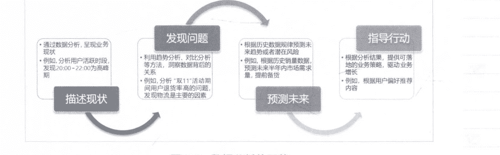

其中，描述现状与发现问题属于浅层目标，预测未来为中层目标，指导行动为深层目标。

### 1.1.3 数据分析的分类

按方法可分为定性分析与定量分析，二者都重要，常结合使用。

**1. 定性分析**

聚焦数据的性质与特征，用于描述、解释与理解现象。常见场景有用户评论分析，通过词云发现关注点；访谈分析，通过收集主观信息并做文本分析。

定性分析适用于探索性研究、背景分析与复杂现象理解。

**2. 定量分析**

聚焦数据的数量与数值特征，通过计算与统计分析。典型例子是财务数据分析评估经营状况，市场分析研究趋势与消费者行为。

定性定量并非孤立。例如调研新品满意度，可通过访谈收集意见，也可发放问卷让用户打分，二者可共同用于市场调研。

### 1.1.4 数据分析对企业决策的重要性

本节以餐饮业为例，讲述数据在企业生命周期不同阶段如何揭示商业规律并影响决策。

30 年前，假设你是一位厨师，开设“爸爸的味道”餐馆。你选址熟悉街道，聘请厨师与服务员，凭借口味把控与现场管理维持经营。收入可迅速核算，按月支付租金与工资。

> 创业初期，企业多靠目视化管理，经营者直接参与收银、客诉、人员调度。选址靠经验，品控靠地域感知，财务靠现场核算。老板身兼数职，经验与现场管理足矣，数据分析作用不明显。


20 年后，儿子接管并以“连锁加盟+直营”模式将门店开至全国 200 多家。无法现场管理时，他开始搭建数据分析体系：科学选址，利用第三方数据构建选址模型；建立标准化财务流程，分析各店收入成本；建立运营指标体系，如翻台率、客单价、坪效、人效，及时发现问题并整改。此时数据分析价值逐步显现。

> 快速发展中，经验与亲力管理失效，企业在各环节建立标准化流程，并搭建监控指标体系。通过数据洞察运营效果、发现问题，支撑日常决策。

如今门店超 1000 家，公司采用混合云架构，整合 POS、IoT 传感器、社交舆情构建数字孪生运营平台，实现数字化运营。设立战略分析部，涵盖数据科学家、用户体验研究员、竞争情报专家等，负责行业分析、竞品分析、市场调研、需求预测、菜品优化、客户体验、供应链与财务管理。此时数据商业价值最大化，分析与挖掘成为发展驱动力。

该故事揭示了现代商业演进规律。

- （1）规模临界点效应：管理幅度超过邓巴数阈值、经营单元超出空间可视范围时，经验决策必然失效。
- （2）数据价值密度法则：企业规模每增长 10 倍，数据决策贡献值提升 3.2 倍。
- （3）能力迁移曲线，如图 1.2 所示。


图 1.2 能力迁移曲线

因此，数据分析的本质是商业复杂系统在数字空间的重构。当企业突破以下临界值时，数据驱动决策从可选变为刚需。

- 1. 管理半径大于个体认知边界。
- 2. 生产要素超过人工处理阈值。
- 3. 环境变量超过经验知识存量。

这解释了为何 85% 的财富 500 强设立首席数据官，也印证了世界经济论坛将数据分析列为 21 世纪基础素养的逻辑。在数字孪生普及下，读懂数据已成为商业文明新语言。

### 1.1.5 为什么人人都要会数据分析

国际数据管理协会 DAMA 2024 年《数据素养白皮书》指出：在数字化转型深入推进中，数据解析能力已突破职业边界，从专业职能发展为基础能力。

IDC 2025 预警：数据能力从加分项变入场券

国际数据公司 IDC 在 2025 年技术路线图里描绘了接下来三年的走向，核心有两条。

- 1. 基准线上移：解读数据的能力正像熟练使用办公软件一样，被写进招聘的硬性要求，预计渗透率将逼近 78%。
- 2. 工具智能化：AI 分析系统有望承担约 65% 的常规分析工作，人类精力转向异常研判与战略校准，角色切换的临界点指向 2026 年第三季度。

这意味着商业社会正全面迈入人机共决时代，数据分析不再是差异化优势，而是职业生存的基本盘。

**1. 数据成了跨部门对话的通用语**

当拍板逻辑从经验驱动转向证据驱动，职场沟通的语法被改写。产品负责人用转化漏斗的数据说服研发优先做高价值功能，人力团队借助离职率的时序图推动考核机制优化，跨部门协作从各说各话升级为基于事实的共识，部门壁垒因此被削弱。

数据也在会议和汇报里攫取话语权。A/B 测试的结果能迅速终结无效争论，一家快消品牌就靠它把包装决策周期从三周压到 72 小时；动态看板取代了主观叙述，某市场负责人凭借投产比的可视化拿到追加预算。数据正在重塑职场影响力格局。

**2. 轻量工具把分析权下放到全员**

低代码和生成式 AI 的普及，让数据洞察从技术部门溢出到业务一线。市场同事用 Power BI 一键生成渠道投放周报，每周耗时从 8 小时降到 15 分钟；行政同事借助 Excel 动态仪表盘管控费用，帮助企业压缩差旅溢价。AI 常态化案例越来越多：销售团队把 ChatGPT 与客户关系管理系统联动做客户分层，财务团队训练专属模型揪出异常报销。

工具平权背后是能力底线被抬高。当例行分析被自动化，职场人的最低要求被迫上移。数据清洗、数据剖析、结果的故事化表达，已成为避免被淘汰的门槛。

**3. 数据思维在重塑职业基因**

真正拉开差距的是数据思维的内化程度。它像显微镜加望远镜的合体：客服主管通过情绪分析找服务短板，降投诉；仓储管理员用库存周转率预警爆仓，提升利用率；市场专员靠舆情数据提前捕捉趋势；HR 用技能矩阵规划人才流动，降低核心流失。

这种模式颠覆传统职场逻辑，要求从业者既有工程师般的严谨，用假设检验替代直觉；又要有艺术家式的想象，从波动中读出商业模式的创新点。


**4. 数据素养正在构建职业抗风险能力**

不确定时代，数据素养直接关联职业寿命。领英数据显示，在某段特殊时期，擅长数据驱动运营的零售从业者失业率仅是行业平均的三分之一；掌握流程挖掘的白领，被自动化替代的风险下降 58%。

AI 接管基础任务后，人类价值向高阶迁移。研究认为未来核心竞争力集中在两点：
- 1）数据敏感度，能在大量噪声中抓住关键信号；
- 2）决策转化力，能在数小时内把洞察变成行动计划。

数据驱动的战略思考正在重写竞争规则。拒绝数据思维的职场人，犹如手持长矛对抗机械化部队。从基层到管理者，数据能力重新定义价值坐标：既是拆解 KPI 障碍的归因工具，也是构建个人影响力的说服武器。当数据渗透招聘、考核、创新等环节，素养已超越技能。能驾驭数据思维的人，将在人机协同的新生态里更快站稳脚跟。而数据分析能力，正是这一能力体系最基础的构成。

## 1.2 数据洞察流程

### 1.2.1 洞察流程概览

数据洞察流程是一套把原始信息转化为决策依据的标准化路径。从问题澄清开始，经过素材汇集净化、价值挖掘，到结论落地并持续验证，形成闭环。

企业里通常划为四个关键环节，如图 1.3 所示。

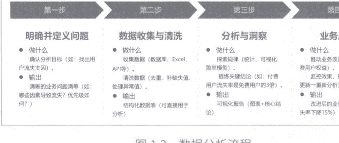
**1. 明确问题与目标**

起步阶段与需求方校准目标，是保证项目价值的关键。业务方若提出“分析用户流失原因”，需要通过深度沟通剥离表层诉求，聚焦决策场景：若目标是“找出流失主因以设计挽留策略”，就需进一步明确是定位关键流失路径，还是评估挽留策略的潜在收益，避免方向跑偏。

目标清晰后要输出问题清单，需遵循结构化拆解原则，把抽象目标转为可量化可追溯的具体问题。例如“哪些因素导致用户流失”可拆解为：

- 1）数据可行性校验：用户行为埋点是否覆盖关键节点？历史数据是否支持纵向对比？
- 2）用户分群维度：流失是否集中在特定属性，如高价值用户、新注册用户？
- 3）行为路径关键环节：流失前是否缺失关键行为，如未完成支付、未激活核心功能？
- 4）归因验证：流失峰值是否与竞品活动、产品改版或政策变化强相关？

问题定义的精准度决定成败。若目标模糊，仅要求“分析流失数据”而非“定位可干预动因”，或遗漏关键变量如未区分自然流失与体验流失，后续清洗、建模、验证都会偏离业务需求，最终得到“准确却无用”的结论。

**2. 信息采集与净化**

数据准备是根基，需遵循“多源收集—深度清洗—结构化整合”的链路。收集阶段依据业务需求选源：

- 1）整合内部系统：通过 SQL 从 CRM、日志系统获取用户行为埋点，从企业数据仓库提取用户库、行为库、交易表等核心数据；
- 2）补充外部数据：通过 API 对接第三方平台，获取广告投放渠道转化数据、社交媒体舆情数据；
- 3）导出异构数据：将数据平台看板的离线数据导出至 Excel/CSV。

清洗阶段建立标准化流程：

- 1）数据去重：基于主键如用户 ID+时间戳，或业务规则如同一会话内重复事件，仅保留首次记录；
- 2）处理缺失值：用户属性缺失如收入未填可均值填充；关键行为缺失如支付日志丢失，需与开发协同修复埋点；
- 3）修正异常值：用 Z-Score 法识别离群点，如单日浏览时长大于 8 小时，结合业务判断后删除或截断，超过 8 小时记为 8 小时。

清洗后按业务关系构建可用结构化数据集，并记录清洗动作以备查证。

**3. 挖掘与解读**

在数据清洗后，通过“统计—可视化—建模”的协同框架深挖价值，形成可复用洞察。核心是把结构化数据转化为驱动决策的逻辑证据链，围绕问题清单从宏观分布到微观特征逐层拆解。

先用描述性分析、趋势分析等快速定位异常波动，再用细分思维拆解异常到维度。例如把渠道拆成线上线下，线上再拆京东、天猫、抖音，精确定位原因；也可做相关性分析量化变量关联强度，优先处理与异常高相关指标。

基于结果用图表把数字转成直观图形。折线图呈现趋势便于发现时间异常；饼图或柱状图便于对比群体占比；漏斗图快速定位流程问题环节。图表让管理层一眼抓住重点。

最后回归业务需求输出结论。例如游戏运营分析新用户流失与注册时间关系，发现“流失主要集中在注册后 3 天内”，据此建议优化新手引导。


把分析、可视化、结论与建议串联，才能把杂乱数据变成清晰行动方案，让数据真正解决问题。

## 4. 业务落地与迭代

洞察之后要输出业务建议并推动改进。如与产品经理、游戏运营共制定新的新手引导流程并上线，必要时做对照实验验证效果。若留存改善则全面推广，若未达预期则启动根因分析，通过流程循环持续探索提升方法。

### 1.2.2 智能体在洞察流程中的角色

人工智能在采集净化、挖掘解读、业务应用三环节均有较强表现。

采集净化阶段，AI 如全天候智能清道夫，高效精准处理脏乱差。面对原始表，AI 能快速定位重复值，并用异常检测模型找出人工易漏的异常记录。对缺失值，AI 不止均值填充，还能结合上下文语义智能推断并补齐。清洗后，AI 可调用预设公式库推荐正确表达式并自动更新指标。新手无需研究 VLOOKUP 嵌套或 Python 正则，3 分钟内即可把杂乱数据转为建模可用表格。

挖掘解读阶段，AI 化身专家顾问。能在海量信息中锁定关键分析路径，如对零售数据自动按渠道、产品、月份分维统计。在可视化上，AI 根据目标智能匹配图表——桑基图展示转化流失环节、热力图呈现区域销售差异、折线图对比季度增长。AI 还能穿透表象提炼洞见：当发现某快餐连锁午市订单下降但客单价上升时，系统不仅指出套餐组合优化见效，还建议晚市推广高毛利单品。对新手而言，结论解读如同实时更新的分析手册。

业务应用阶段，AI 具备自动化迭代能力，反复执行清洗、统计、结论再生与效果反馈，形成“数据监控→策略调整→效果验证”闭环，降低非专业人员的学习门槛，大幅提升效率。

### 1.3 洞察工具全景

### 1.3.1 常用工具分类

数字化时代数据是决策核心资产，相关工具主要分三类：存储工具、分析工具、呈现工具。

#### 1. 资料保存类
主要分数据库与文件。数据库以关系型 MySQL 为主，结构化存储，支持高效查询与事务，互联网行业广泛使用。文件类存储包括 Excel 与文本文件 .csv .txt。Excel 与文本操作简单易上手，是基础存储载体，如员工信息表、销售数据表、日志记录等，在日常办公与小型管理中作用关键。

#### 2. 洞察处理类
用于从海量数据中提取价值。常见有 Excel、MySQL、Python。Excel 无需编程，公式函数即可完成筛选、排序、汇总，适合小规模任务。

复杂需求下 MySQL 与 Python 更强。MySQL 可用 SQL 高效查询分析大规模结构化数据；Python 拥有 Pandas、NumPy 等库，可做复杂处理、统计与机器学习。但使用需一定编程与统计算法基础，更适合技术背景分析师。

#### 3. 结果展示类
把分析结果直观展示。专业 BI 如 PowerBI、Tableau、FineBI 支持柱状、折线、饼图、仪表盘及交互探索，适合企业级报告。编程类可视化如 Python 的 Matplotlib、Seaborn 提供灵活定制。PPT 也是常见呈现工具，适合把文字、图表、图片组合成汇报材料。

AI 类工具如 DeepSeek 正成为重要力量，可与 MySQL、Python、PowerBI 高效交互，并深度整合 Excel 与 PPT，提供从存储到呈现的一站式方案。

在 Excel 中，DeepSeek 可嵌入环境辅助编写复杂函数、快速设计数据透视表与图表，支持实时业务数据与 Excel 数据整合，并复用报表模板实现动态更新。

在 PPT 制作中，DeepSeek 可一键生成数据可视化图表、填充数据并优化排版，并基于用户输入提供智能建议，提升汇报效率。

融合 Excel 与 PPT 后，不仅提升效率，也拓展了复杂数据场景的应用能力，助力企业挖掘数据价值，推动数据驱动决策。

本书学习路径以具备存储分析能力的 Excel、具备汇报功能的 PPT 与具备强推理能力的 DeepSeek 联合为主线。

### 1.3.2 工具获取与部署

#### 1. Office 套件获取与部署

Excel 与 PPT 属于 Microsoft Office。Office 由微软开发，自 1989 年起持续迭代，常见版本有 Office 2021、2019 等，每次升级提供更多实用功能。下载安装步骤如下：

1）访问官网：打开浏览器访问微软官网，按需选择 Office 版本，如图 1.4 所示。
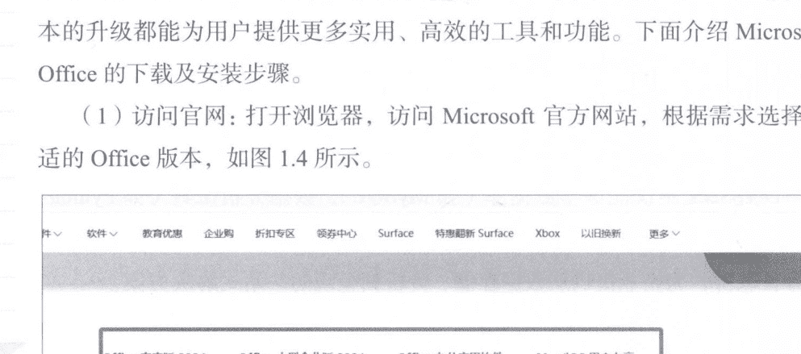
2）选择最新 Office 家庭版 2024，按提示购买产品，如图 1.5 所示。
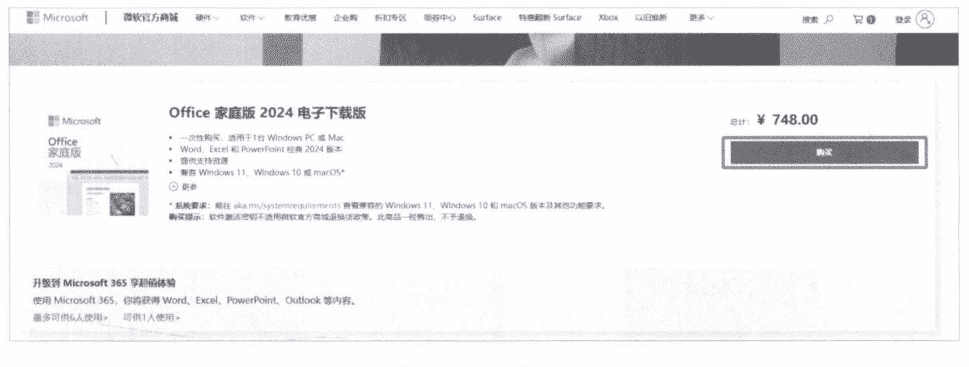
图 1.5 购买产品
3）登录已下载的 Microsoft Office，页面跳转至 www.office.com，如图 1.6 所示。

图 1.6 登录页面
4）在主页选择“安装 Office”，默认安装 64 位版本。
5）在 Microsoft Edge 或 Internet Explorer 选择“运行”；Firefox 选择“保存文件”。如提示“是否允许此应用对设备进行更改？”点击“是”开始安装，如图 1.7 所示。

图 1.7 安装页面
6）安装完成后弹出“你已设置完毕！Office 现已安装”对话框，点击 Close 关闭，如图 1.8 所示。
7）安装完毕后在“开始”菜单可见 Excel、PPT 等快捷方式，如图 1.9 所示。

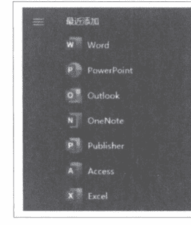

#### 2. 智能助手与 Office 协同

Office 可内嵌 DeepSeek，需下载 OfficeAI，步骤如下：
1）访问 OfficeAI 官网，点击“点击这里高速下载”下载 OfficeAI，如图 1.10 所示。

# OfficeAI 串联 DeepSeek 的零代码实操

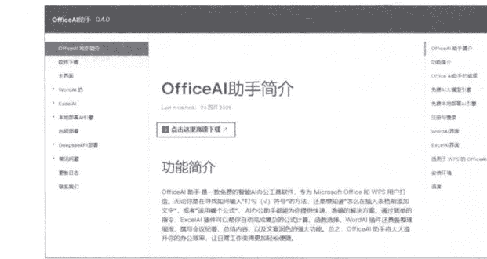
> 说明：OfficeAI 当前仅面向 Windows 提供，macOS 暂不支持该插件。
（2）部署 OfficeAI。开始前请先关闭所有打开的 Office 文件，双击安装包进入启动向导，画面见图 1.11。
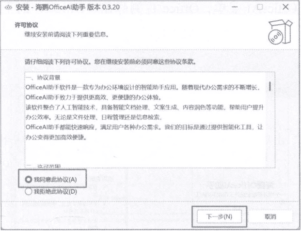
图 1.11 安装界面
（3）按下继续按钮推进流程。安装途中会弹出可选项清单，按需勾选后再往下进行，画面见图 1.12。
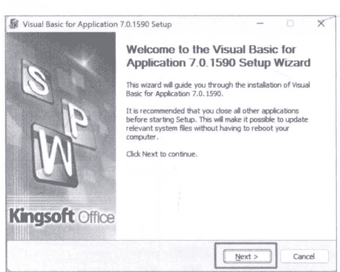
图 1.12 安装组件
（4）安装结束后再启动 Office，功能区会多出 OfficeAI 选项卡，画面见图 1.13。
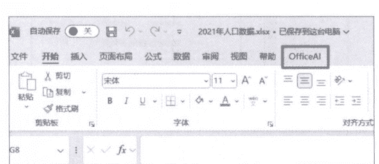
图 1.13 安装完成
（5）激活 OfficeAI 菜单，右侧会弹出“OfficeAI 助手”面板。勾选同意协议后使用微信登录即可完成账号接入，画面见图 1.15。
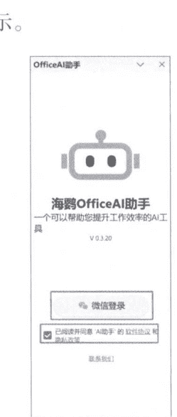
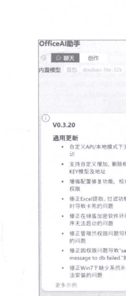
（6）点击助手面板右上角的三个点，在下拉列表里进入设置页。
（7）进入设置后打开大模型设置里的 ApiKey。把模型平台设为 DeepSeek，模型名称填 deepseek-R1，画面见图 1.17。
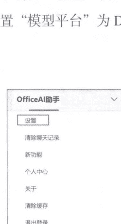
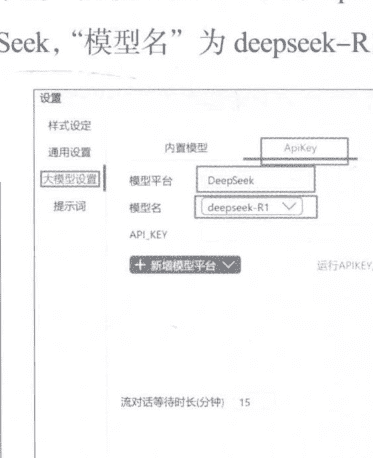
（8）打开 DeepSeek 官网申请密钥。点顶部右侧的 API 开放平台入口，画面见图 1.18。

图 1.18 获取 API 入口
（9）在左侧菜单选择 API keys，右侧点击创建 API key，画面见图 1.19。
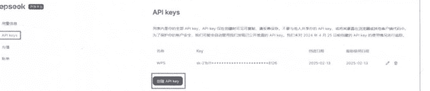
图 1.19 创建 API key
（10）在创建对话框里输入便于识别的名称后点击创建。
（11）复制新生成的 API key，画面见图 1.21。

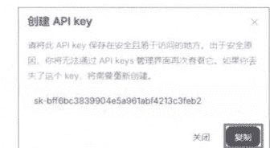
图 1.20 输入 API key 名称
图 1.21 复制 API key
（12）把复制的密钥粘贴到 OfficeAI 设置页的 API_KEY 编辑区，点击保存，画面见图 1.22。
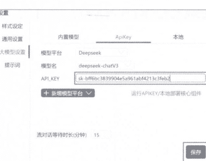
图 1.22 设置 OfficeAI API_KEY
（13）保存成功会弹出提示，点击确定关闭，画面见图 1.23。
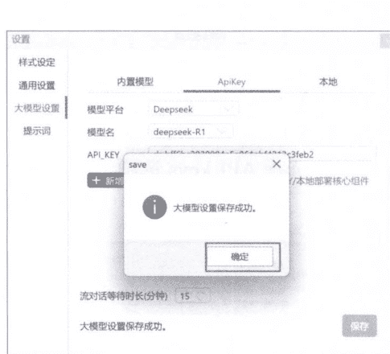
图 1.23 大模型设置完成
（14）助手面板内即可看到已生效的大模型。
（15）在助手面板底部的输入区发送指令即可联动 DeepSeek 与 Office。例如输入“请帮我统计当前表格共有多少行”，返回结果见图 1.25。
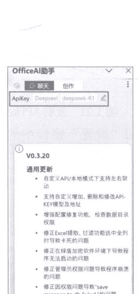
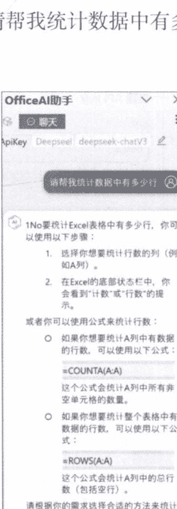
图 1.24 查看大模型
图 1.25 输出结果

## 1.4 DeepSeek 在数据分析中的应用
在分析场景里，DeepSeek 的低代码能力既可通过 OfficeAI 在 Excel 内调用，也可直接在 DeepSeek 产品中使用。

### 1.4.1 DeepSeek 数据分析低代码模式
低代码用法大致可归为自然语言即时交互、网页文本交互、表格文件交互三种，极大拓展了分析边界并提升效率。

#### 1. 自然语言下的即时交互模式
用户用日常语言描述需求，模型即可理解并执行分析任务。例如问“我有一份月度销售数据，用什么图表展示最合适”，会得到如下建议：

> 以下是针对月度销售数据的图表推荐：

**1. 观察整体趋势**
**选用折线图**
横轴：月份；纵轴：销售额。
**适合情境：** 快速识别销售额升降与周期波动。
**进阶技巧：**
- 增加趋势线预测后续走向。
- 用红色标出促销季等特殊月份。

**2. 对比各月数值**
**选用柱状图**
横轴：月份；纵轴：销售额。
**适合情境：** 突出单月绝对值，找出高低点。
**进阶技巧：**
- 按大小排序柱体增强对比。
- 加入年度均线作参考。

**3. 分析构成比例**
**选用堆叠柱状图或面积图**
横轴：月份；纵轴：销售额，用颜色区分子项。
**适合情境：** 展示每月总额中各部分占比变化。
**注意：** 子项建议不超过 5 个，避免视觉混乱。

**4. 追踪目标达成**
**选用组合图**
柱状显示实际销售额，折线显示目标达成率并使用次坐标轴。
**适合情境：** 同时监控绝对值与完成进度。

**5. 探索多因素关联**
**选用热力图**
横轴：月份；纵轴：相关变量；颜色深浅映射销售额高低。
**适合情境：** 分析广告投入、天气等与销售额的相关性。

**6. 工具建议**
- 快速出图：Excel 快速分析、Google Sheets。
- 自动化报表：Power BI 可设按月自动刷新。
- 编程处理：Python Pandas + Matplotlib/Seaborn。
- 自然语言制图：DeepSeek 支持指令生成动态图表。

**7. 设计要点**
- 降噪：去掉冗余网格与非必要图例。
- 突出重点：用对比色强调关键点。
- 结论驱动：标题直指核心发现。

用户只需提出问题，模型会多维度给出适用图表、操作要点、工具建议，并提示结果需有结论输出。

#### 2. 网页端的文本交互模式
网页端可通过纯文本指令控制分析，可指定数据源、方法与呈现方式，适合跨设备工作且具备一定分析基础的用户，也适合小规模数据。表 1.1 为各地区 1—12 月销售数据。


## 表 1.1 各地区 1—12 月的销售数据
| 月份 | 东北 | 华北 | 华东 | 西北 | 西南 | 中南 |
| :--- | :--- | :--- | :--- | :--- | :--- | :--- |
| 1 | 82095 | 38535 | 26114 | 2082 | 26691 | 47347 |
| 2 | 35548 | 33737 | 60808 | 11631 | 33767 | 109992 |
| 3 | 69194 | 72609 | 134678 | 15574 | 9919 | 97738 |
| 4 | 56508 | 25958 | 89373 | 16961 | 28833 | 115768 |
| 5 | 112408 | 101193 | 180347 | 20982 | 25221 | 192652 |
| 6 | 66946 | 105613 | 181647 | 55893 | 40332 | 115093 |
| 7 | 78108 | 40044 | 96776 | 1235 | 46877 | 77266 |
| 8 | 103564 | 60224 | 175867 | 22012 | 44523 | 182556 |
| 9 | 90643 | 98673 | 144698 | 29704 | 7237 | 131846 |
| 10 | 79028 | 186929 | 160594 | 6643 | 23621 | 120636 |
| 11 | 71685 | 48355 | 142121 | 48328 | 35559 | 122773 |
| 12 | 105273 | 63244 | 174657 | 39833 | 63527 | 98009 |

把表 1.1 内容复制到 DeepSeek 对话框，输入“请按月份对以上数据进行分析并给出建议。”如图 1.26。
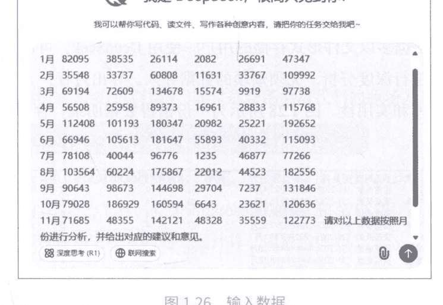
部分结果如图 1.27。
## 零基础玩转 DeepSeek：秒懂数据分析
11月
- 华东地区表现最佳，达到142121。
- 西北地区表现较差，为48328。
- 建议：西北地区需要加大市场投入，提升品牌知名度。
12月
- 华东地区表现最佳，达到174657。
- 中南地区表现较差，为98009。
- 建议：中南地区需要优化产品结构，提升市场竞争力。
总结
- 华东和中南地区在全年表现较为稳定且突出，建议其他地区可以借鉴其成功经验。
- 西北地区全年表现较差，需要加强市场推广、销售策略和品牌知名度。
- 西南和华北地区在某些月份表现不佳，需要针对性地进行市场调研和策略调整。
通过以上分析，各地区可以根据自身情况制定相应的改进措施，以提升整体业绩。
图 1.27 部分分析结果
此方式即可对小数据完成分析并获取结论。

#### 3. 数据表文件的交互模式
该模式支持上传表格文件，DeepSeek 解析后返回结果。适合习惯文件化管理、数据以文件存储的用户，避免繁琐导入导出。图 1.28 为一份 Excel 中的销售明细。

| 类别 | 行 Id | 装运模式 | 装运状态 | 订单 Id | 订单日期 | 月份 | 利润 | 发货前天数 | 发货前天数（计划） | 折扣 | 数量 | 销售额 |
|---|---|---|---|---|---|---|---|---|---|---|---|---|
| 办公用品 | 1 | 二级 | 提前装运 | US-2022- | 2022/4/27 | 4月 | -61 | 2 | 3 | 40% | 2 | 130 |
| 办公用品 | 2 | 标准级 | 提前装运 | CN-2022- | 2022/6/15 | 6月 | 43 | 4 | 6 | 0% | 2 | 125 |
| 办公用品 | 3 | 标准级 | 提前装运 | CN-2022- | 2022/6/15 | 6月 | 4 | 4 | 6 | 40% | 2 | 32 |
| 办公用品 | 4 | 标准级 | 提前装运 | US-2022- | 2022/12/9 | 12月 | -27 | 4 | 6 | 40% | 4 | 321 |
| 办公用品 | 5 | 二级 | 提前装运 | CN-2021- | 2021/5/31 | 5月 | 550 | 2 | 3 | 0% | 3 | 1376 |
| 技术 | 6 | 标准级 | 提前装运 | CN-2020- | ######### | 10月 | 3784 | 4 | 6 | 0% | 9 | 11130 |
| 办公用品 | 7 | 标准级 | 提前装运 | CN-2020- | ######### | 10月 | 173 | 4 | 6 | 0% | 2 | 480 |
| 家具 | 8 | 标准级 | 提前装运 | CN-2020- | ######### | 10月 | 2684 | 4 | 6 | 0% | 4 | 8660 |
| 办公用品 | 9 | 标准级 | 提前装运 | CN-2020- | ######### | 10月 | 47 | 4 | 6 | 0% | 5 | 588 |
| 办公用品 | 10 | 标准级 | 提前装运 | CN-2020- | ######### | 10月 | 34 | 4 | 6 | 0% | 2 | 154 |
| 技术 | 11 | 二级 | 提前装运 | CN-2019- | ######### | 12月 | 4 | 2 | 3 | 0% | 2 | 434 |
图 1.28 销售数据明细

在对话窗口点击上传按钮选择文件位置，完成上传，如图 1.29 和图 1.30。

图 1.29 上传文件

图 1.30 上传文件成功
上传后即可输入提示词，让 DeepSeek 输出统计结果与分析建议。三种模式均无需代码，适合非技术职场人群。

### 1.4.2 DeepSeek 在 Office 内部的低代码应用
Office 内部的低代码实现依赖 OfficeAI。OfficeAI 是一款免费智能办公插件，面向 Microsoft Office 与 WPS 用户，通过自然指令即可自动完成公式计算、函数选择等。
按前述步骤安装并配置密钥后打开 Excel，功能区会出现 OfficeAI 菜单，点击后右侧弹出助手窗口，底部输入区用于交互，如图 1.31、1.32。
## 零基础玩转 DeepSeek：秒懂数据分析
> 注意：当前版本下 OfficeAI 每次仅返回一个结果，若需多公式需分次提问。
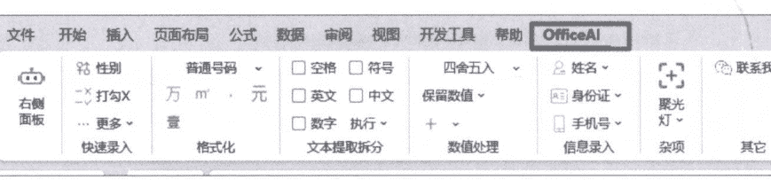
图 1.31 OfficeAI 菜单
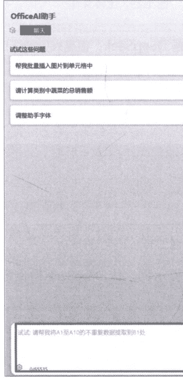
图 1.32 OfficeAI 提示词输入框
DeepSeek 官网与 OfficeAI 都能做分析，但官网无法直接生成可保留公式的文件。仅需结果或数据量小的场景可使用官网上传分析；若需保留公式并优化，建议使用 OfficeAI 搭配 DeepSeek 大模型。

### 1.4.3 DeepSeek、OfficeAI 内嵌 DeepSeek 与 Excel 优劣势对比
三种工具的选择需结合场景、数据量、目标与成本。对比见表 1.2。
### 表 1.2 数据分析工具优劣势对比
| 序号 | 工具 | 优势 | 劣势 |
| :--- | :--- | :--- | :--- |
| 1 | DeepSeek 官网 | 即时交互、无需代码、支持文本文档 Excel 多种输入、提示词简洁、直接给出建议和意见 | 处理数据量小、无法直接作图、无法直接读取网站链接、无法输出文件、结果需要校验 |
| 2 | OfficeAI 内嵌 DeepSeek | 即时交互、无需代码、支持文本与 Excel、提示词简单、处理过程和结果可以存储在 Excel 中 | 无法直接输出分析结论 |
| 3 | Excel | 处理数据灵活多样 | 需要一定的 Excel 基础 |

### 1.4.4 DeepSeek 提示词写作方法

在实际使用 DeepSeek 做数据分析时，对提示词的专业水准要求并不高。关键在于 DeepSeek 推理模型的特质，它对自然语言的理解和解析能力很强，能够比较精准地捕捉使用者的意图和诉求，间接削弱了对高阶提示词的依赖。正因如此，缺乏深厚专业背景的普通用户也能顺畅对话，快速拿到想要的分析结果，大幅拉低了使用门槛，让数据分析变得更亲民。

依据需求侧重点和工作习惯，数据分析在实践中大致落到两类情境：一种是周而复始、流程固定的周期性分析，另一种是方向开放、重发现的探索性分析。对应的，与 DeepSeek 的协作方式也呈现两类形态：周期性流程化的协作和探索性的协作，如图 1.33 所示。

## DeepSeek数据分析零基础指南

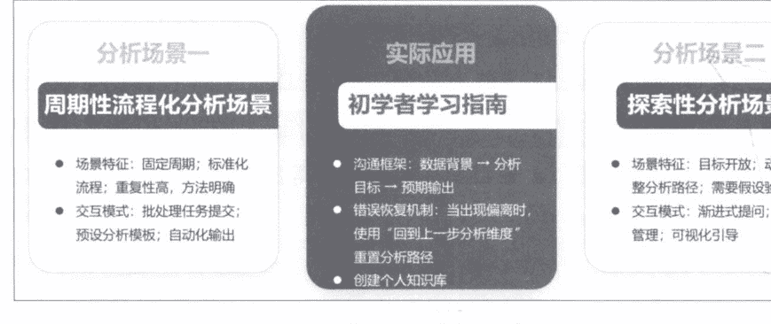

（1）在周期性流程化分析里，工作通常按固定节奏和既定步骤推进，比如公司每月销售汇总、月度财务报表复盘等。这类任务重复度高、操作路径清晰，所以与 DeepSeek 的配合多采用批量、定式处理的思路，把大量数据和相对标准化的分析需求一次性交给模型。模型依循预设流程和参数自动跑通，输出格式统一的分析报告，既提效也保证结果稳定。

（2）在探索性分析里，目标更多是挖掘新趋势、新关联或新洞察，不确定性和灵活性更强。例如市场研究中探寻潜在消费诉求，或用户行为分析中揣摩偏好取向。这时交互更偏向渐进式追问，用户依据初步结果不断调整思路和方法，提出新问题和新假设，DeepSeek 则据此实时调参、持续深挖。这种方式能充分发挥模型的智能弹性，帮助用户在海量数据中灵活穿行，提炼出有价值的信息。

渐进式追问不仅适配探索型分析，对新手也非常友好。它提供了一种由浅入深的搭建路径，让用户在任何分析场景里逐步成型分析框架。需要留意的是，分析过程中要主动让 DeepSeek 回溯先前的结论，以维持上下文连贯。这样既能帮助初学者逐步学会方法，也能保证整体逻辑自洽、体系完整。

# 第 2 章 数据清洗

数据清洗是保障分析结果可信、模型表现优异的基础工作，为分析和决策提供高质量输入，是整个数据处理链路的核心环节，其价值体现在多方面。

- （1）清洗能够显著提升数据质量。剔除错误、矛盾或不精确的记录，保证数据的准确性；补齐缺失值、修复不完整的条目；统一不同来源字段的表达形式。
- （2）清洗有助于降低分析偏差。异常值和噪声容易误导结论；剔除重复记录可避免重复计数。
- （3）清洗能够增强模型效果。在机器学习或统计建模里，低质数据会拖累预测能力。去噪、补缺、格式标准化后，模型的准确性和可靠性明显改善。

数据清洗是数据分析不可或缺的前置步骤，涵盖缺失值、异常值、重复数据的识别与处理。

本章介绍数据清洗的核心概念与常用方法，如何用它们解决典型的数据质量问题。做好清洗，能提升数据可用性，为后续分析与决策奠定坚实基础。

## 2.1 数据质量

数据质量指数据在特定用途下是否适用且可信，是衡量数据能否准确、完整、一致地映射现实世界的一项标准。质量高低直接影响分析有效性、决策支持的质量以及业务流程的效率。常用的评估维度包括完整性、准确性、一致性、时效性、唯一性、有效性等，如图 2.1 所示。

## DeepSeek数据分析零基础指南

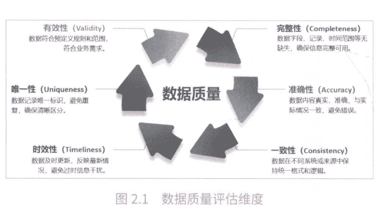

图 2.1 数据质量评估维度

### 2.1.1 完整性

完整性是数据质量的重要标志。可类比为拼图，缺块就难以呈现全貌。主要体现在字段层面，即表格的列是否空缺，例如客户表中的联系方式大量空白；记录层面，即表格的行是否缺失，例如部分客户信息未完整录入；时间层面，例如年度销售统计中缺失某个月份，导致结论失真。

### 2.1.2 准确性

准确性指数据是否真实无误地反映客观事物。例如数据库中用户年龄记录为30岁，实际也为30岁，则数据准确；若记录偏差，则为不准确。现实中也有人为篡改实验数据以获取经费的行为，这正是违背准确性原则，结果不可信，研究难以持续。

### 2.1.3 一致性

一致性要求数据在逻辑、格式、单位上保持统一。举例来说，性别字段一方用“男”“女”，另一方用 M、F，显然不统一。分析时若单位不一致，也必须先行转换，否则结论会出错。

### 2.1.4 时效性

时效性关注数据的新鲜度能否反映当下状态。过期的库存信息容易导致补货误判。比如“618”大促期间，各品牌需实时跟踪销量与竞品价格变化，及时调整库存与定价。促销结束后回头看“618”数据，已失去时效价值，对销售帮助有限。

### 2.1.5 唯一性

唯一性要求每个数据实体在系统中仅出现一次，不可重复。好比身份证号一人一号，能精确区分个体。若同一用户被重复登记，通知或处理时会重复执行，造成资源浪费，且会扭曲分析结果。

### 2.1.6 有效性

有效性指数据是否符合预设的业务规则、格式或取值范围，即是否“合规”。例如手机号应为11位数字，身份证号应为18位。若格式错误则判定为无效数据。每年校园招聘中，就因电话填写错误导致无法联系，错失机会。

### 2.1.7 小结

数据质量是分析与决策可靠性的前提，对企业运营效率、客户体验和竞争力产生深远影响，因而是数据战略的重要组成部分。

## 2.2 数据“脏乱差”五大顽疾定义及成因

据统计，78%的数据科学家表示，数据清洗占据项目60%以上的时长。这不是夸张，而是行业常态。真实案例并不少见，某知名企业


因为日期格式混乱，错失了亿元订单。听起来震惊，却恰恰说明数据“脏乱差”的危害难以估量。我们把常见问题归纳为五大顽疾：非结构化数据、异常值、格式混乱、重复数据、缺失值，如图 2.2 所示。

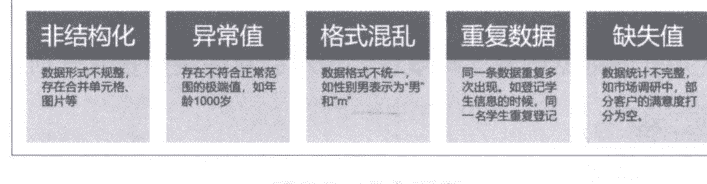

### 2.2.1 缺失值定义及成因

#### 1. 缺失值定义

技术上，缺失值是指本应填写数据的位置出现空白。表现形式包括 #N/A、空单元格或错误占位符，意味着该处数据未被记录或无效。

常见形式为单元格为空和特殊占位符如 NA、#N/A，如图 2.3 所示。

| ID | 姓名 | 年龄 | 性别 | 分数 | 调查日期 |

|---|---|---|---|---|---|

| 1 | 张三 | 25 | 男 | 85 | 2023/1/1 |

| | 李四 | | | 90 | 2023/1/2 |

| 3 | 王五 | 30 | NA | #N/A | 2023/1/3 |

#### 2. 缺失值成因

成因多样，概括为硬件故障、人为疏漏、系统限制和业务逻辑四类，如图 2.4 所示。

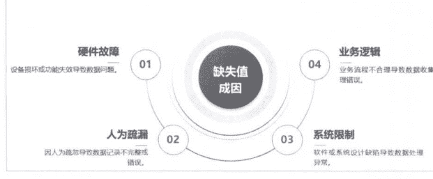

### 2.2.2 重复数据定义及成因

#### 1. 重复数据定义

技术上，重复数据表现为整行完全相同或部分列内容重复。例如操作时误复制同一行，或在不同列录入相同信息。重复会浪费存储，并导致统计失真，如销售额被多次计入而虚高。

常见类型有完全重复和部分重复，如图 2.5 和图 2.6 所示。

| 序号 | 订单号 | 客户名 | 产品 | 数量 | 下单日期 | 地址 |

|---|---|---|---|---|---|---|

| 1 | 1001 | 张三 | 笔记本电脑 | 1 | 2023/8/1 | 北京市朝阳区 |

| 2 | 1002 | 李四 | 手机 | 2 | 2023/8/1 | 上海市浦东新区 |

| 3 | 1003 | 王五 | 平板电脑 | 1 | 2023/8/2 | 广州市天河区 |

| 4 | 1001 | 张三 | 笔记本电脑 | 1 | 2023/8/1 | 北京市朝阳区 |

| 5 | 1004 | 李四 | 耳机 | 3 | 2023/8/3 | 上海市浦东新区 |

| 6 | 1005 | 赵六 | 鼠标 | 2 | 2023/8/3 | 深圳市南山区 |

| 7 | 1003 | 王五 | 平板电脑 | 1 | 2023/8/2 | 深圳市南山区 |

图 2.5 完全重复

| 序号 | 订单号 | 客户名 | 产品 | 数量 | 下单日期 | 地址 |

|---|---|---|---|---|---|---|

| 1 | 1001 | 张三 | 笔记本电脑 | 1 | 2023/8/1 | 北京市朝阳区 |

| 2 | 1002 | 李四 | 手机 | 2 | 2023/8/1 | 上海市浦东新区 |

| 3 | 1003 | 王五 | 平板电脑 | 1 | 2023/8/2 | 广州市天河区 |

| 4 | 1001 | 张三 | 笔记本电脑 | 1 | 2023/8/1 | 北京市朝阳区 |

| 5 | 1004 | 李四 | 耳机 | 3 | 2023/8/3 | 上海市浦东新区 |

| 6 | 1005 | 赵六 | 鼠标 | 2 | 2023/8/3 | 深圳市南山区 |

| 7 | 1003 | 王五 | 平板电脑 | 1 | 2023/8/2 | 深圳市南山区 |

图 2.6 部分重复

判断重复的核心在于唯一字段。如前表所示，订单号为关键唯一标识，订单号重复即可判定为重复。

#### 2. 重复数据成因

重复数据成因如图 2.7 所示。

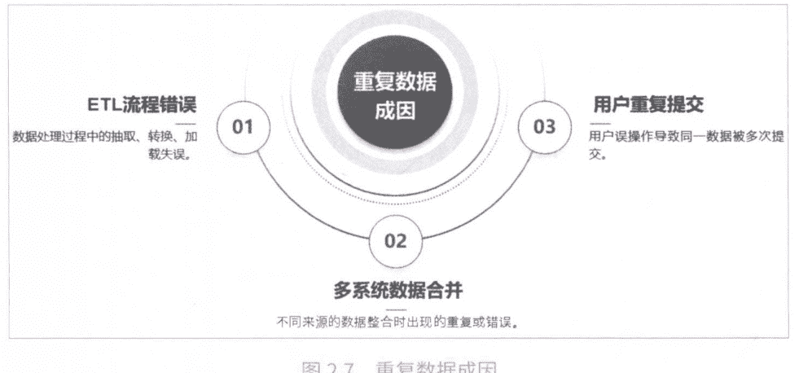

（1）ETL 流程错误。指抽取、转换、加载环节出现问题，类似从不同水源取水、净化后汇入同一水池，若净化不彻底或抽错源头，最终数据会出错。典型例子是电商订单因脚本重试产生重复记录，导致销售额虚增约15%。这类错误在大促期间更常见，会扰乱销售判断、库存管理和财务报表。应对思路是优化处理脚本、强化质量监控、定期复检流程。

（2）多系统数据合并。将不同系统的数据整合时易出现冲突。企业常需统一标准、加强协同，使用专业合并工具以提升准确性。

（3）用户重复提交。因网络拥堵或系统延迟，用户未收到支付确认而多次尝试，导致同一订单被支付多次，带来用户困扰和财务纠纷。解决方向是优化界面提示、完善异常处理、提升系统响应速度。

### 2.2.3 异常值定义及成因

#### 1. 异常值定义

技术上，异常值表现为明显错误或偏离正常范围的极端值，如性别列出现“未知”，或数值远超常规。箱线图是常用的识别工具。

通常判定标准为小于 Q1-1.5×IQR 或大于 Q3+1.5×IQR 的点，即落在须线之外的值，如图 2.8 所示。

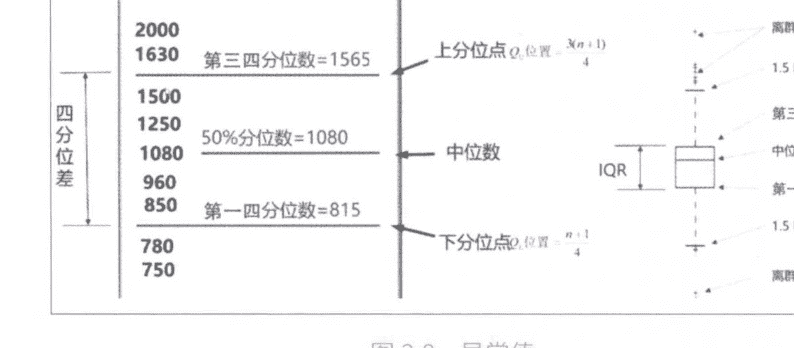

图 2.8 异常值

#### 2. 异常值成因

异常值成因如图 2.9 所示。

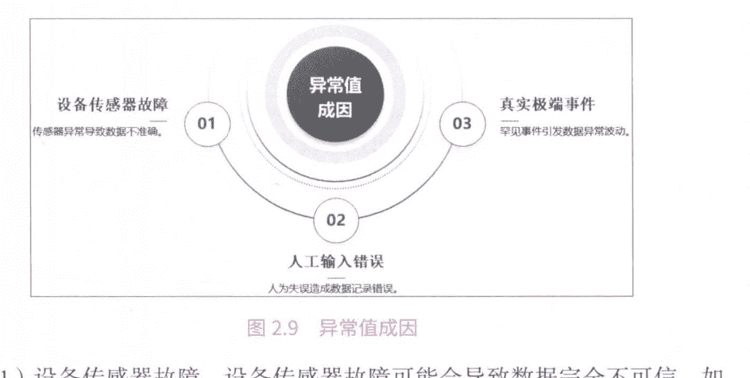

（1）设备传感器故障。传感器损坏会导致完全失真数据，如体重秤显示-20kg，或工业温度传感器显示-100℃。这类问题约占数据问题的48%。需定期校准维护，并采用冗余传感器交叉验证。

（2）人工输入错误。类似收银员多按一个0，把19.99元录成190.99元。发生概率约37%，在大量交易中影响显著。

（3）真实极端事件。低概率但高影响的情况，如百年暴雨导致降雨记录极端，或网红带货使商品销量骤增1000倍，概率约15%。处理时需区分真实极端与录入错误，并建立灵活的处理流程以便快速响应。

### 2.2.4 格式混乱定义及成因

#### 1. 格式混乱定义

技术上，格式混乱表现为日期混用或单位不一，如同一列既有 YYYY/MM/DD 又有 MM-DD-YYYY，导致排序和计算出错；重量单位混用 kg 与磅，也会带来换算困难。

如图 2.10 所示，日期列出现三种写法：YYYY/MM/DD、YYYY.MM.DD、YYYYMMDD，前者为日期格式，后两者为文本；体重列单位混杂 kg、lbs 与无单位，无法判断实际数值。

| ID | 日期 | 体重 |

|---|---|---|

| 1 | 2023/8/1 | 50kg |

| 2 | 2023.08.03 | 110lbs |

| 3 | 20230803 | 60 |

图 2.10 格式和单位不统一

#### 2. 格式混乱成因

格式混乱成因如图 2.11 所示。

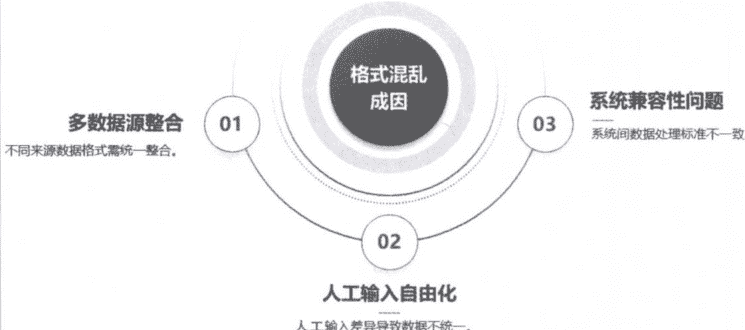

（1）多数据源整合。不同地区习惯不同，例如美国常用 07/04/2023，欧洲常用 04/07/2023。跨国企业若未统一标准，销售数据易混乱。解决方案是制定统一规范如 YYYY-MM-DD，并借助工具自动识别转换。

（2）录入口径太松容易乱。让人自己描述同一个地点，写法会差别很大，有的写“北京市海淀区”，有的写“Haidian District, Beijing”。在业务实操里，这种不统一会带来不少隐性麻烦。

想要减少分歧，最直接的做法是先立规矩，明确所有地址必须遵循同一格式与语言。配合自动化校验和标准化工具对原始记录做清洗归一，也能大幅提升一致性和可比性。

（3）系统兼容差容易乱码。比如把带欧元符号 € 的 CSV 文件导入 Excel，就可能出现乱码。在全球化协作环境下，这类问题尤其高频。跨国企业需要汇总各地信息，里面混杂大量特殊字符和符号，若系统无法正确识别，就可能导致信息丢失或错误。

解决方向是让各业务系统具备足够的兼容能力，准确处理各类特殊字符。同时在系统间传输时借助转换工具完成必要的格式适配，也是维护完整性的重要手段。这样数据准确性和可靠性才能得到实质改善。

### 2.2.5 不一致性定义及成因

#### 1. 不一致性定义

从技术层面看，信息不统一主要体现为两类情况。

（1）同一主体有多重写法，例如“北京”“北京市”“BJ”并存。

（2）逻辑上自相矛盾，比如用户年龄 18 岁却被标注为“退休”；同一订单在不同记录里一次显示已发货、一次显示未发货，如图 2.12 所示。

信息不统一是质量问题的关键表现，会削弱准确度和可用性，增加整合难度，导致分析结论互相冲突。

| 用户ID | 姓名 | 性别 | 城市 | 年龄 | 工作状态 |
|---|---|---|---|---|---|
| 1000012 | 张三 | F | BJ | 18 | 退休 |
| 1000013 | 李四 | 男 | 北京 | 20 | 失业 |
| 1000014 | 王五 | 女 | bj | 23 | 在职 |

图 2.12 数据不一致

#### 2. 不一致性成因

形成原因的概览如图 2.13 所示。

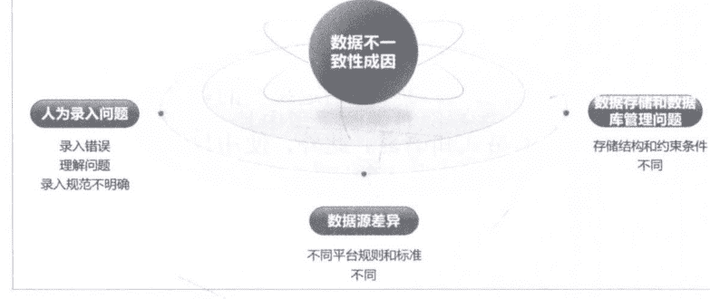

图 2.13 数据不一致性成因

（1）人工录入失误。手工录入是导致不统一的高发环节，主要表现在：操作人员易出现拼写错误、格式错误或漏填；对同一字段的理解偏差导致记录不一致；缺乏统一的录入规范与流程，使得填写随意性加大。典型例子是日期格式在不同记录中一会儿是 YYYY-MM-DD，一会儿是 MM/DD/YYYY；性别有的用“男/女”，有的用 M/F。这些问题不仅拖累质量，还会误导后续分析和决策。因此建立标准化的录入流程与规范很有必要。

（2）来源差异。不同系统或平台的数据生成规则和标准不一，会导致格式与内容偏差。录入方式多样，人工录入、自动采集、接口推送各有特点，也会造成差异。不同来源的更新频率和时间点不同，易出现不同步，进一步加剧不一致。比如一个系统每天更新，另一个每周更新一次，两边数据自然对不上。建立统一的管理与同步机制是应对之策。

（3）存储与库管理问题。不同数据库的存储结构与约束规则存在差异，存储与检索过程中容易产生偏差。若库中缺乏有效完整性约束，如主键、外键约束，则完整性难以保障，容易引发不一致。此外，备份与恢复环节出现失误，如备份文件损坏或恢复失败，也可能导致信息丢失或损坏，加剧不一致。因此统一存储结构、强化完整性约束、优化备份恢复机制，对保证一致性和可靠性至关重要。

### 2.2.6 小结

在数字化时代，信息已成为企业决策与创新的核心资产。然而“脏乱差”问题严重制约价值释放。质量问题并非单一环节导致，其表现涵盖不准确、不完整、不一致、重复、不及时等，不仅影响可用性与可靠性，还可能引发决策失误、分析偏差、资源浪费、客户体验下滑及合规风险。

要获得高质量信息，企业需构建全流程质量管理体系，覆盖采集、存储、处理到分析的每个环节。具体包括引入先进的清洗、整合与验证技术，建立质量监控体系，设定指标与阈值，借助工具定期巡检；同时加强全员质量意识培训，提升对信息价值的认知。

总体来看，识别质量问题、制定适配的处理流程与方法，获取可靠信息，是分析与挖掘的前提，也是实现数据驱动决策的关键。

## 2.3 数据质量诊断

数据质量诊断是通过系统化指标与技术手段，对完整性、准确性、一致性、时效性、唯一性和有效性等维度进行评估，以发现隐患与风险。通常包含清洗、评估与监控三个环节。

检查是清洗的基础，也是发现问题的关键。传统检查多依赖自动化工具或人工复核，并对问题进行归类，本节在此基础上引入 DeepSeek 辅助诊断。

### 2.3.1 使用 DeepSeek 诊断数据质量问题

现有的“销售人员业绩”数据源，如图 2.14 所示。该表存在序号 10 的空行、序号 5“实际完成”缺失、序号 13 完成率高达 652.12% 的异常，以及序号 5 与序号 10“评级”列的错误。下面介绍借助 DeepSeek 进行诊断的流程。

| 序号 | 销售经理 | 年度目标 | 实际完成 | 完成率 | 评级 |
|---|---|---|---|---|---|
| 1 | 100032 | 36951 | 31366 | 84.89% | B |
| 2 | 100031 | 32569 | 24377 | 74.85% | C |
| 3 | 100029 | 32030 | 32163 | 100.42% | A |
| 4 | 100028 | 30070 | 25634 | 85.25% | B |
| 5 | 100027 | 28295 |  | 0.00% | C |
| 6 | 100033 | 26894 | 32176 | 119.64% | A |
| 7 | 100030 | 24734 | 32395 | 130.97% | S |
| 8 | 100030 | 24734 | 32395 | 130.97% | S |
| 9 | 100023 | 24550 | 32163 | 131.01% | S |
| 10 |  |  |  |  | C |
| 11 | 100034 | 22343 | 24380 | 109.12% | A |
| 12 | 100024 | 18793 | 24378 | 129.72% | S |
| 13 | 100025 | 17743 | 115705 | 652.12% | S |
| 14 | 100026 | 17054 | 17442 | 102.28% | A |
| - | 合计 | 336760 | 398940 | 118.46% | A |

图 2.14 销售人员业绩表

（1）在 DeepSeek 官网复制粘贴以上数据源，或上传 Excel 文件。图 2.15 所示为数据粘贴到对话窗口并选择“深度思考（R1）”进入推理模式，此处不要选择“联网思考”。

# 第 2 章 数据清洗

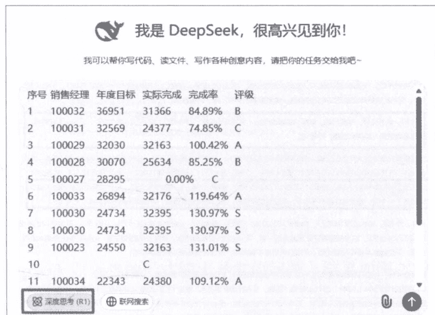

图 2.15 粘贴数据

（2）输入提示词“请基于以上数据，帮我找到异常数据，并给出行号及异常理由”，如图 2.16 所示。

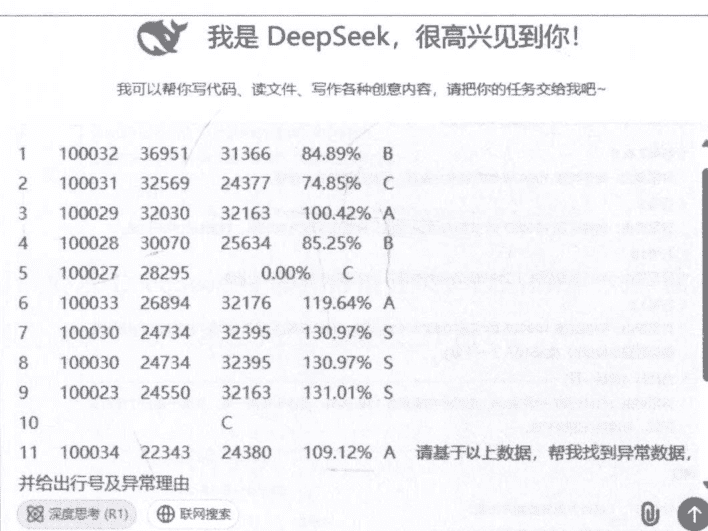

图 2.16 输入提示词

（3）DeepSeek 进入推理模式。推理过程中可看出模型已定位异常，如图 2.17 所示。


助学答疑

043

## 零基础玩转 DeepSeek：秒懂数据分析

先筛查重复记录。序号7与序号8的销售经理均为100030，年度目标、实际完成、完成率、评级完全一致，明显是重复录入，属异常点。

再看序号5，销售经理100027的实际完成为空，完成率被算作0.00%，评级仍为C，数据缺失明显，需标记异常。

序号10除评级C外，其余字段全部空白，属于录入遗漏或错误行。

随后核算完成率公式。正常为实际完成除以年度目标。序号1核算无误。但序号13的实际完成115705远高于目标17743，推算完成率约652%，数值严重偏离常识，很可能录入时多写了零或其他错误。

序号9、7、8、12的完成率均在130%左右且评级为S，整体来看评级与完成率大体对应，暂无明显问题；序号3、6完成率超百但评级为A，也符合常规梯度。合计行计算正确，但合计行是否需要评级需结合业务规则判断，目前评级A可能不具实际意义。

序号10在数据全空的情况下仍出现评级，属于不合理标记。

总结可能的异常点：

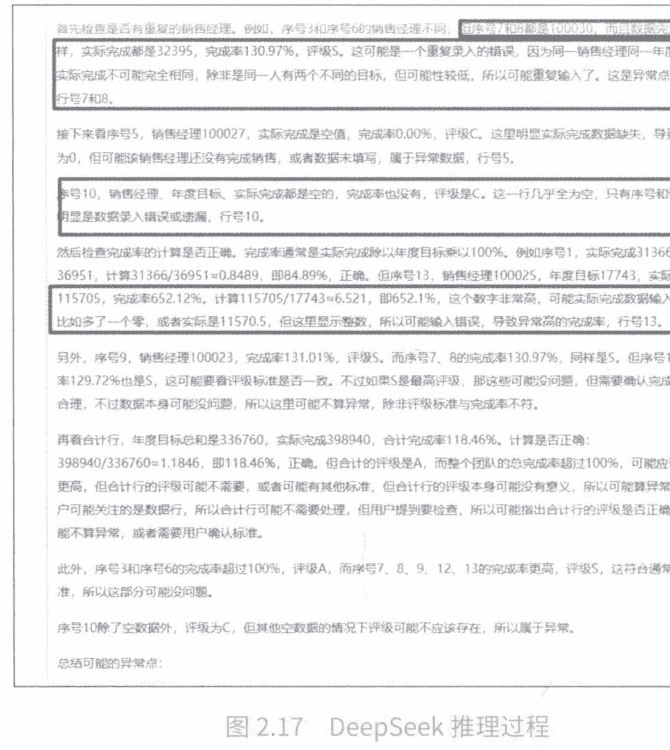

（4）DeepSeek 输出异常值检测结果，如图 2.18 所示。

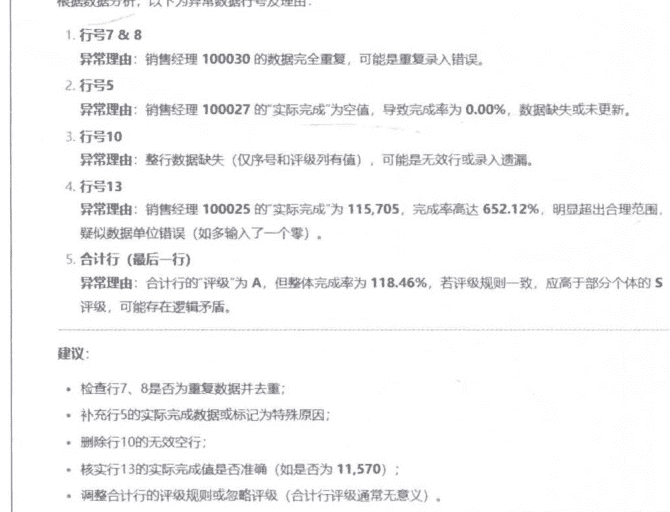

（5）进一步要求 DeepSeek 以表格形式输出异常问题。输入提示词“请帮我将以上问题整理成表格的形式，并输出”，如图 2.19 所示。

# 第 2 章 数据清洗

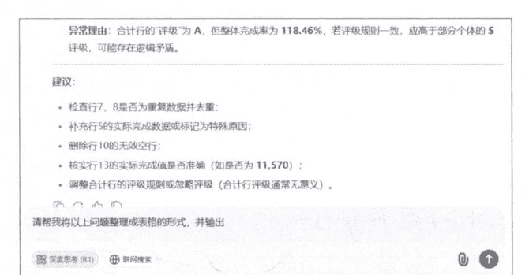

图 2.19 再次输入提示词

（6）DeepSeek 以表格形式呈现异常问题，结果如图 2.20 所示。

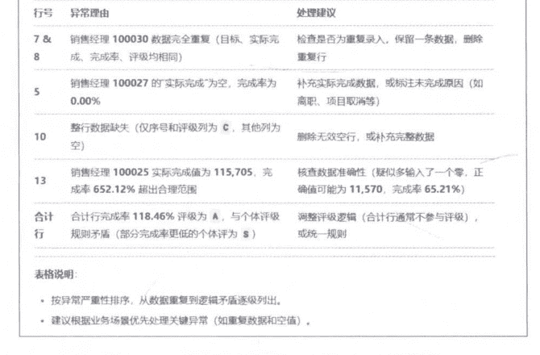

图 2.20 异常值问题表格形式输出结果

（7）继续要求 DeepSeek 对异常值进行分类并放在第二列。输入提示词“请添加异常值分类，并放在第二列”，如图 2.21 所示。

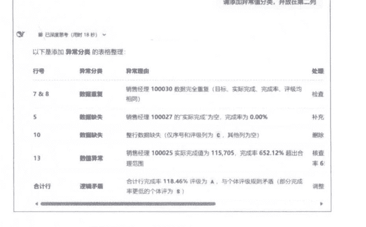

图 2.21 添加异常值分类


助学答疑

045

## 零基础玩转 DeepSeek：秒懂数据分析

DeepSeek 提供的处置建议仍需人工复核，例如第13行的数据异常需先核实真实值后才能修正，不能直接采纳；合计行只是汇总信息，通常不需要评级。因此模型输出并非完全可执行，实际应用时要谨慎甄别。

### 2.3.2 使用 OfficeAI 内嵌 DeepSeek 诊断数据质量问题

#### 1. 诊断缺失值

（1）在“销售人员业绩”表中打开 OfficeAI 助手右侧面板。在对话框输入提示词“基于 [ 销售人员业绩 ] 表中的数据，将数据区域 A1:F16 中的空白单元格填充为灰色”，如图 2.22 所示。

（2）推理过程如图 2.23 所示。


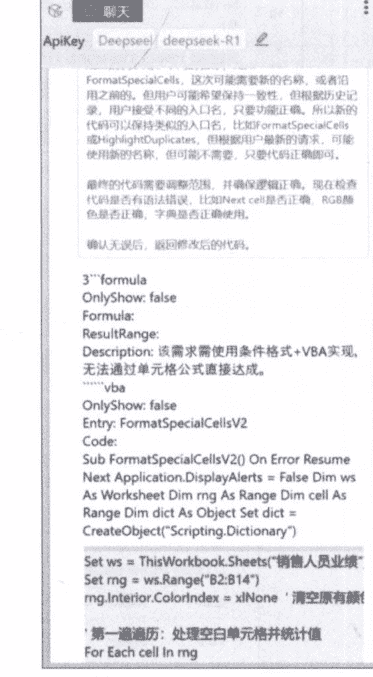

（3）缺失值填充结果如图 2.24 所示。

# 第 2 章 数据清洗

| 序号 | 销售经理 | 年度目标 | 实际完成 | 完成率 | 评级 |
|---|---|---|---|---|---|
| 1 | 100032 | 36951 | 31366 | 84.89% | B |
| 2 | 100031 | 32569 | 24377 | 74.85% | C |
| 3 | 100029 | 32030 | 32163 | 100.42% | A |
| 4 | 100028 | 30070 | 25634 | 85.25% | B |
| 5 | 100027 | 28295 |  | 0.00% | C |
| 6 | 100033 | 26894 | 32176 | 119.64% | A |
| 7 | 100030 | 24734 | 32395 | 130.97% | S |
| 8 | 100030 | 24734 | 32395 | 130.97% | S |
| 9 | 100023 | 24550 | 32163 | 131.01% | S |
| 10 |  |  |  | #DIV/0! | #DIV/0! |
| 11 | 100034 | 22343 | 24380 | 109.12% | A |
| 12 | 100024 | 18793 | 24378 | 129.72% | S |
| 13 | 100025 | 17743 | 115705 | 652.12% | S |
| 14 | 100026 | 17054 | 17442 | 102.28% | A |
| - | 合计 | 336760 | 424574 | 126.08% | S |

图 2.24 缺失值填充结果

#### 2. 诊断重复值

（1）在“销售人员业绩”表中打开 OfficeAI 助手右侧面板。输入提示词“基于 [ 销售人员业绩 ] 表中的数据，将数据区域 B1:B16 中的重复单元格填充为黄色；如果单元格已有其他颜色，不进行覆盖”，如图 2.25 所示。

（2）推理过程如图 2.26 所示。

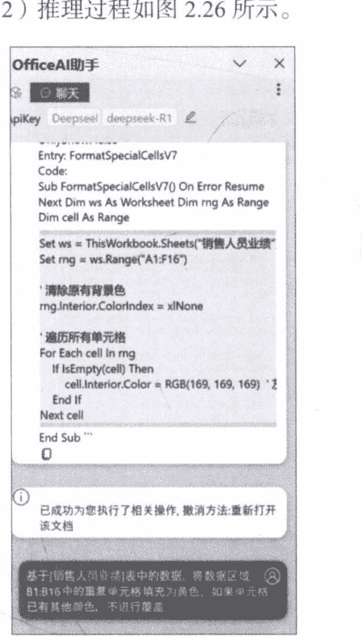

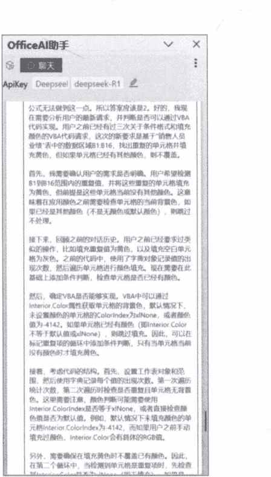

（3）重复值填充结果如图 2.27 所示。

| 序号 | 销售经理 | 年度目标 | 实际完成 | 完成率 | 评级 |
|---|---|---|---|---|---|
| 1 | 100032 | 36951 | 31366 | 84.89% | B |
| 2 | 100031 | 32569 | 24377 | 74.85% | C |
| 3 | 100029 | 32030 | 32163 | 100.42% | A |
| 4 | 100028 | 30070 | 25634 | 85.25% | B |
| 5 | 100027 | 28295 |  | 0.00% | C |
| 6 | 100033 | 26894 | 32176 | 119.64% | A |
| 7 | 100030 | 24734 | 32395 | 130.97% | S |
| 8 | 100030 | 24734 | 32395 | 130.97% | S |
| 9 | 100023 | 24550 | 32163 | 131.01% | S |
| 10 |  |  |  | #DIV/0! | #DIV/0! |
| 11 | 100034 | 22343 | 24380 | 109.12% | A |
| 12 | 100024 | 18793 | 24378 | 129.72% | S |
| 13 | 100025 | 17743 | 115705 | 652.12% | S |
| 14 | 100026 | 17054 | 17442 | 102.28% | A |
| - | 合计 | 336760 | 424574 | 126.08% | S |

图 2.27 重复值填充结果

#### 3. 诊断错误值

（1）在对话框中继续输入提示词“基于 [ 销售人员业绩 ] 表中的数据，将数据区域 E1:E16 中的数据错误值填充为红色；如果已经有其他填充色，不进行覆盖”，如图 2.28 所示。

（2）推理过程如图 2.29 所示。

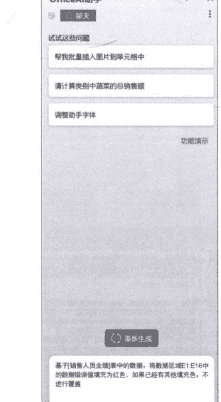

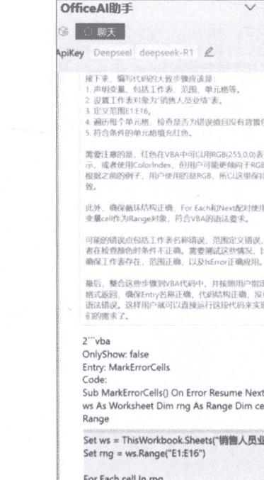

图 2.28 输入提示词

图 2.29 推理过程

（3）经处理后呈现的表格可参见图 2.30。

| 序号 | 销售经理 | 年度目标 | 实际完成 | 完成率 | 评级 |
|---|---|---|---|---|---|
| 1 | 100032 | 36951 | 31366 | 84.89% | B |
| 2 | 100031 | 32569 | 24377 | 74.85% | C |
| 3 | 100029 | 32030 | 32163 | 100.42% | A |
| 4 | 100028 | 30070 | 25634 | 85.25% | B |
| 5 | 100027 | 28295 |  | 0.00% | C |
| 6 | 100033 | 26894 | 32176 | 119.64% | A |
| 7 | 100030 | 24734 | 32395 | 130.97% | S |
| 8 | 100030 | 24734 | 32395 | 130.97% | S |
| 9 | 100023 | 24550 | 32163 | 131.01% | S |
| 10 |  |  |  | #DIV/0! | #DIV/0! |
| 11 | 100034 | 22343 | 24380 | 109.12% | A |
| 12 | 100024 | 18793 | 24378 | 129.72% | S |
| 13 | 100025 | 17743 | 115705 | 652.12% | S |
| 14 | 100026 | 17054 | 17442 | 102.28% | A |
| - | 合计 | 336760 | 424574 | 126.08% | S |

图 2.30 错误值填充结果

#### 4. 诊断异常值
（1）随后在指令区补充说明：“请依据《销售人员业绩》表的 E1:E16 区间，对数值高于 200% 的单元使用橘黄底标出，低于 30% 的单元使用绿色底标出，若已有底色则不再覆盖”，截图见图 2.31。
（2）推导过程展示在图 2.32。
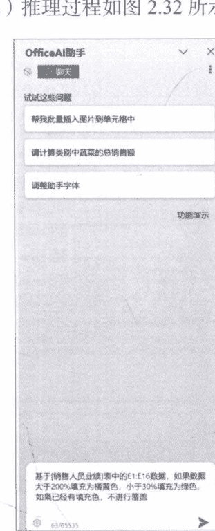
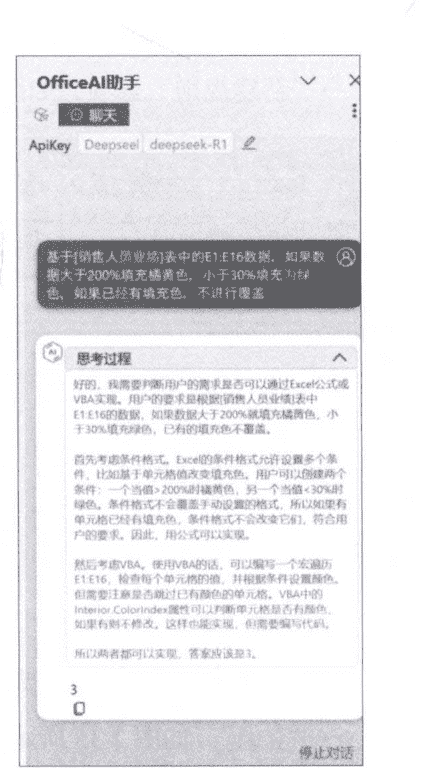
（3）着色完成后的样表见图 2.33。

| 序号 | 销售经理 | 年度目标 | 实际完成 | 完成率 | 评级 |
|---|---|---|---|---|---|
| 1 | 100032 | 36951 | 31366 | 84.89% | B |
| 2 | 100031 | 32569 | 24377 | 74.85% | C |
| 3 | 100029 | 32030 | 32163 | 100.42% | A |
| 4 | 100028 | 30070 | 25634 | 85.25% | B |
| 5 | 100027 | 28295 |  |  | C |
| 6 | 100033 | 26894 | 32176 | 119.64% | A |
| 7 | 100030 | 24734 | 32395 | 130.97% | S |
| 8 | 100030 | 24734 | 32395 | 130.97% | S |
| 9 | 100023 | 24550 | 32163 | 131.01% | S |
| 10 |  |  |  | #DIV/0! | #DIV/0! |
| 11 | 100034 | 22343 | 24380 | 109.12% | A |
| 12 | 100024 | 18793 | 24378 | 129.72% | S |
| 13 | 100025 | 17743 | 115705 | 652.12% | S |
| 14 | 100026 | 17054 | 17442 | 102.28% | A |
| - | 合计 | 336760 | 424574 | 126.08% | S |

图 2.33 异常值填充结果

涉及多条件判定时，建议让 OfficeAI 分步执行。

### 2.3.3 人工诊断
#### 1. 诊断缺失值
（1）在《销售人员业绩》表中框选 A1:F16 范围，进入“开始”菜单下创建格式规则的入口，截图为图 2.34 所示。
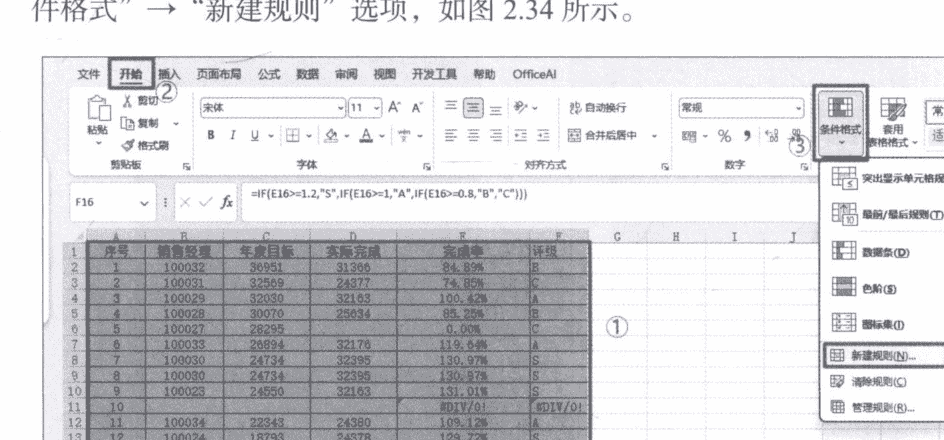
（2）规则类型选“仅对符合下列条件的格子应用格式”，再限定为“内容→空白”，如图 2.35。
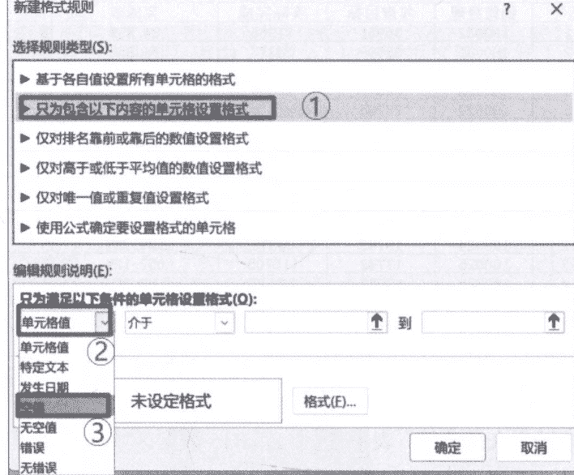
图 2.35 设定条件格式
（3）点按“格式”打开样式设置窗口，切换到底色页挑选一种色彩，如图 2.36。
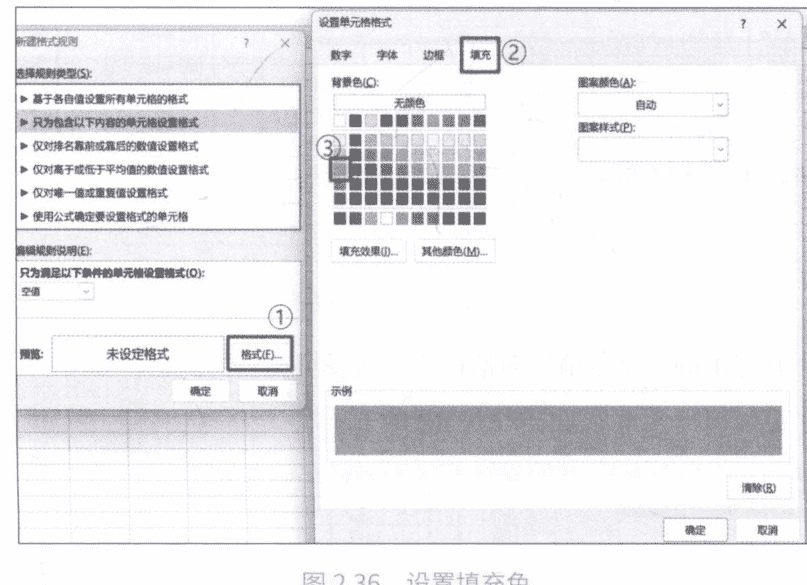
图 2.36 设置填充色
（4）空白项标注后的效果如图 2.37。

## 零基础玩转 DeepSeek：秒懂数据分析

| 序号 | 销售经理 | 年度目标 | 实际完成 | 完成率 | 评级 |
|---|---|---|---|---|---|
| 1 | 100032 | 36951 | 31366 | 84.89% | B |
| 2 | 100031 | 32569 | 24377 | 74.85% | C |
| 3 | 100029 | 32030 | 32163 | 100.42% | A |
| 4 | 100028 | 30070 | 25634 | 85.25% | B |
| 5 | 100027 | 28295 |  | 0.00% | C |
| 6 | 100033 | 26894 | 32176 | 119.64% | A |
| 7 | 100030 | 24734 | 32395 | 130.97% | S |
| 8 | 100030 | 24734 | 32395 | 130.97% | S |
| 9 | 100023 | 24550 | 32163 | 131.01% | S |
| 10 |  |  |  | #DIV/0! | #DIV/0! |
| 11 | 100034 | 22343 | 24380 | 109.12% | A |
| 12 | 100024 | 18793 | 24378 | 129.72% | S |
| 13 | 100025 | 17743 | 115705 | 652.12% | S |
| 14 | 100026 | 17054 | 17442 | 102.28% | A |
| - | 合计 | 336760 | 424574 | 126.08% | S |

图 2.37 缺失值填充结果

#### 2. 诊断重复值
（1）选取 B1:B15 区域，通过“开始”→“条件格式”→“突出显示单元格规则”→“重复值”，截图为图 2.38。
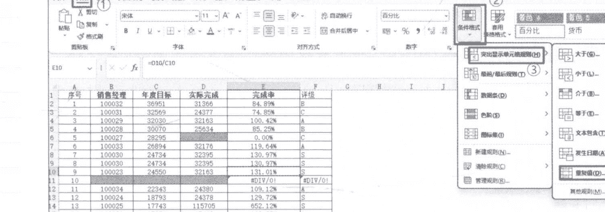
（2）弹出对话框中把高亮色设为黄色，如图 2.39。
（3）标记结果如图 2.40。
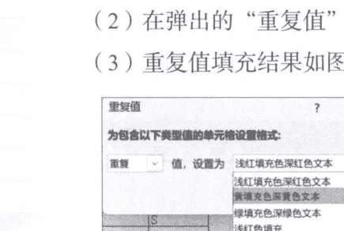


#### 3. 诊断错误值
（1）选中 A1:F16，点“开始”→“条件格式”→“新建规则”，如图 2.41。

（2）规则设为“只为包含以下内容的单元格设置格式”→“单元格值”→“错误”，如图 2.42。

（3）点“格式”打开对话框，切换到“填充”页选色，如图 2.43。
（4）着色效果如图 2.44。

## 零基础玩转 DeepSeek：秒懂数据分析


| 序号 | 销售经理 | 年度目标 | 实际完成 | 完成率 | 评级 |
|---|---|---|---|---|---|
| 1 | 100032 | 36951 | 31366 | 84.89% | B |
| 2 | 100031 | 32569 | 24377 | 74.85% | C |
| 3 | 100029 | 32030 | 32163 | 100.42% | A |
| 4 | 100028 | 30070 | 25634 | 85.25% | B |
| 5 | 100027 | 28295 |  | 0.00% | C |
| 6 | 100033 | 26894 | 32176 | 119.64% | A |
| 7 | 100030 | 24734 | 32395 | 130.97% | S |
| 8 | 100030 | 24734 | 32395 | 130.97% | S |
| 9 | 100023 | 24550 | 32163 | 131.01% | S |
| 10 |  |  |  | #DIV/0! | #DIV/0! |
| 11 | 100034 | 22343 | 24380 | 109.12% | A |
| 12 | 100024 | 18793 | 24378 | 129.72% | S |
| 13 | 100025 | 17743 | 115705 | 652.12% | S |
| 14 | 100026 | 17054 | 17442 | 102.28% | A |
| - | 合计 | 336760 | 424574 | 126.08% | S |

图 2.44 错误值填充结果

#### 4. 诊断异常值
（1）框选 E1:E16，点“开始”→“条件格式”→“新建规则”，如图 2.45。

（2）选择“只为包含以下内容的单元格设置格式”，把单元格值设为大于或等于 2，如图 2.46。

图 2.46 设置单元格值大于或等于 2
（3）点“格式”，在“设置单元格格式”对话框的“填充”页选色，如图 2.47。

图 2.47 选择错误值填充色
（4）首次标记结果如图 2.48。

## 零基础玩转 DeepSeek：秒懂数据分析

| 序号 | 销售经理 | 年度目标 | 实际完成 | 完成率 | 评级 |
|---|---|---|---|---|---|
| 1 | 100032 | 36951 | 31366 | 84.89% | B |
| 2 | 100031 | 32569 | 24377 | 74.85% | C |
| 3 | 100029 | 32030 | 32163 | 100.42% | A |
| 4 | 100028 | 30070 | 25634 | 85.25% | B |
| 5 | 100027 | 28295 |  | 0.00% | C |
| 6 | 100033 | 26894 | 32176 | 119.64% | A |
| 7 | 100030 | 24734 | 32395 | 130.97% | S |
| 8 | 100030 | 24734 | 32395 | 130.97% | S |
| 9 | 100023 | 24550 | 32163 | 131.01% | S |
| 10 |  |  |  | #DIV/0! | #DIV/0! |
| 11 | 100034 | 22343 | 24380 | 109.12% | A |
| 12 | 100024 | 18793 | 24378 | 129.72% | S |
| 13 | 100025 | 17743 | 115705 | 652.12% | S |
| 14 | 100026 | 17054 | 17442 | 102.28% | A |
| - | 合计 | 336760 | 424574 | 126.08% | S |

图 2.48 异常值填充结果（1）
（5）同理，再把完成率小于 30% 的单元填成绿色，如图 2.49。

| 序号 | 销售经理 | 年度目标 | 实际完成 | 完成率 | 评级 |
|---|---|---|---|---|---|
| 1 | 100032 | 36951 | 31366 | 84.89% | B |
| 2 | 100031 | 32569 | 24377 | 74.85% | C |
| 3 | 100029 | 32030 | 32163 | 100.42% | A |
| 4 | 100028 | 30070 | 25634 | 85.25% | B |
| 5 | 100027 | 28295 |  | 0.00% | C |
| 6 | 100033 | 26894 | 32176 | 119.64% | A |
| 7 | 100030 | 24734 | 32395 | 130.97% | S |
| 8 | 100030 | 24734 | 32395 | 130.97% | S |
| 9 | 100023 | 24550 | 32163 | 131.01% | S |
| 10 |  |  |  | #DIV/0! | #DIV/0! |
| 11 | 100034 | 22343 | 24380 | 109.12% | A |
| 12 | 100024 | 18793 | 24378 | 129.72% | S |
| 13 | 100025 | 17743 | 115705 | 652.12% | S |
| 14 | 100026 | 17054 | 17442 | 102.28% | A |
| - | 合计 | 336760 | 424574 | 126.08% | S |

图 2.49 异常值填充结果（2）

### 2.3.4 小结
DeepSeek 网页版、OfficeAI 内嵌 DeepSeek 以及手工操作均可对数据质量问题做标注。手工需要业务理解与分析能力，DeepSeek 网页版与 OfficeAI 的输出需人工复核，不可照搬，发现不合理处要大胆质疑并修正。

## 2.4 数据清洗“三板斧”
数据清洗是数据处理的必要环节，直接影响分析结果的可靠性。清洗后数据更准确、完整、一致，为后续分析建模提供基础，无论是商业决策、科研还是机器学习，清洗都不可或缺。

2.3 节已学会质量诊断，本节聚焦问题数据的清洗方法。

常见问题及处理见表 2.1。

### 表 2.1 常见的数据质量问题及处理方法

| 数据问题 | 检测方法 | 处理方法 |
| :--- | :--- | :--- |
| 缺失值 | - 检查空值<br>- 统计缺失值比例 | - 删除：<br>  · 删除行（缺失值比例高）<br>  · 删除列（特征不重要）<br>- 填充：<br>  · 数值型：平均数、中位数、众数<br>  · 分类数据：众数 |
| 重复数据 | - 使用唯一键或组合键<br>- 检查重复记录 | 删除重复记录，保留唯一值 |
| 异常值 | 统计方法：Z 分数、IQR 方法 | - 删除：异常值是错误的<br>- 替换：平均数、中位数、边界 |
| 空白值 | 检查空单元格或空字符串 | - 删除：空白值比例高时删除记录或特征<br>- 填充：平均数、中位数、众数或“未知”类别 |
| 数据不一致 | - 检查数据格式一致性<br>- 比较同一数据项在不同记录中的值 | - 统一格式：统一数据格式，如日期格式统一为 YYYY-MM-DD<br>- 标准化编码：统一分类变量的编码，如“男”和“女”统一为 0 和 1<br>- 数据清洗：删除或修正不一致的记录 |

总体看，清洗核心手段是删除、填充和替换，标准化编码属于数据录入前的规则制定。为表述方便，这里把删除、填充、替换统称为数据清洗“三板斧”。

2.3 节已完成诊断并明确当前问题，下文将借助 DeepSeek、OfficeAI 内嵌 DeepSeek、Excel 分别进行清洗。

### 2.4.1 使用 DeepSeek 进行数据清洗
回看质量检测结果，如图 2.50。

| 行号 | 异常分类 | 异常理由 | 处理建议 |
|---|---|---|---|
| 7 & 8 | 数据重复 | 销售经理 100030 数据完全重复（目标、实际完成、完成率、评级均相同） | 检查是否为重复录入，保留一条数据，删除重复行 |
| 5 | 数据缺失 | 销售经理 100027 的“实际完成”为空，完成率为 0.00% | 补充实际完成数据，或标注未完成原因（如离职、项目取消等） |
| 10 | 数据缺失 | 整行数据缺失（仅序号和评级列为 c，其他列为空） | 删除无效空行，或补充完整数据 |
| 13 | 数值异常 | 销售经理 100025 实际完成值为 115,705，完成率 652.12% 超出合理范围 | 核查数据准确性（疑似多输入了一个零，正确值可能为 11,570，完成率 65.21%） |

| 合计行 | 逻辑矛盾 | 合计行完成率 118.46% 评级为 A，与个体评级规则矛盾（部分完成率更低的个体评为 S） | 调整评级逻辑（合计行通常不参与评级），或统一规则 |


#### 1. 删除重复数据

（1）先让模型执行去重任务，明确只保留第7行，其余重复记录一并剔除，提示词示范可见图2.51，运行后的表格呈现如图2.52。


# 第2章 数据清洗指南

| 序号 | 销售经理 | 年度目标 | 实际完成 | 完成率 | 评级 | 备注 |

|---|---|---|---|---|---|---|

| 1 | 100032 | 36951 | 31366 | 84.89% | B | |

| 2 | 100031 | 32569 | 24377 | 74.85% | C | |

| 3 | 100029 | 32030 | 32163 | 100.42% | A | |

| 4 | 100028 | 30070 | 25634 | 85.25% | B | |

| 5 | 100027 | 28295 | | 0.00% | C | 需补充数据 |

| 6 | 100033 | 26894 | 32176 | 119.64% | A | |

| 7 | 100030 | 24734 | 32395 | 130.97% | S | 保留行 |

| ~~8~~ | ~~100030~~ | ~~24734~~ | ~~32395~~ | ~~130.97%~~ | ~~S~~ | 已删除 |

| 9 | 100023 | 24550 | 32163 | 131.01% | S | |

| 10 | | | | | C | 需删除或补充 |

| 11 | 100034 | 22343 | 24380 | 109.12% | A | |

| 12 | 100024 | 18793 | 24378 | 129.72% | S | |

| 13 | 100025 | 17743 | 115705 | 652.12% | S | 数值异常 |

| 14 | 100026 | 17054 | 17442 | 102.28% | A | |

| 合计 | | 336760 | 398940 | 118.46% | A | 逻辑矛盾 |

图 2.52 输出结果

（2）紧接着给出只展示清理后结果的指令，提示词参考图2.53，对应的处理结果见图2.54。


图 2.53 输入提示词

| 删除后的数据表 | | | | | | |

|---|---|---|---|---|---|---|

| 序号 | 销售经理 | 年度目标 | 实际完成 | 完成率 | 评级 | |

| 1 | 100032 | 36951 | 31366 | 84.89% | B | |

| 2 | 100031 | 32569 | 24377 | 74.85% | C | |

| 3 | 100029 | 32030 | 32163 | 100.42% | A | |

| 4 | 100028 | 30070 | 25634 | 85.25% | B | |

| 5 | 100027 | 28295 | | 0.00% | C | |

| 6 | 100033 | 26894 | 32176 | 119.64% | A | |

| 7 | 100030 | 24734 | 32395 | 130.97% | S | |

| 9 | 100023 | 24550 | 32163 | 131.01% | S | |

| 10 | | | | | C | |

| 11 | 100034 | 22343 | 24380 | 109.12% | A | |

| 12 | 100024 | 18793 | 24378 | 129.72% | S | |

| 13 | 100025 | 17743 | 115705 | 652.12% | S | |

| 14 | 100026 | 17054 | 17442 | 102.28% | A | |

| 合计 | | 336760 | 398940 | 118.46% | A | |

图 2.54 输出结果

#### 2. 删除空白行

该环节的任务是清除序号10的空行，提示内容见图2.55，处理完的效果如图2.56。


图 2.55 输入提示词

| 序号 | 销售经理 | 年度目标 | 实际完成 | 完成率 | 评级 |

|---|---|---|---|---|---|

| 1 | 100032 | 36951 | 31366 | 84.89% | B |

| 2 | 100031 | 32569 | 24377 | 74.85% | C |

| 3 | 100029 | 32030 | 32163 | 100.42% | A |

| 4 | 100028 | 30070 | 25634 | 85.25% | B |

| 5 | 100027 | 28295 | 0.00% | C |

| 6 | 100033 | 26894 | 32176 | 119.64% | A |

| 7 | 100030 | 24734 | 32395 | 130.97% | S |

| 9 | 100023 | 24550 | 32163 | 131.01% | S |

| 11 | 100034 | 22343 | 24380 | 109.12% | A |

| 12 | 100024 | 18793 | 24378 | 129.72% | S |

| 13 | 100025 | 17743 | 115705 | 652.12% | S |

| 14 | 100026 | 17054 | 17442 | 102.28% | A |

| 合计 | | 336760 | 398940 | 118.46% | A |

图 2.56 输出结果

#### 3. 填充数据

核查发现销售经理100027的实际完成值应为21687，指令要求将其补入表格，示例提示见图2.57，更新后的数据如图2.58。


图 2.57 输入提示词

| 序号 | 销售经理 | 年度目标 | 实际完成 | 完成率 | 评级 | 备注 |

|---|---|---|---|---|---|---|

| 1 | 100032 | 36951 | 31366 | 84.89% | B | |

| 2 | 100031 | 32569 | 24377 | 74.85% | C | |

| 3 | 100029 | 32030 | 32163 | 100.42% | A | |

| 4 | 100028 | 30070 | 25634 | 85.25% | B | |

| 5 | 100027 | 28295 | 21687 | 76.65% | C | 已更新 |

| 6 | 100033 | 26894 | 32176 | 119.64% | A | |

| 7 | 100030 | 24734 | 32395 | 130.97% | S | |

| 9 | 100023 | 24550 | 32163 | 131.01% | S | |

| 11 | 100034 | 22343 | 24380 | 109.12% | A | |

| 12 | 100024 | 18793 | 24378 | 129.72% | S | |

| 13 | 100025 | 17743 | 115705 | 652.12% | S | 数值异常 |

| 14 | 100026 | 17054 | 17442 | 102.28% | A | |

| 合计 | | 336760 | 420,627 | 124.91% | A | 已更新 |

图 2.58 输出结果

补齐数值后，该经理的完成率随公式自动更新，底部合计也同步变化。

#### 4. 异常数据替换

再次核对后，销售经理100025的实际完成应修正为15705，提示词示例见图2.59，修正后的表格见图2.60。


数据替换后，完成率自动重新计算，评级依据规则刷新，其中80%到100%区间对应B级，合计数值亦随之调整。

#### 5. 逻辑问题处理

为了修正逻辑矛盾，下令让合计行不再评级，清空其评级格，提示见图2.61，最终效果见图2.62。


# 零基础玩转DeepSeek：数据分析


图 2.62 输出结果

#### 6. 排序并重新编码序号

前面删除操作导致序号不连续，最后需要统一重排。本次按完成率由高到低排序并重新编号，指令示例见图2.63，排序结果见图2.64。


图 2.63 输入提示词


图 2.64 输出结果

这些步骤其实可以合并成一条复合指令，为了让读者看清每一步变化，这里选择分步演示。

### 2.4.2 使用 OfficeAI 内嵌 DeepSeek 进行数据清洗

先回看一遍数据质量检测的原始结果，见图2.65。

| 序号 | 销售经理 | 年度目标 | 实际完成 | 完成率 | 评级 |

|---|---|---|---|---|---|

| 1 | 100032 | 36951 | 31366 | 84.89% | B |

| 2 | 100031 | 32569 | 24377 | 74.85% | C |

| 3 | 100029 | 32030 | 32163 | 100.42% | A |

| 4 | 100028 | 30070 | 25634 | 85.25% | B |

| 5 | 100027 | 28295 | | 0.00% | C |

| 6 | 100033 | 26894 | 32176 | 119.64% | A |

| 7 | 100030 | 24734 | 32395 | 130.97% | S |

| 8 | 100030 | 24734 | 32395 | 130.97% | S |

| 9 | 100023 | 24550 | 32163 | 131.01% | S |

| 10 | | | | #DIV/0! | #DIV/0! |

| 11 | 100034 | 22343 | 24380 | 109.12% | A |

| 12 | 100024 | 18793 | 24378 | 129.72% | S |

| 13 | 100025 | 17743 | 115705 | 652.12% | S |

| 14 | 100026 | 17054 | 17442 | 102.28% | A |

| - | 合计 | 336760 | 424574 | 126.08% | S |

图 2.65 数据质量检验结果

#### 1. 删除重复数据

在销售人员业绩表中打开OfficeAI助手侧边栏，向其发送“基于[销售人员业绩]表，删除序号8的数据”指令，提示示例见图2.66，执行后的表格见图2.67。


图 2.66 输入提示词

# 零基础玩转DeepSeek：数据分析

| 序号 | 销售经理 | 年度目标 | 实际完成 | 完成率 | 评级 |

|---|---|---|---|---|---|

| 1 | 100032 | 36951 | 31366 | 84.89% | B |

| 2 | 100031 | 32569 | 24377 | 74.85% | C |

| 3 | 100029 | 32030 | 32163 | 100.42% | A |

| 4 | 100028 | 30070 | 25634 | 85.25% | B |

| 5 | 100027 | 28295 | | 0.00% | C |

| 6 | 100033 | 26894 | 32176 | 119.64% | A |

| 7 | 100030 | 24734 | 32395 | 130.97% | S |

| 9 | 100023 | 24550 | 32163 | 131.01% | S |

| 10 | | | | #DIV/0! | #DIV/0! |

| 11 | 100034 | 22343 | 24380 | 109.12% | A |

| 12 | 100024 | 18793 | 24378 | 129.72% | S |

| 13 | 100025 | 17743 | 115705 | 652.12% | S |

| 14 | 100026 | 17054 | 17442 | 102.28% | A |

| - | 合计 | 312026 | 392179 | 125.69% | S |

图 2.67 输出结果

#### 2. 删除空白行

接着发出“基于[销售人员业绩]表，删除序号10的数据”指令，提示见图2.68，得到的结果见图2.69。


| 序号 | 销售经理 | 年度目标 | 实际完成 | 完成率 | 评级 |

|---|---|---|---|---|---|

| 1 | 100032 | 36951 | 31366 | 84.89% | B |

| 2 | 100031 | 32569 | 24377 | 74.85% | C |

| 3 | 100029 | 32030 | 32163 | 100.42% | A |

| 4 | 100028 | 30070 | 25634 | 85.25% | B |

| 5 | 100027 | 28295 | | 0.00% | C |

| 6 | 100033 | 26894 | 32176 | 119.64% | A |

| 7 | 100030 | 24734 | 32395 | 130.97% | S |

| 9 | 100023 | 24550 | 32163 | 131.01% | S |

| 11 | 100034 | 22343 | 24380 | 109.12% | A |

| 12 | 100024 | 18793 | 24378 | 129.72% | S |

| 13 | 100025 | 17743 | 115705 | 652.12% | S |

| 14 | 100026 | 17054 | 17442 | 102.28% | A |

| - | 合计 | 312026 | 392179 | 125.69% | S |

图 2.69 输出结果

#### 3. 填充数据

随后指令模型“基于[销售人员业绩]表，将D6单元格写入21687”，提示示例见图2.70，处理后表格见图2.71。

# 第2章 数据清洗指南


由于表内使用了公式，数值填入后完成率与评级会自动刷新为正确结果。

#### 4. 异常数据替换

之后让模型执行“基于[销售人员业绩]表，把D12单元格改为15705”，提示见图2.72，更新后的表格见图2.73。


受公式驱动，实际完成值更新后评级也会同步修正为准确状态。

#### 5. 逻辑问题处理

最后处理逻辑问题，指令为“基于[销售人员业绩]表，清空F14单元格内容”，提示见图2.74，结果见图2.75。


#### 6. 排序

数据整理完毕后，按完成率降序排列且排除合计行，指令示例见图2.76，排序后的结果见图2.77。


#### 7. 重新编码序号

（1）排序完成之后，因为前期剔除记录和重排，序号栏已经失效，需要重新编排。可输入提示“依据[销售人员业绩]表资料，对序号列重新编码，合计行不要参与”，示意图见图 2.78。


（2）排序展示如[content]
（1）完成排序后，由于先前删减记录并重新排列，序号列已经不再对应。此时可发出指令“依据[销售人员业绩]表资料，为序号列重新编号，合计行不计入”，参考图 2.78。


（2）图 2.79 呈现了排序后的状态。若使用数组公式返回，会得到错误结果，原因在于该类公式必须以 Ctrl+Shift+Enter 结束，对新手不够友好。所以本步改为 VBA 完成，读者无需任何额外操作。


（3）再次提交指令。系统判断到上一步仍是公式方案，于是要求改用 VBA 路径，提示写入“使用 VBA 的方式实现”，见图 2.80，生成画面见图 2.81。


### 2.4.3 人工清洗

#### 1. 删除空白行

（1）打开“数据”→“排序和筛选”→“筛选”，在“销售经理”列的下拉框里勾选“[空白]”，操作参考图 2.82。过滤后内容见图 2.83。


# 第2章 数据清洗

| 序号 | 销售经理 | 年度目标 | 实际完成 | 完成率 | 评级 |
|---|---|---|---|---|---|
| 10 |  |  |  | #DIV/0! | #DIV/0! |

图 2.83 筛选结果

（2）把筛选出来的空行选中，右键选择“删除行”，示意见图 2.84。

（3）清理后的表格形态见图 2.85。


| 序号 | 销售经理 | 年度目标 | 实际完成 | 完成率 | 评级 |
|---|---|---|---|---|---|
| 1 | 100032 | 36951 | 31366 | 84.89% | B |
| 2 | 100031 | 32569 | 24377 | 74.85% | C |
| 3 | 100029 | 32030 | 32163 | 100.42% | A |
| 4 | 100028 | 30070 | 25634 | 85.25% | B |
| 5 | 100027 | 28295 |  | 0.00% | C |
| 6 | 100033 | 26894 | 32176 | 119.64% | A |
| 7 | 100030 | 24734 | 32395 | 130.97% | S |
| 8 | 100030 | 24734 | 32395 | 130.97% | S |
| 9 | 100023 | 24550 | 32163 | 131.01% | S |
| 11 | 100034 | 22343 | 24380 | 109.12% | A |
| 12 | 100024 | 18793 | 24378 | 129.72% | S |
| 13 | 100025 | 17743 | 115705 | 652.12% | S |
| 14 | 100026 | 17054 | 17442 | 102.28% | A |
| - | 合计 | 336760 | 424574 | 126.08% | S |

图 2.85 删除后的效果

#### 2. 删除重复数据

定位到序号 8 的行，右键点“删除”，操作见图 2.86。处理后表格见图 2.87。


| 序号 | 销售经理 | 年度目标 | 实际完成 | 完成率 | 评级 |
|---|---|---|---|---|---|
| 1 | 100032 | 36951 | 31366 | 84.89% | B |
| 2 | 100031 | 32569 | 24377 | 74.85% | C |
| 3 | 100029 | 32030 | 32163 | 100.42% | A |
| 4 | 100028 | 30070 | 25634 | 85.25% | B |
| 5 | 100027 | 28295 |  | 0.00% | C |
| 6 | 100033 | 26894 | 32176 | 119.64% | A |
| 7 | 100030 | 24734 | 32395 | 130.97% | S |
| 9 | 100023 | 24550 | 32163 | 131.01% | S |
| 11 | 100034 | 22343 | 24380 | 109.12% | A |
| 12 | 100024 | 18793 | 24378 | 129.72% | S |
| 13 | 100025 | 17743 | 115705 | 652.12% | S |
| 14 | 100026 | 17054 | 17442 | 102.28% | A |
| - | 合计 | 312026 | 392179 | 125.69% | S |

图 2.87 删除后的效果


助学答疑

069

#### 3. 修改空白数据和异常数据

本例的空缺和异常值核实后可直接改写，改写后表格见图 2.88。

表中保留了公式，数值确认后“完成率”“评级”会随公式自动刷新为正确结果。先前用条件格式标注的问题，修正后高亮底色也会自动消失。

| 序号 | 销售经理 | 年度目标 | 实际完成 | 完成率 | 评级 |
|---|---|---|---|---|---|
| 1 | 100032 | 36951 | 31366 | 84.89% | B |
| 2 | 100031 | 32569 | 24377 | 74.85% | C |
| 3 | 100029 | 32030 | 32163 | 100.42% | A |
| 4 | 100028 | 30070 | 25634 | 85.25% | B |
| 5 | 100027 | 28295 | 21687 | 76.65% | C |
| 6 | 100033 | 26894 | 32176 | 119.64% | A |
| 7 | 100030 | 24734 | 32395 | 130.97% | S |
| 9 | 100023 | 24550 | 32163 | 131.01% | S |
| 11 | 100034 | 22343 | 24380 | 109.12% | A |
| 12 | 100024 | 18793 | 24378 | 129.72% | S |
| 13 | 100025 | 17743 | 15705 | 88.51% | B |
| 14 | 100026 | 17054 | 17442 | 102.28% | A |
| - | 合计 | 312026 | 313866 | 100.59% | A |


#### 4. 排序

打开“数据”→“排序和筛选”→“排序”。把排序依据设为“完成率”，次序选降序，配置见图 2.89。排序后画面见图 2.90。


# 第 2 章 数据清洗

| 序号 | 销售经理 | 年度目标 | 实际完成 | 完成率 | 评级 |
|---|---|---|---|---|---|
| 9 | 100023 | 24550 | 32163 | 131.01% | S |
| 7 | 100030 | 24734 | 32395 | 130.97% | S |
| 12 | 100024 | 18793 | 24378 | 129.72% | S |
| 6 | 100033 | 26894 | 32176 | 119.64% | A |
| 11 | 100034 | 22343 | 24380 | 109.12% | A |
| 14 | 100026 | 17054 | 17442 | 102.28% | A |
| 3 | 100029 | 32030 | 32163 | 100.42% | A |
| 13 | 100025 | 17743 | 15705 | 88.51% | B |
| 4 | 100028 | 30070 | 25634 | 85.25% | B |
| 1 | 100032 | 36951 | 31366 | 84.89% | B |
| 5 | 100027 | 28295 | 21687 | 76.65% | C |
| 2 | 100031 | 32569 | 24377 | 74.85% | C |
| - | 合计 | 312026 | 313866 | 100.59% | A |

图 2.90 排序结果

#### 5. 序号编码

（1）在序号列前两格分别填 1、2，框选后拖动右下角的填充手柄，见图 2.91。

| 序号 | 销售经理 | 年度目标 | 实际完成 | 完成率 | 评级 |
|---|---|---|---|---|---|
| 1 | 100023 | 24550 | 32163 | 131.01% | S |
| 2 | 100030 | 24734 | 32395 | 130.97% | S |
| 12 | 100024 | 18793 | 24378 | 129.72% | S |
| 6 | 100033 | 26894 | 32176 | 119.64% | A |
| 11 | 100034 | 22343 | 24380 | 109.12% | A |
| 14 | 100026 | 17054 | 17442 | 102.28% | A |
| 3 | 100029 | 32030 | 32163 | 100.42% | A |
| 13 | 100025 | 17743 | 15705 | 88.51% | B |
| 4 | 100028 | 30070 | 25634 | 85.25% | B |
| 1 | 100032 | 36951 | 31366 | 84.89% | B |
| 5 | 100027 | 28295 | 21687 | 76.65% | C |
| 2 | 100031 | 32569 | 24377 | 74.85% | C |
| - | 合计 | 312026 | 313866 | 100.59% | A |

图 2.91 输入序号

（2）将填充手柄向下拖至第 13 行，填充后效果见图 2.92。

| 序号 | 销售经理 | 年度目标 | 实际完成 | 完成率 | 评级 |
|---|---|---|---|---|---|
| 1 | 100023 | 24550 | 32163 | 131.01% | S |
| 2 | 100030 | 24734 | 32395 | 130.97% | S |
| 3 | 100024 | 18793 | 24378 | 129.72% | S |
| 4 | 100033 | 26894 | 32176 | 119.64% | A |
| 5 | 100034 | 22343 | 24380 | 109.12% | A |
| 6 | 100026 | 17054 | 17442 | 102.28% | A |
| 7 | 100029 | 32030 | 32163 | 100.42% | A |
| 8 | 100025 | 17743 | 15705 | 88.51% | B |
| 9 | 100028 | 30070 | 25634 | 85.25% | B |
| 10 | 100032 | 36951 | 31366 | 84.89% | B |
| 11 | 100027 | 28295 | 21687 | 76.65% | C |
| 12 | 100031 | 32569 | 24377 | 74.85% | C |
| - | 合计 | 312026 | 313866 | 100.59% | A |

图 2.92 填充结果

#### 6. 修改逻辑错误

清空“合计”行“评级”单元格内容，处理后见图 2.93。

# 零基础玩转 DeepSeek：秒懂数据分析

| 序号 | 销售经理 | 年度目标 | 实际完成 | 完成率 | 评级 |
|---|---|---|---|---|---|
| 1 | 100023 | 24550 | 32163 | 131.01% | S |
| 2 | 100030 | 24734 | 32395 | 130.97% | S |
| 3 | 100024 | 18793 | 24378 | 129.72% | S |
| 4 | 100033 | 26894 | 32176 | 119.64% | A |
| 5 | 100034 | 22343 | 24380 | 109.12% | A |
| 6 | 100026 | 17054 | 17442 | 102.28% | A |
| 7 | 100029 | 32030 | 32163 | 100.42% | A |
| 8 | 100025 | 17743 | 15705 | 88.51% | B |
| 9 | 100028 | 30070 | 25634 | 85.25% | B |
| 10 | 100032 | 36951 | 31366 | 84.89% | B |
| 11 | 100027 | 28295 | 21687 | 76.65% | C |
| 12 | 100031 | 32569 | 24377 | 74.85% | C |
| - | 合计 | 312026 | 313866 | 100.59% |  |

图 2.93 删除逻辑错误

### 2.4.4 小结

DeepSeek、OfficeAI 内嵌 DeepSeek、人工诊断均可完成清洗。总体来看，DeepSeek 操作更便捷，能自动判断并修正部分公式问题，但结果需复制到新表并自行校验；OfficeAI 内嵌版本可在原表直接处理，提示更直观，不过输出偶有偏差需要反复调整提示；对 Excel 熟练者而言，直接用表格处理最顺手，结果即时保留在工作簿里。

# 第 3 章 数据分析与可视化

当前信息高速增长，数据已成为支撑判断、推动创新的关键资源。无论是企业智能化、科研探索，还是社交舆情、公共健康治理，庞大数据流都在不断产生、聚集。但数据本身不产生价值，必须借助恰当的拆解与生动的展示，才能提炼出可执行的洞见，服务各个行业。

分析能从繁杂信息中剥离出规律、走向与联系，助我们把握当下、推演未来、校准选择。可视化则像翻译器，把抽象数字转成图形，令数据会说话，加快理解、讲清背后的逻辑、激发好奇。两者互为依托，形成从原始数据到行动洞察的闭环。随着技术演进与场景扩散，分析与可视化的价值会进一步放大。

本章会系统梳理分析与可视化的核心概念、运作步骤、常用手段和工具，以及它们在真实业务中的意义与落地注意点。学完后能够从海量记录中挑出有用信息，用清晰图形传递出来，更好理解复杂集合，挖掘隐含关联，为数据驱动决策提供准备，也为后续挖掘和进阶建模打下基础。

## 3.1 描述性分析

### 3.1.1 描述性分析介绍

描述性分析属于分析的入门层面，核心是对数据整体特征做概括。它借助统计指标与图形化手段，让使用者迅速把握分布形态、集中位置、离散幅度和变量间的大致关系，为后续深层次分析与模型搭建做好铺垫。

#### 1. 集中趋势的度量

集中趋势指标用来刻画数据的中心或代表值，常用平均值、中位数、众数三种。

（1）算术平均值等于全部数值相加再除以个数，计算公式为

$$\bar{x} = \frac{\sum_{i=1}^{n} x_i}{n}$$

其中，$x_i$ 表示数据集中的每个值，$n$ 表示数据的数量。

（2）中位数先把数据从小到大排列，取中间位置的数值。若个数为奇数，取正中间那个；若为偶数，则取中间两数之和的一半。

（3）众数是数据集中出现频次最高的值。一个数据集可能有一个众数或多个众数，也可能没有众数。例如：

- 数据集 1：1、1、1、4、5，该数据集的众数为 1。
- 数据集 2：1、1、3、3、5，该数据集的众数为 1 和 3，两者均出现了两次。
- 数据集 3：1、2、3、4、5，该数据集无众数。

#### 2. 离散程度的度量

离散程度指标反映数值偏离中心位置的分散情况，常见的有极差、四分位差、平均差、方差、标准差、异众比率和离散系数。

（1）极差即样本最大值减去最小值，公式为
$$R = \max(X) - \min(X)$$
它能直观展示数据的跨度，是离散度最基础的量度，但易受极端值干扰。

（2）四分位差用上四分位数 Q3 减去下四分位数 Q1 得到
$$IQR = Q3 - Q1$$
该指标只反映中间 50% 数据的分散程度，数值越小代表数据越集中，数值越大代表越离散。

（3）平均差为各观测值与均值的绝对偏差之和再除以样本容量 n
$$MD = \frac{\sum_{i=1}^{n} |x_i - \bar{x}|}{n}$$
它以均值为基准，能比较全面、准确地刻画一组数据的离散特征。

（4）方差与标准差。方差按各变量与均值的离差平方和除以 n-1 计算
$$s^2 = \frac{\sum_{i=1}^{n} (x_i - \bar{x})^2}{n-1}$$
标准差是方差的算术平方根。两者均能较好地反映数据的离散程度。

（5）异众比率表示非众数频数占总频数的比例
$$异众比率 = 1 - \frac{f_{众数}}{f_{总频数}}$$
比率越高，非众数组所占份额越大，众数的代表性越弱。

（6）离散系数等于标准差与均值的比值
$$CV = \frac{s}{\bar{x}}$$
该系数适用于不同量纲或不同均值水平下样本离散程度的横向比较。

### 3.1.2 用 DeepSeek 自检数据分布

掌握了描述性指标后，即便对 Excel 函数不熟练，也能借助 DeepSeek 完成统计并获得解读。下面以逐步引导的方式演示如何让其产出结论。

#### 1. DeepSeek 数据分析渐进式提问模式

（1）准备 2021 年不含港澳台的全国省区人口表，导入 DeepSeek 并开启“深度思考 R1”模式，界面如图 3.1 所示。

图 3.1 上传文件

（2）在对话区键入“请帮我统计 2021 年全国各省份人口的集中趋势”，返回结果如图 3.2 所示。

图 3.2 2021 年全国各省份人口集中趋势

（3）随后提问“请再统计一下离散程度”，返回结果如图 3.3 所示。

图 3.3 2021 年全国各省份人口离散程度

#### 3. 标准差 Standard Deviation

标准差为方差的平方根，用以衡量离散程度。公式为：
标准差 = √方差
计算得到：
标准差 = √6,919,073.95 ≈ 2630.42万人

#### 总结

- 极差：12318 万人
- 方差：约 6,919,073.95 (万人)²
- 标准差：约 2630.42 万人

上述指标显示省际人口差异较大，尤其是极差与标准差偏高，人口分布不均衡。


（4）在前两步基础上继续追问，让 DeepSeek 综合输出分析结论，如图 3.4 所示。
根据以上分析内容，请给出分析结果
对 2021 年中国各省人口数据的集中趋势与离散程度分析如下：

#### 1. 集中趋势分析

- 平均值：约 4565.45 万人
  各省平均规模较大，但均值受广东、山东等人口大省拉动明显。
- 中位数：3954 万人
  中位数低于平均值，说明分布右偏，高人口省份抬高了整体水平。
- 众数：无
  各省人口均不重复，不存在众数。
结论：
各省人口呈右偏分布，少数大省对平均值影响显著。

#### 2. 离散程度分析

- 极差：12318 万人
  广东 12684 万人与西藏 366 万人差距极大。
- 方差：约 6,919,073.95 (万人)²
  方差很高，表明省际人口分布很分散。
- 标准差：约 2630.42 万人
  标准差偏大，围绕均值的波动幅度明显。
结论：
省际人口离散度很高，分布极不均衡，广东、山东、河南等少数省份规模显著高于其余省份。


# DeepSeek 数据分析快速入门


#### 2. DeepSeek 数据分析结构化提问模式

若后续频繁进行描述性分析，可将上述流程提炼为结构化提示词，按“业务背景—分析目标—分析方法—结论输出”一次性提交。
仍以 2021 年全国人口数据为例，提示可写为：“以上文件是 2021 年全国人口数据，请对集中趋势与离散程度进行描述性分析，集中趋势指标为平均数、中位数、众数；离散程度指标为极差、方差、标准差、四分位差、离散系数，并给出洞察建议。”

操作步骤如下。
（1）上传数据并输入提示词，选择“深度思考 R1”模式，如图 3.5 所示。

（2）DeepSeek 的最终输出如图 3.6 所示。

图 3.6 最终输出结果

利用 DeepSeek 进行描述性分析有助于理解数据集，发现隐藏模式与趋势，也是后续分析的重要基础。

### 3.2.3 使用要点小结

描述性分析是常见方法，结合 DeepSeek 可快速实现。结果给出后仍需人工校验，避免错误。

## 3.2 常用分析方法概览

数据分析方法本质上是一套从数据中提取有用信息的工具与技巧，相当于给数据做体检，通过不同手段发现隐藏的模式、趋势或问题。按目标可分为现状分析、诊断分析与预测分析，其中现状与诊断应用最广。

### 3.2.1 现状分析

现状分析旨在摸清当前数据的真实状况，为决策提供依据。常见方法有对比分析法、趋势分析法、RFM 分析法等。

#### 1. 对比分析法

对比分析通过比较两个或多个对象、现象或时间点，揭示差异、相似与变化趋势。常见分类如下。

（1）按比较对象分类。
- ▶ 不同时间点对比：比较同一指标在不同时期的数值，分析变化。例如比较企业本年与上年的销售额，了解增长情况，如图 3.7 所示。
- ▶ 不同群体对比：对不同人群、部门、地区比较，找出差异。图 3.8 显示各大区销售额，华东与中南较高，西北与西南较低，可判断主要市场。

- ▶ 不同条件对比：在不同实验条件或政策环境下比较，评估条件影响。例如某企业引入两种生产工艺，投产一个月后比较合格率，结果如图 3.9 所示。

图 3.9 不同条件对比

（2）按比较维度分类。
- **单一指标对比**：聚焦某一个指标进行比较，如比较两家公司的利润率，如图 3.10 所示。
- **多指标综合对比**：同时考虑多个相关指标，全面分析差异。例如对两家企业的利润率与市场占有率进行对比，如图 3.11 所示。


图 3.10 单一指标对比
图 3.11 多指标综合对比

（3）按比较性质分类。
- **横向对比**：在同一层次或同一类别内比较，如“618”期间不同平台销售情况对比，如图 3.12 所示。

（注：数据来自星图数据监测。）
图 3.12 横向对比

# DeepSeek 数据实操零门槛

- ▶ 纵向对比：在不同层次或发展阶段比较，如我国不同时期人口规模分析如下。
- 1949—1973 年：人口自然增长率基本维持在 20‰ 以上，人口规模持续扩大。期间虽有三年困难的短暂冲击，随后恢复性增长使 1973 年自然增长率仍在 20‰ 以上。高自然增长率与低死亡率推动人口快速增长。
- 1974—1997 年：出生率在该时期波动明显且整体下降，人口仍在增长但增速放缓。
- 2000 年至今：人口增速进一步放缓。2000—2010 年年均增长率 0.57%，2010—2020 年 0.53%。自 2018 年起新增出生人数持续快速下降，显示人口结构老龄化，劳动人口比例下降，老年人口比例上升。

上述分类并非绝对独立，实际应用中常需综合使用，根据目标与数据特点灵活选择角度，以获得全面深入的结论。

#### 2. 趋势分析法

趋势分析通过观察数据随时间演变，揭示其趋势与规律。其基本思路是在特定时间跨度内把握动态走向。现状分析常用简单趋势分析法。

简单趋势分析法直接连接指标在不同时间点的数据形成趋势线，直观展示变化方向。当数据稳定、波动小，仅需了解大致发展方向时适用，如监控企业日新增用户、电商店铺日销售额等。某店铺 1—12 月销售额趋势如图 3.13 所示。


图 3.13 某店铺 1—12 月销售额趋势分析图

趋势性主要表现为上升、下降、平稳三种形态。

（1）上升趋势：数据随时间不断攀升，显示积极发展。如图 3.14，我国老龄化人口占比持续上升。

图 3.14 老龄化人口占比变化

（2）下降趋势：数据随时间稳步下滑，反映衰退或减弱。如图 3.15，我国劳动力人口占比持续下降。

图 3.15 劳动力人口占比变化

（3）平稳趋势：数据在一定区间波动，整体保持稳定。我国居民消费价格指数变化如图 3.16 所示。

图 3.16 我国居民消费价格指数变化

#### 3. RFM 分析法

RFM 分析法通过最近一次消费时间 Recency、消费频率 Frequency、消费金额 Monetary 三个维度衡量客户价值。核心思想是基于历史行为对客户进行评价分类。

- （1）Recency：距离上次购买的时间，间隔越短激活度越高。
- （2）Frequency：一定期限内的购买次数，频次越高忠诚度越高。
- （3）Monetary：指定时间内的消费总额，反映付费能力。

RFM 将用户分为 8 类，如图 3.17 所示。

| 分类 | R值 | F值 | M值 | 用户类型 | 备注 |
|---|---|---|---|---|---|
| 1 | 低 | 高 | 高 | 活跃VIP | 重要价值客户 |
| 2 | 低 | 低 | 高 | 潜力VIP | 重要深耕客户(忠诚度不高，但很有潜力，必须重点发展) |
| 3 | 低 | 高 | 低 | 普通熟客 | 潜力客户(客户忠诚度高，持续购买意愿较强，是有潜力的客户) |
| 4 | 高 | 高 | 高 | 沉睡VIP | 重要挽回客户(一段时间没来的忠诚客户，需要主动和他保持联系) |
| 5 | 高 | 低 | 高 | 流失贵客 | 重要挽留客户(将要流失或者已经流失的用户，应当采取挽留措施) |
| 6 | 高 | 高 | 低 | 流失熟客 | 一般维持客户(已有一段时间没有购买，消费金额并不高，没必要花太大成本挽回) |
| 7 | 低 | 低 | 低 | 普通新客 | 新客户 |
| 8 | 高 | 低 | 低 | 完全流失 | 流失客户(对我们产品不再感兴趣的客户) |

图 3.17 RFM 用户分类

分层后可针对性营销。
（1）对沉睡 VIP、潜力 VIP、流失贵客，因其价值高，可采取付费召回策略给予优惠。
（2）对活跃 VIP、普通熟客，购物频次高且稳定，维持常规运营即可。
（3）对普通新客，可投入费用促使其首次或复购，筛选高价值用户。
（4）对流失熟客、完全流失人群，召回难度大，在费用可控范围内日常维护即可。

### 3.2.2 诊断分析

诊断分析在发现异常后深入探究原因，通过细分、漏斗等手段揭示深层因素，为解决问题提供依据，是连接表象与根源的桥梁。常见方法有漏斗分析法、细分分析法、帕累托分析法、结构分析法、杜邦分析法和同期群分析法等。

#### 1. 漏斗分析法

漏斗分析法用于评估流程转化效果，将用户从起点到目标拆分为多个连续阶段，形成漏斗结构。通过各阶段用户数及转化率可直观发现瓶颈。

例如某店铺一个月各阶段数据：
- 访问网站用户：10000 人。
- 浏览商品用户：8000 人。
- 加入购物车用户：4000 人。
- 提交订单用户：3000 人。
- 完成支付用户：2000 人。

各阶段转化率见表 3.1。

表 3.1 各阶段用户转化率情况
| 阶段 | 人数 | 阶段转化率/% | 全阶段转化率/% |
| :--- | :--- | :--- | :--- |
| 网站访问 | 10000 | 100.0 | 100.0 |
| 浏览商品 | 8000 | 80.0 | 80.0 |
| 加入购物车 | 4000 | 50.0 | 40.0 |
| 提交订单 | 3000 | 75.0 | 30.0 |
| 完成支付 | 2000 | 66.7 | 20.0 |

转化率制成漏斗图如图 3.18 所示。


#### 2. 细分分析法

细分分析法按特征或规则将整体数据划分为子集，深入分析以揭示差异与规律。其目标是通过细分更精准理解不同群体特征，为决策提供依据。常见细分有时间细分、空间细分、公式细分等。

（1）时间细分，如按年、月、日、小时、分钟拆分。
（2）空间分析，如按省份划分全国。
（3）公式细分，如销售额 = 活跃用户数 × 转化率 × 客单价。

#### 3. 帕累托分析法

数据诊断与预测：常用分析方法一览

帕累托分析建立在80/20法则基础上，认为多数产出通常源于少数输入。这个思路在诊断场景里特别实用，能迅速找出对全局影响最大的驱动因素，让决策聚焦重点、资源投放更精准。以食用油业务为例，梳理发现3款单品就贡献了69%的营业额，而另3款单品则贡献了76%的利润总额，可见热销并非等同于高盈利。旅行社借助帕累托图审视客源结构，发现70后和60后占据明显优势，于是筹划在旺季前向这两类人群定向投放宣传。


#### 4. 结构分析法

结构分析的思路是把整体拆开来看各构成块，并研究它们之间的联系以及对整体的贡献。目标在于揭示数据背后的逻辑架构、层级关系和分布规律，为决策提供依据。这种拆分思路在实务中非常普遍，例如通过各品牌手机的占有率判断赛道格局；通过资产、负债和所有者权益的构成把握企业资金的来龙去脉；通过人口年龄分布判断是否步入老龄化。图 3.20 展示了某超市各品类水果的销售占比情况。


图 3.20 某超市各类水果销售占比

#### 5. 杜邦分析法

杜邦分析是财务领域的经典拆解模型，把核心指标层层展开形成完整体系，对企业财务状况和经营成果进行系统评价。该方法以净资产收益率ROE为锚点，拆分为盈利能力、资产周转效率与财务杠杆三个关联比率，通过比率间的联动剖析盈利、运营与偿债能力的互动。以某公司指标拆解为例，如图 3.21 所示。


图 3.21 杜邦分析法

#### 6. 同期群分析法

同期群分析用于追踪在同一时间段内产生特定行为的用户群体后续行为轨迹。将起点相同或特征相近的对象归为一个队列，持续观察其演变，就能发现不同队列间的差异与队列内部的趋势。

通过横向对比各队列的留存表现判断是否存在异常，再进一步拆解影响留存的关键驱动，见表 3.2。

表 3.2 留存率

单位：%

| 新增 | 1 周 | 2 周 | 3 周 | 4 周 | 5 周 |

| :--- | :--- | :--- | :--- | :--- | :--- |

| 1000 | 65.0 | 56.0 | 45.0 | 40.0 | 35.0 |

| 1500 | 80.0 | 60.0 | 40.0 | 35.0 | |

| 1000 | 80.0 | 60.0 | 45.0 | | |

| 1500 | 80.0 | 60.0 | | | |

| 1000 | 80.0 | | | | |

实际诊断中，单一方法很少独立使用，更多是组合搭配以提高洞察精度。

### 3.2.3 预测分析

预测分析利用历史数据和统计模型对未来走势进行推演。技术栈涵盖统计学、机器学习和时间序列等，目的是帮助组织和个人提前感知变化做出更稳妥的判断。

常见手法包括移动平均法、线性回归法和时间序列分析法等。

#### 1. 移动平均法

移动平均法是处理时间序列的常用平滑手段，通过计算窗口期数据的均值来削弱短期波动，凸显长期走向。方法假设近期观测对未来影响更大，因此会给予近期数据更高权重。

该技术适用于没有明显季节性波动的序列，不适合存在明显周期或季节特征的数据，且更偏向短期预测而非长期展望。

移动平均法中计算平均数的常见公式如下：

$$\bar{Y}_t = \frac{Y_{t-k+1} + Y_{t-k+2} + \cdots + Y_{t-1} + Y_t}{k}$$

移动平均法用于预测的公式如下：

$$F_{t+1} = \frac{Y_{t-k+1} + Y_{t-k+2} + \cdots + Y_{t-1} + Y_t}{k}$$

以某企业2009—2019年的销售数据为例，用简单二项移动平均法推算2020年销售额，见表 3.3。

表 3.3 二项移动平均法

单位：万元

| 年度 | 销售额 | 二项移动求和 | 二项移动平均 |

| :--- | :--- | :--- | :--- |

| 2009 | 58 | | |

| 2010 | 64 | — | — |

| 2011 | 87 | 58+64 | 61 |

| 2012 | 109 | 64+87 | 75.5 |

| 2013 | 130 | 87+109 | 98 |

| 2014 | 171 | 109+130 | 119.5 |

| 2015 | 182 | 130+171 | 150.5 |

| 2016 | 181 | 171+182 | 176.5 |

| 2017 | 190 | 182+181 | 181.5 |

| 2018 | 191 | 181+190 | 185.5 |

| 2019 | 189 | 190+191 | 190.5 |

| 2020 | | | 190 |

#### 2. 线性回归法

线性回归是统计与机器学习中常用的建模手段，用来刻画变量间的线性关联。因变量记为 y，自变量记为 x1、x2……目标是找到最优线性组合以尽可能准确地拟合因变量。公式如下：

$$y = \beta_0 + \beta_1x_1 + \beta_2x_2 + \cdots + \beta_nx_n + \varepsilon$$

其中，y 为预测对象；x1，x2，……，xn 为特征；β0 为截距；β1，β2，……，βn 为回归系数；ε 为误差项，表示自变量无法解释的随机扰动。

某公司2024年市场部广告投入与销售额数据见表 3.4。

表 3.4 广告投入与销售额数据

单位：万元

| 月份 | 广告投入 ($x$) | 销售额 ($y$) |

| :---: | :---: | :---: |

| 1 | 1 | 1.2 |

| 2 | 2 | 1.9 |

| 3 | 3 | 3 |

| 4 | 4 | 4.1 |

| 5 | 5 | 5 |

| 6 | 6 | 6.2 |

| 7 | 7 | 6.8 |

| 8 | 8 | 7.9 |

| 9 | 9 | 8.5 |

| 10 | 10 | 9 |

| 11 | 11 | 9.8 |

| 12 | 12 | 10.5 |

基于线性回归建立广告投入与销售额的关系模型。公式如下：

$$y=0.5+0.85x$$

模型显示广告投入每增加1万元，销售额预计提升约1.35万元，可用于推算后续月份。例如下月投入15万元，预测销售额为

$$y=0.5+0.85 \times 15=13.25$$

即预计下月销售额约13.25万元。

#### 3. 时间序列分析法

时间序列分析基于按时间顺序排列的观测值，通过观察、建模与推断揭示数据随时间演化的规律与趋势，并据此进行预测。序列通常具有连续性和相关性，时间单位可为年、季、月等。

表 3.5 为一家零售企业2020—2023年各季度销售数据，管理层希望预估未来一年各季度销售额以安排备货。

表 3.5 2020—2023 年各季度的销售数据

| 年 份 | 季 度 | 销售额 / 万元 |

| :--- | :--- | :--- |

| 2020 | Q1 | 122.4 |

| | Q2 | 169.2 |

| | Q3 | 165.6 |

| | Q4 | 194.4 |

| 2021 | Q1 | 129.6 |

| | Q2 | 180 |

| | Q3 | 176.4 |

| | Q4 | 211.2 |

| 2022 | Q1 | 145.2 |

| | Q2 | 195.6 |

| | Q3 | 187.2 |

| | Q4 | 224.4 |

| 2023 | Q1 | 163.2 |

| | Q2 | 216 |

| | Q3 | 202.8 |

| | Q4 | 237.6 |

通过时间序列模型得到预测公式为

```
y=3.3637x+153.96
```

预测得到 2023 年 Q1 ~ Q4 销售额如图 3.22 所示。


图 3.22 预测结果

在业务场景中很少单用一种方法，通常会组合使用。例如分析客户行为与体验时，可先用细分分析法按年龄、性别、消费频次、客单价等维度划分客户画像，制定差异化营销与服务策略；再用漏斗分析法追踪从触达到购买的各环节转化，定位转化率偏低的关键节点；最后深挖节点背后的根因，如页面加载慢、流程繁琐、客服响应迟滞等。

例如某在线教育平台用细分分析法将客户分为学生与职场人士两类。针对学生群体，漏斗分析发现浏览到购买的转化偏低，进一步诊断发现价格偏高且支付方式不灵活。平台随后推出分期付款与优惠套餐，提升该群体的购买转化。

### 3.2.4 使用 DeepSeek 辅助选择分析方法

挑选合适的分析方法对获取有效洞察至关重要。但随着数据复杂度提升和业务需求多样化，人工选型对非专业人员尤其困难。可以借助 DeepSeek 等智能工具辅助推荐。DeepSeek 能基于数据特征与问题描述给出方法建议。

仍以2021年我国各省份人口数据为例，操作流程如下。

（1）把数据导入，同时开启“深度思考（R1）”模式，如图 3.23 所示。


图 3.23 上传数据

（2）输入提示词“我要对 2021 年全国各省份人口数据进行进一步分析，请在前面描述性分析的基础上，推荐 3 个合适的分析方法对 2021 年的人口数据进行现状分析和诊断分析，并给出该分析方法的优劣势和推荐理由，以便于我选择，分析顺序为先现状分析后诊断分析。”得到 DeepSeek 给出的建议及选择理由如图 3.24 所示。


图 3.24 分析结果

2. 现状分析：分位数分层（人口规模层级）

方法说明：

按人口数值分位数（如四分位数）将省份划分为“低、中、高”人口层级，统计各层级省份数量及人口总量占比。

操作示例：

- 分层标准（基于31个省份）：

  - 低人口层级：Q1以下（<2422万人，如青海、西藏等8省）

  - 中人口层级：Q1-Q3（2422万-6601万人，如重庆、吉林等15省）

  - 高人口层级：Q3以上（>6601万人，如广东、山东等8省）

- 统计结果：高人口层级省份占比26%，但人口总量占比超50%。

优势：

- 量化头部效应：明确少数省份主导整体人口分布的现状。

- 简化决策优先级：快速识别需重点关注的“高人口省份”。

劣势：

- 阈值依赖性强：分层标准可能影响结论（如调整分位数会改变层级划分）。

- 忽略内部差异：同一层级内仍有较大波动（如广东1.26亿 vs 山东1.02亿）。

推荐理由：

- 数据离散系数高达125%，分位数分层能清晰展示人口分布的“金字塔结构”，为后续诊断提供基础框架。

3. 诊断分析：帕累托分析（关键省份识别）

方法说明：

验证是否前20%的省份占据80%总人口，锁定核心影响省份，并分析其共性特征（如经济水平、地理位置）。

操作示例：

- 排序与累计计算：按人口降序排列，计算累计人口占比。

  - 前6省（20%省份）：广东、山东、河南、江苏、四川、河北

  - 累计占比：约52%（未达80%，但显著高于均匀分布）。

- 结论修正：虽不完全符合“二八法则”，但头部省份仍占据主导地位。

优势：

- 聚焦核心矛盾：明确资源过度集中问题（如广东人口超1.2亿，远超其他省份）。

- 快速决策支持：提示需控制超大城市规模或扶持中小省份。

劣势：

- 忽略长尾效应：西藏、青海等级小省份的特殊需求可能被忽视。

- 单一维度局限：未结合经济、政策等外部因素解释人口集中原因。

推荐理由：

- 当前数据中头部省份（广东、山东、河南）人口显著突出，帕累托分析可量化其影响力，警示区域发展不平衡风险。

实施顺序与综合建议

1. 第一步：结构分析（现状分析）

   - 目标：宏观掌握东、中、西部人口分布差异。

   - 输出：区域对比图表（如柱状图显示各组平均人口）。

2. 第二步：分位数分层（现状分析）

   - 目标：细化人口规模层级，识别头部省份。

   - 输出：人口金字塔图或分层占比表格。

3. 第三步：帕累托分析（诊断分析）

   - 目标：锁定关键省份，分析其共性特征。

   - 输出：帕累托曲线图及头部省份清单。

优劣势对比与选择建议

| 方法 | 优势 | 劣势 | 推荐场景 |

| :--- | :--- | :--- | :--- |

| 结构分析 | 揭示区域差异，政策导向明确 | 依赖外部分类标准 | 需快速定位区域失衡问题 |

| 分位数分层 | 量化头部效应，简化决策优先级 | 阈值依赖性高 | 需明确人口层级分布 |

| 帕累托分析 | 聚焦核心矛盾，快速支持决策 | 忽略长尾细节 | 需识别关键影响省份 |

最终推荐：

- 若资源有限且需快速输出结论：**优先结构分析 + 帕累托分析**。

- 若需深入解析人口分布细节：**补充分位数分层分析**。

总结：通过结构分析与分位数分层完成现状描述，再通过帕累托分析诊断核心矛盾，三者结合可系统回答“哪里失衡”和“为何失衡”，为政策制定提供完整依据。

图 3.24 分析结果（续）

（3）结果修正。如果对于以上结果比较满意，则可以直接选择本次推荐的分析方法进行数据分析；如果不满意，则可以让 DeepSeek 进行修正。例如，输入提示词“不采用帕累托分析，请再次推荐”，最终生成的分析方法推荐如图 3.25 所示。


# 第 3 章 数据分析与可视化

### 3. 诊断分析：细分分析（多维属性拆解）

**方法说明：**

基于人口以外的属性（如地理特征、经济水平、资源禀赋），对省份进行多维度细分，探究人口分布差异的潜在驱动因素。

**操作示例：**

- 细分维度：

  - 地理属性：沿海 vs 内陆、平原 vs 山区。

  - 经济水平：高GDP省份（如广东、江苏） vs 低GDP省份（如青海、西藏）。

  - 资源类型：资源型省份（山西、内蒙古） vs 服务业主导省份（上海、北京）。

- 对比分析：计算各组平均人口，验证经济发达地区是否显著吸引更多人口。

**优势：**

- 多维度归因：结合经济、地理等外部因素，解释人口集中或流失的原因（如沿海地区经济优势吸引人口）。

- 灵活性强：可根据数据可用性选择细分维度（如若无GDP数据，可仅按地理划分）。

**劣势：**

- 依赖外部数据：需补充经济、地理等关联信息，否则结论单薄。

- 复杂性高：多维度交叉分析可能增加解读难度。

**推荐理由：**

- 当前数据的高离散性可能由经济或地理因素驱动，细分分析能直接关联人口分布与外部变量，诊断失衡根源。

**实施顺序与综合建议**

1. 第一步：结构分析（现状分析）

   - 目标：宏观掌握东、中、西部人口分布差异。

   - 输出：区域对比图表（如柱状图显示各组平均人口）。

2. 第二步：分位数分层（现状分析）

   - 目标：细化人口规模层级，识别头部省份。

   - 输出：人口金字塔图或分层占比表格。

3. 第三步：细分分析（诊断分析）

   - 目标：通过多维度拆解，诊断人口分布差异的驱动因素。

   - 输出：分组对比表格或热力图（如“经济水平-人口规模”关联图）。

**优劣势对比与选择建议**

| 方法 | 优势 | 劣势 | 推荐场景 |

| :--- | :--- | :--- | :--- |

| 结构分析 | 揭示区域差异，政策导向明确 | 依赖外部分类标准 | 需快速定位区域失衡问题 |

| 分位数分层 | 量化头部效应，简化决策优先级 | 阈值依赖性高 | 需明确人口层级分布 |

| 细分分析 | 多维度归因，解释驱动因素 | 需补充外部数据 | 需诊断人口集中或流失原因 |

**最终推荐：**

- 若可获取经济或地理数据：优先结构分析 + 细分分析，深入诊断失衡根源。

- 若仅有人口数据：补充分位数分层分析，明确优先级后通过调研补充外部信息。

**要点提炼：** 先用结构拆解配合分位数分层来描绘现状，再借助细分视角把外部变量关联进来展开解释，就能明确失衡的点位和成因，为制定经济扶持、资源调配等差异化策略提供可靠依据。

图 3.25 修正后结果（续）

### 3.2.5 小结
DeepSeek 可在分析方法选择上提供思路，但其建议必须审慎甄别。出现多条备选时，应根据研究场景挑出最合适的方案；若仅给出一项，则要对照研究目的判断是否符合需求。

## 3.3 DeepSeek 驱动的数据快速统计
数据统计是对信息进行采集、整理、推演和解读的完整链路，目的在于揭示事物特征、规律与走势，为决策提供依据，是数据分析的基础。原始明细本身没有价值，必须借助科学统计手段从不同角度加工，才能暴露隐藏的商业价值，故在分析流程中极为关键。常用手段主要有函数运算和数据透视表两类。

### 3.3.1 常用统计函数概览
在分析实践中，统计函数是处理数据集的核心工具，能基于特定统计逻辑对数据进行计算，帮助提取有效信息。常用函数大致归为三组：集中趋势类、离散程度类、数据汇总类。下面分别介绍定义、常用函数及应用场景。

#### 1. 集中趋势统计函数
（1）平均数：把所有数据求和后再除以数量，体现整体水平，但易受极端值干扰。
▶ 特性点：
- 高敏感：任一数据点变动都会影响结果。
- 易被极值拉动：极大或极小值会扭曲代表性。
▶ Excel 写法：average( 数据范围 )。

（2）中位数：将数据按升序排列后取中间位置的数，对极端值不敏感，能更好反映中间水平。
▶ 特性点：
- 稳健：对偏态分布更可靠。
- 分割作用：上下各占一半。
▶ Excel 写法：median( 数据范围 )。

（3）众数：在一组数据中出现频率最高的数值，可用于数值与分类数据，可能唯一、多个或不存在。
▶ 特性点：
- 适用分类：可反映最常见类别。
- 不唯一性：可能出现多众数或无众数。
▶ Excel 写法：mode( 数据范围 )。

#### 2. 离散程度统计函数
（1）极差：最大值减最小值，体现整体波动跨度，计算简便但受极端值影响，常用于质量控制监测尺寸波动。
▶ 特性点：
- 计算便捷：只需最大最小值相减。
- 受极端值影响大：异常值会放大极差。
▶ Excel 写法：max( 数据范围 )-min( 数据范围 )。

（2）方差：各数据点与均值的离差平方的平均，数值越大离散越强，广泛用于风险评估、实验误差等。
▶ 特性点：
- 覆盖全部点：计算中包含所有数据。
- 单位为平方：解释上不够直观。
▶ Excel 写法：var.p( 数据范围 ) / var.s( 数据范围 )。var.p 计算总体，var.s 计算样本。

（3）标准差：方差的平方根，单位与原数据一致，更直观。
▶ 特性点：
- 单位统一：便于理解。
- 应用广泛：是常用的离散指标。
▶ Excel 写法：stdev.p( 数据范围 ) / stdev.s( 数据范围 )。stdev.p 为总体，stdev.s 为样本。

（4）四分位差：上四分位 Q3 减下四分位 Q1，反映中间 50% 数据的离散。
▶ 特性点：
- 抗异常：不受极端值影响。
- 聚焦主体：只考虑中间部分。
▶ Excel 写法：Q3–Q1。先用 quartile.exc( 数据范围 ,n) 求四分位，n=1,2,3…。


#### 3. 数据汇总函数
（1）求和类。常用 sum，类似有 sumif、sumifs。sum 求总和；sumif 按单条件求和；sumifs 按多条件求和。
Excel 写法：
- sum( 数据集 )。
- sumif( 数据集, 条件值, 求和范围 )。
- sumifs( 求和范围, 条件范围 1, 条件值 1, 条件范围 2, 条件值 2,… )。

（2）计数类。count 统计数值单元格数，countif 单条件计数，countifs 多条件计数且条件为与。
Excel 写法：
- count( 数据集 )。
- countif( 条件范围, 条件值 )。
- countifs( 条件范围 1, 条件值 1, 条件范围 2, 条件值 2,… )。

（3）均值类。average 求算术平均，averageif 单条件平均，averageifs 多条件平均。
Excel 写法：
- average( 数据集 )。
- averageif( 条件范围, 条件值, 求平均范围 )。
- averageifs( 求平均范围, 条件范围 1, 条件值 1, 条件范围 2, 条件值 2,… )。

（4）最大值类。max 返回最大值，maxifs 返回满足条件的最大值。
Excel 写法：
- max( 数据集 )。
- maxifs( 求最大范围, 条件范围 1, 条件值 1, 条件范围 2, 条件值 2,...)。

（5）最小值类。min 返回最小值，minifs 返回满足条件的最小值。
Excel 写法：
- min( 数据集 )。
- minifs( 求最小范围, 条件范围 1, 条件值 1, 条件范围 2, 条件值 2,...)。

### 3.3.2 快速统计函数的三种操作路径
掌握常用函数后，在 DeepSeek 辅助下统计效率大幅提升。常见路径有：通过 DeepSeek 网站统计、通过 OfficeAI 中内置 DeepSeek 统计、直接用 Excel 函数统计。

#### 1. 使用 DeepSeek 网站进行统计
（1）把文件上传到 DeepSeek 网站，选择“深度思考（R1）模式”。
（2）输入提示词“以上为 2021 年人口数据，请计算全国人口的平均数、中位数、众数，并显示函数”。


（3）对返回的函数与结果优化，要求以表格形式呈现统计结果、函数与计算过程。

（4）可把函数复制到 Excel，在原表录入指标名称后输入函数，获取计算结果。


#### 2. 使用 OfficeAI 中内置 DeepSeek 进行统计
（1）在“OfficeAI 助手”对话框输入提示词“请计算一下 [人口数] 中各省份 [平均人口]，结果放在 E2 处”。

（2）OfficeAI 推理后以函数形式把结果写入 E2 单元格，并提示公式应用成功。

（3）在 E2 查看结果及公式。

（4）同理输入“请利用函数计算 [ 人口数 ] 中各省份 [ 中位数 ]，结果放在 F2 处”“请利用函数计算 [ 人口数 ] 中各省份 [ 众数 ]，结果放在 G2 处”，得到对应结果。


#### 3. 使用 Excel 函数进行统计
适合熟练用户，直接在 Excel 调用函数。
| 指标 | 结果 |
|---|---|
| 平均数 | |
| 中位数 | |
（1）先建立指标位置。
（2）输入 “=AVERAGE()”，选择合适的数据区域。
（3）回车后得到输出。


### 3.3.3 数据透视表介绍
数据透视表是电子表格软件中的强力工具，尤其在 Excel 中广泛使用。它允许用户通过拖拽快速对大量数据进行汇总与展示，帮助从多角度理解数据并辅助决策。主要功能包括数据汇总、动态调整汇总维度与方式、多维分析。
（1）数据汇总：自动按分类汇总，得到总计、平均等统计信息。
（2）动态调整：通过拖拽随时改变布局与汇总方式，无需重算。
（3）多维分析：支持行、列、值的多字段交叉分析。

#### 1. 数据透视表页面构成
页面主要由报表生成区、字段列表和字段设置区组成。
（1）报表生成区：展示汇总后的结果。
（2）字段列表：数据源字段，可拖入报表区。
（3）字段设置区：设置汇总方式与格式，字段可放入筛选器、行、列、值等区域。


#### 2. 数据透视表常用分析功能
（1）数据汇总与分类。自动分类汇总；多级分类汇总，逐层深入。
（2）数据筛选与排序。灵活筛选子集；多字段排序。
（3）数据分组与聚合。按间隔或类别分组；自定义分组。
（4）计算字段与公式。新增计算字段；计算百分比、增长率等。
（5）条件格式与数据可视化。条件格式突出重点；与图表结合展示。
（6）数据钻取与联动。汇总与明细间切换；多表联动分析。

（7）数据趋势分析。时间序列排列；环比与同比分析。
（8）数据占比分析。整体占比；分组内占比分析。

#### 3. 数据透视表优劣势
（1）优势：高效处理大数据；直观表格展示；布局灵活可调。
（2）劣势：对初学者操作偏复杂，公式设置易形成门槛；复杂需求下需结合其他工具。

### 3.3.4 数据透视表应用快速统计
创建与使用数据透视表有三种方式：DeepSeek 网站创建、OfficeAI 内置 DeepSeek 创建、Excel 手动创建。

#### 1. 通过 DeepSeek 网站创建数据透视表
（1）上传“销售明细 2019”文件到 DeepSeek 网站。

# 零基础玩转 DeepSeek：秒懂数据分析


图 3.41 上传数据

（2）向模型发送指令“文件为销售明细，请借助数据透视的统计能力，分别汇总各区域销售额及占比，并细化到区域内各省/自治区的销售额及占比”，如图 3.42 所示。


图 3.42 输入提示词

（3）DeepSeek 的返回结果见图 3.43。


图 3.43 输出结果

# 第3章 透视分析与可视化实操

2. 各区域下省/自治区销售额及占比

(1) 中南地区

| 省份 | 销售额 (¥) | 占中南地区的百分比 |
| :--- | :--- | :--- |
| 湖南 | 48,200 | 32.4% |
| 广东 | 35,670 | 24.0% |
| 湖北 | 28,450 | 19.1% |
| 广西 | 20,890 | 14.1% |
| 河南 | 15,422 | 10.4% |

(2) 华东地区

| 省份 | 销售额 (¥) | 占华东地区的百分比 |
| :--- | :--- | :--- |
| 上海 | 42,300 | 30.9% |
| 江苏 | 35,670 | 26.1% |
| 浙江 | 28,900 | 21.1% |
| 山东 | 20,450 | 15.0% |
| 福建 | 9,469 | 6.9% |

(3) 西北地区

| 省份 | 销售额 (¥) | 占西北地区的百分比 |
| :--- | :--- | :--- |
| 陕西 | 52,100 | 52.9% |
| 甘肃 | 32,450 | 32.9% |
| 新疆 | 13,906 | 14.2% |

(4) 东北地区

| 省份 | 销售额 (¥) | 占东北地区的百分比 |
| :--- | :--- | :--- |
| 黑龙江 | 28,450 | 62.9% |
| 辽宁 | 12,340 | 27.3% |
| 吉林 | 4,427 | 9.8% |

(5) 华北地区

| 省份 | 销售额 (¥) | 占华北地区的百分比 |
| :--- | :--- | :--- |
| 河北 | 9,870 | 44.2% |
| 北京 | 7,450 | 33.4% |
| 天津 | 3,025 | 13.5% |
| 内蒙古 | 2,000 | 9.0% |

(6) 西南地区

| 省份 | 销售额 (¥) | 占西南地区的百分比 |
| :--- | :--- | :--- |
| 四川 | 3,200 | 56.4% |
| 重庆 | 1,890 | 33.3% |
| 云南 | 588 | 10.3% |

研判要点：

1. 区域贡献：中南与华东合计贡献超过六成总营收，是核心市场。
2. 省级表现：
   - 陕西领跑西北，湖南领跑中南，上海领跑华东。
   - 黑龙江在东北占据主导，四川在西南占比较高。
3. 建议方向：对占比偏低的区域如西南，可设计促销与渗透计划。

图 3.43 输出结果（续）

从上述结果可以判断，DeepSeek 无法导出透视文件，但能直接给出统计数值，操作门槛低，对透视入门者具有参考价值。

#### 2. 借助 OfficeAI 内置 DeepSeek 生成透视表

（1）新建透视表并做基础求和。

第一步：在“销售明细”表中打开 OfficeAI 侧栏，输入“基于[销售明细表]的销售数据创建数据透视表，行字段为[产品名称]，值字段为[销售额]，输出到新工作表”，如图 3.44 所示。


第二步：推理过程见图 3.45。


第三步：推理结束，DeepSeek 调用 VBA 生成动态透视表，如图 3.46 所示。

# 第 3 章 数据分析与可视化


图 3.46 推理结果

第四步：新工作表命名为“透视表按照[区域]统计的销售额”，如图 3.47 所示。


图 3.47 输出结果

（2）新建透视表并计算占比。

第一步：在“销售明细”中打开 OfficeAI 侧栏，输入“基于[明细]的销售数据创建数据透视表，行字段为[区域]，值字段为[销售额]，汇总方式设为总计百分比，置于新工作表”，如图 3.48 所示。


第二步：推理过程见图 3.49。


第三步：推理完成，DeepSeek 通过 VBA 生成动态透视表，如图 3.50 所示。


图 3.50 推理完成

第四步：新工作表命名为“透视表按照[区域]计算销售额占比”，如图 3.51 所示。


图 3.51 输出结果

（3）在占比透视表中追加汇总项。

第一步：在 Sheet2 中打开 OfficeAI 侧栏，输入“基于[Sheet2]的数据透视表，在值区新增[销售额]，汇总方式为求和”，如图 3.52 所示。


第二步：模型生成新字段“销售额（合计）”并写入值区，如图 3.53 所示。


（4）维度下钻：为行区增加字段。

第一步：在 Sheet2 中打开 OfficeAI 侧栏，输入“基于[Sheet2]的数据透视表，在行区新增[省/自治区]，置于[区域]之后”，如图 3.54 所示。


图 3.54 输入提示词

第二步：推理过程见图 3.55。


图 3.55 推理过程

第三步：推理结束，DeepSeek 调用 VBA 将新字段加入行区，如图 3.56 所示。


第四步：行区已新增[省/自治区]，排列在[区域]之后，如图 3.57 所示。


（5）多维度多指标计算。

第一步：在“明细”表中打开 OfficeAI 侧栏，输入“基于[明细]表的销售数据创建数据透视表，行字段为[区域]、[省/自治区]，值字段为[销售额合计]、[销售额占比]，输出到新工作表并命名为[透视分析]”，如图 3.58 所示。


第二步：推理过程见图 3.59。


第三步：推理完成，DeepSeek 通过 VBA 创建透视表，如图 3.60 所示。


图 3.60 推理完成

第四步：新透视表已生成，行区为[区域]和[省/自治区]，值区为[销售额合计]和[销售额占比]，工作表命名为[透视分析]，如图 3.61 所示。


图 3.61 输出结果

以上说明，OfficeAI 内嵌大模型可完成透视表的创建、下钻与计算方式调整。

#### 3. 通过 Excel 手动创建数据透视表

（1）在 Excel 中打开“销售明细”，进入“插入”菜单，选择“数据透视表”→“表格和区域”，如图 3.62 所示。

（2）弹出对话框后选择数据区域，勾选“新工作表”，如图 3.63 所示。将透视表放到新工作表中，如图 3.64 所示。


（3）把[区域]字段拖至[行]区，[销售额]字段拖至[值]区，如图 3.65 所示。

（4）再次把[销售额]字段拖入[值]区，如图 3.66 所示。


（5）在弹出对话框中将“值显示方式”改为“总计的百分比”，如图 3.67 所示，并将第二个[销售额]字段重命名为“占比”。选中该字段右击，选择“值字段设置”，如图 3.68 所示。最终透视表如图 3.69 所示。


图 3.69 输出结果

### 3.3.5 小结

## 1. 函数和数据透视表的区别

函数与透视表同为分析常用手段，在功能属性、操作习惯及适用场景上存在差异，见表 3.6。

表 3.6 函数和数据透视表的区别

| 方面 | 函数 | 数据透视表 |
| :--- | :--- | :--- |
| 功能特性 | 用于执行特定的计算或操作，返回结果值 | 用于对数据进行快速汇总、分析和展示，提供动态的数据视图 |
| 操作方式 | 需要用户手动编写公式，输入函数名称和参数 | 通过用户界面进行操作，如拖放字段到行、列、值等区域 |
| 使用场景 | 适用于精确的计算和数据处理，如单个数据点的计算 | 适用于对大量数据进行快速汇总和多维分析，如整体数据的趋势和分布 |
| 灵活性 | 函数种类丰富，可通过嵌套等实现复杂计算 | 可灵活调整布局和汇总方式，适应不同的分析需求 |
| 结果展示 | 直接返回计算结果，通常为单个值或数组 | 以表格形式展示数据，可直观地呈现数据之间的关系 |

两者各有长短。函数擅长精细计算与单点处理，可组合实现复杂逻辑；透视表偏重海量数据的快速汇总与多维视角切换，拖拽即可形成动态视图。实践中常结合使用。

## 2. DeepSeek 官网、OfficeAI 内嵌的 DeepSeek 大模型和 Excel 三种工具差异对比

三种方案各有侧重，具体见表 3.7。

表 3.7 三种工具特点对比

| 方面 | DeepSeek 官网 | OfficeAI 内嵌的 DeepSeek 大模型 | Excel |
| :--- | :--- | :--- | :--- |
| 功能定位 | 提供多种 AI 功能，如自然语言处理，数据分析等 | 为 Office 软件提供智能辅助，如表格公式计算等 | 主要用于数据处理、分析和可视化 |
| 操作方式 | 通过网页界面操作，需要用户熟悉其功能和使用方法 | 在 Office 软件内部直接使用，通过简单的指令或按钮即可调用 AI 功能 | 需要用户手动编写公式或使用内置功能 |
| 适用场景 | 适用于需要强大 AI 功能的复杂任务，如深度数据分析、智能问答等 | 适用于日常办公文档的智能处理，如制作数据透视表等 | 适用于数据的常规处理和分析，如数据汇总、图表制作等 |
| 数据处理能力 | 能够处理大规模数据集，进行复杂的 AI 分析，但是无法生成表格 | 基于 DeepSeek 大模型，能够对数据进行智能分析和处理 | 处理数据的能力相对有限，但对于常规办公数据已足够 |
| 学习成本 | 功能丰富，需要一定的时间学习和掌握 | 操作简便，用户容易上手，降低了学习成本 | 功能较多，初学者需要花费时间学习公式和功能 |
| 与其他工具的集成 | 作为独立平台，与其他工具的集成相对有限 | 与 Office 软件深度集成，方便在文档和表格中直接使用 AI 功能 | 可与其他 Microsoft 产品（如 PowerQuery、PowerPoint）结合使用，扩展功能 |

对新手而言，DeepSeek 官网的说明是较好的学习材料；只求结果可用官网统计；若需保留可编辑的透视表，建议用 OfficeAI 内嵌模型；若已熟练 Excel，则可直接使用内置函数与透视功能。

## 3.4 DeepSeek 数据可视化

### 3.4.1 数据可视化介绍

数据可视化是将数据以图形化形式呈现的技术，帮助人们更直观地把握信息、规律、趋势与洞察。通过图表、图形、地图、仪表盘等视觉元素，复杂关系与海量数据变得易于解读。

借助柱状图、折线图、饼图、散点图、热力图等，数据变得更易理解。现代可视化工具多支持交互，用户可缩放、筛选、排序以深入探索。优秀的可视化能讲好数据故事，突出关键信息。

因此可视化具备视觉友好、交互灵活、叙事性强的特点。

### 3.4.2 常见的数据可视化图表

常见图表包括柱状图、折线图、散点图、条形图、饼图和漏斗图，各自特点及场景见图 3.70 所示。


具体说明如下。

#### 1. 柱状图（Bar Chart）

柱状图以垂直柱子的长短比较不同类别数值，柱子越长数值越大。适合展示离散数据，快速发现差异。例如比较各产品销售额，直观看出热销品。柱状图还可做集群或堆叠展示更复杂对比。

#### 2. 折线图（Line Chart）

折线图通过连接数据点形成线条，擅长表现数据随时间或连续变量的变化。能清晰呈现上升、下降或平稳趋势，常见于时间序列分析，如股价波动。多条折线对比可揭示系列间的关联差异。

#### 3. 散点图（Scatter Plot）

散点图在坐标平面上绘制点集，反映两个变量的关系。点的坐标由两变量决定，通过分布形态判断相关性及强弱方向。散点图常用于探索性分析，为后续建模提供初步依据。

#### 4. 条形图（Bar Chart）

条形图以水平条形展示类别数据，长度代表数值大小。与柱状图原理相近，更适合类别名称较长或类别较多的情况，空间利用更合理。例如展示各产品市场份额，直观比较占有率。

#### 5. 饼图（Pie Chart）

饼图选用整圆作画布，将总体构成按比例切分为若干扇区。每个扇区的圆心角与对应数值的大小成正比，所有扇区拼合后恰好形成完整的圆形，用以表达总量。借助这种方式，可以迅速把握各部分在整体中的相对位置，例如各品牌在市场中的占有分布。但当分类数量过多或各部分占比差距很小，饼图的辨识度就会明显降低。

#### 6. 漏斗图（Funnel Chart）
漏斗图整体呈逐级收窄的锥形，常用来呈现数据在流程中逐步减少或转化的情形。不同层级对应流程中的不同环节数值变化，典型应用包括销售转化分析和网站用户行为追踪。以销售为例，该图形可把线索到成交的各阶段体量并列展示，如潜在客户数量、咨询客户数量、下单客户数量等，帮助定位流失环节并评估各阶段转化效率。

### 3.4.3 常见的数据可视化工具
主流可视化方案主要涵盖 Excel、Tableau、Power BI 以及 Python 生态的绘图库。Excel 提供柱状、折线、饼状等多种图表，操作简便，可满足日常需求。Tableau 面向专业分析，支持交互式仪表盘和地图呈现，适合复杂探索与展示。Power BI 作为微软商务智能产品，与 Excel 衔接紧密，具备数据建模和高级可视化能力。对于数据科学从业者，Matplotlib、Seaborn、Plotly 等库通过编程生成图形，灵活性和可定制性更强。

### 3.4.4 使用 DeepSeek 快速实现数据可视化

#### 1. OfficeAI 中内置的 DeepSeek 模型

（1）简单数据可视化，设置条件格式：找到 [ 高考成绩 ] 的前 3 名和后 3 名。

第一步：在“学生成绩”表中打开 OfficeAI 侧边辅助面板，在输入区下达指令“基于 [ 学生成绩 ] 表，找出 [ 高考成绩 ] 最高的 3 名学生并填充为红色，找出 [ 高考成绩 ] 最低的 3 名学生并填充为灰色”，如图 3.71 所示。

第二步：推理过程如图 3.72 所示。

第三步：处理结果如图 3.73 所示。

第四步：原表中 [ 高考成绩 ] 字段的前 3 名与后 3 名分别被染红与染灰，如图 3.74 所示。

（2）分步绘制柱状图。

第一步：在“水果销售”表中打开 OfficeAI 侧边辅助面板，输入指令“基于[水果销售]表，生成水果[销售金额]的柱状图”，如图 3.75 所示。

第二步：思考过程如图 3.76 所示。

第三步：思考结束后调用 VBA 完成柱状图创建，如图 3.77 所示。

第四步：生成的柱状图置于[水果销售]表中，如图 3.78 所示。

第五步：为柱状图添加数值标签。输入指令“向柱状图添加每类水果[销售金额]的标签”，结果如图 3.79 所示。

第六步：优化标签位置并去掉图例。输入指令“删除图例，将数据标签移至柱子上方”，最终效果如图 3.80 所示。

（3）一次性生成柱状图并优化图形（添加数值标签、删除图例、删除网格线）。

第一步：在“水果销售”表中打开 OfficeAI 侧边辅助面板，输入指令“基于[水果销售]表，生成水果[销售金额]的柱状图，向柱状图添加每类水果 [ 销售金额 ] 的标签，将数据标签置于柱子上方，删除图例”，如图 3.81 所示。

第二步：等待模型完成推理，最终图形如图 3.82 所示。

#### 2. DeepSeek 网站生成数据可视化图表

（1）筛选明细：销售额最高的水果和最低的水果。

第一步：在 DeepSeek 网站首页导入数据源。选择“深度思考（R1）”模式，如图 3.83 所示。

第二步：在对话框中输入指令“请依据水果销售数据，找到销售额最高和最低的水果，其中销售额最高的水果标红，销售额最低的水果标绿”，如图 3.84 所示。

第三步：等待推理结束，最终输出如图 3.85 所示。

从输出可见，对“条件格式”的呈现不够直观，这与文件处理能力有关。因此调整提示，让交互页面直接返回结果。

第四步：在对话框中输入指令“请依据水果销售数据，找到销售额最高和最低的水果，并将结果标签写入原表，以表格形式输出”，如图 3.86 所示。

第五步：最终输出结果如图 3.87 所示。

（2）制作柱状图。

第一步：在 DeepSeek 网站首页导入数据源。选择“深度思考（R1）”模式，如图 3.88 所示。

第二步：在对话框中输入指令“请根据以上水果销售明细，制作一张柱状图，显示各类水果的销售情况”，如图 3.89 所示。

第三步：模型的输出过程如图 3.90 所示，结果如图 3.91 所示。

可看出模型输出的是“条形图”，与指令要求的“柱状图”不符，使用前需核对。

（3）制作饼图。

第一步：在 DeepSeek 网站首页导入数据源。选择“深度思考（R1）”模式，如图 3.92 所示。

第二步：在对话框中输入指令“请根据以上水果销售明细，制作一张饼图，展示各类水果的销售占比”，如图 3.93 所示。

第三步：模型的输出过程及结果如图 3.94 所示。

#### 3. Excel 制作图表

（1）简单数据可视化，设置条件格式：找到 [ 高考成绩 ] 的前 3 名和后 3 名。

第一步：打开 Excel，在“学生成绩”表中选中“高考成绩”列，依次选择“开始” → “条件格式” → “最前 / 最后规则” → “前 10 项”，如图 3.95 所示。

第二步：在弹出对话框中，将“项数”设为 3，填充颜色选择“自定义格式”，如图 3.96 所示。

第三步：在弹出对话框中切换到“填充”选项卡，将“背景色”设为“红色”，随后点击“确定”，如图 3.97 所示。

第四步：前 3 名成绩的填充结果如图 3.98 所示。

第五步：重复第一步操作，将“前 10 项”改为“最后 10 项”；重复第二步和第三步，将填充色改为“蓝色”，最后点击“确定”，如图 3.99 所示。

第六步：最终填充结果如图 3.100 所示。

（2）制作柱状图。

第一步：打开 Excel，在“水果销售”表中选中销售数据，依次选择“插入”菜单→“推荐的图表”，如图 3.101 所示。

第二步：在弹出对话框中选中“簇状柱形图”，点击“确定”，如图 3.102 所示。

第三步：生成基础柱状图，如图 3.103 所示。

第四步：选中柱状图的柱体，右击，选择“添加数据标签”选项，如图 3.104 所示，生成后的柱状图如图 3.105 所示。

第五步：点击图形，在右侧弹出的“图形元素”中可增删元素，如图 3.106 所示。

### 3.4.5 小结
从上述制作过程来看，对初学者而言，OfficeAI 内置的 DeepSeek 模型在可视化方面的表现优于 DeepSeek 网站。网站难以直接生成合适的图形，通常只给出操作步骤，后续仍需使用者自行操作。Excel 直接绘图效果较好，但使用者需要具备一定的基础。用户可根据自身情况和目标自由选择工具。

## 3.5 DeepSeek 智能决策
在企业经营分析中，DeepSeek 展现出较强能力。它能迅速提炼业务和财务报表中的核心数据并解读关键指标，也能基于历史销售数据识别销售趋势与季节性波动，帮助企业提前规划销售。同时可结合 RFM、漏斗分析、细分分析、回归分析等多种方法和模型，帮助企业发现经营问题并给出建议。

### 3.5.1 DeepSeek+Excel 图表制作与解读

#### 1. DeepSeek 数据统计分析与结果解读

（1）将数据上传至 DeepSeek 网站，选择“深度思考（R1）”模式，如图 3.107 所示。

（2）输入提示词“用上传的文件帮我做一份数据分析，从多个维度分析数据，每个维度都输出表格和图表的展现形式”，如图 3.108 所示。

（3）输出结果如图 3.109 所示。

（4）再次输入提示词“以上图表如何在 Excel 中实现”，让模型输出制作图表的操作步骤，便于在 Excel 中复现，如图 3.110 所示。

（5）输出结果如图 3.111 所示。

- 5. 区域×产品交叉分析（分组柱形图）

  - 1. 数据透视表配置：

    - 复用“产品类别分析”的数据透视表（行=区域，列=类别，值=销售额）。

  - 2. 生成图表：

    - 选中数据透视表 → 【插入】→【柱形图】→【簇状柱形图】。

    - 优化：

      - 右键柱形 → 【设置数据系列格式】→ 调整“分类间距”为80%。

      - 标题改为“区域-产品类别销售对比”。

- 6. 细分市场×月份趋势（折线图）

  - 1. 数据透视表配置：

    - 行区域：拖入“月份”字段 → 按“月”分组。

    - 列区域：拖入“细分”字段。

    - 值区域：拖入“销售额”字段。

  - 2. 生成图表：

    - 选中数据透视表 → 【插入】→【折线图】→【带数据标记的折线图】。

    - 优化：

      - 右键折线 → 【添加趋势线】（可选）。

      - 标题改为“细分市场月度销售趋势”。

- 通用技巧

  - 1. 动态联动：

    - 插入切片器：选中数据透视表 → 【分析】→【插入切片器】→ 选择“区域”或“细分”，实现多图表联动筛选。

  - 2. 一键刷新：

    - 数据更新后，右键任意数据透视表 → 【刷新】，图表自动同步。

  - 3. 快速美化：

    - 使用【图表设计】→【快速布局】一键调整图表样式。

- 最终效果示例

  - 交互式仪表盘：将6个图表排列在一个工作表中，通过切片器动态过滤数据。

  - 输出：支持导出为PDF或图片（【文件】→【导出】→【创建PDF/XPS】）。

通过以上步骤，无需重复基础操作，可直接生成专业图表，并实现数据与可视化的高效联动！

#### 2. Excel 图表制作与建议撰写
根据上述输出步骤做少量调整。绘图前，将数据透视表中的数据粘贴到新建工作表，再按步骤插入图形并美化。

（1）按前面模型输出的操作步骤，插入数据透视表。选中数据，选择“插入”菜单→“数据透视表”，在弹出对话框中点击“确定”，如图 3.112 和图 3.113 所示。

## 零基础玩转 DeepSeek：秒懂数据分析


（2）制作月份统计销售金额。按以下步骤拖动字段至对应区域。

- 行区域：拖入 [ 月份 ] 字段。

- 值区域：拖入 [ 销售额 ] 字段（自动求和），如图 3.114 所示。

（3）将数据透视表中的数据复制到新工作表，修改行标题为“月份”和“销售额”，删除“总计”行，如图 3.115 所示。


（4）选中数据，选择要插入的图形，如图 3.116 所示。基础柱状图如图 3.117 所示。


（5）右击柱子，在弹出对话框中选择“添加数据标签”，此处无需修改X轴格式，如图3.118所示。


图3.118 添加数据标签

（6）修改柱状图标题为“月度销售额趋势”，如图3.119所示。


图3.119 修改图表标题

（7）插入分析结果，如图3.120所示。


图3.120 插入分析结果

（8）制作多维分析报告。重复第（1）～（7）步制作多维分析报告，如图 3.121 所示。


图 3.121 多维分析报告

### 3.5.2 OfficeAI 内嵌的 DeepSeek 图表制作与解读

（1）在“明细”表中启动 OfficeAI 侧边辅助面板，在对话框中输入提示词“用明细表中的数据，帮我做一份数据分析，从多个维度分析数据，每个维度都输出表格和图表的展现形式”，如图 3.122 所示。

（2）推理过程如图 3.123 所示。

# 第 3 章 数据分析与可视化


图 3.122 输入提示词

图 3.123 推理过程

（3）OfficeAI 内置的 DeepSeek 模型利用数据透视表的生成分析结果，如图 3.124 所示。


(a)

(b)

图 3.124 分析结果

## 零基础玩转 DeepSeek：秒懂数据分析


（3）再次输入提示词“根据前面做好的 4 个图表，分别给出分析建议”。此处 OfficeAI 给出的是一些分析的方向和建议，如图 3.125 和图 3.126 所示。


OfficeAI 在处理数据方面的能力很强，但在输出建议方面，还需要使用者自行根据数据结果进行整理。

### 3.5.3 小结
通过以上分析可见，在数据分析与决策建议环节，DeepSeek 网站给出的结果更为完整，OfficeAI 更擅长数据处理与展示，分析结论和建议仍需使用者结合经验判断。在数据量不大的情况下，若仅需数据分析结果，可直接借助 DeepSeek 网站的分析能力。

# 第 4 章 数据价值挖掘
数据价值挖掘是企业在数字化转型中不可或缺的重要手段，它能帮助企业更深入理解市场与客户，优化运营流程，提升决策科学性，发现新的商业机会，并在激烈竞争中保持领先。随着技术进步和数据资源丰富，数据价值挖掘的重要性将进一步凸显，成为推动经济社会发展和技术创新的核心力量。

## 4.1 数据价值挖掘介绍
数据价值挖掘是从海量数据中提取有价值信息与知识的过程。它融合统计学、机器学习、数据库技术等多学科方法，通过分析数据中的模式、趋势与关联，将原始数据转化为可支撑决策的洞察。常用方法包括相关性分析、分类、聚类、关联规则、预测分析等。

### 4.1.1 相关性分析
相关性分析通过评估变量间的关联程度，帮助我们理解数据背后的规律。结合实际应用场景进行解释，可为决策与研究提供有力支撑。

#### 1. 什么是相关性分析
相关性分析是统计学中用于衡量两个或多个变量是否存在关联及关联强度的手段。它有助于了解变量间的相互关系，为决策、预测与模型构建提供依据。相关性分析是数据挖掘与数据分析的重要工具，被广泛应用于商业、金融、社会科学、自然科学等领域。

#### 2. 相关性分析分类
相关性分析主要包括线性相关性分析、非线性相关性分析和偏相关性分析。

（1）线性相关性分析。线性相关性分析用于判断两个变量间是否存在线性关系。常用方法是计算皮尔逊相关系数，取值区间为[-1,1]，公式为

$$r = \frac{\sum(x_i - \bar{x})(y_i - \bar{y})}{\sqrt{\sum(x_i - \bar{x})^2 \sum(y_i - \bar{y})^2}}$$

其中，$x_i$ 和 $y_i$ 分别是两个变量的观测值，$\bar{x}$和$\bar{y}$是它们的平均数，$r$ 是皮尔逊相关系数。若 $r=1$，则表示两个变量完全正相关，一个变量增大时另一个也增大；若 $r=-1$，则表示完全负相关，一个变量增大时另一个减小；若 $r=0$，则表示两者无线性相关；若 $0<r<1$，则表示存在一定相关性，绝对值越接近1相关性越强。

（2）非线性相关性分析
非线性相关性分析的核心任务是探测变量间是否存在非直线型的关联。常用工具是斯皮尔曼秩相关系数与肯德尔秩相关系数。前者衡量两变量秩次的同步变化程度，适用于关系呈非线性或样本不满足正态分布的情形；后者同样建立在秩次之上，通过一致对与不一致对的比例来判断相关方向，尤其在样本量偏小时表现稳健。

斯皮尔曼秩相关系数的计算式为：

$$r_s = 1 - \frac{6\sum d_i^2}{n(n^2 - 1)}$$

其中 $d_i$ 表示配对数据的秩差，$n$ 为样本个数。

肯德尔秩相关系数的计算式为：

$$\tau = \frac{\text{一致对数} - \text{不一致对数}}{\frac{n(n-1)}{2}}$$

其中一致对指两变量的秩同增同减，不一致对指一个变量秩上升而另一个下降。

（3）偏相关性分析
偏相关性分析是在剔除第三方变量干扰的前提下，衡量两个目标变量间的净相关强度。这种做法能够降低混杂因素的混淆，更贴近变量间的直接联系。

### 4.1.2 预测分析
预测分析借助历史数据与统计模型，对未来事件或趋势进行推断。它融合了统计学、机器学习与时间序列等技术，帮助企业与个人提前把握发展走向，从而做出更理性的决策。

#### 1. 预测分析的优势
预测分析为组织带来可感知的价值，主要体现在：

- （1）提前决策。借助对未来的预判，企业能够前置制定策略、优化资源投入，在多变环境中维持竞争力。
- （2）提前预知风险。模型可以捕捉潜在风险信号，使企业及早干预、减少损失，提升不确定性下的应对力。
- （3）提高效率。预测能够优化运营流程，削减冗余工作和资源浪费，从而整体提效。
- （4）发现新的机会。预测有助于挖掘潜在市场或增长点，为抢占先机与可持续发展提供支撑。

#### 2. 预测分析面临的难题
落地过程中仍存在多重阻力：

- （1）数据质量问题。准确性、完整性与一致性直接决定预测可信度。
- （2）模型选择问题。适配问题本质与数据特征的模型需要深入理解与甄别。
- （3）模型解释问题。深度学习等复杂模型预测力强但可解释性弱，易削弱决策者的信任。
- （4）现实环境持续演化，模型必须随新数据与新情境不断迭代，才能保持有效性与精度。


### 4.1.3 使用 DeepSeek 辅助数据价值挖掘

#### 1. DeepSeek 官网辅助数据价值挖掘
（1）将数据上传至 DeepSeek 官网，并切换至“深度思考（R1）”模式，如图 4.1 所示。


图 4.1 上传数据

（2）在对话区输入提示词“请观察数据规律，告诉我单机成本 Y 和产量 X 之间是否有相关性，如果有关系，计算出相关性系数，进一步输出单机成本和产量之间的关系模型，并计算产量为 9650 时的单机成本是多少”，如图 4.2 所示。


图 4.2 输入提示词

（3）DeepSeek 的返回结果如图 4.3 所示。

从上述操作可见，产量 X 与单机成本 Y 的相关系数约为 -0.95，呈现强负相关，具备进一步建模价值。模型给出 Y=-0.013X+393.7，将产量代入即可得到对应的单机成本。

## 零基础快速掌握 DeepSeek：数据分析入门


#### 2. OfficeAI 内嵌 DeepSeek 大模型辅助数据价值挖掘
（1）打开“产量和成本”表，启动 OfficeAI 助手侧边栏，输入提示词“基于 [ 产量和成本 ] 表，观察数据规律，告诉我 [ 成本 Y ] 和 [ 产量 X ] 之间是否有相关性，如果有关系，计算出相关性系数”，如图 4.4 所示。

（2）DeepSeek 开始计算后会弹出位置选择框，用于指定存放相关系数的单元格，如图 4.5 所示。


（3）最终得到的相关系数为 -0.965491，表明产量 X 与成本 Y 存在强负相关，如图 4.6 所示。


（4）选中表格中第 2 行第 5 列的空白区域，继续输入提示词“请继续选择合适的预测模型，输出成本 Y 和产量 X 之间的预测模型”，如图 4.7 所示。

（5）返回结果如图 4.8 所示。


（6）选中连续的 2 行 5 列空白区，在编辑栏输入公式“=LINEST(B2:B17,A2:A17,TRUE, TRUE)”，如图 4.9 所示。

（7）按 Ctrl+Shift+Enter 生成完整统计矩阵，如图 4.10 所示。


（8）对照图 4.11 所示的参数表,写出预测模型：$Y = -0.014X+395.12$。其中，$R^2 = 0.93$，说明拟合效果良好。

| 参数 | D列（斜率相关） | E列（截距相关） |
| :--- | :--- | :--- |
| 第1行 | 斜率（$m$） | 截距（$b$） |
| 第2行 | 斜率的标准误差 | 截距的标准误差 |
| 第3行 | $R^2$值 | $Y$值的标准误差 |
| 第4行 | $F$统计量 | 自由度（df） |
| 第5行 | 回归平方和 | 残差平方和 |

图 4.11 参数表

（9）依据该模型，当产量为 9650 时，成本 = $-0.014 \times 9650 + 395.12 = 260.02$。

#### 3. 借助 Excel 散点图制作预测模型
（1）框选数据区域后插入散点图，如图 4.12 所示。
（2）生成的散点图如图 4.13 所示。
# 第 4 章 数据价值挖掘


（3）选中散点右键，选择“添加趋势线”，如图 4.14 所示。


（4）在弹出的“设置趋势线格式”面板中勾选“线性”，并打开“显示公式”和“显示 R 平方值”，如图 4.15 所示。


（5）依据得到的线性模型，计算产量 9650 时的成本 = -0.014 × 9650 + 395.12 = 260.02。

### 4.1.4 问题识别
三种方式对同一数据与同一模型进行预测，DeepSeek 官网、OfficeAI 内嵌 DeepSeek 与 Excel 的输出存在细微偏差。根源在于不同工具的建模精度与实现细节不完全一致。实践中应判断 DeepSeek 输出的误差是否在可接受范围，若可接受则可直接使用，否则需改用其他建模路径。

### 4.1.5 小结
DeepSeek 官网、OfficeAI 内嵌大模型与 Excel 图表均能完成相关性检验并给出预测方程，但三者的数值精度并不相同。选型时建议以模型精度为主要依据进行权衡。

## 4.2 撰写分析报告
数据分析报告是企业决策、协同与知识沉淀的核心载体。它为管理层提供依据，优化流程与资源配置；促进跨部门沟通，减少信息孤岛；并记录历史经验与方法论，帮助企业更敏捷地应对市场变化，提升整体竞争力。

### 4.2.1 分析报告的分类

#### 1. 按应用场景分类
按使用场景可分为日常工作类分析报告、专题类分析报告与综合研究类分析报告，见表 4.1。

表 4.1 分析报告分类（按应用场景分类）

| 类别 | 分析报告内容 |
|---|---|
| 日常工作类分析报告 | 以日报、周报、月报形式，定期追踪业务执行情况 |
| 专题类分析报告 | 无固定周期，针对特定现象或问题做深度研究，为决策提供参考 |
| 综合研究类分析报告 | 宏观评价地区或部门发展，从整体视角剖析指标关联 |

#### 2. 按分析目的分类
按目的可分为描述性、探索性、预测性与规范性分析报告，见表 4.2。

表 4.2 分析报告分类（按分析目的分类）

| 类别 | 分析报告内容 |
|---|---|
| 描述性分析报告 | 归纳数据特征，帮助理解现状 |
| 探索性分析报告 | 挖掘模式与关联，探索新问题方向 |
| 预测性分析报告 | 基于现有数据推演未来趋势 |
| 规范性分析报告 | 给出建议与方案，解决特定问题 |

#### 3. 按受众和内容深度分类
按受众与深度可分为介绍型、监控型、探索型、诊断型、测试型与评估型分析报告，见表 4.3。

## 表 4.3 分析报告分类（按受众和内容深度分类）

| 类别 | 分析报告内容 |
| :--- | :--- |
| 介绍型分析报告 | 面向初次接触者，采用总分结构多角度介绍概况 |
| 监控型分析报告 | 面向已有认知者，结合行动分析指标走势，提示发展方向 |
| 探索型分析报告 | 面向已有认知者，提出下一步行动思路，要求逻辑严密 |
| 诊断型分析报告 | 面向熟悉问题者，深入剖析成因 |
| 测试型分析报告 | 面向熟悉问题者，结构清晰，包含问题、方案、结果与建议 |
| 评估型分析报告 | 面向熟悉问题者，需明确评估标准并给出综合结论 |


### 4.2.2 分析报告的撰写流程
撰写流程可归纳为五步：明确研究目的、确定研究方案、收集数据、数据处理及分析、结果呈现与结论，见图 4.16 所示。


#### 1. 明确研究目的
写作前需厘清研究意图与待解问题，这是后续工作的锚点。目的应具体、可回答“为何研究”与“想解决什么”。随后将其转化为可操作的研究问题，为方案设计与数据采集提供方向。

#### 2. 确定研究方案
在目的明确后制定研究方案，核心是选择科学可靠的方法。方案通常包含：

- （1）研究方法：定量如问卷、实验，或定性如访谈、案例。
- （2）数据来源：公开数据、问卷、实地观察或文献。
- （3）研究范围：时间、地域与对象边界。
- （4）研究假设：如适用则提出以指导分析。
- （5）时间安排：确保进度可控。

#### 3. 收集数据
数据采集直接影响结论可信度，按方案系统收集。常见方式：问卷调查获取定量数据；访谈或焦点小组获取定性信息；文献研究获取二手资料；实地观察获取一手记录。采集时注意完整性、质量与合规。

#### 4. 数据处理及分析
采集后进入清洗、整理、分析与验证环节：

- （1）数据清洗：检核完整性、准确性，处理缺失、异常与重复。
- （2）数据整理：按研究目的分类归并。
- （3）数据分析：借助统计、可视化等工具挖掘规律，如描述性统计、回归分析等。
- （4）结果验证：确保结论逻辑自洽、与假设吻合。

#### 5. 研究结果呈现及研究结论
将分析成果转化为易懂的表达并提炼结论：

- （1）结果呈现：用图表或文字直观展示发现。
- （2）研究结论：总结主要发现，回应研究问题并提出建议。
- （3）局限性与展望：指出不足并给出改进方向。
- （4）报告撰写：按逻辑顺序成文，确保结构清晰、语言精炼、格式规范。

### 4.2.3 分析报告的撰写原则

#### 1. 客观性原则
- （1）基于事实。内容须建立在真实可核查的数据与事实之上，避免主观臆断。引用的市场份额、消费者偏好等需来源于权威调研或企业记录。网络数据需标注来源并评估提供方信誉，如金融数据优先选用彭博、路透等机构。
- （2）避免偏见。保持中立立场，不因个人情感或关系偏袒某方。如评估供应商时应公正呈现优劣，不因私人关系夸大优点而掩盖缺陷。

#### 2. 逻辑性原则
- （1）结构清晰。通常包含引言、正文、结论。引言交代背景目的范围，正文展开过程与结果，结论总结观点与建议。正文可按时间、重要性或因果顺序组织，过渡自然。
- （2）论证严密。每项观点需有数据、案例或理论支撑，且论据与观点逻辑一致，避免张冠李戴。

#### 3. 简洁性原则
- （1）语言简洁。避免晦涩冗长的表达，直截了当。如将“在复杂市场环境中经调研发现产品占有率呈现一定下滑”简化为“调研显示部分产品市场占有率下降”。
- （2）突出重点。聚焦核心结论与建议，弱化冗余背景与次要细节。财务分析重在主要成本、收入与趋势，而非每笔小额支出。

#### 4. 针对性原则

- （1）先锁定阅读对象。不同人群对文档的诉求不一样，取舍与表达都要跟着读者走。给企业管理层看的稿子，要偏向战略研判与方向建议，语言偏正式、凝练；给一线执行者看则要更口语化、落地，强调操作层面的改进动作。比如一份产品质量改善材料，发给质量控制团队，就要把检验流程里存在的堵点和具体的优化办法摊开讲；发给高层汇报，就要突出质量缺陷对品牌声誉和市场竞争力带来的冲击，并给出宏观的整改进策。

- （2）紧守核心议题。整份材料必须围绕主题展开，杜绝跑题。所有数据、推演、意见都要服务于同一议题。例如一份市场营销策略材料，不应中途插入与主题无关的人事管理内容。

#### 5. 完整性原则

- （1）维度要全。材料需把与主题相关的各个层面都覆盖。对商业项目可行性研究来说，不能只看市场前景和技术可行，还要兼顾财务、法律合规等多个面。每个部分的论述都要充实。以财务可行性为例，除了测算投资回报，还要拆解现金流走向、资金需求规模及潜在风险。

- （2）要素要齐。引用数据或案例时，必须标明来源与范围。比如引用某产品市场占有率，要说明是哪家调研机构、在哪个时间段统计的。

做到以上要求，有助于提升材料的可信度、实用性与信息传达效率，帮助决策者做出正确判断。

### 4.2.4 让 DeepSeek 参与分析文档制作

前文提到，单靠 DeepSeek 站点、OfficeAI 内嵌的模型或 Excel，很难独立产出一份完整的汇报材料。本节以 DeepSeek 站点为起点，先让模型输出分析框架、数据表和建议，再把汇总好的数据交给模型生成网页图表并截图到 PPT。具体做法如下。

- （1）在 DeepSeek 站点提交原始文件，输入提示词“我希望把上传文件的内容整理成分析文档，请从多角度拆解，并以年度汇报形式输出各维度的数据表，给出合适的图表建议和数据洞察建议”，如图 4.17 所示。


- （2）DeepSeek 产出的多维拆解如图 4.18 所示。


#### 2. 区域视角拆解：各区营收份额

数据表格：

| 区域 | 销售额 | 占比 |

|---|---|---|

| 华东 | 6,854,207 | 32.1% |

| 中南 | 5,912,433 | 27.7% |

| 华北 | 4,215,678 | 19.8% |

| 东北 | 2,987,456 | 14.0% |

| 西南 | 1,543,219 | 7.2% |

| 西北 | 845,321 | 4.0% |

图表建议：

- 饼状图：呈现各区域收入占比，凸显华东与中南的主导地位。
- 柱状图：直观对比各区域销售额绝对值。
- 建议：加大对西南、西北市场的渗透，同时优化华东、中南区域的客户服务体验。

#### 3. 客户细分拆解：不同客户类型的贡献

数据表格：

| 细分 | 销售额 | 占比 |

|---|---|---|

| 消费者 | 12,345,678 | 57.8% |

| 公司 | 6,789,012 | 31.8% |

| 小型企业 | 2,210,543 | 10.4% |

图表建议：

- 堆叠柱状图：按区域展示各类客户的销售额分布。
- 建议：面向消费者推出个性化促销，对企业客户加强定制化服务。

#### 4. 产品类别表现：品类销售态势

数据表格：

| 类别 | 销售额 | 占比 |

|---|---|---|

| 技术 | 8,765,432 | 41.1% |

| 家具 | 7,543,210 | 35.3% |

| 办公用品 | 5,012,345 | 23.5% |

图表建议：

- 横向条形图：对比各品类销售额，技术品类表现最强。
- 热力图：交叉展示区域与品类关系，例如华东技术类销量靠前。
- 建议：优化技术品类的供应链效率，探究家具品类的季节性波动规律。

图 4.18 DeepSeek 产出的多维分析文档（续）

#### 5. 交叉视角：区域与品类组合

数据表格（示例）：

| 区域 | 技术类销售额 | 家具类销售额 | 办公用品销售额 |

|---|---|---|---|

| 华东 | 3,210,456 | 2,987,123 | 1,656,628 |

| 中南 | 2,543,789 | 2,345,678 | 1,023,966 |

| 华北 | 1,876,543 | 1,234,567 | 1,104,568 |

图表建议：

- 分组柱状图：对比各区域不同品类的销售差异。
- 建议：在华东、中南加大技术类推广力度，华北可强化办公用品促销。

数据分析总结与建议

- 1. 季节性打法：5月、6月、12月为销售高峰，可提前备货并策划促销活动。
- 2. 区域优化：华东、中南为核心市场，需巩固优势；西南、西北需制定针对性营销方案。
- 3. 客户深耕：消费者为主要来源，可构建会员体系提升复购。
- 4. 品类组合：技术类贡献最大，需关注供应链效率；家具类需解析淡旺季需求规律。
- 5. 异常关注：7月销售额骤降，需排查供应链中断或竞品活动等原因。

图 4.18 DeepSeek 产出的多维分析文档（续）

- （3）按第（2）步的结果生成图表。将第（2）步生成的“月度销售额趋势”表格数据复制到 DeepSeek 对话框，输入提示词“生成一个 HTML 页面，用折线图形式展现以下每个月份的销售情况，要求图表界面美观大方”，如图 4.19 所示。


图 4.19 输入提示词

- （4）DeepSeek 产生的 HTML 代码如图 4.20 所示。点击右下角的“运行 HTML”即可得到折线图，如图 4.21 所示。


- （5）把第（4）步得到的折线图复制到 PPT 中，并对第（2）步的分析建议进行优化扩展，填入 PPT 合适位置，即可完成“月度销售额趋势分析”页。效果对比见图 4.22 和图 4.23。


可以看出，结合模型汇总的数据、图表建议与分析结论，再融入业务经验，能快速制作出合格的演示文稿页。

- （6）按第（3）～（5）步的方法，依次制作区域销售额占比、不同客户类型贡献、各品类销售表现及区域品类联动分析等 PPT 材料，如图 4.24 所示。


### 4.2.5 小结

借助 DeepSeek 撰写分析文档时，可参考模型给出的结论与建议，但仍需结合实际业务场景修正，并对细节补充说明。深挖维度与交叉分析后，可让模型继续输出图形与结论，再应用于工作实践。

## 4.3 撰写工作汇报

### 4.3.1 借助 DeepSeek 做听众矩阵分析

- （1）把汇报材料上传至 DeepSeek 站点，按“背景 + 目的 + 任务”逻辑输入提示词“以上为本次汇报材料，听众有总经理、区域总经理、业务总监、运营总监以及其他部门的负责人，请帮我分析以上人员的关注重点”，如图 4.25 所示。


- （2）DeepSeek 输出的分析结果如图 4.26 所示。


- （3）可在此基础上补充对应资料。例如：

- 供应链方面，设定库存与30日销售比为1.1:1，旺季整体为1.2:1。其中，季节性产品旺季库存比可达1.3:1，淡季可控制在0.9:1。
- 资源方面，通过全年投入产出情况提出本年度预算方案，并预测可能出现调整，同时将预算按区域、产品、客户维度拆分，让各负责人了解预算构成，便于合理安排促销。

### 4.3.2 借助 DeepSeek 做汇报答疑

- （1）把制作好的分析文档上传至 DeepSeek 站点，按“设定角色 + 目的 + 限制词”逻辑输入提示词“假设你是业务总监，请根据以上汇报内容，提出3~5个有针对性的问题”，输出结果如图4.27所示。


- （2）根据第（1）步的问题，进一步让 DeepSeek 给出模拟答案，如图4.28所示。

# 零基础玩转 DeepSeek：秒懂数据分析


基于各维度分析，还需整合历史数据完善汇报，如在月度分析下补充“618”“双11”销售说明。例如，“618”期间6月15日至20日共6天，销售额占6月总销量的60%，时间占比仅20%，6月销售额占全年12%，时间占比8.3%。此类对比凸显大促对业绩的拉动作用，也说明来年促销需更重视。

### 4.3.3 借助 DeepSeek 撰写汇报逐字稿

为让汇报重点更突出，可让 DeepSeek 针对汇报材料输出一份逐字稿。具体步骤如下。

- （1）在 DeepSeek 站点页面提交汇报材料，按“背景 + 目的 + 要求”逻辑输入提示词“以上为本次汇报材料，听众有总经理、区域总经理、业务总监、运营总监以及其他人员，请帮我撰写一份汇报逐字稿，要求逻辑清晰、重点突出”，如图 4.29 所示。


- （2）DeepSeek 的输出结果如图 4.30 所示。


# 零基础玩转 DeepSeek：秒懂数据分析

第二部分：区域销售表现

核心结论：华东、中南为核心引擎，西北市场亟待突破。

目前华东贡献35.4%的销售额，中南紧随其后，两者合计超60%，为绝对主力。西北仅占5.3%，增长空间较大。

建议：

1. 巩固优势区域：在华东、中南加大广告投放与渠道拓展，例如与当地科技园区、家居卖场深化合作。
2. 挖掘西北潜力：成立专项小组调研需求，重点优化产品组合与定价，逐步试点推广。

第三部分：客户结构分析

核心结论：消费者市场为主力，小微企业潜力待释放。

数据显示消费者贡献45.3%销售额，小微企业占比最低但增速显示开发价值。

建议：

1. 消费者市场：推出会员等级与节日定制礼包，增强粘性。
2. 小微企业市场：设计轻量化产品套餐，提供灵活账期，降低采购门槛。

第四部分：品类表现与区域联动

核心结论：家具与技术类主导市场，区域特性明显。

家具与技术类合计占比70%，其中华东家具销售突出，中南、华东技术类热销。办公用品占比低但需求稳定。

建议：

1. 优势品类强化：对家具、技术实施差异化升级，建立动态库存预警机制。
2. 区域联动策略：西北、西南优先推广办公用品订阅制服务，逐步培养用户习惯。

第五部分：综合策略与落地计划

提出四大核心策略：

1. 区域聚焦与突破：资源向华东、中南倾斜，同时试点西北市场，Q3完成首轮调研与方案制定。
2. 产品竞争力升级：技术类增加售后技术支持，家具类推出环保认证系列，Q2上线。
3. 旺季精准规划：10月、12月促销方案需于6月底敲定，并联动供应链、市场部同步推进。
4. 数据驱动运营：建立实时销售看板，监控区域、品类动态，确保周度复盘、月度调整。

总结

各位领导，本次汇报目标是通过数据洞察明确“稳大盘、挖增量、提效率”方向。接下来将围绕四大策略制定执行计划，并在3个工作日内同步至各部门负责人。

我的汇报到此结束，感谢大家聆听，欢迎提问。


### 4.3.4 小结

DeepSeek 能辅助工作汇报，通过分析汇报材料预知可能被问到的问题。借助这一功能，汇报人可提前补充内容、准备细节，从而更从容应对，提升汇报质量与效果。

# 第 5 章 DeepSeek 行业分析应用

DeepSeek 在行业分析中，实时获取信息、数据自主获取整理、行业报告要点解读是保障分析质量与决策效率的关键。实时信息是时效与竞争力的基础，通过动态响应、多渠道整合与风险预警，企业能及时掌握行业动向。数据自主获取整理借助自动化工具、清洗标准化与结构化存储，提升效率与精准度，缩短准备周期并支持长期趋势研究。行业报告要点解读是连接数据与决策的桥梁，通过提炼关键洞察、可视化叙事与决策导向建议，将复杂信息转化为直观结论与行动方案。三者紧密衔接，共同构建高效分析体系，助力企业快速响应市场并做出科学决策。

## 5.1 获取行业最新信息

DeepSeek 的联网搜索模式可实时抓取互联网最新资讯，弥补预训练数据截至2024年7月的局限。提问时需开启“联网搜索”功能，以获取动态事件、行业趋势等实时数据。

适用场景：查询2025年最新政策、行业热点如“2025年新能源补贴政策变化”、突发事件分析等。

### 5.1.1 获取行业信息的常用方法

掌握市场动态与发展趋势需多元渠道。常见方法如下。

1. 官方渠道

（1）政府机构网站。
- 国家统计局：提供宏观经济与行业统计数据，如各行业产值、就业、进出口等，反映整体规模与趋势。
- 行业主管部门网站：如工业和信息化部，发布政策解读、行业规划与运行数据，体现监管环境与政策导向。

（2）行业协会。协会常发布行业报告、白皮书等。如中国汽车工业协会定期发布产销数据与市场分析，涵盖现状、技术趋势、竞争格局等。

2. 新闻媒体

（1）综合新闻媒体。如《人民日报》《经济日报》等，提供宏观行业动态；新华网、人民网等设有行业新闻频道，汇集最新资讯。

（2）行业媒体。专业媒体如36氪、虎嗅深入报道科技企业融资、技术创新与产品发布，提供深度分析与独家新闻。

3. 企业自身

（1）企业官网。是了解企业动态与行业态势的窗口，常发布新闻、产品与战略信息。如华为官网展示5G成果与手机发布情况，体现技术领先地位。

（2）企业年报与公告。上市公司年报披露财务、经营成果与行业地位；交易所公告如重大合同、投资项目等，对了解企业与行业趋势有价值。

4. 社交网络和专业平台

（1）社交媒体。LinkedIn 上行业专家与管理者分享见解；微博行业话题标签聚集大量讨论与信息。

（2）专业数据库与平台。如艾瑞咨询、易观智库提供市场研究报告与数据；彭博资讯、路透社金融终端为金融领域提供精准信息。

综合多种渠道，可全面深入了解行业现状与发展趋势，为决策提供支持。

### 5.1.2 获取行业最新信息及网址

实战演示：用身份加目标提问拉取地产权威资料

（1）打开 DeepSeek 网页版，采用身份加诉求的提问方式，让模型以房地产从业者身份，汇总近三年权威机构发布的地产相关资料，并以标题、发布时间、网址的形式整理成表格，同时开启联网检索功能，操作示意见图 5.1。


（2）拿到检索清单后逐条打开核验原始出处，呈现效果见图 5.2。

零基础玩转 DeepSeek：秒懂数据分析

作为房地产从业者，请帮我收集最近3年权威机构发布的房地产相关的信息，以表格的形式输出，内容包括：标题、发布时间、网址。

已搜索到 50 个网页

已深度思考（用时 51 秒）

以下是近三年（2023-2025年）权威机构或平台发布的房地产相关报告及信息整理，按发布时间排序：

| 标题 | 发布时间 | 网址 |

|---|---|---|

| 2023年全国房地产市场基本情况（国家统计局） | 2024-01-17 | 链接 |

| 2023年房地产销售额或降至12万亿，机构：2024年一线城市销售或稳中有增（克而瑞、中指研究院） | 2023-12-29 | 链接 |

| 中国房地产百强研究报告发布.doc（中国指数研究院、中房协等） | 2024-06-24 | 链接 |

| 中国房地产行业2023年业绩概览及新质态下房地产行业发展趋势-安永（安永报告） | 2024-08-23 | 链接 |

| 2025年1-2月份全国房地产投资及销售情况分析报告（国家统计局） | 2025-03-17 | 链接 |

| 机构预测：中国房地产拐点信号显现（瑞银投资银行） | 2025-03-25 | 链接 |

| 中房协：将召开2025年房地产市场形势报告会暨全国一级资质房地产开发企业座谈会（中国房地产业协会） | 2025-03-18 | 链接 |

图 5.2 查看每条信息

（3）随后让模型把时间顺序倒置，指令为按发布时间做降序排列，呈现效果见图 5.3。

以下是基于搜索结果中2024年12月至2025年3月期间权威机构发布的房地产相关信息的整理，按发布时间降序排列：

| 标题 | 发布时间 | 网址 | 来源机构/说明 |

|---|---|---|---|

| 机构预测：中国房地产拐点信号显现 | 2025-03-25 | 链接 | 瑞银投资银行，指出土地溢价回升、二手房交易复苏等企稳信号[citation:原历史回答] |

| 中房协：将召开2025年房地产市场形势报告会暨全国一级资质房地产开发企业座谈会 | 2025-03-18 | 链接 | 中国房地产业协会，聚焦政策方向与企业战略[citation:原历史回答] |

| 2025年1-2月份全国房地产投资及销售情况分析报告 | 2025-03-17 | 链接 | 国家统计局，分析投资及销售数据[citation:原历史回答] |

| 中国房地产报：2025年房地产市场止跌回稳可期 | 2025-03-02 | 链接 | 中国房地产报，提出政策支持下的市场平衡预期① |

| 2025年房地产市场止跌回稳可期！智库 | 2025-03-02 | 链接 | 广开首席产业研究院，预测销售跌幅收窄、一线城市房价企稳② |

| 2025年1-2月西安房地产企业销售业绩排行榜 | 2025-03-01 | 链接 | 中指研究院，区域市场销售数据与趋势分析③ |

| 前瞻2025：中国房地产市场或现四大变化 | 2025-01-02 | 链接 | 中国新闻网，分析政策宽松、现房销售扩大等趋势④ |

| 机构预计：2025年房地产政策宽松基调或将延续 | 2024-12-19 | 链接 | 中指研究院，强调需求与供给双向政策优化⑤⑥ |

| 房地产市场回暖趋势明显，多机构预测2025年房价企稳 | 2024-12-13 | 链接 | 广发证券、中金公司等，基于租金收益率回升的分析⑦⑧ |

| 机构看市：2025年房地产市场研判 | 2024-12-07 | 链接 | 城市与区域治理研究院，综合宏观政策与行业变量预测⑨ |

图 5.3 再次调整输出结果


助学答疑

178

（4）对已汇总的条目做来源归类，提示为把上一步结果分类并将分类字段与原字段合并到一张表里，得到图 5.4。

| 分类字段 | 标题 | 发布时间 | 网址 | 来源机构/说明 |

| :--- | :--- | :--- | :--- | :--- |

| 政策与市场趋势分析 | 机构预测：中国房地产拐点信号显现 | 2025-03-25 | 链接 | 瑞银投资银行，指出土地溢价回升、二手房交易复苏等企稳信号 [citation:原历史回答] |

| 政策与市场趋势分析 | 中房协：将召开2025年房地产市场形势报告会暨全国一级资质房地产开发企业座谈会 | 2025-03-18 | 链接 | 中国房地产业协会，聚焦政策方向与企业战略 [citation:原历史回答] |

| 市场供需与库存分析 | 2025年1-2月份全国房地产投资及销售情况分析报告 | 2025-03-17 | 链接 | 国家统计局，分析投资及销售数据 [citation:原历史回答] |

| 政策与市场趋势分析 | 中国房地产报：2025年房地产市场止跌回稳可期 | 2025-03-02 | 链接 | 中国房地产报，提出政策支持下的市场平衡预期 |

| 政策与市场趋势分析 | 2025年房地产市场止跌回稳可期 | 2025-03-02 | 链接 | 广开首席产业研究院，预测销售跌幅收窄、一线城市房价企稳 |

| 市场供需与库存分析 | 2025年1-2月西安房地产企业销售业绩排行榜 | 2025-03-01 | 链接 | 中指研究院，区域市场销售数据与趋势分析 |

| 政策与市场趋势分析 | 前瞻2025：中国房地产市场或现四大变化 | 2025-01-02 | 链接 | 中国新闻网，分析政策宽松、现房销售扩大等趋势 |

| 政策与市场趋势分析 | 机构预计：2025年房地产政策宽松基调或将延续 | 2024-12-19 | 链接 | 中指研究院，强调需求与供给双向政策优化 |

| 市场供需与库存分析 | 房地产市场回暖趋势明显，多机构预测2025年房价企稳 | 2024-12-13 | 链接 | 广发证券、中金公司等，基于租金收益率回升的分析 |

| 政策与市场趋势分析 | 机构看市：2025年房地产市场研判 | 2024-12-07 | 链接 | 城市与区域治理研究院，综合宏观政策与行业变量预测 |

图 5.4 输出结果

### 5.1.3 小结
联网检索开启后，DeepSeek 能在一轮查询里获取最新行业动态并附上来源地址，情报采集效率明显提升。

## 5.2 行业数据自助获取与整理
行业数据往往散落在分析网站、图表或报表中，借助 DeepSeek 可把零散信息快速结构化。

### 5.2.1 获取图片中的数据

（1）把待识别的图片传到平台，输入指令请帮我提取以上图片中的数据，并整理成表格，示意见图 5.5。


（2）输出结果如图 5.6 所示。


### 5.2.2 获取网页中的数据
当前模型无法直接抓取网页内容，需要先把页面文字复制进对话窗口。

（1）复制某网页中的内容，并在平台输入提示词“提取以下文字中的数据，并整理成表格”，如图 5.7 所示。


图 5.7 复制某网页中的内容

（2）输出结果如图 5.8 所示。


图 5.8 输出结果

零基础玩转 DeepSeek：秒懂数据分析

## 二、服务业增长（1-2月份）

| 类别 | 同比增长率 | 备注 |

| :--- | :--- | :--- |

| 全国服务业生产指数 | 5.6% | 比上年全年加快0.4个百分点 |

| **分行业** | | |

| - 信息传输、软件和信息技术服务业 | 9.3% | |

| - 租赁和商务服务业 | 8.8% | |

| - 批发和零售业 | 5.6% | |

| - 金融业 | 5.5% | |

| 服务业商务活动指数（2月） | 50.0% | |

| 服务业业务活动预期指数 | 56.9% | |

| 高景气行业（2月） | >55.0% | 航空运输、邮政、电信广播电视及卫星传输服务、货币金融服务、资本市场服务 |

## 三、市场销售（1-2月份）

| 类别 | 数值/增长率 | 备注 |

| :--- | :--- | :--- |

| 社会消费品零售总额 | 83,731亿元 | 同比增长4.0%（比上年全年加快0.5个百分点） |

| **分经营单位所在地** | | |

| - 城镇消费品零售额 | 72,462亿元 | 增长3.8% |

| - 乡村消费品零售额 | 11,269亿元 | 增长4.6% |

| **分消费类型** | | |

| - 商品零售额 | 73,939亿元 | 增长3.9% |

| - 餐饮收入 | 9,792亿元 | 增长4.3% |

| **重点商品类别** | | |

| - 粮油食品类（限额以上单位） | 11.5% | |

| - 体育娱乐用品类 | 25.0% | |

| - 通讯器材类（以旧换新） | 26.2% | |

| - 文化办公用品类 | 21.8% | |

| - 家具类 | 11.7% | |

| - 家用电器和音像器材类 | 10.9% | |

| 全国网上零售额 | 22,763亿元 | 同比增长7.3% |

| - 实物商品网上零售额 | 18,633亿元 | 增长5.0%（占社会消费品零售总额的22.3%） |

| 环比增长（2月） | 0.35% | 社会消费品零售总额环比增速 |

| 服务零售额 | - | 同比增长4.9% |

图 5.8 输出结果（续）

### 5.2.3 获取文件中的数据

（1）把文件上传至平台，输入提示词“请帮我提取以上文件中的数据，并以表格的形式展现”，如图 5.9 所示。


图 5.9 上传文件并输入提示词

（2）输出结果如图 5.10 所示。


图 5.10 输出结果

零基础玩转 DeepSeek：秒懂数据分析

### IoT与生活消费产品

| 产品类别 | 2024全年出货量 | 同比增速 |

| :--- | :--- | :--- |

| 空调（万台） | 680 | >50% |

| 冰箱（万台） | 270 | >30% |

| 洗衣机（万台） | 190 | >45% |

| 全球AIoT设备连接数（亿台） | 9.05 | +22.3% |

### 智能电动汽车业务

| 指标 | 2024全年 |

| :--- | :--- |

| 收入（亿元） | 321 |

| 交付量（辆） | 136,854 |

| 毛利率 | 18.5% |

| 经调整净亏损（亿元） | 62 |

### 研发与全球化

| 指标 | 2024全年 |

| :--- | :--- |

| 研发支出（亿元） | 241 | +25.9% |

| 研发人员占比 | 48.5% |

| 境外收入占比 | 41.9% |

| 全球门店数量（中国大陆） | 15,000家 |

### 用户与生态数据

| 指标 | 2024年12月 |

| :--- | :--- |

| 全球月活跃用户数（百万） | 702.3 | +9.5% |

| 米家APP月活用户（百万） | 100.8 | +17.5% |

| 小爱同学月活用户（百万） | 137.1 | +12.0% |

### 其他关键数据

- 股票回购：2024年回购金额37亿港元，累计回购2.56亿股。

- 现金储备：截至2024年底，现金及等价物337亿元，总现金储备1,751亿元。

- 员工数量：全职员工43,688人，研发人员占比48.5%。

(注：部分数据因四舍五入可能存在微小差异。)


### 5.2.4 小结
网页内容目前仍需手动复制后粘贴，粘贴长度不宜过长。图片与文件数据的读取则可顺畅完成提取与汇总。

## 5.3 行业报告要点解读
解读行业报告存在多重难点：数据复杂且时效性强，需核验；专业背景要求高，术语密集；逻辑结构繁冗，需抓重点；预测建议难以评估，需判断假设合理性；主观经验也会影响结论。总之需综合考量持续练习，借助 DeepSeek 可快速把握报告核心。

### 5.3.1 解读单个文件的要点

（1）把文件上传至平台，输入提示词“请帮我分析以上文件的内容，并将文件的重点和要点罗列出来”，如图 5.11 所示。


（2）输出结果如图 5.12 所示。


## 零基础玩转 DeepSeek：秒懂数据分析


### 5.3.2 解读多个文件的要点并进行整理

（1）把多个文件上传至平台，输入提示词“请帮我分析以上几个文件的内容，并总结文件要点，输出要点总结”，如图 5.13 所示。


（2）输出结果如图 5.14 所示。


# 第 5 章 DeepSeek 行业分析应用

2. 2023年双11医药保健赛道网络零售全景洞察

- 品类表现

    - 高增长品类：器械类（电动轮椅、雾化器、制氧机）零售额同比超200%；保健食品中蛋白粉、胶原蛋白肽增速显著。

    - 价格趋势：300元以上价格段份额提升，500-1000元区间涨幅最大（+1.7%），消费者更关注品质。

- 品牌与产品

    - TOP10品牌：瑞思、汤臣倍健、鱼跃位列前三；欧姆龙、安视优新上榜。

    - 畅销单品：直播间驱动的器械类（如福珍电动轮椅）和营养品（如小仙炖燕窝）占据主导。

- 趋势洞察

    - 消费升级：安全、无副作用的植物提取物（玫瑰精油、银杏）增速超100%。

    - 渠道分化：天猫、京东占主导（合计80%份额），抖音增速快但占比仍低（10%）。

    - 国产品牌崛起：TOP20品牌中13个为国产品牌（如东阿阿胶、WONDERLAB）。

3. 2023食品饮料行业零售数字化洞察报告

- 市场现状

    - 市场规模：2022年线上零售额增长15.7%，预制菜、健康食品受资本青睐。

    - 投融资：全年融资343起（金额426亿），酒饮、预制菜、健康食品为热门赛道。

- 消费者行为

    - 核心需求：性价比（40%）、绿色健康（39%）、便捷即食（保健饮品增速100%）。

    - 渠道偏好：即时零售（美团、叮咚）占比提升，年轻群体更依赖社交媒体种草。

- 数字化转型

    - DTC模式：品牌需协同经销商构建全渠道“一盘货”，优化库存与履约效率。

    - 挑战：传统企业面临利益分配（品牌与经销商）、数据孤岛（C端数据缺失）等问题。

    - 案例参考：某啤酒集团通过OMS中台整合B2B与DTC业务，实现订单统一管理。

- 未来趋势

    - 关键词：快（即时配送）、近（近场电商）、新（品类创新）、全（全渠道融合）。

交叉洞察

- 共性挑战：各行业均面临线下客流减少、线上渗透率提升的转型压力。

- 差异化策略：

    - 零售业：聚焦会员运营与毛利率优化；

    - 医药保健：深耕器械类与功能化产品；

    - 食品饮料：强化DTC模式与供应链柔性。

- 技术驱动：数字化转型（OMS中台、全渠道一盘货）成为提升竞争力的核心手段。

图 5.14 输出结果（续）

### 5.3.3 小结
从要点提炼角度看，DeepSeek 基于自然语言处理能力，在资料梳理上具备天然优势，能大幅提升信息与数据的收集效率。

# 第 6 章 DeepSeek 企业综合案例应用

DeepSeek：经营分析提速实战

在高度数据化的经营环境中，DeepSeek 扮演着信息枢纽与智能顾问的双重角色。它能够把分散在不同业务系统里的结构化与非结构化资料迅速聚合，消除信息壁垒，呈现可实时浏览的全景视图。系统融合机器学习与自然语言理解，可自动捕捉关键走势、异常波动与潜在风险，并在此基础上构建可参考的预测模型，为资源配置与市场打法提供依据。报告生成环节实现高度自动化，可按不同管理层级输出定制化的可视化文档，覆盖核心指标、趋势说明与可执行建议，大幅压缩手工整理的时间成本。动态更新机制让经营状况始终在线，管理者可依最新情报快速校准策略，敏捷应对市场波动。

总体来看，DeepSeek 已超出单一工具范畴，成为助力决策的数字伙伴。数据贯通、智能洞察与自动化呈现被串联起来，帮助团队摆脱繁琐的数据处理，聚焦战略研判，从而提升运行效率、优化资源投放、强化市场竞争力，支撑企业数字化转型与智能化升级。

## 6.1 制作企业年度经营分析报告

### 6.1.1 收集数据

某企业年度财务数据见表 6.1。

表 6.1 某企业年度财务数据

| 月份 | 年度目标 | 实际完成 | 完成率/% | 去年同期 | 同期差额 | 同比增长率/% |
| :--- | :--- | :--- | :--- | :--- | :--- | :--- |
| 1 | 30688 | 41235 | 134.37 | 26995 | 14240 | 52.75 |
| 2 | 10991 | 31254 | 284.36 | 25000 | 6254 | 25.02 |
| 3 | 22179 | 20135 | 90.78 | 34086 | -13951 | -40.93 |
| 4 | 21317 | 22361 | 104.90 | 31250 | -8889 | -28.44 |
| 5 | 35369 | 41253 | 116.64 | 47581 | -6328 | -13.30 |
| 6 | 37588 | 12351 | 32.86 | 28207 | -15856 | -56.21 |
| 7 | 40038 | 41235 | 102.99 | 15000 | 26235 | 174.90 |
| 8 | 30918 | 41532 | 134.33 | 39454 | 2078 | 5.27 |
| 9 | 40711 | 31253 | 76.77 | 47569 | -16316 | -34.30 |
| 10 | 21189 | 40213 | 189.78 | 39634 | 579 | 1.46 |
| 11 | 21118 | 41251 | 195.34 | 20057 | 21194 | 105.67 |
| 12 | 27929 | 31256 | 111.91 | 24180 | 7076 | 29.26 |
| 合计 | 340035 | 395329 | 116.26 | 379013 | 16316 | 4.30 |

### 6.1.2 制作报告

1. 页面布局

（1）年度经营分析报告页面设计。新建工作表并命名为“年度经营分析报告”，先完成整体版面规划。通过视图→显示关闭网格线显示。选中 B2:Q60 范围后，使用开始选项卡的填充功能刷上深蓝色底色，效果见图 6.1 和图 6.2。


图 6.1 取消网格线

（2）设置报告标题。将 B2:Q2 合并后输入“年度经营分析报告”。字号设为 28、加粗、字体等线，见图 6.3。经开始→格式→行高把行高调至 50，见图 6.4。


图 6.2 填充底色


图 6.3 设计报告标题


图 6.4 调整行高

2. 输入数据

将 C3:D3 合并后填入“目标”；将 D4:E4 合并后填入“= 年度数据 !B14”。字体采用白色，“目标”标题字号 16，数值字号 24 并加粗，见图 6.5。

按同方法依次搭建“实际完成”“达成率”“同期”“同期差额”“同比”等指标，见图 6.6。


图 6.5 设置指标标题及指标


图 6.6 设置所有指标标题及指标

3. 制作图表

（1）借助 OfficeAI 集成的 DeepSeek 大模型生成图表。提示词为“基于 [年度数据]，制作年度总目标与年度实际达成的柱状图，标题 B1:C1，数值 B14:C14”，见图 6.7。

（2）初生成的基础柱状图见图 6.8。


图 6.7 输入提示词


图 6.8 基础柱状图

（3）优化柱状图。

清除图例与网格线：选中后按 Delete 移除，见图 6.9。


图 6.9 删除图例和网格线

纵坐标处理：右键坐标轴进入设置格式，将最小值改为 0，随后删除坐标轴线，见图 6.10 和图 6.11。


图 6.10 设置坐标轴格式

图 6.11 修改 Y 坐标最小值

横坐标处理：右键 X 轴进入设置格式→文本选项→文本框，将自定义角度设为 0，见图 6.12 和图 6.13。


图 6.12 设置坐标轴格式

图 6.13 修改 X 轴文本的旋转角度

数据标签位置调整：右键数据标签进入设置数据标签格式→标签选项→标签位置→数据标签外，见图 6.14 和图 6.15。


边框美化：右键图表边框进入设置图表区域格式→图表选项→边框→圆角，见图 6.16 和图 6.17。


标题修改：将图表标题改为“年度目标达成分析”，见图 6.18。


图 6.18 修改图表标题

4. 月度达成分析

（1）借助 OfficeAI 集成的 DeepSeek 大模型生成图表。提示词为“基于 [ 年度数据 ]，制作月度销售额与达成率的复合柱状-折线图，数据区域 A1:D13，X 轴 A1:A13，主 Y 轴 B1:C13，次 Y 轴 D1:D13”，见图 6.19。

（2）生成的复合柱状-折线图见图 6.20。


图 6.19 输入提示词

图 6.20 复合柱状-折线图

（3）优化复合柱状-折线图。

移除网格线：选中后按 Delete 删除，见图 6.21。


图 6.21 删除网格线

次纵坐标调整：右键次 Y 轴进入设置格式，将最大值设为 3.0，随后删除轴线，见图 6.22 和图 6.23。


图 6.22 设置坐标轴格式

图 6.23 修改次 Y 轴最大值

柱状图优化：选中“月度销售额（目标）”柱子，右键进入设置数据系列格式，将系列重叠设为 100%，间隙宽度设为 60%，见图 6.24 和图 6.25。


图 6.24 选中“月度销售额（目标）”柱子

图 6.25 修改“系列重叠”及“间隙宽度”

柱状图边框：进入系列选项→边框，选择实线，颜色设为灰色，透明度 35%，宽度 5 磅，见图 6.26 和图 6.27。


柱状图填充：选中“月度销售额（实际）”柱子，进入系列选项→填充，选择无填充，颜色设为金色，透明度 0%，宽度 1.5 磅，见图 6.28 和图 6.29。


折线优化：选中“达成率”折线，进入系列选项→线条，颜色设为蓝色，透明度 0%，宽度 2 磅，并勾选平滑线，见图 6.30 和图 6.31。


Y 轴格式：选中左侧主 Y 轴，将字体大小改为 1，颜色改为白色，见图 6.32。右侧 Y 轴同理处理，见图 6.33。


图 6.33 设置右侧 Y 轴格式

添加数据标签：分别选中柱状图与折线图后右键选择添加数据标签，见图 6.34。分别设定数据标签颜色，见图 6.35。


图 6.34 添加数据标签


图 6.35 设置数据标签颜色

折线标签位置：选中折线数据标签，将标签位置设为靠上显示，见图 6.36。

图表边框：选中图表边框，将图表区域边框设为圆角，见图 6.37。


标题修改：把图表标题改为“月度目标达成分析”，见图 6.38。


5. 月度同期对比分析

输入提示词“基于 [ 年度数据 ]，制作月度完成与去年同期数据的对比复合柱状-折线图，X 轴 A1:A13，Y 轴 C1:C13、E1:E13，次 Y 轴 G1:G13”。

将系列重叠设为 60%，填充色分别为蓝色与橘黄色，最终效果见图 6.39。


6. 当年月度占比分析

（1）借助 OfficeAI 集成的 DeepSeek 大模型生成图表。提示词为“基于 [ 年度数据 ]，制作月度实际达成占比饼图，数据区域 A1:A13，C1:C13”，见图 6.40。

（2）生成的基础饼图见图 6.41。


(3) 优化饼图。

删除图例：选中图例后按 Delete 删除，见图 6.42。


图 6.42 删除图例

数据标签位置：选中数据标签，右键进入设置数据标签格式，将标签位置设为显示在数据标签内，见图 6.43 和图 6.44。


图 6.43 设置坐标轴格式


图 6.44 调整数据标签位置

数据标签值：取消标签选项中的“值”复选框，见图 6.45。修改后效果见图 6.46。


配色调整：选中饼图色块区域，选择图表设计→更改颜色，挑选合适配色，见图 6.47。


饼图边框：在饼图上右键选择设置数据系列格式→系列选项→边框，选择实线，颜色设为白色，宽度 1.5 磅，见图 6.48~ 图 6.50。


图 6.48 设置数据系列格式


图 6.49 修改边框颜色和宽度


图 6.50 修改后的饼图

标签字体：选中数据标签，将字体大小改为 10.5，字体颜色改为白色，见图 6.51。


图 6.51 修改数据标签字体大小和颜色

图表边框：选中图表边框，将图表区域边框设为圆角，同时调整饼图大小，见图 6.52 和图 6.53。


图 6.52 设置图表边框

图 6.53 修改后的饼图

标题修改：把饼图标题改为“当年月度占比分析”，见图 6.54。

## 7. 同期月度占比分析

在 OfficeAI 面板中输入提示词“基于 [ 年度数据 ]，制作去年同期占比饼图，数据区域 A1:A13，E1:E13”，制作同期月度占比分析饼图，见图 6.55。


## 8. 月度同期差额分析

（1）在 OfficeAI 面板中输入提示词 “基于 [ 年度数据 ]，制作月度同期差额条形图，X 轴 A1:A13，Y 轴 F1:F13”，见图 6.56。生成的条形图见图 6.57。


（2）优化条形图。

删除网格线：选中网格线后按 Delete 删除，见图 6.58。


图 6.58 删除网格线

数据系列格式：选中条形图，右键选择设置数据系列格式，将间隙宽度设为 60%，见图 6.59 和图 6.60。

DeepSeek 企业应用实战全流程拆解


图 6.59 数据标签样式配置
图 6.60 间距宽度微调

在配色环节，先把左侧的柱体单独拣出来改成红色，右侧的柱体保留蓝色做对照，前后样式分别以图 6.61、图 6.62 示意。


图 6.61 条形颜色修改
图 6.62 修改后效果

若要展示数值，选中整张柱状图后右键进入“添加数据标签”，操作界面与最终呈现分别见图 6.63 与图 6.64。


图 6.63 新增数据标签
图 6.64 处理后效果

X 坐标轴与图例若不再使用，可分别点选后按 Delete 移除，处理示例见图 6.65。


图 6.65 去除 X 轴与图例

边框美化时选中图表外框，将区域边线改为圆角，设置步骤与最终效果分别见图 6.66、图 6.67。


图 6.66 边框设置
图 6.67 修改后条形图

最后把图表主标题更名为“同期差额对比分析”，命名结果见图 6.68。


图 6.68 条形图标题修改

## 9. 整理分析报告

把前述已美化的图表统一放置到“年度经营分析报告”版面中排版，形成一页完整报告，示意图 6.69。


图 6.69 年度经营分析报告

## 10. 分析结论和分析建议

（1）在 DeepSeek 网站导入年度数据文件，输入指令“文件为年度销售数据，请帮我从各个维度进行分析并给出结果与建议”，上传与指令示意如图 6.70。


图 6.70 文件上传及提示词输入

（2）模型生成的分析结果如图 6.71 所示。

+ 1. 全年整体达成
- 年度目标总额：339,526
- 实际完成总额：403,579
- 整体完成率：118.9% 超额完成
- 去年同期总额：396,313
- 同比增速：1.8% 增长趋缓，需注意市场饱和风险

+ 2. 月度拆解
完成率角度：
- 超额完成月 完成率>120%：2月284.3%、10月189.8%、11月195.3%；完成率>100% 的还有7月103.0%、8月134.3%
建议复盘高完成月份的促销与资源投放经验并复制
- 未达标月 完成率<100%：3月90.8%、6月32.9%、9月76.8%
6月仅32.9%，目标37,588 与实际12,351 差距明显，需排查供应链、竞争等原因

同比增速角度：
- 高增长月：7月+174.9%、11月+105.7%，分别受益暑期促销与双十一
- 负增长月：3月-40.9%、6月-56.2%、9月-34.3%，连续下滑将拖累全年

+ 3. 目标设定合理性
- 目标偏低：2月目标10,991 仅为实际31,254 的35%，建议抬高至合理区间
- 目标偏高：6月目标37,588 远高于实际12,351，需结合历史数据调参
- 建议采用滚动预测，动态优化月度目标

+ 4. 季节性规律
- 旺季：年末11-12月、年初1-2月表现强劲，与节日促销相关
- 淡季：3月、6月、9月相对疲软，需加强淡季手段如折扣、跨界合作

+ 5. 重点问题与对策
- 6月异常：可能因库存不足、对手冲击、需求季节性下滑，建议提前备货、加大投放、推出限时优惠
- 负增长月优化：3月、9月同比大幅回落，需复盘策略差异并调整品类
- 数据化决策：建立月度复盘机制并融合外部市场与竞品信息

+ 6. 总结建议
1. 动态校准目标，增强灵活性
2. 强化淡季营销，对3、6、9月制定专项
3. 复制2月、11月的成功打法推广到其他月份
4. 加强实时监控，快速响应波动

图 6.71 输出结果

（3）对 DeepSeek 的建议进行甄别

第3条关于目标设定合理性的结论，月度达成率的剧烈差异往往受不可控的社会性事件影响，如疫情对游戏收入或实体门店的冲击。因此更应先探究差异背后的实质原因。

结合公司实际业务梳理后，得到以下结论与建议：

+ 【分析结论】
1. 年度整体：目标总额339,526，实际完成403,579，完成率118.9%超额；去年同期396,313，同比增长1.8%增长平缓
2. 月度分析：
2.1 完成率：超额月2月284.3%、10月189.8%、11月195.3%、7月103.0%、8月134.3%；未达标月3月90.8%、6月32.9%、9月76.8%
2.2 成因：2月春节、10月国庆、11月双十一三大促销执行效果好，策略与资源匹配合理；6月完成率仅32.9%，主因本年销售渠道调整影响618大促
3. 建议：
（1）动态调整目标，遇特殊情况及时修正任务与营销节奏
（2）针对3月、6月、9月淡季制定会员日、清仓等专项计划
（3）将2月、11月的高效做法如精准营销、渠道拓展复制到其他月份，例如6月做暑期活动、9月做开学季
（4）建立销售实时跟踪机制，快速应对异常

## 11. 年度经营分析报告

综合图表与上述分析后形成的最终年度经营分析报告如图 6.72。


图 6.72 最终年度经营分析报告

### 6.1.3 问题识别

从经营分析可看出，DeepSeek 给出的观点不能直接照搬。一方面要补充公司业务细节对问题进行解释，另一方面要剔除不合理的判断，例如“目标分配不合理”的结论。

## 6.2 竞品内容对比分析

把三家培训机构的教学大纲上传至 DeepSeek，提示词为“请对比以上三家公司在职教育的大纲，从学习周期、学习内容、学习路径、侧重点4个维度进行对比”，上传示意如图 6.73。


图 6.73 资料上传与提示词

DeepSeek 生成的对比结果如图 6.74。


图 6.74 输出结果

4. 侧重点

- DN：就业导向+企业合作，对标华为数据分析人才标准，强调技术扎实与实战，覆盖金融、电商、零售等全行业方案
- QF：技术全面性+就业保障，课程对标大厂需求，重视底层技术与项目实战，提供20+企业级项目
- XZM：AI赋能+高效学习，生成式AI融入全流程，缩短学习周期，提升AI时代职场竞争力

总结

- DN适合追求技术深度与企业级场景的学员
- QF适合希望系统掌握全栈技能的学员
- XZM适合追求快速转型并借助AI提效的职场人


将上述内容整理后再次输入提示词“请以表格或其他方式输出，例如学习时间统一换算为小时，学习内容覆盖情况做成表格”，示意如图 6.75。


DeepSeek 输出如下。

（1）学习周期对比见表 6.2。

表 6.2 学习周期对比

| 机构 | XZM | QF | DN |
| :--- | :--- | :--- | :--- |
| 学习时间 / 小时 | 330 | 660~880 | 330~660 |
| 核心技术 / 工具 | Excel、Power BI、SQL、X-GPT、Python、Hive、数据挖掘、机器学习 | Python、网络爬虫、MySQL/Hive、Power BI/Tableau、Hadoop/Spark、机器学习、深度学习、ETL | SQL、Hive、爬虫、Excel、Python、统计学、机器学习、Power BI、Tableau、商业分析 |
| 特色内容 | 生成式AI贯穿全流程，AI辅助SQL、报告、代码，聚焦AI时代效率 | 技术全面，含大数据平台、Kaggle项目、多学科联合开发，注重底层与实战 | 对标华为人才模型，覆盖全行业实战项目，强调企业场景与业务驱动 |

注：学习周期为估算，需核实。

（2）学习内容对比见表 6.3。
（3）项目实战与就业定位对比见表 6.4。
（4）对比总结见表 6.5。

## 6.3 制作餐饮行业分析报告

直接索要行业报告不可取，采用分步法：先让模型生成大纲，再收集数据，最后撰写报告。

### 6.3.1 生成分析报告的大纲

（1）采用“角色定位+目标”思路输入提示词“你是一位资深餐饮行业研究员，需产出火锅行业分析报告，包含当前国内经济形势、餐饮市场趋势、火锅市场、竞品分析4部分，请先给出详细大纲”，输入示意如图 6.76。


# 第 6 章 DeepSeek 企业综合案例应用


图 6.76 提示词输入

（2）DeepSeek 输出的大纲如图 6.77。


图 6.77 输出结果

零基础玩转 DeepSeek：秒懂数据分析

+ 三、火锅行业市场研究
1. 行业规模与结构
2. 消费者画像分析
3. 产业链深度解析
4. 挑战与机遇
+ 四、竞品分析
1. 头部品牌对标研究
2. 商业模式对比
3. 差异化竞争策略
4. 行业关键成功要素总结
+ 五、未来展望与建议
1. 发展趋势预测
2. 战略建议

图 6.77 输出结果（续）

（3）可根据需要增删提纲，本例不做修改，后续在PPT制作时微调，例如把“GDP增速与消费支出占比分析”时间线从近3年延长至7-10年。

### 6.3.2 针对每个章节进行细化并形成报告

细化前先拆解章节内容。例如“GDP增速与消费支出占比分析”可拆为GDP、消费支出、消费占比，其中GDP与消费支出分总金额与人均，消费占比重点关注“食品烟酒”。

以“宏观经济环境概览”中的“GDP增速与消费支出占比分析（近10年趋势）”为例：

（1）按大纲顺序输入提示词“请搜集2017—2024年GDP数据，以表格形式呈现”，并同步联网检索，示意如图 6.78。


（2）输出结果如图 6.79。

| 年份 | GDP（亿元人民币） | 增长率（%） | GDP（亿美元） | 人均GDP（美元） |
|------|-------------------|-------------|---------------|------------------|

| 2017 | 827,122           | 6.9         | 122,653.3     | 8,836            |

| 2018 | 919,281           | 6.8         | 138,418.1     | 9,881            |

| 2019 | 990,865           | 6.0         | 143,406.0     | 10,276           |

| 2020 | 1,015,986         | 2.2         | 148,625.6     | 10,484           |

| 2021 | 1,143,670         | 8.4         | 177,593.1     | 12,556           |

| 2022 | 1,210,207         | 3.0         | 178,863.3     | 12,692           |

| 2023 | 1,267,000         | 5.0         | 177,009.0     | 12,541           |

| 2024 | 1,349,084         | 5.0         | 185,600.1     | 12,800（预测）   |

（3）基于上述数据做成图表，调用在线图表功能。输入指令“请按照年份、GDP（亿元人民币）、增长率绘制复合柱状 - 折线图，并添加数据标签，以 HTML 的格式输出”，关闭联网搜索，结果如图 6.80 所示。

## DeepSeek 入门实践：数据可视化速成

请按照年份、GDP（亿元人民币）、增长率绘制复合柱状-折线图，并添加数据标签，以HTML的格式输出

呈现的是带数据标签的 GDP 与增长率复合图 HTML 片段，包含交互与视觉优化：

```html
<!DOCTYPE html>
<html>
<head>
    <meta charset="utf-8">
    <title>中国GDP增长趋势(2017-2024) - 带数据标签</title>
    <script src="https://cdn.jsdelivr.net/npm/echarts@5.4.3/dist/echarts.min.js"></script>
    <style>
        #chart-container {
            width: 900px;
            height: 550px;
            margin: 30px auto;
            box-shadow: 0 0 15px rgba(0,0,0,0.1);
            border-radius: 8px;
        }
    </style>
</head>
<body>
    <div id="chart-container"></div>
    <script>
        var chartDom = document.getElementById('chart-container');
        var myChart = echarts.init(chartDom);
        var option;

        option = {
            title: {
                text: '中国GDP总量与增长率趋势 (2017—2024)',
                left: 'center',
                top: 10,
                textStyle: {
                    fontSize: 18,
                    fontWeight: 'bold'
                }
            },
            tooltip: {
                trigger: 'axis',
                axisPointer: {
                    type: 'cross',
                    crossStyle: {
                        color: '#999'
                    }
                }
            },
            legend: {
                data: ['GDP总量 (亿元)', '增长率 (%)'],
                top: 40
            },
            xAxis: {
                type: 'category',
                data: ['2017', '2018', '2019', '2020', '2021', '2022', '2023', '2024'],
                axisPointer: {
                    type: 'shadow'
                }
            },
            yAxis: [
                {
                    type: 'value',
                    name: 'GDP总量 (亿元)',
                    min: 0,
                    max: 1400000,
                    interval: 200000,
                    axisLabel: {
                        formatter: '{value}'
                    }
                },
                {
                    type: 'value',
                    name: '增长率 (%)',
                    min: 0,
                    max: 10,
                    interval: 2,
                    axisLabel: {
                        formatter: '{value}%'
                    }
                }
            ],
            series: [
                {
                    name: 'GDP总量 (亿元)',
                    type: 'bar',
                    data: [827122, 919281, 990865, 1015986, 1143670, 1210207, 1267000, 1300000],
                    itemStyle: {
                        color: '#5470c6'
                    },
                    label: {
                        show: true,
                        position: 'top',
                        formatter: '{c}'
                    }
                },
                {
                    name: '增长率 (%)',
                    type: 'line',
                    yAxisIndex: 1,
                    data: [6.9, 6.8, 6.0, 2.2, 8.4, 3.0, 5.2, 4.5],
                    itemStyle: {
                        color: '#91cc75'
                    },
                    label: {
                        show: true,
                        position: 'top',
                        formatter: '{c}%'
                    }
                }
            ]
        };

        myChart.setOption(option);
    </script>
</body>
</html>
```

图 6.80 输出结果

（4）点按返回内容右上角的运行按钮即可生成图形，效果如图 6.81。


图 6.81 输出结果

（5）随后生成人均 GDP 柱状图。提示词为“请按照年份、人均 GDP 绘制柱状图，将单位转换为人民币，并添加数据标签，图形保持第一张图表的风格，以 HTML 的格式输出”，相关截图为图 6.82、图 6.83。

# 第 6 章 DeepSeek 企业综合案例应用

请按照年份、人均GDP绘制柱状图，将单位转换为人民币，并添加数据标签，图形保持第一张图表的风格，以HTML的格式输出

参照首张组合图样式生成的人均 GDP 柱状图代码如下：

```html
<!DOCTYPE html>
<html>
<head>
    <meta charset="utf-8">
    <title>中国人均GDP趋势(2017-2024)</title>
    <script src="https://cdn.jsdelivr.net/npm/echarts@5.4.3/dist/echarts.min.js"></script>
    <style>
        #chart-container {
            width: 900px;
            height: 500px;
            margin: 30px auto;
        }
        .title {
            text-align: center;
            font-family: "Microsoft YaHei";
            color: #333;
        }
    </style>
</head>
<body>
    <h2 class="title">中国人均GDP变化趋势（2017-2024）</h2>
    <div id="chart-container"></div>
```

图 6.82 输入提示词


图 6.83 输出结果

（6）让模型对 GDP 数据进行解读。输入“请继续根据我国 GDP 数据和人均 GDP 数据给出经济形式的解读，并整理出 3 条关键结果”，输出如图 6.84。

## DeepSeek 入门实践：数据可视化速成


（7）把解读要点提取出来，和之前生成的图表打包成 PPT，示例见图 6.85。


（8）按相同流程继续制作居民消费总额、人均消费支出及其增速图表，涉及图 6.86 至图 6.94。

# 第 6 章 DeepSeek 企业综合案例应用

请搜集2017—2024年居民消费总金额、人均消费支出的数据，并以表格的形式呈现

汇总自国家统计局等权威机构的 2017-2024 年居民消费支出数据，包含总金额与人均支出：

中国居民消费支出数据总表（2017—2024）

| 年份 | 居民消费总金额（万亿元） | 人均消费支出（元） | 总消费增速（%） | 人均消费增速（%） |

| :--- | :--- | :--- | :--- | :--- |

| 2017 | 43.5 | 18,322 | 7.8 | 7.1 |

| 2018 | 48.2 | 19,853 | 10.8 | 8.4 |

| 2019 | 52.6 | 21,559 | 9.1 | 8.6 |

| 2020 | 50.3 | 21,210 | -4.4 | -1.6 |

| 2021 | 58.9 | 24,100 | 17.1 | 13.6 |

| 2022 | 60.2 | 24,538 | 2.2 | 1.8 |

| 2023 | 65.8 | 26,833 | 9.3 | 9.3 |

| 2024 | 69.4 (预测) | 28,227 (预测) | 5.5 (预测) | 5.3 (预测) |

图 6.86 搜集消费支出数据

请制作居民消费总金额（万亿元）和总消费增速（%）的复合柱状-折线图，并以HTML的形式展示，与前面的图表保持风格一致

基于 2017-2024 年居民消费数据制作的组合图 HTML 片段，视觉与交互与前文一致：

```html
<!DOCTYPE html>
<html>
<head>
    <meta charset="utf-8">
    <title>居民消费规模与增速趋势(2017-2024)</title>
    <script src="https://cdn.jsdelivr.net/npm/echarts@5.4.3/dist/echarts.min.js"></script>
    <style>
        #chart-container {
            width: 900px;
            height: 500px;
            margin: 20px auto;
            box-shadow: 0 0 15px rgba(0,0,0,0.1);
            border-radius: 8px;
        }
        .title {
            text-align: center;
            font-family: "Microsoft YaHei";
```

图 6.87 制作图表


图 6.88 生成图表

## DeepSeek 入门实践：数据可视化速成

请制作居民人均消费支出（元）和人均消费增速（%）的复合柱状折线图，并以HTML的形式展示，与前面的图表保持风格一致

已深度思考（用时 28 秒）

基于 2017-2024 年人均消费数据生成的复合图 HTML，沿用先前图表的视觉规范与交互逻辑：

```html
<!DOCTYPE html>
<html>
<head>
    <meta charset="utf-8">
    <title>居民人均消费趋势（2017-2024）</title>
    <script src="https://cdn.jsdelivr.net/npm/echarts@5.4.3/dist/echarts.min.js"></script>
    <style>
        #chart-container {
            width: 900px;
            height: 550px;
            margin: 30px auto;
            box-shadow: 0 0 15px rgba(0,0,0,0.1);
        }
    </style>
</head>
<body>
    <div id="chart-container"></div>
    <script>
        var chartDom = document.getElementById('chart-container');
        var myChart = echarts.init(chartDom);
        var option;

        option = {
            title: {
                text: '中国居民人均消费支出与增速趋势（2017-2024）',
                left: 'center',
                top: 10,
                textStyle: {
                    fontSize: 18,
                    fontWeight: 'bold'
                }
            },
            tooltip: {
                trigger: 'axis',
                axisPointer: {
                    type: 'cross',
                    crossStyle: {
                        color: '#999'
                    }
                }
            },
            legend: {
                data: ['人均消费支出（元）', '消费增速（%）'],
                top: 40
            },
            xAxis: {
                type: 'category',
                data: ['2017', '2018', '2019', '2020', '2021', '2022', '2023', '2024'],
                axisPointer: {
                    type: 'shadow'
                }
            },
            yAxis: [
                {
                    type: 'value',
                    name: '人均消费支出（元）',
                    min: 15000,
                    max: 30000,
                    interval: 3000,
                    axisLabel: {
                        formatter: '{value}'
                    }
                },
                {
                    type: 'value',
                    name: '消费增速（%）',
                    min: -5,
                    max: 15,
                    interval: 5,
                    axisLabel: {
                        formatter: '{value}%'
                    }
                }
            ],
            series: [
                {
                    name: '人均消费支出（元）',
                    type: 'bar',
                    data: [18463, 19853, 21559, 21210, 24100, 24538, 26796, 28227],
                    itemStyle: {
                        color: '#5470c6'
                    },
                    barWidth: '40%'
                },
                {
                    name: '消费增速（%）',
                    type: 'line',
                    yAxisIndex: 1,
                    data: [7.1, 8.4, 8.6, -1.6, 13.6, 1.8, 9.2, 5.3],
                    itemStyle: {
                        color: '#91cc75'
                    },
                    lineStyle: {
                        width: 3
                    },
                    symbol: 'circle',
                    symbolSize: 8
                }
            ]
        };

        myChart.setOption(option);
    </script>
</body>
</html>
```

图 6.89 制作图表


图 6.90 生成图表

任务：汇总2017至2024年居民消费支出结构，输出表格形式

网络检索命中41个页面

深度思考用时34秒

以下内容依据检索结果整理，呈现2017-2024年我国居民消费支出在各大类目的占比变化：

中国居民消费支出占比（2017—2024）

| 消费类别 | 2017 | 2020 | 2021 | 2022 | 2023 | 2024 |
| :--- | :--- | :--- | :--- | :--- | :--- | :--- |
| 食品烟酒 | 29.3% | 30.2% | 29.8% | 30.5% | 29.8% | 29.3% |
| 衣着 | 7.2% | 6.0% | 5.9% | 5.8% | 5.4% | 5.4% |
| 居住 | 22.4% | 23.0% | 22.7% | 22.5% | 22.3% | 22.2% |
| 生活用品及服务 | 6.1% | 5.9% | 5.7% | 5.6% | 5.5% | 5.5% |
| 交通通信 | 13.6% | 13.2% | 13.8% | 14.0% | 14.1% | 14.1% |
| 教育文化娱乐 | 11.4% | 9.6% | 10.8% | 10.5% | 11.3% | 11.1% |
| 医疗保健 | 7.9% | 8.7% | 8.5% | 9.1% | 9.0% | 9.0% |
| 其他用品及服务 | 2.1% | 2.4% | 2.8% | 2.6% | 2.7% | 2.7% |

图 6.91 搜集消费支出占比数据

# 第 6 章 DeepSeek 企业综合案例应用

任务：绘制2017-2024年食品烟酒类支出占比的折线图

下面给出的是基于上述占比数据生成的、带交互与趋势标注的折线图HTML实现：

```html
<!DOCTYPE html>
<html>
<head>
    <meta charset="utf-8">
    <title>食品烟酒消费占比趋势(2017-2024)</title>
    <script src="https://cdn.jsdelivr.net/npm/echarts@5.4.3/dist/echarts.min.js"></script>
    <style>
        #chart-container {
            width: 900px;
            height: 500px;
            margin: 30px auto;
            box-shadow: 0 0 15px rgba(0,0,0,0.1);
        }
    </style>
</head>
<body>
    <div id="chart-container"></div>
    <script>
        var chartDom = document.getElementById('chart-container');
        var myChart = echarts.init(chartDom);
        var option;

        option = {
            title: {
                text: '食品烟酒消费占比趋势（2017-2024）',
                left: 'center',
                top: 10,
                textStyle: {
                    fontSize: 18,
                    fontWeight: 'bold'
                }
            },
            tooltip: {
                trigger: 'axis',
                axisPointer: {
                    type: 'cross',
                    crossStyle: {
                        color: '#999'
                    }
                }
            },
            legend: {
                data: ['食品烟酒占比（%）'],
                top: 40
            },
            xAxis: {
                type: 'category',
                data: ['2017', '2018', '2019', '2020', '2021', '2022', '2023', '2024'],
                axisPointer: {
                    type: 'shadow'
                }
            },
            yAxis: [
                {
                    type: 'value',
                    name: '占比（%）',
                    min: 28,
                    max: 31,
                    interval: 0.5,
                    axisLabel: {
                        formatter: '{value}%'
                    }
                }
            ],
            series: [
                {
                    name: '食品烟酒占比（%）',
                    type: 'line',
                    data: [29.3, 29.3, 29.2, 30.2, 29.8, 30.5, 29.8, 29.3],
                    itemStyle: {
                        color: '#ee6666'
                    },
                    lineStyle: {
                        width: 3
                    },
                    symbol: 'circle',
                    symbolSize: 8,
                    markPoint: {
                        data: [
                            { type: 'max', name: '最大值' },
                            { type: 'min', name: '最小值' }
                        ]
                    },
                    markLine: {
                        data: [
                            { type: 'average', name: '平均值' }
                        ]
                    }
                }
            ]
        };

        myChart.setOption(option);
    </script>
</body>
</html>
```

图 6.92 制作图表


图 6.93 生成图表

请结合消费总规模、人均支出以及食品烟酒占比，对当前经济态势进行分析，并总结出三点关键结论

## 中国经济运行解读与核心结论

（数据覆盖2017-2024年消费）

### 一、宏观形势要点

1. 规模在增长，增速出现松动
   - 总量层面：从2017年的43.5万亿提升到2024年的69.4万亿，年均增速约6.1%，不过2024年增幅回落至5.5%，显示复苏动能边际减弱。
   - 拉动因素：服务型消费占比2024年达47.2%，智能家居增长21%、新能源汽车渗透率35%构成新动能，而传统实物消费增速普遍低于5%。

2. 结构在升级，制约并存
   - 升级信号：2024年人均消费支出超2.8万元，医疗保健占比9.0%、教育文化娱乐占比11.3%持续抬升，服务消费首次超过商品消费。
   - 约束信号：食品烟酒支出占比仍在29.8%左右，超过疫情前水平，叠加居住22.2%，生存型支出合计超过50%，挤压了发展型消费空间。

3. 区域分化加剧，均衡性不足

图 6.94 解读结果

## 初学者快速掌握 DeepSeek 数据分析

以上内容对应“国内经济形势研究”中“宏观经济环境概览”模块，围绕“近三年GDP增速与消费支出占比变化”的分析报告撰写思路。该部分先以GDP、整体消费与食品烟酒占比串联，说明当前国内经济总体向好但增速放缓，食品烟酒占比仍高于2019年，反映居民在餐饮方面的支出保持韧性，餐饮业发展仍有空间。

其余分析模块可沿用相同流程：拆解分析维度→借助DeepSeek完成数据收集→生成可视化图表并解读→提炼结论并优化成PPT。

本章以餐饮行业分析报告为例，示范一份行业分析报告的制作流程，供参考。

## 尾声 数智时代下AI重塑学习方式

### 1. AI+Python/SQL/VBA 构建 T 型知识体系

在数智化背景下，AI与Python、SQL、VBA的结合正改变数据分析和办公自动化的学习路径。依托AI的自然语言交互能力，学习者能更高效掌握工具核心功能，形成兼具深度与广度的T型结构。例如借助AI生成Python代码，可快速完成数据清洗、可视化与建模；AI也能优化SQL查询逻辑，提高数据提取效率；对于VBA，AI可自动生成宏代码，降低复杂数据处理的难度，让学习者聚焦更高层次的逻辑设计与问题求解。

以订单数据为例，订单表结构见表1。现需使用SQL统计每个用户的总消费金额。
表 1 订单表的结构

| order_id | user_id | product_id | quantity | price | order_date |

| :--- | :--- | :--- | :--- | :--- | :--- |

| 1 | 101 | 201 | 2 | 50 | 2023-10-01 |

| 2 | 102 | 202 | 1 | 100 | 2023-10-01 |

| 3 | 101 | 203 | 3 | 30 | 2023-10-02 |

往常的分析人员面对这一笔订单明细，往往需要手工撰写语句来完成需求：

```sql
SELECT
    user_id,
    SUM(quantity * price) AS total_spent,
    AVG(quantity * price) AS avg_order_value
FROM
    orders
GROUP BY
    user_id;
```

若改用 DeepSeek 辅助，做法很直接：先把表格的列名提交到 DeepSeek 的网页端，随后给出任务描述要求它依据已提供的结构产出一组统计每位用户累计支出与每单均值的 SQL 语句，即可立刻获得可执行的语句样例，见图 1。


### 2. 办公套件搭载 AI 让日常工作提速
智能化工具正在重塑 Word、Excel、PPT 的使用体验，让常规办公更省时高效。借助相应的 AI 辅助模块，用户能以较低成本产出专业水准的文档、数据表与演示材料。在表格处理方面，智能模型可推导计算公式、搭建交叉汇总表并绘制图表化呈现，已有案例佐证，将数据整理与呈现压缩到极短时间内。演示文稿方面，输入主题后系统能自动排版出结构清晰的幻灯片，附带快速美化选项。文字处理方面，则可自动调整版式、辅助撰写正文并进行错漏检查，整体工作节奏明显加快。

### 3. 融合数据智能推动商业判断升级
人工智能与海量数据的结合正让企业决策走向更精细化。依托智能技术，机构能够从庞大的信息池中迅速提炼核心发现，为后续判断提供量化支撑。举例来说，借助由模型生成的预测工具，内部已有实践，管理团队可以洞察市场动向、重新分配资源并规划更具优势的经营方案。借助自然语言转换能力，繁复的分析结论也能被转写为通俗易懂的简报，助力高层迅速形成共识。这样的决策辅助机制既加快了响应速度，也在一定程度上遏制了风险的发生。