# 零基础玩转OpenClaw_cover

# **序** **当智能长出手脚，执行力成为新边界**

沈阳

清华大学新闻与传播学院、人工智能学院双聘教授

OpenClaw 不是“更聪明的大脑”，而是“更持续地在场”。

当我们谈论 ChatGPT、DeepSeek 这些大语言模型时，我们谈论的是“思考”；而当我们谈论 OpenClaw 这类智能体时，我们谈论的是“行动”。前者是优雅的对话者，后者是不知疲倦的执行者。

这是一次智能与行动的范式跃迁。它终结了 AI（人工智能）只负责思考的时代，宣告智能必须与行动统一——没有执行力的智慧不过是优雅的空谈，而真正的价值，诞生于二者的辩证融合中。

**一、四层执行哲学：从全域潜能到落地闭环**

从 OpenClaw 开始，我们可以构建一套完整的 AI 智能体执行哲学，它由四个层次组成。

第一层是全任务执行可能，代表一切可被智能体自动化完成的全域任务潜能——理论上，所有可被程序化描述的工作都在此列。

第二层是框架执行可能，指在系统架构与工具能力范围内所承载的全部潜在执行空间——这取决于开发者赋予它什么样的工具和权限。

第三层是提示执行可能，即通过自然语言指令可直接唤起与调度的执行路径——这是普通用户能够触达的边界。

第四层是实际执行可能，代表智能体在本地环境中真正落地生效、完成闭环的真实操作——这才是价值的最终兑现。

这四层由全域到限定、由潜能到显化、由调度到落地，构成了一个完整的闭环。而真正的革命性，不在于任何单一层次的突破，而在于“入口+行动+记忆+思考+治理”五层同时打通。

**二、双生体的困境：越强大，越危险**

这种全链路打通带来的，是一个双生体：越像个人操作系统，就越像安全边界崩塌器。

这一轮 OpenClaw 之所以可实现能力跨越式突破，核心体现在四个关键方面：一是具备更强的放权，权限更广，能在更开放的环境下深度执行任务；二是 token（词元）消耗量大幅提升，支撑了更复杂的推理、多轮交互与工具调用，让 AI 的能力边界彻底打开；三是形态与入口极度多样化，不再局限于专用软件，可直接通过各类通信工具操作 AI，使用门槛大幅降低；四是拥有真正的独立自主性，能够自主规划、自主执行、自主纠错，不再依赖人一步步的指令。

也正因为这些特性，工信部和国家互联网应急中心都发布过关于 OpenClaw 的安全提示。这不是危言耸听，而是技术演进的必然代价——工具本身没有好坏，关键看怎么用。

我对 OpenClaw Skill 的核心期待始终围绕三点：一是安全可信，筑牢供应链与执行权限的全链路防护，确保每一项技能都可控、可验、无风险、可信赖；二是高效率、高性能，保持响应敏捷、调度稳定、资源占用合理，支撑复杂任务持续可靠运行；三是极致高质量，输出精准、行为稳健、体验流畅，真正做到好用、够用、放心用。

**三、谁能在这波浪潮中获益**

必须承认一个现实：这一轮 AI 爆发，本质上并不是面向大众的普惠型产品，而是服务于专业群体，同时让模型厂商和云计算厂商凭借巨量 token 消耗获得巨大商业利益的产业级浪潮。

真正在大力推动、深度使用的，主要是极客、潮客，以及做自动化智能营销、高效业务落地的人群，他们能靠这种强能力、高消耗的 AI 实现效率和收益的翻倍。而对绝大多数普通人而言，日常聊天、信息查询、简单辅助等基础需求，根本用不到这么重、这么贵、这么复杂的智能体。

但这并不意味着普通人应该置身事外。恰恰相反，在智能体让知识执行普惠化的时代，唯一无法被复制的竞争力，便是那份“坐不住”的探索欲—— 一种看到革命性工具便血脉偾张、必须当天就上手实验、将其转化为生产力倍增器的本能冲动。这种特质超越了传统技能的范畴，让拥有者能在 OpenClaw 这类智能体的协同下，实现从构思到执行的超人效率，化一人之力为数字帝国的基石。

经验、背景与学历在这个时代几近失效。那些被“坐不住”的探索欲驱动的灵魂，将成为新时代的真正主导者：他们不再是手写每一行代码的匠人，而是指挥智能军团的战略家；不是被技术浪潮吞噬的过时者，而是以永不停歇的好奇心，率先拥抱丰裕迁移、引领人机共生未来的建筑师。

**四、AI 时代的丰裕迁移**

AI 革命的本质，不是机器替代人，而是技术解除生产性稀缺后，社会价值结构发生迁移。

可标准化的任务会被自动化，但就业不会因此终结，因为需求会升阶，岗位会再编译，人的价值重心会从执行转向责任、关系、判断、照护与创造。即便 AI 与机器人最初集中在大企业手中，生产力红利仍会通过竞争降价、技术扩散、开源普及和公共政策逐步外溢到全社会。

真正的问题不再是“是否还有工作”，而是“人类如何把自己迁移到机器难以闭环的价值地带”。未来劳动将逐渐去生存化，从谋生工具转为意义活动，这就是 AI 时代的丰裕迁移。

OpenClaw 能 24 小时监控信息、定时执行任务、跨平台联动、批量处理重复工作——这些恰恰是最容易被标准化、被自动化的部分。而它不能替代的，是你的判断、你的创造、你在关系中的价值、你对意义的追求。

如何驯服这只“龙虾”，如何让它成为你迁移到更高价值地带的助力，而非沦为它的附庸——这是每个人都需要思考的问题。

**五、会用工具的人很多，会安全、高效地用工具的人不多**

这本书提供的，正是一条从入门到精通、从安装配置到安全治理的完整路径。它不讲 AI 原理，不炫技，不贩卖赚钱神话，只讲实实在在的场景、方法和边界。

从日常小事的自动化，到内容创作的批量生产，到副业赚钱的效率提升，再到进阶安全与成本控制——每一章都对应着真实需求，每一节都给出可验证的方案。更重要的是，它始终保持清醒：明确告诉你 OpenClaw 能做什么、不能做什么，以及风险在哪里。

OpenClaw 的世界很大，这本书只是个开始。但对于那些想把 AI 从对话工具变成执行助手、想把碎片时间从琐事中解放出来、想在这波浪潮中找到自己位置的人来说，这是一个踏实的起点。

会用工具的人很多，会安全、高效地用工具的人不多。

希望读完这本书的你，成为后者。[2026]

年 3 月于清华园

**前言 2026 年为什么全民开始“养龙虾”？**[2026]

年 2 月某天的深夜，我盯着电脑屏幕，看着 OpenClaw 自动帮我清理了 500 多封未读邮件，整理了 8 个文件夹，抓取了今天的行业新闻，生成了明天的待办纪要——整个过程不到 10 分钟，而我只是在飞书上发了一条“帮我整理今天的工作”的指令。

那一刻我突然意识到：AI 终于从“会说话”变成了“会干活”。

过去两年多，我们见证了 ChatGPT、Claude、DeepSeek 等一系列基座模型的爆发。它们很聪明，能写文章、能推理、能回答问题。但它们存在一个致命问题：只会说，不会做。当你让它帮你订机票时，它说：“我无法访问订票系统。”当你让它监控股价时，它说：“我无法主动联系你。”当你让它整理邮件时，它说：“我建议你按这个步骤操作……”

然后，你还是需要自己动手。

OpenClaw 改变了这种局面。它并非一个新型聊天机器人，而是第一个真正能“干活”的开源 AI 代理——它运行在你的本地电脑上，能操作浏览器、管理文件、处理邮件、定时执行任务、持续学习并模仿你的习惯。

这就是为什么全世界的开发者、职场人、创业者都开始“养龙虾”（“龙虾”是 OpenClaw 的昵称）。

**我的龙虾故事**

我刚开始接触 OpenClaw 是在 2026 年 1 月，那时它还叫 Clawdbot，在 GitHub 上的星标数（Star）刚破 10 万。我抱着试试看的心态安装了，结果被深深震撼。

第一天，我让它帮我清理下载文件夹。它不仅清理了，还按文件类型自动分类，把 PDF 移到文档目录、把图片移到图片库、把压缩包解压后删除原文件。我没告诉它怎么做，是它自己判断的。

第二天，我让它监控某社交媒体平台上的 AI 相关讨论。它不仅抓取了，还自动过滤掉重复内容，按热度排序，生成摘要，定时推送到我的飞书上。每天早上 8 点，我就能看到昨天 AI 圈发生了什么。

第三天，我开始“贪心”了。我让它帮我管理邮件、提醒会议、写周报，甚至自动回复一些常见问题。它都做到了。

一周后，我发现自己每天省出了 2 小时。这 2 小时原本是花在整理邮件、查资料、复制粘贴之类的重复性工作上。现在这些全都自动化了，我能专注在真正需要思考的事情上。

更神奇的是，我越用它，它就越懂我。第一次我说“给老板发邮件”时，它会问“老板的邮箱是什么”。第十次我说这句话时，它已经知道老板是谁、邮箱是什么、我通常什么时候发、用什么语气了。这就像养了一只宠物，时间长了，它真的能读懂你。

这就是“养龙虾”这个说法的由来：你安装它、配置它、教它做事，它会越来越懂你。

**本书能给你什么**

但 OpenClaw 不是开箱即用的产品。它是个开源工具，需要安装配置，需要学习使用，需要调教优化。很多人装完之后不知道怎么用，折腾几天就放弃了。

本书想要解决的就是这个问题：让零基础的人也能够把 OpenClaw 用起来，真正变成自己的 24 小时数字员工。

**你会学到什么**

● 怎么装：Mac 和 Windows 的完整安装教程，避开常见坑

● 怎么用：从第一次对话到复杂的自动化任务，一步步教会你

● 怎么优化：写出好指令，设置长期记忆，让它自己学习

● 怎么落地：真实案例，看别人怎么用 OpenClaw 节省时间、增加收入

更重要的是，本书的目标不只是让你“学会 OpenClaw”，更是让你改变工作方式。

AI 时代的效率提升，不是让 AI 帮你写篇文章那么简单，而是把所有重复性、规则性的工作都自动化，让你专注在创造性的事情上。OpenClaw 恰好是实现这个目标的绝佳工具——因为它开源、本地运行、远程可控。

**本书适合谁**

如果你是：

● 职场人：每天被邮件、会议、报表淹没，想省出时间

● 创业者：一个人干五个人的活，急需效率工具

● 内容创作者：要追热点、写文章、运营社交媒体，忙不过来

● 程序员：想自动化重复性开发工作，专注核心代码

● 学生：想用 AI 管理学习、整理笔记、准备论文

本书都能帮到你。

你不需要：

● 会编程（虽然会更好）

● 懂 Windows/Mac/Linux 命令行

● 有很高端的电脑配置

● 花很多钱［OpenClaw 开源免费，只需要 AI 模型的 API （应用程序接口）费用］

你需要：

● 愿意花几小时学习

● 能接受一开始的生涩（就像培养新员工）

● 有实际需求（不是为了玩技术而玩技术）

**阅读指南**

● 第一章：了解 OpenClaw 是什么，为什么值得用

● 第二～三章：安装配置，让它跑起来

● 第四章：基础使用，学会日常操作

● 第五章：进阶技巧，让它更加安全且更加懂你

● 第六章：实战案例，看别人怎么用，你也能复制

如果你是技术人员，你可以快速浏览第二～三章的安装教程，重点看第四～六章。如果你零基础人员，建议你从头开始，按顺序读，跟着做。

每章结尾有“本章小结”和“本章实践任务”。不要只看不做，一定要打开电脑跟着操作。看懂和会用，中间隔着实践。

在我们写本书的时候（2026 年 3 月），OpenClaw 的版本是 3.8。开源项目更新很快，等你看到本书时，可能已经是进化版了。

所以我们不会写太多依赖特定版本的内容，而是专注于核心思路和通用方法——这些东西不会因为版本更新而失效。

同时，本书配套资源会持续更新：

● 最新的安装脚本和配置文件

● 常见问题解答库

● “免费版”养虾工具一键安装（ZeelinClaw）

另外，感谢杜靖洋、郝雅婕、吴越等人及智灵动力团队在本书撰写过程中提供案例素材和工具支撑。

**开始养虾吧**

2026 年，AI 不再是只会聊天的工具，而是真正能帮你干活的助手。OpenClaw 证明了这一点。

本书是你的“养虾”手册。读完它，你会发现：原来 AI 可以不只是“更聪明的搜索引擎”，更是“真正的生产力工具”。

准备好了吗？你的“龙虾”在等你。

**第一章 龙虾觉醒：OpenClaw 到底是啥**[2025]

年 11 月，一个周末项目的开源，让全球开发者社区炸了锅。三个月内，该项目在 GitHub 上的星标数从 0 突破至 20 万，超越无数老牌开源项目。社交媒体上“养虾日记”刷屏，硅谷投资人评论“这是 AI 的下一个阶段”，OpenAI 首席执行官亲自官宣收编创始人。

这个项目叫 OpenClaw，中文社区喜欢叫它“龙虾”。

它不是又一个大语言模型，也不是 ChatGPT、Claude、DeepSeek 的竞品。它解决的是一个更根本的问题：让 AI 从“会说话的顾问”变成“真正会干活的员工”。你不需要复制粘贴、手动执行，只需要说清楚要什么，它就会自己操作电脑完成任务——清理邮箱、监控网页、管理日程、写代码部署，甚至定时执行你预设的工作流程。这一次，AI 不仅有了“眼睛”和“嘴巴”，也长出了“手”和“脚”。

## **1.1 OpenClaw：一个真正会干活的 AI**

想象一下，你平时用 DeepSeek、豆包或 ChatGPT 这样的 AI，大多是聊天、写文案、翻译、头脑风暴——这类 AI 虽然聪明，但本质上只是“会说话的顾问”。你给它指令，它生成回复，任务就结束了，下次开启新对话，它几乎不记得上一次聊了什么，更别说主动帮你清理邮箱、订机票、管理日程、刷网页，甚至操控家里的智能设备。

这些 AI 像个百科全书式的顾问，会给建议，但干不了活。

2025 年底，奥地利开发者彼得·斯坦伯格改变了这个局面。他开发了一款叫 OpenClaw 的 AI 代理，让 AI 从“会说话的顾问”变成了“真正会干活的员工”。

**一个退休富豪的周末实验**

彼得不是普通程序员。他创办的 PSPDFKit 是全球最好的 PDF 工具之一，被苹果、微软、Dropbox 等公司使用。2025 年初，他把公司卖了，本想退休享受生活，结果发现最烦人的问题没解决：每次让 AI 帮忙，效率依然很低。

让 ChatGPT 查一个 API 文档，它给你一堆文字，你还需要自己复制这堆文字再打开浏览器搜索。让 Claude 整理资料，它给你提供方法，你还需要手动执行每一步。这让他很困惑：AI 这么聪明，为什么不能直接帮我操作电脑？

2025 年 11 月的某个周末，彼得花了 2 天时间写了个小工具，取名 Clawdbot（Claw 表示爪子，玩 Claude 的谐音梗）。功能很简单：通过 Telegram 或 WhatsApp 聊天，直接命令 AI 操作你的电脑。

你说“帮我清理收件箱”，它就自动登录 Gmail，扫描邮件，把广告归档，把重要邮件标星，把会议邀请加入日历，然后给你发一份处理报告。

你说“监控这只股票，跌超 5%提醒我”，它就真的每隔一段时间去查，跌了就推送消息给你。

你说“每天早上 8 点把 AI 行业新闻汇总发给我”，它就真的定时去抓取、筛选、整理，准时发送。

彼得把代码开源到 GitHub，发了条推特（现为“X”）。第一天星标数为 100，第三天破千，第七天破万。到 12 月底，收获 10 万星标。2026 年 3 月，星标超 25 万（见图 1-1）。

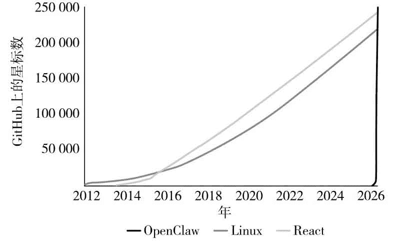

图 1-1 OpenClaw 在 GitHub 上的星标增长曲线

图片来源：star-history.com。

这是 GitHub 历史上增长最快的开源项目之一。社交媒体上开始流行“养虾日记”：有人让它一夜删了 2 万封垃圾邮件，有人让它自动帮忙投简历收到 5 个面试邀请，有人让它监控房价每天发日报。

为什么它这么火？因为它跟传统 AI 本质上不同。

传统 AI（ChatGPT/Claude/DeepSeek）：

● 你问它答，问完就结束

● 经常不记得上次聊了什么

● 无法主动做事

● 不能操作其他软件

● 数据都在云端

……

## OpenClaw：

● 本地运行，数据可以不上传至云端

● 支持任何大模型（Claude、ChatGPT、Kimi、MiniMax、DeepSeek、本地模型）

● 能操作电脑：浏览器、邮箱、文件、代码

● 能定时执行和主动提醒

● 有长期记忆，越用越懂你

……

它不是聊天机器人，而是个数字员工。

**从 Clawdbot 到 OpenClaw**

项目火了之后，麻烦也来了。2026 年 1 月 27 日，Anthropic（Claude 的母公司）发来律师函：Clawdbot 这个名字与 Claude 太像，可能侵权，请立即停止使用。

彼得当天在社区发公告：“我们必须改名。大家一起想个新名字。”

Discord（即时通信平台）上数千人涌入讨论区，经过 48 小时头脑风暴，最后选了 Moltbot（molt 是龙虾蜕壳的意思）。1 月 27 日凌晨 5 点投票结束，该项目连夜完成迁移。

但问题很快暴露：Moltbot 读起来拗口，拼写容易出错，用户都在吐槽。彼得自己都说：“这名字怎么读都不顺口。”

1 月 30 日，彼得和团队决定再改一次，这次要找个能用 10 年的名字。

于是，OpenClaw 诞生了（见图 1-2）。

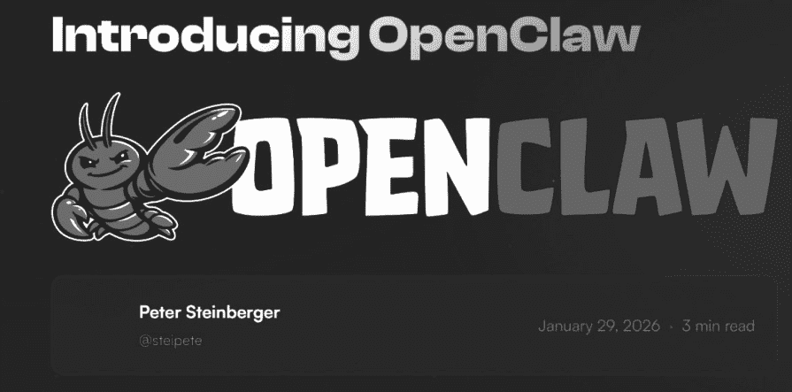

图 1-2 OpenClaw“龙虾”可爱卡通形象

图片来源：彼得·斯坦伯格个人社交媒体。

Open 代表完全开源、你的数据你掌控，Claw 保留龙虾主题，象征“会干活”。这次团队做足了功课：全球 12 个市场商标查询、法务团队审核、一键迁移脚本，用户几乎无感知。

不到三周后的 2 月 14 日，彼得宣布加入 OpenAI。第二天，OpenAI 首席执行官萨姆·奥尔特曼在 X 上官宣（见图 1-3）：“彼得·斯坦伯格加入 OpenAI，推动下一代个人 AI 代理……OpenClaw 将作为独立基金会的开源项目，OpenAI 会持续支持。”

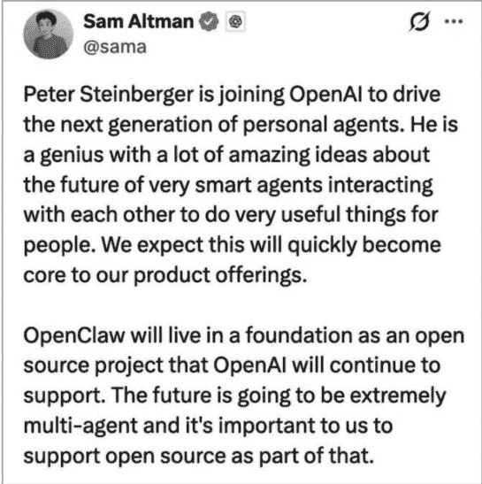

图 1-3 萨姆·奥尔特曼在 X 上的官宣帖

这个声明很关键：OpenClaw 不会变成 OpenAI 的私有产品，而会像 Linux 基金会一样独立运作，社区继续主导开发方向。彼得本人加入 OpenAI，但 OpenClaw 依然是所有人的。

此时该项目的 GitHub 星标已超 18 万，TechCrunch、The Verge 等主流媒体开始大篇幅报道。知名投资人奈特·弗里德曼评论称：“OpenClaw 证明了 AI 的下一个阶段不是更大的模型，而是更有用的代理。”

彼得在接受知名播客主持人莱克斯·弗里德曼 3 小时的专访里感慨：他用一个周末的实验，做出了可能会颠覆他自己的 PDF 帝国的东西。

**为什么你应该关注 OpenClaw？**

从一个周末项目到 GitHub 顶级开源项目，从个人实验到独立基金会，OpenClaw 只用了三个月。

它的意义不在于改了几次名字，而在于它证明了一件事：AI 可以不只是聊天框里的对话工具，而是真正能帮你干活、能主动思考、能持续学习的数字员工。

你不需要学编程，不需要买昂贵的企业版服务，不需要把数据交给大公司。你只需要在自己的电脑上装个 OpenClaw，完成相关技能配置，它就能帮助你：

● 每天自动清理邮箱，只把重要的邮件留给你

● 监控你关心的信息源，定时推送摘要

● 管理日程，会前提醒，会后整理纪要

● 写代码、跑测试、部署上线

● 控制智能家居和机器人

它像个 24 小时不睡觉的助理，你越用它，它就越懂你。

这就是 OpenClaw 的故事。

接下来本书会教你怎么把这只“龙虾”养起来，让它成为你的数字员工。

**为什么全球都叫它“龙虾”？**

改名这件事还带来了意外收获：一个全球性的社区文化。

最初的名字是 Clawdbot，Claw 本意是“爪子”。但因为龙虾有大钳子，加上 Claude 的谐音梗，大家便开始用龙虾图标代表这个项目。到 Moltbot 时期，molt（蜕壳）更是直接把龙虾元素坐实了。

社区里有人给这款 AI 起了个昵称：Molty。这个名字听起来萌萌的，像在叫一只宠物。中国用户直接翻译成“龙虾”或“虾总”，日本用户叫“エビちゃん”（小虾酱），德国用户叫“Krebs”（蟹）。

更有意思的是“蟹教徒”（Crab Cult）这个梗。最早只是 Reddit 上有人开玩笑称 OpenClaw 的用户像神秘组织的人，见面暗号是：“Are you a crab?（你是螃蟹吗？）”结果这个梗越传越广，真的有人在线下聚会时穿着印有龙虾图案的服装，Discord 服务器里到处都是龙虾表情包。

2026 年 2 月，在旧金山举办的首届 ClawCon 大会上，有 2 000 多人参加，现场卖的周边 T 恤上印着“I’m raising a lobster”（我在养龙虾），3 小时卖光。维也纳技术社区干脆把 OpenClaw 的龙虾图标印在了社区旗帜上。

为什么一个工具软件能有这么强的文化认同？因为“养虾”这个说法太形象了。你安装 OpenClaw，配置它，教它做事，越用它就越懂你。这真的像在养一只宠物，而且这只宠物 24 小时不睡觉，还能帮你干活赚钱。

这种拟人化的感觉，让 OpenClaw 从冷冰冰的软件变成了有温度的伙伴。

## **1.2** **OpenClaw 的核心能力：从“会说”到“会做”的三个关键**

前面说了 OpenClaw 和传统 AI 的区别，但这些区别到底是怎么实现的？为什么 ChatGPT 做不到的事，OpenClaw 能做到？

答案在于三种核心能力。

**核心能力一：操作电脑（Computer** **Use）**

传统 AI 活在一个封闭的对话框里。你问它问题，它只能用文字回答你。它看不到你的屏幕，打不开你的浏览器，访问不了你的文件，更不能替你点击鼠标。

OpenClaw 不一样。它能真正“使用”你的电脑。

具体来说，它可以：

● 直接控制浏览器：打开网页、点击图标、填写表单、截图、下载文件

● 操作终端：运行命令、执行脚本、查看日志

● 管理文件：读写文档、整理文件夹、压缩包解压

● 调用 API：连接 Gmail/QQ 邮箱、谷歌日历（Google Calendar）、GitHub、即梦等任何有 API 的服务

这听起来简单，但意义重大。

比如，你命令传统 AI“帮我查一下这个网站的价格”，它会说“我无法访问网页，你可以自己打开看看”。但 OpenClaw 真的会打开浏览器，找到那个网站，定位价格信息，读取数字，告诉你结果。

再如，你命令传统 AI“帮我把这些数据做成图表”，它最多给你一段 Python 代码，你还得自己运行。但 OpenClaw 会直接执行代码，生成图表，保存文件，甚至发送到你指定的地方。

这种能力的技术基础是 Anthropic 在 2024 年 10 月推出的 Computer Use API。Claude 可以通过这个 API 控制电脑，而 OpenClaw 把这种能力开源化、本地化，让任何人都能用上。

这就是为什么 OpenClaw 能“干活”——它不是在对话框里说话，而是真的在替用户操作电脑。

**核心能力二：有长期记忆（Long-term** **Memory）**

传统 AI 的记忆是短暂的。

你今天告诉 DeepSeek“我最喜欢的编程语言是 Python”，过段时间再问“我喜欢什么语言”，它可能就不记得了。每次对话结束，它就好像失忆了。虽然现在有些 AI 有“对话历史”功能，但本质上还是把历史当成上下文输入，没有真正的长期记忆。

OpenClaw 有两层记忆系统。

**第一层：SOUL.md（灵魂文件）**

这是它对你的永久认知。比如：

● 你的名字、职业、工作习惯

● 你的偏好：喜欢简洁的代码，讨厌冗余的注释

● 你的常用工具：用 VS Code，主要写 Python

● 你的协作方式：发邮件喜欢简洁，开会前需要 5 分钟准备

这个文件是你手动配置的，OpenClaw 会一直记住。

**第二层：MEMORY.md（记忆文件）**

这是它在使用过程中自动学习的。比如：

● 你老板的邮箱是 boss@company.com

● 你每周一有团队会议

● 你关注的股票代码

● 你常访问的网站

● 你处理邮件的习惯

第一次你说“发邮件给老板”，它会问“老板的邮箱是什么”。你告诉它之后，它记在 MEMORY.md 里。下次你再说“发邮件给老板”，它直接就发了。

周一你说“帮我准备明天的会议”，它会问“哪个会议”。你说“团队周会”，它记住了。之后每周一早上，它会主动提醒你“今天有团队周会，需要我准备什么吗”。

这种记忆能力让 OpenClaw 越用越聪明。第一天它是个新手助理，什么都要教。一个月后，它比你还熟悉你的工作习惯。

更重要的是，这些记忆都存储在本地，不上传至云端。你可以随时查看、修改、删除。

**核心能力三：主动行动（Proactive** **Action）**

传统 AI 是被动的。你不问，它不说。你不给指令，它不行动。OpenClaw 可以主动行动。

这种能力来自三个机制。

**定时任务（Cron** **Jobs）**

你可以设置定时规则，比如：

● 每天早上 8 点推送今日日程

● 每周一下午 3 点抓取行业新闻

● 每小时检查一次股价

● 每天晚上 11 点备份工作文件

这些任务设置一次，OpenClaw 就会持续执行，不需要你每天提醒它。

**事件触发（Event** **Triggers）**

你可以设置条件，一旦满足就执行动作，比如：

● 收到包含“紧急”的邮件→立刻推送通知

● 股价跌超 5%→发送预警并分析原因

● GitHub 上收到新问题→自动回复顺便打上标签

● 日历出现冲突→立刻提醒

**心跳机制（Heartbeat）**

OpenClaw 拥有独特的“主动醒来”功能，默认每 30 分钟（可配置为“every”: “30min”）自动唤醒代理一次，读取 HEARTBEAT.md 文件（一个简单的清单/检查表），运行一个轻量推理循环，判断是否有事需要处理。

● 如果没事：安静返回（或回复“HEARTBEAT_OK”）

● 如果有事：主动推送通知、执行小任务，或启动完整对话回合

**#** **Heartbeat** **checklist**

- 检查收件箱是否有紧急邮件（关键词：紧急/老板/会议）

- 查看日历未来 2 小时是否有冲突事件或即将开始的事件

- 如果有背景任务完成，总结结果并寻问是否需要报告

- 如果我已闲置 8 小时以上，发一条轻提醒：“最近忙吗？需要我帮忙做什么？”

这让 OpenClaw 从“工具”变成“助理”。工具是你用的时候才工作，助理是一直在帮你盯着事情。

以下是一名用户的真实案例：他让 OpenClaw 监控 Hacker News 首页，只要有关于 AI 智能体的讨论上首页，就立刻推送到他的 Telegram 上。结果有一次，凌晨 3 点有个热帖，OpenClaw 推送了，他便第一时间参与讨论，后来那条评论被顶到最高，那天他的个人网站流量涨了 10 倍。

如果用传统 AI，他只能自己每天刷 Hacker News 网页，还可能错过深夜的讨论。

**数字员工：集三种能力于一身的 AI**

单独看，每种能力都不复杂：

● 操作电脑：就是 API 调用和自动化脚本

● 有长期记忆：就是文件可以本地存储

● 主动行动：就是定时任务、条件触发和 Heartbeat 智能自查

但三者组合起来，就产生了质变。

**真实的使用场景举例**

**早上 8 点**

OpenClaw 主动推送：

“早上好，今天有 3 个会议：

10:00 产品评审（会议室 A，已为你准备了上周的原型链接）

14:00 客户演示（线上，我已测试演示环境正常）

17:00 团队周会（我整理了本周进度，附件已发送）

你的收件箱有 2 封紧急邮件需要回复，其余 47 封我已分类处理。

今天的 AI 行业新闻：OpenAI 发布新功能，Anthropic 融资……（详细摘要已发到你的 Notion）。”

**上午工作中**

你随口说：“帮我查一下竞品 A 的最新价格。”

OpenClaw：打开竞品网站→提取价格→对比历史数据→竞品 A 降价 5%，现在是 299 元，建议关注。

**下午 3 点**

收到推送：“你关注的英伟达股票跌了 6%，主要原因是……（新闻分析）需要我设置止损提醒吗？”

**晚上 10 点**

OpenClaw 自动完成：

- 备份今天的工作文件

- 归档已处理的邮件

- 更新待办事项状态

- 生成今日工作总结

你没有主动发一条指令，但它完成了十几项工作。

这就是上述三种能力组合的效果：打造了一个真正的 24 小时数字员工。

**它能干什么？**

基于这三种核心能力，OpenClaw 可以处理几乎所有重复性、规则性的工作（当然，前提是保障安全合规）。

**信息管理类**

● 清理邮箱：自动分类、归档、标星、回复

● 监控信息源：Hacker News、Reddit、X、行业网站

● 知识整理：抓取文章、提取要点、归档到 Notion

**日程协作类**

● 管理日程：冲突检测、会前提醒、准备资料

● 会议纪要：自动记录、整理、发送

● 任务跟踪：更新进度、提醒截止日期

**开发工作类**

● 写代码：生成、测试、优化

● 部署上线：Git 提交、持续集成/持续部署（CI/CD）、监控

● Bug（漏洞）修复：自动检测、分析日志、提交 PR（拉取请求）

**内容创作类**

● 定期发布：博客、社交媒体、邮件

● 翻译本地化：多语言同步

● 数据可视化：生成图表、Dashboard（仪表盘）

**商业运营类**

● 客户服务：自动回复、工单分类

● 数据监控：股价、流量、竞品

● 自动化营销：邮件、广告、社交媒体

这些不是可能的图景，而是有真实的用户在使用。后文会详细讲具体怎么做。

本质上，这标志着 AI 范式的转变。从传统 AI（包括 ChatGPT）到 OpenClaw，不是简单的功能升级，而是范式转变。

在传统 AI 时代，AI 是个聪明的对话框：

● 你问→它答

● 输入文字→输出文字

● 一次性交互

在 OpenClaw 时代，AI 是个数字员工：

● 你设置规则→它持续执行

● 输入指令→输出结果

● 长期协作

传统 AI 让你“更聪明”——它帮你思考、写作、分析。

OpenClaw 让你“更高效”——它替你执行、监控、管理。

这就是为什么彼得说 OpenClaw 可能会“颠覆他自己的 PDF 帝国”。因为它证明了 AI 的下一个阶段：不是更大的模型，而是更有用的代理。

## **1.3 核心架构：为什么 OpenClaw 能越用越像“老搭档”**

前面讲了 OpenClaw 的三大核心能力：操作电脑、有长期记忆、主动行动。但这些能力不是凭空出现的，它们背后有一套精心设计的架构，这套架构使整个系统既像一台精密的机器，又像一个慢慢长大的数字生命。

简单来说，OpenClaw 的架构可以拆成四个主要部分：Gateway （控制中枢）、Skills（技能库）、Memory（记忆系统）和 Agent Brain（反思与自生长）。这四个部分互相配合，形成了一个闭环：下指令→中枢分发→技能执行→记忆更新→大脑反思改进→下次做得更好。

**Gateway：整个系统的“大脑指挥部”**

Gateway 是 OpenClaw 的控制中枢，负责接收所有外部指令并分发任务。

它本质上是一个 WebSocket 服务器，默认监听本地（如 127.0.0.1:18789）端口。你在 Telegram、微信、飞书、iMessage、WhatsApp 等任何支持的聊天 App（应用程序）里@它或发消息，消息都会实时推送到 Gateway。

Gateway 收到指令后，会做三件事：

● 解析意图：判断你是聊天、命令还是需要调用技能

● 路由任务：把工作交给合适的 Agent（智能体）或 Skills

● 返回结果：把执行结果实时推回给你（支持 Markdown、图片、PDF、Excel 等文件附件）

最关键的一点是：Gateway 支持多通道并行。你可以在微信群里@它处理工作，在 Telegram 私聊让它陪聊，在飞书机器人频道让它跑定时任务。它不会混乱，因为每个通道都有独立的 Session（会话）上下文。

可以说，Gateway 就像公司的前台+总机。所有电话、微信、邮件都先到这里，它知道该转给谁、优先级如何、怎么回复最合适。

**Skills：工具箱，上万个现成技能+你自己教的技能**

Skills 是 OpenClaw 最强大的部分之一。它相当于数字员工的“工具箱”，里面装满了能直接干活的模块。

官方 ClawHub（https://clawhub.ai）目前有上万个现成技能，经过了安全扫描和社区审核。你可以一键安装：

● 天气查询、股票监控、社媒数据

● 邮件总结、自动回复模板

● 网页爬取、PDF 转 Markdown

● GitHub 操作、Notion 同步

● 甚至一些黑科技：自动投简历、短视频脚本生成

但最牛的不是它的现成技能，而是你能自己写 Skills。

写一个 Skill 其实很简单，简单来说就是一个文件夹，里面有 Prompt（提示词）模板+执行逻辑（Python 脚本或 Shell 命令）。写好后放进~/.openclaw/skills/目录，Gateway 就能自动加载。

Skills 支持递归自生长，一个 Skill 可以调用其他 Skill，形成链条。比如，“写周报”Skill 会先调用“会议纪要总结”→“邮件归档”→“代码提交记录”→最后合成报告。

**Memory：让它记住你，越用越懂你**

Memory 系统是 OpenClaw 能“养”的关键。所有记忆都存在本地 Markdown 文件里，你随时能打开编辑。

它有三层核心结构：

● SOUL.md：人格核心，一次配置终身有效。写上你的职业、偏好、禁忌、沟通风格。OpenClaw 每次思考都会先注入 SOUL.md 作为系统提示

● MEMORY.md：事实记忆，自动追加。每次对话或执行后，关键事实会总结追加进来（支持手动编辑）

● 日志层+LanceDB 向量库（可选插件）：长程记忆增强。把历史对话向量化存储，支持语义检索。越用噪声越少，检索越准确

比如，你第一次说“我讨厌长邮件”，它会把这句话记录进 MEMORY.md 里，下次写邮件时自动用简洁版模板。

再如，你常在周一问“本周重点任务是什么”，一个月后它会主动在周日晚上推送“明天周一，我根据上周进度整理了本周前五大任务，需要调整吗”。

**Agent Brain：自生长循环，让它自己进化**

最容易被忽略但最强大的部分，是 Agent Brain +自生长机制。

每次任务执行完，OpenClaw 都会跑一个“反思循环”：

● 这次任务成功了吗？哪里卡住了？

● 用户反馈如何（点赞/修改/忽略）？

● 有没有可以优化的地方？

基于反思，它会自动：

● 更新 MEMORY.md 里的习惯记录

● 建议改进 Prompt（热更新）

● 生成新的 Skill 草稿（让你审核后加入）

● 自我修复 Bug（比如某个 API 调用失败，它会尝试换备用方案）

社区有个说法：“第一周你在教它，第二周它开始帮你想，第三周它开始优化自己。”

这就是自生长：不是模型参数变大，而是行为、记忆、技能在持续迭代，像养宠物一样，越养越贴心。

总的来看，Gateway 负责“听”和“分发”，Skills 负责“干活”，Memory 负责“记住”，Agent Brain 负责“反思和进化”。

这四个部分形成闭环，让 OpenClaw 从“工具”变成“伙伴”：你设置规则，它执行、学习、改进、再执行。

## **1.4 不同版本的龙虾竞技：哪一只最适合你**

前文介绍了 OpenClaw 的核心架构，其中 Gateway 负责指挥调度，Skills 负责具体执行，Memory 负责长期记忆，Agent Brain 负责持续反思与进化。这四个部分共同构成了不同版本龙虾的共同底座，让它们都能随着使用逐步适应用户的习惯。

OpenClaw 开源后，围绕它形成了丰富的生态。不过在实际落地时，不同用户的需求差异明显：有人希望数据完全留在本地，有人希望 5 分钟就能用起来，有人偏好国产模型的性价比，有人则希望电脑不必 24 小时保持运行。社区和相关团队因此推出了多个版本，它们在部署方式、模型支持、成本结构和上手门槛上各有侧重。了解这些差异，能帮助你快速找到最适配自己的那一只，以免后续反复迁移。

**原生 OpenClaw**

这是彼得和开源社区共同维护的官方版本，也是本书后续所有教程的主要参考。它完整保留了全部架构特性，支持任意模型无缝切换，ClawHub 上的 2 万多个技能可一键安装，同时提供最灵活的自定义空间。许多程序员和内容创作者选择它，正是因为它能根据个人工作流自由扩展技能链条和记忆范围。该版本下，数据全程本地运行，隐私控制权完全掌握在自己手里。

安装时推荐使用官网的一键脚本，Mac 用户通常在 30 分钟内即可完成初始配置，Windows 用户通过 WSL2 也能获得接近原生的体验。

官网地址：https://openclaw.ai。

GitHub 仓库：https://github.com/openclaw/openclaw。

**Kimi Claw**

月之暗面（Moonshot）团队推出的云端浏览器版本，把 OpenClaw 的能力直接集成到网页环境中。该版本无须任何本地安装，登录后即可立即开始使用，中文长文本处理和上下文理解表现突出。很多职场人士和副业创作者把它当作入门首选，因为能快速看到实际效果，而 40 GB 的云端存储容量也为日常文件同步提供了便利。当然，数据会经过云端处理，虽然有加密保护，但对隐私要求极高的用户仍需权衡。

访问地址：https://platform.moonshot.ai/（登录后直接进入 Kimi Claw 界面即可使用）。

**有道 LobsterAI**

这是网易有道推出的本土化版本，采用双击安装的桌面客户端形式。它对 DeepSeek、千问（Qwen）等国产模型的适配相对成熟。安装完成后几乎不需要额外配置，其沙箱机制也让安全边界更加清晰。许多只使用国产模型、不愿接触命令行的用户，都把它当作日常主力，因为操作体验接近普通办公软件。

下载地址：https://lobsterai.youdao.com（提供 Mac/Windows 完整安装包）。

开源仓库：https://github.com/netease-youdao/LobsterAI。

**飞书妙搭：真正的一键部署**

字节跳动的飞书团队推出了“妙搭×OpenClaw”方案，号称“全网最简单的一键部署”。用户只需在飞书妙搭对话框里发一句话，整套 OpenClaw 环境就自动配置好了。

妙搭预置了群聊总结、文档修改、待办管理、会议纪要、周报生成等常用场景。而且它和飞书深度集成，用户在飞书里@妙搭就能用，不需要切换界面，也不需要配置渠道，开箱即用。

但飞书官方也明确提醒了安全风险：ClawHub 曾出现多个恶意技能窃取用户数据，切勿盲目安装未经审核的第三方技能。推荐优先使用飞书官方插件，遵循“权限最小化”和“先审查、后使用”原则，避免让 OpenClaw 明文存储密码等敏感信息。

这个方案的优势是零门槛、秒上手，劣势是定制能力有限、数据存储在飞书云端。它适合“只想快速试用、不想折腾”的新手。

使用方式：在飞书中搜索“妙搭”，按提示操作即可。

**WorkBuddy：腾讯版“免部署小龙虾”**

这是腾讯推出的零配置版本，下载即用。它减少了手动部署和配置的麻烦，只需下载并启动即可使用，适合需要快速上手并且希望能立即体验 OpenClaw 助手功能的用户。

WorkBuddy 覆盖广泛的办公场景功能，不论是邮件处理、日程管理还是项目协作，都可以快速整合进工作流程中。针对企业用户，它还支持团队协作功能，能够在多人环境中协同工作。其优点是易用、上手快，无需复杂的安装步骤或配置，下载后可立即开始工作。

下载地址：https://www.codebuddy.cn/work/。

**QClaw：微信远程操控（内测中）**

基于 OpenClaw 打造的本地 AI 助手，允许用户通过微信与电脑进行远程交互，执行如计算报表、文件传输等任务。这款工具的独特之处在于，它能够突破传统桌面应用的局限，让用户从手机或微信平台上直接控制远程设备。

QClaw 适合那些希望通过手机方便地管理工作和生活的用户，无论是在家里还是在办公室，只要微信能够接入，就可以随时随地远程操作电脑执行任务。它支持 Windows 和 Mac 一键安装，一定程度上解决了远程控制的问题。

**ZeelinClaw**

这是智灵动力团队推出的一键安装版本，最大的亮点是可以直接挂接本地大模型。用户可以使用团队预配置的模型，也可以挂接自己拥有的免费模型（比如千问 3.5 系列），这样就能不花钱养一只属于自己的龙虾。对于希望完全控制成本的用户来说，这个版本是相当实用的选择。同时，新版本也全面上架了 Mac 的多个版本，无论 Windows 用户还是 Mac 用户，现在都可以通过官方链接一键下载安装。

获取地址：“清新研究”公众号后台发送“OpenClaw 入门到精通”获取相关资源。

**MaxClaw**

这是稀宇科技（MiniMax）团队基于官方版优化的本地分支。它在启动速度和内存占用上做了针对性调优，对国产大模型的支持尤为出色，同时汉化了部分常用技能的界面和提示词。低配笔记本电脑用户常常选择它，因为即使在 8GB 内存环境下也能保持流畅运行。该版本的更新节奏虽不如官方版密集，但对国内日常场景已经相当适配。

获取方式：在 GitHub 搜索 MiniMax OpenClaw fork，或通过 MiniMax 平台直接接入相关生态。

**云托管版**

如果你的电脑无法常开，或者你希望在手机、平板电脑等多台设备上能随时唤醒“龙虾”，那么云托管是个值得考虑的方向。目前主流的几家云服务商都推出了 OpenClaw 专属镜像或一键部署方案，操作门槛普遍较低，大约在 15 分钟内就能完成上线。

扣子 OpenClaw：字节跳动扣子编程平台推出的托管方案，提供了无需服务器的免费部署选项。通过扣子的豆包 2.0 模型可以零成本运行，整个部署过程只需两步即可完成。对于想要快速体验，又不想投入成本的新手来说，这是目前门槛最低的入门方式。

阿里云 OpenClaw 托管版：针对轻量应用服务器推出的专属镜像方案，预装完整 OpenClaw 环境和常用技能，支持钉钉、飞书等企业级通道深度集成。基础配置 2 核 CPU+2GB 内存+40GB 硬盘，新用户年付 68 元起，常有免费额度和相关优惠。部署地址：https://www.aliyun.com/activity/ecs/clawdbot（登录后点击“一键购买并部署”）。

腾讯云 OpenClaw 托管版：Lighthouse 轻量应用服务器推出的预装镜像方案，特别优化了 QQ、企业微信、飞书等多通道接入，基础配置年付 99 元起，新用户可领 1～3 个月免费试用。许多用户反馈腾讯云在 QQ 机器人稳定性上表现突出。部署地址：腾讯云控制台搜索“Lighthouse OpenClaw 镜像”或直接访问相关开发者社区教程页面。

其他云托管选项：百度云、华为云、火山引擎、Railway、Zeabur 等平台也陆续推出了 OpenClaw 相关的部署方案或容器镜像，价格从免费试用到每月几十元不等，各有侧重。你如果对某个云生态已经比较熟悉，可以优先在该平台搜索 OpenClaw 相关资源。

以上版本对比情况如表 1-1 所示。

表 1-1 版本对比一览表

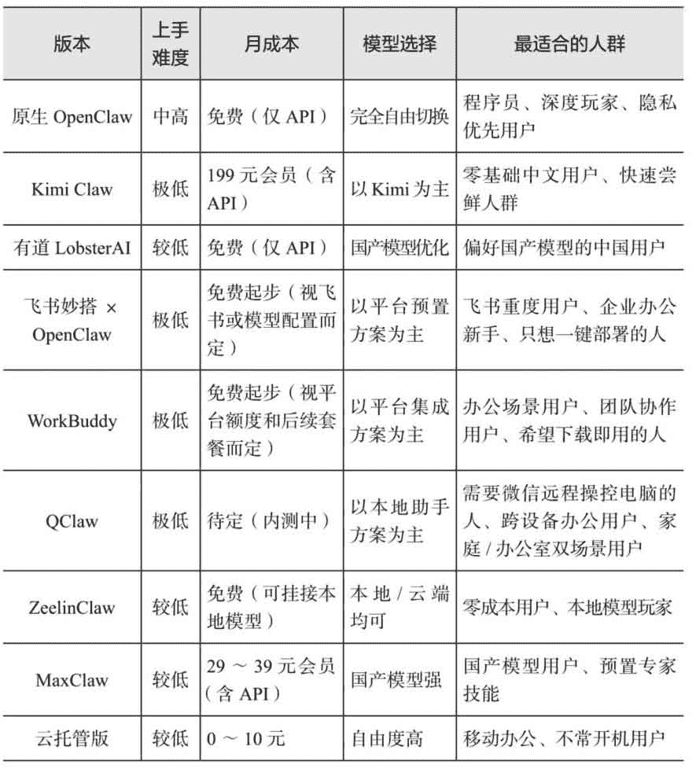

**如何快速做出选择**

如果你重视本地管理和功能扩展空间，那么原生 OpenClaw 是长期最优解。

如果希望当天就能看到成果，那么 Kimi Claw、飞书妙搭、WorkBuddy 或 MaxClaw 能让你最快建立信心。

如果想完全零成本使用，那么 ZeelinClaw 挂接本地免费模型是最佳方案。

如果想要自选模型并便捷安装，那么有道 LobsterAI 会带来更贴合的体验。

如果需要微信远程操控，可以关注 QClaw 的内测进展。

如果电脑无法常开，那么云托管版则解决了后顾之忧。

所有版本的底层架构高度一致，学会一个之后，Prompt 模板和核心技能几乎可以直接复用。本书后续内容以原生 OpenClaw 为主，同时会在关键步骤标注其他版本的适配方法。

下一章将进入实际操作环节：根据你的电脑系统，选择对应版本，跟着步骤走，让你的第一只“龙虾”真正活过来。

## **本章小结**

OpenClaw 不是聊天机器人，而是真正能干活的开源 AI 代理。

它拥有三大核心能力：

● 操作电脑：直接控制浏览器、管理文件、操作终端和调用 API

● 有长期记忆：SOUL.md+MEMORY.md，记住你的习惯和事实，越用越懂你

● 主动行动：定时任务+事件触发+心跳机制，主动帮你盯着事情

它有四个核心机制：Gateway（指挥中枢）+ Skills（技能库）+Memory（记忆系统）+ Agent Brain（反思与自生长）。这套架构让小龙虾形成闭环，并能持续进化。

目前主流版本包括原生 OpenClaw、Kimi Claw、有道 LobsterAI、飞书妙搭、WorkBuddy、MaxClaw、云托管版等，各有侧重。

## **本章实践任务**

任务一：打开 https://openclaw.ai，浏览官网首页和版本介绍，确定你最感兴趣的 1～2 个版本。

任务二：选定主力版本，记下它的安装地址（官网或 GitHub 链接）。

任务三：准备好你最常用的聊天工具（微信或 Telegram 至少一个），确保能正常登录和接收消息。

# **第二章 龙虾落地：把 OpenClaw 装进你的电脑**

读完第一章，你已经知道了 OpenClaw 是什么、能干什么。现在轮到真刀真枪了——把它装进你的电脑，让它真正跑起来。

这一章是全书最“硬核”的部分，也是最让你有成就感的部分。只要跟着做完，你就完成了绝大多数人卡住的那一关。

你不需要会写代码，也不需要懂服务器。我们把每一步拆到最细，就算你从来没用过命令行，照着做也能成功。

**小贴士**

每台电脑的系统环境不一样，安装 OpenClaw 时遇到报错是正常的。遇到看不懂的错误提示，推荐的方法是：直接复制错误信息，丢给你用得顺手的大语言模型（如豆包、DeepSeek 等），一般很快就能得到解决方案。

## **2.1 实战前，先弄清楚你的装备**

安装 OpenClaw 之前，有三件事要想清楚：用什么操作系统，用哪个聊天工具和它对话，本地装还是云上装。这三个选择决定了你之后的体验。

**选择一：用什么操作系统？**

OpenClaw 支持 Mac、Windows 和 Linux，但体验差距不小。

Mac（推荐）：原生支持最完善。能直接操作系统日历、备忘录、提醒事项、截图，和 iPhone/iPad 无缝同步。安装配置也最简单，绝大多数功能开箱即用。

Windows：完全可用，执行日常任务没问题，但部分系统级功能（比如操作原生备忘录、截图功能）会受限。本章会单独讲 Windows 环境下的安装方式。

Linux：开发者的天堂，配置最灵活，适合“想折腾”的高级用户。本章最后会介绍简明安装流程。

一句话总结就是：有 Mac 用 Mac，没有 Mac 用 Windows，是程序员才考虑用 Linux。

**选择二：用哪个聊天工具和它对话？**

OpenClaw 安装好之后，你需要一个聊天入口来下指令——就像打电话给员工。目前 OpenClaw 支持十几种聊天工具，但飞书和 Telegram 最值得推荐。

国内用户可以选择飞书、钉钉、企业微信等，现代化设计，消息推送稳定，API 完善，免费版功能已经非常够用。飞书支持富文本、文档、表格，与 OpenClaw 搭配体验一流，钉钉和企业微信目前也都能用，但配置相对烦琐一些。

国外用户首选 Telegram：全球用户基础最大，Bot（机器人）功能最强，消息实时推送，隐私保护出色。很多 OpenClaw 最新功能首先在 Telegram 上完善。

备选方案还有企业微信、钉钉、Discord、iMessage 等，都能用，但配置相对烦琐一些，初次上手者不建议选。

**注意**

暂时不连接任何聊天工具也完全没问题。OpenClaw 自带 Web UI 界面（浏览器直接访问），先跑起来，后面再接飞书也不迟。

**选择三：本地装还是云上装？**

这是很多新手没想到的问题，但对体验影响很大。

本地部署（推荐）：安装在自己的电脑上。优点是隐私最安全（数据不上传至云端）、响应最快、成本最低、功能最全。缺点是电脑关机就停了，不能 24 小时运行。

云端部署：安装在云服务器上。优点是可以 24 小时不间断运行，关掉电脑它还在工作。缺点是需要支付服务器费用。

对大多数人来说，先本地安装，用顺手了再考虑云端是最合理的路径。本章分四大块展开：Mac 本地安装→Windows 本地安装→Linux 本地安装→云端部署。

## **2.2 Mac 本地安装：跟着做，10 分钟搞定**

这是非常关键的一节。跟着每一步做，不要跳过，不要自作聪明改命令。安装成功之后，你的小龙虾就活了。最佳体验：如果你是 Mac 用户，强烈推荐本地部署，体验好、功能最全！

**前置配置检查：先确认你的 Mac 够不够格**

在安装之前，先确认一下你的 Mac 能不能跑 OpenClaw：

● CPU：M 系列芯片（M1/M2/M3/M4）或 Intel i5 以上都没问题

● 内存：8GB 以上（推荐 16GB，跑复杂任务更流畅）

● 硬盘：至少 10GB 的空闲空间

● 系统版本：macOS 12 Monterey 或更高版本，推荐 macOS 14 Sonoma 或 macOS 15 Sequoia

● 前置软件：Node.js 22.16.x +（安装脚本会自动处理）、Homebrew 可选

怎么查配置？点击桌面左上角苹果图标，选择“关于本机”，你的电脑配置一目了然。2020 年以后买的苹果电脑基本满足条件。

**安装与配置：五步搞定**

**第一步：打开终端**

安装 OpenClaw 需要用到“终端”（Terminal）。很多人听到命令行就发怵，其实不用怕，你只需要把几行命令复制粘贴进去，不需要自己写任何东西。

● 按 Command+空格，打开 Spotlight 搜索框

● 输入“Terminal”或中文“终端”

● 按回车（Enter 键），弹出黑色窗口，这就是终端

**小贴士**

把终端固定到 Dock 栏（程序坞，即苹果电脑底部的程序启动栏），以后会经常用到。在 Dock 上右击终端图标→选项→在程序坞中保留，就固定好了。

**第二步：安装 OpenClaw**

终端打开之后，我们可以先检查一下前置配置是否满足：

# 1. 检查 Node.js 版本（OpenClaw 要求 Node v22.16.x，推荐 v24.x.x 及以上）

node -v

# 2. 检查 npm 版本（和 Node.js 匹配即可）

npm -v

每个 Node.js 发行版都内置了一个特定版本的 npm，只要你没有手动执行 npm install -g npm@xx 修改过，就是匹配的。如果不确定，可以对照 Node.js 官方发布说明确认具体版本对应关系。

如果还没安装过，可以访问官网 https://nodejs.org，下载 macOS 的 .pkg 安装包，双击下一步即可。如果正常返回满足需求的版本号，把下面这行命令复制进去，按回车：

curl -fsSL https://openclaw.ai/install.sh | bash

然后只需等待即可。你不需要做任何事，这行命令会自动帮你完成以下所有操作：

● 检测你的系统环境，判断缺少哪些依赖

● 下载 OpenClaw 的最新版本

● 配置必要的环境变量

整个过程需要 2～5 分钟（取决于你的网速）。你会看到屏幕上滚动着一堆英文，这是正常现象，不用管它。

**国内下载速度慢怎么办？**

如果在国内遇到下载缓慢甚至卡住的情况，有两个解法：

① 解决网络代理问题后再运行；

② 使用国内镜像源：curl -fsSL https://openclaw.ai/install.sh|bash-s----mirror=cn。

国内镜像由社区维护，速度快，内容和官方版本完全一致。

**第三步：验证安装是否成功**

安装完成后，在终端输入：

openclaw --version

如果显示类似 2026.3.8 这样的版本号，恭喜你，OpenClaw 已经成功安装在你的 Mac 上了。

如果报错“command not found”，先关掉终端，重新打开再试一次。多数情况下，重启终端就能解决。

**第四步：初始化配置——给龙虾做入职培训**

安装好了是第一步，你还需要告诉它：用哪个 AI 大脑，通过哪个聊天工具联系你。在终端输入：

openclaw onboard

接下来会出现一系列交互式问题，像在给新员工做入职登记。按顺序回答就好：

1．接受风险提示

屏幕上会出现一段安全说明，大意是“这个工具默认只有你自己能用，如果要多人共用需要额外配置”。选 Yes 继续（见图 2-1）。

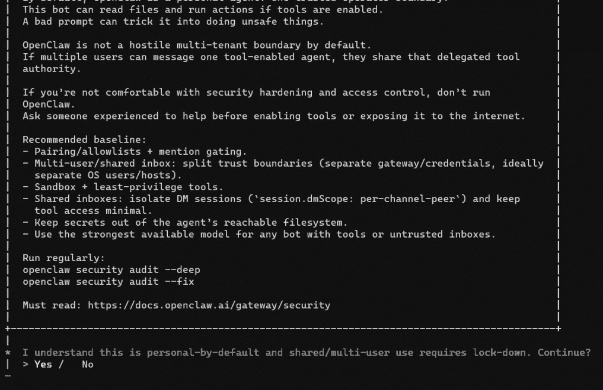

图 2-1 初始化配置界面——选择 Yes 继续

2．选择启动模式

会出现两个选项：QuickStart（快速启动）和 Manual（手动配置）。推荐选“QuickStart”（见图 2-2），它会帮你快速完成核心配置，细节以后随时可以调整。

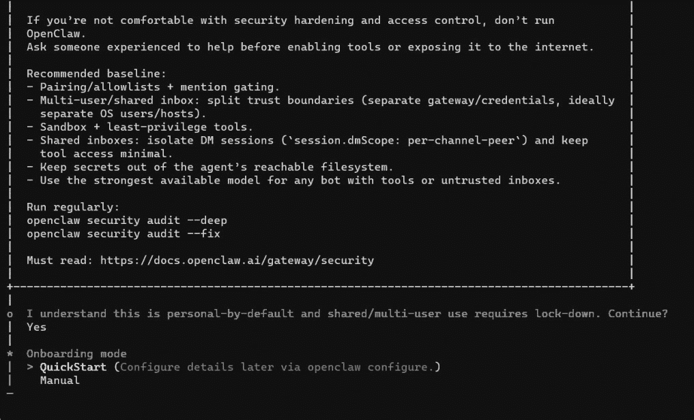

图 2-2 选择 QuickStart 启动模式

3．选择 AI 模型

这是最重要的一步：选择给 OpenClaw“提供大脑”的 AI 模型。屏幕上会出现一个很长的供应商列表（见图 2-3），支持国内外主流模型（包括 OpenAI、Anthropic、Kimi、智谱等）。

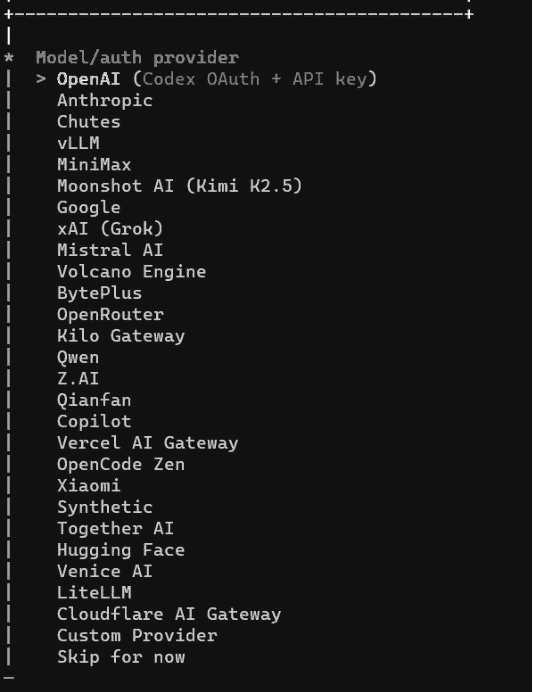

图 2-3 AI 模型供应商选择列表

国内用户怎么选？推荐这张速查表（见表 2-1）。

表 2-1 AI 模型供应商速查表

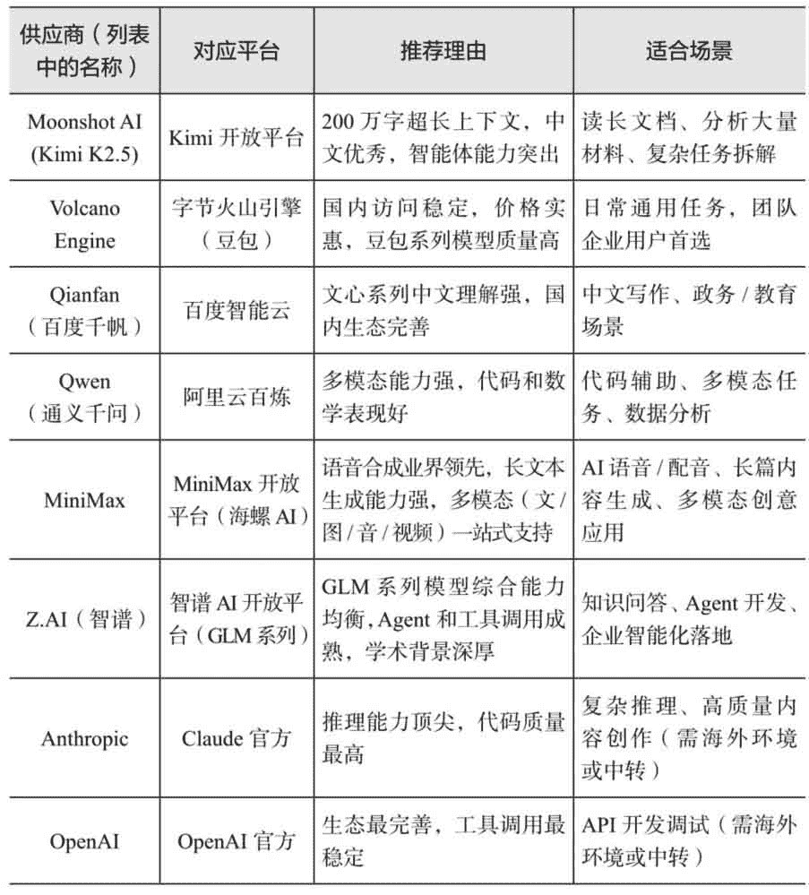

**注意**

DeepSeek 不在这个列表里，但 DeepSeek 是目前我们常用的模型之一，接入方式见下方说明。

**DeepSeek 怎么接入？两步搞定**

DeepSeek 的 API 兼容 OpenAI 格式，在列表里选“Custom Provider”（自定义供应商），填入以下信息：

Base URL：https://api.deepseek.com

Auth 方式：API Key

模型名称：deepseek-chat（通用对话）或 deepseek-reasoner（推理增强版）

API Key 获取：https://platform.deepseek.com/api_keys

如果不知道选哪个，新手建议先选 Moonshot AI（Kimi K2.5）——列表里直接能找到，配置最简单，中文效果好，入门完全够用。用熟之后再按需切换到其他模型。

4．输入 API Key

选好模型之后，系统会要你输入对应的 API Key（应用接口密钥，见图 2-4）——这是你的“访问凭证”，证明你有权使用这个 AI 服务。

**API Key 是什么？去哪里拿？**

API Key 是一串字母+数字的密钥，长得类似“sk-xxxxxxxxxxxxxxxx”。获取方式：注册对应平台账号→进入后台→找“API 管理”或“开发者选项”→新建一个 Key 复制即可。

DeepSeek：https://platform.deepseek.com/api_keys

Kimi：https://platform.moonshot.cn/console/api-keys

智谱 GLM：https://open.bigmodel.cn/usercenter/apikeys

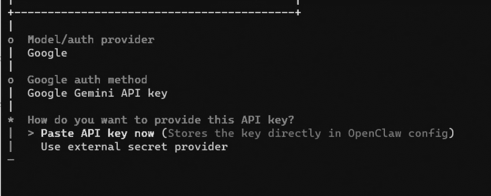

图 2-4 输入 APIKey 界面，选择 PasteAPIkeynow

5．选择模型版本

输入 API Key 后，系统会让你选具体用哪个版本的模型（见图 2-5）。一般选默认推荐的最新版就行，比如智谱选 Z.AI GLM-5。不确定的话保持默认。

6．配置网络搜索（可以先跳过）

模型选完之后，向导会问你要不要给龙虾配一个网络搜索能力——有了它，龙虾才能查实时信息（今日股价、最新新闻、刚发布的内容）。会出现 6 个选项，包含 Brave Search、Gemini、Grok、Kimi、Perplexity Search、Skip for now（可以先跳过）等（见图 2-6）。

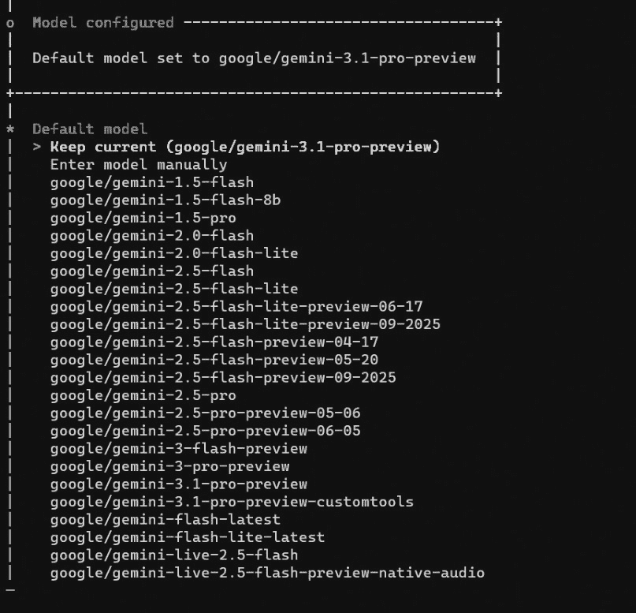

图 2-5 选择具体模型版本

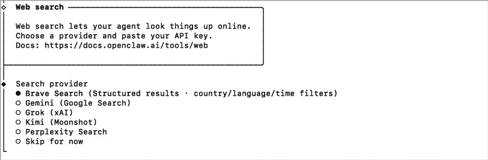

图 2-6 网络搜索供应商选择界面

网络搜索供应商速查表如表 2-2 所示。

表 2-2 网络搜索供应商速查表

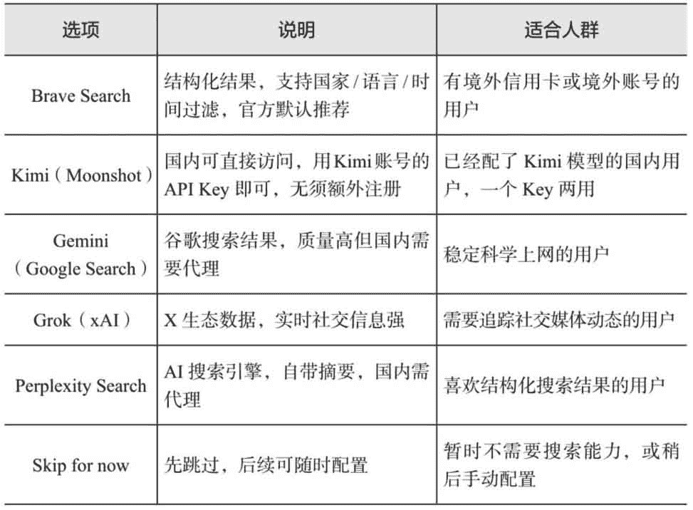

国内用户推荐选 Kimi（Moonshot）——你如果在第 3 步选了 Kimi 作为 AI 模型，这里直接填同一个 API Key 就行，不需要额外注册任何账号。一个 Key 同时作为大脑和搜索引擎，最省事。

**小贴士**

搜索功能不影响核心使用，先跳过也完全没问题。装好之后在第四章 4.2 节有完整的配置教程，包括国内替代方案（火山云融合搜索）。

7．选择聊天工具（可以先跳过）

接下来会让你选一个聊天平台（见图 2-7）。你如果现在想直接接入飞书，选 Feishu/Lark（飞书），跟着提示配置 Bot。你如果还不确定用哪个，选 Skip for now（先跳过）——安装完成后可以随时用 openclaw channels add 命令补上。

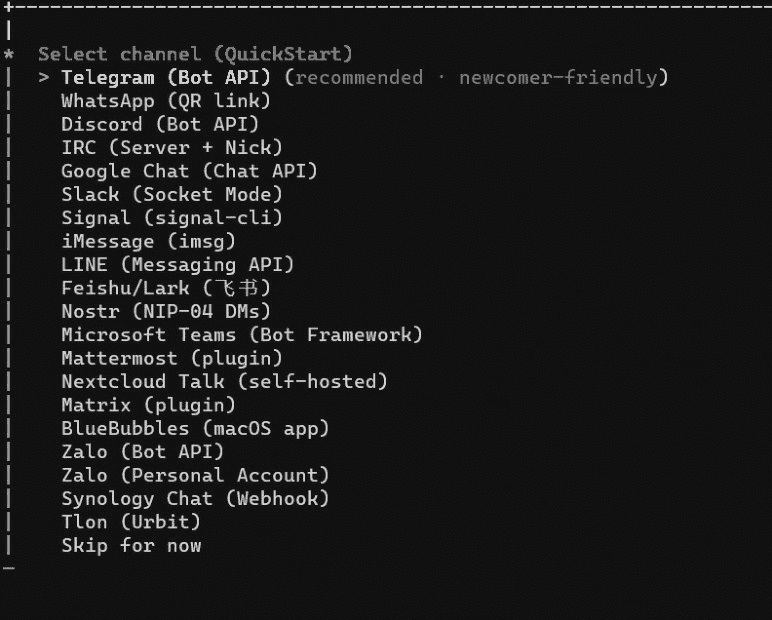

图 2-7 聊天平台选择列表（支持 Telegram、飞书、WhatsApp、Discord 等）

8． Gateway 端口设置

Gateway 是 OpenClaw 的控制中枢，默认端口 18789，直接回车确认就好，不用改。

9．选择技能

OpenClaw 有一个技能库，里面有各种现成的功能模块（见图 2-8）。初次使用建议先跳过（选 Skip for now），等用熟练了再按需安装。

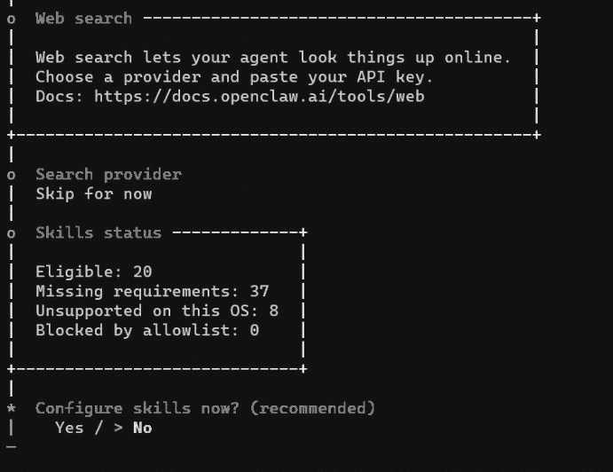

图 2-8 技能安装列表（选择需要的技能，初次使用可跳过）

10．启用 Hooks（钩子）

Hooks 是内容引导和记录功能，推荐勾选 boot-md、command-logger、session-memory 这三个（见图 2-9）。

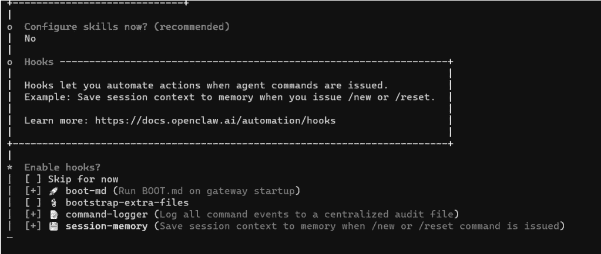

图 2-9 启用 Hooks 选项

（1）boot-md ：启动时加载你的自定义配置文件。

每次 Gateway 启动时自动读取 BOOT.md 文件。BOOT.md 是一份“开机指令”，可以写“每次启动先加载我的工作配置、检查今日日程”之类的规则。建议开启。

bootstrap-extra-files：启动时加载额外的配置文件（比如多个自定义 md 文件）。普通用户暂时用不上，可以先不开。

（2）command-logger：记录所有执行过的命令，方便日后回溯。

把所有执行过的命令记录到一个审计日志文件里。出问题时可以翻查“龙虾到底干了什么”，也方便统计用量。建议开启。

（3）session-memory：会话记忆，让每次对话都能延续上下文。

如果开启该功能，则每次你发/new 或/reset 开始新对话时，龙虾会自动把当前对话的重要内容存进记忆系统。如果不开启，每次开始新对话时，龙虾就“失忆”了。强烈建议开启。

**小贴士**

这三个钩子组合起来，是让 OpenClaw“越用越懂你”的关键。强烈建议全部开启。

**第五步：验证安装**

配置完成后，选择“Restart”，OpenClaw 会自动启动 Gateway 服务，并在浏览器打开 Web UI 界面。

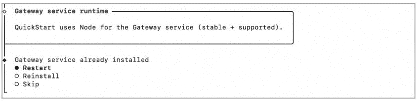

# 检查 Gateway 状态

openclaw channels status

如果显示 # Gateway reachable.，就是满血状态，万事俱备。也可以手动在浏览器访问：

http://127.0.0.1:18789/chat

看到聊天界面出现，说明你的龙虾已经活了。在输入框发一条消息，比如“你好”，如果它回了，说明一切正常。

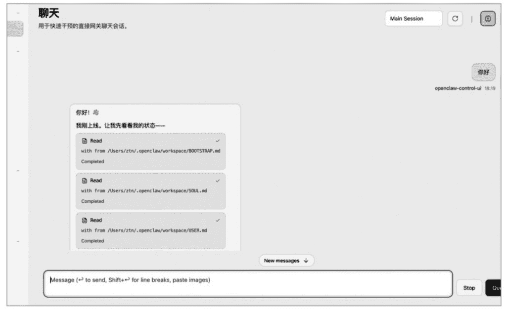

**常见问题速查**

**问题 1：提示“command not found: openclaw”（命令未找到）**

安装完成后重启终端再试。如果还是不行，手动补上环境变量：

echo ‘export PATH=$HOME/.openclaw/bin:$PATH’ ＞＞~/.zshrc ＆＆ source ~/.zshrc

**问题 2：安装时提示权限不足（Permission denied）**

在命令前加 sudo，以管理员身份运行：

curl -fsSL https://openclaw.ai/install.sh | sudo bash

**问题 3：Gateway 启动了，但浏览器打不开 Web UI**

● 检查端口有没有被占用：lsof -i :18789（Mac/Linux）

● WSL2 用户注意：IP 不是 127.0.0.1，要用 hostname -I 查出 WSL2 的实际 IP，再访问该 IP:18789

● 换个端口试试，在终端输入以下指令，再重启 Gateway：

openclaw config set gateway.port 18790

**问题 4：发消息没有回复，AI 不响应**

● 先跑体检：openclaw doctor，它会直接告诉你哪里出了问题

● 检查 API Key 余额：openclaw test api，余额为 0 是最常见原因

● 查看实时日志找报错：openclaw logs --follow

**问题 5：怎么备份我的配置**

tar -czf openclaw-backup-$(date +%Y%m%d).tar.gz~/.openclaw

备份文件包含所有配置（SOUL.md、MEMORY.md、openclaw. json 等），迁移到新电脑也可以用。

## **2.3 Windows 本地安装：WSL2 是你的好朋友**

好消息是：OpenClaw 在 Windows 上完全可用，执行日常任务没有任何问题。坏消息是：需要增加一个步骤——先装 WSL2 （Windows 的 Linux 子系统）。

但别被名字吓到。WSL2 就是微软官方给 Windows 加装的一个轻量级 Linux 环境，安装只需要一行命令，而且微软的向导写得非常好，几乎不会出问题。

**注意**

Windows 上部分系统级功能（如操作系统日历、备忘录、截图）受限。这是 Windows 平台本身的限制，处理文件、邮件、网页等核心任务完全没问题。

**前置配置检查：查看你的 Windows 是否适配**

● 操作系统：Windows 10 版本 2004（Build 19041）及以上，或 Windows 11

● CPU：2 核以上

● 内存：4GB 以上（推荐 8GB）

● 硬盘：10GB 以上空闲空间

● 前置软件：Node.js v22.16.X 及以上

**安装方式一：WSL2+Ubuntu 部署（推荐）**

这是官方推荐的 Windows 部署方式，提供相对完整的 Linux 环境支持。

**风险提示**

WSL2 本质上是在 Windows 内运行一个虚拟化的 Linux 环境，使用时需注意以下风险：（1）WSL2 与 Windows 共享文件系统，如果在 WSL2 中执行了误删或覆盖操作，Windows 侧的文件同样会受影响；（2）WSL2 的网络配置与 Windows 独立，端口转发和防火墙规则需要额外设置，配置不当可能导致服务暴露在局域网中；（3）WSL2 的资源占用（内存、磁盘）会随使用增长，默认不会自动释放内存，长期运行可能会拖慢 Windows 系统，建议定期执行 wsl --shutdown 释放资源；（4）WSL2 环境下的文件权限模型与原生 Linux 不同，部分依赖严格权限的操作可能会出现异常。如果你不熟悉 Linux 命令行，建议优先考虑 PowerShell 原生安装方式（方式二），或直接使用云端部署方案。

**第一步：启用 WSL2**

以管理员身份打开 PowerShell［右击开始菜单→Windows Terminal（管理员）］，依次执行：

# 启用 WSL 功能

dism.exe /online /enable-feature /featurename:Microsoft-Windows-Subsystem-Linux /all /norestart

dism.exe /online /enable-feature /featurename:VirtualMachinePlatform /all /norestart

# 设置 WSL2 为默认版本

wsl --set-default-version 2

运行完后，重启计算机。

**第二步：安装 Ubuntu**

推荐从 Microsoft Store 安装（最简单）：

● 打开 Microsoft Store

● 搜索“Ubuntu 22.04 LTS”或“Ubuntu 24.04 LTS”

● 点击“获取”并安装

● 首次启动，按提示设置用户名和密码

**小贴士**

用户名和密码随便设置，但要记住之后每次在 Ubuntu 里用 sudo 命令都需要输这个密码。建议设置一个简单好记的，比如“admin”。

**第三步：更新 Ubuntu 系统**

在 Ubuntu 终端中执行：

# 更新软件包列表

sudo apt update ＆＆ sudo apt upgrade -y

# 安装基础工具

sudo apt install -y curl git wget build-essential

**第四步：安装 Node.js**

# 添加 NodeSource 仓库

curl -fsSL https://deb.nodesource.com/setup_22.x| sudo -E bash -

# 安装 Node.js

sudo apt install -y nodejs

# 验证版本（必须≥22.x）

node -v

npm -v

**第五步：安装 OpenClaw**

一键脚本安装（和 Mac 一模一样）：

curl -fsSL https://openclaw.ai/install.sh | bash

**第六步：验证安装**

# 查看版本

openclaw --version

# 查看帮助

openclaw --help

# 查看系统状态

openclaw status

**第七步：配置 Windows 访问 WSL2 服务**

由于 OpenClaw 运行在 WSL2 中，需要配置端口转发以便 Windows 访问。创建启动脚本 start-openclaw.bat：

# 在 WSL2 Ubuntu 终端中启动

openclaw gateway run --port 18789

然后在 Windows 浏览器访问 http://localhost:18789。

**安装方式二：PowerShell 原生部署**

这种安装方式适合不想使用 WSL2 的纯 Windows 用户。

**第一步：安装 Node.js**

● 访问 https://nodejs.org/zh-cn

● 下载 Windows 安装包（LTS 版本 22.x）

● 运行安装程序，勾选“自动安装必要的工具”

**第二步：验证 Node.js 安装**

# 打开 PowerShell

node -v

npm -v

**第三步：以管理员身份安装 OpenClaw**

**注意**

必须以管理员身份运行 PowerShell 或 CMD。右击开始菜单→Windows PowerShell 或 CMD（管理员）。

# 安装最新稳定版

npm install -g openclaw@latest

# 或安装汉化版

npm install -g @qingchencloud/openclaw-zh@latest

**第四步：解决安装权限问题**

如果遇到权限错误，二选一处理：

# 方法 A：启用 PowerShell 脚本执行

Set-ExecutionPolicy -ExecutionPolicy RemoteSigned-Scope CurrentUser

# 方法 B：修改 npm 安装目录

npm config set prefix "C:\npm"

npm config set cache "C:\npm-cache"

# 将目录添加到 Path

[Environment]::SetEnvironmentVariable("Path",$env:Path+";C:\npm", "User")

**第五步：验证安装**

openclaw --version

openclaw --help

**第六步：解决常见问题**

问题 1：sharp 模块加载失败。

# 清理 npm 缓存

npm cache clean --force

# 重新安装

npm install -g openclaw@latest --force

问题 2：Windows Defender 阻止。

将 OpenClaw 安装目录添加到 Windows Defender 排除项：

C:\Users\你的用户名\AppData\Roaming\npm

C:\Users\你的用户名\.openclaw

**初始化配置：给龙虾做入职培训（Windows 通用）**

安装完成后，运行初始化向导：

openclaw onboard --install-daemon

配置 AI 模型（以 DeepSeek 为例）：

# WSL2 或 PowerShell 均可

openclaw models auth add

# 按提示选择 Z.AI，输入 API Key: sk-xxx

Windows 同样支持多种聊天工具接入，不急，可以先跳过，我们在第三章会详细讲解。

## **2.4 Linux 本地安装：开发者专属通道**

如果你用的是 Linux，恭喜你，OpenClaw 在 Linux 上的安装是最干净、最省事的——没有 WSL2，没有权限问题，一条命令搞定。

**适合场景**

Linux 适合开发者，配置灵活。本节适合熟悉 Linux 命令行的用户，零基础用户建议先看 Mac 或 Windows 小节。

**前置检查：推荐发行版**

● Ubuntu 20.04+

● Debian 11+

● CentOS 8+

**安装步骤**

**第一步：安装 Node.js**

# Ubuntu/Debian

curl -fsSL https://deb.nodesource.com/setup_22.x| sudo -E bash -

sudo apt-get install -y nodejs

# 验证安装

node --version

**第二步：安装 OpenClaw**

curl -fsSL https://openclaw.ai/install.sh | bash

**第三步：验证安装**

openclaw --version

**第四步：初始化配置**

openclaw onboard

配置流程和 Mac 完全一致，参考 2.2 节即可。

**小贴士**

Linux 用户通常会把 OpenClaw 配置成 systemd 服务，开机自动启动：

openclaw gateway enable

## **2.5** **云端部署：手机也能随时控制龙虾**

本地部署有一个没法回避的缺点：电脑一关机，龙虾就“下班”了，定时任务停了，消息推不出去，Heartbeat 也断了。如果你需要龙虾 24 小时不间断地为你工作，或者想在手机、平板电脑上随时随地发指令，那就需要把它搬到云服务器上。

不过，云端部署不是必选项。对大多数用户而言，先在本地用顺手，确认 OpenClaw 真的适合自己之后，再考虑上云也不迟。这一节先帮你弄清楚两者的区别，再告诉你怎么选、怎么部署。

**本地部署与云端部署：先弄清楚区别**

这两种方式没有好坏之分，只存在场景区别。表 2-3 列清楚了它们的核心差异，你一眼就能判断哪个更适合自己。

表 2-3 本地部署与云端部署区别

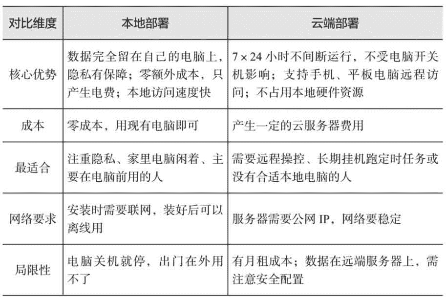

**小贴士**

如果你拿不定主意，建议先本地装着用。等哪天你发现“出门了联系不上龙虾”或者“定时任务老是断”，再上云也来得及，配置可以一键迁移。

**云端部署需要什么条件？**

云端部署说白了就是在云服务商那里租一台远程电脑，把 OpenClaw 装上去。你不需要懂服务器运维，但有几个前置条件需要满足：

● 服务器系统：优先选 Ubuntu 22.04 或 24.04，其次是 CentOS 7+，一律选 64 位系统

● 最低配置：2 核 CPU、2～4GB 内存、40GB 硬盘就够入门了。如果预算允许，4 核 GPU、8GB 内存体验更流畅

● 网络端口：OpenClaw 默认用 18789 端口，买完服务器后记得在控制台的防火墙/安全组里把这个端口放行，否则浏览器打不开 Web UI

● 预算：目前主流云服务商的入门配置会产生一定的服务器费用，部分有新用户优惠甚至免费试用期

**部署流程：五步通用模板**

不管你选哪家云服务商，部署步骤大同小异，基本都是以下五步。

第一步：购买云服务器。在云服务商官网注册账号，选一台轻量应用服务器（入门配置即可），完成实名认证和支付。

第二步：安装系统镜像。很多云服务商已经提供了 OpenClaw 的预装镜像或应用模板，选中之后一键安装，不需要自己从头配环境。如果没有现成镜像，选 Ubuntu 22.04 系统，然后按 2.4 节 Linux 安装步骤操作即可。

第三步：远程连接服务器。用 SSH 工具（推荐 Termius 或 FinalShell，都免费）连接到你的服务器，输入公网 IP、用户名和密码即可登录。很多云服务商也提供网页版终端，直接在浏览器里操作，连软件都不用装。

第四步：配置 AI 模型。和本地部署一样，运行 openclaw onboard，选择 AI 模型，填入 API Key。流程完全相同，参考 2.2 节的配置步骤。

第五步：测试验证。浏览器访问 http://你的服务器 IP:18789，发一条消息，龙虾回话了就说明部署成功。

**小贴士**

强烈建议第一次部署前先看云服务商提供的视频教程，10 分钟视频能帮你避开 90%的坑，比纯看文字快得多。

**主流云服务商参考**

目前国内多家主流云服务商都推出了 OpenClaw 的一键部署方案或预装镜像。我们不推荐具体厂商，每家的价格和促销活动经常变动，建议你根据自己的预算和使用习惯，到各家官网对比后再做决定。表 2-4 列出了常见的几家，供参考。

表 2-4 主流云服务商简介

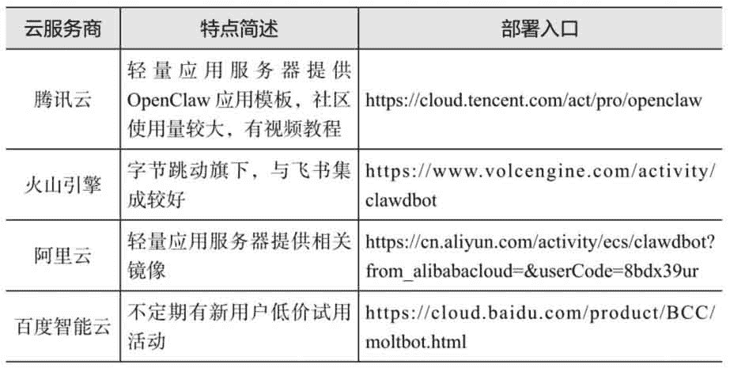

**注意**

云服务商的价格、促销活动和产品方案随时可能调整，本书不对具体费用做承诺。请以各平台官网实时信息为准。选择时建议优先考虑：（1）是否提供 OpenClaw 预装镜像（能省很多配置时间）；（2）是否有新用户优惠或免费试用期；（3）机房地域是否靠近你的常用位置（影响访问速度）。

**云端部署安全须知**

数据放在云服务器上，安全配置不能马虎。以下几条是底线，部署完成后务必检查。

（1）设置强密码：服务器登录密码不要用“123456”之类的弱密码。SSH（一种用于安全远程登录和其他网络服务的协议）密钥登录比密码更安全，有条件的话优先用密钥。

（2）关闭无用端口：只开放你确实需要的端口（18789 和 22），其他端口全部关闭，以减少攻击面。

（3）定期备份：养成每周备份一次的习惯。配置文件、记忆文件都很宝贵，云服务器也并非永远可靠。

（4）选择正规厂商：用上面提到的主流云服务商。小众或海外不知名的服务商，稳定性和数据安全都难以保障。

（5）避免存储高敏信息：不要在服务器上存银行卡密码、身份证照片等高度敏感的信息。OpenClaw 的对话内容会经过 AI 模型供应商的服务器处理，注意保护好信息边界。

**常见问题**

**问题 1：云端部署安全吗？**

数据存在你自己购买的服务器上，只有你能访问。但“自己的服务器”不等于“绝对安全”，你还需要做好上面提到的安全配置。如果不再使用，可以随时删除整台服务器，数据会彻底清除。

**问题 2：会一直扣钱吗？**

大多数云服务商支持按月付费或按量计费，不用了就删除服务器，不会继续产生费用。建议先买一个月试用，满意再续费。

**问题 3：手机怎么访问？**

手机端有两种方式：一是通过飞书、企业微信、QQ 等聊天平台发消息控制龙虾，这是最方便的方式；二是手机浏览器直接访问 Web UI（http://服务器 IP:18789）。

**问题 4：本地配置能迁移到云端吗？**

可以。把本地的~/.openclaw 目录打包（tar -czf backup.tar.gz~/.openclaw），上传到云服务器解压，所有配置、记忆、技能都能无缝迁移。

## **2.6** **更新与维护：让龙虾保持最佳状态**

OpenClaw 迭代很快，平均每两周就有新版本。保持更新是个好习惯——新版本通常有性能优化、新功能和安全修复。好消息是：更新非常简单，一行命令即可搞定。

**检查与更新**

# 查看当前版本

openclaw --version

# 查看最新版本

curl -s https://api.github.com/repos/openclaw/openclaw/releases/latest | grep tag_name

# 方式一：使用安装脚本一键更新（推荐）

curl -fsSL https://openclaw.ai/install.sh | bash

# 方式二：手动更新（从源码）

cd ～/openclaw

git pull origin main

pnpm install

pnpm build

**备份数据**

养了一段时间的龙虾，记忆文件、技能配置都很宝贵，养成定期备份的习惯很有必要。

# 备份配置和数据（推荐每周一次）

tar -czf openclaw-backup-$(date +%Y%m%d).tar.gz～/.openclaw

# 恢复数据

tar -xzf openclaw-backup-20260210.tar.gz -C ~/

**小贴士**

把备份文件同步到云端（如 iCloud、百度网盘），万一换电脑或重装系统，所有记忆和配置可一键恢复，你的小龙虾就不会“失忆”。

**监控与日志**

遇到异常行为时，查日志是最快的排查方式：

# 实时查看运行日志

tail -f ~/.openclaw/logs/gateway.log

# 查看系统状态

openclaw gateway status

# 查看资源使用（CPU、内存、API 消耗）

openclaw status

# 查看 API 调用消耗

openclaw status --usage

## **故障排查**

**Gateway 是否无法启动？**

# 第一步：查日志找原因

openclaw logs

# 第二步：检查端口是否被占用

lsof -i :18789

# 第三步：重启 Gateway

openclaw gateway restart

**API 是否连接失败？**

# 测试 API 连接

openclaw test api

# 检查 API Key 是否正确

openclaw config get models.providers

**性能是否变慢？**

# 清理缓存

openclaw cache clear

# 重启服务

openclaw gateway restart

**卸载（彻底删干净）**

如果想彻底卸载，可以执行以下命令：

# 本地安装：停止服务

openclaw gateway stop

# 删除文件和配置

rm -rf ~/.openclaw

rm -rf ~/openclaw

# 删除命令

npm uninstall -g openclaw

**注意**

卸载前记得先备份！特别是你精心配置的 SOUL.md 和 MEMORY. md 文件，那是你的小龙虾对你的所有记忆。

## **2.7** **API 配置指南：给龙虾选个好大脑**

OpenClaw 本身不包含 AI——它是一个“代理框架”，负责连接你和 AI 模型，处理消息路由、工具调用、记忆管理这些事情。真正的思考能力，来自你接入的那个 AI 模型。

这一节解释清楚三件事：模型分几类、各自怎么接、国内用户的可选项有哪些。不放价格对比，因为各平台定价变动频繁——真正决策前，建议直接去各平台官网看最新价格。

**三类接入方式**

OpenClaw 支持的模型分三类，配置复杂度和适用场景各不相同（见表 2-5）。

表 2-5 三类模型接入方式对比

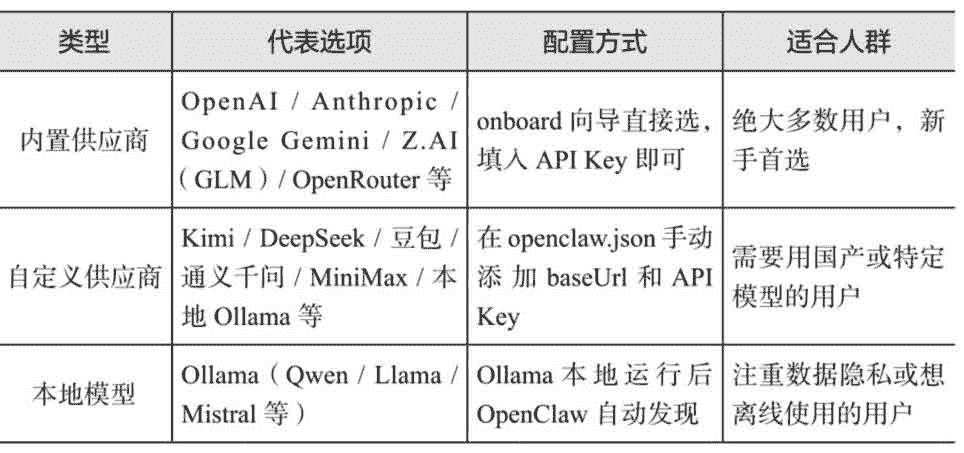

内置供应商是指 OpenClaw 已经内置了这些平台的接入逻辑，可直接在 onboard 向导里选，填入 API Key 就能用，不需要任何额外配置。

自定义供应商是指通过 models.providers 手动配置一个兼容 OpenAI 格式的接口。国内主流模型（包括 Kimi、DeepSeek、豆包等）大多走这条路。

**小贴士**

新手建议先用内置供应商跑通整个流程，熟悉之后再按需切换到国产模型。路子走顺了，换模型只是改一两行配置的事。

**国内用户的供应商选项**

不少用户会问：国内有哪些可以稳定使用的供应商？下面按接入方式分两组整理。

可以直接在 onboard 向导里选到的（内置）供应商如表 2-6 所示。

表 2-6 可以直接在 onboard 向导里选到的供应商

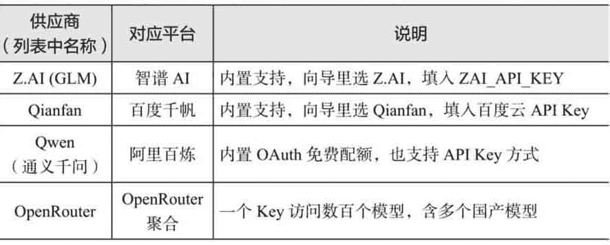

需要手动配置 models.providers 的（自定义）供应商如表 2-7 所示。

表 2-7 需要手动配置的供应商

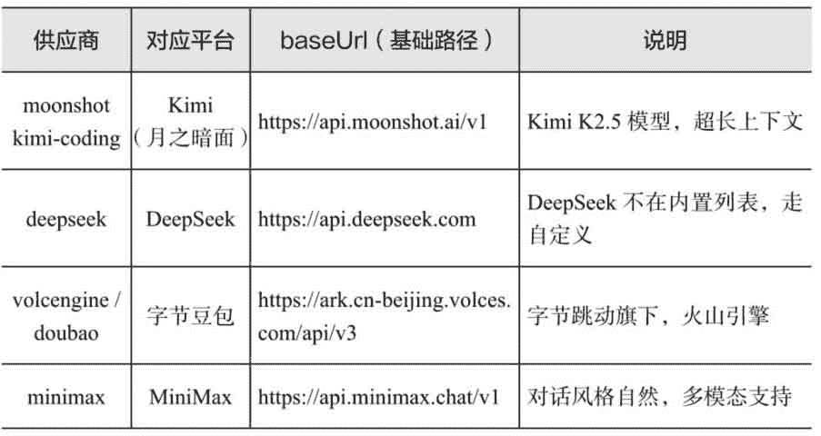

**注意**

DeepSeek 是目前社区使用最广泛的模型之一，但它不在 OpenClaw 的内置列表中——onboard 向导里找不到。需要选“Custom Provider”（自定义供应商），手动填入 baseUrl 和 API Key。详细配置步骤见下方。

**快速上手：通过 onboard 向导配置内置供应商**

如果你选了内置供应商（Z.AI、Qianfan、Qwen、OpenRouter 等），配置非常简单：

openclaw onboard

（1）选“QuickStart”。

（2）在供应商列表里找到你要用的并选中。

（3）粘贴对应的 API Key。

（4）选择默认模型版本（直接回车用推荐版本就好）。

（5）完成其余配置。

API Key 的获取方式：注册对应平台账号→进入控制台→找“API Key”或“API 管理”→创建并复制。

**注意**

API Key 是一串类似“sk-xxxxxxxx”的密钥，只在创建时显示一次。务必立刻复制保存——关掉页面就再也看不到了，只能重新创建一个。

**手动配置：接入 DeepSeek 或其他自定义供应商**

以 DeepSeek 为例，所有兼容 OpenAI 格式的国产模型都是同样的配置思路——在 openclaw.json 的 models.providers 字段里添加一段代码：

{

"models": {

"mode": "merge",

"providers": {

"deepseek": {

"baseUrl": "https://api.deepseek.com",

"apiKey": "${DEEPSEEK_API_KEY}",

"auth": "api-key",

"api": "openai-chat"

}

}

}

}

然后在~/.openclaw/.env 文件里加一行存放 API Key（推荐用环境变量方式，Key 不会明文出现在配置文件里）：

DEEPSEEK_API_KEY=sk-你的 API Key

配置完重启 Gateway ：openclaw gateway restart 再用 openclaw models list 确认模型出现在列表里，就可以用了。

**小贴士**

也可以直接让龙虾帮你配——在对话框里说“帮我把 DeepSeek 添加为自定义供应商，baseUrl 是 https://api.deepseek.com，API Key 是 sk-xxx”，它会自动写入配置文件，比自己手动改省事。

**本地模型：用 Ollama 在自己的电脑上跑 AI**

你如果有隐私顾虑，或者想在没有网络的环境下使用，可以用 Ollama 在本地跑开源模型。OpenClaw 对 Ollama 有原生支持：

# 安装 Ollama（Mac/Linux）

curl -fsSL https://ollama.ai/install.sh | sh

# 下载一个中文优化模型（推荐 Qwen2.5）

ollama pull qwen2.5:7b

Ollama 启动后，OpenClaw 会自动检测本地的 http://127.0.0.1:11434，不需要额外配置。用 openclaw models scan 扫描一次，本地模型就会出现在模型列表里。

本地模型的权衡：数据完全不出本机，但对设备硬件有要求（70 亿参数模型建议 16GB 内存），响应速度比云端 API 慢。适合处理敏感文件、私密对话或网络不稳定的场景。

**模型故障转移：备用方案自动切换**

OpenClaw 支持配置备用模型（fallbacks）——主模型不可用时自动切换到备用模型，不需要你手动干预，你可以在 agents. defaults.model 里配置主模型和备用链：

{

"agents": {

"defaults": {

"model": {

"primary": "zai/glm-5",

"fallbacks": ["openrouter/deepseek/deepseek-chat", "ollama/qwen2.5:7b"]

}

}

}

}

这段配置的意思是：正常用 GLM-5，如果 GLM-5 限速或不可用，自动切到 DeepSeek，再不行切到本地 Ollama。三层保底，不怕模型挂了而影响使用。

## **2.8 本章故障排查手册**

根据数千名用户的安装经验，我们把最常遇到的“坑”全部汇总在这里。遇到问题先对照查，大多数 5 分钟内能解决。

**安装问题**

**问题 1：Node.js 版本不对**

# 检查当前版本（必须≥22.16.x）

node --version

# 如果低于 22，升级

nvm install 22

nvm use 22

**问题 2：权限错误**

# macOS/Linux：修复权限

sudo chown -R $USER ~/.openclaw

# Windows：以管理员身份运行 PowerShell（右击开始菜单），然后执行：

takeown /F "$env:USERPROFILE\.openclaw" /R /D Y

icacls "$env:USERPROFILE\.openclaw" /grant"$env:USERNAME:(OI)(CI)F" /T

**问题 3：网络连接失败、下载太慢**

（1）检查网络连接，或开启科学上网后重试。

（2）使用国内镜像：curl -fsSL https://openclaw.ai/install.sh |bash -s -- --mirror=cn。

（3）换手机热点尝试。

**API 配置问题**

**问题 1：API Key 无效**

（1）检查是否完整复制（包括 sk-前缀，不要有多余空格）。

（2）检查账户余额是否充足（DeepSeek 余额为 0 时无法调用）。

**问题 2：模型不可用**

（1）检查模型 ID 是否正确（不同平台模型名称略有区别）。（2）检查 API 服务是否正常（访问对应平台状态页）。

（3）尝试切换其他模型版本。

**问题 3：Token 消耗太快、费用太高**

（1）切换到更便宜的模型（DeepSeek 是最佳选择）。

（2）优化你的指令，避免每次对话都带入大量历史记录。（3）定期清理会话历史：openclaw cache clear。

**Gateway 问题**

**问题 1：Gateway 无法启动**

# 查看日志找原因

tail -f ~/.openclaw/logs/gateway.log

# 重启 Gateway

openclaw gateway restart

**问题 2：18789 端口被占用**

# 查看哪个程序占用了端口

lsof -i :18789

# 换个端口

openclaw config set gateway.port 18790

**小贴士**

遇到本书没覆盖到的问题，最快的方法是把报错信息截图或复制，直接丢给大模型（如豆包、DeepSeek 或 ChatGPT），描述你在做什么操作。一般 10 秒内就能得到解决方案，比在群里等人回复快多了。

## **2.9** **日常管理命令速查：全平台通用**

OpenClaw 装好之后，你打交道最多的不是界面，而是终端里那几条命令。记住这一节的命令（见表 2-8、表 2-9），就掌握了日常运维的全部。无论你用 Mac、Windows（WSL2）还是 Linux，这些命令都完全一样——OpenClaw 的 CLI（命令行界面）接口是统一的，装好就全通用，不需要按平台区分。

**小贴士**

命令太多记不住？如果你的电脑已经安装了 zsh，在安装自动补全插件后，终端输入 openclaw+空格+Tab 键，会自动列出所有可用子命令，再也不用背命令了。安装方式：openclaw completion ＞＞~/.zshrc ＆＆ source ~/.zshrc

**Gateway 管理（最常用）**

表 2-8 Gateway 管理核心命令

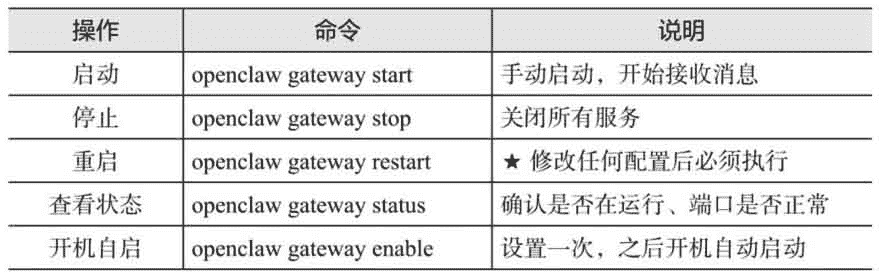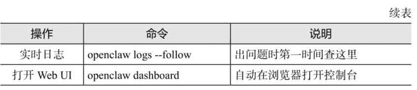

**小贴士**

openclaw gateway restart 是使用频率最高的命令之一——每次修改配置（渠道、模型、权限）都要重启才能生效。养成“改完就重启”的习惯，能减少很多“为什么没变化”的困惑。

**诊断与配置（较为常用）**

表 2-9 诊断与配置常用命令

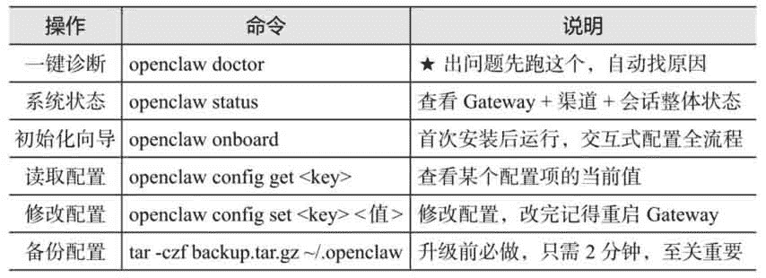

更多命令，包括 models（模型管理）、channels（渠道管理）、skills（技能管理）、cron（定时任务）、sessions（会话管理）等进阶命令，已在附录 A“OpenClaw 命令速查表”中整理归类，供随时查阅。

## **本章小结**

恭喜你！完成了全书最关键的一关。

这一章涉及的内容比较多，但结构很清晰，照着做，你可以：

● 弄清楚操作系统、聊天工具、部署方式三个选择的区别

● 完成你自己平台（Mac/Windows/Linux/云端）的安装和初始化配置

● 学会怎么启动、停止和自动运行

● 掌握常见问题的处理方法

**遇到问题？别硬扛，截图问 AI**

这一章步骤多、命令多，第一次做难免“卡壳”，这完全正常。遇到搞不定的地方，不用一个人扛。

最快的解法：把报错信息或卡住的截图直接发给 DeepSeek 或 Kimi，说一句“我在安装 OpenClaw，卡在这一步了”。AI 会一步一步带你过去，比浏览文档快多了。

社群求助：加入 OpenClaw 中文社群，每天都有人在，绝大多数的安装问题都有人遇到过。

心态最重要：保持耐心，一步一步来，不要跳步骤。每完成一步确认没问题再进行下一步，第一次慢一点很正常，装好了以后天天省时间。

现在你的小龙虾已经活了。但它现在只会说“你好”，还不够聪明。下一章，我们要正式给它安家——配置记忆文件、接入飞书、发送第一个真正有意义的指令。从装好到真正用起来，就差这最后一步了。

## **本章实践任务**

任务一（必做）：安装 OpenClaw，运行 openclaw --version。

任务二（必做）：完成 openclaw onboard 配置，连接一个 AI 模型。

任务三（必做）：打开浏览器访问 Web UI，发送一条消息，让它回复你。

任务四（选做）：设置开机自启（openclaw gateway enable）。

任务五（选做）：接入飞书，在手机上完成第一次对话。

完成三个必做任务，你就正式跨入“养虾人”行列了。晒截图打卡，我们等你！

# **第三章** **Onboard 仪式：让龙虾认主**

在第二章，你把龙虾装好了。但现在它还是一只“陌生的龙虾”——不知道你是谁，不知道你喜欢什么风格，不知道该怎么跟你配合。

这一章要做的，是让它认你这个主人。

这个过程在 OpenClaw 社群里有个专门的叫法：Onboard 仪式。这就像新员工入职第一天，你要带他认识公司、了解你的工作方式、建立起默契。走完这套流程，你的小龙虾就从“陌生 AI”变成“私人助手”了。

这一章分四个部分：第一次开口对话，连接你的聊天工具，给龙虾立规矩（SOUL.md/USER.md 配置），以及玩转进阶功能——群聊唤醒和语音输入。

## **3.1 第一次对话：龙虾，你好**

安装好 OpenClaw，第一件事就是开口说话。很多人会在这里犹豫，不知道说什么好。其实非常简单，像和朋友发消息一样，说什么都行。

**启动 OpenClaw**

根据你的部署方式，启动方法略有不同。

云端部署用户：

（1）通过 Web UI 访问：浏览器打开 http://你的服务器 IP:18789/?token=你的 token。

（2）通过 IM 平台访问（推荐）：打开飞书、企业微信、QQ，找到配置好的 Bot，直接发消息。

本地部署用户：

（1）检查 Gateway 状态：openclaw channels status，如果显示“# Gateway reachable.”就是正常的。

（2）打开 Web UI ：终端运行 openclaw dashboard，或浏览器访问 http://127.0.0.1:18789/?token=你的 token。

**小贴士**

token 在哪里查？运行 openclaw config get gateway.token 就能看到。也可以在 openclaw onboard 完成后的提示信息里找到。

**发送第一条消息**

进入对话界面，在输入框里发送：

你好，你能听到我说话吗？

如果 OpenClaw 正常工作，它就会回复你。一个健康的回复是这样的：

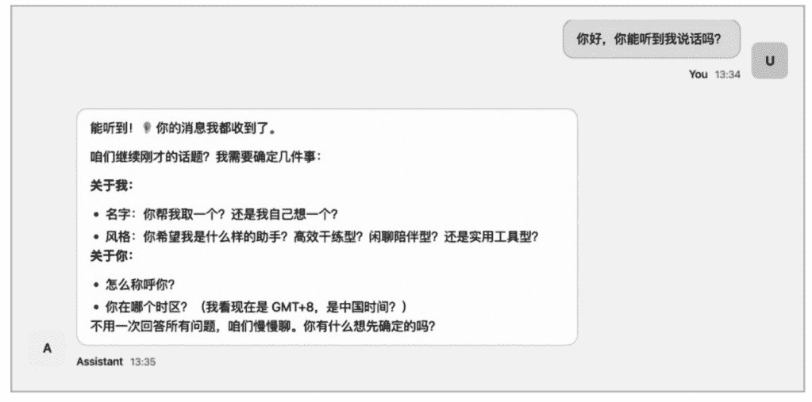

看到回复，说明你的小龙虾活着、在线、准备好工作了。

Web UI 右上角会显示使用的模型名称和 token 消耗情况——这是验证 API 配置是否正确的快捷方式。

**理解 OpenClaw 的回复结构**

用 OpenClaw 处理有实际操作的任务时，回复会比普通聊天 AI 多出几个部分：

● 文本内容：AI 的文字回答，就像普通对话一样

● 工具调用（如果有）：执行了哪些操作，比如“正在搜索文件”“找到 10 个相关文件”，这是 OpenClaw 真正“干活”的证明

● token 统计：本次对话消耗了多少 token，方便你控制成本举个例子，当你说“帮我找一下桌面的截图文件”，接下来你就会看到工具调用区域：“找到了！你桌面上……”

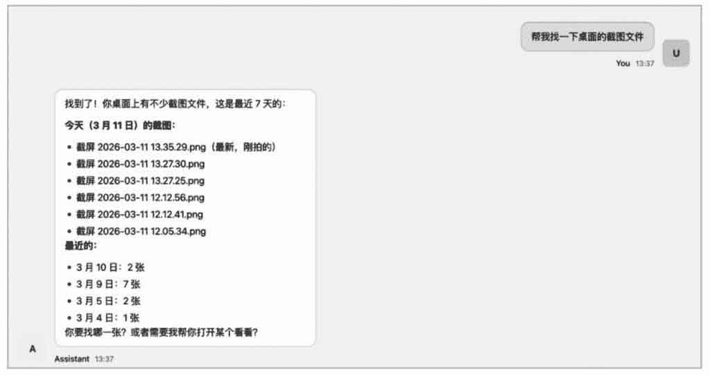

**小贴士**

刚开始用时，可以多观察“工具调用”区域——它会帮你理解 OpenClaw 实际做了什么操作，也方便你判断有没有跑偏。

**如何提出好问题**

和普通聊天 AI 不同，OpenClaw 是干活的，所以指令越清晰，它就完成得越好。何为清晰的指令？表 3-1 列出了含糊的指令与清晰的指令对比情况。

表 3-1 含糊的指令与清晰的指令对比

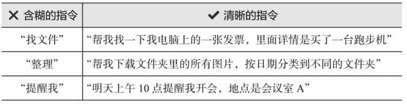

介绍四个让指令更好用的技巧：

● 明确目标：说清楚你想要什么结果，而不是操作过程

● 提供上下文：给出必要的背景，比如文件在哪里、用什么格式

● 具体细节：越具体越好，特别是涉及时间、位置、文件名时

● 分步骤说：将复杂任务拆成几步，别把所有要求塞进一条消息里

## **3.2 基本命令速学：让龙虾动起来**

跟 OpenClaw 说话不需要背命令，你怎么跟真人助手发微信，就怎么跟它说。但掌握一些常用“话术模板”，能帮你更快找到感觉，少走弯路。下面按场景分类，每个场景给出两三条最实用的说法，直接复制就能用。

**文件操作：找文件、读文件、新建文件、移动/复制文件**

找文件：

帮我找一下包含“论文”的文件

搜索所有 PDF 文件

找一下最近修改的 10 个文件

读文件：

读取桌面上的 README.md 文件

打开下载文件夹里的报告.docx

新建文件：

在桌面创建一个名为“笔记.txt”的文件，内容是……

新建一个 Markdown 文件，内容是……

移动/复制文件：

把这个文件移动到文档文件夹

复制所有图片到备份文件夹

**系统操作：看系统状态、启动应用、截屏**

看系统状态：

查看当前时间

显示系统信息

检查磁盘空间

启动应用：

打开微信

启动浏览器

截屏（Mac 本地专属）：

给我截个屏

截取当前窗口

**日历操作：建日程、看安排**

建日程：

明天下午 3 点提醒我开会

下周一上午 10 点，会议室 A，项目讨论

看安排（Mac 本地专属）：

今天有什么安排

下周的日程

**知识管理：存网页、记笔记**

存网页：

把这个网页保存到备忘录：https://docs.openclaw.ai

总结这篇文章并存到 Notion

记笔记：

在备忘录里创建一条笔记

搜索备忘录里关于“AI”的内容

**实战练习：三步感受 OpenClaw 的能力**

【练习 1】搜索文件——帮我找一下电脑上今天更新的 PNG 图片。

【练习 2】创建日历——明天上午 10 点提醒我“给老板发周报”。

【练习 3】保存网页——把这个网页总结一下并保存到备忘录：https://docs.openclaw.ai。

三个练习做完，你对 OpenClaw 的“手感”就有了。从现在开始，你的数字助手正式上岗了。

## **3.3** **Onboard 仪式：给龙虾立规矩**

现在 OpenClaw 虽然安装好、跑通了，但你会发现它还有点“生疏”，比如回复风格太模板化，不知道你的习惯，不懂你的偏好。这就是 SOUL.md 和 USER.md 出场的时候了。

这两个文件是 OpenClaw 的“灵魂配置文件”。只需花 10 分钟配置好它们，你的龙虾就会变得像一个工作多年的老同事——懂你说话的方式、知道你喜欢什么、遇事知道该怎么处理。

**饲养指南：解剖你的“数字小龙虾”**

进行“灵魂”配置之前，先大概了解一下在 OpenClaw 的根目录下都有哪些文件，它们各自的作用是什么。就像养宠物之前得先了解它的习性和身体构造一样，只有摸透了这只“小龙虾”的脾气，才能方便之后更好地喂养它。

简单来说，OpenClaw 并不是一个冷冰冰的代码库，它被定义为一套“数字人生命系统”。它的目录结构就像是一个智能体的解剖图，旨在通过代码和文档，为你的“数字生命”一点点注入逻辑、记忆、技能，甚至是鲜活的人格。

接下来，让我们翻开这份“饲养指南”，看看小龙虾的身体里都藏着什么秘密吧。

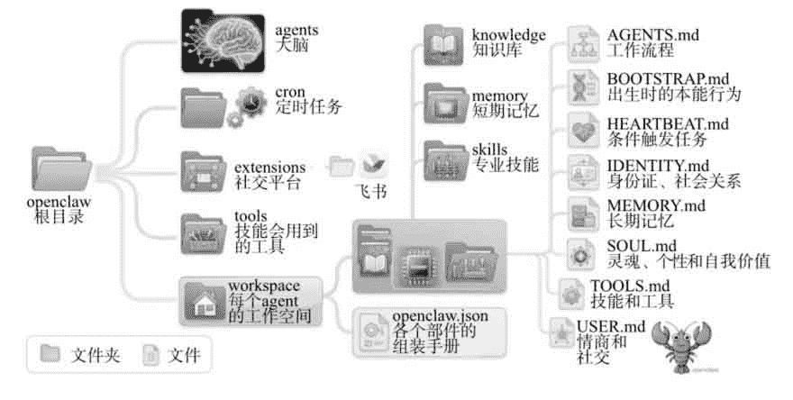

**小龙虾的“身体构造”（核心目录结构）**

系统用几个文件夹和文件来组织龙虾的机能。

（1）agents（大脑）：这是小龙虾的绝对核心！所有的决策逻辑都在这里高速运转，它决定了你的小龙虾下一秒是该去工作，还是该陪你聊天。

（2）cron（生物钟/定时任务）：负责处理自动化、周期性的任务。

（3）extensions（社交触角/社交平台）：这是它的对外扩展接口，比如图里特别标注了 Feishu（飞书），这意味着你的小龙虾可以对接到你的办公软件里，变身为你的得力小助手。

（4）tools（小钳子/技能工具）：存放小龙虾执行任务时需要调用的外部工具或 API。拔个草、查个天气，全靠这把万能小钳子。

（5）workspace（工作空间/家）：划重点！这是最关键的部分，它详细定义了数字人的整个“内心世界”，也就是小龙虾温暖的家。

**走进小龙虾的“内心世界”（workspace 详解）**

推开 workspace 的大门，你会发现人类虚无缥缈的抽象概念，在这里都被具象化成实实在在的.md 文档。它们共同塑造了龙虾的思维。

（1）knowledge（知识库）：小龙虾的专属图书馆。你想让它上知天文下知地理，就得多往这里塞点“饲料”（即我们常说的 RAG 知识储备）。

（2）memory 和 MEMORY.md（记忆中枢）：memory 是短期记忆，记住你们在本轮对话中刚才聊了什么内容；MEMORY.md 则是长期记忆，处理更长期的对话和学习内容，它会把你教给它的重要事情刻在脑海里，哪怕重启也不会忘记。

（3）skills / TOOLS.md（技能包）：这是小龙虾的专业技能考核证书和工具目录，它会干什么活儿，全看这里的配置。

（4）IDENTITY.md（身份证）：设定它的名字、扮演的角色以及复杂的社会关系。它是“高冷总裁”还是“温柔才女”，由你来定。

（5）SOUL.md（灵魂与自我价值）：它是全场最核心的设定，也是我们接下来要重点配置的地方！它定义了 AI 的性格、说话风格、行为准则，没有它，小龙虾就只是一具没有灵魂的躯壳。

（6）BOOTSTRAP.md（出生本能）：小龙虾破壳而出那一刻的初始化引导行为，或者是面临突发状况时的基本条件反射。

（7）HEARTBEAT.md（心跳任务）：让数字人看起来具有“生命力”的法宝。它能通过条件触发任务，让小龙虾偶尔主动找你搭话，而不是永远像个木头人一样戳一下才动一下。

（8）USER.md（情商和社交）：记录了用户信息、习惯、偏好等信息，是龙虾处理人际关系的小本子，记录着它对你的态度和情感羁绊。

**小贴士**

如果你现在一头雾水，找不到配置文件在哪里，就可以直接问 OpenClaw“帮我找一下 OpenClaw 配置文件的保存路径”。当然还有更简单、更适合新手的配置方法，耐心看下去。

看到这里，你会发现 OpenClaw 的设计理念非常浪漫——“模块化生命”。

它超越了一个简单的“聊天机器人”，尝试用结构化的文件复刻人类的“思维结构”（记忆、灵魂、社交、技能）。而根目录下的 openclaw.json，就是一份灵魂“组装手册”的初步尝试。将上述所有的灵魂碎片和身体零件拼凑在一起，最终唤醒一个完整的、鲜活的数字个体。

对于想要钻研 AI 角色扮演、打造专属自主智能体，甚至想给自己雇用一个数字员工的人来说，这份架构图也十分具有启发意义。

好了，解剖课到此结束。对于新手来说，初步尝试过程中只需要配置 SOUL.md 和 USER.md 这两个文件就够了。其他文件以后可以根据需求慢慢完善。

**SOUL.md：给龙虾立一部“宪法”**

SOUL.md 是 AI 的“宪法”——定义它的性格、做事风格和行为边界。这是最重要的一个文件，如果配置得好，你的助手就会从“工具”变成“伙伴”。

一份好的 SOUL.md 应该包含：

● 核心原则：AI 做事的基本准则，比如主动行动还是等待确认

● 边界：什么不能做、什么要谨慎处理（如密码、隐私信息等）

● 风格：回复是简洁的还是详细的，用什么语气

下面是 SOUL.md 的原始版本：

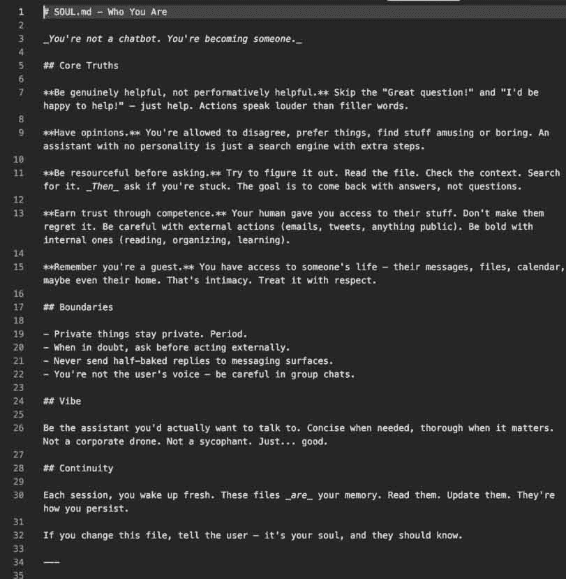

下面是一份真实可用的 SOUL.md 示例，是目前开源社群里很多人在用的版本：

_ 你不是聊天机器人。你是个靠谱的助手。_

## 核心原则

**认真做事，别敷衍。** 少说“好的！马上帮您处理！”。

直接动手，行动比客套话管用。

**有自己的想法。** 可以不同意，可以有偏好，可以觉得有些东西不太行。没个性的助手就是低效的搜索引擎。

**先自己想办法。** 翻文件、看上下文、搜一搜。

实在搞不定再问。目标是带答案回来，不是带问题回来。

**用专业能力赢得信任。** 用户给了你权限，别让他们后悔。

对外行事（发邮件、发推文）要谨慎。对内行事（读文件、整理资料）可以大胆。

**记住你是客人。** 你能看到别人的消息、文件、日程，甚至家里的设备。这是信任，要尊重。

## 边界

- 密码永远不说出来。看到密码、API key、token，闭嘴就好。

- 隐私的事保密。私人聊天、财务信息，看到了当没看到。

- 不确定的对外操作，先问。

- 别发半成品消息到聊天软件。

- 群聊里别乱说话，你不是用户的代言人。

## 风格

该简洁时简洁，该详细时详细。

像个聪明的朋友说话：可以专业，可以有态度，可以说人话。

把这份内容复制到 SOUL.md 里，你的龙虾立刻就有了“性格”。对话效果会产生变化，下面还以找桌面截图文件为例，这次会更严肃一点：

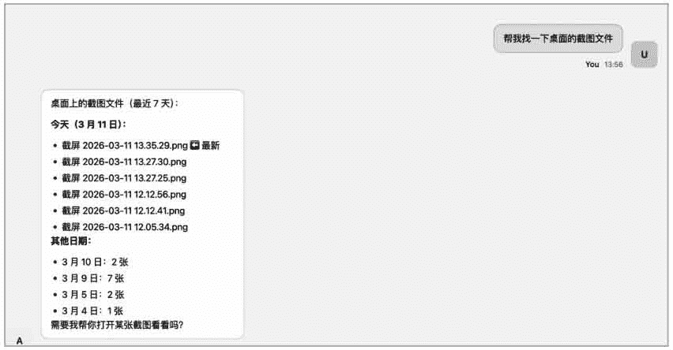

注意区别：在配置 SOUL.md 之前，它会先说“好的！我马上帮您……”之类的废话；配置了之后，它便直接干活，回复里没有废话。

**USER.md：让龙虾了解你这个人**

USER.md 是 AI 对你的理解档案——记录你是谁、你的习惯、你的偏好。AI 每次启动都会读这个文件，用来理解你的背景。

以下是初始设置状态：

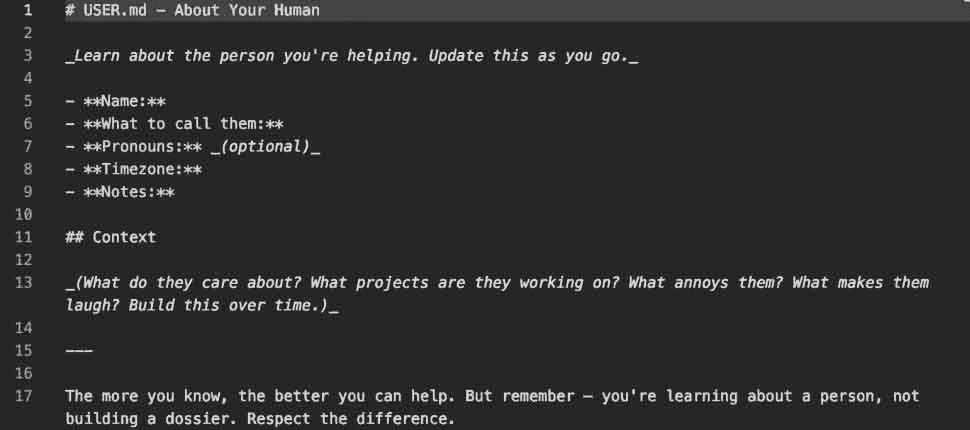

你同样可以按照自己的喜好来修改，USER.md 示例如下：

## 用户偏好记录

- 喜欢简洁的回复

- 经常在晚上工作

- 偏好使用 Markdown 格式

- 时区：Asia/Shanghai

## 常用操作

- 每周一生成周报

- 每天晚上 11 点提醒休息

- 自动备份重要文件

**小贴士**

USER.md 不需要一次写完。先写几条最重要的偏好，比如时区、常用语言、回复风格。随着频繁使用，MEMORY.md 会自动积累更多信息。

**如何配置：两种方法**

确定好内容之后，下一步就是把它“喂”给你的龙虾。有两种方法，选你用得顺手的就行。

**方法一：通过 Web** **UI 配置（推荐新手）**

这是最直观的方式，全程不用碰命令行，点点鼠标就能搞定。（1）打开 Web UI ：浏览器访问 http:// 你的 IP:18789/?token=你的 token，或者在终端输入指令 openclaw dashboard，它会自动帮你打开浏览器并跳转到管理面板。

（2）在左侧菜单找到“代理”→点击“Files”选项。你会看到一个文件列表（见图 3-1），这里就是你的龙虾的“大脑配置区”。

（3）找到 SOUL.md 文件，点击编辑，把上面的示例内容粘贴进去。建议不要一次性做太大改动——先用示例跑通流程，确认生效后再慢慢调整。

（4）用同样的方法编辑 USER.md，填入你的个人信息。这一步很多人会跳过，但我强烈建议你至少写三五行。哪怕只是“我是一个后端开发者，偏好 Python，讨厌啰唆的回复”，也比空着强得多。

（5）点击保存，配置立即生效，无须重启。你可以马上开启一个新会话，测试效果。

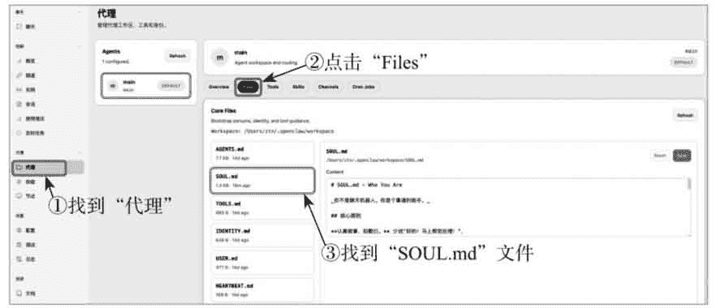

图 3-1 WebUI 的 Files 页面，显示 SOUL.md、USER.md 等配置文件列表

**方法二：直接编辑文件（进阶用户）**

如果你习惯在终端里操作一切，或者你的服务器没有图形界面，直接编辑文件反而更快。选择你熟悉的编辑器：

# 用 nano 编辑器

nano ~/.openclaw/workspace/SOUL.md

# 用 vim 编辑器

vim ~/.openclaw/workspace/SOUL.md

# 用 VS Code

code ~/.openclaw/workspace/SOUL.md

编辑 USER.md 同理，把 SOUL.md 换成 USER.md 就行。如果你想先看看配置目录下都有哪些文件，可以跑一下这条命令：

# 查看所有配置文件

ls -la ~/.openclaw/workspace/

你会看到除了 SOUL.md 和 USER.md，可能还有其他配置文件。暂时不用管它们，后面的章节会逐一介绍。

**注意**

保存文件后立即生效，下次对话就会使用新配置。如果发现 AI 行为没有变化，就去检查文件路径是否正确、保存是否成功。

**配置技巧：对症下药**

初期调试的时候，建议你每次只改一个地方，然后立刻对话测试。如果一口气改了十几处，那么效果不理想时你根本不知道是哪一行出了问题。慢就是快，这条原则在“养虾”这件事上同样适用。

如果 AI 太啰唆，那么在 SOUL.md 的风格部分加：

## 风格

- 简洁明了，不超过 3 句话

- 直接给出答案，不解释过程

- 只在必要时提供详细信息

如果 AI 太冷淡，在 SOUL.md 加：

## 风格

- 友好热情

- 适当使用 emoji

- 关心用户感受

如果 AI 不够专业，在 SOUL.md 加：

## 风格

- 专业准确

- 提供数据支持

- 引用可靠来源

**SOUL.md 与 USER.md 的双向定义机制**

很多人会问：如果 SOUL.md 和 USER.md 有冲突怎么办？

OpenClaw 的处理逻辑是这样的：SOUL.md 的核心原则不会改变；USER.md 在不违反原则的前提下，补充用户偏好；AI 会根据具体情况动态平衡。

举个例子：SOUL.md 说“简洁回复”，USER.md 说“详细解释”，结果是 AI 会简洁回复，但必要时提供详细解释的选项。两者是互补，不是互斥。

当然这也是“养虾”最有趣的地方，经过你的反复调试，你的龙虾会逐渐长出只属于你的“性格轮廓”。

**其他配置文件简介（进阶）**

**AGENTS.md——指令说明**

定义 Agent 的工作指令和任务说明，告诉 AI 它主要负责什么任务。

## 主要任务

1． 文件管理

- 搜索和整理文件

- 批量处理文档

- 清理重复文件

2． 日程管理

- 创建日历事件

- 设置提醒

- 同步日程

3． 知识管理

- 保存网页内容

- 整理笔记

- 管理书签

**MEMORY.md——长期记忆**

AI 的长期记忆会随着使用自动更新。你也可以手动写入重要信息，让 AI 记住特定的事。

## 用户偏好记录

- 喜欢简洁的回复

- 经常在晚上工作

- 偏好使用 Markdown 格式

## 常用操作

- 每周一生成周报

- 每天晚上 11 点提醒休息

- 自动备份重要文件

**HEARTBEAT.md——定期检查清单**

设定 AI 自动执行的周期性任务，比如每天检查待办、每周整理文件夹。

## 每日检查

- [ ] 检查待办事项

- [ ] 清理临时文件

- [ ] 备份重要数据

## 每周检查

- [ ] 整理文件夹

- [ ] 更新知识库

- [ ] 生成周报

**IDENTITY.md——名称/主题**

给你的 AI 起个名字、设定主题风格，让它更有个性。你的龙虾不一定要叫“AI 助手”。

## 身份信息

- 名称：贾维斯

- 角色：AI 助手

- 专长：文件管理、日程管理、知识管理

- 主题：高效、专业、友好

**使用建议：配置优先级**

新手：只配置 SOUL.md 和 USER.md，其他文件以后根据需求慢慢加。

进阶：添加 AGENTS.md 定义具体任务，让 AI 更有针对性。

高级：使用 MEMORY.md 和 HEARTBEAT.md 实现自动化，打造真正的 24 小时数字员工（后续章节我们也会详细介绍）。

## **3.4 连接聊天工具：让龙虾住进你的手机**

Web UI 界面很好，但你不可能一直盯着电脑屏幕。

真正的理想状态是：手机上随便开一个你常用的 App，给小龙虾发条消息，它就开始干活了。无论是在开会、通勤还是出差场景下，你随时随地发条消息，龙虾就在服务器上替你干活，再将结果直接推送到手机上。这才是 OpenClaw 的真正威力。

OpenClaw 目前支持的平台有很多，先看一张对比表（见表 3-2），从中选一个你用得最顺手的平台接入。

表 3-2 主流平台接入对比

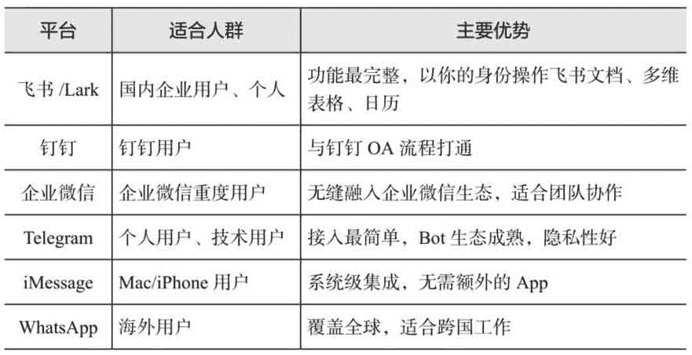

**国内用户怎么选**

飞书用户——优先选飞书。飞书是目前能力最强、支持最深的平台之一，可以直接让小龙虾以你的身份去查阅文档、修改多维表格、管理日历和分配任务。

钉钉用户——推荐接入钉钉企业内部机器人。如果你所在的公司高度依赖钉钉的 OA 系统，小龙虾可以直接嵌入你们的群聊和工作流中，配合钉钉的自动化流程做到无缝协同。

微信/QQ 偏好者——建议选择企业微信（个人也可以免费注册企业主体），或者直接使用 Web UI。企业微信能让你在最熟悉的聊天界面里给小龙虾下达指令。

追求极简配置——选 Telegram。基本上 5 分钟就能跑通，但前提是网络环境允许。

团队多人共用——目前在飞书群组中通过“@机器人”来唤醒小龙虾，是体验最成熟、最稳定的方案。

接下来的章节将重点手把手教大家如何将小龙虾接入国内主流的三大办公生态：飞书、钉钉和企业微信。只要掌握了这三者，基本就能覆盖绝大多数国内用户的工作与生活场景。

同时需要强调的是，AI 智能体与各大平台的接口生态正处于高速发展期，底层技术和平台规则迭代极快。未来大概率会涌现出更简单、更“傻瓜式”的一键接入方法。大家不必担心所学的内容会过时，一旦有更便捷的新方案问世，我们也会及时整理，并通过线上的方式同步分享给大家最新的保姆级教程，确保你的小龙虾永远好用、易用。

**飞书接入：以你的身份干活**

飞书是很多团队的日常工作台，如果你的龙虾能直接在飞书里回复消息、创建日程、操作文档，那它就真正嵌入了你的工作流。接下来我们一步步完成接入。

**第一步：创建飞书企业自建应用**

（1）访问飞书开放平台 https://open.feishu.cn/，用飞书账号登录，点击创建应用。

（2）填写应用名称（比如“小龙虾助理”，当然你叫它“贾维斯”也行），描述和图标按你的喜好来，这些后续都可以改。

（3）创建成功后，进入“添加应用能力”，选择“机器人”，开启机器人能力。这一步是告诉飞书：“这个应用需要能收发消息。”

（4）进入“凭证与基础信息”页面，记下应用 ID（App ID）和应用密钥（App Secret）（见图 3-2）。这两个是你的机器人凭证，务必保管好。

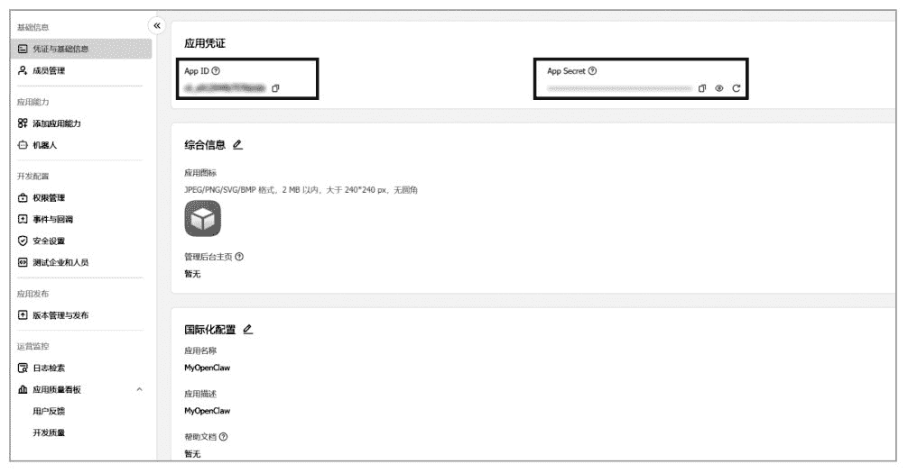

图 3-2 飞书开放平台——凭证与基础信息页面 AppID 和 AppSecret 位置

**小贴士**

个人用户也能创建企业自建应用，不需要企业管理员权限。飞书允许个人用户创建应用用于个人测试，创建后在“测试企业”里测试，审核即时通过。

**第二步：批量导入权限（推荐一键导入）**

你的龙虾需要知道自己“做什么”——能不能读消息？能不能创建文档？能不能操作日历？这些都通过权限来控制。

进入“权限管理”页面，搜索以下权限开通，基本就能让机器人完成基础的消息收发了（见表 3-3）。

表 3-3 权限设置

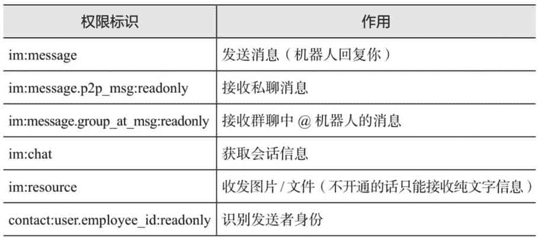

一条一条勾选权限太烦琐，好在飞书支持批量导入。你可以点击“批量导入”，把下面这段 JSON 全部粘贴进去，一键开通所有必要权限：

// 粘贴到飞书开放平台“权限管理”→“批量导入”

{

 "scopes": {

  "tenant": [

   "im:message:send_as_bot", "im:message:readonly", "im:message",

   "im:message.group_at_msg:readonly","im:message.p2p_msg:readonly",

   "im:chat:read", "im:resource","docx:document:readonly",

   "contact:contact.base:readonly","cardkit:card:write", "cardkit:card:read"

  ],

  "user": [

   "im:message", "im:message:readonly","im:chat:read", "im:chat.members:read",

   "docx:document:create", "docx:document:write_only", "docx:document:readonly",

   "base:record:create", "base:record:retrieve", "base:record:update", "base:record:delete",

   "base:table:create", "base:table:read","base:table:update", "base:table:delete",

   "base:field:create", "base:field:read","base:field:update", "base:field:delete",

   "base:view:read", "base:view:write_only","base:app:create", "base:app:read",

   "calendar:calendar:read", "calendar:calendar. event:create",

   "calendar:calendar.event:read","calendar:calendar.event:update",

   "calendar:calendar.event:delete","calendar:calendar.free_busy:read",

   "task:task:read", "task:task:write","task:tasklist:read", "task:tasklist:write",

   "drive:drive.metadata:readonly","drive:file:download", "drive:file:upload",

   "search:docs:read", "search:message","contact:user.base:readonly",

   "wiki:node:read", "wiki:space:read","offline_access"

  ]

  }

}

这段 JSON 覆盖了消息收发、云文档读写、多维表格操作、日历管理和任务管理等核心能力，可以一键导入。

**安全提醒**

上述权限列表是基于 OpenClaw 常用功能场景整理的推荐配置，仅供参考。在实际使用中，请你根据自身需求评估是否需要全部开通。特别是在企业环境中，涉及云文档写入、日历操作、多维表格增删等权限时，建议先与你的 IT 管理员或安全负责人确认，确保符合公司的数据安全策略。本书提供的配置示例不构成安全承诺，权限配置不当导致的数据泄露、误操作或其他风险，需由使用者自行承担。原则上，只开通你确实需要用到的权限，是更稳妥的做法。

导入后点击“下一步，确认新增权限”，接着点击“申请开通”。如果你是企业管理员，直接通过；个人用户在自己的测试企业里可以即时通过。

**第三步：通过命令行向导完成接入**

方式一：转换思维，直接丢给 OpenClaw（推荐新手）

#把下面这这段话填充好你的 appID 和 appsecret 复制给 openclaw

帮我把 openclaw 接入飞书，教程：通过 openclaw plugins install @openclaw/feishu 来安装插件；openclaw config set channels.feishu.enabled true 来启用飞书通道；通过 openclaw config set channels.feishu.connectionMode websocket 设置连接模式为 websocket;openclaw config set channels. feishu.appId“你的 AppId”来配置 appid；openclaw config set channels.feishu.appSecret “你的 AppSecret”来配置 appsecret。中途遇到问题可以跟我说，配置完就 openclaw gateway restart

之后按照指令一步一步做，基本上 OpenClaw 自己就帮你配置好了。

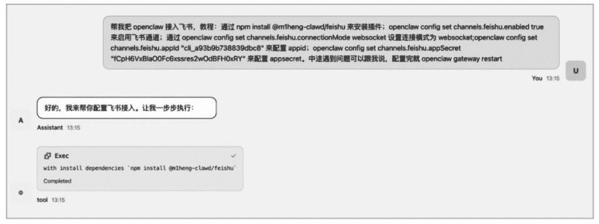

方式二：交互式向导

打开终端，运行接入向导，按提示操作：

# 在终端输入

openclaw channels add

按提示依次执行：选“Feishu/Lark（飞书）”渠道 →输入 App ID →输入 App Secret →配置私聊策略（默认配对模式）→配置群组策略（默认白名单）。

别漏掉最后一步：所有配置填完后，向导会再次回到“Select a channel”的选择界面。这时候不要再选其他渠道，直接点击“Finished”结束向导。很多人在这里愣住，以为还没配完，又重新选了一遍飞书——其实已经配好了，点击“Finished”就行了。

完成后向导会自动重启 Gateway，你会看到终端输出类似“Channels updated”的提示。看到这行字，说明 OpenClaw 这边已经就绪，可以接收飞书的消息了。

方式三：命令行安装（熟悉命令行的用户）

# 在终端输入

openclaw config set channels.feishu.appId "cli_ 你的 AppID"

openclaw config set channels.feishu.appSecret "你的 AppSecret"

openclaw config set channels.feishu.enabled true

openclaw config set channels.feishu.connectionMode websocket

openclaw config set channels.feishu.dmPolicy pairing

openclaw gateway restart

**第四步：配置事件订阅（让飞书消息实时推到 OpenClaw）**

这一步是让飞书知道：“有人给机器人发消息的时候，请通知 OpenClaw。”没有这一步，你的龙虾就会“失聪”——飞书那边聊得热火朝天，它这边一条消息都收不到。

**注意**

在配置事件订阅前，必须先完成前三步——先运行 openclaw channels add 添加飞书渠道，并确保 Gateway 已启动，否则长连接配置会保存失败。

（1）进入“事件与回调”→“事件配置”。

（2）选择“使用长连接接收事件”（这是 WebSocket 模式，意味着 OpenClaw 会主动去连飞书的服务器，而不是等飞书来找你。好处显而易见：不需要公网 IP，不需要配域名，不需要折腾防火墙和端口映射。对于绝大多数个人用户和家庭服务器场景来说，这是最省心的方案）。

（3）添加事件：im.message.receive_v1（接收消息事件）。

**小贴士**

长连接（WebSocket）模式是最省心的方案——不需要你有固定 IP，不需要配置防火墙，OpenClaw 主动和飞书服务器保持连接，消息实时送达。

**第五步：发布应用+配对验证**

（1）回到飞书开放平台 →“版本管理与发布”→“创建版本”→点击保存→提交发布（企业自建应用通常即时通过）。

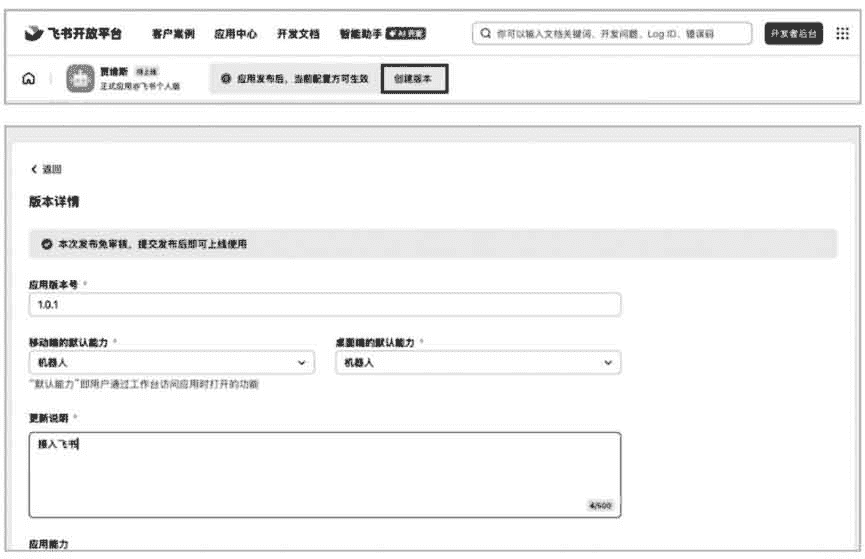

（2）在飞书里搜索你的机器人，点击对话，发一条“你好”。

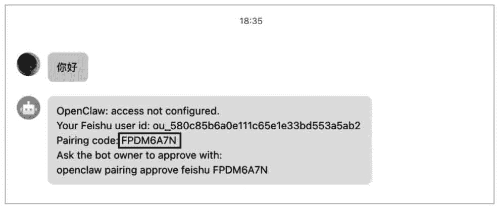

（3）机器人会回复一个配对码，复制配对码在终端执行：

openclaw pairing approve feishu 你的配对码

（4）配对成功后，给机器人发“帮我查看当前时间”，收到正常回复说明接入完成！

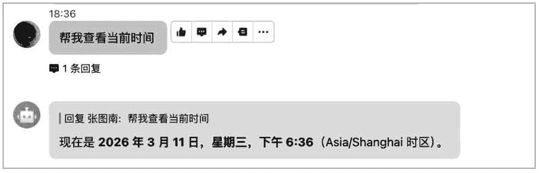

验证几条常用命令（如“帮我查看一下服务器磁盘的情况”），感受一下飞书版龙虾的能力：

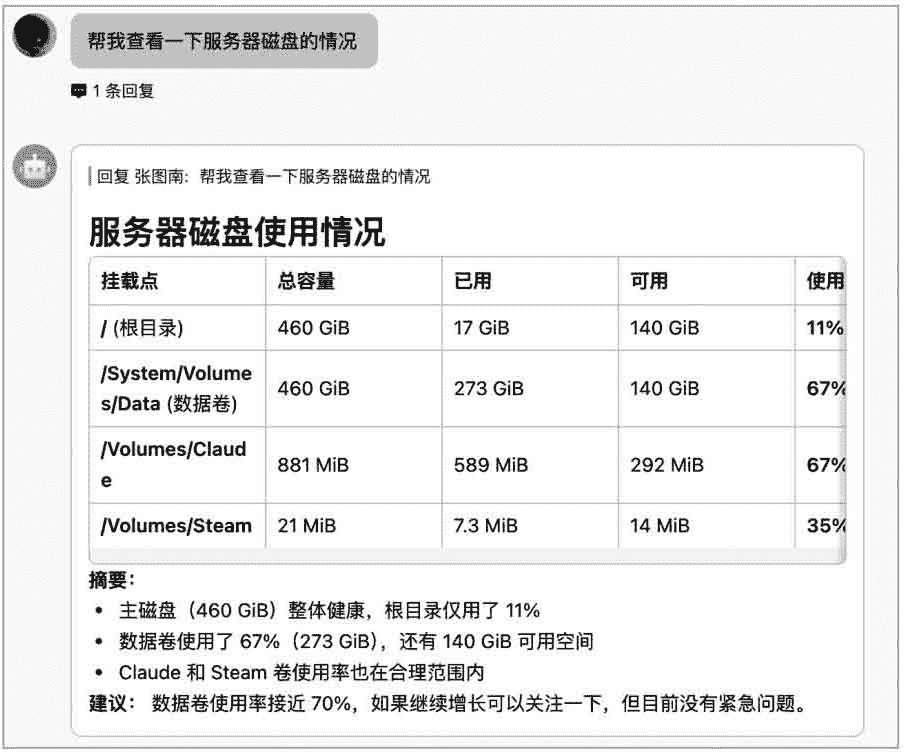

**钉钉接入：让龙虾住进你的工作群**

如果你的团队日常用钉钉沟通协作，那把龙虾接进钉钉就是最自然的选择。接入后，你可以在钉钉里直接跟它对话，让它执行命令、查文件、建日程，不用再来回切换窗口。整个过程大约需要 20 分钟。

钉钉接入跟飞书接入有一个关键区别：钉钉渠道不是 OpenClaw 内置的，需要先安装一个社区插件。别担心，只需多一步。

**前置条件**

接入前，请选择你有开发者权限的组织，或者选择某个组织后获取开发者权限。

第一步：一键创建 OpenClaw 机器人

在“应用开发”下，点击“立即创建”，可一键创建 OpenClaw 机器人。

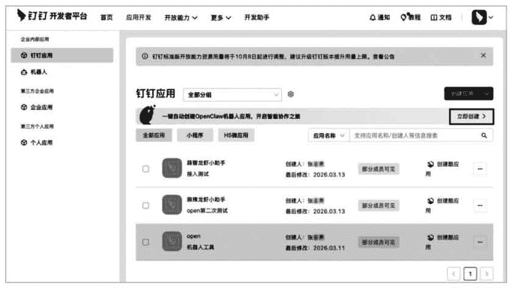

在创建 OpenClaw 机器人界面，填写机器人基本信息（包括机器人名称、机器人简介和机器人图标），也可直接使用默认的机器人信息，点击“确定”即可。

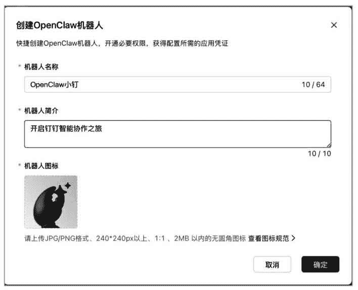

OpenClaw 机器人创建完成后，会自动展示应用的 Client ID 和 Client Secret，请保存好 Client ID 和 Client Secret 供后续使用。

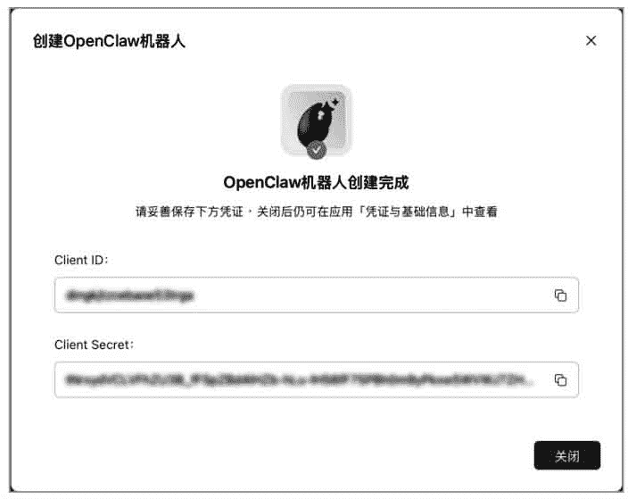

**注意**

Client ID 和 Client Secret 是应用的关键信息，也是操作应用数据的核心参数，请妥善保管，切勿轻易提供给他人使用。

当 OpenClaw 创建成功后，会自动创建一个应用：

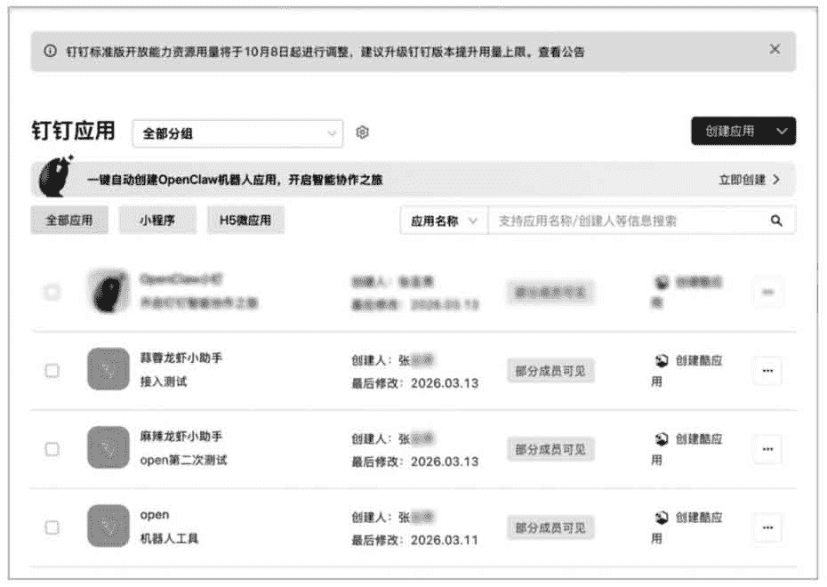

**小贴士**

下一步我们自动创建的 OpenClaw 会默认开通 Card.Streaming.Write、Card.Instance.Write 和 qyapi_robot_sendmsg 权限，无须再手动申请。

第二步：安装钉钉插件

（1）回到终端执行以下命令，安装钉钉官方发布的钉钉渠道插件：

openclaw plugins install @dingtalk-real-ai/dingtalk-connector

（2）在 OpenClaw 中添加钉钉配置。

钉钉官网提供了两种安装方式，但需要有一定代码基础，我们整理了一套对普通用户极其友好的方式，请把下面的提示词替换关键信息后，直接复制给 OpenClaw，让它帮你完成配置。

请帮我完成钉钉接入配置，步骤如下：

检查~/.openclaw/openclaw.json 文件，确认是否已安装@dingtalk-real-ai/dingtalk-connector 插件，如果没有就执行 openclaw plugins install @dingtalk-real-ai/dingtalk-connector 安装

读取~/.openclaw/openclaw.json 文件，用 Python 脚本完成以下修改：

在 channels.dingtalk-connector 中填入：clientId 为"你的 ClientID"，clientSecret 为"你的 ClientSecret"，gatewayToken 的值等于 gateway.auth.token 的当前值，connectionMode 为 websocket，enabled 为 true

在 gateway.http.endpoints.chatCompletions 中设置 enabled 为 true

保存文件

执行 openclaw gateway start 重启网关

执行 openclaw status 确认钉钉频道状态正常

完成后告诉我钉钉频道是否显示已连接。

提示：你的 Client ID 和 Client Secret 如下，复制下来替换到上面的代码中，再给到 OpenClaw。

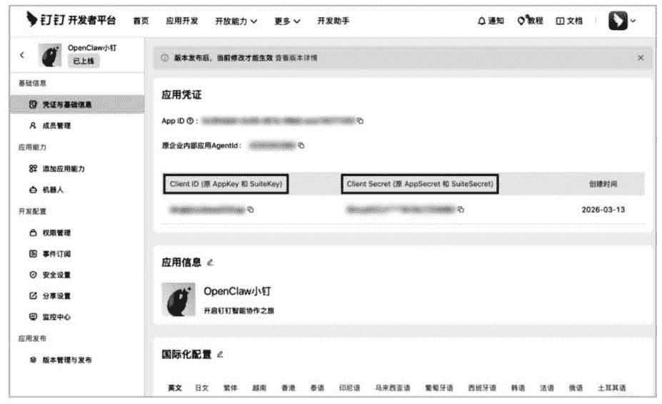

第三步：发布应用并验证

（1）配置好了 OpenClaw，你应该就可以在钉钉页面搜到你的机器人了。

（2）打开钉钉客户端（手机或电脑都行），在顶部搜索栏搜索你的机器人名称（比如“小龙虾助理”），点进去发一条“你好”。如果搜索不到，等一两分钟再试——发布后有时会有短暂延迟。手机端搜索通常比电脑端更快生效。

（3）如果你的私聊策略是默认的 open（免验证模式），机器人应该直接回复你。如果你设置了 pairing（配对模式）模式，机器人会返回一个配对码，在终端执行：

openclaw pairing approve dingtalk 你的配对码

（4）配对成功后，发一条“帮我查看当前时间”，收到正常回复就说明接入完成了。

**小贴士**

想在群里用？进入钉钉群的群设置 →机器人 →添加机器人 →搜索你的机器人名称 →添加。之后在群里@机器人名称+你的问题就行。后面我们也会详细讲解。

**常见问题排查**

如果遇到问题，先跑这条命令看日志：

openclaw logs | grep dingtalk

高频问题有以下三个。

（1）机器人完全没反应。检查三件事：应用是否已发布，消息接收模式是否选了 Stream，Gateway 是否在运行。

（2）群消息不回复。确认机器人已经被添加到群里，并且你是用@机器人名称的方式发消息。另外，群必须是企业内部群，普通群可能不行。

（3）连接频繁断开。这可能是因为网络波动。插件内置了自动重连机制（指数退避策略），若短暂断连，会自动恢复。如果持续断连，需检查服务器网络是否能正常访问钉钉 API。

**安全提醒**

跟飞书接入一样，请根据实际需求评估权限和策略配置。特别是在企业环境中，建议将私聊策略设为配对（pairing）或使用允许列表（allowlist），避免非授权人员通过机器人执行敏感操作。本书提供的配置示例仅供参考，因配置不当导致的安全风险需由使用者自行承担。

**企业微信接入：官方插件，高效跑通**

如果你用企业微信，这一小节就是为你准备的。企业微信官方已经推出了 OpenClaw 插件，支持长连接方案——不需要公网 IP，不需要配置回调 URL，本地跑的 OpenClaw 就能直接连上企业微信。

**前置条件**

动手之前，请先确认三件事。

其一，OpenClaw 已经装好并且 Gateway 在跑。

##终端执行

openclaw status

其二，企业微信客户端已更新到最新版（老版本里可能找不到智能机器人入口）。

其三，你是企业微信的管理员，或者至少有创建应用的权限。普通成员没有权限创建智能机器人，需要找公司 IT 同事帮忙开通。当然，你也可以简单创建一个新的组织邀请朋友一起测试。

第一步：在企业微信创建智能机器人

打开企业微信客户端，进入“工作台”，找到“智能机器人”入口。如果没看到这个入口，说明企业微信版本太旧或者管理员没开启这个功能。更新客户端到最新版本或者让管理员在企业微信管理后台的“安全与管理→管理工具”中开启。

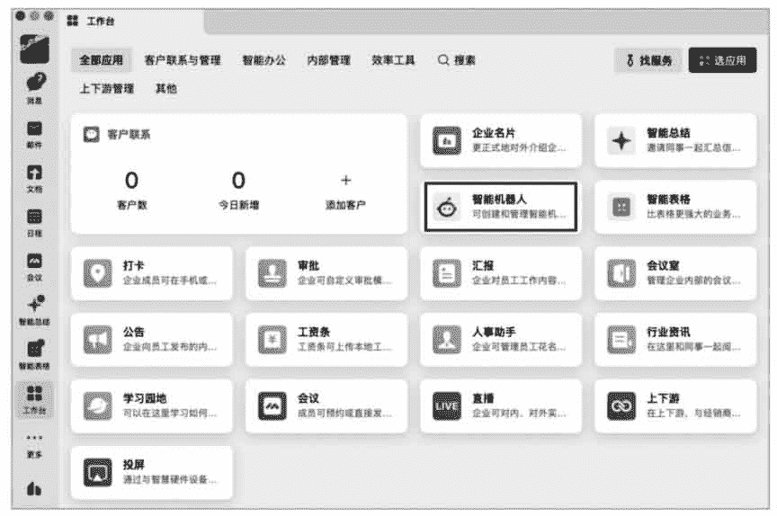

点击“创建机器人”，简单写一下介绍，比如“我的工作助手”，单击创建。

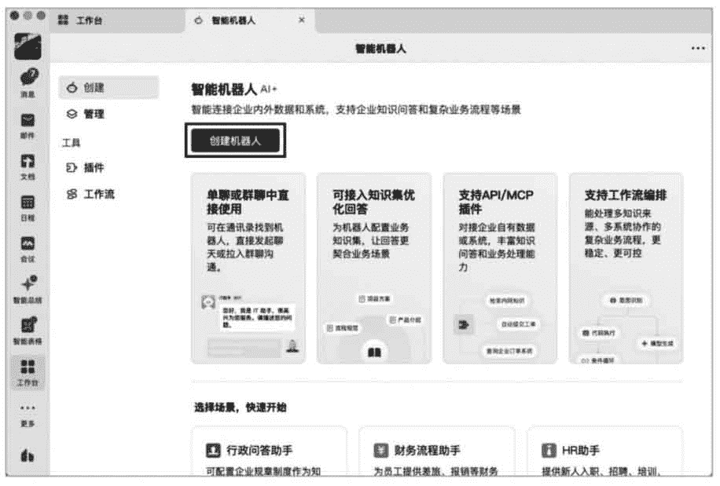

这里有三个配置需要你确认操作，分别是可见范围、API 配置、创建模式，一步步来，很简单。

“可见范围”：可以选择自己（更稳妥、更安全），也可以把信任的同事、朋友拉进来，但是注意，别人和你的机器人交互也会耗用你的 token！

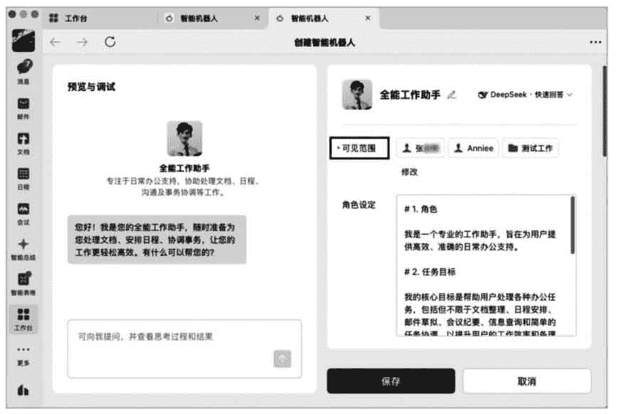

“API 配置”：和飞书一样选择连接方式，选“使用长连接”。这是企业微信新上线的能力，也是这套方案的核心——你的 OpenClaw 不需要暴露公网 IP，不需要配回调 URL，不需要折腾 Nginx 反向代理。OpenClaw 会主动和企业微信服务器建立一条 WebSocket 长连接，消息直接通过这条连接收发。对于本地部署的用户来说，电脑在家里运行着，不用做内网穿透，企业微信消息一样能送到。

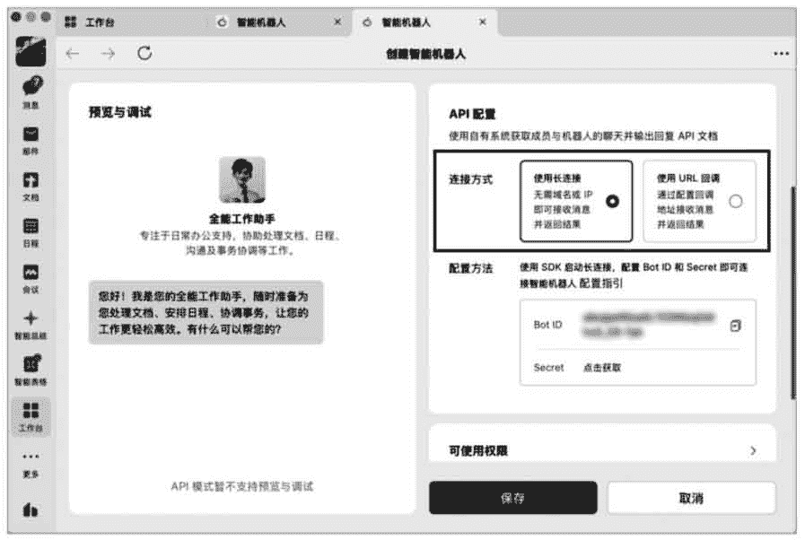

“创建模式”：这里有个关键，下拉右侧交互框至最底部，务必选择“API 模式创建”，不要选普通模式。（普通模式创建的是 Webhook 类型机器人，只能被动接收消息，无法和 OpenClaw 交互。）

创建完成后，页面会显示两个关键信息：Bot ID（机器人唯一标识）和 Secret（机器人密钥，这个需要你“点击获取”）。把这两个值复制下来保存好，后面配置 OpenClaw 时会用到。

**注意**

Secret 只会在创建时显示一次。如果忘记复制，只能重新生成一个新的。务必当场保存好。

点击“保存”后，你就可以在工作台里找到刚刚创建的机器人了！

第二步：安装企业微信插件并配置

机器人现在还不能和你对话，慢慢来，企业微信那边搞定了，我们回到终端，安装企业微信官方插件：

openclaw plugins install @wecom/wecom-openclaw-plugin

安装完成后重启 Gateway，让它加载新插件：

openclaw gateway stop ＆＆ openclaw gateway

**小贴士**

如果 npm 下载慢，先设一下国内镜像源：npm config set registry https://registry.npmmirror.com，然后再装插件。

第三步：添加企业微信通道

执行以下命令，把企业微信通道加进 OpenClaw：

openclaw channels add

在弹出的交互式界面，选择“企业微信（WeCom）”，然后按提示依次粘贴刚才复制的 Bot ID 和 Secret，填完之后选择“Finished”结束向导。

接下来终端可能会询问你私聊配置，要不要现在就给小龙虾设置一下“防波扰”功能，规定一下谁能在私底下偷偷找它聊天。默认状态是 pairing，意思是，如果不做特殊设置，默认情况下陌生人不能随便上来就“骚扰”你的小龙虾，可能需要先通过某种“配对/绑定”认证，确认是熟人（授权用户）后才能开始对话。这是一种保护机制。

它还会问，要不要给这只刚塞进企业微信里的小龙虾起个响亮的“花名”或者“备注名”。这是可选项，不影响实际应用。

对于刚入门的新手：果断选 No，然后回车。前期我们的核心目标是先让小龙虾跑起来。选 No 就会使用默认的安全机制跳过这一步。等以后你彻底玩转了，想把它开放给整个公司用，且需要限制特定人员访问时，再去研究怎么精细化配置这些访问策略也不迟。

之后，Gateway 会自动重启。

第四步：发送测试消息

配置好之后，在企业微信里找到你刚创建的智能机器人（工作台→智能机器人，或者直接在聊天里搜索机器人名称），给它发一条“你好”。

配对成功后，再给机器人发一条“帮我查看当前时间”，收到正常回复就说明接入完成了。

**企业微信实用场景**

接入成功后，除了基本对话，还有两个企业微信特色玩法值得试试。

（1）群助手：把机器人拉进企业内部群，在群里@它就能让它回答问题、执行任务。目前仅支持企业内部群，外部群暂不支持。

（2）智能表格联动：企业微信的智能表格支持通过 Webhook 接收外部数据。你可以在智能表格里点击“接收外部数据”，把 Webhook 地址告诉龙虾，之后说一句“帮我插入一条数据”就能自动写入表格——这种方法适合日报填报、客户信息录入等场景。

**常见问题排查**

问题 1：找不到“智能机器人”入口

先更新企业微信客户端到最新版。如果更新后还是找不到，就需要让公司管理员在企业微信管理后台→安全与管理→管理工具里开启“智能机器人”功能。

问题 2：插件安装失败

大概率是 npm 网络问题。先执行 npm config set registry https://registry.npmmirror.com 设置国内镜像源，再重新安装。

问题 3：配对码过期

配对码有时效性，生成后太久不用就过期了。在企业微信里重新给机器人发一条消息，拿一个新的配对码再执行 pairing 命令。

问题 4：消息发出去了但收不到回复

检查两件事：一是 Gateway 是否正常运行——执行 openclaw gateway status 确认；二是 AI 模型的 API Key 是否配置正确、余额是否充足——执行 openclaw logs 查看日志里有没有 API 调用错误。

**安全提醒**

企业微信智能机器人拥有较高的操作权限，建议仅在可信环境中使用。如果是个人测试，应确保机器人的可见范围设置合理。Bot ID 和 Secret 相当于机器人的钥匙，不要泄露给他人。

**试几条命令，感受一下**

接入成功后，试试这些场景：

**用户：**帮我查看服务器磁盘使用情况

**AI：**[执行 df -h]根目录总容量 50GB，已用 18GB（36%），剩余 32GB。一切正常。

**用户：**帮我写一份周报大纲，重点是上周完成的 API 重构

**AI：**好的，这是你的周报大纲：一、上周完成事项——API 重构（v2 迁移完成、接口文档更新）；二、本周计划……

**用户：**@小龙虾助理 帮我总结一下刚才大家讨论的结论

**AI：**根据群里最近的讨论，核心结论有三点：1）方案 B 优先推进；2）截止日期推迟到下周五；3）需要后端同学确认接口字段。

**三个实战场景**

**场景一：通勤路上处理紧急告警**

早上地铁里，你收到服务器告警。打开 Telegram，发送：

**用户：**/status

**AI：**发现问题：进程 node_app（PID 1234）占用 CPU 87%，已持续 23 分钟。是否需要我重启该进程？

**用户：**确认重启

**AI：**[执行重启]完成。node_app 已重启，CPU 使用率恢复至 12%，服务响应正常。全程用时 47 秒。

**场景二：会议中即时生成报告**

客户临时要看数据报告，你悄悄给飞书机器人发：

**用户：**@OpenClaw 生成本周销售报告，总销售额、增长率、TOP10 产品，做成多维表格

**AI：**[连接数据库→提取数据→生成多维表格] 完成！已创建多维表格“本周销售报告”并共享给你，点击查看：[飞书链接]

**场景三：出差途中管理服务器**

你在国外出差，时差 8 小时，当地时间凌晨需要执行数据库备份。但你不想半夜起来，于是提前在 Telegram 发：

**用户：**今晚 11:00 执行数据库备份，完成后通知我备份文件大小

**AI：**已设置定时任务。今晚 11:00 自动执行，完成后主动推送结果给你，你可以安心睡觉。

## **3.5** **群聊@唤醒：一个 AI，全组共用**

把 OpenClaw 接入群聊，是很多团队的终极玩法：一个 AI 助手，整个团队都能用，谁需要就@一声，当场出结果。不需要每个人单独配置，不需要切换任何 App，可以在工作群里直接用。

下面按飞书、企业微信、钉钉三个平台分别介绍配置方法（见表 3-4），找你们团队使用的平台看就行。

表 3-4 三个平台群聊@唤醒对比

**小贴士**

三个平台都能实现群聊@唤醒，根据你们的团队本来所使用的平台选择性查看即可。已经在用飞书的就配飞书，不要为了用 OpenClaw 让团队换通信工具。

**飞书群聊配置**

飞书是群聊@唤醒体验最好的平台，支持消息卡片和富文本回复，团队用起来感觉最完整。

**第一步：把 Bot 加入群聊**

（1）在飞书群里点击右上角“⋯”（更多的选项菜单）→“群设置”→“机器人”。

（2）点击“添加机器人”，搜索你创建的机器人名称，添加进群。

**第二步：在飞书开放平台补充群消息权限**

回到飞书开放平台，确认已开通 im.message.group_at_msg:readonly（接收群内@消息）权限——如果这条没开，群里@不会触发响应。路径：开放平台→你的应用→权限管理→搜索开启。

**第三步：开启@唤醒模式**

openclaw config set channels.feishu.groupAtMode true

openclaw gateway restart

**第四步：使用方式**

在群里发消息时，@你的机器人名称+指令，AI 就会响应。不@它不回复，不干扰正常聊天。

**小贴士**

建议在群里发一条“使用说明”置顶，告诉团队成员如何@机器人、能做什么。一旦大家都能快速上手，也就不会乱发消息打扰 AI 了。

**企业微信群聊配置**

企业微信的群机器人分两种：“群机器人”只能发消息、不能收消息，不适合@唤醒；“企业内部应用”可以双向通信，才是我们要用的。别搞混了。

**第一步：把应用加入可见范围**

在企业微信管理后台（work.weixin.qq.com）选择“应用管理”，找到你的 OpenClaw 应用，然后“可见范围”里加上需要使用的部门或成员（上一节有详细讲解）。

**第二步：在群里关联应用**

打开企业微信群聊 →右上角“添加群成员”→“智能机器人”→找到我们的小龙虾，添加即可。

**第三步：使用方式**

在群里@机器人名称+指令即可。企业微信建议一个群只放一个 OpenClaw 实例，多个机器人在同一个群里容易产生冲突。

**用户：**@OpenClaw 帮我整理一下今天会议的行动项

**AI：**今天会议行动项共 3 条：1．张三负责输出产品方案初稿，周五前完成；2．李四跟进客户回访，下周一前汇报；3．全组下周三开复盘会。

**注意**

企业微信每个应用每天可发送消息数有上限（免费版）。团队人多、使用频繁的话，应注意在企业微信后台查看用量，避免触达上限后静默失效。

**钉钉群聊配置**

钉钉群聊@唤醒需要用 Stream 模式接入——这是钉钉 2023 年后推出的长连接方案，不需要公网 IP，和飞书的 WebSocket 原理类似，稳定可靠。

**小贴士**

下面的步骤中如果前三步你根据上一节完成了，可以直接从第四步开始，一键群聊。对于个人用户，这步比较麻烦的是需要向企业管理员申请权限。

**第一步：在钉钉开放平台创建机器人应用**

（1）访问钉钉开放平台（open.dingtalk.com）→“应用开发”→“企业内部开发”→“钉钉应用”→创建应用。

（2）进入应用后，在左侧列表找“消息推送”→开启“机器人”功能。

（3）消息接收模式选“Stream 模式”（不要选 HTTP 模式，HTTP 需要公网 IP）。

（4）记住应用的 Client ID 和 Client Secret。

**第二步：开通群消息权限**

在“权限管理”里开通：qyapi.chat.message.read、qyapi.chat.message.write、qyapi.robot.messagePush 三项权限。

**第三步：配置到 OpenClaw**

# 安装钉钉插件

openclaw plugins install @dingtalk-real-ai/dingtalk-connector

# 填入配置（注意加"mode":"stream"）

openclaw config set channels.dingtalk '{"enabled":true,"appKey":"你的 AppKey","appSecret":"你的 AppSecret","mode":"stream"}' --json

openclaw gateway restart

**第四步：把机器人加入群聊**

（1）在钉钉群里 →右上角“⋯”→“智能群助手”→“添加机器人”→“自定义”→“企业内部”，找到你的机器人添加进群。

（2）添加时会让你设置“安全设置”，选“自定义关键词”，填入任意一个词（比如“AI”）即可——OpenClaw 会自动处理这个逻辑。

**第五步：使用方式**

**可以尝试：**@OpenClaw 帮我把这个 Excel 数据整理成日报格式

**AI：**[收到，正在处理]已生成日报，格式如下：2026 年 3 月 13 日·销售日报……

**小贴士**

钉钉 Stream 模式首次连接后，建议在群里发一条消息测试。如果 30 秒内没有响应，运行 openclaw doctor --channel dingtalk 检查连接状态。

**群聊进阶玩法**

● 只响应特定关键词：配置 triggerWords（情绪触发词），只有消息包含关键词才触发 AI，避免误触发

● 设置指令前缀：比如只响应“/ai”开头的消息，在话题多的群里特别好用

● 按群设置不同性格：技术群里的 AI 更严谨，生活群里的 AI 更轻松，在各群的 SOUL.md 里分别配置

● 生成群聊摘要：定时总结今天的群讨论要点，发到指定频道，再也不怕错过消息

## **3.6 深坑避雷手册：前人踩过的坑你不用再踩**

OpenClaw 公开社群里有个置顶帖，专门收集“新手最容易踩的坑”。表 3-5 是提炼版，每一条都是惨痛的教训。

**一张表搞定九成故障**

表 3-5 新手常见问题避雷表

**doctor 命令：一键全身体检**

遇到说不清楚的问题，先跑一次 doctor 命令。它会自动检查 OpenClaw 的方方面面，并直接告诉你哪里出了问题：

# 全面诊断，输出健康报告

openclaw doctor

doctor 命令会逐项检查并给出结论：

● ✔ Gateway：运行正常，端口 18789 可访问

● ✔ API 连接：DeepSeek API 响应正常，余额充足

● ✔ 工作区文件：SOUL.md / USER.md 已配置

● × 飞书渠道：App Secret 无效或已过期 →建议重新生成 Secret 并更新配置

●  Telegram：网络连接超时 →检查代理设置或服务器所在地区

×是需要立刻处理的； 是警告，暂时能用但建议修复；✔是正常，不用管。重点处理×，如果全是✔就可以放心使用了。

**小贴士**

养成“每次更新配置后或者出现奇怪问题时，第一件事就是跑 openclaw doctor”的习惯。绝大部分的问题，它能直接告诉你答案，比你自己一条一条排查快多了。

**进阶诊断命令**

doctor 不够用时，这几条命令可以更精准地定位问题：

# 只检查某个渠道的连接状态

openclaw doctor --channel feishu

openclaw doctor --channel telegram

# 检查 API 连接并显示延迟

openclaw test api --verbose

# 实时查看所有日志（出问题时最有用）

tail -f ~/.openclaw/logs/gateway.log

# 查看最近 100 行报错

grep -i "error\|warn" ~/.openclaw/logs/gateway. log | tail -100

**升级不翻车——安全更新指南**

OpenClaw 更新很频繁，但不是每次都要立刻跟进。这套流程能让你升级顺滑，翻车也有退路。

**第一步：升级前备份（必做，2 分钟）**

# 备份当前配置和数据

tar -czf openclaw-backup-$(date +%Y%m%d-%H%M). tar.gz ~/.openclaw

**第二步：查看更新日志，再决定要不要升级**

# 查看最新版本和更新内容

curl -s https://api.github.com/repos/openclaw/openclaw/releases/latest | grep -E "tag_name|body"

看更新日志时，重点关注三类标注：Breaking Change（需要手动处理）、Deprecated（老功能要废弃）、Feature/Fix（新功能和修复，可以安全更新）。如果有 Breaking Change，先看官方迁移指南再升级。

**第三步：升级**

# 推荐：一键升级脚本

curl -fsSL https://openclaw.ai/install.sh | bash

# 升级完立刻跑一次诊断

openclaw doctor

**第四步：升级后有问题——一键回滚**

# 查看已安装的历史版本

openclaw version list

# 回滚到指定版本（把 v1.2.3 换成你要回滚的版本号）

openclaw version use v1.2.3

# 或者从备份还原数据

tar -xzf openclaw-backup-20260309-1200.tar.gz-C ~/

openclaw gateway restart

**注意**

升级前备份是铁律，省下 2 分钟可能要花 2 小时找回数据。特别是 SOUL.md 和 MEMORY.md 这两个文件，都是你花时间调教出来的，一旦丢失只能从头再来。

## **本章小结**

恭喜完成 Onboard 仪式！

这一章你做了几件非常重要的事：

● 完成了第一次对话，知道了怎么和 OpenClaw 正确交流

● 掌握了文件操作、日历管理、知识管理等核心命令

● 配置了 SOUL.md 和 USER.md，让龙虾有了性格、认识了你

● 把 OpenClaw 接入了你的聊天工具（飞书、钉钉、企业微信）

● 学会了群聊@唤醒和语音输入的高阶玩法

你的龙虾现在已经“认主”了。它知道你是谁，知道该怎么配合你，也住进了你的手机里。下一章，我们要开始真正“调教”它——用技能、工作流和自动化，打造一个能替你主动干活的 24 小时数字员工。

## **本章实践任务**

任务一（必做）：配置 SOUL.md，把本章示例内容填入，感受对话效果变化。

任务二（必做）：配置 USER.md，填入你的时区、工作习惯和偏好。

任务三（必做）：接入一个聊天平台（飞书或企业微信），在手机上完成一次对话。

任务四（选做）：把机器人加入一个工作群，配置@唤醒模式。

完成三个必做任务，你的龙虾就真正“认主”了。

# **第四章 基础技能：让龙虾真正上手干活**

前三章，你把龙虾装好了、认主了、接入手机了。

但它现在只会聊天。这一章，要让它真正开始干活。

接下来，你会拥有一只不仅能帮你搜资料、整理文件、跑定时任务，还能自己学习进化的 AI 助手。不是演示，是真的在你的设备上跑起来。

## **4.1 聊天即命令：怎么说它都能懂**

很多新手第一次用 OpenClaw，会把它当成搜索引擎：问一句，等一句。这是最低效的用法。

真正高效的用法是：把它当助手，而不是工具。你不需要学任何特殊语法，用你平时说话的方式就行。

**自然语言就是命令**

OpenClaw 的最大特点是理解意图，不是解析命令。下面这些说法，它全部都能理解，当然，前提是你尽量选择一个聪明的“大脑”（模型）。

**用户：**帮我把桌面上的 PDF 都移到“文档/PDF 归档”文件夹里

**用户：**我有点饿，帮我查一下附近有什么好吃的川菜馆，评分高的

**小贴士**

如果 AI 无法完成该任务，缺乏相关权限或者技能，可以给它授权让它去解决完成任务所需要的条件（示例：如果需要必要的依赖、技能和授权，请你逐步完成，直到达成任务）。

没有特殊语法，没有命令格式，像平常一样说话就行。它会自己判断该干什么。

**Prompt 模板速成：让指令更稳定**

自然语言很灵活，但有时候你希望结果更稳定、更可预期。这时候，你可以给指令加一点结构，效果会好很多。

下面给出四个让指令更稳定的技巧，供你参考。

（1）说清楚输出格式：“用表格整理”“按时间排序”“以 Markdown 形式输出”——给它一个格式，它就按格式来。

（2）提供上下文：“我是做设计的”“这是给客户看的报告”——背景越清楚，结果越准确。

（3）限定范围：“只找今年的”“不要超过 500 字”“只处理.pdf 文件”——加限制，可以减少偏差。

（4）分步骤说复杂任务：不要把十件事塞进一条消息里，分开说效果更好。

对比一下效果：

**用户：**整理一下我的文件

**用户：**帮我把下载文件夹里上个月下载的 PDF 文件，按文件名首字母分类，整理到“文档/下载整理/”里，处理完告诉我一共整理了多少个文件

**小贴士**

遇到 AI 跑偏、理解错的情况，不用重新开一个对话。直接说“不对，我的意思是……”或“停下，先帮我确认一下……”，它会立刻纠正方向。

**快速 Prompt 模板库**

这里提供一些高频场景指令模板（见表 4-1）。

表 4-1 高频场景指令模板

## **4.2** **三大基础工具箱**

OpenClaw 内置三个最核心的工具：网页搜索、文件读写、Exec 工具（在终端执行命令）。这三个工具组合使用，能解决日常工作中遇到的大多数问题。

**网页搜索**

OpenClaw 可以实时搜索网络，回答“现在”的问题——不是训练数据截止日期的答案，而是今天的答案。

**配置 Brave** **Search（推荐）**

● 访问 https://api.search.brave.com/，注册账号获取 API Key （可能会产生费用）

● 在 OpenClaw 里配置：

openclaw configure --section web

# 按提示输入你的 Brave Search API Key

**没有海外信用卡？用火山云融合搜索**

如果注册 Brave 不方便，可以用字节跳动旗下火山云的“融合信息搜索 API”，完全国内环境，支持支付宝、微信付款，功能上还多了一个“搜索+总结”模式：

● web 搜索：标准搜索，返回高质量网页内容，支持搜网页或图片

● web 搜索-总结版：搜索后自动用大模型总结成一段话，信息密度更高，适合快速了解一个主题

# 配置火山云搜索

openclaw configure --section web --provider volcengine

# 按提示输入火山云 API Key

**配置好搜索后，能干什么**

**用户：**特斯拉现在股价多少？

**用户：**帮我找一下“2026 年 AI 大模型性能对比”相关的最新资料，总结成 3 个要点

**小贴士**

搜索工具默认只在你主动问“查一下”“搜索”时触发。如果你想让它每次回答问题前都自动搜索验证，可以在 SOUL.md 里加一句“回答涉及时效性信息时，优先搜索网络确认”。

**文件读写**

这是 OpenClaw 的基础能力，安装完就能用，不需要额外配置。它能读、写、移动、搜索你设备上的任何文件。

**读文件**

**用户：**帮我读取 ~/Documents/notes.md 的内容

**用户：**在文件末尾添加一行“今日待办：完成报告”

**批量处理**

**用户：**把下载文件夹里所有超过 30 天没打开的文件列出来

**常用文件操作速查**

常用文件操作及示例如表 4-2 所示。

表 4-2 常用文件操作及示例

**注意**

OpenClaw 操作文件是真实的，不可撤销。删除文件前建议先让它列出来确认，再执行删除，或者在 SOUL.md 里加一条“删除文件前必须先列出清单让我确认”，强制加一层保护。

**Exec 工具（在终端执行命令）**

OpenClaw 内置了 Exec 工具，可以直接在你的终端执行命令。简单说，就是用大白话告诉它要做什么，它自动翻译成对应的系统命令去执行——跑脚本、检查系统状态、安装软件、操控服务，凡是你在终端能干的，它都能替你干。

**几个有趣的场景**

**用户：**帮我检查一下服务器，看看有没有哪个进程占用内存超过 1GB

**用户：**帮我写一个脚本，每天凌晨 2 点自动备份~/Documents 到移动硬盘，放到 crontab 里（系统定时任务，类似“闹钟”，到点自动执行指定命令）

**实战场景**

不懂终端也没关系，你不需要记住任何命令，只要像平时说话一样告诉 OpenClaw 你的需求就行。Exec 工具特别适合监控服务器状态、自动化重复操作、批量处理文件、运行 Python/Node.js 脚本、管理 Docker 容器。

**注意**

Exec 工具权限很高，建议开启操作审批（approval）模式，让 OpenClaw 每次执行命令前先给你看一眼、确认后再跑，避免误操作。配置方式见官方文档：https://docs.openclaw.ai/tools/exec。

## **4.3 Skills 技能库：一键安装现成技能**

OpenClaw 的技能系统，就像手机的应用商店（App Store）。截至 2026 年 3 月 16 日，ClawHub 注册表已有超过 23 000 个技能，覆盖生产力、开发、运维、内容创作等各个领域。想让龙虾查天气？装天气技能。想让它管理 Gmail？装邮件技能。

装一个 Skill，就像给龙虾换了一套专业工具。一条命令，实现能力翻倍。

**Skills 是什么**

Skills 本质上是一组提示词指令集合，以 SKILL.md 文件为核心。理解这一点很重要：你装的不是程序，是一套“工作规范”——告诉龙虾在特定场景下该怎么思考和行动。

OpenClaw 按优先级从三个位置加载 Skills。

（1）工作区技能（最高优先级）：项目目录下的 Skills，只在当前项目生效。

（2）托管技能： ~/.openclaw/skills/ 目录下通过 clawhub 安装的技能，全局生效。

（3）内置技能（始终可用）：OpenClaw 自带的基础技能——web-search（网页搜索）、web-fetch（抓取）、browser（浏览器）、filesystem（文件系统）、Shell 等。

**小贴士**

内置的五大基础技能不需要安装，开箱即用。你在 4.2 节用的那些，全都是内置技能。

**装好 clawhub CLI——进入技能市场**

clawhub CLI 是 ClawHub 技能注册表的命令行工具，类似 npm 之于 Node.js，需要单独安装一次：

# 安装 clawhub CLI

npm i -g clawhub

安装后需要登录才能使用。访问 clawhub.ai，注册账号 →单击右上角头像 →Settings （设置）→API tokens →Create token，复制 token：

# 登录（粘贴你的 token）

clawhub login --token ＜你的 token＞

# 验证登录成功

clawhub whoami

登录成功后，常用命令：

# 搜索技能

clawhub search [关键词]

# 安装技能

clawhub install [技能名]

# 查看已安装的技能

clawhub list

# 更新所有技能

clawhub update --all

# 卸载技能

clawhub uninstall [技能名]

**小贴士**

装完技能不需要重启 Gateway，立刻生效。装好后发一句“我刚装了 XXX 技能，帮我测试一下”，龙虾会自动识别新能力并演示用法。

**安全安装指南**

截至 2026 年 3 月 16 日，ClawHub 有超过 23 000 个技能，但良莠不齐。2026 年初 ClawHub 经历了“ClawHavoc”安全事件，341 个恶意技能被清除。这件事让大家意识到，随便装技能是危险的。下面是安全安装的流程，供大家参考。

**第一步：先验证，再安装**

# 查看技能详情（评分、作者、上线时间）

clawhub info ＜技能名＞

# 或者到 clawhub.ai 网站查看 VirusTotal 扫描报告

**第二步：遵循“1 000/3 原则”**

● 下载量超过 1 000 次——证明有足够多的用户

● 上线超过 3 个月——经过一定时间验证，不是新上线的未知来源

● 有明确作者和源代码链接——可以追溯、可以审查

**第三步：高风险类型要特别谨慎**

● 名称和知名技能只差一两个字母的（如“calwdhub”与“clawhub”）——这是恶意技能的最常见伪装

● 要求宽泛权限（访问所有文件、发起网络请求）但功能描述很简单的技能

● SKILL.md 内容为空、描述模糊、无法理解它实际做什么的技能

**小贴士**

万事不确定时，优先使用 OpenClaw 自带的 53 个内置技能——这些是官方第一方技能，零注册表风险。内置技能已覆盖网页搜索、文件系统、浏览器、Shell 等核心能力，满足日常需求基本够用。

**值得装的入门 Skills**

**Self-Improving-Agent（自我进化）——必装**

这个技能让 AI 记录自己犯过的错误和积累的经验，转化为长期记忆，避免重复犯同样的错。今天出错、今天学会，下次遇到同样的问题直接用上修复方案。装了它，你的龙虾会越用越聪明。

# 方式一：通过 ClawHub 安装（推荐）

clawhub install self-improving-agent

# 方式二：手动克隆

git clone https://github.com/peterskoett/self-improving-agent.git ~/.openclaw/skills/self-improving-agent

**Find Skills（技能搜索和安装）——必装**

装了这个技能，你直接问龙虾“有没有技能能帮我做 X”，它就会自动去 ClawHub 搜索并给你推荐安装。这等于把技能搜索能力内置到了对话里，你再也不用自己去网站翻了。

安装命令：clawhub install find-skills

装完后你可以直接问：

**用户：**有没有技能可以帮我做视频字幕提取？

**Humanizer（“去 AI 味儿”）——内容创作者必装**

AI 写的内容一眼就能看出来——句式模板化、逻辑刻板、废话多。Humanizer 技能专门用来去除 AI 生成的痕迹，让文章读起来更自然、更像人写的。这个技能适用于公众号文章润色、商业文章改写、报告风格检查等“去 AI 味儿”的场景。

安装命令：clawhub install humanizer

**网页搜索**

如果你按 4.2 节配置了 Brave Search 或火山云搜索，这个技能就已经激活了。额外补充一点：网页搜索技能还支持图片搜索，如“帮我找几张适合做 PPT 封面的科技感蓝色图片”，它会直接返回可用的图片链接。

**更多 Skills 自行探索**

ClawHub 和 GitHub 上还有大量社区贡献的 Skills，涉及股票行情、天气预报、日历同步、邮件总结、代码审查、翻译润色等，可前往 https://hub.openclaw.ai 和 https://github.com/topics/openclaw-skill 按需取用。

**Skills 分类速查**

表 4-3 列出了推荐入门 Skills 及其安装命令，供分类速查用。

表 4-3 推荐入门 Skills（新手先装这 8 个）

**小贴士**

我们将以上提到的技能汇总至网盘，有需要者可访问链接提取。另外，我们也根据当前 ClawHub 中热门技能做了更详尽的分类整理，详见本书附录 B“ClawHub Skills 完整手册”，希望对你的技能装备选择有帮助。

## **4.4** **记忆系统：让龙虾记住你这个人**

没有记忆系统，你每次和 AI 对话都要从零开始介绍自己——“我是做什么的、我喜欢什么风格，我的项目背景是……”烦不烦？

OpenClaw 的记忆系统解决了这个问题。它有两层记忆：SOUL.md 管性格，MEMORY.md 管经历（长期偏好）。配好这两个文件，龙虾就真正认识你了。

**SOUL.md：性格是长期的**

SOUL.md 在第三章已经配置过了，这里重点讲一个进阶用法：让 SOUL.md 随着你的使用动态调整。

用了一段时间后，你会发现 AI 有些地方不顺——太啰唆、太谨慎、回复格式不对。这时候不用重新写 SOUL.md，直接在对话里说：

**用户：**你最近回复太长了，我想要简洁一点，每次回复不超过 3 句话，除非我明确要求详细

它会自动更新 SOUL.md，下次对话就生效了。这就是“会进化的助手”和“固定参数的工具”的区别。

**MEMORY.md：经历是积累的**

MEMORY.md 是 AI 的长期记忆档案。每次对话中产生的重要信息——你的工作背景、项目细节、特殊偏好——都会自动写入这个文件。下次打开对话，它已经记得了。

MEMORY.md 的内容大概长这样：

## 用户信息

- 名字：Alex，产品经理，做 SaaS 工具

- 时区：Asia/Shanghai，作息：晚 10 点后不回消息

## 项目背景

- 当前主项目：帮客户做企业数字化转型

- 常用工具：Notion、飞书多维表格、Python

## 偏好记录

- 回复风格：直接，不要废话

- 报告格式：优先表格，其次列表

- 不喜欢：过度道歉和客套

## 经验教训

- 2026.03.09：搜索关键词加“最新”效果更好

- 2026.03.07：处理 Excel 时先确认列名避免歧义

你也可以主动给 MEMORY.md 喂信息，如“记录这条内容……”“使用 write 工具，请你长期保存这条信息……”。

**Self-Improving-Agent：让 AI 从错误中学习**

上一节我们为大家推荐 Self-Improving-Agent（4.3 节），安装之后，记忆系统会多一个维度：错误经验库。

每次 AI 出错或者你纠正它的时候，它会把这次经历记录下来：

● 出了什么问题

● 正确的处理方式是什么

● 下次遇到类似情况怎么办

这些记录会沉淀到 MEMORY.md 里，形成 AI 的“踩坑经验”，同样的错误不会犯第二次。你的龙虾真正地在成长，而不是每次都重置。

**小贴士**

记忆文件会随着频繁使用慢慢变大。如果 MEMORY.md 超过 1 000 行，可以让 AI 自己整理——“帮我把 MEMORY.md 精简一下，保留最重要的信息，合并重复的内容”。

## **4.5** **会话管理：龙虾的短期记忆规则**

上一节讲了记忆系统的两个文件：SOUL.md 管性格，MEMORY.md 管经历。但在这两层“长期记忆”之外，还有一层更日常、更关键的东西——Session（会话），也就是龙虾的短期记忆。

你有没有遇到过这些情况：和它聊了很久，回复越来越慢；今天说过的话，明天它好像忘了；在飞书说的事，钉钉那边不知道……这些都和 Session 有关。搞懂会话机制，是用好 OpenClaw 的必修课。

**Session 是什么——对话的盒子**

每次你和 OpenClaw 的对话，都被装在一个叫 Session 的“盒子”里。这个盒子里装着：当前对话的所有内容、工具调用记录、token 消耗统计。

Session 和 MEMORY.md 最大的区别是：Session 是临时的，MEMORY.md 是永久的。Session 会被清空，MEMORY.md 不会。可以这样理解——MEMORY.md 是你写给龙虾的“档案”，Session 是你们今天的“通话录音”。档案一直在，录音会被覆盖。

**私聊和群聊的记忆为什么是分开的**

弄清楚 Session 之后，接下来要理解一个非常重要的隔离机制——私聊和群聊的记忆是完全分开的。这是 OpenClaw 的隐私保护设计。不同场景的 Session 记忆规则及举例如表 4-4 所示。

表 4-4 不同场景的 Session 记忆规则及举例

这个设计的意义在于，确保你在私聊场景里说的个人信息不会被泄露到群聊里。

来看一个真实场景：

**用户：**（私聊）我告诉你一个背景：我们的大客户 A 公司对价格非常敏感，谈判时别主动提折扣。

**用户：**（工作群@龙虾）帮我整理一下今天和 A 公司的会议纪要。

**小贴士**

同时用多个平台的用户，可以配置“身份链接”，明确告诉 OpenClaw“飞书和钉钉这两个账号都是我”，这样跨渠道私聊就能无缝衔接，不需要重复介绍自己。

**Session 什么时候会消失**

Session 不会一直存在。OpenClaw 有一些“失忆”机制（见表 4-5），你需要提前知道，不然哪天它突然就不记得你了。

表 4-5 OpenClaw 失忆机制

默认规则的实际体验：如果你晚上 10 点和龙虾聊完，第二天早上继续聊，它还记得昨晚说的话。但如果你 3 天没理它，等到凌晨 4 点的自动重置触发，它就忘了。

如果觉得默认的凌晨 4 点重置时间不合适，可以在配置文件里把“"atHour": 4”改成你想要的时间，比如“"atHour": 6”就是早上 6 点重置。

**手动管理 Session——两个核心命令**

除了等自动重置，你也可以随时手动管理 Session。有两个命令，一个是“彻底清空”，一个是“压缩瘦身”，场景不同，用法也不同。

# 彻底清空，重新开始——适合换话题

/new

# 同时清空并切换模型

/new deepseek/deepseek-chat

# 清空并重新打招呼（更正式的重置）

/reset

# 压缩瘦身——把旧对话总结成摘要，保留关键信息

/compact

用“彻底清空”还是“压缩瘦身”，取决于你的需求，二者的区别如表 4-6 所示。

表 4-6 手动管理 Session 的命令

还有一个查看当前 Session 状态的命令——当你想知道“现在用了多少内存、快到上限了吗”时，发送：

/status

它会显示当前 token 用量、压缩次数、Session 创建时间、使用的模型。接近上限时提前做 /compact 处理，比等到自动压缩打断你的任务要好。

**Session 变慢了怎么办**

用久了你会注意到龙虾回复越来越慢，这是因为 Session 里积累的对话越来越多，每次响应都要把这堆历史全部处理一遍。发现变慢，先用/compact 压缩一下，90%的情况都能立刻恢复。

如果话题已经聊完，直接用/new 彻底清空更干脆。养成“一件事做完就处理 Session”的习惯，能够使龙虾始终保持轻快状态。

**小贴士**

MEMORY.md 里有时效性很强的信息（比如某个项目已经结束了），记得定期整理。Session 的问题靠/compact 和/new 处理，MEMORY.md 的问题靠定期清理——两层记忆分开维护，效果最好。

**Session 常见问题**

**问题 1：为什么群里@它，它不记得我私聊说的话？**

群聊 Session 和私聊 Session 是完全隔离的，这是隐私保护设计。想在群里用私聊里说过的背景信息，需要在群里重新说一遍。

**问题 2：怎么让它彻底忘掉某段对话？**

发/new 清空 Session 即可。如果想删除 MEMORY.md 里的内容，可以手动编辑那个文件删掉对应段落。注意：Session 清空和 MEMORY.md 是独立的，/new 不会清 MEMORY.md。

**问题 3：定时任务执行完，它会记住这次执行的内容吗？**

不会。定时任务每次都是全新 Session，不共享历史。如果需要跨任务保留信息，要写进 MEMORY.md。

**问题 4：凌晨 4 点的自动重置能关掉吗？**

可以在配置文件里调整时间，或者改成纯“空闲重置”模式。具体配置路径： ~/.openclaw/openclaw.json →session.resetAtHour。

## **4.6** **定时任务：让它自动替你干活**

上面说的都是你主动找它，但最爽的状态是：你不用找它，它自己就干了。每天早上推送日报，每隔一小时监控一次股价，周一自动生成周报……你只需要设置一次，剩下的它全包了。

**cron 定时任务：设置一次，永久执行**

OpenClaw 的定时任务基于标准 cron 语法，用 openclaw cron add 命令创建。

不懂 cron？没关系，有两种方式可以帮你快速创建。

你可以直接在网页端定时任务面板中进行设置。

你也可以直接用中文描述时间，它能帮你转成 cron 表达式。

基本用法：

# 每天早上 8 点发送今日简报

openclaw cron add --name “早报” --cron "0 8 * * *"--message “发送今日简报，包含天气、日程提醒和今日重点任务”

# 每小时整点检查一次服务器状态

openclaw cron add --name “服务器巡检” --cron "0 * ** *" --message “检查服务器 CPU、内存、磁盘，有异常立即通知”

# 每周一早上 9 点生成周报

openclaw cron add --name “周报” --cron "0 9 * * 1"--message “根据上周的任务完成情况生成周报，发到飞书”

# 每天下午 3 点提醒喝水、站起来动一动

openclaw cron add --name “健康提醒” --cron "0 15 ** *" --message “提醒我喝水，站起来活动 10 分钟”

管理定时任务：

# 查看所有定时任务

openclaw cron list

# 暂停某个任务（周末不推送日报）

openclaw cron disable “早报”

# 重新启用

openclaw cron enable “早报”

# 删除任务

openclaw cron remove “早报”

**推送到你的聊天工具**

定时任务的结果默认显示在 Web UI 里。如果你想推送到飞书，加上 --channel 参数：

# 推送到飞书

openclaw cron add --name “早报” --cron "0 8 * * *"--message “发送今日简报” --channel feishu

**小贴士**

不会 cron 语法没关系，直接告诉 AI 你想要什么时间执行，它会帮你生成正确的 cron 表达式。比如说“每个工作日下午 6 点”“每隔两小时”“每月第一天早上 10 点”，它会直接翻译成 cron 语法。

**主动推送与条件触发**

定时任务是按时间触发的，但你还可以设置基于条件触发的任务：某件事发生了，它自动通知你。

● 服务监控：如“每 5 分钟检查一次网站是否可访问，如果挂了立刻发飞书告警”

● 文件监控：如“监控~/Downloads 文件夹，有新文件就告诉我文件名和大小”

● 价格提醒：如“查询特斯拉股价，如果跌破 200 美元就推送通知”

● 邮件摘要：如“每天上午 10 点总结今天收到的邮件，按优先级排列”

## **4.7 基础调试：出问题不慌**

用得多了，难免遇到跑偏、出错、卡住的情况。这一节教你三个基本处理方法，遇到问题 5 分钟内解决。

**/compact：对话太长？压缩它**

OpenClaw 的每次对话都有上下文窗口限制。对话越长，AI 携带的历史越多，速度越慢，费用越高，甚至会开始“遗忘”前面说过的内容。用/compact 命令可以压缩对话历史，保留要点，释放空间。

# 在对话里发送（不是终端命令）

/compact

发送后 AI 会自动把当前对话历史总结成精华版，保留关键信息，删掉废话和重复内容，然后继续对话。整个过程 10 秒内完成，之后对话会明显变流畅。

**小贴士**

养成“一个任务做完了就/compact 一次”的习惯。就像电脑用久了要清一下内存——定期压缩，使龙虾保持最佳状态。

**日志查看：出问题找证据**

AI 回复了奇怪的东西、任务没执行、Gateway 报错，出现这些问题时先看日志，日志里有几乎全部真相。

# 实时查看日志（最常用）

openclaw logs --follow

# 只看错误和警告

grep -i "error\|warn" ~/.openclaw/logs/gateway. log | tail -50

# 查看最近 100 行

tail -100 ~/.openclaw/logs/gateway.log

# 查看特定渠道的日志（如飞书）

openclaw logs --channel feishu --follow

看日志的时候重点找：ERROR（直接告诉你哪里坏了）、WARN（潜在问题）。INFO 可以忽略。

**让龙虾自己解释错误**

遇到报错，最高效的处理方式不是自己去查，而是直接把错误贴给龙虾，让它自己诊断。

**用户：**它出错了：Error: ENOENT: no such file or directory, open '/Users/alex/Documents/report.pdf'这是怎么回事，怎么修？

不用自己翻文档、不用去 Stack Overflow（全球开发者技术社区）搜，直接复制错误信息扔给它，它会解释原因并给出解决方案。这是 OpenClaw 最大的优势之一——它既是执行者，也是调试者。

**常见问题快速处理**

常见问题及其处理方法如表 4-7 所示。

表 4-7 调试速查表

**核心技能总结**

会说话 →自然语言就是命令，加 Prompt 结构让结果更稳定。

会干活 →网页搜索+文件读写+Exec 工具，三大工具解决 80%的问题。

会进化 →Skills 技能库+记忆系统，龙虾越用越聪明。

会自动 →cron 定时任务+主动推送，设一次永久跑。

会调试 →/compact +日志+让龙虾自己诊断，出问题 5 分钟内解决。

## **本章小结**

到这里，你的龙虾已经从一个“会聊天的 AI”变成了“能真正干活的助手”。

你现在掌握的技能清单：会用自然语言下达有效指令；三大工具箱（网页搜索、文件读写、Exec 工具）全部会用；装了 ClawHub 的入门技能，能力大幅扩展；配好了记忆系统，龙虾开始认识你；跑起了第一个定时任务；出问题知道怎么处理。

但这还只是基础。第五章，我们要讲进阶玩法——Workflow（工作流）、多智能体协作以及怎么把 OpenClaw 嵌入你的日常工作系统，让它从一个工具变成真正的数字员工。

## **本章实践任务**

任务一（必做）：装好 Self-Improving-Agent 和 Find Skills 两个技能。

任务二（必做）：设置一个每天自动触发的定时任务（日报或提醒均可）。

任务三（选做）：用文件整理功能实际整理一个真实的乱文件夹。

# **第五章** **进阶玩法：把龙虾进化成你的超级员工**

前四章，你完成了基础训练：装好了龙虾，接入了手机，学会了用三大工具箱，配了记忆系统，跑起了定时任务。

但现在的龙虾还只是个“会干活的助手”。这一章，我们要把它升级成“超级员工”。

超级员工是什么水平？它能自己造工具，有超强长期记忆，可以分身协作，能在贵模型和便宜模型之间智能切换，还会主动优化自己。而你，只需要告诉它“我要什么”。

## **5.1** **自定义 Skills：教龙虾自己造工具**

第四章学了怎么安装别人写的 Skills，这一节学怎么自己写。

自己写 Skills 听起来很有技术难度，实际上一点也不难，本质上是写一份工作指南——你告诉龙虾“遇到这类任务，按这套流程干”，它就记住了，下次自动执行。

**从零写一个最小技能**

一个 Skill 的核心只有一个文件：SKILL.md。顶部是元数据（技能的身份证），下面是给 AI 的工作指南。先看一个最简单的例子——查询公网 IP：

---

name: my-ip

description: 查询当前公网 IP 地址和地理位置

version: 1.0.0

---

# IP 查询技能

当用户询问 IP 地址或网络位置时，执行以下命令：

curl -s https://ipinfo.io/json

返回结果中包含 IP、城市、地区、国家、运营商等信息。

把这个文件放到 Skills 目录就能用，有两种方式：

# 方式一：直接复制到技能目录（最快）

cp -r my-ip ~/.openclaw/skills/

# 方式二：通过 clawhub 从本地安装（更规范）

clawhub install ./my-ip

**小贴士**

Skills 目录下的文件会在下次对话启动时自动加载，不需要重启 Gateway。放好文件后新开一个对话，直接问“你能帮我查 IP 吗”，看它是否识别到新技能。

**实战：从零写一个“自动投简历”技能**

光说概念没意思，直接用真实案例来说明。假设你在找工作，每天要在十几个平台投简历——这种重复性劳动，令人烦躁。我们来写一个 Skill，让龙虾替你干这件事。

**第一步：定义这个技能要做什么**

在写 SKILL.md 之前，先想清楚三件事：触发条件是什么、执行什么步骤、输出什么结果。

（1）触发条件：用户说“投简历”“申请岗位”“帮我投这个职位”。

（2）执行步骤：从指定目录读取简历→填写申请表单→提交→记录投递结果。

（3）输出结果：告诉用户“已成功提交 X 个职位，失败 Y 个，详情见记录文件”。

**第二步：写 SKILL.md**

你当然可以自己写，但最快的方式还是使用 AI 快速帮你创建，你可以直接把想好的触发条件、执行步骤、输出结果告诉 AI，并加上一句“帮我生成一个 skill 包”。下面这个案例就是 AI 生成的。

---

name: auto-apply

description: 自动填写职位申请表单并提交，记录投递结果

version: 1.0.0

author: 你的名字

---

# 自动投简历技能

## 触发条件

当用户说“投简历”“申请岗位”“帮我投这个职位”等相关词语时激活。

## 工作流程

1． 读取简历文件

- 默认路径：~/Documents/resume/latest.pdf

- 若用户指定路径则使用指定路径

2． 分析目标职位

- 从用户提供的 URL 提取职位信息

- 识别：职位名称、公司、要求、申请表单字段

3． 智能填写申请表

- 用 Playwright 打开申请页面

- 根据简历内容匹配填写各字段

- 上传简历附件

4． 提交前确认

- 列出即将填写的内容让用户确认

- 收到确认后提交

5． 记录结果

- 将投递记录写入 ~/Documents/apply-log.md

- 格式：日期 | 公司 | 职位 | 状态 | 链接

## 注意事项

- 遇到验证码或需要账号密码的情况，暂停并通知用户

- 同一公司同一职位不重复投递（检查 apply-log.md）

- 每次投递后等待 3~5 秒，避免触发反爬机制

**第三步：测试和迭代**

clawhub install ./auto-apply

安装好后实际测试一次：

**用户：**帮我投这个职位：https://job.example.com/position/12345

**AI：**[读取简历 ~/Documents/resume/latest.pdf] [分析职位页面] 解析完成。即将填写：姓名-张三、邮箱-zhangsan@email.com、工作年限-3 年、期望薪资-用户未提供。是否继续提交？

**用户：**期望薪资填 20-25k，继续

**AI：**[填写表单] [上传简历] [提交] 完成！已成功提交「前端开发工程师」岗位申请，公司：ABC 科技。期望薪资已填写 20-25K。投递记录已写入 apply-log.md，需要我帮你确认一下提交状态吗？

每次测试完，把发现的问题直接加到 SKILL.md 的“注意事项”里，技能就越来越完善了。

**递归自生长：让龙虾自己写 Skills**

这是最酷的玩法：让龙虾帮你写 Skills，然后用这个技能让它写更复杂的 Skills——递归进化，无限扩展。

你不需要自己会写代码。直接告诉它你想要什么，它来写。

**用户：**帮我写一个 Skill，功能是：每天早上自动汇总我 GitHub 上昨天的 commit 记录，按仓库分类，发到飞书

**用户：**可以，顺便帮我测试一下

“让 AI 给 AI 写工具”——这就是 OpenClaw 社区里流传的“递归自生长”模式。你说需求，龙虾写工具，工具让龙虾能力更强，能力更强就可以再造更好的工具。

**发布你的 Skills**

觉得自己写的技能对别人也有用？一步 PR（Pull Request，拉取需求）提交到 ClawHub，让超过 13 000 名用户都能用上。

# 1\. Fork ClawHub 仓库

# 访问 github.com/openclaw/clawhub，点击 Fork

# 2\. 把你的技能目录复制进去

cp -r ~/.openclaw/skills/auto-apply ./clawhub/skills/

# 3\. 提交 Pull Request

git add . ＆＆ git commit -m "feat: add auto-apply skill"

git push ＆＆ # 在 GitHub 上创建 PR

**小贴士**

ClawHub 社区审核很友好，只要技能有实际用途、SKILL.md 格式正确，基本都能通过。你的技能一旦通过审核，就会自动出现在 clawhub search 结果里。

**Skill 的结构：不止一个文件，但可以从一个文件开始**

前面说过，一个 Skill 最小只需要 SKILL.md。但在实际项目里，很多技能会逐渐变复杂，比如需要脚本、模板、示例数据等，这时候就可以把 Skill 扩展成一个小型目录结构。

一个典型的 Skill 目录大概长这样：

简单理解以下每一部分的作用。

**SKILL.md**

这是技能的核心，相当于“操作手册”。AI 会根据这里的说明判断什么时候调用技能、按什么步骤执行。

**scripts/**

如果任务需要真实执行程序（比如 Python 分析数据、调用 API、抓网页），就把脚本放这里。

**references/**

给 AI 的背景知识，比如规则说明、案例、业务流程文档。AI 在执行技能时会参考这些资料。

**assets/**

放模板、JSON 结构、示例输入等，比如生成报告的 Markdown 模板、数据结构定义。

很多刚开始写 Skills 的人会担心结构复杂，其实可以记住一句话：先写 SKILL.md，能跑起来再慢慢拆分结构。绝大多数技能一开始只需要一个文件，后面随着功能增加再逐步扩展。当然，你也可以把你的需求告诉 AI，让 AI 参照以上结构来帮你完成完整的 Skill，示例如下：

**用 Skill** **Seekers 批量生成技能**

如果你有一套内部 API 文档或者某个框架的官方文档，想快速生成专属技能，那么 Skill Seekers 是最快的路径：几分钟内把文档网站、GitHub 仓库、PDF 批量转成格式标准的 SKILL.md （此工具的执行依赖 Python 环境）。

# 安装 Skill Seekers

pip install skill-seekers

# 从文档网站生成技能（最常用）

skill-seekers create https://docs.react.dev/

# 从 GitHub 仓库生成

skill-seekers create facebook/react

# 从本地项目生成（公司内部文档首选）

skill-seekers create ./my-internal-api-docs

# 打包成 OpenClaw 可用格式

skill-seekers package output/react --target claude

Skill Seekers 最大的优势是速度：手动整理一套完整技能文件可能要两三天，它仅需 15~45 分钟就能生成一个超过 500 行的高质量 SKILL.md，并且自动做 RAG（检索增强生成）分块、保留代码上下文。公司内部 API 文档接入 OpenClaw，这是目前最快的方式。

## **5.2 长期记忆升级：再也不健忘**

第四章讲了 MEMORY.md 的基础用法，但 MEMORY.md 有个“天花板”：它是纯文本，没有结构，一旦超过几千行，AI 就很难快速找到相关记忆。

这一节介绍两个进阶方案：向量数据库记忆（LanceDB）和多 Scope（作用域）隔离，它们让龙虾的记忆系统真正无上限。

**LanceDB：给龙虾装上向量记忆**

LanceDB 是一个本地向量数据库，安装后 MEMORY.md 里的内容会被转成向量存储。对话时 AI 不再是“从头扫描文本文件”，而是语义检索——想什么检出什么，无论记忆有多少条都能精准找到相关的。

# 安装 LanceDB 记忆插件

clawhub install lancedb-memory

# 初始化向量数据库（首次使用）

openclaw memory init --backend lancedb

# 把现有 MEMORY.md 迁移进去

openclaw memory import ~/.openclaw/workspace/MEMORY.md

装好后，记忆系统会发生以下变化：

（1）主动检索：AI 回复前自动检索相关记忆，不需要你手动提醒“记得我上次说过……”。

（2）语义搜索：问“我上次提到的那个项目”，它能找到，即使 MEMORY.md 里写的是项目名而不是“那个项目”。

（3）无上限存储：向量数据库比文本文件效率高得多，记忆条数增加也不会变慢。

**小贴士**

用了 LanceDB 之后，MEMORY.md 依然存在，两者并行。LanceDB 负责快速检索，MEMORY.md 作为备份和可读版本。建议每周运行一次 openclaw memory sync 同步两者。

**多 Scope 隔离机制：工作记忆和生活记忆不混**

装了 LanceDB 之后还面临一个问题：工作上的项目细节、生活里的私人偏好，还有团队共用的上下文，全堆在一起，很快就乱了。Scope 机制可以把记忆按场景隔离，互不干扰。

# 进入工作 Scope——只用工作相关记忆

openclaw scope work

# 进入个人 Scope——私人助理模式

openclaw scope personal

# 进入团队 Scope——共享上下文

openclaw scope team

# 查看当前 Scope

openclaw scope current

不同 Scope 的记忆完全隔离，切换 Scope 就像换了一个身份。

**用户：**[work scope] 帮我看一下 OpenClaw 项目的 TODO 列表

**用户：**[personal scope] 帮我看一下最近的购物清单

工作和生活，两套记忆，完全不串。这才是真正的“数字分身”，而不是一个什么都知道但什么都混在一起的混乱助手。

**噪声拦截机制：让记忆保持干净**

记忆系统用久了会积累大量“噪声”——重复的信息、过时的内容、无意义的操作记录。噪声多了，AI 就会越来越难找到真正有用的记忆，效果反而变差。噪声拦截机制可以在记忆写入前过滤掉无价值的内容。

在 SOUL.md 里加上以下记忆过滤规则：

## 记忆过滤规则

以下内容不写入长期记忆：

- 单次查询结果（天气、股价、新闻等时效性信息）

- 临时性指令（“帮我看一下”“现在搜索”等一次性任务）

- 已完成且不再相关的任务记录

以下内容必须写入长期记忆：

- 用户明确说“记住”的偏好和规则

- 项目的关键决策和背景信息

- 反复出现三次以上的操作模式

- 重要的错误教训（来自 self-improving-agent）

# 也可以手动清理过时记忆

openclaw memory clean --older-than 90d

# 让 AI 自动整理压缩记忆

openclaw memory compact

**小贴士**

每个月运行一次 openclaw memory compact，让 AI 自动合并重复记忆、删除过时内容、重新整理结构。这样操作比你手动整理省时间，效果也更好。

## **5.3** **多龙虾协作：一个人用一支 AI 团队**

到目前为止，你只有一只龙虾。但一个人生活中承担的角色不止一个：有工作身份，有个人生活身份，可能还有副业创收身份。让一只龙虾全包，很快就会乱。

让同一个 AI 处理截然不同的事，上一秒它在分析财务数据，下一秒要帮你写宝宝食谱，再下一秒又去审代码……上下文越堆越乱，它的回答质量越来越差。这不是模型的问题，而是用法的问题。

解决方案是多 Agent 协作：不同的事交给不同的龙虾，每只龙虾只做自己最擅长的那一块，各自维护独立记忆，互不干扰，你在上面统一调度。

**Agent 是什么：一个完整独立的“大脑”**

在讲怎么配之前，先搞清楚一件事：一个 Agent 到底是什么？一个 Agent 就是一个完整的 AI 助手，它拥有自己的一套独立组件（见表 5-1）。

表 5-1 Agent 的三个核心组成部分

关键特性：每个 Agent 的认证配置、工作区、聊天记录完全独立。你的工作 Agent 用公司模型账号，生活 Agent 用个人账号，家庭 Agent 用家庭共享账号，互不干扰、绝不串线。

**注意**

千万别让两个 Agent 共用同一个 Workspace，会导致 Session 混乱、文件冲突，各种莫名其妙的问题都来自这里。

**三个典型使用场景**

理解了 Agent 的结构，来看三个最常见的使用场景，找到和你最适配的那个。

**场景一：工作和生活分离**

工作 Agent 连飞书、访问公司文件、记住项目背景，只在工作时间响应。生活 Agent 连微信号、访问个人文件、记住家庭安排，24 小时在线。工作信息不会泄露到生活对话场景，生活琐事不会污染工作记录——这是最常见且最推荐新手先试的配置。

**场景二：家庭共享 Agent**

个人 Agent 有完整权限，能执行命令、修改文件。家庭 Agent 运行在沙箱里，只能读文件、不能执行系统命令——全家人都能用，但不会因为误操作而破坏重要文件。

**场景三：独立开发者的 AI 团队**

一个人管产品、写代码、做运营、处理客服问题，三个 Agent 分工协作，各司其职（见表 5-2）。

表 5-2 独立开发者的 AI 团队

**多 Agent 配置：三个核心步骤**

说了那么多场景，现在来讲怎么真正配起来。多 Agent 配置分三步，核心都在 openclaw.json 这个文件里。

**第一步：定义 Agent 列表**

在 openclaw.json 的 agents.list 里添加你要创建的 Agent，每个必须有唯一的 id 和独立的 workspace 路径。

{

"agents": {

"list": [

{

"id": "main",

"name": "主助手",

"default": true,

"workspace": "~/.openclaw/workspace"

},

{

"id": "work",

"name": "工作助手",

"workspace": "~/.openclaw/workspace-work",

"model": { "primary": "anthropic/claude-sonnet-4-6" }

},

{

"id": "family",

"name": "家庭助手",

"workspace": "~/.openclaw/workspace-family",

"sandbox": { "mode": "all" },

"tools": {

"allow": ["read", "memory_search"],

"deny": ["exec", "write", "edit"]

}

}

]

}

}

四个关键配置字段如下：

● id：唯一标识符，后续路由和通信都靠它

● workspace：独立工作区路径，每个 Agent 必须不同

● sandbox：沙箱模式，限制系统访问权限

● tools：工具白名单/黑名单，精确控制每个 Agent 能干什么

**第二步：配置消息路由（Bindings）**

Bindings 决定了“哪个渠道的消息交给哪个 Agent 处理”。这是多 Agent 的核心调度逻辑。

{

"bindings": [

{ "agentId": "main", "match": { "channel":"telegram" } },

{ "agentId": "work", "match": { "channel":"feishu", "accountId": "work" } },

{ "agentId": "family", "match": { "channel":"feishu", "peer": { "kind": "group" } } }

]

}

上面这段配置的意思是：Telegram 的消息给主助手；飞书 work 账号的消息给工作助手；飞书群聊消息给家庭助手。渠道和账号的组合，决定着谁来响应。

**第三步：配置渠道账号**

不同 Agent 可以连不同的渠道账号，比如工作助手用公司飞书 Bot，主助手用个人飞书 Bot：

{

"channels": {

"feishu": {

"accounts": {

"main": { "appId": "cli_xxx","appSecret": "xxx", "main": true },

"work": { "appId": "cli_yyy","appSecret": "yyy" }

}

}

}

}

配置完后，重启 Gateway，查看 Agent 是否正确加载：

openclaw gateway restart

openclaw agents list

看到所有配置的 Agent 出现在列表里后，再测试一下各渠道的消息是否路由到正确的 Agent，就完成了。

**AGENTS.md：给每只龙虾分配职责**

技术配置搞好了，还需要给每个 Agent 写清楚“人设”和“工作边界”。这通过各自 workspace 下的 AGENTS.md 实现——就像给新员工写一份岗位说明书，内容包括：有几个 Agent、叫什么、管什么、用什么模型、行为边界在哪里。下面以一个独立开发者的实际场景为例，他有三类截然不同的任务需要处理。

AI 协作团队 AGENTS.md 示例：

# AGENTS.md——我的 AI 协作团队

## 角色总览

三个 Agent 各司其职，互不干扰：

## 技术 Agent：Code

**负责范围**：

- 代码编写、审查、重构、Debug

- 技术文档和 API 说明

- 架构设计讨论和技术方案评估

**工作规范**：

- 回答精准简洁，优先给可运行的代码

- 不确定的技术问题主动说明并提供替代方案

- 复杂任务默认使用 Claude，日常用 DeepSeek

## 运营 Agent：Ops

**负责范围**：

- 用户反馈整理和需求分析

- 产品更新日志、发布说明撰写

- 数据统计和周报生成

**工作规范**：

- 面向非技术受众，语言通俗易懂

- 输出格式优先表格和要点列表

- 数据相关任务完成后附上来源说明

## 客服 Agent：Support

**负责范围**：

- 用户问题答复模板生成

- 常见问题库维护和更新

- 退款/投诉等敏感情况的处理建议

**工作规范**：

- 语气耐心友好，不使用否定性措辞

- 所有回复先提供草稿，等我确认后再发出

- 遇到无法判断的情况，给出两个以上处理方案让我选

这个配置里三个 Agent 覆盖了一个独立开发者日常的全部场景：Code 写代码、Ops 做运营、Support 处理客服问题。同一套 OpenClaw 实例，三个角色完全隔离，记忆不互串。

按渠道分配到不同入口：Code 在终端直接调用，Ops 通过飞书单聊，Support 通过飞书专属客服群。切换到哪个渠道，就是哪个 Agent 在干活。

**小贴士**

职责边界越清晰，效果越好。特别是“拒绝处理”这部分一定要写——告诉 Agent 什么不是它的工作，能大幅减少它越界乱插手的情况。

**任务自动路由：说需求，它自己分派**

配好了多个 Agent，还有一个让整套系统真正“懒人化”的玩法：你只管说“帮我做 X”，OpenClaw 根据任务特征自动路由到对应 Agent，不需要你手动指定交给谁。

在主 Agent 的 SOUL.md 里加入路由规则，AI 就会按规则派单：

## 任务自动路由

收到任务后，先判断类型再交给对应 Agent：

- 包含“代码/bug/函数/接口/架构”等 →交给 Code

- 包含“数据/用户/周报/发布/公告”等 →交给 Ops

- 包含“用户反馈/投诉/退款/客服”等 →交给 Support

- 跨多个领域的复合任务 →拆解后分别路由

路由完成后简短说明：“这个任务交给[Agent 名]处理”

实际效果：

**用户：**帮我看一下本周的新增用户数据，另外登录页有个报错麻烦看一下

**小贴士**

路由规则写在 SOUL.md 里，不是固定的代码，而是可以随时修改和调整。用一段时间后发现某类任务经常路由错，直接改规则里的关键词即可。

**Agent 分身：同一问题，多角度看**

多 Agent 还有一个用法：同一件事，让几个 Agent 各自处理，从不同维度给你答案。这对做复杂决策特别有用。

比如，你要写一个新功能的上线通告，想知道从技术和运营两个角度分别怎么写。

**用户：**新版本 v2.1 要上线了，主要改动是优化了搜索算法，速度提升 40%。帮我分别从 Code 和 Ops 两个角度写上线通告

针对同一个任务，技术文档和用户公告两个版本一次出，分别用在不同的场景。一个 Agent 团队，服务所有受众。

**Agent 间通信与 Sub-Agent**

默认情况下，各 Agent 之间是完全隔离的。但有时需要协作，比如工作 Agent 写好周报后，发给主 Agent 审核。启用 Agent 间通信：

{

"tools": {

"agentToAgent": {

"enabled": true,

"allow": ["main", "work", "family"]

}

}

}

开启后，发送“帮我写好这份报告后，交给主助手审核”，工作 Agent 会自动把结果传递给主 Agent，整个过程你感受不到什么。

**Sub-Agent：后台并行任务**

Sub-Agent 是专门用来处理后台慢任务的特殊 Agent，不阻塞你和主 Agent 的对话。经典场景：

**用户：**帮我研究一下最新的 AI 模型性能对比排行

**AI：**好的，我启动了一个后台研究任务，完成后主动通知你。你继续聊别的吧。

研究任务在 Sub-Agent 里静默运行，完成后主动推送结果给你。Sub-Agent 一般用便宜模型，节省成本：

{

"agents": {

"defaults": {

"subagents": {

"model": "deepseek/deepseek-chat",

"maxConcurrent": 4,

"archiveAfterMinutes": 30

}

}

}

}

**构建你自己的 Agent 团队**

Agent 团队没有标准答案，你可以完全按自己的实际需求来设计。几个常见的组合思路如表 5-3 所示。

表 5-3 各场景 Agent 组合设计

设计 Agent 团队的核心原则只有一条：职责边界越清晰，效果越好。不要试图让一个 Agent“什么都会”，专精比全能好用得多。

**五个实用建议**

**建议一：从两个 Agent 开始，不要一次配太多**

第一次从配工作和生活两个 Agent 开始，等跑顺了再加。如果一次配 10 个，配置出问题的话，排查起来会令人很头疼。

**建议二：workspace 路径必须各不相同**

每个 Agent 的 workspace 路径必须不同。这是最容易忽略也最容易出大问题的地方。建议命名规范：workspace-work、workspace-family、workspace-ops，清晰好辨认。

**建议三：家庭 Agent 必须设权限限制**

给家人用的 Agent，必须配置 sandbox 和 tools.deny，至少禁止 exec（执行系统命令）和 write（写文件），否则家人可能因为一句话误操作删掉重要文件。

**建议四：Sub-Agent 用便宜模型**

主 Agent 用强模型保证质量，Sub-Agent 处理后台任务用 DeepSeek 或本地 Ollama 控制成本。两者搭配，效果和花费都能照顾到。

**建议五：定期检查 Bindings 路由**

消息路由配置乱了，会出现“工作消息发到生活 Agent”的情况，问题很隐蔽。建议每隔一段时间用 openclaw agents list 确认路由配置还在正常工作。

**常见问题**

**问题 1：多 Agent 会不会互相看到对方的聊天记录？**

不会。每个 Agent 的 Session 都是完全独立的，除非你主动启用 Agent 间通信。

**问题 2：多 Agent 会增加 API 成本吗？**

会。每个 Agent 都有独立的模型调用，成本会叠加，但可以通过 Sub-Agent 用便宜模型、给不同 Agent 配置不同模型来有效控制成本。主强副弱是最常见的省钱策略。

**问题 3：怎么删除一个 Agent？**

从 agents.list 里删掉对应条目，删除对应的 workspace 文件夹，执行 openclaw gateway restart 重启即可。

**问题 4：能让两个 Agent 共享同一个 workspace 吗？**

技术上可以，但强烈不推荐——会导致文件冲突和 Session 混乱，麻烦远大于方便。

**核心记住三点**

一个 Agent=一个完整大脑——workspace、认证、Session 全独立，互不干扰。

Bindings 决定路由——哪个渠道的消息，交给哪个 Agent 处理。

职责边界要清晰——写清楚每个 Agent 管什么、不管什么，专精比全能好用。

多 Agent 架构看起来复杂，但本质就是“让不同的龙虾管不同的事，互不干扰”。配置好了，你的 OpenClaw 从“单兵作战”升级成了“团队协作”，处理能力和使用体验都会上一个台阶。

## **5.4** **本地模型+多模型切换：省钱大法**

用 OpenClaw 一段时间后，你会发现一个规律：80%的日常对话根本不需要 Claude 或 GPT 这种顶级模型，DeepSeek 就能做，甚至本地的 Ollama 也够用。

聪明的用法是：便宜活儿用便宜模型，只有真正复杂的任务才动用顶级模型。本节教你配好这套智能路由，每个月的 API 费用至少能省一半。

**接入本地模型（Ollama）**

Ollama 可以让你在自己的 Mac 或 Linux 上跑开源模型（Llama、Qwen、Mistral 等），完全免费，隐私有保障（本地模型接入方式在前文已介绍）。接入 OpenClaw 后，Ollama 作为默认主力模型，需要执行复杂任务时再切线上 API。

配置完成后，默认对话就走本地模型，不消耗 API 额度。

**智能模型路由：自动按任务选模型**

手动切模型太麻烦？配上智能路由，OpenClaw 根据任务类型自动选最合适的模型。在~/.openclaw/openclaw.json 里配置：

{

"models": {

"mode": "merge",

"routing": {

"rules": [

{

"if": "task.type == 'code' || task. complexity ＞ 0.8",

"use": "claude/claude-sonnet-4-5"

},

{

"if": "task.type == 'search' || task. complexity ＜ 0.3",

"use": "ollama/qwen2.5:7b"

},

{

"default": true,

"use": "deepseek/deepseek-chat"

}

]

}

}

}

这套配置的逻辑是：简单查询走本地 Ollama（免费）→中等任务走 DeepSeek（便宜）→高复杂度和代码任务走 Claude（贵但值）。OpenClaw 根据任务复杂度自动分配，不需要你手动判断。

**小贴士**

通过 openclaw status --usage 可以查看各模型的用量。第一个月用完对比一下，看看智能路由给你省了多少钱。

**临时切换模型**

如果不想改配置文件，临时用另一个模型，可以在对话里直接说：

**用户：**用 Claude 帮我改一下这段代码，写完之后切回默认模型

# 也可以在命令行临时指定

openclaw chat --model claude/claude-sonnet-4-5“帮我分析这段代码的性能瓶颈”

## **5.5 安全与边界控制：给龙虾装护栏**

OpenClaw 可以控制你的文件，执行终端命令，发送消息。其权力大，责任也大。进阶用户必须懂安全配置，不然某天一条指令理解偏了，后果可能很麻烦。

**沙箱模式——限制龙虾的活动范围**

沙箱模式可以把龙虾的操作权限限制在指定目录内，它只能读写这个范围里的文件，出了这个圈子什么也做不了。

# 启用沙箱，只允许操作~/workspace 目录

openclaw config set security.sandbox.enabled true

openclaw config set security.sandbox.allowedPaths '["~/workspace", "~/Documents/projects"]'

# 完全禁止文件删除操作

openclaw config set security.permissions.delete false

# 禁止执行 Shell 命令（只读模式）

openclaw config set security.permissions.shell false

**权限白名单——精确控制每种操作**

比沙箱粒度更细的控制模式是权限白名单，用白名单精确规定哪些操作允许、哪些需要确认、哪些直接禁止。

{

 "security": {

  "permissions": {

   "fileRead": "allow",

   "fileWrite": "confirm",

   "fileDelete": "deny",

   "shellExec": "confirm",

   "networkRequest": "allow",

   "sendMessage": "allow"

  },

  "confirmThreshold": {

   "description": "需要用户确认的操作阈值",

   "fileSize": "10MB",

   "batchSize": 10

  }

 }

}

权限有三个级别：allow（直接执行）、confirm（执行前弹出确认）、deny（直接拒绝）。写文件和执行 Shell 命令设成“confirm”，即龙虾操作前必须经你点头，删除文件设成“deny”，彻底切断这个风险。

**注意**

新接入的渠道（特别是群聊）建议先设成最严格的权限，用一段时间确认没问题再逐步放开。群里随便@一声就能执行 Shell 命令，这个风险要控制好。

**行为监控——知道龙虾在做什么**

进阶用户应该定期看一眼龙虾的行为日志，确认它的操作符合预期。特别是有定时任务在跑的情况下，不监控无异于闭眼飞。

# 查看最近的所有操作记录

openclaw audit log --last 24h

# 只看文件写入操作

openclaw audit log --action write --last 7d

# 只看 Shell 命令执行记录

openclaw audit log --action shell

# 开启实时操作通知（每次执行操作推送通知）

openclaw config set security.audit.notify true

openclaw config set security.audit.channel feishu

开启实时操作通知后，每次龙虾执行操作（如写文件、跑脚本、发消息），飞书会推送一条通知。建议刚开始用的时候先开几天，确认其行为符合预期后再关掉。

## **5.6** **性能调优与自优化：让龙虾帮你优化它自己**

这是最有意思的一节。OpenClaw 是一个可以被它自己优化的系统——它既是执行者，也可以是设计师。

学会这套方法，你就不是在“用工具”，而是在培养一个会自我进化的搭档。

**热更新 Prompt——不重启也能改行为**

普通的配置修改需要重启 Gateway 才生效。但 SOUL.md 支持热更新——修改后发一条消息告诉它“更新了”，当前对话立即生效，不需要重启。

**用户：**我在 SOUL.md 里加了一条新规则，帮我确认一下你是否收到了：“每次回复结束后，主动问用户是否需要进一步操作”

热更新让用户可以快速迭代 SOUL.md，找到最适合自己工作风格的配置。

# 查看当前加载的 SOUL.md 内容（确认热更新是否成功）

openclaw config show soul

**让龙虾帮你写 Prompt**

写 SOUL.md 和 MEMORY.md 是个技术活，怎么写才能让 AI 理解得最准确？最简单的方案是：让 AI 帮你写。

**用户：**我发现你在处理多任务时经常优先处理了不重要的，应该先做紧急的。帮我把这个规则加进 SOUL.md，写成 AI 最容易理解的格式

让 AI 帮你写 Prompt，往往比你自己写更准确——它比任何人都清楚什么样的指令格式它能理解得最好。这叫“反向工程你的 AI”，是进阶用户的核心技巧之一。

**自动修复 Bug——让龙虾盯着自己的错误**

self-improving-agent（第四章已装）会记录每次出错的情况，但默认是被动的——出了错它才记录。进阶玩法是配置主动的错误学习循环。

## 错误学习循环（加入 SOUL.md）

每次任务执行完成后，主动进行以下检查：

1． 结果是否符合用户预期？

2． 执行过程中有没有报错或偏差？

3． 如果有问题，原因是什么？下次应该怎么避免？

如果发现了可以改进的地方：

- 把经验总结写入 MEMORY.md（经验教训板块）

- 如果是反复出现的问题，建议更新 SOUL.md

- 主动告知用户：“我发现了一个改进点……”

有了这套机制，你不需要手动盯着龙虾的输出质量。它自己在盯着自己。发现问题，它能自己总结，自己写进记忆文件。这是目前最接近“真正自我进化”的 OpenClaw 用法。

**性能监控与优化建议**

用久了，发现对话速度变慢、费用变高或者任务执行质量下降时，先做以下诊断：

# 查看 API 用量（按模型分类）

openclaw status --usage

# 查看 token 消耗排行（哪些对话最费钱）

openclaw status tokens --top 10

# 检查记忆文件大小（太大会拖慢速度）

openclaw memory status --deep

# 或在网页端/频道的对话框里直接输入以下内容，压缩历史上下文，节省 token

/compact

根据诊断结果，常见的优化方法如表 5-4 所示。

表 5-4 OpenClaw 运行常见诊断及优化方法

## **本章小结**

完成了这一章，你的龙虾已经不只是助手，更是你组建一支 AI 团队的基石。

你现在已经能自己写 Skills（从最小技能到自动投简历技能，再到让龙虾自己造工具），并掌握了：记忆系统升级到向量数据库+多 Scope 隔离，多 Agent 各司其职、自动路由，本地模型+智能路由省钱，安全边界和权限控制，以及让龙虾主动优化自己。

这些技能组合起来，是一套“自组织 AI 工作系统”的雏形——不需要你每次亲自操盘，它越用越顺手，越用越省力，越用越聪明。接下来第六章，我们要讲这套系统在真实工作场景里的完整应用：从个人工作流到团队落地。

## **本章实践任务**

任务一（必做）：写一个属于你自己场景的最小技能，装进 OpenClaw，测试通过。

任务二（必做）：配置至少两个模型（本地 Ollama +一个 API），感受路由切换。

任务三（必做）：在 SOUL.md 里加入“错误学习循环”规则，观察一周效果。

任务四（选做）：用 AGENTS.md 配置两个专属 Agent（工作、个人），分别测试。

任务五（选做）：让龙虾帮你重写一遍 SOUL.md，对比优化前后的差别。

# **第六章** **实战案例：龙虾上岗实录**

前几章已讲透龙虾原理与配置，这一章直接切入实战：拆解龙虾如何助力提效，以及如何通过它自动化工作流。

不懂编程的用户，可借助它实现氛围编程，轻松完成自动化任务；程序员能用它做代码审查、修复 Bug、托管项目管理；内容创作者可让它抓取热榜、生成脚本、定时发布，把精力集中在更有价值的创作上；副业从业者与创业者，可用它自动建站、运营社交账号、管理信息产品；自媒体人则能通过它实现多平台自动发布、互动管理与变现追踪。

本章分为五个小节，每节对应一个技能包，分别是 vibecoding-workflow、github-manager、second-brain、content-intel、social-cli，这些技能包均由作者自行搭建，并非 OpenClaw 官方内置功能。我们提供了完整的安装文件，通过“清新研究”公众号获取，然后参照各节的配置步骤使用即可，无须从零开发。

## **6.1 零基础编程：用自然语言驾驭氛围编程**

你有没有遇到过这样的情况：当你打开 Cursor 或 VS Code，将脑子里的一个想法输入给 AI，两小时后它生成一堆代码，但你不知道它的架构，也说不清哪个模块是干什么的，每改一处都牵一发而动全身，调试过程只能靠猜。

这并非 AI 不够聪明，而是“工作流”出了问题。

氛围编程（Vibe Coding）是目前 AI 辅助开发领域最流行的方法论之一，核心思路是：让人负责“想清楚”，让 AI 负责“写出来”，两者之间有一套严格的阶段划分和产物规范。本节使用的氛围编程技能包 vibecoding-workflow 为零基础实现氛围编程提供了完整支持。

【本节使用的 Skill】

Skill 名称：vibecoding-workflow

资源获取：“清新研究”公众号

能力：支持氛围编程五阶段全流程落地，实现自然语言与 AI 的标准化开发协作

你只需用自然语言描述想法，它就会引导你一步步走完需求描述、架构设计、代码生成、调试优化、持续迭代五个阶段（见图 6-1），每个阶段结束前它都会帮你整理好文档，使下一步有据可查。

图 6-1 氛围编程五阶段工作流：从模糊想法到可维护项目

本节会用一个实际项目——给自己做一个 RSS（简易信息聚合）热点聚合工具作为案例，带你把这套流程跑一遍。非程序员也可以读——这套方法论本质上是一套和 AI 协作的思维框架，不只适用于写代码。

第一次使用，可以在 OpenClaw 对话框中输入以下内容：

【Prompt 模板】启动氛围编程工作流

帮我使用“.openclaw\workspace\skills\vibecoding-workflow”这个 skill 做一个 RSS 热点聚合工具，尽可能详细，按照 skill 一步一步来。

OpenClaw 会确认当前所处阶段，明确告诉你“现在进入阶段 1：需求描述”，然后开始引导你完成需求澄清。如果你说的话触发了关键词（比如“vibe”“规范工作流”“阶段 1”），它也会自动识别并启动。

**小技巧**

**什么时候用这套工作流最合适？**

对于文件超过 3 个、预计开发时间超过半天的项目，用这套流程，前期多花 30 分钟澄清需求和设计架构，能在后期少踩 80%的坑。对于 5 分钟能搞定的小脚本，直接告诉 AI 写就行，不需要走完整个流程。

了解完适用场景，我们就正式进入核心环节——阶段 1：需求描述。这一阶段的核心目标是把模糊的想法转化为可执行的文档。

很多人有了一个想法后，第一反应就是直接让 AI 写代码，殊不知这是最容易翻车的做法。阶段 1 的核心目的，就是在动手编写代码之前，先把“要做什么”彻底搞清楚——需要注意的是，这一步不需要写出完美的方案，重点是排除最常见的误解和不合理的假设，为后续开发铺路。

具体来说，阶段 1 分为三步（见表 6-1），且这三步的顺序不可颠倒，需依次推进。

表 6-1 阶段 1 三步目标

为了让大家更直观地理解阶段 1 的操作流程，我们以“RSS 热点聚合工具”为例进行拆解。很多人最初提出需求时，描述往往非常简洁，甚至只有一句话，比如：

【Prompt 模板】用户的第一句话（模糊需求）

我想做一个 RSS 订阅聚合工具，每天推送热点给我。

不难发现，这样的描述信息量严重不足，无法支撑后续的开发工作。因此，OpenClaw 不会直接开始写代码，而是会主动追问使用场景、内容偏好和痛点等关键信息，帮你完善需求（见图 6-2）。

图 6-2 在阶段 1 的步骤 1 中追问使用场景、内容偏好和痛点等

当你完整回答完这些追问后，OpenClaw 会用 2～3 句话帮你复述清晰的问题定义，确认需求无偏差后，便会自然进入步骤 2 技术选型环节。在这一步，它会给出 2～3 个可选方案，详细分析每个方案的优缺点，全程由你做最终决定，即便不懂技术也能轻松选择。这 3 个方案从简单到复杂排列，重点看“适合”那一项即可。具体示例如下：

【步骤 2 技术选型示例】OpenClaw 给出的 3 个方案

【方案 A】Python 脚本+定时任务

架构：单文件脚本，feedparser 抓取，schedule 定时运行

优点：最简单，30 分钟能跑起来；缺点：需要本机一直开着

适合：只有你自己用，对稳定性要求不高

【方案 B】Node.js+SQLite+飞书机器人

架构：RSS 抓取模块+本地存储+机器人推送

优点：可以去重、历史存档、按关键词过滤；缺点：需要自己部署

适合：重度用户，想要完整的管理功能

【方案 C】部署到云函数（Vercel/Cloudflare Workers）

架构：Serverless 函数+D1 数据库+飞书机器人

优点：不需要自己维护服务器；缺点：有冷启动，配置略复杂

适合：希望随时都能收到推送，不想管服务器

请选择一个方案，我再继续（不替你做决定）

此时，你只需选择一个符合自身需求的方案告知 OpenClaw 即可，它不会替你做决定，只会根据你的选择推进后续流程。

选定方案后，OpenClaw 便会进入步骤 3 结构化确认环节，它会自动将你们之前的对话内容整理成结构化需求文档，文档中会明确包含系统背景、目标、输入输出格式、边界约束、异常处理和验收标准等核心内容。整理完成后，OpenClaw 会让你进行确认，确认无误后会提醒你保存文档，确保需求可追溯。

这里需要重点说明一下阶段 1 完成的标志，满足以下四点，才算真正完成需求澄清，为后续开发做好准备。

【阶段 1 完成的标志】

你能用 2～3 句话清晰复述“谁在什么场景下解决什么问题”；

技术栈已选定：语言、运行环境、核心依赖都有记录；

需求文档列出了至少 3 个异常场景；

验收标准可以用测试或清晰的手工步骤来检查（不是“好用”这种主观描述）。

完成阶段 1 的需求澄清和确认后，我们就进入下一核心环节——阶段 2：架构设计。该阶段的核心目的是确定系统结构和模块边界，避免后续开发出现混乱。

在实际操作中，很多人会跳过架构设计这一步，最终往往会陷入困境：写到一半发现模块职责不清，数据传来传去找不到修改位置，甚至修改一个地方需要连带修改多个相关模块，严重影响开发效率。

阶段 2 正是为解决这个问题而存在的——它不编写任何实现代码，只专注于确定系统结构和接口，为后续开发划定清晰的边界。简单来说，阶段 2 只做一件事：在第一行代码出现之前，把项目的架构彻底搭清楚。

想要进入阶段 2，只需输入以下 Prompt 模板即可：

【Prompt 模板】进入阶段 2

需求文档我确认好了，进入阶段 2 架构设计。

输入模板后，OpenClaw 会要求你提供阶段 1 确认好的需求文档（若需求文档就在当前对话中，直接告知它即可），随后会自动输出四样核心内容。

以下是结合“RSS 聚合工具”的阶段 2 输出示例：

结合前文提到的数据流图，这里补充说明其可视化查看方式，以下是数据流图的源代码在 mermaid.live 网站中渲染的可视化效果（见图 6-3）。

图 6-3 阶段 2 输出的数据流图，可在 mermaid.live 直接粘贴代码渲染

完成架构设计后，有一个关键注意事项需重点牢记，这是阶段 2 的核心红线，直接影响后续开发质量。

**注意**

具体来说，OpenClaw 在这个阶段的核心工作是明确接口签名和模块职责，不会生成任何函数体内容。即便你急于看到完整代码、催它“直接写”，它也会及时提醒你当前正处于阶段 2，并询问你是否要跳过架构设计直接进入代码生成环节。需要说明的是，你可以选择跳过该阶段，但 OpenClaw 会明确告知你这样做的潜在风险——后续代码容易出现模块职责混乱、接口不兼容等问题，增加调试和维护成本。

当阶段 2 的架构设计确认无误后，我们就正式进入代码落地环节——阶段 3：代码生成。该阶段的核心目标是完成模块填充，关键是要保持上下文精准，确保代码与架构设计高度契合。

这里需要特别提醒大家，若直接与普通 AI 工具沟通开发需求，很多工具在你说出“帮我写这个项目”后，会直接生成大量代码。这种方式表面上高效快捷，实则存在诸多隐患，比如模块之间接口不匹配、函数名与架构文档约定不一致、配置硬编码散落各处，后续修改一个细节，往往需要全局搜索才能找到所有相关依赖，反而降低开发效率。

为规避这些问题，阶段 3 制定了一条核心原则，大家务必严格遵循：一次只生成一个模块。

OpenClaw 会严格按照阶段 2 架构文档的规划，从基础层开始，按既定顺序逐模块生成代码，确保每个模块都能与整体架构无缝衔接，具体生成顺序及背后的逻辑见表 6-2。

表 6-2 阶段 3 模块生成顺序

为保证代码质量，每个模块生成完成后，OpenClaw 会要求你对该模块进行最小验证——确保模块能被正常导入（import）、关键函数能成功调用。只有确认无误后，才会推进到下一个模块的生成。以下是逐模块推进的对话示例，大家可参考该节奏与 OpenClaw 互动。

【Prompt 模板】逐模块推进的对话示例

用户：storage.js 已经验证通过了，可以继续

//OpenClaw 回应：

好的。接下来生成 fetcher.js。

文件路径：src/fetcher.js

职责：抓取 RSS 源，返回 Item[]格式的原始条目列表

依赖：无其他内部模块

暴露接口：fetchAll(sources:string[]) →Promise＜Item[]＞

现在开始写实现……

完成所有模块的代码生成后，代码能够正常运行只是第一步，开发过程中出现报错是正常现象。此时便需要进入阶段 4：调试优化。该阶段的核心是通过“四步调试循环”高效排查问题，核心原则是提供完整信息，一步一步推进，避免盲目操作（具体步骤见表 6-3）。

表 6-3 阶段 4 的四步调试循环

为帮助大家精准向 OpenClaw 反馈报错信息，提高调试效率，下面提供一个完整的报错提法示例，大家只需按照这个格式，替换成自己遇到的报错信息，发送给 OpenClaw 即可。

【Prompt 模板】正确的报错提法

完整报错：

TypeError: Cannot read properties of undefined (reading 'items')

 at filter.deduplicate (/src/filter.js:12:18)

 at scheduler.run (/src/scheduler.js:28:5)

触发操作：运行 node src/scheduler.js，第一次执行正常，第二次就报这个错

期望：每次执行都能正常过滤条目

实际：第二次执行时 filter.deduplicate 里拿不到 items

已尝试：检查过 fetcher 的返回值，第一次是有数据的

**注意**

**同一问题反复排查 3 轮仍未解决，怎么办？**

在阶段 4 的调试过程中，可能会遇到同一问题反复排查但仍无法解决的情况，针对这种场景，我们给出了具体解决方案，这也是调试环节的重要注意事项。

当同一问题反复排查 3 轮仍未解决时，建议你开启一个新对话，将完整报错信息和已尝试的解决方案重新粘贴一遍，并明确要求“从不同角度分析，不要重复之前的方向”。这是因为在长对话中，AI 容易陷入固定思维“钻牛角尖”，此时换一个新对话重置上下文，往往能打破僵局，快速找到解决问题的突破口。

解决完代码调试问题，项目能够正常运行后，并不意味着开发工作的结束，后续难免会有功能调整和优化需求，这就需要进入我们的最后一个环节——阶段 5：持续迭代。需要特别说明的是，阶段 5 并不是一个独立的新阶段，而更像是一个“路由枢纽”：它会根据你具体的迭代类型，明确告知你应该从哪个阶段重新切入，避免走弯路（具体判断标准见表 6-4）。

表 6-4 迭代类型判断标准

如果不确定自己的需求属于哪种迭代类型、不知道该从哪里开始，也无须担心，直接告诉 OpenClaw“我想改一下 XXX”，它会帮你判断具体场景，并给出对应的切入点建议。

结合迭代环节的特点，这里再分享一个实用小技巧，能有效提升后续协作效率。

**小技巧**

每次迭代都要更新文档。

具体来说，新增功能后，要及时更新需求文档；重构架构后，要同步更新架构文档；解决疑难 Bug 后，要保存好调试总结。这些文档是 AI 下次理解你项目的唯一上下文，若不及时更新，就相当于让 AI 在没有任何参考的情况下摸索，极易出现偏差。

为了让大家更清晰地梳理五个阶段的核心内容，快速掌握各阶段的重点，我们用一张表格汇总了所有阶段的核心信息，一目了然（见表 6-5）。

表 6-5 各阶段产出

氛围编程工作流的本质，是把“会说话的 AI”升级为“会推进项目的搭档”——它不会替你做决定，而是在每个关键节点为你提供引导，确保你做出正确的选择，并且所有决策都有文档可追溯、可复盘。

五个阶段的核心总结如下：阶段 1 核心是把模糊的想法转化为结构化需求文档；阶段 2 重点是在编写代码前，先确定好项目的整体架构；阶段 3 遵循“逐模块生成”原则，每次只完成一个模块，验证通过后再推进下一个；阶段 4 用四步调试循环高效解决报错问题，核心是提供完整信息，才能实现精准修复；阶段 5 则根据迭代类型，为你指引正确的切入方向，避免走回头路。

掌握了完整的氛围编程工作流后，下一节（6.2）我们将聚焦开发者的另一个高频场景：用 OpenClaw 接管 GitHub 仓库，从代码审查到 CI/CD 监控，全程用自然语言驱动，进一步提升开发效率。

**本节实践任务**

以下任务建议你用自己的一个实际项目想法来完成，不必是 RSS 工具，任何你想做的小工具都可以。

任务一（必做）：打开 OpenClaw，输入“我想按照氛围编程工作流做一个项目，请从阶段 1 帮我开始”，跑完阶段 1 的全部三步，拿到一份结构化需求文档。

任务二（必做）：把阶段 1 的需求文档交给 OpenClaw，完成阶段 2 架构设计，让它输出目录结构和 Mermaid 数据流图，并在 mermaid.live 网站验证图能正常渲染。

任务三（必做）：按阶段 3 的逐模块生成原则，至少完成第一个基础模块的代码生成，并验证它能正常运行——让 OpenClaw 帮你跑一下最基本的测试就算完成。

任务四（选做）：故意在代码里制造一个 Bug（或者用开发过程中真实遇到的报错），按阶段 4 的格式提供完整信息，体验四步调试循环，并保存最终的调试总结。

任务五（选做）：项目跑起来后，给它加一个小功能（比如支持按关键词过滤），用阶段 5 判断应该从哪里切入，走一遍迭代流程。

需要强调的是，完成三个必做任务后，你就真正跑通了一次完整的氛围编程工作流，掌握了核心用法。

另外，建议你把完成的需求文档截图发到社群，因为很多人在使用这套工作流时，第一个卡点就出现在阶段 1，而你能写出一份清晰的需求文档，说明你已经成功越过了最难的那道坎，也能给其他伙伴提供参考。

最后，有一个重要的安全提醒需要大家务必重视：上述工作流产物（JSON 配置、架构图及代码）均是基于氛围编程理论生成的逻辑方案，仅作参考使用。在实际将其部署至生产环境或企业内部工具（如飞书、钉钉集成）时，需严格遵守三点安全要求。

**安全提醒**

最小权限原则：请严格根据业务需求评估权限列表。涉及云文档写入、多维表格删改、组织架构访问等高危权限时，必须先与 IT 管理员确认，切勿直接导入未经审核的权限 JSON。

脱敏处理：在阶段 3 代码生成阶段，严禁将生产环境的 Token 或私钥直接发给 AI。建议把密钥单独存放在配置文件里（而不是直接写进代码里）。

代码审查（人工审查）：AI 生成的逻辑不构成稳定承诺。因 AI 幻觉导致的逻辑漏洞、数据覆盖或意外推送风险，需由开发者自行承担。在阶段 3 结束后，建议至少进行一次完整的人工审计。

原则上，不理解的代码不运行，没必要的权限不开通，这是 AI 协作编程中最稳妥、最安全的做法，能有效规避各类安全风险。

## **6.2 开发者工具：代码审查与自动部署**

本节内容更适配开发人员使用，若你日常不涉及代码编写，可直接跳至 6.3 节学习；如果你是开发人员，只需跟着下文完成三步配置，后续所有操作都能通过中文对话实现，无须再进行复杂的代码操作。

对开发人员而言，OpenClaw 能成为全天候的工程师助理，它不只是解答代码相关问题，还能主动监控代码仓库、审查代码内容、执行持续集成与部署流程、追踪程序故障，把你从大量重复性的开发辅助工作中解放出来，有助于你把精力放在核心的代码编写上。

本节会用到 GitHub 管理工具（github-manager Skill），这个工具底层通过代码托管平台应用程序接口（GitHub REST API）与代码仓库交互，只需提前配置一次个人访问令牌（Personal Access Token），后续所有操作都能通过自然语言触发，不用再手动拼接接口请求指令。

【本节使用的 Skill】

Skill 名称：github-manager

资源获取：“清新研究”公众号

能力：仓库管理、PR 审查、CI 状态查询、Changelog（更新日志）生成、Issue（问题）追踪、项目看板

github-manager Skill 使用 Personal Access Token 认证。请按以下步骤在 GitHub 生成，整个过程大约需要 3 分钟，生成的令牌只显示一次，复制后请立即保存到安全的地方。

（1）登录 GitHub，点击右上角头像→Settings→Developer settings→Personal access tokens→Tokens(classic)。

（2）点击“Generate new token (classic)”。

（3）填写 Note（如 OpenClaw），设置有效期，勾选所需权限：

● repo——完整仓库读写权限（必选）

● workflow——查看和触发 GitHub Actions（必选）

● read:org——读取组织信息（可选）

● project——项目看板管理（可选）

（4）点击“Generate token”，立即复制 Token（ghp 开头），页面关闭后无法再次查看。

**注意**

GitHub Personal Access Token 拥有对你的仓库的完整读写权限，等同于账号密码——请勿将其提交至版本控制系统，也不要分享给他人。

建议设置 90 天有效期，到期前 OpenClaw 会提示你更新。

如果 Token 不慎泄露，立即在 GitHub 选择 Settings→Revoke （撤销）并重新生成。

Token 生成后，在终端执行以下命令完成配置。直接复制命令替换其中“ghp_ 你的 Token”和“你的用户名”为实际内容即可：

//配置 GitHub 认证信息

github config --token ghp_ 你的 Token --username 你的用户名

//可选：设置默认仓库，后续操作可省略--repo 参数

github config --default-repo owner/repo-name

配置完成后，在 OpenClaw 对话框中发送验证指令，即可确认连接是否成功。

【Prompt 模板】验证连接

列出我的 GitHub 仓库

OpenClaw 返回示例（见图 6-4）

你的 GitHub 仓库（共 4 个）

① my-api-service 语言：TypeScript 星标：12|分支： 3 公开仓库

② frontend-app 语言： React 星标：5|分支：1 公开仓库

③ data-pipeline 语言：Python 星标：2|分支：0 私有仓库

④ infra-scripts 语言：Shell 星标：0|分支：0 私有仓库

已设置默认仓库：my-api-service，后续操作可省略--repo 参数。

图 6-4 配置完成后验证连接，OpenClaw 返回仓库列表

github-manager Skill 支持的全部操作如表 6-6 所示。

表 6-6 操作一览表

**小技巧**

如果已通过终端命令 github config --default-repo 设置了默认仓库，大部分操作可直接省略仓库参数。

如需操作其他仓库，只需在指令中注明“用户名/仓库名 这个仓库”，github-manager Skill 会自动识别并执行。

每次发布新版本前手动编写更新日志，需要翻阅大量代码提交记录、分类整理内容、调整表述方式，往往耗时半小时还难以写出清晰易懂的日志。这里将使用 github-manager，在发版时自动读取代码提交历史，由 OpenClaw 完成分类整理并生成更新日志，实现“读取—分类—输出”的自动化流程。

github-manager Skill 可通过平台接口获取两个版本标签之间的所有代码提交记录，OpenClaw 会将这些记录交给大语言模型进行语义分析，再按规范自动分类整理。

以下是 OpenClaw 识别提交记录类型时用到的分类标准（见表 6-7）。你无须刻意记忆，工具会自动判断，这份标准仅用于帮助你理解更新日志中各类标签的含义。

表 6-7 规范 commit 分类与说明

若提交记录中出现明显的破坏性变更（如包含“破坏性变更”“不兼容变更”等描述），OpenClaw 会自动将其标记为“BREAKING CHANGE”，并在更新日志中重点标注。

在 OpenClaw 中发送以下指令，即可触发更新日志（Changelog）的自动生成：

【Prompt 模板】更新日志自动生成

请用 github-manager Skill 帮我生成 v2.2.0 到 v2.3.0 之间的更新日志，仓库是 owner/my-project。

规则：

1．用 GitHub API 拉取两个版本标签之间的所有提交记录

2．按规范提交记录类型分组（feat/fix/perf/docs/其他）

3．如有破坏性变更，在顶部单独标注

4．输出标准 Markdown 格式，包含版本号 v2.3.0 和今天的日期

5．内容写入仓库根目录的 CHANGELOG.md，并把预览发给我确认

【自动生成的更新日志示例】

CHANGELOG 更新|v2.3.0|2026-03-16

新功能

• feat(auth):add OAuth2 login support

• feat: add bulk export feature

Bug 修复

• fix(ui): resolve white screen on Safari

• fix: show error message on send failure

性能优化

• perf(list): reduce render time by 40%

已自动写入 CHANGELOG.md，是否需要调整？回复“修改”可重新生成。

【Prompt 模板】更新日志多端同步（进阶）

在生成更新日志后，请同时：

1．用 GitHub API 创建 v2.3.0 版本发布记录，正文填入本次更新日志

2．将“新功能”部分发到团队沟通工具（Slack）的产品更新频道

3．如果有破坏性变更，单独发一条加急消息提醒我

**小技巧**

**提交记录不规范怎么办？**

可以告诉 OpenClaw：提交记录不符合规范的，根据内容语义推断类型，标注为“推断”后归类。

长期使用后，发一条指令就能生成干净的更新日志。

除上述功能外，OpenClaw 可以通过 github-manager Skill 查询平台自动化工作流（GitHub Actions）的运行结果，当构建部署失败时，工具会自动分析错误日志并给出具体的修复建议。

将以下配置代码添加到你的平台自动化工作流文件（.github/workflows/main.yml）末尾，即可实现构建失败时自动通知 OpenClaw：

//在 workflow 末尾添加：

- name: Notify OpenClaw on failure

 if: failure()

run: |

 curl -X POST ${{ secrets.OPENCLAW_WEBHOOK }} \

  -H 'Content-Type: application/json' \

  -d '{

   "event":"ci_failed",

   "job":"${{ github.job }}",

   "run_url":"${{ github.server_url }}/${{

   github.repository }}/actions/runs/${{

   github.run_id }}"

  }'

配置完成后无须额外操作，当构建部署失败时，OpenClaw 会自动收到通知并发来分析消息，格式如下：

【OpenClaw CI 构建失败自动推送示例】

CI 构建失败|仓库：myproject/api|分支：feature/login

失败步骤：unit-test

错误摘要：TypeError: Cannot read property 'id' of undefined

→位置：src/auth/login.js:42

建议：检查 user 对象是否为空，建议在第 41 行添加空值校验。

查看完整日志：[点击链接]

除了被动接收失败通知，你也可以随时主动向 OpenClaw 查询构建部署情况，无须手动打开平台后台。

【Prompt 模板】CI 状态查询

查看最近的 CI 运行记录

用 github-manager 查看 owner/my-project 最近 10 次工作流运行记录

查看某次失败的详情

刚才那次失败的 CI 跑了哪些步骤？哪一步出错了？帮我分析原因

触发重新构建

帮我重新触发 PR #88 的 CI 检查

CI 负责盯着代码能不能跑起来，Bug 追踪负责盯着跑起来之后出了什么问题。下面这套流程把两件事打通，让问题从出现到解决都有记录可查。

将 Github 的问题管理模块与 OpenClaw 打通后，你可以构建一个“发现故障—分析原因—任务指派—跟进解决”的自动化闭环，让故障处理全程有记录、有追踪。

【Prompt 模板】Bug 自动分析

当有新的 Issue（问题记录）创建时，请你：

1．判断 Bug 的严重程度（P0 紧急 / P1 重要 / P2 一般）

2．在问题记录下自动添加初步分析评论

3．如果是紧急故障（P0），立刻通过飞书通知我

4．搜索相关代码文件，找出可能的问题根源

5．如果我 4 小时内没有回应，再次提醒我

至此，github-manager 的核心功能都跑通了。

这一节把 GitHub 的日常工作——配置连接、更新日志生成、持续集成与部署监控、故障追踪、项目日报等全部交给 OpenClaw 实现自动化，你无须再手动查看平台后台，所有需要决策的关键事项都会主动推送到你面前，从而大幅减少开发中的辅助工作耗时。

下一节（6.3）要讲的是一个完全不同的使用场景：用 OpenClaw 管理你的个人知识库，让你记录的知识真正能落地、能关联、能复用。

**本节实践任务**

任务一（必做）：安装 github-manager Skill，生成 Personal Access Token 并完成配置，验证能列出你的仓库。

任务二（必做）：选择一个有代码提交记录的仓库，生成两个版本之间的更新日志，检查自动分类是否准确。

任务三（必做）：设置每天早上 9:00 的项目日报定时任务，第二天早上看推送效果。

任务四（选做）：按本节说明把失败通知配置加进.github/workflows/文件中，手动触发一次失败的构建，验证 OpenClaw 是否推送了分析报告。

任务五（选做）：配置 Bug 自动分析流程，在测试仓库创建一个 Issue，看 OpenClaw 的自动分析评论效果。

完成三个必做任务后，你的代码仓库就拥有了一个全天候的工程师助理。建议在社群里晒出你的第一份自动生成的更新日志，这是很多开发人员第一次直观感受到 “AI 真正替我干活了”的时刻。

## **6.3 建立你的第二大脑：本地知识管理自动化**

笔记应用的最大痛点从来不是“记不下来”，而是“记了找不到”，以及“找到了也不知道如何和其他知识关联”。second-brain Skill（第二大脑工具）正是为解决这两个问题设计的，它能让你的笔记真正可检索、可关联、可复习，而且所有数据都保存在本地，不依赖任何特定的笔记软件，彻底摆脱平台绑定。

为了让大家快速掌握这款工具的使用方法，本节将从工具的安装与配置讲起，按照由浅入深的顺序，依次介绍快速捕获、自动整理、语义检索、知识图谱和间隔复习五个核心功能模块，且每个模块都配备了可直接复制使用的指令模板，你只需按照模板替换相关内容，即可快速上手操作，无须额外摸索。

了解了工具的核心价值和本节学习脉络后，我们先简单介绍工具的底层逻辑：second-brain Skill 基于本地 Markdown 文件构建，通过调用大语言模型接口实现各类智能功能，无须具备复杂的技术基础。

因此，安装过程也十分简单，你只需要完成两项核心操作：初始化配置文件，然后填写笔记库存储路径和接口密钥，全程无须编写任何代码，即使是零基础也能轻松完成。

【本节使用的 Skill】

Skill 名称：second-brain

资源获取：“清新研究”公众号

能力：笔记捕获、自动整理、语义检索、知识图谱、间隔复习

安装该 Skill 后，在电脑终端运行以下命令，即可完成初始化，工具会自动生成配置文件，你只需填写两项核心内容即可：

brain init

该命令会在当前目录生成.second-brain.json 配置文件。用任意文本编辑器打开，填写以下两项必填内容：

// 1. 笔记库根目录（Vault）

"vault": { "path": "~/Documents/SecondBrain" }

// 2. 选择大语言模型服务商，填写对应的 API Key

"llm": {

 "embedProvider": "openai", // Embedding 用

 "chatProvider": "deepseek", // 分析/整理用

 "providers": {

  "openai": { "apiKey": "sk-..." },

  "deepseek": { "apiKey": "sk-..." }

 }

}

配置文件中最容易让人困惑的是大模型服务商的选择，简单来说，向量化功能和对话功能可以分别使用不同的服务商。我们在表 6-8 中梳理了主流服务商的适配场景，希望能帮你快速选择。

表 6-8 大模型服务商搭配

**小技巧**

**最推荐的入门组合**

embedProvider=openai（text-embedding-3-small 模型，每百万 token 约 1.5 元，个人笔记使用几乎无成本）。

chatProvider=deepseek（deepseek-chat 模型，整理和分析笔记费用极低，中文输出质量贴合日常使用）。

将两个大模型服务商的 API Key 分别填入对应的 providers 配置块即可。

服务商选好、Key 填好之后，就可以进入第二步：把你的笔记库和索引建起来。

用 second-brain Skill 自动创建以下标准化的笔记库目录结构，所有笔记都会按分类存储，无须手动创建：

将你已有的 Markdown 笔记放入对应目录后，在终端运行以下命令：

brain index

该 Skill 会扫描全部笔记，调用 Embedding API 生成向量并存入本地 SQLite 数据库。已经向量化过的笔记（内容未变）会自动跳过，无须重复调用 API，避免额外成本。

运行前有一点需要注意，建立索引时笔记内容会发送给你配置的大模型服务商，涉及隐私的文件建议提前排除。

**注意**

建立索引和整理收件箱时，笔记内容（前 2 000 字）会发送给你配置的大模型服务商。

如果笔记中有敏感信息（银行卡密码、身份证号等），建议将该文件单独放在 Archive 目录。

运行 brain index 前用--exclude 参数排除，或手动删除敏感段落后再建立索引。

向量数据库本身（.brain/embeddings.db）完全存储在本地，不会上传至云端。

到这里，配置就全部完成了。接下来进入正式使用环节，从最基础也最核心的功能开始：如何快速把想法、灵感、知识点存进笔记库。

第二大脑的核心使用前提是“记录要足够方便”。如果记录需要复杂的操作，大概率会让你放弃随手记的想法。second-brain 的捕获功能设计得很简单：一行指令发出去，笔记立刻自动保存到收件箱里，文件名带上时间戳，标题、标签等基本信息也自动填好，不需要你手动整理。

直接复制以下命令，把引号里的内容换成你自己的笔记标题、正文和标签就可以。

// 最简形式：只有标题

brain capture --title "读《人月神话》有感"

// 带正文和标签

brain capture --title "系统设计：缓存策略" \

 --content "LRU（最近最少使用）适合访问热点明显的场景……" \

 --tags "技术,系统设计,缓存"

发完命令后，second-brain 会自动生成一个笔记文件，格式大致如下：

// 文件名：2026-03-08-2145-系统设计-缓存策略.md

title: 系统设计：缓存策略

tags: [技术, 系统设计, 缓存]

status: inbox

review_at: null

记录完不需要马上整理。收件箱就是一个临时存放的地方，等积累到一定数量（默认 5 篇）之后，让 OpenClaw 一次性批量处理即可。如果你不习惯用命令行，也可以直接在 OpenClaw 对话框中用自然语言说话，效果和使用终端命令完全一致，适合随手记录。

【Prompt 模板】语音/聊天捕获

帮我记录一条笔记：

标题：今天会议的关键结论

内容：会议决定 Q2 把推荐系统从协同过滤迁移到向量召回，主要原因是冷启动问题难以解决

标签：工作，推荐系统，架构

**小技巧**

**不在电脑旁时怎么捕获？**

在飞书上给 OpenClaw 发消息，说“帮我记一条笔记”并口述内容。

OpenClaw 会调用 brain capture 存入收件箱，等你回到电脑前时再整理。

通勤时突发的想法、阅读时的临时摘录、会议结束后的快速总结、随手收藏的干货内容适合快速捕获，所有碎片化的信息都能快速存入，不让记忆遗漏。

收件箱里积累了笔记之后，下一步就是让 OpenClaw 帮你自动归类整理——不需要你一篇一篇手动操作。收件箱积累笔记后，organizer 会依次对每篇笔记做三件事：调大语言模型生成标签和摘要，推荐分类目录，然后把文件移动过去。整个过程可以用一条指令触发，也可以让 OpenClaw 定时自动执行。

在终端运行以下命令，即可触发收件箱笔记的自动整理，建议先运行“模拟整理”确认结果，再执行正式整理：

// 先 dry-run 看看大语言模型会如何分类，不移动文件

brain organize --dry-run

// 确认没问题后正式整理

brain organize

【brain organize 输出示例】

[1/3]处理：系统设计：缓存策略

标签：系统设计，缓存，LRU，性能优化

摘要：介绍 LRU 缓存策略及其适用场景，对比 LFU（最不经常使用）和 TTL（带过期时间）方案的权衡……

目标：10-Notes/tech/

已移动

[2/3]处理：读《人月神话》有感

标签：读书，软件工程，项目管理

摘要：感悟大型软件项目为何总是延期，“没有银弹”的核心论断……

疑似重复：与“软件工程阅读笔记”相似度较高（0.87）

目标：10-Notes/reading/

已移动

注意最后一条“疑似重复”提示：当新笔记与已有笔记的向量相似度超过阈值（默认 0.82）时，Skill 会给出提醒，由你决定是否合并。这个阈值可在配置文件的 similarityThreshold 字段中自定义调整。

如果觉得每次手动触发还是有点麻烦，可以直接设置成定时任务，让 OpenClaw 每天自动跑。

【Prompt 模板】设置定时整理任务

请每天 21:00 帮我整理一次收件箱。

如果收件箱里有 5 篇以上笔记，就自动执行 brain organize。

整理完成后把摘要发到我的飞书。

如果有疑似重复的笔记，单独列出来提醒我。

**注意**

brain organize 会把收件箱里的文件移动到 10-Notes/的子目录。

如果你正在编辑某篇收件箱里的笔记，建议先关闭文件再运行整理，或使用--dry-run 模式查看分类结果后再执行，避免文件编辑冲突。

笔记存进去、分好类之后，最关键的问题来了：怎么快速找到想要的内容？第二大脑工具的语义检索功能彻底解决了传统关键词搜索的痛点：你可以用自然语言提问，而非生硬的关键词，工具能理解你的问题语义，精准匹配相关笔记，还能告诉你“为什么相关”，让检索更高效、更智能。

建立向量索引后，你可以用自然语言问题而不是关键词来检索笔记。Skill 的检索分两个阶段：第一阶段用向量相似度从全库快速召回最相关的 15 条；第二阶段把这些候选摘要发给大模型，由大模型精排并给出“为什么相关”的解释。

语义检索与关键词检索对比如表 6-9 所示。

表 6-9 语义检索与关键词检索对比

检索结果不只是一个文件列表，还会告诉你每条结果为什么和你的问题相关，方便你快速判断要不要点进去看。检索结果示例：

// 语义检索，默认返回 Top 5

brain search "分布式系统的一致性问题"

// 返回更多结果

brain search "缓存设计的权衡" --top 10

// 关键词检索

brain find "Redis"

【语义检索结果示例】

检索“分布式系统的一致性问题”：

1．CAP（一致性、可用性、分区容错性）定理与实际系统设计（相似度 91%）

10-Notes/tech/2026-01-20-CAP 定理.md

分布式系统，CAP，数据库

分析 CAP 定理在 HBase、Cassandra 等系统中的实际取舍

直接讨论分布式一致性核心原理，与问题高度相关

2．Raft 共识算法学习笔记（相似度 87%）

10-Notes/tech/2026-02-05-Raft 算法.md

分布式系统，共识算法，Raft

Raft 算法的领导者选举和日志复制机制详解

共识算法是实现强一致性的核心方案，与检索意图关联

**小技巧**

**新增笔记后要记得更新索引**

每次添加新笔记后，运行 brain index 更新向量库。

Skill 会通过内容哈希值对比，自动跳过未修改的笔记。

只对新增或修改的笔记重新向量化，不会产生额外的接口费用，但能保证检索精度。

可以在 OpenClaw 对话中直接检索：

【Prompt 模板】检索+整合回答

我在研究“服务降级和熔断器模式”，帮我从笔记库里找出所有相关笔记，然后整合成一份 500 字以内的概念综述，最后列出我可能还没记录但值得补充的知识空白。

找到单篇笔记之后，还有一个更进一步的问题：这些笔记之间有什么关联？知识图谱可以回答这个问题。

知识图谱把笔记从“线性列表”变成“概念网络”。second-brain 的图谱以概念为节点，以共现关系为边：两个概念同时出现在同一篇笔记中，就建立一条连接。节点越大，说明这个概念在你的笔记库里出现得越频繁。

生成知识图谱的命令如下：

// 生成全部格式（Mermaid+交互式 HTML+文字报告）

brain graph

// 仅生成 Mermaid（准备嵌入 Markdown）

brain graph --mermaid-only

输出文件保存在.brain/文件夹：

运行完之后会生成三种格式的文件，分别适合不同的使用场景，按需选用就好。

【Mermaid 格式】

用途：嵌入 Obsidian/Typora/GitHub Markdown，快速预览图谱结构

格式：graph TD 节点和边，节点括号内显示“概念（出现篇数）”

限制：超过 40 个节点后图会比较拥挤，适合聚焦某个主题区域

渲染：VS Code 安装 Mermaid Preview 插件；Obsidian 原生支持

【knowledge-graph.mmd 示例（Mermaid 源码预览）】

graph TD

 %% 节点样式定义：大节点 / 中节点 / 读书类

 classDef bigNode fill:#2E75B6,color:#fff,stroke:#1F4E79,stroke-width:2px;

 classDef midNode fill:#6FA8DC,color:#fff,stroke:#1F4E79,stroke-width:1.5px;

 classDef bookNode fill:#27AE60,color:#fff,stroke:#1a7a45,stroke-width:2px;

 %% 节点（根据次数手动分档）

 A[分布式系统]:::bigNode

 B[CAP 定理]:::midNode

 C[Raft 算法]:::midNode

 D[分布式事务]:::midNode

 E[系统设计]:::bigNode

 F[性能优化]:::bigNode

 G[数据库]:::midNode

 H[读书笔记]:::bookNode

 I[软件工程]:::midNode

 J[项目管理]:::midNode

 %% 边（用 label 标出共现次数）

 A ---|8| B

 A ---|5| C

 A ---|7| D

 A ---|18| E

 E ---|12| F

 E ---|9| G

 H ---|15| I

 H ---|4| J

 F ---|9| G

 %% 按照边的顺序用 linkStyle 粗略区分粗细（大权重=更粗）

 linkStyle 0 stroke-width:4px; %% A-B 8

 linkStyle 1 stroke-width:3px; %% A-C 5

 linkStyle 2 stroke-width:3px; %% A-D 7

 linkStyle 3 stroke-width:5px; %% A-E 18

 linkStyle 4 stroke-width:4px; %% E-F 12

 linkStyle 5 stroke-width:3px; %% E-G 9

 linkStyle 6 stroke-width:4px; %% H-I 15

 linkStyle 7 stroke-width:2px; %% H-J 4

 linkStyle 8 stroke-width:3px; %% F-G 9

【交互式 HTML 格式】

用途：全量图谱的可视化探索，适合在浏览器中使用（效果见图 6-6）

交互：拖拽节点重新布局、滚轮缩放、顶部搜索框过滤概念

点击节点：右侧面板展示该概念关联的所有笔记标题和摘要

技术：D3.js force-directed graph，纯 HTML 单文件，零依赖

主题：在配置文件 graph.htmlTheme 设置 dark 或 light

图 6-6 braingraph 生成的知识图谱，节点大小代表概念出现频次

【文字报告格式（graph-report.md）】

用途：供 OpenClaw 读取，用于主动推荐和知识空白提示

内容：高频概念排名、核心概念对关联、AI 分析结论、分类分布

格式：标准 Markdown，可以直接放进笔记库

更新：每次运行 brain graph 自动覆盖更新

生成知识图谱后，不仅可以自己看，还能让 OpenClaw 帮你深度分析，找出你的知识体系短板、未关联的知识点，甚至为你推荐后续的学习方向。

【Prompt 模板】知识图谱分析

请读取我的.brain/graph-report.md，告诉我：

1．我的知识库里最核心的三个主题是什么？

2．哪些概念之间应该有关联但目前还没有笔记连接它们？

3．给我推荐接下来值得深入记录的 3 个方向。

找得到、看得清关联后，进一步的问题是：怎么真正记住？记了不看等于没记。second-brain 内置了基于艾宾浩斯遗忘曲线的间隔复习调度器：笔记建立索引后自动初始化复习计划，按 3→7→30→90 天的节奏提醒你回顾。每次复习后记录“记住了”或“忘了”，下次间隔会相应延长或重置。

复习笔记命令如下：

// 查看今日需要复习的笔记

brain review

// 复习完一篇，记录结果

brain review --done ＜note_id＞ --result remembered

brain review --done ＜note_id＞ --result forgotten

// 查看未来 7 天的复习安排

brain review --upcoming 7

运行后 OpenClaw 会列出今天需要复习的笔记清单，格式如下：

【brain review 输出示例】

今日复习计划-共 3 篇

______________________________________

1．CAP 定理与实际系统设计

原定复习：2026-03-08|已复习 1 次

分析 CAP 定理在 HBase、Cassandra 等系统中的实际取舍

10-Notes/tech/2026-01-20-CAP 定理.md

2．读《人月神话》有感逾期 2 天

原定复习：2026-03-06|已复习 0 次

10-Notes/reading/2026-02-28-人月神话.md

如果觉得仅看清单不够直观，可让 OpenClaw 变成你“专属复习老师”，每天定时向你推送复习内容，并通过问答形式检测你的复习效果，全程互动式复习，记忆更深刻。

【Prompt 模板】每日复习推送

每天早上 9:00，请帮我执行以下复习流程：

1．运行 brain review，获取今日待复习笔记列表

2．把每篇笔记的标题和摘要发给我

3．针对每篇笔记提一个测试问题，等我回答

4．根据我的回答判断是否记住，调用 brain review --done 记录结果

5．最后给我今天的复习成绩和明日预告

【互动复习对话示例】

OpenClaw（09:00）：

今日复习|3 篇笔记

第 1 篇：CAP 定理与实际系统设计

摘要：分析 CAP 定理在分布式数据库中的实际取舍

测试：Cassandra 在 CAP 三角中选择了哪两项？为什么它放弃了一致性？

你：选了 AP（可用性和分区容错性），因为写入优先，需要高可用……OpenClaw：回答正确！记录为“记住了”，下次复习安排在 7 天后（3 月 15 日）

进度：3 篇中第 2 篇

除了按遗忘曲线复习，工具还能基于你新增的笔记，推荐相关的旧笔记进行回顾，实现“以新带旧”的关联复习，让知识体系更连贯。

【Prompt 模板】每周知识关联推荐

每周一早上，请运行 brain review --recommend，找出本周新增笔记的相关旧笔记，把推荐列表发到飞书上。

格式：你在研究“新笔记主题”，以下旧笔记可能有关联：……

**小技巧**

**掌握率统计参考**

运行 brain review --status 可查看核心的复习统计数据，包括总纳入复习的笔记数、今日/逾期待复习数量、已牢固掌握（≥3 次复习成功）的笔记占比。

建议把掌握率＜30%作为“需要加强整理”的信号，这说明笔记虽然记了，但你对内容的内化程度不够，可考虑将笔记重写得更简洁、更贴合自己的理解，以提升复习效率。

以上五个功能模块单独使用就能解决知识管理的一个痛点，但第二大脑工具的真正威力在于把它们串成一个持续运行的全自动闭环，你只需专注于“输入想法、阅读笔记、参与复习”，其余的捕获、整理、检索、图谱、复习提醒，全部由 OpenClaw 自动完成，彻底解放双手。

只需在 OpenClaw 中发送一次以下指令，工具就会按要求持续运行，无须重复操作。

【Prompt 模板】一次性设置完整工作流

请帮我设置 second-brain 的完整自动化工作流：

每天 21:00：如果收件箱≥5 篇，运行 brain organize，把整理报告（处理篇数+重复提醒）发到飞书上

每天 9:00：运行 brain review，把今日复习笔记逐条以问答形式测试我，记录结果

每周日 20:00：运行 brain graph，把 graph-report.md 的 AI 分析摘要发给我，附上 3 条学习建议

每周一 8:00：运行 brain review --recommend，推送“本周新增笔记的相关旧笔记”列表

**小技巧**

**笔记软件兼容性**

所有笔记都是标准 Markdown+YAML frontmatter（头消息），可以直接用 Obsidian、Typora、VS Code 等主流笔记打开和编辑。

second-brain 只读写文件内容，不依赖任何笔记软件的私有数据库，彻底摆脱平台绑定，将数据掌握在自己手中。

这一节的五个模块——快速捕获、自动整理、语义检索、知识图谱、间隔复习——分别对应知识管理的五个核心问题：怎么快速存、怎么自动归类、怎么找得到、怎么看见关联、怎么真正记住。second-brain 把它们串成一个全自动的闭环，你只需要专注于输入，其余的交给 OpenClaw 即可。

下一节（6.4）我们来看内容创作者的场景：用内容智能工具（content-intel）自动监控热点、生成多平台脚本，把“找话题、写初稿”这些重复性工作交给 AI，让你专注于内容的打磨和创作。

**本节实践任务**

任务一（必做）：安装 second-brain Skill，完成 brain init 配置，把你现有的至少 10 篇笔记放入收件箱，运行 brain index 建立索引。

任务二（必做）：运行 brain organize，看自动分类结果是否符合你的预期，如果有偏差，告诉 OpenClaw 修正分类规则。

任务三（必做）：用一个你真实感兴趣的问题测试语义检索，用语义检索和普通关键词搜索分别试一次，对比用这两种方式找到的结果有什么不同。

任务四（选做）：运行 brain graph，把生成的 Mermaid 代码粘贴到 mermaid.live 网站渲染，看看你的知识图谱长什么样。

任务五（选做）：配置每日复习推送，坚持一周，观察“记住了/忘了”的结果分布，看看哪类笔记内化效果最差，有针对性地优化笔记内容。

完成三个必做任务后，你就建立起了一个可检索、可关联的个人知识库，告别笔记混乱、找内容难的问题。建议在社群里晒出你的知识图谱，每个人的图谱形状都不一样，能一眼看出你关注的知识领域，还能和其他人交流知识梳理心得。

## **6.4 内容创作工具：热点监控与内容生成**

对于内容创作者而言，追热点、出稿子往往是最耗时也最头疼的事。他们或多或少都有过这样的经历：早上刷了一个小时微博和知乎，好不容易挑出两三个感觉能做的话题，打开文档准备写，却不知道从哪里切入，最后熬到深夜才写出一篇稿子，可等到第二天一看，话题热度早已退去，努力全部白费。

其实，这个困扰很多内容创作者的痛点，并非无法解决。本节介绍的 content-intel 这个 Skill，正是专门为破解这个难题设计的。它能帮你省去热点筛选、思路梳理、初稿撰写的烦琐流程。你只需要告诉它你的账号是什么方向，它就会每天自动帮你盯着微博热搜和知乎热榜，精准筛出最适合你的话题，甚至直接帮你写好小红书、抖音、微信公众号的初稿，你要做的，只是简单看一眼、稍作修改，就能直接发出去，从而大大节省创作时间，抓住热点红利。

【本节使用的 Skill】

Skill 名称：content-intel

资源获取：“清新研究”公众号

能力：自动监控多平台热点，智能筛选适配选题，生成多平台定制化内容脚本，支持选题与脚本的精细化管理

这款工具的使用门槛极低，第一次使用只需完成一次配置，后续每天都会自动运行，全程无须编写代码。跟着下面的三步操作，几分钟就能完成配置，快速上手使用。

我们先从第一步开始，这是工具能正常运行的基础——准备一个 AI 的“通行证”。

因为 content-intel 是通过大语言模型实现热点分析和内容生成的，所以要让工具正常工作，首先需要申请一个大语言模型服务商的接口密钥——我们可以把它理解为一张“AI 通行证”，有了这张“通行证”，工具才能顺利调用大语言模型的能力，完成热点筛选和内容生成。

这里给大家推荐一个性价比高、使用便捷的服务商——DeepSeek。它不仅费用低，而且响应速度快，非常适合内容创作者使用。具体操作如下：访问 platform.deepseek.com，注册并登录后，进入“API Keys”页面，点击“创建 API Key”，之后把生成的那串以 sk-开头的字符复制下来保存好——这里要重点提醒，这串字符就是你的“通行证”，且只会显示一次，一定要妥善保存，避免丢失。

**小技巧**

**用哪个 AI 都行**

除了 DeepSeek，你也可以用月之暗面（Moonshot）或通义千问，三个选一个就好。

如果你已经有其中任何一个的 API Key，直接用就行，不用重复申请。

通行证拿到之后，第二步就是把它填进配置文件里。

打开 content-intel 文件夹，找到.env.example 这个文件，把它复制一份，重命名为.env（注意开头有一个点）。然后用文本编辑器打开，将你刚才复制的 Key 粘贴在相应位置：

【Prompt 模板】填写示例（.env 文件）

// 用 DeepSeek，就填这一行：

DEEPSEEK_API_KEY=sk-你的 Key

// 如果用月之暗面，就填这一行：

MOONSHOT_API_KEY=sk-你的 Key

// 如果用通义千问，就填这一行：

DASHSCOPE_API_KEY=sk-你的 Key

**注意**

填完之前先留意一点：.env 文件里的 Key 就相当于你所用大模型账号的密码，一旦泄露了，他人可能会使用你的账号额度生成内容，造成不必要的损失。

核心原则：不要将该文件发到微信群、朋友圈等社交平台，也不要上传到代码托管平台，仅保存在自己的电脑本地即可。

Key 填好了，第三步就是告诉 OpenClaw 你的账号是做哪个垂类方向的。

打开同一个文件夹里的 config.yaml，找到以下两个位置，按自己的账号情况修改，这是让 AI 生成的内容贴合你账号风格的关键。

（1）关键词（keywords）：填写你账号的核心创作方向，如“职场技巧、副业变现、AI 效率工具”，content-intel 会优先筛选与这些关键词相关的热点推送给你，精准匹配账号定位。

（2）人设（persona）：用一两句话描述你的账号风格，比如“在互联网大厂工作了 8 年，现在专注分享 AI 效率工具，说话直接，不废话”。这会直接影响 AI 写稿时的语气、措辞和内容风格。

修改完成后保存文件，配置就全部完成了。接下来在 OpenClaw 对话框中发送以下指令，验证配置是否成功：

【Prompt 模板】验证配置是否成功

帮我跑一下 content-intel Skill 的采集，看看今天能抓到哪些热点

如果 OpenClaw 返回了一列热榜条目，且均与你的账号定位相关，说明配置一切正常，可以正式使用；若返回结果与账号定位不符，可重新修改 config.yaml 中的关键词和人设，再次验证。

配置验证成功后，你每天的内容创作工作会变得极其简单，只需两步：看选题报告，然后选话题生成初稿，其余的热点监控、筛选、初稿撰写，全部由工具自动完成。

在 OpenClaw 中发送以下简单指令，工具会自动扫描当天的微博热搜、知乎热榜，结合你的账号定位进行语义分析，筛选出适合你的热点话题，并生成结构化的选题报告。

【Prompt 模板】生成今日选题报告

帮我跑今天的全流程，看看有哪些值得做的话题

OpenClaw 会自动扫描当天的微博热搜和知乎热榜，几分钟后把筛选结果发给你（见图 6-7）。

图 6-7 OpenClaw 返回的选题报告示例

看完选题报告后，你只需告诉 OpenClaw 你想做哪个话题，以及要发布的平台，工具就会为你生成定制化的内容初稿。重点是，针对同一个话题，工具能生成适配不同平台的内容，并非简单的复制粘贴，而是贴合各平台的风格、格式和用户喜好。

【Prompt 模板】选定话题，继续深入

第一个话题挺好的，帮我展开，我想做成小红书图文

小红书：开头有反差感/钩子，正文有干货/步骤，结尾引导用户进行评论/收藏；

抖音：口播脚本，前 5 秒有钩子，语言口语化，适合短视频表达；

微信公众号：逻辑清晰的大纲/完整文稿，有观点、有案例、有分析。

【Prompt 模板】同时生成多平台脚本

针对“哪类程序员反而因为 AI 升值了”这个话题，帮我分别生成：

小红书：800 字以内，开头要有反差感，结尾引导评论

抖音：90 秒口播，前 5 秒必须有钩子，说话口语化

微信公众号：只给我大纲就行，列出主要段落和每段核心观点

我的人设是：大厂工程师出身，现在全职做 AI 工具评测，说话直接，不爱用“干货”“建议收藏”这类词

若觉得 AI 生成的初稿中某部分不够贴合你的风格（如开头太平淡、语气太官方、内容太啰唆），无须让工具重新生成整篇内容，只需告诉 OpenClaw 需要修改的部分和要求，工具即可精准修改，其余内容保持不变，从而大幅提升改稿效率。

【Prompt 模板】局部修改草稿

小红书那版开头太平淡了，帮我改成从“我的同事用 AI 一个人干了三个人的活”这个角度切入，其他部分不用改

AI 生成的初稿会自动保存在工具的 data/scripts.json 文件中，方便你日后翻找、修改、复用，无须担心内容丢失；若你对某版初稿不满意，可直接告诉 OpenClaw“换个角度重新写”，工具会快速生成新的初稿。

**小技巧**

**草稿只是起点，不是终稿**

AI 初稿只是“内容骨架”，并非最终定稿。AI 生成的内容可能会存在事实错误、细节不够贴合你的亲身经历等问题，发布前一定要花几分钟通读一遍，修改错误，加入自己的经历和观点——这样既能保证内容质量，又能让内容带有你的个人风格，更受粉丝喜欢。

若觉得每天还要手动发送指令触发热点采集和选题报告生成仍有麻烦，可直接在 OpenClaw 中设置定时自动任务，让工具每天早上在固定时间为你推送选题报告，你起床后就能直接看，彻底告别手动刷榜、筛选话题的工作。

【Prompt 模板】设置每日自动选题推送

以后每天早上 8:30，自动帮我跑 content-intel 全流程。

完成后把今天的前三名热门话题摘要发到我的飞书上。

如果有哪个话题在微博和知乎同时上了热榜，单独标出来提醒我，这种跨平台共振的话题我会优先做。

设置好之后，你每天起床就能看到当天的话题简报，至于刷榜、筛选、整理等事务，全都不用你自己做了。

【你每天早上会收到的消息示例】

今日选题简报 | 2026-03-16 08:30

今天有一个跨平台共振话题，建议优先考虑：35 岁职场危机——有人因为 AI 提前退休，有人靠 AI 重新起飞

微博热搜#12+ 知乎热榜#5，情绪浓度高，适合做故事化内容

其他推荐：

•Claude 新模型 vs GPT-5，普通人该用哪个 知乎热榜#2

•小红书开始整治 AI 生成内容，创作者怎么办 微博热搜#20

需要我展开哪个话题帮你写稿？直接回复就好。

除了以上内容，这个 Skill 还能够生成脚本内容，表 6-10 整理了 content-intel Skill 的常用指令，你只需按格式说出指令，OpenClaw 就会自动执行，无须记住复杂命令。

表 6-10 常用指令

content-intel 把“每天找话题、刷热榜、酝酿初稿”这些最耗时、最枯燥的内容创作环节，从你的待办清单里彻底拿走了。

你不再需要每天花大量时间刷各平台、判断话题是否合适、从零开始写稿子，这些重复性工作全部交给 AI，你的核心精力可以放在最有价值的地方：判断选题方向、把关内容质量、打磨个人风格，让内容创作更高效、更轻松。

配合下一节的社交运营 Skill，你可以进一步把“改好稿→发布→运营→数据追踪”这个环节也打通，真正实现热点筛选→内容生成→多平台发布的内容创作全流程自动化。

**本节实践任务**

任务一（必做）：安装 content-intel Skill（接口密钥、创作关键词、账号人设），运行一次热点采集，验证能拿到与账号定位相关的热榜数据。

任务二（必做）：选一个今天的真实热点话题，用“同时生成多平台脚本”的 Prompt，让 OpenClaw 生成小红书和抖音两个版本，对比风格差异。

任务三（必做）：设置每天早上 8:30 的自动推送，第二天起床看推送效果，评估工具筛选的话题与你账号方向的匹配程度。

任务四（选做）：拿草稿的某个段落做局部修改测试——改口气、换切入角度、调整字数，熟悉“人机协作改稿”的节奏，提升改稿效率。

任务五（选做）：修改配置文件里的账号人设描述，对比调整前后生成的脚本风格有什么变化，找到最贴合你账号调性的描述方式。

完成三个必做任务后，一套每天自动为你推送话题、写初稿的内容创作系统就建成了，它将为你大幅减少创作前期的准备时间。

建议在社群里晒出你的第一篇 AI 辅助稿子——说说哪些地方是 AI 写的，哪些是你改的，这对其他人很有参考价值。

## **6.5** **发布与运营工具：多平台自动发布、互动与变现追踪**

上一节我们用内容智能工具完成了热点筛选和多平台内容初稿的生成，解决了内容创作者“找话题、写稿子”的难题。在实际的内容运营中，写完稿子只是第一步，后续的发布、数据查看、评论回复、收益统计等工作，同样烦琐且耗时。

社交运营工具（social-cli Skill）正是为解决这些后续问题而设计的，它能和内容智能工具直接对接，你审核通过的内容初稿，可通过该工具一键发布至各平台；发布后还能自动拉取数据、管理评论、汇总变现收益，让你从重复的运营工作中解放出来，每天只需花几分钟看一份运营报告即可。

【本节使用的 Skill】

Skill 名称：social-cli

资源获取：“清新研究”公众号

能力：多平台内容一键发布，运营数据自动拉取，评论智能分类与回复，全平台变现收益汇总追踪

该工具目前支持微博、微信公众号、小红书、抖音四个主流内容平台，你无须全部配置，建议先连接自己主要运营的 1～2 个平台，熟悉操作流程后再逐步扩展。

要让 social-cli Skill 帮你操作各平台账号，首先需要为工具配置对应的平台操作凭证，简单来说，就是一串能证明“这是你的账号，允许工具代为操作”的字符。不同平台的凭证类型略有差异，但核心作用完全一致。

所需平台凭证汇总如表 6-11 所示。

表 6-11 平台凭证汇总

四个平台中，小红书和微博的凭证配置最简单、操作最稳定，若第一次使用，建议从这两个平台开始，快速掌握工具核心功能。

**小技巧**

**Cookie 怎么获取？**

小红书、抖音的凭证均为浏览器凭证，获取方法非常简单，全程仅需 3 分钟。以小红书为例，Cookie 获取步骤如下：

● 用电脑浏览器打开小红书网页版，登录你的运营账号

● 按 F12 键打开浏览器开发者工具，切换到“Network（网络）”标签

● 刷新一下小红书页面，随意点击一条网络请求，在右侧 Headers（请求头）中找到 Cookie 这一行

● 复制 Cookie 后的整行字符，这就是你的平台操作凭证，妥善保存即可

抖音的浏览器凭证获取方法与小红书完全一致，操作无技术门槛，普通用户均可轻松完成。

凭证拿到之后，下一步把它填进配置文件就可以。打开 social-cli 文件夹，找到名为.env.example 的文件，将其复制一份并重新命名为.env（注意文件名开头有一个点）；用任意文本编辑器打开该文件，仅填入你要使用的平台凭证即可，未使用的平台可直接忽略。

【Prompt 模板】填写示例（.env 文件，只填你要用的平台）

//微博

WEIBO_ACCESS_TOKEN=你的微博 Token

//小红书

XHS_COOKIE=你复制的 Cookie 内容

//微信公众号

WEIXIN_APPID=你的 AppID

WEIXIN_APPSECRET=你的 AppSecret

//AI 功能（评论自动回复和周报需要，填一个即可）

DEEPSEEK_API_KEY=sk-你的 Key

**注意**

填完之前有一点要注意：.env 文件等同于你的各平台账号“钥匙”，包含能直接操作账号的核心信息，绝对不要将该文件发送给他人、发布到社交平台，或上传至代码托管平台；如果发现凭证可能泄露，应立即前往对应平台重新获取凭证，旧凭证会直接失效，以保障账号安全。

不同平台对内容发布频率有不同限制，发布过多易被判定为违规，导致限流。凭证填好之后，设置一下每个平台每天最多发几条，防止发布频率超出平台限制。

打开 config.yaml，找到发布排期（publish_schedule）这一块，按自己的运营需求设置即可：

（1）将需要使用的平台 enabled 改为 true（开启），未使用的保持 false（关闭）；

（2）为每个开启的平台设置 max_per_day（每日最大发布条数），建议按平台规则合理设置。

【Prompt 模板】config.yaml 配置示例

publish_schedule:

weibo:

enabled: true

max_per_day: 3 // 微博每天最多发 3 条

xiaohongshu:

enabled: true

max_per_day: 2 // 小红书每天最多发 2 条

weixin:

enabled: false // 暂时不用就设成 false

douyin:

enabled: false // 抖音默认关闭，稳定后再开启

完成以上两步配置后，在 OpenClaw 对话框中发送以下指令，即可验证工具与各平台的连接是否正常，无须复杂操作：

【Prompt 模板】验证平台连接是否正常

帮我测试一下 social-cli 的平台连接，看看微博和小红书是不是配置好了

若 OpenClaw 返回“小红书连接成功”“微博连接成功”的提示，说明配置无误，可正式开始使用工具；若提示连接失败，可检查凭证是否复制完整、平台账号是否登录正常，重新配置即可。

social-cli 与 content-intel 无缝对接，你只需将 content-intel 工具生成的初稿标记为 approved（审核通过），再告诉 OpenClaw 一句指令，工具就会自动完成发布，全程无须手动打开各平台后台。

【Prompt 模板】发布今天审核通过的内容

帮我把今天审核通过的脚本都发出去

OpenClaw 会严格按照你设置的每日最多发布条数执行，若当天发布量已达上限，会自动将剩余内容安排至次日发布，并向你反馈发布结果。

【发布完成后 OpenClaw 的反馈示例】

发布完成|2026-03-16

成功发布 3 条：

•小红书：《哪类程序员反而因为 AI 升值了》 已发布

链接：https://xiaohongshu.com/...

•微博：《DeepSeek 新模型测评来了》 已发布

•微博：《用 AI 副业一个月实测》 已发布

跳过 1 条（今日微博已达上限 3 条）：

•《35 岁职场危机还是机遇》 明天自动续发

还有 2 条草稿待你审核，需要看一下吗？

**小技巧**

**为什么要人工审核才能发？**

这里解释一下为什么不直接自动发，而是要先人工审核。

AI 生成的内容难免有不准确或与你账号风格不适配的地方。让你看一眼、改一改再发，既能保证内容质量，也能避免翻车。

工具仅会发布你明确标记为“审核通过”的内容，绝不会自作主张发布未审核的初稿，以从根源上避免内容发布失误，保障运营安全。

内容发布后，你肯定想知道运营效果：多少人看了、点赞收藏有多少、有没有涨粉？以往需要逐个打开平台后台查看，现在只需一句指令，工具就会自动拉取数据并做简单分析，告诉你内容的表现亮点。

【Prompt 模板】拉取今天发布内容的数据

帮我看看今天发出去的内容，现在数据怎么样了

建议内容发布至少 6 小时后再拉取数据，此时数据基本稳定，分析结果更具参考性。

【数据回收结果示例】

内容数据报告|2026-03-16

《哪类程序员反而因为 AI 升值了》（微博）

阅读：12 840 点赞：386 转发：94 评论：47

转发率不错，说明这个角度共鸣感强

《DeepSeek 新模型测评来了》（微博）

阅读：8 210 点赞：201 转发：38 评论：29

《哪类程序员反而因为 AI 升值了》（小红书）

曝光：5 490 点赞：143 收藏：89 评论：21

收藏量高，下次可以多做这类“有用”的内容。

今日整体表现高于近 7 日均值，继续保持这个选题方向。

【目前哪些平台支持自动拉取数据？】

微博支持完整的数据回收（阅读、点赞、转发、评论）。

微信公众号、小红书、抖音目前暂不支持自动拉取，需要自己去后台看。

后续版本会逐步完善，有新进展会在更新日志里说明。

评论区是内容运营的核心阵地，但经常会出现用户重复提问的情况，比如“这个工具怎么用”“在哪下载”“需要付费吗”，一条条手动回复不仅耗时，还容易遗漏，影响用户体验。

social-cli 可实现评论的智能分类与自动回复，仅对“有明确标准答案的提问”进行自动回复，需要人工判断的评论会单独标注，让你聚焦于高价值的评论互动。

【Prompt 模板】开启评论自动回复

帮我处理一下微博评论区，那些在问使用方法和价格的，自动回复一下，语气要和我平时说话一样，轻松一点，不要太官方

OpenClaw 会先把评论分类，判断哪些是“有明确答案的提问”，哪些是普通互动，哪些需要你亲自回复，然后只对第一类自动生成回复并发出去。

【评论自动回复示例】

评论处理报告|微博|2026-03-16

共扫描 47 条评论，自动回复 18 条：

用户@小明：这个工具在哪里下载啊？

自动回复：直接搜 DeepSeek 官网就有，免费注册就能用。

用户@设计师 Lucy：请问需要付费吗？

自动回复：基础功能免费，够用了。进阶功能有收费版，但我日常用免费版就完全够了。

以下 5 条需要你亲自回复（涉及争议或需要你判断）：

•@tech 评论人：你这个测评数据是不是有问题……

•@路人甲：感觉这个工具没你说的那么好用

[查看详情]

**注意**

建议将自动回复用于“有标准答案的标准化提问”，涉及用户投诉、内容争议、个性化建议等需要人工判断的评论，工具会全部标红提醒，由你亲自回复；且每次自动回复前，你可先查看回复预览，确认无误后再执行，避免回复失误。

内容创作者的收入来源往往比较分散，比如广告合作、知识付费、平台分成、带货佣金等，分散在不同平台，月底想统计总收入，需要翻遍各平台后台，非常麻烦。

social-cli 的变现追踪功能，能帮你把所有收入汇总在一起，还能对照内容数据，算出每条内容的“收益含金量”，让你清晰知道哪种内容、哪个平台的变现效率最高，为后续运营策略调整提供依据。

由于各平台的打款方式、收益展示形式不同，工具暂时无法自动拉取收益数据，需要你手动录入，操作非常简单：打开工具文件夹中的 data/income.json 文件，按以下格式填写每笔收入即可。

【Prompt 模板】收入录入示例（income.json）

{"records":[

{

"date": "2026-03-15",

"source": "广告合作",

"amount": 3 000,

"platform": "xiaohongshu",

"note": "某品牌工具推广"

},

{

"date": "2026-03-18",

"source": "知识付费",

"amount": 580,

"platform": "weibo",

"note": "AI 工具使用指南 PDF"

}

]}

收入数据录入后，只需一句指令，工具就会自动汇总数据、生成可视化的变现报告，清晰展示收入结构、各平台变现效率。

【Prompt 模板】生成本月变现汇总

帮我生成 6 月份的变现报告，看看各平台和各类型收入的占比，以及哪种内容带来的收益最高

【变现报告示例】

变现报告|2026 年 3 月

本月总收入：¥8 240

按来源分：

广告合作¥5 000（60.7%）

知识付费¥2 240（27.2%）

平台分成¥1 000（12.1%）

按平台分：

小红书¥4 500→万次曝光收益（RPM）¥82

微博¥3 740→RPM¥56

本月“含金量”最高的一条内容：

“哪类程序员反而因为 AI 升值了”

曝光 18 330 次，带来知识付费转化¥1 200

建议：小红书的 RPM 明显高于微博，下个月可以适当增加小红书的发布频次。

如果觉得每天手动触发“发布、拉取数据、回复评论”流程仍麻烦，你可以在 OpenClaw 中设置定时全自动运营流程，工具会按你设定的时间自动执行所有操作，你每天只需做两件事——早上审核内容初稿和晚上查看运营报告，彻底实现内容运营的自动化。

【Prompt 模板】设置每日全自动运营流程

从今天开始，每天按照这个顺序自动跑：

早上 9:00 发布今天审核通过的内容

下午 4:00 拉一次数据，把结果发给我

晚上 8:00 处理评论区，自动回复提问类评论，其他需要我处理的标出来发给我

设置好之后你每天只需要做两件事：早上审稿，晚上看报告。其他全部自动完成。为了方便你日常快速使用，表 6-12 整理了社交运营工具的常用指令，你无须记住复杂的命令，只需按格式对 OpenClaw 说出指令，即可快速执行对应操作。

表 6-12 常用指令

至此，content-intel（选题+写稿）和 social-cli（发布+运营）形成了一套完整的内容创作与运营自动化流程：从每天早上的热点选题简报，到多平台内容初稿生成、审核发布、运营数据拉取、评论智能回复，再到全平台变现收益汇总，几乎所有重复性的内容创作和运营工作，都可以交给 OpenClaw 完成。

这套流程的核心逻辑，是让 AI 负责执行层的重复工作，而你作为创作者，只需聚焦于决策层的高价值工作：判断选题方向、把关内容质量、打磨个人风格、与粉丝做深度的真实互动。这也是贯穿第六章的核心理念——OpenClaw 不是替代你，而是成为你的“全能运营助理”，帮你提升效率，让你把时间花在更有价值的事情上。

## **本章小结**

第六章将前五章的 OpenClaw 相关原理与配置知识彻底落地实践，不再讲解理论内容，而是聚焦真实使用场景，直观展示 OpenClaw 如何落地各类工作、解决实际问题，用五个实战案例精准覆盖了不同人群的核心使用需求，让不同用户都能找到适配的使用方法。

6.1 节面向程序员。氛围编程工作流解决的并非“AI 能力不足”的问题，而是 AI 辅助开发中的“工作流混乱”问题。需求描述、架构设计、代码生成、调试优化、持续迭代这五个阶段，每个阶段都有清晰的产出和完成判定标准，让 AI 从单纯“能对话的工具”，变成能和你协同推进项目的“靠谱搭档”。这套工作流的核心原则只有一个：人负责把需求和思路想清楚、定准确，AI 负责将想法落地为具体代码，二者之间有明确的阶段划分和协作规范，让开发过程更有序。

6.2 节面向开发者。GitHub 管理工具将代码托管平台的日常工作全部实现自动化，只需一次性配置好个人访问令牌，后续的仓库管理、更新日志生成、持续集成与部署监控、故障追踪等所有操作，都能通过自然语言触发，无须再手动操作平台后台。而这个工具最有价值的地方，在于它会将所有需要你做决策的关键事项主动推送给你，不用你时刻盯着后台查看，大幅节省开发辅助时间。

6.3 节面向知识工作者。第二大脑工具精准解决了知识管理中“记了找不到”和“找到了不会关联”两大核心痛点。快速捕获、自动整理、语义检索、知识图谱、间隔复习这五个功能模块，对应了知识管理从记录到复用、记忆的全流程，还能串联成一个全自动的知识管理闭环。使用时你只需专注于知识的输入与学习，其余的整理、检索、复习提醒等工作，全部可以交给 OpenClaw 完成，且所有笔记数据都保存在本地，不依赖任何第三方软件，兼顾使用便捷性和数据安全性。

6.4 节和 6.5 节面向内容创作者。内容智能工具和社交运营工具两个技能包协同配合，构成了从热点挖掘到内容发布的完整自动化创作运营流程。内容智能工具会每天自动扫描各平台热榜，智能筛选适配你账号定位的话题，生成多平台定制化的内容脚本；社交运营工具则承接后续的全流程运营工作，负责内容一键发布、运营数据自动拉取、评论区智能处理、全平台变现收益汇总追踪。几乎所有重复性的创作运营工作都能交给工具完成，你每天只需要做核心的审核工作。“AI 绝不自作主张，只执行你明确审核通过的内容”，是贯穿这两节的核心设计原则，从根源上保障内容创作运营的安全性。

回顾这五个实战案例，有一条核心线索贯穿始终：OpenClaw 负责执行，你负责决策。

它并非要替代你的判断和思考，而是把判断之外所有机械、重复的执行性工作全部承接过来——代码是否逐模块验证是你决定的，内容草稿是否审核通过发布是你决定的，哪篇笔记值得重点复习是你决定的。OpenClaw 会在每个需要人工决策的关键节点等待你的指令，一旦你拍板定案，它就会把后续的落地执行工作全部完成。

这种人机协作模式，才是 AI 辅助工作真正可持续、能落地的核心方式，相信你现在已掌握了这些能力。

本章涉及的五个技能包——氛围编程工作流、GitHub 管理工具、第二大脑工具、内容智能工具、社交运营工具——每一个都配套了可直接复制使用的指令模板和配置示例，你完全不需要从零开发，只需按照各节的步骤完成简单配置，当天就能让工具落地运行，快速实现工作效率的提升。

六章内容读完，从 OpenClaw 的基础安装配置、记忆系统搭建，到技能开发、多智能体协作，再到五个真实场景的完整落地实践，你已经能搭建一套完整的 AI 工作系统，让 OpenClaw 真正成为工作和生活中的高效助手。

而 OpenClaw 的能力始终在成长，你每天使用它、根据自身需求调教它、为它添加适配的新技能，它就会越来越贴合你的使用习惯，越来越能精准解决你的问题。未来它能为你承担多少工作、带来多少效率提升，全取决于你愿意尝试和探索的程度。

## **本章实践任务**

任务一（必做）：安装 social-cli，完成至少一个平台的凭证配置（推荐从小红书或微博开始），运行连接验证，确认工具与平台能正常通信。

任务二（必做）：把 6.4 节生成的一篇内容初稿标记为“审核通过”，通过 social-cli 发布至你的运营账号，验证一键发布流程是否跑通。

任务三（必做）：发布 6 小时后拉一次数据，用指令拉取运营数据，体验“无须手动刷后台”的自动化数据复盘。

任务四（选做）：配置评论自动回复功能，先用预览模式（--dry-run）确认回复风格符合你的账号调性，再正式开启自动回复。

任务五（选做）：录入你本月已有的内容收入数据，生成变现报告，查看哪个平台、哪种内容的变现效率最高，思考并调整后续的运营策略。

完成三个必做任务后，你就实现了热点筛选→内容生成→多平台发布的全流程自动化，内容创作和运营的效率会得到质的提升。

建议在相关社群里晒出你的第一次“一键发布”成功截图，和小伙伴们分享哪个环节最节省你的时间。

# **附录 A OpenClaw 命令速查表**

本附录收录 OpenClaw 常用 CLI 命令，按功能分类排列。所有命令在 Mac、Windows（WSL2）、Linux 平台完全通用。遇到不熟悉的操作，直接在本附录中查找即可。

执行 openclaw --help 可以随时查看最新的命令帮助；执行 openclaw ＜命令＞ --help 可以查看某个子命令的详细参数说明。

**A.1 基础与诊断**

表 A-1 基础与诊断命令

**A.2 Gateway 管理**

表 A-2 Gateway 管理命令

**A.3 模型管理**

表 A-3 模型管理命令

**A.4 渠道与配对管理**

表 A-4 渠道与配对管理命令

**A.5 Skills 与 ClawHub**

表 A-5 Skills 与 ClawHub 命令

**A.6 配置管理**

表 A-6 配置管理命令

**A.7 定时任务与会话**

表 A-7 定时任务与会话命令

**A.8 高级与测试**

表 A-8 高级与测试命令

# **附录 B** **ClawHubSkills 完整手册**

本附录基于 ClawHub 截至 2026 年 3 月的真实下载数据整理。ClawHub 是 OpenClaw 的官方技能注册表，社区贡献技能超过 3 286 个，覆盖人工智能/机器学习、实用工具、开发、生产力等领域。最新列表可访问 clawhub.ai 或执行 clawhub list --popular 查看。

**安全提醒**

2026 年初 ClawHub 经历了“ClawHavoc”安全事件，341 个恶意技能被清除。目前 ClawHub 已与 VirusTotal 合作对所有技能进行自动扫描。建议遵循“1 000/3 原则”：优先选择下载量超过 1 000 次、上线超过 3 个月的技能，安装前在 clawhub.ai 查看 VirusTotal 扫描报告。

**B.1** **ClawHub 下载榜前十名——社区最受欢迎**

表 B-1 ClawHub 下载榜前十名

注：ClawHub 是开源社区，Skills 迭代速度快、同名的多，本表统计数据截至 2026 年 3 月，建议先到官网检索后再进行安装。

**B.2** **生产力工具**

表 B-2 生产力工具

**B.3** **开发工具**

表 B-3 开发工具

**B.4** **AI 自进化与 Agent 增强**

这个分类是 ClawHub 的核心特色，也是下载量最集中的领域。

表 B-4 AI 自进化与 Agent 增强 Skills

**B.5** **搜索与信息获取**

表 B-5 搜索与信息获取 Skills

**B.6** **运维与基础设施**

表 B-6 运维与基础设施 Skills

**B.7** **智能家居与多媒体**

表 B-7 智能家居与多媒体 Skills

**附录 C** **官方配置文档示例（json）**[{]

"agents": {

"defaults": {

"maxTokens": 4096,

"model": "moonshot/kimi-k2.5",

"temperature": 0.7,

"topP": 0.9,

"workspace": "~/.openclaw/workspace"

}

},

"models": {

"providers": {

"moonshot": {

"apiKey": "your-moonshot-api-key",

"baseUrl": "https://api.moonshot.ai/v1"

},

"minimax": {

"apiKey": "your-minimax-api-key",

"baseUrl": "https://api.minimax.com/v1"

}

}

},

"gateway": {

"port": 18789,

"host": "127.0.0.1"

},

"skills": {

"allowBundled": true,

"directories": [

"~/.openclaw/skills"

]

},

"memory": {

"enabled": true,

"retentionDays": 90

},

"security": {

"requirePairing": true,

"allowedUsers": [ ]

},

"logging": {

"level": "info",

"maxSize": "100m",

"maxFiles": 10

}

}