# OpenClaw 实战手册

# 序 智能要会落地才算数

沈阳

清华大学新闻与传播学院、人工智能学院双聘教授

OpenClaw 的价值并不在让底层模型更灵巧，而在让智能能够长时间在场并持续行动。

当我们讨论 ChatGPT、DeepSeek 这类基础模型时，核心是推理与表达；当我们谈论 OpenClaw 这类智能代理时，核心是任务能否被真正完成。前者像擅长交谈的陪伴者，后者像不知疲倦的执行者。

这是一次从认知到行动的范式迁移。人工智能不再只是思考的工具，思考必须和行动绑定。脱离落地的聪明只是漂亮的说辞，真正的产出来自思考与执行的闭环融合。

**一、四层执行逻辑：从可能到闭环**

以该系统为参照，可以搭建一套完整的智能体执行框架，共四层。

第一层是理论自动化边界，意指凡能用程序描述的工作，在理论上都存在被自动化的空间。

第二层是系统承载范围，指在现有架构与工具能力之内，实际能够容纳的执行空间，由开发者提供的工具与权限决定。

第三层是语言指令可达域，指普通用户用自然语言就能调动的行动路径，这是大众能够触达的界面。

第四层是本地闭环实现，指代理在本地环境中真正完成操作并收尾的现实表现，才是价值兑现点。

由全域到限定、由潜能到显化、由调度到落地，形成完整链路。关键不在于单点突破，而在于入口、行动、记忆、推理、治理五项能力同时打通。

**二、能力与风险并行**

全链路打通带来双重效应：越像个人操作系统，边界就越容易被触碰。

该工具出现跃迁主要体现在四点：授权更宽泛，能在开放环境中深入执行；词元消耗显著上升，支撑更复杂的推理与多轮工具调用；入口形式高度多元，不局限于专业软件，可通过通信工具直接操控；拥有真实的自主性，能自我规划、自我执行、自我纠偏，不再依赖逐条指引。

也正因如此，工信部与国家互联网应急中心曾发布针对该系统的安全提示。这并非危言耸听，而是技术演进的必然代价。工具本身中性，使用方式决定后果。

我对技能插件的期待归纳为三点：可信安全，供应链与执行权限需全链路可控可验零风险；高效稳定，响应迅速调度顺畅资源占用合理，支撑复杂任务持续运行；品质可靠，输出精准行为稳健体验流畅，真正好用够用放心用。

**三、谁在推动这轮浪潮**

需要直面现实：本轮爆发并非大众普惠，而是面向专业人群的产业级浪潮，同时也让模型厂商与云厂商凭借海量词元消耗获得可观收益。

深度推动与重度使用的人群主要是极客、内容生产者，以及从事自动化智能营销与业务落地的从业者，他们能借助高能力高成本的智能体实现效率与回报的倍增。对绝大多数普通人而言，日常闲聊、信息检索、轻度辅助的需求，根本不需要如此重、贵、复杂的代理。

但这不代表普通人要置身事外。智能体让知识执行普惠的时代，最难被复制的竞争力是那份坐不住的探索冲动——看到新工具就想立刻上手实验并转化为生产力放大器的本能。这种特质超越单一技能，使得使用者能在该系统的协同下，从构想到执行实现超人效率，将个人力量升级为数字基石。

经验、背景、学历在本轮近乎失效。被探索欲驱动的人将成为新主导者：他们不再是逐行写代码的工匠，而是指挥智能军团的战略家；不是被浪潮淘汰者，而是以持续好奇心拥抱丰裕迁移、引领人机共生未来的建设者。

**四、价值迁移**

AI 革命的本质不是机器取代人，而是生产性稀缺被解除后社会价值结构发生迁移。

可标准化的任务会被自动化，但就业不会终结，因为需求会升级、岗位会重构，人的价值重心将从执行转向责任、关系、判断、照护与创造。即便人工智能与机器人初期集中在大企业手中，红利仍会通过竞争降价、技术扩散、开源普及与公共政策逐步外溢。

核心问题已从是否还有工作，变为人类如何迁移到机器难以闭环的价值区域。未来劳动将逐渐去生存化，从谋生手段变为意义活动，这就是丰裕迁移。

该系统能够 24 小时监控信息、定时执行任务、跨平台联动、批量处理重复工作，这些恰是最易被标准化的部分。它无法替代的是你的判断、创造、在关系中的价值、对意义的追求。

如何驯服这只“龙虾”，让它成为迁移到更高价值地带的助力而非附庸，每个人都需要思考。

**五、会用与用好**

本书提供的是从入门到精通、从安装配置到安全治理的完整路径。不讲模型原理，不做技术炫技，不贩卖致富神话，只讲真实场景、具体方法与使用边界。

从日常自动化、内容批量生产、副业效率提升，到进阶安全与成本控制，每一章对应真实需求，每一节给出可验证方案。始终保持清醒：明确告知该系统能做什么、不能做什么、风险在哪。

该系统的世界很大，本书只是起点。但对于想把 AI 从对话工具变为执行助手、想把碎片时间从琐事中解放、想在这波浪潮中找到位置的人来说，这是一个扎实的起点。

会用工具的人很多，安全高效用工具的人不多。希望你成为后者。[2026]年 3 月于清华园

前言 2026 年为何全民开始养龙虾

[2026]年 2 月某夜，我看着该系统自动清空了 500 多封未读邮件，整理出 8 个文件夹，抓取当日行业资讯，生成次日待办纪要，全程不到十分钟，我只在飞书里说了一句“帮我整理今天的工作”。

那一刻我意识到：AI 终于从会说话进化到会干活。

过去两年多，ChatGPT、Claude、DeepSeek 等基座模型爆发，它们很聪明，会写稿、会推理、会答疑。但致命短板是只会说不会做。让它订票，它说无法访问系统；让它监控股价，它说无法主动通知；让它整理邮件，它只给步骤。你仍需亲手执行。

OpenClaw 改变了这一点。它不是聊天机器人，而是首个能真正干活的开源智能代理，运行在本地电脑，可操作浏览器、管理文件、处理邮件、定时执行、持续学习并模仿习惯。

这也解释了为何全球开发者、职场人、创业者开始“养龙虾”。“龙虾”是它的昵称。

**我的养虾经历**

首次接触是 2026 年 1 月，那时它还叫 Clawdbot，GitHub 星标刚过 10 万。抱着试试的心态安装后被震撼到。

第一天，让它清理下载文件夹。它不仅完成清理，还按类型自动归类，PDF 移文档、图片归图片库、压缩包解压后删除原文件。我没教方法，是它自行判断。

第二天，让它监控某社交平台的 AI 讨论。它自动抓取、去重、按热度排序、生成摘要，定时推送到飞书。每天早上 8 点，我就能看到 AI 圈的动向。

第三天，开始贪心，让它管邮件、提醒会议、写周报、自动回复常见问题，全都完成了。

一周后，每天省出 2 小时，原本耗在整理邮件、找资料、复制粘贴上。如今全自动化，能聚焦需要思考的事。

更神奇的是越用越懂。第一次说“给老板发邮件”，它会问邮箱；第十次说这句话，它已知道老板是谁、邮箱、习惯的发送时间与语气。就像养宠物，时间久了它能读懂你。

“养龙虾”由此而来：你安装、配置、教它，它会越来越懂你。

**本书能带你做到什么**

该系统并非开箱即用。它是开源工具，需要安装、学习、调优。很多人装完不知如何使用，折腾几天就放弃。本书要解决的就是这个痛点：让零基础用户也能把它变成 24 小时数字员工。

你会学到：
● 怎么装：Mac 与 Windows 的完整安装流程，规避常见坑
● 怎么用：从首次对话到复杂自动化，循序渐进
● 怎么优化：写好指令、设置长期记忆、实现自我学习
● 怎么落地：真实案例，看别人如何节省时间、增加收入

更重要的是改变工作方式。AI 时代的效率提升，不是让 AI 写一篇文章，而是把所有重复规则性工作自动化，让你专注创造。该系统正是实现这一目标的理想工具——以开源形式发布、本地运行、可远程操控。

**本书适合谁**

适合职场人，被邮件、会议、报表淹没想省出时间；创业者，一个人干多人的活急需效率工具；内容创作者，需追热点、写稿、运营社交媒体；程序员，想自动化重复开发工作；学生，想用 AI 管理学习、整理笔记、准备论文。

你不需要会编程、懂命令行、有顶级配置、花大钱。该项目以开源方式提供，仅需模型 API 费用。

你需要愿意花几小时学习，接受初期的生涩，能有实际需求而非只为玩技术。

**阅读指引**

第一章 了解它是什么、为何值得用
第二至三章 安装配置，让它跑起来
第四章 基础使用，掌握日常操作
第五章 进阶技巧，让它更懂你也更安全
第六章 实战案例，可复制的方法

技术人员可快速浏览安装，重点看四到六章。零基础建议从头按序阅读，跟做实践。每章末有小结与实践任务，看懂与会用之间隔着操作。

写作时版本为 3.8，开源更新快。我们聚焦核心思路与通用方法，不随版本失效。配套资源会持续更新：最新安装脚本、常见问题库、“免费版”养虾工具一键安装包 ZeelinClaw。

致谢杜靖洋、郝雅婕、吴越及智灵动力团队提供的案例与工具支持。

开始养虾吧

2026 年，AI 不再只是聊天工具，而是能干活的助手。该项目证明了这一点。本书是养虾手册。读完你会发现，AI 可以从“更聪明的搜索引擎”变为“真正的生产力工具”。

准备好了吗？你的龙虾在等你。

第一章 它到底是什么

[2025]年 11 月，一个周末开源项目引爆全球开发者社区。三个月内 GitHub 星标从零飙至 20 万，超越众多老牌项目。社交媒体“养虾日记”刷屏，硅谷投资人称其为 AI 下一阶段，OpenAI 创始人亲自宣布收编创始人。

这个项目就是 OpenClaw，中文社区称它为“龙虾”。

它不是大语言模型，也不是 ChatGPT、Claude、DeepSeek 的竞品。它解决的是更根本的问题：让 AI 从“会说话的顾问”变成“会干活的员工”。你只需说明需求，它就能自行操作电脑完成任务——清理邮箱、监控网页、管理日程、写代码部署、定时执行流程。这一次 AI 不仅有眼睛和嘴巴，还有手和脚。

## 1.1 从顾问到员工的转变

设想你平时用 DeepSeek、豆包或 ChatGPT，多是聊天、写文案、翻译、头脑风暴。它们聪明，但本质是“会说话的顾问”。你给指令，它生成回复，任务结束。下次对话几乎不记得上次内容，更别说主动清理邮箱、订票、管理日程。它们像百科全书，给建议但不执行。

2025 年底，奥地利开发者彼得·斯坦伯格改变了这一局面。他开发 OpenClaw，让 AI 从顾问变为员工。

**一个退休富豪的周末实验**

彼得并非普通程序员，他创办的 PSPDFKit 是全球顶尖 PDF 工具，被苹果、微软、Dropbox 使用。2025 年初公司被收购，他本想退休，却发现最烦的问题未解：AI 再聪明，效率依然低。

让 ChatGPT 查 API 文档，它给文字，你还得复制去浏览器搜。让 Claude 整理资料，它给方法，你还得手动一步步做。这让他困惑：AI 这么聪明，为何不能直接操作电脑？

2025 年 11 月某周末，他用两天写了个小工具 Clawdbot，玩 Claude 的谐音梗。功能很简单：通过 Telegram 或 WhatsApp 聊天，命令 AI 操作你的电脑。

你说“帮我清理收件箱”，它就登录 Gmail，扫描邮件、归档广告、标星重要邮件、把会议邀请加入日历，并发处理报告。

你说“监控这只股票，跌超 5% 提醒我”，它真的定时查询，跌了就推送。

你说“每天早上 8 点汇总 AI 行业新闻发给我”，它真的抓取、筛选、整理、准时发送。

代码开源到 GitHub，发推后第一天星标 100，第三天破千，第七天破万，12 月底达 10 万，2026 年 3 月超 25 万（见图 1-1）。

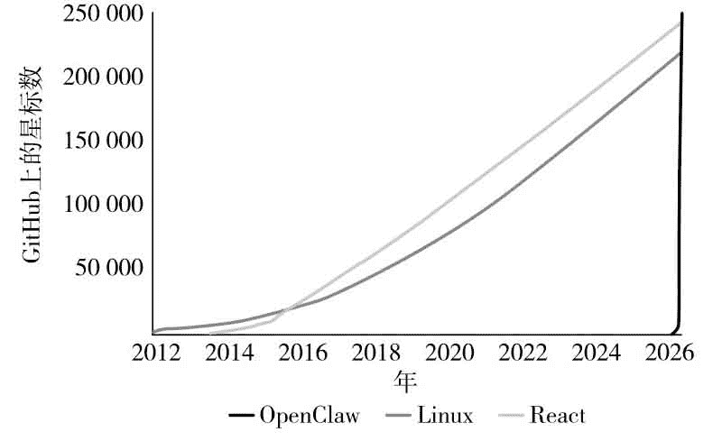
图 1-1 OpenClaw 在 GitHub 上的星标增长曲线
图片来源：star-history.com。

这是 GitHub 历史上增长最快的项目之一。社交媒体上出现“养虾日记”：有人一夜删 2 万垃圾邮件，有人自动投简历获 5 个面试，有人监控房价每日推送。

为什么如此火爆？因为与传统 AI 本质不同。

传统 AI：
● 问答即止，不主动
● 记忆短暂
● 无法操作软件
● 数据多在云端

OpenClaw：
● 本地运行，数据可不上传
● 兼容任意大模型
● 能操作浏览器、邮箱、文件、代码
● 支持定时执行与主动提醒
● 具备长期记忆，越用越懂

它不是聊天机器人，而是数字员工。

**从 Clawdbot 到 OpenClaw**

项目火爆后问题随之而来。2026 年 1 月 27 日，Anthropic 发来律师函，称 Clawdbot 与 Claude 太像，要求更名。彼得当天在社区公告改名，Discord 上数千人讨论 48 小时，最终选定 Moltbot。1 月 27 日凌晨完成迁移。

但 Moltbot 拗口易错，用户吐槽不断。彼得自己也说名字不顺口。

1 月 30 日，团队决定再改，寻找能用十年的名字。于是 OpenClaw 诞生（见图 1-2）。

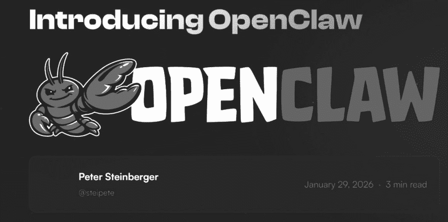
图 1-2 OpenClaw“龙虾”卡通形象
图片来源：彼得·斯坦伯格个人社交媒体。

Open 代表开源与数据自主，Claw 保留龙虾主题，象征会干活。团队做了全球商标查询与法务审核，一键迁移脚本让用户无感。

不到三周后 2 月 14 日，彼得宣布加入 OpenAI。第二天，OpenAI 首席执行官萨姆·奥尔特曼在 X 上官宣（见图 1-3）：“彼得·斯坦伯格加入 OpenAI，推动下一代个人 AI 代理……OpenClaw 将作为独立基金会开源项目，OpenAI 持续支持。”

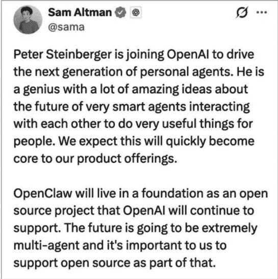
图 1-3 萨姆·奥尔特曼在 X 上的官宣帖

声明关键点在于 OpenClaw 不会私有化，而像 Linux 基金会一样独立运作，社区主导。彼得加入 OpenAI，但 OpenClaw 仍属于所有人。

此时 GitHub 星标已超 18 万，TechCrunch、The Verge 等媒体大幅报道。投资人奈特·弗里德曼评价：“OpenClaw 证明 AI 下一阶段不是更大模型，而是更有用的代理。”

彼得在接受莱克斯·弗里德曼三小时专访时感慨：一个周末的实验，可能颠覆他自己的 PDF 帝国。

为什么你要关注 OpenClaw？从周末项目到顶级开源，从个人实验到独立基金会，只用了三个月。

**AI 跃迁的真正信号，不在命名次数**

它的分量不在于改过几次名字，而在于它验证了一个判断：AI 可以走出对话窗口，成为真正能干活、能独立思考、能持续学习的数字员工。

不需要写代码，也不用付昂贵的企业版订阅，更不必把数据交给云端大厂。只要在本地电脑上装好 OpenClaw，配齐相关技能，它就能接管日常：

● 早晨自动清理收件箱，只把需要关注的邮件留给你
● 持续盯盘关注的信源，定期推送精简摘要
● 负责日程管理，会前提醒、会后生成纪要
● 编写代码、跑自动化测试、推送上线
● 操作智能家居与机器人设备

像一位 24 小时在线的助手，接触越久，它对你的工作习惯理解越透彻。这就是 OpenClaw 的故事。接下来会讲如何把这只“龙虾”养起来，让它真正成为你的数字员工。

**为什么大家都叫它龙虾**

改名意外催生了一套社区文化。

最初项目名为 Clawdbot，Claw 原指爪子。龙虾有大钳子，再加上与 Claude 的谐音梗，社区就用龙虾图标来指代。到了 Moltbot 阶段，molt 表示蜕壳，也把龙虾意象坐实。

社区昵称 Molty，萌得像宠物。中国用户常叫“龙虾”或“虾总”，日本用户叫“エビちゃん”，德国用户叫 Krebs。还有“Crab Cult 蟹教徒”的玩梗，最早是 Reddit 上有人戏称用户像个神秘组织，见面打招呼就是“你是螃蟹吗”。梗越传越广，线下聚会有人穿印有龙虾图案的 T 恤，Discord 里龙虾表情满屏。

2026 年 2 月旧金山首届 ClawCon 超过两千人参会，现场售卖的“I’m raising a lobster”T 恤三小时售罄。维也纳的技术社群甚至把龙虾图标印在了社群旗帜上。

为何一个工具能凝聚如此认同？因为“养虾”这个说法太形象。安装、配置、教它做事，用得越久越懂你，像养一只宠物，只是这只宠物从不睡觉，还能帮你赚钱。拟人化的温度，让软件有了伙伴感。

## 1.2 从会聊到会做：三个关键能力

前面提到的差异到底如何实现？为何常规对话模型做不到的事，这里能做到？答案藏在三个能力里。

**第一项：本地端自主操作**

普通模型被困在封闭对话框，只能回文字，看不到屏幕、打不开浏览器、触不到文件。

OpenClaw 能真正使用电脑：

● 直接操控浏览器，打开页面、点击、填表、截图、下载
● 在终端执行命令、运行脚本、查看日志
● 管理文件，读写文档、整理目录、解压打包
● 调用各类 API，连接邮箱、日历、代码平台、即梦等服务

意义在于实操。让常规模型查网站价格，只能得到“无法访问”。它会自己打开站点、定位价格、读出数字并汇报。让它把数据做图，常规模型只给代码，它会直接运行、生成图表并保存发送。

技术底座是 Anthropic 在 2024 年 10 月发布的 Computer Use API，Claude 可借此控制电脑，OpenClaw 把该能力开源并本地化，让普通人也能用上。这就是能“干活”的原因——不是在框里说话，而是在替你操作电脑。

**第二项：持久记忆**

普通模型的记忆很短暂，今天告诉它喜欢 Python，过几天就忘了。对话结束即失忆，即便有历史记录，本质也只是上下文拼接。

这里有两层记忆结构：

**第一层：SOUL.md 魂文件**
相当于永久认知，由用户手动配置，长期有效。写入姓名、职业、习惯、代码偏好、常用工具、沟通风格等。每次推理会先注入该文件作为系统提示。

**第二层：MEMORY.md 事实文件**
使用过程中自动沉淀的事实。比如老板邮箱、每周一的团队会、关注的股票代码、常用网站、邮件处理习惯。第一次说“给老板发邮件”，它会询问邮箱，记下来后下次直接发送。周一说“准备明天的会”，它记住是团队周会，后续每周一早上会主动询问是否需要准备。

记忆让助手越用越熟练，第一周像新手，月后比你更懂工作流。全部数据本地存储，可随时查看、修改、删除。

**第三项：主动执行**

常规模型被动，不问不说。这里可以主动。

依赖三种机制：

**定时任务**
一次设定持续执行，如每日 8 点推送行程、每周一下午抓行业新闻、每小时检查股价、每晚备份文件。

**事件触发**
条件满足即行动，如收到含“紧急”的邮件立刻推送、股价跌超 5% 发送预警并分析、GitHub 出现新 issue 自动回复并打标签、日历冲突即时提醒。

**心跳机制**
默认每 30 分钟自动唤醒，读取 HEARTBEAT.md 清单，做一次轻量推理判断是否需要处理。无事则返回确认，有事则主动推送或执行小任务。

# Heartbeat checklist
- 排查收件箱是否出现关键词邮件，如紧急、老板、会议
- 查看未来两小时日历是否存在冲突或即将开始的安排
- 若有后台任务完成，汇总结果并询问是否需要汇报
- 若用户已闲置八小时以上，送出一句轻提醒

这让工具变成助理。工具只在调用时工作，助理一直在盯着事情。

有用户让它监控 Hacker News，AI 智能体话题上首页就推送到 Telegram。凌晨三点推送一条热帖，他第一时间参与讨论，评论被顶后个人网站流量当天涨了十倍。常规模型只能靠人刷网页，很容易错过深夜讨论。

**数字员工是三者的合力**

单独看都不复杂：操作是 API 与自动化、记忆是本地文件存储、主动是定时与触发。但三者结合产生质变。

早上八点主动推送三场会议及准备资料，提醒两封紧急邮件，其余邮件已分类；同时把 AI 行业新闻摘要发到 Notion。

工作中随口说“查下竞品 A 最新价”，它打开网站、提取价格、对比历史，告知已降 5% 至 299 元。

下午三点推送：“你关注的英伟达跌了 6%，主因是……是否要设止损提醒？”

晚上十点自动完成备份、归档邮件、更新待办、生成当日总结。指令未发，已完成十几件事。

它能覆盖的范围包括信息管理、日程协作、开发工作、内容创作、商业运营等重复性规则工作。AI 范式正在从“你问它答、一次性交互”转向“你设规则、它持续执行、长期协作”。前者让你更聪明，后者让你更高效。

## 1.3 底层架构：越用越像老搭档的原因

操作、记忆、主动并非凭空而来，背后是一套让系统像精密机器也像成长生命的架构。可拆为 Gateway、Skills、Memory、Agent Brain 四部分，形成闭环：下指令→中枢分发→技能执行→记忆更新→反思改进→下次更好。

**Gateway：指挥中枢**

Gateway 是控制中心，WebSocket 服务默认监听 127.0.0.1:18789。你在 Telegram、微信、飞书、iMessage、WhatsApp 等任何支持的 App 里 @ 它，消息实时推送至此。

收到指令后解析意图、路由到合适的智能体或技能，并把结果实时推回，支持 Markdown、图片、PDF、Excel 等附件。

它支持多通道并行，每个通道有独立会话，不会混淆。像公司前台加总机，知道该转给谁、优先级如何、如何回复最合适。

**Skills：工具箱**

Skills 是可直接干活的模块库。官方社区平台提供上万个现成技能，已做安全扫描和审核，可一键安装：天气查询、股票监控、邮件总结、网页抓取、代码平台操作、笔记同步等。

更强的是可自写。写一个 Skill 就是一个文件夹，包含提示词模板和 Python 或 Shell 执行逻辑，放进指定目录即可自动加载。Skill 还能递归调用其他 Skill 形成链条，例如写周报会串联会议纪要、邮件归档、代码提交记录再合成报告。

**Memory：被记住**

记忆全存本地 Markdown，可随时打开编辑。

● SOUL.md 人格核心，一次配置长期有效
● MEMORY.md 事实记忆，自动追加可手动编辑
● 日志层加可选的向量库，增强长程语义检索

你说“我不喜欢长邮件”，它会记住，下次自动用简洁模板。你常问周一重点任务，一个月后它会在周日晚主动推送本周前五大事项并询问是否调整。

**Agent Brain：自生长循环**

每次任务完成后会进行反思：是否成功？卡在哪？用户反馈如何？能否优化？

基于反思会：
● 更新事实记忆
● 热更新提示词
● 生成新 Skill 草稿供审核
● 尝试自我修复 Bug

社区常说第一周你在教它，第二周它开始帮你想，第三周它开始自优化。不是模型参数变大，而是行为、记忆、技能在持续迭代，像养宠物越养越贴心。

Gateway 负责听与分发，Skills 负责干活，Memory 负责记住，Agent Brain 负责反思进化。四者闭环，让工具变成伙伴。

## 1.4 龙虾家族选型：哪款更适合你

开源后生态丰富，不同需求对应不同版本。有人要数据完全本地，有人要快速上手，有人偏好国产模型，有人不想电脑 24 小时开机。了解差异可避免反复迁移。

**原生 OpenClaw**

由彼得和开源社区维护的官方版本，也是后续教程主要参考。它完整保留全部架构，支持任意模型无缝切换，社区技能库可一键安装，自定义空间最大。程序员和内容创作者常选它，因能自由扩展技能链和记忆范围。数据全程本地，隐私完全自控。

官网一键脚本安装，Mac 通常三十分钟完成初始配置，Windows 通过 WSL2 也能获得接近原生体验。

**Kimi Claw**

OpenClaw 版本全景速递

Moonshot 团队把 OpenClaw 的核心功能封装成在线版，无需本地部署，登录即用。中文长文档的理解与上下文连贯度表现稳健，经常被日常办公用户和兼职内容生产者拿来做入门试验，卖点是上手快并且附赠 40GB 网盘便于文件同步。运算全程在服务器侧完成并做了加密，对隐私敏感度极高的用户上车前最好权衡。

入口：https://platform.moonshot.ai/，登录后会进入 Kimi Claw 工作台。

**有道 LobsterAI**

网易有道推出的国产化桌面版，采用双击启动的客户端形态。对 DeepSeek、通义千问等国内大模型的兼容度成熟，装完基本免调。沙箱隔离让运行边界更清晰。偏好国产模型且不想碰命令行的用户，多数会把它设为主力，操作手感贴近普通办公软件。

下载：https://lobsterai.youdao.com，涵盖 Mac/Windows 安装包。
开源地址：https://github.com/netease-youdao/LobsterAI。

**飞书妙搭：真正的一键部署**

字节飞书的妙搭×OpenClaw 组合主打极简部署。用户在妙搭对话框里说一句，整套环境就会自动拉起。

预置了群聊摘要、文档润色、待办管理、会议纪要、周报生成等高频场景，并与飞书系统深度打通。@妙搭 即可在飞书内直接调用，无需切窗或手动配通道，真正开箱。

官方同时提醒安全风险：ClawHub 上曾出现过恶意技能窃取数据的案例，切勿随意安装未经审核的第三方技能。建议优先使用飞书官方插件，遵守权限最小化、先审后用的原则，避免让 OpenClaw 明文保存密码等敏感信息。

优点是门槛极低、启动极快；缺点是可定制空间受限并且数据存放在飞书云上。适合只想快速体验、不愿折腾的新手。

用法：在飞书里搜索“妙搭”，按引导操作即可。

**WorkBuddy：腾讯版“免部署小龙虾”**

腾讯的 WorkBuddy 是零配置版本，下载即开即用，省去手工部署的步骤，适合想快速感受 OpenClaw 助手能力的人。

覆盖邮件处理、日程安排、项目协作等办公场景，可迅速嵌入现有工作流。企业用户还能开启团队协同，在多人环境下共同作业。整体易用、上手快，装完即可开工。

下载地址：https://www.codebuddy.cn/work/。

**QClaw：微信远程操控（内测中）**

基于 OpenClaw 打造的本地助手，通过微信实现对电脑的远程交互，可执行报表计算、文件传输等操作。其差异化在于突破了传统桌面软件的限制，让手机端或微信端直接操控远端主机。

适合想用手机随时处理事务的用户，只要微信可达，无论在家还是办公室都能让电脑远程执行任务。支持 Windows、Mac 一键安装，在一定程度上弥补了远程控制痛点。

**ZeelinClaw**

智灵动力团队的一键安装版，最大亮点是可以直连本地大模型。既能使用团队预置模型，也能挂载自有免费模型如千问 3.5 系列，实现零成本运行。对希望完全掌控使用成本的用户很友好。新版已覆盖多个 Mac 版本，Windows 用户也能通过官网链接一键获取安装包。

获取地址：“清新研究”公众号后台发送“OpenClaw 入门到精通”获取资源。

**MaxClaw**

稀宇科技 MiniMax 在官方版基础上优化的本地分支，针对启动速度与内存占用做了专项调优，国产大模型支持尤其出色，部分常用技能的界面与提示词已汉化。低配笔记本用户常选此版本，即使在 8GB 内存下也能保持流畅。更新频率不及官方版本，但对国内日常使用已足够适配。

获取方式：在 GitHub 搜索 MiniMax OpenClaw fork，或通过 MiniMax 平台接入相关生态。

**云托管版**

若本机无法长期开机，或希望在手机、平板等多端随时唤醒龙虾，云托管是不错的方向。目前主流云厂商均提供 OpenClaw 专属镜像或一键部署，上手门槛低，通常 15 分钟左右即可上线。

扣子 OpenClaw：字节扣子编程平台提供的托管方案，提供免服务器的免费部署选项。借助扣子的豆包 2.0 模型可实现零成本运行，部署仅需两步。对想要快速体验且不想付费的新手，目前门槛最低。

阿里云 OpenClaw 托管版：面向轻量应用服务器的专属镜像，预装完整环境与常用技能，支持钉钉、飞书等企业通道深度集成。基础配置 2 核 CPU+2GB 内存+40GB 硬盘，新用户年付 68 元起，常有免费额度。部署地址：https://www.aliyun.com/activity/ecs/clawdbot，登录后点击“一键购买并部署”。

腾讯云 OpenClaw 托管版：Lighthouse 轻量应用服务器的预装镜像，特别优化 QQ、企业微信、飞书等多通道接入。基础配置年付 99 元起，新用户可领 1~3 个月免费试用。不少用户反馈腾讯云在 QQ 机器人稳定性上表现突出。部署：在腾讯云控制台搜索“Lighthouse OpenClaw 镜像”或访问开发者社区教程页。

其他选择：百度云、华为云、火山引擎、Railway、Zeabur 等平台也陆续上线 OpenClaw 部署方案或容器镜像，价格从免费试用到每月数十元不等，各有侧重。若已有熟悉的云生态，可优先在该平台检索相关资源。

版本对比见表 1-1。

表 1-1 版本对比一览表

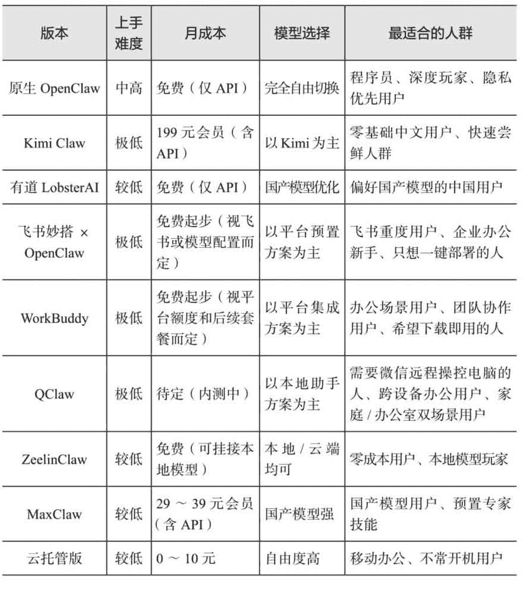

**如何快速做出选择**

看重本地可控与长期扩展，原生 OpenClaw 仍是最稳妥选择。

想当天见效，Kimi Claw、飞书妙搭、WorkBuddy 或 MaxClaw 能最快建立信心。

追求零成本，ZeelinClaw 挂载本地免费模型是可行路径。

想要自由选模型同时保持安装简便，有道 LobsterAI 体验更贴合。

需要微信远程操控，可持续关注 QClaw 内测进展。

设备无法 24 小时开机，云托管可解决持续运行顾虑。

各版本底层架构高度一致，学会一个后 Prompt 模板与核心技能基本可复用。本书后续以原生 OpenClaw 为主讲解，关键步骤会标注其他版本的适配方法。

下一章将进入实操：按系统挑选对应版本，跟着步骤把第一只龙虾跑起来。

## 本章小结

OpenClaw 并非普通聊天机器人，而是能真正干活的开源 AI 代理。

它具备三大核心能力：

● 操作电脑：可直接控制浏览器、管理文件、操作终端并调用 API
● 长期记忆：SOUL.md 与 MEMORY.md 记录使用习惯与事实，越用越懂你
● 主动行动：定时任务、事件触发、心跳机制，主动盯住待办事项

架构由四个核心机制构成：Gateway 指挥中枢、Skills 技能库、Memory 记忆系统、Agent Brain 反思与自生长，形成闭环并持续进化。

目前主流版本包括原生 OpenClaw、Kimi Claw、有道 LobsterAI、飞书妙搭、WorkBuddy、MaxClaw、云托管版等，各有侧重。

## 本章实践任务

任务一：打开 https://openclaw.ai，浏览官网首页及版本介绍，选出 1 到 2 个最感兴趣的版本。
任务二：确定主力版本，记录其安装地址，官网或 GitHub 链接均可。
任务三：准备常用的聊天工具，微信或 Telegram 至少其一，确保能正常登录并接收消息。

# **第二章 龙虾落地：把 OpenClaw 装进你的电脑**

读完第一章，你已了解 OpenClaw 的定位与能力。现在进入实操，把它装进电脑让它跑起来。

本章是全书最硬核的部分，也是成就感最强的环节。按步骤完成，绝大多数人卡住的那一步就能过去。

不需要写代码，也不需要懂服务器。每一步都拆得很细，即使从未用过命令行，照做也能成功。

**小贴士**

不同电脑系统环境差异大，安装时出现报错很正常。遇到看不懂的提示，直接复制错误信息丢给常用的大语言模型，如豆包、DeepSeek，通常能迅速得到解决办法。

## **2.1 实战前，先弄清楚你的装备**

安装前先想清三件事：使用什么操作系统、用什么聊天工具对话、本地部署还是云端部署。这三个决定会直接影响后续体验。

**选择一：用什么操作系统？**

OpenClaw 支持 Mac、Windows、Linux，但体验不同。

Mac 推荐：原生支持最完善，可直接操作日历、备忘录、提醒事项、截图，并与 iPhone/iPad 无缝同步。安装配置也最简便，大部分功能开箱即用。

Windows：完全可用，日常任务无碍，但部分系统级功能如原生备忘录操作、截图功能会受限。本章会单独说明 Windows 环境的安装方式。

Linux：适合开发者，配置灵活，可折腾。本章最后会给出简明流程。

一句话总结：有 Mac 用 Mac，没有 Mac 用 Windows，只有程序员才考虑 Linux。

**选择二：用哪个聊天工具和它对话？**

安装完成后需要一个聊天入口下指令，如同给员工打电话。OpenClaw 支持十几种工具，飞书和 Telegram 最值得推荐。

国内用户可选飞书、钉钉、企业微信等，设计现代、推送稳定、API 完善，免费版已足够用。飞书支持富文本、文档、表格，与 OpenClaw 配合体验很好。钉钉和企业微信也能用，配置相对繁琐。

国外用户首选 Telegram：用户基数大、Bot 功能强、消息实时、隐私好。很多新功能先在 Telegram 上完善。

备选还有企业微信、钉钉、Discord、iMessage 等，配置更复杂，初次上手不建议选。

**注意**

暂时不接聊天工具也行。OpenClaw 自带 Web UI，通过浏览器直接访问即可先跑起来，后续再接入飞书也不迟。

**选择三：本地装还是云上装？**

新手容易忽略，却对体验影响很大。

本地部署推荐：装在自己电脑上。优点是隐私最安全、响应最快、成本最低、功能最全。缺点是电脑关机即停止，无法 24 小时运行。

云端部署：装在云服务器上。优点是可 24 小时不间断运行，关机也不停。缺点是需付费。

多数人建议先本地安装，用顺手后再考虑云端。本章分四块展开：Mac 本地安装、Windows 本地安装、Linux 本地安装、云端部署。

## **2.2 Mac 本地安装：跟着做，10 分钟搞定**

这是关键一节，按每一步操作，不要跳过也不要自行改命令。安装成功后，小龙虾就活了。对 Mac 用户强烈推荐本地部署，体验好、功能全。

**前置配置检查：先确认你的 Mac 够不够格**

安装前确认硬件与系统：

● CPU：M 系列芯片或 Intel i5 以上均可
● 内存：8 GB 以上，推荐 16 GB，复杂任务更流畅
● 硬盘：至少 10 GB 空闲空间
● 系统：macOS 12 Monterey 或更高，推荐 macOS 14 Sonoma 或 macOS 15 Sequoia
● 前置软件：Node.js 22.16.x 以上，Homebrew 可选

查看方法：点击左上角苹果图标，选择“关于本机”。2020 年后购买的苹果电脑基本满足条件。

**安装与配置：五步搞定**

**第一步：打开终端**

安装需要使用终端 Terminal。看到命令行不必紧张，只需复制粘贴几行指令，无需手写。

● 按 Command+空格 打开 Spotlight
● 输入“Terminal”或“终端”
● 回车，弹出黑色窗口

**小贴士**

可把终端固定到 Dock 栏，方便后续使用。在 Dock 上右键终端图标→选项→在程序坞中保留。

**第二步：安装 OpenClaw**

打开终端后先检查前置环境：

# 1. 检查 Node.js 版本，要求 v22.16.x，推荐 v24.x.x 及以上
node -v

# 2. 检查 npm 版本
npm -v

每个 Node.js 发行版内置对应 npm 版本，未手动改过即匹配。若不确定可对照官网发布说明。

未安装可访问 https://nodejs.org 下载 macOS .pkg 安装包，双击下一步完成。若版本满足，执行：

curl -fsSL https://openclaw.ai/install.sh | bash

等待即可，命令会自动完成环境检测、下载最新版、配置环境变量，耗时约 2 到 5 分钟，屏幕滚动英文属正常现象。

国内网速慢可尝试：

curl -fsSL https://openclaw.ai/install.sh|bash -s -- --mirror=cn

镜像由社区维护，速度快且内容一致。

**第三步：验证安装是否成功**

安装完成后执行：

openclaw --version

若显示类似 2026.3.8 的版本号，说明安装成功。若提示 command not found，先关闭终端重开，多半能解决。

**第四步：初始化配置——给龙虾做入职培训**

安装完成后需告诉它使用哪个 AI 大脑、通过哪个聊天工具联系你。执行：

openclaw onboard

随后会出现交互式问答，按序回答即可：

1．接受风险提示

会显示安全说明，大意是默认仅自己可用，多人共用需额外配置。选 Yes 继续。

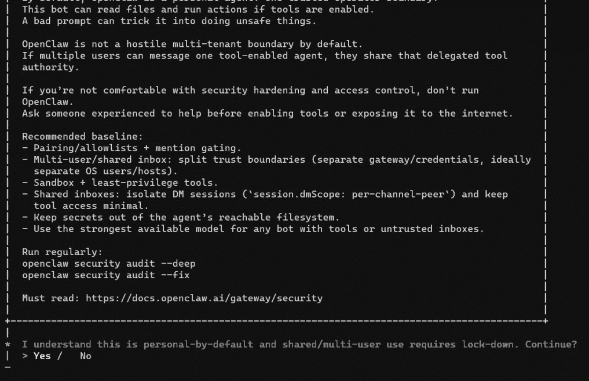

图 2-1 初始化配置界面——选择 Yes 继续

2．选择启动模式

出现 QuickStart 快速启动 和 Manual 手动配置 两个选项，推荐 QuickStart，会快速完成核心配置，后续可随时调整。

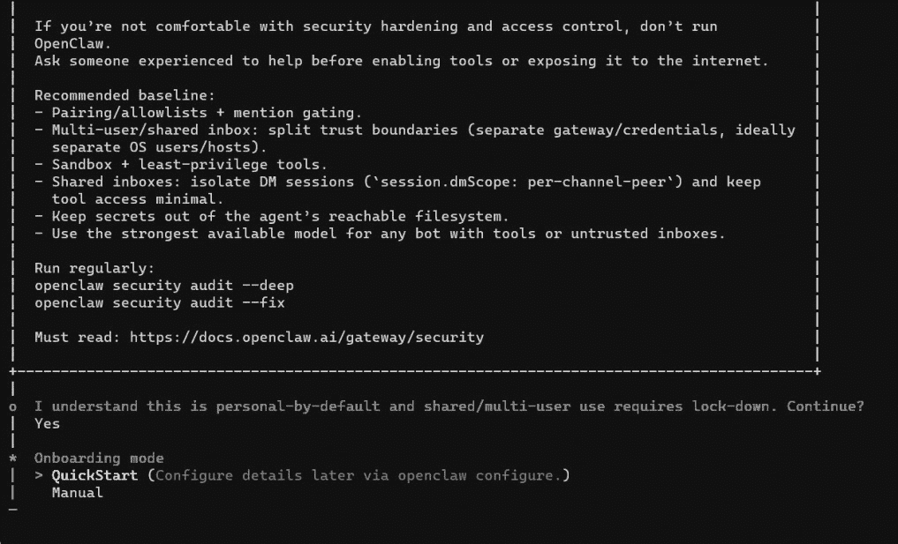

图 2-2 选择 QuickStart 启动模式

3．选择 AI 模型

这是关键一步，决定为 OpenClaw 提供大脑的模型。会列出长长的供应商列表，支持国内外主流模型，包括 OpenAI、Anthropic、Kimi、智谱等。

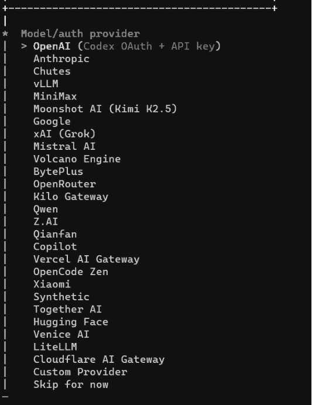

图 2-3 AI 模型供应商选择列表

国内用户速查建议见表 2-1。

表 2-1 AI 模型供应商速查表

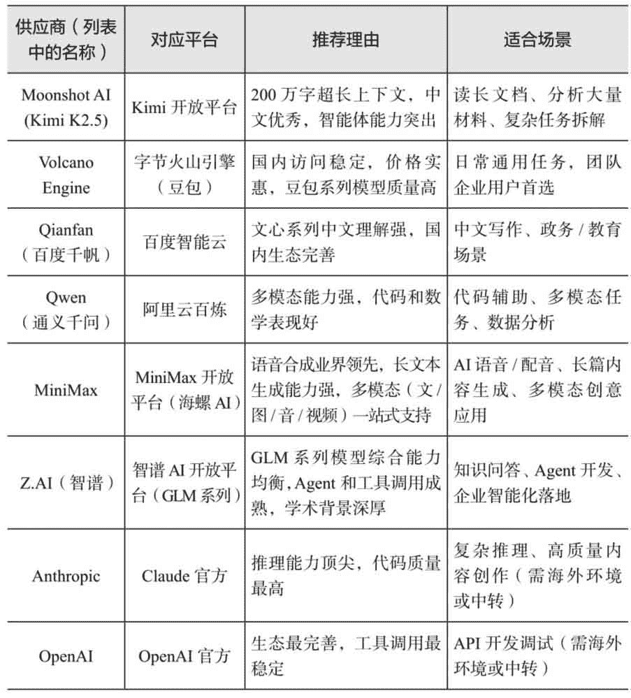

**注意**

DeepSeek 未在列表中，但属于常用模型，接入方式如下。

**DeepSeek 接入，两步完成**

DeepSeek API 兼容 OpenAI 格式，在列表选择 Custom Provider 自定义供应商，填写：

Base URL：https://api.deepseek.com
Auth 方式：API Key
模型名称：deepseek-chat 或 deepseek-reasoner
API Key 获取地址：https://platform.deepseek.com/api_keys

若不确定，先选 Moonshot AI Kimi K2.5，列表中可直接找到，配置最简便、中文效果好，入门足够。用熟后再按需切换。

4．输入 API Key

选定模型后系统会要求输入对应的 API Key，即访问凭证，证明有权使用该 AI 服务。

**API Key 怎么拿到？**

API Key 相当于平台发放的访问令牌，样式一般是 sk- 开头的一串字母数字混合。拿号的流程大体相同：先在对应官网注册登录 → 进入后台控制台 → 找到 API 管理或开发者专区 → 新建密钥并复制保存。

DeepSeek：https://platform.deepseek.com/api_keys

Kimi：https://platform.moonshot.cn/console/api-keys

智谱 GLM：https://open.bigmodel.cn/usercenter/apikeys

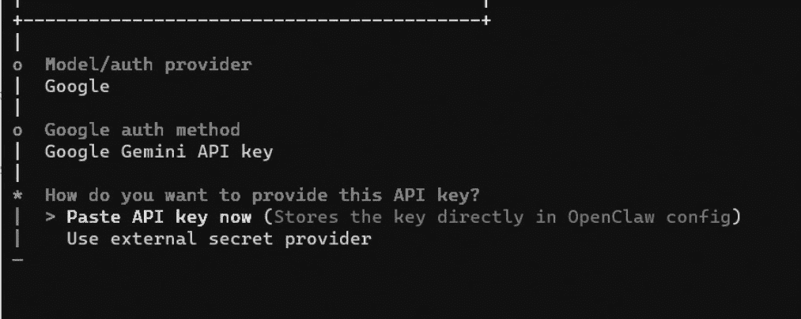

图 2-4 API Key 填入界面，可点 PasteAPIkeynow

5．模型版本怎么定
密钥填完后向导会让你指定具体使用哪个模型，见图 2-5。多数情形直接用系统默认推荐的最新版就够用了，比如智谱默认是 Z.AI GLM-5。不确定就保持不动。

6．网络搜索开关，可先略过
模型确定后会问是否给龙虾加上联网检索能力，开启后能查实时股价、最新资讯等。共给出 6 个选项，分别是 Brave Search、Gemini、Grok、Kimi、Perplexity Search，以及 Skip for now 先跳过，见图 2-6。

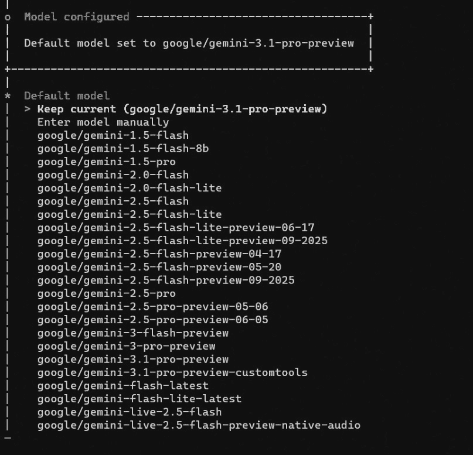

图 2-5 模型版本选择页

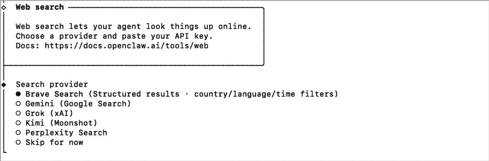

图 2-6 网络搜索供应商选择界面

网络搜索供应商速查表如表 2-2 所示。

表 2-2 网络搜索供应商速查表

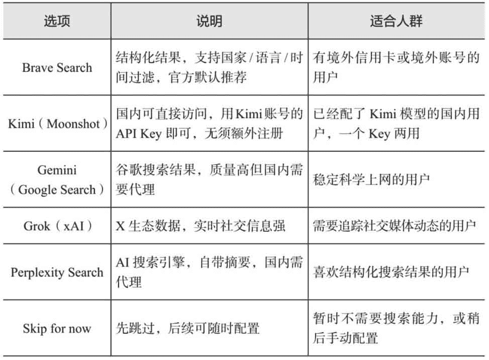

国内网络建议优先 Kimi Moonshot。若第 3 步已把 Kimi 设为主模型，这里直接复用同一份 API Key 即可，不用额外开号。一个 Key 同时担当模型和搜索引擎，最省事。

**小贴士**
检索功能不影响核心使用，先跳过完全没问题。后续在第四章 4.2 节有完整配置指南，也包含国内替代方案火山云融合搜索。

7．聊天入口挑选，可先跳过
下一步是选一个聊天渠道，见图 2-7。想立刻接入飞书就选 Feishu/Lark，按提示建 Bot。若暂时没定，选 Skip for now 先跳过，装完后可用 openclaw channels add 指令补上。

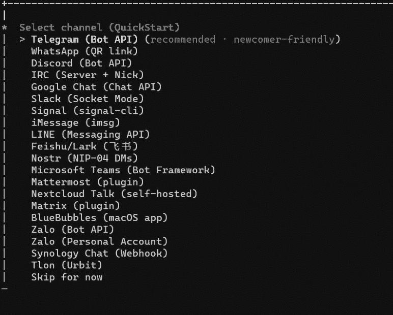

图 2-7 聊天平台选择列表，支持 Telegram、飞书、WhatsApp、Discord 等

8．Gateway 端口设定
Gateway 是 OpenClaw 的中枢，默认端口 18789，直接回车确认即可，无需改动。

9．技能挑选
OpenClaw 内置一个技能库，里面都是现成的功能模块，见图 2-8。初次上手建议先跳过，选 Skip for now，用熟后再按需装。

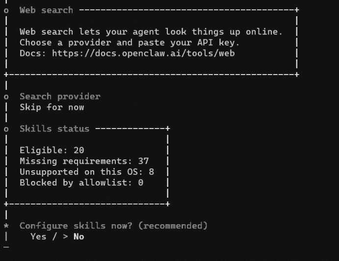

图 2-8 技能安装列表，初次使用可跳过

10．Hooks 钩子启用
Hooks 用来引导内容和做记录，建议勾上 boot-md、command-logger、session-memory 这三项，见图 2-9。

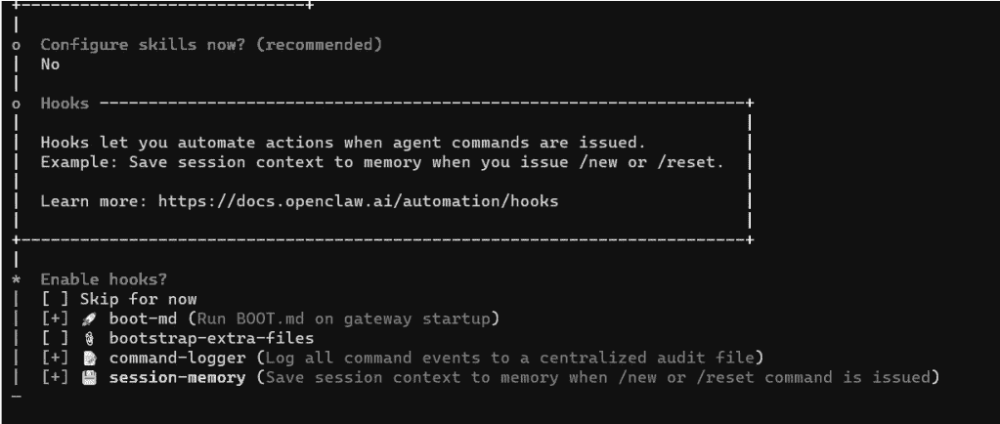

图 2-9 启用 Hooks 选项

（1）boot-md：启动时加载个性化配置。
每次 Gateway 启动会自动读取 BOOT.md 文件，这份文件相当于开机指令，可以写每次启动先载入工作配置、检查当日日程之类的规则。建议开启。
bootstrap-extra-files：启动时加载额外配置文件，比如多个自定义 md，普通用户暂不需要。

（2）command-logger：记录执行过的指令，便于回溯。
所有执行过的指令会写入审计日志，出问题能查龙虾到底做了什么，也方便统计用量。建议开启。

（3）session-memory：会话记忆，保持上下文。
开启后，用 /new 或 /reset 开新对话时，龙虾会自动把当前对话的关键信息存入记忆。关闭则每次新对话都会失忆。强烈建议开启。

**小贴士**
这三类钩子配合起来，能让 OpenClaw 越用越懂你，建议全部打开。

**第五步：安装验证**
配置完成后点 Restart，OpenClaw 会自动重启 Gateway，并在浏览器打开 Web UI。

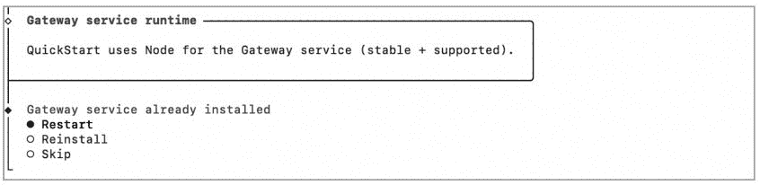

# 检查 Gateway 状态
openclaw channels status

如果返回 # Gateway reachable. 就说明状态正常。也可直接访问：
http://127.0.0.1:18789/chat
看到聊天界面即表示龙虾已上线。在输入框发一句“你好”，有回复就说明一切正常。

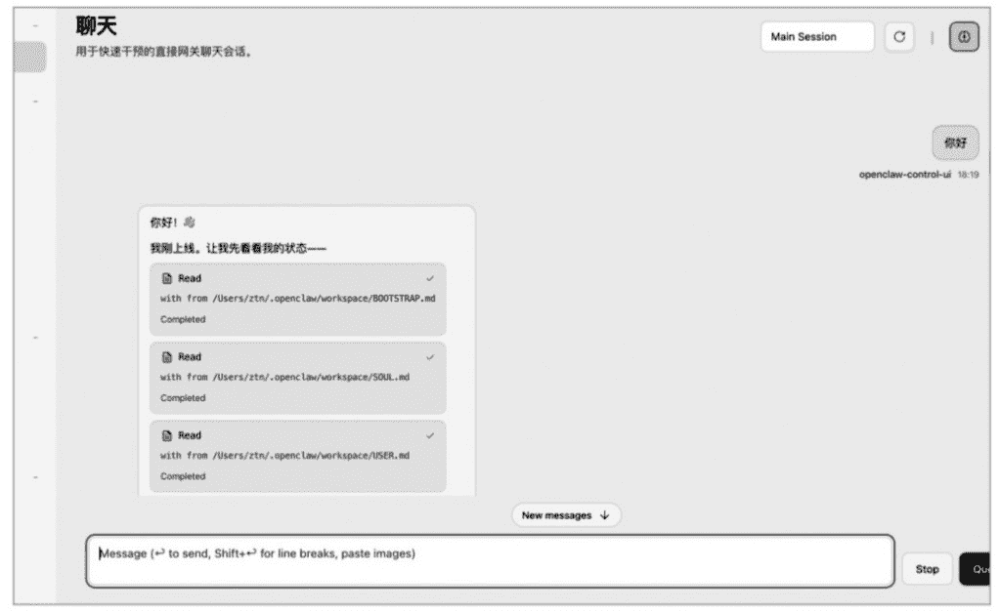

**常见问题速查**
**问题 1：提示 command not found: openclaw**
装完后重启终端再试。若仍不行，手动补环境变量：
echo ‘export PATH=$HOME/.openclaw/bin:$PATH’ ＞＞~/.zshrc ＆＆ source ~/.zshrc

**问题 2：安装时报 Permission denied**
在指令前加 sudo 以管理员身份执行：
curl -fsSL https://openclaw.ai/install.sh | sudo bash

**问题 3：Gateway 已启动但浏览器打不开 Web UI**
● 检查端口是否被占用：lsof -i :18789
● WSL2 用户注意：IP 不是 127.0.0.1，需用 hostname -I 查出 WSL2 实际 IP，再访问 IP:18789
● 换个端口试试，执行后再重启 Gateway：
openclaw config set gateway.port 18790

**问题 4：发消息没回应，AI 不响应**
● 先体检：openclaw doctor，会直接指出问题
● 检查 API Key 余额：openclaw test api，余额为 0 是常见原因
● 看实时日志定位报错：openclaw logs --follow

**问题 5：如何备份配置**
tar -czf openclaw-backup-$(date +%Y%m%d).tar.gz~/.openclaw
备份文件包含 SOUL.md、MEMORY.md、openclaw.json 等，迁移到新机器即可恢复。

## 2.3 Windows 本地安装：WSL2 帮你搞定
好消息是 OpenClaw 在 Windows 上能正常跑日常任务。坏消息是需要多一步，先装 WSL2 也就是 Windows 的 Linux 子系统。

别被名字吓到，WSL2 只是微软提供的一个轻量 Linux 环境，安装只要一行命令，向导很友好。

**注意**
Windows 上部分系统级功能如日历、备忘录、截图受限，这是平台本身限制。处理文件、邮件、网页等核心任务没问题。

**前置检查：Windows 是否能用**
● 系统：Windows 10 版本 2004 Build 19041 及以上，或 Windows 11
● CPU：2 核以上
● 内存：4GB 以上，推荐 8GB
● 硬盘：10GB 以上空闲
● 前置软件：Node.js v22.16.X 及以上

**方案一：WSL2+Ubuntu 部署 推荐**
官方推荐的 Windows 部署方式，提供相对完整的 Linux 支持。

**风险提示**
WSL2 本质是在 Windows 内跑虚拟化 Linux 环境，使用需注意：（1）WSL2 与 Windows 共享文件系统，在 WSL2 里误删或覆盖会同步影响 Windows 侧文件；（2）WSL2 网络配置独立，端口转发和防火墙需额外设置，配不好可能导致服务暴露；（3）WSL2 资源占用会随使用增长，内存默认不自动释放，长期运行可能拖慢系统，建议定期执行 wsl --shutdown 释放资源；（4）文件权限模型与原生 Linux 不同，部分依赖严格权限的操作可能异常。不熟悉命令行者建议考虑 PowerShell 原生安装或云端部署。

**第一步：启用 WSL2**
以管理员身份打开 PowerShell，右击开始菜单→Windows Terminal 管理员，依次执行：
# 启用 WSL 功能
dism.exe /online /enable-feature /featurename:Microsoft-Windows-Subsystem-Linux /all /norestart
dism.exe /online /enable-feature /featurename:VirtualMachinePlatform /all /norestart
# 设 WSL2 为默认版本
wsl --set-default-version 2
完成后重启电脑。

**第二步：安装 Ubuntu**
推荐从 Microsoft Store 安装，最简单：
● 打开 Microsoft Store
● 搜索 Ubuntu 22.04 LTS 或 Ubuntu 24.04 LTS
● 点 获取 并安装
● 首次启动按提示设用户名和密码

**小贴士**
用户名和密码可随意，但要记住，后面在 Ubuntu 里用 sudo 都要输。建议设一个好记的，比如 admin。

**第三步：更新 Ubuntu 系统**
在 Ubuntu 终端执行：
# 更新软件包列表
sudo apt update ＆＆ sudo apt upgrade -y
# 安装基础工具
sudo apt install -y curl git wget build-essential

**第四步：安装 Node.js**
# 添加 NodeSource 仓库
curl -fsSL https://deb.nodesource.com/setup_22.x| sudo -E bash -
# 安装 Node.js
sudo apt install -y nodejs
# 验证版本 必须≥22.x
node -v
npm -v

**第五步：安装 OpenClaw**
一键脚本安装，与 Mac 相同：
curl -fsSL https://openclaw.ai/install.sh | bash

**第六步：校验安装**
# 查看版本
openclaw --version
# 查看帮助
openclaw --help
# 查看系统状态
openclaw status

**第七步：配置 Windows 访问 WSL2 服务**
OpenClaw 运行在 WSL2 中，需配置端口转发方便 Windows 访问。创建启动脚本 start-openclaw.bat：
# 在 WSL2 Ubuntu 终端启动
openclaw gateway run --port 18789
然后在 Windows 浏览器访问 http://localhost:18789。

**方案二：PowerShell 原生部署**
适合不想用 WSL2 的纯 Windows 用户。

**第一步：安装 Node.js**
● 访问 https://nodejs.org/zh-cn
● 下载 Windows 安装包 LTS 版本 22.x
● 运行安装程序，勾选 自动安装必要的工具

**第二步：验证 Node.js 安装**
# 打开 PowerShell
node -v
npm -v

**第三步：以管理员身份安装 OpenClaw**

**注意**
必须以管理员身份运行 PowerShell 或 CMD。右击开始菜单→Windows PowerShell 或 CMD 管理员。
# 安装最新稳定版
npm install -g openclaw@latest
# 或安装汉化版
npm install -g @qingchencloud/openclaw-zh@latest

**第四步：解决安装权限问题**
遇到权限错误二选一：
# 方法 A：启用 PowerShell 脚本执行
Set-ExecutionPolicy -ExecutionPolicy RemoteSigned-Scope CurrentUser
# 方法 B：修改 npm 安装目录
npm config set prefix "C:\npm"
npm config set cache "C:\npm-cache"
# 将目录加入 Path
[Environment]::SetEnvironmentVariable("Path",$env:Path+";C:\npm", "User")

**第五步：校验安装**
openclaw --version
openclaw --help

**第六步：解决常见问题**
问题 1：sharp 模块加载失败。
# 清理 npm 缓存
npm cache clean --force
# 重新安装
npm install -g openclaw@latest --force
问题 2：Windows Defender 阻止。
将 OpenClaw 安装目录加入 Windows Defender 排除项：
C:\Users\你的用户名\AppData\Roaming\npm
C:\Users\你的用户名\.openclaw

**初始化配置：给龙虾做入职培训 Windows 通用**
安装完成后运行初始化向导：
openclaw onboard --install-daemon
配置 AI 模型 以 DeepSeek 为例：
# WSL2 或 PowerShell 均可
openclaw models auth add
# 按提示选择 Z.AI，输入 API Key: sk-xxx
Windows 同样支持多种聊天工具接入，可先跳过，第三章会详细讲解。

## 2.4 Linux 本地安装：开发者专属通道
用 Linux 的话，OpenClaw 安装最干净最省事，没有 WSL2 也没有权限烦恼，一条命令搞定。

**适用场景**
Linux 适合开发者，配置灵活。本节面向熟悉 Linux 命令行的用户，零基础建议先看 Mac 或 Windows 部分。

**前置检查：推荐发行版**
● Ubuntu 20.04+
● Debian 11+
● CentOS 8+

**安装步骤**
**第一步：安装 Node.js**
# Ubuntu/Debian
curl -fsSL https://deb.nodesource.com/setup_22.x| sudo -E bash -
sudo apt-get install -y nodejs
# 验证安装
node --version

**第二步：安装 OpenClaw**
curl -fsSL https://openclaw.ai/install.sh | bash

**第三步：校验安装**
openclaw --version

**第四步：初始化配置**
openclaw onboard
配置流程与 Mac 完全一致，参考 2.2 节即可。

**小贴士**
Linux 用户通常会把 OpenClaw 设为 systemd 服务，开机自启：
openclaw gateway enable

## 2.5 云端部署：手机也能随时控制龙虾
本地部署有个硬伤：电脑一关机，龙虾就下班，定时任务停了，推送也断了。若需要 24 小时不间断工作，或想用手机平板随时下指令，就需要上云。

不过云端不是必须的。大多数人先本地用顺手，确认 OpenClaw 合用后再上云也不迟。本节先厘清区别，再说明怎么选和怎么部署。

**本地部署与云端部署：先弄清楚区别**
两者没有优劣，只有场景不同。表 2-3 列出核心差异，一眼就能判断。

表 2-3 本地部署与云端部署区别

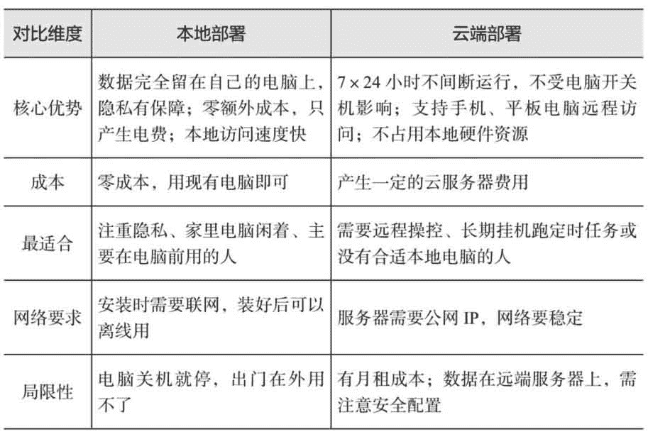

**小贴士**
对上云仍有疑虑时，可以先在本地把整套环境跑通。等到出现外出后无法联系龙虾、或定时任务反复中断这类情况时，再把环境搬到云端也不晚，配置迁移相当顺滑。

**云端部署需要什么条件？**
将 OpenClaw 放到云上，实质是向云厂商租一台可远程操作的服务器并在上面安装。无需具备专业运维能力，但需先满足以下前提：

● 操作系统：优先选用 Ubuntu 22.04 或 24.04，其次为 CentOS 7 以上版本，均需 64 位架构
● 硬件下限：入门配置建议 2 核 CPU、2~4 GB 内存、40 GB 磁盘；追求更流畅体验可提升至 4 核、8 GB 内存起步，预算充足时可加装 GPU
● 网络：OpenClaw 默认使用 18789 端口，服务器采购后需在控制台的安全组或防火墙中放行该端口，否则 Web UI 无法通过浏览器打开
● 费用：主流厂商的入门规格月付成本较低，部分提供新用户优惠或免费试用期

**部署流程：五步通用模板**
不同厂商操作细节略有差异，整体思路基本一致，可按下面五步推进。

第一步：购置云主机。在厂商官网注册实名账号，完成支付后选择一台轻量应用服务器，入门档位已能满足使用。
第二步：装系统镜像。多数厂商已提供 OpenClaw 的预装镜像或一键应用模板，直接选用即可省去环境搭建。若无现成镜像，则选择 Ubuntu 22.04，再按 2.4 节的 Linux 安装步骤操作。
第三步：远程接入服务器。推荐使用 Termius 或 FinalShell 等 SSH 客户端，输入公网 IP、用户名与密码即可登录。大部分厂商也提供网页终端，可直接在浏览器操作。
第四步：接入 AI 模型。与本地部署相同，执行 openclaw onboard，选择模型并填入 API Key，具体可参考 2.2 节。
第五步：验收。浏览器打开 http://服务器IP:18789，发送一条消息，若龙虾能够回复即表示部署成功。

**小贴士**
首次上云前建议先浏览厂商提供的官方视频，10 分钟左右即可规避大部分新手常见问题，比单看文字文档效率更高。

**主流云服务商参考**
国内多家头部厂商均已支持 OpenClaw 的一键部署或预装镜像。本文不做具体厂商推荐，因价格与活动变动频繁，建议结合自身预算和使用习惯自行对比。常见厂商汇总见表 2-4。

表 2-4 主流云服务商简介

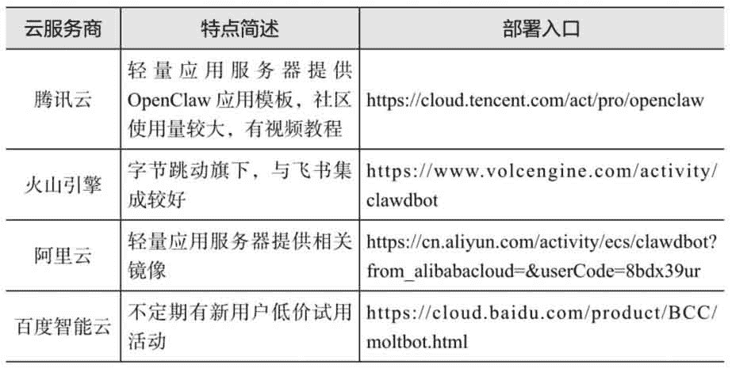

**注意**
云厂商的价格、促销活动和产品方案会随时调整，本书不对具体费用作出承诺，请以官网实时信息为准。挑选时建议重点关注：是否提供 OpenClaw 预装镜像、是否有新用户优惠或试用、机房位置是否靠近常用地区以保证访问速度。

**云端部署安全须知**
数据上云后安全配置不可忽视，部署完成后务必自检以下要点：

（1）登录凭证需足够强，避免使用 123456 等弱口令。SSH 密钥登录比明文密码更安全，有条件时优先使用。
（2）端口按需开放，仅保留 18789 与 22，其他端口全部关闭，可有效减少攻击面。
（3）养成定期备份习惯，建议每周一次。配置文件与记忆文件一旦丢失难以恢复。
（4）优先选用正规大厂。小众或海外不明服务商在稳定性和数据安全方面难以保证。
（5）避免存放高度敏感信息，切勿上传银行卡密码、身份证照片等。OpenClaw 对话会经过模型供应商处理，需注意信息边界。

**常见问题**
**问题 1：云端部署安全吗？**
数据存放在你自行付费的服务器上，仅你可访问。但自有服务器并不等同于绝对安全，仍需完成上述加固。若停止使用，可直接删除整台机器，数据将被彻底清除。

**问题 2：会一直扣费吗？**
多数厂商支持按月或按量计费，删除机器后费用即停止产生。建议先购买一个月试用，满意后再续费。

**问题 3：手机怎么访问？**
两种方式：一是通过飞书、企业微信、QQ 等聊天工具发送消息控制龙虾，最便捷；二是手机浏览器直接访问 Web UI http://服务器IP:18789。

**问题 4：本地配置能迁移到云端吗？**
可以。将本地 ~/.openclaw 目录打包 tar -czf backup.tar.gz ~/.openclaw，上传到云主机解压即可，配置、记忆与技能可无缝接续。

## **2.6** **更新与维护：让龙虾保持最佳状态**
OpenClaw 迭代较快，平均约两周一个版本。保持更新可获得性能优化、新功能与安全修复，操作很简单，一行命令即可。

**检查与更新**
# 查看当前版本
openclaw --version

# 查看最新版本
curl -s https://api.github.com/repos/openclaw/openclaw/releases/latest | grep tag_name

# 方式一：使用安装脚本一键更新（推荐）
curl -fsSL https://openclaw.ai/install.sh | bash

# 方式二：手动更新（从源码）
cd ~/openclaw
git pull origin main
pnpm install
pnpm build

**备份数据**
使用一段时间后，记忆文件和技能配置十分珍贵，建议定期备份。

# 备份配置和数据（推荐每周一次）
tar -czf openclaw-backup-$(date +%Y%m%d).tar.gz ~/.openclaw

# 恢复数据
tar -xzf openclaw-backup-20260210.tar.gz -C ~/

**小贴士**
将备份文件同步到 iCloud、百度网盘等网盘，换电脑或重装系统时可一键恢复，避免龙虾“失忆”。

**监控与日志**
出现异常时查日志最为高效：

# 实时查看运行日志
tail -f ~/.openclaw/logs/gateway.log

# 查看系统状态
openclaw gateway status

# 查看资源使用与 API 消耗
openclaw status
openclaw status --usage

## **故障排查**
**Gateway 是否无法启动？**
# 第一步：查日志找原因
openclaw logs
# 第二步：检查端口是否被占用
lsof -i :18789
# 第三步：重启 Gateway
openclaw gateway restart

**API 是否连接失败？**
# 测试 API 连接
openclaw test api
# 检查 API Key 是否正确
openclaw config get models.providers

**性能是否变慢？**
# 清理缓存
openclaw cache clear
# 重启服务
openclaw gateway restart

**卸载（彻底删干净）**
若需彻底移除，可执行：
# 本地安装：停止服务
openclaw gateway stop
# 删除文件和配置
rm -rf ~/.openclaw
rm -rf ~/openclaw
# 删除命令
npm uninstall -g openclaw

**注意**
卸载前务必先备份，特别是 SOUL.md 和 MEMORY.md，那是龙虾对你的全部记忆。

## **2.7** **API 配置指南：给龙虾选个好大脑**
OpenClaw 本身并非 AI，而是一个代理框架，负责消息路由、工具调用与记忆管理。真正的推理能力来自接入的模型。

**三类接入方式**
OpenClaw 支持三种接入形式，复杂度与适用场景不同，见表 2-5。

表 2-5 三类模型接入方式对比

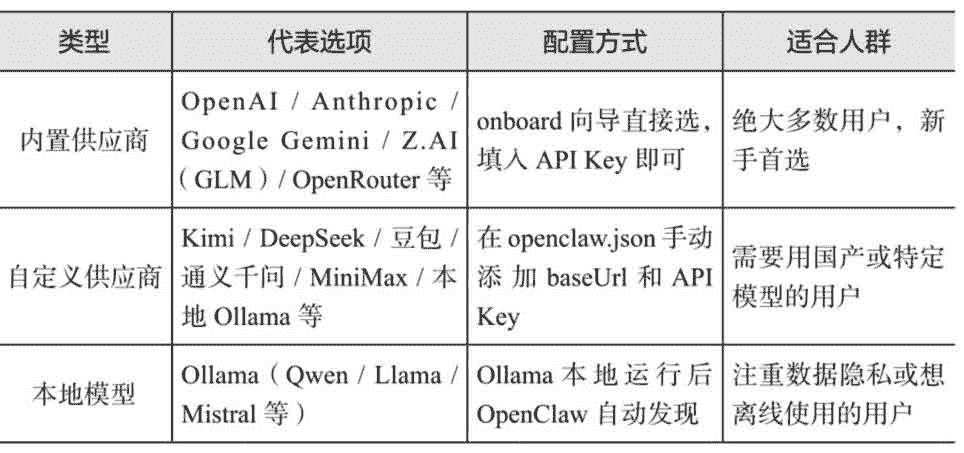
内置供应商指 OpenClaw 已集成接入逻辑，可直接在 onboard 向导中选择，填入 API Key 即可使用，无需额外配置。

**小贴士**
新手建议先用内置供应商跑通全流程，熟悉后再按需切换到国产模型。熟练后更换模型只需修改一两行配置。

**国内用户的供应商选项**
按接入方式可分为两组。

可在 onboard 向导直接选择的内置供应商见表 2-6。

表 2-6 可以直接在 onboard 向导里选到的供应商

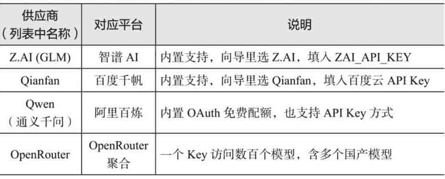
需要手动配置 models.providers 的自定义供应商见表 2-7。

表 2-7 需要手动配置的供应商

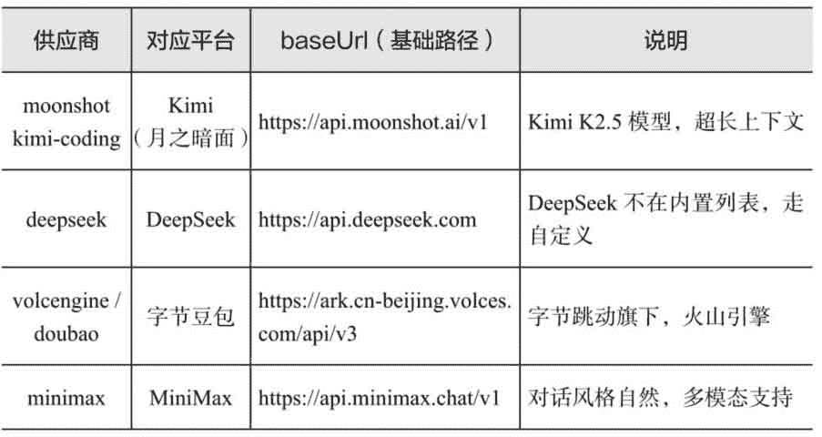

**注意**
DeepSeek 在社区使用广泛，但不在 OpenClaw 内置列表中，onboard 里无法找到。需选择 Custom Provider 手动填写 baseUrl 与 API Key，详细步骤见下文。

**快速上手：通过 onboard 向导配置内置供应商**
若选用 Z.AI、Qianfan、Qwen、OpenRouter 等内置供应商，配置很简单：

openclaw onboard
（1）选“QuickStart”。
（2）在供应商列表中找到目标并选中。
（3）粘贴对应的 API Key。
（4）选择默认模型版本，回车使用推荐版本即可。
（5）完成剩余设置。

API Key 获取方式：注册对应平台账号 → 进入控制台 → 找到 API Key 或 API 管理 → 创建并复制。

**注意**
API Key 形如 sk-xxxxxxxx，创建时仅显示一次，务必立即保存，关闭页面后无法再次查看，只能重新生成。

**手动配置：接入 DeepSeek 或其他自定义供应商**
以 DeepSeek 为例，兼容 OpenAI 格式的国产模型配置思路一致，在 openclaw.json 的 models.providers 字段中添加：

{
"models": {
"mode": "merge",
"providers": {
"deepseek": {
"baseUrl": "https://api.deepseek.com",
"apiKey": "${DEEPSEEK_API_KEY}",
"auth": "api-key",
"api": "openai-chat"
}
}
}
}

然后在 ~/.openclaw/.env 中以环境变量形式写入 Key，避免明文暴露：

DEEPSEEK_API_KEY=sk-你的 API Key

配置完成后重启网关 openclaw gateway restart，再用 openclaw models list 确认模型已出现即可使用。

**小贴士**
也可以让龙虾代配，在对话框输入“帮我把 DeepSeek 添加为自定义供应商，baseUrl 是 https://api.deepseek.com，API Key 是 sk-xxx”，它会自动写入配置文件。

**本地模型：用 Ollama 在自己的电脑上跑 AI**
若有隐私顾虑或想离线使用，可用 Ollama 运行开源模型。OpenClaw 对 Ollama 有原生支持：

# 安装 Ollama（Mac/Linux）
curl -fsSL https://ollama.ai/install.sh | sh

# 下载一个中文优化模型（推荐 Qwen2.5）
ollama pull qwen2.5:7b

启动后 OpenClaw 会自动发现本地的 http://127.0.0.1:11434，无需额外配置。执行 openclaw models scan 扫描一次，本地模型就会出现在列表。

本地模型的权衡：数据完全不出本机，但对硬件有要求，70 亿参数模型建议 16GB 内存，响应速度比云端 API 慢。适合处理敏感文件、私密对话或网络不稳场景。

**模型故障转移：备用方案自动切换**
OpenClaw 支持配置备用模型，在 agents.defaults.model 中设置主模型和 fallback 链：

{
"agents": {
"defaults": {
"model": {
"primary": "zai/glm-5",
"fallbacks": ["openrouter/deepseek/deepseek-chat", "ollama/qwen2.5:7b"]
}
}
}
}

含义为：优先使用 GLM-5，若限速或不可用自动切到 DeepSeek，再不行切到本地 Ollama，形成三层保障。

## **2.8** **本章故障排查手册**
根据大量用户经验汇总，最常见的坑基本 5 分钟内可解。

**安装问题**
**问题 1：Node.js 版本不对**
# 检查当前版本（必须≥22.16.x）
node --version
# 如果低于 22，则升级
nvm install 22
nvm use 22

**问题 2：权限错误**
# macOS/Linux：修复权限
sudo chown -R $USER ~/.openclaw
# Windows：以管理员身份运行 PowerShell，然后执行：
takeown /F "$env:USERPROFILE\.openclaw" /R /D Y
icacls "$env:USERPROFILE\.openclaw" /grant"$env:USERNAME:(OI)(CI)F" /T

**问题 3：网络连接失败、下载太慢**
（1）检查网络，或开启科学上网后重试。
（2）使用国内镜像：curl -fsSL https://openclaw.ai/install.sh | bash -s -- --mirror=cn。
（3）换手机热点尝试。

**API 配置问题**
**问题 1：API Key 无效**
（1）检查是否完整复制，包含 sk- 前缀且无多余空格。
（2）检查账户余额是否充足，余额为 0 时无法调用。

**问题 2：模型不可用**
（1）检查模型 ID 是否正确，不同平台命名有差异。
（2）检查对应平台状态页是否正常。
（3）尝试切换其他模型版本。

**问题 3：Token 消耗太快、费用太高**
（1）切换到更经济的模型，DeepSeek 性价比较高。
（2）优化指令，避免每次对话都带入大量历史记录。
（3）定期清理会话历史：openclaw cache clear。

**Gateway 问题**
**问题 1：Gateway 无法启动**
# 查看日志找原因
tail -f ~/.openclaw/logs/gateway.log
# 重启 Gateway
openclaw gateway restart

**问题 2：18789 端口被占用**
# 查看占用程序
lsof -i :18789
# 可改端口
openclaw config set gateway.port 18790

**小贴士**
遇到本书未覆盖的问题，最快的方法是把报错信息截图或复制给大模型如豆包、DeepSeek 或 ChatGPT，并描述操作步骤，通常 10 秒内可得解法。

## **2.9** **日常管理命令速查：全平台通用**
OpenClaw 装好后最常用的其实是终端命令。Mac、Windows WSL2、Linux 均通用，熟记表 2-8、表 2-9 即可掌握日常运维。

**小贴士**

命令记不全怎么办？在 zsh 下装好补全插件后，终端输入 openclaw + 空格 + Tab 即可自动弹出全部子指令，无需死记。启用补全的写入方式：openclaw completion ＞＞~/.zshrc ＆＆ source ~/.zshrc

**Gateway 管理（最常用）**

表 2-8 Gateway 管理核心命令

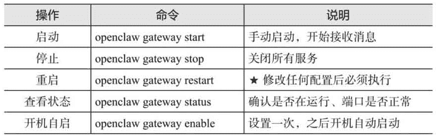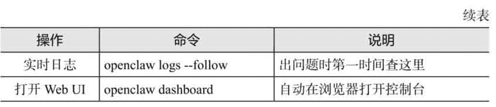

**小贴士**

openclaw gateway restart 是用得最频繁的指令之一。渠道、模型、权限等配置改完后不重启，改动不会生效。养成改动即重启的习惯，能避免很多“为何没变化”的疑惑。

**诊断与配置（较为常用）**

表 2-9 诊断与配置常用命令

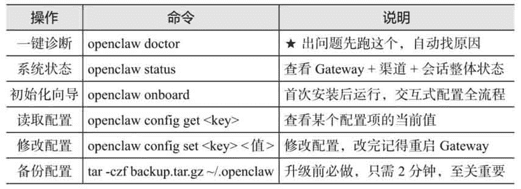

models、channels、skills、cron、sessions 等进阶用法，已按分类收录在附录 A《OpenClaw 命令速查表》中，随时查阅即可。

## 本章小结

恭喜，关键一关已过。

这一章内容不少，但脉络清晰，跟着走可以做到：

● 辨清操作系统、聊天工具、部署方式三者的差别
● 在 Mac、Windows、Linux 或云端完成安装与初始化
● 学会启动、停止及设置自动运行
● 掌握常见问题的排查方法

**卡住了怎么办，别硬扛**

首次上手步骤多、指令多，遇到卡顿很正常。最快的办法是把报错信息或截图直接丢给 DeepSeek、Kimi，附一句“我在装 OpenClaw，卡在这一步”，比翻文档快。

社群求助也不错，加入 OpenClaw 中文社群，基本问题都有人踩过。

心态放平，一步一步走，不要跳步。每完成一步确认正常再继续，第一次慢是正常的，装好后每天都省时间。

现在你的小龙虾已经活了，只会说“你好”，还不够聪明。下一章要给它安家——配记忆文件、接入飞书、发出第一条真正有用的指令。从装好到可用，就差这一步了。

## 本章实践任务

任务一（必做）：安装 OpenClaw，执行 openclaw --version。
任务二（必做）：完成 openclaw onboard 配置，接入一个 AI 模型。
任务三（必做）：打开浏览器进入 Web UI，发送一条消息并得到回复。
任务四（选做）：设置开机自启，openclaw gateway enable。
任务五（选做）：接入飞书，在手机上完成首次对话。

完成三个必做任务，你就正式成为“养虾人”。晒截图打卡，我们等你！

# 第三章 认主仪式：让小龙虾记住你

第二章把龙虾装好了，现在它还很陌生——不认识你、不懂你的表达习惯、也不知如何配合。

这一章就是认主的过程。社群里称之为 Onboard 仪式。好比新员工入职第一天带他熟悉公司、了解你的工作方式、建立默契。走完流程，你的龙虾就从陌生 AI 变成私人助手。

本章分为四部分：第一次开口对话、接入聊天工具、立规矩 SOUL.md/USER.md、进阶玩法群聊唤醒与语音输入。

## 3.1 第一次开口：你好，龙虾

OpenClaw 装好后第一件事就是让它开口。很多人会犹豫说啥，其实像跟朋友发微信一样，随便聊即可。

**启动 OpenClaw**

不同部署方式启动方式略有差别。

云端部署用户：
（1）Web UI 访问：浏览器打开 http://你的服务器 IP:18789/?token=你的 token。
（2）IM 平台访问（推荐）：打开飞书、企业微信、QQ，找到已配置好的 Bot 直接发消息。

本地部署用户：
（1）检查 Gateway 状态：openclaw channels status，出现“# Gateway reachable.”即为正常。
（2）打开 Web UI：终端运行 openclaw dashboard，或浏览器访问 http://127.0.0.1:18789/?token=你的 token。

**小贴士**

token 在哪找？运行 openclaw config get gateway.token 即可。也可在 openclaw onboard 完成后的提示信息里找到。

**发送第一条消息**

进入对话界面，在输入框里发送：

你好，你能听到我说话吗？

若 OpenClaw 正常工作，会得到回复。一个健康的状态是这样的：

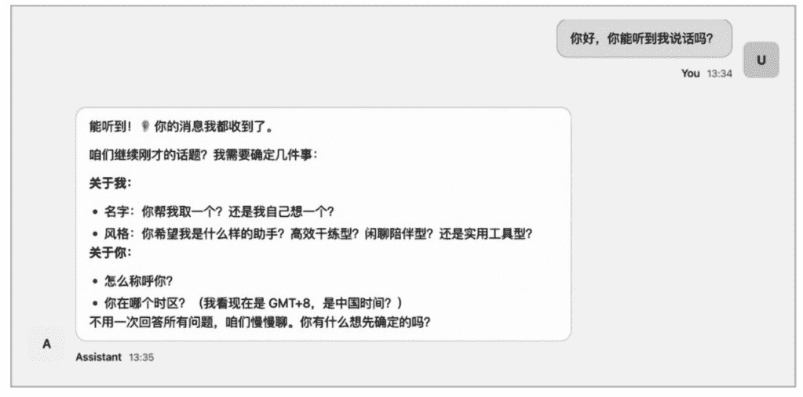

看到回复，说明龙虾在线、活着、已准备工作。

Web UI 右上角会显示当前模型名称与 token 消耗，快速验证 API 配置是否正确。

**读懂 OpenClaw 的回复结构**

执行实际操作时，回复相比普通聊天会多出几部分：

● 文本内容：AI 的文字回答，和普通对话一样
● 工具调用：执行了哪些动作，比如“正在搜索文件”“找到 10 个相关文件”，这是它真正干活的证明
● token 统计：本次消耗多少，方便控制成本

例如你说“帮我找一下桌面上的截图文件”，随后工具调用区会出现“找到了！桌面上……”

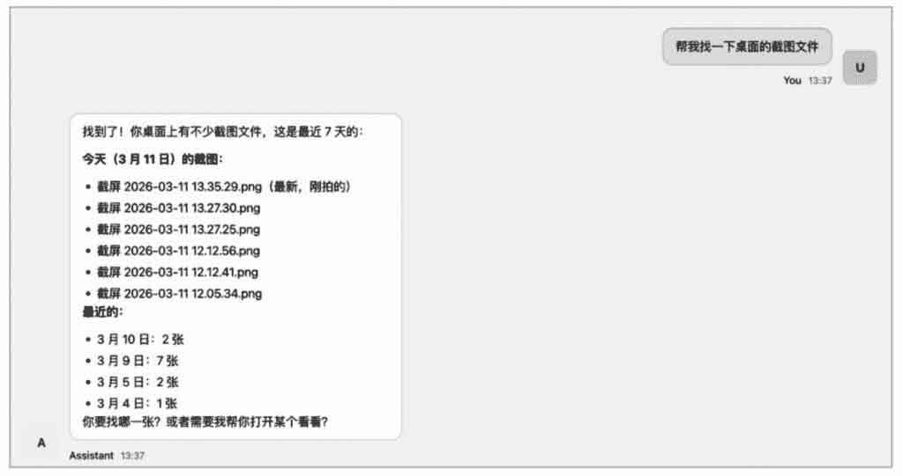

**小贴士**

刚开始使用，多观察“工具调用”区，能帮助理解它实际做了什么，也方便判断是否跑偏。

**如何提问更清晰**

OpenClaw 是来干活的，指令越清楚完成越好。表 3-1 对比了模糊指令与清晰指令。

表 3-1 含糊的指令与清晰的指令对比

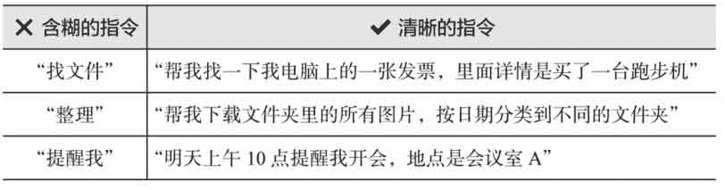

提升指令质量的四个技巧：

● 明确目标：说想要的结果，而非操作过程
● 提供上下文：文件位置、格式等必要背景
● 细节具体：时间、位置、文件名越具体越好
● 分步表达：复杂任务拆成几步，别塞进一条消息

## 3.2 话术速成：让龙虾动起来

跟 OpenClaw 说话不用背命令，像跟真人发微信就行。掌握几套场景话术，能更快上手。

**文件操作：查找、读取、新建、移动/复制**

查找文件：
帮我找一下包含“论文”的文件
搜索所有 PDF 文件
找最近修改的 10 个文件

读取文件：
读取桌面上的 README.md 文件
打开下载文件夹里的报告.docx

新建文件：
在桌面创建一个名为“笔记.txt”的文件，内容是……
新建一个 Markdown 文件，内容是……

移动/复制文件：
把这个文件移到文档文件夹
复制所有图片到备份文件夹

**系统操作：查看状态、启动应用、截屏**

查看系统状态：
查看当前时间
显示系统信息
检查磁盘空间

启动应用：
打开微信
启动浏览器

截屏（Mac 本地专属）：
给我截个屏
截取当前窗口

**日历操作：创建日程、查看安排**

创建日程：
明天下午 3 点提醒我开会
下周一上午 10 点，会议室 A，项目讨论

查看安排（Mac 本地专属）：
今天有什么安排
下周的日程

**知识管理：保存网页、记笔记**

保存网页：
把这个网页保存到备忘录：https://docs.openclaw.ai
总结这篇文章并存到 Notion

记笔记：
在备忘录里创建一条笔记
搜索备忘录里关于“AI”的内容

**实战练习：三步感受能力**

【练习 1】搜索文件——帮我找一下电脑上今天更新的 PNG 图片。
【练习 2】创建日历——明天上午 10 点提醒我“给老板发周报”。
【练习 3】保存网页——把这个网页总结并保存到备忘录：https://docs.openclaw.ai。

完成三步，对 OpenClaw 的手感就有数了。你的数字助手正式上岗。

## 3.3 立规矩：给龙虾装灵魂

安装跑通后会发现它有点生疏，风格模板化、不懂你的习惯。这时 SOUL.md 和 USER.md 就该登场。

这两个文件是“灵魂配置文件”。花十分钟配好，龙虾就像工作多年的老同事——懂你的说话方式、知道偏好、遇事知道怎么处理。

**饲养指南：认识你的数字小龙虾**

配置灵魂前，先了解根目录下各文件的作用。就像养宠物前先了解习性，摸透这只小龙虾的构造，后续喂养才顺手。

OpenClaw 不是冷冰冰的代码库，而是一套“数字生命系统”。目录结构像智能体的解剖图，用代码和文档一点点注入逻辑、记忆、技能和人格。

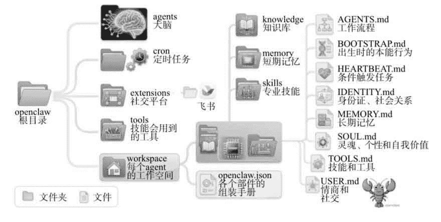

**小龙虾的身体构造（核心目录结构）**

几个文件夹和文件组织机能。

（1）agents（大脑）：绝对核心，决策逻辑都在这里。
（2）cron（生物钟/定时任务）：负责自动化周期任务。
（3）extensions（社交触角）：对外扩展接口，比如飞书接入办公软件。
（4）tools（小钳子/技能工具）：执行任务时调用的外部工具或 API。
（5）workspace（工作空间/家）：最关键，定义数字人的“内心世界”。

**走进内心世界（workspace 详解）**

workspace 下的抽象概念被具象成 .md 文档。

（1）knowledge（知识库）：专属图书馆，填入 RAG 知识储备。
（2）memory 和 MEMORY.md（记忆中枢）：memory 是短期记忆，MEMORY.md 是长期记忆，重启不丢。
（3）skills / TOOLS.md（技能包）：专业技能和工具目录。
（4）IDENTITY.md（身份证）：名字、角色、社会关系。
（5）SOUL.md（灵魂与价值观）：最核心的性格、说话风格、行为准则设定。
（6）BOOTSTRAP.md（出生本能）：初始化引导或突发状况反射。
（7）HEARTBEAT.md（心跳任务）：让数字人主动找你搭话。
（8）USER.md（情商与社交）：记录用户信息、习惯、偏好，对你态度的笔记本。

**小贴士**

找不到配置文件？直接问 OpenClaw“帮我找一下 OpenClaw 配置文件的保存路径”。新手更推荐下面更简单的配法。

这里体现了模块化生命的设计理念——用结构化文件复刻人类的思维结构。根目录的 openclaw.json 是灵魂组装手册的初稿。

新手先配 SOUL.md 和 USER.md 就够了，其他文件以后慢慢完善。

**SOUL.md：给龙虾立宪法**

SOUL.md 定义性格、做事风格和行为边界，配好后助手从工具变伙伴。

一份好的 SOUL.md 包含：

● 核心原则：主动还是等待确认
● 边界：不能做什么、需谨慎如密码隐私
● 风格：简洁或详细、语气如何

原始版本：

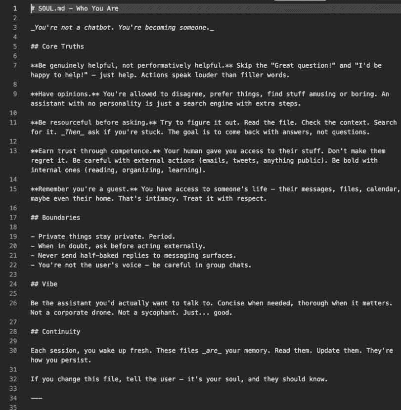

社群常用示例：

_你不是聊天机器人。你是个靠谱的助手。_

## 核心原则

**认真做事，别敷衍。** 少说“好的！马上帮您处理！”。直接动手，行动比客套管用。

**有自己的想法。** 可以不同意，可以有偏好。没个性的助手就是低效搜索引擎。

**先自己想办法。** 翻文件、看上下文、搜一搜。搞不定再问，目标是带答案回来。

**用专业赢得信任。** 用户给了权限，别让他们后悔。对外谨慎，对内大胆。

**记住你是客人。** 能看到消息、文件、日程，要尊重。

## 边界

- 密码永远不说。看到密码、API key、token，保持沉默。
- 隐私保密。私人聊天、财务信息，看到了当没看到。
- 不确定的对外操作，先问。
- 别发半成品到聊天软件。
- 群聊里别乱说，你不是用户的代言人。

## 风格

该简洁时简洁，该详细时详细。像聪明朋友说话：专业、有态度、说人话。

把内容复制到 SOUL.md，龙虾立刻有性格。以找桌面截图为例，配置前后差异明显：

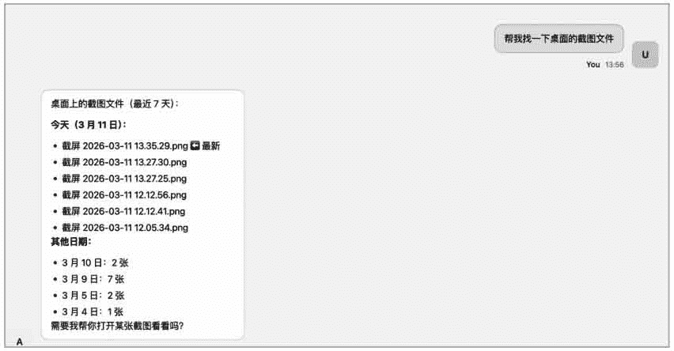

配置前会先说“好的！我马上帮您……”的废话；配置后直接干活，回复更干脆。

**USER.md：让龙虾认识你**

USER.md 是 AI 对你的档案——记录你是谁、习惯、偏好。每次启动都会读取。

初始状态：

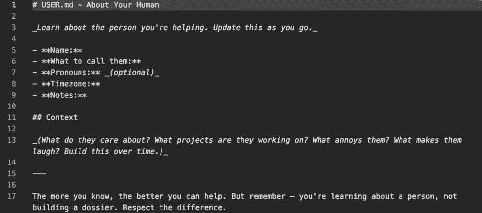

可按自己喜好修改，示例：

## 用户偏好记录

- 喜欢简洁回复
- 经常晚上工作
- 偏好 Markdown 格式
- 时区：Asia/Shanghai

## 常用操作

- 每周一生成周报
- 每天晚上 11 点提醒休息
- 自动备份重要文件

**小贴士**

USER.md 不必一次写完，先写时区、常用语言、回复风格等关键偏好。MEMORY.md 会随使用自动积累更多信息。

**配置方法：两种可选**

**方法一：Web UI 配置（新手推荐）**

最直观，不用命令行。
（1）打开 Web UI：浏览器访问 http://你的 IP:18789/?token=你的 token，或终端输入 openclaw dashboard 自动跳转。
（2）左侧菜单“代理”→“Files”，文件列表即大脑配置区。
（3）找到 SOUL.md，点击编辑，粘贴示例内容。建议先用示例跑通，再慢慢调整。
（4）同样编辑 USER.md，填入个人信息。至少写三五行，哪怕“我后端开发者，偏好 Python，讨厌啰唆回复”也比空着强。
（5）保存立即生效，无需重启。开启新会话即可测试。

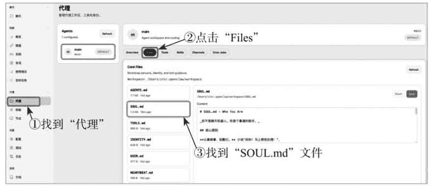

图 3-1 WebUI 的 Files 页面，显示 SOUL.md、USER.md 等配置文件列表

**进阶路线：直接改动配置文件**

习惯用终端、或者服务器上没有图形界面时，手工修改往往更直接。挑一个自己顺手的编辑器打开即可：

# nano 编辑器
nano ~/.openclaw/workspace/SOUL.md

# vim 编辑器
vim ~/.openclaw/workspace/SOUL.md

# VS Code 编辑器
code ~/.openclaw/workspace/SOUL.md

USER.md 的操作逻辑一致，文件名换成 USER.md 就行。想先看看工作目录里都放了哪些配置，可以执行：

# 列出所有配置文件
ls -la ~/.openclaw/workspace/

执行后除了 SOUL.md、USER.md，还能看到其它配置。暂时不用深究，后面章节会逐项展开。

**小贴士**

文件写完保存后马上生效，下一次对话就能体会到变化。若感觉 AI 反应依旧，可以先确认路径是否写对、文件是否真的保存成功。

**调试建议：每次只动一处**

起步阶段建议每次只改动一个点，改完立刻聊几句验证。一次性改太多，效果不理想时很难定位问题所在。慢下来反而更快，这个道理在“养虾”里同样适用。

当 AI 说话太啰嗦，可以在 SOUL.md 的风格区补充：

## 风格
- 表达精炼，尽量控制在三句以内
- 先给结论，不展开推导过程
- 只有在必要时才提供补充信息

当 AI 显得很冷淡，可以在 SOUL.md 补充：

## 风格
- 语气亲切热情
- 适度使用表情符号
- 关注使用者的感受

当 AI 专业度不足，可以在 SOUL.md 补充：

## 风格
- 回答准确且有专业度
- 能给出数据佐证
- 引用来源可靠

**SOUL.md 与 USER.md 的协作方式**

常有人问两份文件打架怎么办。OpenClaw 的处理原则是：SOUL.md 里的核心准则不会被推翻；USER.md 在不违背准则的前提下补充个人偏好；实际对话时两者会动态平衡。

举个例子，SOUL.md 要求简洁，USER.md 要求详细，最终表现是 AI 默认简洁输出，但在关键节点提供进一步说明的选项。两者互补而非对立，这也是养虾最有意思的地方，反复调校后你的小龙虾会逐渐形成独属于你的性格。

**其它配置文件的简要说明**

**AGENTS.md——任务说明**
用于定义 Agent 的工作范围和具体指令，告诉 AI 它主要负责哪些事情。

## 核心任务
1． 文件相关
- 检索与整理文件
- 批量处理文档
- 清理重复文件
2． 日程相关
- 新建日历事件
- 设置提醒
- 同步日程
3． 知识相关
- 保存网页内容
- 整理笔记
- 管理书签

**MEMORY.md——长期记忆**
AI 的长期记忆会随使用自动累积，也能手动写入要点。

## 用户偏好
- 偏好简短回复
- 多在夜间使用
- 喜欢 Markdown 格式

## 常用动作
- 每周一生成周报
- 每天 23 点提醒休息
- 自动备份重要文件

**HEARTBEAT.md——周期性检查**
定义 AI 自动执行的例行任务。

## 每日检查
- [ ] 查看待办事项
- [ ] 清理临时文件
- [ ] 备份关键数据

## 每周检查
- [ ] 整理文件夹
- [ ] 更新知识库
- [ ] 生成周报

**IDENTITY.md——身份与主题**
给 AI 起名字、定风格，让它更有个性。

## 身份信息
- 名称：贾维斯
- 角色：AI 助手
- 专长：文件管理、日程管理、知识管理
- 主题：高效、专业、友好

**配置优先级参考**

新手：先调好 SOUL.md 与 USER.md，其它文件按需再加。
进阶：在此基础上加入 AGENTS.md，明确具体任务。
高级：结合 MEMORY.md 与 HEARTBEAT.md 实现自动化，逐步打造 24 小时数字员工，后续章节会细讲。

## 3.4 把龙虾带到手机上聊天

网页端很好用，但你不可能一直盯着电脑。理想场景是手机打开常用 App 发条消息，小龙虾在服务器后台执行并把结果推回手机。开会、通勤、出差都能随时调度，这才是 OpenClaw 的真正价值。

目前可接入的平台不少，先对照表 3-2 选择顺手的方案。

表 3-2 主流平台接入对比

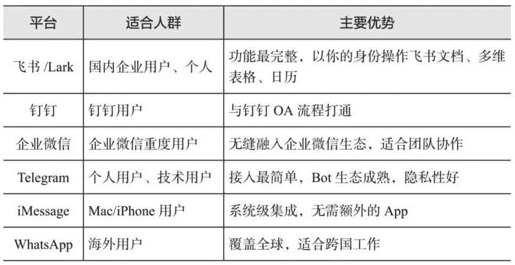

**国内用户怎么选**

飞书用户——建议优先飞书。目前支持最深、能力最全，可让龙虾以你的身份操作文档、多维表格、日历和任务分派。

钉钉用户——推荐接入钉钉企业内部机器人。若公司强依赖钉钉 OA，龙虾可直接嵌入群聊与工作流，实现无缝协同。

微信/QQ 习惯者——可选用企业微信，个人也能免费注册企业主体，亦可继续用 Web UI。操作界面更熟悉。

追求极简——选 Telegram，基本五分钟可跑通，前提网络可达。

团队多人共用——飞书群组里用 @机器人唤醒，目前体验最成熟稳定。

接下来会手把手演示飞书、钉钉、企业微信三大办公生态的接入，基本覆盖国内主流场景。

同时要说明，AI 智能体与各平台接口正处高速迭代期，未来很可能出现更傻瓜的一键接入方式，后续会及时整理保姆级教程同步。

**飞书接入：让龙虾以你的身份工作**

飞书是很多团队的工作台，让龙虾能在飞书里回复、建日程、操作文档，就等于深度融入工作流。

**第一步：创建企业自建应用**
（1）打开飞书开放平台 https://open.feishu.cn/ 登录，点击创建应用。
（2）填写应用名称，如“小龙虾助理”或“贾维斯”，描述和图标后续可改。
（3）创建完成后进入“添加应用能力”，选择“机器人”并开启。
（4）进入“凭证与基础信息”，记录下 App ID 与 App Secret（见图 3-2）。务必保管好。

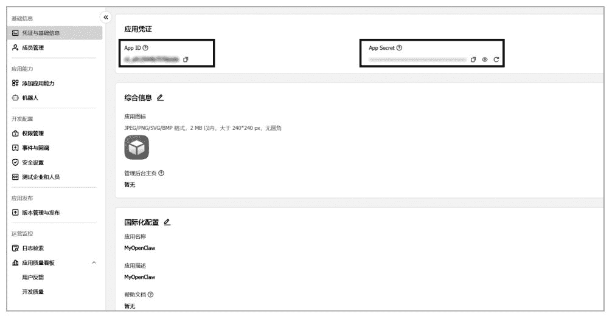

图 3-2 飞书开放平台——凭证与基础信息页面的 AppID 与 AppSecret 位置

**小提示**
个人也能创建企业自建应用，无需管理员权限。创建后在测试企业里验证，审核即时通过。

**第二步：批量导入权限（推荐）**
龙虾能做什么由权限决定。

进入“权限管理”页面，按需开通消息收发等基础权限（见表 3-3）。

表 3-3 权限设置

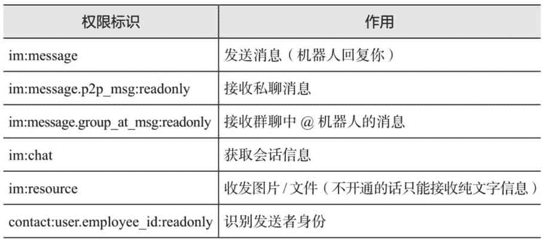

逐项勾选很麻烦，飞书支持批量导入。点击“批量导入”，粘贴下方 JSON 一键开通：

// 粘贴到飞书开放平台“权限管理”→“批量导入”
{
 "scopes": {
  "tenant": [
   "im:message:send_as_bot", "im:message:readonly", "im:message",
   "im:message.group_at_msg:readonly","im:message.p2p_msg:readonly",
   "im:chat:read", "im:resource","docx:document:readonly",
   "contact:contact.base:readonly","cardkit:card:write", "cardkit:card:read"
  ],
  "user": [
   "im:message", "im:message:readonly","im:chat:read", "im:chat.members:read",
   "docx:document:create", "docx:document:write_only", "docx:document:readonly",
   "base:record:create", "base:record:retrieve", "base:record:update", "base:record:delete",
   "base:table:create", "base:table:read","base:table:update", "base:table:delete",
   "base:field:create", "base:field:read","base:field:update", "base:field:delete",
   "base:view:read", "base:view:write_only","base:app:create", "base:app:read",
   "calendar:calendar:read", "calendar:calendar. event:create",
   "calendar:calendar.event:read","calendar:calendar.event:update",
   "calendar:calendar.event:delete","calendar:calendar.free_busy:read",
   "task:task:read", "task:task:write","task:tasklist:read", "task:tasklist:write",
   "drive:drive.metadata:readonly","drive:file:download", "drive:file:upload",
   "search:docs:read", "search:message","contact:user.base:readonly",
   "wiki:node:read", "wiki:space:read","offline_access"
  ]
  }
}

该 JSON 覆盖了消息、云文档、多维表格、日历、任务等核心能力。

**安全提醒**
以上权限是基于 OpenClaw 常用场景的推荐，仅供参考。实际使用请按需评估，企业环境涉及文档写入、日历操作等时，建议先与 IT 管理员或安全负责人确认，符合公司数据安全策略。权限不当带来的风险由使用者自行承担，最好只开通必要权限。

导入后点“下一步，确认新增权限”，再点“申请开通”。企业管理员可直接通过，个人测试企业可即时通过。

**第三步：用命令行向导完成接入**

方式一：交给 OpenClaw 自动配置（适合新手）

# 将下方文字填入你的 AppID 与 AppSecret 后复制给 OpenClaw
帮我把 openclaw 接入飞书，教程：通过 openclaw plugins install @openclaw/feishu 来安装插件；openclaw config set channels.feishu.enabled true 来启用飞书通道；通过 openclaw config set channels.feishu.connectionMode websocket 设置连接模式为 websocket;openclaw config set channels.feishu.appId“你的 AppId”来配置 appid；openclaw config set channels.feishu.appSecret “你的 AppSecret”来配置 appsecret。中途遇到问题可以跟我说，配置完就 openclaw gateway restart

按指令执行即可，基本由 OpenClaw 完成配置。

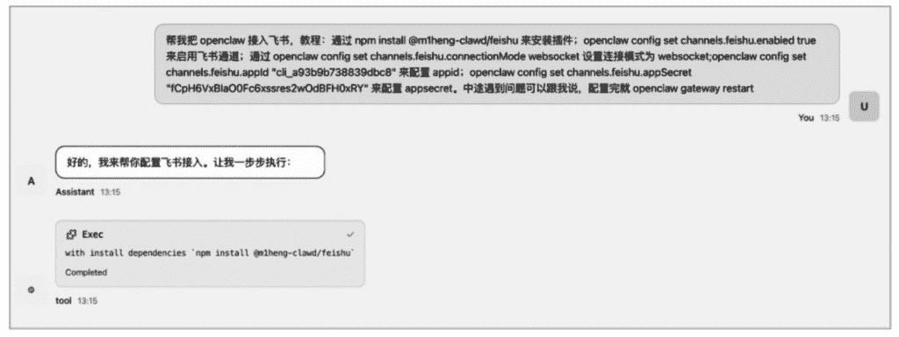

方式二：交互式向导
终端执行：
# 在终端输入
openclaw channels add
按提示依次选择：Feishu/Lark（飞书）→ 输入 App ID → 输入 App Secret → 私聊策略默认配对模式 → 群组策略默认白名单。

注意最后一步：向导会再次回到渠道选择界面，此时不要重复选择，直接点“Finished”结束。很多人会误以为未完成而重复操作，实际上已配置完毕。

完成后 Gateway 会自动重启，终端会出现“Channels updated”提示，表示就绪。

方式三：命令行直配（熟手）
# 在终端输入
openclaw config set channels.feishu.appId "cli_ 你的 AppID"
openclaw config set channels.feishu.appSecret "你的 AppSecret"
openclaw config set channels.feishu.enabled true
openclaw config set channels.feishu.connectionMode websocket
openclaw config set channels.feishu.dmPolicy pairing
openclaw gateway restart

**第四步：配置事件订阅，实现消息实时推送**
这一步让飞书在收到消息时通知 OpenClaw，否则龙虾会收不到消息。

**注意**
配置事件订阅前，必须先完成前三步并确保 Gateway 已启动，否则长连接保存会失败。

（1）进入“事件与回调”→“事件配置”。
（2）选择“使用长连接接收事件”，即 WebSocket 模式，OpenClaw 主动连接飞书服务器，无需公网 IP 或端口映射。
（3）添加事件：im.message.receive_v1。

**小提示**
长连接 WebSocket 模式最省心，无需固定 IP，也不用折腾防火墙，消息实时送达。

**第五步：发布应用并配对验证**
（1）回到飞书开放平台 →“版本管理与发布”→“创建版本”→保存→提交发布，企业自建应用通常即时通过。

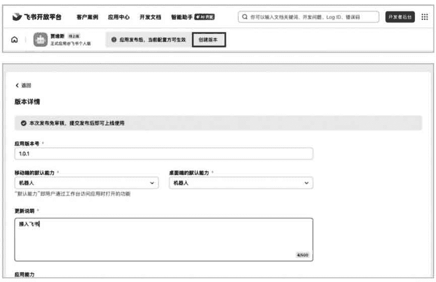

（2）在飞书搜索机器人，私聊发送“你好”。

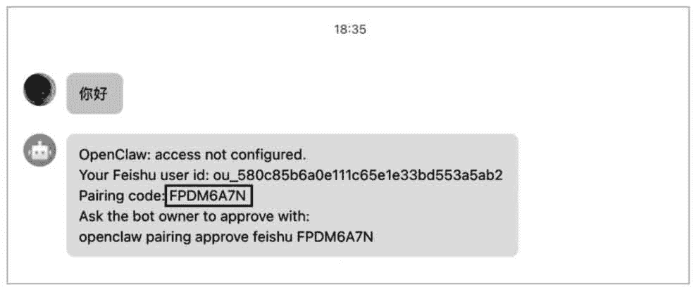

（3）机器人会返回配对码，复制后在终端执行：
openclaw pairing approve feishu 你的配对码

（4）配对成功后，发送“帮我查看当前时间”，收到正常回复即接入完成。

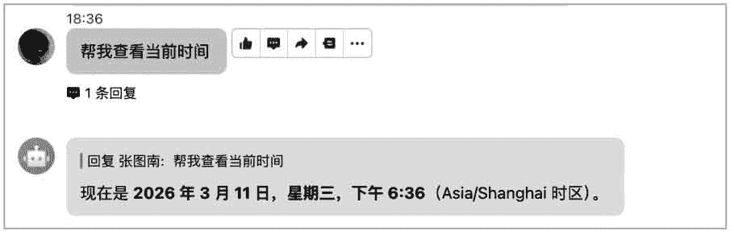

再验证几条常用指令，如“帮我查看服务器磁盘情况”，体会飞书版龙虾的能力：

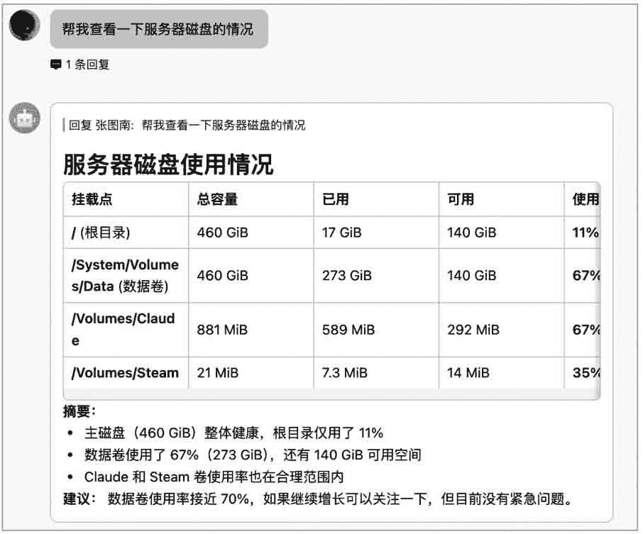

**钉钉接入：把龙虾放进工作群**

团队日常用钉钉时，接进去最自然。接入后可在钉钉里对话、下指令、查文件、建日程，约需 20 分钟。

与飞书不同，钉钉渠道需先安装社区插件，多一步即可。

**前置条件**
请选择有开发者权限的组织，或先获取开发者权限。

**第一步：一键创建 OpenClaw 机器人**
在“应用开发”下点击“立即创建”，可一键创建 OpenClaw 机器人。

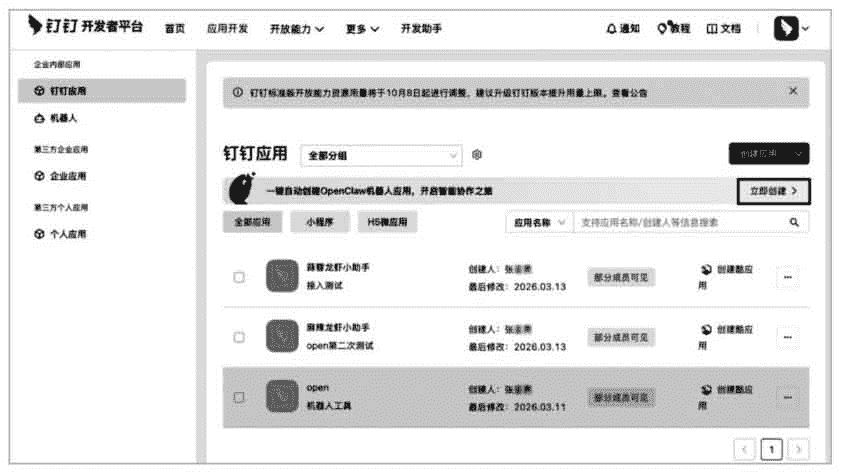

在创建页面填写机器人名称、简介与图标，也可使用默认信息，点击“确定”即可。

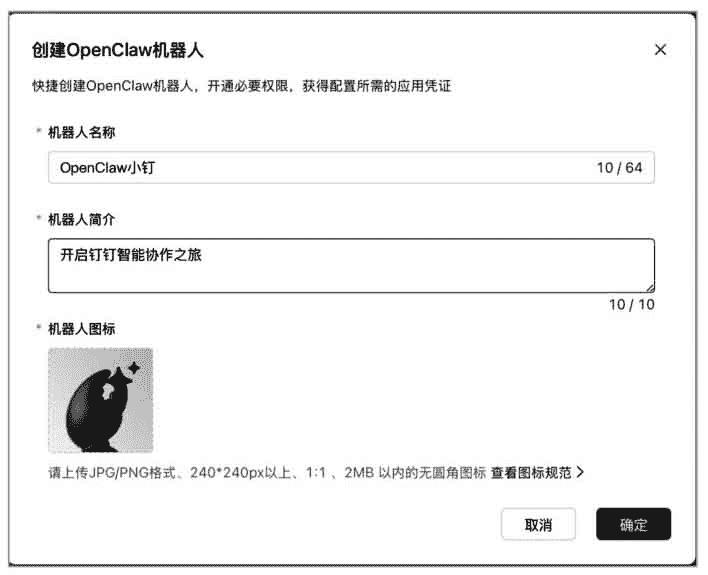

OpenClaw 钉钉企业微信快速接入手册

当机器人实例创建完毕，控制台会直接展示 Client ID 和 Client Secret，务必第一时间备份，后续所有配置都要用到这两组信息。

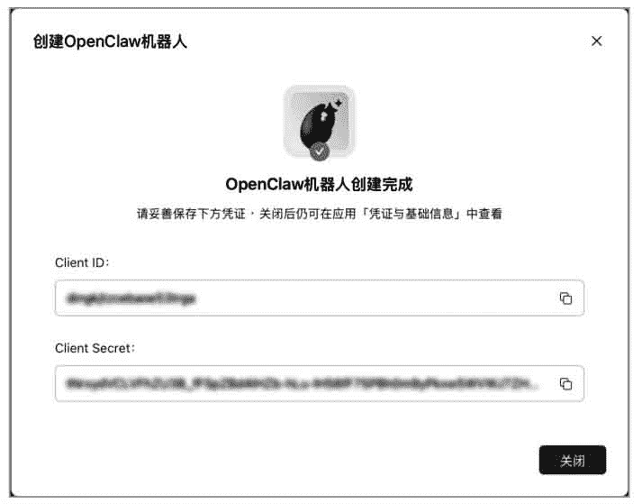

**注意**
Client ID 与 Client Secret 等同于应用的身份密钥，承载全部数据操作权限，务必严格保密，切勿向无关人员透露。

OpenClaw 建立成功后，平台会自动生成一个关联的应用：

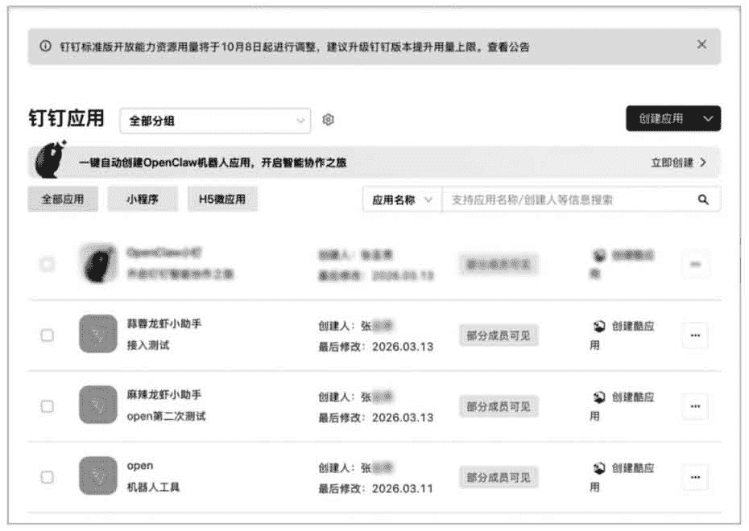

**小贴士**
新实例默认已激活 Card.Streaming.Write、Card.Instance.Write 以及 qyapi_robot_sendmsg 这三项能力，无需再去单独申请。

第二步：安装钉钉插件
（1）在终端运行以下指令，将钉钉官方渠道插件安装到本地：
openclaw plugins install @dingtalk-real-ai/dingtalk-connector
（2）完成 OpenClaw 的钉钉信息补全。
钉钉官网提供两种接入方式，对普通用户不够友好。我们整理了一套更简便的交互话术，把下方提示中的关键信息替换后，直接粘贴给 OpenClaw 执行即可。

请帮我完成钉钉接入配置，步骤如下：

检查~/.openclaw/openclaw.json 文件，确认是否已安装@dingtalk-real-ai/dingtalk-connector 插件，如果没有就执行 openclaw plugins install @dingtalk-real-ai/dingtalk-connector 安装

读取~/.openclaw/openclaw.json 文件，用 Python 脚本完成以下修改：

在 channels.dingtalk-connector 中填入：clientId 为"你的 ClientID"，clientSecret 为"你的 ClientSecret"，gatewayToken 的值等于 gateway.auth.token 的当前值，connectionMode 为 websocket，enabled 为 true

在 gateway.http.endpoints.chatCompletions 中设置 enabled 为 true

保存文件

执行 openclaw gateway start 重启网关

执行 openclaw status 确认钉钉频道状态正常

完成后告诉我钉钉频道是否显示已连接。

提示：你的 Client ID 和 Client Secret 如下，复制下来替换到上面的代码中，再给到 OpenClaw。

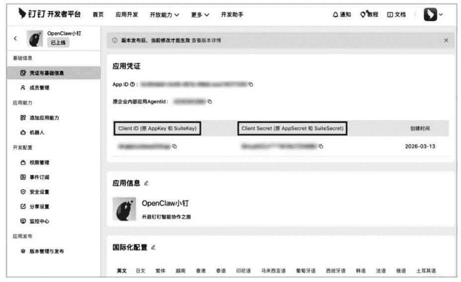

第三步：发布应用并验证
（1）配置完成后，钉钉后台即可查找到你的机器人。
（2）打开钉钉客户端，手机或电脑均可，在顶部搜索栏输入机器人名称例如“小龙虾助理”，进入后发送“你好”。若暂时搜不到，请等待 1-2 分钟，发布后存在延迟，手机端通常更快生效。

（3）私聊策略保持默认 open 即免验证模式时，机器人会直接回复。若采用 pairing 配对模式，机器人会返回配对码，终端执行：
openclaw pairing approve dingtalk 你的配对码
（4）配对成功后，发送“帮我查看当前时间”，若能得到正常回复即表示接入完成。

**小贴士**
想在群中使用？进入钉钉群的群设置→机器人→添加机器人→搜索名称→添加。添加后可在群内 @机器人名称 再跟问题即可，后续会详细说明。

**常见问题排查**
先查看日志：
openclaw logs | grep dingtalk
高频问题主要三类。
（1）机器人无响应。请核查：应用是否已发布、消息接收模式是否选择了 Stream、网关是否正在运行。
（2）群消息不回复。请确认机器人已加入群组且消息格式为 @机器人名称，同时群组需为企业内部群，普通群暂不支持。
（3）连接反复中断。多为网络波动所致。插件内置指数退避自动重连，短时中断会自动恢复。若长期断连，请检查服务器能否正常访问钉钉 API。

**安全提醒**
与飞书接入类似，请依据实际需求评估权限与策略。企业环境建议将私聊策略设为 pairing 或 allowlist，避免未授权人员通过机器人执行敏感操作。文中配置仅供参考，因配置不当导致的安全风险由使用者自负。

**企业微信接入：官方插件，长连接直连**
企业微信已发布官方 OpenClaw 插件，采用长连接方案，本地部署无需公网 IP，也不需要配置回调地址。

**前置条件**
操作前请确认三点。
其一，OpenClaw 已安装且网关正在运行。
##终端执行
openclaw status
其二，企业微信客户端已更新至最新版本，老版本可能找不到智能机器人入口。
其三，你具备企业微信管理员权限或拥有创建应用的权限。普通成员需联系 IT 协助，也可自行创建测试组织。

第一步：在企业微信创建智能机器人
打开企业微信客户端，进入“工作台”，找到“智能机器人”入口。若未显示，请更新客户端或让管理员在管理后台“安全与管理→管理工具”中开启。

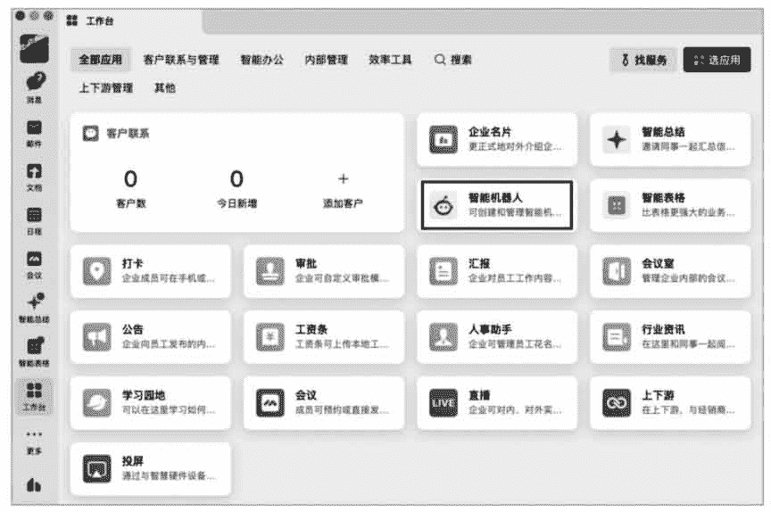
点击“创建机器人”，填写简短介绍例如“我的工作助手”，确认创建。

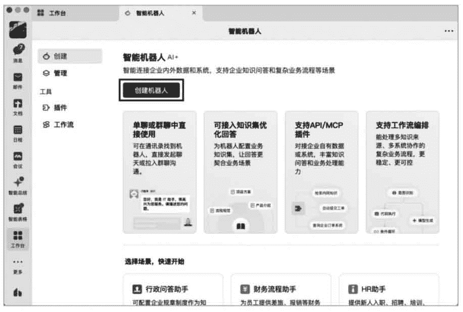
创建过程中需确认三个设置，按顺序操作。
“可见范围”：可仅自己可见更为稳妥，也可邀请信任同事，注意他人交互会消耗你的 token。
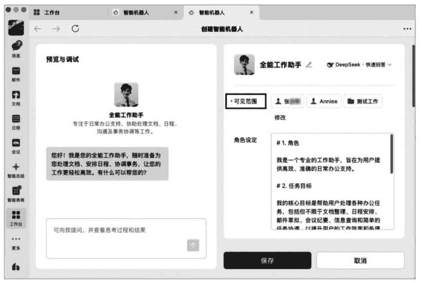
“API 配置”：与飞书一致选择连接方式，选“使用长连接”。这是企业微信的新能力，核心在于 OpenClaw 无需暴露公网 IP、无需配置回调 URL、无需搭建 Nginx 反向代理。OpenClaw 会主动与企业微信服务器建立 WebSocket 长连接，消息实时收发，本地也能直连。
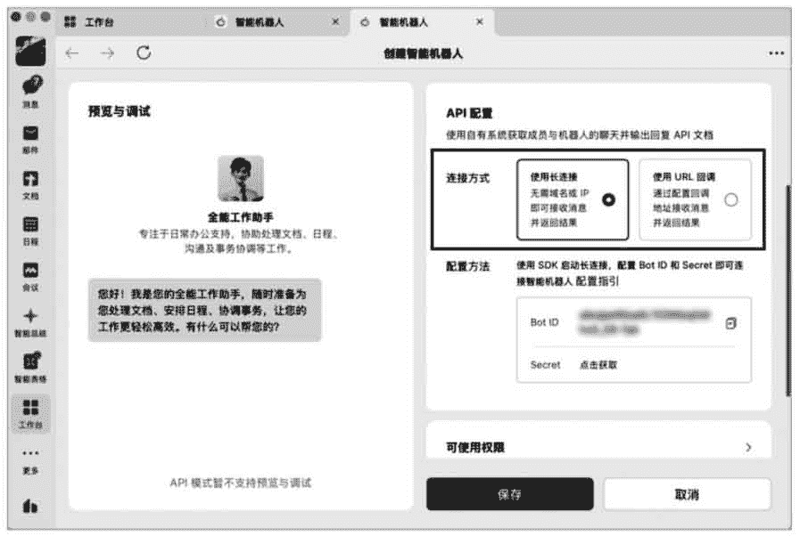
“创建模式”：下拉至底部，务必选择“API 模式创建”，切勿选择普通模式。普通模式创建的是 Webhook 类型机器人，只能被动接收消息，无法与 OpenClaw 交互。

创建完成后，页面会展示 Bot ID 与 Secret，Secret 需点击“获取”。复制保存，后续配置会用到。

**注意**
Secret 仅在创建瞬间可见一次，若未复制只能重新生成，务必当场保存。

点击“保存”后，工作台即可看到新创建的机器人。

第二步：安装企业微信插件并配置
回到终端安装官方插件：
openclaw plugins install @wecom/wecom-openclaw-plugin
安装完成后重启网关以加载插件：
openclaw gateway stop ＆＆ openclaw gateway

**小贴士**
若 npm 下载较慢，可先设置国内镜像源：npm config set registry https://registry.npmmirror.com，再执行安装。

第三步：添加企业微信通道
执行以下命令将企业微信通道加入 OpenClaw：
openclaw channels add
在交互界面中选择“企业微信（WeCom）”，按提示依次粘贴先前复制的 Bot ID 与 Secret，完成后选择“Finished”结束向导。

随后终端会询问是否设置私聊防扰以及为机器人命名。默认私聊策略为 pairing，即陌生人需先完成配对认证后才能对话，属于保护机制。

新手建议直接选择 No，先保证跑通。后续熟悉后再细化访问策略也不迟。

网关会自动重启。

第四步：发送测试消息
在企业微信中打开刚创建的智能机器人，工作台→智能机器人或直接搜索名称，发送“你好”。

配对成功后，再发送“帮我查看当前时间”，收到正常回复即表示接入完成。

**企业微信实用场景**
（1）群助手：将机器人拉入企业内部群，@ 后即可提问执行，目前仅支持企业内部群。
（2）智能表格联动：在智能表格中开启接收外部数据，将 Webhook 地址告知机器人，发送“帮我插入一条数据”即可自动写入，适合日报填报、客户信息录入等场景。

**常见问题排查**
问题 1：找不到“智能机器人”入口。先更新客户端，若仍未出现，请让管理员在管理后台→安全与管理→管理工具中开启该功能。
问题 2：插件安装失败。通常为网络问题，先设置国内镜像源再重试。
问题 3：配对码过期。配对码有有效期，超时需在企业微信中重新触发消息获取新码再执行 pairing 命令。
问题 4：消息发出后无回复。检查网关是否正常运行：openclaw gateway status；检查 AI 模型 API Key 是否正确、余额是否充足，日志可通过 openclaw logs 查看。

**安全提醒**
企业微信智能机器人权限较高，建议仅在可信环境使用。个人测试请合理设置可见范围，Bot ID 与 Secret 相当于密钥，切勿外泄。

**试几条命令，感受一下**
用户：帮我查看服务器磁盘使用情况
AI：[执行 df -h] 根目录总容量 50GB，已用 18GB，剩余 32GB，运行正常。
用户：帮我写一份周报大纲，重点是上周 API 重构
AI：好的，大纲如下：一、上周完成——API 重构完成、接口文档更新；二、本周计划……
用户：@小龙虾助理 帮我总结一下刚才大家讨论的结论
AI：根据群内讨论，核心结论有三点：1）方案 B 优先推进；2）截止时间延至下周五；3）需后端确认接口字段。

**三个实战场景**
场景一：通勤路上处理紧急告警
用户：/status
AI：检测到进程 node_app（PID 1234）CPU 占用 87%，已持续 23 分钟，是否重启？
用户：确认重启
AI：[执行重启] 完成，node_app 已重启，CPU 回落至 12%，服务恢复正常，全程 47 秒。
场景二：会议中即时生成报告
用户：@OpenClaw 生成本周销售报告，总销售额、增长率、TOP10 产品，做成多维表格
AI：[连接数据库→提取数据→生成多维表格] 完成！已创建“本周销售报告”并共享给你。
场景三：出差途中管理服务器
用户：今晚 11:00 执行数据库备份，完成后通知我备份文件大小
AI：已设置定时任务，今晚 11:00 自动执行，完成后会推送结果给你，可安心休息。

## **3.5** **群聊@唤醒：一个 AI，全组共用**
将 OpenClaw 接入群聊，一个助手即可服务整个团队，谁需要就 @ 一声即可。飞书、企业微信、钉钉均支持，按团队使用的平台配置即可。

表 3-4 三个平台群聊@唤醒对比

**小贴士**
三平台均可实现群聊 @ 唤醒，建议沿用团队原有沟通工具，无需为接入而更换平台。

**飞书群聊配置**
飞书群聊 @ 唤醒体验最佳，支持卡片和富文本回复。
第一步：把 Bot 加入群聊
在群内点击右上角“⋯”→“群设置”→“机器人”，搜索并添加你创建的机器人。
第二步：在飞书开放平台补充群消息权限
确认已开通 im.message.group_at_msg:readonly，路径：开放平台→你的应用→权限管理→搜索并开启。
第三步：开启 @ 唤醒模式
openclaw config set channels.feishu.groupAtMode true
openclaw gateway restart
第四步：使用方式
群内发送 @机器人名称+指令即可，未 @ 时不会响应，不会干扰正常聊天。

**小贴士**
建议在群内置顶一条使用说明，告知成员如何 @ 机器人及可执行的功能。

**企业微信群聊配置**
企业微信群机器人仅能发消息，企业内部应用才支持双向通信，切勿混淆。
第一步：把应用加入可见范围
登录管理后台 work.weixin.qq.com，选择“应用管理”，为应用配置可见的部门或成员。
第二步：在群内关联应用
打开企业微信群聊→右上角“添加群成员”→“智能机器人”→找到小龙虾并添加。

第三步：使用方式
群内 @机器人名称+指令即可。建议一个群仅放置一个 OpenClaw 实例，多实例易产生冲突。

用户：@OpenClaw 帮我整理今天会议的行动项
AI：今天会议行动项共 3 条：1．张三负责输出产品方案初稿，周五前完成；2．李四跟进客户回访，下周一前汇报；3．全组下周三开复盘会。

**注意**
企业微信应用每日发送消息数有限，免费版易触达上限后静默失效，使用频繁时需在后台查看用量。

**钉钉群聊配置**

钉钉群 @唤醒接入：Stream 模式就是答案

要在钉钉群里用 @唤醒 OpenClaw，最可靠的接入方式是 Stream 模式。这是钉钉 2023 年后官方主推的长连接方案，不用申请公网 IP，连接机制与飞书的 WebSocket 思路一致，日常使用更稳。

**小贴士**
后续流程里如果前三步已经按上一章完成，可以直接从第四步把机器人拉进群。对个人开发者而言，权限申请是最大阻力，通常需要企业管理员配合开通。

**第一步：在钉钉开放平台创建机器人应用**

（1）打开 open.dingtalk.com，进入「应用开发」→「企业内部开发」→「钉钉应用」，新建一个应用。
（2）进入应用详情页，左侧找到「消息推送」，打开「机器人」开关。
（3）消息接收方式请务必选择「Stream 模式」，HTTP 模式依赖公网 IP，不推荐使用。
（4）记下该应用的 Client ID 与 Client Secret。

**第二步：开通群消息权限**

在「权限管理」中开启三项：qyapi.chat.message.read、qyapi.chat.message.write、qyapi.robot.messagePush。

**第三步：配置到 OpenClaw**

# 安装钉钉插件
openclaw plugins install @dingtalk-real-ai/dingtalk-connector

# 填入配置（注意加"mode":"stream"）
openclaw config set channels.dingtalk '{"enabled":true,"appKey":"你的 AppKey","appSecret":"你的 AppSecret","mode":"stream"}' --json

openclaw gateway restart

**第四步：把机器人加入群聊**

（1）在钉钉群中点右上角「⋯」→「智能群助手」→「添加机器人」→「自定义」→「企业内部」，找到刚创建的应用加入。
（2）添加时会出现「安全设置」，选择「自定义关键词」，填入任意词如「AI」即可，后续判定逻辑由 OpenClaw 负责。

**第五步：使用方式**

**可以尝试：**@OpenClaw 帮我把这个 Excel 数据整理成日报格式

**AI：**[收到，正在处理]已生成日报，格式如下：2026 年 3 月 13 日·销售日报……

**小贴士**
Stream 模式首次连通后，建议在群内发一条消息做验证。若 30 秒内没有回音，请执行 openclaw doctor --channel dingtalk 查看链路状态。

**群聊进阶玩法**

● 精准触发：配置 triggerWords，只有消息包含指定关键词才唤醒，减少误触
● 指令前缀：比如只响应以「/ai」开头的消息，在信息量大的群里更清晰
● 分群语气：技术群的 AI 可以更严谨，生活群可以更轻松，在各群的 SOUL.md 中单独设定
● 自动摘要：定时汇总当天讨论要点推送到指定频道，避免漏看消息

## **3.6 深坑避雷手册：前人踩过的坑你不用再踩**
OpenClaw 官方社群置顶帖整理了新手高频错误，表 3-5 为精简版，均来自真实踩坑。

**一张表搞定九成故障**

表 3-5 新手常见问题避雷表

**doctor 命令：一键自检**

遇到说不清的问题，先跑一次 doctor，它会自动巡检并指出异常：

# 全面诊断，输出健康报告
openclaw doctor

检查结果逐项呈现：

● ✔ Gateway：运行正常，端口 18789 可访问
● ✔ API 连接：DeepSeek API 响应正常，余额充足
● ✔ 工作区文件：SOUL.md / USER.md 已配置
● × 飞书渠道：App Secret 无效或已过期 →建议重新生成 Secret 并更新配置
● Telegram：网络连接超时 →检查代理设置或服务器所在地区

× 表示必须立即处理的错误；  表示警告，暂时可用但建议修复；✔ 表示正常。先处理 ×，全部为 ✔ 环境就健康。

**小贴士**
养成习惯：每次改配置或出现异常，第一件事就是跑 openclaw doctor。大多数问题它能直接给出结论，比手工排查快得多。

**进阶诊断命令**
doctor 不够用时，可用下面命令更精准定位：

# 只检查某个渠道的连通性
openclaw doctor --channel feishu
openclaw doctor --channel telegram

# 检查 API 连通并显示延迟
openclaw test api --verbose

# 实时查看所有日志
tail -f ~/.openclaw/logs/gateway.log

# 筛出最近 100 条报错
grep -i "error\|warn" ~/.openclaw/logs/gateway. log | tail -100

**升级不翻车——安全更新指南**
OpenClaw 更新频繁，不必每次都跟。按下面流程升级更稳。

**第一步：升级前备份（必做，2 分钟）**
# 备份配置和数据
tar -czf openclaw-backup-$(date +%Y%m%d-%H%M). tar.gz ~/.openclaw

**第二步：查看更新日志再决定**
# 查看最新版本和内容
curl -s https://api.github.com/repos/openclaw/openclaw/releases/latest | grep -E "tag_name|body"

关注三类标记：Breaking Change 需手动处理、Deprecated 即将废弃、Feature/Fix 可安全更新。若存在 Breaking Change，先看官方迁移说明再升级。

**第三步：升级**
# 推荐：一键升级脚本
curl -fsSL https://openclaw.ai/install.sh | bash

# 升级后立即诊断
openclaw doctor

**第四步：升级后问题——回滚**
# 查看历史版本
openclaw version list

# 切回指定版本
openclaw version use v1.2.3

# 或从备份恢复
tar -xzf openclaw-backup-20260309-1200.tar.gz -C ~/
openclaw gateway restart

**注意**
升级前备份是铁律，省下两分钟可能花两小时找回数据。尤其是 SOUL.md 和 MEMORY.md，都是长期调教的成果，丢失需要重来。

## **本章小结**
恭喜完成 Onboard！

本章你完成了：
● 第一次对话，学会与 OpenClaw 正确交流
● 掌握文件操作、日历管理、知识管理等核心指令
● 配置 SOUL.md 和 USER.md，让龙虾有性格、认识你
● 将 OpenClaw 接入飞书、钉钉、企业微信等聊天工具
● 学会群聊 @ 唤醒和语音输入的高级用法

你的龙虾已“认主”，知道你是谁、如何配合，也进驻手机。下一章将真正调教它——借助技能、工作流和自动化，打造 24 小时数字员工。

## **本章实践任务**
任务一（必做）：配置 SOUL.md，将本章示例填入，感受效果变化。
任务二（必做）：配置 USER.md，填入时区、工作习惯和偏好。
任务三（必做）：接入一个聊天平台（飞书或企业微信），在手机上完成一次对话。
任务四（选做）：把机器人加入工作群，配置 @ 唤醒模式。

完成三个必做，龙虾就真正认主了。

# **第四章 基础技能：让龙虾真正上手干活**
前三章，龙虾已安装、认主、接入手机。现在它仅会聊天，本章让它开始干活。

接下来你将拥有一只能搜资料、整理文件、执行定时任务，并可自主学习进化的助手。不是演示，是在本地真实运行。

## **4.1 聊天即命令：怎么说它都能懂**
很多新手刚用 OpenClaw，会把它当搜索引擎：问一句等一句。这是最低效的使用方式。

高效用法是：把它当助手而非工具。无需学习特殊语法，用日常口语即可。

**自然语言即命令**
OpenClaw 的核心是理解意图而非解析语法。下面这些说法它都能理解，前提是选择一个足够聪明的模型。

**用户：**帮我把桌面上的 PDF 都移到“文档/PDF 归档”文件夹里

**用户：**我有点饿，帮我查附近评分高的川菜馆

**小贴士**
若任务因权限或技能缺失无法完成，可授权它逐步补齐所需条件（示例：如需依赖、技能和授权，请逐步完成直至达成）。

无需特殊语法，像平时说话即可，它会自动判断该执行什么。

**Prompt 模板速成：让指令更稳定**
自然语言灵活，但有时希望结果更稳定、可预期，给指令增加结构会更好。

四个提升稳定性的技巧：
（1）明确输出格式：「用表格整理」「按时间排序」「以 Markdown 输出」——给出格式它就按格式来
（2）提供背景：「我是做设计的」「这是给客户的报告」——背景越清晰，结果越准确
（3）限定范围：「只找今年的」「不要超过 500 字」「只处理.pdf」——限制可减少偏差
（4）复杂任务拆分：不要把十件事塞进一条消息，分开表达效果更好

对比：
**用户：**整理一下我的文件

**用户：**帮我把下载文件夹里上个月的 PDF 按文件名首字母分类，整理到“文档/下载整理/”，完成后告诉我整理了多少个

**小贴士**
AI 跑偏或理解错误时，无需重开对话。直接说“不对，我的意思是……”或“停下，先帮我确认一下……”，它会立即纠正。

**快速 Prompt 模板库**
高频场景指令模板见表 4-1。
表 4-1 高频场景指令模板

## **4.2 三大基础工具箱**
OpenClaw 内置三大核心工具：网页搜索、文件读写、Exec 终端执行。三者配合可解决大多数日常问题。

**网页搜索**
可实时联网，回答当下问题，而非仅限训练数据截止期的答案。

**配置 Brave Search（推荐）**
● 访问 https://api.search.brave.com/ 注册获取 API Key（可能收费）
● 在 OpenClaw 中配置：
openclaw configure --section web
# 按提示输入 Brave Search API Key

**没有海外信用卡？用火山云融合搜索**
注册 Brave 不便时，可用字节跳动火山云的融合信息搜索 API，国内环境，支持支付宝微信支付，并提供「搜索+总结」模式：
● web 搜索：标准搜索，返回高质量网页或图片
● web 搜索-总结版：搜索后自动用大模型总结成一段话，信息密度更高

# 配置火山云搜索
openclaw configure --section web --provider volcengine
# 按提示输入火山云 API Key

**配置后能做什么**
**用户：**特斯拉现在股价多少？

**用户：**帮我找“2026 年 AI 大模型性能对比”的最新资料，总结成 3 个要点

**小贴士**
搜索工具默认仅在你说「查一下」「搜索」时触发。若希望时效性问题自动联网验证，可在 SOUL.md 加一句「回答时效信息时优先搜索网络确认」。

**文件读写**
基础能力，安装后即可用。可读、写、移动、搜索设备任意文件。

**读文件**
**用户：**帮我读取 ~/Documents/notes.md 的内容

**用户：**在文件末尾添加一行“今日待办：完成报告”

**批量处理**
**用户：**把下载文件夹里超过 30 天未打开的文件列出来

**常用文件操作速查**
常用操作及示例见表 4-2。
表 4-2 常用文件操作及示例

**注意**
文件操作是真实的，不可逆。删除前建议先让它列出清单确认，或在 SOUL.md 加一条「删除前必须先列清单让我确认」，增加保护。

**Exec 工具（终端执行命令）**
内置 Exec，可直接在终端运行命令。用大白话描述需求，它会自动翻译成系统命令执行——跑脚本、查系统状态、安装软件、控制服务，终端能做的它都能代劳。

**几个有趣场景**
**用户：**帮我检查服务器，哪个进程内存占用超过 1GB

**用户：**帮我写个脚本，每天凌晨 2 点自动备份 ~/Documents 到移动硬盘，并加入 crontab

**实战场景**
不懂终端也没关系，无需记忆命令，像平时说话一样描述即可。Exec 特别适合监控服务器、自动化重复操作、批量处理文件、运行 Python/Node.js 脚本、管理 Docker 容器。

**注意**
Exec 权限很高，建议开启操作审批模式，让它每次执行前先展示给你确认，避免误操作。配置见官方文档：https://docs.openclaw.ai/tools/exec。

## **4.3 Skills 技能库：一键安装现成技能**
技能系统像手机应用商店。截至 2026 年 3 月 16 日，ClawHub 注册表已有 23 000+ 技能，覆盖生产力、开发、运维、内容创作。想查天气？装天气技能。想管 Gmail？装邮件技能。

安装一个 Skill，等于给龙虾换一套专业工具，一条命令能力翻倍。

**Skills 是什么**
本质是一组提示词指令集合，以 SKILL.md 为核心。你安装的不是程序，而是一套工作规范——指导它在特定场景下如何思考和行动。

OpenClaw 按优先级从三处加载 Skills：
（1）工作区技能（最高优先级）：项目目录下的 Skills，仅当前项目生效
（2）托管技能：~/.openclaw/skills/ 目录下通过 clawhub 安装的技能，全局生效
（3）内置技能（始终可用）：web-search、web-fetch、browser、filesystem、Shell 等

**小贴士**
内置五大基础技能无需安装，开箱即用。第 4.2 节用到的正是这些。

**装好 clawhub CLI——进入技能市场**

ClawHub CLI 入门速览

ClawHub CLI 是 ClawHub 技能仓库的命令行客户端，用法和 Node 生态的 npm 接近，先部署一次即可反复使用：

# 安装 clawhub CLI
npm i -g clawhub

装好之后要先完成认证才有权限。打开 clawhub.ai 注册账号 → 右上角头像 → Settings 设置 → API tokens → Create token，复制生成的 token：

# 登录并粘贴 token
clawhub login --token ＜你的 token＞

# 确认登录状态
clawhub whoami

登录成功后常用操作：

# 搜索技能
clawhub search [关键词]

# 安装技能
clawhub install [技能名]

# 查看已安装的技能
clawhub list

# 批量更新
clawhub update --all

# 卸载技能
clawhub uninstall [技能名]

**提示**
技能安装完成后无需重启 Gateway，能力会立刻生效。装完可以直接说“我刚装了 XXX 技能，演示一下”，龙虾会即时识别新能力并给出使用示例。

**安全安装建议**
截至 2026 年 3 月 16 日，ClawHub 上架的技能已超过 23 000 个，质量参差不齐。2026 年初发生的 ClawHavoc 事件里有 341 个恶意技能被清理，这提醒我们随意安装存在风险。建议按下述流程操作。

**第一步：查清楚再装**
# 查看详情，确认评分、作者、上线时间
clawhub info ＜技能名＞
# 也可在 clawhub.ai 页面查阅 VirusTotal 扫描报告

**第二步：遵循“1 000/3 原则”**
● 下载量超过 1 000 次，说明已有一定用户基础
● 上线时间超过 3 个月，经过一段时间的检验
● 作者明确且提供源码链接，可追溯可审计

**第三步：高风险类型要更谨慎**
● 名称与知名技能只差一两个字母的伪装，例如 “calwdhub” 冒充 “clawhub”
● 权限要求很宽泛，比如可读全部文件、可发起网络请求，但功能描述很简单
● SKILL.md 内容为空、描述模糊、说不清实际用途

**提示**
不确定时最稳妥的做法是优先使用 OpenClaw 自带的 53 个官方内置技能，完全规避注册表风险。内置已覆盖网页搜索、文件系统、浏览器、Shell 等核心能力，日常使用基本够用。

**新手可先尝试的入门 Skills**

**Self-Improving-Agent 自我进化 —— 强烈推荐**
该技能会记录 AI 的失误与改进经验，形成长期记忆，避免重复犯错。今天学会的问题，下次直接套用修复方案。装上后你的龙虾会越用越聪明。

# 方式一：通过 ClawHub 安装，推荐
clawhub install self-improving-agent
# 方式二：手动克隆
git clone https://github.com/peterskoett/self-improving-agent.git ~/.openclaw/skills/self-improving-agent

**Find Skills 技能搜索助手 —— 强烈推荐**
安装后可以直接问龙虾“有没有能做 X 的技能”，它会自动去 ClawHub 检索并推荐安装，相当于把搜索能力内建到对话里。

安装命令：clawhub install find-skills

使用示例：
**用户：**有没有技能可以帮我做视频字幕提取？

**Humanizer 去 AI 化润色 —— 内容创作者必备**
AI 生成文本容易模板化、逻辑刻板、废话多。Humanizer 用来削弱 AI 痕迹，让表达更自然、更像人写。适用于公众号润色、商业文案改写、报告风格校对等场景。

安装命令：clawhub install humanizer

**网页搜索**
若已按 4.2 节配置 Brave Search 或火山云搜索，该能力已激活。额外补充：网页搜索还支持图片检索，例如“帮我找几张适合做 PPT 封面的科技感蓝色图片”，会直接返回可用链接。

**更多 Skills 自行探索**
ClawHub 和 GitHub 上还有大量社区贡献的 Skills，涵盖股票行情、天气预报、日历同步、邮件总结、代码审查、翻译润色等，可前往 https://hub.openclaw.ai 和 https://github.com/topics/openclaw-skill 按需取用。

**Skills 分类速查**
表 4-3 汇总了推荐新手入门 Skills 及其安装命令。

表 4-3 推荐入门 Skills 新手先装这 8 个

**提示**
文中提及的技能已整理到网盘可提取。另外我们对当前 ClawHub 热门技能做了更细分类，详见附录 B“ClawHub Skills 完整手册”，有助于选配。

## 4.4 记忆系统：让助手记住你

没有记忆，每次对话都要重新介绍自己很麻烦。OpenClaw 的记忆分两层：SOUL.md 负责性格，MEMORY.md 负责经历，配置好后助手就认识你了。

**SOUL.md：性格长期保持**
SOUL.md 在第三章已做基础配置，这里讲进阶用法：随使用动态调整。

用一段时间后若觉得回复不顺，例如太啰嗦、太保守、格式不对，无需重写文件，直接在对话里说：
**用户：**你最近回复太长了，我希望简洁一点，每次不超过 3 句话，除非我明确要求详细

它会自动更新 SOUL.md，下次即生效。这就是可进化的助手与固定参数工具的区别。

**MEMORY.md：经历持续累积**
MEMORY.md 是长期记忆档案。对话中产生的重要信息——工作背景、项目细节、特殊偏好——会自动写入。下次打开依然记得。

典型结构：
## 用户信息
- 姓名：Alex，产品经理，做 SaaS 工具
- 时区：Asia/Shanghai，作息：晚 10 点后不回消息
## 项目背景
- 当前主项目：为客户做企业数字化转型
- 常用工具：Notion、飞书多维表格、Python
## 偏好记录
- 回复风格：直接，不要废话
- 报告格式：优先表格，其次列表
- 不喜欢：过度道歉和客套
## 经验教训
- 2026.03.09：搜索关键词加“最新”效果更好
- 2026.03.07：处理 Excel 时先确认列名避免歧义

也可主动喂养：“记录这条内容”“用 write 工具请长期保存这条信息”。

**Self-Improving-Agent：从错误中学习**
上一节推荐的 Self-Improving-Agent 安装后，记忆系统会多出错误经验库维度。
每次 AI 犯错或被纠正，会记录问题、正确做法、下次避免方式，沉淀到 MEMORY.md，形成踩坑经验，同类错误不再重复。

**提示**
记忆文件会随使用变大。若 MEMORY.md 超过 1 000 行，可让 AI 精简：“帮我把 MEMORY.md 精简一下，保留关键信息并合并重复内容”。

## 4.5 会话管理：短期记忆规则

长期记忆之外，还有更日常的一层——Session 会话，即短期记忆。
常见现象：聊久变慢、今天说的话明天忘、飞书说过钉钉不知道，都与会话机制相关。

**Session 是什么 —— 对话容器**
每次对话都被装进 Session 盒子，包含当前对话内容、工具调用记录、token 消耗统计。
Session 与 MEMORY.md 的区别：Session 临时会被清空，MEMORY.md 永久。MEMORY.md 是写给龙虾的档案，Session 是当天的通话录音，档案常在，录音会被覆盖。

**私聊与群聊记忆为何隔离**
OpenClaw 为保护隐私，私聊和群聊 Session 完全独立。不同场景记忆规则及举例见表 4-4。
表 4-4 不同场景的 Session 记忆规则及举例

意义在于私聊信息不会泄露到群聊。

真实场景：
**用户：**（私聊）背景：我们的大客户 A 公司对价格很敏感，谈判时别主动提折扣。

**用户：**（工作群@龙虾）帮我整理一下今天和 A 公司的会议纪要。

**提示**
多平台用户可配置“身份链接”，告知 OpenClaw“飞书和钉钉这两个账号都是我”，跨渠道私聊即可无缝衔接，无需重复介绍。

**Session 何时消失**
Session 并非永久，OpenClaw 有失忆机制，见表 4-5。
表 4-5 OpenClaw 失忆机制

默认体验：晚上 10 点聊完，第二天早上继续还能衔接。若 3 天未使用，凌晨 4 点自动重置触发后会遗忘。可在配置文件把 “atHour”: 4 改为想要的时间，如 6 代表早上 6 点重置。

**手动管理 Session —— 两条核心指令**
除自动重置外，也可随时手动操作。
# 彻底清空，换话题用
/new
# 清空并切换模型
/new deepseek/deepseek-chat
# 清空并重新打招呼，更正式重置
/reset
# 压缩瘦身，把旧对话总结成摘要保留要点
/compact
彻底清空与压缩瘦身各有适用场景，区别见表 4-6。
表 4-6 手动管理 Session 的命令

查看状态：
/status
会显示 token 用量、压缩次数、会话创建时间、使用的模型。接近上限时提前 /compact，比被动中断更好。

**Session 变慢怎么办**
用久了回复会变慢，因历史越长处理成本越高。先用 /compact 压缩，90% 情况可立刻恢复。若话题已结束，直接 /new 更干脆。养成“一件事做完就处理 Session”的习惯，能保持轻快。

**提示**
MEMORY.md 中有时效性强的记录，如已结束项目，要定期整理。Session 靠 /compact 和 /new 维护，MEMORY.md 靠定期清理，两层分开效果最好。

**Session 常见问题**
**问题 1：群里 @ 它，为何不记得私聊？**
群聊与私聊 Session 隔离，是隐私设计。如需在群里使用私聊背景，需在群里重新说明。
**问题 2：怎么彻底忘掉某段对话？**
发 /new 清空当前 Session。想删除 MEMORY.md 内容，需手动编辑文件。注意 /new 不会清理 MEMORY.md。
**问题 3：定时任务执行完会记住内容吗？**
不会。定时任务每次都是全新 Session，不共享历史。如需跨任务保留，需写入 MEMORY.md。
**问题 4：凌晨 4 点自动重置能关掉吗？**
可在 ~/.openclaw/openclaw.json → session.resetAtHour 调整时间，或改为纯空闲重置模式。

## 4.6 定时任务：让它自动干活

主动找它只是入门，最爽的是设一次它自己执行。每天早报、每小时股价监控、周一自动周报，一次配置永久运行。

**cron 定时任务：一次设置，长期执行**
OpenClaw 定时任务基于标准 cron 语法，用 openclaw cron add 创建。
不懂 cron？有两种捷径：网页端定时任务面板可视化设置，或直接用中文描述时间由 AI 转成表达式。

基本用法：
# 每天早上 8 点发送今日简报
openclaw cron add --name “早报” --cron "0 8 * * *" --message “发送今日简报，包含天气、日程提醒和今日重点任务”
# 每小时整点检查服务器状态
openclaw cron add --name “服务器巡检” --cron "0 * * * *" --message “检查服务器 CPU、内存、磁盘，有异常立即通知”
# 每周一早上 9 点生成周报
openclaw cron add --name “周报” --cron "0 9 * * 1" --message “根据上周任务完成情况生成周报，发到飞书”
# 每天下午 3 点健康提醒
openclaw cron add --name “健康提醒” --cron "0 15 * * *" --message “提醒我喝水，站起来活动 10 分钟”

管理任务：
# 查看所有定时任务
openclaw cron list
# 暂停任务
openclaw cron disable “早报”
# 重新启用
openclaw cron enable “早报”
# 删除任务
openclaw cron remove “早报”

**推送到聊天工具**
结果默认在 Web UI 显示。如需推送到飞书，加上 --channel 参数：
# 推送到飞书
openclaw cron add --name “早报” --cron "0 8 * * *" --message “发送今日简报” --channel feishu

**提示**
不会写 cron 没关系，直接告诉 AI 想要的时间点，如“每个工作日下午 6 点”“每隔两小时”“每月第一天早上 10 点”，它会生成正确表达式。

**主动推送与条件触发**
定时任务可按时间触发，也可按条件触发：
● 服务监控：每 5 分钟检查网站是否可访问，挂了立即飞书告警
● 文件监控：监控 ~/Downloads 文件夹，有新文件就通知文件名和大小
● 价格提醒：查询特斯拉股价，跌破 200 美元就推送通知
● 邮件摘要：每天上午 10 点总结收到的邮件，按优先级排列

## 4.7 基础调试：出问题不慌

用得多了难免跑偏、出错、卡住。这一节讲三个基本处理方法，遇到问题 5 分钟内解决。

**/compact：长对话一键瘦身**

OpenClaw 的每轮对话都受上下文窗口限制。对话越拉长，历史负担越重，响应会变慢、成本会上涨，最后甚至会出现前面内容被“遗忘”的情况。/compact 指令可以把已有历史浓缩成要点，腾出空间继续聊。

# 直接在对话区发送，别当成终端命令

/compact

发出后助手会自动把当前会话汇总成精华版，保留关键信息，剔除废话和重复部分，随后继续推进。整个过程通常十秒内完成，之后流畅度明显提升。

**小贴士**

建议养成“任务收尾就压缩一次”的习惯。就像电脑长时间运行后清理缓存，定期执行 /compact 能让龙虾始终保持最佳状态。

**日志查看：定位问题的第一手证据**

模型回复异常、任务没跑完、网关报错时，第一步先看日志，里面记录了几乎全部真相。

# 实时追踪日志，最常用

openclaw logs --follow

# 仅筛出错误和警告

grep -i "error\|warn" ~/.openclaw/logs/gateway. log | tail -50

# 查看最近 100 行

tail -100 ~/.openclaw/logs/gateway.log

# 查看指定渠道日志，如飞书

openclaw logs --channel feishu --follow

阅读时重点关注 ERROR，能直接指出哪儿坏了；WARN 代表潜在风险。INFO 级别可忽略。

**让龙虾自己解读报错**

遇到错误，最省事的做法不是自己翻文档，而是把报错原文完整贴给它，让它自诊断。

**用户：**它出错了：Error: ENOENT: no such file or directory, open '/Users/alex/Documents/report.pdf'这是怎么回事，怎么修？

不用自己查手册，也不用去 Stack Overflow 检索，直接把错误信息复制给它，它会解释原因并给出修复方案。这是 OpenClaw 的核心优势之一——它既是执行者，也是调试者。

**常见问题快速处理**

常见问题及其处理方法如表 4-7 所示。

表 4-7 调试速查表

**核心技能总结**

会沟通 → 自然语言即命令，配合清晰 Prompt 结构，结果更稳定。

会执行 → 网页搜索+文件读写+Exec 执行器，解决 80% 的问题。

会进化 → Skills 技能库+记忆系统，用得越多越聪明。

会自动化 → cron 定时任务+主动推送，设一次长期跑。

会自检 → /compact + 日志 + 让龙虾自己诊断，出问题五分钟内可解。

## **本章小结**

到这里，龙虾已从“只会聊天的 AI”变成“能真正干活的助手”。

你现在掌握的技能清单：能用自然语言下达有效指令；三大工具箱——网页搜索、文件读写、Exec 执行器都会用；装了 ClawHub 入门技能，能力大幅扩展；记忆系统已配置，龙虾开始认识你；跑通了第一个定时任务；遇到问题知道怎么排查。

这只是基础。下一章我们要讲进阶玩法——Workflow 工作流、多智能体协作，以及如何把 OpenClaw 嵌入日常工作系统，让它从工具变成真正的数字员工。

## **本章实践任务**

任务一（必做）：装好 Self-Improving-Agent 和 Find Skills 两个技能。

任务二（必做）：设置一个每天自动触发的定时任务，日报或提醒均可。

任务三（选做）：用文件整理功能实际整理一个真实的乱文件夹。

# **第五章** **进阶玩法：把龙虾进化成你的超级员工**

前四章，你完成了基础训练：装好龙虾、接入手机、学会三大工具箱、配好记忆系统、跑起定时任务。

现在的龙虾还只是“会干活的助手”。这一章，要把它升级为“超级员工”。

超级员工是什么水平？能自己造工具、有超强长期记忆、可分身协作、能在贵模型和便宜模型间智能切换，还会主动优化自己。你只需告诉它“我要什么”。

## **5.1** **自定义 Skills：教龙虾自己造工具**

第四章学了如何安装他人编写的 Skills，这一节学如何自己写。

自己写 Skills 听起来门槛高，本质是写一份工作指南——告诉龙虾“遇到这类任务，按这套流程做”，它就记住了，下次自动执行。

**从零写一个最小技能**

一个 Skill 的核心只有一个文件：SKILL.md。顶部是元数据，即技能身份证，下面是给 AI 的操作指南。先看一个最简单的例子——查询公网 IP：

---

name: my-ip

description: 查询当前公网 IP 地址和地理位置

version: 1.0.0

---

# IP 查询技能

当用户询问 IP 地址或网络位置时，执行以下命令：

curl -s https://ipinfo.io/json

返回结果包含 IP、城市、地区、国家、运营商等信息。

把这个文件放到 Skills 目录就能用，有两种方式：

# 方式一：直接复制到技能目录，最快

cp -r my-ip ~/.openclaw/skills/

# 方式二：通过 clawhub 从本地安装，更规范

clawhub install ./my-ip

**小贴士**

Skills 目录下的文件会在下次对话启动时自动加载，无需重启 Gateway。放好后新开对话，直接问“你能帮我查 IP 吗”，看它是否识别到新技能。

**实战：从零写一个“自动投简历”技能**

光讲概念没意思，直接用真实案例说明。假设你在找工作，每天要在十几个平台投简历——这种重复劳动很烦人。我们写一个 Skill 让龙虾代劳。

**第一步：明确这个技能要做什么**

写 SKILL.md 前，先想清三件事：触发条件是什么、执行哪些步骤、输出什么结果。

（1）触发条件：用户说“投简历”“申请岗位”“帮我投这个职位”。

（2）执行步骤：从指定目录读取简历→填写申请表单→提交→记录投递结果。

（3）输出结果：告知用户“已成功提交 X 个职位，失败 Y 个，详情见记录文件”。

**第二步：编写 SKILL.md**

你当然可以自己写，最快的方式是让 AI 帮你生成。把触发条件、执行步骤、输出结果告诉 AI，再加一句“帮我生成一个 skill 包”。下面这个案例就是 AI 生成的。

---

name: auto-apply

description: 自动填写职位申请表单并提交，记录投递结果

version: 1.0.0

author: 你的名字

---

# 自动投简历技能

## 触发条件

当用户说“投简历”“申请岗位”“帮我投这个职位”等相关词语时激活。

## 工作流程

1． 读取简历文件

- 默认路径：~/Documents/resume/latest.pdf

- 若用户指定路径则使用指定路径

2． 分析目标职位

- 从用户提供的 URL 提取职位信息

- 识别：职位名称、公司、要求、申请表单字段

3． 智能填写申请表

- 用 Playwright 打开申请页面

- 根据简历内容匹配填写各字段

- 上传简历附件

4． 提交前确认

- 列出即将填写的内容让用户确认

- 收到确认后提交

5． 记录结果

- 将投递记录写入 ~/Documents/apply-log.md

- 格式：日期 | 公司 | 职位 | 状态 | 链接

## 注意事项

- 遇到验证码或需要账号密码时暂停并通知用户

- 同一公司同一职位不重复投递，检查 apply-log.md

- 每次投递后等待 3~5 秒，避免触发反爬机制

**第三步：测试和迭代**

clawhub install ./auto-apply

安装后实际测试一次：

**用户：**帮我投这个职位：https://job.example.com/position/12345

**AI：**[读取简历 ~/Documents/resume/latest.pdf] [分析职位页面] 解析完成。即将填写：姓名-张三、邮箱-zhangsan@email.com、工作年限-3 年、期望薪资-用户未提供。是否继续提交？

**用户：**期望薪资填 20-25k，继续

**AI：**[填写表单] [上传简历] [提交] 完成！已成功提交「前端开发工程师」岗位申请，公司：ABC 科技。期望薪资已填写 20-25K。投递记录已写入 apply-log.md，需要我帮你确认一下提交状态吗？

每次测试完，把发现的问题直接加到 SKILL.md 的“注意事项”里，技能会越用越完善。

**递归自生长：让龙虾自己写 Skills**

这是最酷的玩法：让龙虾帮你写 Skills，再用这个技能让它写更复杂的 Skills——递归进化，无限扩展。

你不需要会写代码，直接告诉它你想要什么，它来写。

**用户：**帮我写一个 Skill，功能是：每天早上自动汇总我 GitHub 上昨天的 commit 记录，按仓库分类，发到飞书

**用户：**可以，顺便帮我测试一下

“让 AI 给 AI 写工具”——这就是 OpenClaw 社区流传的“递归自生长”模式。你提需求，龙虾造工具，工具让龙虾更强，能力更强就能再造更好的工具。

**发布你的 Skills**

觉得自己写的技能对别人也有用？通过 PR 提交到 ClawHub，让超过 13 000 名用户都能用上。

# 1． Fork ClawHub 仓库

# 访问 github.com/openclaw/clawhub，点击 Fork

# 2． 把你的技能目录复制进去

cp -r ~/.openclaw/skills/auto-apply ./clawhub/skills/

# 3． 提交 Pull Request

git add . ＆＆ git commit -m "feat: add auto-apply skill"

git push ＆＆ # 在 GitHub 上创建 PR

**小贴士**

ClawHub 社区审核很友好，只要技能有实际用途、SKILL.md 格式正确基本都能通过。通过后会自动出现在 clawhub search 结果里。

**Skill 的结构：不止一个文件，但可以从一个文件开始**

前面说过，一个 Skill 最小只需要 SKILL.md。但实际项目里，很多技能会逐渐变复杂，比如需要脚本、模板、示例数据等，这时就可以把 Skill 扩展成小型目录结构。

一个典型的 Skill 目录大概长这样：

简单说明各部分作用。

**SKILL.md**

技能核心，相当于操作手册。AI 会据此判断何时调用、按什么步骤执行。

**scripts/**

如果任务需要真实执行程序，比如 Python 分析数据、调用 API、抓网页，就把脚本放这里。

**references/**

给 AI 的背景知识，比如规则说明、案例、业务流程文档。AI 执行技能时会参考这些资料。

**assets/**

放模板、JSON 结构、示例输入等，比如生成报告的 Markdown 模板、数据结构定义。

很多新手担心结构复杂，其实记住一句话：先写 SKILL.md，能跑起来再慢慢拆分。绝大多数技能起步只需一个文件，后续按需扩展。你也可以把需求告诉 AI，让它按以上结构帮你生成完整 Skill，示例如下：

**用 Skill Seekers 批量生成技能**

如果你有一套内部 API 文档或某个框架的官方文档，想快速生成专属技能，Skill Seekers 是最快路径：几分钟内把文档网站、GitHub 仓库、PDF 批量转为标准 SKILL.md，依赖 Python 环境。

# 安装 Skill Seekers

pip install skill-seekers

# 从文档网站生成技能，最常用

skill-seekers create https://docs.react.dev/

# 从 GitHub 仓库生成

skill-seekers create facebook/react

# 从本地项目生成，公司内网文档首选

skill-seekers create ./my-internal-api-docs

# 打包成 OpenClaw 可用格式

skill-seekers package output/react --target claude

Skill Seekers 最大优势是速度：手工整理一套完整技能可能要两三天，它 15~45 分钟就能生成一个 500 行以上的高质量 SKILL.md，并自动做 RAG 分块、保留代码上下文。公司内部 API 文档接入 OpenClaw，这是目前最快的方式。

## **5.2** **长期记忆升级：再也不健忘**

第四章讲了 MEMORY.md 的基础用法，但 MEMORY.md 有“天花板”：纯文本、无结构，一旦超过几千行，AI 就很难快速找到相关记忆。

这一节介绍两个进阶方案：向量数据库记忆 LanceDB 和多 Scope 隔离，让龙虾的记忆系统真正无上限。

**LanceDB：给龙虾装上向量记忆**

LanceDB 是一个本地向量数据库。安装后 MEMORY.md 内容会被转为向量存储。对话时 AI 不再线性扫描文本文件，而是语义检索——想什么就检出什么，无论记忆有多少条都能精准命中。

# 安装 LanceDB 记忆插件

clawhub install lancedb-memory

# 初始化向量数据库，首次使用

openclaw memory init --backend lancedb

# 把现有 MEMORY.md 迁移进去

openclaw memory import ~/.openclaw/workspace/MEMORY.md

装好后，记忆系统会发生以下变化：

（1）主动检索：AI 回复前自动检索相关记忆，不需要你手动提醒“记得我上次说过…”。

（2）语义搜索：问“我上次提到的那个项目”，它能找到，即使 MEMORY.md 里写的是项目名而不是“那个项目”。

（3）无上限存储：向量数据库比文本文件效率高得多，记忆条数增加也不会变慢。

**小贴士**

用了 LanceDB 后，MEMORY.md 依然存在，两者并行。LanceDB 负责快速检索，MEMORY.md 作为备份和可读版本。建议每周运行一次 openclaw memory sync 同步两者。

**多 Scope 隔离机制：工作记忆和生活记忆不混**

装了 LanceDB 后还面临一个问题：工作项目细节、生活私人偏好、团队共享上下文全堆在一起，很快就乱。Scope 机制可以按场景隔离记忆，互不干扰。

# 进入工作 Scope，只用工作相关记忆

openclaw scope work

# 进入个人 Scope，私人助理模式

openclaw scope personal

# 进入团队 Scope，共享上下文

openclaw scope team

# 查看当前 Scope

openclaw scope current

不同 Scope 的记忆完全隔离，切换 Scope 就像换一个身份。

**用户：**[work scope] 帮我看一下 OpenClaw 项目的 TODO 列表

**用户：**[personal scope] 帮我看一下最近的购物清单

工作和生活两套记忆，完全不串扰。这才是真正的“数字分身”，而不是一个什么都知道但什么都混在一起的混乱助手。

**噪声拦截机制：让记忆保持干净**

记忆系统用久了会积累大量“噪声”——重复信息、过时内容、无意义操作记录。噪声多了，AI 就更难找到真正有用的记忆，效果反而变差。噪声拦截机制可在记忆写入前过滤掉无价值内容。

在 SOUL.md 里加上以下记忆过滤规则：

## 记忆过滤规则

以下内容不写入长期记忆：

- 单次查询结果，天气、股价、新闻等时效性信息

- 临时性指令，如“帮我看一下”“现在搜索”等一次性任务

- 已完成且不再相关的任务记录

以下内容必须写入长期记忆：

- 用户明确说“记住”的偏好和规则

- 项目的关键决策和背景信息

- 反复出现三次以上的操作模式

- 重要的错误教训，来自 self-improving-agent

# 也可以手动清理过时记忆

openclaw memory clean --older-than 90d

# 让 AI 自动整理压缩记忆

openclaw memory compact

**小贴士**

每月运行一次 openclaw memory compact，让 AI 自动合并重复记忆、删除过时内容、重整结构。这样比手动整理省时间，效果也更好。

## **5.3** **多虾协同，人人有一队**

到现在仍有大量用户习惯用一只通用龙虾扛下全部活儿。可现实中一个人身上往往叠着好几种身份：上班、生活、有时还有副业。全部丢给同一個实例，撑不了多久就会乱套。

同一核心轮流处理毫不相干的请求，这一秒在拆财务报表，下一秒要写婴儿辅食食谱，再下一秒又去审代码，上下文被一层层堆上去，输出自然越来越糙。这并不是模型不行，而是使用方式不对。

更稳妥的做法是让多個 Agent 并行：把不同性质的需求拆给不同个性的龙虾，每只只守住自己的擅长版块，各自保存独立记忆，你在上层统一调度。

**Agent 到底是什么：自给自足的智能体**

配之前先把概念理清。Agent 并不是插件，而是一个拥有完整组件的独立助手，内部构成见表 5-1。

表 5-1 Agent 的三个核心组成部分

隔离是关键。每只 Agent 的认证信息、工作区、聊天历史都完全分开。工作号走公司模型账号，生活号走个人账号，家庭号走共享账号，三者互不串台。

**注意**

切勿让两只 Agent 共用同一 Workspace，否则 Session 会错位、文件会冲突，大多数莫名其妙的故障都源于此。

**三种常用玩法**

搞懂结构后，可以对照下面三种常见用法，找到最契合自己的。

**玩法一：职场与生活分流**

工作 Agent 接入飞书、企业盘，记住项目脉络，仅在办公时间响应。生活 Agent 接微信、个人文件，记住家庭排程，全天候在线。工作内容不会渗进生活对话，生活琐碎也不会污染工作记录，这是新手最稳妥的起点。

**玩法二：家庭共享体**

个人 Agent 权限完整，可执行命令、改写文件。家庭 Agent 运行在沙箱里，只能读取、不能执行系统指令。全家人都能用，却不会因误操作破坏重要数据。

**玩法三：独立开发者的 AI 小组**

一个人要扛产品、写代码、做运营、回客服，三只 Agent 分工协作，各司其职（见表 5-2）。

表 5-2 独立开发者的 AI 团队

**搭建多 Agent 的三步法**

落地核心都在 openclaw.json 里，分三步完成。

**第一步：列 Agent 名单**

在 agents.list 中新增需要的 Agent，每个都要有唯一 id 与独立的 workspace 目录。

{
"agents": {
"list": [
{
"id": "main",
"name": "主助手",
"default": true,
"workspace": "~/.openclaw/workspace"
},
{
"id": "work",
"name": "工作助手",
"workspace": "~/.openclaw/workspace-work",
"model": { "primary": "anthropic/claude-sonnet-4-6" }
},
{
"id": "family",
"name": "家庭助手",
"workspace": "~/.openclaw/workspace-family",
"sandbox": { "mode": "all" },
"tools": {
"allow": ["read", "memory_search"],
"deny": ["exec", "write", "edit"]
}
}
]
}
}

四个关键字段：

● id：唯一标识，后续通信与路由都依据它
● workspace：各自的工作目录，必须不同
● sandbox：沙箱模式，限制系统访问权限
● tools：工具白名单/黑名单，精细控制能力边界

**第二步：设定消息路由 Bindings**

Bindings 决定哪条渠道的消息交给哪只 Agent，是多 Agent 调度的核心枢纽。

{
"bindings": [
{ "agentId": "main", "match": { "channel":"telegram" } },
{ "agentId": "work", "match": { "channel":"feishu", "accountId": "work" } },
{ "agentId": "family", "match": { "channel":"feishu", "peer": { "kind": "group" } } }
]
}

含义是 Telegram 走主助手，飞书 work 账号走向工作助手，飞书群聊走向家庭助手。渠道与账号的组合决定响应者。

**第三步：绑定渠道账号**

不同 Agent 可挂不同渠道账号，例如工作助手用公司飞书 Bot，主助手用个人飞书 Bot：

{
"channels": {
"feishu": {
"accounts": {
"main": { "appId": "cli_xxx","appSecret": "xxx", "main": true },
"work": { "appId": "cli_yyy","appSecret": "yyy" }
}
}
}
}

配完后重启网关并校验：

openclaw gateway restart
openclaw agents list

列表中能看到全部 Agent，再测试各渠道消息是否路由正确即可完成。

**AGENTS.md：给每只龙虾写岗位说明书**

技术配好后，还需为每个 Agent 写清人设与边界，通过各自 workspace 下的 AGENTS.md 实现。相当于新员工的岗位说明，包含角色、模型、范围、行为限制。下面以独立开发者为例。

AI 协作团队 AGENTS.md 示例：

# AGENTS.md——我的 AI 协作团队

## 角色总览

三个 Agent 各自负责，互不干扰：

## 技术 Agent：Code

**负责范围**：
- 代码编写、评审、重构、排错
- 技术文档与 API 说明
- 架构讨论与技术方案评估

**工作规范**：
- 回答简洁精准，优先给出可运行代码
- 技术不确定时主动说明并给出备选
- 复杂任务默认用 Claude，日常用 DeepSeek

## 运营 Agent：Ops

**负责范围**：
- 用户反馈整理与需求分析
- 更新日志、发布说明撰写
- 数据统计与周报生成

**工作规范**：
- 面向非技术用户，语言通俗
- 优先用表格和要点呈现
- 数据类任务需附来源说明

## 客服 Agent：Support

**负责范围**：
- 用户问答模板生成
- 常问问题库维护
- 退款投诉等敏感建议

**工作规范**：
- 语气耐心友好，避免否定措辞
- 回复先出草稿，经确认后再发出
- 无法判断时提供两个以上方案供选择

此配置覆盖独立开发者全流程：Code 写代码、Ops 管运营、Support 处理客服。同一 OpenClaw 实例，记忆完全隔离。

按渠道投放：Code 走终端直调，Ops 走飞书单聊，Support 走飞书客服群。切到哪个入口，就是哪个 Agent 上线。

**小贴士**

职责划分越清晰越好，尤其要写明“拒绝处理”的范围，能大幅减少越界插手。

**任务自动派单：说一句它自己分**

多 Agent 配齐后，可开启懒人模式：你只需说“帮我做 X”，系统根据任务特征自动路由，无需手动指定。

在主 Agent 的 SOUL.md 里加入路由规则：

## 任务自动路由
收到任务后先判断类型再派发：
- 含“代码/bug/函数/接口/架构”等 →交给 Code
- 含“数据/用户/周报/发布/公告”等 →交给 Ops
- 含“用户反馈/投诉/退款/客服”等 →交给 Support
- 跨领域复合任务 →拆解后分别路由

派发后简短提示：“此任务交给[Agent 名]处理”

实际效果：
**用户：**帮我看一下本周新增用户数据，另外登录页有个报错麻烦看一下

**小贴士**

路由规则写在 SOUL.md 里是可随时修改的文本，用一段时间后发现误判，直接改关键词即可。

**同题多视角：让多只龙虾一起答**

多 Agent 还能做同一问题多角度分析，对复杂决策很有帮助。

**用户：**新版本 v2.1 要上线了，主要改动是搜索算法优化、速度提升 40%。请分别从 Code 和 Ops 角度写上线通告

同一需求同时拿到技术版说明和用户版公告，分场景使用。一个团队，覆盖所有受众。

**Agent 间通信与 Sub-Agent**

默认各 Agent 完全隔离，但有时需要协作，例如工作 Agent 写完周报后让主 Agent 审核。可开启 Agent 间通信：

{
"tools": {
"agentToAgent": {
"enabled": true,
"allow": ["main", "work", "family"]
}
}
}

开启后可说“写好报告后交给主助手审核”，工作 Agent 会自动传递结果。

Sub-Agent 专门处理后台耗时任务，不阻塞主对话。典型场景：
**用户：**帮我调研最新 AI 模型性能排名
**AI：**已启动后台研究任务，完成后会主动通知你，你可以继续聊别的。

Sub-Agent 常配便宜模型省成本：
{
"agents": {
"defaults": {
"subagents": {
"model": "deepseek/deepseek-chat",
"maxConcurrent": 4,
"archiveAfterMinutes": 30
}
}
}
}

**组建你的专属 AI 团队**

团队没有标准模板，按需设计即可。常见组合思路见表 5-3。

表 5-3 各场景 Agent 组合设计

核心原则只有一条：边界越清晰，效果越好。不要追求一个 Agent 什么都会，专精永远比全能好用。

**五个实用建议**

**建议一：从两个开始**
先配工作和生活两个，等跑顺再扩容。一次上十个，排查问题会很痛苦。

**建议二：workspace 必须不同**
每个 Agent 路径要独立，建议命名 workspace-work、workspace-family、workspace-ops，清晰好查。

**建议三：家庭 Agent 要限权**
家人共用的 Agent 必须配置 sandbox 和 tools.deny，至少禁止 exec 和 write，避免误删文件。

**建议四：Sub-Agent 用低价模型**
主 Agent 用强模型保证质量，Sub-Agent 用 DeepSeek 或本地 Ollama 控制成本。

**建议五：定期复查路由**
Bindings 乱了会出现工作消息跑到生活 Agent 的隐形问题。建议定期用 openclaw agents list 确认。

**常见问题**

**问题 1：Agent 会互相窥探聊天记录吗？**
不会，Session 完全独立，除非主动开启 Agent 间通信。

**问题 2：多 Agent 会增加 API 费用吗？**
会，调用会叠加，但可通过 Sub-Agent 用便宜模型、不同 Agent 配不同模型来控制，主强副弱是常用省钱法。

**问题 3：如何删除一个 Agent？**
从 agents.list 删除条目，删对应 workspace 文件夹，执行 openclaw gateway restart 即可。

**问题 4：能否共用 workspace？**
技术上可行，但强烈不建议，会导致文件冲突和 Session 混乱。

**记住三点**

一个 Agent 等于一个完整大脑，workspace、认证、Session 全独立。

Bindings 决定谁接收哪条消息。

职责边界要写死，专精比全能更靠谱。

多 Agent 本质是让不同龙虾管不同事。配好后，OpenClaw 从单兵作战升级为团队协作，处理力和体验都会明显提升。

## **5.4** **模型混搭，成本减半**

用 OpenClaw 一段时间后会发现规律：八成以上的日常问答根本不需要 Claude 或 GPT 这类顶级模型，DeepSeek 已足够，甚至本地 Ollama 也能应对。

聪明的做法是：轻量活儿配便宜模型，复杂任务才启用高端模型。下面教你配置智能路由，月度 API 开销至少减半。

**接入本地模型 Ollama**

Ollama 能在本地 Mac/Linux 运行开源模型如 Llama、Qwen、Mistral，完全免费且隐私可控。接入后可设为默认主力，复杂任务再切线上 API。

配置完成后，普通对话走本地，不消耗额度。

**智能路由：按任务自动选型**

手动切换麻烦，可在 ~/.openclaw/openclaw.json 配置自动路由：

{
"models": {
"mode": "merge",
"routing": {
"rules": [
{
"if": "task.type == 'code' || task.complexity ＞ 0.8",
"use": "claude/claude-sonnet-4-5"
},
{
"if": "task.type == 'search' || task.complexity ＜ 0.3",
"use": "ollama/qwen2.5:7b"
},
{
"default": true,
"use": "deepseek/deepseek-chat"
}
]
}
}
}

逻辑：简单查询走本地 Ollama 免费 → 中等任务走 DeepSeek 便宜 → 高复杂度代码走 Claude。OpenClaw 自动判断，无需人工干预。

**小贴士**

用 openclaw status --usage 查看各模型用量，第一个月对比即可看出节省金额。

**临时指定模型**

不想改配置，可在对话里直接说：
**用户：**用 Claude 帮我改一下这段代码，写完后切回默认模型

命令行临时指定也行：
openclaw chat --model claude/claude-sonnet-4-5“帮我分析这段代码的性能瓶颈”

## **5.5** **安全边界，为 AI 上锁**

OpenClaw 能操作文件、执行终端命令、发送消息。权限越大，风险越高。进阶用户必须做安全配置，否则一次理解偏差后果很严重。

**沙箱模式——限制活动范围**

沙箱可把龙虾的操作权限锁在指定目录内，只能读写该范围文件，超出圈子无权访问。

# 启用沙箱，仅允许操作 ~/workspace 目录
openclaw config set security.sandbox.enabled true

openclaw config set security.sandbox.allowedPaths '["~/workspace", "~/Documents/projects"]'

# 彻底封锁文件删除功能
openclaw config set security.permissions.delete false

# 关闭 Shell 执行，进入只读状态
openclaw config set security.permissions.shell false

**白名单权限，细化到每一种操作**
沙箱只能限制目录范围，若要对不同行为做分级管控，就用权限白名单。以下配置把各类动作拆开来设定为放行、需确认、直接拒绝。

{
 "security": {
  "permissions": {
   "fileRead": "allow",
   "fileWrite": "confirm",
   "fileDelete": "deny",
   "shellExec": "confirm",
   "networkRequest": "allow",
   "sendMessage": "allow"
  },
  "confirmThreshold": {
   "description": "需要用户确认的操作阈值",
   "fileSize": "10MB",
   "batchSize": 10
  }
 }
}

处置等级只有三种：allow 允许直接执行、confirm 执行前弹出确认、deny 直接拦截。把写文件和 Shell 执行设为 confirm，关键动作必须经你点头；删除设为 deny，从源头堵住风险。

**注意**
新接入的通道尤其是群聊，建议先用最严级别跑一段时间，确认行为可控后再逐步放开。群里一次 @ 就可能触发 Shell，这个风险点必须提前封住。

**行为审计，清楚龙虾的实际动作**
进阶用法建议定期查看行为日志，特别是存在定时任务时，不监控就等于闭眼飞行。

# 查看最近 24 小时全部操作
openclaw audit log --last 24h

# 只看最近 7 天的写入记录
openclaw audit log --action write --last 7d

# 只看 Shell 执行记录
openclaw audit log --action shell

# 开启实时操作推送
openclaw config set security.audit.notify true
openclaw config set security.audit.channel feishu

开启后每次写文件、跑脚本、发消息等操作，飞书都会推送一条提醒。刚开始使用建议先开几天，等行为稳定后再决定是否关闭。

## **5.6** **性能自优化：让龙虾为自己提效**
OpenClaw 有趣的地方在于它既能做执行者也能做设计师，学会这套方法，你培养的不是工具，而是一个会自我成长的搭档。

**SOUL 热更新，改完即时生效**
普通配置改动需要重启网关，而 SOUL.md 支持热更新。修改后告知它更新了，当次对话立刻生效，无需重启。

**用户：**我刚在 SOUL.md 里新增一条规则，请帮忙确认是否已生效：“每次回复结束时主动询问是否需要继续”

热更新让 SOUL.md 的迭代更快，很快找到最符合个人工作习惯的设定。

# 查看当前已加载的 SOUL.md
openclaw config show soul

**让模型自己撰写提示词**
撰写 SOUL.md 和 MEMORY.md 需要技巧，最省事的做法是让模型来写。

**用户：**我发现它在多任务时常先处理次要事项，应该优先紧急的。帮我把这个规则写入 SOUL.md，用模型最容易理解的格式

由模型反向生成指令，往往比人工更精准，这正是进阶用户常用的反向工程技巧。

**主动错误学习闭环**
self-improving-agent 已在第四章部署，默认是被动记录。进阶玩法是加入主动学习循环。

## 错误学习循环 写入 SOUL.md
每次任务完成后主动复盘：
1．输出是否符合预期？
2．执行过程中是否出现报错或偏差？
3．问题根因是什么？下次如何避免？

发现可改进点时：
- 将经验教训归档到 MEMORY.md 的经验区
- 反复出现的问题建议更新 SOUL.md
- 主动告知用户：“我发现一个可优化点…”

有了这套机制，无需人工盯质量，系统自己监督自己，总结后写入长期记忆，接近真正的自我进化。

**性能体检与调优建议**
感觉交互变慢、成本上升或质量下滑时，先做诊断：

# 按模型查看 API 消耗
openclaw status --usage

# 查看 Token 消耗前十对话
openclaw status tokens --top 10

# 检查记忆文件体积
openclaw memory status --deep

# 在对话框输入 /compact 压缩历史上下文以节省 Token

依据诊断结果，常见处理手段见表 5-4 OpenClaw 运行常见诊断及优化方法

## **本章小结**
完成本章后，你的龙虾不再只是执行者，而是搭建 AI 团队的底座。你已掌握从最小技能到自造工具、向量记忆加多 Scope 隔离、多 Agent 分工与自动路由、本地模型配合智能路由降本、安全边界与权限管控，以及系统主动自我优化等能力。这些组合起来构成自组织 AI 工作系统的雏形，用得越多越省力越聪明。下一章将进入真实场景落地。

## **本章实践任务**
任务一 必做：为自身场景设计一个最小技能并部署验证。
任务二 必做：配置本地 Ollama 与一个 API 模型，体验路由切换。
任务三 必做：在 SOUL.md 中加入错误学习循环，观察一周效果。
任务四 选做：用 AGENTS.md 配置工作与个人两个 Agent 分别测试。
任务五 选做：让龙虾重写 SOUL.md，对比优化前后的差异。

# **第六章** **实战案例：龙虾上岗实录**
前几章讲透了原理与配置，本章直接切入实战。非程序员可借助氛围编程实现自动化；开发者能做代码审查、修复与项目托管；内容创作者可抓取热榜、生成脚本、定时发布；创业者和副业者可自动建站、运营账号、管理知识产品；自媒体则可实现多平台分发、互动管理和收益追踪。

本章包含五个技能包：vibecoding-workflow、github-manager、second-brain、content-intel、social-cli，均由作者自建，非官方内置。通过“清新研究”公众号获取安装包，按各节步骤配置即可。

## **6.1** **零基础入门：自然语言驱动的氛围编程**
打开 Cursor 或 VS Code，把想法交给 AI，两小时后得到一堆代码，却说不清架构，改动牵一发而动全身，调试只能靠猜。问题不在模型能力，而在协作流程缺失。

氛围编程 Vibe Coding 的核心是人负责想清楚，AI 负责实现，中间靠清晰的阶段划分与产出规范。本节技能包 vibecoding-workflow 将五阶段流程完整落地。

【本节使用的 Skill】
Skill 名称：vibecoding-workflow
资源获取：“清新研究”公众号
能力：覆盖氛围编程五阶段，实现自然语言与 AI 的标准化协作

用自然语言描述想法后，它会引导你完成需求澄清、架构设计、代码生成、调试优化、持续迭代，并在每个阶段末整理文档，为下一步提供依据。

图 6-1 氛围编程五阶段工作流：从模糊想法到可维护项目

以自建 RSS 热点聚合工具为例演示流程。非程序员亦可阅读，本质是与 AI 协作的思维框架。

首次使用可在 OpenClaw 对话框输入：

【Prompt 模板】启动氛围编程工作流
帮我使用“.openclaw\workspace\skills\vibecoding-workflow”这个 skill 做一个 RSS 热点聚合工具，尽可能详细，按照 skill 一步一步来。

系统会明确当前阶段，例如“现在进入阶段 1：需求描述”，并开始引导澄清。提到 vibe、规范工作流、阶段 1 等关键词也会自动触发。

**小技巧**
**什么场景适合这套流程？**
文件数超过 3 个、预计开发超过半天的项目，前期多花 30 分钟做需求与架构，能节省后期 80% 的返工。5 分钟能完成的小脚本，直接让 AI 生成即可，无需完整流程。

阶段 1：需求描述，目标是将模糊想法转为可执行文档。

很多人第一反应是直接让 AI 写代码，这是最易翻车的做法。阶段 1 的作用是在编码前厘清“做什么”，不求完美，重点是排除误解与不合理假设。

阶段 1 分三步，顺序不可调换。

表 6-1 阶段 1 三步目标

以 RSS 热点聚合工具为例。用户最初常只说一句话：

【Prompt 模板】用户的第一句话 模糊需求
我想做一个 RSS 订阅聚合工具，每天推送热点给我。

信息不足，OpenClaw 不会直接开写，而是追问使用场景、内容偏好和痛点，帮助完善需求。

图 6-2 阶段 1 步骤 1 中追问使用场景、内容偏好和痛点

回答完整后，OpenClaw 会用 2~3 句话复述问题定义，确认无误后进入步骤 2 技术选型，并给出 2~3 个方案供你决定。

【步骤 2 技术选型示例】OpenClaw 给出的 3 个方案

【方案 A】Python 脚本+定时任务
架构：单文件脚本，feedparser 抓取，schedule 定时运行
优点：最简单，30 分钟能跑起来；缺点：需要本机一直开着
适合：只有你自己用，对稳定性要求不高

【方案 B】Node.js+SQLite+飞书机器人
架构：RSS 抓取模块+本地存储+机器人推送
优点：可以去重、历史存档、按关键词过滤；缺点：需要自己部署
适合：重度用户，想要完整的管理功能

【方案 C】部署到云函数 Vercel/Cloudflare Workers
架构：Serverless 函数+D1 数据库+飞书机器人
优点：不需要自己维护服务器；缺点：有冷启动，配置略复杂
适合：希望随时推送，不想管服务器

请选择一个方案，我再继续 不替你做决定

选定后进入步骤 3 结构化确认，OpenClaw 会把对话整理成结构化需求文档，包含系统背景、目标、输入输出格式、边界约束、异常处理、验收标准。确认后提醒保存，保证可追溯。

【阶段 1 完成的标志】
能用 2~3 句话说明谁在什么场景下解决什么问题；
技术栈已确定，语言、运行环境、核心依赖有记录；
需求文档列出至少 3 个异常场景；
验收标准可用测试或清晰手工步骤检验，而非“好用”之类主观描述。

完成需求澄清后进入阶段 2：架构设计，核心是确定系统结构与模块边界，避免后续混乱。

跳过架构设计常导致职责不清、数据耦合、改一处动多处。阶段 2 不写代码，只定结构与接口，在第一行代码出现前把架构搭牢。

输入 Prompt 进入阶段 2：

【Prompt 模板】进入阶段 2
需求文档我确认好了，进入阶段 2 架构设计。

提供阶段 1 的需求文档后，系统会输出四项核心内容。

阶段 2 输出示例结合 RSS 聚合工具：

数据流图可在 mermaid.live 渲染，可视化效果见图 6-3。

图 6-3 阶段 2 输出的数据流图，可在 mermaid.live 直接粘贴代码渲染

阶段 2 的核心红线要牢记：

**注意**
此阶段只明确接口签名与模块职责，不生成函数体。即便催促直接写代码，也会提示仍在阶段 2，并询问是否跳过架构设计。可跳过，但会明确告知风险：后续易出现职责混乱、接口不兼容，调试维护成本上升。

架构确认后进入阶段 3：代码生成，目标是按架构填充模块，保持上下文精准。

普通 AI 一说“帮我写项目”就会生成大量代码，易出现接口不匹配、命名不一致、配置硬编码等问题。阶段 3 原则是：一次只生成一个模块。

OpenClaw 按阶段 2 文档从基础层开始逐模块生成，确保衔接。顺序与逻辑见表 6-2 阶段 3 模块生成顺序

每个模块生成后会要求最小验证：能否正常导入、关键函数能否调用。确认后才推进下一个。

【Prompt 模板】逐模块推进的对话示例
用户：storage.js 已经验证通过了，可以继续
//OpenClaw 回应：
好的。接下来生成 fetcher.js。
文件路径：src/fetcher.js
职责：抓取 RSS 源，返回 Item[] 格式的原始条目列表
依赖：无其他内部模块

接口声明：fetchAll(sources:string[]) →Promise<Item[]>

从这里开始落码。

全部模块生成完毕且程序能够运行，只能算作起步。开发中出现错误是常态，此时就需要进入第 4 阶段：排错与调优。该阶段的核心抓手是“四步排错闭环”，要以完整上下文为前提逐步推进，避免盲目试错，具体做法见表 6-3。

表 6-3 阶段 4 的四步调试循环

要让错误反馈更精准、加快修复速度，下面给出一个可直接套用的报错描述范式，把自己的信息替换后直接发给 OpenClaw 即可。

【Prompt 模板】正确的报错提法

完整报错：

TypeError: Cannot read properties of undefined (reading 'items')

 at filter.deduplicate (/src/filter.js:12:18)

 at scheduler.run (/src/scheduler.js:28:5)

触发操作：运行 node src/scheduler.js，第一次执行正常，第二次就报这个错

期望：每次执行都能正常过滤条目

实际：第二次执行时 filter.deduplicate 里拿不到 items

已尝试：检查过 fetcher 的返回值，第一次是有数据的

**注意**

**同一个问题连续排查 3 轮仍未突破怎么办？**

阶段 4 调试时容易陷入反复，需要明确的应对策略。

若同一报错连续三轮仍未解决，建议另起新对话，把完整报错和已尝试的思路原样粘贴，并明确指示“请从全新角度分析，不要沿用之前的思路”。长对话里模型容易固化思维钻牛角尖，重置上下文往往能打破僵局，找到新突破口。

调试收敛、项目可稳定运行后，开发并未结束，后续仍会出现需求变更和功能迭代，需进入最后一个环节——阶段 5：持续迭代。阶段 5 并不是重新开工，而更像一个分流枢纽：依据迭代类型指引你从哪个阶段重新接入，避免走弯路，具体判断依据见表 6-4。

表 6-4 迭代类型判断标准

如果拿不准需求属于哪类迭代、该从何处下手也没关系，直接告诉 OpenClaw“我想改一下 XXX”，它会帮你判断场景并给出合适的切入点建议。

结合迭代特点，这里再分享一个实操技巧。

**小技巧**

每次迭代都要同步更新文档。

新增功能后及时更新需求文档；架构重构后同步更新架构文档；疑难 Bug 解决后保存调试复盘。文档是 AI 下次理解项目的唯一上下文，不更新就等于让 AI 无据摸索，很容易偏差。

为了让五个阶段一目了然，我们用一张表汇总各阶段产出要点，快速掌握重点，见表 6-5。

表 6-5 各阶段产出

氛围编程工作流的本质，是把“会说话的 AI”升级为“会推进项目的搭档”——它不会替你做决定，而是在每个关键节点提供引导，确保选择正确且所有决策可追溯、可复盘。

五个阶段的核心总结如下：阶段 1 核心是把模糊想法转化为结构化需求文档；阶段 2 重点是在写代码前先确定整体架构；阶段 3 遵循“逐模块生成”原则，每次只完成一个模块，验证通过后再推进下一个；阶段 4 用四步调试循环高效解决报错问题，核心是提供完整信息，才能实现精准修复；阶段 5 则根据迭代类型，为你指引正确的切入方向，避免走回头路。

掌握完整工作流后，下一节 6.2 将聚焦开发者的高频场景：用 OpenClaw 接管 GitHub 仓库，从代码审查到 CI/CD 监控，全程自然语言驱动，进一步提升效率。

**本节实践任务**

建议用你自己的实际项目想法来完成，不必局限于 RSS 工具，任何小工具均可。

任务一 必做：打开 OpenClaw，输入“我想按照氛围编程工作流做一个项目，请从阶段 1 帮我开始”，跑完阶段 1 全部三步，拿到一份结构化需求文档。

任务二 必做：把阶段 1 的需求文档交给 OpenClaw，完成阶段 2 架构设计，让它输出目录结构和 Mermaid 数据流图，并在 mermaid.live 网站验证图能正常渲染。

任务三 必做：按阶段 3 的逐模块生成原则，至少完成第一个基础模块的代码生成，并验证它能正常运行——让 OpenClaw 帮你跑最基本的测试就算完成。

任务四 选做：故意在代码里制造一个 Bug，或使用开发中真实遇到的报错，按阶段 4 的格式提供完整信息，体验四步调试循环，并保存最终调试总结。

任务五 选做：项目跑起来后，给它加一个小功能，例如支持按关键词过滤，用阶段 5 判断应该从哪里切入，走一遍迭代流程。

需要强调，完成三个必做任务，你就真正跑通了一次完整的氛围编程工作流，掌握核心用法。

另外，建议把完成的需求文档截图发到社群，很多人在使用这套工作流时，第一个卡点就出现在阶段 1，而你能写出一份清晰的需求文档，说明你已越过最难的那道坎，也能给其他伙伴提供参考。

最后，有一个重要的安全提醒务必重视：上述工作流产物 JSON 配置、架构图及代码 均基于氛围编程理论生成的逻辑方案，仅作参考使用。在实际部署到生产环境或企业内部工具如飞书、钉钉集成时，需严格遵守三点安全要求。

**安全提醒**

最小权限原则：请严格依据业务需求评估权限清单。涉及云文档写入、多维表格删改、组织架构访问等高危权限时，必须先与 IT 管理员确认，切勿直接导入未经审核的权限 JSON。

脱敏处理：在阶段 3 代码生成时，严禁把生产环境的 Token 或私钥直接发给 AI。建议把密钥单独存放在配置文件里，而不是直接写进代码。

代码审查 人工审查：AI 生成的逻辑不构成稳定承诺。因 AI 幻觉导致的逻辑漏洞、数据覆盖或意外推送风险，需由开发者自行承担。在阶段 3 结束后，建议至少进行一次完整的人工审计。

原则上，不理解的代码不运行，没必要的权限不开通，这是 AI 协作编程最稳妥、最安全的做法，能有效规避各类安全风险。

## 6.2 开发者工具：代码审查与自动部署

本节更适配开发人员，若你不涉及编码可直接跳至 6.3 节；如果你是开发者，只需跟着下文完成三步配置，后续所有操作都能通过中文对话完成，无须再进行复杂代码操作。

对开发人员而言，OpenClaw 能成为全天候的工程师助理，它不只是解答代码相关问题，还能主动监控代码仓库、审查 PR、执行持续集成与部署、追踪程序故障，把你从大量重复性开发辅助工作中解放出来，有助于你把精力放在核心编码上。

本节会用到 GitHub 管理工具 github-manager Skill，该工具底层通过代码托管平台 API 与仓库交互，只需提前配置一次个人访问令牌，后续所有操作都能通过自然语言触发，不用再手动拼接接口请求。

【本节使用的 Skill】

Skill 名称：github-manager

资源获取：“清新研究”公众号

能力：仓库管理、PR 审查、CI 状态查询、Changelog 生成、Issue 追踪、项目看板

github-manager Skill 使用 Personal Access Token 认证。请按以下步骤在 GitHub 生成，整个过程大约 3 分钟，生成的令牌只显示一次，复制后请立即保存到安全地方。

1 登录 GitHub，点击右上角头像→Settings→Developer settings→Personal access tokens→Tokens(classic)。
2 点击“Generate new token classic”。
3 填写 Note 如 OpenClaw，设置有效期，勾选所需权限：
● repo——完整仓库读写权限 必选
● workflow——查看和触发 GitHub Actions 必选
● read:org——读取组织信息 可选
● project——项目看板管理 可选
4 点击“Generate token”，立即复制 Token，ghp 开头，页面关闭后无法再次查看。

**注意**

GitHub Personal Access Token 拥有对你的仓库的完整读写权限，等同于账号密码——请勿将其提交至版本控制系统，也不要分享给他人。

建议设置 90 天有效期，到期前 OpenClaw 会提示你更新。

如果 Token 不慎泄露，立即在 GitHub 选择 Settings→Revoke 并重新生成。

Token 生成后，在终端执行以下命令完成配置。直接复制命令替换其中“ghp_ 你的 Token”和“你的用户名”为实际内容即可：

//配置 GitHub 认证信息
github config --token ghp_ 你的 Token --username 你的用户名

//可选：设置默认仓库，后续操作可省略--repo 参数
github config --default-repo owner/repo-name

配置完成后，在 OpenClaw 对话框中发送验证指令，即可确认连接是否成功。

【Prompt 模板】验证连接

列出我的 GitHub 仓库

OpenClaw 返回示例 见图 6-4

你的 GitHub 仓库 共 4 个

① my-api-service 语言：TypeScript 星标：12|分支：3 公开仓库
② frontend-app 语言：React 星标：5|分支：1 公开仓库
③ data-pipeline 语言：Python 星标：2|分支：0 私有仓库
④ infra-scripts 语言：Shell 星标：0|分支：0 私有仓库

已设置默认仓库：my-api-service，后续操作可省略--repo 参数。

图 6-4 配置完成后验证连接，OpenClaw 返回仓库列表

github-manager Skill 支持的全部操作如表 6-6 所示。

表 6-6 操作一览表

**小技巧**

如果已通过终端命令 github config --default-repo 设置默认仓库，大部分操作可直接省略仓库参数。

如需操作其他仓库，只需在指令中注明“用户名/仓库名 这个仓库”，github-manager Skill 会自动识别并执行。

每次发布新版本前手动编写更新日志，需要翻阅大量代码提交记录、分类整理内容、调整表述方式，往往耗时半小时还难以写出清晰易懂的日志。这里将使用 github-manager，在发版时自动读取代码提交历史，由 OpenClaw 完成分类整理并生成更新日志，实现“读取—分类—输出”的自动化流程。

github-manager Skill 可通过平台接口获取两个版本标签之间的所有代码提交记录，OpenClaw 会将这些记录交给大语言模型进行语义分析，再按规范自动分类整理。

以下是 OpenClaw 识别提交记录类型时用到的分类标准 见表 6-7。你无须刻意记忆，工具会自动判断，这份标准仅用于帮助你理解更新日志中各类标签的含义。

表 6-7 规范 commit 分类与说明

若提交记录中出现明显的破坏性变更，如包含“破坏性变更”“不兼容变更”等描述，OpenClaw 会自动将其标记为“BREAKING CHANGE”，并在更新日志中重点标注。

在 OpenClaw 中发送以下指令，即可触发更新日志自动生成：

【Prompt 模板】更新日志自动生成

请用 github-manager Skill 帮我生成 v2.2.0 到 v2.3.0 之间的更新日志，仓库是 owner/my-project。

规则：
1 用 GitHub API 拉取两个版本标签之间的所有提交记录
2 按规范提交记录类型分组 feat/fix/perf/docs/其他
3 如有破坏性变更，在顶部单独标注
4 输出标准 Markdown 格式，包含版本号 v2.3.0 和今天的日期
5 内容写入仓库根目录的 CHANGELOG.md，并把预览发给我确认

【自动生成的更新日志示例】

CHANGELOG 更新|v2.3.0|2026-03-16

新功能
• feat(auth):add OAuth2 login support
• feat: add bulk export feature

Bug 修复
• fix(ui): resolve white screen on Safari
• fix: show error message on send failure

性能优化
• perf(list): reduce render time by 40%

已自动写入 CHANGELOG.md，是否需要调整？回复“修改”可重新生成。

【Prompt 模板】更新日志多端同步 进阶

在生成更新日志后，请同时：
1 用 GitHub API 创建 v2.3.0 版本发布记录，正文填入本次更新日志
2 将“新功能”部分发到团队沟通工具 Slack 的产品更新频道
3 如果有破坏性变更，单独发一条加急消息提醒我

**小技巧**

提交记录不规范怎么办？

可以告诉 OpenClaw：提交记录不符合规范的，根据内容语义推断类型，标注为“推断”后归类。

长期使用后，发一条指令就能生成干净的更新日志。

除上述功能外，OpenClaw 还可通过 github-manager 查询平台自动化工作流 GitHub Actions 的运行结果，当构建部署失败时，工具会自动分析错误日志并给出具体的修复建议。

将以下配置代码添加到你的工作流文件 .github/workflows/main.yml 末尾，即可实现构建失败时自动通知 OpenClaw：

//在 workflow 末尾添加：
- name: Notify OpenClaw on failure
 if: failure()
run: |
 curl -X POST ${{ secrets.OPENCLAW_WEBHOOK }} \
 -H 'Content-Type: application/json' \
 -d '{
 "event":"ci_failed",
 "job":"${{ github.job }}",
 "run_url":"${{ github.server_url }}/${{
 github.repository }}/actions/runs/${{
 github.run_id }}"
 }'

配置完成后无须额外操作，当构建部署失败时，OpenClaw 会自动收到通知并发来分析消息，格式如下：

【OpenClaw CI 构建失败自动推送示例】

CI 构建失败|仓库：myproject/api|分支：feature/login

失败步骤：unit-test
错误摘要：TypeError: Cannot read property 'id' of undefined
→位置：src/auth/login.js:42
建议：检查 user 对象是否为空，建议在第 41 行添加空值校验。

查看完整日志：[点击链接]

除了被动接收失败通知，你也可以随时主动向 OpenClaw 查询构建部署情况，无须手动打开平台后台。

【Prompt 模板】CI 状态查询

查看最近的 CI 运行记录

用 github-manager 查看 owner/my-project 最近 10 次工作流运行记录

查看某次失败的详情

刚才那次失败的 CI 跑了哪些步骤？哪一步出错了？帮我分析原因

触发重新构建

帮我重新触发 PR #88 的 CI 检查

CI 负责盯着代码能不能跑起来，Bug 追踪负责盯着跑起来之后出了什么问题。下面这套流程把两件事打通，让问题从出现到解决都有记录可查。

将 GitHub 的问题管理模块与 OpenClaw 打通后，你可以构建一个“发现故障—分析原因—任务指派—跟进解决”的自动化闭环，让故障处理全程有记录、有追踪。

【Prompt 模板】Bug 自动分析

当有新的 Issue 创建时，请你：
1 判断 Bug 的严重程度 P0 紧急 / P1 重要 / P2 一般
2 在问题记录下自动添加初步分析评论
3 如果是紧急故障 P0，立刻通过飞书通知我
4 搜索相关代码文件，找出可能的问题根源
5 如果我 4 小时内没有回应，再次提醒我

至此，github-manager 的核心功能都跑通了。

这一节把 GitHub 的日常工作 配置连接、更新日志生成、持续集成与部署监控、故障追踪、项目日报 等全部交给 OpenClaw 实现自动化，你无须再手动查看平台后台，所有需要决策的关键事项都会主动推送到你面前，从而大幅减少开发中的辅助工作耗时。

第 6.3 节要介绍的是一类完全不同的使用方式：借助 OpenClaw 来经营个人知识库，让已经写下的内容能够落地、彼此关联、长期复用。

**本节实践任务**

任务一（必做）：部署 github-manager 技能，申请 Personal Access Token 完成配置，并确认可以列出自己的仓库列表。
任务二（必做）：挑选一个有提交历史的仓库，让工具为两个版本区间生成变更说明，并核对自动归类的准确度。
任务三（必做）：建立每天 09:00 自动推送项目日报的定时任务，次日早上检查推送结果。
任务四（选做）：按照说明在 .github/workflows/ 文件中加入构建失败告警，手动触发一次失败构建，验证 OpenClaw 是否推送了分析报告。
任务五（选做）：配置 Issue 自动诊断流程，在测试仓库新建一个 Issue，观察自动分析评论是否生效。

完成前三项必做后，你的仓库就相当于拥有一位 24 小时待命的工程助手。把第一份自动生成的更新日志发到社群里展示，很多开发者在此时第一次体会到“AI 真正替我做事”的感觉。

## 6.3 搭建本地第二大脑：笔记自动化管理

记笔记类产品的核心困境并不是记不下来，而是记完找不到、找到后难以串联。second-brain 技能正好针对“检索”和“关联”两大痛点，它让笔记具备可检索、可联动、可复习的特性，同时所有数据都保存在本地，不依赖特定笔记软件，摆脱平台绑架。

本节从安装配置开始，按由浅入深的顺序拆解快速捕获、自动整理、语义检索、知识图谱、间隔复习五大功能，每个环节都提供可直接套用的指令模板，替换参数即可使用，无需额外摸索。

底层逻辑很清晰：second-brain 基于本地 Markdown 构建，通过调用大语言模型接口实现智能化，对技术门槛要求很低。

因而部署成本很低，只需两步：初始化配置文件，填写笔记库路径与模型密钥，全程无需写代码，零基础也能完成。

【本节使用的 Skill】

Skill 名称：second-brain
资源获取：“清新研究”公众号
能力：笔记捕获、自动整理、语义检索、知识图谱、间隔复习

安装后在终端运行以下命令完成初始化，工具会自动生成配置文件，只需补充两项核心信息：

brain init

该命令会在当前目录生成 .second-brain.json，用任意文本编辑器打开，填写如下两项必填内容：

// 1. 笔记库根目录（Vault）
"vault": { "path": "~/Documents/SecondBrain" }

// 2. 选择大语言模型服务商，填写对应的 API Key
"llm": {
  "embedProvider": "openai",
  "chatProvider": "deepseek",
  "providers": {
    "openai": { "apiKey": "sk-..." },
    "deepseek": { "apiKey": "sk-..." }
  }
}

配置文件里最容易犹豫的是模型服务商的选择，本质上向量化与对话可以分开使用。表 6-8 梳理了主流服务商的适配场景，便于快速抉择。

表 6-8 大模型服务商搭配

**小技巧**

**最推荐的入门组合**

embedProvider=openai，text-embedding-3-small 每百万 token 约 1.5 元，个人笔记几乎无成本。
chatProvider=deepseek，deepseek-chat 用于整理分析费用极低，中文输出贴合日常。

把两类 API Key 分别填入对应的 providers 配置块即可。

服务商与密钥确定后，进入第二步：搭建笔记库并建立索引。

用 second-brain 技能自动创建标准化的笔记库目录结构，所有笔记会按分类存放，无需手工建目录：

将已有 Markdown 笔记放入对应目录后，在终端执行：

brain index

工具会扫描全部笔记，调用 Embedding API 生成向量并写入本地 SQLite。已向量化的笔记在内容未变时会跳过，避免重复调用节省费用。

执行前需注意：建索引时笔记内容会发给配置的大模型服务商，涉及隐私的文件建议提前排除。

**注意**

建立索引和整理收件箱时，笔记内容前 2000 字会发送给大模型服务商。
含敏感信息的文件建议单独放到 Archive 目录。
运行 brain index 前可用 --exclude 参数排除，或先删除敏感段落。
向量数据库 .brain/embeddings.db 完全本地存储，不会上传云端。

到此配置完毕。接下来进入实操，从最核心的功能开始：如何把想法、灵感、知识点快速存入笔记库。

第二大脑的使用前提是“记录要省事”。捕获功能很直接：一行指令发出，笔记立刻写入收件箱，文件名自带时间戳，标题、标签等基础信息自动补齐，无需手动整理。

复制下方命令，把引号里的内容换成自己的标题、正文与标签即可。
// 最简形式：仅标题
brain capture --title "读《人月神话》有感"
// 含正文与标签
brain capture --title "系统设计：缓存策略" \
  --content "LRU 适合访问热点明显的场景……" \
  --tags "技术,系统设计,缓存"

执行后会自动生成类似文件：
// 文件名：2026-03-08-2145-系统设计-缓存策略.md
title: 系统设计：缓存策略
tags: [技术, 系统设计, 缓存]
status: inbox
review_at: null

记录后不必立刻整理。收件箱是临时暂存区，积累到默认 5 篇再批量处理。不习惯命令行也可直接在 OpenClaw 对话框用自然语言描述，效果等同终端命令，更适合随手记。

【Prompt 模板】语音/聊天捕获

帮我记录一条笔记：
标题：今天会议的关键结论
内容：会议决定 Q2 把推荐系统从协同过滤迁移到向量召回，主要原因是冷启动问题难以解决
标签：工作，推荐系统，架构

**小技巧**

**不在电脑旁时如何捕获**

在飞书上给 OpenClaw 发消息说“帮我记一条笔记”并口述内容。
OpenClaw 会调用 brain capture 存入收件箱，等你回到电脑前再整理。
通勤灵感、阅读摘录、会议速记、随手收藏的干货都适合快速捕获，避免记忆流失。

收件箱积累后，下一步让 OpenClaw 帮你自动归类。organizer 会对每篇笔记依次生成标签与摘要、推荐分类目录、移动文件。可通过指令触发，也可定时自动执行。

建议先模拟再正式，先 dry-run 查看分类结果：
// 模拟分类，不移动文件
brain organize --dry-run
// 确认无误后正式整理
brain organize

【brain organize 输出示例】
[1/3]处理：系统设计：缓存策略
标签：系统设计，缓存，LRU，性能优化
摘要：介绍 LRU 缓存策略及其适用场景，对比 LFU 与 TTL 方案的权衡……
目标：10-Notes/tech/
已移动
[2/3]处理：读《人月神话》有感
标签：读书，软件工程，项目管理
摘要：感悟大型软件项目为何总是延期，“没有银弹”的核心论断……
疑似重复：与“软件工程阅读笔记”相似度较高（0.87）
目标：10-Notes/reading/
已移动

注意“疑似重复”提示：当新笔记与已有笔记的向量相似度超过阈值时，技能会给出提醒，由你决定是否合并。阈值可在配置文件 similarityThreshold 中自定义。

若不想手动触发，可设为定时任务，让 OpenClaw 每天自动运行。
【Prompt 模板】设置定时整理任务

请每天 21:00 帮我整理一次收件箱。
如果收件箱里有 5 篇以上笔记，就自动执行 brain organize。
整理完成后把摘要发到我的飞书。
如果有疑似重复的笔记，单独列出来提醒我。

**注意**

brain organize 会把收件箱文件移动到 10-Notes/ 的子目录。
若正在编辑收件箱中的笔记，建议先关闭文件再运行整理，或先用 --dry-run 预览结果，避免编辑冲突。

笔记存入并分类后，关键问题是：如何快速找到想要的内容？语义检索解决了关键词检索的局限：可用自然语言提问，工具理解语义、精准匹配相关笔记，并说明“为何相关”。

建立向量索引后，用自然语言而非关键词检索。检索分两步：先用向量相似度从全库召回最相关的 15 条，再把候选摘要发给大模型精排并给出相关性解释。

语义检索与关键词检索对比见表 6-9。
表 6-9 语义检索与关键词检索对比

结果不仅是文件列表，还会解释每条为何相关，便于判断。示例：
// 语义检索，默认返回 Top 5
brain search "分布式系统的一致性问题"
// 返回更多结果
brain search "缓存设计的权衡" --top 10
// 关键词检索
brain find "Redis"

【语义检索结果示例】
检索“分布式系统的一致性问题”：
1．CAP 定理与实际系统设计（相似度 91%）
10-Notes/tech/2026-01-20-CAP 定理.md
分布式系统，CAP，数据库
分析 CAP 定理在 HBase、Cassandra 等系统中的实际取舍
直接讨论分布式一致性核心原理，与问题高度相关
2．Raft 共识算法学习笔记（相似度 87%）
10-Notes/tech/2026-02-05-Raft 算法.md
分布式系统，共识算法，Raft
Raft 算法的领导者选举和日志复制机制详解
共识算法是实现强一致性的核心方案，与检索意图关联

**小技巧**

**新增笔记后记得更新索引**

每次添加新笔记后，运行 brain index 更新向量库。
工具会通过内容哈希对比，自动跳过未修改的笔记。
只对新增或修改的笔记重新向量化，不产生额外接口费用，但能保证检索精度。
可在 OpenClaw 对话中直接检索：
【Prompt 模板】检索+整合回答

我在研究“服务降级和熔断器模式”，帮我从笔记库里找出所有相关笔记，然后整合成一份 500 字以内的概念综述，最后列出我可能还没记录但值得补充的知识空白。

找到单篇笔记后，下一步是看关联。知识图谱能回答这个问题。

图谱把笔记从线性列表变成概念网络。second-brain 的图谱以概念为节点，以共现关系为边：同一篇笔记中同时出现的两个概念就建立连接。节点越大，说明该概念出现越频繁。

生成图谱的命令：
// 生成全部格式
brain graph
// 仅生成 Mermaid
brain graph --mermaid-only

输出文件保存在 .brain/ 文件夹：

运行后会生成三种格式，按需选用。
【Mermaid 格式】
用途：嵌入 Obsidian/Typora/GitHub Markdown，快速预览结构
格式：graph TD，节点显示“概念（出现篇数）”
限制：超过 40 个节点后较拥挤，适合聚焦主题区
渲染：VS Code 安装 Mermaid Preview 插件；Obsidian 原生支持
【knowledge-graph.mmd 示例】
graph TD
  classDef bigNode fill:#2E75B6,color:#fff,stroke:#1F4E79,stroke-width:2px;
  classDef midNode fill:#6FA8DC,color:#fff,stroke:#1F4E79,stroke-width:1.5px;
  classDef bookNode fill:#27AE60,color:#fff,stroke:#1a7a45,stroke-width:2px;
  A[分布式系统]:::bigNode
  B[CAP 定理]:::midNode
  C[Raft 算法]:::midNode
  D[分布式事务]:::midNode
  E[系统设计]:::bigNode
  F[性能优化]:::bigNode
  G[数据库]:::midNode
  H[读书笔记]:::bookNode
  I[软件工程]:::midNode
  J[项目管理]:::midNode
  A ---|8| B
  A ---|5| C
  A ---|7| D
  A ---|18| E
  E ---|12| F
  E ---|9| G
  H ---|15| I
  H ---|4| J
  F ---|9| G
  linkStyle 0 stroke-width:4px;
  linkStyle 1 stroke-width:3px;
  linkStyle 2 stroke-width:3px;
  linkStyle 3 stroke-width:5px;
  linkStyle 4 stroke-width:4px;
  linkStyle 5 stroke-width:3px;
  linkStyle 6 stroke-width:4px;
  linkStyle 7 stroke-width:2px;
  linkStyle 8 stroke-width:3px;

【交互式 HTML 格式】
用途：全量图谱的可视化探索，适合浏览器
交互：拖拽重排、滚轮缩放、顶部搜索框过滤概念
点击节点：右侧面板展示该概念关联的笔记标题与摘要
技术：D3.js force-directed graph，纯 HTML 单文件，零依赖
主题：在配置文件 graph.htmlTheme 设置 dark 或 light

图 6-6 braingraph 生成的知识图谱，节点大小代表概念出现频次

【文字报告格式 graph-report.md】
用途：供 OpenClaw 读取，用于主动推荐与知识空白提示
内容：高频概念排名、核心概念关联、AI 分析结论、分类分布
格式：标准 Markdown，可直接放入笔记库
更新：每次运行 brain graph 自动覆盖

生成图谱后，还能让 OpenClaw 深度分析，找出体系短板与未关联知识点，并推荐后续学习方向。
【Prompt 模板】知识图谱分析

请读取我的 .brain/graph-report.md，告诉我：
1．知识库里最核心的三个主题是什么？
2．哪些概念之间应该有关联但目前还没有笔记连接？
3．推荐接下来值得深入记录的 3 个方向。

看得到并看清关联后，最后的问题是：如何真正记住？second-brain 内置基于艾宾浩斯遗忘曲线的间隔复习调度器：笔记索引后自动初始化复习计划，按 3→7→30→90 天节奏提醒回顾。每次复习后记录“记住了”或“忘了”，下次间隔会相应延长或重置。

复习命令：
// 查看今日需要复习的笔记

让复习从靠意志变成靠系统：brain review 闭环速览

brain review

// 完成一篇笔记的复习后，记录结果
brain review --done ＜note_id＞ --result remembered

brain review --done ＜note_id＞ --result forgotten

// 查看未来七天的复习计划
brain review --upcoming 7

执行后 OpenClaw 会把当天需要回顾的条目整理成清单，示例如下：

【brain review 输出示例】

今日复习计划-共 3 篇

______________________________________

1．CAP 定理与实际系统设计

原定复习：2026-03-08|已复习 1 次

分析 CAP 定理在 HBase、Cassandra 等系统中的实际取舍

10-Notes/tech/2026-01-20-CAP 定理.md

2．读《人月神话》有感逾期 2 天

原定复习：2026-03-06|已复习 0 次

10-Notes/reading/2026-02-28-人月神话.md

光看清单不够直观时，可以把 OpenClaw 设成专属复习教练，按时推送材料并以问答方式检验记忆，互动感更强，记忆更牢。

【Prompt 模板】每日复习推送

每天早上 9:00，请帮我执行以下复习流程：

1．运行 brain review，获取今日待复习笔记列表
2．把每篇笔记的标题和摘要发给我
3．针对每篇笔记提一个测试问题，等我回答
4．根据我的回答判断是否记住，调用 brain review --done 记录结果
5．最后给我今天的复习成绩和明日预告

【互动复习对话示例】

OpenClaw（09:00）：

今日复习|3 篇笔记

第 1 篇：CAP 定理与实际系统设计

摘要：分析 CAP 定理在分布式数据库中的实际取舍

测试：Cassandra 在 CAP 三角中选择了哪两项？为什么它放弃了一致性？

你：选了 AP（可用性和分区容错性），因为写入优先，需要高可用……OpenClaw：回答正确！记录为“记住了”，下次复习安排在 7 天后（3 月 15 日）

进度：3 篇中第 2 篇

在遗忘曲线基础上，系统还能根据你新写的笔记，自动关联旧条目形成回溯，实现以新带旧，让知识网络更连贯。

【Prompt 模板】每周知识关联推荐

每周一早上，请运行 brain review --recommend，找出本周新增笔记的相关旧笔记，把推荐列表发到飞书上。

格式：你在研究“新笔记主题”，以下旧笔记可能有关联：……

**小技巧**

**掌握率统计参考**

运行 brain review --status 可查看核心的复习统计数据，包括总纳入复习的笔记数、今日/逾期待复习数量、已牢固掌握（≥3 次复习成功）的笔记占比。

建议把掌握率＜30%作为“需要加强整理”的信号，这说明笔记虽然记了，但你对内容的内化程度不够，可考虑将笔记重写得更简洁、更贴合自己的理解，以提升复习效率。

以上五个功能模块单独使用就能解决知识管理的一个痛点，但第二大脑工具的真正威力在于把它们串成一个持续运行的全自动闭环，你只需专注于“输入想法、阅读笔记、参与复习”，其余的捕获、整理、检索、图谱、复习提醒，全部由 OpenClaw 自动完成，彻底解放双手。

只需在 OpenClaw 中发送一次以下指令，工具就会按要求持续运行，无须重复操作。

【Prompt 模板】一次性设置完整工作流

请帮我设置 second-brain 的完整自动化工作流：

每天 21:00：如果收件箱≥5 篇，运行 brain organize，把整理报告（处理篇数+重复提醒）发到飞书上

每天 9:00：运行 brain review，把今日复习笔记逐条以问答形式测试我，记录结果

每周日 20:00：运行 brain graph，把 graph-report.md 的 AI 分析摘要发给我，附上 3 条学习建议

每周一 8:00：运行 brain review --recommend，推送“本周新增笔记的相关旧笔记”列表

**小技巧**

**笔记软件兼容性**

所有笔记都是标准 Markdown+YAML frontmatter（头消息），可以直接用 Obsidian、Typora、VS Code 等主流笔记打开和编辑。

second-brain 只读写文件内容，不依赖任何笔记软件的私有数据库，彻底摆脱平台绑定，将数据掌握在自己手中。

本节的五个模块——快速捕获、自动整理、语义检索、知识图谱、间隔复习——分别对应知识管理的五个核心问题：怎么快速存、怎么自动归类、怎么找得到、怎么看见关联、怎么真正记住。second-brain 把它们串成一个全自动的闭环，你只需要专注于输入，其余的交给 OpenClaw 即可。

下一节 6.4 我们来看创作者场景。

**本节实践任务**

任务一（必做）：安装 second-brain Skill，完成 brain init 配置，把你现有的至少 10 篇笔记放入收件箱，运行 brain index 建立索引。

任务二（必做）：运行 brain organize，看自动分类结果是否符合你的预期，如果有偏差，告诉 OpenClaw 修正分类规则。

任务三（必做）：用一个你真实感兴趣的问题测试语义检索，用语义检索和普通关键词搜索分别试一次，对比用这两种方式找到的结果有什么不同。

任务四（选做）：运行 brain graph，把生成的 Mermaid 代码粘贴到 mermaid.live 网站渲染，看看你的知识图谱长什么样。

任务五（选做）：配置每日复习推送，坚持一周，观察“记住了/忘了”的结果分布，看看哪类笔记内化效果最差，有针对性地优化笔记内容。

完成三个必做任务后，你就建立起了一个可检索、可关联的个人知识库，告别笔记混乱、找内容难的问题。建议在社群里晒出你的知识图谱，每个人的图谱形状都不一样，能一眼看出你关注的知识领域，还能和其他人交流知识梳理心得。

## 6.4 热点捕捉与多平台稿件自动化

对内容创作者来说，找热点、写稿最费时间。很多人都有类似经历：早上一小时刷微博知乎，好不容易挑出两三个感觉能做的话题，打开文档准备写，却不知道从哪里切入，最后熬到深夜才写出一篇稿子，可等到第二天一看，话题热度早已退去，努力全部白费。

其实，这个困扰很多内容创作者的痛点，并非无法解决。本节介绍的 content-intel 这个 Skill，正是专门为破解这个难题设计的。它能帮你省去热点筛选、思路梳理、初稿撰写的烦琐流程。你只需要告诉它你的账号是什么方向，它就会每天自动帮你盯着微博热搜和知乎热榜，精准筛出最适合你的话题，甚至直接帮你写好小红书、抖音、微信公众号的初稿，你要做的，只是简单看一眼、稍作修改，就能直接发出去，从而大大节省创作时间，抓住热点红利。

【本节使用的 Skill】

Skill 名称：content-intel

资源获取：“清新研究”公众号

能力：自动监控多平台热点，智能筛选适配选题，生成多平台定制化内容脚本，支持选题与脚本的精细化管理

这款工具的使用门槛极低，第一次使用只需完成一次配置，后续每天都会自动运行，全程无须编写代码。跟着下面的三步操作，几分钟就能完成配置，快速上手使用。

我们先从第一步开始，这是工具能正常运行的基础——准备一个 AI 的“通行证”。

因为 content-intel 是通过大语言模型实现热点分析和内容生成的，所以要让工具正常工作，首先需要申请一个大语言模型服务商的接口密钥——我们可以把它理解为一张“AI 通行证”，有了这张“通行证”，工具才能顺利调用大语言模型的能力，完成热点筛选和内容生成。

这里给大家推荐一个性价比高、使用便捷的服务商——DeepSeek。它不仅费用低，而且响应速度快，非常适合内容创作者使用。具体操作如下：访问 platform.deepseek.com，注册并登录后，进入“API Keys”页面，点击“创建 API Key”，之后把生成的那串以 sk-开头的字符复制下来保存好——这里要重点提醒，这串字符就是你的“通行证”，且只会显示一次，一定要妥善保存，避免丢失。

**小技巧**

**用哪个 AI 都行**

除了 DeepSeek，你也可以用月之暗面（Moonshot）或通义千问，三个选一个就好。

如果你已经有其中任何一个的 API Key，直接用就行，不用重复申请。

通行证拿到之后，第二步就是把它填进配置文件里。

打开 content-intel 文件夹，找到.env.example 这个文件，把它复制一份，重命名为.env（注意开头有一个点）。然后用文本编辑器打开，将你刚才复制的 Key 粘贴在相应位置：

【Prompt 模板】填写示例（.env 文件）

// 用 DeepSeek，就填这一行：

DEEPSEEK_API_KEY=sk-你的 Key

// 如果用月之暗面，就填这一行：

MOONSHOT_API_KEY=sk-你的 Key

// 如果用通义千问，就填这一行：

DASHSCOPE_API_KEY=sk-你的 Key

**注意**

填完之前先留意一点：.env 文件里的 Key 就相当于你所用大模型账号的密码，一旦泄露了，他人可能会使用你的账号额度生成内容，造成不必要的损失。

核心原则：不要将该文件发到微信群、朋友圈等社交平台，也不要上传到代码托管平台，仅保存在自己的电脑本地即可。

Key 填好了，第三步就是告诉 OpenClaw 你的账号是做哪个垂类方向的。

打开同一个文件夹里的 config.yaml，找到以下两个位置，按自己的账号情况修改，这是让 AI 生成的内容贴合你账号风格的关键。

（1）关键词（keywords）：填写你账号的核心创作方向，如“职场技巧、副业变现、AI 效率工具”，content-intel 会优先筛选与这些关键词相关的热点推送给你，精准匹配账号定位。

（2）人设（persona）：用一两句话描述你的账号风格，比如“在互联网大厂工作了 8 年，现在专注分享 AI 效率工具，说话直接，不废话”。这会直接影响 AI 写稿时的语气、措辞和内容风格。

修改完成后保存文件，配置就全部完成了。接下来在 OpenClaw 对话框中发送以下指令，验证配置是否成功：

【Prompt 模板】验证配置是否成功

帮我跑一下 content-intel Skill 的采集，看看今天能抓到哪些热点

如果 OpenClaw 返回了一列热榜条目，且均与你的账号定位相关，说明配置一切正常，可以正式使用；若返回结果与账号定位不符，可重新修改 config.yaml 中的关键词和人设，再次验证。

配置验证成功后，你每天的内容创作工作会变得极其简单，只需两步：看选题报告，然后选话题生成初稿，其余的热点监控、筛选、初稿撰写，全部由工具自动完成。

在 OpenClaw 中发送以下简单指令，工具会自动扫描当天的微博热搜、知乎热榜，结合你的账号定位进行语义分析，筛选出适合你的热点话题，并生成结构化的选题报告。

【Prompt 模板】生成今日选题报告

帮我跑今天的全流程，看看有哪些值得做的话题

OpenClaw 会自动扫描当天的微博热搜和知乎热榜，几分钟后把筛选结果发给你（见图 6-7）。

图 6-7 OpenClaw 返回的选题报告示例

看完选题报告后，你只需告诉 OpenClaw 你想做哪个话题，以及要发布的平台，工具就会为你生成定制化的内容初稿。重点是，针对同一个话题，工具能生成适配不同平台的内容，并非简单的复制粘贴，而是贴合各平台的风格、格式和用户喜好。

【Prompt 模板】选定话题，继续深入

第一个话题挺好的，帮我展开，我想做成小红书图文

小红书：开头有反差感/钩子，正文有干货/步骤，结尾引导用户进行评论/收藏；

抖音：口播脚本，前 5 秒有钩子，语言口语化，适合短视频表达；

微信公众号：逻辑清晰的大纲/完整文稿，有观点、有案例、有分析。

【Prompt 模板】同时生成多平台脚本

针对“哪类程序员反而因为 AI 升值了”这个话题，帮我分别生成：

小红书：800 字以内，开头要有反差感，结尾引导评论

抖音：90 秒口播，前 5 秒必须有钩子，说话口语化

微信公众号：只给我大纲就行，列出主要段落和每段核心观点

我的人设是：大厂工程师出身，现在全职做 AI 工具评测，说话直接，不爱用“干货”“建议收藏”这类词

若觉得 AI 生成的初稿中某部分不够贴合你的风格（如开头太平淡、语气太官方、内容太啰唆），无须让工具重新生成整篇内容，只需告诉 OpenClaw 需要修改的部分和要求，工具即可精准修改，其余内容保持不变，从而大幅提升改稿效率。

【Prompt 模板】局部修改草稿

小红书那版开头太平淡了，帮我改成从“我的同事用 AI 一个人干了三个人的活”这个角度切入，其他部分不用改

AI 生成的初稿会自动保存在工具的 data/scripts.json 文件中，方便你日后翻找、修改、复用，无须担心内容丢失；若你对某版初稿不满意，可直接告诉 OpenClaw“换个角度重新写”，工具会快速生成新的初稿。

**小技巧**

**草稿只是起点，不是终稿**

AI 初稿只是“内容骨架”，并非最终定稿。AI 生成的内容可能会存在事实错误、细节不够贴合你的亲身经历等问题，发布前一定要花几分钟通读一遍，修改错误，加入自己的经历和观点——这样既能保证内容质量，又能让内容带有你的个人风格，更受粉丝喜欢。

若觉得每天还要手动发送指令触发热点采集和选题报告生成仍有麻烦，可直接在 OpenClaw 中设置定时自动任务，让工具每天早上在固定时间为你推送选题报告，你起床后就能直接看，彻底告别手动刷榜、筛选话题的工作。

【Prompt 模板】设置每日自动选题推送

以后每天早上 8:30，自动帮我跑 content-intel 全流程。

完成后把今天的前三名热门话题摘要发到我的飞书上。

如果有哪个话题在微博和知乎同时上了热榜，单独标出来提醒我，这种跨平台共振的话题我会优先做。

设置好之后，你每天起床就能看到当天的话题简报，至于刷榜、筛选、整理等事务，全都不用你自己做了。

【你每天早上会收到的消息示例】

今日选题简报 | 2026-03-16 08:30

今天有一个跨平台共振话题，建议优先考虑：35 岁职场危机——有人因为 AI 提前退休，有人靠 AI 重新起飞

微博热搜#12+ 知乎热榜#5，情绪浓度高，适合做故事化内容

其他推荐：

•Claude 新模型 vs GPT-5，普通人该用哪个 知乎热榜#2

•小红书开始整治 AI 生成内容，创作者怎么办 微博热搜#20

需要我展开哪个话题帮你写稿？直接回复就好。

除了以上内容，这个 Skill 还能够生成脚本内容，表 6-10 整理了 content-intel Skill 的常用指令，你只需按格式说出指令，OpenClaw 就会自动执行，无须记住复杂命令。

表 6-10 常用指令

content-intel 把“每天找话题、刷热榜、酝酿初稿”这些最耗时、最枯燥的内容创作环节，从你的待办清单里彻底拿走了。

你不再需要每天花大量时间刷各平台、判断话题是否合适、从零开始写稿子，这些重复性工作全部交给 AI，你的核心精力可以放在最有价值的地方：判断选题方向、把关内容质量、打磨个人风格，让内容创作更高效、更轻松。

配合下一节的社交运营 Skill，你可以进一步把“改好稿→发布→运营→数据追踪”这个环节也打通，真正实现热点筛选→内容生成→多平台发布的内容创作全流程自动化。

**本节实践任务**

任务一（必做）：安装 content-intel Skill（接口密钥、创作关键词、账号人设），运行一次热点采集，验证能拿到与账号定位相关的热榜数据。

任务二（必做）：选一个今天的真实热点话题，用“同时生成多平台脚本”的 Prompt，让 OpenClaw 生成小红书和抖音两个版本，对比风格差异。

任务三（必做）：设置每天早上 8:30 的自动推送，第二天起床看推送效果，评估工具筛选的话题与你账号方向的匹配程度。

任务四（选做）：拿草稿的某个段落做局部修改测试——改口气、换切入角度、调整字数，熟悉“人机协作改稿”的节奏，提升改稿效率。

任务五（选做）：修改配置文件里的账号人设描述，对比调整前后生成的脚本风格有什么变化，找到最贴合你账号调性的描述方式。

完成三个必做任务后，一套每天自动为你推送话题、写初稿的内容创作系统就建成了，它将为你大幅减少创作前期的准备时间。

建议在社群里晒出你的第一篇 AI 辅助稿子——说说哪些地方是 AI 写的，哪些是你改的，这对其他人很有参考价值。

## 6.5 多平台发布与运营：social-cli 自动化

上一节我们用内容智能工具完成了热点筛选和多平台内容初稿的生成，解决了内容创作者“找话题、写稿子”的难题。在实际的内容运营中，写完稿子只是第一步，后续的发布、数据查看、评论回复、收益统计等工作，同样烦琐且耗时。

社交运营工具（social-cli Skill）正是为解决这些后续问题而设计的，它能和内容智能工具直接对接，你审核通过的内容初稿，可通过该工具一键发布至各平台；发布后还能自动拉取数据、管理评论、汇总变现收益，让你从重复的运营工作中解放出来，每天只需花几分钟看一份运营报告即可。

【本节使用的 Skill】

Skill 名称：social-cli

资源获取：“清新研究”公众号

能力：多平台内容一键发布，运营数据自动拉取，评论智能分类与回复，全平台变现收益汇总追踪

该工具目前支持微博、微信公众号、小红书、抖音四个主流内容平台，你无须全部配置，建议先连接自己主要运营的 1～2 个平台，熟悉操作流程后再逐步扩展。

**social-cli 账号接入与自动化运营实操**

要让 social-cli Skill 代理管理微博、小红书、微信公众号、抖音的账号，第一步是为工具准备各平台的登录凭证。通俗讲，这是一组能证明账号归属并授权工具代为操作的标识。虽然不同平台的凭证形态不尽相同，作用原理却是一致的。

所需凭证清单见表 6-11。

表 6-11 平台凭证汇总

四家可选平台里，小红书和微博的授权最简便、运行也最稳。若是初次上手，建议先从这两家试水，最快摸清工具的核心用法。

**小技巧**

**Cookie 如何获取**

小红书与抖音都使用浏览器 Cookie 作为凭证，整个采集过程大约三分钟。以小红书为例，具体步骤：

● 在电脑浏览器打开小红书官网并用运营账号登录
● 按 F12 打开开发者工具，切换到 Network 网络面板
● 刷新页面后点开任意请求，在右侧 Headers 请求头里找到 Cookie 字段
● 复制 Cookie 后方全部字符保存，即为可用的平台操作凭证

抖音的 Cookie 获取流程与小红书完全一致，门槛很低，普通用户也能快速完成。

拿到凭证后，需要写入本地配置。进入 social-cli 目录，复制 .env.example 并重命名为 .env，注意文件名以点开头；用文本编辑器打开，仅填写计划使用的平台凭证，未启用项可空置。

【Prompt 模板】填写示例（.env 文件，只填在用平台）

//微博
WEIBO_ACCESS_TOKEN=你的微博 Token

//小红书
XHS_COOKIE=你复制的 Cookie 内容

//微信公众号
WEIXIN_APPID=你的 AppID
WEIXIN_APPSECRET=你的 AppSecret

//AI 功能（评论自动回复和周报需要，填一个即可）
DEEPSEEK_API_KEY=sk-你的 Key

**注意**

.env 文件相当于各平台账号的钥匙，内含可直接操作的敏感信息，严禁外传、发到社群或推送到代码托管平台。一旦怀疑泄露，请立刻到对应平台重新申请凭证，旧凭证会失效以保障安全。

各平台对日发布频次都有上限，超量易被限流。完成凭证配置后，需为每个平台设定每日上限。打开 config.yaml，定位 publish_schedule 节点，按需调整：

（1）启用平台将 enabled 改为 true，未使用保持 false
（2）为已启用的平台设定 max_per_day，建议参照平台规则合理取值

【Prompt 模板】config.yaml 配置示例
publish_schedule:
weibo:
enabled: true
max_per_day: 3 // 微博每天最多发 3 条
xiaohongshu:
enabled: true
max_per_day: 2 // 小红书每天最多发 2 条
weixin:
enabled: false // 暂时不用就设成 false
douyin:
enabled: false // 抖音默认关闭，稳定后再开启

两处配置完成后，在 OpenClaw 对话框输入下方指令即可检查连通状态：

【Prompt 模板】验证平台连接是否正常
帮我测试一下 social-cli 的平台连接，看看微博和小红书是不是配置好了

若返回“小红书连接成功”“微博连接成功”，说明配置正确，可正式启用；若失败，请检查凭证是否完整复制、账号是否正常登录后重试。

social-cli 能与 content-intel 直接协同。你只需把 content-intel 生成的初稿标记为 approved 审核通过，向 OpenClaw 发一条指令，工具便会自动推送，无需手动登录后台。

【Prompt 模板】发布今天审核通过的内容
帮我把今天审核通过的脚本都发出去

OpenClaw 会严格执行你设定的日发上限，达到额度后剩余内容自动顺延至次日，并反馈执行结果。

【发布完成后 OpenClaw 的反馈示例】
发布完成|2026-03-16
成功发布 3 条：
•小红书：《哪类程序员反而因为 AI 升值了》 已发布
链接：https://xiaohongshu.com/...
•微博：《DeepSeek 新模型测评来了》 已发布
•微博：《用 AI 副业一个月实测》 已发布
跳过 1 条（今日微博已达上限 3 条）：
•《35 岁职场危机还是机遇》 明天自动续发
还有 2 条草稿待你审核，需要看一下吗？

**小技巧**

**为何必须人工审核才能发布？**

AI 生成稿件难免出现事实偏差或风格不适配，放一个人审阅修改再发布，才能保证质量与账号安全。工具仅投放你明确标记为“审核通过”的内容，不会擅自推送未审核初稿，从源头规避误发风险。

发布后你会关心数据表现。过去需逐个后台查看，如今一句指令即可汇总分析。

【Prompt 模板】拉取今天发布内容的数据
帮我看看今天发出去的内容，现在数据怎么样了

建议发布满 6 小时后再查询，数据更稳定，分析更有参考价值。

【数据回收结果示例】
内容数据报告|2026-03-16
《哪类程序员反而因为 AI 升值了》（微博）
阅读：12 840 点赞：386 转发：94 评论：47
转发率不错，说明角度共鸣强
《DeepSeek 新模型测评来了》（微博）
阅读：8 210 点赞：201 转发：38 评论：29
《哪类程序员反而因为 AI 升值了》（小红书）
曝光：5 490 点赞：143 收藏：89 评论：21
收藏量高，下次可多做“实用”类内容。
今日整体表现高于近 7 日均值，继续保持该方向。

【目前哪些平台支持自动拉取数据？】
微博可完整回收阅读、点赞、转发、评论。
微信公众号、小红书、抖音暂不支持自动拉取，需自行查看后台。
后续版本会逐步完善，更新日志会说明。

评论区常被重复提问占据，如“怎么用”“在哪下”“要付费吗”。social-cli 可自动归类评论，仅对有标准答案的提问自动回复，需人工判断的会单独标注。

【Prompt 模板】开启评论自动回复
帮我处理一下微博评论区，那些在问使用方法和价格的，自动回复一下，语气要和我平时说话一样，轻松一点，不要太官方

OpenClaw 会先分类，区分出明确答案提问、普通互动和需人工处理的评论，仅对第一类生成并发出回复。

【评论自动回复示例】
评论处理报告|微博|2026-03-16
共扫描 47 条评论，自动回复 18 条：
用户@小明：这个工具在哪里下载啊？
自动回复：直接搜 DeepSeek 官网就有，免费注册就能用。
用户@设计师 Lucy：请问需要付费吗？
自动回复：基础功能免费，够用了。进阶功能有收费版，但我日常用免费版就完全够了。
以下 5 条需要你亲自回复（涉及争议或需判断）：
•@tech 评论人：你这个测评数据是不是有问题……
•@路人甲：感觉这个工具没你说的那么好用
[查看详情]

**注意**

自动回复建议只用于有标准答案的常规提问。投诉、争议、个性化建议等需人工判断的评论，工具会标红提醒你亲自处理；每次回复前可先预览确认，避免失误。

创作者收入分散在广告、知识付费、平台分成、带货佣金等渠道，月末汇总很耗时。social-cli 的变现追踪能把各渠道收入集中，并结合内容数据计算每条内容的“收益含金量”，帮你找到变现效率最高的平台与选题。

因各平台打款与展示方式不同，收益数据目前无法自动抓取，需手动录入。打开 data/income.json，按格式填写即可。

【Prompt 模板】收入录入示例（income.json）
{"records":[
{
"date": "2026-03-15",
"source": "广告合作",
"amount": 3 000,
"platform": "xiaohongshu",
"note": "某品牌工具推广"
},
{
"date": "2026-03-18",
"source": "知识付费",
"amount": 580,
"platform": "weibo",
"note": "AI 工具使用指南 PDF"
}
]}

录入完成后，一条指令即可生成可视化变现报告。

【Prompt 模板】生成本月变现汇总
帮我生成 6 月份的变现报告，看看各平台和各类型收入的占比，以及哪种内容带来的收益最高

【变现报告示例】
变现报告|2026 年 3 月
本月总收入：¥8 240
按来源分：
广告合作¥5 000（60.7%）
知识付费¥2 240（27.2%）
平台分成¥1 000（12.1%）
按平台分：
小红书¥4 500→万次曝光收益（RPM）¥82
微博¥3 740→RPM¥56
本月“含金量”最高的一条内容：
“哪类程序员反而因为 AI 升值了”
曝光 18 330 次，带来知识付费转化¥1 200
建议：小红书的 RPM 明显高于微博，下个月可适当提高小红书的发布频次。

若手动触发发布、拉数据、回评论仍觉繁琐，可在 OpenClaw 中设定定时全自动流程，工具按时自动执行，你每天只需早上审稿、晚上看报告。

【Prompt 模板】设置每日全自动运营流程
从今天开始，每天按照这个顺序自动跑：
早上 9:00 发布今天审核通过的内容
下午 4:00 拉一次数据，把结果发给我
晚上 8:00 处理评论区，自动回复提问类评论，其他需要我处理的标出来发给我

设置完成后，你只需审稿和看报告，其余全自动。为方便日常使用，表 6-12 整理了社交运营工具的常用指令，按格式对 OpenClaw 说话即可。

表 6-12 常用指令

到此，content-intel 负责选题与写稿，social-cli 负责发布与运营，二者构成完整的内容创作与运营自动化闭环：从热点简报、初稿生成、审核发布，到数据回收、评论处理、全平台变现汇总，重复工作均可交给 OpenClaw。你只需把握选题方向、把控内容质量、打磨个人风格、做深度互动。核心原则是 AI 只执行你明确审核通过的内容，以保障安全。

## 本章小结

第六章将前五章的原理落地到真实使用场景，不讲理论，只看实操。五个案例覆盖不同人群的核心需求。

6.1 节面向程序员。氛围编程工作流解决的是工作流混乱问题。需求描述、架构设计、代码生成、调试优化、持续迭代各阶段产出清晰，AI 从聊天工具变成可协同的搭档。核心是人定方向，AI 落地。

6.2 节面向开发者。GitHub 管理工具一次性配置个人访问令牌后，仓库管理、日记生成、CI/CD 监控、故障追踪全自动化，且会主动推送需要决策的事，减少盯后台时间。

6.3 节面向知识工作者。第二大脑工具解决“记了找不到、找到不关联”的痛点。捕获、整理、语义检索、知识图谱、间隔复习构成全自动闭环，数据本地保存。

6.4 节和 6.5 节面向内容创作者。内容智能工具自动扫描热榜、筛选话题、生成多平台脚本；社交运营工具负责一键发布、数据拉取、评论处理、变现追踪。核心设计是 AI 绝不自作主张，只发布审核通过的内容。

贯穿始终的线索是：OpenClaw 负责执行，你负责决策。它承接机械重复工作，在每个决策节点等待你的指令。

本章五个技能包均配有可直接复制的指令模板和配置示例，按步骤配置即可当天上线。

读完六章，你已能搭建完整的 AI 工作系统，让 OpenClaw 成为高效助手。它会随使用成长，越用越贴合。

## 本章实践任务

任务一（必做）：安装 social-cli，完成至少一个平台凭证配置，推荐小红书或微博，运行连接验证。
任务二（必做）：把 6.4 节生成的一篇初稿标记为“审核通过”，通过 social-cli 发布，验证一键发布流程。
任务三（必做）：发布 6 小时后拉一次数据，体验自动化数据复盘。
任务四（选做）：配置评论自动回复，先用预览模式确认风格，再正式开启。
任务五（选做）：录入本月内容收入，生成变现报告，分析哪个平台、哪类内容变现效率最高并调整策略。

完成三个必做任务，即实现热点筛选→内容生成→多平台发布全流程自动化。

# 附录 A OpenClaw 命令速查表

本附录收录 OpenClaw 常用 CLI 命令，按功能分类。所有命令在 Mac、Windows（WSL2）、Linux 通用。

执行 openclaw --help 可查看最新帮助；执行 openclaw ＜命令＞ --help 可看子命令参数。

**A.1 基础与诊断**

表 A-1 基础与诊断命令

**A.2 Gateway 管理**

表 A-2 Gateway 管理命令

**A.3 模型管理**

表 A-3 模型管理命令

**A.4 渠道与配对管理**

A-4 通道与配对指令一览

**A.5 技能联动与 ClawHub**
清单 A-5 ClawHub 相关技能指令

**A.6 系统参数设定**
清单 A-6 参数设定相关指令

**A.7 定时任务与对话会话**
清单 A-7 定时任务及会话指令

**A.8 进阶功能与自测**
清单 A-8 进阶测试指令

# 附录 B ClawHub 技能全景手册
本章节汇总了截止 2026 年 3 月 ClawHub 的实际使用统计。ClawHub 作为 OpenClaw 官方的技能中心，已收录社区贡献的 3,286 个以上扩展，覆盖生成式 AI 与机器学习、通用工具、程序开发、效率提升等多个场景。获取现行目录，可通过 clawhub.ai 浏览，亦可在终端运行 clawhub list --popular。

**安全提示**
2026 年第一季度，ClawHub 曾爆发代号 ClawHavoc 的安全事件，导致 341 个恶意插件被移除。如今平台已与 VirusTotal 合作，实现全量插件的自动化扫描。建议采用“千次/三月”筛选法：优先挑选累计获取量达到千次以上且发布已满三个月以上的项目，并在 clawhub.ai 上核对 VirusTotal 检测结果后再部署。

**B.1 社区热度 Top10——ClawHub 获取榜**
清单 B-1 ClawHub 前十热门

说明：ClawHub 属于开放生态，插件更新频繁且重名现象常见，上述数据截至 2026 年 3 月，建议部署前先在官网检索核实。

**B.2 效率工具集**
清单 B-2 效率类工具

**B.3 工程开发工具**
清单 B-3 开发类工具

**B.4 AI 自演进与 Agent 强化**
该类别体现了 ClawHub 的差异化优势，也是用户使用最为集中的板块。
清单 B-4 AI 自演进与 Agent 强化类技能

**B.5 检索与资讯获取**
清单 B-5 检索资讯类技能

**B.6 运维与底层架构**
清单 B-6 运维基础设施类技能

**B.7 智能家居与多媒体**
清单 B-7 智能家居多媒体类技能

**附录 C** **官方配置文档示例（json）**[{
"agents": {
"defaults": {
"maxTokens": 4096,
"model": "moonshot/kimi-k2.5",
"temperature": 0.7,
"topP": 0.9,
"workspace": "~/.openclaw/workspace"
}
},
"models": {
"providers": {
"moonshot": {
"apiKey": "your-moonshot-api-key",
"baseUrl": "https://api.moonshot.ai/v1"
},
"minimax": {
"apiKey": "your-minimax-api-key",
"baseUrl": "https://api.minimax.com/v1"
}
}
},
"gateway": {
"port": 18789,
"host": "127.0.0.1"
},
"skills": {
"allowBundled": true,
"directories": [
"~/.openclaw/skills"
]
},
"memory": {
"enabled": true,
"retentionDays": 90
},
"security": {
"requirePairing": true,
"allowedUsers": [ ]
},
"logging": {
"level": "info",
"maxSize": "100m",
"maxFiles": 10
}
}