# 零基础玩转OpenClaw：让“龙虾”替你24小时赚钱


# 前 言

在快节奏的数字时代，重复性工作不断消耗我们的时间与精力，而 OpenClaw 正是为此而生。作为一款 AI 驱动的智能助手，OpenClaw 致力于帮助你摆脱琐碎事务，让你专注于更有价值的工作与生活。

这本 OpenClaw 入门指南专为中文用户量身定制，完全不需要编程基础，轻松掌握核心功能。只需 3 小时，你就能在办公、生活、学习等多个场景中，提升工作效率，迈向更高效的生活方式。

本书以“从入门到精通”为主线，分为四部分，帮助你快速掌握 OpenClaw 的强大功能。

# 第一部分：快速入门

手把手教你安装配置与基础交互，结合“发消息”“填表格”等真实案例，轻松突破技术门槛。

# 第二至四部分：深入办公与生活场景

涵盖文档自动化、群聊管理、智能家居联动等高频需求，教你如何一键生成简历、自动整理旅行攻略等，让你在日常工作和生活中提升效率。

每章采用“问题-方案-实操”的逻辑链，配合可视化步骤图与代码片段，让你边学边用，即刻体验 AI 代理带来的强大生产力。无论你是职场新人、学生党，还是科技爱好者，都能找到适配的场景解决方案。

# 安全使用提醒

在部署和使用 OpenClaw 等智能体时，应遵循最小权限、主动防御和持续审计等安全管理原则。如遇到安全漏洞或网络安全威胁，务必及时向工业和信息化部网络安全威胁与漏洞信息共享平台报告并处理。

# 致谢

衷心感谢以下坚果派成员为本书提供宝贵案例支持：

熊文韬、张静雅、胡劲松、卢庆杰、姚圣伟、王鑫杰、胡琦、刘燕强、万绍业、曹康康、黄宇豪。

特别鸣谢电子工业出版社张迪编辑在本书编辑过程中的悉心指导，使技术与知识能够更高效地传递给读者。

愿每一位读者都能借助 OpenClaw 的力量，开启高效生活的新篇章，探索智能时代的无限可能。


扫码获取书中图片高清文件


# 第一部分

# 小白入门——3 小时就能上手

# 第1章 OpenClaw 到底是个啥？能帮我干啥？

本章旨在为读者构建对 OpenClaw 的全面认知，从其核心定义、架构原理，到实际应用场景，以及与 AI 协作所需的工程思维。我们将深入探讨 OpenClaw 如何将大语言模型的智能转化为实际行动，并展现其在个人效率提升、开发者工具以及智能生活管理方面的巨大潜力。本章不仅介绍技术细节，更强调如何以系统性思维驾驭这一前沿工具，为后续章节的实战操作奠定坚实基础。

## 1.1 用大白话讲清楚 OpenClaw 是什么

在人工智能技术飞速发展的今天，大语言模型（Large Language Model，LLM）已成为我们日常工作与生活中不可或缺的工具，然而，大多数用户对 LLM 的认知仍停留在“对话”层面，仅将其视为一个问答系统。2026 年 1 月，一个名为 OpenClaw 的开源 AI 项目（也就是后来众所周知的“龙虾”）异军突起，在短短两个月内席卷了 GitHub 平台，收获超过 10 万颗星，并在 3 月初以超过 24.8 万的 GitHub 星标数登顶 Github 星标榜，超越 Linux 成为 GitHub 上最受欢迎的开源项目（GitHub 是一个基于 Git 的代码托管平台，供开发者存储、分享和协作开发软件项目，被誉为程序员的“社交网络”）。这一现象级增长不仅是一个数字，更释放出一个强烈信号：AI 正从“快思考”走向“慢思考”、从“工具”走向“劳动力”。

### 1.1.1 重新认识 AI 助手：从“问答”到“做事”的范式转变

传统对话式 AI（如 ChatGPT）只能提供信息和建议，但无法直接执行操作，用户仍需手动完成具体任务。AI 智能体的出现改变了这一局面——它不仅能“思考”和“回答”，更能“行动”和“执行”。OpenClaw 正是这一方向的代表性工具，它能够在理解用户意图后直接完成操作，实现从“说”到“做”的跨越。理解这一范式转变，是正确使用 OpenClaw 的前提。

### 1. 传统对话式 AI 的局限性

在过去几年间，我们已经习惯了与各种 AI 助手进行对话交互。无论是向 ChatGPT 询问一个问题，还是让 Claude 修改文案，这些交互都有一个共同的特征：AI 主要扮演着“回答者”的角色。你问一个问题，它给出一个回复；你发送一段文字，它返回修改建议。这种交互模式虽然极大地提升了工作效率，但它始终存在一个根本性的局限——AI 只能提供信息和建议，而无法真正替我们去执行实际操作。

举一个具体的例子：假设你需要将桌面上 100 份命名混乱的文件整理成规范的格式，包括按日期重命名、归类到不同文件夹。如果使用传统的对话式 AI，你可能需要先询问整理方案，AI 会给你一套方法论或者批量处理代码，然后你需要自己动手去执行这 100 次操作。这个过程既耗时又容易出错，因为每份文件的实际情况可能各不相同，你需要反复确认和调整。AI 在这里扮演的更像是一个“顾问”的角色，提供了建议但没有承担执行的责任。

另一个常见的场景是处理邮件。假设每天早上你需要花半小时筛选重要邮件、分类归档、起草回复草稿。传统的 AI 可以帮助你检查语法错误、建议更好的表达方式，但最终仍然需要你亲自打开邮件客户端、逐封处理并点击发送。AI 能够提升你处理每封邮件的质量和效率，却无法替代你完成整个流程中那些重复性的机械操作。传统 AI 只负责“告诉你怎么做”，却无法帮你“直接做好”——这正是许多人尽管使用各种 AI 工具，却仍然感到工作效率没有实质性提升的根本原因：我们获取了答案，但并没有节省下执行任务的时间。

### 2. AI 智能体带来的变革

正是在这一背景下，AI 智能体（Agent）的概念应运而生，并迅速成为人工智能领域最受关注的发展方向之一。与传统的对话式 AI 不同，智能体的核心特征在于它不仅能够“思考”和“回答”，更能够“行动”和“执行”。一个真正有用的 AI 智能体，应该能够像人类助手一样，理解你的意图后直接去完成相关操作，而不是仅仅返回一些建议或者方案文本。

OpenClaw 正是定位于这一方向的代表性工具。它不是一个简单的聊天界面，而是一个能够操作系统、执行任务、调用工具的完整智能体框架。当你告诉 OpenClaw “帮我整理桌面文件”时，它不仅会分析当前的文件状况并制定整理方案，还会真正去执行重命名、移动、分类等操作。再如，当你告诉 OpenClaw “帮我查一下明天天气，准备好通勤衣物” 时，它会调用天气查询工具获取信息，据此给出穿衣建议，并可能帮你设置第二天的闹钟。这种从“说”到“做”的跨越，正是 OpenClaw 与传统 AI 工具的本质区别。

理解这一范式转变对于正确使用 OpenClaw 至关重要。许多初次接触 OpenClaw 的用户仍会沿用使用 ChatGPT 的思维习惯，只是把它当作一个更智能的搜索引擎或者问答工具，这往往无法充分发挥它的潜力。只有当我们真正理解并接受 AI 智能体“替我做事”的核心价值时，才能开始有效地使用 OpenClaw，并将它变成一个真正提升工作效率的得力助手。

### 1.1.2 OpenClaw 简介

OpenClaw 不仅仅是一个聊天界面，而是一个能真正动手做事的 AI 助手。理解其定位与理念，是正确使用 OpenClaw 的基础。

### 1. OpenClaw 定位与核心理念

OpenClaw 是一个开源的个人 AI 智能体框架，其英文名称中的“Open”体现了开源开放的特性，“Claw”则象征着该工具像龙虾爪子一样能够抓住和完成各种具体任务。从项目定位来看，OpenClaw 旨在为普通用户和开发者提供一个可本地部署、功能可扩展的 AI 助手解决方案，让每个人都能拥有属于自己的“数字员工”。

OpenClaw 的核心设计理念可以概括为三个关键词：本地化、可扩展、易使用。

- （1）本地化意味着所有的数据处理都发生在用户自己的设备上，不需要将敏感信息发送到第三方服务器。
- （2）可扩展体现在 OpenClaw 采用的模块化架构上，用户不仅可以安装官方提供的各种技能（Skills），还可以根据自身需求开发自定义工具，以拓宽其能力边界。
- （3）易使用则是考虑到目标用户群体的多样性，OpenClaw 提供了从命令行到图形界面、从本地网页到即时通信的多种交互方式，降低了学习门槛，让技术背景不同的用户都能快速上手。

在 AI 能力方面，OpenClaw 并不自行训练大模型，而是作为大模型的“调度层”，通过统一的接口接入各种主流的 AI 服务（包括 OpenAI GPT、Anthropic Claude、DeepSeek、通义千问等），用户可根据需求自由选择。这种设计使 OpenClaw 能持续受益于大模型技术的进步。

### 2. OpenClaw 与传统工具的差异化优势

在市场上已存在众多 AI 工具和自动化解决方案的背景下，OpenClaw 凭借其独特的定位和设计脱颖而出。表 1-1 列出了 OpenClaw 与传统工具的差异特点。理解这些差异化优势，有助于我们判断 OpenClaw 是否适合自己的需求，以及如何更好地发挥它的价值。

表 1-1

| 对比项 | 传统 AI 助手 | 传统自动化工具 | 企业 RPA | OpenClaw |
| :--- | :--- | :--- | :--- | :--- |
| 定位 | 知识问答 | 脚本执行 | 企业流程自动化 | 智能任务执行 |
| 能力 | “说” | “做”（编程） | “做”（部署） | “说”+“做”（理解执行） |
| 易用性 | 高 | 低 | 低 | 高 |
| 成本 | 免费/订阅 | 免费 | 昂贵授权 | 免费开源 |
| 灵活性 | 无执行能力 | 低 | 中 | 高（自动处理异常） |

与单纯的对话式 AI（如 ChatGPT、Claude）相比，OpenClaw 的核心优势在于“执行力”。传统对话 AI 只能返回文字内容，你需要自己把文字转化成行动；而 OpenClaw 可以直接执行操作，真正做到“说到做到”。这意味着对于同样的“整理文件”任务，传统 AI 可能需要你花费半小时手动操作，而 OpenClaw 只需要一道指令就能自动完成。

与传统的自动化工具（如 Python 脚本、AutoHotkey 宏）相比，OpenClaw 的优势在于“智能化”。传统自动化工具需要你精确地编写每一步操作，碰到任何异常情况都可能中断；而 OpenClaw 能够理解你的意图，自动处理各种边界情况，即使遇到问题也会尝试解决或者向你求助。这意味着你可以把更复杂的任务交给 OpenClaw，而不需要事无巨细地预先考虑所有细节。

与企业级的 RPA（机器人流程自动化）软件相比，OpenClaw 的优势在于“轻量”和“开源”。企业 RPA 通常需要昂贵的授权费用和复杂的部署流程；而 OpenClaw 是免费开源的，个人用户和小团队都可以零成本使用。同时，OpenClaw 的学习曲线也更加平缓，不需要专业的培训就能掌握基本用法。

### 1.1.3 OpenClaw 工作原理

OpenClaw 并非简单地将用户输入转发给大语言模型，而是通过一套完整的流水线机制，实现“意图理解→任务规划→工具调度→执行反馈”的闭环。理解这一机制，有助于你掌握任务拆解逻辑、优化调用效率，并在异常场景下快速定位问题。

### 1. OpenClaw 整体架构概览

OpenClaw 的强大能力源于其清晰、解耦的五层架构设计，如图 1-1 所示，每一层都像一个角色分明的专家，各司其职，共同完成任务。

我们可以把 OpenClaw 想象成一位公司里新来的实习生。这位实习生读过很多书（相当于训练时使用的大量数据），懂得各种知识和道理（大语言模型的能力）；他有一双勤劳的手（系统级执行能力），可以帮你整理文件、操作电脑；他还有一套工具箱（工具生态系统），里面放着各种常用的工具，需要什么就拿出来什么；他对公司的情况有基本了解（人设配置），知道自己是来帮忙的，应该用什么样的态度和方式与人沟通。

当你给 OpenClaw 下一道指令时，整个处理过程可分为以下几个关键步骤。第一步是“理解意图”——OpenClaw 收到指令后，会用它的“大脑”（大语言模型）来分析你到底想要什么，有时候你的指令可能表达得不太清楚，它还会主动追问确认。第二步是“规划步骤”——明确了目标之后，OpenClaw 会思考应该分几步来完成，每一步需要做什么，可能需要调用哪些工具。第三步是“执行操作”——按照规划好的步骤，OpenClaw 会实际操作计算机或者调用各种工具来执行任务。第四步是“反馈结果”——任务完成后，OpenClaw 会把执行的结果告诉你，如果中途遇到问题也会及时汇报。

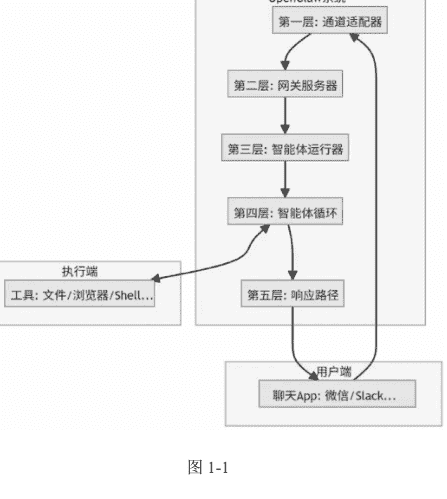

这种“理解—规划—执行—反馈”的循环，就是 OpenClaw 工作的基本流程。听起来是不是很像指导一个真人下属做事？没错，OpenClaw 的设计目标就是让你能够用类似与真人沟通的方式，实现与 AI 的协作。

### 2. 核心组件与协作机制

从技术实现的角度来看，OpenClaw 的架构由若干核心组件构成，每个组件各司其职又紧密协作，共同支撑起整个智能体的运转。了解这些组件的功能，可以帮助你更好地理解 OpenClaw 完成各种复杂任务的内在机理。

第一个核心组件是调度器（Agent Orchestrator）。你可以把调度器想象成公司里的项目经理，它负责接收指令、分析任务、分配工作。当用户发送一条指令时，调度器首先解析这条指令的意图和目标，然后判断需要哪些工具和技能来完成任务，接着安排这些工具的执行顺序和方式，最后收集各工具返回的结果并整合输出。调度器就像一个中央协调员，确保整个任务处理过程有条不紊地进行。

第二个核心组件是工具池（Tool Pool）。工具池里存放着各种可以直接调用的工具，就像一个工具仓库。其中，文件操作工具负责读写计算机上的各种文件，网络访问工具可用于抓取网页内容或调用应用程序编程接口（API），代码执行工具可以在安全的环境中运行各种编程语言的代码，邮件工具可实现邮件的发送和接收。每个工具都有明确的输入输出规范，调度器会根据任务需要选择合适的工具来执行操作。

第三个核心组件是记忆系统（Memory System）。人类员工能够记住之前交代过的事情，OpenClaw 也有类似的记忆能力。短期记忆让它能够在当前会话中保持上下文连贯，理解对话的前因后果；长期记忆则让它能记住你之前告诉过它的偏好、设置、人设信息等，这样你不需要每次都重复交代同样的背景信息。这种记忆机制使得 OpenClaw 的学习与交互过程更加自然和连贯。

第四个核心组件是人设引擎（Persona Engine）。人设引擎负责根据用户的配置来塑造 OpenClaw 的“性格”和行为方式。你可以通过设置人设来告诉 OpenClaw 它应该扮演什么角色、应该用什么语气说话、在哪些领域比较专业。人设引擎会将这些配置转换成具体的提示词，指导大语言模型生成符合期望的回复和行为。

### 3. 任务执行流程详解

现在，让我们用一个具体的例子来完整地走一遍 OpenClaw 的执行流程。假设你告诉 OpenClaw：“帮我把这周收集的会议记录整理成一份摘要，发到项目组的群里。”

首先，调度器接收指令并进行分析，用户想要整理会议记录、生成会议摘要并发送到群里。这需要完成几个子任务：找到本周的会议记录文件、阅读并理解内容、生成摘要、通过群聊工具发送消息。调度器把这个任务拆解成了三个工具调用：文件读取工具获取会议记录、LLM 处理工具生成摘要、消息发送工具发布到群里。

接下来，调度器开始依次调用工具，第一步，它调用文件读取工具，告诉工具“请找出本周（过去 7 天内）创建的所有会议记录文件。”文件工具在指定目录下搜索，找到 4 个会议记录文件，然后将这些文件的内容摘要返回给调度器。

第二步，调度器把收集到的会议记录内容发送给 LLM，请它生成一份结构化的摘要。LLM 处理完后，返回一份精炼过的摘要，包含每次会议的核心要点和待办事项。

第三步，调度器调用消息发送工具，把生成的摘要发送到指定的项目组群。消息工具执行发送操作，并将发送结果返回给调度器。

最后，调度器把完整的结果反馈给你：“已经找到 4 份本周的会议记录，生成了一份摘要，已发送到项目组群。摘要包含以下要点……还有什么需要补充的吗？”

以上即为 OpenClaw 处理一个典型任务的完整流程。你可以看到，它并不是简单地调用一次 LLM 就完事了，而是像一个真正的项目协调者，把任务拆解成多个步骤，调用不同的工具来逐步完成。在这个过程中，如果你发现中间某个步骤有问题，可以随时介入纠正，OpenClaw 会据此调整后续的执行计划。

### 4. 与大模型的协同方式

OpenClaw 的智能能力主要来源于其所接入的大语言模型（LLM），但 OpenClaw 并不是简单地把用户问题转发给 LLM 就完事了，而是采用了一系列精心设计的协同机制来最大化地发挥 LLM 的能力，同时规避其局限性。

OpenClaw 采用了“思维链”（Chain of Thought）技术来增强 LLM 的推理能力。当面对复杂任务时，OpenClaw 会引导 LLM 分步骤思考，而不是期望它一步到位给出完整答案。这种方式类似于人类解决问题时的思考过程——先把大问题拆解成小问题，逐个解决后再整合成最终的答案。研究表明，这种分步推理的方式能够显著提升 LLM 处理复杂任务的质量和准确性。

OpenClaw 还采用了“工具增强”（Tool Augmented）的策略来弥补 LLM 的能力短板。LLM 虽然“知识渊博”，但它不知道你电脑上有什么文件、不会操作你的浏览器、不懂得调用各种 API。OpenClaw 通过把各种工具“嫁接”到 LLM 上，使其能够“看到”文件内容、“操作”浏览器、“调用”各种服务。这样一来，LLM 就不仅仅是“纸上谈兵”，而是真正具备了“动手能力”。

此外，OpenClaw 还设计了完善的“反思”（Reflection）机制。在执行任务的过程中和完成后，OpenClaw 会让 LLM 对当前的状态进行评估：之前的判断是否正确？执行结果是否符合预期？有没有遗漏什么重要信息？通过这种持续的自我检查，OpenClaw 能够在执行过程中及时发现和纠正问题，从而提高整体的可靠性。

## 1.2 它能帮你省下哪些烦人的重复劳动？

OpenClaw 的核心价值在于将“智能”转化为“行动”。它不是被动等待指令的聊天机器人，而是能够主动理解需求、规划步骤、执行操作的智能代理。本节将从核心能力与应用场景两个维度，全面展示 OpenClaw 能够为你的工作和生活带来的实质性改变。

### 1.2.1 OpenClaw 核心能力

本节详细解析 OpenClaw 的三大核心能力：系统级执行能力、工具调用能力和多渠道接入能力。这三大能力共同构成了 OpenClaw 作为智能助手的基础，使其能够真正替代人工完成各种重复性工作。

#### 1. 系统级执行能力

OpenClaw 最核心的能力在于其系统级执行能力。简单来说，这种能力使 OpenClaw 能够直接与计算机操作系统进行交互，执行各种实际的操作任务，包括文件系统的读写、目录的创建与删除、程序的启动与关闭、环境变量的读取与设置等。正是凭借这些系统级能力，OpenClaw 得以突破纯对话 AI 的局限，真正成为数字意义上能干活的“员工”。

让我们通过一个具体的例子来理解这种能力。假设你是一位程序员，需要频繁地进行代码仓库的提交操作。传统的工作流程是：打开终端、输入 git status 查看变更、逐个添加文件、编写提交信息、执行 git commit，最后执行 git push。整个过程虽不复杂，但每天重复多次也会消耗不少时间和注意力。如果你配置好了 OpenClaw，只需要对它说一声“提交今天的代码变更”，它就能自动完成上述所有步骤：先运行终端命令检查有哪些文件发生了变化，根据代码规范自动判断哪些应该提交，生成合适的提交信息，执行完整的提交流程，最后告诉你结果。在这个过程中，你只需要下一道指令，然后就可以去做其他事情，等着 OpenClaw 告诉你“搞定了”。

这种系统级执行能力的应用场景极为广泛。对于日常办公来说，OpenClaw 可以帮你批量重命名文件、自动归类文档、按时启动特定程序、监控系统资源状态。对于开发工作来说，它可以自动化构建流程、运行测试用例、部署应用到服务器、监控服务日志。对于内容创作者来说，它可以整理素材文件、完成内容发布、追踪数据表现。可以说，只要是计算机上能够完成的重复性操作，理论上都可以交给 OpenClaw 来自动化执行。

#### 2. 工具调用能力

如果说系统级执行能力是 OpenClaw 的双手，那么工具调用能力就是它的工具箱。OpenClaw 内置了丰富的工具生态系统，这些工具让 OpenClaw 能够完成各种特定领域的任务，如访问网页、发送邮件、执行代码、处理数据等。同时，OpenClaw 还支持用户自定义开发新的工具，这意味着它的能力边界是可以不断扩展的。

在 OpenClaw 的默认工具集中，最常用的包括以下几类。第一类是文件操作工具，涵盖了文件的读取、写入、复制、移动、重命名、搜索等基本操作，以及对文件内容的分析、理解、提取等高级操作。第二类是网络访问工具，让 OpenClaw 能够访问任意网页、调用 RESTful API 接口、下载网络资源、提交表单数据等。第三类是代码执行工具，支持在安全沙箱环境中运行 Python、JavaScript、Shell 等代码，实现各种与编程相关的自动化任务。第四类是通信工具，支持发送邮件、推送消息到各类即时通信平台。第五类是数据处理工具，包括 JSON 解析、数据转换、格式美化等功能。这些工具共同构成了 OpenClaw 的能力基础，使其能够应对各种复杂的任务需求。

除内置工具外，OpenClaw 还提供了一个灵活的技能（Skills）系统。技能本质上是对多个工具的组合封装，用来完成特定的复合任务。例如，一个“会议纪要整理”技能可能需要调用语音转文字工具、文本分析工具、文件写入工具等多个组件。用户可以基于 OpenClaw 提供的开发框架，根据自身需求开发自定义技能，并在实际使用中像安装 App 一样轻松部署到自己的 OpenClaw 环境中。这种模块化、可扩展的设计理念，使得 OpenClaw 具备了极强的适应性和生命力。

#### 3. 多渠道接入能力

OpenClaw 的另一个重要特性是其多渠道接入能力。简单来说，你可以通过多种渠道与 OpenClaw 进行交互，包括命令行界面、本地网页端，以及飞书、QQ、企业微信、钉钉等主流通信平台。这种多渠道的设计使 OpenClaw 的使用场景变得更加灵活，无论你是在办公室用电脑，还是在外出时用手机，都能够方便地向 OpenClaw 下达指令。

对于团队协作场景来说，多渠道接入能力尤为重要。例如运营一个自媒体账号，需要经常性地发布内容、回复评论、统计数据。如果使用传统的 AI 工具，你可能需要守在电脑前打开特定的网页或者应用。但有了 OpenClaw 的多渠道支持，你可以直接在微信群里@你的 AI 助手，让它帮你查询当天的阅读量数据、生成下周的内容选题、起草对粉丝问题的回复。整个过程完全无须切换到其他界面，如同指派一名真正的团队成员般自然。

在企业级应用场景中，多渠道接入能力还带来了另一个重要优势：统一的入口管理。你可以为不同的渠道配置不同的权限级别，例如在微信上配置为公开的问答助手角色，而在内部系统中配置为拥有更高权限的管理员角色。不同渠道的用户可与同一个 OpenClaw 实例进行交互，但获得的功能范围和操作权限可以完全不同。这种灵活性使得 OpenClaw 能够很好地满足从个人使用到企业部署的各种需求。

### 1.2.2 OpenClaw 应用场景

凭借系统级执行能力和丰富的工具生态，OpenClaw 能够替代人工完成大量重复性工作，让用户将精力集中在创造性事务上。本节将详细展开各场景下的具体应用场景和实际价值。

#### 1. 开发者效率提升场景

对于软件开发者和 IT 从业者来说，OpenClaw 堪称全能型的效率提升工具。它能够帮助你处理开发工作中各种烦琐、重复的任务，让你把更多精力集中在真正需要创造性思维的工作上。下面我们详细展开几个最具代表性的应用场景。

第一个场景是与代码相关的自动化任务。OpenClaw 可以帮你审查代码质量——只需要把代码片段发送给它，它就能分析潜在的 Bug、提出优化建议、指出代码风格问题。假设你刚写完一个函数，不确定实现方案是否为最优，只需要把代码发给 OpenClaw，它会从性能、可读性、安全性等多个维度给出评估。另一个常见场景是自动化测试用例的生成。对于已经编写好的业务代码，你可以让 OpenClaw 根据代码逻辑自动生成对应的单元测试用例，这不仅节省了编写测试用例的时间，还能确保测试覆盖到更多的边界情况。还有一个实用的场景是文档自动生成——OpenClaw 可以根据代码注释和函数签名自动生成 API 文档，或者将内部的 Markdown 文档转换为不同格式的输出。

第二个场景是 Git 工作流的简化。对于使用 Git 进行版本控制的团队来说，提交代码是一项高频但烦琐的操作。OpenClaw 可以集成到开发流程中，当需要提交代码时，你只需要用自然语言描述本次变更内容，它就能自动完成 git add、git commit、git push 的全流程。更智能的是，OpenClaw 还能根据代码变更的内容自动生成符合规范的提交信息，省去了每次都要绞尽脑汁撰写提交说明的烦恼。在合并分支时，OpenClaw 也能帮你检测潜在的冲突，并给出解决建议。

第三个场景是环境配置与部署自动化。当你需要在新机器上搭建开发环境时，OpenClaw 可以根据你预设的配置文件自动完成 Node.js、Python、Go 等开发语言的版本安装，配置各种工具链依赖，甚至帮你克隆代码仓库、设置环境变量、启动服务。对于应用部署的场景，OpenClaw 可连接到你指定的服务器，执行构建命令、启动 Docker 容器、配置负载均衡、设置监控告警等一系列操作。只需要在第一次使用时配置好这些自动化流程，即可实现后续部署的完全自动化。

#### 2. 日常生活管理场景

OpenClaw 的能力不仅限于技术工作领域，它同样可以成为日常生活中得力的助手。通过合理的配置，OpenClaw 能够帮助我们处理各种琐碎的日常事务，让生活变得更加有序和高效。

在信息管理方面，OpenClaw 可以作为智能的信息聚合中心。你可以让它定期从你关注的网站、RSS 订阅源、社交媒体账号等渠道抓取最新内容，并按照你设定的规则进行筛选、分类、摘要。最终你只需要花费几分钟时间，就能了解到一天中最值得关注的信息，而不需要在各个平台之间来回切换浏览。另一个实用场景是邮件管理——OpenClaw 可以帮你自动处理收件箱中的邮件，按照重要程度进行分类、对垃圾邮件进行标记、对需要回复的邮件起草回复草稿。对于每天收到大量邮件的商务人士来说，这可以显著减少处理邮件的时间成本。

在时间管理方面，OpenClaw 可以充当一个尽职尽责的提醒助手。你可以告诉它每天早上 9 点提醒你检查待办事项、下午 3 点提醒你起来活动身体、重要会议前 15 分钟发送提醒通知。更为智能的是，OpenClaw 还能根据你的日程安排主动给出建议，例如发现两个会议时间冲突时主动提醒你调整，发现当日安排的任务过多时建议推迟一些不那么紧急的事项。这种主动式的提醒机制，使得 OpenClaw 不仅仅是一个被动响应指令的工具，更是一个能够主动“关心”你日程的智能助手。

#### 3. 内容创作与运营场景

内容创作者和自媒体运营者可以从 OpenClaw 获得显著的效率提升。无论是写作、剪辑还是数据分析，OpenClaw 都能提供从灵感激发到内容产出的全流程支持。

在内容选题策划方面，OpenClaw 可以分析你账号的历史数据，识别出受众反响最好的内容类型，并结合当前的热点话题为你生成下一阶段的内容选题建议。它还能帮你分析竞品账号的内容策略，找出差异化定位的机会点。这种数据驱动的内容策划方式，比纯粹依赖直觉和经验要更加科学和可靠。在内容创作过程中，OpenClaw 可以根据你给定的选题自动生成文章大纲、填充具体的段落内容，并提供多个版本的标题供你选择。对于视频内容，它可以帮助你撰写分镜脚本、设计字幕文案、生成视频描述和标签。

在内容发布与分发方面，OpenClaw 可以帮你实现一键多平台发布。你只需要在一个渠道完成内容创作，告诉 OpenClaw “把这段内容发布到所有平台”，它就会自动调整格式并发布到微博、微信公众号、知乎、百家号等已配置的平台。发布后，OpenClaw 还能帮你追踪各个平台的数据表现，包括阅读量、点赞数、评论数、转化率等指标，并生成汇总报告，让你对整体运营情况一目了然。

在与粉丝互动方面，OpenClaw 可以帮你自动回复评论和私信。它能够根据你设定的回复风格和规则，对粉丝的常见问题给出标准化的回复，对于需要人工介入的复杂问题则标记出来等你亲自处理。这种半自动化的互动方式，使得运营多个账号成为可能，即使粉丝数量快速增长也不会应接不暇。

例如，在使用 OpenClaw 之前，一位全职内容创作者每天需要使用 ChatGPT 撰写文案、借助 Notion 管理笔记、利用 Midjourney 画图，并依赖各种工具实现自动化。工具切换频繁，流程碎片化，管理成本很高。

使用 OpenClaw 后，他只需要在一个界面中即可完成所有工作：告诉 OpenClaw “帮我整理本周的选题素材”，它便会抓取相关资料、生成文章大纲、起草内容、调用图像生成工具制作配图，最后自动发布到各个平台。原本需要花费一整天的工作，现在仅需几十分钟就能完成。

#### 4. 个人智能管家场景

OpenClaw 能力不限于数字世界，还能通过集成物联网设备和第三方服务，成为连接物理世界与数字世界的智能枢纽。

在智能家居自动化控制方面，通过与智能家居平台 API 对接，OpenClaw 可实现对家中设备的精细化控制。例如，用户即将到家时，OpenClaw 可提前打开空调、调节灯光亮度，甚至播放用户喜爱的音乐。它还可根据天气预报自动调整窗帘或浇花系统，实现无感化的智能生活体验。

在差旅与购物智能规划方面，OpenClaw 能通过调用机票、酒店预订平台以及电商网站 API，为用户提供智能化差旅和购物规划。用户只需告知目的地和日期，OpenClaw 就能自动搜索最佳航班和酒店组合，并提供价格对比。在购物方面，它可追踪特定商品的降价信息，当价格降至用户预设的心理价位时自动下单，甚至管理购物清单和配送进度。这使复杂规划过程变得简单高效。

## 1.3 零基础也能懂的 3 个核心

掌握任何新工具都需要正确的方法和路径。本节将分享学习 OpenClaw 的 3 个核心，即工程思维与学习方法、学习路径建议、学习资源汇总，旨在帮助读者高效地掌握这一工具。

### 1.3.1 工程思维与学习方法

传统软件的使用逻辑是明确的——单击按钮 A 执行操作 A，拖曳元素 B 完成任务 B。但 OpenClaw 不同，你不需要告诉它“怎么做”，只需要告诉它“做什么”。这意味着学习的重点不在于记忆操作步骤，而在于掌握清晰定义任务目标的思维方式。

学习 OpenClaw 这类 AI 智能体工具，思维方式较之操作技巧更重要，当你习惯用这种思维方式与 OpenClaw 进行交互时，使用效率会大幅提升。真正掌握 OpenClaw 的关键，不在于记住多少指令，而在于养成用工程思维重构日常任务的习惯——把重复、琐碎、跨平台的操作，抽象为可复用的自动化流程，实现从“工具使用者”到“任务设计者”的转变。

很多初学者把 OpenClaw 视为需要精确指令的自动化脚本，期望一次性将需求描述完整。这往往导致沟通成本较高且效果欠佳。更有效的方式是将其视为可以商量的合作伙伴：先下达一个初步指令，观察它的理解和执行情况，发现偏差时及时纠正，让它在这个过程中学习你的偏好。这种交互模式更接近人类协作的方式，也更能发挥 AI 的能力。

OpenClaw 的工作涉及复杂的 AI 技术，包括大语言模型、思维链推理、工具调用等。这些概念不需要在理论上完全理解才能使用——更重要的是在实践中观察其行为模式，理解其能力边界。遇到问题、分析问题、解决问题的循环，比任何教程都更为有效。

### 1.3.2 学习路径建议

学习 OpenClaw 需要一定的基础，但这个基础不需要多深，本书在具体讲解时会做必要的补充说明。

### 1. 前导知识要求

以下知识会帮助你更好地理解 OpenClaw：

第一，基本的命令行操作能力。OpenClaw 在终端环境中运行，你需要看得懂 cd、ls、mkdir、cp 等基础命令，并能够使用命令行切换目录、查看文件、运行程序。不熟悉命令行的读者，建议先花半小时了解最常用的 10 个命令。

第二，对浏览器的基本了解。OpenClaw 的很多功能涉及网页操作，你需要知道如何打开网页、在地址栏输入 URL、查看网页元素。不需要具备 HTML 或 JavaScript 编写能力。

第三，基础的编程概念。虽然使用 OpenClaw 不一定需要写代码，但理解变量、函数、循环、条件判断这些基本概念，有助于理解其行为逻辑。

第四，对 API 和接口的初步认知。OpenClaw 需要调用各种外部服务，理解“调用接口”这一概念会让你更容易理解配置过程。不需要会写 API 调用代码，只需要知道“接口”是用来“请求服务”的就够了。

对于尚未掌握上述知识的读者，也完全不需要担心，本书在讲解具体操作时将同步介绍相关概念。

### 2. 推荐的学习路径

不同背景的读者可根据自身情况选择不同学习路径：

零基础读者建议按照本书章节顺序学习——先完成第 1 章的认知建立，再进入第 2 章的安装部署，然后在第 3 章中尝试基本操作。每个章节的内容都动手实践一遍，不要只看不动手。

有技术背景的读者或使用过类似工具（如 AutoGPT、Agent 等）的读者，可以直接从第 2 章开始，重点关注 OpenClaw 特有的功能设计和生态体系，直接了解其安装使用和工程实践。

### 1.3.3 学习资源汇总

学习一个新工具，有好的资源能事半功倍。本节将列出主要的学习资源。

### 1. 官方核心资源

OpenClaw GitHub 仓库是最权威的资料来源。如图 1-2 所示，OpenClaw GitHub 仓库包含完整的源代码、安装说明、配置文件示例。用户可在此查阅项目最新动态、功能更新和版本发布信息。

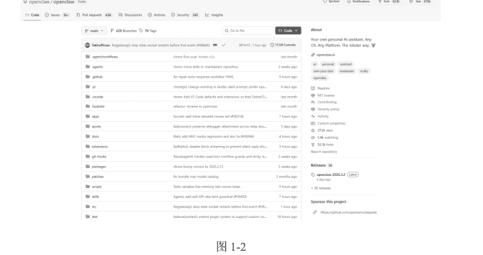

OpenClaw 官方文档如图 1-3 所示。

ClawHub 是官方技能市场，收录了社区开发的各类技能（Skills），是 OpenClaw 能力扩展的主要来源。截至 2026 年 3 月，ClawHub 已提供超过 13000 个技能供用户安装使用。

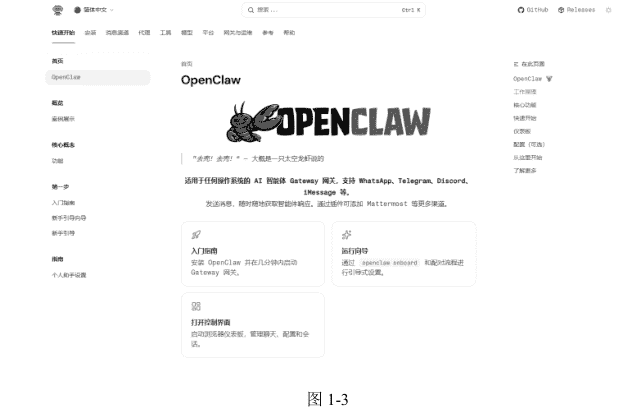

图 1-3

### 2. 部分社区资源

awesome-openclaw-tutorial 是较完整的中文教程集合，包含安装指南、配置教程、实战案例和避坑指南。这是最推荐中文用户参考的学习资源。

VoltAgent 维护的 awesome-openclaw-skills 项目，从 ClawHub 的数千个技能中精选了高质量内容。

国内的技术博客平台也是重要的学习来源。博客园、CSDN、知乎等平台上有大量中文安装教程和使用心得。这些教程通常针对特定版本或特定场景编写，搜索相关问题能找到很多参考。

### 3. 实践参考资源

技能选择方面，如前所述，ClawHub 提供大量技能可供选择。但需要注意安全问题——2026 年 2 月曾发生恶意技能混入 ClawHub 的事件。建议优先选用官方认证的技能，或使用 awesome-openclaw-skills 这类经过筛选的技能列表。安装陌生技能前，应检查 Skill.md 文件内容，避免执行来源不明的命令。

GitHub Issues 区是解决问题的重要渠道。遇到安装或使用问题时，先在 OpenClaw 仓库的 Issues 中搜索，几乎所有常见问题都有现成的讨论和解决方案。

OpenClaw 是活跃的开源项目，功能更新较快。建议关注 GitHub 仓库的 Release 页面，及时了解新版本的变化和特性。社区中也在持续产出新的教程和案例，定期搜索可获取最新的使用技巧。

## # 10 分钟装好，5 分钟跑通

在理解 OpenClaw 核心概念之后，本章将详细介绍如何在自己的环境中部署和运行 OpenClaw。本章将按照从环境准备到部署验证的顺序，逐步说明在不同场景下的安装方法，帮助读者根据自身条件选择最适合的部署方案。

## 2.1 国内网络环境下怎么安装最省事

在国内网络环境下安装 OpenClaw，需要解决两个关键问题：一是 Node.js 运行环境的安装，二是 OpenClaw 安装包的下载。本节会给出最简捷的安装路径，帮你避开常见的坑。

### 2.1.1 系统要求与环境检查

在正式安装 OpenClaw 之前，需要确认系统环境是否满足运行要求，并准备好必要的软件和账号资源。

OpenClaw 采用跨平台设计，支持在主流操作系统上运行。但在不同操作系统上所能实现的功能完整度存在差异，用户在选择部署方案时应考虑这一因素。

从操作系统层面来看，OpenClaw 目前支持 macOS、Windows 和 Linux 三个平台。本书推荐采用 macOS 或 Linux 平台安装。macOS 系统是 OpenClaw 官方推荐的部署平台，在该平台上可以体验到最完整的功能支持，包括日历操作、备忘录读取、屏幕截图等系统级功能。其 UNIX 底层架构与技术栈契合度较高，部署过程通常较为顺畅。Windows 系统同样提供完整的功能支持，日常使用场景下与 macOS 版本核心功能无明显差异，但在部分系统级集成功能上仍存在限制。若用户主要在 Windows 系统下工作，OpenClaw 的核心功能可正常使用，无须担心影响日常操作。另外，在 Windows 系统下通过 WSL2 运行 OpenClaw 可以获得更好的兼容性。Linux 系统适用于具备一定技术背景的开发者，该平台提供最大的配置灵活性，支持源码编译、自定义部署参数等高级操作。

### 2.1.2 通信平台选择

OpenClaw 支持多种即时通信平台作为交互入口，用户需要选择其中一个进行配置。不同通信平台的特点和适用场景有所不同，选择时应结合实际使用场景和所在地区的网络环境综合考虑。

对于国内用户来说，推荐采用飞书。飞书提供完善的 Bot 开发接口，支持丰富的消息类型，包括文本、图片、文件、卡片消息等。同时，飞书的群聊机器人功能适配团队协作场景，可满足多人共用 OpenClaw 的需求。若未注册飞书，建议采用企业微信或 QQ，这两个平台同样提供基础机器人接口，可满足 OpenClaw 的核心交互需求，但在部分高级消息类型上可能存在限制。

对于海外用户来说，Telegram 是首选推荐的通信平台。Telegram 的 Bot API 开放规范，文档完善，社区活跃。WhatsApp 和 Discord 同样是可选方案，前者需要绑定手机号码，后者更适合技术社区类使用场景。

### 2.1.3 AI 模型服务准备

OpenClaw 本身不训练或托管 AI 模型，仅作为调度层，通过 API 接口接入各类 AI 服务，实现功能落地。因此，用户在使用 OpenClaw 之前，需提前准备一个可正常调用的 AI 模型服务。

对于国内用户，推荐使用中转 API 服务。中转 API 通过统一接口聚合国内外多种 AI 模型，包括 GPT 系列、Claude 系列、Gemini 等国际模型，以及 Kimi、DeepSeek、GLM-4 等国产模型。使用中转 API 的优势包括统一计费、国内访问速度快、切换模型灵活。主流的中转 API 服务商包括开源项目 OneAPI、NewAPI 以及各大云服务商提供的 API 网关。选择时可重点关注支持的模型种类、服务稳定性、价格合理性及售后技术支持等因素。

用户也可以选择直接使用 AI 模型官方 API 服务，如 OpenAI API 或 Anthropic Claude API 等。这种方式较为直接，但需要解决网络访问问题。

对于具备一定技术能力的用户，还可以探索本地部署开源模型的方案，例如，使用 Ollama 工具运行 Llama、Qwen 等开源模型。本地部署的核心优势是可实现完全离线使用，无须上传数据至第三方服务器，安全性较高；但对设备的硬件配置要求较高。

### 2.1.4 基础运行环境准备

除了操作系统，还需要在系统上安装 Node.js 运行环境。OpenClaw 基于 Node.js 开发，要求 Node.js 版本不低于 22.0.0。

首先检查当前 Node.js 版本。执行以下指令打开终端或命令提示符。

```
node --version
```

如果显示版本号为 v22.x.x 或更高，说明 Node.js 版本满足要求。如果显示版本号低于 22，或提示 “command not found”，则需要安装或升级 Node.js。

不同操作系统下，Node.js 的安装方法如下：

Windows 系统的用户可以访问 Node.js 官方网站，单击绿色的 “LTS” 按钮下载安装包。下载完成后运行安装程序，按照向导一步步单击 “Next” 按钮即可。重要提示：在安装向导中记得勾选 “Add to PATH” 选项，否则后续在终端中可能无法识别 node 指令。安装完成后，打开一个新的 PowerShell 窗口，执行以下指令验证安装。

```
node --version
```

对于 macOS 系统，推荐使用 Homebrew 包管理器进行安装。执行以下指令安装 Node.js。

```
brew install node
```

如果需要升级现有版本，执行以下指令：

```
brew upgrade node
```

macOS 系统用户也可以直接访问 Node.js 官方网站，下载 LTS（长期支持）版本进行安装，步骤与 Windows 系统下的安装类似。

对于 Linux 系统，不同发行版的安装方法有所不同。Ubuntu 或 Debian 系统可以使用以下指令进行安装，CentOS、RHEL 或 Fedora 系统可以使用 dnf 指令进行安装，核心步骤大同小异。

```
curl -fsSL https://deb.nodesource.com/setup_22.x | sudo -E bash -
sudo apt-get install -y nodejs
```

安装完成后，验证安装结果。执行以下指令确认 Node.js 和 npm 都已正确安装。

```
node --version
npm --version
```

两个指令都应返回对应版本号。如果安装后终端提示 “command not found”，尝试重启终端或重新登录系统。

在硬件配置方面，OpenClaw 本身的资源占用较低，普通个人电脑即可满足运行需求。如果计划在本地运行 AI 模型，建议设备具备至少 8GB 内存和 20GB 可用磁盘空间。如果使用云端 API 调用 AI 模型，则对本地硬件无特殊要求。

### 2.1.5 安装部署

1. 使用安装器脚本安装

官方提供了安装器脚本，这是最推荐的安装方式，可以自动检测环境并完成配置。

对于 Linux 和 macOS 系统，可直接在终端中执行以下指令进行安装，运行结果如图 2-1 所示。

```
curl -fsSL https://openclaw.ai/install.sh | bash
```

会主动提示并引导安装），随后完成 OpenClaw 的全局安装。安装过程中会自动设置相关环境变量。

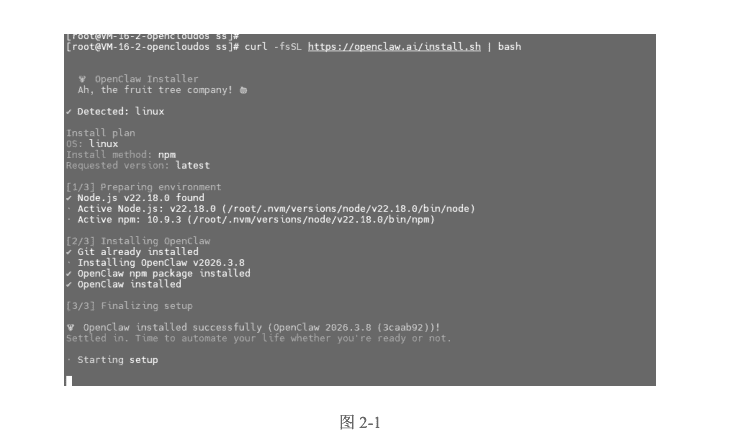

图 2-1

对于 Windows 系统，需要在 PowerShell 中执行以下指令，安装步骤与 Linux、macOS 系统一致。

```
iwr -useb https://openclaw.ai/install.ps1 | iex
```

Windows 安装器同样会自动检测和安装 Node.js 环境，支持通过 winget、Chocolatey 或 Scoop 等进行安装。

安装器脚本支持多种选项，可以通过以下指令查看帮助文档。

```
curl -fsSL https://openclaw.ai/install.sh | bash -s -- --help
```

常用选项说明如下：

- --install-method：指定安装方式，可选 npm 或 git。
- --git-dir：指定 Git 目录路径，默认为 ~/openclaw。
- --no-git-update：使用现有代码仓库时跳过 git pull 操作。
- --no-prompt：禁用交互提示，适用于自动化部署场景。
- --dry-run：只打印将要执行的操作，不实际进行更改。
- --no-onboard：跳过新手引导。

2. 使用 npm 全局安装

用户也可以直接使用 Node.js 自带的 npm 包管理器进行全局安装。这种方式适合已经手动安装好 Node.js 环境的用户。

使用 npm 包管理器安装的方法是在终端执行以下指令：

```
npm install -g openclaw@latest
```

如果 sharp 安装失败（常见于 macOS 系统，因系统中存在 libvips 依赖冲突），可执行以下指令规避冲突。

```
SHARP_IGNORE_GLOBAL_LIBVIPS=1 npm install -g openclaw@latest
```

若使用 pnpm 包管理器，需提前安装 pnpm，安装方法如下：

```
pnpm add -g openclaw@latest
pnpm approve-builds -g
pnpm add -g openclaw@latest
```

注：pnpm 需要显式批准带有构建脚本的包，因此需要执行 approve-builds 指令。

安装完成后，可通过执行 “openclaw --version” 指令验证是否安装成功。

3. 从源码安装

从源码安装适合希望使用最新开发版功能、需要自定义修改代码，或有二次开发需求的用户。该方式要求用户具备一定的终端操作和代码基础。具体步骤如下。

第一步，克隆 OpenClaw 源代码到本地（需提前安装 Git 工具）。

```
git clone https://github.com/openclaw/openclaw.git
cd openclaw
```

第二步，安装项目依赖。

```
pnpm install
pnpm ui:build
```

其中，pnpm install 用于安装项目运行所需的全部依赖包，pnpm ui:build 用于构建用户界面资源。这两个指令在首次运行时会自动安装 UI 相关依赖包，无须手动额外操作。

第三步，执行项目构建。

```
pnpm build
```

从源码安装的优势在于可以通过 “git pull” 指令获取最新代码。但需要注意开发版功能可能不够稳定，生产环境中建议使用稳定版。

## 2.2 第一个任务：让 OpenClaw 帮你发条消息

安装完成后，需要通过初始化向导完成基本配置。这个向导会引导你完成 AI 模型接入、渠道配置等关键步骤，是让 OpenClaw 能够正常工作的必要流程。

### 2.2.1 启动初始化向导

执行以下指令启动初始化向导。

```
openclaw onboard --install-daemon
```

该指令主要实现两个核心功能：一是安装 Gateway 后台服务，让 OpenClaw 可以在后台持续运行；二是启动交互式配置向导，引导你完成各项设置。

执行指令后，向导会依次提示进行各项配置。下面详细说明每个步骤应该如何选择。

### 2.2.2 向导步骤详解

（1）风险确认。

向导启动后，首先会显示 OpenClaw 官方安全风险提示及使用须知，明确相关操作规范，随后询问是否继续配置，如图 2-2 所示，此时选择 “Yes”，继续安装过程。

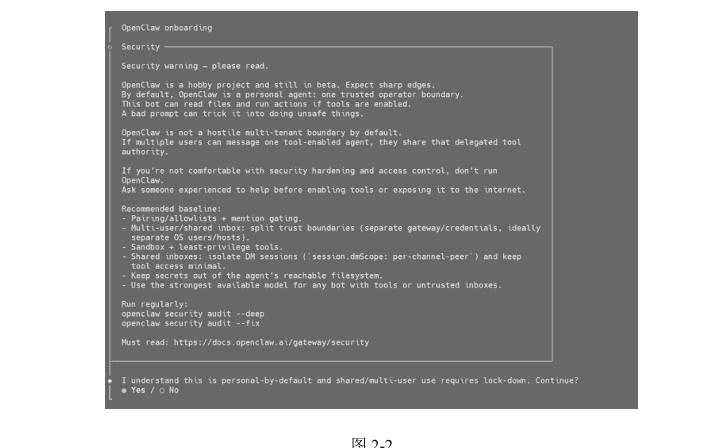

（2）选择运行模式。

进入第二步，向导会提示选择 OpenClaw 的运行模式，两种模式的区别及适用场景如下：

- QuickStart（快速启动）：适合具备一定技术基础的用户，可自定义模型参数、服务端口、日志存储等更多高级配置项，适配个性化使用需求。
- Custom（自定义）：适合有经验的用户，可以自定义更多配置项。

如图 2-3 所示，新手用户建议优先选择 QuickStart，可快速完成配置并启动使用。后续若有个性化需求，可通过配置文件进行精细化调整，无须重新运行向导。

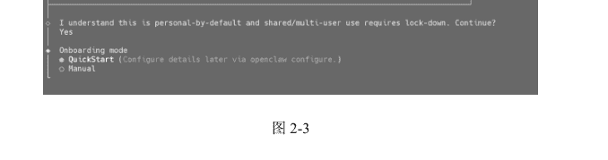

图 2-3

（3）选择模型提供商。

向导会提示选择 AI 模型服务提供商，如图 2-4 所示。OpenClaw 本身不训练 AI 模型，其核心作用是调度 AI 服务，它更像是一个“大厨”，需要“食材”才能做饭。这个“食材”就是 AI 模型的 API Key，不同模型的性能、价格有所不同。向导中常见的模型提供商选项包括：

- Kimi：月之暗面推出的 AI 模型，长文本理解能力强，适合处理长文档、代码等。
- MiniMax：国内 AI 公司推出的模型，响应速度快，性价比高。
- GLM：智谱 AI 推出的模型，综合能力强。
- OpenAI 系列模型：在自然语言理解和生成方面表现卓越，具备出色的逻辑推理、创意写作和多轮对话能力。

根据已申请的 API Key 选择对应的提供商。若尚未获取 API Key，需先前往对应模型提供商的开发者控制台申请。

（4）选择验证方式。

模型提供商选择完成后，向导会根据所选提供商，显示对应的 API 验证方式，无须手动选择无关选项。需选择与自身 API Key 对应的验证方式，确保 API 密钥可正常调用。如图 2-5 所示，本书采用自定义供应商配置方式，只需准确填入模型提供商提供的 API URL 和 API Key，即可完成验证配置；其他在线模型提供商的验证流程大同小异，均需填入对应平台的 API 凭证。

## 第 2 章 10 分钟装好，5 分钟跑通


图 2-4

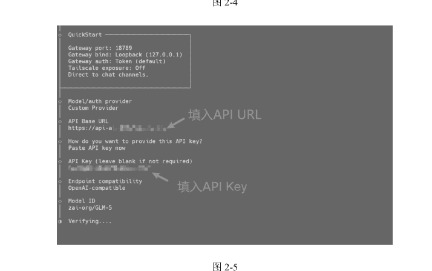

图 2-5

采用在线模型提供商时，向导会列出所选模型提供商旗下的可选模型。一般会有 1 到 2 个推荐选项，按照向导的推荐选择即可。不同模型的性能、价格有所不同，初次使用建议选择默认推荐。

（5）配置通信渠道。

向导会询问是否现在配置通信渠道（如飞书、Telegram 等）。强烈建议选择 “Skip for now”（暂时跳过），原因如下：

- 通信渠道的配置相对复杂，需要在对应开放平台先创建应用获取凭证；
- 初次使用建议先在本地测试，确认 OpenClaw 能正常运行后再配置渠道；
- 通信渠道的详细配置会在后续章节中专门介绍。

跳过此步骤后，你仍然可以通过本地 TUI（文本界面）与 OpenClaw 进行交互测试。

（6）配置 Skills（技能）。

向导会询问是否需要安装预置的技能包，如图 2-6 所示。Skills 是 OpenClaw 的扩展功能，可以赋予 Agent 各种能力，如自动写日报、会议纪要、代码审查等。


建议选择 Yes，安装预置技能可以让你更快体验到 OpenClaw 的完整功能。这些技能后续也可以根据需要添加或移除。后文将对 Skills 展开详细的介绍。

（7）其他 KEY 的配置。

在 OpenClaw 最新版本中，向导会提示设置 GOOGLE_PLACE、OPENAI 等额外 API Key，如图 2-7 所示。对于普通用户而言，这些 KEY 并非核心功能必需，此处可全部选择 No，跳过配置；后续若有相关功能使用需求，可通过配置文件补充设置。

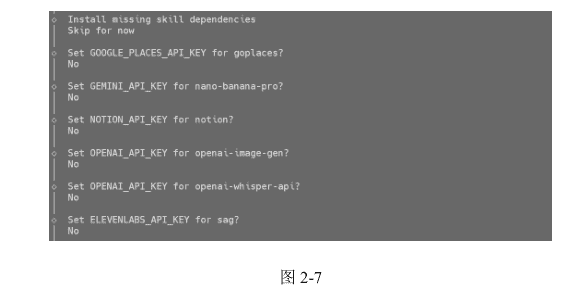

图 2-7

（8）安装 Hooks。

向导会询问是否启用核心功能钩子（Hooks），如图 2-8 所示，建议全部选择启用。各钩子功能详解如下：

- boot-md：适合需要工作区自动化初始化的用户。启用后，OpenClaw 启动时将自动执行工作区根目录下的 BOOT.md 文件，可用于预设服务启动、环境加载等例行任务。
- bootstrap-extra-files：适合团队协作或需要统一工作区配置的用户。允许通过通配符模式，在初始化时自动注入共享的配置文件、脚本或提示词模板，确保多用户使用环境一致。
- command-logger：适合需要审计、调试或复盘操作记录的用户。启用后，所有指令与事件将被记录到集中的审计日志文件中，便于追踪与分析。
- session-memory：推荐所有用户启用。当执行/new 或/reset 指令时，自动保存当前会话上下文，有效防止因意外切换会话、终端关闭等情况导致重要思路与对话内容丢失。

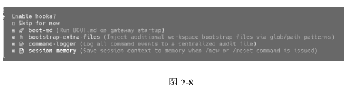

图 2-8

（9）选择启动方式。

这是向导配置的最后一步，需选择 Gateway 的启动方式，两个选项的区别及适用场景如下：

- Hatch in TUI（在 TUI 中启动）：在终端文本界面中启动，可以看到实时的运行日志和对话内容，适合学习和调试。
- Run as Daemon（作为后台服务运行）：在后台静默运行，不占用终端窗口，适合长期运行。

初次使用建议选择 Hatch in TUI，这样可以直观地看到 OpenClaw 的工作状态，也方便调试和问题排查。熟悉操作后，可重新运行向导并切换为后台服务模式。选择完成后，向导会自动启动 OpenClaw，首次启动可能需要下载部分依赖文件，耗时稍长，请耐心等待。

### 2.2.3 首次对话配置（Bootstrap）

当 OpenClaw 启动成功后，会进入 TUI 界面或 WebUI 界面。此时 Agent 就像一个新入职的实习生，对用户的使用习惯、需求偏好等一无所知。为了让它更好地为你服务，需要进行首次对话配置。如图 2-9 所示，需主动向 Agent 告知相关关键信息。

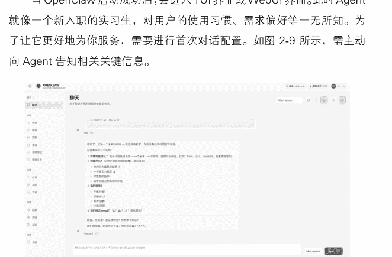

建议按照以下 6 个核心要点，向 Agent 完成自我介绍，确保 Agent 能精准提供服务。

1. 你的称呼：告诉 Agent 怎么称呼你，例如“叫我小明”或“叫我老板”。
2. 时区和语言：告知你所在的时区，以及偏好的语言，例如“我在中国，时区为 UTC+8，使用简体中文交流”。
3. 它的角色：告诉 Agent 它的身份定位，例如“你是我专属的技术助手”或“你是我的助理，负责处理日常事务”。
4. 工作环境：告诉它你的常用工具和工作环境，例如“我常用 VS Code 开发，主要用 Windows 系统”。
5. 回答风格：说明你偏好的回答方式，例如“回答要简洁”或“重要信息要详细解释”。
6. 红线：明确告知哪些操作必须先经过你同意才能执行，例如“删除文件前必须经我确认”。

完成自我介绍后，可发送简单的测试指令，验证配置是否成功。测试指令的示例如图 2-10 所示。

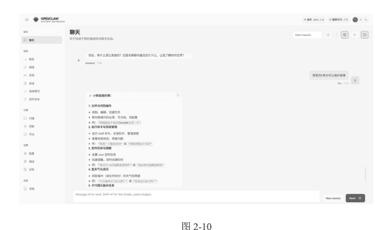

如果 Agent 能正常回复，说明 OpenClaw 的模型接入、系统配置等全链路已打通，可正常投入使用。

### 2.2.4 后续配置方法

若首次配置时部分选项选择有误，或后续有个性化配置需求，可通过以下两种方式修改配置。

第一种：重新运行初始化向导。具体指令如下：

```
openclaw onboard
```

若需同时安装或更新 Gateway 后台服务，可添加--install-daemon 参数，指令如下：

```
openclaw onboard --install-daemon
```

第二种：直接修改配置文件，进行精细化调整。OpenClaw 的所有设置均通过配置文件统一控制。理解配置文件的结构及各项参数的作用，是深度使用 OpenClaw 的基础。

OpenClaw 的默认配置文件为 “openclaw.json”，位于用户主目录下的 “.openclaw” 文件夹中。完整路径为 “~/.openclaw/openclaw.json”。

在 Windows 系统下，用户主目录通常为 “C:\Users\用户名”，因此配置文件的完整路径类似 “C:\Users\用户名\.openclaw\openclaw.json”。

如需多实例部署，可通过环境变量指定不同的配置文件路径，示例指令如下：

```
OPENCLAW_CONFIG_PATH=~/.openclaw/a.json openclaw gateway --port 19001
```

配置文件采用 JSON 格式，由多个顶层键组成，每个顶层键对应一个功能模块。

### 2.2.5 部署验证与测试

如果需要随时验证 OpenClaw 是否能够正常工作，可以通过以下步骤进行验证与测试。

（1）检查服务状态。

首先需确认 OpenClaw 服务是否处于正常运行状态。在本地部署场景下，如果通过后台服务方式安装，服务通常会自动启动。检查指令如下：

```
openclaw status
```

若服务正常运行，该指令会返回详细的状态信息，包括运行时间、已处理请求数等。

若指令返回服务未运行，可通过以下指令手动启动服务。

```
openclaw gateway --port 18789
```

启动成功后，终端会实时显示 Gateway 的运行信息，包括监听端口、控制面板地址等。

（2）发送测试消息。

服务运行正常后，可通过发送测试消息验证整个链路是否通畅。确保 Gateway 处于运行状态，执行以下指令发送测试消息：

```
openclaw message send --target +15555550123 --message "Hello from OpenClaw"
```

该指令通过 WhatsApp 向指定电话号码（+15555550123 为测试号码）发送测试消息。需注意，使用其他通信平台时可能需要调整指令参数。

除通过终端指令发送测试消息外，也可直接通过已配置的通信平台（如 Telegram、飞书等）与 OpenClaw 交互测试。例如，在 Telegram 中@已配置的 OpenClaw 机器人，发送“你好”等简单指令，若能收到机器人的正常回复，说明 AI 模型接入、消息接收处理、回复发送的完整链路已打通，核心功能可正常使用。

（3）访问控制面板。

OpenClaw 提供 Web 控制面板，可查看和管理运行状态。在浏览器中访问“http://localhost:18789/”即可打开控制面板。

控制面板功能包括：

1. 查看对话历史，了解 OpenClaw 处理了哪些请求。
2. 查看运行日志，了解系统详细运行行为。
3. 查看工具调用记录，追踪 OpenClaw 调用的各类工具及调用详情。
4. 运行时配置调整，无须重启服务，即可对部分基础配置进行修改，提升运维效率。

对于部署在远程服务器上的 OpenClaw，可能无法直接访问本地地址，可通过 SSH 隧道或 Tailscale 等内网穿透工具访问控制面板。

## 2.3 无法安装怎么办？常见问题自救指南

在安装和使用 OpenClaw 的过程中，可能会遇到一些常见问题。本节介绍常见问题的解决方法。

### 2.3.1 找不到 OpenClaw 指令

如果在终端中输入 OpenClaw 指令提示无法找到指令，可能是因为 npm 全局 bin 文件夹未添加至系统 PATH 环境变量中。

快速诊断方法是在终端执行以下指令：

```
node -v
npm -v
npm prefix -g
echo "$PATH"
```

诊断判断：若$(npm prefix -g)/bin（macOS/Linux 系统）或$(npm prefix -g)（Windows 系统）的输出路径，未出现在 echo "$PATH"（或 echo %PATH%）的结果中，即可确认是 PATH 环境变量配置问题。

修复方法：将以下内容添加到 shell 启动文件中。zsh 用户添加到 ~/.zshrc，bash 用户添加到 ~/.bashrc。

```
export PATH="$(npm prefix -g)/bin:$PATH"
```

在 Windows 系统中，将 npm prefix -g 的输出路径，手动添加到 PATH 环境变量中。配置完成后，需重启终端，若不想重启，可在 zsh 中执行 “rehash” 指令、在 bash 中执行 “hash -r” 指令，使环境变量立即生效。

### 2.3.2 sharp 安装问题

安装 OpenClaw 过程中，若出现 “sharp: Please add node-gyp to your dependencies” 错误提示，主要是 sharp 依赖包的原生构建失败导致。这里提供两种解决方案，可根据自身系统选择。

方案一：安装对应系统的构建工具，macOS 上需要安装 Xcode CLT 并执行以下指令。

```
npm install -g node-gyp
```

方案二：使用变通方法跳过原生构建。执行安装指令时添加环境变量，跳过 sharp 原生构建，指令如下：

```
SHARP_IGNORE_GLOBAL_LIBVIPS=1 npm install -g openclaw
```

### 2.3.3 pnpm 构建批准问题

使用 pnpm 包管理器安装 OpenClaw 时，若出现“Ignored build scripts”警告，需要运行 “pnpm approve-builds -g” 指令，并选择列表中的 OpenClaw 相关包。批准完成后，重新运行 “OpenClaw 安装指令”，即可正常执行 postinstall 脚本，完成完整安装。

### 2.3.4 快速诊断指令

遇到安装或运行故障时，可通过以下指令进行快速诊断：

```
# 检查 OpenClaw 是否安装成功
openclaw --version

# 检查 Gateway 状态
openclaw status

# 检查健康状态
openclaw health

# 查看当前配置
openclaw config get

# 查看最近日志
openclaw logs

# 完整的诊断报告
openclaw doctor
```

其中，运行“openclaw doctor”指令会全面检查系统环境、依赖包、配置文件、服务状态等各个方面，生成详细的诊断报告，标注问题所在及解决方案。该指令是排查复杂问题的最实用工具。

### 2.3.5 OpenClaw 卸载

如果需要卸载 OpenClaw，可以按照以下步骤进行。卸载前请务必备份重要数据。

（1）使用内置卸载程序（推荐，操作简单、卸载彻底）。

执行以下指令，启动 OpenClaw 内置卸载程序，按提示完成卸载。

```
openclaw uninstall
```

若需在自动化环境中进行非交互式卸载，执行以下指令：

```
openclaw uninstall --all --yes --non-interactive
```

若 OpenClaw 已无法正常调用，可通过 npx 执行卸载指令：

```
npx -y openclaw uninstall --all --yes --non-interactive
```

（2）手动卸载步骤。
如果内置卸载程序不可用，可以按照以下手动步骤进行卸载，效果与使用内置卸载程序一致。

第一步，停止 Gateway 网关服务。

```
openclaw gateway stop
```

第二步，卸载 Gateway 网关服务。

```
openclaw gateway uninstall
```

第三步，删除状态和配置文件。

```
rm -rf "${OPENCLAW_STATE_DIR:-$HOME/.openclaw}"
```

补充说明：若安装时使用了自定义配置文件路径（--profile 或 OPENCLAW_PROFILE），需额外删除该自定义配置文件。

第四步，删除工作区（可选，用于彻底移除智能体相关文件）。

```
rm -rf ~/.openclaw/workspace
```

第五步，移除 CLI 安装包。根据安装时使用的包管理器，选择对应指令：

```
npm rm -g openclaw
# 或（pnpm 用户）
pnpm remove -g openclaw
# 或（bun 用户）
bun remove -g openclaw
```

第六步，如果安装了 macOS 应用，则删除该 macOS 应用。

```
rm -rf /Applications/OpenClaw.app
```

（3）手动服务移除。
若已删除 OpenClaw CLI，但 Gateway 服务仍在运行，就需要手动停止服务。
对于 macOS 系统（基于 launchd），默认服务标签是 bot.molt.gateway，执行以下指令：

```
launchctl bootout gui/$UID/bot.molt.gateway
rm -f ~/Library/LaunchAgents/bot.molt.gateway.plist
```

如果使用了配置文件，请将标签和 plist 名称替换为 bot.molt.<profile>。

对于 Linux 系统（基于 systemd 用户单元），默认单元名称是 openclaw-gateway.service，执行以下指令：

```
systemctl --user disable --now openclaw-gateway.service
rm -f ~/.config/systemd/user/openclaw-gateway.service
systemctl --user daemon-reload
```

对于 Windows 系统（基于计划任务），默认任务名称是 OpenClaw Gateway，在 PowerShell 中执行以下指令：

```
schtasks /Delete /F /TN "OpenClaw Gateway"
Remove-Item -Force "$env:USERPROFILE\.openclaw\gateway.cmd"
```

## 第 3 章 学会和 OpenClaw “聊天”

安装好 OpenClaw，完成了基础配置，终于可以开始使用了。但很多人到这里会产生困惑：为什么我明明按照步骤下达了指令，OpenClaw 却总是理解错我的意思？为什么同样的一件事让别人来操作就很顺畅，到自己手里就总是出错呢？

其实问题并非 OpenClaw 不够智能，而是你与它的沟通方式需要优化。它虽然能听懂人话，但它理解人话的方式和我们想象的不太一样。这一章我们要解决的就是这个问题：如何表述指令能让 OpenClaw 精准理解，如何调教让工具越来越贴合需求，怎么用一些技巧让它从“能用”变成“好用”。

## 3.1 怎么说话它才听得懂

和 OpenClaw 沟通，本质上是在和一个大语言模型对话。你说出去的每个字、每句话，都会经过模型“理解”这一步，然后才会生成回复或者执行动作。这个“理解”的过程会受到很多因素影响：指令是否清晰、上下文是否完整、表达方式是否准确。这些因素直接决定了 OpenClaw 给你的反馈是否符合预期。

### 3.1.1 提示词的基本原则

当你第一次打开 OpenClaw 对话框时，可能会有种面对空荡荡房间的感觉——不知道该说什么，也不知道它能理解多少。其实，和 OpenClaw 沟通的核心在于提示词（Prompt），也就是你输入的那段文字。

很多人第一次使用 OpenClaw 时，会习惯性地用非常简短的方式下达指令，比如“帮我整理一下文件”“帮我查查这个”。这类指令对于人类来说或许足够，但对于 AI 来说，信息量太少了。它能理解你想让它干活，但具体干什么、怎么干、干到什么程度，这些信息通通没有。模型只能靠“猜”来填补空白，而猜的结果往往和你的预期相差十万八千里。

好的提示词应该具备三个基本要素：明确的目标、充分的背景、必要的信息。这三者缺一不可。

先说明确的目标。很多用户会犯一个错误：把 OpenClaw 当成肚子里的蛔虫，觉得它应该知道自己想要什么。比如有人说“帮我整理一下”，却没有说明整理什么、从哪里整理、整理成什么格式。OpenClaw 不是读心专家，它需要你清楚地告诉它任务的具体内容。

充分的背景信息同样重要。假设你想让 OpenClaw 帮你写一封求职邮件，如果你只是说“帮我写一封求职邮件”，它只能写出一封四平八稳的通

### 3.1.2 任务描述的技巧

掌握了基本原则，接下来是更实用的部分：怎么描述任务才能让 OpenClaw 一听就懂、一做就对？这里有几个可以马上用起来的小技巧。

把大任务拆成小步骤。如果你有一个复杂的任务，比如“帮我分析一下这个行业的发展趋势”，别指望一句话就能搞定。更好的做法是像搭积木一样，把任务拆开：先让 OpenClaw 收集行业数据，再请它梳理主要玩家，然后分析竞争格局，最后给出投资建议。每步单独问，OpenClaw 回答起来会更清晰、更准确，你也更容易把控每个环节的质量。

给个例子，比说一堆都管用。想让 OpenClaw 按某种风格写作，别只用形容词，比如“写得专业一点”——不妨给它看个样本。比如：“这是我喜欢的文章风格，你能不能参考这个，帮我写一段类似的？”一个具体的例子，胜过一百句抽象的描述。OpenClaw 看到例子，就能迅速抓住你想要的感觉。

说清楚要什么格式。如果你需要的是表格、清单或某种结构的报告，最好一开始就告诉它。“请帮我整理成表格，列清楚公司名、成立时间、融资轮次”——这样的指令比“帮我整理一下”明确得多，OpenClaw 给你的结果也基本可以直接用。

多轮对话，步步推进。和 OpenClaw 交流，不用想着一次说完所有事。完全可以像和人聊天一样，先问第一步，拿到结果后再追问第二步。比如先问“帮我整理一下这个行业的头部公司”，等它列出来了，再接着问“能按成立时间排个序吗”——这样一步步来，OpenClaw 能跟上你的思路，你也能随时调整方向。

如果一次没说明白，没关系，不用追求“一句话完美指令”。看到 OpenClaw 的回答不太对劲，就直接追问或纠正：“我刚才没说清楚，其实是……”或者“这部分对了，但那个地方我想改成……”OpenClaw 会记住上下文，在对话中不断调整，直到给你满意的答案。

### 3.1.3 角色设定的方法

除了具体的任务指令，你还可以通过角色设定来引导 OpenClaw 的行为方式。这种方法特别适合需要特定专业知识或者特定语气风格的场景。

角色设定的核心是在任务描述之前，先告诉 OpenClaw 它应该扮演什么角色。比如你可以说“你现在是一位有十年经验的资深产品经理”或者“请以心理咨询师的视角来分析这个问题”。

角色设定之所以有效，是因为它能为后续的整个对话建立上下文。这个“角色”就像一个过滤器，会影响 OpenClaw 理解问题的角度、回答问题的语气，以及引用哪些专业知识。

在实际操作中，角色设定不必过于复杂。最有效的角色设定通常包含三个要素：专业背景、经验水平、思维模式。比如“你是一位严谨的数据分析师，擅长用统计学方法解释现象并习惯用数据说话”——这个描述清晰地为 OpenClaw 设定了角色框架。

### 3.1.4 上下文管理策略

有时候，一个任务可能需要多轮对话才能完成。这时候，如何管理上下文就成了关键问题。

主动提供前置信息是上下文管理的第一个策略。在开始一个新任务之前，如果相关的信息已经在之前的对话中提到过，你可以简单地总结一下，而不需要让 OpenClaw 去“翻阅”历史记录。比如“基于我们之前讨论的用户画像，现在帮我想一个营销方案”——这样的开场白让 OpenClaw 知道该从哪里开始。

适时提醒和关键约束也很重要。如果你有一个重要的限制条件，比如预算不能超过一万元、需要在一个星期内完成、必须使用中文输出等，在每次对话中适当提醒会比只提一次更保险。

利用系统提示词是进阶技巧。在 OpenClaw 中，你可以通过配置系统提示词来设定一些长期生效的规则。比如你可以告诉它“当我提到‘简报’时，指的是不超过两页的 A4 文档”或者“所有代码注释请用中文”。这样就不用每次都重复说明了。

### 3.1.5 不同场景的沟通模式

了解了基本技巧之后，我们来看看不同场景下应该如何与 OpenClaw 沟通。

文案写作场景需要注重风格引导。这类任务的关键是提供足够的参考样本，并明确说明目标受众是谁。比如写产品文案时，你可以说明是面向技术小白还是专业用户，风格是活泼俏皮还是稳重专业。描述越具体，输出结果越符合预期。

数据分析场景则需要清晰说明数据来源和分析目的。你需要告诉 OpenClaw 数据在哪里、想从数据中发现什么问题，以及结果需要以什么形式呈现。对于复杂的数据分析，提供数据的结构说明会很有帮助。

编程辅助场景的重点在于准确描述需求和报错信息。当遇到 Bug 时，完整地提供错误信息、相关代码片段以及你尝试过的解决方法，能让 OpenClaw 更高效地定位问题。如果是新功能开发，说明清楚输入是什么、期望输出是什么、使用什么编程语言或框架，这些信息缺一不可。

创意类任务需要更多的发散性思维引导。这类任务不要给太多限制，让 OpenClaw 有充分的空间发挥创造力。你可以用“brainstorm”式的提示，比如“帮我头脑风暴十个创意方向，不要考虑可行性，先想到什么说什么”。

### 3.1.6 结构化提示词的进阶技巧

当你已经掌握了基本的提示词写作方法后，可以尝试进阶的结构化提示词写作技巧。这种方法能让复杂任务的处理更加高效。

任务-背景-要求-示例（TBRF）框架是一个实用的结构。具体来说，TBRF框架包含四个部分：首先说明要做什么任务（Task），然后提供相关背景信息（Background），接着明确具体要求（Requirement），最后给出参考示例（Example）。

一个完整的TBRF框架提示词可能是这样的：

> “任务（Task）：帮我写一封产品发布会的邀请函。
>
> 背景（Background）：这是我们公司首次举办线下产品发布会，邀请对象是行业媒体和重要客户。
>
> 要求（Requirements）：①语言正式但不死板；②包含时间、地点和报名方式；③不超过300字。
>
> 示例（Example）：参考XXX发布会的邀请函风格。”

这种结构的优势在于，它把“要做什么”和“怎么做”分得很清楚，OpenClaw能更精准地理解你的需求。

逐步引导法适合处理特别复杂的任务。不要试图一次性把整个任务描述完，而是分步骤引导。每一步完成后，让OpenClaw确认一下，再进入下一步。这样既能确保方向正确，也能及时修正偏差。

条件分支提示在处理有多种情况的任务时很有用。你可以用“如果……那么……”的结构来描述不同情况下的处理方式。比如“如果用户选择的是套餐A，那么显示价格和优惠信息；如果选择套餐B，那么显示包含的增值服务”。

### 3.1.7 处理特殊情况的方法

在实际使用中，总会遇到一些特殊情况需要特别处理。

信息不足的情况很常见。当你发现 OpenClaw 无法准确回答你的问题时，很可能是提供的信息不够充分。这时候不要让它“随便猜一个”，而是明确告诉它“信息不足，无法确定，请先提供 XX 信息”。

遇到不确定答案时，你可以要求 OpenClaw 明确标注不确定的部分。比如“对于你不确定的信息，请用‘可能’或‘需要进一步确认’来标注”。这样你能清楚知道哪些信息是可靠的，哪些需要自己核实。

处理敏感内容时，OpenClaw 可能会有安全限制。如果你的正常需求被误拦截，可以尝试换一种表达方式，或者明确说明这是一个合理的工作需求。大多数情况下，合理的商业或学习需求都能正常处理。

连续对话中的记忆偏差也需要处理。有时候 OpenClaw 可能会“忘记”之前对话中提到的信息，这时候你可以说“回顾一下，我们之前确定的是……”来帮它回忆。不要觉得这很麻烦，这正是多轮对话的正常互动方式。

### 3.1.8 常见错误案例分析

通过分析常见的提示词错误，我们可以更好地理解什么才是有效的沟通方式。

错误一：过于笼统的描述。比如“帮我写点东西”——这种描述没有目标、没有受众、没有格式要求，OpenClaw 只能给出一个最通用的回复。修正方法是明确告诉它写什么、给谁看、什么场景使用。

错误二：信息过载。与上一个极端相反，有些人喜欢在一条提示词里塞入太多信息，导致关键信息被淹没。正确的做法是把复杂任务拆分成多个简单任务。

错误三：期望过高。有些人期望 OpenClaw 能一次性完成一个完整项目，但实际上复杂任务需要迭代完成。修正方法是设定合理的预期，把大任务分解成可管理的小步骤。

错误四：忽略反馈。OpenClaw 给出了回复，但用户看都不看就继续问下一个问题。其实认真阅读回复内容，结合其中的建议调整后续提问，能让对话效率大幅提升。

错误五：不提供上下文。每次对话都当作全新的开始，从不提及之前的背景信息。这会导致 OpenClaw 反复问同样的问题，或者给出与之前矛盾的回答。

## 3.2 让它记住你的小习惯

OpenClaw 和其他 AI 助手一个很重要的区别在于，它具备记忆能力。这种记忆不是简单的聊天记录保存，而是一个结构化的系统，能够记住你的偏好、习惯和重要的信息。利用好这个记忆系统，能让你的 OpenClaw 变得越来越“懂你”，用起来越来越顺手。

### 3.2.1 理解 OpenClaw 的记忆体系

在深入使用记忆功能之前，我们需要先理解 OpenClaw 的记忆体系是如何工作的。它不是简单地把所有对话都存下来，而是有一个分层结构。

最基础的一层是短期记忆，也就是当前会话的上下文。当你和 OpenClaw 对话时，它会记住这次会话中你说过的内容。这个记忆是临时的，一旦会话结束或者上下文窗口满了，这些信息就会被压缩或丢弃。所以如果你在会话中告诉它一个重要信息，一定要明确让它记录下来，否则下次很可能就忘了。

第二层是工作记忆系统记忆，也叫日记系统。OpenClaw 会按照日期生成日记文件，记录每天的对话要点和重要事项。这些日记文件会持续积累，形成一个可检索的历史记录。当你需要它回忆某个之前的任务时，它可以通过搜索日记来找到相关的信息。

第三层是长期记忆，这是最核心的记忆系统。它以结构化的方式存储你的关键信息，如你的姓名、身份、偏好、常用设置等。这些信息会被反复调用，贯穿在每一次交互中。这就是为什么一个已经使用了一段时间的 OpenClaw，会给你一种“越来越了解你”的感觉。

### 3.2.2 主动告诉它你的信息

很多用户在使用 OpenClaw 时，总是忘记主动提供自己的信息。每次都要重新解释自己的身份、偏好、工作背景，这不仅浪费时间和 Token，还会让交互变得很机械。

更好的方式是，在刚开始使用的时候就主动告诉它你的基本信息，并且明确要求它记住。你可以说：“我的名字叫张三，是一家互联网公司的产品经理。我平时喜欢简洁直接的沟通方式，回复尽量简短有力。我经常需要分析用户数据，所以关于数据处理的指令可以详细一些。”像这样的自我介绍，OpenClaw 会把它存入长期记忆，之后每次对话都会自动调用这些信息。

类似的，你的一些个人偏好也可以告诉它：比如你喜欢早上处理邮件、你的惯用语气是专业还是轻松、你对某些话题特别敏感不希望被提及。这些信息不需要每次都说，它会一直记得。在后续的交互中，OpenClaw 会自动根据这些偏好来调整自己的回复风格和内容。

### 3.2.3 用好 MEMORY 文件

OpenClaw 的工作目录下有一个重要的文件叫 MEMORY.md，这是专门用来存储长期记忆的地方。虽然系统会自动把一些重要信息写入这个文件，但手动维护这个文件会让记忆更加精准和高效。

你可以把以下几类信息整理到这个文件里：第一类是你的基本信息，包括姓名、职业、联系方式等；第二类是你的工作背景，包括公司业务、主要职责、常用工具等；第三类是你的个人偏好，包括沟通风格、偏好格式、特殊要求等；第四类是你经常使用的指令模板，需要时可以直接调用；第五类是你的重要联系人、项目或者事项的摘要。

维护 MEMORY 文件的时候要注意几个原则。首先是信息要简洁，保留最核心的内容，不要把无关的细节也塞进去。其次是结构要清晰，用标题和列表来组织信息，方便 OpenClaw 快速定位。最后是定期更新，当你的情况发生变化时，及时修改 MEMORY 文件里的内容，否则它会记住过时的信息。

### 3.2.4 养成记录的习惯

除了被动地让 OpenClaw 记住信息，你还可以主动让它记录一些重要的内容。每次完成一个重要任务后，可以让它把关键信息保存下来。比如，它帮你整理了一份会议纪要，你可以说：“把这次会议的重点记录到我的工作笔记里，包括待办事项和负责人。”这样下次需要回顾的时候，直接问它就能获取信息，而不是再去翻找原始文档。

明确表达偏好是最直接的方式。当 OpenClaw 第一次处理某类任务时，你可以明确告诉它你的偏好，比如“我比较喜欢简洁的风格，尽量少用修饰词”。只要表达得足够清楚，OpenClaw 通常能记住并在后续类似任务中应用。

用“帮我记住”这样的句式效果很好。当你说出“帮我记住，下次我让你写文案时，先问我目标受众是谁”这样的指令时，OpenClaw 会把这条规则记录下来。

纠正偏好要及时。当 OpenClaw 某次没有按照你的偏好来处理时，当时就纠正它比事后补救更有效。你可以说“我其实更喜欢另一种方式，下次请这样处理”，这样的反馈能帮助它学习。

另一个有用的习惯是让它总结每次长对话的要点。如果一次对话涉及很多内容，任务完成后可以让 OpenClaw 生成一个简短的摘要，告诉你这次都讨论了哪些问题、做出了哪些决定、有哪些后续待办事项。这个摘要既可以存在记忆里，也可以发给你留档。

记住信息只是第一步，如何正确调用这些信息记忆同样重要。当 OpenClaw 开始一个任务时，你可以说“先确认一下你记得我的哪些偏好”，让它先总结一下它记住的信息。如果有遗漏或错误，及时补充和纠正。

让 OpenClaw 引用记忆而不是假设它记住了。在需要用到记忆中的信息时，你可以说“根据我之前告诉你的偏好，这个任务应该怎么处理？”让它明确引用记忆内容。

区分“记住”和“理解”。OpenClaw 可能记住了一些信息，但不一定理解这些信息对你意味着什么。比如，你告诉它你是一名医生，它记住了这个信息，但在具体任务中，它可能不知道医生的工作特点。这时候需要更具体地说明这个身份对任务的影响。

### 3.2.5 建立个人知识库

除了存储简单的偏好信息，你还可以利用记忆系统建立个人知识库。

分类存储知识是构建知识库的基础方法。把不同类型的知识分门别类：行业知识、专业技能、个人经历、项目经验。每一类都用清晰的标题区分，便于后续查找。

关键概念要详细记录。对于重要的概念或规则，不仅要记录“是什么”，还要记录“为什么”和“怎么用”。比如记录某个工作流程时，不仅要说明步骤，还要说明每个步骤的原因和注意事项。

定期回顾和整合能让知识库越来越有价值。每隔一段时间，让 OpenClaw 帮你回顾一下知识库的内容，找出重复的、过时的、需要补充的信息。好的知识库是长期积累的结果。

### 3.2.6 记忆系统的优化技巧

当你对记忆系统有了一定了解后，可以尝试一些优化技巧来提升记忆系统的效率。

关键词记忆法很实用。与其记录大段大段的描述，不如提炼出核心关键词。比如，你想让它记住你的写作风格，不要详细描述每一种风格特点，而是列出几个关键词：“简洁、数据导向、少用形容词、多用动词”。这些关键词在后续调用时更高效。

优先级标记能帮助 OpenClaw 区分重要信息和不重要信息。在记忆内容中标注哪些是“必须遵守”的规则，哪些是“建议参考”的偏好，比如“[重要]每次输出代码必须包含中文注释，[一般]文档标题尽量控制在 20 字以内”。

建立记忆索引是个好习惯。随着记忆内容越来越多，建立一个简单的索引会很方便。你可以在 MEMORY.md 开头创建一个目录，列出所有记忆的类别和关键主题，这样查找起来更快捷。

### 3.2.7 跨会话记忆管理

很多用户关心的问题是：不同会话之间的记忆是如何管理的？

跨会话记忆的持久性取决于信息的存储方式。写入 MEMORY.md 的信息会跨会话保留，这是最可靠的持久记忆方式。而对话中临时提到的信息，如果没有特别强调要“记住”，通常不会自动跨会话保留。

同步机制需要手动触发。如果你希望某个会话中建立的新记忆能延续到之后的会话，最好明确告诉 OpenClaw：“把这个规则加入到我的 MEMORY.md 中”。否则它可能只会在当前会话中记住。

清理不需要的记忆也很重要。偶尔会出现记忆“饱和”的情况，OpenClaw 可能开始混淆不同的偏好或规则。这时候可以明确告诉 OpenClaw：“把关于 XX 的记录删除，我不需要了”或者“重新整理一下我的偏好，删除过时的信息”。

### 3.2.8 记忆分类与标签管理

对于记忆量比较大的用户，分类和标签管理能让记忆系统更加清晰。

使用标签是另一个有效方法。一个记忆内容可以属于多个类别，给它打上多个标签能提高检索效率。比如，“周报模板”可以同时属于“工作文档”和“常用模板”两个标签。

定期整理能防止记忆混乱。每月抽出一点时间，让 OpenClaw 帮你检查一下记忆库：哪些信息很久没用过、哪些信息已经过时、哪些信息需要更新。保持记忆库的整洁能让它更可靠。

## 3.3 从“能用”到“好用”的 N 个小窍门

当你已经基本会用 OpenClaw 之后，可能会觉得它已经足够了，但实际上它还有很多潜力可以挖掘。很多时候你觉得不好用，不是因为它做不到，而是因为你没有用对方法。本节会分享一些进阶使用技巧，帮助你把 OpenClaw 从“能用”变成“好用”。

### 3.3.1 模型分层使用

很多人在配置 OpenClaw 的时候，只会使用一个模型。但实际上，不同任务对模型能力的要求是不同的。写一封简单的邮件和分析一段复杂的代码，需要的模型能力差距很大。如果全部用最贵的模型，不仅浪费钱，效果也未必最好。

一个推荐的做法是进行模型分层。便宜且快速的模型可以用来处理日常任务，比如查询天气、发送简单消息、回答常规问题。强大但昂贵的模型则用来处理复杂任务，比如代码审查、长文写作、创意分析等。

在 OpenClaw 中切换模型很简单，只需要在下达指令前加一个前缀，比如“用 DeepSeek 模型查一下最新的 AI 新闻”或者“切换到 Claude 帮我分析这段代码”。熟练掌握这个技巧后，可以显著降低成本，同时保持响应速度。

### 3.3.2 利用系统提示词建立长期规则

除了在对话中临时调整，你还可以通过系统提示词建立长期生效的规则。一次性设置，长期受益，是系统提示词的最大优势。比如，你告诉它“当我让你写代码时，默认使用 Python 语言，函数要加中文注释，代码风格遵循 PEP8 规范”，这个规则会在之后所有与代码相关的任务中自动生效。

常见的系统提示词设置包括输出格式偏好、语言习惯、专业领域背景、常用缩写或术语的定义、工作流程偏好等。把这些通用的规则提炼出来，能省去很多每次都要重复说明的麻烦。

系统提示词不是越多越好。设置过多复杂的规则可能会让 OpenClaw “不知所措”，反而影响具体任务的执行。建议只设置那些“几乎每次都会用到”的规则，其他特殊要求在具体任务中临时说明。

### 3.3.3 给它建立工作规范

如果你的 OpenClaw 经常在某些地方出问题，比如总是忘记保存文件、总是用错格式、总是越权操作等，可以通过设置工作规范来约束它的行为。

工作规范记录在 AGENTS.md 文件中，这个文件定义了 OpenClaw 的工作原则和行为边界。你可以告诉它哪些事情不能做，比如“未经确认不要删除任何文件”“不要访问工作目录之外的文件夹”。你也可以告诉它某些操作的正确流程，比如“发送邮件前必须把草稿发给我确认”“每次保存文件后要告诉我保存的位置”。

这些规范不需要一次写全，可以根据实际遇到的问题逐步添加。每次发现一个容易出错的点，就把它加入工作规范里。一段时间后，你会发现 OpenClaw 的行为越来越稳定，出错越来越少。

### 3.3.4 利用 Skills 扩展能力

OpenClaw 的 Skills（技能）系统是它最强大的扩展机制。Skills 本质上是封装好的工具组合，可以让你用简单的指令触发复杂的操作流程。

刚开始使用的时候，建议先熟悉官方内置的 Skills。这些 Skills 是经过充分测试的，稳定性和效果都有保障。比如，file-organizer 可以自动整理文件，GitHub 可以帮你操作代码仓库，weather 可以查询天气。这些 Skills 使用方式很简单，只需要安装后按照说明调用即可。

当你对 Skills 越来越熟悉后，可以尝试安装社区开发的 Skills。ClawHub 上有海量的 Skills 资源，涵盖了各行各业的应用场景。安装一个 Skill，就像给你的 OpenClaw 装了一个新的 App，功能立刻得到扩展。

更进阶的用法是自己创建 Skills。对于有更高需求的用户，OpenClaw 支持自定义技能，这能让它帮你处理更复杂的自动化任务。比如，你可以创建一个“写周报”技能，它会自动收集本周的工作数据、按照你的模板格式整理内容、生成完整的周报文档。在 OpenClaw 中，你可以通过编写配置文件来定义技能。技能文件会指定技能名称、触发指令、执行步骤、输出格式等。具体的创建方法可以参考官方文档，也可以学习本书后续实践部分的案例。

### 3.3.5 善于复盘和总结

每次完成一个重要任务后，建议养成复盘的习惯。这个复盘不是为你自己做的，而是为 OpenClaw 做的。具体做法是：告诉它这次任务完成得怎么样，哪些地方做得好，哪些地方有问题，问题是什么原因造成的，下次遇到类似情况应该怎么处理。

这些反馈会被 OpenClaw 记住，下次执行类似任务时会自动参考。这种机制和人类学习新技能的道理是一样的——通过不断的反馈和调整，OpenClaw 会变得越来越熟练。

特别要说的是，即使任务执行失败了，也是一个很好的学习机会。告诉 OpenClaw 哪里出了问题、为什么会失败、下次应该注意什么。下次遇到类似情况时，它处理问题的能力会明显提升。

### 3.3.6 设置合理的期望

最后也是最重要的一点，是要对 OpenClaw 的能力有合理的期望。它不是万能的，有些事情它做得好，有些事情它做不好。强行让它处理不擅长的任务，除了浪费时间和资源，还会给你带来挫败感。

那什么样的任务适合交给 OpenClaw 呢？那些需要重复性操作、有明确规则、涉及信息整合的任务，是它最擅长的。比如整理文件、批量处理数据、定时发送报告等。那些需要深度创造力、主观价值判断的任务，它可能做不好，需要你亲自把关。

还有一个建议是，把 OpenClaw 当作一名刚入职场的新人看待。它有潜力、有学习能力，但需要时间和耐心去培养。刚开始合作不顺利是正常的，多磨合、多调教，它会变得越来越好用。

### 3.3.7 建立自己的指令库

如果你经常需要让 OpenClaw 执行某些特定任务，可以把常用的指令模板保存下来，形成自己的指令库。这个指令库既可以是简单的文本文件，也可以是专门维护的笔记。

每次需要执行类似任务时，直接调用对应的模板，稍微修改参数即可。这比每次都重新组织语言要高效得多，而且能保证指令的质量和一致性。

指令库的内容可以包括：各种场景的标准开头语、常用的格式模板、复杂的任务拆解步骤、特殊要求的表述方式等。随着使用经验的积累，这个指令库会越来越丰富，成为你使用 OpenClaw 的专属利器。

### 3.3.8 注意安全边界

虽然 OpenClaw 功能很强大，但在使用过程中一定要有安全意识。由于它有操作电脑的权限，理论上可以访问和修改你的所有文件，如果指令不当或者被恶意利用，可能会造成损失。了解并遵守安全边界规则，既是对自身数据负责，也是安全使用 OpenClaw 的基本前提。

收紧网络入口是保障安全的第一步。配置本地访问模式是一种有效的防护手段。修改网关配置，将模式设置为仅允许本机 IP 访问（如 127.0.0.1），可以从源头上阻断公网请求，这是最安全的部署方式。如果你需要从外部网络访问 OpenClaw，强烈建议使用 Tailscale Serve 等安全通道进行远程访问，而不是直接将端口暴露在公网。同时，务必使用 “openclaw token generate” 指令生成访问令牌，确保公网访问必须携带有效凭证。访问控制层面的配置同样不可忽视。务必保持配对（Pairing）模式开启，陌生人添加好友需经管理员批准。在群聊中应设置 requireMention: true，避免 AI 被随意触发，陌生人无法直接命令你的 OpenClaw 执行任务。

另外，在初始化配置时，对非必需的技能和 API Key 应一律选择 “Skip for now” 或 “No”，只绑定工作必需的账号。这遵循了 “最小权限原则” ——只授予完成任务所需的最小权限集合，过多的权限反而增加了安全风险。

ClawHub 技能市场是 OpenClaw 生态的重要组成部分，但同时也存在供应链攻击风险。曾有安全研究人员发现，ClawHub 市场上存在大量恶意技能，它们伪装成效率工具，实际上却试图窃取用户数据。这些恶意技能的惯用手法包括在 SKILL.md 文件中直接嵌入 API 密钥和密码，将敏感凭证拼接进 LLM 提示词中，或在输出中泄露敏感信息。

安装技能前的三步验证是必不可少的：首先，检查 VirusTotal 安全扫描报告，技能详情页通常会显示安全扫描结果，如果标记为 “恶意” 应直接放弃；其次，核实 GitHub 仓库，只安装提供开源仓库的技能，检查维护者的身份和最后更新时间；最后，精读 SKILL.md 文件，特别警惕 curl | bash 这类下载并执行外部脚本的指令，这可能是高风险信号。

对于企业用户，建议建立内部的技能审核机制。所有从外部安装的技能都应该经过安全团队的审核，确认没有恶意代码或安全漏洞后才能在生产环境中使用。这一步虽然会增加一些工作量，但能够有效避免因使用恶意技能而造成的数据泄露或系统被控。

对于必须处理的敏感操作，建议采用“二次确认”机制。在 MEMORY.md 中可以添加这样的规则：所有删除操作（无论是删除文件还是删除数据库记录）都必须先确认后再执行；所有涉及数据导出的操作需要明确的文件路径确认；所有涉及系统指令执行的操作在执行前需要用户审核。

定期检查操作日志也是个好习惯。通过日志，你可以了解 OpenClaw 都做了些什么，是否有异常行为。如果发现任何可疑的操作记录，应该及时调查和处理。OpenClaw 提供了 sessions_list 和 sessions_cleanup 等工具来管理会话历史，可以帮助你更好地进行审计。

提示词注入是一种常见的安全威胁，攻击者通过在输入中植入恶意指令来绑架 AI 的行为。当 OpenClaw 读取外部网页或文件时，可能被恶意指令“洗脑”，执行一些非预期的操作。

防御提示词注入的手段包括：在系统提示词中固化安全约束，明确告知 AI 哪些指令是禁止执行的；对输入内容进行数据边界检查，识别并过滤可疑的指令模式；避免让 AI 直接处理来源不明的外部内容。

一个实用的做法是在 MEMORY.md 中预先定义安全边界规则，例如“不要执行任何涉及系统权限提升的指令”“不要修改系统配置文件”“不要访问未明确授权的外部 URL”等。这些规则会在每次会话开始时被加载，形成持续的安全防护层。

# 第二部分

# 办公干活——让 OpenClaw 替你加班

# 第4章

## 表格处理：再也不用一个个改数据

本章将带你演示如何使用 OpenClaw 进行常见的表格数据整理，如 Excel、多维表格。

## 4.1 一句话搞定 Excel 表格整理

### 1. 基础 Excel 操作指令

（1）打开 Excel 文件。向 OpenClaw 发送指令“打开桌面上的 data.xlsx”（以下均假设所在位置存在此 Excel 文件），它会自动启动 Excel 并打开指定文件。

（2）筛选数据。例如，发送指令“筛选销售额大于 5000 元的行”，OpenClaw 会在 Excel 中执行筛选操作并生成新的表格。

（3）保存文件。操作执行完毕后，系统会依据“将新表格保存到桌面”的指令完成文件保存，全程无须人工干预，均由 OpenClaw 自主完成。

（4）其他基础指令。OpenClaw 支持更多 Excel 操作指令，如“选中所有数据”“复制选中区域”“粘贴数据”“设置字体大小”等，支持自然语言描述操作，可自动拆解操作步骤并执行。

### 2. 批量处理多个 Excel 文件

（1）场景描述。假设需要处理多个 Excel 文件（例如多个月份的销售数据），并对每个文件执行相同的操作（如筛选、统计）。手动逐个处理会非常烦琐，而 OpenClaw 可以通过自定义 Skill 或简单指令实现批量处理。

（2）示例。发送指令“处理桌面上的所有.xlsx 文件，筛选销售额大于 10000 的行，将结果保存到指定目录”。OpenClaw 会遍历所有 Excel 文件，分别执行筛选操作，并将每个文件的筛选结果汇总保存。

（3）自定义 Skill 开发（高级）。对于复杂的批量操作，可以编写自定义 Skill 来扩展 OpenClaw 的功能。以下是一个 Excel 批量处理 Skill 的示例代码，可实现读取指定文件夹下的所有 Excel 文件，提取指定列数据并完成合并与去重：

```python
from openclaw.skill import BaseSkill
import pandas as pd
import os

class ExcelBatchProcessSkill(BaseSkill):
    def __init__(self):
        super().__init__()
        self.target_columns = ["姓名", "手机号", "部门"]  # 可根据需求修改
        self.combined_data = pd.DataFrame(columns=self.target_columns)

    def get_metadata(self):
        return {
            "skill_name": "excel_batch_process",
            "skill_desc": "批量读取指定文件夹下 Excel 文件，提取指定列数据并完成合并与去重",
            "parameters": [
                {
                    "name": "input_folder",
                    "type": "str",
                    "required": True,
                    "desc": "Excel 文件所在的文件夹路径（绝对路径）"
                },
                {
                    "name": "output_path",
                    "type": "str",
                    "required": True,
                    "desc": "合并后 Excel 文件的保存路径（含文件名，如 D:/result.xlsx）"
                }
            ]
        }

    def execute(self, parameters):
        try:
            input_folder = parameters.get("input_folder")
            output_path = parameters.get("output_path")
            if not os.path.exists(input_folder):
                return {"status": "fail", "msg": f"输入文件夹不存在：{input_folder}"}
            if not output_path.endswith(".xlsx"):
                return {"status": "fail", "msg": "输出路径必须是.xlsx 格式的 Excel 文件"}
            excel_files = [f for f in os.listdir(input_folder) if f.endswith((".xlsx", ".xls"))]
            if not excel_files:
                return {"status": "fail", "msg": f"文件夹{input_folder}下未找到Excel 文件"}
            for file in excel_files:
                file_path = os.path.join(input_folder, file)
                try:
                    df = pd.read_excel(file_path, usecols=self.target_columns, header=0)
                    df = df.dropna(subset=self.target_columns)
                    self.combined_data = pd.concat([self.combined_data, df], ignore_index=True)
                except Exception as e:
                    self.logger.error(f"处理文件{file}失败：{str(e)}", exc_info=True)
                    continue
            self.combined_data = self.combined_data.drop_duplicates(subset=["姓名", "手机号"], keep="first")
            self.combined_data.to_excel(output_path, index=False, engine="openpyxl")
            return {
                "status": "success",
                "msg": f"Excel 批量处理完成！",
                "result": {
                    "output_path": output_path,
                    "total_rows": len(self.combined_data),
                    "processed_files": len(excel_files)
                }
            }
        except Exception as e:
            self.logger.error(f"Skill 执行失败：{str(e)}", exc_info=True)
            return {"status": "fail", "msg": f"执行出错：{str(e)}"}
```

（4）安装与调用自定义 Skill。将上述代码保存为 excel_batch_process_skill.py，并放置在 OpenClaw 的技能目录下，然后通过命令行安装该 Skill：

```bash
openclaw skills install /path/to/excel_batch_process_skill.py
```

安装成功后，即可通过以下方式调用：

```bash
openclaw chat "使用 excel_batch_process 技能，输入路径和文件夹为 /data/excel_files，输出路径为 /result/merged.xlsx"
```

OpenClaw 将调用该 Skill 执行批量处理，并返回处理结果。

### 3. 复杂 Excel 数据处理

（1）场景描述。当需要对 Excel 数据进行复杂处理（如多表关联、透视分析、生成图表等）时，OpenClaw 可以通过内置技能或结合外部工具来实现。

（2）内置技能。OpenClaw 提供了多个内置技能，可用于文件管理、数据分析等操作。

- **excel-manager**: 用于读取、编辑 Excel 文件。可以使用它来读取数据、写入数据，甚至执行简单的公式计算。
- **chart-generator**: 用于生成图表。例如，发送指令“用 chart-generator 生成柱状图，数据源为销售额列，标题为'月度销售额'”，OpenClaw 将在 Excel 中生成相应图表。
- **office-automation**: 这是一个综合性的办公自动化技能，支持发送邮件、查看邮件、处理 Excel 数据等。通过它，可以实现复杂的 Excel 操作组合。

（3）示例。假设需要将两个 Excel 表按 ID 关联，然后生成透视表和图表。可以通过以下步骤实现。

1. 读取两个 Excel 表的数据（使用 excel-manager 技能）。
2. 使用 Python 脚本或自定义 Skill 实现数据关联和透视计算。
3. 将结果写入新的 Excel 表，并生成透视表和图表（使用 chart-generator 技能）。

OpenClaw 会自动解析指令，拆解这些步骤并执行，最终得到所需的结果文件。

## 4.2 自动汇总数据，3秒出报表自动发邮箱

（1）场景描述。每日需对 Excel 文件中的销售数据进行分析，生成固定格式的报告并发送至团队。通过 OpenClaw 能够将这一流程实现每日自动化执行，涵盖数据读取、分析、报告生成、邮件发送等核心环节。

（2）实战案例。下面通过一个真实案例，演示如何使用 OpenClaw 实现每日 Excel 数据分析与报告生成的操作过程。

（3）案例背景。每日分析 Excel 文件（sales.csv 或 sales.xlsx）中的销售数据，生成如下固定格式的报告，并发送给团队：

```
□ 2025-10-17 销售日报
一、今日概览
- 总单量：1,234 单
- 总销售额：¥123,456
- 平均客单价：¥100.15
二、TOP 10 畅销商品
1. 商品 A：¥12,345
2. 商品 B：¥11,111
...
三、异常提醒
△ 订单量较昨日下降 13%
△ 商品 X 库存不足（剩余 3 件）
```

目标是实现全流程自动化，每日 18:00 自动执行任务，并将报告直接发送到指定邮箱。

（4）技术方案。核心思路是让 OpenClaw 的 cron 定时任务触发一个 Agent，在其工作区中读取固定路径下的 Excel/CSV 文件，使用 Python 脚本分析数据并生成报告，最后通过邮件发送结果。

（5）实现步骤具体如下所述。

- 环境准备：安装 Python 3.10+并确保安装了 pandas 库（用于处理数据）。Excel 数据）和 openpyxl 库（支持读取 .xlsx 文件）。配置邮箱 SMTP 服务（例如 QQ 邮箱 SMTP）并获取授权码。

❷ 编写分析脚本：在 OpenClaw 的工作空间中创建 Python 脚本 excel_report.py，用于读取 Excel 数据、分析计算并生成报告文本。以下是示例代码：

```python
import sys
import os
import pandas as pd
import smtplib
from email.mime.text import MIMEText
from email.mime.multipart import MIMEMultipart
from datetime import datetime

def load_data(filepath):
    if filepath.endswith('.csv'):
        df = pd.read_csv(filepath)
    else:
        df = pd.read_excel(filepath)
    return df

def analyze_sales(df):
    today = datetime.now().strftime('%Y-%m-%d')
    total_orders = df['order_id'].nunique() if 'order_id' in df.columns else len(df)
    total_sales = df['amount'].sum() if 'amount' in df.columns else 0
    avg_amount = total_sales/total_orders if total_orders > 0 else 0
    top_products = None
    if 'product_name' in df.columns and 'amount' in df.columns:
        top = df.groupby('product_name')['amount'].sum().nlargest(5)
        top_products = top.to_string()
    alerts = []
    # 这里可以加入更复杂的逻辑，比如对比昨日数据文件
    # if some_condition:
    #     alerts.append("⚠ 订单量较昨日下降 13%")
    # if some_condition:
    #     alerts.append("⚠ 商品 X 库存不足（剩余 3 件）")
    return {
        "date": today,
        "total_orders": total_orders,
        "total_sales": total_sales,
        "avg_amount": avg_amount,
        "top_products": top_products,
        "alerts": alerts
    }

def format_report(data):
    lines = [
        f"📊 {data['date']} 销售日报",
        "",
        "一、今日概览",
        f"- 总单量: {data['total_orders']:,} 单",
        f"- 总销售额: ¥{data['total_sales']:,.2f}",
        f"- 平均客单价: ¥{data['avg_amount']:.2f}",
        "",
        "二、TOP 10 畅销商品"
    ]
    if data['top_products']:
        products = data['top_products'].strip().split('\n')
        for i, p in enumerate(products, 1):
            lines.append(f"{i}. {p}")
    else:
        lines.append("（暂无数据）")
    lines.append("")
    lines.append("三、异常提醒")
    if data['alerts']:
        lines.extend(data['alerts'])
    else:
        lines.append("✅ 今日无异常")
    return '\n'.join(lines)

def send_email(to_addr, subject, body):
    smtp_config = {
        "host": os.getenv("SMTP_HOST", "smtp.qq.com"),
        "port": int(os.getenv("SMTP_PORT", 465)),
        "username": os.getenv("SMTP_USER"),
        "password": os.getenv("SMTP_PASS")
    }
    if not smtp_config['username'] or not smtp_config['password']:
        raise ValueError("SMTP 配置不完整，请设置环境变量 SMTP_USER 和 SMTP_PASS")
    msg = MIMEMultipart()
    msg['From'] = smtp_config['username']
    msg['To'] = to_addr
    msg['Subject'] = subject
    msg.attach(MIMEText(body, 'plain', 'utf-8'))
    with smtplib.SMTP_SSL(smtp_config['host'], smtp_config['port']) as server:
        server.login(smtp_config['username'], smtp_config['password'])
        server.send_message(msg)
    print(f"✅ 邮件已发送至 {to_addr}")

def main():
    if len(sys.argv) < 3:
        print("用法: python excel_report.py <excel 文件路径> <收件人邮箱>")
        sys.exit(1)
    filepath = sys.argv[1]
    to_addr = sys.argv[2]
    if not os.path.exists(filepath):
        print(f"❌ 文件不存在: {filepath}")
        sys.exit(1)
    try:
        df = load_data(filepath)
        data = analyze_sales(df)
        report = format_report(data)
        send_email(to_addr, f"销售日报 {data['date']}", report)
        print("✅ 完成")
    except Exception as e:
        print(f"❌ 错误: {e}")
        import traceback
        traceback.print_exc()
        sys.exit(1)
```

（6）配置说明。将上述脚本保存到 OpenClaw 工作空间的 scripts 目录下（可自行创建）。确保脚本中的 SMTP 配置使用环境变量（禁止硬编码密码）。在 OpenClaw 配置文件 ~/.openclaw/openclaw.json 中启用 exec 工具，并允许执行 Python 脚本：

```json
{
    "tools": {
        "profile": "coding",
        "allow": ["group:fs", "exec", "process"]
    }
}
```

（7）测试脚本。在命令行中手动测试脚本是否能正常运行：

```bash
export SMTP_USER="your@qq.com"
export SMTP_PASS="你的邮箱 SMTP 密码"
export SMTP_HOST="smtp.qq.com"
export SMTP_PORT=465
python scripts/excel_report.py /path/to/sales.xlsx recipient@example.com
```

如果一切正常，脚本将输出分析结果并发送邮件到指定邮箱。

（8）设置定时任务。使用 OpenClaw 的 cron 功能添加每日定时任务：

```bash
openclaw cron add \
--name "Excel Sales Report" \
--cron "0 18 * * *" \
--tz "Asia/Shanghai" \
--session isolated \
--message "执行 Excel 数据分析并发送邮件" \
--announce \
--channel webchat \
--to "me" \
--delete-after-run
```

上述指令将在每日 18:00 执行一次独立的 Agent 会话，执行指定的消息内容。在会话的 Prompt 中可以直接调用脚本：

```
请执行 scripts/excel_report.py 路径为 ~/.openclaw/workspace/data/sales_2025-03-07.csv，收件人是 team@example.com。
```

OpenClaw 会自动处理环境变量并执行脚本，最终将报告发送到团队邮箱。

（9）效果验证。部署完成后，可按以下顺序进行验证。

1. 手动运行脚本，确认能正确读取数据、生成报告并发送邮件。
2. 检查 OpenClaw Gateway 服务状态，确保服务已运行。
3. 验证 exec 工具的可用性，例如执行 ls -la 指令进行测试。
4. 确认环境变量已正确注入，例如通过 `echo $SMTP_USER` 查看。
5. 查看定时任务列表，确认任务已添加且执行时间配置正确。
6. 手动触发一次定时任务，检查日志和邮件发送情况。
7. 等待定时任务自动执行，验证整个流程的端到端效果。

（10）常见问题排查。

- 脚本找不到文件：检查文件路径是否正确，可在执行前先用指令 `exec:ls -la data/` 确认文件存在。
- pandas 模块缺失：确保 Python 环境中已安装 pandas 和 openpyxl，可通过指令 `exec:python -c "import pandas"` 进行测试。
- 邮件发送失败：检查 SMTP 配置（如用户名、密码、授权码是否正确），并确保邮箱开启了 SMTP 服务；可在脚本中添加异常处理来捕获认证失败或连接被拒等 SMTP 错误。
- 定时任务未触发：检查时区和时间设置是否正确，可通过指令 `openclaw cron list` 查看任务状态。
- exec 工具被禁用：检查 OpenClaw 配置中的 `tools.deny` 或 `tools.allow` 项，确保 exec 工具未被禁用。
- 端口占用：确保 Gateway 服务端口未被其他程序占用，可通过指令 `openclaw gateway status` 检查端口的占用情况。

通过以上配置，OpenClaw 可以每日自动进行 Excel 数据分析并发送报告，显著提升办公效率。

## 4.3 飞书表格也能让 OpenClaw 帮你填

本节将系统讲解如何从社区获取 Skills、集成 Tavily 实时搜索服务，并通过股票数据自动采集至多维表格、本地学生数据整理可视化两个完整案例展示端到端自动化工作流的构建方法。学完本节，你将掌握打造高生产力智能助手的核心技能。

### 4.3.1 OpenClaw 中的 Skills 回顾

OpenClaw 是一个高度可扩展的机器人智能体框架，其核心设计理念之一是“技能即插件”。Skills 以独立模块的形式存在，每个 Skill 封装一项特定技能，如控制机械臂、识别图像、调用 API 等。用户可根据任务需求，灵活组合多个 Skills，构建复杂的自主行为链。

#### 1. 核心 Skills 分类

根据功能层级，Skills 可分为以下两类：

（1）基础操作 Skills。

- 移动控制：实现导航、避障、路径规划等底层运动技能；
- 机械臂控制：支持抓取、放置、旋转等精细操作；
- 传感器数据处理：融合摄像头、激光雷达、IMU 等多源感知信息。

（2）高级技能 Skills。

- 计算机视觉：提供物体识别、人脸识别、场景理解等技能；
- 自然语言处理：涵盖语音识别、语义解析、对话管理等；
- 任务规划：将高层目标分解为可执行的子任务序列。

> 提示：
Skills 的复用性与组合性是 OpenClaw 具备强大生产力的关键。

#### 2. 从 ClawHub 获取社区 Skills

所有官方与社区开发的 Skills 均托管于 ClawHub 技能市场。用户可在此浏览、下载并安装所需插件，如图 4-1 所示。

> 注意
部分插件的自动翻译功能可能存在偏差。建议优先选择 Star 数量高的插件，因其通常经过更多用户验证，在稳定性与文档质量方面更有保障。

以当前 Star 数排名第一的插件为例演示获取 Skills 的方法，如图 4-2 所示。

下载完成后，将插件文件夹放入项目根目录下的 skills/子目录中，如图 4-3 所示。

重启或刷新后，新安装的 Skills 即可在系统中被识别和调用，如图 4-4 所示。

若网络环境允许，也可通过命令行直接拉取（对 GitHub 访问速度要求较高），如图 4-5 所示。

```
(TrueAI-4) C:\Users\wxj85\.openclaw [1:1] $ clawhub install tavily-search
× Rate limit exceeded
Error: Rate limit exceeded
(TrueAI-4) C:\Users\wxj85\.openclaw [1:1] $
```

图 4-5

### 4.3.2 配置 Tavily：接入实时网络搜索能力

许多高级任务（如新闻汇总、股价查询等）都依赖最新网络信息。OpenClaw 通过集成一款专为 AI Agent 设计的高性能搜索 API——Tavily，赋予智能体实时联网的能力。

#### 1. 获取 Tavily API 密钥

（1）访问 Tavily 身份认证页面进行注册或登录，如图 4-6 所示。

（2）登录后进入控制台，单击 “Create API Key” 按钮创建专属密钥（建议不要使用默认密钥），如图 4-7 所示。

（3）将密钥提供给智能体，由其自动完成配置，如图 4-8 所示。

图 4-8

#### 2. 重启网关并验证

配置完成后，必须重启 OpenClaw 网关，使环境变量生效：

```
openclaw gateway restart
```

随后下达测试指令，如“搜索近期人工智能新闻”，若返回包含来源链接的结构化结果，则表明集成成功，如图 4-9 所示。

图 4-9

### 4.3.3 实战：利用 Tavily 获取网页信息并保存至多维表格

本节将构建一个自动化金融监控助手，演示从网络抓取股票信息并写入多维表格的完整流程。

#### 1. 开通多维表格 API 权限

以飞书多维表格为例，需在后台开启应用权限，如图 4-10 所示。

配置字段与写入权限，如图 4-11 所示。

#### 2. 执行自动化任务

下达指令：

> 使用 Tavily 搜索“腾讯控股最新股价”，并将公司名称、当前股价、涨跌幅、数据来源网址写入多维表格。

智能体将自动完成搜索、解析与写入等工作，如图 4-12 所示。

打开多维表格，即可看到实时更新的股票数据，如图 4-13 所示。

### 4.3.4 实战：整理本地多维表格数据并生成图表

本节聚焦离线数据处理，演示智能体辅助日常办公的实现方法。

#### 1. 准备本地学生数据

预先准备一份包含学生信息的 Excel 文件，如图 4-14 所示。

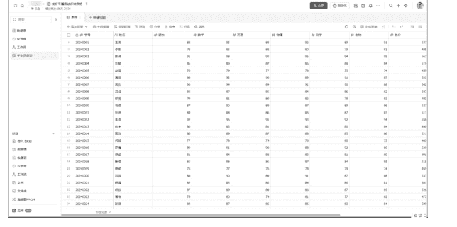

图 4-14

#### 2. 汇总信息

下达指令：

> 请帮我汇总各班级的平均成绩。

智能体可快速实现数据聚合，如图 4-15 和图 4-16 所示。

#### 3. 生成可视化图表

下达指令：

> 将汇总结果转换为图表格式。

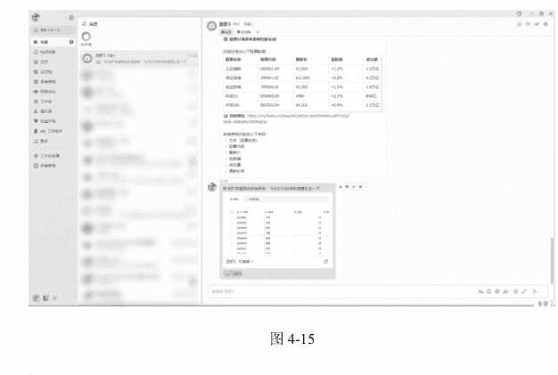

图 4-15

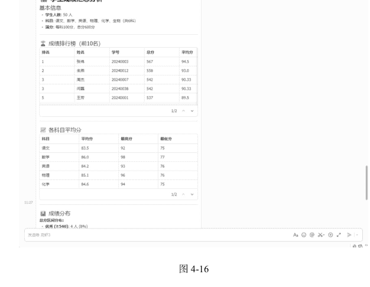

图 4-16

由于未开启文件创建权限，智能体仅能返回本地预览（而非直接写入云端），如图 4-17 所示。

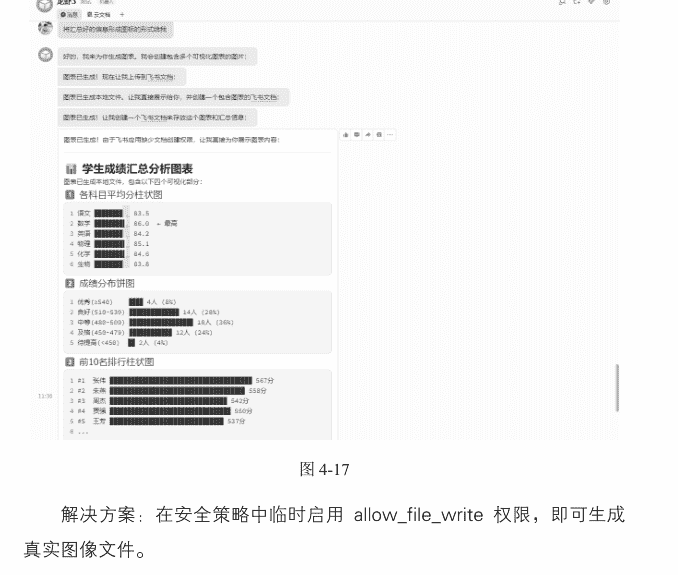

图 4-17

解决方案：在安全策略中临时启用 allow_file_write 权限，即可生成真实图像文件。

## 第 5 章 写东西：自媒体人的偷懒神器

本章将介绍如何使用 OpenClaw 的托管浏览器功能实现自动发帖，并以稀土掘金平台和小红书为例进行演示。通过学习本章内容，读者将能够理解自动发帖的三种实现方式及其适用场景，掌握托管浏览器的配置方法、MCP 服务的使用方法，以及 Skills 的安装流程，最终独立完成不同平台的自动发帖操作。在学习本章内容之前，读者需已完成 OpenClaw 的安装与基础配置，并具备基本的浏览器操作能力。

## 5.1 托管浏览器自动发帖

### 1. 自动发帖的实现方式

在自动化操作场景中，OpenClaw 支持多种方式实现自动发帖功能。了解各方式的特点及适用场景，有助于选择最合适的方案。

1）自动发帖实现方式对比（见表 5-1）

表 5-1

| 方式 | 原理 | 优点 | 缺点 | 适用场景 |
| :--- | :--- | :--- | :--- | :--- |
| MCP 服务对接 | 通过平台提供的官方 MCP 接口进行交互 | 安全可靠、符合平台规范 | 依赖平台是否提供 MCP 服务 | 平台已开放 MCP 接口 |
| API 直接调用 | 绕过前端，直接调用平台后端 API | 实现简单、效率高 | 可能违反平台规则、存在封号风险 | 不推荐常规使用 |
| 托管浏览器 | 模拟真实用户的浏览器操作行为 | 安全性高、操作可追溯 | 相对复杂、依赖浏览器环境 | 通用场景，推荐使用 |

2）推荐方案的托管浏览器

托管浏览器方式的核心优势在于能够完全模拟真实用户的操作流程。OpenClaw 通过浏览器插件与用户已登录的浏览器建立连接，在不获取账号密码的前提下，以用户身份执行自动化操作。此方式具有较高的安全性，因为无须暴露账号凭证，操作均在用户自身的浏览器中进行。同时，它还具有较好的合规性，操作行为与普通用户一致，不易触发平台的风控机制；此外，托管浏览器方式还具有广泛的适用性，理论上支持所有基于浏览器的 Web 平台。

托管浏览器的工作流程分为四个步骤：首先是连接建立，浏览器插件通过 Token 与本地 OpenClaw 服务建立 WebSocket 连接;接下来是指令接收，OpenClaw 将操作指令发送至浏览器插件;然后是动作执行，插件在浏览器中执行页面导航、元素定位、内容填充等操作;最后是结果反馈，执行结果通过连接返回至 OpenClaw。

### 2. 配置托管浏览器

1）安装浏览器插件

（1）下载安装 Chrome 浏览器（如果已经安装可以跳过）。

（2）打开 Chrome 浏览器。

（3）单击图 5-1 中的图标①> “拓展程序” > “访问 Chrome 应用商店”，进入 Chrome 应用商店页面，如图 5-2 所示。

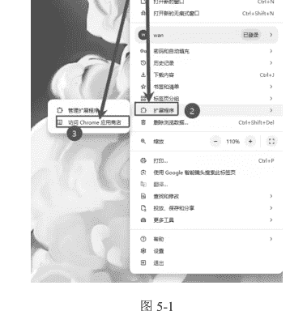

图 5-1

（4）在搜索栏中输入 “OpenClaw Browser Relay”，如图 5-3 所示。

（5）单击 “OpenClaw Browser Relay” 插件，在弹出的页面中单击 “添加至 Chrome” 按钮，如图 5-4 所示。

（6）在弹出的对话框（见图 5-5）中单击 “添加拓展程序” 按钮，继续安装。


# 热门类别

- 购物
- 娱乐
- 工具
- 艺术与设计
- 无障碍

# wan，您可能会喜欢


图 5-2


图 5-3


图 5-4

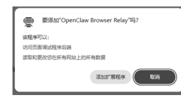

图 5-5

（7）至此，“OpenClaw Browser Relay” 插件安装成功，如图 5-6 所示。

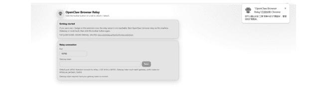

图 5-6

2）获取认证 Token

Token 用于浏览器插件与 OpenClaw 服务之间的身份验证。在 OpenClaw 安装目录下（通常为 C:\Users\用户名\openclaw）找到 openclaw.json 配置文件，定位至 “gateway” 下的配置项，复制其中的 “token” 值即可：

```json
"gateway": {
    "mode": "local",
    "auth": {
        "mode": "token",
        "token": "xxxxx"
    }
}
```

> ⚠️ **安全提示**

Token 是连接 OpenClaw 服务的凭证，请妥善保管，切勿泄露，以保障账户安全。

3）配置插件

（1）打开“OpenClaw Browser Relay”插件，将 Token 粘贴至配置项中，如图 5-7 所示。

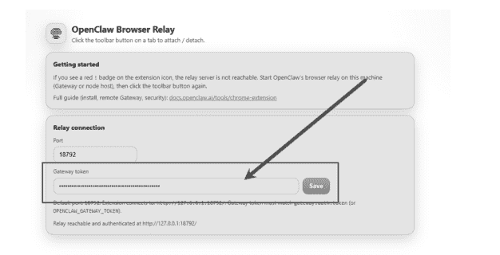

图 5-7

（2）单击浏览器工具栏中的插件图标，状态显示为“ON”即表示配置成功，如图 5-8 所示。

（3）配置成功后，浏览器将显示连接提示，如图 5-9 所示。


图 5-8

图 5-9

### 3. 执行自动发帖

1）登录目标平台

在使用托管浏览器功能前，需确保已在浏览器中登录目标平台账号。以稀土掘金网站（https://juejin.cn）为例。

（1）打开稀土掘金的网址，如图 5-10 所示。


图 5-10

（2）如图 5-11 所示，单击“登录/注册”按钮（如未注册可以先注册账号）。


图 5-11

（3）登录成功后的界面中可以看到如图 5-12 所示的内容。


图 5-12

2）发送操作指令

（1）回到 OpenClaw 所在的主机，在终端中输入指令“openclaw gateway”，以启动 OpenClaw 服务（如果服务已启动，可忽略此步骤）。

（2）打开另一个终端，输入指令“openclaw dashboard”打开可视化面板，如图 5-13 所示。

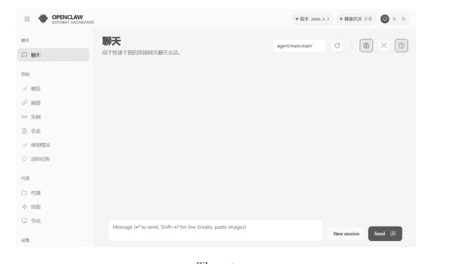

图 5-13

（3）输入所需操作指令，如图 5-14 中所示。


图 5-14

（4）提交指令后，OpenClaw 将开始自动执行发帖操作。如果过程中出现问题，OpenClaw 会在对话窗口中反馈错误信息，并根据上下文自动调整操作流程。用户也可以根据错误提示手动干预，协助 OpenClaw 完成发布任务。

（5）操作完成后，OpenClaw 会在对话窗口中返回结果。用户也可以切换到浏览器，打开稀土掘金页面，确认帖子是否已成功发布，如图 5-15 所示。


图 5-15

## 5.2 小红书一键自动发帖

前一节介绍了使用托管浏览器方式在稀土掘金网站上实现自动发帖的方法。本节将介绍另一种实现方式——通过 MCP 服务对接方式实现自动发帖，并以小红书平台为例进行演示。

与托管浏览器方式不同，MCP 服务对接方式依赖平台是否提供官方 MCP 接口。小红书目前提供了相应的 MCP 服务，并且在 ClawHub（OpenClaw 官方 Skills 市场）上已有公开的 Skills，用户可以方便地复用这些 Skills 来实现自动发帖功能。

相比托管浏览器方式，MCP 服务对接方式具有以下优势：

- 配置更简单：无须手动配置浏览器插件和 Token。
- 稳定性更高：官方接口通常更加稳定可靠。
- 功能更完整：MCP 服务通常可提供更丰富的操作能力。

具体实现步骤如下所述。

（1）打开 ClawHub 网站，如图 5-16 所示。

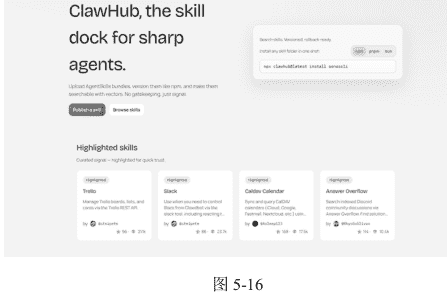

（2）如图 5-17 所示，单击顶部导航栏的“Search”，进入 Skills 搜索页面。


图 5-17

（3）如图 5-18 所示，在新打开的页面搜索框中输入关键字“xiaohongshu”，找到名称为“Xiaohongshu (小红书) Automation”的 Skill。


图 5-18

（4）单击“Xiaohongshu (小红书) Automation”Skill，可以查看其详细信息，如图 5-19 所示。

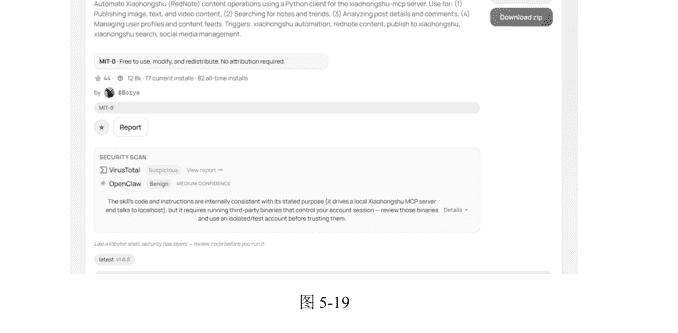

图 5-19

（5）在浏览器地址栏中直接复制 Skill 名称 “xiaohongshu-mcp”。

（6）回到 OpenClaw 的聊天窗口中，输入 “请安装和使用这个 skill ‘xiaohongshu-mcp’，帮我发布一篇关于冬日养生饮食的小红书文章。” 指令，开始运作，如图 5-20 所示。


图 5-20

（7）首次使用该 Skill 时，需要进行登录配置。OpenClaw 会在对话窗口中显示提示信息，同时在电脑上弹出小红书登录页面，如图 5-21 和图 5-22 所示。

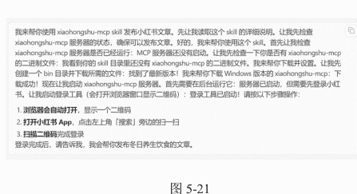

图 5-21

（8）在弹出的登录页面中完成账号登录操作。登录成功后，回到 OpenClaw 对话窗口确认登录已完成，OpenClaw 将自动继续执行发帖操作，如图 5-23 所示。


图 5-22


图 5-23

（9）等待 OpenClaw 完成操作，对话窗口将显示执行结果提示，如图 5-24 所示。

（10）切换到小红书页面，确认帖子已成功发布，如图 5-25 所示。


图 5-24


图 5-25

（11）后续再次执行小红书发布任务时，由于已完成登录配置，OpenClaw会直接执行发帖操作，无须重复登录。

## 5.3 OpenClaw 帮你改造完美简历

### 1. OpenClaw 与简历优化

在求职过程中，一份优秀的简历能够显著提升被雇主关注的机会。OpenClaw 作为强大的开源 AI 智能体，不仅可以回答问题和提供创意，还能直接参与简历的生成与优化，帮助求职者打造专业且能够顺利通过 ATS（Applicant Tracking System，招聘系统）筛选的简历。OpenClaw 的简历优化能力主要体现在以下几个方面：

- 自动生成简历内容：OpenClaw 可以根据用户提供的工作经历、教育背景、技能清单和目标职位，自动撰写简历内容并进行专业排版。它会从模板中选择合适的格式，遵循简历写作最佳实践，确保生成的简历结构清晰、措辞专业。
- 自定义与针对性修改：针对特定职位要求，OpenClaw 可定制修改现有简历。它会分析用户提供的职位描述，识别所需技能和关键词，然后将这些要素融入简历中，使其更符合目标岗位要求。例如，重新排序求职者的经历、突出与职位相关的成就，并自然融入专业术语。
- 简历内容分析：OpenClaw 能够审阅简历内容，并提供具体改进建议。它会检查简历各部分是否符合写作准则，评估内容质量、格式及 ATS 兼容性，指出需要优化的地方，如措辞不够量化、缺乏关键技能等。
- 导出为对 ATS 友好的 PDF 文件：优化完成后，OpenClaw 可将简历生成为 PDF 文件供用户下载。该 PDF 遵循 ATS 兼容格式（不使用表格、文本框或图形等可能被 ATS 过滤的元素），方便求职者提交至招聘系统。

OpenClaw 的简历优化流程可概括为以下几个关键步骤，如图 5-26 所示，展示了从初始输入到最终优化简历输出的完整流程。

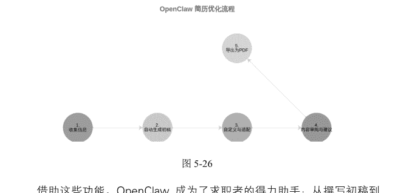

借助这些功能，OpenClaw 成为了求职者的得力助手：从撰写初稿到最终打磨，整个过程都能依托 AI 智能体的力量，帮助求职者打造脱颖而出的简历。

### 2. OpenClaw 简历优化的关键步骤

（1）收集信息：用户提供自己的工作经历、教育背景、技能清单和目标职位描述等信息，这些将成为简历生成的基础。

（2）自动生成初稿：OpenClaw 会根据用户提供的信息自动生成简历初稿。它会选择合适的简历格式（如时间顺序型、功能型或混合型），并按照模板填充内容。生成的初稿通常包括求职者的职业概况、工作经历描述和教育背景等核心信息。

（3）自定义与适配：如果用户有特定职位需求，OpenClaw 会针对性地修改简历。它会分析目标职位描述中的关键技能和要求，并将这些要素融入简历。例如，突出与职位相关的成就、调整技能清单的顺序以匹配职位需求，并在简历的各个部分自然融入职位所需的专业术语。

（4）内容审阅与建议：OpenClaw 会审阅优化后的简历内容，依据简历写作准则和 ATS 兼容性进行评估。它会指出简历的优点与不足，如措辞是否清晰、成果是否量化、技能是否匹配职位要求，并提供具体改进建议，包括如何使描述更具说服力以及如何突出关键能力。

（5）导出为 PDF 文件：经过优化和审阅后，OpenClaw 会将最终的简历内容导出为 PDF 文件，供用户下载。生成的 PDF 文件会遵循对 ATS 友好的格式，避免复杂的排版和图像，确保能够被招聘系统正确解析。用户可以下载该 PDF 文件并用于求职投递。

通过以上步骤，OpenClaw 帮助用户系统地完成了从准备材料到最终优化输出的全过程。每个步骤都充分利用了 AI 的智能性，大大减轻了用户手动编写和修改简历的负担。

### 3. OpenClaw 推荐的简历写作技巧

OpenClaw 在生成和优化简历时，会推荐一系列简历写作的最佳实践技巧。这些技巧不仅可以提高简历的可读性和专业性，更有助于简历通过 ATS 筛选。以下是 OpenClaw 推荐的一些简历写作技巧：

- **清晰的结构与格式**：简历应具有清晰的结构和一致的格式，通常包括姓名、联系方式、职业概况、工作经历、教育背景和技能清单等部分。OpenClaw 会自动按照模板组织这些内容，确保层次分明、各部分衔接顺畅。格式方面，OpenClaw 会使用统一的字体、字号和间距，使简历整体整洁、专业。
- **突出关键成就**：在描述工作经历时，应使用量化成果突出个人贡献。例如，“提升部门效率 30%”“将销售额提高 20%”等具体数字，比泛泛的描述更有说服力。OpenClaw 会建议用户在简历中加入这类量化数据，以展示自己的能力和实际影响力。
- **技能关键词匹配**：针对所申请的职位，应在简历中融入职位要求的技能和关键词。OpenClaw 会分析职位描述，提取关键技能和术语，并将这些关键词自然地融入简历的技能清单和工作经历描述中。这种做法可提高简历通过 ATS 关键词筛选的概率，增加被招聘系统检索到的机会。

针对性定制：不要使用同一份简历申请所有职位，应根据不同岗位需求进行定制修改。OpenClaw 建议用户为每个申请的职位准备不同版本的简历，重点突出与该职位相关的经历和技能。例如，申请技术岗位时，强调技术能力和项目成果；申请管理岗位时，则突出领导力和团队管理经验。OpenClaw 能帮助用户快速调整简历重点，使其更好地匹配各类职位要求。

简洁明了的语言：简历内容应简洁、直接，避免使用冗长复杂的句子。使用主动语态来描述工作职责和成就，确保信息清晰、易懂。OpenClaw 会建议用户精简冗余的词汇，确保每句话可传达有效信息。例如，将“在项目中起到了积极的推动作用”改为“推动项目按时交付”，使表达更加简洁和明确。

ATS 友好格式：许多公司使用 ATS 系统筛选简历，因此，简历格式必须符合其要求。OpenClaw 强调简历应使用纯文本格式，避免使用表格、文本框、图片或复杂的排版。生成的 PDF 文件应保持简单易读，所有内容应以文本形式呈现，并避免使用特殊字符和格式，以防止被 ATS 过滤掉。

定期更新与优化：OpenClaw 建议求职者定期更新简历，确保内容的时效性和相关性。特别是在获得新技能、完成新项目或取得新成就时，应及时更新简历。此外，在每次申请之前，根据职位描述对简历进行微调，确保简历始终符合最新的招聘需求。

通过使用这些技巧，OpenClaw 生成的简历将更具竞争力。这些技巧不仅可帮助简历通过 ATS 筛选，也可使简历内容更加突出个人优势，提高求职者的面试机会。

### 4. AI 辅助下的简历优化实例

为了更直观地了解 OpenClaw 如何帮助优化简历，下面以一个具体的实例展示其工作流程。假设一位求职者正在申请软件工程师职位，并使用 OpenClaw 来优化自己的简历，整个流程如下：

技能清单以及目标职位的具体描述，OpenClaw 根据这些信息开始生成简历。

（2）初稿生成：根据输入内容，OpenClaw 自动生成了简历的初稿。初稿内容包括职业概况、工作经历摘要、教育背景和技能列表，整体结构采用时间顺序，内容简洁清晰，重点突出个人的专业背景和技能。

（3）定制与优化：在求职者反馈该职位要求数据库技能和项目管理经验后，OpenClaw 对简历进行了个性化的优化，如突显数据库经验，强调求职者在最近的项目中如何应用数据库管理技术，并将这些成就放在简历的显眼位置；调整技能顺序，将数据库相关技能放在技能清单的首位，以便与职位需求匹配；增强工作经历的相关性，在工作经历部分加入更多关于数据库和项目管理的细节，确保简历符合职位要求。

（4）审阅与建议：OpenClaw 对优化后的简历进行审阅，并提出改进建议，如量化成果，建议求职者补充更多可量化的成就描述，如“将项目部署效率提高了 20%”，使简历更加具体、具有说服力。

（5）增加项目总结，建议求职者在简历中增加一段关于数据库和项目管理经验的总结，便于 HR 更直观地看到其核心能力。

（6）生成 PDF 文件：根据所有修改和建议，OpenClaw 生成了最终版本的简历，并将其导出为 PDF 文件。求职者下载后查看，发现简历的格式专业、简洁，突出了个人优势，并且所有内容均为纯文本格式，完全符合 ATS 系统的筛选要求。

通过这一实例可以看出，OpenClaw 根据用户需求迅速调整简历内容，使其更契合目标职位要求。从初稿生成到最终优化，整个过程高效专业，显著提升了简历质量。

### 5. OpenClaw 简历优化技能的能力范围

OpenClaw 提供的简历优化技能（如 resume-optimizer）具备广泛功能，涵盖简历制作、编辑与分析的各个环节。表 5-2 详细列出了该技能的主要功能及对应的适用场景。

### 表 5-2

| 功能 | 描述 | 适用场景 |
|---|---|---|
| 创建新简历 | 根据用户提供的经历、教育、技能和目标职位，自动撰写一份新的简历 | 求职者需要从零开始制作简历 |
| 定制现有简历 | 对已有的简历内容进行修改，使其更符合特定职位的要求 | 求职者针对不同职位调整简历重点 |
| 内容分析与改进 | 审阅简历内容，评估其质量和格式，并提供具体的改进建议 | 求职者希望获得专业意见以提升简历质量 |
| ATS 优化 | 确保简历符合 ATS 系统的格式要求，避免使用 ATS 不能识别的元素 | 简历需通过 ATS 筛选的场景 |
| 生成 PDF 文件 | 将优化后的简历内容导出为可下载的 PDF 文件 | 求职者需要最终的 PDF 文件用于投递 |
| 格式建议 | 推荐简历各部分的合理顺序和内容组织方式 | 求职者希望了解简历写作的最佳结构 |
| 关键词整合 | 自动提取职位描述中的关键技能和术语，并融入简历内容 | 需要提高简历与职位匹配度的场景 |
| 语言风格优化 | 润色简历措辞，使其更专业、简洁、具有说服力 | 求职者希望简历语言更清晰有力 |

借助上述功能，OpenClaw 的简历优化技能覆盖了从撰写、修改到最终输出的全流程，帮助求职者打造一份专业、具竞争力且符合 ATS 要求的简历。

### 6. OpenClaw 与其他简历优化工具的对比

目前市面上存在多种简历优化工具，包括专业在线平台、传统生成软件及其他 AI 助手。与这些工具相比，OpenClaw 的简历优化功能具有独特的优势与劣势。表 5-3 从功能全面性、易用性、定制性和成本等维度，对 OpenClaw 与几种主流工具进行了对比。

### 表 5-3

| 工具 | 功能全面性 | 易用性 | 定制性 | 成本 |
|---|---|---|---|---|
| OpenClaw | 功能全面，涵盖简历撰写、定制、分析和 PDF 导出。支持多渠道使用和技能扩展 | 需要一定技术配置和学习成本，对技术用户较友好，新手需要熟悉 CLI 和配置 | 高度可定制，可通过 Skills 插件扩展功能，支持本地部署，用户对数据和隐私掌控度高 | 开源免费（自部署），仅需支付模型 API 费用，成本较低 |
| Jobscan | 主要提供简历 ATS 扫描和关键词优化功能，帮助识别简历与职位描述的匹配度 | 界面简单直观，使用方便。用户上传简历后即可获得分析报告 | 定制性一般，主要用于优化现有简历的关键词和结构。缺乏完整的简历撰写功能 | 订阅制，每月费用约$49，费用较高。适合频繁投递职位的求职者 |
| Novoresume | 提供简历模板和基本写作指导，支持 PDF 导出和基本格式调整。具备基本的 ATS 扫描功能（免费版有限） | 在线编辑器易用，适合新手使用。提供模板和示例，降低使用门槛 | 模板有限，高级定制需付费。免费版功能受限，需要升级才能获得更多设计选项 | 提供免费版和付费版。免费版功能有限，付费版每月费用为$10~$20。提供更多模板和分析功能 |
| FlowCV | 提供精美的简历模板和一些 AI 辅助写作功能，支持多语言简历，可在线预览和导出 PDF 文件 | 在线编辑界面友好，用户体验好。模板美观，上手容易 | 模板风格多样，但自定义功能有限。需要一定设计技能才能进行大幅修改 | 提供免费版和付费版。免费版有一定限制（如页面数量），付费版每月费用约$10，提供更多模板和无水印 PDF 文件下载 |
| Overleaf | 以 LaTeX 为基础，提供丰富的排版功能，用户可以完全自定义简历的每一处细节。但缺乏自动内容生成和优化功能 | 需要一定 LaTeX 知识，对新手不友好。适合有 LaTeX 技能的用户，否则学习成本较高 | 完全自定义，用户可以根据需求设计复杂的排版和格式。灵活性极高，但依赖用户技能 | 基础功能免费，高级功能需订阅。订阅费用较高（每年约$252），但对于重度 LaTeX 用户物有所值 |

注：上述价格为近似值，实际费用可能有所变化。

从对比中可以看出，OpenClaw 提供了最全面的简历优化功能，涵盖撰写、分析和输出，并支持高度定制与扩展。但其上手门槛较高，需要用户具备一定的技术配置和使用经验。相比之下，Jobscan、Novoresume 和 FlowCV 等工具在易用性上更为突出，适合无编程经验的求职者快速生成和优化简历，但功能较为单一，定制性有限。Overleaf 则以强大的排版能力为亮点，但需要掌握 LaTeX，且不提供自动内容生成。

因此，选择工具时应根据需求权衡：若追求全面功能和高度定制，且愿意投入学习时间，OpenClaw 是理想选择；若希望快速上手并获得基本优化，在线简历平台更为便捷。

### 7. OpenClaw 简历优化技能的安装与使用方法

OpenClaw 的简历优化技能（如 resume-optimizer）可通过 ClawHub 技能市场进行安装与管理。以下内容将详细介绍在 OpenClaw 中安装及使用该技能的具体步骤。

（1）确保 OpenClaw 环境已就绪：首先，确认 OpenClaw 智能体已正确安装并正常运行。如果尚未安装，可参考官方文档中的安装指南，在本地或云端进行部署。安装完成后，通过命令行或 Web 界面验证 OpenClaw 是否已成功启动。

（2）安装简历优化技能：通过 OpenClaw 提供的命令行工具或内置技能管理功能，从 ClawHub 安装 resume-optimizer 技能。例如，在终端中执行以下命令：

```
openclaw skill install openclaw/skills/skills/tomstools11/resume-optimizer
```

该命令会从社区技能库中提取 resume-optimizer 技能并安装到 OpenClaw 中。安装完成后，OpenClaw 即可调用该技能执行各类简历相关操作。

（3）配置技能（可选）：某些技能可能需要额外配置才能正常工作。resume-optimizer 技能通常需要指定简历的输出路径和格式。你可以通过编辑 OpenClaw 的配置文件或使用命令行来设置这些参数。例如，在 openclaw.json 中配置输出目录：

```
"skills": {
  "resume-optimizer": {
    "outputPath": "/mnt/user-data/outputs/",
    "format": "chronological"
  }
}
```

上述配置将简历以 PDF 格式输出到 /mnt/user-data/outputs/ 目录，并按时间顺序生成。配置完成后，保存并重启 OpenClaw 以使配置生效。

（4）使用技能生成简历：安装并配置好技能后，你就可以在与 OpenClaw 的对话中调用它来生成或优化简历。例如，发送以下提示：

> 请帮我创建一份新的简历。我有 5 年市场营销经验，主要负责品牌推广和数字营销。教育背景是市场营销学士。目标职位是市场经理。

OpenClaw 会使用 resume-optimizer 技能分析你的输入，自动生成一份新的简历。如果你希望优化已有简历，可以提供现有简历内容或职位描述，由 OpenClaw 进行相应调整。例如：

> 这是我的简历内容：……。请根据这个职位描述 [粘贴职位描述] 来优化它。

OpenClaw 会调用技能对简历进行修改，并在回复中提供优化后的内容和建议。

（5）获取优化结果：完成简历优化后，OpenClaw 通常会在回复中附上简历的文本内容，并提供一个下载链接或文件，指向生成的 PDF 版本简历。例如，回复可能类似：

> 以下是为您生成的简历内容：……。您可以通过以下链接下载 PDF 版本：computer:///path/to/resume.pdf

单击链接，即可下载优化后的简历 PDF 文件，用于求职投递。

通过以上步骤，你就可以顺利在 OpenClaw 中使用简历优化技能，提升求职竞争力。安装和配置过程相对简单，实际使用时只需与 OpenClaw 进行自然语言交互，即可获得专业的简历生成和优化服务。

# 第6章 学习和作业：大学生的全能数字学霸助理

本章引言：告别期末熬夜，你的全能数字学霸助理上线。

## 6.1 一句话搞定课程设计

高校课程设计是检验学生工程能力的重要环节，但环境配置、代码调试和文档撰写等往往耗费学生大量时间。本章引入以 OpenClaw 为代表的 AI 智能体作为编程协作工具，通过合理选择大模型并设计结构化提示词，实现 C 语言系统与前端项目的端到端自动生成。全章以真实实训任务为驱动，展示如何在数分钟内完成符合评分标准的可运行项目及配套报告，为学生提供高效、可靠的开发范式。

### 1. 选择模型

智能体的输出质量高度依赖底层大语言模型的能力。建议选择具备强代码生成能力、支持长上下文和工具调用的模型，如智谱 AI 的 GLM-5。该模型在 C/C++、JavaScript 等语言的理解与生成任务中表现优异，同时对中文技术文档的兼容性良好。

在 OpenClaw 或类似智能体框架中，用户无须手动配置 API 参数，只需在指令中声明模型名称。本章所使用的模型为 zhipu/glm-5，其在智能体平台中的配置界面如图 6-1 所示。

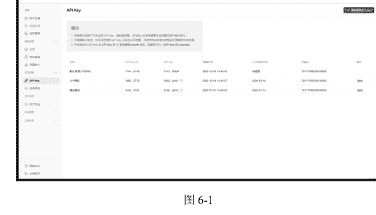

### 2. 开始实战：C 语言课程设计

选择好模型后，即可开始实战。在此阶段，可以直接向智能体提供模型信息，智能体会自动完成配置，能够根据用户指令自动完成模型绑定，如图 6-2 所示。

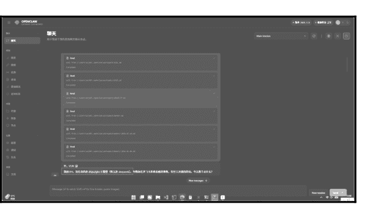

向智能体提交任务时，提示词（Prompt）的质量直接决定了输出的完整性。建议采用以下结构。

1. 明确身份：“我是一名计算机专业大一学生”；
2. 说明目标：“需完成 C 语言课程设计”；
3. 提供完整需求文档（包括功能列表、技术规范、评分标准）。

例如，用户可以首先让 AI 生成一份标准实训要求（见图 6-3），也可以直接粘贴已有的任务书。

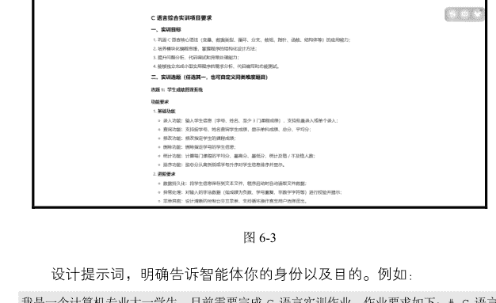

设计提示词，明确告诉智能体你的身份以及目的。例如：

我是一个计算机专业大一学生，目前需要完成 C 语言实训作业，作业要求如下：

# C 语言综合实训项目要求

## 一、实训目标

- 巩固 C 语言核心语法（变量、数据类型、循环、分支、数组、指针、函数、结构体等）的应用能力；
- 培养模块化编程思维，掌握程序的结构化设计方法；
- 提升问题分析、代码调试和异常处理能力；
- 能够独立完成小型实用程序的需求分析、代码编写和功能测试。

## 二、实训选题（任选其一，也可自定义同类难度题目）

### 选题 1：学生成绩管理系统

#### 功能要求

##### 基础功能

- 录入功能：输入学生信息（学号、姓名、至少 3 门课程成绩），支持批量录入或单个录入；
- 查询功能：支持按学号、姓名查询学生成绩，显示单科成绩、总分、平均分；
- 修改功能：修改指定学生的课程成绩；
- 删除功能：删除指定学号的学生信息；
- 统计功能：计算每门课程的平均分、最高分、最低分，统计及格/不及格人数；
- 排序功能：按总分从高到低或学号升序对学生信息排序并显示。

##### 进阶要求

- 数据持久化：将学生信息保存到文本文件，程序启动时自动读取文件数据；
- 异常处理：对输入的非法数据（如成绩为负数、学号重复、非数字字符等）进行校验并提示；
- 菜单界面：设计清晰的控制台交互菜单，支持循环操作直至用户选择退出。

### 选题 2：简易图书管理系统

#### 功能要求

##### 基础功能

- 入库功能：录入图书信息（书号、书名、作者、出版社、库存数量、价格）；
- 借阅功能：录入借阅人姓名、借阅书号，扣减对应图书库存（库存不足时提示）；
- 归还功能：录入归还书号，增加对应图书库存；
- 查询功能：按书名/书号查询图书信息（库存、价格等），查询借阅记录；
- 统计功能：统计库存为 0 的图书、总价最高的图书、借阅次数最多的图书。

##### 进阶要求

- 数据持久化：图书信息和借阅记录保存到文本文件；
- 异常处理：校验书号重复、库存负数、非法价格等输入错误；
- 菜单交互：设计控制台菜单，支持循环操作。

### 选题 3：简易计算器

#### 功能要求

##### 基础功能

- 支持加减乘除、取余、平方、开方（非负）等基本数学运算；
- 支持多位数输入，支持连续运算（如 1+2*3-4）；
- 输入错误时（如除数为 0、非数字输入、开方负数）给出明确提示。

##### 进阶要求

- 支持括号优先级运算（如 (1+2)*(3-4)）；
- 记录最近 10 次运算历史，支持查看和清空历史记录；
- 菜单化操作，选择运算类型、退出等。

## 三、技术要求

### 语法规范

- 变量命名符合规范（见名知意，如 student_id 而非 a1）；
- 代码缩进统一（建议 4 个空格），注释完整（函数、关键逻辑需注释）；
- 避免全局变量滥用，核心功能封装为函数（如 add_student()、query_score()）。

### 核心技术

- 必须使用数组/结构体存储批量数据（如 struct Student 存储学生信息）；
- 至少使用 1 次指针操作（如函数参数传递指针实现数据修改）；
- 循环、分支结构逻辑清晰，避免死循环；
- 进阶功能需使用文件操作（fopen()、fwrite()、fread() 等）。

### 调试与测试

- 程序运行无崩溃，输入非法数据时不闪退；
- 提供至少 3 组测试用例（如录入 3 个学生→查询→修改→删除→统计），验证功能完整性。

## 四、实训交付物

- 源代码文件：.c 源文件（可包含多个，如 main.c、student.c、student.h）；
- 实训报告（不少于 800 字）；
  - 需求分析：明确程序要实现的功能、解决的问题；
  - 设计思路：模块化设计（画出功能模块图）、核心数据结构定义、关键函数说明；
  - 代码实现：核心代码片段+注释解释，说明关键逻辑；
  - 测试结果：测试用例、运行截图、遇到的问题及解决方法；
  - 实训总结：收获、不足、改进方向。
- 运行说明：标注编译环境（如 Dev-C++、VS2022、Linux GCC）、编译命令（如 gcc main.c -o app）。

## 五、实训时间安排（总计 1 周，5 个工作日）

| 阶段 | 时间 | 任务 |
| :--- | :--- | :--- |
| 阶段 1 | 第 1 天 | 需求分析、模块设计、数据结构定义 |
| 阶段 2 | 第 2～3 天 | 核心功能代码编写（基础功能优先） |
| 阶段 3 | 第 4 天 | 进阶功能开发、代码调试、异常处理 |
| 阶段 4 | 第 5 天 | 测试、修复 bug、撰写实训报告 |

## 六、评分标准（总分 100 分）

| 评分项 | 分值 | 评分要点 |
| :--- | :--- | :--- |
| 功能完整性 | 40 | 基础功能全部实现（30 分），进阶功能实现（10 分） |
| 代码规范 | 20 | 命名规范、缩进统一、注释完整、模块化设计 |
| 调试与鲁棒性 | 15 | 无崩溃、非法输入处理、测试用例覆盖 |
| 实训报告 | 15 | 内容完整、逻辑清晰、截图/测试用例真实 |
| 答辩/演示 | 10 | 能清晰讲解代码逻辑，回答评委关于语法、设计的问题 |

## 总结

1. 实训核心围绕 C 语言核心语法+模块化编程展开，选题聚焦小型实用系统，兼顾基础与进阶要求；
2. 交付物需包含可运行代码+实训报告，重点考察代码实现能力和问题分析总结能力；
3. 评分维度覆盖功能、规范、鲁棒性、文档，全面评估实训成果。

可根据实训时长、学生基础调整进阶要求（如简化文件操作、删减部分统计功能），或增加选做功能（如排序算法优化、界面美化）。

你可以帮我在桌面上完成上述作业吗

智能体在数分钟内完成以下工作：

（1）创建项目文件夹；
（2）生成模块化源码（main.c, student.c, student.h）；
（3）实现数据持久化（data.txt）；
（4）输出 Markdown 格式的实训报告。

提交的任务指令如图 6-4 中所示。

没多久，它就已经在桌面上创建好了文件夹，如图 6-5 所示。

同时，源码与实训报告也均已生成，如图 6-6 所示。

在操作过程中，我们可以根据智能体的提示双击运行.exe 文件。如图 6-7 所示，有时会出现乱码。此时无须慌张，只需将期望的输出格式告

## 112 | 零基础玩转 OpenClaw：让“龙虾”替你 24 小时赚钱

知智能体（见图 6-8），它即可自动完成转换操作（见图 6-9）。可以看到，整个过程中智能体直接根据问题进行处理，甚至无须打开相关代码文件。

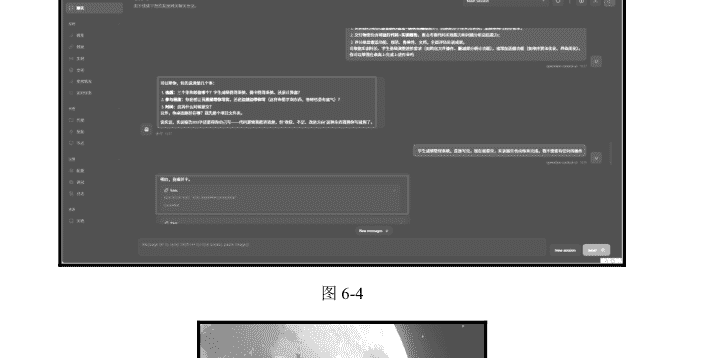


## 第 6 章 学习和作业：大学生的全能数字学霸助理 | 113

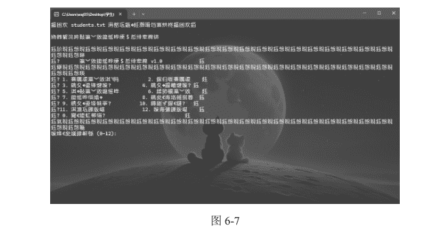

图 6-7

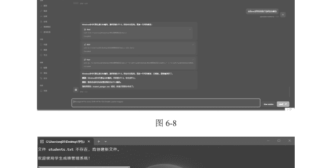

图 6-8


图 6-9

### 3. 功能测试与报告交付

系统生成的学生成绩管理系统完整实现了实训要求中的全部核心功能，经人工验证，运行稳定、交互流畅。主要功能测试如下。

录入学生信息：支持单条或批量输入学号、姓名及多门课程成绩，具备基本格式校验能力，如图 6-10 所示。


按学号查询：输入有效学号后，准确返回该学号对应学生的各科成绩、总分与平均分，如图 6-11 所示。


按姓名查询：支持中文姓名匹配，可处理同名情况并列出所有结果，如图 6-12 所示。

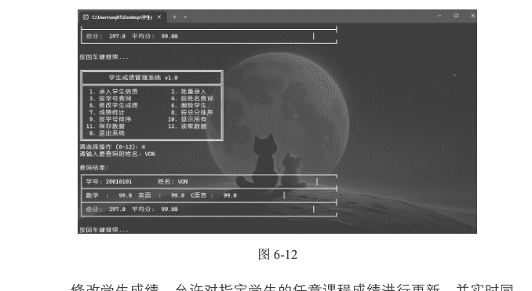

图 6-12

修改学生成绩：允许对指定学生的任意课程成绩进行更新，并实时同步至内存与文件中，如图 6-13 所示。

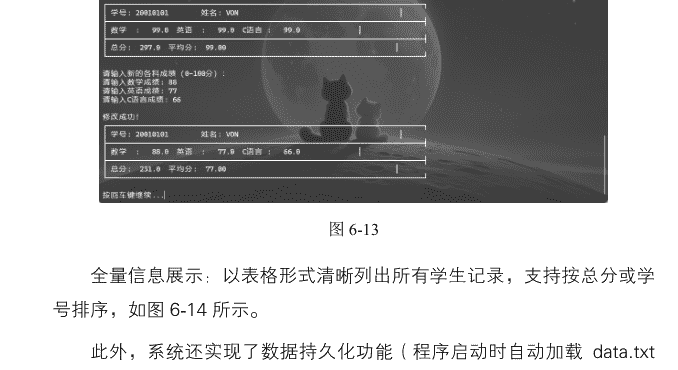

图 6-13

全量信息展示：以表格形式清晰列出所有学生记录，支持按总分或学号排序，如图 6-14 所示。

此外，系统还实现了数据持久化功能（程序启动时自动加载 data.txt 文件）、异常处理（如成绩越界、学号重复等）以及统计分析功能（各科平均分、最高/最低分、及格率等）。由于篇幅限制，其他功能未逐一截图展示，但经过多轮测试，代码逻辑严谨，未出现崩溃情况，完全满足评分标准中对“功能完整性”和“调试鲁棒性”的要求。


### 4. 前端项目实战

首先，我们可以让 AI 生成一份标准的前端项目要求文档，或者直接提供自定义的需求文档（例如，如图 6-15 所示）。


然后将项目需求提供给 OpenClaw 智能体，它会根据需求生成并运行代码，如图 6-16 所示。

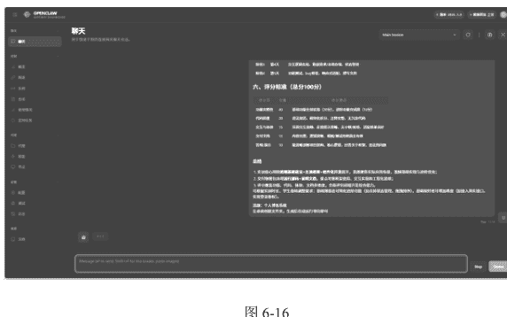

图 6-16

从图 6-17 中可以看到，OpenClaw 智能体会自动下载所需的开发环境。

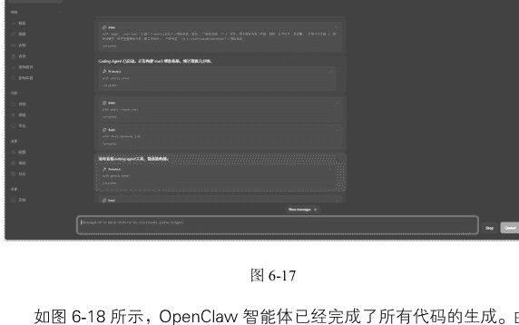

图 6-17

如图 6-18 所示，OpenClaw 智能体已经完成了所有代码的生成。由于项目较大，可能需要一些时间才能全部完成。

## 118 | 零基础玩转 OpenClaw：让“龙虾”替你 24 小时赚钱


图 6-18

在运行过程中，可以按 F12 键打开浏览器控制台查看输出信息。如果出现报错，只需将错误信息反馈给 OpenClaw 智能体即可，如图 6-19 所示。


图 6-19

当控制台中不再出现报错信息时，即表示代码已成功运行，如图 6-20 所示。

项目展示如下。

- （1）个人中心：允许用户编辑个人信息，如图 6-21 所示。
- （2）发布博客：集成富文本编辑器，支持多种格式输入，如图 6-22 所示。

## 第 6 章 学习和作业：大学生的全能数字学霸助理 | 119

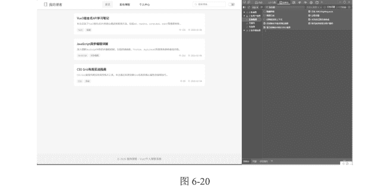

图 6-20


图 6-21


图 6-22

- （3）首页展示：显示文章列表，支持分页加载，如图 6-23 所示。

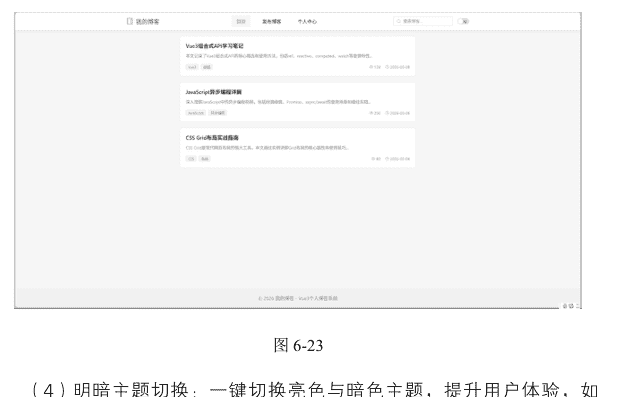

图 6-23

- （4）明暗主题切换：一键切换亮色与暗色主题，提升用户体验，如图 6-24 所示。

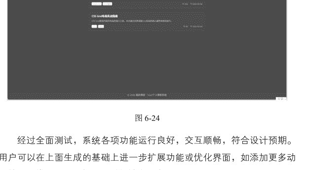

图 6-24

经过全面测试，系统各项功能运行良好，交互顺畅，符合设计预期。用户可以在上面生成的基础上进一步扩展功能或优化界面，如添加更多动画效果、优化 SEO 标签、增加社交分享功能等。

此外，智能体生成的代码具有良好的可维护性，便于后续迭代和升级。读者可根据实际需求，继续完善项目功能，以满足更复杂的业务场景。

## 6.2 OpenClaw：查资料、写报告、整理文献、做 PPT “一条龙”服务

每逢期末季或论文开题阶段，大学生的生活往往被“三座大山”压得喘不过气：第一座大山是海量文献找不全，在知网、PubMed、arXiv 等数据库之间来回切换，下载的 PDF 堆积如山却无从下手；第二座大山是报告撰写无从落笔，面对空白的 Word 文档，光标闪烁了半小时，脑海中的碎片化信息却无法拼凑成严谨的逻辑大纲；第三座大山则是排版、做 PPT 耗时耗力，好不容易写完了报告，还要为了组会汇报熬夜调整 PPT 字体、对齐图表，耗尽了最后一丝精力。

传统的 AI 聊天机器人（如早期的 ChatGPT 或文心一言）虽能回答问题，但它们活在一个“虚拟的文本框”里。例如，你让它帮你查询最新的 API 文档，它只能告诉你“我的知识截止到某某时间”；你想让它帮你自动下载论文并排版成 PPT，它既无法操作浏览器，也无法在本地计算机上生成 PPT 文件。

直到 2026 年，一个名为 OpenClaw（原名 Clawdbot）的开源项目横空出世，彻底改变了这一现状。它不仅仅是一个“会说话的大脑”，更是一个拥有“数字手脚”的本地 AI 智能体框架。它能执行真实的 Shell 命令、管理计算机文件、控制浏览器实现自动化操作，甚至能直接调用 API 生成精美的 PPT 文件。

本节的目标非常明确：我们将跳出晦涩的代码和复杂的编程逻辑，通过纯自然语言指令（零代码），手把手教你如何利用 OpenClaw 构建“查资料-写报告-做 PPT”的自动化“一条龙”服务。无论你是文科生需要整理海量文献，还是理工科生需要处理实验数据并生成汇报，OpenClaw 都能将原本需要数天的工作量压缩至几个小时甚至几十分钟。

想象一下这样的场景：你在微信里发了一条语音指令：“帮我搜索关于‘大模型在教育中应用’的最新 5 篇高引论文，提取核心观点，写一份 3000 字的调研报告，最后排版成 20 页的商务风格 PPT 发给我。”几分钟后，一份排版精美、数据准确的 .pptx 文件就静静地躺在了你的聊天界面里。这不是科幻电影，而是 OpenClaw 已经实现的日常功能。

### 1. 零门槛准备：把 OpenClaw 装进你的聊天软件

很多非计算机专业的同学一听到“开源项目”“部署”“终端”这些词就会望而却步。但请放心，经过 2026 年的版本迭代，OpenClaw 已将安装门槛降到了最低。你不需要懂 Python，也不需要配置复杂的环境变量。

#### 1）轻量级部署：云端与本地的抉择

对于大学生群体，我们推荐两种主流且便捷的部署方式：

**方案一：云端一键部署（强烈推荐）**

如果你使用的是 Windows 计算机，或者希望你的 AI 助理能够每天 24 小时不间断运行（例如夜间帮你监控抢课信息或爬取数据），云端部署是最佳选择。目前，腾讯云轻量应用服务器（Lighthouse）和阿里云均提供了 OpenClaw 的专属应用镜像。你只需在控制台单击几下鼠标，选择“OpenClaw 智能简报生成器”镜像，系统就会自动完成 Docker 环境的配置和 OpenClaw 的安装。此方案成本极低，通常每月仅需几十元，且免去了本地环境冲突的困扰。

**方案二：Mac 本地一键安装（见图 6-25）**

如果你拥有一台 Mac 计算机（尤其是 M 系列芯片），那么本地部署将为你带来最佳使用体验。本地部署不仅没有服务器成本，而且利用 OpenClaw 可以直接操作你计算机上的日历、备忘录和本地文件系统，隐私安全性最高。你只需要打开 Mac 自带的“终端”（Terminal）应用，复制并运行官方提供的一行命令：

```
curl -fsSL https://openclaw.ai/install | bash
```

安装向导将自动检测 Node.js 环境并完成配置，整个过程通常不超过 5 分钟。

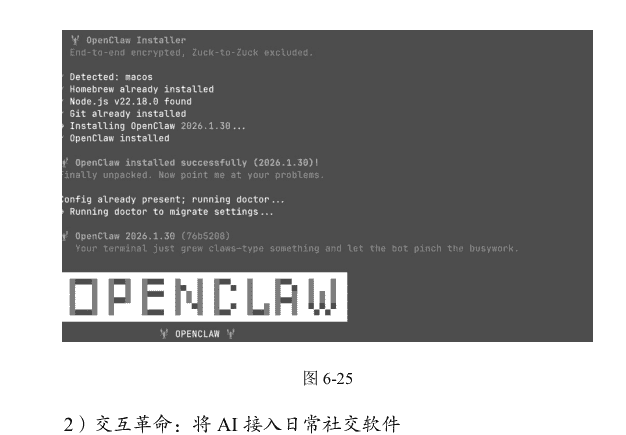

#### 2）交互革命：将 AI 接入日常社交软件

OpenClaw 最迷人的地方在于它的“前台”设计。你不需要登录一个陌生的网页后台去和它对话，而是可以将它直接接入你每天都在使用的社交软件中。OpenClaw 原生支持超过 20 种通信渠道（Channels），如图 6-26 所示。

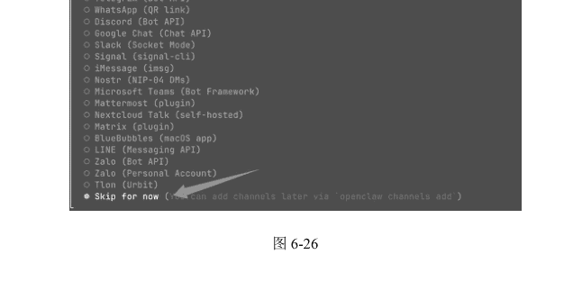

对于国内大学生而言，飞书和企业微信是体验最好的选择。以飞书为例，你只需在飞书开放平台创建一个自定义机器人，获取 App ID 和 App Secret，填入 OpenClaw 的配置向导中，你的飞书联系人列表里就会多出一个 24 小时在线的“数字学霸助理”。你可以随时随地用手机给它发送语音指令，或者把老师刚发的 PDF 课件直接转发，让它进行总结。

### 2. 核心概念：理解技能（Skills）生态

在开始干活之前，我们需要理解 OpenClaw 的灵魂机制——技能（Skills）。如果把 OpenClaw 比作一部刚买来的智能手机，那么大模型（如 Claude 3.5、Kimi、DeepSeek 等）就是它的操作系统和 CPU，而 Skills 就是你从应用商店下载的各种 App。

没有 Skills，OpenClaw 只是一个聪明的聊天机器人；装上了 Skills，它就长出了“手脚”。例如，安装了 @openclaw/file-organizer，它就能帮你批量重命名和整理下载的文献；安装了 @openclaw/browser-control，它就能帮你打开知乎爬取高赞回答。目前，官方的 ClawHub 技能广场和社区已经贡献了超过 1800 个企业级和个人实用的 Skills。

### 3. 全网资料检索与学术文献精准查找

写报告的第一步永远是资料收集。传统的做法是打开众多浏览器标签页，在搜索引擎、知网、学术论坛之间疲于奔命。现在，我们将这些烦琐的检索工作全部“外包”给 OpenClaw。

#### 1）突破信息滞后：配置强大的联网搜索

为使 AI 能够获取最新动态（例如，昨天刚发布的某项行业政策，或上周开源的某技术框架等），我们需要为 OpenClaw 配置联网搜索能力。根据 OpenClaw 联网搜索配置指南，目前有三种主流方案：

- **Brave Search API（官方推荐）**：拥有独立的网页索引，不依赖 Google 或 Bing，隐私保护性能优异。免费计划每月提供 2000 次搜索，足以满足大学生日常查资料查询需求。
- **Tavily MCP（专为 AI Agent 设计）**：Tavily 不仅能搜索网页，还能自动提取网页核心内容并进行 AI 优化过滤，非常适合需要深度理解网页信息的检索增强生成（RAG）场景。
- **内置 WebSearch**：如果你使用的是基于 Anthropic Claude 的模型，OpenClaw 内置了直接调用服务端搜索的能力，可开箱即用。

配置完成后，你可以在聊天界面直接下达指令：

> “请使用联网搜索功能，帮我查一下 2026 年第一季度国内新能源汽车市场的销量数据，并列出排名前三的品牌及其市场份额。”

OpenClaw 会自动调用搜索引擎，抓取最新新闻和财报数据，并在几秒钟内给你一个准确的答复，从而彻底告别 AI 的“幻觉”和信息滞后问题。

#### 2）学术文献自动挖掘：Scientify 插件的“降维打击”

对于需要撰写学术论文或深度调研报告的同学来说，普通的网页搜索远远不够。这时候，我们需要引入一个堪称“科研神器”的 OpenClaw 专属插件——Scientify。

Scientify 是一个专为自动化完整学术研究工作流设计的插件。它集成了多个学术数据库的 API，能够实现从文献检索、筛选、下载到聚类分析的全流程自动化。其核心功能包括：

- **跨库检索**：支持搜索 arXiv（涵盖计算机科学、物理学等领域）和 OpenAlex（跨学科、覆盖面极广的学术图谱）。
- **自动下载**：内置 unpaywall_download 工具，能够通过数字对象标识符（DOI）自动寻找并下载开放获取（Open Access）的 PDF 原文；对于 arXiv，它甚至能优先下载 .tex 源码文件，以便于提取公式。
- **深度阅读与聚类分析**：使用 paper_browser 工具分页浏览超长文献，避免超出大模型的上下文窗口限制，并能根据子主题对文献进行聚类分析。

实战指令演示：

> “请帮我搜索关于‘大语言模型在个性化教育中的应用’的最新 OpenAlex 论文，筛选出近三年内被引用次数最高的 5 篇。提取它们的摘要、核心创新点，并将这 5 篇论文的 PDF 下载到我的本地 workspace/papers 文件夹中。”

收到指令后，OpenClaw 会启动 Scientify 的子智能体（Sub-agent）。你会看到它在后台依次执行以下操作：调用 openalex_search 获取元数据 → 使用 LLM 根据指令要求进行相关性打分和过滤 → 调用 unpaywall_download 抓取 PDF → 生成一份结构化的文献清单发给你。原本需要耗费一整个下午的文献搜集工作，在喝杯咖啡的时间内就完成了。

#### 3）网页数据智能抓取：Browser Relay 浏览器自动化

有时候，我们需要的数据并不在学术论文里，而是在知乎的高赞回答、小红书的爆款笔记，或者是某个行业网站的统计表格中。传统的爬虫需要编写 Python 代码、处理反爬机制并解析复杂的文档对象模型（DOM）树，这对非计算机专业的学生来说简直是天方夜谭。

OpenClaw 的 Browser Relay（浏览器中继）模块完美解决了这个问题。该模块基于 Chrome DevTools 协议（CDP）和 Playwright，让 AI 能够像真正的人类一样“看”到网页并进行操作（如单击、滚动、输入文本）。

实战指令演示：

> “请打开知乎，搜索‘大学生如何高效进行时间管理’。模拟人类浏览行为滚动页面，提取排名前 10 的高赞回答。总结被提及频率最高的 5 个时间管理工具或方法，并以 Markdown 表格的形式输出，包含‘方法名称’‘核心理念’和‘适用场景’。”

在这个过程中，OpenClaw 会启动一个无头浏览器（Headless Browser），自动导航到目标网址，等待页面加载（browser.wait），执行搜索操作（browser.type 和 browser.click），随后使用 browser.snapshot 提取整个页面的 DOM 结构。其优势在于，它不需要你指定复杂的 CSS 选择器，AI 会自动分析 DOM 快照，精准提取回答内容并进行语义总结。你甚至可以要求它对关键数据页面进行截图（browser.screenshot）以备查证。

### 4. 海量阅读与高质量报告撰写

资料收集完毕后，真正的挑战才刚刚开始：如何将这几十篇 PDF 和几万字的网页抓取内容，转化为一篇逻辑严密、论证充分的期末报告？

#### 1）论文与长文档速读

面对动辄二三十页的英文学术论文，逐字阅读效率极低。你可以利用 OpenClaw 强大的本地文件读取能力和长文本处理模型（如 Kimi 或 Claude 3.5 Sonnet 等支持超长上下文的模型），让 AI 成为你的“速读助理”。

你可以直接在聊天界面指定文件路径，或将 PDF 文件拖曳发送给 OpenClaw，并下达如下指令：

> “请仔细阅读 ~/workspace/papers/attention_is_all_you_need.pdf。不要给我泛泛的摘要，请具体回答我以下三个问题：1. 这篇文章试图解决传统 RNN/CNN 的什么痛点？2. 它的核心网络架构（Encoder-Decoder）是如何设计的？3. 实验部分使用了哪些数据集，取得了怎样的最优结果（SOTA）？请用通俗易懂的中文向我解释。”

通过这种针对性提问，你可以迅速把握文献的核心价值，并将其转化为你报告中的论据素材。

#### 2）碎片化笔记整理与大纲生成

当你在前期的检索和速读中积累了大量的碎片化笔记后，下一步是构建报告的骨架。AI 最擅长的就是从混沌中寻找秩序。

实战指令演示：

> “在我的 ~/workspace/notes/ 目录下，有我过去三天收集的关于‘新能源汽车下沉市场调研’的网页抓取数据和文献摘要。请读取这些文件，帮我拟定一份 3000 字期末调研报告的详细大纲。大纲需要包含：引言（背景与意义）、市场现状分析、消费者痛点（结合知乎抓取的数据）、典型车企案例对比、未来趋势预测与结论。请确保逻辑递进，并在每个二级标题下简要标注拟引用的数据或文献来源。”

#### 3）数据处理与图表辅助：Python 环境的无缝集成

如果你的报告涉及问卷调查结果或实验数据分析，OpenClaw 同样能大显身手。通过安装 python 相关的 Skills，OpenClaw 可以在本地沙箱环境中自动编写并执行 Python 代码（如使用 Pandas、Matplotlib 等库）。

假设你有一份包含几百条问卷结果的 Excel 文件，可下达如下指令：

> “请读取 survey_results.xlsx 文件，帮我清洗数据（剔除填写时间小于 10 秒的无效问卷和存在缺失值的记录）。然后分析‘年级’与‘每月生活费支出’之间的相关性。计算各年级的平均支出，并生成一个美观的柱状图，保存为 expense_chart.png，最后用一段话总结分析结论。”

OpenClaw 会自动编写数据清洗和统计脚本，执行后将清洗后的数据、生成的图表文件和文字结论一并返回。你只需将图表直接插入最终报告，全程无须手动编写任何代码。

#### 4）报告初稿生成与学术化润色

有了大纲和数据支撑，你可以让 OpenClaw 分章节为你生成报告初稿。为了避免 AI 生成的文本过于口语化或带有“机器味”，可通过具体提示词控制语气与风格。例如：

> “请基于我们刚才确认的大纲第二部分‘市场现状分析’和我提供的统计数据，撰写约 800 字的正文。要求如下：
> 1. 语气必须客观、严谨，符合学术调研报告的规范。
> 2. 避免使用‘众所周知’‘不可否认’等主观绝对化词汇。
> 3. 在引用数据时，请使用规范的学术表达（如‘数据显示，相较于上一季度，环比增长了……’）。
> 4. 多使用被动语态和长句来增强专业感。”

通过这种精细化的指令控制，OpenClaw 生成的初稿质量将显著提升，稍经人工调整即可达到优秀的期末作业的标准。

### 5. 一句话搞定专业级 PPT 制作

报告写完了，但最让人头疼的往往是最后的汇报 PPT 制作。排版、找模板、对齐文本框等机械劳动极大地消耗了大学生的精力。如今，OpenClaw 通过接入第三方强大的 API，真正实现了“一句话做 PPT”。

#### 1）告别排版折磨：引入 7 牛 AI PPT Skill

根据最新社区实践，国产工具“7 牛 AI PPT”已经作为 Skill 接入了 OpenClaw 生态。该工具最大的优势在于支持多格式输入（如 Word、网页链接、长文本），并且拥有极其重要的“保持原文”模式——这对学术汇报至关重要，因为你绝不希望 AI 为了排版美观而随意删减或篡改你辛辛苦苦算出的实验数据。

安装过程非常简单，只需在终端或聊天界面输入以下命令：

```
npx skills add https://clawhub.com/skills/7niu-ppt --skill pptx
```

（或直接对 OpenClaw 下达指令：“帮我安装 7 牛 AI PPT Skill”。）

#### 2）场景一：从 Word/报告一键生成 PPT（保持原文模式）

这是最常见也最实用的场景。你已经用 OpenClaw 写好了一份完美的 Markdown 或 Word 格式的调研报告，现在需要把它变成汇报课件。

**实战指令演示：**

> “请将我刚才写好的那份 3000 字《新能源汽车下沉市场调研报告》做成一份 20 页左右的 PPT。务必开启‘保持原文’模式，确保报告中的数据、结论和案例名称一字不改。请使用‘商务简约’风格的模板，重点内容自动加粗，并为数据部分分配合适的图表占位符。完成后将 .pptx 格式的文件发给我。”

OpenClaw 会自动调用 7 牛 AI PPT 的接口，对长文进行智能分页、提炼小标题，并匹配合适的版式。几分钟后，一个结构完整、排版专业的 .pptx 格式的文件就会直接发送到你的飞书或微信聊天界面。你下载后双击打开，只需少量微调即可上台汇报。

#### 3）场景二：从网页链接中直接提取内容生成 PPT

有时候，老师会在群里分享一篇优秀的行业分析文章或公众号推文，要求大家在下节课进行简要分享。传统做法需要手动复制粘贴、找图排版，至少耗费一小时。

现在，你只需在群里@OpenClaw（若已将它加入了群聊）并下达指令：

> “请将以下网页链接（附上 URL）里的内容提取出来，做成一份适合课堂汇报的 PPT，大约 10 页。重点突出文章中的核心数据和最终结论，采用‘学术培训课件’风格。”

OpenClaw 会先使用 web_fetch 工具抓取网页正文，剔除广告和无关元素，然后将纯净的文本送入 PPT 生成流程，一气呵成。

#### 4）场景三：根据灵感快速生成组会汇报材料

如果你明天一早就要开组会，但当晚实在太累，连草稿都没写，你可以利用大模型的生成能力直接“无中生有”。

**实战指令演示：**

> “明早要开导师组会，帮我做一份 5 页的 PPT，主题是‘本周文献阅读汇报：对比学习在计算机视觉中的应用’。第一页是标题，第二页到第四页分别列出 MoCo、SimCLR 和 BYOL 这三篇经典文献的核心思想和一句话评价，最后一页是下周的研究计划（打算跑一下 SimCLR 的开源代码）。风格要学术、严谨。”

OpenClaw 会先在内部生成大纲，然后自动编写基于 python-pptx 或调用 API 的代码，直接在你的本地文件夹中“搓”出一个 PPT 文件。这种方式虽然内容较简略，但作为组会救急绝对是降维打击。

### 6. 打造你的专属自动化学习流水线

当你熟练掌握了上述的“单次任务”后，你可以利用 OpenClaw 的自动化特性（Automation），让它成为一个全天候（7x24 小时）为你默默工作的后台管家。

#### 1）每日学术/行业早报：Cron Job 定时任务

信息过载是当代大学生面临的普遍问题。与其每天早上醒来刷半小时手机浏览各类资讯平台，不如让 OpenClaw 为你定制专属早报。

OpenClaw 内置了强大的 Cron 定时任务管理功能。你可以这样设置：

> “请帮我设置一个定时任务：每天早上 8:00，自动搜索‘人工智能在医疗领域的最新突破’以及‘Nature/Science 最新发表的 AI 相关论文’。将这些信息整理成一页纸的 Markdown 格式简报，包含 3 条头条新闻（每条不超过 100 字）和 1 篇深度长文推荐（附链接）。整理好后，通过飞书消息发送给我。”

设置成功后，每天早上你还在洗漱时，你的“数字学霸助理”就已经把最前沿的行业动态整理好，准时推送到你的手机上。这不仅节省了时间，更让你在同学和导师面前始终保持信息领先。

#### 2）考试复习与日程管理：智能提醒系统

期末复习周，面对厚厚的几本教材，很容易顾此失彼。你可以结合日历 Skill（如 @openclaw/calendar）和备忘录，打造一个智能复习系统，具体指令如下：

> “请读取我上传的《宏观经济学》课程大纲。距离期末考试还有 14 天，请为我制定详细的复习计划，并分配到每天的日历中。同时设置一个循环任务：每晚 9 点，随机抽取当天复习章节的 3 个核心概念，通过微信发给我进行知识点抽查，待我回复后你帮我核对答案。”

这种基于艾宾浩斯记忆曲线和主动召回（Active Recall）原理的自动化复习机制，将极大地提升你的备考效率。

### 7. 总结与学术使用建议

从面对海量文献的无从下手，到几分钟内获得一份排版精美的 PPT，OpenClaw 通过将大模型的“脑力”与本地工具的“执行力”完美结合，为大学生提供了一条前所未有的高效工作流程。它不仅解决了“查资料-写报告-做PPT”过程中的机械性重复劳动，更重要的是，它释放了你最宝贵的资源——时间与注意力。

#### 学术诚信与工具边界提示

尽管 OpenClaw 功能强大，但在学术环境中使用 AI 工具必须坚守以下原则：

- AI 是助理，不是作者：你可以让 AI 帮你搜集资料、清洗数据、生成大纲、润色语言，但报告的核心观点、实验设计和最终的学术责任必须由你本人承担。
- 警惕“幻觉”与交叉验证：即使使用了联网搜索和 Scientify 插件，AI 在总结复杂学术概念时仍可能出现偏差。对于报告中引用的关键数据和文献结论，务必亲自阅读原文进行交叉验证。
- 遵守学校规范：在提交期末论文或学位论文时，请严格遵守所在学校关于使用生成式 AI 的规定，必要时在致谢或方法部分声明使用了 OpenClaw 辅助文献整理和排版。

在这个 AI 技术日新月异的时代，“AI 不会取代你，但会用 AI 的人会取代你”。OpenClaw 不仅仅是一个工具，更代表一种全新的工作方式。鼓励每一位大学生亲自动手部署尝试，把那些枯燥的排版、烦琐的检索交给不知疲倦的机器，将你宝贵的大学时光留给深度的专业思考、充满激情的校园生活与真正的创造性工作。

# 第三部分

# 连上工作群——让 OpenClaw 帮你回消息

# 第7章
企业微信和钉钉，
OpenClaw 都会用

## 7.1 让 OpenClaw 帮你盯着钉钉消息

在日常的办公协作中，钉钉作为主流的企业级即时通信工具，承载着海量的工作消息、群聊通知、审批提醒等内容。人工逐条关注、筛选和响应这些消息不仅耗时耗力，还极易遗漏重要信息。基于 OpenClaw 框架搭建的钉钉 AI 员工，能成为你的“智能消息管家”，实现钉钉消息的实时监听、智能筛选、精准提醒与自动响应，让你从繁杂的消息处理工作中解放出来。

本章将基于钉钉开放平台的官方配置流程，详细讲解如何借助 OpenClaw 实现钉钉消息的全流程监控与智能化处理。从基础环境搭建、消息监听配置，到个性化消息规则设置、常见问题排查，使 OpenClaw 真正成为钉钉消息的“专属监督员”。

### 7.1.1 为什么需要 OpenClaw 监控钉钉消息

钉钉作为企业办公的核心入口，消息类型繁杂且重要程度不一，如工作群的项目沟通、私聊的任务安排、系统审批通知、客户需求等。OpenClaw 与钉钉生态的深度融合，恰好能解决这些痛点，其核心优势体现在：

- （1）全场景消息监听：实现系统通知等全类型消息的实时捕获，达成无死角监控。
- （2）轻量化部署：基于 Docker 容器化部署，零代码亦可快速上手。
- （3）大模型智能赋能：集成通义千问等大模型，实现智能筛选与精准响应。
- （4）无缝集成钉钉生态，不需要公网服务器，稳定性和安全性更有保障。

### 7.1.2 前期准备：搭建消息监控的基础环境

在使 OpenClaw 实现钉钉消息监控前，需要完成基础的权限申请与环境准备，这是后续配置和部署的前提，核心要求与钉钉 AI 员工的开发前提一致，具体如下：

#### 1. 开发者权限准备

选择你拥有开发者权限的钉钉组织；若暂无该权限，应向组织管理员申请企业内部应用开发权限，确保能登录钉钉开发者后台进行应用创建与配置。

#### 2. 核心接口权限申请

必须提前申请钉钉的两个核心接口权限，缺一不可。申请路径可参考钉钉开放平台“添加接口调用权限”文档。

#### 3. 部署环境准备

根据自身需求选择 OpenClaw 的部署环境，不需要复杂的配置，基础环境满足以下要求即可。

- （1）云服务器：阿里云 ECS、阿里云轻量服务器，应确保服务器能正常联网，且开放对应端口，支持 OpenClaw 的本地安装和运行。
- （2）容器环境：若使用 Docker 容器化部署，应提前安装 Docker 并完成基础配置，实现 OpenClaw 的快速部署和启动。

### 7.1.3 核心配置：三步使 OpenClaw 监听钉钉消息

让 OpenClaw 实现钉钉消息监控的核心，是完成钉钉应用创建与机器人配置、OpenClaw 部署与钉钉打通、使用钉钉机器人三大步骤。全程基于钉钉开放平台官方流程和 OpenClaw 的原生适配能力，操作简单且标准化，以下为详细操作流程。

#### 1. 钉钉应用创建与机器人配置

这一步的核心是在钉钉开发者后台创建专属应用，开启机器人能力，为 OpenClaw 提供钉钉消息的接收入口，默认采用 Stream 模式（无须注册回调地址，稳定性更高）。具体操作如下：

（1）登录开发者后台创建企业内部应用：登录钉钉开放平台开发者后台，如图 7-1 所示，分别单击“应用开发”和“创建应用”按钮，选择“企业内部应用”，填写应用名称（如消息监控机器人）。如图 7-2 所示，填写机器人名称和机器人简介，上传符合规范的机器人图标（240 像素 × 240 像素以上、1:1 比例、2MB 以内的 PNG/JPG 格式无圆角图标），单击“确定”按钮。

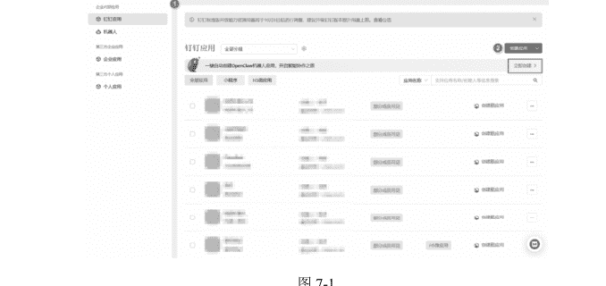

图 7-1

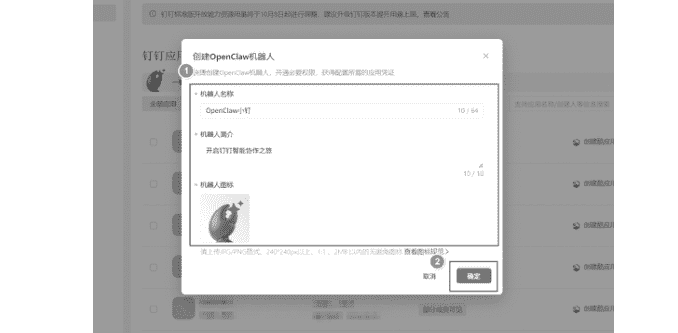

图 7-2

（2）获取应用核心凭证：应用创建成功后，在应用详情页的“凭证与基础信息”模块，复制 Client ID 和 Client Secret，如图 7-3 所示。它们是 OpenClaw 与钉钉对接的核心凭证，应妥善保管，切勿泄露。

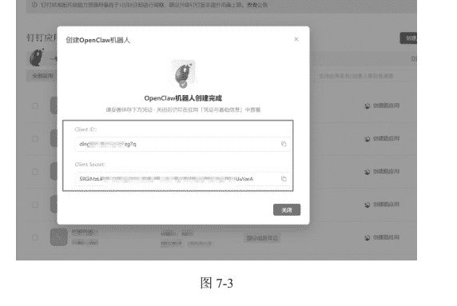

（3）开启机器人能力并完成配置：当 OpenClaw 创建成功后，会自动创建一个应用，如图 7-4 所示。在应用详情页左侧单击“添加应用能力”按钮，单击“机器人”按钮并添加。

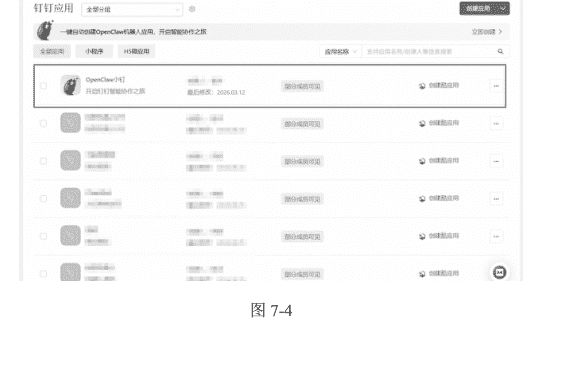

（4）发布应用并设置可用范围：单击“版本管理与发布”按钮和“创建新版本”按钮，填写版本号（如 1.0.0）和版本描述，选择应用可用范围（建议先选择“全部员工”进行测试），单击“保存”按钮并发布，确保应用正式生效。当 OpenClaw 创建成功后，会自动创建一个应用，如图 7-5 所示。

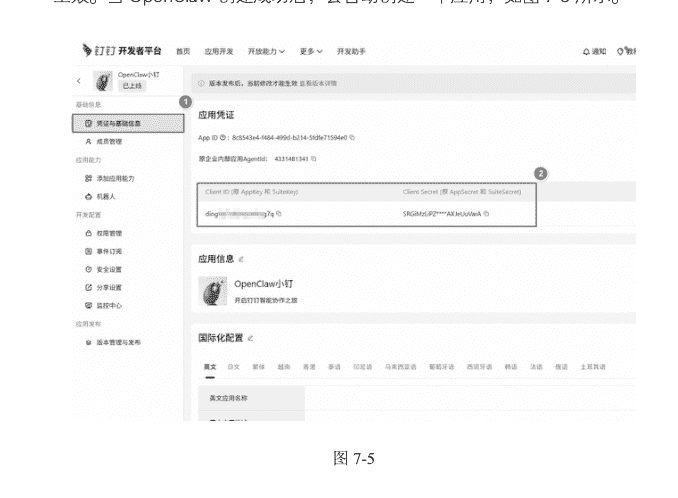

图 7-5

#### 2. OpenClaw 部署与钉钉打通

完成钉钉应用和机器人配置后，需部署 OpenClaw 并完成与钉钉机器人的对接，让 OpenClaw 能接收到钉钉机器人捕获的消息，支持向导式配置（推荐，零代码）和配置文件配置两种方式，同时支持多环境部署。

（1）对接钉钉机器人（向导式配置）：打开服务器终端，输入指令 openclaw-cn onboard，跟随安装向导完成以下操作：

- 1. 安装钉钉官方插件@dingtalk-real-ai/dingtalk-connector；
- 2. 输入步骤一中获取的 Client ID 和 Client Secret；
- 3. 输入 Gateway Token（可通过 openssl rand -hex 16 生成随机字符串）；
- 4. 启动 OpenClaw 网关，完成与钉钉机器人的对接。

验证连接是否成功：输入指令 openclaw-cn gateway status 查看网关运行状态，再输入指令 openclaw-cn logs--follow 查看实时日志，若日志中显示 “钉钉 Stream 客户端已连接”，则说明对接成功，OpenClaw 已能正常接收钉钉消息。

（2）配置文件配置（进阶方式）：若要自定义配置，可编辑 OpenClaw 的配置文件~/.openclaw/openclaw.json，添加 channels/dingtalk-connector、gateway/auth 和 gateway/http/endpoints 三个配置项，填写 Client ID、Client Secret 和 Gateway Token，确保 gatewayToken 与 gateway.auth.token 保持一致，保存后重启网关即可。

#### 3. 使用钉钉机器人

（1）单聊中使用机器人：在顶部搜索框中搜索已创建机器人的名称直接使用，如图 7-6 所示。


通过发送消息，可实现机器人单聊回复，如图 7-7 所示。

（2）群聊中使用机器人：打开钉钉客户端，进入任意群聊。若为已有群聊，要确保群归属组织与创建机器人时的组织相同；若创建新群聊，请确保所选归属组织与创建机器人时的组织一致。单击 “群设置” 按钮，然后选择“机器人”，如图 7-8 所示。


图 7-7


图 7-8

在机器人管理模块下，选择“添加机器人”，如图 7-9 所示。

在“添加机器人”页面中，搜索已经创建并发布的机器人，按照图 7-10 所示进行添加即可。

机器人添加成功后，@机器人即可触发自动回复，如图 7-11 所示。


图 7-9


图 7-10


图 7-11

至此，恭喜您已经完成了基于 OpenClaw 构建钉钉 AI 员工的全部操作。

## 7.2 企业微信群里自动回复常见问题

本节的核心是讲解 OpenClaw 的企业微信接入。OpenClaw 支持多种通信软件的渠道对接。通过企业微信内置的长连接机制，可免去烦琐的外网 Webhook 配置，轻松使 OpenClaw 成为接管企业微信群消息的智能助手。同时，结合 OpenClaw 内置的知识技能（Knowledge Skills）机制，不仅可使其在群内自动回复，更重要的是实现“基于规定回答、不产生知识幻觉”的安全客服场景。

### 7.2.1 打通 OpenClaw 与企业微信

本节将分两步完成 OpenClaw 与企业微信的打通：首先，在企业微信管理后台创建智能机器人并获取凭证；随后，在 OpenClaw 侧配置 channels.wecom 渠道，使其能够监听并响应企业微信推送过来的消息事件。

#### 1. 智能机器人创建与凭证获取

我们需要获取企业微信智能机器人的访问凭证，用于身份验证与消息加解密。

- （1）访问企业微信管理后台，使用具有企业管理员权限的账号扫码登录，如图 7-12 所示。如果没有满足条件的企业，请先创建新企业，详细操作参见官方网站。
- （2）在“企业微信”左侧导航栏分别单击“安全与管理”按钮与“管理工具”按钮，再单击“智能机器人”按钮，如图 7-13 所示。
- （3）在“智能机器人”页面单击“创建机器人”按钮（见图 7-14），并选择“手动创建”（见图 7-15）。

## 144 | 零基础玩转 OpenClaw：让“龙虾”替你 24 小时赚钱


图 7-12


图 7-13


图 7-14

## 第 7 章 企业微信和钉钉，OpenClaw 都会用 | 145

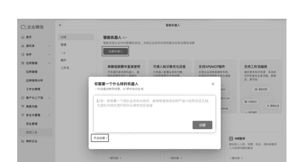

图 7-15

（4）在“创建智能机器人”页面底部，单击“API 模式创建”按钮，如图 7-16 所示。

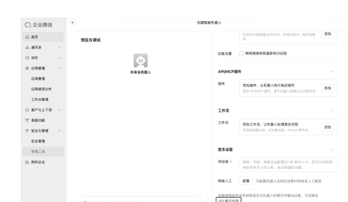

图 7-16

（5）选择“使用长连接”并获取凭证（Bot ID 和 Secret），如图 7-17 所示。

（6）单击图 7-17 中的“保存”按钮之后进入到图 7-18 所示的页面，单击“...”按钮可以获取本机相关信息。

## 146 | 零基础玩转 OpenClaw：让“龙虾”替你 24 小时赚钱

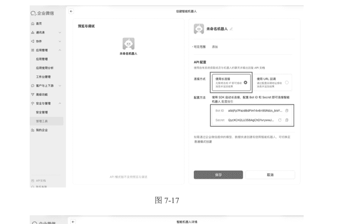

图 7-17

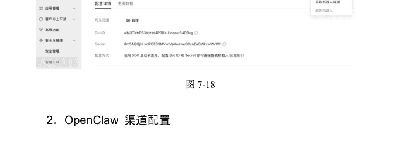

图 7-18

#### 2. OpenClaw 渠道配置

获取凭证后，我们需要在 OpenClaw 中配置这些信息。目前各云服务器厂商提供的 OpenClaw 基本都支持一键式配置，只需要将获取的 Bot ID 和 Secret 填入即可。以华为云为例，创建实例时可选择配置企业微信机器人，如图 7-19 所示。

以腾讯云为例，在“应用管理”页面也能够快速配置企业微信机器人，如图 7-20 所示。

## 第 7 章 企业微信和钉钉，OpenClaw 都会用 | 147

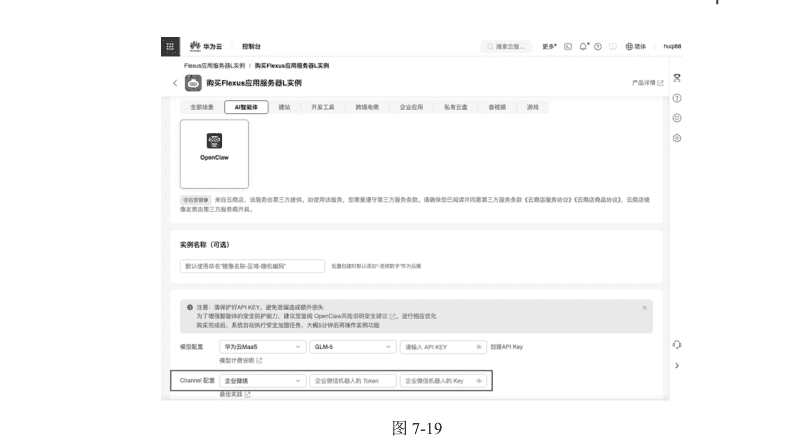

图 7-19


图 7-20

接下来，以本地终端部署的 OpenClaw 为例，说明企业微信智能机器人的接入方式。

（1）在终端中输入 “openclaw plugins install @wecom/wecom-openclaw-plugin” 指令，安装企业微信插件。该指令的意思是通过 “openclaw plugins” 指令安装企业微信官方提供的插件。安装成功之后的页面如图 7-21 所示。

（2）接着我们执行 “openclaw gateway start” 指令重启 OpenClaw，该指令的意思是重启 OpenClaw 网关。执行结果如图 7-22 所示。

```
openclaw gateway start
```

## 148 | 零基础玩转 OpenClaw：让“龙虾”替你 24 小时赚钱

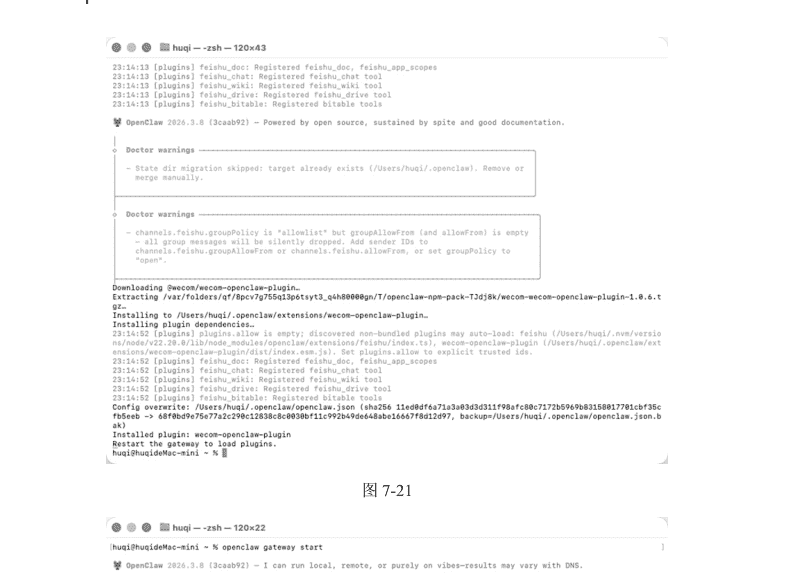

图 7-21


图 7-22

（3）接着我们执行“openclaw channels add”指令准备添加企业微信。运行结果如图 7-23 所示。

（4）上一步我们选择“Yes”，在“Select a channel”步骤中，单击空格键选择“企业微信（WeCom）”，如图 7-24 所示，随后按回车键确认。接着输入企业微信机器人的 Bot ID 与 Secret，并选择“Finished（Done）”，如图 7-25 所示。

## 第 7 章 企业微信和钉钉，OpenClaw 都会用 | 149


图 7-23


图 7-24

## 150 | 零基础玩转 OpenClaw：让“龙虾”替你 24 小时赚钱


图 7-24 (续)


图 7-25

（5）设置配对方式，选择“Pairing”。完成后可选择是否配置显示名称，继续后就可看到配置渠道成功提示，如图 7-26 所示。

（6）随后通过扫码获取企业微信机器人的二维码，从而可以向企业微信机器人发送信息，或将其添加至群聊，如图 7-27 所示。

（7）我们与企业微信机器人发送一条信息，获取到配对码，如图 7-28 所示。

## 第 7 章 企业微信和钉钉，OpenClaw 都会用 | 151


（8）我们在本地终端执行 “openclaw pairing approve wecom 2XHHPRBW” 指令进行配对，如图 7-29 所示。

（9）完成配对后即可在企业微信中与机器人对话，如图 7-30 所示。

## 152 | 零基础玩转 OpenClaw：让“龙虾”替你 24 小时赚钱


除了在交互式菜单中选择企业微信渠道并按提示输入 Bot ID 和 Secret 进行配置，也可以手动编辑 openclaw.json 配置文件，在 channels 节点下新增企业微信渠道配置。具体指令如下：

```json
{
    "channels": {
        "wecom": {
            "enabled": true,
            "botId": "将获取的 BotId 填入此处",
            "secret": "将获取的 secret 填入此处",
            "allowFrom": [],
            "dmPolicy": "pairing"
        }
    }
}
```


配置完成后，输入 “openclaw gateway start” 指令重启 OpenClaw 服务。

### 7.2.2 挂载“常见问题”本地知识库（FAQ RAG）

在本节中，我们将克隆包含“PDF 解析与问答脚本（ask_pdf.py）”的完整配套源码，并在本地配置专门用于存储文档的结构目录；随后，编写强约束的 AgentSkill（即 SKILL.md），从根源上规范大模型“只检索、不杜撰”“必须附带文档引用出处”的行为底线；最后，借助一行 OpenClaw 指令，快速拉起装载该技能的 Agent 并将其无缝托管至企业微信渠道，从而零成本搭建起一个严谨、合规的企业知识库问答机器人。

配套源码仓库 openclaw-book 提供了一个完整的示例解决方案。它通过一个定制的 Python 脚本来进行本地 PDF 解析、分块聚合及 TF-IDF 相似度匹配，以提取准确的上下文，确保机器人能够基于内部文档作答，并且要求必须附带引用出处。

#### 1. 准备 FAQ 脚本与文档目录

首先，克隆项目源码并初始化环境。具体指令如下：

```
git clone https://gitcode.com/huqi/openclaw-book.git

cd openclaw-book

python3 -m venv .venv

.venv/bin/pip install -r requirements.txt
```

初始化完成后，将公司规章制度、报销指南等 PDF 文档统一置于 openclaw-book/policy_bot/docs/目录下（这里以政府工作报告相关文档为例）。该仓库提供的 ask_pdf.py 脚本（位于 policy_bot/scripts/目录中）会自动根据这些 PDF 文档建立本地索引缓存，支持针对文档内容的高效检索。

#### 2. 定义定制化 AgentSkill

为使 OpenClaw 的 Agent 能够调用前述本地脚本检索答案，并确保安全的指令前置约束，我们需要定义一个专属的 AgentSkill。仓库的 policy_bot/SKILL.md 文件中定义了以下可直接参考或加载使用的系统提示词规则：

```
---
name: policy-faq
description: answer questions only from pdf files in the local docs directory, use when the user asks about policy, eligibility, scope, subsidy, conditions, report content, or faq that must be answered only from authorized pdf documents with sources.
---
```

你是一个基于本地 PDF 文件的问答助手。

规则：

1. 回答前，必须先运行 `.venv/bin/python policy_bot/scripts/ask_pdf.py "<问题>"`。
2. 只能根据脚本返回的内容回答。
3. 如果脚本返回没有来源，必须回答：“我没有在已授权 PDF 中找到足够依据，无法回答。”
4. 不允许返回空白、空 payload 或仅结束会话不回复。
5. 对于已经路由到本 workspace 的提问，如果无法从 PDF 中作答，包括寒暄、闲聊、无关问题，也必须返回上面的固定拒答文案。
6. 不允许补充文件里没有出现的企业政策、内部制度、审批流程、HR 规则。
7. 每次回答都必须列出出处。
8. 出处必须包含：文件名、页码、原文片段。

输出格式：

```
答复：

{answer}

出处：

[1] 文件：{file}，第 {page} 页

原文：{quote}

[2] 文件：{file}，第 {page} 页

原文：{quote}
```

通过该 SKILL.md，强制切断了模型自由发散的可能。若检索无果，则固定回复“找不到依据，无法回答”。

#### 3. 创建并绑定企业微信频道的 Agent

最后，使用 OpenClaw 指令行创建一个搭载该技能的独立 Agent，并与前面配置的企业微信频道（wecom:default）进行双向绑定。输入以下指令即可完成挂载：

```
openclaw agents add policy-faq \
--workspace /绝对路径到/openclaw-book \
--bind wecom:default \
--non-interactive \
--model custom-api-huqi-host/glm-5
```

> 注意
--workspace 参数需要指定为实际 openclaw-book 目录在本机的绝对路径。模型部分可按需替换为配置的兼容模型（如 glm-5 或基于通义千问等模型）。

#### 4. 实战效果预览

完成配置后，只需在企业微信中建一个测试群，将配置好的“智能机器人”拉入群聊。

（1）精准的规定范围内回答：当群内成员询问政府报告中所提及的创业相关内容时，机器人不仅能够精准识别并总结，更可严格附带 PDF 文档出处、页码及原文片段，如图 7-31 所示。这极大程度保障了所提供回答的权威性与可追溯性。


图 7-31

（2）超纲问题的严守规则：作为“仅回答内部知识库”的客服代表，当群成员询问与预置 PDF 资料无关或未收录的内容（如闲聊）时，机器人严守 SKILL.md 中预设的防幻觉指令（第 3 条规则），拒绝发散杜撰，如图 7-32 所示。


图 7-32

通过上述两步实测演示可见，借助 Channels（渠道）无缝接入，叠加利用大模型代码解释能力与 Python 沙盒的本地 RAG 机制，可于极短时间内在企业微信中搭建起严谨可信、出处可视化的合规知识问答安全卫士。

## 7.3 QQ 机器人搭建，群管理不用愁

基于 OpenClaw 框架搭建的 QQ 机器人能依托腾讯云轻量应用服务器的可视化配置能力，实现 QQ 群聊的自动化管理，轻松解决群管理的各类痛点。本文将以腾讯云轻量云部署为核心，详细讲解基于 OpenClaw 的 QQ 机器人搭建全流程，从前置准备、平台注册到配置打通、实际使用，让零基础开发者也能快速上手，打造专属的智能群管理助手。

### 7.3.1 OpenClaw 搭建 QQ 机器人的核心优势

相较于传统的 QQ 机器人开发方式，基于 OpenClaw 框架结合腾讯云轻量应用服务器搭建的 QQ 机器人，能大幅提升群管理效率。

1. 极简部署，零代码也能上手：腾讯云提供可视化配置面板，无须复杂的命令行操作，几步即可完成 OpenClaw 与 QQ 机器人的打通，适配零基础开发者。
2. 多消息类型支持，群交互更丰富：支持文本、图片、文件、语音等多媒体消息的收发，回复内容还可兼容 Markdown 格式，满足群管理中的各类消息处理需求。
3. 大模型赋能，智能响应更精准：可对接腾讯混元、Kimi、GLM 等主流大模型，实现群内智能问答、消息分析、个性化回复，替代人工处理常规群问题。
4. 云端稳定运行，7×24 小时值守：依托腾讯云轻量应用服务器的云端能力，机器人可实现不间断运行，无须本地服务器挂机，群消息监控和响应不中断。
5. 多通道兼容，拓展性强：OpenClaw 支持同时接入 QQ、钉钉、飞书等多个 IM 通道，若企业同时使用多平台办公，则可实现一站式的智能管理，无须重复搭建。
6. 插件化技能拓展：可通过 ClawHub 安装各类技能插件，轻松实现群签到、定时提醒、文件管理等个性化群管理功能，适配不同场景的群运营需求。

### 7.3.2 前置准备：搭建前的基础检查

在正式开始 QQ 机器人的搭建前，需完成基础的环境和账号准备，确保后续配置流程顺利进行，所有准备工作均围绕腾讯云 OpenClaw 部署和 QQ 开放平台开发展开，具体要求如下。

（1）账号与实名认证：拥有完成实名认证的腾讯 QQ 账号，该账号将作为 QQ 开放平台的开发者账号，同时也是 QQ 机器人的管理账号。

（2）OpenClaw 云端部署：已在腾讯云轻量应用服务器 Lighthouse 实例中完成 OpenClaw 的部署。若未部署，则可直接选购腾讯云 OpenClaw 专属服务器，或通过 OpenClaw 应用模板一键创建，部署流程参考腾讯云官方“云上 OpenClaw 一键秒级部署指南”。

（3）版本检查与更新：若使用 OpenClaw 应用模板创建服务器的时间早于 2026 年 2 月 11 日，则需先参考官方教程更新 OpenClaw 版本，避免版本兼容问题。

（4）服务器环境要求：推荐使用国内腾讯云服务器，确保与 QQ 开放平台和国内大模型服务的网络连通性，提升 QQ 机器人响应速度。

### 7.3.3 核心步骤：从零搭建 OpenClaw 版 QQ 群管理机器人

基于腾讯云轻量云的 OpenClaw QQ 机器人搭建，核心分为 QQ 开放平台注册与机器人创建、OpenClaw 模型配置、QQ 通道打通、机器人功能验证四大步骤，全程依托可视化面板操作，无须复杂代码编写，具体流程如下：

#### 步骤一：注册 QQ 开放平台，创建专属 QQ 机器人

这一步的核心是在 QQ 开放平台完成开发者注册，创建机器人并获取核心凭证（AppID、AppSecret），为后续与 OpenClaw 打通提供基础，操作简单且标准化。

（1）登录/注册 QQ 开放平台：前往 QQ 开放平台官网，使用已实名认证的 QQ 账号扫码登录，若未注册，则扫码后系统将自动完成注册，并绑定当前 QQ 账号，如图 7-33 所示。


（2）创建 QQ 机器人：如图 7-34 所示，单击“创建机器人”按钮，无须额外填写复杂信息，系统将自动生成专属的机器人账号。


（3）获取核心凭证：机器人创建成功后，在页面中复制 AppID 和 AppSecret，这是 OpenClaw 与 QQ 机器人对接的唯一凭证，需妥善保存（AppSecret 二次查看将强制重置，切勿泄露）。

（4）机器人初始验证：创建完成后，QQ 客户端的消息列表中将出现该机器人，机器人会发送初始创建成功消息，此时暂无法正常对话，需完成后续配置后才能实现交互。

#### 步骤二：进入腾讯云控制台，完成 OpenClaw 模型配置

OpenClaw 的智能能力依托各类大模型实现，因此在打通 QQ 通道前，需先为 OpenClaw 配置大模型 API Key，确保机器人具备智能问答、消息处理的核心能力，操作在腾讯云轻量云控制台完成。

（1）进入服务器管理页面：登录腾讯云控制台，选中已部署 OpenClaw 的 Lighthouse 服务器实例，单击进入“管理实例”页面。

（2）打开“应用管理”页面：如图 7-35 所示，单击“应用管理”选项卡，进入 OpenClaw 的可视化配置面板，该面板包含“模型”“通道”“技能”三大核心配置模块。


（3）配置大模型 API Key：在“模型（Models）”模块中，选择需要对接的大模型（如腾讯混元、Kimi、GLM 等），输入对应的 API Key，如图 7-36 所示，单击“添加并应用”按钮。

## 第 7 章 企业微信和钉钉，OpenClaw 都会用


图 7-36

（4）验证模型配置：若担心配置未生效，则可登录轻量应用服务器，通过 OpenClaw TUI 工具进行验证，确保大模型能正常调用。

> 提示
OpenClaw 调用模型时，会携带上下文信息，应保证响应的连贯性，需关注模型 Token 的用量与计费情况，避免超出预期。

#### 步骤三：打通 QQ 通道，绑定机器人凭证

完成模型配置后，进入核心的 QQ 通道配置环节，将 QQ 开放平台获取的 AppID、AppSecret 与 OpenClaw 绑定，实现两者的打通，这是机器人能正常接收和回复 QQ 消息的关键。

- （1）进入通道配置模块：在腾讯云轻量云“应用管理”面板中，单击“通道（Channels）”选项，进入多通道配置页面。
- （2）选择 QQ 通道并填写凭证：在“通道配置”输入框中，选择“QQ”通道类型，依次输入步骤一中获取的 QQ 机器人 AppID 和 AppSecret。
- （3）保存并应用配置：单击“添加并应用”按钮，等待几十秒后，页面提示“保存成功”，即可完成 QQ 通道的配置。
- （4）多通道拓展（可选）：OpenClaw 支持同一台服务器配置多个通道，若需同时管理钉钉、飞书等平台的群聊，则可在该页面继续添加对应的通道，实现一站式智能管理，如图 7-37 所示。


图 7-37

#### 步骤四：功能验证，实现 QQ 机器人的基础交互

完成模型和通道配置后，即可在 QQ 客户端中验证机器人的功能，确认其能正常接收和回复消息，为后续的群管理功能使用打下基础。

- （1）单聊验证：在 QQ 客户端中找到已创建的机器人，发送简单的文本消息（如“你好”），若机器人能以 AI 方式回复，说明配置成功。
- （2）多媒体消息验证（可选）：可发送图片、文件等消息测试机器人的接收能力，若需机器人回复图片、生成文件，需确保对接的大模型具备相应的处理能力。
- （3）常见问题排查：若机器人回复“该机器人去火星了，稍后再试吧”或“我的‘灵魂’不在线”，则大概率是 AppID、AppSecret 配置错误，需返回腾讯云控制台，重新核对并进行配置。

### 7.3.4 群管理实操：QQ 机器人的核心使用场景

成功搭建 OpenClaw 版的 QQ 机器人可覆盖 QQ 群管理的绝大多数场景，依托大模型的智能能力和 OpenClaw 的插件拓展能力，实现消息智能响应、群内定时提醒、文件管理、智能问答等核心功能，以下为具体的实操方法和典型场景。

- （1）群内智能问答，解放人工客服：将机器人添加至 QQ 群聊（当前版本暂建议先在单聊验证稳定后，再使用群聊功能），群成员发送问题后，机器人可依托大模型实现实时智能回复，可提前通过配置让机器人学习群规、产品知识等内容，即可精准解答群内常见问题。
- （2）定时消息提醒，提升群运营效率：通过 OpenClaw 的定时技能，让机器人在指定时间发送群通知、签到提醒、活动预告等消息，无须人工手动发送，避免遗漏。
- （3）多媒体消息处理，丰富群交互：机器人支持接收和回复图片、文件、语音消息，可实现群内文件的自动保存、图片的智能分析、语音消息的文字转写功能，解决群内多媒体消息处理繁琐的问题。
- （4）Markdown 格式回复，优化消息展示：机器人回复的内容支持 Markdown 格式，可实现群规、教程等内容的结构化展示，让群内信息更清晰易读。
- （5）插件化拓展群管理功能：在 OpenClaw 的“技能（Skills）”模块中，输入 ClawHub 中的技能名称（如群签到、消息统计、关键词监控），单击“安装技能”按钮，即可为机器人快速添加个性化群管理功能，无须二次开发。

### 7.3.5 常见问题及解决方法

在 QQ 机器人的搭建和使用过程中，可能会出现配置失败、机器人无响应、消息处理异常等问题。结合腾讯云官方排查方案，本节整理了高频问题的可能原因和解决方法，可用于快速定位并解决问题，如表 7-1 所示。

表 7-1

| 报错/问题 | 可能原因 | 解决方式 |
| :--- | :--- | :--- |
| 机器人回复“我的‘灵魂’不在线，请检查你的主机服务部署环境” | （1）未为 OpenClaw 配置 QQ 机器人的 AppID 和 AppSecret；（2）配置的 AppID 或 AppSecret 错误 | 返回腾讯云轻量云“应用管理-通道”模块，重新核对并填写正确的 AppID 和 AppSecret，单击“添加并应用”按钮 |
| 完成配置后，机器人不回复任何消息 | 大模型 API Key 配置错误或未配置，导致机器人无智能处理能力 | 在“应用管理-模型”模块中，检查大模型 API Key 是否正确，重新配置并应用，通过 TUI 工具验证模型是否能正常调用 |
| 机器人可回复文本消息，无法处理图片或文件 | 对接的大模型不具备对图片、文件的分析或生成能力 | 更换支持多媒体处理的大模型（如腾讯混元TurboS、Kimi），并重新配置对应的 API Key |
| 扫码创建 QQ 机器人时，提示“注册失败” | 所用 QQ 账号未完成实名认证 | 在 QQ 客户端中完成账号的实名认证，再重新前往 QQ 开放平台创建机器人 |
| OpenClaw 配置面板提示“保存失败” | 服务器网络异常，无法与 QQ 开放平台连通 | 检查腾讯云轻量服务器的网络状态，确保状态为国内服务器，且无防火墙拦截，重启服务器后重新配置 |

### 7.3.6 进阶优化：让 QQ 群的管理机器人更贴合需求

QQ 机器人搭建完成后，可通过 OpenClaw 的个性化配置和技能拓展，让机器人更贴合实际的群管理需求，实现从“基础智能”到“专属定制”的升级，核心优化方向如下。

- （1）定制化群管理规则：通过 OpenClaw 的本地配置，为机器人设置群内关键词监控（如广告、敏感词），实现违规消息的自动提醒或拦截，提升群聊管理的规范性。
- （2）训练专属知识库：将群规、行业知识、产品手册等内容导入大模型，让机器人学习专属知识库，实现更精准的群内问答，适配企业社群、行业交流群等场景。
- （3）安装更多群管理技能：前往 ClawHub 插件市场，下载并安装群签到、群抽奖、消息统计、成员管理等技能插件，通过“应用管理-技能”模块一键安装插件，快速拓展机器人的群管理能力。
- （4）实现多群统一管理：若需管理多个 QQ 群聊，可在 QQ 开放平台创建多个机器人，在腾讯云 OpenClaw 配置面板中添加多个 QQ 通道，实现多群机器人的统一部署和管理，提升多社群运营效率。
- （5）跨平台消息同步：利用 OpenClaw 的多通道能力，将 QQ 群内的重要消息同步至钉钉、飞书等办公平台，实现企业跨平台办公的信息互通，避免消息遗漏。

## 第 8 章 飞书玩得溜，同事都夸你

## 8.1 OpenClaw 怎样连上飞书

OpenClaw 作为开源的个人 AI Agent 系统，与飞书的官方插件对接后，能直接以用户身份完成对飞书文档、消息、日历、多维表格操作的核心功能，彻底摆脱重复的信息搬运工作，实现“一句话下达指令，全流程自动完成”的高效协作。本书将基于飞书官方插件的标准化流程，从前期准备、核心配置、配对验证到常见问题排查，详细讲解 OpenClaw 与飞书的连接方法，帮助开发者快速打通两者生态。

### 8.1.1 连接前的基础准备

在正式配置连接前，需完成 OpenClaw 环境、飞书开发者权限、插件版本等基础校验，确保后续流程顺畅推进。

#### 1. OpenClaw 环境要求

- 版本限制：Linux/MacOS 需安装 openclaw 2026.2.26 及以上版本；Windows 需安装 Windows 2026.3.2 及以上版本。
- 版本校验：运行指令 `openclaw -v` 查看当前版本，低于要求时执行 `npm install -g openclaw` 升级，或参考官方文档切换开发通道完成更新。
- 部署基础：已完成 OpenClaw 的本地或云端部署（本地推荐使用编程 Agent 辅助安装，云端可选择 Coze 编程、ArkClaw 等一键部署方案）。

#### 2. 飞书权限与账号准备

- 开发者权限：需拥有飞书账号，并具备创建“企业自建应用”的权限（个人版飞书可直接创建，企业版飞书需管理员授权）。
- 插件依赖：飞书客户端需更新至最新版本，以确保支持官方插件的安装与运行。
- 网络环境：推荐使用国内网络环境，保证 OpenClaw 与飞书服务器的连接稳定性。

### 8.1.2 核心步骤：四步打通 OpenClaw 与飞书

连接过程围绕“飞书应用创建与权限配置、OpenClaw 插件安装、长连接配置、配对验证”展开，全程为标准化操作，不需要复杂代码开发。

#### 步骤一：创建飞书企业自建应用，导入核心权限

这一步骤的核心是在飞书开放平台创建专属应用，开启机器人能力并导入完整权限，为两者连接提供基础凭证和操作权限：

（1）登录飞书开放平台。访问飞书开放平台官网，使用飞书账号登录开发者后台。

（2）创建企业自建应用。如图 8-1 所示，单击“创建企业自建应用”按钮，填写应用名称（如“OpenClaw In Feishu”）、应用描述（最多 120 字符），并上传符合规范的图标（JPEG/PNG/SVG/BMP 格式，2MB 以内，大于 240px×240px 且无圆角），最后单击“创建”按钮。


图 8-1

（3）添加机器人能力。在应用详情页的左侧菜单中选择“应用能力>添加应用能力”，切换至“按能力添加”标签页，找到“机器人”能力卡片并单击“添加”按钮，开启消息交互核心能力。

（4）批量导入完整权限。进入“开发配置>权限管理”，单击“批量导入/导出权限”按钮，在“导入”标签页中粘贴官方提供的完整权限 JSON（包含消息、文档、日历、多维表格等全场景权限），单击“下一步，确认新增权限”按钮后，提交“申请开通”。

关键：完整权限列表能避免后续频繁申请权限的操作，主要包含 `im:message:send_as_bot`（机器人发消息）、`docx:document:write_only`（文档编辑）、`calendar:event:create`（日程创建）等权限，具体可参考飞书 API 权限列表。

（5）发布应用并获取凭证。选择“版本管理与发布>创建新版本”，填写版本号（如 0.0.1）和更新说明（如“首次发布，对接 OpenClaw”），选择可用范围（默认仅开发者可见，测试完成后可扩展），单击“保存并确认发布”按钮；发布后在“基础信息>凭证与基础信息”中，复制并保存 App ID 和 App Secret（后续插件配置会用到，妥善保管切勿泄露）。

#### 步骤二：安装 OpenClaw 飞书官方插件

通过命令行安装飞书官方插件，系统将自动禁用之前使用的第三方插件，以确保连接稳定性。

（1）执行插件安装指令。打开终端（本地部署）或云端控制台（云端部署），运行以下指令，若执行失败可在指令前添加 `sudo` 以提升权限：

```
npx -y https://sf3-cn.feishucdn.com/obj/open-platform-opendoc/195a94cb3d9a45d862d417313ff62c9c_gfW8JbxtTd.tgz install
```

（2）配置飞书凭证。安装过程中会提示输入 Feishu App ID 和 Feishu App Secret，依次输入步骤一中获取的凭证，完成插件与飞书应用的绑定。

（3）验证插件安装状态。运行 `openclaw plugins list`，若显示 `feishu-openclaw-plugin` 的 Status 为 `loaded`，且 `feishu`（旧插件）的 Status 为 `disabled`，则说明官方插件安装成功。

#### 步骤三：配置长连接与回调，确保消息互通

通过飞书开放平台配置事件订阅和回调方式，采用长连接模式实现实时消息接收，不需要公网域名和加密配置。

（1）配置事件订阅。进入飞书应用详情页，选择“开发配置 > 事件与回调 > 事件配置”，选择“使用长连接接收事件”，单击“添加事件”按钮，勾选以下核心事件。

- 接收消息 v2.0（`im.message.receive_v1`）：捕获用户发给机器人的单聊/群聊消息；
- 消息触发相关事件（`im.message.reaction.created_v1`/`deleted_v1`）：响应消息表情互动；
- 消息撤回事件（`im.message.recalled_v1`）：同步消息撤回状态。勾选后单击“确认添加”按钮，保存事件配置。

（2）配置卡片回调。在“回调配置”标签页，选择“使用长连接接收回调”，单击“添加回调”按钮，勾选“卡片回传交互（`card.action.trigger`）”和旧版回调（`card.action.trigger_v1`），确保卡片按钮操作能正常响应，单击“确认添加”按钮。

（3）安全设置检查。若页面存在“refresh user_access_token”开关，务必开启，确保 token 自动刷新；若无此项则忽略。

（4）重新发布应用。完成上述配置后，创建新版本并重新发布应用，确保长连接和回调配置生效。

#### 步骤四：启动 OpenClaw，完成配对与授权

启动 OpenClaw 网关，通过配对码绑定飞书账号并授予插件操作权限，最终建立连接。

（1）启动 OpenClaw 网关。在终端运行指令 `openclaw gateway run`，若日志中显示“feishu [default]: starting WebSocket connection...”“event-dispatch is ready”，则说明网关已开始监听飞书事件。

（2）生成并验证配对码。打开飞书客户端，向创建的机器人发送任意消息（如“连接 OpenClaw”），系统会自动生成一段由字母 + 数字组成的配对码（有效期 5 分钟）；若历史安装过飞书插件，可能不需要配对步骤，直接跳过至授权环节。

（3）完成账号绑定。在终端执行指令 `openclaw pairing approve feishu <配对码> --notify`（将 `<配对码>` 替换为实际获取的代码），完成 OpenClaw 与飞书账号的绑定。

（4）批量授权与功能验证。在飞书机器人单聊界面输入指令 `/feishu auth`，完成批量权限授予；输入指令 `/feishu start`，若机器人返回版本号信息（如 “feishu-openclaw-plugin: 2026.2.28.11”），则说明连接成功。

（5）学习插件能力（可选）。发送“学习一下我安装的新飞书插件，列出有哪些能力”，机器人会自动返回消息、文档、日历等核心功能清单，便于快速了解可用操作。

### 8.1.3 连接后的基础配置（可选）

根据实际使用场景调整插件配置，优化交互体验，核心可配置项如下。

#### 1. 切换流式输出模式

- 开启流式输出（实时显示回复内容）：`openclaw config set channels.feishu.streaming true`。
- 关闭流式输出：`openclaw config set channels.feishu.streaming false`。
- 扩展流式输出显示：开启耗时展示 `openclaw config set channels.feishu.footer.elapsed true`，开启状态展示 `openclaw config set channels.feishu.footer.status true`。

#### 2. 设置群聊回复规则

模式 1（默认）：仅@机器人才回复（推荐大群使用）。

```
openclaw config set channels.feishu.requireMention true --json && sh /workspace/projects/scripts/restart.sh
```

模式 2：无须@回复，所有消息都回复（需额外申请 `im:message.group_msg` 敏感权限，谨慎使用）：

```
openclaw config set channels.feishu.requireMention false --json && sh /workspace/projects/scripts/restart.sh
```

模式 3：指定群需 @回复（高级配置）：先设置默认规则

```
openclaw config set channels.feishu.requireMention open --json,
```

再为特定群配置

```
openclaw config set channels.feishu.groups.oc_xxx.requireMention true --json (oc_xxx 替换为实际群 ID),
```

重启网关生效。

#### 3. 开启多任务并行

允许机器人在飞书话题群中针对每个话题独立处理任务，运行指令 `openclaw config set channels.feishu.threadSession true`；若需关闭此功能，则将 `true` 改为 `false` 即可。

### 8.1.4 常见连接问题排查

连接过程中若出现插件加载失败、消息无响应等问题，可按以下思路排查。

#### 问题一：插件安装后，提示 “cannot find module xxx”

- 原因：插件依赖未安装完整（安装中断或权限不足）。
- 解决：进入插件安装目录（默认路径为 `~/.openclaw/extensions/feishu-openclaw-plugin`），运行指令 `npm install` 安装依赖，之后重启网关。

#### 问题二：Coze 上安装插件失败

- 解决：依次执行以下指令，切换镜像源后重新安装插件：

```
export NPM_CONFIG_REGISTRY=https://registry.npmmirror.com
npx -y https://sf3-cn.feishucdn.com/obj/open-platform-opendoc/195a94cb3d9a45d862d417313ff62c9c_gfW8JbxtTd.tgz install
```

- 同时检查旧插件配置，将 `feishu` 插件的 `enabled` 改为 `false`，确保官方插件优先加载。

#### 问题三：机器人无响应，日志无飞书事件

排查步骤如下。

- （1）运行 `/feishu doctor` 检查配置，若提示 “Plugin not found in plugins.allow”，执行指令 `npx https://sf3-cn.feishucdn.com/obj/open-platform-opendoc/195a94cb3d9a45d862d417313ff62c9c_gfW8JbxtTd.tgz doctor --fix` 自动修复；
- （2）验证飞书应用的 App ID 和 App Secret 是否配置正确，重新输入凭证后重启网关；
- （3）检查飞书应用是否已发布，且可用范围包含当前账号。

#### 问题四：OpenClaw 3.2 版本无法调用飞书工具

- 原因：新版本默认关闭 Agent 工具权限。
- 解决：在 `openclaw.json` 中添加以下配置，重启网关。

```json
{
  "tools": {
    "profile": "full",
    "sessions": {
      "visibility": "all"
    }
  }
}
```

## 8.2 飞书文档批量处理，省下半天时间

OpenClaw 接入飞书后，我们可以通过赋予机器人关于飞书文档、多维表格等权限，来拓宽 OpenClaw 的能力边界，让它帮我们处理更多批量任务。

### 1. 飞书机器人权限配置

想要让飞书机器人具备操作飞书文档、多维表格等文件的能力，首先我们需要为飞书机器人增加相关的权限。

#### 步骤一：进入应用管理

搜索飞书开放平台，登录机器人所在的账号后，在企业自建应用下找到先前创建的应用，如图 8-2 所示。


图 8-2

单击应用进入详情页，在左侧导航中找到并选择“权限管理”选项，如图 8-3 所示。


图 8-3

#### 步骤二：开通权限

在权限管理页选择“开通权限”选项，即可按需选择将要授予飞书机器人的权限，如图 8-4 所示。


图 8-4

本示例说明：我们以云文档为例，目标是让飞书机器人能够创建、编写文档，并能对文档做一些基础的管理（如权限管理、评论管理）。

#### 步骤三：配置云文档权限

在“开通权限”弹窗中，选择“云文档”选项，如图 8-5 所示。


图 8-5

实际配置权限时，有如下两种方式可以选择。

- **省心版**：一次性配置所有权限，但可能引入冗余权限。
- **精细版**：按照实际想完成的效果，仅配置必要的权限。

配置步骤如下。

（1）在“权限”搜索框中输入“docx”，单击 Enter 键后，会过滤出所有与文档相关的权限。

（2）勾选全部权限后，不要着急单击“确认开通权限”按钮。

（3）清空搜索框，输入“docs”，再单击 Enter 键。

（4）同样勾选全部权限（注意手动去掉与 docs 无关的权限，如 search:dataset.docs:create）。

（5）单击“开通权限”页面内的“确认开通权限”按钮。

版本说明：docx 权限针对的是飞书新版文档（类型为 docx 格式），相比旧版文档，支持更多的编辑功能和结构化内容。docs 则对应的是旧版文档。此处考虑到可能存在的兼容性问题，我们同时配置 docx 和 docs 对应的权限。

下面配置 docx 权限，如图 8-6 所示。


图 8-6

接下来配置 docs 权限，如图 8-7 所示。


图 8-7

最后，单击“开通权限”页面内的“确认开通权限”按钮，完成权限配置，如图 8-8 所示。


图 8-8

权限生效：由于此处选择的权限均为免审权限，因此确认开通权限后即可直接使用，无须再次发布应用。

### 2. 让飞书机器人创建并编辑文档

具备飞书文档相关权限后，飞书机器人就已经能够完成相关操作了。我们回到飞书，尝试与机器人沟通需求。

#### 1）创建文档

你可以直接复制如下的提示词，发给你的飞书机器人：

```
刚刚我已经给你授权了 docx 和 docs 相关的权限，现在帮我先创建一个文档，介绍一下飞书云文档是什么。
```

机器人会为你创建并返回文档链接，如图 8-9 所示。


单击文档链接，我们可以进入文档内查看详情，如图 8-10 所示。


#### 2）管理文档权限

此时，飞书机器人创建了文档，我们只有查看该文档的权限。可以在对话框中让机器人帮我们开通编辑权限：

```
这个文档我好像没有编辑权限，给我授权一下
```

可能出现的提示：此时有可能你会收到“权限管理工具‘feishu_perm’默认是关闭的，需要在配置里手动开启”的提示，如图 8-11 所示。


我们可以直接在对话框中告诉它开启权限管理功能：

```
你来帮我管理文档权限吧
```

机器人会为你授权，如图 8-12 所示。

机器人会询问你通过什么方式来配置权限。这里我们看到它希望通过邮箱来为我们配置权限，实际上通过邮箱、用户 ID 等信息都可以配置权限。我们直接告诉它即可，如图 8-13 所示。


图 8-12


图 8-13

现在我们已经拥有了文档的完整权限，如图 8-14 所示。


#### 3）导出文档

我们可以让机器人帮我们把文档导出为 PDF 文件并发给我们：

```
帮我把这个文档导出为 PDF，然后发给我吧
```

机器人会导出文档，如图 8-15 所示。


**小贴士**

这里会遇到一个小问题，第一次它并没有把 PDF 文件发送给你，告诉它“我似乎没有收到文件”即可。机器人会重新尝试并确保文件送达。

#### 4）更多操作

后续你可以参考前文权限配置章节，为飞书机器人配置以下更多权限，进一步拓宽它的能力边界，如图 8-16 所示。


图 8-16

可配置的权限包括：

- Wiki：创建和编辑知识库文档。
- 多维表格：创建和管理数据库表格。
- 日历：集成和管理团队日程。
- 邮箱：接收和发送企业邮件。
- 云空间：管理文件和文件夹。

# 第四部分 智能家居生活和出行旅游

# 第9章 手机和家里的设备，OpenClaw 都能管

本章介绍了如何将 OpenClaw 接入各种智能家居设备，与已有的手机 AI 助手进行联动，如华为小艺和 OpenHarmony 设备。

## 9.1 华为小艺+OpenClaw，动动嘴就能办事

在人工智能从对话交互向主动执行演进的当下，华为小艺开放平台与开源 AI 智能体 OpenClaw 的深度融合，为用户打造出了一款真正能“听懂指令、落地执行”的个人专属智能助手。依托 HarmonyOS 生态的全场景能力，结合 OpenClaw 的本地部署、持久记忆和自主操作特性，用户只需通过小艺 App 发出语音指令，就能让智能体完成文件管理、信息整理、任务执行等各种操作，真正实现“动动嘴就办事”的智能生活与办公体验。

OpenClaw 作为 2026 年开源领域的现象级产品，凭借可获得本地操作系统权限、自主执行 Shell 指令、跨应用处理任务的能力，被网友亲切称为“龙虾助手”。华为小艺开放平台新增的 OpenClaw 模式，将这款强大的开源智能体与小艺的语音交互、鸿蒙多端协同能力结合，让普通用户无须复杂的技术操作，就能搭建属于自己的 7×24 小时智能助手，为开发者提供了轻量化、高适配的智能体开发方案。本章将详细介绍小艺+OpenClaw 的核心价值、部署配置方法和实际应用场景，带大家解锁“语音指令驱动一切”的智能新体验。

### 9.1.1 小艺+OpenClaw，重构智能交互的核心价值

传统的智能助手大多停留在“问答式交互”层面，只能根据指令提供信息或简单的功能调用，而小艺与 OpenClaw 的结合，实现了从“被动响应”到“主动执行”的本质跨越，其核心价值体现在三个方面。

#### 1. 语音交互+落地执行，指令直达结果

小艺作为华为生态的核心语音助手，具备精准的语音识别、自然语言理解能力，用户只需说出“帮我看看 MEMORY 文件夹里的文件”“整理一下今天的工作文档”，小艺就能将指令传递给 OpenClaw 智能体；而 OpenClaw 拥有本地系统的操作权限，能直接执行文件查询、整理、编辑，甚至代码编写、数据抓取等操作，无须用户手动打开软件、单击操作，真正实现“一句话搞定整件事”。

#### 2. 本地私有化部署，兼顾效率与隐私

OpenClaw 支持本地或私有云部署，所有数据处理、任务执行均在用户设备端完成，无须上传至云端。结合华为 HarmonyOS 的安全防护体系，小艺+OpenClaw 既保证了智能体的执行效率，又能有效保护用户的个人数据、工作文件隐私，解决了云端智能体的数据安全顾虑，尤其适合对隐私要求较高的个人办公、企业场景。

#### 3. 持久记忆+个性化定制，越用越“懂你”

OpenClaw 具备持久记忆能力，能记录用户的操作习惯、文件存储偏好、任务执行需求，而小艺开放平台的 OpenClaw 模式支持用户导入个人知识库、调整智能体行为参数。这意味着，小艺+OpenClaw 的智能体会随着使用次数的增加不断“学习”，逐渐形成贴合用户个人需求的服务风格，比如记住用户的文件命名习惯、常用的文档整理方式，让后续的指令执行更贴合预期。

#### 4. 鸿蒙全场景适配，多端无缝协同

小艺+OpenClaw 的智能体默认支持 HarmonyOS NEXT、HarmonyOS 手机端，未来可拓展至平板、车机、PC、手表等鸿蒙全场景设备。用户在手机上发出的语音指令，可同步至电脑端的 OpenClaw 智能体执行，比如在车机上对小艺说“帮我整理电脑里的项目资料”，到家后打开电脑就能看到整理完成的文件，实现多设备间的指令互通、任务协同。

### 9.1.2 快速部署：小艺 OpenClaw 模式智能体搭建步骤

华为小艺开放平台为 OpenClaw 模式设计了标准化的配置流程，无须复杂的代码开发，只需完成智能体创建、核心配置、调试发布三个步骤，就能搭建自己的专属智能体。值得注意的是，小艺开放平台对 OpenClaw 模式做了轻量化优化，相比原生 OpenClaw 的复杂部署，大幅降低了技术门槛，普通用户也能快速上手。

#### 步骤 1：创建 OpenClaw 模式智能体

（1）登录华为小艺开放平台，参考平台的智能体创建通用流程，进入“标准创建”页面。

（2）如图 9-1 所示，在“编排方式”中选择“OpenClaw 模式”（该模式为进阶用户设计，核心用于接入 OpenClaw 构建个人专属智能体）。


图 9-1

（3）填写智能体基础信息：包括智能体名称（字符数限制在 20 个以内）、一句话描述（字符数限制在 70 个以内，如“我的专属办公智能助手”）。

（4）选择支持的设备和系统：平台默认勾选“手机-HarmonyOS NEXT”和“手机-HarmonyOS”，用户可根据实际需求进行修改。

（5）确认信息后单击“创建”按钮，即可完成 OpenClaw 模式智能体的初始化。

> **重要注意事项：** 在开放平台账号下，每个小艺仅限创建一个 OpenClaw 模式智能体，创建前需确认该账号下没有同类智能体。

#### 步骤 2：智能体核心配置（关键步骤）

OpenClaw 模式智能体的核心配置分为获取小艺开放平台凭证和配置 OpenClaw 服务器通道两步，需按顺序操作，这是实现小艺与 OpenClaw 互联互通的关键。

##### 步骤 2.1：获取小艺开放平台凭证（AK/SK）

凭证是小艺开放平台与 OpenClaw 服务器的身份认证密钥，由 Key（AK）和安全密钥（SK）组成，具体获取方式如下：

（1）在智能体配置页面，找到“小艺开放平台凭证”模块，若暂无凭证，单击“点击新建凭证”按钮，如图 9-2 所示，跳转至平台“工作空间-凭证”页面。


图 9-2

（2）再次单击“新建凭证”，输入自定义的 Key 名称后单击“保存”按钮，系统将自动生成一对 AK/SK 密钥。

（3）关键操作：安全密钥（SK）仅在创建成功时以明文展示，务必在关闭窗口前复制并妥善保管，关闭后将无法再次查看。

（4）若账号下已创建多个凭证，可任意选择其中一对 AK/SK 用于后续配置；若凭证密钥丢失，可单击“重新创建”按钮生成新的密钥对。

##### 步骤 2.2：配置 OpenClaw 服务器通道

该步骤需在部署 OpenClaw 的服务器/本地设备上操作，核心是将小艺开放平台的 AK/SK 配置至 OpenClaw 的通道中，实现二者的通信对接，具体操作如下：

（1）在 OpenClaw 机器上执行插件安装指令：`openclaw plugins install @ynhgj/xiaoyi@latest`，安装小艺专属插件。

（2）找到 OpenClaw 的配置文件 openclaw.json，在 “channels “节点中配置小艺通道信息，配置模板如下：

```json
"channels":{
    "xiaoyi":{
        "enabled":true,
        "ak":"小艺开放平台凭证AK",
        "sk":"小艺开放平台凭证SK",
        "agentId":"agentb56efc99626c4b43b44f4c073c0d207c"
    }
}
```

（3）配置注意事项：仅需 “ak” 和 “sk” 替换为自己获取的凭证密钥，其余配置项（如 enabled、agentId）不可更改；

（4）配置完成后，执行重启指令：`openclaw gateway restart`，使配置生效。

#### 步骤 3：智能体调试与发布

完成上述配置后，即可对 OpenClaw 模式智能体进行调试和真机发布，让智能体正式投入使用。

##### 步骤 3.1：网页调试

在小艺开放平台的智能体配置页面，单击 “调试与预览 “按钮，进入网页调试界面，直接输入或发送语音指令，测试智能体的执行效果。

例如，输入 “帮我看一下 memory 文件夹下有哪些文件”，智能体将直接执行本地文件查询操作，并返回结果：包括 Markdown 文件、文本文件的名称和类型，整个执行过程响应迅速，无须手动操作设备。

##### 步骤 3.2：真机发布（白名单测试）

（1）网页调试无问题后，单击 “配置 “页面中的 “上架 “按钮，将智能体发布至真机测试环境。

（2）小艺 OpenClaw 模式智能体目前仅支持白名单用户体验，白名单人员可在华为手机的小艺 App 中，通过对话页直接触达智能体，发送语音/文字指令。

（3）智能体的开发测试态长期有效，用户可在使用过程中持续调试优化，提升指令执行的精准度。

### 9.1.3 实际应用：动动嘴，让智能体搞定这些事

小艺+OpenClaw 的组合，将语音指令与本地执行能力结合，能覆盖个人文件管理、日常信息整理、轻量办公辅助等多个场景，以下是几个典型的应用案例，让大家直观感受“动动嘴就办事”的便捷性。

#### 场景 1：本地文件快速查询与整理

以“帮我找下 xx 项目在哪里”为核心，无须打开电脑的文件资源管理器，只需要对着小艺清晰说出这句指令，小艺便会快速识别需求并传递给 OpenClaw 智能体。智能体将立即启动本地扫描，精准定位与“xx 项目”相关的所有文件，按 Markdown、文本等类型分类整理后，同步返回文件名称及存储路径，清晰告知用户项目文件的具体位置。若用户有进一步需求，还可继续对小艺下达指令，比如“将 xx 项目相关文件整理至新建文件夹”“删除项目文件夹里无用的临时文件”，全程无须手动单击任何设备，一句话就能完成从查询到后续整理的全流程操作，操作示例如图 9-3 所示。

#### 场景 2：个性化内容检索与解读

在项目推进过程中，无须手动打开项目管理文档逐一核对，只需要对小艺说出核心指令“这个项目中还有哪些任务没有执行”，小艺便会将指令传递给 OpenClaw 智能体。智能体将自动定位该项目对应的任务清单文件（如 Markdown、文本格式的任务列表），快速解析文件中的任务状态，筛选出未开始、未完成的任务，按优先级排序后，通过小艺以语音或文字形式反馈给用户，同时标注各未执行任务的预计完成时限、关联负责人等关键信息。若用户需要进一步操作，还可补充指令“提醒我未执行任务的截止时间”“将未执行任务整理成清单保存至项目文件夹”，全程无须手动翻阅文档、筛选信息，就能轻松掌握项目任务推进进度，操作示例如图 9-4 所示。


### 9.1.4 使用小贴士与注意事项

小艺+OpenClaw 的智能体虽便捷高效，但在使用过程中，需注意权限管理和安全防护，同时掌握一些小技巧，让智能体的使用体验更佳。

#### 1. 安全防护：妥善保管凭证，做好权限隔离

（1）小艺开放平台的 AK/SK 密钥是智能体的核心身份凭证，务必妥善保管，切勿泄露给他人，防止他人通过凭证操控你的 OpenClaw 智能体。

（2）OpenClaw 拥有本地系统的操作权限，建议在专用设备/隔离环境中部署，避免在存放核心工作数据、个人隐私的设备上使用，防止因指令误操作导致文件丢失或泄露。

（3）不随意安装非官方的 OpenClaw 插件，避免插件携带恶意代码。

#### 2. 使用技巧：让指令更精准，执行更高效

- （1）向小艺发送指令时，尽量明确指令的关键信息，比如“帮我整理电脑 D 盘里 2026 年 2 月的办公文档”，而非模糊地“帮我整理文档”，减少智能体的理解偏差。
- （2）利用 OpenClaw 的持久记忆能力，提前告知智能体个人习惯，比如“我的工作文档都保存在桌面的‘项目资料’文件夹中，按日期命名”，让智能体的执行更贴合个人需求。
- （3）在鸿蒙多设备环境中，确保设备处于同一账号、同一网络下，实现多端指令的无缝协同，提升跨设备任务执行的效率。

#### 3. 版本更新：及时同步平台与插件版本

华为小艺开放平台会持续优化 OpenClaw 模式的功能，OpenClaw 也会不断更新开源版本，建议用户及时更新小艺 App、OpenClaw 插件，同步最新的功能和安全补丁，让智能体的执行更稳定、功能更丰富。

## 9.2 OpenHarmony 设备也能连

在本节中，将介绍如何通过鸿蒙版的 Flutter 实现与本地部署的 OpenClaw 的交互，从而让 OpenClaw 理解人类的自然语言并自主控制硬件。具体来说，用户在鸿蒙手机上使用 App 对话，然后设备在本地将语音转换为文字，并把文字发送到 Mac 本地网关的 /api/brain，网关调用 OpenClaw 理解自然语言并生成控制计划，随后网关将控制计划翻译为串口命令并下发到 STM32，接着 STM32 执行硬件动作并返回结果，在手机端 App 实时展示。

该项目开源地址：开放原子开源鸿蒙（OpenAtom OpenHarmony）官网。

### 9.2.1 OpenHarmony 与 OpenClaw 通信

本小节的目标非常明确：让 OpenHarmony App 把文本（可来自语音识别）发送到 Mac 本地 OpenClaw，并得到 OpenClaw 的理解结果。在“语音控制硬件”这个完整链路里，最容易出问题的是中间层，而不是 STM32 本身。如果先把 OpenHarmony 到 OpenClaw 的信道打通，就能把复杂问题拆成两段：（1）App 到 AI 是否通了（本节解决）；（2）AI 到 STM32 是否执行正确（9.2.2 节解决）。这样定位问题会非常快，调试成本也会最低。

#### 1. 项目框架和数据流

本节的通信架构和数据流如下：

```
OpenHarmony App
  | HTTP(JSON)
gateway_server.py (Mac 本地)
  | subprocess/本地 API
OpenClaw (本地运行)
  |
返回自然语言理解结果（可流式）
```

这个架构的好处就是：首先，App 只关心一个超文本传输协议（HTTP）地址，不直接耦合 OpenClaw 内部细节。然后网关可以做鉴权、日志、超时控制、错误兜底。后续接 STM32 时，只修改网关，不用修改 App 主流程。

#### 2. 项目开发的前置准备

确保你的 Mac 上已经部署成功了一个 OpenClaw，如图 9-5 所示。

#### 3. 网关接口设计

为了让 App 容易接入，可以先定义一个稳定接口，其配置如下：

```
路径：POST /api/brain
输入：text（用户文本，可来自语音识别结果）
输出：reply（OpenClaw 理解结果）
```

可选：支持 stream=true 流式返回

请求示例如下：

```json
{
    "text": "帮我总结一下今天要做的三件事",
    "stream": false
}
```

响应示例如下：

```json
{
    "code": 200,
    "msg": "ok",
    "data": {
        "reply": "第一，完成日报；第二，回顾代码；第三，安排明天任务。"
    }
}
```

#### 4. Python 网关实现

下面这段是“通信版网关”最小程序实现，重点是把文本转发给 OpenClaw，并将结果返回给 OpenHarmony。

```python
# -*- coding: utf-8 -*-
"""
文件名: gateway_server.py
功能: OpenHarmony <-> OpenClaw 通信网关 (仅通信, 不控制硬件)
"""
import json
import subprocess
from http.server import BaseHTTPRequestHandler, ThreadingHTTPServer

class GatewayHandler(BaseHTTPRequestHandler):
    def _send_json(self, code: int, payload: dict):
        body = json.dumps(payload, ensure_ascii=False).encode("utf-8")
        self.send_response(code)
        self.send_header("Content-Type", "application/json; charset=utf-8")
        self.send_header("Content-Length", str(len(body)))
        self.send_header("Access-Control-Allow-Origin", "*")
        self.end_headers()
        self.wfile.write(body)

    def do_OPTIONS(self):
        self.send_response(204)
        self.send_header("Access-Control-Allow-Origin", "*")
        self.send_header("Access-Control-Allow-Headers", "Content-Type")
        self.send_header("Access-Control-Allow-Methods", "POST, OPTIONS")
        self.end_headers()

    def do_POST(self):
        if self.path != "/api/brain":
            self._send_json(404, {"code": 404, "msg": "not found", "data": None})
            return
        try:
            length = int(self.headers.get("Content-Length", "0"))
            raw = self.rfile.read(length).decode("utf-8")
            data = json.loads(raw) if raw else {}
            text = (data.get("text") or "").strip()
            if not text:
                self._send_json(400, {"code": 400, "msg": "缺少 text 字段", "data": None})
                return
            # 这里演示通过命令行调用 OpenClaw (按你的本机实际命令调整)
            # 示例命令形态: openclaw chat "xxx"
            cmd = ["openclaw", "chat", text]
            result = subprocess.run(
                cmd,
                capture_output=True,
                text=True,
                timeout=60
            )
            if result.returncode != 0:
                self._send_json(500, {
                    "code": 500,
                    "msg": "OpenClaw 调用失败",
                    "data": {"stderr": result.stderr.strip()}
                })
                return
            reply = result.stdout.strip()
            self._send_json(200, {
                "code": 200,
                "msg": "ok",
                "data": {"reply": reply}
            })
        except subprocess.TimeoutExpired:
            self._send_json(504, {"code": 504, "msg": "OpenClaw 响应超时", "data": None})
        except Exception as e:
            self._send_json(500, {"code": 500, "msg": f"网关异常: {e}", "data": None})

def main():
    server = ThreadingHTTPServer(("0.0.0.0", 8787), GatewayHandler)
    print("Gateway started at http://0.0.0.0:8787")
    server.serve_forever()

if __name__ == "__main__":
    main()
```

#### 5. OpenHarmony 端接入

把 OpenHarmony 端的文本发给 Mac 网关，再把 OpenClaw 返回的文本显示出来。

为了方便后面扩展（比如加流式返回、加权限校验、加日志等），这里按“类型定义→ 服务封装 →页面调用”的顺序来写，不把网络代码直接塞进页面。

##### 1）定义请求与响应结构

先把前后端交互的数据结构定下来。这样做的好处是，接口字段变动时编译器就能发现问题，不会把错误拖到运行时。

```typescript
/**
 * 通用 API 响应结构
 */
export interface ApiResponse<T> {
  code: number; // 200 表示成功，其他为错误
  msg: string;  // 响应提示信息
  data: T;      // 业务数据
}

/**
 * /api/brain 请求体
 */
export interface BrainRequest {
  text: string;   // 发送给 OpenClaw 的文本（可来自语音识别结果）
  stream?: boolean; // 是否流式，本节先用 false
}

/**
 * /api/brain 成功返回的 data 部分
 */
export interface BrainData {
  reply: string; // OpenClaw 返回的文本结果
}
```

这段代码本身不复杂，但它决定了“App 和网关说的是同一种语言”。

后面你不管是从输入框获得文本，还是从语音识别获得文本，最终都可得到 BrainRequest.text。

##### 2）封装通信服务（OpenClawService.ets）

页面层最怕的就是网络细节太多。把请求封装在服务类里，页面只调用 chat()，逻辑会干净很多。如果在以后端口、路径、超时策略上需要修改，也只要修改这儿即可。

```typescript
import { http } from '@kit.NetworkKit';
import { ApiResponse, BrainData, BrainRequest } from '../types/ApiTypes';

export class OpenClawService {
  constructor(private readonly apiBase: string) {}

  /**
   * 发送文本到网关，再拿回 OpenClaw 的理解结果
   */
  async chat(text: string): Promise<string> {
    const req = http.createHttp();
    try {
      const url = `${this.apiBase}/api/brain`;
      const body: BrainRequest = {
        text: text.trim(),
        stream: false
      };
      const resp = await req.request(url, {
        method: http.RequestMethod.POST,
        header: {
          'Content-Type': 'application/json; charset=utf-8'
        },
        extraData: JSON.stringify(body),
        connectTimeout: 10000,
        readTimeout: 60000
      });
      const raw = String(resp.result ?? '{}');
      const parsed: ApiResponse<BrainData> = JSON.parse(raw);
      if (parsed.code !== 200) {
        throw new Error(parsed.msg || '网关返回失败');
      }
      return parsed.data?.reply ?? '';
    } finally {
      req.destroy(); // 及时释放资源，避免句柄堆积
    }
  }
}
```

这里有以下三点值得注意。

- （1）text.trim()：避免用户输入空格导致无效请求。
- （2）connectTimeout 和 readTimeout 分开设置：便于区分“连不上”和“推理慢”。
- （3）req.destroy()：这是个容易被忽略的地方，长期运行时能减少资源泄露风险。

##### 3）在页面里调用服务（Index.ets）

页面层只做状态管理，不做协议细节。核心状态一般就四个：输入内容、返回内容、加载态、错误态。

```typescript
import { OpenClawService } from '../services/OpenClawService';

@Entry
@Component
struct Index {
  @State inputText: string = '';
  @State replyText: string = '请先输入一句话，然后单击发送。';
  @State loading: boolean = false;
  // 这里填你 Mac 的局域网地址，不要写 127.0.0.1
  private openClawService: OpenClawService = new OpenClawService('http://192.168.1.10:8787');

  private async sendText(): Promise<void> {
    const text = this.inputText.trim();
    if (!text) {
      this.replyText = '输入不能为空';
      return;
    }
    this.loading = true;
    this.replyText = '正在请求 OpenClaw，请稍候...';
    try {
      const reply = await this.openClawService.chat(text);
      this.replyText = reply || '模型未返回有效内容';
    } catch (err) {
      this.replyText = `请求失败: ${JSON.stringify(err)}`;
    } finally {
      this.loading = false;
    }
  }

  build() {
    Column({ space: 12 }) {
      TextInput({ placeholder: '例如：帮我总结今天待办', text: this.inputText })
        .onChange((v: string) => {
          this.inputText = v;
        })
        .width('100%');

      Button(this.loading ? '发送中...' : '发送到 OpenClaw')
        .enabled(!this.loading)
        .width('100%')
        .onClick(() => {
          this.sendText();
        });

      Scroll() {
        Text(this.replyText)
          .width('100%')
          .fontSize(16);
      }
      .width('100%')
      .height('70%');
    }
    .padding(16)
    .width('100%')
    .height('100%');
  }
}
```

### 9.2.2 OpenClaw 控制 STM32 操纵硬件

在9.2.1节中，我们已经让 OpenHarmony 能把文本送到 OpenClaw。本节要解决的是更关键的问题：AI 说了什么，最后 STM32 到底是不是按这个执行了。

本节的程序链路如下：

```
App →/api/brain →OpenClaw 生成计划 →网关过滤命令 →串口下发 STM32 →返回执行结果
```

#### 1. 程序的入口

想知道网关是怎么把“AI 能力”和“串口能力”连接起来的，先看 main() 里做了什么。这个部分决定了整个系统有没有“脑子”和“手脚”。

```python
def main() -> int:
    # 创建命令行参数解析器
    parser = argparse.ArgumentParser(description="LAN gateway for STM32 LED/servo control")
    parser.add_argument("--host", default="0.0.0.0", help="监听地址")
    parser.add_argument("--port", type=int, default=8899, help="监听端口")
    parser.add_argument("--serial-port",
                        default="/dev/cu.usbserial-3120", help="串口设备路径")
    parser.add_argument("--baud", type=int, default=115200, help="串口波特率")
    parser.add_argument("--serial-timeout", type=float, default=0.6,
                        help="串口读取超时")
    parser.add_argument("--token", default="", help="Bearer 鉴权 token，留空表示关闭鉴权")
    parser.add_argument(
        "--openclaw-cmd",
        default=(
            "node /Users/luqingjiedemac/gitcode_obj/biyesheji/openclaw-app/openclaw/openclaw.mjs"
        ),
        help="OpenClaw 可执行命令前缀",
    )
    parser.add_argument("--openclaw-timeout", type=float, default=45.0,
                        help="OpenClaw 单轮超时")
    parser.add_argument("--openclaw-session-id",
                        default="stm32-mobile-brain", help="OpenClaw 会话 ID")
    args = parser.parse_args()

    # 1) 打开串口桥：后续所有硬件命令都通过它发到 STM32
    bridge = SerialBridge(args.serial_port, args.baud, args.serial_timeout)
    bridge.open()

    # 2) 构建设备管理和舵机扫动服务体系
    devices = DeviceManager(bridge)
    sweep = ServoSweepWorker(bridge)

    # 3) 把依赖注入到 HTTP 处理器（类属性注入）
    GatewayHandler.bridge = bridge
    GatewayHandler.brain = OpenClawBridge(
        command=args.openclaw_cmd.split(),  # OpenClaw 命令前缀
        timeout_sec=args.openclaw_timeout,  # OpenClaw 调用超时
        session_id=args.openclaw_session_id,  # 会话 ID，便于上下文连续
    )
    GatewayHandler.devices = devices
    GatewayHandler.sweep = sweep
    GatewayHandler.auth_token = args.token

    # 4) 启动 HTTP 服务，对外提供 /api/serial /api/control /api/brain
    server = ThreadingHTTPServer((args.host, args.port),
                                GatewayHandler)
    server.serve_forever()
```

#### 2. AI 规划阶段

在下面这些代码里，OpenClawBridge.parse_text_to_plan() 是规划核心。它会分组 prompt、调用 OpenClaw CLI，再把结果解析成计划( plan )。这里的关键点是：

- ( 1 ) 告诉 AI，网关不是“盲信模型”，而是要求模型输出固定 JSON 结构。
- ( 2 ) 告诉 AI，支持两种计划：顺序执行 commands，或者并行分组执行 parallel。
- ( 3 ) 告诉 AI，这个阶段只做“规划”，还没有真正发出串口命令。

```python
prompt = (
    "你是 STM32 串口控制器。"
    "用户会用中文自然语言控制意图。"
    "你必须只输出 JSON 对象，不要输出其他文字。"
    "你输出的 JSON 有两种格式："
    '1) 顺序执行: {"commands":["CMD1","CMD2"],"reason":"..."}; '
    '2) 并行执行: {"parallel":[{"device":"servo","commands":[...]},'
    '{"device":"led","commands":[...]}],"reason":"..."}. '
    "commands 中的每一项必须是串口命令，允许的命令格式："
    "STATUS, HELP, PING, LED ON, LED OFF, LED BLINK <50-5000>, "
    "BEEP ON, BEEP OFF, BEEP TOGGLE, BEEP <10-10000>, "
    "SERVO <0-180>, WAIT <50-2000>, "
    "SERVO SWEEP START <0-180> <0-180> <50-2000>, SERVO SWEEP STOP, "
    "SERVO SWEEP STATUS."
    "超界数值要自动裁剪到合法范围。"
    f"当前可用设备: {available_desc}. "
    f"用户输入: {text}"
)

# 调用 OpenClaw: 本地模式 + 指定 session + 要求 JSON 输出
cli = self._command + [
    "agent",
    "--local",
    "--session-id", self._session_id,
    "--message", prompt,
    "--json",
]

proc = subprocess.run(
    cli,
    stdout=subprocess.PIPE,      # 捕获标准输出（模型结果）
    stderr=subprocess.PIPE,      # 捕获错误输出
    text=True,                   # 以字符串读取输出
    timeout=self._timeout_sec    # 超时保护，防止卡死
)
```

#### 3. 安全闸门

安全闸门是指模型输出的时候必须通过白名单检查，模型即使输出了 JSON，也要再进行一次 _normalize_commands()。这里保障 AI 到 STM32 的命令执行正确，只要其不在白名单中，命令就不会下发到 STM32 的命令中。

```python
@staticmethod
def _normalize_commands(raw_commands: object) -> List[str]:
    # 必须是 list，不是 list 直接拒绝
    if not isinstance(raw_commands, list):
        return []

    allowed: List[str] = []

    for item in raw_commands:
        # 统一成大写 + 去首尾空格，减少格式差异影响
        cmd = str(item).strip().upper()
        if not cmd:
            continue

        # 无参命令白名单
        if cmd in ("STATUS", "HELP", "PING"):
            allowed.append(cmd)
            continue

        # LED 控制命令
        if re.fullmatch(r"LED\s+(ON|OFF)", cmd):
            allowed.append(cmd)
            continue
        if re.fullmatch(r"LED\s+BLINK\s+\d{1,4}", cmd):
            allowed.append(cmd)
            continue

        # 蜂鸣器命令
        if re.fullmatch(r"BEEP\s+(ON|OFF|TOGGLE)", cmd):
            allowed.append(cmd)
            continue
        if re.fullmatch(r"BEEP\s+\d{1,5}", cmd):
            allowed.append(cmd)
            continue

        # 舵机角度命令
        if re.fullmatch(r"SERVO\s+\d{1,3}", cmd):
            allowed.append(cmd)
            continue

        # 网关内部等待命令
        if re.fullmatch(r"WAIT\s+\d{1,4}", cmd):
            allowed.append(cmd)
            continue

        # 舵机扫动命令
        if re.fullmatch(r"SERVO\s+SWEEP\s+START\s+\d{1,3}\s+\d{1,3}\s+\d{1,4}", cmd):
            allowed.append(cmd)
            continue
        if cmd in ("SERVO SWEEP STOP", "SERVO SWEEP STATUS"):
            allowed.append(cmd)
            continue

    # 限制单次最多 80 条，避免因异常输入拖垮执行链路
    return allowed[:80]
```

#### 4. 执行阶段

真正执行是在 GatewayHandler._execute_command_sequence()。在这个实现方法里，WAIT/wait 和 SERVO SWEEP 是网关本地处理，其他命令通过串口下发。

```python
def _execute_command_sequence(self, commands: List[str]) -> List[Dict]:
    # results 里记录每条命令的执行回执
    results = []

    for cmd in commands:
        # 1) WAIT 是网关本地命令，不发串口
        wait_match = re.fullmatch(r"WAIT\s+(\d{1,4})", cmd)
        if wait_match is not None:
            wait_ms = int(wait_match.group(1))
            # 安全裁剪，防止等待时间异常
            if wait_ms < 50:
                wait_ms = 50
            if wait_ms > 2000:
                wait_ms = 2000
            time.sleep(wait_ms/1000.0)
            results.append({"cmd": f"WAIT {wait_ms}", "response": f"WAITED {wait_ms}ms"})
            continue

        # 2) SERVO SWEEP START 由网关后台线程控制
        sweep_start = re.fullmatch(
            r"SERVO\s+SWEEP\s+START\s+(\d{1,3})\s+(\d{1,3})\s+(\d{1,4})",
            cmd,
        )
        if sweep_start is not None:
            if self.sweep is None:
                raise RuntimeError("sweep worker not configured")
            left = int(sweep_start.group(1))
            right = int(sweep_start.group(2))
            interval_ms = int(sweep_start.group(3))
            self.sweep.start(left, right, interval_ms)
            results.append({"cmd": f"SERVO SWEEP START {left} {right} {interval_ms}", "response": "SWEEP STARTED"})
            continue

        # 3) SERVO SWEEP STOP 也由网关本地处理
        if cmd == "SERVO SWEEP STOP":
            if self.sweep is None:
                raise RuntimeError("sweep worker not configured")
            self.sweep.stop()
            results.append({"cmd": "SERVO SWEEP STOP", "response": "SWEEP STOPPED"})
            continue

        # 4) SERVO SWEEP STATUS 读取本地状态
        if cmd == "SERVO SWEEP STATUS":
            if self.sweep is None:
                raise RuntimeError("sweep worker not configured")
            results.append({"cmd": "SERVO SWEEP STATUS", "response": self.sweep.status()})
            continue

        # 5) 其他命令通过串口发到 STM32，读取固件响应
        resp = self.bridge.exchange(cmd)
        results.append({"cmd": cmd, "response": resp})
    return results
```

#### 5. /api/brain

真正把 AI 和硬件连起来的是 do_POST() 里的 /api/brain 分支。brain: 模型原始文本与解析结果。plan: 网关认可后的执行计划。commands 或 parallel_results: 实际执行记录。同一个响应里同时保留“模型决策证据”和“设备执行证据”。

```python
if self.path == "/api/brain":
    # 读取用户文本
    text = str(payload.get("text", "")).strip()
    if not text:
        self._send_json(HTTPStatus.BAD_REQUEST, {"ok": False, "error": "text required"})
        return

    # 检查 brain (OpenClaw 桥) 是否配置成功
    if self.brain is None:
        self._send_json(HTTPStatus.INTERNAL_SERVER_ERROR, {"ok": False, "error": "brain not configured"})
        return

    req_start = time.time()
    self._log_brain(f"start text_len={len(text)}")

    # 获取设备快照，作为模型规划上下文
    device_snapshot = self.devices.get_snapshot() if self.devices is not None else {"devices": []}

    # 第一步：调用 OpenClaw 做规划
    try:
        plan, brain_info = self.brain.parse_text_to_plan(text, device_snapshot)
        self._log_brain(f"plan_ready mode={plan.get('mode')} cost_ms={int((time.time() - req_start) * 1000)}")
    except Exception as exc:
        self._log_brain(f"brain_failed cost_ms={int((time.time() - req_start) * 1000)} error={exc}")
        self._send_json(HTTPStatus.BAD_GATEWAY, {"ok": False, "error": str(exc)})
        return
```

#### 6. 怎么判断“执行正确”

先用三个接口做分层验证，不要只测 /api/brain。

(1) /api/serial 不通，问题可能在串口或固件，不在 AI。

(2) /api/serial 通，/api/brain 不通，问题可能在 OpenClaw 规划或 JSON 解析。

(3) /api/brain 返回有 "plan" 但硬件没动作，优先看 commands.response。

```bash
# 1) 健康检查：服务和串口参数是否在线
curl http://127.0.0.1:8899/api/health

# 2) 透传串口：绕开 AI，先确认硬件链路
curl -X POST http://127.0.0.1:8899/api/serial \
  -H "Content-Type: application/json" \
  -d '{"cmd":"STATUS"}'

# 3) 全链路：AI 规划 + 串口执行
curl -X POST http://127.0.0.1:8899/api/brain \
  -H "Content-Type: application/json" \
  -d '{"text":"舵机转到120度，等待300毫秒，再让灯闪烁200毫秒"}'
```

#### 7. serial_cmd.py 的定位

serial_cmd.py 这个文件不是网关服务，而是 “单次命令直连串口工具”。在这套工程里它的意义很实际：当你怀疑 AI 链路有问题时，用它先确认 STM32 和串口本身是不是正常。

```python
def main() -> int:
    # 解析命令行参数
    parser = argparse.ArgumentParser(description="Send command to STM32 serial firmware")
    parser.add_argument("--port", default="/dev/cu.usbserial-3120", help="串口路径")
    parser.add_argument("--baud", type=int, default=115200, help="波特率")
    parser.add_argument("--timeout", type=float, default=0.6, help="读取超时秒数")
    parser.add_argument("command", help='要发送的命令，例如 "SERVO 90"')
    args = parser.parse_args()

    # 打开串口文件描述符（非阻塞）
    fd = os.open(args.port, os.O_RDWR | os.O_NOCTTY | os.O_NONBLOCK)
    try:
        # 配置串口参数
        configure_serial(fd, args.baud)
        # 发命令并读取响应
        response = exchange(fd, args.command, args.timeout)
        print(response if response else "(no response)")
    finally:
        # 无论成功还是失败都要关闭串口
        os.close(fd)
    return 0
```

运行成功后，其结果和实物图如图 9-6 和图 9-7 所示。


# 出去玩，OpenClaw 也帮你安排明白

无论是利用周末在城市周边打卡、小长假去跨省出游，还是日常打理家庭琐事，OpenClaw 都能一键轻松搞定，彻底解放你的双手。作为一款零代码、全自动的开源 AI 智能体，它无须用户具有任何专业电脑基础，只需按照步骤操作，即可轻松上手，即便是完全的小白也能迅速掌握。本章将详细介绍 OpenClaw 在出行规划、旅行照片整理、家庭事务提醒等三大场景中的具体应用，补充更多操作细节、场景化示例和注意事项。内容深入浅出、通俗易懂、实操性强，看完后即可直接应用到实际生活中。

## 10.1 自动查攻略、订机票、排行程，OpenClaw 一键搞定

出去玩最耗时、最费力的环节，无疑是查攻略、对比交通和酒店——筛选合适的航班、高铁，对比不同酒店的价格和评价，手动制作行程表往往花费大半天时间，结果还可能遗漏关键信息，造成不必要的麻烦。而 OpenClaw 完美解决了这一问题。它可以直接操控电脑浏览器，与携程、12306 等主流出行平台无缝对接，省去手动单击、切换页面的烦恼。根据你的预算、出行人数和个人偏好，智能匹配专属出行方案，既省时又省心，让你能将更多时间投入到真正的游玩中。

下面让我们来一起搞定吧。

（1）输入指令（关键步骤，指令越具体执行效果越好）：进入 OpenClaw 控制面板，单击左侧“新建任务”按钮，右侧弹出任务输入框，输入完整出行需求，必须包含“出发地、目的地、天数、人数、预算、偏好、特殊需求”，避免模糊表述。

固定指令格式参考：“规划【出发地】到【目的地】【天数】旅行，【人数】人，预算【金额】元/人，含热门景点、本地美食，订【交通】（机票/高铁）和【酒店类型】，避开人流/购物陷阱，行程节奏【宽松/紧凑】”。

例如，跨省长途：“规划西安到大理 3 天 2 晚旅行，2 人，3000 元/人，含洱海、苍山、大理古城，推荐石板烧、乳扇，订往返上午航班（避深夜抵达），住带观景阳台经济型酒店，避购物陷阱，节奏适中，每天留 1～2 小时自由活动”。

（2）自动执行（全程无须动手，耐心等待即可）：输入完指令后，单击输入框右侧的“执行任务”按钮，此时界面右侧会弹出实时进度条，整个执行过程需要 1～2 分钟，具体时间根据网络速度而定，在此期间无须单击任何鼠标、不用切换页面、不用手动干预任何操作，OpenClaw 会自动操控浏览器，完成所有流程，你只需耐心等待即可。执行过程中，若想暂停任务，可单击“暂停”按钮，后续可单击“继续”按钮恢复执行；若想取消任务，单击“取消”按钮即可，不会影响后续操作。

（3）查看编辑与预订（灵活调整，按需优化）：任务执行完成后，自动跳转至“行程详情”页，包含“日期、时间、行程、交通、班次/价格、酒店、美食、注意事项”，若不满意，无须重新生成，在页面顶部输入框输入修改指令（必须具体）。示例：“把 Day2 大理古城游玩时间改为下午 2 点到 5 点，酒店换成从洱海步行 10 分钟内到达，经济型，删除苍山，新增喜洲古镇，美食加鲜花饼”，单击“发送”按钮，10 秒内完成更新。

## 10.2 旅行照片自动整理，朋友圈秒发

旅行时，大家总会拍摄大量的风景照、人物照和美食照，这些照片往往杂乱无章地存放在手机和电脑里。想发朋友圈时，需要手动筛选、修图、配文案，还要拼接照片，常常花费几十分钟，甚至因为烦琐的操作，最后不了了之。

OpenClaw 的照片自动整理功能完美解决了这一痛点。它能自动识别照片内容并进行分类整理，一键修图、生成朋友圈文案，甚至自动拼接照片并跳转至朋友圈发布界面。全程自动操作，无须手动修图、编辑文案或上传照片。只需 1 分钟，就能秒发高质量的旅行朋友圈，同时还可以实现照片备份和分类管理，避免照片丢失，让每一张旅行美照都能发挥最大价值。

（1）上传照片：打开 OpenClaw 控制面板，发送申请指令，无须手动拖曳，照片上传完成后，OpenClaw 会自动启动整理模式，全程用时根据时间而定，具体操作流程如下。

- 1. 自动分类：根据照片内容，智能识别并分类，分为“风景类”“人物合影类”“美食类”“其他类”（比如旅行中的路标、门票、交通工具等）。每个分类会自动命名，命名格式为“旅行目的地-照片类型”，比如“大理-风景类”“大理-美食类”，可单击每个分类，查看对应照片，方便后续查找和使用。

- ② 自动筛选：智能剔除模糊、重复、闭眼、逆光严重的照片，比如重复拍的同一处风景、人物闭眼的照片、光线太暗看不清细节的照片、角度不佳的照片，筛选完成后会在界面顶部显示“已剔除模糊/重复照片 X 张，保留有效照片 X 张”，让你不用手动筛选，节省大量时间。

- ③ 自动画质优化：针对筛选后的有效照片，自动优化画质，具体优化内容包括提亮光线（解决逆光、光线偏暗的问题，让照片更明亮）、调整对比度（让照片色彩更鲜明，细节更清晰）、修复轻微瑕疵（比如人物脸上的小斑点、照片中的小污点、轻微反光）、优化色彩饱和度（让风景照更清新、美食照更有食欲），优化后的照片无须手动修图，直接就能发圈，效果接近专业修图水平。

- ④ 自定义优化（可选，满足个性化修图需求）：若对自动优化效果不满意，可选择修图风格（清新风、复古风、ins 风、原相机风），调整亮度、对比度、饱和度的具体数值（比如“亮度+10，对比度+5，饱和度+8”），调整完成后单击“应用”按钮，即可生成自定义优化后的照片，适配不同的发圈需求。

（2）生成发圈素材（不用手动编辑，多种风格可选）：照片整理优化后，让 OpenClaw 结合旅行目的和照片类型地，自动生成 3～5 种风格文案（可爱、文艺、接地气、简约），同时自动拼接照片，无须手动操作。

文案示例（大理）：可爱风“大理之旅，吹洱海的风、吃本地美食，快乐拉满。

（3）照片管理（数据安全，避免丢失，方便后续查找）。

- ① 自动备份：整理后的所有照片，会自动备份到电脑本地，默认备份路径为“C:\OpenClaw\照片备份\旅行照片”，选择方便查找的文件夹；备份的数据安全可控，不上传第三方服务器，避免照片泄露，放心使用。

- ② 自动重命名功能：只需输入指令“自动重命名”，照片将按照“旅行目的地-日期-照片类型-序号”的格式自动命名。例如，“大理-2026.05.01-风景-01”或“大理-2026.05.02-美食-03”，方便后续快速查找和整理。

## 10.3 家庭事务提醒：再也不会忘交水电费

除了旅行辅助，OpenClaw 在管理日常家庭事务方面同样表现出色，彻底解决“忘事”的烦恼。再也不用担心忘记交水电费、物业费或燃气费，也不用在手机上手动设置多个提醒或记录缴费日期。OpenClaw 还能精准提醒各种家庭琐事，如购买生活用品、预约家电维修、孩子上学打卡或家人生日庆祝。

OpenClaw 的事务提醒功能最大优势在于“精准、智能、可共享”。它支持固定提醒、单次提醒和重复提醒，并可联动手机、电脑和微信，实现多设备同步。即便不在家或不在电脑前，也能及时收到提醒，再也不用担心滞纳金、错过家电维修或家庭重要日子，让家庭生活更有规律、更便捷。

（1）进入提醒设置：进入主界面后，可根据自己的需求，设置提醒相关参数。

- 1. 提醒方式：勾选需要的提醒渠道，如“电脑弹窗提醒”“手机语音提醒”“微信消息提醒”。多渠道提醒确保重要事项不遗漏。
- 2. 提醒声音：选择自己喜欢的提醒音。建议选择清晰、辨识度高的声音，与其他软件中的提醒音区分开。
- 3. 提醒频率：设置逾期未处理事项的提醒频率，如“逾期未处理，每30分钟提醒一次”或“每1小时提醒一次”。

（2）设置3类核心提醒（按需选择）。

- 1. 固定缴费提醒：设置提醒日期（如每月5号）和时间（建议早8点/晚7点，避开上班高峰时间）；提醒内容可输入详细信息，如“今日需交水电费，预计150元，单击跳转缴费，避免滞纳金”。设置完成后，每月到点自动多渠道提醒，直到标记“已完成”。

- ❷ 单次提醒（临时事务，不遗漏细节）：输入名称（如“6月15号空调清洗”“7月5号孩子生日”），设置提醒时间（建议提前1天或者几小时，如空调清洗提前1天下午6点提醒）；提醒内容可输入全细节，如“明天6月15号空调清洗，联系XXX师傅（电话138XXXX8888），地址XX小区X楼，费用200元，清洗前关空调电源”；可单击“添加备注”补充细节（如买生活用品需买洗衣液、纸巾）。保存后，届时将自动推送提醒，无须手动记录，细节周全。