# 三小时吃透 OpenClaw：龙虾式代理让你全天候运转

# 前言

信息爆炸的时代里，机械性操作正悄悄侵蚀专注时间。OpenClaw 应运而生，这是一款以人工智能为动力的智能代理，目标是帮你卸掉琐事负担，把精力留给更有价值的创造与生活。

本书专为中文读者编写，完全不要求编程经验，核心用法很快就能上手。投入大概三个钟头，就可以在办公、日常、学习等多个场景里体会到明显的提速，进入更高效的生活节奏。

整书以由浅入深为线索，共分四大部分，助你迅速掌握 OpenClaw 的核心功能。

# 第一部分：快速入门

以手把手的方式演示安装调试与基础交互，以发消息、填表格等真实案例为抓手，消除技术恐惧。

# 第二至四部分：办公与生活实战

聚焦文档自动化、群组管理、智能家居联动等高频需求，讲解一键生成简历、自动梳理旅行攻略等技巧，让工作与生活的效率同步提升。

各章遵循问题-思路-操作的脉络，搭配可视化步骤图与代码片段，边学边用，立刻感受到智能代理带来的生产力跃迁。职场新人、学生或技术爱好者都能找到适配自己的场景解法。

# 安全使用提示

部署与使用 OpenClaw 等类智能体时，请坚守最小权限、主动防御、持续审计等安全管控原则。如遇漏洞或网络安全威胁，请及时向工业和信息化部网络安全威胁与漏洞信息共享平台上报并处置。

# 致谢

衷心感谢坚果派以下成员提供的案例支持：

熊文韬、张静雅、胡劲松、卢庆杰、姚圣伟、王鑫杰、胡琦、刘燕强、万绍业、曹康康、黄宇豪。

特别感谢电子工业出版社张迪编辑在编辑阶段的细致指导，让技术与知识的传递更为顺畅。

愿每位读者借助 OpenClaw 的能力开启高效生活的新篇章，探索智能时代的更多可能。


扫码获取书中图片高清文件

# 第一部分

# 小白入门：三小时上手

# 第1章 OpenClaw 到底是什么？能做什么？

本章帮助读者建立对 OpenClaw 的整体认知，涵盖基本定义、架构思路、典型应用场景以及与人工智能协同所需的工程思维。会深入剖析该框架如何把大语言模型的推理能力转化为实际行动，并展示其在个人效率提升、开发者工具以及智能生活管理方面的潜力。本章兼顾技术细节与系统性思维，为后续实操奠定基础。

## 1.1 用通俗语言讲清 OpenClaw

在人工智能快速发展的当下，大语言模型已深度嵌入工作与生活，多数人的理解却仍停留在对话层面，把它当成问答机。2026 年 1 月，一个名为 OpenClaw 的开源智能计划，也就是后来被称作“龙虾”的方案突然爆发，两个月内在 GitHub 斩获超过 10 万星，3 月初星标数突破 24.8 万，登顶 GitHub 榜单，超过 Linux 成为平台上最受欢迎的开源项目。GitHub 是基于 Git 的代码托管平台，为开发者提供存储、协作与分享，被誉为程序员的社交网络。这场现象级增长不仅是数字，更释放出强烈信号：人工智能正从快速推理转向深度推理、从工具转向劳动力。

### 1.1.1 重新理解智能助手：从“问答”到“办事”的转变

传统对话式系统例如 ChatGPT，只能提供信息和建议，实际操作仍需用户手工完成。智能体的出现打破了这一局限，它不仅能思考作答，还可行动执行。OpenClaw 正是这一方向的代表，能在理解意图后直接完成操作，实现从说到做的跨越。把握这一范式转变，是正确使用 OpenClaw 的前提。

#### 1. 传统对话式系统的局限

过去几年，我们习惯了与各类智能系统对话。无论是向 ChatGPT 提问，还是让 Claude 润色文案，交互的共同点是系统扮演回答者。你提问题，它给回复；你发文字，它回修改建议。这种模式虽提升效率，却存在根本局限：系统只能给信息和建议，无法真正代劳。

比如桌面上 100 份命名混乱的文件需要按日期重命名并归类。用传统对话系统，你只能先问方案，系统给出方法论或批量代码，随后仍需亲手逐份执行，耗时易错，且每份文件细节不同，需要反复确认。系统像顾问，给建议但不承担执行。

再比如邮件处理。每天花半小时筛选重要邮件、归档、起草回复。传统系统能检查语法、优化表达，但打开客户端、逐封处理、点击发送仍需你来做。系统提升了单封邮件的质量，却无法替代流程中重复的机械操作。传统系统只告诉你怎么做，帮不到你直接做好，这也是很多人感觉效率未实质提升的原因：答案有了，执行时间没省下。

#### 2. 智能体带来的变化

在此背景下，智能体概念兴起，成为人工智能最热门的方向。与传统对话系统不同，智能体的核心是既能思考回答，又能行动执行。一个有用的智能体应像人类助手，理解意图后直接操作，而不是只返回建议文本。

OpenClaw 定位于此，它不是简单聊天界面，而是一个可操作系统的、能执行任务、调用工具的完整智能体框架。告诉它“帮我整理桌面文件”，它会分析现状、制定方案，并真正执行重命名、移动、分类等操作。告诉它“查明天天气并准备通勤衣物”，它会调用天气查询，基于结果给穿衣建议，甚至帮你设置次日闹钟。从说到做的跨越，正是 OpenClaw 与传统工具的本质差异。只有接受智能体替我办事的核心价值，才能真正发挥其潜力。

### 1.1.2 OpenClaw 简介

OpenClaw 不只是聊天工具，而是一个能动手做事的智能帮手。理解其定位与理念，是使用的基础。

#### 1. 定位与核心理念

OpenClaw 是一个开源的个人智能体框架。名称中的 Open 体现开放，Claw 象征像龙虾钳子一样抓住并完成各类具体任务。项目定位是为普通用户和开发者提供可本地部署、能力可扩展的智能助手方案，让每个人都能拥有自己的数字员工。

核心理念可归纳为本地化、可扩展、易使用。

本地化意味着数据处理在用户本地设备完成，无需把敏感信息送往第三方服务器。可扩展体现在模块化架构，用户可安装官方提供的各类技能，也能自行开发定制工具拓展边界。易使用则考虑用户多样性，提供命令行、图形界面、本地网页、即时通讯等多种交互方式，降低门槛。

在人工智能能力上，OpenClaw 不自研大模型，而是作为大模型的调度层，通过统一接口接入主流服务，包括 OpenAI GPT、Anthropic Claude、DeepSeek、通义千问等，用户可按需切换。该设计使其能持续受益于大模型进步。

#### 2. 与传统工具的差异化优势

在众多智能工具和自动化方案中，OpenClaw 凭借独特定位脱颖而出。与纯对话系统相比，执行力是核心区别。传统对话系统只能返回文字，需用户自行转化行动；OpenClaw 可直接执行，真正做到说到做到。同样是整理文件，传统系统需半小时手工，OpenClaw 一条指令即可自动完成。

与传统自动化工具如 Python 脚本、AutoHotkey 宏相比，OpenClaw 的优势在智能化。传统工具需精确编写每一步，遇到异常即中断；OpenClaw 能理解意图、自动处理边界情况，出问题时会尝试解决或请示用户，无需事无巨细预设细节。

与企业级 RPA 相比，OpenClaw 的优势在轻量与开放。企业 RPA 通常授权昂贵、部署复杂；OpenClaw 免费开源，个人和小团队零成本使用，且学习曲线平缓，无需专业培训即可上手。

### 1.1.3 OpenClaw 的工作原理

OpenClaw 并非简单把用户输入转发给大语言模型，而是通过完整流水线实现意图理解→任务规划→工具调度→执行反馈的闭环。理解该机制有助于掌握任务拆解、优化调用效率，并在异常时快速定位问题。

#### 1. 整体架构概览

OpenClaw 强大的能力源于清晰解耦的五层架构设计，如图 1-1 所示，各层分工明确、协同工作。

可把 OpenClaw 想象成公司新来的实习生。他读过大量书籍懂常识，大语言模型是知识底座；他有一双勤快的手能操作电脑、整理文件；他有一套工具箱，需要时取用；他对公司情况有基本了解，人设配置决定沟通方式。

用户下指令时，处理过程分四步。第一步理解意图，OpenClaw 用大模型分析用户真实需求，表达不清时会主动追问。第二步规划步骤，明确目标后思考分几步走，需要哪些工具。第三步执行操作，按计划实际操作计算机或调用工具。第四步反馈结果，任务完成后汇报，若中途出错也会及时说明。

理解-规划-执行-反馈的循环就是 OpenClaw 的工作基本流程，很像指导真人下属做事。OpenClaw 的设计目标就是让你用与人沟通的方式与人工智能协作。

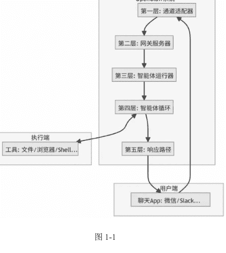

#### 2. 核心组件与协作机制

从技术实现看，OpenClaw 由多个核心组件构成，各司其职又紧密协作。

调度器 Agent Orchestrator，可视作项目经理，负责接收指令、解析意图、分配工作、安排工具执行顺序、收集结果并整合输出。它是中央协调者，保证任务有序进行。

工具池 Tool Pool 存放可直接调用的工具，如文件操作工具读写电脑文件、网络访问工具抓取网页或调用 API、代码执行工具在安全环境运行代码、邮件工具收发邮件。每个工具规范输入输出，调度器按需选用。

记忆系统 Memory System 赋予类似人类记忆的能力。短期记忆保持当前会话上下文，理解对话前后因果；长期记忆保存用户偏好、设置、人设等信息，避免重复交代背景，使交互更自然连贯。

人设引擎 Persona Engine 负责塑造 OpenClaw 的性格与行为方式。通过配置角色、语气、专业领域等，人设引擎转化为具体提示词，指导大模型生成符合期望的回复和行为。

#### 3. 任务执行流程详解

以具体例子走一遍流程。假设你说：“帮我把这周收集的会议记录整理成摘要，发到项目组群。”

调度器接收指令并分析，目标是整理记录、生成摘要、发送到群，需完成子任务：找到本周会议记录文件、阅读理解、生成摘要、通过群聊发送。调度器拆解为三步工具调用：文件读取获取记录、LLM 处理生成摘要、消息发送发布到群。

调度器依次调用工具。首先文件读取工具在指定目录搜索过去 7 天创建的会议记录，找到 4 份并返回摘要内容。其次调度器把内容发给 LLM 生成结构化摘要，返回精炼要点与待办。再次调用消息发送工具把摘要发送到指定项目组群，并返回发送结果。

最后调度器反馈：“已找到 4 份本周会议记录，生成摘要并发送至项目组群，摘要包含……是否需要补充？”这就是 OpenClaw 处理典型任务的完整流程。它像项目协调者，拆解步骤、调用不同工具逐步完成，过程中可随时介入纠正。

#### 4. 与大模型的协同方式

OpenClaw 的智能主要来自接入的大语言模型，但并非简单转发，而是通过精心设计的协同机制最大化能力、规避局限。

采用思维链 Chain of Thought 增强推理，面对复杂任务时引导大模型分步思考，而非一步到位。类似人类拆解大问题逐个解决的方式，显著提升质量与准确性。

采用工具增强 Tool Augmented 弥补短板。大模型虽知识丰富，却不知电脑文件、不会操作浏览器、不懂调用 API。OpenClaw 把各类工具嫁接给大模型，使其能看文件、操作浏览器、调用服务，从纸上谈兵变为具备动手能力。

此外设计了反思 Reflection 机制。执行中和完成后，OpenClaw 让大模型评估状态：判断是否正确、结果是否符合预期、有无遗漏。通过持续自检，能及时发现并纠正问题，提升可靠性。

## 1.2 它能帮你省下哪些烦人的重复劳动？

OpenClaw 的核心价值在于把智能转化为行动。它不是被动等待指令的聊天机器人，而是能主动理解需求、规划步骤、执行操作的智能代理。以下从核心能力与应用场景两个维度，展示其为工作和生活带来的实质改变。

### 1.2.1 OpenClaw 核心能力

OpenClaw 为什么能从普通的对话助手升级为可干活的数字员工，关键就在于下面这三套相互支撑的核心能力，它们共同让重复性手工操作被自动化取代。

#### 1. 系统级操作能力
OpenClaw 最突出的底座是能够直接驱动电脑操作系统。换句话说，它不只是聊天，而是可以读写文件、创建删除目录、启动关闭程序、读取设置环境变量等。它由此跳脱出纯文本交互的边界，真正具备在数字世界里“动手”的属性。

拿程序员提交代码举例。传统流程要开终端、执行 git status、挑选文件、写提交说明、commit 再 push，步骤简单却高频。配置好 OpenClaw 后，只需说“把今天的改动提交了”，它会自动拉起终端检查变更、按规范判断哪些文件该入库、生成合理的提交信息、串起完整的提交推送，最后反馈结果。使用者只需下指令，其余交给它去完成。

这类能力的应用面很广。办公场景可以批量改名文件、自动归档文档、定时唤起程序、监控资源占用。开发场景能自动化构建、跑测试、发布到服务器、查看服务日志。内容生产者也能借助它整理素材、定时发布、追踪数据。总之，电脑上能重复做的事，都可以被它接管。

#### 2. 工具编排能力
如果把系统级操作比作双手，那么工具调用就是工具箱。OpenClaw 内置了覆盖多领域的工具集，支持网页访问、邮件发送、代码沙箱运行、数据处理等，同时也允许用户自行开发新工具，能力边界可以持续扩展。

默认工具大致分五类：文件类负责读写复制移动重命名及内容分析提取；网络类可访问任意网页、调用 RESTful 接口、下载资源、提交表单；代码类能在安全沙箱里跑 Python、JavaScript、Shell 等，实现编程自动化；通信类可发邮件、向即时通讯平台推送消息；数据类提供 JSON 解析、格式转换、美化等功能。

除此之外还有技能系统。技能是把多个工具组合封装起来完成复合任务，例如“会议纪要整理”技能就需要语音转文字、文本分析、文件写入等环节协同工作。用户可在官方框架上开发专属技能，像安装 App 一样部署到自己的环境，模块化设计让系统保持很强的适应性。

#### 3. 多通道接入能力
与 OpenClaw 交互的入口很多，命令行、本地网页端，以及飞书、QQ、企业微信、钉钉等主流通讯平台都可作为前端。这种设计让使用场景更灵活，办公桌前或外出手机上都能下达指令。

在团队协作里优势尤其明显。比如运营自媒体账号，需要定时发布、回复评论、统计数据。借助多通道支持，可以直接在微信群里 @ 自己的 AI 助手，让它查当日阅读量、生成下周选题、起草粉丝回复，无需切换界面，就像指挥一位真人同事。

企业部署时还能做统一入口与分级权限管理。同一实例在微信上可配置为公开问答角色，在内网系统里则拥有更高权限。不同渠道的用户交互同一套大脑，但可见功能与操作范围各不相同，兼顾个人与企业需求。

### 1.2.2 OpenClaw 应用场景
依托系统执行与丰富工具生态，OpenClaw 能承接大量重复工作，把人的精力留给创造性事务。下面按场景展开。

#### 1. 开发者效率提升场景
对软件开发者而言，它是全能的提效助手。

代码相关自动化：可审查代码质量，指出潜在 Bug、优化建议、风格问题；也能基于已有业务代码自动生成单元测试用例，提升覆盖率并节省时间；还能依据注释与函数签名自动生成 API 文档，或把内部 Markdown 转换为其它格式。

Git 流程简化：集成到开发流程后，用自然语言描述变更内容即可完成 add、commit、push。更进一步，它会按规范自动撰写提交信息，合并分支时还能检测冲突并给出解决建议。

环境与部署自动化：新机器搭建时，可按预设配置自动装 Node.js、Python、Go 等运行时，安装工具链、克隆仓库、配置环境变量、启动服务。部署时可连接指定服务器执行构建、拉起 Docker 容器、配置负载均衡与监控告警，实现一次配置，后续一键发布。

#### 2. 日常生活管理场景
不仅限于技术工作，也能成为生活助手。

信息管理：可定期抓取关注网站、RSS 源、社交账号内容，按规则筛选分类并摘要，让用户几分钟掌握当日重点。

邮件管理：自动分类收件箱、标记垃圾邮件、为需回复邮件起草草稿，大幅降低处理成本。

时间管理：设定每日提醒，如早 9 点检查待办、午后活动、会前 15 分钟通知。更智能的是能根据日程主动提示，比如发现会议冲突建议调整、任务过载时推荐延后非紧急事项，由被动响应转向主动关怀。

#### 3. 内容创作与运营场景
创作者与自媒体运营者可获得全流程支持。

选题策划：分析账号历史数据找出高反响内容类型，结合热点生成下阶段选题建议，并研究竞品策略寻找差异化定位。

创作过程：根据选题自动生成大纲、填充段落、提供多版标题；视频内容可帮忙写分镜脚本、字幕文案、描述与标签。

发布与分发：一次创作，多平台推送。告诉它“发布到所有平台”，它会自动调整格式投递到微博、微信公众号、知乎、百家号等，并追踪阅读量、点赞、评论、转化率等指标生成汇总报告。

粉丝互动：按设定的风格规则自动回复常见评论与私信，复杂问题则标记待人工处理，实现半自动化运营，账号规模增长也不易卡脖子。

以一位全职创作者为例，使用前需在 ChatGPT 写文案、Notion 管理笔记、Midjourney 出图，工具切换碎片化。使用后，只需在一个界面下指令“整理本周选题素材”，它便抓取资料、生成大纲、起草正文、调用绘图工具配图并自动发布，原本一天的工作压缩到几十分钟。

#### 4. 个人智能管家场景
通过物联网与第三方服务集成，连接物理与数字世界。

智能家居：对接家居平台 API，可提前打开空调、调节灯光、播放音乐；结合天气预报自动控制窗帘或浇花，实现无感化体验。

差旅与购物规划：调用机票酒店与电商 API，按目的地与日期搜索最优组合并做价格对比；购物时追踪降价信息，达到心理价位自动下单，并管理清单与配送进度，让复杂规划变得简单。

## 1.3 零基础也能懂的 3 个核心

### 1.3.1 工程思维与学习方法
传统软件强调点哪个按钮做什么，OpenClaw 更强调说清楚要什么。学习重点不在于背操作步骤，而在于学会精确定义任务目标。

掌握的关键是从“工具使用者”转向“任务设计者”，把重复琐碎跨平台的操作抽象成可复用流程。初学者常把 AI 当成需要一次性写完整需求的脚本，沟通成本高。更有效的做法是把它当合作伙伴，先给出初步指令，观察执行结果再逐步修正，让它学习个人偏好。

其底层涉及大语言模型、思维链、工具调用等技术，无需理论精通。重点是通过实践观察行为模式，理解能力边界，在遇到问题—分析—解决的循环中成长，这比死记教程更有效。

### 1.3.2 学习路径建议
### 1. 前导知识要求
基本命令行操作：能看懂 cd、ls、mkdir、cp 等常用命令，进行目录切换、文件查看与程序运行。
浏览器基本使用：会打开网页、输入 URL、识别页面元素，无需写 HTML/JavaScript。
基础编程概念：理解变量、函数、循环、条件判断，有助于把握逻辑。
API 概念初识：知道接口是请求服务的入口即可，无需会写调用代码。
不具备上述基础也可以先行学习，教程中会同步补齐。

### 2. 推荐的学习路径
零基础读者建议按章节顺序推进，先建立认知，再安装部署，最后动手实践每个章节。
有技术背景或用过 AutoGPT、Agent 类工具的读者，可直接从安装章节入手，重点了解 OpenClaw 的独特设计与生态。

### 1.3.3 学习资源汇总
### 1. 官方核心资源
OpenClaw GitHub 仓库是最权威来源，包含源码、安装说明、配置文件示例，可跟踪最新动态与版本发布。

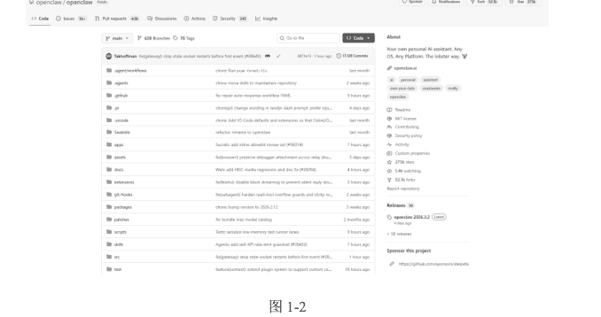

OpenClaw 官方文档提供系统性说明。

ClawHub 是官方技能市场，社区技能的集中地。截至 2026 年 3 月，已收录超过 13000 个技能。

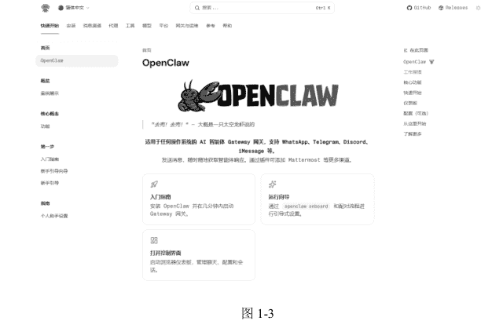

图 1-3

### 2. 部分社区资源
awesome-openclaw-tutorial 是较为完整的中文教程合集，覆盖安装、配置、实战与避坑，适合中文用户。

VoltAgent 维护的 awesome-openclaw-skills 从 ClawHub 中挑选高质量技能。

博客园、CSDN、知乎等平台也有大量中文安装与使用心得，按版本或场景搜索可获得参考。

### 3. 实践参考资源
技能选择需注意安全。2026 年 2 月曾出现恶意技能混入 ClawHub 的事件，建议优先选用官方认证或经筛选的技能列表，如 awesome-openclaw-skills，并在安装前阅读 Skill.md，避免执行来源不明命令。

GitHub Issues 区是解决问题的常用渠道，多数常见问题已有讨论与方案。项目更新频繁，建议关注 Release 页面及时了解新特性，社区持续产出新教程与案例。

## 十分钟部署，五分钟可用
概念清晰后，下面介绍在本地环境中的部署与运行，按从准备到验证的顺序说明不同场景的安装方式，帮助选择最合适的方案。

## 2.1 国内网络环境下怎么安装最省事
国内安装需解决 Node.js 运行环境与安装包下载两大问题，下面给出简捷路径以避开常见坑。

### 2.1.1 系统要求与环境检查
正式部署前需确认系统是否满足运行条件，并准备好所需软件与账号。

OpenClaw 采用跨平台设计，可在主流操作系统运行，但在不同系统上的功能完整度存在差异，选择部署方案时应综合考虑。

在桌面系统层面，OpenClaw 能够运行在 macOS、Windows、Linux 上。本文更倾向于 macOS 或者 Linux 作为落地方向。macOS 被官方视作首选部署地，能完整调用日历、备忘录、截图等系统能力，UNIX 底座让技术栈衔接顺滑，整体安装体验较为流畅。

Windows 端同样可获得完整功能，日常使用与 macOS 版在核心体验上保持一致，仅在少量系统深度集成上存在差异。若日常主力机为 Windows，核心流程完全可用。若追求更高兼容，可借助 WSL2 容器运行，效果更佳。

Linux 则面向有一定技术经验的开发者，提供最大化的定制空间，支持编译源码、调整部署参数等进阶操作。

### 2.1.2 通信平台选择
OpenClaw 以即时通讯工具作为对话入口，支持多家平台，用户只需挑选其一完成接入。各平台在功能形态与网络可达性上不尽相同，挑选时需结合实际使用场景与本地网络环境综合考量。

针对国内用户，飞书是首推方案。飞书机器人接口完备，支持文本、图片、文件、卡片等多种消息形态，群机器人也利于团队协作。若尚未使用飞书，企业微信或 QQ 也能满足基础交互需求，不过高级消息形态可能受限。

海外用户建议优先考虑 Telegram，Bot API 设计规范、文档齐全、社区活跃度高。WhatsApp 与 Discord 可作为备选，前者需要手机号绑定，后者更适合技术社群使用。

### 2.1.3 AI 模型服务准备
OpenClaw 并不训练也不托管模型自身，仅作为调度层，通过接口调用外部服务来落地能力。因此在起用之前，需要先准备一个可用的模型服务。

国内用户推荐使用中转 API。中转服务会把国内外多种模型统一收口，涵盖 GPT 系列、Claude 系列、Gemini 等海外产品，以及 Kimi、DeepSeek、GLM-4 等国产产品。优势在于计费统一、国内访问更快、切换更灵活。主流选择包括开源项目 OneAPI、NewAPI，以及各大云厂商提供的 API 网关。选型时可关注模型覆盖面、服务稳定性、价格与技术支持。

也可以直接接入官方接口，如 OpenAI API 或 Anthropic Claude API，路径更直接，但需自行解决网络通达问题。

具备技术能力的用户可尝试本地部署开源模型，例如用 Ollama 运行 Llama、Qwen 等。本地部署可做到完全离线、数据不上传第三方，安全性更好；缺点是硬件要求较高。

### 2.1.4 基础运行环境准备
除操作系统外，还需在本地安装 Node.js 运行环境。OpenClaw 使用 Node.js 构建，最低要求为 22.0.0。

先检查当前版本，打开终端执行：

```
node --version
```

若输出为 v22.x.x 或更高，则满足要求。若版本偏低或提示 command not found，则需安装或升级。

不同系统的安装方式：

Windows 用户可前往 Node.js 官网，点击绿色 LTS 按钮下载安装包。安装时务必勾选 Add to PATH，否则命令行无法识别 node。完成后打开新的 PowerShell 验证：

```
node --version
```

macOS 建议使用 Homebrew 安装：

```
brew install node
```

升级现有版本执行：

```
brew upgrade node
```

也可直接从官网下载 LTS 版本手动安装，流程与 Windows 类似。

Linux 因发行版不同而异。Ubuntu 或 Debian 可用：

```
curl -fsSL https://deb.nodesource.com/setup_22.x | sudo -E bash -
sudo apt-get install -y nodejs
```

CentOS、RHEL、Fedora 等可使用 dnf 安装，核心步骤类似。

安装完成后验证 Node.js 与 npm：

```
node --version
npm --version
```

两条命令都应返回版本号。若仍提示 command not found，可重启终端或重新登录。

硬件方面，OpenClaw 自身占用很低，普通电脑即可满足。若计划本地运行大模型，建议内存至少 8GB、可用的磁盘 20GB 以上。若使用云端接口，则对本地硬件无特殊要求。

### 2.1.5 安装部署
1. 使用安装器脚本安装

官方提供安装器脚本，是最省心的方式，会自动检测环境并完成配置。

Linux 与 macOS 在终端执行：

```
curl -fsSL https://openclaw.ai/install.sh | bash
```

脚本会引导并自动完成全局部署，同时设置环境变量。

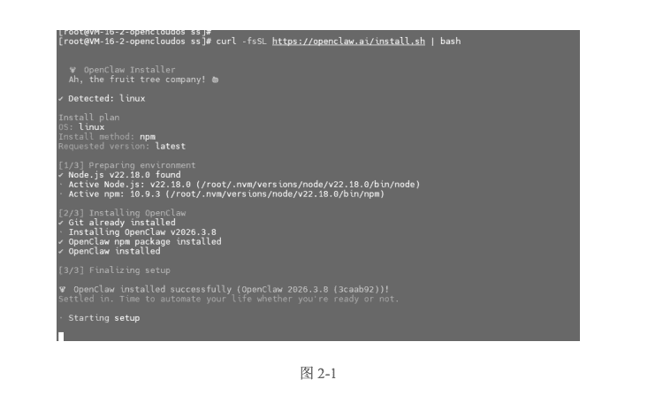

图 2-1

Windows 在 PowerShell 中执行：

```
iwr -useb https://openclaw.ai/install.ps1 | iex
```

Windows 安装器同样会自动检测并安装 Node.js，支持 winget、Chocolatey、Scoop 等渠道。

查看帮助：

```
curl -fsSL https://openclaw.ai/install.sh | bash -s -- --help
```

常用参数：

- --install-method：指定安装方式，可选 npm 或 git
- --git-dir：指定代码仓库路径，默认 ~/openclaw
- --no-git-update：使用已有仓库时跳过 git pull
- --no-prompt：关闭交互提示，适合自动化部署
- --dry-run：仅打印将执行的操作，不做实际更改
- --no-onboard：跳过新手引导

2. 使用 npm 全局安装

适合已手动安装 Node.js 的用户。

终端执行：

```
npm install -g openclaw@latest
```

若在 macOS 上因 libvips 冲突导致 sharp 安装失败，可执行：

```
SHARP_IGNORE_GLOBAL_LIBVIPS=1 npm install -g openclaw@latest
```

若使用 pnpm，先安装 pnpm：

```
pnpm add -g openclaw@latest
pnpm approve-builds -g
pnpm add -g openclaw@latest
```

注：pnpm 需要显式批准带构建脚本的包，需执行 approve-builds。

安装完成后，用 openclaw --version 验证。

3. 从源码安装

适合需要最新开发版、定制代码或二次开发的用户，需具备一定终端与代码基础。

第一步，克隆源码，需先安装 Git：

```
git clone https://github.com/openclaw/openclaw.git
cd openclaw
```

第二步，安装依赖：

```
pnpm install
pnpm ui:build
```

pnpm install 会安装全部运行依赖，pnpm ui:build 会构建界面资源，首次运行会自动处理 UI 依赖。

第三步，构建项目：

```
pnpm build
```

源码安装可随时用 git pull 获取最新代码，但开发版可能不够稳定，生产环境建议使用稳定版。

## 2.2 第一个任务：让 OpenClaw 帮你发条消息
安装完成后，需运行一次初始化向导完成基础配置。向导会引导完成模型接入、渠道配置等关键步骤，是让 OpenClaw 正常工作的必要流程。

### 2.2.1 启动初始化向导
执行以下指令启动向导：

```
openclaw onboard --install-daemon
```

该指令会安装 Gateway 后台服务，让 OpenClaw 能够后台持续运行，并启动交互式配置向导引导设置。

执行后向导会依次询问各项配置，下面逐项说明。

### 2.2.2 向导步骤详解
（1）风险确认。
向导启动后会先展示官方安全风险提示及使用须知，随后询问是否继续，选择 Yes 继续。

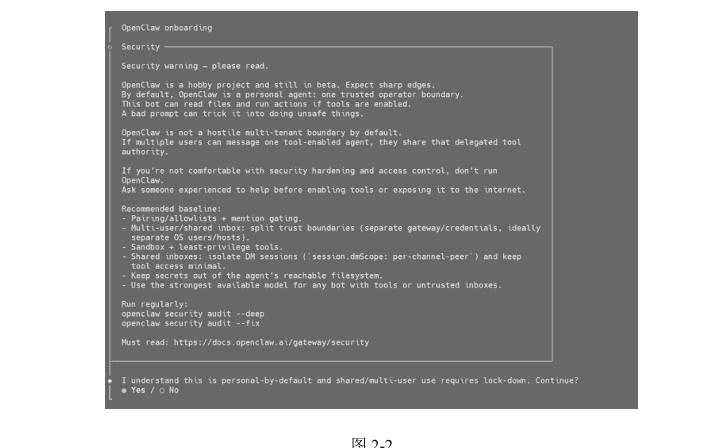

（2）选择运行模式。
第二步提示选择运行模式：

- QuickStart 快速启动：适合有一定技术基础的用户，可自定义模型参数、服务端口、日志存储等更多高级项
- Custom 自定义：适合经验丰富的用户，可调整更多配置

如图 2-3 所示，新手建议优先选 QuickStart，能快速完成配置并启动。后续个性化需求可通过配置文件调整，无需重跑向导。

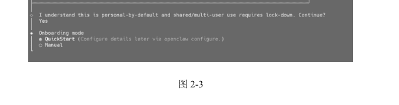

图 2-3

（3）选择模型提供商。
向导会提示选择模型服务商。OpenClaw 不训练模型，它更像大厨，需要食材才能做饭，这个食材就是模型的 API Key。常见选项有：

- Kimi：月之暗面出品，长文本理解强，适合长文档、代码
- MiniMax：响应快，性价比高
- GLM：智谱 AI 出品，综合能力强
- OpenAI 系列：在自然语言理解、生成、逻辑推理、创意写作和多轮对话方面表现突出

根据已申请的 API Key 选择对应提供商。若还没 Key，先去对应厂商开发者后台申请。

（4）选择验证方式。
选完提供商后，向导会展示对应的 API 验证方式，无需手动挑选无关项。需选与自身 Key 匹配的验证方式，确保密钥可正常调用。如图 2-5 所示，本书采用自定义供应商配置，只需准确填入提供商给出的 API URL 和 API Key 即可完成验证；其他在线提供商流程类似，均需填入平台凭证。

## 第 2 章 10 分钟装好，5 分钟跑通


图 2-4

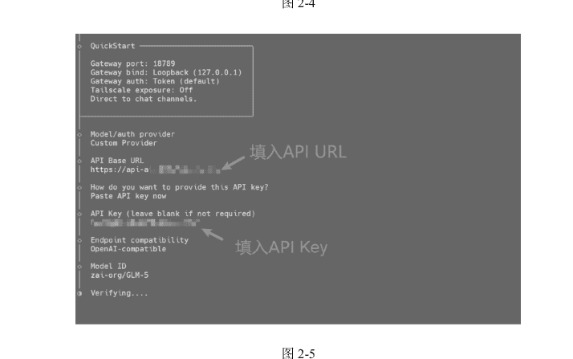

图 2-5

使用在线提供商时，向导会列出该提供商下的可选模型，通常有 1 到 2 个推荐项，按推荐选即可。不同模型性能和价格不同，初次使用建议用默认推荐。

（5）配置通信渠道。
向导会问是否现在配置通信渠道如飞书、Telegram 等。强烈建议选 Skip for now 暂时跳过。原因：渠道配置相对复杂，需要先在开放平台创建应用获取凭证；建议先本地测试确认 OpenClaw 能正常运行再配渠道；渠道的详细配置会在后续章节专门讲解。跳过后仍可通过本地 TUI 文本界面交互测试。

（6）配置 Skills。
向导会问是否安装预置技能包，如图 2-6 所示。Skills 是 OpenClaw 的扩展能力，可赋予 Agent 自动写日报、会议纪要、代码审查等功能。


建议选 Yes，装好预置技能能更快体验完整功能，后续可按需增减。

（7）其他 KEY 的配置。
最新版本向导会提示设置 GOOGLE_PLACE、OPENAI 等额外 API Key，如图 2-7 所示。对普通用户而言这些 Key 并非核心必需，可全部选 No 跳过；后续有需求再通过配置文件补充。

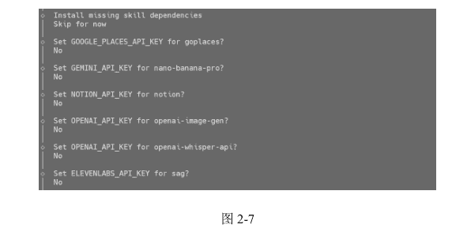

图 2-7

（8）安装 Hooks。
向导会询问是否启用核心功能钩子，如图 2-8 所示，建议全部启用。

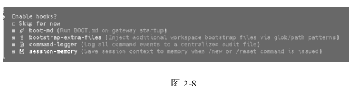

图 2-8

- boot-md：适合需要工作区自动初始化的用户。启动时自动执行工作区根目录下的 BOOT.md，可用于预设服务启动、环境加载等例行任务
- bootstrap-extra-files：适合团队协作或统一工作区配置。允许通过通配符在初始化时自动注入共享配置文件、脚本或提示词模板，保证多用户环境一致
- command-logger：适合审计、调试或复盘。启用后所有指令与事件会记录到集中审计日志，便于追踪分析
- session-memory：推荐所有用户启用。执行 /new 或 /reset 时自动保存当前会话上下文，防止因切换会话、终端关闭导致思路丢失

（9）选择启动方式。
最后一步选择 Gateway 启动方式：

- Hatch in TUI 在 TUI 中启动：在终端文本界面启动，可看到实时运行日志和对话，适合学习和调试
- Run as Daemon 作为后台服务运行：在后台静默运行，不占终端窗口，适合长期运行

初次使用建议选 Hatch in TUI，能直观看到工作状态，便于排查问题。熟悉后再重跑向导切为后台服务模式。选完后向导会自动启动 OpenClaw，首次启动可能需要下载依赖，耗时稍长，请耐心等待。

### 2.2.3 首次对话配置（Bootstrap）
OpenClaw 启动成功后会进入 TUI 或 WebUI 界面。此时 Agent 更像新入职的实习生，对你的使用习惯和偏好一无所知，需要进行首次对话配置。如图 2-9 所示，要主动告知关键信息。

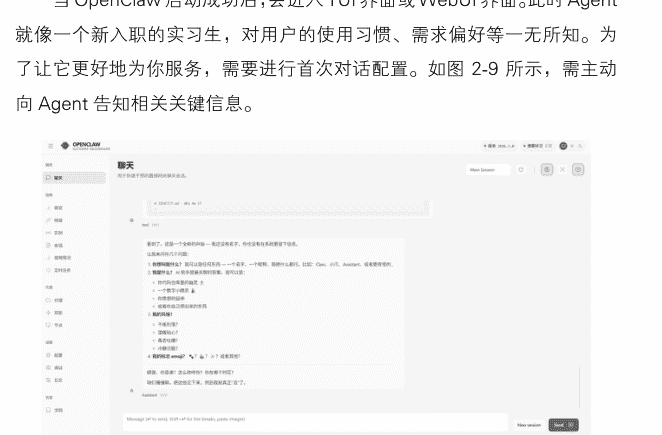

建议按以下 6 个要点完成自我介绍，让 Agent 精准服务：

1. 你的称呼：告诉 Agent 怎么叫你，例如“叫我小明”或“叫我老板”
2. 时区和语言：告知所在时区及偏好语言，例如“我在中国，时区 UTC+8，用简体中文交流”
3. 它的角色：说明身份定位，例如“你是我专属的技术助手”或“你负责处理我的日常事务”
4. 工作环境：告知常用工具和系统，例如“我常用 VS Code 开发，主要用 Windows 系统”
5. 回答风格：说明偏好，例如“回答要简洁”或“重要信息要详细解释”
6. 红线：明确哪些操作必须先经你同意，例如“删除文件前必须经我确认”

自我介绍完成后，可发送简单测试指令验证配置是否生效，示例如图 2-10 所示。

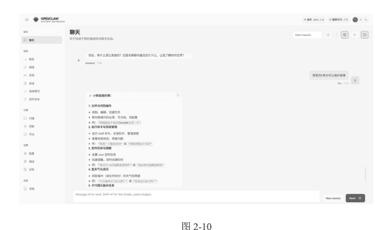

Agent 能顺畅回复时，基本可以认为模型接入到系统配置的完整链路已经连通，可以正常使用了。

### 2.2.4 配置二次调整

首次执行初始化向导时若选错了选项，或之后想做更细致的个性化设置，有两种修改途径。

第一种是重新启动初始化向导。相关命令如下：

```
openclaw onboard
```

如果在调整期间还想安装或升级 Gateway 后台服务，可以加上 --install-daemon 参数，示例命令为：

```
openclaw onboard --install-daemon
```

第二种是直接编辑配置文件做精细化调整。OpenClaw 所有的参数都收敛在配置文件中，弄懂文件结构和各字段含义是进阶使用的基础。

默认配置文件名叫 openclaw.json，放在用户主目录下的 .openclaw 文件夹内，完整路径是 ~/.openclaw/openclaw.json。

Windows 系统下，主目录一般是 C:\Users\用户名，所以配置文件路径通常为 C:\Users\用户名\.openclaw\openclaw.json。

若要部署多个实例，可以通过环境变量指定不同配置文件的位置，示范命令如下：

```
OPENCLAW_CONFIG_PATH=~/.openclaw/a.json openclaw gateway --port 19001
```

配置文件使用 JSON 格式，由若干个顶层键组成，每一个键对应一个功能模块。

### 2.2.5 部署校验与试跑

要随时确认 OpenClaw 是否可用，可以按下面步骤验证。

（1）检查服务运行状态。

先确认 OpenClaw 服务是否在线。本地用后台服务方式部署时一般会自动拉起，查看状态的命令为：

```
openclaw status
```

服务正常时会返回运行时长、已处理请求数等详细数据。

如果提示服务未运行，可用下面命令手动启动：

```
openclaw gateway --port 18789
```

启动成功后终端会实时打印 Gateway 的运行信息，包含监听端口和控制面板地址。

（2）发送测试消息。

服务在线后，可以发一条测试消息确认整条链路是否通畅。确保 Gateway 正在运行，执行：

```
openclaw message send --target +15555550123 --message "Hello from OpenClaw"
```

该命令会通过 WhatsApp 向指定号码发送测试内容，示例号码是 +15555550123。换到其他通信平台时需要修改命令参数。

除了命令行，也可以在已配置的通信平台里直接交互测试。例如在 Telegram 中 @ 已配置好的 OpenClaw 机器人发送“你好”。如果能收到正常回复，说明模型接入、消息接收和回复发送的完整链路已打通，核心功能可用。

（3）打开 Web 控制面板。

OpenClaw 提供网页控制面板用于查看和管理运行情况，在浏览器打开 http://localhost:18789/ 即可进入。

面板主要功能：

1. 查看对话历史，了解系统处理过哪些请求。
2. 查看运行日志，了解系统详细行为。
3. 查看工具调用记录，追踪各类工具的调用详情。
4. 运行时调整部分基础配置，无需重启即可生效，提升运维效率。

如果部署在远程服务器，本地地址无法直接访问，可借助 SSH 隧道或 Tailscale 等内网穿透工具打开面板。

## 2.3 安装卡住？常见问题自救清单

使用 OpenClaw 的过程中容易碰到一些典型问题，下面汇总了解决思路。

### 2.3.1 命令无法识别

终端输入 OpenClaw 命令提示找不到，通常是 npm 全局 bin 目录没有加入系统 PATH。

自检方法在终端执行：

```
node -v
npm -v
npm prefix -g
echo "$PATH"
```

判断依据：macOS/Linux 下 $(npm prefix -g)/bin 或 Windows 下 $(npm prefix -g) 的输出路径，若未出现在 echo "$PATH" / echo %PATH% 的结果中，就可判定是 PATH 配置问题。

修复方法：把下面内容写入 shell 启动文件。zsh 用户写入 ~/.zshrc，bash 用户写入 ~/.bashrc。

```
export PATH="$(npm prefix -g)/bin:$PATH"
```

Windows 则手动把 npm prefix -g 的输出路径添加到 PATH。修改后重启终端，或在 zsh 执行 rehash、在 bash 执行 hash -r 立即生效。

### 2.3.2 sharp 编译报错

安装时若出现 “sharp: Please add node-gyp to your dependencies” 错误，主要是 sharp 依赖原生构建失败。提供两种处理方案。

方案一：安装对应系统的构建工具。macOS 需要安装 Xcode CLT 并执行：

```
npm install -g node-gyp
```

方案二：跳过原生构建。执行安装命令时通过环境变量跳过 sharp 编译，命令如下：

```
SHARP_IGNORE_GLOBAL_LIBVIPS=1 npm install -g openclaw
```

### 2.3.3 pnpm 脚本被忽略

使用 pnpm 安装时若出现 “Ignored build scripts” 警告，需要运行 pnpm approve-builds -g 并勾选列表中的 OpenClaw 相关包。批准完成后重新执行安装命令，即可正常运行 postinstall 脚本，完成安装。

### 2.3.4 一键诊断

遇到安装或运行故障时可用以下命令快速排查：

```
# 检查 OpenClaw 是否安装成功
openclaw --version

# 检查 Gateway 状态
openclaw status

# 检查健康状态
openclaw health

# 查看当前配置
openclaw config get

# 查看最近日志
openclaw logs

# 完整的诊断报告
openclaw doctor
```

其中 openclaw doctor 会全面检查系统环境、依赖包、配置文件、服务状态等，生成详细诊断报告并指出问题与建议，是排查复杂问题的实用工具。

### 2.3.5 完整卸载

卸载前请务必备份重要数据。

1. 内置卸载程序，推荐，操作简单且彻底。

执行以下命令启动内置卸载向导，按提示完成：

```
openclaw uninstall
```

自动化环境下可进行非交互式卸载：

```
openclaw uninstall --all --yes --non-interactive
```

若 CLI 已无法调用，可通过 npx 执行卸载：

```
npx -y openclaw uninstall --all --yes --non-interactive
```

2. 手动清理流程

内置程序不可用时可按下面顺序手动清理，效果与内置程序一致。

第一步，停止 Gateway 网关服务。

```
openclaw gateway stop
```

第二步，卸载 Gateway 网关服务。

```
openclaw gateway uninstall
```

第三步，删除状态和配置文件。

```
rm -rf "${OPENCLAW_STATE_DIR:-$HOME/.openclaw}"
```

补充说明：若安装时使用了自定义配置文件路径 --profile 或 OPENCLAW_PROFILE，需额外删除该自定义文件。

第四步，删除工作区，可选，用于彻底移除智能体相关文件。

```
rm -rf ~/.openclaw/workspace
```

第五步，移除 CLI 安装包。根据安装时使用的包管理器选择对应命令：

```
npm rm -g openclaw
# 或（pnpm 用户）
pnpm remove -g openclaw
# 或（bun 用户）
bun remove -g openclaw
```

第六步，若安装了 macOS 应用，则删除该应用。

```
rm -rf /Applications/OpenClaw.app
```

3. 手动移除残留服务

CLI 已删除但 Gateway 仍在运行需手动停止。

macOS，基于 launchd，默认标签是 bot.molt.gateway，执行：

```
launchctl bootout gui/$UID/bot.molt.gateway
rm -f ~/Library/LaunchAgents/bot.molt.gateway.plist
```

使用配置文件时请把标签和 plist 名替换为 bot.molt.<profile>。

Linux，基于 systemd 用户单元，默认单元名是 openclaw-gateway.service，执行：

```
systemctl --user disable --now openclaw-gateway.service
rm -f ~/.config/systemd/user/openclaw-gateway.service
systemctl --user daemon-reload
```

Windows，基于计划任务，默认任务名是 OpenClaw Gateway，在 PowerShell 执行：

```
schtasks /Delete /F /TN "OpenClaw Gateway"
Remove-Item -Force "$env:USERPROFILE\.openclaw\gateway.cmd"
```

## 第 3 章 和 OpenClaw 好好对话

安装配置完成后即可开始使用，但不少人会困惑：明明按步骤下指令，为什么 OpenClaw 总是理解偏？同样任务别人顺畅，自己却总出错？

问题不在模型不够智能，而在于沟通方式需要优化。它能听懂人话，但理解方式和人不同。本章讲如何让指令更精准、怎样调教工具更贴合需求，从“能用”进化到“好用”。

### 3.1 如何让它准确理解你

与 OpenClaw 交流本质上是与大语言模型对话。你输入的每个字都会先被理解再生成回复或执行动作。理解质量受指令清晰度、上下文完整度、表达准确度影响，直接决定反馈是否符合预期。

#### 3.1.1 提示词核心三要素

第一次打开对话窗口时容易不知说什么。关键在于提示词，即你输入的文字。

很多人习惯用极简指令，如“帮我整理文件”“查一下这个”。对人勉强够用，对 AI 信息太少，只能靠猜，猜的偏差常很大。

一个好的提示词应包含明确目标、充分背景、必要信息，三者缺一不可。

先讲清目标。不要把 OpenClaw 当成读心术。比如“帮我整理一下”要说明整理什么、从哪里整理、整理成什么格式。

背景信息同样关键。例如让它写求职邮件，只说“帮我写一封”只能得到千篇一律的模板。补充岗位、公司、个人经历等，输出才会落地。

#### 3.1.2 描述任务的实操技巧

掌握原则后，可用以下技巧提升效果。

把大任务拆成小步。复杂任务如“分析行业趋势”，可拆为收集数据、梳理玩家、分析格局、给出建议，每步单独问，结果更清晰，也便于把控质量。

给例子比抽象描述有效。想控制写作风格，别只说“写得专业点”，直接给一个参考样本：“这是我喜欢的风格，请参考写一段类似的”。具体例子胜过一百句形容。

说清输出格式。需要表格、清单或特定结构时提前说明：“请整理成表格，列出公司名、成立时间、融资轮次”。指令越具体，结果越可直接用。

多轮对话逐步推进。不必一次说完，像聊天一样先拿第一步结果再追问第二步。如先让列头部公司，再问“按成立时间排序”。

一次没说清很正常，直接追问或纠正：“我刚才没表达清楚，其实是…”、“这部分对了，那里我想改成…”。模型会记住上下文不断调整。

#### 3.1.3 角色设定方法

通过角色设定引导行为，适合需要专业知识或特定语气的场景。

核心是在任务前先说明角色，如“你现在是有十年经验的资深产品经理”或“请以心理咨询师视角分析”。

角色像一个过滤器，会影响理解角度、回答语气和知识引用。

有效角色设定通常包含专业背景、经验水平、思维模式。如“你是一位严谨的数据分析师，擅长用统计学解释现象并习惯用数据说话”，框架清晰易用。

#### 3.1.4 上下文管理策略

多轮任务中上下文管理很关键。

主动提供前置信息是首要策略。开始新任务前可简要复述已有信息，如“基于我们之前讨论的用户画像，现在帮我想个营销方案”，避免让模型翻历史记录。

适时重申关键约束更稳妥。预算上限、截止时间、语言要求等，在每次对话中适当提醒比只提一次更保险。

进阶做法是利用系统提示词。OpenClaw 可配置长期生效的系统提示，如“提到‘简报’指不超过两页 A4 文档”“所有代码注释用中文”，减少重复说明。

#### 3.1.5 不同场景的沟通模式

文案写作注重风格引导。提供足够参考样本并明确目标受众，说明是面向小白还是专业用户，风格是活泼还是稳重，输出更贴合。

数据分析需清晰说明数据来源和分析目的。告知数据位置、想发现的问题、结果呈现形式，复杂分析时提供数据结构说明很有帮助。

编程辅助重在准确描述需求和报错。遇到 Bug 时完整提供错误信息、相关代码、已尝试方法，能更快定位。新功能开发时说明输入、期望输出、语言框架，信息完整才高效。

创意类任务需要发散引导。限制越少创造空间越大，可用头脑风暴式提示：“帮我想十个创意方向，先不要考虑可行性，想到什么写什么”。

#### 3.1.6 结构化提示词进阶

掌握基础写法后可尝试结构化提示词，让复杂任务处理更高效。

让 OpenClaw 真正好用的实战笔记

TBRF 结构化打法是个很管用的思路，核心是拆成四块来写指令：先写清楚要干什么 Task，再补上相关背景 Background，接着把具体诉求 Requirement 列明白，最后附一个参考 Example。四个部分环环相扣，指令的可读性和可执行性会提升很多。

一个完整的 TBRF 示例可以这样组织：

> 任务：帮我起草一份产品发布会的邀请函。
> 
> 背景：这是我们公司首次办线下的发布会，对象主要是行业媒体和核心客户。
> 
> 要求：①语气正式但不僵硬；②必须写明时间、地点和报名方式；③整体控制在 300 字以内。
> 
> 示例：参考 XXX 公司的发布会邀请函写法。

把“做什么”和“怎么做”分开写，OpenClaw 能更快抓住重点，给出的结果也更贴合预期。

面对特别复杂的事项，用逐步引导法会更稳妥。不要一次性把所有细节堆上去，而是分步推进，每完成一步让它复核一下再进入下一步。方向不容易跑偏，也能及时纠偏。

条件分支提示也很实用，适合处理多场景任务。用“如果……那么……”的句式说明不同分支的处理逻辑，比如“如果用户选的是套餐 A，就展示价格与优惠；如果选的是套餐 B，就展示对应的增值服务”。

### 3.1.7 处理特殊情况的方法

实操中总会碰到一些异常情况需要单独定规则。

信息不足很常见。当 OpenClaw 回答不准时，多半是上下文不够。这时不要让它胡猜，要明确要求它先声明“信息不足，无法判断，请补充 XX”。 

对不确定的结论，可以要求它主动标注。比如让它用“可能”“尚需核实”这类表达来标出存疑点，这样你能快速分辨哪些是可靠的、哪些需要自行验证。

敏感内容可能触发安全限制。若正常业务需求被误拦，可以换种表述，或直接说明这是正当的工作或学习场景。大多数合理的商业、学习类需求都能正常通过。

多轮对话里偶尔会出现记性偏差，OpenClaw 会遗漏前面说过的信息。这时可以提示它“回顾一下，我们之前确认的是……”来帮它找回上下文，这是多轮对话的常规互动。

### 3.1.8 常见错误案例分析

通过典型误区能更快掌握有效沟通的方式。

错误一：描述过于宽泛。比如“帮我写点东西”。没有目标、没有受众、没有格式，返回的结果只能是泛泛而谈。改进办法是把写作对象、用途、场景都说清楚。

错误二：信息堆砌。一次塞进太多细节，关键点反而被淹没。正确做法是把复杂需求拆成若干个小任务依次处理。

错误三：期望过高。指望一次对话就能交付完整项目。实际上复杂工作需要迭代，合理做法是把大目标拆成可控的小步骤。

错误四：不看反馈。模型给出回复后用户直接跳到下一个问题。认真阅读反馈，结合其中的建议调整提问，能显著提升效率。

错误五：每次都从零开始。没有提供历史背景，导致模型反复提问或前后矛盾。提供必要的上下文，能让对话更连贯。

## 3.2 让它记住你的小习惯

OpenClaw 相比普通助手的一大差异在于具备结构化记忆。它会记录你的偏好、常用习惯和重要信息，随着使用时间增长，配合度会越来越高。

### 3.2.1 理解 OpenClaw 的记忆体系

记忆分层工作。

最底层是短期记忆，也就是当次会话的上下文。会话结束或窗口满后，信息会被压缩或丢弃。重要的内容需要明确要求它保存。

第二层是工作记忆，也叫日记系统。系统会按日期生成日记文件，记录每天对话要点和关键事项，日积月累形成可检索的历史。

第三层是长期记忆，是核心层。它以结构化方式保存姓名、身份、偏好、常用设置等关键信息，并在每次交互中自动调用，正因如此，使用久了会感觉它越来越懂你。

### 3.2.2 主动告诉它你的信息

很多用户习惯每次都重新介绍自己，造成时间浪费。更好的做法是上手初期就主动做一次自我介绍，并要求它记住。

例如：“我叫张三，在一家互联网公司做产品经理。沟通偏好简洁直接，回复尽量短而有力。工作上经常要做用户数据分析，相关指令可以写得详细些。”这类信息会被写入长期记忆，后续自动生效。

个人偏好也可以一次性告知，比如偏好的处理时段、语气风格、忌讳的话题，不用反复强调，它会一直保留并据此调整回复。

### 3.2.3 用好 MEMORY 文件

工作目录下的 MEMORY.md 是长期记忆的载体。系统会自动写入部分信息，但手写维护会更精准。

建议整理五类内容：基本信息如姓名职业联系方式；工作背景如业务方向、职责分工、常用工具；个人偏好如沟通风格、格式习惯、特殊要求；常用指令模板；重要联系人、项目或事项摘要。

维护时注意：内容精简只留核心；结构清晰用标题和列表方便检索；定期更新避免过期信息被沿用。

### 3.2.4 养成记录的习惯

除了被动记忆，还可以主动让它归档。重要任务完成后，让它把要点保存到你的工作笔记，比如会议纪要的重点、待办事项和负责人。下次回顾直接调用即可。

明确表达偏好也很关键。首次处理某类任务时就说明喜好，例如“我喜欢简洁风格，别用太多修饰”。表达清楚后，它通常会记住并延续。

“帮我记住”这类句式非常有效，例如“帮我记住，以后写文案前先问我目标受众”。及时纠偏也很重要，当次没按偏好处理就当场指出，比事后补救更有效。

长对话结束后让它做一次小结，梳理本次讨论的问题、决策和后续待办，既可存入记忆，也可发给你留档。

调用记忆同样重要。开始任务前可以让它先复盘“你记得我有哪些偏好”，发现遗漏及时补充。需要引用历史信息时，用“根据我之前告诉你的偏好，这个任务该怎么处理”之类的表达，让它明确调取记忆而非凭空假设。

记住不等于理解。身份信息保存了不代表它明白身份背后的工作逻辑，需要额外说明身份对任务的影响。

### 3.2.5 建立个人知识库

记忆系统也能用来搭建个人知识库。

先做分类存储，按行业知识、专业技能、个人经历、项目经验等划分，每类用清晰标题区分。关键概念要记全：是什么、为什么、怎么用，例如记录工作流程时同时写清步骤、原因和注意事项。

定期回顾整合，让它帮你检查重复、过时或缺失的条目，知识库才会越用越值钱。

### 3.2.6 记忆系统的优化技巧

关键词记忆法更高效。与其写大段描述，不如提炼关键词，例如写作风格记为“简洁、数据驱动、少形容词、多动词”。

用优先级标记区分重要程度，例如“[重要]代码输出必须带中文注释，[一般]标题尽量控制在 20 字内”。

随着记忆增多，建立索引很方便。在 MEMORY.md 开头放目录，列出各类主题，检索更快。

### 3.2.7 跨会话记忆管理

记忆是否跨会话保留，取决于存储位置。写入 MEMORY.md 的内容最可靠，会跨会话保留；会话中未明确要求保存的信息，通常不会延续。

要让新记忆生效，需要手动触发同步，例如“把这个规则写入我的 MEMORY.md”。清理工作也很必要，记忆饱和时可能出现混淆，可以明确让它删除某条记录或重新整理偏好，剔除过时内容。

### 3.2.8 记忆分类与标签管理

记忆量大时，分类加标签能保持清晰。一个条目可打多个标签提高召回率，例如“周报模板”可同时归到“工作文档”和“常用模板”。

每月花点时间让它体检记忆库：哪些久未使用、哪些已过时、哪些需要更新，保持库的整洁才能保证可靠性。

## 3.3 从“能用”到“好用”的 N 个小窍门

会用是基础，用好是进阶。很多不顺手并非能力问题，而是方法问题。

### 3.3.1 模型分层使用

不要只用一个模型。不同任务对算力的需求差异很大，用最贵的模型处理简单查询只会浪费成本。

建议分层：便宜快速的模型负责日常查询、简单消息、常规问答；强劲昂贵的模型用于代码审查、长文写作、创意分析等复杂任务。

在 OpenClaw 中切换很简单，指令前加前缀即可，例如“用 DeepSeek 查一下最新 AI 动态”或“切到 Claude 帮我分析这段代码”。合理分层能降本增效。

### 3.3.2 利用系统提示词建立长期规则

系统提示词可设置长期生效的默认规则，一次配置反复受益。

比如设定“写代码时默认用 Python，函数加中文注释，遵循 PEP8”。常见设置包括输出格式偏好、语言习惯、专业背景、术语定义、工作流程偏好等。

提示词不要堆太多，规则过多会让模型无所适从。只保留高频通用的规则，特殊需求在具体任务里临时说明。

### 3.3.3 给它建立工作规范

如果它常忘保存、用错格式或越权操作，可以在 AGENTS.md 中写入工作规范，明确原则和行为边界。

例如“未经确认不删除文件”“不要访问工作目录外的文件夹”“发邮件前先把草稿发我确认”“保存后告知路径”。规范可逐步迭代，每次发现易错点就补充进去，行为会越来越稳定。

### 3.3.4 利用 Skills 扩展能力

Skills 是封装好的工具组合，用简单指令触发复杂流程，是能力扩展的核心。

先熟悉官方内置 Skills，如 file-organizer 自动整理文件、GitHub 操作仓库、weather 查询天气，安装后按说明调用即可。熟练后可安装 ClawHub 上的社区 Skills，相当于给助手装新 App。

进阶用户还能自建 Skills，例如“写周报”技能自动汇总数据、按模板排版、生成文档。技能文件定义名称、触发词、执行步骤和输出格式，创建方法可参考官方文档。

### 3.3.5 善于复盘和总结

任务结束后做一次复盘，对它说清哪些做得好、哪里有问题、原因是什么、下次如何改进。这类反馈会被记住，下次同类任务会自动优化。

失败也是宝贵的训练机会。明确告诉它失败点和改进方向，能显著提升后续表现。

### 3.3.6 设置合理的期望

OpenClaw 不是万能的。重复性操作、规则明确、信息整合类任务是它擅长的，例如整理文件、批量处理数据、定时推送报告。需要深度创造、主观判断的任务则需你把关。

把它当作刚入职的新人：有潜力、有学习力，需要时间培养。磨合期不顺是正常的，多调教会越来越好用。

### 3.3.7 建立自己的指令库

把高频任务的指令模板保存成个人库，文本或笔记均可。调用时微调参数即可，比每次重写更高效，也能保证一致性。

库里可收录标准开场白、常用格式模板、任务拆解步骤、特殊要求的表达方式。随着经验积累，它会成为你的专属工具箱。

### 3.3.8 注意安全边界

OpenClaw 有操作电脑的权限，能访问和修改你的文件。指令不当或恶意利用都可能带来风险。了解安全边界、遵守使用规则，是安全使用的基本前提，也是对自身数据负责。

安全加固要点

把网络入口管控好是防御的第一层。把服务切换到本地访问形态是最直接的硬防护。修改网关策略，只放行回环地址例如 127.0.0.1，这样公网流量在最外层就被拦截，属于最稳妥的部署姿势。若确实需要异地接入，建议走 Tailscale Serve 这类加密中转，而不是把端口裸露在互联网上。外部请求时一定要先执行 `openclaw token generate` 产出访问令牌，未携带有效凭证的连接一律拒绝。

权限管控也要收紧。配对模式保持开启，陌生账号申请加友必须经管理员审批。在群聊场景下把 `requireMention: true` 打开，避免模型被随意唤起，外部人员无法直接下指令驱动你的 OpenClaw。

初始化时坚持最小授权原则。对不需要的插件和 API Key 统一选择 “Skip for now” 或 “No”，只接入完成当前任务的账号。只授予刚好够用的权限，权限面越小风险越低。

ClawHub 技能集市对生态很重要，但供应链污染风险同样存在。安全研究曾披露平台上存在大量伪装成提效工具的恶意插件，其目的实为窃取用户数据。常见手法是在 SKILL.md 中硬编码 API Key 与密码，把敏感信息拼接到 LLM 提示里，或在输出结果中泄漏隐私。

装插件前做好三步核验。第一步看 VirusTotal 的扫描结论，详情页会展示安全报告，被标记为恶意的直接丢弃。第二步确认 GitHub 仓库来源，只安装提供开源地址的项目，并核查维护者身份与最近更新时间。第三步仔细阅读 SKILL.md，尤其是 `curl | bash` 这类先下载再执行的写法，要高度警惕。

企业环境建议建立内部评审流程。所有来自外部的插件先经安全团队逐项检查，确认无恶意代码与漏洞后再允许进入生产。额外的一道关卡能显著降低数据泄露与主机被控的概率。

对关键操作启用二次确认。在 MEMORY.md 中可预置约束：任何删除类操作无论是文件还是数据库记录都必须二次确认；数据导出类操作需明确指定目标路径并确认；涉及系统指令的执行必须经人工复核。

养成定期审计日志的习惯。日志能还原 OpenClaw 实际执行了哪些动作，是否出现异常。发现可疑条目应及时溯源处置。`sessions_list` 与 `sessions_cleanup` 可用于管理会话历史，方便合规审计。

提示词注入是常见攻击向量，攻击者会在输入中植入指令劫持模型行为。当 OpenClaw 读取外部网页或文件时，可能被恶意内容影响从而执行非预期动作。

应对思路包括：在系统提示中固化安全约束，明确列出禁止执行的指令类型；对输入做边界校验，识别并过滤可疑的指令模式；尽量避免让模型直接处理来源不明的外部素材。

一个可落地的办法是在 MEMORY.md 里提前写入安全边界，例如“禁止执行权限提升操作”“禁止修改系统配置文件”“禁止访问未获授权的外部地址”。该规则会在每次会话启动时加载，形成持续的防护层。

# 第二部分
# 办公提效：让 OpenClaw 替你干活
# 第4章
## 表格处理：摆脱手工重复
本章展示如何借助 OpenClaw 完成 Excel 与多维表格的日常整理工作。

## 4.1 用自然语言完成 Excel 整理

### 1. 基础操作示例
1）打开文件。向 OpenClaw 下达“打开桌面 data.xlsx”，它会自动唤起 Excel 并加载指定文件，默认认为文件位于该位置。
2）筛选数据。比如指令“筛选出销售额超过 5000 元的行”，OpenClaw 会在表格内完成筛选并产出新表。
3）保存结果。操作完成后，用“把新表保存到桌面”即可落盘，全程无需人工干预，由 OpenClaw 完成。
4）其他常用动作。还支持“全选数据”“复制所选区域”“粘贴内容”“设置字号”等描述式操作，系统会自动拆解步骤执行。

### 2. 多文件批量处理
1）场景说明。面对多个月份的销售文件，需要对每个文件执行相同的筛选、统计时，手工作业效率很低。OpenClaw 可通过自定义 Skill 或简短指令实现批量。
2）示例。指令“处理桌面全部 .xlsx 文件，筛选销售额大于 10000 的行，结果写入指定目录”。OpenClaw 会遍历文件逐一处理并汇总保存。
3）自定义 Skill 开发。复杂批量需求可编写自定义 Skill 扩展能力。下面是一个 Excel 批量处理 Skill 示例，可读取指定文件夹下所有 Excel 文件，提取指定列并合并去重：
```python
from openclaw.skill import BaseSkill
import pandas as pd
import os

class ExcelBatchProcessSkill(BaseSkill):
    def __init__(self):
        super().__init__()
        self.target_columns = ["姓名", "手机号", "部门"]  # 可根据需求修改
        self.combined_data = pd.DataFrame(columns=self.target_columns)

    def get_metadata(self):
        return {
            "skill_name": "excel_batch_process",
            "skill_desc": "批量读取指定文件夹下 Excel 文件，提取指定列数据并完成合并与去重",
            "parameters": [
                {
                    "name": "input_folder",
                    "type": "str",
                    "required": True,
                    "desc": "Excel 文件所在的文件夹路径（绝对路径）"
                },
                {
                    "name": "output_path",
                    "type": "str",
                    "required": True,
                    "desc": "合并后 Excel 文件的保存路径（含文件名，如 D:/result.xlsx）"
                }
            ]
        }

    def execute(self, parameters):
        try:
            input_folder = parameters.get("input_folder")
            output_path = parameters.get("output_path")
            if not os.path.exists(input_folder):
                return {"status": "fail", "msg": f"输入文件夹不存在：{input_folder}"}
            if not output_path.endswith(".xlsx"):
                return {"status": "fail", "msg": "输出路径必须是.xlsx 格式的 Excel 文件"}
            excel_files = [f for f in os.listdir(input_folder) if f.endswith((".xlsx", ".xls"))]
            if not excel_files:
                return {"status": "fail", "msg": f"文件夹{input_folder}下未找到Excel 文件"}
            for file in excel_files:
                file_path = os.path.join(input_folder, file)
                try:
                    df = pd.read_excel(file_path, usecols=self.target_columns, header=0)
                    df = df.dropna(subset=self.target_columns)
                    self.combined_data = pd.concat([self.combined_data, df], ignore_index=True)
                except Exception as e:
                    self.logger.error(f"处理文件{file}失败：{str(e)}", exc_info=True)
                    continue
            self.combined_data = self.combined_data.drop_duplicates(subset=["姓名", "手机号"], keep="first")
            self.combined_data.to_excel(output_path, index=False, engine="openpyxl")
            return {
                "status": "success",
                "msg": f"Excel 批量处理完成！",
                "result": {
                    "output_path": output_path,
                    "total_rows": len(self.combined_data),
                    "processed_files": len(excel_files)
                }
            }
        except Exception as e:
            self.logger.error(f"Skill 执行失败：{str(e)}", exc_info=True)
            return {"status": "fail", "msg": f"执行出错：{str(e)}"}
```
4）安装与调用。将上述代码保存为 excel_batch_process_skill.py，放到 OpenClaw 技能目录，通过命令行安装：
```bash
openclaw skills install /path/to/excel_batch_process_skill.py
```
安装完成后可这样调用：
```bash
openclaw chat "使用 excel_batch_process 技能，输入路径和文件夹为 /data/excel_files，输出路径为 /result/merged.xlsx"
```
OpenClaw 会调用该 Skill 执行批量任务并返回结果。

### 3. 复杂数据处理
1）场景说明。涉及跨表关联、透视分析、图表生成等复杂需求时，可依靠内置技能或外部工具配合完成。
2）内置技能。
- **excel-manager**：读写 Excel 文件，可进行数据修改甚至简单公式计算。
- **chart-generator**：生成图表。例如指令“用 chart-generator 生成柱状图，数据源为销售额列，标题为‘月度销售额’”，OpenClaw 会在 Excel 中生成对应图表。
- **office-automation**：综合办公自动化技能，支持邮件收发、Excel 处理等，可组合实现复杂流程。
3）示例。需将两个 Excel 表按 ID 关联，再生成透视表和图表，可按以下步骤：
1. 用 excel-manager 读取两个表的数据。
2. 用 Python 脚本或自定义 Skill 实现关联与透视计算。
3. 将结果写入新 Excel 并生成透视表和图表，使用 chart-generator。
OpenClaw 会自动解析指令、拆解步骤并执行，最终输出所需文件。

## 4.2 自动汇总报表，三秒出数并邮件推送
1）场景说明。每日需要对 Excel 中的销售数据进行分析，生成固定格式报告并发给团队。OpenClaw 可把读取、分析、生成报告、邮件发送串成每日自动流程。
2）实战案例。演示如何用 OpenClaw 实现每日数据分析与报告生成。
3）案例背景。每日分析 sales.csv 或 sales.xlsx 中的销售数据，生成固定格式报告并发送团队：
```
□ 2025-10-17 销售日报
一、今日概览
- 总单量：1,234 单
- 总销售额：¥123,456
- 平均客单价：¥100.15
二、TOP 10 畅销商品
1. 商品 A：¥12,345
2. 商品 B：¥11,111
...
三、异常提醒
△ 订单量较昨日下降 13%
△ 商品 X 库存不足（剩余 3 件）
```
目标是全流程自动化，每天 18:00 自动执行并将报告发送到指定邮箱。
4）技术思路。让 OpenClaw 的 cron 定时任务触发一个 Agent，在工作区读取固定路径的 Excel/CSV，用 Python 脚本分析生成报告，最后通过邮件发送。
5）实现步骤。
- 环境准备：安装 Python 3.10+ 并确保安装 pandas 库用于处理数据，openpyxl 库支持读取 .xlsx 文件。配置邮箱 SMTP 服务，如 QQ 邮箱 SMTP 并获取授权码。
- 编写分析脚本：在 OpenClaw 工作空间创建 Python 脚本 excel_report.py，用于读取 Excel 数据、分析计算并生成报告文本。以下是示例代码：

```python
import sys
import os
import pandas as pd
import smtplib
from email.mime.text import MIMEText
from email.mime.multipart import MIMEMultipart
from datetime import datetime

def load_data(filepath):
    if filepath.endswith('.csv'):
        df = pd.read_csv(filepath)
    else:
        df = pd.read_excel(filepath)
    return df

def analyze_sales(df):
    today = datetime.now().strftime('%Y-%m-%d')
    total_orders = df['order_id'].nunique() if 'order_id' in df.columns else len(df)
    total_sales = df['amount'].sum() if 'amount' in df.columns else 0
    avg_amount = total_sales/total_orders if total_orders > 0 else 0
    top_products = None
    if 'product_name' in df.columns and 'amount' in df.columns:
        top = df.groupby('product_name')['amount'].sum().nlargest(5)
        top_products = top.to_string()
    alerts = []
    # 这里可以加入更复杂的逻辑，比如对比昨日数据文件
    # if some_condition:
    #     alerts.append("⚠ 订单量较昨日下降 13%")
    # if some_condition:
    #     alerts.append("⚠ 商品 X 库存不足（剩余 3 件）")
    return {
        "date": today,
        "total_orders": total_orders,
        "total_sales": total_sales,
        "avg_amount": avg_amount,
        "top_products": top_products,
        "alerts": alerts
    }

def format_report(data):
    lines = [
        f"📊 {data['date']} 销售日报",
        "",
        "一、今日概览",
        f"- 总单量: {data['total_orders']:,} 单",
        f"- 总销售额: ¥{data['total_sales']:,.2f}",
        f"- 平均客单价: ¥{data['avg_amount']:.2f}",
        "",
        "二、TOP 10 畅销商品"
    ]
    if data['top_products']:
        products = data['top_products'].strip().split('\n')
        for i, p in enumerate(products, 1):
            lines.append(f"{i}. {p}")
    else:
        lines.append("（暂无数据）")
    lines.append("")
    lines.append("三、异常提醒")
    if data['alerts']:
        lines.extend(data['alerts'])
    else:
        lines.append("✅ 今日无异常")
    return '\n'.join(lines)

def send_email(to_addr, subject, body):
    smtp_config = {
        "host": os.getenv("SMTP_HOST", "smtp.qq.com"),
        "port": int(os.getenv("SMTP_PORT", 465)),
        "username": os.getenv("SMTP_USER"),
        "password": os.getenv("SMTP_PASS")
    }
    if not smtp_config['username'] or not smtp_config['password']:
        raise ValueError("SMTP 配置不完整，请设置环境变量 SMTP_USER 和 SMTP_PASS")
    msg = MIMEMultipart()
    msg['From'] = smtp_config['username']
    msg['To'] = to_addr
    msg['Subject'] = subject
    msg.attach(MIMEText(body, 'plain', 'utf-8'))
    with smtplib.SMTP_SSL(smtp_config['host'], smtp_config['port']) as server:
        server.login(smtp_config['username'], smtp_config['password'])
        server.send_message(msg)
    print(f"✅ 邮件已发送至 {to_addr}")

def main():
    if len(sys.argv) < 3:
        print("用法: python excel_report.py <excel 文件路径> <收件人邮箱>")
        sys.exit(1)
    filepath = sys.argv[1]
    to_addr = sys.argv[2]
    if not os.path.exists(filepath):
        print(f"❌ 文件不存在: {filepath}")
        sys.exit(1)
    try:
        df = load_data(filepath)
        data = analyze_sales(df)
        report = format_report(data)
        send_email(to_addr, f"销售日报 {data['date']}", report)
        print("✅ 完成")
    except Exception as e:
        print(f"❌ 错误: {e}")
        import traceback
        traceback.print_exc()
        sys.exit(1)
```

（6）部署脚本与权限配置。把编写好的程序放到 OpenClaw 项目空间里的 scripts 文件夹，没有的话自行创建。SMTP 相关参数务必使用环境变量传递，禁止把密码写死在代码中。编辑用户目录 ~/.openclaw/openclaw.json，打开 exec 功能并允许运行 Python 程序：

```json
{
    "tools": {
        "profile": "coding",
        "allow": ["group:fs", "exec", "process"]
    }
}
```

（7）手工验证。打开终端直接执行该文件，看是否能顺利启动：

```bash
export SMTP_USER="your@qq.com"
export SMTP_PASS="你的邮箱 SMTP 密码"
export SMTP_HOST="smtp.qq.com"
export SMTP_PORT=465
python scripts/excel_report.py /path/to/sales.xlsx recipient@example.com
```

一切正常时，控制台会输出分析结果并把邮件发送到指定地址。

（8）创建每日任务。借助 OpenClaw 内置的 cron 机制新增一个每天执行的任务：

```bash
openclaw cron add \
--name "Excel Sales Report" \
--cron "0 18 * * *" \
--tz "Asia/Shanghai" \
--session isolated \
--message "执行 Excel 数据分析并发送邮件" \
--announce \
--channel webchat \
--to "me" \
--delete-after-run
```

这条指令会让系统在每日 18:00 启动一个独立会话，按提示完成指定操作。在会话的 Prompt 中可以直接调用已保存的程序：

```
请执行 scripts/excel_report.py 路径为 ~/.openclaw/workspace/data/sales_2025-03-07.csv，收件人是 team@example.com。
```

平台会自动处理环境变量并执行程序，最后把报告发送到团队邮箱。

（9）上线后自检清单。部署完成后按顺序检查：

1. 手动运行程序，核对数据读取、报表生成、邮件投递是否完整。
2. 查看网关服务是否在线。
3. 确认 exec 功能可用，比如执行一条 ls -la。
4. 验证环境变量是否注入，可用 `echo $SMTP_USER` 查看。
5. 列出定时任务，确认已创建且执行时间正确。
6. 手动触发一次，观察日志和收件情况。
7. 等待自动触发，确认端到端流程畅通。

（10）常见报错处理
- 提示文件不存在：核对路径，执行前可先 `exec:ls -la data/` 确认文件在。
- 缺少 pandas：确认 Python 环境已装 pandas 与 openpyxl，可用 `exec:python -c "import pandas"` 检查。
- 邮件发不出去：检查账号、密码或授权码是否正确，确认 SMTP 服务已开启；建议在代码里加入异常捕获，处理认证失败或连接被拒。
- 定时任务没执行：核对时区设置，用 `openclaw cron list` 查看状态。
- exec 被禁用：检查配置里的 `tools.deny` / `tools.allow`，确保 exec 未被阻止。
- 端口冲突：确认网关端口未被占用，可用 `openclaw gateway status` 查看。

完成以上步骤后，平台即可每日自动完成 Excel 分析并推送报告，办公效率明显提升。

## 4.3 飞书多维表自动化填充实操
本节系统介绍如何从社区获取插件、接入 Tavily 实时检索，并通过股票数据自动写入多维表、本地学生数据整理与可视化两大案例演示完整自动化流程。掌握后，你能打造高生产力的智能助手。

### 4.3.1 OpenClaw 中的技能回顾
OpenClaw 是一个可高度扩展的智能体框架，其设计核心理念之一是“技能即插件”。每个技能以独立模块存在，封装某种特定能力，如机械臂操控、图像识别、API 调用等。依任务需要，可灵活组合多个技能，构建复杂行为链。

#### 1. 核心技能分组
按功能层级可分为两类：

（1）基础操作类。
- 运动控制：完成导航、避障、路径规划等底层移动；
- 机械臂控制：支持抓取、放置、旋转等精细动作；
- 感知数据处理：融合摄像头、激光雷达、IMU 等多源信息。

（2）高级技能类。
- 计算机视觉：提供目标识别、人脸识别、场景理解等；
- 自然语言处理：涵盖语音识别、语义解析、对话管理等；
- 任务规划：把高层目标拆解为可执行子任务序列。

> 提示：
技能的复用与组合是本平台生产力强大的关键。

#### 2. 从 ClawHub 获取社区插件
所有官方与社区的技能都收录在 ClawHub 技能市场，可在此浏览、下载、安装，如图 4-1。

> 注意
部分插件的自动翻译可能不准。建议优先挑选 Star 数量靠前的插件，通常经过更多用户检验，稳定性和文档质量更好。

以当前 Star 排名第一的插件为例演示获取流程，如图 4-2。

下载后把插件文件夹放到项目根目录 skills/ 子目录下，如图 4-3。

重启或刷新后，新技能即可被系统识别并调用，如图 4-4。

若网络允许，也可通过命令行直接拉取，需注意 GitHub 访问速度，如图 4-5。

```
(TrueAI-4) C:\Users\wxj85\.openclaw [1:1] $ clawhub install tavily-search
× Rate limit exceeded
Error: Rate limit exceeded
(TrueAI-4) C:\Users\wxj85\.openclaw [1:1] $
```

图 4-5

### 4.3.2 配置 Tavily：接入实时网络搜索
许多高级任务如新闻汇总、股价查询依赖最新网络信息。OpenClaw 通过集成专为 AI Agent 设计的高性能搜索 API Tavily，为智能体提供实时联网能力。

#### 1. 获取 Tavily API 密钥
（1）访问 Tavily 认证页注册或登录，如图 4-6。
（2）登录后进入控制台，点击 “Create API Key” 生成专属密钥，建议不用默认密钥，如图 4-7。
（3）把密钥交给智能体，由其自动完成配置，如图 4-8。

图 4-8

#### 2. 重启网关并验证
配置完成后需重启 OpenClaw 网关使环境变量生效：

```
openclaw gateway restart
```

随后输入测试指令，例如“搜索近期人工智能新闻”，若返回带来源链接的结构化结果，则集成成功，如图 4-9。

图 4-9

### 4.3.3 实战：利用 Tavily 获取网页信息并写入多维表
本节构建自动化金融监控助手，演示从网络抓取股票信息并写入多维表的完整流程。

#### 1. 开通多维表 API 权限
以飞书多维表为例，需在后台开启应用权限，如图 4-10。

配置字段与写入权限，如图 4-11。

#### 2. 执行自动化任务
下达指令：

> 用 Tavily 搜索“腾讯控股最新股价”，并把公司名称、当前股价、涨跌幅、数据来源网址写入多维表。

智能体将自动搜索、解析并写入，如图 4-12。

打开多维表即可看到实时更新的股票数据，如图 4-13。

### 4.3.4 实战：整理本地多维表数据并生成图表
本节聚焦离线数据处理，展示智能体辅助日常办公的方法。

#### 1. 准备本地学生数据
提前准备一份含学生信息的 Excel 文件，如图 4-14。

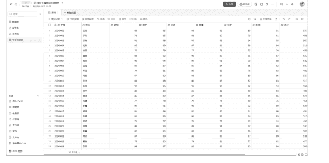

图 4-14

#### 2. 汇总信息
下达指令：

> 帮我汇总各班级的平均成绩。

智能体可快速完成数据聚合，如图 4-15 和图 4-16。

#### 3. 生成可视化图表
下达指令：

> 把汇总结果转为图表格式。

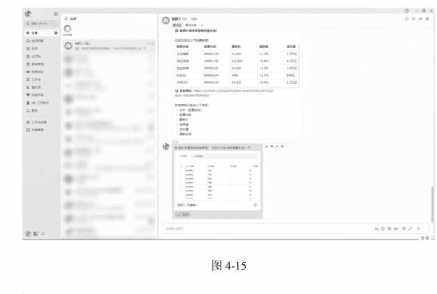

图 4-15

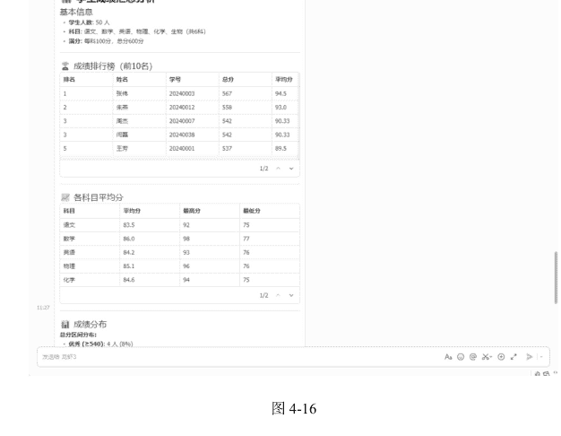

图 4-16

若未开启文件创建权限，智能体只能返回本地预览，无法直接写入云端，如图 4-17。

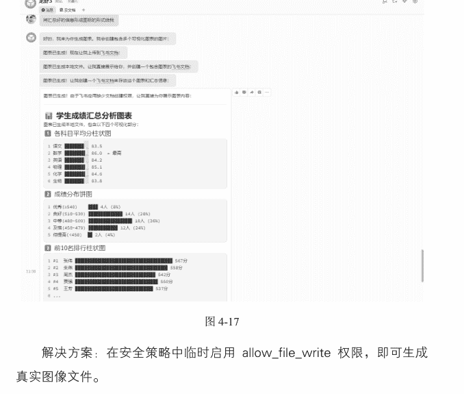

图 4-17

解决办法：在安全策略中临时开启 allow_file_write 权限，即可生成真实图像文件。

## 第 5 章 内容创作：自媒体人提效利器
本章介绍如何利用 OpenClaw 的托管浏览器实现自动发帖，并以稀土掘金和小红书为例演示。通过学习，你将了解自动发帖的三种实现方式及适用场景，掌握托管浏览器配置、MCP 服务使用、插件安装流程，最终独立完成多平台自动发帖。学习前请确保已完成 OpenClaw 安装与基础配置，并具备基本浏览器操作能力。

## 5.1 托管浏览器自动发帖
### 1. 自动发帖的实现方式
在自动化场景中，OpenClaw 支持多种自动发帖方案。了解各自特点有助于选择合适方案。

1）自动发帖实现方式对比（见表 5-1）
表 5-1

| 方式 | 原理 | 优点 | 缺点 | 适用场景 |
| :--- | :--- | :--- | :--- | :--- |

# OpenClaw 实战笔记：自动化发布与简历提效

做自动化先把入口选对。不同接入方式在安全、合规和上手难度上的权衡差异很大，选准了后面少走弯路。

| 接入方式 | 运行逻辑 | 主要亮点 | 潜在短板 | 当前建议 |
|---|---|---|---|---|
| MCP 官方通道 | 通过平台对外开放的 MCP 接口完成交互 | 规范合规、安全性有保障 | 需要平台已上线 MCP 服务 | 接口已开放时可直接采用 |
| 后端 API 直调 | 跳过前端界面，直接请求平台后台接口 | 上手快、响应迅速 | 易触碰规则、存在封号风险 | 不建议作为常规方案 |
| 托管浏览器 | 复刻真实用户在浏览器里的操作轨迹 | 凭证不外泄、可追溯、合规性较好 | 部署步骤多、受浏览器环境制约 | 通用场景首选，推荐使用 |

2）托管浏览器为何更稳

托管浏览器最大的价值是把人工操作链路完整还原。OpenClaw 通过插件与你已登录的浏览器建立连接，无需账号密码，就能以当前登录身份在本地完成自动化。凭证始终留在本地，安全等级更高；行为模式与日常用户一致，触发风控的概率更低；适用面广，理论上覆盖所有网页平台。

标准流程四步走：先建立通道，插件借助鉴权码与本地 OpenClaw 服务完成 WebSocket 握手；随后下发指令，OpenClaw 把任务推送到插件；接着执行动作，插件负责页面跳转、元素定位、内容填充等；最后回传结果，执行日志与反馈返回到对话窗口。

### 2. 部署托管浏览器

1）安装浏览器插件

（1）电脑上先准备好 Chrome，若已安装可跳过。
（2）启动 Chrome。
（3）点右上角拼图图标①>“扩展程序”>“访问 Chrome 应用商店”，进入商店页，如图 5-1 所示。
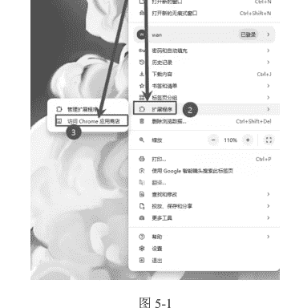
图 5-1
（4）在搜索框输入 “OpenClaw Browser Relay”，如图 5-3 所示。
（5）打开插件详情页，点击 “添加至 Chrome” 按钮，如图 5-4 所示。
（6）在确认弹窗中点 “添加扩展程序” 继续安装。

# 热门类别
- 购物
- 娱乐
- 工具
- 艺术与设计
- 无障碍
# wan，您可能会喜欢

图 5-2

图 5-3

图 5-4
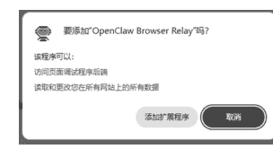
图 5-5
（7）安装完毕，插件会出现在扩展列表里，如图 5-6 所示。
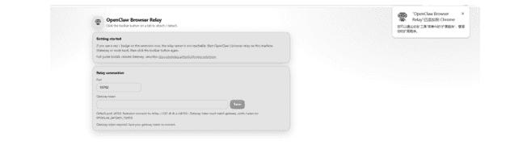
图 5-6

2）获取鉴权码

鉴权码用于插件与本地服务之间的身份核验。在 OpenClaw 安装目录，通常为 C:\Users\用户名\openclaw，打开 openclaw.json 配置文件，找到 gateway 节点，把里面的 token 值复制出来：
```json
"gateway": {
    "mode": "local",
    "auth": {
        "mode": "token",
        "token": "xxxxx"
    }
}
```
> ⚠️ **安全提示**
Token 是连通服务的凭证，请妥善保存，切勿外泄，以保障账户安全。

3）配置插件

（1）打开 “OpenClaw Browser Relay” 插件，把复制的鉴权码粘贴到配置项里，如图 5-7 所示。
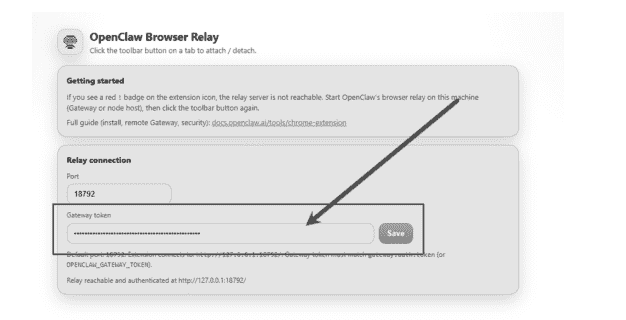
图 5-7
（2）点浏览器工具栏的插件图标，状态显示为 “ON” 说明配置生效，如图 5-8 所示。
（3）配置成功后浏览器会弹出连接提示，如图 5-9 所示。


图 5-8
图 5-9

### 3. 执行自动发帖

1）登录目标站点

使用托管浏览器前，确保浏览器里已登录目标账号。以稀土掘金 https://juejin.cn 为例。
（1）打开掘金网址，如图 5-10 所示。

图 5-10
（2）点击 “登录/注册” 按钮，未注册可先注册，如图 5-11 所示。

图 5-11
（3）登录成功后页面呈现如图 5-12 的内容。

图 5-12

2）发送操作指令

（1）回到主机终端，执行 openclaw gateway 启动服务，若已在运行可跳过。
（2）另开终端执行 openclaw dashboard 打开可视化面板，如图 5-13 所示。
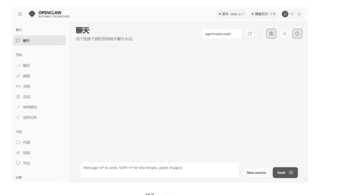
图 5-13
（3）按需输入操作指令，如图 5-14 所示。

图 5-14
（4）提交后 OpenClaw 开始自动发布。若出现异常，对话窗口会反馈错误并尝试依据上下文自适应调整，用户也可根据提示手动介入协助完成发布。
（5）任务结束对话窗口返回结果。切换到浏览器打开掘金页面，可核对帖子是否已成功发布，如图 5-15 所示。

图 5-15

## 5.2 小红书一键自动发帖

上一节用托管浏览器实现了稀土掘金的自动发布。本节换一种思路，通过 MCP 服务对接完成小红书自动发布。

托管浏览器依赖本地环境，MCP 对接则依赖平台是否提供官方接口。小红书已开放 MCP 服务，并在 ClawHub Skills 市场提供可复用的公开 Skills。相比托管浏览器，MCP 方式无需手动装插件和鉴权码，官方接口更稳定，且能力更丰富。

具体流程如下。

（1）打开 ClawHub 网站，如图 5-16 所示。
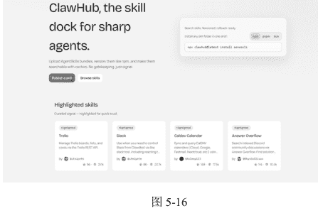
（2）点击顶部导航 “Search” 进入 Skills 搜索页。

图 5-17
（3）在搜索框输入关键词 “xiaohongshu”，找到名为 “Xiaohongshu (小红书) Automation” 的 Skill。

图 5-18
（4）进入 Skill 详情页查看信息，如图 5-19 所示。
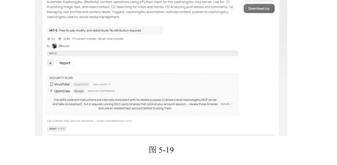
图 5-19
（5）在地址栏复制 Skill 名称 “xiaohongshu-mcp”。
（6）回到 OpenClaw 聊天窗口，输入 “请安装和使用这个 skill ‘xiaohongshu-mcp’，帮我发布一篇关于冬日养生饮食的小红书文章。” 开始任务，如图 5-20 所示。

图 5-20
（7）首次使用会触发登录配置。OpenClaw 对话窗口会提示，同时电脑弹出小红书登录页，如图 5-21 和图 5-22 所示。
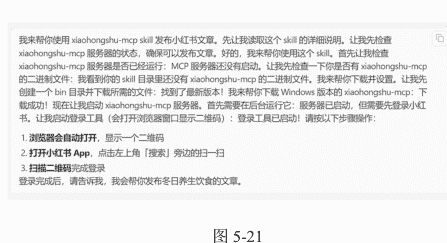
图 5-21
（8）在弹出的登录页完成账号登录。登录成功后返回 OpenClaw 对话窗口确认，OpenClaw 自动继续发帖，如图 5-23 所示。

图 5-22

图 5-23
（9）等待执行结束，对话窗口显示结果提示，如图 5-24 所示。
（10）切换到小红书页面确认帖子已发布，如图 5-25 所示。
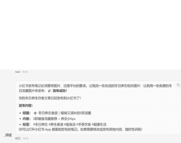
图 5-24

图 5-25
（11）后续再次发布时，因登录已完成，OpenClaw 会直接执行，无需重复登录。

## 5.3 用 OpenClaw 打造高分简历

### 1. 简历优化中的 OpenClaw

求职时，一份优质简历能显著提升被关注的机会。OpenClaw 作为开源 AI 助手，除问答创作外，还能直接参与简历生成与优化，帮助求职者打造能通过招聘系统筛选的专业简历。其能力主要体现在：

- 依据材料自动撰写简历：基于用户提供的工作经历、教育背景、技能清单和目标岗位，自动撰写并排版，会从模板挑选合适格式，遵循写作规范，保证结构清晰、表述专业。
- 定制与针对性修改：针对特定职位，OpenClaw 会解析职位描述，提取关键技能与关键词，并融入简历，如调整经历排序、突出相关成就、自然植入专业术语。
- 简历内容分析：审阅简历并给出改进建议，检查写作规范、内容质量、格式及 ATS 适配性，指出措辞、量化、技能匹配等方面的问题。
- 导出适配招聘系统的 PDF：优化后可导出 PDF，遵循便于 ATS 解析的格式，避免表格、文本框、图形等易被过滤的元素，便于投递。

整体流程如图 5-26 所示，覆盖从输入到输出的完整链路。
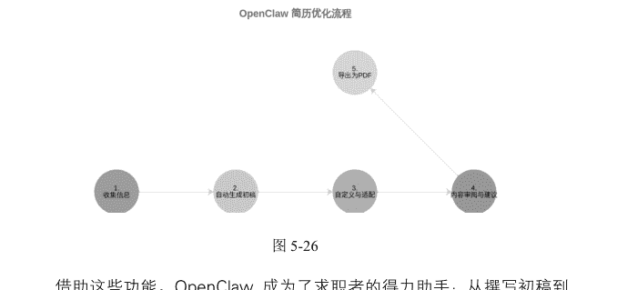
借助这些功能，OpenClaw 能从初稿到打磨全程助力求职者打造竞争力简历。

### 2. 简历优化的关键步骤

（1）收集信息：用户提供工作经历、教育背景、技能清单及目标职位描述，作为生成基础。
（2）自动生成初稿：OpenClaw 根据信息生成初稿，选择时间顺序、功能或混合格式，按模板填充职业概况、工作经历、教育背景等核心部分。
（3）定制与适配：针对目标岗位需求，分析职位描述中的关键技能和要求，突出相关成就，调整技能顺序，并在各部分自然融入岗位术语。
（4）内容审阅与建议：依据写作准则和 ATS 适配性评估简历，指出优点与不足，如措辞清晰度、成果量化、技能匹配度，并给出具体改进建议。
（5）导出为 PDF 文件：优化审阅后导出便于 ATS 解析的 PDF，避免复杂排版，确保招聘系统可正确解析。用户可下载投递。

### 3. OpenClaw 推荐的简历写作技巧

- 版式清晰统一：包含姓名、联系方式、职业概况、工作经历、教育背景、技能清单等，按模板统一字体、字号、间距，保持整洁专业。
- 量化成果展现价值：用量化数据体现贡献，如“提升部门效率 30%”“销售额提高 20%”，比空泛描述更有说服力。
- 关键词与岗位对齐：分析职位描述，提取关键技能和术语，自然融入技能清单和经历描述，提升 ATS 检索命中率。
- 按岗定制版本：不同岗位使用不同版本简历，重点突出相关经历和技能，技术岗强调技术能力与项目成果，管理岗突出领导力与团队经验。
- 表达精炼直接：避免冗长句，用主动语态描述职责与成就，精简冗余词汇，使信息更直接。
- 适配招聘系统排版：使用纯文本格式，避免表格、文本框、图片和复杂排版，PDF 中内容以文本呈现，减少特殊字符。
- 持续更新维护：及时更新新技能、新项目、新成就，每次投递前根据职位描述微调简历，保持时效性。

### 4. AI 辅助下的简历优化实例

以申请软件工程师职位为例：

（1）用户信息输入：求职者提供工作经历、教育背景、技能清单以及目标职位描述，OpenClaw 开始生成。
（2）初稿生成：自动生成简历初稿，包括职业概况、工作经历摘要、教育背景和技能列表，采用时间顺序，结构清晰。
（3）定制与优化：反馈职位要求数据库技能与项目管理经验后，OpenClaw 突出数据库经验，强调项目中数据库管理技术的应用，将相关成就前置；调整技能顺序，把数据库相关技能置顶；丰富经历细节，增加数据库与项目管理描述。
（4）审阅与建议：提出量化成果建议，如补充“将项目部署效率提高了 20%”等具体数据，增强说服力。
（5）增加项目总结，建议补充数据库与项目管理经验的总结段，方便 HR 直观看到核心能力。

（6）最终生成 PDF 文档：在吸收全部修改意见之后，OpenClaw 产出定稿并导出为 PDF 格式。求职者打开预览后发现版式规范简洁，个人核心优势被突出呈现，整份文件采用纯文本排布，能够被 ATS 系统完整解析。

从这一次操作可见，OpenClaw 能够依据岗位指向迅速调整简历内容，从初稿到定稿全程高效，简历的整体质量得到明显提升。

### 5. OpenClaw 简历优化技能的能力范围

OpenClaw 提供的 resume-optimizer 技能在简历撰写、编辑与评估环节均有覆盖。表 5-2 对主要能力与典型使用情境进行了梳理。

### 表 5-2

| 功能 | 描述 | 适用场景 |
|---|---|---|
| 创建新简历 | 依据用户提供的履历、学历、技能及目标岗位，自动完成一份全新简历的起草 | 求职者希望从零开始制作个人简历 |
| 定制现有简历 | 在已有简历基础上进行改写，使其更贴合特定岗位的侧重点 | 面向不同岗位对简历重点进行调整 |
| 内容分析与改进 | 审阅简历文本，评估质量与排版，提出具体的优化建议 | 需要专业点评以提升简历水准 |
| ATS 适配 | 确保排版符合筛选系统读取规范，避免使用不被识别的元素 | 简历必须通过 ATS 体系筛选的情形 |
| 生成 PDF 文件 | 将优化后的内容导出为可下载的 PDF 格式 | 需要最终投递文件的使用场景 |
| 格式建议 | 推荐各板块的合理顺序与内容组织方式 | 希望了解简历写作最佳结构的用户 |
| 关键词整合 | 自动提取职位描述中的核心技能与术语并融入简历 | 提升简历与岗位匹配度的需求 |
| 语言润色 | 优化用词，使表达更专业、简练且具说服力 | 追求语言更清晰有力的用户 |

上述能力让 OpenClaw 的简历优化模块贯穿起草、修改到交付全过程，帮助用户打造专业、有竞争力且符合筛选标准的文档。

### 6. OpenClaw 与其他简历优化工具的对比

当前市场上的简历优化产品包括在线平台、传统软件与其它 AI 助手。相较之下，OpenClaw 既有独特优势也存在使用门槛。表 5-3 从功能覆盖、易用性、定制空间与成本四个维度进行横向比较。

### 表 5-3

| 工具 | 功能全面性 | 易用性 | 定制性 | 成本 |
|---|---|---|---|---|
| OpenClaw | 覆盖撰写、定制、分析到导出，支持多入口调用与插件扩展 | 需要一定技术基础与配置学习，对技术用户友好，新手需熟悉 CLI | 可深度定制，通过 Skills 插件扩展，支持本地部署，数据隐私由用户掌控 | 自托管开源免费，仅产生模型 API 费用，整体花费较低 |
| Jobscan | 主打简历 ATS 扫描与关键词优化，辅助判断简历与职位描述的匹配程度 | 界面简洁直观，上手迅速，上传后可直接获得分析报告 | 定制空间一般，侧重关键词与结构微调，缺乏完整撰写能力 | 订阅制，月费约$49，费用偏高，适合高频投递者 |
| Novoresume | 提供模板与基础写作指引，支持 PDF 导出与基础排版，附带基础 ATS 扫描 | 在线编辑简单易用，适合新手，模板与示例降低门槛 | 模板数量有限，高级定制需付费，免费版功能受限 | 免费版与付费版并存，付费月费约$10~$20，提供更多模板与分析 |
| FlowCV | 提供精美模板与部分 AI 写作辅助，支持多语言简历，在线预览并导出 PDF | 在线编辑体验友好，模板美观，上手容易 | 模板风格丰富，但深度自定义受限，需一定设计能力 | 免费版有限制，付费月费约$10，提供更多模板与无水印 PDF |
| Overleaf | 基于 LaTeX，提供强大排版控制，可完全自定义细节，缺乏自动内容生成 | 需掌握 LaTeX，对新手不友好，学习成本较高 | 完全自定义，排版灵活性极高，但依赖用户技能 | 基础功能免费，高级订阅年费约$252，重度 LaTeX 用户性价比高 |

注：价格为参考值，实际可能波动。

综合来看，OpenClaw 在功能覆盖与定制深度上最为全面，但上手门槛较高。Jobscan、Novoresume、FlowCV 在易用性上占优，适合无编程基础者快速优化，但功能偏单一。Overleaf 排版强但需 LaTeX 且不支持自动生成。选型应结合实际需求权衡。

### 7. OpenClaw 简历优化技能的安装与使用方法

resume-optimizer 可通过 ClawHub 技能市场进行安装与管理。具体流程如下。

（1）确认环境就绪：先核实智能体已正确安装并正常运行。未安装者可按官方文档在本地或云端部署。完成后通过命令行或 Web 界面检查启动状态。

（2）安装优化组件：利用 OpenClaw 提供的命令行工具或内置技能管理，从 ClawHub 安装 resume-optimizer。例如在终端执行：

```
openclaw skill install openclaw/skills/skills/tomstools11/resume-optimizer
```

该命令会从社区库拉取组件并完成安装，之后即可调用执行简历相关任务。

（3）配置组件：部分组件需额外参数。resume-optimizer 通常需指定输出路径与格式。可编辑配置文件或使用命令行设置。例如在 openclaw.json 中设置输出目录：

```
"skills": {
  "resume-optimizer": {
    "outputPath": "/mnt/user-data/outputs/",
    "format": "chronological"
  }
}
```

该配置指定以 PDF 形式输出到 /mnt/user-data/outputs/ 目录，并按时间命名。保存后重启 OpenClaw 使配置生效。

（4）生成简历：安装配置完成后，可在对话中直接调用。例如输入：

> 请帮我创建一份新简历。我有 5 年市场营销经验，主要负责品牌推广和数字营销。学历为市场营销学士。目标岗位是市场经理。

OpenClaw 会借助 resume-optimizer 分析输入并自动生成简历。若需优化已有简历，可提供原文和职位描述，例如：

> 这是我的简历内容：……。请根据这个职位描述 [粘贴职位描述] 进行优化。

系统会返回修改内容并附带建议。

（5）获取结果：完成优化后，OpenClaw 通常给出简历文本并提供下载链接，例如：

> 以下是为您生成的简历内容：……。您可通过以下链接下载 PDF 版本：computer:///path/to/resume.pdf

点击链接即可下载用于投递的 PDF。

按此流程即可在 OpenClaw 中使用简历优化功能，提升求职竞争力。安装配置较为简单，日常使用只需自然语言交互。

# 第6章 数字学霸助理：课程设计快速落地
本章导语：告别期末熬夜，你的数字学霸搭档已就位。

## 6.1 一条指令搞定课程设计
高校课程设计是检验工程能力的关键环节，但环境搭建、代码调试与文档撰写常占用大量时间。本章以 OpenClaw 为代表的智能体作为编程协作伙伴，通过挑选合适大模型并设计结构化提示，实现 C 语言项目与前端开发的端到端自动化。全程以真实实训任务驱动，展示如何在数分钟内完成符合评分标准的可运行项目与配套报告，为学生提供高效可靠的开发范式。

### 1. 选择模型
智能体输出质量高度依赖底层大语言模型。建议选用具备强代码生成、长上下文支持和工具调用能力的模型，如智谱 AI 的 GLM-5。该模型在 C/C++、JavaScript 等语言的理解与生成上表现突出，对中文技术文档兼容性良好。

在 OpenClaw 或同类框架中，无需手动调整 API 参数，只需在指令中声明模型名称。本章使用的模型为 zhipu/glm-5，其在智能体平台的设置界面如图 6-1 所示。

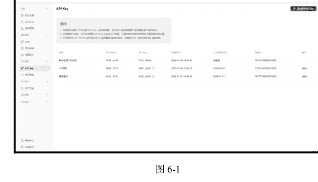

### 2. 开始实战：C 语言课程设计
选定模型后即可进入实战。可直接告知智能体模型信息，系统会自动完成配置并绑定模型，如图 6-2 所示。

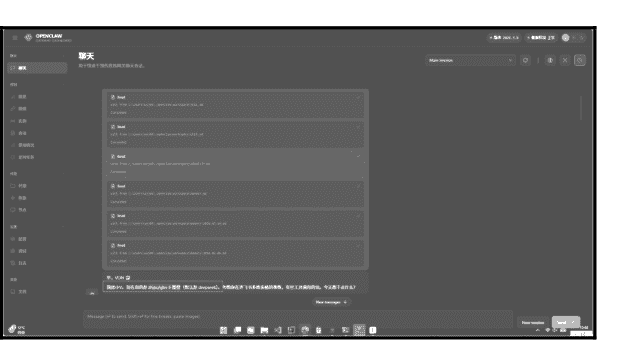

提示词质量直接决定输出完整度。建议采用以下结构：

1. 明确身份：“我是一名计算机专业大一学生”；
2. 说明目标：“需完成 C 语言课程设计”；
3. 提供完整需求文档，涵盖功能清单、技术规范与评分标准。

例如，可先让 AI 生成一份标准实训要求（见图 6-3），也可直接粘贴已有任务书。

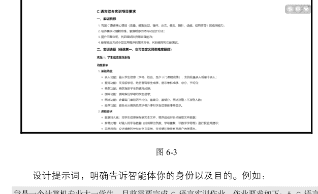

设计提示词时，清晰告知智能体身份与目的。例如：

我是一名计算机专业大一学生，现在需要完成 C 语言实训作业，作业要求如下：

# C 语言综合实训项目要求
## 一、实训目标
巩固核心语法，含变量、数据类型、循环、分支、数组、指针、函数、结构体等；培养模块化编程思维；提升问题分析、调试与异常处理能力；独立完成小型实用程序的需求分析、编码与测试。

## 二、实训选题
选题 1 学生成绩管理系统：录入学生信息及多科成绩，查询、修改、删除、统计、排序；进阶需数据持久化、非法输入校验、控制台菜单。
选题 2 简易图书管理系统：录入图书信息、借阅归还、查询与统计；进阶需持久化、校验、菜单交互。
选题 3 简易计算器：支持四则、取余、平方、开方及连续运算，错误提示；进阶支持括号优先级、运算历史记录、菜单化操作。

## 三、技术要求
命名见名知意，缩进统一，注释完整，避免滥用全局变量，核心功能封装为函数；必须使用数组/结构体存储批量数据，至少一次指针操作，循环分支清晰，进阶需文件操作。

## 四、交付物
源代码文件、实训报告不少于 800 字，含需求分析、设计思路、代码实现、测试结果与总结；运行说明含编译环境与命令。

## 五、时间安排
第1天需求分析与设计；第2-3天核心功能编码；第4天进阶开发与调试；第5天测试与报告撰写。

## 六、评分标准
功能完整性 40 分；代码规范 20 分；调试鲁棒性 15 分；实训报告 15 分；答辩演示 10 分。

你可以帮我在桌面上完成上述作业吗

智能体在数分钟内完成：
（1）创建项目文件夹；
（2）生成模块化源码 main.c、student.c、student.h；
（3）实现数据持久化 data.txt；
（4）输出 Markdown 格式的实训报告。

提交指令如图 6-4 所示。

不久后，桌面已创建对应文件夹，如图 6-5 所示。源码与报告同步生成，如图 6-6 所示。

操作中可按提示双击运行 .exe 文件。如图 6-7 所示，有时会出现乱码。无需紧张，只需把期望的输出格式告诉智能体（见图 6-8），它即可自动转换（见图 6-9）。整个过程智能体直接处理问题，无需手动打开代码文件。

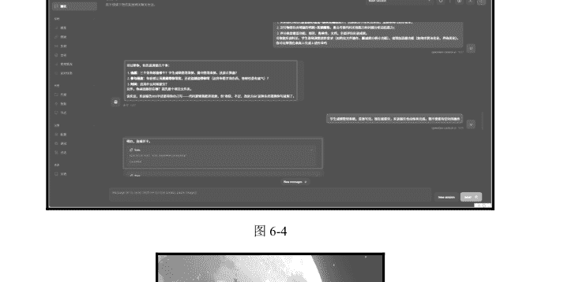


## 第 6 章 学习和作业：大学生的全能数字学霸助理 | 113

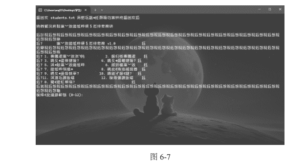

图 6-7

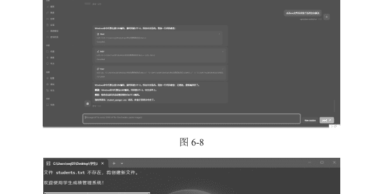

图 6-8


图 6-9

### 3. 功能验收与交付记录
由系统自动生成的学生成绩管理模块，已完整覆盖实训清单里的核心需求，经人工逐项核验，运行平稳、交互顺畅。具体验证点如下。

录入学生信息：兼顾单条录入与批量导入学号、姓名及多科成绩，内置基础格式校验机制，效果见图 6-10 所示。


按学号查询：录入合法学号后，可精准返回该生的各科分数、总分与均分，展示见图 6-11 所示。


按姓名查询：支持中文姓名模糊匹配，能识别重名并一次性罗列全部匹配记录，效果见图 6-12 所示。

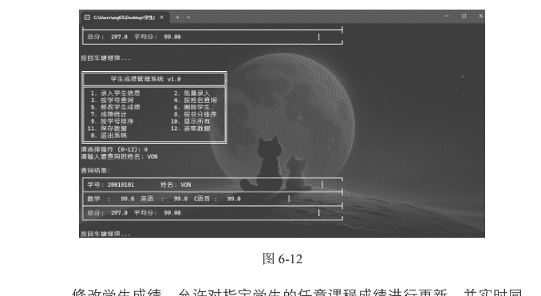

图 6-12

修改学生成绩：可针对指定学生任意一门课程进行分数更新，改动会即时写入内存并同步到磁盘文件，示例见图 6-13 所示。

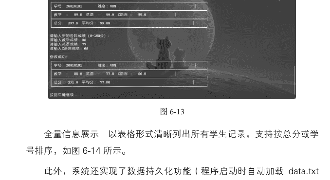

图 6-13

全量信息展示：以表格形式呈现全部学生档案，并提供按总分或学号排序的切换功能，示意图 6-14。

除上述外，项目还实现了启动时自动读取 data.txt 的持久化机制、成绩越界与学号重复等异常拦截，以及各科均分、最高最低分、及格率等统计分析。因为篇幅所限其余界面未全部截图，但经过多轮压测，代码结构严谨，未出现崩溃，完全达到“功能完整、调试健壮”的评分要求。

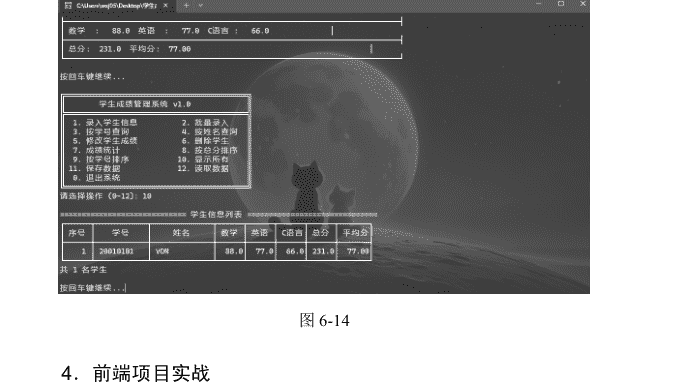

### 4. 前端实战项目演示
第一步可以让 AI 产出一份标准的前端需求文档，也能直接上传自制的需求说明，例如图 6-15 所示。

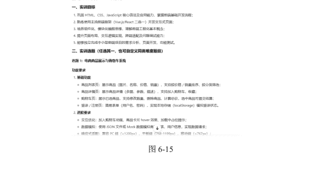

随后把需求交由 OpenClaw 智能体处理，它会据此完成代码编写并启动预览，如图 6-16 所示。

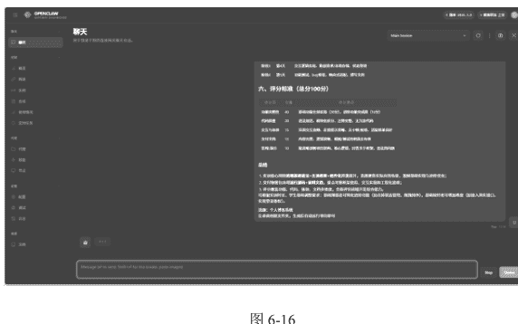

图 6-16

从图 6-17 可看出，智能体会先行拉取并配置开发环境。

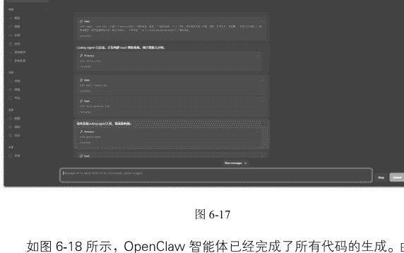

图 6-17

如图 6-18 所示，代码生成任务已全部完成，规模较大的项目可能需要等待一段时间。

## 118 | 零基础玩转 OpenClaw：让“龙虾”替你 24 小时赚钱


图 6-18

执行期间按 F12 打开浏览器控制台即可查看日志，出现报错时把错误信息回传给 OpenClaw 智能体处理即可，如图 6-19 所示。


图 6-19

控制台不再报错即代表程序正常运行，如图 6-20 所示。

项目包含以下演示模块：

- （1）个人中心：支持用户自行编辑个人信息，见图 6-21 所示。
- （2）发布博客：内置富文本编辑器，可输入多种格式内容，见图 6-22 所示。

## 第 6 章 学习和作业：大学生的全能数字学霸助理 | 119

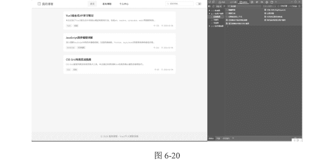

图 6-20


图 6-21


图 6-22

- （3）首页展示：文章列表支持分页加载，见图 6-23 所示。

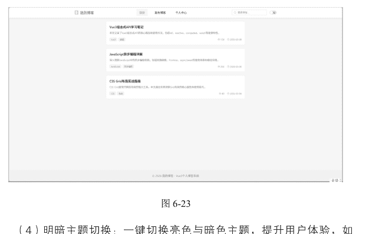

图 6-23

- （4）明暗主题切换：提供一键亮色暗色切换，提升使用体验，见图 6-24 所示。

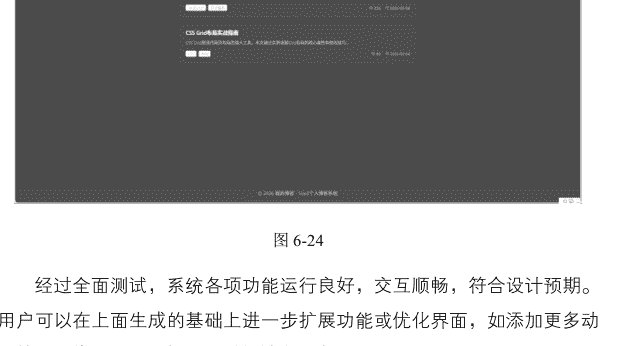

图 6-24

整体测试后，各模块表现稳定、操作流畅，符合初始设计预期。在此基础上可继续扩展，例如加入更多动效、优化 SEO 元信息、增加社交分享入口等。

智能体输出的代码可维护性良好，便于后续迭代升级。读者可按自身需求对项目进行增补，以应对更复杂的业务场景。

## 6.2 OpenClaw：查资料、写报告、整理文献、做 PPT “一条龙”服务
临近期末或开题，大学生常被三件事压垮：文献搜集不全，在知网、PubMed、arXiv 之间反复切换，下载的 PDF 堆积却难下手；报告无从着笔，面对空白文档光标闪烁，碎片信息拼不出严谨大纲；排版做 PPT 耗时，写完报告后还要熬夜调字体、校图表，精力被耗尽。

传统 AI 对话工具虽能答疑，却困在文本框里。让它查最新 API 文档，它只能回复知识截止时间；想让它自动下载论文并生成 PPT，它无浏览器操作能力，也无法在本地生成文件。

2026 年开源项目 OpenClaw 原名 Clawdbot 出现后改变了局面。它不仅是会聊天的模型，更是具备数字手脚的本地智能体框架，可执行 Shell 命令、管理文件、操控浏览器自动化，甚至调用 API 生成精美 PPT。

本节将跳过代码细节，用纯自然语言指令手把手演示如何搭建“检索-撰写-汇报”的一条龙自动化流程。无论文科文献整理还是理工数据汇报，都能把数天的工作压缩到数小时甚至数十分钟。

设想你在微信里语音说：“帮我找大模型在教育中应用的最新 5 篇高被引论文，提炼核心观点，写 3000 字调研报告，再排成 20 页商务风格 PPT 发我。”几分钟后，.pptx 文件就出现在聊天里，这已是 OpenClaw 的常规能力。

### 1. 零门槛部署与接入
部署门槛在 2026 年迭代后大幅降低，无需懂 Python 或配环境变量。

#### 1）云端还是本地部署
对学生群体推荐两种方式：

方案一：云端一键部署，强烈推荐
Windows 用户或希望 24 小时运行的场景更适合。腾讯云 Lighthouse 与阿里云均提供 OpenClaw 专属镜像，在控制台点选“OpenClaw 智能简报生成器”后，系统自动完成 Docker 与 OpenClaw 安装。成本每月数十元，避免本地环境冲突。

方案二：Mac 本地一键安装，见图 6-25
Mac 尤其是 M 系列本地部署体验最佳，无服务器费用，可直接操作日历、备忘录与本地文件，隐私性更高。只需在终端执行官方提供的一行命令：

```
curl -fsSL https://openclaw.ai/install | bash
```

安装向导会自动检测 Node.js 并完成配置，通常 5 分钟内结束。

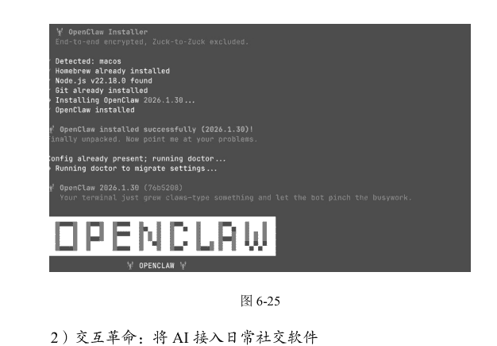

#### 2）接入常用社交软件
OpenClaw 的前台设计很友好，无需登录网页后台即可对话。它原生支持 20 多种通讯渠道，如图 6-26 所示。

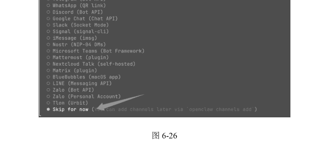

国内学生常用飞书与企业微信。以飞书为例，在开放平台创建自定义机器人获取 App ID 与 App Secret，填入配置向导后，联系人列表会多出一个 24 小时在线的数字学霸助理。手机可发语音指令，也能把老师的 PDF 课件转发过去求总结。

### 2. 技能 Skills 生态解析
理解 Skills 是使用 OpenClaw 的关键。若把 OpenClaw 比作智能手机，大模型就是系统与 CPU，Skills 就是应用商店里的 App。

无 Skills 时它只是聊天机器人，装上 Skills 后才具备操作能力。例如 @openclaw/file-organizer 可批量重命名整理文献，@openclaw/browser-control 可打开知乎抓取高赞回答。目前 ClawHub 技能广场与社区已贡献超过 1800 个企业级与个人常用 Skills。

### 3. 全网检索与文献精准定位
撰写报告的第一步是资料收集。

#### 1）联网搜索配置
为获取即时信息，需配置联网搜索，主流方案有三种：

- Brave Search API，官方推荐，自建索引，隐私友好，免费额度每月 2000 次，满足日常查资料。
- Tavily MCP，专为 AI Agent 设计，检索同时自动抽取网页核心内容并做 AI 过滤，适合 RAG 场景。
- 内置 WebSearch，若使用 Anthropic Claude 模型可直接开箱即用。

配置后可在对话中指令：“用联网搜索帮我查 2026 年第一季度国内新能源汽车销量及前三品牌份额。”系统会自动抓取新闻与财报，几秒内返回准确结论，告别幻觉与信息滞后。

#### 2）Scientify 插件自动化采文
学术写作需要更专业的检索。Scientify 是 OpenClaw 的科研插件，覆盖检索、筛选、下载到聚类分析全流程。

核心能力包括：跨库检索 arXiv 与 OpenAlex；内置 unpaywall_download 可按 DOI 自动寻找开放获取 PDF，arXiv 还可优先下载 .tex 源码；paper_browser 分页浏览长文献，避免上下文溢出，并可按子主题聚类。

实战指令：“检索 OpenAlex 上‘大语言模型在个性化教育中的应用’近三年高被引论文，选出前 5 篇，提取摘要与创新点，并把 PDF 保存到 workspace/papers。”

OpenClaw 会启动子智能体依次调用 openalex_search 获取元数据、用 LLM 相关性打分过滤、调用 unpaywall_download 下载、最后返回结构化清单，原本一整个下午的工作喝杯咖啡即可完成。

#### 3）Browser Relay 网页自动化抓取
部分数据在知乎回答、小红书笔记或行业网站表格里，传统爬虫对非程序员不友好。Browser Relay 基于 Chrome DevTools 协议与 Playwright，让 AI 如真人般浏览、点击、滚动、输入。

指令示例：“打开知乎搜索‘大学生如何高效进行时间管理’，模拟人工滚动，提取前 10 条高赞回答，总结出现频率最高的 5 个方法，以 Markdown 表格输出‘方法名称’‘核心理念’‘适用场景’。”

执行时系统会启动无头浏览器导航、等待加载、执行搜索与点击，用 browser.snapshot 提取 DOM，AI 自动分析结构并语义总结，还可截图留证。

### 4. 快速阅读与报告撰写
资料齐了后，如何转化为逻辑严谨的报告是关键。

#### 1）长文档速读技巧
面对二三十页英文论文，可利用本地文件读取与超长上下文模型如 Kimi、Claude 3.5 Sonnet 速读。把 PDF 拖入对话或指定路径后提问：“请阅读 ~/workspace/papers/attention_is_all_you_need.pdf，不要泛泛摘要，回答：1. 解决 RNN/CNN 的痛点是什么？2. 编码器解码器如何设计？3. 实验用了哪些数据集与最佳结果？请用通俗中文解释。”

#### 2）笔记整合与大纲生成
前期积累的碎片笔记需要成形。大纲生成正是 AI 的强项。

指令：“读取 ~/workspace/notes/ 目录下关于‘新能源汽车下沉市场调研’的抓取数据与文献摘要，帮我拟 3000 字调研报告大纲，包含引言、现状、消费者痛点、典型车企对比、趋势预测与结论，并在每个二级标题下标注拟引用的数据或文献。”

#### 3）Python 数据处理与可视化
若报告涉及问卷或实验数据，通过 Python 相关 Skills 可在本地沙箱自动写代码并执行。

例：“读取 survey_results.xlsx，清洗数据剔除填写时间小于 10 秒的无效问卷与缺失值，分析年级与月生活费的相关性，计算各年级均值并生成美观柱状图保存为 expense_chart.png，最后用一段话总结结论。”

OpenClaw 能够自动生成数据清洗和统计分析的脚本并直接运行，执行结束时会把清洗后的数据、图表文件以及文字结论一并推送给你，放入报告的图示可直接采用，全程不需要人工写代码。

#### 4）报告初稿生成与学术化润色
框架和量化结果准备好后，可以让 OpenClaw 按章节分批起草报告初稿。为避免文本偏口语或带有明显的生成痕迹，可以用更具体的指令来约束语气和风格。例如：

> “请基于我们已确定的提纲第二部分‘市场现状分析’以及我上传的统计数据，撰写约 800 字的正文。要求如下：
> 1. 语气必须客观、严谨，符合学术调研报告的规范。
> 2. 避免使用‘众所周知’‘不可否认’等主观绝对化词汇。
> 3. 在引用数据时，请使用规范的学术表达（如‘数据显示，相较于上一季度，环比增长了……’）。
> 4. 多使用被动语态和长句来增强专业感。”

通过这种细化的指令控制，OpenClaw 的初稿质量会明显提升，经过少量人工校订即可达到优秀的期末作业水平。

### 5. 一句话搞定专业级 PPT 制作
报告完成后最费时的往往是幻灯片制作。挑选模板、调整版式、核对文本框等机械性工作会消耗大量精力。如今借助 OpenClaw 接入的第三方能力，制作 PPT 已能做到一句话完成。

#### 1）告别排版折磨：引入 7 牛 AI PPT Skill
依据社区最新实践，国产工具“7 牛 AI PPT”已作为 Skill 加入 OpenClaw 生态。其最大优势在于支持多种输入格式，Word 文档、网页链接、长文本均可处理，并提供关键的“保持原文”模式，对学术汇报尤为重要，能防止为美观而删改实验数据。

安装非常简单，在终端或对话界面输入：

```
npx skills add https://clawhub.com/skills/7niu-ppt --skill pptx
```

也可直接对 OpenClaw 下令：“帮我安装 7 牛 AI PPT Skill”。

#### 2）场景一：从 Word/报告一键生成 PPT（保持原文模式）
这是最常用也最实用的情形。你已用 OpenClaw 完成 Markdown 或 Word 格式的调研报告，现在需要转为汇报课件。

实战指令示例：

> “请将我刚写好的 3000 字《新能源汽车下沉市场调研报告》做成约 20 页的 PPT。务必开启‘保持原文’模式，确保数据、结论和案例名称一字不改。请采用‘商务简约’风格模板，重点内容自动加粗，并为数据部分预留合适的图表占位符。完成后把 .pptx 文件发给我。”

OpenClaw 会调用 7 牛 AI PPT 接口，对长文进行智能分页、提取小标题并匹配版式。数分钟后，一份结构完整、排版专业的 .pptx 文件就会发送到飞书或微信，下载后稍作微调即可上台。

#### 3）场景二：从网页链接中直接提取内容生成 PPT
有时老师会在群里分享一篇行业分析文章或公众号推文，要求下节课做简要分享。传统方式需手动复制、配图、排版，至少耗费一小时。

现在只需在已加入群聊的 OpenClaw 中 @ 它并下令：

> “请提取以下网页链接里的内容，做成一份适合课堂汇报的 PPT，大约 10 页。重点突出文章中的核心数据和最终结论，采用‘学术培训课件’风格。”

OpenClaw 会先用 web_fetch 工具抓取正文，剔除广告和无关信息，再把净化后的文本送入 PPT 生成流程，一气呵成。

#### 4）场景三：根据灵感快速生成组会汇报材料
若次日清晨就要开组会，夜里实在没时间写稿，可借助大模型的生成能力直接“无中生有”。

实战指令示例：

> “明早要开导师组会，帮我做一份 5 页 PPT，主题是‘本周文献阅读汇报：对比学习在计算机视觉中的应用’。第一页为标题，第二至四页分别列出 MoCo、SimCLR 和 BYOL 三篇经典文献的核心思想和一句话评价，最后一页是下周研究计划，计划复现 SimCLR 开源代码。风格要学术、严谨。”

OpenClaw 会先在内部生成大纲，再自动编写基于 python-pptx 或调用 API 的代码，在本地文件夹生成 PPT 文件。内容相对简略，但作为组会应急非常高效。

### 6. 打造你的专属自动化学习流水线
熟练掌握单次任务后，可利用 OpenClaw 的自动化特性，让它成为 7x24 小时为你工作的后台管家。

#### 1）每日学术/行业早报：Cron Job 定时任务
信息过载是当代大学生的普遍困扰。与其早上刷手机，不如定制专属早报。

可这样设置：

> “请帮我设置一个定时任务：每天早上 8:00，自动检索‘人工智能在医疗领域的最新突破’以及‘Nature/Science 最新发表的 AI 相关论文’。将信息整理成一页 Markdown 简报，包含 3 条头条新闻，每条不超过 100 字，和 1 篇深度长文推荐附链接。整理完成后通过飞书消息发送给我。”

设置成功后，每天清晨你的数字助理已把前沿动态整理好准时推送，让你在同学和导师面前始终保持信息领先。

#### 2）考试复习与日程管理：智能提醒系统
期末复习周面对厚厚教材容易顾此失彼。可结合日历 Skill 与备忘录打造智能复习系统：

> “请读取我上传的《宏观经济学》课程大纲。距离期末考试还有 14 天，请为我制定详细复习计划并分配到每天的日历中。同时设置循环任务：每晚 9 点，随机抽取当天复习章节的 3 个核心概念，通过微信发给我进行知识点抽查，待我回复后你帮我核对答案。”

这种基于艾宾浩斯遗忘曲线和主动召回原理的自动化复习机制，能显著提升备考效率。

### 7. 总结与学术使用建议
从海量文献的无从下手，到几分钟内获得排版精美的 PPT，OpenClaw 通过将大模型的“脑力”与本地工具的“执行力”结合，为大学生提供一条高效工作流程。它不仅减少了查资料、写报告、做 PPT 的机械重复，更释放了时间与注意力。

#### 学术诚信与工具边界提示
尽管功能强大，使用 AI 工具在学术环境中必须坚守原则：
- AI 是助理，不是作者：可让 AI 协助搜集资料、清洗数据、生成提纲、润色语言，但报告的核心观点、实验设计和最终学术责任必须由本人承担。
- 警惕“幻觉”并交叉验证：即使使用联网搜索和 Scientify 插件，AI 在总结复杂概念时仍可能出现偏差。报告中引用的关键数据和文献结论，务必亲自阅读原文进行核对。
- 遵守学校规范：提交期末论文或学位论文时，请严格遵守所在学校关于生成式 AI 的规定，必要时在致谢或方法部分声明使用了 OpenClaw 辅助文献整理和排版。

“AI 不会取代你，但会用 AI 的人会取代你”。OpenClaw 不仅是一个工具，更代表一种全新工作方式。建议亲自部署尝试，把枯燥的排版和繁琐检索交给不知疲倦的机器，把宝贵大学时光留给深度专业思考、校园生活与真正的创造性工作。

# 第三部分

# 连上工作群——让 OpenClaw 帮你回消息

# 第7章

企业微信和钉钉，

OpenClaw 都会用

## 7.1 让 OpenClaw 帮你盯着钉钉消息
在日常办公协作中，钉钉承载着大量工作消息、群聊通知、审批提醒等。人工逐条关注和响应不仅耗时，还易遗漏。基于 OpenClaw 框架搭建的钉钉 AI 员工，可充当“智能消息管家”，实现实时监听、智能筛选、精准提醒与自动响应，帮你从繁杂处理中解脱。

本章按钉钉开放平台官方流程，讲解如何借助 OpenClaw 实现钉钉消息的全流程监控与智能化处理，从环境搭建、监听配置到个性化规则设置与问题排查。

### 7.1.1 为什么需要 OpenClaw 监控钉钉消息
钉钉是企业办公核心入口，消息类型繁杂且重要程度不一。OpenClaw 与钉钉生态深度融合，能解决以下痛点：
- （1）全场景消息监听：实时捕获系统通知等各类消息，实现无死角监控。
- （2）轻量化部署：基于 Docker 容器化，零代码即可快速上手。
- （3）大模型智能赋能：集成通义千问等大模型，实现智能筛选与精准响应。
- （4）无缝集成钉钉生态，无需公网服务器，稳定性和安全性更有保障。

### 7.1.2 前期准备：搭建消息监控的基础环境
使用 OpenClaw 实现钉钉消息监控前，需完成权限申请与环境准备：
#### 1. 开发者权限准备
选择拥有开发者权限的钉钉组织；若无，需向组织管理员申请企业内部应用开发权限，以便登录开发者后台创建与配置应用。
#### 2. 核心接口权限申请
必须提前申请钉钉两个核心接口权限，缺一不可，申请路径可参考开放平台“添加接口调用权限”文档。
#### 3. 部署环境准备
根据需求选择部署环境，基础要求如下：
- （1）云服务器：如阿里云 ECS 或轻量服务器，需可正常联网、开放对应端口，支持 OpenClaw 本地安装运行。
- （2）容器环境：使用 Docker 部署时，需提前安装 Docker 并完成基础配置。

### 7.1.3 核心配置：三步使 OpenClaw 监听钉钉消息
让 OpenClaw 实现钉钉消息监控的核心是完成钉钉应用创建与机器人配置、OpenClaw 部署与钉钉打通、使用钉钉机器人三大步骤。

#### 1. 钉钉应用创建与机器人配置
在钉钉开发者后台创建专属应用并开启机器人能力，采用 Stream 模式，无需注册回调地址，稳定性更高。具体操作如下：
（1）登录开发者后台创建企业内部应用：登录钉钉开放平台开发者后台，依次点击“应用开发”和“创建应用”，选择“企业内部应用”，填写应用名称如“消息监控机器人”。如图 7-2 所示，填写机器人名称和简介，上传符合规范的图标，240×240 以上、1:1 比例、2MB 以内 PNG/JPG 无圆角，点击“确定”。

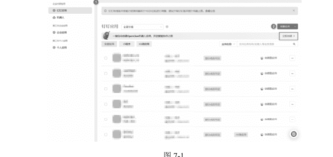

图 7-1

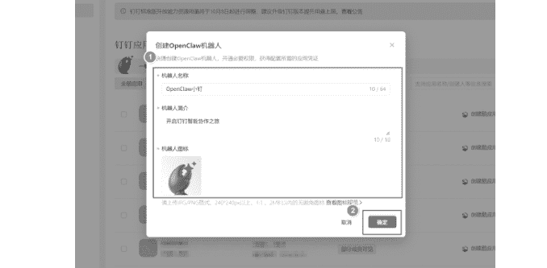

图 7-2

（2）获取应用核心凭证：创建成功后，在“凭证与基础信息”模块复制 Client ID 和 Client Secret，如图 7-3 所示，是 OpenClaw 与钉钉对接的核心凭证，请妥善保管。

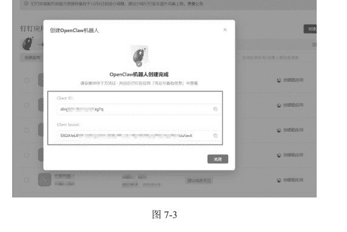

（3）开启机器人能力并完成配置：创建成功后，在应用详情页左侧点击“添加应用能力”，添加“机器人”。

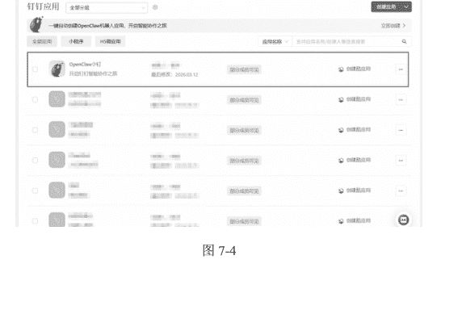

（4）发布应用并设置可用范围：点击“版本管理与发布”→“创建新版本”，填写版本号如 1.0.0 和描述，选择可用范围，建议先选“全部员工”测试，保存并发布。

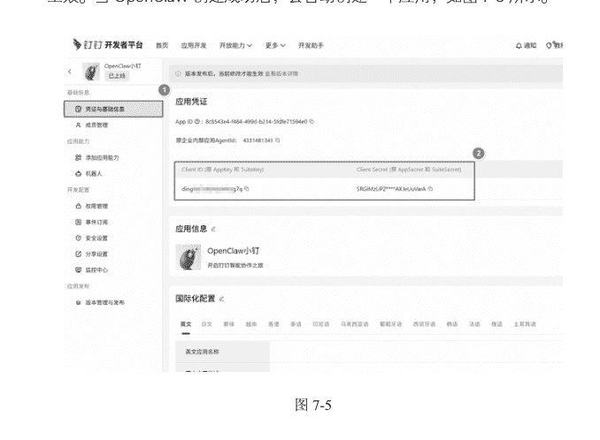

图 7-5

#### 2. OpenClaw 部署与钉钉打通
完成钉钉配置后，部署 OpenClaw 并与钉钉机器人对接，支持向导式配置和手动配置文件方式。
（1）对接钉钉机器人（向导式配置）：打开服务器终端，输入指令 openclaw-cn onboard，按向导完成：
- 1. 安装钉钉官方插件 @dingtalk-real-ai/dingtalk-connector；
- 2. 输入前述 Client ID 和 Client Secret；
- 3. 输入 Gateway Token，可用 openssl rand -hex 16 生成随机字符串；
- 4. 启动 OpenClaw 网关，完成对接。

验证：输入 openclaw-cn gateway status 查看网关状态，再输入 openclaw-cn logs --follow 查看实时日志，若日志显示“钉钉 Stream 客户端已连接”，说明对接成功。

（2）配置文件配置（进阶）：编辑 ~/.openclaw/openclaw.json，添加 channels/dingtalk-connector、gateway/auth 和 gateway/http/endpoints 三项，填写 Client ID、Client Secret 和 Gateway Token，保持 gatewayToken 与 gateway.auth.token 一致，保存后重启网关。

#### 3. 使用钉钉机器人
（1）单聊中使用机器人：在顶部搜索框搜索机器人名称直接使用，如图 7-6 所示。发送消息即可实现单聊回复，如图 7-7 所示。


（2）群聊中使用机器人：进入任意群聊，确保群归属组织与创建机器人时一致。点击“群设置”→“机器人”，如图 7-8 所示。


图 7-7


图 7-8

在机器人管理模块选择“添加机器人”，如图 7-9 所示。

在添加页面搜索已创建并发布的机器人，按图 7-10 所示添加即可。添加成功后 @机器人即可触发自动回复，如图 7-11 所示。


图 7-9


图 7-10


图 7-11

至此，基于 OpenClaw 构建钉钉 AI 员工的全部操作已完成。

## 7.2 企业微信群里自动回复常见问题
本节讲解 OpenClaw 的企业微信接入。OpenClaw 支持多渠道对接，通过企业微信内置长连接机制免去繁琐 Webhook 配置，结合内置知识技能机制，可实现群内自动回复及“基于规定答案、不产生幻觉”的安全客服场景。

### 7.2.1 打通 OpenClaw 与企业微信
分两步完成打通：先在企业微信管理后台创建智能机器人并获取凭证；再在 OpenClaw 侧配置 channels.wecom 渠道，监听并响应消息事件。

#### 1. 智能机器人创建与凭证获取
获取企业微信智能机器人的访问凭证用于身份验证与消息加解密。
- （1）访问企业微信管理后台，用企业管理员账号扫码登录，如图 7-12 所示。若无合适企业，请先创建新企业。
- （2）在左侧导航依次点击“安全与管理”、“管理工具”、“智能机器人”，如图 7-13 所示。
- （3）在“智能机器人”页面点击“创建机器人”（见图 7-14），选择“手动创建”（见图 7-15）。

## 144 | 零基础玩转 OpenClaw：让“龙虾”替你 24 小时赚钱


图 7-12

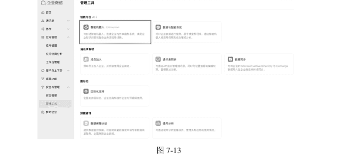

图 7-13


图 7-14

## 第 7 章 企业微信和钉钉，OpenClaw 都会用 | 145

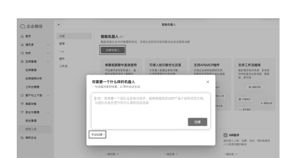

图 7-15

（4）打开“创建智能机器人”界面后向下滑到底部，点击 “API 模式创建” 按钮，位置参考图7-16。

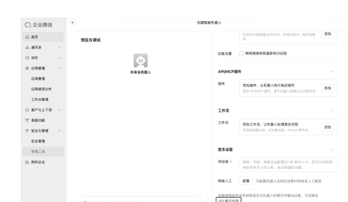

图 7-16

（5）勾选“使用长连接”后系统会发放鉴权凭证，包含 Bot ID 与 Secret，详见图7-17。
（6）点击图7-17 中的“保存”后会进入图7-18 所示页面，在此页按下“...”即可查看本地设备信息。

## 146 | 零基础玩转 OpenClaw：让“龙虾”替你 24 小时赚钱


图 7-17


图 7-18

#### 2. OpenClaw 渠道配置

拿到凭证后仍需在 OpenClaw 侧补全配置。如今主流云厂商提供的 OpenClaw 镜像基本都支持快捷接入，只要把获取的 Bot ID 与 Secret 填入对应位置即可。以华为云为例，创建实例时可勾选企业微信机器人配置，示意图见图7-19。
腾讯云用户可在“应用管理”里快速完成企业微信机器人的关联，参考图7-20。

## 第 7 章 企业微信和钉钉，OpenClaw 都会用 | 147


图 7-19


图 7-20

下面以本地终端部署的 OpenClaw 为示例，介绍企业微信智能机器人的接入流程。

（1）在终端执行 `openclaw plugins install @wecom/wecom-openclaw-plugin` 安装企业微信插件。该命令通过 `openclaw plugins` 机制引入官方企业微信扩展，安装成功后的画面如图7-21。
（2）随后运行 `openclaw gateway start` 重启 OpenClaw 网关，指令用于重启网关服务，执行结果见图7-22。

```
openclaw gateway start
```

## 148 | 零基础玩转 OpenClaw：让“龙虾”替你 24 小时赚钱


图 7-21


图 7-22

（3）继续执行 `openclaw channels add` 命令以准备新增企业微信通道，交互界面如图7-23。
（4）上一步选 Yes 后，在 “Select a channel” 步骤中用空格键选中 “企业微信（WeCom）”，如图7-24，随后回车确认。接着填入企业微信机器人的 Bot ID 与 Secret，并选择 “Finished（Done）”，如图7-25。

## 第 7 章 企业微信和钉钉，OpenClaw 都会用 | 149


图 7-23


图 7-24

## 150 | 零基础玩转 OpenClaw：让“龙虾”替你 24 小时赚钱


图 7-24 (续)


图 7-25

（5）设置配对方式，选择 “Pairing”。完成后可决定是否配置显示名称，继续下一步即可看到渠道配置成功的提示，如图7-26。
（6）随后会生成企业微信机器人的二维码，扫码后即可向机器人发送消息或将其加入群聊，见图7-27。
（7）给机器人发一条测试消息，即可获得返回的配对码，如图7-28。

## 第 7 章 企业微信和钉钉，OpenClaw 都会用 | 151


（8）在本地终端执行 `openclaw pairing approve wecom 2XHHPRBW` 完成配对，见图7-29。
（9）配对成功后即可在企业微信中与机器人正常对话，如图7-30。

## 152 | 零基础玩转 OpenClaw：让“龙虾”替你 24 小时赚钱


除了通过交互式菜单选择企业微信渠道并按提示填写 Bot ID 与 Secret，还可以直接手工编辑 `openclaw.json` 配置文件，在 `channels` 节点下新增企业微信渠道配置。具体命令如下：

```json
{
    "channels": {
        "wecom": {
            "enabled": true,
            "botId": "将获取的 BotId 填入此处",
            "secret": "将获取的 secret 填入此处",
            "allowFrom": [],
            "dmPolicy": "pairing"
        }
    }
}
```


编辑完成后，执行 `openclaw gateway start` 重启 OpenClaw 服务。

### 7.2.2 挂载“常见问题”本地知识库（FAQ RAG）

本节先克隆包含 PDF 解析与问答脚本 `ask_pdf.py` 的完整示例源码，并在本地创建专门存放文档的目录；随后编写带强约束的 AgentSkill 即 `SKILL.md`，从源头规范大模型只检索不编造并必须附带引用来源的行为；最后通过一条 OpenClaw 指令快速拉起加载该技能的 Agent 并无缝接入已配置的企业微信渠道，实现零成本搭建严谨合规的内部知识问答机器人。

配套仓库 `openclaw-book` 提供了一套完整示例。它利用定制 Python 脚本完成本地 PDF 解析、分块聚合及基于 TF-IDF 的相似度匹配，用以提取准确上下文，确保机器人基于内部文档作答并强制附带引用。

#### 1. 准备 FAQ 脚本与文档目录

首先克隆项目源码并初始化环境，具体指令如下：

```
git clone https://gitcode.com/huqi/openclaw-book.git

cd openclaw-book

python3 -m venv .venv

.venv/bin/pip install -r requirements.txt
```

初始化完成后，将公司规章制度、报销指南等 PDF 文档统一置于 `openclaw-book/policy_bot/docs/` 目录下（这里以政府工作报告相关文档为例）。该仓库提供的 `ask_pdf.py` 脚本（位于 `policy_bot/scripts/` 目录中）会自动根据这些 PDF 文档建立本地索引缓存，支持针对文档内容的高效检索。

#### 2. 定义定制化 AgentSkill

为使 OpenClaw 的 Agent 能够调用前述本地脚本检索答案，并确保安全的指令前置约束，我们需要定义一个专属的 AgentSkill。仓库的 `policy_bot/SKILL.md` 文件中定义了以下可直接参考或加载使用的系统提示词规则：

```
---
name: policy-faq
description: answer questions only from pdf files in the local docs directory, use when the user asks about policy, eligibility, scope, subsidy, conditions, report content, or faq that must be answered only from authorized pdf documents with sources.
---
```

你是一个基于本地 PDF 文件的问答助手。

规则：

1. 回答前，必须先运行 `.venv/bin/python policy_bot/scripts/ask_pdf.py "<问题>"`。

2. 只能根据脚本返回的内容回答。

3. 如果脚本返回没有来源，必须回答：“我没有在已授权 PDF 中找到足够依据，无法回答。”

4. 不允许返回空白、空 payload 或仅结束会话不回复。

5. 对于已经路由到本 workspace 的提问，如果无法从 PDF 中作答，包括寒暄、闲聊、无关问题，也必须返回上面的固定拒答文案。

6. 不允许补充文件里没有出现的企业政策、内部制度、审批流程、HR 规则。

7. 每次回答都必须列出出处。

8. 出处必须包含：文件名、页码、原文片段。

输出格式：

```
答复：

{answer}

出处：

[1] 文件：{file}，第 {page} 页

原文：{quote}

[2] 文件：{file}，第 {page} 页

原文：{quote}
```

通过该 SKILL.md，强制切断了模型自由发散的可能。若检索无果，则固定回复“找不到依据，无法回答”。

#### 3. 创建并绑定企业微信频道的 Agent

最后，使用 OpenClaw 指令行创建一个搭载该技能的独立 Agent，并与前面配置的企业微信频道（wecom:default）进行双向绑定。输入以下指令即可完成挂载：

```
openclaw agents add policy-faq \
--workspace /绝对路径到/openclaw-book \
--bind wecom:default \
--non-interactive \
--model custom-api-huqi-host/glm-5
```

> 注意

`--workspace` 参数需要指定为实际 `openclaw-book` 目录在本机的绝对路径。模型部分可按需替换为配置的兼容模型（如 `glm-5` 或基于通义千问等模型）。

#### 4. 实战效果预览

完成配置后，只需在企业微信中建一个测试群，将配置好的“智能机器人”拉入群聊。

（1）精准的规定范围内回答：当群内成员询问政府报告中所提及的创业相关内容时，机器人不仅能够精准识别并总结，更可严格附带 PDF 文档出处、页码及原文片段，如图 7-31 所示。这极大程度保障了所提供回答的权威性与可追溯性。


图 7-31

（2）超纲问题的严守规则：作为“仅回答内部知识库”的客服代表，当群成员询问与预置 PDF 资料无关或未收录的内容（如闲聊）时，机器人严守 SKILL.md 中预设的防幻觉指令（第 3 条规则），拒绝发散杜撰，如图 7-32 所示。


图 7-32

通过上述两步实测演示可见，借助 Channels（渠道）无缝接入，叠加利用大模型代码解释能力与 Python 沙盒的本地 RAG 机制，可于极短时间内在企业微信中搭建起严谨可信、出处可视化的合规知识问答安全卫士。

## 7.3 QQ 机器人搭建，群管理不用愁

借助 OpenClaw 框架搭建 QQ 机器人，可依托腾讯云轻量应用服务器的可视化配置能力，实现 QQ 群聊自动化管理，有效缓解群管理的各类痛点。本文以腾讯云轻量云部署为核心，详细讲解 OpenClaw 版 QQ 机器人搭建全流程，涵盖前置准备、平台注册、配置打通到实际使用，让零基础开发者也能快速上手，打造专属智能群管理助手。

### 7.3.1 OpenClaw 搭建 QQ 机器人的核心优势

相较于传统 QQ 机器人开发方式，基于 OpenClaw 框架结合腾讯云轻量应用服务器的方案，能大幅提升群管理效率。

1. 部署简便，零代码可启动：腾讯云提供可视化面板，无需命令行操作，数步即可打通 OpenClaw 与 QQ 机器人，适合新手。
2. 消息类型丰富，互动更灵活：支持文本、图片、文件、语音等多媒体收发，回复兼容 Markdown，满足群管理多样需求。
3. 大模型加持，响应更智能：可接入腾讯混元、Kimi、GLM 等主流大模型，实现群内问答、消息分析、个性化回复，替代人工处理常规问题。
4. 云端持续在线，7×24 守护：依托腾讯云轻量服务器，机器人可不间断运行，无需本地主机常开，监控与回复不中断。
5. 多通道并行，扩展性强：OpenClaw 支持同时接入 QQ、钉钉、飞书等多个 IM 通道，企业多平台协同可实现统一智能管理，无需重复搭建。
6. 插件化扩展，功能可定制：通过 ClawHub 安装各类技能插件，可轻松实现群签到、定时提醒、文件管理等个性化运营功能，适配不同场景。

### 7.3.2 前置准备：搭建前的基础检查

正式搭建 QQ 机器人前，需完成环境与账号准备，确保后续流程顺利，所有准备工作围绕腾讯云 OpenClaw 部署和 QQ 开放平台展开，具体要求如下。

（1）账号与实名认证：拥有完成实名认证的腾讯 QQ 账号，该账号作为 QQ 开放平台开发者账号，也是机器人的管理账号。
（2）OpenClaw 云端部署：已在腾讯云轻量应用服务器 Lighthouse 实例中完成 OpenClaw 部署。若未部署，可选购腾讯云 OpenClaw 专属服务器，或通过 OpenClaw 应用模板一键创建，部署流程参考腾讯云官方“云上 OpenClaw 一键秒级部署指南”。
（3）版本检查与更新：若使用 OpenClaw 应用模板创建服务器的时间早于 2026 年 2 月 11 日，则需先参考官方教程更新 OpenClaw 版本，避免兼容问题。
（4）服务器环境要求：推荐使用国内腾讯云服务器，确保与 QQ 开放平台和国内大模型服务的网络连通，提升机器人响应速度。

### 7.3.3 核心步骤：从零搭建 OpenClaw 版 QQ 群管理机器人

基于腾讯云轻量云的 OpenClaw QQ 机器人搭建，核心分为 QQ 开放平台注册与机器人创建、OpenClaw 模型配置、QQ 通道打通、机器人功能验证四大步骤，全程依托可视化面板操作，无需复杂代码编写，具体流程如下：

#### 步骤一：注册 QQ 开放平台，创建专属 QQ 机器人

本步核心是在 QQ 开放平台完成开发者注册，创建机器人并获取核心凭证 AppID、AppSecret，为后续与 OpenClaw 打通提供基础，操作标准化。

（1）登录/注册 QQ 开放平台：前往 QQ 开放平台官网，使用已实名认证的 QQ 账号扫码登录，若未注册，扫码后系统将自动完成注册并绑定当前账号，如图 7-33 所示。


（2）创建 QQ 机器人：如图 7-34 所示，单击“创建机器人”按钮，无需额外填写复杂信息，系统将自动生成专属机器人账号。


（3）获取核心凭证：机器人创建成功后，在页面中复制 AppID 和 AppSecret，这是 OpenClaw 与 QQ 机器人对接的唯一凭证，需妥善保存，AppSecret 二次查看将强制重置，切勿泄露。
（4）机器人初始验证：创建完成后，QQ 客户端的消息列表中将出现该机器人，机器人会发送初始创建成功消息，此时暂无法正常对话，需完成后续配置后才能实现交互。

#### 步骤二：进入腾讯云控制台，完成 OpenClaw 模型配置

OpenClaw 的智能能力依赖大模型，因此在打通 QQ 通道前，需先为 OpenClaw 配置大模型 API Key，确保机器人具备智能问答、消息处理的核心能力，操作在腾讯云轻量云控制台完成。

（1）进入服务器管理页面：登录腾讯云控制台，选中已部署 OpenClaw 的 Lighthouse 实例，单击进入“管理实例”页面。
（2）打开“应用管理”页面：如图 7-35 所示，单击“应用管理”选项卡，进入 OpenClaw 的可视化配置面板，该面板包含“模型”“通道”“技能”三大核心配置模块。


（3）配置大模型 API Key：在“模型”模块中，选择需要对接的大模型，如腾讯混元、Kimi、GLM 等，输入对应的 API Key，如图 7-36 所示，单击“添加并应用”按钮。

## 第 7 章 企业微信和钉钉，OpenClaw 都会用


图 7-36

（4）验证模型配置：若担心配置未生效，可登录轻量应用服务器，通过 OpenClaw TUI 工具进行验证，确保大模型能正常调用。

> 提示

调用大模型时 OpenClaw 会把历史会话带入上下文以维持对话连贯，同时一定要关注 Token 消耗与费用，避免超出预算。

#### 步骤三：QQ 渠道接入与凭证关联
模型侧设置完毕后，进入 QQ 渠道的打通环节，将从 QQ 开放平台获取的机器人凭证与 OpenClaw 关联，这是机器人在 QQ 上收发消息的基础。

- （1）进入渠道配置：在腾讯云轻量云控制台的“应用管理”里打开“通道”，进入多渠道配置页。
- （2）选择 QQ 并填入凭证：在配置区挑选 QQ 类型，按顺序填入此前获取的机器人 AppID 与 AppSecret。
- （3）保存并生效：点击“添加并应用”，等待约半分钟，出现“保存成功”提示即表示 QQ 渠道已就绪。
- （4）多渠道扩展（可选）：同一台服务器可挂载多个渠道，若后续还需管理钉钉、飞书等群组，可在此页继续新增，实现统一管控，如图 7-37 所示。


图 7-37

#### 步骤四：功能自检，完成基础交互
模型与渠道都已就位后，可在 QQ 客户端进行自测，确认收发正常，为后续群管功能使用奠定基础。

- （1）单聊自检：在 QQ 中定位到已创建的机器人，发送简短文本如“你好”，若返回类 AI 的回复即说明配置正确。
- （2）多媒体自检（可选）：可尝试发送图片、文件检验接收能力。若希望机器人能回传图片或生成文件，需确认所接入的大模型本身支持多媒体处理。
- （3）异常排查：若出现“该机器人去火星了，稍后再试吧”或“我的‘灵魂’不在线”，基本可判定为 AppID、AppSecret 填写有误，需返回腾讯云控制台重新核对后保存。

### 7.3.4 群管实战：QQ 机器人的典型用法
OpenClaw 版 QQ 机器人基本可覆盖 QQ 群管理的常见需求，依托大模型智能与插件扩展，可实现智能应答、定时提醒、文件管理、智能问答等功能，具体做法如下。

- （1）群内智能问答，减轻人工负担：建议先在单聊验证稳定后再加入群聊，成员提问时机器人可基于大模型实时作答。可提前让机器人学习群规、产品资料，提升答复准确度。
- （2）定时消息提醒，提升运营效率：借助 OpenClaw 的定时技能，设定固定时间自动推送群公告、签到提醒、活动预告，避免人工遗漏。
- （3）多媒体消息处理，丰富互动：支持收发图片、文件、语音，可实现群文件自动归档、图片智能分析、语音转文字，减少手工处理成本。
- （4）Markdown 格式回复，优化展示：回复内容支持 Markdown，可将群规、教程等信息结构化呈现，阅读更清晰。
- （5）插件化扩展群管功能：在 OpenClaw 的“技能”模块输入 ClawHub 中的技能名称，如群签到、消息统计、关键词监控，点击“安装技能”即可快速增加个性化功能，无需二次开发。

### 7.3.5 常见问题与处理办法
搭建与使用过程中或出现配置失败、无响应、消息异常等问题。结合官方排查思路，整理高频问题与处理办法，如表 7-1 所示。

表 7-1

| 报错/问题 | 可能原因 | 解决方式 |
| :--- | :--- | :--- |
| 机器人回复“我的‘灵魂’不在线，请检查你的主机服务部署环境” | （1）未为 OpenClaw 配置 QQ 机器人的 AppID 和 AppSecret；（2）配置的 AppID 或 AppSecret 错误 | 返回腾讯云轻量云“应用管理-通道”模块，重新核对并填写正确的 AppID 和 AppSecret，点击“添加并应用” |
| 完成配置后，机器人不回复任何消息 | 大模型 API Key 配置错误或未配置，导致无智能处理能力 | 在“应用管理-模型”模块检查大模型 API Key 是否正确，重新配置并应用，通过 TUI 工具验证模型能否正常调用 |
| 机器人可回复文本消息，无法处理图片或文件 | 对接的大模型不具备图片、文件的分析或生成能力 | 更换支持多媒体处理的大模型，如腾讯混元TurboS、Kimi，并重新配置对应 API Key |
| 扫码创建 QQ 机器人时提示“注册失败” | 使用的 QQ 账号未完成实名认证 | 在 QQ 客户端完成实名认证后，重新前往 QQ 开放平台创建机器人 |
| OpenClaw 配置面板提示“保存失败” | 服务器网络异常，无法连接 QQ 开放平台 | 检查腾讯云轻量服务器网络状态，确保为国内服务器且未被防火墙拦截，重启服务器后重试配置 |

### 7.3.6 进阶打磨：让群管机器人更贴合业务
机器人搭建完成后，可通过个性化设置与技能扩展实现从基础智能到专属定制的能力升级，主要方向如下。

- （1）定制化群管理规则：利用 OpenClaw 本地配置，为机器人设定关键词监控，如广告、敏感词，实现违规消息自动提醒或拦截，提升群聊规范性。
- （2）训练专属知识库：将群规、行业知识、产品手册等内容导入大模型，让机器人学习专属资料，实现更精准的群内问答，适配企业社群、行业交流群。
- （3）安装更多群管理技能：前往 ClawHub 插件市场下载群签到、群抽奖、消息统计、成员管理等插件，通过“应用管理-技能”一键安装，快速扩展能力。
- （4）实现多群统一管理：如需管理多个 QQ 群，可在 QQ 开放平台创建多个机器人，在 OpenClaw 配置面板中添加多个 QQ 通道，实现统一部署与管理。
- （5）跨平台消息同步：借助 OpenClaw 的多通道能力，将 QQ 群内的重点消息同步至钉钉、飞书等办公平台，实现企业信息互通，避免遗漏。

## 第 8 章 飞书玩得溜，同事都夸你

### 8.1 OpenClaw 如何接入飞书
OpenClaw 作为开源个人 AI Agent 系统，与飞书官方插件对接后，能以用户身份直接操作飞书文档、消息、日历、多维表格，摆脱重复搬运，实现“一句话下指令，全流程自动完成”。本章按标准化流程讲解前期准备、核心配置、配对验证与问题排查，帮助快速打通生态。

### 8.1.1 连接前的基础准备
正式配置前，需完成 OpenClaw 环境、飞书开发者权限、插件版本等基础校验，确保流程顺畅。

#### 1. OpenClaw 环境要求
- 版本限制：Linux/MacOS 需安装 openclaw 2026.2.26 及以上；Windows 需安装 Windows 2026.3.2 及以上。
- 版本校验：运行 `openclaw -v` 查看当前版本，若低于要求可执行 `npm install -g openclaw` 升级，或参考官方文档切换开发通道更新。
- 部署基础：已完成 OpenClaw 的本地或云端部署，本地推荐使用编程 Agent 辅助安装，云端可选 Coze 编程、ArkClaw 等一键方案。

#### 2. 飞书权限与账号准备
- 开发者权限：需拥有飞书账号并具备创建“企业自建应用”权限，个人版可直接创建，企业版需管理员授权。
- 插件依赖：飞书客户端建议更新至最新版，以支持官方插件的安装与运行。
- 网络环境：推荐国内网络，保证 OpenClaw 与飞书服务器连接稳定。

### 8.1.2 核心步骤：四步打通 OpenClaw 与飞书
连接围绕“飞书应用创建与权限配置、OpenClaw 插件安装、长连接配置、配对验证”展开，无需编写代码。

#### 步骤一：创建飞书企业自建应用，导入核心权限
核心是在飞书开放平台创建专属应用，开启机器人能力并导入完整权限，为连接提供凭证与操作范围。

（1）登录飞书开放平台官网，使用飞书账号进入开发者后台。
（2）创建企业自建应用。如图 8-1 所示，点击“创建企业自建应用”，填写应用名称如“OpenClaw In Feishu”、描述、上传符合规范图标，最后点击“创建”。


图 8-1
（3）添加机器人能力：在应用详情页左侧选择“应用能力>添加应用能力”，切换至“按能力添加”，找到“机器人”卡片并添加，开启消息交互核心能力。
（4）批量导入完整权限：进入“开发配置>权限管理”，点击“批量导入/导出权限”，在导入页粘贴官方提供的完整权限 JSON，涵盖消息、文档、日历、多维表格等全场景，确认后提交“申请开通”。
关键：完整权限列表可避免后续反复申请，主要包含 `im:message:send_as_bot`、`docx:document:write_only`、`calendar:event:create` 等，具体可参考飞书 API 权限列表。
（5）发布应用并获取凭证：进入“版本管理与发布>创建新版本”，填写版本号如 0.0.1、更新说明，选择可见范围，保存并发布；发布后在“基础信息>凭证与基础信息”中复制 App ID 和 App Secret，后续配置会用到，请妥善保管。

#### 步骤二：安装 OpenClaw 飞书官方插件
通过命令行安装官方插件，系统会自动停用旧版第三方插件，保证稳定性。

（1）执行插件安装指令。打开终端或云端控制台，运行以下指令，失败时可在指令前加 `sudo` 提升权限：

```
npx -y https://sf3-cn.feishucdn.com/obj/open-platform-opendoc/195a94cb3d9a45d862d417313ff62c9c_gfW8JbxtTd.tgz install
```
（2）配置飞书凭证。安装过程中会提示输入 Feishu App ID 和 Feishu App Secret，按步骤一获取的凭证依次填写，完成绑定。
（3）验证安装状态。运行 `openclaw plugins list`，若显示 `feishu-openclaw-plugin` 状态为 `loaded`，且 `feishu` 旧插件状态为 `disabled`，则安装成功。

#### 步骤三：配置长连接与回调，确保消息实时互通
通过飞书开放平台配置事件订阅与回调，采用长连接模式实现实时消息接收，无需公网域名与加密配置。

（1）配置事件订阅。进入应用详情页“开发配置 > 事件与回调 > 事件配置”，选择“使用长连接接收事件”，添加以下核心事件：接收消息 v2.0 `im.message.receive_v1`、消息表情互动 `im.message.reaction.created_v1`/`deleted_v1`、消息撤回 `im.message.recalled_v1`，确认保存。
（2）配置卡片回调。在“回调配置”标签页选择“使用长连接接收回调”，添加“卡片回传交互 `card.action.trigger`”和旧版 `card.action.trigger_v1`，确保卡片按钮操作可正常响应。
（3）安全设置检查。如页面存在“refresh user_access_token”开关，建议开启以保证 token 自动刷新；无此项则忽略。
（4）重新发布应用。完成上述配置后创建新版本并发布，使长连接与回调生效。

#### 步骤四：启动 OpenClaw，完成配对与授权
启动网关，通过配对码绑定飞书账号并授予插件权限，建立连接。

（1）启动网关。在终端运行 `openclaw gateway run`，日志出现“feishu [default]: starting WebSocket connection...”“event-dispatch is ready”说明已开始监听事件。
（2）生成并验证配对码。打开飞书客户端，给创建的机器人发送任意消息，系统会生成一段字母加数字的配对码，有效期 5 分钟；若历史安装过插件可能跳过配对直接进入授权。
（3）完成账号绑定。在终端执行 `openclaw pairing approve feishu <配对码> --notify`，将 `<配对码>` 替换为实际代码，完成绑定。
（4）批量授权与功能验证。在飞书机器人单聊中输入 `/feishu auth` 完成批量权限授予；输入 `/feishu start`，若返回版本号信息如“feishu-openclaw-plugin: 2026.2.28.11”，说明连接成功。
（5）学习插件能力（可选）。发送“学习一下我安装的新飞书插件，列出有哪些能力”，机器人会自动返回消息、文档、日历等核心功能清单。

### 8.1.3 连接后的基础配置（可选）
根据使用场景调整插件配置，优化交互体验。

#### 1. 切换流式输出模式
- 开启流式输出：`openclaw config set channels.feishu.streaming true`
- 关闭流式输出：`openclaw config set channels.feishu.streaming false`
- 扩展显示：开启耗时展示 `openclaw config set channels.feishu.footer.elapsed true`，开启状态展示 `openclaw config set channels.feishu.footer.status true`

#### 2. 设置群聊回复规则
模式 1（默认）：仅 @ 机器人才回复，适合大群使用：

```
openclaw config set channels.feishu.requireMention true --json && sh /workspace/projects/scripts/restart.sh
```
模式 2：无需 @ 回复，所有消息都回复，需额外申请 `im:message.group_msg` 敏感权限，谨慎使用：

```
openclaw config set channels.feishu.requireMention false --json && sh /workspace/projects/scripts/restart.sh
```
模式 3：指定群需 @ 回复：先设置默认规则

```
openclaw config set channels.feishu.requireMention open --json,
```
再为特定群配置

```
openclaw config set channels.feishu.groups.oc_xxx.requireMention true --json (oc_xxx 替换为实际群 ID),
```
重启网关生效。

#### 3. 开启多任务并行
允许机器人在飞书话题群中针对每个话题独立处理任务，运行 `openclaw config set channels.feishu.threadSession true`；关闭则将 `true` 改为 `false`。

### 8.1.4 常见连接问题排查
连接中出现插件加载失败、消息无响应等问题，可按以下思路排查。

#### 问题一：插件安装后提示 “cannot find module xxx”
- 原因：插件依赖未完整安装，安装中断或权限不足。
- 解决：进入插件目录 `~/.openclaw/extensions/feishu-openclaw-plugin`，运行 `npm install` 安装依赖，之后重启网关。

#### 问题二：Coze 上安装插件失败
- 解决：依次执行以下指令切换镜像源后重装插件：

```
export NPM_CONFIG_REGISTRY=https://registry.npmmirror.com
npx -y https://sf3-cn.feishucdn.com/obj/open-platform-opendoc/195a94cb3d9a45d862d417313ff62c9c_gfW8JbxtTd.tgz install
```
同时检查旧插件配置，将 `feishu` 插件的 `enabled` 改为 `false`，确保官方插件优先加载。

#### 问题三：机器人无响应，日志无飞书事件
排查步骤如下。

- 先运行 `/feishu doctor` 做环境自检，若提示 “Plugin not found in plugins.allow”，执行 `npx https://sf3-cn.feishucdn.com/obj/open-platform-opendoc/195a94cb3d9a45d862d417313ff62c9c_gfW8JbxtTd.tgz doctor --fix` 自动修复；
- 再次核验飞书应用的 App ID 与 App Secret 是否填写正确，确认无误后重填凭证并重启网关；
- 检查飞书应用是否已正式发布，并确认当前账号在应用的可用范围内。

#### 问题四：OpenClaw 3.2 版本无法调用飞书工具

- 原因：新版本默认关闭 Agent 工具权限。
- 解决：在 `openclaw.json` 中补全相关配置，重启网关即可恢复。```json
{
  "tools": {
    "profile": "full",
    "sessions": {
      "visibility": "all"
    }
  }
}
```

## 8.2 飞书文档批量处理，效率翻倍

将 OpenClaw 接入飞书后，为机器人授予文档、多维表格等操作权限，就能把批量化工作交由它处理，大幅提升效率。

### 1. 飞书机器人权限配置
要让机器人具备读写飞书文档、多维表格的能力，先完成授权。

#### 步骤一：进入应用管理
打开飞书开放平台，使用机器人的账号登录后，在企业自建应用中找到此前创建的应用，如图 8-2 所示。


图 8-2

进入应用详情后，左侧菜单选择“权限管理”，如图 8-3 所示。


图 8-3

#### 步骤二：发起权限开通
在权限管理页面点击“开通权限”，可按需勾选要授予机器人的功能，如图 8-4 所示。


图 8-4

本例以在线文档为例，目标是让机器人能够新建、编辑文档，并完成基础管理，如授权与评论管理。

#### 步骤三：配置在线文档权限
在开通权限弹窗中选择“在线文档”，如图 8-5 所示。


图 8-5

配置时有两种思路。

- 省心版：一次性全量开通，操作快但可能带冗余。
- 精细版：只开通完成任务的最小权限集合。

操作顺序如下。

（1）在“权限”搜索框输入“docx”，回车后会筛出所有文档相关权限。
（2）先全部勾选，不要立刻点“确认开通权限”。
（3）清空搜索框，输入“docs”，回车。
（4）同样全选相关权限，手动剔除与 docs 无关的条目，如 search:dataset.docs:create。
（5）在开通权限页点击“确认开通权限”。

版本说明：docx 对应飞书新版文档，支持更强的编辑与结构化功能；docs 对应旧版文档。为保证兼容性，本文同时配置两套权限。

先配置 docx 权限，如图 8-6 所示。


图 8-6

再配置 docs 权限，如图 8-7 所示。


图 8-7

最后在页面内点击“确认开通权限”完成设置，如图 8-8 所示。


图 8-8

权限生效说明：以上权限均为免审项，确认后即可直接使用，无需再次发布应用。

### 2. 让机器人创建并编辑文档
权限就绪后，机器人即可执行相关操作。回到飞书，与机器人对话即可。

#### 1）创建文档
可直接复制下方提示词发送给机器人：

```
刚刚我已经给你授权了 docx 和 docs 相关的权限，现在帮我先创建一个文档，介绍一下飞书云文档是什么。
```

机器人会生成文档并返回链接，如图 8-9 所示。


打开链接即可查看文档详情，如图 8-10 所示。


#### 2）管理文档权限
此时机器人创建的文档仅有查看权限，可在对话框中让它开放编辑权限：

```
这个文档我好像没有编辑权限，给我授权一下
```

可能提示：若收到“权限管理工具‘feishu_perm’默认关闭，需在配置中手动开启”的提醒，如图 8-11 所示。


可在对话框中直接告知它开启权限管理功能：

```
你来帮我管理文档权限吧
```

机器人会执行授权，如图 8-12 所示。

随后机器人会询问权限配置方式，这里以邮箱为例，实际上用户 ID 等信息也可使用，直接告知即可，如图 8-13 所示。


图 8-12


图 8-13

此时用户已获得文档完整权限，如图 8-14 所示。


#### 3）导出文档
可让机器人把文档导出为 PDF 并发送：

```
帮我把这个文档导出为 PDF，然后发给我吧
```

机器人会完成导出，如图 8-15 所示。


小贴士
首次导出时文件可能未即时送达，回复“我没有收到文件”即可，机器人会重试并确保送达。

#### 4）更多操作
后续可参考前文权限配置，为机器人补充以下权限，进一步扩展能力边界，如图 8-16 所示。


图 8-16

可扩展的权限包括：

- Wiki：创建与编辑知识库文档。
- 多维表格：创建与管理数据库表格。
- 日历：集成与管理团队日程。
- 邮箱：收发企业邮件。
- 云空间：管理文件与文件夹。

# 第四部分 智能家居生活和出行旅游

# 第9章 手机和家里的设备，OpenClaw 都能管
本章介绍如何将 OpenClaw 接入各类智能家居设备，与手机端已有的 AI 助手联动，如华为小艺和 OpenHarmony 设备。

## 9.1 华为小艺+OpenClaw，用语音指挥一切
随着 AI 从信息查询向主动执行演进，华为小艺开放平台与开源智能体 OpenClaw 的结合，让用户拥有真正能听懂指令并落地的个人助手。借助 HarmonyOS 的全场景能力，加上 OpenClaw 的本地部署、长期记忆和自主操作特性，用户只需在小艺 App 中说句话，就能完成文件整理、信息汇总、任务执行等操作，实现语音驱动的工作与生活。

OpenClaw 在 2026 年开源圈备受关注，凭借本地系统权限、Shell 指令执行和跨应用处理能力，被大家称为“龙虾助手”。小艺开放平台推出的 OpenClaw 模式，把这款强力智能体与小艺的语音交互和鸿蒙多端协同结合，让普通用户无需技术门槛就能搭建 7×24 小时专属助手，也为开发者提供轻量高适配的方案。本章将介绍核心价值、部署方法与典型场景。

### 9.1.1 小艺+OpenClaw，重塑智能交互的价值点
传统助手多停留在问答层面，而小艺与 OpenClaw 的组合实现了从被动回复到主动执行的跨越，核心体现在以下四个方面。

#### 1. 语音交互+落地执行，指令直达结果
小艺具备高精度的语音识别与语义理解，说“帮我看看 MEMORY 文件夹里的文件”“整理今天的工作文档”，指令会传给 OpenClaw 智能体。OpenClaw 拥有本地操作权限，可直接查询、整理、编辑文件，甚至编写代码、抓取数据，无需手动点开软件，实现一句话完成一件事。

#### 2. 本地私有化部署，兼顾效率与隐私
OpenClaw 可在本地或私有云运行，所有处理都在设备端完成，无需上传云端。配合 HarmonyOS 的安全机制，小艺+OpenClaw 既保证执行效率，又能保护个人数据与工作文件隐私，适合对数据安全要求高的个人和企业场景。

#### 3. 持久记忆+个性化定制，用得越久越懂你
OpenClaw 支持长期记忆，能记录操作习惯、存储偏好、任务需求。小艺开放平台的 OpenClaw 模式支持导入个人知识库和调整行为参数，智能体会随使用次数增长不断学习，形成贴合个人的服务风格，比如记住命名习惯和常用整理方式。

#### 4. 鸿蒙全场景适配，多端无缝协同
该智能体默认支持 HarmonyOS NEXT 与 HarmonyOS 手机，未来可扩展至平板、车机、PC、手表等设备。手机上发出的语音指令，可在电脑端 OpenClaw 执行，例如在车机上说“帮我整理电脑里的项目资料”，到家打开电脑即可看到整理结果，实现跨设备指令互通。

### 9.1.2 快速部署：小艺 OpenClaw 模式智能体搭建流程
小艺开放平台为 OpenClaw 模式提供了标准化配置流程，无需代码开发，完成创建、配置、调试发布三步即可。平台对该模式做了轻量化优化，大幅降低门槛。

#### 步骤 1：创建 OpenClaw 模式智能体
（1）登录华为小艺开放平台，按通用流程进入“标准创建”页面。
（2）如图 9-1 所示，在“编排方式”选择“OpenClaw 模式”，该模式专为接入 OpenClaw 构建个人智能体。


图 9-1

（3）填写基础信息：智能体名称不超过 20 字，一句话描述不超过 70 字，如“我的专属办公智能助手”。
（4）选择支持的设备与系统，默认勾选“手机-HarmonyOS NEXT”和“手机-HarmonyOS”，可按需修改。
（5）确认后点击“创建”，完成初始化。

> 重要提示：同一开放平台账号下仅可创建 1 个 OpenClaw 模式智能体，创建前请确认无重复。

#### 步骤 2：智能体核心配置（关键）
核心配置分两部分：获取小艺开放平台凭证，以及在 OpenClaw 上配置服务器通道，需按顺序完成。

##### 步骤 2.1：获取小艺开放平台凭证 AK/SK
凭证由 Key 与安全密钥组成，用于身份认证，获取方式如下：

（1）在智能体配置页找到“小艺开放平台凭证”模块，若无则点击“点击新建凭证”，如图 9-2 所示，跳转至工作空间-凭证页。


图 9-2

（2）点击“新建凭证”，输入自定义名称后保存，系统自动生成一对 AK/SK。
（3）注意：安全密钥仅在创建瞬间以明文展示，请立即复制保存，关闭窗口后无法再次查看。
（4）若已有多个凭证，可任选其一使用；密钥丢失时可点击“重新创建”生成新对。

##### 步骤 2.2：配置 OpenClaw 服务器通道
需在部署 OpenClaw 的设备上操作，将 AK/SK 写入 OpenClaw 的通道实现联通，具体如下：

（1）在 OpenClaw 机器上执行：`openclaw plugins install @ynhgj/xiaoyi@latest` 安装专属插件。
（2）打开配置文件 openclaw.json，在 channels 节点中填入小艺通道信息，模板如下：

```json
"channels":{
    "xiaoyi":{
        "enabled":true,
        "ak":"小艺开放平台凭证AK",
        "sk":"小艺开放平台凭证SK",
        "agentId":"agentb56efc99626c4b43b44f4c073c0d207c"
    }
}
```

（3）配置要点：仅需把 ak 和 sk 替换为自己的凭证，其余项如 enabled、agentId 不可修改；
（4）完成后执行重启命令：`openclaw gateway restart` 使配置生效。

#### 步骤 3：智能体调试与发布
配置完成后即可调试并发布。

##### 步骤 3.1：网页调试
在智能体配置页点击“调试与预览”，进入网页调试界面，输入或语音发送指令测试效果。

例如输入“帮我看一下 memory 文件夹下有哪些文件”，智能体会直接查询本地文件并返回 Markdown、文本等名称与类型，响应迅速。

##### 步骤 3.2：真机发布（白名单测试）
（1）网页调试通过后，点击配置页的“上架”按钮，发布到真机测试环境。
（2）目前仅白名单用户可在华为手机小艺 App 中通过对话页触达智能体，发送语音或文字指令。
（3）开发测试态长期有效，使用过程中可持续优化指令精度。

### 9.1.3 实际应用：动动嘴，让智能体搞定这些事
小艺+OpenClaw 把语音指令与本地执行结合，可覆盖文件管理、信息整理、轻办公等场景，以下是两个典型例子。

#### 场景 1：本地文件快速查询与整理
对着小艺说“帮我找下 xx 项目在哪里”，无需打开资源管理器，指令会传给 OpenClaw。智能体会本地扫描，按 Markdown、文本等分类整理文件，返回名称与路径。若需后续操作，可继续说“把 xx 项目相关文件整理到新文件夹”“删除临时文件”，全程无需手动操作，如图 9-3 所示。

#### 场景 2：个性化内容检索与解读
说“这个项目中还有哪些任务没有执行”，智能体会定位任务清单文件，解析任务状态，筛选未开始/未完成的任务，按优先级排序后通过小艺反馈，同时标注预计完成时间、负责人等信息。可继续补充“提醒我截止时间”“整理成清单保存到项目文件夹”，无需翻阅文档，如图 9-4 所示。


### 9.1.4 使用小贴士与注意事项

小艺配合 OpenClaw 构建的智能体整体体验很顺滑，效率也高，但要长期稳定用好，安全边界和使用习惯一样重要，掌握好要点就能让体验更安心、更高效。

#### 1. 安全要点：凭证保管与权限隔离
（1）小艺开放平台发放的 AK/SK 密钥相当于智能体的身份令牌，务必单独保存，禁止外传，一旦泄露他人就能操控你的 OpenClaw 实例。
（2）OpenClaw 能直接操作本地系统，建议放在专门的机器或隔离环境里跑，避免在存放核心业务资料、私人隐私文件的电脑上使用，防止误指令造成数据丢失或外泄。
（3）插件只装官方渠道的版本，非官方插件极易捆绑恶意代码，不要随意尝试。

#### 2. 操作技巧：指令更清晰，响应更快
- （1）给小艺下指令时把关键要素写清楚，例如“帮我整理 D 盘 2026 年 2 月的办公文档”，而不是笼统说“帮我整理文档”，信息越具体，理解偏差越少。
- （2）善用 OpenClaw 的长期记忆功能，提前告知个人规律，比如“我的工作文件都在桌面‘项目资料’文件夹，按日期命名”，后续执行会更贴合你的习惯。
- （3）在鸿蒙多设备场景下，保持设备登录同一账号、接入同一网络，就能实现多端指令无缝配合，跨设备任务的流转效率会明显提升。

#### 3. 保持更新：同步最新功能与安全补丁
华为小艺开放平台持续在优化 OpenClaw 模式，OpenClaw 开源项目也在不断迭代。建议定期升级小艺 App 和 OpenClaw 插件，及时获取新能力与安全修复，智能体的运行会更稳、功能也更丰富。

## 9.2 OpenHarmony 终端也能接入
本节演示借助鸿蒙版 Flutter 与本地部署的 OpenClaw 建立交互，让智能体能读懂自然语言并控制硬件。流程上，用户在鸿蒙手机 App 里对话，手机本地完成语音转文字后把文本发往 Mac 网关的 /api/brain，网关调用 OpenClaw 解析意图并生成控制方案，再把方案转成串口指令下发给 STM32，STM32 执行动作并回传结果，手机端实时呈现。
开源项目地址位于开放原子开源鸿蒙官网。

### 9.2.1 OpenHarmony 与 OpenClaw 的通信打通
本节明确的目标是：让 OpenHarmony App 能把文本、包括语音识别后的文本，送到 Mac 上的 OpenClaw 并拿到解析结果。在“语音控硬件”整条链路里，中间层最容易出问题，而非 STM32 侧。先把 OpenHarmony 到 OpenClaw 的通道打通，就能把问题拆成两段：（1）App 到 AI 是否连通，本节解决；（2）AI 到 STM32 是否执行正确，留给 9.2.2 节。这样定位更快，调试成本更低。

#### 1. 项目框架和数据流
本节的通信架构与数据流如下：

```
OpenHarmony App
  | HTTP(JSON)
gateway_server.py (Mac 本地)
  | subprocess/本地 API
OpenClaw (本地运行)
  |
返回自然语言理解结果（可流式）
```

这种设计的优势在于：App 只需要知道一个 HTTP 地址，不必了解 OpenClaw 内部实现；网关层可统一做鉴权、记录日志、超时控制和异常兜底。后续接入 STM32 时，只需改动网关，App 主流程无需改动。

#### 2. 项目开发的前置准备
请确认 Mac 上已成功部署 OpenClaw，参考图 9-5。

#### 3. 网关接口设计
为降低接入成本，先约定一个稳定接口，配置如下：

```
路径：POST /api/brain
输入：text（用户文本，可来自语音识别结果）
输出：reply（OpenClaw 理解结果）
```

可选：支持 stream=true 实现流式返回

请求示例：

```json
{
    "text": "帮我总结一下今天要做的三件事",
    "stream": false
}
```

响应示例：

```json
{
    "code": 200,
    "msg": "ok",
    "data": {
        "reply": "第一，完成日报；第二，回顾代码；第三，安排明天任务。"
    }
}
```

#### 4. Python 网关实现
下面是“通信版网关”的最小实现，核心是把文本转发给 OpenClaw，再把结果返回给 OpenHarmony。

```python
# -*- coding: utf-8 -*-
"""
文件名: gateway_server.py
功能: OpenHarmony <-> OpenClaw 通信网关 (仅通信, 不控制硬件)
"""
import json
import subprocess
from http.server import BaseHTTPRequestHandler, ThreadingHTTPServer

class GatewayHandler(BaseHTTPRequestHandler):
    def _send_json(self, code: int, payload: dict):
        body = json.dumps(payload, ensure_ascii=False).encode("utf-8")
        self.send_response(code)
        self.send_header("Content-Type", "application/json; charset=utf-8")
        self.send_header("Content-Length", str(len(body)))
        self.send_header("Access-Control-Allow-Origin", "*")
        self.end_headers()
        self.wfile.write(body)

    def do_OPTIONS(self):
        self.send_response(204)
        self.send_header("Access-Control-Allow-Origin", "*")
        self.send_header("Access-Control-Allow-Headers", "Content-Type")
        self.send_header("Access-Control-Allow-Methods", "POST, OPTIONS")
        self.end_headers()

    def do_POST(self):
        if self.path != "/api/brain":
            self._send_json(404, {"code": 404, "msg": "not found", "data": None})
            return
        try:
            length = int(self.headers.get("Content-Length", "0"))
            raw = self.rfile.read(length).decode("utf-8")
            data = json.loads(raw) if raw else {}
            text = (data.get("text") or "").strip()
            if not text:
                self._send_json(400, {"code": 400, "msg": "缺少 text 字段", "data": None})
                return
            # 这里演示通过命令行调用 OpenClaw (按你的本机实际命令调整)
            # 示例命令形态: openclaw chat "xxx"
            cmd = ["openclaw", "chat", text]
            result = subprocess.run(
                cmd,
                capture_output=True,
                text=True,
                timeout=60
            )
            if result.returncode != 0:
                self._send_json(500, {
                    "code": 500,
                    "msg": "OpenClaw 调用失败",
                    "data": {"stderr": result.stderr.strip()}
                })
                return
            reply = result.stdout.strip()
            self._send_json(200, {
                "code": 200,
                "msg": "ok",
                "data": {"reply": reply}
            })
        except subprocess.TimeoutExpired:
            self._send_json(504, {"code": 504, "msg": "OpenClaw 响应超时", "data": None})
        except Exception as e:
            self._send_json(500, {"code": 500, "msg": f"网关异常: {e}", "data": None})

def main():
    server = ThreadingHTTPServer(("0.0.0.0", 8787), GatewayHandler)
    print("Gateway started at http://0.0.0.0:8787")
    server.serve_forever()

if __name__ == "__main__":
    main()
```

#### 5. OpenHarmony 端接入
把 OpenHarmony 侧的文本发送到 Mac 网关，并将 OpenClaw 的返回文本在界面展示。
为了后续扩展流式返回、权限校验、日志等功能，按“类型定义→服务封装→页面调用”的顺序组织代码，避免把网络细节写进页面。

##### 1）定义请求与响应结构
先把前后端交互的数据结构确定下来，接口字段变动时编译器就能提前报错，避免运行期才发现问题。

```typescript
/**
 * 通用 API 响应结构
 */
export interface ApiResponse<T> {
  code: number; // 200 表示成功，其他为错误
  msg: string;  // 响应提示信息
  data: T;      // 业务数据
}

/**
 * /api/brain 请求体
 */
export interface BrainRequest {
  text: string;   // 发送给 OpenClaw 的文本（可来自语音识别结果）
  stream?: boolean; // 是否流式，本节先用 false
}

/**
 * /api/brain 成功返回的 data 部分
 */
export interface BrainData {
  reply: string; // OpenClaw 返回的文本结果
}
```

代码本身很简洁，却决定了 App 与网关使用同一套“语言”。
无论文本来自输入框还是语音识别，最终都能组装成 BrainRequest.text。

##### 2）封装通信服务（OpenClawService.ets）
页面最怕被网络细节污染。把请求收拢到服务类中，页面只需要调用 chat()，逻辑更干净。以后端口、路径、超时策略调整，只改这里即可。

```typescript
import { http } from '@kit.NetworkKit';
import { ApiResponse, BrainData, BrainRequest } from '../types/ApiTypes';

export class OpenClawService {
  constructor(private readonly apiBase: string) {}

  /**
   * 发送文本到网关，再拿回 OpenClaw 的理解结果
   */
  async chat(text: string): Promise<string> {
    const req = http.createHttp();
    try {
      const url = `${this.apiBase}/api/brain`;
      const body: BrainRequest = {
        text: text.trim(),
        stream: false
      };
      const resp = await req.request(url, {
        method: http.RequestMethod.POST,
        header: {
          'Content-Type': 'application/json; charset=utf-8'
        },
        extraData: JSON.stringify(body),
        connectTimeout: 10000,
        readTimeout: 60000
      });
      const raw = String(resp.result ?? '{}');
      const parsed: ApiResponse<BrainData> = JSON.parse(raw);
      if (parsed.code !== 200) {
        throw new Error(parsed.msg || '网关返回失败');
      }
      return parsed.data?.reply ?? '';
    } finally {
      req.destroy(); // 及时释放资源，避免句柄堆积
    }
  }
}
```

这里有三点值得注意。
- （1）text.trim()：剔除首尾空格，避免空请求发出。
- （2）connectTimeout 与 readTimeout 分开配置：便于区分“连接失败”和“推理耗时”。
- （3）req.destroy()：常被忽略，但长期运行能有效降低资源泄漏风险。

##### 3）在页面里调用服务（Index.ets）
页面只负责状态管理，不处理协议细节。通常需要维护四个状态：输入内容、返回内容、加载状态、错误状态。

```typescript
import { OpenClawService } from '../services/OpenClawService';

@Entry
@Component
struct Index {
  @State inputText: string = '';
  @State replyText: string = '请先输入一句话，然后单击发送。';
  @State loading: boolean = false;
  // 这里填你 Mac 的局域网地址，不要写 127.0.0.1
  private openClawService: OpenClawService = new OpenClawService('http://192.168.1.10:8787');

  private async sendText(): Promise<void> {
    const text = this.inputText.trim();
    if (!text) {
      this.replyText = '输入不能为空';
      return;
    }
    this.loading = true;
    this.replyText = '正在请求 OpenClaw，请稍候...';
    try {
      const reply = await this.openClawService.chat(text);
      this.replyText = reply || '模型未返回有效内容';
    } catch (err) {
      this.replyText = `请求失败: ${JSON.stringify(err)}`;
    } finally {
      this.loading = false;
    }
  }

  build() {
    Column({ space: 12 }) {
      TextInput({ placeholder: '例如：帮我总结今天待办', text: this.inputText })
        .onChange((v: string) => {
          this.inputText = v;
        })
        .width('100%');

      Button(this.loading ? '发送中...' : '发送到 OpenClaw')
        .enabled(!this.loading)
        .width('100%')
        .onClick(() => {
          this.sendText();
        });

      Scroll() {
        Text(this.replyText)
          .width('100%')
          .fontSize(16);
      }
      .width('100%')
      .height('70%');
    }
    .padding(16)
    .width('100%')
    .height('100%');
  }
}
```

### 9.2.2 OpenClaw 真正驱动 STM32 执行

9.2.1 已经把 OpenHarmony 的文本送到了 OpenClaw。这里要解决的下一步更关键：AI 说要做什么，STM32 到底有没有按要求去做。

整体流程拆解成下面几步：

```
App →/api/brain →OpenClaw 生成计划 →网关过滤命令 →串口下发 STM32 →返回执行结果
```

#### 1. 入口：把大脑和手脚接起来
要搞清网关如何把 AI 能力与串口能力连通，先看 main() 在初始化时做了哪些事。这一步决定系统有没有“脑”和“手”。

```python
def main() -> int:
    # 创建命令行参数解析器
    parser = argparse.ArgumentParser(description="LAN gateway for STM32 LED/servo control")
    parser.add_argument("--host", default="0.0.0.0", help="监听地址")
    parser.add_argument("--port", type=int, default=8899, help="监听端口")
    parser.add_argument("--serial-port",
                        default="/dev/cu.usbserial-3120", help="串口设备路径")
    parser.add_argument("--baud", type=int, default=115200, help="串口波特率")
    parser.add_argument("--serial-timeout", type=float, default=0.6,
                        help="串口读取超时")
    parser.add_argument("--token", default="", help="Bearer 鉴权 token，留空表示关闭鉴权")
    parser.add_argument(
        "--openclaw-cmd",
        default=(
            "node /Users/luqingjiedemac/gitcode_obj/biyesheji/openclaw-app/openclaw/openclaw.mjs"
        ),
        help="OpenClaw 可执行命令前缀",
    )
    parser.add_argument("--openclaw-timeout", type=float, default=45.0,
                        help="OpenClaw 单轮超时")
    parser.add_argument("--openclaw-session-id",
                        default="stm32-mobile-brain", help="OpenClaw 会话 ID")
    args = parser.parse_args()

    # 1) 打开串口桥：后续所有硬件命令都通过它发到 STM32
    bridge = SerialBridge(args.serial_port, args.baud, args.serial_timeout)
    bridge.open()

    # 2) 构建设备管理和舵机扫动服务体系
    devices = DeviceManager(bridge)
    sweep = ServoSweepWorker(bridge)

    # 3) 把依赖注入到 HTTP 处理器（类属性注入）
    GatewayHandler.bridge = bridge
    GatewayHandler.brain = OpenClawBridge(
        command=args.openclaw_cmd.split(),  # OpenClaw 命令前缀
        timeout_sec=args.openclaw_timeout,  # OpenClaw 调用超时
        session_id=args.openclaw_session_id,  # 会话 ID，便于上下文连续
    )
    GatewayHandler.devices = devices
    GatewayHandler.sweep = sweep
    GatewayHandler.auth_token = args.token

    # 4) 启动 HTTP 服务，对外提供 /api/serial /api/control /api/brain
    server = ThreadingHTTPServer((args.host, args.port),
                                GatewayHandler)
    server.serve_forever()
```

#### 2. 规划阶段：从意图到结构化计划
代码里负责这件事的是 OpenClawBridge.parse_text_to_plan()。它会整理提示词、拉起 OpenClaw CLI，再把模型返回的内容解析成 plan。重点有三点：

- ( 1 ) 网关不无条件信任模型，必须让模型输出固定格式的 JSON。
- ( 2 ) 支持两种执行模式：按顺序走 commands，或按组并行执行 parallel。
- ( 3 ) 此时仅完成规划，串口命令还没有真正发出。

```python
prompt = (
    "你是 STM32 串口控制器。"
    "用户会用中文自然语言控制意图。"
    "你必须只输出 JSON 对象，不要输出其他文字。"
    "你输出的 JSON 有两种格式："
    '1) 顺序执行: {"commands":["CMD1","CMD2"],"reason":"..."}; '
    '2) 并行执行: {"parallel":[{"device":"servo","commands":[...]},'
    '{"device":"led","commands":[...]}],"reason":"..."}. '
    "commands 中的每一项必须是串口命令，允许的命令格式："
    "STATUS, HELP, PING, LED ON, LED OFF, LED BLINK <50-5000>, "
    "BEEP ON, BEEP OFF, BEEP TOGGLE, BEEP <10-10000>, "
    "SERVO <0-180>, WAIT <50-2000>, "
    "SERVO SWEEP START <0-180> <0-180> <50-2000>, SERVO SWEEP STOP, "
    "SERVO SWEEP STATUS."
    "超界数值要自动裁剪到合法范围。"
    f"当前可用设备: {available_desc}. "
    f"用户输入: {text}"
)

# 调用 OpenClaw: 本地模式 + 指定 session + 要求 JSON 输出
cli = self._command + [
    "agent",
    "--local",
    "--session-id", self._session_id,
    "--message", prompt,
    "--json",
]

proc = subprocess.run(
    cli,
    stdout=subprocess.PIPE,      # 捕获标准输出（模型结果）
    stderr=subprocess.PIPE,      # 捕获错误输出
    text=True,                   # 以字符串读取输出
    timeout=self._timeout_sec    # 超时保护，防止卡死
)
```

#### 3. 安全闸门：白名单二次校验
即便模型已经吐出 JSON，也必须经过一次 _normalize_commands() 的白名单检查。这一层保证从 AI 到 STM32 的指令链路是干净的，不在清单里的命令一律禁止下发。

```python
@staticmethod
def _normalize_commands(raw_commands: object) -> List[str]:
    # 必须是 list，不是 list 直接拒绝
    if not isinstance(raw_commands, list):
        return []

    allowed: List[str] = []

    for item in raw_commands:
        # 统一成大写 + 去首尾空格，减少格式差异影响
        cmd = str(item).strip().upper()
        if not cmd:
            continue

        # 无参命令白名单
        if cmd in ("STATUS", "HELP", "PING"):
            allowed.append(cmd)
            continue

        # LED 控制命令
        if re.fullmatch(r"LED\s+(ON|OFF)", cmd):
            allowed.append(cmd)
            continue
        if re.fullmatch(r"LED\s+BLINK\s+\d{1,4}", cmd):
            allowed.append(cmd)
            continue

        # 蜂鸣器命令
        if re.fullmatch(r"BEEP\s+(ON|OFF|TOGGLE)", cmd):
            allowed.append(cmd)
            continue
        if re.fullmatch(r"BEEP\s+\d{1,5}", cmd):
            allowed.append(cmd)
            continue

        # 舵机角度命令
        if re.fullmatch(r"SERVO\s+\d{1,3}", cmd):
            allowed.append(cmd)
            continue

        # 网关内部等待命令
        if re.fullmatch(r"WAIT\s+\d{1,4}", cmd):
            allowed.append(cmd)
            continue

        # 舵机扫动命令
        if re.fullmatch(r"SERVO\s+SWEEP\s+START\s+\d{1,3}\s+\d{1,3}\s+\d{1,4}", cmd):
            allowed.append(cmd)
            continue
        if cmd in ("SERVO SWEEP STOP", "SERVO SWEEP STATUS"):
            allowed.append(cmd)
            continue

    # 限制单次最多 80 条，避免因异常输入拖垮执行链路
    return allowed[:80]
```

#### 4. 执行阶段：本地处理与串口下发分离
真正的动作发生在 GatewayHandler._execute_command_sequence() 内部。其中 WAIT/wait 和 SERVO SWEEP 由网关本地完成，其余指令才通过串口发给 STM32。

```python
def _execute_command_sequence(self, commands: List[str]) -> List[Dict]:
    # results 里记录每条命令的执行回执
    results = []

    for cmd in commands:
        # 1) WAIT 是网关本地命令，不发串口
        wait_match = re.fullmatch(r"WAIT\s+(\d{1,4})", cmd)
        if wait_match is not None:
            wait_ms = int(wait_match.group(1))
            # 安全裁剪，防止等待时间异常
            if wait_ms < 50:
                wait_ms = 50
            if wait_ms > 2000:
                wait_ms = 2000
            time.sleep(wait_ms/1000.0)
            results.append({"cmd": f"WAIT {wait_ms}", "response": f"WAITED {wait_ms}ms"})
            continue

        # 2) SERVO SWEEP START 由网关后台线程控制
        sweep_start = re.fullmatch(
            r"SERVO\s+SWEEP\s+START\s+(\d{1,3})\s+(\d{1,3})\s+(\d{1,4})",
            cmd,
        )
        if sweep_start is not None:
            if self.sweep is None:
                raise RuntimeError("sweep worker not configured")
            left = int(sweep_start.group(1))
            right = int(sweep_start.group(2))
            interval_ms = int(sweep_start.group(3))
            self.sweep.start(left, right, interval_ms)
            results.append({"cmd": f"SERVO SWEEP START {left} {right} {interval_ms}", "response": "SWEEP STARTED"})
            continue

        # 3) SERVO SWEEP STOP 也由网关本地处理
        if cmd == "SERVO SWEEP STOP":
            if self.sweep is None:
                raise RuntimeError("sweep worker not configured")
            self.sweep.stop()
            results.append({"cmd": "SERVO SWEEP STOP", "response": "SWEEP STOPPED"})
            continue

        # 4) SERVO SWEEP STATUS 读取本地状态
        if cmd == "SERVO SWEEP STATUS":
            if self.sweep is None:
                raise RuntimeError("sweep worker not configured")
            results.append({"cmd": "SERVO SWEEP STATUS", "response": self.sweep.status()})
            continue

        # 5) 其他命令通过串口发到 STM32，读取固件响应
        resp = self.bridge.exchange(cmd)
        results.append({"cmd": cmd, "response": resp})
    return results
```

#### 5. /api/brain

真正把 AI 和硬件连起来的是 do_POST() 里的 /api/brain 分支。brain: 模型原始文本与解析结果。plan: 网关认可后的执行计划。commands 或 parallel_results: 实际执行记录。同一个响应里同时保留“模型决策证据”和“设备执行证据”。

```python
if self.path == "/api/brain":
    # 读取用户文本
    text = str(payload.get("text", "")).strip()
    if not text:
        self._send_json(HTTPStatus.BAD_REQUEST, {"ok": False, "error": "text required"})
        return

    # 检查 brain (OpenClaw 桥) 是否配置成功
    if self.brain is None:
        self._send_json(HTTPStatus.INTERNAL_SERVER_ERROR, {"ok": False, "error": "brain not configured"})
        return

    req_start = time.time()
    self._log_brain(f"start text_len={len(text)}")

    # 获取设备快照，作为模型规划上下文
    device_snapshot = self.devices.get_snapshot() if self.devices is not None else {"devices": []}

    # 第一步：调用 OpenClaw 做规划
    try:
        plan, brain_info = self.brain.parse_text_to_plan(text, device_snapshot)
        self._log_brain(f"plan_ready mode={plan.get('mode')} cost_ms={int((time.time() - req_start) * 1000)}")
    except Exception as exc:
        self._log_brain(f"brain_failed cost_ms={int((time.time() - req_start) * 1000)} error={exc}")
        self._send_json(HTTPStatus.BAD_GATEWAY, {"ok": False, "error": str(exc)})
        return
```

#### 6. 怎么判断“执行正确”

先用三个接口做分层验证，不要只测 /api/brain。

(1) /api/serial 不通，问题可能在串口或固件，不在 AI。

(2) /api/serial 通，/api/brain 不通，问题可能在 OpenClaw 规划或 JSON 解析。

(3) /api/brain 返回有 "plan" 但硬件没动作，优先看 commands.response。

```bash
# 1) 健康检查：服务和串口参数是否在线
curl http://127.0.0.1:8899/api/health

# 2) 透传串口：绕开 AI，先确认硬件链路
curl -X POST http://127.0.0.1:8899/api/serial \
  -H "Content-Type: application/json" \
  -d '{"cmd":"STATUS"}'

# 3) 全链路：AI 规划 + 串口执行
curl -X POST http://127.0.0.1:8899/api/brain \
  -H "Content-Type: application/json" \
  -d '{"text":"舵机转到120度，等待300毫秒，再让灯闪烁200毫秒"}'
```

#### 7. serial_cmd.py 的定位

serial_cmd.py 这个文件不是网关服务，而是 “单次命令直连串口工具”。在这套工程里它的意义很实际：当你怀疑 AI 链路有问题时，用它先确认 STM32 和串口本身是不是正常。

```python
def main() -> int:
    # 解析命令行参数
    parser = argparse.ArgumentParser(description="Send command to STM32 serial firmware")
    parser.add_argument("--port", default="/dev/cu.usbserial-3120", help="串口路径")
    parser.add_argument("--baud", type=int, default=115200, help="波特率")
    parser.add_argument("--timeout", type=float, default=0.6, help="读取超时秒数")
    parser.add_argument("command", help='要发送的命令，例如 "SERVO 90"')
    args = parser.parse_args()

    # 打开串口文件描述符（非阻塞）
    fd = os.open(args.port, os.O_RDWR | os.O_NOCTTY | os.O_NONBLOCK)
    try:
        # 配置串口参数
        configure_serial(fd, args.baud)
        # 发命令并读取响应
        response = exchange(fd, args.command, args.timeout)
        print(response if response else "(no response)")
    finally:
        # 无论成功还是失败都要关闭串口
        os.close(fd)
    return 0
```

运行成功后，其结果和实物图如图 9-6 和图 9-7 所示。


# 让 OpenClaw 帮你把旅行与家务都安排好

周末城郊走走、长假跨省远行，或是家里日常杂事，都可以交给 OpenClaw 来处理，省去大量手工操作。这套开源的智能助手无需写代码、也不需要技术背景，按指引操作就能上手，连电脑新手也能很快学会。下文围绕出游方案制定、旅途影像归档、家庭事项提醒三类典型用法展开，给出具体做法、实例和要点，讲解通俗易懂，学完即可落地。

## 10.1 出游方案票务行程自动生成
筹划一次出游，信息检索、比价、排程往往最费时间。手工在多个网站切换容易遗漏细节。OpenClaw 能接管浏览器，在携程、12306 等平台自行检索、对比并给出建议，按花费、随行人数和个人喜好匹配，节省精力。

实操流程如下。

（1）提交需求：打开控制面板，在任务输入区填写完整出行要求，描述越细致结果越准。建议包含起点城市、到达城市、行程长度、同行人数、费用区间、偏好类型及特殊要求，避免模糊表述。

参考写法：安排从【起点】到【终点】的【N 天】行程，【M 人】同行，人均预算【金额】元，包含热门景点、本地美食，预订【交通方式】与【住宿档次】，避开人潮与购物点，节奏【宽松/紧凑】。

示例：安排西安到大理 3 天 2 晚行程，2 人同行，人均 3000 元，覆盖洱海、苍山、大理古城，推荐石板烧、乳扇，预订往返上午航班避免深夜抵达，入住带观景阳台的经济型房，避开购物陷阱，节奏适中，每天预留 1～2 小时自由活动。

（2）自主运行：提交后按执行，右侧会出现实时进度条，通常 1～2 分钟完成，受网络影响浮动。期间无需点选或切换页面，系统会自行完成浏览器操作。如需中断可点暂停，后续可继续，或点取消终止，不影响后续使用。

（3）预览与微调：任务结束后自动进入行程详情页，展示日期、时段、行程、交通班次价格、住宿、美食与注意事项。若不满意无需重跑，在顶部输入框给出具体修改指令即可。示例：把第二天古城游改为下午 2 点到 5 点，住宿换成步行 10 分钟内到洱海的经济型，删去苍山并新增喜洲古镇，美食增加鲜花饼。发送后约十秒更新。

## 10.2 旅拍作品智能整理与社媒发布
旅行会产生大量风景、人像、美食影像，散落在设备里，手工挑图、调色、写文案再拼贴常花几十分钟甚至放弃。OpenClaw 能识别、归类、增强并生成发布素材，全程自主，约一分钟即可产出可发朋友圈的内容，同时完成备份与管理。

（1）导入素材：打开面板发送上传申请，无需手动拖拽。上传完成后进入整理流程。

- 智能归类：按内容分为风景组、人像合影组、美食组及其他组，如路标、门票、交通工具等。命名统一为“目的地-类型”，如“大理-风景”“大理-美食”，可点开查看。
- 智能去重：剔除模糊、重复、闭眼、逆光严重等无效影像，如同场景多张、光线过暗、构图不佳等。完成后顶部提示已剔除无效影像 X 张，保留有效 X 张。
- 智能增强：对保留影像自动提亮、提升对比、修复轻微瑕疵如斑点污点反光，并优化色彩饱和度。风景更清新、美食更有食欲，无需手动调色即可使用。
- 个性化调色：可选清新、复古、ins、原相机等风格，并可手动调节亮度、对比度、饱和度数值，如“亮度+10，对比度+5，饱和度+8”，点击应用生成个性化结果。

（2）生成发布素材：整理完成后，系统结合目的地和影像类型自动生成 3～5 套文案，风格涵盖可爱、文艺、接地气、简约，同时自动拼贴。文案示例 大理 可爱风：大理之旅，吹洱海的风、吃本地美食，快乐拉满。

（3）影像管理。
- 本地备份：整理后的影像自动备份到电脑本地，默认路径为“C:\OpenClaw\照片备份\旅行照片”，可自行更换文件夹。数据仅本地保存，不上传第三方服务器。
- 自动改名：输入指令“自动重命名”，影像按“目的地-日期-类型-序号”命名，如“大理-2026.05.01-风景-01”“大理-2026.05.02-美食-03”，便于检索。

## 10.3 家庭事项智能提醒 不再遗漏缴费
除了出行，OpenClaw 也能管理日常家务。忘记交水电费、物业费、燃气费，或错过采购、维修预约、孩子上学打卡和生日纪念，都能被精准提醒。它支持一次性、固定和重复提醒，并可联动电脑、手机和微信多端同步，即便不在电脑前也能及时收到通知，避免滞纳金和遗漏。

（1）进入提醒设置：进入主界面后按需设置提醒参数。
- 提醒渠道：可勾选电脑弹窗提醒、手机语音提醒、微信消息提醒。多渠道组合确保重要事项不遗漏。

2. 铃声要挑好记的
别用默认音，挑一个自己顺耳且辨识度高的提示音。最好和常用App的通知音区分开，听到就知道是这件事。

3. 逾期事项要设追更频率
对还没处理的超时项，可以设定重复打扰的间隔，比如逾期后每半小时响一次，或每隔一小时再推一次，避免一闪而过就忘了。

（2）按需搭三类核心提醒

- 1. 固定缴费提醒
给每月必交的账单定好日期和时段，比如每月5号，时间选早上8点左右或晚上7点左右，避开通勤高峰。提醒文案里可以写全信息，例如“今天水电费该交了，预计150元，点一下直达缴费页面，别被收滞纳金”。设置后每月自动到点多渠道推送，直到你手动标记为“已完成”。

- ❷ 单次提醒，临时事也不漏细节
适合一次性安排，名称直接写清楚，例如“6月15号空调清洗”“7月5号孩子生日”。提醒时间建议提前，提前一天或提前几小时都行，比如空调清洗可设在前一天傍晚6点。内容框里把全部要素填进去，例如“明天6月15号空调清洗，联系XXX师傅，电话138XXXX8888，地址XX小区X栋X单元，费用200元，清洗前记得断电”。需要补充清单就点“添加备注”，像买生活用品要带洗衣液、纸巾之类的也可以写进去。保存后到点自动推送，无需自己再记，细节都完整。