# DeepSeek 零基础实战通关

# 内容提要

本书围绕国产大模型 DeepSeek 展开，系统呈现其在多个场景中的实践价值与应用方法。阅读后可迅速掌握 DeepSeek 在办公、学习、娱乐等领域的落地用法。

全书共 19 章。开篇梳理人工智能与大模型的发展脉络及技术原理，帮助读者厘清所处的技术生态。随后对 DeepSeek 进行详细解读，涵盖技术架构、性能特点、典型场景，以及账号注册、界面操作等基础使用，并介绍提示词编写方法。书中重点落在家、学习、生活、艺术等方向的应用实践，通过大量案例及操作步骤展示具体用法与效果。文末对 DeepSeek 的未来走向进行展望，分析发展趋势与可能影响。

本书资料详实、案例丰富，是认识和应用 DeepSeek 的实用参考，适合关注大模型的从业者阅读，也可作为高校师生和培训机构的教学用书。

# 作者简介


**徐永冰** 为人工智能领域的资深专家，曾获广东省技术能手称号，兼具学术高度与产业经验的复合型人才。深耕人工智能与云计算超过十年，倡导产学研用协同创新，打造了 AI 人才培养新体系，主持多项省部级教研课题。产业层面历任多家知名上市公司的资深数据分析经理、技术总监，牵头搭建覆盖智慧教育、数字医疗等领域的 AI 中台，其自主研发的智能决策模型助力十余家行业头部企业完成数字化转型。近年持续投身生成式 AI、多模态学习等前沿研究，学术底蕴深厚，技术转化能力突出。

# 前言

当人工智能以澎湃之势重塑世界，大模型正如一颗颗明灯，照亮各行各业，深刻改变生活、工作与学习的形态。DeepSeek 作为国内大模型的代表之一，以强劲性能和广泛适配性开启智能新阶段，引领效率与体验的升级。

本书应需而生，致力于全景式解读 DeepSeek。不论你是初入 AI 领域、充满好奇的新手；还是希望技术突破、在专业上更进一步的资深人士；或只是想借助先进工具提升效率、丰富生活的普通用户，这里都能找到有价值的信息。

本书从基础讲起，以浅显易懂的方式介绍人工智能与大模型的基础概念，帮助读者建立认知框架。再深入剖析 DeepSeek 的技术原理与优势，让读者不仅知其然，也知其所以然。同时收录了大量实操案例及具体步骤，详细说明基础操作、提示词技巧，以及在公文撰写、演讲策划、求职求职、营销策划、金融投资、法律辅助、学术研究、IT 编程、休闲娱乐、个性化定制、文学创作等众多场景的应用，助力读者快速上手，将 DeepSeek 融入日常与工作。最后对 DeepSeek 的发展前景作出展望，引导读者思考人工智能的演进方向。

本书亮点：

**场景案例深度拆解：** 每个应用场景均配以丰富案例，并进行多层剖析，从需求梳理、提示词设计到结果呈现，完整呈现使用全流程，帮助读者举一反三。

**技巧归纳与延伸思路：** 系统总结不同领域使用 DeepSeek 的方法，并提供拓展思路。提示词部分尤其讲解多项进阶技巧，以优化交互效果。

**行业对照与趋势洞察：** 介绍各行业应用时，加入与同类工具或传统方式的对比，使优势一目了然。结合行业动态，预判 DeepSeek 在各领域的未来走向，助读者提前布局。

编著过程中力求语言简洁、内容扎实，确保读者易懂好用。真诚希望本书能成为探索 DeepSeek 的可靠向导，挖掘其潜力，提升个人与团队生产力，尽享智能化便利，迈向更智能的工作与生活。

在创作期间，感谢母亲与妻子的持家付出，感谢儿子童真笑语的陪伴。特别感谢中国水利水电出版社陈红华编辑的专业支持与敬业精神。限于时间与能力，书中难免有疏漏，欢迎批评指正。反馈邮箱：fengjiexyb@163.com。

徐永冰

2025 年 2 月

# 第 1 部分

# DeepSeek 入门


# 第1章 人工智能与大模型

## 1.1 初识人工智能：从科幻走向现实

当下的人工智能早已不是科幻小说里的遥远设想，而是像春雨般渗入生活的每个角落。清晨，智能音箱会按你的作息播放轻音乐，用温和的声音唤醒你，主动报出当日天气，方便出行安排。

通勤路上，手机地图像一位贴心向导，实时监测路况并规划最优路线，避开拥堵，还能依托出行记录推荐附近的餐厅、咖啡馆和商场。

办公时，智能软件让繁琐的文档处理变得轻松，可自动识别文字、纠正语法，甚至根据思路生成大纲，大幅提升效率。智能客服 24 小时在线，能快速理解问题并给出准确回复，提升服务体验。

休闲时，视频平台会基于你的观看历史、点赞评论精准推送内容，电影、综艺或知识类视频总能恰到好处。

回家后，人脸识别智能门锁自动开门，无需翻找钥匙。智能家居可通过语音调节灯光、空调、窗帘，营造舒适氛围。疲惫时，智能按摩椅会依据身体状况提供个性化按摩，缓解一天压力。

这些日常背后都离不开 AI。通俗讲，人工智能就像一台会学习的数字大脑，让计算机具备感知、思考与决策能力，可处理复杂任务。借助机器学习、深度学习等技术，AI 能从海量数据中自动提取特征、发现规律并用于预测与决策。

人工智能是利用计算机技术模拟、延伸和拓展人类智能的学科，旨在让机器具备感知、推理、学习、交流等能力，自动完成原本需人类智能的复杂工作。简单说，就是赋予计算机“思考”和“学习”的能力。

其核心是机器学习算法与深度学习算法。机器学习让计算机从数据中自行学习模式，无需显式编程；深度学习则通过多层神经网络自动提取高级特征，对复杂数据进行理解。

AI 与人类智能既相关又不同。相关在于 AI 的发展受人类启发，如人类靠实践积累经验提升技能，机器学习也通过数据不断优化模型。图像识别上，人靠经验辨物，AI 亦可通过海量图像学习辨识物体、人物。

不同在于，人类具有高度灵活性和创造性，能面对全新问题联想推理。AI 目前主要依赖预设算法和模型，在特定任务表现突出，但在复杂多变环境下适应性有限。人类决策受情感、价值观、道德影响，AI 决策则基于数据与算法，缺乏情感与道德判断。医疗诊断中，医生会兼顾症状、检查、心理与生活背景给予人文关怀，而 AI 诊断系统虽能快速分析数据，却难以做到情感共鸣。

## 1.2 发展简史：从图灵测试到 AlphaGo

人工智能的发展曲折而辉煌，可追溯到古代对仿智机械的遐想。神话中的神奇装置即是萌芽。

19 世纪，英国数学家乔治·布尔创立布尔代数，为计算机逻辑运算奠基，成为 AI 实现的重要数学工具。

艾伦·图灵是关键先驱。1936 年他提出图灵机，为现代计算机提供理论原型。1950 年在《计算机器与智能》中提出图灵测试：若机器能与人自然对话且人无法分辨其为机器，则认为其具备智能。该测试为 AI 提供了评判标准和研究方向。

20 世纪中叶，计算机诞生为 AI 提供物质基础。1956 年美国达特茅斯会议上，约翰·麦卡锡受冯·诺伊曼启发研究计算机下棋，马文·闵斯基建造首个神经网络模拟器 Snarc，克劳德·香农为计算机下棋奠基，艾伦·纽厄尔与赫伯特·西蒙提出物理符号系统假设。会议虽未达成共识，却确立了“人工智能”这一名称，1956 年被视为元年。

早期 AI 聚焦符号主义，试图以规则和逻辑实现智能，如机器翻译、专家系统。但受限于计算能力、算法不成熟、硬件性能不足、数据匮乏以及理论局限，进展缓慢，伴随“寒冬”。

90 年代起，计算机性能提升、机器学习算法改进，AI迎来新机，开始在图像识别、语音识别等领域应用。

进入 21 世纪，深度学习崛起。2012 年 AlexNet 在 ImageNet 竞赛中表现优异，标志深度学习时代到来。2016 年，DeepMind 的 AlphaGo 横空出世。围棋变化极大，被视作 AI 难题。AlphaGo 融合深度学习、强化学习与蒙特卡罗树搜索，通过策略网络选点、价值网络评估局面、自我对弈强化实力、树搜索寻找最优解。

2016 年 3 月，AlphaGo 以 4:1 战胜李世石，“肩冲”等招法打破常规。2017 年 5 月，又以 3:0 击败柯洁。AlphaGo 的成功彰显了深度学习与强化学习的潜力，推动 AI 在医疗、交通、金融、教育、娱乐等领域广泛落地，也引发对人机关系的思考。

回望历史，每一次突破都离不开科学家与技术积累。未来 AI 或将在更多领域取得进展，为社会带来更多机遇。

## 1.3 机器如何学习：给计算机“上课”的奥秘

AI 强大能力的根基是机器学习，它让计算机从数据中习得知识与规律，实现自动化处理。

### 1. 机器学习的基本原理

机器学习的基本思路是让计算机借助大量数据自动发现模式，并用于预测新数据。以猫图识别为例，需先收集大量猫图与非猫图作为训练素材。算法会逐一分析像素，提取耳朵形状、眼部特征、毛发纹理等，再总结出猫的特征模式，建立识别模型。新图输入后，模型比对特征，相似度达标即判定为猫。

这一过程类似人类学习，通过观察、实践、总结不断提升。机器学习亦通过数据不断优化模型，提升泛化能力。

### 2. 机器学习的分类

根据数据形式与目标，机器学习可分为监督学习、无监督学习与强化学习。

**监督学习：** 如同有老师指导的学习。系统提供带标注的数据，计算机学习输入与输出的映射关系，实现预测与分类。

以图像分类为例，提供已标注的猫狗图片，模型学习两者差异后即可对新图分类。监督学习广泛用于疾病预测、风险评估、商品推荐等，依赖已有经验数据快速判断。

**无监督学习：** 如同独自探索。系统输入无标注数据，计算机自行发现潜在模式与结构，常通过特征分析和聚类将相似数据归组。

例如一组未标注水果图，算法可按颜色、形状聚类，自动形成苹果类、橙子类等群组，虽然不知名称，却揭示了数据内在结构。常用于数据探索、客户细分、图像压缩等。

**强化学习：** 如同在环境中“游戏”试错。智能体执行动作后获得环境反馈的奖励或惩罚，据此调整策略，追求累计奖励最大化。

学骑自行车可作类比：摔倒为负反馈，平稳骑行获正反馈，人据此调整姿势与平衡。强化学习在机器人控制、自动驾驶、游戏 AI 等领域应用广泛，可实现自主决策与灵活行为。

## 1.4 深度学习革命：像搭积木一样的神经网络

### 1.4.1 深度学习的概念

深度学习是机器学习的重要分支，近年成为 AI 发展的核心引擎。其名为“深度”，因模型由多层神经网络构成，层层递进地对输入数据进行特征提取与抽象，如同知识金字塔，使计算机能处理极其复杂的数据。

要抓住深度学习是怎么运作的，最直观的办法就是把它和人脑看图的过程对照起来。人在看到照片时，眼睛先把原始像素捕捉进来，这相当于模型收到的输入信号。随后大脑会先处理最基础的信息，比如轮廓、色彩等低阶特征，慢慢把它们拼凑、抽象成形状、纹理乃至完整的物体概念，最后才能明确这是什么。深度学习借鉴的就是这一思路，用多层神经网络来模拟这种层层递进的识别方式。浅层负责提取线条、颜色等简单要素，越往深层走，提取的特征就越抽象、越高级，比如物体结构、整体语义等。正是通过这种自下而上的学习，模型能够从海量样本中自行归纳出复杂规律，完成对数据的理解与判断。

### 1.4.2 深度学习正在重塑哪些行业
深度学习的泛化能力让它在多个场景落地，带来的变化相当明显。

**图像识别** 是目前应用最广也最成熟的方向，相当于让机器拥有视觉。自动驾驶里，这一能力让车辆能够实时分辨路面、路标、行人、其他车辆。车载摄像头与传感器持续采集图像，模型解析周边环境后给出加速、刹车、转向等决策。现在不少城市已开始试运行自动驾驶公交和网约车，出行效率和安全性都在提升。安防监控中，系统可以实时比对人脸、追踪轨迹，实现门禁管理和人员定位，还能分析奔跑、打斗等异常行为并即时报警。医学影像方面，模型能辅助判读X光、CT、MRI，快速定位肿瘤、结石等病灶，并对病程走向做出预判，为医生制定个体化方案提供参考。

**语音识别** 让机器听懂人话，支撑起自然语音交互。市面上常见的Siri、Alexa、小爱同学等助手，都依赖深度学习将说话声转成文字，再结合自然语言处理理解意图，完成查天气、放音乐、设闹钟等操作。模型通过大量语音样本学习声学特征，提升识别率并适应不同口音和环境。实际使用中，语音识别常与自然语言处理、机器学习联动，比如智能客服把客户的语音问题转写后，从知识库中匹配最佳答案，提升服务效率。

**自然语言处理** 让机器读懂人类语言。基于深度学习，文本分类、情感分析、机器翻译、对话机器人等能力明显增强。聊天机器人可以学习海量对话，掌握语义、语法和语用，从而进行更自然的问答。电商平台的客服机器人就能即时解答商品、订单、售后等问题。机器翻译方面，通过学习双语平行语料，模型能给出更流畅、更准确的译文，用户借助在线工具或手机App轻松跨越语言障碍。

## 1.5 AI已走进我们生活的每个角落
从实验室走向日常，人工智能早已渗透进衣食住行。

### 1.5.1 医疗里的智能助手
在诊疗环节，AI正成为医生的高效搭档。辅助诊断系统通过深度学习大量影像和病例，能够迅速捕捉疾病特征。以肺部为例，系统可分析胸部CT，标出结节的位置、大小、形态，并与历史病例对比评估良恶性概率，减少误诊漏诊。临床中，医生会参考AI给出的建议，再结合自身经验做出最终判断，这既提升了诊断效率，也为患者争取了更早的治疗窗口。

### 1.5.2 交通出行更聪明
智能交通系统利用传感器和摄像头实时采集车流、车速、位置等信息，并用算法进行优化。智能红绿灯就是典型代表，传统定時切换容易造成拥堵，而智能灯可以根据路口实时车流自动调节时长，车多时延长绿灯，车少时缩短等待，提高通行效率。此外，图像识别还用于违法行为监测，如闯红灯、超速、违章变道等。自动驾驶则通过多传感器融合实现环境感知与决策，让行驶更安全舒适。

### 1.5.3 教育变革从个性化开始
AI让学习更贴合个人。系统能够根据学习进度、答题表现、作业完成情况等数据，描绘出每个学生的薄弱点并推送适配资源。比如数学遇到瓶颈时，平台会分析易错知识点，推荐对应视频和练习，让补足变得更有针对性。学习节奏也会随能力动态调整，保持合适的难度梯度。未来，智能辅导和虚拟教学环境仍在进一步扩展。

## 1.6 大模型：AI的超级大脑来了

### 1.6.1 什么是大语言模型
大语言模型是基于深度学习构建的自然语言理解与生成系统，通过海量文本训练掌握语言的结构、语法、语义和语用，能够完成写作、问答、翻译、摘要等任务。其核心是庞大的参数量与强大的学习能力，常以数十亿到数万亿参数计。GPT-3约有1750亿参数，GPT-4的参数规模则接近1.8万亿。训练语料覆盖新闻、小说、论文、博客等多种类型，使模型具备宽广的知识面。技术上多采用Transformer架构，依赖自注意力机制并行处理数据，捕捉词与词之间的关联，从而生成连贯的输出。

### 1.6.2 大模型是如何训练出来的
训练过程复杂，关键阶段包括：

**数据收集**：模型需要多样且高质量的文本，来源包括书籍、文章、社交媒体、对话记录等。收集后要清洗、去噪、去重，并进行分词、标注等预处理。

**预训练**：在无监督模式下，模型以预测下一个词为目标，学习语言的内在规律。训练过程中不断调整参数，逐渐形成对词汇关联、语法结构、语义关系的理解，计算量和时间消耗巨大。

**微调**：预训练后的模型需针对具体任务优化。利用有标注的领域数据进行监督学习，例如医疗问答系统会用专业医学文本微调，使输出更贴合特定场景。

**基于人类反馈的强化学习**：为让输出更符合人类偏好，采用RLHF。模型生成多个候选答案，人类评估者打分排序，模型据此调整参数，学会更符合价值观和语言习惯的表达。

### 1.6.3 大模型目前有哪些短板
尽管能力突出，局限依然存在。模型缺乏真正的理解，输出基于统计模式匹配，可能产生看似合理但事实错误的内容。训练数据可能携带偏见或错误，模型会无意间复现刻板印象或不实信息。超长文本处理时上下文容易丢失，导致不连贯或自相矛盾。知识面受限于训练截止时间，无法实时更新，对最新事件或研究成果常答非所问。

### 1.6.4 现在主流的大模型盘点
**GPT系列**：OpenAI推出的GPT-3、GPT-3.5、GPT-4以强大的生成与推理能力著称，广泛用于客服、内容创作、代码生成等。
**LLaMA**：Meta发布的开源模型，提供7B、13B、33B、65B等多个规模版本，在数万亿token上训练，为学术研究和开源开发提供基础。
**文心一言**：百度研发的知识增强模型，融合搜索引擎与知识图谱优势，在对话、信息检索和创作辅助方面表现突出。
**通义千问**：阿里云推出的多模态模型，支持文本生成、问答、代码生成等，可用于企业办公自动化、智能客服等场景。

## 1.7 未来：人与AI共生的新时代
人工智能仍在加速渗透。医疗上，早期筛查、个体化治疗和新药研发有望取得突破，基因、影像、临床数据的综合分析可实现更精准的癌症诊断，医疗机器人也将让手术更微创。交通上，自动驾驶将更普及，物流自动配送、智能信号控制将缓解拥堵、提升安全。教育上，个性化教学与沉浸式虚拟课堂将成为常态，VR/AR让历史探访、科学实验触手可及。

同时挑战并存。自动化将冲击部分重复性岗位，需要加强数字素养和技能再培训，推动职业教育与数据分析、机器学习、编程等课程覆盖。数据隐私与安全也不容忽视，模型依赖大量含敏感信息的训练数据，必须完善法规、加密与访问控制体系。总体来看，人工智能是把双刃剑，机遇与风险并存，合理引导才能更好地服务人类。

# 第2章 DeepSeek 概述

## 2.1 DeepSeek 简介

人工智能竞争进入白热化阶段，中国初创团队 DeepSeek 以高效低成本的路线迅速成为焦点，于 2025 年 1 月 27 日引发美股剧烈震荡。英伟达、微软、Alphabet、Meta 等头部科技股集体下挫，英伟达单日跌幅接近 17%，市值一日蒸发约 6000 亿美元，创下美股单日蒸发纪录，推手正是这家来自中国的 AI 新玩家——深度求索。

深度求索由杭州深度求索人工智能基础技术研究有限公司打造，2023 年 7 月成立，体量虽轻却展现出强劲的潜力。产品是一款大语言模型，可类比为知识丰富、反应敏捷的超级大脑，天然语言处理能力突出。日常闲聊、复杂难题求解、专业代码编写、资料整理等场景均能灵活应对，输出精准高效。

相较同类产品，DeepSeek 在工程上走出差异化路径。它借助先进算法与优化手段大幅提升算力利用效率，降低对海量数据与算力的依赖。传统玩家如 OpenAI 多遵循“堆资源出效果”的模式，依赖巨量算力与数据支撑，而 DeepSeek 改走“精打细算也能出效果”的路线，用更少的算力与相对有限的数据，通过创新方法达到同等甚至更优表现。这一突破为行业提供了新思路，也让资源受限的研究机构和开发者看到技术落地的可能。

成本层面优势同样明显。以最新模型 DeepSeek-R1 为例，训练周期不足两个月，算力开销不到 600 万美元，而美国同行在 AI 上的投入动辄数亿甚至数十亿美元。低成本显著增强市场竞争力，让更多用户以更低门槛享用领先 AI，推动技术更快普及与应用。

## 2.2 技术架构与实现原理

DeepSeek 能够快速崛起，背后是系统化的技术设计。它以深度学习为底座，模拟人脑神经网络的结构与功能，通过构建大量神经元及连接，使计算机能从海量数据中自动学习特征与规律。模型架构选用 Transformer，其核心自注意力机制可有效捕捉序列数据中的长距离依赖，在自然语言处理任务中表现突出。

以机器翻译为例，传统循环神经网络需逐词处理长句，易出现梯度消失或爆炸，长距离关联捕捉能力偏弱。而 Transformer 的自注意力如同赋予模型“全局视野”，处理每个词时可同时参考句子中其他词，更好把握整体语义，从而完成更准确的翻译。

在该基础上，DeepSeek 引入混合专家模型 Mixture of Experts。MoE 可理解为专家团队，每个专家擅长特定类型任务。任务到来时系统动态挑选最合适的专家执行，而非全员参与，从而减少冗余计算，实现复杂任务处理更快更灵活。DeepSeek-V3 拥有 6710 亿参数，但每个 token 仅激活约 370 亿参数，在保持强能力的同时显著提升运行效率。

训练方面采用分布式训练、混合精度训练、强化学习与多词元预测等组合。分布式训练把数据分发到多个计算节点，各节点独立算梯度后聚合更新参数，大幅加速。混合精度训练结合 FP16 与 FP32，在压缩显存、加快速度的同时借助损失缩放避免精度损失。强化学习让模型在试错中自主发现推理模式，优化推理能力；多词元预测可一次输出多个 token，像连贯说话一样提升推理速度与生成连贯性。

## 2.3 性能表现与对比

在推理能力上，DeepSeek-R1 在第三方基准测试中，在复杂问题解决与编码精确度方面，优于 Meta Llama 3.1、OpenAI GPT-4o、Anthropic Claude Sonnet 3.5 等主流模型。面对一道复杂的数学逻辑题，DeepSeek 能迅速拆解条件关系，以清晰逻辑给出准确结论，而部分竞品则出现推理断裂或答案偏差。

自然语言处理任务中表现同样稳健。文本生成、情感分析、机器翻译等均能轻松驾驭。生成文本内容饱满、逻辑通顺、语言自然，适配多种场景。例如撰写人工智能未来发展文章，它不仅能梳理发展趋势，还能结合案例分析提出独到见解，结构严谨、表达流畅，近似资深行业专家水准。

在图像与视频分析领域，DeepSeek 正逐步拓展边界。虽以自然语言为主轴，借助多模态融合已能实现部分应用。可对图像内容进行描述，结合视觉与文本信息做深度理解；在视频分析中能识别关键事件、人物动作，为内容理解与管理提供支持。

成本优势持续放大。首版模型仅用 2048 块 GPU 训练两个月，花费约 600 万美元，而同类大模型训练费用常达数亿美元，高昂成本限制了中小企业与研究机构参与。DeepSeek 的低成本与较快的训练节奏，让更多组织与个人加入研究与应用开发，也满足用户对快速迭代的需求。

## 2.4 典型应用场景

DeepSeek 的落地场景覆盖多个行业。在教育领域，它可担任智能学习助手，解答学科问题并提供个性化辅导。数学难题可得到逐步讲解与思路引导，语文学习中可进行作文批改与语法纠错，提升写作能力。

医疗场景中可辅助医生诊断与治疗方案制定。快速分析病历、检查结果等数据，给出可能的诊断建议与治疗参考，提升决策准确性。对罕见病与复杂病例，可通过海量医学文献与病例数据挖掘提供新思路。

金融领域可用于风险评估与投资分析。对市场数据、企业财务报表进行深度挖掘，评估投资风险、预测市场走势，为投资决策提供支撑。信贷审批中能快速评估申请人信用状况，提升效率与准确度。

娱乐行业亦有广泛价值。游戏开发中为角色赋予更智能对话与行为，增强趣味与互动；影视创作中可辅助编剧生成故事创意、剧本大纲，提高创作效率。

## 2.5 选择理由

选择 DeepSeek，首要看重其强劲性能与广泛适用性。科研中可助力数据分析与文献综述，商业中可支撑客服、市场分析与内容创作。面对复杂任务能给出高质量解决方案，提升工作效率与质量。

其次成本友好。对于预算有限的小型企业与研究机构，DeepSeek 以较低成本提供强功能，让更多用户享受到 AI 红利；即便大型企业，在追求效益的同时也能获得明显成本优势，增强市场竞争力。

此外开源与持续创新是重要吸引点。团队秉持开源精神，将最新 AI 系统开源供全球开发者共享，代码可二次开发与优化，满足不同场景需求。研发团队不断迭代技术与模型，定期推出新版本与功能，保持技术领先。

# 第3章 DeepSeek 基本操作

DeepSeek 为完全国产化大语言模型，核心功能是文本交互，通过输入提示词获取回应以辅助工作。熟练掌握基本操作是高效使用的前提。

## 3.1 注册与登录

DeepSeek 与多数大模型类似，需先注册登录。浏览器打开官网首页，如图 3-1 所示。

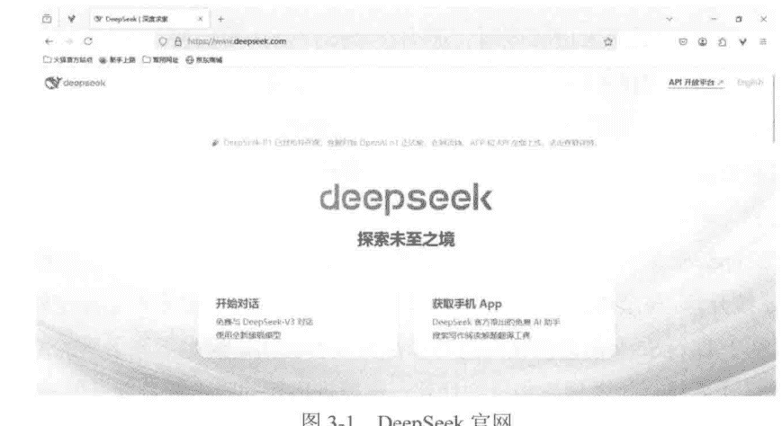

页面下方设两个按钮。点左侧“开始对话”会打开新页面，若未登录则跳转至登录页，如图 3-2 所示。


图 3-2 DeepSeek 登录页面

注册与登录共用同一界面，国内版目前仅支持手机号与微信。未注册手机号首次登录会自动创建。默认采用“验证码登录”，需填写手机号，区号默认为中国大陆 86，登录即表示已阅读并同意用户协议与隐私政策，建议仔细阅读后再操作，随后点“发送验证码”。收到短信验证码后填入并点“登录”即可进入主界面，如图 3-3 所示。


图 3-3 DeepSeek 主界面

也可使用手机微信扫右侧二维码注册，如图 3-4 所示。


图 3-4 DeepSeek 微信登录界面

若电脑已登录微信，系统会自动识别账号，可点“微信快捷登录”直接进入，如图 3-5 所示。


图 3-5 DeepSeek 微信快捷登录界面

注册成功后会提示“DeepSeek 申请使用你的头像、昵称”，点“允许”即可，如图 3-6 所示。


图 3-6 DeepSeek 申请使用头像和昵称

为保障账号安全，系统会要求绑定手机号，输入手机号与验证码后方可完成注册，如图 3-7 所示。

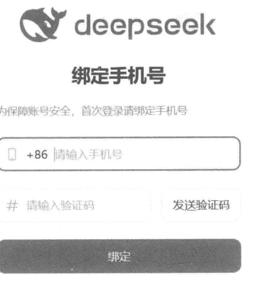

图 3-7 绑定手机号

绑定时需按提示完成验证，如图 3-8 所示。


图 3-8 注册验证

验证通过后点“绑定”即可跳转至主界面。

若不想用验证码登录，可选择账号密码注册。点击“密码登录”后于登录按钮右下方点“立即注册”，打开如图 3-9 所示的界面。

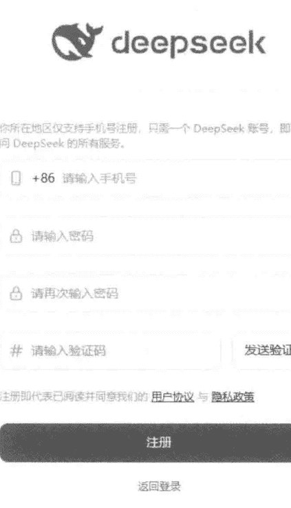

图 3-9 注册用户

随后输入手机号与密码，点“发送验证码”，收到验证码填入后点“注册”即可进入主界面。之后每次只需输入账号密码登录，开启使用之旅。

## 3.2 界面介绍与导航

在浏览器打开 DeepSeek 官网进入首页，如图 3-10 所示。左上角为 Logo 与名称，右上角为 API 开放平台及语言切换，支持中文与英文界面。


图 3-10 DeepSeek 官网

页面上方有一条最新资讯，点击可查看详情。下方有两个按钮，左侧“开始对话”进入交互页面；右侧“获取手机 App”悬停时会弹出二维码，手机扫描即可下载 App。

底部提供各版本 GitHub 地址、官网链接与用户文档等资源。

进入对话页后左侧为可收起的边栏，如图 3-11 所示。点击“打开边栏”可查看历史对话记录，如图 3-12 所示。


图 3-11 打开边栏

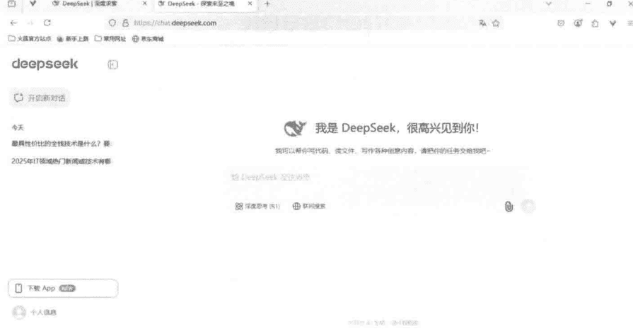

图 3-12 历史记录

边栏内含“开启新对话”、“下载 App”与“个人信息”入口。

在对话页输入框输入沟通内容，输入后输入框右下角的向上箭头会变为蓝色，点击即可交互，如图 3-13 所示。

例如输入“2025 年 IT 领域热门新闻或技术有哪些？”，点击后 DeepSeek 会自动生成答案，如图 3-14 所示。生成过程中箭头变为“停止”按钮，可中断生成。

我是 DeepSeek，很高兴见到你！

我可以帮你写代码、读文件、写作各种创意内容，请把你的任务交给我吧~

2025年IT领域热门新闻或技术有哪些？


图 3-13 输入文字

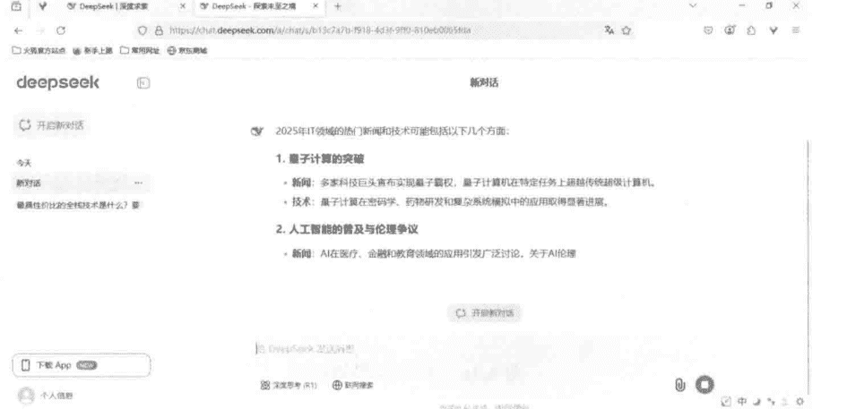

图 3-14 生成答案

答案生成后下方出现复制、重新生成、喜欢、不喜欢四个按钮，如图 3-15 所示。复制可将内容转为 Markdown 格式；不满意可点重新生成；满意可点喜欢给予正面反馈；多次不满意可点不喜欢。

系统会记录每次提问并综合分析。如需与之前问题脱钩，可点答案下方的“开启新对话”。

对提问不满意或回答中断，鼠标悬停于问题上方会出现复制与编辑按钮，如图 3-16 所示。

点击“编辑”会将原问题自动填入输入框，可再次提问，如图 3-17 所示。

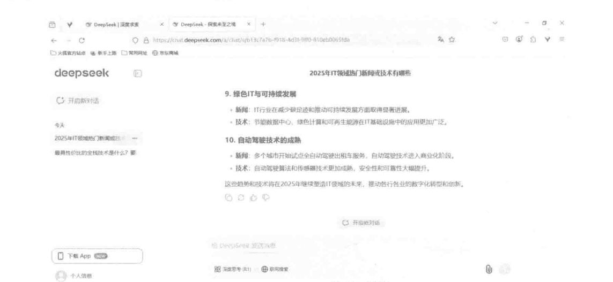

图 3-15 答案操作按钮


图 3-16 复制和编辑按钮

2025年IT领域热门新闻或技术有哪些

2025年IT领域热门新闻或技术有哪些


图 3-17 再次提问

此时点击发送，问题下方会出现提问次数标识，如图 3-18 所示。


## 3.3 增强功能

当前 DeepSeek 在线版本为 DeepSeek-V3，可通过深度思考或联网搜索提升问答效果，如图 3-19 所示。


在网页或 App 中点击“深度思考 (R1)”开启该模式，输入问题或任务后，模型基于海量数据进行深度剖析，逐步拆解问题并呈现详细的思维链过程与更精准的答案。

深度思考基于 DeepSeek-R1-Lite 模型，回答前构建内部思维链，借助强化学习与思维链技术显性化推理路径，分步分析后得出结论，如图 3-20 所示。

深度思考具备以下特点：

- 展示思维过程：除答案外还会呈现完整的分析论证链条，像剥洋葱般层层展开，让用户清晰看到“机器如何思考”。
- 擅长复杂问题：在复杂逻辑推理、数据分析、编程难题及深度创意工作上表现突出，能多维度全面剖析。
- 类人推理方式：具备自我质疑、回溯重想、假设验证等类人特征，遇到困惑时会“中断”思路。
- 学习研究：适用于数学定理证明、物理原理推导、编程逻辑设计等复杂学术问题，可辅助奥数练习、课题研究与科研探索。
- 创意写作：在小说、诗歌、文案策划等创作中帮助梳理情节逻辑、构建创意框架、挖掘主题深度。
- 数据分析：对市场数据、科研数据等进行深入分析，发现规律、趋势与潜在关联，为决策提供依据。

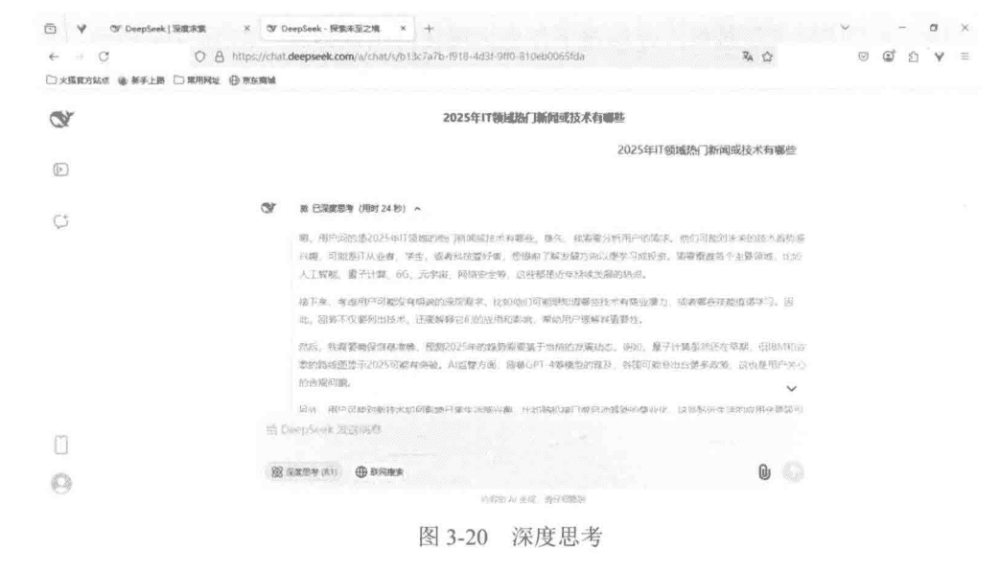

图 3-20 深度思考

- 复杂业务攻坚：可承接工作中出现的疑难业务与管理类问题，比如为大型项目拟定策划案、对企业发展战略进行拆解分析等。

该能力在不少应用场景下表现突出。

联网检索借助网络资源池，自动抓取提问中的核心词展开多向检索，能迅速获取时效性强的最新资料，例如新闻简报、股市行情、气象信息、赛事比分等，使用户在最短时间内拿到所需情报。

若问题较为复杂，提问时也能补充材料。点击上传入口，在弹出窗口中指定文件即可，见图 3-21。支持文档与图片格式，系统会自动识别内容并进行分析。


## 3.4 基本设置

在侧栏底部找到「个人信息」按钮，点击后展开下拉菜单，见图 3-22。进入「系统设置」会弹出设置面板，整体较为简明，分为通用配置与账号信息两大块，见图 3-23。


通用配置包含语言与主题两项，网页版目前提供中文、英文两种选择，也可选择跟随系统。主题有浅色与深色两种风格，可根据使用环境手动切换或自动跟随系统。

账号信息主要展示手机号、用户协议、隐私政策等条目，并提供注销账号入口，使用频次相对较低，见图 3-24。

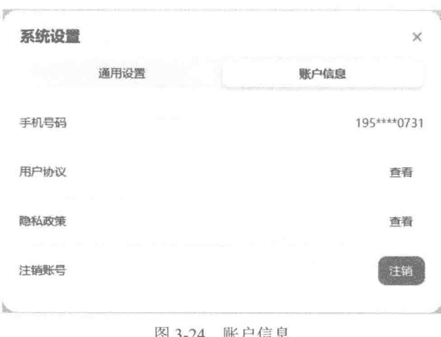

## 3.5 DeepSeek API 开放平台

DeepSeek 除在线使用外，还能嵌入第三方软件，这就需要用到 API 开放平台。

点击首页右上角的「API 开放平台」链接，需要重新登录。登录后进入开放平台主站，可查看当前账号 API Key 的使用情况，首次使用前需先充值。

在左侧导航中找到 API Keys 项并进入，在新页面点击「创建 API Key」按钮，见图 3-25。

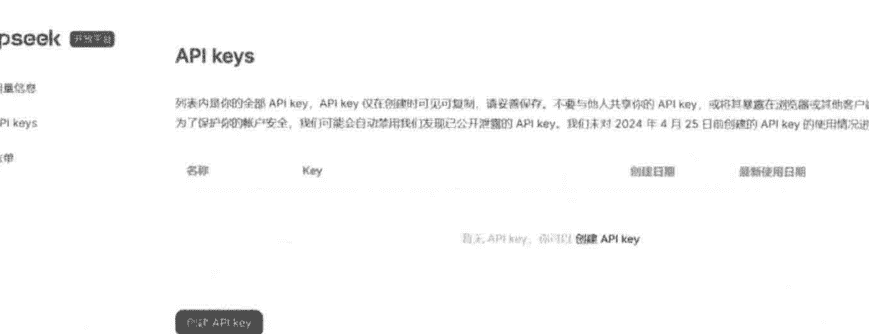

在弹出的对话框中填写 Key 的名称，点击「创建」按钮，见图 3-26。


图 3-26 创建 API Key 名称

随后会弹出新窗口展示刚生成的 Key，见图 3-27，需复制并妥善保存。

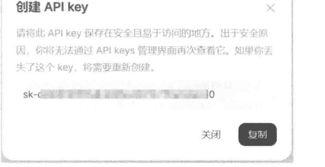

图 3-27 复制 API Key

创建完成后，页面会列出新生成的记录，见图 3-28，后续可在其他平台调用该接口。

### API keys

列表内是你的全部 API key，API key 仅在创建时可见可复制，请妥善保存。不要与他人共享你的 API key，或将其暴露在浏览器或其他客户端代码中。为了保护你的账户安全，我们可能会自动禁用我们发现已公开泄露的 API key。我们未对 2024 年 4 月 25 日前创建的 API key 的使用情况进行追踪。

| 名称 | Key | 创建日期 | 最新使用日期 |

|---|---|---|---|

| test—API | sk-d899f**********************ecd0 | 2025-02-10 | - |

图 3-28 创建完成

## 3.6 DeepSeek 本地部署

DeepSeek 的本地部署即 On-Premises Deployment，指将系统部署在企业或组织自有服务器或私有云环境，而非依赖第三方公有云。该方式在多种场景下具备明显优势。例如金融、医疗、国家安全等领域可将数据完全保留在本地服务器，避免公有云平台泄露风险。同时，本地网络可降低数据传输延迟，提升对实时性要求高的任务效率，如高频数据分析、实时决策。在 DeepSeek 上线初期，因并发访问过大系统频繁无响应，此时本地部署显得尤为必要。

当然优势明显的同时也存在成本问题，需要采购服务器、存储设备及网络设施并承担运维开销。搭建平台需要具备 IT 基础设施建设、安全防护及系统维护能力。因此是否本地部署需结合自身需求决定。

### 1. 安装 Ollama

Ollama 是一个开源的大模型服务工具，用于简化本地运行大语言模型的操作流程，降低使用门槛，让开发者、研究人员和爱好者能在本地快速试验、管理和部署最新大语言模型，包括 Llama 3、Phi 3、Mistral、Gemma 等开源模型。

访问 Ollama 官网下载 Windows 安装包，目前支持 macOS、Linux、Windows，见图 3-29。下载后为 .exe 可执行文件，双击即可安装。

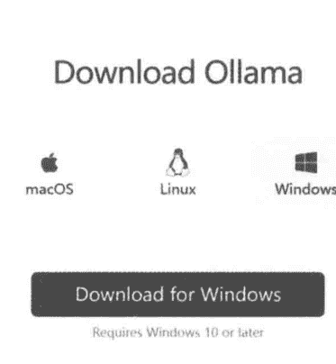

各平台默认的模型存储路径如下：

**Mac:** ~/.ollama/models。

**Linux:** /usr/share/ollama/.ollama/models。

**Windows:** C:\Users\%username%\.ollama\models。

在 Windows 下，Ollama 默认将模型下放到 C 盘，建议安装后先修改目录，否则 C 盘易满。右键「此电脑」，在菜单中选择「属性」，见图 3-30。

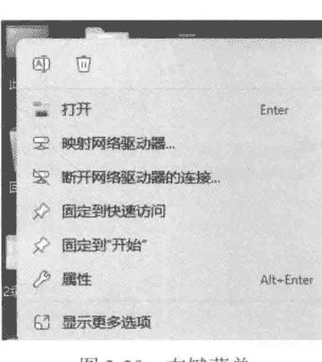

图 3-30 右键菜单

弹出「设置」窗口，见图 3-31，点击「高级系统设置」按钮。

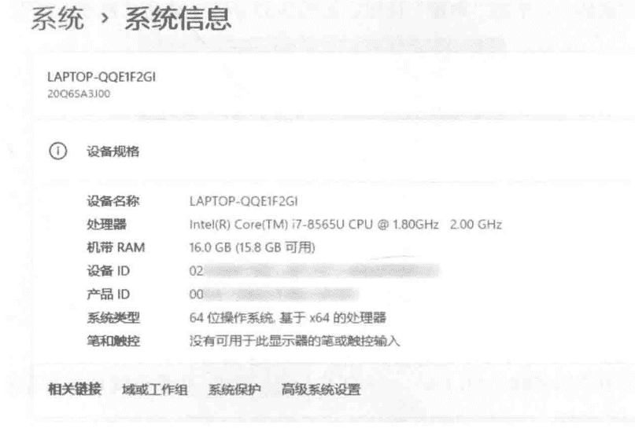

图 3-31 「设置」窗口

在弹出的「系统属性」窗口中，点击「环境变量」按钮，见图 3-32。

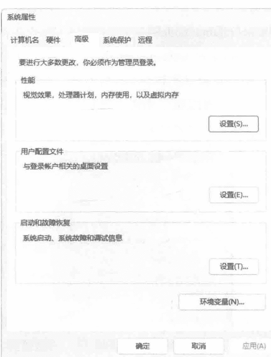

图 3-32 「系统属性」窗口

在系统变量区点击「新建」，见图 3-33，弹出「新建系统变量」对话框。

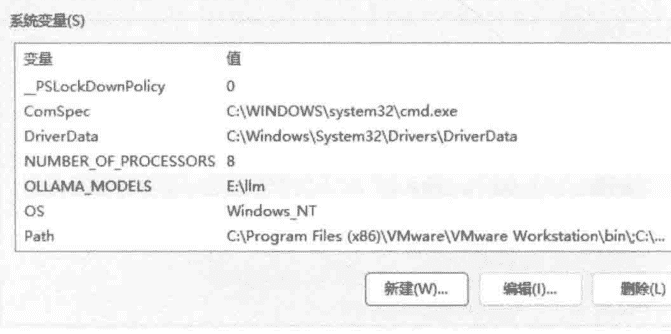

图 3-33 系统变量

在对话框中添加名称为 OLLAMA_MODELS 的变量，变量值即模型存放路径，最后点击「确定」，见图 3-34。


图 3-34 新建系统变量

接下来启动 Ollama。按 Win+R 打开「运行」对话框，输入 cmd，见图 3-35，回车打开 Windows 控制台。

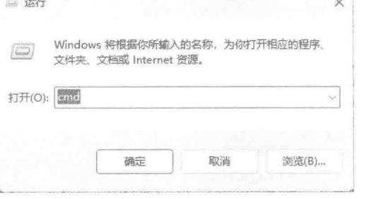

图 3-35 打开命令行窗口

在控制台输入启动命令：ollama serve，见图 3-36。启动后任务栏右侧会出现 Ollama 图标，若未出现请重启电脑，见图 3-37。

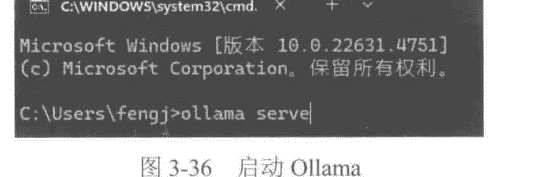

图 3-36 启动 Ollama


图 3-37 安装成功

至此本地 Ollama 已安装完成。

### 2. 模型下载

安装完成后会自动弹出命令行窗口，先不操作，返回 Ollama 官网，找到 Models 并点击。该页列出 Ollama 可兼容的大语言模型，见图 3-38。

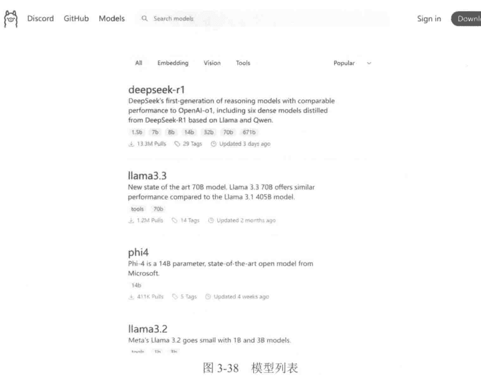

可选模型较多，可找到 deepseek-r1，也可在搜索框输入名称检索。点击条目可查看详情，不同模型执行命令不同，可按需选择。

DeepSeek-r1 提供多个版本，参数量越大模型通常越强，但也需更多算力，例如 1.5b 代表 15 亿参数。目前版本有 1.5b、7b、8b、14b、32b、70b、671b，按显存大小选择，见图 3-39。

选好后复制执行命令，返回刚才打开的命令行窗口，将命令粘贴后回车执行。

首次运行时会自动下载 7b 模型，见图 3-41。

### deepseek-r1

DeepSeek's first-generation of reasoning models with comparable performance to OpenAI-o1, including six dense models distilled from DeepSeek-R1 based on Llama and Qwen.

- 1.5b

- 7b

- 8b

- 14b

- 32b

- 70b

- 671b

13.3M Pulls Updated 3 days ago

执行命令

| 模型 | 大小 |

|---|---|

| 1.5b | 1.1GB |

| 7b | 4.7GB |

| 8b | 4.9GB |

| 14b | 9.0GB |

| 32b | 20GB |

| 70b | 41GB |

| 671b | 404GB |

```
ollama run deepseek-r1:7b
```

0a8c26691023 - 4.7GB

parameters 7.62B - quantization Q4_K_M

4.7GB

begin_of_sentence>, "<end_of_sentence>...

148B

{{ .System }}{{ end }} {{- range $i, $_ := .Messages...

387B

Copyright (c) 2023 DeepSeek Permission is hereby gra...

1.1KB

View all

Readme


图 3-39 DeepSeek 选择版本

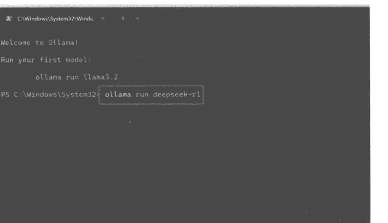

图 3-40 模型下载

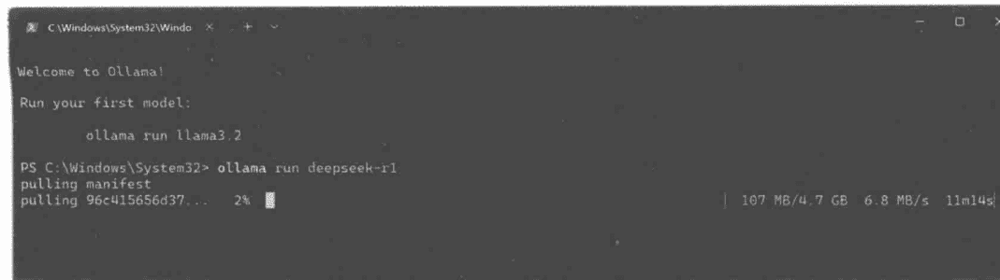

图 3-41 DeepSeek 下载中

等待下载完成，出现 success 表示安装成功。

对本地 DeepSeek 进行测试，输入：你是谁，应能看到回答，见图 3-42。

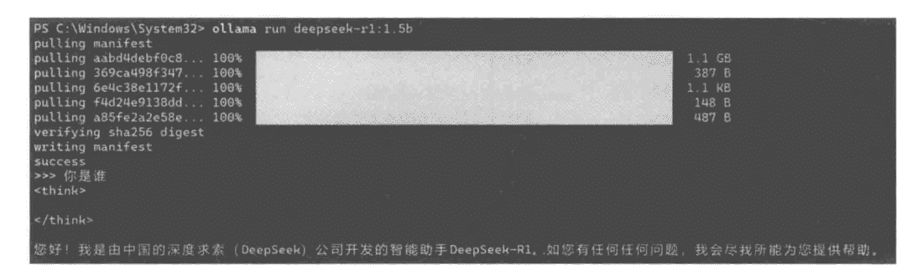

图 3-42 DeepSeek 测试

下载过程中若因网络不佳中断，可再次粘贴命令，会从断点继续下载。

## 3.7 更强大的文生图模型：Janus Pro

DeepSeek-R1 引发全民创作热潮后，不少人借助其实现创作梦想。与此同时，DeepSeek 推出了重磅产品 Janus Pro。Pro 之名源自 2024 年发布的 Janus 的增强版，专为提升多模态理解与视觉生成能力打造。相比前代，Janus Pro 在多方面得到优化：

- 改进训练策略，使学习更高效。
- 扩充训练数据，增强理解与生成质量。
- 扩大模型规模，提供更强表现力。

这些升级使 Janus Pro 在文到图生成和多模态理解方面显著提升，同时提高图像生成的稳定性和一致性。

Janus Pro 目前提供 7B 和 1.5B 两个参数规模版本，已全面开源。不少 AI 社区开发者认为其具备在消费级电脑本地运行的潜力，让更多用户可自由探索。尽管参数量不及超大规模模型，DeepSeek 团队通过数据增强大幅提升图像生成能力。例如预训练数据包含 7200 万张高质量合成图像，采用 1:1 的真实与合成数据比例，确保生成结果稳定多样。此外 Janus Pro 采用创新的双路径视觉编码架构，将理解与生成任务分开处理，缓解了视觉编码器在不同任务间的角色冲突，提高整体灵活性。在多模态理解方面，团队额外加入约 9000 万条训练样本，使其具备更强的图像识别与知识推理能力，进一步提升可用性。

## 3.8 手机版本

DeepSeek 官方同步提供手机 App，可从官网首页或应用商店下载，见图 3-43，以安卓为例。

安装后打开 App，即可看到主界面，见图 3-44。

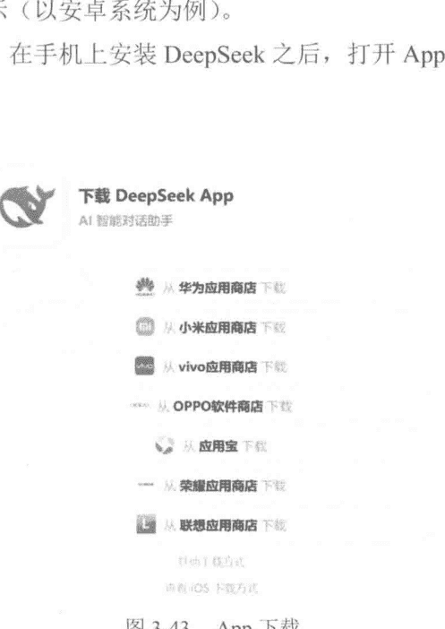

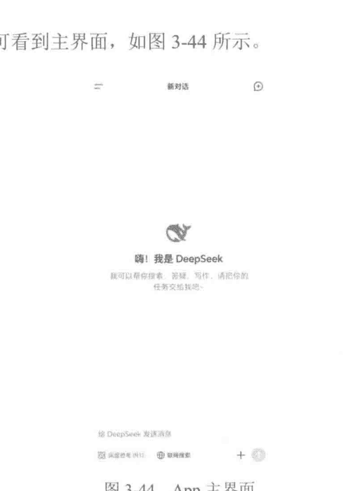

# 零基础玩转国产大模型 DeepSeek

手机版与网页版使用逻辑基本一致，可点下方「+」按钮上传图片或文件，也可使用语音输入，支持中英文混合输入，见图 3-45。

网页端与 App 端共用同一账号，历史对话会自动同步，间隔约 1 分钟。在 App 端向右滑动可查看历史记录，未完成的对话可在网页端继续，见图 3-46。


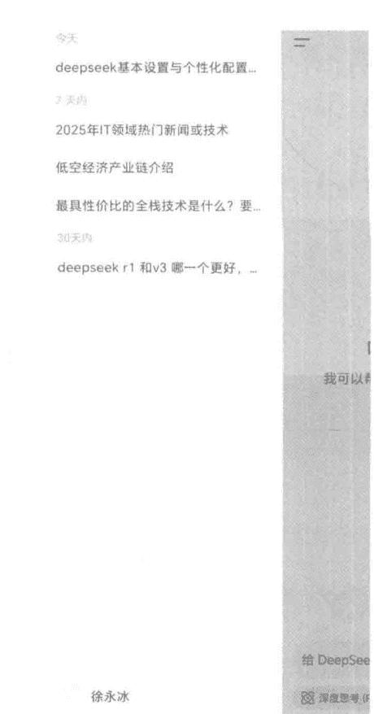

图 3-45 App 输入功能选项

图 3-46 App 历史记录查看

# 第4章 编写 DeepSeek 提示词

与 DeepSeek 交互时，提示词相当于开启有效沟通的钥匙。简言之，提示词即输入给 DeepSeek 的文本，承载需求、指令与期望，引导其生成对应内容。

当希望 DeepSeek 完成写作、解答复杂问题或创意创作时，提示词是传达意图的关键媒介。它决定模型理解问题的方向，以及最终输出的质量与相关性。可以说，精准有效的提示词是发挥 DeepSeek 强大功能的核心要素。

本质上，提示词是我们与 DeepSeek 之间的语言桥梁。DeepSeek 基于海量数据训练，具备强大的语言理解与生成能力，但需要明确引导才能准确回应。例如输入「给我讲个故事」这样宽泛的指令，模型虽能生成故事，但在主题、风格、情节上不确定性很大。若改为「以古代仙侠世界为背景，创作一个主角从平凡少年成长为一代剑仙的冒险故事，故事中要包含激烈战斗、神秘法宝以及感人师徒情谊，字数在 2000 字左右」，DeepSeek 就能更精准把握期望，生成更符合要求的作品。

在实际应用中，提示词的作用体现在多方面。内容创作领域，无论是商业文案、学术论文还是文学作品，合适的提示词能为模型提供清晰框架与方向，使生成内容更具逻辑、连贯与针对性。问题解答方面，准确的提示词能帮助模型快速定位核心，提供全面答案，避免答非所问。创意启发上，独特的提示词还能激发模型的创造力，为用户带来新思路，帮助突破思维局限。因此，掌握编写有效提示词的方法与技巧，对充分发挥 DeepSeek 的价值至关重要。

## 4.1 基础技巧：搭建有效沟通的基石

### 4.1.1 明确目标，有的放矢

编写提示词前，明确自身目标至关重要。不同任务需要不同类型的提示词来引导 DeepSeek。例如希望它帮助撰写一篇关于人工智能发展趋势的文章，简单输入「写一篇文章」显然不够，模糊的提示词会让模型难以确定主题、重点和方向，最终内容可能无法满足需求。

若输入「撰写一篇约 3000 字，关于人工智能未来五年发展趋势分析的文章，需涵盖技术突破、应用场景拓展以及对社会经济的影响，并引用至少三个权威研究报告的数据作为支撑」，这样明确的提示词能让 DeepSeek 清晰了解需求，从而生成更具针对性和深度的文章。

同样，在解答问题时，明确问题核心和期望答案类型也很关键。比如「如何提高学习效率」这个问题缺乏具体背景，模型回答会比较宽泛。但改为「我是一名高中生，每天晚上学习时间有限，如何在有限时间内提高数学和英语这两门学科的学习效率，给出具体的学习方法和时间分配建议」，就能引导 DeepSeek 提供更贴合实际情况的解决方案。

# AI五年变局：技术狂飙、场景爆发、社会重塑

### 引言
人工智能正引领新一轮技术浪潮，以极快的节奏改写产业与生活规则。2025到2030这五年，被业界视为从模型突破到大规模落地的关键窗口。技术演进、场景打开、经济社会效应将同步展开。本文结合世界经济论坛、中信建投、MarketsandMarkets、麦肯锡等权威研报，对未来五年的发展脉络做一次系统梳理。

### 一、技术跃迁：从通用到多模态与端侧
这波技术升级的核心，是模型能力、算力位置和数据效率的三重提升。

多模态大模型走向主流。文本能力之外，图像、视频、语音融合推理成为主流方向。GPT-5 等新一代模型通过强化学习把推理能力拉满，在医疗辅助诊断、工业设计等专业领域的可行性大幅提升。世界经济论坛的判断是，到2028年多模态技术将撬动生成式内容市场，规模有望达到3560亿美元，成为创新最活跃的主战场。

算力下沉，端侧智能快速崛起。随着物联网设备爆发，算力中心从云端向边缘迁移。端侧处理可以降低时延、强化隐私，更适合智能家居、实时自动驾驶等人机交互场景。市场数据显示，中国边缘AI市场预计在2027年突破1.3万亿元，本地化推理将成为标配。

合成数据与模型降本提效同步推进。真实数据受隐私与稀缺性制约，中信建投研报指出合成数据已能突破样本限制，加速训练并降低成本，在医疗影像模拟、自动驾驶测试场景中作用关键。DeepSeek R1 等低成本模型出现，也让AI能力能够下沉到中小企业和新兴市场，应用门槛持续降低。

### 二、应用破圈：垂类深耕与智能体上岗
技术突破后，应用正从通用试水转向垂直行业深耕，并催生新形态协作。

垂类AI市场进入爆发期。MarketsandMarkets预测，垂直AI应用规模将从2024年的51亿美元飙升至2030年的471亿美元，年均增速达44.8%。金融借助生成式AI优化风控与投顾，医疗依托IBM Watson类系统提升诊疗效率，教育出现松鼠AI式的个性化学习方案，行业适配度不断提高。

智能体开始替代重复性工作。人机协作从辅助进入分工阶段。深圳福田区政务大模型2.0已上线70名AI数智员工，承担行政审批、咨询答复类任务。安恒信息的安全智能体体系通过实时监测网络威胁，提升防御效率。业内普遍预期，到2030年约80%的重复性工作会被智能体覆盖，人类工作重心转向创造与决策。

低空和自动驾驶加速商业化。人形机器人被视为2025年的元年，特斯拉、波士顿动力等机器人在工厂场景的落地验证了这一判断。交通领域，Robotaxi预计在2028年实现规模化运营，推动城市交通管理智能化，低空飞行器与自动驾驶共同构成未来出行新图景。

### 三、社会经济：红利与挑战并行
AI扩散带来的效率增益显著，但结构性问题同步显现。

生产力跃升带动经济增长。世界经济论坛报告显示，率先拥抱AI的企业收入增速比同行高出15%，到2026年这一差距可能进一步扩大。生成式AI被认为有望为全球GDP贡献约1.5万亿美元增量，尤其在电商与制造业供应链优化环节作用突出。

就业结构被重塑，技能迁移提上日程。自动化预计会挤占约30%的传统岗位，但同时创造新需求。麦肯锡研究指出当前全球AI落地进度仅完成25%至30%，劳动力转型空间巨大。AI运维师、数据伦理师等新职业需求快速攀升，培训体系成为关键瓶颈。

社会治理与伦理压力加剧。数据隐私、算法偏见、透明度不足等问题持续发酵。《人工智能法案》以风险分级推动全球监管共识，中国《生成式AI服务管理办法》也在强化服务合规。教育公平、公共安全等领域的AI应用，需要在效率提升与公平保障之间找到平衡，例如用AI缩小城乡教育资源差距。

### 四、前瞻：协同治理是关键
技术红利与风险并存，必须构建技术、伦理与政策协同框架。

研发端要强化多模态与绿色AI投入，例如微软无碳数据中心方向的探索。合作层面，需跨区域共建可持续AI基础设施，缩小数字鸿沟。治理层面，完善隐私保护和算法透明度法规，明确责任边界，才是普惠落地的保障。

### 结语
未来五年，人工智能将从实验室走向产业融合与社会重构。万亿级市场潜力释放的同时，伦理治理、人才培养与国际协作决定成败。只有在理性监管与开放合作下，AI才能真正成为推动人类文明进步的普惠力量。

## 英国工业革命：一场改写世界秩序的裂变

## 一、为何是英国率先引爆
18世纪中叶的英国工业化不是一夜之间的奇点，而是多条历史线索交汇的必然结果。
农业先行一步，16到18世纪的圈地运动把分散的小农场整合为集约经营的庄园，粮食产量提升的同时把大量失去土地的农民推向城镇，为工厂提供廉价劳动力，也以余粮支撑人口增长。海上扩张带来的原始资本同样关键，东印度公司等特许贸易机构以及三角奴隶贸易累积的巨额财富，成为早期机器研发和建厂的启动资金。得天独厚的资源禀赋提供了硬条件，英格兰北部的煤矿与铁矿在相对近距离内共存，让蒸汽与炼铁得以低成本展开。政治层面，光荣革命后确立的君主立宪与专利保护制度，给发明者以法律保障，稳定环境吸引资本进入实业。思想层面，牛顿力学的普及与培根倡导的实验方法，让技术从经验走向可复制的实用创新。

## 二、从纺纱到蒸汽的技术链式反应
工业革命首先在纺织业点燃，随后通过动力与冶金扩散为全体系变革。
### 1. 纺织机械
1764年哈格里夫斯推出珍妮纺纱机，把一台纺车的锭数从8提升到80；1769年阿克莱特据水流设计的并列纺纱机实现流水线生产；1779年克朗普顿的骡机兼收前两者之长，纱线品质与产量同步跃升。
### 2. 动力革命
1712年纽科门造出用于矿井排水的蒸汽机，解决地下积水难题；1769年瓦特发明分离冷凝器，把热效率提高约4倍，让蒸汽机从作坊走向工厂；1804年特里维西克的高压蒸汽机足够轻便，首次被装上铁路轨道。
### 3. 冶金与交通
1709年达比父子用焦炭替代木炭炼铁，打破燃料瓶颈；1784年科特的搅炼法让熟铁的大规模生产成为可能；1814年斯蒂芬森制造实用蒸汽机车，1830年利物浦—曼彻斯特铁路通车，标志运输革命开启。
### 4. 生产组织革命
1771年阿克莱特在克罗姆福德建起水力纺纱厂，工人集中、工序分工、机器代替手工，家庭作坊被工厂制度取代。

## 三、社会肌理被彻底重写
### 1. 生产力跃升
1770到1830年间英国工业总产出增长约三倍，1800年棉纺品出口占全国出口的半壁江山，生铁产量从1740年的2万吨飙升至1850年的250万吨。
### 2. 城市化与社会重构
曼彻斯特从1770年的2.5万人膨胀到1851年的40万人，全国城镇人口占比由1750年的25%升至1850年的50%。工业资产阶级与无产工人阶级的对立愈发尖锐，1832年议会改革开启政治权力再分配。
### 3. 全球贸易霸权确立
1815年后英国自称世界工厂，《航海条例》掌控海上贸易，1816年金本位奠定金融秩序，1846年废除《谷物法》推行自由贸易，并以鸦片战争强行打开中国市场。
### 4. 社会问题显现
工厂普遍实施每日14小时工时，1833年棉纺业一半劳动力为童工，1842年曼彻斯特工人平均寿命仅17岁，恩格斯《英国工人阶级状况》记录了残酷的剥削现实。

## 四、对全球体系的冲击与重塑
### 1. 技术扩散与追赶竞赛
1834年比利时人科克里尔在英引进设备，建起欧洲大陆首个工业区；美国斯莱特于1790年窃取纺织机技术，惠特尼1793年的轧棉机推动南方种植园经济；1871年统一后的德国依托鲁尔煤炭展开赶超。
### 2. 殖民经济体系强化
1820至1840年间印度手工棉布被机器布冲垮，埃及被迫转型为英国棉花的原料供应地。
### 3. 世界分工体系形成
以英国为核心、欧洲大陆为半边缘、亚洲非洲拉美为边缘的三层分工确立，全球化1.0版本由此展开。
### 4. 意识形态冲击波
亚当·斯密1776年《国富论》确立自由主义经济学主导地位，马克思在机器大生产中提炼剩余价值理论并于1867年出版《资本论》，环境代价亦初现，伦敦1873年的空气污染致700人死亡为首次有记录的大规模死伤。

## 五、文明转型的历史坐标
工业革命让人类首次摆脱马尔萨斯人口陷阱，却也开启了化石能源依赖、生态失衡与全球不均的现代困局。人类经济形态从有机经济转向矿物经济，其波及范围远超新石器时代农业革命。英国经验表明，技术突破必须与制度完善和社会公平同步推进，才能避免进步的代价被少数人承担，这对当下的创新仍具警示意义。

问界M9靠着华为的技术背书、清晰的市场切入点以及全套豪华配置，在50万元以上的细分赛道里站到了领先的位置。智能座舱的互动感和车内空间的宽适感，是它最被用户认可的两大卖点。

同时，产品也暴露出明显短板。智驾功能的实际使用率偏低，续航表现还有提升空间，再加上定位偏高的价格策略，客观上劝退了一部分潜在买家。

想把现有优势持续放大，后续需要在技术迭代上保持节奏、把使用体验做得更顺滑，同时通过产品线下探来扩大覆盖面。竞争层面也不容忽视，小米、方程豹等品牌的发力正在给高端阵营带来更大压力。

作为华为跨界造车的重要代表，问界M9既是中国智能汽车向上突破的缩影，也为行业示范了“技术+生态”融合落地的可行路径[1][5][9]。

用红楼意境打磨古风场景

要写出接近《红楼梦》韵味的文字，细节的考究最为关键。人物称谓建议使用双字雅号，与宝玉、黛玉的风格相近，比如可选用云鹤、逸梅、青梧之类的名字，彼此间的称呼要谦和有礼。雅集的描写里最好穿插些诗句对联，联句或即兴吟诗是原著常见的助兴手段，借助碎玉喻笑声、流水喻琴音的比喻手法，能让画面更生动。深层需求是让情境可信且充满古典气息，因此要细写环境、服饰、动作与情绪互动，像夕阳、花影、竹帘、石案等意象来营造雅致氛围。行文切忌使用今口语，语言要流畅，用词要典雅，结构要有起承转合，先写景迎人，再写人物到场、活动展开，最后以余韵收束带点感慨，就像红楼收尾的留白。

秋夜聚会小记

重九过后的第三天，我在蘅芜榭邀了几位知己小聚。晚霞透进碧纱窗，残荷间还氤氲着金桂香。眼前是这样的景致：湘帘半卷，归燕入室；竹影斜移，映在石苔上。青瓷盏里浮着雪白的泡沫，紫檀案上摆着山珍海味。

首先是云鹤带来了新酿的菊花酒。酒盛在翡翠壶里，倒入杯中色如琥珀。青梧笑着说，这么好的酒该配点野趣，随即让人折来几枝丹桂，斜插进青玉胆瓶，室内顿时甜香四溢。

随后环佩声响起，是逸梅带着琴来了。她穿着月白绫袄，外面套了藕荷色比甲，鬓间斜插一朵秋海棠，走动间如弱柳扶风。她把焦尾琴搁在膝上，轻抚几下便流出《平沙落雁》的曲调。众人听得入神，逸梅掀帘笑道，这样的雅集怎能少了诗书助兴。

话音未落，侍女已奉上薛涛笺和犀管狼毫。青梧略作沉吟，提笔写下冷月葬花魂五个字，众人鼓掌称妙。逸梅嗔道，好好的秋夜偏写这种凄清的句子，说着自己取了一张笺，写下金风荐爽玉露香。正好窗外有雁阵掠过，王蔼拍案说，这金风二字正应了天时。

酒过三巡，场面是：烛影摇红，人面微醺；茶烟袅碧，琴音幽远。残棋半局尚可续弈，锦瑟无端五十弦。

更漏响了三下，夜已深。青梧靠着攒金绣枕叹道，这等良辰真如白驹过隙。云鹤指着案上的残菊笑道，花开花落各有时，聚散离合皆有定数。众人随即沉默。只有王蔼把余酒倒进池中，月影碎成千片银鳞，恍惚如大观园里那些未了的情缘。

### 4.2.3 设置限制条件，精准把控输出

若想避免输出过于宽泛或偏离预期，设定限制条件是重要技巧。限制可以从字数、内容范围、语体风格、受众等维度入手。

比如要一篇旅游稿件，不加限定容易写得很长且面面俱到。若明确要求：写一篇八百到一千字的云南大理游记，侧重自然风光与特色美食，语言轻松活泼，适合旅游类社交媒体发布。那么生成内容就会在字数内聚焦主题，并采用合适的语调。

在专业场景里限制更关键。法律文书必须符合法规与行业规范，技术文档要表述准确严谨，避免模糊或夸张的用语。合理设限能让生成结果更贴合需求，提升效率与质量。

> 请用英文为在华的外国游客写一篇约两百词的大理游记，着重介绍自然景观与地道美食，语气轻松活泼，适合旅游社交媒体，要求为英文输出。

好的，用户的需求是为在华的外国人撰写一篇关于云南大理的旅游短文，重点是自然风光与特色美食，风格要轻松活泼，适合社交媒体，语言为英文。首先要明确目标读者是居住在中国的外籍人士，内容要兼顾吸引力与实用性。自然景观方面，洱海、苍山、三塔是核心吸引点。美食方面，乳扇、砂锅鱼、喜洲粑粑等最具代表性。结构上可以用吸睛标题开头，先用感叹句引出兴趣，再分自然与美食两块展开，最后给出交通提示与行动号召。语言上要口语化，使用表情符号和短句，增强互动感，同时控制在两百词左右。

Dali: Nature Whispers & Flavors Pop! 🌿🍜

Hey explorers! Craving a hidden gem? Dali, hugged by Erhai Lake and Cangshan peaks, serves soul-soothing views and foodie fun!

Cycle the azure shores of Erhai, wind in your hair with snow-capped mountains waving hello. Trek misty Cangshan trails, then sip tea in a Bai village—the Three Pagodas glow gold at sunset. Pure magic! 🚲✨

Food time! Rushan cheese rolls with rose jam—crunchy, sweet, Insta-perfect. Warm up with steaming Xiayou hotpot, fresh lake fish with wild mushrooms. Don’t miss Xizhou baba, flaky sesame bread you’ll want to hug the baker for! 🍲😋

Pro tip: Hang at the weekend market, locals’ smiles match the tie-dyed fabrics.

Pack your bags—Dali’s calling! High-speed train from Kunming makes it easy! 🚄💨

#DaliDiaries #EatPlayLoveYunnan #HiddenGemChina

## 4.3 高级技巧：挖掘 DeepSeek 潜力的秘诀

### 4.3.1 分步引导，攻克复杂任务

面对复杂任务时，把提示拆成多步会更有效。比如制定一个大型项目的策划方案，若一次性要求完整方案，容易显得空洞。可先要求分析项目目标与受众，列出主要目标与人群特征，再据此提出三到五个主题与初步活动形式，随后为每个主题细化执行步骤、时间与分工，最后整合为完整策划大纲，包含概述、目标、主题、步骤、预算等板块。

分步推进让每步更聚焦，最终整合出高质量方案。此法同样适用于论文撰写、数据分析等复杂工作，有助条理化推进。

> 我是大学生社团成员，想做一个关于大语言模型的演讲，向同学普及课外知识，请帮我生成一个 PPT 大纲。

好的，用户是一名学生，需要在社团活动上做一个关于大语言模型的演讲，目标是为大学生扩展课外知识。首先明确需求。用户希望内容既有深度又易懂，适合非技术背景听众。PPT 大纲需要结构清晰，逻辑连贯，从基础概念到应用再到未来展望。考虑到学生群体，可能希望内容更生动，加入互动或案例，避免枯燥术语。用通俗语言解释复杂概念，结合大家熟悉的应用如 ChatGPT，加入伦理和社会影响引发思考。结构上采用引言、主体、结论，主体分概念、技术原理、应用、挑战、应对。加入互动提问、小测验、分组讨论增强参与感。还可建议视觉化设计、节奏控制等。

标题页
主题：大语言模型：AI 如何学会“说话”
副标题：从 ChatGPT 到对话革命
视觉：AI 对话气泡与代码交织

Part 1 引言：AI 的语言觉醒
1.1 互动提问
你用过 AI 写作业或改简历吗？现场举手统计
猜猜 AI 写一首诗需要几秒？展示生成示例
1.2 现象案例
用西游记版星巴克点单搞笑对比
2010 年 Siri vs 2024 年 GPT-4 流畅度对比

Part 2 核心知识拆解
2.1 什么是大语言模型
类比：超级文字乐高，拆解数十亿语料积木重组知识
关键三要素：海量数据、Transformer 架构、算力引擎
2.2 技术原理极简版
猜词游戏引出概率预测概念
注意力机制漫画比喻
2.3 训练流程揭秘
预训练填字游戏、微调模拟考试、RLHF 人类打分
能耗对比数据

Part 3 现实与未来
3.1 应用场景
学术助手文献速读演示
创意伙伴赛博朋克版李清照诗词案例
争议边界 Deepfake 语音诈骗新闻
3.2 挑战思考
伦理辩论：AI 通过图灵测试是否该有“人权”
就业冲击数据

Part 4 大学生如何应对
技能升级：从重复写作到批判性提问
工具推荐清单附二维码
跨学科机会：AI+人文案例

结尾页
金句：AI 是放大镜，照见想象力边界
互动彩蛋：扫码生成专属 AI 口头禅
Q&A 预留尖锐问题

设计建议：视觉化、每 15 分钟插入互动、推荐延伸阅读

### 4.3.2 角色扮演，定制专业输出

为模型设定特定角色能获得更专业、针对性的结果。撰写法律分析报告时，可设定你是一位从业二十年的商业法律资深律师，请对具体案例进行深度分析，包含核心法律问题、相关条文应用、可能判决及企业风险提示，格式符合法律专业报告规范。模型会从律师视角用专业语言输出。

同理，市场营销可扮演资深营销专家，教育可扮演优秀教师设计方案。通过角色扮演，模型更易模拟领域思维，提供贴合实际需求的内容。

> 你是一个设计师，如果让你设计一款降噪耳机，你会考虑哪些要素？

好的，作为设计师，我需要从技术、体验与美学多维度思考降噪耳机的要素。用户可能关注降噪效果、佩戴舒适度、音质、续航、连接稳定性、外观、操作便捷性、兼容性、价格、附加功能等。还需要考虑重量、耳塞材质与尺寸、环境音模式、App 支持、耐用性与售后。设计需要平衡各要素，在预算内实现最佳体验。

设计一款降噪耳机的核心考量要素框架如下：

维度：降噪性能
核心要素：主动降噪技术、被动隔音
设计要点：混合式降噪、前馈加反馈麦克风、多频段调节、自适应模式；人体工学耳塞、多种硅胶或记忆棉耳套、密闭结构优化
用户价值：消除交通办公噪音，提升沉浸感，增强隔音减少耳压

维度：音质表现
核心要素：音频硬件配置、降噪与音质平衡
设计要点：高解析动圈或动铁单元、LDAC/AptX HD 编码、App 可调 EQ 预设；独立声学腔体、算法与解码协同调校
用户价值：声音清晰层次感，满足音乐影视需求

维度：舒适性
核心要素：佩戴体验、交互友好性
设计要点：轻量化单耳不超过 5 克、耳挂或耳塞可选结构、泄压孔；触控或物理按键简化、佩戴检测自动暂停
用户价值：长时间佩戴无负担，操作学习成本低

维度：续航与连接
核心要素：电池性能、连接稳定性
设计要点：单次续航不低于 8 小时降噪开启、10 分钟快充两小时使用、无线充电盒提供 24 小时续航；蓝牙 5.3 多设备切换、低延迟游戏模式、抗干扰天线
用户价值：解决续航焦虑，设备无缝切换

| 外观个性化 | 1. 视觉设计 | - 可选极简流畅或未来科技感造型<br>- 配色体系丰富，涵盖基础色与限量渐变款式<br>- 腔体半透明，局部元件外露提升科技氛围 | 契合年轻用户追求潮流与自我表达的需求 |

| | 2. 定制服务 | - 支持通过App调节触控交互方式<br>- 限量版可激光刻印姓名或图案 | 增强人与产品的情感联结 |

| 智能功能 | 1. 场景模式 | - 通透模式可调节环境音强弱<br>- 运动模式强化低频并优化降噪表现<br>- 睡眠模式提供白噪音 | 适配办公、运动、睡眠等多种使用场景 |

### 4.3.3 迭代优化，追求完美结果

迭代优化是提升 DeepSeek 输出质量的关键路径。拿到初次结果后不要立刻结束对话，要细致评判是否符合预期。若有不足，可据此调整指令，通过补充细节、转换语气、明确格式等手段进行优化。

以张家界景区的宣传文案为例，首次指令仅是“撰写张家界旅游景点的宣传稿，突出其独特风景”，得到的内容在感染力和特色描写上不够突出。优化后可改为“请用饱满激情且富有感染力的语言撰写张家界旅游景点的宣传稿，着重描绘如梦似幻的奇峰异石、幽深峡谷与壮阔云海等标志性景观，语言生动形象并融入游客真实感受，激发强烈向往，字数约800字”。

经此调整，模型能更精准理解创作意图，产出更优质的宣传稿。实际使用中往往需要多次反复才能满意，每一次优化都是与模型更深入的沟通，有助于挖掘潜力并获得更合心意的产出。

> ❶ 从本节起，书中不再展示完整的思维链过程。

撰写张家界旅游景点的宣传稿，突出其独特风景。

已深度思考（用时 33 秒）

# 张家界：云端山水画卷，亿年地质史诗

若问人间何处近似仙境，多人会指向张家界。

数千峰林拔地而起，八百溪流穿谷而行，雾气在石柱间流转如河，阳光为砂岩镀上金边。亿年地质运动与风雨雕琢，让这片湘西秘境成为《阿凡达》取景灵感，也被誉为中国山水画的源头。

1. 千峰擎天，视觉冲击极致
在张家界国家森林公园，超过三千座石英砂岩峰林近乎垂直耸立，似剑指苍穹。乾坤柱以1074米之姿刺破云层，为哈利路亚山原型；天子山御笔峰在晚霞中挥毫，十里画廊的采药老人与三姐妹峰在光影里演绎自然拟态。乘百龙天梯一分五十八秒直达山顶，或漫步金鞭溪，每一步都在刷新对奇险幽秀的认知。

2. 天门洞开，云端极限之诗
海拔1518米的天门山以高131.5米、宽57米的天然穿山洞口著称。九十九道弯的通天大道如玉带环山，玻璃栈道悬于千米绝壁，全球最长高山客运索道长7455米，将云海峰林尽收眼底。翼装飞越洞口的瞬间，人与自然共同书写惊艳浪漫。

3. 大峡谷玻璃桥，心跳丈量天空
横跨两崖的张家界大峡谷玻璃桥刷新了工程与胆量的边界。行走于全透明桥面，脚下是深谷激流，身旁是掠崖飞鹰，云雾拂过脚踝时恍若漫步天际。此桥不仅考验心率，更让人饱览峰林与原始次生林交织的生态奇观。

4. 云雾变幻，四季皆呈不同盛景
● 春：峰林披翠，珙桐于溪畔绽放，雾纱轻拂山腰。
● 夏：瀑声轰鸣，金鞭溪成天然氧吧，夜有萤火点亮峡谷。
● 秋：天子山五彩林海与金峰构成油画境地。
● 冬：雪覆奇峰，冰挂与云海共舞如水墨丹青。

5. 土苗风情，山水间的千年故事
在袁家寨感受土家族西兰卡普织锦的温度，于溪布老街品尝腊肉与三下锅。夜幕下，《天门狐仙》以峡谷为幕、星河为灯，以湘西巫傩文化与爱情传说为山水注入灵魂。

# 张家界出行锦囊

✦ 必玩：黄石寨看云海、杨家界探天然长城、宝峰湖泛舟。
📷 拍摄点：老屋场日出、天子阁日落、迷魂台云瀑。
🌿 生态：珙桐、大鲵、猕猴等珍稀物种构成原始秘境。

当喧嚣被群峰隔绝，当双脚悬于云端栈道之上，当光束穿透天门洞映在脸上，你会明白，张家界的山水不是风景，而是时光以石为笔写给人类的震撼情书。

此刻，你与神话只差一张车票。

（门票预约/定制行程咨询：[官方链接]）

撰写一篇充满激情和感染力的关于张家界旅游景点的宣传稿，着重描绘张家界如仙境般的奇峰异石、幽深峡谷以及壮阔云海等独特风景，使用生动形象的语言，融入游客的情感体验，让读者产生强烈的向往之情，字数在 800 字左右。

已深度思考（用时 33 秒）

# 张家界：仙境可达，峰峦入云

是否想过走进一幅活的水墨？

张家界正是大自然亲笔的作品。

数千奇峰拔地而起，八百秀水蜿蜒流转。
一眼心动，一步入境。

# 独一无二的奇观，值得此生一见

- 天门山：天门洞巍峨耸立，云雾缭绕仿若通天之门。乘坐全球最长高山索道俯瞰群山，尽享一览众山小的壮阔。
- 袁家界：《阿凡达》悬浮山的原型，乾坤柱直插云霄，宛若外星奇景。
- 金鞭溪：溪水清澈映奇峰，漫步其间如入流动山水画。
- 玻璃桥：横跨峡谷，脚下万丈深渊，每一步都心跳加速，却是最佳全景观景台。

# 四季之美，各有韵味

- 春：山花烂漫，云雾如纱，仙境初醒。
- 夏：绿意盎然，溪水清凉，是避暑好去处。
- 秋：层林尽染，红叶点缀峰林，如诗如画。
- 冬：雪衣覆盖，静谧圣洁。

# 不止风景，更有文化温度

- 土家族风情：走入山寨体验民俗，品尝地道美食，聆听古老歌谣。
- 天门狐仙：夜幕下实景剧将神话与自然融合，震撼人心。

# 为何选择张家界

- 世界级地质奇观：世界自然遗产，独一无二的石英砂岩峰林。
- 交通便利：高铁直达，景区设施完善。
- 全龄友好：徒步、摄影、亲子、文化体验皆可满足。

# 来张家界，遇见另一个自己

站在云端感受渺小与壮阔，穿越峡谷聆听风与山的对话，放下喧嚣回归内心宁静。

## 4.4 常见误区与应对策略

### 4.4.1 提示过于宽泛，指向不清

使用 DeepSeek 时，若提示词过于笼统，模型难以把握具体需求，输出常与期望偏差。如“给我写一篇文章”，模型无法判断主题、体裁、受众、字数等关键信息，结果多为泛泛而谈。解决办法是明确限定范围，例如：“撰写一篇约1500字的议论文，讨论人工智能在教育领域的应用现状、挑战与趋势，结合案例分析并在结尾给出融合前景观点。”清晰指令才能带来贴合期望的文本。

### 4.4.2 关键细节缺失，导致偏离

即便方向明确，缺少核心细节仍会造成偏差。如仅说“设计公司团建方案”，缺少预算、人数、时间、员工偏好、文化等信息，方案易不切实际。应补充细节后优化为：“为[公司名称]设计预算5万元内、200人参与、周六一天的团建方案，员工25-40岁偏爱户外运动与协作游戏，公司文化重创新与团队协作，需含流程、物资、人员分工与预算。”细节越足，输出越实用。

### 4.4.3 提示过繁，核心迷失

提示过长或条件过多会让模型抓不住重点。如要求一篇环保文章同时涵盖气候变化、塑料污染、森林砍伐等多个议题并附数据、案例、跨国比较、创新前瞻、生动通俗、3000字以上，模型易顾此失彼。建议简化为：“写一篇约3000字关于环保的文章，聚焦塑料污染对海洋生态的影响及解决方案，结合权威数据与案例，语言通俗适合大众媒体。”突出核心需求更易获得高质量结果。

## 4.5 官方提示词库

DeepSeek 官方提供实用提示词库，涵盖10多个领域示例，地址 https://api-docs.deepseek.com/zh-cn/prompt-library/。

# 提示库

探索 DeepSeek 提示词样例，挖掘更多可能

- **代码改写** 对代码进行修改，来实现纠错、注释、调优等。
- **代码解释** 对代码进行解释，来帮助理解代码内容。
- **代码生成** 让模型生成一段完成特定功能的代码。
- **内容分类** 对文本内容进行分析，并对其进行自动归类
- **结构化输出** 将内容转化为 Json，来方便后续程序处理
- **角色扮演（自定义人设）** 自定义人设，来与用户进行角色扮演。
- **角色扮演（情景续写）** 提供一个场景，让模型模拟该场景下的任务对话
- **散文写作** 让模型根据提示词创作散文
- **诗歌创作** 让模型根据提示词，创作诗歌
- **文案大纲生成** 根据用户提供的主题，来生成文案大纲
- **宣传标语生成** 让模型生成贴合商品信息的宣传标语。
- **模型提示词生成** 根据用户需求，帮助生成高质量提示词
- **中英翻译专家** 中英文互译，对用户输入内容进行翻译


用户可按需选择类别，以代码改写为例，点击后进入对应页面，如图4-2所示。

# </> 代码改写

对代码进行修改，来实现纠错、注释、调优等。

# 提示词

USER 下面这段的代码的效率很低，且没有处理边界情况。请先解释这段代码的问题与解决方法，然后进行优化：

```
def fib(n):
    if n <= 2:
        return n
    return fib(n-1) + fib(n-2)
```

# 样例输出

### 问题分析

这段代码实现了一个递归的斐波那契数列计算函数 `fib(n)`。虽然代码简洁，但它存在以下几个问题：

1. **重复计算**：递归调用会导致大量的重复计算。例如，计算 `fib(5)` 时，`fib(3)` 和 `fib(2)` 会被多次计算，导致效率低下。


页面提供案例参考，用户可据此撰写提示词。

熟练使用官方提示词库，你能在工作文案、数据分析、旅游规划等场景中充分发挥模型能力。

# 第 2 部分

# DeepSeek 助力工作


# 第5章

## 公文与演讲，智慧创作

### 5.1 演讲稿

年会发言需鼓舞士气并展望未来。过去撰写需耗费大量时间收集资料、构思组织。借助 DeepSeek，可快速生成初稿。

输入“帮我写一篇公司年会部门负责人演讲稿，回顾过去一年部门成绩，分析存在问题，展望新一年目标与计划，语言富有激情和感染力”。模型能迅速产出结构清晰、内容饱满的稿件，经稍作调整即可使用，在年会上激励团队。

> ❓ 帮我写一篇公司年会部门负责人演讲稿，回顾过去一年部门的成绩，分析存在的问题，展望新的一年的目标和计划，语言富有激情和感染力。

> ✅ 以下是一篇富有激情和感染力的部门负责人年会演讲稿模板，可按实际情况调整：

尊敬的各位领导、亲爱的同事们：

大家好！

今天我们相聚见证荣耀时刻。站在这里，我倍感激动。过去一年，是汗水与欢笑交织、挑战与突破并存的一年，更是团队用拼搏书写传奇的一年。请允许我向每一位伙伴鞠躬致谢！

# 第一部分：回首征程，致敬奋斗

这一年，我们如骁勇战队劈波斩浪。

- 数据见证实力：超额完成年度目标，客户满意度提升，核心指标稳居前列。
- 创新点燃火花：攻克关键项目，推出新产品，用勇气开辟赛道。
- 团队凝聚力量：加班时的咖啡、冲刺的呐喊、庆功的笑脸，构成最动人记忆。

这就是我们，平凡而不平庸。

# 第二部分：直面挑战，保持清醒

成绩属于过去，强者看向未来。

- 流程存在瓶颈，跨部门协作仍需顺畅。
- 市场竞争激烈，产品迭代需加速，差异化亟待突破。
- 团队扩张带来新人融入与老将突破的成长阵痛。

问题不可怕，可怕的是回避。刀刃向内，我们无惧高山。

# 第三部分：2025，向新而攀

新一年以公司战略为旗帜，聚焦三大战役：

1. 效率攻坚：推行敏捷与流程数字化，砍掉无效环节。
2. 创新突围：设立孵化基金与跨部门小组，让创意绽放。
3. 人才升级：启动导师制与技能大赛，助每人成长。

同事们，战鼓已响，目标是使命必达。以死磕到底的狠劲、颠覆常规的闯劲、彼此托付的亲劲，共创佳绩。

# 结尾

我们不是单打独斗，背后有公司信任与家人支持，更有不服输的信念。

2025，让我们以梦为马，把不可能踩在脚下，把部门战旗插上行业之巅。

谢谢大家！

# 使用技巧：

1. 数据化表达增强说服力；
2. 关键节点设计互动与掌声；
3. 配合肢体语言传递自信；
4. 情绪起伏带动共鸣。

### 5.2 发言稿

在行业研讨会上发表见解时，DeepSeek 可帮助提炼要点、组织语言，使发言更专业、有条理。

# 一条指令，多场景写作通吃

## 场景示例：医疗 AI 研讨会发言框架

设想你要在人工智能行业论坛上作分享，议题聚焦医疗智能的现状与未来走向。将需求“我要在人工智能行业研讨会上发言，谈谈当前人工智能在医疗领域的应用现状和未来发展趋势，帮我整理发言要点”输入 DeepSeek，系统迅速给出一条结构清晰的提纲。把这条提纲与自己的研究、项目经验结合，就能搭建出有分量、可对谈的演讲稿，在现场与同行深度交流，体现专业底座。

> 我要在人工智能行业研讨会上发言，谈谈当前人工智能在医疗领域的应用现状和未来发展趋势，帮我整理发言要点。

下面是 DeepSeek 为医疗智能现状与趋势整理的可用框架，脉络顺畅、要点突出，适配行业会议：

## 一、人工智能在医疗已落地的核心方向

1. 影像判读效率跃升
   - 现况：CT、MRI、X 光等影像的自动化判读准确率普遍在 95% 以上，如 Google DeepMind 的乳腺癌筛查模型已达放射医师水平，FDA 已批近百款影像辅助产品。
   - 价值：降低漏诊风险，如肺结节筛查；压缩诊断时长，急诊脑卒中辅助决策可提速约六成。

2. 临床辅助决策
   - 实例：IBM Watson Oncology 辅助肿瘤方案推荐；AI 预测脓毒症风险，在约翰霍普金斯的实践中死亡率下降 18%。
   - 价值：把海量文献与个体病历融合，减少误判。

3. 研发周期压缩
   - 数据：新药从约五年缩短到一年到两年，如 Insilico Medicine 用 AI 设计特发性肺纤维化药物，半年完成原需六年的工作。
   - 突破点：靶点挖掘、分子筛选、试验仿真。

4. 精准医疗与基因解读
   - 应用：AI 解析基因组指导个体化用药，如肿瘤精准治疗；可穿戴设备结合 AI 实现慢病动态监测。

5. 医疗机器人普及
   - 外科：达芬奇手术系统累计超六百万台手术，AI 增强术中实时决策。
   - 服务：护理、消毒机器人缓解人力缺口。

## 二、人工智能医疗面临的四大阻力

1. 数据壁垒
   - 医院数据孤岛、标注成本高、隐私保护与利用之间的权衡难题。

2. 信任缺口
   - 黑箱模型导致医生抵触，需走向可解释 AI；算法偏见明显，如皮肤癌模型在深肤色人群上准确率下滑。

3. 监管滞后
   - 审批标准模糊，AI 到底算辅助工具还是独立诊断设备界限不清，责任归属机制不足。

4. 商业化瓶颈
   - 医院付费意愿偏低，需证明直接创收；医保覆盖不足，患者认知待提升。

## 三、未来三到五年关键走向

1. 技术融合加速
   - 多模态融合：影像、病理、基因、电子病历合建数字孪生患者。
   - 生成式突破：大模型加速分子生成，如 AlphaFold 3 预测蛋白-配体结构，并可自动生成个体化健康干预建议。

2. 医疗范式重塑
   - 从治病到防病：AI+可穿戴实现早期预警，如心率变异预测心疾风险。
   - 去中心化：家庭 AI 诊断设备+远程医疗，推动医院-社区-家庭联动。

3. 伦理与监管升级
   - 区块链与联邦学习破解隐私难题，全球监管趋向统一，关注欧盟 AI 法案与美国 FDA 数字健康行动计划。

4. 医疗公平新契机
   - AI 辅助诊断下沉基层，如腾讯觅影赋能县域医院，缩小城乡资源差距。

## 四、对不同参与者的实践建议

1. 对企业：深耕垂直专科如眼科、病理，形成算法+硬件+服务的闭环。
2. 对医疗机构：设立 AI 伦理委员会，采用影子模式验证，先让 AI 静默学习医生决策再逐步介入。
3. 对政策制定者：加快 AI 医疗沙盒监管建设，推动公共医疗数据有序开放。

金句提炼：
- 医生不会被 AI 取代，不用 AI 的医生会被用 AI 的医生超越。
- 我们正从千人一方的治疗走向千人千面的医疗新时代。

演讲呈现技巧：
1. 用对比拉张力：如“2023 年 AI 诊断皮肤癌 92% 对比医生 86%”。
2. 场景化开场：以“有一天，你的手表先于你发现癌症”切入。
3. 抛争议互动：如“AI 诊断与医生意见冲突时，该信谁？”

可按企业、学者、投资人身份调整侧重，加入本机构案例更具说服力。

### 5.3 个性化祝福语创作
节日或人生节点，一句走心的祝福能传递温度。DeepSeek 可按场合与对象生成温情且独特的文案。
例如朋友生日，输入“帮我写一段给朋友的生日祝福，表达深厚友情与美好祝愿”。生成的文案是：“亲爱的[朋友名字]，恭喜你又解锁一岁！在特别的日子里，谢谢命运让我们相识，这些年一起的欢笑与泪水都是珍贵回忆。愿新的一岁阳光常伴，梦想成真，快乐常在。无论路有多远，我都会在你身边，陪你疯闹。生日快乐，我的挚友！”这种表达比套路化祝福更动人。

> 公司内一对新人即将结婚，邀请我作为公司领导在婚礼上发言，请帮我写一份祝福语。

以下是婚礼祝福致辞参考模板，可依情况增删：

各位来宾、亲朋好友：

大家好！今天我们齐聚一堂，共同见证××（新郎姓名）与××（新娘姓名）人生的重要时刻。作为公司领导，也是他们职业发展的见证人，我很荣幸代表全体同事向新人送上最真挚的祝愿！

××在公司这些年，始终以××（如踏实勤勉、创新思维或温暖待人）影响着身边同事。今天看到他们携手步入婚姻，我深有感触——优秀的人在职场与生活中都善于用心经营。从他们默契的眼神里，我读到不仅是爱情的火花，更是对未来的担当与承诺。

婚姻像事业一样，需要智慧、包容与共同成长。借此机会送三点心愿：
第一是珍惜——珍惜缘分，珍惜彼此独特的闪光点；
第二是支持——人生难免风雨，愿彼此成为最坚实的后盾；
第三是分享——共享喜悦，共担责任，让爱在平淡日子里愈发醇厚。

谨代表公司大家庭祝愿××和××永结同心、幸福美满！愿你们在新篇章既享受小家的温馨，也延续大家的精彩！让我们举杯，为爱情干杯，为幸福喝彩！

使用提示：
1. 可根据新人个性补充职场合作细节；
2. 若知晓恋爱故事，可加入从同事到爱人的浪漫转折；
3. 结尾适当幽默，如“以后加班记得先请假”，更显轻松。

### 5.4 感人获奖致辞撰写
获奖时刻需要真诚的感恩与成长分享。DeepSeek 能协助撰写走心获奖感言。
我作为学生参加省职业技能大赛获一等奖，请写一篇获奖感言，突出老师培养与同学帮助，时长约 3 分钟。

以下是一份结构清晰、情感真挚的获奖感言模板，约 650 字：

尊敬的各位领导、老师，亲爱的同学们：

大家好！

此刻手握奖杯，心中满是感恩。这份荣誉属于学校这片沃土，属于点亮我前路的每一位师长。（鞠躬）

## 一、追光之路：从迷茫到坚定
一年前走进实训室，面对复杂的设备与代码，我曾十分惶恐。是老师的一句话点燃信心：“技能是用汗水翻译热爱的语言。”
- 忘不了寒冬清晨，××老师提前两小时到校单独辅导，手把手纠正操作细节；
- 忘不了暑期集训，同学们自发组队模拟答辩，用手机记录动作帮我改进；
- 忘不了赛前夜里，微信群里刷屏的“你不是一个人在战斗”。

这些片段让我明白，成长从来不是单人独行。（向老师同学致意）

## 二、致谢：托举我飞翔的人
- 致导师团：感谢××老师，用凌晨的批注和自创口诀教会我工匠精神；感谢实训教练，您说“故障是最好的老师”，让我学会冷静排查。
- 致战友：谢谢××同学，让出训练时间助我突破装配速度；谢谢××小组整理的历年错题集，让我少走弯路。

今天我想把奖杯分成三份：一份给实训室，一份给老师，最后一份属于为我鼓掌的你们！（掌声）

## 三、未来承诺：以谦卑续写热爱
这枚一等奖是新的起点：
- 我将成立技能互助小组，把经验分享给师弟师妹；
- 带着老师传授的理念冲击更高舞台；
- 牢记“精益求精，匠心筑梦”，以技能回报社会。

最后三鞠躬：
一鞠躬，感谢成就梦想的土地；
二鞠躬，致敬所有托举我的人；
三鞠躬，致未来的自己——不忘初心，永做追光者！

谢谢大家！（深鞠躬）

使用技巧：
1. 用具体细节替代空话，更显真诚；
2. 按导师、同学、集体分层致谢；
3. 配合眼神、手势与节奏，增强感染力。

### 5.5 规范会议纪要生成
会议后整理纪要常耗时费力。DeepSeek 可快速提炼要点生成规范纪要。
例如市场部周会讨论新品推广、下季度营销计划、竞品分析。工作人员上传文字记录并指令“提取关键决策、待办事项与责任人，生成会议纪要”。系统迅速输出：新品本月底启动线上推广，由小王负责社媒宣传；下季度营销预算 50 万元，小张制定详细方案；小李下周提交竞品分析报告。效率大幅提升且准确。

> 我将给你提供一段会议内容，帮我整理成一份符合规范格式的会议纪要。

会议内容：2025年1月24日下午3点，公司主要领导召集项目经理、项目总工在贵宾室召开春节期间安全会议，重点强调安全防范措施；部分工程复工动员；加强项目部管理。参与：李董事长、张总、王副总、小马、小侯、小高。副总作安全生产报告，强调六方面：1. 做好安全自查。2. 对安全隐患及时整改。3. 完善项目部安检机制。4. 做好安全台账。5. 专职安全员以身作则。6. 施工人员及机械进场前重点召开安全生产会，教育到人落实到人。随后讨论总结四点经验：每天明确任务；给突发事件留时间；解决突发后迅速回归岗位；解决不了的问题寻求他人帮助。会议由总经理主持，董事长讲话强调“把安全生产作为企业的生命线”“企业发展要立足长远”“让每个员工找到归属感，公司提供平台”。

## 会议纪要

会议时间：2025年1月24日 15:00
会议地点：公司贵宾室
主持人：总经理
参会人员：李董事长、张总、王副总、小马、小侯、小高

## 一、会议主题
1. 春节期间安全防范部署
2. 部分工程复工动员
3. 加强项目部有效管理

## 二、会议内容
（一）安全生产工作报告（王副总）
需落实六项措施：
1. 开展安全自查，各项目部全面排查隐患。
2. 隐患即改，杜绝拖延。
3. 完善安检机制，优化检查制度并严格执行。
4. 规范安全台账，记录检查、整改及培训。
5. 安全员履职，以身作则监督落实。
6. 入场教育，人员机械进场前召开安全会，责任明确到人。

（二）讨论与经验总结
1. 每日任务需清晰分解并执行。
2. 为突发事件预留处理时间。
3. 处理完毕后迅速回归主线工作。
4. 难题及时向上级或同事求助。

## 三、领导讲话
董事长强调：
1. 安全生产是生命线，一切发展以安全为前提。
2. 企业发展需立足长远，兼顾效益与可持续。
3. 增强员工归属感，公司提供发展平台。

总经理总结：要求各部门传达精神，压实责任，确保节前节后安全与复工有序推进。

记录人：[待填]
抄送：参会人员、项目部负责人

### 5.6 精准工作计划制定
清晰计划是工作落地的保障。DeepSeek 可为不同行业定制计划。
如教师输入教学任务、课程安排、学生情况，获得周教学内容、方法选择、作业批改及分层辅导计划。销售人员制定月计划时，系统据目标、客户资源、市场动态规划每日拜访、活动安排与跟进策略，目标更清晰。

> 作为一名销售人员，计划一个季度实现销售额增长20%，新客户开发20个，客户满意度保持90%以上。具体操作有电话拓展、维护老用户、促销活动、自我提升等。请写一个月度工作计划，有具体时间要求。

## 销售人员月度工作计划

目标：
1. 季度销售额增长20%
2. 新客户开发20个
3. 客户满意度≥90%

## 第一周
目标：规划启动，拓展与维护并行
- 周一至周三：梳理客户资源，分高潜、老客户、潜在客；制定电话话术与沟通资料；确定本月促销方案报批。
- 周四至周五：电话开发新客，日均联系10个潜在客户并记录；联系老客户介绍促销争取订单；周总结复盘并调整计划。
自我提升：学习产品新特性与竞品动态；参加一次销售技巧培训。

## 第二周
目标：加大开发，推进促销
- 周一至周三：电话开发日均15个潜在客户；对上周高潜客户二次跟进；启动促销，通过邮件微信推送。
- 周四至周五：拜访2-3个重点老客，巩固关系；跟进促销效果收集反馈；总结开发进展与销售额。
自我提升：阅读《销售圣经》并做笔记；与同事交流优秀案例。

## 第三周
目标：深化关系，提升满意度
- 周一至周三：回访新客了解使用情况解决问题；继续电话开发日均10个；为老客推出专属优惠提升复购。
- 周四至周五：举办小型客户答谢会增强黏性；收集满意度反馈制定改进；总结满意度与业绩。
自我提升：学习CRM工具使用；参加行业交流会把握市场。

## 第四周
目标：复盘总结，优化下月计划
- 周一至周三：复盘新客开发成败原因；联系未成交潜在客争取最后机会；开展老客满意度调查。
- 周四至周五：汇总销售额、新客数、满意度数据撰写月报；据结果制定下月重点任务；向上级汇报。
自我提升：总结本月学习，制定下月提升计划；团队内部分享成功案例。

关键指标跟踪：
- 每周：新客数目标5个；销售额周增5%；满意度≥90%
- 每月：汇总数据分析目标达成，优化后续计划

通过以上节奏，既能冲刺季度目标，也能持续提升个人能力。

### 5.7 邮件沟通提效

在日常办公里，邮件仍是传递信息、推动决策的主渠道。一封结构清晰、用语得体的来信能让意图一次被准确理解，节省来回沟通成本。DeepSeek 在职场写作里能提供实用支持，覆盖汇报进展、催办事项、确认安排等多种场景。

比如需要向领导同步项目状态时，只要把当前完成度、遇到的阻碍以及下一步计划输入系统，请求生成邮件即可。系统给出的示范大致如下：“尊敬的领导，您好！项目目前已完成80%，开发中出现技术难题，已通过团队协作解决。后续计划本周内完成测试，确保按期交付。” 该邮件表述简练、层次分明，重点信息一目了然。借助 DeepSeek 起草邮件，既能减少构思时间，也能降低因表达不清造成的误会，提升协作效率。

> 我叫张三，是一家公司的技术总监。请写一封邮件，提醒销售部同事李四，尽快完成 A 公司项目的前期准备工作，做好工作对接，列出任务清单，并制定任务时间节点。

邮件主题：请尽快完成 A 公司项目前期准备工作及任务对接

收件人：李四

抄送：相关项目组成员

发件人：张三

日期：2024 年 10 月 25 日

邮件正文：

李四，你好！

为确保 A 公司项目顺利启动，请抓紧落实前期准备，并与相关部门完成衔接。以下任务及时间节点请严格执行。

任务清单：

1. 客户需求确认
   - 与 A 公司对接，明确需求及交付标准。
   - 整理需求文档，提交技术部审核。

2. 项目资源准备
   - 确认人力、设备、软件等所需资源，协调各部门落实。
   - 确保资源在启动前到位。

3. 项目计划制定
   - 制定详细计划，包含分工、时间节点与里程碑。
   - 与技术部、市场部等确认可行性。

4. 风险评估与应对方案
   - 识别潜在风险，制定应对措施。
   - 与团队沟通风险点及处理办法。

5. 客户沟通机制建立
   - 明确沟通频率与方式，如周报、例会。
   - 指定专人负责对接，保证信息及时准确。

时间节点：

- 10 月 27 日：完成客户需求确认，并提交需求文档。
- 10 月 30 日：完成项目资源准备，确认资源到位情况。
- 11 月 1 日：完成项目计划制定，并与相关部门确认。
- 11 月 3 日：完成风险评估及应对方案，并与团队沟通。
- 11 月 6 日：建立客户沟通机制，并开始执行。

请按以上清单与节点推进，如有疑问请及时与我或相关部门联系。

感谢配合！

张三

技术总监

×××公司

电话：123-4567-890

邮箱：zhangsan@company.com

希望这封邮件能帮助您高效传达信息！如需调整，请随时告知。

### 5.8 汇报材料整理

工作汇报是展示成果、与上级对齐思路的关键环节。DeepSeek 能够帮助梳理汇报逻辑，使材料更具条理与说服力。例如项目经理准备季度汇报时，将项目数据、完成事项、收获成果及存在问题输入系统请求整理。系统会先从背景与目标切入，再展开执行的关键节点与主要成绩，如提前交付、成本控制在预算内，随后分析问题成因及解决办法，最后给出后续计划与展望。撰写时，系统还能提供多样化表达建议和数据可视化思路，把复杂数据转为直观图表，让领导快速把握全貌。

我是 A 公司的技术工程师，刚刚完成 B 公司 ERP 项目的部署工作。请写一份工作总结，主要内容有任务背景、任务内容、出现问题、任务总结。

# B 公司 ERP 项目部署工作总结

总结人：A 公司技术工程师

日期：2024 年 10 月 25 日

## 一、任务背景

B 公司为提升管理效率，决定引入 ERP 系统，实现业务流程数字化与自动化。A 公司作为技术服务方，负责系统的部署与实施。本次项目目标是完成安装、配置、数据迁移及用户培训，确保系统顺利上线并满足业务需求。

## 二、任务内容

1. 需求分析与方案制定
   - 与 B 公司 IT 及业务部门沟通，明确系统需求与功能模块。
   - 制定部署方案，涵盖硬件环境、软件安装、数据迁移计划等。

2. 系统部署与配置
   - 在 B 公司服务器上安装 ERP 系统，完成基础环境配置，如数据库、网络设置。
   - 按业务流程配置系统参数与功能模块。

3. 数据迁移与验证
   - 将原系统数据迁移至 ERP 系统，保证完整性与准确性。
   - 对迁移后数据进行校验，修复异常。

4. 用户培训与测试
   - 为 B 公司员工提供操作培训，确保熟悉核心功能。
   - 组织用户测试，收集反馈并优化配置。

5. 系统上线与支持
   - 上线前完成最终检查，确保系统稳定运行。
   - 提供上线后技术支持，解决使用问题。

## 三、出现问题

1. 数据迁移异常
   - 迁移过程中部分历史数据因格式不兼容导入失败。
   - **解决方案**：编写数据清洗脚本，处理异常后重新导入。

2. 用户权限配置问题
   - 初期权限设置过于复杂，部分用户无法正常操作。
   - **解决方案**：简化权限逻辑，并与 B 公司 IT 部门重新确认分配方案。

3. 系统性能瓶颈
   - 测试阶段高并发下响应变慢。
   - **解决方案**：优化数据库查询语句，增加服务器资源，提升性能。

## 四、任务总结

1. 成果
   - ERP 系统部署上线成功，运行稳定，满足业务需求。
   - 数据迁移验证完成，保证数据完整准确。
   - 培训效果良好，员工已能熟练操作。

2. 经验与改进
   - 项目初期应更深入了解客户需求，减少后期调整。
   - 数据迁移前需做好充分清洗与验证，降低迁移风险。
   - 性能测试应尽早开展，及时发现并处理瓶颈。

3. 后续计划
   - 继续为 B 公司提供技术支持，确保系统稳定运行。
   - 根据业务发展需求，逐步优化功能，提升使用体验。

总结人：张三

职位：技术工程师

联系方式：123-4567-890

邮箱：zhangsan@company.com

希望这份总结能清晰反映项目情况！如需调整，请随时告知。

# 第6章 求职领域，精准谋职

## 6.1 个人简历

在求职竞争中，一份高质量的简历是获得面试机会的关键。DeepSeek 可依据个人资料快速生成简历模板。

> 请根据以下信息创作一份个人简历模板。

张三，男，24岁，ZS 大学哲学系本科毕业，擅长写作、演讲，在校期间做过院学生会主席。希望找到一份报社编辑工作。

### 个人简历

#### 基本信息
- 姓名：张三
- 性别：男
- 年龄：24 岁
- 联系方式：电话 138-XXXX-XXXX | 邮箱 zhangsan@example.com
- 地址：XX 省 XX 市 XX 区 XX 街道

#### 求职意向
- 目标职位：报社编辑
- 职业愿景：结合哲学思维与写作专长，深度挖掘新闻价值，传递有温度、有深度的内容。

#### 教育背景
- 学校：ZS 大学
- 专业：哲学系
- 学历：本科
- 时间：20××年9月—20××年6月
- 主修课程：逻辑学、伦理学、西方哲学史、中国哲学史、新闻写作与评论
- 荣誉奖项：校级优秀毕业生、哲学系学术论文一等奖

#### 核心技能
1. 写作能力：擅长撰写深度文章、评论及新闻报道，文字风格严谨且富有感染力。
2. 演讲与表达：具备出色的公众演讲能力，曾多次在校内外演讲比赛中获奖。
3. 逻辑思维：哲学专业背景赋予强大的逻辑分析与批判性思维能力。
4. 团队协作：学生会主席经历锻炼了优秀的组织协调与团队管理能力。
5. 工具掌握：熟练使用 Word、Excel、PowerPoint 等办公软件，熟悉用 Markdown 排版。

#### 实践经历
1. 院学生会主席
   - 时间：20××年9月—20××年6月
   - 职责：统筹学生会日常工作，策划并组织大型校园活动；协调各部门工作，提升团队效率；撰写活动总结与宣传稿件。
2. 校报编辑（实习）
   - 时间：20××年7月—20××年9月
   - 职责：负责新闻选题策划、稿件编辑与校对；撰写深度评论文章；协助排版设计。
3. 哲学社团创始人
   - 时间：20××年3月—20××年6月
   - 职责：发起并组建哲学社团，吸引 50+ 成员加入；定期组织读书会与哲学沙龙；撰写社团活动总结与宣传文案。

#### 作品展示
1. 深度评论文章：《技术与人文：现代社会的双重困境》发表于校报。
2. 新闻报道：《校园哲学论坛：青年学子的思想盛宴》报道校内论坛盛况。
3. 演讲文稿：《逻辑的力量：如何在信息洪流中保持清醒》获校级演讲一等奖。

#### 自我评价
- 哲学思维敏锐，善于多角度分析问题，洞察力强。
- 写作功底扎实，擅长深度文章与评论。
- 具备领导力与责任心，注重细节，追求卓越。

#### 附加信息
- 兴趣爱好：阅读哲学经典、写作、辩论、跑步
- 语言能力：普通话、英语 CET-6

期待加入贵报社，以文字传递思想，以新闻记录时代！

DeepSeek 也能担任简历优化顾问，帮助求职者打造更吸睛的材料。例如应届生小李准备应聘新媒体运营，将基础信息、实习经历、校园活动输入系统，并要求“按岗位要求优化，突出相关能力”。系统纠正了用语问题，重新组织了表述，并建议将校园新媒体社团负责的线上活动详细展开，突出策划流程、推广手段及最终成果，如参与人数、粉丝增长等。优化后的简历帮助小李获得了多家公司的面试邀请。

> 选取一个 Word 版个人简历。案例如图 6-1 所示。将简历上传到 DeepSeek 中，输入“请优化这份简历，突出云计算运维方面能力”。

### 个人简历

#### 基本信息
| 姓名 | WCE | 年龄 | 21 |
| 民族 | 汉 | 毕业院校 | 广东 IT 职业学院 |
| 电话 | 42345678900 | 学历 | 大专 |
| 邮箱 | 11111111@qq.com | 求职岗位 | 运维工程师 |
| 住址 | 广东省汕头市 |  |  |

#### 教育背景
2022.09—2025.06 广东 IT 职业学院 云计算应用专科
主修课程：Linux 操作系统，自动化运维，虚拟化与容器技术

#### 校园经历
2023.6—2023.9 暑假工—广东蕾琪公司
2024.6—2024.9 校外兼职—美团外卖员
- 两段实践锻炼了吃苦耐劳与快速适应能力，提升了团队协作与业务理解。

#### 专业技能
技术技能：Linux 系统基础操作、Windows 系统基础操作、CDR 画图工具、PS
软技能：团队合作、沟通、问题解决能力强
兴趣爱好：游泳、音乐、游戏

#### 项目经历
2024.04—2024.06 K8s 私有云平台搭建 总负责人
项目内容：基于 Kubernetes 与 Docker 构建容器化环境
工作内容：
1. 虚拟机环境配置，使用 VM 搭建多台虚拟机
2. 内存与防火墙配置，放宽权限以便连接
3. 初始化 Kubernetes 集群
4. 虚拟机集群连接，通过网络插件互通
5. 平台验收与测试
项目成果：熟悉云平台架构，掌握 Linux 命令、Docker 使用及 Kubernetes 安装配置

#### 自我评价
具备良好的沟通协调与团队合作能力，学习适应能力强，抗压能力佳。

图 6-1（一） 个人简历案例

### 个人简历

#### 基本信息
- 姓名：WCE
- 民族：汉
- 电话：12345678900
- 邮箱：111111111@qq.com
- 住址：广东省汕头市
- 年龄：21
- 求职岗位：云计算运维工程师

#### 教育背景
- 学校：广东 IT 职业学院
- 专业：云计算应用
- 学历：大专
- 时间：2022 年 9 月—2025 年 6 月
- 主修课程：Linux 操作系统、自动化运维、虚拟化与容器技术、云计算基础、网络与安全

#### 专业技能
1. 技术技能
   - 操作系统：熟练使用 Linux 与 Windows，掌握常用命令与脚本。
   - 虚拟化与容器：熟悉 Docker，具备 Kubernetes 集群搭建与管理经验。
   - 云平台：了解 AWS、阿里云等主流平台基本操作。
   - 自动化运维：掌握 Ansible、Shell 脚本编写。
   - 网络与安全：熟悉 TCP/IP、防火墙配置及基础安全知识。
2. 软技能：团队协作、快速学习、高强度环境适应。

#### 项目经历
1. Kubernetes 私有云平台搭建
   - 时间：2024 年 4 月—2024 年 6 月
   - 角色：总负责人
   - 内容：使用 Kubernetes 与 Docker 构建容器化环境；配置虚拟机并优化内存与防火墙；初始化集群并部署网络插件；完成验收测试。
   - 成果：掌握云平台架构与相关技术，提升容器化与自动化运维实践能力。
2. 自动化运维脚本开发
   - 时间：2024 年 3 月—2024 年 4 月
   - 角色：开发者
   - 内容：编写 Shell 脚本简化部署流程；使用 Ansible 实现批量配置。
   - 成果：提高运维效率，降低人工错误。

#### 实践经历
1. 暑假工—广东蕾琪公司
   - 时间：2023 年 6 月—2023 年 9 月
   - 职责：协助服务器维护与网络管理，参与内部系统日常运维。
2. 校外兼职—美团外卖员
   - 时间：2024 年 6 月—2024 年 9 月
   - 职责：锻炼时间管理与抗压能力，提升服务意识。

#### 自我评价
技术基础扎实，能够独立完成云平台搭建与运维；学习热情高；沟通协调能力强；抗压能力突出。

#### 兴趣爱好
游泳、音乐、游戏

期待加入贵公司，以技术赋能业务，助力企业数字化转型！

## 6.2 招聘启事

借助 DeepSeek 快速搭建招聘说明
过去人工起草岗位介绍费时费力，质量也参差不齐。如今借助 DeepSeek，只要把职位名称、主要工作、能力门槛等要素输入，就能迅速得到结构清晰、要点明确的初稿。以 Java 方向为例，输入职位名、核心职责与任职标准后，模型会产出可直接使用的说明，概括岗位需牵头 Java 项目的开发维护、参与架构研讨等主要工作，同时列出技能清单，例如掌握 Java 语法体系，熟悉 Spring Boot、MyBatis 等常用框架。

> 我想招聘 3 名 Java 工程师，请结合这个岗位的技术要求，生成招聘启事。

下面是一份可参考的职位模板，企业可按自身情况调整内容：

### Java 工程师岗位模板

公司名称：×××科技有限公司

招聘岗位：Java 工程师 全职 3 名

工作城市：[城市]

薪酬区间：15,000～30,000 元/月 优秀者可面议

#### 工作内容
1. 主导公司核心业务系统的设计实现与迭代优化；
2. 参与微服务架构规划并制定高并发场景解决方案；
3. 编写高质量代码，完成模块落地、单元测试及技术文档；
4. 排查系统性能瓶颈，保障稳定性与可扩展性；
5. 参与代码评审，推动团队技术规范落地；
6. 跟踪前沿技术，推动技术创新实践。

#### 技术要求
1. 基础能力
   - 具备 3 年以上 Java 开发背景，熟悉 JVM、并发编程、集合框架原理；
   - 熟练使用 Spring Boot 与 Spring Cloud 构建微服务，理解 Dubbo；
   - 能熟练操作 MySQL / PostgreSQL 等关系型数据库，懂得索引优化与分库分表；
   - 熟悉 Redis / Memcached 等缓存方案，了解分布式锁实现思路；
   - 掌握 RocketMQ / Kafka 等消息中间件的使用场景；
   - 理解分布式系统设计要点，如 CAP、熔断降级、分布式事务。
2. 加分项
   - 具备高并发、大数据量系统建设经验；
   - 熟悉 Elasticsearch、MongoDB 等非关系型存储；
   - 了解 Docker / Kubernetes 容器化及 CI/CD 流程；
   - 拥有 AWS / 阿里云等云平台开发经历；
   - 精通常用设计模式，能进行代码重构。
3. 工具要求
   - 熟练使用 Git / Maven / Jenkins 等研发运维工具；
   - 掌握 Linux 基础操作与 Shell 脚本编写。

#### 任职条件
- 统招本科及以上，计算机相关专业优先；
- 具备良好编码规范意识和文档撰写能力；
- 思路清晰，能独立分析问题并持续技术钻研；
- 协作性强，可适应敏捷开发节奏。

#### 福利待遇
- 有竞争力的底薪+年终奖+项目奖金；
- 五险一金+年度体检+带薪年假；
- 技术导师带教+定期内训；
- 扁平化管理+弹性工时；
- [按企业特色补充福利]

#### 投递方式
简历发送至 hr@xxx.com，邮件主题：“Java 工程师-姓名-工作年限”。初筛通过后 3 个工作日内发出面试邀请。

#### 附：初试说明
1. 在线编程题，难度接近 LeetCode 中等；
2. 系统设计题，例如秒杀系统设计；
3. 技术原理问答，侧重 JVM 与分布式。

企业价值观：[结合文化补充，如“用技术创造价值，与开发者共同成长”]

撰写提示：
1. 在福利部分突出差异化亮点，如技术影响力、专利数量、客户体量；
2. 若面向应届生，需单独调整技术门槛表述；
3. 可补充当前技术栈，如 Spring Cloud Alibaba 体系；
4. 建议附上团队规模与业务方向，如电商、金融科技、AI 平台等。

是否需要对某个板块做更细化？

## 6.3 面试题库

面试题库的质量直接影响筛选效率。DeepSeek 可按岗位定制题目。产品经理常见问法如：“请介绍一次你主导的产品从调研到上线全流程，最大的困难及解决思路？”“用户量下滑时如何拆解问题并改进？”技术岗位如软件开发工程师，则会出现“如何理解多线程编程并举例项目实践”、“数据库查询如何优化”等题目，覆盖专业知识、项目经验与问题解决能力。

> 我想应聘算法工程师岗位，请整理一下这个岗位常见的 10 道面试题，并给出简单的答案。

算法工程师高频 10 题概要：

1. 反转链表
   - 问题：单链表如何反转？
   - 回答：使用 prev、current、next 三指针遍历，逐个改变节点指向。
2. 两数之和
   - 问题：给定数组和目标值，返回下标？
   - 回答：哈希表记录数值与下标，遍历时查找目标值减去当前值的存在性。
3. 二叉树最大深度
   - 问题：如何计算树的深度？
   - 回答：递归求左右子树深度，取较大值加 1。
4. 合并两个有序数组
   - 问题：合并方法？
   - 回答：双指针从后往前合并，保持有序。
5. 最长公共子序列
   - 问题：求两字符串 LCS？
   - 回答：动态规划建立二维表递推子问题最优解。
6. 字符串首个唯一字符
   - 问题：如何找到第一个不重复字符？
   - 回答：哈希表统计频次，再遍历取次数为 1 的字符。
7. 有效的括号
   - 问题：如何判断括号合法？
   - 回答：用栈匹配，遍历时遇到闭合括号弹出对应开括号。
8. 数组第 K 大元素
   - 问题：求第 K 大？
   - 回答：快速选择或用最小堆维护。
9. 二叉树层序遍历
   - 问题：如何实现层序？
   - 回答：队列逐层取出入队并记录值。
10. 最长递增子序列
    - 问题：如何求 LIS？
    - 回答：动态规划或二分优化至 O(n log n)。

总结：题目覆盖链表、数组、树、动态规划等核心方向，熟练掌握有助于提升面试表现。可继续提问！

# 第7章 营销电商，创意驱动

## 7.1 直播文案

直播带货火热，文案的好坏直接影响转化。DeepSeek 能快速生成有带感的直播脚本。以美妆为例，输入品牌、色号、质地、显色、持久及目标人群，模型会输出类似“宝子们，这支口红绝了！XX 品牌 XX 色，黄皮友好提亮，丝绒顺滑不拔干，显色炸裂，持久一整天吃饭不掉色，冲！”食品坚果类也会输出“家人们，这款坚果颗颗饱满烘焙酥脆，富含蛋白、维生素、不饱和脂肪酸，健康美味，早餐配奶、下午茶都合适，直播间买三送一，快下单！”

> 请以国产 A 公司眉笔为题，写一个直播文案，要风趣幽默，有互动感。

直播主题：国产 A 公司眉笔专场

标题：✨【手残党救星！A 公司眉笔让眉毛逆袭】✨

开场：
大家好，欢迎来到 A 公司眉笔直播间！我是主播【名字】，今天不聊别的，就聊怎么把“毛毛虫眉”变身“御姐眉”！有没有每天画眉像抽奖的姐妹？左边像李逵右边像张飞？别怕，A 公司眉笔来拯救手残党啦！🌸

产品讲解：
1. 极细笔头，精准自然
   - 0.5mm 超细笔头，画出根根分明的眉毛，再也不怕蜡笔小新既视感！
   - 大家跟我喊：细！细！细！
2. 防水防汗，持久在线
   - 夏天出汗、冬天蹭脸都不怕，游泳健身吃火锅眉毛依然在线！
   - 现场做个泼水小测试，眉毛稳如泰山！
3. 三色适配，百搭好用
   - 自然棕、气质灰、温柔咖，黑发棕发奶奶灰都能挑到合适的。
   - 评论区报发色，我来帮你选！

互动环节：
1. 画眉挑战
   - 现场跟我一起画，拍图发评论区，抽 3 位送眉笔一支！
2. 眉毛小课堂
   - 好眉毛能提升颜值 50%，你画眉最崩溃的瞬间是什么？不对称还是八字眉？
3. 限时福利
   - 原价 99，现价 59，还买一送一，手慢无！3、2、1，上链接！

收尾：
今天的眉笔专场就到这啦，没下单的姐妹抓紧，错过又要顶着毛毛虫出门啦！记得关注我，下次见！❤️

结束语：
🌸【A 公司眉笔，让手残党变身画眉大师！】🌸

## 7.2 视频文案

短视频需要吸睛脚本。DeepSeek 可快速构思不同风格文案。例如科技产品介绍，输入功能与用户群，模型会输出“还在为续航焦虑？这款黑科技充电宝容量超大，体积小巧随身带，快充技术快速回血，出差旅行日常必备。”生活收纳类则会生成“家里总乱？试试床下收纳箱装换季衣物，墙面置物架收纳小物，抽屉分盒分类，瞬间整洁温馨。”

> 请以 O 牌手机为主题，写一个宣传视频文案，500 字以内。

O 牌手机宣传片脚本

画面：清晨阳光洒向街头，年轻人拿起 O 牌手机开启新一天。
旁白：“每一天都是新的开始，每一刻都值得被记录。”

画面快切咖啡馆、地铁、办公室、公园，使用拍照、听歌、办公、视频通话。
旁白：“O 牌懂生活，也懂需求。”

特写机身轻薄、色彩绚丽、屏幕流畅。
旁白：“惊艳外观一见倾心，轻盈手感舒适握持，每一次触碰都愉悦。”

夜景拍摄清晰明亮，滑动流畅，充电迅速。
旁白：“超清影像捕捉美好，强悍性能畅享流畅，超级闪充瞬间满血。”

朋友分享照片视频，欢笑连连。
旁白：“O 牌不仅是手机，更是记录生活、分享快乐的伙伴。”

年轻人站在城市高处眺望。
旁白：“未来由你掌控，O 牌与你探索无限可能。”

结尾 Logo 浮现：“O 牌——让科技更懂你。”

## 7.3 营销策划方案

营销策划是提升品牌知名度的关键。DeepSeek 生成方案思路清晰。以新开奶茶店为例，输入定位、特色、目标市场，模型会先做市场分析，再提出产品、价格、促销策略，并规划线上线下渠道和开业活动，整体逻辑完整。

> 我是希望在大学城内开一家奶茶店，面积 20 平方米左右，请写一份策划方案。

大学城奶茶店策划案

项目：大学城奶茶店
地点：大学城内
面积：约 20㎡
目标客群：大学生、教职工及周边年轻人

### 一、市场分析
1. 目标市场：学生群体庞大，对奶茶需求高频，追求时尚个性。
2. 竞争分析：同质化严重，差异化健康或定制化可突围。
3. 消费习惯：偏好高性价比、颜值高，外卖需求强。

### 二、店铺定位
1. 品牌名建议：茶语时光、奶香校园等，突出青春温馨。
2. 产品定位：主打健康奶茶，用鲜奶、鲜果；推出季节限定与校园定制款如“学霸奶茶”；价格 10-20 元。
3. 店铺风格：简约清新，少量座位 2-3 张，以外带外送为主。

### 三、运营计划
1. 产品规划：核心奶茶、果茶、芝士茶；辅推小吃甜品；定期上新。
2. 价格策略：高性价比+会员制，推出套餐提升客单价。
3. 促销活动：开业买一送一、朋友圈折扣；日常周特价、积分兑换、节日限定。
4. 渠道布局：线下快速点单窗口；线上入驻美团饿了么做满减。

### 四、人员配置
店员 2-3 人负责点单制作清洁；强化标准化制作与服务培训。

### 五、财务预算
1. 前期投入：装修约 2 万，设备约 3 万，首批原料约 1 万，其他约 1 万，合计约 7 万。
2. 月运营成本：租金约 5 千，原料约 1 万，人力约 1.2 万，其他约 3 千，合计约 3 万/月。
3. 盈利预估：日均 100 杯均价 15 元，月收 4.5 万，月利润约 1.5 万。

### 六、风险控制
竞争加剧靠差异化产品和服务建立忠诚度；稳定原料供应保障品质；淡季推出热饮暖食平衡销量。

### 七、总结
大学城奶茶店市场潜力大，精准定位与高效运营可在红海中实现稳定盈利。

## 7.4 广告片文案

AI 赋能广告脚本创作

广告片文案承担着抢占注意力并传递产品价值的功能。DeepSeek 在拆解品牌调性与卖点后，很快能产出有画面感和情绪张力的脚本雏形。以汽车为例，输入品牌主张是向往自由与未知，车型亮点是时尚外观、强劲动力与高阶智能，得到的思路可描述为：城市嘈杂是否让人想去远方？A 品牌全新座驾恰好呼应这份渴望。流畅动感的造型让每一条线条都显出个性，在街头自带存在感。澎湃动力打破束缚，任你驰骋。自动驾驶辅助与深度互联让旅程更从容安心。携着这台新车出发，去丈量未知，点燃内心的热情。护肤品的表达也可迁移：岁月更迭，肌肤需要温柔呵护。A 品牌新品萃取稀有植萃精华，直达底层完成滋养、修复与提亮。质地轻盈易推开不厚重，持续保持水润透亮。告别干痒暗沉与细纹，选择此款开启逆龄之旅，焕发自信光彩。

> 请为 A 手机写一个广告片文案，全面呈现最新机型。

2025 A 旗舰影像大片《未来，一触即达》

[背景音乐：由弱到强的电子脉冲，兼具科技感与张力]

旁白（沉稳且富有激情的男声）：
“在瞬息万变的当下，科技不应是冰冷符号，而应化作点亮生活的光。A 系列以极致创新重新定义未来形态。”

[画面：全黑背景中一道光痕划破夜空，机身轮廓逐渐浮现]

字幕：
“算力极致，为热爱提速”
- 顶级运算平台，超大容量电芯，极速闪充方案
- 无论沉浸游戏或长途出行，始终快人一步

[镜头：玩家握机对战，电量从零飙升至满格的动态表现]

旁白：
“探索是品牌基因，此次我们以影像丈量世界的精彩瞬间。”

[画面：镜头缓缓推进，山川、星河、人像依次呈现]

字幕：
“1英寸感光底，超高像素暗夜视”
- 主摄搭配长焦，捕捉暗夜星辉，定格刹那变化

[镜头：创作者用手机记录极光，放大后细节依旧如画]

旁白：
“科技与艺术的交界，远不止参数堆砌。”

[画面：四曲面屏如水波延展，指尖轻触泛起涟漪]

字幕：
“全等深四曲面屏，2K新视界”
- 高素质显示模组，自适应刷新守护视界，护眼模式全天在线

[镜头：乘客在车厢内追剧，色彩饱满流畅自然]

旁白（语调转暖）：
“一台终端，一个生态，无限种生活可能。”

[画面：手机轻触唤醒智慧家居，灯光、空调、座驾同步响应]

字幕：
“智慧生态，一体互联”
- 座驾互联一键开启智能出行，全屋设备联动让生活更从容

[镜头：家庭场景中语音操控电器，汽车自动泊入车位]

旁白（坚定而充满希望）：
“我们相信科技的价值在于让未来可触。A 系列新品，为极致而生，为热爱而战。”

[画面：不同年龄职业人群手持设备笑容灿烂]

字幕：
（品牌核心主张）

[结尾定格：后壳刻印“探索·无限”渐隐为 A 品牌标识]

创意拆解与核心思路：

1. 情感共鸣与科技温度
   - 承接品牌初心，融合核心主张，强调普惠科技的人文属性

2. 卖点分层递进
   - 从算力、影像、显示到生态层层展开，覆盖核心诉求，同时凸显 2025 年全场景互联的突破

3. 视觉语言强化记忆
   - 运用高速动态与微观放大手法，直观呈现优势，避免枯燥的参数罗列

4. 生态联动叙事
   - 嵌入智能家居与座驾场景，提升科技高度

注：本脚本适配 30～60 秒成片，建议实拍结合 CG 特效，强化沉浸体验。更多经典策略可参考品牌过往创意案例。

## 7.5 自媒体内容

短视频平台为创作者打开了广阔空间，DeepSeek 能按账号定位产出吸粉文案。以家常美食账号为例，定位为下饭易做，目标人群为上班族与家庭主妇，主题为红烧肉，产出思路会是：“打工人福音到！今天分享一道超下饭的家常红烧肉。做法极简，新手也能搞定。准备新鲜五花肉切成均匀方块。下锅煸炒至金黄，再加入生抽、老抽、冰糖、八角、桂皮等调料翻匀，加水没过肉块小火慢炖约 40 分钟至软烂浓稠。成品色泽红亮肥而不腻，每一口都满足。快试试，让今晚餐桌更美味。”这类文案贴近生活，语言通俗，利于抓住目标受众。通过分析头部案例可见，DeepSeek 输出的文本网感强，能捕捉流行元素与热点话题，促进粉丝互动。

### 自媒体文案：蜀锦——千年织就的东方瑰宝

标题：蜀锦｜千年丝路上的东方密码，解码华夏奢华基因

#### 【开篇：时光织就的东方传奇】
两千年前，驼铃声回荡丝路，商队包袱里最耀眼的不是黄金，而是一匹匹流光溢彩的蜀锦。它曾令罗马贵族沉迷，让波斯商人倾家，更在敦煌壁画中化作飞天飘带。它不仅是一方织物，更是丝线写就的华夏文明史。

#### 【第一章：经纬之间，藏着华夏的终极审美】
✦ 0.1 毫米的野心
蜀锦的奢华，始于一场生命奇迹——一根蚕丝仅有发丝十分之一，却需历经 20 次蜕变更成茧。蜀地工匠硬是以此丝线织出“方方锦”“月华锦”“雨丝锦”三大美学宇宙：
- 方方锦：将几何图腾织成流动的青铜纹样
- 月华锦：用渐变色谱复刻月光流淌的魔幻
- 雨丝锦：让杜甫笔下“锦江春色来天地”在绸面盛放
✦ 针脚里的黑科技
汉代提花机已能操控上万根经线，比欧洲早 1200 年实现程序化编织。每幅蜀锦都是一张打孔编程的“丝绸芯片”，令“五星出东方利中国”等千年预言在锦缎上永存。

#### 【第二章：丝绸之路上最硬核的文化货币】
公元前 126 年，张骞在阿富汗集市惊见“蜀布”，正是蜀锦开辟南方秘路的见证。它不仅是商品，更是文明对话的密语：
- 在新疆尼雅遗址，蜀锦护臂裹着精绝国王族的永生之梦
- 在日本法隆寺，唐代蜀锦成为镇国之宝“狮狩文锦”
- 在《红楼梦》里，晴雯补的雀金裘暗藏蜀锦织金秘技
佛教东传时，蜀锦莲花纹成为最早的视觉佛经；中世纪欧洲贵族为之疯狂，追逐的不仅是东方美学，更是中国制造的顶级认证。

#### 【第三章：当非遗成为未来式】
2006 年，蜀锦织造技艺入选首批国家级非遗。但传承不止于馆藏。💻 数字新生：在成都蜀锦织绣博物馆，10 米长的清代大花楼木机仍在运转。90 后“锦郎”们通过抖音直播让古老技艺出圈，这正是文化逆袭的最酷表达。

#### 【结语：我们为何守护蜀锦？】
它承载着：
- 🌍 中国最早的全球化基因
- ✒️ 东方美学的源代码
- 🏭 工匠精神的终极诠释
下一次触摸蜀锦的柔滑，请感受：0.1 毫米蚕丝里，藏着华夏文明最坚韧的浪漫。

#非遗新势力##国潮正当时#
点击关注，解锁更多丝绸之路密码

#### 【文案亮点】
1. 时空折叠叙事：从青铜纹样直抵元宇宙，呈现非遗的跨时空对话
2. 数据可视化：以 0.1 毫米、万余根经线等数字强化冲击力
3. 年轻化表达：“丝绸芯片”“文化逆袭”等概念打破传统语境
4. 情感锚点：借助《红楼梦》等 IP 唤醒文化共鸣

# 第8章

## 金融投资，智慧决策

### 8.1 金融市场分析
金融市场信息瞬息万变，及时精准解析新闻与动态对投资者至关重要。DeepSeek 如同一位敏锐分析师，能快速解读复杂金融资讯，抽取关键信息并深入研判趋势。例如央行利率调整新闻发布后，输入内容并提问“对股市债市有何影响”，DeepSeek 会结合历史数据与市场规律给出解读，可能指出“降息通常提振股市，因企业融资成本下降盈利预期改善；债市方面债价或上涨、收益率下行”。借助此类分析，投资者更好把握市场动向做出理性决策。又如公司重大并购消息，DeepSeek 可评估其对财务状况、市场份额及行业格局的影响，辅助判断投资价值。

> 请分析自然灾害对股市的影响。

自然灾害对股市作用多维，涉及行业分化、经济连锁反应与情绪波动。分层来看：

#### 一、直接冲击路径：行业分化明显
1. 受损板块：
   - 保险：巨灾赔付直接冲击资产负债表。如 2011 年东日本大地震致日本三大财险股价单日大跌
   - 交通运输：2017 年哈维飓风致美国航空股下挫，休斯敦港关闭推升能源运输成本
   - 能源供应：2021 年得州极寒导致电力瘫痪，页岩油产量骤降，能源股波动率飙升
2. 受益板块：
   - 基建重建：卡特里娜飓风后美国国会批 1060 亿美元重建资金，工程机械龙头卡特彼勒三月内股价大幅上涨
   - 应急物资：2020 年澳洲山火期间呼吸防护设备商 Ansell 股价大幅上行

#### 二、间接传导机制：供应链与政策
1. 全球供应链中断：
   - 2011 年泰国洪水导致全球硬盘产量锐减，苹果供应链受创下调当季营收指引
   - 日本地震致汽车芯片供应中断，全球汽车产量环比下滑
2. 政策对冲效应：
   - 灾后重建投资
   - 央行流动性注入

#### 三、市场行为特征：情绪与定价效率
1. 恐慌性抛售：
   - 事件冲击推升 VIX，东日本地震后五日波动率指数暴涨
   - 灾后一周内防御性板块如公用事业、医疗超额收益明显
2. 定价修正周期：
   - 短期过度反应：受创企业股价多在灾后 30～60 个交易日内收复半数跌幅
   - 长期资本再配置：重建期基建类 ETF 资金流入较常态增加

#### 四、跨市场比较：发达与新兴差异
1. 市场成熟度影响：
   - 发达市场灾后 3 个月指数修复速度快于新兴市场
   - 新兴市场外资撤离更显著
2. 行业集中度风险：
   - 单一产业主导经济体受灾时股市波动率高于多元经济体

#### 五、前瞻应对策略
1. ESG 因子整合：
   - 灾害抵御能力强企业在灾后 6 个月可跑赢行业基准 5～8 个百分点
2. 衍生品对冲：
   - 巨灾债券与股指期权组合可降低组合波动率
3. 卫星遥感数据应用：
   - 利用卫星图像评估受灾程度，构建事件驱动策略，灾后 72 小时内交易可获 3%～5% 超额收益

结论：自然灾害对资本市场呈现“短期冲击—中期修复—长期结构重塑”三阶段。机构需建立灾害影响评估模型，将气候风险纳入定价因子，关注供应链重组新机遇。个人投资者应避免情绪交易，聚焦企业恢复能力及政策受益标的。

### 8.2 商业计划书
商业计划书是企业发展的蓝图，完整可行的方案能吸引投资推动成长。借助 DeepSeek 撰写计划书可大幅提升效率与质量。以互联网创业公司为例，输入业务模式、市场定位、产品特点、团队信息，DeepSeek 会先输出清晰大纲，涵盖执行摘要、公司概述、市场分析、产品服务、营销策略、运营管理、财务规划、风险评估等。在市场分析中整合行业报告与数据，详述规模、增速、竞争态势；在财务规划中预测未来数年收入成本利润并生成报表。最终文本丰富逻辑严谨，为融资与发展提供支撑。不同行业计划书各有侧重，如餐饮侧重菜品特色、选址、客流预测；制造业侧重工艺、供应链、设备投资等。

> 请撰写一份无人机维修商业计划书，需结合国家低空经济发展，突出前景。

#### 无人机维修商业计划书
项目名称：无人机维修服务中心
项目定位：专注无人机维修保养及技术支持，服务消费级与工业级用户
项目地点：中国，优先低空经济示范区或无人机产业聚集区
计划周期：2024—2026 年

##### 一、项目背景
1. 行业前景
   - 低空经济崛起：国家“十四五”规划明确发展低空经济，无人机作为核心载体迎来快速增长
   - 市场规模：2023 年中国无人机市场超千亿元，预计 2025 年达 1500 亿元，年均增速超 20%
   - 维修需求：随保有量增长，维修保养及技术支持需求激增，市场潜力巨大
2. 政策支持
   - 国家多项政策扶持低空经济发展，包括低空空域开放与无人机应用鼓励，为维修行业营造良好环境

##### 二、市场分析
1. 目标市场
   - 消费级用户：摄影爱好者、旅行达人，需求集中于机身损伤、电池更换
   - 工业级用户：农业植保、物流配送、电力巡检，需求集中于核心部件维护与系统升级
2. 竞争分析
   - 目前维修市场尚未形成龙头，服务标准化程度低，存在较大空白
   - 通过专业化标准化服务可快速占领市场

##### 三、服务内容
1. 核心服务
   - 无人机维修：机身、电机、电池、摄像头等检测维修
   - 保养服务：定期保养、清洁、校准，延长使用寿命
   - 技术支持：飞行培训、故障诊断、软件升级等增值服务
2. 延伸服务
   - 配件销售：原厂及第三方配件
   - 保险服务：与保险公司合作推出无人机损坏保险，降低用户维修成本

##### 四、运营模式
1. 线下服务中心
   - 设于示范区或产业聚集区，提供面对面服务
   - 配置专业设备与技术人员，确保服务质量
2. 线上服务平台
   - 开发微信小程序或 App，实现在线预约、进度查询、配件购买
   - 提供远程技术支持，解决简易故障
3. 合作模式
   - 与无人机厂商合作成为官方授权维修点
   - 与物流公司合作提供上门取送机服务

##### 五、营销策略
1. 品牌建设
   - 打造专业可信品牌，突出“快速、可靠、实惠”理念
   - 借助社交媒体、行业展会宣传
2. 用户推广
   - 消费级用户推出首次维修八折、老用户推荐奖励
   - 工业级用户提供定制化方案与长期合作协议
3. 合作伙伴
   - 与无人机培训机构、行业协会合作拓展客户
   - 与保险公司合作推出“维修+保险”套餐，提升粘性

##### 六、财务计划
1. 初期投资
   - 场地租赁装修：50 万元
   - 设备采购：30 万元
   - 人员招聘培训：20 万元
   - 营销推广：10 万元
   - 合计：110 万元
2. 收入预估
   - 维修服务：均价 300 元，日均 20 单，年收入约 216 万元
   - 配件销售：毛利率 30%，年收入约 100 万元
   - 增值服务：培训保险等，年收入约 50 万元
   - 年总收入：约 366 万元
3. 成本预估
   - 人员工资：100 万元/年
   - 场地租金：30 万元/年
   - 设备维护耗材：20 万元/年
   - 营销费用：20 万元/年
   - 年总成本：约 170 万元
4. 盈利预估
   - 年净利润：约 196 万元
   - 回本周期：6～8 个月

##### 七、风险控制
1. 技术风险
   - 组建专业团队，定期培训，保持技术领先
2. 市场风险
   - 多元化服务降低单一业务依赖
3. 政策风险
   - 密切关注低空经济政策，及时调整业务方向

##### 八、总结
项目依托低空经济快速发展，前景广阔盈利潜力大。通过专业服务、标准化运营与多元化合作，有望成为行业领先的无人机维修服务商。

### 8.3 投资分析报告
投资分析报告是决策依据，需全面深入评估标的。DeepSeek 可协助生成专业报告。如投资者欲分析某只股票，输入财务报表、行业数据、市场趋势等信息，DeepSeek 会从基本面评估盈利、偿债、成长能力；从技术面分析价格走势、成交量、技术指标；从行业面探讨前景、竞争格局、政策环境。最终报告翔实并给出投资价值评估与建议。以贵州茅台为例，DeepSeek 可能指出其为白酒龙头，品牌影响力强盈利稳定财务良好；技术面股价长期上升，投资价值高，但需关注市场波动与行业竞争风险。报告帮助投资者全面了解标的做出科学决策。

假设你是一位投资人，请对一家医疗机器人公司进行投资分析并给出是否投资结论。

以下为某医疗机器人公司投资分析框架及结论建议，基于行业共性特征模拟推演（数据为虚构）：

#### 一、行业背景分析
1. 行业趋势

医疗机器人投资：赛道逻辑与实战拆解

全球与中国市场现状
2023年全球医用机器人产值约150亿美元，年均复合增速超过20%。结构上，手术类设备占比过半，而康复类品类增速最快，年复合增速在25%以上。中国市场在《中国制造2025》《十四五医疗装备产业发展规划》政策指引下，2023年体量约50亿元，本土替代明显加快，但渗透率仍低于5%，美国已超过15%。技术演进集中于AI与5G协同的远程手术、柔性机械设计以及面向基层的低成本小型化产品。

2. 核心驱动力
人口老龄化加速，截至2022年末60岁以上人口超2.8亿，慢性病管理与术后康复需求持续抬升。医生资源相对不足，每千人执业医师2.4人，低于经合组织平均水平3.5人。医保控费趋严背景下，机器人辅助手术可缩短住院时长、降低并发症成本，与支付方诉求吻合。

#### 二、标的公司分析（假设对象为A企）
1. 产品与技术
A企核心产品分为两条线。腹腔镜手术机器人对标达芬奇，已取得国家药监局三类注册证，临床数据显示精度偏差小于0.1毫米，单台价格较进口低约40%。康复外骨骼机器人聚焦脑卒中人群，已进入八省医保目录，并以租赁方式下沉至基层医院。
技术壁垒方面，自主研发的力反馈算法专利超50项，弥补了传统手术机器人缺乏触觉反馈的缺陷。与顶尖三甲医院共建数据平台，AI训练样本量超过10万例。

2. 商业模式
设备销售：手术机器人售价800万元，进口同类约2000万元，毛利率约65%。耗材订阅：机械臂等耗材单台手术收费3000元，复购率达90%。服务分成：与医院合作开展远程手术，按例收取20%服务费。

3. 财务表现（模拟）
2023年营收2.5亿元，其中手术机器人1.2亿元、康复机器人1亿元、服务0.3亿元，同比增长180%。综合毛利率68%，手术机器人70%，康复机器人60%。经营性现金流5000万元，研发投入占比约40%，账面现金3亿元，为上一轮融资后余额。

4. 团队与资源
创始人兼具医学博士与机器人院士背景，曾主导国产首台骨科机器人研发。股东中医疗器械产业资本占20%，政府引导基金占10%。销售网络覆盖300家二级以上医院，与国药控股签署独家供应链协议。

#### 三、投资风险评估
1. 政策风险
医保准入节奏不确定，若手术机器人进入DRG按病组付费控费清单，短期可能抑制医院采购意愿。中美技术摩擦下，核心零部件如高精度传感器的国产替代率不足30%。

2. 竞争风险
国际巨头直觉外科加速本土化，2024年在华价格下调约15%。国内微创机器人已港股上市，腔镜机器人装机量超100台。

3. 技术迭代风险
下一代单孔手术机器人研发滞后，若竞争对手率先获批，可能丧失先发优势。

4. 商业化风险
医生培训周期较长，平均约6个月，影响医院决策效率。

#### 四、估值与回报测算
采用PS法对标行业均值，2023年医疗机器人板块PS区间12—18倍。当前投前估值30亿元，对应2023年PS12倍，拟融资5亿元用于扩产与海外临床。若2026年登陆科创板IPO，假设PS15倍对应营收10亿元，估值可达150亿元，约5倍回报。

#### 五、投资结论
建议在约束条件下参投。刚性需求叠加国产替代与高毛利耗材模式，契合医疗器械长周期属性；手术机器人赛道呈现头部集中，A企技术指标已接近国际一线。
风险对冲要求2025年装机量超200台，当前80台，未达标启动回购；优先投入耗材产线，确定性高于设备销售。
条款设计包括董事会席位及关键决策一票否决权，如定价策略与核心团队变更，并绑定后续融资跟投权。最终决策：在估值不超过35亿元前提下领投B轮，出资占比15%，重点支持耗材产能扩张与美国FDA临床申报。

### 8.4 风险识别
金融风险无处不在，及时识别是安全基础。DeepSeek凭借强数据分析能力，可对金融数据实时监测并深度剖析。以银行信贷为例，将客户信用记录、申请信息、还款历史输入模型，可评估信用风险，若评分偏低且多次逾期，则发出预警。市场交易层面，可实时抓取股票、期货、外汇数据，异常抛售导致价格剧烈波动时，能识别潜在操纵风险并向监管或投资者示警。

> 你是一名审计师，正在审计中国境内某上市公司2023年度财务报表。被审计单位2023年度与员工发生劳动纠纷，截至2023年年末，劳动仲裁裁决被审计单位赔付员工60万元，该裁决为终局裁决。在2024年4月30日财务报表报出前，被审计单位尚未进行账务处理，你该如何进行审计调整？

#### 审计调整处理方案
背景：上市公司2023年度劳动纠纷，劳动仲裁终局裁决赔付60万元，年末未入账。依据会计准则与审计准则需进行调整。

##### 一、审计调整依据
企业会计准则第13号——或有事项：终局裁决形成年末现时义务且金额可计量，应确认为预计负债。企业会计准则第29号——资产负债表日后事项：裁决属于调整事项，需追溯调整2023年度报表。审计准则要求报表在所有重大方面公允反映。

##### 二、审计调整步骤
1. 确认负债
年末应确认预计负债60万元并计费用。分录：借：管理费用—劳动纠纷赔偿60万，贷：预计负债—劳动纠纷赔偿60万。
2. 调整财务报表
资产负债表：预计负债增加60万，未分配利润减少60万。利润表：管理费用增加60万，净利润减少60万。
3. 披露事项
附注中说明纠纷经过、裁决结果及预计负债确认依据。

##### 三、与管理层沟通
说明调整必要性与依据，促使其理解并认可。获取管理层书面声明，确认知悉并同意调整，并建议尽快入账。

##### 四、审计结论
调整后报表公允反映2023年度财务状况与经营成果。若管理层接受可出具无保留意见，若拒绝且影响重大则考虑保留或否定意见。

##### 五、后续建议
完善劳动纠纷风险管控与内控；财务报表报出前及时完成账务处理。

### 8.5 投资建议与组合管理
DeepSeek可依据风险偏好、目标与资产状况给出个性化建议并优化组合。稳健型投资者追求安全兼收益，建议部分配置国债，风险低收益稳；配置大型蓝筹股，业绩稳股息高；再配债券型基金分散风险。激进型投资者可提高成长股比例并涉足新兴行业，但需提示风险控制。案例显示该类配置能在风险与收益间取得较好平衡。

> 作为个人，如何在全球经济衰退背景下进行理财？要求稳健型投资，做出资产组合，说明比例。

#### 全球经济衰退背景下的稳健型理财方案
目标以保值优先、稳健增值为主。

##### 一、资产组合比例
现金及现金等价物20%，用于流动性，工具为活期、货币基金、短期国债。固定收益类40%，获取稳定收益，工具为国债、高评级企业债、债券基金、大额存单。权益类20%，适度参与增长，工具为蓝筹股、指数基金、高股息股票。黄金及避险资产10%，对冲通胀，工具为实物黄金、黄金ETF、美元日元等。另类投资10%，分散风险，工具为REITs、私募债、基建基金。

##### 二、配置逻辑
现金提供安全垫；固定收益在衰退期相对稳健；权益在衰退后期可布局优质资产；黄金与避险货币抗风险；另类资产提供差异化收益。

##### 三、操作建议
现金分散存放；债券30%国债或高评级债，10%债券基金；股票10%蓝筹+10%指数，长期持有；黄金5%实物或ETF+5%避险货币；另类各5%。

##### 四、风险管理
定期复盘调整；分散投资；保持长期视角，避免短期波动干扰。

### 五、总结
通过上述组合，可在全球经济衰退背景下实现稳健理财目标。现金和固定收益类资产提供安全垫，权益类和另类资产提供增值潜力，黄金及避险资产增强抗风险能力。建议根据个人风险承受能力和财务状况，灵活调整比例。

### 8.6 财务规划
科学规划是财富增长与生活质量保障。以月入8000元的年轻上班族为例，DeepSeek可建议控制消费、每月储蓄30%收入，并按购房目标计算首付需求，配置货币基金、债券基金增值。对临近退休人群，可基于养老需求、现有资产与社保制定规划，配置稳健产品与商业养老保险。

> 小李是打工一族，工作稳定，每月工资12000元，无存款，如何规划在5年之内可以购买一套广州房产？

#### 小李五年内购买广州房产的理财规划
目标房产总价200万元，首付60万元，期限5年，月储蓄需求1万元。

##### 一、收支规划
月收入12000元，支出控制在2000元内：房租1000元，生活费800元，其他200元。

##### 二、储蓄与投资
先积累6个月生活费1.2万元作为应急金。再按月储蓄1万元分配：定期存款40%约25.5万元，债券基金30%约20.5万元，指数基金20%约14.5万元，黄金ETF10%约6.5万元，5年合计约67万元。

##### 三、职业与收入
提升技能追求10%-20%年薪涨幅，兼职增加2000-3000元月收入。

##### 四、购房策略
优先郊区或新兴区域，小户型或二手房，关注首套优惠与公积金贷款。

##### 五、风险管理
配置意外险与医疗险，动态调整储蓄与投资比例。

# 第9章 Office 协作，智能升级

## 9.1 接入 WPS
日常办公中WPS与DeepSeek结合可提升效率。以撰写项目策划书为例，接入步骤如下。

首先下载安装OfficeAI插件，访问官网https://www.office-ai.cn/，以V0.3.14为例。

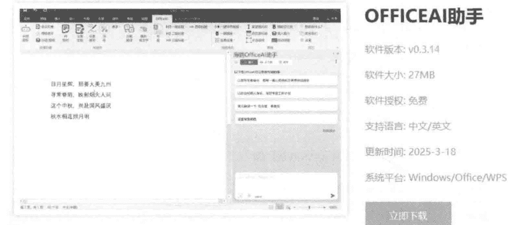
单击“立即下载”按钮，会弹出新页面，如图 9-2 所示，建议用高速下载方式进行下载。

### 软件下载

Last modified: 09 二月 2025

- 版本 v0.3.14

- 更新日期: 2025-2-8 [更新日志]

- 点击这里高速下载 ↗

- 官方下载 (速度快) ↗

- 联想应用商店 (速度快) ↗

- 123盘 (速度快, 提取码: SgVI) ↗

图 9-2 OfficeAI 下载界面

下载完成后双击安装文件，按提示完成安装，如图9-3至图9-5。

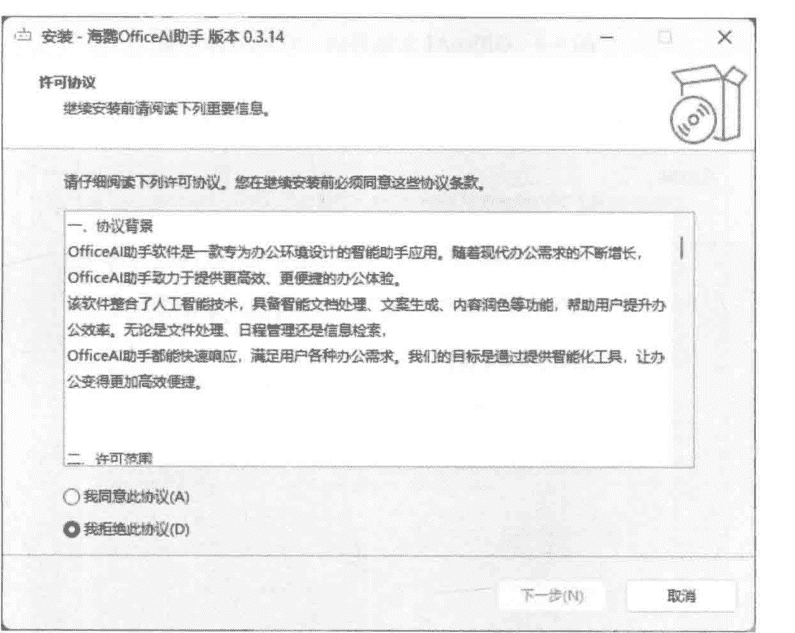
图 9-3 OfficeAI 安装界面—许可协议

部分电脑会提示安装VBA，如图9-6至图9-9，按提示完成即可。

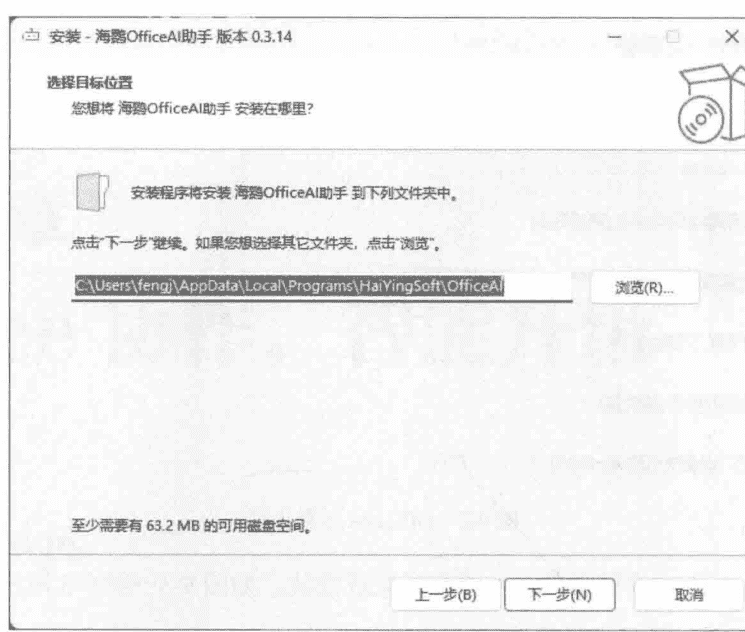

图 9-4 OfficeAI 安装界面—选择目标位置

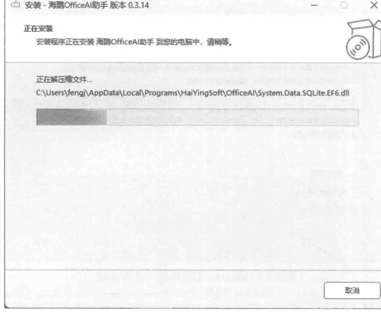

图 9-5 OfficeAI 安装界面—安装过程


图 9-6 安装 VBA


图 9-7 VBA 安装许可

# DeepSeek 从零起步实战指南


图 9-8 VBA 安装完成

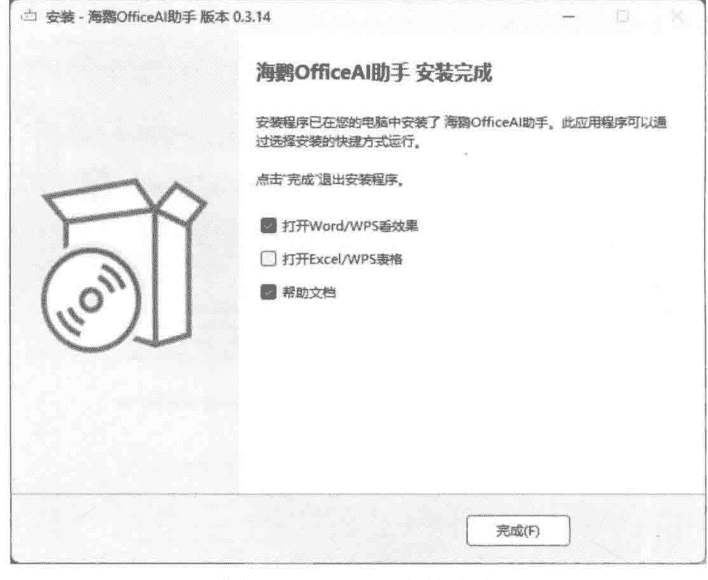

图 9-9 OfficeAI 安装完成

部署结束点按“完成”后，系统会自动打开 OfficeAI 的使用说明文档，顶部菜单会出现 OfficeAI 的入口，右侧弹出海鹦助手工作区，需要先登录。出现以上界面就代表安装生效，后续打开任意文档或表格时该工作区都会自动呈现，参考图 9-10。


若启动 WPS 后菜单栏未见 OfficeAI，可对照助手说明书里的配置方法进行调整，参考图 9-11。

### 常见问题

#### WPS 上安装后不显示

##### 信任第三方 COM 加载项

默认环境下 WPS 会拦截外部扩展，处理思路如下：

1. 启动 WPS，新建或打开任意文件；
2. 点击左上角“文件”进入“选项”，在选项页面定位到“信任中心”；
3. 勾选“受信任的加载项”，若界面未出现该选项，请先把 WPS 升级


4. 点击“确定”保存配置后重启，通常就能正常显示。若仍未出现，可尝试重装插件。

图 9-11 WPS 不显示 OfficeAI 解决办法

随后需要获取 DeepSeek 的接入密钥。打开 DeepSeek 官网首页，点击右上角“API 开放平台”登录，登录成功后在左侧点 API keys，再点创建 API key，填入名称后复制生成的密钥。密钥获取的详细流程在 3.5 节已介绍，这里不再展开。

回到 WPS，切到上方菜单，点 OfficeAI—设置—大模型设置，示意如图 9-12。OfficeAI 自带豆包、文心一言等模型。先打开本地模型开关，把模型平台选为 DeepSeekR1，将保存好的密钥粘贴到 API_KEY 输入框，如图 9-13 所示。最后点“保存”，会弹出如图 9-14 的提示。


图 9-12 OfficeAI 设置

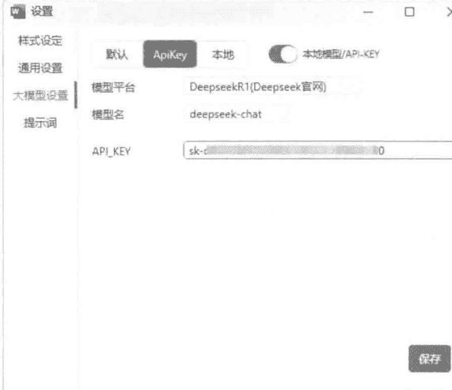

图 9-13 OfficeAI 添加 DeepSeek API

这一步会提示部署私有化服务端，按图 9-15～图 9-17 的指引完成安装即可。


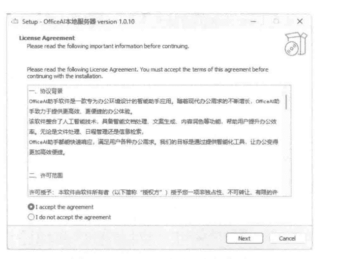

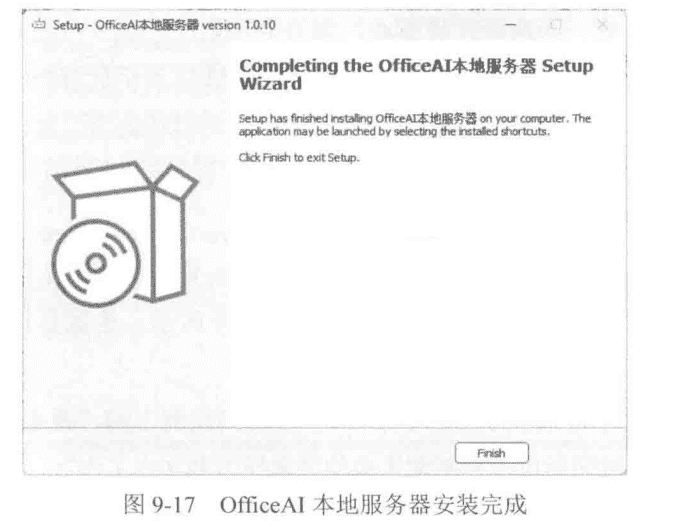

配置完毕后即可与助手进行对话。右侧海鹦工作区会显示当前在使用的 DeepSeek 的 deepseek-chat 模型，如图 9-18 所示。


向 Microsoft Office 引入 DeepSeek 的流程与上述基本一致，本书为推动信创，以国产化 WPS 为演示对象。

## 9.2 WPS 生成文案

把 DeepSeek 接入 WPS 后，可快速产出各类文案，大幅节省时间。以撰写产品宣传稿为例，在 WPS 中唤起 DeepSeek 后，输入产品名、功能要点、卖点、目标人群等信息，系统就能迅速给出吸睛的宣传稿。假设要推广一台扫地机器人，输入“扫地机器人，具备自动规划路径、智能避障、强力吸尘、远程操控等特性，面向忙碌的上班族和家庭主妇”，生成的文案可能是：“还在为繁琐的家务打扫发愁吗？这台扫地机器人绝对是你的好帮手！它采用先进的自动规划路径技术，能高效清洁每个角落；智能避障可轻松绕开家具、墙面等障碍，减少碰撞更省心。强力吸尘系统能够吸走地面灰尘、毛发、碎屑等垃圾，让居家一尘不染。还能通过手机远程操控，无论你在通勤路上或外出旅行，都能随时启动清扫，给你一个整洁舒适的家。忙碌的上班族和家庭主妇们，快来安排一台吧！”这类文案生成迅速、内容丰富有吸引力，能满足不同需求。

在右侧海鹦助手下方输入需求，回车即可生成内容。界面会展示思考过程，如图 9-19，说明启用了深度思考。

文案生成后下方有两个操作：“导出到左侧”和“复制”，如图 9-20。点击“导出到左侧”即可把内容导入左侧文本区，如图 9-21。

## Office 协作，智能升级

## 第 9 章

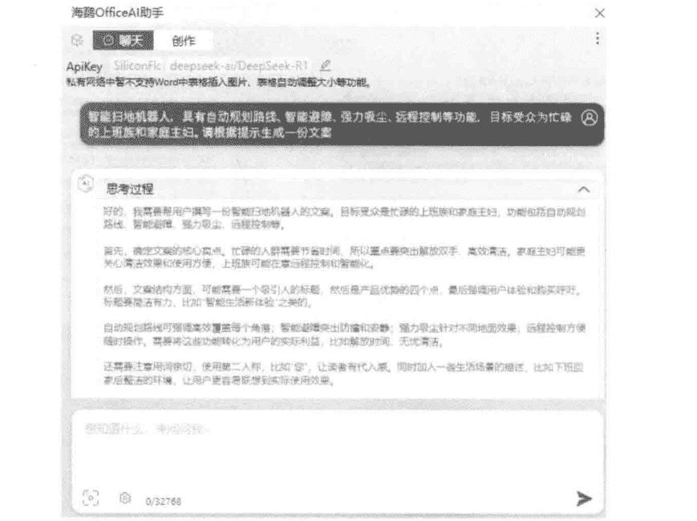

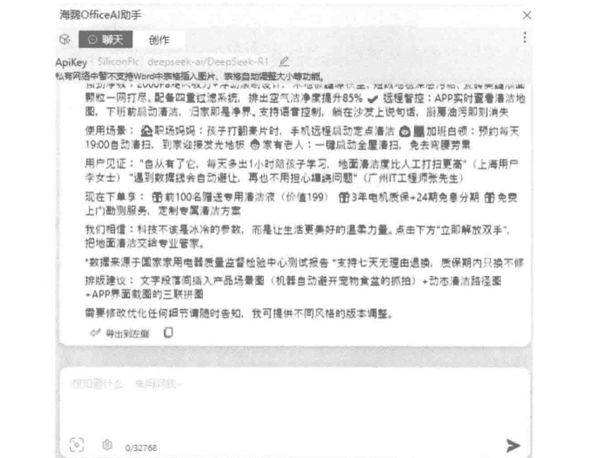

# DeepSeek 从零起步实战指南

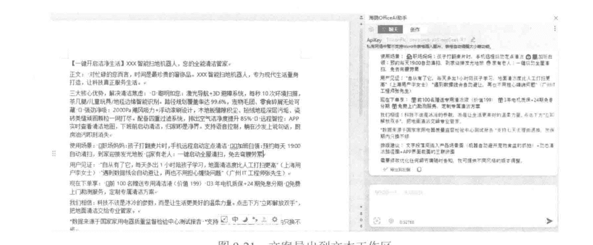

## 9.3 文字校对

日常使用拼音输入时，联想功能虽提升了效率，却也带来误选候选词导致错别字的风险。联想推荐基于算法和常用词库，未必每次都能准确理解意图，受操作习惯或排序影响容易选错。

相比之下，AI 纠错对这类问题处理更优。WPS 自带的拼写检查主要依赖内置词库，能标记明显错误，但语境理解有限，纠错方式较为机械。AI 纠错借助深度学习和海量语料，不仅能识别拼写错误，还能分析上下文，判断用户真实意图，给出更贴合语境的建议，在复杂句和口语化表达中优势明显。

现以小学生请假条为例，如图 9-22。该请假条存在多处错别字，看 DeepSeek 如何修正。

选择顶部工具栏 OfficeAI，点击“AI 校对”右侧箭头，在菜单中选择“仅纠错模式”，如图 9-23。DeepSeek 会自动分析正文并修正错误字词，如图 9-24。

请假条

尊敬的老师：

我今天上午吃了一吨饭后，浑身之力，小fu很疼，下午不去上课了，请皮准。

学生：xxx

图 9-22 错误示例


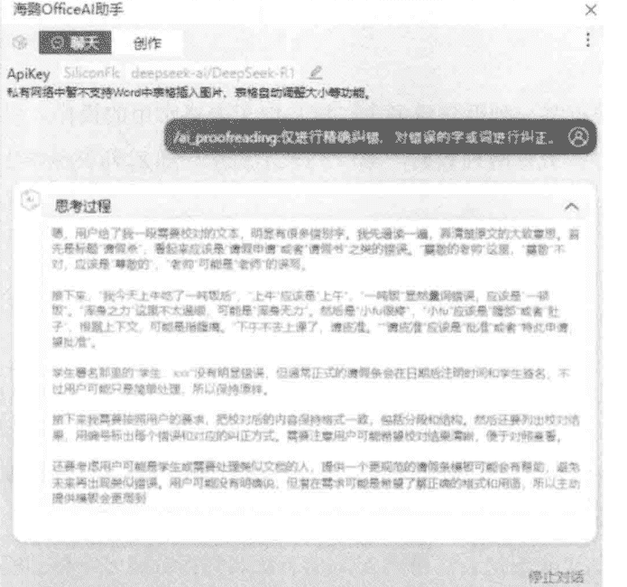

输出结果包含修改后的文本和详细说明，如图 9-25。

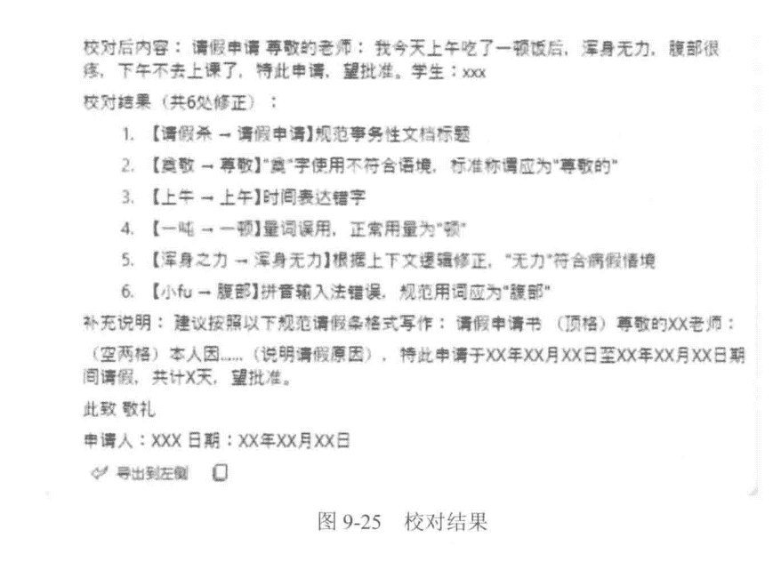

## 9.4 拆分表格

把表格按某列拆分为多个文件是电子表格的常用操作。以班级学生表为例，表格共五行两列，第一列为班级，第二列为学生姓名，如图 9-26 所示。

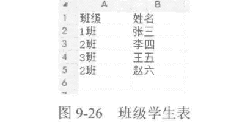

需按班级拆分数据。首先在 DeepSeek 主界面点击“回形针”按钮上传电子表格，如图 9-27。

输入拆分需求：“我想把表格依据 A 列的班级名称拆分为多个独立的 EXCEL 文件，文件名使用 A 列的值（如 1 班.xlsx），请提供 VBA 脚本”，如图 9-28。


DeepSeek 会返回 VBA 脚本及说明。

你可以用下面这段 VBA 脚本来按首列的班级名称把表格拆分成多个 Excel 文件，每个文件以班级名称命名（如 1 班.xlsx），并包含该班级的所有行。

```
Sub SplitDataIntoMultipleFiles()
    Dim ws As Worksheet
    Dim lastRow As Long
    Dim i As Long
    Dim dict As Object
    Dim key As Variant
    Dim newWb As Workbook
    Dim newWs As Worksheet
    Dim cell As Range
    Dim filePath As String
    
    '设置工作表
    Set ws = ThisWorkbook.Sheets("Sheet1")
    lastRow = ws.Cells(ws.Rows.Count, "A").End(xlUp).Row
    
    '创建字典来存储班级和对应的行
    Set dict = CreateObject("Scripting.Dictionary")
    
    '遍历数据并将行按班级分组
    For i = 2 To lastRow
        key = ws.Cells(i, 1).Value
        If Not dict.exists(key) Then
            dict(key) = ws.Rows(i).EntireRow.Value
        Else
            dict(key) = Application.WorksheetFunction.Index(dict(key), 0) & Application.WorksheetFunction.Index(ws.Rows(i).EntireRow.Value, 0)
        End If
    Next i
    
    '保存路径
    filePath = ThisWorkbook.Path & ""
    
    '遍历字典并创建新的工作簿
    For Each key In dict.keys
        Set newWb = Workbooks.Add
        Set newWs = newWb.Sheets(1)
        
        '添加表头
        ws.Rows(1).Copy Destination:=newWs.Rows(1)
        
        '添加数据
        newWs.Rows(2).Value = dict(key)
        
        '保存文件
        newWb.SaveAs Filename:=filePath & key & ".xlsx", FileFormat:=xlOpenXMLWorkbook
        newWb.Close SaveChanges:=False
    Next key
    
    '释放字典
    Set dict = Nothing
    
    MsgBox "拆分完成！"
End Sub
```

要点说明：

1. 字典归类：用字典对象保存每个班级对应的行数据。
2. 遍历数据：从第二行起逐行扫描，按班级名称分组存入字典。
3. 新建工作簿：针对字典中每个班级创建新工作簿，写入表头和数据。
4. 保存文件：把每个班级数据另存为独立 Excel，文件名即班级名称。

使用步骤：

1. 打开含数据的 Excel 文件。
2. 按 Alt + F11 打开 VBA 编辑器。
3. 在编辑器中插入新模块（Insert > Module）。
4. 将代码复制到模块。
5. 关闭编辑器返回 Excel。
6. 按 Alt + F8 选择 SplitDataIntoMultipleFiles 宏并运行。

运行后，文件会按班级名称拆分为多个文件，保存在原文件相同目录下。

打开 WPS 后按 ALT+F11 打开 VBA 编辑器。点击“插入” → “模块”，如图 9-29。

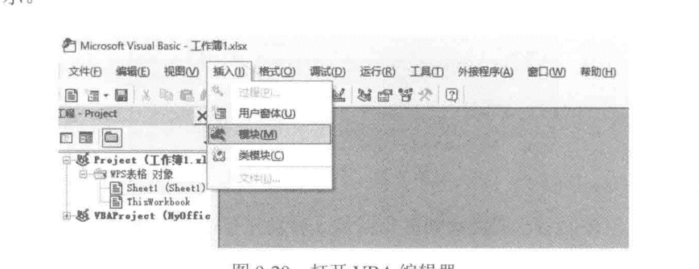

此时左侧 Project 中会多出模块 1，工作区弹出空白窗口供输入代码，如图 9-30。


把 DeepSeek 给出的脚本粘贴到工作区，点击“运行”，或关闭编辑器后按 Alt + F8 选择 SplitDataIntoMultipleFiles 宏运行，如图 9-31。

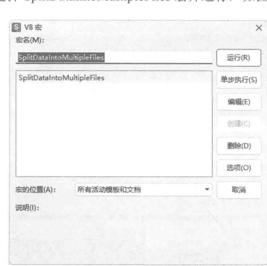

点击“运行”后即可看到拆分结果，分别打开查看，如图 9-32。


同理，也可借助 DeepSeek 完成生成公式、合并表格等工作。

## 9.5 表格公式生成

求和是电子表格的高频操作，利用 DeepSeek 可快速掌握快捷技巧。例如需对一列求和，传统做法是点击“自动求和”或手动输入“=SUM()”后选择范围。若忘记写法，可询问：“电子表格中如何快速对一列求和？”DeepSeek 会提示选中数据列后按 Alt+=，结果会自动填入下方单元格。

示例中工作表1 存储电子产品销售额，工作表2 存储单价，如图 9-33 和图 9-34。

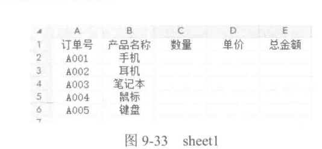

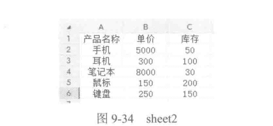

将表格传给 DeepSeek 后输入：“根据产品名称匹配单价，并计算总金额”，如图 9-35。


要根据产品名称匹配单价并计算总金额，可按以下步骤操作：

1. 匹配单价：用工作表1 中的产品名称在工作表2 中查找对应单价。
2. 计算总金额：将匹配到的单价与工作表1 中的数量相乘，得出总金额。

假设工作表1 数量列已填好，可使用以下公式：

- 在工作表1 的 D 列（单价）使用 VLOOKUP 函数匹配单价。例如 D2 单元格输入：

`=VLOOKUP(B2, Sheet2!A:C, 2, FALSE)`

这将根据 B2 的产品名称在工作表2 的 A:C 列查找对应单价。

- 在工作表1 的 E 列（总金额）计算总金额。例如 E2 单元格输入：

`=C2 * D2`

这将计算数量与单价的乘积，得到总金额。

填充后的工作表1 示例：

| A | B | C | D | E |
|---|---|---|---|---|
| 订单号 | 产品名称 | 数量 | 单价 | 总金额 |
| A001 | 手机 | 2 | 5000 | 10000 |
| A002 | 耳机 | 5 | 300 | 1500 |
| A003 | 笔记本 | 1 | 8000 | 8000 |
| A004 | 鼠标 | 3 | 150 | 450 |
| A005 | 键盘 | 4 | 250 | 1000 |

注意 C 列数量需提前填写。若未填写，请先输入相应数值。

公式过长易出错时，可让 AI 协助排查，它能迅速定位问题。

IFS 多条件判断的典型坑位

近期同事抛来一个表达式求助：`说明=IFS("及格",B2<85,B2<60,"不及格",B2<75,"良好",B2>=85,"优秀")`，问这串写法为何跑不通、该怎样修正。

归纳后主要有三类失误：

1. 判定先后颠倒。IFS 会自上而下依次校验，一旦命中即返回，后续不再参与。现行排列把宽泛范围置前、严格范围置后，容易被前置条件截断，导致结果偏差。
2. 条件位被文字占据。`"及格"` 这类结果文本被放进条件位置，而 IFS 的条件必须是可以判真假的逻辑式，纯文本无法参与运算。
3. 条件与返回值错位。比较式和对应的返回文字没有一一对应，结构混乱容易写错。

可用写法：
`=IFS(B2>=85,"优秀",B2>=75,"良好",B2>=60,"及格",B2<60,"不及格")`

逻辑拆解：
- B2>=85,"优秀"：分数达到85分及以上，直接判定为优秀。
- B2>=75,"良好"：分数落在75到84区间，判定为良好。
- B2>=60,"及格"：分数落在60到74区间，判定为及格。
- B2<60,"不及格"：分数低于60，判定为不及格。

使用要点：
- 先写最严格的区间，再逐步放宽。
- 条件集合要覆盖全部可能性，否则会返回错误值。

把公式放到表格中，B2 变化时评级会自动更新。

## 9.6 地址字段智能拆分

表格里经常出现从省到街道的一整段地址，想要切成省、市、区三列，但格式参差不齐，手写公式很费劲。

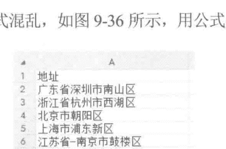

做法是先把表导入 DeepSeek，提示语可写：“把地址拆成省、市、区三列，并把缺失的信息自动补上。”

> 将地址拆分为省、市、区三列，自动补全缺失信息

模型一般给出两步思路：

1. 先拆分。依据分隔符或关键词把整段地址切成省、市、区。
2. 再补全。对缺省的省市，用已知地名反推填上。

具体操作：

拆分地址
常见格式为省—市—区 或 省/市/区。

途径一：Excel 文本分列
- 选定地址列；
- 数据 → 文本分列；
- 选分隔符号，下一步；
- 在分隔符中选“其他”，输入 - 或 /，完成。

途径二：公式拆分
B 列放省、C 列放市、D 列放区：
- 省： `=IF(ISNUMBER(FIND("省", A2)), LEFT(A2, FIND("省", A2)), IF(ISNUMBER(FIND("市", A2)), LEFT(A2, FIND("市",A2)), LEFT(A2, FIND("-",A2)-1)))`
- 市： `=IF(ISNUMBER(FIND("市", A2)), MID(A2, FIND("省", A2)+1, FIND("市", A2)-FIND("省", A2)), MID(A2, FIND("-", A2)+1, FIND("区", A2)-FIND("-", A2)-1))`
- 区： `=MID(A2, FIND("区", A2)-2, 3)`

补全缺失信息
对只有部分信息的地址做推断补全，例如：
- 地址只有“广州市天河区”，可补省为“广东省”、市为“广州市”。
- 地址只有“北京市朝阳区”，可补省为“北京市”、市为“北京市”。

拆分补全后的效果示例：
地址 广东省深圳市南山区 → 省 广东省 市 深圳市 区 南山区
地址 浙江省杭州市西湖区 → 省 浙江省 市 杭州市 区 西湖区
地址 北京市朝阳区 → 省 北京市 市 北京市 区 朝阳区
地址 上海市浦东新区 → 省 上海市 市 上海市 区 浦东新区
地址 江苏省-南京市鼓楼区 → 省 江苏省 市 南京市 区 鼓楼区
地址 四川省/成都市锦江区 → 省 四川省 市 成都市 区 锦江区
地址 广州市天河区 → 省 广东省 市 广州市 区 天河区
地址 湖北省武汉市江岸区 → 省 湖北省 市 武汉市 区 江岸区

DeepSeek 常会给出多种实现路径，用户可直接选用或把示例结果复制回表中使用。

## 9.7 PPT 生成

DeepSeek 能把文本快速转为 PPT，大幅提升制作效率。以旅游景点介绍为例，将景点名称、地理位置、看点、历史、美食等信息输入，模型就能迅速搭出页架。

示例页逻辑：
幻灯片1 封面，用景点标志性风光做背景，突出景点名，副标题“带你领略[景点名称]的魅力”；
幻灯片2 景点概况，介绍位置和基本信息；
幻灯片3 特色景点1，配图加文字说明特点与历史；
幻灯片4 特色景点2，同样图文并茂；
幻灯片5 历史文化，讲述渊源与传承；
幻灯片6 美食推荐，列出当地特色并配图；
幻灯片7 旅游攻略，给出游玩建议、交通、住宿；
幻灯片8 总结，重申魅力并邀请游玩。

整体布局清晰，图文配合自然，能快速得到一个可编辑的框架。

> 我现在是销售总监，公司卖展会灯箱，主要客户是海外中小企业。请帮忙写一份年终总结 PPT 大纲，用 Markdown 输出

下面是一份针对该场景的销售总监年终总结框架：

### 年终总结 PPT 大纲

#### 1. 封面
- **标题**: 2024 年度销售工作总结
- **副标题**: 展会灯箱产品销售回顾与展望
- **演讲者**: [姓名]，销售总监
- **日期**: 2024 年 12 月

#### 2. 目录
1. 年度销售业绩概览
2. 市场与客户分析
3. 产品表现与竞争力
4. 销售策略与执行
5. 团队建设与人才培养
6. 挑战与问题分析
7. 2025 年目标与计划
8. 总结与展望

#### 3. 年度销售业绩概览
##### 3.1 总体销售数据
- 年度销售额：$×（同比增长 ×%）
- 年度销售量：×台（同比增长 ×%）
- 主要销售区域：欧洲、北美、东南亚等
##### 3.2 季度销售趋势
- 第一季度：$×
- 第二季度：$×
- 第三季度：$×
- 第四季度：$×
##### 3.3 重点客户贡献
- 前十大客户销售额占比：×%
- 新客户开发数量：×家

#### 4. 市场与客户分析
##### 4.1 目标市场分析
- 主要市场：欧洲、北美、东南亚
- 市场增长率：×%
- 市场趋势：中小企业对定制化灯箱需求增加
##### 4.2 客户画像
- 客户类型：中小企业
- 客户行业：零售、展览、广告
- 客户需求：高性价比、快速交付、定制化设计
##### 4.3 客户反馈
- 正面反馈：产品质量、售后服务
- 改进建议：交付周期、定制化选项

#### 5. 产品表现与竞争力
##### 5.1 产品线回顾
- 主打产品：X 系列灯箱
- 新产品发布：Y 系列灯箱（市场反响）
##### 5.2 产品竞争力分析
- 优势：价格竞争力、定制化能力
- 劣势：品牌知名度、交付周期
##### 5.3 竞争对手分析
- 主要竞争对手：A 公司、B 公司
- 竞争策略：价格战、技术创新

#### 6. 销售策略与执行
##### 6.1 销售渠道
- 线上渠道：官网、B2B 平台（如阿里巴巴国际站）
- 线下渠道：展会、代理商
##### 6.2 营销活动
- 参加展会：×场，带来×个潜在客户
- 线上推广：Google Ads、社交媒体广告
##### 6.3 客户关系管理（CRM）
- CRM 系统使用情况
- 客户满意度调查结果

#### 7. 团队建设与人才培养
##### 7.1 团队现状
- 销售团队规模：×人
- 区域分布：欧洲、北美、东南亚
##### 7.2 人才培养
- 培训计划：产品知识、销售技巧
- 团队激励：绩效考核、奖金制度
##### 7.3 团队成果
- 个人业绩排名
- 团队协作案例分享

#### 8. 挑战与问题分析
##### 8.1 外部挑战
- 全球经济不确定性
- 竞争对手价格战
##### 8.2 内部问题
- 交付周期过长
- 定制化需求响应速度慢
##### 8.3 改进措施
- 优化供应链管理
- 提升客户沟通效率

#### 9. 2025 年目标与计划
##### 9.1 销售目标
- 2025 年销售额目标：$×（同比增长×%）
- 新客户开发目标：×家
##### 9.2 市场拓展计划
- 新市场开拓：南美、中东
- 重点客户维护：前二十大客户
##### 9.3 产品与策略优化
- 新产品开发计划
- 销售策略调整：加强线上推广

#### 10. 总结与展望
##### 10.1 2024 年总结
- 成功经验：客户满意度提升、新市场开拓
- 不足之处：交付周期、品牌知名度
##### 10.2 2025 年展望
- 目标：成为海外中小企业首选灯箱供应商
- 愿景：通过创新与优质服务，持续提升市场份额

#### 11. 问答环节
- 开放观众提问，解答相关问题

#### 12. 结束页
- **感谢语**：感谢团队的努力与支持！
- **联系方式**：[邮箱/电话]

备注：
- 各部分可配图表辅助说明，如销售额趋势图、客户分布图。
- 加入案例或客户原话能增强说服力。

借助 Kimi、Mindshow 等工具可快速把大纲转为初稿，也可用 OfficeAI 助手创作。

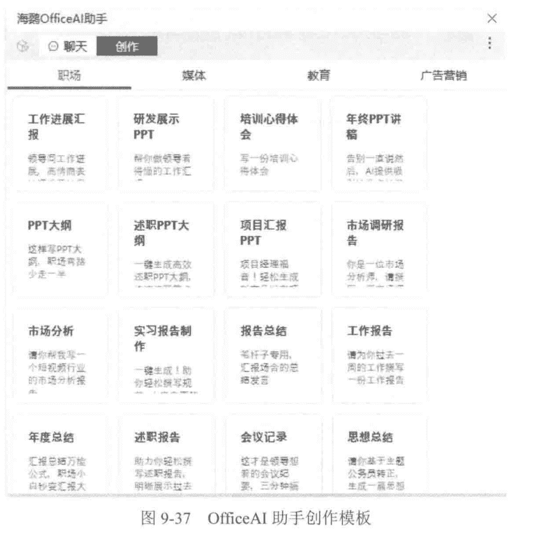

图 9-37 OfficeAI 助手创作模板

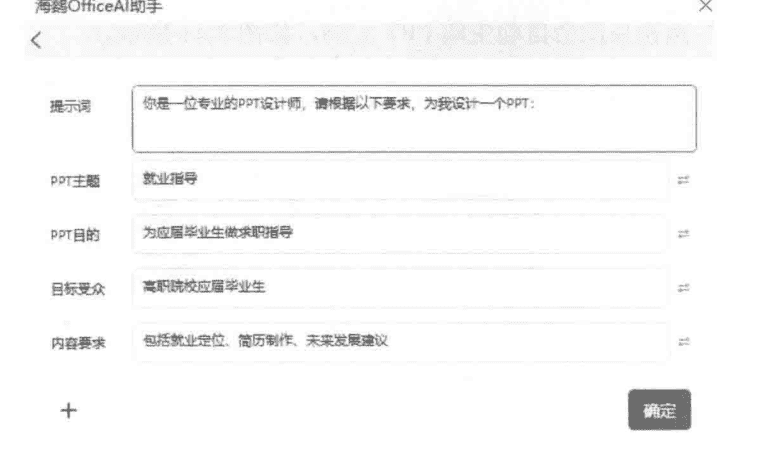

图 9-38 设定参数

在右侧点“设置”可增删参数主题，比如把内容要求改成页数要求，或增加新参数。


图 9-39 调整参数


图 9-40 添加编辑参数

确认后系统自动生成 PPT 大纲。

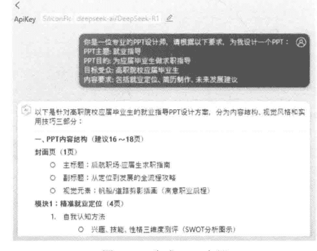

图 9-41 生成 PPT 大纲

## 9.8 WPS 内置 DeepSeek 实战

WPS 自带了 AI 引擎。打开 WPS 后点 WPS Office 标签，再点“WPS 灵犀”按钮，进入综合 AI 工具区。


在新界面打开 DeepSeek R1 开关，启用大模型后输入问题，点“执行”，AI 会进入思维链模式并输出思考过程和结果。

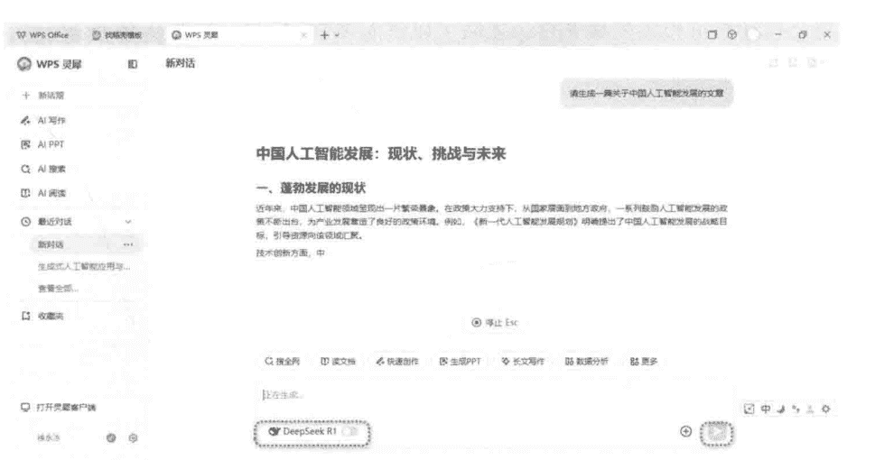

点“生成 PPT”可快速出稿。例如输入“根据以下主题生成 PPT：应届生求职简历的要点”，点执行。


WPS 会先生成大纲，再让用户选模板，点“生成 PPT”。


按所选模板自动生成演示文稿，后续可在 WPS 中直接修改。

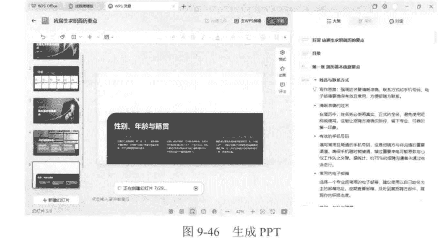

# 第10章

## 法律领域，智能辅助

### 10.1 法律条文检索

法律工作中快速准确定位条文是基础。DeepSeek 凭借自然语言理解和庞大知识库，能帮从业者迅速找到所需规定。以合同纠纷为例，输入“合同违约责任的法律条文有哪些”，模型会给出《中华人民共和国民法典》相关条款，如第五百七十七条“当事人一方不履行合同义务或者履行合同义务不符合约定的，应当承担继续履行、采取补救措施或者赔偿损失等违约责任”，并附上司法解释和典型案例辅助理解。

检索还可以更细，比如“2020年以后关于房屋租赁合同违约责任的法律条文”，系统会精准筛选。

> 2020年以后关于房屋租赁合同违约责任的法律条文。

> 2020年以后关于房屋租赁合同违约责任的法律条文

依据《中华人民共和国民法典》（2021年1月1日起施行）及相关司法实践要点如下：

**一、违约责任的一般规定**
1. 违约责任的承担方式
根据《中华人民共和国民法典》第五百七十七条，违约方需承担继续履行、采取补救措施或赔偿损失等责任。
2. 违约金的约定与调整
○ 合同明确约定违约金按约定执行；违约金过高或过低可请求法院调整。
○ 未约定违约金时，按实际损失赔偿，包括直接损失和可得利益。

**二、出租人（甲方）的违约责任**
1. 无法提供房屋
无法按约交付房屋，需支付承租人两倍月租金作为违约金。
2. 逾期交房或提前收回房屋
○ 逾期交房：按日支付月租金0.5%的滞纳金。
○ 提前收回房屋：支付两倍月租金违约金并赔偿损失。
3. 未履行维修义务
出租人未及时维修，承租人可自行维修并要求承担费用。
4. 房屋权属瑕疵
因权属问题致合同无效，出租人需赔偿承租人损失。

**三、承租人（乙方）的违约责任**
1. 擅自退租或转租
○ 未经同意中途退租：支付两倍月租金违约金并赔偿损失。
○ 擅自转租、改变用途或违法活动：出租人可解除合同收回房屋，承租人需支付违约金。
2. 拖欠租金或费用
○ 拖欠租金超1个月，出租人可解除合同，承租人按日支付0.5%滞纳金。
○ 逾期支付水电费等按日支付0.5%滞纳金。
3. 损坏房屋或设施
使用不当造成损坏，需恢复原状或赔偿损失。

**四、合同解除的法定情形**
根据《中华人民共和国民法典》第五百六十三条，以下情形可法定解除：
1. 因不可抗力导致合同目的无法实现；
2. 一方明确表示或以行为表明不履行主要债务；
3. 一方迟延履行主要债务，经催告后仍未履行；
4. 其他导致合同目的无法实现的情形。

**五、司法实践中的典型案例参考**
1. 轻微违约不构成解约理由

租前先自检：卫生差或有遗留物≠可以擅自退租

房屋交付时如果存在卫生瑕疵或遗留物件，比如空调、网线等，只要通过清扫或协商就能妥善处理，承租人就不能单方面解除租赁，强行退租是要承担违约责任的。司法实践里就有租客以卫生问题为由要求解除被法院驳回的例子。

2. 定金和违约金该怎么定

承租人单方违约时，已付的定金通常不能要回；如果合同约定的违约金不足以弥补出租人的实际损失，出租人可以主张进一步赔偿。

**六、特别提示**

● 签约前的尽调义务：承租人签约前最好实地看房，明确各自权责；出租人要保证交付状态符合约定。
● 书面约定的好处：建议把违约金标准、维修分担、解除条件等关键条款写清楚，能大幅减少后续纠纷。

需要具体法条或案例，可参考《民法典》合同编及最高人民法院关于适用《民法典》合同编通则若干问题的解释。

### 10.2 撰写法律文书

起草各类法律文件是法律人的日常，DeepSeek 在这个环节能明显提效。以民事起诉状为例，把案情要点、当事人信息、诉讼主张输入系统，就能快速得到结构完整、表述规范的模板。比如民间借贷纠纷，原告小王出借给被告小李五万元，付款期限届满后仍未归还。律师把要素交给 DeepSeek，生成的起诉状会完整列出双方姓名、性别、年龄、住址、联系方式等基础信息，诉讼请求部分清晰表述为“请求判令被告返还借款本金五万元及利息，利息以五万元为基数，按全国银行间同业拆借中心公布的贷款市场报价利率，自约定还款期限届满之日起计算至实际付清之日止”，事实与理由部分则详细说明出借经过、还款约定及逾期未还情况。除起诉状外，还可辅助生成刑事起诉书、辩护词、代理词、合同等，省去大量手工时间。

> 小李借给小张 2 万元钱，约定 6 个月后的 2025 年元旦归还本息共 2.1 万元，请写一个符合法律规定的借条。

**借条**

借款人（甲方）：小张

身份证号：________________

联系电话：________________

住址：________________

出借人（乙方）：小李

身份证号：________________

联系电话：________________

住址：________________

**一、借款事项**

1. 借款金额：人民币贰万元整（¥20,000.00）。

2. 借款用途：________________（如：个人消费、资金周转等）。

3. 借款期限：自 2024 年 7 月 1 日起至 2025 年 1 月 1 日止，共计 6 个月。

4. 还款方式：甲方应于 2025 年 1 月 1 日一次性归还乙方本金及利息。

5. 利息约定：借款利息为人民币壹仟元整（¥1,000.00），借款到期后本息合计人民币贰万壹仟元整（¥21,000.00）。

**二、双方权利与义务**

1. 甲方义务：

   ○ 按时归还借款本息，不得拖欠。

   ○ 如提前还款，需征得乙方同意，利息按实际借款天数计算。

2. 乙方义务：

   ○ 按时提供借款，不得无故拖延。

   ○ 在甲方按时还款后，出具收款凭证。

**三、违约责任**

1. 如甲方未按期归还借款，每逾期一日，应按未还本金的万分之五支付违约金。

2. 如甲方未按约定用途使用借款，乙方有权提前收回借款并要求甲方支付违约金。

**四、争议解决**

1. 本借条适用中华人民共和国法律。

2. 如双方因本借条发生争议，应协商解决；协商不成的，任何一方可向乙方所在地人民法院提起诉讼。

**五、其他条款**

1. 本借条自双方签字之日起生效。

2. 本借条一式两份，甲乙双方各执一份，具有同等法律效力。

甲方（借款人）签字：________

日期：2024年7月1日

乙方（出借人）签字：________

日期：2024年7月1日

附：甲乙双方身份证复印件（粘贴处）

**注意事项**

1. 借条应手写或打印后签字，确保字迹清晰。

2. 双方身份证复印件应附在借条后，以备查验。

3. 如有担保人，需在借条上注明担保信息并由担保人签字。

希望这份借条符合您的需求！如需调整，请随时告知！

### 10.3 提供法律咨询

无论是公众还是从业者，遇到法律问题时都需要及时准确的解答。DeepSeek 可作为便捷的咨询入口，回应各类疑问。比如上班族小张被公司无故辞退，问“公司无故辞退我该怎么办”。系统会解释无故辞退属于违法解除，可先与公司沟通要求说明理由并争取合理补偿；沟通不成可向当地劳动监察部门投诉，由其调查处理；也可申请劳动仲裁，要求支付违法解除的赔偿金，标准为经济补偿的二倍，经济补偿按在本单位年限每满一年支付一个月工资，半年以上不满一年按一年计，不满半年支付半个月工资。若对仲裁结果不满，还可向法院起诉。通过这类解答，小张能快速理清权益与维权路径。

> 小林因为公司运营方向调整而被辞退，同时因为居家办公的原因，公司拒绝支付工资，请问应该如何通过法律进行维权？

小林因经营方向调整被辞退且公司以居家办公为由拒发工资，可依法维权，思路如下：

1. 确认劳动关系
   - 书面合同：先核查是否有有效劳动合同，明确工作内容、薪酬标准、工作时间等约定。
   - 事实劳动关系：即便无书面合同，只要能以工资记录、工作邮件、考勤记录等证明存在事实劳动关系，仍可主张权利。

2. 核查辞退合法性
   - 辞退理由：因经营方向调整辞退可能属于经济性裁员或客观情况重大变化，公司需有合法依据并履行法定程序。
   - 程序合规：
     - 经济性裁员需提前30天向工会或全体员工说明并向劳动行政部门报告。
     - 客观情况重大变化需先协商变更合同，协商不成方可解除并支付经济补偿。

3. 工资支付问题
   - 居家办公期间工资：居家办公属正常履职，公司应按约发放薪酬，拒发即违法。
   - 拖欠工资责任：依据《劳动合同法》第85条，公司拖欠工资的，劳动行政部门可责令限期支付，逾期需加付应付金额50%至100%的赔偿金。

4. 经济补偿
   - 合法解除可获经济补偿，按工龄每满一年支付一个月工资，不满半年按半年，不满一年按一年。
   - 违法解除可要求继续履行或支付双倍经济补偿。

5. 维权流程
   (1) 与公司协商：以邮件或律师函形式提出支付拖欠工资及补偿诉求。
   (2) 投诉劳动监察：协商不成可向当地劳动监察大队投诉，责令支付。
   (3) 申请劳动仲裁：劳动监察未果可向劳动争议仲裁委员会申请仲裁，仲裁为前置程序。需提交仲裁申请书、劳动合同或劳动关系证明、工资支付记录、辞退通知等证据。
   (4) 提起诉讼：对仲裁裁决不服，可在收到裁决书15日内向人民法院起诉。

6. 证据收集
   - 劳动合同、工资支付记录、辞退通知、工作邮件、聊天记录、考勤记录、公司关于经营调整的通知等。

7. 法律依据
   - 《中华人民共和国劳动合同法》第四十条、第四十六条、第八十五条；
   - 《工资支付暂行规定》。

8. 建议
   - 情况复杂时建议咨询专业劳动律师；
   - 全程保留相关证据以备仲裁诉讼使用。

按以上步骤，小林可依法主张拖欠工资和经济补偿。

### 10.4 辅助司法审判

在审判中，法官需要对复杂案件深入分析以作出公正判决。DeepSeek 可辅助梳理案情并提供参考。以知识产权侵权案为例，把侵权产品特征、被侵权方损失、双方证据等信息输入后，可汇总类似案例中的常见认定标准和赔偿测算方法，并对证据关联性及可能问题进行分析，帮助法官更全面把握事实，提高效率与公正性。

> 2018年8月27日，昆山市开发区震川路、顺帆路路口发生一起刑事案件，一轿车与自行车发生轻微交通事故，轿车向右强行闯入非机动车道。双方争执时车内一名男子拿出刀，砍向骑车人。骑车人虽然连连躲避，但仍被砍中。之后，在砍人时，长刀落地，骑车人出于求生欲捡起长刀，反过来砍向宝马内男子，宝马车内男子连连躲避逃窜，但骑车人连砍数刀，男子被砍伤倒在草丛。请问骑车人的行为是否构成犯罪？要如何处罚？

该案即2018年引发关注的“昆山龙哥案”。从正当防卫角度分析如下：

1. 案件背景
   - 轿车与自行车发生轻微事故后，轿车强行进入非机动车道。
   - 车内男子刘某持刀砍向骑车人于某。
   - 刀具落地后，于某捡起反击，致刘某受伤后死亡。

2. 法律分析
   骑车人行为是否构成犯罪？
   - 正当防卫认定：依据《刑法》第二十条，正当防卫指为制止正在进行的不法侵害而采取的必要防卫行为。
   - 符合要件分析：
     1. 正在进行的不法侵害：刘某持刀砍人属于现实暴力侵害。
     2. 防卫目的：于某反击旨在保护自身生命安全。
     3. 防卫限度：刑法第二十条第三款规定，对正在进行的行凶、杀人等严重危及人身安全的暴力犯罪实施防卫，造成不法侵害人伤亡的，不属于防卫过当，不负刑事责任。
   于某的反击针对持刀行凶的紧迫危险，属于正当防卫。

3. 司法机关处理
   公安机关和检察机关经调查认定于某行为系正当防卫，不负刑事责任。2018年9月1日，昆山市公安局发布通报，依法撤销案件。

4. 法律依据
   - 《中华人民共和国刑法》第二十条 正当防卫及特别防卫规定。
   - 《中华人民共和国刑事诉讼法》第十六条 不构成犯罪的情形应撤销案件。

5. 结论
   骑车人于某的行为属于正当防卫，无需承担刑事责任，案件被撤销。

6. 社会意义
   本案体现了法律对正当防卫的明确支持，尤其在面对严重暴力时公民自卫权的保障，也推动了社会对防卫界限的讨论和法律完善。

如有更多问题，建议咨询专业律师或查阅相关法条。

# 第 3 部分

# DeepSeek 高效学习


# 第11章

## 论文写作，学术领航

### 11.1 推荐研究方向

DeepSeek 能结合学术前沿与个人研究基础给出方向建议，为研究者打开新思路。例如生物学专业的学者已在基因编辑领域积累基础，咨询后续选题时，系统会分析当前热点如基因治疗、合成生物学等，并据此建议“基于基因编辑优化基因治疗方法”“利用基因编辑构建新型生物合成途径”等课题，既贴合趋势又延续已有积累，有助于实现突破。

> ❓ 帮我推荐一些人工智能领域热门研究方向。

🤖 人工智能近年发展迅猛，覆盖面广。以下为学界与产业界关注的热门选题：

1. 深度学习
   - 研究内容：通过多层神经网络解决复杂任务的核心技术。
   - 热门子方向：卷积神经网络在计算机视觉中的应用；循环神经网络与 Transformer 在自然语言处理中的应用；自监督学习与无监督学习。
   - 应用场景：图像识别、语音识别、自然语言处理、自动驾驶等。

2. 强化学习
   - 研究内容：智能体通过与环境交互学习最优策略。
   - 热门子方向：深度强化学习、多智能体强化学习、基于模型的强化学习。
   - 应用场景：游戏 AI、机器人控制、自动驾驶、资源调度等。

3. 自然语言处理
   - 研究内容：让计算机理解、生成和处理人类语言。
   - 热门子方向：预训练语言模型如 BERT、GPT 系列；机器翻译、文本生成、情感分析；多模态学习。
   - 应用场景：智能客服、机器翻译、文本摘要、聊天机器人等。

4. 计算机视觉
   - 研究内容：计算机对图像和视频数据的理解与处理。
   - 热门子方向：目标检测与跟踪、图像生成与修复、三维视觉与点云处理。
   - 应用场景：人脸识别、自动驾驶、医学影像分析、增强现实等。

5. 生成式人工智能
   - 研究内容：生成新的图像、文本、音频等数据。
   - 热门子方向：生成对抗网络、变分自编码器、扩散模型。
   - 应用场景：图像与视频生成、文本创作、艺术设计等。

6. 联邦学习
   - 研究内容：在分布式设备上训练模型同时保护数据隐私。
   - 热门子方向：隐私保护技术如差分隐私、模型聚合与优化、跨设备与跨领域联邦学习。
   - 应用场景：医疗数据分析、金融风控、智能家居等。

7. 可解释人工智能
   - 研究内容：提升模型决策过程的透明度与可解释性。
   - 热门子方向：模型解释技术如 LIME、SHAP、可视化工具、可解释性与性能平衡。
   - 应用场景：医疗诊断、金融风控、司法决策等。

8. 边缘人工智能
   - 研究内容：在手机、传感器等边缘设备上运行 AI 模型。
   - 热门子方向：模型压缩与加速、边缘设备实时推理、边缘与云协同计算。
   - 应用场景：智能物联网、自动驾驶、智能安防等。

9. 多模态学习
   - 研究内容：融合文本、图像、语音等多模态数据进行学习。
   - 热门子方向：跨模态检索与生成、多模态预训练模型、多模态数据对齐与融合。
   - 应用场景：智能助手、内容推荐、医学影像分析等。

10. 人工智能伦理与安全
    - 研究内容：AI 的社会影响、伦理问题与安全性。
    - 热门子方向：算法公平性与偏见消除、隐私保护、对抗攻击与防御。
    - 应用场景：政策制定、算法审计、安全防护等。

11. 量子机器学习
    - 研究内容：利用量子计算加速机器学习算法。
    - 热门子方向：量子神经网络。

AI 前沿赛道快览

- 量子优化计算路径
- 量子信息编解码与算力
- 主要落地：新药研发、金融建模、复杂系统寻优

12. 智能机器人体系
- 核心：探索人工智能如何融入机器人系统并形成闭环
- 热门分支
  - 感知判断与决策能力
  - 人机协同交互设计
  - 自主移动与操作执行
- 典型应用：工业自动化装备、服务型机器人、医疗辅助机器人等

13. AI 加速科学发现
- 核心：利用智能手段提升科研效率
- 热门分支
  - 智能辅助药物研发
  - 气候模拟与趋势预测
  - 材料研究与基因组解析
- 典型应用：生物医药、环境保护、新能源开发等

14. 自监督学习范式
- 核心：在无标注数据上完成模型预训练的思想
- 热门分支
  - 对比式学习方法
  - 自监督预训练模型构建
  - 预训练能力向下游任务迁移
- 典型应用：视觉理解、自然语言处理、语音识别等

15. 教育智能化
- 核心：借助智能技术优化教学体系
- 热门分支
  - 个性化学习系统设计
  - 智能辅导与评价机制
  - 教育数据挖掘与行为分析
- 典型应用：在线教学、智能题库、学习成效分析等

### 总结
以上方向覆盖了人工智能的核心技术与前沿应用。选题时建议综合个人兴趣、研究基础与实际需求进行权衡。

### 11.2 阅读论文
在科研中，阅读文献是获取灵感与知识的重要渠道。面对海量论文，如何快速抓住要点并不容易。DeepSeek 在文献辅助阅读上表现突出。以一篇聚焦人工智能在医疗领域应用的论文为例，将全文输入后，系统能迅速提炼研究目的、方法设计、主要结论，并对专业概念进行通俗化解释。如针对“深度学习模型在医学影像诊断中的应用”，DeepSeek 会用易懂的语言说明模型训练逻辑及其价值，即模型通过大量影像学习异常特征，为医生提供诊断参考。借助此类解读，读者可更快掌握精髓，降低阅读成本。

请提炼 Rethinking Reconstruction Autoencoder-Based Out-of-Distribution Detection 的关键信息，如研究目的、方法、主要结论。用中文输出。

该论文要点整理如下：

1. 研究目的
   - 核心议题：重新审视基于重构自编码器的分布外检测方案的有效性
   - 研究动机：此类方法虽被广泛使用，但表现波动且缺乏系统理论解释，本文旨在揭示其局限并给出改进思路

2. 研究方法
   - 理论剖析
     - 对重构自编码器类分布外检测进行原理剖析，梳理性能瓶颈
     - 讨论重构误差与分布外检测的关联，并对比其在分布内与分布外数据上的表现差异
   - 实验检验
     - 在 CIFAR-10、CIFAR-100、SVHN 等多个数据集上测试不同重构自编码模型的分布外检测效果
     - 比较各模型重构误差分布在分布内与分布外样本上的差异
   - 改进策略
     - 设计融合分类与重构的联合损失，提升鲁棒性
     - 引入正则化手段缓解模型对分布内数据的过拟合，增强分布外区分力

3. 主要结论
   - 方法局限
     - 重构误差并非始终可靠的分布外信号，尤其当分布内与分布外接近时区分能力明显下降
     - 自编码器易过拟合分布内数据，导致分布外检测稳定性不足
   - 改进方向
     - 多任务学习结合分类与重构任务可显著提升分布外检测表现
     - 正则化能够降低对分布内的过拟合，从而提高对分布外的敏感度
   - 实验佐证
     - 改进方案在多个数据集上表现更优，特别是在分布接近的情形下优势更明显

4. 研究意义
   - 重新审视了重构自编码器在分布外检测中的角色，明确其不足并提出可行改进
   - 为该领域提供理论支持与实践参考，有助于构建更稳健的检测模型

5. 未来工作
   - 深入挖掘多任务学习在分布外检测中的潜力
   - 探索更高效的正则化技术以提升分布外识别能力
   - 将改进方法推广至医疗诊断、自动驾驶等复杂场景

本文通过对重构自编码器的深度剖析，为分布外检测提供了重要理论贡献与实践指导。

### 11.3 选择题目
锁定有价值的研究题目是论文写作的起点。DeepSeek 可协助挖掘选题方向并评估可行性。如研究生询问“基于当前 AI 研究热点给出选题建议并分析可行性”，系统可能提示“基于强化学习的智能机器人路径规划研究”“生成式对抗网络在图像合成中的应用改进”“自然语言处理中情感分析算法优化”等。对每个选题，系统会指出当前技术成熟度、已有文献基础及行业需求，例如强化学习路径规划方向技术发展迅速、应用场景覆盖物流与工业制造，研究价值与可行性均较高。通过此类分析，研究者可规避过于宽泛或不可行的题目。

> 我觉得无人机飞控算法方向很好，请提供 5 个研究题目。要求：结合案例研究。

结合实证案例能更好体现飞控算法的工程价值，以下是 5 个建议：

1. 基于强化学习的飞行器自主避障算法研究
   - 背景：复杂城市或林区飞行中需实时避障保障安全
   - 案例：亚马逊 Prime Air 无人机配送项目
   - 内容：构建强化学习模型模拟飞行决策；仿真测试避障性能；结合配送场景优化实时性与鲁棒性

2. 多机协同编队控制算法研究
   - 背景：军事侦察、灾害救援等场景需多机协同
   - 案例：中国四川九寨沟地震救援中无人机编队搜救
   - 内容：设计分布式编队控制策略；研究通信延迟与抗干扰问题；在仿真与实地验证稳定性与效率

3. 基于视觉 SLAM 的室内定位与导航算法研究
   - 背景：仓库、工厂等室内环境需高精度定位
   - 案例：京东物流仓库无人机库存盘点
   - 内容：融合视觉 SLAM 与惯性测量单元提升精度；研究低光照与动态环境鲁棒性；实地测试导航性能

4. 抗风扰飞行控制算法研究
   - 背景：强风环境下飞行稳定性受限
   - 案例：中国海上风电巡检无人机
   - 内容：基于鲁棒控制理论设计抗扰算法；建立风场模型分析影响；在仿真与实风环境中验证抗扰效果

5. 基于深度学习的飞行器目标跟踪算法研究
   - 背景：野生动物监测、交通监控等需精准跟踪
   - 案例：非洲保护区无人机监测犀牛
   - 内容：开发卷积神经网络检测与跟踪方案；评估复杂背景与动态目标下的鲁棒性；实地测试精度与实时性

### 总结
上述题目覆盖避障、编队、定位、抗扰、跟踪等关键方向，均结合真实案例兼具理论价值与应用意义，可根据兴趣与资源择一深入。

### 11.4 生成摘要
摘要是论文核心的浓缩。DeepSeek 能从全文提炼要点生成准确摘要。例如一篇关于新能源汽车电池技术的研究，系统生成的摘要为：“本文聚焦新能源汽车电池技术，针对传统电池续航短、充电慢的问题提出新型电池方案，阐述技术原理，实验显示续航提升 30%，充电时间缩短 50%，为行业发展提供技术支撑。”

> 根据《无人机抗风扰飞行控制算法研究》题目，为我生成一篇300字左右的论文摘要。

论文摘要
随着小型飞行器在复杂环境中的普及，强风条件下的飞行稳定性成为研究重点。本文针对强风扰动问题，提出一种基于鲁棒控制理论的抗风扰飞行控制算法。研究以中国海上风电巡检飞行器为依托，分析风场对飞行稳定性的影响，并设计基于 H∞控制的抗扰策略。建立风场模型与飞行器动力学模型后，在仿真环境中对不同风速条件下的鲁棒性与稳定性进行验证。结果表明，所提算法能有效抑制风扰，显著提升强风环境下的飞行精度与稳定性。随后在实际风场开展飞行试验，进一步证实算法的实用性与可靠性。本研究为飞行器在强风场景的应用提供了理论支持与工程保障，具有重要应用价值。

关键词
无人机；抗风扰控制；H∞控制；风场模型；飞行稳定性

### 11.5 设计提纲
构建清晰提纲是组织论文的关键。DeepSeek 可高效辅助。以“探讨教育改革问题及对策”为例，可生成：引言阐述背景意义；现状分析梳理成绩与问题；问题剖析探究成因；解决策略提出政策完善、师资培训、教学创新等措施；案例分析验证策略；结论与展望总结并展望。

根据以上内容为我生成一篇论文的提纲。

论文提纲：无人机抗风扰飞行控制算法研究

1. 引言
   1.1 研究背景与意义
       - 飞行器在复杂环境的应用需求
       - 强风环境下飞行稳定性的挑战
   1.2 国内外研究现状
       - 抗风扰控制进展
       - 现有方法的不足
   1.3 研究目标与内容
       - 提出基于鲁棒控制的抗风扰算法
       - 通过仿真与实验验证有效性

2. 飞行器动力学模型与风场建模
   2.1 飞行器动力学模型
       - 六自由度模型
       - 动力学方程与控制输入
   2.2 风场建模
       - 风场特性分析
       - 风扰对飞行的影响
   2.3 模型验证
       - 仿真环境下的验证

3. 抗风扰飞行控制算法设计
   3.1 鲁棒控制理论基础
       - H∞控制原理
       - 鲁棒控制器设计方法
   3.2 抗风扰控制算法设计
       - 基于 H∞控制的抗扰方案
       - 控制器参数优化
   3.3 算法实现
       - 实现流程
       - 仿真验证

4. 仿真实验与结果分析
   4.1 仿真环境搭建
       - 仿真平台
       - 风场与飞行器模型
   4.2 仿真实验设计
       - 不同风速条件测试
       - 传统 PID 与 H∞控制对比
   4.3 结果分析
       - 飞行稳定性评估
       - 抗风扰性能对比

5. 实际飞行测试
   5.1 测试环境与设备
       - 实际风场介绍
       - 飞行器硬件配置
   5.2 测试方案
       - 场景设计
       - 数据采集与处理
   5.3 测试结果与分析
       - 实飞抗扰性能
       - 与仿真结果对比

6. 讨论
   6.1 算法优势与局限
       - 强风环境表现
       - 计算复杂度与实时性
   6.2 与其他方法对比
       - 与传统控制对比
       - 与其他鲁棒控制对比
   6.3 未来改进方向
       - 融合深度学习优化控制
       - 多机协同抗风扰控制

7. 结论
   7.1 研究总结
       - 算法设计与验证回顾
       - 仿真与实测表现
   7.2 研究贡献
       - 为强风应用提供理论支撑
       - 提出高效鲁棒控制方案
   7.3 未来展望
       - 性能进一步优化
       - 拓展至其他复杂环境

8. 参考文献
9. 附录
   - 详细数据与代码实现

### 11.6 参考文献
论文写作中规范管理参考文献至关重要。DeepSeek 可按不同格式整理引用。例如 APA 格式的示例为 Smith, J. (2022). Research on the Impact of Technology on Education. Journal Name, Volume (Issue), Page - Page.

> 帮我推荐 10 篇以上和之前题目相关的学术论文，要求大部分论文发表时间在 2020 年之后，格式符合 GB/T 7714-2015 标准。

以下是与“无人机抗风扰飞行控制算法研究”相关的推荐文献：

[1] 王磊, 陈晓东. 基于 H∞ 鲁棒控制的四旋翼无人机抗风扰研究[J]. 控制工程, 2021, 28(4): 612-619.

[2] 李明, 张伟. 无人机风场建模与抗风控制综述[J]. 自动化学报, 2022, 48(7): 1580-1595.

[3] 刘洋, 赵静. 基于滑模控制的无人机抗扰飞行策略[J]. 系统仿真学报, 2020, 32(11): 2456-2463.

[4] 孙健, 周强. 四旋翼无人机鲁棒飞行控制算法研究[J]. 航空学报, 2021, 42(9): 524-535.

[5] 郑华, 叶枫. 复杂风环境下无人机动力学建模与仿真[J]. 航空兵器, 2023, 30(2): 78-85.

[6] 邱涛, 林峰. 基于自适应控制的无人机抗风扰技术[J]. 机器人, 2022, 44(3): 321-330.

[7] 韩冰, 杨帆. 无人机海上巡检抗风控制实验研究[J]. 无线电工程, 2021, 51(6): 543-549.

[8] 陈凯, 吴敏. 鲁棒 H∞ 控制在四旋翼无人机中的应用[J]. 控制与决策, 2020, 35(10): 2341-2349.

[9] 余超, 黄丽. 风扰下多旋翼无人机姿态稳定控制[J]. 中国机械工程, 2023, 34(18): 2187-2195.

[10] 彭宇, 徐强. 基于模型预测的无人机抗风轨迹跟踪控制[J]. 控制理论与应用, 2022, 39(5): 789-798.

[8] 陈新泉. 四旋翼无人机飞控系统设计与研究[D]. 南昌：南昌航空大学, 2014.

[9] 姜成平. 一种四旋翼无人机控制系统的设计与实现研究[D]. 哈尔滨：哈尔滨工业大学, 2014.

[10] 段镇. 无人机飞行控制系统若干关键技术研究[D]. 长春：中国科学院研究生院(长春光学精密机械与物理研究所), 2014.

[11] 白志君. 四旋翼无人机室内自主导航系统的研究与实现[D]. 厦门：厦门大学, 2014.

[12] 雍斌. 基于 MEMS 的小型无人机飞控系统研究[D]. 南京：南京理工大学, 2014.

[13] 陈姣. 无人机航摄系统测绘大比例尺地形图应用研究[D]. 昆明：昆明理工大学, 2013.

[14] 李猛. 基于智能优化与 RRT 算法的无人机任务规划方法研究[D]. 南京：南京航空航天大学, 2012.

[15] 胡庆. 基于 STM32 单片机的无人机飞行控制系统设计[D]. 南京: 南京航空航天大学, 2012.

[16] 郭晓鸿. 微型四旋翼无人机控制系统设计与实现[D]. 南京: 南京航空航天大学, 2012.

[17] 岳基隆. 四旋翼无人机自适应控制方法研究[D]. 长沙: 国防科学技术大学, 2010.

[18] 辛亭. 多无人机协同作战关键技术研究[D]. 南京: 南京航空航天大学, 2009.

[19] 陈海. 无人机自主控制综述及自主着陆控制系统设计[D]. 西安: 西北工业大学, 2007.

[20] 李玮. 无人机飞行 PID 控制及智能 PID 控制技术研究[D]. 南京: 南京理工大学, 2004.

备注：

- 该批论文围绕飞行器抗风扰展开，涉及 H∞、滑模、自适应、神经网络等控制思路，皆有仿真与试验数据支撑。
- 全部著录遵循 GB/T 7714—2015 规范，可直接引用。
- 如需阅读全文，可通过 CNKI、IEEE Xplore、Springer 等数据库检索获取。

### 11.7 用 DeepSeek 辅助成文

借助 DeepSeek 进行思路拆解与章节填充，能显著减轻写作负担。以经济类论文为例，起笔时先把主题与框架输入模型，比如“在当下经济背景下探讨中小企业面临的困境与对策，涉及市场竞争、融资瓶颈、人才短缺等”。模型会针对每节给出可操作的写作提示。举例到市场竞争部分，会提示从大企业挤压、份额流失、差异化突围等角度展开，并提供数据与案例支撑，像“某行业调研显示大型企业约占 70% 市场份额，中小企业竞争压力巨大”。这种协作方式能拓宽思路，让论文更充实、有说服力，图 11-1 为一次真实生成案例。

> 依上文生成的提纲，续写 2.1 节。

飞行平台动力学建模是控制研究的根基，模型精度直接关乎控制律设计与效果。本节重点阐述六自由度动力学模型，并结合工程参数进行建模与分析。

#### 2.1.1 坐标系设定

描述运动姿态时一般采用两套坐标系：


1. 地面坐标系即惯性系：
    - 起点：地面某一固定点。
    - 轴：$X_E$ 东向、$Y_E$ 北向、$Z_E$ 天向。

2. 机体坐标系：
    - 起点：飞行器质心。
    - 轴：$X_B$ 机头指向、$Y_B$ 右翼指向、$Z_B$ 向下指向。

#### 2.1.2 六自由度动力学方程

飞行器的运动由平移与转动共同决定，可用六自由度方程表示。

(1) 平移运动方程

该方程刻画三轴加速度与合外力的关系：

```
$$\begin{cases} m \frac{du}{dt} = F_x - mg \sin \theta \\ m \frac{dv}{dt} = F_y + mg \cos \theta \sin \phi \\ m \frac{dw}{dt} = F_z + mg \cos \theta \cos \phi - T \end{cases}$$
```

图 11-1（二） 生成论文（部分）

# 第12章 智能编程实战

## 12.1 PyCharm 接入助手

在日常开发中 PyCharm 是常用 IDE，将 DeepSeek 接入后能明显提升效率。

打开 PyCharm 后进入 File→Settings，选择 Plugins，右侧 Marketplace 可浏览可用扩展。搜索框输入 Continue 回车，选中对应扩展点 install 启动安装，如图 12-1 所示。


图 12-1 安装 Continue 插件

安装完成后点 OK。右侧工具栏会出现 Continue 标签页，点击进入后点 Select model 下拉，选择 Add Chat model 以添加模型，如图 12-2 所示。


图 12-2 添加模型

在弹出的窗口填写模型信息并录入 API key，点击 Connect 建立连接，如图 12-3 所示。

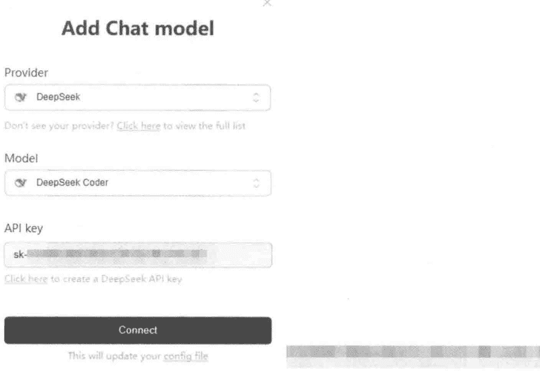

图 12-3 输入模型信息

连接成功后编辑区会弹出配置文件，如图 12-4 所示。

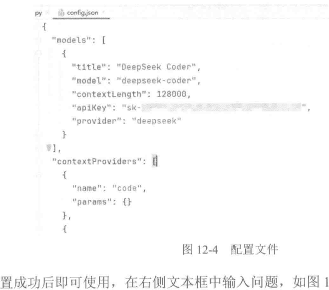

图 12-4 配置文件

配置就绪后即可提问，在右侧输入框输入问题，如图 12-5 所示。


图 12-5 进行提问

也可以在左侧代码区选中片段进行处理。选中后点 Edit 按钮或按 Ctrl+I，会弹出操作窗口，如图 12-6 所示。


在操作窗口输入执行指令，例如清除全部注释，如图 12-7 所示。


回车后可预览效果，红色区域为待删除内容，绿色区域为新增内容，如图 12-8 所示。点击绿色 Alt+Y 确认修改，最终结果如图 12-9 所示。


若想把代码带入右侧对话进行交互，可选中代码点 Chat 按钮或按 Ctrl+J，如图 12-10 所示。


选中片段会显示在右侧对话窗，输入修改需求，如图 12-11 所示，DeepSeek 会迅速返回结果，如图 12-12 所示。借助此方式可在 PyCharm 中实现补全、语法检查、代码解读等功能，效率大幅提升。


## 12.2 快速生成代码

利用 DeepSeek 生成片段并提供实现思路，可帮助学习者迅速上手。

例如输入需求“用 Python 写一个简易的学生信息管理系统，支持添加、查询、修改、删除”。模型会给出整体实现路径，让学习者明确各功能落地方式，为后续扩展提供参考。

> 请帮我用 HTML 生成一个五子棋游戏，所有代码都保存在一个 HTML 文件中。

可以实现单文件版五子棋。五子棋核心是先连成五子即胜。实现上先搭 HTML 结构与棋盘控件，再用 CSS 美化样式，最后用 JavaScript 处理落子与胜负判定。

因要求单文件，CSS 与 JavaScript 将内嵌到 `<style>` 与 `<script>` 标签内。

下面是一个基础可用的五子棋 HTML 示例：

```html
<!DOCTYPE html>
<html lang="en">
<head>
    <meta charset="UTF-8">
    <meta name="viewport" content="width=device-width, initial-scale=1.0">
    <title>五子棋游戏</title>
    <style>
        body {
            display: flex;
            justify-content: center;
            align-items: center;
            height: 100vh;
            margin: 0;
            background-color: #f0f0f0;
        }
        #board {
            display: grid;
            grid-template-columns: repeat(15, 20px);
            grid-template-rows: repeat(15, 20px);
            border: 2px solid #000;
        }
        .cell {
            width: 20px;
            height: 20px;
        }
    </style>
</head>
<body>
    <div id="board"></div>
    <script>
        // JavaScript 代码将在这里
    </script>
</body>
</html>
```

## 12.3 纠错与优化

编码时出错在所难免，DeepSeek 在定位错误与给出修正建议上非常实用。比如函数内出现拼写错误，retrun 应为 return。把代码交给模型，它能快速指出：“函数 calculate_sum 中 ‘retrun’ 拼写错误，应改为 ‘return’。” 逻辑问题也能被识别，例如循环退出条件写错导致无法结束，模型会指出问题并给出正确条件。

提升性能与质量同样重要。以 Python 计算斐波那契数列为例，原代码如下：

> 下面这段的代码的效率很低，且没有处理边界情况。请先解释这段代码的问题与解决方法，然后进行优化：

```python
def fib(n):
    if n <= 2:
        return n
    return fib(n-1) + fib(n-2)
```

注意，代码前后均有“”符号，这是 Markdown 语法。

该实现虽能得到结果，但存在明显性能缺陷，因递归反复计算相同子问题。DeepSeek 可据此给出优化方案。

### 问题剖析

1. 效率低下：
   - 使用朴素递归，fib(n-1) 与 fib(n-2) 计算中会重复求解 fib(n-2)、fib(n-3) 等，导致大量冗余。
   - 时间复杂度为指数级 O(2^n)，n 增大时耗时急剧上升。

2. 边界缺失：
   - 未处理负数输入，会造成无限递归与栈溢出。
   - 未校验非整数输入，可能产生异常行为。

### 解决思路

1. 优化递归：
   - 引入记忆化存储已算结果，避免重复。
   - 或改用动态规划迭代，自底向上计算。

2. 增加校验：
   - 入口处检查 n 是否为非负整数，不符合则抛异常或返回错误提示。

### 优化后代码

```python
def fib(n):
    # 处理边界情况
    if not isinstance(n, int) or n < 0:
        raise ValueError("Input must be a non-negative integer.")

    # 使用动态规划来优化计算
    if n <= 2:
        return n

    # 初始化前两个斐波那契数
    a, b = 1, 2
    for _ in range(3, n + 1):
        a, b = b, a + b

    return b

# 示例调用
print(fib(10))  # 输出 89
```

### 优化代码说明

1. 边界处理：
   - 用 isinstance(n, int) 判断类型。
   - 用 n < 0 判断正负。
   - 不满足则抛出 ValueError。

2. 动态规划：
   - 用 a、b 保存前两项。
   - 从 3 到 n 循环递推，更新 a、b。
   - 最终返回 b。

3. 复杂度：
   - 时间复杂度降至 O(n)，空间复杂度 O(1)，效率大幅提升。

### 小结

结合动态规划与边界检查，优化后代码在效率与健壮性上都有提升，面对大 n 时运行速度明显加快。

## 12.4 功能解读

理解代码原理是学习的关键。DeepSeek 解析功能与逻辑，能为学习者提供清晰帮助。

请解释下面这段代码的逻辑，并说明完成了什么功能：

```cpp
// weight 数组的大小即物品个数
for(int i = 1; i < weight.size(); i++) { //遍历物品
    for(int j = 0; j <= bagweight; j++) { //遍历背包容量
        if (j < weight[i]) dp[i][j] = dp[i - 1][j];
        else dp[i][j] = max(dp[i - 1][j], dp[i - 1][j - weight[i]] + value[i]);
    }
}
```

### 逻辑解读

该代码实现了 0-1 背包问题的经典动态规划求解，详细如下：

1. 变量说明
   - weight：物品重量数组。
   - value：物品价值数组。
   - bagweight：背包容量上限。
   - dp：二维数组，dp[i][j] 表示前 i 个物品在容量 j 下的最大价值。

2. 外层循环遍历物品
   `for(int i = 1; i < weight.size(); i++) {`
   - i 从 1 开始遍历每个物品。

3. 内层循环遍历容量
   `for(int j = 0; j <= bagweight; j++) {`
   - j 从 0 到 bagweight 遍历当前容量。

4. 状态转移
   `if (j < weight[i]) dp[i][j] = dp[i - 1][j];`
   `else dp[i][j] = max(dp[i - 1][j], dp[i - 1][j - weight[i]] + value[i]);`
   - 若当前物品放不下，则继承前一状态 dp[i - 1][j]。
   - 若能放下，则取不放与放下两者最大值。

## 0-1 背包 DP 核心逻辑速览

递推时 `dp[i][j]` 只取决于两种决策取较大值：

跳过当前物品沿用前一种状态，价值为 `dp[i - 1][j]`，即只用前 `i-1` 件物品在容量 `j` 下的最优；
选用当前物品则要腾出重量，价值为 `dp[i - 1][j - weight[i]] + value[i]`，即前 `i-1` 件物品在剩余容量下的最优加上本次收益。

5. 收敛结果
遍历结束时 `dp[weight.size() - 1][bagweight]` 代表用全部物品在背包容量 `bagweight` 下能得到的最大总价值。

### 代码实现要点
这段实现主要完成三件事：

1. 求解 0-1 背包
   - 输入是一组物品的重量与价值，以及背包容量上限。
   - 目标是在重量不超限的前提下挑选子集使总价值最大。
2. 动态规划求解
   - 用二维表 `dp` 保存子问题的最优解。
   - 通过上述状态转移逐步推导出全局最优。
3. 时间与空间代价
   - 外层遍历物品，内层遍历容量，复杂度为 `O(n * m)`，`n` 为物品数，`m` 为容量。
   - 二维表占用 `O(n * m)` 空间。

### 实战演示
以 `weight = [2, 3, 4, 5]`、`value = [3, 4, 5, 6]`、`bagweight = 8` 为例运行后，`dp` 的末态如下：

```
dp = [
    [0, 0, 3, 3, 3, 3, 3, 3, 3],    //只考虑第一个物品
    [0, 0, 3, 4, 4, 7, 7, 7, 7],    //考虑前两个物品
    [0, 0, 3, 4, 5, 7, 8, 9, 9],    //考虑前三个物品
    [0, 0, 3, 4, 5, 7, 8, 9, 10]    //考虑所有物品
]
```

此时读出 `dp[3][8] = 10`，说明容量为 8 时最优总价值为 10。

### 性能优化思路
1. 空间压缩
   - 状态转移只用到上一行，可把二维表换成一维 `dp[j]`。
   - 压缩后空间降到 `O(m)`。
2. 边界预处理
   - 初始化时直接填好 `dp[0][j]`，避免在循环里反复判断。

优化后代码：

```cpp
vector<int> dp(bagweight + 1, 0);
for(int i = 0; i < weight.size(); i++) {
    for(int j = bagweight; j >= weight[i]; j--) {
        dp[j] = max(dp[j], dp[j - weight[i]] + value[i]);
    }
}
```

## 12.5 智能注释生成
代码注释相当于给程序写说明书，能帮助理解功能与逻辑。DeepSeek 在这块表现很稳定，可以依据代码自动产出准确清晰的注释。以计算圆面积的 Python 示例为例，原始代码如下：

```python
import math
def calculate_circle_area(radius):
    area = math.pi * radius ** 2
    return area
radius_value = 5
result = calculate_circle_area(radius_value)
print(f"半径为{radius_value}的圆的面积是{result}")
```

把这段代码粘到 PyCharm，点击 Edit 并要求补充注释后，会得到类似图 12-16 的结果：


可以看出新增了若干绿色行，在书中显示为浅灰色，正是自动生成的注释。点 Accept All 即可全部采纳。

有了这些注释，开发者能快速把握每行意图和整体流程，即便不熟悉该段代码也能迅速上手。对团队协作而言，沟通成本明显下降，效率提升。

## 12.6 自动化测试用例生成
测试是保障软件质量的关键。DeepSeek 能根据函数功能与逻辑自动生成覆盖面广的测试用例。

在 PyCharm 中选中 `calculate_circle_area`，点 Edit 要求生成测试用例，界面如图 12-17：


可以看到新增了 4 条测试用例并附带了可直接运行的测试代码。执行后对比实际输出与预期输出即可判断函数是否正确。生成的用例兼顾常见场景与边界情况，大幅提升测试效率与代码可靠性。

# 第 4 部分
# DeepSeek 走进日常生活


# 第13章 休闲娱乐 创意无限

## 13.1 游戏策划
DeepSeek 能成为策划的创意加速器。以 2D 冒险为例，描述 “一个勇敢的冒险者，拿神奇宝剑，动作敏捷，好奇心强，中世纪复古装扮”，它会给出外貌、技能、背景的完整设定。关卡设计同样高效，比如要求 “设计一座充满神秘感的森林关卡，有隐藏宝藏、危险陷阱和友善的森林精灵”，就能得到躲避捕兽夹、帮助迷路精灵、最终在古树下寻宝的完整流程。

请策划一款塔防手游

### 塔防手游《守护者》方案

游戏名称：《守护者》
类型：塔防策略手游
目标人群：12-35 岁偏好策略与休闲的玩家

一、核心玩法
1. 游戏目标：建造并升级防御塔，抵御连续波次进攻，保住基地。
2. 关卡设计：每关固定路径与敌潮，难度随关卡提升，敌人种类、数量和路径复杂度增加。
3. 防御塔
   - 箭塔：攻击频率高，对付普通怪。
   - 魔法塔：范围伤害，克制密集群。
   - 炮塔：单发伤害高，攻速慢，针对高血量目标。
   - 冰冻塔：减速，配合队友输出。
   - 激光塔：直线穿透，适合排队敌人。
4. 敌人
   - 普通敌人：血少速度中。
   - 装甲敌人：血厚速度慢。
   - 飞行敌人：无视地面障碍，需特定塔攻击。
   - BOSS：血量与攻击高，带特殊技能。
5. 资源：击杀敌人掉金币，用于建造与升级；每波结束可选择额外奖励。

二、升级策略
1. 塔升级：每座塔可升 3 级，提升伤害、范围或特效，如箭塔升多重箭。消耗金币，高级需达成关卡或成就。
2. 技能升级：全局技能如全屏冰冻、金币加成，通过技能点升级，点数靠通关与任务获取。
3. 基地升级：提升生命与防御，解锁新塔类型，需消耗关卡与活动资源。

三、游戏特色
1. 塔组搭配：可自由组合，不同塔存在协同，如冰冻+箭塔大幅提升输出。
2. 关卡丰富：森林、沙漠、城市等多场景，特殊关卡有夜间视野限制、天气影响塔性能。
3. 英雄系统：可解锁培养英雄，拥有主动或被动增益，提供额外策略维度。
4. 社交竞技：合作模式组队攻坚高难度，竞技模式互相攻打基地比拼布局。
5. 个性化：塔外观、基地皮肤可自定义，通过任务、活动或付费获取。
6. 动态环境：天气与昼夜变化影响命中率与敌人速度，增强沉浸感。

四、商业化
- 内购：金币、技能点、英雄碎片，限时礼包、月卡。
- 广告：观看广告得奖励，失败后可看广告复活。
- 赛季通行证：完成任务升级，免费与付费双版本，付费奖励更丰厚。

总结：《守护者》以多元塔组合、丰富关卡、英雄与社交竞技，提供深度策略体验，动态天气与个性化进一步提升可玩性。

## 13.2 游戏剧本
剧本是游戏的灵魂。DeepSeek 能快速给出框架与情节。以神秘岛屿探险为主题，主角杰克·怀特为例：

游戏名称：《神秘岛之谜》
类型：冒险解谜
主题：神秘岛屿探险
主角：杰克·怀特，擅长野外生存与解谜的探险家

一、故事背景
南太平洋传闻有座“幽灵岛”，藏有古文明遗迹。杰克偶然获得古地图，踏上揭开秘密的航程。

二、章节设计
第一章 启程与登陆：操控小船躲避风暴与礁石，上岸后搭建营地收集木材与食物；夜晚野兽袭击，需设陷阱防御。
第二章 丛林探险：破解石碑谜题获取线索，规避毒蛇、巨蛛等危险，迷雾区靠指南针与地图定位。
第三章 地下遗迹：破解文字开启大门，探索机关陷阱与宝藏，石像鬼守护者可躲避或击败。
第四章 神秘湖泊：造木筏过湖，进入神庙解机关得古钥匙，湖中巨型水怪设时限挑战。
第五章 最终之谜：洞穴祭坛放置收集道具激活仪式，与岛屿守护者 BOSS 多阶段对决，利用环境取胜。
第六章 真相与结局：岛屿为古代永生实验场，最终结局分完美、普通、隐藏三种，取决于玩家选择。

三、特色
开放世界探索、动态天气昼夜、解谜与战斗结合、多样生物与多结局。

四、商业化
资源包、皮肤、DLC 扩充区域与剧情，广告换资源与提示，探险通行证解锁奖励。

## 13.3 游戏攻略
DeepSeek 能为玩家生成详细实用的攻略。

《原神》“靖世九柱”任务流程

一、开启条件
- 收集璃月全区 130 个岩神瞳，将岩主神像升至 10 级，获得 9 个追叙之石。
- 建议队伍：大剑破突变石、弓手应对飞行怪、治疗/护盾如钟离、迪奥娜。

二、流程
1. 接取：翠玦坡中央石碑交互触发。
2. 解封九柱：九根石柱分布于上下层，中部凹槽嵌入追叙之石，部分需岩造物辅助攀爬，每根解封可得精致宝箱。
3. 遗迹战斗：大门开启后连续三波：遗迹守卫、两只幼岩龙蜥、遗迹猎者+幼岩龙蜥。战斗中刷新红色突变石，用大剑/岩/雷击碎；遗迹猎者升空时用弓攻击头部使其瘫痪。
4. 奖励：藏宝室得华丽宝箱、珍贵宝箱、宗室之花与晦暗的戒指。
5. 出售戒指：夜晚卖给琳琅得 20 万摩拉，白天卖给博来得 18 万摩拉+5 个仙跳墙，完成成就“战祸不息”。

三、注意事项
推荐冒险等级 30+，备爆发与回复食物，元素视野可定位石柱，困难可联机。

四、奖励汇总
原石、摩拉、冒险经验、圣遗物等。

- 任务结算后会获得五星角色宗室之花，以及因出售方式不同而影响最后收益的晦暗戒指。主线推进完毕后，璃月区域仍可继续探索隐藏要素，例如岩神瞳的收集与各处世界任务的解锁。若不确定具体位置，可参考游戏内地图标记或玩家社群维护的互动地图进行定位。

## 13.4 灵感出行与平价自然线

假期临近却拿不定主意时，可让 DeepSeek 依据兴趣倾向与可支配开支给出指向。

以偏好人文历史、经费宽裕、倾向出境为例，可参考的方向有：

1. 意大利罗马：古罗马文明的发源都市，城内汇聚斗兽场、万神庙、古罗马广场等遗存，建筑本身承载帝国辉煌。漫步间可品正宗意式膳食，感受浓郁欧洲氛围。整体消费偏高，但资源集中、服务完善，仍值得安排。
2. 日本京都：古建筑与传统风物保存良好，金阁寺、清水寺、祇园一带韵味古朴。手工艺、茶道与在地美食均具体验价值。住宿从高档旅馆到民宿选择面广，可依花费灵活搭配；公交电车网络发达，移动成本与时间均可压缩。
3. 埃及开罗：埃及首都，也是中东非洲的大型都会。金字塔群、狮身人面像等世界级遗存吸引大量访客，埃及博物馆、萨拉丁城堡等场所则展示悠久文明。知名景点的门票不菲，但住宿餐饮相对亲民，便于做性价比分配。

想花少钱看自然风光的国内线路，可参考以下十条，适合预算有限却想亲近山水的旅行者：

1. 桂林阳朔
看点：漓江景致如诗如画，竹筏漂流、骑行十里画廊都很惬意。
消费：中低水平，食宿选择多样。
推荐月份：春季3-5月、秋季9-11月。

2. 张家界国家森林公园
看点：砂岩奇峰林立，《阿凡达》部分取景地，可玩高空栈道、天门山一线。
消费：门票偏高，住餐中等。
推荐月份：春4-6月、秋9-10月。

3. 贵州荔波小七孔
看点：清流、瀑布、原始林完整，小七孔桥与水上森林吸睛。
消费：整体偏低，住宿餐饮实惠。
推荐月份：夏季6-8月，避暑佳。

4. 云南普者黑
看点：喀斯特地貌与田园结合，《爸爸去哪儿》《三生三世十里桃花》取景地，乘船游湖诗意。
消费：偏低，适合控预算。
推荐月份：夏季6-8月，荷花盛放。

5. 四川九寨沟
看点：彩湖、瀑布、雪山交织，视觉冲击强。
消费：门票不低，周边食宿中等。
推荐月份：秋季9-10月，色彩丰富。

6. 青海湖
看点：中国最大内陆咸水湖，湖面湛蓝，周边有油菜花田、草原与雪山，适合骑行摄影。
消费：偏低，食宿友好。
推荐月份：夏季7-8月，花期最佳。

7. 安徽黄山
看点：奇松怪石云海温泉并称，传统山水画灵感来源。
消费：门票偏高，山下食宿中等。
推荐月份：春4-5月、秋9-10月。

8. 甘肃张掖
看点：丹霞地貌色彩绚丽，似天然调色盘，可徒步或坐观光车。
消费：偏低，适合预算型游客。
推荐月份：夏季6-8月，晴天色彩最艳。

9. 浙江楠溪江
看点：江水清澈，古村落与田园并存，适合徒步、漂流、摄影。
消费：偏低，住宿餐饮实惠。
推荐月份：春3-5月、秋9-11月。

10. 西藏林芝
看点：有西藏江南之称，桃花、雪山、峡谷兼具，春季桃花似画。
消费：中等，预算有限者仍可接受。
推荐月份：春季3-4月，桃花季。

出行小建议：
1. 提前锁定交通与住宿，能有效压低成本。
2. 避开旺季，淡季人少价优。
3. 多尝试本地小吃，经济又地道。

上述清单可帮助规划一次经济又难忘的自然之旅。

## 13.5 张家界三日精华行程

确定目的地后，可让 DeepSeek 输出包含日程、美食、交通的详细攻略，让行程更顺畅。

> 张家界三日精华线路

张家界以奇峰峡谷与云海著称，三天可覆盖核心区域，节奏紧凑不赶路。

Day 1 武陵源张家界国家森林公园
上午
- 交通：市区到武陵源入口约40分钟，车费约15元。
- 动线：乘天子山索道上山，单程约72元，俯瞰峰林；游览贺龙公园、御笔峰、仙女散花等观景台。
午餐：山顶餐厅，人均约50元，推荐土家特色菜。
下午
1. 换乘环保车到袁家界，观阿凡达悬浮山原型乾坤柱与天下第一桥。
2. 徒步或乘百龙天梯下山，单程约65元，被称为世界最高户外电梯。
3. 漫步金鞭溪精华段，全长7.5公里，可见猕猴、溪谷。
住宿：武陵源溪布街附近客栈，人均150-300元，夜游步行街方便。

Day 2 天门山国家森林公园
上午
- 交通：武陵源回市区约1小时。
- 动线：乘天门山索道直达顶，门票含索道278元，历时28分钟，可看九十九道弯盘山公路；走玻璃栈道，鞋套5元；参观天门山寺、鬼谷栈道。
午餐：山顶简餐，人均约40元。
下午
1. 穿山扶梯至天门洞，可走999级台阶或买扶梯票32元。
2. 下山回市区，可顺访免费大庸古城。
住宿：市区索道站附近，便于次日出发。

Day 3 张家界大峡谷玻璃桥与返程
上午
- 交通：市区到大峡谷约1.5小时，车费约30元。
- 游玩：云天渡玻璃桥，票价128元，世界最长玻璃桥，俯瞰300米深谷；徒步大峡谷，观瀑布、溪流、一线天。
下午
- 返程：前往荷花机场或高铁站约1小时。
- 时间充裕可顺路看黄龙洞，门票100元，喀斯特溶洞奇观。
住宿：市区索道站附近。

注意事项
1. 票务：旺季4-10月建议提前2天在官网或公众号购票，天门山推荐A线索道上山公路下山。
2. 着装：轻便防滑鞋，雨季备雨衣，山区多雾雨。
3. 安全：玻璃桥禁带尖锐物品，恐高者谨慎。
4. 饮食：可尝土家腊肉、酸汤鱼、蒿子粑粑，避免景区高价团餐。

费用估算 人均
- 门票：国家森林公园228元+天门山278元+玻璃桥128元≈634元。
- 交通：往返合计约150元。
- 食宿：3天约500元。
- 总计约1300-1500元。

核心亮点
- 自然奇观：阿凡达取景地、天门洞、玻璃桥。
- 刺激体验：悬崖栈道、高空索道、天梯攀登。
- 人文体验：土家族风情、溪布街夜景。

按此安排三天可高效打卡精华，若体力允许可延长时间游览金鞭溪或黄龙洞。

# 第14章 个性化服务随行

## 14.1 商务场合穿搭参考

日常为不同场景挑选衣物常让人纠结。DeepSeek 可依据场合与天气给出贴心方案。例如商务会议着装，男士可选深色西装如黑、藏蓝或深灰，配白衬衫素领带、黑皮鞋与简约皮带，呈现专业稳重；女士可选修身西装套裙或裤装，深色为主配浅衬衫，中跟皮鞋，盘发或简约披肩发搭配珍珠饰品，显优雅干练。

登山出行建议：上身速干透气T恤或专业登山服，外搭防风层应对多变天气；下身弹力耐磨运动长裤或登山裤；鞋选防滑支撑透气的专业登山鞋；另备遮阳帽与太阳镜。

参加重要商务会议应该如何着装

会议着装需传递专业、尊重与可信度，同时兼顾正式程度与文化背景。

一、按会议类型选择
1. 传统正式商务会议 金融、法律、跨国谈判
男士
- 西装：藏蓝、炭灰定制羊毛混纺，避免高亮面料。
- 衬衫：纯白或浅蓝法式袖扣衬衫，领口留约一指空隙。
- 领带：真丝材质，宽7-8cm，斜纹或波点，长度及腰带扣。
- 鞋袜：牛津或德比鞋黑/深棕，袜长至小腿，与鞋同色。
- 细节：袖口外露约1cm，口袋巾单峰折叠，避免运动表。
女士
- 套装：修身裤装或及膝裙装，精纺羊毛。
- 内搭：真丝V领或立领衬衫，避免透视蕾丝。
- 鞋履：尖头浅口高跟5-7cm，裸色或哑光黑。
- 配饰：单颗珍珠耳钉，皮质托特包，避免响亮手镯。
2. 半正式商务会议 科技、创意行业
男士
- 海军蓝单西配灰羊毛裤，可不系领带。
- 浅灰或淡粉免烫衬衫，可解第一颗扣。
- 麂皮乐福鞋配隐形船袜。
女士
- 及膝裹身连衣裙莫兰迪色，外搭针织开衫。
- 方头中跟鞋3-5cm，可拼色。
3. 商务休闲会议 初创公司、内部汇报
男士
- POLO针织衫+休闲西装外套。
- 卡其斜纹棉裤，脚踝微卷。
- 皮质小白鞋，避免运动logo。
女士
- 高领羊绒衫+垂感阔腿裤，外搭长马甲。
- 粗跟踝靴3cm，可带金属扣。

二、成败关键细节
1. 面料质感 优先抗皱高支棉、羊毛混纺，保持整洁。
2. 色彩心理 浅灰显亲和，全黑易显生硬，红色攻击性强。
3. 气味管理 熨烫后使用无味除静电喷雾，香水点于脚踝。
4. 科技隐藏 耳饰式蓝牙耳机，手机静音，笔记本皮质套。
5. 动态适应 备可拆内衬应对空调，暗纹领带应对临时升级场合。
6. 文化敏感 注意不同国家服饰礼仪差异。

三、特殊场景应对
- 夏季高温：亚麻混纺西装含15%聚酯防皱，内搭速干衬衫。
- 临时邀约：办公室常备折叠防皱西装与免打领结。
- 视频会议：上身挺括衬衫，避免条纹摩尔纹，下身可休闲。

四、预算分配
西装外套占40%，皮鞋25%，衬衫批量购基础款，配饰可选平价替代。

五、禁忌清单
明显logo服饰、露趾鞋/破洞牛仔、闪亮袖扣珠宝、西装未剪标签。

总结：商务着装是视觉语言，需在开口前传递可靠与准备充分。建议提前观察会场穿着，备一件衬衫与去渍笔，检查背部侧面线条是否利落。

## 14.2 马拉松训练规划

想减脂塑形或保持健康，制定科学计划很重要。DeepSeek 可依据个人状况、目标与时间安排个性化方案。

> 目标参加今年广州马拉松全程完赛，当前5公里31分钟，每晚训练1小时。

基于目标与现有水平设计的16周训练方案，兼顾耐力、速度与伤病预防。

一、能力评估与配速
5公里31分钟约配速6:12/km，全马完赛预估约5小时30分，需重点提升有氧耐力。核心为建立长距离慢跑能力、提高阈值、强化核心稳定。

二、周训练结构 6练1休
周一 有氧轻松跑 50min 心率最大50-70%可说话
周二 间歇速度训练 60min 配速5:30-5:50/km
周三 力量+动态拉伸 60min 下肢核心为主
周四 阈值节奏跑 60min 心率最大70-90%
周五 交叉训练骑行游泳 45min 低冲击有氧
周六 长距离慢跑 递增 心率最大60-70%配速6:30-7:00/km
周日 休息或瑜伽拉伸 恢复

三、分阶段计划
阶段1 基础耐力期第1-4周
目标适应跑量、稳关节。周六里程8→12→15→18km。周二间歇400m快+400m走6组逐步转800m快+400m慢4组。力量靠墙静蹲3×60s、单腿硬拉每侧3×12、平板支撑3×90s。

阶段2 强度提升期第5-10周
目标提升乳酸阈值。周六里程20→22→25→28→30→32km。周四阈值10min热身+30min阈值配速6:00/km+10min放松。间歇1km快5:40/km+400m慢×5。

阶段3 赛前调整期第11-16周
目标减量增效。周六里程35→30→25→20，第16周12km。第14周按6:40/km跑25km，第15周负分割训练后半程快5%。力量减负重增爆发跳箱高抬腿。

四、关键细节
长距离每周六进行，比目标配速慢30-60s/km，携带能量胶每45min一支模拟补给。间歇严格快慢比1:1，心率达最大85-90%。力量每周三循环深蹲跳15、侧平板抬臀每侧12、弹力带蚌式20、波比跳10，重复3轮。

五、伤病预防
跑前动态热身10min高抬腿踢臀弓步转体。跑后静态拉伸15min股四头肌腘绳肌小腿。周一次泡沫轴放松髂胫束足底筋膜。膝持续痛或跟腱刺痛需减量就医。

六、营养睡眠
训练日碳水每公斤6g，选低GI燕麦红薯。跑后30min内摄入20-30g乳清蛋白。每晚7-8h睡眠，睡前1h不用电子设备。

七、装备
两双跑鞋交替缓震与长距离款。速干短袖加压缩裤防潮。防磨膏涂腋下大腿内侧，空顶帽防晒透气。

八、赛前3天
减量至日常30%，仅20min轻松跑。赛前48h碳水占70%。熟悉广州马拉松坡度图，重点猎德大桥段。

按此执行完赛成功率较高，建议每月测一次5公里，第12周目标28min内，动态调整强度。

## 14.3 命名灵感

为新生儿起名常让父母费心。传统方式多靠翻字典或请教他人，仍难兼顾独特性与寓意。DeepSeek 的出现为起名难题提供了新解法。

**好名速成：结合命理与大数据**

即将迎来宝宝的年轻夫妻，在取名上花费了不少心思。想要读音好听、契合生辰八字，还希望重名率别太高。于是他们把预产期、姓氏、寓意偏好整理成需求交给 DeepSeek。模型综合五行生克规律，并结合近年高频用名的统计，结合姓氏给出了一批可用的个性化方案。最终夫妻在提供的清单里选定了一个中意的名字，为孩子的人生开了个好头。

> 帮 2024 年 9 月出生的男孩，姓张，他起一个名字。要求：名字带王字旁和三点水，符合五行生克原理，寓意要好。

针对“张姓男婴、带王字旁与三点水、兼顾五行与意境”的需求，整理如下思路：

1. 张泽琛（zhāng zé chēn）
   - 释义：
     - 泽：水旁，象征恩泽润物，喻仁厚、福气深。
     - 琛：王旁，意指珍宝，喻才华出众、价值高。
   - 五行：
     - 泽属水，琛属金，属水生金，流通顺畅。
   - 总意：才情突出、品格高雅、福泽绵延。

2. 张润琪（zhāng rùn qí）
   - 释义：
     - 润：水旁，指滋养，喻温润如玉、思维敏捷。
     - 琪：王旁，代表美玉，喻珍贵非凡。
   - 五行：
     - 润属水，琪属木，水能生木，助力平稳成长。
   - 总意：如玉温润、学识亮眼、前途通达。

3. 张浩瑜（zhāng hào yú）
   - 释义：
     - 浩：水旁，取浩瀚之意，喻胸襟开阔、志向远大。
     - 瑜：王旁，意为美玉，喻德才兼备。
   - 五行：
     - 浩属水，瑜属土，土克水，但瑜中王部属金，金生水，整体趋于平衡。
   - 总意：气量宽广、德艺并重、处事稳健。

4. 张淇玮（zhāng qí wěi）
   - 释义：
     - 淇：水旁，本为水名，喻清澈纯净。
     - 玮：王旁，指美玉，喻珍贵杰出。
   - 五行：
     - 淇属水，玮属土，土克水，但玮中王属金，金生水，可相互调和。
   - 总意：清新脱俗、才华显露、品行端正。

5. 张澜珅（zhāng lán shēn）
   - 释义：
     - 澜：水旁，形容波澜，喻气势磅礴、胸怀宽厚。
     - 珅：王旁，意为美玉，喻珍贵出众。
   - 五行：
     - 澜属水，珅属金，水生金，形成相生格局。
   - 总意：气度轩昂、能力突出、前程光明。

小结
以上五组均满足王部与水部的组合要求，意蕴积极且五行多为相生或可调和，可按个人喜好挑选。如需微调释义，可随时沟通。

## 14.4 厨房实战
对零基础的烹饪爱好者而言，厨房常像陌生考题。有了 DeepSeek 的分步指引，即便是新手也能把较复杂的菜式端上桌。

以意式家庭餐为例，计划做意面、煎牛排和提拉米苏，对没经验的人压力不小。提前说明需求：“为家人做一顿意大利餐，含意面、牛排、提拉米苏，请列出食材与工具”。系统迅速给出清单：意面 300 克、番茄 2 个、洋葱半个、大蒜 3 瓣等，以及煮锅、平底锅、煎锅等。操作顺序上，先制作需冷藏定型的提拉米苏，耗时最长；随后准备意面与酱汁，煮面与炒酱时间可同步；最后煎牛排，确保上桌时口感最佳。全程陪伴后，新手也能游刃有余。

> ❓ 家里现在有生菜、排骨、西红柿、鸡蛋、莴笋、豆腐等，配菜调料齐全，想做 2～3 道菜，要求口味清淡、营养丰富。要怎么做？

✅ 基于现有食材，推荐 3 道清淡家常菜：

1. **清蒸排骨莴笋**
食材：排骨、莴笋
调料：姜片、葱段、料酒、盐、生抽、白胡椒粉
做法：
1. 排骨洗净泡水 30 分钟去血水，沥干。
2. 加入姜片、葱段、1 勺料酒、少许盐、白胡椒粉腌 20 分钟。
3. 莴笋去皮切滚刀块铺盘底。
4. 将腌好的排骨放上，水开后蒸 30 分钟。
5. 出锅淋生抽，撒葱花。
特点：原汁原味，莴笋吸饱汤汁，清爽不腻。

2. **西红柿豆腐鸡蛋汤**
食材：西红柿、豆腐、鸡蛋
调料：盐、香油、葱花
做法：
1. 西红柿切块，豆腐切块，鸡蛋打散。
2. 锅中水开后下西红柿煮软。
3. 加入豆腐块煮 2 分钟。
4. 缓慢倒入蛋液，筷子轻拌成蛋花。
5. 加盐调味，淋香油撒葱花。
特点：酸甜开胃，豆腐配蛋提供优质蛋白。

3. **清炒生菜**
食材：生菜
调料：蒜末、盐、食用油
做法：
1. 生菜洗净沥干。
2. 热锅凉油，下蒜末爆香，加入生菜快炒。
3. 加少量盐，炒至微软出锅。
特点：爽口清淡，富含维生素与膳食纤维，适合作配菜。

搭配建议：
- 主食可配米饭或杂粮饭，让营养更均衡。
- 餐后一杯温热绿茶，有助消化。

总结：
- 清蒸排骨莴笋：荤素搭配，清鲜可口。
- 西红柿豆腐鸡蛋汤：酸甜适口，营养充足。
- 清炒生菜：简便清爽，补充维生素。
三道菜清淡均衡，适合日常食用。

## 14.5 个性化营养方案
不同人群的饮食诉求差异很大，制定专属食谱是常见需求。DeepSeek 可依据身体状况、健身目标与饮食偏好给出方案。

比如一位乳糖不耐受的增肌爱好者，需要在保证营养的同时规避乳糖。系统为其规划一周餐单，早餐建议燕麦粥配水煮蛋和低糖水果，燕麦提供膳食纤维，鸡蛋提供优质蛋白，水果补足维生素；午餐安排糙米饭、烤鸡胸肉和

### 孕妇饮食计划（23周，血糖偏高）

目标：平稳血糖，保障母婴营养。
原则：以低升糖食物为主，分次进食，营养均衡。

#### 一、每日饮食结构
1. 主食类：选用低升糖食物，控制总量。
2. 蛋白质：优质蛋白为主，促进胎儿发育。
3. 脂肪：适量健康脂肪，避免饱和脂肪过量。
4. 膳食纤维：增加蔬菜与全谷物摄入，辅助控糖。
5. 分次进食：每日三餐加两至三次加餐，避免血糖波动。

#### 二、每日饮食安排

##### 早餐（7:30—8:00）
- 主食：全麦面包 1 片约 30g 或燕麦粥燕麦 40g 水煮。
- 蛋白质：水煮蛋 1 个。
- 蔬菜：黄瓜或番茄 100g。
- 饮品：无糖豆浆 200mL 或低脂牛奶 200mL。

##### 上午加餐（10:00—10:30）
- 水果：苹果 1 个约 150g 或柚子 2 瓣。
- 坚果：核桃 2 颗或杏仁 5 颗。

##### 午餐（12:00—12:30）
- 主食：杂粮饭糙米加小米总量约 80g。
- 蛋白质：清蒸鱼如鲈鱼 100g 或鸡胸肉 100g。
- 蔬菜：清炒菠菜 200g 或蒸西兰花 200g。
- 汤品：紫菜蛋花汤少油少盐。

##### 下午加餐（15:30—16:00）
- 酸奶：无糖酸奶 150g。
- 水果：蓝莓 50g 或猕猴桃 1 个。

##### 晚餐（18:30—19:00）
- 主食：红豆饭红豆加大米总量约 80g。
- 蛋白质：豆腐 100g 或瘦牛肉 100g。
- 蔬菜：清炒莴笋 200g 或蒸南瓜 150g。
- 汤品：冬瓜海带汤少油少盐。

##### 晚间加餐（21:00—21:30）
- 饮品：低脂牛奶 200mL。
- 小食：全麦饼干 2 片约 20g。

#### 三、饮食注意事项
1. 控制主食：选低升糖食物如燕麦、糙米、全麦面包，避免精制糖与高升糖食物。每餐主食约 80g。
2. 增加纤维：多吃绿叶菜、豆类、全谷物，每餐蔬菜不低于 200g。
3. 优质蛋白：选鱼类、鸡胸肉、瘦牛肉、豆腐等低脂高蛋白，每日约 80～100g。
4. 健康脂肪：适量坚果、橄榄油、亚麻籽油，避免油炸。
5. 分次进食：每日三餐加两至三次加餐，避免一次性摄入过多。
6. 避开高糖：避免含糖饮料、甜点、糖果，水果选低糖品种，每日不超过 200g。
7. 补水：每日饮水 1500～2000mL，避免含糖饮料。

#### 四、运动建议
- 每日餐后散步 20～30 分钟，有助控糖。
- 以轻度活动为主，避免剧烈运动。

#### 五、血糖监测
- 定期监测空腹与餐后血糖，记录饮食与血糖变化，及时调整方案。

希望该方案能帮助平稳血糖并保证营养摄入。

# 第15章 文学创作，灵感引擎

## 15.1 诗歌创作
诗歌以凝练韵律承载深情，创作需文学底蕴与想象力。DeepSeek 为诗歌创作带来新助力。

> 以奋斗为题，创作一首现代诗。

《锈骨》
指纹在混凝土上签名
每个棱角都浸出盐粒
黑夜被锻打成
一把弯向自己的镰刀
我们习惯用伤疤计数
像年轮吞下所有质问的斧头
当代码在键盘上起义
当焊枪缝合城市的裂痕
沉默的血管里
铁正以液态的速度结晶
有人在废墟上校准星光
把未爆的雷种进眼眶
直到黎明咬碎止痛片
直到所有倒下的影子
都成为扶起下一个趔趄的
支点
而风仍在吹——吹散锈迹斑斑的姓名
吹动一具具不肯降落的躯体
朝着地心引力
相反的方向生长

## 15.2 剧本构思
剧本是影视骨架，优秀剧本依靠精彩故事、鲜明人物与张力对话。DeepSeek 在剧本构思上表现突出。

> 创作一个校园青春剧剧本大纲，主要讲述一群高中生在追求梦想的道路上，相互鼓励、共同成长的故事，包含主要角色设定、关键情节和主题表达。

1. 校园青春剧剧本大纲：《追梦少年》
主题：青春、梦想、友情、成长
背景：某市重点高中，一批性格各异的高中生在追梦路上经历挫折，最终找到人生方向。

### 一、主要角色设定
1. 林晓阳（男主角）
   - 性格：阳光开朗，热爱篮球，梦想成为职业球员。
   - 背景：家境普通，父母希望专心学习，他坚持篮球梦。
2. 苏雨晴（女主角）
   - 性格：温柔细腻，擅长写作，梦想成为作家。
   - 背景：父母离异，与母亲同住，内心敏感但坚强。
3. 陈子豪（男配角）
   - 性格：学霸，理性冷静，梦想成为科学家。
   - 背景：家境优渥，父母期望高，内心压力大。
4. 赵小萌（女配角）
   - 性格：活泼开朗，热爱音乐，梦想成为歌手。
   - 背景：家庭支持音乐，但在学业与梦想间挣扎。
5. 班主任李老师
   - 性格：严厉而关爱学生，善于引导学生找准方向。

### 二、关键情节
#### 第一幕：初识与梦想萌芽
- 开学第一天：林晓阳、苏雨晴、陈子豪、赵小萌分入同一班级。
- 自我介绍：四人分享梦想，遭部分同学调笑。
- 老师鼓励：李老师表示梦想是人生的灯塔，要坚持追逐。

#### 第二幕：追梦路上的挫折
- 林晓阳困境：训练与学业冲突，父母反对打球。
- 苏雨晴迷茫：投稿屡被拒，怀疑写作能力。
- 陈子豪压力：父母要求参加竞赛，他更想做科研。
- 赵小萌挣扎：音乐比赛失利，成绩下滑，被迫考虑放弃。

#### 第三幕：友情的力量
- 四人组形成：校园文化节合作演出，默契增强。
- 相互扶持：彼此支持，共同面对困难。
- 林晓阳突破：重要比赛虽未夺冠，却赢得父母认可。

#### 第四幕：成长与选择
- 苏雨晴成长：在朋友帮助下重振，获全国作文比赛奖。
- 陈子豪觉醒：与父母沟通后获得支持，专注科研。
- 赵小萌坚持：在鼓励下重返舞台，用音乐打动众人。

#### 第五幕：毕业与新起点
- 毕业典礼：回顾高中生活，感慨万千。
- 各自选择：林晓阳获篮球奖学金，苏雨晴被名校文学系录取，陈子豪进入科研项目，赵小萌签约音乐公司。
- 友情延续：约定无论未来如何，都坚持梦想并保持联系。

### 三、主题表达
1. 青春与梦想：展现青春美好与梦想力量。
2. 友情与支持：朋友互助是成长关键动力。
3. 成长与抉择：经历挫折后守住初心，找到自己的路。

### 四、剧本亮点
1. 真实感：贴近高中生活，呈现学业、家庭、梦想间的拉扯。
2. 情感共鸣：友情、亲情、师生情引发共鸣。
3. 正能量：传递积极价值观，鼓励勇敢追梦。

如需完整剧本，可进一步细化提问逐步完善。

## 15.3 小说世界观
小说以想象力与细腻描写构建世界，需扎实文字功底与严谨逻辑。DeepSeek 可辅助激发灵感。

> 帮我创作一部玄幻小说的世界观设定，包括主要种族、势力分布、修炼体系和神秘遗迹，1000字以内。

玄幻小说世界观设定：《天穹纪元》

### 一、世界背景
- 世界名称：天穹界
- 世界构成：由九大洲组成，洲间隔着无尽海域，海域中藏有无数神秘岛屿与远古遗迹。
- 时间设定：分为“上古纪元”与“天穹纪元”，前者为神灵统治时代，后者为凡人崛起时代。

### 二、主要种族
1. 人族：
   - 特点：智慧与创造力高，擅长修炼与炼器。
   - 分布：九大洲均有，以中洲为核心。
   - 势力：建立九大皇朝，各自统治一洲。
2. 妖族：
   - 特点：体魄强悍，血脉之力突出，分兽妖、羽妖、海妖等。
   - 分布：主要在东荒洲与南海洲。
   - 势力：以万妖盟为核心，内部竞争激烈。
3. 灵族：
   - 特点：与自然元素亲和，擅长操控灵气。
   - 分布：隐居西灵洲森林山脉。
   - 势力：以灵神殿为信仰中心，崇尚自然与平衡。
4. 魔族：
   - 特点：拥有黑暗之力，性格冷酷，追求力量。
   - 分布：北冥洲深渊与荒原。
   - 势力：以魔渊城为核心，等级森严。
5. 龙族：
   - 特点：具龙血之力，寿命悠长，实力强大。
   - 分布：隐居天穹海深处龙岛。
   - 势力：以龙皇为尊，很少干预外界。

### 三、势力分布
1. 九大皇朝：人族建立，统治九洲，既合作也竞争，核心为中洲天穹皇朝。
2. 万妖盟：妖族联合势力，对抗人族与魔族。
3. 灵神殿：灵族信仰中心，实力深不可测。
4. 魔渊城：魔族统治中心，位于北冥洲深渊。
5. 龙岛：龙族栖息地，神秘与力量象征。

### 四、修炼体系
1. 修炼境界：
   - 炼气境：吸纳灵气，强化肉身。
   - 筑基境：凝聚灵气核心，奠定基础。
   - 金丹境：凝聚金丹，实力大增。
   - 元婴境：金丹化婴，拥有神通。
   - 化神境：元婴化神，操控天地之力。
   - 渡劫境：经历天劫，迈向超凡。
   - 大乘境：近神，拥有毁天灭地之力。
2. 修炼方式：
   - 人族：以功法为主，擅长炼器与阵法。
   - 妖族：以血脉为主，觉醒天赋神通。
   - 灵族：以元素亲和为主，操控自然。
   - 魔族：以黑暗之力为主，修炼魔功。
   - 龙族：以龙血之力为主，天生强大。

### 五、神秘遗迹
1. 天穹神殿：位于中洲，上古神灵遗迹，藏有成神秘密，千年开启一次。
2. 万妖古墓：位于东荒洲，上古妖族墓地，藏血脉之力，危机四伏。
3. 灵神古树：位于西灵洲，灵族圣地，蕴含强大生命力。
4. 魔渊之门：位于北冥洲，魔族禁地，传说通往魔界。
5. 龙族秘境：位于天穹海龙岛，传承之地，藏龙族秘密与龙血之力。

### 六、主题与核心冲突

九族天穹·信仰与宿命

世界观围绕力量象征、信仰指引、族群共存与个体命运展开。核心张力在于九大族群为争夺天穹界主宰权展开激烈博弈，同时追索上古神祇遗留的线索，逐步揭开天穹界的真相。以上设定仅作参考，后续可按需增补调整。

## 15.4 散文

散文以自由舒展见长，用细腻的笔触和真挚的情绪打动读者。写好散文需要对情感有敏锐的觉察和独特的表达。DeepSeek 可依据主题与情绪生成散文，呈现细腻的情感流动。

> 用汪曾祺的语感，写一篇以饮食为线索的短文，约八百字。

《面香记》

我一直觉得，饮食是最能映照一地人情风物的入口。就说面，南北迥异，各具风味。北地讲究筋骨，汤浓味厚；南边偏爱清雅，汤色明亮，面条纤细柔软。我偏偏更喜欢南方的面，尤其是家乡那碗阳春。

阳春名字听起来文雅，做法却很朴素。一锅清汤，一把面条，加上葱花与几滴香油便完成。看似简单，滋味却很绵长。汤以老骨慢熬，清澈而鲜美；面条手工擀制，细长弹韧；葱花新鲜翠绿，香气扑鼻。上桌时热气升腾，香气四溢，令人食指大动。

小时候常跟着父亲去镇上那家面摊。摊位不大，生意却很火。掌柜圆脸中年，笑容常在，手里端着大勺在灶前忙碌。父亲每次都要两份阳春，一份给我一份自用。碗端来，他先抿一口汤，随后眯眼露出满足的神情。我学着他的样子也喝一口，果然鲜香。面条滑溜，一吸进嘴，咀嚼起来细腻甘甜。葱香与油香在口中散开，忍不住一口接着一口，直至见底。

后来离乡远行，吃过不少面。北方的炸酱面酱香浓郁，面条粗犷有嚼劲；川味担担面麻辣鲜香，吃得满头大汗；粤式云吞面汤清味鲜，云吞皮薄馅足。每种都有独特风味，却总觉得少了些什么。某次返乡重访老店，点了一碗阳春。汤仍清透，面仍柔软，葱花仍青翠。喝一口汤，我才明白，缺少的是家乡的味道。

家乡味是骨子里的记忆，无论走到哪里都忘不了。就像那碗阳春，平实却温暖，清淡却余韵悠长。它不张扬、不浓烈，却能在不经意时勾起最深的思念。

如今那家店已不见，老板也不知去向。可阳春的滋味始终留在记忆里。每当疲惫或迷茫，便会想起父亲眯眼饮汤的模样，想起蒸腾的香气，想起那段朴素温暖的日子。

吃不只是填饱，更是情感的寄托。一碗面承载着记忆、乡愁与回不去的时光。家乡的滋味，就像阳春，平常却始终温暖人心。

## 15.5 儿童睡前故事

睡前故事是陪伴孩子入眠的温柔伙伴，好的故事能点燃想象、培养美好品格。儿童故事需要语言生动、情节清晰且有教育意义。DeepSeek 创作的故事具备这些特质。

> 为学龄前儿童讲一个关于小狐狸与母亲的童话，要求体现狐狸一家温馨生活，以及母亲鼓励孩子独立成长。

童话故事：《小狐狸的初次探险》

### 背景

在一片秀美的林子里，住着一对狐狸母子。狐狸母亲温柔聪慧，小狐狸活泼好奇。他们住在温暖的树洞，每天一起觅食嬉戏，生活快乐。

### 正文

#### 第一章：清晨温情

清晨阳光洒进林间，小狐狸伸懒腰钻出树洞。狐狸母亲已备好早餐，新鲜浆果与一只小兔。

“妈妈，今天浆果真甜！”小狐狸边吃边说。

狐狸母亲笑着看他：“吃饱了，妈妈带你去林子里玩，好吗？”

小狐狸高兴地跳起来：“太好了！我最喜欢跟妈妈一起探险了！”

#### 第二章：林中惊奇

狐狸母亲领着小狐狸来到林深处，这里有高大乔木和五彩花朵，小狐狸看得眼花。

“妈妈，那是什么花？”小狐狸指着红花问。

“那是野蔷薇，花瓣很香，但茎上有刺，要小心。”狐狸母亲温柔解释。

小狐狸点点头，小心嗅了嗅花香，又蹦跳向前。

忽然一只蝴蝶在阳光下闪光。

“妈妈，我想追它！”小狐狸兴奋说。

狐狸母亲笑了笑：“去吧，但要留神，别跑太远。”

小狐狸追蝴蝶跑，不知不觉跑到林子另一边，停下时发现迷路了。

#### 第三章：勇敢归途

小狐狸有些害怕，但想起母亲的话：“迷路别慌，先找熟悉的地方。”

他深吸气，观察四周。看到一棵高大橡树，那是他与母亲常玩的地方。

“我知道回家的路了！”小狐狸高兴喊。他沿着橡树方向慢慢走回家。

狐狸母亲在树洞前焦急等待，见小狐狸回来松了口气。

“妈妈，我迷路了，但我找到了回家的路！”小狐狸骄傲说。

狐狸母亲抚他头：“你真棒！妈妈为你骄傲。”

#### 第四章：母亲的鼓励

夜里，狐狸母亲与小狐狸坐在树洞前看星星。

“妈妈，我今天有点怕，但还是自己找到了路。”小狐狸说。

狐狸母亲温柔说：“宝贝，你长大了，要学会独立。妈妈不可能永远在你身边，但你要记住，无论遇到什么困难，都要勇敢面对。”

小狐狸点头：“我知道了，妈妈。我会更勇敢的！”

### 结尾

从那天起，小狐狸开始尝试独自探索林子。他学会辨认方向，认识更多动物朋友，还帮助一只迷路的野猪。狐狸母亲看到小狐狸的成长，心中充满欣慰。

### 寓意

1. 温馨家庭：狐狸母亲与小狐狸的互动展现家庭温暖与关爱。
2. 独立成长：母亲鼓励孩子勇敢面对困难，学会独立。
3. 勇敢与智慧：小狐狸通过努力找到回家路，体现勇敢和智慧的重要性。

愿这个故事让孩子感受到家庭温暖，同时学会勇敢独立。如需更多细节或调整，请随时告知。

# 第16章 心灵呵护，温暖相伴

## 16.1 亲子沟通

孩子成长中亲子沟通至关重要。进入青春期后叛逆常让关系紧张。DeepSeek 如同经验丰富的亲子沟通专家，为家长提供有效沟通建议。

> 我的孩子上初中后进入叛逆期，总是和我对着干，我该怎么沟通？

青春期叛逆是成长自然阶段，代表孩子在探索自我、建立独立性。作为家长，理解和有效沟通策略有助于更好建立联系。建议如下：

1. 保持冷静与耐心
   - 说明：叛逆期孩子可能情绪波动或挑衅，保持冷静有助于避免冲突升级。
   - 建议：孩子对抗情绪时，深呼吸保持冷静，避免立即反应。

2. 倾听与尊重
   - 说明：孩子需要感受到意见和感受被尊重。
   - 建议：认真倾听孩子想法，即使不同意，也要表现出理解和尊重。

3. 建立信任
   - 说明：信任是良好沟通基础。
   - 建议：通过遵守承诺和保持一致性建立信任，让孩子知道可以依赖你。

4. 设定明确界限
   - 说明：孩子需要知道行为界限和后果。
   - 建议：与孩子一起制定家规，并明确违反规则后果。

5. 鼓励积极行为

## 16.2 心理疏导

现代生活节奏快，工作压力大，很多人面临焦虑抑郁等心理问题。生活中难免遇到挫折，导致情绪低落、愤怒、焦虑等。如何有效调节情绪，保持积极乐观心态，是需要学习重要技能。DeepSeek 可以为用户提供多种情绪调节方法，帮助在情绪低落时迅速调整心态。

一位职场人士因工作任务繁重经常加班，压力过大出现焦虑情绪。他向 DeepSeek 倾诉：“最近工作压力太大了，我每天都很焦虑，晚上也睡不好，该怎么办？” DeepSeek 安慰他说：“工作压力大确实会让人感到焦虑，这是很正常的反应。你可以尝试一些放松方法缓解焦虑，比如深呼吸，慢慢吸气再缓缓呼气，重复几次，让身体和大脑放松下来；也可以在下班后进行适量运动，像跑步、瑜伽等，运动能促进身体分泌内啡肽，改善情绪。另外，合理安排工作时间，制定清晰工作计划，把大任务分解成小目标，逐步完成，也能减轻压力。”在 DeepSeek 帮助下，这位职场人士通过调整心态和生活方式，焦虑情绪得到明显缓解，工作和生活也逐渐步入正轨。

我今天被领导批评了，心情很差，怎么才能让自己好起来？

被领导批评后感到心情低落是很正常反应，但重要的是如何调整心态并从中吸取教训。以下是一些建议，帮助你尽快恢复心情并提升自我：

- 1. 接受情绪
  - 解释：允许自己感受到情绪，不要压抑或忽视它们。
  - 建议：给自己一些时间消化情绪，可以通过写日记或与信任朋友倾诉释放情绪。

- 2. 理性分析
  - 解释：冷静下来后，理性分析批评内容，找出其中合理部分。
  - 建议：列出批评中具体点，思考如何改进，避免未来再犯类似错误。

- 3. 积极面对
  - 解释：将批评视为成长机会，而不是对个人否定。
  - 建议：制定改进计划，设定具体目标和步骤，逐步提升自己。

- 4. 寻求反馈
  - 解释：主动寻求更多反馈，了解自己不足和改进方向。
  - 建议：与领导或同事沟通，询问具体改进建议，展示积极态度。

- 5. 自我肯定
  - 解释：不要因为一次批评而否定自己全部价值。
  - 建议：回顾自己成就和优点，增强自信心，保持积极心态。

- 6. 放松身心
  - 解释：适当放松有助于缓解压力，恢复心情。
  - 建议：进行一些放松活动，如散步、听音乐、冥想或运动，帮助自己放松身心。

- 7. 设定小目标
  - 解释：通过实现小目标逐步恢复信心。
  - 建议：设定一些容易实现小目标，完成后给予自己奖励，增强成就感。

- 8. 寻求支持
  - 解释：与朋友、家人或同事分享感受，获得情感支持。
  - 建议：与信任人交流，听取建议和鼓励，帮助你渡过难关。

- 9. 保持积极心态
  - 解释：保持积极心态有助于更快从挫折中恢复。
  - 建议：每天给自己一些积极心理暗示，提醒自己这只是暂时挫折。

通过以上方法，你可以逐步调整心态，从批评中吸取教训，并继续前进。记住，每个人都会遇到挫折，关键是如何应对和成长。希望你能尽快恢复心情，继续努力！

## 16.3 评估心理健康

心理健康状况直接影响人们生活质量和工作效率。DeepSeek 可以通过对话和问卷形式，对用户心理健康状况进行全面评估，及时发现潜在心理问题。

我是一个新妈妈，最近一直情绪低落、行动迟缓、记忆力差、睡眠不好，且体重增加，我有什么心理问题吗？

作为新妈妈，您描述症状确实需要重视，这些可能是产后心理或生理变化信号。以下是一些可能情况和建议：

### 一、可能的原因

- 1. 产后抑郁症
  - 典型表现：持续情绪低落、兴趣减退、睡眠障碍，部分人可能出现食欲增加和体重上升。
  - 数据参考：约 10%～15% 新手妈妈会经历产后抑郁，通常在产后 6 周内出现。

- 2. 产后甲状腺功能异常
  - 甲状腺激素波动可能导致疲劳、体重增加、情绪波动，需通过血液检查排除。

- 3. 睡眠剥夺与适应期压力
  - 新生儿照护导致长期睡眠碎片化会引发记忆力下降、情绪敏感。

### 二、建议行动步骤

- 1. 优先就医排查
  - 挂妇科/内分泌科：检查甲状腺功能、性激素水平。
  - 心理科/精神科：通过爱丁堡产后抑郁量表评估心理状态。

- 2. 自我调节策略
  - 微休息法：利用婴儿小睡时间进行 10 分钟正念呼吸。
  - 情绪日记：每天花 5 分钟记录三件小事，对抗消极思维。
  - 饮食调整：增加富含 Omega-3 食物，有助于缓解抑郁情绪。

- 3. 构建支持系统
  - 分工协作：与伴侣制定值班表，确保每天有至少 3 小时连续睡眠；
  - 社群联结：加入线上/线下新手妈妈互助小组，减少孤独感。

### 三、重要提醒

- 这不是您的错：产后激素剧烈波动会直接影响大脑情绪调节功能，无需自责。
- 警惕微笑抑郁：部分妈妈会刻意在他人面前表现正常，但内心痛苦，这种情况更需要主动求助。
- 紧急信号：若出现伤害自己或孩子念头，请立即联系家人或拨打心理援助热线。

请记住，寻求帮助不是软弱，而是您对孩子和自己负责表现。您已经在用最大爱完成艰巨任务，现在轮到我们支持您了。

## 16.4 辅助心理治疗

对于如抑郁症、焦虑症等心理疾病患者，除专业药物治疗和心理咨询外，日常生活心理调节也很重要。DeepSeek 可以作为辅助工具，为患者提供日常心理调节建议，帮助他们更好地应对疾病。

### 中度抑郁症如何治疗？

中度抑郁症治疗通常需要综合性方法，包括心理治疗、药物治疗和生活方式调整。以下是常见治疗建议：

- 1. 心理治疗
  - 认知行为疗法：帮助患者识别和改变负面思维模式和行为。
  - 人际关系疗法：专注改善患者人际关系，减少因人际问题引发抑郁情绪。
  - 心理动力学治疗：通过探索患者潜意识和早期经历，帮助理解抑郁根源。

- 2. 药物治疗
  - 抗抑郁药：如选择性 5-羟色胺再摄取抑制剂、5-羟色胺和去甲肾上腺素再摄取抑制剂等。
  - 注意事项：药物治疗应在医生指导下进行，定期复诊以调整药物剂量和种类。

- 3. 生活方式调整
  - 规律作息：保持规律睡眠和饮食习惯，避免熬夜和不规律生活。
  - 适度运动：如散步、瑜伽、游泳等，有助于提升情绪和身体健康。
  - 健康饮食：均衡饮食，增加富含 Omega-3 脂肪酸食物。

- 4. 社会支持
  - 家庭和朋友支持：与家人和朋友保持联系，分享感受，获得情感支持。
  - 支持小组：参加抑郁症支持小组，与其他患者交流经验和感受。

- 5. 自我照顾
  - 放松技巧：如深呼吸、冥想、渐进性肌肉放松等，帮助缓解压力和焦虑。
  - 兴趣爱好：培养兴趣爱好，增加生活乐趣和满足感。

- 6. 专业帮助
  - 定期复诊：与心理医生或精神科医生保持定期联系，评估治疗效果和调整治疗方案。
  - 危机干预：如果出现轻生念头或行为，立即寻求专业帮助或拨打紧急求助电话。

- 7. 避免自我诊断和自我治疗
  - 专业评估：抑郁症诊断和治疗应由专业医生进行，避免自行诊断和用药。

- 8. 长期管理
  - 持续治疗：抑郁症治疗通常需要长期管理，即使在症状缓解后，也应继续遵循医生建议。

- 9. 教育和自我学习
  - 了解抑郁症：通过阅读相关书籍、参加讲座等方式，增加对抑郁症了解，增强自我管理能力。

- 10. 避免孤立
  - 社交活动：积极参与社交活动，避免孤立自己，增加与外界互动。

中度抑郁症治疗需要耐心和持续努力，建议在专业医生指导下进行综合治疗。希望这些建议对您有所帮助。

# 第5部分

# DeepSeek 赋能艺术

# 第17章 视觉创作实践

## 17.1 HTML 生成图片

DeepSeek R1 不能直接生成图片，但它的推理能力和代码能力都非常出色。所以核心逻辑是让它生成代码、脚本或提示词。

> 请用 HTML 格式设计并制作我的个人简历，提供下载图片按钮，但图片中不包含按钮本身。

单击代码下方的“运行 HTML”按钮，打开新页面。

```html
<button class="download-btn" onclick="downloadResume()">下载简历图片</button>

<script>
function downloadResume() {
    html2canvas(document.querySelector("#resumeContent")).then(canvas => {
        const link = document.createElement('a');
        link.download = '我的简历.png';
        link.href = canvas.toDataURL();
        link.click();
    });
}
</script>
```

特点说明：

- 1. 响应式布局设计，适配不同屏幕尺寸

- 2. 使用 html2canvas 库将简历内容转换为图片

- 3. 下载按钮独立于简历内容之外，生成的图片仅包含简历内容

- 4. 现代简洁的视觉设计，包含：

  - 柔和阴影效果

  - 色块分割标题

  - 舒适的字体间距

- 5. 包含以下简历基本模块：

  - 个人信息

单击“下载简历图片”按钮，即可获得图片，如图 17-1 所示。

### 个人简历

#### 基本信息

姓名：张三

电话：123-4567-8901

邮箱：zhangsan@example.com

地址：北京市朝阳区

#### 教育背景

学校：北京大学

专业：计算机科学与技术

学历：本科

时间：2015年9月 - 2019年6月

#### 工作经历

公司：腾讯科技有限公司

职位：前端开发工程师

时间：2019年7月 - 至今

描述：负责公司核心产品的前端开发与优化，参与多个大型项目的设计与实现。

#### 技能

编程语言：JavaScript, HTML, CSS, Python

框架：React, Vue.js, Node.js

工具：Git, Webpack, Docker

图 17-1 HTML 页面

## 17.2 生成 AI 绘画提示词：漫画作品

漫画角色即刻成型

在绘漫画的流程里，DeepSeek 很适合当创意副手，既能补充灵感也能加速推进。用校园日常作主题来演示，主角的打磨就能交给他来完成。给出明确的需求：需要一位阳光开朗的女高中生，齐肩短发，平时习惯穿着整洁校服，性格活泼且热衷运动，同时是校篮球队的核心球员。

> 帮我写一段适合 AI 绘图工具的漫画画面描述。风格是漫画，主体是一个开朗活泼的女高中生，头发齐肩，校服整洁，热爱运动，是篮球队主力。

下面是可直接使用的绘图提示，专门用于呈现漫画感的女生形象：

**绘图提示：**
日系漫画笔触，开朗活泼的女高中生，发到肩的短发，干净校服，运动气质，校篮球队核心成员，灿烂笑容，充满朝气，球场环境，篮球场作为背景，动感姿态，手握篮球，汗珠飞溅，青春校园气息，亮色调，线条细腻，兼具可爱与飒爽。

**要点拆分**
- 1. 角色设定：
  - 开朗活泼的女高中生：鲜明性格基调。
  - 发到肩的短发：发型细节明确。
  - 干净校服：突出学生属性。
  - 热爱运动，校篮球队核心：身份与背景锁定。
- 2. 场景与动作：
  - 运动场景，篮球场背景：提供故事语境。
  - 动感姿态，手握篮球，汗珠飞溅：强调运动张力。
- 3. 风格与氛围：
  - 青春校园气息：营造蓬勃感。
  - 亮色调，线条细腻：贴合漫画表现。
  - 日系漫画笔触：确定绘画方向。
  - 可爱与飒爽兼具：平衡气质。

**画面示例**
- 女生立于球场中央，身着整洁校服，短发随风微扬。
- 她紧握篮球，笑容明亮，眼神自信，满是活力。
- 背景为明亮的球场，队友与观众作虚化处理，烘托比赛紧张氛围。

AI 绘图的核心是把文字指令具象化。
- 整体色调明亮，线条精致，青春感十足。

把 DeepSeek 提供的指令复制到任意文生图工具即可出图。这类工具选择很多，外网有 Midjourney，国内有即梦、秒画等。以即梦为例，登录后如图 17-2 所示。

把指令填进文本框，点击下方的“立即生成”，稍等片刻即可看到结果，如图 17-3 所示。

### 17.3 思维导图快速搭建
用 DeepSeek 制作思维导图，可以把复杂思路理顺，学习与工作效率都会提升。在项目规划时，能迅速从目标、任务拆解、时间节点到资源分配等维度展开细化。以软件开发项目为例，导图以项目目标为中心，向外延伸各阶段任务，每个任务再细化具体工作内容和负责人，项目全貌一目了然，便于团队协同，确保推进顺畅。

> 生成一份《冰与火之歌》的人物关系图，用思维导图方式呈现，我需要 mermaid 代码。

下面是用 Mermaid 语法生成的《冰与火之歌》主要人物关系图代码，覆盖多个核心家族及关键成员间的关联。

```
mindmap
  root((冰与火之歌))
    史塔克家族
      艾德·史塔克
        凯特琳·徒利
          罗柏·史塔克
          珊莎·史塔克
          艾莉亚·史塔克
          布兰·史塔克
          瑞肯·史塔克
      琼恩·雪诺
      班扬·史塔克
    兰尼斯特家族
      泰温·兰尼斯特
        瑟曦·兰尼斯特
          乔佛里·拜拉席恩
          托曼·拜拉席恩
          弥赛菈·拜拉席恩
        詹姆·兰尼斯特
        提利昂·兰尼斯特
    坦格利安家族
      韦赛里斯·坦格利安
      丹妮莉丝·坦格利安
        卓戈卡奥
        琼恩·雪诺
    拜拉席恩家族
      劳勃·拜拉席恩
      瑟曦·兰尼斯特
      史坦尼斯·拜拉席恩
      蓝礼·拜拉席恩
    其他重要人物
      小指头（培提尔·贝里席）
      瓦里斯
      桑铎·克里冈（猎狗）
      布蕾妮
```

**说明：**
1. 史塔克家族：围绕艾德·史塔克展开，呈现其与妻子凯特琳·徒利及子女的关系，并点出琼恩·雪诺的特殊身份。
2. 兰尼斯特家族：以泰温·兰尼斯特为中心，展示与子女瑟曦、詹姆、提利昂的关系，以及瑟曦与拜拉席恩家族子女的联系。
3. 坦格利安家族：以韦赛里斯和丹妮莉丝为核心，体现丹妮莉丝与卓戈卡奥的婚姻，以及她与琼恩·雪诺的关联。
4. 拜拉席恩家族：以劳勃·拜拉席恩为核心，呈现其与兄弟史坦尼斯、蓝礼的关系，以及与瑟曦的婚姻。
5. 其他重要人物：涵盖小指头、瓦里斯、猎狗、布蕾妮等关键角色。
6. 使用方法：将代码复制到支持 Mermaid 的环境，如 Markdown 编辑器、Obsidian、VS Code 等，即可渲染成图。如需扩充，按剧情发展添加人物与关系即可。

打开 Mermaid 官方网站，把生成的图表代码粘贴到左侧代码区，就能实时生成图形，如图 17-4 所示。

图 17-4 Mermaid 生成思维导图

Mermaid 语法支持流程图、甘特图、饼图、思维导图等近 20 种图表形式，都可以用同样方式生成。

### 17.4 Janus Pro 7B 演绎水墨
Janus Pro 7B 是 DeepSeek 官方推出的多模态文生图模型，和 DeepSeek 可以无缝配合。先用 DeepSeek 撰写指令，再用 Janus Pro 出图，效率很高。

水墨画作为中国传统绘画的代表，以独特的笔墨韵味和意境著称。以创作山水画为例，向 DeepSeek 发出提问。

> 帮我写一段适合 AI 绘图的指令，要求：水墨画风格；内容：创作一幅展现宁静山水意境的水墨画，画面中有巍峨的山峰、流淌的溪流、茂密的树林和古朴的亭台。

以下是适配 AI 生成的宁静山水意境水墨指令：

**绘画指令：**
水墨画笔触，宁静山水意境，巍峨山峰，潺潺溪流，茂密树林，古朴亭台，远山如黛，近水含烟，云雾缭绕，层次分明，墨色浓淡得当，笔触细腻流畅，传统中国画风格，留白艺术，意境深远，古典雅致，自然与人文和谐共存。

**指令拆解**
- 1. 画面元素：
  - 巍峨山峰：表现山势雄浑。
  - 潺潺溪流：增添动态与生命感。
  - 茂密树林：丰富层次与自然气息。
  - 古朴亭台：点缀人文，增添古意。
- 2. 水墨风格：
  - 墨色浓淡得当：体现水墨特有韵味。
  - 笔触细腻流畅：强调技法精致。
  - 留白艺术：突出传统留白美学。
- 3. 意境与氛围：
  - 宁静山水意境：营造悠远安宁感。
  - 远山如黛，近水含烟：描绘朦胧美。
  - 云雾缭绕：增强神秘与层次。
  - 古典雅致：彰显传统文化气质。

**画面示例**
- 远处巍峨山峰矗立，墨色明暗交错，立体层次明显。
- 近处溪水蜿蜒，波光柔和，与山石相映。
- 山脚与溪畔林木繁茂，墨色深浅变化自然。
- 林间若隐若现一座古朴亭台，结构简洁，韵味十足。
- 山间云雾缭绕，留白之处留下无限遐想。

这些指令能帮助你得到一幅古韵十足的水墨山水。

打开 Janus Pro 7B 页面，如图 17-5 所示，点击 Text-to Image Generation。


把 DeepSeek 产出的指令粘贴到输入框，点击 Generate Images 按钮，几秒后即可看到生成结果，如图 17-6 所示。


在 DeepSeek 配合下，水墨创作不再受限于固有思路，创作者能获得更多灵感与创新可能，推动水墨艺术持续发展。

### 17.5 字体设计灵感加速
DeepSeek 在字体设计上表现突出，能快速理解需求并给出富有创意的方案。

> 请用 100 字左右进行字体设计描述，要求：设计“云南”两个字，文字内融入云南传统文化和地方特色，代表性特色或标志，图像立体，国潮风。

> 设计以“云南”二字为载体，融入彝族刺绣纹样与白族扎染蓝白渐变底色。横竖笔画化为梯田层叠肌理，转折处嵌入鎏金孔雀翎羽浮雕；“云”字起笔勾勒雪山金顶，末笔晕染出普洱茶汤氤氲；“南”字右竖化作傣族银器錾刻的象鼻轮廓，负空间点缀滇金丝猴剪影。采用翡翠绿叠加深褐的立体勾边，局部点缀朱砂红山茶花纹，在传统木刻版画质感中融入几何化的国潮线条，整体形成山水人文交织的立体图腾。

把 DeepSeek 给出的指令复制到即梦的图片生成中，下载即可，如图 17-8 所示。


# 第18章 视频生成与视觉玩转

## 18.1 数字人视频制作
在数字技术高速发展背景下，DeepSeek 在数字人生成上的能力相当突出，为多个领域带来新机会。

首先用 DeepSeek 生成一段视频文案，如图 18-1 所示。


[1] 数字人：运用数字技术创造的、与人类形象接近的数字化人物形象。

《中华人民共和国治安管理处罚法》第四十二条规定，写恐吓信或者以其他方法威胁他人人身安全的，处五日以下拘留或者五百元以下罚款；情节较重的，处五日以上十日以下拘留，可以并处五百元以下罚款。

【法律知识提示】

- 1. 理性评价：消费者在行使评价权时，应基于客观事实，避免恶意诋毁、诽谤商家。
- 2. 保留证据：遇到商家骚扰、威胁等情况，要及时保留相关证据，如录音、录像、聊天记录等，以便维护自身合法权益。
- 3. 寻求帮助：如果商家行为恶劣，可以拨打12315消费者投诉热线或向当地市场监管部门投诉，必要时可以报警处理。

【结尾】

好了，今天的案例就分享到这里。希望大家在遇到类似情况时，能够勇敢地拿起法律武器维护自身权益。我是XX，关注我，了解更多法律知识，我们下期再见！

图 18-1（二） 生成文案

文案完成后，打开剪映桌面版，用抖音账号登录，进入工作台，点击“AI文案成片”，如图 18-2 所示。


图 18-2 剪映界面

随后浏览器会自动打开，进入“AI文案成片”页面，如图 18-3 所示。

零基础玩转国产大模型 DeepSeek

AI文案成片


在页面中点开“数字人”区域，右侧会出现数字人成片工作区。在“推荐形象”里选择“专业律师”，也可挑选“实拍形象”。把 DeepSeek 产出的文案复制到文案区，选择合适的配音，点击“生成”按钮，如图 18-4 所示。


文案

《中华人民共和国消费者权益保护法》第十五条规定，消费者享有对商品和服务进行监督、批评的权利。

《中华人民共和国治安管理处罚法》第四十二条规定，写恐吓信或者以其他方法威胁他人人身安全的，处五日以下拘留或者五百元以下罚款；情节较重的，处五日以上十日以下拘留，可以并处五百元以下罚款。

【法律知识提示】

- 1. 理性评价：消费者在行使评价权时，应基于客观事实，避免恶意诋毁、诽谤商家。
- 2. 保留证据：遇到商家骚扰、威胁等情况，要及时保留相关证据，如录音、录像、聊天记录等，以便维护自身合法权益。
- 3. 寻求帮助：如果商家行为恶劣，可以拨打12315消费者投诉热线或向当地市场监管部门投诉，必要时可以报警处理。

好了，今天的案例就分享到这里。希望大家在遇到类似情况时，能够勇敢地拿起法律武器维护自身权益。我是XX，关注我，了解更多法律知识，我们下期再见！


试试样例


图 18-4（二） 选择形象

剪映会自动拆分文案，分步生成视频，如图 18-5 所示。


图 18-5 创建视频

生成后可预览效果。点击右上角“导出”按钮，如图 18-6 所示，即可下载到本地，如图 18-7 所示。


图 18-6 预览视频


图 18-7 导出视频设置

## 18.2 卡通短片生成
在短视频与动画赛道，DeepSeek 以强劲的 AI 能力为创作者提供高效创意支持。以制作 5 分钟卡通短片为例，传统团队可能耗时数周，现在借助 DeepSeek，几天内就能完成。它能快速产出卡通画面，大幅提升创作效率，让创意更快落地。

> 生成关于梁祝十八相送的卡通版 AI 绘画指令

以下是“十八相送”场景的卡通版 AI 绘画指令，融合场景、风格与情感氛围：

**绘画指令：**
“卡通风格的梁祝十八相送场景，春日的江南水乡，青山绿水，阳光明媚，梁山伯与祝英台并肩走在蜿蜒的小路上，路边开满鲜花，蝴蝶在两人周围翩翩飞舞。梁山伯身穿书生长袍，神情温柔；祝英台身着轻盈衣裙，眉眼间透着一丝不舍。画面中有小桥流水、竹林花海，远处是朦胧的山峦，整体色彩清新明亮，充满童话般的浪漫氛围。画风细腻柔和，线条流畅，带有中国传统水墨画的意境，同时融入现代卡通风格的可爱元素。画面中心突出两人的情感互动，背景音乐悠扬婉转，传递出淡淡的忧伤与深情。”

- **关键词细化：**
- 1. 场景：江南水乡，春日风光，小桥流水，竹林花海，蝴蝶飞舞。
- 2. 人物：梁山伯（书生长袍，温柔神情），祝英台（轻盈衣裙，不舍表情）。
- 3. 风格：卡通风格，细腻柔和，线条流畅，色彩清新明亮。
- 4. 氛围：浪漫、温馨、略带忧伤，充满童话般的梦幻感。
- 5. 细节：中国传统水墨画意境，现代卡通可爱元素，情感互动突出。

这段指令可让 AI 生成既有传统韵味又具卡通浪漫氛围的“十八相送”画面。

进入即梦平台，把 DeepSeek 产出的绘画指令复制进去进行文生图，如图 18-8 所示。生成 4 张图后，选用第 4 张作为底图，切换到“视频生成”页面，选择“图片生视频”，上传选图，输入视频描述，内容描述也可由 DeepSeek 生成，点击“生成视频”按钮，即可得到视频，如图 18-9 所示。

零基础玩转国产大模型 DeepSeek


## 18.3 3D 角色打造
是否想象过自己打造一个灵动的 3D 角色，让它在屏幕里活起来？借助 DeepSeek、即梦 AI、混元 3D 等工具就能实现。

首先从外观设计入手。打开 DeepSeek，输入：“生成 AI 文生图指令，要求：蒙古族少女手办，Q 版人物形象，有民族特色的服装。”回车后，DeepSeek 会给出详细指令，如图 18-10 所示。

生成AI文生图指令，要求：蒙古族少女手办，Q版人物形象，有民族特色的服装

以下是一个关于“蒙古族少女手办”的AI文生图指令，结合了Q版人物形象和民族特色服装的描述：

**绘画指令：**
“Q版蒙古族少女手办，可爱的卡通形象，圆圆的脸蛋，大眼睛充满灵气，微笑的表情甜美动人。她身穿传统蒙古族服饰，头戴华丽的蒙古族头饰，头饰上镶嵌着彩色宝石和流苏，身穿绣有精美花纹的长袍，腰间系着彩色腰带，脚踩绣花靴子。服装以蓝色、白色和金色为主，充满民族特色。背景是辽阔的草原，远处有蒙古包和牛羊，天空湛蓝，白云朵朵。整体画风清新可爱，色彩明亮，细节精致，充满童趣和民族风情。”

**关键词细化：**
- 1. **人物形象**：Q版蒙古族少女，圆圆的脸蛋，大眼睛，甜美微笑。
- 2. **服装细节**：传统蒙古族服饰，华丽头饰（彩色宝石、流苏），绣花长袍，彩色腰带，绣花靴子。
- 3. **色彩风格**：蓝色、白色、金色为主，明亮清新。
- 4. **背景**：辽阔草原，蒙古包，牛羊，蓝天白云。
- 5. **画风**：可爱卡通风格，细节精致，充满童趣和民族风情。

通过这段指令，AI可以生成一个既可爱又充满民族特色的蒙古族少女手办形象，适合用于手办设计、插画创作等场景。希望对你有帮助！

图 18-10 生成手办图片指令

这段指令相当于给 AI 的指令，指令越清晰，理想图像的概率越高。

DeepSeek 并非无所不能，其产出的提示文案通常需要结合实际渲染结果进行人工修正。建议一次性生成若干版本并横向对照，再挑选最符合预期的那一份。总体来说，大模型只是提效的协作工具，实际表现很大程度上取决于使用者的引导与调整。

把 DeepSeek 提供的描述粘贴到即梦 AI，点击生成，稍等片刻即可得到 Q 版少女手办的视觉结果，具体效果参见图 18-11 所示。

四张输出中保留第二张用于后续制作。下一步是将平面图像转化为立体资产。打开腾讯混元 3D 官网，启用图生 3D 功能，导入已保存的图片，并在设置面板中开启生成 PBR 贴图的选项，位置见图 18-12 所示。

零基础玩转国产大模型 DeepSeek


图 18-11 生成手办图片


图 18-12 腾讯混元 3D

开启该开关后，输出的三维资产会自带材质贴图。页面底部点击自动旋转即可逐角度检查，如图 18-13 所示；右侧下载按钮可导出 GLB 格式文件。

至此静态模型已完成。若希望模型产生动作，就需要进行骨骼绑定。混元 3D 网页版虽提供绑定与动作驱动，但对造型适配有限，实践中更建议转到 Blender、Mixamo 等专业软件自行探索。


图 18-13 生成 3D 模型

# 第 6 部分 未来展望


# 第19章 DeepSeek 的未来发展

DeepSeek 面世之后，对日常起居与职业工作都产生了可感知的改变，并带来诸多正面效应。日常场景里，它像 24 小时在线的智慧管家，可协助规划出行路线、学习新生活技能、化解琐碎烦恼，提供实用建议，让生活更省心也更有乐趣。职业场景中，它是效率放大器，能帮助科研人员、程序员、教师等群体减少时间消耗，提升交付质量，推动项目顺利落地。

往后看，其应用边界有望持续扩展。农业方面，可融合土壤状况与气象数据，为种植者提供定制化建议，涵盖品种选择、播种时机、灌溉施肥方案等，有助提升产量与品质，维护粮食安全。交通方面，可接入智慧交通系统，实时解析车流态势，优化信号灯配时，预判事故与拥堵风险，为驾驶者推荐更优路径，缓解通行压力。环保方面，可处理监测数据，推演污染发展趋势，并提出针对性治理方案，助力可持续发展。

随着技术迭代，DeepSeek 的能力仍在扩充。它或将与物联网、区块链等技术深度耦合，构建更智能更安全的生产生活环境。智能家居领域，可连接各类设备，按个人习惯自动调节光线、温湿度等参数，带来更舒适的居住体验。智能医疗领域，远程诊断与手术辅助有望普及，让用户无论身处何地都能获得高质量医疗服务。

DeepSeek 的演进为未来打开了一扇新的窗口，潜力巨大。期待更多人主动尝试、深入体验其价值，让它成为日常生活与工作的可靠伙伴，共同迎接更美好的明天。

# 参考文献

- [1] RUSSELL S, NORVIG P. 人工智能：一种现代方法[M]. 2版. 姜哲，译. 北京：人民邮电出版社，2004.

- [2] 吴军. 智能时代：大数据与智能革命重新定义未来[M]. 北京：中信出版社，2016.

- [3] 秦阳，章慧敏，张伟崇. WPS Office 办公应用技巧宝典[M]. 北京：人民邮电出版社，2022.

- [4] GOODFELLOW I, BENGIO Y, COURVILLE A. 深度学习[M]. 赵申剑，黎彧君，符天凡，等译. 北京：人民邮电出版社，2017.

- [5] 深度求索. DeepSeek API 文档[EB/OL]. (2025-1-20) [2025-3-1] https://api-docs.deepseek.com/zh-cn/.

- [6] 石头. AI 绘画与摄影实战 108 招：ChatGPT+Midjourney+文心一格[M]. 清华大学出版社，2024.

- [7] 文之易，蔡文青. ChatGPT 实操应用大全[M]. 北京：中国水利水电出版社，2023.

- [8] 新境界. ChatGPT 从入门到实践[M]. 北京：中国水利水电出版社，2024.

- [9] 万俊. 大语言模型应用指南：以 ChatGPT 为起点，从入门到精通的 AI 实践教程[M]. 北京：电子工业出版社，2024.


# 零基础 玩转国产大模型 DeepSeek

微信号：Waterpub-Pro


唯一官方微信服务平台

ISBN 978-7-5226-3349-7


定价：58.00元

销售分类：计算机与互联网/人工智能