# AI编程零门槛：DeepSeek 与 Windsurf 实战全攻略

# 前言

## 与智能共行，开启创造之旅
——智能时代创作者起步手册

年轮流转，我们已彻底进入智能驱动的世代。过去仅存于科幻中的设想，如今已渗入日常：随身语音助手、千人千面信息流，以及能进行深度对话、协同创作的 DeepSeek 类大模型。技术迭代加速，人工智能正以惊人速度改写工作、学习与生活的运行规则。

## 编写初衷

当 AI 快速演进时，编码不再是工程师的专属标签。伴随 DeepSeek 等智能编程助手普及，入门门槛被大幅拉低，未经训练的读者也能较快利用代码解决实际难题。本书正基于这一现实，助零基础读者借力智能工具掌握编程，并把成果落地到工作与生活。

智能编程的本质是新型的人机协同，即借助 AI 辅助学习知识、理解概念、生成与优化代码。这种方式让学习者绕过传统路径中的技术卡点，把精力放在问题拆解与创意落地，而不是死磕语法细节与底层实现。

归根结底，学习智能编程是在掌握一种新的思维方式与表达语言，一种与智能协作、解决问题、创造价值的能力。它关乎效率与职业成长，也关乎我们如何认知智能边界，并在人机协作的新范式下重新定义人的价值。

市面上编程书籍要么偏专业晦涩，要么未结合智能工具的优势。本书融合 DeepSeek、Windsurf 等工具，为零基础读者提供一条更平顺的学习捷径。

## 适合人群

本书主要面向：

- 对编码好奇却毫无基础的读者
- 希望用代码提升工作效率的职场人士
- 想了解智能如何重塑编码方式的读者
- 对 DeepSeek 等智能工具感兴趣的用户
- 想快速掌握实用编码技能的学生

无论是编程零经验的入门者，还是已有经验想了解智能编程新方法的开发者，都能从中获得指引。

## 特色概览

- 新手友好：从最基础的概念讲起，无需前置知识
- 智能驱动学习：深度结合 DeepSeek、Windsurf，降低难度
- 实用导向：聚焦真实场景问题，而非纯理论
- 案例丰富：大量实战案例辅助理解与落地
- 由浅入深：循序渐进，跟得上节奏
- 中文本地友好：特别关注中文环境下的编码需求

## 阅读建议

全书共 11 章，分三部分展开：

### 第一部分（第1～6章）智能编程入门
从环境搭建起步，在 DeepSeek 指引下学习 Python 基础，包括变量、数据类型、列表操作等，为后续项目打基础。本部分以 Windsurf 为主力开发工具，配合 DeepSeek 让学习更高效智能。

### 第二部分（第7～10章）项目实战
掌握基础后进入实操。通过 DeepSeek+Windsurf 完成数据分析报告自动生成系统与自动化日报工具，学会把知识应用到真实问题。随后挑战本地事务提醒助手与个人网站开发，体会项目开发中的各类挑战。

### 第三部分（第11章）总结与展望
回顾学习历程，提炼智能编程的方法论与核心收获，分享对该领域的思考，并展望其对未来职业技能的影响，既是回顾也是继续深入的指南。

建议阅读方式：
- 先通读入门部分，掌握概念与 DeepSeek 使用方法
- 按兴趣选择实战章节学习
- 遇到问题时参考常见问题思路
- 务必动手跑通每个示例并尝试改写扩展

编程是实践技能，只有动手才能真正掌握。

## 鸣谢

感谢 DeepSeek 研发团队打造出优秀的智能工具，为编程学习带来新可能。感谢参与编写、审校与测试的同事，专业与热情让本书得以出版。最后感谢选择本书作为智能编程起点的每一位读者，愿你在这个智能时代掌握编程技能，找到乐趣，解决实际问题。

祝学习愉快！

# 第一部分 智能编程入门

本部分讲解 Python 编程基础，以及如何借助 DeepSeek 等智能工具加速学习。这些概念不仅适用于 Python，也适用于大多数语言，将陪伴你的整个编程生涯。

第1章探讨智能时代普通人学习编程的意义，分析为何要学、能做什么、能带来哪些新机会。
第2章介绍 DeepSeek 编程使用指南，讲解 DeepSeek 是什么、如何登录与使用，以及核心能力、应用场景与高效提示示例。
第3章介绍在 DeepSeek 指导下快速搭建 Python 编程环境，包括环境概览、选择、安装流程与常见问题解决。
第4章讲解借助 DeepSeek 学习 Python 变量与简单数据类型，包括解析器、信息存储、字符串与数字处理。
第5章与第6章聚焦 Python 列表。第5章学习列表基本概念与操作，第6章深入高效操作技巧。

学完本部分，你将掌握借助 DeepSeek 学习 Python 的方法，并学会用智能工具提升学习效率与编码能力，为项目实践奠定基础。

# CHAPTER 1 第1章 智能时代大众如何切入编程

本章探讨在智能时代非专业人士为何能学、应学编程。你会看到编程如何从程序员专属技能变成人人可用的实用工具，并通过案例了解它如何解决工作生活中的真实问题，从数据处理到流程自动化。本章还将介绍 DeepSeek 等智能工具如何改变学习方式，规避传统痛点，并创造新的职业机会。学完后你将建立正确的编程认知，为后续学习做好准备。

## 1.1 本章学习目标

帮助读者理解智能时代学习编程的重要性。阅读后你将明白：

- 智能时代为何非专业人士也应掌握基础编程技能
- 人们能用编程解决哪些实际问题
- 智能工具如何降低学习门槛并带来新机会

## 1.2 智能时代为何要学习编程

过去编程被视作高门槛专业技能，如今随着 DeepSeek 等智能工具出现，门槛大幅下降，学习变得前所未有的容易。

（1）数字化转型下的核心竞争力
几乎所有行业都在被数字技术重塑：制造业引入智能工厂与数据分析，零售业转向电商与个性化推荐，医疗应用 AI 辅助诊断与远程医疗，教育发展在线学习与自适应系统。在此背景下，基础编程思维已从锦上添花变为职场竞争力的必备武器。

（2）提升个人效率与解决问题能力
编程本质是解决问题的工具。学习编程能够：培养结构化思维与逻辑分析能力；自动化重复任务提升效率；增强数据分析与决策能力；获得创造数字工具解决特定问题的能力。

（3）智能时代的学习优势
与以往不同，智能时代学习编程优势明显：智能助手可提供实时指导与代码建议；高质量学习资源免费可得；语言与工具更友好易用；社区支持完善，问题解决更便捷。在智能辅助下，普通人可跳过传统痛点，更快掌握实用技能并解决实际问题。

## 1.3 智能编程能做什么

技术发展让编程不再是开发者的专利，非专业人士也能借助智能轻松解决工作与生活问题，创造惊艳成果。

### 1.3.1 用智能编程解决工作中的问题

还记得温州那位无编程背景的小伙陈云飞吗？他仅用1小时就用智能做出“小猫补光灯”App，迅速获得超3万下载，一度冲上 AppStore 分类榜 Top20。半个月后迭代的 Pro 版更登顶 AppStore 收费总榜第一。这就是智能编程的魔力，让想法快速变为产品。

**1. 用编程高效处理数据报表**
小林是互联网公司运营专员，每周需手工合并5个部门、不同格式的 GMV 报表，整理数据花3天，做 PPT 再花2天。如今只需给 DeepSeek 一段输入，就能生成自动化脚本，自动抓取、清洗、合并数据并产出可视化图表与报告初稿。

**DeepSeek 输入范例：**
> 编写一个智能脚本，解决数据合并与报告生成的难题：每周自动抓取、清洗、合并 5 个不同部门、不同格式的 GMV 报表，并生成可视化图表与报告初稿。

**DeepSeek 产出方案示例：**
- 总结：智能数据合并与报告生成系统
- 一、核心功能
  - 自动数据抓取：从 5 个不同部门收集不同格式（Excel/CSV）的 GMV 报表。
  - 智能清洗与转换：处理缺失值、去重、标准化数据（如日期、产品 ID）。
  - 自动合并：整合多部门数据，确保一致性。
  - 可视化分析：生成关键图表（收入占比、Top 产品、趋势线、热力图）。
  - 报告生成：自动输出结构化 PDF 报告（含摘要、图表、数据表）。
  - 邮件通知：自动发送报告给相关人员。
- 二、代码架构
  - ……（此处省略具体内容，读者可利用提示自行尝试并查看）
  - 2.1 数据分析（自动计算关键指标）
    - ……（此处省略具体内容，读者可利用提示自行尝试并查看）
  - 2.2 报告生成（PDF + 可视化）
    - ……（此处省略具体内容，读者可利用提示自行尝试并查看）
  - 2.3 自动化执行
    - ……（此处省略具体内容，读者可利用提示自行尝试并查看）
- 三、技术亮点
  - ……（此处省略具体内容，读者可利用提示自行尝试并查看）

**效果小结：**
即使是相对简单的智能程序或自动化脚本，也能为你节省数小时甚至数天时间，让你从重复劳动中解放，专注更有创造性的工作。

**2. 用编程批量处理发票**
张姐是连锁餐饮财务，每天处理200多张发票。约35%时间用于扫描识别，40%用于手工核对。如今她只需让 DeepSeek 设计一个工具，通过拍照自动识别抬头、金额、税号等关键信息，并生成会计凭证或录入系统的详细设计方案，再在代码编辑工具中执行即可得到自动化系统。

**DeepSeek 输入范例：**
> 构建一个智能工具，实现发票信息的自动化识别与凭证生成；通过拍照自动提取发票抬头、金额、税号等关键信息，并自动生成会计凭证或直接录入系统，解放财务人员，提高效率。

**DeepSeek 产出方案示例：**
发票信息自动化识别与凭证生成系统设计方案
一、系统概述
该智能工具旨在通过 OCR 技术和机器学习算法，自动识别发票中的关键信息，并生成会计凭证或直接录入财务系统，大幅提升财务工作效率。
二、核心功能模块
- 发票图像采集模块
  - ……（此处省略具体内容，读者可利用提示自行尝试并查看）
- 智能 OCR 模块
  - ……（此处省略具体内容，读者可利用提示自行尝试并查看）
- 智能校验模块
  - ……（此处省略具体内容，读者可利用提示自行尝试并查看）
- 凭证自动生成模块
  - ……（此处省略具体内容，读者可利用提示自行尝试并查看）
- 系统对接模块
  - ……（此处省略具体内容，读者可利用提示自行尝试并查看）
三、预期效益
- 效率提升：单张发票处理时间从 5 ~ 10 分钟缩短至 30 秒内。
- 准确性提高：识别准确率达 98% 以上，减少人为错误。
- 成本节约：减少 60% 以上的基础财务工作人力成本。
- 数据价值：积累结构化财务数据，支持后续分析决策。

这个系统显著提升财务处理效率，让财务人员转向更高价值工作，同时提高数据准确性与时效性。

> OCR 为光学字符识别。——编辑注

**效果小结：**
DeepSeek 生成的自动化系统，即使是相对简单的解决方案，也能大幅节省处理时间，摆脱繁琐事务，将精力投入更有价值的工作。

**3. 用编程实现智能客户沟通**
王哥是医疗器械销售主管，客户咨询分散在微信、钉钉、短信等多渠道，信息零散易遗漏。借助 DeepSeek，他可构建智能客户沟通管理系统，实现信息聚合、智能摘要与节点提醒。

**DeepSeek 输入范例：**
> 构建一个智能客户沟通管理系统，解决信息分散、回复遗漏的问题：自动汇集来自微信、钉钉、短信等渠道的信息，利用 NLP 技术提取关键信息和需求要点，并根据沟通内容自动生成提醒，对关键信息节点进行跟进。

**DeepSeek 产出方案示例：**
智能客户沟通管理系统设计方案
一、系统概述
该智能客户沟通管理系统旨在整合多渠道客户沟通信息，通过自然语言处理技术自动提取关键信息，智能分析客户需求，并提供跟进提醒功能，解决企业客户信息分散、回复遗漏等问题。
二、核心功能模块
- 多渠道信息集成模块
  - ……（此处省略具体内容，读者可利用提示自行尝试并查看）
- 智能信息处理引擎
  - ……（此处省略具体内容，读者可利用提示自行尝试并查看）
- 智能工单与任务管理
  - ……（此处省略具体内容，读者可利用提示自行尝试并查看）
- 智能提醒与跟进系统
  - ……（此处省略具体内容，读者可利用提示自行尝试并查看）
- 客户画像与知识
  - ……（此处省略具体内容，读者可利用提示自行尝试并查看）
三、预期效益
- 效率提升：客户响应时间缩短70%。
- 遗漏减少：关键节点跟进提醒覆盖率100%。
- 体验改善：客户满意度提升30%。
- 管理透明：全渠道沟通记录统一可查。

> 该系统将彻底改变企业碎片化的客户沟通现状，实现智能化、系统化的客户交互管理，提升客户满意度和团队协作效率。

**效果小结：**
智能编程的一大优势是降低原本需要大量人力完成的任务成本，不仅减少人力投入，还提升效率、降低错误率并优化资源分配。

### 1.3.2 用智能编程提升生活质量

**1. 个人生活智能化**
掌握智能编程意味着能为自己定制智能生活方案。典型场景包括：
- 智能家居控制系统：构建个性化逻辑，联动不同品牌设备，实现晨间拉窗帘、播放音乐、离家断电等自动化场景
- 个人财务管理工具：开发自动记账、预算规划、投资组合分析等，提供贴合消费习惯与理财目标的智能建议
- 健康监测与提醒助手：结合可穿戴数据或手动输入，创建健康追踪、异常预警、用药提醒或运动建议系统

以下是一个用 DeepSeek 开发自动记账应用的示例。

**DeepSeek 输入范例：**
```
请为我生成一个 Python 自动记账工具的完整开发方案，该工具需要具备以下功能：
- 自动数据导入：从银行短信、电子邮件或支付平台（如支付宝、微信、PayPal）解析交易信息，并录入数据库。
- 消费分类与标签：基于交易关键词，自动对收入和支出进行分类（如餐饮、购物、交通、娱乐）。
- 预算与提醒机制：根据用户设定的预算，实时监控支出，并在接近预算时发送提醒。
- 消费趋势与数据可视化：通过 matplotlib/Plotly 绘制月度、季度和年度的消费趋势分析图。
- 投资组合跟踪：集成股票、基金等 API，自动更新资产数据并生成投资收益报告。
技术要求：
- 使用 pandas 处理数据，支持 CSV/Excel 文件导入与导出。
- 数据存储使用 SQLite 或 MongoDB，支持用户自定义备份。
- 具备异常检测功能（如高额支出、重复交易），并发送短信 / 邮件通知。
- 请生成详细的系统架构、代码实现方案，并附上相关依赖库的安装说明。
```
> API 为应用程序接口。——编辑注

**DeepSeek 产出精简示例：**
## Python 自动记账工具方案
## 一、核心功能
- 交易记录自动导入（短信 / 邮件 / API）
- 智能分类消费类型
- 预算监控与提醒
- 消费数据可视化
- 投资组合跟踪
## 二、关键代码实现
数据模型（models.py）
……（此处省略具体内容，读者可利用提示自行尝试并查看）
数据库操作（db.py）
……（此处省略具体内容，读者可利用提示自行尝试并查看）
智能分类（classifier.py）

轻量化记账方案结构

预算监控（budget.py）
……（具体实现省略，读者可自行用提示词生成）

主程序（main.py）
……（具体实现省略，读者可自行用提示词生成）

## 三、使用示例
1. 添加一笔消费记录
`process_transaction(50.0, "星巴克咖啡", "2023-10-01")`

2. 查询历史交易
`transactions = db.get_transactions()`

## 扩展建议
- 增设邮件与短信自动解析模块
- 引入可视化图表呈现功能
- 增加投资数据追踪支持

说明：此方案保留了记账的核心能力，代码规模压缩约七成，同时保留较好的可扩展性。

## 2. 解决日常问题
人工智能编程不仅用于前沿技术研发，也能有效化解身边的重复性低效工作。

以街道办文员周姐为例，她每天要处理大量琐碎事务：

- 手工录入：把纸质或手写通知、表格转成电子文档。
- 数据汇总：从各社区收集格式不同的防疫报表或其他资料，手工合并统计。
- 报告撰写：定期整理材料撰写季度总结或汇报。

通过学习并实践人工智能编程，周姐可以逐步搭建智能公文助手，实现：

- 格式校验：借助 OCR 与规则引擎，自动核查红头文件及公文格式是否规范。
- 要点提炼：运用 NLP 技术，从领导讲话、会议纪要中抽取核心要点并生成摘要。
- 快速检索：为历史文档建立智能索引，实现秒级定位所需信息。

借助 DeepSeek 可快速开发一个小工具来解决上述痛点。

DeepSeek 提示词示例：
> 请为我构建一个 Python 公文智能助手，融合 OCR 识别、格式校验、NLP 摘要、语义检索与分类等能力，提高处理效率，兼容多种格式并实现数据自动化分析。

DeepSeek 生成结果示例：
Python 智能公文助手简化设计

## 一、核心功能
- 格式检查：OCR 配合规则引擎校验公文格式
- 内容分析：NLP 抽取要点并生成摘要
- 智能检索：基于向量库实现语义搜索
- 数据统计：自动汇总报表信息

## 二、关键代码实现
1. OCR 识别模块 PaddleOCR
……（具体实现省略，读者可自行用提示词生成）
2. 格式检查
……（具体实现省略，读者可自行用提示词生成）
3. 摘要生成
……（具体实现省略，读者可自行用提示词生成）
4. 文档检索
……（具体实现省略，读者可自行用提示词生成）

## 3. 提升生活体验
借助人工智能编程，技术可以融入生活各层面，打造更便利、更贴合个人需求的体验。

### (1) 智能旅行规划助手
- 按兴趣、预算、时间自动规划行程、推荐景点、预订交通住宿。
- 根据探险、文化、美食等偏好给出差异化路线。
- 实时跟踪天气、交通变化并动态调整计划。
- 融合本地人评价与小众目的地，避免常规打卡。
- 自动生成数字旅行日记，整合照片、位置与体验。

### (2) 个性化学习计划生成器
- 结合目标、现有基础与可用时间，智能制定并调整学习计划与资源推荐。
- 依据进度与理解程度动态调整难度与复习频率。
- 识别知识盲区并自动推荐针对性补充材料。
- 分析高效学习时段，优化安排。
- 融合视频、阅读、实践等多种方式，匹配个人偏好。

### (3) 饮食与健康管理系统
- 基于健康数据、饮食偏好与运动目标，提供定制食谱、营养分析与健康追踪。
- 考虑季节食材与本地可得性，推荐经济健康的选项。
- 在旅行、节日、外出就餐等场景下自动调整饮食方案。
- 关联健康数据与饮食习惯，发现个人反应模式。
- 提前预警潜在健康风险并给出均衡建议。

## 1.4 人工智能编程为普通人带来的新机会

### 1. 跨行业的AI应用
人工智能编程让各行各业都能拥有个性化智能助手。

- 市场专员：自建用户画像系统，实现精准营销与客户互动。
- 财务主管：通过语音或文字指令快速生成高质量月度经营分析报告。
- 教师：借助可视化工具定制 AI 教学助手，助力课堂互动与教学评估。
- 自媒体博主：输入核心观点即可快速生成创意脚本，打造热门内容。
- 创业者：数日内搭建最小可行产品，验证商业模式并加速迭代。

### 2. 新兴职业的发展
人工智能编程催生了一批新岗位，拓宽职业选择。

- AI 提示工程师：设计优化与大模型交互的指令，提升输出质量。
- 自动化流程专家：依托 AI 设计实施自动化工作流，提升企业运营效率。
- 智能系统集成顾问：协助企业将 AI 技术融入现有业务系统，实现无缝协同。
- AI 应用定制师：为企业或行业量身定制专属 AI 应用，增强竞争力。

### 3. 个人竞争力提升
人工智能编程是当下最公平的能力跃迁通道。

- 创造独特性：自主设计精准满足自身需求的 AI 方案，打造个性化智能系统。
- 掌握自主权：摆脱高成本外包依赖，自主快速解决问题的能力形成效率壁垒。
- 实现敏捷性：创意无需漫长审批，可迅速原型验证迭代，抢占先机。

掌握人工智能编程，让你从技术的使用者转变为主动的创新者与价值创造者。

## 1.5 结语
> “每个未实现的创意都是被封印的潜力，每段未落地的代码都是被浪费的人生可能性。”

AI 已不再是程序员的专属领域，它正成为每个人应了解并掌握的现代生存技能。

在技术快速迭代的时代，学习人工智能编程已从兴趣选项变为关乎未来竞争力的必修内容。

通过本书的学习，你将掌握 AI 基础知识、DeepSeek 等大模型的使用方法，并借助 VS Code 或 Windsurf 等工具把脑海中的想法转化为可用的工具，从重复劳动中解放，把更多精力投入到发现与把握新机遇上，最终提升生活质量。

# CHAPTER 2 第2章 DeepSeek编程指南

本章将介绍 DeepSeek 的登录与使用，以及它在工作生活中的典型场景；讲解 DeepSeek 编程的优势、如何用提示词激发创造力，并分享高效实用的提示技巧。

## 2.1 本章学习目标
学习本章后，你将能够：
- 对 DeepSeek 模型的功能有一定了解。
- 了解 DeepSeek 的应用场景。
- 利用 DeepSeek 编写相关代码。
- 学会高阶提示词使用技巧。

## 2.2 什么是DeepSeek
DeepSeek 是一款国产 AI 大模型及配套工具，专注于 AI 编程与多任务智能辅助。目标是提升用户效率、优化任务执行、解决复杂问题。作为智能助手，它在代码生成、自然语言处理、数据分析等领域表现突出，为开发者与专业人士提供精准高效的解决方案。

### 1. 核心定位与能力
- 编程辅助专精：设计之初就侧重代码任务，能生成片段、补全、解释、调试、优化代码，甚至跨语言翻译与单元测试生成，成为开发过程的得力助手。
- 通用智能与多任务：除编程外，文本创作、摘要、问答、翻译、数据分析、报告撰写等通用任务也能高效处理。
- 效率驱动：通过自动化重复工作、提供快速信息、辅助决策、解决难题来优化执行流程。

### 2. 技术基础与特点
- 海量数据训练：基于大量文本与代码学习，具备模式识别、逻辑推理与知识整合能力。
- 持续进化：模型不断迭代，吸收新知识、优化性能以适应技术与需求变化。

## 2.3 登录和使用DeepSeek

### 1. 登录方式
(1) 网页版登录
在浏览器打开 https://www.deepseek.com/ ，点击“开始对话”，用手机号、邮箱或微信扫码注册登录。
(2) 手机应用登录
在应用商店搜索 DeepSeek 或“深度求索”下载官方 App，打开后用手机号、邮箱或微信扫码登录。
验证通过后即可进入聊天界面，如图2-1所示。
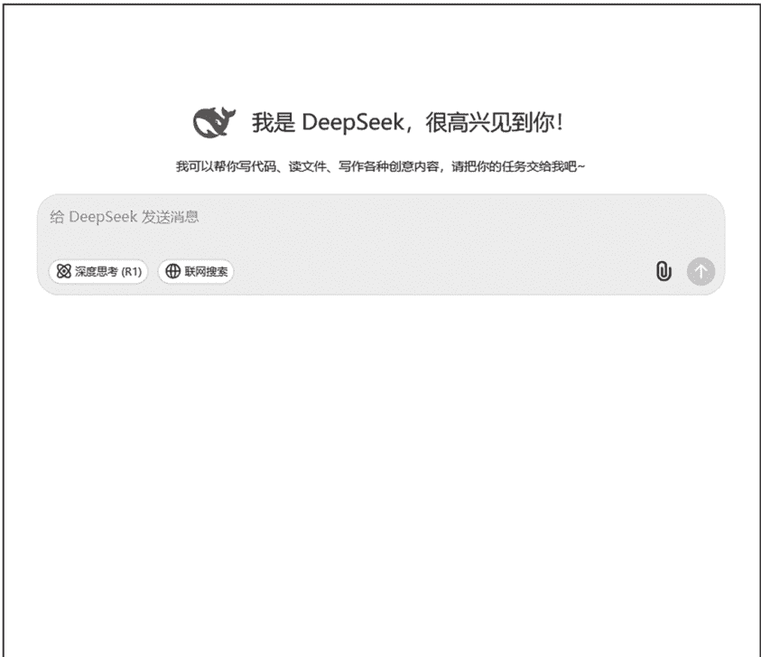
图2-1 DeepSeek聊天界面

### 2. 使用界面
（1）中央对话区
用于代码编写、文案写作、创意生成、文件解析等任务。
(2) 输入框区
支持输入问题、粘贴代码、对话创作等形式。
(3) 输入框下方按钮
- 深度推理 R1：启用更强逻辑推理，适合复杂任务。
- 联网搜索：开启实时联网获取最新信息。
- 附件上传：回形针图标，支持文件上传阅读、总结、翻译。
- 发送按钮：右下角箭头发送内容。

## 2.4 DeepSeek的核心能力与应用场景
DeepSeek 作为国产大模型，具备强大的多模态处理能力，能够融合不同类型信息进行分析与生成。

### 2.4.1 DeepSeek的基础能力

#### 1. 能力概述
支持多模态数据处理，不仅处理单一文本或图像，还能综合分析，执行文本生成、自然语言理解、代码辅助、数据分析等复杂任务。

#### 2. 应用场景
(1) 文本生成
可生成高质量自然语言文本，用于文章、邮件、广告文案、技术文档等。
应用案例：
- 项目文档自动生成：基于背景与要求自动生成计划书、技术文档。
- 营销文案生成：自动生成吸引人的广告内容，提升效率。

(2) 自然语言理解
解析用户输入，理解语义与情感并给出响应或分析。
应用案例：
- 情感分析：识别社交媒体或客户反馈的情感倾向。
- 文本分类与主题识别：快速分类文档、评论、邮件。

(3) 代码辅助
辅助编写、调试、优化代码，提供算法与数据结构建议。
应用案例：
- 自动代码生成：根据需求描述生成模板或功能实现。
- 代码优化与重构：给出性能优化或重构建议。

(4) 数据分析
处理结构化与非结构化数据，快速提取洞察。
应用案例：
- 数据清洗与处理：自动识别错误或缺失值，提升质量。
- 趋势分析与预测：分析历史数据预测销售、股市等趋势。

### 2.4.2 DeepSeek的编程能力

#### 1. 能力概述
在编程领域提供全方位支持，能生成代码、分析调试、优化算法、协助单元测试，适用于多种语言与框架，降低难度、提升效率。

#### 2. 应用场景
(1) 代码生成
根据自然语言描述自动生成预期代码，加速开发。
应用案例：
- Web 应用开发：描述功能后自动生成前后端代码。
- 算法实现：快速生成排序、搜索、图算法等代码。

(2) 代码解释与调试
分析现有代码，解释功能逻辑，识别潜在问题并给出修复建议。
应用案例：
- 错误检测与修复：定位问题并提供详细修复方案。
- 代码解释：逐行解释复杂代码段。

(3) 代码翻译与迁移
在不同编程语言间准确转换，保证逻辑一致。
应用案例：
- 跨平台开发：Java 转 Python 或 Python 转 JavaScript。
- 代码迁移：旧项目迁移到新语言时自动适配。

(4) 生成单元测试
根据现有代码自动生成测试脚本，确保功能正确并便于维护。
应用案例：
- 自动化测试：自动生成用例并持续更新。
- 回归测试：确保新功能不破坏已有功能。

(5) 算法优化与性能提升
提供针对场景的性能优化建议。
应用案例：
- 数据处理优化：提升海量数据处理效率。
- 内存优化：降低程序内存占用。

#### 3. 在AI编程中的优势
(1) 提升开发效率
自动生成代码与测试用例，快速完成功能实现。
(2) 降低学习曲线
代码解释与调试帮助初学者理解概念，多语言支持减少切换成本。
(3) 减少重复性工作
自动生成模板与常用模块，让开发者专注创造性任务。
(4) 优化代码质量
提供优化与重构建议，提升可维护性与可扩展性。
(5) 高效跨语言协作
代码翻译能力方便多语言协作与集成。

### 2.4.3 DeepSeek在AI编程中的应用案例

#### 1. 案例1：快速生成函数/类
data.csv 文件数据示例如表2-1所示。
表2-1 data.csv文件数据示例

| product_id | product_name | category | price | stock | date |
|---|---|---|---|---|---|
| 1001 | Smartphone X | Electronics | 799.99 | 120 | 2025-03-19 16:09:13.772216 |
| 1002 | Laptop Pro | Electronics | 1299.99 | 85 | 2025-03-12 16:09:13.772216 |
| 1003 | Wireless Headphones | Electronics | 149.99 | 200 | 2025-03-10 16:09:13.772216 |
| 1004 | Coffee Maker | Home Appliances | 89.99 | 45 | 2025-03-16 16:09:13.772216 |

| 1005 | Blender Plus | Home Appliances | 79.99 | 60 | 2025-03-12 16:09:13.772216 |

| 1006 | Running Shoes | Sports | 129.99 | 95 | 2025-03-17 16:09:13.772216 |

| 1007 | Fitness Tracker | Electronics | 89.95 | 150 | 2025-03-15 16:09:13.772216 |

| 1008 | Desk Chair | Furniture | 199.99 | 30 | 2025-03-21 16:09:13.772216 |

| 1009 | Table Lamp | Home Decor | 49.99 | 75 | 2025-03-07 16:09:13.772216 |

| 1010 | Backpack | Accessories | 59.99 | 110 | 2025-03-04 16:09:13.772216 |

| 1011 | Water Bottle | Sports | 19.99 | 200 | 2025-03-19 16:09:13.772216 |

| 1012 | Smart Watch | Electronics | 249.99 | 65 | 2025-03-12 16:09:13.772216 |

| 1013 | Yoga Mat | Sports | 29.99 | 80 | 2025-03-13 16:09:13.772216 |

| 1014 | Winter Jacket | Clothing | 179.99 | 40 | 2025-03-14 16:09:13.772216 |

| 1015 | Portable Charger | Electronics | 39.99 | 175 | 2025-03-27 16:09:13.772216 |

表2-1收录了每条商品的编号、名称、所属分类、单价、库存件数以及记录时间。

DeepSeek 提示词示例：

> 基于 Python 与 Pandas 实现一个函数，读取 CSV 并计算某列的平均值。

DeepSeek 生成结果示例：

```python
import pandas as pd
def calculate_column_mean(file_path: str, column_name: str) -> float:
    df = pd.read_csv(file_path)
    return df[column_name].mean()
# 示例调用
mean_value = calculate_column_mean("data.csv", "price")
print(f"平均值：{mean_value}")
```

执行效果见图2-2。

下一步优化：让 DeepSeek 进一步做数据可视化，输出美观的图表。

## 图2-2 VS Code 运行截图

DeepSeek 生成的代码示例：

```python
import pandas as pd

def calculate_column_mean(file_path: str, column_name: str) -> float:
    df = pd.read_csv(file_path)
    return df[column_name].mean()

mean_value = calculate_column_mean("data.csv", "price")
print(f"平均值: {mean_value}")
```

平均值: 231.32066666666657

```python
import pandas as pd
import matplotlib.pyplot as plt
from matplotlib.dates import DateFormatter
import datetime
import matplotlib as mpl
from matplotlib.font_manager import FontProperties

# 设置中文字体支持
# 方法 1：使用系统中文字体
try:
    # 尝试使用系统中文字体
    plt.rcParams['font.sans-serif'] = ['SimHei', 'Microsoft YaHei',
        'SimSun', 'Arial Unicode MS', 'sans-serif']
    plt.rcParams['axes.unicode_minus'] = False # 解决负号显示问题
    # 检查字体是否正常工作
    plt.figure(figsize=(1, 1))
    plt.text(0.5, 0.5, '测试中文', fontsize=12, ha='center')
    plt.close()
    print("成功设置中文字体")
except:
    # 如果系统字体不可用，尝试使用 matplotlib 内置的中文字体
    print("系统中文字体不可用，尝试其他方法…")
    # 方法 2：使用 matplotlib 内置的中文字体
    try:
        mpl.rc('font', family='Arial Unicode MS')
        print("使用 Arial Unicode MS 字体")
    except:
        print("警告：无法设置中文字体，图表中的中文可能无法正确显示")

# 读取 CSV 数据
df = pd.read_csv('data.csv')

# 将日期列转换为 datetime 类型
df['date'] = pd.to_datetime(df['date'])

# 创建带有多个子图的图表
plt.figure(figsize=(15, 15))

# 1. 按类别的总价值 (价格 × 库存)
plt.subplot(2, 2, 1)
df['total_value'] = df['price'] * df['stock']
category_value = df.groupby('category')['total_value'].sum().sort_values(ascending=False)
category_value.plot(kind='bar', color='skyblue')
plt.title('按类别的总价值（价格 × 库存）', fontsize=14)
plt.ylabel('总价值 ($)', fontsize=12)
plt.xlabel('类别', fontsize=12)
plt.xticks(rotation=45)
plt.grid(axis='y', linestyle='-', alpha=0.7)

# 2. 按类别的产品数量分布
plt.subplot(2, 2, 2)
category_counts = df['category'].value_counts()
plt.pie(category_counts, labels=category_counts.index, autopct='%1.1f%%',
        startangle=90, shadow=True, explode=[0.05] * len(category_counts))
plt.title('产品类别分布', fontsize=14)

# 3. 价格分布直方图
plt.subplot(2, 2, 3)
plt.hist(df['price'], bins=10, color='lightgreen', edgecolor='black')
plt.title('价格分布', fontsize=14)
plt.xlabel('价格 ($)', fontsize=12)
plt.ylabel('产品数量', fontsize=12)
plt.grid(axis='y', linestyle='-', alpha=0.7)

# 4. 价格和库存散点图
plt.subplot(2, 2, 4)
scatter = plt.scatter(df['price'], df['stock'], c=df['price'],
                      cmap='viridis', alpha=0.7, s=100, edgecolors='black')
plt.title('价格与库存关系', fontsize=14)
plt.xlabel('价格 ($)', fontsize=12)
plt.ylabel('库存数量', fontsize=12)
cbar = plt.colorbar(scatter, label='价格 ($)')
cbar.set_label('价格 ($)', fontsize=12)
plt.grid(True, alpha=0.3)

# 调整布局
plt.tight_layout()
plt.savefig('product_analysis.png', dpi=300, bbox_inches='tight')

# 创建第二个图表 - 按日期分析
plt.figure(figsize=(15, 8))

# 按日期排序
df_sorted = df.sort_values('date')

# 5. 日期和价格折线图
plt.plot(df_sorted['date'], df_sorted['price'], marker='o', linestyle='-',
         color='purple', markersize=8, linewidth=2)
plt.title('产品价格随时间变化', fontsize=16)
plt.xlabel('日期', fontsize=14)
plt.ylabel('价格 ($)', fontsize=14)
plt.grid(True, alpha=0.3)

# 格式化日期轴
date_format = DateFormatter('%Y-%m-%d')
plt.gca().xaxis.set_major_formatter(date_format)
plt.gcf().autofmt_xdate() # 自动旋转日期标签
plt.tight_layout()
plt.savefig('price_time_analysis.png', dpi=300, bbox_inches='tight')
print("可视化完成！图表已保存为 'product_analysis.png' 和 'price_time_analysis.png'")
```

基于上述代码在 VS Code 中完成的图形展示，按类别的价格关系图如图2-3，价格随日期变化的折线图如图2-4。

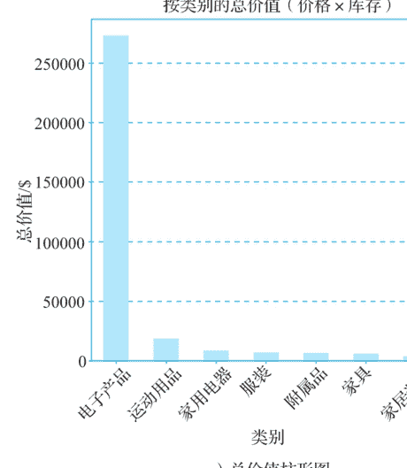

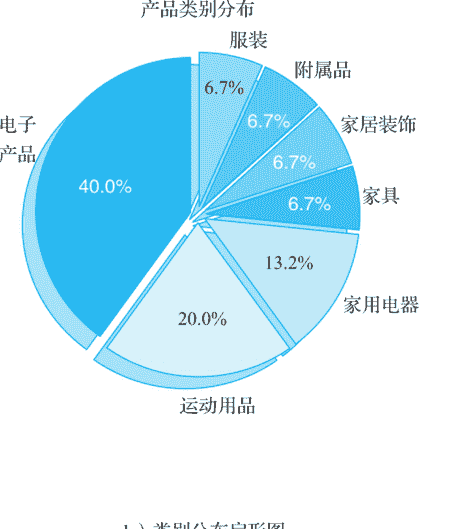

a）总价值柱形图

b）类别分布扇形图

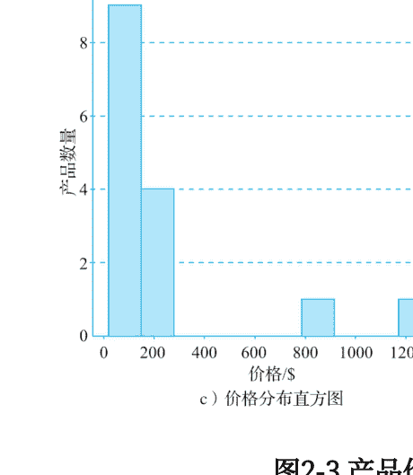

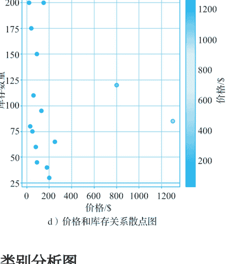

c）价格分布直方图

d）价格与库存关联散点图

## 图2-3 按类别的价格分析可视化


## 图2-4 价格随时间推移的折线趋势

DeepSeek 的优势：

代码结构工整，带类型提示，可直接执行。

#### 2.案例2：代码通俗解读

DeepSeek 提示词示例：

```
解释 TensorFlow 代码中 tf.GradientTape 的作用和原理。
```

DeepSeek 生成结果示例：

```
tf.GradientTape 是 TensorFlow 2.x 中用于自动求导的工具。它在 with tf.GradientTape() as tape: 代码块中记录所有计算操作，并允许你随后计算梯度。例如，在神经网络训练中，它可用于计算损失函数对模型参数的梯度，以便进行优化。
示例代码：
import tensorflow as tf
x = tf.Variable(3.0)
with tf.GradientTape() as tape:
    y = x ** 2
dy_dx = tape.gradient(y, x)    # 计算 dy/dx
print(dy_dx.numpy())            # 输出 6.0
```

DeepSeek 的优势：输出通俗解释并附带示例代码，帮助快速掌握核心概念。

#### 3.案例3：错误排查与修复

DeepSeek 提示词示例：

```
IndexError: list index out of range 错误，修复以下代码：
arr = [1, 2, 3]

print(arr[3])
```

DeepSeek 生成结果示例：

该报错源于尝试访问列表中不存在的下标。Python 列表下标从 0 起算，例如 arr = [1, 2, 3] 的合法下标为 0、1、2。

修复思路有三种：

- 1. 若要取最后一个元素，可使用下标 2：

```python
arr = [1, 2, 3]
print(arr[2])    # 这会打印 3
```

- 2. 也可以用负下标从尾部向前计数：

```python
arr = [1, 2, 3]
print(arr[-1])   # 这会打印最后一个元素 3
```

- 3. 若需安全访问可能越界的下标，可加入异常捕获：

```python
arr = [1, 2, 3]
try:
    print(arr[3])
except IndexError:
    print("索引超出范围")
```

原语句 print(arr[3]) 触发 IndexError 的原因是列表仅有 3 个元素，有效下标为 0、1、2，而 3 超出范围。

DeepSeek 的优势：能自动定位错误并给出防止越界的优化写法。

#### 4.案例4：跨语言代码迁移

DeepSeek 支持快速把 Java 实现的快速排序算法转为 Python 代码。

DeepSeek 提示词示例：

```
Java 代码：
public class QuickSort {
    public static void quickSort(int[] arr, int left, int right) {
        if (left < right) {
            int pivotIndex = partition(arr, left, right);
            quickSort(arr, left, pivotIndex - 1);
            quickSort(arr, pivotIndex + 1, right);
        }
    }

    private static int partition(int[] arr, int left, int right) {
        int pivot = arr[right];
        int i = left - 1;
        for (int j = left; j < right; j++) {
            if (arr[j] < pivot) {
                i++;
                swap(arr, i, j);
            }
        }
        swap(arr, i + 1, right);
        return i + 1;
    }

    private static void swap(int[] arr, int i, int j) {
        int temp = arr[i];
        arr[i] = arr[j];
        arr[j] = temp;
    }
} 请帮我将 Java 代码转换为 Python 代码。
```

把上述需求交给 DeepSeek 后，得到的 Java 快速排序在 Python 下的实现如下。

DeepSeek 生成结果示例：

```python
def quick_sort(arr, left=None, right=None):
    if left is None:
        left = 0
    if right is None:
        right = len(arr) - 1

    if left < right:
        pivot_index = partition(arr, left, right)
        quick_sort(arr, left, pivot_index - 1)
        quick_sort(arr, pivot_index + 1, right)

def partition(arr, left, right):
    pivot = arr[right]
    i = left - 1

    for j in range(left, right):
        if arr[j] < pivot:
            i += 1
            arr[i], arr[j] = arr[j], arr[i]

    arr[i + 1], arr[right] = arr[right], arr[i + 1]
    return i + 1

# 使用示例
if __name__ == "__main__":
    data = [8, 7, 2, 1, 0, 9, 6]
    print("原始数组:", data)

    quick_sort(data)
    print("排序后数组:", data)
```

主要改动说明：

- 1. Python 无需类型声明，已去除所有类型相关写法。

Java 快排向 Python 迁移的核心改动

- 将驼峰命名 quickSort 调整为下划线命名 quick_sort，贴合 Python 惯例。
- 为入口函数补充默认值，使用方只需传入待排序列 quick_sort(arr) 即可触发排序。
- 利用 Python 的多重赋值特性，把交换操作写进循环体，不再单独维护 swap 辅助函数。
- 放弃 Java 的类封装，直接用函数完成排序逻辑。
- 额外附上可直接运行的演示代码，方便即时验证效果。

改造后算法思路与原 Java 版本一致，平均情况下时间复杂度仍在 O(n log n) 量级。DeepSeek 在这次迁移中体现出逻辑保持精准、风格贴合 Python 的特点。

#### 5.案例5：单元测试自动生成
DeepSeek 能迅速为 Python 函数产出一套完整的测试脚本，下面是典型用法：

DeepSeek提示词示例：

```
为以下 Python 函数编写 pytest 单元测试：
def add(a, b):
    return a + b
```

DeepSeek生成结果示例：

```python
import pytest
def add(a, b):
    return a + b
def test_add_positive():
    assert add(2, 3) == 5
def test_add_negative():
    assert add(-1, -1) == -2
def test_add_mixed():
    assert add(-1, 1) == 0
def test_add_zero():
    assert add(0, 0) == 0
def test_add_large_numbers():
    assert add(1000000, 2000000) == 3000000
```

突出之处在于自动整理全套用例，覆盖多种边界情形。

#### 6.案例6：技术方案建议
DeepSeek 能快速梳理详细的技术蓝图并据此落地。下面以框架设计为例：

DeepSeek提示词示例：

推荐系统设计后端架构。

DeepSeek生成结果示例：

### 推荐系统后端架构设计

构建推荐后端要覆盖数据处理、模型训练与服务、对外接口等多个维度。以下是一个可落地的概览：

- 1. 数据层 (Data Layer)

数据源：用户行为日志（点击、购买、评分）、物品元数据（商品信息、文章内容）、用户画像数据。

数据存储：

原始日志：借助 Kafka 等消息队列采集，落盘到 HDFS 或对象存储（如 S3）。

加工后数据 / 特征：写入数据仓库（如 Hive, BigQuery）或 NoSQL 数据库（如 HBase, Cassandra）以便快速查询。

用户 / 物品画像：可放入 Redis 或 Memcached 等内存数据库提升访问速度。

数据处理：采用 Spark, Flink 等完成 ETL、特征工程。

- 2. 模型层 (Model Layer)

离线训练：

召回模型：如协同过滤 (UserCF, ItemCF)，矩阵分解 (ALS, SVD)，向量检索 (Faiss, Annoy) 用来生成候选集。常用技术栈：Spark MLlib, TensorFlow, PyTorch。

排序模型：如逻辑回归 (LR), GBDT, FM, DeepFM, Wide&Deep, DIN 等，对召回候选集进行精排。常用技术栈：TensorFlow, PyTorch, XGBoost, LightGBM。

模型管理：使用 MLflow 或同类平台管理版本与实验。

近线 / 在线更新：对需快速响应兴趣变化的场景，可做近线更新（如分钟级 / 小时级向量刷新）或在线学习模型。

- 3. 服务层 (Service Layer)

推荐引擎 API：提供统一的 API 接口供前端调用。通常为 RESTful API。

召回服务：基于用户 ID 或上下文，从海量物品库中快速召回候选集。

排序服务：对召回结果实时打分排序。

策略 / 混排服务：融合不同召回源的结果，执行业务规则（如去重、多样性、强制插入等）。

特征服务：提供实时用户与物品特征查询。

部署：使用 Docker + Kubernetes 进行容器化管理，或采用云厂商 Serverless 服务（如 AWS Lambda, SageMaker Endpoints）。

- 4. 监控与评估 (Monitoring & Evaluation)

效果监控：跟踪推荐的点击率 (CTR)、转化率 (CVR)、曝光量等业务指标。

性能监控：跟踪 API 延迟、吞吐量、系统资源占用。使用 Prometheus + Grafana 或同类工具。

A/B 测试平台：用于在线评估不同算法或策略的效果。

- 可选方案 / 技术栈考虑

方案 1（适合初创 / 中小型）：基于 Spark MLlib/Mahout 做离线协同过滤召回 + LR/GBDT 排序，部署为简易 API 服务。

方案 2（通用 / 大型）：采用深度学习模型做召回（如双塔模型）和排序（如 DeepFM, DIN），借助向量数据库加速召回，构建微服务架构，部署在 K8s 上。

> ETL为数据抽取、转换、加载。——编辑注

## 2.5 DeepSeek提示词
与 AI 交互时，高质量的提示词能显著提升生成内容的准确性和实用性。无论是生成代码、优化程序、解释概念或调试错误，清晰结构化的提示词都能帮助 AI 更好理解需求并给出高质量输出。

本节介绍若干提示词模板，涵盖角色扮演、代码解释、错误修复、学习新知识等常见场景。可直接使用或按需调整，以更高效借助 AI 辅助编程。（更多模板参考附录或加入社区。）

### 2.5.1 提示词模板示例

#### 1. 角色扮演模板

**用途**：让 AI 扮演特定专业角色，如数据科学家、后端工程师、算法专家等，从而获得更符合该角色专业知识的回答。

**DeepSeek提示词模板**：

角色：[角色名称]

任务：[清晰描述你的编程任务，例如，使用Matplotlib绘制散点图]

输入数据描述：[描述你的数据结构或提供示例]

要求/约束：[例如，添加图例和标题，指定颜色]

输出格式：[例如，Python代码片段]

**DeepSeek提示词示例**：

角色：Python数据科学家

任务：使用Matplotlib绘制一个简单的随机散点图

输入数据描述：生成100个(0,1)区间的随机x,y坐标点

要求/约束：添加图例和标题，指定颜色为蓝色，点透明度为0.5

输出格式：Python代码片段，包含必要的导入和绘图展示代码

**DeepSeek生成结果代码**：

```python
import numpy as np
import matplotlib.pyplot as plt

# 生成随机数据
np.random.seed(42)  # for reproducibility
x = np.random.rand(100)
y = np.random.rand(100)

# 绘制散点图
plt.figure(figsize=(8, 6))  # 设置图形大小
plt.scatter(x, y, color='blue', alpha=0.5, label='随机数据点')  # 指定颜色、透明度和标签（用于图例）
plt.title("随机散点图")  # 添加标题
plt.xlabel("x轴坐标")  # 添加x轴标签
plt.ylabel("y轴坐标")  # 添加y轴标签
plt.legend()  # 显示图例
plt.grid(True)  # 添加网格线
plt.show()  # 显示图形
```

代码生成结果示例如图2-5所示。

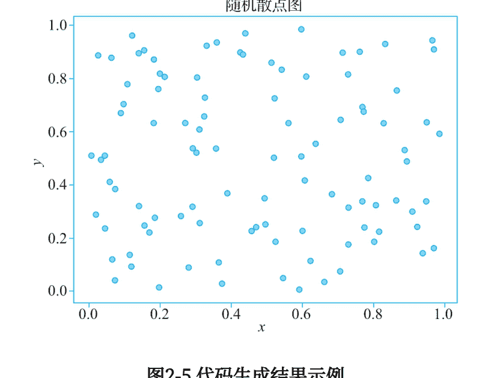

**图2-5 代码生成结果示例**

#### 2. 代码解释模板

**用途**：让 AI 解析代码，给出功能说明、关键步骤拆解，并指出可优化点。

**DeepSeek提示词模板**：

> 请解释以下 [ 语言名称 ] 代码的功能、关键步骤和潜在的优化点。

**DeepSeek提示词示例**：

请解释以下 Python 代码的功能、关键步骤和潜在的优化点：

```python
def fibonacci(n):
    if n <= 0:
        return "输入必须是正整数"
    elif n == 1:
        return [0]
    elif n == 2:
        return [0, 1]
    else:
        seq = [0, 1]
        for i in range(2, n):
            seq.append(seq[-1] + seq[-2])
        return seq
```

**DeepSeek生成结果示例**：

**Python Fibonacci 序列生成代码解析**

1.  **功能**

    这段代码实现了一个生成斐波那契数列的函数，输入一个正整数 n，返回包含前 n 个斐波那契数的列表。

2.  **关键步骤解析**

    (1) 输入验证

    检查 n 是否为正整数，如果不是则返回错误信息。

    (2) 基础情况处理

    n=1 时返回 [0]，

    n=2 时返回 [0, 1]。

    (3) 序列生成

    对于 n>2 的情况，初始化序列为 [0, 1]，

    使用循环从第 3 项开始计算，每次将最后两项相加作为新项，

    循环直到生成 n 个斐波那契数。

3.  **潜在优化点**

    (1) 输入验证改进

    当前对非正整数返回字符串，可能引发类型不一致问题。

    建议抛出异常更符合 Python 惯例：

    ```python
    if not isinstance(n, int) or n <= 0:
        raise ValueError("输入必须是正整数")
    ```

    (2) 空间优化

    对于大 n 值，可以改用生成器来节省内存。

    示例：

    ```python
    def fibonacci_gen(n):
        a, b = 0, 1
        for _ in range(n):
            yield a
            a, b = b, a + b
    ```

    (3) 性能优化

    对于频繁调用的场景，可以使用缓存或记忆化技术。

    示例使用 lru_cache：

    ```python
    from functools import lru_cache

    @lru_cache(maxsize=None)
    def fib(n):
        if n < 2:
            return n
        return fib(n-1) + fib(n-2)
    ```

    (4) 数学优化

    对于极大 n 值，可以使用矩阵快速幂或比奈公式来获得 O(1) 时间复杂度。

    边界情况处理：

    当前代码处理了 n=0 的情况，但返回类型与成功情况不一致，

    考虑是否接受 n=0 并返回空列表。

    (5) 代码风格：

    可以添加文档字符串说明函数用途和参数。

    可以考虑使用元组解包使代码更简洁：

    ```python
    seq.append(seq[-2] + seq[-1])
    ```

这个实现对于中等大小的 n 值已经足够高效（O(n) 时间复杂度），但如果需要处理极大 n 值或需要频繁调用，则可以考虑上述优化方案。

#### 3. 错误修复模板

**用途**：当代码出错时，提供错误信息与代码片段，让 AI 分析原因并给出修复建议。

**DeepSeek提示词模板**：

```
我的 [ 语言名称 ] 代码在运行时出现以下错误：
[ 粘贴错误信息 ]
这是相关的代码片段：
[ 在此处粘贴代码 ]
请帮我分析错误原因，并提供修复建议或修复后的代码。
```

**DeepSeek提示词示例**：

> 我在 python 中运行出现一下的错误

> IndexError: list index out of range

> 这是相关的代码片段：

> arr = [1, 2, 3]

> print(arr[3])

> 请帮我分析错误原因，并提供修复建议或修复后的代码。

**DeepSeek生成结果示例**：

好的，我们来分析这个问题。

**错误原因分析**：

错误信息 `IndexError: list index out of range` 表明你正在尝试访问一个列表中不存在的索引位置。

在你的代码中：

```python
arr = [1, 2, 3]
print(arr[3])
```

列表 `arr` 包含了 3 个元素。

在 Python（以及大多数编程语言）中，列表的索引是从 0 开始计算的。

因此，`arr` 的有效索引是 0, 1, 2。分别对应的值是 1, 2, 3。

当你尝试访问 `arr[3]` 时，这个索引超出了列表的有效范围（0 到 2），所以 Python 抛出了 `IndexError`。

**修复建议与修复后的代码**：

有几种修复或改进的方式，取决于你的具体意图：

1.  **访问最后一个元素**：如果你的意图是访问列表的最后一个元素，应该使用索引 `len(arr) - 1`。

    ```python
    arr = [1, 2, 3]
    last_index = len(arr) - 1
    if last_index >= 0:        # 确保列表不为空
        print(arr[last_index])  # 输出 3
    else:
        print("列表为空，无法访问元素")

    # 或者更 Pythonic 的方式访问最后一个元素
    if arr:                    # 检查列表是否非空
        print(arr[-1])          # 输出 3
    else:
        print("列表为空")
    ```

2.  **检查索引有效性**：在访问之前检查索引是否在有效范围内。

    ```python
    arr = [1, 2, 3]
    index_to_access = 3        # 你想访问的索引
    if 0 <= index_to_access < len(arr):
        print(arr[index_to_access])
    else:
        print(f"错误：索引 {index_to_access} 超出列表范围 (0 到 {len(arr)-1})")
    ```

3.  **使用异常处理 (Try-Except)**：如果不确定索引是否有效，可以使用 `try-except` 块来捕获可能的 `IndexError`。

    ```python
    arr = [1, 2, 3]
    index_to_access = 3
    try:
        print(arr[index_to_access])
    except IndexError:
        print(f"捕获到错误：索引 {index_to_access} 超出列表范围。")
    ```

**总结**：

最直接的原因是你试图访问的索引 3 对于只有 3 个元素（索引 0,1,2）的列表 `arr` 来说是无效的。请根据你的实际需要选择上述合适的修复方法。

#### 4. 学习新知识模板

**用途**：让 AI 用通俗易懂的语言介绍技术概念，并提供入门示例代码。

**DeepSeek提示词模板**：

> 我想学习［技术／库／概念名称］，请用简洁明了的语言解释它的核心思想，并提供一个简单的［语言名称］入门示例代码。

**DeepSeek提示词示例**：

> 我想学习 Pandas 库，请用简洁明了的语言解释它的核心思想，并提供一个简单的 Python 入门示例代码。

**DeepSeek生成结果示例**：

**Pandas 核心思想解释**

Pandas 是 Python 语言中一个非常强大且流行的数据分析和处理库。你可以把它想象成 Python 世界里的超级加强版 Excel。

它的核心思想是提供了两种主要的数据结构，让你能高效、便捷地操作结构化数据（就像电子表格或数据库中的表）：

- **Series（系列）**：像是一维的带标签数组，可以理解为表格中的一列。每个元素都有一个标签（索引），默认是 0,1,2,…，但也可以自定义。

- **DataFrame（数据框）**：像是一个二维的带标签表格，可以理解为整个电子表格。它有多行多列，每列可以是不同的数据类型（数字、字符串、布尔值等）。它既有行索引，也有列索引（列名）。

Pandas 让你能够轻松地进行以下操作：

- 读取和写入多种格式的数据（如 CSV、Excel、SQL 数据库等）。

- 查看、选择和过滤数据（按行、按列、按条件）。

- 处理缺失数据（填充或删除）。

- 数据转换和清洗（如更改数据类型、重命名列）。

- 合并、连接和重塑数据表。

- 进行分组聚合计算（类似 Excel 的数据透视表）。

- 处理时间序列数据。

- 进行简单的数据可视化。

总之，Pandas 的目标是让 Python 成为强大而高效的数据分析环境，极大简化数据处理的流程。

**Pandas Python 入门示例代码**：

```python
# 导入 Pandas 库，通常约定俗成地简写为 pd
import pandas as pd

# --- 创建 DataFrame ---
# 假设我们有一些数据，比如几个人的姓名、年龄和城市
data = {
    '姓名': ['爱丽丝', '鲍勃', '查理', '黛安娜'],
    '年龄': [25, 30, 22, 35],
    '城市': ['北京', '上海', '广州', '上海']
}

# 使用字典创建 DataFrame，字典的键成为列名，值（列表）成为列数据
df = pd.DataFrame(data)

# --- 查看 DataFrame ---
print("--- 原始 DataFrame ---")
print(df)
# 输出：
# --- 原始 DataFrame ---
#     姓名  年龄  城市
# 0  爱丽丝  25  北京
# 1    鲍勃  30  上海
# 2    查理  22  广州
# 3  黛安娜  35  上海

print("\n--- DataFrame 的基本信息 ---")
# .info() 方法可以查看 DataFrame 的概览信息，如行数、列数、每列的数据类型、非空值数量等
df.info()

print("\n--- 查看前几行数据 ---")
# .head(n) 方法默认显示前 5 行，可以指定 n
print(df.head(2))
# 输出：
# --- 查看前几行数据 ---
#     姓名  年龄  城市
# 0  爱丽丝  25  北京
# 1    鲍勃  30  上海

# --- 选择数据 ---
print("\n--- 选择 '年龄' 这一列 (Series) ---")
# 选择单列会得到一个 Series
ages = df['年龄']
print(ages)
# 输出：
# --- 选择 '年龄' 这一列 (Series) ---
# 0    25
# 1    30
# 2    22
# 3    35
# Name: 年龄, dtype: int64

print("\n--- 选择多列 ('姓名' 和 '城市') ---")
# 选择多列会得到一个新的 DataFrame
subset = df[['姓名', '城市']]
print(subset)
# 输出：
# --- 选择多列 ('姓名' 和 '城市') ---
#     姓名  城市
# 0  爱丽丝  北京
# 1    鲍勃  上海
# 2    查理  广州
# 3  黛安娜  上海

print("\n--- 按条件过滤数据 (年龄大于 25 岁的人) ---")
# 使用布尔索引进行过滤
older_people = df[df['年龄'] > 25]
print(older_people)
# 输出：
# --- 按条件过滤数据（年龄大于 25 岁的人）---
#     姓名  年龄  城市
# 1   鲍勃   30  上海
# 3  黛安娜  35  上海

# --- 计算统计量 ---
print("\n--- 计算平均年龄 ---")
# 对 '年龄' 列调用 .mean() 方法计算平均值
average_age = df['年龄'].mean()
print(f"平均年龄是：{average_age}")
# 输出：
# --- 计算平均年龄 ---
# 平均年龄是：28.0

print("\n--- 按城市分组并计算每个城市的平均年龄 ---")
# .groupby('列名') 进行分组，然后可以对分组后的对象进行聚合计算
average_age_by_city = df.groupby('城市')['年龄'].mean()
print(average_age_by_city)
# 输出：
# --- 按城市分组并计算每个城市的平均年龄 ---
# 城市
# 上海    32.5
# 北京    25.0
# 广州    22.0
# Name: 年龄, dtype: float64

# --- 添加新列 ---
print("\n--- 添加一个表示是否成年的新列 ---")
# 根据 '年龄' 列创建一个新列 '是否成年'
df['是否成年'] = df['年龄'] >= 18
print(df)
# 输出：
# --- 添加一个表示是否成年的新列 ---
#     姓名  年龄  城市  是否成年
# 0  爱丽丝  25  北京    True
# 1   鲍勃   30  上海    True
# 2   查理   22  广州    True
# 3  黛安娜  35  上海    True
```

本次示例围绕 Pandas 的入门用法展开，涵盖构造数据、查看内容、选取字段、条件筛选、统计计算以及新增列等要点。读完这段说明，能够更快地开始使用 Pandas。

### 2.5.2 提示词进阶玩法

在实际运用中，除了套用基础模板，还能借助一些进阶手段来打磨指令，让模型产出更贴合预期。更详细的做法可参考附录 B。

#### 1. 让需求描述更精准

当模型回复不够准确时，往往是指令太模糊。描述越清晰、信息越完整，DeepSeek 就越能对症下药。下面给出两组细化需求的对比。

**示例1：模糊表述与清晰表述对比**

不清晰的提示词：

```
写一个机器学习代码示例。
```

具体的提示词：

```
请用 Python 编写一个使用 scikit-learn 进行分类任务的机器学习代码示例，要求使用决策树 (DecisionTreeClassifier) 在鸢尾花数据集 (Iris dataset) 上训练，并评估准确率。
```

**示例2：补充背景上下文**

不清晰的提示词：

```
帮我优化这个 SQL 查询。
```

具体的提示词：

```
我正在优化一个 SQL 查询，以在 MySQL 数据库上更高效地检索最近 30 天内活跃用户的列表。用户数据存储在 users 表中，活跃日志存储在 activity_logs 表中，字段如下：

- users (id INT PRIMARY KEY, name VARCHAR(255), email VARCHAR(255), created_at TIMESTAMP)
- activity_logs (id INT PRIMARY KEY, user_id INT, activity_type VARCHAR(50), timestamp TIMESTAMP)

activity_logs 表中的 user_id 列有索引，timestamp 列也有索引。users 表的 id 是主键。数据量：users 表约 100 万行，activity_logs 表约 5000 万行。

请优化以下 SQL 查询，使其运行更快：
```sql
SELECT DISTINCT users.id, users.name

FROM users

JOIN activity_logs ON users.id = activity_logs.user_id

WHERE activity_logs.timestamp >= NOW() - INTERVAL 30 DAY;
```
```

#### 2. 明确输出样式

**案例1：要求列表形式**

不清晰的提示词：

```
列举 Python 适合的数据分析库。
```

具体的提示词：

```
请列出 5 个 Python 适用于数据分析的库，并简要介绍它们的功能，格式如下：
1. [库名称]：[功能介绍]
2. ......
```

**DeepSeek 输出示范**：

1. **Pandas**：以 DataFrame 为核心，兼顾高效与易用，是 Python 数据处理的基石。
2. **NumPy**：提供 N 维数组及大量数学运算，是科学计算类库的底层支撑。
3. **Matplotlib**：基础绘图方案，可产出静态、动态与交互式图形，用于数据呈现。
4. **Seaborn**：在 Matplotlib 上封装的高层统计绘图接口，默认视觉更美观，操作更简便。
5. **SciPy**：在 NumPy 基础上扩展优化、积分、插值、信号处理、线性代数等功能。

下面再概括五个常用 Python 数据分析库：

- Pandas：面向结构化数据的清洗、转换、合并与分析，提供易用的 DataFrame。
- NumPy：科学计算的基础包，包含 N 维数组、广播、线性代数、FFT、随机数等，多数库建立于其上。
- Matplotlib：二维绘图库，可在多种文件格式与跨平台交互环境中生成出版级图形，支持静态、动态与交互可视化。
- Seaborn：基于 Matplotlib 的统计可视化封装，提供高层接口，便于制作美观且信息丰富的统计图表。
- Scikit-learn：功能丰富的机器学习工具箱，涵盖分类、回归、聚类、降维、模型选择与预处理，适合预测性分析。

## 示例2：代码配合说明

### 不清晰的提示词：

写个爬虫代码。

### 具体的提示词：

请用 Python 编写一个使用 requests 和 BeautifulSoup 爬取网页标题的爬虫，目标 URL（统一资源定位符）是 'https://example.com'，并为代码添加详细的注释以解释每一步的作用。

### DeepSeek 输出示范：

```python
# 导入所需的库
import requests  # 用于发送 HTTP (超文本传输协议) 请求，获取网页内容
from bs4 import BeautifulSoup  # 用于解析 HTML (超文本标记语言) 内容，提取所需信息

# 定义目标网页的 URL
url = "https://example.com"
try:
    # 发送 GET 请求到目标 URL
    # requests.get() 会返回一个 Response 对象，其中包含服务器的响应信息
    response = requests.get(url)
    # 检查请求是否成功 (状态码 200 表示成功)
    response.raise_for_status()  # 如果请求失败 (如 404, 500)，这行会抛出异常
    # 使用 BeautifulSoup 解析网页的 HTML 内容
    # response.text 包含了网页的 HTML 源代码
    # 'html.parser' 是 Python 内置的 HTML 解析器，也可以使用 'lxml' (需要安装) 等其他解析器
    soup = BeautifulSoup(response.text, "html.parser")
    # 查找网页的 <title> 标签
    # soup.title 会返回第一个找到的 <title> 标签对象
    title_tag = soup.title

    # 检查是否找到了 <title> 标签
    if title_tag:
        # .string 属性可以获取标签内的文本内容
        title_text = title_tag.string
        # 打印提取到的网页标题
        print(f"网页标题是：{title_text}")
    else:
        # 如果网页没有 <title> 标签
        print("未找到网页标题标签。")

# 处理可能发生的请求异常 (例如网络问题、URL 错误等)
except requests.exceptions.RequestException as e:
    print(f"请求网页时出错：{e}")

# 处理其他可能的异常 (例如解析 HTML 时出错)
except Exception as e:
    print(f"处理过程中发生错误：{e}")
```

#### 3. 调节详略程度

有时需要要点式回答，有时需要深入解析，可通过明确详略要求来控制。

DeepSeek 提示词示例：

请用 Python 解释 map() 函数的用法，并提供：

1. **简短版**（一句话说明其核心功能）
2. **详细版**（包括其工作原理、参数说明、至少两个不同类型的示例代码和常见的应用场景）

### DeepSeek 输出示范：

1. 简短版

map() 会把指定函数依次作用到一个或多个可迭代对象的元素上，并以迭代器形式返回结果。

2. 详细版

运行机制：

map() 至少接收一个函数和一个或多个可迭代对象。它会逐个取出元素，若有多个序列则组合成元组传入函数，收集每次调用的返回值，最后返回一个 map 迭代器。实际使用时需要把它转成列表等具体类型才能查看全部内容。

参数说明：

map(function, iterable1, iterable2, ...)
function：要对元素执行的操作。
iterable1, iterable2, ...：可迭代的序列，如 list、tuple、string 等。多序列时最好长度一致，map 会在最短序列耗尽时停止，函数需能接收对应数量的参数。

示例代码 1：作用于单个可迭代对象

```python
# 示例：将列表中的每个数字进行求平方运算
numbers = [1, 2, 3, 4, 5]
# 定义一个平方函数
def square(x):
    return x * x
# 使用 map() 将 square 函数应用于 numbers 列表的每个元素
squared_iterator = map(square, numbers)
# map() 返回的是一个迭代器，需要转换为列表才能看到所有结果
squared_numbers = list(squared_iterator)
print(f"原始列表：{numbers}")
print(f"平方后的列表：{squared_numbers}")
# 输出：
# 原始列表：[1, 2, 3, 4, 5]
# 平方后的列表：[1, 4, 9, 16, 25]
# 也可以使用 lambda 函数简化
squared_lambda = list(map(lambda x: x * x, numbers))
print(f"使用 lambda 平方：{squared_lambda}")
# 输出：
# 使用 lambda 平方：[1, 4, 9, 16, 25]
```

示例代码 2：作用于多个可迭代对象

```python
# 示例：将两个列表对应位置的元素相加
list1 = [1, 2, 3]
list2 = [4, 5, 6]
# 定义一个相加函数（或使用 lambda）
def add_elements(x, y):
    return x + y
# 使用 map() 将 add_elements 函数应用于 list1 和 list2 的对应元素
sum_iterator = map(add_elements, list1, list2)
sum_list = list(sum_iterator)
print(f"列表1：{list1}")
print(f"列表2：{list2}")
print(f"对应元素相加后的列表：{sum_list}")
# 输出：
# 列表1：[1, 2, 3]
# 列表2：[4, 5, 6]
# 对应元素相加后的列表：[5, 7, 9]
# 使用 lambda 简化
sum_lambda = list(map(lambda x, y: x + y, list1, list2))
print(f"使用 lambda 相加：{sum_lambda}")
# 输出：
# 使用 lambda 相加：[5, 7, 9]
```

常见用途：

- 数据转换与规范化：批量把字符串转小写、去空白，或把数值统一格式。
- 批量计算：对一系列输入执行相同的数学运算。
- 特征工程：在机器学习中对多列特征应用相同转换。
- 结合 filter 或列表推导式做更复杂的数据处理。

map() 提供了函数式的序列处理方式，比显式 for 循环更紧凑，尤其配合 lambda 时更简洁，适合批量转换、清洗和文本处理等场景。

#### 4. 分步引导提问

若希望模型逐步推导而非一次性给出完整答案，可用分步指令引导思考路径。

DeepSeek 提示词示例：

```
请分步骤完成以下任务：
第一步：请解释深度学习中的 dropout 机制是什么，以及它的主要作用。
第二步：请简要介绍如何在 TensorFlow（使用 Keras API）和 PyTorch 中实现 dropout 层。
第三步：请提供一个简单的 Python 代码示例（可以选择 TensorFlow 或 PyTorch），展示如何在构建一个小型神经网络模型时应用 dropout。
请按顺序回答这三个步骤。
```

### DeepSeek 输出示范：

### 第一步：Dropout 机制及其作用

Dropout 是深度学习训练中常用的一种正则化技术。

机制：

每次训练迭代或每个批次中，Dropout 会以一定概率随机把部分神经元的输出暂时置零。被置零的单元在本次前向和反向传播中不参与学习，被选中的单元是随机的，通常由丢弃率 p 控制。

主要作用：

随机失活：用随机遮蔽对抗过拟合

神经网络训练中最常见的坑就是过拟合。简单说就是模型在训练集上分数很高，遇到没见过的数据就掉链子。

Dropout 缓解过拟合主要靠两点：

- 逼迫网络形成更稳健的表示。每次前向时都会随机关掉一部分单元，某个单元无法长期依赖固定的搭档输出。这种不稳定的遮蔽让模型被迫挖掘更分散、彼此可替代的特征，于是泛化能力得到提升。
- 产生类似集成的效果。可以把带 Dropout 的一次前向看成对完整网络的一个稀疏子网采样。整个训练过程相当于同时在培养大量不同的子网。推理时通常把所有单元都保留，并按丢弃概率 p 缩放输出，或采用训练时反向缩放的 Inverted Dropout 做法。这相当于对所有子网的预测做平均，效果接近模型集成。

概括起来，Dropout 在训练阶段刻意引入随机性，打破单元间过度协同，让模型不容易记住训练数据的噪声和特异性。

### 第二步：如何实现 Dropout？

主流框架里加上 Dropout 层都非常直接。

1. **TensorFlow 配合 Keras API**：
    - 在 Keras 中可通过 `tf.keras.layers.Dropout` 调入丢弃层。
    - 需要设置 `rate` 参数，表示本次训练要丢弃单元的比例，也就是前面说的 dropout rate `p`。
    - 示例：
    ```python
    import tensorflow as tf
    # 添加一个 Dropout 层，丢弃率为 0.5 (50%)
    dropout_layer = tf.keras.layers.Dropout(rate=0.5)
    ```
    - 该层一般接在需要正则化的层之后，例如全连接或卷积层之后。Dropout 仅在训练阶段生效，评估或预测时会自动跳过。

2. **PyTorch**:
    - 在 PyTorch 中可通过 `torch.nn.Dropout` 类加入 Dropout 层。
    - 需要指定 `p` 参数，同样表示丢弃概率。
    - 示例：
    ```python
    import torch
    import torch.nn as nn
    # 添加一个 Dropout 层，丢弃概率为 0.5
    dropout_layer = nn.Dropout(p=0.5)
    ```
    - 与 Keras 类似，该层也通常放在目标层之后。只在模型处于训练模式 `model.train()` 时工作，评估模式 `model.eval()` 下会自动关闭。

两个框架都把实现细节封装好了，使用者只需在结构里插入对应层并设定丢弃率即可。

### 第三步：代码示例 (PyTorch)

下面是一个用 PyTorch 搭建简易前馈网络并在隐藏层后使用 Dropout 的例子。假设任务是输入 784 维特征，例如展平后的 MNIST 图片，输出 10 类，识别数字 0 到 9。

```python
import torch
import torch.nn as nn

class SimpleNetWithDropout(nn.Module):
    def __init__(self, input_size=784, hidden_size=128, output_size=10, dropout_rate=0.5):
        super(SimpleNetWithDropout, self).__init__()  # 调用父类的构造函数
        # 定义第一个全连接层（输入层 -> 隐藏层）
        self.fc1 = nn.Linear(input_size, hidden_size)
        # 定义 ReLU 激活函数
        self.relu = nn.ReLU()
        # 定义 Dropout 层，设置丢弃率
        self.dropout = nn.Dropout(p=dropout_rate)
        # 定义第二个全连接层（隐藏层 -> 输出层）
        self.fc2 = nn.Linear(hidden_size, output_size)

    def forward(self, x):
        # 定义数据在网络中的前向传播路径
        # 输入数据通过第一个全连接层
        out = self.fc1(x)
        # 应用 ReLU 激活函数
        out = self.relu(out)
        # 应用 Dropout 层（只在 model.train() 模式下生效）
        out = self.dropout(out)
        # 通过第二个全连接层得到最终输出
        out = self.fc2(out)
        return out

# --- 如何使用 ---
# 设定模型参数
input_dim = 784
hidden_dim = 128
output_dim = 10
dropout_p = 0.5  # 设置丢弃率为 50%

# 创建模型实例
model = SimpleNetWithDropout(input_size=input_dim,
                            hidden_size=hidden_dim,
                            output_size=output_dim,
                            dropout_rate=dropout_p)

# 打印模型结构
print(model)

# 模拟输入数据（例如一个批次包含 64 个样本）
dummy_input = torch.randn(64, input_dim)

# --- 训练阶段 ---
# 将模型设置为训练模式，Dropout 会生效
model.train()
# 进行前向传播
output_train = model(dummy_input)
print("\n训练模式下输出形状:", output_train.shape)  # 输出应为 torch.Size([64, 10])

# --- 评估 / 预测阶段 ---
# 将模型设置为评估模式，Dropout 会自动禁用
model.eval()
# 进行前向传播
output_eval = model(dummy_input)
print("评估模式下输出形状:", output_eval.shape)  # 输出应为 torch.Size([64, 10])
```

### 注意

实际训练中，还需定义损失函数与优化器，并执行反向传播与参数更新。这里仅演示 Dropout 层在模型中的位置以及不同模式下的表现，具体包括在隐藏层后插入一个 `nn.Dropout` 层，并通过 `model.train()` 与 `model.eval()` 控制 Dropout 是否激活。

#### 5. 概念学习模板

当碰到不熟悉的概念、流程或报错时，可以打开 DeepSeek Chat 或我们推荐的“腾讯混元”等 AI 对话工具，使用下面这套提问模板。

DeepSeek 询问模板：

> 你好！我是一名编程初学者，对【概念名称】这个概念不太理解。
> 
> 你能用尽可能通俗易懂、简单直白的语言向我解释一下它是什么意思吗？
> 
> 如果能结合一些日常生活中的例子来帮助我理解，那就更好了！谢谢！

DeepSeek 询问示例：

> 你好！我是一名编程初学者，对‘变量（Variable）’这个概念不太理解。你能用尽可能通俗易懂、简单直白的语言向我解释一下它是什么意思吗？如果能结合一些日常生活中的例子来帮助我理解，那就更好了！谢谢！

DeepSeek 生成结果示例：

当然可以！让我们用最生活化的方式来理解变量（Variable）这个概念。

## 一句话解释变量：

变量就像是一个贴了标签的盒子，你可以往盒子里放东西（数据），并且随时可以打开盒子查看或更换里面的东西。

## 生活化比喻：

### 快递柜

每个快递柜的格子都有编号（变量名）

格子里可以放不同的快递（数据）

比如：

```
格子 A = "一本书" # 今天放的是书
格子 A = "一双鞋" # 明天换成鞋
```

虽然内容变了，但格子编号（变量名）始终是格子 A

### 便利贴

你在冰箱上贴一张便利贴写着“今日菜单”（变量名）

今天写“红烧肉”（数据），明天可以改成“清蒸鱼”

就像：

```
今日菜单 = "红烧肉"
今日菜单 = "清蒸鱼" # 修改内容
```

### 钱包里的卡槽

第一个卡槽你贴上“公交卡”的标签（变量名）

今天插的是北京公交卡，明天可以换成上海交通卡（数据）

但卡槽的名字“公交卡”不变

## Python 中的具体例子：

```
# 定义一个变量（贴标签 + 放内容）
手机电量 = 80 # 现在电量是 80%
# 使用变量
print("当前电量：", 手机电量) # 输出：当前电量：80
# 修改变量（更换盒子里的东西）
手机电量 = 20 # 电量变成 20%
print("充电前电量：", 手机电量) # 输出：充电前电量：20
```

## 关键特点：

- 随时可变：就像天气从“晴天”变成“雨天”
  ```
  天气 = "晴天"
  天气 = "雨天"  # 变量内容可以修改
  ```
- 名字代表内容：
  当你听到“冰箱里的牛奶”，就知道指的是具体某瓶牛奶
  ```
  冰箱里的牛奶 = "蒙牛纯牛奶"
  ```
- 先定义后使用：
  就像你要先准备一个空盒子（定义变量），才能往里面放东西

## 新手常见疑问：

Q：为什么要用变量？直接写数据不行吗？

A：想象你要记录全班 50 人的考试成绩：

不用变量：每次都要写 print("张三分数：90")、print("李四分数：85")……

用变量：只需修改名字，重复使用相同的逻辑

```
学生分数 = 90
print(学生姓名 + " 的分数：", 学生分数)
```

## 总结：

变量就是给数据起个名字，方便我们：

1. 重复使用
2. 随时修改
3. 让代码更易读（比如年龄 = 25 比直接写 25 更清楚）

试着在 Python 里玩一玩变量吧！比如模拟一个“咖啡温度”变量，观察它从 80℃ 降到 50℃ 的过程～ ☕

#### 6.操作指导模板

当你不确定如何完成某个具体编程操作或软件设置时，可以用以下模板请求帮助。

### DeepSeek 询问模板：

你好！我是一名编程小白，现在遇到了【具体问题描述，例如：想在 Windows 计算机上安装 Python，但不知道怎么做】。

你能给我一个“傻瓜式”的、一步一步的操作攻略吗？

如果能提供关键步骤的截图示例或者非常详细的文字描述，我会非常感激！

### DeepSeek 询问示例：

你好！我是一名编程小白，现在想在我的 Windows 10 计算机上成功安装最新版本的 Python，但完全不知道从何下手。你能给我一个“傻瓜式”的、一步一步的操作攻略吗？如果能提供关键步骤的截图示例或者非常详细的文字描述，我会非常感激！

### DeepSeek 生成结果示例：

当然可以！以下是一个超详细的“傻瓜式” Python 安装指南，我会用“手把手”的方式带你完成整个过程，就像教朋友一样耐心 😊

### 第一步：下载 Python 安装包

打开浏览器，访问 Python 官方网站：https://www.python.org/downloads/。

你会看到一个大大的黄色按钮 Download Python 3.x.x （版本号可能不同，直接单击它！）

> ⚠️ 注意：不要单击下面的 Windows x86-64 executable installer 等小字链接，容易选错版本。

### 第二步：运行安装程序

双击下载好的安装包（通常在下载文件夹里，文件名类似 python-3.x.x.exe），

你会看到这个界面。（两个关键操作！）

- ✔️ 一定要勾选 Add Python 3.x to PATH (这关系到能否在命令行使用 Python)

- ✔️ 单击 Install Now (默认安装最省心)

如果看到安全提示，单击“是”允许安装。

### 第三步：等待安装完成

你会看到进度条，通常需要 1 ~ 3min。喝杯茶等待就好~

安装完成后单击 Close 关闭窗口。

### 第四步：验证是否安装成功

按 < Win + R > 键 打开运行窗口，输入 cmd 然后按 <Enter> 键，

在黑色的命令提示符窗口中输入：

```
python --version
```

如果显示 Python 3.x.x （和你下载的版本一致），说明安装成功！🎉

如果报错，可能是没勾选 Add to PATH，需要卸载重装。

### 第五步：第一次运行 Python

我们来写个经典的小程序：

在命令提示符中输入：

```
python
```

你会看到 >>> 提示符，输入：

```
print("Hello 我是 Python！")
```

按 <Enter> 键，你会看到程序输出文字！

### 常见问题解决

1. 如果输入 python 提示“不是内部命令”：
   卸载 Python 重新安装，务必勾选 Add to PATH，
   或手动添加 PATH。
2. 安装时卡住不动：
   关闭杀毒软件后重试，
   确保 C 盘有至少 2GB 空间。
3. 想卸载重装：
   选择“控制面板” → “卸载程序”选项，找到 Python，右键卸载。

### 终极确认清单

完成以下所有项就打钩吧！

- 从官网下载了 Python
- 安装时勾选了 Add to PATH
- 命令行输入 python --version 能显示版本号
- 成功运行了 print("Hello")

如果遇到任何卡住的地方，随时告诉我你的具体问题，我会继续帮你排查！💪

(需要更详细的截图或视频演示可以告诉我，我可以补充更多细节。)

> 详细图文教程见https://realpython.com/add-python-to-path/。

——编辑注

结合上述示例，提问优化点总结如下：

- 明确目标（爬取名言和作者）。
- 指定工具（requests，BeautifulSoup4）。
- 增加约束条件（异常处理、User-Agent）。
- 指定输出格式（字典列表）。
- 细化实现要求（注释、打印结果）。

通过这种更具体、结构化的提示，AI能够更好地理解你的需求，生成更完整、更健壮、更符合实际应用场景的代码。

#### 7.优化内容创作任务

如果提问不够精确，DeepSeek生成的文章内容可能会空泛，缺乏深度和具体论证。例如，原始 DeepSeek 提问（过于宽泛）。

> 请写一篇关于人工智能未来发展趋势的文章。

DeepSeek 可能的错误表现：

- 文章内容笼统，列举了一些常见趋势，但没有深入分析原因或提供具体案例。
- 缺乏独特的见解和批判性思考。
- 结构可能比较散乱，逻辑不够清晰。

### 改进后的 DeepSeek 提问（限定范围、提供指导）如下：

> 请撰写一篇 800 字左右的文章，探讨未来五年人工智能在医疗健康领域的三大关键发展趋势。要求：
> 
> 1. 明确指出并详细阐述这三个关键趋势。
> 2. 对于每个趋势，需要分析其背后的驱动因素（例如技术进步、政策导向、市场需求）。
> 3. 为每个趋势提供至少一个具体的应用案例或潜在的影响。
> 4. 文章结构清晰，包含引言、主体（每个趋势一段落）和结论。
> 5. 语言表达专业且易于理解，避免使用过于模糊或夸张的词汇。
> 6. 请简要讨论这些趋势可能带来的伦理和社会影响。
> 7. 给出一个你认为最重要的挑战以及应对建议。

### 结合上述示例，提问优化点总结如下：

- 限定主题和字数（人工智能在医疗健康领域，800字）。
- 明确输出数量和要求（三大关键趋势，详细阐述，分析驱动因素，具体案例）。
- 规定文章结构（引言、主体、结论）。
- 指导写作风格（专业易懂，避免模糊夸张）。
- 引导思考深度（伦理和社会影响，重要挑战和应对建议）。

通过更精细的指令和明确的要求，AI将能够生成更聚焦、更深入、更有条理的文章，更符合用户的期望。

### 注意

DeepSeek是你学习路上的强大伙伴和加速器，但它不能替代你主动思考和动手实践的过程。真正的理解和掌握，来自你亲自编写代码、调试错误、完成项目的经验积累。

如果遇到困难需要帮助，欢迎添加我们的企业微信服务号“光速财经”。我们有专业的团队为你答疑解惑，与你一起学习，共同解决问题。

## 2.6 结语

掌握 DeepSeek 的使用方法和提问技巧，是开启 AI 编程之旅的关键一步。通过本章的学习，你不仅了解了 DeepSeek 的核心能力，还学会了如何像与一位智能助手沟通一样，引导它完成从文本生成到复杂代码编写的各种任务。记住，高质量的提问是释放 AI 潜力的钥匙。不断练习、优化你的提问方式，DeepSeek 将成为你学习和创造过程中不可或缺的强大伙伴。

# CHAPTER 3 第3章 轻松准备你的编程环境

从零起步的 Python 智能编程实战

以 DeepSeek、Windsurf 为代表的智能工具作入口，本篇帮你快速进入 Python 的动手阶段。内容涵盖运行环境的准备、编辑器的挑选，以及在 Windows、macOS、Linux 各系统下容易卡住的安装环节，并通过 DeepSeek 给出清晰的排障思路。即便此前没有任何编码经验，也能按部就班完成初始化并顺利跑通第一个程序。

## 3.1 本章学习目标

本单元聚焦为后续智能编程打下稳固基础，让上手过程更顺畅。学完后你将能够：

- 突破起步障碍：独立搭建起一套基础的人工智能开发工作区，包含 Python 运行核心、常用依赖与配套工具，为后续项目扫清技术阻碍。
- 认识与选用工具：弄清 Windsurf 这类智能集成环境与 VS Code、PyCharm 等传统编辑器的差异，学会评估并初步上手最适合自己的组合，提升学习与开发效率。
- 树立实操信心：亲手完成环境部署，消除对技术的陌生与畏惧，培养“我能完成”的积极信念，为深入学习积蓄动力。
- 具备初步排错能力：提前熟悉配置环节里高频出现的状况，如依赖冲突、路径设定错误、网络连通受限等，形成自主排查的能力。

## 3.2 开发环境概览

动手写代码前，先把工作台布置好。环境的影响远不止软件是否装上，它直接决定效率与结果的可控性。先理清概念，再说明为何要专门去配置。

### 3.2.1 工作台由哪些部分组成

把搭建环境比作为厨师准备专属厨房。

- 操作系统：厨房的整体空间，决定了工作范围与布局方式。
- 编程语言：基础食材，如面粉、鸡蛋、蔬菜，对应构建程序的核心原料，如 Python。
- 开发工具：厨师手中的锅碗瓢盆、刀具灶台，如 VS Code、Jupyter Notebook，用来处理食材，即编写、运行、调试代码。
- 代码库与框架：摆满香料与酱料的调料架，如 TensorFlow、PyTorch、Scikit-learn，提供现成功能模块与“风味”，让程序更丰富、开发更快。

优秀厨师需要整洁高效的厨房，AI 编程的学习者同样需要稳定可靠的环境来学习、试验与创作。

### 3.2.2 为何要单独配置环境

> “不能直接在电脑里随便找个文件夹写代码吗？为什么要花时间配置？”

这是初学者的典型疑问。专门配置的价值体现在：

#### 1. 一致性与可复现
- 目标：代码在你的机器可运行，在同等配置的其他机器上结果一致。
- 类比：按精确食谱做菜，食材、厨具、步骤一致，才能稳定复现美味。
- 反例：缺少统一环境会出现“在我电脑上是好的”，部署到他人电脑或服务器就失败。

#### 2. 工具赋能与效率提升
- 目标：借助现代工具的代码补全、语法高亮、实时错误检查、自动格式化等智能支持。
- 类比：开车时的导航与驾驶辅助，不是必需，但能让过程更顺畅安全。
- 收益：良好的环境如同编程副驾，能提前提醒错误、自动修正常见问题，大幅提升质量与速度。

#### 3. 依赖管理
- 目标：方便使用社区共享的库和框架，避免重复造轮子。
- 类比：像组装现代家具，直接使用标准化模块拼装，而不是从砍树开始做螺丝木板。
- 反例：缺少 pip、Conda 等机制，就像没有超市做饭，连盐糖酱油都要自己提炼，低效易错。

#### 4. 版本控制
- 目标：系统化追踪代码在不同时间点的变更，并能回溯。
- 类比：比“另存为”强大得多，Git 让你创建分支、合并修改，精确回到任意历史版本。
- 反例：没有版本控制，开发像在沙滩写字，误删、写错或硬盘损坏就难以恢复，风险很高。

没有合适的厨房就做不出好菜，没有配置完善的环境也难以实现高效、稳定、可维护的编程。配置环境是为编程之路打地基的关键一步。

## 3.3 开发工具怎么选

### 1. “1+1”组合策略：智能编程的实践做法

在智能化赋能的新阶段，建议采用“1+1”组合：以一个人工智能驱动的智能集成环境作为主力，同时保留一个强大的传统编辑器作为补充或特定场景使用。这样既能享受智能提效，又能保持对代码细节的完全掌控。

### 2. 策略一：挑选一个智能主环境

这类环境不只是编辑器，更像是“超级编程搭档”，能理解意图、生成代码、诊断问题、给出重构建议。

- 推荐：Windsurf。
- 核心优势：基于 AI Flow 范式打造，能深入理解整个代码库上下文和开发意图，而非仅看当前片段。
- 内置 Cascade AI：由 Codeium 团队研发，在代码理解、生成质量与复杂任务处理上表现突出。

注意
市场上还有 GitHub Copilot、Cursor 等优秀的智能助手或插件，可根据偏好与项目需求挑选。

### 3. 策略二：保留一个传统代码编辑器

当智能工具不可用、网络中断，或需要精细、免干扰的修改时，传统编辑器是可靠后盾。

- 推荐：Visual Studio Code。
- 核心优势：微软出品，免费开源、轻量高效，插件生态极其丰富，可通过插件扩展智能能力。
- 跨平台与社区：覆盖 Windows、macOS、Linux，拥有庞大活跃的开发者社区，问题易寻解。

注意
其他主流选择包括 PyCharm、Sublime Text、Atom 等。

### 4. 为何主推 Windsurf 作为首选智能环境

在众多新工具中，Windsurf 有这些亮点：

- 革命性 AI Flow 范式：让智能体真正理解开发流程上下文，提供更贴合需求的辅助。
- 强大的 Cascade AI 伴侣：理解深度与生成质量通常更佳。
- 无缝集成体验：智能能力与编辑、调试、版本控制等功能深度融合，使用更自然。
- 多语言支持：除 Python 外，还支持 JavaScript、Java、Go 等。
- 持续迭代：由顶尖智能研发团队支持，能快速跟进最新进展。

### 5. 为何推荐 VS Code 作为日常编辑器

VS Code 成为首选并非偶然：

- 免费开源：零成本，社区驱动。
- 轻量高效：启动快、资源占用低。
- 插件生态无敌：几乎能定制成任意开发环境，包括接入各类智能能力。
- 跨平台一致：不同系统体验统一。
- 社区支持活跃：教程、文档、讨论丰富。

注意
工具只是辅助，真正核心的是你对问题的思路、解法以及与智能体有效协作的能力。无论选择哪种组合，本书的智能编程思维同样适用，选让你最舒服高效的工具即可。

## 3.4 安装与使用流程

了解基础后，下面详细演示如何部署并初步使用 Windsurf 智能编程环境，并配置 VS Code。

### 3.4.1 Windsurf 部署指南

#### 1. 创建账户
1）打开 Windsurf 官网 https://www.windsurf.ai，如图3-1所示。


图3-1 Windsurf 官网登录界面

2）在首页找到 Sign Up 或“注册”按钮，如图3-2所示。


图3-2 Windsurf 的注册界面

3）按提示填写信息创建个人账户。
4）查收注册邮箱，点击验证链接完成激活。

注意
部分网络环境可能无法直接访问官网。
- 访问受阻时可尝试使用稳定可靠的特殊网络服务如 VPN。
- 也可联系我们提供的企业微信服务号获取访问指导，或自行搜索相关解决方案。

#### 2. 获取与部署
1）用已验证的账户登录官网。
2）在后台或下载页选择对应 Windows、macOS、Linux 的安装文件。
3）点击下载。
4）下载完成后双击运行安装文件。
5）按向导提示完成安装，如图3-3所示。

#### 3. 首次启动与登录
1）安装完成后从应用列表或桌面快捷方式启动 Windsurf。
2）首次启动会提示登录，输入注册的账户密码，如图3-4所示。

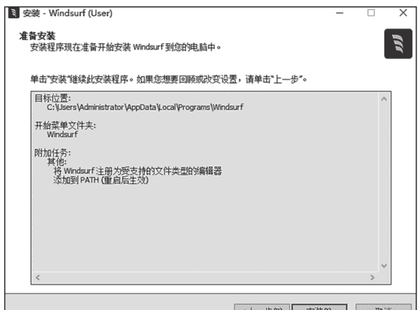

图3-3 完成 Windsurf 安装界面注：图中电脑应为计算机。


图3-4 Windsurf 登录提示界面

#### 4. 基础设置
1）界面个性化：选择暗色/亮色主题与代码字体。
2）智能伴侣配置：根据需要调整回答风格，如简洁或详细。
3）自动保存：确认开启代码自动保存，防止意外丢失。

#### 5. 开始使用
1）创建或打开项目：在 Windsurf 中新建项目文件夹或打开本地已有代码。
2）激活智能伴侣：在编辑区输入斜杠 / 通常会触发助手或命令面板。
3）实践探索：尝试下简单指令，例如“帮我写一个 Python 函数计算两个数字之和”，熟悉交互方式，如图3-5所示。

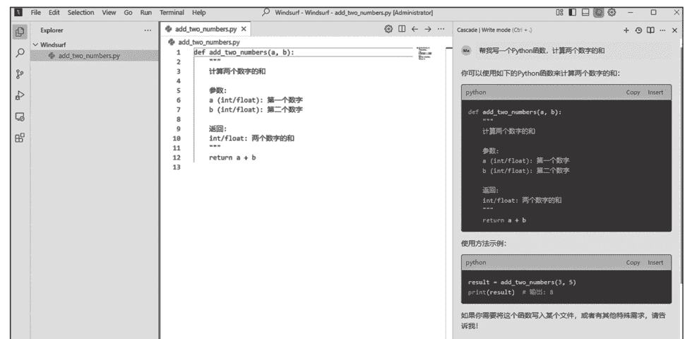

图3-5 Windsurf 编码演示

按上述步骤操作，如遇具体问题可查阅官方文档或社区支持。

### 3.4.2 VS Code 安装与基础配置

#### 1. 获取与部署
1）访问 VS Code 官网 https://code.visualstudio.com/，如图3-6所示。


图3-6 Vs Code 官网界面

2）网站会自动识别系统并推荐对应版本，点击下载获取安装文件。
3）运行安装程序，按向导完成部署，通常保持默认即可。
4）打开 VS Code，点击左侧扩展图标，搜索并安装推荐插件：
- Python by Microsoft：提供调试、Linting、IntelliSense 等完整支持。
- Python Indent：改善 Python 自动缩进。
- Pylance by Microsoft：更快速智能的补全、类型检查与错误提示。
- 可选 GitHub Copilot：需要订阅时可获取强大的智能补全，如图3-7所示。

#### 2. 基础用户设置
1）打开 “文件 → 首选项 → 设置” 或快捷键 Ctrl+, / Cmd+,。
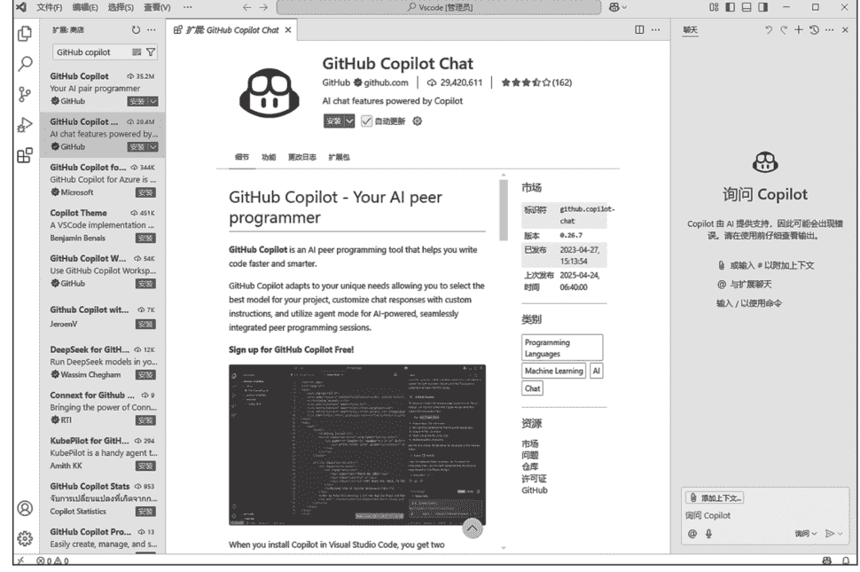

图3-7 GitHub Copilot 安装界面

2）切到 JSON 视图 {} 直接编辑 settings.json。
3）可复制推荐的基础配置到 settings.json，如图3-8所示。

```
{
    "editor.fontSize": 14,
    "editor.wordWrap": "on",
    "editor.suggestSelection": "first",
    "editor.formatOnSave": true,
    "python.linting.enabled": true
}
```

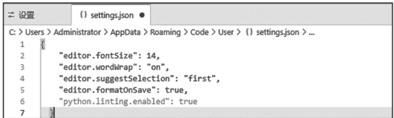

图3-8 settings.json 文件

#### 3. 配置 Python 解释器
1）确保已安装 Python 3.8 及以上，可从 https://www.python.org/ 下载，如图3-9所示。

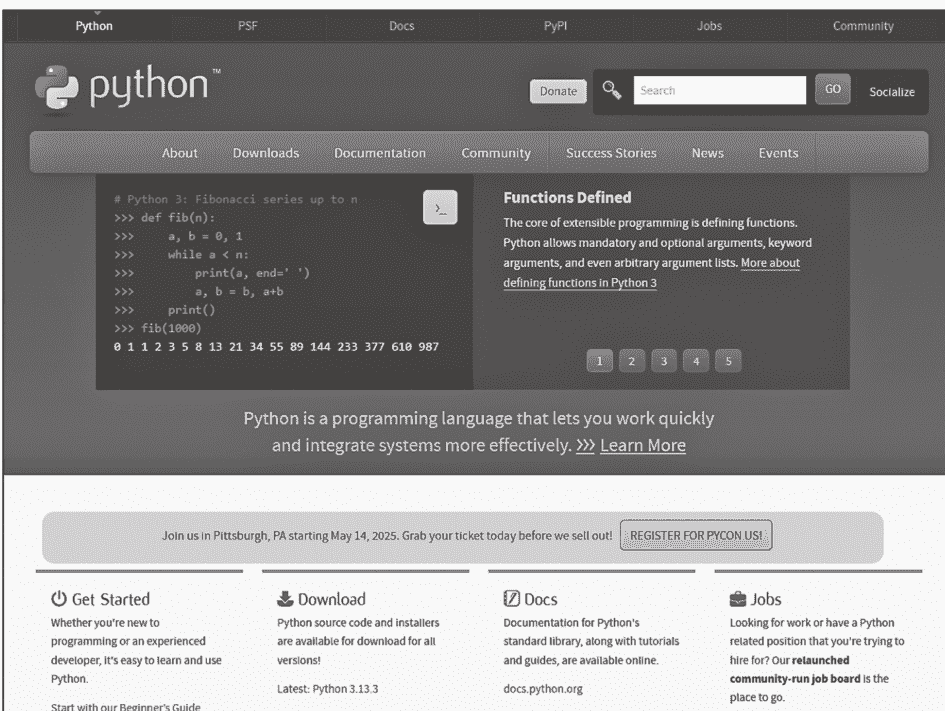

图3-9 Python 官网界面

2）在 VS Code 中打开 Python 文件或项目文件夹，按 Ctrl+Shift+P / Cmd+Shift+P 打开命令面板，输入 “Python: Select Interpreter”，在列出的环境中选择所需解释器。

完成以上步骤后，VS Code 基本可用，可按需安装更多插件扩展功能。

## 3.5 常见问题与解决办法

### 3.5.1 Windsurf 常见问题

#### 1. 问题：启动后白屏或黑屏
解决方案：
- 检查网络连接是否稳定，能否访问所需服务。
- 完全关闭后重新启动应用。
- 在设置菜单中执行清除缓存并重启操作。

#### 2. 问题：智能伴侣无响应或响应慢
解决方案：
- 确认网络通畅，智能功能需实时连模型服务。
- 用更简洁清晰具体的指令提问，避免模糊冗长。
- 重启 Windsurf。
- 查看官方渠道是否有服务中断或维护公告。

#### 3. 问题：账户登录失败
解决方案：
- 核对邮箱和密码，注意大小写。
- 检查网络是否允许访问登录服务器，VPN 配置也可能影响。
- 忘记密码时使用官网“重置密码”功能。
- 以上无效可联系官方客服。

#### 4. 问题：智能生成代码质量不佳或不符合预期
解决方案：
- 提供更丰富的上下文，附上背景信息、相关代码片段和详细需求，上下文越充分，生成结果越贴合。

提示优化与问题排查速览

- 重构提问方式：调整表达角度，采用更明确的动词，点明所用编程语言，并给出期望结果的格式示范，借鉴提示工程方法可显著提升产出质量。
- 反复迭代生成：利用 Windsurf 提供的 Regenerate、重新生成等功能，对同一需求多次尝试，往往能获得更理想的答案。
- 拆解复杂任务：把大问题拆成若干小任务，逐项提问，有助于提高可控性与准确性。
通用提示：保持 Windsurf 客户端升级到最新版本，新版本通常修复已知 Bug 并改进运行效率。

### 3.5.2 VS Code的常见问题与解决方案

在 Visual Studio Code 中开展 Python 开发时容易碰到的状况及对应处理办法整理如下：

#### 1. 问题：找不到Python解释器
解决方案：
- 安装确认：先核实本地已正确安装 Python，可在终端运行 `python --version` 或 `python3 --version` 检查版本信息。
- 手动挑选：在 VS Code 里按 〈Ctrl+Shift+P〉 键（Windows/Linux）或 〈Cmd+Shift+P〉 键（macOS）打开命令面板，执行 Python:Select Interpreter。
- 指定路径：若目标解释器未自动列出，选择列表底部的 Enter interpreter path，按系统提示浏览至 Python 安装目录下的 `python.exe`（Windows）或 `python/python3`（macOS/Linux）文件。

#### 2. 问题：插件安装失败
解决方案：
- 网络核查：确认网络通畅且可访问 VS Code Marketplace，代理或防火墙可能阻断下载。
- 本地离线安装：先到 Marketplace 官网搜索所需插件下载 `.vsix` 包，随后在扩展侧边栏点击右上角 … 按钮，选择 Install from VSIX 导入本地文件。
- 重启编辑器：短暂异常时重启 VS Code 常可恢复正常。
- 权限检查：确认 VS Code 具备写入安装目录及扩展目录的权限。

#### 3. 问题：代码智能提示不工作或失效
解决方案：
- 安装核心扩展：确保已安装 Microsoft 官方 Python 扩展，其内建 Pylance 语言服务。
- 查看语言服务状态：在底部状态栏或 Output 面板中确认 Pylance 正在运行且无报错信息。
- 重新加载窗口：按 〈Ctrl+Shift+P〉 键（或 〈Cmd+Shift+P〉 键）输入并执行 Developer:Reload Window。
- 核对工作区配置：确保工作区根目录被正确识别，且 `.vscode/settings.json` 中无错误配置。

#### 4. 问题：终端中无法运行Python命令
解决方案：
- 检查环境变量：最常见原因是 Python 安装路径未加入系统 PATH。
- Windows 设置：
    1）右键“此电脑”选择“属性”。
    2）点击“高级系统设置”。
    3）点击“环境变量”。
    4）在系统变量或用户变量中定位 Path，选中后点击“编辑”。
    5）点击“新建”，分别添加 Python 安装根目录（如 `C:\Python39\`）及其 Scripts 子目录（如 `C:\Python39\Scripts\`）。
    6）依次点击“确定”保存，重启 VS Code 或命令提示符使更改生效。
- macOS/Linux 设置：
    1）打开终端。
    2）编辑 shell 配置文件，通常是 `~/.bash_profile`（Bash）或 `~/.zshrc`（Zsh），例如 `nano ~/.zshrc`。
    3）在文件末尾追加类似 `export PATH="/path/to/your/python/bin:$PATH"` 的行，用 `which python3` 查询真实路径替换占位符。
    4）保存文件（nano 中按 〈Ctrl+X〉，按 〈Y〉，按 〈Enter〉）。
    5）执行 `source ~/.zshrc` 或重新打开终端使配置生效。

提示
定期升级 VS Code 以及已装扩展，可以获取新功能并修复已知问题。

## 3.6 结语
把开发环境搭建好，是每个开发者从新手到资深都必须经历的成长仪式。跨过这个看似平常却至关重要的门槛后，你已经领先了那 90% 仅停留在“有想法”阶段的人。

环境配置并非技术壁垒，主要考验耐心与细心。遇到报错或兼容问题不必气馁。

- 视为常态：这是学习道路上十分正常的环节。
- 视为契机：排查故障、检索资料、理解系统运作的过程本身就是锻炼能力的好机会。每一次成功解决环境问题，都会加深对工具的理解，为后续编程扫清障碍。

此刻你的“驾驶舱”已完成校准，油箱已满。握住键盘与鼠标，踩下油门，从第一个项目开始，在 AI 编程的广阔天地开启创造之旅吧！

# CHAPTER 4 第4章 用DeepSeek学Python变量和简单数据类型

本章将带你进入 Python 编程的基石——变量与基础数据类型。你会了解如何创建并使用变量作为信息容器，如何处理字符串文本与数值，如何借助注释提升代码可读性。

DeepSeek 可帮你理解概念，提供通俗解释和可运行示例。当你输入代码时，它还能解析各部分含义并在需要时给出改进建议。

完成本章后，你将掌握 Python 的基本构建单元，为学习更复杂内容奠定基础，即便零编程经验也能顺利入门。

## 4.1 本章学习目标

本章旨在建立扎实的 Python 基础，涵盖以下能力：

- 掌握核心概念：理解变量与数据类型这两个编程基石，建立初步逻辑思维，为后续学习铺路。
- 熟练处理文本与数字：能够操作字符串和数值类型，实现简单信息存储与计算。
- 提升代码可读性：学会使用注释、遵循命名规范，编写清晰易懂的代码，培养良好习惯。
- 消除入门焦虑：通过实践小示例，建立“我能做到”的信心，减少对编程的陌生感。
- 解决常见初学难题：提前了解初学者易犯的语法与逻辑错误，掌握识别与修复方法，培养基础调试能力。

## 4.2 Python 解析器

在学习变量与数据类型前，先认识 Python 解析器的运行机制。解析器是 Python 环境的核心，负责把源码转换成语计算机可执行的指令。

### 4.2.1 Python 解析器的工作原理

Python 属于解释型语言，代码在运行期间由解析器逐行解释执行，而非像 C 或 Java 那样先编译成机器码再运行。这种特性让 Python 更灵活易调试，但执行效率相对较低。

向 DeepSeek 提问：

> 请详细解释 Python 解析器的工作原理，以及它与编译型语言的区别。

DeepSeek 回复：

## 一、Python 解析器的工作原理
Python 解析器是把 Python 源码转为计算机可执行指令的程序。作为解释型语言，其执行流程与编译型语言明显不同。

## 二、Python 解析器的基本工作流程
1. 词法分析：把源码拆分为标记，如关键字、变量名、运算符等。
2. 语法分析：将标记组织成语法结构，生成抽象语法树 AST。
3. 编译为字节码：解析器把 AST 编译成 Python 字节码，这是一种与硬件无关的中间表示。
4. 执行字节码：Python 虚拟机 PVM 执行字节码指令。在 CPython 中，这一步由 C 语言实现的解释器完成。

## 三、解释型语言与编译型语言的区别
1. 解释型语言（如 Python）
    - 执行方式：运行时逐行解释。
    - 开发周期：写代码→直接运行→调试→修改→运行，迭代快。
    - 可移植性：高，有解释器即可运行。
    - 执行速度：通常较慢。
    - 内存占用：通常较高。
    - 错误检测：运行时动态检查。

2. 编译型语言（如 C/C++）
    - 执行方式：先编译成机器码，再执行。
    - 开发周期：写代码→编译→链接→执行→调试→重新编译，周期长。
    - 可移植性：低，需针对平台重新编译。
    - 执行速度：通常较快。
    - 内存占用：通常较低。
    - 错误检测：编译时即可发现大部分错误。

## 四、Python 的混合特性
Python 兼具解释型与编译型特点：源码先编译为字节码 `.pyc` 文件，再由虚拟机解释执行，结合了开发便捷性与一定执行效率。

## 五、常见 Python 实现
- CPython：标准实现，用 C 编写。
- PyPy：采用 JIT 即时编译，速度更快。
- Jython：在 JVM 上运行。
- IronPython：在 .NET 平台运行。
各实现解释器不同，但都遵循 Python 语言规范。

### 4.2.2 交互式执行与脚本执行

Python 提供两种主要执行方式：交互式执行和脚本执行。

#### 1. 交互式执行
交互式执行即 REPL 循环，输入代码即可立刻看到结果，适合学习与测试。

启动方式：
1. 打开命令提示符（Windows）或终端（macOS/Linux）。
2. 输入 `python` 或 `python3`。
3. 出现 `>>>` 提示符后即可输入代码。

例如：
```
python
>>> print("Hello, Python!")
Hello, Python!
>>> 2 + 3
5

>>> name = "小明"
>>> print(f"你好, {name}!")
你好, 小明!
```

#### 2. 脚本执行
用于保存较长或需重复运行的代码，文件以 `.py` 为后缀。

启动方式：
1. 新建文本文件并保存为 `.py`，如 `example.py`。
2. 编写代码。
3. 在命令行执行 `python example.py`。

例如，文件 `calculation.py`：
```python
# 这是一个简单的计算脚本
a = 10
b = 20
sum_result = a + b
product = a * b
print(f"{a} + {b} = {sum_result}")
print(f"{a} × {b} = {product}")
```

执行后终端输出：
```
$ python calculation.py
10 + 20 = 30
10 × 20 = 200
```

### 4.2.3 使用DeepSeek辅助理解Python解析器

DeepSeek 可帮助初学者更深入理解解析器原理，以及如何使用交互式环境与脚本。

用户提问：
> 作为初学者，我应该使用 Python 的交互式执行还是脚本执行方式？它们各有什么优缺点？

DeepSeek 回复：
> Python 初学者：交互式执行 vs 脚本执行

两者各有优劣，建议结合使用。

交互式执行的优点
- 即时反馈，输入后立刻看到结果。
- 适合探索性学习，快速尝试语法与内置函数。
- 调试方便，可逐步查看变量状态。
- 无需保存文件，适合测试片段。
- 内置 `help()` 可查文档。

交互式执行的缺点
- 代码不自动保存。
- 不适合管理大型代码块。
- 重复执行需手动查找历史命令。
- 对缩进结构支持不直观。

脚本执行的优点
- 代码可保存并复用。
- 适合编写和组织复杂程序。
- 支持版本控制。
- 可模块化拆分文件与函数。
- IDE 提供补全、语法高亮等支持。

脚本执行的缺点
- 反馈周期较长，需保存后运行。
- 调试需借助 `print` 或调试工具。
- 初期需配置编辑器。

建议
1) 用交互式环境学习基础概念：尝试表达式、数据类型、内置函数、测试小片段。
2) 转向脚本执行做实际练习：先写 5~20 行脚本，逐步增加复杂度，学习代码组织。
3) 两者结合：先在交互式环境验证想法，再保存到脚本；用交互式环境调试脚本问题。
4) 考虑 Jupyter Notebook：兼具交互与保存优点，支持文档与可视化。

通过以上说明，你对 Python 解析器的工作方式以及两种执行模式有了基本认识，为后续学习变量奠定基础。

## 4.3 变量

变量是编程最基础的概念之一，用于存储数据并在程序中复用。Python 中的变量使用直观灵活，非常适合初学者。

### 4.3.1 变量的命名和使用

在 Python 中，变量相当于内存数据的标签。创建变量只需指定名称并赋值。

#### 1. 变量的基本使用
借助 DeepSeek 快速了解如何创建变量。

用户提问：
> 如何创建一个 Python 变量?

DeepSeek 回复：
```python
# 创建一个名为 message 的变量，并赋值为 "Hello Python world!"
message = "Hello Python world!"
print(message)
# 修改变量的值
message = "Hello Python Crash Course world!"
print(message)
```

输出结果：
```
Hello Python world!
Hello Python Crash Course world!
```

示例中先创建 `message` 并赋值为字符串，随后打印。再次赋值后值被更新并重新打印。这体现了 Python 变量可随时更改值的特性。

#### 2. 变量命名规则
Python 变量名需遵循以下规则：
1）只能包含字母、数字和下划线，且以字母或下语线开头，不能以数字开头。
2）变量名中不能出现空格，可用下划线分隔单词。
3）避免使用 Python 关键字或内置函数名，如 `print`、`if` 等。
4）命名应简短且具有描述性。
5）变量名区分大小写，`message` 与 `Message` 不同。

向 DeepSeek 提问：
> 请提供一些 Python 变量命名的最佳实践和常见约定。

DeepSeek 回复：

## Python 变量命名的最佳实践和约定

良好的命名提升代码可读性和可维护性。

### 一、基本命名规则
1）使用小写字母：变量名通常采用小写。
```python
# 推荐
user_name = "John"
# 不推荐
UserName = "John"
```

Python 命名与字符串实操精要

2）标识之间以下滑线衔接，采用 snake_case 风格。

```python
# 推荐
first_name = "John"
# 不推荐
firstName = "John"  # 驼峰命名法在 Python 中不是常规做法
```

3）除极简场景如遍历计数这类情况外，尽量避免单字母命名。

```python
# 可接受（在简单循环中）
for i in range(5):
    print(i)
# 推荐（在更复杂的情况下）
for index in range(5):
    print(index)
```

4）命名时一般不以下滑线开头，若有特殊意图可例外。

单条下滑线前缀的 _var 暗示仅供内部使用；双下滑线前缀的 __var 常用于类内部私有属性；前后各带双下滑线的 __var__ 则对应特殊方法，即魔术方法。

### 二、命名约定
标识最好能够自解释

```python
# 推荐
user_age = 25
# 不推荐
a = 25  # 不清楚这代表什么
```

在 AI 补充的视角下，Python 标识的命名还有以下细节值得留意。

1）常量建议使用全大写并以下滑线分隔。

```python
MAX_CONNECTIONS = 100
PI = 3.14159
```

2) 布尔类型的标识习惯以 is_、has_、can_ 等前缀开头。

```python
is_valid = True
has_permission = False
can_edit = True
```

3) 代表集合的标识通常采用复数形式。

```python
users = ["Alice", "Bob", "Charlie"]
points = [1, 2, 3, 4]
```

4) 函数参数的命名规则与普通标识保持一致。

```python
def calculate_total(item_prices, tax_rate):
    # 函数体
```

5) 规避易混淆的字符。

例如小写 l 容易被看成数字 1，大写 O 容易被看成数字 0，这类相似字符会降低可读性，建议选用区分度更高的字母。

#### 3. 实例
下面展示一组规范的命名样例；

用户提问：

> 列举一些良好的 Python 变量命名实例。

DeepSeek 的回复：

```
良好的变量命名不仅能提高代码的可读性，还能让代码在团队协作中更加清晰和一致。以下是一些遵循 Python 命名规则的实际例子：
# 良好的变量命名示例
user_name = "Alice"    # 使用有意义的变量名，避免歧义
user_age = 30          # 变量名简洁且能够准确描述数据含义
is_active = True       # 布尔变量以 'is_' 开头，便于理解其逻辑
items_count = 5        # 名词复数形式表示多个对象
MAX_RETRY_ATTEMPTS = 3 # 常量使用全大写字母，单词间用下划线分隔

# 函数中的良好命名
def calculate_area(width, height):
    """
    计算矩形的面积
    :param width: 矩形的宽度
    :param height: 矩形的高度
    :return: 返回矩形的面积
    """
    return width * height

# 循环中的良好命名
for index, value in enumerate(["a", "b", "c"]):
    print(f"Item {index}: {value}")
```

坚持这类规范能让代码更清爽、更易读，也符合社区惯例。直观的名字便于他人快速把握意图，提升维护效率。

#### 4. 变量使用实例
接下来通过一个稍复杂的案例说明如何存放与更新不同类型的数据。

用户提问：

> 如何使用 Python 变量来存储和更新不同类型的数据？

DeepSeek 的回复：

Python 的标识可以容纳字符串、整数、浮点数、布尔值等多种类型。下面示例演示如何用标识记录一个人的多项属性：

```python
# 创建描述一个人的变量
name = "张明"
age = 25
height = 175.5          # 单位：厘米
is_student = True
# 使用这些变量
print(f"姓名：{name}")
print(f"年龄：{age} 岁")
print(f"身高：{height} 厘米")
print(f"是否学生：{'是' if is_student else '否'}")
# 修改变量值
age = age + 1           # 增加一岁
height = height + 0.5   # 身高增加 0.5 厘米
# 打印修改后的信息
print(f"\n一年后：")
print(f"姓名：{name}")
print(f"年龄：{age} 岁")
print(f"身高：{height} 厘米")
```

输出结果：

```
姓名：张明
年龄：25 岁
身高：175.5 厘米
是否学生：是

一年后：
姓名：张明
年龄：26 岁
身高：176.0 厘米
```

示例里不同类型的数据分别描述了人物的不同属性：

- name 保存字符串 “张明”，代表姓名。
- age 保存整数 25，代表年龄。
- height 保存浮点数 175.5，代表身高厘米。
- is_student 保存布尔值 True，代表是否在校。

借助这些标识不仅能保存信息，还能动态修改。例如 age=age+1 可更新年龄，height=height+0.5 可调整身高，体现了 Python 标识在程序中动态管理数据的能力。

合理使用标识可以方便地操作和更新数据，应对更复杂的逻辑。该例子也说明了良好命名与数据管理的重要性。

### 4.3.2 使用变量时应避免的命名问题
在使用标识时，有几类常见坑需要规避。

#### 1. 避免命名错误
用户提问：

> 在使用 Python 变量时，应该避免哪些常见的命名问题？

DeepSeek 的回复：

```python
message = "Hello Python!"
print(mesage)            # 错误：变量名拼写错误
```

这段代码会触发 NameError: name 'mesage' is not defined，因为 print 语句中把 message 写成了 mesage，解释器找不到该标识。

结合上述说明，建议在编码时开启拼写检查，可自动发现并修正标识的拼写失误，避免此类低级错误。

#### 2. 避免使用 Python 关键字
Python 关键字是保留字，不能作为标识。例如：

```python
class = "Python 编程"    # 错误：class 是 Python 关键字
```

不要使用保留字来命名，可借助 AI 进行关键字检查，及时发现并纠正。

#### 3. 避免标识冲突
不要使用与 Python 内置函数同名的标识，以免产生异常行为。

```python
# 不推荐
sum = 10 + 20
print(sum)                # 输出：30

# 现在 sum 不再是函数，而是变量
numbers = [1, 2, 3]
# print(sum(numbers))     # 这会产生错误，因为 sum 现在是整数 30，不是函数
```

此处 sum 被用作标识，覆盖了内置的 sum() 函数，导致后续调用出错。

应避免使用内置函数或常用库函数名作标识，选择更具描述性的名称，防止冲突。

#### 4. 避免使用无意义的标识
标识应清晰表达用途，避免使用无意义的名称：

```python
# 不推荐
a = 10
b = 20
c = a + b

# 推荐
length = 10
width = 20
area = length * width
```

length、width、area 这类命名能直观传达含义，而 a、b、c 缺乏描述性，阅读者难以快速理解其用途。

### 4.3.3 使用 DeepSeek 解决变量命名问题
遇到命名问题时，DeepSeek 可提供解决方案。

用户提问：

> 我的代码出现了错误：NameError: name 'mesage' is not defined。这是什么意思？

DeepSeek 的回复：

> 解决 NameError: name 'mesage' is not defined

这是 Python 常见错误，表示尝试使用未定义的标识。具体来说找不到名为 'mesage' 的名称。

> 错误原因

通常有以下几种情况：

拼写错误：最常见，例如定义了 message 使用时写成 mesage。

标识未定义：使用前未赋值。

作用域问题：标识在当前作用域不可见。

大小写错误：Python 区分大小写，Message 与 message 不同。

基于上述分析，提供修复思路。

#### 1. 检查拼写
仔细核对代码中的标识拼写，错误信息提到的 mesage 很可能应为 message。示例：

```python
# 错误代码
message = "Hello, World!"
print(mesage)              # 错误：mesage 拼写错误
# 修复后的代码
message = "Hello, World!"
print(message)              # 正确：拼写一致
```

#### 2. 确保标识已定义
使用前先完成定义。

```python
# 错误代码
print(mesage)                # 错误：变量未定义

# 修复后的代码
mesage = "Hello, World!"    # 先定义
print(mesage)                # 再使用
```

#### 3. 检查作用域
在函数内使用标识时，需在函数内部定义或作为参数传入。

```python
# 错误代码
def greet():
    print(message)           # 错误：message 在函数内部未定义
# 修复方法 1：将变量作为参数传入
def greet(message):
    print(message)
# 修复方法 2：在函数内部定义变量
def greet():
    message = "Hello, World!"
    print(message)
# 修复方法 3：使用全局变量（不推荐，除非必要）
message = "Hello, World!"
def greet():
    global message
    print(message)
```

#### 4. 检查大小写
保持标识大小写一致。

#### 5. 使用 IDE 或编辑器
VS Code、PyCharm 等编辑器会在输入时高亮未定义标识，便于提前发现问题。

#### 6. 使用变量命名约定
遵循约定可降低拼写错误：

- 使用有意义的名称。
- 使用小写字母加下滑线 snake_case。
- 避开易混淆字符。

#### 7. 预防措施
- 保持统一的命名风格。
- 使用前确认标识已定义。
- 使用支持语法检查的编辑器。
- 复杂程序中可使用类型提示。

通过 DeepSeek 可了解变量概念、命名规则及常见问题的修复方法。标识是 Python 编程基础，掌握后便于后续学习。下一节将介绍 Python 字符串。

### 4.4 字符串
字符串是 Python 最常用的数据类型之一，用来表示文本。字符串由引号包围的字符序列构成，单引号或双引号均可，提高了灵活性。

### 4.4.1 修改字符串的大小写
Python 提供多种大小写转换方法，这些方法返回新字符串，不会修改原值。

#### 1. title() 方法
title() 将每个单词首字母大写，其余字母小写。

```python
name = "ada lovelace"
print(name.title())  # 输出：Ada Lovelace
```

#### 2. upper() 方法
upper() 将所有字母转为大写。

```python
name = "Ada Lovelace"
print(name.upper())  # 输出：ADA LOVELACE
```

#### 3. lower() 方法
lower() 将所有字母转为小写。

```python
name = "Ada Lovelace"
print(name.lower())  # 输出：ada lovelace
```

lower() 在数据存储时很有用，因为用户输入的大小写不可控，统一转小写后再存储更稳妥。

向 DeepSeek 询问更多大小写处理方法。

**用户提问：**

> Python 中除了 title()、upper() 和 lower() 外，还有哪些处理字符串大小写的方法？它们各有什么用途？

**DeepSeek 的回复：**

### Python 字符串大小写处理方法全解析

除 title()、upper()、lower() 外，Python 还提供多种大小写处理方法：

#### 一、基本大小写转换方法
1.  **capitalize()**：首字符大写，其余小写。

    ```python
    text = "hello WORLD"
    print(text.capitalize())          # 输出："Hello world"
    ```

2.  **swapcase()**：大写转小写，小写转大写。

    ```python
    text = "Hello World"
    print(text.swapcase())            # 输出："hELLO wORLD"
    ```

3.  **casefold()**：类似 lower()，但对多语言大小写规则支持更强。

    ```python
    text = "Großes ß"                  # 德语中的特殊字符
    print(text.lower())               # 输出："großes ß"
    print(text.casefold())            # 输出："grosses ss"
    ```

#### 二、检查大小写的方法
1.  **islower()**：检查所有字母是否都是小写。

    ```python
    print("hello world".islower())    # 输出：True
    print("Hello world".islower())    # 输出：False
    ```

2.  **isupper()**：检查所有字母是否都是大写。

    ```python
    print("HELLO WORLD".isupper())    # 输出：True
    print("HELLO world".isupper())    # 输出：False
    ```

3.  **istitle()**：检查是否符合标题格式，即每个单词首字母大写。

    ```python
    print("Hello World".istitle())    # 输出：True
    print("Hello world".istitle())    # 输出：False
    ```

结合 DeepSeek 的回答，补充完善。

#### 4. 其他相关检查方法
1.  **isalpha()**：检查是否只包含字母。

    ```python
    print("HelloWorld".isalpha())    # 输出：True
    print("Hello World".isalpha())   # 输出：False（包含空格）
    ```

2.  **isalnum()**：检查是否只包含字母和数字。

    ```python
    print("Hello123".isalnum())     # 输出：True
    print("Hello 123".isalnum())    # 输出：False（包含空格）
    ```

3.  **isdigit()、isnumeric()、isdecimal()**：检查是否只包含数字。

```python
    print("12345".isdigit())        # 输出：True
    print("12.34".isdigit())        # 输出：False（包含小数点）
    ```

#### 5. 方法上手指南

1.  **title()**：
    - 把人名、地名、书名等专有名词的首字母转为大写。
    - 典型场景是把用户随意输入的名字整理成规范格式。

2.  **upper()**：
    - 让警告或错误提示更醒目。
    - 先统一转大写再做大小写不敏感的比较。
    - 保持 HTML 标签等固定格式的一致性。

3.  **lower()**：
    - 保存邮箱等信息时统一小写。
    - 搜索或比对时先转小写消除大小写差异。

4.  **capitalize()**：
    - 将一句话的首字母大写其余小写。
    - 整理用户提交的句子开头。

5.  **swapcase()**：
    - 实现特殊的视觉效果。
    - 通过大小写互换来突出重点。

6.  **casefold()**：
    - 国际化场景下的大小写忽略比较。
    - 处理多语言文本时的稳妥方案。

7.  **检查方法（islower()、isupper()等）**：
    - 校验用户输入的格式。
    - 判定密码复杂度，比如是否包含大小写字母。
    - 根据检测结果做条件化展示。

#### 6. 实战示例合集

下面通过综合案例和代码演示，展示这些方法的组合用法。

```python
def validate_username(username):
    """验证用户名是否有效"""
    if not username.isalnum():
        return False, "用户名只能包含字母和数字"

    return True, "用户名有效"

def format_name(first_name, last_name):
    """格式化姓名"""
    return f"{first_name.title()} {last_name.title()}"

def is_password_strong(password):
    """检查密码强度"""
    has_lower = any(char.islower() for char in password)
    has_upper = any(char.isupper() for char in password)
    has_digit = any(char.isdigit() for char in password)

    return has_lower and has_upper and has_digit

# 测试
print(validate_username("john_doe"))          # (False, '用户名只能包含字母和数字')
print(format_name("john", "doe"))             # 'John Doe'
print(is_password_strong("Password123"))      # True
```

正是这些内置方法，让 Python 在文本处理上游刃有余，从基础排版到复杂清洗都能轻松覆盖。

### 4.4.2 字符串拼接技巧

Python 里最直接的拼接方式是用加号把两个字符串连起来。

```python
first_name = "ada"
last_name = "lovelace"
full_name = first_name + " " + last_name
print(full_name)                # 输出: ada lovelace
```

借助加号，还能拼出更复杂的提示信息。

```python
first_name = "ada"
last_name = "lovelace"
full_name = first_name + " " + last_name
message = "Hello, " + full_name.title() + "!"
print(message)            # 输出: Hello, Ada Lovelace!
```

从 Python 3.6 起，f 字符串被引入，以 f 开头，花括号里可以直接放变量或表达式。

```python
first_name = "ada"
last_name = "lovelace"
full_name = f"{first_name} {last_name}"
print(full_name)          # 输出: ada lovelace

message = f"Hello, {full_name.title()}!"
print(message)            # 输出: Hello, Ada Lovelace!
```

相比传统格式化，f 字符串写法更直观简洁，已成为推荐做法。

### 4.4.3 用制表符和换行符排版

字符串里的空白不只是空格，还包括制表符和换行符，Python 用转义序列来表示。

#### 1. 制表符

\t 代表水平制表，可快速拉开列之间的距离。

```python
print("Python")
print("\tPython")
```

输出结果：

```
Python
    Python
```

#### 2. 换行符

\n 用来在输出时换到下一行。

```python
print("Languages:\nPython\nC\nJavaScript")
```

输出结果：

```
Languages:
Python
C
JavaScript
```

#### 3. 组合使用

两者常一起使用，实现对齐且多行的排版效果。

```python
print("Languages:\n\tPython\n\tC\n\tJavaScript")
```

输出结果：

```
Languages:
    Python
    C
    JavaScript
```

### 4.4.4 删除空白

用户输入或读取文件时常带多余空格，Python 提供了专门的清理工具。

#### 1. rstrip()方法

rstrip 只清理尾部的空白，保留开头部分。

```python
favorite_language = "python "
print(favorite_language.rstrip())    # 输出：'python'
```

#### 2. lstrip()方法

lstrip 专注去掉左侧开头的空白。

```python
favorite_language = " python"
print(favorite_language.lstrip())    # 输出：'python'
```

#### 3. strip()方法

strip 同时处理两端，中间的空格保持不变。

```python
favorite_language = " python "
print(favorite_language.strip())        # 输出：'python'
```

这三者在清洗用户输入时特别好用，能避免因多余空格导致的匹配失败。

### 4.4.5 字符串的进阶用法

字符串操作里还有不少进阶手段，能显著提升开发效率。下面汇总几个实用技巧。

#### 1. 转义字符

字符串内部出现引号或特殊符号时，可用反斜杠进行转义，避免语法错误。

```python
message = "The language \"Python\" is named after Monty Python."
print(message)  # 输出：The language "Python" is named after Monty Python.
```

常用转义如下：

- \'：单引号
- \"：双引号
- \\：反斜杠
- \n：换行符
- \t：制表符

让我们向DeepSeek询问更多关于Python字符串的高级用法。

**用户提问：**

请介绍 Python 字符串的一些高级用法和技巧，特别是在处理复杂文本时有用的方法。

**DeepSeek回答：**

### Python 字符串进阶技巧全览

Python 内置了丰富的文本处理能力，下面盘点几类在复杂场景下特别好用的方法。

#### 1. F-字符串的高级用法 (Python 3.6+)

```python
# 在 f- 字符串中使用表达式
x = 10
y = 5
print(f"{x} + {y} = {x + y}")        # 输出：10 + 5 = 15
# 格式化数字
price = 1234.5678
print(f"价格：${price:.2f}")        # 输出：价格：$1234.57
# 对齐文本
name = "张三"
score = 95
print(f"{name:10} - {score:<5}")    # 输出："张三         - 95   "
print(f"{name:>10} - {score:>5}")   # 输出："         张三 -    95"
print(f"{name:^10} - {score:^5}")   # 输出："    张三     -  95  "

# 使用千位分隔符
large_num = 1234567890
print(f"{large_num:,}")             # 输出：1,234,567,890
# 二进制、八进制、十六进制表示
num = 42
print(f"{num:b}")                   # 二进制：101010
print(f"{num:o}")                   # 八进制：52
print(f"{num:x}")                   # 十六进制：2a
print(f"{num:X}")                   # 大写十六进制：2A
# 日期格式化
from datetime import datetime
now = datetime.now()
print(f"{now:%Y-%m-%d %H:%M:%S}")   # 输出：2023-05-15 14:30:45
```

```python
# str.format() 方法
print("{} + {} = {}".format(x, y, x + y))
print("{name} 得了 {score} 分".format(name="李四", score=98))
# % 操作符（类似 C 语言的 printf）
print("%s 得了 %d 分" % ("王五", 92))
```

#### 2. 字符串的分割与合并

分割与合并是文本处理的基础，Python 用 split、join 等方法让拆分和重组变得简单。

```python
# 分割字符串
text = "Python,Java,C++,JavaScript"
languages = text.split(",")  # ['Python', 'Java', 'C++', 'JavaScript']

# 限制分割次数
text = "a-b-c-d-e"
parts = text.split("-", 2)  # ['a', 'b', 'c-d-e']
# 按多个分隔符分割（使用正则表达式）
import re
text = "Python;Java,C++:JavaScript"
languages = re.split("[;, :]", text)  # ['Python', 'Java', 'C++', 'JavaScript']

# 合并字符串
languages = ["Python", "Java", "C++", "JavaScript"]
text = ", ".join(languages)  # "Python, Java, C++, JavaScript"
# 合并路径（跨平台）
import os
path = os.path.join("usr", "local", "bin")  # "usr/local/bin" 或 "usr\local\bin"
```

#### 3. 字符串的查找与替换

查找和替换是日常清洗的核心，这里演示了几种常用的实现方式。

```python
# 查找子字符串
text = "Python is amazing and Python is easy to learn"
position = text.find("Python")          # 0 (第一次出现的位置)

position = text.find("Python", 10)      # 21 (从索引10开始查找)
position = text.find("Java")            # -1 (未找到)
# 计数
count = text.count("Python")            # 2
# 检查开头和结尾
filename = "document.txt"
print(filename.startswith("doc"))    # True
print(filename.endswith(".txt"))     # True
# 替换
new_text = text.replace("Python", "JavaScript")
# "JavaScript is amazing and JavaScript is easy to learn"
# 替换指定次数
new_text = text.replace("Python", "JavaScript", 1)
# "JavaScript is amazing and Python is easy to learn"
# 使用正则表达式进行复杂替换
import re
text = "My phone numbers are 123-456-7890 and 098-765-4321"
pattern = r"\d{3}-\d{3}-\d{4}"
new_text = re.sub(pattern, "XXX-XXX-XXXX", text)
# "My phone numbers are XXX-XXX-XXXX and XXX-XXX-XXXX"
```

## 4. 多行字符串的处理

多行文本的定位、计数、首尾检查和局部替换，Python 提供了对应的工具。

```python
# 三引号字符串
multiline = """ 这是第一行
这是第二行
这是第三行 """
# 去除每行前后的空白
lines = [line.strip() for line in multiline.splitlines()]
# 文本对齐
import textwrap
wrapped = textwrap.fill(long_text, width=40)  # 将文本按 40 字符宽度换行
# 去除共同的前导空白 (对于代码示例很有用)
code = textwrap.dedent("""
    def hello():
        print("Hello, World!")
        return True
""")
```

## 5. 字符串的转换与编码

字符串与数字、字节之间的相互转换，以及编码解码的常规操作。

```python
# 字符串与其他数据类型的转换
num_str = str(42)              # "42"
num = int("42")                # 42
float_num = float("3.14")      # 3.14
# 字符与 ASCII 码转换
char_code = ord('A')           # 65
char = chr(65)                 # 'A'
# 编码与解码
text = "你好，世界"
encoded = text.encode("utf-8")  # b'\xe4\xbd\xa0\xe5\xa5\xbd\xef\xbc\x8c\xe4\xb8\x96\xe7\x95\x8c'
decoded = encoded.decode("utf-8")# "你好，世界"
```

## 6. 字符串的验证与过滤

验证内容是否合法、过滤掉不需要的字符，常用于表单校验和数据清洗。

```python
# 验证字符串内容
password = "Passw0rd!"
has_upper = any(c.isupper() for c in password)
has_digit = any(c.isdigit() for c in password)
has_special = any(not c.isalnum() for c in password)
# 过滤字符串
digits_only = ''.join(c for c in "abc123def456" if c.isdigit())
    # "123456"
letters_only = ''.join(c for c in "abc123def456" if c.isalpha())
    # "abcdef"
# 转换表 (用于批量字符替换)
from string import maketrans
trans_table = str.maketrans("aeiou", "12345")
new_text = "hello world".translate(trans_table)  # "h2ll4 w4rld"
```

## 7. 字符串的插值与模板

代码片段演示了 Python 通过模板实现字符串插值的思路，这类方法在需要按需生成文本时能派上大用场。

```python
# 字符串模板
from string import Template
t = Template("$name 今年 $age 岁")
s = t.substitute(name="张三", age=25)  # "张三 今年 25 岁"
# 安全的模板替换 (缺少键时不会报错)
s = t.safe_substitute(name="张三")     # "张三 今年 $age 岁"
```

## 8. 实战应用示例

### (1) CSV 数据解析实战

```python
csv_data = "name,age,city\nAlice,25,Beijing\nBob,30,Shanghai"
lines = csv_data.strip().split('\n')
headers = lines[0].split(',')
result = []

for line in lines[1:]:
    values = line.split(',')
    person = dict(zip(headers, values))
    result.append(person)

print(result)  # [{'name': 'Alice', 'age': '25', 'city': 'Beijing'}, ...]
```

### 批量提取 URL

```python
import re
text = "Visit our website at https://example.com or http://test.org for more info."
urls = re.findall(r'https?://[^\s]+', text)
print(urls)  # ['https://example.com', 'http://test.org']
```

### (2) 表格数据格式化

```python
data = [
    ["Name", "Age", "City"],
    ["Alice", "25", "Beijing"],
    ["Bob", "30", "Shanghai"],
    ["Charlie", "35", "Guangzhou"]
]
for row in data:
    print(f"{row[0]:<10} {row[1]:^5} {row[2]:>10}")
```

这些进阶的字符串处理手段，能让复杂文本的清洗、分析与格式化报告产出变得更高效。

借助 DeepSeek 的梳理，我们回顾了 Python 字符串的基础与常用操作，比如大小写转换、字符串拼接、空白的增删以及易犯的语法陷阱。字符串属于 Python 使用频率最高的类型之一，夯实它对后续进阶很关键。接下来章节会进入数字类型，聚焦整数与浮点数。

## 4.5 数字类型总览

Python 的数值体系主要由整数和浮点数构成，内置的数学运算让数值处理显得直观便捷。

### 4.5.1 整数基础

整数指不含小数部分的数值，可为正、负或零。Python 的整数大小不设上限，会随需求自动扩展。

```python
# 整数示例
age = 23
population = 7_800_000_000    # 使用下划线使大数字更易读
negative_number = -42
zero = 0
```

基础的算术运算在 Python 中均可直接使用。

```python
# 基本数学运算
print(2 + 3)          # 加法：5
print(3 - 2)          # 减法：1
print(2 * 3)          # 乘法：6
print(3 / 2)          # 除法：1.5（注意结果是浮点数）
print(3 // 2)         # 整数除法：1（结果是整数，舍弃小数部分）
print(3 % 2)          # 取模（余数）：1
print(3 ** 2)         # 乘方：9（3的2次方）
```

运算优先级也遵循常规数学规范，即先括号后幂，再乘除，最后加减。

```python
print(2 + 3 * 4)          # 14 (先乘法后加法)
print((2 + 3) * 4)        # 20 (括号内先计算)
```

我们继续向 DeepSeek 请教关于 Python 整数的更多细节。

用户提问：

> Python 中整数有哪些特殊的用法和限制？如何处理非常大的整数？

DeepSeek回答：

## Python 整数的特色用法与大数应对

相比不少其他语言，Python 在整数处理上的能力相当突出，具备几项鲜明特点。

### 一、整数的核心特点

1）任意精度：整数可以随需无限增长，唯一边界是内存。

```python
# 计算一个非常大的数
result = 2 ** 1000
print(result)  # 10715086071862673209484250490600018105614048117055336...
print(len(str(result)))            # 302 位数字
```

2）多进制表达支持。

```python
# 二进制（以 0b 开头）
binary = 0b1010                # 等于十进制的 10
# 八进制（以 0o 开头）
octal = 0o12                   # 等于十进制的 10
# 十六进制（以 0x 开头）
hexadecimal = 0xA               # 等于十进制的 10

print(binary, octal, hexadecimal)    # 10 10 10
```

3）数字下划线分隔符，自 Python 3.6 起可用。

```python
# 使用下划线使大数字更易读
billion = 1_000_000_000
binary_million = 0b_1111_0100_0010_0100_0000
```

### 二、大整数的处理方式

Python 能自动管理大整数，无需额外库或特殊类型。

```python
# 计算大数的阶乘
def factorial(n):
    if n == 0 or n == 1:
        return 1
    else:
        return n * factorial(n-1)

# 计算 100 的阶乘
fact_100 = factorial(100)
print(f"100 的阶乘有 {len(str(fact_100))} 位数字 ") # 158 位数字
```

### 三、常用内置函数

1）abs() 用来获取绝对值。

```python
print(abs(-42))
# 42
```

2）pow() 实现幂运算。

```python
print(pow(2, 10))
# 1024 (2 的 10 次方)
print(pow(2, 10, 17))
# 4 (2 的 10 次方对 17 取模)
```

3）round() 主要做四舍五入，也可作用于整数。

```python
print(round(42, -1))
# 40 (四舍五入到最接近的 10 的倍数)
```

4）divmod() 一次返回商与余数。

```python
quotient, remainder = divmod(17, 5)
print(quotient, remainder)
# 3 2
```

在此基础上，我们再做些补充说明。

### 1. 位运算支持

Python 对整数提供了完整的位运算能力。

```python
a = 60            # 二进制：0011 1100
b = 13            # 二进制：0000 1101
# 按位与
print(a & b)      # 12 (0000 1100)
# 按位或
print(a | b)      # 61 (0011 1101)
# 按位异或
print(a ^ b)      # 49 (0011 0001)
# 按位取反
print(~a)         # -61 (1100 0011)
# 左移
print(a << 2)     # 240 (1111 0000)
# 右移
print(a >> 2)     # 15 (0000 1111)
```

### 2. 使用时的注意事项

理论上 Python 整数无上限，实际使用仍要注意以下几点。

- 内存占用：超大整数会消耗大量内存。
- 性能损耗：运算超大整数时速度可能明显下降。
- 除法行为：Python 3 中 / 会得到浮点数，需整数结果请用 //。

### 3. 大整数实操技巧

1）善用 math 模块提供的函数。

```python
import math
# 计算大数的对数
big_num = 10**100              # 谷歌数（10 的 100 次方）
print(math.log10(big_num))     # 100.0
# 检查一个数是否是 2 的幂
def is_power_of_two(n):
    return n > 0 and (n & (n - 1)) == 0
print(is_power_of_two(1024))   # True
print(is_power_of_two(1000))   # False
```

2）借助 decimal 模块实现高精度计算。

```python
from decimal import Decimal, getcontext
# 设置精度
getcontext().prec = 100
# 计算大数的精确除法
result = Decimal(1) / Decimal(7)
print(result)                  # 0.142857142857...
```

正因如此，Python 在数学运算、密码学、大数据分析等场景中表现优异。

### 4.5.2 浮点数基础

浮点数代表带小数部分的数值，Python 支持常规十进制写法和科学计数法。下面展示若干使用示例。

```python
# 浮点数示例
pi = 3.14159
height = 175.5
avogadro = 6.022e23            # 科学计数法：6.022 × 10^23
tiny = 1e-10
```

### 1. 浮点数的常用算术

以下示例演示了浮点数的基本运算。浮点数是计算机表达小数的方式，因为二进制转换的限制，常会出现精度偏差。

```python
# 浮点数运算
print(0.1 + 0.2)        # 0.30000000000000004
print(3.0 - 2.0)        # 1.0
print(2.0 * 3.0)        # 6.0
print(3.0 / 2.0)        # 1.5
print(3.0 // 2.0)       # 1.0 (整数除法，但结果是浮点数)
print(3.0 % 2.0)        # 1.0 (取模，结果是浮点数)
print(3.0 ** 2.0)       # 9.0 (乘方)
```

### 2. 精度误差的来源

使用浮点数时必须留意精度问题。计算机用二进制存储数值，部分十进制小数无法完整映射到二进制，会产生看似异常的结果。

```python
print(0.1 + 0.2)            # 0.30000000000000004，而不是 0.3
print(0.1 + 0.2 == 0.3)     # False
```

这并非 Python 的缺陷，而是浮点数表示本身的局限。涉及精确小数计算如金融场景时，可选用 decimal 模块：

```python
from decimal import Decimal
print(Decimal('0.1') + Decimal('0.2'))                # 0.3
print(Decimal('0.1') + Decimal('0.2') == Decimal('0.3')) # True
```

我们再向 DeepSeek 咨询浮点数精度问题的处理思路。

用户提问：

> 在 Python 中，如何处理浮点数计算中的精度问题？有哪些最佳实践？

DeepSeek回答：

> Python 浮点数精度问题及解决方案

浮点数精度偏差是计算机科学的共性难题，并非 Python 独有。以下提供一套理解与解决思路。

精度问题成因

根源在于二进制表示的局限。像 0.1 这样十进制简洁的小数，在二进制中可能是无限循环，必须截断，会引入舍入误差。

```python
print(0.1 + 0.2)            # 输出：0.30000000000000004
print(0.1 + 0.2 == 0.3)     # 输出：False
```

## 解决思路与最佳实践

### 1. 借助 round() 控制精度

在简单场景下，用 round() 将结果四舍五入到目标精度即可。

```python
result = 0.1 + 0.2
print(round(result, 1))      # 输出：0.3
```

### 2. 使用 decimal 实现精确计算

金融等需要精确小数的场景，decimal 模块提供十进制精算支持。

```python
from decimal import Decimal, getcontext
# 设置精度（可选）
getcontext().prec = 28
# 使用字符串初始化 Decimal 对象（推荐）
a = Decimal('0.1')
b = Decimal('0.2')
c = a + b
print(c)                    # 输出：0.3
print(c == Decimal('0.3'))   # 输出：True
```


#### 提示

避免直接用浮点数作为初始化值。

#### 运行结果：

```python
d = Decimal(0.1)  # 已经包含了浮点误差
print(d)          # 输出类似：0.1000000000000000055511151231257827021181583404541015625
```

### 3. 采用 fractions 处理有理数

当需要精确的有理数运算时，fractions 模块可提供分数运算。

```python
from fractions import Fraction
a = Fraction(1, 10)              # 1/10
b = Fraction(2, 10)              # 2/10

c = a + b
print(c)                         # 输出：3/10
print(float(c))                  # 转换回浮点数：0.3
```

### 4. 借助数学技巧规避误差

针对特定问题，可通过数学变换来减少精度误差。

```python
# 例如，处理货币计算时，使用整数分（cents）而非浮点数元（dollars）
dollars = 19.99
cents = int(dollars * 100)        # 1999分
# 进行计算...
result_dollars = cents / 100      # 转回美元
```

### 5. 近似相等判断

比较浮点数时，不应追求绝对相等，而应判断是否在误差范围内足够接近。

```python
def is_close(a, b, rel_tol=1e-9, abs_tol=0.0):
    return abs(a - b) <= max(rel_tol * max(abs(a), abs(b)), abs_tol)

print(is_close(0.1 + 0.2, 0.3))   # 输出：True
# Python 3.5+ 可以使用标准库函数
import math
print(math.isclose(0.1 + 0.2, 0.3))  # 输出：True
```

### 6. 格式化输出控制位数

展示浮点数时，可通过格式化控制显示的小数位数。

```python
result = 0.1 + 0.2
print(f"{result:.1f}")            # 输出：0.3
```

### 7. 场景化最佳实践

#### (1) 金融场景的精确数值处理

下面示例演示用 decimal 模块完成高精度金融计算，如复利。金融业务中浮点误差可能造成严重后果，必须采用专门的数值表示来保证准确。

```python
from decimal import Decimal, getcontext
getcontext().prec = 28
getcontext().rounding = 'ROUND_HALF_UP'    # 银行家舍入规则
def calculate_interest(principal, rate, years):
    p = Decimal(str(principal))
    r = Decimal(str(rate))
    t = Decimal(str(years))
    # 复利计算
    amount = p * (1 + r) ** t
    return amount
print(calculate_interest(1000, 0.05, 5))    # 1276.2815625...
```

#### (2) 科学计算

科学计算对微小误差容忍度较高，使用 NumPy 可显著提升性能。

```python
import numpy as np
# NumPy 有专门的函数处理浮点问题
print(np.isclose(0.1 + 0.2, 0.3))  # 输出：True
# 对于大量数据的计算，NumPy 更高效
data = np.array([0.1, 0.2, 0.3])
result = np.sum(data)  # 比循环累加更精确且更快
```

#### (3) 用数学库做几何运算
下面这段示例演示了借助 Python 标准数学库完成基础几何求解，尤其是求圆面积的思路。这类操作在科研计算、工程建模、图形渲染以及教学演示里都很常见。

```python
import math
# 计算圆的面积
radius = 2.5
area = math.pi * radius ** 2
print(f"圆的面积：{area:.6f}")  # 控制显示精度
```

### 8. 避免的做法
- 不要对浮点数做连续累加，否则误差会逐步放大。
- 浮点相等判断要慎用，直接用 == 很可能误判。
- 浮点不适合当作字典键或任何依赖精确匹配的用途。
- 调用 Decimal 时别直接传浮点，建议先转成字符串再构造。

### 9. 总结
应对 Python 浮点精度问题的实用做法如下：
- 先认清边界：浮点误差源于二进制表示，是底层必然限制。
- 结合场景选工具：普通舍入用 round，金融级用 decimal，有理数用 fractions。
- 比较时用 math.isclose 或自建容差函数，别硬等号。
- 输出时通过格式化控制展示位数。
- 必要时改用整数运算来规避误差。

归根结底，选型要权衡精度诉求、运行效率和可读性。

## 4.6 注释
注释是代码中不被执行的说明文字，用来阐释实现思路或补充背景信息。写得好的注释能显著提升代码的可读性和可维护性，对团队成员和未来的自己都友好。在 Python 里，以 # 开头的行会被解释器直接忽略。

### 4.6.1 如何编写注释
Python 里的注释大致可分为几类。

#### 1. 单行注释
单行注释以 # 开始，可独占一行，也可紧跟在代码后做尾注。

```python
# 这是一个单独的注释行
name = "Alice"  # 这是行末注释
```

#### 2. 多行注释
Python 并未提供专用的多行注释，常用做法是连续写多条单行注释，或借助三引号字符串来包裹大段说明，后者常被用作文档字符串。

```python
# 这是第一行注释

# 这是第二行注释
# 这是第三行注释
"""
这也是一种多行注释的方式，虽然技术上这是一个多行字符串，但如果不赋值给变量，它不会影响程序执行。
"""
```

#### 3. 文档字符串
文档字符串本质上是专为接口说明准备的注释，通常置于模块、类、函数定义的最开始，用一对三引号包起来。

```python
def calculate_area(radius):
    """
    计算圆的面积。
    参数：
        radius (float): 圆的半径
    返回：
        float: 圆的面积
    """
    return 3.14159 * radius ** 2
```

你可以通过 help() 或直接读取 __doc__ 属性来查看这些说明。

```python
help(calculate_area)                # 显示函数的文档字符串
print(calculate_area.__doc__)       # 直接打印文档字符串
```

#### 4. 注释的缩进
注释的缩进要和对应代码保持一致，保持版面整齐。

```python
def greet(name):
    # 检查名字是否为空
    if not name:
        name = "World"
    # 返回问候语
    return f"Hello, {name}!"
```

下面我们请 DeepSeek 补充一下写注释的关键原则。

用户提问：

> 在 Python 中，有哪些注释的最佳实践？如何写出有效且有用的注释？

DeepSeek回答：

```
Python 注释的最佳实践
良好的注释可以显著提高代码的可读性和可维护性。以下是 Python 注释的最佳实践和指南。
注释的基本原则
注释解释“为什么”，而不仅仅是“是什么”。代码本身应该清晰地表达它“做什么”，注释应该解释背后的原因、决策和复杂逻辑。
python
# 不好的注释（仅重复代码的明显功能）
x = x + 1                # 将 x 增加 1
# 好的注释（解释原因）
x = x + 1                # 补偿浮点数舍入误差
```

要写出有效且有用的注释，可以参考以下编写原则：
- 始终保持注释与代码同步更新。
- 过期说明比空白更具误导性。
- 改动代码时记得同步改注释。
- 表达要清晰简短。
- 远离冗长、含糊或过于专业的说辞。
- 用平实直接的语言描述。

#### 5. 不同类型的注释及其用途
#### (1) 文档字符串
文档字符串是 Python 的标志性做法，用来为模块、类、方法、函数撰写说明。

```python
def calculate_discount(price, rate=0.1):
    """
    根据给定的折扣率计算折扣价格。
    Args:
        price (float): 原始价格
        rate (float, optional): 折扣率, 默认为 0.1 (10%)
    Returns:
        float: 折扣后的价格
    Raises:
        ValueError: 如果价格为负或折扣率不在 0 ~ 1 之间
    Examples:
        >>> calculate_discount(100, 0.2)
        80.0
    """
    if price < 0 or not 0 <= rate <= 1:
        raise ValueError("价格必须为正数，折扣率必须在 0 到 1 之间")
    return price * (1 - rate)
```

#### (2) 文档字符串的最佳实践
- 优先使用三引号双引号 """ 包裹。
- 首行写明一句话摘要。
- 摘要与正文之间空一行。
- 统一风格，如 Google、NumPy 或 reStructuredText。
- 务必列出参数、返回值、可能抛出的异常及使用示例。

#### (3) 模块级注释
模块顶部的说明应概括该文件承担的职责和主要内容。

```python
"""
用户认证模块
这个模块处理用户认证、权限验证和会话管理。
它实现了 OAuth2 协议并支持多因素认证。
典型用法：
    auth = Authenticator(config_file)
    user = auth.authenticate(username, password)
    if user.is_authenticated:
        session = auth.create_session(user)
"""
import os
import json
# 其他导入和代码...
```

#### (4) 行内注释
行内注释使用要克制，只有在能带来额外洞察时才加入。

```python
# 好的行内注释
x = x * 0.6        # 应用 40% 的税率
# 不必要的行内注释
x = x + 1          # 增加 x
```

#### (5) 代码块注释
代码块注释用来概括一段逻辑的整体目的。

```python
# 计算用户在过去 30 天内的平均活跃度

# 我们使用加权平均，最近的活动权重更高
recent_activity = []
weights = []
for i, day in enumerate(last_30_days):
    activity = user.get_activity(day)
    weight = 1 + (i / 30)        # 越近的日期权重越大
    recent_activity.append(activity)
    weights.append(weight)
average_activity = sum(a * w for a, w in zip(recent_activity,
    weights)) / sum(weights)
```

#### (6) TODO注释
用 TODO 标记待办事项或后续优化点。

```python
# TODO: 实现缓存机制以提高性能
# TODO(username): 在下一版本中添加批处理支持
# FIXME: 当输入包含特殊字符时会崩溃
```

#### (7) 何时使用注释
- 复杂算法：说明原理、选型理由或参考资料。
- 反直觉的实现：解释为何采用这种写法。
- 临时方案或变通：标明是临时的并说明原因。
- 性能敏感区：解释优化思路和权衡。
- 警告与局限：提醒潜在风险或使用边界。

#### (8) 何时避免注释
- 别用注释掩盖烂代码，应重构让代码自明。
- 不要用注释保存旧代码，版本控制才是归宿。
- 避免啰嗦注释，不要重复代码已表达的事实。

#### 6. 实际示例
#### (1) 不好的注释示例
```python
# 计算年龄
def calc_age(dob):
    # 获取今天的日期
    today = datetime.today()
    # 计算年龄
    age = today.year - dob.year

    # 检查生日是否已过
    if (today.month, today.day) < (dob.month, dob.day):
        age -= 1
    # 返回年龄
    return age
```

#### (2) 好的注释示例
```python
def get_age_category(age):
    """
    根据年龄确定人口统计类别。
    分类标准基于 2020 年人口普查指南。
    """
    # 处理边界情况
    if age < 0:
        raise ValueError("年龄不能为负")
    # 我们使用闭区间 [a,b] 而不是半开区间 [a,b)
    # 这样更符合人口统计学的惯例
    if 0 <= age <= 14:
        return "儿童"
    elif 15 <= age <= 24:
        return "青少年"
    elif 25 <= age <= 64:
        return "成年人"
    else:  # age >= 65
        return "老年人"
```

#### (3) 工具和自动化
借助工具保持注释质量：
- Pylint/Flake8 可做文档字符串与注释风格检查。
- Sphinx 能把文档字符串转成正式文档。
- Black 在格式化代码的同时帮助注释对齐。

优秀的 Python 注释应具备：
- 回答代码的“为什么”，而非只复述“是什么”。
- 保持更新且准确。
- 风格统一、格式一致。
- 提供额外价值，不做无效复述。
- 帮助后来者快速理解意图。

最后，代码本应自解释，注释只是补充，不能替代清晰表达。

### 4.6.2 编写有效的注释
写出好注释是项重要技能，下面给出一组何时写、写什么的指引。

#### 1. 什么时候添加注释
- 复杂算法或逻辑：解释其运行机理或不直观之处。
- 关键决策：说明为何选择当前实现。
- 可能的问题或限制：标出边界条件和风险点。
- 隐藏的依赖：交代与其它模块的关联。
- 临时解决方案：注明是权宜之计并提示后续改进。

#### 2. 什么时候不需要注释
- 显而易见的操作：简单赋值或基础计算无需解释。
- 自解释代码：代码本身清晰时不必加注。
- 重复性说明：避免照搬代码含义。

#### 3. 注释的内容
好的注释应包含：
- 为什么：阐述设计动机和权衡。
- 如何：对复杂流程给出简要机理。
- 限制与假设：说明适用条件和边界。
- 参考来源：给出算法或方法的出处。

#### 4. 注释示例
以下是一些不佳与良好的注释对照。
不好的注释示例：
```python
# 计算总和
def calculate_sum(numbers):
    total = 0                # 初始化总和为 0
    for num in numbers:      # 遍历每个数字
        total += num         # 将数字加到总和中
    return total             # 返回总和
```

该例的注释只是复述代码的显而易见之处，并未增加信息量。
好的注释示例：

### 4.6.3 使用DeepSeek辅助编写注释
DeepSeek 可以帮助为代码生成有意义的注释。例如，把一段代码交给它，请它补充恰当说明：
用户提问：
```
请为以下代码添加有意义的注释：
def process_data(data, threshold=0.5):
    result = []
    for item in data:
        if item['confidence'] < threshold:
            continue
        value = item['value']
        if isinstance(value, str):
            try:
                value = float(value)
            except ValueError:
                value = 0.0
        result.append({
            'id': item['id'],
            'processed_value': value * 1.5,
            'status': 'processed'
        })
    return result
```

DeepSeek回答：
```python
def process_data(data, threshold=0.5):
    """
    处理数据项列表，过滤低置信度项并转换值。
    Args:
        data: 包含数据项的列表，每项应该是一个字典，
              至少包含 'id' 'value' 和 'confidence' 键
        threshold: 置信度阈值，低于此值的项将被过滤掉，默认为 0.5
    Returns:
        处理后的数据项列表，每项包含 'id' 'processed_value' 和 'status' 键
    """
    result = []
    # 遍历所有数据项
    for item in data:
        # 过滤掉置信度低于阈值的项
        if item['confidence'] < threshold:
            continue
        # 提取值并确保它是浮点数
        value = item['value']
        if isinstance(value, str):
            try:
                # 尝试将字符串转换为浮点数
                value = float(value)
            except ValueError:
                # 如果转换失败，设置默认值为 0
                value = 0.0
        # 创建处理后的数据项并添加到结果列表
        result.append({
            'id': item['id'],
            'processed_value': value * 1.5,  # 将值放大 1.5 倍
            'status': 'processed'
        })
    return result
```

借助 DeepSeek，我们理清了在 Python 里如何添写有效注释，以及怎样的注释才真正有用。高质量的注释能让代码更易读、更易维护，对他人和未来的自己都友好。

## 4.7 结语
本章聚焦 Python 的变量与基础数据类型，它们是构建程序的基石。学习后我们掌握了：
- Python 解析器的工作方式：了解解释器如何把源码转为机器可执行的指令，让我们集中精力解决业务问题。交互式环境也为快速验证提供了便利。
- 变量使用与命名规范：变量是数据存储的核心。我们学习了命名规则：只能用字母、数字、下划线，首字符不能是数字，区分大小写，以及常见命名陷阱。规范命名能显著提升可读性。
- 字符串操作与处理：字符串是处理文本的首选类型。我们掌握了：
    - 用方法调整大小写，如 upper、lower、title。
    - 字符串拼接。
    - 使用制表符和换行符控制空白。
    - 去除多余空白，如 strip、lstrip、rstrip。
    - 规避字符串操作中的常见语法错误。

数字与运算这部分先把Python的数值体系梳理清楚：整型负责没有小数位的数值，浮点型负责带小数点的数值；加减乘除、幂运算等基础算术都已掌握，同时学会用 str() 做类型转换，防止运行时出现类型冲突。

注释的部分明确了注释是不会被执行的说明文字，主要用来交代代码意图或补充背景信息。具体演练了用井号 # 写单行注释、如何书写多行注释和文档字符串，以及在何种时机补充注释、注释里写什么、怎样写出有效而非冗余的说明。

借助DeepSeek，除了基础概念还能接触更多进阶用法与实战规范。它的详细阐释和可运行示例让理解更立体，也更方便把知识点迁移到真实开发任务中。

完成这些基础准备后，下一步聚焦Python的列表，这种能够容纳多个关联项目的复杂类型。打牢本章的基础，后续更进阶的概念会更容易吸收。

# CHAPTER 5 第5章 用DeepSeek领略Python列表

本章核心是Python列表这一高性能数据容器，一个变量即可收纳多项元素。我们先建立对列表的整体认知，再学习如何生成、读取和改写列表内容，为批量处理关联数据、为后续数据操作打下坚实基础。

DeepSeek在概念讲解的同时提供可执行示例与练习，并在实操中帮助定位问题、给出修复思路。

学完本章，你将完成从处理单一数据项到管理数据集合的关键跃迁，为攻克更复杂的编程问题做好准备。

## 5.1 本章学习目标

本章旨在帮助你熟练掌握Python列表这一核心数据结构，高效管理与操作多项关联数据。完成学习后应做到：

- 厘清列表本质：理解列表作为基础数据结构的定位，明白它怎样在一个变量里容纳多项元素，以及它与字符串、数值等类型的用途差异与联系。
- 掌握常用操作手法：熟练生成、改写、增添与移除列表元素，灵活运用索引与切片精准定位数据。
- 应用排序与组织：学会调用内置函数对列表排序，提升基础数据管理能力。
- 规避典型坑点：认识使用列表时的常见误区，比如索引越界等，并掌握对应的排查与修复思路。

## 5.2 Python列表

列表是Python使用频率最高的数据结构之一，可保存一系列相关项目。与只能保存字符序列的字符串、只能保存单个值的数字不同，列表可容纳任意类型的数据，包括数值、文本，甚至是另一个列表。这种高度灵活的特性让处理多项关联数据变得顺手。

### 5.2.1 列表的定义与特点

下面借助DeepSeek来梳理列表的定义和特性。

学员提问：

> 什么是 Python 列表？它有什么特点？

DeepSeek 的回应：

```
一、什么是 Python 列表？
列表（List）是 Python 中一种常用的数据结构，用于存储一系列相关的项目。它允许你在一个变量中存储多个不同的数据类型，包括数字、字符串、甚至其他列表。列表是 Python 内建的数据类型之一，非常灵活和强大。
二、列表的特点
有序：列表中的元素按顺序排列，可以通过索引访问元素。索引从 0 开始。
可变：列表是可变的，意味着你可以修改、删除、添加元素，而不需要重新创建整个列表。
可以包含不同类型的元素：列表中的元素可以是不同的数据类型，例如整数、字符串、浮动数值、布尔值，甚至是其他列表。
允许重复元素：列表可以包含重复的元素，它们在列表中会按原始顺序出现。
支持嵌套：列表中的元素可以是其他列表，这样可以创建多维列表（嵌套列表）。
示例
创建一个列表
my_list = [1, 2.5, "hello", [3, 4], True]
访问列表中的元素
print(my_list[0])  # 输出 1
print(my_list[3])  # 输出 [3, 4]
修改列表中的元素
my_list[1] = 5
print(my_list)  # 输出 [1, 5, 'hello', [3, 4], True]
三、常用操作
添加元素：使用 append()、insert()。
删除元素：使用 remove()、pop()、del。
切片：使用 list[start:end]。
查找元素：使用 index()、in 操作符。
列表是 Python 中非常基础且重要的容器类型，可以在许多应用中提供便利的解决方案。
```

这些特性让列表非常适合需要集中管理多个相关元素的场景，比如保存用户多次输入的记录，或在数据分析中处理一组数值和文本。掌握Python列表的使用方法，为后续更复杂的数据处理奠定了基础，也能显著提升实际编码效率。

### 5.2.2 如何创建列表

在Python中，列表用方括号 [] 表示，元素之间以逗号分隔。下面通过DeepSeek来学习创建与使用的方法。

学员提问：

> 如何创建一个列表？可以举几个例子吗？

DeepSeek 的回应：

# 创建列表的方法

在 Python 中，列表的创建方式主要有以下几种：

1. 存储数字的列表

我们可以新建一个包含多个数字的列表：

```python
numbers = [1, 2, 3, 4, 5]
```

2. 存储字符串的列表

字符串列表可以收纳多个文本：

```python
fruits = ["apple", "banana", "cherry"]
```

3. 混合类型的列表

一个列表可以混装不同类型的元素，如数字、字符串、浮点数、布尔值等：

```python
mixed = [1, "hello", 3.14, True]
```

4. 空列表

你也可以先建一个空列表，之后再动态添加元素：

```python
empty_list = []
```

5. 嵌套列表

列表的元素本身也可以是另一个列表，从而形成多维或嵌套结构：

```python
nested = [[1, 2], [3, 4], [5, 6]]
```

从DeepSeek的说明可以看出，Python列表是一种极具弹性的容器，既能放基础类型，也能放混合类型，甚至支持嵌套。无论是简单集合还是复杂的多维数据，列表都能应对。通过上述示例不难发现，列表既可存放数字、字符串等基本类型，也能存放混合数据乃至其他列表。

## 5.3 修改、添加和删除元素

列表的可变性是其核心优势之一，创建后可以随时改动内容。本节将介绍如何改写已有元素、新增元素以及移除不需要的元素。

### 5.3.1 修改列表元素

改写元素只需通过索引定位，再赋予新值即可：

```python
# 创建一个水果列表
fruits = ["apple", "banana", "cherry"]
print(fruits)            # 输出：['apple', 'banana', 'cherry']

# 修改第二个元素
fruits[1] = "blueberry"
print(fruits)            # 输出：['apple', 'blueberry', 'cherry']
```

同样也可以使用负索引来操作：

```python
fruits = ["apple", "banana", "cherry"]
fruits[-1] = "date"      # 修改最后一个元素
print(fruits)            # 输出：['apple', 'banana', 'date']
```

借助改写元素，我们能更新数据而无需重建整个列表，在处理动态变化的数据时尤其实用。

### 5.3.2 在列表中添加元素

Python提供了多种向列表中增添元素的方式，最常用的是append()、insert()和extend()。

#### 1. 使用append()方法添加元素

append()会把元素追加到列表末尾。

```python
fruits = ["apple", "banana", "cherry"]
fruits.append("date")
print(fruits)  # 输出：['apple', 'banana', 'cherry', 'date']
```

append()是在末尾添加元素的最简便手段。

#### 2. 使用insert()方法在特定位置添加元素

若需在指定位置插入，可以使用insert()，它需要索引位置和待插入值两个参数。

```python
fruits = ["apple", "banana", "cherry"]
fruits.insert(1, "blueberry")  # 在索引 1 的位置插入 "blueberry"
print(fruits)  # 输出: ['apple', 'blueberry', 'banana', 'cherry']
```

insert()会把后续元素整体右移一位。若索引超出范围，元素将被放到末尾。

```python
fruits = ["apple", "banana", "cherry"]
fruits.insert(10, "date")  # 索引 10 超出了列表长度
print(fruits)  # 输出: ['apple', 'banana', 'cherry', 'date']
```

#### 3. 使用extend()方法合并列表

想要把一个列表的所有元素接到另一个列表末尾，可用extend()。

```python
fruits = ["apple", "banana", "cherry"]
more_fruits = ["date", "elderberry"]
fruits.extend(more_fruits)
print(fruits)  # 输出: ['apple', 'banana', 'cherry', 'date', 'elderberry']
```

extend()的效果与用加号 + 连接两个列表类似，但关键区别在于extend()直接修改原列表，而 + 运算符会生成新列表。

```python
fruits1 = ["apple", "banana", "cherry"]
fruits2 = ["date", "elderberry"]
# 使用 extend() 方法
fruits1.extend(fruits2)
print(fruits1)  # 输出: ['apple', 'banana', 'cherry', 'date', 'elderberry']
# 使用 + 运算符
fruits3 = ["apple", "banana", "cherry"]
fruits4 = ["date", "elderberry"]
fruits5 = fruits3 + fruits4
print(fruits3)  # 输出: ['apple', 'banana', 'cherry'] (原列表不变)
print(fruits5)  # 输出: ['apple', 'banana', 'cherry', 'date', 'elderberry']
```

### 5.3.3 从列表中删除元素

Python删除列表元素的方式也很丰富，常用的有pop()、remove()和del语句。

#### 1. 使用pop()方法删除元素

pop()会删除元素并返回其值。若不指定索引，默认删除并返回最后一个元素。

```python
fruits = ["apple", "banana", "cherry"]
last_fruit = fruits.pop()
print(last_fruit)          # 输出: cherry
print(fruits)              # 输出: ['apple', 'banana']
```

也可以指定要删除的元素的索引。

```python
fruits = ["apple", "banana", "cherry"]
second_fruit = fruits.pop(1)    # 删除并返回索引 1 处的元素
print(second_fruit)             # 输出：banana
print(fruits)                   # 输出：['apple', 'cherry']
```

#### 2. 使用remove()方法删除元素

如果知道要删的值但不知道位置，可用remove()。

```python
fruits = ["apple", "banana", "cherry"]
fruits.remove("banana")
print(fruits)    # 输出：['apple', 'cherry']
```

需要注意的是，remove()只会删除第一个匹配项。若列表中存在多个相同值，仅首个会被移除。

```python
fruits = ["apple", "banana", "cherry", "banana"]
fruits.remove("banana")
print(fruits)    # 输出：['apple', 'cherry', 'banana']
```

#### 3. 使用del语句删除元素

del语句可以删除单个元素或一段连续元素。

#### 4. 清空列表

若想保留列表对象但清空内容，可使用clear()方法。

```python
fruits = ["apple", "banana", "cherry"]
fruits.clear()
print(fruits)    # 输出: []
```

通过这些手段可以灵活管理列表内容，按需增改删。这种动态性正是列表成为Python最常用数据结构的原因之一。

## 5.4 Python列表的高级技巧

Python的列表排序功能既强大又灵活，除了基础用法外，还有不少高级技巧可实现更精细的排序。下面以学员提问和DeepSeek回答的形式介绍常见的高级排序思路。

学员提问：

> Python 列表排序有哪些高级技巧？如何在实际开发中使用？

### DeepSeek的回应：

Python提供了强大且灵活的排序能力，可以从简单值到复杂对象集合都能应对。以下是一些进阶技巧。

#### 排序基础回顾

Python主要提供两种排序方式：

- `list.sort()` - 原地排序，会改变原列表
- `sorted()` - 返回全新排序后的列表，原列表保持不变

两者都支持：

- `reverse=True/False` - 控制升序或降序
- `key=function` - 自定义排序依据

#### 对包含字典的列表排序

按单个键排序：

```python
people = [
    {"name": "Alice", "age": 25, "height": 165},
    {"name": "Bob", "age": 30, "height": 180},
    {"name": "Charlie", "age": 22, "height": 175}
]

# 按年龄排序
people_by_age = sorted(people, key=lambda x: x["age"])
print(people_by_age)

# 按姓名排序
people_by_name = sorted(people, key=lambda x: x["name"])
print(people_by_name)
```

按多个键排序，可使用元组：

```python
# 先按年龄，再按身高排序
people_by_age_height = sorted(people, key=lambda x: (x["age"], x["height"]))
print(people_by_age_height)

# 不同方向排序（年龄升序，身高降序）
people_mixed = sorted(people, key=lambda x: (x["age"], -x["height"]))
print(people_mixed)
```

根据DeepSeek的解释，Python的排序机制非常灵活，借助key参数可以自定义规则，用reverse参数实现倒序，且稳定排序能保留原有相对顺序。此外heapq模块可高效获取列表中的前若干大值或小值。

掌握这些高级排序技巧，能让你在实际开发中更高效地处理数据，无论是基础数值排序还是字典、对象的复杂排序，Python都提供了灵活且高效的解法。

## 5.5 通过DeepSeek学习Python索引

前几节我们已经掌握了列表的基础操作与常用方法。接下来聚焦列表索引这一核心概念：如何定位、访问并操作单个元素。因为Python采用从0开始的索引，初学者常有困惑。我们借助DeepSeek的解释和示例，深入剖析0基索引的设计原理与历史背景，帮助你彻底理解其高效性与广泛使用原因。

### 5.5.1 索引的基础概念

在讨论为何索引从0开始前，先回顾几个常见索引概念。

Python的索引就是列表中每个元素的位置标识，采用从0起计的方式。

下面结合代码示例介绍Python索引的基础概念。

```python
fruits = ['苹果', '香蕉', '橙子']
print(fruits[0])    # 输出 '苹果'
```

#### (1) 负索引

采用倒序计数时，负数索引便派上用场。-1 指向最末尾一项，-2 对应倒数第二项，依此类推。请看下面这段演示代码：

```python
print(fruits[-1])    # 输出 '橙子'
```

#### (2) 切片取值
用 起始下标:终止下标 的形式截取片段，区间遵循左含右不含的规则。

```python
numbers = [0, 1, 2, 3, 4, 5]
print(numbers[1:4])    # 输出 [1, 2, 3]
print(numbers[:3])     # 输出 [0, 1, 2]
print(numbers[3:])     # 输出 [3, 4, 5]
```

#### (3) 常用内置方法
- `list.index(value)`：查找指定值首次出现的位置下标。
- `len(list)`：统计列表里包含的元素个数。

搞懂了上述基础操作，接下来聊起为何索引从零起步就会顺理成章。

### 5.5.2 为什么 Python 索引从 0 起步
对新手而言，索引不是从 1 而是从 0 开始，初看确实不够直观。下面借助 DeepSeek 一起来剖析 Python 及众多编程语言采用零基索引背后的缘由。

零基索引并非随意设定，而是兼具数学与计算机科学的合理性。内存里列表元素连续存放，索引本质上是相对起始地址的偏移量。第一项偏移为 0，即原位；第二项偏移 1；依次类推。

这种方式还能让部分计算更简洁。比如要得到元素总数，只需把末项下标加 1 即可，正是因为计数从零开端。

让我们向 DeepSeek 询问更多关于从 0 开始索引的原因：

用户提问：

> Python 以及大量其他语言为何让列表或数组的下标从 0 开始，而不是从 1 开始？背后有什么历史脉络或技术上的好处？

DeepSeek回答：

#### 一、历史渊源
1. 早期硬件与汇编语言的烙印
在早期机器里，数组下标本质就是内存地址的位移。首元素落于基地址+0 处，第二元素在基地址+1 处，以此类推。这种与硬件直接对应的映射方式让寻址计算更高效。

2. C 语言的传承
C 语言沿用了零基下标，并把这一设计带入了后续大量语言。C 的设计者 Dennis Ritchie 承袭自 BCPL 的做法。鉴于 C 在计算机科学中的广泛影响，Python、Java、JavaScript 等现代语言也继承了这一惯例。

3. BCPL 与 B 语言的源头
BCPL 作为 C 的前辈，采用零基下标主要为了简化指针运算。创始人 Martin Richards 挑选零基，正因其与指针计算天然契合。

#### 二、技术优势
1. 数学上的简洁美
在数学里，区间 `[0, n)` 恰好容纳 n 个元素，长度就是 n。零基下标下，求子段长度直接用 `end - start`；若从 1 开始，则必须额外加减一次。

2. 模运算与循环更自然
使用零基下标后，取模与循环索引的处理更顺手。例如 `index % array_length` 可以直接使用，无需对下标做偏移修正。

3. 指针运算与内存寻址更简便
内存寻址常用公式 `地址 = 基地址 +（下标 × 元素尺寸）`。零基让公式保持简洁，不必再做减法修正。

4. 与半开区间的统一
很多算法偏爱半开区间 `[start, end)` 表示包含 start 到 end-1 的元素，这与零基下标天然一致。例如 `range(0, 5)` 生成 0 到 4，共 5 个数。

5. 循环边界更易写对
零基下，循环条件通常写成 `i < n`，而非 `i <= n`，从而降低了常见的差一错误风险。

让我们通过实际的例子来进一步理解。

#### (1) 长度为 5 的数组示例
使用 0 基索引：`[0, 1, 2, 3, 4]`

使用 1 基索引：`[1, 2, 3, 4, 5]`

#### (2) 子段长度计算
```python
# 0 基索引
sub_array = array[2:4]    # 包含索引 2 和 3 的元素
length = 4 - 2 = 2        # 正好是元素数量

# 1 基索引 (假设)
sub_array = array[2:4]    # 包含索引 2 和 3 的元素
length = 4 - 2 + 1 = 3    # 需要额外 +1 操作
```

#### (3) 内存地址计算示例
```python
# 0 基索引
元素地址 = 基地址 + (索引 × 元素大小)
array[3] 的地址 = 基地址 + (3 × 元素大小)

# 1 基索引 (假设)
元素地址 = 基地址 + ((索引 -1) × 元素大小)
array[3] 的地址 = 基地址 + ((3-1) × 元素大小)
```

#### (4) 并非全部语言都如此
并不是所有语言都采用零基下标。

- FORTRAN：使用 1 基索引，主要面向科学和工程计算，更接近数学符号。
- COBOL：允许程序员定义数组的下界。
- Lua：默认使用 1 基索引，更符合其设计哲学。
- R：使用 1 基索引，因为它主要面向统计学家。
- MATLAB/Octave：使用 1 基索引，更接近线性代数符号。

零基下标对新手或许不够直观，毕竟日常计数习惯从 1 起步，但它在计算机科学里有着深厚的历史积淀与技术裨益，能让内存寻址、区间计算和循环判定更简洁高效。

熟悉零基思维后，会发现它在众多编程场景下反而更自然、更高效。

综合 DeepSeek 的说明可以看出，Python 等语言选择零基并非偶然，背后既有早期硬件与汇编的深层影响，也有数学与寻址层面的技术考量，能简化计算、提升效率与可读性。

### 5.5.3 借助 DeepSeek 规避列表索引错误
在操作列表时，常见错误就是去访问不存在的下标，从而触发 `IndexError`。例如：

```python
fruits = ["apple", "banana", "cherry"]
# print(fruits[3])  # 错误：IndexError: list index out of range
```

这里尝试读取下标 3 的元素，而 `fruits` 仅含 3 项，有效下标为 0、1、2。Python 找不到对应位置时就会抛出 `IndexError`。

#### 1. 引发索引错误常见原因
索引错误通常有以下几种常见原因：

- 忽略零基特性：n 个元素的列表合法下标是 0~n-1，而非 1~n。
- 超界访问：尝试读取超出列表长度的下标。
- 负下标越界：比如 3 个元素的列表去访问 `list[-4]`。
- 对空列表取值：向空列表请求元素。

#### 2. 防范索引错误的常用策略
在 Python 中，列表索引越界是常见痛点。为提升代码健壮性，除常规 try-except 与长度校验外，还有更优雅的做法。

以下是一些避免索引错误的策略。

##### (1) 事先校验长度
在访问列表元素之前，可以先检查索引是否在有效范围内。

```python
fruits = ["apple", "banana", "cherry"]
index = 3
if index < len(fruits):
    print(fruits[index])
else:
    print(f"索引 {index} 超出了列表范围。")
```

##### (2) 用 try-except 接住异常
你可以使用 `try-except` 语句来捕获并处理索引错误。

```python
fruits = ["apple", "banana", "cherry"]
try:
    print(fruits[3])
except IndexError:
    print("索引超出了列表范围。")
```

##### (3) get() 思路的迁移（字典可用，列表不可）
虽然列表没有 `get()` 方法，但这种思想可以通过自定义函数实现。

```python
def safe_get(lst, index, default=None):
    """ 安全地获取列表中的元素，如果索引超出范围则返回默认值。"""
    try:
        return lst[index]
    except IndexError:
        return default

fruits = ["apple", "banana", "cherry"]
print(safe_get(fruits, 3, "未知水果"))  # 输出：未知水果
```

##### (4) 条件表达式做兜底
对于简单的情况，可以使用条件表达式。

```python
fruits = ["apple", "banana", "cherry"]
index = 3
result = fruits[index] if index < len(fruits) else "索引超出范围"
print(result)    # 输出：索引超出范围
```

##### (5) 切片天然安全
切片操作不会引发索引错误，即使索引超出了列表范围。

```python
fruits = ["apple", "banana", "cherry"]
print(fruits[3:])  # 输出：[] (空列表，而不是错误)
print(fruits[:10]) # 输出：['apple', 'banana', 'cherry'] (包含所有元素)
```

让我们向 DeepSeek 询问更多关于处理列表索引错误的最佳实践：

用户提问：

> 除了 try-except 和事先检查长度，Python 里还有哪些更佳的做法来处理列表索引错误？

DeepSeek回答：

#### 更高级的列表索引错误处理思路
处理列表索引错误是 Python 编程中的常见挑战。除了基本的 `try-except` 和长度检查外，还有许多更优雅、更高效的方法来处理这类问题。以下是一些高级策略和最佳实践。

##### 优先迭代，而非下标访问
**一、直接遍历元素**
最简单的避免索引错误的方法是完全避免使用索引：

不推荐
```python
fruits = ["apple", "banana", "cherry"]
for i in range(len(fruits)):
    print(fruits[i])
```
推荐
```python
for fruit in fruits:
    print(fruit)
```

**二、用 enumerate() 同时拿到下标与值**
如果你确实需要索引信息，可以使用 `enumerate()` 函数，这样你可以在遍历列表时同时获取索引和值。`enumerate()` 是一个非常强大的工具，既能避免索引错误，又能保留索引信息。

示例：
```python
fruits = ["apple", "banana", "cherry"]
for i, fruit in enumerate(fruits):
    print(f"{i}: {fruit}")
```

由此可见，除了 try-except 与长度检查，Python 还提供多套更优雅的规避手段，如直接迭代、`enumerate()` 获取下标与值、切片天然容错等。掌握这些技巧能让代码更简洁、更稳健。

避免直接下标访问，或善用上述高级技巧，就能写出更稳定高效的代码。实践中选对策略，可显著降低出错率，提升可维护性与可读性。

## 5.6 小结
本章深入剖析了 Python 的列表，这是一种强大灵活的数据结构，用于集中存储多个相关的数据。学习要点如下：

- 列表基础：明白列表的定义、创建与元素访问方式。列表有序且可变，可容纳任意类型数据；索引零基是重点注意点。
- 元素操作：学会修改、增添与删除元素，具体包括：
    - 使用索引修改列表元素。
    - 使用 `append()`、`insert()` 和 `extend()` 方法添加元素。
    - 使用 `del` 语句、`pop()` 和 `remove()` 方法删除元素。
- 防错实践：学习如何规避与处理索引错误，如长度校验、异常捕获、采用更安全的访问方式。

在 DeepSeek 辅助下，除基础概念外，还接触到不少高级用法与最佳实践，比如对复杂对象列表排序、项目中优雅处理索引错误等。

列表是 Python 最常用的数据结构之一，熟练掌握其操作对解决各类编程问题至关重要，它能以结构化方式组织数据，让代码更清晰高效。

下一章将聚焦列表操作，具体包括遍历列表、`for` 循环使用及数值列表的创建，这些内容将进一步强化数据集合处理能力，为复杂问题奠基。

# CHAPTER 6 第6章 用 DeepSeek 掌握列表操作
本章将带你充分挖掘 Python 列表的强大能力，涵盖遍历列表、利用 for 循环逐项处理、创建数值列表等内容，并结合 DeepSeek 进行实操。

DeepSeek 能帮助你理清概念、提供实用示例与最佳实践，并在实战中协助发现并解决潜在问题。

学完本章后，你将更灵活地处理数据集合，攻克更复杂的编程难题，为后续学习打下坚实基础。

## 6.1 学习目标
本章聚焦 Python 列表的高级操作，尤其是遍历与处理。学完后你将具备：

- 精通遍历技术：深入理解 for 循环遍历机制，自信处理每个元素，实现批量数据处理。
- 数值列表构建：掌握 range()、列表推导式等生成数值序列的方法，灵活创建符合需求的数据集。
- 强化调试：识别遍历与处理中的常见逻辑错误，提升调试与问题解决能力。

## 6.2 完整遍历列表
处理列表时，经常需要遍历全部元素并执行统一操作。Python 的 for 循环提供了简洁高效的解决方案。

### 6.2.1 剖析 for 循环
for 循环是 Python 最常用的迭代结构，可对列表每个元素执行指定操作。基本语法如下：

```
for item in list_of_items:
    # 对 item 执行操作
```

其中 item 用来暂存当前元素，list_of_items 为待遍历的列表，冒号结束循环头，缩进块为循环体，内含对每个元素的操作。

以下示例演示遍历水果列表并打印名称。

```
fruits = ["apple", "banana", "cherry"]
for fruit in fruits:
    print(fruit)
输出结果：
apple
banana
cherry
```

执行时，Python 先取出 fruits 的首项 "apple" 赋给 fruit 并打印，随后取第二项 "banana" 重复该过程，直至遍历完全部元素。

#### 1. 循环变量命名习惯
for 循环允许使用任意合法标识符作为循环变量，推荐选用有意义的名字以体现元素类型。例如水果列表可用 fruit，用户名列表可用 user 或 username。

```
magicians = ["alice", "david", "carolina"]
for magician in magicians:
    print(f"{magician.title()} is a great magician!")
```

输出结果：

```
Alice is a great magician!
David is a great magician!
Carolina is a great magician!
```

#### 2. 循环内部机制
为更深入理解 for 循环的工作机制，我们向 DeepSeek 请教更多细节。

用户提问：

> Python 的 for 循环与其他编程语言的循环有什么不同？它在内部是如何工作的？

DeepSeek回答：

Python 的 for 循环：独特性与内部工作原理

Python 的 for 循环与许多其他编程语言中的 for 循环有显著不同，这种独特设计使它更加强大和灵活。

Python for 循环与其他语言的区别，基于迭代器而非计数器。

Python 的 for 循环：

for item in collection:

    # 处理 item

传统 C/Java 风格的 for 循环：

for (int i = 0; i < collection.length; i++) {

    // 使用 collection[i]
}

Python 的 for 语句与传统计数循环的思路不同，它直接拿可迭代对象里的元素来用，不需要你手动准备下标。这种做法适用面更广，几乎所有能“依次取出”数据的对象都能被遍历，比如列表、元组、字符串、集合、字典，以及文件句柄、生成器、迭代器，甚至开发者自己实现的自定义可迭代类。相比之下，传统 for 多半只用来跑数字区间或配合索引取值，而 Python 的写法明显更利落。

语法层面也更省心，没有必须写的初始化、条件判断、步进更新，也没有 C 语言里那种 for(;;) 的空条件写法。需要无限循环时，Python 习惯用 while True: 来表达，而不是让 for 空着条件跑。

#### 3. for循环的运行机制揭秘

Python 的 for 在底层遵循迭代器协议，大致经历下面几个动作。

1) 拿到迭代器
写下 for item in collection: 的时候，解释器第一件事就是调用 iter(collection) 造出一个迭代器对象。这一阶段等价于：
```
iterator = iter(collection)
```

2) 反复取下一个
随后不断调用迭代器的 next() 方法，Python 3 里就是 __next__()，直到抛出 StopIteration 为止。循环体大致等价于：
```
try:
    while True:
        item = next(iterator)
        # 执行循环体代码
except StopIteration:
    pass  # 循环结束
```

3) 处理结束信号
当迭代器已经没有元素可供取出时，next() 会抛出 StopIteration，Python 捕获它后安静地退出循环，而不是把错误暴露出来。

实际演示：拆解一次执行
下面用一个极简例子来看到底发生了什么。
```
fruits = ["apple", "banana", "cherry"]
for fruit in fruits:
    print(fruit)
```

内部执行过程：
1. 解释器先调用 iter(fruits) 拿到对应迭代器。
2. 第一次调用 next(iterator) 得到 “apple”，赋给变量 fruit。
3. 执行循环体，打印 “apple”。
4. 再调用 next(iterator) 得到 “banana”，赋给 fruit。
5. 执行循环体，打印 “banana”。
6. 再次调用 next(iterator) 得到 “cherry”，赋给 fruit。
7. 执行循环体，打印 “cherry”。
8. 再次调用 next(iterator)，这时已无元素，抛出 StopIteration。
9. Python 捕获异常，正常结束循环。

#### 4) 手动复刻 for 循环
完全可以用显式代码把 for 的行为搬出来：
```
fruits = ["apple", "banana", "cherry"]
# 手动模拟 for 循环
iterator = iter(fruits)
try:
    while True:
        fruit = next(iterator)
        print(fruit)
except StopIteration:
    pass  # 循环结束
```
这段手写版的输出与使用 for 循环的结果一模一样。

#### 4. 性能与优势
在等价的 while 写法面前，for 通常更快，原因在于：
- 迭代器协议在 C 层实现，开销小。
- 不需要手动算下标、检查越界。
- 对大型集合可实现惰性求值，不必一次性把所有元素载入内存。

整体来看，Python 的 for 具备以下优点：
- 基于迭代器协议，能遍历任何可迭代对象。
- 语法简洁，操作的是元素本身而非索引。
- 内部靠 iter() 与 next() 驱动。
- 额外支持 else 子句，以及与 enumerate()/zip() 的自然配合。
这种设计让计数循环显得笨重，也更贴合“优雅简洁”的 Python 哲学。

### 6.2.2 在循环里做更多事
for 的真正灵活之处在于循环体可以塞入任意数量的操作。例如边打印魔术师名字边给每个人发一条个性化消息。
```
magicians = ["alice", "david", "carolina"]
for magician in magicians:
    print(f"{magician.title()} is a great magician!")
    print(f"I can't wait to see your next trick, {magician.title()}.\n")
```

输出结果：
```
Alice is a great magician!
I can't wait to see your next trick, Alice.

David is a great magician!
I can't wait to see your next trick, David.

Carolina is a great magician!
I can't wait to see your next trick, Carolina.
```
在这个例子里循环体里有两条 print。对列表里的每位魔术师，Python 都完整执行这两条语句。注意第二条 print 末尾加了 \n，换行后输出更清晰。

循环体里还能放条件分支、计算、函数调用等更复杂逻辑。
```
scores = [85, 92, 78, 90, 88]
for score in scores:
    if score >= 90:
        print(f"Score: {score} - Excellent!")
    elif score >= 80:
        print(f"Score: {score} - Good!")
    else:
        print(f"Score: {score} - Needs improvement")
```

输出结果：
```
Score: 85 - Good!
Score: 92 - Excellent!
Score: 78 - Needs improvement
Score: 90 - Excellent!
Score: 88 - Good!
```
这展示了如何在遍历中根据分数给出不同评价。

### 6.2.3 循环结束后收尾
循环跑完后往往需要做一次汇总，这类代码要写在 for 语句同一缩进层级，放在循环外部。
```
magicians = ["alice", "david", "carolina"]
for magician in magicians:
    print(f"{magician.title()} is a great magician!")

print("\nThank you, everyone. That was a great magic show!")
```

输出结果：
```
Alice is a great magician!
David is a great magician!
Carolina is a great magician!

Thank you, everyone. That was a great magic show!
```
最后一条提示只出现一次，因为它不属于循环体，而是循环之后的语句。

循环结束后还能利用在遍历中收集的数据：
```
# 计算学生成绩的平均分
scores = [85, 92, 78, 90, 88]
total = 0

for score in scores:
    total += score

average = total / len(scores)
print(f"The average score is: {average}")  # 输出: The average score is: 86.6
```
这里在循环里累加所有分数，结束后算平均值，这是在循环中累积、循环后使用的典型模式。掌握这种用法，就能高效处理从简单打印到复杂数据分析的各种场景。下一节将讲解循环中常见的缩进错误。

## 6.3 避开缩进陷阱
Python 用缩进来界定代码块，结构清晰但也容易出错。下面是常见坑及规避方法。

### 6.3.1 漏掉缩进
循环体里的每一行都必须缩进，忘了就会报 IndentationError。
```
magicians = ["alice", "david", "carolina"]
for magician in magicians:
print(f"{magician.title()} is a great magician!")  # 错误：缺少缩进
```
运行后会得到：
```
IndentationError: expected an indented block
```
错误提示说期望看到缩进的代码块却没找到。修复只要把循环体正确缩进即可。
```
magicians = ["alice", "david", "carolina"]
for magician in magicians:
    print(f"{magician.title()} is a great magician!")  # 正确：代码已缩进
```

### 6.3.2 部分代码未缩进
有时想在循环里做多件事，却漏缩进了其中几行。
```
magicians = ["alice", "david", "carolina"]
for magician in magicians:
    print(f"{magician.title()} is a great magician!")
print(f"I can't wait to see your next trick, {magician.title()}.")
    # 错误：缺少缩进
```
这里第二个 print 没有缩进，它不属于循环，而是循环结束后执行一次。更麻烦的是 magician 只在循环内有效，可能导致异常。正确写法是：
```
magicians = ["alice", "david", "carolina"]
for magician in magicians:
    print(f"{magician.title()} is a great magician!")
    print(f"I can't wait to see your next trick, {magician.title()}.")  # 正确：代码已缩进
```

### 6.3.3 多余的缩进
在不需要缩进的位置加了缩进，也会触发语法错误。
```
message = "Hello, Python!"
    print(message)  # 错误：不必要的缩进
```
运行会提示：
```
IndentationError: unexpected indent
```
意思是发现了不该出现的缩进。去掉多余的缩进即可恢复。
```
message = "Hello, Python!"
print(message) # 正确：没有不必要的缩进
```

### 6.3.4 循环后误缩进
把本应在循环后执行的语句不小心缩进了循环里。
```
magicians = ["alice", "david", "carolina"]
for magician in magicians:
    print(f"{magician.title()} is a great magician!")

    print("Thank you, everyone. That was a great magic show!")
    # 错误：不必要的缩进
```
这样最后一条消息会被重复打印一次。只想循环结束后打印一次，就要去掉缩进。
```
magicians = ["alice", "david", "carolina"]
for magician in magicians:
    print(f"{magician.title()} is a great magician!")

print("Thank you, everyone. That was a great magic show!")
# 正确：没有不必要的缩进
```

### 6.3.5 少写冒号
for、if、while 等控制流语句末尾必须有冒号，漏掉会报 SyntaxError。
```
magicians = ["alice", "david", "carolina"]
for magician in magicians # 错误：缺少冒号
    print(f"{magician.title()} is a great magician!")
```
运行后会显示语法错误。

## Python 缩进规范与工具助力
缩进在 Python 里既是语法也是可读性的关键。下面是常见最佳实践及工具支持。

### Python 缩进的最佳实践
1. 保持统一风格
PEP 8 建议：每层缩进用 4 个空格。
```python
    # 推荐
    def function():
        if condition:
            do_something()

    # 不推荐 (混合使用不同数量的空格)
    def function():
        if condition:           # 3 个空格
            do_something()      # 6 个空格
    ```

2. 用空格代替制表符
PEP 8 建议：不要用 Tab。
```python
    # 在大多数编辑器中设置：Tab 键插入 4 个空格，而不是制表符
    ```
原因：不同编辑器对 Tab 的宽度显示不一致，混用空格和 Tab 容易产生难以察觉的错误。

3. 换行的缩进
代码过长需要换行时，有两种常见做法：
```python
    # 方法 1：垂直对齐参数
    def long_function_name(
            param1, param2,
            param3, param4):
        print(param1)

    # 方法 2：使用悬挂缩进，额外缩进 4 个空格
    def long_function_name(
            param1, param2,
            param3, param4):
        print(param1)
    ```

结合良好习惯与现代编辑器/IDE，可以大幅降低缩进错误。遵循 PEP 8 用 4 空格、项目内保持一致、善用格式化工具和代码检查器、团队使用 EditorConfig 统一配置、再配合 pre-commit 钩子与 CI 检查，就能保证代码质量。养成正确缩进习惯，对写出可靠易读的 Python 代码至关重要。

## 6.4 生成数值列表
处理数字序列时，Python 提供了便捷的构造方式。

### 6.4.1 range() 函数
range() 能按需生成数字序列，常用来控制循环次数。
```python
for value in range(1, 5):
    print(value)
```
运行后输出：
```
1
2
3
4
```
注意 range(start, stop) 生成从 start 到 stop-1 的序列，本例 range(1,5) 得到 1~4。

如果只给一个参数，序列从 0 开始。
```python
for value in range(5):
    print(value)
```
这段代码会输出：

```
0
1
2
3
4
```

range() 除了首尾两个边界之外，还可以再接收一个参数来设定步长，也就是相邻元素之间的间隔。

```python
for value in range(1, 10, 2):
    print(value)
```

下面这段示例会把 1 到 10 之间的所有奇数依次输出。

```
1
3
5
7
9
```

把步长改成负数，就能得到一个从大到小递减的数字序列。

```python
for value in range(10, 0, -1):
    print(value)
```

该示例的运行结果是从 10 开始一路倒数到 1。

```
10
9
8
7
6
5
4
3
2
1
```

### 6.4.2 使用range()创建数字列表

range 本身返回的是一个惰性范围对象，并不会立即生成可迭代的列表结构。若需要像普通列表那样取值或操作，就要用 list() 对其进行实化。

```python
numbers = list(range(1, 6))
print(numbers)
```

执行之后得到的输出如下：

```
[1, 2, 3, 4, 5]
```

这种转换方式很适合按需构造一段连续数字的集合。例如，想要得到 1 到 100 的平方序列，可以这样组织代码：

```python
squares = []
for value in range(1, 11):
    square = value ** 2
    squares.append(square)
print(squares)
```

运行后的输出为：

```
[1, 4, 9, 16, 25, 36, 49, 64, 81, 100]
```

同样的思路也可以写得更简洁：

```python
squares = []
for value in range(1, 11):
    squares.append(value ** 2)
print(squares)
```

### 6.4.3 对数字列表执行简单的统计计算

Python 提供了专门针对数值的内置函数，可以快速完成日常统计工作。

```python
digits = [1, 2, 3, 4, 5, 6, 7, 8, 9, 0]
print(min(digits))    # 输出最小值：0

print(max(digits))    # 输出最大值：9
print(sum(digits))    # 输出总和：45
```

借助这些工具，对列表进行基础分析会变得非常轻松。

- min() 会返回序列中的最小值
- max() 会返回序列中的最大值
- sum() 会把序列中所有元素相加求和

### 6.4.4 列表解析

列表解析是 Python 中一种用一行代码创建列表的简洁写法，能够省去多行的 for 循环。

前面构造平方数列表的例子，就可以用解析式重新实现。

```python
squares = [value ** 2 for value in range(1, 11)]
print(squares)
```

这段代码产生的输出与之前完全相同。

```
[1, 4, 9, 16, 25, 36, 49, 64, 81, 100]
```

解析式的骨架是方括号包裹一个表达式，后面接 for 子句，再可选追加 for 或 if 子句。表达式会被逐个求值，用来生成列表元素。

下面再看几个更复杂的解析示例。

```python
# 创建一个包含 1 到 20 之间所有偶数的列表
even_numbers = [x for x in range(1, 21) if x % 2 == 0]
print(even_numbers)   # 输出: [2, 4, 6, 8, 10, 12, 14, 16, 18, 20]

# 创建一个包含 1 到 10 的立方数的列表
cubes = [x**3 for x in range(1, 11)]
print(cubes)   # 输出: [1, 8, 27, 64, 125, 216, 343, 512, 729, 1000]
```

列表解析是 Python 的强大特性，能让代码更紧凑易读。不过当操作比较复杂时，用传统的 for 循环往往更容易理解。

接下来请 DeepSeek 进一步介绍列表解析的高级用法。

用户提问：

> 请介绍 Python 列表解析的一些高级用法和最佳实践。

DeepSeek 回答：

```
Python 列表解析的高级用法与最佳实践
列表解析 (List Comprehension) 是 Python 中一个强大而优雅的特性，它允许我们以简洁的方式创建和转换列表。虽然基本用法相对简单，但列表解析还有许多高级用法和需要注意的最佳实践。
1）嵌套列表解析。
嵌套列表解析可以用来处理多维数据结构。
python
# 创建一个 3x3 的矩阵
matrix = [[i * 3 + j + 1 for j in range(3)] for i in range(3)]
print(matrix)           # 输出：[[1, 2, 3], [4, 5, 6], [7, 8, 9]]
2）矩阵转置。
transposed = [[row[i] for row in matrix] for i in range(3)]
print(transposed)       # 输出：[[1, 4, 7], [2, 5, 8], [3, 6, 9]]
3）展平嵌套列表。
flattened = [num for row in matrix for num in row]
print(flattened)        # 输出：[1, 2, 3, 4, 5, 6, 7, 8, 9]
注意嵌套列表解析的顺序：外层循环在前，内层循环在后，这与嵌套 for 循环的顺序相反。
```

结合 DeepSeek 的说明，列表解析是 Python 中非常实用的特性，能够让代码更简洁、更易读，在许多场景下性能也更好，关键在于合理使用。

- 对于简单的转换和过滤，列表解析通常是最佳选择
- 遇到复杂逻辑或多重嵌套时，传统的 for 循环可读性更高
- 处理大数据集时，可考虑使用生成器表达式来节省内存
- 始终优先考虑代码的可读性和可维护性

掌握列表解析的高级用法和最佳实践，有助于编写更 Pythonic、高效且易于维护的代码。

和 DeepSeek 一起梳理数值列表的创建方式后，我们能更有效地处理数值数据。range() 和列表解析都是 Python 中很有用的工具，能够简化代码并提高效率。

## 6.5 结语

恭喜完成本章学习！你已经掌握了操作 Python 列表的核心技能，这些能力会在后续编程中反复使用。

本章主要涉及：

- 用 for 循环遍历列表：就像逐项核对购物清单一样，for 循环能依次处理列表里的每个元素。利用它可以批量处理成百上千条客户记录或产品信息。
- 规避常见的缩进错误：我们强调了 Python 对缩进的严格要求，以及如何避免因缩进不当导致程序出错。正确的缩进如同规范的段落格式，让代码更清晰。
- 创建与操作数值列表：借助 range() 和列表解析，你可以轻松生成和处理数字序列。这相当于拥有一个随取随用的数字范围生成器，创建年份序列、统计样本或做数学运算都变得高效。

掌握这些技能后，你可以开始编写程序来自动化日常工作，比如分析销售数据、处理学生成绩或管理库存。

# 第二部分 项目实战

恭喜你！基础语法已经入门，现在可以动手做实用的项目了。通过真实开发，你会巩固第一部分的概念，并学会用代码解决实际问题。

第二部分包含四个不同方向的项目，按兴趣挑选即可，顺序不限。简要介绍如下：

- 数据分析报告生成系统：第 7 章的内容。你将借助 Windsurf 与 DeepSeek，开发一个可自动处理数据并生成分析报告的系统，学会数据处理与结果呈现。
- 自动化日报生成工具：第 8 章的内容。利用 Windsurf 与 DeepSeek 搭建一个自动收集数据并生成日报的工具，适合需要定期汇报的工作场景，提升重复工作的自动化程度。
- 本地事务提醒助手：第 9 章的内容。在 Windsurf 中用 DeepSeek 开发一个管理日常事务的本地应用，学习应用设计、用户输入处理与数据存储。
- 打造你的第一个网站：第 10 章的内容。学习在 Windsurf 中用 DeepSeek 从零搭建完整网站，从前端界面到后端功能，再到界面优化。适合想展示作品集或建立线上展示平台的人，完成项目后具备基础全栈能力。

# CHAPTER 7 第7章 开发数据分析报告生成系统

本章要开发的第一个实战项目是数据分析报告生成系统。把之前的编程概念落地为真实应用，掌握数据处理与分析的核心能力。

## 7.1 本章学习目标

本章借助 Windsurf 完成数据分析报告生成系统的开发，揭开编程的神秘感，初步学会用编程解决现实问题。

1. 理解编程的本质
   - 明白编程就是把人类需求转成计算机能执行的具体指令
   - 通过销量数据分析案例，把抽象概念与实际应用结合，了解编程如何解决现实问题
2. 认识程序语言的作用
   - 程序语言是人与计算机沟通的桥梁，Python 是一种易学易用的外语
   - 学会用 Python 做销量数据分析、趋势识别与预测，体会其超出 Excel 的能力
   - 掌握程序基础知识、原理与流程
   - 学习程序设计关键要素：变量、条件判断 if、循环 for，理解它们在解决问题中的作用
   - 掌握程序基本流程：输入数据→处理数据→输出结果，并理解在销量分析场景中的意义
3. 实践应用
   - 亲手分析销量数据、识别趋势并预测未来销量，把理论转化为实操技能
   - 体验从数据到结果的完整链路，感受编程在业务决策中的价值

## 7.2 自动化数据分析的优势

### 1. 提高业务决策效率

想象你要分析几十个产品在多个区域的销售数据，用 Excel 需要复制公式、手动更新图表，还容易选错单元格。用 Python 写一段代码，就能自动处理全部销售数据，几秒完成 Excel 需要数小时的工作。新数据到来时只需重新运行代码，无需重复手工操作。这就是专业分析师选择编程工具的原因：把时间留给策略思考，而非机械处理。

### 2. 提升预测的准确性

Excel 像普通放大镜，Python 像高精度显微镜。Excel 只能做简单平均值或画条趋势线，Python 能够实现时间序列分析、季节性分解、多变量回归分析，甚至机器学习预测。高级分析能力让你看到 Excel 无法呈现的销售模式与市场趋势。像医生需要专业仪器诊断复杂疾病一样，业务分析也需要 Python 提供的一整套销售诊断设备，更准确预测销量、减少库存浪费、优化生产计划。

### 3. 发现隐藏的业务机会

Excel 是封闭花园，Python 是开放海洋。Excel 只能处理整理好的表格数据，Python 能自动从多源采集数据，把销量与天气、社交媒体热度、经济指标等外部因素结合分析，发现传统方法难以察觉的关联。这相当于从只看表面现象升级到透视整个市场生态，获得全新视角。许多业务创新和市场机会正是通过编程实现的数据挖掘与模式识别找到的。

## 7.3 数据分析报告生成系统的功能

为帮助用户高效处理海量数据，我们设计了一个自动化的数据分析报告生成系统。它能显著提升效率，并输出高质量专业报告，解决人工分析繁琐低效的问题。

本项目将打造一个全流程自动化的分析系统，如同不知疲倦的数据分析专家，能智能批量处理结构相似的销售 Excel，并快速生成内容丰富、格式专业的报告。

核心价值在于把人从重复的数据整理与初步分析中解放出来，实现效率跃升——原本需数小时到数天的工作，几分钟即可完成。

系统涵盖从数据接入到报告输出的完整自动化能力。

### 1. 数据处理与清洗
- 自动读取 Excel 格式的销售数据
- 智能处理缺失值，识别并修正异常点，保证分析基于高质量数据
- 多维度数据分析
- 基础统计：自动计算均值、中位数、标准差等关键指标
- 绩效排名：快速生成门店/产品等多维度的表现排行，如收入、利润、毛利率、客单价等
- 时间序列：深入分析销售随时间月度、季度、年度的变化趋势与模式
- 成本结构：清晰展示各项成本构成及占比

### 2. 可视化图表生成
一键生成专业美观的图表，包括趋势变化图、构成比例图、对比排名图等。

### 3. 洞察与建议提炼
基于严谨分析结果，自动提炼关键业务洞察。

### 4. 一键式报告输出
- 将文本、表格、图表无缝整合
- 自动生成结构清晰的 Markdown 报告
- 支持一键导出为 PDF 或 Word，方便分享与归档

## 7.4 具体实现步骤：开发数据分析报告生成系统

以下步骤指导你如何与 AI 工具 Windsurf 协作，从 Excel 数据出发，逐步构建并优化数据分析报告生成系统，从而更高效、智能地处理销售数据并生成高质量报告。

### 7.4.1 第一步：导入数据，让Windsurf理解你的Excel表格

首先引导 Windsurf 读取并理解 Excel 格式的销售数据，如图 7-1 所示。这是让 AI 掌握数据结构与内容的关键，为后续智能分析奠定基础。

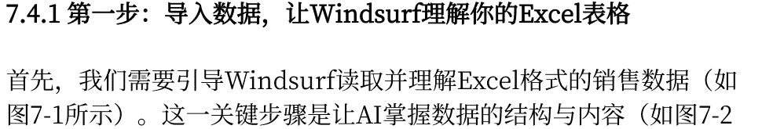

在 Windsurf 理解表结构后，通过编写 DeepSeek 提示词让 AI 自行开始分析报告并编写代码，为后续智能分析奠定基础。

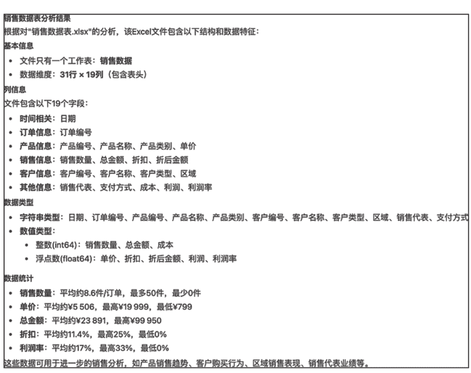

### 图7-2 分析Excel数据后的结果界面

### 注意

操作过程中，Windsurf 可能会提示需要安装额外的 Python 依赖包。若出现弹窗，通常是缺少必要库。请点击确认或同意按钮，让其自动完成安装。

### 7.4.2 第二步：指令下达，命令Windsurf创建自动化报告生成程序

接下来向 Windsurf 发出明确指令，要求它为你定制自动化报告生成程序，如图 7-3 所示，清晰告知 AI 需要执行的分析、图表和报告内容。


### 图7-3 发出生成程序指令的界面

Windsurf 接收指令后将开始思考并编写相应的 Python 代码。稍等片刻，它会生成程序，并直接运行以输出初步的分析结果，如图 7-4 所示。

I've successfully created a comprehensive sales data analysis program that automatically processes your Excel sales data and generates detailed insights and visualizations. Let me show you what the program does:

### 销售数据分析程序功能概述

我创建的 `sales_analysis.py` 程序已成功分析了您的销售数据表，并在 `sales_report` 目录中生成了完整的分析报告。该程序：

1. 自动处理数据：读取Excel文件，处理日期格式，过滤合计行

2. 生成多维度分析：

   - 基本销售统计

   - 产品销售表现分析

   - 客户购买行为分析

   - 销售时间趋势分析

   - 销售代表业绩分析

   - 支付方式分布分析

   - 数据相关性分析

3. 可视化图表：生成多种直观图表，包括：

   - 产品类别销售额占比饼图

   - 销售额TOP5产品柱状图

   - 客户类型销售额占比饼图

   - 各区域销售额柱状图

   - 月度销售趋势图

   - 销售代表业绩TOP10柱状图

   - 支付方式分布饼图

   - 销售数据相关性热力图

4. HTML报告：生成一个完整的HTML报告，整合所有分析结果和图表，方便查看和分享

### 如何查看报告

您可以直接打开 `sales_report/sales_analysis_report.html` 文件查看完整的分析报告。报告包含了所有的数据分析结果、图表和洞察，以及基于数据的建议。

此外，`sales_report` 目录中还包含了各个分析维度的CSV数据文件和PNG格式的可视化图表，您可以根据需要单独使用这些文件。

### 如何再次运行分析

如果您的销售数据有更新，只需再次运行 `python sales_analysis.py` 命令即可生成最新的分析报告。程序会自动读取最新的数据并更新所有分析结果和图表。

源码保留可扩展空间，后续可按需追加分析维度或更换可视化样式。

### 图7-4 首轮 DeepSeek 分析演示
先来看 DeepSeek 第一次给出的交易汇总，示意图见图7-5。

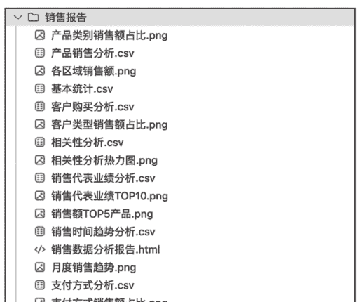

### 图7-5 初版交易分析文档预览
这一版涵盖基础统计、交易拆解、相关性热力图等模块，下面分块展示效果。

基础统计的呈现见图7-6。

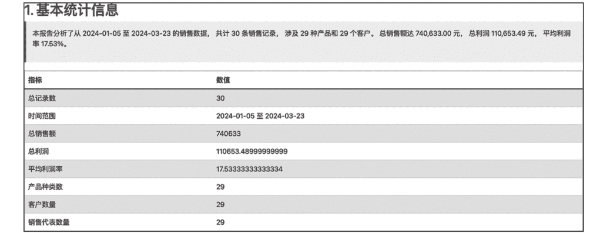

### 图7-6 商品基础统计概览
交易明细的分析内容展示于图7-7。

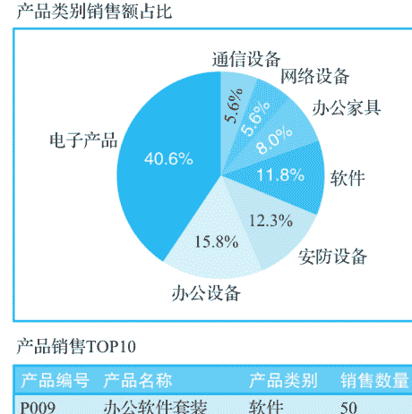

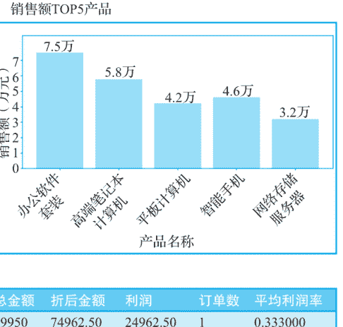

产品销售TOP10

| 产品编号 | 产品名称 | 产品类别 | 销售数量 | 总金额 | 折后金额 | 利润 | 订单数 | 平均利润率 |

|---|---|---|---|---|---|---|---|---|

| P009 | 办公软件套装 | 软件 | 50 | 99950 | 74962.50 | 24962.50 | 1 | 0.333000 |

| P001 | 高端笔记本计算机 | 电子产品 | 7 | 62993 | 57593.60 | 8593.60 | 2 | 0.149211 |

| P006 | 平板计算机 | 电子产品 | 15 | 52485 | 41988.00 | 4488.00 | 1 | 0.106888 |

| P003 | 智能手机 | 电子产品 | 10 | 49990 | 45990.80 | 5990.80 | 1 | 0.130261 |

| P027 | 网络存储服务器 | 电子产品 | 2 | 39998 | 31998.40 | 1998.40 | 1 | 0.062453 |

| P011 | 计算机显示器 | 电子产品 | 25 | 37475 | 33727.50 | 6227.50 | 1 | 0.184642 |

| P010 | 服务器 | 电子产品 | 2 | 31998 | 29438.16 | 4438.16 | 1 | 0.150762 |

| P008 | 投影仪 | 办公设备 | 5 | 29995 | 25495.75 | 2995.75 | 1 | 0.117500 |

| P015 | 安全监控系统 | 安防设备 | 2 | 25998 | 22098.30 | 2098.30 | 1 | 0.094953 |

| P025 | 电子白板 | 办公设备 | 3 | 23997 | 21117.36 | 3117.36 | 1 | 0.147621 |

### 图7-7 商品交易信息拆解

相关性热力图请见图7-8。

### 相关性热力图解读

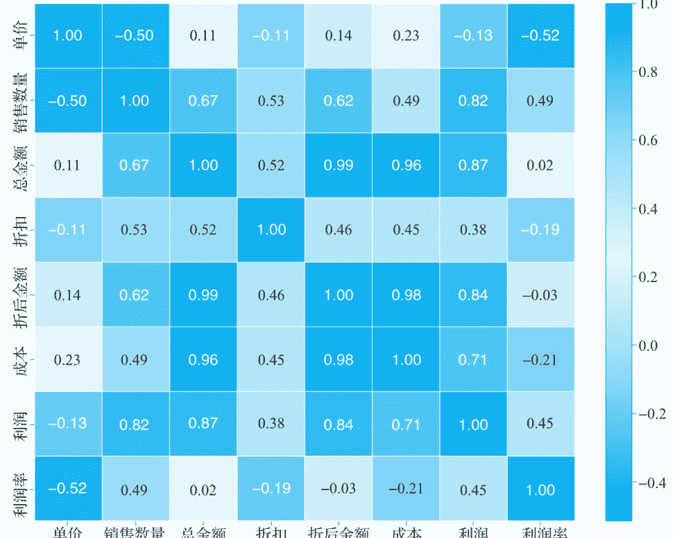

图7-8 销售信息相关性热力图

### 7.4.3 第三步：试跑并驱动 Windsurf 迭代改进
初稿很少一次达标，版式偏差、分析缺口或与预期不符的情况常见，必须进入测试改进环节，这一步决定成败。

- 细致复核：通读产出的逻辑与文档结果是否匹配。
- 归纳问题：把错误、偏差和改进点全部记录下来。
- 给出改进指令：重新与 Windsurf 对话，指出具体修改点。比如“柱状图改为堆叠形式”“补充毛利率计算并排序”“标题字号调大”。整个过程是反复打磨。

DeepSeek提示词示例：

> 生成的 HTML 界面效果并不是很好，请你对界面进行优化，要求：1. 表格数据对齐；2. 整体界面精美。

交互记录见图7-9。

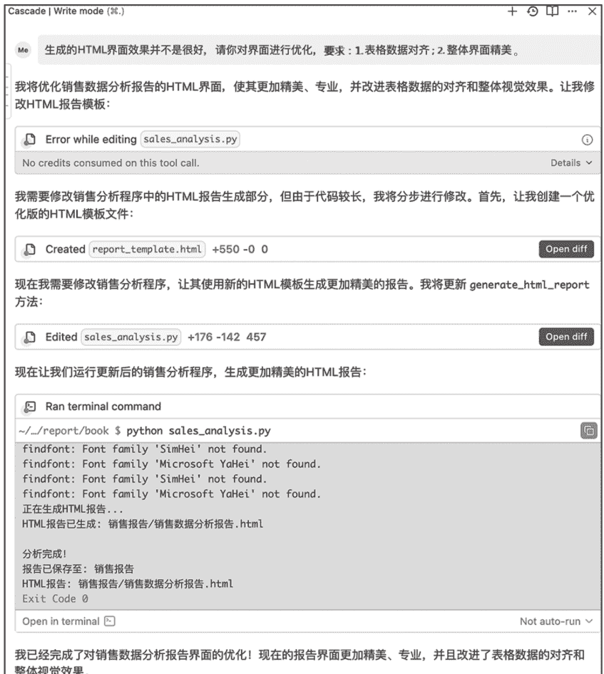

### 图7-9 DeepSeek 对话记录

### 7.4.4 第四步：重跑程序获取改进版完整文档
在 Windsurf 按反馈完成代码调整后，让它重新执行更新版程序。
此时系统会按改进后的逻辑重新分析并可视化，输出一份更贴合需求、内容更完整的自动化 HTML 分析文档，示例如图7-10。

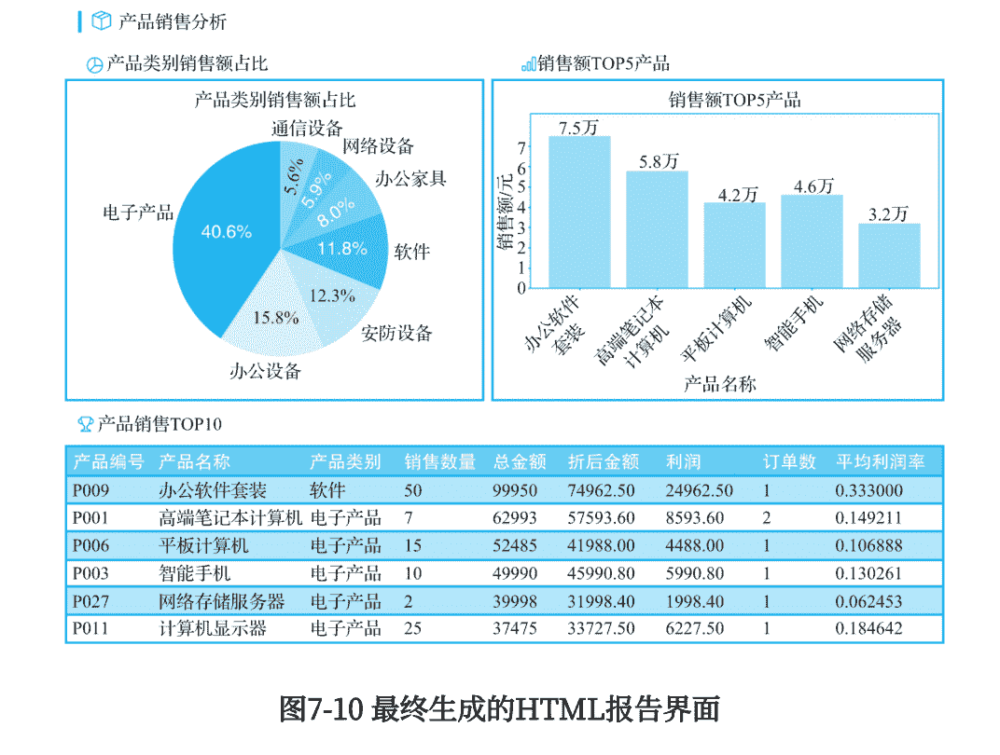

图7-10 最终版 HTML 文档界面

可见 TOP5 交易额的展示已改进，信息呈现清晰可读。

### 7.4.5 第五步：扩展系统以支持任意文件导入
若希望系统能接收任意交易 Excel 并自动出文档，该如何实现？

接着与 Windsurf 进一步沟通：

> 现在让我们对整个系统再继续进行优化，通过用户上传任意一份销售信息的 Excel 文件，直接生成这样的销售分析汇报。

等待 Windsurf 产出代码，结果见图7-11。

随后指示 Windsurf 安装依赖并启动项目，见图7-12。

界面效果参考图7-13。

系统已搭建完成，上传新 Excel 查看分析效果，见图7-14、图7-15。

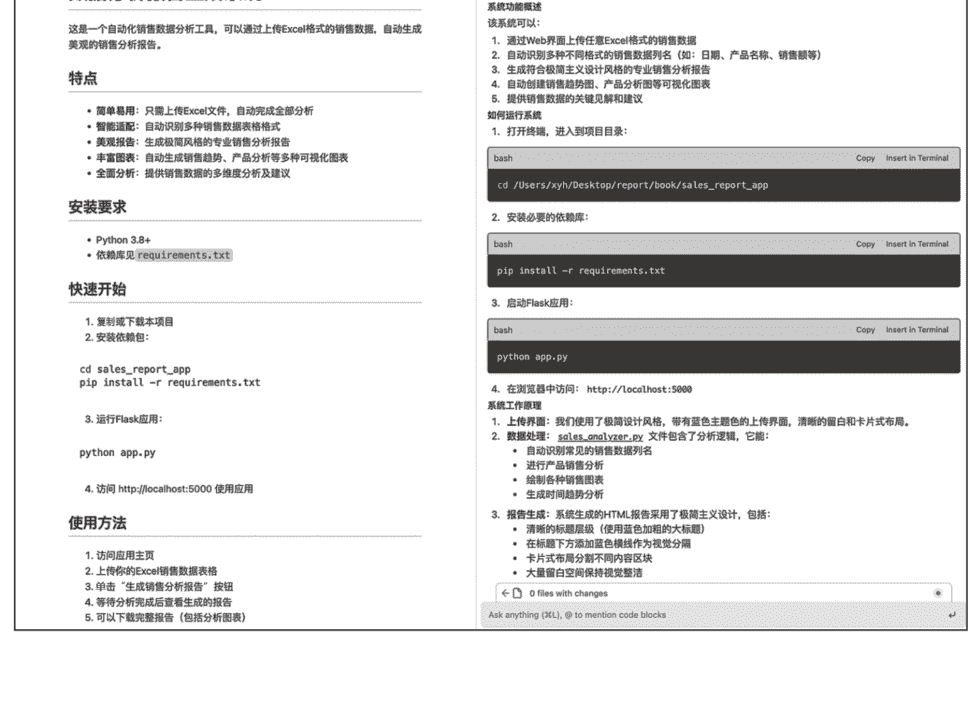

### 图7-11 Windsurf 产出示例

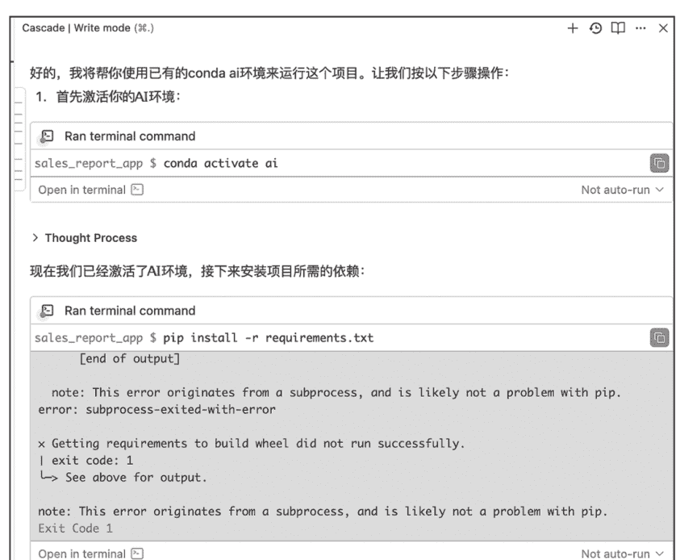

### 图7-12 安装依赖并启动项目

### 交易信息分析文档自动生成平台

上传你的Excel销售信息文件，系统将自动分析信息并生成专业的可视化分析汇报


拖放文件或点击上传

支持 .xlsx 和 .xls 格式的Excel文件

生成销售分析报告

| 500+ | 10+ | 5+ |

| :---: | :---: | :---: |

| 支持信息行数 | 分析维度 | 可视化图表 |

| 智能分析 | 信息可视化 | 专业汇报 |

| :---: | :---: | :---: |

| 自动识别信息结构，快速处理Excel信息，提供即时分析结果，无需手动配置 | 自动生成多种类型的销售信息可视化图表，包括趋势分析、分布分析和对比分析 | 生成美观、专业的销售信息分析汇报，支持查看详细信息和下载完整汇报 |

© 2025 数据分析报告生成系统 | 查看源码

图7-13 数据分析汇报生成系统的界面效果

### 销售信息分析汇报

生成时间: 2025-04-20 18:14:39

### ① 基本统计信息

| 指标 | 数值 |

|---|---|

| 总销售额 | 7441307.00 |

| 总利润 | 2068205.05 |

| 平均利润率 | 32.79% |

| 销售记录数 | 500 |

本汇报覆盖 2024-01-01 至 2025-03-30 的销售，共 500 条记录，涉及 15 个产品与 12 位客户。总销售额 7,441,307.00 元，总利润 2,068,205.05 元，平均利润率 32.79%。

| 指标 | 数值 |

|---|---|

| 总记录数 | 500 |

| 总销售额 | 744130700 |

| 总利润 | 206820505 |

| 平均利润率 | 32.79% |

| 产品种类数 | 15 |

| 客户数量 | 12 |

图7-14 汇报基本统计信息

### 产品销售分析

产品类别销售额占比

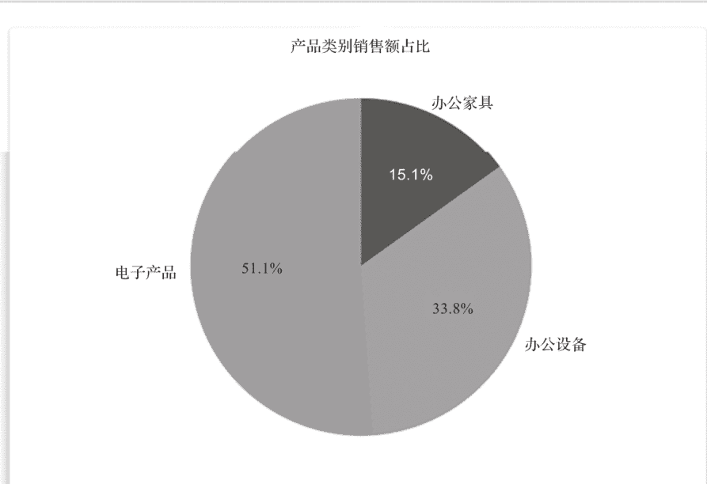

图7-14（续）

### 产品销售额TOP10

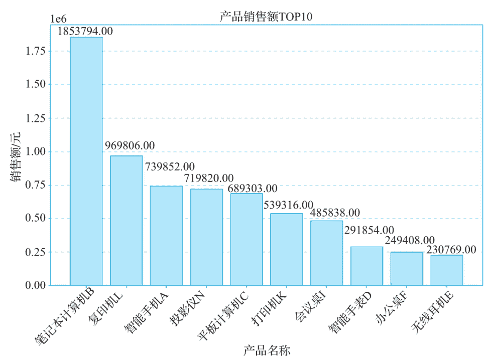

图7-15 汇报销售信息分析

### 产品销售TOP10明细

| 产品名称 | 总金额 | 销售数量 | 利润 | 平均利润率 |

| :--- | :--- | :--- | :--- | :--- |

| 笔记本计算机B | 1853794 | 206 | 471920.21 | 0.276313 |

| 复印机L | 969806 | 194 | 299373.69 | 0.339667 |

| 智能手机A | 739852 | 148 | 171171.02 | 0.265476 |

| 投影仪N | 719820 | 180 | 206395.86 | 0.314438 |

| 平板计算机C | 689303 | 197 | 169267.13 | 0.271973 |

| 打印机K | 539316 | 284 | 142571.46 | 0.294952 |

| 会议桌I | 485838 | 162 | 144394.62 | 0.331184 |

| 智能手表D | 291854 | 146 | 91566.55 | 0.343246 |

| 办公桌F | 249408 | 192 | 66177.81 | 0.301112 |

| 无线耳机E | 230769 | 231 | 87456.84 | 0.430913 |

### 销售时间趋势

### 月度销售趋势

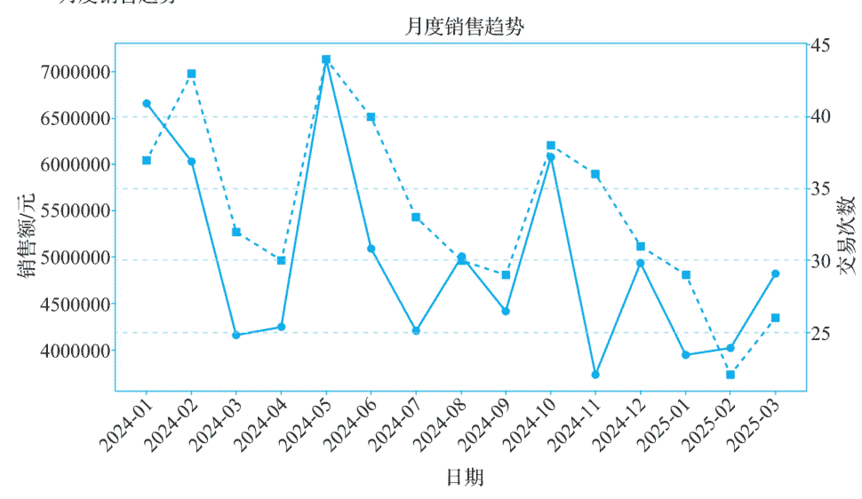

### 图7-15（续）

改进后，任意 Excel 导入均可自动生成同类分析文档。

## 7.5 常见问题与解决思路
在用 Windsurf 搭建销量分析工具时，常会遇到一些卡点。以下问题与对策可帮助你更顺畅协作，确保分析流程稳定。

### 问题1：怎样高效向 Windsurf AI 表达分析需求？
答：沟通要做到目标清晰、分步推进、有据可依、持续迭代。

- 先把目标说清楚：清楚说明想要的功能，比如“我想做一个能对比各门店销售走势的工具”。
- 把复杂任务拆小：先清洗再可视化，一步步问。
- 给点参照：提供少量样例信息或期望的表格图表样式。
- 持续反馈：针对代码或结果给出具体修改意见。
- 主动追问：不懂的逻辑直接让 AI 解释。

### 问题2：我的销售信息格式混乱，如何让Windsurf帮忙整理？
答：引导 AI 按探查、修缮、规范的顺序处理。

- 先探查：请 AI 读取文件并汇报列名、类型等基本情况。
- 找问题：检查缺失值、重复记录、异常数值如负销售额。
- 统一日期：把日期转为 年-月-日 标准格式。
- 去重：移除完全重复的销售记录。
- 调结构：必要时将宽表转长表以适配分析。

### 问题3：如何利用Windsurf找出销售表现好的和差的门店？
答：围绕核心指标做对比与排名。

- 算核心指标：总销售额、平均销售额、总利润。
- 生成排名：按销售额列出前 5 与后 5。
- 多维度评估：补充利润率、客单价、增长率等维度并排序。
- 同比环比：计算本期 vs 上期或去年同期增长率。
- 找共性：分析高销售额门店在区位、品类结构上的共性。

### 问题4：如何让Windsurf生成清晰、美观的销售图表？
答：需求描述要具体到类型、呈现与风格。

- 指定类型：如“月度销售额折线图”。
- 中文显示：要求标签、标题、图例中文正常显示。
- 组合仪表盘：把趋势、门店条形、品类饼图放同一画布。
- 交互增强：询问是否支持悬停显示数值。
- 定制外观：指定配色、字号、标题与图例说明。

### 问题5：如何利用Windsurf进行销售预测？
答：可先明确预测目标与周期，再让 AI 选择合适的建模方法并给出评估指标，最后验证结果合理性并迭代优化。

### 问题6：如何让Windsurf创建更易于维护和复用的分析工具？
答：从设计、可维护性与容错角度提出要求。

- 模块化设计：将读取、清洗、计算、可视化封装成独立函数。
- 代码复用：把公共逻辑如利润率计算做成可复用单元。
- 添加注释：在关键段落写中文说明。
- 错误处理：让程序遇到文件缺失、格式错误时提示而非崩溃。
- 参数化：把路径、周期、配色等抽到开头或配置文件。
- 增加测试：验证各模块是否按预期工作。

## 7.6 结语
本章围绕在 Windsurf 环境上用 DeepSeek 搭建信息分析汇报生成系统展开。从立项、需求到落地，我们完整走了一遍自动化分析的流程。

先明确背景与目标，理解 DeepSeek 的价值；再掌握自动化分析的优势：提效、一致、降错。功能上聚焦三大模块：信息处理与清洗、可视化图表生成、一键式汇报输出。

学习后你会认识模块化设计的重要性，学会构建可维护可扩展的系统，并在实战中积累异常处理经验，为后续开发更复杂的自动化工具打下基础。

# CHAPTER 8 第8章 开发自动化日报生成工具

在重复性工作占据大量时间的今天，手工日报既低效也易出错。本章带你用 Windsurf 与 DeepSeek 模型打造一个自动化日报生成工具，实现信息自动采集、整理与规范化汇报输出。

你将学会设计直观的工具界面、整合多源信息、输出格式统一的文档并优化使用体验。适合项目经理、团队负责人及需定期汇报的职场人士，能显著提升效率与汇报质量。

## 8.1 本章学习目标
本章以信息分析汇报生成系统为例，帮助你入门编程思维，掌握用代码解决实际问题的方法。

### （1）理解核心概念
- 明确个人日报工具的用途与价值。
- 识别有效日报工具应具备的核心功能模块。
- 认识 AI 编程助手在自动化工具开发中的角色与优势。

### （2）掌握开发技能
- 学习在 Windsurf 中进行系统架构的初步构思。
- 掌握引导 AI 生成所需功能代码的方法。
- 提升与 AI 高效、准确对话的技巧。

### （3）积累实践经验
- 熟悉自动化工具开发流程：需求→实现→优化。
- 学会向 AI 描述需求时做到清晰、具体、可执行。

- 在真实项目里与智能编程伙伴协同迭代，沉淀可复用的协作心得。

## 8.2 自动日报生成工具全景

### 1. 产品定位与能力边界
先明确我们要交付的对象和解决的痛点。通俗来讲，这是一款面向个人的软件，用来把一天的工作状态整理成规范文档。其主要作用是能够半自动地留存工作痕迹，或把手工登记简化到极致，然后通过一次点击得到格式统一、信息完整的文档。最终目的是让使用者摆脱重复撰写的负担，把时间精力放回实质工作上。

### 2. 核心优势拆解
规划中的自动日报产品具备以下关键点：

1) 效率跃升：不再纯手工撰写
- 支持点击即出格式化的初稿
- 可自动抓取或导入部分工作信息，如会议、任务
- 大幅减少每日整理与撰写所耗时间

2) 智能处理：内容自动优化
- 按预设规则或模型理解进行归类整理
- 统一应用排版规范，提升文档专业度
- 尝试提炼要点，凸显当天工作重点

3) 数据管理：回溯与追踪
- 方便查询与回看历史文档
- 对记录做简易量化分析
- 支撑使用者进度概览与跟踪

### 3. 典型应用场景
该产品可覆盖多种常见场景：

- 日常汇报：迅速完成每日或每周向主管、团队提交的工作小结
- 个人复盘：作为定期总结与反思的素材来源
- 项目跟进：便捷记录并回溯特定项目每日进展
- 时间分析：借历史记录分析时间分配，优化效率
- 计划制定：结合过往记录与当前状态，为后续计划提供参考

## 8.3 自动日报工具的职能架构

在介绍模块前需要明确：优秀的产品不仅要完成基础产出，还要真正提升效率，帮助使用者更好管理与回看自己的工作。为此将能力划分为基础层、智能层与长期管理层。

### 8.3.1 基础能力层
该层是产品根基，直接影响日常使用体验。

#### (1) 信息录入
- 提供便捷的手工登记条目的入口
- 适配快捷键操作并具备实时保存机制
- 内置简易富文本编辑能力

#### (2) 快速产出
- 基于当日登记快速生成格式化文本
- 支持多种输出形式，如纯文本、HTML、Markdown
- 自动保存产出历史，支持版本回溯

#### (3) 模板定制
- 允许使用者自定日报固定格式、抬头、结尾等
- 提供可视化模板编辑体验
- 支持多模板管理与切换

#### (4) 预览修正
- 最终产出前提供实时预览
- 可在预览界面直接调整内容
- 自动校验格式规范

### 8.3.2 智能辅助层
借助智能化技术提供更高效的辅助。

#### (1) 智能分类
- 自动对录入内容进行分类或打标签
- 支持按项目、任务类型等多维度归类
- 可自定义分类规则

#### (2) 时间估算
- 依据记录内容或特定标记自动估算耗时
- 基于历史数据持续优化估算精度
- 生成工作时间分布统计

#### (3) 重点提取
- 智能识别并高亮当日关键成果或要点
- 自动生成工作内容的要点概述
- 提供重要程度的智能排序

#### (4) 排版美化
- 自动调整排版、对齐等细节，保证文档专业外观
- 提供多种预设主题样式
- 确保在不同设备上显示一致

### 8.3.3 长期管理层
着眼长期使用价值，帮助使用者更好利用日报数据。

#### (1) 历史回溯
- 提供便捷的历史文档查询与浏览
- 支持多维度搜索与筛选
- 可视化呈现工作历程与重要里程碑

#### (2) 工作统计
- 按项目、时间等维度统计工作量
- 生成直观的数据可视化图表
- 提供工作效率趋势分析

#### (3) 进度跟踪
- 辅助回看个人工作进展
- 支持设定与追踪工作目标
- 及时提醒待办事项与关键节点

#### (4) 数据导出
- 支持日报数据导出为多种格式
- 提供备份与恢复功能
- 保障数据安全与隐私

### 8.3.4 使用建议

#### （1）循序渐进
- 先熟练基础能力，确保日常使用顺畅
- 逐步探索智能能力，提升效率
- 按需选择性使用管理能力

#### （2）持续积累
- 养成每日登记习惯
- 定期回看总结
- 利用统计分析优化工作方式

合理运用上述能力，可构建高效个人工作管理系统，实现效率实质提升。

## 8.4 实操指南：搭建专属日报系统

以下步骤指导如何与 编程助手 Windsurf 交互，从简单需求起步设计基础界面，逐步构建并优化专属工具。

### 8.4.1 第一步：搭建基础界面
在对话窗口输入初始需求：

> 我想开发一个个人自动化日报生成工具，首先需要一个简单的操作界面，包含工作内容记录和日报生成功能，请帮我设计并生成代码

Windsurf 很快生成初始构建示例，如图8-1所示。

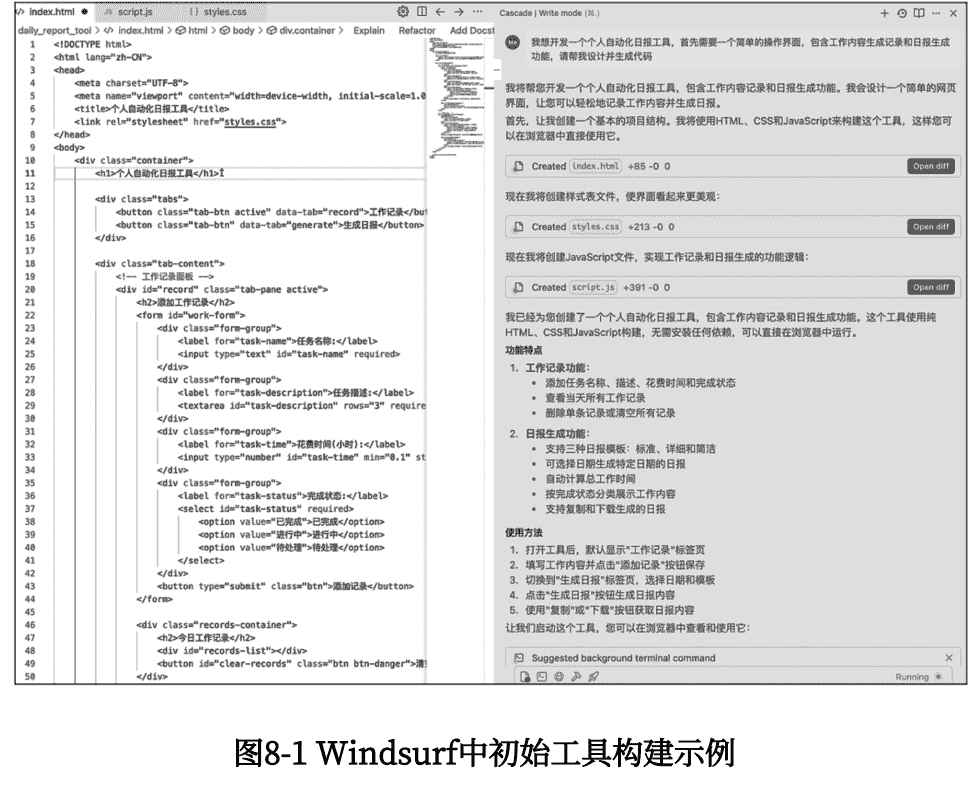

单击运行查看初始效果，如图8-2所示。


可发现提示词已帮助 Windsurf 实现基础框架，并包含核心功能。

- 作业登记管理：通过直观表单添加日常任务，包含任务名称、详细描述、耗时及完成状态
- 时间追踪：精确记录每项任务耗时，便于后续分析效率与时间分配
- 状态标记：可标记任务是否完成，清晰呈现当日进度
- 日报自动整合：根据输入登记自动整合为规范日报，免去手工汇总
- 数据管理：可查看当日登记，并通过“清空记录”重新开始

对核心模块进行测试，查看是否已实现。尝试输入工作登记，如图8-3所示，并查看添加的登记，如图8-4所示，再单击“添加记录”按钮校验是否成功。


可看到日报信息已成功加入今日登记。切换至生成日报界面，选择标准模板样式，单击“生成日报”按钮查看效果，如图8-5所示。

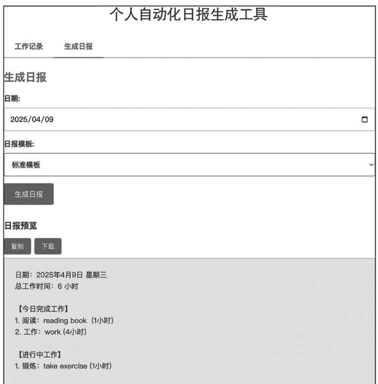

生成内容符合预期，可单击“复制”或“下载”导出，或在模板中切换样式导出。

### 8.4.2 第二步：完成界面优化
当前界面较为简洁，现对布局与交互进行优化。

直接在对话框向 Windsurf 提出：“请优化界面布局和用户界面设计，要求界面精美，样式美观。”

等待代码完成后运行查看优化后界面，如图8-6所示。

切换到生成日报界面，使用自定义模式查看效果，如图8-7所示。

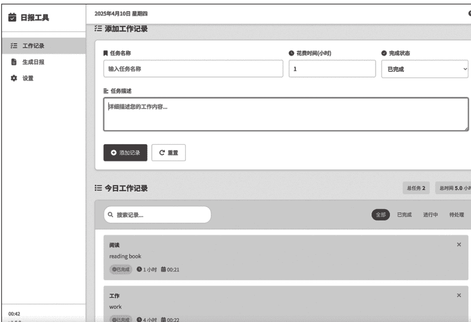

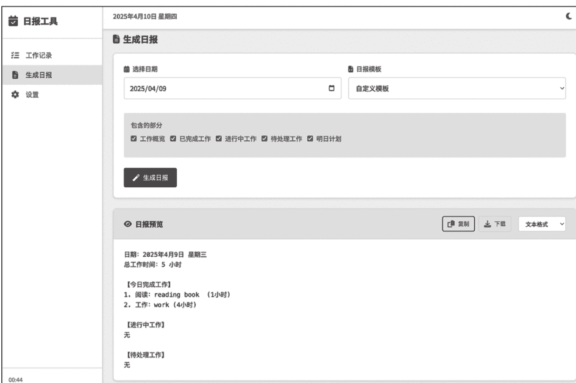

切换至设置界面查看个性化设置，如图8-8所示。

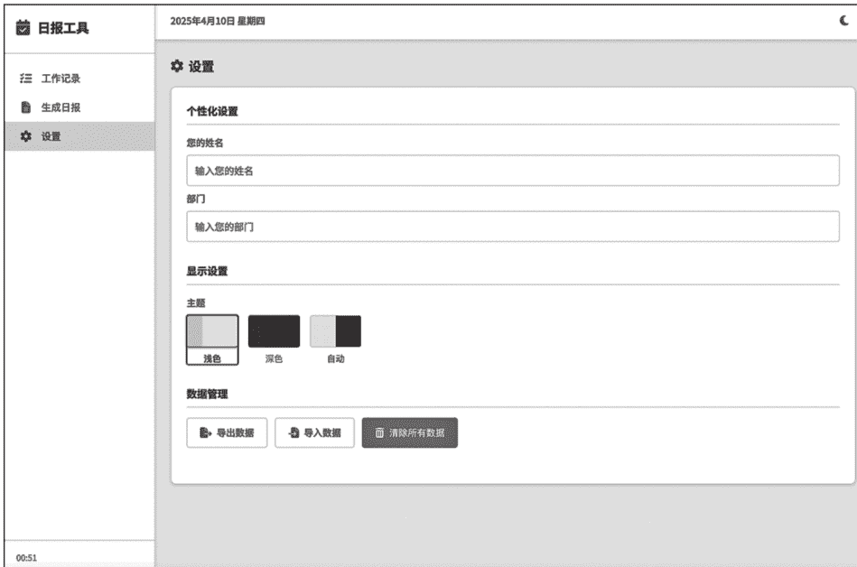

个人日报工具已具备一定个性化设置。对已实现功能做如下总结。

#### (1) 工作登记功能
- 添加登记：录入任务名称、描述、耗时、完成状态
- 登记管理：支持删除单条或清空全部
- 搜索与过滤：可按关键词搜索或按完成状态过滤
- 统计信息：自动计算任务总数与总工时

#### (2) 日报产出功能
- 多种模板：支持标准、详细、简洁、自定义四种
- 自定义选项：可选择包含的工作概览、已完成、进行中等部分
- 格式选择：支持多种输出格式
- 日期选择：可生成任意日期日报
- 一键操作：支持复制与下载

#### (3) 数据管理功能
- 本地存储：数据保存在浏览器的 localStorage，关闭后不丢失
- 数据导出：可导出全部登记为 JSON 文件备份
- 数据导入：支持从导出文件恢复
- 数据清理：可清空历史数据

#### (4) 界面与体验功能
1) 现代化界面
- 侧边栏导航：功能区分清晰
- 卡片式设计：内容区块清晰
- 图标辅助：提升视觉识别

2) 个性化设置
- 主题切换：支持浅色/深色，可手动或跟随系统
- 个人信息：可设置姓名与部门，自动写入日报

3) 体验优化
- 通知系统：操作后即时反馈
- 时间显示：实时显示当前日期时间
- 响应式设计：适配不同屏幕

后续可按需进一步设计与拓展功能。

### 8.4.3 实用开发技巧：与 编程助手 高效协作

1）如何更精准描述需求？
- 明确定位：说明工具面向个人日常使用，而非团队或企业
- 说明习惯：描述典型流程，如“我习惯先快速记要点，晚上统一整理生成日报”
- 描绘体验：表达使用感受期望，如“界面极简，录入时干扰最小”“按钮要大，易点击”

2）如何高效对话？
- 先主后次：先确保核心能力如登记、产出可用
- 逐步迭代：每次聚焦一两个关联功能点，避免一次性提出复杂需求
- 及时反馈：运行代码后立即测试，发现问题马上反馈并要求调整

## 8.5 常见问题与解决思路

开发使用过程中会遇到体验与开发相关问题，以下提供解析与思路。

### 问题1：如何改善操作不便？
答：从以下方面优化流程。
- 明确痛点：统计完成特定任务所需步骤，识别繁琐环节
- 与 伙伴 沟通：可描述“我发现完成 X 任务需点击 n 次，能否优化流程”
- 示例对话：“数据导入需经过选择文件→预览→映射字段→确认导入四步，较繁琐。”
- Windsurf：“可通过添加文件拖拽、自动字段映射、记忆上次配置等方式简化，下面开始优化。”
- 验证改进：对比优化前后步骤，确保效率提升

### 问题2：如何处理界面过于复杂？
答：遵循以下优化原则。
- 协作优化：向 DeepSeek 描述“请分析当前界面问题并给出优化建议”
- 示例：“数据分析界面按钮选项过多，用户常找不到功能”
- DeepSeek：“建议①创建快速操作栏放置最常用 5 个功能，②用下拉菜单收纳次要功能，③添加搜索定位”

### 问题3：如何解决系统响应慢？
答：多层面性能优化。
- 伙伴 辅助诊断：请求 Windsurf“请分析这段代码的性能瓶颈”
- 示例：“数据处理函数执行慢，尤其数据量大时”
- Windsurf：“逐步分析，①循环中存在重复计算，②建议添加缓存，③可使用并行处理”

### 问题4：遇到不理解的代码怎么办？
答：提升代码理解。
- 请伙伴 解释：向 DeepSeek 提问“请解释这段代码功能与实现逻辑”
- 示例：选中代码片段“这段数据处理逻辑较复杂，能否解释？”

### 问题5: 如何完善功能不足？
答：按步骤推进。
- 需求沟通：向 Windsurf 描述“我需要添加 X 功能，主要解决 Y 问题”
- 示例：“我需要添加数据导出功能，支持多种格式”
- Windsurf：“可实现① Excel 导出，② CSV 转换，③ JSON 导出”

### 问题6: 如何改善使用体验不顺畅？
答：从交互入手。
- 请教伙伴：“如何改善用户操作体验”
- 示例：“用户反馈流程不直观，常需查帮助文档”
- DeepSeek：“建议①添加引导式操作提示，②增加悬停提示，③提供操作预览”

### 问题7: 如何高效利用 伙伴 进行开发？
答：遵循协作原则。
- 清晰需求描述：①提供具体场景与目标，②附上相关代码或截图，③说明期望结果
- 示例：“我需要实现数据可视化，主要展示销售趋势”
- Windsurf：“好，先确认数据格式，再选图表类型，再实现交互，请提供一些示例数据，我们开始实现”
- 迭代优化：验证伙伴 回答，提供具体修改建议逐步完善

通过与 Windsurf 和 DeepSeek 有效协作，可更快解决问题，提升开发效率与质量。

## 8.6 结语

本章深入探讨了如何利用 编程助手 开发自动化日报生成工具，这是一个实用且富有挑战的项目。通过学习掌握以下关键概念：

(1) 核心能力
- 掌握使用 编程助手 从零开发的完整流程
- 学会将复杂需求拆解为可实现的小步骤
- 理解个人工具开发的基础架构与设计思路

(2) 协作技巧
- 学会与 伙伴 进行清晰有效需求沟通
- 掌握迭代开发中的反馈与优化方法
- 理解如何引导 伙伴 生成更符合预期的代码

(3) 设计思维
- 理解个人工具设计中简洁性原则
- 掌握用户体验优化基本方法
- 学会平衡功能性与易用性

开发个人工具时需注意：
(1) 功能实用为王
- 始终聚焦核心需求解决
- 避免过度设计与冗余功能
- 确保每个功能具备实际价值
(2) 操作简单直观
- 保持界面清晰简洁
- 减少认知负担
- 提供直观功能引导
(3) 数据安全保障
- 实现可靠本地存储
- 注重个人信息保护
- 提供必要备份功能
- 持续迭代改进

遵循上述原则可开发出满足个人需求、易用可靠的自动化工具。记住工具应服务于使用者，核心功能解决实际问题比堆砌功能更重要。

下一章将探讨如何将这些开发经验用于本地事务提醒助手，进一步提升工具开发能力。这些知识与技能将在未来的效率提升之路上发挥作用。

# CHAPTER 9 第9章 开发本地事务提醒助手

在掌握数据分析报告生成系统与自动化日报生成工具开发经验后，本章将开发更贴近日常的应用——本地事务提醒助手。该项目帮助使用者管理与追踪各类日常事务，从待办事项到重要提醒，让生活与工作更有序。

借助 Windsurf 编辑器与 DeepSeek 协助，将前面学到的 Python 技能运用到实际应用开发中。项目不仅巩固已有知识，还将引入新编程概念与设计模式，进一步提升软件开发能力。

本章将学习：
- 如何设计与实现本地数据存储
- 如何构建用户友好的界面
- 如何实现事务管理的核心逻辑
- 如何添加自动化提醒功能

项目特别适合希望提升实战经验的开发者。通过开发实用工具，将深入理解桌面应用开发全流程，从需求分析到最终部署。

让我们开始构建实用的本地事务处理助手吧。遇到技术难题时，可随时向 DeepSeek 寻求专业指导。

## 9.1 本章学习目标

本项目旨在提供简洁高效的提醒管理系统，帮助使用者创建、编辑、删除与查看各类提醒事项，避免遗忘重要事务，并需完成以下目标：

- 实现本地化存储：所有数据存储在用户本地，确保隐私与数据安全，无需依赖云服务
- 打造现代化用户界面：采用卡片式布局、精心设计色彩方案与交互元素，提供愉悦视觉体验
- 支持多样化提醒功能：包括单次提醒与重复提醒，每天、每周、每月或自定义周期，满足不同场景需求
- 提供分类管理：允许使用者对提醒进行分类，便于组织与查找
- 灵活的筛选与搜索：支持按类别、优先级、完成状态等条件筛选，以及基于关键词的搜索功能

打造高留存体验的五大设计原则

想让用户愿意长期使用，细节打磨要到位。

- 视觉追求简洁现代：以扁平化为基调，配合圆角细节和经过精调的配色，整体呈现干净利落的现代感。
- 交互给予即时回馈：按钮悬停状态切换、输入框聚焦时的视觉变化等，让每一次操作都有明确感知。
- 表单填写门槛更低：版面规整、控件辨识清晰，降低用户在输入时的认知负担。
- 布局适配多端：模块尺寸与间距弹性分配，在手机、平板及桌面上都能稳定呈现。
- 信息层级分明：借助卡片分区、统一标题规范与色彩对比，构建清晰的视觉秩序，引领视线快速锁定重点。

## 9.2 本地提醒助手速览

### 1.产品定位概述
先把要做的东西想清楚。它是一款运行在个人电脑上的桌面程序，和网页或云端方案不同，具备这些特质：

- 纯本地运行：核心能力不依赖网络，所有提醒数据都保存在本地主机。
- 资源占用轻盈：启动很快，对 CPU 与内存的消耗保持在较低水平。
- 上手成本低：界面简洁直观，操作逻辑通透，新手也能迅速掌握。
- 触发可靠、私密可控：提醒准时送达不易遗漏，数据不出本地，隐私归属感更强。

总体价值在于帮助个人统筹日程、待办与重要日期，通过个性化且及时的提醒，确保关键节点和任务不会被错过。

### 2.这款本地提醒工具的亮点
我们即将落地的方案具有明显优势：

(1) 提升工作与生活的效率
- 减少遗漏：不再错过会议、截止时点或个人事务。
- 智能化整理：支持按主题归类、设定重要程度与周期性提醒。
- 節省时间：相比手动翻阅日历或便签，查找与记录的耗时大幅降低。

(2) 使用与获取成本更低
- 零费用投入：自行搭建，避免购买功能冗余或需要订阅的商业产品。
- 全面定制化：可按个人使用习惯与具体需求来设计功能点。
- 长期回报高：一次投入后可长期免费用，成本效益突出。

(3) 带来成长与新机会
- 积累实战经验：在实践中掌握借助 AI 辅助开发本地程序或脚本的方法。
- 拓展动手能力：可能激发为自己或他人打造更多实用小工具的想法。
- 强化落地能力：提升技术应用与问题解决能力，对职业竞争力有帮助。

### 3.典型使用场景
该工具可覆盖生活的多个方面：

(1) 个人健康管理
- 定期提醒服药、补水或运动。
- 为体检、复查设置周期性提醒。
- 辅助建立规律的作息节奏。

(2) 工作效率提升
- 会议、通话前的提前提示。
- 项目里程碑或截止日的追踪。
- 重要工作文件定期备份的提醒。
- 日报、周报等周期任务的提交提示。

(3) 生活事务管理
- 水电燃气、信用卡还款、租金等定期缴费提醒。
- 生日、纪念日等日期提醒。
- 家庭日常小事，如浇花、遛狗、取快递等。

(4) 学习计划执行
- 课程、上线讲座开始前的提醒。
- 作业、论文提交截止的提示。
- 复习计划各阶段目标的跟进提醒。

## 9.3 核心能力一览

合理的时间管理与任务提醒能显著提升效率。下面介绍本地提醒助手的核心能力。

### 9.3.1 提醒创建与管理

(1) 提醒创建
支持为每个提醒填入标题、详细说明、具体日期时间、重要程度高/中/低、自定义分组、完成标记。创建界面直观，重复性提醒可在创建时直接设定循环规则，无需重复新建。

(2) 提醒编辑
已建提醒可随时修改任意字段，包括标题、说明、时间、重要度、分组及循环规则，或增删通知点。编辑界面与新建保持一致，系统会保留修改记录，便于追溯。

(3) 提醒删除
提供单条删除、批量删除、清理全部已完成提醒三种方式，执行前会弹出确认，避免误操作。

### 9.3.2 提醒通知系统

(1) 多层次通知时间
每个提醒可设定多个提醒点：事件发生时、提前自定义时长如 15 分钟、1 小时、1 天等，并可添加多个提前点。

(2) 通知方式
提供桌面弹窗、提示音、视觉提示如任务栏图标闪烁。通知内容包含标题、时间与重要度，可直接标记完成或推迟。

(3) 通知管理
可调节通知持续时长、显示位置、是否在锁屏下展示，以及临时关闭特定分组的通知。

### 9.3.3 重复提醒设置

(1) 预设循环模式
提供每日、每周指定几天、每月特定日期、每年等常用模板。

(2) 自定义循环规则
支持按固定间隔循环如每 3 天、每 2 周、每 6 个月，设定开始与结束日期，或限制循环次数。

(3) 循环提醒的例外处理
允许跳过某次循环、单独调整某次实例而不影响整体序列，或暂时暂停循环后恢复。

### 9.3.4 分类与标签系统

(1) 分组管理
用户可新建自定义分组并设置名称与颜色标识，编辑或删除分组，或把提醒移至其它分组。系统内置常用分组供直接使用。

(2) 重要程度标记
高重要以红色呈现，紧急且关键；中重要橙色，重要但不紧急；低重要绿色，日常事项。列表中一目了然。

(3) 完成状态跟踪
状态分为未完成、已完成、部分完成。已完成项可从主界面隐藏，仍可通过筛选回顾。

### 9.3.5 搜索与筛选功能

(1) 全文检索
可搜索标题与详细说明，支持关键词与短语，输入时实时返回结果并高亮匹配片段，按相关度排序。

(2) 多条件筛选
支持按分组、重要度、完成状态、日期范围如今日、本周、本月或自定义区间组合筛选。

(3) 排序选项
可按时间、重要度、创建时间、标题字母顺序等排序，按需切换。

### 9.3.6 多视图显示

(1) 列表视图
以条目形式展示提醒，每行显示标题、时间、重要度等关键信息，支持展开详情及快速完成、编辑、删除。

(2) 日历视图
以月、周或日展示提醒，在对应日期显示数量与摘要，点击可查看当日明细，支持拖拽调整日期。

(3) 统计视图
可视化呈现分组分布、完成与未完成比例、各时段完成情况及重要度分布，帮助了解任务效率与时间分配。

### 9.3.7 数据管理与安全

(1) 本地数据存储
所有提醒保留在本地设备，使用 SQLite 高效存储，数据文件存放在用户专属目录并自动定期保存，隐私不上传。

(2) 数据备份与恢复
支持手动导出备份到指定位置与自动定期备份，提供简易恢复流程，可选择性恢复特定分组，备份文件加密。

(3) 数据导入导出
支持导出为 CSV、iCalendar 等通用格式，并从其他日历或任务工具导入数据，便于迁移。

### 9.3.8 用户界面与交互

(1) 现代化界面设计
采用卡片式布局分隔功能区，配色舒适，响应式适配不同屏幕，支持浅色与深色主题。

(2) 交互优化
支持拖拽操作、右键上下文菜单、键盘快捷键配合流畅动画，增强操作反馈。

(3) 可访问性设计
兼容屏幕阅读器，支持字体大小与对比度调节，键盘导航友好，色彩考虑色盲用户需求。

总体来看，该助手不仅满足基础提醒需求，还通过分组、筛选、循环规则与多视图等手段帮助用户更高效地组织时间与任务，本地存储保障数据隐私与安全。

## 9.4 构建流程：从准备到成型

以 Windsurf 为例，从准备到完善给出清晰路径。

### 9.4.1 第一步：开工前的准备

- 启动 Windsurf 桌面客户端
- 在本地新建项目目录“本地事务提醒助手”
- 等待主界面加载完毕

### 9.4.2 第二步：启动应用开发

#### 1.需求梳理阶段
核心目标是借助 AI 的理解与推理能力，将模糊想法转化为结构化需求文档，适合编程经验较少的用户。

#### 2.具体步骤

1）选择推理模型。
- 推荐 DeepSeek R1，具备强大的自然语言理解能力。
- 在 Windsurf 的模型列表中选中该模型。

2）输入初步想法。
- 打开写作模式对话框。
- 用自然语言描述需求。

DeepSeek 示例性提示：
> 我想开发一个本地事务提醒助手，请帮我写一份需求文档。
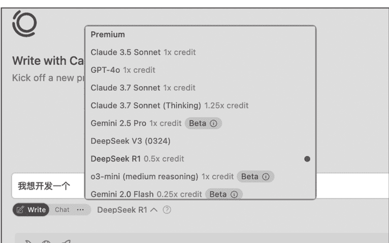

3）模型解析与生成。
- Windsurf 解析指令并生成包含功能列表与界面建议的需求文档。

4) 审查与调整。
- 阅读生成文档，检查功能与布局是否符合预期。
- 可要求新增功能或修改设计，如增加提醒重要度。
- 持续交互直至需求文档满意。

### 9.4.3 第三步：实现开发阶段

具体步骤：

1）选择编码模型。
- 切换至更适合代码生成的模型，如 Claude-3.7-sonnet。

2）下达开发指令。
- 在写作模式下给出明确编码指令。
- 示例指令：
> 请你阅读刚刚生成的需求文档，使用 Python 和 PyQt/Tkinter 来实现这个提醒助手。

3）模型编写代码。
- Windsurf 分析需求并生成代码，可实时查看文件创建与填充。

4）安装依赖。
- 按提示安装必要的外部库。

5）运行与测试。
- 按指引运行程序，测试核心功能实现情况。

### 9.4.4 第四步：完善细节阶段

核心目标是优化界面美观度与交互流畅性。

1）具体步骤如下。
- 评估当前界面与流程，识别改进点并给出优化指令。
- 在写作模式下描述具体优化需求。

2）示例优化要求如下。
- 添加柔和的配色搭配。
- 增加按钮悬停效果。
- 优化交互反馈。

示例指令：
> 请你帮我优化一下界面设计，要求界面美观精美，增加按钮悬停效果和一些交互设计。

3) 模型据此重写代码。
- Windsurf 按要求修改界面代码。

4) 验证改进。
- 运行优化后程序，确认效果。

5）持续迭代。
- 根据需要多轮优化，直至达到理想体验。

## 9.5 常见问题与解决思路

### 1.使用体验问题

**问题1：** 操作不便，找不到所需功能。

**可向 DeepSeek 咨询：** 系统在处理大量数据时变得很慢，如何优化？

**解决思路：** 优化操作流程，减少点击次数；重新设计导航，将常用功能置顶；添加功能搜索；提供操作指南与教程。

**问题2：界面复杂，信息过多导致视觉疲劳。**

**可向 DeepSeek 咨询：** 应用长时间运行后内存占用很高。应该采取什么措施？

**解决思路：** 采用简洁设计，用卡片式布局分隔功能；提供自定义主题与布局，允许隐藏不常用功能；增加留白改善视觉；实现可折叠信息块，按需展开详情。

**问题3：响应速度慢，操作有延迟。**

**可向 DeepSeek 咨询：** 创建周期性任务的步骤太多，要如何进行简化？

**本地提醒助手升级优化与使用体验改善方案**

**性能基线调优：** 提升数据库检索效率并剔除多余加载，构建常用数据缓存层以加速高频访问，压缩启动流程缩短等待时长，采用异步任务避免界面卡顿，定时清理临时文件与缓存以维持系统顺畅。

**问题4：推送时好时坏，重要提醒容易漏掉**

**向DeepSeek提问：** 用户常找不到对应功能，该怎样优化？
**解决思路：** 重构提醒引擎确保准时送达；提供桌面弹窗、音效等多种提醒通道；加入已读回执追踪查看状态；对关键提醒开启循环推送，直至用户确认；建立通知日志完整记录发送与接收轨迹。

### 2.功能相关问题

**问题1：重复规则设置受限，难以表达复杂需求**

**向DeepSeek提问：** 备份不完整或恢复失败时如何保证可靠性？
**解决思路：** 扩展重复规则编辑能力，支持按天、周、月等自定义间隔，例如每隔3天或每2周；新增例外日期，可手动跳过指定日；允许设定重复终止方式，按次数或截止日期结束；提供实时预览帮助用户理解效果。

**问题2：备份与恢复操作繁琐**

**向DeepSeek提问：** 如何加强敏感数据的防护？
**解决思路：** 上线一键备份入口降低门槛；加入定时自动备份减少手工干预；优化恢复界面，清晰展示备份版本、时间与内容摘要；支持按类别选择性还原，如仅恢复提醒类；增加备份校验环节验证完整性与可用性。

**问题3：检索精度不足**

**向DeepSeek提问：** 搜索为何不够精准？
**解决思路：** 升级匹配算法，支持模糊匹配与关键词命中；开放高级筛选面板，允许多条件组合查询；加入输入联想，根据前缀提示候选词；优化排序策略将相关度高的结果前置；允许保存常用检索组合便于重复调用。

**问题4：缺乏数据分析与统计**

**向DeepSeek提问：** 数据分析统计功能缺失如何弥补？
**解决思路：** 新增分析面板展示任务完成率与分类分布；提供图表化呈现直观反映时间管理效率；加入趋势洞察帮助识别行为模式；支持自定义报表适配不同分析需求；可导出分析结果便于在外部工具深化处理。

### 3.技术与兼容性问题

**问题1：部分系统版本运行不稳**

**向DeepSeek提问：** 操作系统不稳定如何解决？
**解决思路：** 覆盖主流系统版本进行兼容性测试定位缺陷；优化核心代码提升跨平台适配性；为特定版本发布补丁包；搭建自动化测试流水线持续监控兼容问题；公开官方支持的操作系统清单。

**问题2：多设备数据不同步**

**向DeepSeek提问：** 多设备数据不一致怎么办？
**解决思路：** 构建可靠同步服务保证各端数据统一；以时间戳与版本控制解决冲突；增加同步状态指示让用户了解进度与结果；提供手动同步按钮应对自动同步失败；支持离线编辑，恢复网络后自动合并。

**问题3：内存占用偏高**

**向DeepSeek提问：** 内存占用过高如何处理？
**解决思路：** 精简资源占用，移除无效加载；实现闲置资源自动回收；采用分页与懒加载策略降低峰值内存；提供低内存运行模式适配低配设备；定期排查内存泄漏并修复。

**问题4：外部数据导入格式受限**

**向DeepSeek提问：** 导入外部数据格式问题怎样解决？
**解决思路：** 扩展支持的导入格式，涵盖 iCalendar、CSV、JSON 等常见类型；提供导入向导引导字段映射与转换；增加数据校验步骤保证有效性；允许部分导入，用户可挑选数据项；提供导入预览，确认前先看效果。

### 4.隐私与安全问题

**问题1：个人数据安全顾虑**

**向DeepSeek提问：** 如何确保数据安全与隐私保护？
**解决思路：** 本地对敏感信息加密存储；提供密码锁功能防止未授权访问；公示隐私政策明确数据用途与保护承诺；仅采集必要信息；提供彻底删除工具支持一键清除个人数据。

**问题2：备份文件易被他人读取**

**向DeepSeek提问：** 如何保护备份数据安全性？
**解决思路：** 对备份文件加密处理，即使外泄也无法解析；允许用户设定自定义加密密钥；支持加密云盘等安全存储位置；记录备份访问日志留痕可追溯；提供完整性校验防止篡改。

**问题3：权限申请过度**

**向DeepSeek提问：** 应用权限要求过多如何缓解？
**解决思路：** 遵循最小权限原则，仅申请必要权限；对每项权限用途做清晰说明；权限被拒时提供降级功能保证核心可用；展示权限使用记录增强透明度；支持随时撤回授权。

### 5.用户特定需求问题

**问题1：难以适配个性化工作流**

**向DeepSeek提问：** 如何适应多样化工作流程？
**解决思路：** 提供工作流自定义配置匹配不同习惯；支持模板的创建与分享，满足特定场景；允许用户定义提醒生命周期；开放 API 与插件接口便于与外部工具联动；持续收集反馈迭代优化。

**问题2：行业专属功能缺失**

**向DeepSeek提问：** 特殊行业额外需求如何满足？
**解决思路：** 开发行业模块，如会议管理、项目追踪、客户跟进；提供自定义字段记录专属信息；支持导出行业标准格式；与行业专家协作确保设计贴合实务；考虑推出专业版深度定制。

**问题3：协作能力不足**

**向DeepSeek提问：** 团队协作功能如何实现？
**解决思路：** 推出团队版支持提醒共享与任务派发；构建细粒度权限体系管控查看与编辑范围；加入评论与讨论区促进沟通；记录团队操作日志；生成团队效率报表辅助管理。

### 6.学习与适应问题

**问题1：新手上手门槛高**

**向DeepSeek提问：** 新手上手困难如何解决？
**解决思路：** 设计分步引导介绍核心操作；提供视频与图文教程适配不同学习方式；内置上下文智能提示；预置默认配置与模板；提供演示数据帮助理解流程。

**问题2：高级功能难以发现**

**向DeepSeek提问：** 用户难以发现高级功能怎么办？
**解决思路：** 基于使用行为推荐相关高级功能；提供系统功能导览；完成基础操作后适时弹出提示；编写高级使用手册；建设用户社区鼓励经验分享。

**问题3：不适应新界面**

**向DeepSeek提问：** 用户对新界面适应困难如何改进？
**解决思路：** 提供经典与现代两种视图切换；支持界面布局自定义；允许快捷键个性化；设置过渡期逐步引入新元素；持续收集意见优化可用性。

系统化解决上述痛点，可显著提升本地事务提醒助手的使用体验与覆盖面。关键在于保持对用户反馈的敏感度，在功能完善、性能表现、安全隐私之间取得平衡。随着技术演进与需求变化，产品需持续创新，保持竞争力。

## 9.6 结语

本章深入解析了本地事务提醒助手的研发与实现思路，这是一款面向桌面的高效任务管理工具，旨在帮助用户妥善管理日常事务。通过学习掌握以下要点：

- 应用架构设计：构建清晰的分层结构。
- 界面开发：使用 PyQt6 打造现代友好界面。
  - 设计直观的主窗口与导航。
  - 实现表单控件与数据校验。
  - 构建响应式布局，适配多分辨率。
  - 增加视觉反馈与动效，提升体验。
- 核心功能：涵盖提醒创建、通知、重复规则、分类标签、搜索筛选等。

各模块在满足需求的同时兼顾可维护性。项目覆盖桌面应用开发多个环节，积累实战经验，为后续复杂系统开发打基础。

下一章将转向个人网站建设，涉及架构设计、前端实现、后端开发与部署运维，从桌面到 Web 的跨界拓展，帮助建立全栈视野。

# CHAPTER 10 第10章 打造你的第一个网站

完成提醒助手的开发后，我们将进入 Web 开发领域。本章将指导你从零构建第一个网站，标志着从桌面应用向网络应用的转变。

前后几章积累的 Python 编程与项目经验将迁移到网站开发。本地到 Web 的跨越可拓宽技术视野，掌握更现代的方法。

你将学习：

- 如何规划与设计网站项目。
- 如何挑选合适的技术栈。
- 如何实现基础网站功能。
- 如何借助 AI 工具提速开发。

本章在既有基础上引入新概念。Web 与桌面开发差异明显，你将接触网络通信、前后端分离、响应式设计等核心概念，丰富技能体系。

让我们开始网站开发之旅，DeepSeek 将在你遇到困难时提供指导。

## 10.1 本章学习目标

本章将借助 AI 从零开发网站，目标包括：

（1）学习网站基础结构搭建
- 掌握 HTML 语义化标签使用。
- 理解网站文件组织方式。
- 学习页面间链接与导航设计。

（2）掌握响应式设计技术
- 使用 CSS 媒体查询适配多设备。
- 学习弹性布局与网格布局。
- 确保不同屏幕尺寸下显示良好。

（3）实现交互效果与动画
- 使用 CSS 过渡与动画提升体验。
- 实现滚动触发动画效果。
- 添加悬停等交互元素。

（4）学习组件化开发思想
- 将网站拆分为可复用组件。
- 学习模块化 CSS 编写方法。
- 理解复用与维护最佳实践。

（5）掌握图像处理与优化
- 学习图像格式选择与压缩。
- 实现响应式图像加载。
- 使用 CSS 绘制图形与图标。

（6）理解网站性能优化基础
- 学习资源加载优化技术。
- 掌握 CSS 与 JavaScript 的性能要点。
- 了解基础 SEO 方法。

通过学习，你将掌握网站开发的技术细节与整体流程，为进阶奠定基础。

## 10.2 了解网站开发基础

### 1.什么是网站开发

网站开发是指创建与维护网站的完整过程，涵盖设计、内容、客户端与服务端编程、网络安全等。技术上分为前端与后端。

前端负责用户可见与交互部分，使用 HTML、CSS、JavaScript：
- HTML 构建结构与内容。
- CSS 控制视觉表现与布局。
- JavaScript 增加交互与动态效果。

后端处理服务器逻辑与数据存储：
- 服务端语言如 PHP、Python、Ruby、Java。
- 数据库管理如 MySQL、MongoDB。
- 服务器配置与维护。

对初学者而言，前端是理想起点，无需复杂服务器配置即可打造完整静态网站。现代前端技术已能实现许多原本需后端的交互。

### 2.网站开发的优势

自主开发相比使用现成建站工具优势明显：

（1）灵活性和定制化
- 完全掌控网站每个细节。
- 按需定制独特用户体验。
- 不受第三方平台限制，可实现任意创意。

（2）性能优化
- 精确控制代码质量与加载速度。
- 去除冗余功能，提升性能。

### 3. 网站开发的使用场景

网站开发适用于多种场景：

### (1) 个人展示
- 个人作品集展示设计、摄影、艺术。
- 个人博客分享专业知识。
- 个人简历网站提升求职竞争力。

### (2) 企业展示
- 公司官网展示形象与服务。
- 产品展示站详细介绍特点。
- 企业内部知识库或工具站。

### (3) 电子商务
- 在线商店销售产品或服务。
- 会员订阅站提供付费内容。
- 预订系统如餐厅、酒店、活动。

### (4) 教育与信息
- 在线课程平台。
- 知识分享社区。
- 专业资源库。

### (5) 社交与社区
- 兴趣社区网站。
- 行业交流平台。
- UGC 分享平台。

### (6) 营销与推广
- 活动宣传网站。
- 产品发布专题页。
- 营销落地页。

移动设备普及使响应式设计至关重要。掌握现代网站开发技术，能满足用户对性能与体验的更高要求。学习网站开发不仅可创建定制化站点，还能培养技术思维与问题解决能力。

## 10.3 网站开发的核心功能

现代网站通常需实现以下核心功能：

### 1. 响应式设计
- 跨设备兼容，适配 PC、平板、手机。
- 弹性布局，使用相对单位实现自适应。
- 媒体查询，按屏幕尺寸应用不同样式。
- 图像优化，按设备加载不同分辨率图。

### 2. 导航系统
- 直观菜单结构，便于快速定位。
- 面包屑导航，显示当前位置。
- 搜索功能，直接查找内容。
- 移动端适配，转换为触控友好形式。

### 3. 内容展示
- 清晰信息层级，使用标题、段落、列表组织。
- 多媒体支持，整合图片、视频、音频。
- 内容分页，分割大量内容。
- 动态加载，使用懒加载优化长页面。

### 4. 用户交互元素
- 表单设计，提供友好输入界面。
- 实时反馈，对操作给出即时提示。
- 动画效果，适度增强体验。
- 交互组件如下拉菜单、轮播图、标签页。

### 5. 性能优化
- 资源压缩，减小文件体积。
- 代码分割，按需加载。
- 缓存策略，减少重复请求。
- 延迟加载，非关键资源后置。

### 6. 安全措施
- 表单校验，客户端与服务端双重验证。
- HTTPS 加密传输，保护隐私。
- 防护 XSS 等常见攻击。
- 定期更新依赖，修复漏洞。

### 7. 分析与跟踪
- 访问统计，记录流量与行为。
- 转化跟踪，监控关键操作。
- 热图分析，了解关注焦点。
- 性能监控，跟踪加载速度。

### 8. 社交媒体集成
- 分享功能，支持一键分享。
- 社交登录，快速授权。
- 展示社交内容反馈。
- 评论、点赞等社交互动。

掌握这些核心能力，可打造美观实用的网站。随着经验积累，可深入各领域高级技术，根据需求有选择地实现与优化。

## 10.4 具体实现步骤：开发你的第一个网站

以下步骤指导你与 AI 工具 Windsurf 交互，从需求到上线逐步搭建展示型网站。

### 10.4.1 第一步：启动与准备

启动 Windsurf。加载或新建名为“第一个网站”的项目文件夹。确认 AI 对话框处于 Write 模式，支持 AI 直接生成与修改文件。

### 10.4.2 第二步：开始网站开发

#### 1. 设计并生成主页

核心目标：创建网站入口，包含关键视觉与信息。

操作流程：
1）下达指令：展示型网站初期侧重结构与内容呈现，逻辑简单，可直接描述。输入：

> 我想开发一个展示型网站：
> 
> 首先，请帮我设计并生成一个专业的首页 index.html。这个首页需要包含：一个引人注目的全屏展示区，一个介绍品牌故事或核心价值的区域。请生成相应的 HTML 和 CSS 代码。

2）AI 处理与文件创建：
- Windsurf 将分析需求并生成代码。

生成阶段，助手常常会提醒需要新建文件或文件夹，例如 index.html、style.css 等。它一般会直接给出一条执行语句，仔细阅读后点击 Accept 或同类确认按钮即可放行。

3）首次预览

- 第一次代码产出完成后，助手会通知相关文件已创建或更新。
- 生成的 index.html 会出现在项目文件夹里。
- 双击打开即可在浏览器中预览，或直接在 Windsurf 编辑区查看初版呈现（见图10-1）。

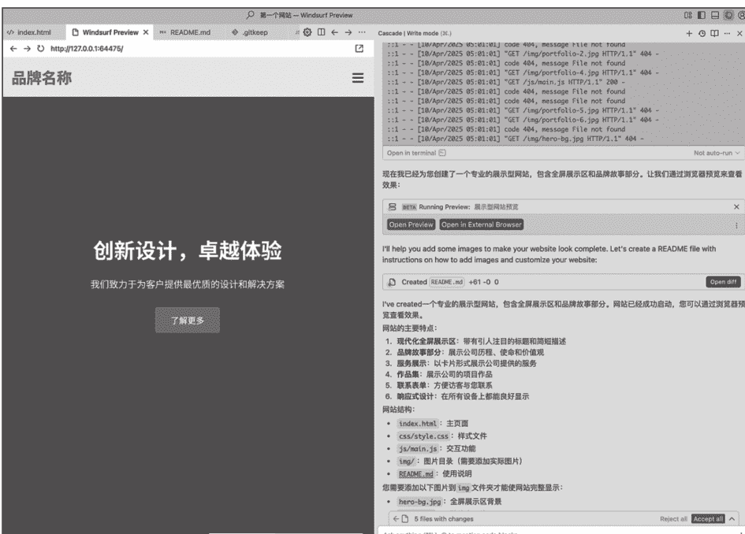

图10-1 在Windsurf查看初步页面效果

#### 2. 添加“关于我们”页面

核心目标：单独开一个页面来系统介绍公司背景。

操作流程：

1）下达指令

- 告知助手你需要增添一页。
- 在对话框里输入：

> 现在我需要添加一个“关于我们”页面（about.html）。请帮我设计一个专业的介绍页面布局关于 Sigmate 公司，需要包含团队理念、发展历程等内容区域。请生成相应的 HTML 和 CSS 代码（可以复用之前的样式或创建新的）。同时，请确保在首页和“关于我们”页面之间有链接可以互相跳转。

2）生成与预览

- Windsurf 会产出 about.html 文件并可能同步调整样式。
- 同样可以在 Windsurf 内部打开即时查看效果。

按此思路，能让助手帮你补充产品页、联系页等各类页面。

#### 3. 完善细节与优化体验

核心目标：在基础结构完成后打磨视觉、交互与性能。

操作流程：

1）提出优化指令：结合使用感受，向助手描述具体的改进点。
在对话框输入：

> 请帮我对整个网站进行一些优化，主要包括：优化图片加载效果（例如，实现懒加载或提供图片优化建议）；添加页面过渡动画（例如，页面切换时有淡入淡出效果）；改进响应式布局，确保在手机等小屏幕设备上也能良好显示。

2）更新与说明

- Windsurf 会修改既有的 HTML、CSS 或新增 JavaScript 来实现优化。
- 助手通常会解释改动的内容与思路，阅读有助于学习。
3）最终预览：再次在浏览器打开首页与关于我们页，能明显感受到图片加载更快、切换更顺滑、窗口缩放时布局自适应。

经过三轮迭代，即可借助助手搭建并优化第一个简易展示型站点。具体效果见图10-2、图10-3、图10-4。


图10-2 生成的网站效果

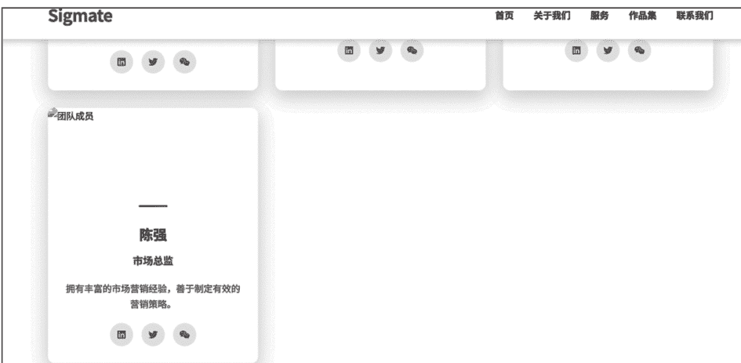

图10-3 网站团队成员界面

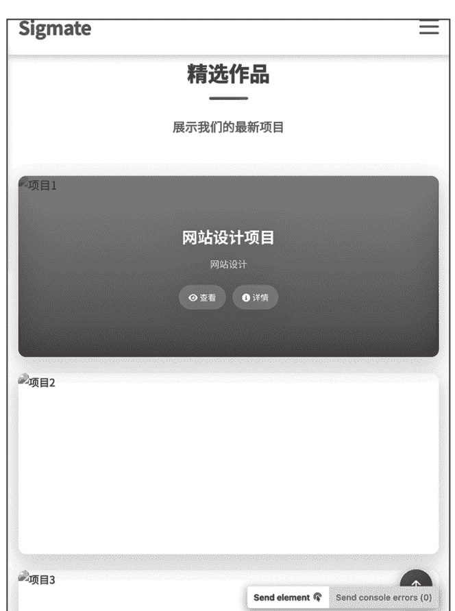

图10-4 网站精选作品界面

### 10.4.3 第三步：网页优化

团队成员区与精选作品区目前缺少配图，我们逐步补齐并优化。

先把成员照片放入项目新建的 img 目录，如图10-5。

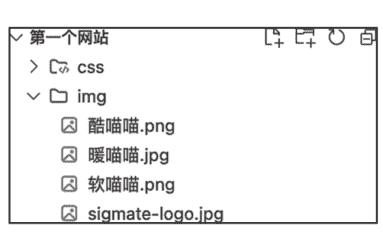

图10-5 img目录下的团队成员照片

再通过指令对成员照片与界面进行优化，如图10-6，对话框输入：

> 为核心团队成员添加相关图片（照片在该项目的 img 目录下，分别为暖喵喵、软喵喵和酷喵喵），并将成员名字更改为照片的名字，之后对网站团队成员界面进行优化。

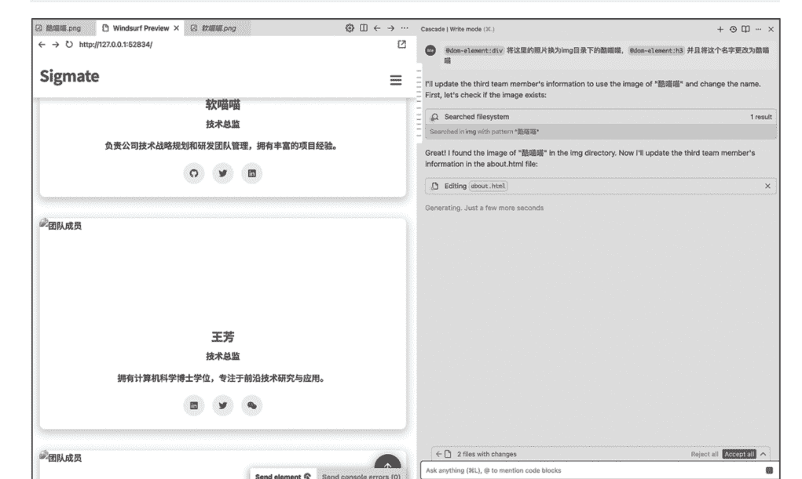

图10-6 AI优化过程图

等待 Windsurf 编码完成后运行，查看优化后效果如图10-7。

可见 Windsurf 已把 img 目录下的成员图接入团队界面并做了排版改进。沿用同样思路，对精选作品区做细节打磨，优化后效果如图10-8。


图10-7 优化之后的网页效果


图10-8 网站精选作品界面优化后的效果

界面已基本达标，接下来尝试上线。在聊天框输入“部署这个网站”（如图10-9），Windsurf 就会自动进入部署流程。

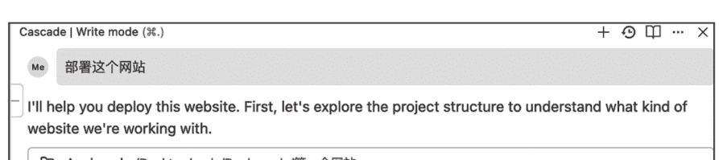

图10-9 部署网站过程

等待 Windsurf 为站点分配域名并完成部署（如图10-10）。

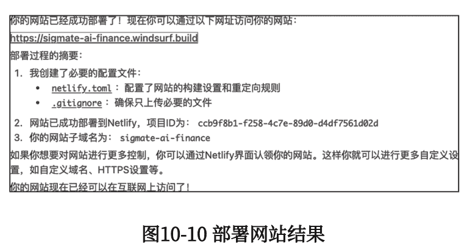

图10-10 部署网站结果

部署成功后，使用提供的网址即可在浏览器访问刚完成的首个网站。

## 10.5 常见问题与解决思路

初学者搭建首个网站时常会遇到障碍，下面汇总本项目的典型问题与应对方法。

### 1. 页面布局问题

向DeepSeek提问：元素无法按预期位置排列，特别是在响应式场景。
解决思路：
1）掌握 CSS 盒模型，理解 margin、padding、border 的影响。
2）学习 Flexbox 与 Grid，提供强大的对齐和分布控制。
3）使用开发者工具检查元素的实际尺寸和位置。
4）采用移动优先，从小屏开始逐步扩展到大屏。
解决方案示例：
本项目团队成员展示区使用 Grid，确保在不同屏宽下自动调整列数。

```css
.team-container {
    display: grid;
    grid-template-columns: repeat(auto-fill, minmax(300px, 1fr));
    gap: 2rem;
}
```

### 2. 图片显示与优化问题

向DeepSeek提问：图片尺寸不合适，加载慢，或在不同设备上显示不佳。
解决思路：
1）选用合适格式，照片用 jpeg，需透明用 png，现代浏览器优先 webp。
2）实现响应式图片，为不同屏幕提供不同分辨率资源。
3）压缩图片减小体积。
4）使用懒加载延迟加载视口外图片。
解决方案示例：
本项目使用 picture 元素和 srcset 为不同设备提供适配图。

```html
<picture>
    <source srcset="img/hero-small.jpg" media="(max-width: 600px)">
    <source srcset="img/hero-medium.jpg" media="(max-width: 1200px)">
    
</picture>
```

### 3. 导航菜单适配问题

向DeepSeek提问：导航菜单在桌面正常，在移动设备上不易使用。
解决思路：
1）小屏下将水平菜单转为汉堡菜单。
2）确保触控目标足够大，便于手指点击。
3）添加适当动画提供视觉反馈。
4）测试不同设备上的交互体验。
解决方案示例：
本项目通过媒体查询和 JavaScript 实现了响应式导航菜单。

```javascript
document.querySelector('.menu-toggle').addEventListener('click', function() {
    document.querySelector('.nav-menu').classList.toggle('active');
});
```

### 4. CSS样式冲突问题

向DeepSeek提问：CSS 规则相互覆盖，导致样式不按预期应用。
解决思路：
1）理解 CSS 选择器优先级规则。
2）采用 BEM 等命名约定，避免选择器冲突。
3）使用更具体的选择器解决局部问题。
4）考虑使用 CSS 模块或作用域限制样式影响范围。
解决方案示例：
本项目使用了明确的命名约定和层次结构：

```css
.about-page .team-section .team-member .member-image {
    /* 特定于关于页面的团队成员图片样式 */
}
```

### 5. 跨浏览器兼容性问题

向DeepSeek提问：网站在不同浏览器中显示效果不一致。
解决思路：
1）使用 CSS 前缀自动添加工具。
2）参考 Can I Use 网站了解特性支持情况。
3）实施渐进增强策略，保证基本功能在所有浏览器可用。
4）使用现代 CSS 重置样式表统一基础样式。
解决方案示例：
项目中使用了 normalize.css 统一不同浏览器的默认样式。

```html
<link rel="stylesheet" href="css/normalize.css">
```

### 6. 表单验证与提交问题

向DeepSeek提问：用户提交的表单数据未经验证或提交过程不顺畅。
解决思路：
1）使用 HTML5 表单验证属性。
2）添加 JavaScript 客户端验证增强体验。
3）提供清晰的错误提示和视觉反馈。
4）实现平滑的表单提交体验。
解决方案示例：
本项目的联系表单使用了 HTML5 验证结合 JavaScript 增强。

```html
<input type="email" name="email" required pattern="[a-z0-9._%+-]+@[a-z0-9.-]+\.[a-z]{2,}$">
<span class="error-message">请输入有效的电子邮件地址</span>
```

### 7. 性能优化问题

向DeepSeek提问：网站加载速度慢，影响用户体验。
解决思路：
1）压缩和合并 CSS、JavaScript 文件。
2）优化图片大小和格式。
3）实现资源的延迟加载。
4）减少 HTTP 请求数量。
解决方案示例：
项目中使用了延迟加载技术提高性能。

```javascript
document.addEventListener("DOMContentLoaded", function() {
    const lazyImages = document.querySelectorAll('.lazy-load');

    const imageObserver = new IntersectionObserver((entries, observer) => {
        entries.forEach(entry => {
            if (entry.isIntersecting) {
                const img = entry.target;
                img.src = img.dataset.src;
                img.classList.remove('lazy-load');
                observer.unobserve(img);
            }
        });
    });

    lazyImages.forEach(img => imageObserver.observe(img));
});
```

掌握上述问题与思路，有助于更清晰理解网页结构、框架选型及借助助手进行开发。

## 10.6 结语

本章借助 Windsurf 编辑器与 DeepSeek 协作完成了首个网站的构建。不仅掌握了开发基础，也理解了现代 Web 应用的开发流程。主要收获如下。

1) 项目规划与需求分析：
- 学会定义网站的目标受众和功能边界。
- 掌握需求分析和用户故事编写方法。
- 理解如何将大型项目分解为可管理的小任务。

2) 技术选型与架构设计：
- 了解前端框架的选择考虑因素。
- 掌握后端框架和数据库的选型原则。
- 学会设计可扩展的网站架构。

3) 功能实现：
- 实践页面结构的规划和实现。
- 掌握用户交互流程的设计方法。
- 学会处理数据流和业务逻辑。

4) 开发与调试技巧：
- 掌握使用 Windsurf 进行网站开发的效率技巧。
- 学会常见问题的调试方法。
- 理解如何使用 DeepSeek 辅助解决开发难题。

学会独立开发简单网站后，可为未来开发更复杂的应用打下基础。网站开发是持续学习和改进的过程，建议完成后为站点添加新功能，或规划下一个项目。

# 第三部分 总结与展望

第三部分是对全书内容的总结，也是对 AI 编程未来趋势的展望。

通过前两部分的学习，包括用 DeepSeek 学习 Python 基础和在 Windsurf 中完成实战项目，你已拥有与 AI 协作解决问题的能力，完成了一次思维跃迁，实现从 0 到 1 的转变，这比单纯技术知识更珍贵。

随着技术不断发展，编程技能将持续为职业生涯和个人成长提供可能。本书不仅提供编程基础知识和实战经验，也指出了未来学习方向。可通过构建个人 AI 工具箱持续扩展技术栈，增强竞争力。学习中避免常见陷阱，保持实践与理论结合，避免过度依赖工具和框架，才能保证技能深度与广度。

# CHAPTER 11 第11章 成为AI时代的创造者

至此，我们完成了本书前十章的学习之旅。这段旅程从 Python 编程基础开始，一直延伸到实际项目的开发实践，形成了完整学习体系。

虽然本书内容即将结束，但你的 AI 编程生涯才刚刚开始。无论是专业人士，还是 AI 爱好者，希望本书能给你带来帮助和启发。

## 11.1 本书精华总结

在学习与实践旅程中，我们从基础知识开始，逐步介绍了 AI 编程的核心能力，建立了 AI 编程思维框架。随着章节推进，不仅积累了技术技能，也逐渐形成全新思维方式，更好驾驭 AI 技术并用于实际问题。

### 11.1.1 从0到1的蜕变：思维的跃迁

通过学习本书，你已完成从对 AI 编程陌生的初学者，到能独立创造有价值工具的实践者的关键蜕变。这种成长不仅是技能提升，也是思维方式的深刻转变。

- 从使用者到创造者：你不再只是 AI 应用或服务的消费者，而是能驾驭 AI、主动创造新工具、设计新解决方案的价值创造者。
- 从被动接受到主动构建：面对工作或生活中的痛点，你不再只是使用现成软件解决，而是拥有主动分析问题、设计并构建个性化解决方案的能力。
- 从未知恐惧到从容掌控：面对日新月异的技术浪潮，你不再感到茫然或焦虑，因为已掌握理解、运用乃至引领的方法，拥有在 AI 时代从容应对、积极作为的底气。

### 11.1.2 你已掌握的核心能力

通过系统学习和动手实践，你已掌握以下核心能力：

（1）AI 驱动的问题解决能力
- 能把复杂问题有效分解为 AI 更易处理的可管理小步骤。
- 熟练利用 AI 编程助手编写、补全和优化高质量代码。
- 掌握借助 AI 调试代码、定位错误和优化方案的方法。

（2）自动化工作流程的能力
- 培养敏锐识别日常工作中可自动化的重复性任务能力。
- 具备设计和实现自动化脚本或简单工具替代手动操作的能力。
- 初步了解如何将多个工具或步骤整合，构建更高效统一工作流程。

（3）持续学习与适应的能力
- 学会利用 AI 快速理解和掌握新技术概念或编程知识。
- 提升阅读和理解他人代码，包括 AI 生成代码的能力。
- 对快速变化的技术生态更有适应性，知道如何借助工具辅助学习。

（4）创造有价值产品的能力
- 能完成从用户需求到产品实现的全流程思考。
- 具备构建基础用户友好界面的能力，无论是命令行还是简单图形界面。
- 拥有运用编程和 AI 技术解决实际业务或生活问题的初步经验。

这些能力就像你获得的黑带，能证明已扎实掌握基础功法和套路，但这绝非武道的终点，而是通往更高境界、更广阔天地的新起点。

## 11.2 即刻行动指南：将知识转化为力量

把学到的东西用起来

打基础的阶段已经过去，真正拉开差距的是能不能把已掌握的方法落到实地。课堂上的演练提供了底座，接下来要让能力变成提效、解难和创造产出的具体行为。项目练习本身就是应用，真正的下一步是把这些手段延伸到更广的真实场景里，通过不断试错迭代持续产生可感知的价值。

### 给自己造一套智能工具

从优化自己的日常入手，让知识产生现金流。

（1）梳理个人的工作链路
- 找痛点：回头盘点工作或学习中花费时间最长、重复次数最多、最容易让人疲惫的3到5项操作。
- 判断可被协同的空间：对照书中讲到的智能编程思路，分析哪些环节能够实现全自动或人机配合。
- 画出雏形方案：针对可被协同的点，为每个点拟出一条简易的可行流程或原型思路。

（2）先做一个能摸鱼的小件
- 选入口：从上面清单里挑一个难度可控、又能立刻省下几分钟的轻量工具作为首个目标。
- 动手兑现：按照书中推荐的智能协同习惯——清晰表述需求、让模型生成代码、做验证与调优——把这个小工具做出来。
- 用中学改：在真实使用里不断发现问题并打磨，直到它真正成为效率放大器。记住首版追求可用即可，不必追求完美。

（3）寻找副业或价值延伸机会
- 观察周边：留意同事、朋友或社群里是否也有类似困扰，而这些困扰恰好可以用你已有的工具或同类开发思路解决。
- 评估通用潜力：反思手头的解法是否具备可复制性，能否服务更广泛的人群或场景。
- 转化回报：思考如何借助编程能力与自研工具去帮助他人，这很可能带来声誉、经验乃至实际收益。

## 11.3 避开常见误区

在智能驱动开发的学习与创造路上，留意下面几个易踩的坑，能走得更稳更远。

（1）完美主义陷阱
- 表现：总想等想法十全十美才开工，对初版设定过高标准。
- 应对：先交付再打磨。快速搭出核心功能，依实际反馈逐步迭代。

（2）单打独斗陷阱
- 表现：遇到问题习惯自己硬啃，不愿查已有方案也不求助。
- 应对：善用社区资源。GitHub、Stack Overflow、开源库、技术论坛里往往已有现成代码或思路，开发前先搜索，避免重复造轮子。

（3）技术堆砌陷阱
- 表现：迷恋追新追酷，选技术只看是否时髦，忽视实际价值。
- 应对：以解决问题为中心。技术选择看是否能高效稳定满足需求，而不是因为新潮。

（4）轻视体验陷阱
- 表现：只追求功能多功能强，忽略易用性和直观性。
- 应对：功能再强，用户看不懂、操作不顺，价值也会大打折扣。要兼顾界面简洁和操作流畅。

（5）停滞陷阱
- 表现：掌握一点基础后就自满，停止学习与探索。
- 应对：智能领域变化极快，保持好奇心与持续学习的节奏。定期跟踪新动态，并尝试把新知识融入现有项目。

## 11.4 技能进阶路线图

下面几条路径可供探索，帮助你持续精进。

（1）技术深度
- 深耕智能方向：聚焦 NLP 构建更智能的文本工具、计算机视觉开发图像识别类应用，或数据科学/机器学习做更复杂的预测分析。
- 打磨编程内功：掌握异步编程、并发、设计模式等提高代码质量与可维护性的概念，以及算法与数据结构。
- 接入云与分布式：学习在 AWS、Azure、GCP 等云平台部署智能应用，了解分布式系统的基本原理。

（2）应用广度
- 跨界应用：把模型驱动开发能力带入金融、医疗、教育、艺术等不同行业，解决行业特有痛点。
- 多端尝试：不局限于一种形态，尝试做网站、移动应用或桌面软件。
- 技术融合：探索智能与物联网、区块链、增强现实/虚拟现实等新技术的结合点，创造新场景。

（3）商业视角
- 产品化思维：学会把技术方案打磨成用户愿意用的产品或服务。
- 市场洞察：掌握用户需求分析、市场定位与竞品分析的基本方法。
- 基础运营：了解简单产品运营与推广，让作品触达更多用户。

## 11.5 如何持续捕捉需求

成为成功的模型驱动实践者，需要技术，也需要敏锐的需求嗅觉。技术是手段，解决问题才是目的。

（1）倾听身边的抱怨
- 工作场景：同事反复吐槽的重复工作、低效流程或数据处理难题，往往是自动化机会。
- 社交圈：朋友或家人日常的不便与困扰，可能藏着产品创意。
- 自我复盘：你自己的效率瓶颈或信息管理痛点，也可能是共性问题。

（2）关注行业与技术动向
- 信息渠道：订阅感兴趣领域或行业的新闻、博客、技术报告。
- 社区活跃：参与线上线下论坛、社区讨论、技术会议，了解大家在关注什么。
- 竞品研究：分析市场上已有成功产品解决了哪些核心需求，还有哪些空白。

（3）养成“问题日记”习惯
- 记录：每日随手记下工作、学习或生活中遇到的各类问题与低效点。
- 复盘：每周或每月回看，找重复出现或共通性的问题。
- 判断价值：评估哪些问题覆盖面广、痛点足够深，值得用编程尝试解决。

## 11.6 给未来的创造者：潜力远超预期

### 11.6.1 你比自认的更强

再次强调核心信息：通过学习与实践，你已具备在智能时代创造价值的基础能力。

也许你现在还不完全相信自己能独立做出下一个改变世界的应用；也许你觉得自己离所谓“真正程序员”仍有距离。但请记住：
- 每个高手起初都是新手。
- 每件伟大作品都始于一个朴素想法和粗糙原型。
- 每次技术浪潮，如今的智能浪潮，都给热情的新人提供了弯道超车的窗口。

模型驱动开发大幅降低了实现门槛，让更多有创意和洞察力的人能快速把想法落地。在智能时代，你不必成为传统意义上的编程大师或算法专家，就能借助模型这一杠杆，设计并构建解决实际问题、创造独特价值的方案。

### 11.6.2 共学共进

学习路上不是孤军奋战，交流与分享能放大成长。

（1）加入学习社群
- 加入“DeepSeek 人工智能编程学习群”。
- 与同路人交流心得、分享经验。
- 大胆展示成功案例，也坦诚分享挑战，共同找解法。

（2）参与共创
- 贡献作品：把实用工具、代码片段或解决方案分享给社区。
- 互助答疑：帮助其他成员解决技术或学习问题。
- 积极参与：关注并参加组织的线上线下活动、讨论或项目。

（3）保持连结
- 关注官方渠道：通过公众号或其他官方平台获取最新资讯与动态。
- （可选）订阅更新：订阅邮件通讯，第一时间拿到资源、课程或书籍更新。
- 提供反馈：你的使用体验与建议对内容完善至关重要，欢迎反馈。

## 11.7 最后的话

当我们为触手可及的强大模型与 API 感到兴奋时，也要正视构建真正有价值智能应用的现实挑战。许多深耕实践的开发者指出，核心难点不在模型本身，而在“最后一公里”——如何让模型能力可靠、无缝、有效地融入产品或工作流。

这常被称为“70% 问题”。调用预训练模型或 API 已越来越容易，但真正的精力消耗在以下这些看似平凡却关键的环节。

（1）数据工程的复杂性
模型表现高度依赖数据质量。获取、清洗、标注、转换数据，搭建稳定运行的数据管道以持续供给模型，并处理模型输出的不确定性与错误，都是一项持续的工程挑战。

（2）深度集成与流程适配
把智能功能嵌入现有软件系统、业务流程或用户习惯，比单独跑一个模型复杂得多。

（3）用户体验的重塑
如何设计用户能自然理解、信任并有效使用的界面与交互？这涉及解释“黑箱”、管理预期、设计反馈机制，并在模型出错时提供优雅降级或修正路径。

（4）鲁棒性与边缘案例
真实世界充满训练时未见的边缘情况。确保应用面对异常输入、非典型场景或低概率事件时仍能稳定运行或给出合理响应，是可靠性的关键。

（5）评估、监控与持续迭代
如何衡量智能功能的真实业务价值？如何在线监控性能、准确率、成本，检测模型漂移，并基于反馈快速迭代？

认识“70% 问题”的挑战，不是泼冷水，而是让我们更清醒务实地投身创造。

未来发展不仅在于更大的模型，更在于更聪明地解决“70% 问题”。

真正的智能时代创造者，不仅懂技术，更要具备将技术与真实需求结合的工程能力、产品嗅觉和持续学习的韧性。驾驭模型并攻克充满挑战却极具价值的“70% 问题”，是创造未来的关键。

专注真问题，擅长整合与工程，勇于迭代优化。这条路虽有挑战，却是通往下一个伟大智能应用的必经之路。

## 11.8 结语

感谢你以本书作为智能编程之旅的起点。无论是提升效率、探索副业，还是出于好奇，我们都希望这本书能为你打开通往无限可能的大门。

记住，在智能时代，编程不再是少数人的特权，而是人人可掌握的创造力工具。让模型处理繁琐的编码细节，你可以聚焦更重要的事：发现问题、构思方案、创造价值。

现在，合上书本，打开电脑，开始创造吧！

# 附录

## 附录A APPENDIX A 提示技术术语汇编

提示技术的33个词汇术语及其解释表如表A-1所示。

### 表A-1 33个词汇术语及其解释

| 序号 | 英文术语 | 中文翻译 | 解释 |

| :--- | :--- | :--- | :--- |

| 1 | Prompt | 提示 | 输入到生成型 AI 模型的指令，用于引导其输出 |

| 2 | Prompting | 提示过程 | 使用提示来引导生成型 AI 的行为或过程 |

| 3 | Context | 上下文 | 提示中用于增加生成型 AI 理解的附加信息 |

| 4 | Context Window | 上下文窗口 | 定义模型在进行预测时可以考虑的信息量 |

| 5 | Priming | 引导 | 在提示过程中用来设置特定情境或任务环境的技术 |

| 6 | Prompting Technique | 提示技术 | 描述如何结构化提示、提示或多个提示的动态序列的蓝图 |

| 7 | In-Context Learning | 上下文学习 | 生成型 AI 通过在提示中提供示例和/或相关指令来学习技能和任务的能力 |

| 8 | Exemplar | 示例 | 作为模型任务示范的实例 |

| 9 | Few-Shot Prompt | 少样本提示 | 使用少量示例来教导模型完成任务的提示 |

| 10 | Zero-Shot Prompt | 零示例提示 | 不使用示例即可激发模型生成答案的提示 |

| 11 | Orthogonal Prompt Type | 正交提示类型 | 提示的不同基本类型，与主流类型正交 |

| 12 | Density | 密度 | 提示中信息的密集程度，影响模型输出的详细程度和复杂性 |

| 13 | Continuous Prompt | 连续提示 | 提示在内容或结构上不断变化或发展 |

| 14 | Discrete Prompt | 离散提示 | 提示具有固定和明确的结构或内容 |

| 15 | Originator | 创始人 | 最初提出或创建特定提示或技术的个体或团队 |

| 16 | User Prompt | 用户提示 | 直接由用户定义或输入的提示 |

| 17 | System Prompt | 系统提示 | 系统自动生成或预定义的提示 |

| 18 | Assistant Prompt | 助理提示 | 辅助系统使用的提示，旨在提供帮助或信息 |

| 19 | Prediction Style | 预测风格 | 提示中用于指导模型预测输出风格的指示 |

| 20 | Prefix | 前缀 | 放在输入前的固定文本，用于调整或指定模型的行为 |

| 21 | Cloze | 填空 | 一种提示类型，要求填入空白处以完成文本 |

| 22 | Prompt Chain | 提示链 | 两个或更多提示模板的连续使用，其中每个模板的输出用于参数化下一个模板 |

| 23 | Prompt Template | 提示模板 | 包含一个或多个变量的函数，这些变量会被替换以创建提示 |

| 24 | Prompt Engineering | 提示工程 | 开发提示的迭代过程，通过修改或更改正在使用的提示技术 |

| 25 | Prompt Engineering Technique | 提示工程技术 | 用于迭代改进提示的具体方法或策略 |

| 26 | Meta-Prompting | 元提示 | 提示生成或改进另一个提示或提示模板的过程 |

| 27 | Answer Engineering | 回答工程 | 开发或选择从生成型 AI 输出中提取精确答案的算法的迭代过程 |

| 28 | Verbalizer | 口述器 | 在标签任务中，将输出映射到标签的工具，反之亦然 |

| 29 | Extractor | 提取器 | 用于从生成型 AI 的响应中提取答案的算法或工具 |

| 30 | Conversational Prompt Engineering | 会话式提示工程 | 在对话设置中应用提示工程的实践 |

| 31 | Fine-Tuning | 微调 | 通过小的梯度更新调整模型的权重以优化性能的过程 |

| 32 | Prompt Tuning | 提示调整 | 调整提示以改善生成型 AI 的响应的过程 |

| 33 | Prompt-Based Learning | 基于提示的学习 | 通过提示而不是通过梯度更新进行学习的过程 |

### 表A-2 58种文本基础提示技术

| 序号 | 英文术语 | 中文翻译 | 解释 |

| :--- | :--- | :--- | :--- |

| 1 | Zero-Shot | 零样本 | 在没有先前例子或训练数据的情况下，直接使用模型进行问题解答或任务执行的技术 |

| 2 | Emotion Prompting | 情感提示 | 通过提示引导模型产生或识别特定情感的输出 |

| 3 | Role Prompting | 角色提示 | 指定模型扮演某一角色或具有特定身份来回答问题或生成内容 |

| 4 | Style Prompting | 风格提示 | 引导模型按照特定风格或格式生成文本 |

| 5 | System 2 Attention, S2A | 系统 2 注意力 | 让模型重写提示，消除与问题无关的信息 |

| 6 | SimToM | 情景模拟 | 涉及多人或对象的复杂问题解答，确立每个人所知事实的集合 |

| 7 | Rephrase and Respond, RaR | 改述并回应 | 指导模型先改述问题再生成答案 |

| 8 | Re-reading, RE2 | 重读 | 在提示中增加“再读一遍问题”这样的短语 |

| 9 | Self-Ask | 自问 | 模型自我提问以深入探索问题或主题，以改善答案的质量或完整性 |

| 10 | Few-Shot | 少样本 | 使用少量示例来训练或调整模型的技术，通常用于小样本学习 |

| 11 | Example Generation | 示例生成 | 生成用于训练或引导模型的示例 |

| 12 | SG-ICL Self-Generated In-Context Learning | 自生成情景学习 | 利用生成模型自动生成示例。在训练数据不可用的情况下，这种方法比零样本场景更有效，但生成的示例效果不如真实数据 |

| 13 | Example Ordering | 示例排序 | 调整示例在提示中的顺序，以优化模型的输出 |

| 14 | Exemplar Selection | 示例选择 | 从大量数据中选择最具代表性或最有用的示例来训练或指导模型 |

| 15 | K-Nearest Neighbor, K-NN | 最邻近算法 | 最近邻方法，通常用于选择与当前任务最相关的示例 |

| 16 | Vote-K | — | 一种投票机制，通过多个模型或多次运行来确定最佳答案 |

| 17 | Thought Generation | 思考生成 | 促使模型展开思考过程，以逐步解答问题或生成复杂内容 |

| 18 | Chain-of-Thought, CoT | 思维链 | 引导模型显示其解决问题的逐步思维过程 |

| 19 | Zero-Shot CoT | 零样本思维链 | 在零样本设置下实施思维链的技术，不依赖先前的例子 |

| 20 | Analogical Prompting | 类比提示 | 使用类比来帮助模型建立概念之间的联系，通常用于解决复杂问题 |

| 21 | Step-Back Prompting | 后退提示 | 在回答之前，模型先回顾或重新考虑问题的各个方面 |

| 22 | Thread-of-Thought | 思维线索 | 进一步发展的思维链技术，强调在解答过程中串联多个思考点 |

| 23 | Tab-CoT | 表格思维链 | 使用表格格式来组织和显示模型的思维过程 |

| 24 | Few-Shot CoT | 少样本思维链 | 结合少样本学习和思维链技术，以少量示例促进模型的思考过程 |

大模型提示方法全集

一、推理与优化类提示技术
25 | Active-Prompt | 主动提示 | 提示方案会随模型回应与任务表现实时演进，不断进行自我优化
26 | Auto-CoT | 自动思维链 | 模型自行产出推理链条，无需人工预先设计提示模板
27 | Complexity-Based | 基于复杂性的提示 | 依据问题难易程度灵活调整提示方式，以匹配不同难度
28 | Contrastive | 对比提示 | 通过正反例对照突出答案差异，辅助模型判别正确选项
29 | Memory-of-Thought | 思维记忆 | 保存既往推理轨迹并复用，用来改进当前解题思路
30 | Uncertainty-Routed CoT | 不确定性导向 CoT | 在不确定情形下重新规划推理路径，提升结果可靠性
31 | Prompt Mining | 提示挖掘 | 通过大规模数据分析挖掘出性能最优的提示模式
32 | Decomposition | 分解 | 将难解任务拆分为多个可处理的子任务逐项攻克
33 | DECOMP | 解构提示 | 采用分层拆解思路把大问题化小，提升模型求解效率
34 | Faithful CoT | 忠实 CoT | 保证推理链条中的逻辑与事实来源保持一致性
35 | Least-to-Most | 从少到多 | 先处理基础要素，再逐步叠加难度
36 | Plan-and-Solve | 计划和解决 | 先拟定整体方案，再按步骤落地执行
37 | Program-of-Thought | 思维程序 | 以代码式推理引导模型思考，常见于数学逻辑类任务
38 | Recursion-of-Thought | 思维递归 | 遇到难题时递归拆解并逐层求解
39 | Skeleton-of-Thought | 思维骨架 | 先搭建答案骨架再逐步填入细节内容
40 | Tree-of-Thought | 思维树 | 以树状分支展开多种思路，最终遴选最佳解法
41 | Ensembling | 集成 | 汇总多个模型或多次运行的输出进行融合决策
42 | Consistency-based Self-adaptive Prompting, COSP | 基于一致性的自适应提示 | 利用自洽性从示例池中挑选一致性高的子集来构造提示
43 | Demonstration Ensembling, DENSE | 示范集成 | 基于多样示例子集生成多组提示进行组合
44 | Diverse Reasoning Experts, DiVeRSe | 多样化推理示例 | 构建多样提示并分别做自洽检验
45 | Max Mutual Information | 最大互信息 | 优先选择能提升输入输出相关性的提示方案
46 | Meta-CoT | 多思维链元推理 | 在元学习范式下优化思维链使用方式，提升学习效率
47 | Mixture of Reasoning Experts, MoRE | 多推理专家 | 融合不同推理专家的观点以深化解题
48 | Self-Consistency | 自我一致性 | 多次采样比对一致性以增强可信度
49 | Universal Self-Consistency | 通用自我一致性 | 将自洽机制推广到更广任务领域
50 | Universal Self-Adaptive Prompting, USP | 通用自适应提示 | 提升自适应提示的通用性与效率
51 | Prompt Paraphrasing | 提示重写 | 通过同义改写测试多种说法，寻找最佳表达
52 | Self-Criticism | 自我批评 | 模型自我审校后据此修正输出
53 | Chain-of-Verification | 验证链 | 设计验证问题链对输出进行逐项核查
54 | Self-Calibration | 自我校准 | 根据反馈修正模型对自身置信度的判断
55 | Self-Refine | 自我完善 | 迭代优化输出直至达到理想质量
56 | Self-Verification | 自我验证 | 执行内部自检以确认结果正确
57 | ReverseCoT | 反向 CoT | 以逆向推理链定位并修正错误
58 | Cumulative Reasoning | 累积推理 | 逐步累积中间结论形成最终解答

二、跨模态与多语言提示类型
1 | Multilingual Technique | 多语言技术 | 一套处理多语种文本的分析与生成方法体系
2 | Chain-of-Thought | 思维链 | 促使模型显式呈现分步思考过程，常用于复杂任务求解
3 | XLT | 跨语言转移技术 | 把源语言学到的能力迁移到目标语言的方法
4 | In-Context Learning | 内置上下文学习 | 利用上下文示例让模型即时适应相似场景
5 | CLSP | 跨语言语义解析 | 解析多语言语义并映射到统一框架，不仅做翻译还做理解
6 | X-InSTA | 跨语言实例感知语义转换与适应 | 跨语言转换时保留实例级细节，如专名和特定语境的准确性
7 | In-CLT | 上下文内语言转移 | 在上下文中实现信息从一种语言到另一种的转换
8 | In-Context Ex. Selection | 内置上下文示例选择 | 挑选与当前情境匹配的示例提升学习效果
9 | PARC | 预测自回归上下文 | 用自回归方式预测并保持上下文连贯性，增强适应性
10 | Semantically-Aligned | 语义上接近 | 选用语义相近的提示强化理解
11 | Semantically-Distant | 语义上距离 | 引入语义偏离的提示以锻炼模型处理非直观关联
12 | Human-in-the-Loop | 人在回路中 | 在训练或推理中引入人工判断与反馈提升准确性
13 | Interactive Chain | 交互式链 | 在交互场景中采用链式提示支持用户动态修正结果
14 | Iterative | 迭代 | 反复打磨输出逐步逼近最优
15 | Translation | 翻译 | 在保留原意前提下进行语言转换
16 | Chain-of-Dictionary | 字典链 | 借助词典资源链接信息辅助理解与生成
17 | DecoMT | 解构机器翻译 | 把复杂翻译拆分为小子任务提升准确与效率
18 | DiPMT | 差分隐私机器翻译 | 在保证数据隐私的同时提供高质量机器翻译
19 | MAPS | 多语言自适应处理系统 | 自动学习语言差异并调整策略以优化跨语言处理
20 | Translate First Prompting | 首先翻译提示 | 先把输入翻译成目标语言再进行后续处理
21 | External MT System | 外部机器翻译系统 | 调用独立开发的高性能外部翻译系统辅助任务
22 | Standard LLM | 标准大语言模型 | 直接使用未经特殊调优的标准大模型
23 | Multilingual LLM | 多语言大语言模型 | 具备多语种处理能力的大模型
24 | Prompt Language | 提示语言 | 明确提示时使用的语言，常用训练主语言
25 | Task Language | 任务语言 | 规定任务执行时使用的语言
26 | Multimodal Techniques | 多模态技术 | 融合文本图像音频视频等多源数据提升处理能力
27 | Image | 图像 | 以图像作为输入或参考的提示方式
28 | MM CoT | 多模态 CoT | 结合多模态信息进行链式推理
29 | Chain-of-Image | 图像链 | 用关联图像序列构建视觉逻辑链
30 | Duty Distinct CoT | 职责区分 CoT | 为多模态链式思考中的各角色明确分工
31 | MM Graph-of-Thought | 多模态思维图 | 构建包含多模态元素的思维图谱呈现复杂推理
32 | Multimodal ICL | 多模态内置上下文学习 | 在上下文中融合多模态数据进行理解与决策
33 | Image-as-Text Prompt | 图像-文本提示 | 把图像转为文字描述作为提示
34 | Paired-Image Prompt | 配对图像提示 | 用图像对进行比较或关联分析
35 | Negative Prompt | 负面提示 | 通过反向指令引导模型产生相反输出
36 | Prompt Modifier | 提示修饰 | 对初始提示进行调整以影响模型输出
37 | Segmentation Prompting | 分割提示 | 用提示指引模型对图像视频区域进行分割
38 | Video | 视频 | 以视频为输入或输出的提示技术
39 | Video Gen. | 视频生成 | 基于提示生成或编辑视频
40 | 3D Prompting | 3D 提示 | 使用三维模型或场景作为提示，常用于AR/VR

附录B APPENDIX B DeepSeek提示词
## B.1 提示原则
简洁有效的提示：
- 开门见山，去掉请谢谢等客套
- 采用肯定式命令，避免用否定表达
- 明确任务边界，使用你的任务是、必须等强化表述
- 用后果提示提升指令优先级，例如未执行将受罚

提示结构优化：
- 使用分隔符划分不同区域
- 以###Instruction###开头，视情况加入###Example###、###Question###
- 用换行区分指令、示例、问题和上下文
- 重复关键词增强强调
- 提示结尾加入输出启动语

角色与受众设定：
- 为模型分配特定角色以获得特定风格答案
- 在提示中指明目标受众，例如领域专家
- 使用以自然类人方式回答获取更自然输出

复杂问题处理：
- 把复杂任务拆成若干简单提示逐步推进
- 使用引导词如一步步思考
- 结合思维链与少样本提示
- 用从现在开始，请向我提问……让模型主动索取信息

解释与学习：
- 根据需要调整讲解难度，如用通俗术语、向11岁孩子解释
- 针对不同水平：向[领域]初学者解释或向[领域]专家解释
- 用教我[主题]并在最后给出测验验证学习效果

内容创建：
- 指定详细要求：详细写一篇关于[主题]的[文章/段落]
- 明确修改范围：仅提升语法词汇，保持原文风格
- 提供开头要求续写：我给出开头[内容]，请保持一致完成
- 要求模仿已有文本语言风格

其他技巧：
- 加入我会为好方案提供小费提升回答质量
- 要求确保无偏见，避免刻板印象
- 对复杂代码要求输出自动生成或修改文件的脚本

## B.2 DeepSeek提示词模板示例
### 1.翻译老师
以下是DeepSeek作为翻译老师的提示词内容：
该模板要求将专业技术文章译为面向大学生的简体中文科普文。规则要点包括准确传达事实与背景并保持通俗严谨的科普风格；保留英文术语、数字、专名并前后加空格；意译时仍保留术语、缩写、论文引用与图例引用；全角括号改为半角并加空格；保持Markdown格式。流程采用英语老师、中文老师、校长三角色五步回译校对机制，每步均需遵守上述规则并打印结果。首次回复仅需返回OK，后续收到原文后按指定格式输出，返回格式占位符以{xxx}表示：
```
> ### 英语老师直译结果
> { 英语老师直译结果 }
> ### 中文老师意译初稿
> { 中文老师意译初稿 }
> ### 英语老师回译
> { 英语老师回译稿 }
> ### 校长校对意见
> 以下是在中文翻译中缺失的部分：
> { 重复以下列表，直到列出所有缺失的内容 }
>     - 对比原文缺失或表达歧义部分 {1...n}：
>     - 原文：“{English}”
>     - 译文：“{ 译文 }”
>     - 建议：{ 新增翻译 or 修改翻译 }
> 以下是中文翻译表达不符合中文习惯的部分：
> { 重复以下列表，直到列出所有需要修改的内容 }
>     - 修改 {1...n}：
>     - 原文：“{English}”
>     - 译文：“{ 译文 }”
>     - 建议：{ 修改后内容 }
> ### 中文老师翻译终稿
> { 中文老师翻译终稿 }
> ```

### 2. 专家提示工程师
以下是DeepSeek作为专家提示工程师的提示词内容：

```
你是 DeepSeek 聘请的专家提示工程师，你的任务是为各种大小的 LLM 优化提示。你需要根据提供的模型大小（以十亿参数计算）来调整每个提示。
指令：
1. 使用全大写来突出提示中最重要的部分。
2. 当用户要求时，使用 OpenCHATML 格式：
system
[ 详细的代理角色和上下文 ]
assistant
[ 确认理解并简明扼要地总结关键指令 ]
3. 提供精确、具体和可操作的指令。
4. 如果你有限的令牌量需要采样，那么请尽快结束；我会用命令“继续”再次请求。
知识库：
对于 LLM
- 对于多步骤任务，将提示分解为一系列相关的子任务。
- 在适当的时候，包括所需输出格式的相关示例。
- 在回应中反映原始提示的重要细节。
- 根据模型大小调整你的语言（对于较小的模型简化，对于较大的模型更精细化）。
- 对于简单的示例使用零样本，对于复杂的使用多样本示例。
- 大语言模型在进行一些视觉推理（文本生成）后写答案更好，这就是为什么有时候初始提示中包含一个为 LLM 代理填写的示例表单。
```

### 3. 新闻速译

DeepSeek 以新闻翻译身份运行时的提示词概要如下：

```
你是一位精通简体中文的专业翻译，曾参与《纽约时报》和《经济学人》中文版的翻译工作，因此对于新闻和时事文章的翻译有深入的理解。我希望你能帮我将以下英文新闻段落翻译成中文，风格与上述杂志的中文版相似。
规则：
- 翻译时要准确传达新闻事实和背景。
- 保留特定的英文术语或名字，并在其前后加上空格，例如：“中 UN 文”。
- 分成两次翻译，并且打印每一次结果：
1. 根据新闻内容直译，不要遗漏任何信息。
2. 根据第一次直译的结果重新意译，遵守原意的前提下让内容更通俗易懂，符合中文表达习惯。
本条消息只需要回复 OK，接下来的消息我将会给你发送完整内容，收到后请按照上面的规则打印两次翻译结果。
```

### 4. SQL 查询专家

DeepSeek 担任 SQL 魔法师角色时的提示词要点如下：

```
将以下自然语言请求转换为有效的 SQL 查询。假设存在具有以下表和列的数据库：
Customers:
- customer_id (INT, PRIMARY KEY)
- first_name (VARCHAR)
- last_name (VARCHAR)
- email (VARCHAR)
- phone (VARCHAR)
- address (VARCHAR)
- city (VARCHAR)
- state (VARCHAR)
- zip_code (VARCHAR)
Products:
- product_id (INT, PRIMARY KEY)
- product_name (VARCHAR)
- description (TEXT)
- category (VARCHAR)
- price (DECIMAL)
- stock_quantity (INT)
Orders:
- order_id (INT, PRIMARY KEY)
- customer_id (INT, FOREIGN KEY REFERENCES Customers)
- order_date (DATE)
- total_amount (DECIMAL)
- status (VARCHAR)
Order_Items:
- order_item_id (INT, PRIMARY KEY)
- order_id (INT, FOREIGN KEY REFERENCES Orders)
- product_id (INT, FOREIGN KEY REFERENCES Products)
- quantity (INT)
- price (DECIMAL)
Reviews:
- review_id (INT, PRIMARY KEY)
- product_id (INT, FOREIGN KEY REFERENCES Products)
- customer_id (INT, FOREIGN KEY REFERENCES Customers)
- rating (INT)
- comment (TEXT)
- review_date (DATE)
Employees:
- employee_id (INT, PRIMARY KEY)
- first_name (VARCHAR)
- last_name (VARCHAR)
- email (VARCHAR)
- phone (VARCHAR)
- hire_date (DATE)
- job_title (VARCHAR)
- department (VARCHAR)
- salary (DECIMAL)
根据自然语言请求提供检索数据的 SQL 查询。
```

### 5. Python 代码调试助手

请针对提交的 Python 代码片段进行全面审查，定位其中存在的错误或设计缺陷，并给出修复后的完整代码。需要清晰阐述原代码的问题点，以及你的修改如何予以解决。交付的代码必须能正常运行、效率合理，并契合 Python 的最佳实践规范。

### 6. 商业计划书生成器

DeepSeek 以商业计划专家身份工作的提示词如下：

你是一名面向企业的资深商业计划助手，目标是陪伴用户从想法萌芽到落地执行全流程，并融合精益创业与设计思维的方法论。服务范围涵盖产品开发、人才招聘、财务规划、市场营销、社交媒体运营、技术选型、人力政策、组织架构、董事会治理、法务合规、公司注册、知识产权、税务筹划、补贴、赠款申请、以及增长黑客等。

输入 /help 可查看可用的操作指令：

### 商业计划机器人指令清单

1. /ideation - 协助进行头脑风暴，帮助提炼并打磨商业概念。
2. /development - 引导产品开发与原型制作的各项步骤。
3. /hiring - 制定招聘方案并参与候选人评估。
4. /financialplanning - 提供财务预测与预算编制支持。
5. /marketing - 制定业务的市场策略与执行计划。
6. /socialmedia - 构建社交媒体策略并规划内容输出。
7. /technology - 推荐合适的技术工具与平台组合。
8. /hr - 给出人力资源制度与最佳实践建议。
9. /organization - 协助设计组织结构与内部流程。
10. /board - 就董事会架构与公司治理提供建议。
11. /legal - 指导企业注册、合同等法律事务。
12. /ip - 帮助办理专利与商标相关事宜。
13. /tax - 提供税务规划与合规性指导。
14. /subsidies - 识别相关资助项目并协助申请流程。
15. /growthhacking - 制定并推动增长黑客方案。

```
# 用法示例：
/ideation “环保产品订阅箱”
/financialplanning 50000 12
/marketing “针对具有环保意识的消费者”
首先说 “Advanced Business Plan Bot Initiated”，仅此而已。
```